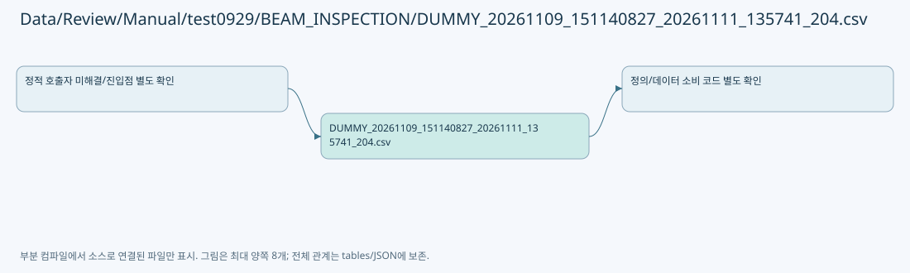

# Data/Review/Manual/test0929/BEAM_INSPECTION/DUMMY_20261109_151140827_20261111_135741_204.csv

| 항목 | 내용 |
| --- | --- |
| 원본 저장소 | https://github.com/kjuws10-rgb/A3Drilling.git |
| 원본 Commit | 5aee8e58439c9b455cae7c9593c9be986c3e682e |
| 원본 SHA256 | 4bfa6b8c05b02428090e2c8d2e28cb785a8ed5a2af1c8285e1cdaac447a189a9 |
| 파일 분류 | data_schema |
| 원본 크기/행 | 1,637 bytes / 3 physical lines |
| 인코딩 | utf-8-sig |
| 검토 범위 | 구문/부분 의미 분석에서 추출한 사실. 동작·물리 단위·실장비 합격을 보증하지 않습니다. |
| 원본 링크 | [고정 Commit 원본](https://github.com/kjuws10-rgb/A3Drilling/blob/5aee8e58439c9b455cae7c9593c9be986c3e682e/Data/Review/Manual/test0929/BEAM_INSPECTION/DUMMY_20261109_151140827_20261111_135741_204.csv) |

## 파일의 역할과 읽는 순서

리뷰 계획·측정·결과 해석 계층입니다. 물리 이동 좌표와 Vision 식별 패킷, 측정 저장의 역할을 별도로 확인합니다.

## 저장/설정 스키마 참고

실행 이력·측정 레코드는 문서에 전체 복제하지 않습니다. 행 수와 구조, 소비 코드 연결을 검토하기 위한 참고입니다. 첫 행이 실제 헤더인지는 해당 CSV 파서와 대조해야 합니다.

| 항목 | 값 |
| --- | --- |
| 레코드 수 | 3 |
| 첫 행 필드 개수 | 59 |
| 첫 행 컬럼 후보 | [데이터 값 미복제/소비 파서로 형식 확인] / [데이터 값 미복제/소비 파서로 형식 확인] / [데이터 값 미복제/소비 파서로 형식 확인] / [데이터 값 미복제/소비 파서로 형식 확인] / [데이터 값 미복제/소비 파서로 형식 확인] / [데이터 값 미복제/소비 파서로 형식 확인] / [데이터 값 미복제/소비 파서로 형식 확인] / [데이터 값 미복제/소비 파서로 형식 확인] / [데이터 값 미복제/소비 파서로 형식 확인] / [데이터 값 미복제/소비 파서로 형식 확인] / [데이터 값 미복제/소비 파서로 형식 확인] / [데이터 값 미복제/소비 파서로 형식 확인] / [데이터 값 미복제/소비 파서로 형식 확인] / [데이터 값 미복제/소비 파서로 형식 확인] / [데이터 값 미복제/소비 파서로 형식 확인] / [데이터 값 미복제/소비 파서로 형식 확인] / [데이터 값 미복제/소비 파서로 형식 확인] / [데이터 값 미복제/소비 파서로 형식 확인] / [데이터 값 미복제/소비 파서로 형식 확인] / [데이터 값 미복제/소비 파서로 형식 확인] / [데이터 값 미복제/소비 파서로 형식 확인] / [데이터 값 미복제/소비 파서로 형식 확인] / [데이터 값 미복제/소비 파서로 형식 확인] / [데이터 값 미복제/소비 파서로 형식 확인] / [데이터 값 미복제/소비 파서로 형식 확인] / [데이터 값 미복제/소비 파서로 형식 확인] / [데이터 값 미복제/소비 파서로 형식 확인] / [데이터 값 미복제/소비 파서로 형식 확인] / [데이터 값 미복제/소비 파서로 형식 확인] / [데이터 값 미복제/소비 파서로 형식 확인] / [데이터 값 미복제/소비 파서로 형식 확인] / [데이터 값 미복제/소비 파서로 형식 확인] / [데이터 값 미복제/소비 파서로 형식 확인] / [데이터 값 미복제/소비 파서로 형식 확인] / [데이터 값 미복제/소비 파서로 형식 확인] / [데이터 값 미복제/소비 파서로 형식 확인] / [데이터 값 미복제/소비 파서로 형식 확인] / [데이터 값 미복제/소비 파서로 형식 확인] / [데이터 값 미복제/소비 파서로 형식 확인] / [데이터 값 미복제/소비 파서로 형식 확인] / [데이터 값 미복제/소비 파서로 형식 확인] / [데이터 값 미복제/소비 파서로 형식 확인] / [데이터 값 미복제/소비 파서로 형식 확인] / [데이터 값 미복제/소비 파서로 형식 확인] / [데이터 값 미복제/소비 파서로 형식 확인] / [데이터 값 미복제/소비 파서로 형식 확인] / [데이터 값 미복제/소비 파서로 형식 확인] / [데이터 값 미복제/소비 파서로 형식 확인] / [데이터 값 미복제/소비 파서로 형식 확인] / [데이터 값 미복제/소비 파서로 형식 확인] / [데이터 값 미복제/소비 파서로 형식 확인] / [데이터 값 미복제/소비 파서로 형식 확인] / [데이터 값 미복제/소비 파서로 형식 확인] / [데이터 값 미복제/소비 파서로 형식 확인] / [데이터 값 미복제/소비 파서로 형식 확인] / [데이터 값 미복제/소비 파서로 형식 확인] / [데이터 값 미복제/소비 파서로 형식 확인] / [데이터 값 미복제/소비 파서로 형식 확인] / [데이터 값 미복제/소비 파서로 형식 확인] |

## 수정·재검증 체크

- 원본 Commit과 현재 작업 파일 SHA가 같은지 먼저 확인합니다. 다르면 이 문서를 과거 버전 자료로 취급합니다.
- 선언·직접 호출·이벤트/인터페이스 경계·설정 소비를 함께 확인합니다. 정적 연결의 빈 곳을 정상 경로로 추정하지 않습니다.
- 저장 형식/단위/식별자·재시도·취소·예외·롤백에 영향을 주는 변경은 상세 해설장과 호출자를 다시 검토합니다.
- 도구의 구문 추출과 별도 정적 추적 해설, 실제 빌드·시뮬레이션·실장비 검증 결과를 분리합니다.
