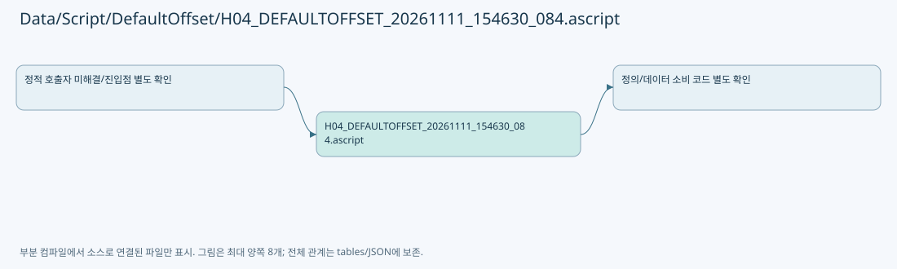

# Data/Script/DefaultOffset/H04_DEFAULTOFFSET_20261111_154630_084.ascript

| 항목 | 내용 |
| --- | --- |
| 원본 저장소 | https://github.com/kjuws10-rgb/A3Drilling.git |
| 원본 Commit | 5aee8e58439c9b455cae7c9593c9be986c3e682e |
| 원본 SHA256 | 2bb87845a8fb74b6e17bf1fce1bbf4a874e1b6b219b7000e6ac439fdbb64967a |
| 파일 분류 | code |
| 원본 크기/행 | 1,213 bytes / 32 physical lines |
| 인코딩 | utf-8-sig |
| 검토 범위 | 구문/부분 의미 분석에서 추출한 사실. 동작·물리 단위·실장비 합격을 보증하지 않습니다. |
| 원본 링크 | [고정 Commit 원본](https://github.com/kjuws10-rgb/A3Drilling/blob/5aee8e58439c9b455cae7c9593c9be986c3e682e/Data/Script/DefaultOffset/H04_DEFAULTOFFSET_20261111_154630_084.ascript) |

## 파일의 역할과 읽는 순서

Automation1 실행 프로그램입니다. 정적으로 명령을 읽었으며 스크립트 실행이나 장비 검증을 수행하지 않았습니다.

## 명령·패턴 구성

| 명령/행 첫 토큰 | 등장 수 |
| --- | --- |
| MoveDelay | 4 |
| GalvoLaserOutput | 3 |
| GalvoConfigureLaserOutputPeriod | 2 |
| GalvoConfigureLaser1PulseWidth | 2 |
| ParameterSetTaskValue | 2 |
| SetupAxisSpeed | 2 |
| program | 1 |
| IfovOff | 1 |
| SetupTaskDistanceUnits | 1 |
| SetupTaskTimeUnits | 1 |
| VelocityBlendingOff | 1 |
| SetupTaskWaitMode | 1 |
| SetupTaskTargetMode | 1 |
| GalvoConfigureLaserMode | 1 |
| PsoReset | 1 |
| AnalogOutputSet | 1 |
| MoveRapid | 1 |
| WaitForMotionDone | 1 |
| end | 1 |

원본 전체 행은 아래 주석 해설본에서 확인합니다. 생성된 가공 스크립트와 원본 생성기 코드는 다른 역할입니다. 이 문서만으로 속도/단위/축/레이저 안전 조건을 확정하지 않습니다.

## 원문 전체 주석 해설본

[원본 모든 행과 행별 해설 보기](../../../../annotated/Data/Script/DefaultOffset/H04_DEFAULTOFFSET_20261111_154630_084.ascript.annotated.txt)

원본을 빠뜨리거나 임의로 줄이지 않았습니다. `L000001 |` 표시는 원본 행 번호, `// 해설`은 별도 설명입니다. 실행용 소스가 아닌 문서입니다.

## 수정·재검증 체크

- 원본 Commit과 현재 작업 파일 SHA가 같은지 먼저 확인합니다. 다르면 이 문서를 과거 버전 자료로 취급합니다.
- 선언·직접 호출·이벤트/인터페이스 경계·설정 소비를 함께 확인합니다. 정적 연결의 빈 곳을 정상 경로로 추정하지 않습니다.
- 저장 형식/단위/식별자·재시도·취소·예외·롤백에 영향을 주는 변경은 상세 해설장과 호출자를 다시 검토합니다.
- 도구의 구문 추출과 별도 정적 추적 해설, 실제 빌드·시뮬레이션·실장비 검증 결과를 분리합니다.
