# Drilling.Common/Alarm/CAlarmManager.cs

| 항목 | 내용 |
| --- | --- |
| 원본 저장소 | https://github.com/kjuws10-rgb/A3Drilling.git |
| 원본 Commit | 0219666f9053b907d96d7e0aa7d0c6c1be3a73d4 |
| 원본 SHA256 | 5cbff85f66cfcf6744d14dd9955a75c2eb21a6536e0f7fd7517472b7f95fa872 |
| 파일 분류 | code |
| 원본 크기/행 | 34,651 bytes / 676 physical lines |
| 인코딩 | utf-8-sig |
| 검토 범위 | 구문/부분 의미 분석에서 추출한 사실. 동작·물리 단위·실장비 합격을 보증하지 않습니다. |
| 원본 링크 | [고정 Commit 원본](https://github.com/kjuws10-rgb/A3Drilling/blob/0219666f9053b907d96d7e0aa7d0c6c1be3a73d4/Drilling.Common/Alarm/CAlarmManager.cs) |

## 파일의 역할과 읽는 순서

프로그램의 시작·구성·공유 타입 또는 빌드 연결에 사용됩니다. 아래 실제 선언·참조와 원본 근거를 확인합니다.

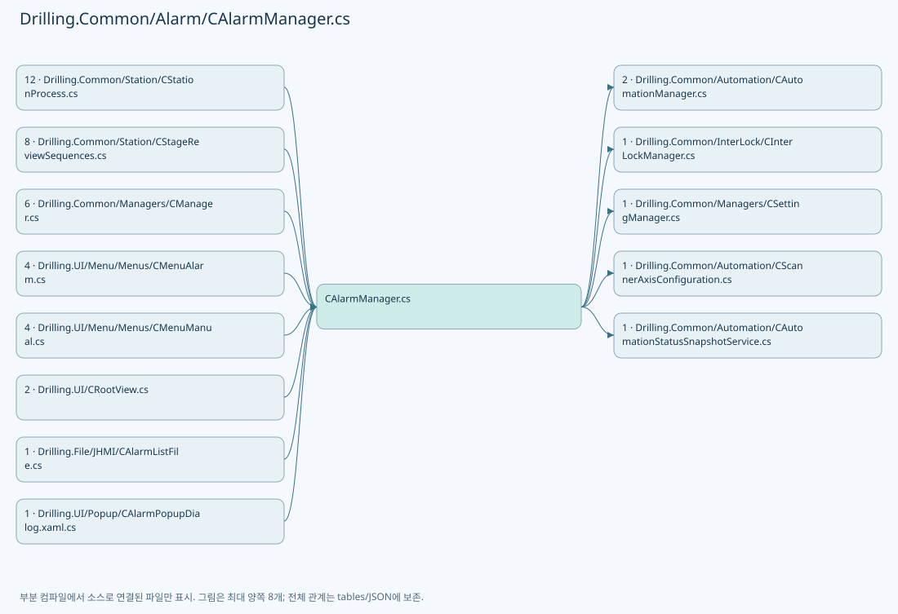

## 네임스페이스·타입·상속

| 타입 | 구분 | 원본 범위 | 선언/상속 |
| --- | --- | --- | --- |
| CAlarmManager | ClassDeclaration | 12–544 | CAlarmManager |
| ST_ALARM_RULE | RecordDeclaration | 123–123 | ST_ALARM_RULE |
| ST_ALARM_CANDIDATE | RecordDeclaration | 124–124 | ST_ALARM_CANDIDATE |
| ST_ALARM_DEFINITION | RecordDeclaration | 546–546 | ST_ALARM_DEFINITION |
| CAlarmListFileBase | ClassDeclaration | 547–550 | CAlarmListFileBase |
| ST_ALARM_DEFINITION_SNAPSHOT | RecordDeclaration | 552–552 | ST_ALARM_DEFINITION_SNAPSHOT |
| EN_ALARM_LEVEL | EnumDeclaration | 553–558 | EN_ALARM_LEVEL |
| EN_ALARM_STATE | EnumDeclaration | 560–564 | EN_ALARM_STATE |
| ST_ALARM_DATA | RecordDeclaration | 566–571 | ST_ALARM_DATA |
| ST_CURRENT_ALARM_SNAPSHOT | RecordDeclaration | 573–573 | ST_CURRENT_ALARM_SNAPSHOT |
| CScannerTemperatureAlarmMonitor | ClassDeclaration | 575–610 | CScannerTemperatureAlarmMonitor |
| CSequenceFailureException | ClassDeclaration | 613–657 | CSequenceFailureException: InvalidOperationException |
| CSequenceSignalCanceledException | ClassDeclaration | 660–665 | CSequenceSignalCanceledException: OperationCanceledException(error.Message, error, error.CancellationToken) |
| ST_ALARM_HISTORY_ENTRY | RecordDeclaration | 667–667 | ST_ALARM_HISTORY_ENTRY |
| ST_ALARM_HISTORY_RESULT | RecordDeclaration | 668–668 | ST_ALARM_HISTORY_RESULT |
| IAlarmHistoryStore | InterfaceDeclaration | 669–675 | IAlarmHistoryStore |

## 멤버 빠른 목록

| 이름 | 종류 | 범위 | 서명 |
| --- | --- | --- | --- |
| InterLockAlarmRules | FieldDeclaration | L15–22 | System.Collections.Generic.IReadOnlyDictionary<string, Drilling.Common.Alarm.CAlarmManager.ST_ALARM_RULE> Drilling.Common.Alarm.CAlarmManager.InterLockAlarmRules |
| _definitionLock | FieldDeclaration | L23–23 | object Drilling.Common.Alarm.CAlarmManager._definitionLock |
| _definitionsInitialized | FieldDeclaration | L24–24 | bool Drilling.Common.Alarm.CAlarmManager._definitionsInitialized |
| _definitionInitializationRequested | FieldDeclaration | L25–25 | bool Drilling.Common.Alarm.CAlarmManager._definitionInitializationRequested |
| _definitionRetryTask | FieldDeclaration | L26–26 | System.Threading.Tasks.Task? Drilling.Common.Alarm.CAlarmManager._definitionRetryTask |
| _definitionFile | FieldDeclaration | L27–27 | Drilling.Common.Alarm.CAlarmListFileBase? Drilling.Common.Alarm.CAlarmManager._definitionFile |
| _definitionRetriesRemaining | FieldDeclaration | L28–28 | int Drilling.Common.Alarm.CAlarmManager._definitionRetriesRemaining |
| _nextDefinitionRetryAt | FieldDeclaration | L29–29 | long Drilling.Common.Alarm.CAlarmManager._nextDefinitionRetryAt |
| _definitions | FieldDeclaration | L30–30 | Drilling.Common.Alarm.ST_ALARM_DEFINITION_SNAPSHOT Drilling.Common.Alarm.CAlarmManager._definitions |
| _currentLock | FieldDeclaration | L31–31 | object Drilling.Common.Alarm.CAlarmManager._currentLock |
| _curAlarm | FieldDeclaration | L32–32 | System.Collections.Generic.Dictionary<int, Drilling.Common.Alarm.ST_ALARM_DATA> Drilling.Common.Alarm.CAlarmManager._curAlarm |
| _history | FieldDeclaration | L33–33 | Drilling.Common.Alarm.IAlarmHistoryStore? Drilling.Common.Alarm.CAlarmManager._history |
| _now | FieldDeclaration | L34–34 | System.Func<System.DateTimeOffset> Drilling.Common.Alarm.CAlarmManager._now |
| _current | FieldDeclaration | L35–35 | Drilling.Common.Alarm.ST_CURRENT_ALARM_SNAPSHOT Drilling.Common.Alarm.CAlarmManager._current |
| _notificationError | FieldDeclaration | L36–36 | string Drilling.Common.Alarm.CAlarmManager._notificationError |
| CurrentChanged | EventFieldDeclaration | L45–45 | System.Action? Drilling.Common.Alarm.CAlarmManager.CurrentChanged |
| HistoryQueueCapacity | FieldDeclaration | L46–46 | int Drilling.Common.Alarm.CAlarmManager.HistoryQueueCapacity |
| _historyQueueLock | FieldDeclaration | L47–47 | object Drilling.Common.Alarm.CAlarmManager._historyQueueLock |
| _historyQueue | FieldDeclaration | L48–48 | System.Collections.Generic.Queue<Drilling.Common.Alarm.ST_ALARM_DATA> Drilling.Common.Alarm.CAlarmManager._historyQueue |
| _historyTask | FieldDeclaration | L49–49 | System.Threading.Tasks.Task? Drilling.Common.Alarm.CAlarmManager._historyTask |
| _historyError | FieldDeclaration | L50–50 | string Drilling.Common.Alarm.CAlarmManager._historyError |
| _historyWriteStartedAt | FieldDeclaration | L51–51 | long Drilling.Common.Alarm.CAlarmManager._historyWriteStartedAt |
| _monitoringLock | FieldDeclaration | L52–52 | object Drilling.Common.Alarm.CAlarmManager._monitoringLock |
| _monitoringStop | FieldDeclaration | L53–53 | System.Threading.CancellationTokenSource? Drilling.Common.Alarm.CAlarmManager._monitoringStop |
| _monitoringTask | FieldDeclaration | L54–54 | System.Threading.Tasks.Task? Drilling.Common.Alarm.CAlarmManager._monitoringTask |
| _monitoringError | FieldDeclaration | L55–55 | string Drilling.Common.Alarm.CAlarmManager._monitoringError |
| .ctor | ConstructorDeclaration | L58–62 | Drilling.Common.Alarm.CAlarmManager.CAlarmManager(Drilling.Common.Alarm.IAlarmHistoryStore?, System.Func<System.DateTimeOffset>?) |
| Build | MethodDeclaration | L66–91 | System.Collections.Generic.IReadOnlyList<Drilling.Common.Alarm.ST_ALARM_DATA> Drilling.Common.Alarm.CAlarmManager.Build(Drilling.Common.Managers.ST_DEVICE_STATUS, Drilling.Common.InterLock.ST_INTERLOCK_SUMMARY) |
| IsAlarmOn | LocalFunctionStatement | L70–73 | bool IsAlarmOn(Drilling.Common.Motion.ST_MOTOR_AXIS_STATUS) |
| AddInterLockAlarms | MethodDeclaration | L93–109 | void Drilling.Common.Alarm.CAlarmManager.AddInterLockAlarms(System.Collections.Generic.ICollection<Drilling.Common.Alarm.CAlarmManager.ST_ALARM_CANDIDATE>, Drilling.Common.InterLock.ST_INTERLOCK_SUMMARY) |
| ShouldIncludeItem | LocalFunctionStatement | L95–98 | bool ShouldIncludeItem(Drilling.Common.InterLock.ST_INTERLOCK_ITEM) |
| GetStationNameFromAxis | MethodDeclaration | L111–121 | string Drilling.Common.Alarm.CAlarmManager.GetStationNameFromAxis(string) |
| GetDefinitionsSnapshot | MethodDeclaration | L125–125 | Drilling.Common.Alarm.ST_ALARM_DEFINITION_SNAPSHOT Drilling.Common.Alarm.CAlarmManager.GetDefinitionsSnapshot() |
| InitializeDefinitions | MethodDeclaration | L126–139 | Drilling.Common.Alarm.ST_ALARM_DEFINITION_SNAPSHOT Drilling.Common.Alarm.CAlarmManager.InitializeDefinitions(Drilling.Common.Alarm.CAlarmListFileBase) |
| LoadDefinitionsLocked | MethodDeclaration | L141–174 | void Drilling.Common.Alarm.CAlarmManager.LoadDefinitionsLocked(Drilling.Common.Alarm.CAlarmListFileBase) |
| RetryDefinitionInitialization | MethodDeclaration | L176–212 | string Drilling.Common.Alarm.CAlarmManager.RetryDefinitionInitialization() |
| EnsureDefinitionsRequested | MethodDeclaration | L214–218 | void Drilling.Common.Alarm.CAlarmManager.EnsureDefinitionsRequested() |
| NotificationError | PropertyDeclaration | L220–220 | string Drilling.Common.Alarm.CAlarmManager.NotificationError |
| CurAlarm | PropertyDeclaration | L221–221 | System.Collections.Generic.IReadOnlyList<Drilling.Common.Alarm.ST_ALARM_DATA> Drilling.Common.Alarm.CAlarmManager.CurAlarm |
| GetCurrentSnapshot | MethodDeclaration | L223–223 | Drilling.Common.Alarm.ST_CURRENT_ALARM_SNAPSHOT Drilling.Common.Alarm.CAlarmManager.GetCurrentSnapshot() |
| SetSequenceFailure | MethodDeclaration | L224–231 | void Drilling.Common.Alarm.CAlarmManager.SetSequenceFailure(Drilling.Common.Alarm.CSequenceFailureException) |
| SetAlarm | MethodDeclaration | L233–237 | bool Drilling.Common.Alarm.CAlarmManager.SetAlarm(int) |
| SetAlarm | MethodDeclaration | L239–243 | bool Drilling.Common.Alarm.CAlarmManager.SetAlarm(string) |
| SetAlarm | MethodDeclaration | L245–245 | bool Drilling.Common.Alarm.CAlarmManager.SetAlarm(Drilling.Common.Alarm.ST_ALARM_DEFINITION) |
| AddCurrent | MethodDeclaration | L246–265 | bool Drilling.Common.Alarm.CAlarmManager.AddCurrent(Drilling.Common.Alarm.ST_ALARM_DATA) |
| Reset | MethodDeclaration | L267–278 | void Drilling.Common.Alarm.CAlarmManager.Reset() |
| NotifyCurrentChanged | MethodDeclaration | L280–302 | void Drilling.Common.Alarm.CAlarmManager.NotifyCurrentChanged() |
| PublishCurrent | MethodDeclaration | L304–308 | void Drilling.Common.Alarm.CAlarmManager.PublishCurrent(long, string) |
| ReadHistory | MethodDeclaration | L310–310 | Drilling.Common.Alarm.ST_ALARM_HISTORY_RESULT Drilling.Common.Alarm.CAlarmManager.ReadHistory(System.DateTime, System.DateTime, System.Threading.CancellationToken) |
| HistoryStorageError | PropertyDeclaration | L311–321 | string Drilling.Common.Alarm.CAlarmManager.HistoryStorageError |
| get_HistoryStorageError | GetAccessorDeclaration | L313–320 | string Drilling.Common.Alarm.CAlarmManager.HistoryStorageError.get |
| QueueHistory | MethodDeclaration | L324–337 | bool Drilling.Common.Alarm.CAlarmManager.QueueHistory(Drilling.Common.Alarm.ST_ALARM_DATA) |
| WriteQueuedHistory | MethodDeclaration | L339–376 | void Drilling.Common.Alarm.CAlarmManager.WriteQueuedHistory() |
| FlushHistoryAsync | MethodDeclaration | L379–385 | System.Threading.Tasks.Task Drilling.Common.Alarm.CAlarmManager.FlushHistoryAsync(System.Threading.CancellationToken) |
| MonitoringError | PropertyDeclaration | L389–397 | string Drilling.Common.Alarm.CAlarmManager.MonitoringError |
| get_MonitoringError | GetAccessorDeclaration | L391–396 | string Drilling.Common.Alarm.CAlarmManager.MonitoringError.get |
| StartMonitoring | MethodDeclaration | L406–429 | void Drilling.Common.Alarm.CAlarmManager.StartMonitoring(Drilling.Common.Managers.CSettingManager, Drilling.Common.Automation.CAutomationManager, System.Func<Drilling.Common.Managers.ST_DEVICE_STATUS>, Drilling.Common.InterLock.CInterLockManager, System.Action<System.Exception>?) |
| StartMonitoring | MethodDeclaration | L432–447 | void Drilling.Common.Alarm.CAlarmManager.StartMonitoring(System.Action<System.Threading.CancellationToken>[], System.Action<System.Exception>?, System.TimeSpan) |
| StopMonitoringAsync | MethodDeclaration | L449–471 | System.Threading.Tasks.Task Drilling.Common.Alarm.CAlarmManager.StopMonitoringAsync() |
| Monitor | MethodDeclaration | L473–542 | System.Threading.Tasks.Task Drilling.Common.Alarm.CAlarmManager.Monitor(System.Action<System.Threading.CancellationToken>[], System.Action<System.Exception>?, System.TimeSpan, System.Threading.CancellationToken) |
| Load | MethodDeclaration | L549–549 | System.Collections.Generic.IReadOnlyList<Drilling.Common.Alarm.ST_ALARM_DEFINITION> Drilling.Common.Alarm.CAlarmListFileBase.Load() |
| Info | EnumMemberDeclaration | L555–555 | Drilling.Common.Alarm.EN_ALARM_LEVEL.Info |
| Warning | EnumMemberDeclaration | L556–556 | Drilling.Common.Alarm.EN_ALARM_LEVEL.Warning |
| Critical | EnumMemberDeclaration | L557–557 | Drilling.Common.Alarm.EN_ALARM_LEVEL.Critical |
| Clear | EnumMemberDeclaration | L562–562 | Drilling.Common.Alarm.EN_ALARM_STATE.Clear |
| Occur | EnumMemberDeclaration | L563–563 | Drilling.Common.Alarm.EN_ALARM_STATE.Occur |
| Id | PropertyDeclaration | L568–568 | string Drilling.Common.Alarm.ST_ALARM_DATA.Id |
| get_Id | GetAccessorDeclaration | L568–568 | string Drilling.Common.Alarm.ST_ALARM_DATA.Id.get |
| set_Id | InitAccessorDeclaration | L568–568 | void Drilling.Common.Alarm.ST_ALARM_DATA.Id.init |
| Group | PropertyDeclaration | L569–569 | string Drilling.Common.Alarm.ST_ALARM_DATA.Group |
| get_Group | GetAccessorDeclaration | L569–569 | string Drilling.Common.Alarm.ST_ALARM_DATA.Group.get |
| set_Group | InitAccessorDeclaration | L569–569 | void Drilling.Common.Alarm.ST_ALARM_DATA.Group.init |
| CimAddress | PropertyDeclaration | L570–570 | string Drilling.Common.Alarm.ST_ALARM_DATA.CimAddress |
| get_CimAddress | GetAccessorDeclaration | L570–570 | string Drilling.Common.Alarm.ST_ALARM_DATA.CimAddress.get |
| set_CimAddress | InitAccessorDeclaration | L570–570 | void Drilling.Common.Alarm.ST_ALARM_DATA.CimAddress.init |
| Check | MethodDeclaration | L577–609 | void Drilling.Common.Alarm.CScannerTemperatureAlarmMonitor.Check() |
| _reported | FieldDeclaration | L615–615 | int Drilling.Common.Alarm.CSequenceFailureException._reported |
| .ctor | ConstructorDeclaration | L616–618 | Drilling.Common.Alarm.CSequenceFailureException.CSequenceFailureException(string, string, string, System.Exception) |
| Scenario | PropertyDeclaration | L619–619 | string Drilling.Common.Alarm.CSequenceFailureException.Scenario |
| get_Scenario | GetAccessorDeclaration | L619–619 | string Drilling.Common.Alarm.CSequenceFailureException.Scenario.get |
| Subject | PropertyDeclaration | L620–620 | string Drilling.Common.Alarm.CSequenceFailureException.Subject |
| get_Subject | GetAccessorDeclaration | L620–620 | string Drilling.Common.Alarm.CSequenceFailureException.Subject.get |
| Kind | PropertyDeclaration | L621–621 | string Drilling.Common.Alarm.CSequenceFailureException.Kind |
| get_Kind | GetAccessorDeclaration | L621–621 | string Drilling.Common.Alarm.CSequenceFailureException.Kind.get |
| AlarmId | PropertyDeclaration | L622–622 | string Drilling.Common.Alarm.CSequenceFailureException.AlarmId |
| ActionScenario | MethodDeclaration | L623–629 | string Drilling.Common.Alarm.CSequenceFailureException.ActionScenario(string) |
| SignalScenario | MethodDeclaration | L630–641 | string Drilling.Common.Alarm.CSequenceFailureException.SignalScenario(string, string) |
| Existing | MethodDeclaration | L642–644 | Drilling.Common.Alarm.CSequenceFailureException? Drilling.Common.Alarm.CSequenceFailureException.Existing(System.Exception) |
| Action | MethodDeclaration | L645–646 | Drilling.Common.Alarm.CSequenceFailureException Drilling.Common.Alarm.CSequenceFailureException.Action(string, System.Exception) |
| Signal | MethodDeclaration | L647–648 | Drilling.Common.Alarm.CSequenceFailureException Drilling.Common.Alarm.CSequenceFailureException.Signal(string, string, bool, System.Exception) |
| ScenarioFailure | MethodDeclaration | L649–649 | Drilling.Common.Alarm.CSequenceFailureException Drilling.Common.Alarm.CSequenceFailureException.ScenarioFailure(string, System.Exception) |
| Publish | MethodDeclaration | L650–656 | void Drilling.Common.Alarm.CSequenceFailureException.Publish(System.Action<Drilling.Common.Alarm.CSequenceFailureException>?) |
| Scenario | PropertyDeclaration | L663–663 | string Drilling.Common.Alarm.CSequenceSignalCanceledException.Scenario |
| get_Scenario | GetAccessorDeclaration | L663–663 | string Drilling.Common.Alarm.CSequenceSignalCanceledException.Scenario.get |
| Signal | PropertyDeclaration | L664–664 | string Drilling.Common.Alarm.CSequenceSignalCanceledException.Signal |
| get_Signal | GetAccessorDeclaration | L664–664 | string Drilling.Common.Alarm.CSequenceSignalCanceledException.Signal.get |
| Append | MethodDeclaration | L673–673 | void Drilling.Common.Alarm.IAlarmHistoryStore.Append(Drilling.Common.Alarm.ST_ALARM_DATA) |
| Read | MethodDeclaration | L674–674 | Drilling.Common.Alarm.ST_ALARM_HISTORY_RESULT Drilling.Common.Alarm.IAlarmHistoryStore.Read(System.DateTime, System.DateTime, System.Threading.CancellationToken) |

## 멤버별 상세 계약·호출·처리 해설

### FieldDeclaration `InterLockAlarmRules` · L15–22

[Drilling.Common/Alarm/CAlarmManager.cs:15–22](https://github.com/kjuws10-rgb/A3Drilling/blob/0219666f9053b907d96d7e0aa7d0c6c1be3a73d4/Drilling.Common/Alarm/CAlarmManager.cs#L15-L22)

| 항목 | 실제 추출 값 |
| --- | --- |
| 서명 | System.Collections.Generic.IReadOnlyDictionary<string, Drilling.Common.Alarm.CAlarmManager.ST_ALARM_RULE> Drilling.Common.Alarm.CAlarmManager.InterLockAlarmRules |
| 접근/수식자 | Private / private, static, readonly |
| 반환/값 타입 | System.Collections.Generic.IReadOnlyDictionary<string, Drilling.Common.Alarm.CAlarmManager.ST_ALARM_RULE> |
| 소속 타입 | NamedType:Drilling.Common.Alarm.CAlarmManager |

현재 부분 분석에서 직접 연결된 호출자는 없습니다. XAML/이벤트/인터페이스·델리게이트·외부 진입을 추가 확인해야 하며, 미사용으로 판정한 것이 아닙니다.

호출하는 대상과 해석 범위:

| 원본 행 | 표현식 | 분석 상태 | 대상/소스 위치 |
| --- | --- | --- | --- |
| 15 | new Dictionary<string, ST_ALARM_RULE> | resolved | System.Collections.Generic.Dictionary<string, Drilling.Common.Alarm.CAlarmManager.ST_ALARM_RULE>.Dictionary(System.Collections.Generic.IEqualityComparer<string>?) |
| 17 | new | resolved | Drilling.Common.Alarm.CAlarmManager.ST_ALARM_RULE.ST_ALARM_RULE(int, Drilling.Common.Alarm.EN_ALARM_LEVEL, string, string, string) · Drilling.Common/Alarm/CAlarmManager.cs:123 |
| 18 | new | resolved | Drilling.Common.Alarm.CAlarmManager.ST_ALARM_RULE.ST_ALARM_RULE(int, Drilling.Common.Alarm.EN_ALARM_LEVEL, string, string, string) · Drilling.Common/Alarm/CAlarmManager.cs:123 |
| 19 | new | resolved | Drilling.Common.Alarm.CAlarmManager.ST_ALARM_RULE.ST_ALARM_RULE(int, Drilling.Common.Alarm.EN_ALARM_LEVEL, string, string, string) · Drilling.Common/Alarm/CAlarmManager.cs:123 |
| 20 | new | resolved | Drilling.Common.Alarm.CAlarmManager.ST_ALARM_RULE.ST_ALARM_RULE(int, Drilling.Common.Alarm.EN_ALARM_LEVEL, string, string, string) · Drilling.Common/Alarm/CAlarmManager.cs:123 |
| 21 | new | resolved | Drilling.Common.Alarm.CAlarmManager.ST_ALARM_RULE.ST_ALARM_RULE(int, Drilling.Common.Alarm.EN_ALARM_LEVEL, string, string, string) · Drilling.Common/Alarm/CAlarmManager.cs:123 |

본문의 실제 연산·분기·예외·반환 순서(원문 위치 순):

| 원본 행 | 종류 | 주석 해설 |
| --- | --- | --- |
| 15 | call | 함수·델리게이트 또는 객체 생성자를 호출합니다: new Dictionary<string, ST_ALARM_RULE>(StringComparer.OrdinalIgnoreCase) { ["EMS"] = new(21001, EN_ALARM_LEVEL.Critical, "INTERLOCK", "COMMON", "Release EMS and check emergency circuit"), ["Door"] = new(21002, EN_ALARM_LE… |
| 15 | variable-initializer | 변수의 초기값을 지정합니다: InterLockAlarmRules = new Dictionary<string, ST_ALARM_RULE>(StringComparer.OrdinalIgnoreCase) { ["EMS"] = new(21001, EN_ALARM_LEVEL.Critical, "INTERLOCK", "COMMON", "Release EMS and check emergency circuit"), ["Door"] = new(21002, |
| 17 | assignment | 값을 대상에 대입합니다: ["EMS"] = new(21001, EN_ALARM_LEVEL.Critical, "INTERLOCK", "COMMON", "Release EMS and check emergency circuit") |
| 17 | call | 함수·델리게이트 또는 객체 생성자를 호출합니다: new(21001, EN_ALARM_LEVEL.Critical, "INTERLOCK", "COMMON", "Release EMS and check emergency circuit") |
| 18 | assignment | 값을 대상에 대입합니다: ["Door"] = new(21002, EN_ALARM_LEVEL.Warning, "INTERLOCK", "COMMON", "Close door and check door lock sensor") |
| 18 | call | 함수·델리게이트 또는 객체 생성자를 호출합니다: new(21002, EN_ALARM_LEVEL.Warning, "INTERLOCK", "COMMON", "Close door and check door lock sensor") |
| 19 | assignment | 값을 대상에 대입합니다: ["Leak Sensor"] = new(26001, EN_ALARM_LEVEL.Critical, "INTERLOCK", "COMMON", "Check leak sensor and fluid line") |
| 19 | call | 함수·델리게이트 또는 객체 생성자를 호출합니다: new(26001, EN_ALARM_LEVEL.Critical, "INTERLOCK", "COMMON", "Check leak sensor and fluid line") |
| 20 | assignment | 값을 대상에 대입합니다: ["Smoke Temp"] = new(26002, EN_ALARM_LEVEL.Critical, "INTERLOCK", "COMMON", "Check smoke and temperature sensor") |
| 20 | call | 함수·델리게이트 또는 객체 생성자를 호출합니다: new(26002, EN_ALARM_LEVEL.Critical, "INTERLOCK", "COMMON", "Check smoke and temperature sensor") |
| 21 | assignment | 값을 대상에 대입합니다: ["PM Lock"] = new(27001, EN_ALARM_LEVEL.Critical, "INTERLOCK", "COMMON", "Release PM lock before operation") |
| 21 | call | 함수·델리게이트 또는 객체 생성자를 호출합니다: new(27001, EN_ALARM_LEVEL.Critical, "INTERLOCK", "COMMON", "Release PM lock before operation") |

변경 전 점검: 입력/반환 타입, 위 호출자, 예외/취소 경로, 공유 상태와 저장·전송 소비자를 함께 확인합니다. 값의 단위나 물리 방향을 이름만으로 확정하지 않습니다.

### FieldDeclaration `_definitionLock` · L23–23

[Drilling.Common/Alarm/CAlarmManager.cs:23–23](https://github.com/kjuws10-rgb/A3Drilling/blob/0219666f9053b907d96d7e0aa7d0c6c1be3a73d4/Drilling.Common/Alarm/CAlarmManager.cs#L23-L23)

| 항목 | 실제 추출 값 |
| --- | --- |
| 서명 | object Drilling.Common.Alarm.CAlarmManager._definitionLock |
| 접근/수식자 | Private / private, readonly |
| 반환/값 타입 | object |
| 소속 타입 | NamedType:Drilling.Common.Alarm.CAlarmManager |

현재 부분 분석에서 직접 연결된 호출자는 없습니다. XAML/이벤트/인터페이스·델리게이트·외부 진입을 추가 확인해야 하며, 미사용으로 판정한 것이 아닙니다.

호출하는 대상과 해석 범위:

| 원본 행 | 표현식 | 분석 상태 | 대상/소스 위치 |
| --- | --- | --- | --- |
| 23 | new | resolved | object.Object() |

본문의 실제 연산·분기·예외·반환 순서(원문 위치 순):

| 원본 행 | 종류 | 주석 해설 |
| --- | --- | --- |
| 23 | call | 함수·델리게이트 또는 객체 생성자를 호출합니다: new() |
| 23 | variable-initializer | 변수의 초기값을 지정합니다: _definitionLock = new() |

변경 전 점검: 입력/반환 타입, 위 호출자, 예외/취소 경로, 공유 상태와 저장·전송 소비자를 함께 확인합니다. 값의 단위나 물리 방향을 이름만으로 확정하지 않습니다.

### FieldDeclaration `_definitionsInitialized` · L24–24

[Drilling.Common/Alarm/CAlarmManager.cs:24–24](https://github.com/kjuws10-rgb/A3Drilling/blob/0219666f9053b907d96d7e0aa7d0c6c1be3a73d4/Drilling.Common/Alarm/CAlarmManager.cs#L24-L24)

| 항목 | 실제 추출 값 |
| --- | --- |
| 서명 | bool Drilling.Common.Alarm.CAlarmManager._definitionsInitialized |
| 접근/수식자 | Private / private |
| 반환/값 타입 | bool |
| 소속 타입 | NamedType:Drilling.Common.Alarm.CAlarmManager |

현재 부분 분석에서 직접 연결된 호출자는 없습니다. XAML/이벤트/인터페이스·델리게이트·외부 진입을 추가 확인해야 하며, 미사용으로 판정한 것이 아닙니다.

변경 전 점검: 입력/반환 타입, 위 호출자, 예외/취소 경로, 공유 상태와 저장·전송 소비자를 함께 확인합니다. 값의 단위나 물리 방향을 이름만으로 확정하지 않습니다.

### FieldDeclaration `_definitionInitializationRequested` · L25–25

[Drilling.Common/Alarm/CAlarmManager.cs:25–25](https://github.com/kjuws10-rgb/A3Drilling/blob/0219666f9053b907d96d7e0aa7d0c6c1be3a73d4/Drilling.Common/Alarm/CAlarmManager.cs#L25-L25)

| 항목 | 실제 추출 값 |
| --- | --- |
| 서명 | bool Drilling.Common.Alarm.CAlarmManager._definitionInitializationRequested |
| 접근/수식자 | Private / private |
| 반환/값 타입 | bool |
| 소속 타입 | NamedType:Drilling.Common.Alarm.CAlarmManager |

현재 부분 분석에서 직접 연결된 호출자는 없습니다. XAML/이벤트/인터페이스·델리게이트·외부 진입을 추가 확인해야 하며, 미사용으로 판정한 것이 아닙니다.

변경 전 점검: 입력/반환 타입, 위 호출자, 예외/취소 경로, 공유 상태와 저장·전송 소비자를 함께 확인합니다. 값의 단위나 물리 방향을 이름만으로 확정하지 않습니다.

### FieldDeclaration `_definitionRetryTask` · L26–26

[Drilling.Common/Alarm/CAlarmManager.cs:26–26](https://github.com/kjuws10-rgb/A3Drilling/blob/0219666f9053b907d96d7e0aa7d0c6c1be3a73d4/Drilling.Common/Alarm/CAlarmManager.cs#L26-L26)

| 항목 | 실제 추출 값 |
| --- | --- |
| 서명 | System.Threading.Tasks.Task? Drilling.Common.Alarm.CAlarmManager._definitionRetryTask |
| 접근/수식자 | Private / private |
| 반환/값 타입 | System.Threading.Tasks.Task? |
| 소속 타입 | NamedType:Drilling.Common.Alarm.CAlarmManager |

현재 부분 분석에서 직접 연결된 호출자는 없습니다. XAML/이벤트/인터페이스·델리게이트·외부 진입을 추가 확인해야 하며, 미사용으로 판정한 것이 아닙니다.

변경 전 점검: 입력/반환 타입, 위 호출자, 예외/취소 경로, 공유 상태와 저장·전송 소비자를 함께 확인합니다. 값의 단위나 물리 방향을 이름만으로 확정하지 않습니다.

### FieldDeclaration `_definitionFile` · L27–27

[Drilling.Common/Alarm/CAlarmManager.cs:27–27](https://github.com/kjuws10-rgb/A3Drilling/blob/0219666f9053b907d96d7e0aa7d0c6c1be3a73d4/Drilling.Common/Alarm/CAlarmManager.cs#L27-L27)

| 항목 | 실제 추출 값 |
| --- | --- |
| 서명 | Drilling.Common.Alarm.CAlarmListFileBase? Drilling.Common.Alarm.CAlarmManager._definitionFile |
| 접근/수식자 | Private / private |
| 반환/값 타입 | Drilling.Common.Alarm.CAlarmListFileBase? |
| 소속 타입 | NamedType:Drilling.Common.Alarm.CAlarmManager |

현재 부분 분석에서 직접 연결된 호출자는 없습니다. XAML/이벤트/인터페이스·델리게이트·외부 진입을 추가 확인해야 하며, 미사용으로 판정한 것이 아닙니다.

변경 전 점검: 입력/반환 타입, 위 호출자, 예외/취소 경로, 공유 상태와 저장·전송 소비자를 함께 확인합니다. 값의 단위나 물리 방향을 이름만으로 확정하지 않습니다.

### FieldDeclaration `_definitionRetriesRemaining` · L28–28

[Drilling.Common/Alarm/CAlarmManager.cs:28–28](https://github.com/kjuws10-rgb/A3Drilling/blob/0219666f9053b907d96d7e0aa7d0c6c1be3a73d4/Drilling.Common/Alarm/CAlarmManager.cs#L28-L28)

| 항목 | 실제 추출 값 |
| --- | --- |
| 서명 | int Drilling.Common.Alarm.CAlarmManager._definitionRetriesRemaining |
| 접근/수식자 | Private / private |
| 반환/값 타입 | int |
| 소속 타입 | NamedType:Drilling.Common.Alarm.CAlarmManager |

현재 부분 분석에서 직접 연결된 호출자는 없습니다. XAML/이벤트/인터페이스·델리게이트·외부 진입을 추가 확인해야 하며, 미사용으로 판정한 것이 아닙니다.

변경 전 점검: 입력/반환 타입, 위 호출자, 예외/취소 경로, 공유 상태와 저장·전송 소비자를 함께 확인합니다. 값의 단위나 물리 방향을 이름만으로 확정하지 않습니다.

### FieldDeclaration `_nextDefinitionRetryAt` · L29–29

[Drilling.Common/Alarm/CAlarmManager.cs:29–29](https://github.com/kjuws10-rgb/A3Drilling/blob/0219666f9053b907d96d7e0aa7d0c6c1be3a73d4/Drilling.Common/Alarm/CAlarmManager.cs#L29-L29)

| 항목 | 실제 추출 값 |
| --- | --- |
| 서명 | long Drilling.Common.Alarm.CAlarmManager._nextDefinitionRetryAt |
| 접근/수식자 | Private / private |
| 반환/값 타입 | long |
| 소속 타입 | NamedType:Drilling.Common.Alarm.CAlarmManager |

현재 부분 분석에서 직접 연결된 호출자는 없습니다. XAML/이벤트/인터페이스·델리게이트·외부 진입을 추가 확인해야 하며, 미사용으로 판정한 것이 아닙니다.

변경 전 점검: 입력/반환 타입, 위 호출자, 예외/취소 경로, 공유 상태와 저장·전송 소비자를 함께 확인합니다. 값의 단위나 물리 방향을 이름만으로 확정하지 않습니다.

### FieldDeclaration `_definitions` · L30–30

[Drilling.Common/Alarm/CAlarmManager.cs:30–30](https://github.com/kjuws10-rgb/A3Drilling/blob/0219666f9053b907d96d7e0aa7d0c6c1be3a73d4/Drilling.Common/Alarm/CAlarmManager.cs#L30-L30)

| 항목 | 실제 추출 값 |
| --- | --- |
| 서명 | Drilling.Common.Alarm.ST_ALARM_DEFINITION_SNAPSHOT Drilling.Common.Alarm.CAlarmManager._definitions |
| 접근/수식자 | Private / private |
| 반환/값 타입 | Drilling.Common.Alarm.ST_ALARM_DEFINITION_SNAPSHOT |
| 소속 타입 | NamedType:Drilling.Common.Alarm.CAlarmManager |

현재 부분 분석에서 직접 연결된 호출자는 없습니다. XAML/이벤트/인터페이스·델리게이트·외부 진입을 추가 확인해야 하며, 미사용으로 판정한 것이 아닙니다.

호출하는 대상과 해석 범위:

| 원본 행 | 표현식 | 분석 상태 | 대상/소스 위치 |
| --- | --- | --- | --- |
| 30 | new | resolved | Drilling.Common.Alarm.ST_ALARM_DEFINITION_SNAPSHOT.ST_ALARM_DEFINITION_SNAPSHOT(System.Collections.Generic.IReadOnlyList<Drilling.Common.Alarm.ST_ALARM_DEFINITION>, string) · Drilling.Common/Alarm/CAlarmManager.cs:552 |

본문의 실제 연산·분기·예외·반환 순서(원문 위치 순):

| 원본 행 | 종류 | 주석 해설 |
| --- | --- | --- |
| 30 | call | 함수·델리게이트 또는 객체 생성자를 호출합니다: new([], "알람 목록이 로드되지 않았습니다.") |
| 30 | variable-initializer | 변수의 초기값을 지정합니다: _definitions = new([], "알람 목록이 로드되지 않았습니다.") |

변경 전 점검: 입력/반환 타입, 위 호출자, 예외/취소 경로, 공유 상태와 저장·전송 소비자를 함께 확인합니다. 값의 단위나 물리 방향을 이름만으로 확정하지 않습니다.

### FieldDeclaration `_currentLock` · L31–31

[Drilling.Common/Alarm/CAlarmManager.cs:31–31](https://github.com/kjuws10-rgb/A3Drilling/blob/0219666f9053b907d96d7e0aa7d0c6c1be3a73d4/Drilling.Common/Alarm/CAlarmManager.cs#L31-L31)

| 항목 | 실제 추출 값 |
| --- | --- |
| 서명 | object Drilling.Common.Alarm.CAlarmManager._currentLock |
| 접근/수식자 | Private / private, readonly |
| 반환/값 타입 | object |
| 소속 타입 | NamedType:Drilling.Common.Alarm.CAlarmManager |

현재 부분 분석에서 직접 연결된 호출자는 없습니다. XAML/이벤트/인터페이스·델리게이트·외부 진입을 추가 확인해야 하며, 미사용으로 판정한 것이 아닙니다.

호출하는 대상과 해석 범위:

| 원본 행 | 표현식 | 분석 상태 | 대상/소스 위치 |
| --- | --- | --- | --- |
| 31 | new | resolved | object.Object() |

본문의 실제 연산·분기·예외·반환 순서(원문 위치 순):

| 원본 행 | 종류 | 주석 해설 |
| --- | --- | --- |
| 31 | call | 함수·델리게이트 또는 객체 생성자를 호출합니다: new() |
| 31 | variable-initializer | 변수의 초기값을 지정합니다: _currentLock = new() |

변경 전 점검: 입력/반환 타입, 위 호출자, 예외/취소 경로, 공유 상태와 저장·전송 소비자를 함께 확인합니다. 값의 단위나 물리 방향을 이름만으로 확정하지 않습니다.

### FieldDeclaration `_curAlarm` · L32–32

[Drilling.Common/Alarm/CAlarmManager.cs:32–32](https://github.com/kjuws10-rgb/A3Drilling/blob/0219666f9053b907d96d7e0aa7d0c6c1be3a73d4/Drilling.Common/Alarm/CAlarmManager.cs#L32-L32)

| 항목 | 실제 추출 값 |
| --- | --- |
| 서명 | System.Collections.Generic.Dictionary<int, Drilling.Common.Alarm.ST_ALARM_DATA> Drilling.Common.Alarm.CAlarmManager._curAlarm |
| 접근/수식자 | Private / private, readonly |
| 반환/값 타입 | System.Collections.Generic.Dictionary<int, Drilling.Common.Alarm.ST_ALARM_DATA> |
| 소속 타입 | NamedType:Drilling.Common.Alarm.CAlarmManager |

현재 부분 분석에서 직접 연결된 호출자는 없습니다. XAML/이벤트/인터페이스·델리게이트·외부 진입을 추가 확인해야 하며, 미사용으로 판정한 것이 아닙니다.

본문의 실제 연산·분기·예외·반환 순서(원문 위치 순):

| 원본 행 | 종류 | 주석 해설 |
| --- | --- | --- |
| 32 | variable-initializer | 변수의 초기값을 지정합니다: _curAlarm = [] |

변경 전 점검: 입력/반환 타입, 위 호출자, 예외/취소 경로, 공유 상태와 저장·전송 소비자를 함께 확인합니다. 값의 단위나 물리 방향을 이름만으로 확정하지 않습니다.

### FieldDeclaration `_history` · L33–33

[Drilling.Common/Alarm/CAlarmManager.cs:33–33](https://github.com/kjuws10-rgb/A3Drilling/blob/0219666f9053b907d96d7e0aa7d0c6c1be3a73d4/Drilling.Common/Alarm/CAlarmManager.cs#L33-L33)

| 항목 | 실제 추출 값 |
| --- | --- |
| 서명 | Drilling.Common.Alarm.IAlarmHistoryStore? Drilling.Common.Alarm.CAlarmManager._history |
| 접근/수식자 | Private / private, readonly |
| 반환/값 타입 | Drilling.Common.Alarm.IAlarmHistoryStore? |
| 소속 타입 | NamedType:Drilling.Common.Alarm.CAlarmManager |

현재 부분 분석에서 직접 연결된 호출자는 없습니다. XAML/이벤트/인터페이스·델리게이트·외부 진입을 추가 확인해야 하며, 미사용으로 판정한 것이 아닙니다.

변경 전 점검: 입력/반환 타입, 위 호출자, 예외/취소 경로, 공유 상태와 저장·전송 소비자를 함께 확인합니다. 값의 단위나 물리 방향을 이름만으로 확정하지 않습니다.

### FieldDeclaration `_now` · L34–34

[Drilling.Common/Alarm/CAlarmManager.cs:34–34](https://github.com/kjuws10-rgb/A3Drilling/blob/0219666f9053b907d96d7e0aa7d0c6c1be3a73d4/Drilling.Common/Alarm/CAlarmManager.cs#L34-L34)

| 항목 | 실제 추출 값 |
| --- | --- |
| 서명 | System.Func<System.DateTimeOffset> Drilling.Common.Alarm.CAlarmManager._now |
| 접근/수식자 | Private / private, readonly |
| 반환/값 타입 | System.Func<System.DateTimeOffset> |
| 소속 타입 | NamedType:Drilling.Common.Alarm.CAlarmManager |

현재 부분 분석에서 직접 연결된 호출자는 없습니다. XAML/이벤트/인터페이스·델리게이트·외부 진입을 추가 확인해야 하며, 미사용으로 판정한 것이 아닙니다.

변경 전 점검: 입력/반환 타입, 위 호출자, 예외/취소 경로, 공유 상태와 저장·전송 소비자를 함께 확인합니다. 값의 단위나 물리 방향을 이름만으로 확정하지 않습니다.

### FieldDeclaration `_current` · L35–35

[Drilling.Common/Alarm/CAlarmManager.cs:35–35](https://github.com/kjuws10-rgb/A3Drilling/blob/0219666f9053b907d96d7e0aa7d0c6c1be3a73d4/Drilling.Common/Alarm/CAlarmManager.cs#L35-L35)

| 항목 | 실제 추출 값 |
| --- | --- |
| 서명 | Drilling.Common.Alarm.ST_CURRENT_ALARM_SNAPSHOT Drilling.Common.Alarm.CAlarmManager._current |
| 접근/수식자 | Private / private |
| 반환/값 타입 | Drilling.Common.Alarm.ST_CURRENT_ALARM_SNAPSHOT |
| 소속 타입 | NamedType:Drilling.Common.Alarm.CAlarmManager |

현재 부분 분석에서 직접 연결된 호출자는 없습니다. XAML/이벤트/인터페이스·델리게이트·외부 진입을 추가 확인해야 하며, 미사용으로 판정한 것이 아닙니다.

호출하는 대상과 해석 범위:

| 원본 행 | 표현식 | 분석 상태 | 대상/소스 위치 |
| --- | --- | --- | --- |
| 35 | new | resolved | Drilling.Common.Alarm.ST_CURRENT_ALARM_SNAPSHOT.ST_CURRENT_ALARM_SNAPSHOT(long, long, System.Collections.Generic.IReadOnlyList<Drilling.Common.Alarm.ST_ALARM_DATA>, string) · Drilling.Common/Alarm/CAlarmManager.cs:573 |

본문의 실제 연산·분기·예외·반환 순서(원문 위치 순):

| 원본 행 | 종류 | 주석 해설 |
| --- | --- | --- |
| 35 | call | 함수·델리게이트 또는 객체 생성자를 호출합니다: new(0, 0, [], "") |
| 35 | variable-initializer | 변수의 초기값을 지정합니다: _current = new(0, 0, [], "") |

변경 전 점검: 입력/반환 타입, 위 호출자, 예외/취소 경로, 공유 상태와 저장·전송 소비자를 함께 확인합니다. 값의 단위나 물리 방향을 이름만으로 확정하지 않습니다.

### FieldDeclaration `_notificationError` · L36–36

[Drilling.Common/Alarm/CAlarmManager.cs:36–36](https://github.com/kjuws10-rgb/A3Drilling/blob/0219666f9053b907d96d7e0aa7d0c6c1be3a73d4/Drilling.Common/Alarm/CAlarmManager.cs#L36-L36)

| 항목 | 실제 추출 값 |
| --- | --- |
| 서명 | string Drilling.Common.Alarm.CAlarmManager._notificationError |
| 접근/수식자 | Private / private |
| 반환/값 타입 | string |
| 소속 타입 | NamedType:Drilling.Common.Alarm.CAlarmManager |

현재 부분 분석에서 직접 연결된 호출자는 없습니다. XAML/이벤트/인터페이스·델리게이트·외부 진입을 추가 확인해야 하며, 미사용으로 판정한 것이 아닙니다.

본문의 실제 연산·분기·예외·반환 순서(원문 위치 순):

| 원본 행 | 종류 | 주석 해설 |
| --- | --- | --- |
| 36 | variable-initializer | 변수의 초기값을 지정합니다: _notificationError = "" |

변경 전 점검: 입력/반환 타입, 위 호출자, 예외/취소 경로, 공유 상태와 저장·전송 소비자를 함께 확인합니다. 값의 단위나 물리 방향을 이름만으로 확정하지 않습니다.

### EventFieldDeclaration `CurrentChanged` · L45–45

[Drilling.Common/Alarm/CAlarmManager.cs:45–45](https://github.com/kjuws10-rgb/A3Drilling/blob/0219666f9053b907d96d7e0aa7d0c6c1be3a73d4/Drilling.Common/Alarm/CAlarmManager.cs#L45-L45)

| 항목 | 실제 추출 값 |
| --- | --- |
| 서명 | System.Action? Drilling.Common.Alarm.CAlarmManager.CurrentChanged |
| 접근/수식자 | Public / public, event |
| 반환/값 타입 | System.Action? |
| 소속 타입 | NamedType:Drilling.Common.Alarm.CAlarmManager |

원본 XML 주석:

````xml
/// <summary>현재 알람 스냅샷 변경을 상태를 변경한 스레드에서 동기적으로 통지합니다.</summary>
        /// <remarks>
        /// 등록/RESET 호출자, 감시 작업자 또는 이력 저장 작업자에서 호출될 수 있습니다.
        /// UI 구독자는 WPF Dispatcher.BeginInvoke, WinForms BeginInvoke 또는
        /// SynchronizationContext.Post를 사용해 자신의 UI 스레드로 전달해야 합니다.
        /// reportError 콜백에도 같은 UI 전달 규칙이 적용되며, 관리자는 UI 컨텍스트를 자동 전환하지 않습니다.
        /// 구독자는 오래 걸리는 작업을 직접 수행하지 않아야 합니다.
        /// </remarks>
````

현재 부분 분석에서 직접 연결된 호출자는 없습니다. XAML/이벤트/인터페이스·델리게이트·외부 진입을 추가 확인해야 하며, 미사용으로 판정한 것이 아닙니다.

변경 전 점검: 입력/반환 타입, 위 호출자, 예외/취소 경로, 공유 상태와 저장·전송 소비자를 함께 확인합니다. 값의 단위나 물리 방향을 이름만으로 확정하지 않습니다.

### FieldDeclaration `HistoryQueueCapacity` · L46–46

[Drilling.Common/Alarm/CAlarmManager.cs:46–46](https://github.com/kjuws10-rgb/A3Drilling/blob/0219666f9053b907d96d7e0aa7d0c6c1be3a73d4/Drilling.Common/Alarm/CAlarmManager.cs#L46-L46)

| 항목 | 실제 추출 값 |
| --- | --- |
| 서명 | int Drilling.Common.Alarm.CAlarmManager.HistoryQueueCapacity |
| 접근/수식자 | Private / private, const |
| 반환/값 타입 | int |
| 소속 타입 | NamedType:Drilling.Common.Alarm.CAlarmManager |

현재 부분 분석에서 직접 연결된 호출자는 없습니다. XAML/이벤트/인터페이스·델리게이트·외부 진입을 추가 확인해야 하며, 미사용으로 판정한 것이 아닙니다.

본문의 실제 연산·분기·예외·반환 순서(원문 위치 순):

| 원본 행 | 종류 | 주석 해설 |
| --- | --- | --- |
| 46 | variable-initializer | 변수의 초기값을 지정합니다: HistoryQueueCapacity = 1024 |

변경 전 점검: 입력/반환 타입, 위 호출자, 예외/취소 경로, 공유 상태와 저장·전송 소비자를 함께 확인합니다. 값의 단위나 물리 방향을 이름만으로 확정하지 않습니다.

### FieldDeclaration `_historyQueueLock` · L47–47

[Drilling.Common/Alarm/CAlarmManager.cs:47–47](https://github.com/kjuws10-rgb/A3Drilling/blob/0219666f9053b907d96d7e0aa7d0c6c1be3a73d4/Drilling.Common/Alarm/CAlarmManager.cs#L47-L47)

| 항목 | 실제 추출 값 |
| --- | --- |
| 서명 | object Drilling.Common.Alarm.CAlarmManager._historyQueueLock |
| 접근/수식자 | Private / private, readonly |
| 반환/값 타입 | object |
| 소속 타입 | NamedType:Drilling.Common.Alarm.CAlarmManager |

현재 부분 분석에서 직접 연결된 호출자는 없습니다. XAML/이벤트/인터페이스·델리게이트·외부 진입을 추가 확인해야 하며, 미사용으로 판정한 것이 아닙니다.

호출하는 대상과 해석 범위:

| 원본 행 | 표현식 | 분석 상태 | 대상/소스 위치 |
| --- | --- | --- | --- |
| 47 | new | resolved | object.Object() |

본문의 실제 연산·분기·예외·반환 순서(원문 위치 순):

| 원본 행 | 종류 | 주석 해설 |
| --- | --- | --- |
| 47 | call | 함수·델리게이트 또는 객체 생성자를 호출합니다: new() |
| 47 | variable-initializer | 변수의 초기값을 지정합니다: _historyQueueLock = new() |

변경 전 점검: 입력/반환 타입, 위 호출자, 예외/취소 경로, 공유 상태와 저장·전송 소비자를 함께 확인합니다. 값의 단위나 물리 방향을 이름만으로 확정하지 않습니다.

### FieldDeclaration `_historyQueue` · L48–48

[Drilling.Common/Alarm/CAlarmManager.cs:48–48](https://github.com/kjuws10-rgb/A3Drilling/blob/0219666f9053b907d96d7e0aa7d0c6c1be3a73d4/Drilling.Common/Alarm/CAlarmManager.cs#L48-L48)

| 항목 | 실제 추출 값 |
| --- | --- |
| 서명 | System.Collections.Generic.Queue<Drilling.Common.Alarm.ST_ALARM_DATA> Drilling.Common.Alarm.CAlarmManager._historyQueue |
| 접근/수식자 | Private / private, readonly |
| 반환/값 타입 | System.Collections.Generic.Queue<Drilling.Common.Alarm.ST_ALARM_DATA> |
| 소속 타입 | NamedType:Drilling.Common.Alarm.CAlarmManager |

현재 부분 분석에서 직접 연결된 호출자는 없습니다. XAML/이벤트/인터페이스·델리게이트·외부 진입을 추가 확인해야 하며, 미사용으로 판정한 것이 아닙니다.

본문의 실제 연산·분기·예외·반환 순서(원문 위치 순):

| 원본 행 | 종류 | 주석 해설 |
| --- | --- | --- |
| 48 | variable-initializer | 변수의 초기값을 지정합니다: _historyQueue = [] |

변경 전 점검: 입력/반환 타입, 위 호출자, 예외/취소 경로, 공유 상태와 저장·전송 소비자를 함께 확인합니다. 값의 단위나 물리 방향을 이름만으로 확정하지 않습니다.

### FieldDeclaration `_historyTask` · L49–49

[Drilling.Common/Alarm/CAlarmManager.cs:49–49](https://github.com/kjuws10-rgb/A3Drilling/blob/0219666f9053b907d96d7e0aa7d0c6c1be3a73d4/Drilling.Common/Alarm/CAlarmManager.cs#L49-L49)

| 항목 | 실제 추출 값 |
| --- | --- |
| 서명 | System.Threading.Tasks.Task? Drilling.Common.Alarm.CAlarmManager._historyTask |
| 접근/수식자 | Private / private |
| 반환/값 타입 | System.Threading.Tasks.Task? |
| 소속 타입 | NamedType:Drilling.Common.Alarm.CAlarmManager |

현재 부분 분석에서 직접 연결된 호출자는 없습니다. XAML/이벤트/인터페이스·델리게이트·외부 진입을 추가 확인해야 하며, 미사용으로 판정한 것이 아닙니다.

변경 전 점검: 입력/반환 타입, 위 호출자, 예외/취소 경로, 공유 상태와 저장·전송 소비자를 함께 확인합니다. 값의 단위나 물리 방향을 이름만으로 확정하지 않습니다.

### FieldDeclaration `_historyError` · L50–50

[Drilling.Common/Alarm/CAlarmManager.cs:50–50](https://github.com/kjuws10-rgb/A3Drilling/blob/0219666f9053b907d96d7e0aa7d0c6c1be3a73d4/Drilling.Common/Alarm/CAlarmManager.cs#L50-L50)

| 항목 | 실제 추출 값 |
| --- | --- |
| 서명 | string Drilling.Common.Alarm.CAlarmManager._historyError |
| 접근/수식자 | Private / private |
| 반환/값 타입 | string |
| 소속 타입 | NamedType:Drilling.Common.Alarm.CAlarmManager |

현재 부분 분석에서 직접 연결된 호출자는 없습니다. XAML/이벤트/인터페이스·델리게이트·외부 진입을 추가 확인해야 하며, 미사용으로 판정한 것이 아닙니다.

본문의 실제 연산·분기·예외·반환 순서(원문 위치 순):

| 원본 행 | 종류 | 주석 해설 |
| --- | --- | --- |
| 50 | variable-initializer | 변수의 초기값을 지정합니다: _historyError = "" |

변경 전 점검: 입력/반환 타입, 위 호출자, 예외/취소 경로, 공유 상태와 저장·전송 소비자를 함께 확인합니다. 값의 단위나 물리 방향을 이름만으로 확정하지 않습니다.

### FieldDeclaration `_historyWriteStartedAt` · L51–51

[Drilling.Common/Alarm/CAlarmManager.cs:51–51](https://github.com/kjuws10-rgb/A3Drilling/blob/0219666f9053b907d96d7e0aa7d0c6c1be3a73d4/Drilling.Common/Alarm/CAlarmManager.cs#L51-L51)

| 항목 | 실제 추출 값 |
| --- | --- |
| 서명 | long Drilling.Common.Alarm.CAlarmManager._historyWriteStartedAt |
| 접근/수식자 | Private / private |
| 반환/값 타입 | long |
| 소속 타입 | NamedType:Drilling.Common.Alarm.CAlarmManager |

현재 부분 분석에서 직접 연결된 호출자는 없습니다. XAML/이벤트/인터페이스·델리게이트·외부 진입을 추가 확인해야 하며, 미사용으로 판정한 것이 아닙니다.

변경 전 점검: 입력/반환 타입, 위 호출자, 예외/취소 경로, 공유 상태와 저장·전송 소비자를 함께 확인합니다. 값의 단위나 물리 방향을 이름만으로 확정하지 않습니다.

### FieldDeclaration `_monitoringLock` · L52–52

[Drilling.Common/Alarm/CAlarmManager.cs:52–52](https://github.com/kjuws10-rgb/A3Drilling/blob/0219666f9053b907d96d7e0aa7d0c6c1be3a73d4/Drilling.Common/Alarm/CAlarmManager.cs#L52-L52)

| 항목 | 실제 추출 값 |
| --- | --- |
| 서명 | object Drilling.Common.Alarm.CAlarmManager._monitoringLock |
| 접근/수식자 | Private / private, readonly |
| 반환/값 타입 | object |
| 소속 타입 | NamedType:Drilling.Common.Alarm.CAlarmManager |

현재 부분 분석에서 직접 연결된 호출자는 없습니다. XAML/이벤트/인터페이스·델리게이트·외부 진입을 추가 확인해야 하며, 미사용으로 판정한 것이 아닙니다.

호출하는 대상과 해석 범위:

| 원본 행 | 표현식 | 분석 상태 | 대상/소스 위치 |
| --- | --- | --- | --- |
| 52 | new | resolved | object.Object() |

본문의 실제 연산·분기·예외·반환 순서(원문 위치 순):

| 원본 행 | 종류 | 주석 해설 |
| --- | --- | --- |
| 52 | call | 함수·델리게이트 또는 객체 생성자를 호출합니다: new() |
| 52 | variable-initializer | 변수의 초기값을 지정합니다: _monitoringLock = new() |

변경 전 점검: 입력/반환 타입, 위 호출자, 예외/취소 경로, 공유 상태와 저장·전송 소비자를 함께 확인합니다. 값의 단위나 물리 방향을 이름만으로 확정하지 않습니다.

### FieldDeclaration `_monitoringStop` · L53–53

[Drilling.Common/Alarm/CAlarmManager.cs:53–53](https://github.com/kjuws10-rgb/A3Drilling/blob/0219666f9053b907d96d7e0aa7d0c6c1be3a73d4/Drilling.Common/Alarm/CAlarmManager.cs#L53-L53)

| 항목 | 실제 추출 값 |
| --- | --- |
| 서명 | System.Threading.CancellationTokenSource? Drilling.Common.Alarm.CAlarmManager._monitoringStop |
| 접근/수식자 | Private / private |
| 반환/값 타입 | System.Threading.CancellationTokenSource? |
| 소속 타입 | NamedType:Drilling.Common.Alarm.CAlarmManager |

현재 부분 분석에서 직접 연결된 호출자는 없습니다. XAML/이벤트/인터페이스·델리게이트·외부 진입을 추가 확인해야 하며, 미사용으로 판정한 것이 아닙니다.

변경 전 점검: 입력/반환 타입, 위 호출자, 예외/취소 경로, 공유 상태와 저장·전송 소비자를 함께 확인합니다. 값의 단위나 물리 방향을 이름만으로 확정하지 않습니다.

### FieldDeclaration `_monitoringTask` · L54–54

[Drilling.Common/Alarm/CAlarmManager.cs:54–54](https://github.com/kjuws10-rgb/A3Drilling/blob/0219666f9053b907d96d7e0aa7d0c6c1be3a73d4/Drilling.Common/Alarm/CAlarmManager.cs#L54-L54)

| 항목 | 실제 추출 값 |
| --- | --- |
| 서명 | System.Threading.Tasks.Task? Drilling.Common.Alarm.CAlarmManager._monitoringTask |
| 접근/수식자 | Private / private |
| 반환/값 타입 | System.Threading.Tasks.Task? |
| 소속 타입 | NamedType:Drilling.Common.Alarm.CAlarmManager |

현재 부분 분석에서 직접 연결된 호출자는 없습니다. XAML/이벤트/인터페이스·델리게이트·외부 진입을 추가 확인해야 하며, 미사용으로 판정한 것이 아닙니다.

변경 전 점검: 입력/반환 타입, 위 호출자, 예외/취소 경로, 공유 상태와 저장·전송 소비자를 함께 확인합니다. 값의 단위나 물리 방향을 이름만으로 확정하지 않습니다.

### FieldDeclaration `_monitoringError` · L55–55

[Drilling.Common/Alarm/CAlarmManager.cs:55–55](https://github.com/kjuws10-rgb/A3Drilling/blob/0219666f9053b907d96d7e0aa7d0c6c1be3a73d4/Drilling.Common/Alarm/CAlarmManager.cs#L55-L55)

| 항목 | 실제 추출 값 |
| --- | --- |
| 서명 | string Drilling.Common.Alarm.CAlarmManager._monitoringError |
| 접근/수식자 | Private / private |
| 반환/값 타입 | string |
| 소속 타입 | NamedType:Drilling.Common.Alarm.CAlarmManager |

현재 부분 분석에서 직접 연결된 호출자는 없습니다. XAML/이벤트/인터페이스·델리게이트·외부 진입을 추가 확인해야 하며, 미사용으로 판정한 것이 아닙니다.

본문의 실제 연산·분기·예외·반환 순서(원문 위치 순):

| 원본 행 | 종류 | 주석 해설 |
| --- | --- | --- |
| 55 | variable-initializer | 변수의 초기값을 지정합니다: _monitoringError = "" |

변경 전 점검: 입력/반환 타입, 위 호출자, 예외/취소 경로, 공유 상태와 저장·전송 소비자를 함께 확인합니다. 값의 단위나 물리 방향을 이름만으로 확정하지 않습니다.

### ConstructorDeclaration `.ctor` · L58–62

[Drilling.Common/Alarm/CAlarmManager.cs:58–62](https://github.com/kjuws10-rgb/A3Drilling/blob/0219666f9053b907d96d7e0aa7d0c6c1be3a73d4/Drilling.Common/Alarm/CAlarmManager.cs#L58-L62)

| 항목 | 실제 추출 값 |
| --- | --- |
| 서명 | Drilling.Common.Alarm.CAlarmManager.CAlarmManager(Drilling.Common.Alarm.IAlarmHistoryStore?, System.Func<System.DateTimeOffset>?) |
| 접근/수식자 | Public / public |
| 반환/값 타입 | void |
| 소속 타입 | NamedType:Drilling.Common.Alarm.CAlarmManager |

입력 계약:

| 이름 | 타입 | 전달 | 선택/기본값 |
| --- | --- | --- | --- |
| history | Drilling.Common.Alarm.IAlarmHistoryStore? | None | True / null |
| now | System.Func<System.DateTimeOffset>? | None | True / null |

정적 호출자로 확인된 위치:

| 호출 파일/행 | 호출 표현식 | 런타임 분기 가능 |
| --- | --- | --- |
| [Drilling.Common/Managers/CManager.cs:83–83](https://github.com/kjuws10-rgb/A3Drilling/blob/0219666f9053b907d96d7e0aa7d0c6c1be3a73d4/Drilling.Common/Managers/CManager.cs#L83-L83) | new CAlarmManager | False |

본문의 실제 연산·분기·예외·반환 순서(원문 위치 순):

| 원본 행 | 종류 | 주석 해설 |
| --- | --- | --- |
| 60 | assignment | 값을 대상에 대입합니다: _history = history |
| 61 | assignment | 값을 대상에 대입합니다: _now = now ?? (() => DateTimeOffset.Now) |

변경 전 점검: 입력/반환 타입, 위 호출자, 예외/취소 경로, 공유 상태와 저장·전송 소비자를 함께 확인합니다. 값의 단위나 물리 방향을 이름만으로 확정하지 않습니다.

### MethodDeclaration `Build` · L66–91

[Drilling.Common/Alarm/CAlarmManager.cs:66–91](https://github.com/kjuws10-rgb/A3Drilling/blob/0219666f9053b907d96d7e0aa7d0c6c1be3a73d4/Drilling.Common/Alarm/CAlarmManager.cs#L66-L91)

| 항목 | 실제 추출 값 |
| --- | --- |
| 서명 | System.Collections.Generic.IReadOnlyList<Drilling.Common.Alarm.ST_ALARM_DATA> Drilling.Common.Alarm.CAlarmManager.Build(Drilling.Common.Managers.ST_DEVICE_STATUS, Drilling.Common.InterLock.ST_INTERLOCK_SUMMARY) |
| 접근/수식자 | Public / public |
| 반환/값 타입 | System.Collections.Generic.IReadOnlyList<Drilling.Common.Alarm.ST_ALARM_DATA> |
| 소속 타입 | NamedType:Drilling.Common.Alarm.CAlarmManager |

입력 계약:

| 이름 | 타입 | 전달 | 선택/기본값 |
| --- | --- | --- | --- |
| status | Drilling.Common.Managers.ST_DEVICE_STATUS | None | False /  |
| interLock | Drilling.Common.InterLock.ST_INTERLOCK_SUMMARY | None | False /  |

정적 호출자로 확인된 위치:

| 호출 파일/행 | 호출 표현식 | 런타임 분기 가능 |
| --- | --- | --- |
| [Drilling.Common/Alarm/CAlarmManager.cs:425–425](https://github.com/kjuws10-rgb/A3Drilling/blob/0219666f9053b907d96d7e0aa7d0c6c1be3a73d4/Drilling.Common/Alarm/CAlarmManager.cs#L425-L425) | Build | False |

호출하는 대상과 해석 범위:

| 원본 행 | 표현식 | 분석 상태 | 대상/소스 위치 |
| --- | --- | --- | --- |
| 68 | new List<ST_ALARM_CANDIDATE> | resolved | System.Collections.Generic.List<Drilling.Common.Alarm.CAlarmManager.ST_ALARM_CANDIDATE>.List() |
| 69 | AddInterLockAlarms | resolved | void Drilling.Common.Alarm.CAlarmManager.AddInterLockAlarms(System.Collections.Generic.ICollection<Drilling.Common.Alarm.CAlarmManager.ST_ALARM_CANDIDATE>, Drilling.Common.InterLock.ST_INTERLOCK_SUMMARY) · Drilling.Common/Alarm/CAlarmManager.cs:93 |
| 75 | status.Motors.Where | resolved | System.Collections.Generic.IEnumerable<Drilling.Common.Motion.ST_MOTOR_AXIS_STATUS> System.Collections.Generic.IEnumerable<Drilling.Common.Motion.ST_MOTOR_AXIS_STATUS>.Where<Drilling.Common.Motion.ST_MOTOR_AXIS_STATUS>(System.Func<Drilling.Common.Motion.ST_MOTOR_AXIS_STATUS, bool>) |
| 77 | candidates.Add | resolved | void System.Collections.Generic.List<Drilling.Common.Alarm.CAlarmManager.ST_ALARM_CANDIDATE>.Add(Drilling.Common.Alarm.CAlarmManager.ST_ALARM_CANDIDATE) |
| 77 | new ST_ALARM_CANDIDATE | resolved | Drilling.Common.Alarm.CAlarmManager.ST_ALARM_CANDIDATE.ST_ALARM_CANDIDATE(int, Drilling.Common.Alarm.EN_ALARM_LEVEL, string, string, string, string) · Drilling.Common/Alarm/CAlarmManager.cs:124 |
| 77 | GetStationNameFromAxis | resolved | string Drilling.Common.Alarm.CAlarmManager.GetStationNameFromAxis(string) · Drilling.Common/Alarm/CAlarmManager.cs:111 |
| 82 | candidates.Add | resolved | void System.Collections.Generic.List<Drilling.Common.Alarm.CAlarmManager.ST_ALARM_CANDIDATE>.Add(Drilling.Common.Alarm.CAlarmManager.ST_ALARM_CANDIDATE) |
| 82 | new ST_ALARM_CANDIDATE | resolved | Drilling.Common.Alarm.CAlarmManager.ST_ALARM_CANDIDATE.ST_ALARM_CANDIDATE(int, Drilling.Common.Alarm.EN_ALARM_LEVEL, string, string, string, string) · Drilling.Common/Alarm/CAlarmManager.cs:124 |
| 87 | AddCurrent | resolved | bool Drilling.Common.Alarm.CAlarmManager.AddCurrent(Drilling.Common.Alarm.ST_ALARM_DATA) · Drilling.Common/Alarm/CAlarmManager.cs:246 |
| 87 | new | resolved | Drilling.Common.Alarm.ST_ALARM_DATA.ST_ALARM_DATA(int, Drilling.Common.Alarm.EN_ALARM_LEVEL, string, string, System.DateTimeOffset, string, string) · Drilling.Common/Alarm/CAlarmManager.cs:566 |
| 87 | _now | resolved · 동적 구현 선택 가능 | System.DateTimeOffset System.Func<System.DateTimeOffset>.Invoke() |

본문의 실제 연산·분기·예외·반환 순서(원문 위치 순):

| 원본 행 | 종류 | 주석 해설 |
| --- | --- | --- |
| 68 | call | 함수·델리게이트 또는 객체 생성자를 호출합니다: new List<ST_ALARM_CANDIDATE>() |
| 68 | local-declaration | 지역 변수를 선언합니다: var candidates = new List<ST_ALARM_CANDIDATE>(); |
| 68 | variable-initializer | 변수의 초기값을 지정합니다: candidates = new List<ST_ALARM_CANDIDATE>() |
| 69 | call | 함수·델리게이트 또는 객체 생성자를 호출합니다: AddInterLockAlarms(candidates, interLock) |
| 75 | call | 함수·델리게이트 또는 객체 생성자를 호출합니다: status.Motors.Where(IsAlarmOn) |
| 75 | foreach | 컬렉션 요소를 순회합니다: foreach (var axis in status.Motors.Where(IsAlarmOn)) |
| 77 | call | 함수·델리게이트 또는 객체 생성자를 호출합니다: candidates.Add(new ST_ALARM_CANDIDATE(24001, EN_ALARM_LEVEL.Warning, $"{axis.AxisId} axis alarm", "Reset axis alarm and confirm servo state", "MOTION", GetStationNameFromAxis(axis.AxisId))) |
| 77 | call | 함수·델리게이트 또는 객체 생성자를 호출합니다: new ST_ALARM_CANDIDATE(24001, EN_ALARM_LEVEL.Warning, $"{axis.AxisId} axis alarm", "Reset axis alarm and confirm servo state", "MOTION", GetStationNameFromAxis(axis.AxisId)) |
| 77 | call | 함수·델리게이트 또는 객체 생성자를 호출합니다: GetStationNameFromAxis(axis.AxisId) |
| 80 | if | 조건에 따라 분기합니다: if (status.Bet.AlarmOn) |
| 82 | call | 함수·델리게이트 또는 객체 생성자를 호출합니다: candidates.Add(new ST_ALARM_CANDIDATE(25001, EN_ALARM_LEVEL.Warning, "BET alarm is active", "Check beam expander controller and reset alarm", "BET", "COMMON")) |
| 82 | call | 함수·델리게이트 또는 객체 생성자를 호출합니다: new ST_ALARM_CANDIDATE(25001, EN_ALARM_LEVEL.Warning, "BET alarm is active", "Check beam expander controller and reset alarm", "BET", "COMMON") |
| 85 | foreach | 컬렉션 요소를 순회합니다: foreach (var alarm in candidates) |
| 87 | assignment | 값을 대상에 대입합니다: Group = alarm.Device |
| 87 | call | 함수·델리게이트 또는 객체 생성자를 호출합니다: AddCurrent(new(alarm.Code, alarm.Severity, alarm.Message, alarm.RecoveryAction, _now(), alarm.Device, alarm.StationName) { Group = alarm.Device }) |
| 87 | call | 함수·델리게이트 또는 객체 생성자를 호출합니다: new(alarm.Code, alarm.Severity, alarm.Message, alarm.RecoveryAction, _now(), alarm.Device, alarm.StationName) { Group = alarm.Device } |
| 87 | call | 함수·델리게이트 또는 객체 생성자를 호출합니다: _now() |
| 90 | return | 호출자에게 값 또는 제어를 반환합니다: return CurAlarm; |

제어 구문의 포함 구조(실제 실행 순서/CFG가 아닌 구문 탐색 그림):

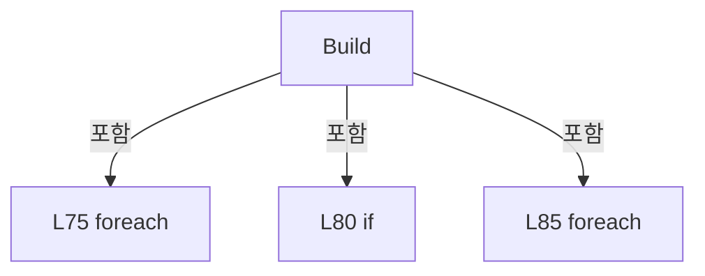

변경 전 점검: 입력/반환 타입, 위 호출자, 예외/취소 경로, 공유 상태와 저장·전송 소비자를 함께 확인합니다. 값의 단위나 물리 방향을 이름만으로 확정하지 않습니다.

### LocalFunctionStatement `IsAlarmOn` · L70–73

[Drilling.Common/Alarm/CAlarmManager.cs:70–73](https://github.com/kjuws10-rgb/A3Drilling/blob/0219666f9053b907d96d7e0aa7d0c6c1be3a73d4/Drilling.Common/Alarm/CAlarmManager.cs#L70-L73)

| 항목 | 실제 추출 값 |
| --- | --- |
| 서명 | bool IsAlarmOn(Drilling.Common.Motion.ST_MOTOR_AXIS_STATUS) |
| 접근/수식자 | Private /  |
| 반환/값 타입 | bool |
| 소속 타입 | NamedType:Drilling.Common.Alarm.CAlarmManager |

입력 계약:

| 이름 | 타입 | 전달 | 선택/기본값 |
| --- | --- | --- | --- |
| axis | Drilling.Common.Motion.ST_MOTOR_AXIS_STATUS | None | False /  |

현재 부분 분석에서 직접 연결된 호출자는 없습니다. XAML/이벤트/인터페이스·델리게이트·외부 진입을 추가 확인해야 하며, 미사용으로 판정한 것이 아닙니다.

본문의 실제 연산·분기·예외·반환 순서(원문 위치 순):

| 원본 행 | 종류 | 주석 해설 |
| --- | --- | --- |
| 72 | return | 호출자에게 값 또는 제어를 반환합니다: return axis.AlarmOn; |

변경 전 점검: 입력/반환 타입, 위 호출자, 예외/취소 경로, 공유 상태와 저장·전송 소비자를 함께 확인합니다. 값의 단위나 물리 방향을 이름만으로 확정하지 않습니다.

### MethodDeclaration `AddInterLockAlarms` · L93–109

[Drilling.Common/Alarm/CAlarmManager.cs:93–109](https://github.com/kjuws10-rgb/A3Drilling/blob/0219666f9053b907d96d7e0aa7d0c6c1be3a73d4/Drilling.Common/Alarm/CAlarmManager.cs#L93-L109)

| 항목 | 실제 추출 값 |
| --- | --- |
| 서명 | void Drilling.Common.Alarm.CAlarmManager.AddInterLockAlarms(System.Collections.Generic.ICollection<Drilling.Common.Alarm.CAlarmManager.ST_ALARM_CANDIDATE>, Drilling.Common.InterLock.ST_INTERLOCK_SUMMARY) |
| 접근/수식자 | Private / private, static |
| 반환/값 타입 | void |
| 소속 타입 | NamedType:Drilling.Common.Alarm.CAlarmManager |

입력 계약:

| 이름 | 타입 | 전달 | 선택/기본값 |
| --- | --- | --- | --- |
| alarms | System.Collections.Generic.ICollection<Drilling.Common.Alarm.CAlarmManager.ST_ALARM_CANDIDATE> | None | False /  |
| interLock | Drilling.Common.InterLock.ST_INTERLOCK_SUMMARY | None | False /  |

정적 호출자로 확인된 위치:

| 호출 파일/행 | 호출 표현식 | 런타임 분기 가능 |
| --- | --- | --- |
| [Drilling.Common/Alarm/CAlarmManager.cs:69–69](https://github.com/kjuws10-rgb/A3Drilling/blob/0219666f9053b907d96d7e0aa7d0c6c1be3a73d4/Drilling.Common/Alarm/CAlarmManager.cs#L69-L69) | AddInterLockAlarms | False |

호출하는 대상과 해석 범위:

| 원본 행 | 표현식 | 분석 상태 | 대상/소스 위치 |
| --- | --- | --- | --- |
| 100 | interLock.Items.Where | resolved | System.Collections.Generic.IEnumerable<Drilling.Common.InterLock.ST_INTERLOCK_ITEM> System.Collections.Generic.IEnumerable<Drilling.Common.InterLock.ST_INTERLOCK_ITEM>.Where<Drilling.Common.InterLock.ST_INTERLOCK_ITEM>(System.Func<Drilling.Common.InterLock.ST_INTERLOCK_ITEM, bool>) |
| 102 | InterLockAlarmRules.TryGetValue | resolved · 동적 구현 선택 가능 | bool System.Collections.Generic.IReadOnlyDictionary<string, Drilling.Common.Alarm.CAlarmManager.ST_ALARM_RULE>.TryGetValue(string, out Drilling.Common.Alarm.CAlarmManager.ST_ALARM_RULE) |
| 107 | alarms.Add | resolved · 동적 구현 선택 가능 | void System.Collections.Generic.ICollection<Drilling.Common.Alarm.CAlarmManager.ST_ALARM_CANDIDATE>.Add(Drilling.Common.Alarm.CAlarmManager.ST_ALARM_CANDIDATE) |
| 107 | new ST_ALARM_CANDIDATE | resolved | Drilling.Common.Alarm.CAlarmManager.ST_ALARM_CANDIDATE.ST_ALARM_CANDIDATE(int, Drilling.Common.Alarm.EN_ALARM_LEVEL, string, string, string, string) · Drilling.Common/Alarm/CAlarmManager.cs:124 |

본문의 실제 연산·분기·예외·반환 순서(원문 위치 순):

| 원본 행 | 종류 | 주석 해설 |
| --- | --- | --- |
| 100 | call | 함수·델리게이트 또는 객체 생성자를 호출합니다: interLock.Items.Where(ShouldIncludeItem) |
| 100 | foreach | 컬렉션 요소를 순회합니다: foreach (var item in interLock.Items.Where(ShouldIncludeItem)) |
| 102 | call | 함수·델리게이트 또는 객체 생성자를 호출합니다: InterLockAlarmRules.TryGetValue(item.Signal, out var rule) |
| 102 | if | 조건에 따라 분기합니다: if (!InterLockAlarmRules.TryGetValue(item.Signal, out var rule)) |
| 104 | continue | 다음 반복으로 진행합니다: continue; |
| 107 | call | 함수·델리게이트 또는 객체 생성자를 호출합니다: alarms.Add(new ST_ALARM_CANDIDATE(rule.Code, rule.Severity, item.Detail, rule.RecoveryAction, rule.Device, rule.StationName)) |
| 107 | call | 함수·델리게이트 또는 객체 생성자를 호출합니다: new ST_ALARM_CANDIDATE(rule.Code, rule.Severity, item.Detail, rule.RecoveryAction, rule.Device, rule.StationName) |

제어 구문의 포함 구조(실제 실행 순서/CFG가 아닌 구문 탐색 그림):

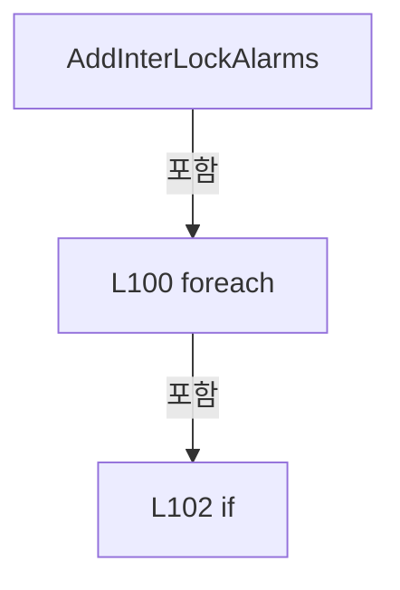

변경 전 점검: 입력/반환 타입, 위 호출자, 예외/취소 경로, 공유 상태와 저장·전송 소비자를 함께 확인합니다. 값의 단위나 물리 방향을 이름만으로 확정하지 않습니다.

### LocalFunctionStatement `ShouldIncludeItem` · L95–98

[Drilling.Common/Alarm/CAlarmManager.cs:95–98](https://github.com/kjuws10-rgb/A3Drilling/blob/0219666f9053b907d96d7e0aa7d0c6c1be3a73d4/Drilling.Common/Alarm/CAlarmManager.cs#L95-L98)

| 항목 | 실제 추출 값 |
| --- | --- |
| 서명 | bool ShouldIncludeItem(Drilling.Common.InterLock.ST_INTERLOCK_ITEM) |
| 접근/수식자 | Private /  |
| 반환/값 타입 | bool |
| 소속 타입 | NamedType:Drilling.Common.Alarm.CAlarmManager |

입력 계약:

| 이름 | 타입 | 전달 | 선택/기본값 |
| --- | --- | --- | --- |
| item | Drilling.Common.InterLock.ST_INTERLOCK_ITEM | None | False /  |

현재 부분 분석에서 직접 연결된 호출자는 없습니다. XAML/이벤트/인터페이스·델리게이트·외부 진입을 추가 확인해야 하며, 미사용으로 판정한 것이 아닙니다.

본문의 실제 연산·분기·예외·반환 순서(원문 위치 순):

| 원본 행 | 종류 | 주석 해설 |
| --- | --- | --- |
| 97 | return | 호출자에게 값 또는 제어를 반환합니다: return item.Level != EN_INTERLOCK_LEVEL.Ok; |

변경 전 점검: 입력/반환 타입, 위 호출자, 예외/취소 경로, 공유 상태와 저장·전송 소비자를 함께 확인합니다. 값의 단위나 물리 방향을 이름만으로 확정하지 않습니다.

### MethodDeclaration `GetStationNameFromAxis` · L111–121

[Drilling.Common/Alarm/CAlarmManager.cs:111–121](https://github.com/kjuws10-rgb/A3Drilling/blob/0219666f9053b907d96d7e0aa7d0c6c1be3a73d4/Drilling.Common/Alarm/CAlarmManager.cs#L111-L121)

| 항목 | 실제 추출 값 |
| --- | --- |
| 서명 | string Drilling.Common.Alarm.CAlarmManager.GetStationNameFromAxis(string) |
| 접근/수식자 | Private / private, static |
| 반환/값 타입 | string |
| 소속 타입 | NamedType:Drilling.Common.Alarm.CAlarmManager |

입력 계약:

| 이름 | 타입 | 전달 | 선택/기본값 |
| --- | --- | --- | --- |
| axisId | string | None | False /  |

정적 호출자로 확인된 위치:

| 호출 파일/행 | 호출 표현식 | 런타임 분기 가능 |
| --- | --- | --- |
| [Drilling.Common/Alarm/CAlarmManager.cs:77–77](https://github.com/kjuws10-rgb/A3Drilling/blob/0219666f9053b907d96d7e0aa7d0c6c1be3a73d4/Drilling.Common/Alarm/CAlarmManager.cs#L77-L77) | GetStationNameFromAxis | False |

호출하는 대상과 해석 범위:

| 원본 행 | 표현식 | 분석 상태 | 대상/소스 위치 |
| --- | --- | --- | --- |
| 113 | axisId.Trim().ToUpperInvariant | resolved | string string.ToUpperInvariant() |
| 113 | axisId.Trim | resolved | string string.Trim() |
| 114 | normalized.StartsWith | resolved | bool string.StartsWith(string, System.StringComparison) |
| 116 | normalized.Split | resolved | string[] string.Split(char, System.StringSplitOptions) |

본문의 실제 연산·분기·예외·반환 순서(원문 위치 순):

| 원본 행 | 종류 | 주석 해설 |
| --- | --- | --- |
| 113 | call | 함수·델리게이트 또는 객체 생성자를 호출합니다: axisId.Trim().ToUpperInvariant() |
| 113 | call | 함수·델리게이트 또는 객체 생성자를 호출합니다: axisId.Trim() |
| 113 | local-declaration | 지역 변수를 선언합니다: var normalized = axisId.Trim().ToUpperInvariant(); |
| 113 | variable-initializer | 변수의 초기값을 지정합니다: normalized = axisId.Trim().ToUpperInvariant() |
| 114 | call | 함수·델리게이트 또는 객체 생성자를 호출합니다: normalized.StartsWith("SCANNER_", StringComparison.OrdinalIgnoreCase) |
| 114 | if | 조건에 따라 분기합니다: if (normalized.StartsWith("SCANNER_", StringComparison.OrdinalIgnoreCase)) |
| 116 | call | 함수·델리게이트 또는 객체 생성자를 호출합니다: normalized.Split('_', StringSplitOptions.RemoveEmptyEntries) |
| 116 | local-declaration | 지역 변수를 선언합니다: var parts = normalized.Split('_', StringSplitOptions.RemoveEmptyEntries); |
| 116 | variable-initializer | 변수의 초기값을 지정합니다: parts = normalized.Split('_', StringSplitOptions.RemoveEmptyEntries) |
| 117 | conditional-expression | 조건에 따라 결과식을 선택합니다: parts.Length >= 2 ? $"SCANNER_{parts[1]}" : "DRILLING" |
| 117 | return | 호출자에게 값 또는 제어를 반환합니다: return parts.Length >= 2 ? $"SCANNER_{parts[1]}" : "DRILLING"; |
| 120 | return | 호출자에게 값 또는 제어를 반환합니다: return "DRILLING"; |

제어 구문의 포함 구조(실제 실행 순서/CFG가 아닌 구문 탐색 그림):

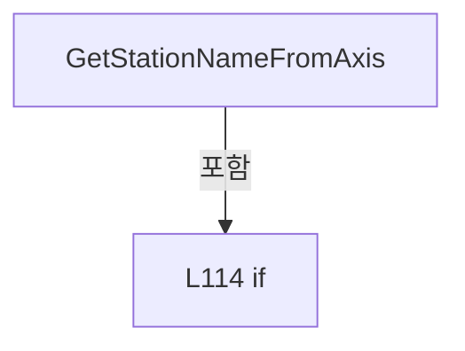

변경 전 점검: 입력/반환 타입, 위 호출자, 예외/취소 경로, 공유 상태와 저장·전송 소비자를 함께 확인합니다. 값의 단위나 물리 방향을 이름만으로 확정하지 않습니다.

### MethodDeclaration `GetDefinitionsSnapshot` · L125–125

[Drilling.Common/Alarm/CAlarmManager.cs:125–125](https://github.com/kjuws10-rgb/A3Drilling/blob/0219666f9053b907d96d7e0aa7d0c6c1be3a73d4/Drilling.Common/Alarm/CAlarmManager.cs#L125-L125)

| 항목 | 실제 추출 값 |
| --- | --- |
| 서명 | Drilling.Common.Alarm.ST_ALARM_DEFINITION_SNAPSHOT Drilling.Common.Alarm.CAlarmManager.GetDefinitionsSnapshot() |
| 접근/수식자 | Public / public |
| 반환/값 타입 | Drilling.Common.Alarm.ST_ALARM_DEFINITION_SNAPSHOT |
| 소속 타입 | NamedType:Drilling.Common.Alarm.CAlarmManager |

정적 호출자로 확인된 위치:

| 호출 파일/행 | 호출 표현식 | 런타임 분기 가능 |
| --- | --- | --- |
| [Drilling.Common/Alarm/CAlarmManager.cs:178–178](https://github.com/kjuws10-rgb/A3Drilling/blob/0219666f9053b907d96d7e0aa7d0c6c1be3a73d4/Drilling.Common/Alarm/CAlarmManager.cs#L178-L178) | GetDefinitionsSnapshot | False |
| [Drilling.Common/Alarm/CAlarmManager.cs:227–227](https://github.com/kjuws10-rgb/A3Drilling/blob/0219666f9053b907d96d7e0aa7d0c6c1be3a73d4/Drilling.Common/Alarm/CAlarmManager.cs#L227-L227) | GetDefinitionsSnapshot | False |
| [Drilling.Common/Alarm/CAlarmManager.cs:235–235](https://github.com/kjuws10-rgb/A3Drilling/blob/0219666f9053b907d96d7e0aa7d0c6c1be3a73d4/Drilling.Common/Alarm/CAlarmManager.cs#L235-L235) | GetDefinitionsSnapshot | False |
| [Drilling.Common/Alarm/CAlarmManager.cs:241–241](https://github.com/kjuws10-rgb/A3Drilling/blob/0219666f9053b907d96d7e0aa7d0c6c1be3a73d4/Drilling.Common/Alarm/CAlarmManager.cs#L241-L241) | GetDefinitionsSnapshot | False |
| [Drilling.UI/Menu/Menus/CMenuAlarm.cs:166–166](https://github.com/kjuws10-rgb/A3Drilling/blob/0219666f9053b907d96d7e0aa7d0c6c1be3a73d4/Drilling.UI/Menu/Menus/CMenuAlarm.cs#L166-L166) | alarmManager.GetDefinitionsSnapshot | False |
| [Drilling.UI/Menu/Menus/CMenuAlarm.cs:534–534](https://github.com/kjuws10-rgb/A3Drilling/blob/0219666f9053b907d96d7e0aa7d0c6c1be3a73d4/Drilling.UI/Menu/Menus/CMenuAlarm.cs#L534-L534) | _alarms.GetDefinitionsSnapshot | False |

호출하는 대상과 해석 범위:

| 원본 행 | 표현식 | 분석 상태 | 대상/소스 위치 |
| --- | --- | --- | --- |
| 125 | Volatile.Read | resolved | Drilling.Common.Alarm.ST_ALARM_DEFINITION_SNAPSHOT System.Threading.Volatile.Read<Drilling.Common.Alarm.ST_ALARM_DEFINITION_SNAPSHOT>(ref readonly Drilling.Common.Alarm.ST_ALARM_DEFINITION_SNAPSHOT) |

본문의 실제 연산·분기·예외·반환 순서(원문 위치 순):

| 원본 행 | 종류 | 주석 해설 |
| --- | --- | --- |
| 125 | call | 함수·델리게이트 또는 객체 생성자를 호출합니다: Volatile.Read(ref _definitions) |

변경 전 점검: 입력/반환 타입, 위 호출자, 예외/취소 경로, 공유 상태와 저장·전송 소비자를 함께 확인합니다. 값의 단위나 물리 방향을 이름만으로 확정하지 않습니다.

### MethodDeclaration `InitializeDefinitions` · L126–139

[Drilling.Common/Alarm/CAlarmManager.cs:126–139](https://github.com/kjuws10-rgb/A3Drilling/blob/0219666f9053b907d96d7e0aa7d0c6c1be3a73d4/Drilling.Common/Alarm/CAlarmManager.cs#L126-L139)

| 항목 | 실제 추출 값 |
| --- | --- |
| 서명 | Drilling.Common.Alarm.ST_ALARM_DEFINITION_SNAPSHOT Drilling.Common.Alarm.CAlarmManager.InitializeDefinitions(Drilling.Common.Alarm.CAlarmListFileBase) |
| 접근/수식자 | Public / public |
| 반환/값 타입 | Drilling.Common.Alarm.ST_ALARM_DEFINITION_SNAPSHOT |
| 소속 타입 | NamedType:Drilling.Common.Alarm.CAlarmManager |

입력 계약:

| 이름 | 타입 | 전달 | 선택/기본값 |
| --- | --- | --- | --- |
| file | Drilling.Common.Alarm.CAlarmListFileBase | None | False /  |

정적 호출자로 확인된 위치:

| 호출 파일/행 | 호출 표현식 | 런타임 분기 가능 |
| --- | --- | --- |
| [Drilling.Common/Managers/CManager.cs:89–89](https://github.com/kjuws10-rgb/A3Drilling/blob/0219666f9053b907d96d7e0aa7d0c6c1be3a73d4/Drilling.Common/Managers/CManager.cs#L89-L89) | _alarmManager.InitializeDefinitions | False |

호출하는 대상과 해석 범위:

| 원본 행 | 표현식 | 분석 상태 | 대상/소스 위치 |
| --- | --- | --- | --- |
| 128 | ArgumentNullException.ThrowIfNull | resolved | void System.ArgumentNullException.ThrowIfNull(object?, string?) |
| 129 | Volatile.Write | resolved | void System.Threading.Volatile.Write(ref bool, bool) |
| 136 | LoadDefinitionsLocked | resolved | void Drilling.Common.Alarm.CAlarmManager.LoadDefinitionsLocked(Drilling.Common.Alarm.CAlarmListFileBase) · Drilling.Common/Alarm/CAlarmManager.cs:141 |

본문의 실제 연산·분기·예외·반환 순서(원문 위치 순):

| 원본 행 | 종류 | 주석 해설 |
| --- | --- | --- |
| 128 | call | 함수·델리게이트 또는 객체 생성자를 호출합니다: ArgumentNullException.ThrowIfNull(file) |
| 129 | call | 함수·델리게이트 또는 객체 생성자를 호출합니다: Volatile.Write(ref _definitionInitializationRequested, true) |
| 130 | lock | 공유 상태의 임계 구역에 진입합니다: lock (_definitionLock) |
| 132 | if | 조건에 따라 분기합니다: if (_definitionsInitialized) |
| 133 | return | 호출자에게 값 또는 제어를 반환합니다: return _definitions; |
| 134 | assignment | 값을 대상에 대입합니다: _definitionFile = file |
| 135 | assignment | 값을 대상에 대입합니다: _definitionRetriesRemaining = 2 |
| 136 | call | 함수·델리게이트 또는 객체 생성자를 호출합니다: LoadDefinitionsLocked(file) |
| 137 | return | 호출자에게 값 또는 제어를 반환합니다: return _definitions; |

제어 구문의 포함 구조(실제 실행 순서/CFG가 아닌 구문 탐색 그림):

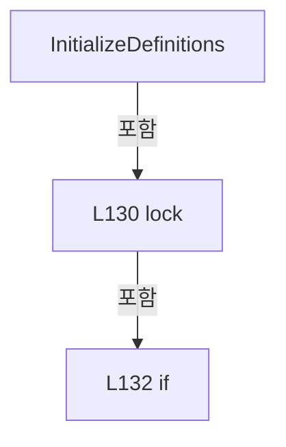

변경 전 점검: 입력/반환 타입, 위 호출자, 예외/취소 경로, 공유 상태와 저장·전송 소비자를 함께 확인합니다. 값의 단위나 물리 방향을 이름만으로 확정하지 않습니다.

### MethodDeclaration `LoadDefinitionsLocked` · L141–174

[Drilling.Common/Alarm/CAlarmManager.cs:141–174](https://github.com/kjuws10-rgb/A3Drilling/blob/0219666f9053b907d96d7e0aa7d0c6c1be3a73d4/Drilling.Common/Alarm/CAlarmManager.cs#L141-L174)

| 항목 | 실제 추출 값 |
| --- | --- |
| 서명 | void Drilling.Common.Alarm.CAlarmManager.LoadDefinitionsLocked(Drilling.Common.Alarm.CAlarmListFileBase) |
| 접근/수식자 | Private / private |
| 반환/값 타입 | void |
| 소속 타입 | NamedType:Drilling.Common.Alarm.CAlarmManager |

입력 계약:

| 이름 | 타입 | 전달 | 선택/기본값 |
| --- | --- | --- | --- |
| file | Drilling.Common.Alarm.CAlarmListFileBase | None | False /  |

정적 호출자로 확인된 위치:

| 호출 파일/행 | 호출 표현식 | 런타임 분기 가능 |
| --- | --- | --- |
| [Drilling.Common/Alarm/CAlarmManager.cs:136–136](https://github.com/kjuws10-rgb/A3Drilling/blob/0219666f9053b907d96d7e0aa7d0c6c1be3a73d4/Drilling.Common/Alarm/CAlarmManager.cs#L136-L136) | LoadDefinitionsLocked | False |
| [Drilling.Common/Alarm/CAlarmManager.cs:201–201](https://github.com/kjuws10-rgb/A3Drilling/blob/0219666f9053b907d96d7e0aa7d0c6c1be3a73d4/Drilling.Common/Alarm/CAlarmManager.cs#L201-L201) | LoadDefinitionsLocked | False |

호출하는 대상과 해석 범위:

| 원본 행 | 표현식 | 분석 상태 | 대상/소스 위치 |
| --- | --- | --- | --- |
| 145 | new HashSet<int> | resolved | System.Collections.Generic.HashSet<int>.HashSet() |
| 146 | new HashSet<string> | resolved | System.Collections.Generic.HashSet<string>.HashSet(System.Collections.Generic.IEqualityComparer<string>?) |
| 147 | file.Load().Select(row => { var level = row.Level?.Trim().ToUpperInvariant(); var id = row.Id?.Trim(); if (level is not ("HEAVY" or "LIGHT")) throw new InvalidDataException($"알람 {row.Code}: LEVEL은 HEAVY 또는 LIGHT여야 합니다."); if (string.IsNullOrEmpty(id) &#124;&#124; !codes.Add(row.Code) &#124;&#124; !ids.Add(id)) throw new InvalidDataException($"알람 {row.Code}: CODE/ID가 중… | resolved | Drilling.Common.Alarm.ST_ALARM_DEFINITION[] System.Collections.Generic.IEnumerable<Drilling.Common.Alarm.ST_ALARM_DEFINITION>.ToArray<Drilling.Common.Alarm.ST_ALARM_DEFINITION>() |
| 147 | file.Load().Select | resolved | System.Collections.Generic.IEnumerable<Drilling.Common.Alarm.ST_ALARM_DEFINITION> System.Collections.Generic.IEnumerable<Drilling.Common.Alarm.ST_ALARM_DEFINITION>.Select<Drilling.Common.Alarm.ST_ALARM_DEFINITION, Drilling.Common.Alarm.ST_ALARM_DEFINITION>(System.Func<Drilling.Common.Alarm.ST_ALARM_DEFINITION, Drilling.Common.Alarm.ST_ALARM_DEFINITION>) |
| 147 | file.Load | resolved | System.Collections.Generic.IReadOnlyList<Drilling.Common.Alarm.ST_ALARM_DEFINITION> Drilling.Common.Alarm.CAlarmListFileBase.Load() · Drilling.Common/Alarm/CAlarmManager.cs:549 |
| 149 | .Trim().ToUpperInvariant | resolved | string string.ToUpperInvariant() |
| 149 | .Trim | resolved | string string.Trim() |
| 150 | .Trim | resolved | string string.Trim() |
| 152 | new InvalidDataException | resolved | System.IO.InvalidDataException.InvalidDataException(string?) |
| 153 | string.IsNullOrEmpty | resolved | bool string.IsNullOrEmpty(string?) |
| 153 | codes.Add | resolved | bool System.Collections.Generic.HashSet<int>.Add(int) |
| 153 | ids.Add | resolved | bool System.Collections.Generic.HashSet<string>.Add(string) |
| 154 | new InvalidDataException | resolved | System.IO.InvalidDataException.InvalidDataException(string?) |
| 162 | new InvalidDataException | resolved | System.IO.InvalidDataException.InvalidDataException(string?) |
| 163 | Volatile.Write | resolved | void System.Threading.Volatile.Write<Drilling.Common.Alarm.ST_ALARM_DEFINITION_SNAPSHOT>(ref Drilling.Common.Alarm.ST_ALARM_DEFINITION_SNAPSHOT, Drilling.Common.Alarm.ST_ALARM_DEFINITION_SNAPSHOT) |
| 163 | new | resolved | Drilling.Common.Alarm.ST_ALARM_DEFINITION_SNAPSHOT.ST_ALARM_DEFINITION_SNAPSHOT(System.Collections.Generic.IReadOnlyList<Drilling.Common.Alarm.ST_ALARM_DEFINITION>, string) · Drilling.Common/Alarm/CAlarmManager.cs:552 |
| 163 | Array.AsReadOnly | resolved | System.Collections.ObjectModel.ReadOnlyCollection<Drilling.Common.Alarm.ST_ALARM_DEFINITION> System.Array.AsReadOnly<Drilling.Common.Alarm.ST_ALARM_DEFINITION>(Drilling.Common.Alarm.ST_ALARM_DEFINITION[]) |
| 171 | Volatile.Write | resolved | void System.Threading.Volatile.Write<Drilling.Common.Alarm.ST_ALARM_DEFINITION_SNAPSHOT>(ref Drilling.Common.Alarm.ST_ALARM_DEFINITION_SNAPSHOT, Drilling.Common.Alarm.ST_ALARM_DEFINITION_SNAPSHOT) |
| 171 | new | resolved | Drilling.Common.Alarm.ST_ALARM_DEFINITION_SNAPSHOT.ST_ALARM_DEFINITION_SNAPSHOT(System.Collections.Generic.IReadOnlyList<Drilling.Common.Alarm.ST_ALARM_DEFINITION>, string) · Drilling.Common/Alarm/CAlarmManager.cs:552 |

본문의 실제 연산·분기·예외·반환 순서(원문 위치 순):

| 원본 행 | 종류 | 주석 해설 |
| --- | --- | --- |
| 143 | try | 예외 처리 범위입니다: try |
| 145 | call | 함수·델리게이트 또는 객체 생성자를 호출합니다: new HashSet<int>() |
| 145 | local-declaration | 지역 변수를 선언합니다: var codes = new HashSet<int>(); |
| 145 | variable-initializer | 변수의 초기값을 지정합니다: codes = new HashSet<int>() |
| 146 | call | 함수·델리게이트 또는 객체 생성자를 호출합니다: new HashSet<string>(StringComparer.OrdinalIgnoreCase) |
| 146 | local-declaration | 지역 변수를 선언합니다: var ids = new HashSet<string>(StringComparer.OrdinalIgnoreCase); |
| 146 | variable-initializer | 변수의 초기값을 지정합니다: ids = new HashSet<string>(StringComparer.OrdinalIgnoreCase) |
| 147 | call | 함수·델리게이트 또는 객체 생성자를 호출합니다: file.Load() |
| 147 | call | 함수·델리게이트 또는 객체 생성자를 호출합니다: file.Load().Select(row => { var level = row.Level?.Trim().ToUpperInvariant(); var id = row.Id?.Trim(); if (level is not ("HEAVY" or "LIGHT")) throw new InvalidDataException($"알람 {row.Code}: LEVEL은 HEAVY 또는 LIGHT여야 합니다.")… |
| 147 | call | 함수·델리게이트 또는 객체 생성자를 호출합니다: file.Load().Select(row => { var level = row.Level?.Trim().ToUpperInvariant(); var id = row.Id?.Trim(); if (level is not ("HEAVY" or "LIGHT")) throw new InvalidDataException($"알람 {row.Code}: LEVEL은 HEAVY 또는 LIGHT여야 합니다.")… |
| 147 | local-declaration | 지역 변수를 선언합니다: var rows = file.Load().Select(row => { var level = row.Level?.Trim().ToUpperInvariant(); var id = row.Id?.Trim(); if (level is not ("HEAVY" or "LIGHT")) throw new InvalidDataException($"알람 {row.Code}: LEVEL은 HEAVY 또는 LIGHT여야 합니다." |
| 147 | variable-initializer | 변수의 초기값을 지정합니다: rows = file.Load().Select(row => { var level = row.Level?.Trim().ToUpperInvariant(); var id = row.Id?.Trim(); if (level is not ("HEAVY" or "LIGHT")) throw new InvalidDataException($"알람 {row.Code}: LEVEL은 HEAVY 또는 LIGHT여야 합니다."); i |
| 149 | call | 함수·델리게이트 또는 객체 생성자를 호출합니다: .Trim().ToUpperInvariant() |
| 149 | call | 함수·델리게이트 또는 객체 생성자를 호출합니다: .Trim() |
| 149 | local-declaration | 지역 변수를 선언합니다: var level = row.Level?.Trim().ToUpperInvariant(); |
| 149 | variable-initializer | 변수의 초기값을 지정합니다: level = row.Level?.Trim().ToUpperInvariant() |
| 150 | call | 함수·델리게이트 또는 객체 생성자를 호출합니다: .Trim() |
| 150 | local-declaration | 지역 변수를 선언합니다: var id = row.Id?.Trim(); |
| 150 | variable-initializer | 변수의 초기값을 지정합니다: id = row.Id?.Trim() |
| 151 | if | 조건에 따라 분기합니다: if (level is not ("HEAVY" or "LIGHT")) |
| 152 | call | 함수·델리게이트 또는 객체 생성자를 호출합니다: new InvalidDataException($"알람 {row.Code}: LEVEL은 HEAVY 또는 LIGHT여야 합니다.") |
| 152 | throw | 예외를 발생/전달합니다: throw new InvalidDataException($"알람 {row.Code}: LEVEL은 HEAVY 또는 LIGHT여야 합니다."); |
| 153 | call | 함수·델리게이트 또는 객체 생성자를 호출합니다: string.IsNullOrEmpty(id) |
| 153 | call | 함수·델리게이트 또는 객체 생성자를 호출합니다: codes.Add(row.Code) |
| 153 | call | 함수·델리게이트 또는 객체 생성자를 호출합니다: ids.Add(id) |
| 153 | if | 조건에 따라 분기합니다: if (string.IsNullOrEmpty(id) &#124;&#124; !codes.Add(row.Code) &#124;&#124; !ids.Add(id)) |
| 154 | call | 함수·델리게이트 또는 객체 생성자를 호출합니다: new InvalidDataException($"알람 {row.Code}: CODE/ID가 중복되었거나 ID가 비어 있습니다.") |
| 154 | throw | 예외를 발생/전달합니다: throw new InvalidDataException($"알람 {row.Code}: CODE/ID가 중복되었거나 ID가 비어 있습니다."); |
| 155 | return | 호출자에게 값 또는 제어를 반환합니다: return row with { Id = id, Level = level }; |
| 157 | assignment | 값을 대상에 대입합니다: Id = id |
| 158 | assignment | 값을 대상에 대입합니다: Level = level |
| 161 | if | 조건에 따라 분기합니다: if (rows.Length == 0) |
| 162 | call | 함수·델리게이트 또는 객체 생성자를 호출합니다: new InvalidDataException("알람 정의 목록이 비어 있습니다.") |
| 162 | throw | 예외를 발생/전달합니다: throw new InvalidDataException("알람 정의 목록이 비어 있습니다."); |
| 163 | call | 함수·델리게이트 또는 객체 생성자를 호출합니다: Volatile.Write(ref _definitions, new(Array.AsReadOnly(rows), "")) |
| 163 | call | 함수·델리게이트 또는 객체 생성자를 호출합니다: new(Array.AsReadOnly(rows), "") |
| 163 | call | 함수·델리게이트 또는 객체 생성자를 호출합니다: Array.AsReadOnly(rows) |
| 165 | assignment | 값을 대상에 대입합니다: _definitionsInitialized = true |
| 166 | assignment | 값을 대상에 대입합니다: _definitionFile = null |
| 167 | assignment | 값을 대상에 대입합니다: _definitionRetriesRemaining = 0 |
| 169 | catch | 지정 예외를 처리합니다: catch (Exception exception) |
| 171 | call | 함수·델리게이트 또는 객체 생성자를 호출합니다: Volatile.Write(ref _definitions, new(_definitions.Rows, exception.Message)) |
| 171 | call | 함수·델리게이트 또는 객체 생성자를 호출합니다: new(_definitions.Rows, exception.Message) |
| 172 | assignment | 값을 대상에 대입합니다: _nextDefinitionRetryAt = Environment.TickCount64 + 1000 |

제어 구문의 포함 구조(실제 실행 순서/CFG가 아닌 구문 탐색 그림):

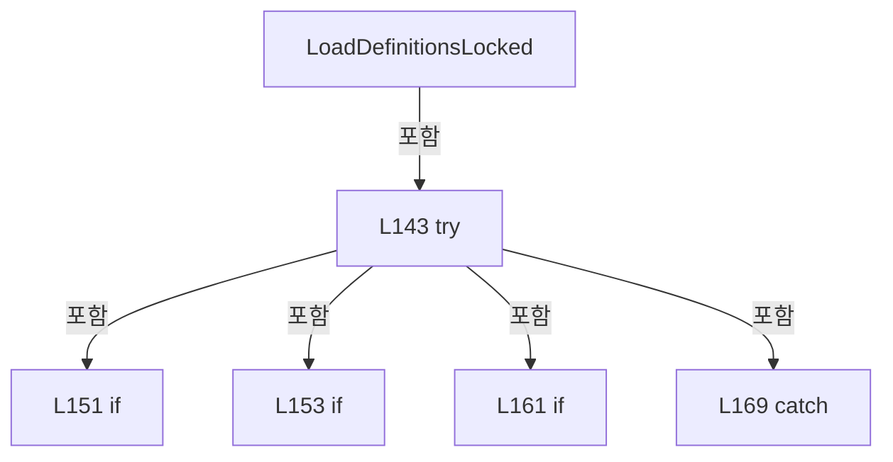

변경 전 점검: 입력/반환 타입, 위 호출자, 예외/취소 경로, 공유 상태와 저장·전송 소비자를 함께 확인합니다. 값의 단위나 물리 방향을 이름만으로 확정하지 않습니다.

### MethodDeclaration `RetryDefinitionInitialization` · L176–212

[Drilling.Common/Alarm/CAlarmManager.cs:176–212](https://github.com/kjuws10-rgb/A3Drilling/blob/0219666f9053b907d96d7e0aa7d0c6c1be3a73d4/Drilling.Common/Alarm/CAlarmManager.cs#L176-L212)

| 항목 | 실제 추출 값 |
| --- | --- |
| 서명 | string Drilling.Common.Alarm.CAlarmManager.RetryDefinitionInitialization() |
| 접근/수식자 | Private / private |
| 반환/값 타입 | string |
| 소속 타입 | NamedType:Drilling.Common.Alarm.CAlarmManager |

정적 호출자로 확인된 위치:

| 호출 파일/행 | 호출 표현식 | 런타임 분기 가능 |
| --- | --- | --- |
| [Drilling.Common/Alarm/CAlarmManager.cs:483–483](https://github.com/kjuws10-rgb/A3Drilling/blob/0219666f9053b907d96d7e0aa7d0c6c1be3a73d4/Drilling.Common/Alarm/CAlarmManager.cs#L483-L483) | RetryDefinitionInitialization | False |

호출하는 대상과 해석 범위:

| 원본 행 | 표현식 | 분석 상태 | 대상/소스 위치 |
| --- | --- | --- | --- |
| 178 | GetDefinitionsSnapshot | resolved | Drilling.Common.Alarm.ST_ALARM_DEFINITION_SNAPSHOT Drilling.Common.Alarm.CAlarmManager.GetDefinitionsSnapshot() · Drilling.Common/Alarm/CAlarmManager.cs:125 |
| 182 | global::System.Threading.Monitor.TryEnter | resolved | bool System.Threading.Monitor.TryEnter(object) |
| 196 | Task.Run | resolved | System.Threading.Tasks.Task System.Threading.Tasks.Task.Run(System.Action) |
| 201 | LoadDefinitionsLocked | resolved | void Drilling.Common.Alarm.CAlarmManager.LoadDefinitionsLocked(Drilling.Common.Alarm.CAlarmListFileBase) · Drilling.Common/Alarm/CAlarmManager.cs:141 |
| 210 | global::System.Threading.Monitor.Exit | resolved | void System.Threading.Monitor.Exit(object) |

본문의 실제 연산·분기·예외·반환 순서(원문 위치 순):

| 원본 행 | 종류 | 주석 해설 |
| --- | --- | --- |
| 178 | call | 함수·델리게이트 또는 객체 생성자를 호출합니다: GetDefinitionsSnapshot() |
| 178 | local-declaration | 지역 변수를 선언합니다: var snapshot = GetDefinitionsSnapshot(); |
| 178 | variable-initializer | 변수의 초기값을 지정합니다: snapshot = GetDefinitionsSnapshot() |
| 179 | if | 조건에 따라 분기합니다: if (snapshot.Error == "" && snapshot.Rows.Count > 0) |
| 180 | return | 호출자에게 값 또는 제어를 반환합니다: return ""; |
| 182 | call | 함수·델리게이트 또는 객체 생성자를 호출합니다: global::System.Threading.Monitor.TryEnter(_definitionLock) |
| 182 | if | 조건에 따라 분기합니다: if (!global::System.Threading.Monitor.TryEnter(_definitionLock)) |
| 183 | return | 호출자에게 값 또는 제어를 반환합니다: return snapshot.Error; |
| 184 | try | 예외 처리 범위입니다: try |
| 186 | if | 조건에 따라 분기합니다: if (_definitionsInitialized) |
| 187 | return | 호출자에게 값 또는 제어를 반환합니다: return ""; |
| 188 | local-declaration | 지역 변수를 선언합니다: var file = _definitionFile; |
| 188 | variable-initializer | 변수의 초기값을 지정합니다: file = _definitionFile |
| 189 | if | 조건에 따라 분기합니다: if (file is null) |
| 190 | return | 호출자에게 값 또는 제어를 반환합니다: return _definitions.Error; |
| 193 | if | 조건에 따라 분기합니다: if (_definitionRetriesRemaining > 0 && _definitionRetryTask?.IsCompleted != false && Environment.TickCount64 >= _nextDefinitionRetryAt) |
| 196 | assignment | 값을 대상에 대입합니다: _definitionRetryTask = Task.Run(() => { lock (_definitionLock) { if (!_definitionsInitialized) LoadDefinitionsLocked(file); } }) |
| 196 | call | 함수·델리게이트 또는 객체 생성자를 호출합니다: Task.Run(() => { lock (_definitionLock) { if (!_definitionsInitialized) LoadDefinitionsLocked(file); } }) |
| 198 | lock | 공유 상태의 임계 구역에 진입합니다: lock (_definitionLock) |
| 200 | if | 조건에 따라 분기합니다: if (!_definitionsInitialized) |
| 201 | call | 함수·델리게이트 또는 객체 생성자를 호출합니다: LoadDefinitionsLocked(file) |
| 206 | return | 호출자에게 값 또는 제어를 반환합니다: return _definitions.Error; |
| 208 | finally | 종료 정리 구간입니다: finally |
| 210 | call | 함수·델리게이트 또는 객체 생성자를 호출합니다: global::System.Threading.Monitor.Exit(_definitionLock) |

제어 구문의 포함 구조(실제 실행 순서/CFG가 아닌 구문 탐색 그림):

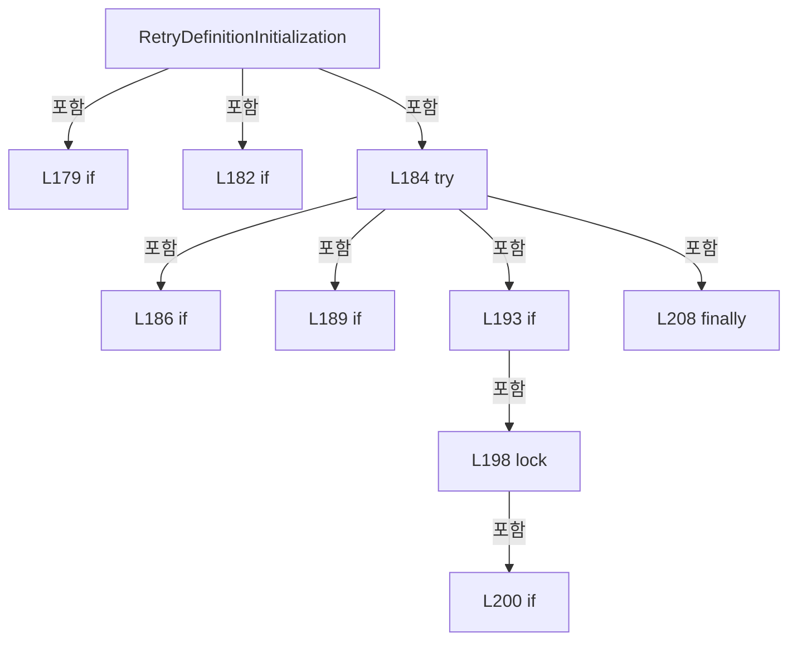

변경 전 점검: 입력/반환 타입, 위 호출자, 예외/취소 경로, 공유 상태와 저장·전송 소비자를 함께 확인합니다. 값의 단위나 물리 방향을 이름만으로 확정하지 않습니다.

### MethodDeclaration `EnsureDefinitionsRequested` · L214–218

[Drilling.Common/Alarm/CAlarmManager.cs:214–218](https://github.com/kjuws10-rgb/A3Drilling/blob/0219666f9053b907d96d7e0aa7d0c6c1be3a73d4/Drilling.Common/Alarm/CAlarmManager.cs#L214-L218)

| 항목 | 실제 추출 값 |
| --- | --- |
| 서명 | void Drilling.Common.Alarm.CAlarmManager.EnsureDefinitionsRequested() |
| 접근/수식자 | Internal / internal |
| 반환/값 타입 | void |
| 소속 타입 | NamedType:Drilling.Common.Alarm.CAlarmManager |

정적 호출자로 확인된 위치:

| 호출 파일/행 | 호출 표현식 | 런타임 분기 가능 |
| --- | --- | --- |
| [Drilling.Common/Alarm/CAlarmManager.cs:414–414](https://github.com/kjuws10-rgb/A3Drilling/blob/0219666f9053b907d96d7e0aa7d0c6c1be3a73d4/Drilling.Common/Alarm/CAlarmManager.cs#L414-L414) | EnsureDefinitionsRequested | False |
| [Drilling.Common/Alarm/CAlarmManager.cs:435–435](https://github.com/kjuws10-rgb/A3Drilling/blob/0219666f9053b907d96d7e0aa7d0c6c1be3a73d4/Drilling.Common/Alarm/CAlarmManager.cs#L435-L435) | EnsureDefinitionsRequested | False |
| [Drilling.Common/Managers/CManager.cs:271–271](https://github.com/kjuws10-rgb/A3Drilling/blob/0219666f9053b907d96d7e0aa7d0c6c1be3a73d4/Drilling.Common/Managers/CManager.cs#L271-L271) | _alarmManager.EnsureDefinitionsRequested | False |

호출하는 대상과 해석 범위:

| 원본 행 | 표현식 | 분석 상태 | 대상/소스 위치 |
| --- | --- | --- | --- |
| 216 | Volatile.Read | resolved | bool System.Threading.Volatile.Read(ref readonly bool) |
| 217 | new InvalidOperationException | resolved | System.InvalidOperationException.InvalidOperationException(string?) |

본문의 실제 연산·분기·예외·반환 순서(원문 위치 순):

| 원본 행 | 종류 | 주석 해설 |
| --- | --- | --- |
| 216 | call | 함수·델리게이트 또는 객체 생성자를 호출합니다: Volatile.Read(ref _definitionInitializationRequested) |
| 216 | if | 조건에 따라 분기합니다: if (!Volatile.Read(ref _definitionInitializationRequested)) |
| 217 | call | 함수·델리게이트 또는 객체 생성자를 호출합니다: new InvalidOperationException("알람 정의 초기화가 필요합니다. InitializeDefinitions 호출 후 감시를 시작해 주세요.") |
| 217 | throw | 예외를 발생/전달합니다: throw new InvalidOperationException("알람 정의 초기화가 필요합니다. InitializeDefinitions 호출 후 감시를 시작해 주세요."); |

제어 구문의 포함 구조(실제 실행 순서/CFG가 아닌 구문 탐색 그림):

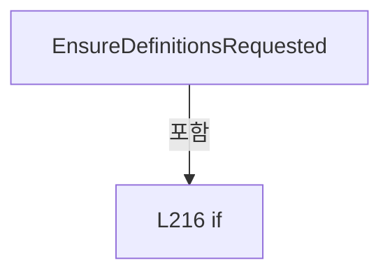

변경 전 점검: 입력/반환 타입, 위 호출자, 예외/취소 경로, 공유 상태와 저장·전송 소비자를 함께 확인합니다. 값의 단위나 물리 방향을 이름만으로 확정하지 않습니다.

### PropertyDeclaration `NotificationError` · L220–220

[Drilling.Common/Alarm/CAlarmManager.cs:220–220](https://github.com/kjuws10-rgb/A3Drilling/blob/0219666f9053b907d96d7e0aa7d0c6c1be3a73d4/Drilling.Common/Alarm/CAlarmManager.cs#L220-L220)

| 항목 | 실제 추출 값 |
| --- | --- |
| 서명 | string Drilling.Common.Alarm.CAlarmManager.NotificationError |
| 접근/수식자 | Public / public |
| 반환/값 타입 | string |
| 소속 타입 | NamedType:Drilling.Common.Alarm.CAlarmManager |

현재 부분 분석에서 직접 연결된 호출자는 없습니다. XAML/이벤트/인터페이스·델리게이트·외부 진입을 추가 확인해야 하며, 미사용으로 판정한 것이 아닙니다.

호출하는 대상과 해석 범위:

| 원본 행 | 표현식 | 분석 상태 | 대상/소스 위치 |
| --- | --- | --- | --- |
| 220 | Volatile.Read | resolved | string System.Threading.Volatile.Read<string>(ref readonly string) |

본문의 실제 연산·분기·예외·반환 순서(원문 위치 순):

| 원본 행 | 종류 | 주석 해설 |
| --- | --- | --- |
| 220 | call | 함수·델리게이트 또는 객체 생성자를 호출합니다: Volatile.Read(ref _notificationError) |

변경 전 점검: 입력/반환 타입, 위 호출자, 예외/취소 경로, 공유 상태와 저장·전송 소비자를 함께 확인합니다. 값의 단위나 물리 방향을 이름만으로 확정하지 않습니다.

### PropertyDeclaration `CurAlarm` · L221–221

[Drilling.Common/Alarm/CAlarmManager.cs:221–221](https://github.com/kjuws10-rgb/A3Drilling/blob/0219666f9053b907d96d7e0aa7d0c6c1be3a73d4/Drilling.Common/Alarm/CAlarmManager.cs#L221-L221)

| 항목 | 실제 추출 값 |
| --- | --- |
| 서명 | System.Collections.Generic.IReadOnlyList<Drilling.Common.Alarm.ST_ALARM_DATA> Drilling.Common.Alarm.CAlarmManager.CurAlarm |
| 접근/수식자 | Public / public |
| 반환/값 타입 | System.Collections.Generic.IReadOnlyList<Drilling.Common.Alarm.ST_ALARM_DATA> |
| 소속 타입 | NamedType:Drilling.Common.Alarm.CAlarmManager |

현재 부분 분석에서 직접 연결된 호출자는 없습니다. XAML/이벤트/인터페이스·델리게이트·외부 진입을 추가 확인해야 하며, 미사용으로 판정한 것이 아닙니다.

호출하는 대상과 해석 범위:

| 원본 행 | 표현식 | 분석 상태 | 대상/소스 위치 |
| --- | --- | --- | --- |
| 221 | GetCurrentSnapshot | resolved | Drilling.Common.Alarm.ST_CURRENT_ALARM_SNAPSHOT Drilling.Common.Alarm.CAlarmManager.GetCurrentSnapshot() · Drilling.Common/Alarm/CAlarmManager.cs:223 |

본문의 실제 연산·분기·예외·반환 순서(원문 위치 순):

| 원본 행 | 종류 | 주석 해설 |
| --- | --- | --- |
| 221 | call | 함수·델리게이트 또는 객체 생성자를 호출합니다: GetCurrentSnapshot() |

변경 전 점검: 입력/반환 타입, 위 호출자, 예외/취소 경로, 공유 상태와 저장·전송 소비자를 함께 확인합니다. 값의 단위나 물리 방향을 이름만으로 확정하지 않습니다.

### MethodDeclaration `GetCurrentSnapshot` · L223–223

[Drilling.Common/Alarm/CAlarmManager.cs:223–223](https://github.com/kjuws10-rgb/A3Drilling/blob/0219666f9053b907d96d7e0aa7d0c6c1be3a73d4/Drilling.Common/Alarm/CAlarmManager.cs#L223-L223)

| 항목 | 실제 추출 값 |
| --- | --- |
| 서명 | Drilling.Common.Alarm.ST_CURRENT_ALARM_SNAPSHOT Drilling.Common.Alarm.CAlarmManager.GetCurrentSnapshot() |
| 접근/수식자 | Public / public |
| 반환/값 타입 | Drilling.Common.Alarm.ST_CURRENT_ALARM_SNAPSHOT |
| 소속 타입 | NamedType:Drilling.Common.Alarm.CAlarmManager |

정적 호출자로 확인된 위치:

| 호출 파일/행 | 호출 표현식 | 런타임 분기 가능 |
| --- | --- | --- |
| [Drilling.Common/Alarm/CAlarmManager.cs:221–221](https://github.com/kjuws10-rgb/A3Drilling/blob/0219666f9053b907d96d7e0aa7d0c6c1be3a73d4/Drilling.Common/Alarm/CAlarmManager.cs#L221-L221) | GetCurrentSnapshot | False |
| [Drilling.UI/CRootView.cs:3131–3131](https://github.com/kjuws10-rgb/A3Drilling/blob/0219666f9053b907d96d7e0aa7d0c6c1be3a73d4/Drilling.UI/CRootView.cs#L3131-L3131) | _alarmManager.GetCurrentSnapshot | False |
| [Drilling.UI/Menu/Menus/CMenuAlarm.cs:39–39](https://github.com/kjuws10-rgb/A3Drilling/blob/0219666f9053b907d96d7e0aa7d0c6c1be3a73d4/Drilling.UI/Menu/Menus/CMenuAlarm.cs#L39-L39) | alarmManager.GetCurrentSnapshot | False |
| [Drilling.UI/Popup/CAlarmPopupDialog.xaml.cs:93–93](https://github.com/kjuws10-rgb/A3Drilling/blob/0219666f9053b907d96d7e0aa7d0c6c1be3a73d4/Drilling.UI/Popup/CAlarmPopupDialog.xaml.cs#L93-L93) | alarms.GetCurrentSnapshot | False |

호출하는 대상과 해석 범위:

| 원본 행 | 표현식 | 분석 상태 | 대상/소스 위치 |
| --- | --- | --- | --- |
| 223 | Volatile.Read | resolved | Drilling.Common.Alarm.ST_CURRENT_ALARM_SNAPSHOT System.Threading.Volatile.Read<Drilling.Common.Alarm.ST_CURRENT_ALARM_SNAPSHOT>(ref readonly Drilling.Common.Alarm.ST_CURRENT_ALARM_SNAPSHOT) |

본문의 실제 연산·분기·예외·반환 순서(원문 위치 순):

| 원본 행 | 종류 | 주석 해설 |
| --- | --- | --- |
| 223 | call | 함수·델리게이트 또는 객체 생성자를 호출합니다: Volatile.Read(ref _current) |

변경 전 점검: 입력/반환 타입, 위 호출자, 예외/취소 경로, 공유 상태와 저장·전송 소비자를 함께 확인합니다. 값의 단위나 물리 방향을 이름만으로 확정하지 않습니다.

### MethodDeclaration `SetSequenceFailure` · L224–231

[Drilling.Common/Alarm/CAlarmManager.cs:224–231](https://github.com/kjuws10-rgb/A3Drilling/blob/0219666f9053b907d96d7e0aa7d0c6c1be3a73d4/Drilling.Common/Alarm/CAlarmManager.cs#L224-L231)

| 항목 | 실제 추출 값 |
| --- | --- |
| 서명 | void Drilling.Common.Alarm.CAlarmManager.SetSequenceFailure(Drilling.Common.Alarm.CSequenceFailureException) |
| 접근/수식자 | Public / public |
| 반환/값 타입 | void |
| 소속 타입 | NamedType:Drilling.Common.Alarm.CAlarmManager |

입력 계약:

| 이름 | 타입 | 전달 | 선택/기본값 |
| --- | --- | --- | --- |
| failure | Drilling.Common.Alarm.CSequenceFailureException | None | False /  |

현재 부분 분석에서 직접 연결된 호출자는 없습니다. XAML/이벤트/인터페이스·델리게이트·외부 진입을 추가 확인해야 하며, 미사용으로 판정한 것이 아닙니다.

호출하는 대상과 해석 범위:

| 원본 행 | 표현식 | 분석 상태 | 대상/소스 위치 |
| --- | --- | --- | --- |
| 227 | GetDefinitionsSnapshot | resolved | Drilling.Common.Alarm.ST_ALARM_DEFINITION_SNAPSHOT Drilling.Common.Alarm.CAlarmManager.GetDefinitionsSnapshot() · Drilling.Common/Alarm/CAlarmManager.cs:125 |
| 228 | rows.Any | resolved | bool System.Collections.Generic.IEnumerable<Drilling.Common.Alarm.ST_ALARM_DEFINITION>.Any<Drilling.Common.Alarm.ST_ALARM_DEFINITION>(System.Func<Drilling.Common.Alarm.ST_ALARM_DEFINITION, bool>) |
| 229 | rows.Any | resolved | bool System.Collections.Generic.IEnumerable<Drilling.Common.Alarm.ST_ALARM_DEFINITION>.Any<Drilling.Common.Alarm.ST_ALARM_DEFINITION>(System.Func<Drilling.Common.Alarm.ST_ALARM_DEFINITION, bool>) |
| 230 | SetAlarm | resolved | bool Drilling.Common.Alarm.CAlarmManager.SetAlarm(string) · Drilling.Common/Alarm/CAlarmManager.cs:239 |

본문의 실제 연산·분기·예외·반환 순서(원문 위치 순):

| 원본 행 | 종류 | 주석 해설 |
| --- | --- | --- |
| 227 | call | 함수·델리게이트 또는 객체 생성자를 호출합니다: GetDefinitionsSnapshot() |
| 227 | local-declaration | 지역 변수를 선언합니다: var rows = GetDefinitionsSnapshot().Rows; |
| 227 | variable-initializer | 변수의 초기값을 지정합니다: rows = GetDefinitionsSnapshot().Rows |
| 228 | call | 함수·델리게이트 또는 객체 생성자를 호출합니다: rows.Any(row => row.Id == failure.AlarmId) |
| 228 | conditional-expression | 조건에 따라 결과식을 선택합니다: rows.Any(row => row.Id == failure.AlarmId) ? failure.AlarmId : rows.Any(row => row.Id == $"SEQ_{failure.Scenario}_NG") ? $"SEQ_{failure.Scenario}_NG" : "SEQ_AUTO_NG" |
| 228 | local-declaration | 지역 변수를 선언합니다: var id = rows.Any(row => row.Id == failure.AlarmId) ? failure.AlarmId : rows.Any(row => row.Id == $"SEQ_{failure.Scenario}_NG") ? $"SEQ_{failure.Scenario}_NG" : "SEQ_AUTO_NG"; |
| 228 | variable-initializer | 변수의 초기값을 지정합니다: id = rows.Any(row => row.Id == failure.AlarmId) ? failure.AlarmId : rows.Any(row => row.Id == $"SEQ_{failure.Scenario}_NG") ? $"SEQ_{failure.Scenario}_NG" : "SEQ_AUTO_NG" |
| 229 | call | 함수·델리게이트 또는 객체 생성자를 호출합니다: rows.Any(row => row.Id == $"SEQ_{failure.Scenario}_NG") |
| 229 | conditional-expression | 조건에 따라 결과식을 선택합니다: rows.Any(row => row.Id == $"SEQ_{failure.Scenario}_NG") ? $"SEQ_{failure.Scenario}_NG" : "SEQ_AUTO_NG" |
| 230 | call | 함수·델리게이트 또는 객체 생성자를 호출합니다: SetAlarm(id) |

변경 전 점검: 입력/반환 타입, 위 호출자, 예외/취소 경로, 공유 상태와 저장·전송 소비자를 함께 확인합니다. 값의 단위나 물리 방향을 이름만으로 확정하지 않습니다.

### MethodDeclaration `SetAlarm` · L233–237

[Drilling.Common/Alarm/CAlarmManager.cs:233–237](https://github.com/kjuws10-rgb/A3Drilling/blob/0219666f9053b907d96d7e0aa7d0c6c1be3a73d4/Drilling.Common/Alarm/CAlarmManager.cs#L233-L237)

| 항목 | 실제 추출 값 |
| --- | --- |
| 서명 | bool Drilling.Common.Alarm.CAlarmManager.SetAlarm(int) |
| 접근/수식자 | Public / public |
| 반환/값 타입 | bool |
| 소속 타입 | NamedType:Drilling.Common.Alarm.CAlarmManager |

입력 계약:

| 이름 | 타입 | 전달 | 선택/기본값 |
| --- | --- | --- | --- |
| code | int | None | False /  |

정적 호출자로 확인된 위치:

| 호출 파일/행 | 호출 표현식 | 런타임 분기 가능 |
| --- | --- | --- |
| [Drilling.Common/Alarm/CAlarmManager.cs:607–607](https://github.com/kjuws10-rgb/A3Drilling/blob/0219666f9053b907d96d7e0aa7d0c6c1be3a73d4/Drilling.Common/Alarm/CAlarmManager.cs#L607-L607) | alarms.SetAlarm | False |

호출하는 대상과 해석 범위:

| 원본 행 | 표현식 | 분석 상태 | 대상/소스 위치 |
| --- | --- | --- | --- |
| 235 | GetDefinitionsSnapshot().Rows.FirstOrDefault | resolved | Drilling.Common.Alarm.ST_ALARM_DEFINITION? System.Collections.Generic.IEnumerable<Drilling.Common.Alarm.ST_ALARM_DEFINITION>.FirstOrDefault<Drilling.Common.Alarm.ST_ALARM_DEFINITION>(System.Func<Drilling.Common.Alarm.ST_ALARM_DEFINITION, bool>) |
| 235 | GetDefinitionsSnapshot | resolved | Drilling.Common.Alarm.ST_ALARM_DEFINITION_SNAPSHOT Drilling.Common.Alarm.CAlarmManager.GetDefinitionsSnapshot() · Drilling.Common/Alarm/CAlarmManager.cs:125 |
| 235 | new ArgumentException | resolved | System.ArgumentException.ArgumentException(string?, string?) |
| 235 | nameof | unresolved | None |
| 236 | SetAlarm | resolved | bool Drilling.Common.Alarm.CAlarmManager.SetAlarm(Drilling.Common.Alarm.ST_ALARM_DEFINITION) · Drilling.Common/Alarm/CAlarmManager.cs:245 |

본문의 실제 연산·분기·예외·반환 순서(원문 위치 순):

| 원본 행 | 종류 | 주석 해설 |
| --- | --- | --- |
| 235 | call | 함수·델리게이트 또는 객체 생성자를 호출합니다: GetDefinitionsSnapshot().Rows.FirstOrDefault(row => row.Code == code) |
| 235 | call | 함수·델리게이트 또는 객체 생성자를 호출합니다: GetDefinitionsSnapshot() |
| 235 | call | 함수·델리게이트 또는 객체 생성자를 호출합니다: new ArgumentException($"등록되지 않은 알람 CODE: {code}", nameof(code)) |
| 235 | call | 함수·델리게이트 또는 객체 생성자를 호출합니다: nameof(code) |
| 235 | local-declaration | 지역 변수를 선언합니다: var definition = GetDefinitionsSnapshot().Rows.FirstOrDefault(row => row.Code == code) ?? throw new ArgumentException($"등록되지 않은 알람 CODE: {code}", nameof(code)); |
| 235 | throw | 예외를 발생/전달합니다: throw new ArgumentException($"등록되지 않은 알람 CODE: {code}", nameof(code)) |
| 235 | variable-initializer | 변수의 초기값을 지정합니다: definition = GetDefinitionsSnapshot().Rows.FirstOrDefault(row => row.Code == code) ?? throw new ArgumentException($"등록되지 않은 알람 CODE: {code}", nameof(code)) |
| 236 | call | 함수·델리게이트 또는 객체 생성자를 호출합니다: SetAlarm(definition) |
| 236 | return | 호출자에게 값 또는 제어를 반환합니다: return SetAlarm(definition); |

변경 전 점검: 입력/반환 타입, 위 호출자, 예외/취소 경로, 공유 상태와 저장·전송 소비자를 함께 확인합니다. 값의 단위나 물리 방향을 이름만으로 확정하지 않습니다.

### MethodDeclaration `SetAlarm` · L239–243

[Drilling.Common/Alarm/CAlarmManager.cs:239–243](https://github.com/kjuws10-rgb/A3Drilling/blob/0219666f9053b907d96d7e0aa7d0c6c1be3a73d4/Drilling.Common/Alarm/CAlarmManager.cs#L239-L243)

| 항목 | 실제 추출 값 |
| --- | --- |
| 서명 | bool Drilling.Common.Alarm.CAlarmManager.SetAlarm(string) |
| 접근/수식자 | Public / public |
| 반환/값 타입 | bool |
| 소속 타입 | NamedType:Drilling.Common.Alarm.CAlarmManager |

입력 계약:

| 이름 | 타입 | 전달 | 선택/기본값 |
| --- | --- | --- | --- |
| id | string | None | False /  |

정적 호출자로 확인된 위치:

| 호출 파일/행 | 호출 표현식 | 런타임 분기 가능 |
| --- | --- | --- |
| [Drilling.Common/Alarm/CAlarmManager.cs:230–230](https://github.com/kjuws10-rgb/A3Drilling/blob/0219666f9053b907d96d7e0aa7d0c6c1be3a73d4/Drilling.Common/Alarm/CAlarmManager.cs#L230-L230) | SetAlarm | False |
| [Drilling.Common/Managers/CManager.cs:104–104](https://github.com/kjuws10-rgb/A3Drilling/blob/0219666f9053b907d96d7e0aa7d0c6c1be3a73d4/Drilling.Common/Managers/CManager.cs#L104-L104) | _alarmManager.SetAlarm | False |
| [Drilling.Common/Managers/CManager.cs:150–150](https://github.com/kjuws10-rgb/A3Drilling/blob/0219666f9053b907d96d7e0aa7d0c6c1be3a73d4/Drilling.Common/Managers/CManager.cs#L150-L150) | _alarmManager.SetAlarm | False |
| [Drilling.UI/CRootView.cs:3183–3183](https://github.com/kjuws10-rgb/A3Drilling/blob/0219666f9053b907d96d7e0aa7d0c6c1be3a73d4/Drilling.UI/CRootView.cs#L3183-L3183) | _alarmManager.SetAlarm | False |

호출하는 대상과 해석 범위:

| 원본 행 | 표현식 | 분석 상태 | 대상/소스 위치 |
| --- | --- | --- | --- |
| 241 | GetDefinitionsSnapshot().Rows.FirstOrDefault | resolved | Drilling.Common.Alarm.ST_ALARM_DEFINITION? System.Collections.Generic.IEnumerable<Drilling.Common.Alarm.ST_ALARM_DEFINITION>.FirstOrDefault<Drilling.Common.Alarm.ST_ALARM_DEFINITION>(System.Func<Drilling.Common.Alarm.ST_ALARM_DEFINITION, bool>) |
| 241 | GetDefinitionsSnapshot | resolved | Drilling.Common.Alarm.ST_ALARM_DEFINITION_SNAPSHOT Drilling.Common.Alarm.CAlarmManager.GetDefinitionsSnapshot() · Drilling.Common/Alarm/CAlarmManager.cs:125 |
| 241 | row.Id.Equals | resolved | bool string.Equals(string?, System.StringComparison) |
| 241 | new ArgumentException | resolved | System.ArgumentException.ArgumentException(string?, string?) |
| 241 | nameof | unresolved | None |
| 242 | SetAlarm | resolved | bool Drilling.Common.Alarm.CAlarmManager.SetAlarm(Drilling.Common.Alarm.ST_ALARM_DEFINITION) · Drilling.Common/Alarm/CAlarmManager.cs:245 |

본문의 실제 연산·분기·예외·반환 순서(원문 위치 순):

| 원본 행 | 종류 | 주석 해설 |
| --- | --- | --- |
| 241 | call | 함수·델리게이트 또는 객체 생성자를 호출합니다: GetDefinitionsSnapshot().Rows.FirstOrDefault(row => row.Id.Equals(id, StringComparison.OrdinalIgnoreCase)) |
| 241 | call | 함수·델리게이트 또는 객체 생성자를 호출합니다: GetDefinitionsSnapshot() |
| 241 | call | 함수·델리게이트 또는 객체 생성자를 호출합니다: row.Id.Equals(id, StringComparison.OrdinalIgnoreCase) |
| 241 | call | 함수·델리게이트 또는 객체 생성자를 호출합니다: new ArgumentException($"등록되지 않은 알람 ID: {id}", nameof(id)) |
| 241 | call | 함수·델리게이트 또는 객체 생성자를 호출합니다: nameof(id) |
| 241 | local-declaration | 지역 변수를 선언합니다: var definition = GetDefinitionsSnapshot().Rows.FirstOrDefault(row => row.Id.Equals(id, StringComparison.OrdinalIgnoreCase)) ?? throw new ArgumentException($"등록되지 않은 알람 ID: {id}", nameof(id)); |
| 241 | throw | 예외를 발생/전달합니다: throw new ArgumentException($"등록되지 않은 알람 ID: {id}", nameof(id)) |
| 241 | variable-initializer | 변수의 초기값을 지정합니다: definition = GetDefinitionsSnapshot().Rows.FirstOrDefault(row => row.Id.Equals(id, StringComparison.OrdinalIgnoreCase)) ?? throw new ArgumentException($"등록되지 않은 알람 ID: {id}", nameof(id)) |
| 242 | call | 함수·델리게이트 또는 객체 생성자를 호출합니다: SetAlarm(definition) |
| 242 | return | 호출자에게 값 또는 제어를 반환합니다: return SetAlarm(definition); |

변경 전 점검: 입력/반환 타입, 위 호출자, 예외/취소 경로, 공유 상태와 저장·전송 소비자를 함께 확인합니다. 값의 단위나 물리 방향을 이름만으로 확정하지 않습니다.

### MethodDeclaration `SetAlarm` · L245–245

[Drilling.Common/Alarm/CAlarmManager.cs:245–245](https://github.com/kjuws10-rgb/A3Drilling/blob/0219666f9053b907d96d7e0aa7d0c6c1be3a73d4/Drilling.Common/Alarm/CAlarmManager.cs#L245-L245)

| 항목 | 실제 추출 값 |
| --- | --- |
| 서명 | bool Drilling.Common.Alarm.CAlarmManager.SetAlarm(Drilling.Common.Alarm.ST_ALARM_DEFINITION) |
| 접근/수식자 | Private / private |
| 반환/값 타입 | bool |
| 소속 타입 | NamedType:Drilling.Common.Alarm.CAlarmManager |

입력 계약:

| 이름 | 타입 | 전달 | 선택/기본값 |
| --- | --- | --- | --- |
| definition | Drilling.Common.Alarm.ST_ALARM_DEFINITION | None | False /  |

정적 호출자로 확인된 위치:

| 호출 파일/행 | 호출 표현식 | 런타임 분기 가능 |
| --- | --- | --- |
| [Drilling.Common/Alarm/CAlarmManager.cs:236–236](https://github.com/kjuws10-rgb/A3Drilling/blob/0219666f9053b907d96d7e0aa7d0c6c1be3a73d4/Drilling.Common/Alarm/CAlarmManager.cs#L236-L236) | SetAlarm | False |
| [Drilling.Common/Alarm/CAlarmManager.cs:242–242](https://github.com/kjuws10-rgb/A3Drilling/blob/0219666f9053b907d96d7e0aa7d0c6c1be3a73d4/Drilling.Common/Alarm/CAlarmManager.cs#L242-L242) | SetAlarm | False |

호출하는 대상과 해석 범위:

| 원본 행 | 표현식 | 분석 상태 | 대상/소스 위치 |
| --- | --- | --- | --- |
| 245 | AddCurrent | resolved | bool Drilling.Common.Alarm.CAlarmManager.AddCurrent(Drilling.Common.Alarm.ST_ALARM_DATA) · Drilling.Common/Alarm/CAlarmManager.cs:246 |
| 245 | new | resolved | Drilling.Common.Alarm.ST_ALARM_DATA.ST_ALARM_DATA(int, Drilling.Common.Alarm.EN_ALARM_LEVEL, string, string, System.DateTimeOffset, string, string) · Drilling.Common/Alarm/CAlarmManager.cs:566 |
| 245 | _now | resolved · 동적 구현 선택 가능 | System.DateTimeOffset System.Func<System.DateTimeOffset>.Invoke() |

본문의 실제 연산·분기·예외·반환 순서(원문 위치 순):

| 원본 행 | 종류 | 주석 해설 |
| --- | --- | --- |
| 245 | assignment | 값을 대상에 대입합니다: Id = definition.Id |
| 245 | assignment | 값을 대상에 대입합니다: Group = definition.Group |
| 245 | assignment | 값을 대상에 대입합니다: CimAddress = definition.CimAddress |
| 245 | call | 함수·델리게이트 또는 객체 생성자를 호출합니다: AddCurrent(new(definition.Code, definition.Level == "LIGHT" ? EN_ALARM_LEVEL.Warning : EN_ALARM_LEVEL.Critical, definition.Cause, definition.Solution, _now(), definition.Group) { Id = definition.Id, Group = definition.Gr… |
| 245 | call | 함수·델리게이트 또는 객체 생성자를 호출합니다: new(definition.Code, definition.Level == "LIGHT" ? EN_ALARM_LEVEL.Warning : EN_ALARM_LEVEL.Critical, definition.Cause, definition.Solution, _now(), definition.Group) { Id = definition.Id, Group = definition.Group, CimAdd… |
| 245 | call | 함수·델리게이트 또는 객체 생성자를 호출합니다: _now() |
| 245 | conditional-expression | 조건에 따라 결과식을 선택합니다: definition.Level == "LIGHT" ? EN_ALARM_LEVEL.Warning : EN_ALARM_LEVEL.Critical |

변경 전 점검: 입력/반환 타입, 위 호출자, 예외/취소 경로, 공유 상태와 저장·전송 소비자를 함께 확인합니다. 값의 단위나 물리 방향을 이름만으로 확정하지 않습니다.

### MethodDeclaration `AddCurrent` · L246–265

[Drilling.Common/Alarm/CAlarmManager.cs:246–265](https://github.com/kjuws10-rgb/A3Drilling/blob/0219666f9053b907d96d7e0aa7d0c6c1be3a73d4/Drilling.Common/Alarm/CAlarmManager.cs#L246-L265)

| 항목 | 실제 추출 값 |
| --- | --- |
| 서명 | bool Drilling.Common.Alarm.CAlarmManager.AddCurrent(Drilling.Common.Alarm.ST_ALARM_DATA) |
| 접근/수식자 | Private / private |
| 반환/값 타입 | bool |
| 소속 타입 | NamedType:Drilling.Common.Alarm.CAlarmManager |

입력 계약:

| 이름 | 타입 | 전달 | 선택/기본값 |
| --- | --- | --- | --- |
| alarm | Drilling.Common.Alarm.ST_ALARM_DATA | None | False /  |

정적 호출자로 확인된 위치:

| 호출 파일/행 | 호출 표현식 | 런타임 분기 가능 |
| --- | --- | --- |
| [Drilling.Common/Alarm/CAlarmManager.cs:87–87](https://github.com/kjuws10-rgb/A3Drilling/blob/0219666f9053b907d96d7e0aa7d0c6c1be3a73d4/Drilling.Common/Alarm/CAlarmManager.cs#L87-L87) | AddCurrent | False |
| [Drilling.Common/Alarm/CAlarmManager.cs:245–245](https://github.com/kjuws10-rgb/A3Drilling/blob/0219666f9053b907d96d7e0aa7d0c6c1be3a73d4/Drilling.Common/Alarm/CAlarmManager.cs#L245-L245) | AddCurrent | False |

호출하는 대상과 해석 범위:

| 원본 행 | 표현식 | 분석 상태 | 대상/소스 위치 |
| --- | --- | --- | --- |
| 251 | _curAlarm.TryAdd | resolved | bool System.Collections.Generic.Dictionary<int, Drilling.Common.Alarm.ST_ALARM_DATA>.TryAdd(int, Drilling.Common.Alarm.ST_ALARM_DATA) |
| 253 | PublishCurrent | resolved | void Drilling.Common.Alarm.CAlarmManager.PublishCurrent(long, string) · Drilling.Common/Alarm/CAlarmManager.cs:304 |
| 255 | QueueHistory | resolved | bool Drilling.Common.Alarm.CAlarmManager.QueueHistory(Drilling.Common.Alarm.ST_ALARM_DATA) · Drilling.Common/Alarm/CAlarmManager.cs:324 |
| 258 | Volatile.Write | resolved | void System.Threading.Volatile.Write<string>(ref string, string) |
| 259 | PublishCurrent | resolved | void Drilling.Common.Alarm.CAlarmManager.PublishCurrent(long, string) · Drilling.Common/Alarm/CAlarmManager.cs:304 |
| 263 | NotifyCurrentChanged | resolved | void Drilling.Common.Alarm.CAlarmManager.NotifyCurrentChanged() · Drilling.Common/Alarm/CAlarmManager.cs:280 |

본문의 실제 연산·분기·예외·반환 순서(원문 위치 순):

| 원본 행 | 종류 | 주석 해설 |
| --- | --- | --- |
| 249 | lock | 공유 상태의 임계 구역에 진입합니다: lock (_currentLock) |
| 251 | call | 함수·델리게이트 또는 객체 생성자를 호출합니다: _curAlarm.TryAdd(alarm.Code, alarm) |
| 251 | if | 조건에 따라 분기합니다: if (!_curAlarm.TryAdd(alarm.Code, alarm)) |
| 252 | return | 호출자에게 값 또는 제어를 반환합니다: return false; |
| 253 | call | 함수·델리게이트 또는 객체 생성자를 호출합니다: PublishCurrent(_current.OccurrenceVersion + 1, _current.LogError) |
| 255 | call | 함수·델리게이트 또는 객체 생성자를 호출합니다: QueueHistory(alarm) |
| 255 | if | 조건에 따라 분기합니다: if (!QueueHistory(alarm)) |
| 257 | local-declaration | 지역 변수를 선언합니다: var error = $"알람 {alarm.Code} 로그 저장 대기열 포화: {HistoryQueueCapacity}건. 해당 이력은 저장되지 않았습니다."; |
| 257 | variable-initializer | 변수의 초기값을 지정합니다: error = $"알람 {alarm.Code} 로그 저장 대기열 포화: {HistoryQueueCapacity}건. 해당 이력은 저장되지 않았습니다." |
| 258 | call | 함수·델리게이트 또는 객체 생성자를 호출합니다: Volatile.Write(ref _historyError, error) |
| 259 | call | 함수·델리게이트 또는 객체 생성자를 호출합니다: PublishCurrent(_current.OccurrenceVersion, error) |
| 263 | call | 함수·델리게이트 또는 객체 생성자를 호출합니다: NotifyCurrentChanged() |
| 264 | return | 호출자에게 값 또는 제어를 반환합니다: return true; |

제어 구문의 포함 구조(실제 실행 순서/CFG가 아닌 구문 탐색 그림):

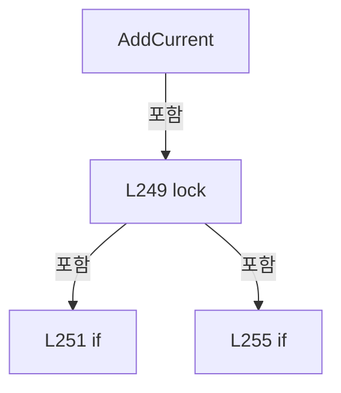

변경 전 점검: 입력/반환 타입, 위 호출자, 예외/취소 경로, 공유 상태와 저장·전송 소비자를 함께 확인합니다. 값의 단위나 물리 방향을 이름만으로 확정하지 않습니다.

### MethodDeclaration `Reset` · L267–278

[Drilling.Common/Alarm/CAlarmManager.cs:267–278](https://github.com/kjuws10-rgb/A3Drilling/blob/0219666f9053b907d96d7e0aa7d0c6c1be3a73d4/Drilling.Common/Alarm/CAlarmManager.cs#L267-L278)

| 항목 | 실제 추출 값 |
| --- | --- |
| 서명 | void Drilling.Common.Alarm.CAlarmManager.Reset() |
| 접근/수식자 | Public / public |
| 반환/값 타입 | void |
| 소속 타입 | NamedType:Drilling.Common.Alarm.CAlarmManager |

정적 호출자로 확인된 위치:

| 호출 파일/행 | 호출 표현식 | 런타임 분기 가능 |
| --- | --- | --- |
| [Drilling.UI/Menu/Menus/CMenuAlarm.cs:133–133](https://github.com/kjuws10-rgb/A3Drilling/blob/0219666f9053b907d96d7e0aa7d0c6c1be3a73d4/Drilling.UI/Menu/Menus/CMenuAlarm.cs#L133-L133) | alarmManager.Reset | False |

호출하는 대상과 해석 범위:

| 원본 행 | 표현식 | 분석 상태 | 대상/소스 위치 |
| --- | --- | --- | --- |
| 273 | _curAlarm.Clear | resolved | void System.Collections.Generic.Dictionary<int, Drilling.Common.Alarm.ST_ALARM_DATA>.Clear() |
| 274 | PublishCurrent | resolved | void Drilling.Common.Alarm.CAlarmManager.PublishCurrent(long, string) · Drilling.Common/Alarm/CAlarmManager.cs:304 |
| 277 | NotifyCurrentChanged | resolved | void Drilling.Common.Alarm.CAlarmManager.NotifyCurrentChanged() · Drilling.Common/Alarm/CAlarmManager.cs:280 |

본문의 실제 연산·분기·예외·반환 순서(원문 위치 순):

| 원본 행 | 종류 | 주석 해설 |
| --- | --- | --- |
| 269 | lock | 공유 상태의 임계 구역에 진입합니다: lock (_currentLock) |
| 271 | if | 조건에 따라 분기합니다: if (_curAlarm.Count == 0) |
| 272 | return | 호출자에게 값 또는 제어를 반환합니다: return; |
| 273 | call | 함수·델리게이트 또는 객체 생성자를 호출합니다: _curAlarm.Clear() |
| 274 | call | 함수·델리게이트 또는 객체 생성자를 호출합니다: PublishCurrent(_current.OccurrenceVersion, _current.LogError) |
| 277 | call | 함수·델리게이트 또는 객체 생성자를 호출합니다: NotifyCurrentChanged() |

제어 구문의 포함 구조(실제 실행 순서/CFG가 아닌 구문 탐색 그림):

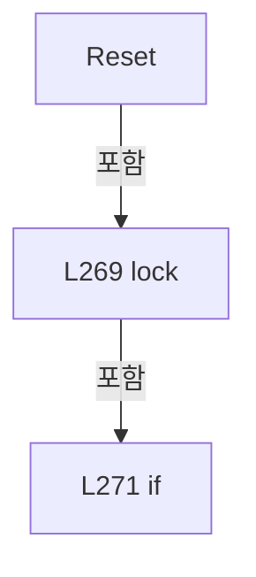

변경 전 점검: 입력/반환 타입, 위 호출자, 예외/취소 경로, 공유 상태와 저장·전송 소비자를 함께 확인합니다. 값의 단위나 물리 방향을 이름만으로 확정하지 않습니다.

### MethodDeclaration `NotifyCurrentChanged` · L280–302

[Drilling.Common/Alarm/CAlarmManager.cs:280–302](https://github.com/kjuws10-rgb/A3Drilling/blob/0219666f9053b907d96d7e0aa7d0c6c1be3a73d4/Drilling.Common/Alarm/CAlarmManager.cs#L280-L302)

| 항목 | 실제 추출 값 |
| --- | --- |
| 서명 | void Drilling.Common.Alarm.CAlarmManager.NotifyCurrentChanged() |
| 접근/수식자 | Private / private |
| 반환/값 타입 | void |
| 소속 타입 | NamedType:Drilling.Common.Alarm.CAlarmManager |

정적 호출자로 확인된 위치:

| 호출 파일/행 | 호출 표현식 | 런타임 분기 가능 |
| --- | --- | --- |
| [Drilling.Common/Alarm/CAlarmManager.cs:263–263](https://github.com/kjuws10-rgb/A3Drilling/blob/0219666f9053b907d96d7e0aa7d0c6c1be3a73d4/Drilling.Common/Alarm/CAlarmManager.cs#L263-L263) | NotifyCurrentChanged | False |
| [Drilling.Common/Alarm/CAlarmManager.cs:277–277](https://github.com/kjuws10-rgb/A3Drilling/blob/0219666f9053b907d96d7e0aa7d0c6c1be3a73d4/Drilling.Common/Alarm/CAlarmManager.cs#L277-L277) | NotifyCurrentChanged | False |
| [Drilling.Common/Alarm/CAlarmManager.cs:368–368](https://github.com/kjuws10-rgb/A3Drilling/blob/0219666f9053b907d96d7e0aa7d0c6c1be3a73d4/Drilling.Common/Alarm/CAlarmManager.cs#L368-L368) | NotifyCurrentChanged | False |

호출하는 대상과 해석 범위:

| 원본 행 | 표현식 | 분석 상태 | 대상/소스 위치 |
| --- | --- | --- | --- |
| 283 | new List<string> | resolved | System.Collections.Generic.List<string>.List() |
| 286 | handlers.GetInvocationList | resolved · 동적 구현 선택 가능 | System.Delegate[] System.MulticastDelegate.GetInvocationList() |
| 290 | handler | resolved · 동적 구현 선택 가능 | void System.Action.Invoke() |
| 296 | errors.Add | resolved | void System.Collections.Generic.List<string>.Add(string) |
| 301 | Volatile.Write | resolved | void System.Threading.Volatile.Write<string>(ref string, string) |
| 301 | string.Join | resolved | string string.Join(string?, System.Collections.Generic.IEnumerable<string?>) |

본문의 실제 연산·분기·예외·반환 순서(원문 위치 순):

| 원본 행 | 종류 | 주석 해설 |
| --- | --- | --- |
| 282 | local-declaration | 지역 변수를 선언합니다: var handlers = CurrentChanged; |
| 282 | variable-initializer | 변수의 초기값을 지정합니다: handlers = CurrentChanged |
| 283 | call | 함수·델리게이트 또는 객체 생성자를 호출합니다: new List<string>() |
| 283 | local-declaration | 지역 변수를 선언합니다: var errors = new List<string>(); |
| 283 | variable-initializer | 변수의 초기값을 지정합니다: errors = new List<string>() |
| 284 | if | 조건에 따라 분기합니다: if (handlers is not null) |
| 286 | call | 함수·델리게이트 또는 객체 생성자를 호출합니다: handlers.GetInvocationList() |
| 286 | foreach | 컬렉션 요소를 순회합니다: foreach (Action handler in handlers.GetInvocationList()) |
| 288 | try | 예외 처리 범위입니다: try |
| 290 | call | 함수·델리게이트 또는 객체 생성자를 호출합니다: handler() |
| 292 | catch | 지정 예외를 처리합니다: catch (Exception exception) |
| 296 | call | 함수·델리게이트 또는 객체 생성자를 호출합니다: errors.Add($"{handler.Method.Name}: {exception.Message}") |
| 301 | call | 함수·델리게이트 또는 객체 생성자를 호출합니다: Volatile.Write(ref _notificationError, string.Join(Environment.NewLine, errors)) |
| 301 | call | 함수·델리게이트 또는 객체 생성자를 호출합니다: string.Join(Environment.NewLine, errors) |

제어 구문의 포함 구조(실제 실행 순서/CFG가 아닌 구문 탐색 그림):

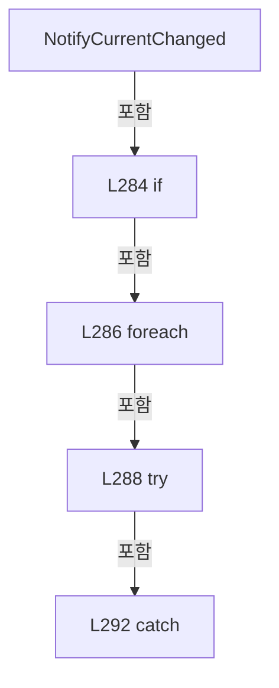

변경 전 점검: 입력/반환 타입, 위 호출자, 예외/취소 경로, 공유 상태와 저장·전송 소비자를 함께 확인합니다. 값의 단위나 물리 방향을 이름만으로 확정하지 않습니다.

### MethodDeclaration `PublishCurrent` · L304–308

[Drilling.Common/Alarm/CAlarmManager.cs:304–308](https://github.com/kjuws10-rgb/A3Drilling/blob/0219666f9053b907d96d7e0aa7d0c6c1be3a73d4/Drilling.Common/Alarm/CAlarmManager.cs#L304-L308)

| 항목 | 실제 추출 값 |
| --- | --- |
| 서명 | void Drilling.Common.Alarm.CAlarmManager.PublishCurrent(long, string) |
| 접근/수식자 | Private / private |
| 반환/값 타입 | void |
| 소속 타입 | NamedType:Drilling.Common.Alarm.CAlarmManager |

입력 계약:

| 이름 | 타입 | 전달 | 선택/기본값 |
| --- | --- | --- | --- |
| occurrenceVersion | long | None | False /  |
| error | string | None | False /  |

정적 호출자로 확인된 위치:

| 호출 파일/행 | 호출 표현식 | 런타임 분기 가능 |
| --- | --- | --- |
| [Drilling.Common/Alarm/CAlarmManager.cs:253–253](https://github.com/kjuws10-rgb/A3Drilling/blob/0219666f9053b907d96d7e0aa7d0c6c1be3a73d4/Drilling.Common/Alarm/CAlarmManager.cs#L253-L253) | PublishCurrent | False |
| [Drilling.Common/Alarm/CAlarmManager.cs:259–259](https://github.com/kjuws10-rgb/A3Drilling/blob/0219666f9053b907d96d7e0aa7d0c6c1be3a73d4/Drilling.Common/Alarm/CAlarmManager.cs#L259-L259) | PublishCurrent | False |
| [Drilling.Common/Alarm/CAlarmManager.cs:274–274](https://github.com/kjuws10-rgb/A3Drilling/blob/0219666f9053b907d96d7e0aa7d0c6c1be3a73d4/Drilling.Common/Alarm/CAlarmManager.cs#L274-L274) | PublishCurrent | False |
| [Drilling.Common/Alarm/CAlarmManager.cs:365–365](https://github.com/kjuws10-rgb/A3Drilling/blob/0219666f9053b907d96d7e0aa7d0c6c1be3a73d4/Drilling.Common/Alarm/CAlarmManager.cs#L365-L365) | PublishCurrent | False |

호출하는 대상과 해석 범위:

| 원본 행 | 표현식 | 분석 상태 | 대상/소스 위치 |
| --- | --- | --- | --- |
| 306 | Array.AsReadOnly | resolved | System.Collections.ObjectModel.ReadOnlyCollection<Drilling.Common.Alarm.ST_ALARM_DATA> System.Array.AsReadOnly<Drilling.Common.Alarm.ST_ALARM_DATA>(Drilling.Common.Alarm.ST_ALARM_DATA[]) |
| 306 | _curAlarm.Values.OrderByDescending(row => row.Severity).ThenBy(row => row.OccurredAt).ThenBy(row => row.Code).ToArray | resolved | Drilling.Common.Alarm.ST_ALARM_DATA[] System.Collections.Generic.IEnumerable<Drilling.Common.Alarm.ST_ALARM_DATA>.ToArray<Drilling.Common.Alarm.ST_ALARM_DATA>() |
| 306 | _curAlarm.Values.OrderByDescending(row => row.Severity).ThenBy(row => row.OccurredAt).ThenBy | resolved | System.Linq.IOrderedEnumerable<Drilling.Common.Alarm.ST_ALARM_DATA> System.Linq.IOrderedEnumerable<Drilling.Common.Alarm.ST_ALARM_DATA>.ThenBy<Drilling.Common.Alarm.ST_ALARM_DATA, int>(System.Func<Drilling.Common.Alarm.ST_ALARM_DATA, int>) |
| 306 | _curAlarm.Values.OrderByDescending(row => row.Severity).ThenBy | resolved | System.Linq.IOrderedEnumerable<Drilling.Common.Alarm.ST_ALARM_DATA> System.Linq.IOrderedEnumerable<Drilling.Common.Alarm.ST_ALARM_DATA>.ThenBy<Drilling.Common.Alarm.ST_ALARM_DATA, System.DateTimeOffset>(System.Func<Drilling.Common.Alarm.ST_ALARM_DATA, System.DateTimeOffset>) |
| 306 | _curAlarm.Values.OrderByDescending | resolved | System.Linq.IOrderedEnumerable<Drilling.Common.Alarm.ST_ALARM_DATA> System.Collections.Generic.IEnumerable<Drilling.Common.Alarm.ST_ALARM_DATA>.OrderByDescending<Drilling.Common.Alarm.ST_ALARM_DATA, Drilling.Common.Alarm.EN_ALARM_LEVEL>(System.Func<Drilling.Common.Alarm.ST_ALARM_DATA, Drilling.Common.Alarm.EN_ALARM_LEVEL>) |
| 307 | Volatile.Write | resolved | void System.Threading.Volatile.Write<Drilling.Common.Alarm.ST_CURRENT_ALARM_SNAPSHOT>(ref Drilling.Common.Alarm.ST_CURRENT_ALARM_SNAPSHOT, Drilling.Common.Alarm.ST_CURRENT_ALARM_SNAPSHOT) |
| 307 | new | resolved | Drilling.Common.Alarm.ST_CURRENT_ALARM_SNAPSHOT.ST_CURRENT_ALARM_SNAPSHOT(long, long, System.Collections.Generic.IReadOnlyList<Drilling.Common.Alarm.ST_ALARM_DATA>, string) · Drilling.Common/Alarm/CAlarmManager.cs:573 |

본문의 실제 연산·분기·예외·반환 순서(원문 위치 순):

| 원본 행 | 종류 | 주석 해설 |
| --- | --- | --- |
| 306 | call | 함수·델리게이트 또는 객체 생성자를 호출합니다: Array.AsReadOnly(_curAlarm.Values.OrderByDescending(row => row.Severity).ThenBy(row => row.OccurredAt).ThenBy(row => row.Code).ToArray()) |
| 306 | call | 함수·델리게이트 또는 객체 생성자를 호출합니다: _curAlarm.Values.OrderByDescending(row => row.Severity).ThenBy(row => row.OccurredAt).ThenBy(row => row.Code).ToArray() |
| 306 | call | 함수·델리게이트 또는 객체 생성자를 호출합니다: _curAlarm.Values.OrderByDescending(row => row.Severity).ThenBy(row => row.OccurredAt).ThenBy(row => row.Code) |
| 306 | call | 함수·델리게이트 또는 객체 생성자를 호출합니다: _curAlarm.Values.OrderByDescending(row => row.Severity).ThenBy(row => row.OccurredAt) |
| 306 | call | 함수·델리게이트 또는 객체 생성자를 호출합니다: _curAlarm.Values.OrderByDescending(row => row.Severity) |
| 306 | local-declaration | 지역 변수를 선언합니다: var rows = Array.AsReadOnly(_curAlarm.Values.OrderByDescending(row => row.Severity).ThenBy(row => row.OccurredAt).ThenBy(row => row.Code).ToArray()); |
| 306 | variable-initializer | 변수의 초기값을 지정합니다: rows = Array.AsReadOnly(_curAlarm.Values.OrderByDescending(row => row.Severity).ThenBy(row => row.OccurredAt).ThenBy(row => row.Code).ToArray()) |
| 307 | call | 함수·델리게이트 또는 객체 생성자를 호출합니다: Volatile.Write(ref _current, new(_current.Revision + 1, occurrenceVersion, rows, error)) |
| 307 | call | 함수·델리게이트 또는 객체 생성자를 호출합니다: new(_current.Revision + 1, occurrenceVersion, rows, error) |

변경 전 점검: 입력/반환 타입, 위 호출자, 예외/취소 경로, 공유 상태와 저장·전송 소비자를 함께 확인합니다. 값의 단위나 물리 방향을 이름만으로 확정하지 않습니다.

### MethodDeclaration `ReadHistory` · L310–310

[Drilling.Common/Alarm/CAlarmManager.cs:310–310](https://github.com/kjuws10-rgb/A3Drilling/blob/0219666f9053b907d96d7e0aa7d0c6c1be3a73d4/Drilling.Common/Alarm/CAlarmManager.cs#L310-L310)

| 항목 | 실제 추출 값 |
| --- | --- |
| 서명 | Drilling.Common.Alarm.ST_ALARM_HISTORY_RESULT Drilling.Common.Alarm.CAlarmManager.ReadHistory(System.DateTime, System.DateTime, System.Threading.CancellationToken) |
| 접근/수식자 | Public / public |
| 반환/값 타입 | Drilling.Common.Alarm.ST_ALARM_HISTORY_RESULT |
| 소속 타입 | NamedType:Drilling.Common.Alarm.CAlarmManager |

입력 계약:

| 이름 | 타입 | 전달 | 선택/기본값 |
| --- | --- | --- | --- |
| from | System.DateTime | None | False /  |
| through | System.DateTime | None | False /  |
| token | System.Threading.CancellationToken | None | True / null |

현재 부분 분석에서 직접 연결된 호출자는 없습니다. XAML/이벤트/인터페이스·델리게이트·외부 진입을 추가 확인해야 하며, 미사용으로 판정한 것이 아닙니다.

호출하는 대상과 해석 범위:

| 원본 행 | 표현식 | 분석 상태 | 대상/소스 위치 |
| --- | --- | --- | --- |
| 310 | .Read | resolved · 동적 구현 선택 가능 | Drilling.Common.Alarm.ST_ALARM_HISTORY_RESULT Drilling.Common.Alarm.IAlarmHistoryStore.Read(System.DateTime, System.DateTime, System.Threading.CancellationToken) · Drilling.Common/Alarm/CAlarmManager.cs:674 |
| 310 | new | resolved | Drilling.Common.Alarm.ST_ALARM_HISTORY_RESULT.ST_ALARM_HISTORY_RESULT(System.Collections.Generic.IReadOnlyList<Drilling.Common.Alarm.ST_ALARM_HISTORY_ENTRY>, string) · Drilling.Common/Alarm/CAlarmManager.cs:668 |

본문의 실제 연산·분기·예외·반환 순서(원문 위치 순):

| 원본 행 | 종류 | 주석 해설 |
| --- | --- | --- |
| 310 | call | 함수·델리게이트 또는 객체 생성자를 호출합니다: .Read(from, through, token) |
| 310 | call | 함수·델리게이트 또는 객체 생성자를 호출합니다: new([], "알람 로그 저장소가 연결되지 않았습니다.") |

변경 전 점검: 입력/반환 타입, 위 호출자, 예외/취소 경로, 공유 상태와 저장·전송 소비자를 함께 확인합니다. 값의 단위나 물리 방향을 이름만으로 확정하지 않습니다.

### PropertyDeclaration `HistoryStorageError` · L311–321

[Drilling.Common/Alarm/CAlarmManager.cs:311–321](https://github.com/kjuws10-rgb/A3Drilling/blob/0219666f9053b907d96d7e0aa7d0c6c1be3a73d4/Drilling.Common/Alarm/CAlarmManager.cs#L311-L321)

| 항목 | 실제 추출 값 |
| --- | --- |
| 서명 | string Drilling.Common.Alarm.CAlarmManager.HistoryStorageError |
| 접근/수식자 | Public / public |
| 반환/값 타입 | string |
| 소속 타입 | NamedType:Drilling.Common.Alarm.CAlarmManager |

현재 부분 분석에서 직접 연결된 호출자는 없습니다. XAML/이벤트/인터페이스·델리게이트·외부 진입을 추가 확인해야 하며, 미사용으로 판정한 것이 아닙니다.

변경 전 점검: 입력/반환 타입, 위 호출자, 예외/취소 경로, 공유 상태와 저장·전송 소비자를 함께 확인합니다. 값의 단위나 물리 방향을 이름만으로 확정하지 않습니다.

### GetAccessorDeclaration `get_HistoryStorageError` · L313–320

[Drilling.Common/Alarm/CAlarmManager.cs:313–320](https://github.com/kjuws10-rgb/A3Drilling/blob/0219666f9053b907d96d7e0aa7d0c6c1be3a73d4/Drilling.Common/Alarm/CAlarmManager.cs#L313-L320)

| 항목 | 실제 추출 값 |
| --- | --- |
| 서명 | string Drilling.Common.Alarm.CAlarmManager.HistoryStorageError.get |
| 접근/수식자 | Public / get |
| 반환/값 타입 | string |
| 소속 타입 | NamedType:Drilling.Common.Alarm.CAlarmManager |

현재 부분 분석에서 직접 연결된 호출자는 없습니다. XAML/이벤트/인터페이스·델리게이트·외부 진입을 추가 확인해야 하며, 미사용으로 판정한 것이 아닙니다.

호출하는 대상과 해석 범위:

| 원본 행 | 표현식 | 분석 상태 | 대상/소스 위치 |
| --- | --- | --- | --- |
| 315 | Volatile.Read | resolved | string System.Threading.Volatile.Read<string>(ref readonly string) |
| 316 | Volatile.Read | resolved | long System.Threading.Volatile.Read(ref readonly long) |
| 318 | string.IsNullOrEmpty | resolved | bool string.IsNullOrEmpty(string?) |

본문의 실제 연산·분기·예외·반환 순서(원문 위치 순):

| 원본 행 | 종류 | 주석 해설 |
| --- | --- | --- |
| 315 | call | 함수·델리게이트 또는 객체 생성자를 호출합니다: Volatile.Read(ref _historyError) |
| 315 | local-declaration | 지역 변수를 선언합니다: var error = Volatile.Read(ref _historyError); |
| 315 | variable-initializer | 변수의 초기값을 지정합니다: error = Volatile.Read(ref _historyError) |
| 316 | call | 함수·델리게이트 또는 객체 생성자를 호출합니다: Volatile.Read(ref _historyWriteStartedAt) |
| 316 | local-declaration | 지역 변수를 선언합니다: var startedAt = Volatile.Read(ref _historyWriteStartedAt); |
| 316 | variable-initializer | 변수의 초기값을 지정합니다: startedAt = Volatile.Read(ref _historyWriteStartedAt) |
| 317 | if | 조건에 따라 분기합니다: if (startedAt > 0 && Environment.TickCount64 - startedAt >= 5000) |
| 318 | call | 함수·델리게이트 또는 객체 생성자를 호출합니다: string.IsNullOrEmpty(error) |
| 318 | conditional-expression | 조건에 따라 결과식을 선택합니다: string.IsNullOrEmpty(error) ? "알람 이력 저장이 5초 이상 지연되고 있습니다." : error + Environment.NewLine + "알람 이력 저장이 5초 이상 지연되고 있습니다." |
| 318 | return | 호출자에게 값 또는 제어를 반환합니다: return string.IsNullOrEmpty(error) ? "알람 이력 저장이 5초 이상 지연되고 있습니다." : error + Environment.NewLine + "알람 이력 저장이 5초 이상 지연되고 있습니다."; |
| 319 | return | 호출자에게 값 또는 제어를 반환합니다: return error; |

제어 구문의 포함 구조(실제 실행 순서/CFG가 아닌 구문 탐색 그림):

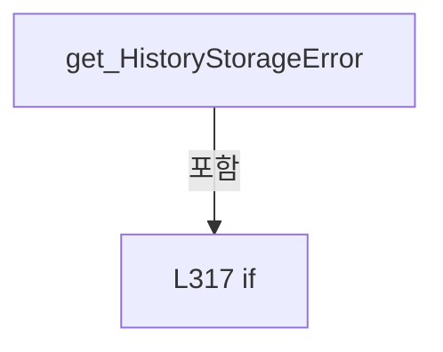

변경 전 점검: 입력/반환 타입, 위 호출자, 예외/취소 경로, 공유 상태와 저장·전송 소비자를 함께 확인합니다. 값의 단위나 물리 방향을 이름만으로 확정하지 않습니다.

### MethodDeclaration `QueueHistory` · L324–337

[Drilling.Common/Alarm/CAlarmManager.cs:324–337](https://github.com/kjuws10-rgb/A3Drilling/blob/0219666f9053b907d96d7e0aa7d0c6c1be3a73d4/Drilling.Common/Alarm/CAlarmManager.cs#L324-L337)

| 항목 | 실제 추출 값 |
| --- | --- |
| 서명 | bool Drilling.Common.Alarm.CAlarmManager.QueueHistory(Drilling.Common.Alarm.ST_ALARM_DATA) |
| 접근/수식자 | Private / private |
| 반환/값 타입 | bool |
| 소속 타입 | NamedType:Drilling.Common.Alarm.CAlarmManager |

입력 계약:

| 이름 | 타입 | 전달 | 선택/기본값 |
| --- | --- | --- | --- |
| alarm | Drilling.Common.Alarm.ST_ALARM_DATA | None | False /  |

정적 호출자로 확인된 위치:

| 호출 파일/행 | 호출 표현식 | 런타임 분기 가능 |
| --- | --- | --- |
| [Drilling.Common/Alarm/CAlarmManager.cs:255–255](https://github.com/kjuws10-rgb/A3Drilling/blob/0219666f9053b907d96d7e0aa7d0c6c1be3a73d4/Drilling.Common/Alarm/CAlarmManager.cs#L255-L255) | QueueHistory | False |

호출하는 대상과 해석 범위:

| 원본 행 | 표현식 | 분석 상태 | 대상/소스 위치 |
| --- | --- | --- | --- |
| 333 | _historyQueue.Enqueue | resolved | void System.Collections.Generic.Queue<Drilling.Common.Alarm.ST_ALARM_DATA>.Enqueue(Drilling.Common.Alarm.ST_ALARM_DATA) |
| 334 | Task.Run | resolved | System.Threading.Tasks.Task System.Threading.Tasks.Task.Run(System.Action) |

본문의 실제 연산·분기·예외·반환 순서(원문 위치 순):

| 원본 행 | 종류 | 주석 해설 |
| --- | --- | --- |
| 327 | if | 조건에 따라 분기합니다: if (_history is null) |
| 328 | return | 호출자에게 값 또는 제어를 반환합니다: return true; |
| 329 | lock | 공유 상태의 임계 구역에 진입합니다: lock (_historyQueueLock) |
| 331 | if | 조건에 따라 분기합니다: if (_historyQueue.Count >= HistoryQueueCapacity) |
| 332 | return | 호출자에게 값 또는 제어를 반환합니다: return false; |
| 333 | call | 함수·델리게이트 또는 객체 생성자를 호출합니다: _historyQueue.Enqueue(alarm) |
| 334 | assignment | 값을 대상에 대입합니다: _historyTask ??= Task.Run(WriteQueuedHistory) |
| 334 | call | 함수·델리게이트 또는 객체 생성자를 호출합니다: Task.Run(WriteQueuedHistory) |
| 335 | return | 호출자에게 값 또는 제어를 반환합니다: return true; |

제어 구문의 포함 구조(실제 실행 순서/CFG가 아닌 구문 탐색 그림):

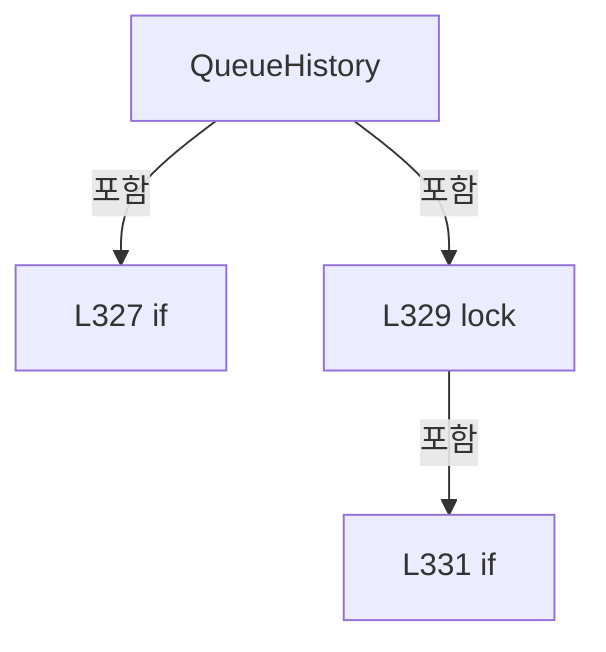

변경 전 점검: 입력/반환 타입, 위 호출자, 예외/취소 경로, 공유 상태와 저장·전송 소비자를 함께 확인합니다. 값의 단위나 물리 방향을 이름만으로 확정하지 않습니다.

### MethodDeclaration `WriteQueuedHistory` · L339–376

[Drilling.Common/Alarm/CAlarmManager.cs:339–376](https://github.com/kjuws10-rgb/A3Drilling/blob/0219666f9053b907d96d7e0aa7d0c6c1be3a73d4/Drilling.Common/Alarm/CAlarmManager.cs#L339-L376)

| 항목 | 실제 추출 값 |
| --- | --- |
| 서명 | void Drilling.Common.Alarm.CAlarmManager.WriteQueuedHistory() |
| 접근/수식자 | Private / private |
| 반환/값 타입 | void |
| 소속 타입 | NamedType:Drilling.Common.Alarm.CAlarmManager |

현재 부분 분석에서 직접 연결된 호출자는 없습니다. XAML/이벤트/인터페이스·델리게이트·외부 진입을 추가 확인해야 하며, 미사용으로 판정한 것이 아닙니다.

호출하는 대상과 해석 범위:

| 원본 행 | 표현식 | 분석 상태 | 대상/소스 위치 |
| --- | --- | --- | --- |
| 346 | _historyQueue.TryDequeue | resolved | bool System.Collections.Generic.Queue<Drilling.Common.Alarm.ST_ALARM_DATA>.TryDequeue(out Drilling.Common.Alarm.ST_ALARM_DATA) |
| 353 | Volatile.Write | resolved | void System.Threading.Volatile.Write(ref long, long) |
| 356 | _history!.Append | resolved · 동적 구현 선택 가능 | void Drilling.Common.Alarm.IAlarmHistoryStore.Append(Drilling.Common.Alarm.ST_ALARM_DATA) · Drilling.Common/Alarm/CAlarmManager.cs:673 |
| 361 | Volatile.Write | resolved | void System.Threading.Volatile.Write<string>(ref string, string) |
| 365 | PublishCurrent | resolved | void Drilling.Common.Alarm.CAlarmManager.PublishCurrent(long, string) · Drilling.Common/Alarm/CAlarmManager.cs:304 |
| 368 | NotifyCurrentChanged | resolved | void Drilling.Common.Alarm.CAlarmManager.NotifyCurrentChanged() · Drilling.Common/Alarm/CAlarmManager.cs:280 |
| 372 | Volatile.Write | resolved | void System.Threading.Volatile.Write(ref long, long) |

본문의 실제 연산·분기·예외·반환 순서(원문 위치 순):

| 원본 행 | 종류 | 주석 해설 |
| --- | --- | --- |
| 341 | while | 조건을 먼저 확인하며 반복합니다: while (true) |
| 343 | local-declaration | 지역 변수를 선언합니다: ST_ALARM_DATA alarm; |
| 344 | lock | 공유 상태의 임계 구역에 진입합니다: lock (_historyQueueLock) |
| 346 | call | 함수·델리게이트 또는 객체 생성자를 호출합니다: _historyQueue.TryDequeue(out alarm!) |
| 346 | if | 조건에 따라 분기합니다: if (!_historyQueue.TryDequeue(out alarm!)) |
| 348 | assignment | 값을 대상에 대입합니다: _historyTask = null |
| 349 | return | 호출자에게 값 또는 제어를 반환합니다: return; |
| 353 | call | 함수·델리게이트 또는 객체 생성자를 호출합니다: Volatile.Write(ref _historyWriteStartedAt, Environment.TickCount64) |
| 354 | try | 예외 처리 범위입니다: try |
| 356 | call | 함수·델리게이트 또는 객체 생성자를 호출합니다: _history!.Append(alarm) |
| 358 | catch | 지정 예외를 처리합니다: catch (Exception exception) |
| 360 | local-declaration | 지역 변수를 선언합니다: var error = $"알람 {alarm.Code} 로그 저장 실패: {exception.Message}"; |
| 360 | variable-initializer | 변수의 초기값을 지정합니다: error = $"알람 {alarm.Code} 로그 저장 실패: {exception.Message}" |
| 361 | call | 함수·델리게이트 또는 객체 생성자를 호출합니다: Volatile.Write(ref _historyError, error) |
| 362 | lock | 공유 상태의 임계 구역에 진입합니다: lock (_currentLock) |
| 365 | call | 함수·델리게이트 또는 객체 생성자를 호출합니다: PublishCurrent(_current.OccurrenceVersion, error) |
| 368 | call | 함수·델리게이트 또는 객체 생성자를 호출합니다: NotifyCurrentChanged() |
| 370 | finally | 종료 정리 구간입니다: finally |
| 372 | call | 함수·델리게이트 또는 객체 생성자를 호출합니다: Volatile.Write(ref _historyWriteStartedAt, 0) |

제어 구문의 포함 구조(실제 실행 순서/CFG가 아닌 구문 탐색 그림):

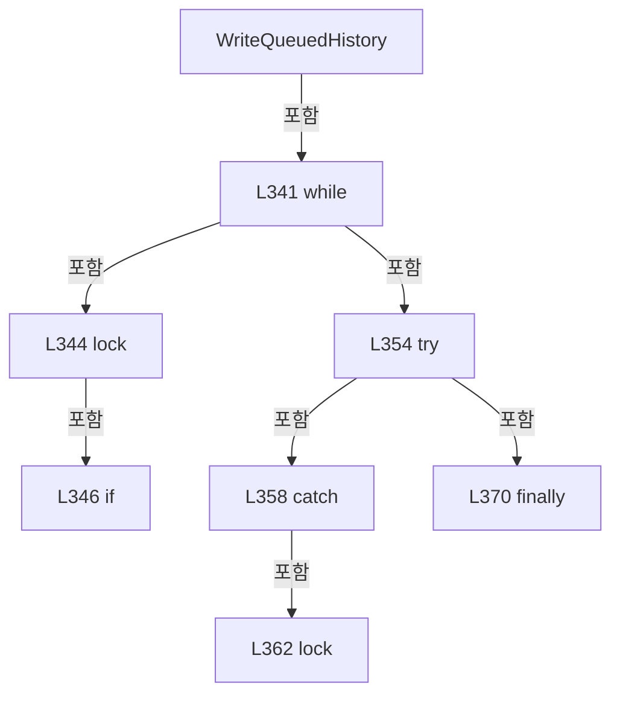

변경 전 점검: 입력/반환 타입, 위 호출자, 예외/취소 경로, 공유 상태와 저장·전송 소비자를 함께 확인합니다. 값의 단위나 물리 방향을 이름만으로 확정하지 않습니다.

### MethodDeclaration `FlushHistoryAsync` · L379–385

[Drilling.Common/Alarm/CAlarmManager.cs:379–385](https://github.com/kjuws10-rgb/A3Drilling/blob/0219666f9053b907d96d7e0aa7d0c6c1be3a73d4/Drilling.Common/Alarm/CAlarmManager.cs#L379-L385)

| 항목 | 실제 추출 값 |
| --- | --- |
| 서명 | System.Threading.Tasks.Task Drilling.Common.Alarm.CAlarmManager.FlushHistoryAsync(System.Threading.CancellationToken) |
| 접근/수식자 | Public / public |
| 반환/값 타입 | System.Threading.Tasks.Task |
| 소속 타입 | NamedType:Drilling.Common.Alarm.CAlarmManager |

원본 XML 주석:

````xml
/// <summary>현재 저장 대기열의 처리를 비동기로 기다립니다. 일반 감시 처리에서는 호출하지 않습니다.</summary>
````

입력 계약:

| 이름 | 타입 | 전달 | 선택/기본값 |
| --- | --- | --- | --- |
| cancellationToken | System.Threading.CancellationToken | None | True / null |

정적 호출자로 확인된 위치:

| 호출 파일/행 | 호출 표현식 | 런타임 분기 가능 |
| --- | --- | --- |
| [Drilling.Common/Managers/CManager.cs:235–235](https://github.com/kjuws10-rgb/A3Drilling/blob/0219666f9053b907d96d7e0aa7d0c6c1be3a73d4/Drilling.Common/Managers/CManager.cs#L235-L235) | _alarmManager.FlushHistoryAsync | False |

호출하는 대상과 해석 범위:

| 원본 행 | 표현식 | 분석 상태 | 대상/소스 위치 |
| --- | --- | --- | --- |
| 384 | pending.WaitAsync | resolved | System.Threading.Tasks.Task System.Threading.Tasks.Task.WaitAsync(System.Threading.CancellationToken) |

본문의 실제 연산·분기·예외·반환 순서(원문 위치 순):

| 원본 행 | 종류 | 주석 해설 |
| --- | --- | --- |
| 381 | local-declaration | 지역 변수를 선언합니다: Task pending; |
| 382 | lock | 공유 상태의 임계 구역에 진입합니다: lock (_historyQueueLock) |
| 383 | assignment | 값을 대상에 대입합니다: pending = _historyTask ?? Task.CompletedTask |
| 384 | call | 함수·델리게이트 또는 객체 생성자를 호출합니다: pending.WaitAsync(cancellationToken) |
| 384 | return | 호출자에게 값 또는 제어를 반환합니다: return pending.WaitAsync(cancellationToken); |

제어 구문의 포함 구조(실제 실행 순서/CFG가 아닌 구문 탐색 그림):

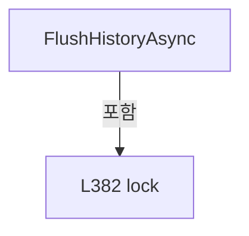

변경 전 점검: 입력/반환 타입, 위 호출자, 예외/취소 경로, 공유 상태와 저장·전송 소비자를 함께 확인합니다. 값의 단위나 물리 방향을 이름만으로 확정하지 않습니다.

### PropertyDeclaration `MonitoringError` · L389–397

[Drilling.Common/Alarm/CAlarmManager.cs:389–397](https://github.com/kjuws10-rgb/A3Drilling/blob/0219666f9053b907d96d7e0aa7d0c6c1be3a73d4/Drilling.Common/Alarm/CAlarmManager.cs#L389-L397)

| 항목 | 실제 추출 값 |
| --- | --- |
| 서명 | string Drilling.Common.Alarm.CAlarmManager.MonitoringError |
| 접근/수식자 | Public / public |
| 반환/값 타입 | string |
| 소속 타입 | NamedType:Drilling.Common.Alarm.CAlarmManager |

현재 부분 분석에서 직접 연결된 호출자는 없습니다. XAML/이벤트/인터페이스·델리게이트·외부 진입을 추가 확인해야 하며, 미사용으로 판정한 것이 아닙니다.

변경 전 점검: 입력/반환 타입, 위 호출자, 예외/취소 경로, 공유 상태와 저장·전송 소비자를 함께 확인합니다. 값의 단위나 물리 방향을 이름만으로 확정하지 않습니다.

### GetAccessorDeclaration `get_MonitoringError` · L391–396

[Drilling.Common/Alarm/CAlarmManager.cs:391–396](https://github.com/kjuws10-rgb/A3Drilling/blob/0219666f9053b907d96d7e0aa7d0c6c1be3a73d4/Drilling.Common/Alarm/CAlarmManager.cs#L391-L396)

| 항목 | 실제 추출 값 |
| --- | --- |
| 서명 | string Drilling.Common.Alarm.CAlarmManager.MonitoringError.get |
| 접근/수식자 | Public / get |
| 반환/값 타입 | string |
| 소속 타입 | NamedType:Drilling.Common.Alarm.CAlarmManager |

현재 부분 분석에서 직접 연결된 호출자는 없습니다. XAML/이벤트/인터페이스·델리게이트·외부 진입을 추가 확인해야 하며, 미사용으로 판정한 것이 아닙니다.

호출하는 대상과 해석 범위:

| 원본 행 | 표현식 | 분석 상태 | 대상/소스 위치 |
| --- | --- | --- | --- |
| 393 | Volatile.Read | resolved | string System.Threading.Volatile.Read<string>(ref readonly string) |
| 395 | string.IsNullOrEmpty | resolved | bool string.IsNullOrEmpty(string?) |
| 395 | string.IsNullOrEmpty | resolved | bool string.IsNullOrEmpty(string?) |

본문의 실제 연산·분기·예외·반환 순서(원문 위치 순):

| 원본 행 | 종류 | 주석 해설 |
| --- | --- | --- |
| 393 | call | 함수·델리게이트 또는 객체 생성자를 호출합니다: Volatile.Read(ref _monitoringError) |
| 393 | local-declaration | 지역 변수를 선언합니다: var checks = Volatile.Read(ref _monitoringError); |
| 393 | variable-initializer | 변수의 초기값을 지정합니다: checks = Volatile.Read(ref _monitoringError) |
| 394 | local-declaration | 지역 변수를 선언합니다: var history = HistoryStorageError; |
| 394 | variable-initializer | 변수의 초기값을 지정합니다: history = HistoryStorageError |
| 395 | call | 함수·델리게이트 또는 객체 생성자를 호출합니다: string.IsNullOrEmpty(history) |
| 395 | call | 함수·델리게이트 또는 객체 생성자를 호출합니다: string.IsNullOrEmpty(checks) |
| 395 | conditional-expression | 조건에 따라 결과식을 선택합니다: string.IsNullOrEmpty(history) ? checks : string.IsNullOrEmpty(checks) ? history : checks + Environment.NewLine + history |
| 395 | conditional-expression | 조건에 따라 결과식을 선택합니다: string.IsNullOrEmpty(checks) ? history : checks + Environment.NewLine + history |
| 395 | return | 호출자에게 값 또는 제어를 반환합니다: return string.IsNullOrEmpty(history) ? checks : string.IsNullOrEmpty(checks) ? history : checks + Environment.NewLine + history; |

변경 전 점검: 입력/반환 타입, 위 호출자, 예외/취소 경로, 공유 상태와 저장·전송 소비자를 함께 확인합니다. 값의 단위나 물리 방향을 이름만으로 확정하지 않습니다.

### MethodDeclaration `StartMonitoring` · L406–429

[Drilling.Common/Alarm/CAlarmManager.cs:406–429](https://github.com/kjuws10-rgb/A3Drilling/blob/0219666f9053b907d96d7e0aa7d0c6c1be3a73d4/Drilling.Common/Alarm/CAlarmManager.cs#L406-L429)

| 항목 | 실제 추출 값 |
| --- | --- |
| 서명 | void Drilling.Common.Alarm.CAlarmManager.StartMonitoring(Drilling.Common.Managers.CSettingManager, Drilling.Common.Automation.CAutomationManager, System.Func<Drilling.Common.Managers.ST_DEVICE_STATUS>, Drilling.Common.InterLock.CInterLockManager, System.Action<System.Exception>?) |
| 접근/수식자 | Public / public |
| 반환/값 타입 | void |
| 소속 타입 | NamedType:Drilling.Common.Alarm.CAlarmManager |

원본 XML 주석:

````xml
/// <summary>단일 백그라운드 작업자에서 알람 조건을 감시합니다.</summary>
        /// <remarks>
        /// reportError는 감시 작업자 스레드에서 동기적으로 호출되며 동일 오류는 반복 보고하지 않습니다.
        /// CurrentChanged와 마찬가지로 UI를 갱신하는 콜백은 Dispatcher/BeginInvoke 또는
        /// SynchronizationContext.Post로 UI 스레드에 전달해야 합니다. 로그 전용 콜백은 저장소의 스레드 안전성을 보장해야 합니다.
        /// readDeviceSnapshot은 메모리에 공개된 스냅샷만 반환해야 하며 장치 통신을 수행하면 안 됩니다.
        /// </remarks>
````

입력 계약:

| 이름 | 타입 | 전달 | 선택/기본값 |
| --- | --- | --- | --- |
| settings | Drilling.Common.Managers.CSettingManager | None | False /  |
| automation | Drilling.Common.Automation.CAutomationManager | None | False /  |
| readDeviceSnapshot | System.Func<Drilling.Common.Managers.ST_DEVICE_STATUS> | None | False /  |
| interLocks | Drilling.Common.InterLock.CInterLockManager | None | False /  |
| reportError | System.Action<System.Exception>? | None | True / null |

정적 호출자로 확인된 위치:

| 호출 파일/행 | 호출 표현식 | 런타임 분기 가능 |
| --- | --- | --- |
| [Drilling.Common/Managers/CManager.cs:275–275](https://github.com/kjuws10-rgb/A3Drilling/blob/0219666f9053b907d96d7e0aa7d0c6c1be3a73d4/Drilling.Common/Managers/CManager.cs#L275-L275) | _alarmManager.StartMonitoring | False |

호출하는 대상과 해석 범위:

| 원본 행 | 표현식 | 분석 상태 | 대상/소스 위치 |
| --- | --- | --- | --- |
| 414 | EnsureDefinitionsRequested | resolved | void Drilling.Common.Alarm.CAlarmManager.EnsureDefinitionsRequested() · Drilling.Common/Alarm/CAlarmManager.cs:214 |
| 415 | ArgumentNullException.ThrowIfNull | resolved | void System.ArgumentNullException.ThrowIfNull(object?, string?) |
| 416 | new CScannerTemperatureAlarmMonitor | resolved | Drilling.Common.Alarm.CScannerTemperatureAlarmMonitor.CScannerTemperatureAlarmMonitor(Drilling.Common.Alarm.CAlarmManager, Drilling.Common.Managers.CSettingManager, Drilling.Common.Automation.CAutomationManager) · Drilling.Common/Alarm/CAlarmManager.cs:575 |
| 417 | StartMonitoring | resolved | void Drilling.Common.Alarm.CAlarmManager.StartMonitoring(System.Action<System.Threading.CancellationToken>[], System.Action<System.Exception>?, System.TimeSpan) · Drilling.Common/Alarm/CAlarmManager.cs:432 |
| 419 | token.ThrowIfCancellationRequested | resolved | void System.Threading.CancellationToken.ThrowIfCancellationRequested() |
| 420 | temperatures.Check | resolved | void Drilling.Common.Alarm.CScannerTemperatureAlarmMonitor.Check() · Drilling.Common/Alarm/CAlarmManager.cs:577 |
| 423 | token.ThrowIfCancellationRequested | resolved | void System.Threading.CancellationToken.ThrowIfCancellationRequested() |
| 424 | readDeviceSnapshot | resolved · 동적 구현 선택 가능 | Drilling.Common.Managers.ST_DEVICE_STATUS System.Func<Drilling.Common.Managers.ST_DEVICE_STATUS>.Invoke() |
| 425 | Build | resolved | System.Collections.Generic.IReadOnlyList<Drilling.Common.Alarm.ST_ALARM_DATA> Drilling.Common.Alarm.CAlarmManager.Build(Drilling.Common.Managers.ST_DEVICE_STATUS, Drilling.Common.InterLock.ST_INTERLOCK_SUMMARY) · Drilling.Common/Alarm/CAlarmManager.cs:66 |
| 425 | interLocks.Evaluate | resolved | Drilling.Common.InterLock.ST_INTERLOCK_SUMMARY Drilling.Common.InterLock.CInterLockManager.Evaluate(Drilling.Common.Managers.ST_DEVICE_STATUS) · Drilling.Common/InterLock/CInterLockManager.cs:28 |
| 426 | string.IsNullOrEmpty | resolved | bool string.IsNullOrEmpty(string?) |
| 427 | new IOException | resolved | System.IO.IOException.IOException(string?) |
| 428 | TimeSpan.FromSeconds | resolved | System.TimeSpan System.TimeSpan.FromSeconds(long) |

본문의 실제 연산·분기·예외·반환 순서(원문 위치 순):

| 원본 행 | 종류 | 주석 해설 |
| --- | --- | --- |
| 414 | call | 함수·델리게이트 또는 객체 생성자를 호출합니다: EnsureDefinitionsRequested() |
| 415 | call | 함수·델리게이트 또는 객체 생성자를 호출합니다: ArgumentNullException.ThrowIfNull(readDeviceSnapshot) |
| 416 | call | 함수·델리게이트 또는 객체 생성자를 호출합니다: new CScannerTemperatureAlarmMonitor(this, settings, automation) |
| 416 | local-declaration | 지역 변수를 선언합니다: var temperatures = new CScannerTemperatureAlarmMonitor(this, settings, automation); |
| 416 | variable-initializer | 변수의 초기값을 지정합니다: temperatures = new CScannerTemperatureAlarmMonitor(this, settings, automation) |
| 417 | call | 함수·델리게이트 또는 객체 생성자를 호출합니다: StartMonitoring([token => { token.ThrowIfCancellationRequested(); temperatures.Check(); }, token => { token.ThrowIfCancellationRequested(); var status = readDeviceSnapshot(); Build(status, interLocks.Evaluate(status)); i… |
| 419 | call | 함수·델리게이트 또는 객체 생성자를 호출합니다: token.ThrowIfCancellationRequested() |
| 420 | call | 함수·델리게이트 또는 객체 생성자를 호출합니다: temperatures.Check() |
| 423 | call | 함수·델리게이트 또는 객체 생성자를 호출합니다: token.ThrowIfCancellationRequested() |
| 424 | call | 함수·델리게이트 또는 객체 생성자를 호출합니다: readDeviceSnapshot() |
| 424 | local-declaration | 지역 변수를 선언합니다: var status = readDeviceSnapshot(); |
| 424 | variable-initializer | 변수의 초기값을 지정합니다: status = readDeviceSnapshot() |
| 425 | call | 함수·델리게이트 또는 객체 생성자를 호출합니다: Build(status, interLocks.Evaluate(status)) |
| 425 | call | 함수·델리게이트 또는 객체 생성자를 호출합니다: interLocks.Evaluate(status) |
| 426 | call | 함수·델리게이트 또는 객체 생성자를 호출합니다: string.IsNullOrEmpty(status.SnapshotError) |
| 426 | if | 조건에 따라 분기합니다: if (!string.IsNullOrEmpty(status.SnapshotError)) |
| 427 | call | 함수·델리게이트 또는 객체 생성자를 호출합니다: new IOException(status.SnapshotError) |
| 427 | throw | 예외를 발생/전달합니다: throw new IOException(status.SnapshotError); |
| 428 | call | 함수·델리게이트 또는 객체 생성자를 호출합니다: TimeSpan.FromSeconds(1) |

제어 구문의 포함 구조(실제 실행 순서/CFG가 아닌 구문 탐색 그림):

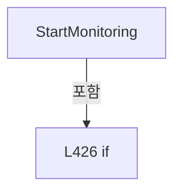

변경 전 점검: 입력/반환 타입, 위 호출자, 예외/취소 경로, 공유 상태와 저장·전송 소비자를 함께 확인합니다. 값의 단위나 물리 방향을 이름만으로 확정하지 않습니다.

### MethodDeclaration `StartMonitoring` · L432–447

[Drilling.Common/Alarm/CAlarmManager.cs:432–447](https://github.com/kjuws10-rgb/A3Drilling/blob/0219666f9053b907d96d7e0aa7d0c6c1be3a73d4/Drilling.Common/Alarm/CAlarmManager.cs#L432-L447)

| 항목 | 실제 추출 값 |
| --- | --- |
| 서명 | void Drilling.Common.Alarm.CAlarmManager.StartMonitoring(System.Action<System.Threading.CancellationToken>[], System.Action<System.Exception>?, System.TimeSpan) |
| 접근/수식자 | Internal / internal |
| 반환/값 타입 | void |
| 소속 타입 | NamedType:Drilling.Common.Alarm.CAlarmManager |

입력 계약:

| 이름 | 타입 | 전달 | 선택/기본값 |
| --- | --- | --- | --- |
| checks | System.Action<System.Threading.CancellationToken>[] | None | False /  |
| reportError | System.Action<System.Exception>? | None | False /  |
| interval | System.TimeSpan | None | False /  |

정적 호출자로 확인된 위치:

| 호출 파일/행 | 호출 표현식 | 런타임 분기 가능 |
| --- | --- | --- |
| [Drilling.Common/Alarm/CAlarmManager.cs:417–428](https://github.com/kjuws10-rgb/A3Drilling/blob/0219666f9053b907d96d7e0aa7d0c6c1be3a73d4/Drilling.Common/Alarm/CAlarmManager.cs#L417-L428) | StartMonitoring | False |

호출하는 대상과 해석 범위:

| 원본 행 | 표현식 | 분석 상태 | 대상/소스 위치 |
| --- | --- | --- | --- |
| 434 | ArgumentNullException.ThrowIfNull | resolved | void System.ArgumentNullException.ThrowIfNull(object?, string?) |
| 435 | EnsureDefinitionsRequested | resolved | void Drilling.Common.Alarm.CAlarmManager.EnsureDefinitionsRequested() · Drilling.Common/Alarm/CAlarmManager.cs:214 |
| 437 | new ArgumentOutOfRangeException | resolved | System.ArgumentOutOfRangeException.ArgumentOutOfRangeException(string?) |
| 437 | nameof | unresolved | None |
| 438 | checks.ToArray | resolved | System.Action<System.Threading.CancellationToken>[] System.Collections.Generic.IEnumerable<System.Action<System.Threading.CancellationToken>>.ToArray<System.Action<System.Threading.CancellationToken>>() |
| 443 | new CancellationTokenSource | resolved | System.Threading.CancellationTokenSource.CancellationTokenSource() |
| 445 | Task.Run | resolved | System.Threading.Tasks.Task System.Threading.Tasks.Task.Run(System.Func<System.Threading.Tasks.Task?>) |
| 445 | Monitor | resolved | System.Threading.Tasks.Task Drilling.Common.Alarm.CAlarmManager.Monitor(System.Action<System.Threading.CancellationToken>[], System.Action<System.Exception>?, System.TimeSpan, System.Threading.CancellationToken) · Drilling.Common/Alarm/CAlarmManager.cs:473 |

본문의 실제 연산·분기·예외·반환 순서(원문 위치 순):

| 원본 행 | 종류 | 주석 해설 |
| --- | --- | --- |
| 434 | call | 함수·델리게이트 또는 객체 생성자를 호출합니다: ArgumentNullException.ThrowIfNull(checks) |
| 435 | call | 함수·델리게이트 또는 객체 생성자를 호출합니다: EnsureDefinitionsRequested() |
| 436 | if | 조건에 따라 분기합니다: if (interval <= TimeSpan.Zero) |
| 437 | call | 함수·델리게이트 또는 객체 생성자를 호출합니다: new ArgumentOutOfRangeException(nameof(interval)) |
| 437 | call | 함수·델리게이트 또는 객체 생성자를 호출합니다: nameof(interval) |
| 437 | throw | 예외를 발생/전달합니다: throw new ArgumentOutOfRangeException(nameof(interval)); |
| 438 | call | 함수·델리게이트 또는 객체 생성자를 호출합니다: checks.ToArray() |
| 438 | local-declaration | 지역 변수를 선언합니다: var registeredChecks = checks.ToArray(); |
| 438 | variable-initializer | 변수의 초기값을 지정합니다: registeredChecks = checks.ToArray() |
| 439 | lock | 공유 상태의 임계 구역에 진입합니다: lock (_monitoringLock) |
| 441 | if | 조건에 따라 분기합니다: if (_monitoringTask is not null) |
| 442 | return | 호출자에게 값 또는 제어를 반환합니다: return; |
| 443 | assignment | 값을 대상에 대입합니다: _monitoringStop = new CancellationTokenSource() |
| 443 | call | 함수·델리게이트 또는 객체 생성자를 호출합니다: new CancellationTokenSource() |
| 444 | local-declaration | 지역 변수를 선언합니다: var token = _monitoringStop.Token; |
| 444 | variable-initializer | 변수의 초기값을 지정합니다: token = _monitoringStop.Token |
| 445 | assignment | 값을 대상에 대입합니다: _monitoringTask = Task.Run(() => Monitor(registeredChecks, reportError, interval, token)) |
| 445 | call | 함수·델리게이트 또는 객체 생성자를 호출합니다: Task.Run(() => Monitor(registeredChecks, reportError, interval, token)) |
| 445 | call | 함수·델리게이트 또는 객체 생성자를 호출합니다: Monitor(registeredChecks, reportError, interval, token) |

제어 구문의 포함 구조(실제 실행 순서/CFG가 아닌 구문 탐색 그림):

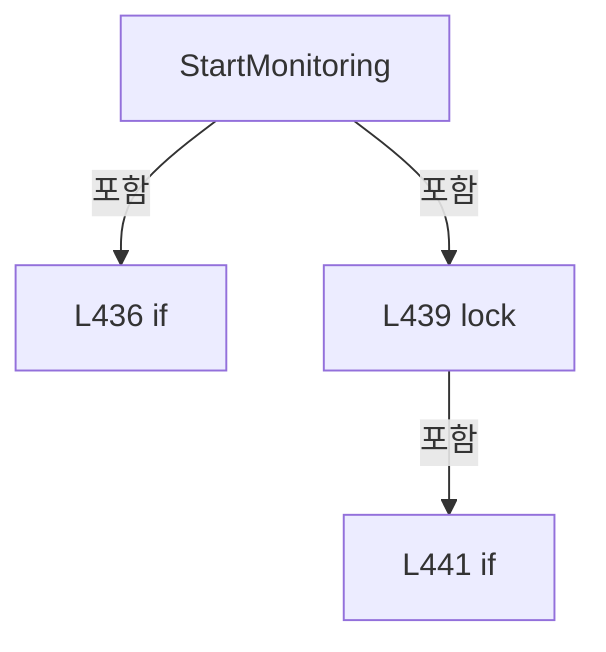

변경 전 점검: 입력/반환 타입, 위 호출자, 예외/취소 경로, 공유 상태와 저장·전송 소비자를 함께 확인합니다. 값의 단위나 물리 방향을 이름만으로 확정하지 않습니다.

### MethodDeclaration `StopMonitoringAsync` · L449–471

[Drilling.Common/Alarm/CAlarmManager.cs:449–471](https://github.com/kjuws10-rgb/A3Drilling/blob/0219666f9053b907d96d7e0aa7d0c6c1be3a73d4/Drilling.Common/Alarm/CAlarmManager.cs#L449-L471)

| 항목 | 실제 추출 값 |
| --- | --- |
| 서명 | System.Threading.Tasks.Task Drilling.Common.Alarm.CAlarmManager.StopMonitoringAsync() |
| 접근/수식자 | Public / public, async |
| 반환/값 타입 | System.Threading.Tasks.Task |
| 소속 타입 | NamedType:Drilling.Common.Alarm.CAlarmManager |

정적 호출자로 확인된 위치:

| 호출 파일/행 | 호출 표현식 | 런타임 분기 가능 |
| --- | --- | --- |
| [Drilling.Common/Managers/CManager.cs:283–283](https://github.com/kjuws10-rgb/A3Drilling/blob/0219666f9053b907d96d7e0aa7d0c6c1be3a73d4/Drilling.Common/Managers/CManager.cs#L283-L283) | _alarmManager.StopMonitoringAsync | False |

호출하는 대상과 해석 범위:

| 원본 행 | 표현식 | 분석 상태 | 대상/소스 위치 |
| --- | --- | --- | --- |
| 459 | stop.Cancel | resolved | void System.Threading.CancellationTokenSource.Cancel() |
| 462 | task.ConfigureAwait | resolved | System.Runtime.CompilerServices.ConfiguredTaskAwaitable System.Threading.Tasks.Task.ConfigureAwait(bool) |
| 465 | ReferenceEquals | resolved | bool object.ReferenceEquals(object?, object?) |
| 469 | stop.Dispose | resolved | void System.Threading.CancellationTokenSource.Dispose() |

본문의 실제 연산·분기·예외·반환 순서(원문 위치 순):

| 원본 행 | 종류 | 주석 해설 |
| --- | --- | --- |
| 451 | local-declaration | 지역 변수를 선언합니다: Task task; |
| 452 | local-declaration | 지역 변수를 선언합니다: CancellationTokenSource stop; |
| 453 | lock | 공유 상태의 임계 구역에 진입합니다: lock (_monitoringLock) |
| 455 | if | 조건에 따라 분기합니다: if (_monitoringTask is null &#124;&#124; _monitoringStop is null) |
| 456 | return | 호출자에게 값 또는 제어를 반환합니다: return; |
| 457 | assignment | 값을 대상에 대입합니다: task = _monitoringTask |
| 458 | assignment | 값을 대상에 대입합니다: stop = _monitoringStop |
| 459 | call | 함수·델리게이트 또는 객체 생성자를 호출합니다: stop.Cancel() |
| 462 | await | 비동기 완료를 기다립니다: await task.ConfigureAwait(false) |
| 462 | call | 함수·델리게이트 또는 객체 생성자를 호출합니다: task.ConfigureAwait(false) |
| 463 | lock | 공유 상태의 임계 구역에 진입합니다: lock (_monitoringLock) |
| 465 | call | 함수·델리게이트 또는 객체 생성자를 호출합니다: ReferenceEquals(_monitoringTask, task) |
| 465 | if | 조건에 따라 분기합니다: if (!ReferenceEquals(_monitoringTask, task)) |
| 466 | return | 호출자에게 값 또는 제어를 반환합니다: return; |
| 467 | assignment | 값을 대상에 대입합니다: _monitoringTask = null |
| 468 | assignment | 값을 대상에 대입합니다: _monitoringStop = null |
| 469 | call | 함수·델리게이트 또는 객체 생성자를 호출합니다: stop.Dispose() |

제어 구문의 포함 구조(실제 실행 순서/CFG가 아닌 구문 탐색 그림):

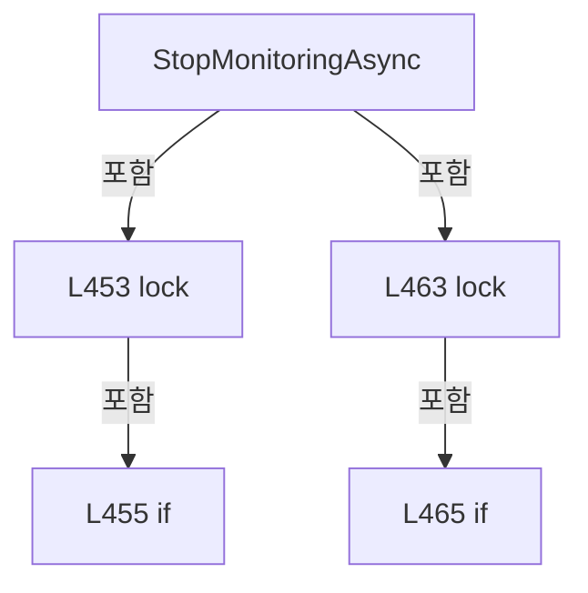

변경 전 점검: 입력/반환 타입, 위 호출자, 예외/취소 경로, 공유 상태와 저장·전송 소비자를 함께 확인합니다. 값의 단위나 물리 방향을 이름만으로 확정하지 않습니다.

### MethodDeclaration `Monitor` · L473–542

[Drilling.Common/Alarm/CAlarmManager.cs:473–542](https://github.com/kjuws10-rgb/A3Drilling/blob/0219666f9053b907d96d7e0aa7d0c6c1be3a73d4/Drilling.Common/Alarm/CAlarmManager.cs#L473-L542)

| 항목 | 실제 추출 값 |
| --- | --- |
| 서명 | System.Threading.Tasks.Task Drilling.Common.Alarm.CAlarmManager.Monitor(System.Action<System.Threading.CancellationToken>[], System.Action<System.Exception>?, System.TimeSpan, System.Threading.CancellationToken) |
| 접근/수식자 | Private / private, async |
| 반환/값 타입 | System.Threading.Tasks.Task |
| 소속 타입 | NamedType:Drilling.Common.Alarm.CAlarmManager |

입력 계약:

| 이름 | 타입 | 전달 | 선택/기본값 |
| --- | --- | --- | --- |
| checks | System.Action<System.Threading.CancellationToken>[] | None | False /  |
| reportError | System.Action<System.Exception>? | None | False /  |
| interval | System.TimeSpan | None | False /  |
| token | System.Threading.CancellationToken | None | False /  |

정적 호출자로 확인된 위치:

| 호출 파일/행 | 호출 표현식 | 런타임 분기 가능 |
| --- | --- | --- |
| [Drilling.Common/Alarm/CAlarmManager.cs:445–445](https://github.com/kjuws10-rgb/A3Drilling/blob/0219666f9053b907d96d7e0aa7d0c6c1be3a73d4/Drilling.Common/Alarm/CAlarmManager.cs#L445-L445) | Monitor | False |

호출하는 대상과 해석 범위:

| 원본 행 | 표현식 | 분석 상태 | 대상/소스 위치 |
| --- | --- | --- | --- |
| 475 | new PeriodicTimer | resolved | System.Threading.PeriodicTimer.PeriodicTimer(System.TimeSpan) |
| 482 | new List<string> | resolved | System.Collections.Generic.List<string>.List() |
| 483 | RetryDefinitionInitialization | resolved | string Drilling.Common.Alarm.CAlarmManager.RetryDefinitionInitialization() · Drilling.Common/Alarm/CAlarmManager.cs:176 |
| 484 | string.IsNullOrEmpty | resolved | bool string.IsNullOrEmpty(string?) |
| 486 | Volatile.Write | resolved | void System.Threading.Volatile.Write<string>(ref string, string) |
| 492 | .Invoke | resolved · 동적 구현 선택 가능 | void System.Action<System.Exception>.Invoke(System.Exception) |
| 492 | new InvalidOperationException | resolved | System.InvalidOperationException.InvalidOperationException(string?) |
| 496 | System.Diagnostics.Debug.WriteLine | resolved | void System.Diagnostics.Debug.WriteLine(object?) |
| 506 | token.ThrowIfCancellationRequested | resolved | void System.Threading.CancellationToken.ThrowIfCancellationRequested() |
| 509 | checks[index] | resolved · 동적 구현 선택 가능 | void System.Action<System.Threading.CancellationToken>.Invoke(System.Threading.CancellationToken) |
| 519 | errors.Add | resolved | void System.Collections.Generic.List<string>.Add(string) |
| 525 | .Invoke | resolved · 동적 구현 선택 가능 | void System.Action<System.Exception>.Invoke(System.Exception) |
| 529 | System.Diagnostics.Debug.WriteLine | resolved | void System.Diagnostics.Debug.WriteLine(object?) |
| 535 | Volatile.Write | resolved | void System.Threading.Volatile.Write<string>(ref string, string) |
| 535 | string.Join | resolved | string string.Join(string?, System.Collections.Generic.IEnumerable<string?>) |
| 537 | timer.WaitForNextTickAsync(token).ConfigureAwait | resolved | System.Runtime.CompilerServices.ConfiguredValueTaskAwaitable<bool> System.Threading.Tasks.ValueTask<bool>.ConfigureAwait(bool) |
| 537 | timer.WaitForNextTickAsync | resolved | System.Threading.Tasks.ValueTask<bool> System.Threading.PeriodicTimer.WaitForNextTickAsync(System.Threading.CancellationToken) |

본문의 실제 연산·분기·예외·반환 순서(원문 위치 순):

| 원본 행 | 종류 | 주석 해설 |
| --- | --- | --- |
| 475 | call | 함수·델리게이트 또는 객체 생성자를 호출합니다: new PeriodicTimer(interval) |
| 475 | using-declaration | 정리할 자원을 선언합니다: using var timer = new PeriodicTimer(interval); |
| 475 | variable-initializer | 변수의 초기값을 지정합니다: timer = new PeriodicTimer(interval) |
| 476 | local-declaration | 지역 변수를 선언합니다: var previousErrors = new string[checks.Length]; |
| 476 | variable-initializer | 변수의 초기값을 지정합니다: previousErrors = new string[checks.Length] |
| 477 | local-declaration | 지역 변수를 선언합니다: var previousDefinitionError = ""; |
| 477 | variable-initializer | 변수의 초기값을 지정합니다: previousDefinitionError = "" |
| 478 | try | 예외 처리 범위입니다: try |
| 480 | do | 본문 실행 후 반복 조건을 확인합니다: do ... while (await timer.WaitForNextTickAsync(token).ConfigureAwait(false)) |
| 482 | call | 함수·델리게이트 또는 객체 생성자를 호출합니다: new List<string>() |
| 482 | local-declaration | 지역 변수를 선언합니다: var errors = new List<string>(); |
| 482 | variable-initializer | 변수의 초기값을 지정합니다: errors = new List<string>() |
| 483 | call | 함수·델리게이트 또는 객체 생성자를 호출합니다: RetryDefinitionInitialization() |
| 483 | local-declaration | 지역 변수를 선언합니다: var definitionError = RetryDefinitionInitialization(); |
| 483 | variable-initializer | 변수의 초기값을 지정합니다: definitionError = RetryDefinitionInitialization() |
| 484 | call | 함수·델리게이트 또는 객체 생성자를 호출합니다: string.IsNullOrEmpty(definitionError) |
| 484 | if | 조건에 따라 분기합니다: if (!string.IsNullOrEmpty(definitionError)) |
| 486 | call | 함수·델리게이트 또는 객체 생성자를 호출합니다: Volatile.Write(ref _monitoringError, $"Alarm definitions: {definitionError}") |
| 487 | if | 조건에 따라 분기합니다: if (previousDefinitionError != definitionError) |
| 489 | assignment | 값을 대상에 대입합니다: previousDefinitionError = definitionError |
| 490 | try | 예외 처리 범위입니다: try |
| 492 | call | 함수·델리게이트 또는 객체 생성자를 호출합니다: .Invoke(new InvalidOperationException($"알람 정의 초기화 대기: {definitionError}")) |
| 492 | call | 함수·델리게이트 또는 객체 생성자를 호출합니다: new InvalidOperationException($"알람 정의 초기화 대기: {definitionError}") |
| 494 | catch | 지정 예외를 처리합니다: catch (Exception reportException) |
| 496 | call | 함수·델리게이트 또는 객체 생성자를 호출합니다: System.Diagnostics.Debug.WriteLine(reportException) |
| 500 | continue | 다음 반복으로 진행합니다: continue; |
| 503 | assignment | 값을 대상에 대입합니다: previousDefinitionError = "" |
| 504 | variable-initializer | 변수의 초기값을 지정합니다: index = 0 |
| 504 | for | 초기화·조건·증감이 있는 반복입니다: for (var index = 0; index < checks.Length; index++) |
| 506 | call | 함수·델리게이트 또는 객체 생성자를 호출합니다: token.ThrowIfCancellationRequested() |
| 507 | try | 예외 처리 범위입니다: try |
| 509 | call | 함수·델리게이트 또는 객체 생성자를 호출합니다: checks[index]&#40;token) |
| 510 | assignment | 값을 대상에 대입합니다: previousErrors[index] = "" |
| 512 | catch | 지정 예외를 처리합니다: catch (OperationCanceledException) when (token.IsCancellationRequested) |
| 514 | throw | 예외를 발생/전달합니다: throw; |
| 516 | catch | 지정 예외를 처리합니다: catch (Exception exception) |
| 518 | local-declaration | 지역 변수를 선언합니다: var message = $"Alarm check {index + 1}: {exception.Message}"; |
| 518 | variable-initializer | 변수의 초기값을 지정합니다: message = $"Alarm check {index + 1}: {exception.Message}" |
| 519 | call | 함수·델리게이트 또는 객체 생성자를 호출합니다: errors.Add(message) |
| 520 | if | 조건에 따라 분기합니다: if (previousErrors[index] != message) |
| 522 | assignment | 값을 대상에 대입합니다: previousErrors[index] = message |
| 523 | try | 예외 처리 범위입니다: try |
| 525 | call | 함수·델리게이트 또는 객체 생성자를 호출합니다: .Invoke(exception) |
| 527 | catch | 지정 예외를 처리합니다: catch (Exception reportException) |
| 529 | call | 함수·델리게이트 또는 객체 생성자를 호출합니다: System.Diagnostics.Debug.WriteLine(reportException) |
| 535 | call | 함수·델리게이트 또는 객체 생성자를 호출합니다: Volatile.Write(ref _monitoringError, string.Join(Environment.NewLine, errors)) |
| 535 | call | 함수·델리게이트 또는 객체 생성자를 호출합니다: string.Join(Environment.NewLine, errors) |
| 537 | await | 비동기 완료를 기다립니다: await timer.WaitForNextTickAsync(token).ConfigureAwait(false) |
| 537 | call | 함수·델리게이트 또는 객체 생성자를 호출합니다: timer.WaitForNextTickAsync(token).ConfigureAwait(false) |
| 537 | call | 함수·델리게이트 또는 객체 생성자를 호출합니다: timer.WaitForNextTickAsync(token) |
| 539 | catch | 지정 예외를 처리합니다: catch (OperationCanceledException) when (token.IsCancellationRequested) |

제어 구문의 포함 구조(실제 실행 순서/CFG가 아닌 구문 탐색 그림):

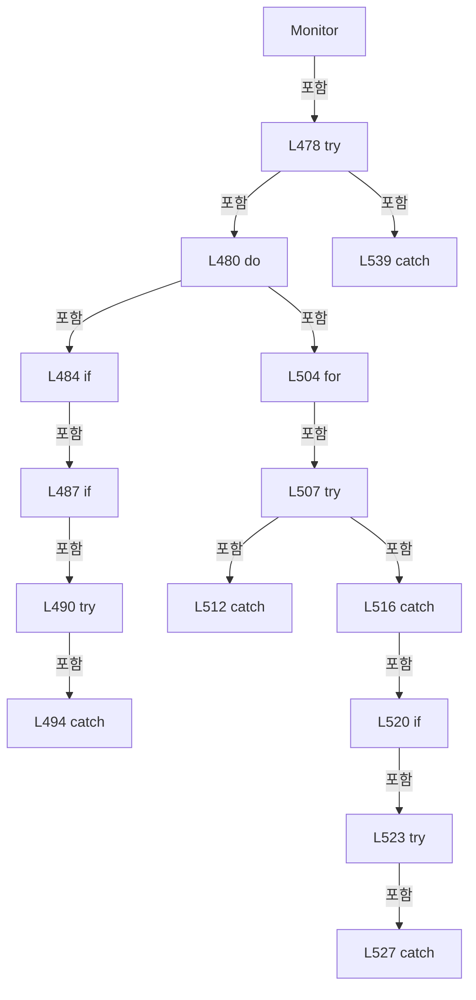

변경 전 점검: 입력/반환 타입, 위 호출자, 예외/취소 경로, 공유 상태와 저장·전송 소비자를 함께 확인합니다. 값의 단위나 물리 방향을 이름만으로 확정하지 않습니다.

### MethodDeclaration `Load` · L549–549

[Drilling.Common/Alarm/CAlarmManager.cs:549–549](https://github.com/kjuws10-rgb/A3Drilling/blob/0219666f9053b907d96d7e0aa7d0c6c1be3a73d4/Drilling.Common/Alarm/CAlarmManager.cs#L549-L549)

| 항목 | 실제 추출 값 |
| --- | --- |
| 서명 | System.Collections.Generic.IReadOnlyList<Drilling.Common.Alarm.ST_ALARM_DEFINITION> Drilling.Common.Alarm.CAlarmListFileBase.Load() |
| 접근/수식자 | Public / public, abstract |
| 반환/값 타입 | System.Collections.Generic.IReadOnlyList<Drilling.Common.Alarm.ST_ALARM_DEFINITION> |
| 소속 타입 | NamedType:Drilling.Common.Alarm.CAlarmListFileBase |

정적 호출자로 확인된 위치:

| 호출 파일/행 | 호출 표현식 | 런타임 분기 가능 |
| --- | --- | --- |
| [Drilling.Common/Alarm/CAlarmManager.cs:147–147](https://github.com/kjuws10-rgb/A3Drilling/blob/0219666f9053b907d96d7e0aa7d0c6c1be3a73d4/Drilling.Common/Alarm/CAlarmManager.cs#L147-L147) | file.Load | False |

변경 전 점검: 입력/반환 타입, 위 호출자, 예외/취소 경로, 공유 상태와 저장·전송 소비자를 함께 확인합니다. 값의 단위나 물리 방향을 이름만으로 확정하지 않습니다.

### EnumMemberDeclaration `Info` · L555–555

[Drilling.Common/Alarm/CAlarmManager.cs:555–555](https://github.com/kjuws10-rgb/A3Drilling/blob/0219666f9053b907d96d7e0aa7d0c6c1be3a73d4/Drilling.Common/Alarm/CAlarmManager.cs#L555-L555)

| 항목 | 실제 추출 값 |
| --- | --- |
| 서명 | Drilling.Common.Alarm.EN_ALARM_LEVEL.Info |
| 접근/수식자 | Public /  |
| 반환/값 타입 | Drilling.Common.Alarm.EN_ALARM_LEVEL |
| 소속 타입 | NamedType:Drilling.Common.Alarm.EN_ALARM_LEVEL |

현재 부분 분석에서 직접 연결된 호출자는 없습니다. XAML/이벤트/인터페이스·델리게이트·외부 진입을 추가 확인해야 하며, 미사용으로 판정한 것이 아닙니다.

변경 전 점검: 입력/반환 타입, 위 호출자, 예외/취소 경로, 공유 상태와 저장·전송 소비자를 함께 확인합니다. 값의 단위나 물리 방향을 이름만으로 확정하지 않습니다.

### EnumMemberDeclaration `Warning` · L556–556

[Drilling.Common/Alarm/CAlarmManager.cs:556–556](https://github.com/kjuws10-rgb/A3Drilling/blob/0219666f9053b907d96d7e0aa7d0c6c1be3a73d4/Drilling.Common/Alarm/CAlarmManager.cs#L556-L556)

| 항목 | 실제 추출 값 |
| --- | --- |
| 서명 | Drilling.Common.Alarm.EN_ALARM_LEVEL.Warning |
| 접근/수식자 | Public /  |
| 반환/값 타입 | Drilling.Common.Alarm.EN_ALARM_LEVEL |
| 소속 타입 | NamedType:Drilling.Common.Alarm.EN_ALARM_LEVEL |

현재 부분 분석에서 직접 연결된 호출자는 없습니다. XAML/이벤트/인터페이스·델리게이트·외부 진입을 추가 확인해야 하며, 미사용으로 판정한 것이 아닙니다.

변경 전 점검: 입력/반환 타입, 위 호출자, 예외/취소 경로, 공유 상태와 저장·전송 소비자를 함께 확인합니다. 값의 단위나 물리 방향을 이름만으로 확정하지 않습니다.

### EnumMemberDeclaration `Critical` · L557–557

[Drilling.Common/Alarm/CAlarmManager.cs:557–557](https://github.com/kjuws10-rgb/A3Drilling/blob/0219666f9053b907d96d7e0aa7d0c6c1be3a73d4/Drilling.Common/Alarm/CAlarmManager.cs#L557-L557)

| 항목 | 실제 추출 값 |
| --- | --- |
| 서명 | Drilling.Common.Alarm.EN_ALARM_LEVEL.Critical |
| 접근/수식자 | Public /  |
| 반환/값 타입 | Drilling.Common.Alarm.EN_ALARM_LEVEL |
| 소속 타입 | NamedType:Drilling.Common.Alarm.EN_ALARM_LEVEL |

현재 부분 분석에서 직접 연결된 호출자는 없습니다. XAML/이벤트/인터페이스·델리게이트·외부 진입을 추가 확인해야 하며, 미사용으로 판정한 것이 아닙니다.

변경 전 점검: 입력/반환 타입, 위 호출자, 예외/취소 경로, 공유 상태와 저장·전송 소비자를 함께 확인합니다. 값의 단위나 물리 방향을 이름만으로 확정하지 않습니다.

### EnumMemberDeclaration `Clear` · L562–562

[Drilling.Common/Alarm/CAlarmManager.cs:562–562](https://github.com/kjuws10-rgb/A3Drilling/blob/0219666f9053b907d96d7e0aa7d0c6c1be3a73d4/Drilling.Common/Alarm/CAlarmManager.cs#L562-L562)

| 항목 | 실제 추출 값 |
| --- | --- |
| 서명 | Drilling.Common.Alarm.EN_ALARM_STATE.Clear |
| 접근/수식자 | Public /  |
| 반환/값 타입 | Drilling.Common.Alarm.EN_ALARM_STATE |
| 소속 타입 | NamedType:Drilling.Common.Alarm.EN_ALARM_STATE |

현재 부분 분석에서 직접 연결된 호출자는 없습니다. XAML/이벤트/인터페이스·델리게이트·외부 진입을 추가 확인해야 하며, 미사용으로 판정한 것이 아닙니다.

변경 전 점검: 입력/반환 타입, 위 호출자, 예외/취소 경로, 공유 상태와 저장·전송 소비자를 함께 확인합니다. 값의 단위나 물리 방향을 이름만으로 확정하지 않습니다.

### EnumMemberDeclaration `Occur` · L563–563

[Drilling.Common/Alarm/CAlarmManager.cs:563–563](https://github.com/kjuws10-rgb/A3Drilling/blob/0219666f9053b907d96d7e0aa7d0c6c1be3a73d4/Drilling.Common/Alarm/CAlarmManager.cs#L563-L563)

| 항목 | 실제 추출 값 |
| --- | --- |
| 서명 | Drilling.Common.Alarm.EN_ALARM_STATE.Occur |
| 접근/수식자 | Public /  |
| 반환/값 타입 | Drilling.Common.Alarm.EN_ALARM_STATE |
| 소속 타입 | NamedType:Drilling.Common.Alarm.EN_ALARM_STATE |

현재 부분 분석에서 직접 연결된 호출자는 없습니다. XAML/이벤트/인터페이스·델리게이트·외부 진입을 추가 확인해야 하며, 미사용으로 판정한 것이 아닙니다.

변경 전 점검: 입력/반환 타입, 위 호출자, 예외/취소 경로, 공유 상태와 저장·전송 소비자를 함께 확인합니다. 값의 단위나 물리 방향을 이름만으로 확정하지 않습니다.

### PropertyDeclaration `Id` · L568–568

[Drilling.Common/Alarm/CAlarmManager.cs:568–568](https://github.com/kjuws10-rgb/A3Drilling/blob/0219666f9053b907d96d7e0aa7d0c6c1be3a73d4/Drilling.Common/Alarm/CAlarmManager.cs#L568-L568)

| 항목 | 실제 추출 값 |
| --- | --- |
| 서명 | string Drilling.Common.Alarm.ST_ALARM_DATA.Id |
| 접근/수식자 | Public / public |
| 반환/값 타입 | string |
| 소속 타입 | NamedType:Drilling.Common.Alarm.ST_ALARM_DATA |

현재 부분 분석에서 직접 연결된 호출자는 없습니다. XAML/이벤트/인터페이스·델리게이트·외부 진입을 추가 확인해야 하며, 미사용으로 판정한 것이 아닙니다.

변경 전 점검: 입력/반환 타입, 위 호출자, 예외/취소 경로, 공유 상태와 저장·전송 소비자를 함께 확인합니다. 값의 단위나 물리 방향을 이름만으로 확정하지 않습니다.

### GetAccessorDeclaration `get_Id` · L568–568

[Drilling.Common/Alarm/CAlarmManager.cs:568–568](https://github.com/kjuws10-rgb/A3Drilling/blob/0219666f9053b907d96d7e0aa7d0c6c1be3a73d4/Drilling.Common/Alarm/CAlarmManager.cs#L568-L568)

| 항목 | 실제 추출 값 |
| --- | --- |
| 서명 | string Drilling.Common.Alarm.ST_ALARM_DATA.Id.get |
| 접근/수식자 | Public / get |
| 반환/값 타입 | string |
| 소속 타입 | NamedType:Drilling.Common.Alarm.ST_ALARM_DATA |

현재 부분 분석에서 직접 연결된 호출자는 없습니다. XAML/이벤트/인터페이스·델리게이트·외부 진입을 추가 확인해야 하며, 미사용으로 판정한 것이 아닙니다.

변경 전 점검: 입력/반환 타입, 위 호출자, 예외/취소 경로, 공유 상태와 저장·전송 소비자를 함께 확인합니다. 값의 단위나 물리 방향을 이름만으로 확정하지 않습니다.

### InitAccessorDeclaration `set_Id` · L568–568

[Drilling.Common/Alarm/CAlarmManager.cs:568–568](https://github.com/kjuws10-rgb/A3Drilling/blob/0219666f9053b907d96d7e0aa7d0c6c1be3a73d4/Drilling.Common/Alarm/CAlarmManager.cs#L568-L568)

| 항목 | 실제 추출 값 |
| --- | --- |
| 서명 | void Drilling.Common.Alarm.ST_ALARM_DATA.Id.init |
| 접근/수식자 | Public / init |
| 반환/값 타입 | void |
| 소속 타입 | NamedType:Drilling.Common.Alarm.ST_ALARM_DATA |

입력 계약:

| 이름 | 타입 | 전달 | 선택/기본값 |
| --- | --- | --- | --- |
| value | string | None | False /  |

현재 부분 분석에서 직접 연결된 호출자는 없습니다. XAML/이벤트/인터페이스·델리게이트·외부 진입을 추가 확인해야 하며, 미사용으로 판정한 것이 아닙니다.

변경 전 점검: 입력/반환 타입, 위 호출자, 예외/취소 경로, 공유 상태와 저장·전송 소비자를 함께 확인합니다. 값의 단위나 물리 방향을 이름만으로 확정하지 않습니다.

### PropertyDeclaration `Group` · L569–569

[Drilling.Common/Alarm/CAlarmManager.cs:569–569](https://github.com/kjuws10-rgb/A3Drilling/blob/0219666f9053b907d96d7e0aa7d0c6c1be3a73d4/Drilling.Common/Alarm/CAlarmManager.cs#L569-L569)

| 항목 | 실제 추출 값 |
| --- | --- |
| 서명 | string Drilling.Common.Alarm.ST_ALARM_DATA.Group |
| 접근/수식자 | Public / public |
| 반환/값 타입 | string |
| 소속 타입 | NamedType:Drilling.Common.Alarm.ST_ALARM_DATA |

현재 부분 분석에서 직접 연결된 호출자는 없습니다. XAML/이벤트/인터페이스·델리게이트·외부 진입을 추가 확인해야 하며, 미사용으로 판정한 것이 아닙니다.

변경 전 점검: 입력/반환 타입, 위 호출자, 예외/취소 경로, 공유 상태와 저장·전송 소비자를 함께 확인합니다. 값의 단위나 물리 방향을 이름만으로 확정하지 않습니다.

### GetAccessorDeclaration `get_Group` · L569–569

[Drilling.Common/Alarm/CAlarmManager.cs:569–569](https://github.com/kjuws10-rgb/A3Drilling/blob/0219666f9053b907d96d7e0aa7d0c6c1be3a73d4/Drilling.Common/Alarm/CAlarmManager.cs#L569-L569)

| 항목 | 실제 추출 값 |
| --- | --- |
| 서명 | string Drilling.Common.Alarm.ST_ALARM_DATA.Group.get |
| 접근/수식자 | Public / get |
| 반환/값 타입 | string |
| 소속 타입 | NamedType:Drilling.Common.Alarm.ST_ALARM_DATA |

현재 부분 분석에서 직접 연결된 호출자는 없습니다. XAML/이벤트/인터페이스·델리게이트·외부 진입을 추가 확인해야 하며, 미사용으로 판정한 것이 아닙니다.

변경 전 점검: 입력/반환 타입, 위 호출자, 예외/취소 경로, 공유 상태와 저장·전송 소비자를 함께 확인합니다. 값의 단위나 물리 방향을 이름만으로 확정하지 않습니다.

### InitAccessorDeclaration `set_Group` · L569–569

[Drilling.Common/Alarm/CAlarmManager.cs:569–569](https://github.com/kjuws10-rgb/A3Drilling/blob/0219666f9053b907d96d7e0aa7d0c6c1be3a73d4/Drilling.Common/Alarm/CAlarmManager.cs#L569-L569)

| 항목 | 실제 추출 값 |
| --- | --- |
| 서명 | void Drilling.Common.Alarm.ST_ALARM_DATA.Group.init |
| 접근/수식자 | Public / init |
| 반환/값 타입 | void |
| 소속 타입 | NamedType:Drilling.Common.Alarm.ST_ALARM_DATA |

입력 계약:

| 이름 | 타입 | 전달 | 선택/기본값 |
| --- | --- | --- | --- |
| value | string | None | False /  |

현재 부분 분석에서 직접 연결된 호출자는 없습니다. XAML/이벤트/인터페이스·델리게이트·외부 진입을 추가 확인해야 하며, 미사용으로 판정한 것이 아닙니다.

변경 전 점검: 입력/반환 타입, 위 호출자, 예외/취소 경로, 공유 상태와 저장·전송 소비자를 함께 확인합니다. 값의 단위나 물리 방향을 이름만으로 확정하지 않습니다.

### PropertyDeclaration `CimAddress` · L570–570

[Drilling.Common/Alarm/CAlarmManager.cs:570–570](https://github.com/kjuws10-rgb/A3Drilling/blob/0219666f9053b907d96d7e0aa7d0c6c1be3a73d4/Drilling.Common/Alarm/CAlarmManager.cs#L570-L570)

| 항목 | 실제 추출 값 |
| --- | --- |
| 서명 | string Drilling.Common.Alarm.ST_ALARM_DATA.CimAddress |
| 접근/수식자 | Public / public |
| 반환/값 타입 | string |
| 소속 타입 | NamedType:Drilling.Common.Alarm.ST_ALARM_DATA |

현재 부분 분석에서 직접 연결된 호출자는 없습니다. XAML/이벤트/인터페이스·델리게이트·외부 진입을 추가 확인해야 하며, 미사용으로 판정한 것이 아닙니다.

변경 전 점검: 입력/반환 타입, 위 호출자, 예외/취소 경로, 공유 상태와 저장·전송 소비자를 함께 확인합니다. 값의 단위나 물리 방향을 이름만으로 확정하지 않습니다.

### GetAccessorDeclaration `get_CimAddress` · L570–570

[Drilling.Common/Alarm/CAlarmManager.cs:570–570](https://github.com/kjuws10-rgb/A3Drilling/blob/0219666f9053b907d96d7e0aa7d0c6c1be3a73d4/Drilling.Common/Alarm/CAlarmManager.cs#L570-L570)

| 항목 | 실제 추출 값 |
| --- | --- |
| 서명 | string Drilling.Common.Alarm.ST_ALARM_DATA.CimAddress.get |
| 접근/수식자 | Public / get |
| 반환/값 타입 | string |
| 소속 타입 | NamedType:Drilling.Common.Alarm.ST_ALARM_DATA |

현재 부분 분석에서 직접 연결된 호출자는 없습니다. XAML/이벤트/인터페이스·델리게이트·외부 진입을 추가 확인해야 하며, 미사용으로 판정한 것이 아닙니다.

변경 전 점검: 입력/반환 타입, 위 호출자, 예외/취소 경로, 공유 상태와 저장·전송 소비자를 함께 확인합니다. 값의 단위나 물리 방향을 이름만으로 확정하지 않습니다.

### InitAccessorDeclaration `set_CimAddress` · L570–570

[Drilling.Common/Alarm/CAlarmManager.cs:570–570](https://github.com/kjuws10-rgb/A3Drilling/blob/0219666f9053b907d96d7e0aa7d0c6c1be3a73d4/Drilling.Common/Alarm/CAlarmManager.cs#L570-L570)

| 항목 | 실제 추출 값 |
| --- | --- |
| 서명 | void Drilling.Common.Alarm.ST_ALARM_DATA.CimAddress.init |
| 접근/수식자 | Public / init |
| 반환/값 타입 | void |
| 소속 타입 | NamedType:Drilling.Common.Alarm.ST_ALARM_DATA |

입력 계약:

| 이름 | 타입 | 전달 | 선택/기본값 |
| --- | --- | --- | --- |
| value | string | None | False /  |

현재 부분 분석에서 직접 연결된 호출자는 없습니다. XAML/이벤트/인터페이스·델리게이트·외부 진입을 추가 확인해야 하며, 미사용으로 판정한 것이 아닙니다.

변경 전 점검: 입력/반환 타입, 위 호출자, 예외/취소 경로, 공유 상태와 저장·전송 소비자를 함께 확인합니다. 값의 단위나 물리 방향을 이름만으로 확정하지 않습니다.

### MethodDeclaration `Check` · L577–609

[Drilling.Common/Alarm/CAlarmManager.cs:577–609](https://github.com/kjuws10-rgb/A3Drilling/blob/0219666f9053b907d96d7e0aa7d0c6c1be3a73d4/Drilling.Common/Alarm/CAlarmManager.cs#L577-L609)

| 항목 | 실제 추출 값 |
| --- | --- |
| 서명 | void Drilling.Common.Alarm.CScannerTemperatureAlarmMonitor.Check() |
| 접근/수식자 | Public / public |
| 반환/값 타입 | void |
| 소속 타입 | NamedType:Drilling.Common.Alarm.CScannerTemperatureAlarmMonitor |

정적 호출자로 확인된 위치:

| 호출 파일/행 | 호출 표현식 | 런타임 분기 가능 |
| --- | --- | --- |
| [Drilling.Common/Alarm/CAlarmManager.cs:420–420](https://github.com/kjuws10-rgb/A3Drilling/blob/0219666f9053b907d96d7e0aa7d0c6c1be3a73d4/Drilling.Common/Alarm/CAlarmManager.cs#L420-L420) | temperatures.Check | False |

호출하는 대상과 해석 범위:

| 원본 행 | 표현식 | 분석 상태 | 대상/소스 위치 |
| --- | --- | --- | --- |
| 579 | settings.LoadSection | resolved | System.Collections.Generic.IReadOnlyList<Drilling.Common.Managers.ST_SYSTEM_PARAMETER> Drilling.Common.Managers.CSettingManager.LoadSection(Drilling.Common.Managers.EN_SETTING_TAB, System.Threading.CancellationToken) · Drilling.Common/Managers/CSettingManager.cs:26 |
| 580 | options.FirstOrDefault | resolved | Drilling.Common.Managers.ST_SYSTEM_PARAMETER? System.Collections.Generic.IEnumerable<Drilling.Common.Managers.ST_SYSTEM_PARAMETER>.FirstOrDefault<Drilling.Common.Managers.ST_SYSTEM_PARAMETER>(System.Func<Drilling.Common.Managers.ST_SYSTEM_PARAMETER, bool>) |
| 580 | option.Key.Equals | resolved | bool string.Equals(string?, System.StringComparison) |
| 580 | option.Name.Equals | resolved | bool string.Equals(string?, System.StringComparison) |
| 581 | double.TryParse | resolved | bool double.TryParse(string?, System.Globalization.NumberStyles, System.IFormatProvider?, out double) |
| 581 | double.TryParse | resolved | bool double.TryParse(string?, System.Globalization.NumberStyles, System.IFormatProvider?, out double) |
| 581 | double.IsFinite | resolved | bool double.IsFinite(double) |
| 583 | string.IsNullOrWhiteSpace | resolved | bool string.IsNullOrWhiteSpace(string?) |
| 586 | new InvalidDataException | resolved | System.IO.InvalidDataException.InvalidDataException(string?) |
| 592 | CScannerAxisConfiguration.BuildAxisDefinitions | resolved | System.Collections.Generic.IReadOnlyList<Drilling.Common.Automation.ST_SCANNER_AXIS_SETTING> Drilling.Common.Automation.CScannerAxisConfiguration.BuildAxisDefinitions(System.Collections.Generic.IReadOnlyList<Drilling.Common.Managers.ST_SYSTEM_PARAMETER>, int) · Drilling.Common/Automation/CScannerAxisConfiguration.cs:8 |
| 594 | string.IsNullOrEmpty | resolved | bool string.IsNullOrEmpty(string?) |
| 596 | automation.IsSimul | resolved | bool Drilling.Common.Automation.CAutomationManager.IsSimul(int) · Drilling.Common/Automation/CAutomationManager.cs:63 |
| 596 | automation.IsConnect | resolved | bool Drilling.Common.Automation.CAutomationManager.IsConnect(int) · Drilling.Common/Automation/CAutomationManager.cs:58 |
| 599 | automation.StatusSnapshots.GetAxis | resolved | Drilling.Common.Automation.ST_AUTOMATION_STATUS_SNAPSHOT<Drilling.Common.Automation.ST_AUTOMATION_AXIS_STATUS> Drilling.Common.Automation.CAutomationStatusSnapshotService.GetAxis(string, int, int, bool) · Drilling.Common/Automation/CAutomationStatusSnapshotService.cs:23 |
| 602 | double.IsFinite | resolved | bool double.IsFinite(double) |
| 607 | alarms.SetAlarm | resolved | bool Drilling.Common.Alarm.CAlarmManager.SetAlarm(int) · Drilling.Common/Alarm/CAlarmManager.cs:233 |

본문의 실제 연산·분기·예외·반환 순서(원문 위치 순):

| 원본 행 | 종류 | 주석 해설 |
| --- | --- | --- |
| 579 | call | 함수·델리게이트 또는 객체 생성자를 호출합니다: settings.LoadSection(EN_SETTING_TAB.Option) |
| 579 | local-declaration | 지역 변수를 선언합니다: var options = settings.LoadSection(EN_SETTING_TAB.Option); |
| 579 | variable-initializer | 변수의 초기값을 지정합니다: options = settings.LoadSection(EN_SETTING_TAB.Option) |
| 580 | call | 함수·델리게이트 또는 객체 생성자를 호출합니다: options.FirstOrDefault(option => option.Key.Equals("SCANNER_TEMP_LIMIT", StringComparison.OrdinalIgnoreCase) &#124;&#124; option.Name.Equals("SCANNER_TEMP_LIMIT", StringComparison.OrdinalIgnoreCase)) |
| 580 | call | 함수·델리게이트 또는 객체 생성자를 호출합니다: option.Key.Equals("SCANNER_TEMP_LIMIT", StringComparison.OrdinalIgnoreCase) |
| 580 | call | 함수·델리게이트 또는 객체 생성자를 호출합니다: option.Name.Equals("SCANNER_TEMP_LIMIT", StringComparison.OrdinalIgnoreCase) |
| 580 | local-declaration | 지역 변수를 선언합니다: var limitText = options.FirstOrDefault(option => option.Key.Equals("SCANNER_TEMP_LIMIT", StringComparison.OrdinalIgnoreCase) &#124;&#124; option.Name.Equals("SCANNER_TEMP_LIMIT", StringComparison.OrdinalIgnoreCase))?.Value; |
| 580 | variable-initializer | 변수의 초기값을 지정합니다: limitText = options.FirstOrDefault(option => option.Key.Equals("SCANNER_TEMP_LIMIT", StringComparison.OrdinalIgnoreCase) &#124;&#124; option.Name.Equals("SCANNER_TEMP_LIMIT", StringComparison.OrdinalIgnoreCase))?.Value |
| 581 | call | 함수·델리게이트 또는 객체 생성자를 호출합니다: double.TryParse(limitText, NumberStyles.Float, CultureInfo.InvariantCulture, out var limit) |
| 581 | call | 함수·델리게이트 또는 객체 생성자를 호출합니다: double.TryParse(limitText, NumberStyles.Float, CultureInfo.CurrentCulture, out limit) |
| 581 | call | 함수·델리게이트 또는 객체 생성자를 호출합니다: double.IsFinite(limit) |
| 581 | if | 조건에 따라 분기합니다: if ((!double.TryParse(limitText, NumberStyles.Float, CultureInfo.InvariantCulture, out var limit) && !double.TryParse(limitText, NumberStyles.Float, CultureInfo.CurrentCulture, out limit)) &#124;&#124; !double.IsFinite(limit) &#124;&#124; limit…) |
| 583 | call | 함수·델리게이트 또는 객체 생성자를 호출합니다: string.IsNullOrWhiteSpace(limitText) |
| 583 | conditional-expression | 조건에 따라 결과식을 선택합니다: limitText is null ? "<누락>" : string.IsNullOrWhiteSpace(limitText) ? "<빈 값>" : limitText |
| 583 | conditional-expression | 조건에 따라 결과식을 선택합니다: string.IsNullOrWhiteSpace(limitText) ? "<빈 값>" : limitText |
| 583 | local-declaration | 지역 변수를 선언합니다: var displayedValue = limitText is null ? "<누락>" : string.IsNullOrWhiteSpace(limitText) ? "<빈 값>" : limitText; |
| 583 | variable-initializer | 변수의 초기값을 지정합니다: displayedValue = limitText is null ? "<누락>" : string.IsNullOrWhiteSpace(limitText) ? "<빈 값>" : limitText |
| 586 | call | 함수·델리게이트 또는 객체 생성자를 호출합니다: new InvalidDataException($"Scanner Temp Limit (SCANNER_TEMP_LIMIT) 설정 오류: " + $"0 이상의 유한한 온도(°C)가 필요합니다. 현재 값: {displayedValue}. " + "Setting > OPTION > INTERLOCK에서 확인해 주세요.") |
| 586 | throw | 예외를 발생/전달합니다: throw new InvalidDataException($"Scanner Temp Limit (SCANNER_TEMP_LIMIT) 설정 오류: " + $"0 이상의 유한한 온도(°C)가 필요합니다. 현재 값: {displayedValue}. " + "Setting > OPTION > INTERLOCK에서 확인해 주세요."); |
| 589 | variable-initializer | 변수의 초기값을 지정합니다: headNo = 1 |
| 589 | for | 초기화·조건·증감이 있는 반복입니다: for (var headNo = 1; headNo <= 8; headNo++) |
| 591 | local-declaration | 지역 변수를 선언합니다: var overLimit = false; |
| 591 | variable-initializer | 변수의 초기값을 지정합니다: overLimit = false |
| 592 | call | 함수·델리게이트 또는 객체 생성자를 호출합니다: CScannerAxisConfiguration.BuildAxisDefinitions(options, headNo) |
| 592 | foreach | 컬렉션 요소를 순회합니다: foreach (var axis in CScannerAxisConfiguration.BuildAxisDefinitions(options, headNo)) |
| 594 | call | 함수·델리게이트 또는 객체 생성자를 호출합니다: string.IsNullOrEmpty(axis.ConfigurationError) |
| 594 | if | 조건에 따라 분기합니다: if (!axis.IsUsed &#124;&#124; !axis.ReadExtendedStatus &#124;&#124; !string.IsNullOrEmpty(axis.ConfigurationError)) |
| 595 | continue | 다음 반복으로 진행합니다: continue; |
| 596 | call | 함수·델리게이트 또는 객체 생성자를 호출합니다: automation.IsSimul(axis.AutomationNo) |
| 596 | call | 함수·델리게이트 또는 객체 생성자를 호출합니다: automation.IsConnect(axis.AutomationNo) |
| 596 | if | 조건에 따라 분기합니다: if (!automation.IsSimul(axis.AutomationNo) && !automation.IsConnect(axis.AutomationNo)) |
| 597 | continue | 다음 반복으로 진행합니다: continue; |
| 599 | call | 함수·델리게이트 또는 객체 생성자를 호출합니다: automation.StatusSnapshots.GetAxis(axis.AxisReference, axis.AutomationNo, axis.AioNo, axis.ReadExtendedStatus) |
| 599 | local-declaration | 지역 변수를 선언합니다: var snapshot = automation.StatusSnapshots.GetAxis(axis.AxisReference, axis.AutomationNo, axis.AioNo, axis.ReadExtendedStatus); |
| 599 | variable-initializer | 변수의 초기값을 지정합니다: snapshot = automation.StatusSnapshots.GetAxis(axis.AxisReference, axis.AutomationNo, axis.AioNo, axis.ReadExtendedStatus) |
| 600 | if | 조건에 따라 분기합니다: if (snapshot.State != "OK" &#124;&#124; snapshot.Value is not { } status) |
| 601 | continue | 다음 반복으로 진행합니다: continue; |
| 602 | assignment | 값을 대상에 대입합니다: overLimit &#124;= double.IsFinite(status.MotorTemperature) && status.MotorTemperature > limit |
| 602 | call | 함수·델리게이트 또는 객체 생성자를 호출합니다: double.IsFinite(status.MotorTemperature) |
| 606 | if | 조건에 따라 분기합니다: if (overLimit) |
| 607 | call | 함수·델리게이트 또는 객체 생성자를 호출합니다: alarms.SetAlarm(1047 + headNo) |

제어 구문의 포함 구조(실제 실행 순서/CFG가 아닌 구문 탐색 그림):

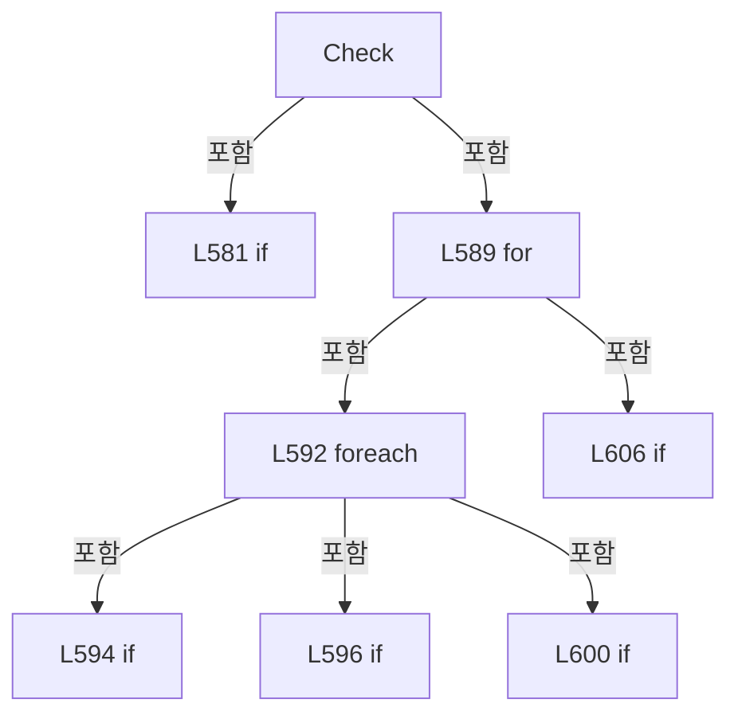

변경 전 점검: 입력/반환 타입, 위 호출자, 예외/취소 경로, 공유 상태와 저장·전송 소비자를 함께 확인합니다. 값의 단위나 물리 방향을 이름만으로 확정하지 않습니다.

### FieldDeclaration `_reported` · L615–615

[Drilling.Common/Alarm/CAlarmManager.cs:615–615](https://github.com/kjuws10-rgb/A3Drilling/blob/0219666f9053b907d96d7e0aa7d0c6c1be3a73d4/Drilling.Common/Alarm/CAlarmManager.cs#L615-L615)

| 항목 | 실제 추출 값 |
| --- | --- |
| 서명 | int Drilling.Common.Alarm.CSequenceFailureException._reported |
| 접근/수식자 | Private / private |
| 반환/값 타입 | int |
| 소속 타입 | NamedType:Drilling.Common.Alarm.CSequenceFailureException |

현재 부분 분석에서 직접 연결된 호출자는 없습니다. XAML/이벤트/인터페이스·델리게이트·외부 진입을 추가 확인해야 하며, 미사용으로 판정한 것이 아닙니다.

변경 전 점검: 입력/반환 타입, 위 호출자, 예외/취소 경로, 공유 상태와 저장·전송 소비자를 함께 확인합니다. 값의 단위나 물리 방향을 이름만으로 확정하지 않습니다.

### ConstructorDeclaration `.ctor` · L616–618

[Drilling.Common/Alarm/CAlarmManager.cs:616–618](https://github.com/kjuws10-rgb/A3Drilling/blob/0219666f9053b907d96d7e0aa7d0c6c1be3a73d4/Drilling.Common/Alarm/CAlarmManager.cs#L616-L618)

| 항목 | 실제 추출 값 |
| --- | --- |
| 서명 | Drilling.Common.Alarm.CSequenceFailureException.CSequenceFailureException(string, string, string, System.Exception) |
| 접근/수식자 | Private / private |
| 반환/값 타입 | void |
| 소속 타입 | NamedType:Drilling.Common.Alarm.CSequenceFailureException |

입력 계약:

| 이름 | 타입 | 전달 | 선택/기본값 |
| --- | --- | --- | --- |
| scenario | string | None | False /  |
| subject | string | None | False /  |
| kind | string | None | False /  |
| error | System.Exception | None | False /  |

정적 호출자로 확인된 위치:

| 호출 파일/행 | 호출 표현식 | 런타임 분기 가능 |
| --- | --- | --- |
| [Drilling.Common/Alarm/CAlarmManager.cs:646–646](https://github.com/kjuws10-rgb/A3Drilling/blob/0219666f9053b907d96d7e0aa7d0c6c1be3a73d4/Drilling.Common/Alarm/CAlarmManager.cs#L646-L646) | new | False |
| [Drilling.Common/Alarm/CAlarmManager.cs:648–648](https://github.com/kjuws10-rgb/A3Drilling/blob/0219666f9053b907d96d7e0aa7d0c6c1be3a73d4/Drilling.Common/Alarm/CAlarmManager.cs#L648-L648) | new | False |
| [Drilling.Common/Alarm/CAlarmManager.cs:649–649](https://github.com/kjuws10-rgb/A3Drilling/blob/0219666f9053b907d96d7e0aa7d0c6c1be3a73d4/Drilling.Common/Alarm/CAlarmManager.cs#L649-L649) | new | False |

본문의 실제 연산·분기·예외·반환 순서(원문 위치 순):

| 원본 행 | 종류 | 주석 해설 |
| --- | --- | --- |
| 618 | assignment | 값을 대상에 대입합니다: Scenario = scenario |
| 618 | assignment | 값을 대상에 대입합니다: Subject = subject |
| 618 | assignment | 값을 대상에 대입합니다: Kind = kind |

변경 전 점검: 입력/반환 타입, 위 호출자, 예외/취소 경로, 공유 상태와 저장·전송 소비자를 함께 확인합니다. 값의 단위나 물리 방향을 이름만으로 확정하지 않습니다.

### PropertyDeclaration `Scenario` · L619–619

[Drilling.Common/Alarm/CAlarmManager.cs:619–619](https://github.com/kjuws10-rgb/A3Drilling/blob/0219666f9053b907d96d7e0aa7d0c6c1be3a73d4/Drilling.Common/Alarm/CAlarmManager.cs#L619-L619)

| 항목 | 실제 추출 값 |
| --- | --- |
| 서명 | string Drilling.Common.Alarm.CSequenceFailureException.Scenario |
| 접근/수식자 | Public / public |
| 반환/값 타입 | string |
| 소속 타입 | NamedType:Drilling.Common.Alarm.CSequenceFailureException |

현재 부분 분석에서 직접 연결된 호출자는 없습니다. XAML/이벤트/인터페이스·델리게이트·외부 진입을 추가 확인해야 하며, 미사용으로 판정한 것이 아닙니다.

변경 전 점검: 입력/반환 타입, 위 호출자, 예외/취소 경로, 공유 상태와 저장·전송 소비자를 함께 확인합니다. 값의 단위나 물리 방향을 이름만으로 확정하지 않습니다.

### GetAccessorDeclaration `get_Scenario` · L619–619

[Drilling.Common/Alarm/CAlarmManager.cs:619–619](https://github.com/kjuws10-rgb/A3Drilling/blob/0219666f9053b907d96d7e0aa7d0c6c1be3a73d4/Drilling.Common/Alarm/CAlarmManager.cs#L619-L619)

| 항목 | 실제 추출 값 |
| --- | --- |
| 서명 | string Drilling.Common.Alarm.CSequenceFailureException.Scenario.get |
| 접근/수식자 | Public / get |
| 반환/값 타입 | string |
| 소속 타입 | NamedType:Drilling.Common.Alarm.CSequenceFailureException |

현재 부분 분석에서 직접 연결된 호출자는 없습니다. XAML/이벤트/인터페이스·델리게이트·외부 진입을 추가 확인해야 하며, 미사용으로 판정한 것이 아닙니다.

변경 전 점검: 입력/반환 타입, 위 호출자, 예외/취소 경로, 공유 상태와 저장·전송 소비자를 함께 확인합니다. 값의 단위나 물리 방향을 이름만으로 확정하지 않습니다.

### PropertyDeclaration `Subject` · L620–620

[Drilling.Common/Alarm/CAlarmManager.cs:620–620](https://github.com/kjuws10-rgb/A3Drilling/blob/0219666f9053b907d96d7e0aa7d0c6c1be3a73d4/Drilling.Common/Alarm/CAlarmManager.cs#L620-L620)

| 항목 | 실제 추출 값 |
| --- | --- |
| 서명 | string Drilling.Common.Alarm.CSequenceFailureException.Subject |
| 접근/수식자 | Public / public |
| 반환/값 타입 | string |
| 소속 타입 | NamedType:Drilling.Common.Alarm.CSequenceFailureException |

현재 부분 분석에서 직접 연결된 호출자는 없습니다. XAML/이벤트/인터페이스·델리게이트·외부 진입을 추가 확인해야 하며, 미사용으로 판정한 것이 아닙니다.

변경 전 점검: 입력/반환 타입, 위 호출자, 예외/취소 경로, 공유 상태와 저장·전송 소비자를 함께 확인합니다. 값의 단위나 물리 방향을 이름만으로 확정하지 않습니다.

### GetAccessorDeclaration `get_Subject` · L620–620

[Drilling.Common/Alarm/CAlarmManager.cs:620–620](https://github.com/kjuws10-rgb/A3Drilling/blob/0219666f9053b907d96d7e0aa7d0c6c1be3a73d4/Drilling.Common/Alarm/CAlarmManager.cs#L620-L620)

| 항목 | 실제 추출 값 |
| --- | --- |
| 서명 | string Drilling.Common.Alarm.CSequenceFailureException.Subject.get |
| 접근/수식자 | Public / get |
| 반환/값 타입 | string |
| 소속 타입 | NamedType:Drilling.Common.Alarm.CSequenceFailureException |

현재 부분 분석에서 직접 연결된 호출자는 없습니다. XAML/이벤트/인터페이스·델리게이트·외부 진입을 추가 확인해야 하며, 미사용으로 판정한 것이 아닙니다.

변경 전 점검: 입력/반환 타입, 위 호출자, 예외/취소 경로, 공유 상태와 저장·전송 소비자를 함께 확인합니다. 값의 단위나 물리 방향을 이름만으로 확정하지 않습니다.

### PropertyDeclaration `Kind` · L621–621

[Drilling.Common/Alarm/CAlarmManager.cs:621–621](https://github.com/kjuws10-rgb/A3Drilling/blob/0219666f9053b907d96d7e0aa7d0c6c1be3a73d4/Drilling.Common/Alarm/CAlarmManager.cs#L621-L621)

| 항목 | 실제 추출 값 |
| --- | --- |
| 서명 | string Drilling.Common.Alarm.CSequenceFailureException.Kind |
| 접근/수식자 | Public / public |
| 반환/값 타입 | string |
| 소속 타입 | NamedType:Drilling.Common.Alarm.CSequenceFailureException |

현재 부분 분석에서 직접 연결된 호출자는 없습니다. XAML/이벤트/인터페이스·델리게이트·외부 진입을 추가 확인해야 하며, 미사용으로 판정한 것이 아닙니다.

변경 전 점검: 입력/반환 타입, 위 호출자, 예외/취소 경로, 공유 상태와 저장·전송 소비자를 함께 확인합니다. 값의 단위나 물리 방향을 이름만으로 확정하지 않습니다.

### GetAccessorDeclaration `get_Kind` · L621–621

[Drilling.Common/Alarm/CAlarmManager.cs:621–621](https://github.com/kjuws10-rgb/A3Drilling/blob/0219666f9053b907d96d7e0aa7d0c6c1be3a73d4/Drilling.Common/Alarm/CAlarmManager.cs#L621-L621)

| 항목 | 실제 추출 값 |
| --- | --- |
| 서명 | string Drilling.Common.Alarm.CSequenceFailureException.Kind.get |
| 접근/수식자 | Public / get |
| 반환/값 타입 | string |
| 소속 타입 | NamedType:Drilling.Common.Alarm.CSequenceFailureException |

현재 부분 분석에서 직접 연결된 호출자는 없습니다. XAML/이벤트/인터페이스·델리게이트·외부 진입을 추가 확인해야 하며, 미사용으로 판정한 것이 아닙니다.

변경 전 점검: 입력/반환 타입, 위 호출자, 예외/취소 경로, 공유 상태와 저장·전송 소비자를 함께 확인합니다. 값의 단위나 물리 방향을 이름만으로 확정하지 않습니다.

### PropertyDeclaration `AlarmId` · L622–622

[Drilling.Common/Alarm/CAlarmManager.cs:622–622](https://github.com/kjuws10-rgb/A3Drilling/blob/0219666f9053b907d96d7e0aa7d0c6c1be3a73d4/Drilling.Common/Alarm/CAlarmManager.cs#L622-L622)

| 항목 | 실제 추출 값 |
| --- | --- |
| 서명 | string Drilling.Common.Alarm.CSequenceFailureException.AlarmId |
| 접근/수식자 | Public / public |
| 반환/값 타입 | string |
| 소속 타입 | NamedType:Drilling.Common.Alarm.CSequenceFailureException |

현재 부분 분석에서 직접 연결된 호출자는 없습니다. XAML/이벤트/인터페이스·델리게이트·외부 진입을 추가 확인해야 하며, 미사용으로 판정한 것이 아닙니다.

본문의 실제 연산·분기·예외·반환 순서(원문 위치 순):

| 원본 행 | 종류 | 주석 해설 |
| --- | --- | --- |
| 622 | conditional-expression | 조건에 따라 결과식을 선택합니다: Subject.Length == 0 ? $"SEQ_{Scenario}_NG" : $"SEQ_{Scenario}_{Subject}_{Kind}" |

변경 전 점검: 입력/반환 타입, 위 호출자, 예외/취소 경로, 공유 상태와 저장·전송 소비자를 함께 확인합니다. 값의 단위나 물리 방향을 이름만으로 확정하지 않습니다.

### MethodDeclaration `ActionScenario` · L623–629

[Drilling.Common/Alarm/CAlarmManager.cs:623–629](https://github.com/kjuws10-rgb/A3Drilling/blob/0219666f9053b907d96d7e0aa7d0c6c1be3a73d4/Drilling.Common/Alarm/CAlarmManager.cs#L623-L629)

| 항목 | 실제 추출 값 |
| --- | --- |
| 서명 | string Drilling.Common.Alarm.CSequenceFailureException.ActionScenario(string) |
| 접근/수식자 | Public / public, static |
| 반환/값 타입 | string |
| 소속 타입 | NamedType:Drilling.Common.Alarm.CSequenceFailureException |

입력 계약:

| 이름 | 타입 | 전달 | 선택/기본값 |
| --- | --- | --- | --- |
| id | string | None | False /  |

정적 호출자로 확인된 위치:

| 호출 파일/행 | 호출 표현식 | 런타임 분기 가능 |
| --- | --- | --- |
| [Drilling.Common/Alarm/CAlarmManager.cs:646–646](https://github.com/kjuws10-rgb/A3Drilling/blob/0219666f9053b907d96d7e0aa7d0c6c1be3a73d4/Drilling.Common/Alarm/CAlarmManager.cs#L646-L646) | ActionScenario | False |

호출하는 대상과 해석 범위:

| 원본 행 | 표현식 | 분석 상태 | 대상/소스 위치 |
| --- | --- | --- | --- |
| 623 | id.StartsWith | resolved | bool string.StartsWith(string, System.StringComparison) |
| 624 | id.StartsWith | resolved | bool string.StartsWith(string, System.StringComparison) |
| 625 | id.StartsWith | resolved | bool string.StartsWith(string, System.StringComparison) |
| 626 | id.StartsWith | resolved | bool string.StartsWith(string, System.StringComparison) |
| 627 | id.StartsWith | resolved | bool string.StartsWith(string, System.StringComparison) |
| 628 | id.StartsWith | resolved | bool string.StartsWith(string, System.StringComparison) |
| 629 | id.StartsWith | resolved | bool string.StartsWith(string, System.StringComparison) |

본문의 실제 연산·분기·예외·반환 순서(원문 위치 순):

| 원본 행 | 종류 | 주석 해설 |
| --- | --- | --- |
| 623 | call | 함수·델리게이트 또는 객체 생성자를 호출합니다: id.StartsWith("MOVE_", StringComparison.Ordinal) |
| 623 | conditional-expression | 조건에 따라 결과식을 선택합니다: id.StartsWith("MOVE_", StringComparison.Ordinal) ? "PROCESS_MOVE" : id.StartsWith("DISTORTION_", StringComparison.Ordinal) ? "DISTORTION" : id.StartsWith("IOF_", StringComparison.Ordinal) ? "IOF" : id.StartsWith("DOREADY_", String |
| 624 | call | 함수·델리게이트 또는 객체 생성자를 호출합니다: id.StartsWith("DISTORTION_", StringComparison.Ordinal) |
| 624 | conditional-expression | 조건에 따라 결과식을 선택합니다: id.StartsWith("DISTORTION_", StringComparison.Ordinal) ? "DISTORTION" : id.StartsWith("IOF_", StringComparison.Ordinal) ? "IOF" : id.StartsWith("DOREADY_", StringComparison.Ordinal) ? "DOREADY" : id.StartsWith("PROCESS_", StringCo |
| 625 | call | 함수·델리게이트 또는 객체 생성자를 호출합니다: id.StartsWith("IOF_", StringComparison.Ordinal) |
| 625 | conditional-expression | 조건에 따라 결과식을 선택합니다: id.StartsWith("IOF_", StringComparison.Ordinal) ? "IOF" : id.StartsWith("DOREADY_", StringComparison.Ordinal) ? "DOREADY" : id.StartsWith("PROCESS_", StringComparison.Ordinal) ? "PROCESS" : id.StartsWith("REVIEW_", StringCompariso |
| 626 | call | 함수·델리게이트 또는 객체 생성자를 호출합니다: id.StartsWith("DOREADY_", StringComparison.Ordinal) |
| 626 | conditional-expression | 조건에 따라 결과식을 선택합니다: id.StartsWith("DOREADY_", StringComparison.Ordinal) ? "DOREADY" : id.StartsWith("PROCESS_", StringComparison.Ordinal) ? "PROCESS" : id.StartsWith("REVIEW_", StringComparison.Ordinal) ? "REVIEW" : id.StartsWith("TPM_", StringCompar |
| 627 | call | 함수·델리게이트 또는 객체 생성자를 호출합니다: id.StartsWith("PROCESS_", StringComparison.Ordinal) |
| 627 | conditional-expression | 조건에 따라 결과식을 선택합니다: id.StartsWith("PROCESS_", StringComparison.Ordinal) ? "PROCESS" : id.StartsWith("REVIEW_", StringComparison.Ordinal) ? "REVIEW" : id.StartsWith("TPM_", StringComparison.Ordinal) ? "TPM" : "AUTO" |
| 628 | call | 함수·델리게이트 또는 객체 생성자를 호출합니다: id.StartsWith("REVIEW_", StringComparison.Ordinal) |
| 628 | conditional-expression | 조건에 따라 결과식을 선택합니다: id.StartsWith("REVIEW_", StringComparison.Ordinal) ? "REVIEW" : id.StartsWith("TPM_", StringComparison.Ordinal) ? "TPM" : "AUTO" |
| 629 | call | 함수·델리게이트 또는 객체 생성자를 호출합니다: id.StartsWith("TPM_", StringComparison.Ordinal) |
| 629 | conditional-expression | 조건에 따라 결과식을 선택합니다: id.StartsWith("TPM_", StringComparison.Ordinal) ? "TPM" : "AUTO" |

변경 전 점검: 입력/반환 타입, 위 호출자, 예외/취소 경로, 공유 상태와 저장·전송 소비자를 함께 확인합니다. 값의 단위나 물리 방향을 이름만으로 확정하지 않습니다.

### MethodDeclaration `SignalScenario` · L630–641

[Drilling.Common/Alarm/CAlarmManager.cs:630–641](https://github.com/kjuws10-rgb/A3Drilling/blob/0219666f9053b907d96d7e0aa7d0c6c1be3a73d4/Drilling.Common/Alarm/CAlarmManager.cs#L630-L641)

| 항목 | 실제 추출 값 |
| --- | --- |
| 서명 | string Drilling.Common.Alarm.CSequenceFailureException.SignalScenario(string, string) |
| 접근/수식자 | Public / public, static |
| 반환/값 타입 | string |
| 소속 타입 | NamedType:Drilling.Common.Alarm.CSequenceFailureException |

입력 계약:

| 이름 | 타입 | 전달 | 선택/기본값 |
| --- | --- | --- | --- |
| id | string | None | False /  |
| fallback | string | None | False /  |

정적 호출자로 확인된 위치:

| 호출 파일/행 | 호출 표현식 | 런타임 분기 가능 |
| --- | --- | --- |
| [Drilling.Common/Alarm/CAlarmManager.cs:648–648](https://github.com/kjuws10-rgb/A3Drilling/blob/0219666f9053b907d96d7e0aa7d0c6c1be3a73d4/Drilling.Common/Alarm/CAlarmManager.cs#L648-L648) | SignalScenario | False |

호출하는 대상과 해석 범위:

| 원본 행 | 표현식 | 분석 상태 | 대상/소스 위치 |
| --- | --- | --- | --- |
| 632 | id.Contains | resolved | bool string.Contains(string, System.StringComparison) |
| 633 | id.Contains | resolved | bool string.Contains(string, System.StringComparison) |
| 634 | id.Contains | resolved | bool string.Contains(string, System.StringComparison) |
| 635 | id.Contains | resolved | bool string.Contains(string, System.StringComparison) |
| 636 | id.Contains | resolved | bool string.Contains(string, System.StringComparison) |
| 637 | id.Contains | resolved | bool string.Contains(string, System.StringComparison) |
| 637 | id.Contains | resolved | bool string.Contains(string, System.StringComparison) |
| 637 | id.Contains | resolved | bool string.Contains(string, System.StringComparison) |
| 637 | id.StartsWith | resolved | bool string.StartsWith(string, System.StringComparison) |
| 638 | id.Contains | resolved | bool string.Contains(string, System.StringComparison) |
| 638 | id.Contains | resolved | bool string.Contains(string, System.StringComparison) |
| 639 | id.Contains | resolved | bool string.Contains(string, System.StringComparison) |
| 639 | id.Contains | resolved | bool string.Contains(string, System.StringComparison) |

본문의 실제 연산·분기·예외·반환 순서(원문 위치 순):

| 원본 행 | 종류 | 주석 해설 |
| --- | --- | --- |
| 632 | call | 함수·델리게이트 또는 객체 생성자를 호출합니다: id.Contains("DISTORTION", StringComparison.Ordinal) |
| 632 | if | 조건에 따라 분기합니다: if (id.Contains("DISTORTION", StringComparison.Ordinal)) |
| 632 | return | 호출자에게 값 또는 제어를 반환합니다: return "DISTORTION"; |
| 633 | call | 함수·델리게이트 또는 객체 생성자를 호출합니다: id.Contains("TOP_POWERMETER", StringComparison.Ordinal) |
| 633 | if | 조건에 따라 분기합니다: if (id.Contains("TOP_POWERMETER", StringComparison.Ordinal) &#124;&#124; id == "PROCESS_SEQUENCE_TPM_LASER_ON") |
| 633 | return | 호출자에게 값 또는 제어를 반환합니다: return "TPM"; |
| 634 | call | 함수·델리게이트 또는 객체 생성자를 호출합니다: id.Contains("DOREADY", StringComparison.Ordinal) |
| 634 | if | 조건에 따라 분기합니다: if (id.Contains("DOREADY", StringComparison.Ordinal)) |
| 634 | return | 호출자에게 값 또는 제어를 반환합니다: return "DOREADY"; |
| 635 | call | 함수·델리게이트 또는 객체 생성자를 호출합니다: id.Contains("DO_ALIGN", StringComparison.Ordinal) |
| 635 | if | 조건에 따라 분기합니다: if (id.Contains("DO_ALIGN", StringComparison.Ordinal) &#124;&#124; id == "STAGE_MCC_BUSY_FLAGS") |
| 635 | return | 호출자에게 값 또는 제어를 반환합니다: return "DO_ALIGN"; |
| 636 | call | 함수·델리게이트 또는 객체 생성자를 호출합니다: id.Contains("IOF", StringComparison.Ordinal) |
| 636 | if | 조건에 따라 분기합니다: if (id.Contains("IOF", StringComparison.Ordinal)) |
| 636 | return | 호출자에게 값 또는 제어를 반환합니다: return "IOF"; |
| 637 | call | 함수·델리게이트 또는 객체 생성자를 호출합니다: id.Contains("_SDC", StringComparison.Ordinal) |
| 637 | call | 함수·델리게이트 또는 객체 생성자를 호출합니다: id.Contains("REVIEW_MOVE_START", StringComparison.Ordinal) |
| 637 | call | 함수·델리게이트 또는 객체 생성자를 호출합니다: id.Contains("REVIEW_GENERAL_RUNNING", StringComparison.Ordinal) |
| 637 | call | 함수·델리게이트 또는 객체 생성자를 호출합니다: id.StartsWith("PROCESS_REVIEW_", StringComparison.Ordinal) |
| 637 | if | 조건에 따라 분기합니다: if (id.Contains("_SDC", StringComparison.Ordinal) &#124;&#124; id.Contains("REVIEW_MOVE_START", StringComparison.Ordinal) &#124;&#124; id.Contains("REVIEW_GENERAL_RUNNING", StringComparison.Ordinal) &#124;&#124; id.StartsWith("PROCESS_REVIEW_", StringCom…) |
| 637 | return | 호출자에게 값 또는 제어를 반환합니다: return "PROCESS_MOVE"; |
| 638 | call | 함수·델리게이트 또는 객체 생성자를 호출합니다: id.Contains("HANDSHAKE_", StringComparison.Ordinal) |
| 638 | call | 함수·델리게이트 또는 객체 생성자를 호출합니다: id.Contains("_PROCESS_", StringComparison.Ordinal) |
| 638 | if | 조건에 따라 분기합니다: if (id.Contains("HANDSHAKE_", StringComparison.Ordinal) && id.Contains("_PROCESS_", StringComparison.Ordinal)) |
| 638 | return | 호출자에게 값 또는 제어를 반환합니다: return "PROCESS"; |
| 639 | call | 함수·델리게이트 또는 객체 생성자를 호출합니다: id.Contains("HANDSHAKE_", StringComparison.Ordinal) |
| 639 | call | 함수·델리게이트 또는 객체 생성자를 호출합니다: id.Contains("_REVIEW_", StringComparison.Ordinal) |
| 639 | if | 조건에 따라 분기합니다: if (id.Contains("HANDSHAKE_", StringComparison.Ordinal) && id.Contains("_REVIEW_", StringComparison.Ordinal)) |
| 639 | return | 호출자에게 값 또는 제어를 반환합니다: return "REVIEW"; |
| 640 | return | 호출자에게 값 또는 제어를 반환합니다: return fallback; |

제어 구문의 포함 구조(실제 실행 순서/CFG가 아닌 구문 탐색 그림):

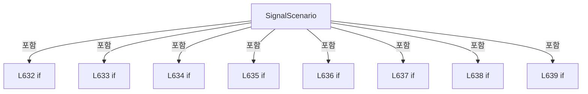

변경 전 점검: 입력/반환 타입, 위 호출자, 예외/취소 경로, 공유 상태와 저장·전송 소비자를 함께 확인합니다. 값의 단위나 물리 방향을 이름만으로 확정하지 않습니다.

### MethodDeclaration `Existing` · L642–644

[Drilling.Common/Alarm/CAlarmManager.cs:642–644](https://github.com/kjuws10-rgb/A3Drilling/blob/0219666f9053b907d96d7e0aa7d0c6c1be3a73d4/Drilling.Common/Alarm/CAlarmManager.cs#L642-L644)

| 항목 | 실제 추출 값 |
| --- | --- |
| 서명 | Drilling.Common.Alarm.CSequenceFailureException? Drilling.Common.Alarm.CSequenceFailureException.Existing(System.Exception) |
| 접근/수식자 | Private / private, static |
| 반환/값 타입 | Drilling.Common.Alarm.CSequenceFailureException? |
| 소속 타입 | NamedType:Drilling.Common.Alarm.CSequenceFailureException |

입력 계약:

| 이름 | 타입 | 전달 | 선택/기본값 |
| --- | --- | --- | --- |
| error | System.Exception | None | False /  |

정적 호출자로 확인된 위치:

| 호출 파일/행 | 호출 표현식 | 런타임 분기 가능 |
| --- | --- | --- |
| [Drilling.Common/Alarm/CAlarmManager.cs:644–644](https://github.com/kjuws10-rgb/A3Drilling/blob/0219666f9053b907d96d7e0aa7d0c6c1be3a73d4/Drilling.Common/Alarm/CAlarmManager.cs#L644-L644) | Existing | False |
| [Drilling.Common/Alarm/CAlarmManager.cs:645–645](https://github.com/kjuws10-rgb/A3Drilling/blob/0219666f9053b907d96d7e0aa7d0c6c1be3a73d4/Drilling.Common/Alarm/CAlarmManager.cs#L645-L645) | Existing | False |
| [Drilling.Common/Alarm/CAlarmManager.cs:647–647](https://github.com/kjuws10-rgb/A3Drilling/blob/0219666f9053b907d96d7e0aa7d0c6c1be3a73d4/Drilling.Common/Alarm/CAlarmManager.cs#L647-L647) | Existing | False |
| [Drilling.Common/Alarm/CAlarmManager.cs:649–649](https://github.com/kjuws10-rgb/A3Drilling/blob/0219666f9053b907d96d7e0aa7d0c6c1be3a73d4/Drilling.Common/Alarm/CAlarmManager.cs#L649-L649) | Existing | False |

호출하는 대상과 해석 범위:

| 원본 행 | 표현식 | 분석 상태 | 대상/소스 위치 |
| --- | --- | --- | --- |
| 643 | group.InnerExceptions.Select(Existing).FirstOrDefault | resolved | Drilling.Common.Alarm.CSequenceFailureException? System.Collections.Generic.IEnumerable<Drilling.Common.Alarm.CSequenceFailureException?>.FirstOrDefault<Drilling.Common.Alarm.CSequenceFailureException?>(System.Func<Drilling.Common.Alarm.CSequenceFailureException?, bool>) |
| 643 | group.InnerExceptions.Select | resolved | System.Collections.Generic.IEnumerable<Drilling.Common.Alarm.CSequenceFailureException?> System.Collections.Generic.IEnumerable<System.Exception>.Select<System.Exception, Drilling.Common.Alarm.CSequenceFailureException?>(System.Func<System.Exception, Drilling.Common.Alarm.CSequenceFailureException?>) |
| 644 | Existing | resolved | Drilling.Common.Alarm.CSequenceFailureException? Drilling.Common.Alarm.CSequenceFailureException.Existing(System.Exception) · Drilling.Common/Alarm/CAlarmManager.cs:642 |

본문의 실제 연산·분기·예외·반환 순서(원문 위치 순):

| 원본 행 | 종류 | 주석 해설 |
| --- | --- | --- |
| 642 | conditional-expression | 조건에 따라 결과식을 선택합니다: error is CSequenceFailureException found ? found : error is AggregateException group ? group.InnerExceptions.Select(Existing).FirstOrDefault(item => item is not null) : error.InnerException is { } inner ? Existing(inner) : null |
| 643 | call | 함수·델리게이트 또는 객체 생성자를 호출합니다: group.InnerExceptions.Select(Existing).FirstOrDefault(item => item is not null) |
| 643 | call | 함수·델리게이트 또는 객체 생성자를 호출합니다: group.InnerExceptions.Select(Existing) |
| 643 | conditional-expression | 조건에 따라 결과식을 선택합니다: error is AggregateException group ? group.InnerExceptions.Select(Existing).FirstOrDefault(item => item is not null) : error.InnerException is { } inner ? Existing(inner) : null |
| 644 | call | 함수·델리게이트 또는 객체 생성자를 호출합니다: Existing(inner) |
| 644 | conditional-expression | 조건에 따라 결과식을 선택합니다: error.InnerException is { } inner ? Existing(inner) : null |

변경 전 점검: 입력/반환 타입, 위 호출자, 예외/취소 경로, 공유 상태와 저장·전송 소비자를 함께 확인합니다. 값의 단위나 물리 방향을 이름만으로 확정하지 않습니다.

### MethodDeclaration `Action` · L645–646

[Drilling.Common/Alarm/CAlarmManager.cs:645–646](https://github.com/kjuws10-rgb/A3Drilling/blob/0219666f9053b907d96d7e0aa7d0c6c1be3a73d4/Drilling.Common/Alarm/CAlarmManager.cs#L645-L646)

| 항목 | 실제 추출 값 |
| --- | --- |
| 서명 | Drilling.Common.Alarm.CSequenceFailureException Drilling.Common.Alarm.CSequenceFailureException.Action(string, System.Exception) |
| 접근/수식자 | Public / public, static |
| 반환/값 타입 | Drilling.Common.Alarm.CSequenceFailureException |
| 소속 타입 | NamedType:Drilling.Common.Alarm.CSequenceFailureException |

입력 계약:

| 이름 | 타입 | 전달 | 선택/기본값 |
| --- | --- | --- | --- |
| id | string | None | False /  |
| error | System.Exception | None | False /  |

정적 호출자로 확인된 위치:

| 호출 파일/행 | 호출 표현식 | 런타임 분기 가능 |
| --- | --- | --- |
| [Drilling.Common/Station/CStageReviewSequences.cs:470–470](https://github.com/kjuws10-rgb/A3Drilling/blob/0219666f9053b907d96d7e0aa7d0c6c1be3a73d4/Drilling.Common/Station/CStageReviewSequences.cs#L470-L470) | CSequenceFailureException.Action | False |
| [Drilling.Common/Station/CStageReviewSequences.cs:619–619](https://github.com/kjuws10-rgb/A3Drilling/blob/0219666f9053b907d96d7e0aa7d0c6c1be3a73d4/Drilling.Common/Station/CStageReviewSequences.cs#L619-L619) | CSequenceFailureException.Action | False |
| [Drilling.Common/Station/CStageReviewSequences.cs:713–713](https://github.com/kjuws10-rgb/A3Drilling/blob/0219666f9053b907d96d7e0aa7d0c6c1be3a73d4/Drilling.Common/Station/CStageReviewSequences.cs#L713-L713) | CSequenceFailureException.Action | False |
| [Drilling.Common/Station/CStageReviewSequences.cs:816–816](https://github.com/kjuws10-rgb/A3Drilling/blob/0219666f9053b907d96d7e0aa7d0c6c1be3a73d4/Drilling.Common/Station/CStageReviewSequences.cs#L816-L816) | CSequenceFailureException.Action | False |
| [Drilling.Common/Station/CStationProcess.cs:5374–5374](https://github.com/kjuws10-rgb/A3Drilling/blob/0219666f9053b907d96d7e0aa7d0c6c1be3a73d4/Drilling.Common/Station/CStationProcess.cs#L5374-L5374) | CSequenceFailureException.Action | False |
| [Drilling.Common/Station/CStationProcess.cs:5389–5389](https://github.com/kjuws10-rgb/A3Drilling/blob/0219666f9053b907d96d7e0aa7d0c6c1be3a73d4/Drilling.Common/Station/CStationProcess.cs#L5389-L5389) | CSequenceFailureException.Action | False |
| [Drilling.Common/Station/CStationProcess.cs:5450–5450](https://github.com/kjuws10-rgb/A3Drilling/blob/0219666f9053b907d96d7e0aa7d0c6c1be3a73d4/Drilling.Common/Station/CStationProcess.cs#L5450-L5450) | CSequenceFailureException.Action | False |
| [Drilling.Common/Station/CStationProcess.cs:5532–5532](https://github.com/kjuws10-rgb/A3Drilling/blob/0219666f9053b907d96d7e0aa7d0c6c1be3a73d4/Drilling.Common/Station/CStationProcess.cs#L5532-L5532) | CSequenceFailureException.Action | False |
| [Drilling.Common/Station/CStationProcess.cs:6378–6378](https://github.com/kjuws10-rgb/A3Drilling/blob/0219666f9053b907d96d7e0aa7d0c6c1be3a73d4/Drilling.Common/Station/CStationProcess.cs#L6378-L6378) | CSequenceFailureException.Action | False |

호출하는 대상과 해석 범위:

| 원본 행 | 표현식 | 분석 상태 | 대상/소스 위치 |
| --- | --- | --- | --- |
| 645 | Existing | resolved | Drilling.Common.Alarm.CSequenceFailureException? Drilling.Common.Alarm.CSequenceFailureException.Existing(System.Exception) · Drilling.Common/Alarm/CAlarmManager.cs:642 |
| 646 | Signal | resolved | Drilling.Common.Alarm.CSequenceFailureException Drilling.Common.Alarm.CSequenceFailureException.Signal(string, string, bool, System.Exception) · Drilling.Common/Alarm/CAlarmManager.cs:647 |
| 646 | new | resolved | Drilling.Common.Alarm.CSequenceFailureException.CSequenceFailureException(string, string, string, System.Exception) · Drilling.Common/Alarm/CAlarmManager.cs:616 |
| 646 | ActionScenario | resolved | string Drilling.Common.Alarm.CSequenceFailureException.ActionScenario(string) · Drilling.Common/Alarm/CAlarmManager.cs:623 |

본문의 실제 연산·분기·예외·반환 순서(원문 위치 순):

| 원본 행 | 종류 | 주석 해설 |
| --- | --- | --- |
| 645 | call | 함수·델리게이트 또는 객체 생성자를 호출합니다: Existing(error) |
| 646 | call | 함수·델리게이트 또는 객체 생성자를 호출합니다: Signal(wait.Scenario, wait.Signal, true, error) |
| 646 | call | 함수·델리게이트 또는 객체 생성자를 호출합니다: new(ActionScenario(id), id, "NG", error) |
| 646 | call | 함수·델리게이트 또는 객체 생성자를 호출합니다: ActionScenario(id) |
| 646 | conditional-expression | 조건에 따라 결과식을 선택합니다: error is CSequenceSignalCanceledException wait ? Signal(wait.Scenario, wait.Signal, true, error) : new(ActionScenario(id), id, "NG", error) |

변경 전 점검: 입력/반환 타입, 위 호출자, 예외/취소 경로, 공유 상태와 저장·전송 소비자를 함께 확인합니다. 값의 단위나 물리 방향을 이름만으로 확정하지 않습니다.

### MethodDeclaration `Signal` · L647–648

[Drilling.Common/Alarm/CAlarmManager.cs:647–648](https://github.com/kjuws10-rgb/A3Drilling/blob/0219666f9053b907d96d7e0aa7d0c6c1be3a73d4/Drilling.Common/Alarm/CAlarmManager.cs#L647-L648)

| 항목 | 실제 추출 값 |
| --- | --- |
| 서명 | Drilling.Common.Alarm.CSequenceFailureException Drilling.Common.Alarm.CSequenceFailureException.Signal(string, string, bool, System.Exception) |
| 접근/수식자 | Public / public, static |
| 반환/값 타입 | Drilling.Common.Alarm.CSequenceFailureException |
| 소속 타입 | NamedType:Drilling.Common.Alarm.CSequenceFailureException |

입력 계약:

| 이름 | 타입 | 전달 | 선택/기본값 |
| --- | --- | --- | --- |
| scenario | string | None | False /  |
| id | string | None | False /  |
| timeout | bool | None | False /  |
| error | System.Exception | None | False /  |

정적 호출자로 확인된 위치:

| 호출 파일/행 | 호출 표현식 | 런타임 분기 가능 |
| --- | --- | --- |
| [Drilling.Common/Alarm/CAlarmManager.cs:646–646](https://github.com/kjuws10-rgb/A3Drilling/blob/0219666f9053b907d96d7e0aa7d0c6c1be3a73d4/Drilling.Common/Alarm/CAlarmManager.cs#L646-L646) | Signal | False |
| [Drilling.Common/Station/CStageReviewSequences.cs:358–358](https://github.com/kjuws10-rgb/A3Drilling/blob/0219666f9053b907d96d7e0aa7d0c6c1be3a73d4/Drilling.Common/Station/CStageReviewSequences.cs#L358-L358) | CSequenceFailureException.Signal | False |
| [Drilling.Common/Station/CStageReviewSequences.cs:365–365](https://github.com/kjuws10-rgb/A3Drilling/blob/0219666f9053b907d96d7e0aa7d0c6c1be3a73d4/Drilling.Common/Station/CStageReviewSequences.cs#L365-L365) | CSequenceFailureException.Signal | False |
| [Drilling.Common/Station/CStageReviewSequences.cs:453–453](https://github.com/kjuws10-rgb/A3Drilling/blob/0219666f9053b907d96d7e0aa7d0c6c1be3a73d4/Drilling.Common/Station/CStageReviewSequences.cs#L453-L453) | CSequenceFailureException.Signal | False |
| [Drilling.Common/Station/CStationProcess.cs:5409–5409](https://github.com/kjuws10-rgb/A3Drilling/blob/0219666f9053b907d96d7e0aa7d0c6c1be3a73d4/Drilling.Common/Station/CStationProcess.cs#L5409-L5409) | CSequenceFailureException.Signal | False |
| [Drilling.Common/Station/CStationProcess.cs:5439–5439](https://github.com/kjuws10-rgb/A3Drilling/blob/0219666f9053b907d96d7e0aa7d0c6c1be3a73d4/Drilling.Common/Station/CStationProcess.cs#L5439-L5439) | CSequenceFailureException.Signal | False |
| [Drilling.Common/Station/CStationProcess.cs:5471–5471](https://github.com/kjuws10-rgb/A3Drilling/blob/0219666f9053b907d96d7e0aa7d0c6c1be3a73d4/Drilling.Common/Station/CStationProcess.cs#L5471-L5471) | CSequenceFailureException.Signal | False |
| [Drilling.Common/Station/CStationProcess.cs:5524–5524](https://github.com/kjuws10-rgb/A3Drilling/blob/0219666f9053b907d96d7e0aa7d0c6c1be3a73d4/Drilling.Common/Station/CStationProcess.cs#L5524-L5524) | CSequenceFailureException.Signal | False |
| [Drilling.UI/Menu/Menus/CMenuManual.cs:6954–6954](https://github.com/kjuws10-rgb/A3Drilling/blob/0219666f9053b907d96d7e0aa7d0c6c1be3a73d4/Drilling.UI/Menu/Menus/CMenuManual.cs#L6954-L6954) | Drilling.Common.Alarm.CSequenceFailureException.Signal | False |
| [Drilling.UI/Menu/Menus/CMenuManual.cs:6979–6979](https://github.com/kjuws10-rgb/A3Drilling/blob/0219666f9053b907d96d7e0aa7d0c6c1be3a73d4/Drilling.UI/Menu/Menus/CMenuManual.cs#L6979-L6979) | Drilling.Common.Alarm.CSequenceFailureException.Signal | False |

호출하는 대상과 해석 범위:

| 원본 행 | 표현식 | 분석 상태 | 대상/소스 위치 |
| --- | --- | --- | --- |
| 647 | Existing | resolved | Drilling.Common.Alarm.CSequenceFailureException? Drilling.Common.Alarm.CSequenceFailureException.Existing(System.Exception) · Drilling.Common/Alarm/CAlarmManager.cs:642 |
| 648 | new | resolved | Drilling.Common.Alarm.CSequenceFailureException.CSequenceFailureException(string, string, string, System.Exception) · Drilling.Common/Alarm/CAlarmManager.cs:616 |
| 648 | SignalScenario | resolved | string Drilling.Common.Alarm.CSequenceFailureException.SignalScenario(string, string) · Drilling.Common/Alarm/CAlarmManager.cs:630 |

본문의 실제 연산·분기·예외·반환 순서(원문 위치 순):

| 원본 행 | 종류 | 주석 해설 |
| --- | --- | --- |
| 647 | call | 함수·델리게이트 또는 객체 생성자를 호출합니다: Existing(error) |
| 648 | call | 함수·델리게이트 또는 객체 생성자를 호출합니다: new(SignalScenario(id, scenario), id, timeout ? "TIMEOUT" : "NG", error) |
| 648 | call | 함수·델리게이트 또는 객체 생성자를 호출합니다: SignalScenario(id, scenario) |
| 648 | conditional-expression | 조건에 따라 결과식을 선택합니다: timeout ? "TIMEOUT" : "NG" |

변경 전 점검: 입력/반환 타입, 위 호출자, 예외/취소 경로, 공유 상태와 저장·전송 소비자를 함께 확인합니다. 값의 단위나 물리 방향을 이름만으로 확정하지 않습니다.

### MethodDeclaration `ScenarioFailure` · L649–649

[Drilling.Common/Alarm/CAlarmManager.cs:649–649](https://github.com/kjuws10-rgb/A3Drilling/blob/0219666f9053b907d96d7e0aa7d0c6c1be3a73d4/Drilling.Common/Alarm/CAlarmManager.cs#L649-L649)

| 항목 | 실제 추출 값 |
| --- | --- |
| 서명 | Drilling.Common.Alarm.CSequenceFailureException Drilling.Common.Alarm.CSequenceFailureException.ScenarioFailure(string, System.Exception) |
| 접근/수식자 | Public / public, static |
| 반환/값 타입 | Drilling.Common.Alarm.CSequenceFailureException |
| 소속 타입 | NamedType:Drilling.Common.Alarm.CSequenceFailureException |

입력 계약:

| 이름 | 타입 | 전달 | 선택/기본값 |
| --- | --- | --- | --- |
| scenario | string | None | False /  |
| error | System.Exception | None | False /  |

정적 호출자로 확인된 위치:

| 호출 파일/행 | 호출 표현식 | 런타임 분기 가능 |
| --- | --- | --- |
| [Drilling.Common/Station/CStationProcess.cs:5346–5346](https://github.com/kjuws10-rgb/A3Drilling/blob/0219666f9053b907d96d7e0aa7d0c6c1be3a73d4/Drilling.Common/Station/CStationProcess.cs#L5346-L5346) | CSequenceFailureException.ScenarioFailure | False |

호출하는 대상과 해석 범위:

| 원본 행 | 표현식 | 분석 상태 | 대상/소스 위치 |
| --- | --- | --- | --- |
| 649 | Existing | resolved | Drilling.Common.Alarm.CSequenceFailureException? Drilling.Common.Alarm.CSequenceFailureException.Existing(System.Exception) · Drilling.Common/Alarm/CAlarmManager.cs:642 |
| 649 | new | resolved | Drilling.Common.Alarm.CSequenceFailureException.CSequenceFailureException(string, string, string, System.Exception) · Drilling.Common/Alarm/CAlarmManager.cs:616 |

본문의 실제 연산·분기·예외·반환 순서(원문 위치 순):

| 원본 행 | 종류 | 주석 해설 |
| --- | --- | --- |
| 649 | call | 함수·델리게이트 또는 객체 생성자를 호출합니다: Existing(error) |
| 649 | call | 함수·델리게이트 또는 객체 생성자를 호출합니다: new(scenario, "", "NG", error) |

변경 전 점검: 입력/반환 타입, 위 호출자, 예외/취소 경로, 공유 상태와 저장·전송 소비자를 함께 확인합니다. 값의 단위나 물리 방향을 이름만으로 확정하지 않습니다.

### MethodDeclaration `Publish` · L650–656

[Drilling.Common/Alarm/CAlarmManager.cs:650–656](https://github.com/kjuws10-rgb/A3Drilling/blob/0219666f9053b907d96d7e0aa7d0c6c1be3a73d4/Drilling.Common/Alarm/CAlarmManager.cs#L650-L656)

| 항목 | 실제 추출 값 |
| --- | --- |
| 서명 | void Drilling.Common.Alarm.CSequenceFailureException.Publish(System.Action<Drilling.Common.Alarm.CSequenceFailureException>?) |
| 접근/수식자 | Public / public |
| 반환/값 타입 | void |
| 소속 타입 | NamedType:Drilling.Common.Alarm.CSequenceFailureException |

입력 계약:

| 이름 | 타입 | 전달 | 선택/기본값 |
| --- | --- | --- | --- |
| subscribers | System.Action<Drilling.Common.Alarm.CSequenceFailureException>? | None | False /  |

정적 호출자로 확인된 위치:

| 호출 파일/행 | 호출 표현식 | 런타임 분기 가능 |
| --- | --- | --- |
| [Drilling.Common/Station/CStageReviewSequences.cs:23–23](https://github.com/kjuws10-rgb/A3Drilling/blob/0219666f9053b907d96d7e0aa7d0c6c1be3a73d4/Drilling.Common/Station/CStageReviewSequences.cs#L23-L23) | failure.Publish | False |
| [Drilling.Common/Station/CStationProcess.cs:5074–5074](https://github.com/kjuws10-rgb/A3Drilling/blob/0219666f9053b907d96d7e0aa7d0c6c1be3a73d4/Drilling.Common/Station/CStationProcess.cs#L5074-L5074) | failure.Publish | False |
| [Drilling.UI/Menu/Menus/CMenuManual.cs:6954–6954](https://github.com/kjuws10-rgb/A3Drilling/blob/0219666f9053b907d96d7e0aa7d0c6c1be3a73d4/Drilling.UI/Menu/Menus/CMenuManual.cs#L6954-L6954) | Drilling.Common.Alarm.CSequenceFailureException.Signal("DO_ALIGN", RequestId, exception is TimeoutException or OperationCanceledException, exception).Publish | False |
| [Drilling.UI/Menu/Menus/CMenuManual.cs:6979–6979](https://github.com/kjuws10-rgb/A3Drilling/blob/0219666f9053b907d96d7e0aa7d0c6c1be3a73d4/Drilling.UI/Menu/Menus/CMenuManual.cs#L6979-L6979) | Drilling.Common.Alarm.CSequenceFailureException.Signal("DO_ALIGN", RequestId, exception is TimeoutException or OperationCanceledException, exception).Publish | False |

호출하는 대상과 해석 범위:

| 원본 행 | 표현식 | 분석 상태 | 대상/소스 위치 |
| --- | --- | --- | --- |
| 652 | Interlocked.Exchange | resolved | int System.Threading.Interlocked.Exchange(ref int, int) |
| 653 | subscribers.GetInvocationList | resolved · 동적 구현 선택 가능 | System.Delegate[] System.MulticastDelegate.GetInvocationList() |
| 654 | ((Action<CSequenceFailureException>)subscriber) | resolved · 동적 구현 선택 가능 | void System.Action<Drilling.Common.Alarm.CSequenceFailureException>.Invoke(Drilling.Common.Alarm.CSequenceFailureException) |
| 655 | System.Diagnostics.Trace.TraceError | resolved | void System.Diagnostics.Trace.TraceError(string?) |

본문의 실제 연산·분기·예외·반환 순서(원문 위치 순):

| 원본 행 | 종류 | 주석 해설 |
| --- | --- | --- |
| 652 | call | 함수·델리게이트 또는 객체 생성자를 호출합니다: Interlocked.Exchange(ref _reported, 1) |
| 652 | if | 조건에 따라 분기합니다: if (subscribers is null &#124;&#124; Interlocked.Exchange(ref _reported, 1) != 0) |
| 652 | return | 호출자에게 값 또는 제어를 반환합니다: return; |
| 653 | call | 함수·델리게이트 또는 객체 생성자를 호출합니다: subscribers.GetInvocationList() |
| 653 | foreach | 컬렉션 요소를 순회합니다: foreach (var subscriber in subscribers.GetInvocationList()) |
| 654 | call | 함수·델리게이트 또는 객체 생성자를 호출합니다: ((Action<CSequenceFailureException>)subscriber)(this) |
| 654 | try | 예외 처리 범위입니다: try |
| 655 | call | 함수·델리게이트 또는 객체 생성자를 호출합니다: System.Diagnostics.Trace.TraceError($"Sequence alarm publish failed: {AlarmId}: {error}") |
| 655 | catch | 지정 예외를 처리합니다: catch (Exception error) |
| 655 | catch | 지정 예외를 처리합니다: catch  |
| 655 | try | 예외 처리 범위입니다: try |

제어 구문의 포함 구조(실제 실행 순서/CFG가 아닌 구문 탐색 그림):

```mermaid
flowchart TD
 M["Publish"]
 N0["L652 if"]
 M -->|포함| N0
 N1["L653 foreach"]
 M -->|포함| N1
 N2["L654 try"]
 N1 -->|포함| N2
 N3["L655 catch"]
 N2 -->|포함| N3
 N4["L655 catch"]
 N2 -->|포함| N4
 N5["L655 try"]
 N2 -->|포함| N5
```

변경 전 점검: 입력/반환 타입, 위 호출자, 예외/취소 경로, 공유 상태와 저장·전송 소비자를 함께 확인합니다. 값의 단위나 물리 방향을 이름만으로 확정하지 않습니다.

### PropertyDeclaration `Scenario` · L663–663

[Drilling.Common/Alarm/CAlarmManager.cs:663–663](https://github.com/kjuws10-rgb/A3Drilling/blob/0219666f9053b907d96d7e0aa7d0c6c1be3a73d4/Drilling.Common/Alarm/CAlarmManager.cs#L663-L663)

| 항목 | 실제 추출 값 |
| --- | --- |
| 서명 | string Drilling.Common.Alarm.CSequenceSignalCanceledException.Scenario |
| 접근/수식자 | Public / public |
| 반환/값 타입 | string |
| 소속 타입 | NamedType:Drilling.Common.Alarm.CSequenceSignalCanceledException |

현재 부분 분석에서 직접 연결된 호출자는 없습니다. XAML/이벤트/인터페이스·델리게이트·외부 진입을 추가 확인해야 하며, 미사용으로 판정한 것이 아닙니다.

변경 전 점검: 입력/반환 타입, 위 호출자, 예외/취소 경로, 공유 상태와 저장·전송 소비자를 함께 확인합니다. 값의 단위나 물리 방향을 이름만으로 확정하지 않습니다.

### GetAccessorDeclaration `get_Scenario` · L663–663

[Drilling.Common/Alarm/CAlarmManager.cs:663–663](https://github.com/kjuws10-rgb/A3Drilling/blob/0219666f9053b907d96d7e0aa7d0c6c1be3a73d4/Drilling.Common/Alarm/CAlarmManager.cs#L663-L663)

| 항목 | 실제 추출 값 |
| --- | --- |
| 서명 | string Drilling.Common.Alarm.CSequenceSignalCanceledException.Scenario.get |
| 접근/수식자 | Public / get |
| 반환/값 타입 | string |
| 소속 타입 | NamedType:Drilling.Common.Alarm.CSequenceSignalCanceledException |

현재 부분 분석에서 직접 연결된 호출자는 없습니다. XAML/이벤트/인터페이스·델리게이트·외부 진입을 추가 확인해야 하며, 미사용으로 판정한 것이 아닙니다.

변경 전 점검: 입력/반환 타입, 위 호출자, 예외/취소 경로, 공유 상태와 저장·전송 소비자를 함께 확인합니다. 값의 단위나 물리 방향을 이름만으로 확정하지 않습니다.

### PropertyDeclaration `Signal` · L664–664

[Drilling.Common/Alarm/CAlarmManager.cs:664–664](https://github.com/kjuws10-rgb/A3Drilling/blob/0219666f9053b907d96d7e0aa7d0c6c1be3a73d4/Drilling.Common/Alarm/CAlarmManager.cs#L664-L664)

| 항목 | 실제 추출 값 |
| --- | --- |
| 서명 | string Drilling.Common.Alarm.CSequenceSignalCanceledException.Signal |
| 접근/수식자 | Public / public |
| 반환/값 타입 | string |
| 소속 타입 | NamedType:Drilling.Common.Alarm.CSequenceSignalCanceledException |

현재 부분 분석에서 직접 연결된 호출자는 없습니다. XAML/이벤트/인터페이스·델리게이트·외부 진입을 추가 확인해야 하며, 미사용으로 판정한 것이 아닙니다.

변경 전 점검: 입력/반환 타입, 위 호출자, 예외/취소 경로, 공유 상태와 저장·전송 소비자를 함께 확인합니다. 값의 단위나 물리 방향을 이름만으로 확정하지 않습니다.

### GetAccessorDeclaration `get_Signal` · L664–664

[Drilling.Common/Alarm/CAlarmManager.cs:664–664](https://github.com/kjuws10-rgb/A3Drilling/blob/0219666f9053b907d96d7e0aa7d0c6c1be3a73d4/Drilling.Common/Alarm/CAlarmManager.cs#L664-L664)

| 항목 | 실제 추출 값 |
| --- | --- |
| 서명 | string Drilling.Common.Alarm.CSequenceSignalCanceledException.Signal.get |
| 접근/수식자 | Public / get |
| 반환/값 타입 | string |
| 소속 타입 | NamedType:Drilling.Common.Alarm.CSequenceSignalCanceledException |

현재 부분 분석에서 직접 연결된 호출자는 없습니다. XAML/이벤트/인터페이스·델리게이트·외부 진입을 추가 확인해야 하며, 미사용으로 판정한 것이 아닙니다.

변경 전 점검: 입력/반환 타입, 위 호출자, 예외/취소 경로, 공유 상태와 저장·전송 소비자를 함께 확인합니다. 값의 단위나 물리 방향을 이름만으로 확정하지 않습니다.

### MethodDeclaration `Append` · L673–673

[Drilling.Common/Alarm/CAlarmManager.cs:673–673](https://github.com/kjuws10-rgb/A3Drilling/blob/0219666f9053b907d96d7e0aa7d0c6c1be3a73d4/Drilling.Common/Alarm/CAlarmManager.cs#L673-L673)

| 항목 | 실제 추출 값 |
| --- | --- |
| 서명 | void Drilling.Common.Alarm.IAlarmHistoryStore.Append(Drilling.Common.Alarm.ST_ALARM_DATA) |
| 접근/수식자 | Public /  |
| 반환/값 타입 | void |
| 소속 타입 | NamedType:Drilling.Common.Alarm.IAlarmHistoryStore |

입력 계약:

| 이름 | 타입 | 전달 | 선택/기본값 |
| --- | --- | --- | --- |
| alarm | Drilling.Common.Alarm.ST_ALARM_DATA | None | False /  |

정적 호출자로 확인된 위치:

| 호출 파일/행 | 호출 표현식 | 런타임 분기 가능 |
| --- | --- | --- |
| [Drilling.Common/Alarm/CAlarmManager.cs:356–356](https://github.com/kjuws10-rgb/A3Drilling/blob/0219666f9053b907d96d7e0aa7d0c6c1be3a73d4/Drilling.Common/Alarm/CAlarmManager.cs#L356-L356) | _history!.Append | True |

변경 전 점검: 입력/반환 타입, 위 호출자, 예외/취소 경로, 공유 상태와 저장·전송 소비자를 함께 확인합니다. 값의 단위나 물리 방향을 이름만으로 확정하지 않습니다.

### MethodDeclaration `Read` · L674–674

[Drilling.Common/Alarm/CAlarmManager.cs:674–674](https://github.com/kjuws10-rgb/A3Drilling/blob/0219666f9053b907d96d7e0aa7d0c6c1be3a73d4/Drilling.Common/Alarm/CAlarmManager.cs#L674-L674)

| 항목 | 실제 추출 값 |
| --- | --- |
| 서명 | Drilling.Common.Alarm.ST_ALARM_HISTORY_RESULT Drilling.Common.Alarm.IAlarmHistoryStore.Read(System.DateTime, System.DateTime, System.Threading.CancellationToken) |
| 접근/수식자 | Public /  |
| 반환/값 타입 | Drilling.Common.Alarm.ST_ALARM_HISTORY_RESULT |
| 소속 타입 | NamedType:Drilling.Common.Alarm.IAlarmHistoryStore |

입력 계약:

| 이름 | 타입 | 전달 | 선택/기본값 |
| --- | --- | --- | --- |
| from | System.DateTime | None | False /  |
| through | System.DateTime | None | False /  |
| token | System.Threading.CancellationToken | None | True / null |

정적 호출자로 확인된 위치:

| 호출 파일/행 | 호출 표현식 | 런타임 분기 가능 |
| --- | --- | --- |
| [Drilling.Common/Alarm/CAlarmManager.cs:310–310](https://github.com/kjuws10-rgb/A3Drilling/blob/0219666f9053b907d96d7e0aa7d0c6c1be3a73d4/Drilling.Common/Alarm/CAlarmManager.cs#L310-L310) | .Read | True |

변경 전 점검: 입력/반환 타입, 위 호출자, 예외/취소 경로, 공유 상태와 저장·전송 소비자를 함께 확인합니다. 값의 단위나 물리 방향을 이름만으로 확정하지 않습니다.

## 구문·바인딩 한계

전체 WPF/벤더 SDK/프로젝트별 빌드 조건을 로드한 정식 빌드가 아닙니다. `resolved`는 이 부분 컴파일에서의 심볼 연결이며 virtual/interface/delegate/이벤트/Reflection/XAML의 실제 런타임 구현을 확정하지 않습니다. `candidate`와 `unresolved`는 후속 확인 대상으로 남깁니다.

## 원문 전체 주석 해설본

[원본 모든 행과 행별 해설 보기](../../../annotated/Drilling.Common/Alarm/CAlarmManager.cs.annotated.txt)

원본을 빠뜨리거나 임의로 줄이지 않았습니다. `L000001 |` 표시는 원본 행 번호, `// 해설`은 별도 설명입니다. 실행용 소스가 아닌 문서입니다.

## 수정·재검증 체크

- 원본 Commit과 현재 작업 파일 SHA가 같은지 먼저 확인합니다. 다르면 이 문서를 과거 버전 자료로 취급합니다.
- 선언·직접 호출·이벤트/인터페이스 경계·설정 소비를 함께 확인합니다. 정적 연결의 빈 곳을 정상 경로로 추정하지 않습니다.
- 저장 형식/단위/식별자·재시도·취소·예외·롤백에 영향을 주는 변경은 상세 해설장과 호출자를 다시 검토합니다.
- 도구의 구문 추출과 별도 정적 추적 해설, 실제 빌드·시뮬레이션·실장비 검증 결과를 분리합니다.
