# Drilling.Common/Automation/CAutomationManager.cs

| 항목 | 내용 |
| --- | --- |
| 원본 저장소 | https://github.com/kjuws10-rgb/A3Drilling.git |
| 원본 Commit | 28764c91d521777b8ee068dd7aaf2d3902ce9fe2 |
| 원본 SHA256 | 5c7cfe44322a363450d005c89c67859d143e0a6fd8aa944d64b932529ef1df72 |
| 파일 분류 | code |
| 원본 크기/행 | 93,455 bytes / 1,794 physical lines |
| 인코딩 | utf-8-sig |
| 검토 범위 | 구문/부분 의미 분석에서 추출한 사실. 동작·물리 단위·실장비 합격을 보증하지 않습니다. |
| 원본 링크 | [고정 Commit 원본](https://github.com/kjuws10-rgb/A3Drilling/blob/28764c91d521777b8ee068dd7aaf2d3902ce9fe2/Drilling.Common/Automation/CAutomationManager.cs) |

## 파일의 역할과 읽는 순서

프로그램의 시작·구성·공유 타입 또는 빌드 연결에 사용됩니다. 아래 실제 선언·참조와 원본 근거를 확인합니다.

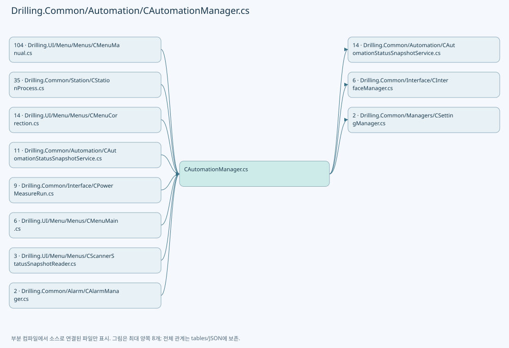

## 네임스페이스·타입·상속

| 타입 | 구분 | 원본 범위 | 선언/상속 |
| --- | --- | --- | --- |
| CAutomationManager | ClassDeclaration | 12–1401 | CAutomationManager |
| CSimulatedMofReadiness | ClassDeclaration | 1278–1284 | CSimulatedMofReadiness |
| CStageSimulatedTask | ClassDeclaration | 1321–1399 | CStageSimulatedTask |
| CAutomationAxisFault | ClassDeclaration | 1403–1439 | CAutomationAxisFault |
| ST_AUXILIARY_FEEDBACK | RecordDeclaration | 1441–1441 | ST_AUXILIARY_FEEDBACK |
| ST_MOF_ZERO_TARGET | RecordDeclaration | 1442–1442 | ST_MOF_ZERO_TARGET |
| CMofZeroOperation | ClassDeclaration | 1444–1504 | CMofZeroOperation |
| ST_BUFFERED_SCRIPT_RUN_ITEM | RecordDeclaration | 1506–1506 | ST_BUFFERED_SCRIPT_RUN_ITEM |
| ST_AUTOMATION_AXIS_STATUS | RecordDeclaration | 1508–1530 | ST_AUTOMATION_AXIS_STATUS |
| ST_STAGE_TASK_SIMULATION_TARGET | RecordDeclaration | 1532–1532 | ST_STAGE_TASK_SIMULATION_TARGET |
| ST_AUTOMATION_ABSOLUTE_MOVE_TARGET | RecordDeclaration | 1533–1533 | ST_AUTOMATION_ABSOLUTE_MOVE_TARGET |
| CAutomationPositioningService | ClassDeclaration | 1535–1640 | CAutomationPositioningService |
| CConfiguredHomeSpeedValues | ClassDeclaration | 1643–1656 | CConfiguredHomeSpeedValues: ReadOnlyDictionary<string, double> |
| CGalvoTemperature | ClassDeclaration | 1658–1670 | CGalvoTemperature |
| CManualMotionSession | ClassDeclaration | 1673–1769 | CManualMotionSession |
| ST_MOF_READINESS | RecordDeclaration | 1771–1771 | ST_MOF_READINESS |
| CMofReadiness | ClassDeclaration | 1773–1793 | CMofReadiness |

## 멤버 빠른 목록

| 이름 | 종류 | 범위 | 서명 |
| --- | --- | --- | --- |
| _simulationConfiguredHomeSpeeds | FieldDeclaration | L15–15 | System.Collections.Concurrent.ConcurrentDictionary<string, double> Drilling.Common.Automation.CAutomationManager._simulationConfiguredHomeSpeeds |
| LocalScriptPathKey | FieldDeclaration | L16–16 | string Drilling.Common.Automation.CAutomationManager.LocalScriptPathKey |
| AutomationScriptPathKey | FieldDeclaration | L17–17 | string Drilling.Common.Automation.CAutomationManager.AutomationScriptPathKey |
| Automation1DriveStatusEnabledMask | FieldDeclaration | L18–18 | long Drilling.Common.Automation.CAutomationManager.Automation1DriveStatusEnabledMask |
| Automation1AxisStatusHomedMask | FieldDeclaration | L19–19 | long Drilling.Common.Automation.CAutomationManager.Automation1AxisStatusHomedMask |
| AxisNoMap | FieldDeclaration | L20–24 | System.Collections.Generic.IReadOnlyDictionary<string, int> Drilling.Common.Automation.CAutomationManager.AxisNoMap |
| _interfaceManager | FieldDeclaration | L25–25 | Drilling.Common.Interface.CInterfaceManager Drilling.Common.Automation.CAutomationManager._interfaceManager |
| _settingManager | FieldDeclaration | L26–26 | Drilling.Common.Managers.CSettingManager? Drilling.Common.Automation.CAutomationManager._settingManager |
| _projectRoot | FieldDeclaration | L27–27 | string Drilling.Common.Automation.CAutomationManager._projectRoot |
| _defaultLocalScriptDirectory | FieldDeclaration | L28–28 | string Drilling.Common.Automation.CAutomationManager._defaultLocalScriptDirectory |
| _simulationAxisAbleStates | FieldDeclaration | L29–29 | System.Collections.Concurrent.ConcurrentDictionary<string, bool> Drilling.Common.Automation.CAutomationManager._simulationAxisAbleStates |
| _simulationAxisPositions | FieldDeclaration | L30–30 | System.Collections.Concurrent.ConcurrentDictionary<string, double> Drilling.Common.Automation.CAutomationManager._simulationAxisPositions |
| _simulatedMofReadiness | FieldDeclaration | L31–31 | System.Collections.Concurrent.ConcurrentDictionary<(int Controller, int Task), Drilling.Common.Automation.CAutomationManager.CSimulatedMofReadiness> Drilling.Common.Automation.CAutomationManager._simulatedMofReadiness |
| _stageSimulationTasks | FieldDeclaration | L32–32 | System.Collections.Concurrent.ConcurrentDictionary<(int Controller, int Task), Drilling.Common.Automation.CAutomationManager.CStageSimulatedTask> Drilling.Common.Automation.CAutomationManager._stageSimulationTasks |
| .ctor | ConstructorDeclaration | L35–42 | Drilling.Common.Automation.CAutomationManager.CAutomationManager(Drilling.Common.Interface.CInterfaceManager, Drilling.Common.Managers.CSettingManager?, string, string) |
| StatusSnapshots | PropertyDeclaration | L46–46 | Drilling.Common.Automation.CAutomationStatusSnapshotService Drilling.Common.Automation.CAutomationManager.StatusSnapshots |
| get_StatusSnapshots | GetAccessorDeclaration | L46–46 | Drilling.Common.Automation.CAutomationStatusSnapshotService Drilling.Common.Automation.CAutomationManager.StatusSnapshots.get |
| Connect | MethodDeclaration | L48–51 | System.Threading.Tasks.Task Drilling.Common.Automation.CAutomationManager.Connect(int, System.Threading.CancellationToken) |
| Disconnect | MethodDeclaration | L53–56 | System.Threading.Tasks.Task Drilling.Common.Automation.CAutomationManager.Disconnect(int, System.Threading.CancellationToken) |
| IsConnect | MethodDeclaration | L58–61 | bool Drilling.Common.Automation.CAutomationManager.IsConnect(int) |
| IsSimul | MethodDeclaration | L63–66 | bool Drilling.Common.Automation.CAutomationManager.IsSimul(int) |
| ReadStatus | MethodDeclaration | L68–71 | System.Threading.Tasks.Task<string> Drilling.Common.Automation.CAutomationManager.ReadStatus(int, System.Threading.CancellationToken) |
| ReadControllerAxes | MethodDeclaration | L73–80 | System.Threading.Tasks.Task<System.Collections.Generic.IReadOnlyList<string>> Drilling.Common.Automation.CAutomationManager.ReadControllerAxes(int, System.Threading.CancellationToken) |
| ReadProcessorUsage | MethodDeclaration | L82–85 | System.Threading.Tasks.Task<string> Drilling.Common.Automation.CAutomationManager.ReadProcessorUsage(int, System.Threading.CancellationToken) |
| ResetController | MethodDeclaration | L87–95 | System.Threading.Tasks.Task<string> Drilling.Common.Automation.CAutomationManager.ResetController(int, System.Threading.CancellationToken) |
| ReadIo | MethodDeclaration | L97–101 | System.Threading.Tasks.Task<string> Drilling.Common.Automation.CAutomationManager.ReadIo(string, int, System.Threading.CancellationToken) |
| SetIo | MethodDeclaration | L103–107 | System.Threading.Tasks.Task<string> Drilling.Common.Automation.CAutomationManager.SetIo(string, bool, int, System.Threading.CancellationToken) |
| ValidateIoAddress | MethodDeclaration | L109–163 | string Drilling.Common.Automation.CAutomationManager.ValidateIoAddress(string, bool) |
| MatchesItem | LocalFunctionStatement | L113–116 | bool MatchesItem(char) |
| TrimIoAxisPrefix | MethodDeclaration | L165–173 | string Drilling.Common.Automation.CAutomationManager.TrimIoAxisPrefix(string) |
| IsUnsignedInteger | MethodDeclaration | L175–178 | bool Drilling.Common.Automation.CAutomationManager.IsUnsignedInteger(string) |
| ExecuteRaw | MethodDeclaration | L180–184 | System.Threading.Tasks.Task<string> Drilling.Common.Automation.CAutomationManager.ExecuteRaw(string, int, System.Threading.CancellationToken, bool) |
| Move | MethodDeclaration | L186–189 | System.Threading.Tasks.Task<string> Drilling.Common.Automation.CAutomationManager.Move(string, double, double, int, System.Threading.CancellationToken) |
| MoveRel | MethodDeclaration | L191–194 | System.Threading.Tasks.Task<string> Drilling.Common.Automation.CAutomationManager.MoveRel(string, double, double, int, System.Threading.CancellationToken) |
| Stop | MethodDeclaration | L196–199 | System.Threading.Tasks.Task<string> Drilling.Common.Automation.CAutomationManager.Stop(string, int, System.Threading.CancellationToken) |
| ManualMove | MethodDeclaration | L201–206 | System.Threading.Tasks.Task<string> Drilling.Common.Automation.CAutomationManager.ManualMove(string, double, double, bool, int, System.Threading.CancellationToken) |
| JogStart | MethodDeclaration | L208–213 | System.Threading.Tasks.Task<string> Drilling.Common.Automation.CAutomationManager.JogStart(string, double, int) |
| JogStop | MethodDeclaration | L215–215 | System.Threading.Tasks.Task<string> Drilling.Common.Automation.CAutomationManager.JogStop(string, int) |
| AbortMotion | MethodDeclaration | L216–216 | System.Threading.Tasks.Task<string> Drilling.Common.Automation.CAutomationManager.AbortMotion(string, int, System.Threading.CancellationToken) |
| ServoOn | MethodDeclaration | L217–220 | System.Threading.Tasks.Task<string> Drilling.Common.Automation.CAutomationManager.ServoOn(string, int, System.Threading.CancellationToken) |
| ServoOff | MethodDeclaration | L222–225 | System.Threading.Tasks.Task<string> Drilling.Common.Automation.CAutomationManager.ServoOff(string, int, System.Threading.CancellationToken) |
| Home | MethodDeclaration | L227–230 | System.Threading.Tasks.Task<string> Drilling.Common.Automation.CAutomationManager.Home(string, int, System.Threading.CancellationToken) |
| HomeAsync | MethodDeclaration | L232–235 | System.Threading.Tasks.Task<string> Drilling.Common.Automation.CAutomationManager.HomeAsync(string, int, System.Threading.CancellationToken) |
| ResetAlarm | MethodDeclaration | L237–240 | System.Threading.Tasks.Task<string> Drilling.Common.Automation.CAutomationManager.ResetAlarm(string, int, System.Threading.CancellationToken) |
| ReadAxis | MethodDeclaration | L242–245 | System.Threading.Tasks.Task<string> Drilling.Common.Automation.CAutomationManager.ReadAxis(string, int, System.Threading.CancellationToken) |
| ReadAxisStatus | MethodDeclaration | L247–250 | Drilling.Common.Automation.ST_AUTOMATION_AXIS_STATUS Drilling.Common.Automation.CAutomationManager.ReadAxisStatus(string, int, System.Threading.CancellationToken) |
| ReadAxisStatus | MethodDeclaration | L252–264 | Drilling.Common.Automation.ST_AUTOMATION_AXIS_STATUS Drilling.Common.Automation.CAutomationManager.ReadAxisStatus(string, int, int, System.Threading.CancellationToken) |
| ReadAxisStatusByName | MethodDeclaration | L266–269 | Drilling.Common.Automation.ST_AUTOMATION_AXIS_STATUS Drilling.Common.Automation.CAutomationManager.ReadAxisStatusByName(string, int, System.Threading.CancellationToken) |
| ReadAxisStatusByName | MethodDeclaration | L271–284 | Drilling.Common.Automation.ST_AUTOMATION_AXIS_STATUS Drilling.Common.Automation.CAutomationManager.ReadAxisStatusByName(string, int, int, System.Threading.CancellationToken) |
| ReadAxisStatusByNameNoLog | MethodDeclaration | L286–299 | Drilling.Common.Automation.ST_AUTOMATION_AXIS_STATUS Drilling.Common.Automation.CAutomationManager.ReadAxisStatusByNameNoLog(string, int, int, bool, System.Threading.CancellationToken) |
| RunLocalScript | MethodDeclaration | L301–313 | System.Threading.Tasks.Task<string> Drilling.Common.Automation.CAutomationManager.RunLocalScript(string, string, int, int, System.Threading.CancellationToken) |
| UploadScript | MethodDeclaration | L315–322 | System.Threading.Tasks.Task<string> Drilling.Common.Automation.CAutomationManager.UploadScript(string, string, int, System.Threading.CancellationToken) |
| RunScript | MethodDeclaration | L324–335 | System.Threading.Tasks.Task<string> Drilling.Common.Automation.CAutomationManager.RunScript(string, int, int, System.Threading.CancellationToken) |
| RunScriptIfIdle | MethodDeclaration | L337–345 | System.Threading.Tasks.Task<string> Drilling.Common.Automation.CAutomationManager.RunScriptIfIdle(string, int, int, System.Threading.CancellationToken) |
| RunBufferedScript | MethodDeclaration | L347–359 | System.Threading.Tasks.Task<string> Drilling.Common.Automation.CAutomationManager.RunBufferedScript(string, string, int, int, int, int, int, System.Threading.CancellationToken) |
| RunBufferedScripts | MethodDeclaration | L361–368 | System.Threading.Tasks.Task<string> Drilling.Common.Automation.CAutomationManager.RunBufferedScripts(System.Collections.Generic.IReadOnlyList<Drilling.Common.Automation.ST_BUFFERED_SCRIPT_RUN_ITEM>, int, int, int, int, System.Threading.CancellationToken) |
| RunStagePreparedBufferedScripts | MethodDeclaration | L370–370 | System.Threading.Tasks.Task<string> Drilling.Common.Automation.CAutomationManager.RunStagePreparedBufferedScripts(System.Collections.Generic.IReadOnlyList<Drilling.Common.Automation.ST_BUFFERED_SCRIPT_RUN_ITEM>, int, int, int, int, System.Threading.CancellationToken) |
| RunBufferedScriptsCore | MethodDeclaration | L371–485 | System.Threading.Tasks.Task<string> Drilling.Common.Automation.CAutomationManager.RunBufferedScriptsCore(System.Collections.Generic.IReadOnlyList<Drilling.Common.Automation.ST_BUFFERED_SCRIPT_RUN_ITEM>, int, int, int, int, bool, bool, System.Threading.CancellationToken) |
| CreateBufferedRunControllerFileName | MethodDeclaration | L487–491 | string Drilling.Common.Automation.CAutomationManager.CreateBufferedRunControllerFileName(Drilling.Common.Automation.ST_BUFFERED_SCRIPT_RUN_ITEM, string, System.Threading.CancellationToken) |
| CreateTaskScopedScriptFileName | MethodDeclaration | L493–502 | string Drilling.Common.Automation.CAutomationManager.CreateTaskScopedScriptFileName(int, string) |
| StopTask | MethodDeclaration | L504–519 | System.Threading.Tasks.Task<string> Drilling.Common.Automation.CAutomationManager.StopTask(int, int, System.Threading.CancellationToken) |
| ReadTaskStatus | MethodDeclaration | L521–530 | System.Threading.Tasks.Task<string> Drilling.Common.Automation.CAutomationManager.ReadTaskStatus(int, int, System.Threading.CancellationToken) |
| ReadTaskLineStatus | MethodDeclaration | L532–541 | System.Threading.Tasks.Task<string> Drilling.Common.Automation.CAutomationManager.ReadTaskLineStatus(int, int, System.Threading.CancellationToken) |
| ReleaseEncoderScaleFactor | MethodDeclaration | L543–550 | System.Threading.Tasks.Task<string> Drilling.Common.Automation.CAutomationManager.ReleaseEncoderScaleFactor(string, int, int, System.Threading.CancellationToken) |
| SetGalvoLaserOutput | MethodDeclaration | L552–560 | System.Threading.Tasks.Task<string> Drilling.Common.Automation.CAutomationManager.SetGalvoLaserOutput(string, bool, int, int, System.Threading.CancellationToken) |
| ConfigurePowerMeasurement | MethodDeclaration | L563–581 | System.Threading.Tasks.Task Drilling.Common.Automation.CAutomationManager.ConfigurePowerMeasurement(string, double, int, int, System.Threading.CancellationToken) |
| ValidateTaskIndex | MethodDeclaration | L583–589 | void Drilling.Common.Automation.CAutomationManager.ValidateTaskIndex(int) |
| CreateSimulationTaskStatus | MethodDeclaration | L591–594 | string Drilling.Common.Automation.CAutomationManager.CreateSimulationTaskStatus(int, string, string, string) |
| ExecuteAxis | MethodDeclaration | L596–632 | System.Threading.Tasks.Task<string> Drilling.Common.Automation.CAutomationManager.ExecuteAxis(string, string, int, System.Threading.CancellationToken) |
| ReadAxis | MethodDeclaration | L634–638 | System.Threading.Tasks.Task<string> Drilling.Common.Automation.CAutomationManager.ReadAxis(string, int, int, System.Threading.CancellationToken) |
| ReadAxisByName | MethodDeclaration | L640–643 | System.Threading.Tasks.Task<string> Drilling.Common.Automation.CAutomationManager.ReadAxisByName(string, int, int, System.Threading.CancellationToken) |
| ReadAxisByName | MethodDeclaration | L645–648 | System.Threading.Tasks.Task<string> Drilling.Common.Automation.CAutomationManager.ReadAxisByName(string, int, int, bool, System.Threading.CancellationToken) |
| ReadAxisByName | MethodDeclaration | L650–656 | System.Threading.Tasks.Task<string> Drilling.Common.Automation.CAutomationManager.ReadAxisByName(string, int, int, bool, System.Threading.CancellationToken, bool) |
| ValidateAxisNameOnly | MethodDeclaration | L658–665 | void Drilling.Common.Automation.CAutomationManager.ValidateAxisNameOnly(string) |
| ValidateAnalogInputNo | MethodDeclaration | L667–673 | void Drilling.Common.Automation.CAutomationManager.ValidateAnalogInputNo(int) |
| ValidateBufferedRunScriptFile | MethodDeclaration | L675–698 | void Drilling.Common.Automation.CAutomationManager.ValidateBufferedRunScriptFile(string) |
| GetAeroScriptToken | MethodDeclaration | L700–704 | string Drilling.Common.Automation.CAutomationManager.GetAeroScriptToken(string) |
| IsBufferedGlobalIntegerAssignment | MethodDeclaration | L707–717 | bool Drilling.Common.Automation.CAutomationManager.IsBufferedGlobalIntegerAssignment(string) |
| IsBufferedRunBlockedToken | MethodDeclaration | L719–722 | bool Drilling.Common.Automation.CAutomationManager.IsBufferedRunBlockedToken(string) |
| EnsureAutomationResponseSucceeded | MethodDeclaration | L724–732 | void Drilling.Common.Automation.CAutomationManager.EnsureAutomationResponseSucceeded(string, string) |
| IsAutomationSuccessResponse | MethodDeclaration | L734–748 | bool Drilling.Common.Automation.CAutomationManager.IsAutomationSuccessResponse(string) |
| FormatAutomationResponse | MethodDeclaration | L750–759 | string Drilling.Common.Automation.CAutomationManager.FormatAutomationResponse(string) |
| FormatAutomationErrorResponse | MethodDeclaration | L761–775 | string Drilling.Common.Automation.CAutomationManager.FormatAutomationErrorResponse(string) |
| ResolveAutomationAxis | MethodDeclaration | L777–781 | string Drilling.Common.Automation.CAutomationManager.ResolveAutomationAxis(string) |
| ResolveAeroScriptAxis | MethodDeclaration | L783–793 | string Drilling.Common.Automation.CAutomationManager.ResolveAeroScriptAxis(string) |
| IsAeroScriptAxisIdentifier | MethodDeclaration | L795–813 | bool Drilling.Common.Automation.CAutomationManager.IsAeroScriptAxisIdentifier(string) |
| MatchesItem | LocalFunctionStatement | L807–810 | bool MatchesItem(char) |
| IsAxisNameOnlyIdentifier | MethodDeclaration | L815–836 | bool Drilling.Common.Automation.CAutomationManager.IsAxisNameOnlyIdentifier(string) |
| CreateSimulationAxisStatus | MethodDeclaration | L838–865 | Drilling.Common.Automation.ST_AUTOMATION_AXIS_STATUS Drilling.Common.Automation.CAutomationManager.CreateSimulationAxisStatus(int, string) |
| CreateSimulationAxisKey | MethodDeclaration | L867–870 | string Drilling.Common.Automation.CAutomationManager.CreateSimulationAxisKey(int, string) |
| ParseAxisStatus | MethodDeclaration | L872–925 | Drilling.Common.Automation.ST_AUTOMATION_AXIS_STATUS Drilling.Common.Automation.CAutomationManager.ParseAxisStatus(int, string, string) |
| ReadMotionStatusFlag | MethodDeclaration | L927–937 | bool? Drilling.Common.Automation.CAutomationManager.ReadMotionStatusFlag(System.Collections.Generic.IReadOnlyDictionary<string, string>, string) |
| ReadGalvoTemperatureCelsius | MethodDeclaration | L939–942 | double Drilling.Common.Automation.CAutomationManager.ReadGalvoTemperatureCelsius(System.Collections.Generic.IReadOnlyDictionary<string, string>) |
| CreateErrorAxisStatus | MethodDeclaration | L944–947 | Drilling.Common.Automation.ST_AUTOMATION_AXIS_STATUS Drilling.Common.Automation.CAutomationManager.CreateErrorAxisStatus(int, string, string, string) |
| TryGetAxisNo | MethodDeclaration | L949–958 | int? Drilling.Common.Automation.CAutomationManager.TryGetAxisNo(string) |
| GetValue | MethodDeclaration | L960–963 | string Drilling.Common.Automation.CAutomationManager.GetValue(System.Collections.Generic.IReadOnlyDictionary<string, string>, string) |
| ReadDouble | MethodDeclaration | L965–968 | double Drilling.Common.Automation.CAutomationManager.ReadDouble(System.Collections.Generic.IReadOnlyDictionary<string, string>, string) |
| IsDriveAble | MethodDeclaration | L970–978 | bool Drilling.Common.Automation.CAutomationManager.IsDriveAble(string) |
| IsHomeDone | MethodDeclaration | L980–989 | bool Drilling.Common.Automation.CAutomationManager.IsHomeDone(string) |
| TryReadStatusWord | MethodDeclaration | L991–1012 | bool Drilling.Common.Automation.CAutomationManager.TryReadStatusWord(string, out long) |
| IsFaultActive | MethodDeclaration | L1014–1018 | bool Drilling.Common.Automation.CAutomationManager.IsFaultActive(string) |
| ResolveLocalScriptPath | MethodDeclaration | L1020–1037 | string Drilling.Common.Automation.CAutomationManager.ResolveLocalScriptPath(string, System.Threading.CancellationToken) |
| GetLocalScriptDirectory | MethodDeclaration | L1039–1043 | string Drilling.Common.Automation.CAutomationManager.GetLocalScriptDirectory(System.Threading.CancellationToken) |
| ResolveLocalDirectory | MethodDeclaration | L1045–1049 | string Drilling.Common.Automation.CAutomationManager.ResolveLocalDirectory(string, string) |
| CreateControllerFileName | MethodDeclaration | L1051–1063 | string Drilling.Common.Automation.CAutomationManager.CreateControllerFileName(string, System.Threading.CancellationToken) |
| GetControllerScriptDirectory | MethodDeclaration | L1065–1075 | string Drilling.Common.Automation.CAutomationManager.GetControllerScriptDirectory(System.Threading.CancellationToken) |
| CombineControllerPath | MethodDeclaration | L1077–1087 | string Drilling.Common.Automation.CAutomationManager.CombineControllerPath(string, string) |
| Format | MethodDeclaration | L1089–1092 | string Drilling.Common.Automation.CAutomationManager.Format(double) |
| RunStagePreparedScript | MethodDeclaration | L1096–1104 | System.Threading.Tasks.Task Drilling.Common.Automation.CAutomationManager.RunStagePreparedScript(string, int, int, System.Threading.CancellationToken) |
| StopStagePreparedTask | MethodDeclaration | L1106–1132 | System.Threading.Tasks.Task Drilling.Common.Automation.CAutomationManager.StopStagePreparedTask(int, int, System.Threading.CancellationToken) |
| ReadAuxiliaryFeedback | MethodDeclaration | L1134–1144 | System.Threading.Tasks.Task<Drilling.Common.Automation.ST_AUXILIARY_FEEDBACK> Drilling.Common.Automation.CAutomationManager.ReadAuxiliaryFeedback(string, int, System.Threading.CancellationToken) |
| SetAuxiliaryFeedbackZero | MethodDeclaration | L1146–1158 | System.Threading.Tasks.Task Drilling.Common.Automation.CAutomationManager.SetAuxiliaryFeedbackZero(string, int, int, System.Threading.CancellationToken) |
| ZeroMofFeedbackIfNeeded | MethodDeclaration | L1160–1160 | System.Threading.Tasks.Task Drilling.Common.Automation.CAutomationManager.ZeroMofFeedbackIfNeeded(System.Collections.Generic.IEnumerable<Drilling.Common.Automation.ST_MOF_ZERO_TARGET>, System.Threading.CancellationToken) |
| ReadConfiguredHomeSpeeds | MethodDeclaration | L1164–1188 | System.Threading.Tasks.Task<System.Collections.Generic.IReadOnlyDictionary<string, double>> Drilling.Common.Automation.CAutomationManager.ReadConfiguredHomeSpeeds(System.Collections.Generic.IReadOnlyList<string>, int, System.Threading.CancellationToken) |
| SetConfiguredHomeSpeed | MethodDeclaration | L1191–1218 | System.Threading.Tasks.Task<double> Drilling.Common.Automation.CAutomationManager.SetConfiguredHomeSpeed(string, double, int, System.Threading.CancellationToken) |
| ValidateConfiguredHomeAxis | MethodDeclaration | L1220–1231 | string Drilling.Common.Automation.CAutomationManager.ValidateConfiguredHomeAxis(string) |
| PrepareMofReadiness | MethodDeclaration | L1235–1251 | System.Threading.Tasks.Task Drilling.Common.Automation.CAutomationManager.PrepareMofReadiness(int, int, long, System.Threading.CancellationToken) |
| ReadMofReadiness | MethodDeclaration | L1253–1264 | System.Threading.Tasks.Task<Drilling.Common.Automation.ST_MOF_READINESS> Drilling.Common.Automation.CAutomationManager.ReadMofReadiness(int, int, System.Threading.CancellationToken) |
| PublishSimulatedMofReadiness | MethodDeclaration | L1266–1276 | System.Threading.Tasks.Task Drilling.Common.Automation.CAutomationManager.PublishSimulatedMofReadiness(int, int, Drilling.Common.Automation.CAutomationManager.CStageSimulatedTask) |
| _value | FieldDeclaration | L1280–1280 | long Drilling.Common.Automation.CAutomationManager.CSimulatedMofReadiness._value |
| Value | PropertyDeclaration | L1281–1281 | long Drilling.Common.Automation.CAutomationManager.CSimulatedMofReadiness.Value |
| Publish | MethodDeclaration | L1283–1283 | void Drilling.Common.Automation.CAutomationManager.CSimulatedMofReadiness.Publish() |
| RegisterStageSimulationTask | MethodDeclaration | L1288–1295 | Drilling.Common.Automation.CAutomationManager.CStageSimulatedTask Drilling.Common.Automation.CAutomationManager.RegisterStageSimulationTask(int, int, string, bool) |
| StartStageMachiningSimulation | MethodDeclaration | L1298–1319 | void Drilling.Common.Automation.CAutomationManager.StartStageMachiningSimulation(System.Collections.Generic.IReadOnlyList<Drilling.Common.Automation.ST_STAGE_TASK_SIMULATION_TARGET>, System.Threading.CancellationToken) |
| _sync | FieldDeclaration | L1323–1323 | object Drilling.Common.Automation.CAutomationManager.CStageSimulatedTask._sync |
| _completion | FieldDeclaration | L1324–1324 | System.Threading.Tasks.TaskCompletionSource Drilling.Common.Automation.CAutomationManager.CStageSimulatedTask._completion |
| _stop | FieldDeclaration | L1325–1325 | System.Threading.CancellationTokenSource Drilling.Common.Automation.CAutomationManager.CStageSimulatedTask._stop |
| _state | FieldDeclaration | L1326–1326 | string Drilling.Common.Automation.CAutomationManager.CStageSimulatedTask._state |
| _started | FieldDeclaration | L1327–1327 | bool Drilling.Common.Automation.CAutomationManager.CStageSimulatedTask._started |
| File | PropertyDeclaration | L1328–1328 | string Drilling.Common.Automation.CAutomationManager.CStageSimulatedTask.File |
| get_File | GetAccessorDeclaration | L1328–1328 | string Drilling.Common.Automation.CAutomationManager.CStageSimulatedTask.File.get |
| State | PropertyDeclaration | L1330–1337 | string Drilling.Common.Automation.CAutomationManager.CStageSimulatedTask.State |
| get_State | GetAccessorDeclaration | L1332–1336 | string Drilling.Common.Automation.CAutomationManager.CStageSimulatedTask.State.get |
| IsActive | PropertyDeclaration | L1339–1339 | bool Drilling.Common.Automation.CAutomationManager.CStageSimulatedTask.IsActive |
| Completion | PropertyDeclaration | L1340–1340 | System.Threading.Tasks.Task Drilling.Common.Automation.CAutomationManager.CStageSimulatedTask.Completion |
| Start | MethodDeclaration | L1342–1354 | void Drilling.Common.Automation.CAutomationManager.CStageSimulatedTask.Start(System.TimeSpan, System.Threading.CancellationToken) |
| CompleteAfter | MethodDeclaration | L1356–1382 | System.Threading.Tasks.Task Drilling.Common.Automation.CAutomationManager.CStageSimulatedTask.CompleteAfter(System.TimeSpan, System.Threading.CancellationToken) |
| Stop | MethodDeclaration | L1384–1398 | void Drilling.Common.Automation.CAutomationManager.CStageSimulatedTask.Stop() |
| ParseMask | MethodDeclaration | L1405–1413 | long? Drilling.Common.Automation.CAutomationAxisFault.ParseMask(string) |
| RequiresReset | MethodDeclaration | L1415–1415 | bool Drilling.Common.Automation.CAutomationAxisFault.RequiresReset(long) |
| HasLimitFault | MethodDeclaration | L1416–1416 | bool Drilling.Common.Automation.CAutomationAxisFault.HasLimitFault(long) |
| Describe | MethodDeclaration | L1417–1438 | string Drilling.Common.Automation.CAutomationAxisFault.Describe(long) |
| Execute | MethodDeclaration | L1446–1489 | System.Threading.Tasks.Task Drilling.Common.Automation.CMofZeroOperation.Execute(System.Collections.Generic.IEnumerable<Drilling.Common.Automation.ST_MOF_ZERO_TARGET>, System.Threading.CancellationToken) |
| WaitForValue | MethodDeclaration | L1491–1503 | System.Threading.Tasks.Task<Drilling.Common.Automation.ST_AUTOMATION_STATUS_SNAPSHOT<Drilling.Common.Automation.ST_AUXILIARY_FEEDBACK>> Drilling.Common.Automation.CMofZeroOperation.WaitForValue(Drilling.Common.Automation.ST_MOF_ZERO_TARGET, long, System.Threading.CancellationToken) |
| IsInPosition | PropertyDeclaration | L1528–1528 | bool? Drilling.Common.Automation.ST_AUTOMATION_AXIS_STATUS.IsInPosition |
| get_IsInPosition | GetAccessorDeclaration | L1528–1528 | bool? Drilling.Common.Automation.ST_AUTOMATION_AXIS_STATUS.IsInPosition.get |
| set_IsInPosition | InitAccessorDeclaration | L1528–1528 | void Drilling.Common.Automation.ST_AUTOMATION_AXIS_STATUS.IsInPosition.init |
| IsMotionDone | PropertyDeclaration | L1529–1529 | bool? Drilling.Common.Automation.ST_AUTOMATION_AXIS_STATUS.IsMotionDone |
| get_IsMotionDone | GetAccessorDeclaration | L1529–1529 | bool? Drilling.Common.Automation.ST_AUTOMATION_AXIS_STATUS.IsMotionDone.get |
| set_IsMotionDone | InitAccessorDeclaration | L1529–1529 | void Drilling.Common.Automation.ST_AUTOMATION_AXIS_STATUS.IsMotionDone.init |
| MoveAndWait | MethodDeclaration | L1537–1598 | System.Threading.Tasks.Task Drilling.Common.Automation.CAutomationPositioningService.MoveAndWait(System.Collections.Generic.IReadOnlyList<Drilling.Common.Automation.ST_AUTOMATION_ABSOLUTE_MOVE_TARGET>, System.Threading.CancellationToken) |
| EnsureConnected | MethodDeclaration | L1600–1604 | void Drilling.Common.Automation.CAutomationPositioningService.EnsureConnected(Drilling.Common.Automation.ST_AUTOMATION_ABSOLUTE_MOVE_TARGET) |
| Read | MethodDeclaration | L1606–1606 | Drilling.Common.Automation.ST_AUTOMATION_STATUS_SNAPSHOT<Drilling.Common.Automation.ST_AUTOMATION_AXIS_STATUS> Drilling.Common.Automation.CAutomationPositioningService.Read(Drilling.Common.Automation.ST_AUTOMATION_ABSOLUTE_MOVE_TARGET) |
| ReadReady | MethodDeclaration | L1607–1618 | Drilling.Common.Automation.ST_AUTOMATION_AXIS_STATUS? Drilling.Common.Automation.CAutomationPositioningService.ReadReady(Drilling.Common.Automation.ST_AUTOMATION_ABSOLUTE_MOVE_TARGET, Drilling.Common.Automation.ST_AUTOMATION_STATUS_SNAPSHOT<Drilling.Common.Automation.ST_AUTOMATION_AXIS_STATUS>?) |
| WaitUntil | MethodDeclaration | L1620–1633 | System.Threading.Tasks.Task Drilling.Common.Automation.CAutomationPositioningService.WaitUntil(System.Collections.Generic.IReadOnlyList<Drilling.Common.Automation.ST_AUTOMATION_ABSOLUTE_MOVE_TARGET>, System.Func<Drilling.Common.Automation.ST_AUTOMATION_ABSOLUTE_MOVE_TARGET, bool>, System.Threading.CancellationToken) |
| EnsureResponse | MethodDeclaration | L1635–1639 | void Drilling.Common.Automation.CAutomationPositioningService.EnsureResponse(string, string) |
| Units | PropertyDeclaration | L1645–1645 | System.Collections.Generic.IReadOnlyDictionary<string, string> Drilling.Common.Automation.CConfiguredHomeSpeedValues.Units |
| get_Units | GetAccessorDeclaration | L1645–1645 | System.Collections.Generic.IReadOnlyDictionary<string, string> Drilling.Common.Automation.CConfiguredHomeSpeedValues.Units.get |
| .ctor | ConstructorDeclaration | L1647–1655 | Drilling.Common.Automation.CConfiguredHomeSpeedValues.CConfiguredHomeSpeedValues(System.Collections.Generic.IEnumerable<System.Collections.Generic.KeyValuePair<string, double>>, System.Collections.Generic.IEnumerable<System.Collections.Generic.KeyValuePair<string, string>>?) |
| FromAnalogInput | MethodDeclaration | L1660–1664 | double Drilling.Common.Automation.CGalvoTemperature.FromAnalogInput(double) |
| FormatCelsius | MethodDeclaration | L1666–1669 | string Drilling.Common.Automation.CGalvoTemperature.FormatCelsius(double) |
| _gate | FieldDeclaration | L1675–1675 | System.Threading.SemaphoreSlim Drilling.Common.Automation.CManualMotionSession._gate |
| _generation | FieldDeclaration | L1676–1676 | long Drilling.Common.Automation.CManualMotionSession._generation |
| _stopJog | FieldDeclaration | L1677–1677 | System.Func<System.Threading.Tasks.Task>? Drilling.Common.Automation.CManualMotionSession._stopJog |
| _activeOperations | FieldDeclaration | L1678–1678 | int Drilling.Common.Automation.CManualMotionSession._activeOperations |
| _jogActive | FieldDeclaration | L1679–1679 | int Drilling.Common.Automation.CManualMotionSession._jogActive |
| Generation | PropertyDeclaration | L1680–1680 | long Drilling.Common.Automation.CManualMotionSession.Generation |
| IsActive | PropertyDeclaration | L1681–1681 | bool Drilling.Common.Automation.CManualMotionSession.IsActive |
| Invalidate | MethodDeclaration | L1683–1683 | void Drilling.Common.Automation.CManualMotionSession.Invalidate() |
| Execute | MethodDeclaration | L1684–1711 | System.Threading.Tasks.Task Drilling.Common.Automation.CManualMotionSession.Execute(long, System.Func<System.Threading.Tasks.Task>, System.Func<System.Threading.Tasks.Task>?) |
| StopJog | MethodDeclaration | L1713–1729 | System.Threading.Tasks.Task Drilling.Common.Automation.CManualMotionSession.StopJog() |
| StopAll | MethodDeclaration | L1731–1768 | System.Threading.Tasks.Task Drilling.Common.Automation.CManualMotionSession.StopAll(System.Func<System.Threading.Tasks.Task>) |
| _lastRunId | FieldDeclaration | L1776–1776 | long Drilling.Common.Automation.CMofReadiness._lastRunId |
| CreateRunId | MethodDeclaration | L1777–1777 | long Drilling.Common.Automation.CMofReadiness.CreateRunId() |
| VariableIndex | MethodDeclaration | L1778–1783 | int Drilling.Common.Automation.CMofReadiness.VariableIndex(int) |
| VariableIndex | MethodDeclaration | L1785–1792 | int Drilling.Common.Automation.CMofReadiness.VariableIndex(int, int) |

## 멤버별 상세 계약·호출·처리 해설

### FieldDeclaration `_simulationConfiguredHomeSpeeds` · L15–15

[Drilling.Common/Automation/CAutomationManager.cs:15–15](https://github.com/kjuws10-rgb/A3Drilling/blob/28764c91d521777b8ee068dd7aaf2d3902ce9fe2/Drilling.Common/Automation/CAutomationManager.cs#L15-L15)

| 항목 | 실제 추출 값 |
| --- | --- |
| 서명 | System.Collections.Concurrent.ConcurrentDictionary<string, double> Drilling.Common.Automation.CAutomationManager._simulationConfiguredHomeSpeeds |
| 접근/수식자 | Private / private, readonly |
| 반환/값 타입 | System.Collections.Concurrent.ConcurrentDictionary<string, double> |
| 소속 타입 | NamedType:Drilling.Common.Automation.CAutomationManager |

현재 부분 분석에서 직접 연결된 호출자는 없습니다. XAML/이벤트/인터페이스·델리게이트·외부 진입을 추가 확인해야 하며, 미사용으로 판정한 것이 아닙니다.

호출하는 대상과 해석 범위:

| 원본 행 | 표현식 | 분석 상태 | 대상/소스 위치 |
| --- | --- | --- | --- |
| 15 | new | resolved | System.Collections.Concurrent.ConcurrentDictionary<string, double>.ConcurrentDictionary(System.Collections.Generic.IEqualityComparer<string>?) |

본문의 실제 연산·분기·예외·반환 순서(원문 위치 순):

| 원본 행 | 종류 | 주석 해설 |
| --- | --- | --- |
| 15 | call | 함수·델리게이트 또는 객체 생성자를 호출합니다: new(StringComparer.OrdinalIgnoreCase) |
| 15 | variable-initializer | 변수의 초기값을 지정합니다: _simulationConfiguredHomeSpeeds = new(StringComparer.OrdinalIgnoreCase) |

변경 전 점검: 입력/반환 타입, 위 호출자, 예외/취소 경로, 공유 상태와 저장·전송 소비자를 함께 확인합니다. 값의 단위나 물리 방향을 이름만으로 확정하지 않습니다.

### FieldDeclaration `LocalScriptPathKey` · L16–16

[Drilling.Common/Automation/CAutomationManager.cs:16–16](https://github.com/kjuws10-rgb/A3Drilling/blob/28764c91d521777b8ee068dd7aaf2d3902ce9fe2/Drilling.Common/Automation/CAutomationManager.cs#L16-L16)

| 항목 | 실제 추출 값 |
| --- | --- |
| 서명 | string Drilling.Common.Automation.CAutomationManager.LocalScriptPathKey |
| 접근/수식자 | Private / private, const |
| 반환/값 타입 | string |
| 소속 타입 | NamedType:Drilling.Common.Automation.CAutomationManager |

현재 부분 분석에서 직접 연결된 호출자는 없습니다. XAML/이벤트/인터페이스·델리게이트·외부 진입을 추가 확인해야 하며, 미사용으로 판정한 것이 아닙니다.

본문의 실제 연산·분기·예외·반환 순서(원문 위치 순):

| 원본 행 | 종류 | 주석 해설 |
| --- | --- | --- |
| 16 | variable-initializer | 변수의 초기값을 지정합니다: LocalScriptPathKey = "LocalScriptPath" |

변경 전 점검: 입력/반환 타입, 위 호출자, 예외/취소 경로, 공유 상태와 저장·전송 소비자를 함께 확인합니다. 값의 단위나 물리 방향을 이름만으로 확정하지 않습니다.

### FieldDeclaration `AutomationScriptPathKey` · L17–17

[Drilling.Common/Automation/CAutomationManager.cs:17–17](https://github.com/kjuws10-rgb/A3Drilling/blob/28764c91d521777b8ee068dd7aaf2d3902ce9fe2/Drilling.Common/Automation/CAutomationManager.cs#L17-L17)

| 항목 | 실제 추출 값 |
| --- | --- |
| 서명 | string Drilling.Common.Automation.CAutomationManager.AutomationScriptPathKey |
| 접근/수식자 | Private / private, const |
| 반환/값 타입 | string |
| 소속 타입 | NamedType:Drilling.Common.Automation.CAutomationManager |

현재 부분 분석에서 직접 연결된 호출자는 없습니다. XAML/이벤트/인터페이스·델리게이트·외부 진입을 추가 확인해야 하며, 미사용으로 판정한 것이 아닙니다.

본문의 실제 연산·분기·예외·반환 순서(원문 위치 순):

| 원본 행 | 종류 | 주석 해설 |
| --- | --- | --- |
| 17 | variable-initializer | 변수의 초기값을 지정합니다: AutomationScriptPathKey = "AutomationScriptPath" |

변경 전 점검: 입력/반환 타입, 위 호출자, 예외/취소 경로, 공유 상태와 저장·전송 소비자를 함께 확인합니다. 값의 단위나 물리 방향을 이름만으로 확정하지 않습니다.

### FieldDeclaration `Automation1DriveStatusEnabledMask` · L18–18

[Drilling.Common/Automation/CAutomationManager.cs:18–18](https://github.com/kjuws10-rgb/A3Drilling/blob/28764c91d521777b8ee068dd7aaf2d3902ce9fe2/Drilling.Common/Automation/CAutomationManager.cs#L18-L18)

| 항목 | 실제 추출 값 |
| --- | --- |
| 서명 | long Drilling.Common.Automation.CAutomationManager.Automation1DriveStatusEnabledMask |
| 접근/수식자 | Private / private, const |
| 반환/값 타입 | long |
| 소속 타입 | NamedType:Drilling.Common.Automation.CAutomationManager |

현재 부분 분석에서 직접 연결된 호출자는 없습니다. XAML/이벤트/인터페이스·델리게이트·외부 진입을 추가 확인해야 하며, 미사용으로 판정한 것이 아닙니다.

본문의 실제 연산·분기·예외·반환 순서(원문 위치 순):

| 원본 행 | 종류 | 주석 해설 |
| --- | --- | --- |
| 18 | variable-initializer | 변수의 초기값을 지정합니다: Automation1DriveStatusEnabledMask = 1L |

변경 전 점검: 입력/반환 타입, 위 호출자, 예외/취소 경로, 공유 상태와 저장·전송 소비자를 함께 확인합니다. 값의 단위나 물리 방향을 이름만으로 확정하지 않습니다.

### FieldDeclaration `Automation1AxisStatusHomedMask` · L19–19

[Drilling.Common/Automation/CAutomationManager.cs:19–19](https://github.com/kjuws10-rgb/A3Drilling/blob/28764c91d521777b8ee068dd7aaf2d3902ce9fe2/Drilling.Common/Automation/CAutomationManager.cs#L19-L19)

| 항목 | 실제 추출 값 |
| --- | --- |
| 서명 | long Drilling.Common.Automation.CAutomationManager.Automation1AxisStatusHomedMask |
| 접근/수식자 | Private / private, const |
| 반환/값 타입 | long |
| 소속 타입 | NamedType:Drilling.Common.Automation.CAutomationManager |

현재 부분 분석에서 직접 연결된 호출자는 없습니다. XAML/이벤트/인터페이스·델리게이트·외부 진입을 추가 확인해야 하며, 미사용으로 판정한 것이 아닙니다.

본문의 실제 연산·분기·예외·반환 순서(원문 위치 순):

| 원본 행 | 종류 | 주석 해설 |
| --- | --- | --- |
| 19 | variable-initializer | 변수의 초기값을 지정합니다: Automation1AxisStatusHomedMask = 1L |

변경 전 점검: 입력/반환 타입, 위 호출자, 예외/취소 경로, 공유 상태와 저장·전송 소비자를 함께 확인합니다. 값의 단위나 물리 방향을 이름만으로 확정하지 않습니다.

### FieldDeclaration `AxisNoMap` · L20–24

[Drilling.Common/Automation/CAutomationManager.cs:20–24](https://github.com/kjuws10-rgb/A3Drilling/blob/28764c91d521777b8ee068dd7aaf2d3902ce9fe2/Drilling.Common/Automation/CAutomationManager.cs#L20-L24)

| 항목 | 실제 추출 값 |
| --- | --- |
| 서명 | System.Collections.Generic.IReadOnlyDictionary<string, int> Drilling.Common.Automation.CAutomationManager.AxisNoMap |
| 접근/수식자 | Private / private, static, readonly |
| 반환/값 타입 | System.Collections.Generic.IReadOnlyDictionary<string, int> |
| 소속 타입 | NamedType:Drilling.Common.Automation.CAutomationManager |

현재 부분 분석에서 직접 연결된 호출자는 없습니다. XAML/이벤트/인터페이스·델리게이트·외부 진입을 추가 확인해야 하며, 미사용으로 판정한 것이 아닙니다.

호출하는 대상과 해석 범위:

| 원본 행 | 표현식 | 분석 상태 | 대상/소스 위치 |
| --- | --- | --- | --- |
| 20 | new Dictionary<string, int> | resolved | System.Collections.Generic.Dictionary<string, int>.Dictionary(System.Collections.Generic.IEqualityComparer<string>?) |

본문의 실제 연산·분기·예외·반환 순서(원문 위치 순):

| 원본 행 | 종류 | 주석 해설 |
| --- | --- | --- |
| 20 | call | 함수·델리게이트 또는 객체 생성자를 호출합니다: new Dictionary<string, int>(StringComparer.OrdinalIgnoreCase) { ["GX"] = 0, ["GY"] = 1 } |
| 20 | variable-initializer | 변수의 초기값을 지정합니다: AxisNoMap = new Dictionary<string, int>(StringComparer.OrdinalIgnoreCase) { ["GX"] = 0, ["GY"] = 1 } |
| 22 | assignment | 값을 대상에 대입합니다: ["GX"] = 0 |
| 23 | assignment | 값을 대상에 대입합니다: ["GY"] = 1 |

변경 전 점검: 입력/반환 타입, 위 호출자, 예외/취소 경로, 공유 상태와 저장·전송 소비자를 함께 확인합니다. 값의 단위나 물리 방향을 이름만으로 확정하지 않습니다.

### FieldDeclaration `_interfaceManager` · L25–25

[Drilling.Common/Automation/CAutomationManager.cs:25–25](https://github.com/kjuws10-rgb/A3Drilling/blob/28764c91d521777b8ee068dd7aaf2d3902ce9fe2/Drilling.Common/Automation/CAutomationManager.cs#L25-L25)

| 항목 | 실제 추출 값 |
| --- | --- |
| 서명 | Drilling.Common.Interface.CInterfaceManager Drilling.Common.Automation.CAutomationManager._interfaceManager |
| 접근/수식자 | Private / private, readonly |
| 반환/값 타입 | Drilling.Common.Interface.CInterfaceManager |
| 소속 타입 | NamedType:Drilling.Common.Automation.CAutomationManager |

현재 부분 분석에서 직접 연결된 호출자는 없습니다. XAML/이벤트/인터페이스·델리게이트·외부 진입을 추가 확인해야 하며, 미사용으로 판정한 것이 아닙니다.

변경 전 점검: 입력/반환 타입, 위 호출자, 예외/취소 경로, 공유 상태와 저장·전송 소비자를 함께 확인합니다. 값의 단위나 물리 방향을 이름만으로 확정하지 않습니다.

### FieldDeclaration `_settingManager` · L26–26

[Drilling.Common/Automation/CAutomationManager.cs:26–26](https://github.com/kjuws10-rgb/A3Drilling/blob/28764c91d521777b8ee068dd7aaf2d3902ce9fe2/Drilling.Common/Automation/CAutomationManager.cs#L26-L26)

| 항목 | 실제 추출 값 |
| --- | --- |
| 서명 | Drilling.Common.Managers.CSettingManager? Drilling.Common.Automation.CAutomationManager._settingManager |
| 접근/수식자 | Private / private, readonly |
| 반환/값 타입 | Drilling.Common.Managers.CSettingManager? |
| 소속 타입 | NamedType:Drilling.Common.Automation.CAutomationManager |

현재 부분 분석에서 직접 연결된 호출자는 없습니다. XAML/이벤트/인터페이스·델리게이트·외부 진입을 추가 확인해야 하며, 미사용으로 판정한 것이 아닙니다.

변경 전 점검: 입력/반환 타입, 위 호출자, 예외/취소 경로, 공유 상태와 저장·전송 소비자를 함께 확인합니다. 값의 단위나 물리 방향을 이름만으로 확정하지 않습니다.

### FieldDeclaration `_projectRoot` · L27–27

[Drilling.Common/Automation/CAutomationManager.cs:27–27](https://github.com/kjuws10-rgb/A3Drilling/blob/28764c91d521777b8ee068dd7aaf2d3902ce9fe2/Drilling.Common/Automation/CAutomationManager.cs#L27-L27)

| 항목 | 실제 추출 값 |
| --- | --- |
| 서명 | string Drilling.Common.Automation.CAutomationManager._projectRoot |
| 접근/수식자 | Private / private, readonly |
| 반환/값 타입 | string |
| 소속 타입 | NamedType:Drilling.Common.Automation.CAutomationManager |

현재 부분 분석에서 직접 연결된 호출자는 없습니다. XAML/이벤트/인터페이스·델리게이트·외부 진입을 추가 확인해야 하며, 미사용으로 판정한 것이 아닙니다.

변경 전 점검: 입력/반환 타입, 위 호출자, 예외/취소 경로, 공유 상태와 저장·전송 소비자를 함께 확인합니다. 값의 단위나 물리 방향을 이름만으로 확정하지 않습니다.

### FieldDeclaration `_defaultLocalScriptDirectory` · L28–28

[Drilling.Common/Automation/CAutomationManager.cs:28–28](https://github.com/kjuws10-rgb/A3Drilling/blob/28764c91d521777b8ee068dd7aaf2d3902ce9fe2/Drilling.Common/Automation/CAutomationManager.cs#L28-L28)

| 항목 | 실제 추출 값 |
| --- | --- |
| 서명 | string Drilling.Common.Automation.CAutomationManager._defaultLocalScriptDirectory |
| 접근/수식자 | Private / private, readonly |
| 반환/값 타입 | string |
| 소속 타입 | NamedType:Drilling.Common.Automation.CAutomationManager |

현재 부분 분석에서 직접 연결된 호출자는 없습니다. XAML/이벤트/인터페이스·델리게이트·외부 진입을 추가 확인해야 하며, 미사용으로 판정한 것이 아닙니다.

변경 전 점검: 입력/반환 타입, 위 호출자, 예외/취소 경로, 공유 상태와 저장·전송 소비자를 함께 확인합니다. 값의 단위나 물리 방향을 이름만으로 확정하지 않습니다.

### FieldDeclaration `_simulationAxisAbleStates` · L29–29

[Drilling.Common/Automation/CAutomationManager.cs:29–29](https://github.com/kjuws10-rgb/A3Drilling/blob/28764c91d521777b8ee068dd7aaf2d3902ce9fe2/Drilling.Common/Automation/CAutomationManager.cs#L29-L29)

| 항목 | 실제 추출 값 |
| --- | --- |
| 서명 | System.Collections.Concurrent.ConcurrentDictionary<string, bool> Drilling.Common.Automation.CAutomationManager._simulationAxisAbleStates |
| 접근/수식자 | Private / private, readonly |
| 반환/값 타입 | System.Collections.Concurrent.ConcurrentDictionary<string, bool> |
| 소속 타입 | NamedType:Drilling.Common.Automation.CAutomationManager |

현재 부분 분석에서 직접 연결된 호출자는 없습니다. XAML/이벤트/인터페이스·델리게이트·외부 진입을 추가 확인해야 하며, 미사용으로 판정한 것이 아닙니다.

호출하는 대상과 해석 범위:

| 원본 행 | 표현식 | 분석 상태 | 대상/소스 위치 |
| --- | --- | --- | --- |
| 29 | new | resolved | System.Collections.Concurrent.ConcurrentDictionary<string, bool>.ConcurrentDictionary(System.Collections.Generic.IEqualityComparer<string>?) |

본문의 실제 연산·분기·예외·반환 순서(원문 위치 순):

| 원본 행 | 종류 | 주석 해설 |
| --- | --- | --- |
| 29 | call | 함수·델리게이트 또는 객체 생성자를 호출합니다: new(StringComparer.OrdinalIgnoreCase) |
| 29 | variable-initializer | 변수의 초기값을 지정합니다: _simulationAxisAbleStates = new(StringComparer.OrdinalIgnoreCase) |

변경 전 점검: 입력/반환 타입, 위 호출자, 예외/취소 경로, 공유 상태와 저장·전송 소비자를 함께 확인합니다. 값의 단위나 물리 방향을 이름만으로 확정하지 않습니다.

### FieldDeclaration `_simulationAxisPositions` · L30–30

[Drilling.Common/Automation/CAutomationManager.cs:30–30](https://github.com/kjuws10-rgb/A3Drilling/blob/28764c91d521777b8ee068dd7aaf2d3902ce9fe2/Drilling.Common/Automation/CAutomationManager.cs#L30-L30)

| 항목 | 실제 추출 값 |
| --- | --- |
| 서명 | System.Collections.Concurrent.ConcurrentDictionary<string, double> Drilling.Common.Automation.CAutomationManager._simulationAxisPositions |
| 접근/수식자 | Private / private, readonly |
| 반환/값 타입 | System.Collections.Concurrent.ConcurrentDictionary<string, double> |
| 소속 타입 | NamedType:Drilling.Common.Automation.CAutomationManager |

현재 부분 분석에서 직접 연결된 호출자는 없습니다. XAML/이벤트/인터페이스·델리게이트·외부 진입을 추가 확인해야 하며, 미사용으로 판정한 것이 아닙니다.

호출하는 대상과 해석 범위:

| 원본 행 | 표현식 | 분석 상태 | 대상/소스 위치 |
| --- | --- | --- | --- |
| 30 | new | resolved | System.Collections.Concurrent.ConcurrentDictionary<string, double>.ConcurrentDictionary(System.Collections.Generic.IEqualityComparer<string>?) |

본문의 실제 연산·분기·예외·반환 순서(원문 위치 순):

| 원본 행 | 종류 | 주석 해설 |
| --- | --- | --- |
| 30 | call | 함수·델리게이트 또는 객체 생성자를 호출합니다: new(StringComparer.OrdinalIgnoreCase) |
| 30 | variable-initializer | 변수의 초기값을 지정합니다: _simulationAxisPositions = new(StringComparer.OrdinalIgnoreCase) |

변경 전 점검: 입력/반환 타입, 위 호출자, 예외/취소 경로, 공유 상태와 저장·전송 소비자를 함께 확인합니다. 값의 단위나 물리 방향을 이름만으로 확정하지 않습니다.

### FieldDeclaration `_simulatedMofReadiness` · L31–31

[Drilling.Common/Automation/CAutomationManager.cs:31–31](https://github.com/kjuws10-rgb/A3Drilling/blob/28764c91d521777b8ee068dd7aaf2d3902ce9fe2/Drilling.Common/Automation/CAutomationManager.cs#L31-L31)

| 항목 | 실제 추출 값 |
| --- | --- |
| 서명 | System.Collections.Concurrent.ConcurrentDictionary<(int Controller, int Task), Drilling.Common.Automation.CAutomationManager.CSimulatedMofReadiness> Drilling.Common.Automation.CAutomationManager._simulatedMofReadiness |
| 접근/수식자 | Private / private, readonly |
| 반환/값 타입 | System.Collections.Concurrent.ConcurrentDictionary<(int Controller, int Task), Drilling.Common.Automation.CAutomationManager.CSimulatedMofReadiness> |
| 소속 타입 | NamedType:Drilling.Common.Automation.CAutomationManager |

현재 부분 분석에서 직접 연결된 호출자는 없습니다. XAML/이벤트/인터페이스·델리게이트·외부 진입을 추가 확인해야 하며, 미사용으로 판정한 것이 아닙니다.

호출하는 대상과 해석 범위:

| 원본 행 | 표현식 | 분석 상태 | 대상/소스 위치 |
| --- | --- | --- | --- |
| 31 | new | resolved | System.Collections.Concurrent.ConcurrentDictionary<(int Controller, int Task), Drilling.Common.Automation.CAutomationManager.CSimulatedMofReadiness>.ConcurrentDictionary() |

본문의 실제 연산·분기·예외·반환 순서(원문 위치 순):

| 원본 행 | 종류 | 주석 해설 |
| --- | --- | --- |
| 31 | call | 함수·델리게이트 또는 객체 생성자를 호출합니다: new() |
| 31 | variable-initializer | 변수의 초기값을 지정합니다: _simulatedMofReadiness = new() |

변경 전 점검: 입력/반환 타입, 위 호출자, 예외/취소 경로, 공유 상태와 저장·전송 소비자를 함께 확인합니다. 값의 단위나 물리 방향을 이름만으로 확정하지 않습니다.

### FieldDeclaration `_stageSimulationTasks` · L32–32

[Drilling.Common/Automation/CAutomationManager.cs:32–32](https://github.com/kjuws10-rgb/A3Drilling/blob/28764c91d521777b8ee068dd7aaf2d3902ce9fe2/Drilling.Common/Automation/CAutomationManager.cs#L32-L32)

| 항목 | 실제 추출 값 |
| --- | --- |
| 서명 | System.Collections.Concurrent.ConcurrentDictionary<(int Controller, int Task), Drilling.Common.Automation.CAutomationManager.CStageSimulatedTask> Drilling.Common.Automation.CAutomationManager._stageSimulationTasks |
| 접근/수식자 | Private / private, readonly |
| 반환/값 타입 | System.Collections.Concurrent.ConcurrentDictionary<(int Controller, int Task), Drilling.Common.Automation.CAutomationManager.CStageSimulatedTask> |
| 소속 타입 | NamedType:Drilling.Common.Automation.CAutomationManager |

현재 부분 분석에서 직접 연결된 호출자는 없습니다. XAML/이벤트/인터페이스·델리게이트·외부 진입을 추가 확인해야 하며, 미사용으로 판정한 것이 아닙니다.

호출하는 대상과 해석 범위:

| 원본 행 | 표현식 | 분석 상태 | 대상/소스 위치 |
| --- | --- | --- | --- |
| 32 | new | resolved | System.Collections.Concurrent.ConcurrentDictionary<(int Controller, int Task), Drilling.Common.Automation.CAutomationManager.CStageSimulatedTask>.ConcurrentDictionary() |

본문의 실제 연산·분기·예외·반환 순서(원문 위치 순):

| 원본 행 | 종류 | 주석 해설 |
| --- | --- | --- |
| 32 | call | 함수·델리게이트 또는 객체 생성자를 호출합니다: new() |
| 32 | variable-initializer | 변수의 초기값을 지정합니다: _stageSimulationTasks = new() |

변경 전 점검: 입력/반환 타입, 위 호출자, 예외/취소 경로, 공유 상태와 저장·전송 소비자를 함께 확인합니다. 값의 단위나 물리 방향을 이름만으로 확정하지 않습니다.

### ConstructorDeclaration `.ctor` · L35–42

[Drilling.Common/Automation/CAutomationManager.cs:35–42](https://github.com/kjuws10-rgb/A3Drilling/blob/28764c91d521777b8ee068dd7aaf2d3902ce9fe2/Drilling.Common/Automation/CAutomationManager.cs#L35-L42)

| 항목 | 실제 추출 값 |
| --- | --- |
| 서명 | Drilling.Common.Automation.CAutomationManager.CAutomationManager(Drilling.Common.Interface.CInterfaceManager, Drilling.Common.Managers.CSettingManager?, string, string) |
| 접근/수식자 | Public / public |
| 반환/값 타입 | void |
| 소속 타입 | NamedType:Drilling.Common.Automation.CAutomationManager |

입력 계약:

| 이름 | 타입 | 전달 | 선택/기본값 |
| --- | --- | --- | --- |
| interfaceManager | Drilling.Common.Interface.CInterfaceManager | None | False /  |
| settingManager | Drilling.Common.Managers.CSettingManager? | None | True / null |
| projectRoot | string | None | True / "" |
| defaultLocalScriptDirectory | string | None | True / "" |

정적 호출자로 확인된 위치:

| 호출 파일/행 | 호출 표현식 | 런타임 분기 가능 |
| --- | --- | --- |
| [Drilling.Common/Managers/CManager.cs:107–107](https://github.com/kjuws10-rgb/A3Drilling/blob/28764c91d521777b8ee068dd7aaf2d3902ce9fe2/Drilling.Common/Managers/CManager.cs#L107-L107) | new CAutomationManager | False |

호출하는 대상과 해석 범위:

| 원본 행 | 표현식 | 분석 상태 | 대상/소스 위치 |
| --- | --- | --- | --- |
| 38 | new CAutomationStatusSnapshotService | resolved | Drilling.Common.Automation.CAutomationStatusSnapshotService.CAutomationStatusSnapshotService(Drilling.Common.Automation.CAutomationManager, bool) · Drilling.Common/Automation/CAutomationStatusSnapshotService.cs:17 |
| 40 | string.IsNullOrWhiteSpace | resolved | bool string.IsNullOrWhiteSpace(string?) |
| 41 | string.IsNullOrWhiteSpace | resolved | bool string.IsNullOrWhiteSpace(string?) |
| 41 | Path.Combine | resolved | string System.IO.Path.Combine(string, string, string) |

본문의 실제 연산·분기·예외·반환 순서(원문 위치 순):

| 원본 행 | 종류 | 주석 해설 |
| --- | --- | --- |
| 37 | assignment | 값을 대상에 대입합니다: _interfaceManager = interfaceManager |
| 38 | assignment | 값을 대상에 대입합니다: StatusSnapshots = new CAutomationStatusSnapshotService(this) |
| 38 | call | 함수·델리게이트 또는 객체 생성자를 호출합니다: new CAutomationStatusSnapshotService(this) |
| 39 | assignment | 값을 대상에 대입합니다: _settingManager = settingManager |
| 40 | assignment | 값을 대상에 대입합니다: _projectRoot = string.IsNullOrWhiteSpace(projectRoot) ? AppContext.BaseDirectory : projectRoot |
| 40 | call | 함수·델리게이트 또는 객체 생성자를 호출합니다: string.IsNullOrWhiteSpace(projectRoot) |
| 40 | conditional-expression | 조건에 따라 결과식을 선택합니다: string.IsNullOrWhiteSpace(projectRoot) ? AppContext.BaseDirectory : projectRoot |
| 41 | assignment | 값을 대상에 대입합니다: _defaultLocalScriptDirectory = string.IsNullOrWhiteSpace(defaultLocalScriptDirectory) ? Path.Combine(_projectRoot, "Data", "Script") : defaultLocalScriptDirectory |
| 41 | call | 함수·델리게이트 또는 객체 생성자를 호출합니다: string.IsNullOrWhiteSpace(defaultLocalScriptDirectory) |
| 41 | call | 함수·델리게이트 또는 객체 생성자를 호출합니다: Path.Combine(_projectRoot, "Data", "Script") |
| 41 | conditional-expression | 조건에 따라 결과식을 선택합니다: string.IsNullOrWhiteSpace(defaultLocalScriptDirectory) ? Path.Combine(_projectRoot, "Data", "Script") : defaultLocalScriptDirectory |

변경 전 점검: 입력/반환 타입, 위 호출자, 예외/취소 경로, 공유 상태와 저장·전송 소비자를 함께 확인합니다. 값의 단위나 물리 방향을 이름만으로 확정하지 않습니다.

### PropertyDeclaration `StatusSnapshots` · L46–46

[Drilling.Common/Automation/CAutomationManager.cs:46–46](https://github.com/kjuws10-rgb/A3Drilling/blob/28764c91d521777b8ee068dd7aaf2d3902ce9fe2/Drilling.Common/Automation/CAutomationManager.cs#L46-L46)

| 항목 | 실제 추출 값 |
| --- | --- |
| 서명 | Drilling.Common.Automation.CAutomationStatusSnapshotService Drilling.Common.Automation.CAutomationManager.StatusSnapshots |
| 접근/수식자 | Public / public |
| 반환/값 타입 | Drilling.Common.Automation.CAutomationStatusSnapshotService |
| 소속 타입 | NamedType:Drilling.Common.Automation.CAutomationManager |

현재 부분 분석에서 직접 연결된 호출자는 없습니다. XAML/이벤트/인터페이스·델리게이트·외부 진입을 추가 확인해야 하며, 미사용으로 판정한 것이 아닙니다.

변경 전 점검: 입력/반환 타입, 위 호출자, 예외/취소 경로, 공유 상태와 저장·전송 소비자를 함께 확인합니다. 값의 단위나 물리 방향을 이름만으로 확정하지 않습니다.

### GetAccessorDeclaration `get_StatusSnapshots` · L46–46

[Drilling.Common/Automation/CAutomationManager.cs:46–46](https://github.com/kjuws10-rgb/A3Drilling/blob/28764c91d521777b8ee068dd7aaf2d3902ce9fe2/Drilling.Common/Automation/CAutomationManager.cs#L46-L46)

| 항목 | 실제 추출 값 |
| --- | --- |
| 서명 | Drilling.Common.Automation.CAutomationStatusSnapshotService Drilling.Common.Automation.CAutomationManager.StatusSnapshots.get |
| 접근/수식자 | Public / get |
| 반환/값 타입 | Drilling.Common.Automation.CAutomationStatusSnapshotService |
| 소속 타입 | NamedType:Drilling.Common.Automation.CAutomationManager |

현재 부분 분석에서 직접 연결된 호출자는 없습니다. XAML/이벤트/인터페이스·델리게이트·외부 진입을 추가 확인해야 하며, 미사용으로 판정한 것이 아닙니다.

변경 전 점검: 입력/반환 타입, 위 호출자, 예외/취소 경로, 공유 상태와 저장·전송 소비자를 함께 확인합니다. 값의 단위나 물리 방향을 이름만으로 확정하지 않습니다.

### MethodDeclaration `Connect` · L48–51

[Drilling.Common/Automation/CAutomationManager.cs:48–51](https://github.com/kjuws10-rgb/A3Drilling/blob/28764c91d521777b8ee068dd7aaf2d3902ce9fe2/Drilling.Common/Automation/CAutomationManager.cs#L48-L51)

| 항목 | 실제 추출 값 |
| --- | --- |
| 서명 | System.Threading.Tasks.Task Drilling.Common.Automation.CAutomationManager.Connect(int, System.Threading.CancellationToken) |
| 접근/수식자 | Public / public |
| 반환/값 타입 | System.Threading.Tasks.Task |
| 소속 타입 | NamedType:Drilling.Common.Automation.CAutomationManager |

입력 계약:

| 이름 | 타입 | 전달 | 선택/기본값 |
| --- | --- | --- | --- |
| number | int | None | True / 0 |
| cancellationToken | System.Threading.CancellationToken | None | True / null |

현재 부분 분석에서 직접 연결된 호출자는 없습니다. XAML/이벤트/인터페이스·델리게이트·외부 진입을 추가 확인해야 하며, 미사용으로 판정한 것이 아닙니다.

호출하는 대상과 해석 범위:

| 원본 행 | 표현식 | 분석 상태 | 대상/소스 위치 |
| --- | --- | --- | --- |
| 50 | _interfaceManager.Connect | resolved | System.Threading.Tasks.Task Drilling.Common.Interface.CInterfaceManager.Connect(Drilling.Common.Interface.EN_EQP_MODULE, int, bool, System.Threading.CancellationToken) · Drilling.Common/Interface/CInterfaceManager.cs:262 |

본문의 실제 연산·분기·예외·반환 순서(원문 위치 순):

| 원본 행 | 종류 | 주석 해설 |
| --- | --- | --- |
| 50 | call | 함수·델리게이트 또는 객체 생성자를 호출합니다: _interfaceManager.Connect(EN_EQP_MODULE.Automation1, number, cancellationToken: cancellationToken) |
| 50 | return | 호출자에게 값 또는 제어를 반환합니다: return _interfaceManager.Connect(EN_EQP_MODULE.Automation1, number, cancellationToken: cancellationToken); |

변경 전 점검: 입력/반환 타입, 위 호출자, 예외/취소 경로, 공유 상태와 저장·전송 소비자를 함께 확인합니다. 값의 단위나 물리 방향을 이름만으로 확정하지 않습니다.

### MethodDeclaration `Disconnect` · L53–56

[Drilling.Common/Automation/CAutomationManager.cs:53–56](https://github.com/kjuws10-rgb/A3Drilling/blob/28764c91d521777b8ee068dd7aaf2d3902ce9fe2/Drilling.Common/Automation/CAutomationManager.cs#L53-L56)

| 항목 | 실제 추출 값 |
| --- | --- |
| 서명 | System.Threading.Tasks.Task Drilling.Common.Automation.CAutomationManager.Disconnect(int, System.Threading.CancellationToken) |
| 접근/수식자 | Public / public |
| 반환/값 타입 | System.Threading.Tasks.Task |
| 소속 타입 | NamedType:Drilling.Common.Automation.CAutomationManager |

입력 계약:

| 이름 | 타입 | 전달 | 선택/기본값 |
| --- | --- | --- | --- |
| number | int | None | True / 0 |
| cancellationToken | System.Threading.CancellationToken | None | True / null |

현재 부분 분석에서 직접 연결된 호출자는 없습니다. XAML/이벤트/인터페이스·델리게이트·외부 진입을 추가 확인해야 하며, 미사용으로 판정한 것이 아닙니다.

호출하는 대상과 해석 범위:

| 원본 행 | 표현식 | 분석 상태 | 대상/소스 위치 |
| --- | --- | --- | --- |
| 55 | _interfaceManager.Disconnect | resolved | System.Threading.Tasks.Task Drilling.Common.Interface.CInterfaceManager.Disconnect(Drilling.Common.Interface.EN_EQP_MODULE, int, System.Threading.CancellationToken) · Drilling.Common/Interface/CInterfaceManager.cs:276 |

본문의 실제 연산·분기·예외·반환 순서(원문 위치 순):

| 원본 행 | 종류 | 주석 해설 |
| --- | --- | --- |
| 55 | call | 함수·델리게이트 또는 객체 생성자를 호출합니다: _interfaceManager.Disconnect(EN_EQP_MODULE.Automation1, number, cancellationToken) |
| 55 | return | 호출자에게 값 또는 제어를 반환합니다: return _interfaceManager.Disconnect(EN_EQP_MODULE.Automation1, number, cancellationToken); |

변경 전 점검: 입력/반환 타입, 위 호출자, 예외/취소 경로, 공유 상태와 저장·전송 소비자를 함께 확인합니다. 값의 단위나 물리 방향을 이름만으로 확정하지 않습니다.

### MethodDeclaration `IsConnect` · L58–61

[Drilling.Common/Automation/CAutomationManager.cs:58–61](https://github.com/kjuws10-rgb/A3Drilling/blob/28764c91d521777b8ee068dd7aaf2d3902ce9fe2/Drilling.Common/Automation/CAutomationManager.cs#L58-L61)

| 항목 | 실제 추출 값 |
| --- | --- |
| 서명 | bool Drilling.Common.Automation.CAutomationManager.IsConnect(int) |
| 접근/수식자 | Public / public |
| 반환/값 타입 | bool |
| 소속 타입 | NamedType:Drilling.Common.Automation.CAutomationManager |

입력 계약:

| 이름 | 타입 | 전달 | 선택/기본값 |
| --- | --- | --- | --- |
| number | int | None | True / 0 |

정적 호출자로 확인된 위치:

| 호출 파일/행 | 호출 표현식 | 런타임 분기 가능 |
| --- | --- | --- |
| [Drilling.Common/Alarm/CAlarmManager.cs:596–596](https://github.com/kjuws10-rgb/A3Drilling/blob/28764c91d521777b8ee068dd7aaf2d3902ce9fe2/Drilling.Common/Alarm/CAlarmManager.cs#L596-L596) | automation.IsConnect | False |
| [Drilling.Common/Automation/CAutomationManager.cs:1602–1602](https://github.com/kjuws10-rgb/A3Drilling/blob/28764c91d521777b8ee068dd7aaf2d3902ce9fe2/Drilling.Common/Automation/CAutomationManager.cs#L1602-L1602) | automation.IsConnect | False |
| [Drilling.Common/Automation/CAutomationStatusSnapshotService.cs:128–128](https://github.com/kjuws10-rgb/A3Drilling/blob/28764c91d521777b8ee068dd7aaf2d3902ce9fe2/Drilling.Common/Automation/CAutomationStatusSnapshotService.cs#L128-L128) | _automation.IsConnect | False |
| [Drilling.Common/Automation/CAutomationStatusSnapshotService.cs:287–287](https://github.com/kjuws10-rgb/A3Drilling/blob/28764c91d521777b8ee068dd7aaf2d3902ce9fe2/Drilling.Common/Automation/CAutomationStatusSnapshotService.cs#L287-L287) | _automation.IsConnect | False |
| [Drilling.Common/Interface/CPowerMeasureRun.cs:265–265](https://github.com/kjuws10-rgb/A3Drilling/blob/28764c91d521777b8ee068dd7aaf2d3902ce9fe2/Drilling.Common/Interface/CPowerMeasureRun.cs#L265-L265) | Automation.IsConnect | False |
| [Drilling.Common/Station/CStationProcess.cs:1377–1377](https://github.com/kjuws10-rgb/A3Drilling/blob/28764c91d521777b8ee068dd7aaf2d3902ce9fe2/Drilling.Common/Station/CStationProcess.cs#L1377-L1377) | _automationManager.IsConnect | False |
| [Drilling.Common/Station/CStationProcess.cs:2793–2793](https://github.com/kjuws10-rgb/A3Drilling/blob/28764c91d521777b8ee068dd7aaf2d3902ce9fe2/Drilling.Common/Station/CStationProcess.cs#L2793-L2793) | _owner._automationManager.IsConnect | False |
| [Drilling.Common/Station/CStationProcess.cs:2909–2909](https://github.com/kjuws10-rgb/A3Drilling/blob/28764c91d521777b8ee068dd7aaf2d3902ce9fe2/Drilling.Common/Station/CStationProcess.cs#L2909-L2909) | _owner._automationManager.IsConnect | False |
| [Drilling.Common/Station/CStationProcess.cs:2942–2942](https://github.com/kjuws10-rgb/A3Drilling/blob/28764c91d521777b8ee068dd7aaf2d3902ce9fe2/Drilling.Common/Station/CStationProcess.cs#L2942-L2942) | _owner._automationManager.IsConnect | False |
| [Drilling.UI/Menu/Menus/CMenuCorrection.cs:3666–3666](https://github.com/kjuws10-rgb/A3Drilling/blob/28764c91d521777b8ee068dd7aaf2d3902ce9fe2/Drilling.UI/Menu/Menus/CMenuCorrection.cs#L3666-L3666) | manager.automation.IsConnect | False |
| [Drilling.UI/Menu/Menus/CMenuMain.cs:1160–1160](https://github.com/kjuws10-rgb/A3Drilling/blob/28764c91d521777b8ee068dd7aaf2d3902ce9fe2/Drilling.UI/Menu/Menus/CMenuMain.cs#L1160-L1160) | automationManager.IsConnect | False |
| [Drilling.UI/Menu/Menus/CMenuMain.cs:1333–1333](https://github.com/kjuws10-rgb/A3Drilling/blob/28764c91d521777b8ee068dd7aaf2d3902ce9fe2/Drilling.UI/Menu/Menus/CMenuMain.cs#L1333-L1333) | automationManager.IsConnect | False |
| [Drilling.UI/Menu/Menus/CMenuManual.cs:1796–1796](https://github.com/kjuws10-rgb/A3Drilling/blob/28764c91d521777b8ee068dd7aaf2d3902ce9fe2/Drilling.UI/Menu/Menus/CMenuManual.cs#L1796-L1796) | _manager.automation.IsConnect | False |
| [Drilling.UI/Menu/Menus/CMenuManual.cs:1888–1888](https://github.com/kjuws10-rgb/A3Drilling/blob/28764c91d521777b8ee068dd7aaf2d3902ce9fe2/Drilling.UI/Menu/Menus/CMenuManual.cs#L1888-L1888) | _manager.automation.IsConnect | False |
| [Drilling.UI/Menu/Menus/CMenuManual.cs:1987–1987](https://github.com/kjuws10-rgb/A3Drilling/blob/28764c91d521777b8ee068dd7aaf2d3902ce9fe2/Drilling.UI/Menu/Menus/CMenuManual.cs#L1987-L1987) | _manager.automation.IsConnect | False |
| [Drilling.UI/Menu/Menus/CMenuManual.cs:2187–2187](https://github.com/kjuws10-rgb/A3Drilling/blob/28764c91d521777b8ee068dd7aaf2d3902ce9fe2/Drilling.UI/Menu/Menus/CMenuManual.cs#L2187-L2187) | _manager.automation.IsConnect | False |
| [Drilling.UI/Menu/Menus/CMenuManual.cs:2345–2345](https://github.com/kjuws10-rgb/A3Drilling/blob/28764c91d521777b8ee068dd7aaf2d3902ce9fe2/Drilling.UI/Menu/Menus/CMenuManual.cs#L2345-L2345) | _manager.automation.IsConnect | False |
| [Drilling.UI/Menu/Menus/CMenuManual.cs:2366–2366](https://github.com/kjuws10-rgb/A3Drilling/blob/28764c91d521777b8ee068dd7aaf2d3902ce9fe2/Drilling.UI/Menu/Menus/CMenuManual.cs#L2366-L2366) | _manager.automation.IsConnect | False |
| [Drilling.UI/Menu/Menus/CMenuManual.cs:2576–2576](https://github.com/kjuws10-rgb/A3Drilling/blob/28764c91d521777b8ee068dd7aaf2d3902ce9fe2/Drilling.UI/Menu/Menus/CMenuManual.cs#L2576-L2576) | _manager.automation.IsConnect | False |
| [Drilling.UI/Menu/Menus/CMenuManual.cs:2720–2720](https://github.com/kjuws10-rgb/A3Drilling/blob/28764c91d521777b8ee068dd7aaf2d3902ce9fe2/Drilling.UI/Menu/Menus/CMenuManual.cs#L2720-L2720) | _manager.automation.IsConnect | False |
| [Drilling.UI/Menu/Menus/CMenuManual.cs:3472–3472](https://github.com/kjuws10-rgb/A3Drilling/blob/28764c91d521777b8ee068dd7aaf2d3902ce9fe2/Drilling.UI/Menu/Menus/CMenuManual.cs#L3472-L3472) | _manager.automation.IsConnect | False |
| [Drilling.UI/Menu/Menus/CMenuManual.cs:4060–4060](https://github.com/kjuws10-rgb/A3Drilling/blob/28764c91d521777b8ee068dd7aaf2d3902ce9fe2/Drilling.UI/Menu/Menus/CMenuManual.cs#L4060-L4060) | _manager.automation.IsConnect | False |
| [Drilling.UI/Menu/Menus/CMenuManual.cs:4217–4217](https://github.com/kjuws10-rgb/A3Drilling/blob/28764c91d521777b8ee068dd7aaf2d3902ce9fe2/Drilling.UI/Menu/Menus/CMenuManual.cs#L4217-L4217) | _manager.automation.IsConnect | False |
| [Drilling.UI/Menu/Menus/CMenuManual.cs:4396–4396](https://github.com/kjuws10-rgb/A3Drilling/blob/28764c91d521777b8ee068dd7aaf2d3902ce9fe2/Drilling.UI/Menu/Menus/CMenuManual.cs#L4396-L4396) | _manager.automation.IsConnect | False |
| [Drilling.UI/Menu/Menus/CMenuManual.cs:4679–4679](https://github.com/kjuws10-rgb/A3Drilling/blob/28764c91d521777b8ee068dd7aaf2d3902ce9fe2/Drilling.UI/Menu/Menus/CMenuManual.cs#L4679-L4679) | _manager.automation.IsConnect | False |
| [Drilling.UI/Menu/Menus/CMenuManual.cs:4887–4887](https://github.com/kjuws10-rgb/A3Drilling/blob/28764c91d521777b8ee068dd7aaf2d3902ce9fe2/Drilling.UI/Menu/Menus/CMenuManual.cs#L4887-L4887) | _manager.automation.IsConnect | False |
| [Drilling.UI/Menu/Menus/CMenuManual.cs:5299–5299](https://github.com/kjuws10-rgb/A3Drilling/blob/28764c91d521777b8ee068dd7aaf2d3902ce9fe2/Drilling.UI/Menu/Menus/CMenuManual.cs#L5299-L5299) | _manager.automation.IsConnect | False |
| [Drilling.UI/Menu/Menus/CMenuManual.cs:5401–5401](https://github.com/kjuws10-rgb/A3Drilling/blob/28764c91d521777b8ee068dd7aaf2d3902ce9fe2/Drilling.UI/Menu/Menus/CMenuManual.cs#L5401-L5401) | _manager.automation.IsConnect | False |
| [Drilling.UI/Menu/Menus/CMenuManual.cs:7712–7712](https://github.com/kjuws10-rgb/A3Drilling/blob/28764c91d521777b8ee068dd7aaf2d3902ce9fe2/Drilling.UI/Menu/Menus/CMenuManual.cs#L7712-L7712) | automationManager.IsConnect | False |
| [Drilling.UI/Menu/Menus/CScannerStatusSnapshotReader.cs:89–89](https://github.com/kjuws10-rgb/A3Drilling/blob/28764c91d521777b8ee068dd7aaf2d3902ce9fe2/Drilling.UI/Menu/Menus/CScannerStatusSnapshotReader.cs#L89-L89) | automationManager.IsConnect | False |

호출하는 대상과 해석 범위:

| 원본 행 | 표현식 | 분석 상태 | 대상/소스 위치 |
| --- | --- | --- | --- |
| 60 | _interfaceManager.IsConnect | resolved | bool Drilling.Common.Interface.CInterfaceManager.IsConnect(Drilling.Common.Interface.EN_EQP_MODULE, int) · Drilling.Common/Interface/CInterfaceManager.cs:338 |

본문의 실제 연산·분기·예외·반환 순서(원문 위치 순):

| 원본 행 | 종류 | 주석 해설 |
| --- | --- | --- |
| 60 | call | 함수·델리게이트 또는 객체 생성자를 호출합니다: _interfaceManager.IsConnect(EN_EQP_MODULE.Automation1, number) |
| 60 | return | 호출자에게 값 또는 제어를 반환합니다: return _interfaceManager.IsConnect(EN_EQP_MODULE.Automation1, number); |

변경 전 점검: 입력/반환 타입, 위 호출자, 예외/취소 경로, 공유 상태와 저장·전송 소비자를 함께 확인합니다. 값의 단위나 물리 방향을 이름만으로 확정하지 않습니다.

### MethodDeclaration `IsSimul` · L63–66

[Drilling.Common/Automation/CAutomationManager.cs:63–66](https://github.com/kjuws10-rgb/A3Drilling/blob/28764c91d521777b8ee068dd7aaf2d3902ce9fe2/Drilling.Common/Automation/CAutomationManager.cs#L63-L66)

| 항목 | 실제 추출 값 |
| --- | --- |
| 서명 | bool Drilling.Common.Automation.CAutomationManager.IsSimul(int) |
| 접근/수식자 | Public / public |
| 반환/값 타입 | bool |
| 소속 타입 | NamedType:Drilling.Common.Automation.CAutomationManager |

입력 계약:

| 이름 | 타입 | 전달 | 선택/기본값 |
| --- | --- | --- | --- |
| number | int | None | True / 0 |

정적 호출자로 확인된 위치:

| 호출 파일/행 | 호출 표현식 | 런타임 분기 가능 |
| --- | --- | --- |
| [Drilling.Common/Alarm/CAlarmManager.cs:596–596](https://github.com/kjuws10-rgb/A3Drilling/blob/28764c91d521777b8ee068dd7aaf2d3902ce9fe2/Drilling.Common/Alarm/CAlarmManager.cs#L596-L596) | automation.IsSimul | False |
| [Drilling.Common/Automation/CAutomationManager.cs:89–89](https://github.com/kjuws10-rgb/A3Drilling/blob/28764c91d521777b8ee068dd7aaf2d3902ce9fe2/Drilling.Common/Automation/CAutomationManager.cs#L89-L89) | IsSimul | False |
| [Drilling.Common/Automation/CAutomationManager.cs:257–257](https://github.com/kjuws10-rgb/A3Drilling/blob/28764c91d521777b8ee068dd7aaf2d3902ce9fe2/Drilling.Common/Automation/CAutomationManager.cs#L257-L257) | IsSimul | False |
| [Drilling.Common/Automation/CAutomationManager.cs:277–277](https://github.com/kjuws10-rgb/A3Drilling/blob/28764c91d521777b8ee068dd7aaf2d3902ce9fe2/Drilling.Common/Automation/CAutomationManager.cs#L277-L277) | IsSimul | False |
| [Drilling.Common/Automation/CAutomationManager.cs:292–292](https://github.com/kjuws10-rgb/A3Drilling/blob/28764c91d521777b8ee068dd7aaf2d3902ce9fe2/Drilling.Common/Automation/CAutomationManager.cs#L292-L292) | IsSimul | False |
| [Drilling.Common/Automation/CAutomationManager.cs:307–307](https://github.com/kjuws10-rgb/A3Drilling/blob/28764c91d521777b8ee068dd7aaf2d3902ce9fe2/Drilling.Common/Automation/CAutomationManager.cs#L307-L307) | IsSimul | False |
| [Drilling.Common/Automation/CAutomationManager.cs:329–329](https://github.com/kjuws10-rgb/A3Drilling/blob/28764c91d521777b8ee068dd7aaf2d3902ce9fe2/Drilling.Common/Automation/CAutomationManager.cs#L329-L329) | IsSimul | False |
| [Drilling.Common/Automation/CAutomationManager.cs:342–342](https://github.com/kjuws10-rgb/A3Drilling/blob/28764c91d521777b8ee068dd7aaf2d3902ce9fe2/Drilling.Common/Automation/CAutomationManager.cs#L342-L342) | IsSimul | False |
| [Drilling.Common/Automation/CAutomationManager.cs:452–452](https://github.com/kjuws10-rgb/A3Drilling/blob/28764c91d521777b8ee068dd7aaf2d3902ce9fe2/Drilling.Common/Automation/CAutomationManager.cs#L452-L452) | IsSimul | False |
| [Drilling.Common/Automation/CAutomationManager.cs:507–507](https://github.com/kjuws10-rgb/A3Drilling/blob/28764c91d521777b8ee068dd7aaf2d3902ce9fe2/Drilling.Common/Automation/CAutomationManager.cs#L507-L507) | IsSimul | False |
| [Drilling.Common/Automation/CAutomationManager.cs:524–524](https://github.com/kjuws10-rgb/A3Drilling/blob/28764c91d521777b8ee068dd7aaf2d3902ce9fe2/Drilling.Common/Automation/CAutomationManager.cs#L524-L524) | IsSimul | False |
| [Drilling.Common/Automation/CAutomationManager.cs:535–535](https://github.com/kjuws10-rgb/A3Drilling/blob/28764c91d521777b8ee068dd7aaf2d3902ce9fe2/Drilling.Common/Automation/CAutomationManager.cs#L535-L535) | IsSimul | False |
| [Drilling.Common/Automation/CAutomationManager.cs:600–600](https://github.com/kjuws10-rgb/A3Drilling/blob/28764c91d521777b8ee068dd7aaf2d3902ce9fe2/Drilling.Common/Automation/CAutomationManager.cs#L600-L600) | IsSimul | False |
| [Drilling.Common/Automation/CAutomationManager.cs:607–607](https://github.com/kjuws10-rgb/A3Drilling/blob/28764c91d521777b8ee068dd7aaf2d3902ce9fe2/Drilling.Common/Automation/CAutomationManager.cs#L607-L607) | IsSimul | False |
| [Drilling.Common/Automation/CAutomationManager.cs:1101–1101](https://github.com/kjuws10-rgb/A3Drilling/blob/28764c91d521777b8ee068dd7aaf2d3902ce9fe2/Drilling.Common/Automation/CAutomationManager.cs#L1101-L1101) | IsSimul | False |
| [Drilling.Common/Automation/CAutomationManager.cs:1137–1137](https://github.com/kjuws10-rgb/A3Drilling/blob/28764c91d521777b8ee068dd7aaf2d3902ce9fe2/Drilling.Common/Automation/CAutomationManager.cs#L1137-L1137) | IsSimul | False |
| [Drilling.Common/Automation/CAutomationManager.cs:1151–1151](https://github.com/kjuws10-rgb/A3Drilling/blob/28764c91d521777b8ee068dd7aaf2d3902ce9fe2/Drilling.Common/Automation/CAutomationManager.cs#L1151-L1151) | IsSimul | False |
| [Drilling.Common/Automation/CAutomationManager.cs:1172–1172](https://github.com/kjuws10-rgb/A3Drilling/blob/28764c91d521777b8ee068dd7aaf2d3902ce9fe2/Drilling.Common/Automation/CAutomationManager.cs#L1172-L1172) | IsSimul | False |
| [Drilling.Common/Automation/CAutomationManager.cs:1200–1200](https://github.com/kjuws10-rgb/A3Drilling/blob/28764c91d521777b8ee068dd7aaf2d3902ce9fe2/Drilling.Common/Automation/CAutomationManager.cs#L1200-L1200) | IsSimul | False |
| [Drilling.Common/Automation/CAutomationManager.cs:1241–1241](https://github.com/kjuws10-rgb/A3Drilling/blob/28764c91d521777b8ee068dd7aaf2d3902ce9fe2/Drilling.Common/Automation/CAutomationManager.cs#L1241-L1241) | IsSimul | False |
| [Drilling.Common/Automation/CAutomationManager.cs:1257–1257](https://github.com/kjuws10-rgb/A3Drilling/blob/28764c91d521777b8ee068dd7aaf2d3902ce9fe2/Drilling.Common/Automation/CAutomationManager.cs#L1257-L1257) | IsSimul | False |
| [Drilling.Common/Automation/CAutomationManager.cs:1309–1309](https://github.com/kjuws10-rgb/A3Drilling/blob/28764c91d521777b8ee068dd7aaf2d3902ce9fe2/Drilling.Common/Automation/CAutomationManager.cs#L1309-L1309) | IsSimul | False |
| [Drilling.Common/Automation/CAutomationManager.cs:1602–1602](https://github.com/kjuws10-rgb/A3Drilling/blob/28764c91d521777b8ee068dd7aaf2d3902ce9fe2/Drilling.Common/Automation/CAutomationManager.cs#L1602-L1602) | automation.IsSimul | False |
| [Drilling.Common/Automation/CAutomationStatusSnapshotService.cs:128–128](https://github.com/kjuws10-rgb/A3Drilling/blob/28764c91d521777b8ee068dd7aaf2d3902ce9fe2/Drilling.Common/Automation/CAutomationStatusSnapshotService.cs#L128-L128) | _automation.IsSimul | False |
| [Drilling.Common/Automation/CAutomationStatusSnapshotService.cs:287–287](https://github.com/kjuws10-rgb/A3Drilling/blob/28764c91d521777b8ee068dd7aaf2d3902ce9fe2/Drilling.Common/Automation/CAutomationStatusSnapshotService.cs#L287-L287) | _automation.IsSimul | False |
| [Drilling.Common/Interface/CPowerMeasureRun.cs:167–167](https://github.com/kjuws10-rgb/A3Drilling/blob/28764c91d521777b8ee068dd7aaf2d3902ce9fe2/Drilling.Common/Interface/CPowerMeasureRun.cs#L167-L167) | Automation.IsSimul | False |
| [Drilling.Common/Interface/CPowerMeasureRun.cs:265–265](https://github.com/kjuws10-rgb/A3Drilling/blob/28764c91d521777b8ee068dd7aaf2d3902ce9fe2/Drilling.Common/Interface/CPowerMeasureRun.cs#L265-L265) | Automation.IsSimul | False |
| [Drilling.Common/Station/CStationProcess.cs:1377–1377](https://github.com/kjuws10-rgb/A3Drilling/blob/28764c91d521777b8ee068dd7aaf2d3902ce9fe2/Drilling.Common/Station/CStationProcess.cs#L1377-L1377) | _automationManager.IsSimul | False |
| [Drilling.Common/Station/CStationProcess.cs:2793–2793](https://github.com/kjuws10-rgb/A3Drilling/blob/28764c91d521777b8ee068dd7aaf2d3902ce9fe2/Drilling.Common/Station/CStationProcess.cs#L2793-L2793) | _owner._automationManager.IsSimul | False |
| [Drilling.Common/Station/CStationProcess.cs:2905–2905](https://github.com/kjuws10-rgb/A3Drilling/blob/28764c91d521777b8ee068dd7aaf2d3902ce9fe2/Drilling.Common/Station/CStationProcess.cs#L2905-L2905) | _owner._automationManager.IsSimul | False |
| [Drilling.Common/Station/CStationProcess.cs:2938–2938](https://github.com/kjuws10-rgb/A3Drilling/blob/28764c91d521777b8ee068dd7aaf2d3902ce9fe2/Drilling.Common/Station/CStationProcess.cs#L2938-L2938) | _owner._automationManager.IsSimul | False |
| [Drilling.Common/Station/CStationProcess.cs:3838–3838](https://github.com/kjuws10-rgb/A3Drilling/blob/28764c91d521777b8ee068dd7aaf2d3902ce9fe2/Drilling.Common/Station/CStationProcess.cs#L3838-L3838) | _automationManager.IsSimul | False |
| [Drilling.Common/Station/CStationProcess.cs:3844–3844](https://github.com/kjuws10-rgb/A3Drilling/blob/28764c91d521777b8ee068dd7aaf2d3902ce9fe2/Drilling.Common/Station/CStationProcess.cs#L3844-L3844) | _automationManager.IsSimul | False |
| [Drilling.Common/Station/CStationProcess.cs:3883–3883](https://github.com/kjuws10-rgb/A3Drilling/blob/28764c91d521777b8ee068dd7aaf2d3902ce9fe2/Drilling.Common/Station/CStationProcess.cs#L3883-L3883) | _automationManager.IsSimul | False |
| [Drilling.Common/Station/CStationProcess.cs:3886–3886](https://github.com/kjuws10-rgb/A3Drilling/blob/28764c91d521777b8ee068dd7aaf2d3902ce9fe2/Drilling.Common/Station/CStationProcess.cs#L3886-L3886) | _automationManager.IsSimul | False |
| [Drilling.UI/Menu/Menus/CMenuCorrection.cs:3666–3666](https://github.com/kjuws10-rgb/A3Drilling/blob/28764c91d521777b8ee068dd7aaf2d3902ce9fe2/Drilling.UI/Menu/Menus/CMenuCorrection.cs#L3666-L3666) | manager.automation.IsSimul | False |
| [Drilling.UI/Menu/Menus/CMenuCorrection.cs:3670–3670](https://github.com/kjuws10-rgb/A3Drilling/blob/28764c91d521777b8ee068dd7aaf2d3902ce9fe2/Drilling.UI/Menu/Menus/CMenuCorrection.cs#L3670-L3670) | manager.automation.IsSimul | False |
| [Drilling.UI/Menu/Menus/CMenuCorrection.cs:3785–3785](https://github.com/kjuws10-rgb/A3Drilling/blob/28764c91d521777b8ee068dd7aaf2d3902ce9fe2/Drilling.UI/Menu/Menus/CMenuCorrection.cs#L3785-L3785) | manager.automation.IsSimul | False |
| [Drilling.UI/Menu/Menus/CMenuCorrection.cs:3791–3791](https://github.com/kjuws10-rgb/A3Drilling/blob/28764c91d521777b8ee068dd7aaf2d3902ce9fe2/Drilling.UI/Menu/Menus/CMenuCorrection.cs#L3791-L3791) | manager.automation.IsSimul | False |
| [Drilling.UI/Menu/Menus/CMenuCorrection.cs:3821–3821](https://github.com/kjuws10-rgb/A3Drilling/blob/28764c91d521777b8ee068dd7aaf2d3902ce9fe2/Drilling.UI/Menu/Menus/CMenuCorrection.cs#L3821-L3821) | manager.automation.IsSimul | False |
| [Drilling.UI/Menu/Menus/CMenuMain.cs:1128–1128](https://github.com/kjuws10-rgb/A3Drilling/blob/28764c91d521777b8ee068dd7aaf2d3902ce9fe2/Drilling.UI/Menu/Menus/CMenuMain.cs#L1128-L1128) | automationManager.IsSimul | False |
| [Drilling.UI/Menu/Menus/CMenuMain.cs:1155–1155](https://github.com/kjuws10-rgb/A3Drilling/blob/28764c91d521777b8ee068dd7aaf2d3902ce9fe2/Drilling.UI/Menu/Menus/CMenuMain.cs#L1155-L1155) | automationManager.IsSimul | False |
| [Drilling.UI/Menu/Menus/CMenuMain.cs:1333–1333](https://github.com/kjuws10-rgb/A3Drilling/blob/28764c91d521777b8ee068dd7aaf2d3902ce9fe2/Drilling.UI/Menu/Menus/CMenuMain.cs#L1333-L1333) | automationManager.IsSimul | False |
| [Drilling.UI/Menu/Menus/CMenuMain.cs:1342–1342](https://github.com/kjuws10-rgb/A3Drilling/blob/28764c91d521777b8ee068dd7aaf2d3902ce9fe2/Drilling.UI/Menu/Menus/CMenuMain.cs#L1342-L1342) | automationManager.IsSimul | False |
| [Drilling.UI/Menu/Menus/CMenuManual.cs:1796–1796](https://github.com/kjuws10-rgb/A3Drilling/blob/28764c91d521777b8ee068dd7aaf2d3902ce9fe2/Drilling.UI/Menu/Menus/CMenuManual.cs#L1796-L1796) | _manager.automation.IsSimul | False |
| [Drilling.UI/Menu/Menus/CMenuManual.cs:1888–1888](https://github.com/kjuws10-rgb/A3Drilling/blob/28764c91d521777b8ee068dd7aaf2d3902ce9fe2/Drilling.UI/Menu/Menus/CMenuManual.cs#L1888-L1888) | _manager.automation.IsSimul | False |
| [Drilling.UI/Menu/Menus/CMenuManual.cs:1986–1986](https://github.com/kjuws10-rgb/A3Drilling/blob/28764c91d521777b8ee068dd7aaf2d3902ce9fe2/Drilling.UI/Menu/Menus/CMenuManual.cs#L1986-L1986) | _manager.automation.IsSimul | False |
| [Drilling.UI/Menu/Menus/CMenuManual.cs:2187–2187](https://github.com/kjuws10-rgb/A3Drilling/blob/28764c91d521777b8ee068dd7aaf2d3902ce9fe2/Drilling.UI/Menu/Menus/CMenuManual.cs#L2187-L2187) | _manager.automation.IsSimul | False |
| [Drilling.UI/Menu/Menus/CMenuManual.cs:2345–2345](https://github.com/kjuws10-rgb/A3Drilling/blob/28764c91d521777b8ee068dd7aaf2d3902ce9fe2/Drilling.UI/Menu/Menus/CMenuManual.cs#L2345-L2345) | _manager.automation.IsSimul | False |
| [Drilling.UI/Menu/Menus/CMenuManual.cs:2357–2357](https://github.com/kjuws10-rgb/A3Drilling/blob/28764c91d521777b8ee068dd7aaf2d3902ce9fe2/Drilling.UI/Menu/Menus/CMenuManual.cs#L2357-L2357) | _manager.automation.IsSimul | False |
| [Drilling.UI/Menu/Menus/CMenuManual.cs:2576–2576](https://github.com/kjuws10-rgb/A3Drilling/blob/28764c91d521777b8ee068dd7aaf2d3902ce9fe2/Drilling.UI/Menu/Menus/CMenuManual.cs#L2576-L2576) | _manager.automation.IsSimul | False |
| [Drilling.UI/Menu/Menus/CMenuManual.cs:2659–2659](https://github.com/kjuws10-rgb/A3Drilling/blob/28764c91d521777b8ee068dd7aaf2d3902ce9fe2/Drilling.UI/Menu/Menus/CMenuManual.cs#L2659-L2659) | _manager.automation.IsSimul | False |
| [Drilling.UI/Menu/Menus/CMenuManual.cs:2720–2720](https://github.com/kjuws10-rgb/A3Drilling/blob/28764c91d521777b8ee068dd7aaf2d3902ce9fe2/Drilling.UI/Menu/Menus/CMenuManual.cs#L2720-L2720) | _manager.automation.IsSimul | False |
| [Drilling.UI/Menu/Menus/CMenuManual.cs:3472–3472](https://github.com/kjuws10-rgb/A3Drilling/blob/28764c91d521777b8ee068dd7aaf2d3902ce9fe2/Drilling.UI/Menu/Menus/CMenuManual.cs#L3472-L3472) | _manager.automation.IsSimul | False |
| [Drilling.UI/Menu/Menus/CMenuManual.cs:3788–3788](https://github.com/kjuws10-rgb/A3Drilling/blob/28764c91d521777b8ee068dd7aaf2d3902ce9fe2/Drilling.UI/Menu/Menus/CMenuManual.cs#L3788-L3788) | _manager.automation.IsSimul | False |
| [Drilling.UI/Menu/Menus/CMenuManual.cs:4060–4060](https://github.com/kjuws10-rgb/A3Drilling/blob/28764c91d521777b8ee068dd7aaf2d3902ce9fe2/Drilling.UI/Menu/Menus/CMenuManual.cs#L4060-L4060) | _manager.automation.IsSimul | False |
| [Drilling.UI/Menu/Menus/CMenuManual.cs:4109–4109](https://github.com/kjuws10-rgb/A3Drilling/blob/28764c91d521777b8ee068dd7aaf2d3902ce9fe2/Drilling.UI/Menu/Menus/CMenuManual.cs#L4109-L4109) | _manager.automation.IsSimul | False |
| [Drilling.UI/Menu/Menus/CMenuManual.cs:4217–4217](https://github.com/kjuws10-rgb/A3Drilling/blob/28764c91d521777b8ee068dd7aaf2d3902ce9fe2/Drilling.UI/Menu/Menus/CMenuManual.cs#L4217-L4217) | _manager.automation.IsSimul | False |
| [Drilling.UI/Menu/Menus/CMenuManual.cs:4396–4396](https://github.com/kjuws10-rgb/A3Drilling/blob/28764c91d521777b8ee068dd7aaf2d3902ce9fe2/Drilling.UI/Menu/Menus/CMenuManual.cs#L4396-L4396) | _manager.automation.IsSimul | False |
| [Drilling.UI/Menu/Menus/CMenuManual.cs:4516–4516](https://github.com/kjuws10-rgb/A3Drilling/blob/28764c91d521777b8ee068dd7aaf2d3902ce9fe2/Drilling.UI/Menu/Menus/CMenuManual.cs#L4516-L4516) | _manager.automation.IsSimul | False |
| [Drilling.UI/Menu/Menus/CMenuManual.cs:4679–4679](https://github.com/kjuws10-rgb/A3Drilling/blob/28764c91d521777b8ee068dd7aaf2d3902ce9fe2/Drilling.UI/Menu/Menus/CMenuManual.cs#L4679-L4679) | _manager.automation.IsSimul | False |
| [Drilling.UI/Menu/Menus/CMenuManual.cs:4887–4887](https://github.com/kjuws10-rgb/A3Drilling/blob/28764c91d521777b8ee068dd7aaf2d3902ce9fe2/Drilling.UI/Menu/Menus/CMenuManual.cs#L4887-L4887) | _manager.automation.IsSimul | False |
| [Drilling.UI/Menu/Menus/CMenuManual.cs:5299–5299](https://github.com/kjuws10-rgb/A3Drilling/blob/28764c91d521777b8ee068dd7aaf2d3902ce9fe2/Drilling.UI/Menu/Menus/CMenuManual.cs#L5299-L5299) | _manager.automation.IsSimul | False |
| [Drilling.UI/Menu/Menus/CMenuManual.cs:5323–5323](https://github.com/kjuws10-rgb/A3Drilling/blob/28764c91d521777b8ee068dd7aaf2d3902ce9fe2/Drilling.UI/Menu/Menus/CMenuManual.cs#L5323-L5323) | _manager.automation.IsSimul | False |
| [Drilling.UI/Menu/Menus/CMenuManual.cs:5401–5401](https://github.com/kjuws10-rgb/A3Drilling/blob/28764c91d521777b8ee068dd7aaf2d3902ce9fe2/Drilling.UI/Menu/Menus/CMenuManual.cs#L5401-L5401) | _manager.automation.IsSimul | False |
| [Drilling.UI/Menu/Menus/CMenuManual.cs:7712–7712](https://github.com/kjuws10-rgb/A3Drilling/blob/28764c91d521777b8ee068dd7aaf2d3902ce9fe2/Drilling.UI/Menu/Menus/CMenuManual.cs#L7712-L7712) | automationManager.IsSimul | False |
| [Drilling.UI/Menu/Menus/CScannerStatusSnapshotReader.cs:89–89](https://github.com/kjuws10-rgb/A3Drilling/blob/28764c91d521777b8ee068dd7aaf2d3902ce9fe2/Drilling.UI/Menu/Menus/CScannerStatusSnapshotReader.cs#L89-L89) | automationManager.IsSimul | False |

호출하는 대상과 해석 범위:

| 원본 행 | 표현식 | 분석 상태 | 대상/소스 위치 |
| --- | --- | --- | --- |
| 65 | _interfaceManager.IsSimul | resolved | bool Drilling.Common.Interface.CInterfaceManager.IsSimul(Drilling.Common.Interface.EN_EQP_MODULE, int) · Drilling.Common/Interface/CInterfaceManager.cs:343 |

본문의 실제 연산·분기·예외·반환 순서(원문 위치 순):

| 원본 행 | 종류 | 주석 해설 |
| --- | --- | --- |
| 65 | call | 함수·델리게이트 또는 객체 생성자를 호출합니다: _interfaceManager.IsSimul(EN_EQP_MODULE.Automation1, number) |
| 65 | return | 호출자에게 값 또는 제어를 반환합니다: return _interfaceManager.IsSimul(EN_EQP_MODULE.Automation1, number); |

변경 전 점검: 입력/반환 타입, 위 호출자, 예외/취소 경로, 공유 상태와 저장·전송 소비자를 함께 확인합니다. 값의 단위나 물리 방향을 이름만으로 확정하지 않습니다.

### MethodDeclaration `ReadStatus` · L68–71

[Drilling.Common/Automation/CAutomationManager.cs:68–71](https://github.com/kjuws10-rgb/A3Drilling/blob/28764c91d521777b8ee068dd7aaf2d3902ce9fe2/Drilling.Common/Automation/CAutomationManager.cs#L68-L71)

| 항목 | 실제 추출 값 |
| --- | --- |
| 서명 | System.Threading.Tasks.Task<string> Drilling.Common.Automation.CAutomationManager.ReadStatus(int, System.Threading.CancellationToken) |
| 접근/수식자 | Public / public |
| 반환/값 타입 | System.Threading.Tasks.Task<string> |
| 소속 타입 | NamedType:Drilling.Common.Automation.CAutomationManager |

입력 계약:

| 이름 | 타입 | 전달 | 선택/기본값 |
| --- | --- | --- | --- |
| number | int | None | True / 0 |
| cancellationToken | System.Threading.CancellationToken | None | True / null |

정적 호출자로 확인된 위치:

| 호출 파일/행 | 호출 표현식 | 런타임 분기 가능 |
| --- | --- | --- |
| [Drilling.UI/Menu/Menus/CMenuManual.cs:2368–2368](https://github.com/kjuws10-rgb/A3Drilling/blob/28764c91d521777b8ee068dd7aaf2d3902ce9fe2/Drilling.UI/Menu/Menus/CMenuManual.cs#L2368-L2368) | _manager.automation.ReadStatus | False |

호출하는 대상과 해석 범위:

| 원본 행 | 표현식 | 분석 상태 | 대상/소스 위치 |
| --- | --- | --- | --- |
| 70 | ExecuteRaw | resolved | System.Threading.Tasks.Task<string> Drilling.Common.Automation.CAutomationManager.ExecuteRaw(string, int, System.Threading.CancellationToken, bool) · Drilling.Common/Automation/CAutomationManager.cs:180 |

본문의 실제 연산·분기·예외·반환 순서(원문 위치 순):

| 원본 행 | 종류 | 주석 해설 |
| --- | --- | --- |
| 70 | call | 함수·델리게이트 또는 객체 생성자를 호출합니다: ExecuteRaw("AUTOMATION1:STATUS", number, cancellationToken) |
| 70 | return | 호출자에게 값 또는 제어를 반환합니다: return ExecuteRaw("AUTOMATION1:STATUS", number, cancellationToken); |

변경 전 점검: 입력/반환 타입, 위 호출자, 예외/취소 경로, 공유 상태와 저장·전송 소비자를 함께 확인합니다. 값의 단위나 물리 방향을 이름만으로 확정하지 않습니다.

### MethodDeclaration `ReadControllerAxes` · L73–80

[Drilling.Common/Automation/CAutomationManager.cs:73–80](https://github.com/kjuws10-rgb/A3Drilling/blob/28764c91d521777b8ee068dd7aaf2d3902ce9fe2/Drilling.Common/Automation/CAutomationManager.cs#L73-L80)

| 항목 | 실제 추출 값 |
| --- | --- |
| 서명 | System.Threading.Tasks.Task<System.Collections.Generic.IReadOnlyList<string>> Drilling.Common.Automation.CAutomationManager.ReadControllerAxes(int, System.Threading.CancellationToken) |
| 접근/수식자 | Public / public, async |
| 반환/값 타입 | System.Threading.Tasks.Task<System.Collections.Generic.IReadOnlyList<string>> |
| 소속 타입 | NamedType:Drilling.Common.Automation.CAutomationManager |

입력 계약:

| 이름 | 타입 | 전달 | 선택/기본값 |
| --- | --- | --- | --- |
| number | int | None | True / 0 |
| cancellationToken | System.Threading.CancellationToken | None | True / null |

정적 호출자로 확인된 위치:

| 호출 파일/행 | 호출 표현식 | 런타임 분기 가능 |
| --- | --- | --- |
| [Drilling.UI/Menu/Menus/CMenuManual.cs:1990–1990](https://github.com/kjuws10-rgb/A3Drilling/blob/28764c91d521777b8ee068dd7aaf2d3902ce9fe2/Drilling.UI/Menu/Menus/CMenuManual.cs#L1990-L1990) | _manager.automation.ReadControllerAxes | False |
| [Drilling.UI/Menu/Menus/CMenuManual.cs:2004–2004](https://github.com/kjuws10-rgb/A3Drilling/blob/28764c91d521777b8ee068dd7aaf2d3902ce9fe2/Drilling.UI/Menu/Menus/CMenuManual.cs#L2004-L2004) | _manager.automation.ReadControllerAxes | False |

호출하는 대상과 해석 범위:

| 원본 행 | 표현식 | 분석 상태 | 대상/소스 위치 |
| --- | --- | --- | --- |
| 75 | ExecuteRaw | resolved | System.Threading.Tasks.Task<string> Drilling.Common.Automation.CAutomationManager.ExecuteRaw(string, int, System.Threading.CancellationToken, bool) · Drilling.Common/Automation/CAutomationManager.cs:180 |
| 77 | response.StartsWith | resolved | bool string.StartsWith(string, System.StringComparison) |
| 78 | new InvalidOperationException | resolved | System.InvalidOperationException.InvalidOperationException(string?) |
| 79 | response[prefix.Length..].Split(',', StringSplitOptions.RemoveEmptyEntries).Select(Uri.UnescapeDataString).Distinct(StringComparer.OrdinalIgnoreCase).ToArray | resolved | string[] System.Collections.Generic.IEnumerable<string>.ToArray<string>() |
| 79 | response[prefix.Length..].Split(',', StringSplitOptions.RemoveEmptyEntries).Select(Uri.UnescapeDataString).Distinct | resolved | System.Collections.Generic.IEnumerable<string> System.Collections.Generic.IEnumerable<string>.Distinct<string>(System.Collections.Generic.IEqualityComparer<string>?) |
| 79 | response[prefix.Length..].Split(',', StringSplitOptions.RemoveEmptyEntries).Select | resolved | System.Collections.Generic.IEnumerable<string> System.Collections.Generic.IEnumerable<string>.Select<string, string>(System.Func<string, string>) |
| 79 | response[prefix.Length..].Split | resolved | string[] string.Split(char, System.StringSplitOptions) |

본문의 실제 연산·분기·예외·반환 순서(원문 위치 순):

| 원본 행 | 종류 | 주석 해설 |
| --- | --- | --- |
| 75 | await | 비동기 완료를 기다립니다: await ExecuteRaw("AUTOMATION1:SYSTEM:AXES", number, cancellationToken, suppressLog: true) |
| 75 | call | 함수·델리게이트 또는 객체 생성자를 호출합니다: ExecuteRaw("AUTOMATION1:SYSTEM:AXES", number, cancellationToken, suppressLog: true) |
| 75 | local-declaration | 지역 변수를 선언합니다: var response = await ExecuteRaw("AUTOMATION1:SYSTEM:AXES", number, cancellationToken, suppressLog: true); |
| 75 | variable-initializer | 변수의 초기값을 지정합니다: response = await ExecuteRaw("AUTOMATION1:SYSTEM:AXES", number, cancellationToken, suppressLog: true) |
| 76 | local-declaration | 지역 변수를 선언합니다: const string prefix = "OK:AXES:"; |
| 76 | variable-initializer | 변수의 초기값을 지정합니다: prefix = "OK:AXES:" |
| 77 | call | 함수·델리게이트 또는 객체 생성자를 호출합니다: response.StartsWith(prefix, StringComparison.Ordinal) |
| 77 | if | 조건에 따라 분기합니다: if (!response.StartsWith(prefix, StringComparison.Ordinal)) |
| 78 | call | 함수·델리게이트 또는 객체 생성자를 호출합니다: new InvalidOperationException($"Controller axis list could not be read: {response}") |
| 78 | throw | 예외를 발생/전달합니다: throw new InvalidOperationException($"Controller axis list could not be read: {response}"); |
| 79 | call | 함수·델리게이트 또는 객체 생성자를 호출합니다: response[prefix.Length..].Split(',', StringSplitOptions.RemoveEmptyEntries).Select(Uri.UnescapeDataString).Distinct(StringComparer.OrdinalIgnoreCase).ToArray() |
| 79 | call | 함수·델리게이트 또는 객체 생성자를 호출합니다: response[prefix.Length..].Split(',', StringSplitOptions.RemoveEmptyEntries).Select(Uri.UnescapeDataString).Distinct(StringComparer.OrdinalIgnoreCase) |
| 79 | call | 함수·델리게이트 또는 객체 생성자를 호출합니다: response[prefix.Length..].Split(',', StringSplitOptions.RemoveEmptyEntries).Select(Uri.UnescapeDataString) |
| 79 | call | 함수·델리게이트 또는 객체 생성자를 호출합니다: response[prefix.Length..].Split(',', StringSplitOptions.RemoveEmptyEntries) |
| 79 | return | 호출자에게 값 또는 제어를 반환합니다: return response[prefix.Length..].Split(',', StringSplitOptions.RemoveEmptyEntries).Select(Uri.UnescapeDataString).Distinct(StringComparer.OrdinalIgnoreCase).ToArray(); |

제어 구문의 포함 구조(실제 실행 순서/CFG가 아닌 구문 탐색 그림):

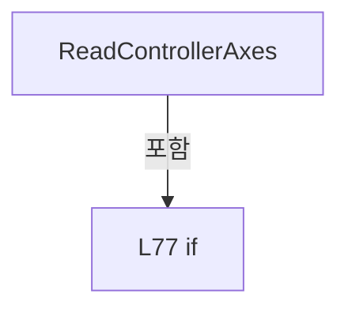

변경 전 점검: 입력/반환 타입, 위 호출자, 예외/취소 경로, 공유 상태와 저장·전송 소비자를 함께 확인합니다. 값의 단위나 물리 방향을 이름만으로 확정하지 않습니다.

### MethodDeclaration `ReadProcessorUsage` · L82–85

[Drilling.Common/Automation/CAutomationManager.cs:82–85](https://github.com/kjuws10-rgb/A3Drilling/blob/28764c91d521777b8ee068dd7aaf2d3902ce9fe2/Drilling.Common/Automation/CAutomationManager.cs#L82-L85)

| 항목 | 실제 추출 값 |
| --- | --- |
| 서명 | System.Threading.Tasks.Task<string> Drilling.Common.Automation.CAutomationManager.ReadProcessorUsage(int, System.Threading.CancellationToken) |
| 접근/수식자 | Public / public |
| 반환/값 타입 | System.Threading.Tasks.Task<string> |
| 소속 타입 | NamedType:Drilling.Common.Automation.CAutomationManager |

입력 계약:

| 이름 | 타입 | 전달 | 선택/기본값 |
| --- | --- | --- | --- |
| number | int | None | True / 0 |
| cancellationToken | System.Threading.CancellationToken | None | True / null |

정적 호출자로 확인된 위치:

| 호출 파일/행 | 호출 표현식 | 런타임 분기 가능 |
| --- | --- | --- |
| [Drilling.Common/Automation/CAutomationStatusSnapshotService.cs:45–45](https://github.com/kjuws10-rgb/A3Drilling/blob/28764c91d521777b8ee068dd7aaf2d3902ce9fe2/Drilling.Common/Automation/CAutomationStatusSnapshotService.cs#L45-L45) | _automation.ReadProcessorUsage | False |

호출하는 대상과 해석 범위:

| 원본 행 | 표현식 | 분석 상태 | 대상/소스 위치 |
| --- | --- | --- | --- |
| 84 | ExecuteRaw | resolved | System.Threading.Tasks.Task<string> Drilling.Common.Automation.CAutomationManager.ExecuteRaw(string, int, System.Threading.CancellationToken, bool) · Drilling.Common/Automation/CAutomationManager.cs:180 |

본문의 실제 연산·분기·예외·반환 순서(원문 위치 순):

| 원본 행 | 종류 | 주석 해설 |
| --- | --- | --- |
| 84 | call | 함수·델리게이트 또는 객체 생성자를 호출합니다: ExecuteRaw("AUTOMATION1:SYSTEM:PROCESSOR_USAGE", number, cancellationToken) |
| 84 | return | 호출자에게 값 또는 제어를 반환합니다: return ExecuteRaw("AUTOMATION1:SYSTEM:PROCESSOR_USAGE", number, cancellationToken); |

변경 전 점검: 입력/반환 타입, 위 호출자, 예외/취소 경로, 공유 상태와 저장·전송 소비자를 함께 확인합니다. 값의 단위나 물리 방향을 이름만으로 확정하지 않습니다.

### MethodDeclaration `ResetController` · L87–95

[Drilling.Common/Automation/CAutomationManager.cs:87–95](https://github.com/kjuws10-rgb/A3Drilling/blob/28764c91d521777b8ee068dd7aaf2d3902ce9fe2/Drilling.Common/Automation/CAutomationManager.cs#L87-L95)

| 항목 | 실제 추출 값 |
| --- | --- |
| 서명 | System.Threading.Tasks.Task<string> Drilling.Common.Automation.CAutomationManager.ResetController(int, System.Threading.CancellationToken) |
| 접근/수식자 | Public / public |
| 반환/값 타입 | System.Threading.Tasks.Task<string> |
| 소속 타입 | NamedType:Drilling.Common.Automation.CAutomationManager |

입력 계약:

| 이름 | 타입 | 전달 | 선택/기본값 |
| --- | --- | --- | --- |
| number | int | None | True / 0 |
| cancellationToken | System.Threading.CancellationToken | None | True / null |

정적 호출자로 확인된 위치:

| 호출 파일/행 | 호출 표현식 | 런타임 분기 가능 |
| --- | --- | --- |
| [Drilling.UI/Menu/Menus/CMenuManual.cs:2209–2209](https://github.com/kjuws10-rgb/A3Drilling/blob/28764c91d521777b8ee068dd7aaf2d3902ce9fe2/Drilling.UI/Menu/Menus/CMenuManual.cs#L2209-L2209) | _manager.automation.ResetController | False |
| [Drilling.UI/Menu/Menus/CMenuManual.cs:2350–2350](https://github.com/kjuws10-rgb/A3Drilling/blob/28764c91d521777b8ee068dd7aaf2d3902ce9fe2/Drilling.UI/Menu/Menus/CMenuManual.cs#L2350-L2350) | _manager.automation.ResetController | False |

호출하는 대상과 해석 범위:

| 원본 행 | 표현식 | 분석 상태 | 대상/소스 위치 |
| --- | --- | --- | --- |
| 89 | IsSimul | resolved | bool Drilling.Common.Automation.CAutomationManager.IsSimul(int) · Drilling.Common/Automation/CAutomationManager.cs:63 |
| 91 | Task.FromResult | resolved | System.Threading.Tasks.Task<string> System.Threading.Tasks.Task.FromResult<string>(string) |
| 91 | number.ToString | resolved | string int.ToString(System.IFormatProvider?) |
| 94 | ExecuteRaw | resolved | System.Threading.Tasks.Task<string> Drilling.Common.Automation.CAutomationManager.ExecuteRaw(string, int, System.Threading.CancellationToken, bool) · Drilling.Common/Automation/CAutomationManager.cs:180 |

본문의 실제 연산·분기·예외·반환 순서(원문 위치 순):

| 원본 행 | 종류 | 주석 해설 |
| --- | --- | --- |
| 89 | call | 함수·델리게이트 또는 객체 생성자를 호출합니다: IsSimul(number) |
| 89 | if | 조건에 따라 분기합니다: if (IsSimul(number)) |
| 91 | call | 함수·델리게이트 또는 객체 생성자를 호출합니다: Task.FromResult($"OK:SYSTEM:RESET:{number.ToString(CultureInfo.InvariantCulture)}") |
| 91 | call | 함수·델리게이트 또는 객체 생성자를 호출합니다: number.ToString(CultureInfo.InvariantCulture) |
| 91 | return | 호출자에게 값 또는 제어를 반환합니다: return Task.FromResult($"OK:SYSTEM:RESET:{number.ToString(CultureInfo.InvariantCulture)}"); |
| 94 | call | 함수·델리게이트 또는 객체 생성자를 호출합니다: ExecuteRaw("AUTOMATION1:SYSTEM:RESET", number, cancellationToken) |
| 94 | return | 호출자에게 값 또는 제어를 반환합니다: return ExecuteRaw("AUTOMATION1:SYSTEM:RESET", number, cancellationToken); |

제어 구문의 포함 구조(실제 실행 순서/CFG가 아닌 구문 탐색 그림):

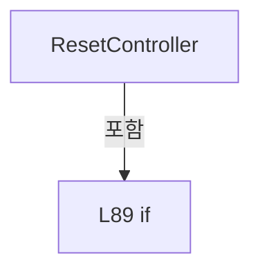

변경 전 점검: 입력/반환 타입, 위 호출자, 예외/취소 경로, 공유 상태와 저장·전송 소비자를 함께 확인합니다. 값의 단위나 물리 방향을 이름만으로 확정하지 않습니다.

### MethodDeclaration `ReadIo` · L97–101

[Drilling.Common/Automation/CAutomationManager.cs:97–101](https://github.com/kjuws10-rgb/A3Drilling/blob/28764c91d521777b8ee068dd7aaf2d3902ce9fe2/Drilling.Common/Automation/CAutomationManager.cs#L97-L101)

| 항목 | 실제 추출 값 |
| --- | --- |
| 서명 | System.Threading.Tasks.Task<string> Drilling.Common.Automation.CAutomationManager.ReadIo(string, int, System.Threading.CancellationToken) |
| 접근/수식자 | Public / public |
| 반환/값 타입 | System.Threading.Tasks.Task<string> |
| 소속 타입 | NamedType:Drilling.Common.Automation.CAutomationManager |

입력 계약:

| 이름 | 타입 | 전달 | 선택/기본값 |
| --- | --- | --- | --- |
| address | string | None | False /  |
| number | int | None | True / 0 |
| cancellationToken | System.Threading.CancellationToken | None | True / null |

정적 호출자로 확인된 위치:

| 호출 파일/행 | 호출 표현식 | 런타임 분기 가능 |
| --- | --- | --- |
| [Drilling.UI/Menu/Menus/CMenuManual.cs:1750–1750](https://github.com/kjuws10-rgb/A3Drilling/blob/28764c91d521777b8ee068dd7aaf2d3902ce9fe2/Drilling.UI/Menu/Menus/CMenuManual.cs#L1750-L1750) | _manager.automation.ReadIo | False |
| [Drilling.UI/Menu/Menus/CMenuManual.cs:2472–2472](https://github.com/kjuws10-rgb/A3Drilling/blob/28764c91d521777b8ee068dd7aaf2d3902ce9fe2/Drilling.UI/Menu/Menus/CMenuManual.cs#L2472-L2472) | _manager.automation.ReadIo | False |
| [Drilling.UI/Menu/Menus/CMenuManual.cs:2865–2865](https://github.com/kjuws10-rgb/A3Drilling/blob/28764c91d521777b8ee068dd7aaf2d3902ce9fe2/Drilling.UI/Menu/Menus/CMenuManual.cs#L2865-L2865) | _manager.automation.ReadIo | False |

호출하는 대상과 해석 범위:

| 원본 행 | 표현식 | 분석 상태 | 대상/소스 위치 |
| --- | --- | --- | --- |
| 99 | ValidateIoAddress | resolved | string Drilling.Common.Automation.CAutomationManager.ValidateIoAddress(string, bool) · Drilling.Common/Automation/CAutomationManager.cs:109 |
| 100 | ExecuteRaw | resolved | System.Threading.Tasks.Task<string> Drilling.Common.Automation.CAutomationManager.ExecuteRaw(string, int, System.Threading.CancellationToken, bool) · Drilling.Common/Automation/CAutomationManager.cs:180 |

본문의 실제 연산·분기·예외·반환 순서(원문 위치 순):

| 원본 행 | 종류 | 주석 해설 |
| --- | --- | --- |
| 99 | call | 함수·델리게이트 또는 객체 생성자를 호출합니다: ValidateIoAddress(address, outputOnly: false) |
| 99 | local-declaration | 지역 변수를 선언합니다: var ioAddress = ValidateIoAddress(address, outputOnly: false); |
| 99 | variable-initializer | 변수의 초기값을 지정합니다: ioAddress = ValidateIoAddress(address, outputOnly: false) |
| 100 | call | 함수·델리게이트 또는 객체 생성자를 호출합니다: ExecuteRaw($"AUTOMATION1:IO:{ioAddress}:READ", number, cancellationToken) |
| 100 | return | 호출자에게 값 또는 제어를 반환합니다: return ExecuteRaw($"AUTOMATION1:IO:{ioAddress}:READ", number, cancellationToken); |

변경 전 점검: 입력/반환 타입, 위 호출자, 예외/취소 경로, 공유 상태와 저장·전송 소비자를 함께 확인합니다. 값의 단위나 물리 방향을 이름만으로 확정하지 않습니다.

### MethodDeclaration `SetIo` · L103–107

[Drilling.Common/Automation/CAutomationManager.cs:103–107](https://github.com/kjuws10-rgb/A3Drilling/blob/28764c91d521777b8ee068dd7aaf2d3902ce9fe2/Drilling.Common/Automation/CAutomationManager.cs#L103-L107)

| 항목 | 실제 추출 값 |
| --- | --- |
| 서명 | System.Threading.Tasks.Task<string> Drilling.Common.Automation.CAutomationManager.SetIo(string, bool, int, System.Threading.CancellationToken) |
| 접근/수식자 | Public / public |
| 반환/값 타입 | System.Threading.Tasks.Task<string> |
| 소속 타입 | NamedType:Drilling.Common.Automation.CAutomationManager |

입력 계약:

| 이름 | 타입 | 전달 | 선택/기본값 |
| --- | --- | --- | --- |
| address | string | None | False /  |
| isOn | bool | None | False /  |
| number | int | None | True / 0 |
| cancellationToken | System.Threading.CancellationToken | None | True / null |

정적 호출자로 확인된 위치:

| 호출 파일/행 | 호출 표현식 | 런타임 분기 가능 |
| --- | --- | --- |
| [Drilling.UI/Menu/Menus/CMenuManual.cs:1750–1750](https://github.com/kjuws10-rgb/A3Drilling/blob/28764c91d521777b8ee068dd7aaf2d3902ce9fe2/Drilling.UI/Menu/Menus/CMenuManual.cs#L1750-L1750) | _manager.automation.SetIo | False |
| [Drilling.UI/Menu/Menus/CMenuManual.cs:2464–2464](https://github.com/kjuws10-rgb/A3Drilling/blob/28764c91d521777b8ee068dd7aaf2d3902ce9fe2/Drilling.UI/Menu/Menus/CMenuManual.cs#L2464-L2464) | _manager.automation.SetIo | False |
| [Drilling.UI/Menu/Menus/CMenuManual.cs:2929–2929](https://github.com/kjuws10-rgb/A3Drilling/blob/28764c91d521777b8ee068dd7aaf2d3902ce9fe2/Drilling.UI/Menu/Menus/CMenuManual.cs#L2929-L2929) | _manager.automation.SetIo | False |

호출하는 대상과 해석 범위:

| 원본 행 | 표현식 | 분석 상태 | 대상/소스 위치 |
| --- | --- | --- | --- |
| 105 | ValidateIoAddress | resolved | string Drilling.Common.Automation.CAutomationManager.ValidateIoAddress(string, bool) · Drilling.Common/Automation/CAutomationManager.cs:109 |
| 106 | ExecuteRaw | resolved | System.Threading.Tasks.Task<string> Drilling.Common.Automation.CAutomationManager.ExecuteRaw(string, int, System.Threading.CancellationToken, bool) · Drilling.Common/Automation/CAutomationManager.cs:180 |

본문의 실제 연산·분기·예외·반환 순서(원문 위치 순):

| 원본 행 | 종류 | 주석 해설 |
| --- | --- | --- |
| 105 | call | 함수·델리게이트 또는 객체 생성자를 호출합니다: ValidateIoAddress(address, outputOnly: true) |
| 105 | local-declaration | 지역 변수를 선언합니다: var ioAddress = ValidateIoAddress(address, outputOnly: true); |
| 105 | variable-initializer | 변수의 초기값을 지정합니다: ioAddress = ValidateIoAddress(address, outputOnly: true) |
| 106 | call | 함수·델리게이트 또는 객체 생성자를 호출합니다: ExecuteRaw($"AUTOMATION1:IO:{ioAddress}:{(isOn ? "ON" : "OFF")}", number, cancellationToken) |
| 106 | conditional-expression | 조건에 따라 결과식을 선택합니다: isOn ? "ON" : "OFF" |
| 106 | return | 호출자에게 값 또는 제어를 반환합니다: return ExecuteRaw($"AUTOMATION1:IO:{ioAddress}:{(isOn ? "ON" : "OFF")}", number, cancellationToken); |

변경 전 점검: 입력/반환 타입, 위 호출자, 예외/취소 경로, 공유 상태와 저장·전송 소비자를 함께 확인합니다. 값의 단위나 물리 방향을 이름만으로 확정하지 않습니다.

### MethodDeclaration `ValidateIoAddress` · L109–163

[Drilling.Common/Automation/CAutomationManager.cs:109–163](https://github.com/kjuws10-rgb/A3Drilling/blob/28764c91d521777b8ee068dd7aaf2d3902ce9fe2/Drilling.Common/Automation/CAutomationManager.cs#L109-L163)

| 항목 | 실제 추출 값 |
| --- | --- |
| 서명 | string Drilling.Common.Automation.CAutomationManager.ValidateIoAddress(string, bool) |
| 접근/수식자 | Private / private, static |
| 반환/값 타입 | string |
| 소속 타입 | NamedType:Drilling.Common.Automation.CAutomationManager |

입력 계약:

| 이름 | 타입 | 전달 | 선택/기본값 |
| --- | --- | --- | --- |
| address | string | None | False /  |
| outputOnly | bool | None | False /  |

정적 호출자로 확인된 위치:

| 호출 파일/행 | 호출 표현식 | 런타임 분기 가능 |
| --- | --- | --- |
| [Drilling.Common/Automation/CAutomationManager.cs:99–99](https://github.com/kjuws10-rgb/A3Drilling/blob/28764c91d521777b8ee068dd7aaf2d3902ce9fe2/Drilling.Common/Automation/CAutomationManager.cs#L99-L99) | ValidateIoAddress | False |
| [Drilling.Common/Automation/CAutomationManager.cs:105–105](https://github.com/kjuws10-rgb/A3Drilling/blob/28764c91d521777b8ee068dd7aaf2d3902ce9fe2/Drilling.Common/Automation/CAutomationManager.cs#L105-L105) | ValidateIoAddress | False |

호출하는 대상과 해석 범위:

| 원본 행 | 표현식 | 분석 상태 | 대상/소스 위치 |
| --- | --- | --- | --- |
| 111 | ArgumentException.ThrowIfNullOrWhiteSpace | resolved | void System.ArgumentException.ThrowIfNullOrWhiteSpace(string?, string?) |
| 112 | address.Trim | resolved | string string.Trim() |
| 118 | value.Any | resolved | bool System.Collections.Generic.IEnumerable<char>.Any<char>(System.Func<char, bool>) |
| 120 | new InvalidOperationException | resolved | System.InvalidOperationException.InvalidOperationException(string?) |
| 123 | value.ToUpperInvariant | resolved | string string.ToUpperInvariant() |
| 124 | normalized.Split | resolved | string[] string.Split(char[]?, System.StringSplitOptions) |
| 127 | new InvalidOperationException | resolved | System.InvalidOperationException.InvalidOperationException(string?) |
| 130 | TrimIoAxisPrefix | resolved | string Drilling.Common.Automation.CAutomationManager.TrimIoAxisPrefix(string) · Drilling.Common/Automation/CAutomationManager.cs:165 |
| 133 | bitText.StartsWith | resolved | bool string.StartsWith(string, System.StringComparison) |
| 138 | bitText.StartsWith | resolved | bool string.StartsWith(string, System.StringComparison) |
| 142 | bitText.StartsWith | resolved | bool string.StartsWith(string, System.StringComparison) |
| 147 | bitText.StartsWith | resolved | bool string.StartsWith(string, System.StringComparison) |
| 154 | new InvalidOperationException | resolved | System.InvalidOperationException.InvalidOperationException(string?) |
| 157 | IsUnsignedInteger | resolved | bool Drilling.Common.Automation.CAutomationManager.IsUnsignedInteger(string) · Drilling.Common/Automation/CAutomationManager.cs:175 |
| 157 | IsUnsignedInteger | resolved | bool Drilling.Common.Automation.CAutomationManager.IsUnsignedInteger(string) · Drilling.Common/Automation/CAutomationManager.cs:175 |
| 157 | int.TryParse | resolved | bool int.TryParse(string?, System.Globalization.NumberStyles, System.IFormatProvider?, out int) |
| 157 | int.TryParse | resolved | bool int.TryParse(string?, System.Globalization.NumberStyles, System.IFormatProvider?, out int) |
| 159 | new InvalidOperationException | resolved | System.InvalidOperationException.InvalidOperationException(string?) |

본문의 실제 연산·분기·예외·반환 순서(원문 위치 순):

| 원본 행 | 종류 | 주석 해설 |
| --- | --- | --- |
| 111 | call | 함수·델리게이트 또는 객체 생성자를 호출합니다: ArgumentException.ThrowIfNullOrWhiteSpace(address) |
| 112 | call | 함수·델리게이트 또는 객체 생성자를 호출합니다: address.Trim() |
| 112 | local-declaration | 지역 변수를 선언합니다: var value = address.Trim(); |
| 112 | variable-initializer | 변수의 초기값을 지정합니다: value = address.Trim() |
| 118 | call | 함수·델리게이트 또는 객체 생성자를 호출합니다: value.Any(MatchesItem) |
| 118 | if | 조건에 따라 분기합니다: if (value.Any(MatchesItem)) |
| 120 | call | 함수·델리게이트 또는 객체 생성자를 호출합니다: new InvalidOperationException($"Automation1 IO address contains an invalid command delimiter: {address}") |
| 120 | throw | 예외를 발생/전달합니다: throw new InvalidOperationException($"Automation1 IO address contains an invalid command delimiter: {address}"); |
| 123 | call | 함수·델리게이트 또는 객체 생성자를 호출합니다: value.ToUpperInvariant() |
| 123 | local-declaration | 지역 변수를 선언합니다: var normalized = value.ToUpperInvariant(); |
| 123 | variable-initializer | 변수의 초기값을 지정합니다: normalized = value.ToUpperInvariant() |
| 124 | call | 함수·델리게이트 또는 객체 생성자를 호출합니다: normalized.Split(['.', '/', ','], StringSplitOptions.None) |
| 124 | local-declaration | 지역 변수를 선언합니다: var parts = normalized.Split(['.', '/', ','], StringSplitOptions.None); |
| 124 | variable-initializer | 변수의 초기값을 지정합니다: parts = normalized.Split(['.', '/', ','], StringSplitOptions.None) |
| 125 | if | 조건에 따라 분기합니다: if (parts.Length != 2) |
| 127 | call | 함수·델리게이트 또는 객체 생성자를 호출합니다: new InvalidOperationException($"Automation1 IO address is invalid: {address}. Use A0.DO1, A0.DI1, or 0.1.") |
| 127 | throw | 예외를 발생/전달합니다: throw new InvalidOperationException($"Automation1 IO address is invalid: {address}. Use A0.DO1, A0.DI1, or 0.1."); |
| 130 | call | 함수·델리게이트 또는 객체 생성자를 호출합니다: TrimIoAxisPrefix(parts[0]) |
| 130 | local-declaration | 지역 변수를 선언합니다: var axisText = TrimIoAxisPrefix(parts[0]); |
| 130 | variable-initializer | 변수의 초기값을 지정합니다: axisText = TrimIoAxisPrefix(parts[0]) |
| 131 | local-declaration | 지역 변수를 선언합니다: var bitText = parts[1]; |
| 131 | variable-initializer | 변수의 초기값을 지정합니다: bitText = parts[1] |
| 132 | local-declaration | 지역 변수를 선언합니다: var isOutput = false; |
| 132 | variable-initializer | 변수의 초기값을 지정합니다: isOutput = false |
| 133 | call | 함수·델리게이트 또는 객체 생성자를 호출합니다: bitText.StartsWith("DO", StringComparison.Ordinal) |
| 133 | if | 조건에 따라 분기합니다: if (bitText.StartsWith("DO", StringComparison.Ordinal)) |
| 135 | assignment | 값을 대상에 대입합니다: isOutput = true |
| 136 | assignment | 값을 대상에 대입합니다: bitText = bitText[2..] |
| 138 | call | 함수·델리게이트 또는 객체 생성자를 호출합니다: bitText.StartsWith("DI", StringComparison.Ordinal) |
| 138 | else | 앞 조건이 거짓인 경로입니다: else |
| 138 | if | 조건에 따라 분기합니다: if (bitText.StartsWith("DI", StringComparison.Ordinal)) |
| 140 | assignment | 값을 대상에 대입합니다: bitText = bitText[2..] |
| 142 | call | 함수·델리게이트 또는 객체 생성자를 호출합니다: bitText.StartsWith("Y", StringComparison.Ordinal) |
| 142 | else | 앞 조건이 거짓인 경로입니다: else |
| 142 | if | 조건에 따라 분기합니다: if (bitText.StartsWith("Y", StringComparison.Ordinal)) |
| 144 | assignment | 값을 대상에 대입합니다: isOutput = true |
| 145 | assignment | 값을 대상에 대입합니다: bitText = bitText[1..] |
| 147 | call | 함수·델리게이트 또는 객체 생성자를 호출합니다: bitText.StartsWith("X", StringComparison.Ordinal) |
| 147 | else | 앞 조건이 거짓인 경로입니다: else |
| 147 | if | 조건에 따라 분기합니다: if (bitText.StartsWith("X", StringComparison.Ordinal)) |
| 149 | assignment | 값을 대상에 대입합니다: bitText = bitText[1..] |
| 152 | if | 조건에 따라 분기합니다: if (outputOnly && !isOutput) |
| 154 | call | 함수·델리게이트 또는 객체 생성자를 호출합니다: new InvalidOperationException($"Automation1 IO output command can use DO/Y address only: {address}") |
| 154 | throw | 예외를 발생/전달합니다: throw new InvalidOperationException($"Automation1 IO output command can use DO/Y address only: {address}"); |
| 157 | call | 함수·델리게이트 또는 객체 생성자를 호출합니다: IsUnsignedInteger(axisText) |
| 157 | call | 함수·델리게이트 또는 객체 생성자를 호출합니다: IsUnsignedInteger(bitText) |
| 157 | call | 함수·델리게이트 또는 객체 생성자를 호출합니다: int.TryParse(axisText, NumberStyles.None, CultureInfo.InvariantCulture, out var axisNo) |
| 157 | call | 함수·델리게이트 또는 객체 생성자를 호출합니다: int.TryParse(bitText, NumberStyles.None, CultureInfo.InvariantCulture, out var bitNo) |
| 157 | if | 조건에 따라 분기합니다: if (!IsUnsignedInteger(axisText) &#124;&#124; !IsUnsignedInteger(bitText) &#124;&#124; !int.TryParse(axisText, NumberStyles.None, CultureInfo.InvariantCulture, out var axisNo) &#124;&#124; !int.TryParse(bitText, NumberStyles.None, CultureInfo.InvariantCu…) |
| 159 | call | 함수·델리게이트 또는 객체 생성자를 호출합니다: new InvalidOperationException($"Automation1 IO address is invalid: {address}. Use A0.DO1, A0.DI1, or 0.1.") |
| 159 | throw | 예외를 발생/전달합니다: throw new InvalidOperationException($"Automation1 IO address is invalid: {address}. Use A0.DO1, A0.DI1, or 0.1."); |
| 162 | return | 호출자에게 값 또는 제어를 반환합니다: return value; |

제어 구문의 포함 구조(실제 실행 순서/CFG가 아닌 구문 탐색 그림):

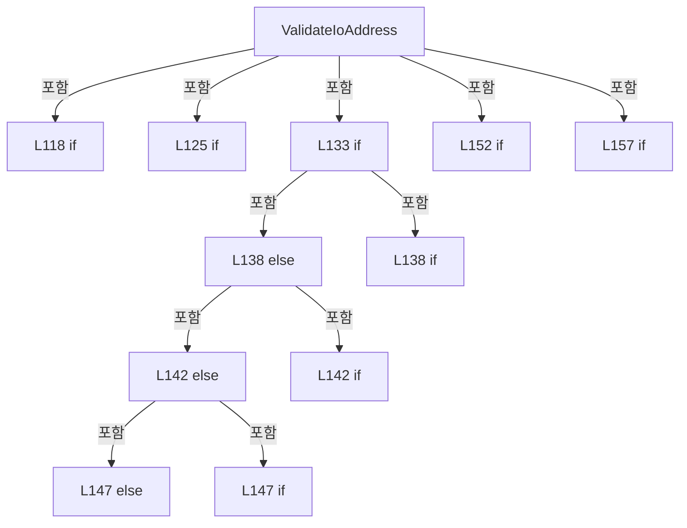

변경 전 점검: 입력/반환 타입, 위 호출자, 예외/취소 경로, 공유 상태와 저장·전송 소비자를 함께 확인합니다. 값의 단위나 물리 방향을 이름만으로 확정하지 않습니다.

### LocalFunctionStatement `MatchesItem` · L113–116

[Drilling.Common/Automation/CAutomationManager.cs:113–116](https://github.com/kjuws10-rgb/A3Drilling/blob/28764c91d521777b8ee068dd7aaf2d3902ce9fe2/Drilling.Common/Automation/CAutomationManager.cs#L113-L116)

| 항목 | 실제 추출 값 |
| --- | --- |
| 서명 | bool MatchesItem(char) |
| 접근/수식자 | Private /  |
| 반환/값 타입 | bool |
| 소속 타입 | NamedType:Drilling.Common.Automation.CAutomationManager |

입력 계약:

| 이름 | 타입 | 전달 | 선택/기본값 |
| --- | --- | --- | --- |
| character | char | None | False /  |

현재 부분 분석에서 직접 연결된 호출자는 없습니다. XAML/이벤트/인터페이스·델리게이트·외부 진입을 추가 확인해야 하며, 미사용으로 판정한 것이 아닙니다.

호출하는 대상과 해석 범위:

| 원본 행 | 표현식 | 분석 상태 | 대상/소스 위치 |
| --- | --- | --- | --- |
| 115 | char.IsControl | resolved | bool char.IsControl(char) |
| 115 | char.IsWhiteSpace | resolved | bool char.IsWhiteSpace(char) |

본문의 실제 연산·분기·예외·반환 순서(원문 위치 순):

| 원본 행 | 종류 | 주석 해설 |
| --- | --- | --- |
| 115 | call | 함수·델리게이트 또는 객체 생성자를 호출합니다: char.IsControl(character) |
| 115 | call | 함수·델리게이트 또는 객체 생성자를 호출합니다: char.IsWhiteSpace(character) |
| 115 | return | 호출자에게 값 또는 제어를 반환합니다: return character is ':' or '&#124;' or '\r' or '\n' &#124;&#124; char.IsControl(character) &#124;&#124; char.IsWhiteSpace(character); |

변경 전 점검: 입력/반환 타입, 위 호출자, 예외/취소 경로, 공유 상태와 저장·전송 소비자를 함께 확인합니다. 값의 단위나 물리 방향을 이름만으로 확정하지 않습니다.

### MethodDeclaration `TrimIoAxisPrefix` · L165–173

[Drilling.Common/Automation/CAutomationManager.cs:165–173](https://github.com/kjuws10-rgb/A3Drilling/blob/28764c91d521777b8ee068dd7aaf2d3902ce9fe2/Drilling.Common/Automation/CAutomationManager.cs#L165-L173)

| 항목 | 실제 추출 값 |
| --- | --- |
| 서명 | string Drilling.Common.Automation.CAutomationManager.TrimIoAxisPrefix(string) |
| 접근/수식자 | Private / private, static |
| 반환/값 타입 | string |
| 소속 타입 | NamedType:Drilling.Common.Automation.CAutomationManager |

입력 계약:

| 이름 | 타입 | 전달 | 선택/기본값 |
| --- | --- | --- | --- |
| axisText | string | None | False /  |

정적 호출자로 확인된 위치:

| 호출 파일/행 | 호출 표현식 | 런타임 분기 가능 |
| --- | --- | --- |
| [Drilling.Common/Automation/CAutomationManager.cs:130–130](https://github.com/kjuws10-rgb/A3Drilling/blob/28764c91d521777b8ee068dd7aaf2d3902ce9fe2/Drilling.Common/Automation/CAutomationManager.cs#L130-L130) | TrimIoAxisPrefix | False |

호출하는 대상과 해석 범위:

| 원본 행 | 표현식 | 분석 상태 | 대상/소스 위치 |
| --- | --- | --- | --- |
| 167 | axisText.StartsWith | resolved | bool string.StartsWith(string, System.StringComparison) |
| 172 | axisText.StartsWith | resolved | bool string.StartsWith(string, System.StringComparison) |

본문의 실제 연산·분기·예외·반환 순서(원문 위치 순):

| 원본 행 | 종류 | 주석 해설 |
| --- | --- | --- |
| 167 | call | 함수·델리게이트 또는 객체 생성자를 호출합니다: axisText.StartsWith("AXIS", StringComparison.Ordinal) |
| 167 | if | 조건에 따라 분기합니다: if (axisText.StartsWith("AXIS", StringComparison.Ordinal)) |
| 169 | return | 호출자에게 값 또는 제어를 반환합니다: return axisText[4..]; |
| 172 | call | 함수·델리게이트 또는 객체 생성자를 호출합니다: axisText.StartsWith("A", StringComparison.Ordinal) |
| 172 | conditional-expression | 조건에 따라 결과식을 선택합니다: axisText.StartsWith("A", StringComparison.Ordinal) ? axisText[1..] : axisText |
| 172 | return | 호출자에게 값 또는 제어를 반환합니다: return axisText.StartsWith("A", StringComparison.Ordinal) ? axisText[1..] : axisText; |

제어 구문의 포함 구조(실제 실행 순서/CFG가 아닌 구문 탐색 그림):

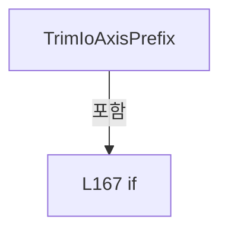

변경 전 점검: 입력/반환 타입, 위 호출자, 예외/취소 경로, 공유 상태와 저장·전송 소비자를 함께 확인합니다. 값의 단위나 물리 방향을 이름만으로 확정하지 않습니다.

### MethodDeclaration `IsUnsignedInteger` · L175–178

[Drilling.Common/Automation/CAutomationManager.cs:175–178](https://github.com/kjuws10-rgb/A3Drilling/blob/28764c91d521777b8ee068dd7aaf2d3902ce9fe2/Drilling.Common/Automation/CAutomationManager.cs#L175-L178)

| 항목 | 실제 추출 값 |
| --- | --- |
| 서명 | bool Drilling.Common.Automation.CAutomationManager.IsUnsignedInteger(string) |
| 접근/수식자 | Private / private, static |
| 반환/값 타입 | bool |
| 소속 타입 | NamedType:Drilling.Common.Automation.CAutomationManager |

입력 계약:

| 이름 | 타입 | 전달 | 선택/기본값 |
| --- | --- | --- | --- |
| value | string | None | False /  |

정적 호출자로 확인된 위치:

| 호출 파일/행 | 호출 표현식 | 런타임 분기 가능 |
| --- | --- | --- |
| [Drilling.Common/Automation/CAutomationManager.cs:157–157](https://github.com/kjuws10-rgb/A3Drilling/blob/28764c91d521777b8ee068dd7aaf2d3902ce9fe2/Drilling.Common/Automation/CAutomationManager.cs#L157-L157) | IsUnsignedInteger | False |
| [Drilling.Common/Automation/CAutomationManager.cs:157–157](https://github.com/kjuws10-rgb/A3Drilling/blob/28764c91d521777b8ee068dd7aaf2d3902ce9fe2/Drilling.Common/Automation/CAutomationManager.cs#L157-L157) | IsUnsignedInteger | False |

호출하는 대상과 해석 범위:

| 원본 행 | 표현식 | 분석 상태 | 대상/소스 위치 |
| --- | --- | --- | --- |
| 177 | value.All | resolved | bool System.Collections.Generic.IEnumerable<char>.All<char>(System.Func<char, bool>) |

본문의 실제 연산·분기·예외·반환 순서(원문 위치 순):

| 원본 행 | 종류 | 주석 해설 |
| --- | --- | --- |
| 177 | call | 함수·델리게이트 또는 객체 생성자를 호출합니다: value.All(char.IsAsciiDigit) |
| 177 | return | 호출자에게 값 또는 제어를 반환합니다: return value.Length > 0 && value.All(char.IsAsciiDigit); |

변경 전 점검: 입력/반환 타입, 위 호출자, 예외/취소 경로, 공유 상태와 저장·전송 소비자를 함께 확인합니다. 값의 단위나 물리 방향을 이름만으로 확정하지 않습니다.

### MethodDeclaration `ExecuteRaw` · L180–184

[Drilling.Common/Automation/CAutomationManager.cs:180–184](https://github.com/kjuws10-rgb/A3Drilling/blob/28764c91d521777b8ee068dd7aaf2d3902ce9fe2/Drilling.Common/Automation/CAutomationManager.cs#L180-L184)

| 항목 | 실제 추출 값 |
| --- | --- |
| 서명 | System.Threading.Tasks.Task<string> Drilling.Common.Automation.CAutomationManager.ExecuteRaw(string, int, System.Threading.CancellationToken, bool) |
| 접근/수식자 | Private / private |
| 반환/값 타입 | System.Threading.Tasks.Task<string> |
| 소속 타입 | NamedType:Drilling.Common.Automation.CAutomationManager |

입력 계약:

| 이름 | 타입 | 전달 | 선택/기본값 |
| --- | --- | --- | --- |
| command | string | None | False /  |
| number | int | None | False /  |
| cancellationToken | System.Threading.CancellationToken | None | False /  |
| suppressLog | bool | None | True / false |

정적 호출자로 확인된 위치:

| 호출 파일/행 | 호출 표현식 | 런타임 분기 가능 |
| --- | --- | --- |
| [Drilling.Common/Automation/CAutomationManager.cs:70–70](https://github.com/kjuws10-rgb/A3Drilling/blob/28764c91d521777b8ee068dd7aaf2d3902ce9fe2/Drilling.Common/Automation/CAutomationManager.cs#L70-L70) | ExecuteRaw | False |
| [Drilling.Common/Automation/CAutomationManager.cs:75–75](https://github.com/kjuws10-rgb/A3Drilling/blob/28764c91d521777b8ee068dd7aaf2d3902ce9fe2/Drilling.Common/Automation/CAutomationManager.cs#L75-L75) | ExecuteRaw | False |
| [Drilling.Common/Automation/CAutomationManager.cs:84–84](https://github.com/kjuws10-rgb/A3Drilling/blob/28764c91d521777b8ee068dd7aaf2d3902ce9fe2/Drilling.Common/Automation/CAutomationManager.cs#L84-L84) | ExecuteRaw | False |
| [Drilling.Common/Automation/CAutomationManager.cs:94–94](https://github.com/kjuws10-rgb/A3Drilling/blob/28764c91d521777b8ee068dd7aaf2d3902ce9fe2/Drilling.Common/Automation/CAutomationManager.cs#L94-L94) | ExecuteRaw | False |
| [Drilling.Common/Automation/CAutomationManager.cs:100–100](https://github.com/kjuws10-rgb/A3Drilling/blob/28764c91d521777b8ee068dd7aaf2d3902ce9fe2/Drilling.Common/Automation/CAutomationManager.cs#L100-L100) | ExecuteRaw | False |
| [Drilling.Common/Automation/CAutomationManager.cs:106–106](https://github.com/kjuws10-rgb/A3Drilling/blob/28764c91d521777b8ee068dd7aaf2d3902ce9fe2/Drilling.Common/Automation/CAutomationManager.cs#L106-L106) | ExecuteRaw | False |
| [Drilling.Common/Automation/CAutomationManager.cs:312–312](https://github.com/kjuws10-rgb/A3Drilling/blob/28764c91d521777b8ee068dd7aaf2d3902ce9fe2/Drilling.Common/Automation/CAutomationManager.cs#L312-L312) | ExecuteRaw | False |
| [Drilling.Common/Automation/CAutomationManager.cs:321–321](https://github.com/kjuws10-rgb/A3Drilling/blob/28764c91d521777b8ee068dd7aaf2d3902ce9fe2/Drilling.Common/Automation/CAutomationManager.cs#L321-L321) | ExecuteRaw | False |
| [Drilling.Common/Automation/CAutomationManager.cs:334–334](https://github.com/kjuws10-rgb/A3Drilling/blob/28764c91d521777b8ee068dd7aaf2d3902ce9fe2/Drilling.Common/Automation/CAutomationManager.cs#L334-L334) | ExecuteRaw | False |
| [Drilling.Common/Automation/CAutomationManager.cs:344–344](https://github.com/kjuws10-rgb/A3Drilling/blob/28764c91d521777b8ee068dd7aaf2d3902ce9fe2/Drilling.Common/Automation/CAutomationManager.cs#L344-L344) | ExecuteRaw | False |
| [Drilling.Common/Automation/CAutomationManager.cs:482–482](https://github.com/kjuws10-rgb/A3Drilling/blob/28764c91d521777b8ee068dd7aaf2d3902ce9fe2/Drilling.Common/Automation/CAutomationManager.cs#L482-L482) | ExecuteRaw | False |
| [Drilling.Common/Automation/CAutomationManager.cs:518–518](https://github.com/kjuws10-rgb/A3Drilling/blob/28764c91d521777b8ee068dd7aaf2d3902ce9fe2/Drilling.Common/Automation/CAutomationManager.cs#L518-L518) | ExecuteRaw | False |
| [Drilling.Common/Automation/CAutomationManager.cs:529–529](https://github.com/kjuws10-rgb/A3Drilling/blob/28764c91d521777b8ee068dd7aaf2d3902ce9fe2/Drilling.Common/Automation/CAutomationManager.cs#L529-L529) | ExecuteRaw | False |
| [Drilling.Common/Automation/CAutomationManager.cs:540–540](https://github.com/kjuws10-rgb/A3Drilling/blob/28764c91d521777b8ee068dd7aaf2d3902ce9fe2/Drilling.Common/Automation/CAutomationManager.cs#L540-L540) | ExecuteRaw | False |
| [Drilling.Common/Automation/CAutomationManager.cs:547–547](https://github.com/kjuws10-rgb/A3Drilling/blob/28764c91d521777b8ee068dd7aaf2d3902ce9fe2/Drilling.Common/Automation/CAutomationManager.cs#L547-L547) | ExecuteRaw | False |
| [Drilling.Common/Automation/CAutomationManager.cs:557–557](https://github.com/kjuws10-rgb/A3Drilling/blob/28764c91d521777b8ee068dd7aaf2d3902ce9fe2/Drilling.Common/Automation/CAutomationManager.cs#L557-L557) | ExecuteRaw | False |
| [Drilling.Common/Automation/CAutomationManager.cs:578–578](https://github.com/kjuws10-rgb/A3Drilling/blob/28764c91d521777b8ee068dd7aaf2d3902ce9fe2/Drilling.Common/Automation/CAutomationManager.cs#L578-L578) | ExecuteRaw | False |
| [Drilling.Common/Automation/CAutomationManager.cs:631–631](https://github.com/kjuws10-rgb/A3Drilling/blob/28764c91d521777b8ee068dd7aaf2d3902ce9fe2/Drilling.Common/Automation/CAutomationManager.cs#L631-L631) | ExecuteRaw | False |
| [Drilling.Common/Automation/CAutomationManager.cs:655–655](https://github.com/kjuws10-rgb/A3Drilling/blob/28764c91d521777b8ee068dd7aaf2d3902ce9fe2/Drilling.Common/Automation/CAutomationManager.cs#L655-L655) | ExecuteRaw | False |
| [Drilling.Common/Automation/CAutomationManager.cs:1139–1139](https://github.com/kjuws10-rgb/A3Drilling/blob/28764c91d521777b8ee068dd7aaf2d3902ce9fe2/Drilling.Common/Automation/CAutomationManager.cs#L1139-L1139) | ExecuteRaw | False |
| [Drilling.Common/Automation/CAutomationManager.cs:1153–1153](https://github.com/kjuws10-rgb/A3Drilling/blob/28764c91d521777b8ee068dd7aaf2d3902ce9fe2/Drilling.Common/Automation/CAutomationManager.cs#L1153-L1153) | ExecuteRaw | False |
| [Drilling.Common/Automation/CAutomationManager.cs:1174–1174](https://github.com/kjuws10-rgb/A3Drilling/blob/28764c91d521777b8ee068dd7aaf2d3902ce9fe2/Drilling.Common/Automation/CAutomationManager.cs#L1174-L1174) | ExecuteRaw | False |
| [Drilling.Common/Automation/CAutomationManager.cs:1207–1207](https://github.com/kjuws10-rgb/A3Drilling/blob/28764c91d521777b8ee068dd7aaf2d3902ce9fe2/Drilling.Common/Automation/CAutomationManager.cs#L1207-L1207) | ExecuteRaw | False |
| [Drilling.Common/Automation/CAutomationManager.cs:1246–1246](https://github.com/kjuws10-rgb/A3Drilling/blob/28764c91d521777b8ee068dd7aaf2d3902ce9fe2/Drilling.Common/Automation/CAutomationManager.cs#L1246-L1246) | ExecuteRaw | False |
| [Drilling.Common/Automation/CAutomationManager.cs:1259–1259](https://github.com/kjuws10-rgb/A3Drilling/blob/28764c91d521777b8ee068dd7aaf2d3902ce9fe2/Drilling.Common/Automation/CAutomationManager.cs#L1259-L1259) | ExecuteRaw | False |

호출하는 대상과 해석 범위:

| 원본 행 | 표현식 | 분석 상태 | 대상/소스 위치 |
| --- | --- | --- | --- |
| 182 | ArgumentException.ThrowIfNullOrWhiteSpace | resolved | void System.ArgumentException.ThrowIfNullOrWhiteSpace(string?, string?) |
| 183 | _interfaceManager.ExecuteFunctionNoLog | resolved · 동적 구현 선택 가능 | System.Threading.Tasks.Task<string> Drilling.Common.Interface.CInterfaceManager.ExecuteFunctionNoLog(Drilling.Common.Interface.EN_EQP_MODULE, int, string, System.Threading.CancellationToken) · Drilling.Common/Interface/CInterfaceManager.cs:326 |
| 183 | _interfaceManager.ExecuteFunction | resolved · 동적 구현 선택 가능 | System.Threading.Tasks.Task<string> Drilling.Common.Interface.CInterfaceManager.ExecuteFunction(Drilling.Common.Interface.EN_EQP_MODULE, int, string, System.Threading.CancellationToken) · Drilling.Common/Interface/CInterfaceManager.cs:320 |

본문의 실제 연산·분기·예외·반환 순서(원문 위치 순):

| 원본 행 | 종류 | 주석 해설 |
| --- | --- | --- |
| 182 | call | 함수·델리게이트 또는 객체 생성자를 호출합니다: ArgumentException.ThrowIfNullOrWhiteSpace(command) |
| 183 | call | 함수·델리게이트 또는 객체 생성자를 호출합니다: _interfaceManager.ExecuteFunctionNoLog(EN_EQP_MODULE.Automation1, number, command, cancellationToken) |
| 183 | call | 함수·델리게이트 또는 객체 생성자를 호출합니다: _interfaceManager.ExecuteFunction(EN_EQP_MODULE.Automation1, number, command, cancellationToken) |
| 183 | conditional-expression | 조건에 따라 결과식을 선택합니다: suppressLog ? _interfaceManager.ExecuteFunctionNoLog(EN_EQP_MODULE.Automation1, number, command, cancellationToken) : _interfaceManager.ExecuteFunction(EN_EQP_MODULE.Automation1, number, command, cancellationToken) |
| 183 | return | 호출자에게 값 또는 제어를 반환합니다: return suppressLog ? _interfaceManager.ExecuteFunctionNoLog(EN_EQP_MODULE.Automation1, number, command, cancellationToken) : _interfaceManager.ExecuteFunction(EN_EQP_MODULE.Automation1, number, command, cancellationToken); |

변경 전 점검: 입력/반환 타입, 위 호출자, 예외/취소 경로, 공유 상태와 저장·전송 소비자를 함께 확인합니다. 값의 단위나 물리 방향을 이름만으로 확정하지 않습니다.

### MethodDeclaration `Move` · L186–189

[Drilling.Common/Automation/CAutomationManager.cs:186–189](https://github.com/kjuws10-rgb/A3Drilling/blob/28764c91d521777b8ee068dd7aaf2d3902ce9fe2/Drilling.Common/Automation/CAutomationManager.cs#L186-L189)

| 항목 | 실제 추출 값 |
| --- | --- |
| 서명 | System.Threading.Tasks.Task<string> Drilling.Common.Automation.CAutomationManager.Move(string, double, double, int, System.Threading.CancellationToken) |
| 접근/수식자 | Public / public |
| 반환/값 타입 | System.Threading.Tasks.Task<string> |
| 소속 타입 | NamedType:Drilling.Common.Automation.CAutomationManager |

입력 계약:

| 이름 | 타입 | 전달 | 선택/기본값 |
| --- | --- | --- | --- |
| axisName | string | None | False /  |
| targetPosition | double | None | False /  |
| velocity | double | None | True / 100 |
| number | int | None | True / 0 |
| cancellationToken | System.Threading.CancellationToken | None | True / null |

현재 부분 분석에서 직접 연결된 호출자는 없습니다. XAML/이벤트/인터페이스·델리게이트·외부 진입을 추가 확인해야 하며, 미사용으로 판정한 것이 아닙니다.

호출하는 대상과 해석 범위:

| 원본 행 | 표현식 | 분석 상태 | 대상/소스 위치 |
| --- | --- | --- | --- |
| 188 | ExecuteAxis | resolved | System.Threading.Tasks.Task<string> Drilling.Common.Automation.CAutomationManager.ExecuteAxis(string, string, int, System.Threading.CancellationToken) · Drilling.Common/Automation/CAutomationManager.cs:596 |
| 188 | Format | resolved | string Drilling.Common.Automation.CAutomationManager.Format(double) · Drilling.Common/Automation/CAutomationManager.cs:1089 |
| 188 | Format | resolved | string Drilling.Common.Automation.CAutomationManager.Format(double) · Drilling.Common/Automation/CAutomationManager.cs:1089 |

본문의 실제 연산·분기·예외·반환 순서(원문 위치 순):

| 원본 행 | 종류 | 주석 해설 |
| --- | --- | --- |
| 188 | call | 함수·델리게이트 또는 객체 생성자를 호출합니다: ExecuteAxis(axisName, $"MOVE_ABS:{Format(targetPosition)}:{Format(velocity)}", number, cancellationToken) |
| 188 | call | 함수·델리게이트 또는 객체 생성자를 호출합니다: Format(targetPosition) |
| 188 | call | 함수·델리게이트 또는 객체 생성자를 호출합니다: Format(velocity) |
| 188 | return | 호출자에게 값 또는 제어를 반환합니다: return ExecuteAxis(axisName, $"MOVE_ABS:{Format(targetPosition)}:{Format(velocity)}", number, cancellationToken); |

변경 전 점검: 입력/반환 타입, 위 호출자, 예외/취소 경로, 공유 상태와 저장·전송 소비자를 함께 확인합니다. 값의 단위나 물리 방향을 이름만으로 확정하지 않습니다.

### MethodDeclaration `MoveRel` · L191–194

[Drilling.Common/Automation/CAutomationManager.cs:191–194](https://github.com/kjuws10-rgb/A3Drilling/blob/28764c91d521777b8ee068dd7aaf2d3902ce9fe2/Drilling.Common/Automation/CAutomationManager.cs#L191-L194)

| 항목 | 실제 추출 값 |
| --- | --- |
| 서명 | System.Threading.Tasks.Task<string> Drilling.Common.Automation.CAutomationManager.MoveRel(string, double, double, int, System.Threading.CancellationToken) |
| 접근/수식자 | Public / public |
| 반환/값 타입 | System.Threading.Tasks.Task<string> |
| 소속 타입 | NamedType:Drilling.Common.Automation.CAutomationManager |

입력 계약:

| 이름 | 타입 | 전달 | 선택/기본값 |
| --- | --- | --- | --- |
| axisName | string | None | False /  |
| distance | double | None | False /  |
| velocity | double | None | True / 100 |
| number | int | None | True / 0 |
| cancellationToken | System.Threading.CancellationToken | None | True / null |

현재 부분 분석에서 직접 연결된 호출자는 없습니다. XAML/이벤트/인터페이스·델리게이트·외부 진입을 추가 확인해야 하며, 미사용으로 판정한 것이 아닙니다.

호출하는 대상과 해석 범위:

| 원본 행 | 표현식 | 분석 상태 | 대상/소스 위치 |
| --- | --- | --- | --- |
| 193 | ExecuteAxis | resolved | System.Threading.Tasks.Task<string> Drilling.Common.Automation.CAutomationManager.ExecuteAxis(string, string, int, System.Threading.CancellationToken) · Drilling.Common/Automation/CAutomationManager.cs:596 |
| 193 | Format | resolved | string Drilling.Common.Automation.CAutomationManager.Format(double) · Drilling.Common/Automation/CAutomationManager.cs:1089 |
| 193 | Format | resolved | string Drilling.Common.Automation.CAutomationManager.Format(double) · Drilling.Common/Automation/CAutomationManager.cs:1089 |

본문의 실제 연산·분기·예외·반환 순서(원문 위치 순):

| 원본 행 | 종류 | 주석 해설 |
| --- | --- | --- |
| 193 | call | 함수·델리게이트 또는 객체 생성자를 호출합니다: ExecuteAxis(axisName, $"MOVE_REL:{Format(distance)}:{Format(velocity)}", number, cancellationToken) |
| 193 | call | 함수·델리게이트 또는 객체 생성자를 호출합니다: Format(distance) |
| 193 | call | 함수·델리게이트 또는 객체 생성자를 호출합니다: Format(velocity) |
| 193 | return | 호출자에게 값 또는 제어를 반환합니다: return ExecuteAxis(axisName, $"MOVE_REL:{Format(distance)}:{Format(velocity)}", number, cancellationToken); |

변경 전 점검: 입력/반환 타입, 위 호출자, 예외/취소 경로, 공유 상태와 저장·전송 소비자를 함께 확인합니다. 값의 단위나 물리 방향을 이름만으로 확정하지 않습니다.

### MethodDeclaration `Stop` · L196–199

[Drilling.Common/Automation/CAutomationManager.cs:196–199](https://github.com/kjuws10-rgb/A3Drilling/blob/28764c91d521777b8ee068dd7aaf2d3902ce9fe2/Drilling.Common/Automation/CAutomationManager.cs#L196-L199)

| 항목 | 실제 추출 값 |
| --- | --- |
| 서명 | System.Threading.Tasks.Task<string> Drilling.Common.Automation.CAutomationManager.Stop(string, int, System.Threading.CancellationToken) |
| 접근/수식자 | Public / public |
| 반환/값 타입 | System.Threading.Tasks.Task<string> |
| 소속 타입 | NamedType:Drilling.Common.Automation.CAutomationManager |

입력 계약:

| 이름 | 타입 | 전달 | 선택/기본값 |
| --- | --- | --- | --- |
| axisName | string | None | False /  |
| number | int | None | True / 0 |
| cancellationToken | System.Threading.CancellationToken | None | True / null |

현재 부분 분석에서 직접 연결된 호출자는 없습니다. XAML/이벤트/인터페이스·델리게이트·외부 진입을 추가 확인해야 하며, 미사용으로 판정한 것이 아닙니다.

호출하는 대상과 해석 범위:

| 원본 행 | 표현식 | 분석 상태 | 대상/소스 위치 |
| --- | --- | --- | --- |
| 198 | ExecuteAxis | resolved | System.Threading.Tasks.Task<string> Drilling.Common.Automation.CAutomationManager.ExecuteAxis(string, string, int, System.Threading.CancellationToken) · Drilling.Common/Automation/CAutomationManager.cs:596 |

본문의 실제 연산·분기·예외·반환 순서(원문 위치 순):

| 원본 행 | 종류 | 주석 해설 |
| --- | --- | --- |
| 198 | call | 함수·델리게이트 또는 객체 생성자를 호출합니다: ExecuteAxis(axisName, "STOP", number, cancellationToken) |
| 198 | return | 호출자에게 값 또는 제어를 반환합니다: return ExecuteAxis(axisName, "STOP", number, cancellationToken); |

변경 전 점검: 입력/반환 타입, 위 호출자, 예외/취소 경로, 공유 상태와 저장·전송 소비자를 함께 확인합니다. 값의 단위나 물리 방향을 이름만으로 확정하지 않습니다.

### MethodDeclaration `ManualMove` · L201–206

[Drilling.Common/Automation/CAutomationManager.cs:201–206](https://github.com/kjuws10-rgb/A3Drilling/blob/28764c91d521777b8ee068dd7aaf2d3902ce9fe2/Drilling.Common/Automation/CAutomationManager.cs#L201-L206)

| 항목 | 실제 추출 값 |
| --- | --- |
| 서명 | System.Threading.Tasks.Task<string> Drilling.Common.Automation.CAutomationManager.ManualMove(string, double, double, bool, int, System.Threading.CancellationToken) |
| 접근/수식자 | Public / public |
| 반환/값 타입 | System.Threading.Tasks.Task<string> |
| 소속 타입 | NamedType:Drilling.Common.Automation.CAutomationManager |

입력 계약:

| 이름 | 타입 | 전달 | 선택/기본값 |
| --- | --- | --- | --- |
| axisName | string | None | False /  |
| value | double | None | False /  |
| velocity | double | None | False /  |
| relative | bool | None | False /  |
| number | int | None | False /  |
| cancellationToken | System.Threading.CancellationToken | None | True / null |

정적 호출자로 확인된 위치:

| 호출 파일/행 | 호출 표현식 | 런타임 분기 가능 |
| --- | --- | --- |
| [Drilling.Common/Automation/CAutomationManager.cs:1562–1562](https://github.com/kjuws10-rgb/A3Drilling/blob/28764c91d521777b8ee068dd7aaf2d3902ce9fe2/Drilling.Common/Automation/CAutomationManager.cs#L1562-L1562) | automation.ManualMove | False |
| [Drilling.UI/Menu/Menus/CMenuManual.cs:3538–3538](https://github.com/kjuws10-rgb/A3Drilling/blob/28764c91d521777b8ee068dd7aaf2d3902ce9fe2/Drilling.UI/Menu/Menus/CMenuManual.cs#L3538-L3538) | _manager.automation.ManualMove | False |
| [Drilling.UI/Menu/Menus/CMenuManual.cs:3544–3544](https://github.com/kjuws10-rgb/A3Drilling/blob/28764c91d521777b8ee068dd7aaf2d3902ce9fe2/Drilling.UI/Menu/Menus/CMenuManual.cs#L3544-L3544) | _manager.automation.ManualMove | False |

호출하는 대상과 해석 범위:

| 원본 행 | 표현식 | 분석 상태 | 대상/소스 위치 |
| --- | --- | --- | --- |
| 203 | double.IsFinite | resolved | bool double.IsFinite(double) |
| 203 | double.IsFinite | resolved | bool double.IsFinite(double) |
| 204 | new ArgumentOutOfRangeException | resolved | System.ArgumentOutOfRangeException.ArgumentOutOfRangeException(string?, string?) |
| 204 | nameof | unresolved | None |
| 205 | ExecuteAxis | resolved | System.Threading.Tasks.Task<string> Drilling.Common.Automation.CAutomationManager.ExecuteAxis(string, string, int, System.Threading.CancellationToken) · Drilling.Common/Automation/CAutomationManager.cs:596 |
| 205 | Format | resolved | string Drilling.Common.Automation.CAutomationManager.Format(double) · Drilling.Common/Automation/CAutomationManager.cs:1089 |
| 205 | Format | resolved | string Drilling.Common.Automation.CAutomationManager.Format(double) · Drilling.Common/Automation/CAutomationManager.cs:1089 |

본문의 실제 연산·분기·예외·반환 순서(원문 위치 순):

| 원본 행 | 종류 | 주석 해설 |
| --- | --- | --- |
| 203 | call | 함수·델리게이트 또는 객체 생성자를 호출합니다: double.IsFinite(value) |
| 203 | call | 함수·델리게이트 또는 객체 생성자를 호출합니다: double.IsFinite(velocity) |
| 203 | if | 조건에 따라 분기합니다: if (!double.IsFinite(value) &#124;&#124; !double.IsFinite(velocity) &#124;&#124; velocity <= 0) |
| 204 | call | 함수·델리게이트 또는 객체 생성자를 호출합니다: new ArgumentOutOfRangeException(nameof(velocity), "Position and speed must be finite; speed must be positive.") |
| 204 | call | 함수·델리게이트 또는 객체 생성자를 호출합니다: nameof(velocity) |
| 204 | throw | 예외를 발생/전달합니다: throw new ArgumentOutOfRangeException(nameof(velocity), "Position and speed must be finite; speed must be positive."); |
| 205 | call | 함수·델리게이트 또는 객체 생성자를 호출합니다: ExecuteAxis(axisName, $"MANUAL_{(relative ? "REL" : "ABS")}:{Format(value)}:{Format(velocity)}", number, cancellationToken) |
| 205 | call | 함수·델리게이트 또는 객체 생성자를 호출합니다: Format(value) |
| 205 | call | 함수·델리게이트 또는 객체 생성자를 호출합니다: Format(velocity) |
| 205 | conditional-expression | 조건에 따라 결과식을 선택합니다: relative ? "REL" : "ABS" |
| 205 | return | 호출자에게 값 또는 제어를 반환합니다: return ExecuteAxis(axisName, $"MANUAL_{(relative ? "REL" : "ABS")}:{Format(value)}:{Format(velocity)}", number, cancellationToken); |

제어 구문의 포함 구조(실제 실행 순서/CFG가 아닌 구문 탐색 그림):

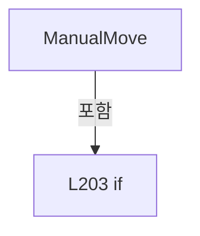

변경 전 점검: 입력/반환 타입, 위 호출자, 예외/취소 경로, 공유 상태와 저장·전송 소비자를 함께 확인합니다. 값의 단위나 물리 방향을 이름만으로 확정하지 않습니다.

### MethodDeclaration `JogStart` · L208–213

[Drilling.Common/Automation/CAutomationManager.cs:208–213](https://github.com/kjuws10-rgb/A3Drilling/blob/28764c91d521777b8ee068dd7aaf2d3902ce9fe2/Drilling.Common/Automation/CAutomationManager.cs#L208-L213)

| 항목 | 실제 추출 값 |
| --- | --- |
| 서명 | System.Threading.Tasks.Task<string> Drilling.Common.Automation.CAutomationManager.JogStart(string, double, int) |
| 접근/수식자 | Public / public |
| 반환/값 타입 | System.Threading.Tasks.Task<string> |
| 소속 타입 | NamedType:Drilling.Common.Automation.CAutomationManager |

입력 계약:

| 이름 | 타입 | 전달 | 선택/기본값 |
| --- | --- | --- | --- |
| axisName | string | None | False /  |
| velocity | double | None | False /  |
| number | int | None | False /  |

정적 호출자로 확인된 위치:

| 호출 파일/행 | 호출 표현식 | 런타임 분기 가능 |
| --- | --- | --- |
| [Drilling.UI/Menu/Menus/CMenuManual.cs:3577–3577](https://github.com/kjuws10-rgb/A3Drilling/blob/28764c91d521777b8ee068dd7aaf2d3902ce9fe2/Drilling.UI/Menu/Menus/CMenuManual.cs#L3577-L3577) | _manager.automation.JogStart | False |

호출하는 대상과 해석 범위:

| 원본 행 | 표현식 | 분석 상태 | 대상/소스 위치 |
| --- | --- | --- | --- |
| 210 | double.IsFinite | resolved | bool double.IsFinite(double) |
| 211 | new ArgumentOutOfRangeException | resolved | System.ArgumentOutOfRangeException.ArgumentOutOfRangeException(string?) |
| 211 | nameof | unresolved | None |
| 212 | ExecuteAxis | resolved | System.Threading.Tasks.Task<string> Drilling.Common.Automation.CAutomationManager.ExecuteAxis(string, string, int, System.Threading.CancellationToken) · Drilling.Common/Automation/CAutomationManager.cs:596 |
| 212 | Format | resolved | string Drilling.Common.Automation.CAutomationManager.Format(double) · Drilling.Common/Automation/CAutomationManager.cs:1089 |

본문의 실제 연산·분기·예외·반환 순서(원문 위치 순):

| 원본 행 | 종류 | 주석 해설 |
| --- | --- | --- |
| 210 | call | 함수·델리게이트 또는 객체 생성자를 호출합니다: double.IsFinite(velocity) |
| 210 | if | 조건에 따라 분기합니다: if (!double.IsFinite(velocity) &#124;&#124; velocity == 0) |
| 211 | call | 함수·델리게이트 또는 객체 생성자를 호출합니다: new ArgumentOutOfRangeException(nameof(velocity)) |
| 211 | call | 함수·델리게이트 또는 객체 생성자를 호출합니다: nameof(velocity) |
| 211 | throw | 예외를 발생/전달합니다: throw new ArgumentOutOfRangeException(nameof(velocity)); |
| 212 | call | 함수·델리게이트 또는 객체 생성자를 호출합니다: ExecuteAxis(axisName, $"JOG_START:{Format(velocity)}", number, default) |
| 212 | call | 함수·델리게이트 또는 객체 생성자를 호출합니다: Format(velocity) |
| 212 | return | 호출자에게 값 또는 제어를 반환합니다: return ExecuteAxis(axisName, $"JOG_START:{Format(velocity)}", number, default); |

제어 구문의 포함 구조(실제 실행 순서/CFG가 아닌 구문 탐색 그림):

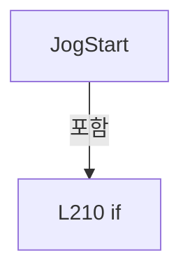

변경 전 점검: 입력/반환 타입, 위 호출자, 예외/취소 경로, 공유 상태와 저장·전송 소비자를 함께 확인합니다. 값의 단위나 물리 방향을 이름만으로 확정하지 않습니다.

### MethodDeclaration `JogStop` · L215–215

[Drilling.Common/Automation/CAutomationManager.cs:215–215](https://github.com/kjuws10-rgb/A3Drilling/blob/28764c91d521777b8ee068dd7aaf2d3902ce9fe2/Drilling.Common/Automation/CAutomationManager.cs#L215-L215)

| 항목 | 실제 추출 값 |
| --- | --- |
| 서명 | System.Threading.Tasks.Task<string> Drilling.Common.Automation.CAutomationManager.JogStop(string, int) |
| 접근/수식자 | Public / public |
| 반환/값 타입 | System.Threading.Tasks.Task<string> |
| 소속 타입 | NamedType:Drilling.Common.Automation.CAutomationManager |

입력 계약:

| 이름 | 타입 | 전달 | 선택/기본값 |
| --- | --- | --- | --- |
| axisName | string | None | False /  |
| number | int | None | False /  |

정적 호출자로 확인된 위치:

| 호출 파일/행 | 호출 표현식 | 런타임 분기 가능 |
| --- | --- | --- |
| [Drilling.UI/Menu/Menus/CMenuManual.cs:3578–3578](https://github.com/kjuws10-rgb/A3Drilling/blob/28764c91d521777b8ee068dd7aaf2d3902ce9fe2/Drilling.UI/Menu/Menus/CMenuManual.cs#L3578-L3578) | _manager.automation.JogStop | False |

호출하는 대상과 해석 범위:

| 원본 행 | 표현식 | 분석 상태 | 대상/소스 위치 |
| --- | --- | --- | --- |
| 215 | ExecuteAxis | resolved | System.Threading.Tasks.Task<string> Drilling.Common.Automation.CAutomationManager.ExecuteAxis(string, string, int, System.Threading.CancellationToken) · Drilling.Common/Automation/CAutomationManager.cs:596 |

본문의 실제 연산·분기·예외·반환 순서(원문 위치 순):

| 원본 행 | 종류 | 주석 해설 |
| --- | --- | --- |
| 215 | call | 함수·델리게이트 또는 객체 생성자를 호출합니다: ExecuteAxis(axisName, "JOG_STOP", number, default) |

변경 전 점검: 입력/반환 타입, 위 호출자, 예외/취소 경로, 공유 상태와 저장·전송 소비자를 함께 확인합니다. 값의 단위나 물리 방향을 이름만으로 확정하지 않습니다.

### MethodDeclaration `AbortMotion` · L216–216

[Drilling.Common/Automation/CAutomationManager.cs:216–216](https://github.com/kjuws10-rgb/A3Drilling/blob/28764c91d521777b8ee068dd7aaf2d3902ce9fe2/Drilling.Common/Automation/CAutomationManager.cs#L216-L216)

| 항목 | 실제 추출 값 |
| --- | --- |
| 서명 | System.Threading.Tasks.Task<string> Drilling.Common.Automation.CAutomationManager.AbortMotion(string, int, System.Threading.CancellationToken) |
| 접근/수식자 | Public / public |
| 반환/값 타입 | System.Threading.Tasks.Task<string> |
| 소속 타입 | NamedType:Drilling.Common.Automation.CAutomationManager |

입력 계약:

| 이름 | 타입 | 전달 | 선택/기본값 |
| --- | --- | --- | --- |
| axisName | string | None | False /  |
| number | int | None | False /  |
| cancellationToken | System.Threading.CancellationToken | None | True / null |

정적 호출자로 확인된 위치:

| 호출 파일/행 | 호출 표현식 | 런타임 분기 가능 |
| --- | --- | --- |
| [Drilling.Common/Automation/CAutomationManager.cs:1584–1584](https://github.com/kjuws10-rgb/A3Drilling/blob/28764c91d521777b8ee068dd7aaf2d3902ce9fe2/Drilling.Common/Automation/CAutomationManager.cs#L1584-L1584) | automation.AbortMotion | False |
| [Drilling.UI/Menu/Menus/CMenuManual.cs:3623–3623](https://github.com/kjuws10-rgb/A3Drilling/blob/28764c91d521777b8ee068dd7aaf2d3902ce9fe2/Drilling.UI/Menu/Menus/CMenuManual.cs#L3623-L3623) | _manager.automation.AbortMotion | False |
| [Drilling.UI/Menu/Menus/CMenuManual.cs:3732–3732](https://github.com/kjuws10-rgb/A3Drilling/blob/28764c91d521777b8ee068dd7aaf2d3902ce9fe2/Drilling.UI/Menu/Menus/CMenuManual.cs#L3732-L3732) | _manager.automation.AbortMotion | False |
| [Drilling.UI/Menu/Menus/CMenuManual.cs:6371–6371](https://github.com/kjuws10-rgb/A3Drilling/blob/28764c91d521777b8ee068dd7aaf2d3902ce9fe2/Drilling.UI/Menu/Menus/CMenuManual.cs#L6371-L6371) | _manager.automation.AbortMotion | False |

호출하는 대상과 해석 범위:

| 원본 행 | 표현식 | 분석 상태 | 대상/소스 위치 |
| --- | --- | --- | --- |
| 216 | ExecuteAxis | resolved | System.Threading.Tasks.Task<string> Drilling.Common.Automation.CAutomationManager.ExecuteAxis(string, string, int, System.Threading.CancellationToken) · Drilling.Common/Automation/CAutomationManager.cs:596 |

본문의 실제 연산·분기·예외·반환 순서(원문 위치 순):

| 원본 행 | 종류 | 주석 해설 |
| --- | --- | --- |
| 216 | call | 함수·델리게이트 또는 객체 생성자를 호출합니다: ExecuteAxis(axisName, "ABORT_MOTION", number, cancellationToken) |

변경 전 점검: 입력/반환 타입, 위 호출자, 예외/취소 경로, 공유 상태와 저장·전송 소비자를 함께 확인합니다. 값의 단위나 물리 방향을 이름만으로 확정하지 않습니다.

### MethodDeclaration `ServoOn` · L217–220

[Drilling.Common/Automation/CAutomationManager.cs:217–220](https://github.com/kjuws10-rgb/A3Drilling/blob/28764c91d521777b8ee068dd7aaf2d3902ce9fe2/Drilling.Common/Automation/CAutomationManager.cs#L217-L220)

| 항목 | 실제 추출 값 |
| --- | --- |
| 서명 | System.Threading.Tasks.Task<string> Drilling.Common.Automation.CAutomationManager.ServoOn(string, int, System.Threading.CancellationToken) |
| 접근/수식자 | Public / public |
| 반환/값 타입 | System.Threading.Tasks.Task<string> |
| 소속 타입 | NamedType:Drilling.Common.Automation.CAutomationManager |

입력 계약:

| 이름 | 타입 | 전달 | 선택/기본값 |
| --- | --- | --- | --- |
| axisName | string | None | False /  |
| number | int | None | True / 0 |
| cancellationToken | System.Threading.CancellationToken | None | True / null |

정적 호출자로 확인된 위치:

| 호출 파일/행 | 호출 표현식 | 런타임 분기 가능 |
| --- | --- | --- |
| [Drilling.UI/Menu/Menus/CMenuManual.cs:2388–2388](https://github.com/kjuws10-rgb/A3Drilling/blob/28764c91d521777b8ee068dd7aaf2d3902ce9fe2/Drilling.UI/Menu/Menus/CMenuManual.cs#L2388-L2388) | _manager.automation.ServoOn | False |
| [Drilling.UI/Menu/Menus/CMenuManual.cs:2748–2748](https://github.com/kjuws10-rgb/A3Drilling/blob/28764c91d521777b8ee068dd7aaf2d3902ce9fe2/Drilling.UI/Menu/Menus/CMenuManual.cs#L2748-L2748) | _manager.automation.ServoOn | False |

호출하는 대상과 해석 범위:

| 원본 행 | 표현식 | 분석 상태 | 대상/소스 위치 |
| --- | --- | --- | --- |
| 219 | ExecuteAxis | resolved | System.Threading.Tasks.Task<string> Drilling.Common.Automation.CAutomationManager.ExecuteAxis(string, string, int, System.Threading.CancellationToken) · Drilling.Common/Automation/CAutomationManager.cs:596 |

본문의 실제 연산·분기·예외·반환 순서(원문 위치 순):

| 원본 행 | 종류 | 주석 해설 |
| --- | --- | --- |
| 219 | call | 함수·델리게이트 또는 객체 생성자를 호출합니다: ExecuteAxis(axisName, "SERVO_ON", number, cancellationToken) |
| 219 | return | 호출자에게 값 또는 제어를 반환합니다: return ExecuteAxis(axisName, "SERVO_ON", number, cancellationToken); |

변경 전 점검: 입력/반환 타입, 위 호출자, 예외/취소 경로, 공유 상태와 저장·전송 소비자를 함께 확인합니다. 값의 단위나 물리 방향을 이름만으로 확정하지 않습니다.

### MethodDeclaration `ServoOff` · L222–225

[Drilling.Common/Automation/CAutomationManager.cs:222–225](https://github.com/kjuws10-rgb/A3Drilling/blob/28764c91d521777b8ee068dd7aaf2d3902ce9fe2/Drilling.Common/Automation/CAutomationManager.cs#L222-L225)

| 항목 | 실제 추출 값 |
| --- | --- |
| 서명 | System.Threading.Tasks.Task<string> Drilling.Common.Automation.CAutomationManager.ServoOff(string, int, System.Threading.CancellationToken) |
| 접근/수식자 | Public / public |
| 반환/값 타입 | System.Threading.Tasks.Task<string> |
| 소속 타입 | NamedType:Drilling.Common.Automation.CAutomationManager |

입력 계약:

| 이름 | 타입 | 전달 | 선택/기본값 |
| --- | --- | --- | --- |
| axisName | string | None | False /  |
| number | int | None | True / 0 |
| cancellationToken | System.Threading.CancellationToken | None | True / null |

정적 호출자로 확인된 위치:

| 호출 파일/행 | 호출 표현식 | 런타임 분기 가능 |
| --- | --- | --- |
| [Drilling.UI/Menu/Menus/CMenuManual.cs:2752–2752](https://github.com/kjuws10-rgb/A3Drilling/blob/28764c91d521777b8ee068dd7aaf2d3902ce9fe2/Drilling.UI/Menu/Menus/CMenuManual.cs#L2752-L2752) | _manager.automation.ServoOff | False |

호출하는 대상과 해석 범위:

| 원본 행 | 표현식 | 분석 상태 | 대상/소스 위치 |
| --- | --- | --- | --- |
| 224 | ExecuteAxis | resolved | System.Threading.Tasks.Task<string> Drilling.Common.Automation.CAutomationManager.ExecuteAxis(string, string, int, System.Threading.CancellationToken) · Drilling.Common/Automation/CAutomationManager.cs:596 |

본문의 실제 연산·분기·예외·반환 순서(원문 위치 순):

| 원본 행 | 종류 | 주석 해설 |
| --- | --- | --- |
| 224 | call | 함수·델리게이트 또는 객체 생성자를 호출합니다: ExecuteAxis(axisName, "SERVO_OFF", number, cancellationToken) |
| 224 | return | 호출자에게 값 또는 제어를 반환합니다: return ExecuteAxis(axisName, "SERVO_OFF", number, cancellationToken); |

변경 전 점검: 입력/반환 타입, 위 호출자, 예외/취소 경로, 공유 상태와 저장·전송 소비자를 함께 확인합니다. 값의 단위나 물리 방향을 이름만으로 확정하지 않습니다.

### MethodDeclaration `Home` · L227–230

[Drilling.Common/Automation/CAutomationManager.cs:227–230](https://github.com/kjuws10-rgb/A3Drilling/blob/28764c91d521777b8ee068dd7aaf2d3902ce9fe2/Drilling.Common/Automation/CAutomationManager.cs#L227-L230)

| 항목 | 실제 추출 값 |
| --- | --- |
| 서명 | System.Threading.Tasks.Task<string> Drilling.Common.Automation.CAutomationManager.Home(string, int, System.Threading.CancellationToken) |
| 접근/수식자 | Public / public |
| 반환/값 타입 | System.Threading.Tasks.Task<string> |
| 소속 타입 | NamedType:Drilling.Common.Automation.CAutomationManager |

입력 계약:

| 이름 | 타입 | 전달 | 선택/기본값 |
| --- | --- | --- | --- |
| axisName | string | None | False /  |
| number | int | None | True / 0 |
| cancellationToken | System.Threading.CancellationToken | None | True / null |

현재 부분 분석에서 직접 연결된 호출자는 없습니다. XAML/이벤트/인터페이스·델리게이트·외부 진입을 추가 확인해야 하며, 미사용으로 판정한 것이 아닙니다.

호출하는 대상과 해석 범위:

| 원본 행 | 표현식 | 분석 상태 | 대상/소스 위치 |
| --- | --- | --- | --- |
| 229 | ExecuteAxis | resolved | System.Threading.Tasks.Task<string> Drilling.Common.Automation.CAutomationManager.ExecuteAxis(string, string, int, System.Threading.CancellationToken) · Drilling.Common/Automation/CAutomationManager.cs:596 |

본문의 실제 연산·분기·예외·반환 순서(원문 위치 순):

| 원본 행 | 종류 | 주석 해설 |
| --- | --- | --- |
| 229 | call | 함수·델리게이트 또는 객체 생성자를 호출합니다: ExecuteAxis(axisName, "HOME", number, cancellationToken) |
| 229 | return | 호출자에게 값 또는 제어를 반환합니다: return ExecuteAxis(axisName, "HOME", number, cancellationToken); |

변경 전 점검: 입력/반환 타입, 위 호출자, 예외/취소 경로, 공유 상태와 저장·전송 소비자를 함께 확인합니다. 값의 단위나 물리 방향을 이름만으로 확정하지 않습니다.

### MethodDeclaration `HomeAsync` · L232–235

[Drilling.Common/Automation/CAutomationManager.cs:232–235](https://github.com/kjuws10-rgb/A3Drilling/blob/28764c91d521777b8ee068dd7aaf2d3902ce9fe2/Drilling.Common/Automation/CAutomationManager.cs#L232-L235)

| 항목 | 실제 추출 값 |
| --- | --- |
| 서명 | System.Threading.Tasks.Task<string> Drilling.Common.Automation.CAutomationManager.HomeAsync(string, int, System.Threading.CancellationToken) |
| 접근/수식자 | Public / public |
| 반환/값 타입 | System.Threading.Tasks.Task<string> |
| 소속 타입 | NamedType:Drilling.Common.Automation.CAutomationManager |

입력 계약:

| 이름 | 타입 | 전달 | 선택/기본값 |
| --- | --- | --- | --- |
| axisName | string | None | False /  |
| number | int | None | True / 0 |
| cancellationToken | System.Threading.CancellationToken | None | True / null |

정적 호출자로 확인된 위치:

| 호출 파일/행 | 호출 표현식 | 런타임 분기 가능 |
| --- | --- | --- |
| [Drilling.UI/Menu/Menus/CMenuManual.cs:2404–2404](https://github.com/kjuws10-rgb/A3Drilling/blob/28764c91d521777b8ee068dd7aaf2d3902ce9fe2/Drilling.UI/Menu/Menus/CMenuManual.cs#L2404-L2404) | _manager.automation.HomeAsync | False |
| [Drilling.UI/Menu/Menus/CMenuManual.cs:2744–2744](https://github.com/kjuws10-rgb/A3Drilling/blob/28764c91d521777b8ee068dd7aaf2d3902ce9fe2/Drilling.UI/Menu/Menus/CMenuManual.cs#L2744-L2744) | _manager.automation.HomeAsync | False |

호출하는 대상과 해석 범위:

| 원본 행 | 표현식 | 분석 상태 | 대상/소스 위치 |
| --- | --- | --- | --- |
| 234 | ExecuteAxis | resolved | System.Threading.Tasks.Task<string> Drilling.Common.Automation.CAutomationManager.ExecuteAxis(string, string, int, System.Threading.CancellationToken) · Drilling.Common/Automation/CAutomationManager.cs:596 |

본문의 실제 연산·분기·예외·반환 순서(원문 위치 순):

| 원본 행 | 종류 | 주석 해설 |
| --- | --- | --- |
| 234 | call | 함수·델리게이트 또는 객체 생성자를 호출합니다: ExecuteAxis(axisName, "HOME_ASYNC", number, cancellationToken) |
| 234 | return | 호출자에게 값 또는 제어를 반환합니다: return ExecuteAxis(axisName, "HOME_ASYNC", number, cancellationToken); |

변경 전 점검: 입력/반환 타입, 위 호출자, 예외/취소 경로, 공유 상태와 저장·전송 소비자를 함께 확인합니다. 값의 단위나 물리 방향을 이름만으로 확정하지 않습니다.

### MethodDeclaration `ResetAlarm` · L237–240

[Drilling.Common/Automation/CAutomationManager.cs:237–240](https://github.com/kjuws10-rgb/A3Drilling/blob/28764c91d521777b8ee068dd7aaf2d3902ce9fe2/Drilling.Common/Automation/CAutomationManager.cs#L237-L240)

| 항목 | 실제 추출 값 |
| --- | --- |
| 서명 | System.Threading.Tasks.Task<string> Drilling.Common.Automation.CAutomationManager.ResetAlarm(string, int, System.Threading.CancellationToken) |
| 접근/수식자 | Public / public |
| 반환/값 타입 | System.Threading.Tasks.Task<string> |
| 소속 타입 | NamedType:Drilling.Common.Automation.CAutomationManager |

입력 계약:

| 이름 | 타입 | 전달 | 선택/기본값 |
| --- | --- | --- | --- |
| axisName | string | None | False /  |
| number | int | None | True / 0 |
| cancellationToken | System.Threading.CancellationToken | None | True / null |

정적 호출자로 확인된 위치:

| 호출 파일/행 | 호출 표현식 | 런타임 분기 가능 |
| --- | --- | --- |
| [Drilling.UI/Menu/Menus/CMenuManual.cs:1810–1810](https://github.com/kjuws10-rgb/A3Drilling/blob/28764c91d521777b8ee068dd7aaf2d3902ce9fe2/Drilling.UI/Menu/Menus/CMenuManual.cs#L1810-L1810) | _manager.automation.ResetAlarm | False |

호출하는 대상과 해석 범위:

| 원본 행 | 표현식 | 분석 상태 | 대상/소스 위치 |
| --- | --- | --- | --- |
| 239 | ExecuteAxis | resolved | System.Threading.Tasks.Task<string> Drilling.Common.Automation.CAutomationManager.ExecuteAxis(string, string, int, System.Threading.CancellationToken) · Drilling.Common/Automation/CAutomationManager.cs:596 |

본문의 실제 연산·분기·예외·반환 순서(원문 위치 순):

| 원본 행 | 종류 | 주석 해설 |
| --- | --- | --- |
| 239 | call | 함수·델리게이트 또는 객체 생성자를 호출합니다: ExecuteAxis(axisName, "RESET_ALARM", number, cancellationToken) |
| 239 | return | 호출자에게 값 또는 제어를 반환합니다: return ExecuteAxis(axisName, "RESET_ALARM", number, cancellationToken); |

변경 전 점검: 입력/반환 타입, 위 호출자, 예외/취소 경로, 공유 상태와 저장·전송 소비자를 함께 확인합니다. 값의 단위나 물리 방향을 이름만으로 확정하지 않습니다.

### MethodDeclaration `ReadAxis` · L242–245

[Drilling.Common/Automation/CAutomationManager.cs:242–245](https://github.com/kjuws10-rgb/A3Drilling/blob/28764c91d521777b8ee068dd7aaf2d3902ce9fe2/Drilling.Common/Automation/CAutomationManager.cs#L242-L245)

| 항목 | 실제 추출 값 |
| --- | --- |
| 서명 | System.Threading.Tasks.Task<string> Drilling.Common.Automation.CAutomationManager.ReadAxis(string, int, System.Threading.CancellationToken) |
| 접근/수식자 | Public / public |
| 반환/값 타입 | System.Threading.Tasks.Task<string> |
| 소속 타입 | NamedType:Drilling.Common.Automation.CAutomationManager |

입력 계약:

| 이름 | 타입 | 전달 | 선택/기본값 |
| --- | --- | --- | --- |
| axisName | string | None | False /  |
| number | int | None | True / 0 |
| cancellationToken | System.Threading.CancellationToken | None | True / null |

현재 부분 분석에서 직접 연결된 호출자는 없습니다. XAML/이벤트/인터페이스·델리게이트·외부 진입을 추가 확인해야 하며, 미사용으로 판정한 것이 아닙니다.

호출하는 대상과 해석 범위:

| 원본 행 | 표현식 | 분석 상태 | 대상/소스 위치 |
| --- | --- | --- | --- |
| 244 | ExecuteAxis | resolved | System.Threading.Tasks.Task<string> Drilling.Common.Automation.CAutomationManager.ExecuteAxis(string, string, int, System.Threading.CancellationToken) · Drilling.Common/Automation/CAutomationManager.cs:596 |

본문의 실제 연산·분기·예외·반환 순서(원문 위치 순):

| 원본 행 | 종류 | 주석 해설 |
| --- | --- | --- |
| 244 | call | 함수·델리게이트 또는 객체 생성자를 호출합니다: ExecuteAxis(axisName, "READ", number, cancellationToken) |
| 244 | return | 호출자에게 값 또는 제어를 반환합니다: return ExecuteAxis(axisName, "READ", number, cancellationToken); |

변경 전 점검: 입력/반환 타입, 위 호출자, 예외/취소 경로, 공유 상태와 저장·전송 소비자를 함께 확인합니다. 값의 단위나 물리 방향을 이름만으로 확정하지 않습니다.

### MethodDeclaration `ReadAxisStatus` · L247–250

[Drilling.Common/Automation/CAutomationManager.cs:247–250](https://github.com/kjuws10-rgb/A3Drilling/blob/28764c91d521777b8ee068dd7aaf2d3902ce9fe2/Drilling.Common/Automation/CAutomationManager.cs#L247-L250)

| 항목 | 실제 추출 값 |
| --- | --- |
| 서명 | Drilling.Common.Automation.ST_AUTOMATION_AXIS_STATUS Drilling.Common.Automation.CAutomationManager.ReadAxisStatus(string, int, System.Threading.CancellationToken) |
| 접근/수식자 | Public / public |
| 반환/값 타입 | Drilling.Common.Automation.ST_AUTOMATION_AXIS_STATUS |
| 소속 타입 | NamedType:Drilling.Common.Automation.CAutomationManager |

입력 계약:

| 이름 | 타입 | 전달 | 선택/기본값 |
| --- | --- | --- | --- |
| axisName | string | None | False /  |
| number | int | None | True / 0 |
| cancellationToken | System.Threading.CancellationToken | None | True / null |

현재 부분 분석에서 직접 연결된 호출자는 없습니다. XAML/이벤트/인터페이스·델리게이트·외부 진입을 추가 확인해야 하며, 미사용으로 판정한 것이 아닙니다.

호출하는 대상과 해석 범위:

| 원본 행 | 표현식 | 분석 상태 | 대상/소스 위치 |
| --- | --- | --- | --- |
| 249 | ReadAxisStatus | resolved | Drilling.Common.Automation.ST_AUTOMATION_AXIS_STATUS Drilling.Common.Automation.CAutomationManager.ReadAxisStatus(string, int, int, System.Threading.CancellationToken) · Drilling.Common/Automation/CAutomationManager.cs:252 |

본문의 실제 연산·분기·예외·반환 순서(원문 위치 순):

| 원본 행 | 종류 | 주석 해설 |
| --- | --- | --- |
| 249 | call | 함수·델리게이트 또는 객체 생성자를 호출합니다: ReadAxisStatus(axisName, number, 0, cancellationToken) |
| 249 | return | 호출자에게 값 또는 제어를 반환합니다: return ReadAxisStatus(axisName, number, 0, cancellationToken); |

변경 전 점검: 입력/반환 타입, 위 호출자, 예외/취소 경로, 공유 상태와 저장·전송 소비자를 함께 확인합니다. 값의 단위나 물리 방향을 이름만으로 확정하지 않습니다.

### MethodDeclaration `ReadAxisStatus` · L252–264

[Drilling.Common/Automation/CAutomationManager.cs:252–264](https://github.com/kjuws10-rgb/A3Drilling/blob/28764c91d521777b8ee068dd7aaf2d3902ce9fe2/Drilling.Common/Automation/CAutomationManager.cs#L252-L264)

| 항목 | 실제 추출 값 |
| --- | --- |
| 서명 | Drilling.Common.Automation.ST_AUTOMATION_AXIS_STATUS Drilling.Common.Automation.CAutomationManager.ReadAxisStatus(string, int, int, System.Threading.CancellationToken) |
| 접근/수식자 | Public / public |
| 반환/값 타입 | Drilling.Common.Automation.ST_AUTOMATION_AXIS_STATUS |
| 소속 타입 | NamedType:Drilling.Common.Automation.CAutomationManager |

입력 계약:

| 이름 | 타입 | 전달 | 선택/기본값 |
| --- | --- | --- | --- |
| axisName | string | None | False /  |
| number | int | None | False /  |
| analogInputNo | int | None | False /  |
| cancellationToken | System.Threading.CancellationToken | None | True / null |

정적 호출자로 확인된 위치:

| 호출 파일/행 | 호출 표현식 | 런타임 분기 가능 |
| --- | --- | --- |
| [Drilling.Common/Automation/CAutomationManager.cs:249–249](https://github.com/kjuws10-rgb/A3Drilling/blob/28764c91d521777b8ee068dd7aaf2d3902ce9fe2/Drilling.Common/Automation/CAutomationManager.cs#L249-L249) | ReadAxisStatus | False |

호출하는 대상과 해석 범위:

| 원본 행 | 표현식 | 분석 상태 | 대상/소스 위치 |
| --- | --- | --- | --- |
| 254 | ArgumentException.ThrowIfNullOrWhiteSpace | resolved | void System.ArgumentException.ThrowIfNullOrWhiteSpace(string?, string?) |
| 255 | ValidateAnalogInputNo | resolved | void Drilling.Common.Automation.CAutomationManager.ValidateAnalogInputNo(int) · Drilling.Common/Automation/CAutomationManager.cs:667 |
| 256 | axisName.Trim | resolved | string string.Trim() |
| 257 | IsSimul | resolved | bool Drilling.Common.Automation.CAutomationManager.IsSimul(int) · Drilling.Common/Automation/CAutomationManager.cs:63 |
| 259 | CreateSimulationAxisStatus | resolved | Drilling.Common.Automation.ST_AUTOMATION_AXIS_STATUS Drilling.Common.Automation.CAutomationManager.CreateSimulationAxisStatus(int, string) · Drilling.Common/Automation/CAutomationManager.cs:838 |
| 262 | ReadAxis(normalizedAxis, number, analogInputNo, cancellationToken).GetAwaiter().GetResult | resolved | string System.Runtime.CompilerServices.TaskAwaiter<string>.GetResult() |
| 262 | ReadAxis(normalizedAxis, number, analogInputNo, cancellationToken).GetAwaiter | resolved | System.Runtime.CompilerServices.TaskAwaiter<string> System.Threading.Tasks.Task<string>.GetAwaiter() |
| 262 | ReadAxis | resolved | System.Threading.Tasks.Task<string> Drilling.Common.Automation.CAutomationManager.ReadAxis(string, int, int, System.Threading.CancellationToken) · Drilling.Common/Automation/CAutomationManager.cs:634 |
| 263 | ParseAxisStatus | resolved | Drilling.Common.Automation.ST_AUTOMATION_AXIS_STATUS Drilling.Common.Automation.CAutomationManager.ParseAxisStatus(int, string, string) · Drilling.Common/Automation/CAutomationManager.cs:872 |

본문의 실제 연산·분기·예외·반환 순서(원문 위치 순):

| 원본 행 | 종류 | 주석 해설 |
| --- | --- | --- |
| 254 | call | 함수·델리게이트 또는 객체 생성자를 호출합니다: ArgumentException.ThrowIfNullOrWhiteSpace(axisName) |
| 255 | call | 함수·델리게이트 또는 객체 생성자를 호출합니다: ValidateAnalogInputNo(analogInputNo) |
| 256 | call | 함수·델리게이트 또는 객체 생성자를 호출합니다: axisName.Trim() |
| 256 | local-declaration | 지역 변수를 선언합니다: var normalizedAxis = axisName.Trim(); |
| 256 | variable-initializer | 변수의 초기값을 지정합니다: normalizedAxis = axisName.Trim() |
| 257 | call | 함수·델리게이트 또는 객체 생성자를 호출합니다: IsSimul(number) |
| 257 | if | 조건에 따라 분기합니다: if (IsSimul(number)) |
| 259 | call | 함수·델리게이트 또는 객체 생성자를 호출합니다: CreateSimulationAxisStatus(number, normalizedAxis) |
| 259 | return | 호출자에게 값 또는 제어를 반환합니다: return CreateSimulationAxisStatus(number, normalizedAxis); |
| 262 | call | 함수·델리게이트 또는 객체 생성자를 호출합니다: ReadAxis(normalizedAxis, number, analogInputNo, cancellationToken).GetAwaiter().GetResult() |
| 262 | call | 함수·델리게이트 또는 객체 생성자를 호출합니다: ReadAxis(normalizedAxis, number, analogInputNo, cancellationToken).GetAwaiter() |
| 262 | call | 함수·델리게이트 또는 객체 생성자를 호출합니다: ReadAxis(normalizedAxis, number, analogInputNo, cancellationToken) |
| 262 | local-declaration | 지역 변수를 선언합니다: var response = ReadAxis(normalizedAxis, number, analogInputNo, cancellationToken).GetAwaiter().GetResult(); |
| 262 | variable-initializer | 변수의 초기값을 지정합니다: response = ReadAxis(normalizedAxis, number, analogInputNo, cancellationToken).GetAwaiter().GetResult() |
| 263 | call | 함수·델리게이트 또는 객체 생성자를 호출합니다: ParseAxisStatus(number, normalizedAxis, response) |
| 263 | return | 호출자에게 값 또는 제어를 반환합니다: return ParseAxisStatus(number, normalizedAxis, response); |

제어 구문의 포함 구조(실제 실행 순서/CFG가 아닌 구문 탐색 그림):

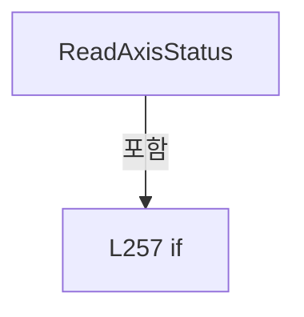

변경 전 점검: 입력/반환 타입, 위 호출자, 예외/취소 경로, 공유 상태와 저장·전송 소비자를 함께 확인합니다. 값의 단위나 물리 방향을 이름만으로 확정하지 않습니다.

### MethodDeclaration `ReadAxisStatusByName` · L266–269

[Drilling.Common/Automation/CAutomationManager.cs:266–269](https://github.com/kjuws10-rgb/A3Drilling/blob/28764c91d521777b8ee068dd7aaf2d3902ce9fe2/Drilling.Common/Automation/CAutomationManager.cs#L266-L269)

| 항목 | 실제 추출 값 |
| --- | --- |
| 서명 | Drilling.Common.Automation.ST_AUTOMATION_AXIS_STATUS Drilling.Common.Automation.CAutomationManager.ReadAxisStatusByName(string, int, System.Threading.CancellationToken) |
| 접근/수식자 | Public / public |
| 반환/값 타입 | Drilling.Common.Automation.ST_AUTOMATION_AXIS_STATUS |
| 소속 타입 | NamedType:Drilling.Common.Automation.CAutomationManager |

입력 계약:

| 이름 | 타입 | 전달 | 선택/기본값 |
| --- | --- | --- | --- |
| axisName | string | None | False /  |
| number | int | None | True / 0 |
| cancellationToken | System.Threading.CancellationToken | None | True / null |

현재 부분 분석에서 직접 연결된 호출자는 없습니다. XAML/이벤트/인터페이스·델리게이트·외부 진입을 추가 확인해야 하며, 미사용으로 판정한 것이 아닙니다.

호출하는 대상과 해석 범위:

| 원본 행 | 표현식 | 분석 상태 | 대상/소스 위치 |
| --- | --- | --- | --- |
| 268 | ReadAxisStatusByName | resolved | Drilling.Common.Automation.ST_AUTOMATION_AXIS_STATUS Drilling.Common.Automation.CAutomationManager.ReadAxisStatusByName(string, int, int, System.Threading.CancellationToken) · Drilling.Common/Automation/CAutomationManager.cs:271 |

본문의 실제 연산·분기·예외·반환 순서(원문 위치 순):

| 원본 행 | 종류 | 주석 해설 |
| --- | --- | --- |
| 268 | call | 함수·델리게이트 또는 객체 생성자를 호출합니다: ReadAxisStatusByName(axisName, number, 0, cancellationToken) |
| 268 | return | 호출자에게 값 또는 제어를 반환합니다: return ReadAxisStatusByName(axisName, number, 0, cancellationToken); |

변경 전 점검: 입력/반환 타입, 위 호출자, 예외/취소 경로, 공유 상태와 저장·전송 소비자를 함께 확인합니다. 값의 단위나 물리 방향을 이름만으로 확정하지 않습니다.

### MethodDeclaration `ReadAxisStatusByName` · L271–284

[Drilling.Common/Automation/CAutomationManager.cs:271–284](https://github.com/kjuws10-rgb/A3Drilling/blob/28764c91d521777b8ee068dd7aaf2d3902ce9fe2/Drilling.Common/Automation/CAutomationManager.cs#L271-L284)

| 항목 | 실제 추출 값 |
| --- | --- |
| 서명 | Drilling.Common.Automation.ST_AUTOMATION_AXIS_STATUS Drilling.Common.Automation.CAutomationManager.ReadAxisStatusByName(string, int, int, System.Threading.CancellationToken) |
| 접근/수식자 | Public / public |
| 반환/값 타입 | Drilling.Common.Automation.ST_AUTOMATION_AXIS_STATUS |
| 소속 타입 | NamedType:Drilling.Common.Automation.CAutomationManager |

입력 계약:

| 이름 | 타입 | 전달 | 선택/기본값 |
| --- | --- | --- | --- |
| axisName | string | None | False /  |
| number | int | None | False /  |
| analogInputNo | int | None | False /  |
| cancellationToken | System.Threading.CancellationToken | None | True / null |

정적 호출자로 확인된 위치:

| 호출 파일/행 | 호출 표현식 | 런타임 분기 가능 |
| --- | --- | --- |
| [Drilling.Common/Automation/CAutomationManager.cs:268–268](https://github.com/kjuws10-rgb/A3Drilling/blob/28764c91d521777b8ee068dd7aaf2d3902ce9fe2/Drilling.Common/Automation/CAutomationManager.cs#L268-L268) | ReadAxisStatusByName | False |

호출하는 대상과 해석 범위:

| 원본 행 | 표현식 | 분석 상태 | 대상/소스 위치 |
| --- | --- | --- | --- |
| 273 | ArgumentException.ThrowIfNullOrWhiteSpace | resolved | void System.ArgumentException.ThrowIfNullOrWhiteSpace(string?, string?) |
| 274 | ValidateAnalogInputNo | resolved | void Drilling.Common.Automation.CAutomationManager.ValidateAnalogInputNo(int) · Drilling.Common/Automation/CAutomationManager.cs:667 |
| 275 | axisName.Trim | resolved | string string.Trim() |
| 276 | ValidateAxisNameOnly | resolved | void Drilling.Common.Automation.CAutomationManager.ValidateAxisNameOnly(string) · Drilling.Common/Automation/CAutomationManager.cs:658 |
| 277 | IsSimul | resolved | bool Drilling.Common.Automation.CAutomationManager.IsSimul(int) · Drilling.Common/Automation/CAutomationManager.cs:63 |
| 279 | CreateSimulationAxisStatus | resolved | Drilling.Common.Automation.ST_AUTOMATION_AXIS_STATUS Drilling.Common.Automation.CAutomationManager.CreateSimulationAxisStatus(int, string) · Drilling.Common/Automation/CAutomationManager.cs:838 |
| 282 | ReadAxisByName(normalizedAxis, number, analogInputNo, cancellationToken).GetAwaiter().GetResult | resolved | string System.Runtime.CompilerServices.TaskAwaiter<string>.GetResult() |
| 282 | ReadAxisByName(normalizedAxis, number, analogInputNo, cancellationToken).GetAwaiter | resolved | System.Runtime.CompilerServices.TaskAwaiter<string> System.Threading.Tasks.Task<string>.GetAwaiter() |
| 282 | ReadAxisByName | resolved | System.Threading.Tasks.Task<string> Drilling.Common.Automation.CAutomationManager.ReadAxisByName(string, int, int, System.Threading.CancellationToken) · Drilling.Common/Automation/CAutomationManager.cs:640 |
| 283 | ParseAxisStatus | resolved | Drilling.Common.Automation.ST_AUTOMATION_AXIS_STATUS Drilling.Common.Automation.CAutomationManager.ParseAxisStatus(int, string, string) · Drilling.Common/Automation/CAutomationManager.cs:872 |

본문의 실제 연산·분기·예외·반환 순서(원문 위치 순):

| 원본 행 | 종류 | 주석 해설 |
| --- | --- | --- |
| 273 | call | 함수·델리게이트 또는 객체 생성자를 호출합니다: ArgumentException.ThrowIfNullOrWhiteSpace(axisName) |
| 274 | call | 함수·델리게이트 또는 객체 생성자를 호출합니다: ValidateAnalogInputNo(analogInputNo) |
| 275 | call | 함수·델리게이트 또는 객체 생성자를 호출합니다: axisName.Trim() |
| 275 | local-declaration | 지역 변수를 선언합니다: var normalizedAxis = axisName.Trim(); |
| 275 | variable-initializer | 변수의 초기값을 지정합니다: normalizedAxis = axisName.Trim() |
| 276 | call | 함수·델리게이트 또는 객체 생성자를 호출합니다: ValidateAxisNameOnly(normalizedAxis) |
| 277 | call | 함수·델리게이트 또는 객체 생성자를 호출합니다: IsSimul(number) |
| 277 | if | 조건에 따라 분기합니다: if (IsSimul(number)) |
| 279 | call | 함수·델리게이트 또는 객체 생성자를 호출합니다: CreateSimulationAxisStatus(number, normalizedAxis) |
| 279 | return | 호출자에게 값 또는 제어를 반환합니다: return CreateSimulationAxisStatus(number, normalizedAxis); |
| 282 | call | 함수·델리게이트 또는 객체 생성자를 호출합니다: ReadAxisByName(normalizedAxis, number, analogInputNo, cancellationToken).GetAwaiter().GetResult() |
| 282 | call | 함수·델리게이트 또는 객체 생성자를 호출합니다: ReadAxisByName(normalizedAxis, number, analogInputNo, cancellationToken).GetAwaiter() |
| 282 | call | 함수·델리게이트 또는 객체 생성자를 호출합니다: ReadAxisByName(normalizedAxis, number, analogInputNo, cancellationToken) |
| 282 | local-declaration | 지역 변수를 선언합니다: var response = ReadAxisByName(normalizedAxis, number, analogInputNo, cancellationToken).GetAwaiter().GetResult(); |
| 282 | variable-initializer | 변수의 초기값을 지정합니다: response = ReadAxisByName(normalizedAxis, number, analogInputNo, cancellationToken).GetAwaiter().GetResult() |
| 283 | call | 함수·델리게이트 또는 객체 생성자를 호출합니다: ParseAxisStatus(number, normalizedAxis, response) |
| 283 | return | 호출자에게 값 또는 제어를 반환합니다: return ParseAxisStatus(number, normalizedAxis, response); |

제어 구문의 포함 구조(실제 실행 순서/CFG가 아닌 구문 탐색 그림):

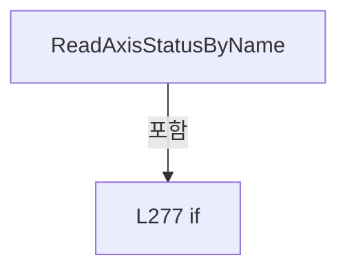

변경 전 점검: 입력/반환 타입, 위 호출자, 예외/취소 경로, 공유 상태와 저장·전송 소비자를 함께 확인합니다. 값의 단위나 물리 방향을 이름만으로 확정하지 않습니다.

### MethodDeclaration `ReadAxisStatusByNameNoLog` · L286–299

[Drilling.Common/Automation/CAutomationManager.cs:286–299](https://github.com/kjuws10-rgb/A3Drilling/blob/28764c91d521777b8ee068dd7aaf2d3902ce9fe2/Drilling.Common/Automation/CAutomationManager.cs#L286-L299)

| 항목 | 실제 추출 값 |
| --- | --- |
| 서명 | Drilling.Common.Automation.ST_AUTOMATION_AXIS_STATUS Drilling.Common.Automation.CAutomationManager.ReadAxisStatusByNameNoLog(string, int, int, bool, System.Threading.CancellationToken) |
| 접근/수식자 | Public / public |
| 반환/값 타입 | Drilling.Common.Automation.ST_AUTOMATION_AXIS_STATUS |
| 소속 타입 | NamedType:Drilling.Common.Automation.CAutomationManager |

입력 계약:

| 이름 | 타입 | 전달 | 선택/기본값 |
| --- | --- | --- | --- |
| axisName | string | None | False /  |
| number | int | None | False /  |
| analogInputNo | int | None | False /  |
| readExtendedStatus | bool | None | False /  |
| cancellationToken | System.Threading.CancellationToken | None | True / null |

정적 호출자로 확인된 위치:

| 호출 파일/행 | 호출 표현식 | 런타임 분기 가능 |
| --- | --- | --- |
| [Drilling.Common/Automation/CAutomationStatusSnapshotService.cs:23–23](https://github.com/kjuws10-rgb/A3Drilling/blob/28764c91d521777b8ee068dd7aaf2d3902ce9fe2/Drilling.Common/Automation/CAutomationStatusSnapshotService.cs#L23-L23) | _automation.ReadAxisStatusByNameNoLog | False |
| [Drilling.UI/Menu/Menus/CMenuManual.cs:2452–2452](https://github.com/kjuws10-rgb/A3Drilling/blob/28764c91d521777b8ee068dd7aaf2d3902ce9fe2/Drilling.UI/Menu/Menus/CMenuManual.cs#L2452-L2452) | _manager.automation.ReadAxisStatusByNameNoLog | False |

호출하는 대상과 해석 범위:

| 원본 행 | 표현식 | 분석 상태 | 대상/소스 위치 |
| --- | --- | --- | --- |
| 288 | ArgumentException.ThrowIfNullOrWhiteSpace | resolved | void System.ArgumentException.ThrowIfNullOrWhiteSpace(string?, string?) |
| 289 | ValidateAnalogInputNo | resolved | void Drilling.Common.Automation.CAutomationManager.ValidateAnalogInputNo(int) · Drilling.Common/Automation/CAutomationManager.cs:667 |
| 290 | axisName.Trim | resolved | string string.Trim() |
| 291 | ValidateAxisNameOnly | resolved | void Drilling.Common.Automation.CAutomationManager.ValidateAxisNameOnly(string) · Drilling.Common/Automation/CAutomationManager.cs:658 |
| 292 | IsSimul | resolved | bool Drilling.Common.Automation.CAutomationManager.IsSimul(int) · Drilling.Common/Automation/CAutomationManager.cs:63 |
| 294 | CreateSimulationAxisStatus | resolved | Drilling.Common.Automation.ST_AUTOMATION_AXIS_STATUS Drilling.Common.Automation.CAutomationManager.CreateSimulationAxisStatus(int, string) · Drilling.Common/Automation/CAutomationManager.cs:838 |
| 297 | ReadAxisByName(normalizedAxis, number, analogInputNo, readExtendedStatus, cancellationToken, suppressLog: true).GetAwaiter().GetResult | resolved | string System.Runtime.CompilerServices.TaskAwaiter<string>.GetResult() |
| 297 | ReadAxisByName(normalizedAxis, number, analogInputNo, readExtendedStatus, cancellationToken, suppressLog: true).GetAwaiter | resolved | System.Runtime.CompilerServices.TaskAwaiter<string> System.Threading.Tasks.Task<string>.GetAwaiter() |
| 297 | ReadAxisByName | resolved | System.Threading.Tasks.Task<string> Drilling.Common.Automation.CAutomationManager.ReadAxisByName(string, int, int, bool, System.Threading.CancellationToken, bool) · Drilling.Common/Automation/CAutomationManager.cs:650 |
| 298 | ParseAxisStatus | resolved | Drilling.Common.Automation.ST_AUTOMATION_AXIS_STATUS Drilling.Common.Automation.CAutomationManager.ParseAxisStatus(int, string, string) · Drilling.Common/Automation/CAutomationManager.cs:872 |

본문의 실제 연산·분기·예외·반환 순서(원문 위치 순):

| 원본 행 | 종류 | 주석 해설 |
| --- | --- | --- |
| 288 | call | 함수·델리게이트 또는 객체 생성자를 호출합니다: ArgumentException.ThrowIfNullOrWhiteSpace(axisName) |
| 289 | call | 함수·델리게이트 또는 객체 생성자를 호출합니다: ValidateAnalogInputNo(analogInputNo) |
| 290 | call | 함수·델리게이트 또는 객체 생성자를 호출합니다: axisName.Trim() |
| 290 | local-declaration | 지역 변수를 선언합니다: var normalizedAxis = axisName.Trim(); |
| 290 | variable-initializer | 변수의 초기값을 지정합니다: normalizedAxis = axisName.Trim() |
| 291 | call | 함수·델리게이트 또는 객체 생성자를 호출합니다: ValidateAxisNameOnly(normalizedAxis) |
| 292 | call | 함수·델리게이트 또는 객체 생성자를 호출합니다: IsSimul(number) |
| 292 | if | 조건에 따라 분기합니다: if (IsSimul(number)) |
| 294 | call | 함수·델리게이트 또는 객체 생성자를 호출합니다: CreateSimulationAxisStatus(number, normalizedAxis) |
| 294 | return | 호출자에게 값 또는 제어를 반환합니다: return CreateSimulationAxisStatus(number, normalizedAxis); |
| 297 | call | 함수·델리게이트 또는 객체 생성자를 호출합니다: ReadAxisByName(normalizedAxis, number, analogInputNo, readExtendedStatus, cancellationToken, suppressLog: true).GetAwaiter().GetResult() |
| 297 | call | 함수·델리게이트 또는 객체 생성자를 호출합니다: ReadAxisByName(normalizedAxis, number, analogInputNo, readExtendedStatus, cancellationToken, suppressLog: true).GetAwaiter() |
| 297 | call | 함수·델리게이트 또는 객체 생성자를 호출합니다: ReadAxisByName(normalizedAxis, number, analogInputNo, readExtendedStatus, cancellationToken, suppressLog: true) |
| 297 | local-declaration | 지역 변수를 선언합니다: var response = ReadAxisByName(normalizedAxis, number, analogInputNo, readExtendedStatus, cancellationToken, suppressLog: true).GetAwaiter().GetResult(); |
| 297 | variable-initializer | 변수의 초기값을 지정합니다: response = ReadAxisByName(normalizedAxis, number, analogInputNo, readExtendedStatus, cancellationToken, suppressLog: true).GetAwaiter().GetResult() |
| 298 | call | 함수·델리게이트 또는 객체 생성자를 호출합니다: ParseAxisStatus(number, normalizedAxis, response) |
| 298 | return | 호출자에게 값 또는 제어를 반환합니다: return ParseAxisStatus(number, normalizedAxis, response); |

제어 구문의 포함 구조(실제 실행 순서/CFG가 아닌 구문 탐색 그림):

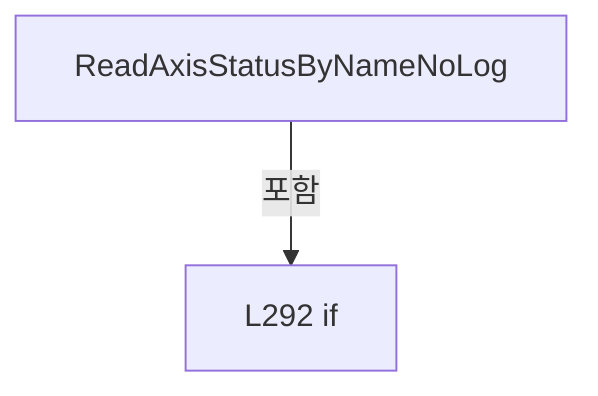

변경 전 점검: 입력/반환 타입, 위 호출자, 예외/취소 경로, 공유 상태와 저장·전송 소비자를 함께 확인합니다. 값의 단위나 물리 방향을 이름만으로 확정하지 않습니다.

### MethodDeclaration `RunLocalScript` · L301–313

[Drilling.Common/Automation/CAutomationManager.cs:301–313](https://github.com/kjuws10-rgb/A3Drilling/blob/28764c91d521777b8ee068dd7aaf2d3902ce9fe2/Drilling.Common/Automation/CAutomationManager.cs#L301-L313)

| 항목 | 실제 추출 값 |
| --- | --- |
| 서명 | System.Threading.Tasks.Task<string> Drilling.Common.Automation.CAutomationManager.RunLocalScript(string, string, int, int, System.Threading.CancellationToken) |
| 접근/수식자 | Public / public, async |
| 반환/값 타입 | System.Threading.Tasks.Task<string> |
| 소속 타입 | NamedType:Drilling.Common.Automation.CAutomationManager |

입력 계약:

| 이름 | 타입 | 전달 | 선택/기본값 |
| --- | --- | --- | --- |
| localScriptPath | string | None | False /  |
| controllerFileName | string | None | True / "" |
| taskIndex | int | None | True / 1 |
| number | int | None | True / 0 |
| cancellationToken | System.Threading.CancellationToken | None | True / null |

현재 부분 분석에서 직접 연결된 호출자는 없습니다. XAML/이벤트/인터페이스·델리게이트·외부 진입을 추가 확인해야 하며, 미사용으로 판정한 것이 아닙니다.

호출하는 대상과 해석 범위:

| 원본 행 | 표현식 | 분석 상태 | 대상/소스 위치 |
| --- | --- | --- | --- |
| 303 | ArgumentException.ThrowIfNullOrWhiteSpace | resolved | void System.ArgumentException.ThrowIfNullOrWhiteSpace(string?, string?) |
| 304 | ValidateTaskIndex | resolved | void Drilling.Common.Automation.CAutomationManager.ValidateTaskIndex(int) · Drilling.Common/Automation/CAutomationManager.cs:583 |
| 305 | ResolveLocalScriptPath | resolved | string Drilling.Common.Automation.CAutomationManager.ResolveLocalScriptPath(string, System.Threading.CancellationToken) · Drilling.Common/Automation/CAutomationManager.cs:1020 |
| 306 | string.IsNullOrWhiteSpace | resolved | bool string.IsNullOrWhiteSpace(string?) |
| 306 | CreateControllerFileName | resolved | string Drilling.Common.Automation.CAutomationManager.CreateControllerFileName(string, System.Threading.CancellationToken) · Drilling.Common/Automation/CAutomationManager.cs:1051 |
| 306 | CreateControllerFileName | resolved | string Drilling.Common.Automation.CAutomationManager.CreateControllerFileName(string, System.Threading.CancellationToken) · Drilling.Common/Automation/CAutomationManager.cs:1051 |
| 307 | IsSimul | resolved | bool Drilling.Common.Automation.CAutomationManager.IsSimul(int) · Drilling.Common/Automation/CAutomationManager.cs:63 |
| 309 | CreateSimulationTaskStatus | resolved | string Drilling.Common.Automation.CAutomationManager.CreateSimulationTaskStatus(int, string, string, string) · Drilling.Common/Automation/CAutomationManager.cs:591 |
| 312 | ExecuteRaw | resolved | System.Threading.Tasks.Task<string> Drilling.Common.Automation.CAutomationManager.ExecuteRaw(string, int, System.Threading.CancellationToken, bool) · Drilling.Common/Automation/CAutomationManager.cs:180 |

본문의 실제 연산·분기·예외·반환 순서(원문 위치 순):

| 원본 행 | 종류 | 주석 해설 |
| --- | --- | --- |
| 303 | call | 함수·델리게이트 또는 객체 생성자를 호출합니다: ArgumentException.ThrowIfNullOrWhiteSpace(localScriptPath) |
| 304 | call | 함수·델리게이트 또는 객체 생성자를 호출합니다: ValidateTaskIndex(taskIndex) |
| 305 | call | 함수·델리게이트 또는 객체 생성자를 호출합니다: ResolveLocalScriptPath(localScriptPath, cancellationToken) |
| 305 | local-declaration | 지역 변수를 선언합니다: var resolvedLocalScriptPath = ResolveLocalScriptPath(localScriptPath, cancellationToken); |
| 305 | variable-initializer | 변수의 초기값을 지정합니다: resolvedLocalScriptPath = ResolveLocalScriptPath(localScriptPath, cancellationToken) |
| 306 | call | 함수·델리게이트 또는 객체 생성자를 호출합니다: string.IsNullOrWhiteSpace(controllerFileName) |
| 306 | call | 함수·델리게이트 또는 객체 생성자를 호출합니다: CreateControllerFileName(localScriptPath, cancellationToken) |
| 306 | call | 함수·델리게이트 또는 객체 생성자를 호출합니다: CreateControllerFileName(controllerFileName, cancellationToken) |
| 306 | conditional-expression | 조건에 따라 결과식을 선택합니다: string.IsNullOrWhiteSpace(controllerFileName) ? CreateControllerFileName(localScriptPath, cancellationToken) : CreateControllerFileName(controllerFileName, cancellationToken) |
| 306 | local-declaration | 지역 변수를 선언합니다: var resolvedControllerFileName = string.IsNullOrWhiteSpace(controllerFileName) ? CreateControllerFileName(localScriptPath, cancellationToken) : CreateControllerFileName(controllerFileName, cancellationToken); |
| 306 | variable-initializer | 변수의 초기값을 지정합니다: resolvedControllerFileName = string.IsNullOrWhiteSpace(controllerFileName) ? CreateControllerFileName(localScriptPath, cancellationToken) : CreateControllerFileName(controllerFileName, cancellationToken) |
| 307 | call | 함수·델리게이트 또는 객체 생성자를 호출합니다: IsSimul(number) |
| 307 | if | 조건에 따라 분기합니다: if (IsSimul(number)) |
| 309 | call | 함수·델리게이트 또는 객체 생성자를 호출합니다: CreateSimulationTaskStatus(taskIndex, "Idle", resolvedControllerFileName) |
| 309 | return | 호출자에게 값 또는 제어를 반환합니다: return CreateSimulationTaskStatus(taskIndex, "Idle", resolvedControllerFileName); |
| 312 | await | 비동기 완료를 기다립니다: await ExecuteRaw($"AUTOMATION1:SCRIPT&#124;RUN_LOCAL&#124;{taskIndex}&#124;{resolvedLocalScriptPath}&#124;{resolvedControllerFileName}", number, cancellationToken) |
| 312 | call | 함수·델리게이트 또는 객체 생성자를 호출합니다: ExecuteRaw($"AUTOMATION1:SCRIPT&#124;RUN_LOCAL&#124;{taskIndex}&#124;{resolvedLocalScriptPath}&#124;{resolvedControllerFileName}", number, cancellationToken) |
| 312 | return | 호출자에게 값 또는 제어를 반환합니다: return await ExecuteRaw($"AUTOMATION1:SCRIPT&#124;RUN_LOCAL&#124;{taskIndex}&#124;{resolvedLocalScriptPath}&#124;{resolvedControllerFileName}", number, cancellationToken); |

제어 구문의 포함 구조(실제 실행 순서/CFG가 아닌 구문 탐색 그림):

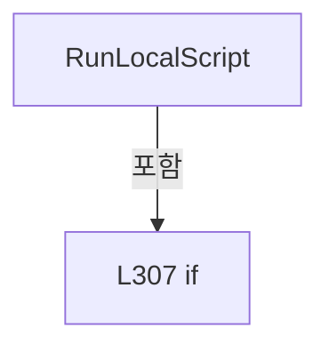

변경 전 점검: 입력/반환 타입, 위 호출자, 예외/취소 경로, 공유 상태와 저장·전송 소비자를 함께 확인합니다. 값의 단위나 물리 방향을 이름만으로 확정하지 않습니다.

### MethodDeclaration `UploadScript` · L315–322

[Drilling.Common/Automation/CAutomationManager.cs:315–322](https://github.com/kjuws10-rgb/A3Drilling/blob/28764c91d521777b8ee068dd7aaf2d3902ce9fe2/Drilling.Common/Automation/CAutomationManager.cs#L315-L322)

| 항목 | 실제 추출 값 |
| --- | --- |
| 서명 | System.Threading.Tasks.Task<string> Drilling.Common.Automation.CAutomationManager.UploadScript(string, string, int, System.Threading.CancellationToken) |
| 접근/수식자 | Public / public, virtual, async |
| 반환/값 타입 | System.Threading.Tasks.Task<string> |
| 소속 타입 | NamedType:Drilling.Common.Automation.CAutomationManager |

입력 계약:

| 이름 | 타입 | 전달 | 선택/기본값 |
| --- | --- | --- | --- |
| localScriptPath | string | None | False /  |
| scriptFileName | string | None | True / "" |
| number | int | None | True / 0 |
| cancellationToken | System.Threading.CancellationToken | None | True / null |

정적 호출자로 확인된 위치:

| 호출 파일/행 | 호출 표현식 | 런타임 분기 가능 |
| --- | --- | --- |
| [Drilling.Common/Automation/CAutomationManager.cs:444–444](https://github.com/kjuws10-rgb/A3Drilling/blob/28764c91d521777b8ee068dd7aaf2d3902ce9fe2/Drilling.Common/Automation/CAutomationManager.cs#L444-L444) | UploadScript | True |
| [Drilling.Common/Station/CStationProcess.cs:685–685](https://github.com/kjuws10-rgb/A3Drilling/blob/28764c91d521777b8ee068dd7aaf2d3902ce9fe2/Drilling.Common/Station/CStationProcess.cs#L685-L685) | _automationManager.UploadScript | True |
| [Drilling.UI/Menu/Menus/CMenuCorrection.cs:3784–3784](https://github.com/kjuws10-rgb/A3Drilling/blob/28764c91d521777b8ee068dd7aaf2d3902ce9fe2/Drilling.UI/Menu/Menus/CMenuCorrection.cs#L3784-L3784) | manager.automation.UploadScript | True |
| [Drilling.UI/Menu/Menus/CMenuManual.cs:2021–2021](https://github.com/kjuws10-rgb/A3Drilling/blob/28764c91d521777b8ee068dd7aaf2d3902ce9fe2/Drilling.UI/Menu/Menus/CMenuManual.cs#L2021-L2021) | _manager.automation.UploadScript | True |
| [Drilling.UI/Menu/Menus/CMenuManual.cs:2644–2644](https://github.com/kjuws10-rgb/A3Drilling/blob/28764c91d521777b8ee068dd7aaf2d3902ce9fe2/Drilling.UI/Menu/Menus/CMenuManual.cs#L2644-L2644) | _manager.automation.UploadScript | True |
| [Drilling.UI/Menu/Menus/CMenuManual.cs:3689–3689](https://github.com/kjuws10-rgb/A3Drilling/blob/28764c91d521777b8ee068dd7aaf2d3902ce9fe2/Drilling.UI/Menu/Menus/CMenuManual.cs#L3689-L3689) | _manager.automation.UploadScript | True |
| [Drilling.UI/Menu/Menus/CMenuManual.cs:4099–4099](https://github.com/kjuws10-rgb/A3Drilling/blob/28764c91d521777b8ee068dd7aaf2d3902ce9fe2/Drilling.UI/Menu/Menus/CMenuManual.cs#L4099-L4099) | _manager.automation.UploadScript | True |
| [Drilling.UI/Menu/Menus/CMenuManual.cs:4490–4490](https://github.com/kjuws10-rgb/A3Drilling/blob/28764c91d521777b8ee068dd7aaf2d3902ce9fe2/Drilling.UI/Menu/Menus/CMenuManual.cs#L4490-L4490) | _manager.automation.UploadScript | True |
| [Drilling.UI/Menu/Menus/CMenuManual.cs:5312–5312](https://github.com/kjuws10-rgb/A3Drilling/blob/28764c91d521777b8ee068dd7aaf2d3902ce9fe2/Drilling.UI/Menu/Menus/CMenuManual.cs#L5312-L5312) | _manager.automation.UploadScript | True |

호출하는 대상과 해석 범위:

| 원본 행 | 표현식 | 분석 상태 | 대상/소스 위치 |
| --- | --- | --- | --- |
| 317 | ArgumentException.ThrowIfNullOrWhiteSpace | resolved | void System.ArgumentException.ThrowIfNullOrWhiteSpace(string?, string?) |
| 318 | ResolveLocalScriptPath | resolved | string Drilling.Common.Automation.CAutomationManager.ResolveLocalScriptPath(string, System.Threading.CancellationToken) · Drilling.Common/Automation/CAutomationManager.cs:1020 |
| 319 | string.IsNullOrWhiteSpace | resolved | bool string.IsNullOrWhiteSpace(string?) |
| 319 | CreateControllerFileName | resolved | string Drilling.Common.Automation.CAutomationManager.CreateControllerFileName(string, System.Threading.CancellationToken) · Drilling.Common/Automation/CAutomationManager.cs:1051 |
| 319 | CreateControllerFileName | resolved | string Drilling.Common.Automation.CAutomationManager.CreateControllerFileName(string, System.Threading.CancellationToken) · Drilling.Common/Automation/CAutomationManager.cs:1051 |
| 321 | ExecuteRaw | resolved | System.Threading.Tasks.Task<string> Drilling.Common.Automation.CAutomationManager.ExecuteRaw(string, int, System.Threading.CancellationToken, bool) · Drilling.Common/Automation/CAutomationManager.cs:180 |

본문의 실제 연산·분기·예외·반환 순서(원문 위치 순):

| 원본 행 | 종류 | 주석 해설 |
| --- | --- | --- |
| 317 | call | 함수·델리게이트 또는 객체 생성자를 호출합니다: ArgumentException.ThrowIfNullOrWhiteSpace(localScriptPath) |
| 318 | call | 함수·델리게이트 또는 객체 생성자를 호출합니다: ResolveLocalScriptPath(localScriptPath, cancellationToken) |
| 318 | local-declaration | 지역 변수를 선언합니다: var resolvedLocalScriptPath = ResolveLocalScriptPath(localScriptPath, cancellationToken); |
| 318 | variable-initializer | 변수의 초기값을 지정합니다: resolvedLocalScriptPath = ResolveLocalScriptPath(localScriptPath, cancellationToken) |
| 319 | call | 함수·델리게이트 또는 객체 생성자를 호출합니다: string.IsNullOrWhiteSpace(scriptFileName) |
| 319 | call | 함수·델리게이트 또는 객체 생성자를 호출합니다: CreateControllerFileName(localScriptPath, cancellationToken) |
| 319 | call | 함수·델리게이트 또는 객체 생성자를 호출합니다: CreateControllerFileName(scriptFileName, cancellationToken) |
| 319 | conditional-expression | 조건에 따라 결과식을 선택합니다: string.IsNullOrWhiteSpace(scriptFileName) ? CreateControllerFileName(localScriptPath, cancellationToken) : CreateControllerFileName(scriptFileName, cancellationToken) |
| 319 | local-declaration | 지역 변수를 선언합니다: var controllerFileName = string.IsNullOrWhiteSpace(scriptFileName) ? CreateControllerFileName(localScriptPath, cancellationToken) : CreateControllerFileName(scriptFileName, cancellationToken); |
| 319 | variable-initializer | 변수의 초기값을 지정합니다: controllerFileName = string.IsNullOrWhiteSpace(scriptFileName) ? CreateControllerFileName(localScriptPath, cancellationToken) : CreateControllerFileName(scriptFileName, cancellationToken) |
| 321 | await | 비동기 완료를 기다립니다: await ExecuteRaw($"AUTOMATION1:SCRIPT&#124;UPLOAD&#124;{resolvedLocalScriptPath}&#124;{controllerFileName}", number, cancellationToken) |
| 321 | call | 함수·델리게이트 또는 객체 생성자를 호출합니다: ExecuteRaw($"AUTOMATION1:SCRIPT&#124;UPLOAD&#124;{resolvedLocalScriptPath}&#124;{controllerFileName}", number, cancellationToken) |
| 321 | return | 호출자에게 값 또는 제어를 반환합니다: return await ExecuteRaw($"AUTOMATION1:SCRIPT&#124;UPLOAD&#124;{resolvedLocalScriptPath}&#124;{controllerFileName}", number, cancellationToken); |

변경 전 점검: 입력/반환 타입, 위 호출자, 예외/취소 경로, 공유 상태와 저장·전송 소비자를 함께 확인합니다. 값의 단위나 물리 방향을 이름만으로 확정하지 않습니다.

### MethodDeclaration `RunScript` · L324–335

[Drilling.Common/Automation/CAutomationManager.cs:324–335](https://github.com/kjuws10-rgb/A3Drilling/blob/28764c91d521777b8ee068dd7aaf2d3902ce9fe2/Drilling.Common/Automation/CAutomationManager.cs#L324-L335)

| 항목 | 실제 추출 값 |
| --- | --- |
| 서명 | System.Threading.Tasks.Task<string> Drilling.Common.Automation.CAutomationManager.RunScript(string, int, int, System.Threading.CancellationToken) |
| 접근/수식자 | Public / public, virtual, async |
| 반환/값 타입 | System.Threading.Tasks.Task<string> |
| 소속 타입 | NamedType:Drilling.Common.Automation.CAutomationManager |

입력 계약:

| 이름 | 타입 | 전달 | 선택/기본값 |
| --- | --- | --- | --- |
| scriptFileName | string | None | False /  |
| taskIndex | int | None | True / 1 |
| number | int | None | True / 0 |
| cancellationToken | System.Threading.CancellationToken | None | True / null |

정적 호출자로 확인된 위치:

| 호출 파일/행 | 호출 표현식 | 런타임 분기 가능 |
| --- | --- | --- |
| [Drilling.Common/Station/CStationProcess.cs:728–728](https://github.com/kjuws10-rgb/A3Drilling/blob/28764c91d521777b8ee068dd7aaf2d3902ce9fe2/Drilling.Common/Station/CStationProcess.cs#L728-L728) | _automationManager.RunScript | True |
| [Drilling.UI/Menu/Menus/CMenuManual.cs:2646–2646](https://github.com/kjuws10-rgb/A3Drilling/blob/28764c91d521777b8ee068dd7aaf2d3902ce9fe2/Drilling.UI/Menu/Menus/CMenuManual.cs#L2646-L2646) | _manager.automation.RunScript | True |
| [Drilling.UI/Menu/Menus/CMenuManual.cs:3704–3704](https://github.com/kjuws10-rgb/A3Drilling/blob/28764c91d521777b8ee068dd7aaf2d3902ce9fe2/Drilling.UI/Menu/Menus/CMenuManual.cs#L3704-L3704) | _manager.automation.RunScript | True |
| [Drilling.UI/Menu/Menus/CMenuManual.cs:4101–4101](https://github.com/kjuws10-rgb/A3Drilling/blob/28764c91d521777b8ee068dd7aaf2d3902ce9fe2/Drilling.UI/Menu/Menus/CMenuManual.cs#L4101-L4101) | _manager.automation.RunScript | True |
| [Drilling.UI/Menu/Menus/CMenuManual.cs:4506–4506](https://github.com/kjuws10-rgb/A3Drilling/blob/28764c91d521777b8ee068dd7aaf2d3902ce9fe2/Drilling.UI/Menu/Menus/CMenuManual.cs#L4506-L4506) | _manager.automation.RunScript | True |
| [Drilling.UI/Menu/Menus/CMenuManual.cs:5315–5315](https://github.com/kjuws10-rgb/A3Drilling/blob/28764c91d521777b8ee068dd7aaf2d3902ce9fe2/Drilling.UI/Menu/Menus/CMenuManual.cs#L5315-L5315) | _manager.automation.RunScript | True |

호출하는 대상과 해석 범위:

| 원본 행 | 표현식 | 분석 상태 | 대상/소스 위치 |
| --- | --- | --- | --- |
| 326 | ArgumentException.ThrowIfNullOrWhiteSpace | resolved | void System.ArgumentException.ThrowIfNullOrWhiteSpace(string?, string?) |
| 327 | ValidateTaskIndex | resolved | void Drilling.Common.Automation.CAutomationManager.ValidateTaskIndex(int) · Drilling.Common/Automation/CAutomationManager.cs:583 |
| 328 | CreateControllerFileName | resolved | string Drilling.Common.Automation.CAutomationManager.CreateControllerFileName(string, System.Threading.CancellationToken) · Drilling.Common/Automation/CAutomationManager.cs:1051 |
| 329 | IsSimul | resolved | bool Drilling.Common.Automation.CAutomationManager.IsSimul(int) · Drilling.Common/Automation/CAutomationManager.cs:63 |
| 331 | CreateSimulationTaskStatus | resolved | string Drilling.Common.Automation.CAutomationManager.CreateSimulationTaskStatus(int, string, string, string) · Drilling.Common/Automation/CAutomationManager.cs:591 |
| 334 | ExecuteRaw | resolved | System.Threading.Tasks.Task<string> Drilling.Common.Automation.CAutomationManager.ExecuteRaw(string, int, System.Threading.CancellationToken, bool) · Drilling.Common/Automation/CAutomationManager.cs:180 |

본문의 실제 연산·분기·예외·반환 순서(원문 위치 순):

| 원본 행 | 종류 | 주석 해설 |
| --- | --- | --- |
| 326 | call | 함수·델리게이트 또는 객체 생성자를 호출합니다: ArgumentException.ThrowIfNullOrWhiteSpace(scriptFileName) |
| 327 | call | 함수·델리게이트 또는 객체 생성자를 호출합니다: ValidateTaskIndex(taskIndex) |
| 328 | call | 함수·델리게이트 또는 객체 생성자를 호출합니다: CreateControllerFileName(scriptFileName, cancellationToken) |
| 328 | local-declaration | 지역 변수를 선언합니다: var controllerFileName = CreateControllerFileName(scriptFileName, cancellationToken); |
| 328 | variable-initializer | 변수의 초기값을 지정합니다: controllerFileName = CreateControllerFileName(scriptFileName, cancellationToken) |
| 329 | call | 함수·델리게이트 또는 객체 생성자를 호출합니다: IsSimul(number) |
| 329 | if | 조건에 따라 분기합니다: if (IsSimul(number)) |
| 331 | call | 함수·델리게이트 또는 객체 생성자를 호출합니다: CreateSimulationTaskStatus(taskIndex, "Idle", controllerFileName) |
| 331 | return | 호출자에게 값 또는 제어를 반환합니다: return CreateSimulationTaskStatus(taskIndex, "Idle", controllerFileName); |
| 334 | await | 비동기 완료를 기다립니다: await ExecuteRaw($"AUTOMATION1:SCRIPT&#124;RUN&#124;{taskIndex}&#124;{controllerFileName}", number, cancellationToken) |
| 334 | call | 함수·델리게이트 또는 객체 생성자를 호출합니다: ExecuteRaw($"AUTOMATION1:SCRIPT&#124;RUN&#124;{taskIndex}&#124;{controllerFileName}", number, cancellationToken) |
| 334 | return | 호출자에게 값 또는 제어를 반환합니다: return await ExecuteRaw($"AUTOMATION1:SCRIPT&#124;RUN&#124;{taskIndex}&#124;{controllerFileName}", number, cancellationToken); |

제어 구문의 포함 구조(실제 실행 순서/CFG가 아닌 구문 탐색 그림):

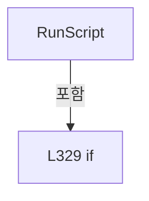

변경 전 점검: 입력/반환 타입, 위 호출자, 예외/취소 경로, 공유 상태와 저장·전송 소비자를 함께 확인합니다. 값의 단위나 물리 방향을 이름만으로 확정하지 않습니다.

### MethodDeclaration `RunScriptIfIdle` · L337–345

[Drilling.Common/Automation/CAutomationManager.cs:337–345](https://github.com/kjuws10-rgb/A3Drilling/blob/28764c91d521777b8ee068dd7aaf2d3902ce9fe2/Drilling.Common/Automation/CAutomationManager.cs#L337-L345)

| 항목 | 실제 추출 값 |
| --- | --- |
| 서명 | System.Threading.Tasks.Task<string> Drilling.Common.Automation.CAutomationManager.RunScriptIfIdle(string, int, int, System.Threading.CancellationToken) |
| 접근/수식자 | Public / public, async |
| 반환/값 타입 | System.Threading.Tasks.Task<string> |
| 소속 타입 | NamedType:Drilling.Common.Automation.CAutomationManager |

입력 계약:

| 이름 | 타입 | 전달 | 선택/기본값 |
| --- | --- | --- | --- |
| scriptFileName | string | None | False /  |
| taskIndex | int | None | True / 1 |
| number | int | None | True / 0 |
| cancellationToken | System.Threading.CancellationToken | None | True / null |

정적 호출자로 확인된 위치:

| 호출 파일/행 | 호출 표현식 | 런타임 분기 가능 |
| --- | --- | --- |
| [Drilling.Common/Automation/CAutomationManager.cs:1099–1099](https://github.com/kjuws10-rgb/A3Drilling/blob/28764c91d521777b8ee068dd7aaf2d3902ce9fe2/Drilling.Common/Automation/CAutomationManager.cs#L1099-L1099) | RunScriptIfIdle | False |
| [Drilling.UI/Menu/Menus/CMenuCorrection.cs:3797–3797](https://github.com/kjuws10-rgb/A3Drilling/blob/28764c91d521777b8ee068dd7aaf2d3902ce9fe2/Drilling.UI/Menu/Menus/CMenuCorrection.cs#L3797-L3797) | manager.automation.RunScriptIfIdle | False |
| [Drilling.UI/Menu/Menus/CMenuManual.cs:2023–2023](https://github.com/kjuws10-rgb/A3Drilling/blob/28764c91d521777b8ee068dd7aaf2d3902ce9fe2/Drilling.UI/Menu/Menus/CMenuManual.cs#L2023-L2023) | _manager.automation.RunScriptIfIdle | False |

호출하는 대상과 해석 범위:

| 원본 행 | 표현식 | 분석 상태 | 대상/소스 위치 |
| --- | --- | --- | --- |
| 339 | ArgumentException.ThrowIfNullOrWhiteSpace | resolved | void System.ArgumentException.ThrowIfNullOrWhiteSpace(string?, string?) |
| 340 | ValidateTaskIndex | resolved | void Drilling.Common.Automation.CAutomationManager.ValidateTaskIndex(int) · Drilling.Common/Automation/CAutomationManager.cs:583 |
| 341 | CreateControllerFileName | resolved | string Drilling.Common.Automation.CAutomationManager.CreateControllerFileName(string, System.Threading.CancellationToken) · Drilling.Common/Automation/CAutomationManager.cs:1051 |
| 342 | IsSimul | resolved | bool Drilling.Common.Automation.CAutomationManager.IsSimul(int) · Drilling.Common/Automation/CAutomationManager.cs:63 |
| 343 | CreateSimulationTaskStatus | resolved | string Drilling.Common.Automation.CAutomationManager.CreateSimulationTaskStatus(int, string, string, string) · Drilling.Common/Automation/CAutomationManager.cs:591 |
| 344 | ExecuteRaw | resolved | System.Threading.Tasks.Task<string> Drilling.Common.Automation.CAutomationManager.ExecuteRaw(string, int, System.Threading.CancellationToken, bool) · Drilling.Common/Automation/CAutomationManager.cs:180 |

본문의 실제 연산·분기·예외·반환 순서(원문 위치 순):

| 원본 행 | 종류 | 주석 해설 |
| --- | --- | --- |
| 339 | call | 함수·델리게이트 또는 객체 생성자를 호출합니다: ArgumentException.ThrowIfNullOrWhiteSpace(scriptFileName) |
| 340 | call | 함수·델리게이트 또는 객체 생성자를 호출합니다: ValidateTaskIndex(taskIndex) |
| 341 | call | 함수·델리게이트 또는 객체 생성자를 호출합니다: CreateControllerFileName(scriptFileName, cancellationToken) |
| 341 | local-declaration | 지역 변수를 선언합니다: var controllerFileName = CreateControllerFileName(scriptFileName, cancellationToken); |
| 341 | variable-initializer | 변수의 초기값을 지정합니다: controllerFileName = CreateControllerFileName(scriptFileName, cancellationToken) |
| 342 | call | 함수·델리게이트 또는 객체 생성자를 호출합니다: IsSimul(number) |
| 342 | if | 조건에 따라 분기합니다: if (IsSimul(number)) |
| 343 | call | 함수·델리게이트 또는 객체 생성자를 호출합니다: CreateSimulationTaskStatus(taskIndex, "Idle", controllerFileName) |
| 343 | return | 호출자에게 값 또는 제어를 반환합니다: return CreateSimulationTaskStatus(taskIndex, "Idle", controllerFileName); |
| 344 | await | 비동기 완료를 기다립니다: await ExecuteRaw($"AUTOMATION1:SCRIPT&#124;RUN_IF_IDLE&#124;{taskIndex}&#124;{controllerFileName}", number, cancellationToken) |
| 344 | call | 함수·델리게이트 또는 객체 생성자를 호출합니다: ExecuteRaw($"AUTOMATION1:SCRIPT&#124;RUN_IF_IDLE&#124;{taskIndex}&#124;{controllerFileName}", number, cancellationToken) |
| 344 | return | 호출자에게 값 또는 제어를 반환합니다: return await ExecuteRaw($"AUTOMATION1:SCRIPT&#124;RUN_IF_IDLE&#124;{taskIndex}&#124;{controllerFileName}", number, cancellationToken); |

제어 구문의 포함 구조(실제 실행 순서/CFG가 아닌 구문 탐색 그림):

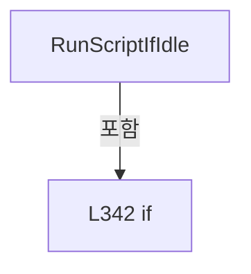

변경 전 점검: 입력/반환 타입, 위 호출자, 예외/취소 경로, 공유 상태와 저장·전송 소비자를 함께 확인합니다. 값의 단위나 물리 방향을 이름만으로 확정하지 않습니다.

### MethodDeclaration `RunBufferedScript` · L347–359

[Drilling.Common/Automation/CAutomationManager.cs:347–359](https://github.com/kjuws10-rgb/A3Drilling/blob/28764c91d521777b8ee068dd7aaf2d3902ce9fe2/Drilling.Common/Automation/CAutomationManager.cs#L347-L359)

| 항목 | 실제 추출 값 |
| --- | --- |
| 서명 | System.Threading.Tasks.Task<string> Drilling.Common.Automation.CAutomationManager.RunBufferedScript(string, string, int, int, int, int, int, System.Threading.CancellationToken) |
| 접근/수식자 | Public / public, async |
| 반환/값 타입 | System.Threading.Tasks.Task<string> |
| 소속 타입 | NamedType:Drilling.Common.Automation.CAutomationManager |

입력 계약:

| 이름 | 타입 | 전달 | 선택/기본값 |
| --- | --- | --- | --- |
| localScriptPath | string | None | False /  |
| scriptFileName | string | None | True / "" |
| taskIndex | int | None | True / 1 |
| number | int | None | True / 0 |
| queueSize | int | None | True / 100 |
| linesPerCommand | int | None | True / 1000 |
| timeoutMs | int | None | True / 600000 |
| cancellationToken | System.Threading.CancellationToken | None | True / null |

현재 부분 분석에서 직접 연결된 호출자는 없습니다. XAML/이벤트/인터페이스·델리게이트·외부 진입을 추가 확인해야 하며, 미사용으로 판정한 것이 아닙니다.

호출하는 대상과 해석 범위:

| 원본 행 | 표현식 | 분석 상태 | 대상/소스 위치 |
| --- | --- | --- | --- |
| 358 | RunBufferedScripts | resolved | System.Threading.Tasks.Task<string> Drilling.Common.Automation.CAutomationManager.RunBufferedScripts(System.Collections.Generic.IReadOnlyList<Drilling.Common.Automation.ST_BUFFERED_SCRIPT_RUN_ITEM>, int, int, int, int, System.Threading.CancellationToken) · Drilling.Common/Automation/CAutomationManager.cs:361 |
| 358 | new ST_BUFFERED_SCRIPT_RUN_ITEM | resolved | Drilling.Common.Automation.ST_BUFFERED_SCRIPT_RUN_ITEM.ST_BUFFERED_SCRIPT_RUN_ITEM(string, string, int) · Drilling.Common/Automation/CAutomationManager.cs:1506 |

본문의 실제 연산·분기·예외·반환 순서(원문 위치 순):

| 원본 행 | 종류 | 주석 해설 |
| --- | --- | --- |
| 358 | await | 비동기 완료를 기다립니다: await RunBufferedScripts([new ST_BUFFERED_SCRIPT_RUN_ITEM(localScriptPath, scriptFileName, taskIndex)], number, queueSize, linesPerCommand, timeoutMs, cancellationToken) |
| 358 | call | 함수·델리게이트 또는 객체 생성자를 호출합니다: RunBufferedScripts([new ST_BUFFERED_SCRIPT_RUN_ITEM(localScriptPath, scriptFileName, taskIndex)], number, queueSize, linesPerCommand, timeoutMs, cancellationToken) |
| 358 | call | 함수·델리게이트 또는 객체 생성자를 호출합니다: new ST_BUFFERED_SCRIPT_RUN_ITEM(localScriptPath, scriptFileName, taskIndex) |
| 358 | return | 호출자에게 값 또는 제어를 반환합니다: return await RunBufferedScripts([new ST_BUFFERED_SCRIPT_RUN_ITEM(localScriptPath, scriptFileName, taskIndex)], number, queueSize, linesPerCommand, timeoutMs, cancellationToken); |

변경 전 점검: 입력/반환 타입, 위 호출자, 예외/취소 경로, 공유 상태와 저장·전송 소비자를 함께 확인합니다. 값의 단위나 물리 방향을 이름만으로 확정하지 않습니다.

### MethodDeclaration `RunBufferedScripts` · L361–368

[Drilling.Common/Automation/CAutomationManager.cs:361–368](https://github.com/kjuws10-rgb/A3Drilling/blob/28764c91d521777b8ee068dd7aaf2d3902ce9fe2/Drilling.Common/Automation/CAutomationManager.cs#L361-L368)

| 항목 | 실제 추출 값 |
| --- | --- |
| 서명 | System.Threading.Tasks.Task<string> Drilling.Common.Automation.CAutomationManager.RunBufferedScripts(System.Collections.Generic.IReadOnlyList<Drilling.Common.Automation.ST_BUFFERED_SCRIPT_RUN_ITEM>, int, int, int, int, System.Threading.CancellationToken) |
| 접근/수식자 | Public / public, async |
| 반환/값 타입 | System.Threading.Tasks.Task<string> |
| 소속 타입 | NamedType:Drilling.Common.Automation.CAutomationManager |

입력 계약:

| 이름 | 타입 | 전달 | 선택/기본값 |
| --- | --- | --- | --- |
| scripts | System.Collections.Generic.IReadOnlyList<Drilling.Common.Automation.ST_BUFFERED_SCRIPT_RUN_ITEM> | None | False /  |
| number | int | None | True / 0 |
| queueSize | int | None | True / 100 |
| linesPerCommand | int | None | True / 1000 |
| timeoutMs | int | None | True / 600000 |
| cancellationToken | System.Threading.CancellationToken | None | True / null |

정적 호출자로 확인된 위치:

| 호출 파일/행 | 호출 표현식 | 런타임 분기 가능 |
| --- | --- | --- |
| [Drilling.Common/Automation/CAutomationManager.cs:358–358](https://github.com/kjuws10-rgb/A3Drilling/blob/28764c91d521777b8ee068dd7aaf2d3902ce9fe2/Drilling.Common/Automation/CAutomationManager.cs#L358-L358) | RunBufferedScripts | False |
| [Drilling.Common/Station/CStationProcess.cs:1102–1102](https://github.com/kjuws10-rgb/A3Drilling/blob/28764c91d521777b8ee068dd7aaf2d3902ce9fe2/Drilling.Common/Station/CStationProcess.cs#L1102-L1102) | _automationManager.RunBufferedScripts | False |

호출하는 대상과 해석 범위:

| 원본 행 | 표현식 | 분석 상태 | 대상/소스 위치 |
| --- | --- | --- | --- |
| 368 | RunBufferedScriptsCore(scripts, number, queueSize, linesPerCommand, timeoutMs, upload: true, stageSession: false, cancellationToken).ConfigureAwait | resolved | System.Runtime.CompilerServices.ConfiguredTaskAwaitable<string> System.Threading.Tasks.Task<string>.ConfigureAwait(bool) |
| 368 | RunBufferedScriptsCore | resolved | System.Threading.Tasks.Task<string> Drilling.Common.Automation.CAutomationManager.RunBufferedScriptsCore(System.Collections.Generic.IReadOnlyList<Drilling.Common.Automation.ST_BUFFERED_SCRIPT_RUN_ITEM>, int, int, int, int, bool, bool, System.Threading.CancellationToken) · Drilling.Common/Automation/CAutomationManager.cs:371 |

본문의 실제 연산·분기·예외·반환 순서(원문 위치 순):

| 원본 행 | 종류 | 주석 해설 |
| --- | --- | --- |
| 368 | await | 비동기 완료를 기다립니다: await RunBufferedScriptsCore(scripts, number, queueSize, linesPerCommand, timeoutMs, upload: true, stageSession: false, cancellationToken).ConfigureAwait(false) |
| 368 | call | 함수·델리게이트 또는 객체 생성자를 호출합니다: RunBufferedScriptsCore(scripts, number, queueSize, linesPerCommand, timeoutMs, upload: true, stageSession: false, cancellationToken).ConfigureAwait(false) |
| 368 | call | 함수·델리게이트 또는 객체 생성자를 호출합니다: RunBufferedScriptsCore(scripts, number, queueSize, linesPerCommand, timeoutMs, upload: true, stageSession: false, cancellationToken) |

변경 전 점검: 입력/반환 타입, 위 호출자, 예외/취소 경로, 공유 상태와 저장·전송 소비자를 함께 확인합니다. 값의 단위나 물리 방향을 이름만으로 확정하지 않습니다.

### MethodDeclaration `RunStagePreparedBufferedScripts` · L370–370

[Drilling.Common/Automation/CAutomationManager.cs:370–370](https://github.com/kjuws10-rgb/A3Drilling/blob/28764c91d521777b8ee068dd7aaf2d3902ce9fe2/Drilling.Common/Automation/CAutomationManager.cs#L370-L370)

| 항목 | 실제 추출 값 |
| --- | --- |
| 서명 | System.Threading.Tasks.Task<string> Drilling.Common.Automation.CAutomationManager.RunStagePreparedBufferedScripts(System.Collections.Generic.IReadOnlyList<Drilling.Common.Automation.ST_BUFFERED_SCRIPT_RUN_ITEM>, int, int, int, int, System.Threading.CancellationToken) |
| 접근/수식자 | Public / public, virtual |
| 반환/값 타입 | System.Threading.Tasks.Task<string> |
| 소속 타입 | NamedType:Drilling.Common.Automation.CAutomationManager |

입력 계약:

| 이름 | 타입 | 전달 | 선택/기본값 |
| --- | --- | --- | --- |
| scripts | System.Collections.Generic.IReadOnlyList<Drilling.Common.Automation.ST_BUFFERED_SCRIPT_RUN_ITEM> | None | False /  |
| number | int | None | False /  |
| queueSize | int | None | False /  |
| linesPerCommand | int | None | False /  |
| timeoutMs | int | None | False /  |
| cancellationToken | System.Threading.CancellationToken | None | False /  |

정적 호출자로 확인된 위치:

| 호출 파일/행 | 호출 표현식 | 런타임 분기 가능 |
| --- | --- | --- |
| [Drilling.Common/Station/CStationProcess.cs:4142–4142](https://github.com/kjuws10-rgb/A3Drilling/blob/28764c91d521777b8ee068dd7aaf2d3902ce9fe2/Drilling.Common/Station/CStationProcess.cs#L4142-L4142) | _automationManager.RunStagePreparedBufferedScripts | True |

호출하는 대상과 해석 범위:

| 원본 행 | 표현식 | 분석 상태 | 대상/소스 위치 |
| --- | --- | --- | --- |
| 370 | RunBufferedScriptsCore | resolved | System.Threading.Tasks.Task<string> Drilling.Common.Automation.CAutomationManager.RunBufferedScriptsCore(System.Collections.Generic.IReadOnlyList<Drilling.Common.Automation.ST_BUFFERED_SCRIPT_RUN_ITEM>, int, int, int, int, bool, bool, System.Threading.CancellationToken) · Drilling.Common/Automation/CAutomationManager.cs:371 |

본문의 실제 연산·분기·예외·반환 순서(원문 위치 순):

| 원본 행 | 종류 | 주석 해설 |
| --- | --- | --- |
| 370 | call | 함수·델리게이트 또는 객체 생성자를 호출합니다: RunBufferedScriptsCore(scripts, number, queueSize, linesPerCommand, timeoutMs, upload: false, stageSession: true, cancellationToken) |

변경 전 점검: 입력/반환 타입, 위 호출자, 예외/취소 경로, 공유 상태와 저장·전송 소비자를 함께 확인합니다. 값의 단위나 물리 방향을 이름만으로 확정하지 않습니다.

### MethodDeclaration `RunBufferedScriptsCore` · L371–485

[Drilling.Common/Automation/CAutomationManager.cs:371–485](https://github.com/kjuws10-rgb/A3Drilling/blob/28764c91d521777b8ee068dd7aaf2d3902ce9fe2/Drilling.Common/Automation/CAutomationManager.cs#L371-L485)

| 항목 | 실제 추출 값 |
| --- | --- |
| 서명 | System.Threading.Tasks.Task<string> Drilling.Common.Automation.CAutomationManager.RunBufferedScriptsCore(System.Collections.Generic.IReadOnlyList<Drilling.Common.Automation.ST_BUFFERED_SCRIPT_RUN_ITEM>, int, int, int, int, bool, bool, System.Threading.CancellationToken) |
| 접근/수식자 | Private / private, async |
| 반환/값 타입 | System.Threading.Tasks.Task<string> |
| 소속 타입 | NamedType:Drilling.Common.Automation.CAutomationManager |

입력 계약:

| 이름 | 타입 | 전달 | 선택/기본값 |
| --- | --- | --- | --- |
| scripts | System.Collections.Generic.IReadOnlyList<Drilling.Common.Automation.ST_BUFFERED_SCRIPT_RUN_ITEM> | None | False /  |
| number | int | None | False /  |
| queueSize | int | None | False /  |
| linesPerCommand | int | None | False /  |
| timeoutMs | int | None | False /  |
| upload | bool | None | False /  |
| stageSession | bool | None | False /  |
| cancellationToken | System.Threading.CancellationToken | None | False /  |

정적 호출자로 확인된 위치:

| 호출 파일/행 | 호출 표현식 | 런타임 분기 가능 |
| --- | --- | --- |
| [Drilling.Common/Automation/CAutomationManager.cs:368–368](https://github.com/kjuws10-rgb/A3Drilling/blob/28764c91d521777b8ee068dd7aaf2d3902ce9fe2/Drilling.Common/Automation/CAutomationManager.cs#L368-L368) | RunBufferedScriptsCore | False |
| [Drilling.Common/Automation/CAutomationManager.cs:370–370](https://github.com/kjuws10-rgb/A3Drilling/blob/28764c91d521777b8ee068dd7aaf2d3902ce9fe2/Drilling.Common/Automation/CAutomationManager.cs#L370-L370) | RunBufferedScriptsCore | False |

호출하는 대상과 해석 범위:

| 원본 행 | 표현식 | 분석 상태 | 대상/소스 위치 |
| --- | --- | --- | --- |
| 382 | scripts.ToArray | resolved | Drilling.Common.Automation.ST_BUFFERED_SCRIPT_RUN_ITEM[] System.Collections.Generic.IEnumerable<Drilling.Common.Automation.ST_BUFFERED_SCRIPT_RUN_ITEM>.ToArray<Drilling.Common.Automation.ST_BUFFERED_SCRIPT_RUN_ITEM>() |
| 389 | new HashSet<int> | resolved | System.Collections.Generic.HashSet<int>.HashSet() |
| 392 | cancellationToken.ThrowIfCancellationRequested | resolved | void System.Threading.CancellationToken.ThrowIfCancellationRequested() |
| 393 | ValidateTaskIndex | resolved | void Drilling.Common.Automation.CAutomationManager.ValidateTaskIndex(int) · Drilling.Common/Automation/CAutomationManager.cs:583 |
| 394 | taskIndexes.Add | resolved | bool System.Collections.Generic.HashSet<int>.Add(int) |
| 395 | new InvalidOperationException | resolved | System.InvalidOperationException.InvalidOperationException(string?) |
| 398 | Math.Max | resolved | int System.Math.Max(int, int) |
| 399 | Math.Max | resolved | int System.Math.Max(int, int) |
| 400 | Math.Max | resolved | int System.Math.Max(int, int) |
| 401 | new List<string> | resolved | System.Collections.Generic.List<string>.List() |
| 405 | commandQueueSize.ToString | resolved | string int.ToString(System.IFormatProvider?) |
| 406 | commandLinesPerCommand.ToString | resolved | string int.ToString(System.IFormatProvider?) |
| 407 | commandTimeoutMs.ToString | resolved | string int.ToString(System.IFormatProvider?) |
| 409 | new HashSet<string> | resolved | System.Collections.Generic.HashSet<string>.HashSet(System.Collections.Generic.IEqualityComparer<string>?) |
| 410 | new List<(int TaskIndex, string ControllerFile, string? LocalPath)> | resolved | System.Collections.Generic.List<(int TaskIndex, string ControllerFile, string? LocalPath)>.List() |
| 413 | cancellationToken.ThrowIfCancellationRequested | resolved | void System.Threading.CancellationToken.ThrowIfCancellationRequested() |
| 418 | ArgumentException.ThrowIfNullOrWhiteSpace | resolved | void System.ArgumentException.ThrowIfNullOrWhiteSpace(string?, string?) |
| 419 | ResolveLocalScriptPath | resolved | string Drilling.Common.Automation.CAutomationManager.ResolveLocalScriptPath(string, System.Threading.CancellationToken) · Drilling.Common/Automation/CAutomationManager.cs:1020 |
| 420 | ValidateBufferedRunScriptFile | resolved | void Drilling.Common.Automation.CAutomationManager.ValidateBufferedRunScriptFile(string) · Drilling.Common/Automation/CAutomationManager.cs:675 |
| 421 | CreateBufferedRunControllerFileName | resolved | string Drilling.Common.Automation.CAutomationManager.CreateBufferedRunControllerFileName(Drilling.Common.Automation.ST_BUFFERED_SCRIPT_RUN_ITEM, string, System.Threading.CancellationToken) · Drilling.Common/Automation/CAutomationManager.cs:487 |
| 426 | ArgumentException.ThrowIfNullOrWhiteSpace | resolved | void System.ArgumentException.ThrowIfNullOrWhiteSpace(string?, string?) |
| 427 | CreateControllerFileName | resolved | string Drilling.Common.Automation.CAutomationManager.CreateControllerFileName(string, System.Threading.CancellationToken) · Drilling.Common/Automation/CAutomationManager.cs:1051 |
| 430 | controllerFileNames.Add | resolved | bool System.Collections.Generic.HashSet<string>.Add(string) |
| 432 | new InvalidOperationException | resolved | System.InvalidOperationException.InvalidOperationException(string?) |
| 435 | requests.Add | resolved | void System.Collections.Generic.List<(int TaskIndex, string ControllerFile, string? LocalPath)>.Add((int TaskIndex, string ControllerFile, string? LocalPath)) |
| 441 | cancellationToken.ThrowIfCancellationRequested | resolved | void System.Threading.CancellationToken.ThrowIfCancellationRequested() |
| 444 | UploadScript | resolved · 동적 구현 선택 가능 | System.Threading.Tasks.Task<string> Drilling.Common.Automation.CAutomationManager.UploadScript(string, string, int, System.Threading.CancellationToken) · Drilling.Common/Automation/CAutomationManager.cs:315 |
| 445 | EnsureAutomationResponseSucceeded | resolved | void Drilling.Common.Automation.CAutomationManager.EnsureAutomationResponseSucceeded(string, string) · Drilling.Common/Automation/CAutomationManager.cs:724 |
| 448 | fields.Add | resolved | void System.Collections.Generic.List<string>.Add(string) |
| 448 | request.TaskIndex.ToString | resolved | string int.ToString(System.IFormatProvider?) |
| 449 | fields.Add | resolved | void System.Collections.Generic.List<string>.Add(string) |
| 452 | IsSimul | resolved | bool Drilling.Common.Automation.CAutomationManager.IsSimul(int) · Drilling.Common/Automation/CAutomationManager.cs:63 |
| 454 | new List<CStageSimulatedTask> | resolved | System.Collections.Generic.List<Drilling.Common.Automation.CAutomationManager.CStageSimulatedTask>.List() |
| 458 | sessions.Add | resolved | void System.Collections.Generic.List<Drilling.Common.Automation.CAutomationManager.CStageSimulatedTask>.Add(Drilling.Common.Automation.CAutomationManager.CStageSimulatedTask) |
| 458 | RegisterStageSimulationTask | resolved | Drilling.Common.Automation.CAutomationManager.CStageSimulatedTask Drilling.Common.Automation.CAutomationManager.RegisterStageSimulationTask(int, int, string, bool) · Drilling.Common/Automation/CAutomationManager.cs:1288 |
| 460 | CancellationTokenSource.CreateLinkedTokenSource | resolved | System.Threading.CancellationTokenSource System.Threading.CancellationTokenSource.CreateLinkedTokenSource(System.Threading.CancellationToken) |
| 462 | limit.CancelAfter | resolved | void System.Threading.CancellationTokenSource.CancelAfter(int) |
| 465 | Task.WhenAll(sessions.Select(session => session.Completion)).WaitAsync(limit.Token).ConfigureAwait | resolved | System.Runtime.CompilerServices.ConfiguredTaskAwaitable System.Threading.Tasks.Task.ConfigureAwait(bool) |
| 465 | Task.WhenAll(sessions.Select(session => session.Completion)).WaitAsync | resolved | System.Threading.Tasks.Task System.Threading.Tasks.Task.WaitAsync(System.Threading.CancellationToken) |
| 465 | Task.WhenAll | resolved | System.Threading.Tasks.Task System.Threading.Tasks.Task.WhenAll(System.Collections.Generic.IEnumerable<System.Threading.Tasks.Task>) |
| 465 | sessions.Select | resolved | System.Collections.Generic.IEnumerable<System.Threading.Tasks.Task> System.Collections.Generic.IEnumerable<Drilling.Common.Automation.CAutomationManager.CStageSimulatedTask>.Select<Drilling.Common.Automation.CAutomationManager.CStageSimulatedTask, System.Threading.Tasks.Task>(System.Func<Drilling.Common.Automation.CAutomationManager.CStageSimulatedTask, System.Threading.Tasks.Task>) |
| 469 | new TimeoutException | resolved | System.TimeoutException.TimeoutException(string?) |
| 475 | session.Stop | resolved | void Drilling.Common.Automation.CAutomationManager.CStageSimulatedTask.Stop() · Drilling.Common/Automation/CAutomationManager.cs:1384 |
| 482 | ExecuteRaw(string.Join("&#124;", fields), number, cancellationToken).ConfigureAwait | resolved | System.Runtime.CompilerServices.ConfiguredTaskAwaitable<string> System.Threading.Tasks.Task<string>.ConfigureAwait(bool) |
| 482 | ExecuteRaw | resolved | System.Threading.Tasks.Task<string> Drilling.Common.Automation.CAutomationManager.ExecuteRaw(string, int, System.Threading.CancellationToken, bool) · Drilling.Common/Automation/CAutomationManager.cs:180 |
| 482 | string.Join | resolved | string string.Join(string?, System.Collections.Generic.IEnumerable<string?>) |
| 483 | EnsureAutomationResponseSucceeded | resolved | void Drilling.Common.Automation.CAutomationManager.EnsureAutomationResponseSucceeded(string, string) · Drilling.Common/Automation/CAutomationManager.cs:724 |

본문의 실제 연산·분기·예외·반환 순서(원문 위치 순):

| 원본 행 | 종류 | 주석 해설 |
| --- | --- | --- |
| 382 | call | 함수·델리게이트 또는 객체 생성자를 호출합니다: scripts.ToArray() |
| 382 | local-declaration | 지역 변수를 선언합니다: var runItems = scripts.ToArray(); |
| 382 | variable-initializer | 변수의 초기값을 지정합니다: runItems = scripts.ToArray() |
| 383 | if | 조건에 따라 분기합니다: if (runItems.Length == 0) |
| 385 | return | 호출자에게 값 또는 제어를 반환합니다: return "OK:SCRIPT:BUFFERED_RUN:EMPTY"; |
| 389 | call | 함수·델리게이트 또는 객체 생성자를 호출합니다: new HashSet<int>() |
| 389 | local-declaration | 지역 변수를 선언합니다: var taskIndexes = new HashSet<int>(); |
| 389 | variable-initializer | 변수의 초기값을 지정합니다: taskIndexes = new HashSet<int>() |
| 390 | foreach | 컬렉션 요소를 순회합니다: foreach (var script in runItems) |
| 392 | call | 함수·델리게이트 또는 객체 생성자를 호출합니다: cancellationToken.ThrowIfCancellationRequested() |
| 393 | call | 함수·델리게이트 또는 객체 생성자를 호출합니다: ValidateTaskIndex(script.TaskIndex) |
| 394 | call | 함수·델리게이트 또는 객체 생성자를 호출합니다: taskIndexes.Add(script.TaskIndex) |
| 394 | if | 조건에 따라 분기합니다: if (!taskIndexes.Add(script.TaskIndex)) |
| 395 | call | 함수·델리게이트 또는 객체 생성자를 호출합니다: new InvalidOperationException($"Automation1 buffered run group has duplicated task: {script.TaskIndex}") |
| 395 | throw | 예외를 발생/전달합니다: throw new InvalidOperationException($"Automation1 buffered run group has duplicated task: {script.TaskIndex}"); |
| 398 | call | 함수·델리게이트 또는 객체 생성자를 호출합니다: Math.Max(1, queueSize) |
| 398 | local-declaration | 지역 변수를 선언합니다: var commandQueueSize = Math.Max(1, queueSize); |
| 398 | variable-initializer | 변수의 초기값을 지정합니다: commandQueueSize = Math.Max(1, queueSize) |
| 399 | call | 함수·델리게이트 또는 객체 생성자를 호출합니다: Math.Max(2, linesPerCommand) |
| 399 | local-declaration | 지역 변수를 선언합니다: var commandLinesPerCommand = Math.Max(2, linesPerCommand); |
| 399 | variable-initializer | 변수의 초기값을 지정합니다: commandLinesPerCommand = Math.Max(2, linesPerCommand) |
| 400 | call | 함수·델리게이트 또는 객체 생성자를 호출합니다: Math.Max(0, timeoutMs) |
| 400 | local-declaration | 지역 변수를 선언합니다: var commandTimeoutMs = Math.Max(0, timeoutMs); |
| 400 | variable-initializer | 변수의 초기값을 지정합니다: commandTimeoutMs = Math.Max(0, timeoutMs) |
| 401 | call | 함수·델리게이트 또는 객체 생성자를 호출합니다: new List<string> { "AUTOMATION1:SCRIPT", "BUFFERED_RUN_GROUP", commandQueueSize.ToString(CultureInfo.InvariantCulture), commandLinesPerCommand.ToString(CultureInfo.InvariantCulture), commandTimeoutMs.ToString(CultureInfo… |
| 401 | local-declaration | 지역 변수를 선언합니다: var fields = new List<string> { "AUTOMATION1:SCRIPT", "BUFFERED_RUN_GROUP", commandQueueSize.ToString(CultureInfo.InvariantCulture), commandLinesPerCommand.ToString(CultureInfo.InvariantCulture), commandTimeoutMs.ToString(CultureI |
| 401 | variable-initializer | 변수의 초기값을 지정합니다: fields = new List<string> { "AUTOMATION1:SCRIPT", "BUFFERED_RUN_GROUP", commandQueueSize.ToString(CultureInfo.InvariantCulture), commandLinesPerCommand.ToString(CultureInfo.InvariantCulture), commandTimeoutMs.ToString(CultureInfo. |
| 405 | call | 함수·델리게이트 또는 객체 생성자를 호출합니다: commandQueueSize.ToString(CultureInfo.InvariantCulture) |
| 406 | call | 함수·델리게이트 또는 객체 생성자를 호출합니다: commandLinesPerCommand.ToString(CultureInfo.InvariantCulture) |
| 407 | call | 함수·델리게이트 또는 객체 생성자를 호출합니다: commandTimeoutMs.ToString(CultureInfo.InvariantCulture) |
| 409 | call | 함수·델리게이트 또는 객체 생성자를 호출합니다: new HashSet<string>(StringComparer.OrdinalIgnoreCase) |
| 409 | local-declaration | 지역 변수를 선언합니다: var controllerFileNames = new HashSet<string>(StringComparer.OrdinalIgnoreCase); |
| 409 | variable-initializer | 변수의 초기값을 지정합니다: controllerFileNames = new HashSet<string>(StringComparer.OrdinalIgnoreCase) |
| 410 | call | 함수·델리게이트 또는 객체 생성자를 호출합니다: new List<(int TaskIndex, string ControllerFile, string? LocalPath)>() |
| 410 | local-declaration | 지역 변수를 선언합니다: var requests = new List<(int TaskIndex, string ControllerFile, string? LocalPath)>(); |
| 410 | variable-initializer | 변수의 초기값을 지정합니다: requests = new List<(int TaskIndex, string ControllerFile, string? LocalPath)>() |
| 411 | foreach | 컬렉션 요소를 순회합니다: foreach (var script in runItems) |
| 413 | call | 함수·델리게이트 또는 객체 생성자를 호출합니다: cancellationToken.ThrowIfCancellationRequested() |
| 414 | local-declaration | 지역 변수를 선언합니다: string? resolvedLocalScriptPath = null; |
| 414 | variable-initializer | 변수의 초기값을 지정합니다: resolvedLocalScriptPath = null |
| 415 | local-declaration | 지역 변수를 선언합니다: string controllerFileName; |
| 416 | if | 조건에 따라 분기합니다: if (upload) |
| 418 | call | 함수·델리게이트 또는 객체 생성자를 호출합니다: ArgumentException.ThrowIfNullOrWhiteSpace(script.LocalScriptPath) |
| 419 | assignment | 값을 대상에 대입합니다: resolvedLocalScriptPath = ResolveLocalScriptPath(script.LocalScriptPath, cancellationToken) |
| 419 | call | 함수·델리게이트 또는 객체 생성자를 호출합니다: ResolveLocalScriptPath(script.LocalScriptPath, cancellationToken) |
| 420 | call | 함수·델리게이트 또는 객체 생성자를 호출합니다: ValidateBufferedRunScriptFile(resolvedLocalScriptPath) |
| 421 | assignment | 값을 대상에 대입합니다: controllerFileName = CreateBufferedRunControllerFileName(script, resolvedLocalScriptPath, cancellationToken) |
| 421 | call | 함수·델리게이트 또는 객체 생성자를 호출합니다: CreateBufferedRunControllerFileName(script, resolvedLocalScriptPath, cancellationToken) |
| 423 | else | 앞 조건이 거짓인 경로입니다: else |
| 426 | call | 함수·델리게이트 또는 객체 생성자를 호출합니다: ArgumentException.ThrowIfNullOrWhiteSpace(script.ScriptFileName) |
| 427 | assignment | 값을 대상에 대입합니다: controllerFileName = CreateControllerFileName(script.ScriptFileName, cancellationToken) |
| 427 | call | 함수·델리게이트 또는 객체 생성자를 호출합니다: CreateControllerFileName(script.ScriptFileName, cancellationToken) |
| 430 | call | 함수·델리게이트 또는 객체 생성자를 호출합니다: controllerFileNames.Add(controllerFileName) |
| 430 | if | 조건에 따라 분기합니다: if (!controllerFileNames.Add(controllerFileName)) |
| 432 | call | 함수·델리게이트 또는 객체 생성자를 호출합니다: new InvalidOperationException($"Automation1 buffered run controller file is duplicated: {controllerFileName}") |
| 432 | throw | 예외를 발생/전달합니다: throw new InvalidOperationException($"Automation1 buffered run controller file is duplicated: {controllerFileName}"); |
| 435 | call | 함수·델리게이트 또는 객체 생성자를 호출합니다: requests.Add((script.TaskIndex, controllerFileName, resolvedLocalScriptPath)) |
| 439 | foreach | 컬렉션 요소를 순회합니다: foreach (var request in requests) |
| 441 | call | 함수·델리게이트 또는 객체 생성자를 호출합니다: cancellationToken.ThrowIfCancellationRequested() |
| 442 | if | 조건에 따라 분기합니다: if (upload) |
| 444 | await | 비동기 완료를 기다립니다: await UploadScript(request.LocalPath!, request.ControllerFile, number, cancellationToken) |
| 444 | call | 함수·델리게이트 또는 객체 생성자를 호출합니다: UploadScript(request.LocalPath!, request.ControllerFile, number, cancellationToken) |
| 444 | local-declaration | 지역 변수를 선언합니다: var uploadResponse = await UploadScript(request.LocalPath!, request.ControllerFile, number, cancellationToken); |
| 444 | variable-initializer | 변수의 초기값을 지정합니다: uploadResponse = await UploadScript(request.LocalPath!, request.ControllerFile, number, cancellationToken) |
| 445 | call | 함수·델리게이트 또는 객체 생성자를 호출합니다: EnsureAutomationResponseSucceeded(uploadResponse, $"Buffered script upload failed. ControllerFile={request.ControllerFile}") |
| 448 | call | 함수·델리게이트 또는 객체 생성자를 호출합니다: fields.Add(request.TaskIndex.ToString(CultureInfo.InvariantCulture)) |
| 448 | call | 함수·델리게이트 또는 객체 생성자를 호출합니다: request.TaskIndex.ToString(CultureInfo.InvariantCulture) |
| 449 | call | 함수·델리게이트 또는 객체 생성자를 호출합니다: fields.Add(request.ControllerFile) |
| 452 | call | 함수·델리게이트 또는 객체 생성자를 호출합니다: IsSimul(number) |
| 452 | if | 조건에 따라 분기합니다: if (stageSession && IsSimul(number)) |
| 454 | call | 함수·델리게이트 또는 객체 생성자를 호출합니다: new List<CStageSimulatedTask>() |
| 454 | local-declaration | 지역 변수를 선언합니다: var sessions = new List<CStageSimulatedTask>(); |
| 454 | variable-initializer | 변수의 초기값을 지정합니다: sessions = new List<CStageSimulatedTask>() |
| 455 | try | 예외 처리 범위입니다: try |
| 457 | foreach | 컬렉션 요소를 순회합니다: foreach (var request in requests) |
| 458 | call | 함수·델리게이트 또는 객체 생성자를 호출합니다: sessions.Add(RegisterStageSimulationTask(number, request.TaskIndex, request.ControllerFile, buffered: true)) |
| 458 | call | 함수·델리게이트 또는 객체 생성자를 호출합니다: RegisterStageSimulationTask(number, request.TaskIndex, request.ControllerFile, buffered: true) |
| 460 | call | 함수·델리게이트 또는 객체 생성자를 호출합니다: CancellationTokenSource.CreateLinkedTokenSource(cancellationToken) |
| 460 | using-declaration | 정리할 자원을 선언합니다: using var limit = CancellationTokenSource.CreateLinkedTokenSource(cancellationToken); |
| 460 | variable-initializer | 변수의 초기값을 지정합니다: limit = CancellationTokenSource.CreateLinkedTokenSource(cancellationToken) |
| 461 | if | 조건에 따라 분기합니다: if (commandTimeoutMs > 0) |
| 462 | call | 함수·델리게이트 또는 객체 생성자를 호출합니다: limit.CancelAfter(commandTimeoutMs) |
| 463 | try | 예외 처리 범위입니다: try |
| 465 | await | 비동기 완료를 기다립니다: await Task.WhenAll(sessions.Select(session => session.Completion)).WaitAsync(limit.Token).ConfigureAwait(false) |
| 465 | call | 함수·델리게이트 또는 객체 생성자를 호출합니다: Task.WhenAll(sessions.Select(session => session.Completion)).WaitAsync(limit.Token).ConfigureAwait(false) |
| 465 | call | 함수·델리게이트 또는 객체 생성자를 호출합니다: Task.WhenAll(sessions.Select(session => session.Completion)).WaitAsync(limit.Token) |
| 465 | call | 함수·델리게이트 또는 객체 생성자를 호출합니다: Task.WhenAll(sessions.Select(session => session.Completion)) |
| 465 | call | 함수·델리게이트 또는 객체 생성자를 호출합니다: sessions.Select(session => session.Completion) |
| 467 | catch | 지정 예외를 처리합니다: catch (OperationCanceledException) when (!cancellationToken.IsCancellationRequested && limit.IsCancellationRequested) |
| 469 | call | 함수·델리게이트 또는 객체 생성자를 호출합니다: new TimeoutException($"Automation1 buffered run timeout: {commandTimeoutMs} ms.") |
| 469 | throw | 예외를 발생/전달합니다: throw new TimeoutException($"Automation1 buffered run timeout: {commandTimeoutMs} ms."); |
| 472 | catch | 지정 예외를 처리합니다: catch  |
| 474 | foreach | 컬렉션 요소를 순회합니다: foreach (var session in sessions) |
| 475 | call | 함수·델리게이트 또는 객체 생성자를 호출합니다: session.Stop() |
| 476 | throw | 예외를 발생/전달합니다: throw; |
| 479 | return | 호출자에게 값 또는 제어를 반환합니다: return "OK:SCRIPT:BUFFERED_RUN:SIMULATION"; |
| 482 | await | 비동기 완료를 기다립니다: await ExecuteRaw(string.Join("&#124;", fields), number, cancellationToken).ConfigureAwait(false) |
| 482 | call | 함수·델리게이트 또는 객체 생성자를 호출합니다: ExecuteRaw(string.Join("&#124;", fields), number, cancellationToken).ConfigureAwait(false) |
| 482 | call | 함수·델리게이트 또는 객체 생성자를 호출합니다: ExecuteRaw(string.Join("&#124;", fields), number, cancellationToken) |
| 482 | call | 함수·델리게이트 또는 객체 생성자를 호출합니다: string.Join("&#124;", fields) |
| 482 | local-declaration | 지역 변수를 선언합니다: var response = await ExecuteRaw(string.Join("&#124;", fields), number, cancellationToken).ConfigureAwait(false); |
| 482 | variable-initializer | 변수의 초기값을 지정합니다: response = await ExecuteRaw(string.Join("&#124;", fields), number, cancellationToken).ConfigureAwait(false) |
| 483 | call | 함수·델리게이트 또는 객체 생성자를 호출합니다: EnsureAutomationResponseSucceeded(response, "Buffered script run failed.") |
| 484 | return | 호출자에게 값 또는 제어를 반환합니다: return response; |

제어 구문의 포함 구조(실제 실행 순서/CFG가 아닌 구문 탐색 그림):

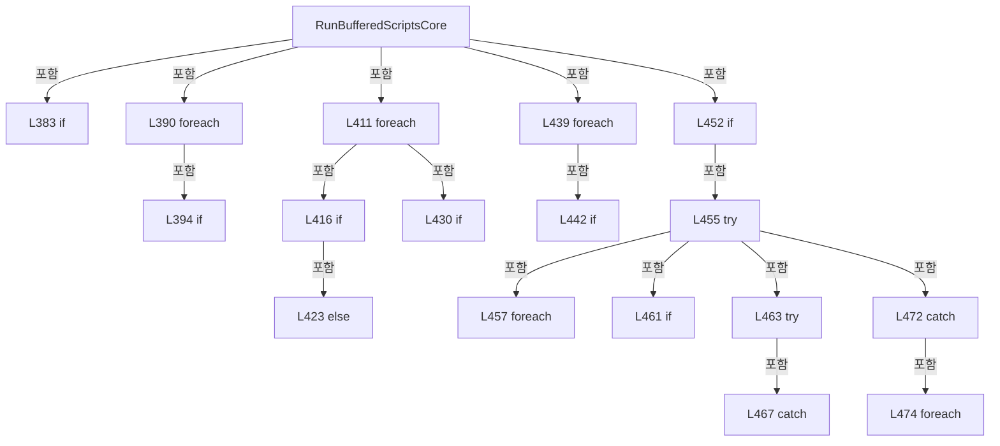

변경 전 점검: 입력/반환 타입, 위 호출자, 예외/취소 경로, 공유 상태와 저장·전송 소비자를 함께 확인합니다. 값의 단위나 물리 방향을 이름만으로 확정하지 않습니다.

### MethodDeclaration `CreateBufferedRunControllerFileName` · L487–491

[Drilling.Common/Automation/CAutomationManager.cs:487–491](https://github.com/kjuws10-rgb/A3Drilling/blob/28764c91d521777b8ee068dd7aaf2d3902ce9fe2/Drilling.Common/Automation/CAutomationManager.cs#L487-L491)

| 항목 | 실제 추출 값 |
| --- | --- |
| 서명 | string Drilling.Common.Automation.CAutomationManager.CreateBufferedRunControllerFileName(Drilling.Common.Automation.ST_BUFFERED_SCRIPT_RUN_ITEM, string, System.Threading.CancellationToken) |
| 접근/수식자 | Private / private |
| 반환/값 타입 | string |
| 소속 타입 | NamedType:Drilling.Common.Automation.CAutomationManager |

입력 계약:

| 이름 | 타입 | 전달 | 선택/기본값 |
| --- | --- | --- | --- |
| script | Drilling.Common.Automation.ST_BUFFERED_SCRIPT_RUN_ITEM | None | False /  |
| resolvedLocalScriptPath | string | None | False /  |
| cancellationToken | System.Threading.CancellationToken | None | False /  |

정적 호출자로 확인된 위치:

| 호출 파일/행 | 호출 표현식 | 런타임 분기 가능 |
| --- | --- | --- |
| [Drilling.Common/Automation/CAutomationManager.cs:421–421](https://github.com/kjuws10-rgb/A3Drilling/blob/28764c91d521777b8ee068dd7aaf2d3902ce9fe2/Drilling.Common/Automation/CAutomationManager.cs#L421-L421) | CreateBufferedRunControllerFileName | False |

호출하는 대상과 해석 범위:

| 원본 행 | 표현식 | 분석 상태 | 대상/소스 위치 |
| --- | --- | --- | --- |
| 489 | string.IsNullOrWhiteSpace | resolved | bool string.IsNullOrWhiteSpace(string?) |
| 489 | CreateTaskScopedScriptFileName | resolved | string Drilling.Common.Automation.CAutomationManager.CreateTaskScopedScriptFileName(int, string) · Drilling.Common/Automation/CAutomationManager.cs:493 |
| 490 | CreateControllerFileName | resolved | string Drilling.Common.Automation.CAutomationManager.CreateControllerFileName(string, System.Threading.CancellationToken) · Drilling.Common/Automation/CAutomationManager.cs:1051 |

본문의 실제 연산·분기·예외·반환 순서(원문 위치 순):

| 원본 행 | 종류 | 주석 해설 |
| --- | --- | --- |
| 489 | call | 함수·델리게이트 또는 객체 생성자를 호출합니다: string.IsNullOrWhiteSpace(script.ScriptFileName) |
| 489 | call | 함수·델리게이트 또는 객체 생성자를 호출합니다: CreateTaskScopedScriptFileName(script.TaskIndex, resolvedLocalScriptPath) |
| 489 | conditional-expression | 조건에 따라 결과식을 선택합니다: string.IsNullOrWhiteSpace(script.ScriptFileName) ? CreateTaskScopedScriptFileName(script.TaskIndex, resolvedLocalScriptPath) : script.ScriptFileName |
| 489 | local-declaration | 지역 변수를 선언합니다: var fileName = string.IsNullOrWhiteSpace(script.ScriptFileName) ? CreateTaskScopedScriptFileName(script.TaskIndex, resolvedLocalScriptPath) : script.ScriptFileName; |
| 489 | variable-initializer | 변수의 초기값을 지정합니다: fileName = string.IsNullOrWhiteSpace(script.ScriptFileName) ? CreateTaskScopedScriptFileName(script.TaskIndex, resolvedLocalScriptPath) : script.ScriptFileName |
| 490 | call | 함수·델리게이트 또는 객체 생성자를 호출합니다: CreateControllerFileName(fileName, cancellationToken) |
| 490 | return | 호출자에게 값 또는 제어를 반환합니다: return CreateControllerFileName(fileName, cancellationToken); |

변경 전 점검: 입력/반환 타입, 위 호출자, 예외/취소 경로, 공유 상태와 저장·전송 소비자를 함께 확인합니다. 값의 단위나 물리 방향을 이름만으로 확정하지 않습니다.

### MethodDeclaration `CreateTaskScopedScriptFileName` · L493–502

[Drilling.Common/Automation/CAutomationManager.cs:493–502](https://github.com/kjuws10-rgb/A3Drilling/blob/28764c91d521777b8ee068dd7aaf2d3902ce9fe2/Drilling.Common/Automation/CAutomationManager.cs#L493-L502)

| 항목 | 실제 추출 값 |
| --- | --- |
| 서명 | string Drilling.Common.Automation.CAutomationManager.CreateTaskScopedScriptFileName(int, string) |
| 접근/수식자 | Private / private, static |
| 반환/값 타입 | string |
| 소속 타입 | NamedType:Drilling.Common.Automation.CAutomationManager |

입력 계약:

| 이름 | 타입 | 전달 | 선택/기본값 |
| --- | --- | --- | --- |
| taskIndex | int | None | False /  |
| localScriptPath | string | None | False /  |

정적 호출자로 확인된 위치:

| 호출 파일/행 | 호출 표현식 | 런타임 분기 가능 |
| --- | --- | --- |
| [Drilling.Common/Automation/CAutomationManager.cs:489–489](https://github.com/kjuws10-rgb/A3Drilling/blob/28764c91d521777b8ee068dd7aaf2d3902ce9fe2/Drilling.Common/Automation/CAutomationManager.cs#L489-L489) | CreateTaskScopedScriptFileName | False |

호출하는 대상과 해석 범위:

| 원본 행 | 표현식 | 분석 상태 | 대상/소스 위치 |
| --- | --- | --- | --- |
| 495 | Path.GetFileName | resolved | string? System.IO.Path.GetFileName(string?) |
| 496 | string.IsNullOrWhiteSpace | resolved | bool string.IsNullOrWhiteSpace(string?) |
| 501 | taskIndex.ToString | resolved | string int.ToString(System.IFormatProvider?) |

본문의 실제 연산·분기·예외·반환 순서(원문 위치 순):

| 원본 행 | 종류 | 주석 해설 |
| --- | --- | --- |
| 495 | call | 함수·델리게이트 또는 객체 생성자를 호출합니다: Path.GetFileName(localScriptPath) |
| 495 | local-declaration | 지역 변수를 선언합니다: var fileName = Path.GetFileName(localScriptPath); |
| 495 | variable-initializer | 변수의 초기값을 지정합니다: fileName = Path.GetFileName(localScriptPath) |
| 496 | call | 함수·델리게이트 또는 객체 생성자를 호출합니다: string.IsNullOrWhiteSpace(fileName) |
| 496 | if | 조건에 따라 분기합니다: if (string.IsNullOrWhiteSpace(fileName)) |
| 498 | assignment | 값을 대상에 대입합니다: fileName = "PROCESS.ascript" |
| 501 | call | 함수·델리게이트 또는 객체 생성자를 호출합니다: taskIndex.ToString(CultureInfo.InvariantCulture) |
| 501 | return | 호출자에게 값 또는 제어를 반환합니다: return $"T{taskIndex.ToString(CultureInfo.InvariantCulture)}_{fileName}"; |

제어 구문의 포함 구조(실제 실행 순서/CFG가 아닌 구문 탐색 그림):

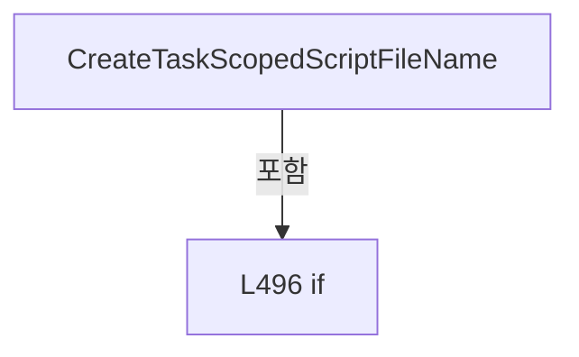

변경 전 점검: 입력/반환 타입, 위 호출자, 예외/취소 경로, 공유 상태와 저장·전송 소비자를 함께 확인합니다. 값의 단위나 물리 방향을 이름만으로 확정하지 않습니다.

### MethodDeclaration `StopTask` · L504–519

[Drilling.Common/Automation/CAutomationManager.cs:504–519](https://github.com/kjuws10-rgb/A3Drilling/blob/28764c91d521777b8ee068dd7aaf2d3902ce9fe2/Drilling.Common/Automation/CAutomationManager.cs#L504-L519)

| 항목 | 실제 추출 값 |
| --- | --- |
| 서명 | System.Threading.Tasks.Task<string> Drilling.Common.Automation.CAutomationManager.StopTask(int, int, System.Threading.CancellationToken) |
| 접근/수식자 | Public / public, virtual |
| 반환/값 타입 | System.Threading.Tasks.Task<string> |
| 소속 타입 | NamedType:Drilling.Common.Automation.CAutomationManager |

입력 계약:

| 이름 | 타입 | 전달 | 선택/기본값 |
| --- | --- | --- | --- |
| taskIndex | int | None | True / 1 |
| number | int | None | True / 0 |
| cancellationToken | System.Threading.CancellationToken | None | True / null |

정적 호출자로 확인된 위치:

| 호출 파일/행 | 호출 표현식 | 런타임 분기 가능 |
| --- | --- | --- |
| [Drilling.Common/Automation/CAutomationManager.cs:1109–1109](https://github.com/kjuws10-rgb/A3Drilling/blob/28764c91d521777b8ee068dd7aaf2d3902ce9fe2/Drilling.Common/Automation/CAutomationManager.cs#L1109-L1109) | StopTask | True |
| [Drilling.Common/Station/CStationProcess.cs:953–953](https://github.com/kjuws10-rgb/A3Drilling/blob/28764c91d521777b8ee068dd7aaf2d3902ce9fe2/Drilling.Common/Station/CStationProcess.cs#L953-L953) | _automationManager.StopTask | True |
| [Drilling.Common/Station/CStationProcess.cs:1124–1124](https://github.com/kjuws10-rgb/A3Drilling/blob/28764c91d521777b8ee068dd7aaf2d3902ce9fe2/Drilling.Common/Station/CStationProcess.cs#L1124-L1124) | _automationManager.StopTask | True |
| [Drilling.UI/Menu/Menus/CMenuManual.cs:3827–3827](https://github.com/kjuws10-rgb/A3Drilling/blob/28764c91d521777b8ee068dd7aaf2d3902ce9fe2/Drilling.UI/Menu/Menus/CMenuManual.cs#L3827-L3827) | _manager.automation.StopTask | True |
| [Drilling.UI/Menu/Menus/CMenuManual.cs:4569–4569](https://github.com/kjuws10-rgb/A3Drilling/blob/28764c91d521777b8ee068dd7aaf2d3902ce9fe2/Drilling.UI/Menu/Menus/CMenuManual.cs#L4569-L4569) | _manager.automation.StopTask | True |
| [Drilling.UI/Menu/Menus/CMenuManual.cs:4907–4907](https://github.com/kjuws10-rgb/A3Drilling/blob/28764c91d521777b8ee068dd7aaf2d3902ce9fe2/Drilling.UI/Menu/Menus/CMenuManual.cs#L4907-L4907) | _manager.automation.StopTask | True |
| [Drilling.UI/Menu/Menus/CMenuManual.cs:5413–5413](https://github.com/kjuws10-rgb/A3Drilling/blob/28764c91d521777b8ee068dd7aaf2d3902ce9fe2/Drilling.UI/Menu/Menus/CMenuManual.cs#L5413-L5413) | _manager.automation.StopTask | True |

호출하는 대상과 해석 범위:

| 원본 행 | 표현식 | 분석 상태 | 대상/소스 위치 |
| --- | --- | --- | --- |
| 506 | ValidateTaskIndex | resolved | void Drilling.Common.Automation.CAutomationManager.ValidateTaskIndex(int) · Drilling.Common/Automation/CAutomationManager.cs:583 |
| 507 | IsSimul | resolved | bool Drilling.Common.Automation.CAutomationManager.IsSimul(int) · Drilling.Common/Automation/CAutomationManager.cs:63 |
| 509 | _stageSimulationTasks.TryGetValue | resolved | bool System.Collections.Concurrent.ConcurrentDictionary<(int Controller, int Task), Drilling.Common.Automation.CAutomationManager.CStageSimulatedTask>.TryGetValue((int Controller, int Task), out Drilling.Common.Automation.CAutomationManager.CStageSimulatedTask) |
| 511 | session.Stop | resolved | void Drilling.Common.Automation.CAutomationManager.CStageSimulatedTask.Stop() · Drilling.Common/Automation/CAutomationManager.cs:1384 |
| 512 | Task.FromResult | resolved | System.Threading.Tasks.Task<string> System.Threading.Tasks.Task.FromResult<string>(string) |
| 512 | CreateSimulationTaskStatus | resolved | string Drilling.Common.Automation.CAutomationManager.CreateSimulationTaskStatus(int, string, string, string) · Drilling.Common/Automation/CAutomationManager.cs:591 |
| 515 | Task.FromResult | resolved | System.Threading.Tasks.Task<string> System.Threading.Tasks.Task.FromResult<string>(string) |
| 515 | CreateSimulationTaskStatus | resolved | string Drilling.Common.Automation.CAutomationManager.CreateSimulationTaskStatus(int, string, string, string) · Drilling.Common/Automation/CAutomationManager.cs:591 |
| 518 | ExecuteRaw | resolved | System.Threading.Tasks.Task<string> Drilling.Common.Automation.CAutomationManager.ExecuteRaw(string, int, System.Threading.CancellationToken, bool) · Drilling.Common/Automation/CAutomationManager.cs:180 |

본문의 실제 연산·분기·예외·반환 순서(원문 위치 순):

| 원본 행 | 종류 | 주석 해설 |
| --- | --- | --- |
| 506 | call | 함수·델리게이트 또는 객체 생성자를 호출합니다: ValidateTaskIndex(taskIndex) |
| 507 | call | 함수·델리게이트 또는 객체 생성자를 호출합니다: IsSimul(number) |
| 507 | if | 조건에 따라 분기합니다: if (IsSimul(number)) |
| 509 | call | 함수·델리게이트 또는 객체 생성자를 호출합니다: _stageSimulationTasks.TryGetValue((number, taskIndex), out var session) |
| 509 | if | 조건에 따라 분기합니다: if (_stageSimulationTasks.TryGetValue((number, taskIndex), out var session)) |
| 511 | call | 함수·델리게이트 또는 객체 생성자를 호출합니다: session.Stop() |
| 512 | call | 함수·델리게이트 또는 객체 생성자를 호출합니다: Task.FromResult(CreateSimulationTaskStatus(taskIndex, session.State, session.File)) |
| 512 | call | 함수·델리게이트 또는 객체 생성자를 호출합니다: CreateSimulationTaskStatus(taskIndex, session.State, session.File) |
| 512 | return | 호출자에게 값 또는 제어를 반환합니다: return Task.FromResult(CreateSimulationTaskStatus(taskIndex, session.State, session.File)); |
| 515 | call | 함수·델리게이트 또는 객체 생성자를 호출합니다: Task.FromResult(CreateSimulationTaskStatus(taskIndex, "Idle")) |
| 515 | call | 함수·델리게이트 또는 객체 생성자를 호출합니다: CreateSimulationTaskStatus(taskIndex, "Idle") |
| 515 | return | 호출자에게 값 또는 제어를 반환합니다: return Task.FromResult(CreateSimulationTaskStatus(taskIndex, "Idle")); |
| 518 | call | 함수·델리게이트 또는 객체 생성자를 호출합니다: ExecuteRaw($"AUTOMATION1:SCRIPT&#124;STOP&#124;{taskIndex}", number, cancellationToken) |
| 518 | return | 호출자에게 값 또는 제어를 반환합니다: return ExecuteRaw($"AUTOMATION1:SCRIPT&#124;STOP&#124;{taskIndex}", number, cancellationToken); |

제어 구문의 포함 구조(실제 실행 순서/CFG가 아닌 구문 탐색 그림):

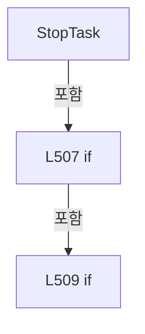

변경 전 점검: 입력/반환 타입, 위 호출자, 예외/취소 경로, 공유 상태와 저장·전송 소비자를 함께 확인합니다. 값의 단위나 물리 방향을 이름만으로 확정하지 않습니다.

### MethodDeclaration `ReadTaskStatus` · L521–530

[Drilling.Common/Automation/CAutomationManager.cs:521–530](https://github.com/kjuws10-rgb/A3Drilling/blob/28764c91d521777b8ee068dd7aaf2d3902ce9fe2/Drilling.Common/Automation/CAutomationManager.cs#L521-L530)

| 항목 | 실제 추출 값 |
| --- | --- |
| 서명 | System.Threading.Tasks.Task<string> Drilling.Common.Automation.CAutomationManager.ReadTaskStatus(int, int, System.Threading.CancellationToken) |
| 접근/수식자 | Public / public, virtual |
| 반환/값 타입 | System.Threading.Tasks.Task<string> |
| 소속 타입 | NamedType:Drilling.Common.Automation.CAutomationManager |

입력 계약:

| 이름 | 타입 | 전달 | 선택/기본값 |
| --- | --- | --- | --- |
| taskIndex | int | None | True / 1 |
| number | int | None | True / 0 |
| cancellationToken | System.Threading.CancellationToken | None | True / null |

정적 호출자로 확인된 위치:

| 호출 파일/행 | 호출 표현식 | 런타임 분기 가능 |
| --- | --- | --- |
| [Drilling.Common/Automation/CAutomationStatusSnapshotService.cs:44–44](https://github.com/kjuws10-rgb/A3Drilling/blob/28764c91d521777b8ee068dd7aaf2d3902ce9fe2/Drilling.Common/Automation/CAutomationStatusSnapshotService.cs#L44-L44) | _automation.ReadTaskStatus | True |
| [Drilling.Common/Station/CStationProcess.cs:898–898](https://github.com/kjuws10-rgb/A3Drilling/blob/28764c91d521777b8ee068dd7aaf2d3902ce9fe2/Drilling.Common/Station/CStationProcess.cs#L898-L898) | _automationManager.ReadTaskStatus | True |
| [Drilling.Common/Station/CStationProcess.cs:987–987](https://github.com/kjuws10-rgb/A3Drilling/blob/28764c91d521777b8ee068dd7aaf2d3902ce9fe2/Drilling.Common/Station/CStationProcess.cs#L987-L987) | _automationManager.ReadTaskStatus | True |
| [Drilling.UI/Menu/Menus/CMenuManual.cs:2008–2008](https://github.com/kjuws10-rgb/A3Drilling/blob/28764c91d521777b8ee068dd7aaf2d3902ce9fe2/Drilling.UI/Menu/Menus/CMenuManual.cs#L2008-L2008) | _manager.automation.ReadTaskStatus | True |
| [Drilling.UI/Menu/Menus/CMenuManual.cs:3779–3779](https://github.com/kjuws10-rgb/A3Drilling/blob/28764c91d521777b8ee068dd7aaf2d3902ce9fe2/Drilling.UI/Menu/Menus/CMenuManual.cs#L3779-L3779) | _manager.automation.ReadTaskStatus | True |
| [Drilling.UI/Menu/Menus/CMenuManual.cs:4474–4474](https://github.com/kjuws10-rgb/A3Drilling/blob/28764c91d521777b8ee068dd7aaf2d3902ce9fe2/Drilling.UI/Menu/Menus/CMenuManual.cs#L4474-L4474) | _manager.automation.ReadTaskStatus | True |
| [Drilling.UI/Menu/Menus/CMenuManual.cs:5512–5512](https://github.com/kjuws10-rgb/A3Drilling/blob/28764c91d521777b8ee068dd7aaf2d3902ce9fe2/Drilling.UI/Menu/Menus/CMenuManual.cs#L5512-L5512) | _manager.automation.ReadTaskStatus | True |

호출하는 대상과 해석 범위:

| 원본 행 | 표현식 | 분석 상태 | 대상/소스 위치 |
| --- | --- | --- | --- |
| 523 | ValidateTaskIndex | resolved | void Drilling.Common.Automation.CAutomationManager.ValidateTaskIndex(int) · Drilling.Common/Automation/CAutomationManager.cs:583 |
| 524 | IsSimul | resolved | bool Drilling.Common.Automation.CAutomationManager.IsSimul(int) · Drilling.Common/Automation/CAutomationManager.cs:63 |
| 526 | Task.FromResult | resolved | System.Threading.Tasks.Task<string> System.Threading.Tasks.Task.FromResult<string>(string) |
| 526 | _stageSimulationTasks.TryGetValue | resolved | bool System.Collections.Concurrent.ConcurrentDictionary<(int Controller, int Task), Drilling.Common.Automation.CAutomationManager.CStageSimulatedTask>.TryGetValue((int Controller, int Task), out Drilling.Common.Automation.CAutomationManager.CStageSimulatedTask) |
| 526 | CreateSimulationTaskStatus | resolved | string Drilling.Common.Automation.CAutomationManager.CreateSimulationTaskStatus(int, string, string, string) · Drilling.Common/Automation/CAutomationManager.cs:591 |
| 526 | CreateSimulationTaskStatus | resolved | string Drilling.Common.Automation.CAutomationManager.CreateSimulationTaskStatus(int, string, string, string) · Drilling.Common/Automation/CAutomationManager.cs:591 |
| 529 | ExecuteRaw | resolved | System.Threading.Tasks.Task<string> Drilling.Common.Automation.CAutomationManager.ExecuteRaw(string, int, System.Threading.CancellationToken, bool) · Drilling.Common/Automation/CAutomationManager.cs:180 |

본문의 실제 연산·분기·예외·반환 순서(원문 위치 순):

| 원본 행 | 종류 | 주석 해설 |
| --- | --- | --- |
| 523 | call | 함수·델리게이트 또는 객체 생성자를 호출합니다: ValidateTaskIndex(taskIndex) |
| 524 | call | 함수·델리게이트 또는 객체 생성자를 호출합니다: IsSimul(number) |
| 524 | if | 조건에 따라 분기합니다: if (IsSimul(number)) |
| 526 | call | 함수·델리게이트 또는 객체 생성자를 호출합니다: Task.FromResult(_stageSimulationTasks.TryGetValue((number, taskIndex), out var session) ? CreateSimulationTaskStatus(taskIndex, session.State, session.File) : CreateSimulationTaskStatus(taskIndex, "Idle")) |
| 526 | call | 함수·델리게이트 또는 객체 생성자를 호출합니다: _stageSimulationTasks.TryGetValue((number, taskIndex), out var session) |
| 526 | call | 함수·델리게이트 또는 객체 생성자를 호출합니다: CreateSimulationTaskStatus(taskIndex, session.State, session.File) |
| 526 | call | 함수·델리게이트 또는 객체 생성자를 호출합니다: CreateSimulationTaskStatus(taskIndex, "Idle") |
| 526 | conditional-expression | 조건에 따라 결과식을 선택합니다: _stageSimulationTasks.TryGetValue((number, taskIndex), out var session) ? CreateSimulationTaskStatus(taskIndex, session.State, session.File) : CreateSimulationTaskStatus(taskIndex, "Idle") |
| 526 | return | 호출자에게 값 또는 제어를 반환합니다: return Task.FromResult(_stageSimulationTasks.TryGetValue((number, taskIndex), out var session) ? CreateSimulationTaskStatus(taskIndex, session.State, session.File) : CreateSimulationTaskStatus(taskIndex, "Idle")); |
| 529 | call | 함수·델리게이트 또는 객체 생성자를 호출합니다: ExecuteRaw($"AUTOMATION1:SCRIPT&#124;STATUS&#124;{taskIndex}", number, cancellationToken, suppressLog: true) |
| 529 | return | 호출자에게 값 또는 제어를 반환합니다: return ExecuteRaw($"AUTOMATION1:SCRIPT&#124;STATUS&#124;{taskIndex}", number, cancellationToken, suppressLog: true); |

제어 구문의 포함 구조(실제 실행 순서/CFG가 아닌 구문 탐색 그림):

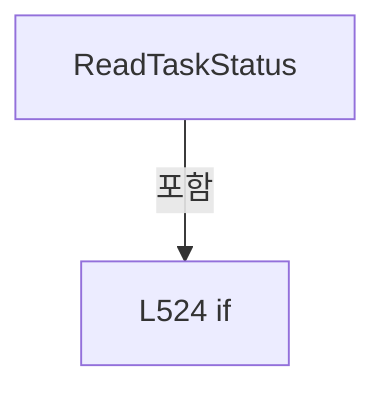

변경 전 점검: 입력/반환 타입, 위 호출자, 예외/취소 경로, 공유 상태와 저장·전송 소비자를 함께 확인합니다. 값의 단위나 물리 방향을 이름만으로 확정하지 않습니다.

### MethodDeclaration `ReadTaskLineStatus` · L532–541

[Drilling.Common/Automation/CAutomationManager.cs:532–541](https://github.com/kjuws10-rgb/A3Drilling/blob/28764c91d521777b8ee068dd7aaf2d3902ce9fe2/Drilling.Common/Automation/CAutomationManager.cs#L532-L541)

| 항목 | 실제 추출 값 |
| --- | --- |
| 서명 | System.Threading.Tasks.Task<string> Drilling.Common.Automation.CAutomationManager.ReadTaskLineStatus(int, int, System.Threading.CancellationToken) |
| 접근/수식자 | Public / public, virtual |
| 반환/값 타입 | System.Threading.Tasks.Task<string> |
| 소속 타입 | NamedType:Drilling.Common.Automation.CAutomationManager |

입력 계약:

| 이름 | 타입 | 전달 | 선택/기본값 |
| --- | --- | --- | --- |
| taskIndex | int | None | True / 1 |
| number | int | None | True / 0 |
| cancellationToken | System.Threading.CancellationToken | None | True / null |

정적 호출자로 확인된 위치:

| 호출 파일/행 | 호출 표현식 | 런타임 분기 가능 |
| --- | --- | --- |
| [Drilling.Common/Station/CStationProcess.cs:1038–1038](https://github.com/kjuws10-rgb/A3Drilling/blob/28764c91d521777b8ee068dd7aaf2d3902ce9fe2/Drilling.Common/Station/CStationProcess.cs#L1038-L1038) | _automationManager.ReadTaskLineStatus | True |

호출하는 대상과 해석 범위:

| 원본 행 | 표현식 | 분석 상태 | 대상/소스 위치 |
| --- | --- | --- | --- |
| 534 | ValidateTaskIndex | resolved | void Drilling.Common.Automation.CAutomationManager.ValidateTaskIndex(int) · Drilling.Common/Automation/CAutomationManager.cs:583 |
| 535 | IsSimul | resolved | bool Drilling.Common.Automation.CAutomationManager.IsSimul(int) · Drilling.Common/Automation/CAutomationManager.cs:63 |
| 537 | Task.FromResult | resolved | System.Threading.Tasks.Task<string> System.Threading.Tasks.Task.FromResult<string>(string) |
| 537 | string.Join | resolved | string string.Join(string?, params System.ReadOnlySpan<string?>) |
| 537 | taskIndex.ToString | resolved | string int.ToString(System.IFormatProvider?) |
| 540 | ExecuteRaw | resolved | System.Threading.Tasks.Task<string> Drilling.Common.Automation.CAutomationManager.ExecuteRaw(string, int, System.Threading.CancellationToken, bool) · Drilling.Common/Automation/CAutomationManager.cs:180 |

본문의 실제 연산·분기·예외·반환 순서(원문 위치 순):

| 원본 행 | 종류 | 주석 해설 |
| --- | --- | --- |
| 534 | call | 함수·델리게이트 또는 객체 생성자를 호출합니다: ValidateTaskIndex(taskIndex) |
| 535 | call | 함수·델리게이트 또는 객체 생성자를 호출합니다: IsSimul(number) |
| 535 | if | 조건에 따라 분기합니다: if (IsSimul(number)) |
| 537 | call | 함수·델리게이트 또는 객체 생성자를 호출합니다: Task.FromResult(string.Join(":", "OK", "TASK_LINE", taskIndex.ToString(CultureInfo.InvariantCulture), "0")) |
| 537 | call | 함수·델리게이트 또는 객체 생성자를 호출합니다: string.Join(":", "OK", "TASK_LINE", taskIndex.ToString(CultureInfo.InvariantCulture), "0") |
| 537 | call | 함수·델리게이트 또는 객체 생성자를 호출합니다: taskIndex.ToString(CultureInfo.InvariantCulture) |
| 537 | return | 호출자에게 값 또는 제어를 반환합니다: return Task.FromResult(string.Join(":", "OK", "TASK_LINE", taskIndex.ToString(CultureInfo.InvariantCulture), "0")); |
| 540 | call | 함수·델리게이트 또는 객체 생성자를 호출합니다: ExecuteRaw($"AUTOMATION1:TASK&#124;LINE_STATUS&#124;{taskIndex}", number, cancellationToken, suppressLog: true) |
| 540 | return | 호출자에게 값 또는 제어를 반환합니다: return ExecuteRaw($"AUTOMATION1:TASK&#124;LINE_STATUS&#124;{taskIndex}", number, cancellationToken, suppressLog: true); |

제어 구문의 포함 구조(실제 실행 순서/CFG가 아닌 구문 탐색 그림):

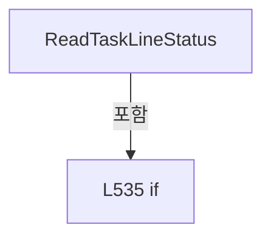

변경 전 점검: 입력/반환 타입, 위 호출자, 예외/취소 경로, 공유 상태와 저장·전송 소비자를 함께 확인합니다. 값의 단위나 물리 방향을 이름만으로 확정하지 않습니다.

### MethodDeclaration `ReleaseEncoderScaleFactor` · L543–550

[Drilling.Common/Automation/CAutomationManager.cs:543–550](https://github.com/kjuws10-rgb/A3Drilling/blob/28764c91d521777b8ee068dd7aaf2d3902ce9fe2/Drilling.Common/Automation/CAutomationManager.cs#L543-L550)

| 항목 | 실제 추출 값 |
| --- | --- |
| 서명 | System.Threading.Tasks.Task<string> Drilling.Common.Automation.CAutomationManager.ReleaseEncoderScaleFactor(string, int, int, System.Threading.CancellationToken) |
| 접근/수식자 | Public / public, virtual, async |
| 반환/값 타입 | System.Threading.Tasks.Task<string> |
| 소속 타입 | NamedType:Drilling.Common.Automation.CAutomationManager |

입력 계약:

| 이름 | 타입 | 전달 | 선택/기본값 |
| --- | --- | --- | --- |
| galvoAxis | string | None | False /  |
| taskIndex | int | None | True / 1 |
| number | int | None | True / 0 |
| cancellationToken | System.Threading.CancellationToken | None | True / null |

현재 부분 분석에서 직접 연결된 호출자는 없습니다. XAML/이벤트/인터페이스·델리게이트·외부 진입을 추가 확인해야 하며, 미사용으로 판정한 것이 아닙니다.

호출하는 대상과 해석 범위:

| 원본 행 | 표현식 | 분석 상태 | 대상/소스 위치 |
| --- | --- | --- | --- |
| 545 | ResolveAeroScriptAxis | resolved | string Drilling.Common.Automation.CAutomationManager.ResolveAeroScriptAxis(string) · Drilling.Common/Automation/CAutomationManager.cs:783 |
| 546 | ValidateTaskIndex | resolved | void Drilling.Common.Automation.CAutomationManager.ValidateTaskIndex(int) · Drilling.Common/Automation/CAutomationManager.cs:583 |
| 547 | ExecuteRaw | resolved | System.Threading.Tasks.Task<string> Drilling.Common.Automation.CAutomationManager.ExecuteRaw(string, int, System.Threading.CancellationToken, bool) · Drilling.Common/Automation/CAutomationManager.cs:180 |
| 547 | taskIndex.ToString | resolved | string int.ToString(System.IFormatProvider?) |
| 548 | EnsureAutomationResponseSucceeded | resolved | void Drilling.Common.Automation.CAutomationManager.EnsureAutomationResponseSucceeded(string, string) · Drilling.Common/Automation/CAutomationManager.cs:724 |
| 548 | taskIndex.ToString | resolved | string int.ToString(System.IFormatProvider?) |

본문의 실제 연산·분기·예외·반환 순서(원문 위치 순):

| 원본 행 | 종류 | 주석 해설 |
| --- | --- | --- |
| 545 | call | 함수·델리게이트 또는 객체 생성자를 호출합니다: ResolveAeroScriptAxis(galvoAxis) |
| 545 | local-declaration | 지역 변수를 선언합니다: var axis = ResolveAeroScriptAxis(galvoAxis); |
| 545 | variable-initializer | 변수의 초기값을 지정합니다: axis = ResolveAeroScriptAxis(galvoAxis) |
| 546 | call | 함수·델리게이트 또는 객체 생성자를 호출합니다: ValidateTaskIndex(taskIndex) |
| 547 | await | 비동기 완료를 기다립니다: await ExecuteRaw($"AUTOMATION1:COMMAND&#124;{taskIndex.ToString(CultureInfo.InvariantCulture)}&#124;GalvoEncoderScaleFactorSet({axis}, 0)", number, cancellationToken) |
| 547 | call | 함수·델리게이트 또는 객체 생성자를 호출합니다: ExecuteRaw($"AUTOMATION1:COMMAND&#124;{taskIndex.ToString(CultureInfo.InvariantCulture)}&#124;GalvoEncoderScaleFactorSet({axis}, 0)", number, cancellationToken) |
| 547 | call | 함수·델리게이트 또는 객체 생성자를 호출합니다: taskIndex.ToString(CultureInfo.InvariantCulture) |
| 547 | local-declaration | 지역 변수를 선언합니다: var response = await ExecuteRaw($"AUTOMATION1:COMMAND&#124;{taskIndex.ToString(CultureInfo.InvariantCulture)}&#124;GalvoEncoderScaleFactorSet({axis}, 0)", number, cancellationToken); |
| 547 | variable-initializer | 변수의 초기값을 지정합니다: response = await ExecuteRaw($"AUTOMATION1:COMMAND&#124;{taskIndex.ToString(CultureInfo.InvariantCulture)}&#124;GalvoEncoderScaleFactorSet({axis}, 0)", number, cancellationToken) |
| 548 | call | 함수·델리게이트 또는 객체 생성자를 호출합니다: EnsureAutomationResponseSucceeded(response, $"Automation1 encoder scale release failed. Axis={axis}, Task={taskIndex.ToString(CultureInfo.InvariantCulture)}.") |
| 548 | call | 함수·델리게이트 또는 객체 생성자를 호출합니다: taskIndex.ToString(CultureInfo.InvariantCulture) |
| 549 | return | 호출자에게 값 또는 제어를 반환합니다: return response; |

변경 전 점검: 입력/반환 타입, 위 호출자, 예외/취소 경로, 공유 상태와 저장·전송 소비자를 함께 확인합니다. 값의 단위나 물리 방향을 이름만으로 확정하지 않습니다.

### MethodDeclaration `SetGalvoLaserOutput` · L552–560

[Drilling.Common/Automation/CAutomationManager.cs:552–560](https://github.com/kjuws10-rgb/A3Drilling/blob/28764c91d521777b8ee068dd7aaf2d3902ce9fe2/Drilling.Common/Automation/CAutomationManager.cs#L552-L560)

| 항목 | 실제 추출 값 |
| --- | --- |
| 서명 | System.Threading.Tasks.Task<string> Drilling.Common.Automation.CAutomationManager.SetGalvoLaserOutput(string, bool, int, int, System.Threading.CancellationToken) |
| 접근/수식자 | Public / public, virtual, async |
| 반환/값 타입 | System.Threading.Tasks.Task<string> |
| 소속 타입 | NamedType:Drilling.Common.Automation.CAutomationManager |

입력 계약:

| 이름 | 타입 | 전달 | 선택/기본값 |
| --- | --- | --- | --- |
| galvoAxis | string | None | False /  |
| isOn | bool | None | False /  |
| taskIndex | int | None | True / 1 |
| number | int | None | True / 0 |
| cancellationToken | System.Threading.CancellationToken | None | True / null |

정적 호출자로 확인된 위치:

| 호출 파일/행 | 호출 표현식 | 런타임 분기 가능 |
| --- | --- | --- |
| [Drilling.Common/Automation/CAutomationManager.cs:570–570](https://github.com/kjuws10-rgb/A3Drilling/blob/28764c91d521777b8ee068dd7aaf2d3902ce9fe2/Drilling.Common/Automation/CAutomationManager.cs#L570-L570) | SetGalvoLaserOutput | True |
| [Drilling.Common/Interface/CPowerMeasureRun.cs:364–364](https://github.com/kjuws10-rgb/A3Drilling/blob/28764c91d521777b8ee068dd7aaf2d3902ce9fe2/Drilling.Common/Interface/CPowerMeasureRun.cs#L364-L364) | Automation.SetGalvoLaserOutput | True |
| [Drilling.Common/Interface/CPowerMeasureRun.cs:376–376](https://github.com/kjuws10-rgb/A3Drilling/blob/28764c91d521777b8ee068dd7aaf2d3902ce9fe2/Drilling.Common/Interface/CPowerMeasureRun.cs#L376-L376) | Automation.SetGalvoLaserOutput | True |
| [Drilling.Common/Station/CStationProcess.cs:4225–4225](https://github.com/kjuws10-rgb/A3Drilling/blob/28764c91d521777b8ee068dd7aaf2d3902ce9fe2/Drilling.Common/Station/CStationProcess.cs#L4225-L4225) | _automationManager.SetGalvoLaserOutput | True |
| [Drilling.UI/Menu/Menus/CMenuCorrection.cs:3829–3829](https://github.com/kjuws10-rgb/A3Drilling/blob/28764c91d521777b8ee068dd7aaf2d3902ce9fe2/Drilling.UI/Menu/Menus/CMenuCorrection.cs#L3829-L3829) | manager.automation.SetGalvoLaserOutput | True |
| [Drilling.UI/Menu/Menus/CMenuCorrection.cs:3875–3875](https://github.com/kjuws10-rgb/A3Drilling/blob/28764c91d521777b8ee068dd7aaf2d3902ce9fe2/Drilling.UI/Menu/Menus/CMenuCorrection.cs#L3875-L3875) | _defaultManager!.automation.SetGalvoLaserOutput | True |
| [Drilling.UI/Menu/Menus/CMenuManual.cs:4584–4584](https://github.com/kjuws10-rgb/A3Drilling/blob/28764c91d521777b8ee068dd7aaf2d3902ce9fe2/Drilling.UI/Menu/Menus/CMenuManual.cs#L4584-L4584) | _manager.automation.SetGalvoLaserOutput | True |
| [Drilling.UI/Menu/Menus/CMenuManual.cs:4926–4926](https://github.com/kjuws10-rgb/A3Drilling/blob/28764c91d521777b8ee068dd7aaf2d3902ce9fe2/Drilling.UI/Menu/Menus/CMenuManual.cs#L4926-L4926) | _manager.automation.SetGalvoLaserOutput | True |

호출하는 대상과 해석 범위:

| 원본 행 | 표현식 | 분석 상태 | 대상/소스 위치 |
| --- | --- | --- | --- |
| 554 | ResolveAeroScriptAxis | resolved | string Drilling.Common.Automation.CAutomationManager.ResolveAeroScriptAxis(string) · Drilling.Common/Automation/CAutomationManager.cs:783 |
| 555 | ValidateTaskIndex | resolved | void Drilling.Common.Automation.CAutomationManager.ValidateTaskIndex(int) · Drilling.Common/Automation/CAutomationManager.cs:583 |
| 557 | ExecuteRaw | resolved | System.Threading.Tasks.Task<string> Drilling.Common.Automation.CAutomationManager.ExecuteRaw(string, int, System.Threading.CancellationToken, bool) · Drilling.Common/Automation/CAutomationManager.cs:180 |
| 557 | taskIndex.ToString | resolved | string int.ToString(System.IFormatProvider?) |
| 558 | EnsureAutomationResponseSucceeded | resolved | void Drilling.Common.Automation.CAutomationManager.EnsureAutomationResponseSucceeded(string, string) · Drilling.Common/Automation/CAutomationManager.cs:724 |
| 558 | taskIndex.ToString | resolved | string int.ToString(System.IFormatProvider?) |

본문의 실제 연산·분기·예외·반환 순서(원문 위치 순):

| 원본 행 | 종류 | 주석 해설 |
| --- | --- | --- |
| 554 | call | 함수·델리게이트 또는 객체 생성자를 호출합니다: ResolveAeroScriptAxis(galvoAxis) |
| 554 | local-declaration | 지역 변수를 선언합니다: var axis = ResolveAeroScriptAxis(galvoAxis); |
| 554 | variable-initializer | 변수의 초기값을 지정합니다: axis = ResolveAeroScriptAxis(galvoAxis) |
| 555 | call | 함수·델리게이트 또는 객체 생성자를 호출합니다: ValidateTaskIndex(taskIndex) |
| 556 | conditional-expression | 조건에 따라 결과식을 선택합니다: isOn ? "On" : "Off" |
| 556 | local-declaration | 지역 변수를 선언합니다: var output = isOn ? "On" : "Off"; |
| 556 | variable-initializer | 변수의 초기값을 지정합니다: output = isOn ? "On" : "Off" |
| 557 | await | 비동기 완료를 기다립니다: await ExecuteRaw($"AUTOMATION1:COMMAND&#124;{taskIndex.ToString(CultureInfo.InvariantCulture)}&#124;GalvoLaserOutput({axis}, GalvoLaser.{output})", number, cancellationToken) |
| 557 | call | 함수·델리게이트 또는 객체 생성자를 호출합니다: ExecuteRaw($"AUTOMATION1:COMMAND&#124;{taskIndex.ToString(CultureInfo.InvariantCulture)}&#124;GalvoLaserOutput({axis}, GalvoLaser.{output})", number, cancellationToken) |
| 557 | call | 함수·델리게이트 또는 객체 생성자를 호출합니다: taskIndex.ToString(CultureInfo.InvariantCulture) |
| 557 | local-declaration | 지역 변수를 선언합니다: var response = await ExecuteRaw($"AUTOMATION1:COMMAND&#124;{taskIndex.ToString(CultureInfo.InvariantCulture)}&#124;GalvoLaserOutput({axis}, GalvoLaser.{output})", number, cancellationToken); |
| 557 | variable-initializer | 변수의 초기값을 지정합니다: response = await ExecuteRaw($"AUTOMATION1:COMMAND&#124;{taskIndex.ToString(CultureInfo.InvariantCulture)}&#124;GalvoLaserOutput({axis}, GalvoLaser.{output})", number, cancellationToken) |
| 558 | call | 함수·델리게이트 또는 객체 생성자를 호출합니다: EnsureAutomationResponseSucceeded(response, $"Automation1 laser output command failed. Axis={axis}, Output={output}, Task={taskIndex.ToString(CultureInfo.InvariantCulture)}.") |
| 558 | call | 함수·델리게이트 또는 객체 생성자를 호출합니다: taskIndex.ToString(CultureInfo.InvariantCulture) |
| 559 | return | 호출자에게 값 또는 제어를 반환합니다: return response; |

변경 전 점검: 입력/반환 타입, 위 호출자, 예외/취소 경로, 공유 상태와 저장·전송 소비자를 함께 확인합니다. 값의 단위나 물리 방향을 이름만으로 확정하지 않습니다.

### MethodDeclaration `ConfigurePowerMeasurement` · L563–581

[Drilling.Common/Automation/CAutomationManager.cs:563–581](https://github.com/kjuws10-rgb/A3Drilling/blob/28764c91d521777b8ee068dd7aaf2d3902ce9fe2/Drilling.Common/Automation/CAutomationManager.cs#L563-L581)

| 항목 | 실제 추출 값 |
| --- | --- |
| 서명 | System.Threading.Tasks.Task Drilling.Common.Automation.CAutomationManager.ConfigurePowerMeasurement(string, double, int, int, System.Threading.CancellationToken) |
| 접근/수식자 | Public / public, virtual, async |
| 반환/값 타입 | System.Threading.Tasks.Task |
| 소속 타입 | NamedType:Drilling.Common.Automation.CAutomationManager |

원본 XML 주석:

````xml
/// <summary>Continuous electrical duty at 10 V; Recipe frequency is kHz and pulse times are microseconds.</summary>
````

입력 계약:

| 이름 | 타입 | 전달 | 선택/기본값 |
| --- | --- | --- | --- |
| galvoAxis | string | None | False /  |
| frequencyKhz | double | None | False /  |
| taskIndex | int | None | False /  |
| number | int | None | False /  |
| token | System.Threading.CancellationToken | None | False /  |

정적 호출자로 확인된 위치:

| 호출 파일/행 | 호출 표현식 | 런타임 분기 가능 |
| --- | --- | --- |
| [Drilling.Common/Interface/CPowerMeasureRun.cs:303–303](https://github.com/kjuws10-rgb/A3Drilling/blob/28764c91d521777b8ee068dd7aaf2d3902ce9fe2/Drilling.Common/Interface/CPowerMeasureRun.cs#L303-L303) | Automation.ConfigurePowerMeasurement | True |

호출하는 대상과 해석 범위:

| 원본 행 | 표현식 | 분석 상태 | 대상/소스 위치 |
| --- | --- | --- | --- |
| 565 | ResolveAeroScriptAxis | resolved | string Drilling.Common.Automation.CAutomationManager.ResolveAeroScriptAxis(string) · Drilling.Common/Automation/CAutomationManager.cs:783 |
| 566 | ValidateTaskIndex | resolved | void Drilling.Common.Automation.CAutomationManager.ValidateTaskIndex(int) · Drilling.Common/Automation/CAutomationManager.cs:583 |
| 567 | double.IsFinite | resolved | bool double.IsFinite(double) |
| 568 | new ArgumentOutOfRangeException | resolved | System.ArgumentOutOfRangeException.ArgumentOutOfRangeException(string?) |
| 568 | nameof | unresolved | None |
| 569 | (1000.0 / frequencyKhz).ToString | resolved | string double.ToString(string?, System.IFormatProvider?) |
| 570 | SetGalvoLaserOutput(axis, false, taskIndex, number, token).ConfigureAwait | resolved | System.Runtime.CompilerServices.ConfiguredTaskAwaitable<string> System.Threading.Tasks.Task<string>.ConfigureAwait(bool) |
| 570 | SetGalvoLaserOutput | resolved · 동적 구현 선택 가능 | System.Threading.Tasks.Task<string> Drilling.Common.Automation.CAutomationManager.SetGalvoLaserOutput(string, bool, int, int, System.Threading.CancellationToken) · Drilling.Common/Automation/CAutomationManager.cs:552 |
| 578 | ExecuteRaw($"AUTOMATION1:COMMAND&#124;{taskIndex}&#124;{command}", number, token).ConfigureAwait | resolved | System.Runtime.CompilerServices.ConfiguredTaskAwaitable<string> System.Threading.Tasks.Task<string>.ConfigureAwait(bool) |
| 578 | ExecuteRaw | resolved | System.Threading.Tasks.Task<string> Drilling.Common.Automation.CAutomationManager.ExecuteRaw(string, int, System.Threading.CancellationToken, bool) · Drilling.Common/Automation/CAutomationManager.cs:180 |
| 579 | EnsureAutomationResponseSucceeded | resolved | void Drilling.Common.Automation.CAutomationManager.EnsureAutomationResponseSucceeded(string, string) · Drilling.Common/Automation/CAutomationManager.cs:724 |

본문의 실제 연산·분기·예외·반환 순서(원문 위치 순):

| 원본 행 | 종류 | 주석 해설 |
| --- | --- | --- |
| 565 | call | 함수·델리게이트 또는 객체 생성자를 호출합니다: ResolveAeroScriptAxis(galvoAxis) |
| 565 | local-declaration | 지역 변수를 선언합니다: var axis = ResolveAeroScriptAxis(galvoAxis); |
| 565 | variable-initializer | 변수의 초기값을 지정합니다: axis = ResolveAeroScriptAxis(galvoAxis) |
| 566 | call | 함수·델리게이트 또는 객체 생성자를 호출합니다: ValidateTaskIndex(taskIndex) |
| 567 | call | 함수·델리게이트 또는 객체 생성자를 호출합니다: double.IsFinite(frequencyKhz) |
| 567 | if | 조건에 따라 분기합니다: if (!double.IsFinite(frequencyKhz) &#124;&#124; frequencyKhz <= 0) |
| 568 | call | 함수·델리게이트 또는 객체 생성자를 호출합니다: new ArgumentOutOfRangeException(nameof(frequencyKhz)) |
| 568 | call | 함수·델리게이트 또는 객체 생성자를 호출합니다: nameof(frequencyKhz) |
| 568 | throw | 예외를 발생/전달합니다: throw new ArgumentOutOfRangeException(nameof(frequencyKhz)); |
| 569 | call | 함수·델리게이트 또는 객체 생성자를 호출합니다: (1000.0 / frequencyKhz).ToString("R", CultureInfo.InvariantCulture) |
| 569 | local-declaration | 지역 변수를 선언합니다: var period = (1000.0 / frequencyKhz).ToString("R", CultureInfo.InvariantCulture); |
| 569 | variable-initializer | 변수의 초기값을 지정합니다: period = (1000.0 / frequencyKhz).ToString("R", CultureInfo.InvariantCulture) |
| 570 | await | 비동기 완료를 기다립니다: await SetGalvoLaserOutput(axis, false, taskIndex, number, token).ConfigureAwait(false) |
| 570 | call | 함수·델리게이트 또는 객체 생성자를 호출합니다: SetGalvoLaserOutput(axis, false, taskIndex, number, token).ConfigureAwait(false) |
| 570 | call | 함수·델리게이트 또는 객체 생성자를 호출합니다: SetGalvoLaserOutput(axis, false, taskIndex, number, token) |
| 571 | foreach | 컬렉션 요소를 순회합니다: foreach (var command in new[] { "SetupTaskDistanceUnits(DistanceUnits.Primary)", "SetupTaskTimeUnits(TimeUnits.Seconds)", "VelocityBlendingOff()", "SetupTaskWaitMode(WaitMode.Auto)", "SetupTaskTargetMode(TargetMode.Absolute)", $"G |
| 578 | await | 비동기 완료를 기다립니다: await ExecuteRaw($"AUTOMATION1:COMMAND&#124;{taskIndex}&#124;{command}", number, token).ConfigureAwait(false) |
| 578 | call | 함수·델리게이트 또는 객체 생성자를 호출합니다: ExecuteRaw($"AUTOMATION1:COMMAND&#124;{taskIndex}&#124;{command}", number, token).ConfigureAwait(false) |
| 578 | call | 함수·델리게이트 또는 객체 생성자를 호출합니다: ExecuteRaw($"AUTOMATION1:COMMAND&#124;{taskIndex}&#124;{command}", number, token) |
| 578 | local-declaration | 지역 변수를 선언합니다: var response = await ExecuteRaw($"AUTOMATION1:COMMAND&#124;{taskIndex}&#124;{command}", number, token).ConfigureAwait(false); |
| 578 | variable-initializer | 변수의 초기값을 지정합니다: response = await ExecuteRaw($"AUTOMATION1:COMMAND&#124;{taskIndex}&#124;{command}", number, token).ConfigureAwait(false) |
| 579 | call | 함수·델리게이트 또는 객체 생성자를 호출합니다: EnsureAutomationResponseSucceeded(response, $"PowerMeasure configuration failed: {command}") |

제어 구문의 포함 구조(실제 실행 순서/CFG가 아닌 구문 탐색 그림):

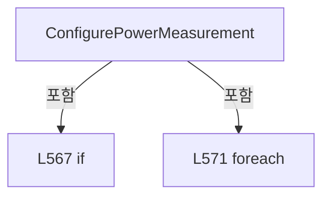

변경 전 점검: 입력/반환 타입, 위 호출자, 예외/취소 경로, 공유 상태와 저장·전송 소비자를 함께 확인합니다. 값의 단위나 물리 방향을 이름만으로 확정하지 않습니다.

### MethodDeclaration `ValidateTaskIndex` · L583–589

[Drilling.Common/Automation/CAutomationManager.cs:583–589](https://github.com/kjuws10-rgb/A3Drilling/blob/28764c91d521777b8ee068dd7aaf2d3902ce9fe2/Drilling.Common/Automation/CAutomationManager.cs#L583-L589)

| 항목 | 실제 추출 값 |
| --- | --- |
| 서명 | void Drilling.Common.Automation.CAutomationManager.ValidateTaskIndex(int) |
| 접근/수식자 | Private / private, static |
| 반환/값 타입 | void |
| 소속 타입 | NamedType:Drilling.Common.Automation.CAutomationManager |

입력 계약:

| 이름 | 타입 | 전달 | 선택/기본값 |
| --- | --- | --- | --- |
| taskIndex | int | None | False /  |

정적 호출자로 확인된 위치:

| 호출 파일/행 | 호출 표현식 | 런타임 분기 가능 |
| --- | --- | --- |
| [Drilling.Common/Automation/CAutomationManager.cs:304–304](https://github.com/kjuws10-rgb/A3Drilling/blob/28764c91d521777b8ee068dd7aaf2d3902ce9fe2/Drilling.Common/Automation/CAutomationManager.cs#L304-L304) | ValidateTaskIndex | False |
| [Drilling.Common/Automation/CAutomationManager.cs:327–327](https://github.com/kjuws10-rgb/A3Drilling/blob/28764c91d521777b8ee068dd7aaf2d3902ce9fe2/Drilling.Common/Automation/CAutomationManager.cs#L327-L327) | ValidateTaskIndex | False |
| [Drilling.Common/Automation/CAutomationManager.cs:340–340](https://github.com/kjuws10-rgb/A3Drilling/blob/28764c91d521777b8ee068dd7aaf2d3902ce9fe2/Drilling.Common/Automation/CAutomationManager.cs#L340-L340) | ValidateTaskIndex | False |
| [Drilling.Common/Automation/CAutomationManager.cs:393–393](https://github.com/kjuws10-rgb/A3Drilling/blob/28764c91d521777b8ee068dd7aaf2d3902ce9fe2/Drilling.Common/Automation/CAutomationManager.cs#L393-L393) | ValidateTaskIndex | False |
| [Drilling.Common/Automation/CAutomationManager.cs:506–506](https://github.com/kjuws10-rgb/A3Drilling/blob/28764c91d521777b8ee068dd7aaf2d3902ce9fe2/Drilling.Common/Automation/CAutomationManager.cs#L506-L506) | ValidateTaskIndex | False |
| [Drilling.Common/Automation/CAutomationManager.cs:523–523](https://github.com/kjuws10-rgb/A3Drilling/blob/28764c91d521777b8ee068dd7aaf2d3902ce9fe2/Drilling.Common/Automation/CAutomationManager.cs#L523-L523) | ValidateTaskIndex | False |
| [Drilling.Common/Automation/CAutomationManager.cs:534–534](https://github.com/kjuws10-rgb/A3Drilling/blob/28764c91d521777b8ee068dd7aaf2d3902ce9fe2/Drilling.Common/Automation/CAutomationManager.cs#L534-L534) | ValidateTaskIndex | False |
| [Drilling.Common/Automation/CAutomationManager.cs:546–546](https://github.com/kjuws10-rgb/A3Drilling/blob/28764c91d521777b8ee068dd7aaf2d3902ce9fe2/Drilling.Common/Automation/CAutomationManager.cs#L546-L546) | ValidateTaskIndex | False |
| [Drilling.Common/Automation/CAutomationManager.cs:555–555](https://github.com/kjuws10-rgb/A3Drilling/blob/28764c91d521777b8ee068dd7aaf2d3902ce9fe2/Drilling.Common/Automation/CAutomationManager.cs#L555-L555) | ValidateTaskIndex | False |
| [Drilling.Common/Automation/CAutomationManager.cs:566–566](https://github.com/kjuws10-rgb/A3Drilling/blob/28764c91d521777b8ee068dd7aaf2d3902ce9fe2/Drilling.Common/Automation/CAutomationManager.cs#L566-L566) | ValidateTaskIndex | False |
| [Drilling.Common/Automation/CAutomationManager.cs:1238–1238](https://github.com/kjuws10-rgb/A3Drilling/blob/28764c91d521777b8ee068dd7aaf2d3902ce9fe2/Drilling.Common/Automation/CAutomationManager.cs#L1238-L1238) | ValidateTaskIndex | False |

호출하는 대상과 해석 범위:

| 원본 행 | 표현식 | 분석 상태 | 대상/소스 위치 |
| --- | --- | --- | --- |
| 587 | new ArgumentOutOfRangeException | resolved | System.ArgumentOutOfRangeException.ArgumentOutOfRangeException(string?, object?, string?) |
| 587 | nameof | unresolved | None |

본문의 실제 연산·분기·예외·반환 순서(원문 위치 순):

| 원본 행 | 종류 | 주석 해설 |
| --- | --- | --- |
| 585 | if | 조건에 따라 분기합니다: if (taskIndex < 1) |
| 587 | call | 함수·델리게이트 또는 객체 생성자를 호출합니다: new ArgumentOutOfRangeException(nameof(taskIndex), taskIndex, "Automation1 task index must be 1 or greater.") |
| 587 | call | 함수·델리게이트 또는 객체 생성자를 호출합니다: nameof(taskIndex) |
| 587 | throw | 예외를 발생/전달합니다: throw new ArgumentOutOfRangeException(nameof(taskIndex), taskIndex, "Automation1 task index must be 1 or greater."); |

제어 구문의 포함 구조(실제 실행 순서/CFG가 아닌 구문 탐색 그림):

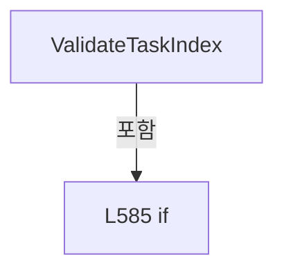

변경 전 점검: 입력/반환 타입, 위 호출자, 예외/취소 경로, 공유 상태와 저장·전송 소비자를 함께 확인합니다. 값의 단위나 물리 방향을 이름만으로 확정하지 않습니다.

### MethodDeclaration `CreateSimulationTaskStatus` · L591–594

[Drilling.Common/Automation/CAutomationManager.cs:591–594](https://github.com/kjuws10-rgb/A3Drilling/blob/28764c91d521777b8ee068dd7aaf2d3902ce9fe2/Drilling.Common/Automation/CAutomationManager.cs#L591-L594)

| 항목 | 실제 추출 값 |
| --- | --- |
| 서명 | string Drilling.Common.Automation.CAutomationManager.CreateSimulationTaskStatus(int, string, string, string) |
| 접근/수식자 | Private / private, static |
| 반환/값 타입 | string |
| 소속 타입 | NamedType:Drilling.Common.Automation.CAutomationManager |

입력 계약:

| 이름 | 타입 | 전달 | 선택/기본값 |
| --- | --- | --- | --- |
| taskIndex | int | None | False /  |
| state | string | None | False /  |
| sourceFile | string | None | True / "" |
| errorMessage | string | None | True / "" |

정적 호출자로 확인된 위치:

| 호출 파일/행 | 호출 표현식 | 런타임 분기 가능 |
| --- | --- | --- |
| [Drilling.Common/Automation/CAutomationManager.cs:309–309](https://github.com/kjuws10-rgb/A3Drilling/blob/28764c91d521777b8ee068dd7aaf2d3902ce9fe2/Drilling.Common/Automation/CAutomationManager.cs#L309-L309) | CreateSimulationTaskStatus | False |
| [Drilling.Common/Automation/CAutomationManager.cs:331–331](https://github.com/kjuws10-rgb/A3Drilling/blob/28764c91d521777b8ee068dd7aaf2d3902ce9fe2/Drilling.Common/Automation/CAutomationManager.cs#L331-L331) | CreateSimulationTaskStatus | False |
| [Drilling.Common/Automation/CAutomationManager.cs:343–343](https://github.com/kjuws10-rgb/A3Drilling/blob/28764c91d521777b8ee068dd7aaf2d3902ce9fe2/Drilling.Common/Automation/CAutomationManager.cs#L343-L343) | CreateSimulationTaskStatus | False |
| [Drilling.Common/Automation/CAutomationManager.cs:512–512](https://github.com/kjuws10-rgb/A3Drilling/blob/28764c91d521777b8ee068dd7aaf2d3902ce9fe2/Drilling.Common/Automation/CAutomationManager.cs#L512-L512) | CreateSimulationTaskStatus | False |
| [Drilling.Common/Automation/CAutomationManager.cs:515–515](https://github.com/kjuws10-rgb/A3Drilling/blob/28764c91d521777b8ee068dd7aaf2d3902ce9fe2/Drilling.Common/Automation/CAutomationManager.cs#L515-L515) | CreateSimulationTaskStatus | False |
| [Drilling.Common/Automation/CAutomationManager.cs:526–526](https://github.com/kjuws10-rgb/A3Drilling/blob/28764c91d521777b8ee068dd7aaf2d3902ce9fe2/Drilling.Common/Automation/CAutomationManager.cs#L526-L526) | CreateSimulationTaskStatus | False |
| [Drilling.Common/Automation/CAutomationManager.cs:526–526](https://github.com/kjuws10-rgb/A3Drilling/blob/28764c91d521777b8ee068dd7aaf2d3902ce9fe2/Drilling.Common/Automation/CAutomationManager.cs#L526-L526) | CreateSimulationTaskStatus | False |

호출하는 대상과 해석 범위:

| 원본 행 | 표현식 | 분석 상태 | 대상/소스 위치 |
| --- | --- | --- | --- |
| 593 | string.Join | resolved | string string.Join(string?, params System.ReadOnlySpan<string?>) |
| 593 | taskIndex.ToString | resolved | string int.ToString(System.IFormatProvider?) |

본문의 실제 연산·분기·예외·반환 순서(원문 위치 순):

| 원본 행 | 종류 | 주석 해설 |
| --- | --- | --- |
| 593 | call | 함수·델리게이트 또는 객체 생성자를 호출합니다: string.Join(":", "OK", "TASK", taskIndex.ToString(CultureInfo.InvariantCulture), state, sourceFile, errorMessage) |
| 593 | call | 함수·델리게이트 또는 객체 생성자를 호출합니다: taskIndex.ToString(CultureInfo.InvariantCulture) |
| 593 | return | 호출자에게 값 또는 제어를 반환합니다: return string.Join(":", "OK", "TASK", taskIndex.ToString(CultureInfo.InvariantCulture), state, sourceFile, errorMessage); |

변경 전 점검: 입력/반환 타입, 위 호출자, 예외/취소 경로, 공유 상태와 저장·전송 소비자를 함께 확인합니다. 값의 단위나 물리 방향을 이름만으로 확정하지 않습니다.

### MethodDeclaration `ExecuteAxis` · L596–632

[Drilling.Common/Automation/CAutomationManager.cs:596–632](https://github.com/kjuws10-rgb/A3Drilling/blob/28764c91d521777b8ee068dd7aaf2d3902ce9fe2/Drilling.Common/Automation/CAutomationManager.cs#L596-L632)

| 항목 | 실제 추출 값 |
| --- | --- |
| 서명 | System.Threading.Tasks.Task<string> Drilling.Common.Automation.CAutomationManager.ExecuteAxis(string, string, int, System.Threading.CancellationToken) |
| 접근/수식자 | Private / private |
| 반환/값 타입 | System.Threading.Tasks.Task<string> |
| 소속 타입 | NamedType:Drilling.Common.Automation.CAutomationManager |

입력 계약:

| 이름 | 타입 | 전달 | 선택/기본값 |
| --- | --- | --- | --- |
| axisName | string | None | False /  |
| command | string | None | False /  |
| number | int | None | False /  |
| cancellationToken | System.Threading.CancellationToken | None | False /  |

정적 호출자로 확인된 위치:

| 호출 파일/행 | 호출 표현식 | 런타임 분기 가능 |
| --- | --- | --- |
| [Drilling.Common/Automation/CAutomationManager.cs:188–188](https://github.com/kjuws10-rgb/A3Drilling/blob/28764c91d521777b8ee068dd7aaf2d3902ce9fe2/Drilling.Common/Automation/CAutomationManager.cs#L188-L188) | ExecuteAxis | False |
| [Drilling.Common/Automation/CAutomationManager.cs:193–193](https://github.com/kjuws10-rgb/A3Drilling/blob/28764c91d521777b8ee068dd7aaf2d3902ce9fe2/Drilling.Common/Automation/CAutomationManager.cs#L193-L193) | ExecuteAxis | False |
| [Drilling.Common/Automation/CAutomationManager.cs:198–198](https://github.com/kjuws10-rgb/A3Drilling/blob/28764c91d521777b8ee068dd7aaf2d3902ce9fe2/Drilling.Common/Automation/CAutomationManager.cs#L198-L198) | ExecuteAxis | False |
| [Drilling.Common/Automation/CAutomationManager.cs:205–205](https://github.com/kjuws10-rgb/A3Drilling/blob/28764c91d521777b8ee068dd7aaf2d3902ce9fe2/Drilling.Common/Automation/CAutomationManager.cs#L205-L205) | ExecuteAxis | False |
| [Drilling.Common/Automation/CAutomationManager.cs:212–212](https://github.com/kjuws10-rgb/A3Drilling/blob/28764c91d521777b8ee068dd7aaf2d3902ce9fe2/Drilling.Common/Automation/CAutomationManager.cs#L212-L212) | ExecuteAxis | False |
| [Drilling.Common/Automation/CAutomationManager.cs:215–215](https://github.com/kjuws10-rgb/A3Drilling/blob/28764c91d521777b8ee068dd7aaf2d3902ce9fe2/Drilling.Common/Automation/CAutomationManager.cs#L215-L215) | ExecuteAxis | False |
| [Drilling.Common/Automation/CAutomationManager.cs:216–216](https://github.com/kjuws10-rgb/A3Drilling/blob/28764c91d521777b8ee068dd7aaf2d3902ce9fe2/Drilling.Common/Automation/CAutomationManager.cs#L216-L216) | ExecuteAxis | False |
| [Drilling.Common/Automation/CAutomationManager.cs:219–219](https://github.com/kjuws10-rgb/A3Drilling/blob/28764c91d521777b8ee068dd7aaf2d3902ce9fe2/Drilling.Common/Automation/CAutomationManager.cs#L219-L219) | ExecuteAxis | False |
| [Drilling.Common/Automation/CAutomationManager.cs:224–224](https://github.com/kjuws10-rgb/A3Drilling/blob/28764c91d521777b8ee068dd7aaf2d3902ce9fe2/Drilling.Common/Automation/CAutomationManager.cs#L224-L224) | ExecuteAxis | False |
| [Drilling.Common/Automation/CAutomationManager.cs:229–229](https://github.com/kjuws10-rgb/A3Drilling/blob/28764c91d521777b8ee068dd7aaf2d3902ce9fe2/Drilling.Common/Automation/CAutomationManager.cs#L229-L229) | ExecuteAxis | False |
| [Drilling.Common/Automation/CAutomationManager.cs:234–234](https://github.com/kjuws10-rgb/A3Drilling/blob/28764c91d521777b8ee068dd7aaf2d3902ce9fe2/Drilling.Common/Automation/CAutomationManager.cs#L234-L234) | ExecuteAxis | False |
| [Drilling.Common/Automation/CAutomationManager.cs:239–239](https://github.com/kjuws10-rgb/A3Drilling/blob/28764c91d521777b8ee068dd7aaf2d3902ce9fe2/Drilling.Common/Automation/CAutomationManager.cs#L239-L239) | ExecuteAxis | False |
| [Drilling.Common/Automation/CAutomationManager.cs:244–244](https://github.com/kjuws10-rgb/A3Drilling/blob/28764c91d521777b8ee068dd7aaf2d3902ce9fe2/Drilling.Common/Automation/CAutomationManager.cs#L244-L244) | ExecuteAxis | False |
| [Drilling.Common/Automation/CAutomationManager.cs:637–637](https://github.com/kjuws10-rgb/A3Drilling/blob/28764c91d521777b8ee068dd7aaf2d3902ce9fe2/Drilling.Common/Automation/CAutomationManager.cs#L637-L637) | ExecuteAxis | False |

호출하는 대상과 해석 범위:

| 원본 행 | 표현식 | 분석 상태 | 대상/소스 위치 |
| --- | --- | --- | --- |
| 598 | ArgumentException.ThrowIfNullOrWhiteSpace | resolved | void System.ArgumentException.ThrowIfNullOrWhiteSpace(string?, string?) |
| 599 | ResolveAutomationAxis | resolved | string Drilling.Common.Automation.CAutomationManager.ResolveAutomationAxis(string) · Drilling.Common/Automation/CAutomationManager.cs:777 |
| 600 | IsSimul | resolved | bool Drilling.Common.Automation.CAutomationManager.IsSimul(int) · Drilling.Common/Automation/CAutomationManager.cs:63 |
| 602 | cancellationToken.ThrowIfCancellationRequested | resolved | void System.Threading.CancellationToken.ThrowIfCancellationRequested() |
| 603 | CreateSimulationAxisKey | resolved | string Drilling.Common.Automation.CAutomationManager.CreateSimulationAxisKey(int, string) · Drilling.Common/Automation/CAutomationManager.cs:867 |
| 604 | Task.FromResult | resolved | System.Threading.Tasks.Task<string> System.Threading.Tasks.Task.FromResult<string>(string) |
| 607 | IsSimul | resolved | bool Drilling.Common.Automation.CAutomationManager.IsSimul(int) · Drilling.Common/Automation/CAutomationManager.cs:63 |
| 609 | cancellationToken.ThrowIfCancellationRequested | resolved | void System.Threading.CancellationToken.ThrowIfCancellationRequested() |
| 610 | command.Split | resolved | string[] string.Split(char, System.StringSplitOptions) |
| 614 | double.TryParse | resolved | bool double.TryParse(string?, System.Globalization.NumberStyles, System.IFormatProvider?, out double) |
| 614 | double.IsFinite | resolved | bool double.IsFinite(double) |
| 615 | new InvalidOperationException | resolved | System.InvalidOperationException.InvalidOperationException(string?) |
| 616 | CreateSimulationAxisKey | resolved | string Drilling.Common.Automation.CAutomationManager.CreateSimulationAxisKey(int, string) · Drilling.Common/Automation/CAutomationManager.cs:867 |
| 617 | _simulationAxisPositions.AddOrUpdate | resolved | double System.Collections.Concurrent.ConcurrentDictionary<string, double>.AddOrUpdate(string, double, System.Func<string, double, double>) |
| 618 | Task.FromResult | resolved | System.Threading.Tasks.Task<string> System.Threading.Tasks.Task.FromResult<string>(string) |
| 623 | CreateSimulationAxisKey | resolved | string Drilling.Common.Automation.CAutomationManager.CreateSimulationAxisKey(int, string) · Drilling.Common/Automation/CAutomationManager.cs:867 |
| 624 | Task.FromResult | resolved | System.Threading.Tasks.Task<string> System.Threading.Tasks.Task.FromResult<string>(string) |
| 628 | Task.FromResult | resolved | System.Threading.Tasks.Task<string> System.Threading.Tasks.Task.FromResult<string>(string) |
| 631 | ExecuteRaw | resolved | System.Threading.Tasks.Task<string> Drilling.Common.Automation.CAutomationManager.ExecuteRaw(string, int, System.Threading.CancellationToken, bool) · Drilling.Common/Automation/CAutomationManager.cs:180 |

본문의 실제 연산·분기·예외·반환 순서(원문 위치 순):

| 원본 행 | 종류 | 주석 해설 |
| --- | --- | --- |
| 598 | call | 함수·델리게이트 또는 객체 생성자를 호출합니다: ArgumentException.ThrowIfNullOrWhiteSpace(axisName) |
| 599 | call | 함수·델리게이트 또는 객체 생성자를 호출합니다: ResolveAutomationAxis(axisName) |
| 599 | local-declaration | 지역 변수를 선언합니다: var automationAxis = ResolveAutomationAxis(axisName); |
| 599 | variable-initializer | 변수의 초기값을 지정합니다: automationAxis = ResolveAutomationAxis(axisName) |
| 600 | call | 함수·델리게이트 또는 객체 생성자를 호출합니다: IsSimul(number) |
| 600 | if | 조건에 따라 분기합니다: if (IsSimul(number) && command is "SERVO_ON" or "SERVO_OFF") |
| 602 | call | 함수·델리게이트 또는 객체 생성자를 호출합니다: cancellationToken.ThrowIfCancellationRequested() |
| 603 | assignment | 값을 대상에 대입합니다: _simulationAxisAbleStates[CreateSimulationAxisKey(number, automationAxis)] = command == "SERVO_ON" |
| 603 | call | 함수·델리게이트 또는 객체 생성자를 호출합니다: CreateSimulationAxisKey(number, automationAxis) |
| 604 | call | 함수·델리게이트 또는 객체 생성자를 호출합니다: Task.FromResult($"OK:AXIS:{automationAxis}:{command}") |
| 604 | return | 호출자에게 값 또는 제어를 반환합니다: return Task.FromResult($"OK:AXIS:{automationAxis}:{command}"); |
| 607 | call | 함수·델리게이트 또는 객체 생성자를 호출합니다: IsSimul(number) |
| 607 | if | 조건에 따라 분기합니다: if (IsSimul(number)) |
| 609 | call | 함수·델리게이트 또는 객체 생성자를 호출합니다: cancellationToken.ThrowIfCancellationRequested() |
| 610 | call | 함수·델리게이트 또는 객체 생성자를 호출합니다: command.Split(':') |
| 610 | local-declaration | 지역 변수를 선언합니다: var parts = command.Split(':'); |
| 610 | variable-initializer | 변수의 초기값을 지정합니다: parts = command.Split(':') |
| 611 | local-declaration | 지역 변수를 선언합니다: var operation = parts[0]; |
| 611 | variable-initializer | 변수의 초기값을 지정합니다: operation = parts[0] |
| 612 | if | 조건에 따라 분기합니다: if (operation is "MANUAL_ABS" or "MANUAL_REL" or "MOVE_ABS" or "MOVE_REL") |
| 614 | call | 함수·델리게이트 또는 객체 생성자를 호출합니다: double.TryParse(parts[1], NumberStyles.Float, CultureInfo.InvariantCulture, out var value) |
| 614 | call | 함수·델리게이트 또는 객체 생성자를 호출합니다: double.IsFinite(value) |
| 614 | if | 조건에 따라 분기합니다: if (parts.Length < 2 &#124;&#124; !double.TryParse(parts[1], NumberStyles.Float, CultureInfo.InvariantCulture, out var value) &#124;&#124; !double.IsFinite(value)) |
| 615 | call | 함수·델리게이트 또는 객체 생성자를 호출합니다: new InvalidOperationException("Simulated axis target is invalid.") |
| 615 | throw | 예외를 발생/전달합니다: throw new InvalidOperationException("Simulated axis target is invalid."); |
| 616 | call | 함수·델리게이트 또는 객체 생성자를 호출합니다: CreateSimulationAxisKey(number, automationAxis) |
| 616 | local-declaration | 지역 변수를 선언합니다: var key = CreateSimulationAxisKey(number, automationAxis); |
| 616 | variable-initializer | 변수의 초기값을 지정합니다: key = CreateSimulationAxisKey(number, automationAxis) |
| 617 | call | 함수·델리게이트 또는 객체 생성자를 호출합니다: _simulationAxisPositions.AddOrUpdate(key, value, (_, previous) => operation is "MANUAL_REL" or "MOVE_REL" ? previous + value : value) |
| 617 | conditional-expression | 조건에 따라 결과식을 선택합니다: operation is "MANUAL_REL" or "MOVE_REL" ? previous + value : value |
| 618 | call | 함수·델리게이트 또는 객체 생성자를 호출합니다: Task.FromResult($"OK:AXIS:{automationAxis}:{operation}") |
| 618 | return | 호출자에게 값 또는 제어를 반환합니다: return Task.FromResult($"OK:AXIS:{automationAxis}:{operation}"); |
| 621 | if | 조건에 따라 분기합니다: if (operation is "HOME" or "HOME_ASYNC") |
| 623 | assignment | 값을 대상에 대입합니다: _simulationAxisPositions[CreateSimulationAxisKey(number, automationAxis)] = 0 |
| 623 | call | 함수·델리게이트 또는 객체 생성자를 호출합니다: CreateSimulationAxisKey(number, automationAxis) |
| 624 | call | 함수·델리게이트 또는 객체 생성자를 호출합니다: Task.FromResult($"OK:AXIS:{automationAxis}:{operation}") |
| 624 | return | 호출자에게 값 또는 제어를 반환합니다: return Task.FromResult($"OK:AXIS:{automationAxis}:{operation}"); |
| 627 | if | 조건에 따라 분기합니다: if (operation is "STOP" or "ABORT_MOTION" or "JOG_STOP") |
| 628 | call | 함수·델리게이트 또는 객체 생성자를 호출합니다: Task.FromResult($"OK:AXIS:{automationAxis}:{operation}") |
| 628 | return | 호출자에게 값 또는 제어를 반환합니다: return Task.FromResult($"OK:AXIS:{automationAxis}:{operation}"); |
| 631 | call | 함수·델리게이트 또는 객체 생성자를 호출합니다: ExecuteRaw($"AUTOMATION1:AXIS:{automationAxis}:{command}", number, cancellationToken) |
| 631 | return | 호출자에게 값 또는 제어를 반환합니다: return ExecuteRaw($"AUTOMATION1:AXIS:{automationAxis}:{command}", number, cancellationToken); |

제어 구문의 포함 구조(실제 실행 순서/CFG가 아닌 구문 탐색 그림):

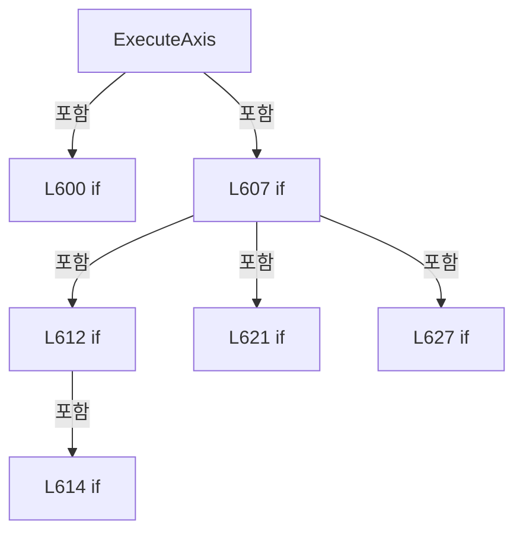

변경 전 점검: 입력/반환 타입, 위 호출자, 예외/취소 경로, 공유 상태와 저장·전송 소비자를 함께 확인합니다. 값의 단위나 물리 방향을 이름만으로 확정하지 않습니다.

### MethodDeclaration `ReadAxis` · L634–638

[Drilling.Common/Automation/CAutomationManager.cs:634–638](https://github.com/kjuws10-rgb/A3Drilling/blob/28764c91d521777b8ee068dd7aaf2d3902ce9fe2/Drilling.Common/Automation/CAutomationManager.cs#L634-L638)

| 항목 | 실제 추출 값 |
| --- | --- |
| 서명 | System.Threading.Tasks.Task<string> Drilling.Common.Automation.CAutomationManager.ReadAxis(string, int, int, System.Threading.CancellationToken) |
| 접근/수식자 | Private / private |
| 반환/값 타입 | System.Threading.Tasks.Task<string> |
| 소속 타입 | NamedType:Drilling.Common.Automation.CAutomationManager |

입력 계약:

| 이름 | 타입 | 전달 | 선택/기본값 |
| --- | --- | --- | --- |
| axisName | string | None | False /  |
| number | int | None | False /  |
| analogInputNo | int | None | False /  |
| cancellationToken | System.Threading.CancellationToken | None | False /  |

정적 호출자로 확인된 위치:

| 호출 파일/행 | 호출 표현식 | 런타임 분기 가능 |
| --- | --- | --- |
| [Drilling.Common/Automation/CAutomationManager.cs:262–262](https://github.com/kjuws10-rgb/A3Drilling/blob/28764c91d521777b8ee068dd7aaf2d3902ce9fe2/Drilling.Common/Automation/CAutomationManager.cs#L262-L262) | ReadAxis | False |

호출하는 대상과 해석 범위:

| 원본 행 | 표현식 | 분석 상태 | 대상/소스 위치 |
| --- | --- | --- | --- |
| 636 | ValidateAnalogInputNo | resolved | void Drilling.Common.Automation.CAutomationManager.ValidateAnalogInputNo(int) · Drilling.Common/Automation/CAutomationManager.cs:667 |
| 637 | ExecuteAxis | resolved | System.Threading.Tasks.Task<string> Drilling.Common.Automation.CAutomationManager.ExecuteAxis(string, string, int, System.Threading.CancellationToken) · Drilling.Common/Automation/CAutomationManager.cs:596 |
| 637 | analogInputNo.ToString | resolved | string int.ToString(System.IFormatProvider?) |

본문의 실제 연산·분기·예외·반환 순서(원문 위치 순):

| 원본 행 | 종류 | 주석 해설 |
| --- | --- | --- |
| 636 | call | 함수·델리게이트 또는 객체 생성자를 호출합니다: ValidateAnalogInputNo(analogInputNo) |
| 637 | call | 함수·델리게이트 또는 객체 생성자를 호출합니다: ExecuteAxis(axisName, $"READ:{analogInputNo.ToString(CultureInfo.InvariantCulture)}", number, cancellationToken) |
| 637 | call | 함수·델리게이트 또는 객체 생성자를 호출합니다: analogInputNo.ToString(CultureInfo.InvariantCulture) |
| 637 | return | 호출자에게 값 또는 제어를 반환합니다: return ExecuteAxis(axisName, $"READ:{analogInputNo.ToString(CultureInfo.InvariantCulture)}", number, cancellationToken); |

변경 전 점검: 입력/반환 타입, 위 호출자, 예외/취소 경로, 공유 상태와 저장·전송 소비자를 함께 확인합니다. 값의 단위나 물리 방향을 이름만으로 확정하지 않습니다.

### MethodDeclaration `ReadAxisByName` · L640–643

[Drilling.Common/Automation/CAutomationManager.cs:640–643](https://github.com/kjuws10-rgb/A3Drilling/blob/28764c91d521777b8ee068dd7aaf2d3902ce9fe2/Drilling.Common/Automation/CAutomationManager.cs#L640-L643)

| 항목 | 실제 추출 값 |
| --- | --- |
| 서명 | System.Threading.Tasks.Task<string> Drilling.Common.Automation.CAutomationManager.ReadAxisByName(string, int, int, System.Threading.CancellationToken) |
| 접근/수식자 | Private / private |
| 반환/값 타입 | System.Threading.Tasks.Task<string> |
| 소속 타입 | NamedType:Drilling.Common.Automation.CAutomationManager |

입력 계약:

| 이름 | 타입 | 전달 | 선택/기본값 |
| --- | --- | --- | --- |
| axisName | string | None | False /  |
| number | int | None | False /  |
| analogInputNo | int | None | False /  |
| cancellationToken | System.Threading.CancellationToken | None | False /  |

정적 호출자로 확인된 위치:

| 호출 파일/행 | 호출 표현식 | 런타임 분기 가능 |
| --- | --- | --- |
| [Drilling.Common/Automation/CAutomationManager.cs:282–282](https://github.com/kjuws10-rgb/A3Drilling/blob/28764c91d521777b8ee068dd7aaf2d3902ce9fe2/Drilling.Common/Automation/CAutomationManager.cs#L282-L282) | ReadAxisByName | False |

호출하는 대상과 해석 범위:

| 원본 행 | 표현식 | 분석 상태 | 대상/소스 위치 |
| --- | --- | --- | --- |
| 642 | ReadAxisByName | resolved | System.Threading.Tasks.Task<string> Drilling.Common.Automation.CAutomationManager.ReadAxisByName(string, int, int, bool, System.Threading.CancellationToken) · Drilling.Common/Automation/CAutomationManager.cs:645 |

본문의 실제 연산·분기·예외·반환 순서(원문 위치 순):

| 원본 행 | 종류 | 주석 해설 |
| --- | --- | --- |
| 642 | call | 함수·델리게이트 또는 객체 생성자를 호출합니다: ReadAxisByName(axisName, number, analogInputNo, true, cancellationToken) |
| 642 | return | 호출자에게 값 또는 제어를 반환합니다: return ReadAxisByName(axisName, number, analogInputNo, true, cancellationToken); |

변경 전 점검: 입력/반환 타입, 위 호출자, 예외/취소 경로, 공유 상태와 저장·전송 소비자를 함께 확인합니다. 값의 단위나 물리 방향을 이름만으로 확정하지 않습니다.

### MethodDeclaration `ReadAxisByName` · L645–648

[Drilling.Common/Automation/CAutomationManager.cs:645–648](https://github.com/kjuws10-rgb/A3Drilling/blob/28764c91d521777b8ee068dd7aaf2d3902ce9fe2/Drilling.Common/Automation/CAutomationManager.cs#L645-L648)

| 항목 | 실제 추출 값 |
| --- | --- |
| 서명 | System.Threading.Tasks.Task<string> Drilling.Common.Automation.CAutomationManager.ReadAxisByName(string, int, int, bool, System.Threading.CancellationToken) |
| 접근/수식자 | Private / private |
| 반환/값 타입 | System.Threading.Tasks.Task<string> |
| 소속 타입 | NamedType:Drilling.Common.Automation.CAutomationManager |

입력 계약:

| 이름 | 타입 | 전달 | 선택/기본값 |
| --- | --- | --- | --- |
| axisName | string | None | False /  |
| number | int | None | False /  |
| analogInputNo | int | None | False /  |
| readExtendedStatus | bool | None | False /  |
| cancellationToken | System.Threading.CancellationToken | None | False /  |

정적 호출자로 확인된 위치:

| 호출 파일/행 | 호출 표현식 | 런타임 분기 가능 |
| --- | --- | --- |
| [Drilling.Common/Automation/CAutomationManager.cs:642–642](https://github.com/kjuws10-rgb/A3Drilling/blob/28764c91d521777b8ee068dd7aaf2d3902ce9fe2/Drilling.Common/Automation/CAutomationManager.cs#L642-L642) | ReadAxisByName | False |

호출하는 대상과 해석 범위:

| 원본 행 | 표현식 | 분석 상태 | 대상/소스 위치 |
| --- | --- | --- | --- |
| 647 | ReadAxisByName | resolved | System.Threading.Tasks.Task<string> Drilling.Common.Automation.CAutomationManager.ReadAxisByName(string, int, int, bool, System.Threading.CancellationToken, bool) · Drilling.Common/Automation/CAutomationManager.cs:650 |

본문의 실제 연산·분기·예외·반환 순서(원문 위치 순):

| 원본 행 | 종류 | 주석 해설 |
| --- | --- | --- |
| 647 | call | 함수·델리게이트 또는 객체 생성자를 호출합니다: ReadAxisByName(axisName, number, analogInputNo, readExtendedStatus, cancellationToken, suppressLog: false) |
| 647 | return | 호출자에게 값 또는 제어를 반환합니다: return ReadAxisByName(axisName, number, analogInputNo, readExtendedStatus, cancellationToken, suppressLog: false); |

변경 전 점검: 입력/반환 타입, 위 호출자, 예외/취소 경로, 공유 상태와 저장·전송 소비자를 함께 확인합니다. 값의 단위나 물리 방향을 이름만으로 확정하지 않습니다.

### MethodDeclaration `ReadAxisByName` · L650–656

[Drilling.Common/Automation/CAutomationManager.cs:650–656](https://github.com/kjuws10-rgb/A3Drilling/blob/28764c91d521777b8ee068dd7aaf2d3902ce9fe2/Drilling.Common/Automation/CAutomationManager.cs#L650-L656)

| 항목 | 실제 추출 값 |
| --- | --- |
| 서명 | System.Threading.Tasks.Task<string> Drilling.Common.Automation.CAutomationManager.ReadAxisByName(string, int, int, bool, System.Threading.CancellationToken, bool) |
| 접근/수식자 | Private / private |
| 반환/값 타입 | System.Threading.Tasks.Task<string> |
| 소속 타입 | NamedType:Drilling.Common.Automation.CAutomationManager |

입력 계약:

| 이름 | 타입 | 전달 | 선택/기본값 |
| --- | --- | --- | --- |
| axisName | string | None | False /  |
| number | int | None | False /  |
| analogInputNo | int | None | False /  |
| readExtendedStatus | bool | None | False /  |
| cancellationToken | System.Threading.CancellationToken | None | False /  |
| suppressLog | bool | None | False /  |

정적 호출자로 확인된 위치:

| 호출 파일/행 | 호출 표현식 | 런타임 분기 가능 |
| --- | --- | --- |
| [Drilling.Common/Automation/CAutomationManager.cs:297–297](https://github.com/kjuws10-rgb/A3Drilling/blob/28764c91d521777b8ee068dd7aaf2d3902ce9fe2/Drilling.Common/Automation/CAutomationManager.cs#L297-L297) | ReadAxisByName | False |
| [Drilling.Common/Automation/CAutomationManager.cs:647–647](https://github.com/kjuws10-rgb/A3Drilling/blob/28764c91d521777b8ee068dd7aaf2d3902ce9fe2/Drilling.Common/Automation/CAutomationManager.cs#L647-L647) | ReadAxisByName | False |

호출하는 대상과 해석 범위:

| 원본 행 | 표현식 | 분석 상태 | 대상/소스 위치 |
| --- | --- | --- | --- |
| 652 | ValidateAnalogInputNo | resolved | void Drilling.Common.Automation.CAutomationManager.ValidateAnalogInputNo(int) · Drilling.Common/Automation/CAutomationManager.cs:667 |
| 653 | ValidateAxisNameOnly | resolved | void Drilling.Common.Automation.CAutomationManager.ValidateAxisNameOnly(string) · Drilling.Common/Automation/CAutomationManager.cs:658 |
| 655 | ExecuteRaw | resolved | System.Threading.Tasks.Task<string> Drilling.Common.Automation.CAutomationManager.ExecuteRaw(string, int, System.Threading.CancellationToken, bool) · Drilling.Common/Automation/CAutomationManager.cs:180 |
| 655 | axisName.Trim | resolved | string string.Trim() |
| 655 | analogInputNo.ToString | resolved | string int.ToString(System.IFormatProvider?) |

본문의 실제 연산·분기·예외·반환 순서(원문 위치 순):

| 원본 행 | 종류 | 주석 해설 |
| --- | --- | --- |
| 652 | call | 함수·델리게이트 또는 객체 생성자를 호출합니다: ValidateAnalogInputNo(analogInputNo) |
| 653 | call | 함수·델리게이트 또는 객체 생성자를 호출합니다: ValidateAxisNameOnly(axisName) |
| 654 | conditional-expression | 조건에 따라 결과식을 선택합니다: readExtendedStatus ? "FULL" : "BASIC" |
| 654 | local-declaration | 지역 변수를 선언합니다: var statusMode = readExtendedStatus ? "FULL" : "BASIC"; |
| 654 | variable-initializer | 변수의 초기값을 지정합니다: statusMode = readExtendedStatus ? "FULL" : "BASIC" |
| 655 | call | 함수·델리게이트 또는 객체 생성자를 호출합니다: ExecuteRaw($"AUTOMATION1:AXIS:{axisName.Trim()}:READ:{analogInputNo.ToString(CultureInfo.InvariantCulture)}:{statusMode}", number, cancellationToken, suppressLog) |
| 655 | call | 함수·델리게이트 또는 객체 생성자를 호출합니다: axisName.Trim() |
| 655 | call | 함수·델리게이트 또는 객체 생성자를 호출합니다: analogInputNo.ToString(CultureInfo.InvariantCulture) |
| 655 | return | 호출자에게 값 또는 제어를 반환합니다: return ExecuteRaw($"AUTOMATION1:AXIS:{axisName.Trim()}:READ:{analogInputNo.ToString(CultureInfo.InvariantCulture)}:{statusMode}", number, cancellationToken, suppressLog); |

변경 전 점검: 입력/반환 타입, 위 호출자, 예외/취소 경로, 공유 상태와 저장·전송 소비자를 함께 확인합니다. 값의 단위나 물리 방향을 이름만으로 확정하지 않습니다.

### MethodDeclaration `ValidateAxisNameOnly` · L658–665

[Drilling.Common/Automation/CAutomationManager.cs:658–665](https://github.com/kjuws10-rgb/A3Drilling/blob/28764c91d521777b8ee068dd7aaf2d3902ce9fe2/Drilling.Common/Automation/CAutomationManager.cs#L658-L665)

| 항목 | 실제 추출 값 |
| --- | --- |
| 서명 | void Drilling.Common.Automation.CAutomationManager.ValidateAxisNameOnly(string) |
| 접근/수식자 | Private / private, static |
| 반환/값 타입 | void |
| 소속 타입 | NamedType:Drilling.Common.Automation.CAutomationManager |

입력 계약:

| 이름 | 타입 | 전달 | 선택/기본값 |
| --- | --- | --- | --- |
| axisName | string | None | False /  |

정적 호출자로 확인된 위치:

| 호출 파일/행 | 호출 표현식 | 런타임 분기 가능 |
| --- | --- | --- |
| [Drilling.Common/Automation/CAutomationManager.cs:276–276](https://github.com/kjuws10-rgb/A3Drilling/blob/28764c91d521777b8ee068dd7aaf2d3902ce9fe2/Drilling.Common/Automation/CAutomationManager.cs#L276-L276) | ValidateAxisNameOnly | False |
| [Drilling.Common/Automation/CAutomationManager.cs:291–291](https://github.com/kjuws10-rgb/A3Drilling/blob/28764c91d521777b8ee068dd7aaf2d3902ce9fe2/Drilling.Common/Automation/CAutomationManager.cs#L291-L291) | ValidateAxisNameOnly | False |
| [Drilling.Common/Automation/CAutomationManager.cs:653–653](https://github.com/kjuws10-rgb/A3Drilling/blob/28764c91d521777b8ee068dd7aaf2d3902ce9fe2/Drilling.Common/Automation/CAutomationManager.cs#L653-L653) | ValidateAxisNameOnly | False |
| [Drilling.Common/Automation/CAutomationManager.cs:1136–1136](https://github.com/kjuws10-rgb/A3Drilling/blob/28764c91d521777b8ee068dd7aaf2d3902ce9fe2/Drilling.Common/Automation/CAutomationManager.cs#L1136-L1136) | ValidateAxisNameOnly | False |
| [Drilling.Common/Automation/CAutomationManager.cs:1148–1148](https://github.com/kjuws10-rgb/A3Drilling/blob/28764c91d521777b8ee068dd7aaf2d3902ce9fe2/Drilling.Common/Automation/CAutomationManager.cs#L1148-L1148) | ValidateAxisNameOnly | False |

호출하는 대상과 해석 범위:

| 원본 행 | 표현식 | 분석 상태 | 대상/소스 위치 |
| --- | --- | --- | --- |
| 660 | axisName.Trim | resolved | string string.Trim() |
| 661 | IsAxisNameOnlyIdentifier | resolved | bool Drilling.Common.Automation.CAutomationManager.IsAxisNameOnlyIdentifier(string) · Drilling.Common/Automation/CAutomationManager.cs:815 |
| 663 | new InvalidOperationException | resolved | System.InvalidOperationException.InvalidOperationException(string?) |

본문의 실제 연산·분기·예외·반환 순서(원문 위치 순):

| 원본 행 | 종류 | 주석 해설 |
| --- | --- | --- |
| 660 | call | 함수·델리게이트 또는 객체 생성자를 호출합니다: axisName.Trim() |
| 660 | local-declaration | 지역 변수를 선언합니다: var normalized = axisName.Trim(); |
| 660 | variable-initializer | 변수의 초기값을 지정합니다: normalized = axisName.Trim() |
| 661 | call | 함수·델리게이트 또는 객체 생성자를 호출합니다: IsAxisNameOnlyIdentifier(normalized) |
| 661 | if | 조건에 따라 분기합니다: if (!IsAxisNameOnlyIdentifier(normalized)) |
| 663 | call | 함수·델리게이트 또는 객체 생성자를 호출합니다: new InvalidOperationException($"Automation1 axis must be configured by axis name, not axis number: {axisName}") |
| 663 | throw | 예외를 발생/전달합니다: throw new InvalidOperationException($"Automation1 axis must be configured by axis name, not axis number: {axisName}"); |

제어 구문의 포함 구조(실제 실행 순서/CFG가 아닌 구문 탐색 그림):

```mermaid
flowchart TD
 M["ValidateAxisNameOnly"]
 N0["L661 if"]
 M -->|포함| N0
```

변경 전 점검: 입력/반환 타입, 위 호출자, 예외/취소 경로, 공유 상태와 저장·전송 소비자를 함께 확인합니다. 값의 단위나 물리 방향을 이름만으로 확정하지 않습니다.

### MethodDeclaration `ValidateAnalogInputNo` · L667–673

[Drilling.Common/Automation/CAutomationManager.cs:667–673](https://github.com/kjuws10-rgb/A3Drilling/blob/28764c91d521777b8ee068dd7aaf2d3902ce9fe2/Drilling.Common/Automation/CAutomationManager.cs#L667-L673)

| 항목 | 실제 추출 값 |
| --- | --- |
| 서명 | void Drilling.Common.Automation.CAutomationManager.ValidateAnalogInputNo(int) |
| 접근/수식자 | Private / private, static |
| 반환/값 타입 | void |
| 소속 타입 | NamedType:Drilling.Common.Automation.CAutomationManager |

입력 계약:

| 이름 | 타입 | 전달 | 선택/기본값 |
| --- | --- | --- | --- |
| analogInputNo | int | None | False /  |

정적 호출자로 확인된 위치:

| 호출 파일/행 | 호출 표현식 | 런타임 분기 가능 |
| --- | --- | --- |
| [Drilling.Common/Automation/CAutomationManager.cs:255–255](https://github.com/kjuws10-rgb/A3Drilling/blob/28764c91d521777b8ee068dd7aaf2d3902ce9fe2/Drilling.Common/Automation/CAutomationManager.cs#L255-L255) | ValidateAnalogInputNo | False |
| [Drilling.Common/Automation/CAutomationManager.cs:274–274](https://github.com/kjuws10-rgb/A3Drilling/blob/28764c91d521777b8ee068dd7aaf2d3902ce9fe2/Drilling.Common/Automation/CAutomationManager.cs#L274-L274) | ValidateAnalogInputNo | False |
| [Drilling.Common/Automation/CAutomationManager.cs:289–289](https://github.com/kjuws10-rgb/A3Drilling/blob/28764c91d521777b8ee068dd7aaf2d3902ce9fe2/Drilling.Common/Automation/CAutomationManager.cs#L289-L289) | ValidateAnalogInputNo | False |
| [Drilling.Common/Automation/CAutomationManager.cs:636–636](https://github.com/kjuws10-rgb/A3Drilling/blob/28764c91d521777b8ee068dd7aaf2d3902ce9fe2/Drilling.Common/Automation/CAutomationManager.cs#L636-L636) | ValidateAnalogInputNo | False |
| [Drilling.Common/Automation/CAutomationManager.cs:652–652](https://github.com/kjuws10-rgb/A3Drilling/blob/28764c91d521777b8ee068dd7aaf2d3902ce9fe2/Drilling.Common/Automation/CAutomationManager.cs#L652-L652) | ValidateAnalogInputNo | False |

호출하는 대상과 해석 범위:

| 원본 행 | 표현식 | 분석 상태 | 대상/소스 위치 |
| --- | --- | --- | --- |
| 671 | new ArgumentOutOfRangeException | resolved | System.ArgumentOutOfRangeException.ArgumentOutOfRangeException(string?, object?, string?) |
| 671 | nameof | unresolved | None |

본문의 실제 연산·분기·예외·반환 순서(원문 위치 순):

| 원본 행 | 종류 | 주석 해설 |
| --- | --- | --- |
| 669 | if | 조건에 따라 분기합니다: if (analogInputNo < 0 &#124;&#124; analogInputNo > 3) |
| 671 | call | 함수·델리게이트 또는 객체 생성자를 호출합니다: new ArgumentOutOfRangeException(nameof(analogInputNo), analogInputNo, "Automation1 analog input number must be between 0 and 3.") |
| 671 | call | 함수·델리게이트 또는 객체 생성자를 호출합니다: nameof(analogInputNo) |
| 671 | throw | 예외를 발생/전달합니다: throw new ArgumentOutOfRangeException(nameof(analogInputNo), analogInputNo, "Automation1 analog input number must be between 0 and 3."); |

제어 구문의 포함 구조(실제 실행 순서/CFG가 아닌 구문 탐색 그림):

```mermaid
flowchart TD
 M["ValidateAnalogInputNo"]
 N0["L669 if"]
 M -->|포함| N0
```

변경 전 점검: 입력/반환 타입, 위 호출자, 예외/취소 경로, 공유 상태와 저장·전송 소비자를 함께 확인합니다. 값의 단위나 물리 방향을 이름만으로 확정하지 않습니다.

### MethodDeclaration `ValidateBufferedRunScriptFile` · L675–698

[Drilling.Common/Automation/CAutomationManager.cs:675–698](https://github.com/kjuws10-rgb/A3Drilling/blob/28764c91d521777b8ee068dd7aaf2d3902ce9fe2/Drilling.Common/Automation/CAutomationManager.cs#L675-L698)

| 항목 | 실제 추출 값 |
| --- | --- |
| 서명 | void Drilling.Common.Automation.CAutomationManager.ValidateBufferedRunScriptFile(string) |
| 접근/수식자 | Private / private, static |
| 반환/값 타입 | void |
| 소속 타입 | NamedType:Drilling.Common.Automation.CAutomationManager |

입력 계약:

| 이름 | 타입 | 전달 | 선택/기본값 |
| --- | --- | --- | --- |
| localScriptPath | string | None | False /  |

정적 호출자로 확인된 위치:

| 호출 파일/행 | 호출 표현식 | 런타임 분기 가능 |
| --- | --- | --- |
| [Drilling.Common/Automation/CAutomationManager.cs:420–420](https://github.com/kjuws10-rgb/A3Drilling/blob/28764c91d521777b8ee068dd7aaf2d3902ce9fe2/Drilling.Common/Automation/CAutomationManager.cs#L420-L420) | ValidateBufferedRunScriptFile | False |

호출하는 대상과 해석 범위:

| 원본 행 | 표현식 | 분석 상태 | 대상/소스 위치 |
| --- | --- | --- | --- |
| 677 | File.Exists | unresolved | None |
| 679 | new FileNotFoundException | resolved | System.IO.FileNotFoundException.FileNotFoundException(string?, string?) |
| 683 | File.ReadLines | unresolved | None |
| 686 | rawLine.Trim | unresolved | None |
| 687 | string.IsNullOrWhiteSpace | candidate | OverloadResolutionFailure |
| 687 | line.StartsWith | unresolved | None |
| 692 | GetAeroScriptToken | candidate | OverloadResolutionFailure |
| 693 | IsBufferedRunBlockedToken | resolved | bool Drilling.Common.Automation.CAutomationManager.IsBufferedRunBlockedToken(string) · Drilling.Common/Automation/CAutomationManager.cs:719 |
| 693 | token.StartsWith | resolved | bool string.StartsWith(char) |
| 693 | IsBufferedGlobalIntegerAssignment | candidate | OverloadResolutionFailure |
| 695 | new InvalidDataException | resolved | System.IO.InvalidDataException.InvalidDataException(string?) |
| 695 | Path.GetFileName | resolved | string? System.IO.Path.GetFileName(string?) |

본문의 실제 연산·분기·예외·반환 순서(원문 위치 순):

| 원본 행 | 종류 | 주석 해설 |
| --- | --- | --- |
| 677 | call | 함수·델리게이트 또는 객체 생성자를 호출합니다: File.Exists(localScriptPath) |
| 677 | if | 조건에 따라 분기합니다: if (!File.Exists(localScriptPath)) |
| 679 | call | 함수·델리게이트 또는 객체 생성자를 호출합니다: new FileNotFoundException("Buffered run script file was not found.", localScriptPath) |
| 679 | throw | 예외를 발생/전달합니다: throw new FileNotFoundException("Buffered run script file was not found.", localScriptPath); |
| 682 | local-declaration | 지역 변수를 선언합니다: var lineNo = 0; |
| 682 | variable-initializer | 변수의 초기값을 지정합니다: lineNo = 0 |
| 683 | call | 함수·델리게이트 또는 객체 생성자를 호출합니다: File.ReadLines(localScriptPath) |
| 683 | foreach | 컬렉션 요소를 순회합니다: foreach (var rawLine in File.ReadLines(localScriptPath)) |
| 686 | call | 함수·델리게이트 또는 객체 생성자를 호출합니다: rawLine.Trim() |
| 686 | local-declaration | 지역 변수를 선언합니다: var line = rawLine.Trim(); |
| 686 | variable-initializer | 변수의 초기값을 지정합니다: line = rawLine.Trim() |
| 687 | call | 함수·델리게이트 또는 객체 생성자를 호출합니다: string.IsNullOrWhiteSpace(line) |
| 687 | call | 함수·델리게이트 또는 객체 생성자를 호출합니다: line.StartsWith("//", StringComparison.Ordinal) |
| 687 | if | 조건에 따라 분기합니다: if (string.IsNullOrWhiteSpace(line) &#124;&#124; line.StartsWith("//", StringComparison.Ordinal)) |
| 689 | continue | 다음 반복으로 진행합니다: continue; |
| 692 | call | 함수·델리게이트 또는 객체 생성자를 호출합니다: GetAeroScriptToken(line) |
| 692 | local-declaration | 지역 변수를 선언합니다: var token = GetAeroScriptToken(line); |
| 692 | variable-initializer | 변수의 초기값을 지정합니다: token = GetAeroScriptToken(line) |
| 693 | call | 함수·델리게이트 또는 객체 생성자를 호출합니다: IsBufferedRunBlockedToken(token) |
| 693 | call | 함수·델리게이트 또는 객체 생성자를 호출합니다: token.StartsWith('$') |
| 693 | call | 함수·델리게이트 또는 객체 생성자를 호출합니다: IsBufferedGlobalIntegerAssignment(line) |
| 693 | if | 조건에 따라 분기합니다: if (IsBufferedRunBlockedToken(token) &#124;&#124; (token.StartsWith('$') && !IsBufferedGlobalIntegerAssignment(line))) |
| 695 | call | 함수·델리게이트 또는 객체 생성자를 호출합니다: new InvalidDataException($"Buffered run script validation failed. {Path.GetFileName(localScriptPath)} line {lineNo} cannot be queued: {line}") |
| 695 | call | 함수·델리게이트 또는 객체 생성자를 호출합니다: Path.GetFileName(localScriptPath) |
| 695 | throw | 예외를 발생/전달합니다: throw new InvalidDataException($"Buffered run script validation failed. {Path.GetFileName(localScriptPath)} line {lineNo} cannot be queued: {line}"); |

제어 구문의 포함 구조(실제 실행 순서/CFG가 아닌 구문 탐색 그림):

```mermaid
flowchart TD
 M["ValidateBufferedRunScriptFile"]
 N0["L677 if"]
 M -->|포함| N0
 N1["L683 foreach"]
 M -->|포함| N1
 N2["L687 if"]
 N1 -->|포함| N2
 N3["L693 if"]
 N1 -->|포함| N3
```

변경 전 점검: 입력/반환 타입, 위 호출자, 예외/취소 경로, 공유 상태와 저장·전송 소비자를 함께 확인합니다. 값의 단위나 물리 방향을 이름만으로 확정하지 않습니다.

### MethodDeclaration `GetAeroScriptToken` · L700–704

[Drilling.Common/Automation/CAutomationManager.cs:700–704](https://github.com/kjuws10-rgb/A3Drilling/blob/28764c91d521777b8ee068dd7aaf2d3902ce9fe2/Drilling.Common/Automation/CAutomationManager.cs#L700-L704)

| 항목 | 실제 추출 값 |
| --- | --- |
| 서명 | string Drilling.Common.Automation.CAutomationManager.GetAeroScriptToken(string) |
| 접근/수식자 | Private / private, static |
| 반환/값 타입 | string |
| 소속 타입 | NamedType:Drilling.Common.Automation.CAutomationManager |

입력 계약:

| 이름 | 타입 | 전달 | 선택/기본값 |
| --- | --- | --- | --- |
| line | string | None | False /  |

현재 부분 분석에서 직접 연결된 호출자는 없습니다. XAML/이벤트/인터페이스·델리게이트·외부 진입을 추가 확인해야 하며, 미사용으로 판정한 것이 아닙니다.

호출하는 대상과 해석 범위:

| 원본 행 | 표현식 | 분석 상태 | 대상/소스 위치 |
| --- | --- | --- | --- |
| 702 | line.IndexOfAny | resolved | int string.IndexOfAny(char[]) |

본문의 실제 연산·분기·예외·반환 순서(원문 위치 순):

| 원본 행 | 종류 | 주석 해설 |
| --- | --- | --- |
| 702 | call | 함수·델리게이트 또는 객체 생성자를 호출합니다: line.IndexOfAny(['(', ' ', '\t']) |
| 702 | local-declaration | 지역 변수를 선언합니다: var endIndex = line.IndexOfAny(['(', ' ', '\t']); |
| 702 | variable-initializer | 변수의 초기값을 지정합니다: endIndex = line.IndexOfAny(['(', ' ', '\t']) |
| 703 | conditional-expression | 조건에 따라 결과식을 선택합니다: endIndex <= 0 ? line : line[..endIndex] |
| 703 | return | 호출자에게 값 또는 제어를 반환합니다: return endIndex <= 0 ? line : line[..endIndex]; |

변경 전 점검: 입력/반환 타입, 위 호출자, 예외/취소 경로, 공유 상태와 저장·전송 소비자를 함께 확인합니다. 값의 단위나 물리 방향을 이름만으로 확정하지 않습니다.

### MethodDeclaration `IsBufferedGlobalIntegerAssignment` · L707–717

[Drilling.Common/Automation/CAutomationManager.cs:707–717](https://github.com/kjuws10-rgb/A3Drilling/blob/28764c91d521777b8ee068dd7aaf2d3902ce9fe2/Drilling.Common/Automation/CAutomationManager.cs#L707-L717)

| 항목 | 실제 추출 값 |
| --- | --- |
| 서명 | bool Drilling.Common.Automation.CAutomationManager.IsBufferedGlobalIntegerAssignment(string) |
| 접근/수식자 | Private / private, static |
| 반환/값 타입 | bool |
| 소속 타입 | NamedType:Drilling.Common.Automation.CAutomationManager |

입력 계약:

| 이름 | 타입 | 전달 | 선택/기본값 |
| --- | --- | --- | --- |
| line | string | None | False /  |

현재 부분 분석에서 직접 연결된 호출자는 없습니다. XAML/이벤트/인터페이스·델리게이트·외부 진입을 추가 확인해야 하며, 미사용으로 판정한 것이 아닙니다.

호출하는 대상과 해석 범위:

| 원본 행 | 표현식 | 분석 상태 | 대상/소스 위치 |
| --- | --- | --- | --- |
| 710 | line.StartsWith | resolved | bool string.StartsWith(string, System.StringComparison) |
| 712 | line.IndexOf | resolved | int string.IndexOf(char, int) |
| 713 | int.TryParse | resolved | bool int.TryParse(System.ReadOnlySpan<char>, System.Globalization.NumberStyles, System.IFormatProvider?, out int) |
| 713 | line.AsSpan | resolved | System.ReadOnlySpan<char> string?.AsSpan(int, int) |
| 715 | line[(close + 1)..].Trim | resolved | string string.Trim() |
| 716 | assignment.StartsWith | resolved | bool string.StartsWith(char) |
| 716 | long.TryParse | resolved | bool long.TryParse(System.ReadOnlySpan<char>, System.Globalization.NumberStyles, System.IFormatProvider?, out long) |
| 716 | assignment.AsSpan(1).Trim | resolved | System.ReadOnlySpan<char> System.ReadOnlySpan<char>.Trim() |
| 716 | assignment.AsSpan | resolved | System.ReadOnlySpan<char> string?.AsSpan(int) |

본문의 실제 연산·분기·예외·반환 순서(원문 위치 순):

| 원본 행 | 종류 | 주석 해설 |
| --- | --- | --- |
| 709 | local-declaration | 지역 변수를 선언합니다: const string prefix = "$iglobal["; |
| 709 | variable-initializer | 변수의 초기값을 지정합니다: prefix = "$iglobal[" |
| 710 | call | 함수·델리게이트 또는 객체 생성자를 호출합니다: line.StartsWith(prefix, StringComparison.Ordinal) |
| 710 | if | 조건에 따라 분기합니다: if (!line.StartsWith(prefix, StringComparison.Ordinal)) |
| 711 | return | 호출자에게 값 또는 제어를 반환합니다: return false; |
| 712 | call | 함수·델리게이트 또는 객체 생성자를 호출합니다: line.IndexOf(']', prefix.Length) |
| 712 | local-declaration | 지역 변수를 선언합니다: var close = line.IndexOf(']', prefix.Length); |
| 712 | variable-initializer | 변수의 초기값을 지정합니다: close = line.IndexOf(']', prefix.Length) |
| 713 | call | 함수·델리게이트 또는 객체 생성자를 호출합니다: int.TryParse(line.AsSpan(prefix.Length, close - prefix.Length), NumberStyles.None, CultureInfo.InvariantCulture, out var index) |
| 713 | call | 함수·델리게이트 또는 객체 생성자를 호출합니다: line.AsSpan(prefix.Length, close - prefix.Length) |
| 713 | if | 조건에 따라 분기합니다: if (close < 0 &#124;&#124; !int.TryParse(line.AsSpan(prefix.Length, close - prefix.Length), NumberStyles.None, CultureInfo.InvariantCulture, out var index) &#124;&#124; index < 0) |
| 714 | return | 호출자에게 값 또는 제어를 반환합니다: return false; |
| 715 | call | 함수·델리게이트 또는 객체 생성자를 호출합니다: line[(close + 1)..].Trim() |
| 715 | local-declaration | 지역 변수를 선언합니다: var assignment = line[(close + 1)..].Trim(); |
| 715 | variable-initializer | 변수의 초기값을 지정합니다: assignment = line[(close + 1)..].Trim() |
| 716 | call | 함수·델리게이트 또는 객체 생성자를 호출합니다: assignment.StartsWith('=') |
| 716 | call | 함수·델리게이트 또는 객체 생성자를 호출합니다: long.TryParse(assignment.AsSpan(1).Trim(), NumberStyles.None, CultureInfo.InvariantCulture, out var value) |
| 716 | call | 함수·델리게이트 또는 객체 생성자를 호출합니다: assignment.AsSpan(1).Trim() |
| 716 | call | 함수·델리게이트 또는 객체 생성자를 호출합니다: assignment.AsSpan(1) |
| 716 | return | 호출자에게 값 또는 제어를 반환합니다: return assignment.StartsWith('=') && long.TryParse(assignment.AsSpan(1).Trim(), NumberStyles.None, CultureInfo.InvariantCulture, out var value) && value >= 0; |

제어 구문의 포함 구조(실제 실행 순서/CFG가 아닌 구문 탐색 그림):

```mermaid
flowchart TD
 M["IsBufferedGlobalIntegerAssignment"]
 N0["L710 if"]
 M -->|포함| N0
 N1["L713 if"]
 M -->|포함| N1
```

변경 전 점검: 입력/반환 타입, 위 호출자, 예외/취소 경로, 공유 상태와 저장·전송 소비자를 함께 확인합니다. 값의 단위나 물리 방향을 이름만으로 확정하지 않습니다.

### MethodDeclaration `IsBufferedRunBlockedToken` · L719–722

[Drilling.Common/Automation/CAutomationManager.cs:719–722](https://github.com/kjuws10-rgb/A3Drilling/blob/28764c91d521777b8ee068dd7aaf2d3902ce9fe2/Drilling.Common/Automation/CAutomationManager.cs#L719-L722)

| 항목 | 실제 추출 값 |
| --- | --- |
| 서명 | bool Drilling.Common.Automation.CAutomationManager.IsBufferedRunBlockedToken(string) |
| 접근/수식자 | Private / private, static |
| 반환/값 타입 | bool |
| 소속 타입 | NamedType:Drilling.Common.Automation.CAutomationManager |

입력 계약:

| 이름 | 타입 | 전달 | 선택/기본값 |
| --- | --- | --- | --- |
| token | string | None | False /  |

정적 호출자로 확인된 위치:

| 호출 파일/행 | 호출 표현식 | 런타임 분기 가능 |
| --- | --- | --- |
| [Drilling.Common/Automation/CAutomationManager.cs:693–693](https://github.com/kjuws10-rgb/A3Drilling/blob/28764c91d521777b8ee068dd7aaf2d3902ce9fe2/Drilling.Common/Automation/CAutomationManager.cs#L693-L693) | IsBufferedRunBlockedToken | False |

호출하는 대상과 해석 범위:

| 원본 행 | 표현식 | 분석 상태 | 대상/소스 위치 |
| --- | --- | --- | --- |
| 721 | token.Equals | resolved | bool string.Equals(string?, System.StringComparison) |
| 721 | token.Equals | resolved | bool string.Equals(string?, System.StringComparison) |
| 721 | token.Equals | resolved | bool string.Equals(string?, System.StringComparison) |
| 721 | token.Equals | resolved | bool string.Equals(string?, System.StringComparison) |
| 721 | token.Equals | resolved | bool string.Equals(string?, System.StringComparison) |
| 721 | token.Equals | resolved | bool string.Equals(string?, System.StringComparison) |
| 721 | token.Equals | resolved | bool string.Equals(string?, System.StringComparison) |
| 721 | token.Equals | resolved | bool string.Equals(string?, System.StringComparison) |
| 721 | token.Equals | resolved | bool string.Equals(string?, System.StringComparison) |
| 721 | token.Equals | resolved | bool string.Equals(string?, System.StringComparison) |
| 721 | token.Equals | resolved | bool string.Equals(string?, System.StringComparison) |
| 721 | token.Equals | resolved | bool string.Equals(string?, System.StringComparison) |
| 721 | token.Equals | resolved | bool string.Equals(string?, System.StringComparison) |
| 721 | token.Equals | resolved | bool string.Equals(string?, System.StringComparison) |
| 721 | token.Equals | resolved | bool string.Equals(string?, System.StringComparison) |
| 721 | token.Equals | resolved | bool string.Equals(string?, System.StringComparison) |
| 721 | token.Equals | resolved | bool string.Equals(string?, System.StringComparison) |
| 721 | token.Equals | resolved | bool string.Equals(string?, System.StringComparison) |
| 721 | token.Equals | resolved | bool string.Equals(string?, System.StringComparison) |

본문의 실제 연산·분기·예외·반환 순서(원문 위치 순):

| 원본 행 | 종류 | 주석 해설 |
| --- | --- | --- |
| 721 | call | 함수·델리게이트 또는 객체 생성자를 호출합니다: token.Equals("program", StringComparison.OrdinalIgnoreCase) |
| 721 | call | 함수·델리게이트 또는 객체 생성자를 호출합니다: token.Equals("end", StringComparison.OrdinalIgnoreCase) |
| 721 | call | 함수·델리게이트 또는 객체 생성자를 호출합니다: token.Equals("var", StringComparison.OrdinalIgnoreCase) |
| 721 | call | 함수·델리게이트 또는 객체 생성자를 호출합니다: token.Equals("global", StringComparison.OrdinalIgnoreCase) |
| 721 | call | 함수·델리게이트 또는 객체 생성자를 호출합니다: token.Equals("if", StringComparison.OrdinalIgnoreCase) |
| 721 | call | 함수·델리게이트 또는 객체 생성자를 호출합니다: token.Equals("else", StringComparison.OrdinalIgnoreCase) |
| 721 | call | 함수·델리게이트 또는 객체 생성자를 호출합니다: token.Equals("elseif", StringComparison.OrdinalIgnoreCase) |
| 721 | call | 함수·델리게이트 또는 객체 생성자를 호출합니다: token.Equals("endif", StringComparison.OrdinalIgnoreCase) |
| 721 | call | 함수·델리게이트 또는 객체 생성자를 호출합니다: token.Equals("while", StringComparison.OrdinalIgnoreCase) |
| 721 | call | 함수·델리게이트 또는 객체 생성자를 호출합니다: token.Equals("endwhile", StringComparison.OrdinalIgnoreCase) |
| 721 | call | 함수·델리게이트 또는 객체 생성자를 호출합니다: token.Equals("for", StringComparison.OrdinalIgnoreCase) |
| 721 | call | 함수·델리게이트 또는 객체 생성자를 호출합니다: token.Equals("endfor", StringComparison.OrdinalIgnoreCase) |
| 721 | call | 함수·델리게이트 또는 객체 생성자를 호출합니다: token.Equals("repeat", StringComparison.OrdinalIgnoreCase) |
| 721 | call | 함수·델리게이트 또는 객체 생성자를 호출합니다: token.Equals("endrepeat", StringComparison.OrdinalIgnoreCase) |
| 721 | call | 함수·델리게이트 또는 객체 생성자를 호출합니다: token.Equals("function", StringComparison.OrdinalIgnoreCase) |
| 721 | call | 함수·델리게이트 또는 객체 생성자를 호출합니다: token.Equals("endfunction", StringComparison.OrdinalIgnoreCase) |
| 721 | call | 함수·델리게이트 또는 객체 생성자를 호출합니다: token.Equals("return", StringComparison.OrdinalIgnoreCase) |
| 721 | call | 함수·델리게이트 또는 객체 생성자를 호출합니다: token.Equals("break", StringComparison.OrdinalIgnoreCase) |
| 721 | call | 함수·델리게이트 또는 객체 생성자를 호출합니다: token.Equals("continue", StringComparison.OrdinalIgnoreCase) |
| 721 | return | 호출자에게 값 또는 제어를 반환합니다: return token.Equals("program", StringComparison.OrdinalIgnoreCase) &#124;&#124; token.Equals("end", StringComparison.OrdinalIgnoreCase) &#124;&#124; token.Equals("var", StringComparison.OrdinalIgnoreCase) &#124;&#124; token.Equals("global", StringComparison.Or |

변경 전 점검: 입력/반환 타입, 위 호출자, 예외/취소 경로, 공유 상태와 저장·전송 소비자를 함께 확인합니다. 값의 단위나 물리 방향을 이름만으로 확정하지 않습니다.

### MethodDeclaration `EnsureAutomationResponseSucceeded` · L724–732

[Drilling.Common/Automation/CAutomationManager.cs:724–732](https://github.com/kjuws10-rgb/A3Drilling/blob/28764c91d521777b8ee068dd7aaf2d3902ce9fe2/Drilling.Common/Automation/CAutomationManager.cs#L724-L732)

| 항목 | 실제 추출 값 |
| --- | --- |
| 서명 | void Drilling.Common.Automation.CAutomationManager.EnsureAutomationResponseSucceeded(string, string) |
| 접근/수식자 | Private / private, static |
| 반환/값 타입 | void |
| 소속 타입 | NamedType:Drilling.Common.Automation.CAutomationManager |

입력 계약:

| 이름 | 타입 | 전달 | 선택/기본값 |
| --- | --- | --- | --- |
| response | string | None | False /  |
| message | string | None | False /  |

정적 호출자로 확인된 위치:

| 호출 파일/행 | 호출 표현식 | 런타임 분기 가능 |
| --- | --- | --- |
| [Drilling.Common/Automation/CAutomationManager.cs:445–445](https://github.com/kjuws10-rgb/A3Drilling/blob/28764c91d521777b8ee068dd7aaf2d3902ce9fe2/Drilling.Common/Automation/CAutomationManager.cs#L445-L445) | EnsureAutomationResponseSucceeded | False |
| [Drilling.Common/Automation/CAutomationManager.cs:483–483](https://github.com/kjuws10-rgb/A3Drilling/blob/28764c91d521777b8ee068dd7aaf2d3902ce9fe2/Drilling.Common/Automation/CAutomationManager.cs#L483-L483) | EnsureAutomationResponseSucceeded | False |
| [Drilling.Common/Automation/CAutomationManager.cs:548–548](https://github.com/kjuws10-rgb/A3Drilling/blob/28764c91d521777b8ee068dd7aaf2d3902ce9fe2/Drilling.Common/Automation/CAutomationManager.cs#L548-L548) | EnsureAutomationResponseSucceeded | False |
| [Drilling.Common/Automation/CAutomationManager.cs:558–558](https://github.com/kjuws10-rgb/A3Drilling/blob/28764c91d521777b8ee068dd7aaf2d3902ce9fe2/Drilling.Common/Automation/CAutomationManager.cs#L558-L558) | EnsureAutomationResponseSucceeded | False |
| [Drilling.Common/Automation/CAutomationManager.cs:579–579](https://github.com/kjuws10-rgb/A3Drilling/blob/28764c91d521777b8ee068dd7aaf2d3902ce9fe2/Drilling.Common/Automation/CAutomationManager.cs#L579-L579) | EnsureAutomationResponseSucceeded | False |
| [Drilling.Common/Automation/CAutomationManager.cs:1100–1100](https://github.com/kjuws10-rgb/A3Drilling/blob/28764c91d521777b8ee068dd7aaf2d3902ce9fe2/Drilling.Common/Automation/CAutomationManager.cs#L1100-L1100) | EnsureAutomationResponseSucceeded | False |
| [Drilling.Common/Automation/CAutomationManager.cs:1110–1110](https://github.com/kjuws10-rgb/A3Drilling/blob/28764c91d521777b8ee068dd7aaf2d3902ce9fe2/Drilling.Common/Automation/CAutomationManager.cs#L1110-L1110) | EnsureAutomationResponseSucceeded | False |
| [Drilling.Common/Automation/CAutomationManager.cs:1154–1154](https://github.com/kjuws10-rgb/A3Drilling/blob/28764c91d521777b8ee068dd7aaf2d3902ce9fe2/Drilling.Common/Automation/CAutomationManager.cs#L1154-L1154) | EnsureAutomationResponseSucceeded | False |
| [Drilling.Common/Automation/CAutomationManager.cs:1247–1247](https://github.com/kjuws10-rgb/A3Drilling/blob/28764c91d521777b8ee068dd7aaf2d3902ce9fe2/Drilling.Common/Automation/CAutomationManager.cs#L1247-L1247) | EnsureAutomationResponseSucceeded | False |

호출하는 대상과 해석 범위:

| 원본 행 | 표현식 | 분석 상태 | 대상/소스 위치 |
| --- | --- | --- | --- |
| 726 | IsAutomationSuccessResponse | resolved | bool Drilling.Common.Automation.CAutomationManager.IsAutomationSuccessResponse(string) · Drilling.Common/Automation/CAutomationManager.cs:734 |
| 731 | new InvalidOperationException | resolved | System.InvalidOperationException.InvalidOperationException(string?) |
| 731 | FormatAutomationResponse | resolved | string Drilling.Common.Automation.CAutomationManager.FormatAutomationResponse(string) · Drilling.Common/Automation/CAutomationManager.cs:750 |

본문의 실제 연산·분기·예외·반환 순서(원문 위치 순):

| 원본 행 | 종류 | 주석 해설 |
| --- | --- | --- |
| 726 | call | 함수·델리게이트 또는 객체 생성자를 호출합니다: IsAutomationSuccessResponse(response) |
| 726 | if | 조건에 따라 분기합니다: if (IsAutomationSuccessResponse(response)) |
| 728 | return | 호출자에게 값 또는 제어를 반환합니다: return; |
| 731 | call | 함수·델리게이트 또는 객체 생성자를 호출합니다: new InvalidOperationException($"{message} Response={FormatAutomationResponse(response)}") |
| 731 | call | 함수·델리게이트 또는 객체 생성자를 호출합니다: FormatAutomationResponse(response) |
| 731 | throw | 예외를 발생/전달합니다: throw new InvalidOperationException($"{message} Response={FormatAutomationResponse(response)}"); |

제어 구문의 포함 구조(실제 실행 순서/CFG가 아닌 구문 탐색 그림):

```mermaid
flowchart TD
 M["EnsureAutomationResponseSucceeded"]
 N0["L726 if"]
 M -->|포함| N0
```

변경 전 점검: 입력/반환 타입, 위 호출자, 예외/취소 경로, 공유 상태와 저장·전송 소비자를 함께 확인합니다. 값의 단위나 물리 방향을 이름만으로 확정하지 않습니다.

### MethodDeclaration `IsAutomationSuccessResponse` · L734–748

[Drilling.Common/Automation/CAutomationManager.cs:734–748](https://github.com/kjuws10-rgb/A3Drilling/blob/28764c91d521777b8ee068dd7aaf2d3902ce9fe2/Drilling.Common/Automation/CAutomationManager.cs#L734-L748)

| 항목 | 실제 추출 값 |
| --- | --- |
| 서명 | bool Drilling.Common.Automation.CAutomationManager.IsAutomationSuccessResponse(string) |
| 접근/수식자 | Private / private, static |
| 반환/값 타입 | bool |
| 소속 타입 | NamedType:Drilling.Common.Automation.CAutomationManager |

입력 계약:

| 이름 | 타입 | 전달 | 선택/기본값 |
| --- | --- | --- | --- |
| response | string | None | False /  |

정적 호출자로 확인된 위치:

| 호출 파일/행 | 호출 표현식 | 런타임 분기 가능 |
| --- | --- | --- |
| [Drilling.Common/Automation/CAutomationManager.cs:726–726](https://github.com/kjuws10-rgb/A3Drilling/blob/28764c91d521777b8ee068dd7aaf2d3902ce9fe2/Drilling.Common/Automation/CAutomationManager.cs#L726-L726) | IsAutomationSuccessResponse | False |

호출하는 대상과 해석 범위:

| 원본 행 | 표현식 | 분석 상태 | 대상/소스 위치 |
| --- | --- | --- | --- |
| 736 | string.IsNullOrWhiteSpace | resolved | bool string.IsNullOrWhiteSpace(string?) |
| 741 | response.Trim | resolved | string string.Trim() |
| 742 | trimmed.StartsWith | resolved | bool string.StartsWith(string, System.StringComparison) |
| 742 | trimmed.StartsWith | resolved | bool string.StartsWith(string, System.StringComparison) |
| 747 | trimmed.StartsWith | resolved | bool string.StartsWith(string, System.StringComparison) |
| 747 | trimmed.EndsWith | resolved | bool string.EndsWith(string, System.StringComparison) |

본문의 실제 연산·분기·예외·반환 순서(원문 위치 순):

| 원본 행 | 종류 | 주석 해설 |
| --- | --- | --- |
| 736 | call | 함수·델리게이트 또는 객체 생성자를 호출합니다: string.IsNullOrWhiteSpace(response) |
| 736 | if | 조건에 따라 분기합니다: if (string.IsNullOrWhiteSpace(response)) |
| 738 | return | 호출자에게 값 또는 제어를 반환합니다: return false; |
| 741 | call | 함수·델리게이트 또는 객체 생성자를 호출합니다: response.Trim() |
| 741 | local-declaration | 지역 변수를 선언합니다: var trimmed = response.Trim(); |
| 741 | variable-initializer | 변수의 초기값을 지정합니다: trimmed = response.Trim() |
| 742 | call | 함수·델리게이트 또는 객체 생성자를 호출합니다: trimmed.StartsWith("OK", StringComparison.OrdinalIgnoreCase) |
| 742 | call | 함수·델리게이트 또는 객체 생성자를 호출합니다: trimmed.StartsWith("ACK", StringComparison.OrdinalIgnoreCase) |
| 742 | if | 조건에 따라 분기합니다: if (trimmed.StartsWith("OK", StringComparison.OrdinalIgnoreCase) &#124;&#124; trimmed.StartsWith("ACK", StringComparison.OrdinalIgnoreCase)) |
| 744 | return | 호출자에게 값 또는 제어를 반환합니다: return true; |
| 747 | call | 함수·델리게이트 또는 객체 생성자를 호출합니다: trimmed.StartsWith("SIM:", StringComparison.OrdinalIgnoreCase) |
| 747 | call | 함수·델리게이트 또는 객체 생성자를 호출합니다: trimmed.EndsWith(":OK", StringComparison.OrdinalIgnoreCase) |
| 747 | return | 호출자에게 값 또는 제어를 반환합니다: return trimmed.StartsWith("SIM:", StringComparison.OrdinalIgnoreCase) && trimmed.EndsWith(":OK", StringComparison.OrdinalIgnoreCase); |

제어 구문의 포함 구조(실제 실행 순서/CFG가 아닌 구문 탐색 그림):

```mermaid
flowchart TD
 M["IsAutomationSuccessResponse"]
 N0["L736 if"]
 M -->|포함| N0
 N1["L742 if"]
 M -->|포함| N1
```

변경 전 점검: 입력/반환 타입, 위 호출자, 예외/취소 경로, 공유 상태와 저장·전송 소비자를 함께 확인합니다. 값의 단위나 물리 방향을 이름만으로 확정하지 않습니다.

### MethodDeclaration `FormatAutomationResponse` · L750–759

[Drilling.Common/Automation/CAutomationManager.cs:750–759](https://github.com/kjuws10-rgb/A3Drilling/blob/28764c91d521777b8ee068dd7aaf2d3902ce9fe2/Drilling.Common/Automation/CAutomationManager.cs#L750-L759)

| 항목 | 실제 추출 값 |
| --- | --- |
| 서명 | string Drilling.Common.Automation.CAutomationManager.FormatAutomationResponse(string) |
| 접근/수식자 | Private / private, static |
| 반환/값 타입 | string |
| 소속 타입 | NamedType:Drilling.Common.Automation.CAutomationManager |

입력 계약:

| 이름 | 타입 | 전달 | 선택/기본값 |
| --- | --- | --- | --- |
| response | string | None | False /  |

정적 호출자로 확인된 위치:

| 호출 파일/행 | 호출 표현식 | 런타임 분기 가능 |
| --- | --- | --- |
| [Drilling.Common/Automation/CAutomationManager.cs:731–731](https://github.com/kjuws10-rgb/A3Drilling/blob/28764c91d521777b8ee068dd7aaf2d3902ce9fe2/Drilling.Common/Automation/CAutomationManager.cs#L731-L731) | FormatAutomationResponse | False |

호출하는 대상과 해석 범위:

| 원본 행 | 표현식 | 분석 상태 | 대상/소스 위치 |
| --- | --- | --- | --- |
| 752 | string.IsNullOrWhiteSpace | resolved | bool string.IsNullOrWhiteSpace(string?) |
| 757 | FormatAutomationErrorResponse | resolved | string Drilling.Common.Automation.CAutomationManager.FormatAutomationErrorResponse(string) · Drilling.Common/Automation/CAutomationManager.cs:761 |
| 758 | string.IsNullOrWhiteSpace | resolved | bool string.IsNullOrWhiteSpace(string?) |
| 758 | response.Trim | resolved | string string.Trim() |

본문의 실제 연산·분기·예외·반환 순서(원문 위치 순):

| 원본 행 | 종류 | 주석 해설 |
| --- | --- | --- |
| 752 | call | 함수·델리게이트 또는 객체 생성자를 호출합니다: string.IsNullOrWhiteSpace(response) |
| 752 | if | 조건에 따라 분기합니다: if (string.IsNullOrWhiteSpace(response)) |
| 754 | return | 호출자에게 값 또는 제어를 반환합니다: return "<empty>"; |
| 757 | call | 함수·델리게이트 또는 객체 생성자를 호출합니다: FormatAutomationErrorResponse(response) |
| 757 | local-declaration | 지역 변수를 선언합니다: var automationError = FormatAutomationErrorResponse(response); |
| 757 | variable-initializer | 변수의 초기값을 지정합니다: automationError = FormatAutomationErrorResponse(response) |
| 758 | call | 함수·델리게이트 또는 객체 생성자를 호출합니다: string.IsNullOrWhiteSpace(automationError) |
| 758 | call | 함수·델리게이트 또는 객체 생성자를 호출합니다: response.Trim() |
| 758 | conditional-expression | 조건에 따라 결과식을 선택합니다: string.IsNullOrWhiteSpace(automationError) ? response.Trim() : automationError |
| 758 | return | 호출자에게 값 또는 제어를 반환합니다: return string.IsNullOrWhiteSpace(automationError) ? response.Trim() : automationError; |

제어 구문의 포함 구조(실제 실행 순서/CFG가 아닌 구문 탐색 그림):

```mermaid
flowchart TD
 M["FormatAutomationResponse"]
 N0["L752 if"]
 M -->|포함| N0
```

변경 전 점검: 입력/반환 타입, 위 호출자, 예외/취소 경로, 공유 상태와 저장·전송 소비자를 함께 확인합니다. 값의 단위나 물리 방향을 이름만으로 확정하지 않습니다.

### MethodDeclaration `FormatAutomationErrorResponse` · L761–775

[Drilling.Common/Automation/CAutomationManager.cs:761–775](https://github.com/kjuws10-rgb/A3Drilling/blob/28764c91d521777b8ee068dd7aaf2d3902ce9fe2/Drilling.Common/Automation/CAutomationManager.cs#L761-L775)

| 항목 | 실제 추출 값 |
| --- | --- |
| 서명 | string Drilling.Common.Automation.CAutomationManager.FormatAutomationErrorResponse(string) |
| 접근/수식자 | Private / private, static |
| 반환/값 타입 | string |
| 소속 타입 | NamedType:Drilling.Common.Automation.CAutomationManager |

입력 계약:

| 이름 | 타입 | 전달 | 선택/기본값 |
| --- | --- | --- | --- |
| response | string | None | False /  |

정적 호출자로 확인된 위치:

| 호출 파일/행 | 호출 표현식 | 런타임 분기 가능 |
| --- | --- | --- |
| [Drilling.Common/Automation/CAutomationManager.cs:757–757](https://github.com/kjuws10-rgb/A3Drilling/blob/28764c91d521777b8ee068dd7aaf2d3902ce9fe2/Drilling.Common/Automation/CAutomationManager.cs#L757-L757) | FormatAutomationErrorResponse | False |
| [Drilling.Common/Automation/CAutomationManager.cs:879–879](https://github.com/kjuws10-rgb/A3Drilling/blob/28764c91d521777b8ee068dd7aaf2d3902ce9fe2/Drilling.Common/Automation/CAutomationManager.cs#L879-L879) | FormatAutomationErrorResponse | False |

호출하는 대상과 해석 범위:

| 원본 행 | 표현식 | 분석 상태 | 대상/소스 위치 |
| --- | --- | --- | --- |
| 763 | string.IsNullOrWhiteSpace | resolved | bool string.IsNullOrWhiteSpace(string?) |
| 768 | response.Trim().Split | resolved | string[] string.Split(char, int, System.StringSplitOptions) |
| 768 | response.Trim | resolved | string string.Trim() |
| 769 | fields[0].Equals | resolved | bool string.Equals(string?, System.StringComparison) |
| 769 | fields[1].Equals | resolved | bool string.Equals(string?, System.StringComparison) |

본문의 실제 연산·분기·예외·반환 순서(원문 위치 순):

| 원본 행 | 종류 | 주석 해설 |
| --- | --- | --- |
| 763 | call | 함수·델리게이트 또는 객체 생성자를 호출합니다: string.IsNullOrWhiteSpace(response) |
| 763 | if | 조건에 따라 분기합니다: if (string.IsNullOrWhiteSpace(response)) |
| 765 | return | 호출자에게 값 또는 제어를 반환합니다: return ""; |
| 768 | call | 함수·델리게이트 또는 객체 생성자를 호출합니다: response.Trim().Split(':', 4, StringSplitOptions.TrimEntries) |
| 768 | call | 함수·델리게이트 또는 객체 생성자를 호출합니다: response.Trim() |
| 768 | local-declaration | 지역 변수를 선언합니다: var fields = response.Trim().Split(':', 4, StringSplitOptions.TrimEntries); |
| 768 | variable-initializer | 변수의 초기값을 지정합니다: fields = response.Trim().Split(':', 4, StringSplitOptions.TrimEntries) |
| 769 | call | 함수·델리게이트 또는 객체 생성자를 호출합니다: fields[0].Equals("ERROR", StringComparison.OrdinalIgnoreCase) |
| 769 | call | 함수·델리게이트 또는 객체 생성자를 호출합니다: fields[1].Equals("AUTOMATION1", StringComparison.OrdinalIgnoreCase) |
| 769 | if | 조건에 따라 분기합니다: if (fields.Length >= 4 && fields[0].Equals("ERROR", StringComparison.OrdinalIgnoreCase) && fields[1].Equals("AUTOMATION1", StringComparison.OrdinalIgnoreCase)) |
| 771 | return | 호출자에게 값 또는 제어를 반환합니다: return $"{fields[2]}: {fields[3]}"; |
| 774 | return | 호출자에게 값 또는 제어를 반환합니다: return ""; |

제어 구문의 포함 구조(실제 실행 순서/CFG가 아닌 구문 탐색 그림):

```mermaid
flowchart TD
 M["FormatAutomationErrorResponse"]
 N0["L763 if"]
 M -->|포함| N0
 N1["L769 if"]
 M -->|포함| N1
```

변경 전 점검: 입력/반환 타입, 위 호출자, 예외/취소 경로, 공유 상태와 저장·전송 소비자를 함께 확인합니다. 값의 단위나 물리 방향을 이름만으로 확정하지 않습니다.

### MethodDeclaration `ResolveAutomationAxis` · L777–781

[Drilling.Common/Automation/CAutomationManager.cs:777–781](https://github.com/kjuws10-rgb/A3Drilling/blob/28764c91d521777b8ee068dd7aaf2d3902ce9fe2/Drilling.Common/Automation/CAutomationManager.cs#L777-L781)

| 항목 | 실제 추출 값 |
| --- | --- |
| 서명 | string Drilling.Common.Automation.CAutomationManager.ResolveAutomationAxis(string) |
| 접근/수식자 | Private / private, static |
| 반환/값 타입 | string |
| 소속 타입 | NamedType:Drilling.Common.Automation.CAutomationManager |

입력 계약:

| 이름 | 타입 | 전달 | 선택/기본값 |
| --- | --- | --- | --- |
| axisName | string | None | False /  |

정적 호출자로 확인된 위치:

| 호출 파일/행 | 호출 표현식 | 런타임 분기 가능 |
| --- | --- | --- |
| [Drilling.Common/Automation/CAutomationManager.cs:599–599](https://github.com/kjuws10-rgb/A3Drilling/blob/28764c91d521777b8ee068dd7aaf2d3902ce9fe2/Drilling.Common/Automation/CAutomationManager.cs#L599-L599) | ResolveAutomationAxis | False |
| [Drilling.Common/Automation/CAutomationManager.cs:840–840](https://github.com/kjuws10-rgb/A3Drilling/blob/28764c91d521777b8ee068dd7aaf2d3902ce9fe2/Drilling.Common/Automation/CAutomationManager.cs#L840-L840) | ResolveAutomationAxis | False |
| [Drilling.Common/Automation/CAutomationManager.cs:841–841](https://github.com/kjuws10-rgb/A3Drilling/blob/28764c91d521777b8ee068dd7aaf2d3902ce9fe2/Drilling.Common/Automation/CAutomationManager.cs#L841-L841) | ResolveAutomationAxis | False |

호출하는 대상과 해석 범위:

| 원본 행 | 표현식 | 분석 상태 | 대상/소스 위치 |
| --- | --- | --- | --- |
| 779 | axisName.Trim | resolved | string string.Trim() |
| 780 | AxisNoMap.TryGetValue | resolved · 동적 구현 선택 가능 | bool System.Collections.Generic.IReadOnlyDictionary<string, int>.TryGetValue(string, out int) |
| 780 | axisNo.ToString | resolved | string int.ToString(System.IFormatProvider?) |

본문의 실제 연산·분기·예외·반환 순서(원문 위치 순):

| 원본 행 | 종류 | 주석 해설 |
| --- | --- | --- |
| 779 | call | 함수·델리게이트 또는 객체 생성자를 호출합니다: axisName.Trim() |
| 779 | local-declaration | 지역 변수를 선언합니다: var normalized = axisName.Trim(); |
| 779 | variable-initializer | 변수의 초기값을 지정합니다: normalized = axisName.Trim() |
| 780 | call | 함수·델리게이트 또는 객체 생성자를 호출합니다: AxisNoMap.TryGetValue(normalized, out var axisNo) |
| 780 | call | 함수·델리게이트 또는 객체 생성자를 호출합니다: axisNo.ToString(CultureInfo.InvariantCulture) |
| 780 | conditional-expression | 조건에 따라 결과식을 선택합니다: AxisNoMap.TryGetValue(normalized, out var axisNo) ? axisNo.ToString(CultureInfo.InvariantCulture) : normalized |
| 780 | return | 호출자에게 값 또는 제어를 반환합니다: return AxisNoMap.TryGetValue(normalized, out var axisNo) ? axisNo.ToString(CultureInfo.InvariantCulture) : normalized; |

변경 전 점검: 입력/반환 타입, 위 호출자, 예외/취소 경로, 공유 상태와 저장·전송 소비자를 함께 확인합니다. 값의 단위나 물리 방향을 이름만으로 확정하지 않습니다.

### MethodDeclaration `ResolveAeroScriptAxis` · L783–793

[Drilling.Common/Automation/CAutomationManager.cs:783–793](https://github.com/kjuws10-rgb/A3Drilling/blob/28764c91d521777b8ee068dd7aaf2d3902ce9fe2/Drilling.Common/Automation/CAutomationManager.cs#L783-L793)

| 항목 | 실제 추출 값 |
| --- | --- |
| 서명 | string Drilling.Common.Automation.CAutomationManager.ResolveAeroScriptAxis(string) |
| 접근/수식자 | Private / private, static |
| 반환/값 타입 | string |
| 소속 타입 | NamedType:Drilling.Common.Automation.CAutomationManager |

입력 계약:

| 이름 | 타입 | 전달 | 선택/기본값 |
| --- | --- | --- | --- |
| axisName | string | None | False /  |

정적 호출자로 확인된 위치:

| 호출 파일/행 | 호출 표현식 | 런타임 분기 가능 |
| --- | --- | --- |
| [Drilling.Common/Automation/CAutomationManager.cs:545–545](https://github.com/kjuws10-rgb/A3Drilling/blob/28764c91d521777b8ee068dd7aaf2d3902ce9fe2/Drilling.Common/Automation/CAutomationManager.cs#L545-L545) | ResolveAeroScriptAxis | False |
| [Drilling.Common/Automation/CAutomationManager.cs:554–554](https://github.com/kjuws10-rgb/A3Drilling/blob/28764c91d521777b8ee068dd7aaf2d3902ce9fe2/Drilling.Common/Automation/CAutomationManager.cs#L554-L554) | ResolveAeroScriptAxis | False |
| [Drilling.Common/Automation/CAutomationManager.cs:565–565](https://github.com/kjuws10-rgb/A3Drilling/blob/28764c91d521777b8ee068dd7aaf2d3902ce9fe2/Drilling.Common/Automation/CAutomationManager.cs#L565-L565) | ResolveAeroScriptAxis | False |

호출하는 대상과 해석 범위:

| 원본 행 | 표현식 | 분석 상태 | 대상/소스 위치 |
| --- | --- | --- | --- |
| 785 | ArgumentException.ThrowIfNullOrWhiteSpace | resolved | void System.ArgumentException.ThrowIfNullOrWhiteSpace(string?, string?) |
| 786 | axisName.Trim | resolved | string string.Trim() |
| 787 | IsAeroScriptAxisIdentifier | resolved | bool Drilling.Common.Automation.CAutomationManager.IsAeroScriptAxisIdentifier(string) · Drilling.Common/Automation/CAutomationManager.cs:795 |
| 789 | new InvalidOperationException | resolved | System.InvalidOperationException.InvalidOperationException(string?) |
| 792 | AxisNoMap.TryGetValue | resolved · 동적 구현 선택 가능 | bool System.Collections.Generic.IReadOnlyDictionary<string, int>.TryGetValue(string, out int) |
| 792 | axisNo.ToString | resolved | string int.ToString(System.IFormatProvider?) |

본문의 실제 연산·분기·예외·반환 순서(원문 위치 순):

| 원본 행 | 종류 | 주석 해설 |
| --- | --- | --- |
| 785 | call | 함수·델리게이트 또는 객체 생성자를 호출합니다: ArgumentException.ThrowIfNullOrWhiteSpace(axisName) |
| 786 | call | 함수·델리게이트 또는 객체 생성자를 호출합니다: axisName.Trim() |
| 786 | local-declaration | 지역 변수를 선언합니다: var normalized = axisName.Trim(); |
| 786 | variable-initializer | 변수의 초기값을 지정합니다: normalized = axisName.Trim() |
| 787 | call | 함수·델리게이트 또는 객체 생성자를 호출합니다: IsAeroScriptAxisIdentifier(normalized) |
| 787 | if | 조건에 따라 분기합니다: if (!IsAeroScriptAxisIdentifier(normalized)) |
| 789 | call | 함수·델리게이트 또는 객체 생성자를 호출합니다: new InvalidOperationException($"Automation1 axis name must be a numeric axis number or start with a letter and use letters, numbers, and underscores only: {axisName}") |
| 789 | throw | 예외를 발생/전달합니다: throw new InvalidOperationException($"Automation1 axis name must be a numeric axis number or start with a letter and use letters, numbers, and underscores only: {axisName}"); |
| 792 | call | 함수·델리게이트 또는 객체 생성자를 호출합니다: AxisNoMap.TryGetValue(normalized, out var axisNo) |
| 792 | call | 함수·델리게이트 또는 객체 생성자를 호출합니다: axisNo.ToString(CultureInfo.InvariantCulture) |
| 792 | conditional-expression | 조건에 따라 결과식을 선택합니다: AxisNoMap.TryGetValue(normalized, out var axisNo) ? axisNo.ToString(CultureInfo.InvariantCulture) : normalized |
| 792 | return | 호출자에게 값 또는 제어를 반환합니다: return AxisNoMap.TryGetValue(normalized, out var axisNo) ? axisNo.ToString(CultureInfo.InvariantCulture) : normalized; |

제어 구문의 포함 구조(실제 실행 순서/CFG가 아닌 구문 탐색 그림):

```mermaid
flowchart TD
 M["ResolveAeroScriptAxis"]
 N0["L787 if"]
 M -->|포함| N0
```

변경 전 점검: 입력/반환 타입, 위 호출자, 예외/취소 경로, 공유 상태와 저장·전송 소비자를 함께 확인합니다. 값의 단위나 물리 방향을 이름만으로 확정하지 않습니다.

### MethodDeclaration `IsAeroScriptAxisIdentifier` · L795–813

[Drilling.Common/Automation/CAutomationManager.cs:795–813](https://github.com/kjuws10-rgb/A3Drilling/blob/28764c91d521777b8ee068dd7aaf2d3902ce9fe2/Drilling.Common/Automation/CAutomationManager.cs#L795-L813)

| 항목 | 실제 추출 값 |
| --- | --- |
| 서명 | bool Drilling.Common.Automation.CAutomationManager.IsAeroScriptAxisIdentifier(string) |
| 접근/수식자 | Private / private, static |
| 반환/값 타입 | bool |
| 소속 타입 | NamedType:Drilling.Common.Automation.CAutomationManager |

입력 계약:

| 이름 | 타입 | 전달 | 선택/기본값 |
| --- | --- | --- | --- |
| value | string | None | False /  |

정적 호출자로 확인된 위치:

| 호출 파일/행 | 호출 표현식 | 런타임 분기 가능 |
| --- | --- | --- |
| [Drilling.Common/Automation/CAutomationManager.cs:787–787](https://github.com/kjuws10-rgb/A3Drilling/blob/28764c91d521777b8ee068dd7aaf2d3902ce9fe2/Drilling.Common/Automation/CAutomationManager.cs#L787-L787) | IsAeroScriptAxisIdentifier | False |
| [Drilling.Common/Automation/CAutomationManager.cs:1224–1224](https://github.com/kjuws10-rgb/A3Drilling/blob/28764c91d521777b8ee068dd7aaf2d3902ce9fe2/Drilling.Common/Automation/CAutomationManager.cs#L1224-L1224) | IsAeroScriptAxisIdentifier | False |

호출하는 대상과 해석 범위:

| 원본 행 | 표현식 | 분석 상태 | 대상/소스 위치 |
| --- | --- | --- | --- |
| 802 | value.All | resolved | bool System.Collections.Generic.IEnumerable<char>.All<char>(System.Func<char, bool>) |
| 812 | char.IsAsciiLetter | resolved | bool char.IsAsciiLetter(char) |
| 812 | value.All | resolved | bool System.Collections.Generic.IEnumerable<char>.All<char>(System.Func<char, bool>) |

본문의 실제 연산·분기·예외·반환 순서(원문 위치 순):

| 원본 행 | 종류 | 주석 해설 |
| --- | --- | --- |
| 797 | if | 조건에 따라 분기합니다: if (value.Length == 0) |
| 799 | return | 호출자에게 값 또는 제어를 반환합니다: return false; |
| 802 | call | 함수·델리게이트 또는 객체 생성자를 호출합니다: value.All(char.IsAsciiDigit) |
| 802 | if | 조건에 따라 분기합니다: if (value.All(char.IsAsciiDigit)) |
| 804 | return | 호출자에게 값 또는 제어를 반환합니다: return true; |
| 812 | call | 함수·델리게이트 또는 객체 생성자를 호출합니다: char.IsAsciiLetter(value[0]) |
| 812 | call | 함수·델리게이트 또는 객체 생성자를 호출합니다: value.All(MatchesItem) |
| 812 | return | 호출자에게 값 또는 제어를 반환합니다: return char.IsAsciiLetter(value[0]) && value.All(MatchesItem); |

제어 구문의 포함 구조(실제 실행 순서/CFG가 아닌 구문 탐색 그림):

```mermaid
flowchart TD
 M["IsAeroScriptAxisIdentifier"]
 N0["L797 if"]
 M -->|포함| N0
 N1["L802 if"]
 M -->|포함| N1
```

변경 전 점검: 입력/반환 타입, 위 호출자, 예외/취소 경로, 공유 상태와 저장·전송 소비자를 함께 확인합니다. 값의 단위나 물리 방향을 이름만으로 확정하지 않습니다.

### LocalFunctionStatement `MatchesItem` · L807–810

[Drilling.Common/Automation/CAutomationManager.cs:807–810](https://github.com/kjuws10-rgb/A3Drilling/blob/28764c91d521777b8ee068dd7aaf2d3902ce9fe2/Drilling.Common/Automation/CAutomationManager.cs#L807-L810)

| 항목 | 실제 추출 값 |
| --- | --- |
| 서명 | bool MatchesItem(char) |
| 접근/수식자 | Private /  |
| 반환/값 타입 | bool |
| 소속 타입 | NamedType:Drilling.Common.Automation.CAutomationManager |

입력 계약:

| 이름 | 타입 | 전달 | 선택/기본값 |
| --- | --- | --- | --- |
| character | char | None | False /  |

현재 부분 분석에서 직접 연결된 호출자는 없습니다. XAML/이벤트/인터페이스·델리게이트·외부 진입을 추가 확인해야 하며, 미사용으로 판정한 것이 아닙니다.

호출하는 대상과 해석 범위:

| 원본 행 | 표현식 | 분석 상태 | 대상/소스 위치 |
| --- | --- | --- | --- |
| 809 | char.IsAsciiLetter | resolved | bool char.IsAsciiLetter(char) |
| 809 | char.IsAsciiDigit | resolved | bool char.IsAsciiDigit(char) |

본문의 실제 연산·분기·예외·반환 순서(원문 위치 순):

| 원본 행 | 종류 | 주석 해설 |
| --- | --- | --- |
| 809 | call | 함수·델리게이트 또는 객체 생성자를 호출합니다: char.IsAsciiLetter(character) |
| 809 | call | 함수·델리게이트 또는 객체 생성자를 호출합니다: char.IsAsciiDigit(character) |
| 809 | return | 호출자에게 값 또는 제어를 반환합니다: return char.IsAsciiLetter(character) &#124;&#124; char.IsAsciiDigit(character) &#124;&#124; character == '_'; |

변경 전 점검: 입력/반환 타입, 위 호출자, 예외/취소 경로, 공유 상태와 저장·전송 소비자를 함께 확인합니다. 값의 단위나 물리 방향을 이름만으로 확정하지 않습니다.

### MethodDeclaration `IsAxisNameOnlyIdentifier` · L815–836

[Drilling.Common/Automation/CAutomationManager.cs:815–836](https://github.com/kjuws10-rgb/A3Drilling/blob/28764c91d521777b8ee068dd7aaf2d3902ce9fe2/Drilling.Common/Automation/CAutomationManager.cs#L815-L836)

| 항목 | 실제 추출 값 |
| --- | --- |
| 서명 | bool Drilling.Common.Automation.CAutomationManager.IsAxisNameOnlyIdentifier(string) |
| 접근/수식자 | Private / private, static |
| 반환/값 타입 | bool |
| 소속 타입 | NamedType:Drilling.Common.Automation.CAutomationManager |

입력 계약:

| 이름 | 타입 | 전달 | 선택/기본값 |
| --- | --- | --- | --- |
| value | string | None | False /  |

정적 호출자로 확인된 위치:

| 호출 파일/행 | 호출 표현식 | 런타임 분기 가능 |
| --- | --- | --- |
| [Drilling.Common/Automation/CAutomationManager.cs:661–661](https://github.com/kjuws10-rgb/A3Drilling/blob/28764c91d521777b8ee068dd7aaf2d3902ce9fe2/Drilling.Common/Automation/CAutomationManager.cs#L661-L661) | IsAxisNameOnlyIdentifier | False |

호출하는 대상과 해석 범위:

| 원본 행 | 표현식 | 분석 상태 | 대상/소스 위치 |
| --- | --- | --- | --- |
| 817 | char.IsAsciiDigit | resolved | bool char.IsAsciiDigit(char) |
| 822 | char.IsAsciiLetter | resolved | bool char.IsAsciiLetter(char) |
| 829 | char.IsAsciiLetter | resolved | bool char.IsAsciiLetter(char) |
| 829 | char.IsAsciiDigit | resolved | bool char.IsAsciiDigit(char) |

본문의 실제 연산·분기·예외·반환 순서(원문 위치 순):

| 원본 행 | 종류 | 주석 해설 |
| --- | --- | --- |
| 817 | call | 함수·델리게이트 또는 객체 생성자를 호출합니다: char.IsAsciiDigit(value[0]) |
| 817 | if | 조건에 따라 분기합니다: if (value.Length == 0 &#124;&#124; char.IsAsciiDigit(value[0])) |
| 819 | return | 호출자에게 값 또는 제어를 반환합니다: return false; |
| 822 | call | 함수·델리게이트 또는 객체 생성자를 호출합니다: char.IsAsciiLetter(value[0]) |
| 822 | if | 조건에 따라 분기합니다: if (!char.IsAsciiLetter(value[0])) |
| 824 | return | 호출자에게 값 또는 제어를 반환합니다: return false; |
| 827 | foreach | 컬렉션 요소를 순회합니다: foreach (var character in value) |
| 829 | call | 함수·델리게이트 또는 객체 생성자를 호출합니다: char.IsAsciiLetter(character) |
| 829 | call | 함수·델리게이트 또는 객체 생성자를 호출합니다: char.IsAsciiDigit(character) |
| 829 | if | 조건에 따라 분기합니다: if (!char.IsAsciiLetter(character) && !char.IsAsciiDigit(character) && character != '_') |
| 831 | return | 호출자에게 값 또는 제어를 반환합니다: return false; |
| 835 | return | 호출자에게 값 또는 제어를 반환합니다: return true; |

제어 구문의 포함 구조(실제 실행 순서/CFG가 아닌 구문 탐색 그림):

```mermaid
flowchart TD
 M["IsAxisNameOnlyIdentifier"]
 N0["L817 if"]
 M -->|포함| N0
 N1["L822 if"]
 M -->|포함| N1
 N2["L827 foreach"]
 M -->|포함| N2
 N3["L829 if"]
 N2 -->|포함| N3
```

변경 전 점검: 입력/반환 타입, 위 호출자, 예외/취소 경로, 공유 상태와 저장·전송 소비자를 함께 확인합니다. 값의 단위나 물리 방향을 이름만으로 확정하지 않습니다.

### MethodDeclaration `CreateSimulationAxisStatus` · L838–865

[Drilling.Common/Automation/CAutomationManager.cs:838–865](https://github.com/kjuws10-rgb/A3Drilling/blob/28764c91d521777b8ee068dd7aaf2d3902ce9fe2/Drilling.Common/Automation/CAutomationManager.cs#L838-L865)

| 항목 | 실제 추출 값 |
| --- | --- |
| 서명 | Drilling.Common.Automation.ST_AUTOMATION_AXIS_STATUS Drilling.Common.Automation.CAutomationManager.CreateSimulationAxisStatus(int, string) |
| 접근/수식자 | Private / private |
| 반환/값 타입 | Drilling.Common.Automation.ST_AUTOMATION_AXIS_STATUS |
| 소속 타입 | NamedType:Drilling.Common.Automation.CAutomationManager |

입력 계약:

| 이름 | 타입 | 전달 | 선택/기본값 |
| --- | --- | --- | --- |
| automationNo | int | None | False /  |
| axisName | string | None | False /  |

정적 호출자로 확인된 위치:

| 호출 파일/행 | 호출 표현식 | 런타임 분기 가능 |
| --- | --- | --- |
| [Drilling.Common/Automation/CAutomationManager.cs:259–259](https://github.com/kjuws10-rgb/A3Drilling/blob/28764c91d521777b8ee068dd7aaf2d3902ce9fe2/Drilling.Common/Automation/CAutomationManager.cs#L259-L259) | CreateSimulationAxisStatus | False |
| [Drilling.Common/Automation/CAutomationManager.cs:279–279](https://github.com/kjuws10-rgb/A3Drilling/blob/28764c91d521777b8ee068dd7aaf2d3902ce9fe2/Drilling.Common/Automation/CAutomationManager.cs#L279-L279) | CreateSimulationAxisStatus | False |
| [Drilling.Common/Automation/CAutomationManager.cs:294–294](https://github.com/kjuws10-rgb/A3Drilling/blob/28764c91d521777b8ee068dd7aaf2d3902ce9fe2/Drilling.Common/Automation/CAutomationManager.cs#L294-L294) | CreateSimulationAxisStatus | False |

호출하는 대상과 해석 범위:

| 원본 행 | 표현식 | 분석 상태 | 대상/소스 위치 |
| --- | --- | --- | --- |
| 840 | _simulationAxisAbleStates.GetOrAdd | resolved | bool System.Collections.Concurrent.ConcurrentDictionary<string, bool>.GetOrAdd(string, bool) |
| 840 | CreateSimulationAxisKey | resolved | string Drilling.Common.Automation.CAutomationManager.CreateSimulationAxisKey(int, string) · Drilling.Common/Automation/CAutomationManager.cs:867 |
| 840 | ResolveAutomationAxis | resolved | string Drilling.Common.Automation.CAutomationManager.ResolveAutomationAxis(string) · Drilling.Common/Automation/CAutomationManager.cs:777 |
| 841 | _simulationAxisPositions.GetValueOrDefault | resolved | double System.Collections.Generic.IReadOnlyDictionary<string, double>.GetValueOrDefault<string, double>(string) |
| 841 | CreateSimulationAxisKey | resolved | string Drilling.Common.Automation.CAutomationManager.CreateSimulationAxisKey(int, string) · Drilling.Common/Automation/CAutomationManager.cs:867 |
| 841 | ResolveAutomationAxis | resolved | string Drilling.Common.Automation.CAutomationManager.ResolveAutomationAxis(string) · Drilling.Common/Automation/CAutomationManager.cs:777 |
| 842 | new ST_AUTOMATION_AXIS_STATUS | resolved | Drilling.Common.Automation.ST_AUTOMATION_AXIS_STATUS.ST_AUTOMATION_AXIS_STATUS(int, string, int?, double, double, double, double, double, double, bool, bool, bool, string, string, string, string, System.DateTimeOffset) · Drilling.Common/Automation/CAutomationManager.cs:1508 |
| 845 | TryGetAxisNo | resolved | int? Drilling.Common.Automation.CAutomationManager.TryGetAxisNo(string) · Drilling.Common/Automation/CAutomationManager.cs:949 |

본문의 실제 연산·분기·예외·반환 순서(원문 위치 순):

| 원본 행 | 종류 | 주석 해설 |
| --- | --- | --- |
| 840 | call | 함수·델리게이트 또는 객체 생성자를 호출합니다: _simulationAxisAbleStates.GetOrAdd(CreateSimulationAxisKey(automationNo, ResolveAutomationAxis(axisName)), true) |
| 840 | call | 함수·델리게이트 또는 객체 생성자를 호출합니다: CreateSimulationAxisKey(automationNo, ResolveAutomationAxis(axisName)) |
| 840 | call | 함수·델리게이트 또는 객체 생성자를 호출합니다: ResolveAutomationAxis(axisName) |
| 840 | local-declaration | 지역 변수를 선언합니다: var able = _simulationAxisAbleStates.GetOrAdd(CreateSimulationAxisKey(automationNo, ResolveAutomationAxis(axisName)), true); |
| 840 | variable-initializer | 변수의 초기값을 지정합니다: able = _simulationAxisAbleStates.GetOrAdd(CreateSimulationAxisKey(automationNo, ResolveAutomationAxis(axisName)), true) |
| 841 | call | 함수·델리게이트 또는 객체 생성자를 호출합니다: _simulationAxisPositions.GetValueOrDefault(CreateSimulationAxisKey(automationNo, ResolveAutomationAxis(axisName))) |
| 841 | call | 함수·델리게이트 또는 객체 생성자를 호출합니다: CreateSimulationAxisKey(automationNo, ResolveAutomationAxis(axisName)) |
| 841 | call | 함수·델리게이트 또는 객체 생성자를 호출합니다: ResolveAutomationAxis(axisName) |
| 841 | local-declaration | 지역 변수를 선언합니다: var position = _simulationAxisPositions.GetValueOrDefault(CreateSimulationAxisKey(automationNo, ResolveAutomationAxis(axisName))); |
| 841 | variable-initializer | 변수의 초기값을 지정합니다: position = _simulationAxisPositions.GetValueOrDefault(CreateSimulationAxisKey(automationNo, ResolveAutomationAxis(axisName))) |
| 842 | call | 함수·델리게이트 또는 객체 생성자를 호출합니다: new ST_AUTOMATION_AXIS_STATUS( automationNo, axisName, TryGetAxisNo(axisName), position, position, 0.0, 0.0, 0.0, 20.0, able, true, false, able ? "Enabled" : "Disabled", "Homed", "0", $"SIM:AUTOMATION1:AXIS:{axisName}:RE… |
| 842 | return | 호출자에게 값 또는 제어를 반환합니다: return new ST_AUTOMATION_AXIS_STATUS( automationNo, axisName, TryGetAxisNo(axisName), position, position, 0.0, 0.0, 0.0, 20.0, able, true, false, able ? "Enabled" : "Disabled", "Homed", "0", $"SIM:AUTOMATION1:AXIS:{axisName}:READ: |
| 845 | call | 함수·델리게이트 또는 객체 생성자를 호출합니다: TryGetAxisNo(axisName) |
| 855 | conditional-expression | 조건에 따라 결과식을 선택합니다: able ? "Enabled" : "Disabled" |
| 862 | assignment | 값을 대상에 대입합니다: IsInPosition = true |
| 863 | assignment | 값을 대상에 대입합니다: IsMotionDone = true |

변경 전 점검: 입력/반환 타입, 위 호출자, 예외/취소 경로, 공유 상태와 저장·전송 소비자를 함께 확인합니다. 값의 단위나 물리 방향을 이름만으로 확정하지 않습니다.

### MethodDeclaration `CreateSimulationAxisKey` · L867–870

[Drilling.Common/Automation/CAutomationManager.cs:867–870](https://github.com/kjuws10-rgb/A3Drilling/blob/28764c91d521777b8ee068dd7aaf2d3902ce9fe2/Drilling.Common/Automation/CAutomationManager.cs#L867-L870)

| 항목 | 실제 추출 값 |
| --- | --- |
| 서명 | string Drilling.Common.Automation.CAutomationManager.CreateSimulationAxisKey(int, string) |
| 접근/수식자 | Private / private, static |
| 반환/값 타입 | string |
| 소속 타입 | NamedType:Drilling.Common.Automation.CAutomationManager |

입력 계약:

| 이름 | 타입 | 전달 | 선택/기본값 |
| --- | --- | --- | --- |
| automationNo | int | None | False /  |
| axisName | string | None | False /  |

정적 호출자로 확인된 위치:

| 호출 파일/행 | 호출 표현식 | 런타임 분기 가능 |
| --- | --- | --- |
| [Drilling.Common/Automation/CAutomationManager.cs:603–603](https://github.com/kjuws10-rgb/A3Drilling/blob/28764c91d521777b8ee068dd7aaf2d3902ce9fe2/Drilling.Common/Automation/CAutomationManager.cs#L603-L603) | CreateSimulationAxisKey | False |
| [Drilling.Common/Automation/CAutomationManager.cs:616–616](https://github.com/kjuws10-rgb/A3Drilling/blob/28764c91d521777b8ee068dd7aaf2d3902ce9fe2/Drilling.Common/Automation/CAutomationManager.cs#L616-L616) | CreateSimulationAxisKey | False |
| [Drilling.Common/Automation/CAutomationManager.cs:623–623](https://github.com/kjuws10-rgb/A3Drilling/blob/28764c91d521777b8ee068dd7aaf2d3902ce9fe2/Drilling.Common/Automation/CAutomationManager.cs#L623-L623) | CreateSimulationAxisKey | False |
| [Drilling.Common/Automation/CAutomationManager.cs:840–840](https://github.com/kjuws10-rgb/A3Drilling/blob/28764c91d521777b8ee068dd7aaf2d3902ce9fe2/Drilling.Common/Automation/CAutomationManager.cs#L840-L840) | CreateSimulationAxisKey | False |
| [Drilling.Common/Automation/CAutomationManager.cs:841–841](https://github.com/kjuws10-rgb/A3Drilling/blob/28764c91d521777b8ee068dd7aaf2d3902ce9fe2/Drilling.Common/Automation/CAutomationManager.cs#L841-L841) | CreateSimulationAxisKey | False |
| [Drilling.Common/Automation/CAutomationManager.cs:1173–1173](https://github.com/kjuws10-rgb/A3Drilling/blob/28764c91d521777b8ee068dd7aaf2d3902ce9fe2/Drilling.Common/Automation/CAutomationManager.cs#L1173-L1173) | CreateSimulationAxisKey | False |
| [Drilling.Common/Automation/CAutomationManager.cs:1202–1202](https://github.com/kjuws10-rgb/A3Drilling/blob/28764c91d521777b8ee068dd7aaf2d3902ce9fe2/Drilling.Common/Automation/CAutomationManager.cs#L1202-L1202) | CreateSimulationAxisKey | False |

호출하는 대상과 해석 범위:

| 원본 행 | 표현식 | 분석 상태 | 대상/소스 위치 |
| --- | --- | --- | --- |
| 869 | automationNo.ToString | resolved | string int.ToString(System.IFormatProvider?) |
| 869 | axisName.Trim | resolved | string string.Trim() |

본문의 실제 연산·분기·예외·반환 순서(원문 위치 순):

| 원본 행 | 종류 | 주석 해설 |
| --- | --- | --- |
| 869 | call | 함수·델리게이트 또는 객체 생성자를 호출합니다: automationNo.ToString(CultureInfo.InvariantCulture) |
| 869 | call | 함수·델리게이트 또는 객체 생성자를 호출합니다: axisName.Trim() |
| 869 | return | 호출자에게 값 또는 제어를 반환합니다: return $"{automationNo.ToString(CultureInfo.InvariantCulture)}:{axisName.Trim()}"; |

변경 전 점검: 입력/반환 타입, 위 호출자, 예외/취소 경로, 공유 상태와 저장·전송 소비자를 함께 확인합니다. 값의 단위나 물리 방향을 이름만으로 확정하지 않습니다.

### MethodDeclaration `ParseAxisStatus` · L872–925

[Drilling.Common/Automation/CAutomationManager.cs:872–925](https://github.com/kjuws10-rgb/A3Drilling/blob/28764c91d521777b8ee068dd7aaf2d3902ce9fe2/Drilling.Common/Automation/CAutomationManager.cs#L872-L925)

| 항목 | 실제 추출 값 |
| --- | --- |
| 서명 | Drilling.Common.Automation.ST_AUTOMATION_AXIS_STATUS Drilling.Common.Automation.CAutomationManager.ParseAxisStatus(int, string, string) |
| 접근/수식자 | Private / private, static |
| 반환/값 타입 | Drilling.Common.Automation.ST_AUTOMATION_AXIS_STATUS |
| 소속 타입 | NamedType:Drilling.Common.Automation.CAutomationManager |

입력 계약:

| 이름 | 타입 | 전달 | 선택/기본값 |
| --- | --- | --- | --- |
| automationNo | int | None | False /  |
| requestedAxis | string | None | False /  |
| response | string | None | False /  |

정적 호출자로 확인된 위치:

| 호출 파일/행 | 호출 표현식 | 런타임 분기 가능 |
| --- | --- | --- |
| [Drilling.Common/Automation/CAutomationManager.cs:263–263](https://github.com/kjuws10-rgb/A3Drilling/blob/28764c91d521777b8ee068dd7aaf2d3902ce9fe2/Drilling.Common/Automation/CAutomationManager.cs#L263-L263) | ParseAxisStatus | False |
| [Drilling.Common/Automation/CAutomationManager.cs:283–283](https://github.com/kjuws10-rgb/A3Drilling/blob/28764c91d521777b8ee068dd7aaf2d3902ce9fe2/Drilling.Common/Automation/CAutomationManager.cs#L283-L283) | ParseAxisStatus | False |
| [Drilling.Common/Automation/CAutomationManager.cs:298–298](https://github.com/kjuws10-rgb/A3Drilling/blob/28764c91d521777b8ee068dd7aaf2d3902ce9fe2/Drilling.Common/Automation/CAutomationManager.cs#L298-L298) | ParseAxisStatus | False |

호출하는 대상과 해석 범위:

| 원본 행 | 표현식 | 분석 상태 | 대상/소스 위치 |
| --- | --- | --- | --- |
| 874 | string.IsNullOrWhiteSpace | resolved | bool string.IsNullOrWhiteSpace(string?) |
| 876 | CreateErrorAxisStatus | resolved | Drilling.Common.Automation.ST_AUTOMATION_AXIS_STATUS Drilling.Common.Automation.CAutomationManager.CreateErrorAxisStatus(int, string, string, string) · Drilling.Common/Automation/CAutomationManager.cs:944 |
| 879 | FormatAutomationErrorResponse | resolved | string Drilling.Common.Automation.CAutomationManager.FormatAutomationErrorResponse(string) · Drilling.Common/Automation/CAutomationManager.cs:761 |
| 880 | string.IsNullOrWhiteSpace | resolved | bool string.IsNullOrWhiteSpace(string?) |
| 882 | CreateErrorAxisStatus | resolved | Drilling.Common.Automation.ST_AUTOMATION_AXIS_STATUS Drilling.Common.Automation.CAutomationManager.CreateErrorAxisStatus(int, string, string, string) · Drilling.Common/Automation/CAutomationManager.cs:944 |
| 885 | response.Split | resolved | string[] string.Split(char, System.StringSplitOptions) |
| 886 | tokens[0].Equals | resolved | bool string.Equals(string?, System.StringComparison) |
| 886 | tokens[1].Equals | resolved | bool string.Equals(string?, System.StringComparison) |
| 888 | CreateErrorAxisStatus | resolved | Drilling.Common.Automation.ST_AUTOMATION_AXIS_STATUS Drilling.Common.Automation.CAutomationManager.CreateErrorAxisStatus(int, string, string, string) · Drilling.Common/Automation/CAutomationManager.cs:944 |
| 891 | string.IsNullOrWhiteSpace | resolved | bool string.IsNullOrWhiteSpace(string?) |
| 892 | new Dictionary<string, string> | resolved | System.Collections.Generic.Dictionary<string, string>.Dictionary(System.Collections.Generic.IEqualityComparer<string>?) |
| 898 | GetValue | resolved | string Drilling.Common.Automation.CAutomationManager.GetValue(System.Collections.Generic.IReadOnlyDictionary<string, string>, string) · Drilling.Common/Automation/CAutomationManager.cs:960 |
| 899 | GetValue | resolved | string Drilling.Common.Automation.CAutomationManager.GetValue(System.Collections.Generic.IReadOnlyDictionary<string, string>, string) · Drilling.Common/Automation/CAutomationManager.cs:960 |
| 900 | GetValue | resolved | string Drilling.Common.Automation.CAutomationManager.GetValue(System.Collections.Generic.IReadOnlyDictionary<string, string>, string) · Drilling.Common/Automation/CAutomationManager.cs:960 |
| 901 | values.TryGetValue | resolved | bool System.Collections.Generic.Dictionary<string, string>.TryGetValue(string, out string) |
| 901 | double.TryParse | resolved | bool double.TryParse(string?, System.Globalization.NumberStyles, System.IFormatProvider?, out double) |
| 901 | double.IsFinite | resolved | bool double.IsFinite(double) |
| 901 | values.TryGetValue | resolved | bool System.Collections.Generic.Dictionary<string, string>.TryGetValue(string, out string) |
| 901 | double.TryParse | resolved | bool double.TryParse(string?, System.Globalization.NumberStyles, System.IFormatProvider?, out double) |
| 901 | double.IsFinite | resolved | bool double.IsFinite(double) |
| 902 | new ST_AUTOMATION_AXIS_STATUS | resolved | Drilling.Common.Automation.ST_AUTOMATION_AXIS_STATUS.ST_AUTOMATION_AXIS_STATUS(int, string, int?, double, double, double, double, double, double, bool, bool, bool, string, string, string, string, System.DateTimeOffset) · Drilling.Common/Automation/CAutomationManager.cs:1508 |
| 905 | TryGetAxisNo | resolved | int? Drilling.Common.Automation.CAutomationManager.TryGetAxisNo(string) · Drilling.Common/Automation/CAutomationManager.cs:949 |
| 906 | ReadDouble | resolved | double Drilling.Common.Automation.CAutomationManager.ReadDouble(System.Collections.Generic.IReadOnlyDictionary<string, string>, string) · Drilling.Common/Automation/CAutomationManager.cs:965 |
| 907 | ReadDouble | resolved | double Drilling.Common.Automation.CAutomationManager.ReadDouble(System.Collections.Generic.IReadOnlyDictionary<string, string>, string) · Drilling.Common/Automation/CAutomationManager.cs:965 |
| 908 | ReadDouble | resolved | double Drilling.Common.Automation.CAutomationManager.ReadDouble(System.Collections.Generic.IReadOnlyDictionary<string, string>, string) · Drilling.Common/Automation/CAutomationManager.cs:965 |
| 909 | ReadDouble | resolved | double Drilling.Common.Automation.CAutomationManager.ReadDouble(System.Collections.Generic.IReadOnlyDictionary<string, string>, string) · Drilling.Common/Automation/CAutomationManager.cs:965 |
| 910 | ReadDouble | resolved | double Drilling.Common.Automation.CAutomationManager.ReadDouble(System.Collections.Generic.IReadOnlyDictionary<string, string>, string) · Drilling.Common/Automation/CAutomationManager.cs:965 |
| 911 | ReadGalvoTemperatureCelsius | resolved | double Drilling.Common.Automation.CAutomationManager.ReadGalvoTemperatureCelsius(System.Collections.Generic.IReadOnlyDictionary<string, string>) · Drilling.Common/Automation/CAutomationManager.cs:939 |
| 912 | IsDriveAble | resolved | bool Drilling.Common.Automation.CAutomationManager.IsDriveAble(string) · Drilling.Common/Automation/CAutomationManager.cs:970 |
| 913 | IsHomeDone | resolved | bool Drilling.Common.Automation.CAutomationManager.IsHomeDone(string) · Drilling.Common/Automation/CAutomationManager.cs:980 |
| 914 | IsFaultActive | resolved | bool Drilling.Common.Automation.CAutomationManager.IsFaultActive(string) · Drilling.Common/Automation/CAutomationManager.cs:1014 |
| 922 | ReadMotionStatusFlag | resolved | bool? Drilling.Common.Automation.CAutomationManager.ReadMotionStatusFlag(System.Collections.Generic.IReadOnlyDictionary<string, string>, string) · Drilling.Common/Automation/CAutomationManager.cs:927 |
| 923 | ReadMotionStatusFlag | resolved | bool? Drilling.Common.Automation.CAutomationManager.ReadMotionStatusFlag(System.Collections.Generic.IReadOnlyDictionary<string, string>, string) · Drilling.Common/Automation/CAutomationManager.cs:927 |

본문의 실제 연산·분기·예외·반환 순서(원문 위치 순):

| 원본 행 | 종류 | 주석 해설 |
| --- | --- | --- |
| 874 | call | 함수·델리게이트 또는 객체 생성자를 호출합니다: string.IsNullOrWhiteSpace(response) |
| 874 | if | 조건에 따라 분기합니다: if (string.IsNullOrWhiteSpace(response)) |
| 876 | call | 함수·델리게이트 또는 객체 생성자를 호출합니다: CreateErrorAxisStatus(automationNo, requestedAxis, "No Response", response) |
| 876 | return | 호출자에게 값 또는 제어를 반환합니다: return CreateErrorAxisStatus(automationNo, requestedAxis, "No Response", response); |
| 879 | call | 함수·델리게이트 또는 객체 생성자를 호출합니다: FormatAutomationErrorResponse(response) |
| 879 | local-declaration | 지역 변수를 선언합니다: var automationError = FormatAutomationErrorResponse(response); |
| 879 | variable-initializer | 변수의 초기값을 지정합니다: automationError = FormatAutomationErrorResponse(response) |
| 880 | call | 함수·델리게이트 또는 객체 생성자를 호출합니다: string.IsNullOrWhiteSpace(automationError) |
| 880 | if | 조건에 따라 분기합니다: if (!string.IsNullOrWhiteSpace(automationError)) |
| 882 | call | 함수·델리게이트 또는 객체 생성자를 호출합니다: CreateErrorAxisStatus(automationNo, requestedAxis, automationError, response) |
| 882 | return | 호출자에게 값 또는 제어를 반환합니다: return CreateErrorAxisStatus(automationNo, requestedAxis, automationError, response); |
| 885 | call | 함수·델리게이트 또는 객체 생성자를 호출합니다: response.Split(':', StringSplitOptions.TrimEntries &#124; StringSplitOptions.None) |
| 885 | local-declaration | 지역 변수를 선언합니다: var tokens = response.Split(':', StringSplitOptions.TrimEntries &#124; StringSplitOptions.None); |
| 885 | variable-initializer | 변수의 초기값을 지정합니다: tokens = response.Split(':', StringSplitOptions.TrimEntries &#124; StringSplitOptions.None) |
| 886 | call | 함수·델리게이트 또는 객체 생성자를 호출합니다: tokens[0].Equals("OK", StringComparison.OrdinalIgnoreCase) |
| 886 | call | 함수·델리게이트 또는 객체 생성자를 호출합니다: tokens[1].Equals("AXIS", StringComparison.OrdinalIgnoreCase) |
| 886 | if | 조건에 따라 분기합니다: if (tokens.Length < 3 &#124;&#124; !tokens[0].Equals("OK", StringComparison.OrdinalIgnoreCase) &#124;&#124; !tokens[1].Equals("AXIS", StringComparison.OrdinalIgnoreCase)) |
| 888 | call | 함수·델리게이트 또는 객체 생성자를 호출합니다: CreateErrorAxisStatus(automationNo, requestedAxis, "Invalid Response", response) |
| 888 | return | 호출자에게 값 또는 제어를 반환합니다: return CreateErrorAxisStatus(automationNo, requestedAxis, "Invalid Response", response); |
| 891 | call | 함수·델리게이트 또는 객체 생성자를 호출합니다: string.IsNullOrWhiteSpace(tokens[2]) |
| 891 | conditional-expression | 조건에 따라 결과식을 선택합니다: string.IsNullOrWhiteSpace(tokens[2]) ? requestedAxis : tokens[2] |
| 891 | local-declaration | 지역 변수를 선언합니다: var axisName = string.IsNullOrWhiteSpace(tokens[2]) ? requestedAxis : tokens[2]; |
| 891 | variable-initializer | 변수의 초기값을 지정합니다: axisName = string.IsNullOrWhiteSpace(tokens[2]) ? requestedAxis : tokens[2] |
| 892 | call | 함수·델리게이트 또는 객체 생성자를 호출합니다: new Dictionary<string, string>(StringComparer.OrdinalIgnoreCase) |
| 892 | local-declaration | 지역 변수를 선언합니다: var values = new Dictionary<string, string>(StringComparer.OrdinalIgnoreCase); |
| 892 | variable-initializer | 변수의 초기값을 지정합니다: values = new Dictionary<string, string>(StringComparer.OrdinalIgnoreCase) |
| 893 | compound-assignment-or-event-subscription | 복합 대입 또는 이벤트 구독/해지 표현입니다: index += 2 |
| 893 | variable-initializer | 변수의 초기값을 지정합니다: index = 3 |
| 893 | for | 초기화·조건·증감이 있는 반복입니다: for (var index = 3; index + 1 < tokens.Length; index += 2) |
| 895 | assignment | 값을 대상에 대입합니다: values[tokens[index]] = tokens[index + 1] |
| 898 | call | 함수·델리게이트 또는 객체 생성자를 호출합니다: GetValue(values, "DRIVE") |
| 898 | local-declaration | 지역 변수를 선언합니다: var driveStatus = GetValue(values, "DRIVE"); |
| 898 | variable-initializer | 변수의 초기값을 지정합니다: driveStatus = GetValue(values, "DRIVE") |
| 899 | call | 함수·델리게이트 또는 객체 생성자를 호출합니다: GetValue(values, "FAULT") |
| 899 | local-declaration | 지역 변수를 선언합니다: var fault = GetValue(values, "FAULT"); |
| 899 | variable-initializer | 변수의 초기값을 지정합니다: fault = GetValue(values, "FAULT") |
| 900 | call | 함수·델리게이트 또는 객체 생성자를 호출합니다: GetValue(values, "HOME") |
| 900 | local-declaration | 지역 변수를 선언합니다: var homeState = GetValue(values, "HOME"); |
| 900 | variable-initializer | 변수의 초기값을 지정합니다: homeState = GetValue(values, "HOME") |
| 901 | call | 함수·델리게이트 또는 객체 생성자를 호출합니다: values.TryGetValue("FPOS", out var feedbackText) |
| 901 | call | 함수·델리게이트 또는 객체 생성자를 호출합니다: double.TryParse(feedbackText, NumberStyles.Float, CultureInfo.InvariantCulture, out var feedback) |
| 901 | call | 함수·델리게이트 또는 객체 생성자를 호출합니다: double.IsFinite(feedback) |
| 901 | call | 함수·델리게이트 또는 객체 생성자를 호출합니다: values.TryGetValue("CPOS", out var commandText) |
| 901 | call | 함수·델리게이트 또는 객체 생성자를 호출합니다: double.TryParse(commandText, NumberStyles.Float, CultureInfo.InvariantCulture, out var command) |
| 901 | call | 함수·델리게이트 또는 객체 생성자를 호출합니다: double.IsFinite(command) |
| 901 | local-declaration | 지역 변수를 선언합니다: var hasMotionPositions = values.TryGetValue("FPOS", out var feedbackText) && double.TryParse(feedbackText, NumberStyles.Float, CultureInfo.InvariantCulture, out var feedback) && double.IsFinite(feedback) && values.TryGetValue("CPO |
| 901 | variable-initializer | 변수의 초기값을 지정합니다: hasMotionPositions = values.TryGetValue("FPOS", out var feedbackText) && double.TryParse(feedbackText, NumberStyles.Float, CultureInfo.InvariantCulture, out var feedback) && double.IsFinite(feedback) && values.TryGetValue("CPOS",  |
| 902 | call | 함수·델리게이트 또는 객체 생성자를 호출합니다: new ST_AUTOMATION_AXIS_STATUS( automationNo, axisName, TryGetAxisNo(axisName), ReadDouble(values, "FPOS"), ReadDouble(values, "CPOS"), ReadDouble(values, "AUX"), ReadDouble(values, "CURRENT"), ReadDouble(values, "LASER_R… |
| 902 | return | 호출자에게 값 또는 제어를 반환합니다: return new ST_AUTOMATION_AXIS_STATUS( automationNo, axisName, TryGetAxisNo(axisName), ReadDouble(values, "FPOS"), ReadDouble(values, "CPOS"), ReadDouble(values, "AUX"), ReadDouble(values, "CURRENT"), ReadDouble(values, "LASER_RAW" |
| 905 | call | 함수·델리게이트 또는 객체 생성자를 호출합니다: TryGetAxisNo(axisName) |
| 906 | call | 함수·델리게이트 또는 객체 생성자를 호출합니다: ReadDouble(values, "FPOS") |
| 907 | call | 함수·델리게이트 또는 객체 생성자를 호출합니다: ReadDouble(values, "CPOS") |
| 908 | call | 함수·델리게이트 또는 객체 생성자를 호출합니다: ReadDouble(values, "AUX") |
| 909 | call | 함수·델리게이트 또는 객체 생성자를 호출합니다: ReadDouble(values, "CURRENT") |
| 910 | call | 함수·델리게이트 또는 객체 생성자를 호출합니다: ReadDouble(values, "LASER_RAW") |
| 911 | call | 함수·델리게이트 또는 객체 생성자를 호출합니다: ReadGalvoTemperatureCelsius(values) |
| 912 | call | 함수·델리게이트 또는 객체 생성자를 호출합니다: IsDriveAble(driveStatus) |
| 913 | call | 함수·델리게이트 또는 객체 생성자를 호출합니다: IsHomeDone(homeState) |
| 914 | call | 함수·델리게이트 또는 객체 생성자를 호출합니다: IsFaultActive(fault) |
| 922 | assignment | 값을 대상에 대입합니다: IsInPosition = hasMotionPositions ? ReadMotionStatusFlag(values, "IN_POSITION") : null |
| 922 | call | 함수·델리게이트 또는 객체 생성자를 호출합니다: ReadMotionStatusFlag(values, "IN_POSITION") |
| 922 | conditional-expression | 조건에 따라 결과식을 선택합니다: hasMotionPositions ? ReadMotionStatusFlag(values, "IN_POSITION") : null |
| 923 | assignment | 값을 대상에 대입합니다: IsMotionDone = hasMotionPositions ? ReadMotionStatusFlag(values, "MOTION_DONE") : null |
| 923 | call | 함수·델리게이트 또는 객체 생성자를 호출합니다: ReadMotionStatusFlag(values, "MOTION_DONE") |
| 923 | conditional-expression | 조건에 따라 결과식을 선택합니다: hasMotionPositions ? ReadMotionStatusFlag(values, "MOTION_DONE") : null |

제어 구문의 포함 구조(실제 실행 순서/CFG가 아닌 구문 탐색 그림):

```mermaid
flowchart TD
 M["ParseAxisStatus"]
 N0["L874 if"]
 M -->|포함| N0
 N1["L880 if"]
 M -->|포함| N1
 N2["L886 if"]
 M -->|포함| N2
 N3["L893 for"]
 M -->|포함| N3
```

변경 전 점검: 입력/반환 타입, 위 호출자, 예외/취소 경로, 공유 상태와 저장·전송 소비자를 함께 확인합니다. 값의 단위나 물리 방향을 이름만으로 확정하지 않습니다.

### MethodDeclaration `ReadMotionStatusFlag` · L927–937

[Drilling.Common/Automation/CAutomationManager.cs:927–937](https://github.com/kjuws10-rgb/A3Drilling/blob/28764c91d521777b8ee068dd7aaf2d3902ce9fe2/Drilling.Common/Automation/CAutomationManager.cs#L927-L937)

| 항목 | 실제 추출 값 |
| --- | --- |
| 서명 | bool? Drilling.Common.Automation.CAutomationManager.ReadMotionStatusFlag(System.Collections.Generic.IReadOnlyDictionary<string, string>, string) |
| 접근/수식자 | Private / private, static |
| 반환/값 타입 | bool? |
| 소속 타입 | NamedType:Drilling.Common.Automation.CAutomationManager |

입력 계약:

| 이름 | 타입 | 전달 | 선택/기본값 |
| --- | --- | --- | --- |
| values | System.Collections.Generic.IReadOnlyDictionary<string, string> | None | False /  |
| key | string | None | False /  |

정적 호출자로 확인된 위치:

| 호출 파일/행 | 호출 표현식 | 런타임 분기 가능 |
| --- | --- | --- |
| [Drilling.Common/Automation/CAutomationManager.cs:922–922](https://github.com/kjuws10-rgb/A3Drilling/blob/28764c91d521777b8ee068dd7aaf2d3902ce9fe2/Drilling.Common/Automation/CAutomationManager.cs#L922-L922) | ReadMotionStatusFlag | False |
| [Drilling.Common/Automation/CAutomationManager.cs:923–923](https://github.com/kjuws10-rgb/A3Drilling/blob/28764c91d521777b8ee068dd7aaf2d3902ce9fe2/Drilling.Common/Automation/CAutomationManager.cs#L923-L923) | ReadMotionStatusFlag | False |

호출하는 대상과 해석 범위:

| 원본 행 | 표현식 | 분석 상태 | 대상/소스 위치 |
| --- | --- | --- | --- |
| 929 | values.TryGetValue | resolved · 동적 구현 선택 가능 | bool System.Collections.Generic.IReadOnlyDictionary<string, string>.TryGetValue(string, out string) |
| 931 | text.Trim | resolved | string string.Trim() |

본문의 실제 연산·분기·예외·반환 순서(원문 위치 순):

| 원본 행 | 종류 | 주석 해설 |
| --- | --- | --- |
| 929 | call | 함수·델리게이트 또는 객체 생성자를 호출합니다: values.TryGetValue(key, out var text) |
| 929 | if | 조건에 따라 분기합니다: if (!values.TryGetValue(key, out var text)) |
| 930 | return | 호출자에게 값 또는 제어를 반환합니다: return null; |
| 931 | call | 함수·델리게이트 또는 객체 생성자를 호출합니다: text.Trim() |
| 931 | return | 호출자에게 값 또는 제어를 반환합니다: return text.Trim() switch { "1" => true, "0" => false, _ => null }; |
| 931 | switch-expression | 값별 결과식을 선택합니다: text.Trim() switch { "1" => true, "0" => false, _ => null } |

제어 구문의 포함 구조(실제 실행 순서/CFG가 아닌 구문 탐색 그림):

```mermaid
flowchart TD
 M["ReadMotionStatusFlag"]
 N0["L929 if"]
 M -->|포함| N0
 N1["L931 switch-expression"]
 M -->|포함| N1
```

변경 전 점검: 입력/반환 타입, 위 호출자, 예외/취소 경로, 공유 상태와 저장·전송 소비자를 함께 확인합니다. 값의 단위나 물리 방향을 이름만으로 확정하지 않습니다.

### MethodDeclaration `ReadGalvoTemperatureCelsius` · L939–942

[Drilling.Common/Automation/CAutomationManager.cs:939–942](https://github.com/kjuws10-rgb/A3Drilling/blob/28764c91d521777b8ee068dd7aaf2d3902ce9fe2/Drilling.Common/Automation/CAutomationManager.cs#L939-L942)

| 항목 | 실제 추출 값 |
| --- | --- |
| 서명 | double Drilling.Common.Automation.CAutomationManager.ReadGalvoTemperatureCelsius(System.Collections.Generic.IReadOnlyDictionary<string, string>) |
| 접근/수식자 | Private / private, static |
| 반환/값 타입 | double |
| 소속 타입 | NamedType:Drilling.Common.Automation.CAutomationManager |

입력 계약:

| 이름 | 타입 | 전달 | 선택/기본값 |
| --- | --- | --- | --- |
| values | System.Collections.Generic.IReadOnlyDictionary<string, string> | None | False /  |

정적 호출자로 확인된 위치:

| 호출 파일/행 | 호출 표현식 | 런타임 분기 가능 |
| --- | --- | --- |
| [Drilling.Common/Automation/CAutomationManager.cs:911–911](https://github.com/kjuws10-rgb/A3Drilling/blob/28764c91d521777b8ee068dd7aaf2d3902ce9fe2/Drilling.Common/Automation/CAutomationManager.cs#L911-L911) | ReadGalvoTemperatureCelsius | False |

호출하는 대상과 해석 범위:

| 원본 행 | 표현식 | 분석 상태 | 대상/소스 위치 |
| --- | --- | --- | --- |
| 941 | values.TryGetValue | resolved · 동적 구현 선택 가능 | bool System.Collections.Generic.IReadOnlyDictionary<string, string>.TryGetValue(string, out string) |
| 941 | double.TryParse | resolved | bool double.TryParse(string?, System.Globalization.NumberStyles, System.IFormatProvider?, out double) |
| 941 | CGalvoTemperature.FromAnalogInput | resolved | double Drilling.Common.Automation.CGalvoTemperature.FromAnalogInput(double) · Drilling.Common/Automation/CAutomationManager.cs:1660 |

본문의 실제 연산·분기·예외·반환 순서(원문 위치 순):

| 원본 행 | 종류 | 주석 해설 |
| --- | --- | --- |
| 941 | call | 함수·델리게이트 또는 객체 생성자를 호출합니다: values.TryGetValue("MOTOR_TEMP", out var text) |
| 941 | call | 함수·델리게이트 또는 객체 생성자를 호출합니다: double.TryParse(text, NumberStyles.Float, CultureInfo.InvariantCulture, out var value) |
| 941 | call | 함수·델리게이트 또는 객체 생성자를 호출합니다: CGalvoTemperature.FromAnalogInput(value) |
| 941 | conditional-expression | 조건에 따라 결과식을 선택합니다: values.TryGetValue("MOTOR_TEMP", out var text) && double.TryParse(text, NumberStyles.Float, CultureInfo.InvariantCulture, out var value) ? CGalvoTemperature.FromAnalogInput(value) : double.NaN |
| 941 | return | 호출자에게 값 또는 제어를 반환합니다: return values.TryGetValue("MOTOR_TEMP", out var text) && double.TryParse(text, NumberStyles.Float, CultureInfo.InvariantCulture, out var value) ? CGalvoTemperature.FromAnalogInput(value) : double.NaN; |

변경 전 점검: 입력/반환 타입, 위 호출자, 예외/취소 경로, 공유 상태와 저장·전송 소비자를 함께 확인합니다. 값의 단위나 물리 방향을 이름만으로 확정하지 않습니다.

### MethodDeclaration `CreateErrorAxisStatus` · L944–947

[Drilling.Common/Automation/CAutomationManager.cs:944–947](https://github.com/kjuws10-rgb/A3Drilling/blob/28764c91d521777b8ee068dd7aaf2d3902ce9fe2/Drilling.Common/Automation/CAutomationManager.cs#L944-L947)

| 항목 | 실제 추출 값 |
| --- | --- |
| 서명 | Drilling.Common.Automation.ST_AUTOMATION_AXIS_STATUS Drilling.Common.Automation.CAutomationManager.CreateErrorAxisStatus(int, string, string, string) |
| 접근/수식자 | Private / private, static |
| 반환/값 타입 | Drilling.Common.Automation.ST_AUTOMATION_AXIS_STATUS |
| 소속 타입 | NamedType:Drilling.Common.Automation.CAutomationManager |

입력 계약:

| 이름 | 타입 | 전달 | 선택/기본값 |
| --- | --- | --- | --- |
| automationNo | int | None | False /  |
| axisName | string | None | False /  |
| fault | string | None | False /  |
| response | string | None | False /  |

정적 호출자로 확인된 위치:

| 호출 파일/행 | 호출 표현식 | 런타임 분기 가능 |
| --- | --- | --- |
| [Drilling.Common/Automation/CAutomationManager.cs:876–876](https://github.com/kjuws10-rgb/A3Drilling/blob/28764c91d521777b8ee068dd7aaf2d3902ce9fe2/Drilling.Common/Automation/CAutomationManager.cs#L876-L876) | CreateErrorAxisStatus | False |
| [Drilling.Common/Automation/CAutomationManager.cs:882–882](https://github.com/kjuws10-rgb/A3Drilling/blob/28764c91d521777b8ee068dd7aaf2d3902ce9fe2/Drilling.Common/Automation/CAutomationManager.cs#L882-L882) | CreateErrorAxisStatus | False |
| [Drilling.Common/Automation/CAutomationManager.cs:888–888](https://github.com/kjuws10-rgb/A3Drilling/blob/28764c91d521777b8ee068dd7aaf2d3902ce9fe2/Drilling.Common/Automation/CAutomationManager.cs#L888-L888) | CreateErrorAxisStatus | False |

호출하는 대상과 해석 범위:

| 원본 행 | 표현식 | 분석 상태 | 대상/소스 위치 |
| --- | --- | --- | --- |
| 946 | new ST_AUTOMATION_AXIS_STATUS | resolved | Drilling.Common.Automation.ST_AUTOMATION_AXIS_STATUS.ST_AUTOMATION_AXIS_STATUS(int, string, int?, double, double, double, double, double, double, bool, bool, bool, string, string, string, string, System.DateTimeOffset) · Drilling.Common/Automation/CAutomationManager.cs:1508 |
| 946 | TryGetAxisNo | resolved | int? Drilling.Common.Automation.CAutomationManager.TryGetAxisNo(string) · Drilling.Common/Automation/CAutomationManager.cs:949 |

본문의 실제 연산·분기·예외·반환 순서(원문 위치 순):

| 원본 행 | 종류 | 주석 해설 |
| --- | --- | --- |
| 946 | call | 함수·델리게이트 또는 객체 생성자를 호출합니다: new ST_AUTOMATION_AXIS_STATUS(automationNo, axisName, TryGetAxisNo(axisName), 0.0, 0.0, 0.0, 0.0, 0.0, double.NaN, false, false, true, "", "", fault, response, DateTimeOffset.Now) |
| 946 | call | 함수·델리게이트 또는 객체 생성자를 호출합니다: TryGetAxisNo(axisName) |
| 946 | return | 호출자에게 값 또는 제어를 반환합니다: return new ST_AUTOMATION_AXIS_STATUS(automationNo, axisName, TryGetAxisNo(axisName), 0.0, 0.0, 0.0, 0.0, 0.0, double.NaN, false, false, true, "", "", fault, response, DateTimeOffset.Now); |

변경 전 점검: 입력/반환 타입, 위 호출자, 예외/취소 경로, 공유 상태와 저장·전송 소비자를 함께 확인합니다. 값의 단위나 물리 방향을 이름만으로 확정하지 않습니다.

### MethodDeclaration `TryGetAxisNo` · L949–958

[Drilling.Common/Automation/CAutomationManager.cs:949–958](https://github.com/kjuws10-rgb/A3Drilling/blob/28764c91d521777b8ee068dd7aaf2d3902ce9fe2/Drilling.Common/Automation/CAutomationManager.cs#L949-L958)

| 항목 | 실제 추출 값 |
| --- | --- |
| 서명 | int? Drilling.Common.Automation.CAutomationManager.TryGetAxisNo(string) |
| 접근/수식자 | Private / private, static |
| 반환/값 타입 | int? |
| 소속 타입 | NamedType:Drilling.Common.Automation.CAutomationManager |

입력 계약:

| 이름 | 타입 | 전달 | 선택/기본값 |
| --- | --- | --- | --- |
| axisName | string | None | False /  |

정적 호출자로 확인된 위치:

| 호출 파일/행 | 호출 표현식 | 런타임 분기 가능 |
| --- | --- | --- |
| [Drilling.Common/Automation/CAutomationManager.cs:845–845](https://github.com/kjuws10-rgb/A3Drilling/blob/28764c91d521777b8ee068dd7aaf2d3902ce9fe2/Drilling.Common/Automation/CAutomationManager.cs#L845-L845) | TryGetAxisNo | False |
| [Drilling.Common/Automation/CAutomationManager.cs:905–905](https://github.com/kjuws10-rgb/A3Drilling/blob/28764c91d521777b8ee068dd7aaf2d3902ce9fe2/Drilling.Common/Automation/CAutomationManager.cs#L905-L905) | TryGetAxisNo | False |
| [Drilling.Common/Automation/CAutomationManager.cs:946–946](https://github.com/kjuws10-rgb/A3Drilling/blob/28764c91d521777b8ee068dd7aaf2d3902ce9fe2/Drilling.Common/Automation/CAutomationManager.cs#L946-L946) | TryGetAxisNo | False |

호출하는 대상과 해석 범위:

| 원본 행 | 표현식 | 분석 상태 | 대상/소스 위치 |
| --- | --- | --- | --- |
| 951 | axisName.Trim | resolved | string string.Trim() |
| 952 | int.TryParse | resolved | bool int.TryParse(string?, System.Globalization.NumberStyles, System.IFormatProvider?, out int) |
| 957 | AxisNoMap.TryGetValue | resolved · 동적 구현 선택 가능 | bool System.Collections.Generic.IReadOnlyDictionary<string, int>.TryGetValue(string, out int) |

본문의 실제 연산·분기·예외·반환 순서(원문 위치 순):

| 원본 행 | 종류 | 주석 해설 |
| --- | --- | --- |
| 951 | call | 함수·델리게이트 또는 객체 생성자를 호출합니다: axisName.Trim() |
| 951 | local-declaration | 지역 변수를 선언합니다: var normalized = axisName.Trim(); |
| 951 | variable-initializer | 변수의 초기값을 지정합니다: normalized = axisName.Trim() |
| 952 | call | 함수·델리게이트 또는 객체 생성자를 호출합니다: int.TryParse(normalized, NumberStyles.Integer, CultureInfo.InvariantCulture, out var axisNo) |
| 952 | if | 조건에 따라 분기합니다: if (int.TryParse(normalized, NumberStyles.Integer, CultureInfo.InvariantCulture, out var axisNo)) |
| 954 | return | 호출자에게 값 또는 제어를 반환합니다: return axisNo; |
| 957 | call | 함수·델리게이트 또는 객체 생성자를 호출합니다: AxisNoMap.TryGetValue(normalized, out axisNo) |
| 957 | conditional-expression | 조건에 따라 결과식을 선택합니다: AxisNoMap.TryGetValue(normalized, out axisNo) ? axisNo : null |
| 957 | return | 호출자에게 값 또는 제어를 반환합니다: return AxisNoMap.TryGetValue(normalized, out axisNo) ? axisNo : null; |

제어 구문의 포함 구조(실제 실행 순서/CFG가 아닌 구문 탐색 그림):

```mermaid
flowchart TD
 M["TryGetAxisNo"]
 N0["L952 if"]
 M -->|포함| N0
```

변경 전 점검: 입력/반환 타입, 위 호출자, 예외/취소 경로, 공유 상태와 저장·전송 소비자를 함께 확인합니다. 값의 단위나 물리 방향을 이름만으로 확정하지 않습니다.

### MethodDeclaration `GetValue` · L960–963

[Drilling.Common/Automation/CAutomationManager.cs:960–963](https://github.com/kjuws10-rgb/A3Drilling/blob/28764c91d521777b8ee068dd7aaf2d3902ce9fe2/Drilling.Common/Automation/CAutomationManager.cs#L960-L963)

| 항목 | 실제 추출 값 |
| --- | --- |
| 서명 | string Drilling.Common.Automation.CAutomationManager.GetValue(System.Collections.Generic.IReadOnlyDictionary<string, string>, string) |
| 접근/수식자 | Private / private, static |
| 반환/값 타입 | string |
| 소속 타입 | NamedType:Drilling.Common.Automation.CAutomationManager |

입력 계약:

| 이름 | 타입 | 전달 | 선택/기본값 |
| --- | --- | --- | --- |
| values | System.Collections.Generic.IReadOnlyDictionary<string, string> | None | False /  |
| key | string | None | False /  |

정적 호출자로 확인된 위치:

| 호출 파일/행 | 호출 표현식 | 런타임 분기 가능 |
| --- | --- | --- |
| [Drilling.Common/Automation/CAutomationManager.cs:898–898](https://github.com/kjuws10-rgb/A3Drilling/blob/28764c91d521777b8ee068dd7aaf2d3902ce9fe2/Drilling.Common/Automation/CAutomationManager.cs#L898-L898) | GetValue | False |
| [Drilling.Common/Automation/CAutomationManager.cs:899–899](https://github.com/kjuws10-rgb/A3Drilling/blob/28764c91d521777b8ee068dd7aaf2d3902ce9fe2/Drilling.Common/Automation/CAutomationManager.cs#L899-L899) | GetValue | False |
| [Drilling.Common/Automation/CAutomationManager.cs:900–900](https://github.com/kjuws10-rgb/A3Drilling/blob/28764c91d521777b8ee068dd7aaf2d3902ce9fe2/Drilling.Common/Automation/CAutomationManager.cs#L900-L900) | GetValue | False |

호출하는 대상과 해석 범위:

| 원본 행 | 표현식 | 분석 상태 | 대상/소스 위치 |
| --- | --- | --- | --- |
| 962 | values.TryGetValue | resolved · 동적 구현 선택 가능 | bool System.Collections.Generic.IReadOnlyDictionary<string, string>.TryGetValue(string, out string) |

본문의 실제 연산·분기·예외·반환 순서(원문 위치 순):

| 원본 행 | 종류 | 주석 해설 |
| --- | --- | --- |
| 962 | call | 함수·델리게이트 또는 객체 생성자를 호출합니다: values.TryGetValue(key, out var value) |
| 962 | conditional-expression | 조건에 따라 결과식을 선택합니다: values.TryGetValue(key, out var value) ? value : "" |
| 962 | return | 호출자에게 값 또는 제어를 반환합니다: return values.TryGetValue(key, out var value) ? value : ""; |

변경 전 점검: 입력/반환 타입, 위 호출자, 예외/취소 경로, 공유 상태와 저장·전송 소비자를 함께 확인합니다. 값의 단위나 물리 방향을 이름만으로 확정하지 않습니다.

### MethodDeclaration `ReadDouble` · L965–968

[Drilling.Common/Automation/CAutomationManager.cs:965–968](https://github.com/kjuws10-rgb/A3Drilling/blob/28764c91d521777b8ee068dd7aaf2d3902ce9fe2/Drilling.Common/Automation/CAutomationManager.cs#L965-L968)

| 항목 | 실제 추출 값 |
| --- | --- |
| 서명 | double Drilling.Common.Automation.CAutomationManager.ReadDouble(System.Collections.Generic.IReadOnlyDictionary<string, string>, string) |
| 접근/수식자 | Private / private, static |
| 반환/값 타입 | double |
| 소속 타입 | NamedType:Drilling.Common.Automation.CAutomationManager |

입력 계약:

| 이름 | 타입 | 전달 | 선택/기본값 |
| --- | --- | --- | --- |
| values | System.Collections.Generic.IReadOnlyDictionary<string, string> | None | False /  |
| key | string | None | False /  |

정적 호출자로 확인된 위치:

| 호출 파일/행 | 호출 표현식 | 런타임 분기 가능 |
| --- | --- | --- |
| [Drilling.Common/Automation/CAutomationManager.cs:906–906](https://github.com/kjuws10-rgb/A3Drilling/blob/28764c91d521777b8ee068dd7aaf2d3902ce9fe2/Drilling.Common/Automation/CAutomationManager.cs#L906-L906) | ReadDouble | False |
| [Drilling.Common/Automation/CAutomationManager.cs:907–907](https://github.com/kjuws10-rgb/A3Drilling/blob/28764c91d521777b8ee068dd7aaf2d3902ce9fe2/Drilling.Common/Automation/CAutomationManager.cs#L907-L907) | ReadDouble | False |
| [Drilling.Common/Automation/CAutomationManager.cs:908–908](https://github.com/kjuws10-rgb/A3Drilling/blob/28764c91d521777b8ee068dd7aaf2d3902ce9fe2/Drilling.Common/Automation/CAutomationManager.cs#L908-L908) | ReadDouble | False |
| [Drilling.Common/Automation/CAutomationManager.cs:909–909](https://github.com/kjuws10-rgb/A3Drilling/blob/28764c91d521777b8ee068dd7aaf2d3902ce9fe2/Drilling.Common/Automation/CAutomationManager.cs#L909-L909) | ReadDouble | False |
| [Drilling.Common/Automation/CAutomationManager.cs:910–910](https://github.com/kjuws10-rgb/A3Drilling/blob/28764c91d521777b8ee068dd7aaf2d3902ce9fe2/Drilling.Common/Automation/CAutomationManager.cs#L910-L910) | ReadDouble | False |

호출하는 대상과 해석 범위:

| 원본 행 | 표현식 | 분석 상태 | 대상/소스 위치 |
| --- | --- | --- | --- |
| 967 | values.TryGetValue | resolved · 동적 구현 선택 가능 | bool System.Collections.Generic.IReadOnlyDictionary<string, string>.TryGetValue(string, out string) |
| 967 | double.TryParse | resolved | bool double.TryParse(string?, System.Globalization.NumberStyles, System.IFormatProvider?, out double) |

본문의 실제 연산·분기·예외·반환 순서(원문 위치 순):

| 원본 행 | 종류 | 주석 해설 |
| --- | --- | --- |
| 967 | call | 함수·델리게이트 또는 객체 생성자를 호출합니다: values.TryGetValue(key, out var value) |
| 967 | call | 함수·델리게이트 또는 객체 생성자를 호출합니다: double.TryParse(value, NumberStyles.Float, CultureInfo.InvariantCulture, out var parsed) |
| 967 | conditional-expression | 조건에 따라 결과식을 선택합니다: values.TryGetValue(key, out var value) && double.TryParse(value, NumberStyles.Float, CultureInfo.InvariantCulture, out var parsed) ? parsed : 0.0 |
| 967 | return | 호출자에게 값 또는 제어를 반환합니다: return values.TryGetValue(key, out var value) && double.TryParse(value, NumberStyles.Float, CultureInfo.InvariantCulture, out var parsed) ? parsed : 0.0; |

변경 전 점검: 입력/반환 타입, 위 호출자, 예외/취소 경로, 공유 상태와 저장·전송 소비자를 함께 확인합니다. 값의 단위나 물리 방향을 이름만으로 확정하지 않습니다.

### MethodDeclaration `IsDriveAble` · L970–978

[Drilling.Common/Automation/CAutomationManager.cs:970–978](https://github.com/kjuws10-rgb/A3Drilling/blob/28764c91d521777b8ee068dd7aaf2d3902ce9fe2/Drilling.Common/Automation/CAutomationManager.cs#L970-L978)

| 항목 | 실제 추출 값 |
| --- | --- |
| 서명 | bool Drilling.Common.Automation.CAutomationManager.IsDriveAble(string) |
| 접근/수식자 | Private / private, static |
| 반환/값 타입 | bool |
| 소속 타입 | NamedType:Drilling.Common.Automation.CAutomationManager |

입력 계약:

| 이름 | 타입 | 전달 | 선택/기본값 |
| --- | --- | --- | --- |
| driveStatus | string | None | False /  |

정적 호출자로 확인된 위치:

| 호출 파일/행 | 호출 표현식 | 런타임 분기 가능 |
| --- | --- | --- |
| [Drilling.Common/Automation/CAutomationManager.cs:912–912](https://github.com/kjuws10-rgb/A3Drilling/blob/28764c91d521777b8ee068dd7aaf2d3902ce9fe2/Drilling.Common/Automation/CAutomationManager.cs#L912-L912) | IsDriveAble | False |

호출하는 대상과 해석 범위:

| 원본 행 | 표현식 | 분석 상태 | 대상/소스 위치 |
| --- | --- | --- | --- |
| 972 | TryReadStatusWord | resolved | bool Drilling.Common.Automation.CAutomationManager.TryReadStatusWord(string, out long) · Drilling.Common/Automation/CAutomationManager.cs:991 |
| 977 | driveStatus.Contains | resolved | bool string.Contains(string, System.StringComparison) |
| 977 | driveStatus.Contains | resolved | bool string.Contains(string, System.StringComparison) |

본문의 실제 연산·분기·예외·반환 순서(원문 위치 순):

| 원본 행 | 종류 | 주석 해설 |
| --- | --- | --- |
| 972 | call | 함수·델리게이트 또는 객체 생성자를 호출합니다: TryReadStatusWord(driveStatus, out var statusWord) |
| 972 | if | 조건에 따라 분기합니다: if (TryReadStatusWord(driveStatus, out var statusWord)) |
| 974 | return | 호출자에게 값 또는 제어를 반환합니다: return (statusWord & Automation1DriveStatusEnabledMask) == Automation1DriveStatusEnabledMask; |
| 977 | call | 함수·델리게이트 또는 객체 생성자를 호출합니다: driveStatus.Contains("Enabled", StringComparison.OrdinalIgnoreCase) |
| 977 | call | 함수·델리게이트 또는 객체 생성자를 호출합니다: driveStatus.Contains("ServoControl", StringComparison.OrdinalIgnoreCase) |
| 977 | return | 호출자에게 값 또는 제어를 반환합니다: return driveStatus.Contains("Enabled", StringComparison.OrdinalIgnoreCase) &#124;&#124; driveStatus.Contains("ServoControl", StringComparison.OrdinalIgnoreCase); |

제어 구문의 포함 구조(실제 실행 순서/CFG가 아닌 구문 탐색 그림):

```mermaid
flowchart TD
 M["IsDriveAble"]
 N0["L972 if"]
 M -->|포함| N0
```

변경 전 점검: 입력/반환 타입, 위 호출자, 예외/취소 경로, 공유 상태와 저장·전송 소비자를 함께 확인합니다. 값의 단위나 물리 방향을 이름만으로 확정하지 않습니다.

### MethodDeclaration `IsHomeDone` · L980–989

[Drilling.Common/Automation/CAutomationManager.cs:980–989](https://github.com/kjuws10-rgb/A3Drilling/blob/28764c91d521777b8ee068dd7aaf2d3902ce9fe2/Drilling.Common/Automation/CAutomationManager.cs#L980-L989)

| 항목 | 실제 추출 값 |
| --- | --- |
| 서명 | bool Drilling.Common.Automation.CAutomationManager.IsHomeDone(string) |
| 접근/수식자 | Private / private, static |
| 반환/값 타입 | bool |
| 소속 타입 | NamedType:Drilling.Common.Automation.CAutomationManager |

입력 계약:

| 이름 | 타입 | 전달 | 선택/기본값 |
| --- | --- | --- | --- |
| homeState | string | None | False /  |

정적 호출자로 확인된 위치:

| 호출 파일/행 | 호출 표현식 | 런타임 분기 가능 |
| --- | --- | --- |
| [Drilling.Common/Automation/CAutomationManager.cs:913–913](https://github.com/kjuws10-rgb/A3Drilling/blob/28764c91d521777b8ee068dd7aaf2d3902ce9fe2/Drilling.Common/Automation/CAutomationManager.cs#L913-L913) | IsHomeDone | False |

호출하는 대상과 해석 범위:

| 원본 행 | 표현식 | 분석 상태 | 대상/소스 위치 |
| --- | --- | --- | --- |
| 982 | homeState.Trim | resolved | string string.Trim() |
| 983 | TryReadStatusWord | resolved | bool Drilling.Common.Automation.CAutomationManager.TryReadStatusWord(string, out long) · Drilling.Common/Automation/CAutomationManager.cs:991 |
| 988 | normalized.Equals | resolved | bool string.Equals(string?, System.StringComparison) |
| 988 | normalized.Equals | resolved | bool string.Equals(string?, System.StringComparison) |
| 988 | normalized.Contains | resolved | bool string.Contains(string, System.StringComparison) |
| 988 | normalized.Contains | resolved | bool string.Contains(string, System.StringComparison) |
| 988 | normalized.Contains | resolved | bool string.Contains(string, System.StringComparison) |

본문의 실제 연산·분기·예외·반환 순서(원문 위치 순):

| 원본 행 | 종류 | 주석 해설 |
| --- | --- | --- |
| 982 | call | 함수·델리게이트 또는 객체 생성자를 호출합니다: homeState.Trim() |
| 982 | local-declaration | 지역 변수를 선언합니다: var normalized = homeState.Trim(); |
| 982 | variable-initializer | 변수의 초기값을 지정합니다: normalized = homeState.Trim() |
| 983 | call | 함수·델리게이트 또는 객체 생성자를 호출합니다: TryReadStatusWord(normalized, out var statusWord) |
| 983 | if | 조건에 따라 분기합니다: if (TryReadStatusWord(normalized, out var statusWord)) |
| 985 | return | 호출자에게 값 또는 제어를 반환합니다: return (statusWord & Automation1AxisStatusHomedMask) == Automation1AxisStatusHomedMask; |
| 988 | call | 함수·델리게이트 또는 객체 생성자를 호출합니다: normalized.Equals("1", StringComparison.OrdinalIgnoreCase) |
| 988 | call | 함수·델리게이트 또는 객체 생성자를 호출합니다: normalized.Equals("TRUE", StringComparison.OrdinalIgnoreCase) |
| 988 | call | 함수·델리게이트 또는 객체 생성자를 호출합니다: normalized.Contains("Homed", StringComparison.OrdinalIgnoreCase) |
| 988 | call | 함수·델리게이트 또는 객체 생성자를 호출합니다: normalized.Contains("Done", StringComparison.OrdinalIgnoreCase) |
| 988 | call | 함수·델리게이트 또는 객체 생성자를 호출합니다: normalized.Contains("Complete", StringComparison.OrdinalIgnoreCase) |
| 988 | return | 호출자에게 값 또는 제어를 반환합니다: return normalized.Equals("1", StringComparison.OrdinalIgnoreCase) &#124;&#124; normalized.Equals("TRUE", StringComparison.OrdinalIgnoreCase) &#124;&#124; normalized.Contains("Homed", StringComparison.OrdinalIgnoreCase) &#124;&#124; normalized.Contains("Done",  |

제어 구문의 포함 구조(실제 실행 순서/CFG가 아닌 구문 탐색 그림):

```mermaid
flowchart TD
 M["IsHomeDone"]
 N0["L983 if"]
 M -->|포함| N0
```

변경 전 점검: 입력/반환 타입, 위 호출자, 예외/취소 경로, 공유 상태와 저장·전송 소비자를 함께 확인합니다. 값의 단위나 물리 방향을 이름만으로 확정하지 않습니다.

### MethodDeclaration `TryReadStatusWord` · L991–1012

[Drilling.Common/Automation/CAutomationManager.cs:991–1012](https://github.com/kjuws10-rgb/A3Drilling/blob/28764c91d521777b8ee068dd7aaf2d3902ce9fe2/Drilling.Common/Automation/CAutomationManager.cs#L991-L1012)

| 항목 | 실제 추출 값 |
| --- | --- |
| 서명 | bool Drilling.Common.Automation.CAutomationManager.TryReadStatusWord(string, out long) |
| 접근/수식자 | Private / private, static |
| 반환/값 타입 | bool |
| 소속 타입 | NamedType:Drilling.Common.Automation.CAutomationManager |

입력 계약:

| 이름 | 타입 | 전달 | 선택/기본값 |
| --- | --- | --- | --- |
| value | string | None | False /  |
| statusWord | long | Out | False /  |

정적 호출자로 확인된 위치:

| 호출 파일/행 | 호출 표현식 | 런타임 분기 가능 |
| --- | --- | --- |
| [Drilling.Common/Automation/CAutomationManager.cs:972–972](https://github.com/kjuws10-rgb/A3Drilling/blob/28764c91d521777b8ee068dd7aaf2d3902ce9fe2/Drilling.Common/Automation/CAutomationManager.cs#L972-L972) | TryReadStatusWord | False |
| [Drilling.Common/Automation/CAutomationManager.cs:983–983](https://github.com/kjuws10-rgb/A3Drilling/blob/28764c91d521777b8ee068dd7aaf2d3902ce9fe2/Drilling.Common/Automation/CAutomationManager.cs#L983-L983) | TryReadStatusWord | False |

호출하는 대상과 해석 범위:

| 원본 행 | 표현식 | 분석 상태 | 대상/소스 위치 |
| --- | --- | --- | --- |
| 993 | value.Trim | resolved | string string.Trim() |
| 994 | long.TryParse | resolved | bool long.TryParse(string?, System.Globalization.NumberStyles, System.IFormatProvider?, out long) |
| 999 | normalized.StartsWith | resolved | bool string.StartsWith(string, System.StringComparison) |
| 999 | long.TryParse | resolved | bool long.TryParse(string?, System.Globalization.NumberStyles, System.IFormatProvider?, out long) |
| 1004 | double.TryParse | resolved | bool double.TryParse(string?, System.Globalization.NumberStyles, System.IFormatProvider?, out double) |
| 1004 | double.IsFinite | resolved | bool double.IsFinite(double) |
| 1006 | Convert.ToInt64 | resolved | long System.Convert.ToInt64(double) |
| 1007 | Math.Abs | resolved | double System.Math.Abs(double) |

본문의 실제 연산·분기·예외·반환 순서(원문 위치 순):

| 원본 행 | 종류 | 주석 해설 |
| --- | --- | --- |
| 993 | call | 함수·델리게이트 또는 객체 생성자를 호출합니다: value.Trim() |
| 993 | local-declaration | 지역 변수를 선언합니다: var normalized = value.Trim(); |
| 993 | variable-initializer | 변수의 초기값을 지정합니다: normalized = value.Trim() |
| 994 | call | 함수·델리게이트 또는 객체 생성자를 호출합니다: long.TryParse(normalized, NumberStyles.Integer, CultureInfo.InvariantCulture, out statusWord) |
| 994 | if | 조건에 따라 분기합니다: if (long.TryParse(normalized, NumberStyles.Integer, CultureInfo.InvariantCulture, out statusWord)) |
| 996 | return | 호출자에게 값 또는 제어를 반환합니다: return true; |
| 999 | call | 함수·델리게이트 또는 객체 생성자를 호출합니다: normalized.StartsWith("0x", StringComparison.OrdinalIgnoreCase) |
| 999 | call | 함수·델리게이트 또는 객체 생성자를 호출합니다: long.TryParse(normalized[2..], NumberStyles.HexNumber, CultureInfo.InvariantCulture, out statusWord) |
| 999 | if | 조건에 따라 분기합니다: if (normalized.StartsWith("0x", StringComparison.OrdinalIgnoreCase) && long.TryParse(normalized[2..], NumberStyles.HexNumber, CultureInfo.InvariantCulture, out statusWord)) |
| 1001 | return | 호출자에게 값 또는 제어를 반환합니다: return true; |
| 1004 | call | 함수·델리게이트 또는 객체 생성자를 호출합니다: double.TryParse(normalized, NumberStyles.Float, CultureInfo.InvariantCulture, out var doubleValue) |
| 1004 | call | 함수·델리게이트 또는 객체 생성자를 호출합니다: double.IsFinite(doubleValue) |
| 1004 | if | 조건에 따라 분기합니다: if (double.TryParse(normalized, NumberStyles.Float, CultureInfo.InvariantCulture, out var doubleValue) && double.IsFinite(doubleValue)) |
| 1006 | assignment | 값을 대상에 대입합니다: statusWord = Convert.ToInt64(doubleValue) |
| 1006 | call | 함수·델리게이트 또는 객체 생성자를 호출합니다: Convert.ToInt64(doubleValue) |
| 1007 | call | 함수·델리게이트 또는 객체 생성자를 호출합니다: Math.Abs(doubleValue - statusWord) |
| 1007 | return | 호출자에게 값 또는 제어를 반환합니다: return Math.Abs(doubleValue - statusWord) <= 0.000001; |
| 1010 | assignment | 값을 대상에 대입합니다: statusWord = 0 |
| 1011 | return | 호출자에게 값 또는 제어를 반환합니다: return false; |

제어 구문의 포함 구조(실제 실행 순서/CFG가 아닌 구문 탐색 그림):

```mermaid
flowchart TD
 M["TryReadStatusWord"]
 N0["L994 if"]
 M -->|포함| N0
 N1["L999 if"]
 M -->|포함| N1
 N2["L1004 if"]
 M -->|포함| N2
```

변경 전 점검: 입력/반환 타입, 위 호출자, 예외/취소 경로, 공유 상태와 저장·전송 소비자를 함께 확인합니다. 값의 단위나 물리 방향을 이름만으로 확정하지 않습니다.

### MethodDeclaration `IsFaultActive` · L1014–1018

[Drilling.Common/Automation/CAutomationManager.cs:1014–1018](https://github.com/kjuws10-rgb/A3Drilling/blob/28764c91d521777b8ee068dd7aaf2d3902ce9fe2/Drilling.Common/Automation/CAutomationManager.cs#L1014-L1018)

| 항목 | 실제 추출 값 |
| --- | --- |
| 서명 | bool Drilling.Common.Automation.CAutomationManager.IsFaultActive(string) |
| 접근/수식자 | Private / private, static |
| 반환/값 타입 | bool |
| 소속 타입 | NamedType:Drilling.Common.Automation.CAutomationManager |

입력 계약:

| 이름 | 타입 | 전달 | 선택/기본값 |
| --- | --- | --- | --- |
| fault | string | None | False /  |

정적 호출자로 확인된 위치:

| 호출 파일/행 | 호출 표현식 | 런타임 분기 가능 |
| --- | --- | --- |
| [Drilling.Common/Automation/CAutomationManager.cs:914–914](https://github.com/kjuws10-rgb/A3Drilling/blob/28764c91d521777b8ee068dd7aaf2d3902ce9fe2/Drilling.Common/Automation/CAutomationManager.cs#L914-L914) | IsFaultActive | False |

호출하는 대상과 해석 범위:

| 원본 행 | 표현식 | 분석 상태 | 대상/소스 위치 |
| --- | --- | --- | --- |
| 1016 | fault.Trim | resolved | string string.Trim() |
| 1017 | string.IsNullOrWhiteSpace | resolved | bool string.IsNullOrWhiteSpace(string?) |
| 1017 | normalized.Equals | resolved | bool string.Equals(string?, System.StringComparison) |
| 1017 | normalized.Equals | resolved | bool string.Equals(string?, System.StringComparison) |

본문의 실제 연산·분기·예외·반환 순서(원문 위치 순):

| 원본 행 | 종류 | 주석 해설 |
| --- | --- | --- |
| 1016 | call | 함수·델리게이트 또는 객체 생성자를 호출합니다: fault.Trim() |
| 1016 | local-declaration | 지역 변수를 선언합니다: var normalized = fault.Trim(); |
| 1016 | variable-initializer | 변수의 초기값을 지정합니다: normalized = fault.Trim() |
| 1017 | call | 함수·델리게이트 또는 객체 생성자를 호출합니다: string.IsNullOrWhiteSpace(normalized) |
| 1017 | call | 함수·델리게이트 또는 객체 생성자를 호출합니다: normalized.Equals("0", StringComparison.OrdinalIgnoreCase) |
| 1017 | call | 함수·델리게이트 또는 객체 생성자를 호출합니다: normalized.Equals("None", StringComparison.OrdinalIgnoreCase) |
| 1017 | return | 호출자에게 값 또는 제어를 반환합니다: return !string.IsNullOrWhiteSpace(normalized) && !normalized.Equals("0", StringComparison.OrdinalIgnoreCase) && !normalized.Equals("None", StringComparison.OrdinalIgnoreCase); |

변경 전 점검: 입력/반환 타입, 위 호출자, 예외/취소 경로, 공유 상태와 저장·전송 소비자를 함께 확인합니다. 값의 단위나 물리 방향을 이름만으로 확정하지 않습니다.

### MethodDeclaration `ResolveLocalScriptPath` · L1020–1037

[Drilling.Common/Automation/CAutomationManager.cs:1020–1037](https://github.com/kjuws10-rgb/A3Drilling/blob/28764c91d521777b8ee068dd7aaf2d3902ce9fe2/Drilling.Common/Automation/CAutomationManager.cs#L1020-L1037)

| 항목 | 실제 추출 값 |
| --- | --- |
| 서명 | string Drilling.Common.Automation.CAutomationManager.ResolveLocalScriptPath(string, System.Threading.CancellationToken) |
| 접근/수식자 | Private / private |
| 반환/값 타입 | string |
| 소속 타입 | NamedType:Drilling.Common.Automation.CAutomationManager |

입력 계약:

| 이름 | 타입 | 전달 | 선택/기본값 |
| --- | --- | --- | --- |
| fileNameOrPath | string | None | False /  |
| cancellationToken | System.Threading.CancellationToken | None | False /  |

정적 호출자로 확인된 위치:

| 호출 파일/행 | 호출 표현식 | 런타임 분기 가능 |
| --- | --- | --- |
| [Drilling.Common/Automation/CAutomationManager.cs:305–305](https://github.com/kjuws10-rgb/A3Drilling/blob/28764c91d521777b8ee068dd7aaf2d3902ce9fe2/Drilling.Common/Automation/CAutomationManager.cs#L305-L305) | ResolveLocalScriptPath | False |
| [Drilling.Common/Automation/CAutomationManager.cs:318–318](https://github.com/kjuws10-rgb/A3Drilling/blob/28764c91d521777b8ee068dd7aaf2d3902ce9fe2/Drilling.Common/Automation/CAutomationManager.cs#L318-L318) | ResolveLocalScriptPath | False |
| [Drilling.Common/Automation/CAutomationManager.cs:419–419](https://github.com/kjuws10-rgb/A3Drilling/blob/28764c91d521777b8ee068dd7aaf2d3902ce9fe2/Drilling.Common/Automation/CAutomationManager.cs#L419-L419) | ResolveLocalScriptPath | False |

호출하는 대상과 해석 범위:

| 원본 행 | 표현식 | 분석 상태 | 대상/소스 위치 |
| --- | --- | --- | --- |
| 1022 | ArgumentException.ThrowIfNullOrWhiteSpace | resolved | void System.ArgumentException.ThrowIfNullOrWhiteSpace(string?, string?) |
| 1023 | fileNameOrPath.Trim | resolved | string string.Trim() |
| 1024 | Path.IsPathRooted | resolved | bool System.IO.Path.IsPathRooted(string?) |
| 1026 | Path.GetFullPath | resolved | string System.IO.Path.GetFullPath(string) |
| 1029 | Path.GetFileName | resolved | string? System.IO.Path.GetFileName(string?) |
| 1030 | trimmed.Equals | resolved | bool string.Equals(string?, System.StringComparison) |
| 1032 | GetLocalScriptDirectory | resolved | string Drilling.Common.Automation.CAutomationManager.GetLocalScriptDirectory(System.Threading.CancellationToken) · Drilling.Common/Automation/CAutomationManager.cs:1039 |
| 1033 | Path.GetFullPath | resolved | string System.IO.Path.GetFullPath(string) |
| 1033 | Path.Combine | resolved | string System.IO.Path.Combine(string, string) |
| 1036 | Path.GetFullPath | resolved | string System.IO.Path.GetFullPath(string) |
| 1036 | Path.Combine | resolved | string System.IO.Path.Combine(string, string) |

본문의 실제 연산·분기·예외·반환 순서(원문 위치 순):

| 원본 행 | 종류 | 주석 해설 |
| --- | --- | --- |
| 1022 | call | 함수·델리게이트 또는 객체 생성자를 호출합니다: ArgumentException.ThrowIfNullOrWhiteSpace(fileNameOrPath) |
| 1023 | call | 함수·델리게이트 또는 객체 생성자를 호출합니다: fileNameOrPath.Trim() |
| 1023 | local-declaration | 지역 변수를 선언합니다: var trimmed = fileNameOrPath.Trim(); |
| 1023 | variable-initializer | 변수의 초기값을 지정합니다: trimmed = fileNameOrPath.Trim() |
| 1024 | call | 함수·델리게이트 또는 객체 생성자를 호출합니다: Path.IsPathRooted(trimmed) |
| 1024 | if | 조건에 따라 분기합니다: if (Path.IsPathRooted(trimmed)) |
| 1026 | call | 함수·델리게이트 또는 객체 생성자를 호출합니다: Path.GetFullPath(trimmed) |
| 1026 | return | 호출자에게 값 또는 제어를 반환합니다: return Path.GetFullPath(trimmed); |
| 1029 | call | 함수·델리게이트 또는 객체 생성자를 호출합니다: Path.GetFileName(trimmed) |
| 1029 | local-declaration | 지역 변수를 선언합니다: var fileNameOnly = Path.GetFileName(trimmed); |
| 1029 | variable-initializer | 변수의 초기값을 지정합니다: fileNameOnly = Path.GetFileName(trimmed) |
| 1030 | call | 함수·델리게이트 또는 객체 생성자를 호출합니다: trimmed.Equals(fileNameOnly, StringComparison.OrdinalIgnoreCase) |
| 1030 | if | 조건에 따라 분기합니다: if (trimmed.Equals(fileNameOnly, StringComparison.OrdinalIgnoreCase)) |
| 1032 | call | 함수·델리게이트 또는 객체 생성자를 호출합니다: GetLocalScriptDirectory(cancellationToken) |
| 1032 | local-declaration | 지역 변수를 선언합니다: var scriptDirectory = GetLocalScriptDirectory(cancellationToken); |
| 1032 | variable-initializer | 변수의 초기값을 지정합니다: scriptDirectory = GetLocalScriptDirectory(cancellationToken) |
| 1033 | call | 함수·델리게이트 또는 객체 생성자를 호출합니다: Path.GetFullPath(Path.Combine(scriptDirectory, trimmed)) |
| 1033 | call | 함수·델리게이트 또는 객체 생성자를 호출합니다: Path.Combine(scriptDirectory, trimmed) |
| 1033 | return | 호출자에게 값 또는 제어를 반환합니다: return Path.GetFullPath(Path.Combine(scriptDirectory, trimmed)); |
| 1036 | call | 함수·델리게이트 또는 객체 생성자를 호출합니다: Path.GetFullPath(Path.Combine(_projectRoot, trimmed)) |
| 1036 | call | 함수·델리게이트 또는 객체 생성자를 호출합니다: Path.Combine(_projectRoot, trimmed) |
| 1036 | return | 호출자에게 값 또는 제어를 반환합니다: return Path.GetFullPath(Path.Combine(_projectRoot, trimmed)); |

제어 구문의 포함 구조(실제 실행 순서/CFG가 아닌 구문 탐색 그림):

```mermaid
flowchart TD
 M["ResolveLocalScriptPath"]
 N0["L1024 if"]
 M -->|포함| N0
 N1["L1030 if"]
 M -->|포함| N1
```

변경 전 점검: 입력/반환 타입, 위 호출자, 예외/취소 경로, 공유 상태와 저장·전송 소비자를 함께 확인합니다. 값의 단위나 물리 방향을 이름만으로 확정하지 않습니다.

### MethodDeclaration `GetLocalScriptDirectory` · L1039–1043

[Drilling.Common/Automation/CAutomationManager.cs:1039–1043](https://github.com/kjuws10-rgb/A3Drilling/blob/28764c91d521777b8ee068dd7aaf2d3902ce9fe2/Drilling.Common/Automation/CAutomationManager.cs#L1039-L1043)

| 항목 | 실제 추출 값 |
| --- | --- |
| 서명 | string Drilling.Common.Automation.CAutomationManager.GetLocalScriptDirectory(System.Threading.CancellationToken) |
| 접근/수식자 | Private / private |
| 반환/값 타입 | string |
| 소속 타입 | NamedType:Drilling.Common.Automation.CAutomationManager |

입력 계약:

| 이름 | 타입 | 전달 | 선택/기본값 |
| --- | --- | --- | --- |
| cancellationToken | System.Threading.CancellationToken | None | False /  |

정적 호출자로 확인된 위치:

| 호출 파일/행 | 호출 표현식 | 런타임 분기 가능 |
| --- | --- | --- |
| [Drilling.Common/Automation/CAutomationManager.cs:1032–1032](https://github.com/kjuws10-rgb/A3Drilling/blob/28764c91d521777b8ee068dd7aaf2d3902ce9fe2/Drilling.Common/Automation/CAutomationManager.cs#L1032-L1032) | GetLocalScriptDirectory | False |

호출하는 대상과 해석 범위:

| 원본 행 | 표현식 | 분석 상태 | 대상/소스 위치 |
| --- | --- | --- | --- |
| 1041 | _settingManager.GetValue | resolved | string Drilling.Common.Managers.CSettingManager.GetValue(Drilling.Common.Managers.EN_SETTING_TAB, string, string, System.Threading.CancellationToken) · Drilling.Common/Managers/CSettingManager.cs:60 |
| 1042 | ResolveLocalDirectory | resolved | string Drilling.Common.Automation.CAutomationManager.ResolveLocalDirectory(string, string) · Drilling.Common/Automation/CAutomationManager.cs:1045 |

본문의 실제 연산·분기·예외·반환 순서(원문 위치 순):

| 원본 행 | 종류 | 주석 해설 |
| --- | --- | --- |
| 1041 | call | 함수·델리게이트 또는 객체 생성자를 호출합니다: _settingManager.GetValue(EN_SETTING_TAB.Option, LocalScriptPathKey, "", cancellationToken) |
| 1041 | conditional-expression | 조건에 따라 결과식을 선택합니다: _settingManager is null ? "" : _settingManager.GetValue(EN_SETTING_TAB.Option, LocalScriptPathKey, "", cancellationToken) |
| 1041 | local-declaration | 지역 변수를 선언합니다: var settingValue = _settingManager is null ? "" : _settingManager.GetValue(EN_SETTING_TAB.Option, LocalScriptPathKey, "", cancellationToken); |
| 1041 | variable-initializer | 변수의 초기값을 지정합니다: settingValue = _settingManager is null ? "" : _settingManager.GetValue(EN_SETTING_TAB.Option, LocalScriptPathKey, "", cancellationToken) |
| 1042 | call | 함수·델리게이트 또는 객체 생성자를 호출합니다: ResolveLocalDirectory(settingValue, _defaultLocalScriptDirectory) |
| 1042 | return | 호출자에게 값 또는 제어를 반환합니다: return ResolveLocalDirectory(settingValue, _defaultLocalScriptDirectory); |

변경 전 점검: 입력/반환 타입, 위 호출자, 예외/취소 경로, 공유 상태와 저장·전송 소비자를 함께 확인합니다. 값의 단위나 물리 방향을 이름만으로 확정하지 않습니다.

### MethodDeclaration `ResolveLocalDirectory` · L1045–1049

[Drilling.Common/Automation/CAutomationManager.cs:1045–1049](https://github.com/kjuws10-rgb/A3Drilling/blob/28764c91d521777b8ee068dd7aaf2d3902ce9fe2/Drilling.Common/Automation/CAutomationManager.cs#L1045-L1049)

| 항목 | 실제 추출 값 |
| --- | --- |
| 서명 | string Drilling.Common.Automation.CAutomationManager.ResolveLocalDirectory(string, string) |
| 접근/수식자 | Private / private |
| 반환/값 타입 | string |
| 소속 타입 | NamedType:Drilling.Common.Automation.CAutomationManager |

입력 계약:

| 이름 | 타입 | 전달 | 선택/기본값 |
| --- | --- | --- | --- |
| settingValue | string | None | False /  |
| defaultDirectory | string | None | False /  |

정적 호출자로 확인된 위치:

| 호출 파일/행 | 호출 표현식 | 런타임 분기 가능 |
| --- | --- | --- |
| [Drilling.Common/Automation/CAutomationManager.cs:1042–1042](https://github.com/kjuws10-rgb/A3Drilling/blob/28764c91d521777b8ee068dd7aaf2d3902ce9fe2/Drilling.Common/Automation/CAutomationManager.cs#L1042-L1042) | ResolveLocalDirectory | False |

호출하는 대상과 해석 범위:

| 원본 행 | 표현식 | 분석 상태 | 대상/소스 위치 |
| --- | --- | --- | --- |
| 1047 | string.IsNullOrWhiteSpace | resolved | bool string.IsNullOrWhiteSpace(string?) |
| 1047 | settingValue.Trim | resolved | string string.Trim() |
| 1048 | Path.IsPathRooted | resolved | bool System.IO.Path.IsPathRooted(string?) |
| 1048 | Path.GetFullPath | resolved | string System.IO.Path.GetFullPath(string) |
| 1048 | Path.GetFullPath | resolved | string System.IO.Path.GetFullPath(string) |
| 1048 | Path.Combine | resolved | string System.IO.Path.Combine(string, string) |

본문의 실제 연산·분기·예외·반환 순서(원문 위치 순):

| 원본 행 | 종류 | 주석 해설 |
| --- | --- | --- |
| 1047 | call | 함수·델리게이트 또는 객체 생성자를 호출합니다: string.IsNullOrWhiteSpace(settingValue) |
| 1047 | call | 함수·델리게이트 또는 객체 생성자를 호출합니다: settingValue.Trim() |
| 1047 | conditional-expression | 조건에 따라 결과식을 선택합니다: string.IsNullOrWhiteSpace(settingValue) ? defaultDirectory : settingValue.Trim() |
| 1047 | local-declaration | 지역 변수를 선언합니다: var value = string.IsNullOrWhiteSpace(settingValue) ? defaultDirectory : settingValue.Trim(); |
| 1047 | variable-initializer | 변수의 초기값을 지정합니다: value = string.IsNullOrWhiteSpace(settingValue) ? defaultDirectory : settingValue.Trim() |
| 1048 | call | 함수·델리게이트 또는 객체 생성자를 호출합니다: Path.IsPathRooted(value) |
| 1048 | call | 함수·델리게이트 또는 객체 생성자를 호출합니다: Path.GetFullPath(value) |
| 1048 | call | 함수·델리게이트 또는 객체 생성자를 호출합니다: Path.GetFullPath(Path.Combine(_projectRoot, value)) |
| 1048 | call | 함수·델리게이트 또는 객체 생성자를 호출합니다: Path.Combine(_projectRoot, value) |
| 1048 | conditional-expression | 조건에 따라 결과식을 선택합니다: Path.IsPathRooted(value) ? Path.GetFullPath(value) : Path.GetFullPath(Path.Combine(_projectRoot, value)) |
| 1048 | return | 호출자에게 값 또는 제어를 반환합니다: return Path.IsPathRooted(value) ? Path.GetFullPath(value) : Path.GetFullPath(Path.Combine(_projectRoot, value)); |

변경 전 점검: 입력/반환 타입, 위 호출자, 예외/취소 경로, 공유 상태와 저장·전송 소비자를 함께 확인합니다. 값의 단위나 물리 방향을 이름만으로 확정하지 않습니다.

### MethodDeclaration `CreateControllerFileName` · L1051–1063

[Drilling.Common/Automation/CAutomationManager.cs:1051–1063](https://github.com/kjuws10-rgb/A3Drilling/blob/28764c91d521777b8ee068dd7aaf2d3902ce9fe2/Drilling.Common/Automation/CAutomationManager.cs#L1051-L1063)

| 항목 | 실제 추출 값 |
| --- | --- |
| 서명 | string Drilling.Common.Automation.CAutomationManager.CreateControllerFileName(string, System.Threading.CancellationToken) |
| 접근/수식자 | Private / private |
| 반환/값 타입 | string |
| 소속 타입 | NamedType:Drilling.Common.Automation.CAutomationManager |

입력 계약:

| 이름 | 타입 | 전달 | 선택/기본값 |
| --- | --- | --- | --- |
| fileNameOrPath | string | None | False /  |
| cancellationToken | System.Threading.CancellationToken | None | False /  |

정적 호출자로 확인된 위치:

| 호출 파일/행 | 호출 표현식 | 런타임 분기 가능 |
| --- | --- | --- |
| [Drilling.Common/Automation/CAutomationManager.cs:306–306](https://github.com/kjuws10-rgb/A3Drilling/blob/28764c91d521777b8ee068dd7aaf2d3902ce9fe2/Drilling.Common/Automation/CAutomationManager.cs#L306-L306) | CreateControllerFileName | False |
| [Drilling.Common/Automation/CAutomationManager.cs:306–306](https://github.com/kjuws10-rgb/A3Drilling/blob/28764c91d521777b8ee068dd7aaf2d3902ce9fe2/Drilling.Common/Automation/CAutomationManager.cs#L306-L306) | CreateControllerFileName | False |
| [Drilling.Common/Automation/CAutomationManager.cs:319–319](https://github.com/kjuws10-rgb/A3Drilling/blob/28764c91d521777b8ee068dd7aaf2d3902ce9fe2/Drilling.Common/Automation/CAutomationManager.cs#L319-L319) | CreateControllerFileName | False |
| [Drilling.Common/Automation/CAutomationManager.cs:319–319](https://github.com/kjuws10-rgb/A3Drilling/blob/28764c91d521777b8ee068dd7aaf2d3902ce9fe2/Drilling.Common/Automation/CAutomationManager.cs#L319-L319) | CreateControllerFileName | False |
| [Drilling.Common/Automation/CAutomationManager.cs:328–328](https://github.com/kjuws10-rgb/A3Drilling/blob/28764c91d521777b8ee068dd7aaf2d3902ce9fe2/Drilling.Common/Automation/CAutomationManager.cs#L328-L328) | CreateControllerFileName | False |
| [Drilling.Common/Automation/CAutomationManager.cs:341–341](https://github.com/kjuws10-rgb/A3Drilling/blob/28764c91d521777b8ee068dd7aaf2d3902ce9fe2/Drilling.Common/Automation/CAutomationManager.cs#L341-L341) | CreateControllerFileName | False |
| [Drilling.Common/Automation/CAutomationManager.cs:427–427](https://github.com/kjuws10-rgb/A3Drilling/blob/28764c91d521777b8ee068dd7aaf2d3902ce9fe2/Drilling.Common/Automation/CAutomationManager.cs#L427-L427) | CreateControllerFileName | False |
| [Drilling.Common/Automation/CAutomationManager.cs:490–490](https://github.com/kjuws10-rgb/A3Drilling/blob/28764c91d521777b8ee068dd7aaf2d3902ce9fe2/Drilling.Common/Automation/CAutomationManager.cs#L490-L490) | CreateControllerFileName | False |

호출하는 대상과 해석 범위:

| 원본 행 | 표현식 | 분석 상태 | 대상/소스 위치 |
| --- | --- | --- | --- |
| 1053 | ArgumentException.ThrowIfNullOrWhiteSpace | resolved | void System.ArgumentException.ThrowIfNullOrWhiteSpace(string?, string?) |
| 1054 | fileNameOrPath.Trim().Replace | resolved | string string.Replace(char, char) |
| 1054 | fileNameOrPath.Trim | resolved | string string.Trim() |
| 1055 | trimmed.StartsWith | resolved | bool string.StartsWith(char) |
| 1060 | GetControllerScriptDirectory | resolved | string Drilling.Common.Automation.CAutomationManager.GetControllerScriptDirectory(System.Threading.CancellationToken) · Drilling.Common/Automation/CAutomationManager.cs:1065 |
| 1061 | Path.GetFileName | resolved | string? System.IO.Path.GetFileName(string?) |
| 1062 | CombineControllerPath | resolved | string Drilling.Common.Automation.CAutomationManager.CombineControllerPath(string, string) · Drilling.Common/Automation/CAutomationManager.cs:1077 |

본문의 실제 연산·분기·예외·반환 순서(원문 위치 순):

| 원본 행 | 종류 | 주석 해설 |
| --- | --- | --- |
| 1053 | call | 함수·델리게이트 또는 객체 생성자를 호출합니다: ArgumentException.ThrowIfNullOrWhiteSpace(fileNameOrPath) |
| 1054 | call | 함수·델리게이트 또는 객체 생성자를 호출합니다: fileNameOrPath.Trim().Replace('\\', '/') |
| 1054 | call | 함수·델리게이트 또는 객체 생성자를 호출합니다: fileNameOrPath.Trim() |
| 1054 | local-declaration | 지역 변수를 선언합니다: var trimmed = fileNameOrPath.Trim().Replace('\\', '/'); |
| 1054 | variable-initializer | 변수의 초기값을 지정합니다: trimmed = fileNameOrPath.Trim().Replace('\\', '/') |
| 1055 | call | 함수·델리게이트 또는 객체 생성자를 호출합니다: trimmed.StartsWith('/') |
| 1055 | if | 조건에 따라 분기합니다: if (trimmed.StartsWith('/')) |
| 1057 | return | 호출자에게 값 또는 제어를 반환합니다: return trimmed; |
| 1060 | call | 함수·델리게이트 또는 객체 생성자를 호출합니다: GetControllerScriptDirectory(cancellationToken) |
| 1060 | local-declaration | 지역 변수를 선언합니다: var controllerDirectory = GetControllerScriptDirectory(cancellationToken); |
| 1060 | variable-initializer | 변수의 초기값을 지정합니다: controllerDirectory = GetControllerScriptDirectory(cancellationToken) |
| 1061 | call | 함수·델리게이트 또는 객체 생성자를 호출합니다: Path.GetFileName(trimmed) |
| 1061 | local-declaration | 지역 변수를 선언합니다: var fileName = Path.GetFileName(trimmed); |
| 1061 | variable-initializer | 변수의 초기값을 지정합니다: fileName = Path.GetFileName(trimmed) |
| 1062 | call | 함수·델리게이트 또는 객체 생성자를 호출합니다: CombineControllerPath(controllerDirectory, fileName) |
| 1062 | return | 호출자에게 값 또는 제어를 반환합니다: return CombineControllerPath(controllerDirectory, fileName); |

제어 구문의 포함 구조(실제 실행 순서/CFG가 아닌 구문 탐색 그림):

```mermaid
flowchart TD
 M["CreateControllerFileName"]
 N0["L1055 if"]
 M -->|포함| N0
```

변경 전 점검: 입력/반환 타입, 위 호출자, 예외/취소 경로, 공유 상태와 저장·전송 소비자를 함께 확인합니다. 값의 단위나 물리 방향을 이름만으로 확정하지 않습니다.

### MethodDeclaration `GetControllerScriptDirectory` · L1065–1075

[Drilling.Common/Automation/CAutomationManager.cs:1065–1075](https://github.com/kjuws10-rgb/A3Drilling/blob/28764c91d521777b8ee068dd7aaf2d3902ce9fe2/Drilling.Common/Automation/CAutomationManager.cs#L1065-L1075)

| 항목 | 실제 추출 값 |
| --- | --- |
| 서명 | string Drilling.Common.Automation.CAutomationManager.GetControllerScriptDirectory(System.Threading.CancellationToken) |
| 접근/수식자 | Private / private |
| 반환/값 타입 | string |
| 소속 타입 | NamedType:Drilling.Common.Automation.CAutomationManager |

입력 계약:

| 이름 | 타입 | 전달 | 선택/기본값 |
| --- | --- | --- | --- |
| cancellationToken | System.Threading.CancellationToken | None | False /  |

정적 호출자로 확인된 위치:

| 호출 파일/행 | 호출 표현식 | 런타임 분기 가능 |
| --- | --- | --- |
| [Drilling.Common/Automation/CAutomationManager.cs:1060–1060](https://github.com/kjuws10-rgb/A3Drilling/blob/28764c91d521777b8ee068dd7aaf2d3902ce9fe2/Drilling.Common/Automation/CAutomationManager.cs#L1060-L1060) | GetControllerScriptDirectory | False |

호출하는 대상과 해석 범위:

| 원본 행 | 표현식 | 분석 상태 | 대상/소스 위치 |
| --- | --- | --- | --- |
| 1067 | _settingManager.GetValue | resolved | string Drilling.Common.Managers.CSettingManager.GetValue(Drilling.Common.Managers.EN_SETTING_TAB, string, string, System.Threading.CancellationToken) · Drilling.Common/Managers/CSettingManager.cs:60 |
| 1068 | string.IsNullOrWhiteSpace | resolved | bool string.IsNullOrWhiteSpace(string?) |
| 1073 | settingValue.Trim().Replace | resolved | string string.Replace(char, char) |
| 1073 | settingValue.Trim | resolved | string string.Trim() |
| 1074 | normalized.StartsWith | resolved | bool string.StartsWith(char) |

본문의 실제 연산·분기·예외·반환 순서(원문 위치 순):

| 원본 행 | 종류 | 주석 해설 |
| --- | --- | --- |
| 1067 | call | 함수·델리게이트 또는 객체 생성자를 호출합니다: _settingManager.GetValue(EN_SETTING_TAB.Option, AutomationScriptPathKey, "/", cancellationToken) |
| 1067 | conditional-expression | 조건에 따라 결과식을 선택합니다: _settingManager is null ? "" : _settingManager.GetValue(EN_SETTING_TAB.Option, AutomationScriptPathKey, "/", cancellationToken) |
| 1067 | local-declaration | 지역 변수를 선언합니다: var settingValue = _settingManager is null ? "" : _settingManager.GetValue(EN_SETTING_TAB.Option, AutomationScriptPathKey, "/", cancellationToken); |
| 1067 | variable-initializer | 변수의 초기값을 지정합니다: settingValue = _settingManager is null ? "" : _settingManager.GetValue(EN_SETTING_TAB.Option, AutomationScriptPathKey, "/", cancellationToken) |
| 1068 | call | 함수·델리게이트 또는 객체 생성자를 호출합니다: string.IsNullOrWhiteSpace(settingValue) |
| 1068 | if | 조건에 따라 분기합니다: if (string.IsNullOrWhiteSpace(settingValue)) |
| 1070 | return | 호출자에게 값 또는 제어를 반환합니다: return "/"; |
| 1073 | call | 함수·델리게이트 또는 객체 생성자를 호출합니다: settingValue.Trim().Replace('\\', '/') |
| 1073 | call | 함수·델리게이트 또는 객체 생성자를 호출합니다: settingValue.Trim() |
| 1073 | local-declaration | 지역 변수를 선언합니다: var normalized = settingValue.Trim().Replace('\\', '/'); |
| 1073 | variable-initializer | 변수의 초기값을 지정합니다: normalized = settingValue.Trim().Replace('\\', '/') |
| 1074 | call | 함수·델리게이트 또는 객체 생성자를 호출합니다: normalized.StartsWith('/') |
| 1074 | conditional-expression | 조건에 따라 결과식을 선택합니다: normalized.StartsWith('/') ? normalized : "/" + normalized |
| 1074 | return | 호출자에게 값 또는 제어를 반환합니다: return normalized.StartsWith('/') ? normalized : "/" + normalized; |

제어 구문의 포함 구조(실제 실행 순서/CFG가 아닌 구문 탐색 그림):

```mermaid
flowchart TD
 M["GetControllerScriptDirectory"]
 N0["L1068 if"]
 M -->|포함| N0
```

변경 전 점검: 입력/반환 타입, 위 호출자, 예외/취소 경로, 공유 상태와 저장·전송 소비자를 함께 확인합니다. 값의 단위나 물리 방향을 이름만으로 확정하지 않습니다.

### MethodDeclaration `CombineControllerPath` · L1077–1087

[Drilling.Common/Automation/CAutomationManager.cs:1077–1087](https://github.com/kjuws10-rgb/A3Drilling/blob/28764c91d521777b8ee068dd7aaf2d3902ce9fe2/Drilling.Common/Automation/CAutomationManager.cs#L1077-L1087)

| 항목 | 실제 추출 값 |
| --- | --- |
| 서명 | string Drilling.Common.Automation.CAutomationManager.CombineControllerPath(string, string) |
| 접근/수식자 | Private / private, static |
| 반환/값 타입 | string |
| 소속 타입 | NamedType:Drilling.Common.Automation.CAutomationManager |

입력 계약:

| 이름 | 타입 | 전달 | 선택/기본값 |
| --- | --- | --- | --- |
| directory | string | None | False /  |
| fileName | string | None | False /  |

정적 호출자로 확인된 위치:

| 호출 파일/행 | 호출 표현식 | 런타임 분기 가능 |
| --- | --- | --- |
| [Drilling.Common/Automation/CAutomationManager.cs:1062–1062](https://github.com/kjuws10-rgb/A3Drilling/blob/28764c91d521777b8ee068dd7aaf2d3902ce9fe2/Drilling.Common/Automation/CAutomationManager.cs#L1062-L1062) | CombineControllerPath | False |

호출하는 대상과 해석 범위:

| 원본 행 | 표현식 | 분석 상태 | 대상/소스 위치 |
| --- | --- | --- | --- |
| 1079 | string.IsNullOrWhiteSpace | resolved | bool string.IsNullOrWhiteSpace(string?) |
| 1079 | directory.Trim().Replace | resolved | string string.Replace(char, char) |
| 1079 | directory.Trim | resolved | string string.Trim() |
| 1080 | normalizedDirectory.StartsWith | resolved | bool string.StartsWith(char) |
| 1085 | normalizedDirectory.TrimEnd | resolved | string string.TrimEnd(char) |

본문의 실제 연산·분기·예외·반환 순서(원문 위치 순):

| 원본 행 | 종류 | 주석 해설 |
| --- | --- | --- |
| 1079 | call | 함수·델리게이트 또는 객체 생성자를 호출합니다: string.IsNullOrWhiteSpace(directory) |
| 1079 | call | 함수·델리게이트 또는 객체 생성자를 호출합니다: directory.Trim().Replace('\\', '/') |
| 1079 | call | 함수·델리게이트 또는 객체 생성자를 호출합니다: directory.Trim() |
| 1079 | conditional-expression | 조건에 따라 결과식을 선택합니다: string.IsNullOrWhiteSpace(directory) ? "/" : directory.Trim().Replace('\\', '/') |
| 1079 | local-declaration | 지역 변수를 선언합니다: var normalizedDirectory = string.IsNullOrWhiteSpace(directory) ? "/" : directory.Trim().Replace('\\', '/'); |
| 1079 | variable-initializer | 변수의 초기값을 지정합니다: normalizedDirectory = string.IsNullOrWhiteSpace(directory) ? "/" : directory.Trim().Replace('\\', '/') |
| 1080 | call | 함수·델리게이트 또는 객체 생성자를 호출합니다: normalizedDirectory.StartsWith('/') |
| 1080 | if | 조건에 따라 분기합니다: if (!normalizedDirectory.StartsWith('/')) |
| 1082 | assignment | 값을 대상에 대입합니다: normalizedDirectory = "/" + normalizedDirectory |
| 1085 | assignment | 값을 대상에 대입합니다: normalizedDirectory = normalizedDirectory.TrimEnd('/') |
| 1085 | call | 함수·델리게이트 또는 객체 생성자를 호출합니다: normalizedDirectory.TrimEnd('/') |
| 1086 | conditional-expression | 조건에 따라 결과식을 선택합니다: normalizedDirectory.Length == 0 ? "/" + fileName : $"{normalizedDirectory}/{fileName}" |
| 1086 | return | 호출자에게 값 또는 제어를 반환합니다: return normalizedDirectory.Length == 0 ? "/" + fileName : $"{normalizedDirectory}/{fileName}"; |

제어 구문의 포함 구조(실제 실행 순서/CFG가 아닌 구문 탐색 그림):

```mermaid
flowchart TD
 M["CombineControllerPath"]
 N0["L1080 if"]
 M -->|포함| N0
```

변경 전 점검: 입력/반환 타입, 위 호출자, 예외/취소 경로, 공유 상태와 저장·전송 소비자를 함께 확인합니다. 값의 단위나 물리 방향을 이름만으로 확정하지 않습니다.

### MethodDeclaration `Format` · L1089–1092

[Drilling.Common/Automation/CAutomationManager.cs:1089–1092](https://github.com/kjuws10-rgb/A3Drilling/blob/28764c91d521777b8ee068dd7aaf2d3902ce9fe2/Drilling.Common/Automation/CAutomationManager.cs#L1089-L1092)

| 항목 | 실제 추출 값 |
| --- | --- |
| 서명 | string Drilling.Common.Automation.CAutomationManager.Format(double) |
| 접근/수식자 | Private / private, static |
| 반환/값 타입 | string |
| 소속 타입 | NamedType:Drilling.Common.Automation.CAutomationManager |

입력 계약:

| 이름 | 타입 | 전달 | 선택/기본값 |
| --- | --- | --- | --- |
| value | double | None | False /  |

정적 호출자로 확인된 위치:

| 호출 파일/행 | 호출 표현식 | 런타임 분기 가능 |
| --- | --- | --- |
| [Drilling.Common/Automation/CAutomationManager.cs:188–188](https://github.com/kjuws10-rgb/A3Drilling/blob/28764c91d521777b8ee068dd7aaf2d3902ce9fe2/Drilling.Common/Automation/CAutomationManager.cs#L188-L188) | Format | False |
| [Drilling.Common/Automation/CAutomationManager.cs:188–188](https://github.com/kjuws10-rgb/A3Drilling/blob/28764c91d521777b8ee068dd7aaf2d3902ce9fe2/Drilling.Common/Automation/CAutomationManager.cs#L188-L188) | Format | False |
| [Drilling.Common/Automation/CAutomationManager.cs:193–193](https://github.com/kjuws10-rgb/A3Drilling/blob/28764c91d521777b8ee068dd7aaf2d3902ce9fe2/Drilling.Common/Automation/CAutomationManager.cs#L193-L193) | Format | False |
| [Drilling.Common/Automation/CAutomationManager.cs:193–193](https://github.com/kjuws10-rgb/A3Drilling/blob/28764c91d521777b8ee068dd7aaf2d3902ce9fe2/Drilling.Common/Automation/CAutomationManager.cs#L193-L193) | Format | False |
| [Drilling.Common/Automation/CAutomationManager.cs:205–205](https://github.com/kjuws10-rgb/A3Drilling/blob/28764c91d521777b8ee068dd7aaf2d3902ce9fe2/Drilling.Common/Automation/CAutomationManager.cs#L205-L205) | Format | False |
| [Drilling.Common/Automation/CAutomationManager.cs:205–205](https://github.com/kjuws10-rgb/A3Drilling/blob/28764c91d521777b8ee068dd7aaf2d3902ce9fe2/Drilling.Common/Automation/CAutomationManager.cs#L205-L205) | Format | False |
| [Drilling.Common/Automation/CAutomationManager.cs:212–212](https://github.com/kjuws10-rgb/A3Drilling/blob/28764c91d521777b8ee068dd7aaf2d3902ce9fe2/Drilling.Common/Automation/CAutomationManager.cs#L212-L212) | Format | False |

호출하는 대상과 해석 범위:

| 원본 행 | 표현식 | 분석 상태 | 대상/소스 위치 |
| --- | --- | --- | --- |
| 1091 | value.ToString | resolved | string double.ToString(string?, System.IFormatProvider?) |

본문의 실제 연산·분기·예외·반환 순서(원문 위치 순):

| 원본 행 | 종류 | 주석 해설 |
| --- | --- | --- |
| 1091 | call | 함수·델리게이트 또는 객체 생성자를 호출합니다: value.ToString("0.######", CultureInfo.InvariantCulture) |
| 1091 | return | 호출자에게 값 또는 제어를 반환합니다: return value.ToString("0.######", CultureInfo.InvariantCulture); |

변경 전 점검: 입력/반환 타입, 위 호출자, 예외/취소 경로, 공유 상태와 저장·전송 소비자를 함께 확인합니다. 값의 단위나 물리 방향을 이름만으로 확정하지 않습니다.

### MethodDeclaration `RunStagePreparedScript` · L1096–1104

[Drilling.Common/Automation/CAutomationManager.cs:1096–1104](https://github.com/kjuws10-rgb/A3Drilling/blob/28764c91d521777b8ee068dd7aaf2d3902ce9fe2/Drilling.Common/Automation/CAutomationManager.cs#L1096-L1104)

| 항목 | 실제 추출 값 |
| --- | --- |
| 서명 | System.Threading.Tasks.Task Drilling.Common.Automation.CAutomationManager.RunStagePreparedScript(string, int, int, System.Threading.CancellationToken) |
| 접근/수식자 | Public / public, async |
| 반환/값 타입 | System.Threading.Tasks.Task |
| 소속 타입 | NamedType:Drilling.Common.Automation.CAutomationManager |

입력 계약:

| 이름 | 타입 | 전달 | 선택/기본값 |
| --- | --- | --- | --- |
| file | string | None | False /  |
| task | int | None | False /  |
| controller | int | None | False /  |
| token | System.Threading.CancellationToken | None | False /  |

정적 호출자로 확인된 위치:

| 호출 파일/행 | 호출 표현식 | 런타임 분기 가능 |
| --- | --- | --- |
| [Drilling.Common/Station/CStationProcess.cs:4119–4119](https://github.com/kjuws10-rgb/A3Drilling/blob/28764c91d521777b8ee068dd7aaf2d3902ce9fe2/Drilling.Common/Station/CStationProcess.cs#L4119-L4119) | _automationManager.RunStagePreparedScript | False |
| [Drilling.UI/Menu/Menus/CMenuCorrection.cs:3793–3793](https://github.com/kjuws10-rgb/A3Drilling/blob/28764c91d521777b8ee068dd7aaf2d3902ce9fe2/Drilling.UI/Menu/Menus/CMenuCorrection.cs#L3793-L3793) | manager.automation.RunStagePreparedScript | False |

호출하는 대상과 해석 범위:

| 원본 행 | 표현식 | 분석 상태 | 대상/소스 위치 |
| --- | --- | --- | --- |
| 1099 | RunScriptIfIdle(file, task, controller, token).ConfigureAwait | resolved | System.Runtime.CompilerServices.ConfiguredTaskAwaitable<string> System.Threading.Tasks.Task<string>.ConfigureAwait(bool) |
| 1099 | RunScriptIfIdle | resolved | System.Threading.Tasks.Task<string> Drilling.Common.Automation.CAutomationManager.RunScriptIfIdle(string, int, int, System.Threading.CancellationToken) · Drilling.Common/Automation/CAutomationManager.cs:337 |
| 1100 | EnsureAutomationResponseSucceeded | resolved | void Drilling.Common.Automation.CAutomationManager.EnsureAutomationResponseSucceeded(string, string) · Drilling.Common/Automation/CAutomationManager.cs:724 |
| 1101 | IsSimul | resolved | bool Drilling.Common.Automation.CAutomationManager.IsSimul(int) · Drilling.Common/Automation/CAutomationManager.cs:63 |
| 1102 | RegisterStageSimulationTask | resolved | Drilling.Common.Automation.CAutomationManager.CStageSimulatedTask Drilling.Common.Automation.CAutomationManager.RegisterStageSimulationTask(int, int, string, bool) · Drilling.Common/Automation/CAutomationManager.cs:1288 |
| 1103 | StatusSnapshots.InvalidateTask | resolved | void Drilling.Common.Automation.CAutomationStatusSnapshotService.InvalidateTask(int, int) · Drilling.Common/Automation/CAutomationStatusSnapshotService.cs:361 |

본문의 실제 연산·분기·예외·반환 순서(원문 위치 순):

| 원본 행 | 종류 | 주석 해설 |
| --- | --- | --- |
| 1099 | await | 비동기 완료를 기다립니다: await RunScriptIfIdle(file, task, controller, token).ConfigureAwait(false) |
| 1099 | call | 함수·델리게이트 또는 객체 생성자를 호출합니다: RunScriptIfIdle(file, task, controller, token).ConfigureAwait(false) |
| 1099 | call | 함수·델리게이트 또는 객체 생성자를 호출합니다: RunScriptIfIdle(file, task, controller, token) |
| 1099 | local-declaration | 지역 변수를 선언합니다: var response = await RunScriptIfIdle(file, task, controller, token).ConfigureAwait(false); |
| 1099 | variable-initializer | 변수의 초기값을 지정합니다: response = await RunScriptIfIdle(file, task, controller, token).ConfigureAwait(false) |
| 1100 | call | 함수·델리게이트 또는 객체 생성자를 호출합니다: EnsureAutomationResponseSucceeded(response, $"Stage script RUN failed: {file}.") |
| 1101 | call | 함수·델리게이트 또는 객체 생성자를 호출합니다: IsSimul(controller) |
| 1101 | if | 조건에 따라 분기합니다: if (IsSimul(controller)) |
| 1102 | call | 함수·델리게이트 또는 객체 생성자를 호출합니다: RegisterStageSimulationTask(controller, task, file, buffered: false) |
| 1103 | call | 함수·델리게이트 또는 객체 생성자를 호출합니다: StatusSnapshots.InvalidateTask(task, controller) |

제어 구문의 포함 구조(실제 실행 순서/CFG가 아닌 구문 탐색 그림):

```mermaid
flowchart TD
 M["RunStagePreparedScript"]
 N0["L1101 if"]
 M -->|포함| N0
```

변경 전 점검: 입력/반환 타입, 위 호출자, 예외/취소 경로, 공유 상태와 저장·전송 소비자를 함께 확인합니다. 값의 단위나 물리 방향을 이름만으로 확정하지 않습니다.

### MethodDeclaration `StopStagePreparedTask` · L1106–1132

[Drilling.Common/Automation/CAutomationManager.cs:1106–1132](https://github.com/kjuws10-rgb/A3Drilling/blob/28764c91d521777b8ee068dd7aaf2d3902ce9fe2/Drilling.Common/Automation/CAutomationManager.cs#L1106-L1132)

| 항목 | 실제 추출 값 |
| --- | --- |
| 서명 | System.Threading.Tasks.Task Drilling.Common.Automation.CAutomationManager.StopStagePreparedTask(int, int, System.Threading.CancellationToken) |
| 접근/수식자 | Public / public, async |
| 반환/값 타입 | System.Threading.Tasks.Task |
| 소속 타입 | NamedType:Drilling.Common.Automation.CAutomationManager |

입력 계약:

| 이름 | 타입 | 전달 | 선택/기본값 |
| --- | --- | --- | --- |
| task | int | None | False /  |
| controller | int | None | False /  |
| token | System.Threading.CancellationToken | None | False /  |

정적 호출자로 확인된 위치:

| 호출 파일/행 | 호출 표현식 | 런타임 분기 가능 |
| --- | --- | --- |
| [Drilling.Common/Station/CStationProcess.cs:4220–4220](https://github.com/kjuws10-rgb/A3Drilling/blob/28764c91d521777b8ee068dd7aaf2d3902ce9fe2/Drilling.Common/Station/CStationProcess.cs#L4220-L4220) | _automationManager.StopStagePreparedTask | False |
| [Drilling.UI/Menu/Menus/CMenuCorrection.cs:3832–3832](https://github.com/kjuws10-rgb/A3Drilling/blob/28764c91d521777b8ee068dd7aaf2d3902ce9fe2/Drilling.UI/Menu/Menus/CMenuCorrection.cs#L3832-L3832) | manager.automation.StopStagePreparedTask | False |

호출하는 대상과 해석 범위:

| 원본 행 | 표현식 | 분석 상태 | 대상/소스 위치 |
| --- | --- | --- | --- |
| 1109 | StopTask(task, controller, token).ConfigureAwait | resolved | System.Runtime.CompilerServices.ConfiguredTaskAwaitable<string> System.Threading.Tasks.Task<string>.ConfigureAwait(bool) |
| 1109 | StopTask | resolved · 동적 구현 선택 가능 | System.Threading.Tasks.Task<string> Drilling.Common.Automation.CAutomationManager.StopTask(int, int, System.Threading.CancellationToken) · Drilling.Common/Automation/CAutomationManager.cs:504 |
| 1110 | EnsureAutomationResponseSucceeded | resolved | void Drilling.Common.Automation.CAutomationManager.EnsureAutomationResponseSucceeded(string, string) · Drilling.Common/Automation/CAutomationManager.cs:724 |
| 1111 | StatusSnapshots.InvalidateTask | resolved | void Drilling.Common.Automation.CAutomationStatusSnapshotService.InvalidateTask(int, int) · Drilling.Common/Automation/CAutomationStatusSnapshotService.cs:361 |
| 1112 | CancellationTokenSource.CreateLinkedTokenSource | resolved | System.Threading.CancellationTokenSource System.Threading.CancellationTokenSource.CreateLinkedTokenSource(System.Threading.CancellationToken) |
| 1113 | limit.CancelAfter | resolved | void System.Threading.CancellationTokenSource.CancelAfter(System.TimeSpan) |
| 1113 | TimeSpan.FromSeconds | resolved | System.TimeSpan System.TimeSpan.FromSeconds(long) |
| 1118 | limit.Token.ThrowIfCancellationRequested | resolved | void System.Threading.CancellationToken.ThrowIfCancellationRequested() |
| 1119 | StatusSnapshots.GetTask | resolved | Drilling.Common.Automation.ST_AUTOMATION_STATUS_SNAPSHOT<string> Drilling.Common.Automation.CAutomationStatusSnapshotService.GetTask(int, int) · Drilling.Common/Automation/CAutomationStatusSnapshotService.cs:44 |
| 1121 | new InvalidOperationException | resolved | System.InvalidOperationException.InvalidOperationException(string?) |
| 1122 | .Split | resolved | string[] string.Split(char, System.StringSplitOptions) |
| 1123 | int.TryParse | resolved | bool int.TryParse(string?, out int) |
| 1125 | Task.Delay(50, limit.Token).ConfigureAwait | resolved | System.Runtime.CompilerServices.ConfiguredTaskAwaitable System.Threading.Tasks.Task.ConfigureAwait(bool) |
| 1125 | Task.Delay | resolved | System.Threading.Tasks.Task System.Threading.Tasks.Task.Delay(int, System.Threading.CancellationToken) |
| 1130 | new TimeoutException | resolved | System.TimeoutException.TimeoutException(string?, System.Exception?) |

본문의 실제 연산·분기·예외·반환 순서(원문 위치 순):

| 원본 행 | 종류 | 주석 해설 |
| --- | --- | --- |
| 1109 | await | 비동기 완료를 기다립니다: await StopTask(task, controller, token).ConfigureAwait(false) |
| 1109 | call | 함수·델리게이트 또는 객체 생성자를 호출합니다: StopTask(task, controller, token).ConfigureAwait(false) |
| 1109 | call | 함수·델리게이트 또는 객체 생성자를 호출합니다: StopTask(task, controller, token) |
| 1109 | local-declaration | 지역 변수를 선언합니다: var response = await StopTask(task, controller, token).ConfigureAwait(false); |
| 1109 | variable-initializer | 변수의 초기값을 지정합니다: response = await StopTask(task, controller, token).ConfigureAwait(false) |
| 1110 | call | 함수·델리게이트 또는 객체 생성자를 호출합니다: EnsureAutomationResponseSucceeded(response, $"Stage Task stop failed: {task}.") |
| 1111 | call | 함수·델리게이트 또는 객체 생성자를 호출합니다: StatusSnapshots.InvalidateTask(task, controller) |
| 1112 | call | 함수·델리게이트 또는 객체 생성자를 호출합니다: CancellationTokenSource.CreateLinkedTokenSource(token) |
| 1112 | using-declaration | 정리할 자원을 선언합니다: using var limit = CancellationTokenSource.CreateLinkedTokenSource(token); |
| 1112 | variable-initializer | 변수의 초기값을 지정합니다: limit = CancellationTokenSource.CreateLinkedTokenSource(token) |
| 1113 | call | 함수·델리게이트 또는 객체 생성자를 호출합니다: limit.CancelAfter(TimeSpan.FromSeconds(5)) |
| 1113 | call | 함수·델리게이트 또는 객체 생성자를 호출합니다: TimeSpan.FromSeconds(5) |
| 1114 | try | 예외 처리 범위입니다: try |
| 1116 | while | 조건을 먼저 확인하며 반복합니다: while (true) |
| 1118 | call | 함수·델리게이트 또는 객체 생성자를 호출합니다: limit.Token.ThrowIfCancellationRequested() |
| 1119 | call | 함수·델리게이트 또는 객체 생성자를 호출합니다: StatusSnapshots.GetTask(task, controller) |
| 1119 | local-declaration | 지역 변수를 선언합니다: var sample = StatusSnapshots.GetTask(task, controller); |
| 1119 | variable-initializer | 변수의 초기값을 지정합니다: sample = StatusSnapshots.GetTask(task, controller) |
| 1120 | if | 조건에 따라 분기합니다: if (sample.State is "ERROR" or "OFFLINE" or "STOPPED") |
| 1121 | call | 함수·델리게이트 또는 객체 생성자를 호출합니다: new InvalidOperationException($"Cannot confirm Task STOP: {task}. {sample.Detail}") |
| 1121 | throw | 예외를 발생/전달합니다: throw new InvalidOperationException($"Cannot confirm Task STOP: {task}. {sample.Detail}"); |
| 1122 | call | 함수·델리게이트 또는 객체 생성자를 호출합니다: .Split(':') |
| 1122 | conditional-expression | 조건에 따라 결과식을 선택합니다: sample.State == "OK" ? sample.Value?.Split(':') : null |
| 1122 | local-declaration | 지역 변수를 선언합니다: var fields = sample.State == "OK" ? sample.Value?.Split(':') : null; |
| 1122 | variable-initializer | 변수의 초기값을 지정합니다: fields = sample.State == "OK" ? sample.Value?.Split(':') : null |
| 1123 | call | 함수·델리게이트 또는 객체 생성자를 호출합니다: int.TryParse(fields[2], out var taskNo) |
| 1123 | if | 조건에 따라 분기합니다: if (fields is { Length: >= 4 } && fields[0] == "OK" && fields[1] == "TASK" && int.TryParse(fields[2], out var taskNo) && taskNo == task && fields[3] is "Idle" or "ProgramComplete" or "QueueComplete" or "Stopped") |
| 1124 | return | 호출자에게 값 또는 제어를 반환합니다: return; |
| 1125 | await | 비동기 완료를 기다립니다: await Task.Delay(50, limit.Token).ConfigureAwait(false) |
| 1125 | call | 함수·델리게이트 또는 객체 생성자를 호출합니다: Task.Delay(50, limit.Token).ConfigureAwait(false) |
| 1125 | call | 함수·델리게이트 또는 객체 생성자를 호출합니다: Task.Delay(50, limit.Token) |
| 1128 | catch | 지정 예외를 처리합니다: catch (OperationCanceledException error) when (limit.IsCancellationRequested && !token.IsCancellationRequested) |
| 1130 | call | 함수·델리게이트 또는 객체 생성자를 호출합니다: new TimeoutException($"Task STOP 확인 시간 초과(5초): Controller {controller}, Task {task}.", error) |
| 1130 | throw | 예외를 발생/전달합니다: throw new TimeoutException($"Task STOP 확인 시간 초과(5초): Controller {controller}, Task {task}.", error); |

제어 구문의 포함 구조(실제 실행 순서/CFG가 아닌 구문 탐색 그림):

```mermaid
flowchart TD
 M["StopStagePreparedTask"]
 N0["L1114 try"]
 M -->|포함| N0
 N1["L1116 while"]
 N0 -->|포함| N1
 N2["L1120 if"]
 N1 -->|포함| N2
 N3["L1123 if"]
 N1 -->|포함| N3
 N4["L1128 catch"]
 N0 -->|포함| N4
```

변경 전 점검: 입력/반환 타입, 위 호출자, 예외/취소 경로, 공유 상태와 저장·전송 소비자를 함께 확인합니다. 값의 단위나 물리 방향을 이름만으로 확정하지 않습니다.

### MethodDeclaration `ReadAuxiliaryFeedback` · L1134–1144

[Drilling.Common/Automation/CAutomationManager.cs:1134–1144](https://github.com/kjuws10-rgb/A3Drilling/blob/28764c91d521777b8ee068dd7aaf2d3902ce9fe2/Drilling.Common/Automation/CAutomationManager.cs#L1134-L1144)

| 항목 | 실제 추출 값 |
| --- | --- |
| 서명 | System.Threading.Tasks.Task<Drilling.Common.Automation.ST_AUXILIARY_FEEDBACK> Drilling.Common.Automation.CAutomationManager.ReadAuxiliaryFeedback(string, int, System.Threading.CancellationToken) |
| 접근/수식자 | Internal / internal, async |
| 반환/값 타입 | System.Threading.Tasks.Task<Drilling.Common.Automation.ST_AUXILIARY_FEEDBACK> |
| 소속 타입 | NamedType:Drilling.Common.Automation.CAutomationManager |

입력 계약:

| 이름 | 타입 | 전달 | 선택/기본값 |
| --- | --- | --- | --- |
| axis | string | None | False /  |
| controller | int | None | False /  |
| token | System.Threading.CancellationToken | None | False /  |

정적 호출자로 확인된 위치:

| 호출 파일/행 | 호출 표현식 | 런타임 분기 가능 |
| --- | --- | --- |
| [Drilling.Common/Automation/CAutomationStatusSnapshotService.cs:354–354](https://github.com/kjuws10-rgb/A3Drilling/blob/28764c91d521777b8ee068dd7aaf2d3902ce9fe2/Drilling.Common/Automation/CAutomationStatusSnapshotService.cs#L354-L354) | _automation.ReadAuxiliaryFeedback | False |

호출하는 대상과 해석 범위:

| 원본 행 | 표현식 | 분석 상태 | 대상/소스 위치 |
| --- | --- | --- | --- |
| 1136 | ValidateAxisNameOnly | resolved | void Drilling.Common.Automation.CAutomationManager.ValidateAxisNameOnly(string) · Drilling.Common/Automation/CAutomationManager.cs:658 |
| 1137 | IsSimul | resolved | bool Drilling.Common.Automation.CAutomationManager.IsSimul(int) · Drilling.Common/Automation/CAutomationManager.cs:63 |
| 1138 | new | resolved | Drilling.Common.Automation.ST_AUXILIARY_FEEDBACK.ST_AUXILIARY_FEEDBACK(double) · Drilling.Common/Automation/CAutomationManager.cs:1441 |
| 1139 | ExecuteRaw($"AUTOMATION1:FEEDBACK&#124;READ_AUX&#124;{axis}", controller, token, suppressLog: true).ConfigureAwait | resolved | System.Runtime.CompilerServices.ConfiguredTaskAwaitable<string> System.Threading.Tasks.Task<string>.ConfigureAwait(bool) |
| 1139 | ExecuteRaw | resolved | System.Threading.Tasks.Task<string> Drilling.Common.Automation.CAutomationManager.ExecuteRaw(string, int, System.Threading.CancellationToken, bool) · Drilling.Common/Automation/CAutomationManager.cs:180 |
| 1141 | response.StartsWith | resolved | bool string.StartsWith(string, System.StringComparison) |
| 1141 | double.TryParse | resolved | bool double.TryParse(string?, System.Globalization.NumberStyles, System.IFormatProvider?, out double) |
| 1141 | double.IsFinite | resolved | bool double.IsFinite(double) |
| 1142 | new InvalidOperationException | resolved | System.InvalidOperationException.InvalidOperationException(string?) |
| 1143 | new | resolved | Drilling.Common.Automation.ST_AUXILIARY_FEEDBACK.ST_AUXILIARY_FEEDBACK(double) · Drilling.Common/Automation/CAutomationManager.cs:1441 |

본문의 실제 연산·분기·예외·반환 순서(원문 위치 순):

| 원본 행 | 종류 | 주석 해설 |
| --- | --- | --- |
| 1136 | call | 함수·델리게이트 또는 객체 생성자를 호출합니다: ValidateAxisNameOnly(axis) |
| 1137 | call | 함수·델리게이트 또는 객체 생성자를 호출합니다: IsSimul(controller) |
| 1137 | if | 조건에 따라 분기합니다: if (IsSimul(controller)) |
| 1138 | call | 함수·델리게이트 또는 객체 생성자를 호출합니다: new(0) |
| 1138 | return | 호출자에게 값 또는 제어를 반환합니다: return new(0); |
| 1139 | await | 비동기 완료를 기다립니다: await ExecuteRaw($"AUTOMATION1:FEEDBACK&#124;READ_AUX&#124;{axis}", controller, token, suppressLog: true).ConfigureAwait(false) |
| 1139 | call | 함수·델리게이트 또는 객체 생성자를 호출합니다: ExecuteRaw($"AUTOMATION1:FEEDBACK&#124;READ_AUX&#124;{axis}", controller, token, suppressLog: true).ConfigureAwait(false) |
| 1139 | call | 함수·델리게이트 또는 객체 생성자를 호출합니다: ExecuteRaw($"AUTOMATION1:FEEDBACK&#124;READ_AUX&#124;{axis}", controller, token, suppressLog: true) |
| 1139 | local-declaration | 지역 변수를 선언합니다: var response = await ExecuteRaw($"AUTOMATION1:FEEDBACK&#124;READ_AUX&#124;{axis}", controller, token, suppressLog: true).ConfigureAwait(false); |
| 1139 | variable-initializer | 변수의 초기값을 지정합니다: response = await ExecuteRaw($"AUTOMATION1:FEEDBACK&#124;READ_AUX&#124;{axis}", controller, token, suppressLog: true).ConfigureAwait(false) |
| 1140 | local-declaration | 지역 변수를 선언합니다: const string prefix = "OK:AUX:"; |
| 1140 | variable-initializer | 변수의 초기값을 지정합니다: prefix = "OK:AUX:" |
| 1141 | call | 함수·델리게이트 또는 객체 생성자를 호출합니다: response.StartsWith(prefix, StringComparison.Ordinal) |
| 1141 | call | 함수·델리게이트 또는 객체 생성자를 호출합니다: double.TryParse(response[prefix.Length..], NumberStyles.Float, CultureInfo.InvariantCulture, out var value) |
| 1141 | call | 함수·델리게이트 또는 객체 생성자를 호출합니다: double.IsFinite(value) |
| 1141 | if | 조건에 따라 분기합니다: if (!response.StartsWith(prefix, StringComparison.Ordinal) &#124;&#124; !double.TryParse(response[prefix.Length..], NumberStyles.Float, CultureInfo.InvariantCulture, out var value) &#124;&#124; !double.IsFinite(value)) |
| 1142 | call | 함수·델리게이트 또는 객체 생성자를 호출합니다: new InvalidOperationException($"Auxiliary feedback read failed: {axis}. {response}") |
| 1142 | throw | 예외를 발생/전달합니다: throw new InvalidOperationException($"Auxiliary feedback read failed: {axis}. {response}"); |
| 1143 | call | 함수·델리게이트 또는 객체 생성자를 호출합니다: new(value) |
| 1143 | return | 호출자에게 값 또는 제어를 반환합니다: return new(value); |

제어 구문의 포함 구조(실제 실행 순서/CFG가 아닌 구문 탐색 그림):

```mermaid
flowchart TD
 M["ReadAuxiliaryFeedback"]
 N0["L1137 if"]
 M -->|포함| N0
 N1["L1141 if"]
 M -->|포함| N1
```

변경 전 점검: 입력/반환 타입, 위 호출자, 예외/취소 경로, 공유 상태와 저장·전송 소비자를 함께 확인합니다. 값의 단위나 물리 방향을 이름만으로 확정하지 않습니다.

### MethodDeclaration `SetAuxiliaryFeedbackZero` · L1146–1158

[Drilling.Common/Automation/CAutomationManager.cs:1146–1158](https://github.com/kjuws10-rgb/A3Drilling/blob/28764c91d521777b8ee068dd7aaf2d3902ce9fe2/Drilling.Common/Automation/CAutomationManager.cs#L1146-L1158)

| 항목 | 실제 추출 값 |
| --- | --- |
| 서명 | System.Threading.Tasks.Task Drilling.Common.Automation.CAutomationManager.SetAuxiliaryFeedbackZero(string, int, int, System.Threading.CancellationToken) |
| 접근/수식자 | Public / public, async |
| 반환/값 타입 | System.Threading.Tasks.Task |
| 소속 타입 | NamedType:Drilling.Common.Automation.CAutomationManager |

입력 계약:

| 이름 | 타입 | 전달 | 선택/기본값 |
| --- | --- | --- | --- |
| axis | string | None | False /  |
| task | int | None | False /  |
| controller | int | None | False /  |
| token | System.Threading.CancellationToken | None | True / null |

정적 호출자로 확인된 위치:

| 호출 파일/행 | 호출 표현식 | 런타임 분기 가능 |
| --- | --- | --- |
| [Drilling.Common/Automation/CAutomationManager.cs:1160–1160](https://github.com/kjuws10-rgb/A3Drilling/blob/28764c91d521777b8ee068dd7aaf2d3902ce9fe2/Drilling.Common/Automation/CAutomationManager.cs#L1160-L1160) | SetAuxiliaryFeedbackZero | False |

호출하는 대상과 해석 범위:

| 원본 행 | 표현식 | 분석 상태 | 대상/소스 위치 |
| --- | --- | --- | --- |
| 1148 | ValidateAxisNameOnly | resolved | void Drilling.Common.Automation.CAutomationManager.ValidateAxisNameOnly(string) · Drilling.Common/Automation/CAutomationManager.cs:658 |
| 1150 | new ArgumentOutOfRangeException | resolved | System.ArgumentOutOfRangeException.ArgumentOutOfRangeException(string?) |
| 1150 | nameof | unresolved | None |
| 1151 | IsSimul | resolved | bool Drilling.Common.Automation.CAutomationManager.IsSimul(int) · Drilling.Common/Automation/CAutomationManager.cs:63 |
| 1153 | ExecuteRaw($"AUTOMATION1:FEEDBACK&#124;ZERO_AUX&#124;{axis}&#124;{task}", controller, token).ConfigureAwait | resolved | System.Runtime.CompilerServices.ConfiguredTaskAwaitable<string> System.Threading.Tasks.Task<string>.ConfigureAwait(bool) |
| 1153 | ExecuteRaw | resolved | System.Threading.Tasks.Task<string> Drilling.Common.Automation.CAutomationManager.ExecuteRaw(string, int, System.Threading.CancellationToken, bool) · Drilling.Common/Automation/CAutomationManager.cs:180 |
| 1154 | EnsureAutomationResponseSucceeded | resolved | void Drilling.Common.Automation.CAutomationManager.EnsureAutomationResponseSucceeded(string, string) · Drilling.Common/Automation/CAutomationManager.cs:724 |
| 1157 | StatusSnapshots.InvalidateAuxiliaryFeedback | resolved | void Drilling.Common.Automation.CAutomationStatusSnapshotService.InvalidateAuxiliaryFeedback(string, int) · Drilling.Common/Automation/CAutomationStatusSnapshotService.cs:355 |

본문의 실제 연산·분기·예외·반환 순서(원문 위치 순):

| 원본 행 | 종류 | 주석 해설 |
| --- | --- | --- |
| 1148 | call | 함수·델리게이트 또는 객체 생성자를 호출합니다: ValidateAxisNameOnly(axis) |
| 1149 | if | 조건에 따라 분기합니다: if (task < 1) |
| 1150 | call | 함수·델리게이트 또는 객체 생성자를 호출합니다: new ArgumentOutOfRangeException(nameof(task)) |
| 1150 | call | 함수·델리게이트 또는 객체 생성자를 호출합니다: nameof(task) |
| 1150 | throw | 예외를 발생/전달합니다: throw new ArgumentOutOfRangeException(nameof(task)); |
| 1151 | call | 함수·델리게이트 또는 객체 생성자를 호출합니다: IsSimul(controller) |
| 1151 | if | 조건에 따라 분기합니다: if (!IsSimul(controller)) |
| 1153 | await | 비동기 완료를 기다립니다: await ExecuteRaw($"AUTOMATION1:FEEDBACK&#124;ZERO_AUX&#124;{axis}&#124;{task}", controller, token).ConfigureAwait(false) |
| 1153 | call | 함수·델리게이트 또는 객체 생성자를 호출합니다: ExecuteRaw($"AUTOMATION1:FEEDBACK&#124;ZERO_AUX&#124;{axis}&#124;{task}", controller, token).ConfigureAwait(false) |
| 1153 | call | 함수·델리게이트 또는 객체 생성자를 호출합니다: ExecuteRaw($"AUTOMATION1:FEEDBACK&#124;ZERO_AUX&#124;{axis}&#124;{task}", controller, token) |
| 1153 | local-declaration | 지역 변수를 선언합니다: var response = await ExecuteRaw($"AUTOMATION1:FEEDBACK&#124;ZERO_AUX&#124;{axis}&#124;{task}", controller, token).ConfigureAwait(false); |
| 1153 | variable-initializer | 변수의 초기값을 지정합니다: response = await ExecuteRaw($"AUTOMATION1:FEEDBACK&#124;ZERO_AUX&#124;{axis}&#124;{task}", controller, token).ConfigureAwait(false) |
| 1154 | call | 함수·델리게이트 또는 객체 생성자를 호출합니다: EnsureAutomationResponseSucceeded(response, $"Auxiliary encoder zero failed: {axis}.") |
| 1157 | call | 함수·델리게이트 또는 객체 생성자를 호출합니다: StatusSnapshots.InvalidateAuxiliaryFeedback(axis, controller) |

제어 구문의 포함 구조(실제 실행 순서/CFG가 아닌 구문 탐색 그림):

```mermaid
flowchart TD
 M["SetAuxiliaryFeedbackZero"]
 N0["L1149 if"]
 M -->|포함| N0
 N1["L1151 if"]
 M -->|포함| N1
```

변경 전 점검: 입력/반환 타입, 위 호출자, 예외/취소 경로, 공유 상태와 저장·전송 소비자를 함께 확인합니다. 값의 단위나 물리 방향을 이름만으로 확정하지 않습니다.

### MethodDeclaration `ZeroMofFeedbackIfNeeded` · L1160–1160

[Drilling.Common/Automation/CAutomationManager.cs:1160–1160](https://github.com/kjuws10-rgb/A3Drilling/blob/28764c91d521777b8ee068dd7aaf2d3902ce9fe2/Drilling.Common/Automation/CAutomationManager.cs#L1160-L1160)

| 항목 | 실제 추출 값 |
| --- | --- |
| 서명 | System.Threading.Tasks.Task Drilling.Common.Automation.CAutomationManager.ZeroMofFeedbackIfNeeded(System.Collections.Generic.IEnumerable<Drilling.Common.Automation.ST_MOF_ZERO_TARGET>, System.Threading.CancellationToken) |
| 접근/수식자 | Public / public |
| 반환/값 타입 | System.Threading.Tasks.Task |
| 소속 타입 | NamedType:Drilling.Common.Automation.CAutomationManager |

입력 계약:

| 이름 | 타입 | 전달 | 선택/기본값 |
| --- | --- | --- | --- |
| targets | System.Collections.Generic.IEnumerable<Drilling.Common.Automation.ST_MOF_ZERO_TARGET> | None | False /  |
| token | System.Threading.CancellationToken | None | True / null |

정적 호출자로 확인된 위치:

| 호출 파일/행 | 호출 표현식 | 런타임 분기 가능 |
| --- | --- | --- |
| [Drilling.Common/Station/CStationProcess.cs:3550–3550](https://github.com/kjuws10-rgb/A3Drilling/blob/28764c91d521777b8ee068dd7aaf2d3902ce9fe2/Drilling.Common/Station/CStationProcess.cs#L3550-L3550) | _automationManager.ZeroMofFeedbackIfNeeded | False |
| [Drilling.Common/Station/CStationProcess.cs:4069–4069](https://github.com/kjuws10-rgb/A3Drilling/blob/28764c91d521777b8ee068dd7aaf2d3902ce9fe2/Drilling.Common/Station/CStationProcess.cs#L4069-L4069) | _automationManager.ZeroMofFeedbackIfNeeded | False |

호출하는 대상과 해석 범위:

| 원본 행 | 표현식 | 분석 상태 | 대상/소스 위치 |
| --- | --- | --- | --- |
| 1160 | new CMofZeroOperation(target => StatusSnapshots.GetAuxiliaryFeedback(target.Axis, target.Controller), (target, ct) => SetAuxiliaryFeedbackZero(target.Axis, target.Task, target.Controller, ct)).Execute | resolved | System.Threading.Tasks.Task Drilling.Common.Automation.CMofZeroOperation.Execute(System.Collections.Generic.IEnumerable<Drilling.Common.Automation.ST_MOF_ZERO_TARGET>, System.Threading.CancellationToken) · Drilling.Common/Automation/CAutomationManager.cs:1446 |
| 1160 | new CMofZeroOperation | resolved | Drilling.Common.Automation.CMofZeroOperation.CMofZeroOperation(System.Func<Drilling.Common.Automation.ST_MOF_ZERO_TARGET, Drilling.Common.Automation.ST_AUTOMATION_STATUS_SNAPSHOT<Drilling.Common.Automation.ST_AUXILIARY_FEEDBACK>>, System.Func<Drilling.Common.Automation.ST_MOF_ZERO_TARGET, System.Threading.CancellationToken, System.Threading.Tasks.Task>) · Drilling.Common/Automation/CAutomationManager.cs:1444 |
| 1160 | StatusSnapshots.GetAuxiliaryFeedback | resolved | Drilling.Common.Automation.ST_AUTOMATION_STATUS_SNAPSHOT<Drilling.Common.Automation.ST_AUXILIARY_FEEDBACK> Drilling.Common.Automation.CAutomationStatusSnapshotService.GetAuxiliaryFeedback(string, int) · Drilling.Common/Automation/CAutomationStatusSnapshotService.cs:354 |
| 1160 | SetAuxiliaryFeedbackZero | resolved | System.Threading.Tasks.Task Drilling.Common.Automation.CAutomationManager.SetAuxiliaryFeedbackZero(string, int, int, System.Threading.CancellationToken) · Drilling.Common/Automation/CAutomationManager.cs:1146 |

본문의 실제 연산·분기·예외·반환 순서(원문 위치 순):

| 원본 행 | 종류 | 주석 해설 |
| --- | --- | --- |
| 1160 | call | 함수·델리게이트 또는 객체 생성자를 호출합니다: new CMofZeroOperation(target => StatusSnapshots.GetAuxiliaryFeedback(target.Axis, target.Controller), (target, ct) => SetAuxiliaryFeedbackZero(target.Axis, target.Task, target.Controller, ct)).Execute(targets, token) |
| 1160 | call | 함수·델리게이트 또는 객체 생성자를 호출합니다: new CMofZeroOperation(target => StatusSnapshots.GetAuxiliaryFeedback(target.Axis, target.Controller), (target, ct) => SetAuxiliaryFeedbackZero(target.Axis, target.Task, target.Controller, ct)) |
| 1160 | call | 함수·델리게이트 또는 객체 생성자를 호출합니다: StatusSnapshots.GetAuxiliaryFeedback(target.Axis, target.Controller) |
| 1160 | call | 함수·델리게이트 또는 객체 생성자를 호출합니다: SetAuxiliaryFeedbackZero(target.Axis, target.Task, target.Controller, ct) |

변경 전 점검: 입력/반환 타입, 위 호출자, 예외/취소 경로, 공유 상태와 저장·전송 소비자를 함께 확인합니다. 값의 단위나 물리 방향을 이름만으로 확정하지 않습니다.

### MethodDeclaration `ReadConfiguredHomeSpeeds` · L1164–1188

[Drilling.Common/Automation/CAutomationManager.cs:1164–1188](https://github.com/kjuws10-rgb/A3Drilling/blob/28764c91d521777b8ee068dd7aaf2d3902ce9fe2/Drilling.Common/Automation/CAutomationManager.cs#L1164-L1188)

| 항목 | 실제 추출 값 |
| --- | --- |
| 서명 | System.Threading.Tasks.Task<System.Collections.Generic.IReadOnlyDictionary<string, double>> Drilling.Common.Automation.CAutomationManager.ReadConfiguredHomeSpeeds(System.Collections.Generic.IReadOnlyList<string>, int, System.Threading.CancellationToken) |
| 접근/수식자 | Public / public, virtual, async |
| 반환/값 타입 | System.Threading.Tasks.Task<System.Collections.Generic.IReadOnlyDictionary<string, double>> |
| 소속 타입 | NamedType:Drilling.Common.Automation.CAutomationManager |

원본 XML 주석:

````xml
/// <summary>Reads saved HomeSpeed values, which may differ from the active values until controller reset.</summary>
````

입력 계약:

| 이름 | 타입 | 전달 | 선택/기본값 |
| --- | --- | --- | --- |
| axisNames | System.Collections.Generic.IReadOnlyList<string> | None | False /  |
| number | int | None | True / 0 |
| cancellationToken | System.Threading.CancellationToken | None | True / null |

정적 호출자로 확인된 위치:

| 호출 파일/행 | 호출 표현식 | 런타임 분기 가능 |
| --- | --- | --- |
| [Drilling.Common/Automation/CAutomationStatusSnapshotService.cs:293–293](https://github.com/kjuws10-rgb/A3Drilling/blob/28764c91d521777b8ee068dd7aaf2d3902ce9fe2/Drilling.Common/Automation/CAutomationStatusSnapshotService.cs#L293-L293) | _automation.ReadConfiguredHomeSpeeds | True |

호출하는 대상과 해석 범위:

| 원본 행 | 표현식 | 분석 상태 | 대상/소스 위치 |
| --- | --- | --- | --- |
| 1166 | ArgumentNullException.ThrowIfNull | resolved | void System.ArgumentNullException.ThrowIfNull(object?, string?) |
| 1167 | ArgumentOutOfRangeException.ThrowIfNegative | resolved | void System.ArgumentOutOfRangeException.ThrowIfNegative<int>(int, string?) |
| 1168 | cancellationToken.ThrowIfCancellationRequested | resolved | void System.Threading.CancellationToken.ThrowIfCancellationRequested() |
| 1169 | axisNames.Select(ValidateConfiguredHomeAxis).Distinct(StringComparer.OrdinalIgnoreCase).ToArray | resolved | string[] System.Collections.Generic.IEnumerable<string>.ToArray<string>() |
| 1169 | axisNames.Select(ValidateConfiguredHomeAxis).Distinct | resolved | System.Collections.Generic.IEnumerable<string> System.Collections.Generic.IEnumerable<string>.Distinct<string>(System.Collections.Generic.IEqualityComparer<string>?) |
| 1169 | axisNames.Select | resolved | System.Collections.Generic.IEnumerable<string> System.Collections.Generic.IEnumerable<string>.Select<string, string>(System.Func<string, string>) |
| 1171 | new CConfiguredHomeSpeedValues | resolved | Drilling.Common.Automation.CConfiguredHomeSpeedValues.CConfiguredHomeSpeedValues(System.Collections.Generic.IEnumerable<System.Collections.Generic.KeyValuePair<string, double>>, System.Collections.Generic.IEnumerable<System.Collections.Generic.KeyValuePair<string, string>>?) · Drilling.Common/Automation/CAutomationManager.cs:1647 |
| 1172 | IsSimul | resolved | bool Drilling.Common.Automation.CAutomationManager.IsSimul(int) · Drilling.Common/Automation/CAutomationManager.cs:63 |
| 1173 | new CConfiguredHomeSpeedValues | resolved | Drilling.Common.Automation.CConfiguredHomeSpeedValues.CConfiguredHomeSpeedValues(System.Collections.Generic.IEnumerable<System.Collections.Generic.KeyValuePair<string, double>>, System.Collections.Generic.IEnumerable<System.Collections.Generic.KeyValuePair<string, string>>?) · Drilling.Common/Automation/CAutomationManager.cs:1647 |
| 1173 | axes.ToDictionary | resolved | System.Collections.Generic.Dictionary<string, double> System.Collections.Generic.IEnumerable<string>.ToDictionary<string, string, double>(System.Func<string, string>, System.Func<string, double>, System.Collections.Generic.IEqualityComparer<string>?) |
| 1173 | _simulationConfiguredHomeSpeeds.GetOrAdd | resolved | double System.Collections.Concurrent.ConcurrentDictionary<string, double>.GetOrAdd(string, double) |
| 1173 | CreateSimulationAxisKey | resolved | string Drilling.Common.Automation.CAutomationManager.CreateSimulationAxisKey(int, string) · Drilling.Common/Automation/CAutomationManager.cs:867 |
| 1173 | axes.ToDictionary | resolved | System.Collections.Generic.Dictionary<string, string> System.Collections.Generic.IEnumerable<string>.ToDictionary<string, string, string>(System.Func<string, string>, System.Func<string, string>, System.Collections.Generic.IEqualityComparer<string>?) |
| 1174 | ExecuteRaw($"AUTOMATION1:CONFIG:HOME_SPEEDS:{string.Join(',', axes)}", number, cancellationToken, suppressLog: true).ConfigureAwait | resolved | System.Runtime.CompilerServices.ConfiguredTaskAwaitable<string> System.Threading.Tasks.Task<string>.ConfigureAwait(bool) |
| 1174 | ExecuteRaw | resolved | System.Threading.Tasks.Task<string> Drilling.Common.Automation.CAutomationManager.ExecuteRaw(string, int, System.Threading.CancellationToken, bool) · Drilling.Common/Automation/CAutomationManager.cs:180 |
| 1174 | string.Join | resolved | string string.Join(char, params string?[]) |
| 1176 | response.StartsWith | resolved | bool string.StartsWith(string, System.StringComparison) |
| 1177 | new InvalidOperationException | resolved | System.InvalidOperationException.InvalidOperationException(string?) |
| 1178 | JsonDocument.Parse | resolved | System.Text.Json.JsonDocument System.Text.Json.JsonDocument.Parse(string, System.Text.Json.JsonDocumentOptions) |
| 1180 | root.TryGetProperty | resolved | bool System.Text.Json.JsonElement.TryGetProperty(string, out System.Text.Json.JsonElement) |
| 1181 | root.GetProperty | resolved | System.Text.Json.JsonElement System.Text.Json.JsonElement.GetProperty(string) |
| 1182 | valuesElement.Deserialize<Dictionary<string, double>> | resolved | System.Collections.Generic.Dictionary<string, double>? System.Text.Json.JsonElement.Deserialize<System.Collections.Generic.Dictionary<string, double>>(System.Text.Json.JsonSerializerOptions?) |
| 1182 | new InvalidOperationException | resolved | System.InvalidOperationException.InvalidOperationException(string?) |
| 1183 | root.TryGetProperty | resolved | bool System.Text.Json.JsonElement.TryGetProperty(string, out System.Text.Json.JsonElement) |
| 1183 | unitsElement.Deserialize<Dictionary<string, string>> | resolved | System.Collections.Generic.Dictionary<string, string>? System.Text.Json.JsonElement.Deserialize<System.Collections.Generic.Dictionary<string, string>>(System.Text.Json.JsonSerializerOptions?) |
| 1184 | new CConfiguredHomeSpeedValues | resolved | Drilling.Common.Automation.CConfiguredHomeSpeedValues.CConfiguredHomeSpeedValues(System.Collections.Generic.IEnumerable<System.Collections.Generic.KeyValuePair<string, double>>, System.Collections.Generic.IEnumerable<System.Collections.Generic.KeyValuePair<string, string>>?) · Drilling.Common/Automation/CAutomationManager.cs:1647 |
| 1185 | axes.Any | resolved | bool System.Collections.Generic.IEnumerable<string>.Any<string>(System.Func<string, bool>) |
| 1185 | result.TryGetValue | resolved | bool System.Collections.ObjectModel.ReadOnlyDictionary<string, double>.TryGetValue(string, out double) |
| 1185 | double.IsFinite | resolved | bool double.IsFinite(double) |
| 1186 | new InvalidOperationException | resolved | System.InvalidOperationException.InvalidOperationException(string?) |

본문의 실제 연산·분기·예외·반환 순서(원문 위치 순):

| 원본 행 | 종류 | 주석 해설 |
| --- | --- | --- |
| 1166 | call | 함수·델리게이트 또는 객체 생성자를 호출합니다: ArgumentNullException.ThrowIfNull(axisNames) |
| 1167 | call | 함수·델리게이트 또는 객체 생성자를 호출합니다: ArgumentOutOfRangeException.ThrowIfNegative(number) |
| 1168 | call | 함수·델리게이트 또는 객체 생성자를 호출합니다: cancellationToken.ThrowIfCancellationRequested() |
| 1169 | call | 함수·델리게이트 또는 객체 생성자를 호출합니다: axisNames.Select(ValidateConfiguredHomeAxis).Distinct(StringComparer.OrdinalIgnoreCase).ToArray() |
| 1169 | call | 함수·델리게이트 또는 객체 생성자를 호출합니다: axisNames.Select(ValidateConfiguredHomeAxis).Distinct(StringComparer.OrdinalIgnoreCase) |
| 1169 | call | 함수·델리게이트 또는 객체 생성자를 호출합니다: axisNames.Select(ValidateConfiguredHomeAxis) |
| 1169 | local-declaration | 지역 변수를 선언합니다: var axes = axisNames.Select(ValidateConfiguredHomeAxis).Distinct(StringComparer.OrdinalIgnoreCase).ToArray(); |
| 1169 | variable-initializer | 변수의 초기값을 지정합니다: axes = axisNames.Select(ValidateConfiguredHomeAxis).Distinct(StringComparer.OrdinalIgnoreCase).ToArray() |
| 1170 | if | 조건에 따라 분기합니다: if (axes.Length == 0) |
| 1171 | call | 함수·델리게이트 또는 객체 생성자를 호출합니다: new CConfiguredHomeSpeedValues([]) |
| 1171 | return | 호출자에게 값 또는 제어를 반환합니다: return new CConfiguredHomeSpeedValues([]); |
| 1172 | call | 함수·델리게이트 또는 객체 생성자를 호출합니다: IsSimul(number) |
| 1172 | if | 조건에 따라 분기합니다: if (IsSimul(number)) |
| 1173 | call | 함수·델리게이트 또는 객체 생성자를 호출합니다: new CConfiguredHomeSpeedValues(axes.ToDictionary(axis => axis, axis => _simulationConfiguredHomeSpeeds.GetOrAdd(CreateSimulationAxisKey(number, axis), 20.0), StringComparer.OrdinalIgnoreCase), axes.ToDictionary(axis => a… |
| 1173 | call | 함수·델리게이트 또는 객체 생성자를 호출합니다: axes.ToDictionary(axis => axis, axis => _simulationConfiguredHomeSpeeds.GetOrAdd(CreateSimulationAxisKey(number, axis), 20.0), StringComparer.OrdinalIgnoreCase) |
| 1173 | call | 함수·델리게이트 또는 객체 생성자를 호출합니다: _simulationConfiguredHomeSpeeds.GetOrAdd(CreateSimulationAxisKey(number, axis), 20.0) |
| 1173 | call | 함수·델리게이트 또는 객체 생성자를 호출합니다: CreateSimulationAxisKey(number, axis) |
| 1173 | call | 함수·델리게이트 또는 객체 생성자를 호출합니다: axes.ToDictionary(axis => axis, _ => "mm/sec", StringComparer.OrdinalIgnoreCase) |
| 1173 | return | 호출자에게 값 또는 제어를 반환합니다: return new CConfiguredHomeSpeedValues(axes.ToDictionary(axis => axis, axis => _simulationConfiguredHomeSpeeds.GetOrAdd(CreateSimulationAxisKey(number, axis), 20.0), StringComparer.OrdinalIgnoreCase), axes.ToDictionary(axis => axis |
| 1174 | await | 비동기 완료를 기다립니다: await ExecuteRaw($"AUTOMATION1:CONFIG:HOME_SPEEDS:{string.Join(',', axes)}", number, cancellationToken, suppressLog: true).ConfigureAwait(false) |
| 1174 | call | 함수·델리게이트 또는 객체 생성자를 호출합니다: ExecuteRaw($"AUTOMATION1:CONFIG:HOME_SPEEDS:{string.Join(',', axes)}", number, cancellationToken, suppressLog: true).ConfigureAwait(false) |
| 1174 | call | 함수·델리게이트 또는 객체 생성자를 호출합니다: ExecuteRaw($"AUTOMATION1:CONFIG:HOME_SPEEDS:{string.Join(',', axes)}", number, cancellationToken, suppressLog: true) |
| 1174 | call | 함수·델리게이트 또는 객체 생성자를 호출합니다: string.Join(',', axes) |
| 1174 | local-declaration | 지역 변수를 선언합니다: var response = await ExecuteRaw($"AUTOMATION1:CONFIG:HOME_SPEEDS:{string.Join(',', axes)}", number, cancellationToken, suppressLog: true).ConfigureAwait(false); |
| 1174 | variable-initializer | 변수의 초기값을 지정합니다: response = await ExecuteRaw($"AUTOMATION1:CONFIG:HOME_SPEEDS:{string.Join(',', axes)}", number, cancellationToken, suppressLog: true).ConfigureAwait(false) |
| 1175 | local-declaration | 지역 변수를 선언합니다: const string prefix = "OK:CONFIG_HOME_SPEEDS:"; |
| 1175 | variable-initializer | 변수의 초기값을 지정합니다: prefix = "OK:CONFIG_HOME_SPEEDS:" |
| 1176 | call | 함수·델리게이트 또는 객체 생성자를 호출합니다: response.StartsWith(prefix, StringComparison.Ordinal) |
| 1176 | if | 조건에 따라 분기합니다: if (!response.StartsWith(prefix, StringComparison.Ordinal)) |
| 1177 | call | 함수·델리게이트 또는 객체 생성자를 호출합니다: new InvalidOperationException($"Saved HomeSpeed values could not be read: {response}") |
| 1177 | throw | 예외를 발생/전달합니다: throw new InvalidOperationException($"Saved HomeSpeed values could not be read: {response}"); |
| 1178 | call | 함수·델리게이트 또는 객체 생성자를 호출합니다: JsonDocument.Parse(response[prefix.Length..]) |
| 1178 | using-declaration | 정리할 자원을 선언합니다: using var document = JsonDocument.Parse(response[prefix.Length..]); |
| 1178 | variable-initializer | 변수의 초기값을 지정합니다: document = JsonDocument.Parse(response[prefix.Length..]) |
| 1179 | local-declaration | 지역 변수를 선언합니다: var root = document.RootElement; |
| 1179 | variable-initializer | 변수의 초기값을 지정합니다: root = document.RootElement |
| 1180 | call | 함수·델리게이트 또는 객체 생성자를 호출합니다: root.TryGetProperty("Values", out _) |
| 1180 | local-declaration | 지역 변수를 선언합니다: var hasMetadata = root.ValueKind == JsonValueKind.Object && root.TryGetProperty("Values", out _); |
| 1180 | variable-initializer | 변수의 초기값을 지정합니다: hasMetadata = root.ValueKind == JsonValueKind.Object && root.TryGetProperty("Values", out _) |
| 1181 | call | 함수·델리게이트 또는 객체 생성자를 호출합니다: root.GetProperty("Values") |
| 1181 | conditional-expression | 조건에 따라 결과식을 선택합니다: hasMetadata ? root.GetProperty("Values") : root |
| 1181 | local-declaration | 지역 변수를 선언합니다: var valuesElement = hasMetadata ? root.GetProperty("Values") : root; |
| 1181 | variable-initializer | 변수의 초기값을 지정합니다: valuesElement = hasMetadata ? root.GetProperty("Values") : root |
| 1182 | call | 함수·델리게이트 또는 객체 생성자를 호출합니다: valuesElement.Deserialize<Dictionary<string, double>>() |
| 1182 | call | 함수·델리게이트 또는 객체 생성자를 호출합니다: new InvalidOperationException("Saved HomeSpeed response was empty.") |
| 1182 | local-declaration | 지역 변수를 선언합니다: var values = valuesElement.Deserialize<Dictionary<string, double>>() ?? throw new InvalidOperationException("Saved HomeSpeed response was empty."); |
| 1182 | throw | 예외를 발생/전달합니다: throw new InvalidOperationException("Saved HomeSpeed response was empty.") |
| 1182 | variable-initializer | 변수의 초기값을 지정합니다: values = valuesElement.Deserialize<Dictionary<string, double>>() ?? throw new InvalidOperationException("Saved HomeSpeed response was empty.") |
| 1183 | call | 함수·델리게이트 또는 객체 생성자를 호출합니다: root.TryGetProperty("Units", out var unitsElement) |
| 1183 | call | 함수·델리게이트 또는 객체 생성자를 호출합니다: unitsElement.Deserialize<Dictionary<string, string>>() |
| 1183 | conditional-expression | 조건에 따라 결과식을 선택합니다: hasMetadata && root.TryGetProperty("Units", out var unitsElement) ? unitsElement.Deserialize<Dictionary<string, string>>() : null |
| 1183 | local-declaration | 지역 변수를 선언합니다: var units = hasMetadata && root.TryGetProperty("Units", out var unitsElement) ? unitsElement.Deserialize<Dictionary<string, string>>() : null; |
| 1183 | variable-initializer | 변수의 초기값을 지정합니다: units = hasMetadata && root.TryGetProperty("Units", out var unitsElement) ? unitsElement.Deserialize<Dictionary<string, string>>() : null |
| 1184 | call | 함수·델리게이트 또는 객체 생성자를 호출합니다: new CConfiguredHomeSpeedValues(values, units) |
| 1184 | local-declaration | 지역 변수를 선언합니다: var result = new CConfiguredHomeSpeedValues(values, units); |
| 1184 | variable-initializer | 변수의 초기값을 지정합니다: result = new CConfiguredHomeSpeedValues(values, units) |
| 1185 | call | 함수·델리게이트 또는 객체 생성자를 호출합니다: axes.Any(axis => !result.TryGetValue(axis, out var value) &#124;&#124; !double.IsFinite(value) &#124;&#124; value < 0) |
| 1185 | call | 함수·델리게이트 또는 객체 생성자를 호출합니다: result.TryGetValue(axis, out var value) |
| 1185 | call | 함수·델리게이트 또는 객체 생성자를 호출합니다: double.IsFinite(value) |
| 1185 | if | 조건에 따라 분기합니다: if (result.Count != axes.Length &#124;&#124; axes.Any(axis => !result.TryGetValue(axis, out var value) &#124;&#124; !double.IsFinite(value) &#124;&#124; value < 0)) |
| 1186 | call | 함수·델리게이트 또는 객체 생성자를 호출합니다: new InvalidOperationException("Saved HomeSpeed response did not contain valid values for the requested axes.") |
| 1186 | throw | 예외를 발생/전달합니다: throw new InvalidOperationException("Saved HomeSpeed response did not contain valid values for the requested axes."); |
| 1187 | return | 호출자에게 값 또는 제어를 반환합니다: return result; |

제어 구문의 포함 구조(실제 실행 순서/CFG가 아닌 구문 탐색 그림):

```mermaid
flowchart TD
 M["ReadConfiguredHomeSpeeds"]
 N0["L1170 if"]
 M -->|포함| N0
 N1["L1172 if"]
 M -->|포함| N1
 N2["L1176 if"]
 M -->|포함| N2
 N3["L1185 if"]
 M -->|포함| N3
```

변경 전 점검: 입력/반환 타입, 위 호출자, 예외/취소 경로, 공유 상태와 저장·전송 소비자를 함께 확인합니다. 값의 단위나 물리 방향을 이름만으로 확정하지 않습니다.

### MethodDeclaration `SetConfiguredHomeSpeed` · L1191–1218

[Drilling.Common/Automation/CAutomationManager.cs:1191–1218](https://github.com/kjuws10-rgb/A3Drilling/blob/28764c91d521777b8ee068dd7aaf2d3902ce9fe2/Drilling.Common/Automation/CAutomationManager.cs#L1191-L1218)

| 항목 | 실제 추출 값 |
| --- | --- |
| 서명 | System.Threading.Tasks.Task<double> Drilling.Common.Automation.CAutomationManager.SetConfiguredHomeSpeed(string, double, int, System.Threading.CancellationToken) |
| 접근/수식자 | Public / public, virtual, async |
| 반환/값 타입 | System.Threading.Tasks.Task<double> |
| 소속 타입 | NamedType:Drilling.Common.Automation.CAutomationManager |

원본 XML 주석:

````xml
/// <summary>Saves and verifies one HomeSpeed; does not change active parameters or reset the controller.</summary>
````

입력 계약:

| 이름 | 타입 | 전달 | 선택/기본값 |
| --- | --- | --- | --- |
| axisName | string | None | False /  |
| speed | double | None | False /  |
| number | int | None | True / 0 |
| cancellationToken | System.Threading.CancellationToken | None | True / null |

정적 호출자로 확인된 위치:

| 호출 파일/행 | 호출 표현식 | 런타임 분기 가능 |
| --- | --- | --- |
| [Drilling.UI/Menu/Menus/CMenuManual.cs:1890–1890](https://github.com/kjuws10-rgb/A3Drilling/blob/28764c91d521777b8ee068dd7aaf2d3902ce9fe2/Drilling.UI/Menu/Menus/CMenuManual.cs#L1890-L1890) | _manager.automation.SetConfiguredHomeSpeed | True |

호출하는 대상과 해석 범위:

| 원본 행 | 표현식 | 분석 상태 | 대상/소스 위치 |
| --- | --- | --- | --- |
| 1193 | ValidateConfiguredHomeAxis | resolved | string Drilling.Common.Automation.CAutomationManager.ValidateConfiguredHomeAxis(string) · Drilling.Common/Automation/CAutomationManager.cs:1220 |
| 1194 | ArgumentOutOfRangeException.ThrowIfNegative | resolved | void System.ArgumentOutOfRangeException.ThrowIfNegative<int>(int, string?) |
| 1195 | double.IsFinite | resolved | bool double.IsFinite(double) |
| 1196 | new ArgumentOutOfRangeException | resolved | System.ArgumentOutOfRangeException.ArgumentOutOfRangeException(string?, string?) |
| 1196 | nameof | unresolved | None |
| 1197 | cancellationToken.ThrowIfCancellationRequested | resolved | void System.Threading.CancellationToken.ThrowIfCancellationRequested() |
| 1200 | IsSimul | resolved | bool Drilling.Common.Automation.CAutomationManager.IsSimul(int) · Drilling.Common/Automation/CAutomationManager.cs:63 |
| 1202 | CreateSimulationAxisKey | resolved | string Drilling.Common.Automation.CAutomationManager.CreateSimulationAxisKey(int, string) · Drilling.Common/Automation/CAutomationManager.cs:867 |
| 1207 | ExecuteRaw($"AUTOMATION1:CONFIG:HOME_SPEED:{axis}:{speed.ToString("R", CultureInfo.InvariantCulture)}", number, cancellationToken).ConfigureAwait | resolved | System.Runtime.CompilerServices.ConfiguredTaskAwaitable<string> System.Threading.Tasks.Task<string>.ConfigureAwait(bool) |
| 1207 | ExecuteRaw | resolved | System.Threading.Tasks.Task<string> Drilling.Common.Automation.CAutomationManager.ExecuteRaw(string, int, System.Threading.CancellationToken, bool) · Drilling.Common/Automation/CAutomationManager.cs:180 |
| 1207 | speed.ToString | resolved | string double.ToString(string?, System.IFormatProvider?) |
| 1209 | response.StartsWith | resolved | bool string.StartsWith(string, System.StringComparison) |
| 1209 | double.TryParse | resolved | bool double.TryParse(string?, System.Globalization.NumberStyles, System.IFormatProvider?, out double) |
| 1209 | double.IsFinite | resolved | bool double.IsFinite(double) |
| 1210 | new InvalidOperationException | resolved | System.InvalidOperationException.InvalidOperationException(string?) |
| 1216 | StatusSnapshots.RequestConfiguredHomeSpeedsRefresh | resolved | void Drilling.Common.Automation.CAutomationStatusSnapshotService.RequestConfiguredHomeSpeedsRefresh(int) · Drilling.Common/Automation/CAutomationStatusSnapshotService.cs:241 |

본문의 실제 연산·분기·예외·반환 순서(원문 위치 순):

| 원본 행 | 종류 | 주석 해설 |
| --- | --- | --- |
| 1193 | call | 함수·델리게이트 또는 객체 생성자를 호출합니다: ValidateConfiguredHomeAxis(axisName) |
| 1193 | local-declaration | 지역 변수를 선언합니다: var axis = ValidateConfiguredHomeAxis(axisName); |
| 1193 | variable-initializer | 변수의 초기값을 지정합니다: axis = ValidateConfiguredHomeAxis(axisName) |
| 1194 | call | 함수·델리게이트 또는 객체 생성자를 호출합니다: ArgumentOutOfRangeException.ThrowIfNegative(number) |
| 1195 | call | 함수·델리게이트 또는 객체 생성자를 호출합니다: double.IsFinite(speed) |
| 1195 | if | 조건에 따라 분기합니다: if (!double.IsFinite(speed) &#124;&#124; speed <= 0) |
| 1196 | call | 함수·델리게이트 또는 객체 생성자를 호출합니다: new ArgumentOutOfRangeException(nameof(speed), "Home speed must be finite and greater than zero.") |
| 1196 | call | 함수·델리게이트 또는 객체 생성자를 호출합니다: nameof(speed) |
| 1196 | throw | 예외를 발생/전달합니다: throw new ArgumentOutOfRangeException(nameof(speed), "Home speed must be finite and greater than zero."); |
| 1197 | call | 함수·델리게이트 또는 객체 생성자를 호출합니다: cancellationToken.ThrowIfCancellationRequested() |
| 1198 | try | 예외 처리 범위입니다: try |
| 1200 | call | 함수·델리게이트 또는 객체 생성자를 호출합니다: IsSimul(number) |
| 1200 | if | 조건에 따라 분기합니다: if (IsSimul(number)) |
| 1202 | call | 함수·델리게이트 또는 객체 생성자를 호출합니다: CreateSimulationAxisKey(number, axis) |
| 1202 | local-declaration | 지역 변수를 선언합니다: var key = CreateSimulationAxisKey(number, axis); |
| 1202 | variable-initializer | 변수의 초기값을 지정합니다: key = CreateSimulationAxisKey(number, axis) |
| 1203 | assignment | 값을 대상에 대입합니다: _simulationConfiguredHomeSpeeds[key] = speed |
| 1204 | return | 호출자에게 값 또는 제어를 반환합니다: return _simulationConfiguredHomeSpeeds[key]; |
| 1207 | await | 비동기 완료를 기다립니다: await ExecuteRaw($"AUTOMATION1:CONFIG:HOME_SPEED:{axis}:{speed.ToString("R", CultureInfo.InvariantCulture)}", number, cancellationToken).ConfigureAwait(false) |
| 1207 | call | 함수·델리게이트 또는 객체 생성자를 호출합니다: ExecuteRaw($"AUTOMATION1:CONFIG:HOME_SPEED:{axis}:{speed.ToString("R", CultureInfo.InvariantCulture)}", number, cancellationToken).ConfigureAwait(false) |
| 1207 | call | 함수·델리게이트 또는 객체 생성자를 호출합니다: ExecuteRaw($"AUTOMATION1:CONFIG:HOME_SPEED:{axis}:{speed.ToString("R", CultureInfo.InvariantCulture)}", number, cancellationToken) |
| 1207 | call | 함수·델리게이트 또는 객체 생성자를 호출합니다: speed.ToString("R", CultureInfo.InvariantCulture) |
| 1207 | local-declaration | 지역 변수를 선언합니다: var response = await ExecuteRaw($"AUTOMATION1:CONFIG:HOME_SPEED:{axis}:{speed.ToString("R", CultureInfo.InvariantCulture)}", number, cancellationToken).ConfigureAwait(false); |
| 1207 | variable-initializer | 변수의 초기값을 지정합니다: response = await ExecuteRaw($"AUTOMATION1:CONFIG:HOME_SPEED:{axis}:{speed.ToString("R", CultureInfo.InvariantCulture)}", number, cancellationToken).ConfigureAwait(false) |
| 1208 | local-declaration | 지역 변수를 선언합니다: const string prefix = "OK:CONFIG_HOME_SPEED:"; |
| 1208 | variable-initializer | 변수의 초기값을 지정합니다: prefix = "OK:CONFIG_HOME_SPEED:" |
| 1209 | call | 함수·델리게이트 또는 객체 생성자를 호출합니다: response.StartsWith(prefix, StringComparison.Ordinal) |
| 1209 | call | 함수·델리게이트 또는 객체 생성자를 호출합니다: double.TryParse(response[prefix.Length..], NumberStyles.Float, CultureInfo.InvariantCulture, out var saved) |
| 1209 | call | 함수·델리게이트 또는 객체 생성자를 호출합니다: double.IsFinite(saved) |
| 1209 | if | 조건에 따라 분기합니다: if (!response.StartsWith(prefix, StringComparison.Ordinal) &#124;&#124; !double.TryParse(response[prefix.Length..], NumberStyles.Float, CultureInfo.InvariantCulture, out var saved) &#124;&#124; !double.IsFinite(saved) &#124;&#124; saved != speed) |
| 1210 | call | 함수·델리게이트 또는 객체 생성자를 호출합니다: new InvalidOperationException($"HomeSpeed save could not be verified. Axis={axis}, response={response}") |
| 1210 | throw | 예외를 발생/전달합니다: throw new InvalidOperationException($"HomeSpeed save could not be verified. Axis={axis}, response={response}"); |
| 1211 | return | 호출자에게 값 또는 제어를 반환합니다: return saved; |
| 1213 | finally | 종료 정리 구간입니다: finally |
| 1216 | call | 함수·델리게이트 또는 객체 생성자를 호출합니다: StatusSnapshots.RequestConfiguredHomeSpeedsRefresh(number) |

제어 구문의 포함 구조(실제 실행 순서/CFG가 아닌 구문 탐색 그림):

```mermaid
flowchart TD
 M["SetConfiguredHomeSpeed"]
 N0["L1195 if"]
 M -->|포함| N0
 N1["L1198 try"]
 M -->|포함| N1
 N2["L1200 if"]
 N1 -->|포함| N2
 N3["L1209 if"]
 N1 -->|포함| N3
 N4["L1213 finally"]
 N1 -->|포함| N4
```

변경 전 점검: 입력/반환 타입, 위 호출자, 예외/취소 경로, 공유 상태와 저장·전송 소비자를 함께 확인합니다. 값의 단위나 물리 방향을 이름만으로 확정하지 않습니다.

### MethodDeclaration `ValidateConfiguredHomeAxis` · L1220–1231

[Drilling.Common/Automation/CAutomationManager.cs:1220–1231](https://github.com/kjuws10-rgb/A3Drilling/blob/28764c91d521777b8ee068dd7aaf2d3902ce9fe2/Drilling.Common/Automation/CAutomationManager.cs#L1220-L1231)

| 항목 | 실제 추출 값 |
| --- | --- |
| 서명 | string Drilling.Common.Automation.CAutomationManager.ValidateConfiguredHomeAxis(string) |
| 접근/수식자 | Internal / internal, static |
| 반환/값 타입 | string |
| 소속 타입 | NamedType:Drilling.Common.Automation.CAutomationManager |

입력 계약:

| 이름 | 타입 | 전달 | 선택/기본값 |
| --- | --- | --- | --- |
| axisName | string | None | False /  |

정적 호출자로 확인된 위치:

| 호출 파일/행 | 호출 표현식 | 런타임 분기 가능 |
| --- | --- | --- |
| [Drilling.Common/Automation/CAutomationManager.cs:1193–1193](https://github.com/kjuws10-rgb/A3Drilling/blob/28764c91d521777b8ee068dd7aaf2d3902ce9fe2/Drilling.Common/Automation/CAutomationManager.cs#L1193-L1193) | ValidateConfiguredHomeAxis | False |

호출하는 대상과 해석 범위:

| 원본 행 | 표현식 | 분석 상태 | 대상/소스 위치 |
| --- | --- | --- | --- |
| 1222 | ArgumentException.ThrowIfNullOrWhiteSpace | resolved | void System.ArgumentException.ThrowIfNullOrWhiteSpace(string?, string?) |
| 1223 | axisName.Trim | resolved | string string.Trim() |
| 1224 | IsAeroScriptAxisIdentifier | resolved | bool Drilling.Common.Automation.CAutomationManager.IsAeroScriptAxisIdentifier(string) · Drilling.Common/Automation/CAutomationManager.cs:795 |
| 1225 | new ArgumentException | resolved | System.ArgumentException.ArgumentException(string?, string?) |
| 1225 | nameof | unresolved | None |
| 1226 | axis.All | resolved | bool System.Collections.Generic.IEnumerable<char>.All<char>(System.Func<char, bool>) |
| 1228 | int.TryParse | resolved | bool int.TryParse(string?, System.Globalization.NumberStyles, System.IFormatProvider?, out int) |
| 1229 | new ArgumentException | resolved | System.ArgumentException.ArgumentException(string?, string?) |
| 1229 | nameof | unresolved | None |
| 1230 | axisNo.ToString | resolved | string int.ToString(System.IFormatProvider?) |

본문의 실제 연산·분기·예외·반환 순서(원문 위치 순):

| 원본 행 | 종류 | 주석 해설 |
| --- | --- | --- |
| 1222 | call | 함수·델리게이트 또는 객체 생성자를 호출합니다: ArgumentException.ThrowIfNullOrWhiteSpace(axisName) |
| 1223 | call | 함수·델리게이트 또는 객체 생성자를 호출합니다: axisName.Trim() |
| 1223 | local-declaration | 지역 변수를 선언합니다: var axis = axisName.Trim(); |
| 1223 | variable-initializer | 변수의 초기값을 지정합니다: axis = axisName.Trim() |
| 1224 | call | 함수·델리게이트 또는 객체 생성자를 호출합니다: IsAeroScriptAxisIdentifier(axis) |
| 1224 | if | 조건에 따라 분기합니다: if (!IsAeroScriptAxisIdentifier(axis)) |
| 1225 | call | 함수·델리게이트 또는 객체 생성자를 호출합니다: new ArgumentException("Axis reference must be an axis name or a nonnegative axis number.", nameof(axisName)) |
| 1225 | call | 함수·델리게이트 또는 객체 생성자를 호출합니다: nameof(axisName) |
| 1225 | throw | 예외를 발생/전달합니다: throw new ArgumentException("Axis reference must be an axis name or a nonnegative axis number.", nameof(axisName)); |
| 1226 | call | 함수·델리게이트 또는 객체 생성자를 호출합니다: axis.All(char.IsAsciiDigit) |
| 1226 | if | 조건에 따라 분기합니다: if (!axis.All(char.IsAsciiDigit)) |
| 1227 | return | 호출자에게 값 또는 제어를 반환합니다: return axis; |
| 1228 | call | 함수·델리게이트 또는 객체 생성자를 호출합니다: int.TryParse(axis, NumberStyles.None, CultureInfo.InvariantCulture, out var axisNo) |
| 1228 | if | 조건에 따라 분기합니다: if (!int.TryParse(axis, NumberStyles.None, CultureInfo.InvariantCulture, out var axisNo)) |
| 1229 | call | 함수·델리게이트 또는 객체 생성자를 호출합니다: new ArgumentException("Axis number is out of range.", nameof(axisName)) |
| 1229 | call | 함수·델리게이트 또는 객체 생성자를 호출합니다: nameof(axisName) |
| 1229 | throw | 예외를 발생/전달합니다: throw new ArgumentException("Axis number is out of range.", nameof(axisName)); |
| 1230 | call | 함수·델리게이트 또는 객체 생성자를 호출합니다: axisNo.ToString(CultureInfo.InvariantCulture) |
| 1230 | return | 호출자에게 값 또는 제어를 반환합니다: return axisNo.ToString(CultureInfo.InvariantCulture); |

제어 구문의 포함 구조(실제 실행 순서/CFG가 아닌 구문 탐색 그림):

```mermaid
flowchart TD
 M["ValidateConfiguredHomeAxis"]
 N0["L1224 if"]
 M -->|포함| N0
 N1["L1226 if"]
 M -->|포함| N1
 N2["L1228 if"]
 M -->|포함| N2
```

변경 전 점검: 입력/반환 타입, 위 호출자, 예외/취소 경로, 공유 상태와 저장·전송 소비자를 함께 확인합니다. 값의 단위나 물리 방향을 이름만으로 확정하지 않습니다.

### MethodDeclaration `PrepareMofReadiness` · L1235–1251

[Drilling.Common/Automation/CAutomationManager.cs:1235–1251](https://github.com/kjuws10-rgb/A3Drilling/blob/28764c91d521777b8ee068dd7aaf2d3902ce9fe2/Drilling.Common/Automation/CAutomationManager.cs#L1235-L1251)

| 항목 | 실제 추출 값 |
| --- | --- |
| 서명 | System.Threading.Tasks.Task Drilling.Common.Automation.CAutomationManager.PrepareMofReadiness(int, int, long, System.Threading.CancellationToken) |
| 접근/수식자 | Public / public, virtual, async |
| 반환/값 타입 | System.Threading.Tasks.Task |
| 소속 타입 | NamedType:Drilling.Common.Automation.CAutomationManager |

입력 계약:

| 이름 | 타입 | 전달 | 선택/기본값 |
| --- | --- | --- | --- |
| task | int | None | False /  |
| controller | int | None | False /  |
| runId | long | None | False /  |
| token | System.Threading.CancellationToken | None | False /  |

정적 호출자로 확인된 위치:

| 호출 파일/행 | 호출 표현식 | 런타임 분기 가능 |
| --- | --- | --- |
| [Drilling.Common/Station/CStationProcess.cs:4106–4106](https://github.com/kjuws10-rgb/A3Drilling/blob/28764c91d521777b8ee068dd7aaf2d3902ce9fe2/Drilling.Common/Station/CStationProcess.cs#L4106-L4106) | _automationManager.PrepareMofReadiness | True |

호출하는 대상과 해석 범위:

| 원본 행 | 표현식 | 분석 상태 | 대상/소스 위치 |
| --- | --- | --- | --- |
| 1237 | token.ThrowIfCancellationRequested | resolved | void System.Threading.CancellationToken.ThrowIfCancellationRequested() |
| 1238 | ValidateTaskIndex | resolved | void Drilling.Common.Automation.CAutomationManager.ValidateTaskIndex(int) · Drilling.Common/Automation/CAutomationManager.cs:583 |
| 1240 | new ArgumentOutOfRangeException | resolved | System.ArgumentOutOfRangeException.ArgumentOutOfRangeException(string?) |
| 1240 | nameof | unresolved | None |
| 1241 | IsSimul | resolved | bool Drilling.Common.Automation.CAutomationManager.IsSimul(int) · Drilling.Common/Automation/CAutomationManager.cs:63 |
| 1242 | new | resolved | Drilling.Common.Automation.CAutomationManager.CSimulatedMofReadiness.CSimulatedMofReadiness(long) · Drilling.Common/Automation/CAutomationManager.cs:1278 |
| 1246 | ExecuteRaw($"AUTOMATION1:VARIABLE&#124;SET_MOF_READINESS&#124;{task}&#124;0", controller, token).ConfigureAwait | resolved | System.Runtime.CompilerServices.ConfiguredTaskAwaitable<string> System.Threading.Tasks.Task<string>.ConfigureAwait(bool) |
| 1246 | ExecuteRaw | resolved | System.Threading.Tasks.Task<string> Drilling.Common.Automation.CAutomationManager.ExecuteRaw(string, int, System.Threading.CancellationToken, bool) · Drilling.Common/Automation/CAutomationManager.cs:180 |
| 1247 | EnsureAutomationResponseSucceeded | resolved | void Drilling.Common.Automation.CAutomationManager.EnsureAutomationResponseSucceeded(string, string) · Drilling.Common/Automation/CAutomationManager.cs:724 |
| 1250 | StatusSnapshots.InvalidateMofReadiness | resolved | void Drilling.Common.Automation.CAutomationStatusSnapshotService.InvalidateMofReadiness(int, int) · Drilling.Common/Automation/CAutomationStatusSnapshotService.cs:385 |

본문의 실제 연산·분기·예외·반환 순서(원문 위치 순):

| 원본 행 | 종류 | 주석 해설 |
| --- | --- | --- |
| 1237 | call | 함수·델리게이트 또는 객체 생성자를 호출합니다: token.ThrowIfCancellationRequested() |
| 1238 | call | 함수·델리게이트 또는 객체 생성자를 호출합니다: ValidateTaskIndex(task) |
| 1239 | if | 조건에 따라 분기합니다: if (runId <= 0) |
| 1240 | call | 함수·델리게이트 또는 객체 생성자를 호출합니다: new ArgumentOutOfRangeException(nameof(runId)) |
| 1240 | call | 함수·델리게이트 또는 객체 생성자를 호출합니다: nameof(runId) |
| 1240 | throw | 예외를 발생/전달합니다: throw new ArgumentOutOfRangeException(nameof(runId)); |
| 1241 | call | 함수·델리게이트 또는 객체 생성자를 호출합니다: IsSimul(controller) |
| 1241 | if | 조건에 따라 분기합니다: if (IsSimul(controller)) |
| 1242 | assignment | 값을 대상에 대입합니다: _simulatedMofReadiness[(controller, task)] = new(runId) |
| 1242 | call | 함수·델리게이트 또는 객체 생성자를 호출합니다: new(runId) |
| 1243 | else | 앞 조건이 거짓인 경로입니다: else |
| 1246 | await | 비동기 완료를 기다립니다: await ExecuteRaw($"AUTOMATION1:VARIABLE&#124;SET_MOF_READINESS&#124;{task}&#124;0", controller, token).ConfigureAwait(false) |
| 1246 | call | 함수·델리게이트 또는 객체 생성자를 호출합니다: ExecuteRaw($"AUTOMATION1:VARIABLE&#124;SET_MOF_READINESS&#124;{task}&#124;0", controller, token).ConfigureAwait(false) |
| 1246 | call | 함수·델리게이트 또는 객체 생성자를 호출합니다: ExecuteRaw($"AUTOMATION1:VARIABLE&#124;SET_MOF_READINESS&#124;{task}&#124;0", controller, token) |
| 1246 | local-declaration | 지역 변수를 선언합니다: var response = await ExecuteRaw($"AUTOMATION1:VARIABLE&#124;SET_MOF_READINESS&#124;{task}&#124;0", controller, token).ConfigureAwait(false); |
| 1246 | variable-initializer | 변수의 초기값을 지정합니다: response = await ExecuteRaw($"AUTOMATION1:VARIABLE&#124;SET_MOF_READINESS&#124;{task}&#124;0", controller, token).ConfigureAwait(false) |
| 1247 | call | 함수·델리게이트 또는 객체 생성자를 호출합니다: EnsureAutomationResponseSucceeded(response, $"MOF readiness reset failed: A{controller}/T{task}.") |
| 1250 | call | 함수·델리게이트 또는 객체 생성자를 호출합니다: StatusSnapshots.InvalidateMofReadiness(task, controller) |

제어 구문의 포함 구조(실제 실행 순서/CFG가 아닌 구문 탐색 그림):

```mermaid
flowchart TD
 M["PrepareMofReadiness"]
 N0["L1239 if"]
 M -->|포함| N0
 N1["L1241 if"]
 M -->|포함| N1
 N2["L1243 else"]
 N1 -->|포함| N2
```

변경 전 점검: 입력/반환 타입, 위 호출자, 예외/취소 경로, 공유 상태와 저장·전송 소비자를 함께 확인합니다. 값의 단위나 물리 방향을 이름만으로 확정하지 않습니다.

### MethodDeclaration `ReadMofReadiness` · L1253–1264

[Drilling.Common/Automation/CAutomationManager.cs:1253–1264](https://github.com/kjuws10-rgb/A3Drilling/blob/28764c91d521777b8ee068dd7aaf2d3902ce9fe2/Drilling.Common/Automation/CAutomationManager.cs#L1253-L1264)

| 항목 | 실제 추출 값 |
| --- | --- |
| 서명 | System.Threading.Tasks.Task<Drilling.Common.Automation.ST_MOF_READINESS> Drilling.Common.Automation.CAutomationManager.ReadMofReadiness(int, int, System.Threading.CancellationToken) |
| 접근/수식자 | Public / public, virtual, async |
| 반환/값 타입 | System.Threading.Tasks.Task<Drilling.Common.Automation.ST_MOF_READINESS> |
| 소속 타입 | NamedType:Drilling.Common.Automation.CAutomationManager |

입력 계약:

| 이름 | 타입 | 전달 | 선택/기본값 |
| --- | --- | --- | --- |
| task | int | None | False /  |
| controller | int | None | False /  |
| token | System.Threading.CancellationToken | None | False /  |

정적 호출자로 확인된 위치:

| 호출 파일/행 | 호출 표현식 | 런타임 분기 가능 |
| --- | --- | --- |
| [Drilling.Common/Automation/CAutomationStatusSnapshotService.cs:384–384](https://github.com/kjuws10-rgb/A3Drilling/blob/28764c91d521777b8ee068dd7aaf2d3902ce9fe2/Drilling.Common/Automation/CAutomationStatusSnapshotService.cs#L384-L384) | _automation.ReadMofReadiness | True |

호출하는 대상과 해석 범위:

| 원본 행 | 표현식 | 분석 상태 | 대상/소스 위치 |
| --- | --- | --- | --- |
| 1255 | token.ThrowIfCancellationRequested | resolved | void System.Threading.CancellationToken.ThrowIfCancellationRequested() |
| 1256 | CMofReadiness.VariableIndex | resolved | int Drilling.Common.Automation.CMofReadiness.VariableIndex(int) · Drilling.Common/Automation/CAutomationManager.cs:1778 |
| 1257 | IsSimul | resolved | bool Drilling.Common.Automation.CAutomationManager.IsSimul(int) · Drilling.Common/Automation/CAutomationManager.cs:63 |
| 1258 | new | resolved | Drilling.Common.Automation.ST_MOF_READINESS.ST_MOF_READINESS(long) · Drilling.Common/Automation/CAutomationManager.cs:1771 |
| 1258 | _simulatedMofReadiness.TryGetValue | resolved | bool System.Collections.Concurrent.ConcurrentDictionary<(int Controller, int Task), Drilling.Common.Automation.CAutomationManager.CSimulatedMofReadiness>.TryGetValue((int Controller, int Task), out Drilling.Common.Automation.CAutomationManager.CSimulatedMofReadiness) |
| 1259 | ExecuteRaw($"AUTOMATION1:VARIABLE&#124;GET_MOF_READINESS&#124;{task}", controller, token, suppressLog: true).ConfigureAwait | resolved | System.Runtime.CompilerServices.ConfiguredTaskAwaitable<string> System.Threading.Tasks.Task<string>.ConfigureAwait(bool) |
| 1259 | ExecuteRaw | resolved | System.Threading.Tasks.Task<string> Drilling.Common.Automation.CAutomationManager.ExecuteRaw(string, int, System.Threading.CancellationToken, bool) · Drilling.Common/Automation/CAutomationManager.cs:180 |
| 1260 | response.Split | resolved | string[] string.Split(char, System.StringSplitOptions) |
| 1261 | int.TryParse | resolved | bool int.TryParse(string?, System.Globalization.NumberStyles, System.IFormatProvider?, out int) |
| 1261 | long.TryParse | resolved | bool long.TryParse(string?, System.Globalization.NumberStyles, System.IFormatProvider?, out long) |
| 1262 | new InvalidOperationException | resolved | System.InvalidOperationException.InvalidOperationException(string?) |
| 1263 | new | resolved | Drilling.Common.Automation.ST_MOF_READINESS.ST_MOF_READINESS(long) · Drilling.Common/Automation/CAutomationManager.cs:1771 |

본문의 실제 연산·분기·예외·반환 순서(원문 위치 순):

| 원본 행 | 종류 | 주석 해설 |
| --- | --- | --- |
| 1255 | call | 함수·델리게이트 또는 객체 생성자를 호출합니다: token.ThrowIfCancellationRequested() |
| 1256 | call | 함수·델리게이트 또는 객체 생성자를 호출합니다: CMofReadiness.VariableIndex(task) |
| 1256 | local-declaration | 지역 변수를 선언합니다: var index = CMofReadiness.VariableIndex(task); |
| 1256 | variable-initializer | 변수의 초기값을 지정합니다: index = CMofReadiness.VariableIndex(task) |
| 1257 | call | 함수·델리게이트 또는 객체 생성자를 호출합니다: IsSimul(controller) |
| 1257 | if | 조건에 따라 분기합니다: if (IsSimul(controller)) |
| 1258 | call | 함수·델리게이트 또는 객체 생성자를 호출합니다: new(_simulatedMofReadiness.TryGetValue((controller, task), out var ready) ? ready.Value : 0) |
| 1258 | call | 함수·델리게이트 또는 객체 생성자를 호출합니다: _simulatedMofReadiness.TryGetValue((controller, task), out var ready) |
| 1258 | conditional-expression | 조건에 따라 결과식을 선택합니다: _simulatedMofReadiness.TryGetValue((controller, task), out var ready) ? ready.Value : 0 |
| 1258 | return | 호출자에게 값 또는 제어를 반환합니다: return new(_simulatedMofReadiness.TryGetValue((controller, task), out var ready) ? ready.Value : 0); |
| 1259 | await | 비동기 완료를 기다립니다: await ExecuteRaw($"AUTOMATION1:VARIABLE&#124;GET_MOF_READINESS&#124;{task}", controller, token, suppressLog: true).ConfigureAwait(false) |
| 1259 | call | 함수·델리게이트 또는 객체 생성자를 호출합니다: ExecuteRaw($"AUTOMATION1:VARIABLE&#124;GET_MOF_READINESS&#124;{task}", controller, token, suppressLog: true).ConfigureAwait(false) |
| 1259 | call | 함수·델리게이트 또는 객체 생성자를 호출합니다: ExecuteRaw($"AUTOMATION1:VARIABLE&#124;GET_MOF_READINESS&#124;{task}", controller, token, suppressLog: true) |
| 1259 | local-declaration | 지역 변수를 선언합니다: var response = await ExecuteRaw($"AUTOMATION1:VARIABLE&#124;GET_MOF_READINESS&#124;{task}", controller, token, suppressLog: true).ConfigureAwait(false); |
| 1259 | variable-initializer | 변수의 초기값을 지정합니다: response = await ExecuteRaw($"AUTOMATION1:VARIABLE&#124;GET_MOF_READINESS&#124;{task}", controller, token, suppressLog: true).ConfigureAwait(false) |
| 1260 | call | 함수·델리게이트 또는 객체 생성자를 호출합니다: response.Split(':') |
| 1260 | local-declaration | 지역 변수를 선언합니다: var fields = response.Split(':'); |
| 1260 | variable-initializer | 변수의 초기값을 지정합니다: fields = response.Split(':') |
| 1261 | call | 함수·델리게이트 또는 객체 생성자를 호출합니다: int.TryParse(fields[2], NumberStyles.Integer, CultureInfo.InvariantCulture, out var receivedIndex) |
| 1261 | call | 함수·델리게이트 또는 객체 생성자를 호출합니다: long.TryParse(fields[3], NumberStyles.Integer, CultureInfo.InvariantCulture, out var value) |
| 1261 | if | 조건에 따라 분기합니다: if (fields.Length != 4 &#124;&#124; fields[0] != "OK" &#124;&#124; fields[1] != "GLOBAL_INTEGER" &#124;&#124; !int.TryParse(fields[2], NumberStyles.Integer, CultureInfo.InvariantCulture, out var receivedIndex) &#124;&#124; receivedIndex != index &#124;&#124; !long.TryParse(…) |
| 1262 | call | 함수·델리게이트 또는 객체 생성자를 호출합니다: new InvalidOperationException($"MOF readiness read failed: A{controller}/T{task}. {response}") |
| 1262 | throw | 예외를 발생/전달합니다: throw new InvalidOperationException($"MOF readiness read failed: A{controller}/T{task}. {response}"); |
| 1263 | call | 함수·델리게이트 또는 객체 생성자를 호출합니다: new(value) |
| 1263 | return | 호출자에게 값 또는 제어를 반환합니다: return new(value); |

제어 구문의 포함 구조(실제 실행 순서/CFG가 아닌 구문 탐색 그림):

```mermaid
flowchart TD
 M["ReadMofReadiness"]
 N0["L1257 if"]
 M -->|포함| N0
 N1["L1261 if"]
 M -->|포함| N1
```

변경 전 점검: 입력/반환 타입, 위 호출자, 예외/취소 경로, 공유 상태와 저장·전송 소비자를 함께 확인합니다. 값의 단위나 물리 방향을 이름만으로 확정하지 않습니다.

### MethodDeclaration `PublishSimulatedMofReadiness` · L1266–1276

[Drilling.Common/Automation/CAutomationManager.cs:1266–1276](https://github.com/kjuws10-rgb/A3Drilling/blob/28764c91d521777b8ee068dd7aaf2d3902ce9fe2/Drilling.Common/Automation/CAutomationManager.cs#L1266-L1276)

| 항목 | 실제 추출 값 |
| --- | --- |
| 서명 | System.Threading.Tasks.Task Drilling.Common.Automation.CAutomationManager.PublishSimulatedMofReadiness(int, int, Drilling.Common.Automation.CAutomationManager.CStageSimulatedTask) |
| 접근/수식자 | Private / private, async |
| 반환/값 타입 | System.Threading.Tasks.Task |
| 소속 타입 | NamedType:Drilling.Common.Automation.CAutomationManager |

입력 계약:

| 이름 | 타입 | 전달 | 선택/기본값 |
| --- | --- | --- | --- |
| controller | int | None | False /  |
| task | int | None | False /  |
| session | Drilling.Common.Automation.CAutomationManager.CStageSimulatedTask | None | False /  |

정적 호출자로 확인된 위치:

| 호출 파일/행 | 호출 표현식 | 런타임 분기 가능 |
| --- | --- | --- |
| [Drilling.Common/Automation/CAutomationManager.cs:1293–1293](https://github.com/kjuws10-rgb/A3Drilling/blob/28764c91d521777b8ee068dd7aaf2d3902ce9fe2/Drilling.Common/Automation/CAutomationManager.cs#L1293-L1293) | PublishSimulatedMofReadiness | False |

호출하는 대상과 해석 범위:

| 원본 행 | 표현식 | 분석 상태 | 대상/소스 위치 |
| --- | --- | --- | --- |
| 1269 | _simulatedMofReadiness.TryGetValue | resolved | bool System.Collections.Concurrent.ConcurrentDictionary<(int Controller, int Task), Drilling.Common.Automation.CAutomationManager.CSimulatedMofReadiness>.TryGetValue((int Controller, int Task), out Drilling.Common.Automation.CAutomationManager.CSimulatedMofReadiness) |
| 1271 | Task.Delay(200).ConfigureAwait | resolved | System.Runtime.CompilerServices.ConfiguredTaskAwaitable System.Threading.Tasks.Task.ConfigureAwait(bool) |
| 1271 | Task.Delay | resolved | System.Threading.Tasks.Task System.Threading.Tasks.Task.Delay(int) |
| 1272 | _stageSimulationTasks.TryGetValue | resolved | bool System.Collections.Concurrent.ConcurrentDictionary<(int Controller, int Task), Drilling.Common.Automation.CAutomationManager.CStageSimulatedTask>.TryGetValue((int Controller, int Task), out Drilling.Common.Automation.CAutomationManager.CStageSimulatedTask) |
| 1272 | ReferenceEquals | resolved | bool object.ReferenceEquals(object?, object?) |
| 1272 | _simulatedMofReadiness.TryGetValue | resolved | bool System.Collections.Concurrent.ConcurrentDictionary<(int Controller, int Task), Drilling.Common.Automation.CAutomationManager.CSimulatedMofReadiness>.TryGetValue((int Controller, int Task), out Drilling.Common.Automation.CAutomationManager.CSimulatedMofReadiness) |
| 1272 | ReferenceEquals | resolved | bool object.ReferenceEquals(object?, object?) |
| 1274 | ready.Publish | resolved | void Drilling.Common.Automation.CAutomationManager.CSimulatedMofReadiness.Publish() · Drilling.Common/Automation/CAutomationManager.cs:1283 |
| 1275 | StatusSnapshots.InvalidateMofReadiness | resolved | void Drilling.Common.Automation.CAutomationStatusSnapshotService.InvalidateMofReadiness(int, int) · Drilling.Common/Automation/CAutomationStatusSnapshotService.cs:385 |

본문의 실제 연산·분기·예외·반환 순서(원문 위치 순):

| 원본 행 | 종류 | 주석 해설 |
| --- | --- | --- |
| 1269 | call | 함수·델리게이트 또는 객체 생성자를 호출합니다: _simulatedMofReadiness.TryGetValue((controller, task), out var ready) |
| 1269 | if | 조건에 따라 분기합니다: if (!_simulatedMofReadiness.TryGetValue((controller, task), out var ready)) |
| 1270 | return | 호출자에게 값 또는 제어를 반환합니다: return; |
| 1271 | await | 비동기 완료를 기다립니다: await Task.Delay(200).ConfigureAwait(false) |
| 1271 | call | 함수·델리게이트 또는 객체 생성자를 호출합니다: Task.Delay(200).ConfigureAwait(false) |
| 1271 | call | 함수·델리게이트 또는 객체 생성자를 호출합니다: Task.Delay(200) |
| 1272 | call | 함수·델리게이트 또는 객체 생성자를 호출합니다: _stageSimulationTasks.TryGetValue((controller, task), out var active) |
| 1272 | call | 함수·델리게이트 또는 객체 생성자를 호출합니다: ReferenceEquals(active, session) |
| 1272 | call | 함수·델리게이트 또는 객체 생성자를 호출합니다: _simulatedMofReadiness.TryGetValue((controller, task), out var current) |
| 1272 | call | 함수·델리게이트 또는 객체 생성자를 호출합니다: ReferenceEquals(current, ready) |
| 1272 | if | 조건에 따라 분기합니다: if (!session.IsActive &#124;&#124; !_stageSimulationTasks.TryGetValue((controller, task), out var active) &#124;&#124; !ReferenceEquals(active, session) &#124;&#124; !_simulatedMofReadiness.TryGetValue((controller, task), out var current) &#124;&#124; !ReferenceEq…) |
| 1273 | return | 호출자에게 값 또는 제어를 반환합니다: return; |
| 1274 | call | 함수·델리게이트 또는 객체 생성자를 호출합니다: ready.Publish() |
| 1275 | call | 함수·델리게이트 또는 객체 생성자를 호출합니다: StatusSnapshots.InvalidateMofReadiness(task, controller) |

제어 구문의 포함 구조(실제 실행 순서/CFG가 아닌 구문 탐색 그림):

```mermaid
flowchart TD
 M["PublishSimulatedMofReadiness"]
 N0["L1269 if"]
 M -->|포함| N0
 N1["L1272 if"]
 M -->|포함| N1
```

변경 전 점검: 입력/반환 타입, 위 호출자, 예외/취소 경로, 공유 상태와 저장·전송 소비자를 함께 확인합니다. 값의 단위나 물리 방향을 이름만으로 확정하지 않습니다.

### FieldDeclaration `_value` · L1280–1280

[Drilling.Common/Automation/CAutomationManager.cs:1280–1280](https://github.com/kjuws10-rgb/A3Drilling/blob/28764c91d521777b8ee068dd7aaf2d3902ce9fe2/Drilling.Common/Automation/CAutomationManager.cs#L1280-L1280)

| 항목 | 실제 추출 값 |
| --- | --- |
| 서명 | long Drilling.Common.Automation.CAutomationManager.CSimulatedMofReadiness._value |
| 접근/수식자 | Private / private |
| 반환/값 타입 | long |
| 소속 타입 | NamedType:Drilling.Common.Automation.CAutomationManager.CSimulatedMofReadiness |

현재 부분 분석에서 직접 연결된 호출자는 없습니다. XAML/이벤트/인터페이스·델리게이트·외부 진입을 추가 확인해야 하며, 미사용으로 판정한 것이 아닙니다.

변경 전 점검: 입력/반환 타입, 위 호출자, 예외/취소 경로, 공유 상태와 저장·전송 소비자를 함께 확인합니다. 값의 단위나 물리 방향을 이름만으로 확정하지 않습니다.

### PropertyDeclaration `Value` · L1281–1281

[Drilling.Common/Automation/CAutomationManager.cs:1281–1281](https://github.com/kjuws10-rgb/A3Drilling/blob/28764c91d521777b8ee068dd7aaf2d3902ce9fe2/Drilling.Common/Automation/CAutomationManager.cs#L1281-L1281)

| 항목 | 실제 추출 값 |
| --- | --- |
| 서명 | long Drilling.Common.Automation.CAutomationManager.CSimulatedMofReadiness.Value |
| 접근/수식자 | Public / public |
| 반환/값 타입 | long |
| 소속 타입 | NamedType:Drilling.Common.Automation.CAutomationManager.CSimulatedMofReadiness |

현재 부분 분석에서 직접 연결된 호출자는 없습니다. XAML/이벤트/인터페이스·델리게이트·외부 진입을 추가 확인해야 하며, 미사용으로 판정한 것이 아닙니다.

호출하는 대상과 해석 범위:

| 원본 행 | 표현식 | 분석 상태 | 대상/소스 위치 |
| --- | --- | --- | --- |
| 1281 | Interlocked.Read | resolved | long System.Threading.Interlocked.Read(ref readonly long) |

본문의 실제 연산·분기·예외·반환 순서(원문 위치 순):

| 원본 행 | 종류 | 주석 해설 |
| --- | --- | --- |
| 1281 | call | 함수·델리게이트 또는 객체 생성자를 호출합니다: Interlocked.Read(ref _value) |

변경 전 점검: 입력/반환 타입, 위 호출자, 예외/취소 경로, 공유 상태와 저장·전송 소비자를 함께 확인합니다. 값의 단위나 물리 방향을 이름만으로 확정하지 않습니다.

### MethodDeclaration `Publish` · L1283–1283

[Drilling.Common/Automation/CAutomationManager.cs:1283–1283](https://github.com/kjuws10-rgb/A3Drilling/blob/28764c91d521777b8ee068dd7aaf2d3902ce9fe2/Drilling.Common/Automation/CAutomationManager.cs#L1283-L1283)

| 항목 | 실제 추출 값 |
| --- | --- |
| 서명 | void Drilling.Common.Automation.CAutomationManager.CSimulatedMofReadiness.Publish() |
| 접근/수식자 | Public / public |
| 반환/값 타입 | void |
| 소속 타입 | NamedType:Drilling.Common.Automation.CAutomationManager.CSimulatedMofReadiness |

정적 호출자로 확인된 위치:

| 호출 파일/행 | 호출 표현식 | 런타임 분기 가능 |
| --- | --- | --- |
| [Drilling.Common/Automation/CAutomationManager.cs:1274–1274](https://github.com/kjuws10-rgb/A3Drilling/blob/28764c91d521777b8ee068dd7aaf2d3902ce9fe2/Drilling.Common/Automation/CAutomationManager.cs#L1274-L1274) | ready.Publish | False |

호출하는 대상과 해석 범위:

| 원본 행 | 표현식 | 분석 상태 | 대상/소스 위치 |
| --- | --- | --- | --- |
| 1283 | Interlocked.Exchange | resolved | long System.Threading.Interlocked.Exchange(ref long, long) |

본문의 실제 연산·분기·예외·반환 순서(원문 위치 순):

| 원본 행 | 종류 | 주석 해설 |
| --- | --- | --- |
| 1283 | call | 함수·델리게이트 또는 객체 생성자를 호출합니다: Interlocked.Exchange(ref _value, expected) |

변경 전 점검: 입력/반환 타입, 위 호출자, 예외/취소 경로, 공유 상태와 저장·전송 소비자를 함께 확인합니다. 값의 단위나 물리 방향을 이름만으로 확정하지 않습니다.

### MethodDeclaration `RegisterStageSimulationTask` · L1288–1295

[Drilling.Common/Automation/CAutomationManager.cs:1288–1295](https://github.com/kjuws10-rgb/A3Drilling/blob/28764c91d521777b8ee068dd7aaf2d3902ce9fe2/Drilling.Common/Automation/CAutomationManager.cs#L1288-L1295)

| 항목 | 실제 추출 값 |
| --- | --- |
| 서명 | Drilling.Common.Automation.CAutomationManager.CStageSimulatedTask Drilling.Common.Automation.CAutomationManager.RegisterStageSimulationTask(int, int, string, bool) |
| 접근/수식자 | Private / private |
| 반환/값 타입 | Drilling.Common.Automation.CAutomationManager.CStageSimulatedTask |
| 소속 타입 | NamedType:Drilling.Common.Automation.CAutomationManager |

입력 계약:

| 이름 | 타입 | 전달 | 선택/기본값 |
| --- | --- | --- | --- |
| controller | int | None | False /  |
| task | int | None | False /  |
| file | string | None | False /  |
| buffered | bool | None | False /  |

정적 호출자로 확인된 위치:

| 호출 파일/행 | 호출 표현식 | 런타임 분기 가능 |
| --- | --- | --- |
| [Drilling.Common/Automation/CAutomationManager.cs:458–458](https://github.com/kjuws10-rgb/A3Drilling/blob/28764c91d521777b8ee068dd7aaf2d3902ce9fe2/Drilling.Common/Automation/CAutomationManager.cs#L458-L458) | RegisterStageSimulationTask | False |
| [Drilling.Common/Automation/CAutomationManager.cs:1102–1102](https://github.com/kjuws10-rgb/A3Drilling/blob/28764c91d521777b8ee068dd7aaf2d3902ce9fe2/Drilling.Common/Automation/CAutomationManager.cs#L1102-L1102) | RegisterStageSimulationTask | False |

호출하는 대상과 해석 범위:

| 원본 행 | 표현식 | 분석 상태 | 대상/소스 위치 |
| --- | --- | --- | --- |
| 1290 | new CStageSimulatedTask | resolved | Drilling.Common.Automation.CAutomationManager.CStageSimulatedTask.CStageSimulatedTask(string, bool, System.Action) · Drilling.Common/Automation/CAutomationManager.cs:1321 |
| 1290 | StatusSnapshots.InvalidateTask | resolved | void Drilling.Common.Automation.CAutomationStatusSnapshotService.InvalidateTask(int, int) · Drilling.Common/Automation/CAutomationStatusSnapshotService.cs:361 |
| 1291 | _stageSimulationTasks.AddOrUpdate | resolved | Drilling.Common.Automation.CAutomationManager.CStageSimulatedTask System.Collections.Concurrent.ConcurrentDictionary<(int Controller, int Task), Drilling.Common.Automation.CAutomationManager.CStageSimulatedTask>.AddOrUpdate((int Controller, int Task), Drilling.Common.Automation.CAutomationManager.CStageSimulatedTask, System.Func<(int Controller, int Task), Drilling.Common.Automation.CAutomationManager.CStageSimulatedTask, Drilling.Common.Automation.CAutomationManager.CStageSimulatedTask>) |
| 1291 | new InvalidOperationException | resolved | System.InvalidOperationException.InvalidOperationException(string?) |
| 1292 | StatusSnapshots.InvalidateTask | resolved | void Drilling.Common.Automation.CAutomationStatusSnapshotService.InvalidateTask(int, int) · Drilling.Common/Automation/CAutomationStatusSnapshotService.cs:361 |
| 1293 | PublishSimulatedMofReadiness | resolved | System.Threading.Tasks.Task Drilling.Common.Automation.CAutomationManager.PublishSimulatedMofReadiness(int, int, Drilling.Common.Automation.CAutomationManager.CStageSimulatedTask) · Drilling.Common/Automation/CAutomationManager.cs:1266 |

본문의 실제 연산·분기·예외·반환 순서(원문 위치 순):

| 원본 행 | 종류 | 주석 해설 |
| --- | --- | --- |
| 1290 | call | 함수·델리게이트 또는 객체 생성자를 호출합니다: new CStageSimulatedTask(file, buffered, () => StatusSnapshots.InvalidateTask(task, controller)) |
| 1290 | call | 함수·델리게이트 또는 객체 생성자를 호출합니다: StatusSnapshots.InvalidateTask(task, controller) |
| 1290 | local-declaration | 지역 변수를 선언합니다: var session = new CStageSimulatedTask(file, buffered, () => StatusSnapshots.InvalidateTask(task, controller)); |
| 1290 | variable-initializer | 변수의 초기값을 지정합니다: session = new CStageSimulatedTask(file, buffered, () => StatusSnapshots.InvalidateTask(task, controller)) |
| 1291 | call | 함수·델리게이트 또는 객체 생성자를 호출합니다: _stageSimulationTasks.AddOrUpdate((controller, task), session, (_, previous) => previous.IsActive ? throw new InvalidOperationException($"Simulated Task is already running: A{controller}/T{task}.") : session) |
| 1291 | call | 함수·델리게이트 또는 객체 생성자를 호출합니다: new InvalidOperationException($"Simulated Task is already running: A{controller}/T{task}.") |
| 1291 | conditional-expression | 조건에 따라 결과식을 선택합니다: previous.IsActive ? throw new InvalidOperationException($"Simulated Task is already running: A{controller}/T{task}.") : session |
| 1291 | throw | 예외를 발생/전달합니다: throw new InvalidOperationException($"Simulated Task is already running: A{controller}/T{task}.") |
| 1292 | call | 함수·델리게이트 또는 객체 생성자를 호출합니다: StatusSnapshots.InvalidateTask(task, controller) |
| 1293 | assignment | 값을 대상에 대입합니다: _ = PublishSimulatedMofReadiness(controller, task, session) |
| 1293 | call | 함수·델리게이트 또는 객체 생성자를 호출합니다: PublishSimulatedMofReadiness(controller, task, session) |
| 1294 | return | 호출자에게 값 또는 제어를 반환합니다: return session; |

변경 전 점검: 입력/반환 타입, 위 호출자, 예외/취소 경로, 공유 상태와 저장·전송 소비자를 함께 확인합니다. 값의 단위나 물리 방향을 이름만으로 확정하지 않습니다.

### MethodDeclaration `StartStageMachiningSimulation` · L1298–1319

[Drilling.Common/Automation/CAutomationManager.cs:1298–1319](https://github.com/kjuws10-rgb/A3Drilling/blob/28764c91d521777b8ee068dd7aaf2d3902ce9fe2/Drilling.Common/Automation/CAutomationManager.cs#L1298-L1319)

| 항목 | 실제 추출 값 |
| --- | --- |
| 서명 | void Drilling.Common.Automation.CAutomationManager.StartStageMachiningSimulation(System.Collections.Generic.IReadOnlyList<Drilling.Common.Automation.ST_STAGE_TASK_SIMULATION_TARGET>, System.Threading.CancellationToken) |
| 접근/수식자 | Public / public |
| 반환/값 타입 | void |
| 소속 타입 | NamedType:Drilling.Common.Automation.CAutomationManager |

원본 XML 주석:

````xml
/// <summary>Only the Automation interface's own simulation setting permits a virtual completion.</summary>
````

입력 계약:

| 이름 | 타입 | 전달 | 선택/기본값 |
| --- | --- | --- | --- |
| targets | System.Collections.Generic.IReadOnlyList<Drilling.Common.Automation.ST_STAGE_TASK_SIMULATION_TARGET> | None | False /  |
| token | System.Threading.CancellationToken | None | False /  |

정적 호출자로 확인된 위치:

| 호출 파일/행 | 호출 표현식 | 런타임 분기 가능 |
| --- | --- | --- |
| [Drilling.Common/Station/CStationProcess.cs:3810–3810](https://github.com/kjuws10-rgb/A3Drilling/blob/28764c91d521777b8ee068dd7aaf2d3902ce9fe2/Drilling.Common/Station/CStationProcess.cs#L3810-L3810) | _automationManager.StartStageMachiningSimulation | False |
| [Drilling.UI/Menu/Menus/CMenuCorrection.cs:3794–3794](https://github.com/kjuws10-rgb/A3Drilling/blob/28764c91d521777b8ee068dd7aaf2d3902ce9fe2/Drilling.UI/Menu/Menus/CMenuCorrection.cs#L3794-L3794) | manager.automation.StartStageMachiningSimulation | False |

호출하는 대상과 해석 범위:

| 원본 행 | 표현식 | 분석 상태 | 대상/소스 위치 |
| --- | --- | --- | --- |
| 1304 | targets.OrderBy(target => target.HeadNo).ToArray | resolved | Drilling.Common.Automation.ST_STAGE_TASK_SIMULATION_TARGET[] System.Collections.Generic.IEnumerable<Drilling.Common.Automation.ST_STAGE_TASK_SIMULATION_TARGET>.ToArray<Drilling.Common.Automation.ST_STAGE_TASK_SIMULATION_TARGET>() |
| 1304 | targets.OrderBy | resolved | System.Linq.IOrderedEnumerable<Drilling.Common.Automation.ST_STAGE_TASK_SIMULATION_TARGET> System.Collections.Generic.IEnumerable<Drilling.Common.Automation.ST_STAGE_TASK_SIMULATION_TARGET>.OrderBy<Drilling.Common.Automation.ST_STAGE_TASK_SIMULATION_TARGET, int>(System.Func<Drilling.Common.Automation.ST_STAGE_TASK_SIMULATION_TARGET, int>) |
| 1307 | token.ThrowIfCancellationRequested | resolved | void System.Threading.CancellationToken.ThrowIfCancellationRequested() |
| 1309 | IsSimul | resolved | bool Drilling.Common.Automation.CAutomationManager.IsSimul(int) · Drilling.Common/Automation/CAutomationManager.cs:63 |
| 1311 | _stageSimulationTasks.TryGetValue | resolved | bool System.Collections.Concurrent.ConcurrentDictionary<(int Controller, int Task), Drilling.Common.Automation.CAutomationManager.CStageSimulatedTask>.TryGetValue((int Controller, int Task), out Drilling.Common.Automation.CAutomationManager.CStageSimulatedTask) |
| 1312 | new InvalidOperationException | resolved | System.InvalidOperationException.InvalidOperationException(string?) |
| 1317 | session.Start | resolved | void Drilling.Common.Automation.CAutomationManager.CStageSimulatedTask.Start(System.TimeSpan, System.Threading.CancellationToken) · Drilling.Common/Automation/CAutomationManager.cs:1342 |
| 1317 | TimeSpan.FromSeconds | resolved | System.TimeSpan System.TimeSpan.FromSeconds(long) |

본문의 실제 연산·분기·예외·반환 순서(원문 위치 순):

| 원본 행 | 종류 | 주석 해설 |
| --- | --- | --- |
| 1304 | call | 함수·델리게이트 또는 객체 생성자를 호출합니다: targets.OrderBy(target => target.HeadNo).ToArray() |
| 1304 | call | 함수·델리게이트 또는 객체 생성자를 호출합니다: targets.OrderBy(target => target.HeadNo) |
| 1304 | local-declaration | 지역 변수를 선언합니다: var ordered = targets.OrderBy(target => target.HeadNo).ToArray(); |
| 1304 | variable-initializer | 변수의 초기값을 지정합니다: ordered = targets.OrderBy(target => target.HeadNo).ToArray() |
| 1305 | variable-initializer | 변수의 초기값을 지정합니다: index = 0 |
| 1305 | for | 초기화·조건·증감이 있는 반복입니다: for (var index = 0; index < ordered.Length; index++) |
| 1307 | call | 함수·델리게이트 또는 객체 생성자를 호출합니다: token.ThrowIfCancellationRequested() |
| 1308 | local-declaration | 지역 변수를 선언합니다: var target = ordered[index]; |
| 1308 | variable-initializer | 변수의 초기값을 지정합니다: target = ordered[index] |
| 1309 | call | 함수·델리게이트 또는 객체 생성자를 호출합니다: IsSimul(target.Controller) |
| 1309 | if | 조건에 따라 분기합니다: if (!IsSimul(target.Controller)) |
| 1310 | continue | 다음 반복으로 진행합니다: continue; |
| 1311 | call | 함수·델리게이트 또는 객체 생성자를 호출합니다: _stageSimulationTasks.TryGetValue((target.Controller, target.Task), out var session) |
| 1311 | if | 조건에 따라 분기합니다: if (!_stageSimulationTasks.TryGetValue((target.Controller, target.Task), out var session)) |
| 1312 | call | 함수·델리게이트 또는 객체 생성자를 호출합니다: new InvalidOperationException($"No simulated RUN for H{target.HeadNo:00}: A{target.Controller}/T{target.Task}.") |
| 1312 | throw | 예외를 발생/전달합니다: throw new InvalidOperationException($"No simulated RUN for H{target.HeadNo:00}: A{target.Controller}/T{target.Task}."); |
| 1317 | call | 함수·델리게이트 또는 객체 생성자를 호출합니다: session.Start(TimeSpan.FromSeconds(3 + index), token) |
| 1317 | call | 함수·델리게이트 또는 객체 생성자를 호출합니다: TimeSpan.FromSeconds(3 + index) |

제어 구문의 포함 구조(실제 실행 순서/CFG가 아닌 구문 탐색 그림):

```mermaid
flowchart TD
 M["StartStageMachiningSimulation"]
 N0["L1305 for"]
 M -->|포함| N0
 N1["L1309 if"]
 N0 -->|포함| N1
 N2["L1311 if"]
 N0 -->|포함| N2
```

변경 전 점검: 입력/반환 타입, 위 호출자, 예외/취소 경로, 공유 상태와 저장·전송 소비자를 함께 확인합니다. 값의 단위나 물리 방향을 이름만으로 확정하지 않습니다.

### FieldDeclaration `_sync` · L1323–1323

[Drilling.Common/Automation/CAutomationManager.cs:1323–1323](https://github.com/kjuws10-rgb/A3Drilling/blob/28764c91d521777b8ee068dd7aaf2d3902ce9fe2/Drilling.Common/Automation/CAutomationManager.cs#L1323-L1323)

| 항목 | 실제 추출 값 |
| --- | --- |
| 서명 | object Drilling.Common.Automation.CAutomationManager.CStageSimulatedTask._sync |
| 접근/수식자 | Private / private, readonly |
| 반환/값 타입 | object |
| 소속 타입 | NamedType:Drilling.Common.Automation.CAutomationManager.CStageSimulatedTask |

현재 부분 분석에서 직접 연결된 호출자는 없습니다. XAML/이벤트/인터페이스·델리게이트·외부 진입을 추가 확인해야 하며, 미사용으로 판정한 것이 아닙니다.

호출하는 대상과 해석 범위:

| 원본 행 | 표현식 | 분석 상태 | 대상/소스 위치 |
| --- | --- | --- | --- |
| 1323 | new | resolved | object.Object() |

본문의 실제 연산·분기·예외·반환 순서(원문 위치 순):

| 원본 행 | 종류 | 주석 해설 |
| --- | --- | --- |
| 1323 | call | 함수·델리게이트 또는 객체 생성자를 호출합니다: new() |
| 1323 | variable-initializer | 변수의 초기값을 지정합니다: _sync = new() |

변경 전 점검: 입력/반환 타입, 위 호출자, 예외/취소 경로, 공유 상태와 저장·전송 소비자를 함께 확인합니다. 값의 단위나 물리 방향을 이름만으로 확정하지 않습니다.

### FieldDeclaration `_completion` · L1324–1324

[Drilling.Common/Automation/CAutomationManager.cs:1324–1324](https://github.com/kjuws10-rgb/A3Drilling/blob/28764c91d521777b8ee068dd7aaf2d3902ce9fe2/Drilling.Common/Automation/CAutomationManager.cs#L1324-L1324)

| 항목 | 실제 추출 값 |
| --- | --- |
| 서명 | System.Threading.Tasks.TaskCompletionSource Drilling.Common.Automation.CAutomationManager.CStageSimulatedTask._completion |
| 접근/수식자 | Private / private, readonly |
| 반환/값 타입 | System.Threading.Tasks.TaskCompletionSource |
| 소속 타입 | NamedType:Drilling.Common.Automation.CAutomationManager.CStageSimulatedTask |

현재 부분 분석에서 직접 연결된 호출자는 없습니다. XAML/이벤트/인터페이스·델리게이트·외부 진입을 추가 확인해야 하며, 미사용으로 판정한 것이 아닙니다.

호출하는 대상과 해석 범위:

| 원본 행 | 표현식 | 분석 상태 | 대상/소스 위치 |
| --- | --- | --- | --- |
| 1324 | new | resolved | System.Threading.Tasks.TaskCompletionSource.TaskCompletionSource(System.Threading.Tasks.TaskCreationOptions) |

본문의 실제 연산·분기·예외·반환 순서(원문 위치 순):

| 원본 행 | 종류 | 주석 해설 |
| --- | --- | --- |
| 1324 | call | 함수·델리게이트 또는 객체 생성자를 호출합니다: new(TaskCreationOptions.RunContinuationsAsynchronously) |
| 1324 | variable-initializer | 변수의 초기값을 지정합니다: _completion = new(TaskCreationOptions.RunContinuationsAsynchronously) |

변경 전 점검: 입력/반환 타입, 위 호출자, 예외/취소 경로, 공유 상태와 저장·전송 소비자를 함께 확인합니다. 값의 단위나 물리 방향을 이름만으로 확정하지 않습니다.

### FieldDeclaration `_stop` · L1325–1325

[Drilling.Common/Automation/CAutomationManager.cs:1325–1325](https://github.com/kjuws10-rgb/A3Drilling/blob/28764c91d521777b8ee068dd7aaf2d3902ce9fe2/Drilling.Common/Automation/CAutomationManager.cs#L1325-L1325)

| 항목 | 실제 추출 값 |
| --- | --- |
| 서명 | System.Threading.CancellationTokenSource Drilling.Common.Automation.CAutomationManager.CStageSimulatedTask._stop |
| 접근/수식자 | Private / private, readonly |
| 반환/값 타입 | System.Threading.CancellationTokenSource |
| 소속 타입 | NamedType:Drilling.Common.Automation.CAutomationManager.CStageSimulatedTask |

현재 부분 분석에서 직접 연결된 호출자는 없습니다. XAML/이벤트/인터페이스·델리게이트·외부 진입을 추가 확인해야 하며, 미사용으로 판정한 것이 아닙니다.

호출하는 대상과 해석 범위:

| 원본 행 | 표현식 | 분석 상태 | 대상/소스 위치 |
| --- | --- | --- | --- |
| 1325 | new | resolved | System.Threading.CancellationTokenSource.CancellationTokenSource() |

본문의 실제 연산·분기·예외·반환 순서(원문 위치 순):

| 원본 행 | 종류 | 주석 해설 |
| --- | --- | --- |
| 1325 | call | 함수·델리게이트 또는 객체 생성자를 호출합니다: new() |
| 1325 | variable-initializer | 변수의 초기값을 지정합니다: _stop = new() |

변경 전 점검: 입력/반환 타입, 위 호출자, 예외/취소 경로, 공유 상태와 저장·전송 소비자를 함께 확인합니다. 값의 단위나 물리 방향을 이름만으로 확정하지 않습니다.

### FieldDeclaration `_state` · L1326–1326

[Drilling.Common/Automation/CAutomationManager.cs:1326–1326](https://github.com/kjuws10-rgb/A3Drilling/blob/28764c91d521777b8ee068dd7aaf2d3902ce9fe2/Drilling.Common/Automation/CAutomationManager.cs#L1326-L1326)

| 항목 | 실제 추출 값 |
| --- | --- |
| 서명 | string Drilling.Common.Automation.CAutomationManager.CStageSimulatedTask._state |
| 접근/수식자 | Private / private |
| 반환/값 타입 | string |
| 소속 타입 | NamedType:Drilling.Common.Automation.CAutomationManager.CStageSimulatedTask |

현재 부분 분석에서 직접 연결된 호출자는 없습니다. XAML/이벤트/인터페이스·델리게이트·외부 진입을 추가 확인해야 하며, 미사용으로 판정한 것이 아닙니다.

본문의 실제 연산·분기·예외·반환 순서(원문 위치 순):

| 원본 행 | 종류 | 주석 해설 |
| --- | --- | --- |
| 1326 | conditional-expression | 조건에 따라 결과식을 선택합니다: buffered ? "QueueRunning" : "ProgramRunning" |
| 1326 | variable-initializer | 변수의 초기값을 지정합니다: _state = buffered ? "QueueRunning" : "ProgramRunning" |

변경 전 점검: 입력/반환 타입, 위 호출자, 예외/취소 경로, 공유 상태와 저장·전송 소비자를 함께 확인합니다. 값의 단위나 물리 방향을 이름만으로 확정하지 않습니다.

### FieldDeclaration `_started` · L1327–1327

[Drilling.Common/Automation/CAutomationManager.cs:1327–1327](https://github.com/kjuws10-rgb/A3Drilling/blob/28764c91d521777b8ee068dd7aaf2d3902ce9fe2/Drilling.Common/Automation/CAutomationManager.cs#L1327-L1327)

| 항목 | 실제 추출 값 |
| --- | --- |
| 서명 | bool Drilling.Common.Automation.CAutomationManager.CStageSimulatedTask._started |
| 접근/수식자 | Private / private |
| 반환/값 타입 | bool |
| 소속 타입 | NamedType:Drilling.Common.Automation.CAutomationManager.CStageSimulatedTask |

현재 부분 분석에서 직접 연결된 호출자는 없습니다. XAML/이벤트/인터페이스·델리게이트·외부 진입을 추가 확인해야 하며, 미사용으로 판정한 것이 아닙니다.

변경 전 점검: 입력/반환 타입, 위 호출자, 예외/취소 경로, 공유 상태와 저장·전송 소비자를 함께 확인합니다. 값의 단위나 물리 방향을 이름만으로 확정하지 않습니다.

### PropertyDeclaration `File` · L1328–1328

[Drilling.Common/Automation/CAutomationManager.cs:1328–1328](https://github.com/kjuws10-rgb/A3Drilling/blob/28764c91d521777b8ee068dd7aaf2d3902ce9fe2/Drilling.Common/Automation/CAutomationManager.cs#L1328-L1328)

| 항목 | 실제 추출 값 |
| --- | --- |
| 서명 | string Drilling.Common.Automation.CAutomationManager.CStageSimulatedTask.File |
| 접근/수식자 | Public / public |
| 반환/값 타입 | string |
| 소속 타입 | NamedType:Drilling.Common.Automation.CAutomationManager.CStageSimulatedTask |

현재 부분 분석에서 직접 연결된 호출자는 없습니다. XAML/이벤트/인터페이스·델리게이트·외부 진입을 추가 확인해야 하며, 미사용으로 판정한 것이 아닙니다.

변경 전 점검: 입력/반환 타입, 위 호출자, 예외/취소 경로, 공유 상태와 저장·전송 소비자를 함께 확인합니다. 값의 단위나 물리 방향을 이름만으로 확정하지 않습니다.

### GetAccessorDeclaration `get_File` · L1328–1328

[Drilling.Common/Automation/CAutomationManager.cs:1328–1328](https://github.com/kjuws10-rgb/A3Drilling/blob/28764c91d521777b8ee068dd7aaf2d3902ce9fe2/Drilling.Common/Automation/CAutomationManager.cs#L1328-L1328)

| 항목 | 실제 추출 값 |
| --- | --- |
| 서명 | string Drilling.Common.Automation.CAutomationManager.CStageSimulatedTask.File.get |
| 접근/수식자 | Public / get |
| 반환/값 타입 | string |
| 소속 타입 | NamedType:Drilling.Common.Automation.CAutomationManager.CStageSimulatedTask |

현재 부분 분석에서 직접 연결된 호출자는 없습니다. XAML/이벤트/인터페이스·델리게이트·외부 진입을 추가 확인해야 하며, 미사용으로 판정한 것이 아닙니다.

변경 전 점검: 입력/반환 타입, 위 호출자, 예외/취소 경로, 공유 상태와 저장·전송 소비자를 함께 확인합니다. 값의 단위나 물리 방향을 이름만으로 확정하지 않습니다.

### PropertyDeclaration `State` · L1330–1337

[Drilling.Common/Automation/CAutomationManager.cs:1330–1337](https://github.com/kjuws10-rgb/A3Drilling/blob/28764c91d521777b8ee068dd7aaf2d3902ce9fe2/Drilling.Common/Automation/CAutomationManager.cs#L1330-L1337)

| 항목 | 실제 추출 값 |
| --- | --- |
| 서명 | string Drilling.Common.Automation.CAutomationManager.CStageSimulatedTask.State |
| 접근/수식자 | Public / public |
| 반환/값 타입 | string |
| 소속 타입 | NamedType:Drilling.Common.Automation.CAutomationManager.CStageSimulatedTask |

현재 부분 분석에서 직접 연결된 호출자는 없습니다. XAML/이벤트/인터페이스·델리게이트·외부 진입을 추가 확인해야 하며, 미사용으로 판정한 것이 아닙니다.

변경 전 점검: 입력/반환 타입, 위 호출자, 예외/취소 경로, 공유 상태와 저장·전송 소비자를 함께 확인합니다. 값의 단위나 물리 방향을 이름만으로 확정하지 않습니다.

### GetAccessorDeclaration `get_State` · L1332–1336

[Drilling.Common/Automation/CAutomationManager.cs:1332–1336](https://github.com/kjuws10-rgb/A3Drilling/blob/28764c91d521777b8ee068dd7aaf2d3902ce9fe2/Drilling.Common/Automation/CAutomationManager.cs#L1332-L1336)

| 항목 | 실제 추출 값 |
| --- | --- |
| 서명 | string Drilling.Common.Automation.CAutomationManager.CStageSimulatedTask.State.get |
| 접근/수식자 | Public / get |
| 반환/값 타입 | string |
| 소속 타입 | NamedType:Drilling.Common.Automation.CAutomationManager.CStageSimulatedTask |

현재 부분 분석에서 직접 연결된 호출자는 없습니다. XAML/이벤트/인터페이스·델리게이트·외부 진입을 추가 확인해야 하며, 미사용으로 판정한 것이 아닙니다.

본문의 실제 연산·분기·예외·반환 순서(원문 위치 순):

| 원본 행 | 종류 | 주석 해설 |
| --- | --- | --- |
| 1334 | lock | 공유 상태의 임계 구역에 진입합니다: lock (_sync) |
| 1335 | return | 호출자에게 값 또는 제어를 반환합니다: return _state; |

제어 구문의 포함 구조(실제 실행 순서/CFG가 아닌 구문 탐색 그림):

```mermaid
flowchart TD
 M["get_State"]
 N0["L1334 lock"]
 M -->|포함| N0
```

변경 전 점검: 입력/반환 타입, 위 호출자, 예외/취소 경로, 공유 상태와 저장·전송 소비자를 함께 확인합니다. 값의 단위나 물리 방향을 이름만으로 확정하지 않습니다.

### PropertyDeclaration `IsActive` · L1339–1339

[Drilling.Common/Automation/CAutomationManager.cs:1339–1339](https://github.com/kjuws10-rgb/A3Drilling/blob/28764c91d521777b8ee068dd7aaf2d3902ce9fe2/Drilling.Common/Automation/CAutomationManager.cs#L1339-L1339)

| 항목 | 실제 추출 값 |
| --- | --- |
| 서명 | bool Drilling.Common.Automation.CAutomationManager.CStageSimulatedTask.IsActive |
| 접근/수식자 | Public / public |
| 반환/값 타입 | bool |
| 소속 타입 | NamedType:Drilling.Common.Automation.CAutomationManager.CStageSimulatedTask |

현재 부분 분석에서 직접 연결된 호출자는 없습니다. XAML/이벤트/인터페이스·델리게이트·외부 진입을 추가 확인해야 하며, 미사용으로 판정한 것이 아닙니다.

변경 전 점검: 입력/반환 타입, 위 호출자, 예외/취소 경로, 공유 상태와 저장·전송 소비자를 함께 확인합니다. 값의 단위나 물리 방향을 이름만으로 확정하지 않습니다.

### PropertyDeclaration `Completion` · L1340–1340

[Drilling.Common/Automation/CAutomationManager.cs:1340–1340](https://github.com/kjuws10-rgb/A3Drilling/blob/28764c91d521777b8ee068dd7aaf2d3902ce9fe2/Drilling.Common/Automation/CAutomationManager.cs#L1340-L1340)

| 항목 | 실제 추출 값 |
| --- | --- |
| 서명 | System.Threading.Tasks.Task Drilling.Common.Automation.CAutomationManager.CStageSimulatedTask.Completion |
| 접근/수식자 | Public / public |
| 반환/값 타입 | System.Threading.Tasks.Task |
| 소속 타입 | NamedType:Drilling.Common.Automation.CAutomationManager.CStageSimulatedTask |

현재 부분 분석에서 직접 연결된 호출자는 없습니다. XAML/이벤트/인터페이스·델리게이트·외부 진입을 추가 확인해야 하며, 미사용으로 판정한 것이 아닙니다.

변경 전 점검: 입력/반환 타입, 위 호출자, 예외/취소 경로, 공유 상태와 저장·전송 소비자를 함께 확인합니다. 값의 단위나 물리 방향을 이름만으로 확정하지 않습니다.

### MethodDeclaration `Start` · L1342–1354

[Drilling.Common/Automation/CAutomationManager.cs:1342–1354](https://github.com/kjuws10-rgb/A3Drilling/blob/28764c91d521777b8ee068dd7aaf2d3902ce9fe2/Drilling.Common/Automation/CAutomationManager.cs#L1342-L1354)

| 항목 | 실제 추출 값 |
| --- | --- |
| 서명 | void Drilling.Common.Automation.CAutomationManager.CStageSimulatedTask.Start(System.TimeSpan, System.Threading.CancellationToken) |
| 접근/수식자 | Public / public |
| 반환/값 타입 | void |
| 소속 타입 | NamedType:Drilling.Common.Automation.CAutomationManager.CStageSimulatedTask |

입력 계약:

| 이름 | 타입 | 전달 | 선택/기본값 |
| --- | --- | --- | --- |
| duration | System.TimeSpan | None | False /  |
| token | System.Threading.CancellationToken | None | False /  |

정적 호출자로 확인된 위치:

| 호출 파일/행 | 호출 표현식 | 런타임 분기 가능 |
| --- | --- | --- |
| [Drilling.Common/Automation/CAutomationManager.cs:1317–1317](https://github.com/kjuws10-rgb/A3Drilling/blob/28764c91d521777b8ee068dd7aaf2d3902ce9fe2/Drilling.Common/Automation/CAutomationManager.cs#L1317-L1317) | session.Start | False |

호출하는 대상과 해석 범위:

| 원본 행 | 표현식 | 분석 상태 | 대상/소스 위치 |
| --- | --- | --- | --- |
| 1347 | new InvalidOperationException | resolved | System.InvalidOperationException.InvalidOperationException(string?) |
| 1349 | new InvalidOperationException | resolved | System.InvalidOperationException.InvalidOperationException(string?) |
| 1353 | CompleteAfter | resolved | System.Threading.Tasks.Task Drilling.Common.Automation.CAutomationManager.CStageSimulatedTask.CompleteAfter(System.TimeSpan, System.Threading.CancellationToken) · Drilling.Common/Automation/CAutomationManager.cs:1356 |

본문의 실제 연산·분기·예외·반환 순서(원문 위치 순):

| 원본 행 | 종류 | 주석 해설 |
| --- | --- | --- |
| 1344 | lock | 공유 상태의 임계 구역에 진입합니다: lock (_sync) |
| 1346 | if | 조건에 따라 분기합니다: if (_started) |
| 1347 | call | 함수·델리게이트 또는 객체 생성자를 호출합니다: new InvalidOperationException("Simulated machining was already started.") |
| 1347 | throw | 예외를 발생/전달합니다: throw new InvalidOperationException("Simulated machining was already started."); |
| 1348 | if | 조건에 따라 분기합니다: if (!IsActive) |
| 1349 | call | 함수·델리게이트 또는 객체 생성자를 호출합니다: new InvalidOperationException("Simulated Task is no longer running.") |
| 1349 | throw | 예외를 발생/전달합니다: throw new InvalidOperationException("Simulated Task is no longer running."); |
| 1350 | assignment | 값을 대상에 대입합니다: _started = true |
| 1353 | assignment | 값을 대상에 대입합니다: _ = CompleteAfter(duration, token) |
| 1353 | call | 함수·델리게이트 또는 객체 생성자를 호출합니다: CompleteAfter(duration, token) |

제어 구문의 포함 구조(실제 실행 순서/CFG가 아닌 구문 탐색 그림):

```mermaid
flowchart TD
 M["Start"]
 N0["L1344 lock"]
 M -->|포함| N0
 N1["L1346 if"]
 N0 -->|포함| N1
 N2["L1348 if"]
 N0 -->|포함| N2
```

변경 전 점검: 입력/반환 타입, 위 호출자, 예외/취소 경로, 공유 상태와 저장·전송 소비자를 함께 확인합니다. 값의 단위나 물리 방향을 이름만으로 확정하지 않습니다.

### MethodDeclaration `CompleteAfter` · L1356–1382

[Drilling.Common/Automation/CAutomationManager.cs:1356–1382](https://github.com/kjuws10-rgb/A3Drilling/blob/28764c91d521777b8ee068dd7aaf2d3902ce9fe2/Drilling.Common/Automation/CAutomationManager.cs#L1356-L1382)

| 항목 | 실제 추출 값 |
| --- | --- |
| 서명 | System.Threading.Tasks.Task Drilling.Common.Automation.CAutomationManager.CStageSimulatedTask.CompleteAfter(System.TimeSpan, System.Threading.CancellationToken) |
| 접근/수식자 | Private / private, async |
| 반환/값 타입 | System.Threading.Tasks.Task |
| 소속 타입 | NamedType:Drilling.Common.Automation.CAutomationManager.CStageSimulatedTask |

입력 계약:

| 이름 | 타입 | 전달 | 선택/기본값 |
| --- | --- | --- | --- |
| duration | System.TimeSpan | None | False /  |
| token | System.Threading.CancellationToken | None | False /  |

정적 호출자로 확인된 위치:

| 호출 파일/행 | 호출 표현식 | 런타임 분기 가능 |
| --- | --- | --- |
| [Drilling.Common/Automation/CAutomationManager.cs:1353–1353](https://github.com/kjuws10-rgb/A3Drilling/blob/28764c91d521777b8ee068dd7aaf2d3902ce9fe2/Drilling.Common/Automation/CAutomationManager.cs#L1353-L1353) | CompleteAfter | False |

호출하는 대상과 해석 범위:

| 원본 행 | 표현식 | 분석 상태 | 대상/소스 위치 |
| --- | --- | --- | --- |
| 1358 | CancellationTokenSource.CreateLinkedTokenSource | resolved | System.Threading.CancellationTokenSource System.Threading.CancellationTokenSource.CreateLinkedTokenSource(System.Threading.CancellationToken, System.Threading.CancellationToken) |
| 1361 | Task.Delay(duration, limit.Token).ConfigureAwait | resolved | System.Runtime.CompilerServices.ConfiguredTaskAwaitable System.Threading.Tasks.Task.ConfigureAwait(bool) |
| 1361 | Task.Delay | resolved | System.Threading.Tasks.Task System.Threading.Tasks.Task.Delay(System.TimeSpan, System.Threading.CancellationToken) |
| 1364 | limit.Token.ThrowIfCancellationRequested | resolved | void System.Threading.CancellationToken.ThrowIfCancellationRequested() |
| 1368 | _completion.TrySetResult | resolved | bool System.Threading.Tasks.TaskCompletionSource.TrySetResult() |
| 1371 | changed | resolved · 동적 구현 선택 가능 | void System.Action.Invoke() |
| 1375 | Stop | resolved | void Drilling.Common.Automation.CAutomationManager.CStageSimulatedTask.Stop() · Drilling.Common/Automation/CAutomationManager.cs:1384 |
| 1380 | _stop.Dispose | resolved | void System.Threading.CancellationTokenSource.Dispose() |

본문의 실제 연산·분기·예외·반환 순서(원문 위치 순):

| 원본 행 | 종류 | 주석 해설 |
| --- | --- | --- |
| 1358 | call | 함수·델리게이트 또는 객체 생성자를 호출합니다: CancellationTokenSource.CreateLinkedTokenSource(token, _stop.Token) |
| 1358 | using-declaration | 정리할 자원을 선언합니다: using var limit = CancellationTokenSource.CreateLinkedTokenSource(token, _stop.Token); |
| 1358 | variable-initializer | 변수의 초기값을 지정합니다: limit = CancellationTokenSource.CreateLinkedTokenSource(token, _stop.Token) |
| 1359 | try | 예외 처리 범위입니다: try |
| 1361 | await | 비동기 완료를 기다립니다: await Task.Delay(duration, limit.Token).ConfigureAwait(false) |
| 1361 | call | 함수·델리게이트 또는 객체 생성자를 호출합니다: Task.Delay(duration, limit.Token).ConfigureAwait(false) |
| 1361 | call | 함수·델리게이트 또는 객체 생성자를 호출합니다: Task.Delay(duration, limit.Token) |
| 1362 | lock | 공유 상태의 임계 구역에 진입합니다: lock (_sync) |
| 1364 | call | 함수·델리게이트 또는 객체 생성자를 호출합니다: limit.Token.ThrowIfCancellationRequested() |
| 1365 | if | 조건에 따라 분기합니다: if (!IsActive) |
| 1366 | return | 호출자에게 값 또는 제어를 반환합니다: return; |
| 1367 | assignment | 값을 대상에 대입합니다: _state = buffered ? "QueueComplete" : "ProgramComplete" |
| 1367 | conditional-expression | 조건에 따라 결과식을 선택합니다: buffered ? "QueueComplete" : "ProgramComplete" |
| 1368 | call | 함수·델리게이트 또는 객체 생성자를 호출합니다: _completion.TrySetResult() |
| 1371 | call | 함수·델리게이트 또는 객체 생성자를 호출합니다: changed() |
| 1373 | catch | 지정 예외를 처리합니다: catch (OperationCanceledException) |
| 1375 | call | 함수·델리게이트 또는 객체 생성자를 호출합니다: Stop() |
| 1377 | finally | 종료 정리 구간입니다: finally |
| 1379 | lock | 공유 상태의 임계 구역에 진입합니다: lock (_sync) |
| 1380 | call | 함수·델리게이트 또는 객체 생성자를 호출합니다: _stop.Dispose() |

제어 구문의 포함 구조(실제 실행 순서/CFG가 아닌 구문 탐색 그림):

```mermaid
flowchart TD
 M["CompleteAfter"]
 N0["L1359 try"]
 M -->|포함| N0
 N1["L1362 lock"]
 N0 -->|포함| N1
 N2["L1365 if"]
 N1 -->|포함| N2
 N3["L1373 catch"]
 N0 -->|포함| N3
 N4["L1377 finally"]
 N0 -->|포함| N4
 N5["L1379 lock"]
 N4 -->|포함| N5
```

변경 전 점검: 입력/반환 타입, 위 호출자, 예외/취소 경로, 공유 상태와 저장·전송 소비자를 함께 확인합니다. 값의 단위나 물리 방향을 이름만으로 확정하지 않습니다.

### MethodDeclaration `Stop` · L1384–1398

[Drilling.Common/Automation/CAutomationManager.cs:1384–1398](https://github.com/kjuws10-rgb/A3Drilling/blob/28764c91d521777b8ee068dd7aaf2d3902ce9fe2/Drilling.Common/Automation/CAutomationManager.cs#L1384-L1398)

| 항목 | 실제 추출 값 |
| --- | --- |
| 서명 | void Drilling.Common.Automation.CAutomationManager.CStageSimulatedTask.Stop() |
| 접근/수식자 | Public / public |
| 반환/값 타입 | void |
| 소속 타입 | NamedType:Drilling.Common.Automation.CAutomationManager.CStageSimulatedTask |

정적 호출자로 확인된 위치:

| 호출 파일/행 | 호출 표현식 | 런타임 분기 가능 |
| --- | --- | --- |
| [Drilling.Common/Automation/CAutomationManager.cs:475–475](https://github.com/kjuws10-rgb/A3Drilling/blob/28764c91d521777b8ee068dd7aaf2d3902ce9fe2/Drilling.Common/Automation/CAutomationManager.cs#L475-L475) | session.Stop | False |
| [Drilling.Common/Automation/CAutomationManager.cs:511–511](https://github.com/kjuws10-rgb/A3Drilling/blob/28764c91d521777b8ee068dd7aaf2d3902ce9fe2/Drilling.Common/Automation/CAutomationManager.cs#L511-L511) | session.Stop | False |
| [Drilling.Common/Automation/CAutomationManager.cs:1375–1375](https://github.com/kjuws10-rgb/A3Drilling/blob/28764c91d521777b8ee068dd7aaf2d3902ce9fe2/Drilling.Common/Automation/CAutomationManager.cs#L1375-L1375) | Stop | False |

호출하는 대상과 해석 범위:

| 원본 행 | 표현식 | 분석 상태 | 대상/소스 위치 |
| --- | --- | --- | --- |
| 1391 | _completion.TrySetCanceled | resolved | bool System.Threading.Tasks.TaskCompletionSource.TrySetCanceled() |
| 1392 | _stop.Cancel | resolved | void System.Threading.CancellationTokenSource.Cancel() |
| 1394 | _stop.Dispose | resolved | void System.Threading.CancellationTokenSource.Dispose() |
| 1397 | changed | resolved · 동적 구현 선택 가능 | void System.Action.Invoke() |

본문의 실제 연산·분기·예외·반환 순서(원문 위치 순):

| 원본 행 | 종류 | 주석 해설 |
| --- | --- | --- |
| 1386 | lock | 공유 상태의 임계 구역에 진입합니다: lock (_sync) |
| 1388 | if | 조건에 따라 분기합니다: if (!IsActive) |
| 1389 | return | 호출자에게 값 또는 제어를 반환합니다: return; |
| 1390 | assignment | 값을 대상에 대입합니다: _state = "Stopped" |
| 1391 | call | 함수·델리게이트 또는 객체 생성자를 호출합니다: _completion.TrySetCanceled() |
| 1392 | call | 함수·델리게이트 또는 객체 생성자를 호출합니다: _stop.Cancel() |
| 1393 | if | 조건에 따라 분기합니다: if (!_started) |
| 1394 | call | 함수·델리게이트 또는 객체 생성자를 호출합니다: _stop.Dispose() |
| 1397 | call | 함수·델리게이트 또는 객체 생성자를 호출합니다: changed() |

제어 구문의 포함 구조(실제 실행 순서/CFG가 아닌 구문 탐색 그림):

```mermaid
flowchart TD
 M["Stop"]
 N0["L1386 lock"]
 M -->|포함| N0
 N1["L1388 if"]
 N0 -->|포함| N1
 N2["L1393 if"]
 N0 -->|포함| N2
```

변경 전 점검: 입력/반환 타입, 위 호출자, 예외/취소 경로, 공유 상태와 저장·전송 소비자를 함께 확인합니다. 값의 단위나 물리 방향을 이름만으로 확정하지 않습니다.

### MethodDeclaration `ParseMask` · L1405–1413

[Drilling.Common/Automation/CAutomationManager.cs:1405–1413](https://github.com/kjuws10-rgb/A3Drilling/blob/28764c91d521777b8ee068dd7aaf2d3902ce9fe2/Drilling.Common/Automation/CAutomationManager.cs#L1405-L1413)

| 항목 | 실제 추출 값 |
| --- | --- |
| 서명 | long? Drilling.Common.Automation.CAutomationAxisFault.ParseMask(string) |
| 접근/수식자 | Public / public, static |
| 반환/값 타입 | long? |
| 소속 타입 | NamedType:Drilling.Common.Automation.CAutomationAxisFault |

입력 계약:

| 이름 | 타입 | 전달 | 선택/기본값 |
| --- | --- | --- | --- |
| value | string | None | False /  |

정적 호출자로 확인된 위치:

| 호출 파일/행 | 호출 표현식 | 런타임 분기 가능 |
| --- | --- | --- |
| [Drilling.UI/Menu/Menus/CMenuManual.cs:1799–1799](https://github.com/kjuws10-rgb/A3Drilling/blob/28764c91d521777b8ee068dd7aaf2d3902ce9fe2/Drilling.UI/Menu/Menus/CMenuManual.cs#L1799-L1799) | CAutomationAxisFault.ParseMask | False |
| [Drilling.UI/Menu/Menus/CMenuManual.cs:7745–7745](https://github.com/kjuws10-rgb/A3Drilling/blob/28764c91d521777b8ee068dd7aaf2d3902ce9fe2/Drilling.UI/Menu/Menus/CMenuManual.cs#L7745-L7745) | CAutomationAxisFault.ParseMask | False |

호출하는 대상과 해석 범위:

| 원본 행 | 표현식 | 분석 상태 | 대상/소스 위치 |
| --- | --- | --- | --- |
| 1407 | value.Trim | resolved | string string.Trim() |
| 1408 | text.Equals | resolved | bool string.Equals(string?, System.StringComparison) |
| 1410 | text.StartsWith | resolved | bool string.StartsWith(string, System.StringComparison) |
| 1411 | long.TryParse | resolved | bool long.TryParse(string?, System.Globalization.NumberStyles, System.IFormatProvider?, out long) |
| 1412 | long.TryParse | resolved | bool long.TryParse(string?, System.Globalization.NumberStyles, System.IFormatProvider?, out long) |

본문의 실제 연산·분기·예외·반환 순서(원문 위치 순):

| 원본 행 | 종류 | 주석 해설 |
| --- | --- | --- |
| 1407 | call | 함수·델리게이트 또는 객체 생성자를 호출합니다: value.Trim() |
| 1407 | local-declaration | 지역 변수를 선언합니다: var text = value.Trim(); |
| 1407 | variable-initializer | 변수의 초기값을 지정합니다: text = value.Trim() |
| 1408 | call | 함수·델리게이트 또는 객체 생성자를 호출합니다: text.Equals("None", StringComparison.OrdinalIgnoreCase) |
| 1408 | if | 조건에 따라 분기합니다: if (text.Equals("None", StringComparison.OrdinalIgnoreCase)) |
| 1409 | return | 호출자에게 값 또는 제어를 반환합니다: return 0; |
| 1410 | call | 함수·델리게이트 또는 객체 생성자를 호출합니다: text.StartsWith("0x", StringComparison.OrdinalIgnoreCase) |
| 1410 | if | 조건에 따라 분기합니다: if (text.StartsWith("0x", StringComparison.OrdinalIgnoreCase)) |
| 1411 | call | 함수·델리게이트 또는 객체 생성자를 호출합니다: long.TryParse(text[2..], NumberStyles.HexNumber, CultureInfo.InvariantCulture, out var hex) |
| 1411 | conditional-expression | 조건에 따라 결과식을 선택합니다: long.TryParse(text[2..], NumberStyles.HexNumber, CultureInfo.InvariantCulture, out var hex) && hex >= 0 ? hex : null |
| 1411 | return | 호출자에게 값 또는 제어를 반환합니다: return long.TryParse(text[2..], NumberStyles.HexNumber, CultureInfo.InvariantCulture, out var hex) && hex >= 0 ? hex : null; |
| 1412 | call | 함수·델리게이트 또는 객체 생성자를 호출합니다: long.TryParse(text, NumberStyles.Integer, CultureInfo.InvariantCulture, out var mask) |
| 1412 | conditional-expression | 조건에 따라 결과식을 선택합니다: long.TryParse(text, NumberStyles.Integer, CultureInfo.InvariantCulture, out var mask) && mask >= 0 ? mask : null |
| 1412 | return | 호출자에게 값 또는 제어를 반환합니다: return long.TryParse(text, NumberStyles.Integer, CultureInfo.InvariantCulture, out var mask) && mask >= 0 ? mask : null; |

제어 구문의 포함 구조(실제 실행 순서/CFG가 아닌 구문 탐색 그림):

```mermaid
flowchart TD
 M["ParseMask"]
 N0["L1408 if"]
 M -->|포함| N0
 N1["L1410 if"]
 M -->|포함| N1
```

변경 전 점검: 입력/반환 타입, 위 호출자, 예외/취소 경로, 공유 상태와 저장·전송 소비자를 함께 확인합니다. 값의 단위나 물리 방향을 이름만으로 확정하지 않습니다.

### MethodDeclaration `RequiresReset` · L1415–1415

[Drilling.Common/Automation/CAutomationManager.cs:1415–1415](https://github.com/kjuws10-rgb/A3Drilling/blob/28764c91d521777b8ee068dd7aaf2d3902ce9fe2/Drilling.Common/Automation/CAutomationManager.cs#L1415-L1415)

| 항목 | 실제 추출 값 |
| --- | --- |
| 서명 | bool Drilling.Common.Automation.CAutomationAxisFault.RequiresReset(long) |
| 접근/수식자 | Public / public, static |
| 반환/값 타입 | bool |
| 소속 타입 | NamedType:Drilling.Common.Automation.CAutomationAxisFault |

입력 계약:

| 이름 | 타입 | 전달 | 선택/기본값 |
| --- | --- | --- | --- |
| mask | long | None | False /  |

정적 호출자로 확인된 위치:

| 호출 파일/행 | 호출 표현식 | 런타임 분기 가능 |
| --- | --- | --- |
| [Drilling.Common/Automation/CAutomationManager.cs:1435–1435](https://github.com/kjuws10-rgb/A3Drilling/blob/28764c91d521777b8ee068dd7aaf2d3902ce9fe2/Drilling.Common/Automation/CAutomationManager.cs#L1435-L1435) | RequiresReset | False |
| [Drilling.UI/Menu/Menus/CMenuManual.cs:1802–1802](https://github.com/kjuws10-rgb/A3Drilling/blob/28764c91d521777b8ee068dd7aaf2d3902ce9fe2/Drilling.UI/Menu/Menus/CMenuManual.cs#L1802-L1802) | CAutomationAxisFault.RequiresReset | False |
| [Drilling.UI/Menu/Menus/CMenuManual.cs:8356–8356](https://github.com/kjuws10-rgb/A3Drilling/blob/28764c91d521777b8ee068dd7aaf2d3902ce9fe2/Drilling.UI/Menu/Menus/CMenuManual.cs#L8356-L8356) | CAutomationAxisFault.RequiresReset | False |

변경 전 점검: 입력/반환 타입, 위 호출자, 예외/취소 경로, 공유 상태와 저장·전송 소비자를 함께 확인합니다. 값의 단위나 물리 방향을 이름만으로 확정하지 않습니다.

### MethodDeclaration `HasLimitFault` · L1416–1416

[Drilling.Common/Automation/CAutomationManager.cs:1416–1416](https://github.com/kjuws10-rgb/A3Drilling/blob/28764c91d521777b8ee068dd7aaf2d3902ce9fe2/Drilling.Common/Automation/CAutomationManager.cs#L1416-L1416)

| 항목 | 실제 추출 값 |
| --- | --- |
| 서명 | bool Drilling.Common.Automation.CAutomationAxisFault.HasLimitFault(long) |
| 접근/수식자 | Public / public, static |
| 반환/값 타입 | bool |
| 소속 타입 | NamedType:Drilling.Common.Automation.CAutomationAxisFault |

입력 계약:

| 이름 | 타입 | 전달 | 선택/기본값 |
| --- | --- | --- | --- |
| mask | long | None | False /  |

정적 호출자로 확인된 위치:

| 호출 파일/행 | 호출 표현식 | 런타임 분기 가능 |
| --- | --- | --- |
| [Drilling.UI/Menu/Menus/CMenuManual.cs:1787–1787](https://github.com/kjuws10-rgb/A3Drilling/blob/28764c91d521777b8ee068dd7aaf2d3902ce9fe2/Drilling.UI/Menu/Menus/CMenuManual.cs#L1787-L1787) | CAutomationAxisFault.HasLimitFault | False |

변경 전 점검: 입력/반환 타입, 위 호출자, 예외/취소 경로, 공유 상태와 저장·전송 소비자를 함께 확인합니다. 값의 단위나 물리 방향을 이름만으로 확정하지 않습니다.

### MethodDeclaration `Describe` · L1417–1438

[Drilling.Common/Automation/CAutomationManager.cs:1417–1438](https://github.com/kjuws10-rgb/A3Drilling/blob/28764c91d521777b8ee068dd7aaf2d3902ce9fe2/Drilling.Common/Automation/CAutomationManager.cs#L1417-L1438)

| 항목 | 실제 추출 값 |
| --- | --- |
| 서명 | string Drilling.Common.Automation.CAutomationAxisFault.Describe(long) |
| 접근/수식자 | Public / public, static |
| 반환/값 타입 | string |
| 소속 타입 | NamedType:Drilling.Common.Automation.CAutomationAxisFault |

입력 계약:

| 이름 | 타입 | 전달 | 선택/기본값 |
| --- | --- | --- | --- |
| mask | long | None | False /  |

정적 호출자로 확인된 위치:

| 호출 파일/행 | 호출 표현식 | 런타임 분기 가능 |
| --- | --- | --- |
| [Drilling.UI/Menu/Menus/CMenuManual.cs:8354–8354](https://github.com/kjuws10-rgb/A3Drilling/blob/28764c91d521777b8ee068dd7aaf2d3902ce9fe2/Drilling.UI/Menu/Menus/CMenuManual.cs#L8354-L8354) | CAutomationAxisFault.Describe | False |

호출하는 대상과 해석 범위:

| 원본 행 | 표현식 | 분석 상태 | 대상/소스 위치 |
| --- | --- | --- | --- |
| 1421 | new List<string> | resolved | System.Collections.Generic.List<string>.List() |
| 1423 | Enum.GetNames<AxisFault>().Where | resolved | System.Collections.Generic.IEnumerable<string> System.Collections.Generic.IEnumerable<string>.Where<string>(System.Func<string, bool>) |
| 1423 | Enum.GetNames<AxisFault> | resolved | string[] System.Enum.GetNames<AxisFault>() |
| 1423 | name.EndsWith | resolved | bool string.EndsWith(string, System.StringComparison) |
| 1425 | Enum.Parse<AxisFault> | resolved | AxisFault System.Enum.Parse<AxisFault>(string) |
| 1429 | names.Add | resolved | void System.Collections.Generic.List<string>.Add(string) |
| 1434 | names.Add | resolved | void System.Collections.Generic.List<string>.Add(string) |
| 1435 | RequiresReset | resolved | bool Drilling.Common.Automation.CAutomationAxisFault.RequiresReset(long) · Drilling.Common/Automation/CAutomationManager.cs:1415 |
| 1436 | names.Add | resolved | void System.Collections.Generic.List<string>.Add(string) |
| 1437 | string.Join | resolved | string string.Join(string?, System.Collections.Generic.IEnumerable<string?>) |

본문의 실제 연산·분기·예외·반환 순서(원문 위치 순):

| 원본 행 | 종류 | 주석 해설 |
| --- | --- | --- |
| 1419 | if | 조건에 따라 분기합니다: if (mask == 0) |
| 1420 | return | 호출자에게 값 또는 제어를 반환합니다: return "활성 Fault 없음"; |
| 1421 | call | 함수·델리게이트 또는 객체 생성자를 호출합니다: new List<string>() |
| 1421 | local-declaration | 지역 변수를 선언합니다: var names = new List<string>(); |
| 1421 | variable-initializer | 변수의 초기값을 지정합니다: names = new List<string>() |
| 1422 | local-declaration | 지역 변수를 선언합니다: long known = 0; |
| 1422 | variable-initializer | 변수의 초기값을 지정합니다: known = 0 |
| 1423 | call | 함수·델리게이트 또는 객체 생성자를 호출합니다: Enum.GetNames<AxisFault>().Where(name => name.EndsWith("Fault", StringComparison.Ordinal)) |
| 1423 | call | 함수·델리게이트 또는 객체 생성자를 호출합니다: Enum.GetNames<AxisFault>() |
| 1423 | call | 함수·델리게이트 또는 객체 생성자를 호출합니다: name.EndsWith("Fault", StringComparison.Ordinal) |
| 1423 | foreach | 컬렉션 요소를 순회합니다: foreach (var name in Enum.GetNames<AxisFault>().Where(name => name.EndsWith("Fault", StringComparison.Ordinal))) |
| 1425 | call | 함수·델리게이트 또는 객체 생성자를 호출합니다: Enum.Parse<AxisFault>(name) |
| 1425 | local-declaration | 지역 변수를 선언합니다: var fault = Enum.Parse<AxisFault>(name); |
| 1425 | variable-initializer | 변수의 초기값을 지정합니다: fault = Enum.Parse<AxisFault>(name) |
| 1426 | local-declaration | 지역 변수를 선언합니다: var bit = (long)fault; |
| 1426 | variable-initializer | 변수의 초기값을 지정합니다: bit = (long)fault |
| 1427 | if | 조건에 따라 분기합니다: if (bit == 0 &#124;&#124; (known & bit) == bit &#124;&#124; (mask & bit) != bit) |
| 1428 | continue | 다음 반복으로 진행합니다: continue; |
| 1429 | call | 함수·델리게이트 또는 객체 생성자를 호출합니다: names.Add(name) |
| 1430 | assignment | 값을 대상에 대입합니다: known &#124;= bit |
| 1433 | if | 조건에 따라 분기합니다: if ((mask & ~known) != 0) |
| 1434 | call | 함수·델리게이트 또는 객체 생성자를 호출합니다: names.Add($"Unknown Fault: 0x{mask & ~known:X}") |
| 1435 | call | 함수·델리게이트 또는 객체 생성자를 호출합니다: RequiresReset(mask) |
| 1435 | if | 조건에 따라 분기합니다: if (RequiresReset(mask)) |
| 1436 | call | 함수·델리게이트 또는 객체 생성자를 호출합니다: names.Add("InternalFault는 컨트롤러 RESET이 필요합니다.") |
| 1437 | call | 함수·델리게이트 또는 객체 생성자를 호출합니다: string.Join("\n", names) |
| 1437 | return | 호출자에게 값 또는 제어를 반환합니다: return $"FAULT: 0x{mask:X}\n{string.Join("\n", names)}"; |

제어 구문의 포함 구조(실제 실행 순서/CFG가 아닌 구문 탐색 그림):

```mermaid
flowchart TD
 M["Describe"]
 N0["L1419 if"]
 M -->|포함| N0
 N1["L1423 foreach"]
 M -->|포함| N1
 N2["L1427 if"]
 N1 -->|포함| N2
 N3["L1433 if"]
 M -->|포함| N3
 N4["L1435 if"]
 M -->|포함| N4
```

변경 전 점검: 입력/반환 타입, 위 호출자, 예외/취소 경로, 공유 상태와 저장·전송 소비자를 함께 확인합니다. 값의 단위나 물리 방향을 이름만으로 확정하지 않습니다.

### MethodDeclaration `Execute` · L1446–1489

[Drilling.Common/Automation/CAutomationManager.cs:1446–1489](https://github.com/kjuws10-rgb/A3Drilling/blob/28764c91d521777b8ee068dd7aaf2d3902ce9fe2/Drilling.Common/Automation/CAutomationManager.cs#L1446-L1489)

| 항목 | 실제 추출 값 |
| --- | --- |
| 서명 | System.Threading.Tasks.Task Drilling.Common.Automation.CMofZeroOperation.Execute(System.Collections.Generic.IEnumerable<Drilling.Common.Automation.ST_MOF_ZERO_TARGET>, System.Threading.CancellationToken) |
| 접근/수식자 | Public / public, async |
| 반환/값 타입 | System.Threading.Tasks.Task |
| 소속 타입 | NamedType:Drilling.Common.Automation.CMofZeroOperation |

입력 계약:

| 이름 | 타입 | 전달 | 선택/기본값 |
| --- | --- | --- | --- |
| targets | System.Collections.Generic.IEnumerable<Drilling.Common.Automation.ST_MOF_ZERO_TARGET> | None | False /  |
| token | System.Threading.CancellationToken | None | True / null |

정적 호출자로 확인된 위치:

| 호출 파일/행 | 호출 표현식 | 런타임 분기 가능 |
| --- | --- | --- |
| [Drilling.Common/Automation/CAutomationManager.cs:1160–1160](https://github.com/kjuws10-rgb/A3Drilling/blob/28764c91d521777b8ee068dd7aaf2d3902ce9fe2/Drilling.Common/Automation/CAutomationManager.cs#L1160-L1160) | new CMofZeroOperation(target => StatusSnapshots.GetAuxiliaryFeedback(target.Axis, target.Controller), (target, ct) => SetAuxiliaryFeedbackZero(target.Axis, target.Task, target.Controller, ct)).Execute | False |

호출하는 대상과 해석 범위:

| 원본 행 | 표현식 | 분석 상태 | 대상/소스 위치 |
| --- | --- | --- | --- |
| 1448 | token.ThrowIfCancellationRequested | resolved | void System.Threading.CancellationToken.ThrowIfCancellationRequested() |
| 1449 | targets.DistinctBy(t => (t.Controller, t.Axis.Trim().ToUpperInvariant())).ToArray | resolved | Drilling.Common.Automation.ST_MOF_ZERO_TARGET[] System.Collections.Generic.IEnumerable<Drilling.Common.Automation.ST_MOF_ZERO_TARGET>.ToArray<Drilling.Common.Automation.ST_MOF_ZERO_TARGET>() |
| 1449 | targets.DistinctBy | resolved | System.Collections.Generic.IEnumerable<Drilling.Common.Automation.ST_MOF_ZERO_TARGET> System.Collections.Generic.IEnumerable<Drilling.Common.Automation.ST_MOF_ZERO_TARGET>.DistinctBy<Drilling.Common.Automation.ST_MOF_ZERO_TARGET, (int Controller, string)>(System.Func<Drilling.Common.Automation.ST_MOF_ZERO_TARGET, (int Controller, string)>) |
| 1449 | t.Axis.Trim().ToUpperInvariant | resolved | string string.ToUpperInvariant() |
| 1449 | t.Axis.Trim | resolved | string string.Trim() |
| 1450 | Stopwatch.GetTimestamp | resolved | long System.Diagnostics.Stopwatch.GetTimestamp() |
| 1455 | token.ThrowIfCancellationRequested | resolved | void System.Threading.CancellationToken.ThrowIfCancellationRequested() |
| 1456 | read | resolved · 동적 구현 선택 가능 | Drilling.Common.Automation.ST_AUTOMATION_STATUS_SNAPSHOT<Drilling.Common.Automation.ST_AUXILIARY_FEEDBACK> System.Func<Drilling.Common.Automation.ST_MOF_ZERO_TARGET, Drilling.Common.Automation.ST_AUTOMATION_STATUS_SNAPSHOT<Drilling.Common.Automation.ST_AUXILIARY_FEEDBACK>>.Invoke(Drilling.Common.Automation.ST_MOF_ZERO_TARGET) |
| 1461 | CancellationTokenSource.CreateLinkedTokenSource | resolved | System.Threading.CancellationTokenSource System.Threading.CancellationTokenSource.CreateLinkedTokenSource(System.Threading.CancellationToken) |
| 1462 | timeout.CancelAfter | resolved | void System.Threading.CancellationTokenSource.CancelAfter(System.TimeSpan) |
| 1462 | TimeSpan.FromSeconds | resolved | System.TimeSpan System.TimeSpan.FromSeconds(long) |
| 1466 | WaitForValue(target, preparationStarted, timeout.Token).ConfigureAwait | resolved | System.Runtime.CompilerServices.ConfiguredTaskAwaitable<Drilling.Common.Automation.ST_AUTOMATION_STATUS_SNAPSHOT<Drilling.Common.Automation.ST_AUXILIARY_FEEDBACK>> System.Threading.Tasks.Task<Drilling.Common.Automation.ST_AUTOMATION_STATUS_SNAPSHOT<Drilling.Common.Automation.ST_AUXILIARY_FEEDBACK>>.ConfigureAwait(bool) |
| 1466 | WaitForValue | resolved | System.Threading.Tasks.Task<Drilling.Common.Automation.ST_AUTOMATION_STATUS_SNAPSHOT<Drilling.Common.Automation.ST_AUXILIARY_FEEDBACK>> Drilling.Common.Automation.CMofZeroOperation.WaitForValue(Drilling.Common.Automation.ST_MOF_ZERO_TARGET, long, System.Threading.CancellationToken) · Drilling.Common/Automation/CAutomationManager.cs:1491 |
| 1470 | timeout.Token.ThrowIfCancellationRequested | resolved | void System.Threading.CancellationToken.ThrowIfCancellationRequested() |
| 1471 | zero(target, timeout.Token).ConfigureAwait | resolved | System.Runtime.CompilerServices.ConfiguredTaskAwaitable System.Threading.Tasks.Task.ConfigureAwait(bool) |
| 1471 | zero | resolved · 동적 구현 선택 가능 | System.Threading.Tasks.Task System.Func<Drilling.Common.Automation.ST_MOF_ZERO_TARGET, System.Threading.CancellationToken, System.Threading.Tasks.Task>.Invoke(Drilling.Common.Automation.ST_MOF_ZERO_TARGET, System.Threading.CancellationToken) |
| 1472 | Stopwatch.GetTimestamp | resolved | long System.Diagnostics.Stopwatch.GetTimestamp() |
| 1478 | WaitForValue(target, commandCompleted, timeout.Token).ConfigureAwait | resolved | System.Runtime.CompilerServices.ConfiguredTaskAwaitable<Drilling.Common.Automation.ST_AUTOMATION_STATUS_SNAPSHOT<Drilling.Common.Automation.ST_AUXILIARY_FEEDBACK>> System.Threading.Tasks.Task<Drilling.Common.Automation.ST_AUTOMATION_STATUS_SNAPSHOT<Drilling.Common.Automation.ST_AUXILIARY_FEEDBACK>>.ConfigureAwait(bool) |
| 1478 | WaitForValue | resolved | System.Threading.Tasks.Task<Drilling.Common.Automation.ST_AUTOMATION_STATUS_SNAPSHOT<Drilling.Common.Automation.ST_AUXILIARY_FEEDBACK>> Drilling.Common.Automation.CMofZeroOperation.WaitForValue(Drilling.Common.Automation.ST_MOF_ZERO_TARGET, long, System.Threading.CancellationToken) · Drilling.Common/Automation/CAutomationManager.cs:1491 |
| 1481 | Task.Delay(50, timeout.Token).ConfigureAwait | resolved | System.Runtime.CompilerServices.ConfiguredTaskAwaitable System.Threading.Tasks.Task.ConfigureAwait(bool) |
| 1481 | Task.Delay | resolved | System.Threading.Tasks.Task System.Threading.Tasks.Task.Delay(int, System.Threading.CancellationToken) |
| 1486 | new TimeoutException | resolved | System.TimeoutException.TimeoutException(string?, System.Exception?) |

본문의 실제 연산·분기·예외·반환 순서(원문 위치 순):

| 원본 행 | 종류 | 주석 해설 |
| --- | --- | --- |
| 1448 | call | 함수·델리게이트 또는 객체 생성자를 호출합니다: token.ThrowIfCancellationRequested() |
| 1449 | call | 함수·델리게이트 또는 객체 생성자를 호출합니다: targets.DistinctBy(t => (t.Controller, t.Axis.Trim().ToUpperInvariant())).ToArray() |
| 1449 | call | 함수·델리게이트 또는 객체 생성자를 호출합니다: targets.DistinctBy(t => (t.Controller, t.Axis.Trim().ToUpperInvariant())) |
| 1449 | call | 함수·델리게이트 또는 객체 생성자를 호출합니다: t.Axis.Trim().ToUpperInvariant() |
| 1449 | call | 함수·델리게이트 또는 객체 생성자를 호출합니다: t.Axis.Trim() |
| 1449 | local-declaration | 지역 변수를 선언합니다: var preparedTargets = targets.DistinctBy(t => (t.Controller, t.Axis.Trim().ToUpperInvariant())).ToArray(); |
| 1449 | variable-initializer | 변수의 초기값을 지정합니다: preparedTargets = targets.DistinctBy(t => (t.Controller, t.Axis.Trim().ToUpperInvariant())).ToArray() |
| 1450 | call | 함수·델리게이트 또는 객체 생성자를 호출합니다: Stopwatch.GetTimestamp() |
| 1450 | local-declaration | 지역 변수를 선언합니다: var preparationStarted = Stopwatch.GetTimestamp(); |
| 1450 | variable-initializer | 변수의 초기값을 지정합니다: preparationStarted = Stopwatch.GetTimestamp() |
| 1453 | foreach | 컬렉션 요소를 순회합니다: foreach (var target in preparedTargets) |
| 1455 | call | 함수·델리게이트 또는 객체 생성자를 호출합니다: token.ThrowIfCancellationRequested() |
| 1456 | call | 함수·델리게이트 또는 객체 생성자를 호출합니다: read(target) |
| 1459 | foreach | 컬렉션 요소를 순회합니다: foreach (var target in preparedTargets) |
| 1461 | call | 함수·델리게이트 또는 객체 생성자를 호출합니다: CancellationTokenSource.CreateLinkedTokenSource(token) |
| 1461 | using-declaration | 정리할 자원을 선언합니다: using var timeout = CancellationTokenSource.CreateLinkedTokenSource(token); |
| 1461 | variable-initializer | 변수의 초기값을 지정합니다: timeout = CancellationTokenSource.CreateLinkedTokenSource(token) |
| 1462 | call | 함수·델리게이트 또는 객체 생성자를 호출합니다: timeout.CancelAfter(TimeSpan.FromSeconds(10)) |
| 1462 | call | 함수·델리게이트 또는 객체 생성자를 호출합니다: TimeSpan.FromSeconds(10) |
| 1463 | local-declaration | 지역 변수를 선언합니다: var phase = "새 보조 피드백 수집"; |
| 1463 | variable-initializer | 변수의 초기값을 지정합니다: phase = "새 보조 피드백 수집" |
| 1464 | try | 예외 처리 범위입니다: try |
| 1466 | await | 비동기 완료를 기다립니다: await WaitForValue(target, preparationStarted, timeout.Token).ConfigureAwait(false) |
| 1466 | call | 함수·델리게이트 또는 객체 생성자를 호출합니다: WaitForValue(target, preparationStarted, timeout.Token).ConfigureAwait(false) |
| 1466 | call | 함수·델리게이트 또는 객체 생성자를 호출합니다: WaitForValue(target, preparationStarted, timeout.Token) |
| 1466 | local-declaration | 지역 변수를 선언합니다: var before = await WaitForValue(target, preparationStarted, timeout.Token).ConfigureAwait(false); |
| 1466 | variable-initializer | 변수의 초기값을 지정합니다: before = await WaitForValue(target, preparationStarted, timeout.Token).ConfigureAwait(false) |
| 1467 | if | 조건에 따라 분기합니다: if (before.Value!.Position == 0) |
| 1468 | continue | 다음 반복으로 진행합니다: continue; |
| 1469 | assignment | 값을 대상에 대입합니다: phase = "ZERO_AUX 명령" |
| 1470 | call | 함수·델리게이트 또는 객체 생성자를 호출합니다: timeout.Token.ThrowIfCancellationRequested() |
| 1471 | await | 비동기 완료를 기다립니다: await zero(target, timeout.Token).ConfigureAwait(false) |
| 1471 | call | 함수·델리게이트 또는 객체 생성자를 호출합니다: zero(target, timeout.Token).ConfigureAwait(false) |
| 1471 | call | 함수·델리게이트 또는 객체 생성자를 호출합니다: zero(target, timeout.Token) |
| 1472 | call | 함수·델리게이트 또는 객체 생성자를 호출합니다: Stopwatch.GetTimestamp() |
| 1472 | local-declaration | 지역 변수를 선언합니다: var commandCompleted = Stopwatch.GetTimestamp(); |
| 1472 | variable-initializer | 변수의 초기값을 지정합니다: commandCompleted = Stopwatch.GetTimestamp() |
| 1473 | assignment | 값을 대상에 대입합니다: phase = "ZERO_AUX 이후 새 0점 피드백 확인" |
| 1476 | while | 조건을 먼저 확인하며 반복합니다: while (true) |
| 1478 | await | 비동기 완료를 기다립니다: await WaitForValue(target, commandCompleted, timeout.Token).ConfigureAwait(false) |
| 1478 | call | 함수·델리게이트 또는 객체 생성자를 호출합니다: WaitForValue(target, commandCompleted, timeout.Token).ConfigureAwait(false) |
| 1478 | call | 함수·델리게이트 또는 객체 생성자를 호출합니다: WaitForValue(target, commandCompleted, timeout.Token) |
| 1478 | local-declaration | 지역 변수를 선언합니다: var after = await WaitForValue(target, commandCompleted, timeout.Token).ConfigureAwait(false); |
| 1478 | variable-initializer | 변수의 초기값을 지정합니다: after = await WaitForValue(target, commandCompleted, timeout.Token).ConfigureAwait(false) |
| 1479 | if | 조건에 따라 분기합니다: if (after.Version > before.Version && after.Value!.Position == 0) |
| 1480 | break | 해당 반복/분기 구간을 종료합니다: break; |
| 1481 | await | 비동기 완료를 기다립니다: await Task.Delay(50, timeout.Token).ConfigureAwait(false) |
| 1481 | call | 함수·델리게이트 또는 객체 생성자를 호출합니다: Task.Delay(50, timeout.Token).ConfigureAwait(false) |
| 1481 | call | 함수·델리게이트 또는 객체 생성자를 호출합니다: Task.Delay(50, timeout.Token) |
| 1484 | catch | 지정 예외를 처리합니다: catch (OperationCanceledException error) when (timeout.IsCancellationRequested && !token.IsCancellationRequested) |
| 1486 | call | 함수·델리게이트 또는 객체 생성자를 호출합니다: new TimeoutException($"MOF Zero Set 확인 시간 초과(10초): Controller {target.Controller}, Task {target.Task}, Axis {target.Axis}, 단계: {phase}.", error) |
| 1486 | throw | 예외를 발생/전달합니다: throw new TimeoutException($"MOF Zero Set 확인 시간 초과(10초): Controller {target.Controller}, Task {target.Task}, Axis {target.Axis}, 단계: {phase}.", error); |

제어 구문의 포함 구조(실제 실행 순서/CFG가 아닌 구문 탐색 그림):

```mermaid
flowchart TD
 M["Execute"]
 N0["L1453 foreach"]
 M -->|포함| N0
 N1["L1459 foreach"]
 M -->|포함| N1
 N2["L1464 try"]
 N1 -->|포함| N2
 N3["L1467 if"]
 N2 -->|포함| N3
 N4["L1476 while"]
 N2 -->|포함| N4
 N5["L1479 if"]
 N4 -->|포함| N5
 N6["L1484 catch"]
 N2 -->|포함| N6
```

변경 전 점검: 입력/반환 타입, 위 호출자, 예외/취소 경로, 공유 상태와 저장·전송 소비자를 함께 확인합니다. 값의 단위나 물리 방향을 이름만으로 확정하지 않습니다.

### MethodDeclaration `WaitForValue` · L1491–1503

[Drilling.Common/Automation/CAutomationManager.cs:1491–1503](https://github.com/kjuws10-rgb/A3Drilling/blob/28764c91d521777b8ee068dd7aaf2d3902ce9fe2/Drilling.Common/Automation/CAutomationManager.cs#L1491-L1503)

| 항목 | 실제 추출 값 |
| --- | --- |
| 서명 | System.Threading.Tasks.Task<Drilling.Common.Automation.ST_AUTOMATION_STATUS_SNAPSHOT<Drilling.Common.Automation.ST_AUXILIARY_FEEDBACK>> Drilling.Common.Automation.CMofZeroOperation.WaitForValue(Drilling.Common.Automation.ST_MOF_ZERO_TARGET, long, System.Threading.CancellationToken) |
| 접근/수식자 | Private / private, async |
| 반환/값 타입 | System.Threading.Tasks.Task<Drilling.Common.Automation.ST_AUTOMATION_STATUS_SNAPSHOT<Drilling.Common.Automation.ST_AUXILIARY_FEEDBACK>> |
| 소속 타입 | NamedType:Drilling.Common.Automation.CMofZeroOperation |

입력 계약:

| 이름 | 타입 | 전달 | 선택/기본값 |
| --- | --- | --- | --- |
| target | Drilling.Common.Automation.ST_MOF_ZERO_TARGET | None | False /  |
| collectedAfter | long | None | False /  |
| token | System.Threading.CancellationToken | None | False /  |

정적 호출자로 확인된 위치:

| 호출 파일/행 | 호출 표현식 | 런타임 분기 가능 |
| --- | --- | --- |
| [Drilling.Common/Automation/CAutomationManager.cs:1466–1466](https://github.com/kjuws10-rgb/A3Drilling/blob/28764c91d521777b8ee068dd7aaf2d3902ce9fe2/Drilling.Common/Automation/CAutomationManager.cs#L1466-L1466) | WaitForValue | False |
| [Drilling.Common/Automation/CAutomationManager.cs:1478–1478](https://github.com/kjuws10-rgb/A3Drilling/blob/28764c91d521777b8ee068dd7aaf2d3902ce9fe2/Drilling.Common/Automation/CAutomationManager.cs#L1478-L1478) | WaitForValue | False |

호출하는 대상과 해석 범위:

| 원본 행 | 표현식 | 분석 상태 | 대상/소스 위치 |
| --- | --- | --- | --- |
| 1495 | token.ThrowIfCancellationRequested | resolved | void System.Threading.CancellationToken.ThrowIfCancellationRequested() |
| 1496 | read | resolved · 동적 구현 선택 가능 | Drilling.Common.Automation.ST_AUTOMATION_STATUS_SNAPSHOT<Drilling.Common.Automation.ST_AUXILIARY_FEEDBACK> System.Func<Drilling.Common.Automation.ST_MOF_ZERO_TARGET, Drilling.Common.Automation.ST_AUTOMATION_STATUS_SNAPSHOT<Drilling.Common.Automation.ST_AUXILIARY_FEEDBACK>>.Invoke(Drilling.Common.Automation.ST_MOF_ZERO_TARGET) |
| 1497 | sample.IsFresh | resolved | bool Drilling.Common.Automation.ST_AUTOMATION_STATUS_SNAPSHOT<Drilling.Common.Automation.ST_AUXILIARY_FEEDBACK>.IsFresh(System.TimeSpan) · Drilling.Common/Automation/CAutomationStatusSnapshotService.cs:399 |
| 1497 | TimeSpan.FromSeconds | resolved | System.TimeSpan System.TimeSpan.FromSeconds(long) |
| 1497 | double.IsFinite | resolved | bool double.IsFinite(double) |
| 1500 | new InvalidOperationException | resolved | System.InvalidOperationException.InvalidOperationException(string?) |
| 1501 | Task.Delay(50, token).ConfigureAwait | resolved | System.Runtime.CompilerServices.ConfiguredTaskAwaitable System.Threading.Tasks.Task.ConfigureAwait(bool) |
| 1501 | Task.Delay | resolved | System.Threading.Tasks.Task System.Threading.Tasks.Task.Delay(int, System.Threading.CancellationToken) |

본문의 실제 연산·분기·예외·반환 순서(원문 위치 순):

| 원본 행 | 종류 | 주석 해설 |
| --- | --- | --- |
| 1493 | while | 조건을 먼저 확인하며 반복합니다: while (true) |
| 1495 | call | 함수·델리게이트 또는 객체 생성자를 호출합니다: token.ThrowIfCancellationRequested() |
| 1496 | call | 함수·델리게이트 또는 객체 생성자를 호출합니다: read(target) |
| 1496 | local-declaration | 지역 변수를 선언합니다: var sample = read(target); |
| 1496 | variable-initializer | 변수의 초기값을 지정합니다: sample = read(target) |
| 1497 | call | 함수·델리게이트 또는 객체 생성자를 호출합니다: sample.IsFresh(TimeSpan.FromSeconds(5)) |
| 1497 | call | 함수·델리게이트 또는 객체 생성자를 호출합니다: TimeSpan.FromSeconds(5) |
| 1497 | call | 함수·델리게이트 또는 객체 생성자를 호출합니다: double.IsFinite(value.Position) |
| 1497 | if | 조건에 따라 분기합니다: if (sample.IsFresh(TimeSpan.FromSeconds(5)) && sample.CollectedTimestamp >= collectedAfter && sample.Value is { } value && double.IsFinite(value.Position)) |
| 1498 | return | 호출자에게 값 또는 제어를 반환합니다: return sample; |
| 1499 | if | 조건에 따라 분기합니다: if (sample.State is "ERROR" or "OFFLINE" or "STOPPED") |
| 1500 | call | 함수·델리게이트 또는 객체 생성자를 호출합니다: new InvalidOperationException($"MOF feedback unavailable: Controller {target.Controller}, {target.Axis}. {sample.State}: {sample.Detail}") |
| 1500 | throw | 예외를 발생/전달합니다: throw new InvalidOperationException($"MOF feedback unavailable: Controller {target.Controller}, {target.Axis}. {sample.State}: {sample.Detail}"); |
| 1501 | await | 비동기 완료를 기다립니다: await Task.Delay(50, token).ConfigureAwait(false) |
| 1501 | call | 함수·델리게이트 또는 객체 생성자를 호출합니다: Task.Delay(50, token).ConfigureAwait(false) |
| 1501 | call | 함수·델리게이트 또는 객체 생성자를 호출합니다: Task.Delay(50, token) |

제어 구문의 포함 구조(실제 실행 순서/CFG가 아닌 구문 탐색 그림):

```mermaid
flowchart TD
 M["WaitForValue"]
 N0["L1493 while"]
 M -->|포함| N0
 N1["L1497 if"]
 N0 -->|포함| N1
 N2["L1499 if"]
 N0 -->|포함| N2
```

변경 전 점검: 입력/반환 타입, 위 호출자, 예외/취소 경로, 공유 상태와 저장·전송 소비자를 함께 확인합니다. 값의 단위나 물리 방향을 이름만으로 확정하지 않습니다.

### PropertyDeclaration `IsInPosition` · L1528–1528

[Drilling.Common/Automation/CAutomationManager.cs:1528–1528](https://github.com/kjuws10-rgb/A3Drilling/blob/28764c91d521777b8ee068dd7aaf2d3902ce9fe2/Drilling.Common/Automation/CAutomationManager.cs#L1528-L1528)

| 항목 | 실제 추출 값 |
| --- | --- |
| 서명 | bool? Drilling.Common.Automation.ST_AUTOMATION_AXIS_STATUS.IsInPosition |
| 접근/수식자 | Public / public |
| 반환/값 타입 | bool? |
| 소속 타입 | NamedType:Drilling.Common.Automation.ST_AUTOMATION_AXIS_STATUS |

현재 부분 분석에서 직접 연결된 호출자는 없습니다. XAML/이벤트/인터페이스·델리게이트·외부 진입을 추가 확인해야 하며, 미사용으로 판정한 것이 아닙니다.

변경 전 점검: 입력/반환 타입, 위 호출자, 예외/취소 경로, 공유 상태와 저장·전송 소비자를 함께 확인합니다. 값의 단위나 물리 방향을 이름만으로 확정하지 않습니다.

### GetAccessorDeclaration `get_IsInPosition` · L1528–1528

[Drilling.Common/Automation/CAutomationManager.cs:1528–1528](https://github.com/kjuws10-rgb/A3Drilling/blob/28764c91d521777b8ee068dd7aaf2d3902ce9fe2/Drilling.Common/Automation/CAutomationManager.cs#L1528-L1528)

| 항목 | 실제 추출 값 |
| --- | --- |
| 서명 | bool? Drilling.Common.Automation.ST_AUTOMATION_AXIS_STATUS.IsInPosition.get |
| 접근/수식자 | Public / get |
| 반환/값 타입 | bool? |
| 소속 타입 | NamedType:Drilling.Common.Automation.ST_AUTOMATION_AXIS_STATUS |

현재 부분 분석에서 직접 연결된 호출자는 없습니다. XAML/이벤트/인터페이스·델리게이트·외부 진입을 추가 확인해야 하며, 미사용으로 판정한 것이 아닙니다.

변경 전 점검: 입력/반환 타입, 위 호출자, 예외/취소 경로, 공유 상태와 저장·전송 소비자를 함께 확인합니다. 값의 단위나 물리 방향을 이름만으로 확정하지 않습니다.

### InitAccessorDeclaration `set_IsInPosition` · L1528–1528

[Drilling.Common/Automation/CAutomationManager.cs:1528–1528](https://github.com/kjuws10-rgb/A3Drilling/blob/28764c91d521777b8ee068dd7aaf2d3902ce9fe2/Drilling.Common/Automation/CAutomationManager.cs#L1528-L1528)

| 항목 | 실제 추출 값 |
| --- | --- |
| 서명 | void Drilling.Common.Automation.ST_AUTOMATION_AXIS_STATUS.IsInPosition.init |
| 접근/수식자 | Public / init |
| 반환/값 타입 | void |
| 소속 타입 | NamedType:Drilling.Common.Automation.ST_AUTOMATION_AXIS_STATUS |

입력 계약:

| 이름 | 타입 | 전달 | 선택/기본값 |
| --- | --- | --- | --- |
| value | bool? | None | False /  |

현재 부분 분석에서 직접 연결된 호출자는 없습니다. XAML/이벤트/인터페이스·델리게이트·외부 진입을 추가 확인해야 하며, 미사용으로 판정한 것이 아닙니다.

변경 전 점검: 입력/반환 타입, 위 호출자, 예외/취소 경로, 공유 상태와 저장·전송 소비자를 함께 확인합니다. 값의 단위나 물리 방향을 이름만으로 확정하지 않습니다.

### PropertyDeclaration `IsMotionDone` · L1529–1529

[Drilling.Common/Automation/CAutomationManager.cs:1529–1529](https://github.com/kjuws10-rgb/A3Drilling/blob/28764c91d521777b8ee068dd7aaf2d3902ce9fe2/Drilling.Common/Automation/CAutomationManager.cs#L1529-L1529)

| 항목 | 실제 추출 값 |
| --- | --- |
| 서명 | bool? Drilling.Common.Automation.ST_AUTOMATION_AXIS_STATUS.IsMotionDone |
| 접근/수식자 | Public / public |
| 반환/값 타입 | bool? |
| 소속 타입 | NamedType:Drilling.Common.Automation.ST_AUTOMATION_AXIS_STATUS |

현재 부분 분석에서 직접 연결된 호출자는 없습니다. XAML/이벤트/인터페이스·델리게이트·외부 진입을 추가 확인해야 하며, 미사용으로 판정한 것이 아닙니다.

변경 전 점검: 입력/반환 타입, 위 호출자, 예외/취소 경로, 공유 상태와 저장·전송 소비자를 함께 확인합니다. 값의 단위나 물리 방향을 이름만으로 확정하지 않습니다.

### GetAccessorDeclaration `get_IsMotionDone` · L1529–1529

[Drilling.Common/Automation/CAutomationManager.cs:1529–1529](https://github.com/kjuws10-rgb/A3Drilling/blob/28764c91d521777b8ee068dd7aaf2d3902ce9fe2/Drilling.Common/Automation/CAutomationManager.cs#L1529-L1529)

| 항목 | 실제 추출 값 |
| --- | --- |
| 서명 | bool? Drilling.Common.Automation.ST_AUTOMATION_AXIS_STATUS.IsMotionDone.get |
| 접근/수식자 | Public / get |
| 반환/값 타입 | bool? |
| 소속 타입 | NamedType:Drilling.Common.Automation.ST_AUTOMATION_AXIS_STATUS |

현재 부분 분석에서 직접 연결된 호출자는 없습니다. XAML/이벤트/인터페이스·델리게이트·외부 진입을 추가 확인해야 하며, 미사용으로 판정한 것이 아닙니다.

변경 전 점검: 입력/반환 타입, 위 호출자, 예외/취소 경로, 공유 상태와 저장·전송 소비자를 함께 확인합니다. 값의 단위나 물리 방향을 이름만으로 확정하지 않습니다.

### InitAccessorDeclaration `set_IsMotionDone` · L1529–1529

[Drilling.Common/Automation/CAutomationManager.cs:1529–1529](https://github.com/kjuws10-rgb/A3Drilling/blob/28764c91d521777b8ee068dd7aaf2d3902ce9fe2/Drilling.Common/Automation/CAutomationManager.cs#L1529-L1529)

| 항목 | 실제 추출 값 |
| --- | --- |
| 서명 | void Drilling.Common.Automation.ST_AUTOMATION_AXIS_STATUS.IsMotionDone.init |
| 접근/수식자 | Public / init |
| 반환/값 타입 | void |
| 소속 타입 | NamedType:Drilling.Common.Automation.ST_AUTOMATION_AXIS_STATUS |

입력 계약:

| 이름 | 타입 | 전달 | 선택/기본값 |
| --- | --- | --- | --- |
| value | bool? | None | False /  |

현재 부분 분석에서 직접 연결된 호출자는 없습니다. XAML/이벤트/인터페이스·델리게이트·외부 진입을 추가 확인해야 하며, 미사용으로 판정한 것이 아닙니다.

변경 전 점검: 입력/반환 타입, 위 호출자, 예외/취소 경로, 공유 상태와 저장·전송 소비자를 함께 확인합니다. 값의 단위나 물리 방향을 이름만으로 확정하지 않습니다.

### MethodDeclaration `MoveAndWait` · L1537–1598

[Drilling.Common/Automation/CAutomationManager.cs:1537–1598](https://github.com/kjuws10-rgb/A3Drilling/blob/28764c91d521777b8ee068dd7aaf2d3902ce9fe2/Drilling.Common/Automation/CAutomationManager.cs#L1537-L1598)

| 항목 | 실제 추출 값 |
| --- | --- |
| 서명 | System.Threading.Tasks.Task Drilling.Common.Automation.CAutomationPositioningService.MoveAndWait(System.Collections.Generic.IReadOnlyList<Drilling.Common.Automation.ST_AUTOMATION_ABSOLUTE_MOVE_TARGET>, System.Threading.CancellationToken) |
| 접근/수식자 | Public / public, async |
| 반환/값 타입 | System.Threading.Tasks.Task |
| 소속 타입 | NamedType:Drilling.Common.Automation.CAutomationPositioningService |

입력 계약:

| 이름 | 타입 | 전달 | 선택/기본값 |
| --- | --- | --- | --- |
| targets | System.Collections.Generic.IReadOnlyList<Drilling.Common.Automation.ST_AUTOMATION_ABSOLUTE_MOVE_TARGET> | None | False /  |
| cancellationToken | System.Threading.CancellationToken | None | True / null |

정적 호출자로 확인된 위치:

| 호출 파일/행 | 호출 표현식 | 런타임 분기 가능 |
| --- | --- | --- |
| [Drilling.Common/Interface/CPowerMeasureRun.cs:304–304](https://github.com/kjuws10-rgb/A3Drilling/blob/28764c91d521777b8ee068dd7aaf2d3902ce9fe2/Drilling.Common/Interface/CPowerMeasureRun.cs#L304-L304) | new CAutomationPositioningService(Automation).MoveAndWait | False |
| [Drilling.UI/Menu/Menus/CMenuManual.cs:2313–2313](https://github.com/kjuws10-rgb/A3Drilling/blob/28764c91d521777b8ee068dd7aaf2d3902ce9fe2/Drilling.UI/Menu/Menus/CMenuManual.cs#L2313-L2313) | new CAutomationPositioningService(_manager.automation).MoveAndWait | False |

호출하는 대상과 해석 범위:

| 원본 행 | 표현식 | 분석 상태 | 대상/소스 위치 |
| --- | --- | --- | --- |
| 1539 | new HashSet<(int, string)> | resolved | System.Collections.Generic.HashSet<(int, string)>.HashSet() |
| 1542 | double.IsFinite | resolved | bool double.IsFinite(double) |
| 1542 | double.IsFinite | resolved | bool double.IsFinite(double) |
| 1542 | string.IsNullOrWhiteSpace | resolved | bool string.IsNullOrWhiteSpace(string?) |
| 1542 | char.IsAsciiLetter | resolved | bool char.IsAsciiLetter(char) |
| 1542 | target.AxisReference.Any | resolved | bool System.Collections.Generic.IEnumerable<char>.Any<char>(System.Func<char, bool>) |
| 1542 | char.IsAsciiLetterOrDigit | resolved | bool char.IsAsciiLetterOrDigit(char) |
| 1542 | routes.Add | resolved | bool System.Collections.Generic.HashSet<(int, string)>.Add((int, string)) |
| 1542 | target.AxisReference.ToUpperInvariant | resolved | string string.ToUpperInvariant() |
| 1543 | new InvalidOperationException | resolved | System.InvalidOperationException.InvalidOperationException(string?) |
| 1544 | EnsureConnected | resolved | void Drilling.Common.Automation.CAutomationPositioningService.EnsureConnected(Drilling.Common.Automation.ST_AUTOMATION_ABSOLUTE_MOVE_TARGET) · Drilling.Common/Automation/CAutomationManager.cs:1600 |
| 1545 | Read | resolved | Drilling.Common.Automation.ST_AUTOMATION_STATUS_SNAPSHOT<Drilling.Common.Automation.ST_AUTOMATION_AXIS_STATUS> Drilling.Common.Automation.CAutomationPositioningService.Read(Drilling.Common.Automation.ST_AUTOMATION_ABSOLUTE_MOVE_TARGET) · Drilling.Common/Automation/CAutomationManager.cs:1606 |
| 1550 | new List<ST_AUTOMATION_ABSOLUTE_MOVE_TARGET> | resolved | System.Collections.Generic.List<Drilling.Common.Automation.ST_AUTOMATION_ABSOLUTE_MOVE_TARGET>.List() |
| 1551 | new Dictionary<ST_AUTOMATION_ABSOLUTE_MOVE_TARGET, long> | resolved | System.Collections.Generic.Dictionary<Drilling.Common.Automation.ST_AUTOMATION_ABSOLUTE_MOVE_TARGET, long>.Dictionary() |
| 1554 | WaitUntil | resolved | System.Threading.Tasks.Task Drilling.Common.Automation.CAutomationPositioningService.WaitUntil(System.Collections.Generic.IReadOnlyList<Drilling.Common.Automation.ST_AUTOMATION_ABSOLUTE_MOVE_TARGET>, System.Func<Drilling.Common.Automation.ST_AUTOMATION_ABSOLUTE_MOVE_TARGET, bool>, System.Threading.CancellationToken) · Drilling.Common/Automation/CAutomationManager.cs:1620 |
| 1554 | ReadReady | resolved | Drilling.Common.Automation.ST_AUTOMATION_AXIS_STATUS? Drilling.Common.Automation.CAutomationPositioningService.ReadReady(Drilling.Common.Automation.ST_AUTOMATION_ABSOLUTE_MOVE_TARGET, Drilling.Common.Automation.ST_AUTOMATION_STATUS_SNAPSHOT<Drilling.Common.Automation.ST_AUTOMATION_AXIS_STATUS>?) · Drilling.Common/Automation/CAutomationManager.cs:1607 |
| 1557 | cancellationToken.ThrowIfCancellationRequested | resolved | void System.Threading.CancellationToken.ThrowIfCancellationRequested() |
| 1558 | EnsureConnected | resolved | void Drilling.Common.Automation.CAutomationPositioningService.EnsureConnected(Drilling.Common.Automation.ST_AUTOMATION_ABSOLUTE_MOVE_TARGET) · Drilling.Common/Automation/CAutomationManager.cs:1600 |
| 1559 | attempted.Add | resolved | void System.Collections.Generic.List<Drilling.Common.Automation.ST_AUTOMATION_ABSOLUTE_MOVE_TARGET>.Add(Drilling.Common.Automation.ST_AUTOMATION_ABSOLUTE_MOVE_TARGET) |
| 1560 | CancellationTokenSource.CreateLinkedTokenSource | resolved | System.Threading.CancellationTokenSource System.Threading.CancellationTokenSource.CreateLinkedTokenSource(System.Threading.CancellationToken) |
| 1561 | commandTimeout.CancelAfter | resolved | void System.Threading.CancellationTokenSource.CancelAfter(System.TimeSpan) |
| 1561 | TimeSpan.FromSeconds | resolved | System.TimeSpan System.TimeSpan.FromSeconds(long) |
| 1562 | EnsureResponse | resolved | void Drilling.Common.Automation.CAutomationPositioningService.EnsureResponse(string, string) · Drilling.Common/Automation/CAutomationManager.cs:1635 |
| 1562 | automation.ManualMove(target.AxisReference, target.Position, target.Speed, false, target.AutomationNo, commandTimeout.Token).WaitAsync | resolved | System.Threading.Tasks.Task<string> System.Threading.Tasks.Task<string>.WaitAsync(System.Threading.CancellationToken) |
| 1562 | automation.ManualMove | resolved | System.Threading.Tasks.Task<string> Drilling.Common.Automation.CAutomationManager.ManualMove(string, double, double, bool, int, System.Threading.CancellationToken) · Drilling.Common/Automation/CAutomationManager.cs:201 |
| 1563 | automation.StatusSnapshots.InvalidateAxis | resolved | void Drilling.Common.Automation.CAutomationStatusSnapshotService.InvalidateAxis(string, int, int, bool) · Drilling.Common/Automation/CAutomationStatusSnapshotService.cs:25 |
| 1564 | Stopwatch.GetTimestamp | resolved | long System.Diagnostics.Stopwatch.GetTimestamp() |
| 1567 | WaitUntil | resolved | System.Threading.Tasks.Task Drilling.Common.Automation.CAutomationPositioningService.WaitUntil(System.Collections.Generic.IReadOnlyList<Drilling.Common.Automation.ST_AUTOMATION_ABSOLUTE_MOVE_TARGET>, System.Func<Drilling.Common.Automation.ST_AUTOMATION_ABSOLUTE_MOVE_TARGET, bool>, System.Threading.CancellationToken) · Drilling.Common/Automation/CAutomationManager.cs:1620 |
| 1569 | Read | resolved | Drilling.Common.Automation.ST_AUTOMATION_STATUS_SNAPSHOT<Drilling.Common.Automation.ST_AUTOMATION_AXIS_STATUS> Drilling.Common.Automation.CAutomationPositioningService.Read(Drilling.Common.Automation.ST_AUTOMATION_ABSOLUTE_MOVE_TARGET) · Drilling.Common/Automation/CAutomationManager.cs:1606 |
| 1572 | ReadReady | resolved | Drilling.Common.Automation.ST_AUTOMATION_AXIS_STATUS? Drilling.Common.Automation.CAutomationPositioningService.ReadReady(Drilling.Common.Automation.ST_AUTOMATION_ABSOLUTE_MOVE_TARGET, Drilling.Common.Automation.ST_AUTOMATION_STATUS_SNAPSHOT<Drilling.Common.Automation.ST_AUTOMATION_AXIS_STATUS>?) · Drilling.Common/Automation/CAutomationManager.cs:1607 |
| 1573 | double.IsFinite | resolved | bool double.IsFinite(double) |
| 1573 | double.IsFinite | resolved | bool double.IsFinite(double) |
| 1573 | Math.Abs | resolved | double System.Math.Abs(double) |
| 1573 | Math.Abs | resolved | double System.Math.Abs(double) |
| 1578 | new List<string> | resolved | System.Collections.Generic.List<string>.List() |
| 1583 | new CancellationTokenSource | resolved | System.Threading.CancellationTokenSource.CancellationTokenSource(System.TimeSpan) |
| 1583 | TimeSpan.FromSeconds | resolved | System.TimeSpan System.TimeSpan.FromSeconds(long) |
| 1584 | EnsureResponse | resolved | void Drilling.Common.Automation.CAutomationPositioningService.EnsureResponse(string, string) · Drilling.Common/Automation/CAutomationManager.cs:1635 |
| 1584 | automation.AbortMotion(target.AxisReference, target.AutomationNo, timeout.Token).WaitAsync | resolved | System.Threading.Tasks.Task<string> System.Threading.Tasks.Task<string>.WaitAsync(System.Threading.CancellationToken) |
| 1584 | automation.AbortMotion | resolved | System.Threading.Tasks.Task<string> Drilling.Common.Automation.CAutomationManager.AbortMotion(string, int, System.Threading.CancellationToken) · Drilling.Common/Automation/CAutomationManager.cs:216 |
| 1588 | stopErrors.Add | resolved | void System.Collections.Generic.List<string>.Add(string) |
| 1593 | new InvalidOperationException | resolved | System.InvalidOperationException.InvalidOperationException(string?, System.Exception?) |
| 1593 | string.Join | resolved | string string.Join(string?, System.Collections.Generic.IEnumerable<string?>) |
| 1595 | new TimeoutException | resolved | System.TimeoutException.TimeoutException(string?, System.Exception?) |

본문의 실제 연산·분기·예외·반환 순서(원문 위치 순):

| 원본 행 | 종류 | 주석 해설 |
| --- | --- | --- |
| 1539 | call | 함수·델리게이트 또는 객체 생성자를 호출합니다: new HashSet<(int, string)>() |
| 1539 | local-declaration | 지역 변수를 선언합니다: var routes = new HashSet<(int, string)>(); |
| 1539 | variable-initializer | 변수의 초기값을 지정합니다: routes = new HashSet<(int, string)>() |
| 1540 | foreach | 컬렉션 요소를 순회합니다: foreach (var target in targets) |
| 1542 | call | 함수·델리게이트 또는 객체 생성자를 호출합니다: double.IsFinite(target.Position) |
| 1542 | call | 함수·델리게이트 또는 객체 생성자를 호출합니다: double.IsFinite(target.Speed) |
| 1542 | call | 함수·델리게이트 또는 객체 생성자를 호출합니다: string.IsNullOrWhiteSpace(target.AxisReference) |
| 1542 | call | 함수·델리게이트 또는 객체 생성자를 호출합니다: char.IsAsciiLetter(target.AxisReference[0]) |
| 1542 | call | 함수·델리게이트 또는 객체 생성자를 호출합니다: target.AxisReference.Any(c => !char.IsAsciiLetterOrDigit(c) && c != '_') |
| 1542 | call | 함수·델리게이트 또는 객체 생성자를 호출합니다: char.IsAsciiLetterOrDigit(c) |
| 1542 | call | 함수·델리게이트 또는 객체 생성자를 호출합니다: routes.Add((target.AutomationNo, target.AxisReference.ToUpperInvariant())) |
| 1542 | call | 함수·델리게이트 또는 객체 생성자를 호출합니다: target.AxisReference.ToUpperInvariant() |
| 1542 | if | 조건에 따라 분기합니다: if (!double.IsFinite(target.Position) &#124;&#124; !double.IsFinite(target.Speed) &#124;&#124; target.Speed <= 0 &#124;&#124; string.IsNullOrWhiteSpace(target.AxisReference) &#124;&#124; !char.IsAsciiLetter(target.AxisReference[0]) &#124;&#124; target.AxisReference.Any(c =>…) |
| 1543 | call | 함수·델리게이트 또는 객체 생성자를 호출합니다: new InvalidOperationException($"{target.Label}: invalid or duplicate absolute move target.") |
| 1543 | throw | 예외를 발생/전달합니다: throw new InvalidOperationException($"{target.Label}: invalid or duplicate absolute move target."); |
| 1544 | call | 함수·델리게이트 또는 객체 생성자를 호출합니다: EnsureConnected(target) |
| 1545 | call | 함수·델리게이트 또는 객체 생성자를 호출합니다: Read(target) |
| 1548 | if | 조건에 따라 분기합니다: if (targets.Count == 0) |
| 1549 | return | 호출자에게 값 또는 제어를 반환합니다: return; |
| 1550 | call | 함수·델리게이트 또는 객체 생성자를 호출합니다: new List<ST_AUTOMATION_ABSOLUTE_MOVE_TARGET>() |
| 1550 | local-declaration | 지역 변수를 선언합니다: var attempted = new List<ST_AUTOMATION_ABSOLUTE_MOVE_TARGET>(); |
| 1550 | variable-initializer | 변수의 초기값을 지정합니다: attempted = new List<ST_AUTOMATION_ABSOLUTE_MOVE_TARGET>() |
| 1551 | call | 함수·델리게이트 또는 객체 생성자를 호출합니다: new Dictionary<ST_AUTOMATION_ABSOLUTE_MOVE_TARGET, long>() |
| 1551 | local-declaration | 지역 변수를 선언합니다: var fences = new Dictionary<ST_AUTOMATION_ABSOLUTE_MOVE_TARGET, long>(); |
| 1551 | variable-initializer | 변수의 초기값을 지정합니다: fences = new Dictionary<ST_AUTOMATION_ABSOLUTE_MOVE_TARGET, long>() |
| 1552 | try | 예외 처리 범위입니다: try |
| 1554 | await | 비동기 완료를 기다립니다: await WaitUntil(targets, target => ReadReady(target)is not null, cancellationToken) |
| 1554 | call | 함수·델리게이트 또는 객체 생성자를 호출합니다: WaitUntil(targets, target => ReadReady(target)is not null, cancellationToken) |
| 1554 | call | 함수·델리게이트 또는 객체 생성자를 호출합니다: ReadReady(target) |
| 1555 | foreach | 컬렉션 요소를 순회합니다: foreach (var target in targets) |
| 1557 | call | 함수·델리게이트 또는 객체 생성자를 호출합니다: cancellationToken.ThrowIfCancellationRequested() |
| 1558 | call | 함수·델리게이트 또는 객체 생성자를 호출합니다: EnsureConnected(target) |
| 1559 | call | 함수·델리게이트 또는 객체 생성자를 호출합니다: attempted.Add(target) |
| 1560 | call | 함수·델리게이트 또는 객체 생성자를 호출합니다: CancellationTokenSource.CreateLinkedTokenSource(cancellationToken) |
| 1560 | using-declaration | 정리할 자원을 선언합니다: using var commandTimeout = CancellationTokenSource.CreateLinkedTokenSource(cancellationToken); |
| 1560 | variable-initializer | 변수의 초기값을 지정합니다: commandTimeout = CancellationTokenSource.CreateLinkedTokenSource(cancellationToken) |
| 1561 | call | 함수·델리게이트 또는 객체 생성자를 호출합니다: commandTimeout.CancelAfter(TimeSpan.FromSeconds(5)) |
| 1561 | call | 함수·델리게이트 또는 객체 생성자를 호출합니다: TimeSpan.FromSeconds(5) |
| 1562 | await | 비동기 완료를 기다립니다: await automation.ManualMove(target.AxisReference, target.Position, target.Speed, false, target.AutomationNo, commandTimeout.Token).WaitAsync(commandTimeout.Token) |
| 1562 | call | 함수·델리게이트 또는 객체 생성자를 호출합니다: EnsureResponse(await automation.ManualMove(target.AxisReference, target.Position, target.Speed, false, target.AutomationNo, commandTimeout.Token).WaitAsync(commandTimeout.Token), target.Label) |
| 1562 | call | 함수·델리게이트 또는 객체 생성자를 호출합니다: automation.ManualMove(target.AxisReference, target.Position, target.Speed, false, target.AutomationNo, commandTimeout.Token).WaitAsync(commandTimeout.Token) |
| 1562 | call | 함수·델리게이트 또는 객체 생성자를 호출합니다: automation.ManualMove(target.AxisReference, target.Position, target.Speed, false, target.AutomationNo, commandTimeout.Token) |
| 1563 | call | 함수·델리게이트 또는 객체 생성자를 호출합니다: automation.StatusSnapshots.InvalidateAxis(target.AxisReference, target.AutomationNo, target.AioNo, target.ReadExtendedStatus) |
| 1564 | assignment | 값을 대상에 대입합니다: fences[target] = Stopwatch.GetTimestamp() |
| 1564 | call | 함수·델리게이트 또는 객체 생성자를 호출합니다: Stopwatch.GetTimestamp() |
| 1567 | await | 비동기 완료를 기다립니다: await WaitUntil(targets, target => { var snapshot = Read(target); if (snapshot.CollectedTimestamp <= fences[target]) return false; var status = ReadReady(target, snapshot); return status is { IsInPosition: true, IsMotionDone: true |
| 1567 | call | 함수·델리게이트 또는 객체 생성자를 호출합니다: WaitUntil(targets, target => { var snapshot = Read(target); if (snapshot.CollectedTimestamp <= fences[target]) return false; var status = ReadReady(target, snapshot); return status is { IsInPosition: true, IsMotionDone: … |
| 1569 | call | 함수·델리게이트 또는 객체 생성자를 호출합니다: Read(target) |
| 1569 | local-declaration | 지역 변수를 선언합니다: var snapshot = Read(target); |
| 1569 | variable-initializer | 변수의 초기값을 지정합니다: snapshot = Read(target) |
| 1570 | if | 조건에 따라 분기합니다: if (snapshot.CollectedTimestamp <= fences[target]) |
| 1571 | return | 호출자에게 값 또는 제어를 반환합니다: return false; |
| 1572 | call | 함수·델리게이트 또는 객체 생성자를 호출합니다: ReadReady(target, snapshot) |
| 1572 | local-declaration | 지역 변수를 선언합니다: var status = ReadReady(target, snapshot); |
| 1572 | variable-initializer | 변수의 초기값을 지정합니다: status = ReadReady(target, snapshot) |
| 1573 | call | 함수·델리게이트 또는 객체 생성자를 호출합니다: double.IsFinite(status.PositionFeedback) |
| 1573 | call | 함수·델리게이트 또는 객체 생성자를 호출합니다: double.IsFinite(status.PositionCommand) |
| 1573 | call | 함수·델리게이트 또는 객체 생성자를 호출합니다: Math.Abs(status.PositionFeedback - target.Position) |
| 1573 | call | 함수·델리게이트 또는 객체 생성자를 호출합니다: Math.Abs(status.PositionCommand - target.Position) |
| 1573 | return | 호출자에게 값 또는 제어를 반환합니다: return status is { IsInPosition: true, IsMotionDone: true } && double.IsFinite(status.PositionFeedback) && double.IsFinite(status.PositionCommand) && Math.Abs(status.PositionFeedback - target.Position) <= 0.001 && Math.Abs(status. |
| 1576 | catch | 지정 예외를 처리합니다: catch (Exception failure) |
| 1578 | call | 함수·델리게이트 또는 객체 생성자를 호출합니다: new List<string>() |
| 1578 | local-declaration | 지역 변수를 선언합니다: var stopErrors = new List<string>(); |
| 1578 | variable-initializer | 변수의 초기값을 지정합니다: stopErrors = new List<string>() |
| 1579 | foreach | 컬렉션 요소를 순회합니다: foreach (var target in attempted) |
| 1581 | try | 예외 처리 범위입니다: try |
| 1583 | call | 함수·델리게이트 또는 객체 생성자를 호출합니다: new CancellationTokenSource(TimeSpan.FromSeconds(5)) |
| 1583 | call | 함수·델리게이트 또는 객체 생성자를 호출합니다: TimeSpan.FromSeconds(5) |
| 1583 | using-declaration | 정리할 자원을 선언합니다: using var timeout = new CancellationTokenSource(TimeSpan.FromSeconds(5)); |
| 1583 | variable-initializer | 변수의 초기값을 지정합니다: timeout = new CancellationTokenSource(TimeSpan.FromSeconds(5)) |
| 1584 | await | 비동기 완료를 기다립니다: await automation.AbortMotion(target.AxisReference, target.AutomationNo, timeout.Token).WaitAsync(timeout.Token) |
| 1584 | call | 함수·델리게이트 또는 객체 생성자를 호출합니다: EnsureResponse(await automation.AbortMotion(target.AxisReference, target.AutomationNo, timeout.Token).WaitAsync(timeout.Token), $"{target.Label} STOP") |
| 1584 | call | 함수·델리게이트 또는 객체 생성자를 호출합니다: automation.AbortMotion(target.AxisReference, target.AutomationNo, timeout.Token).WaitAsync(timeout.Token) |
| 1584 | call | 함수·델리게이트 또는 객체 생성자를 호출합니다: automation.AbortMotion(target.AxisReference, target.AutomationNo, timeout.Token) |
| 1586 | catch | 지정 예외를 처리합니다: catch (Exception stopFailure) |
| 1588 | call | 함수·델리게이트 또는 객체 생성자를 호출합니다: stopErrors.Add($"{target.Label}: {stopFailure.Message}") |
| 1592 | if | 조건에 따라 분기합니다: if (stopErrors.Count > 0) |
| 1593 | call | 함수·델리게이트 또는 객체 생성자를 호출합니다: new InvalidOperationException($"{failure.Message}\n축 정지 확인 실패:\n{string.Join("\n", stopErrors)}", failure) |
| 1593 | call | 함수·델리게이트 또는 객체 생성자를 호출합니다: string.Join("\n", stopErrors) |
| 1593 | throw | 예외를 발생/전달합니다: throw new InvalidOperationException($"{failure.Message}\n축 정지 확인 실패:\n{string.Join("\n", stopErrors)}", failure); |
| 1594 | if | 조건에 따라 분기합니다: if (failure is OperationCanceledException && !cancellationToken.IsCancellationRequested) |
| 1595 | call | 함수·델리게이트 또는 객체 생성자를 호출합니다: new TimeoutException("DOE Z 이동 명령 응답 시간이 초과되었습니다.", failure) |
| 1595 | throw | 예외를 발생/전달합니다: throw new TimeoutException("DOE Z 이동 명령 응답 시간이 초과되었습니다.", failure); |
| 1596 | throw | 예외를 발생/전달합니다: throw; |

제어 구문의 포함 구조(실제 실행 순서/CFG가 아닌 구문 탐색 그림):

```mermaid
flowchart TD
 M["MoveAndWait"]
 N0["L1540 foreach"]
 M -->|포함| N0
 N1["L1542 if"]
 N0 -->|포함| N1
 N2["L1548 if"]
 M -->|포함| N2
 N3["L1552 try"]
 M -->|포함| N3
 N4["L1555 foreach"]
 N3 -->|포함| N4
 N5["L1570 if"]
 N3 -->|포함| N5
 N6["L1576 catch"]
 N3 -->|포함| N6
 N7["L1579 foreach"]
 N6 -->|포함| N7
 N8["L1581 try"]
 N7 -->|포함| N8
 N9["L1586 catch"]
 N8 -->|포함| N9
 N10["L1592 if"]
 N6 -->|포함| N10
 N11["L1594 if"]
 N6 -->|포함| N11
```

변경 전 점검: 입력/반환 타입, 위 호출자, 예외/취소 경로, 공유 상태와 저장·전송 소비자를 함께 확인합니다. 값의 단위나 물리 방향을 이름만으로 확정하지 않습니다.

### MethodDeclaration `EnsureConnected` · L1600–1604

[Drilling.Common/Automation/CAutomationManager.cs:1600–1604](https://github.com/kjuws10-rgb/A3Drilling/blob/28764c91d521777b8ee068dd7aaf2d3902ce9fe2/Drilling.Common/Automation/CAutomationManager.cs#L1600-L1604)

| 항목 | 실제 추출 값 |
| --- | --- |
| 서명 | void Drilling.Common.Automation.CAutomationPositioningService.EnsureConnected(Drilling.Common.Automation.ST_AUTOMATION_ABSOLUTE_MOVE_TARGET) |
| 접근/수식자 | Private / private |
| 반환/값 타입 | void |
| 소속 타입 | NamedType:Drilling.Common.Automation.CAutomationPositioningService |

입력 계약:

| 이름 | 타입 | 전달 | 선택/기본값 |
| --- | --- | --- | --- |
| target | Drilling.Common.Automation.ST_AUTOMATION_ABSOLUTE_MOVE_TARGET | None | False /  |

정적 호출자로 확인된 위치:

| 호출 파일/행 | 호출 표현식 | 런타임 분기 가능 |
| --- | --- | --- |
| [Drilling.Common/Automation/CAutomationManager.cs:1544–1544](https://github.com/kjuws10-rgb/A3Drilling/blob/28764c91d521777b8ee068dd7aaf2d3902ce9fe2/Drilling.Common/Automation/CAutomationManager.cs#L1544-L1544) | EnsureConnected | False |
| [Drilling.Common/Automation/CAutomationManager.cs:1558–1558](https://github.com/kjuws10-rgb/A3Drilling/blob/28764c91d521777b8ee068dd7aaf2d3902ce9fe2/Drilling.Common/Automation/CAutomationManager.cs#L1558-L1558) | EnsureConnected | False |
| [Drilling.Common/Automation/CAutomationManager.cs:1609–1609](https://github.com/kjuws10-rgb/A3Drilling/blob/28764c91d521777b8ee068dd7aaf2d3902ce9fe2/Drilling.Common/Automation/CAutomationManager.cs#L1609-L1609) | EnsureConnected | False |

호출하는 대상과 해석 범위:

| 원본 행 | 표현식 | 분석 상태 | 대상/소스 위치 |
| --- | --- | --- | --- |
| 1602 | automation.IsSimul | resolved | bool Drilling.Common.Automation.CAutomationManager.IsSimul(int) · Drilling.Common/Automation/CAutomationManager.cs:63 |
| 1602 | automation.IsConnect | resolved | bool Drilling.Common.Automation.CAutomationManager.IsConnect(int) · Drilling.Common/Automation/CAutomationManager.cs:58 |
| 1603 | new InvalidOperationException | resolved | System.InvalidOperationException.InvalidOperationException(string?) |

본문의 실제 연산·분기·예외·반환 순서(원문 위치 순):

| 원본 행 | 종류 | 주석 해설 |
| --- | --- | --- |
| 1602 | call | 함수·델리게이트 또는 객체 생성자를 호출합니다: automation.IsSimul(target.AutomationNo) |
| 1602 | call | 함수·델리게이트 또는 객체 생성자를 호출합니다: automation.IsConnect(target.AutomationNo) |
| 1602 | if | 조건에 따라 분기합니다: if (!automation.IsSimul(target.AutomationNo) && !automation.IsConnect(target.AutomationNo)) |
| 1603 | call | 함수·델리게이트 또는 객체 생성자를 호출합니다: new InvalidOperationException($"{target.Label}: controller is offline.") |
| 1603 | throw | 예외를 발생/전달합니다: throw new InvalidOperationException($"{target.Label}: controller is offline."); |

제어 구문의 포함 구조(실제 실행 순서/CFG가 아닌 구문 탐색 그림):

```mermaid
flowchart TD
 M["EnsureConnected"]
 N0["L1602 if"]
 M -->|포함| N0
```

변경 전 점검: 입력/반환 타입, 위 호출자, 예외/취소 경로, 공유 상태와 저장·전송 소비자를 함께 확인합니다. 값의 단위나 물리 방향을 이름만으로 확정하지 않습니다.

### MethodDeclaration `Read` · L1606–1606

[Drilling.Common/Automation/CAutomationManager.cs:1606–1606](https://github.com/kjuws10-rgb/A3Drilling/blob/28764c91d521777b8ee068dd7aaf2d3902ce9fe2/Drilling.Common/Automation/CAutomationManager.cs#L1606-L1606)

| 항목 | 실제 추출 값 |
| --- | --- |
| 서명 | Drilling.Common.Automation.ST_AUTOMATION_STATUS_SNAPSHOT<Drilling.Common.Automation.ST_AUTOMATION_AXIS_STATUS> Drilling.Common.Automation.CAutomationPositioningService.Read(Drilling.Common.Automation.ST_AUTOMATION_ABSOLUTE_MOVE_TARGET) |
| 접근/수식자 | Private / private |
| 반환/값 타입 | Drilling.Common.Automation.ST_AUTOMATION_STATUS_SNAPSHOT<Drilling.Common.Automation.ST_AUTOMATION_AXIS_STATUS> |
| 소속 타입 | NamedType:Drilling.Common.Automation.CAutomationPositioningService |

입력 계약:

| 이름 | 타입 | 전달 | 선택/기본값 |
| --- | --- | --- | --- |
| target | Drilling.Common.Automation.ST_AUTOMATION_ABSOLUTE_MOVE_TARGET | None | False /  |

정적 호출자로 확인된 위치:

| 호출 파일/행 | 호출 표현식 | 런타임 분기 가능 |
| --- | --- | --- |
| [Drilling.Common/Automation/CAutomationManager.cs:1545–1545](https://github.com/kjuws10-rgb/A3Drilling/blob/28764c91d521777b8ee068dd7aaf2d3902ce9fe2/Drilling.Common/Automation/CAutomationManager.cs#L1545-L1545) | Read | False |
| [Drilling.Common/Automation/CAutomationManager.cs:1569–1569](https://github.com/kjuws10-rgb/A3Drilling/blob/28764c91d521777b8ee068dd7aaf2d3902ce9fe2/Drilling.Common/Automation/CAutomationManager.cs#L1569-L1569) | Read | False |
| [Drilling.Common/Automation/CAutomationManager.cs:1610–1610](https://github.com/kjuws10-rgb/A3Drilling/blob/28764c91d521777b8ee068dd7aaf2d3902ce9fe2/Drilling.Common/Automation/CAutomationManager.cs#L1610-L1610) | Read | False |

호출하는 대상과 해석 범위:

| 원본 행 | 표현식 | 분석 상태 | 대상/소스 위치 |
| --- | --- | --- | --- |
| 1606 | automation.StatusSnapshots.GetAxis | resolved | Drilling.Common.Automation.ST_AUTOMATION_STATUS_SNAPSHOT<Drilling.Common.Automation.ST_AUTOMATION_AXIS_STATUS> Drilling.Common.Automation.CAutomationStatusSnapshotService.GetAxis(string, int, int, bool) · Drilling.Common/Automation/CAutomationStatusSnapshotService.cs:23 |

본문의 실제 연산·분기·예외·반환 순서(원문 위치 순):

| 원본 행 | 종류 | 주석 해설 |
| --- | --- | --- |
| 1606 | call | 함수·델리게이트 또는 객체 생성자를 호출합니다: automation.StatusSnapshots.GetAxis(target.AxisReference, target.AutomationNo, target.AioNo, target.ReadExtendedStatus) |

변경 전 점검: 입력/반환 타입, 위 호출자, 예외/취소 경로, 공유 상태와 저장·전송 소비자를 함께 확인합니다. 값의 단위나 물리 방향을 이름만으로 확정하지 않습니다.

### MethodDeclaration `ReadReady` · L1607–1618

[Drilling.Common/Automation/CAutomationManager.cs:1607–1618](https://github.com/kjuws10-rgb/A3Drilling/blob/28764c91d521777b8ee068dd7aaf2d3902ce9fe2/Drilling.Common/Automation/CAutomationManager.cs#L1607-L1618)

| 항목 | 실제 추출 값 |
| --- | --- |
| 서명 | Drilling.Common.Automation.ST_AUTOMATION_AXIS_STATUS? Drilling.Common.Automation.CAutomationPositioningService.ReadReady(Drilling.Common.Automation.ST_AUTOMATION_ABSOLUTE_MOVE_TARGET, Drilling.Common.Automation.ST_AUTOMATION_STATUS_SNAPSHOT<Drilling.Common.Automation.ST_AUTOMATION_AXIS_STATUS>?) |
| 접근/수식자 | Private / private |
| 반환/값 타입 | Drilling.Common.Automation.ST_AUTOMATION_AXIS_STATUS? |
| 소속 타입 | NamedType:Drilling.Common.Automation.CAutomationPositioningService |

입력 계약:

| 이름 | 타입 | 전달 | 선택/기본값 |
| --- | --- | --- | --- |
| target | Drilling.Common.Automation.ST_AUTOMATION_ABSOLUTE_MOVE_TARGET | None | False /  |
| snapshot | Drilling.Common.Automation.ST_AUTOMATION_STATUS_SNAPSHOT<Drilling.Common.Automation.ST_AUTOMATION_AXIS_STATUS>? | None | True / null |

정적 호출자로 확인된 위치:

| 호출 파일/행 | 호출 표현식 | 런타임 분기 가능 |
| --- | --- | --- |
| [Drilling.Common/Automation/CAutomationManager.cs:1554–1554](https://github.com/kjuws10-rgb/A3Drilling/blob/28764c91d521777b8ee068dd7aaf2d3902ce9fe2/Drilling.Common/Automation/CAutomationManager.cs#L1554-L1554) | ReadReady | False |
| [Drilling.Common/Automation/CAutomationManager.cs:1572–1572](https://github.com/kjuws10-rgb/A3Drilling/blob/28764c91d521777b8ee068dd7aaf2d3902ce9fe2/Drilling.Common/Automation/CAutomationManager.cs#L1572-L1572) | ReadReady | False |

호출하는 대상과 해석 범위:

| 원본 행 | 표현식 | 분석 상태 | 대상/소스 위치 |
| --- | --- | --- | --- |
| 1609 | EnsureConnected | resolved | void Drilling.Common.Automation.CAutomationPositioningService.EnsureConnected(Drilling.Common.Automation.ST_AUTOMATION_ABSOLUTE_MOVE_TARGET) · Drilling.Common/Automation/CAutomationManager.cs:1600 |
| 1610 | Read | resolved | Drilling.Common.Automation.ST_AUTOMATION_STATUS_SNAPSHOT<Drilling.Common.Automation.ST_AUTOMATION_AXIS_STATUS> Drilling.Common.Automation.CAutomationPositioningService.Read(Drilling.Common.Automation.ST_AUTOMATION_ABSOLUTE_MOVE_TARGET) · Drilling.Common/Automation/CAutomationManager.cs:1606 |
| 1612 | new InvalidOperationException | resolved | System.InvalidOperationException.InvalidOperationException(string?) |
| 1616 | new InvalidOperationException | resolved | System.InvalidOperationException.InvalidOperationException(string?) |

본문의 실제 연산·분기·예외·반환 순서(원문 위치 순):

| 원본 행 | 종류 | 주석 해설 |
| --- | --- | --- |
| 1609 | call | 함수·델리게이트 또는 객체 생성자를 호출합니다: EnsureConnected(target) |
| 1610 | assignment | 값을 대상에 대입합니다: snapshot ??= Read(target) |
| 1610 | call | 함수·델리게이트 또는 객체 생성자를 호출합니다: Read(target) |
| 1611 | if | 조건에 따라 분기합니다: if (snapshot.State is "ERROR" or "OFFLINE" or "STOPPED") |
| 1612 | call | 함수·델리게이트 또는 객체 생성자를 호출합니다: new InvalidOperationException($"{target.Label}: {snapshot.State} {snapshot.Detail}") |
| 1612 | throw | 예외를 발생/전달합니다: throw new InvalidOperationException($"{target.Label}: {snapshot.State} {snapshot.Detail}"); |
| 1613 | if | 조건에 따라 분기합니다: if (snapshot.State != "OK" &#124;&#124; snapshot.Value is not { } status) |
| 1614 | return | 호출자에게 값 또는 제어를 반환합니다: return null; |
| 1615 | if | 조건에 따라 분기합니다: if (status.HasError &#124;&#124; !status.Able &#124;&#124; !status.HomeDone) |
| 1616 | call | 함수·델리게이트 또는 객체 생성자를 호출합니다: new InvalidOperationException($"{target.Label}: Enable/Home/Fault 상태를 확인해 주세요. Fault={status.Fault}") |
| 1616 | throw | 예외를 발생/전달합니다: throw new InvalidOperationException($"{target.Label}: Enable/Home/Fault 상태를 확인해 주세요. Fault={status.Fault}"); |
| 1617 | return | 호출자에게 값 또는 제어를 반환합니다: return status; |

제어 구문의 포함 구조(실제 실행 순서/CFG가 아닌 구문 탐색 그림):

```mermaid
flowchart TD
 M["ReadReady"]
 N0["L1611 if"]
 M -->|포함| N0
 N1["L1613 if"]
 M -->|포함| N1
 N2["L1615 if"]
 M -->|포함| N2
```

변경 전 점검: 입력/반환 타입, 위 호출자, 예외/취소 경로, 공유 상태와 저장·전송 소비자를 함께 확인합니다. 값의 단위나 물리 방향을 이름만으로 확정하지 않습니다.

### MethodDeclaration `WaitUntil` · L1620–1633

[Drilling.Common/Automation/CAutomationManager.cs:1620–1633](https://github.com/kjuws10-rgb/A3Drilling/blob/28764c91d521777b8ee068dd7aaf2d3902ce9fe2/Drilling.Common/Automation/CAutomationManager.cs#L1620-L1633)

| 항목 | 실제 추출 값 |
| --- | --- |
| 서명 | System.Threading.Tasks.Task Drilling.Common.Automation.CAutomationPositioningService.WaitUntil(System.Collections.Generic.IReadOnlyList<Drilling.Common.Automation.ST_AUTOMATION_ABSOLUTE_MOVE_TARGET>, System.Func<Drilling.Common.Automation.ST_AUTOMATION_ABSOLUTE_MOVE_TARGET, bool>, System.Threading.CancellationToken) |
| 접근/수식자 | Private / private, static, async |
| 반환/값 타입 | System.Threading.Tasks.Task |
| 소속 타입 | NamedType:Drilling.Common.Automation.CAutomationPositioningService |

입력 계약:

| 이름 | 타입 | 전달 | 선택/기본값 |
| --- | --- | --- | --- |
| targets | System.Collections.Generic.IReadOnlyList<Drilling.Common.Automation.ST_AUTOMATION_ABSOLUTE_MOVE_TARGET> | None | False /  |
| ready | System.Func<Drilling.Common.Automation.ST_AUTOMATION_ABSOLUTE_MOVE_TARGET, bool> | None | False /  |
| cancellationToken | System.Threading.CancellationToken | None | False /  |

정적 호출자로 확인된 위치:

| 호출 파일/행 | 호출 표현식 | 런타임 분기 가능 |
| --- | --- | --- |
| [Drilling.Common/Automation/CAutomationManager.cs:1554–1554](https://github.com/kjuws10-rgb/A3Drilling/blob/28764c91d521777b8ee068dd7aaf2d3902ce9fe2/Drilling.Common/Automation/CAutomationManager.cs#L1554-L1554) | WaitUntil | False |
| [Drilling.Common/Automation/CAutomationManager.cs:1567–1574](https://github.com/kjuws10-rgb/A3Drilling/blob/28764c91d521777b8ee068dd7aaf2d3902ce9fe2/Drilling.Common/Automation/CAutomationManager.cs#L1567-L1574) | WaitUntil | False |

호출하는 대상과 해석 범위:

| 원본 행 | 표현식 | 분석 상태 | 대상/소스 위치 |
| --- | --- | --- | --- |
| 1622 | Stopwatch.StartNew | resolved | System.Diagnostics.Stopwatch System.Diagnostics.Stopwatch.StartNew() |
| 1625 | cancellationToken.ThrowIfCancellationRequested | resolved | void System.Threading.CancellationToken.ThrowIfCancellationRequested() |
| 1626 | targets.Where(target => !ready(target)).ToArray | resolved | Drilling.Common.Automation.ST_AUTOMATION_ABSOLUTE_MOVE_TARGET[] System.Collections.Generic.IEnumerable<Drilling.Common.Automation.ST_AUTOMATION_ABSOLUTE_MOVE_TARGET>.ToArray<Drilling.Common.Automation.ST_AUTOMATION_ABSOLUTE_MOVE_TARGET>() |
| 1626 | targets.Where | resolved | System.Collections.Generic.IEnumerable<Drilling.Common.Automation.ST_AUTOMATION_ABSOLUTE_MOVE_TARGET> System.Collections.Generic.IEnumerable<Drilling.Common.Automation.ST_AUTOMATION_ABSOLUTE_MOVE_TARGET>.Where<Drilling.Common.Automation.ST_AUTOMATION_ABSOLUTE_MOVE_TARGET>(System.Func<Drilling.Common.Automation.ST_AUTOMATION_ABSOLUTE_MOVE_TARGET, bool>) |
| 1626 | ready | resolved · 동적 구현 선택 가능 | bool System.Func<Drilling.Common.Automation.ST_AUTOMATION_ABSOLUTE_MOVE_TARGET, bool>.Invoke(Drilling.Common.Automation.ST_AUTOMATION_ABSOLUTE_MOVE_TARGET) |
| 1629 | TimeSpan.FromSeconds | resolved | System.TimeSpan System.TimeSpan.FromSeconds(long) |
| 1630 | new TimeoutException | resolved | System.TimeoutException.TimeoutException(string?) |
| 1630 | string.Join | resolved | string string.Join(string?, System.Collections.Generic.IEnumerable<string?>) |
| 1630 | pending.Select | resolved | System.Collections.Generic.IEnumerable<string> System.Collections.Generic.IEnumerable<Drilling.Common.Automation.ST_AUTOMATION_ABSOLUTE_MOVE_TARGET>.Select<Drilling.Common.Automation.ST_AUTOMATION_ABSOLUTE_MOVE_TARGET, string>(System.Func<Drilling.Common.Automation.ST_AUTOMATION_ABSOLUTE_MOVE_TARGET, string>) |
| 1631 | Task.Delay | resolved | System.Threading.Tasks.Task System.Threading.Tasks.Task.Delay(int, System.Threading.CancellationToken) |

본문의 실제 연산·분기·예외·반환 순서(원문 위치 순):

| 원본 행 | 종류 | 주석 해설 |
| --- | --- | --- |
| 1622 | call | 함수·델리게이트 또는 객체 생성자를 호출합니다: Stopwatch.StartNew() |
| 1622 | local-declaration | 지역 변수를 선언합니다: var elapsed = Stopwatch.StartNew(); |
| 1622 | variable-initializer | 변수의 초기값을 지정합니다: elapsed = Stopwatch.StartNew() |
| 1623 | while | 조건을 먼저 확인하며 반복합니다: while (true) |
| 1625 | call | 함수·델리게이트 또는 객체 생성자를 호출합니다: cancellationToken.ThrowIfCancellationRequested() |
| 1626 | call | 함수·델리게이트 또는 객체 생성자를 호출합니다: targets.Where(target => !ready(target)).ToArray() |
| 1626 | call | 함수·델리게이트 또는 객체 생성자를 호출합니다: targets.Where(target => !ready(target)) |
| 1626 | call | 함수·델리게이트 또는 객체 생성자를 호출합니다: ready(target) |
| 1626 | local-declaration | 지역 변수를 선언합니다: var pending = targets.Where(target => !ready(target)).ToArray(); |
| 1626 | variable-initializer | 변수의 초기값을 지정합니다: pending = targets.Where(target => !ready(target)).ToArray() |
| 1627 | if | 조건에 따라 분기합니다: if (pending.Length == 0) |
| 1628 | return | 호출자에게 값 또는 제어를 반환합니다: return; |
| 1629 | call | 함수·델리게이트 또는 객체 생성자를 호출합니다: TimeSpan.FromSeconds(60) |
| 1629 | if | 조건에 따라 분기합니다: if (elapsed.Elapsed >= TimeSpan.FromSeconds(60)) |
| 1630 | call | 함수·델리게이트 또는 객체 생성자를 호출합니다: new TimeoutException($"DOE Z 이동 완료 확인 시간 초과: {string.Join(", ", pending.Select(t => t.Label))}") |
| 1630 | call | 함수·델리게이트 또는 객체 생성자를 호출합니다: string.Join(", ", pending.Select(t => t.Label)) |
| 1630 | call | 함수·델리게이트 또는 객체 생성자를 호출합니다: pending.Select(t => t.Label) |
| 1630 | throw | 예외를 발생/전달합니다: throw new TimeoutException($"DOE Z 이동 완료 확인 시간 초과: {string.Join(", ", pending.Select(t => t.Label))}"); |
| 1631 | await | 비동기 완료를 기다립니다: await Task.Delay(200, cancellationToken) |
| 1631 | call | 함수·델리게이트 또는 객체 생성자를 호출합니다: Task.Delay(200, cancellationToken) |

제어 구문의 포함 구조(실제 실행 순서/CFG가 아닌 구문 탐색 그림):

```mermaid
flowchart TD
 M["WaitUntil"]
 N0["L1623 while"]
 M -->|포함| N0
 N1["L1627 if"]
 N0 -->|포함| N1
 N2["L1629 if"]
 N0 -->|포함| N2
```

변경 전 점검: 입력/반환 타입, 위 호출자, 예외/취소 경로, 공유 상태와 저장·전송 소비자를 함께 확인합니다. 값의 단위나 물리 방향을 이름만으로 확정하지 않습니다.

### MethodDeclaration `EnsureResponse` · L1635–1639

[Drilling.Common/Automation/CAutomationManager.cs:1635–1639](https://github.com/kjuws10-rgb/A3Drilling/blob/28764c91d521777b8ee068dd7aaf2d3902ce9fe2/Drilling.Common/Automation/CAutomationManager.cs#L1635-L1639)

| 항목 | 실제 추출 값 |
| --- | --- |
| 서명 | void Drilling.Common.Automation.CAutomationPositioningService.EnsureResponse(string, string) |
| 접근/수식자 | Private / private, static |
| 반환/값 타입 | void |
| 소속 타입 | NamedType:Drilling.Common.Automation.CAutomationPositioningService |

입력 계약:

| 이름 | 타입 | 전달 | 선택/기본값 |
| --- | --- | --- | --- |
| response | string | None | False /  |
| label | string | None | False /  |

정적 호출자로 확인된 위치:

| 호출 파일/행 | 호출 표현식 | 런타임 분기 가능 |
| --- | --- | --- |
| [Drilling.Common/Automation/CAutomationManager.cs:1562–1562](https://github.com/kjuws10-rgb/A3Drilling/blob/28764c91d521777b8ee068dd7aaf2d3902ce9fe2/Drilling.Common/Automation/CAutomationManager.cs#L1562-L1562) | EnsureResponse | False |
| [Drilling.Common/Automation/CAutomationManager.cs:1584–1584](https://github.com/kjuws10-rgb/A3Drilling/blob/28764c91d521777b8ee068dd7aaf2d3902ce9fe2/Drilling.Common/Automation/CAutomationManager.cs#L1584-L1584) | EnsureResponse | False |

호출하는 대상과 해석 범위:

| 원본 행 | 표현식 | 분석 상태 | 대상/소스 위치 |
| --- | --- | --- | --- |
| 1637 | response.StartsWith | resolved | bool string.StartsWith(string, System.StringComparison) |
| 1637 | response.StartsWith | resolved | bool string.StartsWith(string, System.StringComparison) |
| 1638 | new InvalidOperationException | resolved | System.InvalidOperationException.InvalidOperationException(string?) |

본문의 실제 연산·분기·예외·반환 순서(원문 위치 순):

| 원본 행 | 종류 | 주석 해설 |
| --- | --- | --- |
| 1637 | call | 함수·델리게이트 또는 객체 생성자를 호출합니다: response.StartsWith("OK:", StringComparison.OrdinalIgnoreCase) |
| 1637 | call | 함수·델리게이트 또는 객체 생성자를 호출합니다: response.StartsWith("SIM:", StringComparison.OrdinalIgnoreCase) |
| 1637 | if | 조건에 따라 분기합니다: if (!response.StartsWith("OK:", StringComparison.OrdinalIgnoreCase) && !response.StartsWith("SIM:", StringComparison.OrdinalIgnoreCase)) |
| 1638 | call | 함수·델리게이트 또는 객체 생성자를 호출합니다: new InvalidOperationException($"{label}: {response}") |
| 1638 | throw | 예외를 발생/전달합니다: throw new InvalidOperationException($"{label}: {response}"); |

제어 구문의 포함 구조(실제 실행 순서/CFG가 아닌 구문 탐색 그림):

```mermaid
flowchart TD
 M["EnsureResponse"]
 N0["L1637 if"]
 M -->|포함| N0
```

변경 전 점검: 입력/반환 타입, 위 호출자, 예외/취소 경로, 공유 상태와 저장·전송 소비자를 함께 확인합니다. 값의 단위나 물리 방향을 이름만으로 확정하지 않습니다.

### PropertyDeclaration `Units` · L1645–1645

[Drilling.Common/Automation/CAutomationManager.cs:1645–1645](https://github.com/kjuws10-rgb/A3Drilling/blob/28764c91d521777b8ee068dd7aaf2d3902ce9fe2/Drilling.Common/Automation/CAutomationManager.cs#L1645-L1645)

| 항목 | 실제 추출 값 |
| --- | --- |
| 서명 | System.Collections.Generic.IReadOnlyDictionary<string, string> Drilling.Common.Automation.CConfiguredHomeSpeedValues.Units |
| 접근/수식자 | Public / public |
| 반환/값 타입 | System.Collections.Generic.IReadOnlyDictionary<string, string> |
| 소속 타입 | NamedType:Drilling.Common.Automation.CConfiguredHomeSpeedValues |

현재 부분 분석에서 직접 연결된 호출자는 없습니다. XAML/이벤트/인터페이스·델리게이트·외부 진입을 추가 확인해야 하며, 미사용으로 판정한 것이 아닙니다.

변경 전 점검: 입력/반환 타입, 위 호출자, 예외/취소 경로, 공유 상태와 저장·전송 소비자를 함께 확인합니다. 값의 단위나 물리 방향을 이름만으로 확정하지 않습니다.

### GetAccessorDeclaration `get_Units` · L1645–1645

[Drilling.Common/Automation/CAutomationManager.cs:1645–1645](https://github.com/kjuws10-rgb/A3Drilling/blob/28764c91d521777b8ee068dd7aaf2d3902ce9fe2/Drilling.Common/Automation/CAutomationManager.cs#L1645-L1645)

| 항목 | 실제 추출 값 |
| --- | --- |
| 서명 | System.Collections.Generic.IReadOnlyDictionary<string, string> Drilling.Common.Automation.CConfiguredHomeSpeedValues.Units.get |
| 접근/수식자 | Public / get |
| 반환/값 타입 | System.Collections.Generic.IReadOnlyDictionary<string, string> |
| 소속 타입 | NamedType:Drilling.Common.Automation.CConfiguredHomeSpeedValues |

현재 부분 분석에서 직접 연결된 호출자는 없습니다. XAML/이벤트/인터페이스·델리게이트·외부 진입을 추가 확인해야 하며, 미사용으로 판정한 것이 아닙니다.

변경 전 점검: 입력/반환 타입, 위 호출자, 예외/취소 경로, 공유 상태와 저장·전송 소비자를 함께 확인합니다. 값의 단위나 물리 방향을 이름만으로 확정하지 않습니다.

### ConstructorDeclaration `.ctor` · L1647–1655

[Drilling.Common/Automation/CAutomationManager.cs:1647–1655](https://github.com/kjuws10-rgb/A3Drilling/blob/28764c91d521777b8ee068dd7aaf2d3902ce9fe2/Drilling.Common/Automation/CAutomationManager.cs#L1647-L1655)

| 항목 | 실제 추출 값 |
| --- | --- |
| 서명 | Drilling.Common.Automation.CConfiguredHomeSpeedValues.CConfiguredHomeSpeedValues(System.Collections.Generic.IEnumerable<System.Collections.Generic.KeyValuePair<string, double>>, System.Collections.Generic.IEnumerable<System.Collections.Generic.KeyValuePair<string, string>>?) |
| 접근/수식자 | Public / public |
| 반환/값 타입 | void |
| 소속 타입 | NamedType:Drilling.Common.Automation.CConfiguredHomeSpeedValues |

입력 계약:

| 이름 | 타입 | 전달 | 선택/기본값 |
| --- | --- | --- | --- |
| values | System.Collections.Generic.IEnumerable<System.Collections.Generic.KeyValuePair<string, double>> | None | False /  |
| units | System.Collections.Generic.IEnumerable<System.Collections.Generic.KeyValuePair<string, string>>? | None | True / null |

정적 호출자로 확인된 위치:

| 호출 파일/행 | 호출 표현식 | 런타임 분기 가능 |
| --- | --- | --- |
| [Drilling.Common/Automation/CAutomationManager.cs:1171–1171](https://github.com/kjuws10-rgb/A3Drilling/blob/28764c91d521777b8ee068dd7aaf2d3902ce9fe2/Drilling.Common/Automation/CAutomationManager.cs#L1171-L1171) | new CConfiguredHomeSpeedValues | False |
| [Drilling.Common/Automation/CAutomationManager.cs:1173–1173](https://github.com/kjuws10-rgb/A3Drilling/blob/28764c91d521777b8ee068dd7aaf2d3902ce9fe2/Drilling.Common/Automation/CAutomationManager.cs#L1173-L1173) | new CConfiguredHomeSpeedValues | False |
| [Drilling.Common/Automation/CAutomationManager.cs:1184–1184](https://github.com/kjuws10-rgb/A3Drilling/blob/28764c91d521777b8ee068dd7aaf2d3902ce9fe2/Drilling.Common/Automation/CAutomationManager.cs#L1184-L1184) | new CConfiguredHomeSpeedValues | False |
| [Drilling.Common/Automation/CAutomationStatusSnapshotService.cs:325–325](https://github.com/kjuws10-rgb/A3Drilling/blob/28764c91d521777b8ee068dd7aaf2d3902ce9fe2/Drilling.Common/Automation/CAutomationStatusSnapshotService.cs#L325-L325) | new CConfiguredHomeSpeedValues | False |

호출하는 대상과 해석 범위:

| 원본 행 | 표현식 | 분석 상태 | 대상/소스 위치 |
| --- | --- | --- | --- |
| 1647 | new Dictionary<string, double> | resolved | System.Collections.Generic.Dictionary<string, double>.Dictionary(System.Collections.Generic.IEnumerable<System.Collections.Generic.KeyValuePair<string, double>>, System.Collections.Generic.IEqualityComparer<string>?) |
| 1649 | new Dictionary<string, string> | resolved | System.Collections.Generic.Dictionary<string, string>.Dictionary(System.Collections.Generic.IEqualityComparer<string>?) |
| 1652 | ContainsKey | resolved | bool System.Collections.ObjectModel.ReadOnlyDictionary<string, double>.ContainsKey(string) |
| 1652 | string.IsNullOrWhiteSpace | resolved | bool string.IsNullOrWhiteSpace(string?) |
| 1653 | unit.Trim | resolved | string string.Trim() |
| 1654 | new ReadOnlyDictionary<string, string> | resolved | System.Collections.ObjectModel.ReadOnlyDictionary<string, string>.ReadOnlyDictionary(System.Collections.Generic.IDictionary<string, string>) |

본문의 실제 연산·분기·예외·반환 순서(원문 위치 순):

| 원본 행 | 종류 | 주석 해설 |
| --- | --- | --- |
| 1647 | call | 함수·델리게이트 또는 객체 생성자를 호출합니다: new Dictionary<string, double>(values, StringComparer.OrdinalIgnoreCase) |
| 1649 | call | 함수·델리게이트 또는 객체 생성자를 호출합니다: new Dictionary<string, string>(StringComparer.OrdinalIgnoreCase) |
| 1649 | local-declaration | 지역 변수를 선언합니다: var copiedUnits = new Dictionary<string, string>(StringComparer.OrdinalIgnoreCase); |
| 1649 | variable-initializer | 변수의 초기값을 지정합니다: copiedUnits = new Dictionary<string, string>(StringComparer.OrdinalIgnoreCase) |
| 1650 | if | 조건에 따라 분기합니다: if (units is not null) |
| 1651 | foreach | 컬렉션 요소를 순회합니다: foreach (var(axis, unit)in units) if (ContainsKey(axis) && !string.IsNullOrWhiteSpace(unit)) copiedUnits[axis] = unit.Trim(); |
| 1652 | call | 함수·델리게이트 또는 객체 생성자를 호출합니다: ContainsKey(axis) |
| 1652 | call | 함수·델리게이트 또는 객체 생성자를 호출합니다: string.IsNullOrWhiteSpace(unit) |
| 1652 | if | 조건에 따라 분기합니다: if (ContainsKey(axis) && !string.IsNullOrWhiteSpace(unit)) |
| 1653 | assignment | 값을 대상에 대입합니다: copiedUnits[axis] = unit.Trim() |
| 1653 | call | 함수·델리게이트 또는 객체 생성자를 호출합니다: unit.Trim() |
| 1654 | assignment | 값을 대상에 대입합니다: Units = new ReadOnlyDictionary<string, string>(copiedUnits) |
| 1654 | call | 함수·델리게이트 또는 객체 생성자를 호출합니다: new ReadOnlyDictionary<string, string>(copiedUnits) |

제어 구문의 포함 구조(실제 실행 순서/CFG가 아닌 구문 탐색 그림):

```mermaid
flowchart TD
 M[".ctor"]
 N0["L1650 if"]
 M -->|포함| N0
 N1["L1651 foreach"]
 N0 -->|포함| N1
 N2["L1652 if"]
 N1 -->|포함| N2
```

변경 전 점검: 입력/반환 타입, 위 호출자, 예외/취소 경로, 공유 상태와 저장·전송 소비자를 함께 확인합니다. 값의 단위나 물리 방향을 이름만으로 확정하지 않습니다.

### MethodDeclaration `FromAnalogInput` · L1660–1664

[Drilling.Common/Automation/CAutomationManager.cs:1660–1664](https://github.com/kjuws10-rgb/A3Drilling/blob/28764c91d521777b8ee068dd7aaf2d3902ce9fe2/Drilling.Common/Automation/CAutomationManager.cs#L1660-L1664)

| 항목 | 실제 추출 값 |
| --- | --- |
| 서명 | double Drilling.Common.Automation.CGalvoTemperature.FromAnalogInput(double) |
| 접근/수식자 | Public / public, static |
| 반환/값 타입 | double |
| 소속 타입 | NamedType:Drilling.Common.Automation.CGalvoTemperature |

입력 계약:

| 이름 | 타입 | 전달 | 선택/기본값 |
| --- | --- | --- | --- |
| value | double | None | False /  |

정적 호출자로 확인된 위치:

| 호출 파일/행 | 호출 표현식 | 런타임 분기 가능 |
| --- | --- | --- |
| [Drilling.Common/Automation/CAutomationManager.cs:941–941](https://github.com/kjuws10-rgb/A3Drilling/blob/28764c91d521777b8ee068dd7aaf2d3902ce9fe2/Drilling.Common/Automation/CAutomationManager.cs#L941-L941) | CGalvoTemperature.FromAnalogInput | False |

호출하는 대상과 해석 범위:

| 원본 행 | 표현식 | 분석 상태 | 대상/소스 위치 |
| --- | --- | --- | --- |
| 1663 | double.IsFinite | resolved | bool double.IsFinite(double) |

본문의 실제 연산·분기·예외·반환 순서(원문 위치 순):

| 원본 행 | 종류 | 주석 해설 |
| --- | --- | --- |
| 1663 | call | 함수·델리게이트 또는 객체 생성자를 호출합니다: double.IsFinite(value) |
| 1663 | conditional-expression | 조건에 따라 결과식을 선택합니다: double.IsFinite(value) ? (2637.0 - value) / 13.6 : double.NaN |
| 1663 | return | 호출자에게 값 또는 제어를 반환합니다: return double.IsFinite(value) ? (2637.0 - value) / 13.6 : double.NaN; |

변경 전 점검: 입력/반환 타입, 위 호출자, 예외/취소 경로, 공유 상태와 저장·전송 소비자를 함께 확인합니다. 값의 단위나 물리 방향을 이름만으로 확정하지 않습니다.

### MethodDeclaration `FormatCelsius` · L1666–1669

[Drilling.Common/Automation/CAutomationManager.cs:1666–1669](https://github.com/kjuws10-rgb/A3Drilling/blob/28764c91d521777b8ee068dd7aaf2d3902ce9fe2/Drilling.Common/Automation/CAutomationManager.cs#L1666-L1669)

| 항목 | 실제 추출 값 |
| --- | --- |
| 서명 | string Drilling.Common.Automation.CGalvoTemperature.FormatCelsius(double) |
| 접근/수식자 | Public / public, static |
| 반환/값 타입 | string |
| 소속 타입 | NamedType:Drilling.Common.Automation.CGalvoTemperature |

입력 계약:

| 이름 | 타입 | 전달 | 선택/기본값 |
| --- | --- | --- | --- |
| value | double | None | False /  |

정적 호출자로 확인된 위치:

| 호출 파일/행 | 호출 표현식 | 런타임 분기 가능 |
| --- | --- | --- |
| [Drilling.Common/Station/CStationProcess.cs:3047–3047](https://github.com/kjuws10-rgb/A3Drilling/blob/28764c91d521777b8ee068dd7aaf2d3902ce9fe2/Drilling.Common/Station/CStationProcess.cs#L3047-L3047) | CGalvoTemperature.FormatCelsius | False |
| [Drilling.UI/Menu/Menus/CScannerStatusSnapshotReader.cs:224–224](https://github.com/kjuws10-rgb/A3Drilling/blob/28764c91d521777b8ee068dd7aaf2d3902ce9fe2/Drilling.UI/Menu/Menus/CScannerStatusSnapshotReader.cs#L224-L224) | CGalvoTemperature.FormatCelsius | False |

호출하는 대상과 해석 범위:

| 원본 행 | 표현식 | 분석 상태 | 대상/소스 위치 |
| --- | --- | --- | --- |
| 1668 | double.IsFinite | resolved | bool double.IsFinite(double) |
| 1668 | value.ToString | resolved | string double.ToString(string?, System.IFormatProvider?) |

본문의 실제 연산·분기·예외·반환 순서(원문 위치 순):

| 원본 행 | 종류 | 주석 해설 |
| --- | --- | --- |
| 1668 | call | 함수·델리게이트 또는 객체 생성자를 호출합니다: double.IsFinite(value) |
| 1668 | call | 함수·델리게이트 또는 객체 생성자를 호출합니다: value.ToString("F3", CultureInfo.InvariantCulture) |
| 1668 | conditional-expression | 조건에 따라 결과식을 선택합니다: double.IsFinite(value) ? $"{value.ToString("F3", CultureInfo.InvariantCulture)} °C" : "-" |
| 1668 | return | 호출자에게 값 또는 제어를 반환합니다: return double.IsFinite(value) ? $"{value.ToString("F3", CultureInfo.InvariantCulture)} °C" : "-"; |

변경 전 점검: 입력/반환 타입, 위 호출자, 예외/취소 경로, 공유 상태와 저장·전송 소비자를 함께 확인합니다. 값의 단위나 물리 방향을 이름만으로 확정하지 않습니다.

### FieldDeclaration `_gate` · L1675–1675

[Drilling.Common/Automation/CAutomationManager.cs:1675–1675](https://github.com/kjuws10-rgb/A3Drilling/blob/28764c91d521777b8ee068dd7aaf2d3902ce9fe2/Drilling.Common/Automation/CAutomationManager.cs#L1675-L1675)

| 항목 | 실제 추출 값 |
| --- | --- |
| 서명 | System.Threading.SemaphoreSlim Drilling.Common.Automation.CManualMotionSession._gate |
| 접근/수식자 | Private / private, readonly |
| 반환/값 타입 | System.Threading.SemaphoreSlim |
| 소속 타입 | NamedType:Drilling.Common.Automation.CManualMotionSession |

현재 부분 분석에서 직접 연결된 호출자는 없습니다. XAML/이벤트/인터페이스·델리게이트·외부 진입을 추가 확인해야 하며, 미사용으로 판정한 것이 아닙니다.

호출하는 대상과 해석 범위:

| 원본 행 | 표현식 | 분석 상태 | 대상/소스 위치 |
| --- | --- | --- | --- |
| 1675 | new | resolved | System.Threading.SemaphoreSlim.SemaphoreSlim(int, int) |

본문의 실제 연산·분기·예외·반환 순서(원문 위치 순):

| 원본 행 | 종류 | 주석 해설 |
| --- | --- | --- |
| 1675 | call | 함수·델리게이트 또는 객체 생성자를 호출합니다: new(1, 1) |
| 1675 | variable-initializer | 변수의 초기값을 지정합니다: _gate = new(1, 1) |

변경 전 점검: 입력/반환 타입, 위 호출자, 예외/취소 경로, 공유 상태와 저장·전송 소비자를 함께 확인합니다. 값의 단위나 물리 방향을 이름만으로 확정하지 않습니다.

### FieldDeclaration `_generation` · L1676–1676

[Drilling.Common/Automation/CAutomationManager.cs:1676–1676](https://github.com/kjuws10-rgb/A3Drilling/blob/28764c91d521777b8ee068dd7aaf2d3902ce9fe2/Drilling.Common/Automation/CAutomationManager.cs#L1676-L1676)

| 항목 | 실제 추출 값 |
| --- | --- |
| 서명 | long Drilling.Common.Automation.CManualMotionSession._generation |
| 접근/수식자 | Private / private |
| 반환/값 타입 | long |
| 소속 타입 | NamedType:Drilling.Common.Automation.CManualMotionSession |

현재 부분 분석에서 직접 연결된 호출자는 없습니다. XAML/이벤트/인터페이스·델리게이트·외부 진입을 추가 확인해야 하며, 미사용으로 판정한 것이 아닙니다.

변경 전 점검: 입력/반환 타입, 위 호출자, 예외/취소 경로, 공유 상태와 저장·전송 소비자를 함께 확인합니다. 값의 단위나 물리 방향을 이름만으로 확정하지 않습니다.

### FieldDeclaration `_stopJog` · L1677–1677

[Drilling.Common/Automation/CAutomationManager.cs:1677–1677](https://github.com/kjuws10-rgb/A3Drilling/blob/28764c91d521777b8ee068dd7aaf2d3902ce9fe2/Drilling.Common/Automation/CAutomationManager.cs#L1677-L1677)

| 항목 | 실제 추출 값 |
| --- | --- |
| 서명 | System.Func<System.Threading.Tasks.Task>? Drilling.Common.Automation.CManualMotionSession._stopJog |
| 접근/수식자 | Private / private |
| 반환/값 타입 | System.Func<System.Threading.Tasks.Task>? |
| 소속 타입 | NamedType:Drilling.Common.Automation.CManualMotionSession |

현재 부분 분석에서 직접 연결된 호출자는 없습니다. XAML/이벤트/인터페이스·델리게이트·외부 진입을 추가 확인해야 하며, 미사용으로 판정한 것이 아닙니다.

변경 전 점검: 입력/반환 타입, 위 호출자, 예외/취소 경로, 공유 상태와 저장·전송 소비자를 함께 확인합니다. 값의 단위나 물리 방향을 이름만으로 확정하지 않습니다.

### FieldDeclaration `_activeOperations` · L1678–1678

[Drilling.Common/Automation/CAutomationManager.cs:1678–1678](https://github.com/kjuws10-rgb/A3Drilling/blob/28764c91d521777b8ee068dd7aaf2d3902ce9fe2/Drilling.Common/Automation/CAutomationManager.cs#L1678-L1678)

| 항목 | 실제 추출 값 |
| --- | --- |
| 서명 | int Drilling.Common.Automation.CManualMotionSession._activeOperations |
| 접근/수식자 | Private / private |
| 반환/값 타입 | int |
| 소속 타입 | NamedType:Drilling.Common.Automation.CManualMotionSession |

현재 부분 분석에서 직접 연결된 호출자는 없습니다. XAML/이벤트/인터페이스·델리게이트·외부 진입을 추가 확인해야 하며, 미사용으로 판정한 것이 아닙니다.

변경 전 점검: 입력/반환 타입, 위 호출자, 예외/취소 경로, 공유 상태와 저장·전송 소비자를 함께 확인합니다. 값의 단위나 물리 방향을 이름만으로 확정하지 않습니다.

### FieldDeclaration `_jogActive` · L1679–1679

[Drilling.Common/Automation/CAutomationManager.cs:1679–1679](https://github.com/kjuws10-rgb/A3Drilling/blob/28764c91d521777b8ee068dd7aaf2d3902ce9fe2/Drilling.Common/Automation/CAutomationManager.cs#L1679-L1679)

| 항목 | 실제 추출 값 |
| --- | --- |
| 서명 | int Drilling.Common.Automation.CManualMotionSession._jogActive |
| 접근/수식자 | Private / private |
| 반환/값 타입 | int |
| 소속 타입 | NamedType:Drilling.Common.Automation.CManualMotionSession |

현재 부분 분석에서 직접 연결된 호출자는 없습니다. XAML/이벤트/인터페이스·델리게이트·외부 진입을 추가 확인해야 하며, 미사용으로 판정한 것이 아닙니다.

변경 전 점검: 입력/반환 타입, 위 호출자, 예외/취소 경로, 공유 상태와 저장·전송 소비자를 함께 확인합니다. 값의 단위나 물리 방향을 이름만으로 확정하지 않습니다.

### PropertyDeclaration `Generation` · L1680–1680

[Drilling.Common/Automation/CAutomationManager.cs:1680–1680](https://github.com/kjuws10-rgb/A3Drilling/blob/28764c91d521777b8ee068dd7aaf2d3902ce9fe2/Drilling.Common/Automation/CAutomationManager.cs#L1680-L1680)

| 항목 | 실제 추출 값 |
| --- | --- |
| 서명 | long Drilling.Common.Automation.CManualMotionSession.Generation |
| 접근/수식자 | Public / public |
| 반환/값 타입 | long |
| 소속 타입 | NamedType:Drilling.Common.Automation.CManualMotionSession |

현재 부분 분석에서 직접 연결된 호출자는 없습니다. XAML/이벤트/인터페이스·델리게이트·외부 진입을 추가 확인해야 하며, 미사용으로 판정한 것이 아닙니다.

호출하는 대상과 해석 범위:

| 원본 행 | 표현식 | 분석 상태 | 대상/소스 위치 |
| --- | --- | --- | --- |
| 1680 | Interlocked.Read | resolved | long System.Threading.Interlocked.Read(ref readonly long) |

본문의 실제 연산·분기·예외·반환 순서(원문 위치 순):

| 원본 행 | 종류 | 주석 해설 |
| --- | --- | --- |
| 1680 | call | 함수·델리게이트 또는 객체 생성자를 호출합니다: Interlocked.Read(ref _generation) |

변경 전 점검: 입력/반환 타입, 위 호출자, 예외/취소 경로, 공유 상태와 저장·전송 소비자를 함께 확인합니다. 값의 단위나 물리 방향을 이름만으로 확정하지 않습니다.

### PropertyDeclaration `IsActive` · L1681–1681

[Drilling.Common/Automation/CAutomationManager.cs:1681–1681](https://github.com/kjuws10-rgb/A3Drilling/blob/28764c91d521777b8ee068dd7aaf2d3902ce9fe2/Drilling.Common/Automation/CAutomationManager.cs#L1681-L1681)

| 항목 | 실제 추출 값 |
| --- | --- |
| 서명 | bool Drilling.Common.Automation.CManualMotionSession.IsActive |
| 접근/수식자 | Public / public |
| 반환/값 타입 | bool |
| 소속 타입 | NamedType:Drilling.Common.Automation.CManualMotionSession |

현재 부분 분석에서 직접 연결된 호출자는 없습니다. XAML/이벤트/인터페이스·델리게이트·외부 진입을 추가 확인해야 하며, 미사용으로 판정한 것이 아닙니다.

호출하는 대상과 해석 범위:

| 원본 행 | 표현식 | 분석 상태 | 대상/소스 위치 |
| --- | --- | --- | --- |
| 1681 | Volatile.Read | resolved | int System.Threading.Volatile.Read(ref readonly int) |
| 1681 | Volatile.Read | resolved | int System.Threading.Volatile.Read(ref readonly int) |

본문의 실제 연산·분기·예외·반환 순서(원문 위치 순):

| 원본 행 | 종류 | 주석 해설 |
| --- | --- | --- |
| 1681 | call | 함수·델리게이트 또는 객체 생성자를 호출합니다: Volatile.Read(ref _activeOperations) |
| 1681 | call | 함수·델리게이트 또는 객체 생성자를 호출합니다: Volatile.Read(ref _jogActive) |

변경 전 점검: 입력/반환 타입, 위 호출자, 예외/취소 경로, 공유 상태와 저장·전송 소비자를 함께 확인합니다. 값의 단위나 물리 방향을 이름만으로 확정하지 않습니다.

### MethodDeclaration `Invalidate` · L1683–1683

[Drilling.Common/Automation/CAutomationManager.cs:1683–1683](https://github.com/kjuws10-rgb/A3Drilling/blob/28764c91d521777b8ee068dd7aaf2d3902ce9fe2/Drilling.Common/Automation/CAutomationManager.cs#L1683-L1683)

| 항목 | 실제 추출 값 |
| --- | --- |
| 서명 | void Drilling.Common.Automation.CManualMotionSession.Invalidate() |
| 접근/수식자 | Public / public |
| 반환/값 타입 | void |
| 소속 타입 | NamedType:Drilling.Common.Automation.CManualMotionSession |

정적 호출자로 확인된 위치:

| 호출 파일/행 | 호출 표현식 | 런타임 분기 가능 |
| --- | --- | --- |
| [Drilling.Common/Automation/CAutomationManager.cs:1715–1715](https://github.com/kjuws10-rgb/A3Drilling/blob/28764c91d521777b8ee068dd7aaf2d3902ce9fe2/Drilling.Common/Automation/CAutomationManager.cs#L1715-L1715) | Invalidate | False |
| [Drilling.Common/Automation/CAutomationManager.cs:1733–1733](https://github.com/kjuws10-rgb/A3Drilling/blob/28764c91d521777b8ee068dd7aaf2d3902ce9fe2/Drilling.Common/Automation/CAutomationManager.cs#L1733-L1733) | Invalidate | False |
| [Drilling.UI/Menu/Menus/CMenuManual.cs:3425–3425](https://github.com/kjuws10-rgb/A3Drilling/blob/28764c91d521777b8ee068dd7aaf2d3902ce9fe2/Drilling.UI/Menu/Menus/CMenuManual.cs#L3425-L3425) | MotionSession.Invalidate | False |

호출하는 대상과 해석 범위:

| 원본 행 | 표현식 | 분석 상태 | 대상/소스 위치 |
| --- | --- | --- | --- |
| 1683 | Interlocked.Increment | resolved | long System.Threading.Interlocked.Increment(ref long) |

본문의 실제 연산·분기·예외·반환 순서(원문 위치 순):

| 원본 행 | 종류 | 주석 해설 |
| --- | --- | --- |
| 1683 | call | 함수·델리게이트 또는 객체 생성자를 호출합니다: Interlocked.Increment(ref _generation) |

변경 전 점검: 입력/반환 타입, 위 호출자, 예외/취소 경로, 공유 상태와 저장·전송 소비자를 함께 확인합니다. 값의 단위나 물리 방향을 이름만으로 확정하지 않습니다.

### MethodDeclaration `Execute` · L1684–1711

[Drilling.Common/Automation/CAutomationManager.cs:1684–1711](https://github.com/kjuws10-rgb/A3Drilling/blob/28764c91d521777b8ee068dd7aaf2d3902ce9fe2/Drilling.Common/Automation/CAutomationManager.cs#L1684-L1711)

| 항목 | 실제 추출 값 |
| --- | --- |
| 서명 | System.Threading.Tasks.Task Drilling.Common.Automation.CManualMotionSession.Execute(long, System.Func<System.Threading.Tasks.Task>, System.Func<System.Threading.Tasks.Task>?) |
| 접근/수식자 | Public / public, async |
| 반환/값 타입 | System.Threading.Tasks.Task |
| 소속 타입 | NamedType:Drilling.Common.Automation.CManualMotionSession |

입력 계약:

| 이름 | 타입 | 전달 | 선택/기본값 |
| --- | --- | --- | --- |
| generation | long | None | False /  |
| action | System.Func<System.Threading.Tasks.Task> | None | False /  |
| stopJog | System.Func<System.Threading.Tasks.Task>? | None | True / null |

정적 호출자로 확인된 위치:

| 호출 파일/행 | 호출 표현식 | 런타임 분기 가능 |
| --- | --- | --- |
| [Drilling.UI/Menu/Menus/CMenuManual.cs:3533–3548](https://github.com/kjuws10-rgb/A3Drilling/blob/28764c91d521777b8ee068dd7aaf2d3902ce9fe2/Drilling.UI/Menu/Menus/CMenuManual.cs#L3533-L3548) | MotionSession.Execute | False |
| [Drilling.UI/Menu/Menus/CMenuManual.cs:3572–3578](https://github.com/kjuws10-rgb/A3Drilling/blob/28764c91d521777b8ee068dd7aaf2d3902ce9fe2/Drilling.UI/Menu/Menus/CMenuManual.cs#L3572-L3578) | MotionSession.Execute | False |
| [Drilling.UI/Menu/Menus/CMenuManual.cs:3684–3707](https://github.com/kjuws10-rgb/A3Drilling/blob/28764c91d521777b8ee068dd7aaf2d3902ce9fe2/Drilling.UI/Menu/Menus/CMenuManual.cs#L3684-L3707) | MotionSession.Execute | False |

호출하는 대상과 해석 범위:

| 원본 행 | 표현식 | 분석 상태 | 대상/소스 위치 |
| --- | --- | --- | --- |
| 1686 | Interlocked.Increment | resolved | int System.Threading.Interlocked.Increment(ref int) |
| 1689 | _gate.WaitAsync | resolved | System.Threading.Tasks.Task System.Threading.SemaphoreSlim.WaitAsync() |
| 1695 | new InvalidOperationException | resolved | System.InvalidOperationException.InvalidOperationException(string?) |
| 1699 | Volatile.Write | resolved | void System.Threading.Volatile.Write(ref int, int) |
| 1700 | action | resolved · 동적 구현 선택 가능 | System.Threading.Tasks.Task System.Func<System.Threading.Tasks.Task>.Invoke() |
| 1704 | _gate.Release | resolved | int System.Threading.SemaphoreSlim.Release() |
| 1709 | Interlocked.Decrement | resolved | int System.Threading.Interlocked.Decrement(ref int) |

본문의 실제 연산·분기·예외·반환 순서(원문 위치 순):

| 원본 행 | 종류 | 주석 해설 |
| --- | --- | --- |
| 1686 | call | 함수·델리게이트 또는 객체 생성자를 호출합니다: Interlocked.Increment(ref _activeOperations) |
| 1687 | try | 예외 처리 범위입니다: try |
| 1689 | await | 비동기 완료를 기다립니다: await _gate.WaitAsync() |
| 1689 | call | 함수·델리게이트 또는 객체 생성자를 호출합니다: _gate.WaitAsync() |
| 1690 | try | 예외 처리 범위입니다: try |
| 1692 | if | 조건에 따라 분기합니다: if (generation != Generation) |
| 1693 | return | 호출자에게 값 또는 제어를 반환합니다: return; |
| 1694 | if | 조건에 따라 분기합니다: if (_stopJog is not null) |
| 1695 | call | 함수·델리게이트 또는 객체 생성자를 호출합니다: new InvalidOperationException("JOG를 먼저 정지해 주세요.") |
| 1695 | throw | 예외를 발생/전달합니다: throw new InvalidOperationException("JOG를 먼저 정지해 주세요."); |
| 1697 | assignment | 값을 대상에 대입합니다: _stopJog = stopJog |
| 1698 | if | 조건에 따라 분기합니다: if (stopJog is not null) |
| 1699 | call | 함수·델리게이트 또는 객체 생성자를 호출합니다: Volatile.Write(ref _jogActive, 1) |
| 1700 | await | 비동기 완료를 기다립니다: await action() |
| 1700 | call | 함수·델리게이트 또는 객체 생성자를 호출합니다: action() |
| 1702 | finally | 종료 정리 구간입니다: finally |
| 1704 | call | 함수·델리게이트 또는 객체 생성자를 호출합니다: _gate.Release() |
| 1707 | finally | 종료 정리 구간입니다: finally |
| 1709 | call | 함수·델리게이트 또는 객체 생성자를 호출합니다: Interlocked.Decrement(ref _activeOperations) |

제어 구문의 포함 구조(실제 실행 순서/CFG가 아닌 구문 탐색 그림):

```mermaid
flowchart TD
 M["Execute"]
 N0["L1687 try"]
 M -->|포함| N0
 N1["L1690 try"]
 N0 -->|포함| N1
 N2["L1692 if"]
 N1 -->|포함| N2
 N3["L1694 if"]
 N1 -->|포함| N3
 N4["L1698 if"]
 N1 -->|포함| N4
 N5["L1702 finally"]
 N1 -->|포함| N5
 N6["L1707 finally"]
 N0 -->|포함| N6
```

변경 전 점검: 입력/반환 타입, 위 호출자, 예외/취소 경로, 공유 상태와 저장·전송 소비자를 함께 확인합니다. 값의 단위나 물리 방향을 이름만으로 확정하지 않습니다.

### MethodDeclaration `StopJog` · L1713–1729

[Drilling.Common/Automation/CAutomationManager.cs:1713–1729](https://github.com/kjuws10-rgb/A3Drilling/blob/28764c91d521777b8ee068dd7aaf2d3902ce9fe2/Drilling.Common/Automation/CAutomationManager.cs#L1713-L1729)

| 항목 | 실제 추출 값 |
| --- | --- |
| 서명 | System.Threading.Tasks.Task Drilling.Common.Automation.CManualMotionSession.StopJog() |
| 접근/수식자 | Public / public, async |
| 반환/값 타입 | System.Threading.Tasks.Task |
| 소속 타입 | NamedType:Drilling.Common.Automation.CManualMotionSession |

정적 호출자로 확인된 위치:

| 호출 파일/행 | 호출 표현식 | 런타임 분기 가능 |
| --- | --- | --- |
| [Drilling.UI/Menu/Menus/CMenuManual.cs:3432–3432](https://github.com/kjuws10-rgb/A3Drilling/blob/28764c91d521777b8ee068dd7aaf2d3902ce9fe2/Drilling.UI/Menu/Menus/CMenuManual.cs#L3432-L3432) | MotionSession.StopJog | False |

호출하는 대상과 해석 범위:

| 원본 행 | 표현식 | 분석 상태 | 대상/소스 위치 |
| --- | --- | --- | --- |
| 1715 | Invalidate | resolved | void Drilling.Common.Automation.CManualMotionSession.Invalidate() · Drilling.Common/Automation/CAutomationManager.cs:1683 |
| 1716 | _gate.WaitAsync | resolved | System.Threading.Tasks.Task System.Threading.SemaphoreSlim.WaitAsync() |
| 1721 | _stopJog | resolved · 동적 구현 선택 가능 | System.Threading.Tasks.Task System.Func<System.Threading.Tasks.Task>.Invoke() |
| 1723 | Volatile.Write | resolved | void System.Threading.Volatile.Write(ref int, int) |
| 1727 | _gate.Release | resolved | int System.Threading.SemaphoreSlim.Release() |

본문의 실제 연산·분기·예외·반환 순서(원문 위치 순):

| 원본 행 | 종류 | 주석 해설 |
| --- | --- | --- |
| 1715 | call | 함수·델리게이트 또는 객체 생성자를 호출합니다: Invalidate() |
| 1716 | await | 비동기 완료를 기다립니다: await _gate.WaitAsync() |
| 1716 | call | 함수·델리게이트 또는 객체 생성자를 호출합니다: _gate.WaitAsync() |
| 1717 | try | 예외 처리 범위입니다: try |
| 1719 | if | 조건에 따라 분기합니다: if (_stopJog is null) |
| 1720 | return | 호출자에게 값 또는 제어를 반환합니다: return; |
| 1721 | await | 비동기 완료를 기다립니다: await _stopJog() |
| 1721 | call | 함수·델리게이트 또는 객체 생성자를 호출합니다: _stopJog() |
| 1722 | assignment | 값을 대상에 대입합니다: _stopJog = null |
| 1723 | call | 함수·델리게이트 또는 객체 생성자를 호출합니다: Volatile.Write(ref _jogActive, 0) |
| 1725 | finally | 종료 정리 구간입니다: finally |
| 1727 | call | 함수·델리게이트 또는 객체 생성자를 호출합니다: _gate.Release() |

제어 구문의 포함 구조(실제 실행 순서/CFG가 아닌 구문 탐색 그림):

```mermaid
flowchart TD
 M["StopJog"]
 N0["L1717 try"]
 M -->|포함| N0
 N1["L1719 if"]
 N0 -->|포함| N1
 N2["L1725 finally"]
 N0 -->|포함| N2
```

변경 전 점검: 입력/반환 타입, 위 호출자, 예외/취소 경로, 공유 상태와 저장·전송 소비자를 함께 확인합니다. 값의 단위나 물리 방향을 이름만으로 확정하지 않습니다.

### MethodDeclaration `StopAll` · L1731–1768

[Drilling.Common/Automation/CAutomationManager.cs:1731–1768](https://github.com/kjuws10-rgb/A3Drilling/blob/28764c91d521777b8ee068dd7aaf2d3902ce9fe2/Drilling.Common/Automation/CAutomationManager.cs#L1731-L1768)

| 항목 | 실제 추출 값 |
| --- | --- |
| 서명 | System.Threading.Tasks.Task Drilling.Common.Automation.CManualMotionSession.StopAll(System.Func<System.Threading.Tasks.Task>) |
| 접근/수식자 | Public / public, async |
| 반환/값 타입 | System.Threading.Tasks.Task |
| 소속 타입 | NamedType:Drilling.Common.Automation.CManualMotionSession |

입력 계약:

| 이름 | 타입 | 전달 | 선택/기본값 |
| --- | --- | --- | --- |
| stopAll | System.Func<System.Threading.Tasks.Task> | None | False /  |

정적 호출자로 확인된 위치:

| 호출 파일/행 | 호출 표현식 | 런타임 분기 가능 |
| --- | --- | --- |
| [Drilling.UI/Menu/Menus/CMenuManual.cs:3593–3635](https://github.com/kjuws10-rgb/A3Drilling/blob/28764c91d521777b8ee068dd7aaf2d3902ce9fe2/Drilling.UI/Menu/Menus/CMenuManual.cs#L3593-L3635) | MotionSession.StopAll | False |
| [Drilling.UI/Menu/Menus/CMenuManual.cs:6356–6381](https://github.com/kjuws10-rgb/A3Drilling/blob/28764c91d521777b8ee068dd7aaf2d3902ce9fe2/Drilling.UI/Menu/Menus/CMenuManual.cs#L6356-L6381) | _motionSession.StopAll | False |

호출하는 대상과 해석 범위:

| 원본 행 | 표현식 | 분석 상태 | 대상/소스 위치 |
| --- | --- | --- | --- |
| 1733 | Invalidate | resolved | void Drilling.Common.Automation.CManualMotionSession.Invalidate() · Drilling.Common/Automation/CAutomationManager.cs:1683 |
| 1734 | _gate.WaitAsync | resolved | System.Threading.Tasks.Task System.Threading.SemaphoreSlim.WaitAsync() |
| 1737 | new List<Exception> | resolved | System.Collections.Generic.List<System.Exception>.List() |
| 1742 | _stopJog | resolved · 동적 구현 선택 가능 | System.Threading.Tasks.Task System.Func<System.Threading.Tasks.Task>.Invoke() |
| 1744 | Volatile.Write | resolved | void System.Threading.Volatile.Write(ref int, int) |
| 1749 | errors.Add | resolved | void System.Collections.Generic.List<System.Exception>.Add(System.Exception) |
| 1754 | stopAll | resolved · 동적 구현 선택 가능 | System.Threading.Tasks.Task System.Func<System.Threading.Tasks.Task>.Invoke() |
| 1758 | errors.Add | resolved | void System.Collections.Generic.List<System.Exception>.Add(System.Exception) |
| 1762 | new AggregateException | resolved | System.AggregateException.AggregateException(System.Collections.Generic.IEnumerable<System.Exception>) |
| 1766 | _gate.Release | resolved | int System.Threading.SemaphoreSlim.Release() |

본문의 실제 연산·분기·예외·반환 순서(원문 위치 순):

| 원본 행 | 종류 | 주석 해설 |
| --- | --- | --- |
| 1733 | call | 함수·델리게이트 또는 객체 생성자를 호출합니다: Invalidate() |
| 1734 | await | 비동기 완료를 기다립니다: await _gate.WaitAsync() |
| 1734 | call | 함수·델리게이트 또는 객체 생성자를 호출합니다: _gate.WaitAsync() |
| 1735 | try | 예외 처리 범위입니다: try |
| 1737 | call | 함수·델리게이트 또는 객체 생성자를 호출합니다: new List<Exception>() |
| 1737 | local-declaration | 지역 변수를 선언합니다: var errors = new List<Exception>(); |
| 1737 | variable-initializer | 변수의 초기값을 지정합니다: errors = new List<Exception>() |
| 1738 | try | 예외 처리 범위입니다: try |
| 1740 | if | 조건에 따라 분기합니다: if (_stopJog is not null) |
| 1742 | await | 비동기 완료를 기다립니다: await _stopJog() |
| 1742 | call | 함수·델리게이트 또는 객체 생성자를 호출합니다: _stopJog() |
| 1743 | assignment | 값을 대상에 대입합니다: _stopJog = null |
| 1744 | call | 함수·델리게이트 또는 객체 생성자를 호출합니다: Volatile.Write(ref _jogActive, 0) |
| 1747 | catch | 지정 예외를 처리합니다: catch (Exception exception) |
| 1749 | call | 함수·델리게이트 또는 객체 생성자를 호출합니다: errors.Add(exception) |
| 1752 | try | 예외 처리 범위입니다: try |
| 1754 | await | 비동기 완료를 기다립니다: await stopAll() |
| 1754 | call | 함수·델리게이트 또는 객체 생성자를 호출합니다: stopAll() |
| 1756 | catch | 지정 예외를 처리합니다: catch (Exception exception) |
| 1758 | call | 함수·델리게이트 또는 객체 생성자를 호출합니다: errors.Add(exception) |
| 1761 | if | 조건에 따라 분기합니다: if (errors.Count > 0) |
| 1762 | call | 함수·델리게이트 또는 객체 생성자를 호출합니다: new AggregateException(errors) |
| 1762 | throw | 예외를 발생/전달합니다: throw new AggregateException(errors); |
| 1764 | finally | 종료 정리 구간입니다: finally |
| 1766 | call | 함수·델리게이트 또는 객체 생성자를 호출합니다: _gate.Release() |

제어 구문의 포함 구조(실제 실행 순서/CFG가 아닌 구문 탐색 그림):

```mermaid
flowchart TD
 M["StopAll"]
 N0["L1735 try"]
 M -->|포함| N0
 N1["L1738 try"]
 N0 -->|포함| N1
 N2["L1740 if"]
 N1 -->|포함| N2
 N3["L1747 catch"]
 N1 -->|포함| N3
 N4["L1752 try"]
 N0 -->|포함| N4
 N5["L1756 catch"]
 N4 -->|포함| N5
 N6["L1761 if"]
 N0 -->|포함| N6
 N7["L1764 finally"]
 N0 -->|포함| N7
```

변경 전 점검: 입력/반환 타입, 위 호출자, 예외/취소 경로, 공유 상태와 저장·전송 소비자를 함께 확인합니다. 값의 단위나 물리 방향을 이름만으로 확정하지 않습니다.

### FieldDeclaration `_lastRunId` · L1776–1776

[Drilling.Common/Automation/CAutomationManager.cs:1776–1776](https://github.com/kjuws10-rgb/A3Drilling/blob/28764c91d521777b8ee068dd7aaf2d3902ce9fe2/Drilling.Common/Automation/CAutomationManager.cs#L1776-L1776)

| 항목 | 실제 추출 값 |
| --- | --- |
| 서명 | long Drilling.Common.Automation.CMofReadiness._lastRunId |
| 접근/수식자 | Private / private, static |
| 반환/값 타입 | long |
| 소속 타입 | NamedType:Drilling.Common.Automation.CMofReadiness |

현재 부분 분석에서 직접 연결된 호출자는 없습니다. XAML/이벤트/인터페이스·델리게이트·외부 진입을 추가 확인해야 하며, 미사용으로 판정한 것이 아닙니다.

호출하는 대상과 해석 범위:

| 원본 행 | 표현식 | 분석 상태 | 대상/소스 위치 |
| --- | --- | --- | --- |
| 1776 | DateTimeOffset.UtcNow.ToUnixTimeMilliseconds | resolved | long System.DateTimeOffset.ToUnixTimeMilliseconds() |

본문의 실제 연산·분기·예외·반환 순서(원문 위치 순):

| 원본 행 | 종류 | 주석 해설 |
| --- | --- | --- |
| 1776 | call | 함수·델리게이트 또는 객체 생성자를 호출합니다: DateTimeOffset.UtcNow.ToUnixTimeMilliseconds() |
| 1776 | variable-initializer | 변수의 초기값을 지정합니다: _lastRunId = DateTimeOffset.UtcNow.ToUnixTimeMilliseconds() * 1000 |

변경 전 점검: 입력/반환 타입, 위 호출자, 예외/취소 경로, 공유 상태와 저장·전송 소비자를 함께 확인합니다. 값의 단위나 물리 방향을 이름만으로 확정하지 않습니다.

### MethodDeclaration `CreateRunId` · L1777–1777

[Drilling.Common/Automation/CAutomationManager.cs:1777–1777](https://github.com/kjuws10-rgb/A3Drilling/blob/28764c91d521777b8ee068dd7aaf2d3902ce9fe2/Drilling.Common/Automation/CAutomationManager.cs#L1777-L1777)

| 항목 | 실제 추출 값 |
| --- | --- |
| 서명 | long Drilling.Common.Automation.CMofReadiness.CreateRunId() |
| 접근/수식자 | Public / public, static |
| 반환/값 타입 | long |
| 소속 타입 | NamedType:Drilling.Common.Automation.CMofReadiness |

정적 호출자로 확인된 위치:

| 호출 파일/행 | 호출 표현식 | 런타임 분기 가능 |
| --- | --- | --- |
| [Drilling.File/Script/CAutomation1ScriptFile.cs:56–56](https://github.com/kjuws10-rgb/A3Drilling/blob/28764c91d521777b8ee068dd7aaf2d3902ce9fe2/Drilling.File/Script/CAutomation1ScriptFile.cs#L56-L56) | CMofReadiness.CreateRunId | False |

호출하는 대상과 해석 범위:

| 원본 행 | 표현식 | 분석 상태 | 대상/소스 위치 |
| --- | --- | --- | --- |
| 1777 | Interlocked.Increment | resolved | long System.Threading.Interlocked.Increment(ref long) |

본문의 실제 연산·분기·예외·반환 순서(원문 위치 순):

| 원본 행 | 종류 | 주석 해설 |
| --- | --- | --- |
| 1777 | call | 함수·델리게이트 또는 객체 생성자를 호출합니다: Interlocked.Increment(ref _lastRunId) |

변경 전 점검: 입력/반환 타입, 위 호출자, 예외/취소 경로, 공유 상태와 저장·전송 소비자를 함께 확인합니다. 값의 단위나 물리 방향을 이름만으로 확정하지 않습니다.

### MethodDeclaration `VariableIndex` · L1778–1783

[Drilling.Common/Automation/CAutomationManager.cs:1778–1783](https://github.com/kjuws10-rgb/A3Drilling/blob/28764c91d521777b8ee068dd7aaf2d3902ce9fe2/Drilling.Common/Automation/CAutomationManager.cs#L1778-L1783)

| 항목 | 실제 추출 값 |
| --- | --- |
| 서명 | int Drilling.Common.Automation.CMofReadiness.VariableIndex(int) |
| 접근/수식자 | Public / public, static |
| 반환/값 타입 | int |
| 소속 타입 | NamedType:Drilling.Common.Automation.CMofReadiness |

입력 계약:

| 이름 | 타입 | 전달 | 선택/기본값 |
| --- | --- | --- | --- |
| task | int | None | False /  |

정적 호출자로 확인된 위치:

| 호출 파일/행 | 호출 표현식 | 런타임 분기 가능 |
| --- | --- | --- |
| [Drilling.Common/Automation/CAutomationManager.cs:1256–1256](https://github.com/kjuws10-rgb/A3Drilling/blob/28764c91d521777b8ee068dd7aaf2d3902ce9fe2/Drilling.Common/Automation/CAutomationManager.cs#L1256-L1256) | CMofReadiness.VariableIndex | False |
| [Drilling.File/Script/CAutomation1ScriptFile.cs:439–439](https://github.com/kjuws10-rgb/A3Drilling/blob/28764c91d521777b8ee068dd7aaf2d3902ce9fe2/Drilling.File/Script/CAutomation1ScriptFile.cs#L439-L439) | CMofReadiness.VariableIndex | False |

호출하는 대상과 해석 범위:

| 원본 행 | 표현식 | 분석 상태 | 대상/소스 위치 |
| --- | --- | --- | --- |
| 1781 | new ArgumentOutOfRangeException | resolved | System.ArgumentOutOfRangeException.ArgumentOutOfRangeException(string?) |
| 1781 | nameof | unresolved | None |

본문의 실제 연산·분기·예외·반환 순서(원문 위치 순):

| 원본 행 | 종류 | 주석 해설 |
| --- | --- | --- |
| 1780 | if | 조건에 따라 분기합니다: if (task < 1) |
| 1781 | call | 함수·델리게이트 또는 객체 생성자를 호출합니다: new ArgumentOutOfRangeException(nameof(task)) |
| 1781 | call | 함수·델리게이트 또는 객체 생성자를 호출합니다: nameof(task) |
| 1781 | throw | 예외를 발생/전달합니다: throw new ArgumentOutOfRangeException(nameof(task)); |
| 1782 | return | 호출자에게 값 또는 제어를 반환합니다: return task - 1; |

제어 구문의 포함 구조(실제 실행 순서/CFG가 아닌 구문 탐색 그림):

```mermaid
flowchart TD
 M["VariableIndex"]
 N0["L1780 if"]
 M -->|포함| N0
```

변경 전 점검: 입력/반환 타입, 위 호출자, 예외/취소 경로, 공유 상태와 저장·전송 소비자를 함께 확인합니다. 값의 단위나 물리 방향을 이름만으로 확정하지 않습니다.

### MethodDeclaration `VariableIndex` · L1785–1792

[Drilling.Common/Automation/CAutomationManager.cs:1785–1792](https://github.com/kjuws10-rgb/A3Drilling/blob/28764c91d521777b8ee068dd7aaf2d3902ce9fe2/Drilling.Common/Automation/CAutomationManager.cs#L1785-L1792)

| 항목 | 실제 추출 값 |
| --- | --- |
| 서명 | int Drilling.Common.Automation.CMofReadiness.VariableIndex(int, int) |
| 접근/수식자 | Public / public, static |
| 반환/값 타입 | int |
| 소속 타입 | NamedType:Drilling.Common.Automation.CMofReadiness |

입력 계약:

| 이름 | 타입 | 전달 | 선택/기본값 |
| --- | --- | --- | --- |
| task | int | None | False /  |
| controllerTaskCount | int | None | False /  |

정적 호출자로 확인된 위치:

| 호출 파일/행 | 호출 표현식 | 런타임 분기 가능 |
| --- | --- | --- |
| [Drilling.Common/Interface/Automation1/CAutomation1Comm.cs:1905–1905](https://github.com/kjuws10-rgb/A3Drilling/blob/28764c91d521777b8ee068dd7aaf2d3902ce9fe2/Drilling.Common/Interface/Automation1/CAutomation1Comm.cs#L1905-L1905) | CMofReadiness.VariableIndex | False |

호출하는 대상과 해석 범위:

| 원본 행 | 표현식 | 분석 상태 | 대상/소스 위치 |
| --- | --- | --- | --- |
| 1788 | new InvalidOperationException | resolved | System.InvalidOperationException.InvalidOperationException(string?) |
| 1790 | new ArgumentOutOfRangeException | resolved | System.ArgumentOutOfRangeException.ArgumentOutOfRangeException(string?, object?, string?) |
| 1790 | nameof | unresolved | None |

본문의 실제 연산·분기·예외·반환 순서(원문 위치 순):

| 원본 행 | 종류 | 주석 해설 |
| --- | --- | --- |
| 1787 | if | 조건에 따라 분기합니다: if (controllerTaskCount < 1) |
| 1788 | call | 함수·델리게이트 또는 객체 생성자를 호출합니다: new InvalidOperationException("Automation1 controller has no available Tasks.") |
| 1788 | throw | 예외를 발생/전달합니다: throw new InvalidOperationException("Automation1 controller has no available Tasks."); |
| 1789 | if | 조건에 따라 분기합니다: if (task < 1 &#124;&#124; task > controllerTaskCount) |
| 1790 | call | 함수·델리게이트 또는 객체 생성자를 호출합니다: new ArgumentOutOfRangeException(nameof(task), task, $"Automation1 Task index is out of range. Range=1~{controllerTaskCount}") |
| 1790 | call | 함수·델리게이트 또는 객체 생성자를 호출합니다: nameof(task) |
| 1790 | throw | 예외를 발생/전달합니다: throw new ArgumentOutOfRangeException(nameof(task), task, $"Automation1 Task index is out of range. Range=1~{controllerTaskCount}"); |
| 1791 | return | 호출자에게 값 또는 제어를 반환합니다: return task - 1; |

제어 구문의 포함 구조(실제 실행 순서/CFG가 아닌 구문 탐색 그림):

```mermaid
flowchart TD
 M["VariableIndex"]
 N0["L1787 if"]
 M -->|포함| N0
 N1["L1789 if"]
 M -->|포함| N1
```

변경 전 점검: 입력/반환 타입, 위 호출자, 예외/취소 경로, 공유 상태와 저장·전송 소비자를 함께 확인합니다. 값의 단위나 물리 방향을 이름만으로 확정하지 않습니다.

## 구문·바인딩 한계

전체 WPF/벤더 SDK/프로젝트별 빌드 조건을 로드한 정식 빌드가 아닙니다. `resolved`는 이 부분 컴파일에서의 심볼 연결이며 virtual/interface/delegate/이벤트/Reflection/XAML의 실제 런타임 구현을 확정하지 않습니다. `candidate`와 `unresolved`는 후속 확인 대상으로 남깁니다.

## 원문 전체 주석 해설본

[원본 모든 행과 행별 해설 보기](../../../annotated/Drilling.Common/Automation/CAutomationManager.cs.annotated.txt)

원본을 빠뜨리거나 임의로 줄이지 않았습니다. `L000001 |` 표시는 원본 행 번호, `// 해설`은 별도 설명입니다. 실행용 소스가 아닌 문서입니다.

## 수정·재검증 체크

- 원본 Commit과 현재 작업 파일 SHA가 같은지 먼저 확인합니다. 다르면 이 문서를 과거 버전 자료로 취급합니다.
- 선언·직접 호출·이벤트/인터페이스 경계·설정 소비를 함께 확인합니다. 정적 연결의 빈 곳을 정상 경로로 추정하지 않습니다.
- 저장 형식/단위/식별자·재시도·취소·예외·롤백에 영향을 주는 변경은 상세 해설장과 호출자를 다시 검토합니다.
- 도구의 구문 추출과 별도 정적 추적 해설, 실제 빌드·시뮬레이션·실장비 검증 결과를 분리합니다.
