# Drilling.Common/Automation/CAutomationStatusSnapshotService.cs

| 항목 | 내용 |
| --- | --- |
| 원본 저장소 | https://github.com/kjuws10-rgb/A3Drilling.git |
| 원본 Commit | 5aee8e58439c9b455cae7c9593c9be986c3e682e |
| 원본 SHA256 | 33d676df36e26685063a422be9b62c51da89cfd13d2be9fc489f6dad3dc2cfe2 |
| 파일 분류 | code |
| 원본 크기/행 | 23,929 bytes / 544 physical lines |
| 인코딩 | utf-8-sig |
| 검토 범위 | 구문/부분 의미 분석에서 추출한 사실. 동작·물리 단위·실장비 합격을 보증하지 않습니다. |
| 원본 링크 | [고정 Commit 원본](https://github.com/kjuws10-rgb/A3Drilling/blob/5aee8e58439c9b455cae7c9593c9be986c3e682e/Drilling.Common/Automation/CAutomationStatusSnapshotService.cs) |

## 파일의 역할과 읽는 순서

프로그램의 시작·구성·공유 타입 또는 빌드 연결에 사용됩니다. 아래 실제 선언·참조와 원본 근거를 확인합니다.

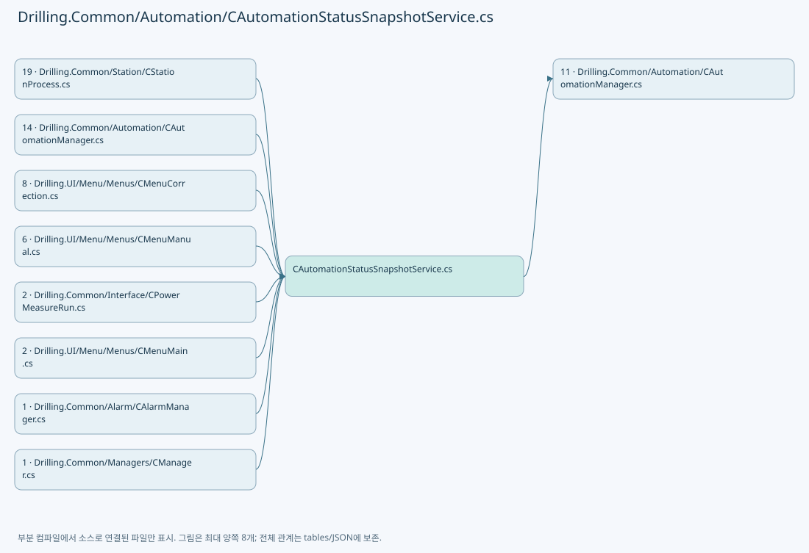

## 네임스페이스·타입·상속

| 타입 | 구분 | 원본 범위 | 선언/상속 |
| --- | --- | --- | --- |
| CAutomationStatusSnapshotService | ClassDeclaration | 6–390 | CAutomationStatusSnapshotService: IDisposable |
| Entry | ClassDeclaration | 187–201 | Entry |
| ConfiguredHomeSpeedEntry | ClassDeclaration | 337–350 | ConfiguredHomeSpeedEntry |
| ConfiguredHomeSpeedRead | RecordDeclaration | 352–352 | ConfiguredHomeSpeedRead |
| ST_AUTOMATION_STATUS_SNAPSHOT | RecordDeclaration | 392–406 | ST_AUTOMATION_STATUS_SNAPSHOT |
| ST_SCANNER_AXIS_LIVE_STATUS | RecordDeclaration | 408–429 | ST_SCANNER_AXIS_LIVE_STATUS |
| CScannerStatusLiveSnapshotStore | ClassDeclaration | 430–543 | CScannerStatusLiveSnapshotStore |

## 멤버 빠른 목록

| 이름 | 종류 | 범위 | 서명 |
| --- | --- | --- | --- |
| _automation | FieldDeclaration | L8–8 | Drilling.Common.Automation.CAutomationManager Drilling.Common.Automation.CAutomationStatusSnapshotService._automation |
| _sync | FieldDeclaration | L9–9 | object Drilling.Common.Automation.CAutomationStatusSnapshotService._sync |
| _entries | FieldDeclaration | L10–10 | System.Collections.Generic.Dictionary<string, Drilling.Common.Automation.CAutomationStatusSnapshotService.Entry> Drilling.Common.Automation.CAutomationStatusSnapshotService._entries |
| _stop | FieldDeclaration | L11–11 | System.Threading.CancellationTokenSource Drilling.Common.Automation.CAutomationStatusSnapshotService._stop |
| _autoStart | FieldDeclaration | L12–12 | bool Drilling.Common.Automation.CAutomationStatusSnapshotService._autoStart |
| _worker | FieldDeclaration | L13–13 | System.Threading.Tasks.Task? Drilling.Common.Automation.CAutomationStatusSnapshotService._worker |
| _disposed | FieldDeclaration | L14–14 | bool Drilling.Common.Automation.CAutomationStatusSnapshotService._disposed |
| LeaseMs | FieldDeclaration | L15–15 | int Drilling.Common.Automation.CAutomationStatusSnapshotService.LeaseMs |
| StaleMs | FieldDeclaration | L16–16 | int Drilling.Common.Automation.CAutomationStatusSnapshotService.StaleMs |
| .ctor | ConstructorDeclaration | L17–21 | Drilling.Common.Automation.CAutomationStatusSnapshotService.CAutomationStatusSnapshotService(Drilling.Common.Automation.CAutomationManager, bool) |
| GetAxis | MethodDeclaration | L23–23 | Drilling.Common.Automation.ST_AUTOMATION_STATUS_SNAPSHOT<Drilling.Common.Automation.ST_AUTOMATION_AXIS_STATUS> Drilling.Common.Automation.CAutomationStatusSnapshotService.GetAxis(string, int, int, bool) |
| InvalidateAxis | MethodDeclaration | L25–42 | void Drilling.Common.Automation.CAutomationStatusSnapshotService.InvalidateAxis(string, int, int, bool) |
| GetTask | MethodDeclaration | L44–44 | Drilling.Common.Automation.ST_AUTOMATION_STATUS_SNAPSHOT<string> Drilling.Common.Automation.CAutomationStatusSnapshotService.GetTask(int, int) |
| GetProcessorUsage | MethodDeclaration | L45–45 | Drilling.Common.Automation.ST_AUTOMATION_STATUS_SNAPSHOT<string> Drilling.Common.Automation.CAutomationStatusSnapshotService.GetProcessorUsage(int) |
| Get | MethodDeclaration | L46–76 | Drilling.Common.Automation.ST_AUTOMATION_STATUS_SNAPSHOT<T> Drilling.Common.Automation.CAutomationStatusSnapshotService.Get<T>(string, int, System.Func<System.Threading.CancellationToken, object>) |
| Collect | MethodDeclaration | L78–92 | System.Threading.Tasks.Task Drilling.Common.Automation.CAutomationStatusSnapshotService.Collect() |
| CollectOnce | MethodDeclaration | L94–166 | System.Threading.Tasks.Task Drilling.Common.Automation.CAutomationStatusSnapshotService.CollectOnce(System.Threading.CancellationToken) |
| Dispose | MethodDeclaration | L168–185 | void Drilling.Common.Automation.CAutomationStatusSnapshotService.Dispose() |
| Controller | PropertyDeclaration | L189–189 | int Drilling.Common.Automation.CAutomationStatusSnapshotService.Entry.Controller |
| get_Controller | GetAccessorDeclaration | L189–189 | int Drilling.Common.Automation.CAutomationStatusSnapshotService.Entry.Controller.get |
| Read | PropertyDeclaration | L190–190 | System.Func<System.Threading.CancellationToken, object> Drilling.Common.Automation.CAutomationStatusSnapshotService.Entry.Read |
| get_Read | GetAccessorDeclaration | L190–190 | System.Func<System.Threading.CancellationToken, object> Drilling.Common.Automation.CAutomationStatusSnapshotService.Entry.Read.get |
| LastRequested | FieldDeclaration | L192–192 | long Drilling.Common.Automation.CAutomationStatusSnapshotService.Entry.LastRequested |
| CollectedAt | FieldDeclaration | L193–193 | long Drilling.Common.Automation.CAutomationStatusSnapshotService.Entry.CollectedAt |
| Value | FieldDeclaration | L194–194 | object? Drilling.Common.Automation.CAutomationStatusSnapshotService.Entry.Value |
| State | FieldDeclaration | L195–195 | string Drilling.Common.Automation.CAutomationStatusSnapshotService.Entry.State |
| Detail | FieldDeclaration | L196–196 | string Drilling.Common.Automation.CAutomationStatusSnapshotService.Entry.Detail |
| UpdatedAt | FieldDeclaration | L197–197 | System.DateTimeOffset Drilling.Common.Automation.CAutomationStatusSnapshotService.Entry.UpdatedAt |
| Generation | FieldDeclaration | L198–198 | long Drilling.Common.Automation.CAutomationStatusSnapshotService.Entry.Generation |
| Version | FieldDeclaration | L199–199 | long Drilling.Common.Automation.CAutomationStatusSnapshotService.Entry.Version |
| CollectedTimestamp | FieldDeclaration | L200–200 | long Drilling.Common.Automation.CAutomationStatusSnapshotService.Entry.CollectedTimestamp |
| ConfiguredHomeSpeedRefreshMs | FieldDeclaration | L203–203 | int Drilling.Common.Automation.CAutomationStatusSnapshotService.ConfiguredHomeSpeedRefreshMs |
| ConfiguredHomeSpeedStaleMs | FieldDeclaration | L204–204 | int Drilling.Common.Automation.CAutomationStatusSnapshotService.ConfiguredHomeSpeedStaleMs |
| _configuredHomeSpeedEntries | FieldDeclaration | L205–205 | System.Collections.Generic.Dictionary<int, Drilling.Common.Automation.CAutomationStatusSnapshotService.ConfiguredHomeSpeedEntry> Drilling.Common.Automation.CAutomationStatusSnapshotService._configuredHomeSpeedEntries |
| GetConfiguredHomeSpeeds | MethodDeclaration | L207–238 | Drilling.Common.Automation.ST_AUTOMATION_STATUS_SNAPSHOT<System.Collections.Generic.IReadOnlyDictionary<string, double>> Drilling.Common.Automation.CAutomationStatusSnapshotService.GetConfiguredHomeSpeeds(System.Collections.Generic.IReadOnlyList<string>, int) |
| RequestConfiguredHomeSpeedsRefresh | MethodDeclaration | L241–249 | void Drilling.Common.Automation.CAutomationStatusSnapshotService.RequestConfiguredHomeSpeedsRefresh(int) |
| PrepareConfiguredHomeSpeedReads | MethodDeclaration | L252–277 | Drilling.Common.Automation.CAutomationStatusSnapshotService.ConfiguredHomeSpeedRead[] Drilling.Common.Automation.CAutomationStatusSnapshotService.PrepareConfiguredHomeSpeedReads(long) |
| CollectConfiguredHomeSpeeds | MethodDeclaration | L279–323 | void Drilling.Common.Automation.CAutomationStatusSnapshotService.CollectConfiguredHomeSpeeds(Drilling.Common.Automation.CAutomationStatusSnapshotService.ConfiguredHomeSpeedRead, System.Threading.CancellationToken) |
| ReadOnlyValues | MethodDeclaration | L325–325 | System.Collections.Generic.IReadOnlyDictionary<string, double> Drilling.Common.Automation.CAutomationStatusSnapshotService.ReadOnlyValues(System.Collections.Generic.IEnumerable<System.Collections.Generic.KeyValuePair<string, double>>) |
| InvalidateConfiguredHomeSpeedEntry | MethodDeclaration | L326–335 | void Drilling.Common.Automation.CAutomationStatusSnapshotService.InvalidateConfiguredHomeSpeedEntry(Drilling.Common.Automation.CAutomationStatusSnapshotService.ConfiguredHomeSpeedEntry) |
| Controller | PropertyDeclaration | L339–339 | int Drilling.Common.Automation.CAutomationStatusSnapshotService.ConfiguredHomeSpeedEntry.Controller |
| get_Controller | GetAccessorDeclaration | L339–339 | int Drilling.Common.Automation.CAutomationStatusSnapshotService.ConfiguredHomeSpeedEntry.Controller.get |
| RequestedAxes | PropertyDeclaration | L340–340 | System.Collections.Generic.Dictionary<string, long> Drilling.Common.Automation.CAutomationStatusSnapshotService.ConfiguredHomeSpeedEntry.RequestedAxes |
| get_RequestedAxes | GetAccessorDeclaration | L340–340 | System.Collections.Generic.Dictionary<string, long> Drilling.Common.Automation.CAutomationStatusSnapshotService.ConfiguredHomeSpeedEntry.RequestedAxes.get |
| Value | FieldDeclaration | L342–342 | System.Collections.Generic.IReadOnlyDictionary<string, double>? Drilling.Common.Automation.CAutomationStatusSnapshotService.ConfiguredHomeSpeedEntry.Value |
| State | FieldDeclaration | L343–343 | string Drilling.Common.Automation.CAutomationStatusSnapshotService.ConfiguredHomeSpeedEntry.State |
| Detail | FieldDeclaration | L344–344 | string Drilling.Common.Automation.CAutomationStatusSnapshotService.ConfiguredHomeSpeedEntry.Detail |
| UpdatedAt | FieldDeclaration | L345–345 | System.DateTimeOffset Drilling.Common.Automation.CAutomationStatusSnapshotService.ConfiguredHomeSpeedEntry.UpdatedAt |
| CollectedAt | FieldDeclaration | L346–346 | long Drilling.Common.Automation.CAutomationStatusSnapshotService.ConfiguredHomeSpeedEntry.CollectedAt |
| LastAttemptAt | FieldDeclaration | L347–347 | long Drilling.Common.Automation.CAutomationStatusSnapshotService.ConfiguredHomeSpeedEntry.LastAttemptAt |
| Version | FieldDeclaration | L348–348 | long Drilling.Common.Automation.CAutomationStatusSnapshotService.ConfiguredHomeSpeedEntry.Version |
| InFlight | FieldDeclaration | L349–349 | bool Drilling.Common.Automation.CAutomationStatusSnapshotService.ConfiguredHomeSpeedEntry.InFlight |
| GetAuxiliaryFeedback | MethodDeclaration | L354–354 | Drilling.Common.Automation.ST_AUTOMATION_STATUS_SNAPSHOT<Drilling.Common.Automation.ST_AUXILIARY_FEEDBACK> Drilling.Common.Automation.CAutomationStatusSnapshotService.GetAuxiliaryFeedback(string, int) |
| InvalidateAuxiliaryFeedback | MethodDeclaration | L355–359 | void Drilling.Common.Automation.CAutomationStatusSnapshotService.InvalidateAuxiliaryFeedback(string, int) |
| InvalidateTask | MethodDeclaration | L361–365 | void Drilling.Common.Automation.CAutomationStatusSnapshotService.InvalidateTask(int, int) |
| InvalidateEntry | MethodDeclaration | L367–381 | void Drilling.Common.Automation.CAutomationStatusSnapshotService.InvalidateEntry(string) |
| AuxiliaryKey | MethodDeclaration | L383–383 | string Drilling.Common.Automation.CAutomationStatusSnapshotService.AuxiliaryKey(string, int) |
| GetMofReadiness | MethodDeclaration | L384–384 | Drilling.Common.Automation.ST_AUTOMATION_STATUS_SNAPSHOT<Drilling.Common.Automation.ST_MOF_READINESS> Drilling.Common.Automation.CAutomationStatusSnapshotService.GetMofReadiness(int, int) |
| InvalidateMofReadiness | MethodDeclaration | L385–389 | void Drilling.Common.Automation.CAutomationStatusSnapshotService.InvalidateMofReadiness(int, int) |
| Version | PropertyDeclaration | L395–395 | long Drilling.Common.Automation.ST_AUTOMATION_STATUS_SNAPSHOT<T>.Version |
| get_Version | GetAccessorDeclaration | L395–395 | long Drilling.Common.Automation.ST_AUTOMATION_STATUS_SNAPSHOT<T>.Version.get |
| set_Version | InitAccessorDeclaration | L395–395 | void Drilling.Common.Automation.ST_AUTOMATION_STATUS_SNAPSHOT<T>.Version.init |
| CollectedTimestamp | PropertyDeclaration | L396–396 | long Drilling.Common.Automation.ST_AUTOMATION_STATUS_SNAPSHOT<T>.CollectedTimestamp |
| get_CollectedTimestamp | GetAccessorDeclaration | L396–396 | long Drilling.Common.Automation.ST_AUTOMATION_STATUS_SNAPSHOT<T>.CollectedTimestamp.get |
| set_CollectedTimestamp | InitAccessorDeclaration | L396–396 | void Drilling.Common.Automation.ST_AUTOMATION_STATUS_SNAPSHOT<T>.CollectedTimestamp.init |
| IsFresh | MethodDeclaration | L399–405 | bool Drilling.Common.Automation.ST_AUTOMATION_STATUS_SNAPSHOT<T>.IsFresh(System.TimeSpan) |
| SnapshotLock | FieldDeclaration | L432–432 | object Drilling.Common.Automation.CScannerStatusLiveSnapshotStore.SnapshotLock |
| _ownerId | FieldDeclaration | L433–433 | System.Guid Drilling.Common.Automation.CScannerStatusLiveSnapshotStore._ownerId |
| _snapshot | FieldDeclaration | L434–434 | System.Collections.Generic.IReadOnlyList<Drilling.Common.Automation.ST_SCANNER_AXIS_LIVE_STATUS> Drilling.Common.Automation.CScannerStatusLiveSnapshotStore._snapshot |
| Begin | MethodDeclaration | L435–445 | System.Guid Drilling.Common.Automation.CScannerStatusLiveSnapshotStore.Begin() |
| Update | MethodDeclaration | L447–458 | void Drilling.Common.Automation.CScannerStatusLiveSnapshotStore.Update(System.Guid, System.Collections.Generic.IReadOnlyList<Drilling.Common.Automation.ST_SCANNER_AXIS_LIVE_STATUS>) |
| End | MethodDeclaration | L460–472 | void Drilling.Common.Automation.CScannerStatusLiveSnapshotStore.End(System.Guid) |
| TryGetHeadSnapshot | MethodDeclaration | L474–496 | bool Drilling.Common.Automation.CScannerStatusLiveSnapshotStore.TryGetHeadSnapshot(int, out System.Collections.Generic.IReadOnlyList<Drilling.Common.Automation.ST_SCANNER_AXIS_LIVE_STATUS>) |
| TryGetTaskStatus | MethodDeclaration | L498–519 | bool Drilling.Common.Automation.CScannerStatusLiveSnapshotStore.TryGetTaskStatus(int, int, out string) |
| TryGetProcessorUsage | MethodDeclaration | L521–542 | bool Drilling.Common.Automation.CScannerStatusLiveSnapshotStore.TryGetProcessorUsage(int, out string) |

## 멤버별 상세 계약·호출·처리 해설

### FieldDeclaration `_automation` · L8–8

[Drilling.Common/Automation/CAutomationStatusSnapshotService.cs:8–8](https://github.com/kjuws10-rgb/A3Drilling/blob/5aee8e58439c9b455cae7c9593c9be986c3e682e/Drilling.Common/Automation/CAutomationStatusSnapshotService.cs#L8-L8)

| 항목 | 실제 추출 값 |
| --- | --- |
| 서명 | Drilling.Common.Automation.CAutomationManager Drilling.Common.Automation.CAutomationStatusSnapshotService._automation |
| 접근/수식자 | Private / private, readonly |
| 반환/값 타입 | Drilling.Common.Automation.CAutomationManager |
| 소속 타입 | NamedType:Drilling.Common.Automation.CAutomationStatusSnapshotService |

현재 부분 분석에서 직접 연결된 호출자는 없습니다. XAML/이벤트/인터페이스·델리게이트·외부 진입을 추가 확인해야 하며, 미사용으로 판정한 것이 아닙니다.

변경 전 점검: 입력/반환 타입, 위 호출자, 예외/취소 경로, 공유 상태와 저장·전송 소비자를 함께 확인합니다. 값의 단위나 물리 방향을 이름만으로 확정하지 않습니다.

### FieldDeclaration `_sync` · L9–9

[Drilling.Common/Automation/CAutomationStatusSnapshotService.cs:9–9](https://github.com/kjuws10-rgb/A3Drilling/blob/5aee8e58439c9b455cae7c9593c9be986c3e682e/Drilling.Common/Automation/CAutomationStatusSnapshotService.cs#L9-L9)

| 항목 | 실제 추출 값 |
| --- | --- |
| 서명 | object Drilling.Common.Automation.CAutomationStatusSnapshotService._sync |
| 접근/수식자 | Private / private, readonly |
| 반환/값 타입 | object |
| 소속 타입 | NamedType:Drilling.Common.Automation.CAutomationStatusSnapshotService |

현재 부분 분석에서 직접 연결된 호출자는 없습니다. XAML/이벤트/인터페이스·델리게이트·외부 진입을 추가 확인해야 하며, 미사용으로 판정한 것이 아닙니다.

호출하는 대상과 해석 범위:

| 원본 행 | 표현식 | 분석 상태 | 대상/소스 위치 |
| --- | --- | --- | --- |
| 9 | new | resolved | object.Object() |

본문의 실제 연산·분기·예외·반환 순서(원문 위치 순):

| 원본 행 | 종류 | 주석 해설 |
| --- | --- | --- |
| 9 | call | 함수·델리게이트 또는 객체 생성자를 호출합니다: new() |
| 9 | variable-initializer | 변수의 초기값을 지정합니다: _sync = new() |

변경 전 점검: 입력/반환 타입, 위 호출자, 예외/취소 경로, 공유 상태와 저장·전송 소비자를 함께 확인합니다. 값의 단위나 물리 방향을 이름만으로 확정하지 않습니다.

### FieldDeclaration `_entries` · L10–10

[Drilling.Common/Automation/CAutomationStatusSnapshotService.cs:10–10](https://github.com/kjuws10-rgb/A3Drilling/blob/5aee8e58439c9b455cae7c9593c9be986c3e682e/Drilling.Common/Automation/CAutomationStatusSnapshotService.cs#L10-L10)

| 항목 | 실제 추출 값 |
| --- | --- |
| 서명 | System.Collections.Generic.Dictionary<string, Drilling.Common.Automation.CAutomationStatusSnapshotService.Entry> Drilling.Common.Automation.CAutomationStatusSnapshotService._entries |
| 접근/수식자 | Private / private, readonly |
| 반환/값 타입 | System.Collections.Generic.Dictionary<string, Drilling.Common.Automation.CAutomationStatusSnapshotService.Entry> |
| 소속 타입 | NamedType:Drilling.Common.Automation.CAutomationStatusSnapshotService |

현재 부분 분석에서 직접 연결된 호출자는 없습니다. XAML/이벤트/인터페이스·델리게이트·외부 진입을 추가 확인해야 하며, 미사용으로 판정한 것이 아닙니다.

호출하는 대상과 해석 범위:

| 원본 행 | 표현식 | 분석 상태 | 대상/소스 위치 |
| --- | --- | --- | --- |
| 10 | new | resolved | System.Collections.Generic.Dictionary<string, Drilling.Common.Automation.CAutomationStatusSnapshotService.Entry>.Dictionary(System.Collections.Generic.IEqualityComparer<string>?) |

본문의 실제 연산·분기·예외·반환 순서(원문 위치 순):

| 원본 행 | 종류 | 주석 해설 |
| --- | --- | --- |
| 10 | call | 함수·델리게이트 또는 객체 생성자를 호출합니다: new(StringComparer.Ordinal) |
| 10 | variable-initializer | 변수의 초기값을 지정합니다: _entries = new(StringComparer.Ordinal) |

변경 전 점검: 입력/반환 타입, 위 호출자, 예외/취소 경로, 공유 상태와 저장·전송 소비자를 함께 확인합니다. 값의 단위나 물리 방향을 이름만으로 확정하지 않습니다.

### FieldDeclaration `_stop` · L11–11

[Drilling.Common/Automation/CAutomationStatusSnapshotService.cs:11–11](https://github.com/kjuws10-rgb/A3Drilling/blob/5aee8e58439c9b455cae7c9593c9be986c3e682e/Drilling.Common/Automation/CAutomationStatusSnapshotService.cs#L11-L11)

| 항목 | 실제 추출 값 |
| --- | --- |
| 서명 | System.Threading.CancellationTokenSource Drilling.Common.Automation.CAutomationStatusSnapshotService._stop |
| 접근/수식자 | Private / private, readonly |
| 반환/값 타입 | System.Threading.CancellationTokenSource |
| 소속 타입 | NamedType:Drilling.Common.Automation.CAutomationStatusSnapshotService |

현재 부분 분석에서 직접 연결된 호출자는 없습니다. XAML/이벤트/인터페이스·델리게이트·외부 진입을 추가 확인해야 하며, 미사용으로 판정한 것이 아닙니다.

호출하는 대상과 해석 범위:

| 원본 행 | 표현식 | 분석 상태 | 대상/소스 위치 |
| --- | --- | --- | --- |
| 11 | new | resolved | System.Threading.CancellationTokenSource.CancellationTokenSource() |

본문의 실제 연산·분기·예외·반환 순서(원문 위치 순):

| 원본 행 | 종류 | 주석 해설 |
| --- | --- | --- |
| 11 | call | 함수·델리게이트 또는 객체 생성자를 호출합니다: new() |
| 11 | variable-initializer | 변수의 초기값을 지정합니다: _stop = new() |

변경 전 점검: 입력/반환 타입, 위 호출자, 예외/취소 경로, 공유 상태와 저장·전송 소비자를 함께 확인합니다. 값의 단위나 물리 방향을 이름만으로 확정하지 않습니다.

### FieldDeclaration `_autoStart` · L12–12

[Drilling.Common/Automation/CAutomationStatusSnapshotService.cs:12–12](https://github.com/kjuws10-rgb/A3Drilling/blob/5aee8e58439c9b455cae7c9593c9be986c3e682e/Drilling.Common/Automation/CAutomationStatusSnapshotService.cs#L12-L12)

| 항목 | 실제 추출 값 |
| --- | --- |
| 서명 | bool Drilling.Common.Automation.CAutomationStatusSnapshotService._autoStart |
| 접근/수식자 | Private / private, readonly |
| 반환/값 타입 | bool |
| 소속 타입 | NamedType:Drilling.Common.Automation.CAutomationStatusSnapshotService |

현재 부분 분석에서 직접 연결된 호출자는 없습니다. XAML/이벤트/인터페이스·델리게이트·외부 진입을 추가 확인해야 하며, 미사용으로 판정한 것이 아닙니다.

변경 전 점검: 입력/반환 타입, 위 호출자, 예외/취소 경로, 공유 상태와 저장·전송 소비자를 함께 확인합니다. 값의 단위나 물리 방향을 이름만으로 확정하지 않습니다.

### FieldDeclaration `_worker` · L13–13

[Drilling.Common/Automation/CAutomationStatusSnapshotService.cs:13–13](https://github.com/kjuws10-rgb/A3Drilling/blob/5aee8e58439c9b455cae7c9593c9be986c3e682e/Drilling.Common/Automation/CAutomationStatusSnapshotService.cs#L13-L13)

| 항목 | 실제 추출 값 |
| --- | --- |
| 서명 | System.Threading.Tasks.Task? Drilling.Common.Automation.CAutomationStatusSnapshotService._worker |
| 접근/수식자 | Private / private |
| 반환/값 타입 | System.Threading.Tasks.Task? |
| 소속 타입 | NamedType:Drilling.Common.Automation.CAutomationStatusSnapshotService |

현재 부분 분석에서 직접 연결된 호출자는 없습니다. XAML/이벤트/인터페이스·델리게이트·외부 진입을 추가 확인해야 하며, 미사용으로 판정한 것이 아닙니다.

변경 전 점검: 입력/반환 타입, 위 호출자, 예외/취소 경로, 공유 상태와 저장·전송 소비자를 함께 확인합니다. 값의 단위나 물리 방향을 이름만으로 확정하지 않습니다.

### FieldDeclaration `_disposed` · L14–14

[Drilling.Common/Automation/CAutomationStatusSnapshotService.cs:14–14](https://github.com/kjuws10-rgb/A3Drilling/blob/5aee8e58439c9b455cae7c9593c9be986c3e682e/Drilling.Common/Automation/CAutomationStatusSnapshotService.cs#L14-L14)

| 항목 | 실제 추출 값 |
| --- | --- |
| 서명 | bool Drilling.Common.Automation.CAutomationStatusSnapshotService._disposed |
| 접근/수식자 | Private / private |
| 반환/값 타입 | bool |
| 소속 타입 | NamedType:Drilling.Common.Automation.CAutomationStatusSnapshotService |

현재 부분 분석에서 직접 연결된 호출자는 없습니다. XAML/이벤트/인터페이스·델리게이트·외부 진입을 추가 확인해야 하며, 미사용으로 판정한 것이 아닙니다.

변경 전 점검: 입력/반환 타입, 위 호출자, 예외/취소 경로, 공유 상태와 저장·전송 소비자를 함께 확인합니다. 값의 단위나 물리 방향을 이름만으로 확정하지 않습니다.

### FieldDeclaration `LeaseMs` · L15–15

[Drilling.Common/Automation/CAutomationStatusSnapshotService.cs:15–15](https://github.com/kjuws10-rgb/A3Drilling/blob/5aee8e58439c9b455cae7c9593c9be986c3e682e/Drilling.Common/Automation/CAutomationStatusSnapshotService.cs#L15-L15)

| 항목 | 실제 추출 값 |
| --- | --- |
| 서명 | int Drilling.Common.Automation.CAutomationStatusSnapshotService.LeaseMs |
| 접근/수식자 | Private / private, const |
| 반환/값 타입 | int |
| 소속 타입 | NamedType:Drilling.Common.Automation.CAutomationStatusSnapshotService |

현재 부분 분석에서 직접 연결된 호출자는 없습니다. XAML/이벤트/인터페이스·델리게이트·외부 진입을 추가 확인해야 하며, 미사용으로 판정한 것이 아닙니다.

본문의 실제 연산·분기·예외·반환 순서(원문 위치 순):

| 원본 행 | 종류 | 주석 해설 |
| --- | --- | --- |
| 15 | variable-initializer | 변수의 초기값을 지정합니다: LeaseMs = 10000 |

변경 전 점검: 입력/반환 타입, 위 호출자, 예외/취소 경로, 공유 상태와 저장·전송 소비자를 함께 확인합니다. 값의 단위나 물리 방향을 이름만으로 확정하지 않습니다.

### FieldDeclaration `StaleMs` · L16–16

[Drilling.Common/Automation/CAutomationStatusSnapshotService.cs:16–16](https://github.com/kjuws10-rgb/A3Drilling/blob/5aee8e58439c9b455cae7c9593c9be986c3e682e/Drilling.Common/Automation/CAutomationStatusSnapshotService.cs#L16-L16)

| 항목 | 실제 추출 값 |
| --- | --- |
| 서명 | int Drilling.Common.Automation.CAutomationStatusSnapshotService.StaleMs |
| 접근/수식자 | Private / private, const |
| 반환/값 타입 | int |
| 소속 타입 | NamedType:Drilling.Common.Automation.CAutomationStatusSnapshotService |

현재 부분 분석에서 직접 연결된 호출자는 없습니다. XAML/이벤트/인터페이스·델리게이트·외부 진입을 추가 확인해야 하며, 미사용으로 판정한 것이 아닙니다.

본문의 실제 연산·분기·예외·반환 순서(원문 위치 순):

| 원본 행 | 종류 | 주석 해설 |
| --- | --- | --- |
| 16 | variable-initializer | 변수의 초기값을 지정합니다: StaleMs = 5000 |

변경 전 점검: 입력/반환 타입, 위 호출자, 예외/취소 경로, 공유 상태와 저장·전송 소비자를 함께 확인합니다. 값의 단위나 물리 방향을 이름만으로 확정하지 않습니다.

### ConstructorDeclaration `.ctor` · L17–21

[Drilling.Common/Automation/CAutomationStatusSnapshotService.cs:17–21](https://github.com/kjuws10-rgb/A3Drilling/blob/5aee8e58439c9b455cae7c9593c9be986c3e682e/Drilling.Common/Automation/CAutomationStatusSnapshotService.cs#L17-L21)

| 항목 | 실제 추출 값 |
| --- | --- |
| 서명 | Drilling.Common.Automation.CAutomationStatusSnapshotService.CAutomationStatusSnapshotService(Drilling.Common.Automation.CAutomationManager, bool) |
| 접근/수식자 | Internal / internal |
| 반환/값 타입 | void |
| 소속 타입 | NamedType:Drilling.Common.Automation.CAutomationStatusSnapshotService |

입력 계약:

| 이름 | 타입 | 전달 | 선택/기본값 |
| --- | --- | --- | --- |
| automation | Drilling.Common.Automation.CAutomationManager | None | False /  |
| autoStart | bool | None | True / true |

정적 호출자로 확인된 위치:

| 호출 파일/행 | 호출 표현식 | 런타임 분기 가능 |
| --- | --- | --- |
| [Drilling.Common/Automation/CAutomationManager.cs:38–38](https://github.com/kjuws10-rgb/A3Drilling/blob/5aee8e58439c9b455cae7c9593c9be986c3e682e/Drilling.Common/Automation/CAutomationManager.cs#L38-L38) | new CAutomationStatusSnapshotService | False |

본문의 실제 연산·분기·예외·반환 순서(원문 위치 순):

| 원본 행 | 종류 | 주석 해설 |
| --- | --- | --- |
| 19 | assignment | 값을 대상에 대입합니다: _automation = automation |
| 20 | assignment | 값을 대상에 대입합니다: _autoStart = autoStart |

변경 전 점검: 입력/반환 타입, 위 호출자, 예외/취소 경로, 공유 상태와 저장·전송 소비자를 함께 확인합니다. 값의 단위나 물리 방향을 이름만으로 확정하지 않습니다.

### MethodDeclaration `GetAxis` · L23–23

[Drilling.Common/Automation/CAutomationStatusSnapshotService.cs:23–23](https://github.com/kjuws10-rgb/A3Drilling/blob/5aee8e58439c9b455cae7c9593c9be986c3e682e/Drilling.Common/Automation/CAutomationStatusSnapshotService.cs#L23-L23)

| 항목 | 실제 추출 값 |
| --- | --- |
| 서명 | Drilling.Common.Automation.ST_AUTOMATION_STATUS_SNAPSHOT<Drilling.Common.Automation.ST_AUTOMATION_AXIS_STATUS> Drilling.Common.Automation.CAutomationStatusSnapshotService.GetAxis(string, int, int, bool) |
| 접근/수식자 | Public / public |
| 반환/값 타입 | Drilling.Common.Automation.ST_AUTOMATION_STATUS_SNAPSHOT<Drilling.Common.Automation.ST_AUTOMATION_AXIS_STATUS> |
| 소속 타입 | NamedType:Drilling.Common.Automation.CAutomationStatusSnapshotService |

입력 계약:

| 이름 | 타입 | 전달 | 선택/기본값 |
| --- | --- | --- | --- |
| axis | string | None | False /  |
| controller | int | None | False /  |
| aio | int | None | False /  |
| extended | bool | None | False /  |

정적 호출자로 확인된 위치:

| 호출 파일/행 | 호출 표현식 | 런타임 분기 가능 |
| --- | --- | --- |
| [Drilling.Common/Alarm/CAlarmManager.cs:597–597](https://github.com/kjuws10-rgb/A3Drilling/blob/5aee8e58439c9b455cae7c9593c9be986c3e682e/Drilling.Common/Alarm/CAlarmManager.cs#L597-L597) | automation.StatusSnapshots.GetAxis | False |
| [Drilling.Common/Automation/CAutomationManager.cs:1606–1606](https://github.com/kjuws10-rgb/A3Drilling/blob/5aee8e58439c9b455cae7c9593c9be986c3e682e/Drilling.Common/Automation/CAutomationManager.cs#L1606-L1606) | automation.StatusSnapshots.GetAxis | False |
| [Drilling.Common/Automation/CAutomationStatusSnapshotService.cs:27–27](https://github.com/kjuws10-rgb/A3Drilling/blob/5aee8e58439c9b455cae7c9593c9be986c3e682e/Drilling.Common/Automation/CAutomationStatusSnapshotService.cs#L27-L27) | GetAxis | False |
| [Drilling.Common/Station/CStationProcess.cs:1375–1375](https://github.com/kjuws10-rgb/A3Drilling/blob/5aee8e58439c9b455cae7c9593c9be986c3e682e/Drilling.Common/Station/CStationProcess.cs#L1375-L1375) | _automationManager.StatusSnapshots.GetAxis | False |
| [Drilling.Common/Station/CStationProcess.cs:2814–2814](https://github.com/kjuws10-rgb/A3Drilling/blob/5aee8e58439c9b455cae7c9593c9be986c3e682e/Drilling.Common/Station/CStationProcess.cs#L2814-L2814) | _owner._automationManager.StatusSnapshots.GetAxis | False |
| [Drilling.UI/Menu/Menus/CMenuCorrection.cs:3719–3719](https://github.com/kjuws10-rgb/A3Drilling/blob/5aee8e58439c9b455cae7c9593c9be986c3e682e/Drilling.UI/Menu/Menus/CMenuCorrection.cs#L3719-L3719) | _defaultManager.automation.StatusSnapshots.GetAxis | False |
| [Drilling.UI/Menu/Menus/CMenuManual.cs:1800–1800](https://github.com/kjuws10-rgb/A3Drilling/blob/5aee8e58439c9b455cae7c9593c9be986c3e682e/Drilling.UI/Menu/Menus/CMenuManual.cs#L1800-L1800) | _manager.automation.StatusSnapshots.GetAxis | False |
| [Drilling.UI/Menu/Menus/CMenuManual.cs:4233–4233](https://github.com/kjuws10-rgb/A3Drilling/blob/5aee8e58439c9b455cae7c9593c9be986c3e682e/Drilling.UI/Menu/Menus/CMenuManual.cs#L4233-L4233) | _manager.automation.StatusSnapshots.GetAxis | False |
| [Drilling.UI/Menu/Menus/CMenuManual.cs:7734–7734](https://github.com/kjuws10-rgb/A3Drilling/blob/5aee8e58439c9b455cae7c9593c9be986c3e682e/Drilling.UI/Menu/Menus/CMenuManual.cs#L7734-L7734) | automationManager.StatusSnapshots.GetAxis | False |
| [Drilling.UI/Menu/Menus/CScannerStatusSnapshotReader.cs:94–94](https://github.com/kjuws10-rgb/A3Drilling/blob/5aee8e58439c9b455cae7c9593c9be986c3e682e/Drilling.UI/Menu/Menus/CScannerStatusSnapshotReader.cs#L94-L94) | automationManager.StatusSnapshots.GetAxis | False |

호출하는 대상과 해석 범위:

| 원본 행 | 표현식 | 분석 상태 | 대상/소스 위치 |
| --- | --- | --- | --- |
| 23 | Get<ST_AUTOMATION_AXIS_STATUS> | resolved | Drilling.Common.Automation.ST_AUTOMATION_STATUS_SNAPSHOT<Drilling.Common.Automation.ST_AUTOMATION_AXIS_STATUS> Drilling.Common.Automation.CAutomationStatusSnapshotService.Get<Drilling.Common.Automation.ST_AUTOMATION_AXIS_STATUS>(string, int, System.Func<System.Threading.CancellationToken, object>) · Drilling.Common/Automation/CAutomationStatusSnapshotService.cs:46 |
| 23 | axis.Trim().ToUpperInvariant | resolved | string string.ToUpperInvariant() |
| 23 | axis.Trim | resolved | string string.Trim() |
| 23 | _automation.ReadAxisStatusByNameNoLog | resolved | Drilling.Common.Automation.ST_AUTOMATION_AXIS_STATUS Drilling.Common.Automation.CAutomationManager.ReadAxisStatusByNameNoLog(string, int, int, bool, System.Threading.CancellationToken) · Drilling.Common/Automation/CAutomationManager.cs:286 |

본문의 실제 연산·분기·예외·반환 순서(원문 위치 순):

| 원본 행 | 종류 | 주석 해설 |
| --- | --- | --- |
| 23 | call | 함수·델리게이트 또는 객체 생성자를 호출합니다: Get<ST_AUTOMATION_AXIS_STATUS>($"AXIS&#124;{controller}&#124;{axis.Trim().ToUpperInvariant()}&#124;{aio}&#124;{extended}", controller, token => _automation.ReadAxisStatusByNameNoLog(axis, controller, aio, extended, token)) |
| 23 | call | 함수·델리게이트 또는 객체 생성자를 호출합니다: axis.Trim().ToUpperInvariant() |
| 23 | call | 함수·델리게이트 또는 객체 생성자를 호출합니다: axis.Trim() |
| 23 | call | 함수·델리게이트 또는 객체 생성자를 호출합니다: _automation.ReadAxisStatusByNameNoLog(axis, controller, aio, extended, token) |

변경 전 점검: 입력/반환 타입, 위 호출자, 예외/취소 경로, 공유 상태와 저장·전송 소비자를 함께 확인합니다. 값의 단위나 물리 방향을 이름만으로 확정하지 않습니다.

### MethodDeclaration `InvalidateAxis` · L25–42

[Drilling.Common/Automation/CAutomationStatusSnapshotService.cs:25–42](https://github.com/kjuws10-rgb/A3Drilling/blob/5aee8e58439c9b455cae7c9593c9be986c3e682e/Drilling.Common/Automation/CAutomationStatusSnapshotService.cs#L25-L42)

| 항목 | 실제 추출 값 |
| --- | --- |
| 서명 | void Drilling.Common.Automation.CAutomationStatusSnapshotService.InvalidateAxis(string, int, int, bool) |
| 접근/수식자 | Public / public |
| 반환/값 타입 | void |
| 소속 타입 | NamedType:Drilling.Common.Automation.CAutomationStatusSnapshotService |

원본 XML 주석:

````xml
/// <summary>Invalidate after a command acknowledgement so an earlier in-flight read cannot complete that command.</summary>
````

입력 계약:

| 이름 | 타입 | 전달 | 선택/기본값 |
| --- | --- | --- | --- |
| axis | string | None | False /  |
| controller | int | None | False /  |
| aio | int | None | True / 0 |
| extended | bool | None | True / false |

정적 호출자로 확인된 위치:

| 호출 파일/행 | 호출 표현식 | 런타임 분기 가능 |
| --- | --- | --- |
| [Drilling.Common/Automation/CAutomationManager.cs:1563–1563](https://github.com/kjuws10-rgb/A3Drilling/blob/5aee8e58439c9b455cae7c9593c9be986c3e682e/Drilling.Common/Automation/CAutomationManager.cs#L1563-L1563) | automation.StatusSnapshots.InvalidateAxis | False |
| [Drilling.UI/Menu/Menus/CMenuCorrection.cs:3710–3710](https://github.com/kjuws10-rgb/A3Drilling/blob/5aee8e58439c9b455cae7c9593c9be986c3e682e/Drilling.UI/Menu/Menus/CMenuCorrection.cs#L3710-L3710) | _defaultManager.automation.StatusSnapshots.InvalidateAxis | False |

호출하는 대상과 해석 범위:

| 원본 행 | 표현식 | 분석 상태 | 대상/소스 위치 |
| --- | --- | --- | --- |
| 27 | GetAxis | resolved | Drilling.Common.Automation.ST_AUTOMATION_STATUS_SNAPSHOT<Drilling.Common.Automation.ST_AUTOMATION_AXIS_STATUS> Drilling.Common.Automation.CAutomationStatusSnapshotService.GetAxis(string, int, int, bool) · Drilling.Common/Automation/CAutomationStatusSnapshotService.cs:23 |
| 28 | axis.Trim().ToUpperInvariant | resolved | string string.ToUpperInvariant() |
| 28 | axis.Trim | resolved | string string.Trim() |
| 31 | _entries.TryGetValue | resolved | bool System.Collections.Generic.Dictionary<string, Drilling.Common.Automation.CAutomationStatusSnapshotService.Entry>.TryGetValue(string, out Drilling.Common.Automation.CAutomationStatusSnapshotService.Entry) |

본문의 실제 연산·분기·예외·반환 순서(원문 위치 순):

| 원본 행 | 종류 | 주석 해설 |
| --- | --- | --- |
| 27 | call | 함수·델리게이트 또는 객체 생성자를 호출합니다: GetAxis(axis, controller, aio, extended) |
| 28 | call | 함수·델리게이트 또는 객체 생성자를 호출합니다: axis.Trim().ToUpperInvariant() |
| 28 | call | 함수·델리게이트 또는 객체 생성자를 호출합니다: axis.Trim() |
| 28 | local-declaration | 지역 변수를 선언합니다: var key = $"AXIS&#124;{controller}&#124;{axis.Trim().ToUpperInvariant()}&#124;{aio}&#124;{extended}"; |
| 28 | variable-initializer | 변수의 초기값을 지정합니다: key = $"AXIS&#124;{controller}&#124;{axis.Trim().ToUpperInvariant()}&#124;{aio}&#124;{extended}" |
| 29 | lock | 공유 상태의 임계 구역에 진입합니다: lock (_sync) |
| 31 | call | 함수·델리게이트 또는 객체 생성자를 호출합니다: _entries.TryGetValue(key, out var entry) |
| 31 | if | 조건에 따라 분기합니다: if (_disposed &#124;&#124; !_entries.TryGetValue(key, out var entry)) |
| 32 | return | 호출자에게 값 또는 제어를 반환합니다: return; |
| 35 | assignment | 값을 대상에 대입합니다: entry.Value = null |
| 36 | assignment | 값을 대상에 대입합니다: entry.State = "LOADING" |
| 37 | assignment | 값을 대상에 대입합니다: entry.Detail = "Waiting for an Automation snapshot collected after the command." |
| 38 | assignment | 값을 대상에 대입합니다: entry.UpdatedAt = default |
| 39 | assignment | 값을 대상에 대입합니다: entry.CollectedAt = 0 |
| 40 | assignment | 값을 대상에 대입합니다: entry.CollectedTimestamp = 0 |

제어 구문의 포함 구조(실제 실행 순서/CFG가 아닌 구문 탐색 그림):

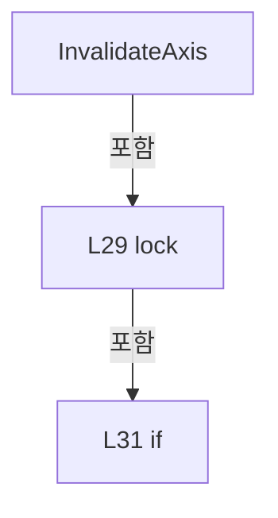

변경 전 점검: 입력/반환 타입, 위 호출자, 예외/취소 경로, 공유 상태와 저장·전송 소비자를 함께 확인합니다. 값의 단위나 물리 방향을 이름만으로 확정하지 않습니다.

### MethodDeclaration `GetTask` · L44–44

[Drilling.Common/Automation/CAutomationStatusSnapshotService.cs:44–44](https://github.com/kjuws10-rgb/A3Drilling/blob/5aee8e58439c9b455cae7c9593c9be986c3e682e/Drilling.Common/Automation/CAutomationStatusSnapshotService.cs#L44-L44)

| 항목 | 실제 추출 값 |
| --- | --- |
| 서명 | Drilling.Common.Automation.ST_AUTOMATION_STATUS_SNAPSHOT<string> Drilling.Common.Automation.CAutomationStatusSnapshotService.GetTask(int, int) |
| 접근/수식자 | Public / public |
| 반환/값 타입 | Drilling.Common.Automation.ST_AUTOMATION_STATUS_SNAPSHOT<string> |
| 소속 타입 | NamedType:Drilling.Common.Automation.CAutomationStatusSnapshotService |

입력 계약:

| 이름 | 타입 | 전달 | 선택/기본값 |
| --- | --- | --- | --- |
| task | int | None | False /  |
| controller | int | None | False /  |

정적 호출자로 확인된 위치:

| 호출 파일/행 | 호출 표현식 | 런타임 분기 가능 |
| --- | --- | --- |
| [Drilling.Common/Automation/CAutomationManager.cs:1119–1119](https://github.com/kjuws10-rgb/A3Drilling/blob/5aee8e58439c9b455cae7c9593c9be986c3e682e/Drilling.Common/Automation/CAutomationManager.cs#L1119-L1119) | StatusSnapshots.GetTask | False |
| [Drilling.Common/Automation/CAutomationStatusSnapshotService.cs:363–363](https://github.com/kjuws10-rgb/A3Drilling/blob/5aee8e58439c9b455cae7c9593c9be986c3e682e/Drilling.Common/Automation/CAutomationStatusSnapshotService.cs#L363-L363) | GetTask | False |
| [Drilling.Common/Interface/CPowerMeasureRun.cs:288–288](https://github.com/kjuws10-rgb/A3Drilling/blob/5aee8e58439c9b455cae7c9593c9be986c3e682e/Drilling.Common/Interface/CPowerMeasureRun.cs#L288-L288) | Automation.StatusSnapshots.GetTask | False |
| [Drilling.Common/Station/CStationProcess.cs:2910–2910](https://github.com/kjuws10-rgb/A3Drilling/blob/5aee8e58439c9b455cae7c9593c9be986c3e682e/Drilling.Common/Station/CStationProcess.cs#L2910-L2910) | _owner._automationManager.StatusSnapshots.GetTask | False |
| [Drilling.Common/Station/CStationProcess.cs:3655–3655](https://github.com/kjuws10-rgb/A3Drilling/blob/5aee8e58439c9b455cae7c9593c9be986c3e682e/Drilling.Common/Station/CStationProcess.cs#L3655-L3655) | _automationManager.StatusSnapshots.GetTask | False |
| [Drilling.Common/Station/CStationProcess.cs:3817–3817](https://github.com/kjuws10-rgb/A3Drilling/blob/5aee8e58439c9b455cae7c9593c9be986c3e682e/Drilling.Common/Station/CStationProcess.cs#L3817-L3817) | _automationManager.StatusSnapshots.GetTask | False |
| [Drilling.Common/Station/CStationProcess.cs:4105–4105](https://github.com/kjuws10-rgb/A3Drilling/blob/5aee8e58439c9b455cae7c9593c9be986c3e682e/Drilling.Common/Station/CStationProcess.cs#L4105-L4105) | _automationManager.StatusSnapshots.GetTask | False |
| [Drilling.UI/Menu/Menus/CMenuCorrection.cs:3502–3502](https://github.com/kjuws10-rgb/A3Drilling/blob/5aee8e58439c9b455cae7c9593c9be986c3e682e/Drilling.UI/Menu/Menus/CMenuCorrection.cs#L3502-L3502) | manager.automation.StatusSnapshots.GetTask | False |
| [Drilling.UI/Menu/Menus/CMenuCorrection.cs:3641–3641](https://github.com/kjuws10-rgb/A3Drilling/blob/5aee8e58439c9b455cae7c9593c9be986c3e682e/Drilling.UI/Menu/Menus/CMenuCorrection.cs#L3641-L3641) | manager.automation.StatusSnapshots.GetTask | False |
| [Drilling.UI/Menu/Menus/CMenuMain.cs:1338–1338](https://github.com/kjuws10-rgb/A3Drilling/blob/5aee8e58439c9b455cae7c9593c9be986c3e682e/Drilling.UI/Menu/Menus/CMenuMain.cs#L1338-L1338) | automationManager.StatusSnapshots.GetTask | False |
| [Drilling.UI/Menu/Menus/CMenuManual.cs:3799–3799](https://github.com/kjuws10-rgb/A3Drilling/blob/5aee8e58439c9b455cae7c9593c9be986c3e682e/Drilling.UI/Menu/Menus/CMenuManual.cs#L3799-L3799) | _manager.automation.StatusSnapshots.GetTask | False |

호출하는 대상과 해석 범위:

| 원본 행 | 표현식 | 분석 상태 | 대상/소스 위치 |
| --- | --- | --- | --- |
| 44 | Get<string> | resolved | Drilling.Common.Automation.ST_AUTOMATION_STATUS_SNAPSHOT<string> Drilling.Common.Automation.CAutomationStatusSnapshotService.Get<string>(string, int, System.Func<System.Threading.CancellationToken, object>) · Drilling.Common/Automation/CAutomationStatusSnapshotService.cs:46 |
| 44 | _automation.ReadTaskStatus(task, controller, token).GetAwaiter().GetResult | resolved | string System.Runtime.CompilerServices.TaskAwaiter<string>.GetResult() |
| 44 | _automation.ReadTaskStatus(task, controller, token).GetAwaiter | resolved | System.Runtime.CompilerServices.TaskAwaiter<string> System.Threading.Tasks.Task<string>.GetAwaiter() |
| 44 | _automation.ReadTaskStatus | resolved · 동적 구현 선택 가능 | System.Threading.Tasks.Task<string> Drilling.Common.Automation.CAutomationManager.ReadTaskStatus(int, int, System.Threading.CancellationToken) · Drilling.Common/Automation/CAutomationManager.cs:523 |

본문의 실제 연산·분기·예외·반환 순서(원문 위치 순):

| 원본 행 | 종류 | 주석 해설 |
| --- | --- | --- |
| 44 | call | 함수·델리게이트 또는 객체 생성자를 호출합니다: Get<string>($"TASK&#124;{controller}&#124;{task}", controller, token => _automation.ReadTaskStatus(task, controller, token).GetAwaiter().GetResult()) |
| 44 | call | 함수·델리게이트 또는 객체 생성자를 호출합니다: _automation.ReadTaskStatus(task, controller, token).GetAwaiter().GetResult() |
| 44 | call | 함수·델리게이트 또는 객체 생성자를 호출합니다: _automation.ReadTaskStatus(task, controller, token).GetAwaiter() |
| 44 | call | 함수·델리게이트 또는 객체 생성자를 호출합니다: _automation.ReadTaskStatus(task, controller, token) |

변경 전 점검: 입력/반환 타입, 위 호출자, 예외/취소 경로, 공유 상태와 저장·전송 소비자를 함께 확인합니다. 값의 단위나 물리 방향을 이름만으로 확정하지 않습니다.

### MethodDeclaration `GetProcessorUsage` · L45–45

[Drilling.Common/Automation/CAutomationStatusSnapshotService.cs:45–45](https://github.com/kjuws10-rgb/A3Drilling/blob/5aee8e58439c9b455cae7c9593c9be986c3e682e/Drilling.Common/Automation/CAutomationStatusSnapshotService.cs#L45-L45)

| 항목 | 실제 추출 값 |
| --- | --- |
| 서명 | Drilling.Common.Automation.ST_AUTOMATION_STATUS_SNAPSHOT<string> Drilling.Common.Automation.CAutomationStatusSnapshotService.GetProcessorUsage(int) |
| 접근/수식자 | Public / public |
| 반환/값 타입 | Drilling.Common.Automation.ST_AUTOMATION_STATUS_SNAPSHOT<string> |
| 소속 타입 | NamedType:Drilling.Common.Automation.CAutomationStatusSnapshotService |

입력 계약:

| 이름 | 타입 | 전달 | 선택/기본값 |
| --- | --- | --- | --- |
| controller | int | None | False /  |

정적 호출자로 확인된 위치:

| 호출 파일/행 | 호출 표현식 | 런타임 분기 가능 |
| --- | --- | --- |
| [Drilling.Common/Station/CStationProcess.cs:2943–2943](https://github.com/kjuws10-rgb/A3Drilling/blob/5aee8e58439c9b455cae7c9593c9be986c3e682e/Drilling.Common/Station/CStationProcess.cs#L2943-L2943) | _owner._automationManager.StatusSnapshots.GetProcessorUsage | False |
| [Drilling.UI/Menu/Menus/CMenuMain.cs:1165–1165](https://github.com/kjuws10-rgb/A3Drilling/blob/5aee8e58439c9b455cae7c9593c9be986c3e682e/Drilling.UI/Menu/Menus/CMenuMain.cs#L1165-L1165) | automationManager.StatusSnapshots.GetProcessorUsage | False |

호출하는 대상과 해석 범위:

| 원본 행 | 표현식 | 분석 상태 | 대상/소스 위치 |
| --- | --- | --- | --- |
| 45 | Get<string> | resolved | Drilling.Common.Automation.ST_AUTOMATION_STATUS_SNAPSHOT<string> Drilling.Common.Automation.CAutomationStatusSnapshotService.Get<string>(string, int, System.Func<System.Threading.CancellationToken, object>) · Drilling.Common/Automation/CAutomationStatusSnapshotService.cs:46 |
| 45 | _automation.ReadProcessorUsage(controller, token).GetAwaiter().GetResult | resolved | string System.Runtime.CompilerServices.TaskAwaiter<string>.GetResult() |
| 45 | _automation.ReadProcessorUsage(controller, token).GetAwaiter | resolved | System.Runtime.CompilerServices.TaskAwaiter<string> System.Threading.Tasks.Task<string>.GetAwaiter() |
| 45 | _automation.ReadProcessorUsage | resolved | System.Threading.Tasks.Task<string> Drilling.Common.Automation.CAutomationManager.ReadProcessorUsage(int, System.Threading.CancellationToken) · Drilling.Common/Automation/CAutomationManager.cs:82 |

본문의 실제 연산·분기·예외·반환 순서(원문 위치 순):

| 원본 행 | 종류 | 주석 해설 |
| --- | --- | --- |
| 45 | call | 함수·델리게이트 또는 객체 생성자를 호출합니다: Get<string>($"CPU&#124;{controller}", controller, token => _automation.ReadProcessorUsage(controller, token).GetAwaiter().GetResult()) |
| 45 | call | 함수·델리게이트 또는 객체 생성자를 호출합니다: _automation.ReadProcessorUsage(controller, token).GetAwaiter().GetResult() |
| 45 | call | 함수·델리게이트 또는 객체 생성자를 호출합니다: _automation.ReadProcessorUsage(controller, token).GetAwaiter() |
| 45 | call | 함수·델리게이트 또는 객체 생성자를 호출합니다: _automation.ReadProcessorUsage(controller, token) |

변경 전 점검: 입력/반환 타입, 위 호출자, 예외/취소 경로, 공유 상태와 저장·전송 소비자를 함께 확인합니다. 값의 단위나 물리 방향을 이름만으로 확정하지 않습니다.

### MethodDeclaration `Get` · L46–76

[Drilling.Common/Automation/CAutomationStatusSnapshotService.cs:46–76](https://github.com/kjuws10-rgb/A3Drilling/blob/5aee8e58439c9b455cae7c9593c9be986c3e682e/Drilling.Common/Automation/CAutomationStatusSnapshotService.cs#L46-L76)

| 항목 | 실제 추출 값 |
| --- | --- |
| 서명 | Drilling.Common.Automation.ST_AUTOMATION_STATUS_SNAPSHOT<T> Drilling.Common.Automation.CAutomationStatusSnapshotService.Get<T>(string, int, System.Func<System.Threading.CancellationToken, object>) |
| 접근/수식자 | Internal / internal |
| 반환/값 타입 | Drilling.Common.Automation.ST_AUTOMATION_STATUS_SNAPSHOT<T> |
| 소속 타입 | NamedType:Drilling.Common.Automation.CAutomationStatusSnapshotService |

입력 계약:

| 이름 | 타입 | 전달 | 선택/기본값 |
| --- | --- | --- | --- |
| key | string | None | False /  |
| controller | int | None | False /  |
| read | System.Func<System.Threading.CancellationToken, object> | None | False /  |

정적 호출자로 확인된 위치:

| 호출 파일/행 | 호출 표현식 | 런타임 분기 가능 |
| --- | --- | --- |
| [Drilling.Common/Automation/CAutomationStatusSnapshotService.cs:23–23](https://github.com/kjuws10-rgb/A3Drilling/blob/5aee8e58439c9b455cae7c9593c9be986c3e682e/Drilling.Common/Automation/CAutomationStatusSnapshotService.cs#L23-L23) | Get<ST_AUTOMATION_AXIS_STATUS> | False |
| [Drilling.Common/Automation/CAutomationStatusSnapshotService.cs:44–44](https://github.com/kjuws10-rgb/A3Drilling/blob/5aee8e58439c9b455cae7c9593c9be986c3e682e/Drilling.Common/Automation/CAutomationStatusSnapshotService.cs#L44-L44) | Get<string> | False |
| [Drilling.Common/Automation/CAutomationStatusSnapshotService.cs:45–45](https://github.com/kjuws10-rgb/A3Drilling/blob/5aee8e58439c9b455cae7c9593c9be986c3e682e/Drilling.Common/Automation/CAutomationStatusSnapshotService.cs#L45-L45) | Get<string> | False |
| [Drilling.Common/Automation/CAutomationStatusSnapshotService.cs:354–354](https://github.com/kjuws10-rgb/A3Drilling/blob/5aee8e58439c9b455cae7c9593c9be986c3e682e/Drilling.Common/Automation/CAutomationStatusSnapshotService.cs#L354-L354) | Get<ST_AUXILIARY_FEEDBACK> | False |
| [Drilling.Common/Automation/CAutomationStatusSnapshotService.cs:384–384](https://github.com/kjuws10-rgb/A3Drilling/blob/5aee8e58439c9b455cae7c9593c9be986c3e682e/Drilling.Common/Automation/CAutomationStatusSnapshotService.cs#L384-L384) | Get<ST_MOF_READINESS> | False |

호출하는 대상과 해석 범위:

| 원본 행 | 표현식 | 분석 상태 | 대상/소스 위치 |
| --- | --- | --- | --- |
| 52 | new | resolved | Drilling.Common.Automation.ST_AUTOMATION_STATUS_SNAPSHOT<T>.ST_AUTOMATION_STATUS_SNAPSHOT(T?, string, string, System.DateTimeOffset) · Drilling.Common/Automation/CAutomationStatusSnapshotService.cs:392 |
| 54 | _entries.TryGetValue | resolved | bool System.Collections.Generic.Dictionary<string, Drilling.Common.Automation.CAutomationStatusSnapshotService.Entry>.TryGetValue(string, out Drilling.Common.Automation.CAutomationStatusSnapshotService.Entry) |
| 55 | _entries.Add | resolved | void System.Collections.Generic.Dictionary<string, Drilling.Common.Automation.CAutomationStatusSnapshotService.Entry>.Add(string, Drilling.Common.Automation.CAutomationStatusSnapshotService.Entry) |
| 55 | new Entry | resolved | Drilling.Common.Automation.CAutomationStatusSnapshotService.Entry.Entry(int, System.Func<System.Threading.CancellationToken, object>) · Drilling.Common/Automation/CAutomationStatusSnapshotService.cs:187 |
| 58 | Task.Run | resolved | System.Threading.Tasks.Task System.Threading.Tasks.Task.Run(System.Func<System.Threading.Tasks.Task?>) |
| 60 | new | resolved | Drilling.Common.Automation.ST_AUTOMATION_STATUS_SNAPSHOT<T>.ST_AUTOMATION_STATUS_SNAPSHOT(T?, string, string, System.DateTimeOffset) · Drilling.Common/Automation/CAutomationStatusSnapshotService.cs:392 |
| 65 | new | resolved | Drilling.Common.Automation.ST_AUTOMATION_STATUS_SNAPSHOT<T>.ST_AUTOMATION_STATUS_SNAPSHOT(T?, string, string, System.DateTimeOffset) · Drilling.Common/Automation/CAutomationStatusSnapshotService.cs:392 |
| 70 | new | resolved | Drilling.Common.Automation.ST_AUTOMATION_STATUS_SNAPSHOT<T>.ST_AUTOMATION_STATUS_SNAPSHOT(T?, string, string, System.DateTimeOffset) · Drilling.Common/Automation/CAutomationStatusSnapshotService.cs:392 |

본문의 실제 연산·분기·예외·반환 순서(원문 위치 순):

| 원본 행 | 종류 | 주석 해설 |
| --- | --- | --- |
| 49 | lock | 공유 상태의 임계 구역에 진입합니다: lock (_sync) |
| 51 | if | 조건에 따라 분기합니다: if (_disposed) |
| 52 | call | 함수·델리게이트 또는 객체 생성자를 호출합니다: new(null, "STOPPED", "Automation status acquisition stopped.", default) |
| 52 | return | 호출자에게 값 또는 제어를 반환합니다: return new(null, "STOPPED", "Automation status acquisition stopped.", default); |
| 53 | local-declaration | 지역 변수를 선언합니다: var now = Environment.TickCount64; |
| 53 | variable-initializer | 변수의 초기값을 지정합니다: now = Environment.TickCount64 |
| 54 | call | 함수·델리게이트 또는 객체 생성자를 호출합니다: _entries.TryGetValue(key, out var entry) |
| 54 | if | 조건에 따라 분기합니다: if (!_entries.TryGetValue(key, out var entry)) |
| 55 | assignment | 값을 대상에 대입합니다: entry = new Entry(controller, read) |
| 55 | call | 함수·델리게이트 또는 객체 생성자를 호출합니다: _entries.Add(key, entry = new Entry(controller, read)) |
| 55 | call | 함수·델리게이트 또는 객체 생성자를 호출합니다: new Entry(controller, read) |
| 56 | assignment | 값을 대상에 대입합니다: entry.LastRequested = now |
| 57 | if | 조건에 따라 분기합니다: if (_autoStart) |
| 58 | assignment | 값을 대상에 대입합니다: _worker ??= Task.Run(Collect) |
| 58 | call | 함수·델리게이트 또는 객체 생성자를 호출합니다: Task.Run(Collect) |
| 59 | if | 조건에 따라 분기합니다: if (entry.UpdatedAt == default) |
| 60 | call | 함수·델리게이트 또는 객체 생성자를 호출합니다: new(null, "LOADING", "Waiting for shared Automation snapshot.", default) { Version = entry.Version } |
| 60 | return | 호출자에게 값 또는 제어를 반환합니다: return new(null, "LOADING", "Waiting for shared Automation snapshot.", default) { Version = entry.Version }; |
| 62 | assignment | 값을 대상에 대입합니다: Version = entry.Version |
| 64 | if | 조건에 따라 분기합니다: if (now - entry.CollectedAt > StaleMs) |
| 65 | call | 함수·델리게이트 또는 객체 생성자를 호출합니다: new(null, "STALE", "Automation snapshot is older than 5 seconds.", entry.UpdatedAt) { Version = entry.Version, CollectedTimestamp = entry.CollectedTimestamp } |
| 65 | return | 호출자에게 값 또는 제어를 반환합니다: return new(null, "STALE", "Automation snapshot is older than 5 seconds.", entry.UpdatedAt) { Version = entry.Version, CollectedTimestamp = entry.CollectedTimestamp }; |
| 67 | assignment | 값을 대상에 대입합니다: Version = entry.Version |
| 68 | assignment | 값을 대상에 대입합니다: CollectedTimestamp = entry.CollectedTimestamp |
| 70 | call | 함수·델리게이트 또는 객체 생성자를 호출합니다: new(entry.Value as T, entry.State, entry.Detail, entry.UpdatedAt) { Version = entry.Version, CollectedTimestamp = entry.CollectedTimestamp } |
| 70 | return | 호출자에게 값 또는 제어를 반환합니다: return new(entry.Value as T, entry.State, entry.Detail, entry.UpdatedAt) { Version = entry.Version, CollectedTimestamp = entry.CollectedTimestamp }; |
| 72 | assignment | 값을 대상에 대입합니다: Version = entry.Version |
| 73 | assignment | 값을 대상에 대입합니다: CollectedTimestamp = entry.CollectedTimestamp |

제어 구문의 포함 구조(실제 실행 순서/CFG가 아닌 구문 탐색 그림):

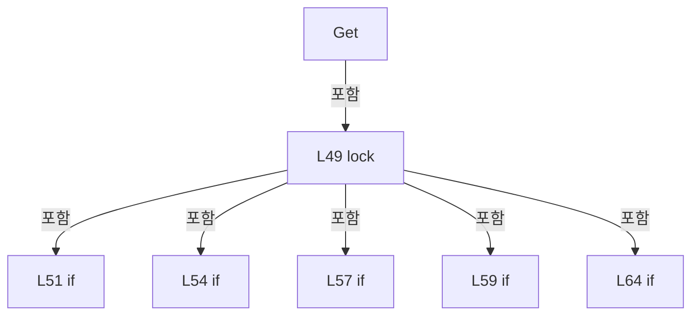

변경 전 점검: 입력/반환 타입, 위 호출자, 예외/취소 경로, 공유 상태와 저장·전송 소비자를 함께 확인합니다. 값의 단위나 물리 방향을 이름만으로 확정하지 않습니다.

### MethodDeclaration `Collect` · L78–92

[Drilling.Common/Automation/CAutomationStatusSnapshotService.cs:78–92](https://github.com/kjuws10-rgb/A3Drilling/blob/5aee8e58439c9b455cae7c9593c9be986c3e682e/Drilling.Common/Automation/CAutomationStatusSnapshotService.cs#L78-L92)

| 항목 | 실제 추출 값 |
| --- | --- |
| 서명 | System.Threading.Tasks.Task Drilling.Common.Automation.CAutomationStatusSnapshotService.Collect() |
| 접근/수식자 | Private / private, async |
| 반환/값 타입 | System.Threading.Tasks.Task |
| 소속 타입 | NamedType:Drilling.Common.Automation.CAutomationStatusSnapshotService |

현재 부분 분석에서 직접 연결된 호출자는 없습니다. XAML/이벤트/인터페이스·델리게이트·외부 진입을 추가 확인해야 하며, 미사용으로 판정한 것이 아닙니다.

호출하는 대상과 해석 범위:

| 원본 행 | 표현식 | 분석 상태 | 대상/소스 위치 |
| --- | --- | --- | --- |
| 84 | Stopwatch.StartNew | resolved | System.Diagnostics.Stopwatch System.Diagnostics.Stopwatch.StartNew() |
| 85 | CollectOnce(_stop.Token).ConfigureAwait | resolved | System.Runtime.CompilerServices.ConfiguredTaskAwaitable System.Threading.Tasks.Task.ConfigureAwait(bool) |
| 85 | CollectOnce | resolved | System.Threading.Tasks.Task Drilling.Common.Automation.CAutomationStatusSnapshotService.CollectOnce(System.Threading.CancellationToken) · Drilling.Common/Automation/CAutomationStatusSnapshotService.cs:94 |
| 86 | Task.Delay(Math.Max(1, 1000 - (int)Math.Min(1000, elapsed.ElapsedMilliseconds)), _stop.Token).ConfigureAwait | resolved | System.Runtime.CompilerServices.ConfiguredTaskAwaitable System.Threading.Tasks.Task.ConfigureAwait(bool) |
| 86 | Task.Delay | resolved | System.Threading.Tasks.Task System.Threading.Tasks.Task.Delay(int, System.Threading.CancellationToken) |
| 86 | Math.Max | resolved | int System.Math.Max(int, int) |
| 86 | Math.Min | resolved | long System.Math.Min(long, long) |

본문의 실제 연산·분기·예외·반환 순서(원문 위치 순):

| 원본 행 | 종류 | 주석 해설 |
| --- | --- | --- |
| 80 | try | 예외 처리 범위입니다: try |
| 82 | while | 조건을 먼저 확인하며 반복합니다: while (!_stop.IsCancellationRequested) |
| 84 | call | 함수·델리게이트 또는 객체 생성자를 호출합니다: Stopwatch.StartNew() |
| 84 | local-declaration | 지역 변수를 선언합니다: var elapsed = Stopwatch.StartNew(); |
| 84 | variable-initializer | 변수의 초기값을 지정합니다: elapsed = Stopwatch.StartNew() |
| 85 | await | 비동기 완료를 기다립니다: await CollectOnce(_stop.Token).ConfigureAwait(false) |
| 85 | call | 함수·델리게이트 또는 객체 생성자를 호출합니다: CollectOnce(_stop.Token).ConfigureAwait(false) |
| 85 | call | 함수·델리게이트 또는 객체 생성자를 호출합니다: CollectOnce(_stop.Token) |
| 86 | await | 비동기 완료를 기다립니다: await Task.Delay(Math.Max(1, 1000 - (int)Math.Min(1000, elapsed.ElapsedMilliseconds)), _stop.Token).ConfigureAwait(false) |
| 86 | call | 함수·델리게이트 또는 객체 생성자를 호출합니다: Task.Delay(Math.Max(1, 1000 - (int)Math.Min(1000, elapsed.ElapsedMilliseconds)), _stop.Token).ConfigureAwait(false) |
| 86 | call | 함수·델리게이트 또는 객체 생성자를 호출합니다: Task.Delay(Math.Max(1, 1000 - (int)Math.Min(1000, elapsed.ElapsedMilliseconds)), _stop.Token) |
| 86 | call | 함수·델리게이트 또는 객체 생성자를 호출합니다: Math.Max(1, 1000 - (int)Math.Min(1000, elapsed.ElapsedMilliseconds)) |
| 86 | call | 함수·델리게이트 또는 객체 생성자를 호출합니다: Math.Min(1000, elapsed.ElapsedMilliseconds) |
| 89 | catch | 지정 예외를 처리합니다: catch (OperationCanceledException) when (_stop.IsCancellationRequested) |

제어 구문의 포함 구조(실제 실행 순서/CFG가 아닌 구문 탐색 그림):

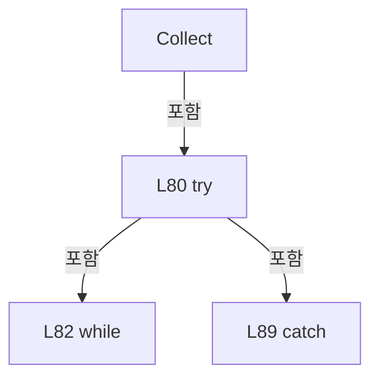

변경 전 점검: 입력/반환 타입, 위 호출자, 예외/취소 경로, 공유 상태와 저장·전송 소비자를 함께 확인합니다. 값의 단위나 물리 방향을 이름만으로 확정하지 않습니다.

### MethodDeclaration `CollectOnce` · L94–166

[Drilling.Common/Automation/CAutomationStatusSnapshotService.cs:94–166](https://github.com/kjuws10-rgb/A3Drilling/blob/5aee8e58439c9b455cae7c9593c9be986c3e682e/Drilling.Common/Automation/CAutomationStatusSnapshotService.cs#L94-L166)

| 항목 | 실제 추출 값 |
| --- | --- |
| 서명 | System.Threading.Tasks.Task Drilling.Common.Automation.CAutomationStatusSnapshotService.CollectOnce(System.Threading.CancellationToken) |
| 접근/수식자 | Internal / internal |
| 반환/값 타입 | System.Threading.Tasks.Task |
| 소속 타입 | NamedType:Drilling.Common.Automation.CAutomationStatusSnapshotService |

입력 계약:

| 이름 | 타입 | 전달 | 선택/기본값 |
| --- | --- | --- | --- |
| token | System.Threading.CancellationToken | None | False /  |

정적 호출자로 확인된 위치:

| 호출 파일/행 | 호출 표현식 | 런타임 분기 가능 |
| --- | --- | --- |
| [Drilling.Common/Automation/CAutomationStatusSnapshotService.cs:85–85](https://github.com/kjuws10-rgb/A3Drilling/blob/5aee8e58439c9b455cae7c9593c9be986c3e682e/Drilling.Common/Automation/CAutomationStatusSnapshotService.cs#L85-L85) | CollectOnce | False |

호출하는 대상과 해석 범위:

| 원본 행 | 표현식 | 분석 상태 | 대상/소스 위치 |
| --- | --- | --- | --- |
| 101 | _entries.Where(pair => now - pair.Value.LastRequested > LeaseMs).Select(pair => pair.Key).ToArray | resolved | string[] System.Collections.Generic.IEnumerable<string>.ToArray<string>() |
| 101 | _entries.Where(pair => now - pair.Value.LastRequested > LeaseMs).Select | resolved | System.Collections.Generic.IEnumerable<string> System.Collections.Generic.IEnumerable<System.Collections.Generic.KeyValuePair<string, Drilling.Common.Automation.CAutomationStatusSnapshotService.Entry>>.Select<System.Collections.Generic.KeyValuePair<string, Drilling.Common.Automation.CAutomationStatusSnapshotService.Entry>, string>(System.Func<System.Collections.Generic.KeyValuePair<string, Drilling.Common.Automation.CAutomationStatusSnapshotService.Entry>, string>) |
| 101 | _entries.Where | resolved | System.Collections.Generic.IEnumerable<System.Collections.Generic.KeyValuePair<string, Drilling.Common.Automation.CAutomationStatusSnapshotService.Entry>> System.Collections.Generic.IEnumerable<System.Collections.Generic.KeyValuePair<string, Drilling.Common.Automation.CAutomationStatusSnapshotService.Entry>>.Where<System.Collections.Generic.KeyValuePair<string, Drilling.Common.Automation.CAutomationStatusSnapshotService.Entry>>(System.Func<System.Collections.Generic.KeyValuePair<string, Drilling.Common.Automation.CAutomationStatusSnapshotService.Entry>, bool>) |
| 102 | _entries.Remove | resolved | bool System.Collections.Generic.Dictionary<string, Drilling.Common.Automation.CAutomationStatusSnapshotService.Entry>.Remove(string) |
| 103 | _entries.Values.ToArray | resolved | Drilling.Common.Automation.CAutomationStatusSnapshotService.Entry[] System.Collections.Generic.IEnumerable<Drilling.Common.Automation.CAutomationStatusSnapshotService.Entry>.ToArray<Drilling.Common.Automation.CAutomationStatusSnapshotService.Entry>() |
| 104 | PrepareConfiguredHomeSpeedReads | resolved | Drilling.Common.Automation.CAutomationStatusSnapshotService.ConfiguredHomeSpeedRead[] Drilling.Common.Automation.CAutomationStatusSnapshotService.PrepareConfiguredHomeSpeedReads(long) · Drilling.Common/Automation/CAutomationStatusSnapshotService.cs:252 |
| 108 | Task.WhenAll | resolved | System.Threading.Tasks.Task System.Threading.Tasks.Task.WhenAll(System.Collections.Generic.IEnumerable<System.Threading.Tasks.Task>) |
| 108 | entries.Select(entry => entry.Controller).Concat(configuredReads.Select(read => read.Controller)).Distinct().Select | resolved | System.Collections.Generic.IEnumerable<System.Threading.Tasks.Task> System.Collections.Generic.IEnumerable<int>.Select<int, System.Threading.Tasks.Task>(System.Func<int, System.Threading.Tasks.Task>) |
| 108 | entries.Select(entry => entry.Controller).Concat(configuredReads.Select(read => read.Controller)).Distinct | resolved | System.Collections.Generic.IEnumerable<int> System.Collections.Generic.IEnumerable<int>.Distinct<int>() |
| 108 | entries.Select(entry => entry.Controller).Concat | resolved | System.Collections.Generic.IEnumerable<int> System.Collections.Generic.IEnumerable<int>.Concat<int>(System.Collections.Generic.IEnumerable<int>) |
| 108 | entries.Select | resolved | System.Collections.Generic.IEnumerable<int> System.Collections.Generic.IEnumerable<Drilling.Common.Automation.CAutomationStatusSnapshotService.Entry>.Select<Drilling.Common.Automation.CAutomationStatusSnapshotService.Entry, int>(System.Func<Drilling.Common.Automation.CAutomationStatusSnapshotService.Entry, int>) |
| 108 | configuredReads.Select | resolved | System.Collections.Generic.IEnumerable<int> System.Collections.Generic.IEnumerable<Drilling.Common.Automation.CAutomationStatusSnapshotService.ConfiguredHomeSpeedRead>.Select<Drilling.Common.Automation.CAutomationStatusSnapshotService.ConfiguredHomeSpeedRead, int>(System.Func<Drilling.Common.Automation.CAutomationStatusSnapshotService.ConfiguredHomeSpeedRead, int>) |
| 108 | Task.Run | resolved | System.Threading.Tasks.Task System.Threading.Tasks.Task.Run(System.Action, System.Threading.CancellationToken) |
| 110 | entries.Where | resolved | System.Collections.Generic.IEnumerable<Drilling.Common.Automation.CAutomationStatusSnapshotService.Entry> System.Collections.Generic.IEnumerable<Drilling.Common.Automation.CAutomationStatusSnapshotService.Entry>.Where<Drilling.Common.Automation.CAutomationStatusSnapshotService.Entry>(System.Func<Drilling.Common.Automation.CAutomationStatusSnapshotService.Entry, bool>) |
| 112 | token.ThrowIfCancellationRequested | resolved | void System.Threading.CancellationToken.ThrowIfCancellationRequested() |
| 120 | Stopwatch.GetTimestamp | resolved | long System.Diagnostics.Stopwatch.GetTimestamp() |
| 128 | _automation.IsSimul | resolved | bool Drilling.Common.Automation.CAutomationManager.IsSimul(int) · Drilling.Common/Automation/CAutomationManager.cs:63 |
| 128 | _automation.IsConnect | resolved | bool Drilling.Common.Automation.CAutomationManager.IsConnect(int) · Drilling.Common/Automation/CAutomationManager.cs:58 |
| 132 | CancellationTokenSource.CreateLinkedTokenSource | resolved | System.Threading.CancellationTokenSource System.Threading.CancellationTokenSource.CreateLinkedTokenSource(System.Threading.CancellationToken) |
| 133 | timeout.CancelAfter | resolved | void System.Threading.CancellationTokenSource.CancelAfter(int) |
| 134 | entry.Read | resolved · 동적 구현 선택 가능 | object System.Func<System.Threading.CancellationToken, object>.Invoke(System.Threading.CancellationToken) |
| 135 | timeout.Token.ThrowIfCancellationRequested | resolved | void System.Threading.CancellationToken.ThrowIfCancellationRequested() |
| 163 | configuredReads.Where | resolved | System.Collections.Generic.IEnumerable<Drilling.Common.Automation.CAutomationStatusSnapshotService.ConfiguredHomeSpeedRead> System.Collections.Generic.IEnumerable<Drilling.Common.Automation.CAutomationStatusSnapshotService.ConfiguredHomeSpeedRead>.Where<Drilling.Common.Automation.CAutomationStatusSnapshotService.ConfiguredHomeSpeedRead>(System.Func<Drilling.Common.Automation.CAutomationStatusSnapshotService.ConfiguredHomeSpeedRead, bool>) |
| 164 | CollectConfiguredHomeSpeeds | resolved | void Drilling.Common.Automation.CAutomationStatusSnapshotService.CollectConfiguredHomeSpeeds(Drilling.Common.Automation.CAutomationStatusSnapshotService.ConfiguredHomeSpeedRead, System.Threading.CancellationToken) · Drilling.Common/Automation/CAutomationStatusSnapshotService.cs:279 |

본문의 실제 연산·분기·예외·반환 순서(원문 위치 순):

| 원본 행 | 종류 | 주석 해설 |
| --- | --- | --- |
| 96 | local-declaration | 지역 변수를 선언합니다: Entry[] entries; |
| 97 | local-declaration | 지역 변수를 선언합니다: ConfiguredHomeSpeedRead[] configuredReads; |
| 98 | lock | 공유 상태의 임계 구역에 진입합니다: lock (_sync) |
| 100 | local-declaration | 지역 변수를 선언합니다: var now = Environment.TickCount64; |
| 100 | variable-initializer | 변수의 초기값을 지정합니다: now = Environment.TickCount64 |
| 101 | call | 함수·델리게이트 또는 객체 생성자를 호출합니다: _entries.Where(pair => now - pair.Value.LastRequested > LeaseMs).Select(pair => pair.Key).ToArray() |
| 101 | call | 함수·델리게이트 또는 객체 생성자를 호출합니다: _entries.Where(pair => now - pair.Value.LastRequested > LeaseMs).Select(pair => pair.Key) |
| 101 | call | 함수·델리게이트 또는 객체 생성자를 호출합니다: _entries.Where(pair => now - pair.Value.LastRequested > LeaseMs) |
| 101 | foreach | 컬렉션 요소를 순회합니다: foreach (var key in _entries.Where(pair => now - pair.Value.LastRequested > LeaseMs).Select(pair => pair.Key).ToArray()) |
| 102 | call | 함수·델리게이트 또는 객체 생성자를 호출합니다: _entries.Remove(key) |
| 103 | assignment | 값을 대상에 대입합니다: entries = _entries.Values.ToArray() |
| 103 | call | 함수·델리게이트 또는 객체 생성자를 호출합니다: _entries.Values.ToArray() |
| 104 | assignment | 값을 대상에 대입합니다: configuredReads = PrepareConfiguredHomeSpeedReads(now) |
| 104 | call | 함수·델리게이트 또는 객체 생성자를 호출합니다: PrepareConfiguredHomeSpeedReads(now) |
| 108 | call | 함수·델리게이트 또는 객체 생성자를 호출합니다: entries.Select(entry => entry.Controller).Concat(configuredReads.Select(read => read.Controller)).Distinct() |
| 108 | call | 함수·델리게이트 또는 객체 생성자를 호출합니다: entries.Select(entry => entry.Controller).Concat(configuredReads.Select(read => read.Controller)) |
| 108 | call | 함수·델리게이트 또는 객체 생성자를 호출합니다: entries.Select(entry => entry.Controller) |
| 108 | call | 함수·델리게이트 또는 객체 생성자를 호출합니다: configuredReads.Select(read => read.Controller) |
| 108 | call | 함수·델리게이트 또는 객체 생성자를 호출합니다: Task.WhenAll(entries.Select(entry => entry.Controller).Concat(configuredReads.Select(read => read.Controller)).Distinct().Select(controller => Task.Run(() => { foreach (var entry in entries.Where(entry => entry.Controlle… |
| 108 | call | 함수·델리게이트 또는 객체 생성자를 호출합니다: entries.Select(entry => entry.Controller).Concat(configuredReads.Select(read => read.Controller)).Distinct().Select(controller => Task.Run(() => { foreach (var entry in entries.Where(entry => entry.Controller == controll… |
| 108 | call | 함수·델리게이트 또는 객체 생성자를 호출합니다: Task.Run(() => { foreach (var entry in entries.Where(entry => entry.Controller == controller)) { token.ThrowIfCancellationRequested(); long generation; long collectedTimestamp; lock (_sync) { if (_disposed) return; gener… |
| 108 | return | 호출자에게 값 또는 제어를 반환합니다: return Task.WhenAll(entries.Select(entry => entry.Controller).Concat(configuredReads.Select(read => read.Controller)).Distinct().Select(controller => Task.Run(() => { foreach (var entry in entries.Where(entry => entry.Controller = |
| 110 | call | 함수·델리게이트 또는 객체 생성자를 호출합니다: entries.Where(entry => entry.Controller == controller) |
| 110 | foreach | 컬렉션 요소를 순회합니다: foreach (var entry in entries.Where(entry => entry.Controller == controller)) |
| 112 | call | 함수·델리게이트 또는 객체 생성자를 호출합니다: token.ThrowIfCancellationRequested() |
| 113 | local-declaration | 지역 변수를 선언합니다: long generation; |
| 114 | local-declaration | 지역 변수를 선언합니다: long collectedTimestamp; |
| 115 | lock | 공유 상태의 임계 구역에 진입합니다: lock (_sync) |
| 117 | if | 조건에 따라 분기합니다: if (_disposed) |
| 118 | return | 호출자에게 값 또는 제어를 반환합니다: return; |
| 119 | assignment | 값을 대상에 대입합니다: generation = entry.Generation |
| 120 | assignment | 값을 대상에 대입합니다: collectedTimestamp = Stopwatch.GetTimestamp() |
| 120 | call | 함수·델리게이트 또는 객체 생성자를 호출합니다: Stopwatch.GetTimestamp() |
| 123 | local-declaration | 지역 변수를 선언합니다: object? value = null; |
| 123 | variable-initializer | 변수의 초기값을 지정합니다: value = null |
| 124 | local-declaration | 지역 변수를 선언합니다: var state = "OK"; |
| 124 | variable-initializer | 변수의 초기값을 지정합니다: state = "OK" |
| 125 | local-declaration | 지역 변수를 선언합니다: var detail = "Shared Automation snapshot"; |
| 125 | variable-initializer | 변수의 초기값을 지정합니다: detail = "Shared Automation snapshot" |
| 126 | try | 예외 처리 범위입니다: try |
| 128 | call | 함수·델리게이트 또는 객체 생성자를 호출합니다: _automation.IsSimul(entry.Controller) |
| 128 | call | 함수·델리게이트 또는 객체 생성자를 호출합니다: _automation.IsConnect(entry.Controller) |
| 128 | if | 조건에 따라 분기합니다: if (!_automation.IsSimul(entry.Controller) && !_automation.IsConnect(entry.Controller)) |
| 129 | assignment | 값을 대상에 대입합니다: (state, detail) = ("OFFLINE", "Automation not connected.") |
| 130 | else | 앞 조건이 거짓인 경로입니다: else |
| 132 | call | 함수·델리게이트 또는 객체 생성자를 호출합니다: CancellationTokenSource.CreateLinkedTokenSource(token) |
| 132 | using-declaration | 정리할 자원을 선언합니다: using var timeout = CancellationTokenSource.CreateLinkedTokenSource(token); |
| 132 | variable-initializer | 변수의 초기값을 지정합니다: timeout = CancellationTokenSource.CreateLinkedTokenSource(token) |
| 133 | call | 함수·델리게이트 또는 객체 생성자를 호출합니다: timeout.CancelAfter(2000) |
| 134 | assignment | 값을 대상에 대입합니다: value = entry.Read(timeout.Token) |
| 134 | call | 함수·델리게이트 또는 객체 생성자를 호출합니다: entry.Read(timeout.Token) |
| 135 | call | 함수·델리게이트 또는 객체 생성자를 호출합니다: timeout.Token.ThrowIfCancellationRequested() |
| 138 | catch | 지정 예외를 처리합니다: catch (OperationCanceledException) when (token.IsCancellationRequested) |
| 140 | throw | 예외를 발생/전달합니다: throw; |
| 142 | catch | 지정 예외를 처리합니다: catch (Exception exception) |
| 144 | assignment | 값을 대상에 대입합니다: (state, detail) = ("ERROR", exception.Message) |
| 147 | lock | 공유 상태의 임계 구역에 진입합니다: lock (_sync) |
| 149 | if | 조건에 따라 분기합니다: if (_disposed) |
| 150 | return | 호출자에게 값 또는 제어를 반환합니다: return; |
| 151 | if | 조건에 따라 분기합니다: if (entry.Generation != generation) |
| 152 | continue | 다음 반복으로 진행합니다: continue; |
| 153 | assignment | 값을 대상에 대입합니다: entry.Value = value |
| 154 | assignment | 값을 대상에 대입합니다: entry.State = state |
| 155 | assignment | 값을 대상에 대입합니다: entry.Detail = detail |
| 156 | assignment | 값을 대상에 대입합니다: entry.UpdatedAt = DateTimeOffset.Now |
| 157 | assignment | 값을 대상에 대입합니다: entry.CollectedAt = Environment.TickCount64 |
| 158 | assignment | 값을 대상에 대입합니다: entry.CollectedTimestamp = collectedTimestamp |
| 163 | call | 함수·델리게이트 또는 객체 생성자를 호출합니다: configuredReads.Where(read => read.Controller == controller) |
| 163 | foreach | 컬렉션 요소를 순회합니다: foreach (var read in configuredReads.Where(read => read.Controller == controller)) |
| 164 | call | 함수·델리게이트 또는 객체 생성자를 호출합니다: CollectConfiguredHomeSpeeds(read, token) |

제어 구문의 포함 구조(실제 실행 순서/CFG가 아닌 구문 탐색 그림):

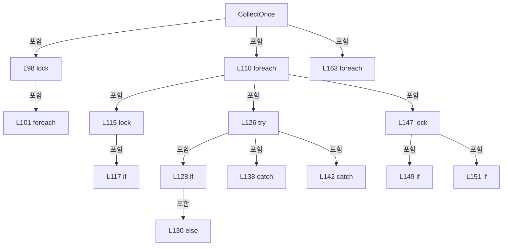

변경 전 점검: 입력/반환 타입, 위 호출자, 예외/취소 경로, 공유 상태와 저장·전송 소비자를 함께 확인합니다. 값의 단위나 물리 방향을 이름만으로 확정하지 않습니다.

### MethodDeclaration `Dispose` · L168–185

[Drilling.Common/Automation/CAutomationStatusSnapshotService.cs:168–185](https://github.com/kjuws10-rgb/A3Drilling/blob/5aee8e58439c9b455cae7c9593c9be986c3e682e/Drilling.Common/Automation/CAutomationStatusSnapshotService.cs#L168-L185)

| 항목 | 실제 추출 값 |
| --- | --- |
| 서명 | void Drilling.Common.Automation.CAutomationStatusSnapshotService.Dispose() |
| 접근/수식자 | Public / public |
| 반환/값 타입 | void |
| 소속 타입 | NamedType:Drilling.Common.Automation.CAutomationStatusSnapshotService |

정적 호출자로 확인된 위치:

| 호출 파일/행 | 호출 표현식 | 런타임 분기 가능 |
| --- | --- | --- |
| [Drilling.Common/Managers/CManager.cs:277–277](https://github.com/kjuws10-rgb/A3Drilling/blob/5aee8e58439c9b455cae7c9593c9be986c3e682e/Drilling.Common/Managers/CManager.cs#L277-L277) | _automationManager.StatusSnapshots.Dispose | False |

호출하는 대상과 해석 범위:

| 원본 행 | 표현식 | 분석 상태 | 대상/소스 위치 |
| --- | --- | --- | --- |
| 175 | _entries.Clear | resolved | void System.Collections.Generic.Dictionary<string, Drilling.Common.Automation.CAutomationStatusSnapshotService.Entry>.Clear() |
| 176 | _configuredHomeSpeedEntries.Clear | resolved | void System.Collections.Generic.Dictionary<int, Drilling.Common.Automation.CAutomationStatusSnapshotService.ConfiguredHomeSpeedEntry>.Clear() |
| 179 | _stop.Cancel | resolved | void System.Threading.CancellationTokenSource.Cancel() |
| 182 | worker.ContinueWith | resolved | System.Threading.Tasks.Task System.Threading.Tasks.Task.ContinueWith(System.Action<System.Threading.Tasks.Task>, System.Threading.Tasks.TaskScheduler) |
| 182 | _stop.Dispose | resolved | void System.Threading.CancellationTokenSource.Dispose() |
| 184 | _stop.Dispose | resolved | void System.Threading.CancellationTokenSource.Dispose() |

본문의 실제 연산·분기·예외·반환 순서(원문 위치 순):

| 원본 행 | 종류 | 주석 해설 |
| --- | --- | --- |
| 170 | lock | 공유 상태의 임계 구역에 진입합니다: lock (_sync) |
| 172 | if | 조건에 따라 분기합니다: if (_disposed) |
| 173 | return | 호출자에게 값 또는 제어를 반환합니다: return; |
| 174 | assignment | 값을 대상에 대입합니다: _disposed = true |
| 175 | call | 함수·델리게이트 또는 객체 생성자를 호출합니다: _entries.Clear() |
| 176 | call | 함수·델리게이트 또는 객체 생성자를 호출합니다: _configuredHomeSpeedEntries.Clear() |
| 179 | call | 함수·델리게이트 또는 객체 생성자를 호출합니다: _stop.Cancel() |
| 181 | if | 조건에 따라 분기합니다: if (_worker is { } worker) |
| 182 | assignment | 값을 대상에 대입합니다: _ = worker.ContinueWith(_ => _stop.Dispose(), TaskScheduler.Default) |
| 182 | call | 함수·델리게이트 또는 객체 생성자를 호출합니다: worker.ContinueWith(_ => _stop.Dispose(), TaskScheduler.Default) |
| 182 | call | 함수·델리게이트 또는 객체 생성자를 호출합니다: _stop.Dispose() |
| 183 | else | 앞 조건이 거짓인 경로입니다: else |
| 184 | call | 함수·델리게이트 또는 객체 생성자를 호출합니다: _stop.Dispose() |

제어 구문의 포함 구조(실제 실행 순서/CFG가 아닌 구문 탐색 그림):

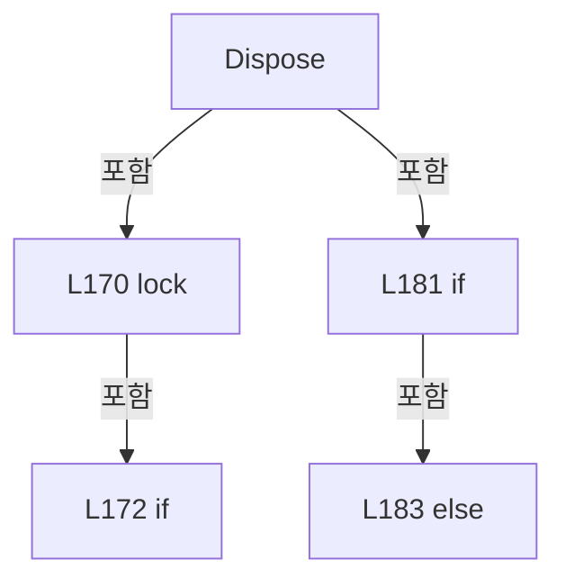

변경 전 점검: 입력/반환 타입, 위 호출자, 예외/취소 경로, 공유 상태와 저장·전송 소비자를 함께 확인합니다. 값의 단위나 물리 방향을 이름만으로 확정하지 않습니다.

### PropertyDeclaration `Controller` · L189–189

[Drilling.Common/Automation/CAutomationStatusSnapshotService.cs:189–189](https://github.com/kjuws10-rgb/A3Drilling/blob/5aee8e58439c9b455cae7c9593c9be986c3e682e/Drilling.Common/Automation/CAutomationStatusSnapshotService.cs#L189-L189)

| 항목 | 실제 추출 값 |
| --- | --- |
| 서명 | int Drilling.Common.Automation.CAutomationStatusSnapshotService.Entry.Controller |
| 접근/수식자 | Public / public |
| 반환/값 타입 | int |
| 소속 타입 | NamedType:Drilling.Common.Automation.CAutomationStatusSnapshotService.Entry |

현재 부분 분석에서 직접 연결된 호출자는 없습니다. XAML/이벤트/인터페이스·델리게이트·외부 진입을 추가 확인해야 하며, 미사용으로 판정한 것이 아닙니다.

변경 전 점검: 입력/반환 타입, 위 호출자, 예외/취소 경로, 공유 상태와 저장·전송 소비자를 함께 확인합니다. 값의 단위나 물리 방향을 이름만으로 확정하지 않습니다.

### GetAccessorDeclaration `get_Controller` · L189–189

[Drilling.Common/Automation/CAutomationStatusSnapshotService.cs:189–189](https://github.com/kjuws10-rgb/A3Drilling/blob/5aee8e58439c9b455cae7c9593c9be986c3e682e/Drilling.Common/Automation/CAutomationStatusSnapshotService.cs#L189-L189)

| 항목 | 실제 추출 값 |
| --- | --- |
| 서명 | int Drilling.Common.Automation.CAutomationStatusSnapshotService.Entry.Controller.get |
| 접근/수식자 | Public / get |
| 반환/값 타입 | int |
| 소속 타입 | NamedType:Drilling.Common.Automation.CAutomationStatusSnapshotService.Entry |

현재 부분 분석에서 직접 연결된 호출자는 없습니다. XAML/이벤트/인터페이스·델리게이트·외부 진입을 추가 확인해야 하며, 미사용으로 판정한 것이 아닙니다.

변경 전 점검: 입력/반환 타입, 위 호출자, 예외/취소 경로, 공유 상태와 저장·전송 소비자를 함께 확인합니다. 값의 단위나 물리 방향을 이름만으로 확정하지 않습니다.

### PropertyDeclaration `Read` · L190–190

[Drilling.Common/Automation/CAutomationStatusSnapshotService.cs:190–190](https://github.com/kjuws10-rgb/A3Drilling/blob/5aee8e58439c9b455cae7c9593c9be986c3e682e/Drilling.Common/Automation/CAutomationStatusSnapshotService.cs#L190-L190)

| 항목 | 실제 추출 값 |
| --- | --- |
| 서명 | System.Func<System.Threading.CancellationToken, object> Drilling.Common.Automation.CAutomationStatusSnapshotService.Entry.Read |
| 접근/수식자 | Public / public |
| 반환/값 타입 | System.Func<System.Threading.CancellationToken, object> |
| 소속 타입 | NamedType:Drilling.Common.Automation.CAutomationStatusSnapshotService.Entry |

현재 부분 분석에서 직접 연결된 호출자는 없습니다. XAML/이벤트/인터페이스·델리게이트·외부 진입을 추가 확인해야 하며, 미사용으로 판정한 것이 아닙니다.

변경 전 점검: 입력/반환 타입, 위 호출자, 예외/취소 경로, 공유 상태와 저장·전송 소비자를 함께 확인합니다. 값의 단위나 물리 방향을 이름만으로 확정하지 않습니다.

### GetAccessorDeclaration `get_Read` · L190–190

[Drilling.Common/Automation/CAutomationStatusSnapshotService.cs:190–190](https://github.com/kjuws10-rgb/A3Drilling/blob/5aee8e58439c9b455cae7c9593c9be986c3e682e/Drilling.Common/Automation/CAutomationStatusSnapshotService.cs#L190-L190)

| 항목 | 실제 추출 값 |
| --- | --- |
| 서명 | System.Func<System.Threading.CancellationToken, object> Drilling.Common.Automation.CAutomationStatusSnapshotService.Entry.Read.get |
| 접근/수식자 | Public / get |
| 반환/값 타입 | System.Func<System.Threading.CancellationToken, object> |
| 소속 타입 | NamedType:Drilling.Common.Automation.CAutomationStatusSnapshotService.Entry |

현재 부분 분석에서 직접 연결된 호출자는 없습니다. XAML/이벤트/인터페이스·델리게이트·외부 진입을 추가 확인해야 하며, 미사용으로 판정한 것이 아닙니다.

변경 전 점검: 입력/반환 타입, 위 호출자, 예외/취소 경로, 공유 상태와 저장·전송 소비자를 함께 확인합니다. 값의 단위나 물리 방향을 이름만으로 확정하지 않습니다.

### FieldDeclaration `LastRequested` · L192–192

[Drilling.Common/Automation/CAutomationStatusSnapshotService.cs:192–192](https://github.com/kjuws10-rgb/A3Drilling/blob/5aee8e58439c9b455cae7c9593c9be986c3e682e/Drilling.Common/Automation/CAutomationStatusSnapshotService.cs#L192-L192)

| 항목 | 실제 추출 값 |
| --- | --- |
| 서명 | long Drilling.Common.Automation.CAutomationStatusSnapshotService.Entry.LastRequested |
| 접근/수식자 | Public / public |
| 반환/값 타입 | long |
| 소속 타입 | NamedType:Drilling.Common.Automation.CAutomationStatusSnapshotService.Entry |

현재 부분 분석에서 직접 연결된 호출자는 없습니다. XAML/이벤트/인터페이스·델리게이트·외부 진입을 추가 확인해야 하며, 미사용으로 판정한 것이 아닙니다.

변경 전 점검: 입력/반환 타입, 위 호출자, 예외/취소 경로, 공유 상태와 저장·전송 소비자를 함께 확인합니다. 값의 단위나 물리 방향을 이름만으로 확정하지 않습니다.

### FieldDeclaration `CollectedAt` · L193–193

[Drilling.Common/Automation/CAutomationStatusSnapshotService.cs:193–193](https://github.com/kjuws10-rgb/A3Drilling/blob/5aee8e58439c9b455cae7c9593c9be986c3e682e/Drilling.Common/Automation/CAutomationStatusSnapshotService.cs#L193-L193)

| 항목 | 실제 추출 값 |
| --- | --- |
| 서명 | long Drilling.Common.Automation.CAutomationStatusSnapshotService.Entry.CollectedAt |
| 접근/수식자 | Public / public |
| 반환/값 타입 | long |
| 소속 타입 | NamedType:Drilling.Common.Automation.CAutomationStatusSnapshotService.Entry |

현재 부분 분석에서 직접 연결된 호출자는 없습니다. XAML/이벤트/인터페이스·델리게이트·외부 진입을 추가 확인해야 하며, 미사용으로 판정한 것이 아닙니다.

변경 전 점검: 입력/반환 타입, 위 호출자, 예외/취소 경로, 공유 상태와 저장·전송 소비자를 함께 확인합니다. 값의 단위나 물리 방향을 이름만으로 확정하지 않습니다.

### FieldDeclaration `Value` · L194–194

[Drilling.Common/Automation/CAutomationStatusSnapshotService.cs:194–194](https://github.com/kjuws10-rgb/A3Drilling/blob/5aee8e58439c9b455cae7c9593c9be986c3e682e/Drilling.Common/Automation/CAutomationStatusSnapshotService.cs#L194-L194)

| 항목 | 실제 추출 값 |
| --- | --- |
| 서명 | object? Drilling.Common.Automation.CAutomationStatusSnapshotService.Entry.Value |
| 접근/수식자 | Public / public |
| 반환/값 타입 | object? |
| 소속 타입 | NamedType:Drilling.Common.Automation.CAutomationStatusSnapshotService.Entry |

현재 부분 분석에서 직접 연결된 호출자는 없습니다. XAML/이벤트/인터페이스·델리게이트·외부 진입을 추가 확인해야 하며, 미사용으로 판정한 것이 아닙니다.

변경 전 점검: 입력/반환 타입, 위 호출자, 예외/취소 경로, 공유 상태와 저장·전송 소비자를 함께 확인합니다. 값의 단위나 물리 방향을 이름만으로 확정하지 않습니다.

### FieldDeclaration `State` · L195–195

[Drilling.Common/Automation/CAutomationStatusSnapshotService.cs:195–195](https://github.com/kjuws10-rgb/A3Drilling/blob/5aee8e58439c9b455cae7c9593c9be986c3e682e/Drilling.Common/Automation/CAutomationStatusSnapshotService.cs#L195-L195)

| 항목 | 실제 추출 값 |
| --- | --- |
| 서명 | string Drilling.Common.Automation.CAutomationStatusSnapshotService.Entry.State |
| 접근/수식자 | Public / public |
| 반환/값 타입 | string |
| 소속 타입 | NamedType:Drilling.Common.Automation.CAutomationStatusSnapshotService.Entry |

현재 부분 분석에서 직접 연결된 호출자는 없습니다. XAML/이벤트/인터페이스·델리게이트·외부 진입을 추가 확인해야 하며, 미사용으로 판정한 것이 아닙니다.

본문의 실제 연산·분기·예외·반환 순서(원문 위치 순):

| 원본 행 | 종류 | 주석 해설 |
| --- | --- | --- |
| 195 | variable-initializer | 변수의 초기값을 지정합니다: State = "LOADING" |

변경 전 점검: 입력/반환 타입, 위 호출자, 예외/취소 경로, 공유 상태와 저장·전송 소비자를 함께 확인합니다. 값의 단위나 물리 방향을 이름만으로 확정하지 않습니다.

### FieldDeclaration `Detail` · L196–196

[Drilling.Common/Automation/CAutomationStatusSnapshotService.cs:196–196](https://github.com/kjuws10-rgb/A3Drilling/blob/5aee8e58439c9b455cae7c9593c9be986c3e682e/Drilling.Common/Automation/CAutomationStatusSnapshotService.cs#L196-L196)

| 항목 | 실제 추출 값 |
| --- | --- |
| 서명 | string Drilling.Common.Automation.CAutomationStatusSnapshotService.Entry.Detail |
| 접근/수식자 | Public / public |
| 반환/값 타입 | string |
| 소속 타입 | NamedType:Drilling.Common.Automation.CAutomationStatusSnapshotService.Entry |

현재 부분 분석에서 직접 연결된 호출자는 없습니다. XAML/이벤트/인터페이스·델리게이트·외부 진입을 추가 확인해야 하며, 미사용으로 판정한 것이 아닙니다.

본문의 실제 연산·분기·예외·반환 순서(원문 위치 순):

| 원본 행 | 종류 | 주석 해설 |
| --- | --- | --- |
| 196 | variable-initializer | 변수의 초기값을 지정합니다: Detail = "" |

변경 전 점검: 입력/반환 타입, 위 호출자, 예외/취소 경로, 공유 상태와 저장·전송 소비자를 함께 확인합니다. 값의 단위나 물리 방향을 이름만으로 확정하지 않습니다.

### FieldDeclaration `UpdatedAt` · L197–197

[Drilling.Common/Automation/CAutomationStatusSnapshotService.cs:197–197](https://github.com/kjuws10-rgb/A3Drilling/blob/5aee8e58439c9b455cae7c9593c9be986c3e682e/Drilling.Common/Automation/CAutomationStatusSnapshotService.cs#L197-L197)

| 항목 | 실제 추출 값 |
| --- | --- |
| 서명 | System.DateTimeOffset Drilling.Common.Automation.CAutomationStatusSnapshotService.Entry.UpdatedAt |
| 접근/수식자 | Public / public |
| 반환/값 타입 | System.DateTimeOffset |
| 소속 타입 | NamedType:Drilling.Common.Automation.CAutomationStatusSnapshotService.Entry |

현재 부분 분석에서 직접 연결된 호출자는 없습니다. XAML/이벤트/인터페이스·델리게이트·외부 진입을 추가 확인해야 하며, 미사용으로 판정한 것이 아닙니다.

변경 전 점검: 입력/반환 타입, 위 호출자, 예외/취소 경로, 공유 상태와 저장·전송 소비자를 함께 확인합니다. 값의 단위나 물리 방향을 이름만으로 확정하지 않습니다.

### FieldDeclaration `Generation` · L198–198

[Drilling.Common/Automation/CAutomationStatusSnapshotService.cs:198–198](https://github.com/kjuws10-rgb/A3Drilling/blob/5aee8e58439c9b455cae7c9593c9be986c3e682e/Drilling.Common/Automation/CAutomationStatusSnapshotService.cs#L198-L198)

| 항목 | 실제 추출 값 |
| --- | --- |
| 서명 | long Drilling.Common.Automation.CAutomationStatusSnapshotService.Entry.Generation |
| 접근/수식자 | Public / public |
| 반환/값 타입 | long |
| 소속 타입 | NamedType:Drilling.Common.Automation.CAutomationStatusSnapshotService.Entry |

현재 부분 분석에서 직접 연결된 호출자는 없습니다. XAML/이벤트/인터페이스·델리게이트·외부 진입을 추가 확인해야 하며, 미사용으로 판정한 것이 아닙니다.

변경 전 점검: 입력/반환 타입, 위 호출자, 예외/취소 경로, 공유 상태와 저장·전송 소비자를 함께 확인합니다. 값의 단위나 물리 방향을 이름만으로 확정하지 않습니다.

### FieldDeclaration `Version` · L199–199

[Drilling.Common/Automation/CAutomationStatusSnapshotService.cs:199–199](https://github.com/kjuws10-rgb/A3Drilling/blob/5aee8e58439c9b455cae7c9593c9be986c3e682e/Drilling.Common/Automation/CAutomationStatusSnapshotService.cs#L199-L199)

| 항목 | 실제 추출 값 |
| --- | --- |
| 서명 | long Drilling.Common.Automation.CAutomationStatusSnapshotService.Entry.Version |
| 접근/수식자 | Public / public |
| 반환/값 타입 | long |
| 소속 타입 | NamedType:Drilling.Common.Automation.CAutomationStatusSnapshotService.Entry |

현재 부분 분석에서 직접 연결된 호출자는 없습니다. XAML/이벤트/인터페이스·델리게이트·외부 진입을 추가 확인해야 하며, 미사용으로 판정한 것이 아닙니다.

변경 전 점검: 입력/반환 타입, 위 호출자, 예외/취소 경로, 공유 상태와 저장·전송 소비자를 함께 확인합니다. 값의 단위나 물리 방향을 이름만으로 확정하지 않습니다.

### FieldDeclaration `CollectedTimestamp` · L200–200

[Drilling.Common/Automation/CAutomationStatusSnapshotService.cs:200–200](https://github.com/kjuws10-rgb/A3Drilling/blob/5aee8e58439c9b455cae7c9593c9be986c3e682e/Drilling.Common/Automation/CAutomationStatusSnapshotService.cs#L200-L200)

| 항목 | 실제 추출 값 |
| --- | --- |
| 서명 | long Drilling.Common.Automation.CAutomationStatusSnapshotService.Entry.CollectedTimestamp |
| 접근/수식자 | Public / public |
| 반환/값 타입 | long |
| 소속 타입 | NamedType:Drilling.Common.Automation.CAutomationStatusSnapshotService.Entry |

현재 부분 분석에서 직접 연결된 호출자는 없습니다. XAML/이벤트/인터페이스·델리게이트·외부 진입을 추가 확인해야 하며, 미사용으로 판정한 것이 아닙니다.

변경 전 점검: 입력/반환 타입, 위 호출자, 예외/취소 경로, 공유 상태와 저장·전송 소비자를 함께 확인합니다. 값의 단위나 물리 방향을 이름만으로 확정하지 않습니다.

### FieldDeclaration `ConfiguredHomeSpeedRefreshMs` · L203–203

[Drilling.Common/Automation/CAutomationStatusSnapshotService.cs:203–203](https://github.com/kjuws10-rgb/A3Drilling/blob/5aee8e58439c9b455cae7c9593c9be986c3e682e/Drilling.Common/Automation/CAutomationStatusSnapshotService.cs#L203-L203)

| 항목 | 실제 추출 값 |
| --- | --- |
| 서명 | int Drilling.Common.Automation.CAutomationStatusSnapshotService.ConfiguredHomeSpeedRefreshMs |
| 접근/수식자 | Private / private, const |
| 반환/값 타입 | int |
| 소속 타입 | NamedType:Drilling.Common.Automation.CAutomationStatusSnapshotService |

현재 부분 분석에서 직접 연결된 호출자는 없습니다. XAML/이벤트/인터페이스·델리게이트·외부 진입을 추가 확인해야 하며, 미사용으로 판정한 것이 아닙니다.

본문의 실제 연산·분기·예외·반환 순서(원문 위치 순):

| 원본 행 | 종류 | 주석 해설 |
| --- | --- | --- |
| 203 | variable-initializer | 변수의 초기값을 지정합니다: ConfiguredHomeSpeedRefreshMs = 10000 |

변경 전 점검: 입력/반환 타입, 위 호출자, 예외/취소 경로, 공유 상태와 저장·전송 소비자를 함께 확인합니다. 값의 단위나 물리 방향을 이름만으로 확정하지 않습니다.

### FieldDeclaration `ConfiguredHomeSpeedStaleMs` · L204–204

[Drilling.Common/Automation/CAutomationStatusSnapshotService.cs:204–204](https://github.com/kjuws10-rgb/A3Drilling/blob/5aee8e58439c9b455cae7c9593c9be986c3e682e/Drilling.Common/Automation/CAutomationStatusSnapshotService.cs#L204-L204)

| 항목 | 실제 추출 값 |
| --- | --- |
| 서명 | int Drilling.Common.Automation.CAutomationStatusSnapshotService.ConfiguredHomeSpeedStaleMs |
| 접근/수식자 | Private / private, const |
| 반환/값 타입 | int |
| 소속 타입 | NamedType:Drilling.Common.Automation.CAutomationStatusSnapshotService |

현재 부분 분석에서 직접 연결된 호출자는 없습니다. XAML/이벤트/인터페이스·델리게이트·외부 진입을 추가 확인해야 하며, 미사용으로 판정한 것이 아닙니다.

본문의 실제 연산·분기·예외·반환 순서(원문 위치 순):

| 원본 행 | 종류 | 주석 해설 |
| --- | --- | --- |
| 204 | variable-initializer | 변수의 초기값을 지정합니다: ConfiguredHomeSpeedStaleMs = 30000 |

변경 전 점검: 입력/반환 타입, 위 호출자, 예외/취소 경로, 공유 상태와 저장·전송 소비자를 함께 확인합니다. 값의 단위나 물리 방향을 이름만으로 확정하지 않습니다.

### FieldDeclaration `_configuredHomeSpeedEntries` · L205–205

[Drilling.Common/Automation/CAutomationStatusSnapshotService.cs:205–205](https://github.com/kjuws10-rgb/A3Drilling/blob/5aee8e58439c9b455cae7c9593c9be986c3e682e/Drilling.Common/Automation/CAutomationStatusSnapshotService.cs#L205-L205)

| 항목 | 실제 추출 값 |
| --- | --- |
| 서명 | System.Collections.Generic.Dictionary<int, Drilling.Common.Automation.CAutomationStatusSnapshotService.ConfiguredHomeSpeedEntry> Drilling.Common.Automation.CAutomationStatusSnapshotService._configuredHomeSpeedEntries |
| 접근/수식자 | Private / private, readonly |
| 반환/값 타입 | System.Collections.Generic.Dictionary<int, Drilling.Common.Automation.CAutomationStatusSnapshotService.ConfiguredHomeSpeedEntry> |
| 소속 타입 | NamedType:Drilling.Common.Automation.CAutomationStatusSnapshotService |

현재 부분 분석에서 직접 연결된 호출자는 없습니다. XAML/이벤트/인터페이스·델리게이트·외부 진입을 추가 확인해야 하며, 미사용으로 판정한 것이 아닙니다.

본문의 실제 연산·분기·예외·반환 순서(원문 위치 순):

| 원본 행 | 종류 | 주석 해설 |
| --- | --- | --- |
| 205 | variable-initializer | 변수의 초기값을 지정합니다: _configuredHomeSpeedEntries = [] |

변경 전 점검: 입력/반환 타입, 위 호출자, 예외/취소 경로, 공유 상태와 저장·전송 소비자를 함께 확인합니다. 값의 단위나 물리 방향을 이름만으로 확정하지 않습니다.

### MethodDeclaration `GetConfiguredHomeSpeeds` · L207–238

[Drilling.Common/Automation/CAutomationStatusSnapshotService.cs:207–238](https://github.com/kjuws10-rgb/A3Drilling/blob/5aee8e58439c9b455cae7c9593c9be986c3e682e/Drilling.Common/Automation/CAutomationStatusSnapshotService.cs#L207-L238)

| 항목 | 실제 추출 값 |
| --- | --- |
| 서명 | Drilling.Common.Automation.ST_AUTOMATION_STATUS_SNAPSHOT<System.Collections.Generic.IReadOnlyDictionary<string, double>> Drilling.Common.Automation.CAutomationStatusSnapshotService.GetConfiguredHomeSpeeds(System.Collections.Generic.IReadOnlyList<string>, int) |
| 접근/수식자 | Public / public |
| 반환/값 타입 | Drilling.Common.Automation.ST_AUTOMATION_STATUS_SNAPSHOT<System.Collections.Generic.IReadOnlyDictionary<string, double>> |
| 소속 타입 | NamedType:Drilling.Common.Automation.CAutomationStatusSnapshotService |

원본 XML 주석:

````xml
/// <summary>Registers requested axes and immediately returns the centrally acquired saved settings.</summary>
````

입력 계약:

| 이름 | 타입 | 전달 | 선택/기본값 |
| --- | --- | --- | --- |
| axes | System.Collections.Generic.IReadOnlyList<string> | None | False /  |
| controller | int | None | False /  |

정적 호출자로 확인된 위치:

| 호출 파일/행 | 호출 표현식 | 런타임 분기 가능 |
| --- | --- | --- |
| [Drilling.UI/Menu/Menus/CMenuManual.cs:1831–1831](https://github.com/kjuws10-rgb/A3Drilling/blob/5aee8e58439c9b455cae7c9593c9be986c3e682e/Drilling.UI/Menu/Menus/CMenuManual.cs#L1831-L1831) | _manager.automation.StatusSnapshots.GetConfiguredHomeSpeeds | False |

호출하는 대상과 해석 범위:

| 원본 행 | 표현식 | 분석 상태 | 대상/소스 위치 |
| --- | --- | --- | --- |
| 209 | ArgumentNullException.ThrowIfNull | resolved | void System.ArgumentNullException.ThrowIfNull(object?, string?) |
| 210 | ArgumentOutOfRangeException.ThrowIfNegative | resolved | void System.ArgumentOutOfRangeException.ThrowIfNegative<int>(int, string?) |
| 211 | axes.Select(CAutomationManager.ValidateConfiguredHomeAxis).Select(axis => axis.ToUpperInvariant()).Distinct(StringComparer.OrdinalIgnoreCase).ToArray | resolved | string[] System.Collections.Generic.IEnumerable<string>.ToArray<string>() |
| 211 | axes.Select(CAutomationManager.ValidateConfiguredHomeAxis).Select(axis => axis.ToUpperInvariant()).Distinct | resolved | System.Collections.Generic.IEnumerable<string> System.Collections.Generic.IEnumerable<string>.Distinct<string>(System.Collections.Generic.IEqualityComparer<string>?) |
| 211 | axes.Select(CAutomationManager.ValidateConfiguredHomeAxis).Select | resolved | System.Collections.Generic.IEnumerable<string> System.Collections.Generic.IEnumerable<string>.Select<string, string>(System.Func<string, string>) |
| 211 | axes.Select | resolved | System.Collections.Generic.IEnumerable<string> System.Collections.Generic.IEnumerable<string>.Select<string, string>(System.Func<string, string>) |
| 211 | axis.ToUpperInvariant | resolved | string string.ToUpperInvariant() |
| 215 | new | resolved | Drilling.Common.Automation.ST_AUTOMATION_STATUS_SNAPSHOT<System.Collections.Generic.IReadOnlyDictionary<string, double>>.ST_AUTOMATION_STATUS_SNAPSHOT(System.Collections.Generic.IReadOnlyDictionary<string, double>?, string, string, System.DateTimeOffset) · Drilling.Common/Automation/CAutomationStatusSnapshotService.cs:392 |
| 217 | new | resolved | Drilling.Common.Automation.ST_AUTOMATION_STATUS_SNAPSHOT<System.Collections.Generic.IReadOnlyDictionary<string, double>>.ST_AUTOMATION_STATUS_SNAPSHOT(System.Collections.Generic.IReadOnlyDictionary<string, double>?, string, string, System.DateTimeOffset) · Drilling.Common/Automation/CAutomationStatusSnapshotService.cs:392 |
| 217 | ReadOnlyValues | resolved | System.Collections.Generic.IReadOnlyDictionary<string, double> Drilling.Common.Automation.CAutomationStatusSnapshotService.ReadOnlyValues(System.Collections.Generic.IEnumerable<System.Collections.Generic.KeyValuePair<string, double>>) · Drilling.Common/Automation/CAutomationStatusSnapshotService.cs:325 |
| 217 | new Dictionary<string, double> | resolved | System.Collections.Generic.Dictionary<string, double>.Dictionary() |
| 218 | _configuredHomeSpeedEntries.TryGetValue | resolved | bool System.Collections.Generic.Dictionary<int, Drilling.Common.Automation.CAutomationStatusSnapshotService.ConfiguredHomeSpeedEntry>.TryGetValue(int, out Drilling.Common.Automation.CAutomationStatusSnapshotService.ConfiguredHomeSpeedEntry) |
| 219 | _configuredHomeSpeedEntries.Add | resolved | void System.Collections.Generic.Dictionary<int, Drilling.Common.Automation.CAutomationStatusSnapshotService.ConfiguredHomeSpeedEntry>.Add(int, Drilling.Common.Automation.CAutomationStatusSnapshotService.ConfiguredHomeSpeedEntry) |
| 219 | new ConfiguredHomeSpeedEntry | resolved | Drilling.Common.Automation.CAutomationStatusSnapshotService.ConfiguredHomeSpeedEntry.ConfiguredHomeSpeedEntry(int) · Drilling.Common/Automation/CAutomationStatusSnapshotService.cs:337 |
| 224 | entry.RequestedAxes.ContainsKey | resolved | bool System.Collections.Generic.Dictionary<string, long>.ContainsKey(string) |
| 229 | InvalidateConfiguredHomeSpeedEntry | resolved | void Drilling.Common.Automation.CAutomationStatusSnapshotService.InvalidateConfiguredHomeSpeedEntry(Drilling.Common.Automation.CAutomationStatusSnapshotService.ConfiguredHomeSpeedEntry) · Drilling.Common/Automation/CAutomationStatusSnapshotService.cs:326 |
| 231 | Task.Run | resolved | System.Threading.Tasks.Task System.Threading.Tasks.Task.Run(System.Func<System.Threading.Tasks.Task?>) |
| 233 | new | resolved | Drilling.Common.Automation.ST_AUTOMATION_STATUS_SNAPSHOT<System.Collections.Generic.IReadOnlyDictionary<string, double>>.ST_AUTOMATION_STATUS_SNAPSHOT(System.Collections.Generic.IReadOnlyDictionary<string, double>?, string, string, System.DateTimeOffset) · Drilling.Common/Automation/CAutomationStatusSnapshotService.cs:392 |
| 235 | new | resolved | Drilling.Common.Automation.ST_AUTOMATION_STATUS_SNAPSHOT<System.Collections.Generic.IReadOnlyDictionary<string, double>>.ST_AUTOMATION_STATUS_SNAPSHOT(System.Collections.Generic.IReadOnlyDictionary<string, double>?, string, string, System.DateTimeOffset) · Drilling.Common/Automation/CAutomationStatusSnapshotService.cs:392 |
| 236 | new | resolved | Drilling.Common.Automation.ST_AUTOMATION_STATUS_SNAPSHOT<System.Collections.Generic.IReadOnlyDictionary<string, double>>.ST_AUTOMATION_STATUS_SNAPSHOT(System.Collections.Generic.IReadOnlyDictionary<string, double>?, string, string, System.DateTimeOffset) · Drilling.Common/Automation/CAutomationStatusSnapshotService.cs:392 |

본문의 실제 연산·분기·예외·반환 순서(원문 위치 순):

| 원본 행 | 종류 | 주석 해설 |
| --- | --- | --- |
| 209 | call | 함수·델리게이트 또는 객체 생성자를 호출합니다: ArgumentNullException.ThrowIfNull(axes) |
| 210 | call | 함수·델리게이트 또는 객체 생성자를 호출합니다: ArgumentOutOfRangeException.ThrowIfNegative(controller) |
| 211 | call | 함수·델리게이트 또는 객체 생성자를 호출합니다: axes.Select(CAutomationManager.ValidateConfiguredHomeAxis).Select(axis => axis.ToUpperInvariant()).Distinct(StringComparer.OrdinalIgnoreCase).ToArray() |
| 211 | call | 함수·델리게이트 또는 객체 생성자를 호출합니다: axes.Select(CAutomationManager.ValidateConfiguredHomeAxis).Select(axis => axis.ToUpperInvariant()).Distinct(StringComparer.OrdinalIgnoreCase) |
| 211 | call | 함수·델리게이트 또는 객체 생성자를 호출합니다: axes.Select(CAutomationManager.ValidateConfiguredHomeAxis).Select(axis => axis.ToUpperInvariant()) |
| 211 | call | 함수·델리게이트 또는 객체 생성자를 호출합니다: axes.Select(CAutomationManager.ValidateConfiguredHomeAxis) |
| 211 | call | 함수·델리게이트 또는 객체 생성자를 호출합니다: axis.ToUpperInvariant() |
| 211 | local-declaration | 지역 변수를 선언합니다: var normalizedAxes = axes.Select(CAutomationManager.ValidateConfiguredHomeAxis).Select(axis => axis.ToUpperInvariant()).Distinct(StringComparer.OrdinalIgnoreCase).ToArray(); |
| 211 | variable-initializer | 변수의 초기값을 지정합니다: normalizedAxes = axes.Select(CAutomationManager.ValidateConfiguredHomeAxis).Select(axis => axis.ToUpperInvariant()).Distinct(StringComparer.OrdinalIgnoreCase).ToArray() |
| 212 | lock | 공유 상태의 임계 구역에 진입합니다: lock (_sync) |
| 214 | if | 조건에 따라 분기합니다: if (_disposed) |
| 215 | call | 함수·델리게이트 또는 객체 생성자를 호출합니다: new(null, "STOPPED", "Automation status acquisition stopped.", default) |
| 215 | return | 호출자에게 값 또는 제어를 반환합니다: return new(null, "STOPPED", "Automation status acquisition stopped.", default); |
| 216 | if | 조건에 따라 분기합니다: if (normalizedAxes.Length == 0) |
| 217 | call | 함수·델리게이트 또는 객체 생성자를 호출합니다: new(ReadOnlyValues(new Dictionary<string, double>()), "OK", "No configured axes requested.", DateTimeOffset.Now) |
| 217 | call | 함수·델리게이트 또는 객체 생성자를 호출합니다: ReadOnlyValues(new Dictionary<string, double>()) |
| 217 | call | 함수·델리게이트 또는 객체 생성자를 호출합니다: new Dictionary<string, double>() |
| 217 | return | 호출자에게 값 또는 제어를 반환합니다: return new(ReadOnlyValues(new Dictionary<string, double>()), "OK", "No configured axes requested.", DateTimeOffset.Now); |
| 218 | call | 함수·델리게이트 또는 객체 생성자를 호출합니다: _configuredHomeSpeedEntries.TryGetValue(controller, out var entry) |
| 218 | if | 조건에 따라 분기합니다: if (!_configuredHomeSpeedEntries.TryGetValue(controller, out var entry)) |
| 219 | assignment | 값을 대상에 대입합니다: entry = new ConfiguredHomeSpeedEntry(controller) |
| 219 | call | 함수·델리게이트 또는 객체 생성자를 호출합니다: _configuredHomeSpeedEntries.Add(controller, entry = new ConfiguredHomeSpeedEntry(controller)) |
| 219 | call | 함수·델리게이트 또는 객체 생성자를 호출합니다: new ConfiguredHomeSpeedEntry(controller) |
| 220 | local-declaration | 지역 변수를 선언합니다: var now = Environment.TickCount64; |
| 220 | variable-initializer | 변수의 초기값을 지정합니다: now = Environment.TickCount64 |
| 221 | local-declaration | 지역 변수를 선언합니다: var addedAxis = false; |
| 221 | variable-initializer | 변수의 초기값을 지정합니다: addedAxis = false |
| 222 | foreach | 컬렉션 요소를 순회합니다: foreach (var axis in normalizedAxes) |
| 224 | assignment | 값을 대상에 대입합니다: addedAxis &#124;= !entry.RequestedAxes.ContainsKey(axis) |
| 224 | call | 함수·델리게이트 또는 객체 생성자를 호출합니다: entry.RequestedAxes.ContainsKey(axis) |
| 225 | assignment | 값을 대상에 대입합니다: entry.RequestedAxes[axis] = now |
| 228 | if | 조건에 따라 분기합니다: if (addedAxis) |
| 229 | call | 함수·델리게이트 또는 객체 생성자를 호출합니다: InvalidateConfiguredHomeSpeedEntry(entry) |
| 230 | if | 조건에 따라 분기합니다: if (_autoStart) |
| 231 | assignment | 값을 대상에 대입합니다: _worker ??= Task.Run(Collect) |
| 231 | call | 함수·델리게이트 또는 객체 생성자를 호출합니다: Task.Run(Collect) |
| 232 | if | 조건에 따라 분기합니다: if (entry.UpdatedAt == default) |
| 233 | call | 함수·델리게이트 또는 객체 생성자를 호출합니다: new(null, "LOADING", "Waiting for shared saved HomeSpeed snapshot.", default) |
| 233 | return | 호출자에게 값 또는 제어를 반환합니다: return new(null, "LOADING", "Waiting for shared saved HomeSpeed snapshot.", default); |
| 234 | if | 조건에 따라 분기합니다: if (now - entry.CollectedAt > ConfiguredHomeSpeedStaleMs) |
| 235 | call | 함수·델리게이트 또는 객체 생성자를 호출합니다: new(null, "STALE", "Saved HomeSpeed snapshot is older than 30 seconds.", entry.UpdatedAt) |
| 235 | return | 호출자에게 값 또는 제어를 반환합니다: return new(null, "STALE", "Saved HomeSpeed snapshot is older than 30 seconds.", entry.UpdatedAt); |
| 236 | call | 함수·델리게이트 또는 객체 생성자를 호출합니다: new(entry.Value, entry.State, entry.Detail, entry.UpdatedAt) |
| 236 | return | 호출자에게 값 또는 제어를 반환합니다: return new(entry.Value, entry.State, entry.Detail, entry.UpdatedAt); |

제어 구문의 포함 구조(실제 실행 순서/CFG가 아닌 구문 탐색 그림):

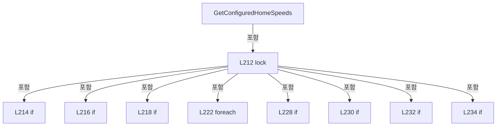

변경 전 점검: 입력/반환 타입, 위 호출자, 예외/취소 경로, 공유 상태와 저장·전송 소비자를 함께 확인합니다. 값의 단위나 물리 방향을 이름만으로 확정하지 않습니다.

### MethodDeclaration `RequestConfiguredHomeSpeedsRefresh` · L241–249

[Drilling.Common/Automation/CAutomationStatusSnapshotService.cs:241–249](https://github.com/kjuws10-rgb/A3Drilling/blob/5aee8e58439c9b455cae7c9593c9be986c3e682e/Drilling.Common/Automation/CAutomationStatusSnapshotService.cs#L241-L249)

| 항목 | 실제 추출 값 |
| --- | --- |
| 서명 | void Drilling.Common.Automation.CAutomationStatusSnapshotService.RequestConfiguredHomeSpeedsRefresh(int) |
| 접근/수식자 | Public / public |
| 반환/값 타입 | void |
| 소속 타입 | NamedType:Drilling.Common.Automation.CAutomationStatusSnapshotService |

원본 XML 주석:

````xml
/// <summary>Requests a new central read; never performs controller I/O on the caller.</summary>
````

입력 계약:

| 이름 | 타입 | 전달 | 선택/기본값 |
| --- | --- | --- | --- |
| controller | int | None | False /  |

정적 호출자로 확인된 위치:

| 호출 파일/행 | 호출 표현식 | 런타임 분기 가능 |
| --- | --- | --- |
| [Drilling.Common/Automation/CAutomationManager.cs:1216–1216](https://github.com/kjuws10-rgb/A3Drilling/blob/5aee8e58439c9b455cae7c9593c9be986c3e682e/Drilling.Common/Automation/CAutomationManager.cs#L1216-L1216) | StatusSnapshots.RequestConfiguredHomeSpeedsRefresh | False |
| [Drilling.UI/Menu/Menus/CMenuManual.cs:1832–1832](https://github.com/kjuws10-rgb/A3Drilling/blob/5aee8e58439c9b455cae7c9593c9be986c3e682e/Drilling.UI/Menu/Menus/CMenuManual.cs#L1832-L1832) | _manager.automation.StatusSnapshots.RequestConfiguredHomeSpeedsRefresh | False |

호출하는 대상과 해석 범위:

| 원본 행 | 표현식 | 분석 상태 | 대상/소스 위치 |
| --- | --- | --- | --- |
| 243 | ArgumentOutOfRangeException.ThrowIfNegative | resolved | void System.ArgumentOutOfRangeException.ThrowIfNegative<int>(int, string?) |
| 246 | _configuredHomeSpeedEntries.TryGetValue | resolved | bool System.Collections.Generic.Dictionary<int, Drilling.Common.Automation.CAutomationStatusSnapshotService.ConfiguredHomeSpeedEntry>.TryGetValue(int, out Drilling.Common.Automation.CAutomationStatusSnapshotService.ConfiguredHomeSpeedEntry) |
| 247 | InvalidateConfiguredHomeSpeedEntry | resolved | void Drilling.Common.Automation.CAutomationStatusSnapshotService.InvalidateConfiguredHomeSpeedEntry(Drilling.Common.Automation.CAutomationStatusSnapshotService.ConfiguredHomeSpeedEntry) · Drilling.Common/Automation/CAutomationStatusSnapshotService.cs:326 |

본문의 실제 연산·분기·예외·반환 순서(원문 위치 순):

| 원본 행 | 종류 | 주석 해설 |
| --- | --- | --- |
| 243 | call | 함수·델리게이트 또는 객체 생성자를 호출합니다: ArgumentOutOfRangeException.ThrowIfNegative(controller) |
| 244 | lock | 공유 상태의 임계 구역에 진입합니다: lock (_sync) |
| 246 | call | 함수·델리게이트 또는 객체 생성자를 호출합니다: _configuredHomeSpeedEntries.TryGetValue(controller, out var entry) |
| 246 | if | 조건에 따라 분기합니다: if (!_disposed && _configuredHomeSpeedEntries.TryGetValue(controller, out var entry)) |
| 247 | call | 함수·델리게이트 또는 객체 생성자를 호출합니다: InvalidateConfiguredHomeSpeedEntry(entry) |

제어 구문의 포함 구조(실제 실행 순서/CFG가 아닌 구문 탐색 그림):

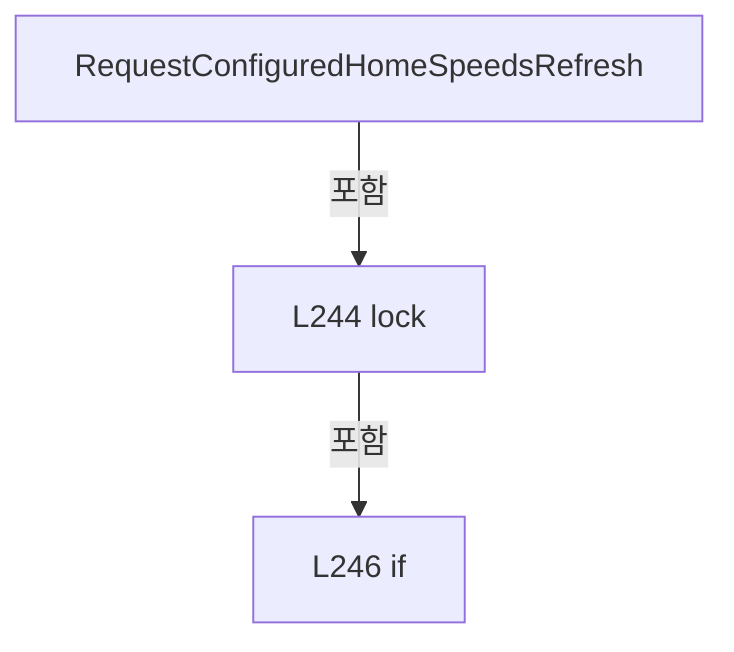

변경 전 점검: 입력/반환 타입, 위 호출자, 예외/취소 경로, 공유 상태와 저장·전송 소비자를 함께 확인합니다. 값의 단위나 물리 방향을 이름만으로 확정하지 않습니다.

### MethodDeclaration `PrepareConfiguredHomeSpeedReads` · L252–277

[Drilling.Common/Automation/CAutomationStatusSnapshotService.cs:252–277](https://github.com/kjuws10-rgb/A3Drilling/blob/5aee8e58439c9b455cae7c9593c9be986c3e682e/Drilling.Common/Automation/CAutomationStatusSnapshotService.cs#L252-L277)

| 항목 | 실제 추출 값 |
| --- | --- |
| 서명 | Drilling.Common.Automation.CAutomationStatusSnapshotService.ConfiguredHomeSpeedRead[] Drilling.Common.Automation.CAutomationStatusSnapshotService.PrepareConfiguredHomeSpeedReads(long) |
| 접근/수식자 | Private / private |
| 반환/값 타입 | Drilling.Common.Automation.CAutomationStatusSnapshotService.ConfiguredHomeSpeedRead[] |
| 소속 타입 | NamedType:Drilling.Common.Automation.CAutomationStatusSnapshotService |

입력 계약:

| 이름 | 타입 | 전달 | 선택/기본값 |
| --- | --- | --- | --- |
| now | long | None | False /  |

정적 호출자로 확인된 위치:

| 호출 파일/행 | 호출 표현식 | 런타임 분기 가능 |
| --- | --- | --- |
| [Drilling.Common/Automation/CAutomationStatusSnapshotService.cs:104–104](https://github.com/kjuws10-rgb/A3Drilling/blob/5aee8e58439c9b455cae7c9593c9be986c3e682e/Drilling.Common/Automation/CAutomationStatusSnapshotService.cs#L104-L104) | PrepareConfiguredHomeSpeedReads | False |

호출하는 대상과 해석 범위:

| 원본 행 | 표현식 | 분석 상태 | 대상/소스 위치 |
| --- | --- | --- | --- |
| 254 | new List<ConfiguredHomeSpeedRead> | resolved | System.Collections.Generic.List<Drilling.Common.Automation.CAutomationStatusSnapshotService.ConfiguredHomeSpeedRead>.List() |
| 255 | _configuredHomeSpeedEntries.ToArray | resolved | System.Collections.Generic.KeyValuePair<int, Drilling.Common.Automation.CAutomationStatusSnapshotService.ConfiguredHomeSpeedEntry>[] System.Collections.Generic.IEnumerable<System.Collections.Generic.KeyValuePair<int, Drilling.Common.Automation.CAutomationStatusSnapshotService.ConfiguredHomeSpeedEntry>>.ToArray<System.Collections.Generic.KeyValuePair<int, Drilling.Common.Automation.CAutomationStatusSnapshotService.ConfiguredHomeSpeedEntry>>() |
| 258 | entry.RequestedAxes.Where(axis => now - axis.Value > LeaseMs).Select(axis => axis.Key).ToArray | resolved | string[] System.Collections.Generic.IEnumerable<string>.ToArray<string>() |
| 258 | entry.RequestedAxes.Where(axis => now - axis.Value > LeaseMs).Select | resolved | System.Collections.Generic.IEnumerable<string> System.Collections.Generic.IEnumerable<System.Collections.Generic.KeyValuePair<string, long>>.Select<System.Collections.Generic.KeyValuePair<string, long>, string>(System.Func<System.Collections.Generic.KeyValuePair<string, long>, string>) |
| 258 | entry.RequestedAxes.Where | resolved | System.Collections.Generic.IEnumerable<System.Collections.Generic.KeyValuePair<string, long>> System.Collections.Generic.IEnumerable<System.Collections.Generic.KeyValuePair<string, long>>.Where<System.Collections.Generic.KeyValuePair<string, long>>(System.Func<System.Collections.Generic.KeyValuePair<string, long>, bool>) |
| 260 | entry.RequestedAxes.Remove | resolved | bool System.Collections.Generic.Dictionary<string, long>.Remove(string) |
| 263 | _configuredHomeSpeedEntries.Remove | resolved | bool System.Collections.Generic.Dictionary<int, Drilling.Common.Automation.CAutomationStatusSnapshotService.ConfiguredHomeSpeedEntry>.Remove(int) |
| 268 | InvalidateConfiguredHomeSpeedEntry | resolved | void Drilling.Common.Automation.CAutomationStatusSnapshotService.InvalidateConfiguredHomeSpeedEntry(Drilling.Common.Automation.CAutomationStatusSnapshotService.ConfiguredHomeSpeedEntry) · Drilling.Common/Automation/CAutomationStatusSnapshotService.cs:326 |
| 273 | reads.Add | resolved | void System.Collections.Generic.List<Drilling.Common.Automation.CAutomationStatusSnapshotService.ConfiguredHomeSpeedRead>.Add(Drilling.Common.Automation.CAutomationStatusSnapshotService.ConfiguredHomeSpeedRead) |
| 273 | new | resolved | Drilling.Common.Automation.CAutomationStatusSnapshotService.ConfiguredHomeSpeedRead.ConfiguredHomeSpeedRead(int, Drilling.Common.Automation.CAutomationStatusSnapshotService.ConfiguredHomeSpeedEntry, string[], long) · Drilling.Common/Automation/CAutomationStatusSnapshotService.cs:352 |
| 273 | entry.RequestedAxes.Keys.ToArray | resolved | string[] System.Collections.Generic.IEnumerable<string>.ToArray<string>() |
| 276 | reads.ToArray | resolved | Drilling.Common.Automation.CAutomationStatusSnapshotService.ConfiguredHomeSpeedRead[] System.Collections.Generic.List<Drilling.Common.Automation.CAutomationStatusSnapshotService.ConfiguredHomeSpeedRead>.ToArray() |

본문의 실제 연산·분기·예외·반환 순서(원문 위치 순):

| 원본 행 | 종류 | 주석 해설 |
| --- | --- | --- |
| 254 | call | 함수·델리게이트 또는 객체 생성자를 호출합니다: new List<ConfiguredHomeSpeedRead>() |
| 254 | local-declaration | 지역 변수를 선언합니다: var reads = new List<ConfiguredHomeSpeedRead>(); |
| 254 | variable-initializer | 변수의 초기값을 지정합니다: reads = new List<ConfiguredHomeSpeedRead>() |
| 255 | call | 함수·델리게이트 또는 객체 생성자를 호출합니다: _configuredHomeSpeedEntries.ToArray() |
| 255 | foreach | 컬렉션 요소를 순회합니다: foreach (var pair in _configuredHomeSpeedEntries.ToArray()) |
| 257 | local-declaration | 지역 변수를 선언합니다: var entry = pair.Value; |
| 257 | variable-initializer | 변수의 초기값을 지정합니다: entry = pair.Value |
| 258 | call | 함수·델리게이트 또는 객체 생성자를 호출합니다: entry.RequestedAxes.Where(axis => now - axis.Value > LeaseMs).Select(axis => axis.Key).ToArray() |
| 258 | call | 함수·델리게이트 또는 객체 생성자를 호출합니다: entry.RequestedAxes.Where(axis => now - axis.Value > LeaseMs).Select(axis => axis.Key) |
| 258 | call | 함수·델리게이트 또는 객체 생성자를 호출합니다: entry.RequestedAxes.Where(axis => now - axis.Value > LeaseMs) |
| 258 | local-declaration | 지역 변수를 선언합니다: var expired = entry.RequestedAxes.Where(axis => now - axis.Value > LeaseMs).Select(axis => axis.Key).ToArray(); |
| 258 | variable-initializer | 변수의 초기값을 지정합니다: expired = entry.RequestedAxes.Where(axis => now - axis.Value > LeaseMs).Select(axis => axis.Key).ToArray() |
| 259 | foreach | 컬렉션 요소를 순회합니다: foreach (var axis in expired) |
| 260 | call | 함수·델리게이트 또는 객체 생성자를 호출합니다: entry.RequestedAxes.Remove(axis) |
| 261 | if | 조건에 따라 분기합니다: if (entry.RequestedAxes.Count == 0) |
| 263 | call | 함수·델리게이트 또는 객체 생성자를 호출합니다: _configuredHomeSpeedEntries.Remove(pair.Key) |
| 264 | continue | 다음 반복으로 진행합니다: continue; |
| 267 | if | 조건에 따라 분기합니다: if (expired.Length > 0) |
| 268 | call | 함수·델리게이트 또는 객체 생성자를 호출합니다: InvalidateConfiguredHomeSpeedEntry(entry) |
| 269 | if | 조건에 따라 분기합니다: if (entry.InFlight &#124;&#124; entry.UpdatedAt != default && now - entry.LastAttemptAt < ConfiguredHomeSpeedRefreshMs) |
| 270 | continue | 다음 반복으로 진행합니다: continue; |
| 271 | assignment | 값을 대상에 대입합니다: entry.InFlight = true |
| 272 | assignment | 값을 대상에 대입합니다: entry.LastAttemptAt = now |
| 273 | call | 함수·델리게이트 또는 객체 생성자를 호출합니다: reads.Add(new(entry.Controller, entry, entry.RequestedAxes.Keys.ToArray(), entry.Version)) |
| 273 | call | 함수·델리게이트 또는 객체 생성자를 호출합니다: new(entry.Controller, entry, entry.RequestedAxes.Keys.ToArray(), entry.Version) |
| 273 | call | 함수·델리게이트 또는 객체 생성자를 호출합니다: entry.RequestedAxes.Keys.ToArray() |
| 276 | call | 함수·델리게이트 또는 객체 생성자를 호출합니다: reads.ToArray() |
| 276 | return | 호출자에게 값 또는 제어를 반환합니다: return reads.ToArray(); |

제어 구문의 포함 구조(실제 실행 순서/CFG가 아닌 구문 탐색 그림):

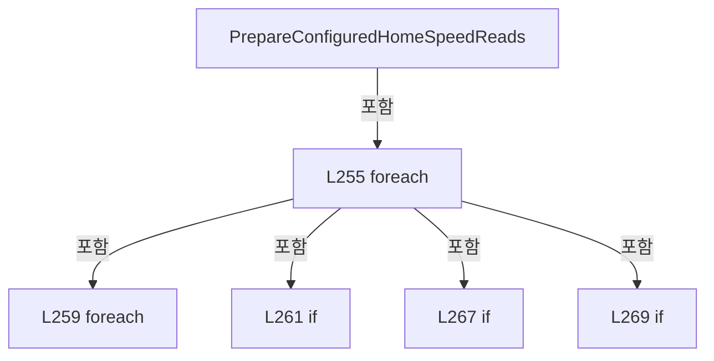

변경 전 점검: 입력/반환 타입, 위 호출자, 예외/취소 경로, 공유 상태와 저장·전송 소비자를 함께 확인합니다. 값의 단위나 물리 방향을 이름만으로 확정하지 않습니다.

### MethodDeclaration `CollectConfiguredHomeSpeeds` · L279–323

[Drilling.Common/Automation/CAutomationStatusSnapshotService.cs:279–323](https://github.com/kjuws10-rgb/A3Drilling/blob/5aee8e58439c9b455cae7c9593c9be986c3e682e/Drilling.Common/Automation/CAutomationStatusSnapshotService.cs#L279-L323)

| 항목 | 실제 추출 값 |
| --- | --- |
| 서명 | void Drilling.Common.Automation.CAutomationStatusSnapshotService.CollectConfiguredHomeSpeeds(Drilling.Common.Automation.CAutomationStatusSnapshotService.ConfiguredHomeSpeedRead, System.Threading.CancellationToken) |
| 접근/수식자 | Private / private |
| 반환/값 타입 | void |
| 소속 타입 | NamedType:Drilling.Common.Automation.CAutomationStatusSnapshotService |

입력 계약:

| 이름 | 타입 | 전달 | 선택/기본값 |
| --- | --- | --- | --- |
| read | Drilling.Common.Automation.CAutomationStatusSnapshotService.ConfiguredHomeSpeedRead | None | False /  |
| token | System.Threading.CancellationToken | None | False /  |

정적 호출자로 확인된 위치:

| 호출 파일/행 | 호출 표현식 | 런타임 분기 가능 |
| --- | --- | --- |
| [Drilling.Common/Automation/CAutomationStatusSnapshotService.cs:164–164](https://github.com/kjuws10-rgb/A3Drilling/blob/5aee8e58439c9b455cae7c9593c9be986c3e682e/Drilling.Common/Automation/CAutomationStatusSnapshotService.cs#L164-L164) | CollectConfiguredHomeSpeeds | False |

호출하는 대상과 해석 범위:

| 원본 행 | 표현식 | 분석 상태 | 대상/소스 위치 |
| --- | --- | --- | --- |
| 286 | token.ThrowIfCancellationRequested | resolved | void System.Threading.CancellationToken.ThrowIfCancellationRequested() |
| 287 | _automation.IsSimul | resolved | bool Drilling.Common.Automation.CAutomationManager.IsSimul(int) · Drilling.Common/Automation/CAutomationManager.cs:63 |
| 287 | _automation.IsConnect | resolved | bool Drilling.Common.Automation.CAutomationManager.IsConnect(int) · Drilling.Common/Automation/CAutomationManager.cs:58 |
| 291 | CancellationTokenSource.CreateLinkedTokenSource | resolved | System.Threading.CancellationTokenSource System.Threading.CancellationTokenSource.CreateLinkedTokenSource(System.Threading.CancellationToken) |
| 292 | timeout.CancelAfter | resolved | void System.Threading.CancellationTokenSource.CancelAfter(int) |
| 293 | _automation.ReadConfiguredHomeSpeeds(read.Axes, read.Controller, timeout.Token).GetAwaiter().GetResult | resolved | System.Collections.Generic.IReadOnlyDictionary<string, double> System.Runtime.CompilerServices.TaskAwaiter<System.Collections.Generic.IReadOnlyDictionary<string, double>>.GetResult() |
| 293 | _automation.ReadConfiguredHomeSpeeds(read.Axes, read.Controller, timeout.Token).GetAwaiter | resolved | System.Runtime.CompilerServices.TaskAwaiter<System.Collections.Generic.IReadOnlyDictionary<string, double>> System.Threading.Tasks.Task<System.Collections.Generic.IReadOnlyDictionary<string, double>>.GetAwaiter() |
| 293 | _automation.ReadConfiguredHomeSpeeds | resolved · 동적 구현 선택 가능 | System.Threading.Tasks.Task<System.Collections.Generic.IReadOnlyDictionary<string, double>> Drilling.Common.Automation.CAutomationManager.ReadConfiguredHomeSpeeds(System.Collections.Generic.IReadOnlyList<string>, int, System.Threading.CancellationToken) · Drilling.Common/Automation/CAutomationManager.cs:1164 |
| 294 | timeout.Token.ThrowIfCancellationRequested | resolved | void System.Threading.CancellationToken.ThrowIfCancellationRequested() |
| 295 | read.Axes.Any | resolved | bool System.Collections.Generic.IEnumerable<string>.Any<string>(System.Func<string, bool>) |
| 295 | result.TryGetValue | resolved · 동적 구현 선택 가능 | bool System.Collections.Generic.IReadOnlyDictionary<string, double>.TryGetValue(string, out double) |
| 295 | double.IsFinite | resolved | bool double.IsFinite(double) |
| 296 | new InvalidOperationException | resolved | System.InvalidOperationException.InvalidOperationException(string?) |
| 297 | ReadOnlyValues | resolved | System.Collections.Generic.IReadOnlyDictionary<string, double> Drilling.Common.Automation.CAutomationStatusSnapshotService.ReadOnlyValues(System.Collections.Generic.IEnumerable<System.Collections.Generic.KeyValuePair<string, double>>) · Drilling.Common/Automation/CAutomationStatusSnapshotService.cs:325 |
| 315 | _configuredHomeSpeedEntries.TryGetValue | resolved | bool System.Collections.Generic.Dictionary<int, Drilling.Common.Automation.CAutomationStatusSnapshotService.ConfiguredHomeSpeedEntry>.TryGetValue(int, out Drilling.Common.Automation.CAutomationStatusSnapshotService.ConfiguredHomeSpeedEntry) |
| 315 | ReferenceEquals | resolved | bool object.ReferenceEquals(object?, object?) |

본문의 실제 연산·분기·예외·반환 순서(원문 위치 순):

| 원본 행 | 종류 | 주석 해설 |
| --- | --- | --- |
| 281 | local-declaration | 지역 변수를 선언합니다: IReadOnlyDictionary<string, double>? values = null; |
| 281 | variable-initializer | 변수의 초기값을 지정합니다: values = null |
| 282 | local-declaration | 지역 변수를 선언합니다: var state = "OK"; |
| 282 | variable-initializer | 변수의 초기값을 지정합니다: state = "OK" |
| 283 | local-declaration | 지역 변수를 선언합니다: var detail = "Shared saved HomeSpeed snapshot"; |
| 283 | variable-initializer | 변수의 초기값을 지정합니다: detail = "Shared saved HomeSpeed snapshot" |
| 284 | try | 예외 처리 범위입니다: try |
| 286 | call | 함수·델리게이트 또는 객체 생성자를 호출합니다: token.ThrowIfCancellationRequested() |
| 287 | call | 함수·델리게이트 또는 객체 생성자를 호출합니다: _automation.IsSimul(read.Controller) |
| 287 | call | 함수·델리게이트 또는 객체 생성자를 호출합니다: _automation.IsConnect(read.Controller) |
| 287 | if | 조건에 따라 분기합니다: if (!_automation.IsSimul(read.Controller) && !_automation.IsConnect(read.Controller)) |
| 288 | assignment | 값을 대상에 대입합니다: (state, detail) = ("OFFLINE", "Automation not connected.") |
| 289 | else | 앞 조건이 거짓인 경로입니다: else |
| 291 | call | 함수·델리게이트 또는 객체 생성자를 호출합니다: CancellationTokenSource.CreateLinkedTokenSource(token) |
| 291 | using-declaration | 정리할 자원을 선언합니다: using var timeout = CancellationTokenSource.CreateLinkedTokenSource(token); |
| 291 | variable-initializer | 변수의 초기값을 지정합니다: timeout = CancellationTokenSource.CreateLinkedTokenSource(token) |
| 292 | call | 함수·델리게이트 또는 객체 생성자를 호출합니다: timeout.CancelAfter(2000) |
| 293 | call | 함수·델리게이트 또는 객체 생성자를 호출합니다: _automation.ReadConfiguredHomeSpeeds(read.Axes, read.Controller, timeout.Token).GetAwaiter().GetResult() |
| 293 | call | 함수·델리게이트 또는 객체 생성자를 호출합니다: _automation.ReadConfiguredHomeSpeeds(read.Axes, read.Controller, timeout.Token).GetAwaiter() |
| 293 | call | 함수·델리게이트 또는 객체 생성자를 호출합니다: _automation.ReadConfiguredHomeSpeeds(read.Axes, read.Controller, timeout.Token) |
| 293 | local-declaration | 지역 변수를 선언합니다: var result = _automation.ReadConfiguredHomeSpeeds(read.Axes, read.Controller, timeout.Token).GetAwaiter().GetResult(); |
| 293 | variable-initializer | 변수의 초기값을 지정합니다: result = _automation.ReadConfiguredHomeSpeeds(read.Axes, read.Controller, timeout.Token).GetAwaiter().GetResult() |
| 294 | call | 함수·델리게이트 또는 객체 생성자를 호출합니다: timeout.Token.ThrowIfCancellationRequested() |
| 295 | call | 함수·델리게이트 또는 객체 생성자를 호출합니다: read.Axes.Any(axis => !result.TryGetValue(axis, out var value) &#124;&#124; !double.IsFinite(value) &#124;&#124; value < 0) |
| 295 | call | 함수·델리게이트 또는 객체 생성자를 호출합니다: result.TryGetValue(axis, out var value) |
| 295 | call | 함수·델리게이트 또는 객체 생성자를 호출합니다: double.IsFinite(value) |
| 295 | if | 조건에 따라 분기합니다: if (read.Axes.Any(axis => !result.TryGetValue(axis, out var value) &#124;&#124; !double.IsFinite(value) &#124;&#124; value < 0)) |
| 296 | call | 함수·델리게이트 또는 객체 생성자를 호출합니다: new InvalidOperationException("Saved HomeSpeed snapshot did not contain valid values for all requested axes.") |
| 296 | throw | 예외를 발생/전달합니다: throw new InvalidOperationException("Saved HomeSpeed snapshot did not contain valid values for all requested axes."); |
| 297 | assignment | 값을 대상에 대입합니다: values = ReadOnlyValues(result) |
| 297 | call | 함수·델리게이트 또는 객체 생성자를 호출합니다: ReadOnlyValues(result) |
| 300 | catch | 지정 예외를 처리합니다: catch (OperationCanceledException) when (token.IsCancellationRequested) |
| 302 | lock | 공유 상태의 임계 구역에 진입합니다: lock (_sync) |
| 303 | assignment | 값을 대상에 대입합니다: read.Entry.InFlight = false |
| 304 | throw | 예외를 발생/전달합니다: throw; |
| 306 | catch | 지정 예외를 처리합니다: catch (Exception exception) |
| 308 | assignment | 값을 대상에 대입합니다: (state, detail) = ("ERROR", exception.Message) |
| 311 | lock | 공유 상태의 임계 구역에 진입합니다: lock (_sync) |
| 313 | assignment | 값을 대상에 대입합니다: read.Entry.InFlight = false |
| 315 | call | 함수·델리게이트 또는 객체 생성자를 호출합니다: _configuredHomeSpeedEntries.TryGetValue(read.Controller, out var current) |
| 315 | call | 함수·델리게이트 또는 객체 생성자를 호출합니다: ReferenceEquals(current, read.Entry) |
| 315 | if | 조건에 따라 분기합니다: if (_disposed &#124;&#124; !_configuredHomeSpeedEntries.TryGetValue(read.Controller, out var current) &#124;&#124; !ReferenceEquals(current, read.Entry) &#124;&#124; current.Version != read.Version) |
| 316 | return | 호출자에게 값 또는 제어를 반환합니다: return; |
| 317 | assignment | 값을 대상에 대입합니다: current.Value = values |
| 318 | assignment | 값을 대상에 대입합니다: current.State = state |
| 319 | assignment | 값을 대상에 대입합니다: current.Detail = detail |
| 320 | assignment | 값을 대상에 대입합니다: current.UpdatedAt = DateTimeOffset.Now |
| 321 | assignment | 값을 대상에 대입합니다: current.CollectedAt = Environment.TickCount64 |

제어 구문의 포함 구조(실제 실행 순서/CFG가 아닌 구문 탐색 그림):

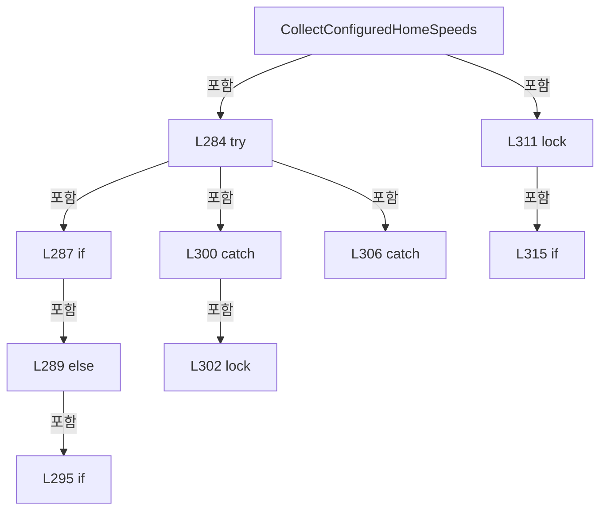

변경 전 점검: 입력/반환 타입, 위 호출자, 예외/취소 경로, 공유 상태와 저장·전송 소비자를 함께 확인합니다. 값의 단위나 물리 방향을 이름만으로 확정하지 않습니다.

### MethodDeclaration `ReadOnlyValues` · L325–325

[Drilling.Common/Automation/CAutomationStatusSnapshotService.cs:325–325](https://github.com/kjuws10-rgb/A3Drilling/blob/5aee8e58439c9b455cae7c9593c9be986c3e682e/Drilling.Common/Automation/CAutomationStatusSnapshotService.cs#L325-L325)

| 항목 | 실제 추출 값 |
| --- | --- |
| 서명 | System.Collections.Generic.IReadOnlyDictionary<string, double> Drilling.Common.Automation.CAutomationStatusSnapshotService.ReadOnlyValues(System.Collections.Generic.IEnumerable<System.Collections.Generic.KeyValuePair<string, double>>) |
| 접근/수식자 | Private / private, static |
| 반환/값 타입 | System.Collections.Generic.IReadOnlyDictionary<string, double> |
| 소속 타입 | NamedType:Drilling.Common.Automation.CAutomationStatusSnapshotService |

입력 계약:

| 이름 | 타입 | 전달 | 선택/기본값 |
| --- | --- | --- | --- |
| values | System.Collections.Generic.IEnumerable<System.Collections.Generic.KeyValuePair<string, double>> | None | False /  |

정적 호출자로 확인된 위치:

| 호출 파일/행 | 호출 표현식 | 런타임 분기 가능 |
| --- | --- | --- |
| [Drilling.Common/Automation/CAutomationStatusSnapshotService.cs:217–217](https://github.com/kjuws10-rgb/A3Drilling/blob/5aee8e58439c9b455cae7c9593c9be986c3e682e/Drilling.Common/Automation/CAutomationStatusSnapshotService.cs#L217-L217) | ReadOnlyValues | False |
| [Drilling.Common/Automation/CAutomationStatusSnapshotService.cs:297–297](https://github.com/kjuws10-rgb/A3Drilling/blob/5aee8e58439c9b455cae7c9593c9be986c3e682e/Drilling.Common/Automation/CAutomationStatusSnapshotService.cs#L297-L297) | ReadOnlyValues | False |

호출하는 대상과 해석 범위:

| 원본 행 | 표현식 | 분석 상태 | 대상/소스 위치 |
| --- | --- | --- | --- |
| 325 | new CConfiguredHomeSpeedValues | resolved | Drilling.Common.Automation.CConfiguredHomeSpeedValues.CConfiguredHomeSpeedValues(System.Collections.Generic.IEnumerable<System.Collections.Generic.KeyValuePair<string, double>>, System.Collections.Generic.IEnumerable<System.Collections.Generic.KeyValuePair<string, string>>?) · Drilling.Common/Automation/CAutomationManager.cs:1647 |

본문의 실제 연산·분기·예외·반환 순서(원문 위치 순):

| 원본 행 | 종류 | 주석 해설 |
| --- | --- | --- |
| 325 | call | 함수·델리게이트 또는 객체 생성자를 호출합니다: new CConfiguredHomeSpeedValues(values, (values as CConfiguredHomeSpeedValues)?.Units) |

변경 전 점검: 입력/반환 타입, 위 호출자, 예외/취소 경로, 공유 상태와 저장·전송 소비자를 함께 확인합니다. 값의 단위나 물리 방향을 이름만으로 확정하지 않습니다.

### MethodDeclaration `InvalidateConfiguredHomeSpeedEntry` · L326–335

[Drilling.Common/Automation/CAutomationStatusSnapshotService.cs:326–335](https://github.com/kjuws10-rgb/A3Drilling/blob/5aee8e58439c9b455cae7c9593c9be986c3e682e/Drilling.Common/Automation/CAutomationStatusSnapshotService.cs#L326-L335)

| 항목 | 실제 추출 값 |
| --- | --- |
| 서명 | void Drilling.Common.Automation.CAutomationStatusSnapshotService.InvalidateConfiguredHomeSpeedEntry(Drilling.Common.Automation.CAutomationStatusSnapshotService.ConfiguredHomeSpeedEntry) |
| 접근/수식자 | Private / private, static |
| 반환/값 타입 | void |
| 소속 타입 | NamedType:Drilling.Common.Automation.CAutomationStatusSnapshotService |

입력 계약:

| 이름 | 타입 | 전달 | 선택/기본값 |
| --- | --- | --- | --- |
| entry | Drilling.Common.Automation.CAutomationStatusSnapshotService.ConfiguredHomeSpeedEntry | None | False /  |

정적 호출자로 확인된 위치:

| 호출 파일/행 | 호출 표현식 | 런타임 분기 가능 |
| --- | --- | --- |
| [Drilling.Common/Automation/CAutomationStatusSnapshotService.cs:229–229](https://github.com/kjuws10-rgb/A3Drilling/blob/5aee8e58439c9b455cae7c9593c9be986c3e682e/Drilling.Common/Automation/CAutomationStatusSnapshotService.cs#L229-L229) | InvalidateConfiguredHomeSpeedEntry | False |
| [Drilling.Common/Automation/CAutomationStatusSnapshotService.cs:247–247](https://github.com/kjuws10-rgb/A3Drilling/blob/5aee8e58439c9b455cae7c9593c9be986c3e682e/Drilling.Common/Automation/CAutomationStatusSnapshotService.cs#L247-L247) | InvalidateConfiguredHomeSpeedEntry | False |
| [Drilling.Common/Automation/CAutomationStatusSnapshotService.cs:268–268](https://github.com/kjuws10-rgb/A3Drilling/blob/5aee8e58439c9b455cae7c9593c9be986c3e682e/Drilling.Common/Automation/CAutomationStatusSnapshotService.cs#L268-L268) | InvalidateConfiguredHomeSpeedEntry | False |

본문의 실제 연산·분기·예외·반환 순서(원문 위치 순):

| 원본 행 | 종류 | 주석 해설 |
| --- | --- | --- |
| 329 | assignment | 값을 대상에 대입합니다: entry.Value = null |
| 330 | assignment | 값을 대상에 대입합니다: entry.State = "LOADING" |
| 331 | assignment | 값을 대상에 대입합니다: entry.Detail = "Waiting for shared saved HomeSpeed snapshot." |
| 332 | assignment | 값을 대상에 대입합니다: entry.UpdatedAt = default |
| 333 | assignment | 값을 대상에 대입합니다: entry.CollectedAt = 0 |
| 334 | assignment | 값을 대상에 대입합니다: entry.LastAttemptAt = 0 |

변경 전 점검: 입력/반환 타입, 위 호출자, 예외/취소 경로, 공유 상태와 저장·전송 소비자를 함께 확인합니다. 값의 단위나 물리 방향을 이름만으로 확정하지 않습니다.

### PropertyDeclaration `Controller` · L339–339

[Drilling.Common/Automation/CAutomationStatusSnapshotService.cs:339–339](https://github.com/kjuws10-rgb/A3Drilling/blob/5aee8e58439c9b455cae7c9593c9be986c3e682e/Drilling.Common/Automation/CAutomationStatusSnapshotService.cs#L339-L339)

| 항목 | 실제 추출 값 |
| --- | --- |
| 서명 | int Drilling.Common.Automation.CAutomationStatusSnapshotService.ConfiguredHomeSpeedEntry.Controller |
| 접근/수식자 | Public / public |
| 반환/값 타입 | int |
| 소속 타입 | NamedType:Drilling.Common.Automation.CAutomationStatusSnapshotService.ConfiguredHomeSpeedEntry |

현재 부분 분석에서 직접 연결된 호출자는 없습니다. XAML/이벤트/인터페이스·델리게이트·외부 진입을 추가 확인해야 하며, 미사용으로 판정한 것이 아닙니다.

변경 전 점검: 입력/반환 타입, 위 호출자, 예외/취소 경로, 공유 상태와 저장·전송 소비자를 함께 확인합니다. 값의 단위나 물리 방향을 이름만으로 확정하지 않습니다.

### GetAccessorDeclaration `get_Controller` · L339–339

[Drilling.Common/Automation/CAutomationStatusSnapshotService.cs:339–339](https://github.com/kjuws10-rgb/A3Drilling/blob/5aee8e58439c9b455cae7c9593c9be986c3e682e/Drilling.Common/Automation/CAutomationStatusSnapshotService.cs#L339-L339)

| 항목 | 실제 추출 값 |
| --- | --- |
| 서명 | int Drilling.Common.Automation.CAutomationStatusSnapshotService.ConfiguredHomeSpeedEntry.Controller.get |
| 접근/수식자 | Public / get |
| 반환/값 타입 | int |
| 소속 타입 | NamedType:Drilling.Common.Automation.CAutomationStatusSnapshotService.ConfiguredHomeSpeedEntry |

현재 부분 분석에서 직접 연결된 호출자는 없습니다. XAML/이벤트/인터페이스·델리게이트·외부 진입을 추가 확인해야 하며, 미사용으로 판정한 것이 아닙니다.

변경 전 점검: 입력/반환 타입, 위 호출자, 예외/취소 경로, 공유 상태와 저장·전송 소비자를 함께 확인합니다. 값의 단위나 물리 방향을 이름만으로 확정하지 않습니다.

### PropertyDeclaration `RequestedAxes` · L340–340

[Drilling.Common/Automation/CAutomationStatusSnapshotService.cs:340–340](https://github.com/kjuws10-rgb/A3Drilling/blob/5aee8e58439c9b455cae7c9593c9be986c3e682e/Drilling.Common/Automation/CAutomationStatusSnapshotService.cs#L340-L340)

| 항목 | 실제 추출 값 |
| --- | --- |
| 서명 | System.Collections.Generic.Dictionary<string, long> Drilling.Common.Automation.CAutomationStatusSnapshotService.ConfiguredHomeSpeedEntry.RequestedAxes |
| 접근/수식자 | Public / public |
| 반환/값 타입 | System.Collections.Generic.Dictionary<string, long> |
| 소속 타입 | NamedType:Drilling.Common.Automation.CAutomationStatusSnapshotService.ConfiguredHomeSpeedEntry |

현재 부분 분석에서 직접 연결된 호출자는 없습니다. XAML/이벤트/인터페이스·델리게이트·외부 진입을 추가 확인해야 하며, 미사용으로 판정한 것이 아닙니다.

호출하는 대상과 해석 범위:

| 원본 행 | 표현식 | 분석 상태 | 대상/소스 위치 |
| --- | --- | --- | --- |
| 340 | new | resolved | System.Collections.Generic.Dictionary<string, long>.Dictionary(System.Collections.Generic.IEqualityComparer<string>?) |

본문의 실제 연산·분기·예외·반환 순서(원문 위치 순):

| 원본 행 | 종류 | 주석 해설 |
| --- | --- | --- |
| 340 | call | 함수·델리게이트 또는 객체 생성자를 호출합니다: new(StringComparer.OrdinalIgnoreCase) |

변경 전 점검: 입력/반환 타입, 위 호출자, 예외/취소 경로, 공유 상태와 저장·전송 소비자를 함께 확인합니다. 값의 단위나 물리 방향을 이름만으로 확정하지 않습니다.

### GetAccessorDeclaration `get_RequestedAxes` · L340–340

[Drilling.Common/Automation/CAutomationStatusSnapshotService.cs:340–340](https://github.com/kjuws10-rgb/A3Drilling/blob/5aee8e58439c9b455cae7c9593c9be986c3e682e/Drilling.Common/Automation/CAutomationStatusSnapshotService.cs#L340-L340)

| 항목 | 실제 추출 값 |
| --- | --- |
| 서명 | System.Collections.Generic.Dictionary<string, long> Drilling.Common.Automation.CAutomationStatusSnapshotService.ConfiguredHomeSpeedEntry.RequestedAxes.get |
| 접근/수식자 | Public / get |
| 반환/값 타입 | System.Collections.Generic.Dictionary<string, long> |
| 소속 타입 | NamedType:Drilling.Common.Automation.CAutomationStatusSnapshotService.ConfiguredHomeSpeedEntry |

현재 부분 분석에서 직접 연결된 호출자는 없습니다. XAML/이벤트/인터페이스·델리게이트·외부 진입을 추가 확인해야 하며, 미사용으로 판정한 것이 아닙니다.

변경 전 점검: 입력/반환 타입, 위 호출자, 예외/취소 경로, 공유 상태와 저장·전송 소비자를 함께 확인합니다. 값의 단위나 물리 방향을 이름만으로 확정하지 않습니다.

### FieldDeclaration `Value` · L342–342

[Drilling.Common/Automation/CAutomationStatusSnapshotService.cs:342–342](https://github.com/kjuws10-rgb/A3Drilling/blob/5aee8e58439c9b455cae7c9593c9be986c3e682e/Drilling.Common/Automation/CAutomationStatusSnapshotService.cs#L342-L342)

| 항목 | 실제 추출 값 |
| --- | --- |
| 서명 | System.Collections.Generic.IReadOnlyDictionary<string, double>? Drilling.Common.Automation.CAutomationStatusSnapshotService.ConfiguredHomeSpeedEntry.Value |
| 접근/수식자 | Public / public |
| 반환/값 타입 | System.Collections.Generic.IReadOnlyDictionary<string, double>? |
| 소속 타입 | NamedType:Drilling.Common.Automation.CAutomationStatusSnapshotService.ConfiguredHomeSpeedEntry |

현재 부분 분석에서 직접 연결된 호출자는 없습니다. XAML/이벤트/인터페이스·델리게이트·외부 진입을 추가 확인해야 하며, 미사용으로 판정한 것이 아닙니다.

변경 전 점검: 입력/반환 타입, 위 호출자, 예외/취소 경로, 공유 상태와 저장·전송 소비자를 함께 확인합니다. 값의 단위나 물리 방향을 이름만으로 확정하지 않습니다.

### FieldDeclaration `State` · L343–343

[Drilling.Common/Automation/CAutomationStatusSnapshotService.cs:343–343](https://github.com/kjuws10-rgb/A3Drilling/blob/5aee8e58439c9b455cae7c9593c9be986c3e682e/Drilling.Common/Automation/CAutomationStatusSnapshotService.cs#L343-L343)

| 항목 | 실제 추출 값 |
| --- | --- |
| 서명 | string Drilling.Common.Automation.CAutomationStatusSnapshotService.ConfiguredHomeSpeedEntry.State |
| 접근/수식자 | Public / public |
| 반환/값 타입 | string |
| 소속 타입 | NamedType:Drilling.Common.Automation.CAutomationStatusSnapshotService.ConfiguredHomeSpeedEntry |

현재 부분 분석에서 직접 연결된 호출자는 없습니다. XAML/이벤트/인터페이스·델리게이트·외부 진입을 추가 확인해야 하며, 미사용으로 판정한 것이 아닙니다.

본문의 실제 연산·분기·예외·반환 순서(원문 위치 순):

| 원본 행 | 종류 | 주석 해설 |
| --- | --- | --- |
| 343 | variable-initializer | 변수의 초기값을 지정합니다: State = "LOADING" |

변경 전 점검: 입력/반환 타입, 위 호출자, 예외/취소 경로, 공유 상태와 저장·전송 소비자를 함께 확인합니다. 값의 단위나 물리 방향을 이름만으로 확정하지 않습니다.

### FieldDeclaration `Detail` · L344–344

[Drilling.Common/Automation/CAutomationStatusSnapshotService.cs:344–344](https://github.com/kjuws10-rgb/A3Drilling/blob/5aee8e58439c9b455cae7c9593c9be986c3e682e/Drilling.Common/Automation/CAutomationStatusSnapshotService.cs#L344-L344)

| 항목 | 실제 추출 값 |
| --- | --- |
| 서명 | string Drilling.Common.Automation.CAutomationStatusSnapshotService.ConfiguredHomeSpeedEntry.Detail |
| 접근/수식자 | Public / public |
| 반환/값 타입 | string |
| 소속 타입 | NamedType:Drilling.Common.Automation.CAutomationStatusSnapshotService.ConfiguredHomeSpeedEntry |

현재 부분 분석에서 직접 연결된 호출자는 없습니다. XAML/이벤트/인터페이스·델리게이트·외부 진입을 추가 확인해야 하며, 미사용으로 판정한 것이 아닙니다.

본문의 실제 연산·분기·예외·반환 순서(원문 위치 순):

| 원본 행 | 종류 | 주석 해설 |
| --- | --- | --- |
| 344 | variable-initializer | 변수의 초기값을 지정합니다: Detail = "" |

변경 전 점검: 입력/반환 타입, 위 호출자, 예외/취소 경로, 공유 상태와 저장·전송 소비자를 함께 확인합니다. 값의 단위나 물리 방향을 이름만으로 확정하지 않습니다.

### FieldDeclaration `UpdatedAt` · L345–345

[Drilling.Common/Automation/CAutomationStatusSnapshotService.cs:345–345](https://github.com/kjuws10-rgb/A3Drilling/blob/5aee8e58439c9b455cae7c9593c9be986c3e682e/Drilling.Common/Automation/CAutomationStatusSnapshotService.cs#L345-L345)

| 항목 | 실제 추출 값 |
| --- | --- |
| 서명 | System.DateTimeOffset Drilling.Common.Automation.CAutomationStatusSnapshotService.ConfiguredHomeSpeedEntry.UpdatedAt |
| 접근/수식자 | Public / public |
| 반환/값 타입 | System.DateTimeOffset |
| 소속 타입 | NamedType:Drilling.Common.Automation.CAutomationStatusSnapshotService.ConfiguredHomeSpeedEntry |

현재 부분 분석에서 직접 연결된 호출자는 없습니다. XAML/이벤트/인터페이스·델리게이트·외부 진입을 추가 확인해야 하며, 미사용으로 판정한 것이 아닙니다.

변경 전 점검: 입력/반환 타입, 위 호출자, 예외/취소 경로, 공유 상태와 저장·전송 소비자를 함께 확인합니다. 값의 단위나 물리 방향을 이름만으로 확정하지 않습니다.

### FieldDeclaration `CollectedAt` · L346–346

[Drilling.Common/Automation/CAutomationStatusSnapshotService.cs:346–346](https://github.com/kjuws10-rgb/A3Drilling/blob/5aee8e58439c9b455cae7c9593c9be986c3e682e/Drilling.Common/Automation/CAutomationStatusSnapshotService.cs#L346-L346)

| 항목 | 실제 추출 값 |
| --- | --- |
| 서명 | long Drilling.Common.Automation.CAutomationStatusSnapshotService.ConfiguredHomeSpeedEntry.CollectedAt |
| 접근/수식자 | Public / public |
| 반환/값 타입 | long |
| 소속 타입 | NamedType:Drilling.Common.Automation.CAutomationStatusSnapshotService.ConfiguredHomeSpeedEntry |

현재 부분 분석에서 직접 연결된 호출자는 없습니다. XAML/이벤트/인터페이스·델리게이트·외부 진입을 추가 확인해야 하며, 미사용으로 판정한 것이 아닙니다.

변경 전 점검: 입력/반환 타입, 위 호출자, 예외/취소 경로, 공유 상태와 저장·전송 소비자를 함께 확인합니다. 값의 단위나 물리 방향을 이름만으로 확정하지 않습니다.

### FieldDeclaration `LastAttemptAt` · L347–347

[Drilling.Common/Automation/CAutomationStatusSnapshotService.cs:347–347](https://github.com/kjuws10-rgb/A3Drilling/blob/5aee8e58439c9b455cae7c9593c9be986c3e682e/Drilling.Common/Automation/CAutomationStatusSnapshotService.cs#L347-L347)

| 항목 | 실제 추출 값 |
| --- | --- |
| 서명 | long Drilling.Common.Automation.CAutomationStatusSnapshotService.ConfiguredHomeSpeedEntry.LastAttemptAt |
| 접근/수식자 | Public / public |
| 반환/값 타입 | long |
| 소속 타입 | NamedType:Drilling.Common.Automation.CAutomationStatusSnapshotService.ConfiguredHomeSpeedEntry |

현재 부분 분석에서 직접 연결된 호출자는 없습니다. XAML/이벤트/인터페이스·델리게이트·외부 진입을 추가 확인해야 하며, 미사용으로 판정한 것이 아닙니다.

변경 전 점검: 입력/반환 타입, 위 호출자, 예외/취소 경로, 공유 상태와 저장·전송 소비자를 함께 확인합니다. 값의 단위나 물리 방향을 이름만으로 확정하지 않습니다.

### FieldDeclaration `Version` · L348–348

[Drilling.Common/Automation/CAutomationStatusSnapshotService.cs:348–348](https://github.com/kjuws10-rgb/A3Drilling/blob/5aee8e58439c9b455cae7c9593c9be986c3e682e/Drilling.Common/Automation/CAutomationStatusSnapshotService.cs#L348-L348)

| 항목 | 실제 추출 값 |
| --- | --- |
| 서명 | long Drilling.Common.Automation.CAutomationStatusSnapshotService.ConfiguredHomeSpeedEntry.Version |
| 접근/수식자 | Public / public |
| 반환/값 타입 | long |
| 소속 타입 | NamedType:Drilling.Common.Automation.CAutomationStatusSnapshotService.ConfiguredHomeSpeedEntry |

현재 부분 분석에서 직접 연결된 호출자는 없습니다. XAML/이벤트/인터페이스·델리게이트·외부 진입을 추가 확인해야 하며, 미사용으로 판정한 것이 아닙니다.

변경 전 점검: 입력/반환 타입, 위 호출자, 예외/취소 경로, 공유 상태와 저장·전송 소비자를 함께 확인합니다. 값의 단위나 물리 방향을 이름만으로 확정하지 않습니다.

### FieldDeclaration `InFlight` · L349–349

[Drilling.Common/Automation/CAutomationStatusSnapshotService.cs:349–349](https://github.com/kjuws10-rgb/A3Drilling/blob/5aee8e58439c9b455cae7c9593c9be986c3e682e/Drilling.Common/Automation/CAutomationStatusSnapshotService.cs#L349-L349)

| 항목 | 실제 추출 값 |
| --- | --- |
| 서명 | bool Drilling.Common.Automation.CAutomationStatusSnapshotService.ConfiguredHomeSpeedEntry.InFlight |
| 접근/수식자 | Public / public |
| 반환/값 타입 | bool |
| 소속 타입 | NamedType:Drilling.Common.Automation.CAutomationStatusSnapshotService.ConfiguredHomeSpeedEntry |

현재 부분 분석에서 직접 연결된 호출자는 없습니다. XAML/이벤트/인터페이스·델리게이트·외부 진입을 추가 확인해야 하며, 미사용으로 판정한 것이 아닙니다.

변경 전 점검: 입력/반환 타입, 위 호출자, 예외/취소 경로, 공유 상태와 저장·전송 소비자를 함께 확인합니다. 값의 단위나 물리 방향을 이름만으로 확정하지 않습니다.

### MethodDeclaration `GetAuxiliaryFeedback` · L354–354

[Drilling.Common/Automation/CAutomationStatusSnapshotService.cs:354–354](https://github.com/kjuws10-rgb/A3Drilling/blob/5aee8e58439c9b455cae7c9593c9be986c3e682e/Drilling.Common/Automation/CAutomationStatusSnapshotService.cs#L354-L354)

| 항목 | 실제 추출 값 |
| --- | --- |
| 서명 | Drilling.Common.Automation.ST_AUTOMATION_STATUS_SNAPSHOT<Drilling.Common.Automation.ST_AUXILIARY_FEEDBACK> Drilling.Common.Automation.CAutomationStatusSnapshotService.GetAuxiliaryFeedback(string, int) |
| 접근/수식자 | Public / public |
| 반환/값 타입 | Drilling.Common.Automation.ST_AUTOMATION_STATUS_SNAPSHOT<Drilling.Common.Automation.ST_AUXILIARY_FEEDBACK> |
| 소속 타입 | NamedType:Drilling.Common.Automation.CAutomationStatusSnapshotService |

입력 계약:

| 이름 | 타입 | 전달 | 선택/기본값 |
| --- | --- | --- | --- |
| axis | string | None | False /  |
| controller | int | None | False /  |

정적 호출자로 확인된 위치:

| 호출 파일/행 | 호출 표현식 | 런타임 분기 가능 |
| --- | --- | --- |
| [Drilling.Common/Automation/CAutomationManager.cs:1160–1160](https://github.com/kjuws10-rgb/A3Drilling/blob/5aee8e58439c9b455cae7c9593c9be986c3e682e/Drilling.Common/Automation/CAutomationManager.cs#L1160-L1160) | StatusSnapshots.GetAuxiliaryFeedback | False |
| [Drilling.Common/Automation/CAutomationStatusSnapshotService.cs:357–357](https://github.com/kjuws10-rgb/A3Drilling/blob/5aee8e58439c9b455cae7c9593c9be986c3e682e/Drilling.Common/Automation/CAutomationStatusSnapshotService.cs#L357-L357) | GetAuxiliaryFeedback | False |

호출하는 대상과 해석 범위:

| 원본 행 | 표현식 | 분석 상태 | 대상/소스 위치 |
| --- | --- | --- | --- |
| 354 | Get<ST_AUXILIARY_FEEDBACK> | resolved | Drilling.Common.Automation.ST_AUTOMATION_STATUS_SNAPSHOT<Drilling.Common.Automation.ST_AUXILIARY_FEEDBACK> Drilling.Common.Automation.CAutomationStatusSnapshotService.Get<Drilling.Common.Automation.ST_AUXILIARY_FEEDBACK>(string, int, System.Func<System.Threading.CancellationToken, object>) · Drilling.Common/Automation/CAutomationStatusSnapshotService.cs:46 |
| 354 | AuxiliaryKey | resolved | string Drilling.Common.Automation.CAutomationStatusSnapshotService.AuxiliaryKey(string, int) · Drilling.Common/Automation/CAutomationStatusSnapshotService.cs:383 |
| 354 | _automation.ReadAuxiliaryFeedback(axis, controller, token).GetAwaiter().GetResult | resolved | Drilling.Common.Automation.ST_AUXILIARY_FEEDBACK System.Runtime.CompilerServices.TaskAwaiter<Drilling.Common.Automation.ST_AUXILIARY_FEEDBACK>.GetResult() |
| 354 | _automation.ReadAuxiliaryFeedback(axis, controller, token).GetAwaiter | resolved | System.Runtime.CompilerServices.TaskAwaiter<Drilling.Common.Automation.ST_AUXILIARY_FEEDBACK> System.Threading.Tasks.Task<Drilling.Common.Automation.ST_AUXILIARY_FEEDBACK>.GetAwaiter() |
| 354 | _automation.ReadAuxiliaryFeedback | resolved | System.Threading.Tasks.Task<Drilling.Common.Automation.ST_AUXILIARY_FEEDBACK> Drilling.Common.Automation.CAutomationManager.ReadAuxiliaryFeedback(string, int, System.Threading.CancellationToken) · Drilling.Common/Automation/CAutomationManager.cs:1134 |

본문의 실제 연산·분기·예외·반환 순서(원문 위치 순):

| 원본 행 | 종류 | 주석 해설 |
| --- | --- | --- |
| 354 | call | 함수·델리게이트 또는 객체 생성자를 호출합니다: Get<ST_AUXILIARY_FEEDBACK>(AuxiliaryKey(axis, controller), controller, token => _automation.ReadAuxiliaryFeedback(axis, controller, token).GetAwaiter().GetResult()) |
| 354 | call | 함수·델리게이트 또는 객체 생성자를 호출합니다: AuxiliaryKey(axis, controller) |
| 354 | call | 함수·델리게이트 또는 객체 생성자를 호출합니다: _automation.ReadAuxiliaryFeedback(axis, controller, token).GetAwaiter().GetResult() |
| 354 | call | 함수·델리게이트 또는 객체 생성자를 호출합니다: _automation.ReadAuxiliaryFeedback(axis, controller, token).GetAwaiter() |
| 354 | call | 함수·델리게이트 또는 객체 생성자를 호출합니다: _automation.ReadAuxiliaryFeedback(axis, controller, token) |

변경 전 점검: 입력/반환 타입, 위 호출자, 예외/취소 경로, 공유 상태와 저장·전송 소비자를 함께 확인합니다. 값의 단위나 물리 방향을 이름만으로 확정하지 않습니다.

### MethodDeclaration `InvalidateAuxiliaryFeedback` · L355–359

[Drilling.Common/Automation/CAutomationStatusSnapshotService.cs:355–359](https://github.com/kjuws10-rgb/A3Drilling/blob/5aee8e58439c9b455cae7c9593c9be986c3e682e/Drilling.Common/Automation/CAutomationStatusSnapshotService.cs#L355-L359)

| 항목 | 실제 추출 값 |
| --- | --- |
| 서명 | void Drilling.Common.Automation.CAutomationStatusSnapshotService.InvalidateAuxiliaryFeedback(string, int) |
| 접근/수식자 | Internal / internal |
| 반환/값 타입 | void |
| 소속 타입 | NamedType:Drilling.Common.Automation.CAutomationStatusSnapshotService |

입력 계약:

| 이름 | 타입 | 전달 | 선택/기본값 |
| --- | --- | --- | --- |
| axis | string | None | False /  |
| controller | int | None | False /  |

정적 호출자로 확인된 위치:

| 호출 파일/행 | 호출 표현식 | 런타임 분기 가능 |
| --- | --- | --- |
| [Drilling.Common/Automation/CAutomationManager.cs:1157–1157](https://github.com/kjuws10-rgb/A3Drilling/blob/5aee8e58439c9b455cae7c9593c9be986c3e682e/Drilling.Common/Automation/CAutomationManager.cs#L1157-L1157) | StatusSnapshots.InvalidateAuxiliaryFeedback | False |

호출하는 대상과 해석 범위:

| 원본 행 | 표현식 | 분석 상태 | 대상/소스 위치 |
| --- | --- | --- | --- |
| 357 | GetAuxiliaryFeedback | resolved | Drilling.Common.Automation.ST_AUTOMATION_STATUS_SNAPSHOT<Drilling.Common.Automation.ST_AUXILIARY_FEEDBACK> Drilling.Common.Automation.CAutomationStatusSnapshotService.GetAuxiliaryFeedback(string, int) · Drilling.Common/Automation/CAutomationStatusSnapshotService.cs:354 |
| 358 | InvalidateEntry | resolved | void Drilling.Common.Automation.CAutomationStatusSnapshotService.InvalidateEntry(string) · Drilling.Common/Automation/CAutomationStatusSnapshotService.cs:367 |
| 358 | AuxiliaryKey | resolved | string Drilling.Common.Automation.CAutomationStatusSnapshotService.AuxiliaryKey(string, int) · Drilling.Common/Automation/CAutomationStatusSnapshotService.cs:383 |

본문의 실제 연산·분기·예외·반환 순서(원문 위치 순):

| 원본 행 | 종류 | 주석 해설 |
| --- | --- | --- |
| 357 | call | 함수·델리게이트 또는 객체 생성자를 호출합니다: GetAuxiliaryFeedback(axis, controller) |
| 358 | call | 함수·델리게이트 또는 객체 생성자를 호출합니다: InvalidateEntry(AuxiliaryKey(axis, controller)) |
| 358 | call | 함수·델리게이트 또는 객체 생성자를 호출합니다: AuxiliaryKey(axis, controller) |

변경 전 점검: 입력/반환 타입, 위 호출자, 예외/취소 경로, 공유 상태와 저장·전송 소비자를 함께 확인합니다. 값의 단위나 물리 방향을 이름만으로 확정하지 않습니다.

### MethodDeclaration `InvalidateTask` · L361–365

[Drilling.Common/Automation/CAutomationStatusSnapshotService.cs:361–365](https://github.com/kjuws10-rgb/A3Drilling/blob/5aee8e58439c9b455cae7c9593c9be986c3e682e/Drilling.Common/Automation/CAutomationStatusSnapshotService.cs#L361-L365)

| 항목 | 실제 추출 값 |
| --- | --- |
| 서명 | void Drilling.Common.Automation.CAutomationStatusSnapshotService.InvalidateTask(int, int) |
| 접근/수식자 | Public / public |
| 반환/값 타입 | void |
| 소속 타입 | NamedType:Drilling.Common.Automation.CAutomationStatusSnapshotService |

입력 계약:

| 이름 | 타입 | 전달 | 선택/기본값 |
| --- | --- | --- | --- |
| task | int | None | False /  |
| controller | int | None | False /  |

정적 호출자로 확인된 위치:

| 호출 파일/행 | 호출 표현식 | 런타임 분기 가능 |
| --- | --- | --- |
| [Drilling.Common/Automation/CAutomationManager.cs:1104–1104](https://github.com/kjuws10-rgb/A3Drilling/blob/5aee8e58439c9b455cae7c9593c9be986c3e682e/Drilling.Common/Automation/CAutomationManager.cs#L1104-L1104) | StatusSnapshots.InvalidateTask | False |
| [Drilling.Common/Automation/CAutomationManager.cs:1111–1111](https://github.com/kjuws10-rgb/A3Drilling/blob/5aee8e58439c9b455cae7c9593c9be986c3e682e/Drilling.Common/Automation/CAutomationManager.cs#L1111-L1111) | StatusSnapshots.InvalidateTask | False |
| [Drilling.Common/Automation/CAutomationManager.cs:1290–1290](https://github.com/kjuws10-rgb/A3Drilling/blob/5aee8e58439c9b455cae7c9593c9be986c3e682e/Drilling.Common/Automation/CAutomationManager.cs#L1290-L1290) | StatusSnapshots.InvalidateTask | False |
| [Drilling.Common/Automation/CAutomationManager.cs:1292–1292](https://github.com/kjuws10-rgb/A3Drilling/blob/5aee8e58439c9b455cae7c9593c9be986c3e682e/Drilling.Common/Automation/CAutomationManager.cs#L1292-L1292) | StatusSnapshots.InvalidateTask | False |
| [Drilling.Common/Station/CStationProcess.cs:4059–4059](https://github.com/kjuws10-rgb/A3Drilling/blob/5aee8e58439c9b455cae7c9593c9be986c3e682e/Drilling.Common/Station/CStationProcess.cs#L4059-L4059) | _automationManager.StatusSnapshots.InvalidateTask | False |
| [Drilling.UI/Menu/Menus/CMenuCorrection.cs:3633–3633](https://github.com/kjuws10-rgb/A3Drilling/blob/5aee8e58439c9b455cae7c9593c9be986c3e682e/Drilling.UI/Menu/Menus/CMenuCorrection.cs#L3633-L3633) | manager.automation.StatusSnapshots.InvalidateTask | False |

호출하는 대상과 해석 범위:

| 원본 행 | 표현식 | 분석 상태 | 대상/소스 위치 |
| --- | --- | --- | --- |
| 363 | GetTask | resolved | Drilling.Common.Automation.ST_AUTOMATION_STATUS_SNAPSHOT<string> Drilling.Common.Automation.CAutomationStatusSnapshotService.GetTask(int, int) · Drilling.Common/Automation/CAutomationStatusSnapshotService.cs:44 |
| 364 | InvalidateEntry | resolved | void Drilling.Common.Automation.CAutomationStatusSnapshotService.InvalidateEntry(string) · Drilling.Common/Automation/CAutomationStatusSnapshotService.cs:367 |

본문의 실제 연산·분기·예외·반환 순서(원문 위치 순):

| 원본 행 | 종류 | 주석 해설 |
| --- | --- | --- |
| 363 | call | 함수·델리게이트 또는 객체 생성자를 호출합니다: GetTask(task, controller) |
| 364 | call | 함수·델리게이트 또는 객체 생성자를 호출합니다: InvalidateEntry($"TASK&#124;{controller}&#124;{task}") |

변경 전 점검: 입력/반환 타입, 위 호출자, 예외/취소 경로, 공유 상태와 저장·전송 소비자를 함께 확인합니다. 값의 단위나 물리 방향을 이름만으로 확정하지 않습니다.

### MethodDeclaration `InvalidateEntry` · L367–381

[Drilling.Common/Automation/CAutomationStatusSnapshotService.cs:367–381](https://github.com/kjuws10-rgb/A3Drilling/blob/5aee8e58439c9b455cae7c9593c9be986c3e682e/Drilling.Common/Automation/CAutomationStatusSnapshotService.cs#L367-L381)

| 항목 | 실제 추출 값 |
| --- | --- |
| 서명 | void Drilling.Common.Automation.CAutomationStatusSnapshotService.InvalidateEntry(string) |
| 접근/수식자 | Private / private |
| 반환/값 타입 | void |
| 소속 타입 | NamedType:Drilling.Common.Automation.CAutomationStatusSnapshotService |

입력 계약:

| 이름 | 타입 | 전달 | 선택/기본값 |
| --- | --- | --- | --- |
| key | string | None | False /  |

정적 호출자로 확인된 위치:

| 호출 파일/행 | 호출 표현식 | 런타임 분기 가능 |
| --- | --- | --- |
| [Drilling.Common/Automation/CAutomationStatusSnapshotService.cs:358–358](https://github.com/kjuws10-rgb/A3Drilling/blob/5aee8e58439c9b455cae7c9593c9be986c3e682e/Drilling.Common/Automation/CAutomationStatusSnapshotService.cs#L358-L358) | InvalidateEntry | False |
| [Drilling.Common/Automation/CAutomationStatusSnapshotService.cs:364–364](https://github.com/kjuws10-rgb/A3Drilling/blob/5aee8e58439c9b455cae7c9593c9be986c3e682e/Drilling.Common/Automation/CAutomationStatusSnapshotService.cs#L364-L364) | InvalidateEntry | False |
| [Drilling.Common/Automation/CAutomationStatusSnapshotService.cs:388–388](https://github.com/kjuws10-rgb/A3Drilling/blob/5aee8e58439c9b455cae7c9593c9be986c3e682e/Drilling.Common/Automation/CAutomationStatusSnapshotService.cs#L388-L388) | InvalidateEntry | False |

호출하는 대상과 해석 범위:

| 원본 행 | 표현식 | 분석 상태 | 대상/소스 위치 |
| --- | --- | --- | --- |
| 371 | _entries.TryGetValue | resolved | bool System.Collections.Generic.Dictionary<string, Drilling.Common.Automation.CAutomationStatusSnapshotService.Entry>.TryGetValue(string, out Drilling.Common.Automation.CAutomationStatusSnapshotService.Entry) |

본문의 실제 연산·분기·예외·반환 순서(원문 위치 순):

| 원본 행 | 종류 | 주석 해설 |
| --- | --- | --- |
| 369 | lock | 공유 상태의 임계 구역에 진입합니다: lock (_sync) |
| 371 | call | 함수·델리게이트 또는 객체 생성자를 호출합니다: _entries.TryGetValue(key, out var entry) |
| 371 | if | 조건에 따라 분기합니다: if (!_entries.TryGetValue(key, out var entry)) |
| 372 | return | 호출자에게 값 또는 제어를 반환합니다: return; |
| 375 | assignment | 값을 대상에 대입합니다: entry.Value = null |
| 376 | assignment | 값을 대상에 대입합니다: entry.State = "LOADING" |
| 377 | assignment | 값을 대상에 대입합니다: entry.UpdatedAt = default |
| 378 | assignment | 값을 대상에 대입합니다: entry.CollectedAt = 0 |
| 379 | assignment | 값을 대상에 대입합니다: entry.CollectedTimestamp = 0 |

제어 구문의 포함 구조(실제 실행 순서/CFG가 아닌 구문 탐색 그림):

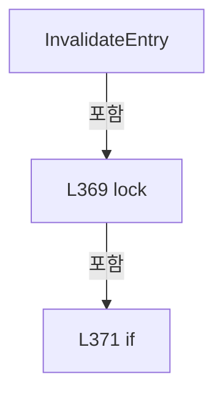

변경 전 점검: 입력/반환 타입, 위 호출자, 예외/취소 경로, 공유 상태와 저장·전송 소비자를 함께 확인합니다. 값의 단위나 물리 방향을 이름만으로 확정하지 않습니다.

### MethodDeclaration `AuxiliaryKey` · L383–383

[Drilling.Common/Automation/CAutomationStatusSnapshotService.cs:383–383](https://github.com/kjuws10-rgb/A3Drilling/blob/5aee8e58439c9b455cae7c9593c9be986c3e682e/Drilling.Common/Automation/CAutomationStatusSnapshotService.cs#L383-L383)

| 항목 | 실제 추출 값 |
| --- | --- |
| 서명 | string Drilling.Common.Automation.CAutomationStatusSnapshotService.AuxiliaryKey(string, int) |
| 접근/수식자 | Private / private, static |
| 반환/값 타입 | string |
| 소속 타입 | NamedType:Drilling.Common.Automation.CAutomationStatusSnapshotService |

입력 계약:

| 이름 | 타입 | 전달 | 선택/기본값 |
| --- | --- | --- | --- |
| axis | string | None | False /  |
| controller | int | None | False /  |

정적 호출자로 확인된 위치:

| 호출 파일/행 | 호출 표현식 | 런타임 분기 가능 |
| --- | --- | --- |
| [Drilling.Common/Automation/CAutomationStatusSnapshotService.cs:354–354](https://github.com/kjuws10-rgb/A3Drilling/blob/5aee8e58439c9b455cae7c9593c9be986c3e682e/Drilling.Common/Automation/CAutomationStatusSnapshotService.cs#L354-L354) | AuxiliaryKey | False |
| [Drilling.Common/Automation/CAutomationStatusSnapshotService.cs:358–358](https://github.com/kjuws10-rgb/A3Drilling/blob/5aee8e58439c9b455cae7c9593c9be986c3e682e/Drilling.Common/Automation/CAutomationStatusSnapshotService.cs#L358-L358) | AuxiliaryKey | False |

호출하는 대상과 해석 범위:

| 원본 행 | 표현식 | 분석 상태 | 대상/소스 위치 |
| --- | --- | --- | --- |
| 383 | axis.Trim().ToUpperInvariant | resolved | string string.ToUpperInvariant() |
| 383 | axis.Trim | resolved | string string.Trim() |

본문의 실제 연산·분기·예외·반환 순서(원문 위치 순):

| 원본 행 | 종류 | 주석 해설 |
| --- | --- | --- |
| 383 | call | 함수·델리게이트 또는 객체 생성자를 호출합니다: axis.Trim().ToUpperInvariant() |
| 383 | call | 함수·델리게이트 또는 객체 생성자를 호출합니다: axis.Trim() |

변경 전 점검: 입력/반환 타입, 위 호출자, 예외/취소 경로, 공유 상태와 저장·전송 소비자를 함께 확인합니다. 값의 단위나 물리 방향을 이름만으로 확정하지 않습니다.

### MethodDeclaration `GetMofReadiness` · L384–384

[Drilling.Common/Automation/CAutomationStatusSnapshotService.cs:384–384](https://github.com/kjuws10-rgb/A3Drilling/blob/5aee8e58439c9b455cae7c9593c9be986c3e682e/Drilling.Common/Automation/CAutomationStatusSnapshotService.cs#L384-L384)

| 항목 | 실제 추출 값 |
| --- | --- |
| 서명 | Drilling.Common.Automation.ST_AUTOMATION_STATUS_SNAPSHOT<Drilling.Common.Automation.ST_MOF_READINESS> Drilling.Common.Automation.CAutomationStatusSnapshotService.GetMofReadiness(int, int) |
| 접근/수식자 | Public / public |
| 반환/값 타입 | Drilling.Common.Automation.ST_AUTOMATION_STATUS_SNAPSHOT<Drilling.Common.Automation.ST_MOF_READINESS> |
| 소속 타입 | NamedType:Drilling.Common.Automation.CAutomationStatusSnapshotService |

입력 계약:

| 이름 | 타입 | 전달 | 선택/기본값 |
| --- | --- | --- | --- |
| task | int | None | False /  |
| controller | int | None | False /  |

정적 호출자로 확인된 위치:

| 호출 파일/행 | 호출 표현식 | 런타임 분기 가능 |
| --- | --- | --- |
| [Drilling.Common/Automation/CAutomationStatusSnapshotService.cs:387–387](https://github.com/kjuws10-rgb/A3Drilling/blob/5aee8e58439c9b455cae7c9593c9be986c3e682e/Drilling.Common/Automation/CAutomationStatusSnapshotService.cs#L387-L387) | GetMofReadiness | False |
| [Drilling.Common/Station/CStationProcess.cs:4102–4102](https://github.com/kjuws10-rgb/A3Drilling/blob/5aee8e58439c9b455cae7c9593c9be986c3e682e/Drilling.Common/Station/CStationProcess.cs#L4102-L4102) | _automationManager.StatusSnapshots.GetMofReadiness | False |

호출하는 대상과 해석 범위:

| 원본 행 | 표현식 | 분석 상태 | 대상/소스 위치 |
| --- | --- | --- | --- |
| 384 | Get<ST_MOF_READINESS> | resolved | Drilling.Common.Automation.ST_AUTOMATION_STATUS_SNAPSHOT<Drilling.Common.Automation.ST_MOF_READINESS> Drilling.Common.Automation.CAutomationStatusSnapshotService.Get<Drilling.Common.Automation.ST_MOF_READINESS>(string, int, System.Func<System.Threading.CancellationToken, object>) · Drilling.Common/Automation/CAutomationStatusSnapshotService.cs:46 |
| 384 | _automation.ReadMofReadiness(task, controller, token).GetAwaiter().GetResult | resolved | Drilling.Common.Automation.ST_MOF_READINESS System.Runtime.CompilerServices.TaskAwaiter<Drilling.Common.Automation.ST_MOF_READINESS>.GetResult() |
| 384 | _automation.ReadMofReadiness(task, controller, token).GetAwaiter | resolved | System.Runtime.CompilerServices.TaskAwaiter<Drilling.Common.Automation.ST_MOF_READINESS> System.Threading.Tasks.Task<Drilling.Common.Automation.ST_MOF_READINESS>.GetAwaiter() |
| 384 | _automation.ReadMofReadiness | resolved · 동적 구현 선택 가능 | System.Threading.Tasks.Task<Drilling.Common.Automation.ST_MOF_READINESS> Drilling.Common.Automation.CAutomationManager.ReadMofReadiness(int, int, System.Threading.CancellationToken) · Drilling.Common/Automation/CAutomationManager.cs:1254 |

본문의 실제 연산·분기·예외·반환 순서(원문 위치 순):

| 원본 행 | 종류 | 주석 해설 |
| --- | --- | --- |
| 384 | call | 함수·델리게이트 또는 객체 생성자를 호출합니다: Get<ST_MOF_READINESS>($"MOF_READY&#124;{controller}&#124;{task}", controller, token => _automation.ReadMofReadiness(task, controller, token).GetAwaiter().GetResult()) |
| 384 | call | 함수·델리게이트 또는 객체 생성자를 호출합니다: _automation.ReadMofReadiness(task, controller, token).GetAwaiter().GetResult() |
| 384 | call | 함수·델리게이트 또는 객체 생성자를 호출합니다: _automation.ReadMofReadiness(task, controller, token).GetAwaiter() |
| 384 | call | 함수·델리게이트 또는 객체 생성자를 호출합니다: _automation.ReadMofReadiness(task, controller, token) |

변경 전 점검: 입력/반환 타입, 위 호출자, 예외/취소 경로, 공유 상태와 저장·전송 소비자를 함께 확인합니다. 값의 단위나 물리 방향을 이름만으로 확정하지 않습니다.

### MethodDeclaration `InvalidateMofReadiness` · L385–389

[Drilling.Common/Automation/CAutomationStatusSnapshotService.cs:385–389](https://github.com/kjuws10-rgb/A3Drilling/blob/5aee8e58439c9b455cae7c9593c9be986c3e682e/Drilling.Common/Automation/CAutomationStatusSnapshotService.cs#L385-L389)

| 항목 | 실제 추출 값 |
| --- | --- |
| 서명 | void Drilling.Common.Automation.CAutomationStatusSnapshotService.InvalidateMofReadiness(int, int) |
| 접근/수식자 | Public / public |
| 반환/값 타입 | void |
| 소속 타입 | NamedType:Drilling.Common.Automation.CAutomationStatusSnapshotService |

입력 계약:

| 이름 | 타입 | 전달 | 선택/기본값 |
| --- | --- | --- | --- |
| task | int | None | False /  |
| controller | int | None | False /  |

정적 호출자로 확인된 위치:

| 호출 파일/행 | 호출 표현식 | 런타임 분기 가능 |
| --- | --- | --- |
| [Drilling.Common/Automation/CAutomationManager.cs:1251–1251](https://github.com/kjuws10-rgb/A3Drilling/blob/5aee8e58439c9b455cae7c9593c9be986c3e682e/Drilling.Common/Automation/CAutomationManager.cs#L1251-L1251) | StatusSnapshots.InvalidateMofReadiness | False |
| [Drilling.Common/Automation/CAutomationManager.cs:1275–1275](https://github.com/kjuws10-rgb/A3Drilling/blob/5aee8e58439c9b455cae7c9593c9be986c3e682e/Drilling.Common/Automation/CAutomationManager.cs#L1275-L1275) | StatusSnapshots.InvalidateMofReadiness | False |

호출하는 대상과 해석 범위:

| 원본 행 | 표현식 | 분석 상태 | 대상/소스 위치 |
| --- | --- | --- | --- |
| 387 | GetMofReadiness | resolved | Drilling.Common.Automation.ST_AUTOMATION_STATUS_SNAPSHOT<Drilling.Common.Automation.ST_MOF_READINESS> Drilling.Common.Automation.CAutomationStatusSnapshotService.GetMofReadiness(int, int) · Drilling.Common/Automation/CAutomationStatusSnapshotService.cs:384 |
| 388 | InvalidateEntry | resolved | void Drilling.Common.Automation.CAutomationStatusSnapshotService.InvalidateEntry(string) · Drilling.Common/Automation/CAutomationStatusSnapshotService.cs:367 |

본문의 실제 연산·분기·예외·반환 순서(원문 위치 순):

| 원본 행 | 종류 | 주석 해설 |
| --- | --- | --- |
| 387 | call | 함수·델리게이트 또는 객체 생성자를 호출합니다: GetMofReadiness(task, controller) |
| 388 | call | 함수·델리게이트 또는 객체 생성자를 호출합니다: InvalidateEntry($"MOF_READY&#124;{controller}&#124;{task}") |

변경 전 점검: 입력/반환 타입, 위 호출자, 예외/취소 경로, 공유 상태와 저장·전송 소비자를 함께 확인합니다. 값의 단위나 물리 방향을 이름만으로 확정하지 않습니다.

### PropertyDeclaration `Version` · L395–395

[Drilling.Common/Automation/CAutomationStatusSnapshotService.cs:395–395](https://github.com/kjuws10-rgb/A3Drilling/blob/5aee8e58439c9b455cae7c9593c9be986c3e682e/Drilling.Common/Automation/CAutomationStatusSnapshotService.cs#L395-L395)

| 항목 | 실제 추출 값 |
| --- | --- |
| 서명 | long Drilling.Common.Automation.ST_AUTOMATION_STATUS_SNAPSHOT<T>.Version |
| 접근/수식자 | Public / public |
| 반환/값 타입 | long |
| 소속 타입 | NamedType:Drilling.Common.Automation.ST_AUTOMATION_STATUS_SNAPSHOT<T> |

현재 부분 분석에서 직접 연결된 호출자는 없습니다. XAML/이벤트/인터페이스·델리게이트·외부 진입을 추가 확인해야 하며, 미사용으로 판정한 것이 아닙니다.

변경 전 점검: 입력/반환 타입, 위 호출자, 예외/취소 경로, 공유 상태와 저장·전송 소비자를 함께 확인합니다. 값의 단위나 물리 방향을 이름만으로 확정하지 않습니다.

### GetAccessorDeclaration `get_Version` · L395–395

[Drilling.Common/Automation/CAutomationStatusSnapshotService.cs:395–395](https://github.com/kjuws10-rgb/A3Drilling/blob/5aee8e58439c9b455cae7c9593c9be986c3e682e/Drilling.Common/Automation/CAutomationStatusSnapshotService.cs#L395-L395)

| 항목 | 실제 추출 값 |
| --- | --- |
| 서명 | long Drilling.Common.Automation.ST_AUTOMATION_STATUS_SNAPSHOT<T>.Version.get |
| 접근/수식자 | Public / get |
| 반환/값 타입 | long |
| 소속 타입 | NamedType:Drilling.Common.Automation.ST_AUTOMATION_STATUS_SNAPSHOT<T> |

현재 부분 분석에서 직접 연결된 호출자는 없습니다. XAML/이벤트/인터페이스·델리게이트·외부 진입을 추가 확인해야 하며, 미사용으로 판정한 것이 아닙니다.

변경 전 점검: 입력/반환 타입, 위 호출자, 예외/취소 경로, 공유 상태와 저장·전송 소비자를 함께 확인합니다. 값의 단위나 물리 방향을 이름만으로 확정하지 않습니다.

### InitAccessorDeclaration `set_Version` · L395–395

[Drilling.Common/Automation/CAutomationStatusSnapshotService.cs:395–395](https://github.com/kjuws10-rgb/A3Drilling/blob/5aee8e58439c9b455cae7c9593c9be986c3e682e/Drilling.Common/Automation/CAutomationStatusSnapshotService.cs#L395-L395)

| 항목 | 실제 추출 값 |
| --- | --- |
| 서명 | void Drilling.Common.Automation.ST_AUTOMATION_STATUS_SNAPSHOT<T>.Version.init |
| 접근/수식자 | Public / init |
| 반환/값 타입 | void |
| 소속 타입 | NamedType:Drilling.Common.Automation.ST_AUTOMATION_STATUS_SNAPSHOT<T> |

입력 계약:

| 이름 | 타입 | 전달 | 선택/기본값 |
| --- | --- | --- | --- |
| value | long | None | False /  |

현재 부분 분석에서 직접 연결된 호출자는 없습니다. XAML/이벤트/인터페이스·델리게이트·외부 진입을 추가 확인해야 하며, 미사용으로 판정한 것이 아닙니다.

변경 전 점검: 입력/반환 타입, 위 호출자, 예외/취소 경로, 공유 상태와 저장·전송 소비자를 함께 확인합니다. 값의 단위나 물리 방향을 이름만으로 확정하지 않습니다.

### PropertyDeclaration `CollectedTimestamp` · L396–396

[Drilling.Common/Automation/CAutomationStatusSnapshotService.cs:396–396](https://github.com/kjuws10-rgb/A3Drilling/blob/5aee8e58439c9b455cae7c9593c9be986c3e682e/Drilling.Common/Automation/CAutomationStatusSnapshotService.cs#L396-L396)

| 항목 | 실제 추출 값 |
| --- | --- |
| 서명 | long Drilling.Common.Automation.ST_AUTOMATION_STATUS_SNAPSHOT<T>.CollectedTimestamp |
| 접근/수식자 | Public / public |
| 반환/값 타입 | long |
| 소속 타입 | NamedType:Drilling.Common.Automation.ST_AUTOMATION_STATUS_SNAPSHOT<T> |

현재 부분 분석에서 직접 연결된 호출자는 없습니다. XAML/이벤트/인터페이스·델리게이트·외부 진입을 추가 확인해야 하며, 미사용으로 판정한 것이 아닙니다.

변경 전 점검: 입력/반환 타입, 위 호출자, 예외/취소 경로, 공유 상태와 저장·전송 소비자를 함께 확인합니다. 값의 단위나 물리 방향을 이름만으로 확정하지 않습니다.

### GetAccessorDeclaration `get_CollectedTimestamp` · L396–396

[Drilling.Common/Automation/CAutomationStatusSnapshotService.cs:396–396](https://github.com/kjuws10-rgb/A3Drilling/blob/5aee8e58439c9b455cae7c9593c9be986c3e682e/Drilling.Common/Automation/CAutomationStatusSnapshotService.cs#L396-L396)

| 항목 | 실제 추출 값 |
| --- | --- |
| 서명 | long Drilling.Common.Automation.ST_AUTOMATION_STATUS_SNAPSHOT<T>.CollectedTimestamp.get |
| 접근/수식자 | Public / get |
| 반환/값 타입 | long |
| 소속 타입 | NamedType:Drilling.Common.Automation.ST_AUTOMATION_STATUS_SNAPSHOT<T> |

현재 부분 분석에서 직접 연결된 호출자는 없습니다. XAML/이벤트/인터페이스·델리게이트·외부 진입을 추가 확인해야 하며, 미사용으로 판정한 것이 아닙니다.

변경 전 점검: 입력/반환 타입, 위 호출자, 예외/취소 경로, 공유 상태와 저장·전송 소비자를 함께 확인합니다. 값의 단위나 물리 방향을 이름만으로 확정하지 않습니다.

### InitAccessorDeclaration `set_CollectedTimestamp` · L396–396

[Drilling.Common/Automation/CAutomationStatusSnapshotService.cs:396–396](https://github.com/kjuws10-rgb/A3Drilling/blob/5aee8e58439c9b455cae7c9593c9be986c3e682e/Drilling.Common/Automation/CAutomationStatusSnapshotService.cs#L396-L396)

| 항목 | 실제 추출 값 |
| --- | --- |
| 서명 | void Drilling.Common.Automation.ST_AUTOMATION_STATUS_SNAPSHOT<T>.CollectedTimestamp.init |
| 접근/수식자 | Public / init |
| 반환/값 타입 | void |
| 소속 타입 | NamedType:Drilling.Common.Automation.ST_AUTOMATION_STATUS_SNAPSHOT<T> |

입력 계약:

| 이름 | 타입 | 전달 | 선택/기본값 |
| --- | --- | --- | --- |
| value | long | None | False /  |

현재 부분 분석에서 직접 연결된 호출자는 없습니다. XAML/이벤트/인터페이스·델리게이트·외부 진입을 추가 확인해야 하며, 미사용으로 판정한 것이 아닙니다.

변경 전 점검: 입력/반환 타입, 위 호출자, 예외/취소 경로, 공유 상태와 저장·전송 소비자를 함께 확인합니다. 값의 단위나 물리 방향을 이름만으로 확정하지 않습니다.

### MethodDeclaration `IsFresh` · L399–405

[Drilling.Common/Automation/CAutomationStatusSnapshotService.cs:399–405](https://github.com/kjuws10-rgb/A3Drilling/blob/5aee8e58439c9b455cae7c9593c9be986c3e682e/Drilling.Common/Automation/CAutomationStatusSnapshotService.cs#L399-L405)

| 항목 | 실제 추출 값 |
| --- | --- |
| 서명 | bool Drilling.Common.Automation.ST_AUTOMATION_STATUS_SNAPSHOT<T>.IsFresh(System.TimeSpan) |
| 접근/수식자 | Public / public |
| 반환/값 타입 | bool |
| 소속 타입 | NamedType:Drilling.Common.Automation.ST_AUTOMATION_STATUS_SNAPSHOT<T> |

원본 XML 주석:

````xml
/// <summary>Age is measured from the device read start, not cache publication.</summary>
````

입력 계약:

| 이름 | 타입 | 전달 | 선택/기본값 |
| --- | --- | --- | --- |
| maximumAge | System.TimeSpan | None | False /  |

정적 호출자로 확인된 위치:

| 호출 파일/행 | 호출 표현식 | 런타임 분기 가능 |
| --- | --- | --- |
| [Drilling.Common/Automation/CAutomationManager.cs:1497–1497](https://github.com/kjuws10-rgb/A3Drilling/blob/5aee8e58439c9b455cae7c9593c9be986c3e682e/Drilling.Common/Automation/CAutomationManager.cs#L1497-L1497) | sample.IsFresh | False |
| [Drilling.Common/Interface/CPowerMeasureRun.cs:289–289](https://github.com/kjuws10-rgb/A3Drilling/blob/5aee8e58439c9b455cae7c9593c9be986c3e682e/Drilling.Common/Interface/CPowerMeasureRun.cs#L289-L289) | status.IsFresh | False |
| [Drilling.UI/Menu/Menus/CMenuCorrection.cs:3503–3503](https://github.com/kjuws10-rgb/A3Drilling/blob/5aee8e58439c9b455cae7c9593c9be986c3e682e/Drilling.UI/Menu/Menus/CMenuCorrection.cs#L3503-L3503) | task.IsFresh | False |
| [Drilling.UI/Menu/Menus/CMenuCorrection.cs:3643–3643](https://github.com/kjuws10-rgb/A3Drilling/blob/5aee8e58439c9b455cae7c9593c9be986c3e682e/Drilling.UI/Menu/Menus/CMenuCorrection.cs#L3643-L3643) | status.IsFresh | False |
| [Drilling.UI/Menu/Menus/CMenuCorrection.cs:3720–3720](https://github.com/kjuws10-rgb/A3Drilling/blob/5aee8e58439c9b455cae7c9593c9be986c3e682e/Drilling.UI/Menu/Menus/CMenuCorrection.cs#L3720-L3720) | snapshot.IsFresh | False |

호출하는 대상과 해석 범위:

| 원본 행 | 표현식 | 분석 상태 | 대상/소스 위치 |
| --- | --- | --- | --- |
| 403 | Stopwatch.GetTimestamp | resolved | long System.Diagnostics.Stopwatch.GetTimestamp() |
| 404 | Stopwatch.GetElapsedTime | resolved | System.TimeSpan System.Diagnostics.Stopwatch.GetElapsedTime(long, long) |

본문의 실제 연산·분기·예외·반환 순서(원문 위치 순):

| 원본 행 | 종류 | 주석 해설 |
| --- | --- | --- |
| 401 | if | 조건에 따라 분기합니다: if (State != "OK" &#124;&#124; Value is null &#124;&#124; CollectedTimestamp <= 0) |
| 402 | return | 호출자에게 값 또는 제어를 반환합니다: return false; |
| 403 | call | 함수·델리게이트 또는 객체 생성자를 호출합니다: Stopwatch.GetTimestamp() |
| 403 | local-declaration | 지역 변수를 선언합니다: var now = Stopwatch.GetTimestamp(); |
| 403 | variable-initializer | 변수의 초기값을 지정합니다: now = Stopwatch.GetTimestamp() |
| 404 | call | 함수·델리게이트 또는 객체 생성자를 호출합니다: Stopwatch.GetElapsedTime(CollectedTimestamp, now) |
| 404 | return | 호출자에게 값 또는 제어를 반환합니다: return CollectedTimestamp <= now && Stopwatch.GetElapsedTime(CollectedTimestamp, now) <= maximumAge; |

제어 구문의 포함 구조(실제 실행 순서/CFG가 아닌 구문 탐색 그림):

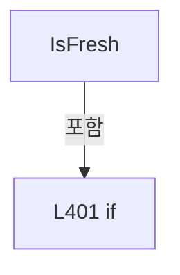

변경 전 점검: 입력/반환 타입, 위 호출자, 예외/취소 경로, 공유 상태와 저장·전송 소비자를 함께 확인합니다. 값의 단위나 물리 방향을 이름만으로 확정하지 않습니다.

### FieldDeclaration `SnapshotLock` · L432–432

[Drilling.Common/Automation/CAutomationStatusSnapshotService.cs:432–432](https://github.com/kjuws10-rgb/A3Drilling/blob/5aee8e58439c9b455cae7c9593c9be986c3e682e/Drilling.Common/Automation/CAutomationStatusSnapshotService.cs#L432-L432)

| 항목 | 실제 추출 값 |
| --- | --- |
| 서명 | object Drilling.Common.Automation.CScannerStatusLiveSnapshotStore.SnapshotLock |
| 접근/수식자 | Private / private, static, readonly |
| 반환/값 타입 | object |
| 소속 타입 | NamedType:Drilling.Common.Automation.CScannerStatusLiveSnapshotStore |

현재 부분 분석에서 직접 연결된 호출자는 없습니다. XAML/이벤트/인터페이스·델리게이트·외부 진입을 추가 확인해야 하며, 미사용으로 판정한 것이 아닙니다.

호출하는 대상과 해석 범위:

| 원본 행 | 표현식 | 분석 상태 | 대상/소스 위치 |
| --- | --- | --- | --- |
| 432 | new | resolved | object.Object() |

본문의 실제 연산·분기·예외·반환 순서(원문 위치 순):

| 원본 행 | 종류 | 주석 해설 |
| --- | --- | --- |
| 432 | call | 함수·델리게이트 또는 객체 생성자를 호출합니다: new() |
| 432 | variable-initializer | 변수의 초기값을 지정합니다: SnapshotLock = new() |

변경 전 점검: 입력/반환 타입, 위 호출자, 예외/취소 경로, 공유 상태와 저장·전송 소비자를 함께 확인합니다. 값의 단위나 물리 방향을 이름만으로 확정하지 않습니다.

### FieldDeclaration `_ownerId` · L433–433

[Drilling.Common/Automation/CAutomationStatusSnapshotService.cs:433–433](https://github.com/kjuws10-rgb/A3Drilling/blob/5aee8e58439c9b455cae7c9593c9be986c3e682e/Drilling.Common/Automation/CAutomationStatusSnapshotService.cs#L433-L433)

| 항목 | 실제 추출 값 |
| --- | --- |
| 서명 | System.Guid Drilling.Common.Automation.CScannerStatusLiveSnapshotStore._ownerId |
| 접근/수식자 | Private / private, static |
| 반환/값 타입 | System.Guid |
| 소속 타입 | NamedType:Drilling.Common.Automation.CScannerStatusLiveSnapshotStore |

현재 부분 분석에서 직접 연결된 호출자는 없습니다. XAML/이벤트/인터페이스·델리게이트·외부 진입을 추가 확인해야 하며, 미사용으로 판정한 것이 아닙니다.

본문의 실제 연산·분기·예외·반환 순서(원문 위치 순):

| 원본 행 | 종류 | 주석 해설 |
| --- | --- | --- |
| 433 | variable-initializer | 변수의 초기값을 지정합니다: _ownerId = Guid.Empty |

변경 전 점검: 입력/반환 타입, 위 호출자, 예외/취소 경로, 공유 상태와 저장·전송 소비자를 함께 확인합니다. 값의 단위나 물리 방향을 이름만으로 확정하지 않습니다.

### FieldDeclaration `_snapshot` · L434–434

[Drilling.Common/Automation/CAutomationStatusSnapshotService.cs:434–434](https://github.com/kjuws10-rgb/A3Drilling/blob/5aee8e58439c9b455cae7c9593c9be986c3e682e/Drilling.Common/Automation/CAutomationStatusSnapshotService.cs#L434-L434)

| 항목 | 실제 추출 값 |
| --- | --- |
| 서명 | System.Collections.Generic.IReadOnlyList<Drilling.Common.Automation.ST_SCANNER_AXIS_LIVE_STATUS> Drilling.Common.Automation.CScannerStatusLiveSnapshotStore._snapshot |
| 접근/수식자 | Private / private, static |
| 반환/값 타입 | System.Collections.Generic.IReadOnlyList<Drilling.Common.Automation.ST_SCANNER_AXIS_LIVE_STATUS> |
| 소속 타입 | NamedType:Drilling.Common.Automation.CScannerStatusLiveSnapshotStore |

현재 부분 분석에서 직접 연결된 호출자는 없습니다. XAML/이벤트/인터페이스·델리게이트·외부 진입을 추가 확인해야 하며, 미사용으로 판정한 것이 아닙니다.

본문의 실제 연산·분기·예외·반환 순서(원문 위치 순):

| 원본 행 | 종류 | 주석 해설 |
| --- | --- | --- |
| 434 | variable-initializer | 변수의 초기값을 지정합니다: _snapshot = [] |

변경 전 점검: 입력/반환 타입, 위 호출자, 예외/취소 경로, 공유 상태와 저장·전송 소비자를 함께 확인합니다. 값의 단위나 물리 방향을 이름만으로 확정하지 않습니다.

### MethodDeclaration `Begin` · L435–445

[Drilling.Common/Automation/CAutomationStatusSnapshotService.cs:435–445](https://github.com/kjuws10-rgb/A3Drilling/blob/5aee8e58439c9b455cae7c9593c9be986c3e682e/Drilling.Common/Automation/CAutomationStatusSnapshotService.cs#L435-L445)

| 항목 | 실제 추출 값 |
| --- | --- |
| 서명 | System.Guid Drilling.Common.Automation.CScannerStatusLiveSnapshotStore.Begin() |
| 접근/수식자 | Public / public, static |
| 반환/값 타입 | System.Guid |
| 소속 타입 | NamedType:Drilling.Common.Automation.CScannerStatusLiveSnapshotStore |

정적 호출자로 확인된 위치:

| 호출 파일/행 | 호출 표현식 | 런타임 분기 가능 |
| --- | --- | --- |
| [Drilling.Common/Station/CStationProcess.cs:2570–2570](https://github.com/kjuws10-rgb/A3Drilling/blob/5aee8e58439c9b455cae7c9593c9be986c3e682e/Drilling.Common/Station/CStationProcess.cs#L2570-L2570) | CScannerStatusLiveSnapshotStore.Begin | False |

호출하는 대상과 해석 범위:

| 원본 행 | 표현식 | 분석 상태 | 대상/소스 위치 |
| --- | --- | --- | --- |
| 437 | Guid.NewGuid | resolved | System.Guid System.Guid.NewGuid() |

본문의 실제 연산·분기·예외·반환 순서(원문 위치 순):

| 원본 행 | 종류 | 주석 해설 |
| --- | --- | --- |
| 437 | call | 함수·델리게이트 또는 객체 생성자를 호출합니다: Guid.NewGuid() |
| 437 | local-declaration | 지역 변수를 선언합니다: var ownerId = Guid.NewGuid(); |
| 437 | variable-initializer | 변수의 초기값을 지정합니다: ownerId = Guid.NewGuid() |
| 438 | lock | 공유 상태의 임계 구역에 진입합니다: lock (SnapshotLock) |
| 440 | assignment | 값을 대상에 대입합니다: _ownerId = ownerId |
| 441 | assignment | 값을 대상에 대입합니다: _snapshot = [] |
| 444 | return | 호출자에게 값 또는 제어를 반환합니다: return ownerId; |

제어 구문의 포함 구조(실제 실행 순서/CFG가 아닌 구문 탐색 그림):

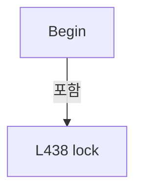

변경 전 점검: 입력/반환 타입, 위 호출자, 예외/취소 경로, 공유 상태와 저장·전송 소비자를 함께 확인합니다. 값의 단위나 물리 방향을 이름만으로 확정하지 않습니다.

### MethodDeclaration `Update` · L447–458

[Drilling.Common/Automation/CAutomationStatusSnapshotService.cs:447–458](https://github.com/kjuws10-rgb/A3Drilling/blob/5aee8e58439c9b455cae7c9593c9be986c3e682e/Drilling.Common/Automation/CAutomationStatusSnapshotService.cs#L447-L458)

| 항목 | 실제 추출 값 |
| --- | --- |
| 서명 | void Drilling.Common.Automation.CScannerStatusLiveSnapshotStore.Update(System.Guid, System.Collections.Generic.IReadOnlyList<Drilling.Common.Automation.ST_SCANNER_AXIS_LIVE_STATUS>) |
| 접근/수식자 | Public / public, static |
| 반환/값 타입 | void |
| 소속 타입 | NamedType:Drilling.Common.Automation.CScannerStatusLiveSnapshotStore |

입력 계약:

| 이름 | 타입 | 전달 | 선택/기본값 |
| --- | --- | --- | --- |
| ownerId | System.Guid | None | False /  |
| snapshot | System.Collections.Generic.IReadOnlyList<Drilling.Common.Automation.ST_SCANNER_AXIS_LIVE_STATUS> | None | False /  |

정적 호출자로 확인된 위치:

| 호출 파일/행 | 호출 표현식 | 런타임 분기 가능 |
| --- | --- | --- |
| [Drilling.Common/Station/CStationProcess.cs:2717–2717](https://github.com/kjuws10-rgb/A3Drilling/blob/5aee8e58439c9b455cae7c9593c9be986c3e682e/Drilling.Common/Station/CStationProcess.cs#L2717-L2717) | CScannerStatusLiveSnapshotStore.Update | False |

본문의 실제 연산·분기·예외·반환 순서(원문 위치 순):

| 원본 행 | 종류 | 주석 해설 |
| --- | --- | --- |
| 449 | lock | 공유 상태의 임계 구역에 진입합니다: lock (SnapshotLock) |
| 451 | if | 조건에 따라 분기합니다: if (_ownerId != ownerId) |
| 453 | return | 호출자에게 값 또는 제어를 반환합니다: return; |
| 456 | assignment | 값을 대상에 대입합니다: _snapshot = snapshot |

제어 구문의 포함 구조(실제 실행 순서/CFG가 아닌 구문 탐색 그림):

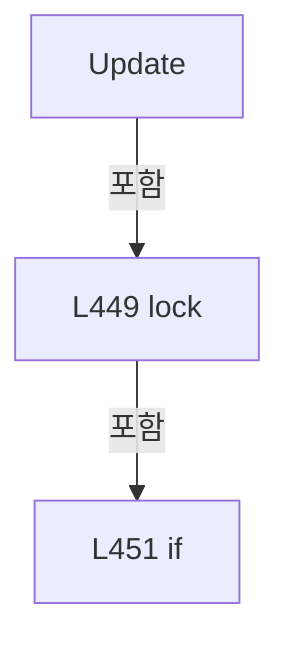

변경 전 점검: 입력/반환 타입, 위 호출자, 예외/취소 경로, 공유 상태와 저장·전송 소비자를 함께 확인합니다. 값의 단위나 물리 방향을 이름만으로 확정하지 않습니다.

### MethodDeclaration `End` · L460–472

[Drilling.Common/Automation/CAutomationStatusSnapshotService.cs:460–472](https://github.com/kjuws10-rgb/A3Drilling/blob/5aee8e58439c9b455cae7c9593c9be986c3e682e/Drilling.Common/Automation/CAutomationStatusSnapshotService.cs#L460-L472)

| 항목 | 실제 추출 값 |
| --- | --- |
| 서명 | void Drilling.Common.Automation.CScannerStatusLiveSnapshotStore.End(System.Guid) |
| 접근/수식자 | Public / public, static |
| 반환/값 타입 | void |
| 소속 타입 | NamedType:Drilling.Common.Automation.CScannerStatusLiveSnapshotStore |

입력 계약:

| 이름 | 타입 | 전달 | 선택/기본값 |
| --- | --- | --- | --- |
| ownerId | System.Guid | None | False /  |

정적 호출자로 확인된 위치:

| 호출 파일/행 | 호출 표현식 | 런타임 분기 가능 |
| --- | --- | --- |
| [Drilling.Common/Station/CStationProcess.cs:2596–2596](https://github.com/kjuws10-rgb/A3Drilling/blob/5aee8e58439c9b455cae7c9593c9be986c3e682e/Drilling.Common/Station/CStationProcess.cs#L2596-L2596) | CScannerStatusLiveSnapshotStore.End | False |

본문의 실제 연산·분기·예외·반환 순서(원문 위치 순):

| 원본 행 | 종류 | 주석 해설 |
| --- | --- | --- |
| 462 | lock | 공유 상태의 임계 구역에 진입합니다: lock (SnapshotLock) |
| 464 | if | 조건에 따라 분기합니다: if (_ownerId != ownerId) |
| 466 | return | 호출자에게 값 또는 제어를 반환합니다: return; |
| 469 | assignment | 값을 대상에 대입합니다: _ownerId = Guid.Empty |
| 470 | assignment | 값을 대상에 대입합니다: _snapshot = [] |

제어 구문의 포함 구조(실제 실행 순서/CFG가 아닌 구문 탐색 그림):

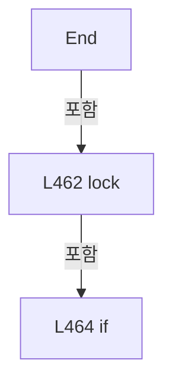

변경 전 점검: 입력/반환 타입, 위 호출자, 예외/취소 경로, 공유 상태와 저장·전송 소비자를 함께 확인합니다. 값의 단위나 물리 방향을 이름만으로 확정하지 않습니다.

### MethodDeclaration `TryGetHeadSnapshot` · L474–496

[Drilling.Common/Automation/CAutomationStatusSnapshotService.cs:474–496](https://github.com/kjuws10-rgb/A3Drilling/blob/5aee8e58439c9b455cae7c9593c9be986c3e682e/Drilling.Common/Automation/CAutomationStatusSnapshotService.cs#L474-L496)

| 항목 | 실제 추출 값 |
| --- | --- |
| 서명 | bool Drilling.Common.Automation.CScannerStatusLiveSnapshotStore.TryGetHeadSnapshot(int, out System.Collections.Generic.IReadOnlyList<Drilling.Common.Automation.ST_SCANNER_AXIS_LIVE_STATUS>) |
| 접근/수식자 | Public / public, static |
| 반환/값 타입 | bool |
| 소속 타입 | NamedType:Drilling.Common.Automation.CScannerStatusLiveSnapshotStore |

입력 계약:

| 이름 | 타입 | 전달 | 선택/기본값 |
| --- | --- | --- | --- |
| headNo | int | None | False /  |
| snapshot | System.Collections.Generic.IReadOnlyList<Drilling.Common.Automation.ST_SCANNER_AXIS_LIVE_STATUS> | Out | False /  |

현재 부분 분석에서 직접 연결된 호출자는 없습니다. XAML/이벤트/인터페이스·델리게이트·외부 진입을 추가 확인해야 하며, 미사용으로 판정한 것이 아닙니다.

호출하는 대상과 해석 범위:

| 원본 행 | 표현식 | 분석 상태 | 대상/소스 위치 |
| --- | --- | --- | --- |
| 484 | new List<ST_SCANNER_AXIS_LIVE_STATUS> | resolved | System.Collections.Generic.List<Drilling.Common.Automation.ST_SCANNER_AXIS_LIVE_STATUS>.List() |
| 489 | items.Add | resolved | void System.Collections.Generic.List<Drilling.Common.Automation.ST_SCANNER_AXIS_LIVE_STATUS>.Add(Drilling.Common.Automation.ST_SCANNER_AXIS_LIVE_STATUS) |

본문의 실제 연산·분기·예외·반환 순서(원문 위치 순):

| 원본 행 | 종류 | 주석 해설 |
| --- | --- | --- |
| 476 | lock | 공유 상태의 임계 구역에 진입합니다: lock (SnapshotLock) |
| 478 | if | 조건에 따라 분기합니다: if (_ownerId == Guid.Empty) |
| 480 | assignment | 값을 대상에 대입합니다: snapshot = [] |
| 481 | return | 호출자에게 값 또는 제어를 반환합니다: return false; |
| 484 | call | 함수·델리게이트 또는 객체 생성자를 호출합니다: new List<ST_SCANNER_AXIS_LIVE_STATUS>() |
| 484 | local-declaration | 지역 변수를 선언합니다: var items = new List<ST_SCANNER_AXIS_LIVE_STATUS>(); |
| 484 | variable-initializer | 변수의 초기값을 지정합니다: items = new List<ST_SCANNER_AXIS_LIVE_STATUS>() |
| 485 | foreach | 컬렉션 요소를 순회합니다: foreach (var item in _snapshot) |
| 487 | if | 조건에 따라 분기합니다: if (item.HeadNo == headNo) |
| 489 | call | 함수·델리게이트 또는 객체 생성자를 호출합니다: items.Add(item) |
| 493 | assignment | 값을 대상에 대입합니다: snapshot = items |
| 494 | return | 호출자에게 값 또는 제어를 반환합니다: return true; |

제어 구문의 포함 구조(실제 실행 순서/CFG가 아닌 구문 탐색 그림):

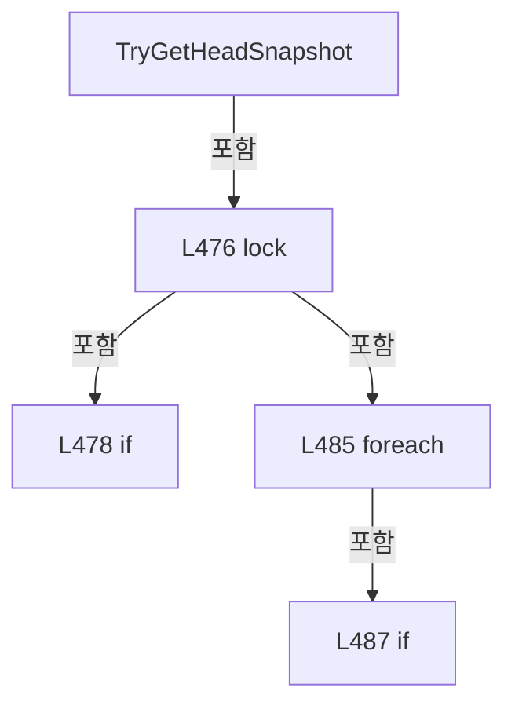

변경 전 점검: 입력/반환 타입, 위 호출자, 예외/취소 경로, 공유 상태와 저장·전송 소비자를 함께 확인합니다. 값의 단위나 물리 방향을 이름만으로 확정하지 않습니다.

### MethodDeclaration `TryGetTaskStatus` · L498–519

[Drilling.Common/Automation/CAutomationStatusSnapshotService.cs:498–519](https://github.com/kjuws10-rgb/A3Drilling/blob/5aee8e58439c9b455cae7c9593c9be986c3e682e/Drilling.Common/Automation/CAutomationStatusSnapshotService.cs#L498-L519)

| 항목 | 실제 추출 값 |
| --- | --- |
| 서명 | bool Drilling.Common.Automation.CScannerStatusLiveSnapshotStore.TryGetTaskStatus(int, int, out string) |
| 접근/수식자 | Public / public, static |
| 반환/값 타입 | bool |
| 소속 타입 | NamedType:Drilling.Common.Automation.CScannerStatusLiveSnapshotStore |

입력 계약:

| 이름 | 타입 | 전달 | 선택/기본값 |
| --- | --- | --- | --- |
| automationNo | int | None | False /  |
| taskNo | int | None | False /  |
| taskStatus | string | Out | False /  |

현재 부분 분석에서 직접 연결된 호출자는 없습니다. XAML/이벤트/인터페이스·델리게이트·외부 진입을 추가 확인해야 하며, 미사용으로 판정한 것이 아닙니다.

호출하는 대상과 해석 범위:

| 원본 행 | 표현식 | 분석 상태 | 대상/소스 위치 |
| --- | --- | --- | --- |
| 510 | string.IsNullOrWhiteSpace | resolved | bool string.IsNullOrWhiteSpace(string?) |

본문의 실제 연산·분기·예외·반환 순서(원문 위치 순):

| 원본 행 | 종류 | 주석 해설 |
| --- | --- | --- |
| 500 | lock | 공유 상태의 임계 구역에 진입합니다: lock (SnapshotLock) |
| 502 | assignment | 값을 대상에 대입합니다: taskStatus = "WAIT" |
| 503 | if | 조건에 따라 분기합니다: if (_ownerId == Guid.Empty) |
| 505 | return | 호출자에게 값 또는 제어를 반환합니다: return false; |
| 508 | foreach | 컬렉션 요소를 순회합니다: foreach (var item in _snapshot) |
| 510 | call | 함수·델리게이트 또는 객체 생성자를 호출합니다: string.IsNullOrWhiteSpace(item.TaskStatus) |
| 510 | if | 조건에 따라 분기합니다: if (item.AutomationNo == automationNo && item.TaskNo == taskNo && !string.IsNullOrWhiteSpace(item.TaskStatus)) |
| 512 | assignment | 값을 대상에 대입합니다: taskStatus = item.TaskStatus |
| 513 | return | 호출자에게 값 또는 제어를 반환합니다: return true; |
| 517 | return | 호출자에게 값 또는 제어를 반환합니다: return true; |

제어 구문의 포함 구조(실제 실행 순서/CFG가 아닌 구문 탐색 그림):

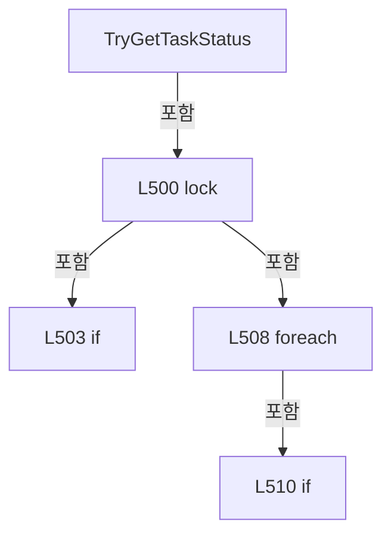

변경 전 점검: 입력/반환 타입, 위 호출자, 예외/취소 경로, 공유 상태와 저장·전송 소비자를 함께 확인합니다. 값의 단위나 물리 방향을 이름만으로 확정하지 않습니다.

### MethodDeclaration `TryGetProcessorUsage` · L521–542

[Drilling.Common/Automation/CAutomationStatusSnapshotService.cs:521–542](https://github.com/kjuws10-rgb/A3Drilling/blob/5aee8e58439c9b455cae7c9593c9be986c3e682e/Drilling.Common/Automation/CAutomationStatusSnapshotService.cs#L521-L542)

| 항목 | 실제 추출 값 |
| --- | --- |
| 서명 | bool Drilling.Common.Automation.CScannerStatusLiveSnapshotStore.TryGetProcessorUsage(int, out string) |
| 접근/수식자 | Public / public, static |
| 반환/값 타입 | bool |
| 소속 타입 | NamedType:Drilling.Common.Automation.CScannerStatusLiveSnapshotStore |

입력 계약:

| 이름 | 타입 | 전달 | 선택/기본값 |
| --- | --- | --- | --- |
| automationNo | int | None | False /  |
| processorUsage | string | Out | False /  |

현재 부분 분석에서 직접 연결된 호출자는 없습니다. XAML/이벤트/인터페이스·델리게이트·외부 진입을 추가 확인해야 하며, 미사용으로 판정한 것이 아닙니다.

호출하는 대상과 해석 범위:

| 원본 행 | 표현식 | 분석 상태 | 대상/소스 위치 |
| --- | --- | --- | --- |
| 533 | string.IsNullOrWhiteSpace | resolved | bool string.IsNullOrWhiteSpace(string?) |

본문의 실제 연산·분기·예외·반환 순서(원문 위치 순):

| 원본 행 | 종류 | 주석 해설 |
| --- | --- | --- |
| 523 | lock | 공유 상태의 임계 구역에 진입합니다: lock (SnapshotLock) |
| 525 | assignment | 값을 대상에 대입합니다: processorUsage = "WAIT" |
| 526 | if | 조건에 따라 분기합니다: if (_ownerId == Guid.Empty) |
| 528 | return | 호출자에게 값 또는 제어를 반환합니다: return false; |
| 531 | foreach | 컬렉션 요소를 순회합니다: foreach (var item in _snapshot) |
| 533 | call | 함수·델리게이트 또는 객체 생성자를 호출합니다: string.IsNullOrWhiteSpace(item.ProcessorUsage) |
| 533 | if | 조건에 따라 분기합니다: if (item.AutomationNo == automationNo && !string.IsNullOrWhiteSpace(item.ProcessorUsage)) |
| 535 | assignment | 값을 대상에 대입합니다: processorUsage = item.ProcessorUsage |
| 536 | return | 호출자에게 값 또는 제어를 반환합니다: return true; |
| 540 | return | 호출자에게 값 또는 제어를 반환합니다: return true; |

제어 구문의 포함 구조(실제 실행 순서/CFG가 아닌 구문 탐색 그림):

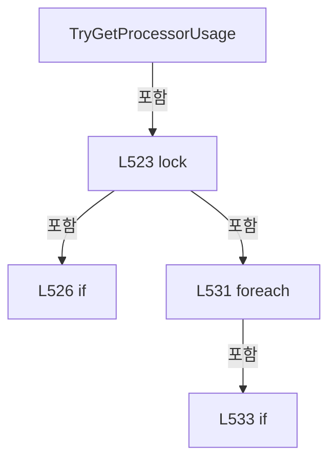

변경 전 점검: 입력/반환 타입, 위 호출자, 예외/취소 경로, 공유 상태와 저장·전송 소비자를 함께 확인합니다. 값의 단위나 물리 방향을 이름만으로 확정하지 않습니다.

## 구문·바인딩 한계

전체 WPF/벤더 SDK/프로젝트별 빌드 조건을 로드한 정식 빌드가 아닙니다. `resolved`는 이 부분 컴파일에서의 심볼 연결이며 virtual/interface/delegate/이벤트/Reflection/XAML의 실제 런타임 구현을 확정하지 않습니다. `candidate`와 `unresolved`는 후속 확인 대상으로 남깁니다.

## 원문 전체 주석 해설본

[원본 모든 행과 행별 해설 보기](../../../annotated/Drilling.Common/Automation/CAutomationStatusSnapshotService.cs.annotated.txt)

원본을 빠뜨리거나 임의로 줄이지 않았습니다. `L000001 |` 표시는 원본 행 번호, `// 해설`은 별도 설명입니다. 실행용 소스가 아닌 문서입니다.

## 수정·재검증 체크

- 원본 Commit과 현재 작업 파일 SHA가 같은지 먼저 확인합니다. 다르면 이 문서를 과거 버전 자료로 취급합니다.
- 선언·직접 호출·이벤트/인터페이스 경계·설정 소비를 함께 확인합니다. 정적 연결의 빈 곳을 정상 경로로 추정하지 않습니다.
- 저장 형식/단위/식별자·재시도·취소·예외·롤백에 영향을 주는 변경은 상세 해설장과 호출자를 다시 검토합니다.
- 도구의 구문 추출과 별도 정적 추적 해설, 실제 빌드·시뮬레이션·실장비 검증 결과를 분리합니다.
