# Drilling.Common/Automation/CScannerAxisConfiguration.cs

| 항목 | 내용 |
| --- | --- |
| 원본 저장소 | https://github.com/kjuws10-rgb/A3Drilling.git |
| 원본 Commit | 5aee8e58439c9b455cae7c9593c9be986c3e682e |
| 원본 SHA256 | 46241bee261b984aa7c9999db2414c5f0b92c128bfbae34733ac0aceb59b04b4 |
| 파일 분류 | code |
| 원본 크기/행 | 11,959 bytes / 316 physical lines |
| 인코딩 | utf-8-sig |
| 검토 범위 | 구문/부분 의미 분석에서 추출한 사실. 동작·물리 단위·실장비 합격을 보증하지 않습니다. |
| 원본 링크 | [고정 Commit 원본](https://github.com/kjuws10-rgb/A3Drilling/blob/5aee8e58439c9b455cae7c9593c9be986c3e682e/Drilling.Common/Automation/CScannerAxisConfiguration.cs) |

## 파일의 역할과 읽는 순서

프로그램의 시작·구성·공유 타입 또는 빌드 연결에 사용됩니다. 아래 실제 선언·참조와 원본 근거를 확인합니다.

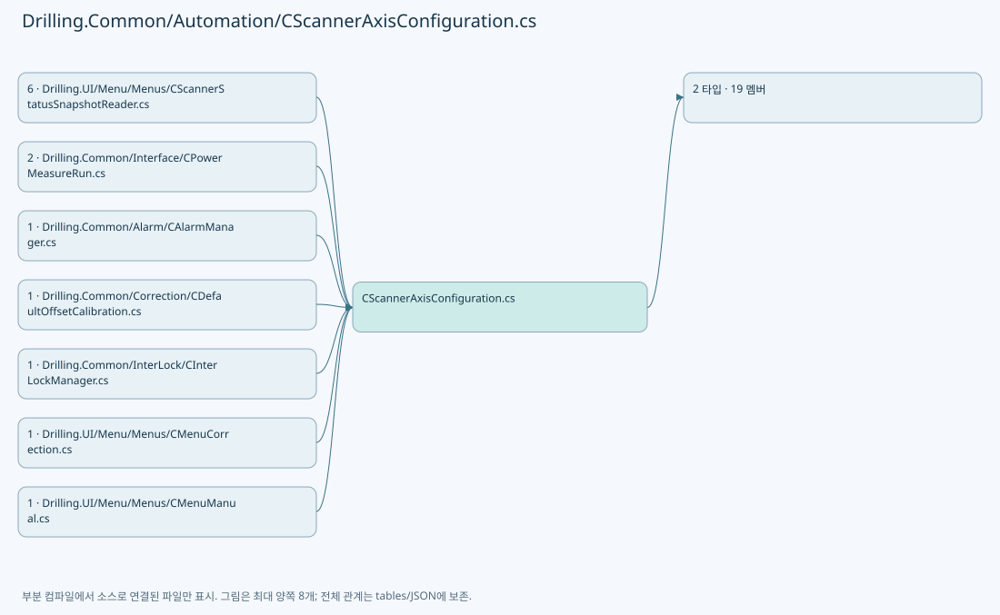

## 네임스페이스·타입·상속

| 타입 | 구분 | 원본 범위 | 선언/상속 |
| --- | --- | --- | --- |
| CScannerAxisConfiguration | ClassDeclaration | 6–305 | CScannerAxisConfiguration |
| ST_SCANNER_AXIS_SETTING | RecordStructDeclaration | 307–316 | ST_SCANNER_AXIS_SETTING |

## 멤버 빠른 목록

| 이름 | 종류 | 범위 | 서명 |
| --- | --- | --- | --- |
| BuildAxisDefinitions | MethodDeclaration | L8–27 | System.Collections.Generic.IReadOnlyList<Drilling.Common.Automation.ST_SCANNER_AXIS_SETTING> Drilling.Common.Automation.CScannerAxisConfiguration.BuildAxisDefinitions(System.Collections.Generic.IReadOnlyList<Drilling.Common.Managers.ST_SYSTEM_PARAMETER>, int) |
| BuildAxisDefinitions | MethodDeclaration | L29–48 | System.Collections.Generic.IReadOnlyList<Drilling.Common.Automation.ST_SCANNER_AXIS_SETTING> Drilling.Common.Automation.CScannerAxisConfiguration.BuildAxisDefinitions(System.Collections.Generic.IReadOnlyDictionary<string, string>, int) |
| AppendScannerZAxisDefinition | MethodDeclaration | L50–60 | void Drilling.Common.Automation.CScannerAxisConfiguration.AppendScannerZAxisDefinition(System.Collections.Generic.IReadOnlyList<Drilling.Common.Managers.ST_SYSTEM_PARAMETER>, int, int, int, System.Collections.Generic.List<Drilling.Common.Automation.ST_SCANNER_AXIS_SETTING>) |
| AppendScannerZAxisDefinition | MethodDeclaration | L62–72 | void Drilling.Common.Automation.CScannerAxisConfiguration.AppendScannerZAxisDefinition(System.Collections.Generic.IReadOnlyDictionary<string, string>, int, int, int, System.Collections.Generic.List<Drilling.Common.Automation.ST_SCANNER_AXIS_SETTING>) |
| CreateUnusedAxisDefinition | MethodDeclaration | L74–77 | Drilling.Common.Automation.ST_SCANNER_AXIS_SETTING Drilling.Common.Automation.CScannerAxisConfiguration.CreateUnusedAxisDefinition(int, int, string, int) |
| CreateAxisDefinition | MethodDeclaration | L79–89 | Drilling.Common.Automation.ST_SCANNER_AXIS_SETTING Drilling.Common.Automation.CScannerAxisConfiguration.CreateAxisDefinition(int, int, string, string, int, bool) |
| ValidateConfiguredAxisName | MethodDeclaration | L91–109 | string Drilling.Common.Automation.CScannerAxisConfiguration.ValidateConfiguredAxisName(int, string, string) |
| IsAllAsciiDigits | MethodDeclaration | L111–127 | bool Drilling.Common.Automation.CScannerAxisConfiguration.IsAllAsciiDigits(string) |
| IsAutomationAxisName | MethodDeclaration | L129–145 | bool Drilling.Common.Automation.CScannerAxisConfiguration.IsAutomationAxisName(string) |
| BuildEnabledHeadNumbers | MethodDeclaration | L147–159 | System.Collections.Generic.IReadOnlyList<int> Drilling.Common.Automation.CScannerAxisConfiguration.BuildEnabledHeadNumbers(System.Collections.Generic.IReadOnlyList<Drilling.Common.Managers.ST_SYSTEM_PARAMETER>, int) |
| IsHeadEnabled | MethodDeclaration | L161–164 | bool Drilling.Common.Automation.CScannerAxisConfiguration.IsHeadEnabled(System.Collections.Generic.IReadOnlyList<Drilling.Common.Managers.ST_SYSTEM_PARAMETER>, int) |
| IsHeadEnabled | MethodDeclaration | L166–169 | bool Drilling.Common.Automation.CScannerAxisConfiguration.IsHeadEnabled(System.Collections.Generic.IReadOnlyDictionary<string, string>, int) |
| ReadHeadSettingText | MethodDeclaration | L171–192 | string Drilling.Common.Automation.CScannerAxisConfiguration.ReadHeadSettingText(System.Collections.Generic.IReadOnlyList<Drilling.Common.Managers.ST_SYSTEM_PARAMETER>, string, int, params string[]) |
| ReadHeadSettingBool | MethodDeclaration | L194–222 | bool Drilling.Common.Automation.CScannerAxisConfiguration.ReadHeadSettingBool(System.Collections.Generic.IReadOnlyList<Drilling.Common.Managers.ST_SYSTEM_PARAMETER>, bool, int, params string[]) |
| ReadHeadSettingInt | MethodDeclaration | L224–245 | int Drilling.Common.Automation.CScannerAxisConfiguration.ReadHeadSettingInt(System.Collections.Generic.IReadOnlyList<Drilling.Common.Managers.ST_SYSTEM_PARAMETER>, int, int, params string[]) |
| ReadHeadSettingText | MethodDeclaration | L247–260 | string Drilling.Common.Automation.CScannerAxisConfiguration.ReadHeadSettingText(System.Collections.Generic.IReadOnlyDictionary<string, string>, string, int, params string[]) |
| ReadHeadSettingBool | MethodDeclaration | L262–287 | bool Drilling.Common.Automation.CScannerAxisConfiguration.ReadHeadSettingBool(System.Collections.Generic.IReadOnlyDictionary<string, string>, bool, int, params string[]) |
| ReadHeadSettingInt | MethodDeclaration | L289–302 | int Drilling.Common.Automation.CScannerAxisConfiguration.ReadHeadSettingInt(System.Collections.Generic.IReadOnlyDictionary<string, string>, int, int, params string[]) |
| NormalizeHeadNo | MethodDeclaration | L304–304 | int Drilling.Common.Automation.CScannerAxisConfiguration.NormalizeHeadNo(int) |

## 멤버별 상세 계약·호출·처리 해설

### MethodDeclaration `BuildAxisDefinitions` · L8–27

[Drilling.Common/Automation/CScannerAxisConfiguration.cs:8–27](https://github.com/kjuws10-rgb/A3Drilling/blob/5aee8e58439c9b455cae7c9593c9be986c3e682e/Drilling.Common/Automation/CScannerAxisConfiguration.cs#L8-L27)

| 항목 | 실제 추출 값 |
| --- | --- |
| 서명 | System.Collections.Generic.IReadOnlyList<Drilling.Common.Automation.ST_SCANNER_AXIS_SETTING> Drilling.Common.Automation.CScannerAxisConfiguration.BuildAxisDefinitions(System.Collections.Generic.IReadOnlyList<Drilling.Common.Managers.ST_SYSTEM_PARAMETER>, int) |
| 접근/수식자 | Public / public, static |
| 반환/값 타입 | System.Collections.Generic.IReadOnlyList<Drilling.Common.Automation.ST_SCANNER_AXIS_SETTING> |
| 소속 타입 | NamedType:Drilling.Common.Automation.CScannerAxisConfiguration |

입력 계약:

| 이름 | 타입 | 전달 | 선택/기본값 |
| --- | --- | --- | --- |
| settings | System.Collections.Generic.IReadOnlyList<Drilling.Common.Managers.ST_SYSTEM_PARAMETER> | None | False /  |
| headNo | int | None | False /  |

정적 호출자로 확인된 위치:

| 호출 파일/행 | 호출 표현식 | 런타임 분기 가능 |
| --- | --- | --- |
| [Drilling.Common/Alarm/CAlarmManager.cs:590–590](https://github.com/kjuws10-rgb/A3Drilling/blob/5aee8e58439c9b455cae7c9593c9be986c3e682e/Drilling.Common/Alarm/CAlarmManager.cs#L590-L590) | CScannerAxisConfiguration.BuildAxisDefinitions | False |
| [Drilling.Common/Interface/CPowerMeasureRun.cs:261–261](https://github.com/kjuws10-rgb/A3Drilling/blob/5aee8e58439c9b455cae7c9593c9be986c3e682e/Drilling.Common/Interface/CPowerMeasureRun.cs#L261-L261) | CScannerAxisConfiguration.BuildAxisDefinitions | False |
| [Drilling.UI/Menu/Menus/CMenuCorrection.cs:3568–3568](https://github.com/kjuws10-rgb/A3Drilling/blob/5aee8e58439c9b455cae7c9593c9be986c3e682e/Drilling.UI/Menu/Menus/CMenuCorrection.cs#L3568-L3568) | CScannerAxisConfiguration.BuildAxisDefinitions | False |
| [Drilling.UI/Menu/Menus/CScannerStatusSnapshotReader.cs:121–121](https://github.com/kjuws10-rgb/A3Drilling/blob/5aee8e58439c9b455cae7c9593c9be986c3e682e/Drilling.UI/Menu/Menus/CScannerStatusSnapshotReader.cs#L121-L121) | CScannerAxisConfiguration.BuildAxisDefinitions | False |

호출하는 대상과 해석 범위:

| 원본 행 | 표현식 | 분석 상태 | 대상/소스 위치 |
| --- | --- | --- | --- |
| 10 | NormalizeHeadNo | resolved | int Drilling.Common.Automation.CScannerAxisConfiguration.NormalizeHeadNo(int) · Drilling.Common/Automation/CScannerAxisConfiguration.cs:304 |
| 11 | IsHeadEnabled | resolved | bool Drilling.Common.Automation.CScannerAxisConfiguration.IsHeadEnabled(System.Collections.Generic.IReadOnlyList<Drilling.Common.Managers.ST_SYSTEM_PARAMETER>, int) · Drilling.Common/Automation/CScannerAxisConfiguration.cs:161 |
| 16 | ReadHeadSettingInt | resolved | int Drilling.Common.Automation.CScannerAxisConfiguration.ReadHeadSettingInt(System.Collections.Generic.IReadOnlyList<Drilling.Common.Managers.ST_SYSTEM_PARAMETER>, int, int, params string[]) · Drilling.Common/Automation/CScannerAxisConfiguration.cs:224 |
| 17 | ReadHeadSettingText | resolved | string Drilling.Common.Automation.CScannerAxisConfiguration.ReadHeadSettingText(System.Collections.Generic.IReadOnlyList<Drilling.Common.Managers.ST_SYSTEM_PARAMETER>, string, int, params string[]) · Drilling.Common/Automation/CScannerAxisConfiguration.cs:171 |
| 18 | ReadHeadSettingText | resolved | string Drilling.Common.Automation.CScannerAxisConfiguration.ReadHeadSettingText(System.Collections.Generic.IReadOnlyList<Drilling.Common.Managers.ST_SYSTEM_PARAMETER>, string, int, params string[]) · Drilling.Common/Automation/CScannerAxisConfiguration.cs:171 |
| 19 | ReadHeadSettingInt | resolved | int Drilling.Common.Automation.CScannerAxisConfiguration.ReadHeadSettingInt(System.Collections.Generic.IReadOnlyList<Drilling.Common.Managers.ST_SYSTEM_PARAMETER>, int, int, params string[]) · Drilling.Common/Automation/CScannerAxisConfiguration.cs:224 |
| 20 | new List<ST_SCANNER_AXIS_SETTING> | resolved | System.Collections.Generic.List<Drilling.Common.Automation.ST_SCANNER_AXIS_SETTING>.List(int) |
| 22 | CreateAxisDefinition | resolved | Drilling.Common.Automation.ST_SCANNER_AXIS_SETTING Drilling.Common.Automation.CScannerAxisConfiguration.CreateAxisDefinition(int, int, string, string, int, bool) · Drilling.Common/Automation/CScannerAxisConfiguration.cs:79 |
| 23 | CreateAxisDefinition | resolved | Drilling.Common.Automation.ST_SCANNER_AXIS_SETTING Drilling.Common.Automation.CScannerAxisConfiguration.CreateAxisDefinition(int, int, string, string, int, bool) · Drilling.Common/Automation/CScannerAxisConfiguration.cs:79 |
| 25 | AppendScannerZAxisDefinition | resolved | void Drilling.Common.Automation.CScannerAxisConfiguration.AppendScannerZAxisDefinition(System.Collections.Generic.IReadOnlyList<Drilling.Common.Managers.ST_SYSTEM_PARAMETER>, int, int, int, System.Collections.Generic.List<Drilling.Common.Automation.ST_SCANNER_AXIS_SETTING>) · Drilling.Common/Automation/CScannerAxisConfiguration.cs:50 |

본문의 실제 연산·분기·예외·반환 순서(원문 위치 순):

| 원본 행 | 종류 | 주석 해설 |
| --- | --- | --- |
| 10 | call | 함수·델리게이트 또는 객체 생성자를 호출합니다: NormalizeHeadNo(headNo) |
| 10 | local-declaration | 지역 변수를 선언합니다: var normalizedHeadNo = NormalizeHeadNo(headNo); |
| 10 | variable-initializer | 변수의 초기값을 지정합니다: normalizedHeadNo = NormalizeHeadNo(headNo) |
| 11 | call | 함수·델리게이트 또는 객체 생성자를 호출합니다: IsHeadEnabled(settings, normalizedHeadNo) |
| 11 | if | 조건에 따라 분기합니다: if (!IsHeadEnabled(settings, normalizedHeadNo)) |
| 13 | return | 호출자에게 값 또는 제어를 반환합니다: return[]; |
| 16 | call | 함수·델리게이트 또는 객체 생성자를 호출합니다: ReadHeadSettingInt(settings, normalizedHeadNo <= 4 ? 0 : 1, normalizedHeadNo, "AUTOMATION_NO") |
| 16 | conditional-expression | 조건에 따라 결과식을 선택합니다: normalizedHeadNo <= 4 ? 0 : 1 |
| 16 | local-declaration | 지역 변수를 선언합니다: var automationNo = ReadHeadSettingInt(settings, normalizedHeadNo <= 4 ? 0 : 1, normalizedHeadNo, "AUTOMATION_NO"); |
| 16 | variable-initializer | 변수의 초기값을 지정합니다: automationNo = ReadHeadSettingInt(settings, normalizedHeadNo <= 4 ? 0 : 1, normalizedHeadNo, "AUTOMATION_NO") |
| 17 | call | 함수·델리게이트 또는 객체 생성자를 호출합니다: ReadHeadSettingText(settings, "", normalizedHeadNo, "X_AXIS", "GX_AXIS") |
| 17 | local-declaration | 지역 변수를 선언합니다: var xAxis = ReadHeadSettingText(settings, "", normalizedHeadNo, "X_AXIS", "GX_AXIS"); |
| 17 | variable-initializer | 변수의 초기값을 지정합니다: xAxis = ReadHeadSettingText(settings, "", normalizedHeadNo, "X_AXIS", "GX_AXIS") |
| 18 | call | 함수·델리게이트 또는 객체 생성자를 호출합니다: ReadHeadSettingText(settings, "", normalizedHeadNo, "Y_AXIS", "GY_AXIS") |
| 18 | local-declaration | 지역 변수를 선언합니다: var yAxis = ReadHeadSettingText(settings, "", normalizedHeadNo, "Y_AXIS", "GY_AXIS"); |
| 18 | variable-initializer | 변수의 초기값을 지정합니다: yAxis = ReadHeadSettingText(settings, "", normalizedHeadNo, "Y_AXIS", "GY_AXIS") |
| 19 | call | 함수·델리게이트 또는 객체 생성자를 호출합니다: ReadHeadSettingInt(settings, 0, normalizedHeadNo, "SCANNER_AIO_NO") |
| 19 | local-declaration | 지역 변수를 선언합니다: var aioNo = ReadHeadSettingInt(settings, 0, normalizedHeadNo, "SCANNER_AIO_NO"); |
| 19 | variable-initializer | 변수의 초기값을 지정합니다: aioNo = ReadHeadSettingInt(settings, 0, normalizedHeadNo, "SCANNER_AIO_NO") |
| 20 | call | 함수·델리게이트 또는 객체 생성자를 호출합니다: new List<ST_SCANNER_AXIS_SETTING>(3) { CreateAxisDefinition(normalizedHeadNo, automationNo, "X", xAxis, aioNo), CreateAxisDefinition(normalizedHeadNo, automationNo, "Y", yAxis, aioNo) } |
| 20 | local-declaration | 지역 변수를 선언합니다: var definitions = new List<ST_SCANNER_AXIS_SETTING>(3) { CreateAxisDefinition(normalizedHeadNo, automationNo, "X", xAxis, aioNo), CreateAxisDefinition(normalizedHeadNo, automationNo, "Y", yAxis, aioNo) }; |
| 20 | variable-initializer | 변수의 초기값을 지정합니다: definitions = new List<ST_SCANNER_AXIS_SETTING>(3) { CreateAxisDefinition(normalizedHeadNo, automationNo, "X", xAxis, aioNo), CreateAxisDefinition(normalizedHeadNo, automationNo, "Y", yAxis, aioNo) } |
| 22 | call | 함수·델리게이트 또는 객체 생성자를 호출합니다: CreateAxisDefinition(normalizedHeadNo, automationNo, "X", xAxis, aioNo) |
| 23 | call | 함수·델리게이트 또는 객체 생성자를 호출합니다: CreateAxisDefinition(normalizedHeadNo, automationNo, "Y", yAxis, aioNo) |
| 25 | call | 함수·델리게이트 또는 객체 생성자를 호출합니다: AppendScannerZAxisDefinition(settings, normalizedHeadNo, automationNo, aioNo, definitions) |
| 26 | return | 호출자에게 값 또는 제어를 반환합니다: return definitions; |

제어 구문의 포함 구조(실제 실행 순서/CFG가 아닌 구문 탐색 그림):

변경 전 점검: 입력/반환 타입, 위 호출자, 예외/취소 경로, 공유 상태와 저장·전송 소비자를 함께 확인합니다. 값의 단위나 물리 방향을 이름만으로 확정하지 않습니다.

### MethodDeclaration `BuildAxisDefinitions` · L29–48

[Drilling.Common/Automation/CScannerAxisConfiguration.cs:29–48](https://github.com/kjuws10-rgb/A3Drilling/blob/5aee8e58439c9b455cae7c9593c9be986c3e682e/Drilling.Common/Automation/CScannerAxisConfiguration.cs#L29-L48)

| 항목 | 실제 추출 값 |
| --- | --- |
| 서명 | System.Collections.Generic.IReadOnlyList<Drilling.Common.Automation.ST_SCANNER_AXIS_SETTING> Drilling.Common.Automation.CScannerAxisConfiguration.BuildAxisDefinitions(System.Collections.Generic.IReadOnlyDictionary<string, string>, int) |
| 접근/수식자 | Public / public, static |
| 반환/값 타입 | System.Collections.Generic.IReadOnlyList<Drilling.Common.Automation.ST_SCANNER_AXIS_SETTING> |
| 소속 타입 | NamedType:Drilling.Common.Automation.CScannerAxisConfiguration |

입력 계약:

| 이름 | 타입 | 전달 | 선택/기본값 |
| --- | --- | --- | --- |
| parameters | System.Collections.Generic.IReadOnlyDictionary<string, string> | None | False /  |
| headNo | int | None | False /  |

정적 호출자로 확인된 위치:

| 호출 파일/행 | 호출 표현식 | 런타임 분기 가능 |
| --- | --- | --- |
| [Drilling.Common/InterLock/CInterLockManager.cs:129–129](https://github.com/kjuws10-rgb/A3Drilling/blob/5aee8e58439c9b455cae7c9593c9be986c3e682e/Drilling.Common/InterLock/CInterLockManager.cs#L129-L129) | CScannerAxisConfiguration.BuildAxisDefinitions | False |
| [Drilling.UI/Menu/Menus/CScannerStatusSnapshotReader.cs:124–124](https://github.com/kjuws10-rgb/A3Drilling/blob/5aee8e58439c9b455cae7c9593c9be986c3e682e/Drilling.UI/Menu/Menus/CScannerStatusSnapshotReader.cs#L124-L124) | CScannerAxisConfiguration.BuildAxisDefinitions | False |

호출하는 대상과 해석 범위:

| 원본 행 | 표현식 | 분석 상태 | 대상/소스 위치 |
| --- | --- | --- | --- |
| 31 | NormalizeHeadNo | resolved | int Drilling.Common.Automation.CScannerAxisConfiguration.NormalizeHeadNo(int) · Drilling.Common/Automation/CScannerAxisConfiguration.cs:304 |
| 32 | IsHeadEnabled | resolved | bool Drilling.Common.Automation.CScannerAxisConfiguration.IsHeadEnabled(System.Collections.Generic.IReadOnlyDictionary<string, string>, int) · Drilling.Common/Automation/CScannerAxisConfiguration.cs:166 |
| 37 | ReadHeadSettingInt | resolved | int Drilling.Common.Automation.CScannerAxisConfiguration.ReadHeadSettingInt(System.Collections.Generic.IReadOnlyDictionary<string, string>, int, int, params string[]) · Drilling.Common/Automation/CScannerAxisConfiguration.cs:289 |
| 38 | ReadHeadSettingText | resolved | string Drilling.Common.Automation.CScannerAxisConfiguration.ReadHeadSettingText(System.Collections.Generic.IReadOnlyDictionary<string, string>, string, int, params string[]) · Drilling.Common/Automation/CScannerAxisConfiguration.cs:247 |
| 39 | ReadHeadSettingText | resolved | string Drilling.Common.Automation.CScannerAxisConfiguration.ReadHeadSettingText(System.Collections.Generic.IReadOnlyDictionary<string, string>, string, int, params string[]) · Drilling.Common/Automation/CScannerAxisConfiguration.cs:247 |
| 40 | ReadHeadSettingInt | resolved | int Drilling.Common.Automation.CScannerAxisConfiguration.ReadHeadSettingInt(System.Collections.Generic.IReadOnlyDictionary<string, string>, int, int, params string[]) · Drilling.Common/Automation/CScannerAxisConfiguration.cs:289 |
| 41 | new List<ST_SCANNER_AXIS_SETTING> | resolved | System.Collections.Generic.List<Drilling.Common.Automation.ST_SCANNER_AXIS_SETTING>.List(int) |
| 43 | CreateAxisDefinition | resolved | Drilling.Common.Automation.ST_SCANNER_AXIS_SETTING Drilling.Common.Automation.CScannerAxisConfiguration.CreateAxisDefinition(int, int, string, string, int, bool) · Drilling.Common/Automation/CScannerAxisConfiguration.cs:79 |
| 44 | CreateAxisDefinition | resolved | Drilling.Common.Automation.ST_SCANNER_AXIS_SETTING Drilling.Common.Automation.CScannerAxisConfiguration.CreateAxisDefinition(int, int, string, string, int, bool) · Drilling.Common/Automation/CScannerAxisConfiguration.cs:79 |
| 46 | AppendScannerZAxisDefinition | resolved | void Drilling.Common.Automation.CScannerAxisConfiguration.AppendScannerZAxisDefinition(System.Collections.Generic.IReadOnlyDictionary<string, string>, int, int, int, System.Collections.Generic.List<Drilling.Common.Automation.ST_SCANNER_AXIS_SETTING>) · Drilling.Common/Automation/CScannerAxisConfiguration.cs:62 |

본문의 실제 연산·분기·예외·반환 순서(원문 위치 순):

| 원본 행 | 종류 | 주석 해설 |
| --- | --- | --- |
| 31 | call | 함수·델리게이트 또는 객체 생성자를 호출합니다: NormalizeHeadNo(headNo) |
| 31 | local-declaration | 지역 변수를 선언합니다: var normalizedHeadNo = NormalizeHeadNo(headNo); |
| 31 | variable-initializer | 변수의 초기값을 지정합니다: normalizedHeadNo = NormalizeHeadNo(headNo) |
| 32 | call | 함수·델리게이트 또는 객체 생성자를 호출합니다: IsHeadEnabled(parameters, normalizedHeadNo) |
| 32 | if | 조건에 따라 분기합니다: if (!IsHeadEnabled(parameters, normalizedHeadNo)) |
| 34 | return | 호출자에게 값 또는 제어를 반환합니다: return[]; |
| 37 | call | 함수·델리게이트 또는 객체 생성자를 호출합니다: ReadHeadSettingInt(parameters, normalizedHeadNo <= 4 ? 0 : 1, normalizedHeadNo, "AUTOMATION_NO") |
| 37 | conditional-expression | 조건에 따라 결과식을 선택합니다: normalizedHeadNo <= 4 ? 0 : 1 |
| 37 | local-declaration | 지역 변수를 선언합니다: var automationNo = ReadHeadSettingInt(parameters, normalizedHeadNo <= 4 ? 0 : 1, normalizedHeadNo, "AUTOMATION_NO"); |
| 37 | variable-initializer | 변수의 초기값을 지정합니다: automationNo = ReadHeadSettingInt(parameters, normalizedHeadNo <= 4 ? 0 : 1, normalizedHeadNo, "AUTOMATION_NO") |
| 38 | call | 함수·델리게이트 또는 객체 생성자를 호출합니다: ReadHeadSettingText(parameters, "", normalizedHeadNo, "X_AXIS", "GX_AXIS") |
| 38 | local-declaration | 지역 변수를 선언합니다: var xAxis = ReadHeadSettingText(parameters, "", normalizedHeadNo, "X_AXIS", "GX_AXIS"); |
| 38 | variable-initializer | 변수의 초기값을 지정합니다: xAxis = ReadHeadSettingText(parameters, "", normalizedHeadNo, "X_AXIS", "GX_AXIS") |
| 39 | call | 함수·델리게이트 또는 객체 생성자를 호출합니다: ReadHeadSettingText(parameters, "", normalizedHeadNo, "Y_AXIS", "GY_AXIS") |
| 39 | local-declaration | 지역 변수를 선언합니다: var yAxis = ReadHeadSettingText(parameters, "", normalizedHeadNo, "Y_AXIS", "GY_AXIS"); |
| 39 | variable-initializer | 변수의 초기값을 지정합니다: yAxis = ReadHeadSettingText(parameters, "", normalizedHeadNo, "Y_AXIS", "GY_AXIS") |
| 40 | call | 함수·델리게이트 또는 객체 생성자를 호출합니다: ReadHeadSettingInt(parameters, 0, normalizedHeadNo, "SCANNER_AIO_NO") |
| 40 | local-declaration | 지역 변수를 선언합니다: var aioNo = ReadHeadSettingInt(parameters, 0, normalizedHeadNo, "SCANNER_AIO_NO"); |
| 40 | variable-initializer | 변수의 초기값을 지정합니다: aioNo = ReadHeadSettingInt(parameters, 0, normalizedHeadNo, "SCANNER_AIO_NO") |
| 41 | call | 함수·델리게이트 또는 객체 생성자를 호출합니다: new List<ST_SCANNER_AXIS_SETTING>(3) { CreateAxisDefinition(normalizedHeadNo, automationNo, "X", xAxis, aioNo), CreateAxisDefinition(normalizedHeadNo, automationNo, "Y", yAxis, aioNo) } |
| 41 | local-declaration | 지역 변수를 선언합니다: var definitions = new List<ST_SCANNER_AXIS_SETTING>(3) { CreateAxisDefinition(normalizedHeadNo, automationNo, "X", xAxis, aioNo), CreateAxisDefinition(normalizedHeadNo, automationNo, "Y", yAxis, aioNo) }; |
| 41 | variable-initializer | 변수의 초기값을 지정합니다: definitions = new List<ST_SCANNER_AXIS_SETTING>(3) { CreateAxisDefinition(normalizedHeadNo, automationNo, "X", xAxis, aioNo), CreateAxisDefinition(normalizedHeadNo, automationNo, "Y", yAxis, aioNo) } |
| 43 | call | 함수·델리게이트 또는 객체 생성자를 호출합니다: CreateAxisDefinition(normalizedHeadNo, automationNo, "X", xAxis, aioNo) |
| 44 | call | 함수·델리게이트 또는 객체 생성자를 호출합니다: CreateAxisDefinition(normalizedHeadNo, automationNo, "Y", yAxis, aioNo) |
| 46 | call | 함수·델리게이트 또는 객체 생성자를 호출합니다: AppendScannerZAxisDefinition(parameters, normalizedHeadNo, automationNo, aioNo, definitions) |
| 47 | return | 호출자에게 값 또는 제어를 반환합니다: return definitions; |

제어 구문의 포함 구조(실제 실행 순서/CFG가 아닌 구문 탐색 그림):

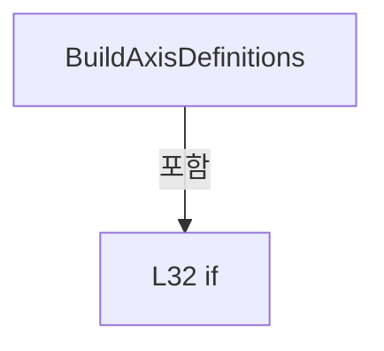

변경 전 점검: 입력/반환 타입, 위 호출자, 예외/취소 경로, 공유 상태와 저장·전송 소비자를 함께 확인합니다. 값의 단위나 물리 방향을 이름만으로 확정하지 않습니다.

### MethodDeclaration `AppendScannerZAxisDefinition` · L50–60

[Drilling.Common/Automation/CScannerAxisConfiguration.cs:50–60](https://github.com/kjuws10-rgb/A3Drilling/blob/5aee8e58439c9b455cae7c9593c9be986c3e682e/Drilling.Common/Automation/CScannerAxisConfiguration.cs#L50-L60)

| 항목 | 실제 추출 값 |
| --- | --- |
| 서명 | void Drilling.Common.Automation.CScannerAxisConfiguration.AppendScannerZAxisDefinition(System.Collections.Generic.IReadOnlyList<Drilling.Common.Managers.ST_SYSTEM_PARAMETER>, int, int, int, System.Collections.Generic.List<Drilling.Common.Automation.ST_SCANNER_AXIS_SETTING>) |
| 접근/수식자 | Private / private, static |
| 반환/값 타입 | void |
| 소속 타입 | NamedType:Drilling.Common.Automation.CScannerAxisConfiguration |

입력 계약:

| 이름 | 타입 | 전달 | 선택/기본값 |
| --- | --- | --- | --- |
| settings | System.Collections.Generic.IReadOnlyList<Drilling.Common.Managers.ST_SYSTEM_PARAMETER> | None | False /  |
| headNo | int | None | False /  |
| automationNo | int | None | False /  |
| aioNo | int | None | False /  |
| definitions | System.Collections.Generic.List<Drilling.Common.Automation.ST_SCANNER_AXIS_SETTING> | None | False /  |

정적 호출자로 확인된 위치:

| 호출 파일/행 | 호출 표현식 | 런타임 분기 가능 |
| --- | --- | --- |
| [Drilling.Common/Automation/CScannerAxisConfiguration.cs:25–25](https://github.com/kjuws10-rgb/A3Drilling/blob/5aee8e58439c9b455cae7c9593c9be986c3e682e/Drilling.Common/Automation/CScannerAxisConfiguration.cs#L25-L25) | AppendScannerZAxisDefinition | False |

호출하는 대상과 해석 범위:

| 원본 행 | 표현식 | 분석 상태 | 대상/소스 위치 |
| --- | --- | --- | --- |
| 52 | ReadHeadSettingBool | resolved | bool Drilling.Common.Automation.CScannerAxisConfiguration.ReadHeadSettingBool(System.Collections.Generic.IReadOnlyList<Drilling.Common.Managers.ST_SYSTEM_PARAMETER>, bool, int, params string[]) · Drilling.Common/Automation/CScannerAxisConfiguration.cs:194 |
| 54 | definitions.Add | resolved | void System.Collections.Generic.List<Drilling.Common.Automation.ST_SCANNER_AXIS_SETTING>.Add(Drilling.Common.Automation.ST_SCANNER_AXIS_SETTING) |
| 54 | CreateUnusedAxisDefinition | resolved | Drilling.Common.Automation.ST_SCANNER_AXIS_SETTING Drilling.Common.Automation.CScannerAxisConfiguration.CreateUnusedAxisDefinition(int, int, string, int) · Drilling.Common/Automation/CScannerAxisConfiguration.cs:74 |
| 58 | ReadHeadSettingText | resolved | string Drilling.Common.Automation.CScannerAxisConfiguration.ReadHeadSettingText(System.Collections.Generic.IReadOnlyList<Drilling.Common.Managers.ST_SYSTEM_PARAMETER>, string, int, params string[]) · Drilling.Common/Automation/CScannerAxisConfiguration.cs:171 |
| 59 | definitions.Add | resolved | void System.Collections.Generic.List<Drilling.Common.Automation.ST_SCANNER_AXIS_SETTING>.Add(Drilling.Common.Automation.ST_SCANNER_AXIS_SETTING) |
| 59 | CreateAxisDefinition | resolved | Drilling.Common.Automation.ST_SCANNER_AXIS_SETTING Drilling.Common.Automation.CScannerAxisConfiguration.CreateAxisDefinition(int, int, string, string, int, bool) · Drilling.Common/Automation/CScannerAxisConfiguration.cs:79 |

본문의 실제 연산·분기·예외·반환 순서(원문 위치 순):

| 원본 행 | 종류 | 주석 해설 |
| --- | --- | --- |
| 52 | call | 함수·델리게이트 또는 객체 생성자를 호출합니다: ReadHeadSettingBool(settings, false, headNo, "SCANNER_Z_USE", "Z_USE") |
| 52 | if | 조건에 따라 분기합니다: if (!ReadHeadSettingBool(settings, false, headNo, "SCANNER_Z_USE", "Z_USE")) |
| 54 | call | 함수·델리게이트 또는 객체 생성자를 호출합니다: definitions.Add(CreateUnusedAxisDefinition(headNo, automationNo, "Z", aioNo)) |
| 54 | call | 함수·델리게이트 또는 객체 생성자를 호출합니다: CreateUnusedAxisDefinition(headNo, automationNo, "Z", aioNo) |
| 55 | return | 호출자에게 값 또는 제어를 반환합니다: return; |
| 58 | call | 함수·델리게이트 또는 객체 생성자를 호출합니다: ReadHeadSettingText(settings, "", headNo, "SCANNER_Z_AXIS", "Z_AXIS") |
| 58 | local-declaration | 지역 변수를 선언합니다: var zAxis = ReadHeadSettingText(settings, "", headNo, "SCANNER_Z_AXIS", "Z_AXIS"); |
| 58 | variable-initializer | 변수의 초기값을 지정합니다: zAxis = ReadHeadSettingText(settings, "", headNo, "SCANNER_Z_AXIS", "Z_AXIS") |
| 59 | call | 함수·델리게이트 또는 객체 생성자를 호출합니다: definitions.Add(CreateAxisDefinition(headNo, automationNo, "Z", zAxis, aioNo, false)) |
| 59 | call | 함수·델리게이트 또는 객체 생성자를 호출합니다: CreateAxisDefinition(headNo, automationNo, "Z", zAxis, aioNo, false) |

제어 구문의 포함 구조(실제 실행 순서/CFG가 아닌 구문 탐색 그림):

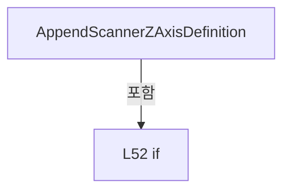

변경 전 점검: 입력/반환 타입, 위 호출자, 예외/취소 경로, 공유 상태와 저장·전송 소비자를 함께 확인합니다. 값의 단위나 물리 방향을 이름만으로 확정하지 않습니다.

### MethodDeclaration `AppendScannerZAxisDefinition` · L62–72

[Drilling.Common/Automation/CScannerAxisConfiguration.cs:62–72](https://github.com/kjuws10-rgb/A3Drilling/blob/5aee8e58439c9b455cae7c9593c9be986c3e682e/Drilling.Common/Automation/CScannerAxisConfiguration.cs#L62-L72)

| 항목 | 실제 추출 값 |
| --- | --- |
| 서명 | void Drilling.Common.Automation.CScannerAxisConfiguration.AppendScannerZAxisDefinition(System.Collections.Generic.IReadOnlyDictionary<string, string>, int, int, int, System.Collections.Generic.List<Drilling.Common.Automation.ST_SCANNER_AXIS_SETTING>) |
| 접근/수식자 | Private / private, static |
| 반환/값 타입 | void |
| 소속 타입 | NamedType:Drilling.Common.Automation.CScannerAxisConfiguration |

입력 계약:

| 이름 | 타입 | 전달 | 선택/기본값 |
| --- | --- | --- | --- |
| parameters | System.Collections.Generic.IReadOnlyDictionary<string, string> | None | False /  |
| headNo | int | None | False /  |
| automationNo | int | None | False /  |
| aioNo | int | None | False /  |
| definitions | System.Collections.Generic.List<Drilling.Common.Automation.ST_SCANNER_AXIS_SETTING> | None | False /  |

정적 호출자로 확인된 위치:

| 호출 파일/행 | 호출 표현식 | 런타임 분기 가능 |
| --- | --- | --- |
| [Drilling.Common/Automation/CScannerAxisConfiguration.cs:46–46](https://github.com/kjuws10-rgb/A3Drilling/blob/5aee8e58439c9b455cae7c9593c9be986c3e682e/Drilling.Common/Automation/CScannerAxisConfiguration.cs#L46-L46) | AppendScannerZAxisDefinition | False |

호출하는 대상과 해석 범위:

| 원본 행 | 표현식 | 분석 상태 | 대상/소스 위치 |
| --- | --- | --- | --- |
| 64 | ReadHeadSettingBool | resolved | bool Drilling.Common.Automation.CScannerAxisConfiguration.ReadHeadSettingBool(System.Collections.Generic.IReadOnlyDictionary<string, string>, bool, int, params string[]) · Drilling.Common/Automation/CScannerAxisConfiguration.cs:262 |
| 66 | definitions.Add | resolved | void System.Collections.Generic.List<Drilling.Common.Automation.ST_SCANNER_AXIS_SETTING>.Add(Drilling.Common.Automation.ST_SCANNER_AXIS_SETTING) |
| 66 | CreateUnusedAxisDefinition | resolved | Drilling.Common.Automation.ST_SCANNER_AXIS_SETTING Drilling.Common.Automation.CScannerAxisConfiguration.CreateUnusedAxisDefinition(int, int, string, int) · Drilling.Common/Automation/CScannerAxisConfiguration.cs:74 |
| 70 | ReadHeadSettingText | resolved | string Drilling.Common.Automation.CScannerAxisConfiguration.ReadHeadSettingText(System.Collections.Generic.IReadOnlyDictionary<string, string>, string, int, params string[]) · Drilling.Common/Automation/CScannerAxisConfiguration.cs:247 |
| 71 | definitions.Add | resolved | void System.Collections.Generic.List<Drilling.Common.Automation.ST_SCANNER_AXIS_SETTING>.Add(Drilling.Common.Automation.ST_SCANNER_AXIS_SETTING) |
| 71 | CreateAxisDefinition | resolved | Drilling.Common.Automation.ST_SCANNER_AXIS_SETTING Drilling.Common.Automation.CScannerAxisConfiguration.CreateAxisDefinition(int, int, string, string, int, bool) · Drilling.Common/Automation/CScannerAxisConfiguration.cs:79 |

본문의 실제 연산·분기·예외·반환 순서(원문 위치 순):

| 원본 행 | 종류 | 주석 해설 |
| --- | --- | --- |
| 64 | call | 함수·델리게이트 또는 객체 생성자를 호출합니다: ReadHeadSettingBool(parameters, false, headNo, "SCANNER_Z_USE", "Z_USE") |
| 64 | if | 조건에 따라 분기합니다: if (!ReadHeadSettingBool(parameters, false, headNo, "SCANNER_Z_USE", "Z_USE")) |
| 66 | call | 함수·델리게이트 또는 객체 생성자를 호출합니다: definitions.Add(CreateUnusedAxisDefinition(headNo, automationNo, "Z", aioNo)) |
| 66 | call | 함수·델리게이트 또는 객체 생성자를 호출합니다: CreateUnusedAxisDefinition(headNo, automationNo, "Z", aioNo) |
| 67 | return | 호출자에게 값 또는 제어를 반환합니다: return; |
| 70 | call | 함수·델리게이트 또는 객체 생성자를 호출합니다: ReadHeadSettingText(parameters, "", headNo, "SCANNER_Z_AXIS", "Z_AXIS") |
| 70 | local-declaration | 지역 변수를 선언합니다: var zAxis = ReadHeadSettingText(parameters, "", headNo, "SCANNER_Z_AXIS", "Z_AXIS"); |
| 70 | variable-initializer | 변수의 초기값을 지정합니다: zAxis = ReadHeadSettingText(parameters, "", headNo, "SCANNER_Z_AXIS", "Z_AXIS") |
| 71 | call | 함수·델리게이트 또는 객체 생성자를 호출합니다: definitions.Add(CreateAxisDefinition(headNo, automationNo, "Z", zAxis, aioNo, false)) |
| 71 | call | 함수·델리게이트 또는 객체 생성자를 호출합니다: CreateAxisDefinition(headNo, automationNo, "Z", zAxis, aioNo, false) |

제어 구문의 포함 구조(실제 실행 순서/CFG가 아닌 구문 탐색 그림):

변경 전 점검: 입력/반환 타입, 위 호출자, 예외/취소 경로, 공유 상태와 저장·전송 소비자를 함께 확인합니다. 값의 단위나 물리 방향을 이름만으로 확정하지 않습니다.

### MethodDeclaration `CreateUnusedAxisDefinition` · L74–77

[Drilling.Common/Automation/CScannerAxisConfiguration.cs:74–77](https://github.com/kjuws10-rgb/A3Drilling/blob/5aee8e58439c9b455cae7c9593c9be986c3e682e/Drilling.Common/Automation/CScannerAxisConfiguration.cs#L74-L77)

| 항목 | 실제 추출 값 |
| --- | --- |
| 서명 | Drilling.Common.Automation.ST_SCANNER_AXIS_SETTING Drilling.Common.Automation.CScannerAxisConfiguration.CreateUnusedAxisDefinition(int, int, string, int) |
| 접근/수식자 | Private / private, static |
| 반환/값 타입 | Drilling.Common.Automation.ST_SCANNER_AXIS_SETTING |
| 소속 타입 | NamedType:Drilling.Common.Automation.CScannerAxisConfiguration |

입력 계약:

| 이름 | 타입 | 전달 | 선택/기본값 |
| --- | --- | --- | --- |
| headNo | int | None | False /  |
| automationNo | int | None | False /  |
| axisRole | string | None | False /  |
| aioNo | int | None | False /  |

정적 호출자로 확인된 위치:

| 호출 파일/행 | 호출 표현식 | 런타임 분기 가능 |
| --- | --- | --- |
| [Drilling.Common/Automation/CScannerAxisConfiguration.cs:54–54](https://github.com/kjuws10-rgb/A3Drilling/blob/5aee8e58439c9b455cae7c9593c9be986c3e682e/Drilling.Common/Automation/CScannerAxisConfiguration.cs#L54-L54) | CreateUnusedAxisDefinition | False |
| [Drilling.Common/Automation/CScannerAxisConfiguration.cs:66–66](https://github.com/kjuws10-rgb/A3Drilling/blob/5aee8e58439c9b455cae7c9593c9be986c3e682e/Drilling.Common/Automation/CScannerAxisConfiguration.cs#L66-L66) | CreateUnusedAxisDefinition | False |

호출하는 대상과 해석 범위:

| 원본 행 | 표현식 | 분석 상태 | 대상/소스 위치 |
| --- | --- | --- | --- |
| 76 | new ST_SCANNER_AXIS_SETTING | resolved | Drilling.Common.Automation.ST_SCANNER_AXIS_SETTING.ST_SCANNER_AXIS_SETTING(int, int, string, string, int, string, bool, bool) · Drilling.Common/Automation/CScannerAxisConfiguration.cs:307 |

본문의 실제 연산·분기·예외·반환 순서(원문 위치 순):

| 원본 행 | 종류 | 주석 해설 |
| --- | --- | --- |
| 76 | call | 함수·델리게이트 또는 객체 생성자를 호출합니다: new ST_SCANNER_AXIS_SETTING(headNo, automationNo, axisRole, "NOT USE", aioNo, "", false, false) |
| 76 | return | 호출자에게 값 또는 제어를 반환합니다: return new ST_SCANNER_AXIS_SETTING(headNo, automationNo, axisRole, "NOT USE", aioNo, "", false, false); |

변경 전 점검: 입력/반환 타입, 위 호출자, 예외/취소 경로, 공유 상태와 저장·전송 소비자를 함께 확인합니다. 값의 단위나 물리 방향을 이름만으로 확정하지 않습니다.

### MethodDeclaration `CreateAxisDefinition` · L79–89

[Drilling.Common/Automation/CScannerAxisConfiguration.cs:79–89](https://github.com/kjuws10-rgb/A3Drilling/blob/5aee8e58439c9b455cae7c9593c9be986c3e682e/Drilling.Common/Automation/CScannerAxisConfiguration.cs#L79-L89)

| 항목 | 실제 추출 값 |
| --- | --- |
| 서명 | Drilling.Common.Automation.ST_SCANNER_AXIS_SETTING Drilling.Common.Automation.CScannerAxisConfiguration.CreateAxisDefinition(int, int, string, string, int, bool) |
| 접근/수식자 | Private / private, static |
| 반환/값 타입 | Drilling.Common.Automation.ST_SCANNER_AXIS_SETTING |
| 소속 타입 | NamedType:Drilling.Common.Automation.CScannerAxisConfiguration |

입력 계약:

| 이름 | 타입 | 전달 | 선택/기본값 |
| --- | --- | --- | --- |
| headNo | int | None | False /  |
| automationNo | int | None | False /  |
| axisRole | string | None | False /  |
| axisReference | string | None | False /  |
| aioNo | int | None | False /  |
| readExtendedStatus | bool | None | True / true |

정적 호출자로 확인된 위치:

| 호출 파일/행 | 호출 표현식 | 런타임 분기 가능 |
| --- | --- | --- |
| [Drilling.Common/Automation/CScannerAxisConfiguration.cs:22–22](https://github.com/kjuws10-rgb/A3Drilling/blob/5aee8e58439c9b455cae7c9593c9be986c3e682e/Drilling.Common/Automation/CScannerAxisConfiguration.cs#L22-L22) | CreateAxisDefinition | False |
| [Drilling.Common/Automation/CScannerAxisConfiguration.cs:23–23](https://github.com/kjuws10-rgb/A3Drilling/blob/5aee8e58439c9b455cae7c9593c9be986c3e682e/Drilling.Common/Automation/CScannerAxisConfiguration.cs#L23-L23) | CreateAxisDefinition | False |
| [Drilling.Common/Automation/CScannerAxisConfiguration.cs:43–43](https://github.com/kjuws10-rgb/A3Drilling/blob/5aee8e58439c9b455cae7c9593c9be986c3e682e/Drilling.Common/Automation/CScannerAxisConfiguration.cs#L43-L43) | CreateAxisDefinition | False |
| [Drilling.Common/Automation/CScannerAxisConfiguration.cs:44–44](https://github.com/kjuws10-rgb/A3Drilling/blob/5aee8e58439c9b455cae7c9593c9be986c3e682e/Drilling.Common/Automation/CScannerAxisConfiguration.cs#L44-L44) | CreateAxisDefinition | False |
| [Drilling.Common/Automation/CScannerAxisConfiguration.cs:59–59](https://github.com/kjuws10-rgb/A3Drilling/blob/5aee8e58439c9b455cae7c9593c9be986c3e682e/Drilling.Common/Automation/CScannerAxisConfiguration.cs#L59-L59) | CreateAxisDefinition | False |
| [Drilling.Common/Automation/CScannerAxisConfiguration.cs:71–71](https://github.com/kjuws10-rgb/A3Drilling/blob/5aee8e58439c9b455cae7c9593c9be986c3e682e/Drilling.Common/Automation/CScannerAxisConfiguration.cs#L71-L71) | CreateAxisDefinition | False |

호출하는 대상과 해석 범위:

| 원본 행 | 표현식 | 분석 상태 | 대상/소스 위치 |
| --- | --- | --- | --- |
| 81 | axisReference.Trim | resolved | string string.Trim() |
| 82 | ValidateConfiguredAxisName | resolved | string Drilling.Common.Automation.CScannerAxisConfiguration.ValidateConfiguredAxisName(int, string, string) · Drilling.Common/Automation/CScannerAxisConfiguration.cs:91 |
| 83 | string.IsNullOrWhiteSpace | resolved | bool string.IsNullOrWhiteSpace(string?) |
| 85 | new ST_SCANNER_AXIS_SETTING | resolved | Drilling.Common.Automation.ST_SCANNER_AXIS_SETTING.ST_SCANNER_AXIS_SETTING(int, int, string, string, int, string, bool, bool) · Drilling.Common/Automation/CScannerAxisConfiguration.cs:307 |
| 88 | new ST_SCANNER_AXIS_SETTING | resolved | Drilling.Common.Automation.ST_SCANNER_AXIS_SETTING.ST_SCANNER_AXIS_SETTING(int, int, string, string, int, string, bool, bool) · Drilling.Common/Automation/CScannerAxisConfiguration.cs:307 |

본문의 실제 연산·분기·예외·반환 순서(원문 위치 순):

| 원본 행 | 종류 | 주석 해설 |
| --- | --- | --- |
| 81 | call | 함수·델리게이트 또는 객체 생성자를 호출합니다: axisReference.Trim() |
| 81 | local-declaration | 지역 변수를 선언합니다: var normalizedAxisReference = axisReference.Trim(); |
| 81 | variable-initializer | 변수의 초기값을 지정합니다: normalizedAxisReference = axisReference.Trim() |
| 82 | call | 함수·델리게이트 또는 객체 생성자를 호출합니다: ValidateConfiguredAxisName(headNo, axisRole, normalizedAxisReference) |
| 82 | local-declaration | 지역 변수를 선언합니다: var configurationError = ValidateConfiguredAxisName(headNo, axisRole, normalizedAxisReference); |
| 82 | variable-initializer | 변수의 초기값을 지정합니다: configurationError = ValidateConfiguredAxisName(headNo, axisRole, normalizedAxisReference) |
| 83 | call | 함수·델리게이트 또는 객체 생성자를 호출합니다: string.IsNullOrWhiteSpace(configurationError) |
| 83 | if | 조건에 따라 분기합니다: if (!string.IsNullOrWhiteSpace(configurationError)) |
| 85 | call | 함수·델리게이트 또는 객체 생성자를 호출합니다: new ST_SCANNER_AXIS_SETTING(headNo, automationNo, axisRole, "", aioNo, configurationError, true, readExtendedStatus) |
| 85 | return | 호출자에게 값 또는 제어를 반환합니다: return new ST_SCANNER_AXIS_SETTING(headNo, automationNo, axisRole, "", aioNo, configurationError, true, readExtendedStatus); |
| 88 | call | 함수·델리게이트 또는 객체 생성자를 호출합니다: new ST_SCANNER_AXIS_SETTING(headNo, automationNo, axisRole, normalizedAxisReference, aioNo, "", true, readExtendedStatus) |
| 88 | return | 호출자에게 값 또는 제어를 반환합니다: return new ST_SCANNER_AXIS_SETTING(headNo, automationNo, axisRole, normalizedAxisReference, aioNo, "", true, readExtendedStatus); |

제어 구문의 포함 구조(실제 실행 순서/CFG가 아닌 구문 탐색 그림):

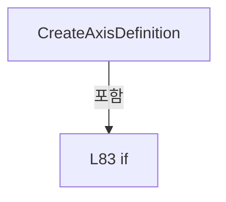

변경 전 점검: 입력/반환 타입, 위 호출자, 예외/취소 경로, 공유 상태와 저장·전송 소비자를 함께 확인합니다. 값의 단위나 물리 방향을 이름만으로 확정하지 않습니다.

### MethodDeclaration `ValidateConfiguredAxisName` · L91–109

[Drilling.Common/Automation/CScannerAxisConfiguration.cs:91–109](https://github.com/kjuws10-rgb/A3Drilling/blob/5aee8e58439c9b455cae7c9593c9be986c3e682e/Drilling.Common/Automation/CScannerAxisConfiguration.cs#L91-L109)

| 항목 | 실제 추출 값 |
| --- | --- |
| 서명 | string Drilling.Common.Automation.CScannerAxisConfiguration.ValidateConfiguredAxisName(int, string, string) |
| 접근/수식자 | Private / private, static |
| 반환/값 타입 | string |
| 소속 타입 | NamedType:Drilling.Common.Automation.CScannerAxisConfiguration |

입력 계약:

| 이름 | 타입 | 전달 | 선택/기본값 |
| --- | --- | --- | --- |
| headNo | int | None | False /  |
| axisRole | string | None | False /  |
| axisReference | string | None | False /  |

정적 호출자로 확인된 위치:

| 호출 파일/행 | 호출 표현식 | 런타임 분기 가능 |
| --- | --- | --- |
| [Drilling.Common/Automation/CScannerAxisConfiguration.cs:82–82](https://github.com/kjuws10-rgb/A3Drilling/blob/5aee8e58439c9b455cae7c9593c9be986c3e682e/Drilling.Common/Automation/CScannerAxisConfiguration.cs#L82-L82) | ValidateConfiguredAxisName | False |

호출하는 대상과 해석 범위:

| 원본 행 | 표현식 | 분석 상태 | 대상/소스 위치 |
| --- | --- | --- | --- |
| 93 | string.IsNullOrWhiteSpace | resolved | bool string.IsNullOrWhiteSpace(string?) |
| 93 | axisReference.Equals | resolved | bool string.Equals(string?, System.StringComparison) |
| 98 | IsAllAsciiDigits | resolved | bool Drilling.Common.Automation.CScannerAxisConfiguration.IsAllAsciiDigits(string) · Drilling.Common/Automation/CScannerAxisConfiguration.cs:111 |
| 103 | IsAutomationAxisName | resolved | bool Drilling.Common.Automation.CScannerAxisConfiguration.IsAutomationAxisName(string) · Drilling.Common/Automation/CScannerAxisConfiguration.cs:129 |

본문의 실제 연산·분기·예외·반환 순서(원문 위치 순):

| 원본 행 | 종류 | 주석 해설 |
| --- | --- | --- |
| 93 | call | 함수·델리게이트 또는 객체 생성자를 호출합니다: string.IsNullOrWhiteSpace(axisReference) |
| 93 | call | 함수·델리게이트 또는 객체 생성자를 호출합니다: axisReference.Equals("-", StringComparison.Ordinal) |
| 93 | if | 조건에 따라 분기합니다: if (string.IsNullOrWhiteSpace(axisReference) &#124;&#124; axisReference.Equals("-", StringComparison.Ordinal)) |
| 95 | return | 호출자에게 값 또는 제어를 반환합니다: return $"H{headNo:00} {axisRole} axis name is not configured."; |
| 98 | call | 함수·델리게이트 또는 객체 생성자를 호출합니다: IsAllAsciiDigits(axisReference) |
| 98 | if | 조건에 따라 분기합니다: if (IsAllAsciiDigits(axisReference)) |
| 100 | return | 호출자에게 값 또는 제어를 반환합니다: return $"H{headNo:00} {axisRole} axis must be configured by axis name, not axis number: {axisReference}."; |
| 103 | call | 함수·델리게이트 또는 객체 생성자를 호출합니다: IsAutomationAxisName(axisReference) |
| 103 | if | 조건에 따라 분기합니다: if (!IsAutomationAxisName(axisReference)) |
| 105 | return | 호출자에게 값 또는 제어를 반환합니다: return $"H{headNo:00} {axisRole} axis name is invalid: {axisReference}."; |
| 108 | return | 호출자에게 값 또는 제어를 반환합니다: return ""; |

제어 구문의 포함 구조(실제 실행 순서/CFG가 아닌 구문 탐색 그림):

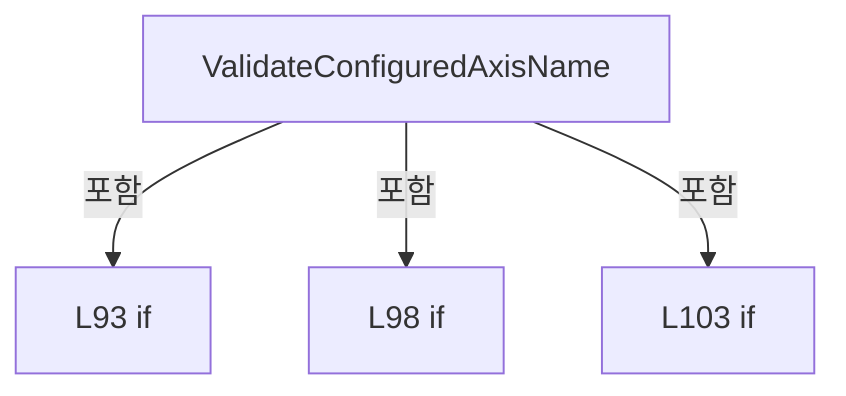

변경 전 점검: 입력/반환 타입, 위 호출자, 예외/취소 경로, 공유 상태와 저장·전송 소비자를 함께 확인합니다. 값의 단위나 물리 방향을 이름만으로 확정하지 않습니다.

### MethodDeclaration `IsAllAsciiDigits` · L111–127

[Drilling.Common/Automation/CScannerAxisConfiguration.cs:111–127](https://github.com/kjuws10-rgb/A3Drilling/blob/5aee8e58439c9b455cae7c9593c9be986c3e682e/Drilling.Common/Automation/CScannerAxisConfiguration.cs#L111-L127)

| 항목 | 실제 추출 값 |
| --- | --- |
| 서명 | bool Drilling.Common.Automation.CScannerAxisConfiguration.IsAllAsciiDigits(string) |
| 접근/수식자 | Private / private, static |
| 반환/값 타입 | bool |
| 소속 타입 | NamedType:Drilling.Common.Automation.CScannerAxisConfiguration |

입력 계약:

| 이름 | 타입 | 전달 | 선택/기본값 |
| --- | --- | --- | --- |
| value | string | None | False /  |

정적 호출자로 확인된 위치:

| 호출 파일/행 | 호출 표현식 | 런타임 분기 가능 |
| --- | --- | --- |
| [Drilling.Common/Automation/CScannerAxisConfiguration.cs:98–98](https://github.com/kjuws10-rgb/A3Drilling/blob/5aee8e58439c9b455cae7c9593c9be986c3e682e/Drilling.Common/Automation/CScannerAxisConfiguration.cs#L98-L98) | IsAllAsciiDigits | False |

호출하는 대상과 해석 범위:

| 원본 행 | 표현식 | 분석 상태 | 대상/소스 위치 |
| --- | --- | --- | --- |
| 120 | char.IsAsciiDigit | resolved | bool char.IsAsciiDigit(char) |

본문의 실제 연산·분기·예외·반환 순서(원문 위치 순):

| 원본 행 | 종류 | 주석 해설 |
| --- | --- | --- |
| 113 | if | 조건에 따라 분기합니다: if (value.Length == 0) |
| 115 | return | 호출자에게 값 또는 제어를 반환합니다: return false; |
| 118 | foreach | 컬렉션 요소를 순회합니다: foreach (var character in value) |
| 120 | call | 함수·델리게이트 또는 객체 생성자를 호출합니다: char.IsAsciiDigit(character) |
| 120 | if | 조건에 따라 분기합니다: if (!char.IsAsciiDigit(character)) |
| 122 | return | 호출자에게 값 또는 제어를 반환합니다: return false; |
| 126 | return | 호출자에게 값 또는 제어를 반환합니다: return true; |

제어 구문의 포함 구조(실제 실행 순서/CFG가 아닌 구문 탐색 그림):

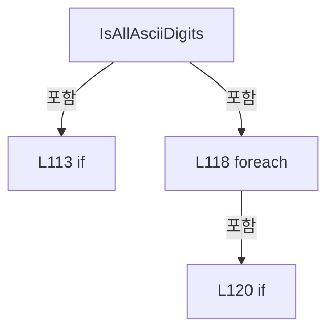

변경 전 점검: 입력/반환 타입, 위 호출자, 예외/취소 경로, 공유 상태와 저장·전송 소비자를 함께 확인합니다. 값의 단위나 물리 방향을 이름만으로 확정하지 않습니다.

### MethodDeclaration `IsAutomationAxisName` · L129–145

[Drilling.Common/Automation/CScannerAxisConfiguration.cs:129–145](https://github.com/kjuws10-rgb/A3Drilling/blob/5aee8e58439c9b455cae7c9593c9be986c3e682e/Drilling.Common/Automation/CScannerAxisConfiguration.cs#L129-L145)

| 항목 | 실제 추출 값 |
| --- | --- |
| 서명 | bool Drilling.Common.Automation.CScannerAxisConfiguration.IsAutomationAxisName(string) |
| 접근/수식자 | Private / private, static |
| 반환/값 타입 | bool |
| 소속 타입 | NamedType:Drilling.Common.Automation.CScannerAxisConfiguration |

입력 계약:

| 이름 | 타입 | 전달 | 선택/기본값 |
| --- | --- | --- | --- |
| value | string | None | False /  |

정적 호출자로 확인된 위치:

| 호출 파일/행 | 호출 표현식 | 런타임 분기 가능 |
| --- | --- | --- |
| [Drilling.Common/Automation/CScannerAxisConfiguration.cs:103–103](https://github.com/kjuws10-rgb/A3Drilling/blob/5aee8e58439c9b455cae7c9593c9be986c3e682e/Drilling.Common/Automation/CScannerAxisConfiguration.cs#L103-L103) | IsAutomationAxisName | False |

호출하는 대상과 해석 범위:

| 원본 행 | 표현식 | 분석 상태 | 대상/소스 위치 |
| --- | --- | --- | --- |
| 131 | char.IsAsciiLetter | resolved | bool char.IsAsciiLetter(char) |
| 138 | char.IsAsciiLetter | resolved | bool char.IsAsciiLetter(char) |
| 138 | char.IsAsciiDigit | resolved | bool char.IsAsciiDigit(char) |

본문의 실제 연산·분기·예외·반환 순서(원문 위치 순):

| 원본 행 | 종류 | 주석 해설 |
| --- | --- | --- |
| 131 | call | 함수·델리게이트 또는 객체 생성자를 호출합니다: char.IsAsciiLetter(value[0]) |
| 131 | if | 조건에 따라 분기합니다: if (value.Length == 0 &#124;&#124; !char.IsAsciiLetter(value[0])) |
| 133 | return | 호출자에게 값 또는 제어를 반환합니다: return false; |
| 136 | foreach | 컬렉션 요소를 순회합니다: foreach (var character in value) |
| 138 | call | 함수·델리게이트 또는 객체 생성자를 호출합니다: char.IsAsciiLetter(character) |
| 138 | call | 함수·델리게이트 또는 객체 생성자를 호출합니다: char.IsAsciiDigit(character) |
| 138 | if | 조건에 따라 분기합니다: if (!char.IsAsciiLetter(character) && !char.IsAsciiDigit(character) && character != '_') |
| 140 | return | 호출자에게 값 또는 제어를 반환합니다: return false; |
| 144 | return | 호출자에게 값 또는 제어를 반환합니다: return true; |

제어 구문의 포함 구조(실제 실행 순서/CFG가 아닌 구문 탐색 그림):

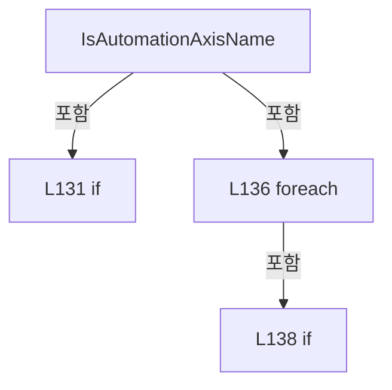

변경 전 점검: 입력/반환 타입, 위 호출자, 예외/취소 경로, 공유 상태와 저장·전송 소비자를 함께 확인합니다. 값의 단위나 물리 방향을 이름만으로 확정하지 않습니다.

### MethodDeclaration `BuildEnabledHeadNumbers` · L147–159

[Drilling.Common/Automation/CScannerAxisConfiguration.cs:147–159](https://github.com/kjuws10-rgb/A3Drilling/blob/5aee8e58439c9b455cae7c9593c9be986c3e682e/Drilling.Common/Automation/CScannerAxisConfiguration.cs#L147-L159)

| 항목 | 실제 추출 값 |
| --- | --- |
| 서명 | System.Collections.Generic.IReadOnlyList<int> Drilling.Common.Automation.CScannerAxisConfiguration.BuildEnabledHeadNumbers(System.Collections.Generic.IReadOnlyList<Drilling.Common.Managers.ST_SYSTEM_PARAMETER>, int) |
| 접근/수식자 | Public / public, static |
| 반환/값 타입 | System.Collections.Generic.IReadOnlyList<int> |
| 소속 타입 | NamedType:Drilling.Common.Automation.CScannerAxisConfiguration |

입력 계약:

| 이름 | 타입 | 전달 | 선택/기본값 |
| --- | --- | --- | --- |
| settings | System.Collections.Generic.IReadOnlyList<Drilling.Common.Managers.ST_SYSTEM_PARAMETER> | None | False /  |
| headCount | int | None | True / 8 |

정적 호출자로 확인된 위치:

| 호출 파일/행 | 호출 표현식 | 런타임 분기 가능 |
| --- | --- | --- |
| [Drilling.UI/Menu/Menus/CScannerStatusSnapshotReader.cs:127–127](https://github.com/kjuws10-rgb/A3Drilling/blob/5aee8e58439c9b455cae7c9593c9be986c3e682e/Drilling.UI/Menu/Menus/CScannerStatusSnapshotReader.cs#L127-L127) | CScannerAxisConfiguration.BuildEnabledHeadNumbers | False |

호출하는 대상과 해석 범위:

| 원본 행 | 표현식 | 분석 상태 | 대상/소스 위치 |
| --- | --- | --- | --- |
| 149 | new List<int> | resolved | System.Collections.Generic.List<int>.List(int) |
| 152 | IsHeadEnabled | resolved | bool Drilling.Common.Automation.CScannerAxisConfiguration.IsHeadEnabled(System.Collections.Generic.IReadOnlyList<Drilling.Common.Managers.ST_SYSTEM_PARAMETER>, int) · Drilling.Common/Automation/CScannerAxisConfiguration.cs:161 |
| 154 | heads.Add | resolved | void System.Collections.Generic.List<int>.Add(int) |

본문의 실제 연산·분기·예외·반환 순서(원문 위치 순):

| 원본 행 | 종류 | 주석 해설 |
| --- | --- | --- |
| 149 | call | 함수·델리게이트 또는 객체 생성자를 호출합니다: new List<int>(headCount) |
| 149 | local-declaration | 지역 변수를 선언합니다: var heads = new List<int>(headCount); |
| 149 | variable-initializer | 변수의 초기값을 지정합니다: heads = new List<int>(headCount) |
| 150 | variable-initializer | 변수의 초기값을 지정합니다: headNo = 1 |
| 150 | for | 초기화·조건·증감이 있는 반복입니다: for (var headNo = 1; headNo <= headCount; headNo++) |
| 152 | call | 함수·델리게이트 또는 객체 생성자를 호출합니다: IsHeadEnabled(settings, headNo) |
| 152 | if | 조건에 따라 분기합니다: if (IsHeadEnabled(settings, headNo)) |
| 154 | call | 함수·델리게이트 또는 객체 생성자를 호출합니다: heads.Add(headNo) |
| 158 | return | 호출자에게 값 또는 제어를 반환합니다: return heads; |

제어 구문의 포함 구조(실제 실행 순서/CFG가 아닌 구문 탐색 그림):

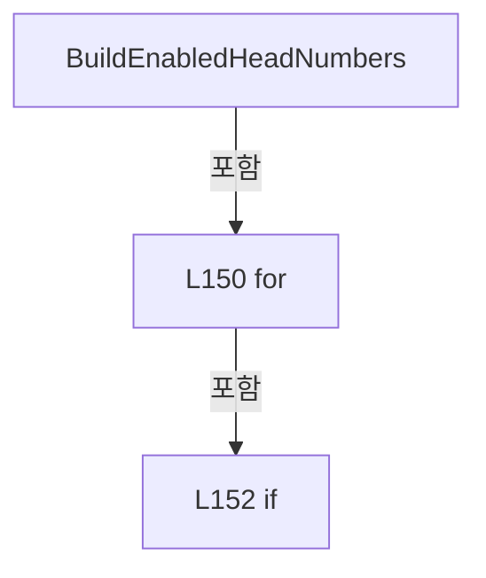

변경 전 점검: 입력/반환 타입, 위 호출자, 예외/취소 경로, 공유 상태와 저장·전송 소비자를 함께 확인합니다. 값의 단위나 물리 방향을 이름만으로 확정하지 않습니다.

### MethodDeclaration `IsHeadEnabled` · L161–164

[Drilling.Common/Automation/CScannerAxisConfiguration.cs:161–164](https://github.com/kjuws10-rgb/A3Drilling/blob/5aee8e58439c9b455cae7c9593c9be986c3e682e/Drilling.Common/Automation/CScannerAxisConfiguration.cs#L161-L164)

| 항목 | 실제 추출 값 |
| --- | --- |
| 서명 | bool Drilling.Common.Automation.CScannerAxisConfiguration.IsHeadEnabled(System.Collections.Generic.IReadOnlyList<Drilling.Common.Managers.ST_SYSTEM_PARAMETER>, int) |
| 접근/수식자 | Public / public, static |
| 반환/값 타입 | bool |
| 소속 타입 | NamedType:Drilling.Common.Automation.CScannerAxisConfiguration |

입력 계약:

| 이름 | 타입 | 전달 | 선택/기본값 |
| --- | --- | --- | --- |
| settings | System.Collections.Generic.IReadOnlyList<Drilling.Common.Managers.ST_SYSTEM_PARAMETER> | None | False /  |
| headNo | int | None | False /  |

정적 호출자로 확인된 위치:

| 호출 파일/행 | 호출 표현식 | 런타임 분기 가능 |
| --- | --- | --- |
| [Drilling.Common/Automation/CScannerAxisConfiguration.cs:11–11](https://github.com/kjuws10-rgb/A3Drilling/blob/5aee8e58439c9b455cae7c9593c9be986c3e682e/Drilling.Common/Automation/CScannerAxisConfiguration.cs#L11-L11) | IsHeadEnabled | False |
| [Drilling.Common/Automation/CScannerAxisConfiguration.cs:152–152](https://github.com/kjuws10-rgb/A3Drilling/blob/5aee8e58439c9b455cae7c9593c9be986c3e682e/Drilling.Common/Automation/CScannerAxisConfiguration.cs#L152-L152) | IsHeadEnabled | False |
| [Drilling.Common/Interface/CPowerMeasureRun.cs:259–259](https://github.com/kjuws10-rgb/A3Drilling/blob/5aee8e58439c9b455cae7c9593c9be986c3e682e/Drilling.Common/Interface/CPowerMeasureRun.cs#L259-L259) | CScannerAxisConfiguration.IsHeadEnabled | False |
| [Drilling.UI/Menu/Menus/CScannerStatusSnapshotReader.cs:130–130](https://github.com/kjuws10-rgb/A3Drilling/blob/5aee8e58439c9b455cae7c9593c9be986c3e682e/Drilling.UI/Menu/Menus/CScannerStatusSnapshotReader.cs#L130-L130) | CScannerAxisConfiguration.IsHeadEnabled | False |

호출하는 대상과 해석 범위:

| 원본 행 | 표현식 | 분석 상태 | 대상/소스 위치 |
| --- | --- | --- | --- |
| 163 | ReadHeadSettingBool | resolved | bool Drilling.Common.Automation.CScannerAxisConfiguration.ReadHeadSettingBool(System.Collections.Generic.IReadOnlyList<Drilling.Common.Managers.ST_SYSTEM_PARAMETER>, bool, int, params string[]) · Drilling.Common/Automation/CScannerAxisConfiguration.cs:194 |

본문의 실제 연산·분기·예외·반환 순서(원문 위치 순):

| 원본 행 | 종류 | 주석 해설 |
| --- | --- | --- |
| 163 | call | 함수·델리게이트 또는 객체 생성자를 호출합니다: ReadHeadSettingBool(settings, true, headNo, "USE") |
| 163 | return | 호출자에게 값 또는 제어를 반환합니다: return ReadHeadSettingBool(settings, true, headNo, "USE"); |

변경 전 점검: 입력/반환 타입, 위 호출자, 예외/취소 경로, 공유 상태와 저장·전송 소비자를 함께 확인합니다. 값의 단위나 물리 방향을 이름만으로 확정하지 않습니다.

### MethodDeclaration `IsHeadEnabled` · L166–169

[Drilling.Common/Automation/CScannerAxisConfiguration.cs:166–169](https://github.com/kjuws10-rgb/A3Drilling/blob/5aee8e58439c9b455cae7c9593c9be986c3e682e/Drilling.Common/Automation/CScannerAxisConfiguration.cs#L166-L169)

| 항목 | 실제 추출 값 |
| --- | --- |
| 서명 | bool Drilling.Common.Automation.CScannerAxisConfiguration.IsHeadEnabled(System.Collections.Generic.IReadOnlyDictionary<string, string>, int) |
| 접근/수식자 | Public / public, static |
| 반환/값 타입 | bool |
| 소속 타입 | NamedType:Drilling.Common.Automation.CScannerAxisConfiguration |

입력 계약:

| 이름 | 타입 | 전달 | 선택/기본값 |
| --- | --- | --- | --- |
| parameters | System.Collections.Generic.IReadOnlyDictionary<string, string> | None | False /  |
| headNo | int | None | False /  |

정적 호출자로 확인된 위치:

| 호출 파일/행 | 호출 표현식 | 런타임 분기 가능 |
| --- | --- | --- |
| [Drilling.Common/Automation/CScannerAxisConfiguration.cs:32–32](https://github.com/kjuws10-rgb/A3Drilling/blob/5aee8e58439c9b455cae7c9593c9be986c3e682e/Drilling.Common/Automation/CScannerAxisConfiguration.cs#L32-L32) | IsHeadEnabled | False |
| [Drilling.Common/Correction/CDefaultOffsetCalibration.cs:204–204](https://github.com/kjuws10-rgb/A3Drilling/blob/5aee8e58439c9b455cae7c9593c9be986c3e682e/Drilling.Common/Correction/CDefaultOffsetCalibration.cs#L204-L204) | CScannerAxisConfiguration.IsHeadEnabled | False |
| [Drilling.UI/Menu/Menus/CScannerStatusSnapshotReader.cs:133–133](https://github.com/kjuws10-rgb/A3Drilling/blob/5aee8e58439c9b455cae7c9593c9be986c3e682e/Drilling.UI/Menu/Menus/CScannerStatusSnapshotReader.cs#L133-L133) | CScannerAxisConfiguration.IsHeadEnabled | False |

호출하는 대상과 해석 범위:

| 원본 행 | 표현식 | 분석 상태 | 대상/소스 위치 |
| --- | --- | --- | --- |
| 168 | ReadHeadSettingBool | resolved | bool Drilling.Common.Automation.CScannerAxisConfiguration.ReadHeadSettingBool(System.Collections.Generic.IReadOnlyDictionary<string, string>, bool, int, params string[]) · Drilling.Common/Automation/CScannerAxisConfiguration.cs:262 |

본문의 실제 연산·분기·예외·반환 순서(원문 위치 순):

| 원본 행 | 종류 | 주석 해설 |
| --- | --- | --- |
| 168 | call | 함수·델리게이트 또는 객체 생성자를 호출합니다: ReadHeadSettingBool(parameters, true, headNo, "USE") |
| 168 | return | 호출자에게 값 또는 제어를 반환합니다: return ReadHeadSettingBool(parameters, true, headNo, "USE"); |

변경 전 점검: 입력/반환 타입, 위 호출자, 예외/취소 경로, 공유 상태와 저장·전송 소비자를 함께 확인합니다. 값의 단위나 물리 방향을 이름만으로 확정하지 않습니다.

### MethodDeclaration `ReadHeadSettingText` · L171–192

[Drilling.Common/Automation/CScannerAxisConfiguration.cs:171–192](https://github.com/kjuws10-rgb/A3Drilling/blob/5aee8e58439c9b455cae7c9593c9be986c3e682e/Drilling.Common/Automation/CScannerAxisConfiguration.cs#L171-L192)

| 항목 | 실제 추출 값 |
| --- | --- |
| 서명 | string Drilling.Common.Automation.CScannerAxisConfiguration.ReadHeadSettingText(System.Collections.Generic.IReadOnlyList<Drilling.Common.Managers.ST_SYSTEM_PARAMETER>, string, int, params string[]) |
| 접근/수식자 | Private / private, static |
| 반환/값 타입 | string |
| 소속 타입 | NamedType:Drilling.Common.Automation.CScannerAxisConfiguration |

입력 계약:

| 이름 | 타입 | 전달 | 선택/기본값 |
| --- | --- | --- | --- |
| settings | System.Collections.Generic.IReadOnlyList<Drilling.Common.Managers.ST_SYSTEM_PARAMETER> | None | False /  |
| defaultValue | string | None | False /  |
| headNo | int | None | False /  |
| suffixes | string[] | None | False /  |

정적 호출자로 확인된 위치:

| 호출 파일/행 | 호출 표현식 | 런타임 분기 가능 |
| --- | --- | --- |
| [Drilling.Common/Automation/CScannerAxisConfiguration.cs:17–17](https://github.com/kjuws10-rgb/A3Drilling/blob/5aee8e58439c9b455cae7c9593c9be986c3e682e/Drilling.Common/Automation/CScannerAxisConfiguration.cs#L17-L17) | ReadHeadSettingText | False |
| [Drilling.Common/Automation/CScannerAxisConfiguration.cs:18–18](https://github.com/kjuws10-rgb/A3Drilling/blob/5aee8e58439c9b455cae7c9593c9be986c3e682e/Drilling.Common/Automation/CScannerAxisConfiguration.cs#L18-L18) | ReadHeadSettingText | False |
| [Drilling.Common/Automation/CScannerAxisConfiguration.cs:58–58](https://github.com/kjuws10-rgb/A3Drilling/blob/5aee8e58439c9b455cae7c9593c9be986c3e682e/Drilling.Common/Automation/CScannerAxisConfiguration.cs#L58-L58) | ReadHeadSettingText | False |

호출하는 대상과 해석 범위:

| 원본 행 | 표현식 | 분석 상태 | 대상/소스 위치 |
| --- | --- | --- | --- |
| 179 | key.Equals | resolved | bool string.Equals(string?, System.StringComparison) |
| 179 | key.Equals | resolved | bool string.Equals(string?, System.StringComparison) |
| 184 | string.IsNullOrWhiteSpace | resolved | bool string.IsNullOrWhiteSpace(string?) |
| 186 | setting.Value.Trim | resolved | string string.Trim() |

본문의 실제 연산·분기·예외·반환 순서(원문 위치 순):

| 원본 행 | 종류 | 주석 해설 |
| --- | --- | --- |
| 173 | local-declaration | 지역 변수를 선언합니다: var prefix = $"H{headNo:00}_"; |
| 173 | variable-initializer | 변수의 초기값을 지정합니다: prefix = $"H{headNo:00}_" |
| 174 | foreach | 컬렉션 요소를 순회합니다: foreach (var suffix in suffixes) |
| 176 | local-declaration | 지역 변수를 선언합니다: var key = prefix + suffix; |
| 176 | variable-initializer | 변수의 초기값을 지정합니다: key = prefix + suffix |
| 177 | foreach | 컬렉션 요소를 순회합니다: foreach (var setting in settings) |
| 179 | call | 함수·델리게이트 또는 객체 생성자를 호출합니다: key.Equals(setting.Key, StringComparison.OrdinalIgnoreCase) |
| 179 | call | 함수·델리게이트 또는 객체 생성자를 호출합니다: key.Equals(setting.Name, StringComparison.OrdinalIgnoreCase) |
| 179 | if | 조건에 따라 분기합니다: if (!key.Equals(setting.Key, StringComparison.OrdinalIgnoreCase) && !key.Equals(setting.Name, StringComparison.OrdinalIgnoreCase)) |
| 181 | continue | 다음 반복으로 진행합니다: continue; |
| 184 | call | 함수·델리게이트 또는 객체 생성자를 호출합니다: string.IsNullOrWhiteSpace(setting.Value) |
| 184 | if | 조건에 따라 분기합니다: if (!string.IsNullOrWhiteSpace(setting.Value)) |
| 186 | call | 함수·델리게이트 또는 객체 생성자를 호출합니다: setting.Value.Trim() |
| 186 | return | 호출자에게 값 또는 제어를 반환합니다: return setting.Value.Trim(); |
| 191 | return | 호출자에게 값 또는 제어를 반환합니다: return defaultValue; |

제어 구문의 포함 구조(실제 실행 순서/CFG가 아닌 구문 탐색 그림):

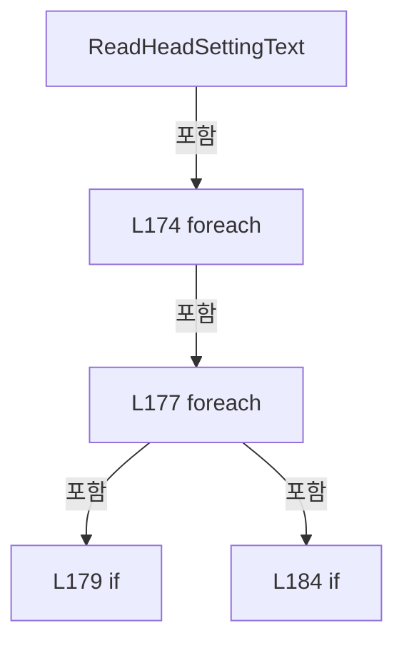

변경 전 점검: 입력/반환 타입, 위 호출자, 예외/취소 경로, 공유 상태와 저장·전송 소비자를 함께 확인합니다. 값의 단위나 물리 방향을 이름만으로 확정하지 않습니다.

### MethodDeclaration `ReadHeadSettingBool` · L194–222

[Drilling.Common/Automation/CScannerAxisConfiguration.cs:194–222](https://github.com/kjuws10-rgb/A3Drilling/blob/5aee8e58439c9b455cae7c9593c9be986c3e682e/Drilling.Common/Automation/CScannerAxisConfiguration.cs#L194-L222)

| 항목 | 실제 추출 값 |
| --- | --- |
| 서명 | bool Drilling.Common.Automation.CScannerAxisConfiguration.ReadHeadSettingBool(System.Collections.Generic.IReadOnlyList<Drilling.Common.Managers.ST_SYSTEM_PARAMETER>, bool, int, params string[]) |
| 접근/수식자 | Private / private, static |
| 반환/값 타입 | bool |
| 소속 타입 | NamedType:Drilling.Common.Automation.CScannerAxisConfiguration |

입력 계약:

| 이름 | 타입 | 전달 | 선택/기본값 |
| --- | --- | --- | --- |
| settings | System.Collections.Generic.IReadOnlyList<Drilling.Common.Managers.ST_SYSTEM_PARAMETER> | None | False /  |
| defaultValue | bool | None | False /  |
| headNo | int | None | False /  |
| suffixes | string[] | None | False /  |

정적 호출자로 확인된 위치:

| 호출 파일/행 | 호출 표현식 | 런타임 분기 가능 |
| --- | --- | --- |
| [Drilling.Common/Automation/CScannerAxisConfiguration.cs:52–52](https://github.com/kjuws10-rgb/A3Drilling/blob/5aee8e58439c9b455cae7c9593c9be986c3e682e/Drilling.Common/Automation/CScannerAxisConfiguration.cs#L52-L52) | ReadHeadSettingBool | False |
| [Drilling.Common/Automation/CScannerAxisConfiguration.cs:163–163](https://github.com/kjuws10-rgb/A3Drilling/blob/5aee8e58439c9b455cae7c9593c9be986c3e682e/Drilling.Common/Automation/CScannerAxisConfiguration.cs#L163-L163) | ReadHeadSettingBool | False |

호출하는 대상과 해석 범위:

| 원본 행 | 표현식 | 분석 상태 | 대상/소스 위치 |
| --- | --- | --- | --- |
| 202 | key.Equals | resolved | bool string.Equals(string?, System.StringComparison) |
| 202 | key.Equals | resolved | bool string.Equals(string?, System.StringComparison) |
| 207 | string.IsNullOrWhiteSpace | resolved | bool string.IsNullOrWhiteSpace(string?) |
| 212 | setting.Value.Trim().ToUpperInvariant | resolved | string string.ToUpperInvariant() |
| 212 | setting.Value.Trim | resolved | string string.Trim() |

본문의 실제 연산·분기·예외·반환 순서(원문 위치 순):

| 원본 행 | 종류 | 주석 해설 |
| --- | --- | --- |
| 196 | local-declaration | 지역 변수를 선언합니다: var prefix = $"H{headNo:00}_"; |
| 196 | variable-initializer | 변수의 초기값을 지정합니다: prefix = $"H{headNo:00}_" |
| 197 | foreach | 컬렉션 요소를 순회합니다: foreach (var suffix in suffixes) |
| 199 | local-declaration | 지역 변수를 선언합니다: var key = prefix + suffix; |
| 199 | variable-initializer | 변수의 초기값을 지정합니다: key = prefix + suffix |
| 200 | foreach | 컬렉션 요소를 순회합니다: foreach (var setting in settings) |
| 202 | call | 함수·델리게이트 또는 객체 생성자를 호출합니다: key.Equals(setting.Key, StringComparison.OrdinalIgnoreCase) |
| 202 | call | 함수·델리게이트 또는 객체 생성자를 호출합니다: key.Equals(setting.Name, StringComparison.OrdinalIgnoreCase) |
| 202 | if | 조건에 따라 분기합니다: if (!key.Equals(setting.Key, StringComparison.OrdinalIgnoreCase) && !key.Equals(setting.Name, StringComparison.OrdinalIgnoreCase)) |
| 204 | continue | 다음 반복으로 진행합니다: continue; |
| 207 | call | 함수·델리게이트 또는 객체 생성자를 호출합니다: string.IsNullOrWhiteSpace(setting.Value) |
| 207 | if | 조건에 따라 분기합니다: if (string.IsNullOrWhiteSpace(setting.Value)) |
| 209 | return | 호출자에게 값 또는 제어를 반환합니다: return defaultValue; |
| 212 | call | 함수·델리게이트 또는 객체 생성자를 호출합니다: setting.Value.Trim().ToUpperInvariant() |
| 212 | call | 함수·델리게이트 또는 객체 생성자를 호출합니다: setting.Value.Trim() |
| 212 | return | 호출자에게 값 또는 제어를 반환합니다: return setting.Value.Trim().ToUpperInvariant() switch { "1" or "Y" or "YES" or "TRUE" or "ON" or "USE" => true, "0" or "N" or "NO" or "FALSE" or "OFF" or "SKIP" or "UNUSE" => false, _ => defaultValue }; |
| 212 | switch-expression | 값별 결과식을 선택합니다: setting.Value.Trim().ToUpperInvariant() switch { "1" or "Y" or "YES" or "TRUE" or "ON" or "USE" => true, "0" or "N" or "NO" or "FALSE" or "OFF" or "SKIP" or "UNUSE" => false, _ => defaultValue } |
| 221 | return | 호출자에게 값 또는 제어를 반환합니다: return defaultValue; |

제어 구문의 포함 구조(실제 실행 순서/CFG가 아닌 구문 탐색 그림):

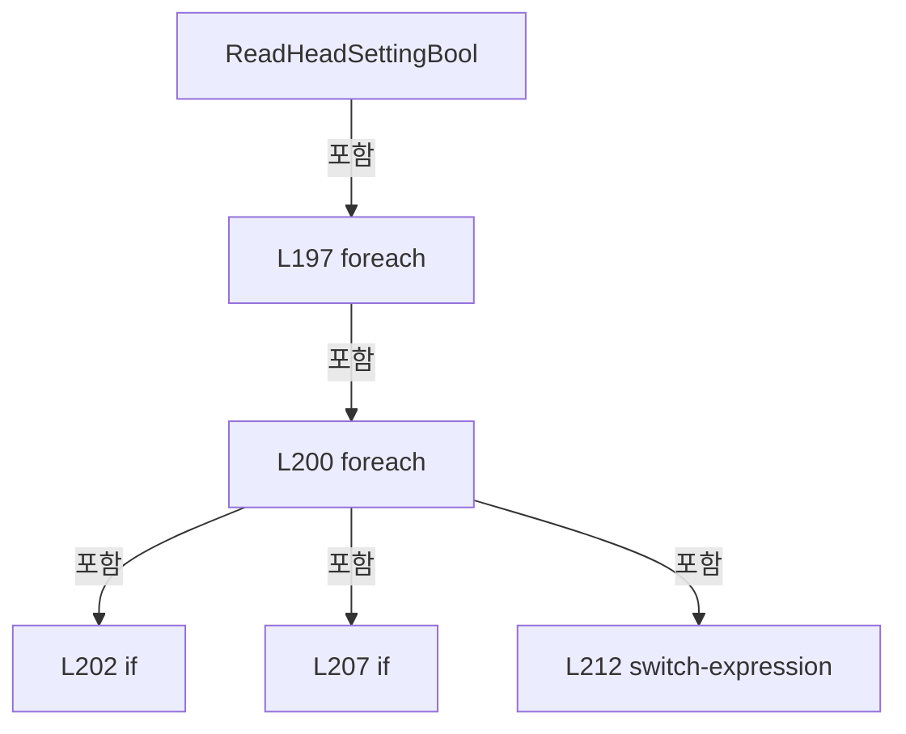

변경 전 점검: 입력/반환 타입, 위 호출자, 예외/취소 경로, 공유 상태와 저장·전송 소비자를 함께 확인합니다. 값의 단위나 물리 방향을 이름만으로 확정하지 않습니다.

### MethodDeclaration `ReadHeadSettingInt` · L224–245

[Drilling.Common/Automation/CScannerAxisConfiguration.cs:224–245](https://github.com/kjuws10-rgb/A3Drilling/blob/5aee8e58439c9b455cae7c9593c9be986c3e682e/Drilling.Common/Automation/CScannerAxisConfiguration.cs#L224-L245)

| 항목 | 실제 추출 값 |
| --- | --- |
| 서명 | int Drilling.Common.Automation.CScannerAxisConfiguration.ReadHeadSettingInt(System.Collections.Generic.IReadOnlyList<Drilling.Common.Managers.ST_SYSTEM_PARAMETER>, int, int, params string[]) |
| 접근/수식자 | Private / private, static |
| 반환/값 타입 | int |
| 소속 타입 | NamedType:Drilling.Common.Automation.CScannerAxisConfiguration |

입력 계약:

| 이름 | 타입 | 전달 | 선택/기본값 |
| --- | --- | --- | --- |
| settings | System.Collections.Generic.IReadOnlyList<Drilling.Common.Managers.ST_SYSTEM_PARAMETER> | None | False /  |
| defaultValue | int | None | False /  |
| headNo | int | None | False /  |
| suffixes | string[] | None | False /  |

정적 호출자로 확인된 위치:

| 호출 파일/행 | 호출 표현식 | 런타임 분기 가능 |
| --- | --- | --- |
| [Drilling.Common/Automation/CScannerAxisConfiguration.cs:16–16](https://github.com/kjuws10-rgb/A3Drilling/blob/5aee8e58439c9b455cae7c9593c9be986c3e682e/Drilling.Common/Automation/CScannerAxisConfiguration.cs#L16-L16) | ReadHeadSettingInt | False |
| [Drilling.Common/Automation/CScannerAxisConfiguration.cs:19–19](https://github.com/kjuws10-rgb/A3Drilling/blob/5aee8e58439c9b455cae7c9593c9be986c3e682e/Drilling.Common/Automation/CScannerAxisConfiguration.cs#L19-L19) | ReadHeadSettingInt | False |

호출하는 대상과 해석 범위:

| 원본 행 | 표현식 | 분석 상태 | 대상/소스 위치 |
| --- | --- | --- | --- |
| 232 | key.Equals | resolved | bool string.Equals(string?, System.StringComparison) |
| 232 | key.Equals | resolved | bool string.Equals(string?, System.StringComparison) |
| 237 | int.TryParse | resolved | bool int.TryParse(string?, System.Globalization.NumberStyles, System.IFormatProvider?, out int) |

본문의 실제 연산·분기·예외·반환 순서(원문 위치 순):

| 원본 행 | 종류 | 주석 해설 |
| --- | --- | --- |
| 226 | local-declaration | 지역 변수를 선언합니다: var prefix = $"H{headNo:00}_"; |
| 226 | variable-initializer | 변수의 초기값을 지정합니다: prefix = $"H{headNo:00}_" |
| 227 | foreach | 컬렉션 요소를 순회합니다: foreach (var suffix in suffixes) |
| 229 | local-declaration | 지역 변수를 선언합니다: var key = prefix + suffix; |
| 229 | variable-initializer | 변수의 초기값을 지정합니다: key = prefix + suffix |
| 230 | foreach | 컬렉션 요소를 순회합니다: foreach (var setting in settings) |
| 232 | call | 함수·델리게이트 또는 객체 생성자를 호출합니다: key.Equals(setting.Key, StringComparison.OrdinalIgnoreCase) |
| 232 | call | 함수·델리게이트 또는 객체 생성자를 호출합니다: key.Equals(setting.Name, StringComparison.OrdinalIgnoreCase) |
| 232 | if | 조건에 따라 분기합니다: if (!key.Equals(setting.Key, StringComparison.OrdinalIgnoreCase) && !key.Equals(setting.Name, StringComparison.OrdinalIgnoreCase)) |
| 234 | continue | 다음 반복으로 진행합니다: continue; |
| 237 | call | 함수·델리게이트 또는 객체 생성자를 호출합니다: int.TryParse(setting.Value, NumberStyles.Integer, CultureInfo.InvariantCulture, out var parsed) |
| 237 | if | 조건에 따라 분기합니다: if (int.TryParse(setting.Value, NumberStyles.Integer, CultureInfo.InvariantCulture, out var parsed)) |
| 239 | return | 호출자에게 값 또는 제어를 반환합니다: return parsed; |
| 244 | return | 호출자에게 값 또는 제어를 반환합니다: return defaultValue; |

제어 구문의 포함 구조(실제 실행 순서/CFG가 아닌 구문 탐색 그림):

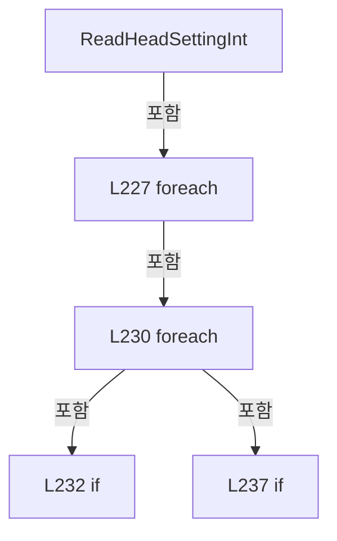

변경 전 점검: 입력/반환 타입, 위 호출자, 예외/취소 경로, 공유 상태와 저장·전송 소비자를 함께 확인합니다. 값의 단위나 물리 방향을 이름만으로 확정하지 않습니다.

### MethodDeclaration `ReadHeadSettingText` · L247–260

[Drilling.Common/Automation/CScannerAxisConfiguration.cs:247–260](https://github.com/kjuws10-rgb/A3Drilling/blob/5aee8e58439c9b455cae7c9593c9be986c3e682e/Drilling.Common/Automation/CScannerAxisConfiguration.cs#L247-L260)

| 항목 | 실제 추출 값 |
| --- | --- |
| 서명 | string Drilling.Common.Automation.CScannerAxisConfiguration.ReadHeadSettingText(System.Collections.Generic.IReadOnlyDictionary<string, string>, string, int, params string[]) |
| 접근/수식자 | Private / private, static |
| 반환/값 타입 | string |
| 소속 타입 | NamedType:Drilling.Common.Automation.CScannerAxisConfiguration |

입력 계약:

| 이름 | 타입 | 전달 | 선택/기본값 |
| --- | --- | --- | --- |
| parameters | System.Collections.Generic.IReadOnlyDictionary<string, string> | None | False /  |
| defaultValue | string | None | False /  |
| headNo | int | None | False /  |
| suffixes | string[] | None | False /  |

정적 호출자로 확인된 위치:

| 호출 파일/행 | 호출 표현식 | 런타임 분기 가능 |
| --- | --- | --- |
| [Drilling.Common/Automation/CScannerAxisConfiguration.cs:38–38](https://github.com/kjuws10-rgb/A3Drilling/blob/5aee8e58439c9b455cae7c9593c9be986c3e682e/Drilling.Common/Automation/CScannerAxisConfiguration.cs#L38-L38) | ReadHeadSettingText | False |
| [Drilling.Common/Automation/CScannerAxisConfiguration.cs:39–39](https://github.com/kjuws10-rgb/A3Drilling/blob/5aee8e58439c9b455cae7c9593c9be986c3e682e/Drilling.Common/Automation/CScannerAxisConfiguration.cs#L39-L39) | ReadHeadSettingText | False |
| [Drilling.Common/Automation/CScannerAxisConfiguration.cs:70–70](https://github.com/kjuws10-rgb/A3Drilling/blob/5aee8e58439c9b455cae7c9593c9be986c3e682e/Drilling.Common/Automation/CScannerAxisConfiguration.cs#L70-L70) | ReadHeadSettingText | False |

호출하는 대상과 해석 범위:

| 원본 행 | 표현식 | 분석 상태 | 대상/소스 위치 |
| --- | --- | --- | --- |
| 253 | parameters.TryGetValue | resolved · 동적 구현 선택 가능 | bool System.Collections.Generic.IReadOnlyDictionary<string, string>.TryGetValue(string, out string) |
| 253 | string.IsNullOrWhiteSpace | resolved | bool string.IsNullOrWhiteSpace(string?) |
| 255 | value.Trim | resolved | string string.Trim() |

본문의 실제 연산·분기·예외·반환 순서(원문 위치 순):

| 원본 행 | 종류 | 주석 해설 |
| --- | --- | --- |
| 249 | local-declaration | 지역 변수를 선언합니다: var prefix = $"H{headNo:00}_"; |
| 249 | variable-initializer | 변수의 초기값을 지정합니다: prefix = $"H{headNo:00}_" |
| 250 | foreach | 컬렉션 요소를 순회합니다: foreach (var suffix in suffixes) |
| 252 | local-declaration | 지역 변수를 선언합니다: var key = prefix + suffix; |
| 252 | variable-initializer | 변수의 초기값을 지정합니다: key = prefix + suffix |
| 253 | call | 함수·델리게이트 또는 객체 생성자를 호출합니다: parameters.TryGetValue(key, out var value) |
| 253 | call | 함수·델리게이트 또는 객체 생성자를 호출합니다: string.IsNullOrWhiteSpace(value) |
| 253 | if | 조건에 따라 분기합니다: if (parameters.TryGetValue(key, out var value) && !string.IsNullOrWhiteSpace(value)) |
| 255 | call | 함수·델리게이트 또는 객체 생성자를 호출합니다: value.Trim() |
| 255 | return | 호출자에게 값 또는 제어를 반환합니다: return value.Trim(); |
| 259 | return | 호출자에게 값 또는 제어를 반환합니다: return defaultValue; |

제어 구문의 포함 구조(실제 실행 순서/CFG가 아닌 구문 탐색 그림):

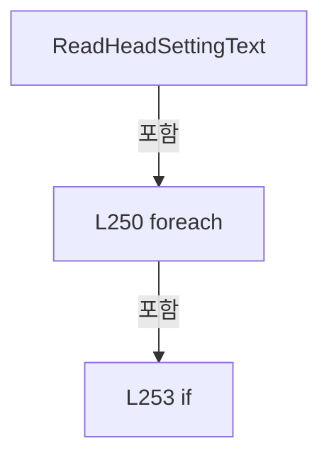

변경 전 점검: 입력/반환 타입, 위 호출자, 예외/취소 경로, 공유 상태와 저장·전송 소비자를 함께 확인합니다. 값의 단위나 물리 방향을 이름만으로 확정하지 않습니다.

### MethodDeclaration `ReadHeadSettingBool` · L262–287

[Drilling.Common/Automation/CScannerAxisConfiguration.cs:262–287](https://github.com/kjuws10-rgb/A3Drilling/blob/5aee8e58439c9b455cae7c9593c9be986c3e682e/Drilling.Common/Automation/CScannerAxisConfiguration.cs#L262-L287)

| 항목 | 실제 추출 값 |
| --- | --- |
| 서명 | bool Drilling.Common.Automation.CScannerAxisConfiguration.ReadHeadSettingBool(System.Collections.Generic.IReadOnlyDictionary<string, string>, bool, int, params string[]) |
| 접근/수식자 | Private / private, static |
| 반환/값 타입 | bool |
| 소속 타입 | NamedType:Drilling.Common.Automation.CScannerAxisConfiguration |

입력 계약:

| 이름 | 타입 | 전달 | 선택/기본값 |
| --- | --- | --- | --- |
| parameters | System.Collections.Generic.IReadOnlyDictionary<string, string> | None | False /  |
| defaultValue | bool | None | False /  |
| headNo | int | None | False /  |
| suffixes | string[] | None | False /  |

정적 호출자로 확인된 위치:

| 호출 파일/행 | 호출 표현식 | 런타임 분기 가능 |
| --- | --- | --- |
| [Drilling.Common/Automation/CScannerAxisConfiguration.cs:64–64](https://github.com/kjuws10-rgb/A3Drilling/blob/5aee8e58439c9b455cae7c9593c9be986c3e682e/Drilling.Common/Automation/CScannerAxisConfiguration.cs#L64-L64) | ReadHeadSettingBool | False |
| [Drilling.Common/Automation/CScannerAxisConfiguration.cs:168–168](https://github.com/kjuws10-rgb/A3Drilling/blob/5aee8e58439c9b455cae7c9593c9be986c3e682e/Drilling.Common/Automation/CScannerAxisConfiguration.cs#L168-L168) | ReadHeadSettingBool | False |

호출하는 대상과 해석 범위:

| 원본 행 | 표현식 | 분석 상태 | 대상/소스 위치 |
| --- | --- | --- | --- |
| 268 | parameters.TryGetValue | resolved · 동적 구현 선택 가능 | bool System.Collections.Generic.IReadOnlyDictionary<string, string>.TryGetValue(string, out string) |
| 273 | string.IsNullOrWhiteSpace | resolved | bool string.IsNullOrWhiteSpace(string?) |
| 278 | value.Trim().ToUpperInvariant | resolved | string string.ToUpperInvariant() |
| 278 | value.Trim | resolved | string string.Trim() |

본문의 실제 연산·분기·예외·반환 순서(원문 위치 순):

| 원본 행 | 종류 | 주석 해설 |
| --- | --- | --- |
| 264 | local-declaration | 지역 변수를 선언합니다: var prefix = $"H{headNo:00}_"; |
| 264 | variable-initializer | 변수의 초기값을 지정합니다: prefix = $"H{headNo:00}_" |
| 265 | foreach | 컬렉션 요소를 순회합니다: foreach (var suffix in suffixes) |
| 267 | local-declaration | 지역 변수를 선언합니다: var key = prefix + suffix; |
| 267 | variable-initializer | 변수의 초기값을 지정합니다: key = prefix + suffix |
| 268 | call | 함수·델리게이트 또는 객체 생성자를 호출합니다: parameters.TryGetValue(key, out var value) |
| 268 | if | 조건에 따라 분기합니다: if (!parameters.TryGetValue(key, out var value)) |
| 270 | continue | 다음 반복으로 진행합니다: continue; |
| 273 | call | 함수·델리게이트 또는 객체 생성자를 호출합니다: string.IsNullOrWhiteSpace(value) |
| 273 | if | 조건에 따라 분기합니다: if (string.IsNullOrWhiteSpace(value)) |
| 275 | return | 호출자에게 값 또는 제어를 반환합니다: return defaultValue; |
| 278 | call | 함수·델리게이트 또는 객체 생성자를 호출합니다: value.Trim().ToUpperInvariant() |
| 278 | call | 함수·델리게이트 또는 객체 생성자를 호출합니다: value.Trim() |
| 278 | return | 호출자에게 값 또는 제어를 반환합니다: return value.Trim().ToUpperInvariant() switch { "1" or "Y" or "YES" or "TRUE" or "ON" or "USE" => true, "0" or "N" or "NO" or "FALSE" or "OFF" or "SKIP" or "UNUSE" => false, _ => defaultValue }; |
| 278 | switch-expression | 값별 결과식을 선택합니다: value.Trim().ToUpperInvariant() switch { "1" or "Y" or "YES" or "TRUE" or "ON" or "USE" => true, "0" or "N" or "NO" or "FALSE" or "OFF" or "SKIP" or "UNUSE" => false, _ => defaultValue } |
| 286 | return | 호출자에게 값 또는 제어를 반환합니다: return defaultValue; |

제어 구문의 포함 구조(실제 실행 순서/CFG가 아닌 구문 탐색 그림):

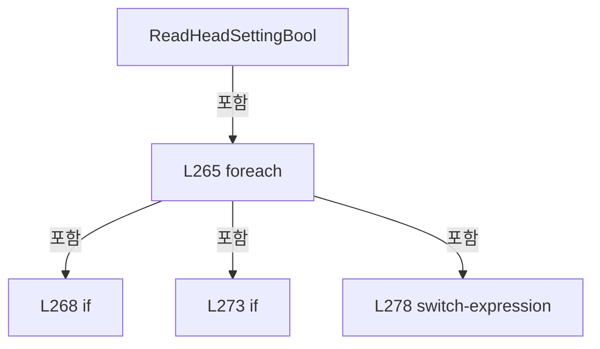

변경 전 점검: 입력/반환 타입, 위 호출자, 예외/취소 경로, 공유 상태와 저장·전송 소비자를 함께 확인합니다. 값의 단위나 물리 방향을 이름만으로 확정하지 않습니다.

### MethodDeclaration `ReadHeadSettingInt` · L289–302

[Drilling.Common/Automation/CScannerAxisConfiguration.cs:289–302](https://github.com/kjuws10-rgb/A3Drilling/blob/5aee8e58439c9b455cae7c9593c9be986c3e682e/Drilling.Common/Automation/CScannerAxisConfiguration.cs#L289-L302)

| 항목 | 실제 추출 값 |
| --- | --- |
| 서명 | int Drilling.Common.Automation.CScannerAxisConfiguration.ReadHeadSettingInt(System.Collections.Generic.IReadOnlyDictionary<string, string>, int, int, params string[]) |
| 접근/수식자 | Private / private, static |
| 반환/값 타입 | int |
| 소속 타입 | NamedType:Drilling.Common.Automation.CScannerAxisConfiguration |

입력 계약:

| 이름 | 타입 | 전달 | 선택/기본값 |
| --- | --- | --- | --- |
| parameters | System.Collections.Generic.IReadOnlyDictionary<string, string> | None | False /  |
| defaultValue | int | None | False /  |
| headNo | int | None | False /  |
| suffixes | string[] | None | False /  |

정적 호출자로 확인된 위치:

| 호출 파일/행 | 호출 표현식 | 런타임 분기 가능 |
| --- | --- | --- |
| [Drilling.Common/Automation/CScannerAxisConfiguration.cs:37–37](https://github.com/kjuws10-rgb/A3Drilling/blob/5aee8e58439c9b455cae7c9593c9be986c3e682e/Drilling.Common/Automation/CScannerAxisConfiguration.cs#L37-L37) | ReadHeadSettingInt | False |
| [Drilling.Common/Automation/CScannerAxisConfiguration.cs:40–40](https://github.com/kjuws10-rgb/A3Drilling/blob/5aee8e58439c9b455cae7c9593c9be986c3e682e/Drilling.Common/Automation/CScannerAxisConfiguration.cs#L40-L40) | ReadHeadSettingInt | False |

호출하는 대상과 해석 범위:

| 원본 행 | 표현식 | 분석 상태 | 대상/소스 위치 |
| --- | --- | --- | --- |
| 295 | parameters.TryGetValue | resolved · 동적 구현 선택 가능 | bool System.Collections.Generic.IReadOnlyDictionary<string, string>.TryGetValue(string, out string) |
| 295 | int.TryParse | resolved | bool int.TryParse(string?, System.Globalization.NumberStyles, System.IFormatProvider?, out int) |

본문의 실제 연산·분기·예외·반환 순서(원문 위치 순):

| 원본 행 | 종류 | 주석 해설 |
| --- | --- | --- |
| 291 | local-declaration | 지역 변수를 선언합니다: var prefix = $"H{headNo:00}_"; |
| 291 | variable-initializer | 변수의 초기값을 지정합니다: prefix = $"H{headNo:00}_" |
| 292 | foreach | 컬렉션 요소를 순회합니다: foreach (var suffix in suffixes) |
| 294 | local-declaration | 지역 변수를 선언합니다: var key = prefix + suffix; |
| 294 | variable-initializer | 변수의 초기값을 지정합니다: key = prefix + suffix |
| 295 | call | 함수·델리게이트 또는 객체 생성자를 호출합니다: parameters.TryGetValue(key, out var value) |
| 295 | call | 함수·델리게이트 또는 객체 생성자를 호출합니다: int.TryParse(value, NumberStyles.Integer, CultureInfo.InvariantCulture, out var parsed) |
| 295 | if | 조건에 따라 분기합니다: if (parameters.TryGetValue(key, out var value) && int.TryParse(value, NumberStyles.Integer, CultureInfo.InvariantCulture, out var parsed)) |
| 297 | return | 호출자에게 값 또는 제어를 반환합니다: return parsed; |
| 301 | return | 호출자에게 값 또는 제어를 반환합니다: return defaultValue; |

제어 구문의 포함 구조(실제 실행 순서/CFG가 아닌 구문 탐색 그림):

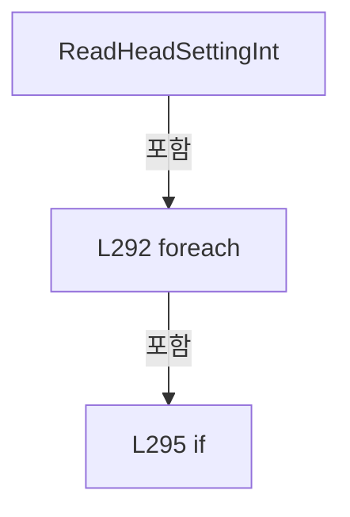

변경 전 점검: 입력/반환 타입, 위 호출자, 예외/취소 경로, 공유 상태와 저장·전송 소비자를 함께 확인합니다. 값의 단위나 물리 방향을 이름만으로 확정하지 않습니다.

### MethodDeclaration `NormalizeHeadNo` · L304–304

[Drilling.Common/Automation/CScannerAxisConfiguration.cs:304–304](https://github.com/kjuws10-rgb/A3Drilling/blob/5aee8e58439c9b455cae7c9593c9be986c3e682e/Drilling.Common/Automation/CScannerAxisConfiguration.cs#L304-L304)

| 항목 | 실제 추출 값 |
| --- | --- |
| 서명 | int Drilling.Common.Automation.CScannerAxisConfiguration.NormalizeHeadNo(int) |
| 접근/수식자 | Private / private, static |
| 반환/값 타입 | int |
| 소속 타입 | NamedType:Drilling.Common.Automation.CScannerAxisConfiguration |

입력 계약:

| 이름 | 타입 | 전달 | 선택/기본값 |
| --- | --- | --- | --- |
| headNo | int | None | False /  |

정적 호출자로 확인된 위치:

| 호출 파일/행 | 호출 표현식 | 런타임 분기 가능 |
| --- | --- | --- |
| [Drilling.Common/Automation/CScannerAxisConfiguration.cs:10–10](https://github.com/kjuws10-rgb/A3Drilling/blob/5aee8e58439c9b455cae7c9593c9be986c3e682e/Drilling.Common/Automation/CScannerAxisConfiguration.cs#L10-L10) | NormalizeHeadNo | False |
| [Drilling.Common/Automation/CScannerAxisConfiguration.cs:31–31](https://github.com/kjuws10-rgb/A3Drilling/blob/5aee8e58439c9b455cae7c9593c9be986c3e682e/Drilling.Common/Automation/CScannerAxisConfiguration.cs#L31-L31) | NormalizeHeadNo | False |

호출하는 대상과 해석 범위:

| 원본 행 | 표현식 | 분석 상태 | 대상/소스 위치 |
| --- | --- | --- | --- |
| 304 | Math.Clamp | resolved | int System.Math.Clamp(int, int, int) |

본문의 실제 연산·분기·예외·반환 순서(원문 위치 순):

| 원본 행 | 종류 | 주석 해설 |
| --- | --- | --- |
| 304 | call | 함수·델리게이트 또는 객체 생성자를 호출합니다: Math.Clamp(headNo, 1, 8) |

변경 전 점검: 입력/반환 타입, 위 호출자, 예외/취소 경로, 공유 상태와 저장·전송 소비자를 함께 확인합니다. 값의 단위나 물리 방향을 이름만으로 확정하지 않습니다.

## 구문·바인딩 한계

전체 WPF/벤더 SDK/프로젝트별 빌드 조건을 로드한 정식 빌드가 아닙니다. `resolved`는 이 부분 컴파일에서의 심볼 연결이며 virtual/interface/delegate/이벤트/Reflection/XAML의 실제 런타임 구현을 확정하지 않습니다. `candidate`와 `unresolved`는 후속 확인 대상으로 남깁니다.

## 원문 전체 주석 해설본

[원본 모든 행과 행별 해설 보기](../../../annotated/Drilling.Common/Automation/CScannerAxisConfiguration.cs.annotated.txt)

원본을 빠뜨리거나 임의로 줄이지 않았습니다. `L000001 |` 표시는 원본 행 번호, `// 해설`은 별도 설명입니다. 실행용 소스가 아닌 문서입니다.

## 수정·재검증 체크

- 원본 Commit과 현재 작업 파일 SHA가 같은지 먼저 확인합니다. 다르면 이 문서를 과거 버전 자료로 취급합니다.
- 선언·직접 호출·이벤트/인터페이스 경계·설정 소비를 함께 확인합니다. 정적 연결의 빈 곳을 정상 경로로 추정하지 않습니다.
- 저장 형식/단위/식별자·재시도·취소·예외·롤백에 영향을 주는 변경은 상세 해설장과 호출자를 다시 검토합니다.
- 도구의 구문 추출과 별도 정적 추적 해설, 실제 빌드·시뮬레이션·실장비 검증 결과를 분리합니다.
