# Drilling.Common/Correction/CAlignInterpolation.cs

| 항목 | 내용 |
| --- | --- |
| 원본 저장소 | https://github.com/kjuws10-rgb/A3Drilling.git |
| 원본 Commit | 334b3599651b2e8e0181fd4459bafaf3cddafff3 |
| 원본 SHA256 | 52be19d632488f70435f9c08a0b0ae82c36635c914161a731333839df3aaa94b |
| 파일 분류 | code |
| 원본 크기/행 | 36,208 bytes / 499 physical lines |
| 인코딩 | utf-8-sig |
| 검토 범위 | 구문/부분 의미 분석에서 추출한 사실. 동작·물리 단위·실장비 합격을 보증하지 않습니다. |
| 원본 링크 | [고정 Commit 원본](https://github.com/kjuws10-rgb/A3Drilling/blob/334b3599651b2e8e0181fd4459bafaf3cddafff3/Drilling.Common/Correction/CAlignInterpolation.cs) |

## 파일의 역할과 읽는 순서

보정 계산·설정·원본/적용값의 관계를 다루는 계층입니다. 값의 좌표계와 단위는 호출부의 근거를 따릅니다.

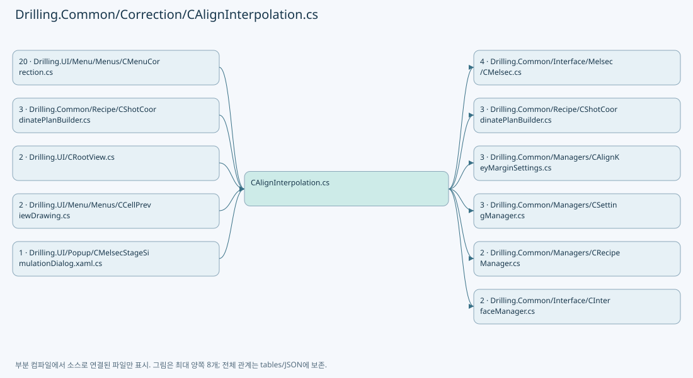

## 네임스페이스·타입·상속

| 타입 | 구분 | 원본 범위 | 선언/상속 |
| --- | --- | --- | --- |
| CAlignInterpolation | ClassDeclaration | 11–114 | CAlignInterpolation |
| ST_ALIGN_INTERPOLATION_KEY | RecordDeclaration | 116–116 | ST_ALIGN_INTERPOLATION_KEY |
| ST_ALIGN_INTERPOLATION_ROW | RecordDeclaration | 117–120 | ST_ALIGN_INTERPOLATION_ROW |
| ST_ALIGN_CORRECTION | RecordStructDeclaration | 122–122 | ST_ALIGN_CORRECTION |
| ST_ALIGN_OFFSET_KEY_LOG | RecordDeclaration | 123–134 | ST_ALIGN_OFFSET_KEY_LOG |
| ST_ALIGN_OFFSET_LOG | RecordDeclaration | 135–149 | ST_ALIGN_OFFSET_LOG |
| CAlignOffsetLogFileBase | ClassDeclaration | 151–154 | CAlignOffsetLogFileBase |
| ST_ALIGN_OFFSET_TOLERANCE_CHECK | RecordDeclaration | 156–161 | ST_ALIGN_OFFSET_TOLERANCE_CHECK |
| CAlignOffsetTolerance | ClassDeclaration | 163–177 | CAlignOffsetTolerance |
| CAlignKeyGeometry | ClassDeclaration | 180–212 | CAlignKeyGeometry |
| ST_WAPAGE_ALIGNBASE_POINT | RecordDeclaration | 214–214 | ST_WAPAGE_ALIGNBASE_POINT |
| ST_DISTORTION_MEASUREMENT_SNAPSHOT | RecordDeclaration | 217–224 | ST_DISTORTION_MEASUREMENT_SNAPSHOT |
| CAlignDistortionCycle | ClassDeclaration | 227–380 | CAlignDistortionCycle |
| CAlignWapageService | ClassDeclaration | 383–496 | CAlignWapageService |

## 멤버 빠른 목록

| 이름 | 종류 | 범위 | 서명 |
| --- | --- | --- | --- |
| AlgorithmName | FieldDeclaration | L13–13 | string Drilling.Common.Correction.CAlignInterpolation.AlgorithmName |
| _normalizedY | FieldDeclaration | L14–14 | double[] Drilling.Common.Correction.CAlignInterpolation._normalizedY |
| _weights | FieldDeclaration | L15–15 | double[] Drilling.Common.Correction.CAlignInterpolation._weights |
| Rows | PropertyDeclaration | L16–16 | System.Collections.Generic.IReadOnlyList<Drilling.Common.Correction.ST_ALIGN_INTERPOLATION_ROW> Drilling.Common.Correction.CAlignInterpolation.Rows |
| get_Rows | GetAccessorDeclaration | L16–16 | System.Collections.Generic.IReadOnlyList<Drilling.Common.Correction.ST_ALIGN_INTERPOLATION_ROW> Drilling.Common.Correction.CAlignInterpolation.Rows.get |
| .ctor | ConstructorDeclaration | L18–53 | Drilling.Common.Correction.CAlignInterpolation.CAlignInterpolation(System.Collections.Generic.IReadOnlyList<Drilling.Common.Correction.ST_ALIGN_INTERPOLATION_KEY>, System.Collections.Generic.IReadOnlyCollection<string>) |
| Find | LocalFunctionStatement | L21–21 | Drilling.Common.Correction.ST_ALIGN_INTERPOLATION_KEY Find(string) |
| Contains | MethodDeclaration | L55–63 | bool Drilling.Common.Correction.CAlignInterpolation.Contains(double, double) |
| ValidateMeasurements | MethodDeclaration | L65–72 | void Drilling.Common.Correction.CAlignInterpolation.ValidateMeasurements() |
| Evaluate | MethodDeclaration | L74–94 | Drilling.Common.Correction.ST_ALIGN_CORRECTION Drilling.Common.Correction.CAlignInterpolation.Evaluate(double, double) |
| FindInterval | MethodDeclaration | L96–102 | (Drilling.Common.Correction.ST_ALIGN_INTERPOLATION_ROW First, Drilling.Common.Correction.ST_ALIGN_INTERPOLATION_ROW Second, double Fraction) Drilling.Common.Correction.CAlignInterpolation.FindInterval(double) |
| ValidateRow | MethodDeclaration | L104–108 | void Drilling.Common.Correction.CAlignInterpolation.ValidateRow(Drilling.Common.Correction.ST_ALIGN_INTERPOLATION_ROW) |
| ReadCorrection | MethodDeclaration | L110–110 | Drilling.Common.Correction.ST_ALIGN_CORRECTION Drilling.Common.Correction.CAlignInterpolation.ReadCorrection(Drilling.Common.Correction.ST_ALIGN_INTERPOLATION_KEY) |
| EvaluateRow | MethodDeclaration | L111–111 | Drilling.Common.Correction.ST_ALIGN_CORRECTION Drilling.Common.Correction.CAlignInterpolation.EvaluateRow(Drilling.Common.Correction.ST_ALIGN_INTERPOLATION_ROW, double) |
| Blend | MethodDeclaration | L112–112 | Drilling.Common.Correction.ST_ALIGN_CORRECTION Drilling.Common.Correction.CAlignInterpolation.Blend(Drilling.Common.Correction.ST_ALIGN_CORRECTION, Drilling.Common.Correction.ST_ALIGN_CORRECTION, double) |
| Finite | MethodDeclaration | L113–113 | Drilling.Common.Correction.ST_ALIGN_CORRECTION Drilling.Common.Correction.CAlignInterpolation.Finite(Drilling.Common.Correction.ST_ALIGN_CORRECTION) |
| Y | PropertyDeclaration | L119–119 | double Drilling.Common.Correction.ST_ALIGN_INTERPOLATION_ROW.Y |
| Tolerance | PropertyDeclaration | L146–146 | double? Drilling.Common.Correction.ST_ALIGN_OFFSET_LOG.Tolerance |
| get_Tolerance | GetAccessorDeclaration | L146–146 | double? Drilling.Common.Correction.ST_ALIGN_OFFSET_LOG.Tolerance.get |
| set_Tolerance | InitAccessorDeclaration | L146–146 | void Drilling.Common.Correction.ST_ALIGN_OFFSET_LOG.Tolerance.init |
| CalculatedOffsets | PropertyDeclaration | L147–147 | System.Collections.Generic.IReadOnlyList<Drilling.Common.Recipe.ST_ALIGN_SHOT_OFFSET> Drilling.Common.Correction.ST_ALIGN_OFFSET_LOG.CalculatedOffsets |
| get_CalculatedOffsets | GetAccessorDeclaration | L147–147 | System.Collections.Generic.IReadOnlyList<Drilling.Common.Recipe.ST_ALIGN_SHOT_OFFSET> Drilling.Common.Correction.ST_ALIGN_OFFSET_LOG.CalculatedOffsets.get |
| set_CalculatedOffsets | InitAccessorDeclaration | L147–147 | void Drilling.Common.Correction.ST_ALIGN_OFFSET_LOG.CalculatedOffsets.init |
| ExcludedOffsets | PropertyDeclaration | L148–148 | System.Collections.Generic.IReadOnlyList<Drilling.Common.Recipe.ST_ALIGN_SHOT_OFFSET> Drilling.Common.Correction.ST_ALIGN_OFFSET_LOG.ExcludedOffsets |
| get_ExcludedOffsets | GetAccessorDeclaration | L148–148 | System.Collections.Generic.IReadOnlyList<Drilling.Common.Recipe.ST_ALIGN_SHOT_OFFSET> Drilling.Common.Correction.ST_ALIGN_OFFSET_LOG.ExcludedOffsets.get |
| set_ExcludedOffsets | InitAccessorDeclaration | L148–148 | void Drilling.Common.Correction.ST_ALIGN_OFFSET_LOG.ExcludedOffsets.init |
| Save | MethodDeclaration | L153–153 | System.Threading.Tasks.Task<string> Drilling.Common.Correction.CAlignOffsetLogFileBase.Save(Drilling.Common.Correction.ST_ALIGN_OFFSET_LOG, System.Threading.CancellationToken) |
| ApplyCount | PropertyDeclaration | L158–158 | int Drilling.Common.Correction.ST_ALIGN_OFFSET_TOLERANCE_CHECK.ApplyCount |
| CanApplyRemaining | PropertyDeclaration | L159–159 | bool Drilling.Common.Correction.ST_ALIGN_OFFSET_TOLERANCE_CHECK.CanApplyRemaining |
| Summary | PropertyDeclaration | L160–160 | string Drilling.Common.Correction.ST_ALIGN_OFFSET_TOLERANCE_CHECK.Summary |
| SettingKey | FieldDeclaration | L165–165 | string Drilling.Common.Correction.CAlignOffsetTolerance.SettingKey |
| DefaultValue | FieldDeclaration | L166–166 | double Drilling.Common.Correction.CAlignOffsetTolerance.DefaultValue |
| Parse | MethodDeclaration | L167–172 | double Drilling.Common.Correction.CAlignOffsetTolerance.Parse(string) |
| Exceeds | MethodDeclaration | L175–175 | bool Drilling.Common.Correction.CAlignOffsetTolerance.Exceeds(Drilling.Common.Recipe.ST_ALIGN_SHOT_OFFSET, double) |
| Check | MethodDeclaration | L176–176 | Drilling.Common.Correction.ST_ALIGN_OFFSET_TOLERANCE_CHECK Drilling.Common.Correction.CAlignOffsetTolerance.Check(double, System.Collections.Generic.IReadOnlyList<Drilling.Common.Recipe.ST_ALIGN_SHOT_OFFSET>) |
| StagePositionKey | MethodDeclaration | L182–182 | string Drilling.Common.Correction.CAlignKeyGeometry.StagePositionKey(int) |
| DesignY | MethodDeclaration | L183–183 | double Drilling.Common.Correction.CAlignKeyGeometry.DesignY(double, double, double) |
| ReadStagePositions | MethodDeclaration | L184–190 | double[] Drilling.Common.Correction.CAlignKeyGeometry.ReadStagePositions(System.Collections.Generic.IReadOnlyList<Drilling.Common.Managers.ST_SYSTEM_PARAMETER>) |
| Create | MethodDeclaration | L191–211 | Drilling.Common.Correction.ST_ALIGN_INTERPOLATION_KEY[] Drilling.Common.Correction.CAlignKeyGeometry.Create(System.Collections.Generic.IReadOnlyDictionary<string, string>, System.Collections.Generic.IReadOnlyList<double>, Drilling.Common.Managers.ST_ALIGN_KEY_MARGINS) |
| Read | LocalFunctionStatement | L197–198 | double Read(string) |
| StageYPositions | PropertyDeclaration | L220–220 | System.Collections.Generic.IReadOnlyList<double> Drilling.Common.Correction.ST_DISTORTION_MEASUREMENT_SNAPSHOT.StageYPositions |
| get_StageYPositions | GetAccessorDeclaration | L220–220 | System.Collections.Generic.IReadOnlyList<double> Drilling.Common.Correction.ST_DISTORTION_MEASUREMENT_SNAPSHOT.StageYPositions.get |
| set_StageYPositions | InitAccessorDeclaration | L220–220 | void Drilling.Common.Correction.ST_DISTORTION_MEASUREMENT_SNAPSHOT.StageYPositions.init |
| AlignKeyMargins | PropertyDeclaration | L221–223 | Drilling.Common.Managers.ST_ALIGN_KEY_MARGINS Drilling.Common.Correction.ST_DISTORTION_MEASUREMENT_SNAPSHOT.AlignKeyMargins |
| get_AlignKeyMargins | GetAccessorDeclaration | L221–221 | Drilling.Common.Managers.ST_ALIGN_KEY_MARGINS Drilling.Common.Correction.ST_DISTORTION_MEASUREMENT_SNAPSHOT.AlignKeyMargins.get |
| set_AlignKeyMargins | InitAccessorDeclaration | L221–221 | void Drilling.Common.Correction.ST_DISTORTION_MEASUREMENT_SNAPSHOT.AlignKeyMargins.init |
| _io | FieldDeclaration | L230–230 | Drilling.Common.Correction.CAlignWapageService Drilling.Common.Correction.CAlignDistortionCycle._io |
| _input | FieldDeclaration | L231–231 | Drilling.Common.Station.ST_STAGE_PROCESS_REQUEST? Drilling.Common.Correction.CAlignDistortionCycle._input |
| _pending | FieldDeclaration | L231–231 | Drilling.Common.Station.ST_STAGE_PROCESS_REQUEST? Drilling.Common.Correction.CAlignDistortionCycle._pending |
| _recipe | FieldDeclaration | L232–232 | Drilling.Common.Managers.ST_RECIPE_DEFINITION? Drilling.Common.Correction.CAlignDistortionCycle._recipe |
| _groups | FieldDeclaration | L233–233 | int[] Drilling.Common.Correction.CAlignDistortionCycle._groups |
| _stageYPositions | FieldDeclaration | L234–234 | System.Collections.Generic.IReadOnlyList<double> Drilling.Common.Correction.CAlignDistortionCycle._stageYPositions |
| _alignKeyMargins | FieldDeclaration | L235–237 | Drilling.Common.Managers.ST_ALIGN_KEY_MARGINS Drilling.Common.Correction.CAlignDistortionCycle._alignKeyMargins |
| _tolerance | FieldDeclaration | L238–238 | double Drilling.Common.Correction.CAlignDistortionCycle._tolerance |
| _results | FieldDeclaration | L239–239 | System.Collections.Generic.IReadOnlyDictionary<string, double>? Drilling.Common.Correction.CAlignDistortionCycle._results |
| _model | FieldDeclaration | L240–240 | Drilling.Common.Correction.CAlignInterpolation? Drilling.Common.Correction.CAlignDistortionCycle._model |
| _offsets | FieldDeclaration | L241–241 | System.Collections.Generic.IReadOnlyList<Drilling.Common.Recipe.ST_ALIGN_SHOT_OFFSET>? Drilling.Common.Correction.CAlignDistortionCycle._offsets |
| _loadedAt | FieldDeclaration | L242–242 | System.DateTimeOffset? Drilling.Common.Correction.CAlignDistortionCycle._loadedAt |
| _saved | FieldDeclaration | L243–243 | bool Drilling.Common.Correction.CAlignDistortionCycle._saved |
| _snapshot | FieldDeclaration | L244–244 | Drilling.Common.Correction.ST_DISTORTION_MEASUREMENT_SNAPSHOT? Drilling.Common.Correction.CAlignDistortionCycle._snapshot |
| Snapshot | PropertyDeclaration | L245–245 | Drilling.Common.Correction.ST_DISTORTION_MEASUREMENT_SNAPSHOT? Drilling.Common.Correction.CAlignDistortionCycle.Snapshot |
| GlassId | PropertyDeclaration | L246–246 | string Drilling.Common.Correction.CAlignDistortionCycle.GlassId |
| ResultId | MethodDeclaration | L247–258 | string Drilling.Common.Correction.CAlignDistortionCycle.ResultId(string) |
| Names | MethodDeclaration | L259–260 | string[] Drilling.Common.Correction.CAlignDistortionCycle.Names(System.Collections.Generic.IReadOnlyCollection<int>) |
| ParameterKeys | MethodDeclaration | L261–261 | string[] Drilling.Common.Correction.CAlignDistortionCycle.ParameterKeys(System.Collections.Generic.IReadOnlyCollection<int>) |
| Read | MethodDeclaration | L262–267 | double Drilling.Common.Correction.CAlignDistortionCycle.Read(System.Collections.Generic.IReadOnlyDictionary<string, string>, string) |
| Keys | MethodDeclaration | L268–274 | Drilling.Common.Correction.ST_ALIGN_INTERPOLATION_KEY[] Drilling.Common.Correction.CAlignDistortionCycle.Keys() |
| Delta | LocalFunctionStatement | L272–272 | double? Delta(string, string) |
| Prepare | MethodDeclaration | L276–321 | System.Threading.Tasks.Task Drilling.Common.Correction.CAlignDistortionCycle.Prepare(System.Threading.CancellationToken) |
| LoadResults | MethodDeclaration | L322–333 | System.Threading.Tasks.Task Drilling.Common.Correction.CAlignDistortionCycle.LoadResults(System.Threading.CancellationToken) |
| Calculate | MethodDeclaration | L334–345 | System.Threading.Tasks.Task Drilling.Common.Correction.CAlignDistortionCycle.Calculate(System.Threading.CancellationToken) |
| Save | MethodDeclaration | L346–371 | System.Threading.Tasks.Task Drilling.Common.Correction.CAlignDistortionCycle.Save(System.Threading.CancellationToken) |
| OptionalBase | LocalFunctionStatement | L355–355 | double? OptionalBase(string, string) |
| TakePreparedRequest | MethodDeclaration | L372–378 | Drilling.Common.Station.ST_STAGE_PROCESS_REQUEST? Drilling.Common.Correction.CAlignDistortionCycle.TakePreparedRequest(string) |
| Log | MethodDeclaration | L379–379 | void Drilling.Common.Correction.CAlignDistortionCycle.Log(string) |
| Points | PropertyDeclaration | L387–393 | System.Collections.Generic.IReadOnlyList<Drilling.Common.Correction.ST_WAPAGE_ALIGNBASE_POINT> Drilling.Common.Correction.CAlignWapageService.Points |
| get_Points | GetAccessorDeclaration | L387–387 | System.Collections.Generic.IReadOnlyList<Drilling.Common.Correction.ST_WAPAGE_ALIGNBASE_POINT> Drilling.Common.Correction.CAlignWapageService.Points.get |
| _map | FieldDeclaration | L394–394 | System.Func<System.Collections.Generic.IReadOnlyList<Drilling.Common.Interface.ST_MELSEC_MAP_DATA>> Drilling.Common.Correction.CAlignWapageService._map |
| _connections | FieldDeclaration | L395–395 | System.Func<System.Collections.Generic.IReadOnlyList<Drilling.Common.Interface.ST_INTERFACE_COMM_STATUS>> Drilling.Common.Correction.CAlignWapageService._connections |
| _read | FieldDeclaration | L396–396 | System.Func<string, System.Threading.CancellationToken, double> Drilling.Common.Correction.CAlignWapageService._read |
| _write | FieldDeclaration | L397–397 | System.Action<string, double, System.Threading.CancellationToken> Drilling.Common.Correction.CAlignWapageService._write |
| .ctor | ConstructorDeclaration | L398–401 | Drilling.Common.Correction.CAlignWapageService.CAlignWapageService(Drilling.Common.Interface.CInterfaceManager?) |
| .ctor | ConstructorDeclaration | L402–404 | Drilling.Common.Correction.CAlignWapageService.CAlignWapageService(System.Func<System.Collections.Generic.IReadOnlyList<Drilling.Common.Interface.ST_MELSEC_MAP_DATA>>, System.Func<System.Collections.Generic.IReadOnlyList<Drilling.Common.Interface.ST_INTERFACE_COMM_STATUS>>, System.Func<string, System.Threading.CancellationToken, double>, System.Action<string, double, System.Threading.CancellationToken>) |
| Validate | MethodDeclaration | L406–424 | System.Collections.Generic.Dictionary<string, Drilling.Common.Interface.ST_MELSEC_MAP_DATA> Drilling.Common.Correction.CAlignWapageService.Validate(System.Collections.Generic.IReadOnlyCollection<string>, bool) |
| Load | MethodDeclaration | L426–432 | System.Threading.Tasks.Task<System.Collections.Generic.IReadOnlyDictionary<string, double>> Drilling.Common.Correction.CAlignWapageService.Load(System.Threading.CancellationToken) |
| ReadValues | MethodDeclaration | L433–437 | System.Threading.Tasks.Task<System.Collections.Generic.IReadOnlyDictionary<string, double>> Drilling.Common.Correction.CAlignWapageService.ReadValues(string[], System.Threading.CancellationToken) |
| WriteValues | MethodDeclaration | L438–438 | System.Threading.Tasks.Task<System.Collections.Generic.IReadOnlyDictionary<string, double>> Drilling.Common.Correction.CAlignWapageService.WriteValues((string Id, double Value)[], System.Threading.CancellationToken) |
| Read | MethodDeclaration | L439–450 | System.Collections.Generic.Dictionary<string, double> Drilling.Common.Correction.CAlignWapageService.Read(System.Collections.Generic.IEnumerable<string>, System.Threading.CancellationToken) |
| SetBase | MethodDeclaration | L451–456 | System.Threading.Tasks.Task<System.Collections.Generic.IReadOnlyDictionary<string, double>> Drilling.Common.Correction.CAlignWapageService.SetBase(System.Collections.Generic.IReadOnlyDictionary<string, double>, System.Threading.CancellationToken) |
| SetRange | MethodDeclaration | L457–461 | System.Threading.Tasks.Task<System.Collections.Generic.IReadOnlyDictionary<string, double>> Drilling.Common.Correction.CAlignWapageService.SetRange(double, System.Threading.CancellationToken) |
| Write | MethodDeclaration | L462–495 | System.Threading.Tasks.Task<System.Collections.Generic.IReadOnlyDictionary<string, double>> Drilling.Common.Correction.CAlignWapageService.Write((string Id, double Value)[], System.Threading.CancellationToken) |

## 멤버별 상세 계약·호출·처리 해설

### FieldDeclaration `AlgorithmName` · L13–13

[Drilling.Common/Correction/CAlignInterpolation.cs:13–13](https://github.com/kjuws10-rgb/A3Drilling/blob/334b3599651b2e8e0181fd4459bafaf3cddafff3/Drilling.Common/Correction/CAlignInterpolation.cs#L13-L13)

| 항목 | 실제 추출 값 |
| --- | --- |
| 서명 | string Drilling.Common.Correction.CAlignInterpolation.AlgorithmName |
| 접근/수식자 | Public / public, const |
| 반환/값 타입 | string |
| 소속 타입 | NamedType:Drilling.Common.Correction.CAlignInterpolation |

현재 부분 분석에서 직접 연결된 호출자는 없습니다. XAML/이벤트/인터페이스·델리게이트·외부 진입을 추가 확인해야 하며, 미사용으로 판정한 것이 아닙니다.

본문의 실제 연산·분기·예외·반환 순서(원문 위치 순):

| 원본 행 | 종류 | 주석 해설 |
| --- | --- | --- |
| 13 | variable-initializer | 변수의 초기값을 지정합니다: AlgorithmName = "Lagrange" |

변경 전 점검: 입력/반환 타입, 위 호출자, 예외/취소 경로, 공유 상태와 저장·전송 소비자를 함께 확인합니다. 값의 단위나 물리 방향을 이름만으로 확정하지 않습니다.

### FieldDeclaration `_normalizedY` · L14–14

[Drilling.Common/Correction/CAlignInterpolation.cs:14–14](https://github.com/kjuws10-rgb/A3Drilling/blob/334b3599651b2e8e0181fd4459bafaf3cddafff3/Drilling.Common/Correction/CAlignInterpolation.cs#L14-L14)

| 항목 | 실제 추출 값 |
| --- | --- |
| 서명 | double[] Drilling.Common.Correction.CAlignInterpolation._normalizedY |
| 접근/수식자 | Private / private, readonly |
| 반환/값 타입 | double[] |
| 소속 타입 | NamedType:Drilling.Common.Correction.CAlignInterpolation |

현재 부분 분석에서 직접 연결된 호출자는 없습니다. XAML/이벤트/인터페이스·델리게이트·외부 진입을 추가 확인해야 하며, 미사용으로 판정한 것이 아닙니다.

변경 전 점검: 입력/반환 타입, 위 호출자, 예외/취소 경로, 공유 상태와 저장·전송 소비자를 함께 확인합니다. 값의 단위나 물리 방향을 이름만으로 확정하지 않습니다.

### FieldDeclaration `_weights` · L15–15

[Drilling.Common/Correction/CAlignInterpolation.cs:15–15](https://github.com/kjuws10-rgb/A3Drilling/blob/334b3599651b2e8e0181fd4459bafaf3cddafff3/Drilling.Common/Correction/CAlignInterpolation.cs#L15-L15)

| 항목 | 실제 추출 값 |
| --- | --- |
| 서명 | double[] Drilling.Common.Correction.CAlignInterpolation._weights |
| 접근/수식자 | Private / private, readonly |
| 반환/값 타입 | double[] |
| 소속 타입 | NamedType:Drilling.Common.Correction.CAlignInterpolation |

현재 부분 분석에서 직접 연결된 호출자는 없습니다. XAML/이벤트/인터페이스·델리게이트·외부 진입을 추가 확인해야 하며, 미사용으로 판정한 것이 아닙니다.

변경 전 점검: 입력/반환 타입, 위 호출자, 예외/취소 경로, 공유 상태와 저장·전송 소비자를 함께 확인합니다. 값의 단위나 물리 방향을 이름만으로 확정하지 않습니다.

### PropertyDeclaration `Rows` · L16–16

[Drilling.Common/Correction/CAlignInterpolation.cs:16–16](https://github.com/kjuws10-rgb/A3Drilling/blob/334b3599651b2e8e0181fd4459bafaf3cddafff3/Drilling.Common/Correction/CAlignInterpolation.cs#L16-L16)

| 항목 | 실제 추출 값 |
| --- | --- |
| 서명 | System.Collections.Generic.IReadOnlyList<Drilling.Common.Correction.ST_ALIGN_INTERPOLATION_ROW> Drilling.Common.Correction.CAlignInterpolation.Rows |
| 접근/수식자 | Public / public |
| 반환/값 타입 | System.Collections.Generic.IReadOnlyList<Drilling.Common.Correction.ST_ALIGN_INTERPOLATION_ROW> |
| 소속 타입 | NamedType:Drilling.Common.Correction.CAlignInterpolation |

현재 부분 분석에서 직접 연결된 호출자는 없습니다. XAML/이벤트/인터페이스·델리게이트·외부 진입을 추가 확인해야 하며, 미사용으로 판정한 것이 아닙니다.

변경 전 점검: 입력/반환 타입, 위 호출자, 예외/취소 경로, 공유 상태와 저장·전송 소비자를 함께 확인합니다. 값의 단위나 물리 방향을 이름만으로 확정하지 않습니다.

### GetAccessorDeclaration `get_Rows` · L16–16

[Drilling.Common/Correction/CAlignInterpolation.cs:16–16](https://github.com/kjuws10-rgb/A3Drilling/blob/334b3599651b2e8e0181fd4459bafaf3cddafff3/Drilling.Common/Correction/CAlignInterpolation.cs#L16-L16)

| 항목 | 실제 추출 값 |
| --- | --- |
| 서명 | System.Collections.Generic.IReadOnlyList<Drilling.Common.Correction.ST_ALIGN_INTERPOLATION_ROW> Drilling.Common.Correction.CAlignInterpolation.Rows.get |
| 접근/수식자 | Public / get |
| 반환/값 타입 | System.Collections.Generic.IReadOnlyList<Drilling.Common.Correction.ST_ALIGN_INTERPOLATION_ROW> |
| 소속 타입 | NamedType:Drilling.Common.Correction.CAlignInterpolation |

현재 부분 분석에서 직접 연결된 호출자는 없습니다. XAML/이벤트/인터페이스·델리게이트·외부 진입을 추가 확인해야 하며, 미사용으로 판정한 것이 아닙니다.

변경 전 점검: 입력/반환 타입, 위 호출자, 예외/취소 경로, 공유 상태와 저장·전송 소비자를 함께 확인합니다. 값의 단위나 물리 방향을 이름만으로 확정하지 않습니다.

### ConstructorDeclaration `.ctor` · L18–53

[Drilling.Common/Correction/CAlignInterpolation.cs:18–53](https://github.com/kjuws10-rgb/A3Drilling/blob/334b3599651b2e8e0181fd4459bafaf3cddafff3/Drilling.Common/Correction/CAlignInterpolation.cs#L18-L53)

| 항목 | 실제 추출 값 |
| --- | --- |
| 서명 | Drilling.Common.Correction.CAlignInterpolation.CAlignInterpolation(System.Collections.Generic.IReadOnlyList<Drilling.Common.Correction.ST_ALIGN_INTERPOLATION_KEY>, System.Collections.Generic.IReadOnlyCollection<string>) |
| 접근/수식자 | Public / public |
| 반환/값 타입 | void |
| 소속 타입 | NamedType:Drilling.Common.Correction.CAlignInterpolation |

입력 계약:

| 이름 | 타입 | 전달 | 선택/기본값 |
| --- | --- | --- | --- |
| keys | System.Collections.Generic.IReadOnlyList<Drilling.Common.Correction.ST_ALIGN_INTERPOLATION_KEY> | None | False /  |
| selectedDkNames | System.Collections.Generic.IReadOnlyCollection<string> | None | False /  |

정적 호출자로 확인된 위치:

| 호출 파일/행 | 호출 표현식 | 런타임 분기 가능 |
| --- | --- | --- |
| [Drilling.Common/Correction/CAlignInterpolation.cs:294–294](https://github.com/kjuws10-rgb/A3Drilling/blob/334b3599651b2e8e0181fd4459bafaf3cddafff3/Drilling.Common/Correction/CAlignInterpolation.cs#L294-L294) | new CAlignInterpolation | False |
| [Drilling.Common/Correction/CAlignInterpolation.cs:338–338](https://github.com/kjuws10-rgb/A3Drilling/blob/334b3599651b2e8e0181fd4459bafaf3cddafff3/Drilling.Common/Correction/CAlignInterpolation.cs#L338-L338) | new | False |
| [Drilling.UI/Menu/Menus/CMenuCorrection.cs:5422–5422](https://github.com/kjuws10-rgb/A3Drilling/blob/334b3599651b2e8e0181fd4459bafaf3cddafff3/Drilling.UI/Menu/Menus/CMenuCorrection.cs#L5422-L5422) | new CAlignInterpolation | False |

호출하는 대상과 해석 범위:

| 원본 행 | 표현식 | 분석 상태 | 대상/소스 위치 |
| --- | --- | --- | --- |
| 20 | keys.ToDictionary | resolved | System.Collections.Generic.Dictionary<string, Drilling.Common.Correction.ST_ALIGN_INTERPOLATION_KEY> System.Collections.Generic.IEnumerable<Drilling.Common.Correction.ST_ALIGN_INTERPOLATION_KEY>.ToDictionary<Drilling.Common.Correction.ST_ALIGN_INTERPOLATION_KEY, string>(System.Func<Drilling.Common.Correction.ST_ALIGN_INTERPOLATION_KEY, string>, System.Collections.Generic.IEqualityComparer<string>?) |
| 22 | new ST_ALIGN_INTERPOLATION_ROW | resolved | Drilling.Common.Correction.ST_ALIGN_INTERPOLATION_ROW.ST_ALIGN_INTERPOLATION_ROW(Drilling.Common.Correction.ST_ALIGN_INTERPOLATION_KEY, Drilling.Common.Correction.ST_ALIGN_INTERPOLATION_KEY) · Drilling.Common/Correction/CAlignInterpolation.cs:117 |
| 22 | Find | resolved | Drilling.Common.Correction.ST_ALIGN_INTERPOLATION_KEY Find(string) · Drilling.Common/Correction/CAlignInterpolation.cs:21 |
| 22 | Find | resolved | Drilling.Common.Correction.ST_ALIGN_INTERPOLATION_KEY Find(string) · Drilling.Common/Correction/CAlignInterpolation.cs:21 |
| 23 | new ST_ALIGN_INTERPOLATION_ROW | resolved | Drilling.Common.Correction.ST_ALIGN_INTERPOLATION_ROW.ST_ALIGN_INTERPOLATION_ROW(Drilling.Common.Correction.ST_ALIGN_INTERPOLATION_KEY, Drilling.Common.Correction.ST_ALIGN_INTERPOLATION_KEY) · Drilling.Common/Correction/CAlignInterpolation.cs:117 |
| 23 | Find | resolved | Drilling.Common.Correction.ST_ALIGN_INTERPOLATION_KEY Find(string) · Drilling.Common/Correction/CAlignInterpolation.cs:21 |
| 23 | Find | resolved | Drilling.Common.Correction.ST_ALIGN_INTERPOLATION_KEY Find(string) · Drilling.Common/Correction/CAlignInterpolation.cs:21 |
| 24 | ValidateRow | resolved | void Drilling.Common.Correction.CAlignInterpolation.ValidateRow(Drilling.Common.Correction.ST_ALIGN_INTERPOLATION_ROW) · Drilling.Common/Correction/CAlignInterpolation.cs:104 |
| 25 | ValidateRow | resolved | void Drilling.Common.Correction.CAlignInterpolation.ValidateRow(Drilling.Common.Correction.ST_ALIGN_INTERPOLATION_ROW) · Drilling.Common/Correction/CAlignInterpolation.cs:104 |
| 27 | new InvalidOperationException | resolved | System.InvalidOperationException.InvalidOperationException(string?) |
| 28 | selectedDkNames.Distinct(StringComparer.Ordinal).Select(Find).ToArray | resolved | Drilling.Common.Correction.ST_ALIGN_INTERPOLATION_KEY[] System.Collections.Generic.IEnumerable<Drilling.Common.Correction.ST_ALIGN_INTERPOLATION_KEY>.ToArray<Drilling.Common.Correction.ST_ALIGN_INTERPOLATION_KEY>() |
| 28 | selectedDkNames.Distinct(StringComparer.Ordinal).Select | resolved | System.Collections.Generic.IEnumerable<Drilling.Common.Correction.ST_ALIGN_INTERPOLATION_KEY> System.Collections.Generic.IEnumerable<string>.Select<string, Drilling.Common.Correction.ST_ALIGN_INTERPOLATION_KEY>(System.Func<string, Drilling.Common.Correction.ST_ALIGN_INTERPOLATION_KEY>) |
| 28 | selectedDkNames.Distinct | resolved | System.Collections.Generic.IEnumerable<string> System.Collections.Generic.IEnumerable<string>.Distinct<string>(System.Collections.Generic.IEqualityComparer<string>?) |
| 29 | new List<ST_ALIGN_INTERPOLATION_ROW> | resolved | System.Collections.Generic.List<Drilling.Common.Correction.ST_ALIGN_INTERPOLATION_ROW>.List() |
| 33 | selected.GroupBy(key => key.Y).OrderBy | resolved | System.Linq.IOrderedEnumerable<System.Linq.IGrouping<double, Drilling.Common.Correction.ST_ALIGN_INTERPOLATION_KEY>> System.Collections.Generic.IEnumerable<System.Linq.IGrouping<double, Drilling.Common.Correction.ST_ALIGN_INTERPOLATION_KEY>>.OrderBy<System.Linq.IGrouping<double, Drilling.Common.Correction.ST_ALIGN_INTERPOLATION_KEY>, double>(System.Func<System.Linq.IGrouping<double, Drilling.Common.Correction.ST_ALIGN_INTERPOLATION_KEY>, double>) |
| 33 | selected.GroupBy | resolved | System.Collections.Generic.IEnumerable<System.Linq.IGrouping<double, Drilling.Common.Correction.ST_ALIGN_INTERPOLATION_KEY>> System.Collections.Generic.IEnumerable<Drilling.Common.Correction.ST_ALIGN_INTERPOLATION_KEY>.GroupBy<Drilling.Common.Correction.ST_ALIGN_INTERPOLATION_KEY, double>(System.Func<Drilling.Common.Correction.ST_ALIGN_INTERPOLATION_KEY, double>) |
| 35 | group.OrderBy(key => key.X).ToArray | resolved | Drilling.Common.Correction.ST_ALIGN_INTERPOLATION_KEY[] System.Collections.Generic.IEnumerable<Drilling.Common.Correction.ST_ALIGN_INTERPOLATION_KEY>.ToArray<Drilling.Common.Correction.ST_ALIGN_INTERPOLATION_KEY>() |
| 35 | group.OrderBy | resolved | System.Linq.IOrderedEnumerable<Drilling.Common.Correction.ST_ALIGN_INTERPOLATION_KEY> System.Collections.Generic.IEnumerable<Drilling.Common.Correction.ST_ALIGN_INTERPOLATION_KEY>.OrderBy<Drilling.Common.Correction.ST_ALIGN_INTERPOLATION_KEY, double>(System.Func<Drilling.Common.Correction.ST_ALIGN_INTERPOLATION_KEY, double>) |
| 37 | new InvalidOperationException | resolved | System.InvalidOperationException.InvalidOperationException(string?) |
| 38 | new ST_ALIGN_INTERPOLATION_ROW | resolved | Drilling.Common.Correction.ST_ALIGN_INTERPOLATION_ROW.ST_ALIGN_INTERPOLATION_ROW(Drilling.Common.Correction.ST_ALIGN_INTERPOLATION_KEY, Drilling.Common.Correction.ST_ALIGN_INTERPOLATION_KEY) · Drilling.Common/Correction/CAlignInterpolation.cs:117 |
| 39 | ValidateRow | resolved | void Drilling.Common.Correction.CAlignInterpolation.ValidateRow(Drilling.Common.Correction.ST_ALIGN_INTERPOLATION_ROW) · Drilling.Common/Correction/CAlignInterpolation.cs:104 |
| 41 | new InvalidOperationException | resolved | System.InvalidOperationException.InvalidOperationException(string?) |
| 42 | rows.Add | resolved | void System.Collections.Generic.List<Drilling.Common.Correction.ST_ALIGN_INTERPOLATION_ROW>.Add(Drilling.Common.Correction.ST_ALIGN_INTERPOLATION_ROW) |
| 45 | rows.Add | resolved | void System.Collections.Generic.List<Drilling.Common.Correction.ST_ALIGN_INTERPOLATION_ROW>.Add(Drilling.Common.Correction.ST_ALIGN_INTERPOLATION_ROW) |
| 46 | rows.Zip(rows.Skip(1), (first, second) => second.Y - first.Y).Any | resolved | bool System.Collections.Generic.IEnumerable<double>.Any<double>(System.Func<double, bool>) |
| 46 | rows.Zip | resolved | System.Collections.Generic.IEnumerable<double> System.Collections.Generic.IEnumerable<Drilling.Common.Correction.ST_ALIGN_INTERPOLATION_ROW>.Zip<Drilling.Common.Correction.ST_ALIGN_INTERPOLATION_ROW, Drilling.Common.Correction.ST_ALIGN_INTERPOLATION_ROW, double>(System.Collections.Generic.IEnumerable<Drilling.Common.Correction.ST_ALIGN_INTERPOLATION_ROW>, System.Func<Drilling.Common.Correction.ST_ALIGN_INTERPOLATION_ROW, Drilling.Common.Correction.ST_ALIGN_INTERPOLATION_ROW, double>) |
| 46 | rows.Skip | resolved | System.Collections.Generic.IEnumerable<Drilling.Common.Correction.ST_ALIGN_INTERPOLATION_ROW> System.Collections.Generic.IEnumerable<Drilling.Common.Correction.ST_ALIGN_INTERPOLATION_ROW>.Skip<Drilling.Common.Correction.ST_ALIGN_INTERPOLATION_ROW>(int) |
| 47 | new InvalidOperationException | resolved | System.InvalidOperationException.InvalidOperationException(string?) |
| 48 | rows.ToArray | resolved | Drilling.Common.Correction.ST_ALIGN_INTERPOLATION_ROW[] System.Collections.Generic.List<Drilling.Common.Correction.ST_ALIGN_INTERPOLATION_ROW>.ToArray() |
| 49 | rows.Select(row => (row.Y - top.Y) / (bottom.Y - top.Y)).ToArray | resolved | double[] System.Collections.Generic.IEnumerable<double>.ToArray<double>() |
| 49 | rows.Select | resolved | System.Collections.Generic.IEnumerable<double> System.Collections.Generic.IEnumerable<Drilling.Common.Correction.ST_ALIGN_INTERPOLATION_ROW>.Select<Drilling.Common.Correction.ST_ALIGN_INTERPOLATION_ROW, double>(System.Func<Drilling.Common.Correction.ST_ALIGN_INTERPOLATION_ROW, double>) |
| 50 | _normalizedY.Select((value, index) => 1.0 / _normalizedY.Where((_, other) => other != index).Aggregate(1.0, (product, other) => product * (value - other))).ToArray | resolved | double[] System.Collections.Generic.IEnumerable<double>.ToArray<double>() |
| 50 | _normalizedY.Select | resolved | System.Collections.Generic.IEnumerable<double> System.Collections.Generic.IEnumerable<double>.Select<double, double>(System.Func<double, int, double>) |
| 50 | _normalizedY.Where((_, other) => other != index).Aggregate | resolved | double System.Collections.Generic.IEnumerable<double>.Aggregate<double, double>(double, System.Func<double, double, double>) |
| 50 | _normalizedY.Where | resolved | System.Collections.Generic.IEnumerable<double> System.Collections.Generic.IEnumerable<double>.Where<double>(System.Func<double, int, bool>) |
| 51 | _weights.Any | resolved | bool System.Collections.Generic.IEnumerable<double>.Any<double>(System.Func<double, bool>) |
| 51 | double.IsFinite | resolved | bool double.IsFinite(double) |
| 52 | new InvalidOperationException | resolved | System.InvalidOperationException.InvalidOperationException(string?) |

본문의 실제 연산·분기·예외·반환 순서(원문 위치 순):

| 원본 행 | 종류 | 주석 해설 |
| --- | --- | --- |
| 20 | call | 함수·델리게이트 또는 객체 생성자를 호출합니다: keys.ToDictionary(key => key.Name, StringComparer.Ordinal) |
| 20 | local-declaration | 지역 변수를 선언합니다: var byName = keys.ToDictionary(key => key.Name, StringComparer.Ordinal); |
| 20 | variable-initializer | 변수의 초기값을 지정합니다: byName = keys.ToDictionary(key => key.Name, StringComparer.Ordinal) |
| 22 | call | 함수·델리게이트 또는 객체 생성자를 호출합니다: new ST_ALIGN_INTERPOLATION_ROW(Find("AK1"), Find("AK3")) |
| 22 | call | 함수·델리게이트 또는 객체 생성자를 호출합니다: Find("AK1") |
| 22 | call | 함수·델리게이트 또는 객체 생성자를 호출합니다: Find("AK3") |
| 22 | local-declaration | 지역 변수를 선언합니다: var top = new ST_ALIGN_INTERPOLATION_ROW(Find("AK1"), Find("AK3")); |
| 22 | variable-initializer | 변수의 초기값을 지정합니다: top = new ST_ALIGN_INTERPOLATION_ROW(Find("AK1"), Find("AK3")) |
| 23 | call | 함수·델리게이트 또는 객체 생성자를 호출합니다: new ST_ALIGN_INTERPOLATION_ROW(Find("AK2"), Find("AK4")) |
| 23 | call | 함수·델리게이트 또는 객체 생성자를 호출합니다: Find("AK2") |
| 23 | call | 함수·델리게이트 또는 객체 생성자를 호출합니다: Find("AK4") |
| 23 | local-declaration | 지역 변수를 선언합니다: var bottom = new ST_ALIGN_INTERPOLATION_ROW(Find("AK2"), Find("AK4")); |
| 23 | variable-initializer | 변수의 초기값을 지정합니다: bottom = new ST_ALIGN_INTERPOLATION_ROW(Find("AK2"), Find("AK4")) |
| 24 | call | 함수·델리게이트 또는 객체 생성자를 호출합니다: ValidateRow(top) |
| 25 | call | 함수·델리게이트 또는 객체 생성자를 호출합니다: ValidateRow(bottom) |
| 26 | if | 조건에 따라 분기합니다: if (bottom.Y - top.Y <= 1e-9) |
| 27 | call | 함수·델리게이트 또는 객체 생성자를 호출합니다: new InvalidOperationException("위쪽 AK와 아래쪽 AK의 Y 위치가 서로 달라야 합니다.") |
| 27 | throw | 예외를 발생/전달합니다: throw new InvalidOperationException("위쪽 AK와 아래쪽 AK의 Y 위치가 서로 달라야 합니다."); |
| 28 | call | 함수·델리게이트 또는 객체 생성자를 호출합니다: selectedDkNames.Distinct(StringComparer.Ordinal).Select(Find).ToArray() |
| 28 | call | 함수·델리게이트 또는 객체 생성자를 호출합니다: selectedDkNames.Distinct(StringComparer.Ordinal).Select(Find) |
| 28 | call | 함수·델리게이트 또는 객체 생성자를 호출합니다: selectedDkNames.Distinct(StringComparer.Ordinal) |
| 28 | local-declaration | 지역 변수를 선언합니다: var selected = selectedDkNames.Distinct(StringComparer.Ordinal).Select(Find).ToArray(); |
| 28 | variable-initializer | 변수의 초기값을 지정합니다: selected = selectedDkNames.Distinct(StringComparer.Ordinal).Select(Find).ToArray() |
| 29 | call | 함수·델리게이트 또는 객체 생성자를 호출합니다: new List<ST_ALIGN_INTERPOLATION_ROW> { top } |
| 29 | local-declaration | 지역 변수를 선언합니다: var rows = new List<ST_ALIGN_INTERPOLATION_ROW> { top }; |
| 29 | variable-initializer | 변수의 초기값을 지정합니다: rows = new List<ST_ALIGN_INTERPOLATION_ROW> { top } |
| 33 | call | 함수·델리게이트 또는 객체 생성자를 호출합니다: selected.GroupBy(key => key.Y).OrderBy(group => group.Key) |
| 33 | call | 함수·델리게이트 또는 객체 생성자를 호출합니다: selected.GroupBy(key => key.Y) |
| 33 | foreach | 컬렉션 요소를 순회합니다: foreach (var group in selected.GroupBy(key => key.Y).OrderBy(group => group.Key)) |
| 35 | call | 함수·델리게이트 또는 객체 생성자를 호출합니다: group.OrderBy(key => key.X).ToArray() |
| 35 | call | 함수·델리게이트 또는 객체 생성자를 호출합니다: group.OrderBy(key => key.X) |
| 35 | local-declaration | 지역 변수를 선언합니다: var pair = group.OrderBy(key => key.X).ToArray(); |
| 35 | variable-initializer | 변수의 초기값을 지정합니다: pair = group.OrderBy(key => key.X).ToArray() |
| 36 | if | 조건에 따라 분기합니다: if (pair.Length != 2) |
| 37 | call | 함수·델리게이트 또는 객체 생성자를 호출합니다: new InvalidOperationException($"Y={group.Key:0.###} 행에는 DK가 {pair.Length}개 있습니다. 좌우 DK 두 개로 구성된 행을 선택해 주세요.") |
| 37 | throw | 예외를 발생/전달합니다: throw new InvalidOperationException($"Y={group.Key:0.###} 행에는 DK가 {pair.Length}개 있습니다. 좌우 DK 두 개로 구성된 행을 선택해 주세요."); |
| 38 | call | 함수·델리게이트 또는 객체 생성자를 호출합니다: new ST_ALIGN_INTERPOLATION_ROW(pair[0], pair[1]) |
| 38 | local-declaration | 지역 변수를 선언합니다: var row = new ST_ALIGN_INTERPOLATION_ROW(pair[0], pair[1]); |
| 38 | variable-initializer | 변수의 초기값을 지정합니다: row = new ST_ALIGN_INTERPOLATION_ROW(pair[0], pair[1]) |
| 39 | call | 함수·델리게이트 또는 객체 생성자를 호출합니다: ValidateRow(row) |
| 40 | if | 조건에 따라 분기합니다: if (row.Y <= top.Y &#124;&#124; row.Y >= bottom.Y) |
| 41 | call | 함수·델리게이트 또는 객체 생성자를 호출합니다: new InvalidOperationException($"{pair[0].Name} / {pair[1].Name}의 Y 위치가 위·아래 AK 사이에 있어야 합니다.") |
| 41 | throw | 예외를 발생/전달합니다: throw new InvalidOperationException($"{pair[0].Name} / {pair[1].Name}의 Y 위치가 위·아래 AK 사이에 있어야 합니다."); |
| 42 | call | 함수·델리게이트 또는 객체 생성자를 호출합니다: rows.Add(row) |
| 45 | call | 함수·델리게이트 또는 객체 생성자를 호출합니다: rows.Add(bottom) |
| 46 | call | 함수·델리게이트 또는 객체 생성자를 호출합니다: rows.Zip(rows.Skip(1), (first, second) => second.Y - first.Y).Any(span => span <= 1e-9) |
| 46 | call | 함수·델리게이트 또는 객체 생성자를 호출합니다: rows.Zip(rows.Skip(1), (first, second) => second.Y - first.Y) |
| 46 | call | 함수·델리게이트 또는 객체 생성자를 호출합니다: rows.Skip(1) |
| 46 | if | 조건에 따라 분기합니다: if (rows.Zip(rows.Skip(1), (first, second) => second.Y - first.Y).Any(span => span <= 1e-9)) |
| 47 | call | 함수·델리게이트 또는 객체 생성자를 호출합니다: new InvalidOperationException("선택한 키 행의 Y 간격이 너무 작습니다.") |
| 47 | throw | 예외를 발생/전달합니다: throw new InvalidOperationException("선택한 키 행의 Y 간격이 너무 작습니다."); |
| 48 | assignment | 값을 대상에 대입합니다: Rows = rows.ToArray() |
| 48 | call | 함수·델리게이트 또는 객체 생성자를 호출합니다: rows.ToArray() |
| 49 | assignment | 값을 대상에 대입합니다: _normalizedY = rows.Select(row => (row.Y - top.Y) / (bottom.Y - top.Y)).ToArray() |
| 49 | call | 함수·델리게이트 또는 객체 생성자를 호출합니다: rows.Select(row => (row.Y - top.Y) / (bottom.Y - top.Y)).ToArray() |
| 49 | call | 함수·델리게이트 또는 객체 생성자를 호출합니다: rows.Select(row => (row.Y - top.Y) / (bottom.Y - top.Y)) |
| 50 | assignment | 값을 대상에 대입합니다: _weights = _normalizedY.Select((value, index) => 1.0 / _normalizedY.Where((_, other) => other != index).Aggregate(1.0, (product, other) => product * (value - other))).ToArray() |
| 50 | call | 함수·델리게이트 또는 객체 생성자를 호출합니다: _normalizedY.Select((value, index) => 1.0 / _normalizedY.Where((_, other) => other != index).Aggregate(1.0, (product, other) => product * (value - other))).ToArray() |
| 50 | call | 함수·델리게이트 또는 객체 생성자를 호출합니다: _normalizedY.Select((value, index) => 1.0 / _normalizedY.Where((_, other) => other != index).Aggregate(1.0, (product, other) => product * (value - other))) |
| 50 | call | 함수·델리게이트 또는 객체 생성자를 호출합니다: _normalizedY.Where((_, other) => other != index).Aggregate(1.0, (product, other) => product * (value - other)) |
| 50 | call | 함수·델리게이트 또는 객체 생성자를 호출합니다: _normalizedY.Where((_, other) => other != index) |
| 51 | call | 함수·델리게이트 또는 객체 생성자를 호출합니다: _weights.Any(weight => !double.IsFinite(weight)) |
| 51 | call | 함수·델리게이트 또는 객체 생성자를 호출합니다: double.IsFinite(weight) |
| 51 | if | 조건에 따라 분기합니다: if (_weights.Any(weight => !double.IsFinite(weight))) |
| 52 | call | 함수·델리게이트 또는 객체 생성자를 호출합니다: new InvalidOperationException("선택한 키의 Y 간격으로 라그랑쥬 보간을 계산할 수 없습니다.") |
| 52 | throw | 예외를 발생/전달합니다: throw new InvalidOperationException("선택한 키의 Y 간격으로 라그랑쥬 보간을 계산할 수 없습니다."); |

제어 구문의 포함 구조(실제 실행 순서/CFG가 아닌 구문 탐색 그림):

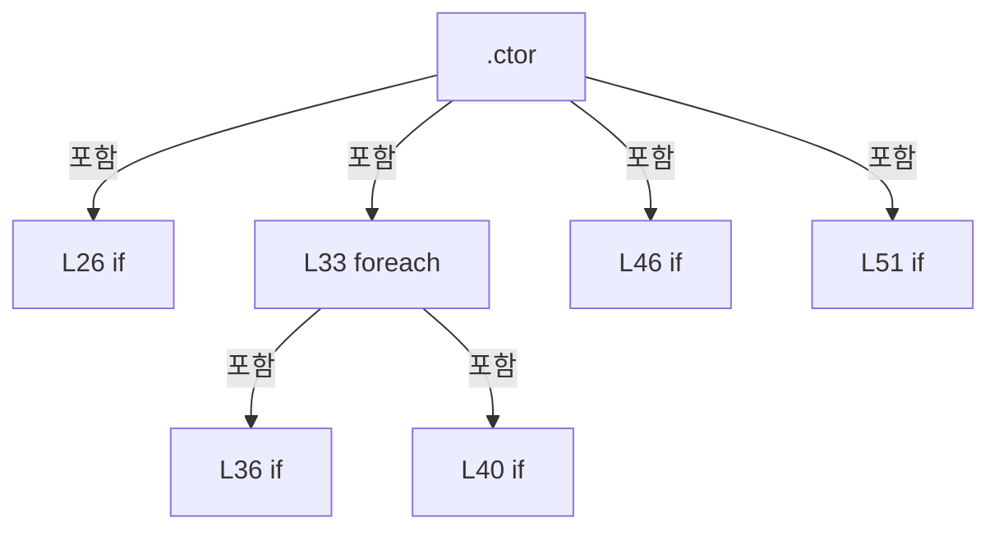

변경 전 점검: 입력/반환 타입, 위 호출자, 예외/취소 경로, 공유 상태와 저장·전송 소비자를 함께 확인합니다. 값의 단위나 물리 방향을 이름만으로 확정하지 않습니다.

### LocalFunctionStatement `Find` · L21–21

[Drilling.Common/Correction/CAlignInterpolation.cs:21–21](https://github.com/kjuws10-rgb/A3Drilling/blob/334b3599651b2e8e0181fd4459bafaf3cddafff3/Drilling.Common/Correction/CAlignInterpolation.cs#L21-L21)

| 항목 | 실제 추출 값 |
| --- | --- |
| 서명 | Drilling.Common.Correction.ST_ALIGN_INTERPOLATION_KEY Find(string) |
| 접근/수식자 | Private /  |
| 반환/값 타입 | Drilling.Common.Correction.ST_ALIGN_INTERPOLATION_KEY |
| 소속 타입 | NamedType:Drilling.Common.Correction.CAlignInterpolation |

입력 계약:

| 이름 | 타입 | 전달 | 선택/기본값 |
| --- | --- | --- | --- |
| name | string | None | False /  |

정적 호출자로 확인된 위치:

| 호출 파일/행 | 호출 표현식 | 런타임 분기 가능 |
| --- | --- | --- |
| [Drilling.Common/Correction/CAlignInterpolation.cs:22–22](https://github.com/kjuws10-rgb/A3Drilling/blob/334b3599651b2e8e0181fd4459bafaf3cddafff3/Drilling.Common/Correction/CAlignInterpolation.cs#L22-L22) | Find | False |
| [Drilling.Common/Correction/CAlignInterpolation.cs:22–22](https://github.com/kjuws10-rgb/A3Drilling/blob/334b3599651b2e8e0181fd4459bafaf3cddafff3/Drilling.Common/Correction/CAlignInterpolation.cs#L22-L22) | Find | False |
| [Drilling.Common/Correction/CAlignInterpolation.cs:23–23](https://github.com/kjuws10-rgb/A3Drilling/blob/334b3599651b2e8e0181fd4459bafaf3cddafff3/Drilling.Common/Correction/CAlignInterpolation.cs#L23-L23) | Find | False |
| [Drilling.Common/Correction/CAlignInterpolation.cs:23–23](https://github.com/kjuws10-rgb/A3Drilling/blob/334b3599651b2e8e0181fd4459bafaf3cddafff3/Drilling.Common/Correction/CAlignInterpolation.cs#L23-L23) | Find | False |

호출하는 대상과 해석 범위:

| 원본 행 | 표현식 | 분석 상태 | 대상/소스 위치 |
| --- | --- | --- | --- |
| 21 | byName.TryGetValue | resolved | bool System.Collections.Generic.Dictionary<string, Drilling.Common.Correction.ST_ALIGN_INTERPOLATION_KEY>.TryGetValue(string, out Drilling.Common.Correction.ST_ALIGN_INTERPOLATION_KEY) |
| 21 | new InvalidOperationException | resolved | System.InvalidOperationException.InvalidOperationException(string?) |

본문의 실제 연산·분기·예외·반환 순서(원문 위치 순):

| 원본 행 | 종류 | 주석 해설 |
| --- | --- | --- |
| 21 | call | 함수·델리게이트 또는 객체 생성자를 호출합니다: byName.TryGetValue(name, out var key) |
| 21 | call | 함수·델리게이트 또는 객체 생성자를 호출합니다: new InvalidOperationException($"{name} 키 위치가 없습니다.") |
| 21 | conditional-expression | 조건에 따라 결과식을 선택합니다: byName.TryGetValue(name, out var key) ? key : throw new InvalidOperationException($"{name} 키 위치가 없습니다.") |
| 21 | throw | 예외를 발생/전달합니다: throw new InvalidOperationException($"{name} 키 위치가 없습니다.") |

변경 전 점검: 입력/반환 타입, 위 호출자, 예외/취소 경로, 공유 상태와 저장·전송 소비자를 함께 확인합니다. 값의 단위나 물리 방향을 이름만으로 확정하지 않습니다.

### MethodDeclaration `Contains` · L55–63

[Drilling.Common/Correction/CAlignInterpolation.cs:55–63](https://github.com/kjuws10-rgb/A3Drilling/blob/334b3599651b2e8e0181fd4459bafaf3cddafff3/Drilling.Common/Correction/CAlignInterpolation.cs#L55-L63)

| 항목 | 실제 추출 값 |
| --- | --- |
| 서명 | bool Drilling.Common.Correction.CAlignInterpolation.Contains(double, double) |
| 접근/수식자 | Public / public |
| 반환/값 타입 | bool |
| 소속 타입 | NamedType:Drilling.Common.Correction.CAlignInterpolation |

입력 계약:

| 이름 | 타입 | 전달 | 선택/기본값 |
| --- | --- | --- | --- |
| x | double | None | False /  |
| y | double | None | False /  |

정적 호출자로 확인된 위치:

| 호출 파일/행 | 호출 표현식 | 런타임 분기 가능 |
| --- | --- | --- |
| [Drilling.Common/Correction/CAlignInterpolation.cs:76–76](https://github.com/kjuws10-rgb/A3Drilling/blob/334b3599651b2e8e0181fd4459bafaf3cddafff3/Drilling.Common/Correction/CAlignInterpolation.cs#L76-L76) | Contains | False |
| [Drilling.Common/Recipe/CShotCoordinatePlanBuilder.cs:697–697](https://github.com/kjuws10-rgb/A3Drilling/blob/334b3599651b2e8e0181fd4459bafaf3cddafff3/Drilling.Common/Recipe/CShotCoordinatePlanBuilder.cs#L697-L697) | model.Contains | False |
| [Drilling.UI/Menu/Menus/CMenuCorrection.cs:2952–2952](https://github.com/kjuws10-rgb/A3Drilling/blob/334b3599651b2e8e0181fd4459bafaf3cddafff3/Drilling.UI/Menu/Menus/CMenuCorrection.cs#L2952-L2952) | model!.Contains | False |

호출하는 대상과 해석 범위:

| 원본 행 | 표현식 | 분석 상태 | 대상/소스 위치 |
| --- | --- | --- | --- |
| 57 | double.IsFinite | resolved | bool double.IsFinite(double) |
| 57 | double.IsFinite | resolved | bool double.IsFinite(double) |
| 59 | FindInterval | resolved | (Drilling.Common.Correction.ST_ALIGN_INTERPOLATION_ROW First, Drilling.Common.Correction.ST_ALIGN_INTERPOLATION_ROW Second, double Fraction) Drilling.Common.Correction.CAlignInterpolation.FindInterval(double) · Drilling.Common/Correction/CAlignInterpolation.cs:96 |

본문의 실제 연산·분기·예외·반환 순서(원문 위치 순):

| 원본 행 | 종류 | 주석 해설 |
| --- | --- | --- |
| 57 | call | 함수·델리게이트 또는 객체 생성자를 호출합니다: double.IsFinite(x) |
| 57 | call | 함수·델리게이트 또는 객체 생성자를 호출합니다: double.IsFinite(y) |
| 57 | if | 조건에 따라 분기합니다: if (!double.IsFinite(x) &#124;&#124; !double.IsFinite(y) &#124;&#124; y < Rows[0].Y &#124;&#124; y > Rows[^1].Y) |
| 58 | return | 호출자에게 값 또는 제어를 반환합니다: return false; |
| 59 | assignment | 값을 대상에 대입합니다: var(first, second, fraction) = FindInterval(y) |
| 59 | call | 함수·델리게이트 또는 객체 생성자를 호출합니다: FindInterval(y) |
| 60 | local-declaration | 지역 변수를 선언합니다: var left = first.Left.X + fraction * (second.Left.X - first.Left.X); |
| 60 | variable-initializer | 변수의 초기값을 지정합니다: left = first.Left.X + fraction * (second.Left.X - first.Left.X) |
| 61 | local-declaration | 지역 변수를 선언합니다: var right = first.Right.X + fraction * (second.Right.X - first.Right.X); |
| 61 | variable-initializer | 변수의 초기값을 지정합니다: right = first.Right.X + fraction * (second.Right.X - first.Right.X) |
| 62 | return | 호출자에게 값 또는 제어를 반환합니다: return x >= left - 1e-9 && x <= right + 1e-9; |

제어 구문의 포함 구조(실제 실행 순서/CFG가 아닌 구문 탐색 그림):

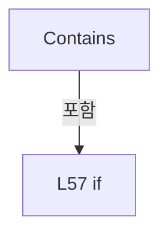

변경 전 점검: 입력/반환 타입, 위 호출자, 예외/취소 경로, 공유 상태와 저장·전송 소비자를 함께 확인합니다. 값의 단위나 물리 방향을 이름만으로 확정하지 않습니다.

### MethodDeclaration `ValidateMeasurements` · L65–72

[Drilling.Common/Correction/CAlignInterpolation.cs:65–72](https://github.com/kjuws10-rgb/A3Drilling/blob/334b3599651b2e8e0181fd4459bafaf3cddafff3/Drilling.Common/Correction/CAlignInterpolation.cs#L65-L72)

| 항목 | 실제 추출 값 |
| --- | --- |
| 서명 | void Drilling.Common.Correction.CAlignInterpolation.ValidateMeasurements() |
| 접근/수식자 | Public / public |
| 반환/값 타입 | void |
| 소속 타입 | NamedType:Drilling.Common.Correction.CAlignInterpolation |

정적 호출자로 확인된 위치:

| 호출 파일/행 | 호출 표현식 | 런타임 분기 가능 |
| --- | --- | --- |
| [Drilling.Common/Correction/CAlignInterpolation.cs:78–78](https://github.com/kjuws10-rgb/A3Drilling/blob/334b3599651b2e8e0181fd4459bafaf3cddafff3/Drilling.Common/Correction/CAlignInterpolation.cs#L78-L78) | ValidateMeasurements | False |
| [Drilling.Common/Recipe/CShotCoordinatePlanBuilder.cs:687–687](https://github.com/kjuws10-rgb/A3Drilling/blob/334b3599651b2e8e0181fd4459bafaf3cddafff3/Drilling.Common/Recipe/CShotCoordinatePlanBuilder.cs#L687-L687) | model.ValidateMeasurements | False |
| [Drilling.UI/Menu/Menus/CMenuCorrection.cs:5440–5440](https://github.com/kjuws10-rgb/A3Drilling/blob/334b3599651b2e8e0181fd4459bafaf3cddafff3/Drilling.UI/Menu/Menus/CMenuCorrection.cs#L5440-L5440) | model.ValidateMeasurements | False |

호출하는 대상과 해석 범위:

| 원본 행 | 표현식 | 분석 상태 | 대상/소스 위치 |
| --- | --- | --- | --- |
| 69 | ReadCorrection | resolved | Drilling.Common.Correction.ST_ALIGN_CORRECTION Drilling.Common.Correction.CAlignInterpolation.ReadCorrection(Drilling.Common.Correction.ST_ALIGN_INTERPOLATION_KEY) · Drilling.Common/Correction/CAlignInterpolation.cs:110 |
| 70 | ReadCorrection | resolved | Drilling.Common.Correction.ST_ALIGN_CORRECTION Drilling.Common.Correction.CAlignInterpolation.ReadCorrection(Drilling.Common.Correction.ST_ALIGN_INTERPOLATION_KEY) · Drilling.Common/Correction/CAlignInterpolation.cs:110 |

본문의 실제 연산·분기·예외·반환 순서(원문 위치 순):

| 원본 행 | 종류 | 주석 해설 |
| --- | --- | --- |
| 67 | foreach | 컬렉션 요소를 순회합니다: foreach (var row in Rows) |
| 69 | call | 함수·델리게이트 또는 객체 생성자를 호출합니다: ReadCorrection(row.Left) |
| 70 | call | 함수·델리게이트 또는 객체 생성자를 호출합니다: ReadCorrection(row.Right) |

제어 구문의 포함 구조(실제 실행 순서/CFG가 아닌 구문 탐색 그림):

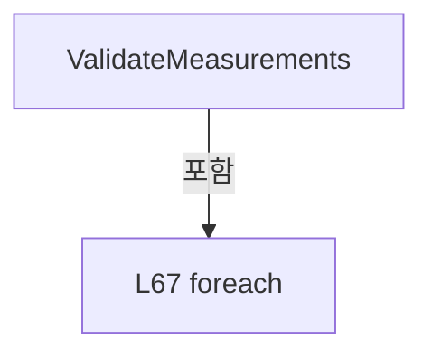

변경 전 점검: 입력/반환 타입, 위 호출자, 예외/취소 경로, 공유 상태와 저장·전송 소비자를 함께 확인합니다. 값의 단위나 물리 방향을 이름만으로 확정하지 않습니다.

### MethodDeclaration `Evaluate` · L74–94

[Drilling.Common/Correction/CAlignInterpolation.cs:74–94](https://github.com/kjuws10-rgb/A3Drilling/blob/334b3599651b2e8e0181fd4459bafaf3cddafff3/Drilling.Common/Correction/CAlignInterpolation.cs#L74-L94)

| 항목 | 실제 추출 값 |
| --- | --- |
| 서명 | Drilling.Common.Correction.ST_ALIGN_CORRECTION Drilling.Common.Correction.CAlignInterpolation.Evaluate(double, double) |
| 접근/수식자 | Public / public |
| 반환/값 타입 | Drilling.Common.Correction.ST_ALIGN_CORRECTION |
| 소속 타입 | NamedType:Drilling.Common.Correction.CAlignInterpolation |

입력 계약:

| 이름 | 타입 | 전달 | 선택/기본값 |
| --- | --- | --- | --- |
| x | double | None | False /  |
| y | double | None | False /  |

정적 호출자로 확인된 위치:

| 호출 파일/행 | 호출 표현식 | 런타임 분기 가능 |
| --- | --- | --- |
| [Drilling.Common/Recipe/CShotCoordinatePlanBuilder.cs:699–699](https://github.com/kjuws10-rgb/A3Drilling/blob/334b3599651b2e8e0181fd4459bafaf3cddafff3/Drilling.Common/Recipe/CShotCoordinatePlanBuilder.cs#L699-L699) | model.Evaluate | False |
| [Drilling.UI/Menu/Menus/CMenuCorrection.cs:2952–2952](https://github.com/kjuws10-rgb/A3Drilling/blob/334b3599651b2e8e0181fd4459bafaf3cddafff3/Drilling.UI/Menu/Menus/CMenuCorrection.cs#L2952-L2952) | model.Evaluate | False |

호출하는 대상과 해석 범위:

| 원본 행 | 표현식 | 분석 상태 | 대상/소스 위치 |
| --- | --- | --- | --- |
| 76 | Contains | resolved | bool Drilling.Common.Correction.CAlignInterpolation.Contains(double, double) · Drilling.Common/Correction/CAlignInterpolation.cs:55 |
| 77 | new InvalidOperationException | resolved | System.InvalidOperationException.InvalidOperationException(string?) |
| 78 | ValidateMeasurements | resolved | void Drilling.Common.Correction.CAlignInterpolation.ValidateMeasurements() · Drilling.Common/Correction/CAlignInterpolation.cs:65 |
| 81 | EvaluateRow | resolved | Drilling.Common.Correction.ST_ALIGN_CORRECTION Drilling.Common.Correction.CAlignInterpolation.EvaluateRow(Drilling.Common.Correction.ST_ALIGN_INTERPOLATION_ROW, double) · Drilling.Common/Correction/CAlignInterpolation.cs:111 |
| 87 | EvaluateRow | resolved | Drilling.Common.Correction.ST_ALIGN_CORRECTION Drilling.Common.Correction.CAlignInterpolation.EvaluateRow(Drilling.Common.Correction.ST_ALIGN_INTERPOLATION_ROW, double) · Drilling.Common/Correction/CAlignInterpolation.cs:111 |
| 93 | Finite | resolved | Drilling.Common.Correction.ST_ALIGN_CORRECTION Drilling.Common.Correction.CAlignInterpolation.Finite(Drilling.Common.Correction.ST_ALIGN_CORRECTION) · Drilling.Common/Correction/CAlignInterpolation.cs:113 |
| 93 | new ST_ALIGN_CORRECTION | resolved | Drilling.Common.Correction.ST_ALIGN_CORRECTION.ST_ALIGN_CORRECTION(double, double) · Drilling.Common/Correction/CAlignInterpolation.cs:122 |

본문의 실제 연산·분기·예외·반환 순서(원문 위치 순):

| 원본 행 | 종류 | 주석 해설 |
| --- | --- | --- |
| 76 | call | 함수·델리게이트 또는 객체 생성자를 호출합니다: Contains(x, y) |
| 76 | if | 조건에 따라 분기합니다: if (!Contains(x, y)) |
| 77 | call | 함수·델리게이트 또는 객체 생성자를 호출합니다: new InvalidOperationException("검증 위치가 선택한 키로 구성된 보간 범위를 벗어납니다.") |
| 77 | throw | 예외를 발생/전달합니다: throw new InvalidOperationException("검증 위치가 선택한 키로 구성된 보간 범위를 벗어납니다."); |
| 78 | call | 함수·델리게이트 또는 객체 생성자를 호출합니다: ValidateMeasurements() |
| 79 | variable-initializer | 변수의 초기값을 지정합니다: index = 0 |
| 79 | for | 초기화·조건·증감이 있는 반복입니다: for (var index = 0; index < Rows.Count; index++) |
| 80 | if | 조건에 따라 분기합니다: if (y == Rows[index].Y) |
| 81 | call | 함수·델리게이트 또는 객체 생성자를 호출합니다: EvaluateRow(Rows[index], x) |
| 81 | return | 호출자에게 값 또는 제어를 반환합니다: return EvaluateRow(Rows[index], x); |
| 82 | local-declaration | 지역 변수를 선언합니다: var normalized = (y - Rows[0].Y) / (Rows[^1].Y - Rows[0].Y); |
| 82 | variable-initializer | 변수의 초기값을 지정합니다: normalized = (y - Rows[0].Y) / (Rows[^1].Y - Rows[0].Y) |
| 83 | local-declaration | 지역 변수를 선언합니다: double denominator = 0, numeratorX = 0, numeratorY = 0; |
| 83 | variable-initializer | 변수의 초기값을 지정합니다: denominator = 0 |
| 83 | variable-initializer | 변수의 초기값을 지정합니다: numeratorX = 0 |
| 83 | variable-initializer | 변수의 초기값을 지정합니다: numeratorY = 0 |
| 84 | variable-initializer | 변수의 초기값을 지정합니다: index = 0 |
| 84 | for | 초기화·조건·증감이 있는 반복입니다: for (var index = 0; index < Rows.Count; index++) |
| 86 | local-declaration | 지역 변수를 선언합니다: var term = _weights[index] / (normalized - _normalizedY[index]); |
| 86 | variable-initializer | 변수의 초기값을 지정합니다: term = _weights[index] / (normalized - _normalizedY[index]) |
| 87 | call | 함수·델리게이트 또는 객체 생성자를 호출합니다: EvaluateRow(Rows[index], x) |
| 87 | local-declaration | 지역 변수를 선언합니다: var value = EvaluateRow(Rows[index], x); |
| 87 | variable-initializer | 변수의 초기값을 지정합니다: value = EvaluateRow(Rows[index], x) |
| 88 | compound-assignment-or-event-subscription | 복합 대입 또는 이벤트 구독/해지 표현입니다: denominator += term |
| 89 | compound-assignment-or-event-subscription | 복합 대입 또는 이벤트 구독/해지 표현입니다: numeratorX += term * value.X |
| 90 | compound-assignment-or-event-subscription | 복합 대입 또는 이벤트 구독/해지 표현입니다: numeratorY += term * value.Y |
| 93 | call | 함수·델리게이트 또는 객체 생성자를 호출합니다: Finite(new ST_ALIGN_CORRECTION(numeratorX / denominator, numeratorY / denominator)) |
| 93 | call | 함수·델리게이트 또는 객체 생성자를 호출합니다: new ST_ALIGN_CORRECTION(numeratorX / denominator, numeratorY / denominator) |
| 93 | return | 호출자에게 값 또는 제어를 반환합니다: return Finite(new ST_ALIGN_CORRECTION(numeratorX / denominator, numeratorY / denominator)); |

제어 구문의 포함 구조(실제 실행 순서/CFG가 아닌 구문 탐색 그림):

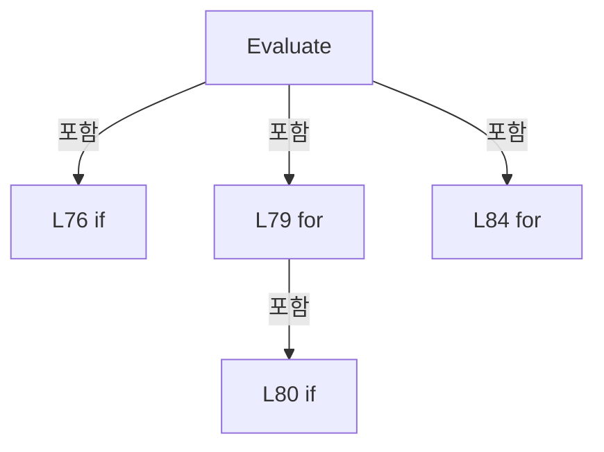

변경 전 점검: 입력/반환 타입, 위 호출자, 예외/취소 경로, 공유 상태와 저장·전송 소비자를 함께 확인합니다. 값의 단위나 물리 방향을 이름만으로 확정하지 않습니다.

### MethodDeclaration `FindInterval` · L96–102

[Drilling.Common/Correction/CAlignInterpolation.cs:96–102](https://github.com/kjuws10-rgb/A3Drilling/blob/334b3599651b2e8e0181fd4459bafaf3cddafff3/Drilling.Common/Correction/CAlignInterpolation.cs#L96-L102)

| 항목 | 실제 추출 값 |
| --- | --- |
| 서명 | (Drilling.Common.Correction.ST_ALIGN_INTERPOLATION_ROW First, Drilling.Common.Correction.ST_ALIGN_INTERPOLATION_ROW Second, double Fraction) Drilling.Common.Correction.CAlignInterpolation.FindInterval(double) |
| 접근/수식자 | Private / private |
| 반환/값 타입 | (Drilling.Common.Correction.ST_ALIGN_INTERPOLATION_ROW First, Drilling.Common.Correction.ST_ALIGN_INTERPOLATION_ROW Second, double Fraction) |
| 소속 타입 | NamedType:Drilling.Common.Correction.CAlignInterpolation |

입력 계약:

| 이름 | 타입 | 전달 | 선택/기본값 |
| --- | --- | --- | --- |
| y | double | None | False /  |

정적 호출자로 확인된 위치:

| 호출 파일/행 | 호출 표현식 | 런타임 분기 가능 |
| --- | --- | --- |
| [Drilling.Common/Correction/CAlignInterpolation.cs:59–59](https://github.com/kjuws10-rgb/A3Drilling/blob/334b3599651b2e8e0181fd4459bafaf3cddafff3/Drilling.Common/Correction/CAlignInterpolation.cs#L59-L59) | FindInterval | False |

호출하는 대상과 해석 범위:

| 원본 행 | 표현식 | 분석 상태 | 대상/소스 위치 |
| --- | --- | --- | --- |
| 101 | new InvalidOperationException | resolved | System.InvalidOperationException.InvalidOperationException(string?) |

본문의 실제 연산·분기·예외·반환 순서(원문 위치 순):

| 원본 행 | 종류 | 주석 해설 |
| --- | --- | --- |
| 98 | variable-initializer | 변수의 초기값을 지정합니다: index = 1 |
| 98 | for | 초기화·조건·증감이 있는 반복입니다: for (var index = 1; index < Rows.Count; index++) |
| 99 | if | 조건에 따라 분기합니다: if (y <= Rows[index].Y) |
| 100 | return | 호출자에게 값 또는 제어를 반환합니다: return (Rows[index - 1], Rows[index], (y - Rows[index - 1].Y) / (Rows[index].Y - Rows[index - 1].Y)); |
| 101 | call | 함수·델리게이트 또는 객체 생성자를 호출합니다: new InvalidOperationException("검증 위치의 Y 구간을 찾을 수 없습니다.") |
| 101 | throw | 예외를 발생/전달합니다: throw new InvalidOperationException("검증 위치의 Y 구간을 찾을 수 없습니다."); |

제어 구문의 포함 구조(실제 실행 순서/CFG가 아닌 구문 탐색 그림):

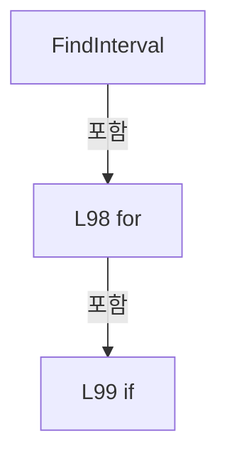

변경 전 점검: 입력/반환 타입, 위 호출자, 예외/취소 경로, 공유 상태와 저장·전송 소비자를 함께 확인합니다. 값의 단위나 물리 방향을 이름만으로 확정하지 않습니다.

### MethodDeclaration `ValidateRow` · L104–108

[Drilling.Common/Correction/CAlignInterpolation.cs:104–108](https://github.com/kjuws10-rgb/A3Drilling/blob/334b3599651b2e8e0181fd4459bafaf3cddafff3/Drilling.Common/Correction/CAlignInterpolation.cs#L104-L108)

| 항목 | 실제 추출 값 |
| --- | --- |
| 서명 | void Drilling.Common.Correction.CAlignInterpolation.ValidateRow(Drilling.Common.Correction.ST_ALIGN_INTERPOLATION_ROW) |
| 접근/수식자 | Private / private, static |
| 반환/값 타입 | void |
| 소속 타입 | NamedType:Drilling.Common.Correction.CAlignInterpolation |

입력 계약:

| 이름 | 타입 | 전달 | 선택/기본값 |
| --- | --- | --- | --- |
| row | Drilling.Common.Correction.ST_ALIGN_INTERPOLATION_ROW | None | False /  |

정적 호출자로 확인된 위치:

| 호출 파일/행 | 호출 표현식 | 런타임 분기 가능 |
| --- | --- | --- |
| [Drilling.Common/Correction/CAlignInterpolation.cs:24–24](https://github.com/kjuws10-rgb/A3Drilling/blob/334b3599651b2e8e0181fd4459bafaf3cddafff3/Drilling.Common/Correction/CAlignInterpolation.cs#L24-L24) | ValidateRow | False |
| [Drilling.Common/Correction/CAlignInterpolation.cs:25–25](https://github.com/kjuws10-rgb/A3Drilling/blob/334b3599651b2e8e0181fd4459bafaf3cddafff3/Drilling.Common/Correction/CAlignInterpolation.cs#L25-L25) | ValidateRow | False |
| [Drilling.Common/Correction/CAlignInterpolation.cs:39–39](https://github.com/kjuws10-rgb/A3Drilling/blob/334b3599651b2e8e0181fd4459bafaf3cddafff3/Drilling.Common/Correction/CAlignInterpolation.cs#L39-L39) | ValidateRow | False |

호출하는 대상과 해석 범위:

| 원본 행 | 표현식 | 분석 상태 | 대상/소스 위치 |
| --- | --- | --- | --- |
| 106 | double.IsFinite | resolved | bool double.IsFinite(double) |
| 106 | double.IsFinite | resolved | bool double.IsFinite(double) |
| 106 | double.IsFinite | resolved | bool double.IsFinite(double) |
| 106 | double.IsFinite | resolved | bool double.IsFinite(double) |
| 107 | new InvalidOperationException | resolved | System.InvalidOperationException.InvalidOperationException(string?) |

본문의 실제 연산·분기·예외·반환 순서(원문 위치 순):

| 원본 행 | 종류 | 주석 해설 |
| --- | --- | --- |
| 106 | call | 함수·델리게이트 또는 객체 생성자를 호출합니다: double.IsFinite(row.Y) |
| 106 | call | 함수·델리게이트 또는 객체 생성자를 호출합니다: double.IsFinite(row.Right.Y) |
| 106 | call | 함수·델리게이트 또는 객체 생성자를 호출합니다: double.IsFinite(row.Left.X) |
| 106 | call | 함수·델리게이트 또는 객체 생성자를 호출합니다: double.IsFinite(row.Right.X) |
| 106 | if | 조건에 따라 분기합니다: if (!double.IsFinite(row.Y) &#124;&#124; !double.IsFinite(row.Right.Y) &#124;&#124; row.Y != row.Right.Y &#124;&#124; !double.IsFinite(row.Left.X) &#124;&#124; !double.IsFinite(row.Right.X) &#124;&#124; row.Right.X - row.Left.X <= 1e-9) |
| 107 | call | 함수·델리게이트 또는 객체 생성자를 호출합니다: new InvalidOperationException($"{row.Left.Name} / {row.Right.Name}는 같은 Y에서 서로 다른 X 위치에 있어야 합니다.") |
| 107 | throw | 예외를 발생/전달합니다: throw new InvalidOperationException($"{row.Left.Name} / {row.Right.Name}는 같은 Y에서 서로 다른 X 위치에 있어야 합니다."); |

제어 구문의 포함 구조(실제 실행 순서/CFG가 아닌 구문 탐색 그림):

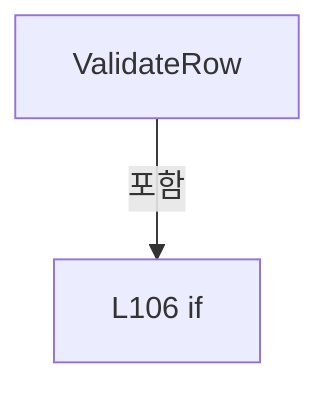

변경 전 점검: 입력/반환 타입, 위 호출자, 예외/취소 경로, 공유 상태와 저장·전송 소비자를 함께 확인합니다. 값의 단위나 물리 방향을 이름만으로 확정하지 않습니다.

### MethodDeclaration `ReadCorrection` · L110–110

[Drilling.Common/Correction/CAlignInterpolation.cs:110–110](https://github.com/kjuws10-rgb/A3Drilling/blob/334b3599651b2e8e0181fd4459bafaf3cddafff3/Drilling.Common/Correction/CAlignInterpolation.cs#L110-L110)

| 항목 | 실제 추출 값 |
| --- | --- |
| 서명 | Drilling.Common.Correction.ST_ALIGN_CORRECTION Drilling.Common.Correction.CAlignInterpolation.ReadCorrection(Drilling.Common.Correction.ST_ALIGN_INTERPOLATION_KEY) |
| 접근/수식자 | Private / private, static |
| 반환/값 타입 | Drilling.Common.Correction.ST_ALIGN_CORRECTION |
| 소속 타입 | NamedType:Drilling.Common.Correction.CAlignInterpolation |

입력 계약:

| 이름 | 타입 | 전달 | 선택/기본값 |
| --- | --- | --- | --- |
| key | Drilling.Common.Correction.ST_ALIGN_INTERPOLATION_KEY | None | False /  |

정적 호출자로 확인된 위치:

| 호출 파일/행 | 호출 표현식 | 런타임 분기 가능 |
| --- | --- | --- |
| [Drilling.Common/Correction/CAlignInterpolation.cs:69–69](https://github.com/kjuws10-rgb/A3Drilling/blob/334b3599651b2e8e0181fd4459bafaf3cddafff3/Drilling.Common/Correction/CAlignInterpolation.cs#L69-L69) | ReadCorrection | False |
| [Drilling.Common/Correction/CAlignInterpolation.cs:70–70](https://github.com/kjuws10-rgb/A3Drilling/blob/334b3599651b2e8e0181fd4459bafaf3cddafff3/Drilling.Common/Correction/CAlignInterpolation.cs#L70-L70) | ReadCorrection | False |
| [Drilling.Common/Correction/CAlignInterpolation.cs:111–111](https://github.com/kjuws10-rgb/A3Drilling/blob/334b3599651b2e8e0181fd4459bafaf3cddafff3/Drilling.Common/Correction/CAlignInterpolation.cs#L111-L111) | ReadCorrection | False |
| [Drilling.Common/Correction/CAlignInterpolation.cs:111–111](https://github.com/kjuws10-rgb/A3Drilling/blob/334b3599651b2e8e0181fd4459bafaf3cddafff3/Drilling.Common/Correction/CAlignInterpolation.cs#L111-L111) | ReadCorrection | False |

호출하는 대상과 해석 범위:

| 원본 행 | 표현식 | 분석 상태 | 대상/소스 위치 |
| --- | --- | --- | --- |
| 110 | double.IsFinite | resolved | bool double.IsFinite(double) |
| 110 | double.IsFinite | resolved | bool double.IsFinite(double) |
| 110 | new | resolved | Drilling.Common.Correction.ST_ALIGN_CORRECTION.ST_ALIGN_CORRECTION(double, double) · Drilling.Common/Correction/CAlignInterpolation.cs:122 |
| 110 | new InvalidOperationException | resolved | System.InvalidOperationException.InvalidOperationException(string?) |

본문의 실제 연산·분기·예외·반환 순서(원문 위치 순):

| 원본 행 | 종류 | 주석 해설 |
| --- | --- | --- |
| 110 | call | 함수·델리게이트 또는 객체 생성자를 호출합니다: double.IsFinite(x) |
| 110 | call | 함수·델리게이트 또는 객체 생성자를 호출합니다: double.IsFinite(y) |
| 110 | call | 함수·델리게이트 또는 객체 생성자를 호출합니다: new(x, y) |
| 110 | call | 함수·델리게이트 또는 객체 생성자를 호출합니다: new InvalidOperationException($"{key.Name}의 Base / LastLoad X/Y 값이 없습니다. Load 후 다시 확인해 주세요.") |
| 110 | conditional-expression | 조건에 따라 결과식을 선택합니다: key.CorrectionX is { } x && key.CorrectionY is { } y && double.IsFinite(x) && double.IsFinite(y) ? new(x, y) : throw new InvalidOperationException($"{key.Name}의 Base / LastLoad X/Y 값이 없습니다. Load 후 다시 확인해 주세요.") |
| 110 | throw | 예외를 발생/전달합니다: throw new InvalidOperationException($"{key.Name}의 Base / LastLoad X/Y 값이 없습니다. Load 후 다시 확인해 주세요.") |

변경 전 점검: 입력/반환 타입, 위 호출자, 예외/취소 경로, 공유 상태와 저장·전송 소비자를 함께 확인합니다. 값의 단위나 물리 방향을 이름만으로 확정하지 않습니다.

### MethodDeclaration `EvaluateRow` · L111–111

[Drilling.Common/Correction/CAlignInterpolation.cs:111–111](https://github.com/kjuws10-rgb/A3Drilling/blob/334b3599651b2e8e0181fd4459bafaf3cddafff3/Drilling.Common/Correction/CAlignInterpolation.cs#L111-L111)

| 항목 | 실제 추출 값 |
| --- | --- |
| 서명 | Drilling.Common.Correction.ST_ALIGN_CORRECTION Drilling.Common.Correction.CAlignInterpolation.EvaluateRow(Drilling.Common.Correction.ST_ALIGN_INTERPOLATION_ROW, double) |
| 접근/수식자 | Private / private, static |
| 반환/값 타입 | Drilling.Common.Correction.ST_ALIGN_CORRECTION |
| 소속 타입 | NamedType:Drilling.Common.Correction.CAlignInterpolation |

입력 계약:

| 이름 | 타입 | 전달 | 선택/기본값 |
| --- | --- | --- | --- |
| row | Drilling.Common.Correction.ST_ALIGN_INTERPOLATION_ROW | None | False /  |
| x | double | None | False /  |

정적 호출자로 확인된 위치:

| 호출 파일/행 | 호출 표현식 | 런타임 분기 가능 |
| --- | --- | --- |
| [Drilling.Common/Correction/CAlignInterpolation.cs:81–81](https://github.com/kjuws10-rgb/A3Drilling/blob/334b3599651b2e8e0181fd4459bafaf3cddafff3/Drilling.Common/Correction/CAlignInterpolation.cs#L81-L81) | EvaluateRow | False |
| [Drilling.Common/Correction/CAlignInterpolation.cs:87–87](https://github.com/kjuws10-rgb/A3Drilling/blob/334b3599651b2e8e0181fd4459bafaf3cddafff3/Drilling.Common/Correction/CAlignInterpolation.cs#L87-L87) | EvaluateRow | False |

호출하는 대상과 해석 범위:

| 원본 행 | 표현식 | 분석 상태 | 대상/소스 위치 |
| --- | --- | --- | --- |
| 111 | Blend | resolved | Drilling.Common.Correction.ST_ALIGN_CORRECTION Drilling.Common.Correction.CAlignInterpolation.Blend(Drilling.Common.Correction.ST_ALIGN_CORRECTION, Drilling.Common.Correction.ST_ALIGN_CORRECTION, double) · Drilling.Common/Correction/CAlignInterpolation.cs:112 |
| 111 | ReadCorrection | resolved | Drilling.Common.Correction.ST_ALIGN_CORRECTION Drilling.Common.Correction.CAlignInterpolation.ReadCorrection(Drilling.Common.Correction.ST_ALIGN_INTERPOLATION_KEY) · Drilling.Common/Correction/CAlignInterpolation.cs:110 |
| 111 | ReadCorrection | resolved | Drilling.Common.Correction.ST_ALIGN_CORRECTION Drilling.Common.Correction.CAlignInterpolation.ReadCorrection(Drilling.Common.Correction.ST_ALIGN_INTERPOLATION_KEY) · Drilling.Common/Correction/CAlignInterpolation.cs:110 |

본문의 실제 연산·분기·예외·반환 순서(원문 위치 순):

| 원본 행 | 종류 | 주석 해설 |
| --- | --- | --- |
| 111 | call | 함수·델리게이트 또는 객체 생성자를 호출합니다: Blend(ReadCorrection(row.Left), ReadCorrection(row.Right), (x - row.Left.X) / (row.Right.X - row.Left.X)) |
| 111 | call | 함수·델리게이트 또는 객체 생성자를 호출합니다: ReadCorrection(row.Left) |
| 111 | call | 함수·델리게이트 또는 객체 생성자를 호출합니다: ReadCorrection(row.Right) |

변경 전 점검: 입력/반환 타입, 위 호출자, 예외/취소 경로, 공유 상태와 저장·전송 소비자를 함께 확인합니다. 값의 단위나 물리 방향을 이름만으로 확정하지 않습니다.

### MethodDeclaration `Blend` · L112–112

[Drilling.Common/Correction/CAlignInterpolation.cs:112–112](https://github.com/kjuws10-rgb/A3Drilling/blob/334b3599651b2e8e0181fd4459bafaf3cddafff3/Drilling.Common/Correction/CAlignInterpolation.cs#L112-L112)

| 항목 | 실제 추출 값 |
| --- | --- |
| 서명 | Drilling.Common.Correction.ST_ALIGN_CORRECTION Drilling.Common.Correction.CAlignInterpolation.Blend(Drilling.Common.Correction.ST_ALIGN_CORRECTION, Drilling.Common.Correction.ST_ALIGN_CORRECTION, double) |
| 접근/수식자 | Private / private, static |
| 반환/값 타입 | Drilling.Common.Correction.ST_ALIGN_CORRECTION |
| 소속 타입 | NamedType:Drilling.Common.Correction.CAlignInterpolation |

입력 계약:

| 이름 | 타입 | 전달 | 선택/기본값 |
| --- | --- | --- | --- |
| first | Drilling.Common.Correction.ST_ALIGN_CORRECTION | None | False /  |
| second | Drilling.Common.Correction.ST_ALIGN_CORRECTION | None | False /  |
| fraction | double | None | False /  |

정적 호출자로 확인된 위치:

| 호출 파일/행 | 호출 표현식 | 런타임 분기 가능 |
| --- | --- | --- |
| [Drilling.Common/Correction/CAlignInterpolation.cs:111–111](https://github.com/kjuws10-rgb/A3Drilling/blob/334b3599651b2e8e0181fd4459bafaf3cddafff3/Drilling.Common/Correction/CAlignInterpolation.cs#L111-L111) | Blend | False |

호출하는 대상과 해석 범위:

| 원본 행 | 표현식 | 분석 상태 | 대상/소스 위치 |
| --- | --- | --- | --- |
| 112 | Finite | resolved | Drilling.Common.Correction.ST_ALIGN_CORRECTION Drilling.Common.Correction.CAlignInterpolation.Finite(Drilling.Common.Correction.ST_ALIGN_CORRECTION) · Drilling.Common/Correction/CAlignInterpolation.cs:113 |
| 112 | new | resolved | Drilling.Common.Correction.ST_ALIGN_CORRECTION.ST_ALIGN_CORRECTION(double, double) · Drilling.Common/Correction/CAlignInterpolation.cs:122 |

본문의 실제 연산·분기·예외·반환 순서(원문 위치 순):

| 원본 행 | 종류 | 주석 해설 |
| --- | --- | --- |
| 112 | call | 함수·델리게이트 또는 객체 생성자를 호출합니다: Finite(new(first.X + fraction * (second.X - first.X), first.Y + fraction * (second.Y - first.Y))) |
| 112 | call | 함수·델리게이트 또는 객체 생성자를 호출합니다: new(first.X + fraction * (second.X - first.X), first.Y + fraction * (second.Y - first.Y)) |

변경 전 점검: 입력/반환 타입, 위 호출자, 예외/취소 경로, 공유 상태와 저장·전송 소비자를 함께 확인합니다. 값의 단위나 물리 방향을 이름만으로 확정하지 않습니다.

### MethodDeclaration `Finite` · L113–113

[Drilling.Common/Correction/CAlignInterpolation.cs:113–113](https://github.com/kjuws10-rgb/A3Drilling/blob/334b3599651b2e8e0181fd4459bafaf3cddafff3/Drilling.Common/Correction/CAlignInterpolation.cs#L113-L113)

| 항목 | 실제 추출 값 |
| --- | --- |
| 서명 | Drilling.Common.Correction.ST_ALIGN_CORRECTION Drilling.Common.Correction.CAlignInterpolation.Finite(Drilling.Common.Correction.ST_ALIGN_CORRECTION) |
| 접근/수식자 | Private / private, static |
| 반환/값 타입 | Drilling.Common.Correction.ST_ALIGN_CORRECTION |
| 소속 타입 | NamedType:Drilling.Common.Correction.CAlignInterpolation |

입력 계약:

| 이름 | 타입 | 전달 | 선택/기본값 |
| --- | --- | --- | --- |
| value | Drilling.Common.Correction.ST_ALIGN_CORRECTION | None | False /  |

정적 호출자로 확인된 위치:

| 호출 파일/행 | 호출 표현식 | 런타임 분기 가능 |
| --- | --- | --- |
| [Drilling.Common/Correction/CAlignInterpolation.cs:93–93](https://github.com/kjuws10-rgb/A3Drilling/blob/334b3599651b2e8e0181fd4459bafaf3cddafff3/Drilling.Common/Correction/CAlignInterpolation.cs#L93-L93) | Finite | False |
| [Drilling.Common/Correction/CAlignInterpolation.cs:112–112](https://github.com/kjuws10-rgb/A3Drilling/blob/334b3599651b2e8e0181fd4459bafaf3cddafff3/Drilling.Common/Correction/CAlignInterpolation.cs#L112-L112) | Finite | False |

호출하는 대상과 해석 범위:

| 원본 행 | 표현식 | 분석 상태 | 대상/소스 위치 |
| --- | --- | --- | --- |
| 113 | double.IsFinite | resolved | bool double.IsFinite(double) |
| 113 | double.IsFinite | resolved | bool double.IsFinite(double) |
| 113 | new InvalidOperationException | resolved | System.InvalidOperationException.InvalidOperationException(string?) |

본문의 실제 연산·분기·예외·반환 순서(원문 위치 순):

| 원본 행 | 종류 | 주석 해설 |
| --- | --- | --- |
| 113 | call | 함수·델리게이트 또는 객체 생성자를 호출합니다: double.IsFinite(value.X) |
| 113 | call | 함수·델리게이트 또는 객체 생성자를 호출합니다: double.IsFinite(value.Y) |
| 113 | call | 함수·델리게이트 또는 객체 생성자를 호출합니다: new InvalidOperationException("보간 계산 결과가 유한한 값이 아닙니다.") |
| 113 | conditional-expression | 조건에 따라 결과식을 선택합니다: double.IsFinite(value.X) && double.IsFinite(value.Y) ? value : throw new InvalidOperationException("보간 계산 결과가 유한한 값이 아닙니다.") |
| 113 | throw | 예외를 발생/전달합니다: throw new InvalidOperationException("보간 계산 결과가 유한한 값이 아닙니다.") |

변경 전 점검: 입력/반환 타입, 위 호출자, 예외/취소 경로, 공유 상태와 저장·전송 소비자를 함께 확인합니다. 값의 단위나 물리 방향을 이름만으로 확정하지 않습니다.

### PropertyDeclaration `Y` · L119–119

[Drilling.Common/Correction/CAlignInterpolation.cs:119–119](https://github.com/kjuws10-rgb/A3Drilling/blob/334b3599651b2e8e0181fd4459bafaf3cddafff3/Drilling.Common/Correction/CAlignInterpolation.cs#L119-L119)

| 항목 | 실제 추출 값 |
| --- | --- |
| 서명 | double Drilling.Common.Correction.ST_ALIGN_INTERPOLATION_ROW.Y |
| 접근/수식자 | Public / public |
| 반환/값 타입 | double |
| 소속 타입 | NamedType:Drilling.Common.Correction.ST_ALIGN_INTERPOLATION_ROW |

현재 부분 분석에서 직접 연결된 호출자는 없습니다. XAML/이벤트/인터페이스·델리게이트·외부 진입을 추가 확인해야 하며, 미사용으로 판정한 것이 아닙니다.

변경 전 점검: 입력/반환 타입, 위 호출자, 예외/취소 경로, 공유 상태와 저장·전송 소비자를 함께 확인합니다. 값의 단위나 물리 방향을 이름만으로 확정하지 않습니다.

### PropertyDeclaration `Tolerance` · L146–146

[Drilling.Common/Correction/CAlignInterpolation.cs:146–146](https://github.com/kjuws10-rgb/A3Drilling/blob/334b3599651b2e8e0181fd4459bafaf3cddafff3/Drilling.Common/Correction/CAlignInterpolation.cs#L146-L146)

| 항목 | 실제 추출 값 |
| --- | --- |
| 서명 | double? Drilling.Common.Correction.ST_ALIGN_OFFSET_LOG.Tolerance |
| 접근/수식자 | Public / public |
| 반환/값 타입 | double? |
| 소속 타입 | NamedType:Drilling.Common.Correction.ST_ALIGN_OFFSET_LOG |

현재 부분 분석에서 직접 연결된 호출자는 없습니다. XAML/이벤트/인터페이스·델리게이트·외부 진입을 추가 확인해야 하며, 미사용으로 판정한 것이 아닙니다.

변경 전 점검: 입력/반환 타입, 위 호출자, 예외/취소 경로, 공유 상태와 저장·전송 소비자를 함께 확인합니다. 값의 단위나 물리 방향을 이름만으로 확정하지 않습니다.

### GetAccessorDeclaration `get_Tolerance` · L146–146

[Drilling.Common/Correction/CAlignInterpolation.cs:146–146](https://github.com/kjuws10-rgb/A3Drilling/blob/334b3599651b2e8e0181fd4459bafaf3cddafff3/Drilling.Common/Correction/CAlignInterpolation.cs#L146-L146)

| 항목 | 실제 추출 값 |
| --- | --- |
| 서명 | double? Drilling.Common.Correction.ST_ALIGN_OFFSET_LOG.Tolerance.get |
| 접근/수식자 | Public / get |
| 반환/값 타입 | double? |
| 소속 타입 | NamedType:Drilling.Common.Correction.ST_ALIGN_OFFSET_LOG |

현재 부분 분석에서 직접 연결된 호출자는 없습니다. XAML/이벤트/인터페이스·델리게이트·외부 진입을 추가 확인해야 하며, 미사용으로 판정한 것이 아닙니다.

변경 전 점검: 입력/반환 타입, 위 호출자, 예외/취소 경로, 공유 상태와 저장·전송 소비자를 함께 확인합니다. 값의 단위나 물리 방향을 이름만으로 확정하지 않습니다.

### InitAccessorDeclaration `set_Tolerance` · L146–146

[Drilling.Common/Correction/CAlignInterpolation.cs:146–146](https://github.com/kjuws10-rgb/A3Drilling/blob/334b3599651b2e8e0181fd4459bafaf3cddafff3/Drilling.Common/Correction/CAlignInterpolation.cs#L146-L146)

| 항목 | 실제 추출 값 |
| --- | --- |
| 서명 | void Drilling.Common.Correction.ST_ALIGN_OFFSET_LOG.Tolerance.init |
| 접근/수식자 | Public / init |
| 반환/값 타입 | void |
| 소속 타입 | NamedType:Drilling.Common.Correction.ST_ALIGN_OFFSET_LOG |

입력 계약:

| 이름 | 타입 | 전달 | 선택/기본값 |
| --- | --- | --- | --- |
| value | double? | None | False /  |

현재 부분 분석에서 직접 연결된 호출자는 없습니다. XAML/이벤트/인터페이스·델리게이트·외부 진입을 추가 확인해야 하며, 미사용으로 판정한 것이 아닙니다.

변경 전 점검: 입력/반환 타입, 위 호출자, 예외/취소 경로, 공유 상태와 저장·전송 소비자를 함께 확인합니다. 값의 단위나 물리 방향을 이름만으로 확정하지 않습니다.

### PropertyDeclaration `CalculatedOffsets` · L147–147

[Drilling.Common/Correction/CAlignInterpolation.cs:147–147](https://github.com/kjuws10-rgb/A3Drilling/blob/334b3599651b2e8e0181fd4459bafaf3cddafff3/Drilling.Common/Correction/CAlignInterpolation.cs#L147-L147)

| 항목 | 실제 추출 값 |
| --- | --- |
| 서명 | System.Collections.Generic.IReadOnlyList<Drilling.Common.Recipe.ST_ALIGN_SHOT_OFFSET> Drilling.Common.Correction.ST_ALIGN_OFFSET_LOG.CalculatedOffsets |
| 접근/수식자 | Public / public |
| 반환/값 타입 | System.Collections.Generic.IReadOnlyList<Drilling.Common.Recipe.ST_ALIGN_SHOT_OFFSET> |
| 소속 타입 | NamedType:Drilling.Common.Correction.ST_ALIGN_OFFSET_LOG |

현재 부분 분석에서 직접 연결된 호출자는 없습니다. XAML/이벤트/인터페이스·델리게이트·외부 진입을 추가 확인해야 하며, 미사용으로 판정한 것이 아닙니다.

변경 전 점검: 입력/반환 타입, 위 호출자, 예외/취소 경로, 공유 상태와 저장·전송 소비자를 함께 확인합니다. 값의 단위나 물리 방향을 이름만으로 확정하지 않습니다.

### GetAccessorDeclaration `get_CalculatedOffsets` · L147–147

[Drilling.Common/Correction/CAlignInterpolation.cs:147–147](https://github.com/kjuws10-rgb/A3Drilling/blob/334b3599651b2e8e0181fd4459bafaf3cddafff3/Drilling.Common/Correction/CAlignInterpolation.cs#L147-L147)

| 항목 | 실제 추출 값 |
| --- | --- |
| 서명 | System.Collections.Generic.IReadOnlyList<Drilling.Common.Recipe.ST_ALIGN_SHOT_OFFSET> Drilling.Common.Correction.ST_ALIGN_OFFSET_LOG.CalculatedOffsets.get |
| 접근/수식자 | Public / get |
| 반환/값 타입 | System.Collections.Generic.IReadOnlyList<Drilling.Common.Recipe.ST_ALIGN_SHOT_OFFSET> |
| 소속 타입 | NamedType:Drilling.Common.Correction.ST_ALIGN_OFFSET_LOG |

현재 부분 분석에서 직접 연결된 호출자는 없습니다. XAML/이벤트/인터페이스·델리게이트·외부 진입을 추가 확인해야 하며, 미사용으로 판정한 것이 아닙니다.

변경 전 점검: 입력/반환 타입, 위 호출자, 예외/취소 경로, 공유 상태와 저장·전송 소비자를 함께 확인합니다. 값의 단위나 물리 방향을 이름만으로 확정하지 않습니다.

### InitAccessorDeclaration `set_CalculatedOffsets` · L147–147

[Drilling.Common/Correction/CAlignInterpolation.cs:147–147](https://github.com/kjuws10-rgb/A3Drilling/blob/334b3599651b2e8e0181fd4459bafaf3cddafff3/Drilling.Common/Correction/CAlignInterpolation.cs#L147-L147)

| 항목 | 실제 추출 값 |
| --- | --- |
| 서명 | void Drilling.Common.Correction.ST_ALIGN_OFFSET_LOG.CalculatedOffsets.init |
| 접근/수식자 | Public / init |
| 반환/값 타입 | void |
| 소속 타입 | NamedType:Drilling.Common.Correction.ST_ALIGN_OFFSET_LOG |

입력 계약:

| 이름 | 타입 | 전달 | 선택/기본값 |
| --- | --- | --- | --- |
| value | System.Collections.Generic.IReadOnlyList<Drilling.Common.Recipe.ST_ALIGN_SHOT_OFFSET> | None | False /  |

현재 부분 분석에서 직접 연결된 호출자는 없습니다. XAML/이벤트/인터페이스·델리게이트·외부 진입을 추가 확인해야 하며, 미사용으로 판정한 것이 아닙니다.

변경 전 점검: 입력/반환 타입, 위 호출자, 예외/취소 경로, 공유 상태와 저장·전송 소비자를 함께 확인합니다. 값의 단위나 물리 방향을 이름만으로 확정하지 않습니다.

### PropertyDeclaration `ExcludedOffsets` · L148–148

[Drilling.Common/Correction/CAlignInterpolation.cs:148–148](https://github.com/kjuws10-rgb/A3Drilling/blob/334b3599651b2e8e0181fd4459bafaf3cddafff3/Drilling.Common/Correction/CAlignInterpolation.cs#L148-L148)

| 항목 | 실제 추출 값 |
| --- | --- |
| 서명 | System.Collections.Generic.IReadOnlyList<Drilling.Common.Recipe.ST_ALIGN_SHOT_OFFSET> Drilling.Common.Correction.ST_ALIGN_OFFSET_LOG.ExcludedOffsets |
| 접근/수식자 | Public / public |
| 반환/값 타입 | System.Collections.Generic.IReadOnlyList<Drilling.Common.Recipe.ST_ALIGN_SHOT_OFFSET> |
| 소속 타입 | NamedType:Drilling.Common.Correction.ST_ALIGN_OFFSET_LOG |

현재 부분 분석에서 직접 연결된 호출자는 없습니다. XAML/이벤트/인터페이스·델리게이트·외부 진입을 추가 확인해야 하며, 미사용으로 판정한 것이 아닙니다.

변경 전 점검: 입력/반환 타입, 위 호출자, 예외/취소 경로, 공유 상태와 저장·전송 소비자를 함께 확인합니다. 값의 단위나 물리 방향을 이름만으로 확정하지 않습니다.

### GetAccessorDeclaration `get_ExcludedOffsets` · L148–148

[Drilling.Common/Correction/CAlignInterpolation.cs:148–148](https://github.com/kjuws10-rgb/A3Drilling/blob/334b3599651b2e8e0181fd4459bafaf3cddafff3/Drilling.Common/Correction/CAlignInterpolation.cs#L148-L148)

| 항목 | 실제 추출 값 |
| --- | --- |
| 서명 | System.Collections.Generic.IReadOnlyList<Drilling.Common.Recipe.ST_ALIGN_SHOT_OFFSET> Drilling.Common.Correction.ST_ALIGN_OFFSET_LOG.ExcludedOffsets.get |
| 접근/수식자 | Public / get |
| 반환/값 타입 | System.Collections.Generic.IReadOnlyList<Drilling.Common.Recipe.ST_ALIGN_SHOT_OFFSET> |
| 소속 타입 | NamedType:Drilling.Common.Correction.ST_ALIGN_OFFSET_LOG |

현재 부분 분석에서 직접 연결된 호출자는 없습니다. XAML/이벤트/인터페이스·델리게이트·외부 진입을 추가 확인해야 하며, 미사용으로 판정한 것이 아닙니다.

변경 전 점검: 입력/반환 타입, 위 호출자, 예외/취소 경로, 공유 상태와 저장·전송 소비자를 함께 확인합니다. 값의 단위나 물리 방향을 이름만으로 확정하지 않습니다.

### InitAccessorDeclaration `set_ExcludedOffsets` · L148–148

[Drilling.Common/Correction/CAlignInterpolation.cs:148–148](https://github.com/kjuws10-rgb/A3Drilling/blob/334b3599651b2e8e0181fd4459bafaf3cddafff3/Drilling.Common/Correction/CAlignInterpolation.cs#L148-L148)

| 항목 | 실제 추출 값 |
| --- | --- |
| 서명 | void Drilling.Common.Correction.ST_ALIGN_OFFSET_LOG.ExcludedOffsets.init |
| 접근/수식자 | Public / init |
| 반환/값 타입 | void |
| 소속 타입 | NamedType:Drilling.Common.Correction.ST_ALIGN_OFFSET_LOG |

입력 계약:

| 이름 | 타입 | 전달 | 선택/기본값 |
| --- | --- | --- | --- |
| value | System.Collections.Generic.IReadOnlyList<Drilling.Common.Recipe.ST_ALIGN_SHOT_OFFSET> | None | False /  |

현재 부분 분석에서 직접 연결된 호출자는 없습니다. XAML/이벤트/인터페이스·델리게이트·외부 진입을 추가 확인해야 하며, 미사용으로 판정한 것이 아닙니다.

변경 전 점검: 입력/반환 타입, 위 호출자, 예외/취소 경로, 공유 상태와 저장·전송 소비자를 함께 확인합니다. 값의 단위나 물리 방향을 이름만으로 확정하지 않습니다.

### MethodDeclaration `Save` · L153–153

[Drilling.Common/Correction/CAlignInterpolation.cs:153–153](https://github.com/kjuws10-rgb/A3Drilling/blob/334b3599651b2e8e0181fd4459bafaf3cddafff3/Drilling.Common/Correction/CAlignInterpolation.cs#L153-L153)

| 항목 | 실제 추출 값 |
| --- | --- |
| 서명 | System.Threading.Tasks.Task<string> Drilling.Common.Correction.CAlignOffsetLogFileBase.Save(Drilling.Common.Correction.ST_ALIGN_OFFSET_LOG, System.Threading.CancellationToken) |
| 접근/수식자 | Public / public, abstract |
| 반환/값 타입 | System.Threading.Tasks.Task<string> |
| 소속 타입 | NamedType:Drilling.Common.Correction.CAlignOffsetLogFileBase |

입력 계약:

| 이름 | 타입 | 전달 | 선택/기본값 |
| --- | --- | --- | --- |
| entry | Drilling.Common.Correction.ST_ALIGN_OFFSET_LOG | None | False /  |
| cancellationToken | System.Threading.CancellationToken | None | True / null |

정적 호출자로 확인된 위치:

| 호출 파일/행 | 호출 표현식 | 런타임 분기 가능 |
| --- | --- | --- |
| [Drilling.Common/Correction/CAlignInterpolation.cs:364–364](https://github.com/kjuws10-rgb/A3Drilling/blob/334b3599651b2e8e0181fd4459bafaf3cddafff3/Drilling.Common/Correction/CAlignInterpolation.cs#L364-L364) | audit.Save | False |
| [Drilling.UI/Menu/Menus/CMenuCorrection.cs:2972–2972](https://github.com/kjuws10-rgb/A3Drilling/blob/334b3599651b2e8e0181fd4459bafaf3cddafff3/Drilling.UI/Menu/Menus/CMenuCorrection.cs#L2972-L2972) | logFile.Save | False |

변경 전 점검: 입력/반환 타입, 위 호출자, 예외/취소 경로, 공유 상태와 저장·전송 소비자를 함께 확인합니다. 값의 단위나 물리 방향을 이름만으로 확정하지 않습니다.

### PropertyDeclaration `ApplyCount` · L158–158

[Drilling.Common/Correction/CAlignInterpolation.cs:158–158](https://github.com/kjuws10-rgb/A3Drilling/blob/334b3599651b2e8e0181fd4459bafaf3cddafff3/Drilling.Common/Correction/CAlignInterpolation.cs#L158-L158)

| 항목 | 실제 추출 값 |
| --- | --- |
| 서명 | int Drilling.Common.Correction.ST_ALIGN_OFFSET_TOLERANCE_CHECK.ApplyCount |
| 접근/수식자 | Public / public |
| 반환/값 타입 | int |
| 소속 타입 | NamedType:Drilling.Common.Correction.ST_ALIGN_OFFSET_TOLERANCE_CHECK |

현재 부분 분석에서 직접 연결된 호출자는 없습니다. XAML/이벤트/인터페이스·델리게이트·외부 진입을 추가 확인해야 하며, 미사용으로 판정한 것이 아닙니다.

변경 전 점검: 입력/반환 타입, 위 호출자, 예외/취소 경로, 공유 상태와 저장·전송 소비자를 함께 확인합니다. 값의 단위나 물리 방향을 이름만으로 확정하지 않습니다.

### PropertyDeclaration `CanApplyRemaining` · L159–159

[Drilling.Common/Correction/CAlignInterpolation.cs:159–159](https://github.com/kjuws10-rgb/A3Drilling/blob/334b3599651b2e8e0181fd4459bafaf3cddafff3/Drilling.Common/Correction/CAlignInterpolation.cs#L159-L159)

| 항목 | 실제 추출 값 |
| --- | --- |
| 서명 | bool Drilling.Common.Correction.ST_ALIGN_OFFSET_TOLERANCE_CHECK.CanApplyRemaining |
| 접근/수식자 | Public / public |
| 반환/값 타입 | bool |
| 소속 타입 | NamedType:Drilling.Common.Correction.ST_ALIGN_OFFSET_TOLERANCE_CHECK |

현재 부분 분석에서 직접 연결된 호출자는 없습니다. XAML/이벤트/인터페이스·델리게이트·외부 진입을 추가 확인해야 하며, 미사용으로 판정한 것이 아닙니다.

변경 전 점검: 입력/반환 타입, 위 호출자, 예외/취소 경로, 공유 상태와 저장·전송 소비자를 함께 확인합니다. 값의 단위나 물리 방향을 이름만으로 확정하지 않습니다.

### PropertyDeclaration `Summary` · L160–160

[Drilling.Common/Correction/CAlignInterpolation.cs:160–160](https://github.com/kjuws10-rgb/A3Drilling/blob/334b3599651b2e8e0181fd4459bafaf3cddafff3/Drilling.Common/Correction/CAlignInterpolation.cs#L160-L160)

| 항목 | 실제 추출 값 |
| --- | --- |
| 서명 | string Drilling.Common.Correction.ST_ALIGN_OFFSET_TOLERANCE_CHECK.Summary |
| 접근/수식자 | Public / public |
| 반환/값 타입 | string |
| 소속 타입 | NamedType:Drilling.Common.Correction.ST_ALIGN_OFFSET_TOLERANCE_CHECK |

현재 부분 분석에서 직접 연결된 호출자는 없습니다. XAML/이벤트/인터페이스·델리게이트·외부 진입을 추가 확인해야 하며, 미사용으로 판정한 것이 아닙니다.

호출하는 대상과 해석 범위:

| 원본 행 | 표현식 | 분석 상태 | 대상/소스 위치 |
| --- | --- | --- | --- |
| 160 | Tolerance.ToString | resolved | string double.ToString(string?, System.IFormatProvider?) |

본문의 실제 연산·분기·예외·반환 순서(원문 위치 순):

| 원본 행 | 종류 | 주석 해설 |
| --- | --- | --- |
| 160 | call | 함수·델리게이트 또는 객체 생성자를 호출합니다: Tolerance.ToString("0.000", CultureInfo.InvariantCulture) |

변경 전 점검: 입력/반환 타입, 위 호출자, 예외/취소 경로, 공유 상태와 저장·전송 소비자를 함께 확인합니다. 값의 단위나 물리 방향을 이름만으로 확정하지 않습니다.

### FieldDeclaration `SettingKey` · L165–165

[Drilling.Common/Correction/CAlignInterpolation.cs:165–165](https://github.com/kjuws10-rgb/A3Drilling/blob/334b3599651b2e8e0181fd4459bafaf3cddafff3/Drilling.Common/Correction/CAlignInterpolation.cs#L165-L165)

| 항목 | 실제 추출 값 |
| --- | --- |
| 서명 | string Drilling.Common.Correction.CAlignOffsetTolerance.SettingKey |
| 접근/수식자 | Public / public, const |
| 반환/값 타입 | string |
| 소속 타입 | NamedType:Drilling.Common.Correction.CAlignOffsetTolerance |

현재 부분 분석에서 직접 연결된 호출자는 없습니다. XAML/이벤트/인터페이스·델리게이트·외부 진입을 추가 확인해야 하며, 미사용으로 판정한 것이 아닙니다.

본문의 실제 연산·분기·예외·반환 순서(원문 위치 순):

| 원본 행 | 종류 | 주석 해설 |
| --- | --- | --- |
| 165 | variable-initializer | 변수의 초기값을 지정합니다: SettingKey = "ALIGN_OFFSET_TOLERANCE" |

변경 전 점검: 입력/반환 타입, 위 호출자, 예외/취소 경로, 공유 상태와 저장·전송 소비자를 함께 확인합니다. 값의 단위나 물리 방향을 이름만으로 확정하지 않습니다.

### FieldDeclaration `DefaultValue` · L166–166

[Drilling.Common/Correction/CAlignInterpolation.cs:166–166](https://github.com/kjuws10-rgb/A3Drilling/blob/334b3599651b2e8e0181fd4459bafaf3cddafff3/Drilling.Common/Correction/CAlignInterpolation.cs#L166-L166)

| 항목 | 실제 추출 값 |
| --- | --- |
| 서명 | double Drilling.Common.Correction.CAlignOffsetTolerance.DefaultValue |
| 접근/수식자 | Public / public, const |
| 반환/값 타입 | double |
| 소속 타입 | NamedType:Drilling.Common.Correction.CAlignOffsetTolerance |

현재 부분 분석에서 직접 연결된 호출자는 없습니다. XAML/이벤트/인터페이스·델리게이트·외부 진입을 추가 확인해야 하며, 미사용으로 판정한 것이 아닙니다.

본문의 실제 연산·분기·예외·반환 순서(원문 위치 순):

| 원본 행 | 종류 | 주석 해설 |
| --- | --- | --- |
| 166 | variable-initializer | 변수의 초기값을 지정합니다: DefaultValue = 0.5 |

변경 전 점검: 입력/반환 타입, 위 호출자, 예외/취소 경로, 공유 상태와 저장·전송 소비자를 함께 확인합니다. 값의 단위나 물리 방향을 이름만으로 확정하지 않습니다.

### MethodDeclaration `Parse` · L167–172

[Drilling.Common/Correction/CAlignInterpolation.cs:167–172](https://github.com/kjuws10-rgb/A3Drilling/blob/334b3599651b2e8e0181fd4459bafaf3cddafff3/Drilling.Common/Correction/CAlignInterpolation.cs#L167-L172)

| 항목 | 실제 추출 값 |
| --- | --- |
| 서명 | double Drilling.Common.Correction.CAlignOffsetTolerance.Parse(string) |
| 접근/수식자 | Public / public, static |
| 반환/값 타입 | double |
| 소속 타입 | NamedType:Drilling.Common.Correction.CAlignOffsetTolerance |

입력 계약:

| 이름 | 타입 | 전달 | 선택/기본값 |
| --- | --- | --- | --- |
| value | string | None | False /  |

정적 호출자로 확인된 위치:

| 호출 파일/행 | 호출 표현식 | 런타임 분기 가능 |
| --- | --- | --- |
| [Drilling.Common/Correction/CAlignInterpolation.cs:288–288](https://github.com/kjuws10-rgb/A3Drilling/blob/334b3599651b2e8e0181fd4459bafaf3cddafff3/Drilling.Common/Correction/CAlignInterpolation.cs#L288-L288) | CAlignOffsetTolerance.Parse | False |
| [Drilling.UI/Menu/Menus/CMenuCorrection.cs:2999–2999](https://github.com/kjuws10-rgb/A3Drilling/blob/334b3599651b2e8e0181fd4459bafaf3cddafff3/Drilling.UI/Menu/Menus/CMenuCorrection.cs#L2999-L2999) | CAlignOffsetTolerance.Parse | False |

호출하는 대상과 해석 범위:

| 원본 행 | 표현식 | 분석 상태 | 대상/소스 위치 |
| --- | --- | --- | --- |
| 169 | double.TryParse | resolved | bool double.TryParse(string?, System.Globalization.NumberStyles, System.IFormatProvider?, out double) |
| 169 | double.IsFinite | resolved | bool double.IsFinite(double) |
| 170 | new InvalidOperationException | resolved | System.InvalidOperationException.InvalidOperationException(string?) |
| 171 | CAlignShotOffsetData.RoundValue | resolved | double Drilling.Common.Recipe.CAlignShotOffsetData.RoundValue(double) · Drilling.Common/Recipe/CShotCoordinatePlanBuilder.cs:663 |

본문의 실제 연산·분기·예외·반환 순서(원문 위치 순):

| 원본 행 | 종류 | 주석 해설 |
| --- | --- | --- |
| 169 | call | 함수·델리게이트 또는 객체 생성자를 호출합니다: double.TryParse(value, NumberStyles.Float, CultureInfo.InvariantCulture, out var tolerance) |
| 169 | call | 함수·델리게이트 또는 객체 생성자를 호출합니다: double.IsFinite(tolerance) |
| 169 | if | 조건에 따라 분기합니다: if (!double.TryParse(value, NumberStyles.Float, CultureInfo.InvariantCulture, out var tolerance) &#124;&#124; !double.IsFinite(tolerance) &#124;&#124; tolerance < 0 &#124;&#124; tolerance > 100000) |
| 170 | call | 함수·델리게이트 또는 객체 생성자를 호출합니다: new InvalidOperationException("Setting > COMMON > ALIGN의 Align Offset Tolerance를 0 ~ 100000 mm 범위로 설정해 주세요.") |
| 170 | throw | 예외를 발생/전달합니다: throw new InvalidOperationException("Setting > COMMON > ALIGN의 Align Offset Tolerance를 0 ~ 100000 mm 범위로 설정해 주세요."); |
| 171 | call | 함수·델리게이트 또는 객체 생성자를 호출합니다: CAlignShotOffsetData.RoundValue(tolerance) |
| 171 | return | 호출자에게 값 또는 제어를 반환합니다: return CAlignShotOffsetData.RoundValue(tolerance); |

제어 구문의 포함 구조(실제 실행 순서/CFG가 아닌 구문 탐색 그림):

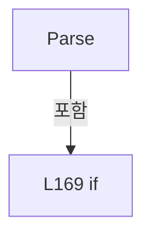

변경 전 점검: 입력/반환 타입, 위 호출자, 예외/취소 경로, 공유 상태와 저장·전송 소비자를 함께 확인합니다. 값의 단위나 물리 방향을 이름만으로 확정하지 않습니다.

### MethodDeclaration `Exceeds` · L175–175

[Drilling.Common/Correction/CAlignInterpolation.cs:175–175](https://github.com/kjuws10-rgb/A3Drilling/blob/334b3599651b2e8e0181fd4459bafaf3cddafff3/Drilling.Common/Correction/CAlignInterpolation.cs#L175-L175)

| 항목 | 실제 추출 값 |
| --- | --- |
| 서명 | bool Drilling.Common.Correction.CAlignOffsetTolerance.Exceeds(Drilling.Common.Recipe.ST_ALIGN_SHOT_OFFSET, double) |
| 접근/수식자 | Public / public, static |
| 반환/값 타입 | bool |
| 소속 타입 | NamedType:Drilling.Common.Correction.CAlignOffsetTolerance |

입력 계약:

| 이름 | 타입 | 전달 | 선택/기본값 |
| --- | --- | --- | --- |
| shot | Drilling.Common.Recipe.ST_ALIGN_SHOT_OFFSET | None | False /  |
| tolerance | double | None | False /  |

정적 호출자로 확인된 위치:

| 호출 파일/행 | 호출 표현식 | 런타임 분기 가능 |
| --- | --- | --- |
| [Drilling.Common/Correction/CAlignInterpolation.cs:176–176](https://github.com/kjuws10-rgb/A3Drilling/blob/334b3599651b2e8e0181fd4459bafaf3cddafff3/Drilling.Common/Correction/CAlignInterpolation.cs#L176-L176) | Exceeds | False |
| [Drilling.UI/Menu/Menus/CMenuCorrection.cs:2938–2938](https://github.com/kjuws10-rgb/A3Drilling/blob/334b3599651b2e8e0181fd4459bafaf3cddafff3/Drilling.UI/Menu/Menus/CMenuCorrection.cs#L2938-L2938) | CAlignOffsetTolerance.Exceeds | False |

호출하는 대상과 해석 범위:

| 원본 행 | 표현식 | 분석 상태 | 대상/소스 위치 |
| --- | --- | --- | --- |
| 175 | Math.Abs | resolved | double System.Math.Abs(double) |
| 175 | Math.Abs | resolved | double System.Math.Abs(double) |

본문의 실제 연산·분기·예외·반환 순서(원문 위치 순):

| 원본 행 | 종류 | 주석 해설 |
| --- | --- | --- |
| 175 | call | 함수·델리게이트 또는 객체 생성자를 호출합니다: Math.Abs(shot.X) |
| 175 | call | 함수·델리게이트 또는 객체 생성자를 호출합니다: Math.Abs(shot.Y) |

변경 전 점검: 입력/반환 타입, 위 호출자, 예외/취소 경로, 공유 상태와 저장·전송 소비자를 함께 확인합니다. 값의 단위나 물리 방향을 이름만으로 확정하지 않습니다.

### MethodDeclaration `Check` · L176–176

[Drilling.Common/Correction/CAlignInterpolation.cs:176–176](https://github.com/kjuws10-rgb/A3Drilling/blob/334b3599651b2e8e0181fd4459bafaf3cddafff3/Drilling.Common/Correction/CAlignInterpolation.cs#L176-L176)

| 항목 | 실제 추출 값 |
| --- | --- |
| 서명 | Drilling.Common.Correction.ST_ALIGN_OFFSET_TOLERANCE_CHECK Drilling.Common.Correction.CAlignOffsetTolerance.Check(double, System.Collections.Generic.IReadOnlyList<Drilling.Common.Recipe.ST_ALIGN_SHOT_OFFSET>) |
| 접근/수식자 | Public / public, static |
| 반환/값 타입 | Drilling.Common.Correction.ST_ALIGN_OFFSET_TOLERANCE_CHECK |
| 소속 타입 | NamedType:Drilling.Common.Correction.CAlignOffsetTolerance |

입력 계약:

| 이름 | 타입 | 전달 | 선택/기본값 |
| --- | --- | --- | --- |
| tolerance | double | None | False /  |
| offsets | System.Collections.Generic.IReadOnlyList<Drilling.Common.Recipe.ST_ALIGN_SHOT_OFFSET> | None | False /  |

정적 호출자로 확인된 위치:

| 호출 파일/행 | 호출 표현식 | 런타임 분기 가능 |
| --- | --- | --- |
| [Drilling.Common/Correction/CAlignInterpolation.cs:341–341](https://github.com/kjuws10-rgb/A3Drilling/blob/334b3599651b2e8e0181fd4459bafaf3cddafff3/Drilling.Common/Correction/CAlignInterpolation.cs#L341-L341) | CAlignOffsetTolerance.Check | False |
| [Drilling.UI/Menu/Menus/CMenuCorrection.cs:2928–2928](https://github.com/kjuws10-rgb/A3Drilling/blob/334b3599651b2e8e0181fd4459bafaf3cddafff3/Drilling.UI/Menu/Menus/CMenuCorrection.cs#L2928-L2928) | CAlignOffsetTolerance.Check | False |

호출하는 대상과 해석 범위:

| 원본 행 | 표현식 | 분석 상태 | 대상/소스 위치 |
| --- | --- | --- | --- |
| 176 | new | resolved | Drilling.Common.Correction.ST_ALIGN_OFFSET_TOLERANCE_CHECK.ST_ALIGN_OFFSET_TOLERANCE_CHECK(double, int, System.Collections.Generic.IReadOnlyList<Drilling.Common.Recipe.ST_ALIGN_SHOT_OFFSET>) · Drilling.Common/Correction/CAlignInterpolation.cs:156 |
| 176 | offsets.Where(shot => Exceeds(shot, tolerance)).ToArray | resolved | Drilling.Common.Recipe.ST_ALIGN_SHOT_OFFSET[] System.Collections.Generic.IEnumerable<Drilling.Common.Recipe.ST_ALIGN_SHOT_OFFSET>.ToArray<Drilling.Common.Recipe.ST_ALIGN_SHOT_OFFSET>() |
| 176 | offsets.Where | resolved | System.Collections.Generic.IEnumerable<Drilling.Common.Recipe.ST_ALIGN_SHOT_OFFSET> System.Collections.Generic.IEnumerable<Drilling.Common.Recipe.ST_ALIGN_SHOT_OFFSET>.Where<Drilling.Common.Recipe.ST_ALIGN_SHOT_OFFSET>(System.Func<Drilling.Common.Recipe.ST_ALIGN_SHOT_OFFSET, bool>) |
| 176 | Exceeds | resolved | bool Drilling.Common.Correction.CAlignOffsetTolerance.Exceeds(Drilling.Common.Recipe.ST_ALIGN_SHOT_OFFSET, double) · Drilling.Common/Correction/CAlignInterpolation.cs:175 |

본문의 실제 연산·분기·예외·반환 순서(원문 위치 순):

| 원본 행 | 종류 | 주석 해설 |
| --- | --- | --- |
| 176 | call | 함수·델리게이트 또는 객체 생성자를 호출합니다: new(tolerance, offsets.Count, offsets.Where(shot => Exceeds(shot, tolerance)).ToArray()) |
| 176 | call | 함수·델리게이트 또는 객체 생성자를 호출합니다: offsets.Where(shot => Exceeds(shot, tolerance)).ToArray() |
| 176 | call | 함수·델리게이트 또는 객체 생성자를 호출합니다: offsets.Where(shot => Exceeds(shot, tolerance)) |
| 176 | call | 함수·델리게이트 또는 객체 생성자를 호출합니다: Exceeds(shot, tolerance) |

변경 전 점검: 입력/반환 타입, 위 호출자, 예외/취소 경로, 공유 상태와 저장·전송 소비자를 함께 확인합니다. 값의 단위나 물리 방향을 이름만으로 확정하지 않습니다.

### MethodDeclaration `StagePositionKey` · L182–182

[Drilling.Common/Correction/CAlignInterpolation.cs:182–182](https://github.com/kjuws10-rgb/A3Drilling/blob/334b3599651b2e8e0181fd4459bafaf3cddafff3/Drilling.Common/Correction/CAlignInterpolation.cs#L182-L182)

| 항목 | 실제 추출 값 |
| --- | --- |
| 서명 | string Drilling.Common.Correction.CAlignKeyGeometry.StagePositionKey(int) |
| 접근/수식자 | Public / public, static |
| 반환/값 타입 | string |
| 소속 타입 | NamedType:Drilling.Common.Correction.CAlignKeyGeometry |

입력 계약:

| 이름 | 타입 | 전달 | 선택/기본값 |
| --- | --- | --- | --- |
| group | int | None | False /  |

정적 호출자로 확인된 위치:

| 호출 파일/행 | 호출 표현식 | 런타임 분기 가능 |
| --- | --- | --- |
| [Drilling.Common/Correction/CAlignInterpolation.cs:186–186](https://github.com/kjuws10-rgb/A3Drilling/blob/334b3599651b2e8e0181fd4459bafaf3cddafff3/Drilling.Common/Correction/CAlignInterpolation.cs#L186-L186) | StagePositionKey | False |
| [Drilling.UI/Menu/Menus/CCellPreviewDrawing.cs:67–67](https://github.com/kjuws10-rgb/A3Drilling/blob/334b3599651b2e8e0181fd4459bafaf3cddafff3/Drilling.UI/Menu/Menus/CCellPreviewDrawing.cs#L67-L67) | Drilling.Common.Correction.CAlignKeyGeometry.StagePositionKey | False |

호출하는 대상과 해석 범위:

| 원본 행 | 표현식 | 분석 상태 | 대상/소스 위치 |
| --- | --- | --- | --- |
| 182 | new ArgumentOutOfRangeException | resolved | System.ArgumentOutOfRangeException.ArgumentOutOfRangeException(string?) |
| 182 | nameof | unresolved | None |

본문의 실제 연산·분기·예외·반환 순서(원문 위치 순):

| 원본 행 | 종류 | 주석 해설 |
| --- | --- | --- |
| 182 | call | 함수·델리게이트 또는 객체 생성자를 호출합니다: new ArgumentOutOfRangeException(nameof(group)) |
| 182 | call | 함수·델리게이트 또는 객체 생성자를 호출합니다: nameof(group) |
| 182 | conditional-expression | 조건에 따라 결과식을 선택합니다: group is >= 0 and <= 2 ? $"DK{group}_STAGE_Y_POSITION" : throw new ArgumentOutOfRangeException(nameof(group)) |
| 182 | throw | 예외를 발생/전달합니다: throw new ArgumentOutOfRangeException(nameof(group)) |

변경 전 점검: 입력/반환 타입, 위 호출자, 예외/취소 경로, 공유 상태와 저장·전송 소비자를 함께 확인합니다. 값의 단위나 물리 방향을 이름만으로 확정하지 않습니다.

### MethodDeclaration `DesignY` · L183–183

[Drilling.Common/Correction/CAlignInterpolation.cs:183–183](https://github.com/kjuws10-rgb/A3Drilling/blob/334b3599651b2e8e0181fd4459bafaf3cddafff3/Drilling.Common/Correction/CAlignInterpolation.cs#L183-L183)

| 항목 | 실제 추출 값 |
| --- | --- |
| 서명 | double Drilling.Common.Correction.CAlignKeyGeometry.DesignY(double, double, double) |
| 접근/수식자 | Public / public, static |
| 반환/값 타입 | double |
| 소속 타입 | NamedType:Drilling.Common.Correction.CAlignKeyGeometry |

입력 계약:

| 이름 | 타입 | 전달 | 선택/기본값 |
| --- | --- | --- | --- |
| height | double | None | False /  |
| marginY | double | None | False /  |
| stageY | double | None | False /  |

정적 호출자로 확인된 위치:

| 호출 파일/행 | 호출 표현식 | 런타임 분기 가능 |
| --- | --- | --- |
| [Drilling.Common/Correction/CAlignInterpolation.cs:208–208](https://github.com/kjuws10-rgb/A3Drilling/blob/334b3599651b2e8e0181fd4459bafaf3cddafff3/Drilling.Common/Correction/CAlignInterpolation.cs#L208-L208) | DesignY | False |
| [Drilling.Common/Correction/CAlignInterpolation.cs:209–209](https://github.com/kjuws10-rgb/A3Drilling/blob/334b3599651b2e8e0181fd4459bafaf3cddafff3/Drilling.Common/Correction/CAlignInterpolation.cs#L209-L209) | DesignY | False |
| [Drilling.UI/Menu/Menus/CCellPreviewDrawing.cs:69–69](https://github.com/kjuws10-rgb/A3Drilling/blob/334b3599651b2e8e0181fd4459bafaf3cddafff3/Drilling.UI/Menu/Menus/CCellPreviewDrawing.cs#L69-L69) | Drilling.Common.Correction.CAlignKeyGeometry.DesignY | False |

호출하는 대상과 해석 범위:

| 원본 행 | 표현식 | 분석 상태 | 대상/소스 위치 |
| --- | --- | --- | --- |
| 183 | Math.Clamp | resolved | double System.Math.Clamp(double, double, double) |

본문의 실제 연산·분기·예외·반환 순서(원문 위치 순):

| 원본 행 | 종류 | 주석 해설 |
| --- | --- | --- |
| 183 | call | 함수·델리게이트 또는 객체 생성자를 호출합니다: Math.Clamp(marginY, 0, height / 2) |

변경 전 점검: 입력/반환 타입, 위 호출자, 예외/취소 경로, 공유 상태와 저장·전송 소비자를 함께 확인합니다. 값의 단위나 물리 방향을 이름만으로 확정하지 않습니다.

### MethodDeclaration `ReadStagePositions` · L184–190

[Drilling.Common/Correction/CAlignInterpolation.cs:184–190](https://github.com/kjuws10-rgb/A3Drilling/blob/334b3599651b2e8e0181fd4459bafaf3cddafff3/Drilling.Common/Correction/CAlignInterpolation.cs#L184-L190)

| 항목 | 실제 추출 값 |
| --- | --- |
| 서명 | double[] Drilling.Common.Correction.CAlignKeyGeometry.ReadStagePositions(System.Collections.Generic.IReadOnlyList<Drilling.Common.Managers.ST_SYSTEM_PARAMETER>) |
| 접근/수식자 | Public / public, static |
| 반환/값 타입 | double[] |
| 소속 타입 | NamedType:Drilling.Common.Correction.CAlignKeyGeometry |

입력 계약:

| 이름 | 타입 | 전달 | 선택/기본값 |
| --- | --- | --- | --- |
| settings | System.Collections.Generic.IReadOnlyList<Drilling.Common.Managers.ST_SYSTEM_PARAMETER> | None | False /  |

정적 호출자로 확인된 위치:

| 호출 파일/행 | 호출 표현식 | 런타임 분기 가능 |
| --- | --- | --- |
| [Drilling.Common/Correction/CAlignInterpolation.cs:285–285](https://github.com/kjuws10-rgb/A3Drilling/blob/334b3599651b2e8e0181fd4459bafaf3cddafff3/Drilling.Common/Correction/CAlignInterpolation.cs#L285-L285) | CAlignKeyGeometry.ReadStagePositions | False |
| [Drilling.UI/Menu/Menus/CMenuCorrection.cs:2991–2991](https://github.com/kjuws10-rgb/A3Drilling/blob/334b3599651b2e8e0181fd4459bafaf3cddafff3/Drilling.UI/Menu/Menus/CMenuCorrection.cs#L2991-L2991) | CAlignKeyGeometry.ReadStagePositions | False |

호출하는 대상과 해석 범위:

| 원본 행 | 표현식 | 분석 상태 | 대상/소스 위치 |
| --- | --- | --- | --- |
| 184 | Enumerable.Range(0, 3).Select(group => { var key = StagePositionKey(group); var text = settings.FirstOrDefault(p => p.Key.Equals(key, StringComparison.OrdinalIgnoreCase))?.Value; return double.TryParse(text, NumberStyles.Float, CultureInfo.InvariantCulture, out var value) && double.IsFinite(value) ? value : throw new InvalidOperationException($"Set… | resolved | double[] System.Collections.Generic.IEnumerable<double>.ToArray<double>() |
| 184 | Enumerable.Range(0, 3).Select | resolved | System.Collections.Generic.IEnumerable<double> System.Collections.Generic.IEnumerable<int>.Select<int, double>(System.Func<int, double>) |
| 184 | Enumerable.Range | resolved | System.Collections.Generic.IEnumerable<int> System.Linq.Enumerable.Range(int, int) |
| 186 | StagePositionKey | resolved | string Drilling.Common.Correction.CAlignKeyGeometry.StagePositionKey(int) · Drilling.Common/Correction/CAlignInterpolation.cs:182 |
| 187 | settings.FirstOrDefault | resolved | Drilling.Common.Managers.ST_SYSTEM_PARAMETER? System.Collections.Generic.IEnumerable<Drilling.Common.Managers.ST_SYSTEM_PARAMETER>.FirstOrDefault<Drilling.Common.Managers.ST_SYSTEM_PARAMETER>(System.Func<Drilling.Common.Managers.ST_SYSTEM_PARAMETER, bool>) |
| 187 | p.Key.Equals | resolved | bool string.Equals(string?, System.StringComparison) |
| 188 | double.TryParse | resolved | bool double.TryParse(string?, System.Globalization.NumberStyles, System.IFormatProvider?, out double) |
| 188 | double.IsFinite | resolved | bool double.IsFinite(double) |
| 189 | new InvalidOperationException | resolved | System.InvalidOperationException.InvalidOperationException(string?) |

본문의 실제 연산·분기·예외·반환 순서(원문 위치 순):

| 원본 행 | 종류 | 주석 해설 |
| --- | --- | --- |
| 184 | call | 함수·델리게이트 또는 객체 생성자를 호출합니다: Enumerable.Range(0, 3) |
| 184 | call | 함수·델리게이트 또는 객체 생성자를 호출합니다: Enumerable.Range(0, 3).Select(group => { var key = StagePositionKey(group); var text = settings.FirstOrDefault(p => p.Key.Equals(key, StringComparison.OrdinalIgnoreCase))?.Value; return double.TryParse(text, NumberStyles… |
| 184 | call | 함수·델리게이트 또는 객체 생성자를 호출합니다: Enumerable.Range(0, 3).Select(group => { var key = StagePositionKey(group); var text = settings.FirstOrDefault(p => p.Key.Equals(key, StringComparison.OrdinalIgnoreCase))?.Value; return double.TryParse(text, NumberStyles… |
| 186 | call | 함수·델리게이트 또는 객체 생성자를 호출합니다: StagePositionKey(group) |
| 186 | local-declaration | 지역 변수를 선언합니다: var key = StagePositionKey(group); |
| 186 | variable-initializer | 변수의 초기값을 지정합니다: key = StagePositionKey(group) |
| 187 | call | 함수·델리게이트 또는 객체 생성자를 호출합니다: settings.FirstOrDefault(p => p.Key.Equals(key, StringComparison.OrdinalIgnoreCase)) |
| 187 | call | 함수·델리게이트 또는 객체 생성자를 호출합니다: p.Key.Equals(key, StringComparison.OrdinalIgnoreCase) |
| 187 | local-declaration | 지역 변수를 선언합니다: var text = settings.FirstOrDefault(p => p.Key.Equals(key, StringComparison.OrdinalIgnoreCase))?.Value; |
| 187 | variable-initializer | 변수의 초기값을 지정합니다: text = settings.FirstOrDefault(p => p.Key.Equals(key, StringComparison.OrdinalIgnoreCase))?.Value |
| 188 | call | 함수·델리게이트 또는 객체 생성자를 호출합니다: double.TryParse(text, NumberStyles.Float, CultureInfo.InvariantCulture, out var value) |
| 188 | call | 함수·델리게이트 또는 객체 생성자를 호출합니다: double.IsFinite(value) |
| 188 | conditional-expression | 조건에 따라 결과식을 선택합니다: double.TryParse(text, NumberStyles.Float, CultureInfo.InvariantCulture, out var value) && double.IsFinite(value) ? value : throw new InvalidOperationException($"Setting > Motor > ALIGN의 {key}에 유효한 mm 값이 필요합니다.") |
| 188 | return | 호출자에게 값 또는 제어를 반환합니다: return double.TryParse(text, NumberStyles.Float, CultureInfo.InvariantCulture, out var value) && double.IsFinite(value) ? value : throw new InvalidOperationException($"Setting > Motor > ALIGN의 {key}에 유효한 mm 값이 필요합니다."); |
| 189 | call | 함수·델리게이트 또는 객체 생성자를 호출합니다: new InvalidOperationException($"Setting > Motor > ALIGN의 {key}에 유효한 mm 값이 필요합니다.") |
| 189 | throw | 예외를 발생/전달합니다: throw new InvalidOperationException($"Setting > Motor > ALIGN의 {key}에 유효한 mm 값이 필요합니다.") |

변경 전 점검: 입력/반환 타입, 위 호출자, 예외/취소 경로, 공유 상태와 저장·전송 소비자를 함께 확인합니다. 값의 단위나 물리 방향을 이름만으로 확정하지 않습니다.

### MethodDeclaration `Create` · L191–211

[Drilling.Common/Correction/CAlignInterpolation.cs:191–211](https://github.com/kjuws10-rgb/A3Drilling/blob/334b3599651b2e8e0181fd4459bafaf3cddafff3/Drilling.Common/Correction/CAlignInterpolation.cs#L191-L211)

| 항목 | 실제 추출 값 |
| --- | --- |
| 서명 | Drilling.Common.Correction.ST_ALIGN_INTERPOLATION_KEY[] Drilling.Common.Correction.CAlignKeyGeometry.Create(System.Collections.Generic.IReadOnlyDictionary<string, string>, System.Collections.Generic.IReadOnlyList<double>, Drilling.Common.Managers.ST_ALIGN_KEY_MARGINS) |
| 접근/수식자 | Public / public, static |
| 반환/값 타입 | Drilling.Common.Correction.ST_ALIGN_INTERPOLATION_KEY[] |
| 소속 타입 | NamedType:Drilling.Common.Correction.CAlignKeyGeometry |

입력 계약:

| 이름 | 타입 | 전달 | 선택/기본값 |
| --- | --- | --- | --- |
| recipe | System.Collections.Generic.IReadOnlyDictionary<string, string> | None | False /  |
| stageY | System.Collections.Generic.IReadOnlyList<double> | None | False /  |
| alignKeyMargins | Drilling.Common.Managers.ST_ALIGN_KEY_MARGINS | None | False /  |

정적 호출자로 확인된 위치:

| 호출 파일/행 | 호출 표현식 | 런타임 분기 가능 |
| --- | --- | --- |
| [Drilling.Common/Correction/CAlignInterpolation.cs:273–273](https://github.com/kjuws10-rgb/A3Drilling/blob/334b3599651b2e8e0181fd4459bafaf3cddafff3/Drilling.Common/Correction/CAlignInterpolation.cs#L273-L273) | CAlignKeyGeometry.Create | False |
| [Drilling.UI/Menu/Menus/CMenuCorrection.cs:5196–5196](https://github.com/kjuws10-rgb/A3Drilling/blob/334b3599651b2e8e0181fd4459bafaf3cddafff3/Drilling.UI/Menu/Menus/CMenuCorrection.cs#L5196-L5196) | CAlignKeyGeometry.Create | False |

호출하는 대상과 해석 범위:

| 원본 행 | 표현식 | 분석 상태 | 대상/소스 위치 |
| --- | --- | --- | --- |
| 199 | Read | resolved | double Read(string) · Drilling.Common/Correction/CAlignInterpolation.cs:197 |
| 199 | Read | resolved | double Read(string) · Drilling.Common/Correction/CAlignInterpolation.cs:197 |
| 200 | new InvalidOperationException | resolved | System.InvalidOperationException.InvalidOperationException(string?) |
| 201 | stageY.Any | resolved | bool System.Collections.Generic.IEnumerable<double>.Any<double>(System.Func<double, bool>) |
| 201 | double.IsFinite | resolved | bool double.IsFinite(double) |
| 202 | new InvalidOperationException | resolved | System.InvalidOperationException.InvalidOperationException(string?) |
| 203 | Math.Clamp | resolved | double System.Math.Clamp(double, double, double) |
| 204 | Math.Clamp | resolved | double System.Math.Clamp(double, double, double) |
| 205 | new[] { new ST_ALIGN_INTERPOLATION_KEY("AK1", mx, my), new("AK2", mx, height - my), new("AK3", width - mx, my), new("AK4", width - mx, height - my) } .Concat(Enumerable.Range(0, 3).SelectMany(group => new[] { new ST_ALIGN_INTERPOLATION_KEY($"DK{group * 2 + 1}", mx, DesignY(height, my, stageY[group])), new ST_ALIGN_INTERPOLATION_KEY($"DK{group * 2 +… | resolved | Drilling.Common.Correction.ST_ALIGN_INTERPOLATION_KEY[] System.Collections.Generic.IEnumerable<Drilling.Common.Correction.ST_ALIGN_INTERPOLATION_KEY>.ToArray<Drilling.Common.Correction.ST_ALIGN_INTERPOLATION_KEY>() |
| 205 | new[] { new ST_ALIGN_INTERPOLATION_KEY("AK1", mx, my), new("AK2", mx, height - my), new("AK3", width - mx, my), new("AK4", width - mx, height - my) } .Concat | resolved | System.Collections.Generic.IEnumerable<Drilling.Common.Correction.ST_ALIGN_INTERPOLATION_KEY> System.Collections.Generic.IEnumerable<Drilling.Common.Correction.ST_ALIGN_INTERPOLATION_KEY>.Concat<Drilling.Common.Correction.ST_ALIGN_INTERPOLATION_KEY>(System.Collections.Generic.IEnumerable<Drilling.Common.Correction.ST_ALIGN_INTERPOLATION_KEY>) |
| 205 | new ST_ALIGN_INTERPOLATION_KEY | resolved | Drilling.Common.Correction.ST_ALIGN_INTERPOLATION_KEY.ST_ALIGN_INTERPOLATION_KEY(string, double, double, double?, double?) · Drilling.Common/Correction/CAlignInterpolation.cs:116 |
| 205 | new | resolved | Drilling.Common.Correction.ST_ALIGN_INTERPOLATION_KEY.ST_ALIGN_INTERPOLATION_KEY(string, double, double, double?, double?) · Drilling.Common/Correction/CAlignInterpolation.cs:116 |
| 205 | new | resolved | Drilling.Common.Correction.ST_ALIGN_INTERPOLATION_KEY.ST_ALIGN_INTERPOLATION_KEY(string, double, double, double?, double?) · Drilling.Common/Correction/CAlignInterpolation.cs:116 |
| 205 | new | resolved | Drilling.Common.Correction.ST_ALIGN_INTERPOLATION_KEY.ST_ALIGN_INTERPOLATION_KEY(string, double, double, double?, double?) · Drilling.Common/Correction/CAlignInterpolation.cs:116 |
| 206 | Enumerable.Range(0, 3).SelectMany | resolved | System.Collections.Generic.IEnumerable<Drilling.Common.Correction.ST_ALIGN_INTERPOLATION_KEY> System.Collections.Generic.IEnumerable<int>.SelectMany<int, Drilling.Common.Correction.ST_ALIGN_INTERPOLATION_KEY>(System.Func<int, System.Collections.Generic.IEnumerable<Drilling.Common.Correction.ST_ALIGN_INTERPOLATION_KEY>>) |
| 206 | Enumerable.Range | resolved | System.Collections.Generic.IEnumerable<int> System.Linq.Enumerable.Range(int, int) |
| 208 | new ST_ALIGN_INTERPOLATION_KEY | resolved | Drilling.Common.Correction.ST_ALIGN_INTERPOLATION_KEY.ST_ALIGN_INTERPOLATION_KEY(string, double, double, double?, double?) · Drilling.Common/Correction/CAlignInterpolation.cs:116 |
| 208 | DesignY | resolved | double Drilling.Common.Correction.CAlignKeyGeometry.DesignY(double, double, double) · Drilling.Common/Correction/CAlignInterpolation.cs:183 |
| 209 | new ST_ALIGN_INTERPOLATION_KEY | resolved | Drilling.Common.Correction.ST_ALIGN_INTERPOLATION_KEY.ST_ALIGN_INTERPOLATION_KEY(string, double, double, double?, double?) · Drilling.Common/Correction/CAlignInterpolation.cs:116 |
| 209 | DesignY | resolved | double Drilling.Common.Correction.CAlignKeyGeometry.DesignY(double, double, double) · Drilling.Common/Correction/CAlignInterpolation.cs:183 |

본문의 실제 연산·분기·예외·반환 순서(원문 위치 순):

| 원본 행 | 종류 | 주석 해설 |
| --- | --- | --- |
| 199 | call | 함수·델리게이트 또는 객체 생성자를 호출합니다: Read("GLASS_SIZE_X") |
| 199 | call | 함수·델리게이트 또는 객체 생성자를 호출합니다: Read("GLASS_SIZE_Y") |
| 199 | local-declaration | 지역 변수를 선언합니다: var width = Read("GLASS_SIZE_X"); |
| 199 | local-declaration | 지역 변수를 선언합니다: var height = Read("GLASS_SIZE_Y"); |
| 199 | variable-initializer | 변수의 초기값을 지정합니다: width = Read("GLASS_SIZE_X") |
| 199 | variable-initializer | 변수의 초기값을 지정합니다: height = Read("GLASS_SIZE_Y") |
| 200 | call | 함수·델리게이트 또는 객체 생성자를 호출합니다: new InvalidOperationException("Glass Size는 0보다 커야 합니다.") |
| 200 | if | 조건에 따라 분기합니다: if (width <= 0 &#124;&#124; height <= 0) |
| 200 | throw | 예외를 발생/전달합니다: throw new InvalidOperationException("Glass Size는 0보다 커야 합니다."); |
| 201 | call | 함수·델리게이트 또는 객체 생성자를 호출합니다: stageY.Any(v => !double.IsFinite(v)) |
| 201 | call | 함수·델리게이트 또는 객체 생성자를 호출합니다: double.IsFinite(v) |
| 201 | if | 조건에 따라 분기합니다: if (stageY.Count != 3 &#124;&#124; stageY.Any(v => !double.IsFinite(v))) |
| 202 | call | 함수·델리게이트 또는 객체 생성자를 호출합니다: new InvalidOperationException("Setting > Motor > ALIGN의 DK0/1/2 Stage Y Position을 확인하세요.") |
| 202 | throw | 예외를 발생/전달합니다: throw new InvalidOperationException("Setting > Motor > ALIGN의 DK0/1/2 Stage Y Position을 확인하세요."); |
| 203 | call | 함수·델리게이트 또는 객체 생성자를 호출합니다: Math.Clamp(alignKeyMargins.X, 0, width / 2) |
| 203 | local-declaration | 지역 변수를 선언합니다: var mx = Math.Clamp(alignKeyMargins.X, 0, width / 2); |
| 203 | variable-initializer | 변수의 초기값을 지정합니다: mx = Math.Clamp(alignKeyMargins.X, 0, width / 2) |
| 204 | call | 함수·델리게이트 또는 객체 생성자를 호출합니다: Math.Clamp(alignKeyMargins.Y, 0, height / 2) |
| 204 | local-declaration | 지역 변수를 선언합니다: var my = Math.Clamp(alignKeyMargins.Y, 0, height / 2); |
| 204 | variable-initializer | 변수의 초기값을 지정합니다: my = Math.Clamp(alignKeyMargins.Y, 0, height / 2) |
| 205 | call | 함수·델리게이트 또는 객체 생성자를 호출합니다: new ST_ALIGN_INTERPOLATION_KEY("AK1", mx, my) |
| 205 | call | 함수·델리게이트 또는 객체 생성자를 호출합니다: new("AK2", mx, height - my) |
| 205 | call | 함수·델리게이트 또는 객체 생성자를 호출합니다: new("AK3", width - mx, my) |
| 205 | call | 함수·델리게이트 또는 객체 생성자를 호출합니다: new("AK4", width - mx, height - my) |
| 205 | call | 함수·델리게이트 또는 객체 생성자를 호출합니다: new[] { new ST_ALIGN_INTERPOLATION_KEY("AK1", mx, my), new("AK2", mx, height - my), new("AK3", width - mx, my), new("AK4", width - mx, height - my) } .Concat(Enumerable.Range(0, 3).SelectMany(group => new[] { new ST_ALIG… |
| 205 | call | 함수·델리게이트 또는 객체 생성자를 호출합니다: new[] { new ST_ALIGN_INTERPOLATION_KEY("AK1", mx, my), new("AK2", mx, height - my), new("AK3", width - mx, my), new("AK4", width - mx, height - my) } .Concat(Enumerable.Range(0, 3).SelectMany(group => new[] { new ST_ALIG… |
| 205 | return | 호출자에게 값 또는 제어를 반환합니다: return new[] { new ST_ALIGN_INTERPOLATION_KEY("AK1", mx, my), new("AK2", mx, height - my), new("AK3", width - mx, my), new("AK4", width - mx, height - my) } .Concat(Enumerable.Range(0, 3).SelectMany(group => new[] { new ST_ALIGN_I |
| 206 | call | 함수·델리게이트 또는 객체 생성자를 호출합니다: Enumerable.Range(0, 3) |
| 206 | call | 함수·델리게이트 또는 객체 생성자를 호출합니다: Enumerable.Range(0, 3).SelectMany(group => new[] { new ST_ALIGN_INTERPOLATION_KEY($"DK{group * 2 + 1}", mx, DesignY(height, my, stageY[group])), new ST_ALIGN_INTERPOLATION_KEY($"DK{group * 2 + 2}", width - mx, DesignY(he… |
| 208 | call | 함수·델리게이트 또는 객체 생성자를 호출합니다: new ST_ALIGN_INTERPOLATION_KEY($"DK{group * 2 + 1}", mx, DesignY(height, my, stageY[group])) |
| 208 | call | 함수·델리게이트 또는 객체 생성자를 호출합니다: DesignY(height, my, stageY[group]) |
| 209 | call | 함수·델리게이트 또는 객체 생성자를 호출합니다: new ST_ALIGN_INTERPOLATION_KEY($"DK{group * 2 + 2}", width - mx, DesignY(height, my, stageY[group])) |
| 209 | call | 함수·델리게이트 또는 객체 생성자를 호출합니다: DesignY(height, my, stageY[group]) |

제어 구문의 포함 구조(실제 실행 순서/CFG가 아닌 구문 탐색 그림):

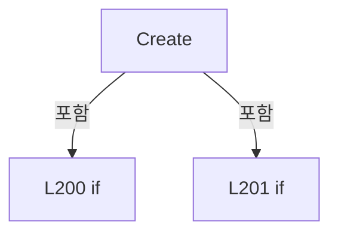

변경 전 점검: 입력/반환 타입, 위 호출자, 예외/취소 경로, 공유 상태와 저장·전송 소비자를 함께 확인합니다. 값의 단위나 물리 방향을 이름만으로 확정하지 않습니다.

### LocalFunctionStatement `Read` · L197–198

[Drilling.Common/Correction/CAlignInterpolation.cs:197–198](https://github.com/kjuws10-rgb/A3Drilling/blob/334b3599651b2e8e0181fd4459bafaf3cddafff3/Drilling.Common/Correction/CAlignInterpolation.cs#L197-L198)

| 항목 | 실제 추출 값 |
| --- | --- |
| 서명 | double Read(string) |
| 접근/수식자 | Private /  |
| 반환/값 타입 | double |
| 소속 타입 | NamedType:Drilling.Common.Correction.CAlignKeyGeometry |

입력 계약:

| 이름 | 타입 | 전달 | 선택/기본값 |
| --- | --- | --- | --- |
| key | string | None | False /  |

정적 호출자로 확인된 위치:

| 호출 파일/행 | 호출 표현식 | 런타임 분기 가능 |
| --- | --- | --- |
| [Drilling.Common/Correction/CAlignInterpolation.cs:199–199](https://github.com/kjuws10-rgb/A3Drilling/blob/334b3599651b2e8e0181fd4459bafaf3cddafff3/Drilling.Common/Correction/CAlignInterpolation.cs#L199-L199) | Read | False |
| [Drilling.Common/Correction/CAlignInterpolation.cs:199–199](https://github.com/kjuws10-rgb/A3Drilling/blob/334b3599651b2e8e0181fd4459bafaf3cddafff3/Drilling.Common/Correction/CAlignInterpolation.cs#L199-L199) | Read | False |

호출하는 대상과 해석 범위:

| 원본 행 | 표현식 | 분석 상태 | 대상/소스 위치 |
| --- | --- | --- | --- |
| 197 | recipe.TryGetValue | resolved · 동적 구현 선택 가능 | bool System.Collections.Generic.IReadOnlyDictionary<string, string>.TryGetValue(string, out string) |
| 197 | double.TryParse | resolved | bool double.TryParse(string?, System.Globalization.NumberStyles, System.IFormatProvider?, out double) |
| 197 | double.IsFinite | resolved | bool double.IsFinite(double) |
| 198 | new InvalidOperationException | resolved | System.InvalidOperationException.InvalidOperationException(string?) |

본문의 실제 연산·분기·예외·반환 순서(원문 위치 순):

| 원본 행 | 종류 | 주석 해설 |
| --- | --- | --- |
| 197 | call | 함수·델리게이트 또는 객체 생성자를 호출합니다: recipe.TryGetValue(key, out var text) |
| 197 | call | 함수·델리게이트 또는 객체 생성자를 호출합니다: double.TryParse(text, NumberStyles.Float, CultureInfo.InvariantCulture, out var v) |
| 197 | call | 함수·델리게이트 또는 객체 생성자를 호출합니다: double.IsFinite(v) |
| 197 | conditional-expression | 조건에 따라 결과식을 선택합니다: recipe.TryGetValue(key, out var text) && double.TryParse(text, NumberStyles.Float, CultureInfo.InvariantCulture, out var v) && double.IsFinite(v) ? v : throw new InvalidOperationException($"{key}의 유효한 숫자 값이 필요합니다.") |
| 198 | call | 함수·델리게이트 또는 객체 생성자를 호출합니다: new InvalidOperationException($"{key}의 유효한 숫자 값이 필요합니다.") |
| 198 | throw | 예외를 발생/전달합니다: throw new InvalidOperationException($"{key}의 유효한 숫자 값이 필요합니다.") |

변경 전 점검: 입력/반환 타입, 위 호출자, 예외/취소 경로, 공유 상태와 저장·전송 소비자를 함께 확인합니다. 값의 단위나 물리 방향을 이름만으로 확정하지 않습니다.

### PropertyDeclaration `StageYPositions` · L220–220

[Drilling.Common/Correction/CAlignInterpolation.cs:220–220](https://github.com/kjuws10-rgb/A3Drilling/blob/334b3599651b2e8e0181fd4459bafaf3cddafff3/Drilling.Common/Correction/CAlignInterpolation.cs#L220-L220)

| 항목 | 실제 추출 값 |
| --- | --- |
| 서명 | System.Collections.Generic.IReadOnlyList<double> Drilling.Common.Correction.ST_DISTORTION_MEASUREMENT_SNAPSHOT.StageYPositions |
| 접근/수식자 | Public / public |
| 반환/값 타입 | System.Collections.Generic.IReadOnlyList<double> |
| 소속 타입 | NamedType:Drilling.Common.Correction.ST_DISTORTION_MEASUREMENT_SNAPSHOT |

현재 부분 분석에서 직접 연결된 호출자는 없습니다. XAML/이벤트/인터페이스·델리게이트·외부 진입을 추가 확인해야 하며, 미사용으로 판정한 것이 아닙니다.

변경 전 점검: 입력/반환 타입, 위 호출자, 예외/취소 경로, 공유 상태와 저장·전송 소비자를 함께 확인합니다. 값의 단위나 물리 방향을 이름만으로 확정하지 않습니다.

### GetAccessorDeclaration `get_StageYPositions` · L220–220

[Drilling.Common/Correction/CAlignInterpolation.cs:220–220](https://github.com/kjuws10-rgb/A3Drilling/blob/334b3599651b2e8e0181fd4459bafaf3cddafff3/Drilling.Common/Correction/CAlignInterpolation.cs#L220-L220)

| 항목 | 실제 추출 값 |
| --- | --- |
| 서명 | System.Collections.Generic.IReadOnlyList<double> Drilling.Common.Correction.ST_DISTORTION_MEASUREMENT_SNAPSHOT.StageYPositions.get |
| 접근/수식자 | Public / get |
| 반환/값 타입 | System.Collections.Generic.IReadOnlyList<double> |
| 소속 타입 | NamedType:Drilling.Common.Correction.ST_DISTORTION_MEASUREMENT_SNAPSHOT |

현재 부분 분석에서 직접 연결된 호출자는 없습니다. XAML/이벤트/인터페이스·델리게이트·외부 진입을 추가 확인해야 하며, 미사용으로 판정한 것이 아닙니다.

변경 전 점검: 입력/반환 타입, 위 호출자, 예외/취소 경로, 공유 상태와 저장·전송 소비자를 함께 확인합니다. 값의 단위나 물리 방향을 이름만으로 확정하지 않습니다.

### InitAccessorDeclaration `set_StageYPositions` · L220–220

[Drilling.Common/Correction/CAlignInterpolation.cs:220–220](https://github.com/kjuws10-rgb/A3Drilling/blob/334b3599651b2e8e0181fd4459bafaf3cddafff3/Drilling.Common/Correction/CAlignInterpolation.cs#L220-L220)

| 항목 | 실제 추출 값 |
| --- | --- |
| 서명 | void Drilling.Common.Correction.ST_DISTORTION_MEASUREMENT_SNAPSHOT.StageYPositions.init |
| 접근/수식자 | Public / init |
| 반환/값 타입 | void |
| 소속 타입 | NamedType:Drilling.Common.Correction.ST_DISTORTION_MEASUREMENT_SNAPSHOT |

입력 계약:

| 이름 | 타입 | 전달 | 선택/기본값 |
| --- | --- | --- | --- |
| value | System.Collections.Generic.IReadOnlyList<double> | None | False /  |

현재 부분 분석에서 직접 연결된 호출자는 없습니다. XAML/이벤트/인터페이스·델리게이트·외부 진입을 추가 확인해야 하며, 미사용으로 판정한 것이 아닙니다.

변경 전 점검: 입력/반환 타입, 위 호출자, 예외/취소 경로, 공유 상태와 저장·전송 소비자를 함께 확인합니다. 값의 단위나 물리 방향을 이름만으로 확정하지 않습니다.

### PropertyDeclaration `AlignKeyMargins` · L221–223

[Drilling.Common/Correction/CAlignInterpolation.cs:221–223](https://github.com/kjuws10-rgb/A3Drilling/blob/334b3599651b2e8e0181fd4459bafaf3cddafff3/Drilling.Common/Correction/CAlignInterpolation.cs#L221-L223)

| 항목 | 실제 추출 값 |
| --- | --- |
| 서명 | Drilling.Common.Managers.ST_ALIGN_KEY_MARGINS Drilling.Common.Correction.ST_DISTORTION_MEASUREMENT_SNAPSHOT.AlignKeyMargins |
| 접근/수식자 | Public / public |
| 반환/값 타입 | Drilling.Common.Managers.ST_ALIGN_KEY_MARGINS |
| 소속 타입 | NamedType:Drilling.Common.Correction.ST_DISTORTION_MEASUREMENT_SNAPSHOT |

현재 부분 분석에서 직접 연결된 호출자는 없습니다. XAML/이벤트/인터페이스·델리게이트·외부 진입을 추가 확인해야 하며, 미사용으로 판정한 것이 아닙니다.

호출하는 대상과 해석 범위:

| 원본 행 | 표현식 | 분석 상태 | 대상/소스 위치 |
| --- | --- | --- | --- |
| 221 | new | resolved | Drilling.Common.Managers.ST_ALIGN_KEY_MARGINS.ST_ALIGN_KEY_MARGINS(double, double) · Drilling.Common/Managers/CAlignKeyMarginSettings.cs:6 |

본문의 실제 연산·분기·예외·반환 순서(원문 위치 순):

| 원본 행 | 종류 | 주석 해설 |
| --- | --- | --- |
| 221 | call | 함수·델리게이트 또는 객체 생성자를 호출합니다: new( CAlignKeyMarginSettings.DefaultMarginX, CAlignKeyMarginSettings.DefaultMarginY) |

변경 전 점검: 입력/반환 타입, 위 호출자, 예외/취소 경로, 공유 상태와 저장·전송 소비자를 함께 확인합니다. 값의 단위나 물리 방향을 이름만으로 확정하지 않습니다.

### GetAccessorDeclaration `get_AlignKeyMargins` · L221–221

[Drilling.Common/Correction/CAlignInterpolation.cs:221–221](https://github.com/kjuws10-rgb/A3Drilling/blob/334b3599651b2e8e0181fd4459bafaf3cddafff3/Drilling.Common/Correction/CAlignInterpolation.cs#L221-L221)

| 항목 | 실제 추출 값 |
| --- | --- |
| 서명 | Drilling.Common.Managers.ST_ALIGN_KEY_MARGINS Drilling.Common.Correction.ST_DISTORTION_MEASUREMENT_SNAPSHOT.AlignKeyMargins.get |
| 접근/수식자 | Public / get |
| 반환/값 타입 | Drilling.Common.Managers.ST_ALIGN_KEY_MARGINS |
| 소속 타입 | NamedType:Drilling.Common.Correction.ST_DISTORTION_MEASUREMENT_SNAPSHOT |

현재 부분 분석에서 직접 연결된 호출자는 없습니다. XAML/이벤트/인터페이스·델리게이트·외부 진입을 추가 확인해야 하며, 미사용으로 판정한 것이 아닙니다.

변경 전 점검: 입력/반환 타입, 위 호출자, 예외/취소 경로, 공유 상태와 저장·전송 소비자를 함께 확인합니다. 값의 단위나 물리 방향을 이름만으로 확정하지 않습니다.

### InitAccessorDeclaration `set_AlignKeyMargins` · L221–221

[Drilling.Common/Correction/CAlignInterpolation.cs:221–221](https://github.com/kjuws10-rgb/A3Drilling/blob/334b3599651b2e8e0181fd4459bafaf3cddafff3/Drilling.Common/Correction/CAlignInterpolation.cs#L221-L221)

| 항목 | 실제 추출 값 |
| --- | --- |
| 서명 | void Drilling.Common.Correction.ST_DISTORTION_MEASUREMENT_SNAPSHOT.AlignKeyMargins.init |
| 접근/수식자 | Public / init |
| 반환/값 타입 | void |
| 소속 타입 | NamedType:Drilling.Common.Correction.ST_DISTORTION_MEASUREMENT_SNAPSHOT |

입력 계약:

| 이름 | 타입 | 전달 | 선택/기본값 |
| --- | --- | --- | --- |
| value | Drilling.Common.Managers.ST_ALIGN_KEY_MARGINS | None | False /  |

현재 부분 분석에서 직접 연결된 호출자는 없습니다. XAML/이벤트/인터페이스·델리게이트·외부 진입을 추가 확인해야 하며, 미사용으로 판정한 것이 아닙니다.

변경 전 점검: 입력/반환 타입, 위 호출자, 예외/취소 경로, 공유 상태와 저장·전송 소비자를 함께 확인합니다. 값의 단위나 물리 방향을 이름만으로 확정하지 않습니다.

### FieldDeclaration `_io` · L230–230

[Drilling.Common/Correction/CAlignInterpolation.cs:230–230](https://github.com/kjuws10-rgb/A3Drilling/blob/334b3599651b2e8e0181fd4459bafaf3cddafff3/Drilling.Common/Correction/CAlignInterpolation.cs#L230-L230)

| 항목 | 실제 추출 값 |
| --- | --- |
| 서명 | Drilling.Common.Correction.CAlignWapageService Drilling.Common.Correction.CAlignDistortionCycle._io |
| 접근/수식자 | Private / private, readonly |
| 반환/값 타입 | Drilling.Common.Correction.CAlignWapageService |
| 소속 타입 | NamedType:Drilling.Common.Correction.CAlignDistortionCycle |

현재 부분 분석에서 직접 연결된 호출자는 없습니다. XAML/이벤트/인터페이스·델리게이트·외부 진입을 추가 확인해야 하며, 미사용으로 판정한 것이 아닙니다.

호출하는 대상과 해석 범위:

| 원본 행 | 표현식 | 분석 상태 | 대상/소스 위치 |
| --- | --- | --- | --- |
| 230 | new | resolved | Drilling.Common.Correction.CAlignWapageService.CAlignWapageService(Drilling.Common.Interface.CInterfaceManager?) · Drilling.Common/Correction/CAlignInterpolation.cs:398 |

본문의 실제 연산·분기·예외·반환 순서(원문 위치 순):

| 원본 행 | 종류 | 주석 해설 |
| --- | --- | --- |
| 230 | call | 함수·델리게이트 또는 객체 생성자를 호출합니다: new(interfaces) |
| 230 | variable-initializer | 변수의 초기값을 지정합니다: _io = new(interfaces) |

변경 전 점검: 입력/반환 타입, 위 호출자, 예외/취소 경로, 공유 상태와 저장·전송 소비자를 함께 확인합니다. 값의 단위나 물리 방향을 이름만으로 확정하지 않습니다.

### FieldDeclaration `_input` · L231–231

[Drilling.Common/Correction/CAlignInterpolation.cs:231–231](https://github.com/kjuws10-rgb/A3Drilling/blob/334b3599651b2e8e0181fd4459bafaf3cddafff3/Drilling.Common/Correction/CAlignInterpolation.cs#L231-L231)

| 항목 | 실제 추출 값 |
| --- | --- |
| 서명 | Drilling.Common.Station.ST_STAGE_PROCESS_REQUEST? Drilling.Common.Correction.CAlignDistortionCycle._input |
| 접근/수식자 | Private / private |
| 반환/값 타입 | Drilling.Common.Station.ST_STAGE_PROCESS_REQUEST? |
| 소속 타입 | NamedType:Drilling.Common.Correction.CAlignDistortionCycle |

현재 부분 분석에서 직접 연결된 호출자는 없습니다. XAML/이벤트/인터페이스·델리게이트·외부 진입을 추가 확인해야 하며, 미사용으로 판정한 것이 아닙니다.

변경 전 점검: 입력/반환 타입, 위 호출자, 예외/취소 경로, 공유 상태와 저장·전송 소비자를 함께 확인합니다. 값의 단위나 물리 방향을 이름만으로 확정하지 않습니다.

### FieldDeclaration `_pending` · L231–231

[Drilling.Common/Correction/CAlignInterpolation.cs:231–231](https://github.com/kjuws10-rgb/A3Drilling/blob/334b3599651b2e8e0181fd4459bafaf3cddafff3/Drilling.Common/Correction/CAlignInterpolation.cs#L231-L231)

| 항목 | 실제 추출 값 |
| --- | --- |
| 서명 | Drilling.Common.Station.ST_STAGE_PROCESS_REQUEST? Drilling.Common.Correction.CAlignDistortionCycle._pending |
| 접근/수식자 | Private / private |
| 반환/값 타입 | Drilling.Common.Station.ST_STAGE_PROCESS_REQUEST? |
| 소속 타입 | NamedType:Drilling.Common.Correction.CAlignDistortionCycle |

현재 부분 분석에서 직접 연결된 호출자는 없습니다. XAML/이벤트/인터페이스·델리게이트·외부 진입을 추가 확인해야 하며, 미사용으로 판정한 것이 아닙니다.

변경 전 점검: 입력/반환 타입, 위 호출자, 예외/취소 경로, 공유 상태와 저장·전송 소비자를 함께 확인합니다. 값의 단위나 물리 방향을 이름만으로 확정하지 않습니다.

### FieldDeclaration `_recipe` · L232–232

[Drilling.Common/Correction/CAlignInterpolation.cs:232–232](https://github.com/kjuws10-rgb/A3Drilling/blob/334b3599651b2e8e0181fd4459bafaf3cddafff3/Drilling.Common/Correction/CAlignInterpolation.cs#L232-L232)

| 항목 | 실제 추출 값 |
| --- | --- |
| 서명 | Drilling.Common.Managers.ST_RECIPE_DEFINITION? Drilling.Common.Correction.CAlignDistortionCycle._recipe |
| 접근/수식자 | Private / private |
| 반환/값 타입 | Drilling.Common.Managers.ST_RECIPE_DEFINITION? |
| 소속 타입 | NamedType:Drilling.Common.Correction.CAlignDistortionCycle |

현재 부분 분석에서 직접 연결된 호출자는 없습니다. XAML/이벤트/인터페이스·델리게이트·외부 진입을 추가 확인해야 하며, 미사용으로 판정한 것이 아닙니다.

변경 전 점검: 입력/반환 타입, 위 호출자, 예외/취소 경로, 공유 상태와 저장·전송 소비자를 함께 확인합니다. 값의 단위나 물리 방향을 이름만으로 확정하지 않습니다.

### FieldDeclaration `_groups` · L233–233

[Drilling.Common/Correction/CAlignInterpolation.cs:233–233](https://github.com/kjuws10-rgb/A3Drilling/blob/334b3599651b2e8e0181fd4459bafaf3cddafff3/Drilling.Common/Correction/CAlignInterpolation.cs#L233-L233)

| 항목 | 실제 추출 값 |
| --- | --- |
| 서명 | int[] Drilling.Common.Correction.CAlignDistortionCycle._groups |
| 접근/수식자 | Private / private |
| 반환/값 타입 | int[] |
| 소속 타입 | NamedType:Drilling.Common.Correction.CAlignDistortionCycle |

현재 부분 분석에서 직접 연결된 호출자는 없습니다. XAML/이벤트/인터페이스·델리게이트·외부 진입을 추가 확인해야 하며, 미사용으로 판정한 것이 아닙니다.

본문의 실제 연산·분기·예외·반환 순서(원문 위치 순):

| 원본 행 | 종류 | 주석 해설 |
| --- | --- | --- |
| 233 | variable-initializer | 변수의 초기값을 지정합니다: _groups = [] |

변경 전 점검: 입력/반환 타입, 위 호출자, 예외/취소 경로, 공유 상태와 저장·전송 소비자를 함께 확인합니다. 값의 단위나 물리 방향을 이름만으로 확정하지 않습니다.

### FieldDeclaration `_stageYPositions` · L234–234

[Drilling.Common/Correction/CAlignInterpolation.cs:234–234](https://github.com/kjuws10-rgb/A3Drilling/blob/334b3599651b2e8e0181fd4459bafaf3cddafff3/Drilling.Common/Correction/CAlignInterpolation.cs#L234-L234)

| 항목 | 실제 추출 값 |
| --- | --- |
| 서명 | System.Collections.Generic.IReadOnlyList<double> Drilling.Common.Correction.CAlignDistortionCycle._stageYPositions |
| 접근/수식자 | Private / private |
| 반환/값 타입 | System.Collections.Generic.IReadOnlyList<double> |
| 소속 타입 | NamedType:Drilling.Common.Correction.CAlignDistortionCycle |

현재 부분 분석에서 직접 연결된 호출자는 없습니다. XAML/이벤트/인터페이스·델리게이트·외부 진입을 추가 확인해야 하며, 미사용으로 판정한 것이 아닙니다.

본문의 실제 연산·분기·예외·반환 순서(원문 위치 순):

| 원본 행 | 종류 | 주석 해설 |
| --- | --- | --- |
| 234 | variable-initializer | 변수의 초기값을 지정합니다: _stageYPositions = [] |

변경 전 점검: 입력/반환 타입, 위 호출자, 예외/취소 경로, 공유 상태와 저장·전송 소비자를 함께 확인합니다. 값의 단위나 물리 방향을 이름만으로 확정하지 않습니다.

### FieldDeclaration `_alignKeyMargins` · L235–237

[Drilling.Common/Correction/CAlignInterpolation.cs:235–237](https://github.com/kjuws10-rgb/A3Drilling/blob/334b3599651b2e8e0181fd4459bafaf3cddafff3/Drilling.Common/Correction/CAlignInterpolation.cs#L235-L237)

| 항목 | 실제 추출 값 |
| --- | --- |
| 서명 | Drilling.Common.Managers.ST_ALIGN_KEY_MARGINS Drilling.Common.Correction.CAlignDistortionCycle._alignKeyMargins |
| 접근/수식자 | Private / private |
| 반환/값 타입 | Drilling.Common.Managers.ST_ALIGN_KEY_MARGINS |
| 소속 타입 | NamedType:Drilling.Common.Correction.CAlignDistortionCycle |

현재 부분 분석에서 직접 연결된 호출자는 없습니다. XAML/이벤트/인터페이스·델리게이트·외부 진입을 추가 확인해야 하며, 미사용으로 판정한 것이 아닙니다.

호출하는 대상과 해석 범위:

| 원본 행 | 표현식 | 분석 상태 | 대상/소스 위치 |
| --- | --- | --- | --- |
| 235 | new | resolved | Drilling.Common.Managers.ST_ALIGN_KEY_MARGINS.ST_ALIGN_KEY_MARGINS(double, double) · Drilling.Common/Managers/CAlignKeyMarginSettings.cs:6 |

본문의 실제 연산·분기·예외·반환 순서(원문 위치 순):

| 원본 행 | 종류 | 주석 해설 |
| --- | --- | --- |
| 235 | call | 함수·델리게이트 또는 객체 생성자를 호출합니다: new( CAlignKeyMarginSettings.DefaultMarginX, CAlignKeyMarginSettings.DefaultMarginY) |
| 235 | variable-initializer | 변수의 초기값을 지정합니다: _alignKeyMargins = new( CAlignKeyMarginSettings.DefaultMarginX, CAlignKeyMarginSettings.DefaultMarginY) |

변경 전 점검: 입력/반환 타입, 위 호출자, 예외/취소 경로, 공유 상태와 저장·전송 소비자를 함께 확인합니다. 값의 단위나 물리 방향을 이름만으로 확정하지 않습니다.

### FieldDeclaration `_tolerance` · L238–238

[Drilling.Common/Correction/CAlignInterpolation.cs:238–238](https://github.com/kjuws10-rgb/A3Drilling/blob/334b3599651b2e8e0181fd4459bafaf3cddafff3/Drilling.Common/Correction/CAlignInterpolation.cs#L238-L238)

| 항목 | 실제 추출 값 |
| --- | --- |
| 서명 | double Drilling.Common.Correction.CAlignDistortionCycle._tolerance |
| 접근/수식자 | Private / private |
| 반환/값 타입 | double |
| 소속 타입 | NamedType:Drilling.Common.Correction.CAlignDistortionCycle |

현재 부분 분석에서 직접 연결된 호출자는 없습니다. XAML/이벤트/인터페이스·델리게이트·외부 진입을 추가 확인해야 하며, 미사용으로 판정한 것이 아닙니다.

변경 전 점검: 입력/반환 타입, 위 호출자, 예외/취소 경로, 공유 상태와 저장·전송 소비자를 함께 확인합니다. 값의 단위나 물리 방향을 이름만으로 확정하지 않습니다.

### FieldDeclaration `_results` · L239–239

[Drilling.Common/Correction/CAlignInterpolation.cs:239–239](https://github.com/kjuws10-rgb/A3Drilling/blob/334b3599651b2e8e0181fd4459bafaf3cddafff3/Drilling.Common/Correction/CAlignInterpolation.cs#L239-L239)

| 항목 | 실제 추출 값 |
| --- | --- |
| 서명 | System.Collections.Generic.IReadOnlyDictionary<string, double>? Drilling.Common.Correction.CAlignDistortionCycle._results |
| 접근/수식자 | Private / private |
| 반환/값 타입 | System.Collections.Generic.IReadOnlyDictionary<string, double>? |
| 소속 타입 | NamedType:Drilling.Common.Correction.CAlignDistortionCycle |

현재 부분 분석에서 직접 연결된 호출자는 없습니다. XAML/이벤트/인터페이스·델리게이트·외부 진입을 추가 확인해야 하며, 미사용으로 판정한 것이 아닙니다.

변경 전 점검: 입력/반환 타입, 위 호출자, 예외/취소 경로, 공유 상태와 저장·전송 소비자를 함께 확인합니다. 값의 단위나 물리 방향을 이름만으로 확정하지 않습니다.

### FieldDeclaration `_model` · L240–240

[Drilling.Common/Correction/CAlignInterpolation.cs:240–240](https://github.com/kjuws10-rgb/A3Drilling/blob/334b3599651b2e8e0181fd4459bafaf3cddafff3/Drilling.Common/Correction/CAlignInterpolation.cs#L240-L240)

| 항목 | 실제 추출 값 |
| --- | --- |
| 서명 | Drilling.Common.Correction.CAlignInterpolation? Drilling.Common.Correction.CAlignDistortionCycle._model |
| 접근/수식자 | Private / private |
| 반환/값 타입 | Drilling.Common.Correction.CAlignInterpolation? |
| 소속 타입 | NamedType:Drilling.Common.Correction.CAlignDistortionCycle |

현재 부분 분석에서 직접 연결된 호출자는 없습니다. XAML/이벤트/인터페이스·델리게이트·외부 진입을 추가 확인해야 하며, 미사용으로 판정한 것이 아닙니다.

변경 전 점검: 입력/반환 타입, 위 호출자, 예외/취소 경로, 공유 상태와 저장·전송 소비자를 함께 확인합니다. 값의 단위나 물리 방향을 이름만으로 확정하지 않습니다.

### FieldDeclaration `_offsets` · L241–241

[Drilling.Common/Correction/CAlignInterpolation.cs:241–241](https://github.com/kjuws10-rgb/A3Drilling/blob/334b3599651b2e8e0181fd4459bafaf3cddafff3/Drilling.Common/Correction/CAlignInterpolation.cs#L241-L241)

| 항목 | 실제 추출 값 |
| --- | --- |
| 서명 | System.Collections.Generic.IReadOnlyList<Drilling.Common.Recipe.ST_ALIGN_SHOT_OFFSET>? Drilling.Common.Correction.CAlignDistortionCycle._offsets |
| 접근/수식자 | Private / private |
| 반환/값 타입 | System.Collections.Generic.IReadOnlyList<Drilling.Common.Recipe.ST_ALIGN_SHOT_OFFSET>? |
| 소속 타입 | NamedType:Drilling.Common.Correction.CAlignDistortionCycle |

현재 부분 분석에서 직접 연결된 호출자는 없습니다. XAML/이벤트/인터페이스·델리게이트·외부 진입을 추가 확인해야 하며, 미사용으로 판정한 것이 아닙니다.

변경 전 점검: 입력/반환 타입, 위 호출자, 예외/취소 경로, 공유 상태와 저장·전송 소비자를 함께 확인합니다. 값의 단위나 물리 방향을 이름만으로 확정하지 않습니다.

### FieldDeclaration `_loadedAt` · L242–242

[Drilling.Common/Correction/CAlignInterpolation.cs:242–242](https://github.com/kjuws10-rgb/A3Drilling/blob/334b3599651b2e8e0181fd4459bafaf3cddafff3/Drilling.Common/Correction/CAlignInterpolation.cs#L242-L242)

| 항목 | 실제 추출 값 |
| --- | --- |
| 서명 | System.DateTimeOffset? Drilling.Common.Correction.CAlignDistortionCycle._loadedAt |
| 접근/수식자 | Private / private |
| 반환/값 타입 | System.DateTimeOffset? |
| 소속 타입 | NamedType:Drilling.Common.Correction.CAlignDistortionCycle |

현재 부분 분석에서 직접 연결된 호출자는 없습니다. XAML/이벤트/인터페이스·델리게이트·외부 진입을 추가 확인해야 하며, 미사용으로 판정한 것이 아닙니다.

변경 전 점검: 입력/반환 타입, 위 호출자, 예외/취소 경로, 공유 상태와 저장·전송 소비자를 함께 확인합니다. 값의 단위나 물리 방향을 이름만으로 확정하지 않습니다.

### FieldDeclaration `_saved` · L243–243

[Drilling.Common/Correction/CAlignInterpolation.cs:243–243](https://github.com/kjuws10-rgb/A3Drilling/blob/334b3599651b2e8e0181fd4459bafaf3cddafff3/Drilling.Common/Correction/CAlignInterpolation.cs#L243-L243)

| 항목 | 실제 추출 값 |
| --- | --- |
| 서명 | bool Drilling.Common.Correction.CAlignDistortionCycle._saved |
| 접근/수식자 | Private / private |
| 반환/값 타입 | bool |
| 소속 타입 | NamedType:Drilling.Common.Correction.CAlignDistortionCycle |

현재 부분 분석에서 직접 연결된 호출자는 없습니다. XAML/이벤트/인터페이스·델리게이트·외부 진입을 추가 확인해야 하며, 미사용으로 판정한 것이 아닙니다.

변경 전 점검: 입력/반환 타입, 위 호출자, 예외/취소 경로, 공유 상태와 저장·전송 소비자를 함께 확인합니다. 값의 단위나 물리 방향을 이름만으로 확정하지 않습니다.

### FieldDeclaration `_snapshot` · L244–244

[Drilling.Common/Correction/CAlignInterpolation.cs:244–244](https://github.com/kjuws10-rgb/A3Drilling/blob/334b3599651b2e8e0181fd4459bafaf3cddafff3/Drilling.Common/Correction/CAlignInterpolation.cs#L244-L244)

| 항목 | 실제 추출 값 |
| --- | --- |
| 서명 | Drilling.Common.Correction.ST_DISTORTION_MEASUREMENT_SNAPSHOT? Drilling.Common.Correction.CAlignDistortionCycle._snapshot |
| 접근/수식자 | Private / private |
| 반환/값 타입 | Drilling.Common.Correction.ST_DISTORTION_MEASUREMENT_SNAPSHOT? |
| 소속 타입 | NamedType:Drilling.Common.Correction.CAlignDistortionCycle |

현재 부분 분석에서 직접 연결된 호출자는 없습니다. XAML/이벤트/인터페이스·델리게이트·외부 진입을 추가 확인해야 하며, 미사용으로 판정한 것이 아닙니다.

변경 전 점검: 입력/반환 타입, 위 호출자, 예외/취소 경로, 공유 상태와 저장·전송 소비자를 함께 확인합니다. 값의 단위나 물리 방향을 이름만으로 확정하지 않습니다.

### PropertyDeclaration `Snapshot` · L245–245

[Drilling.Common/Correction/CAlignInterpolation.cs:245–245](https://github.com/kjuws10-rgb/A3Drilling/blob/334b3599651b2e8e0181fd4459bafaf3cddafff3/Drilling.Common/Correction/CAlignInterpolation.cs#L245-L245)

| 항목 | 실제 추출 값 |
| --- | --- |
| 서명 | Drilling.Common.Correction.ST_DISTORTION_MEASUREMENT_SNAPSHOT? Drilling.Common.Correction.CAlignDistortionCycle.Snapshot |
| 접근/수식자 | Public / public |
| 반환/값 타입 | Drilling.Common.Correction.ST_DISTORTION_MEASUREMENT_SNAPSHOT? |
| 소속 타입 | NamedType:Drilling.Common.Correction.CAlignDistortionCycle |

현재 부분 분석에서 직접 연결된 호출자는 없습니다. XAML/이벤트/인터페이스·델리게이트·외부 진입을 추가 확인해야 하며, 미사용으로 판정한 것이 아닙니다.

호출하는 대상과 해석 범위:

| 원본 행 | 표현식 | 분석 상태 | 대상/소스 위치 |
| --- | --- | --- | --- |
| 245 | Volatile.Read | resolved | Drilling.Common.Correction.ST_DISTORTION_MEASUREMENT_SNAPSHOT? System.Threading.Volatile.Read<Drilling.Common.Correction.ST_DISTORTION_MEASUREMENT_SNAPSHOT?>(ref readonly Drilling.Common.Correction.ST_DISTORTION_MEASUREMENT_SNAPSHOT?) |

본문의 실제 연산·분기·예외·반환 순서(원문 위치 순):

| 원본 행 | 종류 | 주석 해설 |
| --- | --- | --- |
| 245 | call | 함수·델리게이트 또는 객체 생성자를 호출합니다: Volatile.Read(ref _snapshot) |

변경 전 점검: 입력/반환 타입, 위 호출자, 예외/취소 경로, 공유 상태와 저장·전송 소비자를 함께 확인합니다. 값의 단위나 물리 방향을 이름만으로 확정하지 않습니다.

### PropertyDeclaration `GlassId` · L246–246

[Drilling.Common/Correction/CAlignInterpolation.cs:246–246](https://github.com/kjuws10-rgb/A3Drilling/blob/334b3599651b2e8e0181fd4459bafaf3cddafff3/Drilling.Common/Correction/CAlignInterpolation.cs#L246-L246)

| 항목 | 실제 추출 값 |
| --- | --- |
| 서명 | string Drilling.Common.Correction.CAlignDistortionCycle.GlassId |
| 접근/수식자 | Public / public |
| 반환/값 타입 | string |
| 소속 타입 | NamedType:Drilling.Common.Correction.CAlignDistortionCycle |

현재 부분 분석에서 직접 연결된 호출자는 없습니다. XAML/이벤트/인터페이스·델리게이트·외부 진입을 추가 확인해야 하며, 미사용으로 판정한 것이 아닙니다.

변경 전 점검: 입력/반환 타입, 위 호출자, 예외/취소 경로, 공유 상태와 저장·전송 소비자를 함께 확인합니다. 값의 단위나 물리 방향을 이름만으로 확정하지 않습니다.

### MethodDeclaration `ResultId` · L247–258

[Drilling.Common/Correction/CAlignInterpolation.cs:247–258](https://github.com/kjuws10-rgb/A3Drilling/blob/334b3599651b2e8e0181fd4459bafaf3cddafff3/Drilling.Common/Correction/CAlignInterpolation.cs#L247-L258)

| 항목 | 실제 추출 값 |
| --- | --- |
| 서명 | string Drilling.Common.Correction.CAlignDistortionCycle.ResultId(string) |
| 접근/수식자 | Public / public, static |
| 반환/값 타입 | string |
| 소속 타입 | NamedType:Drilling.Common.Correction.CAlignDistortionCycle |

입력 계약:

| 이름 | 타입 | 전달 | 선택/기본값 |
| --- | --- | --- | --- |
| parameterKey | string | None | False /  |

정적 호출자로 확인된 위치:

| 호출 파일/행 | 호출 표현식 | 런타임 분기 가능 |
| --- | --- | --- |
| [Drilling.Common/Correction/CAlignInterpolation.cs:327–327](https://github.com/kjuws10-rgb/A3Drilling/blob/334b3599651b2e8e0181fd4459bafaf3cddafff3/Drilling.Common/Correction/CAlignInterpolation.cs#L327-L327) | ResultId | False |
| [Drilling.Common/Correction/CAlignInterpolation.cs:332–332](https://github.com/kjuws10-rgb/A3Drilling/blob/334b3599651b2e8e0181fd4459bafaf3cddafff3/Drilling.Common/Correction/CAlignInterpolation.cs#L332-L332) | ResultId | False |
| [Drilling.UI/Menu/Menus/CMenuCorrection.cs:5730–5730](https://github.com/kjuws10-rgb/A3Drilling/blob/334b3599651b2e8e0181fd4459bafaf3cddafff3/Drilling.UI/Menu/Menus/CMenuCorrection.cs#L5730-L5730) | CAlignDistortionCycle.ResultId | False |
| [Drilling.UI/Popup/CMelsecStageSimulationDialog.xaml.cs:77–77](https://github.com/kjuws10-rgb/A3Drilling/blob/334b3599651b2e8e0181fd4459bafaf3cddafff3/Drilling.UI/Popup/CMelsecStageSimulationDialog.xaml.cs#L77-L77) | CAlignDistortionCycle.ResultId | False |

호출하는 대상과 해석 범위:

| 원본 행 | 표현식 | 분석 상태 | 대상/소스 위치 |
| --- | --- | --- | --- |
| 249 | parameterKey.Split | resolved | string[] string.Split(char, System.StringSplitOptions) |
| 251 | int.TryParse | resolved | bool int.TryParse(System.ReadOnlySpan<char>, System.Globalization.NumberStyles, System.IFormatProvider?, out int) |
| 251 | parts[1].AsSpan | resolved | System.ReadOnlySpan<char> string?.AsSpan(int) |
| 252 | new InvalidOperationException | resolved | System.InvalidOperationException.InvalidOperationException(string?) |
| 253 | parts[1].StartsWith | resolved | bool string.StartsWith(string, System.StringComparison) |
| 255 | parts[1].StartsWith | resolved | bool string.StartsWith(string, System.StringComparison) |
| 257 | new InvalidOperationException | resolved | System.InvalidOperationException.InvalidOperationException(string?) |

본문의 실제 연산·분기·예외·반환 순서(원문 위치 순):

| 원본 행 | 종류 | 주석 해설 |
| --- | --- | --- |
| 249 | call | 함수·델리게이트 또는 객체 생성자를 호출합니다: parameterKey.Split('_') |
| 249 | local-declaration | 지역 변수를 선언합니다: var parts = parameterKey.Split('_'); |
| 249 | variable-initializer | 변수의 초기값을 지정합니다: parts = parameterKey.Split('_') |
| 250 | if | 조건에 따라 분기합니다: if (parts.Length != 3 &#124;&#124; parts[0] != "ALIGNBASE" &#124;&#124; parts[2] is not ("X" or "Y") &#124;&#124; parts[1].Length < 3 &#124;&#124; !int.TryParse(parts[1].AsSpan(2), NumberStyles.None, CultureInfo.InvariantCulture, out var number)) |
| 251 | call | 함수·델리게이트 또는 객체 생성자를 호출합니다: int.TryParse(parts[1].AsSpan(2), NumberStyles.None, CultureInfo.InvariantCulture, out var number) |
| 251 | call | 함수·델리게이트 또는 객체 생성자를 호출합니다: parts[1].AsSpan(2) |
| 252 | call | 함수·델리게이트 또는 객체 생성자를 호출합니다: new InvalidOperationException($"알 수 없는 Align LastLoad 항목: {parameterKey}") |
| 252 | throw | 예외를 발생/전달합니다: throw new InvalidOperationException($"알 수 없는 Align LastLoad 항목: {parameterKey}"); |
| 253 | call | 함수·델리게이트 또는 객체 생성자를 호출합니다: parts[1].StartsWith("AK", StringComparison.Ordinal) |
| 253 | if | 조건에 따라 분기합니다: if (parts[1].StartsWith("AK", StringComparison.Ordinal) && number is >= 1 and <= 4) |
| 254 | return | 호출자에게 값 또는 제어를 반환합니다: return $"DISTORTION_POS0_CAM{number}{parts[2]}"; |
| 255 | call | 함수·델리게이트 또는 객체 생성자를 호출합니다: parts[1].StartsWith("DK", StringComparison.Ordinal) |
| 255 | if | 조건에 따라 분기합니다: if (parts[1].StartsWith("DK", StringComparison.Ordinal) && number is >= 1 and <= 6) |
| 256 | conditional-expression | 조건에 따라 결과식을 선택합니다: number % 2 == 1 ? 2 : 4 |
| 256 | return | 호출자에게 값 또는 제어를 반환합니다: return $"DISTORTION_POS{(number - 1) / 2 + 1}_CAM{(number % 2 == 1 ? 2 : 4)}{parts[2]}"; |
| 257 | call | 함수·델리게이트 또는 객체 생성자를 호출합니다: new InvalidOperationException($"알 수 없는 Align LastLoad 항목: {parameterKey}") |
| 257 | throw | 예외를 발생/전달합니다: throw new InvalidOperationException($"알 수 없는 Align LastLoad 항목: {parameterKey}"); |

제어 구문의 포함 구조(실제 실행 순서/CFG가 아닌 구문 탐색 그림):

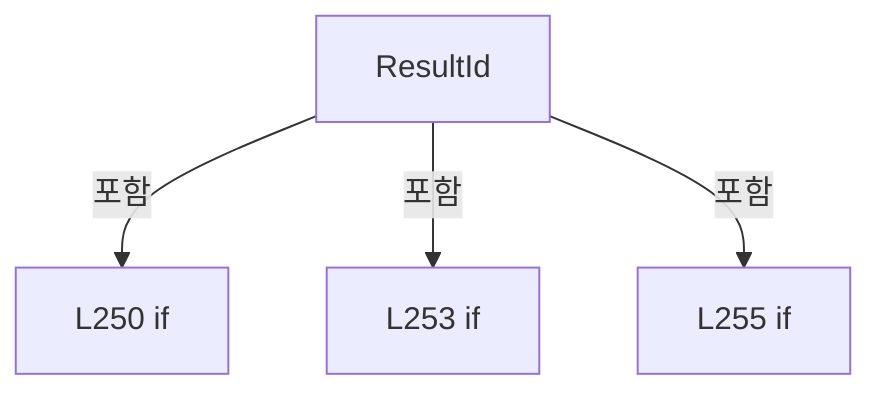

변경 전 점검: 입력/반환 타입, 위 호출자, 예외/취소 경로, 공유 상태와 저장·전송 소비자를 함께 확인합니다. 값의 단위나 물리 방향을 이름만으로 확정하지 않습니다.

### MethodDeclaration `Names` · L259–260

[Drilling.Common/Correction/CAlignInterpolation.cs:259–260](https://github.com/kjuws10-rgb/A3Drilling/blob/334b3599651b2e8e0181fd4459bafaf3cddafff3/Drilling.Common/Correction/CAlignInterpolation.cs#L259-L260)

| 항목 | 실제 추출 값 |
| --- | --- |
| 서명 | string[] Drilling.Common.Correction.CAlignDistortionCycle.Names(System.Collections.Generic.IReadOnlyCollection<int>) |
| 접근/수식자 | Private / private, static |
| 반환/값 타입 | string[] |
| 소속 타입 | NamedType:Drilling.Common.Correction.CAlignDistortionCycle |

입력 계약:

| 이름 | 타입 | 전달 | 선택/기본값 |
| --- | --- | --- | --- |
| groups | System.Collections.Generic.IReadOnlyCollection<int> | None | False /  |

정적 호출자로 확인된 위치:

| 호출 파일/행 | 호출 표현식 | 런타임 분기 가능 |
| --- | --- | --- |
| [Drilling.Common/Correction/CAlignInterpolation.cs:261–261](https://github.com/kjuws10-rgb/A3Drilling/blob/334b3599651b2e8e0181fd4459bafaf3cddafff3/Drilling.Common/Correction/CAlignInterpolation.cs#L261-L261) | Names | False |
| [Drilling.Common/Correction/CAlignInterpolation.cs:294–294](https://github.com/kjuws10-rgb/A3Drilling/blob/334b3599651b2e8e0181fd4459bafaf3cddafff3/Drilling.Common/Correction/CAlignInterpolation.cs#L294-L294) | Names | False |
| [Drilling.Common/Correction/CAlignInterpolation.cs:338–338](https://github.com/kjuws10-rgb/A3Drilling/blob/334b3599651b2e8e0181fd4459bafaf3cddafff3/Drilling.Common/Correction/CAlignInterpolation.cs#L338-L338) | Names | False |
| [Drilling.Common/Correction/CAlignInterpolation.cs:353–353](https://github.com/kjuws10-rgb/A3Drilling/blob/334b3599651b2e8e0181fd4459bafaf3cddafff3/Drilling.Common/Correction/CAlignInterpolation.cs#L353-L353) | Names | False |

호출하는 대상과 해석 범위:

| 원본 행 | 표현식 | 분석 상태 | 대상/소스 위치 |
| --- | --- | --- | --- |
| 259 | Enumerable.Range(1, 4).Select(n => $"AK{n}") .Concat(groups.Order().SelectMany(group => new[] { $"DK{group * 2 + 1}", $"DK{group * 2 + 2}" })).ToArray | resolved | string[] System.Collections.Generic.IEnumerable<string>.ToArray<string>() |
| 259 | Enumerable.Range(1, 4).Select(n => $"AK{n}") .Concat | resolved | System.Collections.Generic.IEnumerable<string> System.Collections.Generic.IEnumerable<string>.Concat<string>(System.Collections.Generic.IEnumerable<string>) |
| 259 | Enumerable.Range(1, 4).Select | resolved | System.Collections.Generic.IEnumerable<string> System.Collections.Generic.IEnumerable<int>.Select<int, string>(System.Func<int, string>) |
| 259 | Enumerable.Range | resolved | System.Collections.Generic.IEnumerable<int> System.Linq.Enumerable.Range(int, int) |
| 260 | groups.Order().SelectMany | resolved | System.Collections.Generic.IEnumerable<string> System.Collections.Generic.IEnumerable<int>.SelectMany<int, string>(System.Func<int, System.Collections.Generic.IEnumerable<string>>) |
| 260 | groups.Order | resolved | System.Linq.IOrderedEnumerable<int> System.Collections.Generic.IEnumerable<int>.Order<int>() |

본문의 실제 연산·분기·예외·반환 순서(원문 위치 순):

| 원본 행 | 종류 | 주석 해설 |
| --- | --- | --- |
| 259 | call | 함수·델리게이트 또는 객체 생성자를 호출합니다: Enumerable.Range(1, 4).Select(n => $"AK{n}") |
| 259 | call | 함수·델리게이트 또는 객체 생성자를 호출합니다: Enumerable.Range(1, 4) |
| 259 | call | 함수·델리게이트 또는 객체 생성자를 호출합니다: Enumerable.Range(1, 4).Select(n => $"AK{n}") .Concat(groups.Order().SelectMany(group => new[] { $"DK{group * 2 + 1}", $"DK{group * 2 + 2}" })).ToArray() |
| 259 | call | 함수·델리게이트 또는 객체 생성자를 호출합니다: Enumerable.Range(1, 4).Select(n => $"AK{n}") .Concat(groups.Order().SelectMany(group => new[] { $"DK{group * 2 + 1}", $"DK{group * 2 + 2}" })) |
| 260 | call | 함수·델리게이트 또는 객체 생성자를 호출합니다: groups.Order().SelectMany(group => new[] { $"DK{group * 2 + 1}", $"DK{group * 2 + 2}" }) |
| 260 | call | 함수·델리게이트 또는 객체 생성자를 호출합니다: groups.Order() |

변경 전 점검: 입력/반환 타입, 위 호출자, 예외/취소 경로, 공유 상태와 저장·전송 소비자를 함께 확인합니다. 값의 단위나 물리 방향을 이름만으로 확정하지 않습니다.

### MethodDeclaration `ParameterKeys` · L261–261

[Drilling.Common/Correction/CAlignInterpolation.cs:261–261](https://github.com/kjuws10-rgb/A3Drilling/blob/334b3599651b2e8e0181fd4459bafaf3cddafff3/Drilling.Common/Correction/CAlignInterpolation.cs#L261-L261)

| 항목 | 실제 추출 값 |
| --- | --- |
| 서명 | string[] Drilling.Common.Correction.CAlignDistortionCycle.ParameterKeys(System.Collections.Generic.IReadOnlyCollection<int>) |
| 접근/수식자 | Private / private, static |
| 반환/값 타입 | string[] |
| 소속 타입 | NamedType:Drilling.Common.Correction.CAlignDistortionCycle |

입력 계약:

| 이름 | 타입 | 전달 | 선택/기본값 |
| --- | --- | --- | --- |
| groups | System.Collections.Generic.IReadOnlyCollection<int> | None | False /  |

정적 호출자로 확인된 위치:

| 호출 파일/행 | 호출 표현식 | 런타임 분기 가능 |
| --- | --- | --- |
| [Drilling.Common/Correction/CAlignInterpolation.cs:296–296](https://github.com/kjuws10-rgb/A3Drilling/blob/334b3599651b2e8e0181fd4459bafaf3cddafff3/Drilling.Common/Correction/CAlignInterpolation.cs#L296-L296) | ParameterKeys | False |
| [Drilling.Common/Correction/CAlignInterpolation.cs:298–298](https://github.com/kjuws10-rgb/A3Drilling/blob/334b3599651b2e8e0181fd4459bafaf3cddafff3/Drilling.Common/Correction/CAlignInterpolation.cs#L298-L298) | ParameterKeys | False |
| [Drilling.Common/Correction/CAlignInterpolation.cs:313–313](https://github.com/kjuws10-rgb/A3Drilling/blob/334b3599651b2e8e0181fd4459bafaf3cddafff3/Drilling.Common/Correction/CAlignInterpolation.cs#L313-L313) | ParameterKeys | False |
| [Drilling.Common/Correction/CAlignInterpolation.cs:325–325](https://github.com/kjuws10-rgb/A3Drilling/blob/334b3599651b2e8e0181fd4459bafaf3cddafff3/Drilling.Common/Correction/CAlignInterpolation.cs#L325-L325) | ParameterKeys | False |

호출하는 대상과 해석 범위:

| 원본 행 | 표현식 | 분석 상태 | 대상/소스 위치 |
| --- | --- | --- | --- |
| 261 | Names(groups).SelectMany(name => new[] { $"ALIGNBASE_{name}_X", $"ALIGNBASE_{name}_Y" }).ToArray | resolved | string[] System.Collections.Generic.IEnumerable<string>.ToArray<string>() |
| 261 | Names(groups).SelectMany | resolved | System.Collections.Generic.IEnumerable<string> System.Collections.Generic.IEnumerable<string>.SelectMany<string, string>(System.Func<string, System.Collections.Generic.IEnumerable<string>>) |
| 261 | Names | resolved | string[] Drilling.Common.Correction.CAlignDistortionCycle.Names(System.Collections.Generic.IReadOnlyCollection<int>) · Drilling.Common/Correction/CAlignInterpolation.cs:259 |

본문의 실제 연산·분기·예외·반환 순서(원문 위치 순):

| 원본 행 | 종류 | 주석 해설 |
| --- | --- | --- |
| 261 | call | 함수·델리게이트 또는 객체 생성자를 호출합니다: Names(groups).SelectMany(name => new[] { $"ALIGNBASE_{name}_X", $"ALIGNBASE_{name}_Y" }).ToArray() |
| 261 | call | 함수·델리게이트 또는 객체 생성자를 호출합니다: Names(groups).SelectMany(name => new[] { $"ALIGNBASE_{name}_X", $"ALIGNBASE_{name}_Y" }) |
| 261 | call | 함수·델리게이트 또는 객체 생성자를 호출합니다: Names(groups) |

변경 전 점검: 입력/반환 타입, 위 호출자, 예외/취소 경로, 공유 상태와 저장·전송 소비자를 함께 확인합니다. 값의 단위나 물리 방향을 이름만으로 확정하지 않습니다.

### MethodDeclaration `Read` · L262–267

[Drilling.Common/Correction/CAlignInterpolation.cs:262–267](https://github.com/kjuws10-rgb/A3Drilling/blob/334b3599651b2e8e0181fd4459bafaf3cddafff3/Drilling.Common/Correction/CAlignInterpolation.cs#L262-L267)

| 항목 | 실제 추출 값 |
| --- | --- |
| 서명 | double Drilling.Common.Correction.CAlignDistortionCycle.Read(System.Collections.Generic.IReadOnlyDictionary<string, string>, string) |
| 접근/수식자 | Private / private, static |
| 반환/값 타입 | double |
| 소속 타입 | NamedType:Drilling.Common.Correction.CAlignDistortionCycle |

입력 계약:

| 이름 | 타입 | 전달 | 선택/기본값 |
| --- | --- | --- | --- |
| values | System.Collections.Generic.IReadOnlyDictionary<string, string> | None | False /  |
| key | string | None | False /  |

정적 호출자로 확인된 위치:

| 호출 파일/행 | 호출 표현식 | 런타임 분기 가능 |
| --- | --- | --- |
| [Drilling.Common/Correction/CAlignInterpolation.cs:272–272](https://github.com/kjuws10-rgb/A3Drilling/blob/334b3599651b2e8e0181fd4459bafaf3cddafff3/Drilling.Common/Correction/CAlignInterpolation.cs#L272-L272) | Read | False |
| [Drilling.Common/Correction/CAlignInterpolation.cs:289–289](https://github.com/kjuws10-rgb/A3Drilling/blob/334b3599651b2e8e0181fd4459bafaf3cddafff3/Drilling.Common/Correction/CAlignInterpolation.cs#L289-L289) | Read | False |
| [Drilling.Common/Correction/CAlignInterpolation.cs:290–290](https://github.com/kjuws10-rgb/A3Drilling/blob/334b3599651b2e8e0181fd4459bafaf3cddafff3/Drilling.Common/Correction/CAlignInterpolation.cs#L290-L290) | Read | False |
| [Drilling.Common/Correction/CAlignInterpolation.cs:296–296](https://github.com/kjuws10-rgb/A3Drilling/blob/334b3599651b2e8e0181fd4459bafaf3cddafff3/Drilling.Common/Correction/CAlignInterpolation.cs#L296-L296) | Read | False |

호출하는 대상과 해석 범위:

| 원본 행 | 표현식 | 분석 상태 | 대상/소스 위치 |
| --- | --- | --- | --- |
| 264 | values.TryGetValue | resolved · 동적 구현 선택 가능 | bool System.Collections.Generic.IReadOnlyDictionary<string, string>.TryGetValue(string, out string) |
| 264 | double.TryParse | resolved | bool double.TryParse(string?, System.Globalization.NumberStyles, System.IFormatProvider?, out double) |
| 264 | double.IsFinite | resolved | bool double.IsFinite(double) |
| 265 | new InvalidOperationException | resolved | System.InvalidOperationException.InvalidOperationException(string?) |

본문의 실제 연산·분기·예외·반환 순서(원문 위치 순):

| 원본 행 | 종류 | 주석 해설 |
| --- | --- | --- |
| 264 | call | 함수·델리게이트 또는 객체 생성자를 호출합니다: values.TryGetValue(key, out var text) |
| 264 | call | 함수·델리게이트 또는 객체 생성자를 호출합니다: double.TryParse(text, NumberStyles.Float, CultureInfo.InvariantCulture, out var value) |
| 264 | call | 함수·델리게이트 또는 객체 생성자를 호출합니다: double.IsFinite(value) |
| 264 | if | 조건에 따라 분기합니다: if (!values.TryGetValue(key, out var text) &#124;&#124; !double.TryParse(text, NumberStyles.Float, CultureInfo.InvariantCulture, out var value) &#124;&#124; !double.IsFinite(value)) |
| 265 | call | 함수·델리게이트 또는 객체 생성자를 호출합니다: new InvalidOperationException($"{key}의 유효한 숫자 값이 필요합니다.") |
| 265 | throw | 예외를 발생/전달합니다: throw new InvalidOperationException($"{key}의 유효한 숫자 값이 필요합니다."); |
| 266 | return | 호출자에게 값 또는 제어를 반환합니다: return value; |

제어 구문의 포함 구조(실제 실행 순서/CFG가 아닌 구문 탐색 그림):

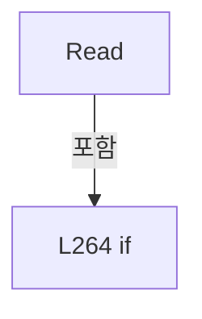

변경 전 점검: 입력/반환 타입, 위 호출자, 예외/취소 경로, 공유 상태와 저장·전송 소비자를 함께 확인합니다. 값의 단위나 물리 방향을 이름만으로 확정하지 않습니다.

### MethodDeclaration `Keys` · L268–274

[Drilling.Common/Correction/CAlignInterpolation.cs:268–274](https://github.com/kjuws10-rgb/A3Drilling/blob/334b3599651b2e8e0181fd4459bafaf3cddafff3/Drilling.Common/Correction/CAlignInterpolation.cs#L268-L274)

| 항목 | 실제 추출 값 |
| --- | --- |
| 서명 | Drilling.Common.Correction.ST_ALIGN_INTERPOLATION_KEY[] Drilling.Common.Correction.CAlignDistortionCycle.Keys() |
| 접근/수식자 | Private / private |
| 반환/값 타입 | Drilling.Common.Correction.ST_ALIGN_INTERPOLATION_KEY[] |
| 소속 타입 | NamedType:Drilling.Common.Correction.CAlignDistortionCycle |

정적 호출자로 확인된 위치:

| 호출 파일/행 | 호출 표현식 | 런타임 분기 가능 |
| --- | --- | --- |
| [Drilling.Common/Correction/CAlignInterpolation.cs:294–294](https://github.com/kjuws10-rgb/A3Drilling/blob/334b3599651b2e8e0181fd4459bafaf3cddafff3/Drilling.Common/Correction/CAlignInterpolation.cs#L294-L294) | Keys | False |
| [Drilling.Common/Correction/CAlignInterpolation.cs:338–338](https://github.com/kjuws10-rgb/A3Drilling/blob/334b3599651b2e8e0181fd4459bafaf3cddafff3/Drilling.Common/Correction/CAlignInterpolation.cs#L338-L338) | Keys | False |
| [Drilling.Common/Correction/CAlignInterpolation.cs:356–356](https://github.com/kjuws10-rgb/A3Drilling/blob/334b3599651b2e8e0181fd4459bafaf3cddafff3/Drilling.Common/Correction/CAlignInterpolation.cs#L356-L356) | Keys | False |

호출하는 대상과 해석 범위:

| 원본 행 | 표현식 | 분석 상태 | 대상/소스 위치 |
| --- | --- | --- | --- |
| 270 | new InvalidOperationException | resolved | System.InvalidOperationException.InvalidOperationException(string?) |
| 271 | recipe.Parameters.ToDictionary | resolved | System.Collections.Generic.Dictionary<string, string> System.Collections.Generic.IEnumerable<Drilling.Common.Managers.ST_RECIPE_PARAMETER>.ToDictionary<Drilling.Common.Managers.ST_RECIPE_PARAMETER, string, string>(System.Func<Drilling.Common.Managers.ST_RECIPE_PARAMETER, string>, System.Func<Drilling.Common.Managers.ST_RECIPE_PARAMETER, string>, System.Collections.Generic.IEqualityComparer<string>?) |
| 273 | CAlignKeyGeometry.Create(p, _stageYPositions, _alignKeyMargins).Select(key => key with { CorrectionX = Delta(key.Name, "X"), CorrectionY = Delta(key.Name, "Y") }).ToArray | resolved | Drilling.Common.Correction.ST_ALIGN_INTERPOLATION_KEY[] System.Collections.Generic.IEnumerable<Drilling.Common.Correction.ST_ALIGN_INTERPOLATION_KEY>.ToArray<Drilling.Common.Correction.ST_ALIGN_INTERPOLATION_KEY>() |
| 273 | CAlignKeyGeometry.Create(p, _stageYPositions, _alignKeyMargins).Select | resolved | System.Collections.Generic.IEnumerable<Drilling.Common.Correction.ST_ALIGN_INTERPOLATION_KEY> System.Collections.Generic.IEnumerable<Drilling.Common.Correction.ST_ALIGN_INTERPOLATION_KEY>.Select<Drilling.Common.Correction.ST_ALIGN_INTERPOLATION_KEY, Drilling.Common.Correction.ST_ALIGN_INTERPOLATION_KEY>(System.Func<Drilling.Common.Correction.ST_ALIGN_INTERPOLATION_KEY, Drilling.Common.Correction.ST_ALIGN_INTERPOLATION_KEY>) |
| 273 | CAlignKeyGeometry.Create | resolved | Drilling.Common.Correction.ST_ALIGN_INTERPOLATION_KEY[] Drilling.Common.Correction.CAlignKeyGeometry.Create(System.Collections.Generic.IReadOnlyDictionary<string, string>, System.Collections.Generic.IReadOnlyList<double>, Drilling.Common.Managers.ST_ALIGN_KEY_MARGINS) · Drilling.Common/Correction/CAlignInterpolation.cs:191 |
| 273 | Delta | resolved | double? Delta(string, string) · Drilling.Common/Correction/CAlignInterpolation.cs:272 |
| 273 | Delta | resolved | double? Delta(string, string) · Drilling.Common/Correction/CAlignInterpolation.cs:272 |

본문의 실제 연산·분기·예외·반환 순서(원문 위치 순):

| 원본 행 | 종류 | 주석 해설 |
| --- | --- | --- |
| 270 | call | 함수·델리게이트 또는 객체 생성자를 호출합니다: new InvalidOperationException("Distortion 레시피가 준비되지 않았습니다.") |
| 270 | local-declaration | 지역 변수를 선언합니다: var recipe = _recipe ?? throw new InvalidOperationException("Distortion 레시피가 준비되지 않았습니다."); |
| 270 | throw | 예외를 발생/전달합니다: throw new InvalidOperationException("Distortion 레시피가 준비되지 않았습니다.") |
| 270 | variable-initializer | 변수의 초기값을 지정합니다: recipe = _recipe ?? throw new InvalidOperationException("Distortion 레시피가 준비되지 않았습니다.") |
| 271 | call | 함수·델리게이트 또는 객체 생성자를 호출합니다: recipe.Parameters.ToDictionary(item => item.Key, item => item.Value, StringComparer.OrdinalIgnoreCase) |
| 271 | local-declaration | 지역 변수를 선언합니다: var p = recipe.Parameters.ToDictionary(item => item.Key, item => item.Value, StringComparer.OrdinalIgnoreCase); |
| 271 | variable-initializer | 변수의 초기값을 지정합니다: p = recipe.Parameters.ToDictionary(item => item.Key, item => item.Value, StringComparer.OrdinalIgnoreCase) |
| 273 | assignment | 값을 대상에 대입합니다: CorrectionX = Delta(key.Name, "X") |
| 273 | assignment | 값을 대상에 대입합니다: CorrectionY = Delta(key.Name, "Y") |
| 273 | call | 함수·델리게이트 또는 객체 생성자를 호출합니다: CAlignKeyGeometry.Create(p, _stageYPositions, _alignKeyMargins).Select(key => key with { CorrectionX = Delta(key.Name, "X"), CorrectionY = Delta(key.Name, "Y") }).ToArray() |
| 273 | call | 함수·델리게이트 또는 객체 생성자를 호출합니다: CAlignKeyGeometry.Create(p, _stageYPositions, _alignKeyMargins).Select(key => key with { CorrectionX = Delta(key.Name, "X"), CorrectionY = Delta(key.Name, "Y") }) |
| 273 | call | 함수·델리게이트 또는 객체 생성자를 호출합니다: CAlignKeyGeometry.Create(p, _stageYPositions, _alignKeyMargins) |
| 273 | call | 함수·델리게이트 또는 객체 생성자를 호출합니다: Delta(key.Name, "X") |
| 273 | call | 함수·델리게이트 또는 객체 생성자를 호출합니다: Delta(key.Name, "Y") |
| 273 | return | 호출자에게 값 또는 제어를 반환합니다: return CAlignKeyGeometry.Create(p, _stageYPositions, _alignKeyMargins).Select(key => key with { CorrectionX = Delta(key.Name, "X"), CorrectionY = Delta(key.Name, "Y") }).ToArray(); |

변경 전 점검: 입력/반환 타입, 위 호출자, 예외/취소 경로, 공유 상태와 저장·전송 소비자를 함께 확인합니다. 값의 단위나 물리 방향을 이름만으로 확정하지 않습니다.

### LocalFunctionStatement `Delta` · L272–272

[Drilling.Common/Correction/CAlignInterpolation.cs:272–272](https://github.com/kjuws10-rgb/A3Drilling/blob/334b3599651b2e8e0181fd4459bafaf3cddafff3/Drilling.Common/Correction/CAlignInterpolation.cs#L272-L272)

| 항목 | 실제 추출 값 |
| --- | --- |
| 서명 | double? Delta(string, string) |
| 접근/수식자 | Private /  |
| 반환/값 타입 | double? |
| 소속 타입 | NamedType:Drilling.Common.Correction.CAlignDistortionCycle |

입력 계약:

| 이름 | 타입 | 전달 | 선택/기본값 |
| --- | --- | --- | --- |
| name | string | None | False /  |
| axis | string | None | False /  |

정적 호출자로 확인된 위치:

| 호출 파일/행 | 호출 표현식 | 런타임 분기 가능 |
| --- | --- | --- |
| [Drilling.Common/Correction/CAlignInterpolation.cs:273–273](https://github.com/kjuws10-rgb/A3Drilling/blob/334b3599651b2e8e0181fd4459bafaf3cddafff3/Drilling.Common/Correction/CAlignInterpolation.cs#L273-L273) | Delta | False |
| [Drilling.Common/Correction/CAlignInterpolation.cs:273–273](https://github.com/kjuws10-rgb/A3Drilling/blob/334b3599651b2e8e0181fd4459bafaf3cddafff3/Drilling.Common/Correction/CAlignInterpolation.cs#L273-L273) | Delta | False |

호출하는 대상과 해석 범위:

| 원본 행 | 표현식 | 분석 상태 | 대상/소스 위치 |
| --- | --- | --- | --- |
| 272 | _results.TryGetValue | resolved · 동적 구현 선택 가능 | bool System.Collections.Generic.IReadOnlyDictionary<string, double>.TryGetValue(string, out double) |
| 272 | Read | resolved | double Drilling.Common.Correction.CAlignDistortionCycle.Read(System.Collections.Generic.IReadOnlyDictionary<string, string>, string) · Drilling.Common/Correction/CAlignInterpolation.cs:262 |

본문의 실제 연산·분기·예외·반환 순서(원문 위치 순):

| 원본 행 | 종류 | 주석 해설 |
| --- | --- | --- |
| 272 | call | 함수·델리게이트 또는 객체 생성자를 호출합니다: _results.TryGetValue($"ALIGNBASE_{name}_{axis}", out var measured) |
| 272 | call | 함수·델리게이트 또는 객체 생성자를 호출합니다: Read(p, $"ALIGNBASE_{name}_{axis}") |
| 272 | conditional-expression | 조건에 따라 결과식을 선택합니다: _results is not null && _results.TryGetValue($"ALIGNBASE_{name}_{axis}", out var measured) ? Read(p, $"ALIGNBASE_{name}_{axis}") - measured : null |

변경 전 점검: 입력/반환 타입, 위 호출자, 예외/취소 경로, 공유 상태와 저장·전송 소비자를 함께 확인합니다. 값의 단위나 물리 방향을 이름만으로 확정하지 않습니다.

### MethodDeclaration `Prepare` · L276–321

[Drilling.Common/Correction/CAlignInterpolation.cs:276–321](https://github.com/kjuws10-rgb/A3Drilling/blob/334b3599651b2e8e0181fd4459bafaf3cddafff3/Drilling.Common/Correction/CAlignInterpolation.cs#L276-L321)

| 항목 | 실제 추출 값 |
| --- | --- |
| 서명 | System.Threading.Tasks.Task Drilling.Common.Correction.CAlignDistortionCycle.Prepare(System.Threading.CancellationToken) |
| 접근/수식자 | Public / public, async |
| 반환/값 타입 | System.Threading.Tasks.Task |
| 소속 타입 | NamedType:Drilling.Common.Correction.CAlignDistortionCycle |

입력 계약:

| 이름 | 타입 | 전달 | 선택/기본값 |
| --- | --- | --- | --- |
| token | System.Threading.CancellationToken | None | False /  |

현재 부분 분석에서 직접 연결된 호출자는 없습니다. XAML/이벤트/인터페이스·델리게이트·외부 진입을 추가 확인해야 하며, 미사용으로 판정한 것이 아닙니다.

호출하는 대상과 해석 범위:

| 원본 행 | 표현식 | 분석 상태 | 대상/소스 위치 |
| --- | --- | --- | --- |
| 279 | Volatile.Write | resolved | void System.Threading.Volatile.Write<Drilling.Common.Correction.ST_DISTORTION_MEASUREMENT_SNAPSHOT?>(ref Drilling.Common.Correction.ST_DISTORTION_MEASUREMENT_SNAPSHOT?, Drilling.Common.Correction.ST_DISTORTION_MEASUREMENT_SNAPSHOT?) |
| 281 | capture(token).ConfigureAwait | resolved | System.Runtime.CompilerServices.ConfiguredTaskAwaitable<Drilling.Common.Station.ST_STAGE_PROCESS_REQUEST> System.Threading.Tasks.Task<Drilling.Common.Station.ST_STAGE_PROCESS_REQUEST>.ConfigureAwait(bool) |
| 281 | capture | resolved · 동적 구현 선택 가능 | System.Threading.Tasks.Task<Drilling.Common.Station.ST_STAGE_PROCESS_REQUEST> System.Func<System.Threading.CancellationToken, System.Threading.Tasks.Task<Drilling.Common.Station.ST_STAGE_PROCESS_REQUEST>>.Invoke(System.Threading.CancellationToken) |
| 282 | recipes.RefreshRecipe(_input.RecipeId, token).ConfigureAwait | resolved | System.Runtime.CompilerServices.ConfiguredTaskAwaitable<Drilling.Common.Managers.ST_RECIPE_DEFINITION?> System.Threading.Tasks.Task<Drilling.Common.Managers.ST_RECIPE_DEFINITION?>.ConfigureAwait(bool) |
| 282 | recipes.RefreshRecipe | resolved | System.Threading.Tasks.Task<Drilling.Common.Managers.ST_RECIPE_DEFINITION?> Drilling.Common.Managers.CRecipeManager.RefreshRecipe(string, System.Threading.CancellationToken) · Drilling.Common/Managers/CRecipeManager.cs:161 |
| 282 | new InvalidOperationException | resolved | System.InvalidOperationException.InvalidOperationException(string?) |
| 283 | settings.LoadSection(EN_SETTING_TAB.Option).ToArray | resolved | Drilling.Common.Managers.ST_SYSTEM_PARAMETER[] System.Collections.Generic.IEnumerable<Drilling.Common.Managers.ST_SYSTEM_PARAMETER>.ToArray<Drilling.Common.Managers.ST_SYSTEM_PARAMETER>() |
| 283 | settings.LoadSection | resolved | System.Collections.Generic.IReadOnlyList<Drilling.Common.Managers.ST_SYSTEM_PARAMETER> Drilling.Common.Managers.CSettingManager.LoadSection(Drilling.Common.Managers.EN_SETTING_TAB, System.Threading.CancellationToken) · Drilling.Common/Managers/CSettingManager.cs:26 |
| 284 | CAlignKeyMarginSettings.Read | resolved | Drilling.Common.Managers.ST_ALIGN_KEY_MARGINS Drilling.Common.Managers.CAlignKeyMarginSettings.Read(System.Collections.Generic.IReadOnlyList<Drilling.Common.Managers.ST_SYSTEM_PARAMETER>) · Drilling.Common/Managers/CAlignKeyMarginSettings.cs:15 |
| 285 | Array.AsReadOnly | resolved | System.Collections.ObjectModel.ReadOnlyCollection<double> System.Array.AsReadOnly<double>(double[]) |
| 285 | CAlignKeyGeometry.ReadStagePositions | resolved | double[] Drilling.Common.Correction.CAlignKeyGeometry.ReadStagePositions(System.Collections.Generic.IReadOnlyList<Drilling.Common.Managers.ST_SYSTEM_PARAMETER>) · Drilling.Common/Correction/CAlignInterpolation.cs:184 |
| 285 | settings.LoadSection | resolved | System.Collections.Generic.IReadOnlyList<Drilling.Common.Managers.ST_SYSTEM_PARAMETER> Drilling.Common.Managers.CSettingManager.LoadSection(Drilling.Common.Managers.EN_SETTING_TAB, System.Threading.CancellationToken) · Drilling.Common/Managers/CSettingManager.cs:26 |
| 286 | CRunOptionSettings.Read(option).DistortionGroups.ToArray | resolved | int[] System.Collections.Generic.IEnumerable<int>.ToArray<int>() |
| 286 | CRunOptionSettings.Read | resolved | Drilling.Common.Managers.ST_RUN_OPTION_SETTINGS Drilling.Common.Managers.CRunOptionSettings.Read(System.Collections.Generic.IReadOnlyList<Drilling.Common.Managers.ST_SYSTEM_PARAMETER>) · Drilling.Common/Managers/CSettingManager.cs:206 |
| 287 | option.ToDictionary | resolved | System.Collections.Generic.Dictionary<string, string> System.Collections.Generic.IEnumerable<Drilling.Common.Managers.ST_SYSTEM_PARAMETER>.ToDictionary<Drilling.Common.Managers.ST_SYSTEM_PARAMETER, string, string>(System.Func<Drilling.Common.Managers.ST_SYSTEM_PARAMETER, string>, System.Func<Drilling.Common.Managers.ST_SYSTEM_PARAMETER, string>, System.Collections.Generic.IEqualityComparer<string>?) |
| 288 | CAlignOffsetTolerance.Parse | resolved | double Drilling.Common.Correction.CAlignOffsetTolerance.Parse(string) · Drilling.Common/Correction/CAlignInterpolation.cs:167 |
| 288 | op.GetValueOrDefault | resolved | string System.Collections.Generic.IReadOnlyDictionary<string, string>.GetValueOrDefault<string, string>(string, string) |
| 289 | Read | resolved | double Drilling.Common.Correction.CAlignDistortionCycle.Read(System.Collections.Generic.IReadOnlyDictionary<string, string>, string) · Drilling.Common/Correction/CAlignInterpolation.cs:262 |
| 290 | Read | resolved | double Drilling.Common.Correction.CAlignDistortionCycle.Read(System.Collections.Generic.IReadOnlyDictionary<string, string>, string) · Drilling.Common/Correction/CAlignInterpolation.cs:262 |
| 291 | new InvalidOperationException | resolved | System.InvalidOperationException.InvalidOperationException(string?) |
| 293 | double.IsFinite | resolved | bool double.IsFinite(double) |
| 293 | new InvalidOperationException | resolved | System.InvalidOperationException.InvalidOperationException(string?) |
| 294 | new CAlignInterpolation | resolved | Drilling.Common.Correction.CAlignInterpolation.CAlignInterpolation(System.Collections.Generic.IReadOnlyList<Drilling.Common.Correction.ST_ALIGN_INTERPOLATION_KEY>, System.Collections.Generic.IReadOnlyCollection<string>) · Drilling.Common/Correction/CAlignInterpolation.cs:18 |
| 294 | Keys | resolved | Drilling.Common.Correction.ST_ALIGN_INTERPOLATION_KEY[] Drilling.Common.Correction.CAlignDistortionCycle.Keys() · Drilling.Common/Correction/CAlignInterpolation.cs:268 |
| 294 | Names(_groups).Where(name => name.StartsWith("DK", StringComparison.Ordinal)).ToArray | resolved | string[] System.Collections.Generic.IEnumerable<string>.ToArray<string>() |
| 294 | Names(_groups).Where | resolved | System.Collections.Generic.IEnumerable<string> System.Collections.Generic.IEnumerable<string>.Where<string>(System.Func<string, bool>) |
| 294 | Names | resolved | string[] Drilling.Common.Correction.CAlignDistortionCycle.Names(System.Collections.Generic.IReadOnlyCollection<int>) · Drilling.Common/Correction/CAlignInterpolation.cs:259 |
| 294 | name.StartsWith | resolved | bool string.StartsWith(string, System.StringComparison) |
| 295 | _recipe.Parameters.ToDictionary | resolved | System.Collections.Generic.Dictionary<string, string> System.Collections.Generic.IEnumerable<Drilling.Common.Managers.ST_RECIPE_PARAMETER>.ToDictionary<Drilling.Common.Managers.ST_RECIPE_PARAMETER, string, string>(System.Func<Drilling.Common.Managers.ST_RECIPE_PARAMETER, string>, System.Func<Drilling.Common.Managers.ST_RECIPE_PARAMETER, string>, System.Collections.Generic.IEqualityComparer<string>?) |
| 296 | ParameterKeys | resolved | string[] Drilling.Common.Correction.CAlignDistortionCycle.ParameterKeys(System.Collections.Generic.IReadOnlyCollection<int>) · Drilling.Common/Correction/CAlignInterpolation.cs:261 |
| 296 | Read | resolved | double Drilling.Common.Correction.CAlignDistortionCycle.Read(System.Collections.Generic.IReadOnlyDictionary<string, string>, string) · Drilling.Common/Correction/CAlignInterpolation.cs:262 |
| 298 | ParameterKeys([0, 1, 2]).ToHashSet | resolved | System.Collections.Generic.HashSet<string> System.Collections.Generic.IEnumerable<string>.ToHashSet<string>(System.Collections.Generic.IEqualityComparer<string>?) |
| 298 | ParameterKeys | resolved | string[] Drilling.Common.Correction.CAlignDistortionCycle.ParameterKeys(System.Collections.Generic.IReadOnlyCollection<int>) · Drilling.Common/Correction/CAlignInterpolation.cs:261 |
| 299 | displayKeys.UnionWith | resolved | void System.Collections.Generic.HashSet<string>.UnionWith(System.Collections.Generic.IEnumerable<string>) |
| 300 | Array.AsReadOnly | resolved | System.Collections.ObjectModel.ReadOnlyCollection<Drilling.Common.Managers.ST_RECIPE_PARAMETER> System.Array.AsReadOnly<Drilling.Common.Managers.ST_RECIPE_PARAMETER>(Drilling.Common.Managers.ST_RECIPE_PARAMETER[]) |
| 300 | _recipe.Parameters.Where(p => displayKeys.Contains(p.Key)).ToArray | resolved | Drilling.Common.Managers.ST_RECIPE_PARAMETER[] System.Collections.Generic.IEnumerable<Drilling.Common.Managers.ST_RECIPE_PARAMETER>.ToArray<Drilling.Common.Managers.ST_RECIPE_PARAMETER>() |
| 300 | _recipe.Parameters.Where | resolved | System.Collections.Generic.IEnumerable<Drilling.Common.Managers.ST_RECIPE_PARAMETER> System.Collections.Generic.IEnumerable<Drilling.Common.Managers.ST_RECIPE_PARAMETER>.Where<Drilling.Common.Managers.ST_RECIPE_PARAMETER>(System.Func<Drilling.Common.Managers.ST_RECIPE_PARAMETER, bool>) |
| 300 | displayKeys.Contains | resolved | bool System.Collections.Generic.HashSet<string>.Contains(string) |
| 301 | Volatile.Write | resolved | void System.Threading.Volatile.Write<Drilling.Common.Correction.ST_DISTORTION_MEASUREMENT_SNAPSHOT?>(ref Drilling.Common.Correction.ST_DISTORTION_MEASUREMENT_SNAPSHOT?, Drilling.Common.Correction.ST_DISTORTION_MEASUREMENT_SNAPSHOT?) |
| 301 | new | resolved | Drilling.Common.Correction.ST_DISTORTION_MEASUREMENT_SNAPSHOT.ST_DISTORTION_MEASUREMENT_SNAPSHOT(System.Guid, Drilling.Common.Managers.ST_RECIPE_DEFINITION, string, System.Collections.Generic.IReadOnlyList<int>, System.Collections.Generic.IReadOnlyDictionary<string, double>, System.DateTimeOffset?) · Drilling.Common/Correction/CAlignInterpolation.cs:217 |
| 301 | Guid.NewGuid | resolved | System.Guid System.Guid.NewGuid() |
| 301 | Array.AsReadOnly | resolved | System.Collections.ObjectModel.ReadOnlyCollection<int> System.Array.AsReadOnly<int>(int[]) |
| 301 | _groups.ToArray | resolved | int[] System.Collections.Generic.IEnumerable<int>.ToArray<int>() |
| 302 | new System.Collections.ObjectModel.ReadOnlyDictionary<string, double> | resolved | System.Collections.ObjectModel.ReadOnlyDictionary<string, double>.ReadOnlyDictionary(System.Collections.Generic.IDictionary<string, double>) |
| 302 | new Dictionary<string, double> | resolved | System.Collections.Generic.Dictionary<string, double>.Dictionary() |
| 307 | new List<(string Id, double Value)> | resolved | System.Collections.Generic.List<(string Id, double Value)>.List() |
| 308 | control.Add | resolved | void System.Collections.Generic.List<(string Id, double Value)>.Add((string Id, double Value)) |
| 308 | _groups.Contains | resolved | bool System.ReadOnlySpan<int>.Contains<int>(int) |
| 309 | control.Add | resolved | void System.Collections.Generic.List<(string Id, double Value)>.Add((string Id, double Value)) |
| 310 | Enumerable.Range(1, 4).SelectMany(camera => new[] { $"SVID_FINEALN_CAM{camera}_GLS_RESULT_X", $"SVID_FINEALN_CAM{camera}_GLS_RESULT_Y" }).ToArray | resolved | string[] System.Collections.Generic.IEnumerable<string>.ToArray<string>() |
| 310 | Enumerable.Range(1, 4).SelectMany | resolved | System.Collections.Generic.IEnumerable<string> System.Collections.Generic.IEnumerable<int>.SelectMany<int, string>(System.Func<int, System.Collections.Generic.IEnumerable<string>>) |
| 310 | Enumerable.Range | resolved | System.Collections.Generic.IEnumerable<int> System.Linq.Enumerable.Range(int, int) |
| 312 | _io.Validate | resolved | System.Collections.Generic.Dictionary<string, Drilling.Common.Interface.ST_MELSEC_MAP_DATA> Drilling.Common.Correction.CAlignWapageService.Validate(System.Collections.Generic.IReadOnlyCollection<string>, bool) · Drilling.Common/Correction/CAlignInterpolation.cs:406 |
| 313 | _io.Validate | resolved | System.Collections.Generic.Dictionary<string, Drilling.Common.Interface.ST_MELSEC_MAP_DATA> Drilling.Common.Correction.CAlignWapageService.Validate(System.Collections.Generic.IReadOnlyCollection<string>, bool) · Drilling.Common/Correction/CAlignInterpolation.cs:406 |
| 313 | ParameterKeys(_groups).Select(ResultId).ToArray | resolved | string[] System.Collections.Generic.IEnumerable<string>.ToArray<string>() |
| 313 | ParameterKeys(_groups).Select | resolved | System.Collections.Generic.IEnumerable<string> System.Collections.Generic.IEnumerable<string>.Select<string, string>(System.Func<string, string>) |
| 313 | ParameterKeys | resolved | string[] Drilling.Common.Correction.CAlignDistortionCycle.ParameterKeys(System.Collections.Generic.IReadOnlyCollection<int>) · Drilling.Common/Correction/CAlignInterpolation.cs:261 |
| 314 | _io.Validate | resolved | System.Collections.Generic.Dictionary<string, Drilling.Common.Interface.ST_MELSEC_MAP_DATA> Drilling.Common.Correction.CAlignWapageService.Validate(System.Collections.Generic.IReadOnlyCollection<string>, bool) · Drilling.Common/Correction/CAlignInterpolation.cs:406 |
| 314 | CAlignWapageService.Points.SelectMany(point => new[] { point.BaseId, point.RangeId }).Concat(control.Select(item => item.Id)).ToArray | resolved | string[] System.Collections.Generic.IEnumerable<string>.ToArray<string>() |
| 314 | CAlignWapageService.Points.SelectMany(point => new[] { point.BaseId, point.RangeId }).Concat | resolved | System.Collections.Generic.IEnumerable<string> System.Collections.Generic.IEnumerable<string>.Concat<string>(System.Collections.Generic.IEnumerable<string>) |
| 314 | CAlignWapageService.Points.SelectMany | resolved | System.Collections.Generic.IEnumerable<string> System.Collections.Generic.IEnumerable<Drilling.Common.Correction.ST_WAPAGE_ALIGNBASE_POINT>.SelectMany<Drilling.Common.Correction.ST_WAPAGE_ALIGNBASE_POINT, string>(System.Func<Drilling.Common.Correction.ST_WAPAGE_ALIGNBASE_POINT, System.Collections.Generic.IEnumerable<string>>) |
| 314 | control.Select | resolved | System.Collections.Generic.IEnumerable<string> System.Collections.Generic.IEnumerable<(string Id, double Value)>.Select<(string Id, double Value), string>(System.Func<(string Id, double Value), string>) |
| 315 | Log | resolved | void Drilling.Common.Correction.CAlignDistortionCycle.Log(string) · Drilling.Common/Correction/CAlignInterpolation.cs:379 |
| 315 | string.Join | resolved | string string.Join<int>(string?, System.Collections.Generic.IEnumerable<int>) |
| 315 | string.Join | resolved | string string.Join(string?, System.Collections.Generic.IEnumerable<string?>) |
| 315 | control.Where(item => item.Id.EndsWith("_POSITION")).Select | resolved | System.Collections.Generic.IEnumerable<string> System.Collections.Generic.IEnumerable<(string Id, double Value)>.Select<(string Id, double Value), string>(System.Func<(string Id, double Value), string>) |
| 315 | control.Where | resolved | System.Collections.Generic.IEnumerable<(string Id, double Value)> System.Collections.Generic.IEnumerable<(string Id, double Value)>.Where<(string Id, double Value)>(System.Func<(string Id, double Value), bool>) |
| 315 | item.Id.EndsWith | resolved | bool string.EndsWith(string) |
| 316 | _io.ReadValues(visionIds, token).ConfigureAwait | resolved | System.Runtime.CompilerServices.ConfiguredTaskAwaitable<System.Collections.Generic.IReadOnlyDictionary<string, double>> System.Threading.Tasks.Task<System.Collections.Generic.IReadOnlyDictionary<string, double>>.ConfigureAwait(bool) |
| 316 | _io.ReadValues | resolved | System.Threading.Tasks.Task<System.Collections.Generic.IReadOnlyDictionary<string, double>> Drilling.Common.Correction.CAlignWapageService.ReadValues(string[], System.Threading.CancellationToken) · Drilling.Common/Correction/CAlignInterpolation.cs:433 |
| 317 | _io.SetBase(vision, token).ConfigureAwait | resolved | System.Runtime.CompilerServices.ConfiguredTaskAwaitable<System.Collections.Generic.IReadOnlyDictionary<string, double>> System.Threading.Tasks.Task<System.Collections.Generic.IReadOnlyDictionary<string, double>>.ConfigureAwait(bool) |
| 317 | _io.SetBase | resolved | System.Threading.Tasks.Task<System.Collections.Generic.IReadOnlyDictionary<string, double>> Drilling.Common.Correction.CAlignWapageService.SetBase(System.Collections.Generic.IReadOnlyDictionary<string, double>, System.Threading.CancellationToken) · Drilling.Common/Correction/CAlignInterpolation.cs:451 |
| 318 | _io.SetRange(pixels, token).ConfigureAwait | resolved | System.Runtime.CompilerServices.ConfiguredTaskAwaitable<System.Collections.Generic.IReadOnlyDictionary<string, double>> System.Threading.Tasks.Task<System.Collections.Generic.IReadOnlyDictionary<string, double>>.ConfigureAwait(bool) |
| 318 | _io.SetRange | resolved | System.Threading.Tasks.Task<System.Collections.Generic.IReadOnlyDictionary<string, double>> Drilling.Common.Correction.CAlignWapageService.SetRange(double, System.Threading.CancellationToken) · Drilling.Common/Correction/CAlignInterpolation.cs:457 |
| 319 | _io.WriteValues(control.ToArray(), token).ConfigureAwait | resolved | System.Runtime.CompilerServices.ConfiguredTaskAwaitable<System.Collections.Generic.IReadOnlyDictionary<string, double>> System.Threading.Tasks.Task<System.Collections.Generic.IReadOnlyDictionary<string, double>>.ConfigureAwait(bool) |
| 319 | _io.WriteValues | resolved | System.Threading.Tasks.Task<System.Collections.Generic.IReadOnlyDictionary<string, double>> Drilling.Common.Correction.CAlignWapageService.WriteValues((string Id, double Value)[], System.Threading.CancellationToken) · Drilling.Common/Correction/CAlignInterpolation.cs:438 |
| 319 | control.ToArray | resolved | (string Id, double Value)[] System.Collections.Generic.List<(string Id, double Value)>.ToArray() |
| 320 | Log | resolved | void Drilling.Common.Correction.CAlignDistortionCycle.Log(string) · Drilling.Common/Correction/CAlignInterpolation.cs:379 |

본문의 실제 연산·분기·예외·반환 순서(원문 위치 순):

| 원본 행 | 종류 | 주석 해설 |
| --- | --- | --- |
| 279 | call | 함수·델리게이트 또는 객체 생성자를 호출합니다: Volatile.Write(ref _snapshot, null) |
| 280 | assignment | 값을 대상에 대입합니다: _pending = null |
| 280 | assignment | 값을 대상에 대입합니다: _results = null |
| 280 | assignment | 값을 대상에 대입합니다: _offsets = null |
| 280 | assignment | 값을 대상에 대입합니다: _model = null |
| 280 | assignment | 값을 대상에 대입합니다: _loadedAt = null |
| 280 | assignment | 값을 대상에 대입합니다: _saved = false |
| 281 | assignment | 값을 대상에 대입합니다: _input = await capture(token).ConfigureAwait(false) |
| 281 | await | 비동기 완료를 기다립니다: await capture(token).ConfigureAwait(false) |
| 281 | call | 함수·델리게이트 또는 객체 생성자를 호출합니다: capture(token).ConfigureAwait(false) |
| 281 | call | 함수·델리게이트 또는 객체 생성자를 호출합니다: capture(token) |
| 282 | assignment | 값을 대상에 대입합니다: _recipe = await recipes.RefreshRecipe(_input.RecipeId, token).ConfigureAwait(false) ?? throw new InvalidOperationException("Distortion 레시피를 찾을 수 없습니다.") |
| 282 | await | 비동기 완료를 기다립니다: await recipes.RefreshRecipe(_input.RecipeId, token).ConfigureAwait(false) |
| 282 | call | 함수·델리게이트 또는 객체 생성자를 호출합니다: recipes.RefreshRecipe(_input.RecipeId, token).ConfigureAwait(false) |
| 282 | call | 함수·델리게이트 또는 객체 생성자를 호출합니다: recipes.RefreshRecipe(_input.RecipeId, token) |
| 282 | call | 함수·델리게이트 또는 객체 생성자를 호출합니다: new InvalidOperationException("Distortion 레시피를 찾을 수 없습니다.") |
| 282 | throw | 예외를 발생/전달합니다: throw new InvalidOperationException("Distortion 레시피를 찾을 수 없습니다.") |
| 283 | call | 함수·델리게이트 또는 객체 생성자를 호출합니다: settings.LoadSection(EN_SETTING_TAB.Option).ToArray() |
| 283 | call | 함수·델리게이트 또는 객체 생성자를 호출합니다: settings.LoadSection(EN_SETTING_TAB.Option) |
| 283 | local-declaration | 지역 변수를 선언합니다: var option = settings.LoadSection(EN_SETTING_TAB.Option).ToArray(); |
| 283 | variable-initializer | 변수의 초기값을 지정합니다: option = settings.LoadSection(EN_SETTING_TAB.Option).ToArray() |
| 284 | assignment | 값을 대상에 대입합니다: _alignKeyMargins = CAlignKeyMarginSettings.Read(option) |
| 284 | call | 함수·델리게이트 또는 객체 생성자를 호출합니다: CAlignKeyMarginSettings.Read(option) |
| 285 | assignment | 값을 대상에 대입합니다: _stageYPositions = Array.AsReadOnly(CAlignKeyGeometry.ReadStagePositions(settings.LoadSection(EN_SETTING_TAB.Motor))) |
| 285 | call | 함수·델리게이트 또는 객체 생성자를 호출합니다: Array.AsReadOnly(CAlignKeyGeometry.ReadStagePositions(settings.LoadSection(EN_SETTING_TAB.Motor))) |
| 285 | call | 함수·델리게이트 또는 객체 생성자를 호출합니다: CAlignKeyGeometry.ReadStagePositions(settings.LoadSection(EN_SETTING_TAB.Motor)) |
| 285 | call | 함수·델리게이트 또는 객체 생성자를 호출합니다: settings.LoadSection(EN_SETTING_TAB.Motor) |
| 286 | assignment | 값을 대상에 대입합니다: _groups = CRunOptionSettings.Read(option).DistortionGroups.ToArray() |
| 286 | call | 함수·델리게이트 또는 객체 생성자를 호출합니다: CRunOptionSettings.Read(option).DistortionGroups.ToArray() |
| 286 | call | 함수·델리게이트 또는 객체 생성자를 호출합니다: CRunOptionSettings.Read(option) |
| 287 | call | 함수·델리게이트 또는 객체 생성자를 호출합니다: option.ToDictionary(p => p.Key, p => p.Value, StringComparer.OrdinalIgnoreCase) |
| 287 | local-declaration | 지역 변수를 선언합니다: var op = option.ToDictionary(p => p.Key, p => p.Value, StringComparer.OrdinalIgnoreCase); |
| 287 | variable-initializer | 변수의 초기값을 지정합니다: op = option.ToDictionary(p => p.Key, p => p.Value, StringComparer.OrdinalIgnoreCase) |
| 288 | assignment | 값을 대상에 대입합니다: _tolerance = CAlignOffsetTolerance.Parse(op.GetValueOrDefault(CAlignOffsetTolerance.SettingKey, "0.5")) |
| 288 | call | 함수·델리게이트 또는 객체 생성자를 호출합니다: CAlignOffsetTolerance.Parse(op.GetValueOrDefault(CAlignOffsetTolerance.SettingKey, "0.5")) |
| 288 | call | 함수·델리게이트 또는 객체 생성자를 호출합니다: op.GetValueOrDefault(CAlignOffsetTolerance.SettingKey, "0.5") |
| 289 | call | 함수·델리게이트 또는 객체 생성자를 호출합니다: Read(op, CSettingManager.AlignCameraResolutionKey) |
| 289 | local-declaration | 지역 변수를 선언합니다: var resolution = Read(op, CSettingManager.AlignCameraResolutionKey); |
| 289 | variable-initializer | 변수의 초기값을 지정합니다: resolution = Read(op, CSettingManager.AlignCameraResolutionKey) |
| 290 | call | 함수·델리게이트 또는 객체 생성자를 호출합니다: Read(op, CSettingManager.WapageAlignBaseToleranceKey) |
| 290 | local-declaration | 지역 변수를 선언합니다: var rangeMm = Read(op, CSettingManager.WapageAlignBaseToleranceKey); |
| 290 | variable-initializer | 변수의 초기값을 지정합니다: rangeMm = Read(op, CSettingManager.WapageAlignBaseToleranceKey) |
| 291 | call | 함수·델리게이트 또는 객체 생성자를 호출합니다: new InvalidOperationException("Align 분해능은 양수, Wapage 허용범위는 0 이상이어야 합니다.") |
| 291 | if | 조건에 따라 분기합니다: if (resolution <= 0 &#124;&#124; rangeMm < 0) |
| 291 | throw | 예외를 발생/전달합니다: throw new InvalidOperationException("Align 분해능은 양수, Wapage 허용범위는 0 이상이어야 합니다."); |
| 292 | local-declaration | 지역 변수를 선언합니다: var pixels = rangeMm / resolution; |
| 292 | variable-initializer | 변수의 초기값을 지정합니다: pixels = rangeMm / resolution |
| 293 | call | 함수·델리게이트 또는 객체 생성자를 호출합니다: double.IsFinite(pixels) |
| 293 | call | 함수·델리게이트 또는 객체 생성자를 호출합니다: new InvalidOperationException("Wapage pixel 범위를 계산할 수 없습니다.") |
| 293 | if | 조건에 따라 분기합니다: if (!double.IsFinite(pixels)) |
| 293 | throw | 예외를 발생/전달합니다: throw new InvalidOperationException("Wapage pixel 범위를 계산할 수 없습니다."); |
| 294 | assignment | 값을 대상에 대입합니다: _ = new CAlignInterpolation(Keys(), Names(_groups).Where(name => name.StartsWith("DK", StringComparison.Ordinal)).ToArray()) |
| 294 | call | 함수·델리게이트 또는 객체 생성자를 호출합니다: new CAlignInterpolation(Keys(), Names(_groups).Where(name => name.StartsWith("DK", StringComparison.Ordinal)).ToArray()) |
| 294 | call | 함수·델리게이트 또는 객체 생성자를 호출합니다: Keys() |
| 294 | call | 함수·델리게이트 또는 객체 생성자를 호출합니다: Names(_groups).Where(name => name.StartsWith("DK", StringComparison.Ordinal)).ToArray() |
| 294 | call | 함수·델리게이트 또는 객체 생성자를 호출합니다: Names(_groups).Where(name => name.StartsWith("DK", StringComparison.Ordinal)) |
| 294 | call | 함수·델리게이트 또는 객체 생성자를 호출합니다: Names(_groups) |
| 294 | call | 함수·델리게이트 또는 객체 생성자를 호출합니다: name.StartsWith("DK", StringComparison.Ordinal) |
| 295 | call | 함수·델리게이트 또는 객체 생성자를 호출합니다: _recipe.Parameters.ToDictionary(p => p.Key, p => p.Value, StringComparer.OrdinalIgnoreCase) |
| 295 | local-declaration | 지역 변수를 선언합니다: var rp = _recipe.Parameters.ToDictionary(p => p.Key, p => p.Value, StringComparer.OrdinalIgnoreCase); |
| 295 | variable-initializer | 변수의 초기값을 지정합니다: rp = _recipe.Parameters.ToDictionary(p => p.Key, p => p.Value, StringComparer.OrdinalIgnoreCase) |
| 296 | assignment | 값을 대상에 대입합니다: _ = Read(rp, key) |
| 296 | call | 함수·델리게이트 또는 객체 생성자를 호출합니다: ParameterKeys(_groups) |
| 296 | call | 함수·델리게이트 또는 객체 생성자를 호출합니다: Read(rp, key) |
| 296 | foreach | 컬렉션 요소를 순회합니다: foreach (var key in ParameterKeys(_groups)) |
| 298 | call | 함수·델리게이트 또는 객체 생성자를 호출합니다: ParameterKeys([0, 1, 2]).ToHashSet(StringComparer.OrdinalIgnoreCase) |
| 298 | call | 함수·델리게이트 또는 객체 생성자를 호출합니다: ParameterKeys([0, 1, 2]) |
| 298 | local-declaration | 지역 변수를 선언합니다: var displayKeys = ParameterKeys([0, 1, 2]).ToHashSet(StringComparer.OrdinalIgnoreCase); |
| 298 | variable-initializer | 변수의 초기값을 지정합니다: displayKeys = ParameterKeys([0, 1, 2]).ToHashSet(StringComparer.OrdinalIgnoreCase) |
| 299 | call | 함수·델리게이트 또는 객체 생성자를 호출합니다: displayKeys.UnionWith(new[] { "GLASS_SIZE_X", "GLASS_SIZE_Y" }) |
| 300 | assignment | 값을 대상에 대입합니다: Parameters = Array.AsReadOnly(_recipe.Parameters.Where(p => displayKeys.Contains(p.Key)).ToArray()) |
| 300 | assignment | 값을 대상에 대입합니다: History = [] |
| 300 | call | 함수·델리게이트 또는 객체 생성자를 호출합니다: Array.AsReadOnly(_recipe.Parameters.Where(p => displayKeys.Contains(p.Key)).ToArray()) |
| 300 | call | 함수·델리게이트 또는 객체 생성자를 호출합니다: _recipe.Parameters.Where(p => displayKeys.Contains(p.Key)).ToArray() |
| 300 | call | 함수·델리게이트 또는 객체 생성자를 호출합니다: _recipe.Parameters.Where(p => displayKeys.Contains(p.Key)) |
| 300 | call | 함수·델리게이트 또는 객체 생성자를 호출합니다: displayKeys.Contains(p.Key) |
| 300 | local-declaration | 지역 변수를 선언합니다: var frozenRecipe = _recipe with { Parameters = Array.AsReadOnly(_recipe.Parameters.Where(p => displayKeys.Contains(p.Key)).ToArray()), History = [] }; |
| 300 | variable-initializer | 변수의 초기값을 지정합니다: frozenRecipe = _recipe with { Parameters = Array.AsReadOnly(_recipe.Parameters.Where(p => displayKeys.Contains(p.Key)).ToArray()), History = [] } |
| 301 | call | 함수·델리게이트 또는 객체 생성자를 호출합니다: Guid.NewGuid() |
| 301 | call | 함수·델리게이트 또는 객체 생성자를 호출합니다: Array.AsReadOnly(_groups.ToArray()) |
| 301 | call | 함수·델리게이트 또는 객체 생성자를 호출합니다: _groups.ToArray() |
| 301 | call | 함수·델리게이트 또는 객체 생성자를 호출합니다: Volatile.Write(ref _snapshot, new(Guid.NewGuid(), frozenRecipe, GlassId, Array.AsReadOnly(_groups.ToArray()), new System.Collections.ObjectModel.ReadOnlyDictionary<string, double>(new Dictionary<string, double>()), null)… |
| 301 | call | 함수·델리게이트 또는 객체 생성자를 호출합니다: new(Guid.NewGuid(), frozenRecipe, GlassId, Array.AsReadOnly(_groups.ToArray()), new System.Collections.ObjectModel.ReadOnlyDictionary<string, double>(new Dictionary<string, double>()), null) { StageYPositions = _stageYPo… |
| 302 | call | 함수·델리게이트 또는 객체 생성자를 호출합니다: new System.Collections.ObjectModel.ReadOnlyDictionary<string, double>(new Dictionary<string, double>()) |
| 302 | call | 함수·델리게이트 또는 객체 생성자를 호출합니다: new Dictionary<string, double>() |
| 304 | assignment | 값을 대상에 대입합니다: StageYPositions = _stageYPositions |
| 305 | assignment | 값을 대상에 대입합니다: AlignKeyMargins = _alignKeyMargins |
| 307 | call | 함수·델리게이트 또는 객체 생성자를 호출합니다: new List<(string Id, double Value)> { ("PROCESS_DISTORTION_COUNT", _groups.Length) } |
| 307 | local-declaration | 지역 변수를 선언합니다: var control = new List<(string Id, double Value)> { ("PROCESS_DISTORTION_COUNT", _groups.Length) }; |
| 307 | variable-initializer | 변수의 초기값을 지정합니다: control = new List<(string Id, double Value)> { ("PROCESS_DISTORTION_COUNT", _groups.Length) } |
| 308 | call | 함수·델리게이트 또는 객체 생성자를 호출합니다: control.Add(($"PROCESS_DISTORTION_INDEX_{index}", _groups.Contains(index) ? 1 : 0)) |
| 308 | call | 함수·델리게이트 또는 객체 생성자를 호출합니다: _groups.Contains(index) |
| 308 | conditional-expression | 조건에 따라 결과식을 선택합니다: _groups.Contains(index) ? 1 : 0 |
| 308 | for | 초기화·조건·증감이 있는 반복입니다: for (var index = 0; index < 3; index++) |
| 308 | variable-initializer | 변수의 초기값을 지정합니다: index = 0 |
| 309 | call | 함수·델리게이트 또는 객체 생성자를 호출합니다: control.Add(($"PROCESS_DISTORTION_INDEX_{index}_POSITION", _stageYPositions[index])) |
| 309 | for | 초기화·조건·증감이 있는 반복입니다: for (var index = 0; index < 3; index++) |
| 309 | variable-initializer | 변수의 초기값을 지정합니다: index = 0 |
| 310 | call | 함수·델리게이트 또는 객체 생성자를 호출합니다: Enumerable.Range(1, 4).SelectMany(camera => new[] { $"SVID_FINEALN_CAM{camera}_GLS_RESULT_X", $"SVID_FINEALN_CAM{camera}_GLS_RESULT_Y" }).ToArray() |
| 310 | call | 함수·델리게이트 또는 객체 생성자를 호출합니다: Enumerable.Range(1, 4).SelectMany(camera => new[] { $"SVID_FINEALN_CAM{camera}_GLS_RESULT_X", $"SVID_FINEALN_CAM{camera}_GLS_RESULT_Y" }) |
| 310 | call | 함수·델리게이트 또는 객체 생성자를 호출합니다: Enumerable.Range(1, 4) |
| 310 | local-declaration | 지역 변수를 선언합니다: var visionIds = Enumerable.Range(1, 4).SelectMany(camera => new[] { $"SVID_FINEALN_CAM{camera}_GLS_RESULT_X", $"SVID_FINEALN_CAM{camera}_GLS_RESULT_Y" }).ToArray(); |
| 310 | variable-initializer | 변수의 초기값을 지정합니다: visionIds = Enumerable.Range(1, 4).SelectMany(camera => new[] { $"SVID_FINEALN_CAM{camera}_GLS_RESULT_X", $"SVID_FINEALN_CAM{camera}_GLS_RESULT_Y" }).ToArray() |
| 312 | call | 함수·델리게이트 또는 객체 생성자를 호출합니다: _io.Validate(visionIds, false) |
| 313 | call | 함수·델리게이트 또는 객체 생성자를 호출합니다: _io.Validate(ParameterKeys(_groups).Select(ResultId).ToArray(), false) |
| 313 | call | 함수·델리게이트 또는 객체 생성자를 호출합니다: ParameterKeys(_groups).Select(ResultId).ToArray() |
| 313 | call | 함수·델리게이트 또는 객체 생성자를 호출합니다: ParameterKeys(_groups).Select(ResultId) |
| 313 | call | 함수·델리게이트 또는 객체 생성자를 호출합니다: ParameterKeys(_groups) |
| 314 | call | 함수·델리게이트 또는 객체 생성자를 호출합니다: _io.Validate(CAlignWapageService.Points.SelectMany(point => new[] { point.BaseId, point.RangeId }).Concat(control.Select(item => item.Id)).ToArray(), true) |
| 314 | call | 함수·델리게이트 또는 객체 생성자를 호출합니다: CAlignWapageService.Points.SelectMany(point => new[] { point.BaseId, point.RangeId }).Concat(control.Select(item => item.Id)).ToArray() |
| 314 | call | 함수·델리게이트 또는 객체 생성자를 호출합니다: CAlignWapageService.Points.SelectMany(point => new[] { point.BaseId, point.RangeId }).Concat(control.Select(item => item.Id)) |
| 314 | call | 함수·델리게이트 또는 객체 생성자를 호출합니다: CAlignWapageService.Points.SelectMany(point => new[] { point.BaseId, point.RangeId }) |
| 314 | call | 함수·델리게이트 또는 객체 생성자를 호출합니다: control.Select(item => item.Id) |
| 315 | call | 함수·델리게이트 또는 객체 생성자를 호출합니다: Log($"측정 조건 동결 · Recipe={_recipe.Name}; Groups={string.Join(",", _groups)}; Count={_groups.Length}; Range={pixels:0.####} pixel; " + string.Join(",", control.Where(item => item.Id.EndsWith("_POSITION")).Select(item => $"… |
| 315 | call | 함수·델리게이트 또는 객체 생성자를 호출합니다: string.Join(",", _groups) |
| 315 | call | 함수·델리게이트 또는 객체 생성자를 호출합니다: string.Join(",", control.Where(item => item.Id.EndsWith("_POSITION")).Select(item => $"{item.Id}={item.Value:0.####} mm")) |
| 315 | call | 함수·델리게이트 또는 객체 생성자를 호출합니다: control.Where(item => item.Id.EndsWith("_POSITION")).Select(item => $"{item.Id}={item.Value:0.####} mm") |
| 315 | call | 함수·델리게이트 또는 객체 생성자를 호출합니다: control.Where(item => item.Id.EndsWith("_POSITION")) |
| 315 | call | 함수·델리게이트 또는 객체 생성자를 호출합니다: item.Id.EndsWith("_POSITION") |
| 316 | await | 비동기 완료를 기다립니다: await _io.ReadValues(visionIds, token).ConfigureAwait(false) |
| 316 | call | 함수·델리게이트 또는 객체 생성자를 호출합니다: _io.ReadValues(visionIds, token).ConfigureAwait(false) |
| 316 | call | 함수·델리게이트 또는 객체 생성자를 호출합니다: _io.ReadValues(visionIds, token) |
| 316 | local-declaration | 지역 변수를 선언합니다: var vision = await _io.ReadValues(visionIds, token).ConfigureAwait(false); |
| 316 | variable-initializer | 변수의 초기값을 지정합니다: vision = await _io.ReadValues(visionIds, token).ConfigureAwait(false) |
| 317 | await | 비동기 완료를 기다립니다: await _io.SetBase(vision, token).ConfigureAwait(false) |
| 317 | call | 함수·델리게이트 또는 객체 생성자를 호출합니다: _io.SetBase(vision, token).ConfigureAwait(false) |
| 317 | call | 함수·델리게이트 또는 객체 생성자를 호출합니다: _io.SetBase(vision, token) |
| 318 | await | 비동기 완료를 기다립니다: await _io.SetRange(pixels, token).ConfigureAwait(false) |
| 318 | call | 함수·델리게이트 또는 객체 생성자를 호출합니다: _io.SetRange(pixels, token).ConfigureAwait(false) |
| 318 | call | 함수·델리게이트 또는 객체 생성자를 호출합니다: _io.SetRange(pixels, token) |
| 319 | await | 비동기 완료를 기다립니다: await _io.WriteValues(control.ToArray(), token).ConfigureAwait(false) |
| 319 | call | 함수·델리게이트 또는 객체 생성자를 호출합니다: _io.WriteValues(control.ToArray(), token).ConfigureAwait(false) |
| 319 | call | 함수·델리게이트 또는 객체 생성자를 호출합니다: _io.WriteValues(control.ToArray(), token) |
| 319 | call | 함수·델리게이트 또는 객체 생성자를 호출합니다: control.ToArray() |
| 320 | call | 함수·델리게이트 또는 객체 생성자를 호출합니다: Log("Wapage Base/Range · Distortion Count/Index/Stage Y 기록 및 읽기 확인 완료") |

제어 구문의 포함 구조(실제 실행 순서/CFG가 아닌 구문 탐색 그림):

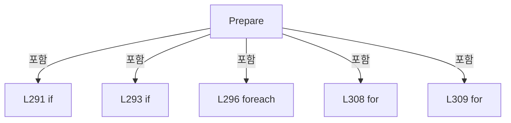

변경 전 점검: 입력/반환 타입, 위 호출자, 예외/취소 경로, 공유 상태와 저장·전송 소비자를 함께 확인합니다. 값의 단위나 물리 방향을 이름만으로 확정하지 않습니다.

### MethodDeclaration `LoadResults` · L322–333

[Drilling.Common/Correction/CAlignInterpolation.cs:322–333](https://github.com/kjuws10-rgb/A3Drilling/blob/334b3599651b2e8e0181fd4459bafaf3cddafff3/Drilling.Common/Correction/CAlignInterpolation.cs#L322-L333)

| 항목 | 실제 추출 값 |
| --- | --- |
| 서명 | System.Threading.Tasks.Task Drilling.Common.Correction.CAlignDistortionCycle.LoadResults(System.Threading.CancellationToken) |
| 접근/수식자 | Public / public, async |
| 반환/값 타입 | System.Threading.Tasks.Task |
| 소속 타입 | NamedType:Drilling.Common.Correction.CAlignDistortionCycle |

입력 계약:

| 이름 | 타입 | 전달 | 선택/기본값 |
| --- | --- | --- | --- |
| token | System.Threading.CancellationToken | None | False /  |

현재 부분 분석에서 직접 연결된 호출자는 없습니다. XAML/이벤트/인터페이스·델리게이트·외부 진입을 추가 확인해야 하며, 미사용으로 판정한 것이 아닙니다.

호출하는 대상과 해석 범위:

| 원본 행 | 표현식 | 분석 상태 | 대상/소스 위치 |
| --- | --- | --- | --- |
| 324 | new InvalidOperationException | resolved | System.InvalidOperationException.InvalidOperationException(string?) |
| 325 | ParameterKeys | resolved | string[] Drilling.Common.Correction.CAlignDistortionCycle.ParameterKeys(System.Collections.Generic.IReadOnlyCollection<int>) · Drilling.Common/Correction/CAlignInterpolation.cs:261 |
| 326 | _io.ReadValues(keys.Select(ResultId).ToArray(), token).ConfigureAwait | resolved | System.Runtime.CompilerServices.ConfiguredTaskAwaitable<System.Collections.Generic.IReadOnlyDictionary<string, double>> System.Threading.Tasks.Task<System.Collections.Generic.IReadOnlyDictionary<string, double>>.ConfigureAwait(bool) |
| 326 | _io.ReadValues | resolved | System.Threading.Tasks.Task<System.Collections.Generic.IReadOnlyDictionary<string, double>> Drilling.Common.Correction.CAlignWapageService.ReadValues(string[], System.Threading.CancellationToken) · Drilling.Common/Correction/CAlignInterpolation.cs:433 |
| 326 | keys.Select(ResultId).ToArray | resolved | string[] System.Collections.Generic.IEnumerable<string>.ToArray<string>() |
| 326 | keys.Select | resolved | System.Collections.Generic.IEnumerable<string> System.Collections.Generic.IEnumerable<string>.Select<string, string>(System.Func<string, string>) |
| 327 | keys.ToDictionary | resolved | System.Collections.Generic.Dictionary<string, double> System.Collections.Generic.IEnumerable<string>.ToDictionary<string, string, double>(System.Func<string, string>, System.Func<string, double>, System.Collections.Generic.IEqualityComparer<string>?) |
| 327 | ResultId | resolved | string Drilling.Common.Correction.CAlignDistortionCycle.ResultId(string) · Drilling.Common/Correction/CAlignInterpolation.cs:247 |
| 330 | Volatile.Write | resolved | void System.Threading.Volatile.Write<Drilling.Common.Correction.ST_DISTORTION_MEASUREMENT_SNAPSHOT?>(ref Drilling.Common.Correction.ST_DISTORTION_MEASUREMENT_SNAPSHOT?, Drilling.Common.Correction.ST_DISTORTION_MEASUREMENT_SNAPSHOT?) |
| 330 | new System.Collections.ObjectModel.ReadOnlyDictionary<string, double> | resolved | System.Collections.ObjectModel.ReadOnlyDictionary<string, double>.ReadOnlyDictionary(System.Collections.Generic.IDictionary<string, double>) |
| 331 | new Dictionary<string, double> | resolved | System.Collections.Generic.Dictionary<string, double>.Dictionary(System.Collections.Generic.IEnumerable<System.Collections.Generic.KeyValuePair<string, double>>, System.Collections.Generic.IEqualityComparer<string>?) |
| 332 | Log | resolved | void Drilling.Common.Correction.CAlignDistortionCycle.Log(string) · Drilling.Common/Correction/CAlignInterpolation.cs:379 |
| 332 | ResultId | resolved | string Drilling.Common.Correction.CAlignDistortionCycle.ResultId(string) · Drilling.Common/Correction/CAlignInterpolation.cs:247 |

본문의 실제 연산·분기·예외·반환 순서(원문 위치 순):

| 원본 행 | 종류 | 주석 해설 |
| --- | --- | --- |
| 324 | call | 함수·델리게이트 또는 객체 생성자를 호출합니다: new InvalidOperationException("Distortion 준비가 필요합니다.") |
| 324 | if | 조건에 따라 분기합니다: if (_recipe is null) |
| 324 | throw | 예외를 발생/전달합니다: throw new InvalidOperationException("Distortion 준비가 필요합니다."); |
| 325 | call | 함수·델리게이트 또는 객체 생성자를 호출합니다: ParameterKeys(_groups) |
| 325 | local-declaration | 지역 변수를 선언합니다: var keys = ParameterKeys(_groups); |
| 325 | variable-initializer | 변수의 초기값을 지정합니다: keys = ParameterKeys(_groups) |
| 326 | await | 비동기 완료를 기다립니다: await _io.ReadValues(keys.Select(ResultId).ToArray(), token).ConfigureAwait(false) |
| 326 | call | 함수·델리게이트 또는 객체 생성자를 호출합니다: _io.ReadValues(keys.Select(ResultId).ToArray(), token).ConfigureAwait(false) |
| 326 | call | 함수·델리게이트 또는 객체 생성자를 호출합니다: _io.ReadValues(keys.Select(ResultId).ToArray(), token) |
| 326 | call | 함수·델리게이트 또는 객체 생성자를 호출합니다: keys.Select(ResultId).ToArray() |
| 326 | call | 함수·델리게이트 또는 객체 생성자를 호출합니다: keys.Select(ResultId) |
| 326 | local-declaration | 지역 변수를 선언합니다: var values = await _io.ReadValues(keys.Select(ResultId).ToArray(), token).ConfigureAwait(false); |
| 326 | variable-initializer | 변수의 초기값을 지정합니다: values = await _io.ReadValues(keys.Select(ResultId).ToArray(), token).ConfigureAwait(false) |
| 327 | assignment | 값을 대상에 대입합니다: _results = keys.ToDictionary(key => key, key => values[ResultId(key)], StringComparer.OrdinalIgnoreCase) |
| 327 | call | 함수·델리게이트 또는 객체 생성자를 호출합니다: keys.ToDictionary(key => key, key => values[ResultId(key)], StringComparer.OrdinalIgnoreCase) |
| 327 | call | 함수·델리게이트 또는 객체 생성자를 호출합니다: ResultId(key) |
| 328 | assignment | 값을 대상에 대입합니다: _loadedAt = DateTimeOffset.Now |
| 329 | if | 조건에 따라 분기합니다: if (Snapshot is { } frame) |
| 330 | assignment | 값을 대상에 대입합니다: LastLoads = new System.Collections.ObjectModel.ReadOnlyDictionary<string, double>( new Dictionary<string, double>(_results, StringComparer.OrdinalIgnoreCase)) |
| 330 | call | 함수·델리게이트 또는 객체 생성자를 호출합니다: Volatile.Write(ref _snapshot, frame with { LastLoads = new System.Collections.ObjectModel.ReadOnlyDictionary<string, double>( new Dictionary<string, double>(_results, StringComparer.OrdinalIgnoreCase)), LoadedAt = _loade… |
| 330 | call | 함수·델리게이트 또는 객체 생성자를 호출합니다: new System.Collections.ObjectModel.ReadOnlyDictionary<string, double>( new Dictionary<string, double>(_results, StringComparer.OrdinalIgnoreCase)) |
| 331 | assignment | 값을 대상에 대입합니다: LoadedAt = _loadedAt |
| 331 | call | 함수·델리게이트 또는 객체 생성자를 호출합니다: new Dictionary<string, double>(_results, StringComparer.OrdinalIgnoreCase) |
| 332 | call | 함수·델리게이트 또는 객체 생성자를 호출합니다: Log($"측정값 취득 · {key}={_results[key]:0.####} mm ({ResultId(key)})") |
| 332 | call | 함수·델리게이트 또는 객체 생성자를 호출합니다: ResultId(key) |
| 332 | foreach | 컬렉션 요소를 순회합니다: foreach (var key in keys) |

제어 구문의 포함 구조(실제 실행 순서/CFG가 아닌 구문 탐색 그림):

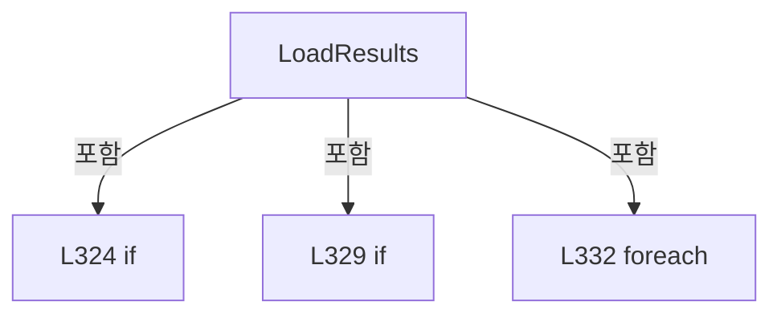

변경 전 점검: 입력/반환 타입, 위 호출자, 예외/취소 경로, 공유 상태와 저장·전송 소비자를 함께 확인합니다. 값의 단위나 물리 방향을 이름만으로 확정하지 않습니다.

### MethodDeclaration `Calculate` · L334–345

[Drilling.Common/Correction/CAlignInterpolation.cs:334–345](https://github.com/kjuws10-rgb/A3Drilling/blob/334b3599651b2e8e0181fd4459bafaf3cddafff3/Drilling.Common/Correction/CAlignInterpolation.cs#L334-L345)

| 항목 | 실제 추출 값 |
| --- | --- |
| 서명 | System.Threading.Tasks.Task Drilling.Common.Correction.CAlignDistortionCycle.Calculate(System.Threading.CancellationToken) |
| 접근/수식자 | Public / public |
| 반환/값 타입 | System.Threading.Tasks.Task |
| 소속 타입 | NamedType:Drilling.Common.Correction.CAlignDistortionCycle |

입력 계약:

| 이름 | 타입 | 전달 | 선택/기본값 |
| --- | --- | --- | --- |
| token | System.Threading.CancellationToken | None | False /  |

현재 부분 분석에서 직접 연결된 호출자는 없습니다. XAML/이벤트/인터페이스·델리게이트·외부 진입을 추가 확인해야 하며, 미사용으로 판정한 것이 아닙니다.

호출하는 대상과 해석 범위:

| 원본 행 | 표현식 | 분석 상태 | 대상/소스 위치 |
| --- | --- | --- | --- |
| 334 | Task.Run | resolved | System.Threading.Tasks.Task System.Threading.Tasks.Task.Run(System.Action, System.Threading.CancellationToken) |
| 336 | token.ThrowIfCancellationRequested | resolved | void System.Threading.CancellationToken.ThrowIfCancellationRequested() |
| 337 | new InvalidOperationException | resolved | System.InvalidOperationException.InvalidOperationException(string?) |
| 338 | new | resolved | Drilling.Common.Correction.CAlignInterpolation.CAlignInterpolation(System.Collections.Generic.IReadOnlyList<Drilling.Common.Correction.ST_ALIGN_INTERPOLATION_KEY>, System.Collections.Generic.IReadOnlyCollection<string>) · Drilling.Common/Correction/CAlignInterpolation.cs:18 |
| 338 | Keys | resolved | Drilling.Common.Correction.ST_ALIGN_INTERPOLATION_KEY[] Drilling.Common.Correction.CAlignDistortionCycle.Keys() · Drilling.Common/Correction/CAlignInterpolation.cs:268 |
| 338 | Names(_groups).Where(name => name.StartsWith("DK", StringComparison.Ordinal)).ToArray | resolved | string[] System.Collections.Generic.IEnumerable<string>.ToArray<string>() |
| 338 | Names(_groups).Where | resolved | System.Collections.Generic.IEnumerable<string> System.Collections.Generic.IEnumerable<string>.Where<string>(System.Func<string, bool>) |
| 338 | Names | resolved | string[] Drilling.Common.Correction.CAlignDistortionCycle.Names(System.Collections.Generic.IReadOnlyCollection<int>) · Drilling.Common/Correction/CAlignInterpolation.cs:259 |
| 338 | name.StartsWith | resolved | bool string.StartsWith(string, System.StringComparison) |
| 339 | CAlignShotOffsetData.Calculate | resolved | System.Collections.Generic.IReadOnlyList<Drilling.Common.Recipe.ST_ALIGN_SHOT_OFFSET> Drilling.Common.Recipe.CAlignShotOffsetData.Calculate(Drilling.Common.Managers.ST_RECIPE_DEFINITION, Drilling.Common.Correction.CAlignInterpolation, Drilling.Common.Managers.ST_ALIGN_KEY_MARGINS) · Drilling.Common/Recipe/CShotCoordinatePlanBuilder.cs:682 |
| 341 | CAlignOffsetTolerance.Check | resolved | Drilling.Common.Correction.ST_ALIGN_OFFSET_TOLERANCE_CHECK Drilling.Common.Correction.CAlignOffsetTolerance.Check(double, System.Collections.Generic.IReadOnlyList<Drilling.Common.Recipe.ST_ALIGN_SHOT_OFFSET>) · Drilling.Common/Correction/CAlignInterpolation.cs:176 |
| 342 | new InvalidOperationException | resolved | System.InvalidOperationException.InvalidOperationException(string?) |
| 342 | string.Join | resolved | string string.Join(string?, System.Collections.Generic.IEnumerable<string?>) |
| 342 | exceeded.Take(8).Select | resolved | System.Collections.Generic.IEnumerable<string> System.Collections.Generic.IEnumerable<Drilling.Common.Recipe.ST_ALIGN_SHOT_OFFSET>.Select<Drilling.Common.Recipe.ST_ALIGN_SHOT_OFFSET, string>(System.Func<Drilling.Common.Recipe.ST_ALIGN_SHOT_OFFSET, string>) |
| 342 | exceeded.Take | resolved | System.Collections.Generic.IEnumerable<Drilling.Common.Recipe.ST_ALIGN_SHOT_OFFSET> System.Collections.Generic.IEnumerable<Drilling.Common.Recipe.ST_ALIGN_SHOT_OFFSET>.Take<Drilling.Common.Recipe.ST_ALIGN_SHOT_OFFSET>(int) |
| 344 | Log | resolved | void Drilling.Common.Correction.CAlignDistortionCycle.Log(string) · Drilling.Common/Correction/CAlignInterpolation.cs:379 |

본문의 실제 연산·분기·예외·반환 순서(원문 위치 순):

| 원본 행 | 종류 | 주석 해설 |
| --- | --- | --- |
| 334 | call | 함수·델리게이트 또는 객체 생성자를 호출합니다: Task.Run(() => { token.ThrowIfCancellationRequested(); if (_results is null &#124;&#124; _recipe is null) throw new InvalidOperationException("Distortion 측정 결과가 없습니다."); _model = new(Keys(), Names(_groups).Where(name => name.Start… |
| 336 | call | 함수·델리게이트 또는 객체 생성자를 호출합니다: token.ThrowIfCancellationRequested() |
| 337 | call | 함수·델리게이트 또는 객체 생성자를 호출합니다: new InvalidOperationException("Distortion 측정 결과가 없습니다.") |
| 337 | if | 조건에 따라 분기합니다: if (_results is null &#124;&#124; _recipe is null) |
| 337 | throw | 예외를 발생/전달합니다: throw new InvalidOperationException("Distortion 측정 결과가 없습니다."); |
| 338 | assignment | 값을 대상에 대입합니다: _model = new(Keys(), Names(_groups).Where(name => name.StartsWith("DK", StringComparison.Ordinal)).ToArray()) |
| 338 | call | 함수·델리게이트 또는 객체 생성자를 호출합니다: new(Keys(), Names(_groups).Where(name => name.StartsWith("DK", StringComparison.Ordinal)).ToArray()) |
| 338 | call | 함수·델리게이트 또는 객체 생성자를 호출합니다: Keys() |
| 338 | call | 함수·델리게이트 또는 객체 생성자를 호출합니다: Names(_groups).Where(name => name.StartsWith("DK", StringComparison.Ordinal)).ToArray() |
| 338 | call | 함수·델리게이트 또는 객체 생성자를 호출합니다: Names(_groups).Where(name => name.StartsWith("DK", StringComparison.Ordinal)) |
| 338 | call | 함수·델리게이트 또는 객체 생성자를 호출합니다: Names(_groups) |
| 338 | call | 함수·델리게이트 또는 객체 생성자를 호출합니다: name.StartsWith("DK", StringComparison.Ordinal) |
| 339 | call | 함수·델리게이트 또는 객체 생성자를 호출합니다: CAlignShotOffsetData.Calculate(_recipe, _model, _alignKeyMargins) |
| 339 | local-declaration | 지역 변수를 선언합니다: var offsets = CAlignShotOffsetData.Calculate(_recipe, _model, _alignKeyMargins); |
| 339 | variable-initializer | 변수의 초기값을 지정합니다: offsets = CAlignShotOffsetData.Calculate(_recipe, _model, _alignKeyMargins) |
| 341 | call | 함수·델리게이트 또는 객체 생성자를 호출합니다: CAlignOffsetTolerance.Check(_tolerance, offsets) |
| 341 | local-declaration | 지역 변수를 선언합니다: var exceeded = CAlignOffsetTolerance.Check(_tolerance, offsets).ExceededShots; |
| 341 | variable-initializer | 변수의 초기값을 지정합니다: exceeded = CAlignOffsetTolerance.Check(_tolerance, offsets).ExceededShots |
| 342 | call | 함수·델리게이트 또는 객체 생성자를 호출합니다: new InvalidOperationException($"Align Offset Tolerance ±{_tolerance:0.000} mm 초과 {exceeded.Count} Shot. 전체 적용 취소. " + string.Join("; ", exceeded.Take(8).Select(shot => $"Cell{shot.CellNo}/{shot.ShotName}: X={shot.X:0.000… |
| 342 | call | 함수·델리게이트 또는 객체 생성자를 호출합니다: string.Join("; ", exceeded.Take(8).Select(shot => $"Cell{shot.CellNo}/{shot.ShotName}: X={shot.X:0.000}, Y={shot.Y:0.000}")) |
| 342 | call | 함수·델리게이트 또는 객체 생성자를 호출합니다: exceeded.Take(8).Select(shot => $"Cell{shot.CellNo}/{shot.ShotName}: X={shot.X:0.000}, Y={shot.Y:0.000}") |
| 342 | call | 함수·델리게이트 또는 객체 생성자를 호출합니다: exceeded.Take(8) |
| 342 | if | 조건에 따라 분기합니다: if (exceeded.Count > 0) |
| 342 | throw | 예외를 발생/전달합니다: throw new InvalidOperationException($"Align Offset Tolerance ±{_tolerance:0.000} mm 초과 {exceeded.Count} Shot. 전체 적용 취소. " + string.Join("; ", exceeded.Take(8).Select(shot => $"Cell{shot.CellNo}/{shot.ShotName}: X={shot.X:0.000}, Y |
| 343 | assignment | 값을 대상에 대입합니다: _offsets = offsets |
| 344 | call | 함수·델리게이트 또는 객체 생성자를 호출합니다: Log($"Base−LastLoad 라그랑주 계산 완료 · {offsets.Count} Shot · Tolerance ±{_tolerance:0.000} mm · 설계 좌표 기준") |

제어 구문의 포함 구조(실제 실행 순서/CFG가 아닌 구문 탐색 그림):

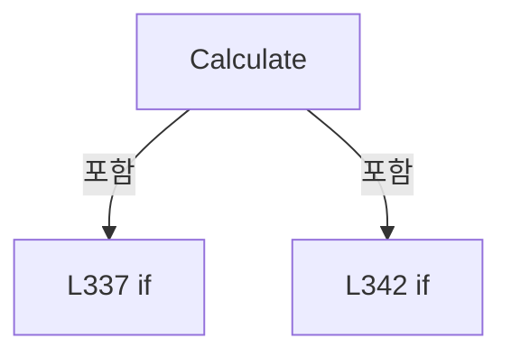

변경 전 점검: 입력/반환 타입, 위 호출자, 예외/취소 경로, 공유 상태와 저장·전송 소비자를 함께 확인합니다. 값의 단위나 물리 방향을 이름만으로 확정하지 않습니다.

### MethodDeclaration `Save` · L346–371

[Drilling.Common/Correction/CAlignInterpolation.cs:346–371](https://github.com/kjuws10-rgb/A3Drilling/blob/334b3599651b2e8e0181fd4459bafaf3cddafff3/Drilling.Common/Correction/CAlignInterpolation.cs#L346-L371)

| 항목 | 실제 추출 값 |
| --- | --- |
| 서명 | System.Threading.Tasks.Task Drilling.Common.Correction.CAlignDistortionCycle.Save(System.Threading.CancellationToken) |
| 접근/수식자 | Public / public, async |
| 반환/값 타입 | System.Threading.Tasks.Task |
| 소속 타입 | NamedType:Drilling.Common.Correction.CAlignDistortionCycle |

입력 계약:

| 이름 | 타입 | 전달 | 선택/기본값 |
| --- | --- | --- | --- |
| token | System.Threading.CancellationToken | None | False /  |

현재 부분 분석에서 직접 연결된 호출자는 없습니다. XAML/이벤트/인터페이스·델리게이트·외부 진입을 추가 확인해야 하며, 미사용으로 판정한 것이 아닙니다.

호출하는 대상과 해석 범위:

| 원본 행 | 표현식 | 분석 상태 | 대상/소스 위치 |
| --- | --- | --- | --- |
| 350 | new InvalidOperationException | resolved | System.InvalidOperationException.InvalidOperationException(string?) |
| 352 | recipes.SaveAlignOffsetsIfUnchanged(_recipe, _offsets, token).ConfigureAwait | resolved | System.Runtime.CompilerServices.ConfiguredTaskAwaitable<Drilling.Common.Managers.ST_RECIPE_DEFINITION> System.Threading.Tasks.Task<Drilling.Common.Managers.ST_RECIPE_DEFINITION>.ConfigureAwait(bool) |
| 352 | recipes.SaveAlignOffsetsIfUnchanged | resolved | System.Threading.Tasks.Task<Drilling.Common.Managers.ST_RECIPE_DEFINITION> Drilling.Common.Managers.CRecipeManager.SaveAlignOffsetsIfUnchanged(Drilling.Common.Managers.ST_RECIPE_DEFINITION, System.Collections.Generic.IReadOnlyList<Drilling.Common.Recipe.ST_ALIGN_SHOT_OFFSET>, System.Threading.CancellationToken) · Drilling.Common/Managers/CRecipeManager.cs:94 |
| 353 | Names(_groups).ToHashSet | resolved | System.Collections.Generic.HashSet<string> System.Collections.Generic.IEnumerable<string>.ToHashSet<string>(System.Collections.Generic.IEqualityComparer<string>?) |
| 353 | Names | resolved | string[] Drilling.Common.Correction.CAlignDistortionCycle.Names(System.Collections.Generic.IReadOnlyCollection<int>) · Drilling.Common/Correction/CAlignInterpolation.cs:259 |
| 354 | _recipe.Parameters.ToDictionary | resolved | System.Collections.Generic.Dictionary<string, string> System.Collections.Generic.IEnumerable<Drilling.Common.Managers.ST_RECIPE_PARAMETER>.ToDictionary<Drilling.Common.Managers.ST_RECIPE_PARAMETER, string, string>(System.Func<Drilling.Common.Managers.ST_RECIPE_PARAMETER, string>, System.Func<Drilling.Common.Managers.ST_RECIPE_PARAMETER, string>, System.Collections.Generic.IEqualityComparer<string>?) |
| 356 | Keys().Select(key => { var delta = selected.Contains(key.Name) ? new ST_ALIGN_CORRECTION(key.CorrectionX!.Value, key.CorrectionY!.Value) : (ST_ALIGN_CORRECTION?)null; return new ST_ALIGN_OFFSET_KEY_LOG(key.Name, selected.Contains(key.Name), key.X, key.Y, OptionalBase(key.Name, "X"), OptionalBase(key.Name, "Y"), _results.GetValueOrDefault($"ALIGNBAS… | resolved | Drilling.Common.Correction.ST_ALIGN_OFFSET_KEY_LOG[] System.Collections.Generic.IEnumerable<Drilling.Common.Correction.ST_ALIGN_OFFSET_KEY_LOG>.ToArray<Drilling.Common.Correction.ST_ALIGN_OFFSET_KEY_LOG>() |
| 356 | Keys().Select | resolved | System.Collections.Generic.IEnumerable<Drilling.Common.Correction.ST_ALIGN_OFFSET_KEY_LOG> System.Collections.Generic.IEnumerable<Drilling.Common.Correction.ST_ALIGN_INTERPOLATION_KEY>.Select<Drilling.Common.Correction.ST_ALIGN_INTERPOLATION_KEY, Drilling.Common.Correction.ST_ALIGN_OFFSET_KEY_LOG>(System.Func<Drilling.Common.Correction.ST_ALIGN_INTERPOLATION_KEY, Drilling.Common.Correction.ST_ALIGN_OFFSET_KEY_LOG>) |
| 356 | Keys | resolved | Drilling.Common.Correction.ST_ALIGN_INTERPOLATION_KEY[] Drilling.Common.Correction.CAlignDistortionCycle.Keys() · Drilling.Common/Correction/CAlignInterpolation.cs:268 |
| 358 | selected.Contains | resolved | bool System.Collections.Generic.HashSet<string>.Contains(string) |
| 358 | new ST_ALIGN_CORRECTION | resolved | Drilling.Common.Correction.ST_ALIGN_CORRECTION.ST_ALIGN_CORRECTION(double, double) · Drilling.Common/Correction/CAlignInterpolation.cs:122 |
| 359 | new ST_ALIGN_OFFSET_KEY_LOG | resolved | Drilling.Common.Correction.ST_ALIGN_OFFSET_KEY_LOG.ST_ALIGN_OFFSET_KEY_LOG(string, bool, double, double, double?, double?, double?, double?, double?, double?) · Drilling.Common/Correction/CAlignInterpolation.cs:123 |
| 359 | selected.Contains | resolved | bool System.Collections.Generic.HashSet<string>.Contains(string) |
| 359 | OptionalBase | resolved | double? OptionalBase(string, string) · Drilling.Common/Correction/CAlignInterpolation.cs:355 |
| 359 | OptionalBase | resolved | double? OptionalBase(string, string) · Drilling.Common/Correction/CAlignInterpolation.cs:355 |
| 360 | _results.GetValueOrDefault | resolved | double System.Collections.Generic.IReadOnlyDictionary<string, double>.GetValueOrDefault<string, double>(string, double) |
| 360 | double.IsFinite | resolved | bool double.IsFinite(double) |
| 361 | _results.GetValueOrDefault | resolved | double System.Collections.Generic.IReadOnlyDictionary<string, double>.GetValueOrDefault<string, double>(string, double) |
| 361 | double.IsFinite | resolved | bool double.IsFinite(double) |
| 363 | interfaces.GetInterfaceCommunicationList(EN_EQP_MODULE.Melsec).Any | resolved | bool System.Collections.Generic.IEnumerable<Drilling.Common.Interface.ST_INTERFACE_COMM_STATUS>.Any<Drilling.Common.Interface.ST_INTERFACE_COMM_STATUS>(System.Func<Drilling.Common.Interface.ST_INTERFACE_COMM_STATUS, bool>) |
| 363 | interfaces.GetInterfaceCommunicationList | resolved | System.Collections.Generic.IReadOnlyList<Drilling.Common.Interface.ST_INTERFACE_COMM_STATUS> Drilling.Common.Interface.CInterfaceManager.GetInterfaceCommunicationList(Drilling.Common.Interface.EN_EQP_MODULE?) · Drilling.Common/Interface/CInterfaceManager.cs:472 |
| 364 | audit.Save(new(_recipe.Id, _recipe.Name, false, DateTimeOffset.Now, _loadedAt, simulation, keyLog, _offsets) { Tolerance = _tolerance, CalculatedOffsets = _offsets }, token).ConfigureAwait | resolved | System.Runtime.CompilerServices.ConfiguredTaskAwaitable<string> System.Threading.Tasks.Task<string>.ConfigureAwait(bool) |
| 364 | audit.Save | resolved | System.Threading.Tasks.Task<string> Drilling.Common.Correction.CAlignOffsetLogFileBase.Save(Drilling.Common.Correction.ST_ALIGN_OFFSET_LOG, System.Threading.CancellationToken) · Drilling.Common/Correction/CAlignInterpolation.cs:153 |
| 364 | new | resolved | Drilling.Common.Correction.ST_ALIGN_OFFSET_LOG.ST_ALIGN_OFFSET_LOG(string, string, bool, System.DateTimeOffset, System.DateTimeOffset?, bool, System.Collections.Generic.IReadOnlyList<Drilling.Common.Correction.ST_ALIGN_OFFSET_KEY_LOG>, System.Collections.Generic.IReadOnlyList<Drilling.Common.Recipe.ST_ALIGN_SHOT_OFFSET>) · Drilling.Common/Correction/CAlignInterpolation.cs:135 |
| 365 | new Dictionary<string, string> | resolved | System.Collections.Generic.Dictionary<string, string>.Dictionary(System.Collections.Generic.IEnumerable<System.Collections.Generic.KeyValuePair<string, string>>, System.Collections.Generic.IEqualityComparer<string>?) |
| 366 | parameters.Keys.Where(CAlignShotOffsetData.IsParameterKey).ToArray | resolved | string[] System.Collections.Generic.IEnumerable<string>.ToArray<string>() |
| 366 | parameters.Keys.Where | resolved | System.Collections.Generic.IEnumerable<string> System.Collections.Generic.IEnumerable<string>.Where<string>(System.Func<string, bool>) |
| 366 | parameters.Remove | resolved | bool System.Collections.Generic.Dictionary<string, string>.Remove(string) |
| 367 | saved.Parameters.Where | resolved | System.Collections.Generic.IEnumerable<Drilling.Common.Managers.ST_RECIPE_PARAMETER> System.Collections.Generic.IEnumerable<Drilling.Common.Managers.ST_RECIPE_PARAMETER>.Where<Drilling.Common.Managers.ST_RECIPE_PARAMETER>(System.Func<Drilling.Common.Managers.ST_RECIPE_PARAMETER, bool>) |
| 367 | CAlignShotOffsetData.IsParameterKey | resolved | bool Drilling.Common.Recipe.CAlignShotOffsetData.IsParameterKey(string) · Drilling.Common/Recipe/CShotCoordinatePlanBuilder.cs:661 |
| 368 | Interlocked.Exchange | resolved | Drilling.Common.Station.ST_STAGE_PROCESS_REQUEST? System.Threading.Interlocked.Exchange<Drilling.Common.Station.ST_STAGE_PROCESS_REQUEST?>(ref Drilling.Common.Station.ST_STAGE_PROCESS_REQUEST?, Drilling.Common.Station.ST_STAGE_PROCESS_REQUEST?) |
| 370 | Log | resolved | void Drilling.Common.Correction.CAlignDistortionCycle.Log(string) · Drilling.Common/Correction/CAlignInterpolation.cs:379 |

본문의 실제 연산·분기·예외·반환 순서(원문 위치 순):

| 원본 행 | 종류 | 주석 해설 |
| --- | --- | --- |
| 348 | if | 조건에 따라 분기합니다: if (_saved) |
| 348 | return | 호출자에게 값 또는 제어를 반환합니다: return; |
| 349 | if | 조건에 따라 분기합니다: if (_recipe is null &#124;&#124; _input is null &#124;&#124; _model is null &#124;&#124; _offsets is null &#124;&#124; _results is null) |
| 350 | call | 함수·델리게이트 또는 객체 생성자를 호출합니다: new InvalidOperationException("Distortion 보정 계산이 완료되지 않았습니다.") |
| 350 | throw | 예외를 발생/전달합니다: throw new InvalidOperationException("Distortion 보정 계산이 완료되지 않았습니다."); |
| 352 | await | 비동기 완료를 기다립니다: await recipes.SaveAlignOffsetsIfUnchanged(_recipe, _offsets, token).ConfigureAwait(false) |
| 352 | call | 함수·델리게이트 또는 객체 생성자를 호출합니다: recipes.SaveAlignOffsetsIfUnchanged(_recipe, _offsets, token).ConfigureAwait(false) |
| 352 | call | 함수·델리게이트 또는 객체 생성자를 호출합니다: recipes.SaveAlignOffsetsIfUnchanged(_recipe, _offsets, token) |
| 352 | local-declaration | 지역 변수를 선언합니다: var saved = await recipes.SaveAlignOffsetsIfUnchanged(_recipe, _offsets, token).ConfigureAwait(false); |
| 352 | variable-initializer | 변수의 초기값을 지정합니다: saved = await recipes.SaveAlignOffsetsIfUnchanged(_recipe, _offsets, token).ConfigureAwait(false) |
| 353 | call | 함수·델리게이트 또는 객체 생성자를 호출합니다: Names(_groups).ToHashSet(StringComparer.Ordinal) |
| 353 | call | 함수·델리게이트 또는 객체 생성자를 호출합니다: Names(_groups) |
| 353 | local-declaration | 지역 변수를 선언합니다: var selected = Names(_groups).ToHashSet(StringComparer.Ordinal); |
| 353 | variable-initializer | 변수의 초기값을 지정합니다: selected = Names(_groups).ToHashSet(StringComparer.Ordinal) |
| 354 | call | 함수·델리게이트 또는 객체 생성자를 호출합니다: _recipe.Parameters.ToDictionary(item => item.Key, item => item.Value, StringComparer.OrdinalIgnoreCase) |
| 354 | local-declaration | 지역 변수를 선언합니다: var p = _recipe.Parameters.ToDictionary(item => item.Key, item => item.Value, StringComparer.OrdinalIgnoreCase); |
| 354 | variable-initializer | 변수의 초기값을 지정합니다: p = _recipe.Parameters.ToDictionary(item => item.Key, item => item.Value, StringComparer.OrdinalIgnoreCase) |
| 356 | call | 함수·델리게이트 또는 객체 생성자를 호출합니다: Keys() |
| 356 | call | 함수·델리게이트 또는 객체 생성자를 호출합니다: Keys().Select(key => { var delta = selected.Contains(key.Name) ? new ST_ALIGN_CORRECTION(key.CorrectionX!.Value, key.CorrectionY!.Value) : (ST_ALIGN_CORRECTION?)null; return new ST_ALIGN_OFFSET_KEY_LOG(key.Name, selected… |
| 356 | call | 함수·델리게이트 또는 객체 생성자를 호출합니다: Keys().Select(key => { var delta = selected.Contains(key.Name) ? new ST_ALIGN_CORRECTION(key.CorrectionX!.Value, key.CorrectionY!.Value) : (ST_ALIGN_CORRECTION?)null; return new ST_ALIGN_OFFSET_KEY_LOG(key.Name, selected… |
| 356 | local-declaration | 지역 변수를 선언합니다: var keyLog = Keys().Select(key => { var delta = selected.Contains(key.Name) ? new ST_ALIGN_CORRECTION(key.CorrectionX!.Value, key.CorrectionY!.Value) : (ST_ALIGN_CORRECTION?)null; return new ST_ALIGN_OFFSET_KEY_LOG(key.Name, selec |
| 356 | variable-initializer | 변수의 초기값을 지정합니다: keyLog = Keys().Select(key => { var delta = selected.Contains(key.Name) ? new ST_ALIGN_CORRECTION(key.CorrectionX!.Value, key.CorrectionY!.Value) : (ST_ALIGN_CORRECTION?)null; return new ST_ALIGN_OFFSET_KEY_LOG(key.Name, selected. |
| 358 | call | 함수·델리게이트 또는 객체 생성자를 호출합니다: selected.Contains(key.Name) |
| 358 | call | 함수·델리게이트 또는 객체 생성자를 호출합니다: new ST_ALIGN_CORRECTION(key.CorrectionX!.Value, key.CorrectionY!.Value) |
| 358 | conditional-expression | 조건에 따라 결과식을 선택합니다: selected.Contains(key.Name) ? new ST_ALIGN_CORRECTION(key.CorrectionX!.Value, key.CorrectionY!.Value) : (ST_ALIGN_CORRECTION?)null |
| 358 | local-declaration | 지역 변수를 선언합니다: var delta = selected.Contains(key.Name) ? new ST_ALIGN_CORRECTION(key.CorrectionX!.Value, key.CorrectionY!.Value) : (ST_ALIGN_CORRECTION?)null; |
| 358 | variable-initializer | 변수의 초기값을 지정합니다: delta = selected.Contains(key.Name) ? new ST_ALIGN_CORRECTION(key.CorrectionX!.Value, key.CorrectionY!.Value) : (ST_ALIGN_CORRECTION?)null |
| 359 | call | 함수·델리게이트 또는 객체 생성자를 호출합니다: selected.Contains(key.Name) |
| 359 | call | 함수·델리게이트 또는 객체 생성자를 호출합니다: OptionalBase(key.Name, "X") |
| 359 | call | 함수·델리게이트 또는 객체 생성자를 호출합니다: OptionalBase(key.Name, "Y") |
| 359 | call | 함수·델리게이트 또는 객체 생성자를 호출합니다: new ST_ALIGN_OFFSET_KEY_LOG(key.Name, selected.Contains(key.Name), key.X, key.Y, OptionalBase(key.Name, "X"), OptionalBase(key.Name, "Y"), _results.GetValueOrDefault($"ALIGNBASE_{key.Name}_X", double.NaN) is var x && dou… |
| 359 | return | 호출자에게 값 또는 제어를 반환합니다: return new ST_ALIGN_OFFSET_KEY_LOG(key.Name, selected.Contains(key.Name), key.X, key.Y, OptionalBase(key.Name, "X"), OptionalBase(key.Name, "Y"), _results.GetValueOrDefault($"ALIGNBASE_{key.Name}_X", double.NaN) is var x && double |
| 360 | call | 함수·델리게이트 또는 객체 생성자를 호출합니다: _results.GetValueOrDefault($"ALIGNBASE_{key.Name}_X", double.NaN) |
| 360 | call | 함수·델리게이트 또는 객체 생성자를 호출합니다: double.IsFinite(x) |
| 360 | conditional-expression | 조건에 따라 결과식을 선택합니다: _results.GetValueOrDefault($"ALIGNBASE_{key.Name}_X", double.NaN) is var x && double.IsFinite(x) ? x : null |
| 361 | call | 함수·델리게이트 또는 객체 생성자를 호출합니다: _results.GetValueOrDefault($"ALIGNBASE_{key.Name}_Y", double.NaN) |
| 361 | call | 함수·델리게이트 또는 객체 생성자를 호출합니다: double.IsFinite(y) |
| 361 | conditional-expression | 조건에 따라 결과식을 선택합니다: _results.GetValueOrDefault($"ALIGNBASE_{key.Name}_Y", double.NaN) is var y && double.IsFinite(y) ? y : null |
| 363 | call | 함수·델리게이트 또는 객체 생성자를 호출합니다: interfaces.GetInterfaceCommunicationList(EN_EQP_MODULE.Melsec).Any(device => device.IsSimulation) |
| 363 | call | 함수·델리게이트 또는 객체 생성자를 호출합니다: interfaces.GetInterfaceCommunicationList(EN_EQP_MODULE.Melsec) |
| 363 | local-declaration | 지역 변수를 선언합니다: var simulation = interfaces.GetInterfaceCommunicationList(EN_EQP_MODULE.Melsec).Any(device => device.IsSimulation); |
| 363 | variable-initializer | 변수의 초기값을 지정합니다: simulation = interfaces.GetInterfaceCommunicationList(EN_EQP_MODULE.Melsec).Any(device => device.IsSimulation) |
| 364 | assignment | 값을 대상에 대입합니다: Tolerance = _tolerance |
| 364 | assignment | 값을 대상에 대입합니다: CalculatedOffsets = _offsets |
| 364 | await | 비동기 완료를 기다립니다: await audit.Save(new(_recipe.Id, _recipe.Name, false, DateTimeOffset.Now, _loadedAt, simulation, keyLog, _offsets) { Tolerance = _tolerance, CalculatedOffsets = _offsets }, token).ConfigureAwait(false) |
| 364 | call | 함수·델리게이트 또는 객체 생성자를 호출합니다: audit.Save(new(_recipe.Id, _recipe.Name, false, DateTimeOffset.Now, _loadedAt, simulation, keyLog, _offsets) { Tolerance = _tolerance, CalculatedOffsets = _offsets }, token).ConfigureAwait(false) |
| 364 | call | 함수·델리게이트 또는 객체 생성자를 호출합니다: audit.Save(new(_recipe.Id, _recipe.Name, false, DateTimeOffset.Now, _loadedAt, simulation, keyLog, _offsets) { Tolerance = _tolerance, CalculatedOffsets = _offsets }, token) |
| 364 | call | 함수·델리게이트 또는 객체 생성자를 호출합니다: new(_recipe.Id, _recipe.Name, false, DateTimeOffset.Now, _loadedAt, simulation, keyLog, _offsets) { Tolerance = _tolerance, CalculatedOffsets = _offsets } |
| 364 | local-declaration | 지역 변수를 선언합니다: var path = await audit.Save(new(_recipe.Id, _recipe.Name, false, DateTimeOffset.Now, _loadedAt, simulation, keyLog, _offsets) { Tolerance = _tolerance, CalculatedOffsets = _offsets }, token).ConfigureAwait(false); |
| 364 | variable-initializer | 변수의 초기값을 지정합니다: path = await audit.Save(new(_recipe.Id, _recipe.Name, false, DateTimeOffset.Now, _loadedAt, simulation, keyLog, _offsets) { Tolerance = _tolerance, CalculatedOffsets = _offsets }, token).ConfigureAwait(false) |
| 365 | call | 함수·델리게이트 또는 객체 생성자를 호출합니다: new Dictionary<string, string>(_input.Parameters, StringComparer.OrdinalIgnoreCase) |
| 365 | local-declaration | 지역 변수를 선언합니다: var parameters = new Dictionary<string, string>(_input.Parameters, StringComparer.OrdinalIgnoreCase); |
| 365 | variable-initializer | 변수의 초기값을 지정합니다: parameters = new Dictionary<string, string>(_input.Parameters, StringComparer.OrdinalIgnoreCase) |
| 366 | call | 함수·델리게이트 또는 객체 생성자를 호출합니다: parameters.Keys.Where(CAlignShotOffsetData.IsParameterKey).ToArray() |
| 366 | call | 함수·델리게이트 또는 객체 생성자를 호출합니다: parameters.Keys.Where(CAlignShotOffsetData.IsParameterKey) |
| 366 | call | 함수·델리게이트 또는 객체 생성자를 호출합니다: parameters.Remove(key) |
| 366 | foreach | 컬렉션 요소를 순회합니다: foreach (var key in parameters.Keys.Where(CAlignShotOffsetData.IsParameterKey).ToArray()) |
| 367 | assignment | 값을 대상에 대입합니다: parameters[item.Key] = item.Value |
| 367 | call | 함수·델리게이트 또는 객체 생성자를 호출합니다: saved.Parameters.Where(item => CAlignShotOffsetData.IsParameterKey(item.Key)) |
| 367 | call | 함수·델리게이트 또는 객체 생성자를 호출합니다: CAlignShotOffsetData.IsParameterKey(item.Key) |
| 367 | foreach | 컬렉션 요소를 순회합니다: foreach (var item in saved.Parameters.Where(item => CAlignShotOffsetData.IsParameterKey(item.Key))) |
| 368 | assignment | 값을 대상에 대입합니다: Parameters = parameters |
| 368 | call | 함수·델리게이트 또는 객체 생성자를 호출합니다: Interlocked.Exchange(ref _pending, _input with { Parameters = parameters }) |
| 369 | assignment | 값을 대상에 대입합니다: _saved = true |
| 370 | call | 함수·델리게이트 또는 객체 생성자를 호출합니다: Log($"이번 Glass Align Offset 갱신 완료 · {_offsets.Count} Shot · Audit={path}") |

제어 구문의 포함 구조(실제 실행 순서/CFG가 아닌 구문 탐색 그림):

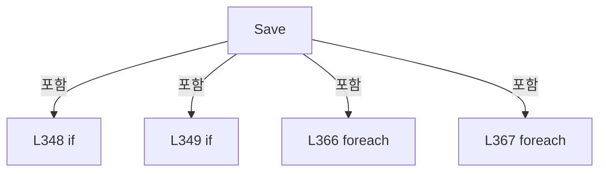

변경 전 점검: 입력/반환 타입, 위 호출자, 예외/취소 경로, 공유 상태와 저장·전송 소비자를 함께 확인합니다. 값의 단위나 물리 방향을 이름만으로 확정하지 않습니다.

### LocalFunctionStatement `OptionalBase` · L355–355

[Drilling.Common/Correction/CAlignInterpolation.cs:355–355](https://github.com/kjuws10-rgb/A3Drilling/blob/334b3599651b2e8e0181fd4459bafaf3cddafff3/Drilling.Common/Correction/CAlignInterpolation.cs#L355-L355)

| 항목 | 실제 추출 값 |
| --- | --- |
| 서명 | double? OptionalBase(string, string) |
| 접근/수식자 | Private /  |
| 반환/값 타입 | double? |
| 소속 타입 | NamedType:Drilling.Common.Correction.CAlignDistortionCycle |

입력 계약:

| 이름 | 타입 | 전달 | 선택/기본값 |
| --- | --- | --- | --- |
| name | string | None | False /  |
| axis | string | None | False /  |

정적 호출자로 확인된 위치:

| 호출 파일/행 | 호출 표현식 | 런타임 분기 가능 |
| --- | --- | --- |
| [Drilling.Common/Correction/CAlignInterpolation.cs:359–359](https://github.com/kjuws10-rgb/A3Drilling/blob/334b3599651b2e8e0181fd4459bafaf3cddafff3/Drilling.Common/Correction/CAlignInterpolation.cs#L359-L359) | OptionalBase | False |
| [Drilling.Common/Correction/CAlignInterpolation.cs:359–359](https://github.com/kjuws10-rgb/A3Drilling/blob/334b3599651b2e8e0181fd4459bafaf3cddafff3/Drilling.Common/Correction/CAlignInterpolation.cs#L359-L359) | OptionalBase | False |

호출하는 대상과 해석 범위:

| 원본 행 | 표현식 | 분석 상태 | 대상/소스 위치 |
| --- | --- | --- | --- |
| 355 | p.TryGetValue | resolved | bool System.Collections.Generic.Dictionary<string, string>.TryGetValue(string, out string) |
| 355 | double.TryParse | resolved | bool double.TryParse(string?, System.Globalization.NumberStyles, System.IFormatProvider?, out double) |
| 355 | double.IsFinite | resolved | bool double.IsFinite(double) |

본문의 실제 연산·분기·예외·반환 순서(원문 위치 순):

| 원본 행 | 종류 | 주석 해설 |
| --- | --- | --- |
| 355 | call | 함수·델리게이트 또는 객체 생성자를 호출합니다: p.TryGetValue($"ALIGNBASE_{name}_{axis}", out var text) |
| 355 | call | 함수·델리게이트 또는 객체 생성자를 호출합니다: double.TryParse(text, NumberStyles.Float, CultureInfo.InvariantCulture, out var value) |
| 355 | call | 함수·델리게이트 또는 객체 생성자를 호출합니다: double.IsFinite(value) |
| 355 | conditional-expression | 조건에 따라 결과식을 선택합니다: p.TryGetValue($"ALIGNBASE_{name}_{axis}", out var text) && double.TryParse(text, NumberStyles.Float, CultureInfo.InvariantCulture, out var value) && double.IsFinite(value) ? value : null |

변경 전 점검: 입력/반환 타입, 위 호출자, 예외/취소 경로, 공유 상태와 저장·전송 소비자를 함께 확인합니다. 값의 단위나 물리 방향을 이름만으로 확정하지 않습니다.

### MethodDeclaration `TakePreparedRequest` · L372–378

[Drilling.Common/Correction/CAlignInterpolation.cs:372–378](https://github.com/kjuws10-rgb/A3Drilling/blob/334b3599651b2e8e0181fd4459bafaf3cddafff3/Drilling.Common/Correction/CAlignInterpolation.cs#L372-L378)

| 항목 | 실제 추출 값 |
| --- | --- |
| 서명 | Drilling.Common.Station.ST_STAGE_PROCESS_REQUEST? Drilling.Common.Correction.CAlignDistortionCycle.TakePreparedRequest(string) |
| 접근/수식자 | Public / public |
| 반환/값 타입 | Drilling.Common.Station.ST_STAGE_PROCESS_REQUEST? |
| 소속 타입 | NamedType:Drilling.Common.Correction.CAlignDistortionCycle |

입력 계약:

| 이름 | 타입 | 전달 | 선택/기본값 |
| --- | --- | --- | --- |
| recipeId | string | None | False /  |

정적 호출자로 확인된 위치:

| 호출 파일/행 | 호출 표현식 | 런타임 분기 가능 |
| --- | --- | --- |
| [Drilling.UI/CRootView.cs:3273–3273](https://github.com/kjuws10-rgb/A3Drilling/blob/334b3599651b2e8e0181fd4459bafaf3cddafff3/Drilling.UI/CRootView.cs#L3273-L3273) | .TakePreparedRequest | False |

호출하는 대상과 해석 범위:

| 원본 행 | 표현식 | 분석 상태 | 대상/소스 위치 |
| --- | --- | --- | --- |
| 374 | Volatile.Read | resolved | Drilling.Common.Station.ST_STAGE_PROCESS_REQUEST? System.Threading.Volatile.Read<Drilling.Common.Station.ST_STAGE_PROCESS_REQUEST?>(ref readonly Drilling.Common.Station.ST_STAGE_PROCESS_REQUEST?) |
| 376 | pending.RecipeId.Equals | resolved | bool string.Equals(string?, System.StringComparison) |
| 376 | new InvalidOperationException | resolved | System.InvalidOperationException.InvalidOperationException(string?) |
| 377 | Interlocked.CompareExchange | resolved | Drilling.Common.Station.ST_STAGE_PROCESS_REQUEST? System.Threading.Interlocked.CompareExchange<Drilling.Common.Station.ST_STAGE_PROCESS_REQUEST?>(ref Drilling.Common.Station.ST_STAGE_PROCESS_REQUEST?, Drilling.Common.Station.ST_STAGE_PROCESS_REQUEST?, Drilling.Common.Station.ST_STAGE_PROCESS_REQUEST?) |

본문의 실제 연산·분기·예외·반환 순서(원문 위치 순):

| 원본 행 | 종류 | 주석 해설 |
| --- | --- | --- |
| 374 | call | 함수·델리게이트 또는 객체 생성자를 호출합니다: Volatile.Read(ref _pending) |
| 374 | local-declaration | 지역 변수를 선언합니다: var pending = Volatile.Read(ref _pending); |
| 374 | variable-initializer | 변수의 초기값을 지정합니다: pending = Volatile.Read(ref _pending) |
| 375 | if | 조건에 따라 분기합니다: if (pending is null) |
| 375 | return | 호출자에게 값 또는 제어를 반환합니다: return null; |
| 376 | call | 함수·델리게이트 또는 객체 생성자를 호출합니다: pending.RecipeId.Equals(recipeId, StringComparison.OrdinalIgnoreCase) |
| 376 | call | 함수·델리게이트 또는 객체 생성자를 호출합니다: new InvalidOperationException("Distortion과 DoReady의 레시피가 다릅니다.") |
| 376 | if | 조건에 따라 분기합니다: if (!pending.RecipeId.Equals(recipeId, StringComparison.OrdinalIgnoreCase)) |
| 376 | throw | 예외를 발생/전달합니다: throw new InvalidOperationException("Distortion과 DoReady의 레시피가 다릅니다."); |
| 377 | call | 함수·델리게이트 또는 객체 생성자를 호출합니다: Interlocked.CompareExchange(ref _pending, null, pending) |
| 377 | conditional-expression | 조건에 따라 결과식을 선택합니다: Interlocked.CompareExchange(ref _pending, null, pending) == pending ? pending : null |
| 377 | return | 호출자에게 값 또는 제어를 반환합니다: return Interlocked.CompareExchange(ref _pending, null, pending) == pending ? pending : null; |

제어 구문의 포함 구조(실제 실행 순서/CFG가 아닌 구문 탐색 그림):

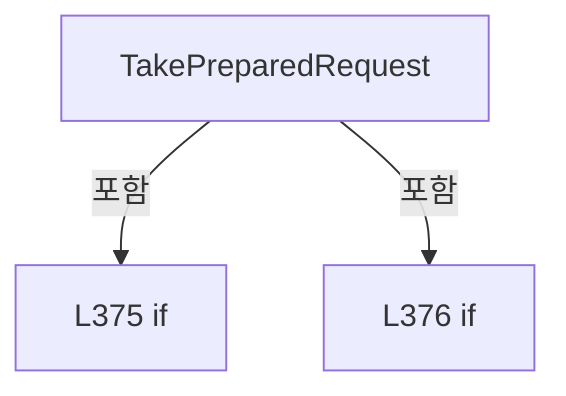

변경 전 점검: 입력/반환 타입, 위 호출자, 예외/취소 경로, 공유 상태와 저장·전송 소비자를 함께 확인합니다. 값의 단위나 물리 방향을 이름만으로 확정하지 않습니다.

### MethodDeclaration `Log` · L379–379

[Drilling.Common/Correction/CAlignInterpolation.cs:379–379](https://github.com/kjuws10-rgb/A3Drilling/blob/334b3599651b2e8e0181fd4459bafaf3cddafff3/Drilling.Common/Correction/CAlignInterpolation.cs#L379-L379)

| 항목 | 실제 추출 값 |
| --- | --- |
| 서명 | void Drilling.Common.Correction.CAlignDistortionCycle.Log(string) |
| 접근/수식자 | Private / private |
| 반환/값 타입 | void |
| 소속 타입 | NamedType:Drilling.Common.Correction.CAlignDistortionCycle |

입력 계약:

| 이름 | 타입 | 전달 | 선택/기본값 |
| --- | --- | --- | --- |
| text | string | None | False /  |

정적 호출자로 확인된 위치:

| 호출 파일/행 | 호출 표현식 | 런타임 분기 가능 |
| --- | --- | --- |
| [Drilling.Common/Correction/CAlignInterpolation.cs:315–315](https://github.com/kjuws10-rgb/A3Drilling/blob/334b3599651b2e8e0181fd4459bafaf3cddafff3/Drilling.Common/Correction/CAlignInterpolation.cs#L315-L315) | Log | False |
| [Drilling.Common/Correction/CAlignInterpolation.cs:320–320](https://github.com/kjuws10-rgb/A3Drilling/blob/334b3599651b2e8e0181fd4459bafaf3cddafff3/Drilling.Common/Correction/CAlignInterpolation.cs#L320-L320) | Log | False |
| [Drilling.Common/Correction/CAlignInterpolation.cs:332–332](https://github.com/kjuws10-rgb/A3Drilling/blob/334b3599651b2e8e0181fd4459bafaf3cddafff3/Drilling.Common/Correction/CAlignInterpolation.cs#L332-L332) | Log | False |
| [Drilling.Common/Correction/CAlignInterpolation.cs:344–344](https://github.com/kjuws10-rgb/A3Drilling/blob/334b3599651b2e8e0181fd4459bafaf3cddafff3/Drilling.Common/Correction/CAlignInterpolation.cs#L344-L344) | Log | False |
| [Drilling.Common/Correction/CAlignInterpolation.cs:370–370](https://github.com/kjuws10-rgb/A3Drilling/blob/334b3599651b2e8e0181fd4459bafaf3cddafff3/Drilling.Common/Correction/CAlignInterpolation.cs#L370-L370) | Log | False |

호출하는 대상과 해석 범위:

| 원본 행 | 표현식 | 분석 상태 | 대상/소스 위치 |
| --- | --- | --- | --- |
| 379 | .Invoke | resolved · 동적 구현 선택 가능 | void System.Action<string>.Invoke(string) |
| 379 | System.Diagnostics.Trace.TraceError | resolved | void System.Diagnostics.Trace.TraceError(string?) |

본문의 실제 연산·분기·예외·반환 순서(원문 위치 순):

| 원본 행 | 종류 | 주석 해설 |
| --- | --- | --- |
| 379 | call | 함수·델리게이트 또는 객체 생성자를 호출합니다: .Invoke(text) |
| 379 | call | 함수·델리게이트 또는 객체 생성자를 호출합니다: System.Diagnostics.Trace.TraceError("Distortion log failed: " + error) |
| 379 | catch | 지정 예외를 처리합니다: catch (Exception error) |
| 379 | try | 예외 처리 범위입니다: try |

제어 구문의 포함 구조(실제 실행 순서/CFG가 아닌 구문 탐색 그림):

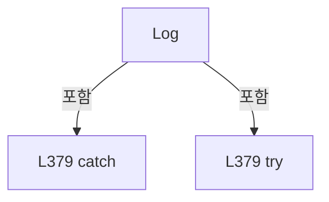

변경 전 점검: 입력/반환 타입, 위 호출자, 예외/취소 경로, 공유 상태와 저장·전송 소비자를 함께 확인합니다. 값의 단위나 물리 방향을 이름만으로 확정하지 않습니다.

### PropertyDeclaration `Points` · L387–393

[Drilling.Common/Correction/CAlignInterpolation.cs:387–393](https://github.com/kjuws10-rgb/A3Drilling/blob/334b3599651b2e8e0181fd4459bafaf3cddafff3/Drilling.Common/Correction/CAlignInterpolation.cs#L387-L393)

| 항목 | 실제 추출 값 |
| --- | --- |
| 서명 | System.Collections.Generic.IReadOnlyList<Drilling.Common.Correction.ST_WAPAGE_ALIGNBASE_POINT> Drilling.Common.Correction.CAlignWapageService.Points |
| 접근/수식자 | Public / public, static |
| 반환/값 타입 | System.Collections.Generic.IReadOnlyList<Drilling.Common.Correction.ST_WAPAGE_ALIGNBASE_POINT> |
| 소속 타입 | NamedType:Drilling.Common.Correction.CAlignWapageService |

현재 부분 분석에서 직접 연결된 호출자는 없습니다. XAML/이벤트/인터페이스·델리게이트·외부 진입을 추가 확인해야 하며, 미사용으로 판정한 것이 아닙니다.

호출하는 대상과 해석 범위:

| 원본 행 | 표현식 | 분석 상태 | 대상/소스 위치 |
| --- | --- | --- | --- |
| 387 | Enumerable.Range(0, 8).Select(index => { var axis = index < 4 ? "X" : "Y"; var camera = index % 4 + 1; return new ST_WAPAGE_ALIGNBASE_POINT($"CAM{camera} {axis} → {axis}{camera}", $"SVID_FINEALN_CAM{camera}_GLS_RESULT_{axis}", $"PROCESS_WAPAGE_ALIGNBASE_{axis}{camera}", $"PROCESS_WAPAGE_ALIGNBASE_RAGNE_{axis}{camera}"); }).ToArray | resolved | Drilling.Common.Correction.ST_WAPAGE_ALIGNBASE_POINT[] System.Collections.Generic.IEnumerable<Drilling.Common.Correction.ST_WAPAGE_ALIGNBASE_POINT>.ToArray<Drilling.Common.Correction.ST_WAPAGE_ALIGNBASE_POINT>() |
| 387 | Enumerable.Range(0, 8).Select | resolved | System.Collections.Generic.IEnumerable<Drilling.Common.Correction.ST_WAPAGE_ALIGNBASE_POINT> System.Collections.Generic.IEnumerable<int>.Select<int, Drilling.Common.Correction.ST_WAPAGE_ALIGNBASE_POINT>(System.Func<int, Drilling.Common.Correction.ST_WAPAGE_ALIGNBASE_POINT>) |
| 387 | Enumerable.Range | resolved | System.Collections.Generic.IEnumerable<int> System.Linq.Enumerable.Range(int, int) |
| 391 | new ST_WAPAGE_ALIGNBASE_POINT | resolved | Drilling.Common.Correction.ST_WAPAGE_ALIGNBASE_POINT.ST_WAPAGE_ALIGNBASE_POINT(string, string, string, string) · Drilling.Common/Correction/CAlignInterpolation.cs:214 |

본문의 실제 연산·분기·예외·반환 순서(원문 위치 순):

| 원본 행 | 종류 | 주석 해설 |
| --- | --- | --- |
| 387 | call | 함수·델리게이트 또는 객체 생성자를 호출합니다: Enumerable.Range(0, 8) |
| 387 | call | 함수·델리게이트 또는 객체 생성자를 호출합니다: Enumerable.Range(0, 8).Select(index => { var axis = index < 4 ? "X" : "Y"; var camera = index % 4 + 1; return new ST_WAPAGE_ALIGNBASE_POINT($"CAM{camera} {axis} → {axis}{camera}", $"SVID_FINEALN_CAM{camera}_GLS_RESULT_{a… |
| 387 | call | 함수·델리게이트 또는 객체 생성자를 호출합니다: Enumerable.Range(0, 8).Select(index => { var axis = index < 4 ? "X" : "Y"; var camera = index % 4 + 1; return new ST_WAPAGE_ALIGNBASE_POINT($"CAM{camera} {axis} → {axis}{camera}", $"SVID_FINEALN_CAM{camera}_GLS_RESULT_{a… |
| 389 | conditional-expression | 조건에 따라 결과식을 선택합니다: index < 4 ? "X" : "Y" |
| 389 | local-declaration | 지역 변수를 선언합니다: var axis = index < 4 ? "X" : "Y"; |
| 389 | variable-initializer | 변수의 초기값을 지정합니다: axis = index < 4 ? "X" : "Y" |
| 390 | local-declaration | 지역 변수를 선언합니다: var camera = index % 4 + 1; |
| 390 | variable-initializer | 변수의 초기값을 지정합니다: camera = index % 4 + 1 |
| 391 | call | 함수·델리게이트 또는 객체 생성자를 호출합니다: new ST_WAPAGE_ALIGNBASE_POINT($"CAM{camera} {axis} → {axis}{camera}", $"SVID_FINEALN_CAM{camera}_GLS_RESULT_{axis}", $"PROCESS_WAPAGE_ALIGNBASE_{axis}{camera}", $"PROCESS_WAPAGE_ALIGNBASE_RAGNE_{axis}{camera}") |
| 391 | return | 호출자에게 값 또는 제어를 반환합니다: return new ST_WAPAGE_ALIGNBASE_POINT($"CAM{camera} {axis} → {axis}{camera}", $"SVID_FINEALN_CAM{camera}_GLS_RESULT_{axis}", $"PROCESS_WAPAGE_ALIGNBASE_{axis}{camera}", $"PROCESS_WAPAGE_ALIGNBASE_RAGNE_{axis}{camera}"); |

변경 전 점검: 입력/반환 타입, 위 호출자, 예외/취소 경로, 공유 상태와 저장·전송 소비자를 함께 확인합니다. 값의 단위나 물리 방향을 이름만으로 확정하지 않습니다.

### GetAccessorDeclaration `get_Points` · L387–387

[Drilling.Common/Correction/CAlignInterpolation.cs:387–387](https://github.com/kjuws10-rgb/A3Drilling/blob/334b3599651b2e8e0181fd4459bafaf3cddafff3/Drilling.Common/Correction/CAlignInterpolation.cs#L387-L387)

| 항목 | 실제 추출 값 |
| --- | --- |
| 서명 | System.Collections.Generic.IReadOnlyList<Drilling.Common.Correction.ST_WAPAGE_ALIGNBASE_POINT> Drilling.Common.Correction.CAlignWapageService.Points.get |
| 접근/수식자 | Public / get |
| 반환/값 타입 | System.Collections.Generic.IReadOnlyList<Drilling.Common.Correction.ST_WAPAGE_ALIGNBASE_POINT> |
| 소속 타입 | NamedType:Drilling.Common.Correction.CAlignWapageService |

현재 부분 분석에서 직접 연결된 호출자는 없습니다. XAML/이벤트/인터페이스·델리게이트·외부 진입을 추가 확인해야 하며, 미사용으로 판정한 것이 아닙니다.

변경 전 점검: 입력/반환 타입, 위 호출자, 예외/취소 경로, 공유 상태와 저장·전송 소비자를 함께 확인합니다. 값의 단위나 물리 방향을 이름만으로 확정하지 않습니다.

### FieldDeclaration `_map` · L394–394

[Drilling.Common/Correction/CAlignInterpolation.cs:394–394](https://github.com/kjuws10-rgb/A3Drilling/blob/334b3599651b2e8e0181fd4459bafaf3cddafff3/Drilling.Common/Correction/CAlignInterpolation.cs#L394-L394)

| 항목 | 실제 추출 값 |
| --- | --- |
| 서명 | System.Func<System.Collections.Generic.IReadOnlyList<Drilling.Common.Interface.ST_MELSEC_MAP_DATA>> Drilling.Common.Correction.CAlignWapageService._map |
| 접근/수식자 | Private / private, readonly |
| 반환/값 타입 | System.Func<System.Collections.Generic.IReadOnlyList<Drilling.Common.Interface.ST_MELSEC_MAP_DATA>> |
| 소속 타입 | NamedType:Drilling.Common.Correction.CAlignWapageService |

현재 부분 분석에서 직접 연결된 호출자는 없습니다. XAML/이벤트/인터페이스·델리게이트·외부 진입을 추가 확인해야 하며, 미사용으로 판정한 것이 아닙니다.

변경 전 점검: 입력/반환 타입, 위 호출자, 예외/취소 경로, 공유 상태와 저장·전송 소비자를 함께 확인합니다. 값의 단위나 물리 방향을 이름만으로 확정하지 않습니다.

### FieldDeclaration `_connections` · L395–395

[Drilling.Common/Correction/CAlignInterpolation.cs:395–395](https://github.com/kjuws10-rgb/A3Drilling/blob/334b3599651b2e8e0181fd4459bafaf3cddafff3/Drilling.Common/Correction/CAlignInterpolation.cs#L395-L395)

| 항목 | 실제 추출 값 |
| --- | --- |
| 서명 | System.Func<System.Collections.Generic.IReadOnlyList<Drilling.Common.Interface.ST_INTERFACE_COMM_STATUS>> Drilling.Common.Correction.CAlignWapageService._connections |
| 접근/수식자 | Private / private, readonly |
| 반환/값 타입 | System.Func<System.Collections.Generic.IReadOnlyList<Drilling.Common.Interface.ST_INTERFACE_COMM_STATUS>> |
| 소속 타입 | NamedType:Drilling.Common.Correction.CAlignWapageService |

현재 부분 분석에서 직접 연결된 호출자는 없습니다. XAML/이벤트/인터페이스·델리게이트·외부 진입을 추가 확인해야 하며, 미사용으로 판정한 것이 아닙니다.

변경 전 점검: 입력/반환 타입, 위 호출자, 예외/취소 경로, 공유 상태와 저장·전송 소비자를 함께 확인합니다. 값의 단위나 물리 방향을 이름만으로 확정하지 않습니다.

### FieldDeclaration `_read` · L396–396

[Drilling.Common/Correction/CAlignInterpolation.cs:396–396](https://github.com/kjuws10-rgb/A3Drilling/blob/334b3599651b2e8e0181fd4459bafaf3cddafff3/Drilling.Common/Correction/CAlignInterpolation.cs#L396-L396)

| 항목 | 실제 추출 값 |
| --- | --- |
| 서명 | System.Func<string, System.Threading.CancellationToken, double> Drilling.Common.Correction.CAlignWapageService._read |
| 접근/수식자 | Private / private, readonly |
| 반환/값 타입 | System.Func<string, System.Threading.CancellationToken, double> |
| 소속 타입 | NamedType:Drilling.Common.Correction.CAlignWapageService |

현재 부분 분석에서 직접 연결된 호출자는 없습니다. XAML/이벤트/인터페이스·델리게이트·외부 진입을 추가 확인해야 하며, 미사용으로 판정한 것이 아닙니다.

변경 전 점검: 입력/반환 타입, 위 호출자, 예외/취소 경로, 공유 상태와 저장·전송 소비자를 함께 확인합니다. 값의 단위나 물리 방향을 이름만으로 확정하지 않습니다.

### FieldDeclaration `_write` · L397–397

[Drilling.Common/Correction/CAlignInterpolation.cs:397–397](https://github.com/kjuws10-rgb/A3Drilling/blob/334b3599651b2e8e0181fd4459bafaf3cddafff3/Drilling.Common/Correction/CAlignInterpolation.cs#L397-L397)

| 항목 | 실제 추출 값 |
| --- | --- |
| 서명 | System.Action<string, double, System.Threading.CancellationToken> Drilling.Common.Correction.CAlignWapageService._write |
| 접근/수식자 | Private / private, readonly |
| 반환/값 타입 | System.Action<string, double, System.Threading.CancellationToken> |
| 소속 타입 | NamedType:Drilling.Common.Correction.CAlignWapageService |

현재 부분 분석에서 직접 연결된 호출자는 없습니다. XAML/이벤트/인터페이스·델리게이트·외부 진입을 추가 확인해야 하며, 미사용으로 판정한 것이 아닙니다.

변경 전 점검: 입력/반환 타입, 위 호출자, 예외/취소 경로, 공유 상태와 저장·전송 소비자를 함께 확인합니다. 값의 단위나 물리 방향을 이름만으로 확정하지 않습니다.

### ConstructorDeclaration `.ctor` · L398–401

[Drilling.Common/Correction/CAlignInterpolation.cs:398–401](https://github.com/kjuws10-rgb/A3Drilling/blob/334b3599651b2e8e0181fd4459bafaf3cddafff3/Drilling.Common/Correction/CAlignInterpolation.cs#L398-L401)

| 항목 | 실제 추출 값 |
| --- | --- |
| 서명 | Drilling.Common.Correction.CAlignWapageService.CAlignWapageService(Drilling.Common.Interface.CInterfaceManager?) |
| 접근/수식자 | Public / public |
| 반환/값 타입 | void |
| 소속 타입 | NamedType:Drilling.Common.Correction.CAlignWapageService |

입력 계약:

| 이름 | 타입 | 전달 | 선택/기본값 |
| --- | --- | --- | --- |
| manager | Drilling.Common.Interface.CInterfaceManager? | None | False /  |

정적 호출자로 확인된 위치:

| 호출 파일/행 | 호출 표현식 | 런타임 분기 가능 |
| --- | --- | --- |
| [Drilling.Common/Correction/CAlignInterpolation.cs:230–230](https://github.com/kjuws10-rgb/A3Drilling/blob/334b3599651b2e8e0181fd4459bafaf3cddafff3/Drilling.Common/Correction/CAlignInterpolation.cs#L230-L230) | new | False |
| [Drilling.UI/Menu/Menus/CMenuCorrection.cs:139–139](https://github.com/kjuws10-rgb/A3Drilling/blob/334b3599651b2e8e0181fd4459bafaf3cddafff3/Drilling.UI/Menu/Menus/CMenuCorrection.cs#L139-L139) | new CAlignWapageService | False |

호출하는 대상과 해석 범위:

| 원본 행 | 표현식 | 분석 상태 | 대상/소스 위치 |
| --- | --- | --- | --- |
| 398 | .Melsec.GetMapList | resolved | System.Collections.Generic.IReadOnlyList<Drilling.Common.Interface.ST_MELSEC_MAP_DATA> Drilling.Common.Interface.CMelsec.GetMapList(string) · Drilling.Common/Interface/Melsec/CMelsec.cs:298 |
| 399 | .GetInterfaceCommunicationList | resolved | System.Collections.Generic.IReadOnlyList<Drilling.Common.Interface.ST_INTERFACE_COMM_STATUS> Drilling.Common.Interface.CInterfaceManager.GetInterfaceCommunicationList(Drilling.Common.Interface.EN_EQP_MODULE?) · Drilling.Common/Interface/CInterfaceManager.cs:472 |
| 400 | .Melsec.ReadDoubleNoLog | resolved | double Drilling.Common.Interface.CMelsec.ReadDoubleNoLog(string, System.Threading.CancellationToken) · Drilling.Common/Interface/Melsec/CMelsec.cs:384 |
| 400 | new InvalidOperationException | resolved | System.InvalidOperationException.InvalidOperationException(string?) |
| 401 | new InvalidOperationException | resolved | System.InvalidOperationException.InvalidOperationException(string?) |
| 401 | manager.Melsec.WriteDouble | resolved | void Drilling.Common.Interface.CMelsec.WriteDouble(string, double, System.Threading.CancellationToken) · Drilling.Common/Interface/Melsec/CMelsec.cs:391 |

본문의 실제 연산·분기·예외·반환 순서(원문 위치 순):

| 원본 행 | 종류 | 주석 해설 |
| --- | --- | --- |
| 398 | call | 함수·델리게이트 또는 객체 생성자를 호출합니다: .Melsec.GetMapList() |
| 399 | call | 함수·델리게이트 또는 객체 생성자를 호출합니다: .GetInterfaceCommunicationList(EN_EQP_MODULE.Melsec) |
| 400 | call | 함수·델리게이트 또는 객체 생성자를 호출합니다: .Melsec.ReadDoubleNoLog(id, token) |
| 400 | call | 함수·델리게이트 또는 객체 생성자를 호출합니다: new InvalidOperationException("MELSEC이 연결되어 있지 않습니다.") |
| 400 | throw | 예외를 발생/전달합니다: throw new InvalidOperationException("MELSEC이 연결되어 있지 않습니다.") |
| 401 | call | 함수·델리게이트 또는 객체 생성자를 호출합니다: new InvalidOperationException("MELSEC이 연결되어 있지 않습니다.") |
| 401 | call | 함수·델리게이트 또는 객체 생성자를 호출합니다: manager.Melsec.WriteDouble(id, value, token) |
| 401 | if | 조건에 따라 분기합니다: if (manager is null) |
| 401 | throw | 예외를 발생/전달합니다: throw new InvalidOperationException("MELSEC이 연결되어 있지 않습니다."); |

제어 구문의 포함 구조(실제 실행 순서/CFG가 아닌 구문 탐색 그림):

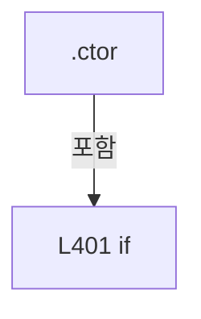

변경 전 점검: 입력/반환 타입, 위 호출자, 예외/취소 경로, 공유 상태와 저장·전송 소비자를 함께 확인합니다. 값의 단위나 물리 방향을 이름만으로 확정하지 않습니다.

### ConstructorDeclaration `.ctor` · L402–404

[Drilling.Common/Correction/CAlignInterpolation.cs:402–404](https://github.com/kjuws10-rgb/A3Drilling/blob/334b3599651b2e8e0181fd4459bafaf3cddafff3/Drilling.Common/Correction/CAlignInterpolation.cs#L402-L404)

| 항목 | 실제 추출 값 |
| --- | --- |
| 서명 | Drilling.Common.Correction.CAlignWapageService.CAlignWapageService(System.Func<System.Collections.Generic.IReadOnlyList<Drilling.Common.Interface.ST_MELSEC_MAP_DATA>>, System.Func<System.Collections.Generic.IReadOnlyList<Drilling.Common.Interface.ST_INTERFACE_COMM_STATUS>>, System.Func<string, System.Threading.CancellationToken, double>, System.Action<string, double, System.Threading.CancellationToken>) |
| 접근/수식자 | Public / public |
| 반환/값 타입 | void |
| 소속 타입 | NamedType:Drilling.Common.Correction.CAlignWapageService |

입력 계약:

| 이름 | 타입 | 전달 | 선택/기본값 |
| --- | --- | --- | --- |
| map | System.Func<System.Collections.Generic.IReadOnlyList<Drilling.Common.Interface.ST_MELSEC_MAP_DATA>> | None | False /  |
| connections | System.Func<System.Collections.Generic.IReadOnlyList<Drilling.Common.Interface.ST_INTERFACE_COMM_STATUS>> | None | False /  |
| read | System.Func<string, System.Threading.CancellationToken, double> | None | False /  |
| write | System.Action<string, double, System.Threading.CancellationToken> | None | False /  |

현재 부분 분석에서 직접 연결된 호출자는 없습니다. XAML/이벤트/인터페이스·델리게이트·외부 진입을 추가 확인해야 하며, 미사용으로 판정한 것이 아닙니다.

본문의 실제 연산·분기·예외·반환 순서(원문 위치 순):

| 원본 행 | 종류 | 주석 해설 |
| --- | --- | --- |
| 404 | assignment | 값을 대상에 대입합니다: _map = map |
| 404 | assignment | 값을 대상에 대입합니다: _connections = connections |
| 404 | assignment | 값을 대상에 대입합니다: _read = read |
| 404 | assignment | 값을 대상에 대입합니다: _write = write |

변경 전 점검: 입력/반환 타입, 위 호출자, 예외/취소 경로, 공유 상태와 저장·전송 소비자를 함께 확인합니다. 값의 단위나 물리 방향을 이름만으로 확정하지 않습니다.

### MethodDeclaration `Validate` · L406–424

[Drilling.Common/Correction/CAlignInterpolation.cs:406–424](https://github.com/kjuws10-rgb/A3Drilling/blob/334b3599651b2e8e0181fd4459bafaf3cddafff3/Drilling.Common/Correction/CAlignInterpolation.cs#L406-L424)

| 항목 | 실제 추출 값 |
| --- | --- |
| 서명 | System.Collections.Generic.Dictionary<string, Drilling.Common.Interface.ST_MELSEC_MAP_DATA> Drilling.Common.Correction.CAlignWapageService.Validate(System.Collections.Generic.IReadOnlyCollection<string>, bool) |
| 접근/수식자 | Internal / internal |
| 반환/값 타입 | System.Collections.Generic.Dictionary<string, Drilling.Common.Interface.ST_MELSEC_MAP_DATA> |
| 소속 타입 | NamedType:Drilling.Common.Correction.CAlignWapageService |

입력 계약:

| 이름 | 타입 | 전달 | 선택/기본값 |
| --- | --- | --- | --- |
| ids | System.Collections.Generic.IReadOnlyCollection<string> | None | False /  |
| write | bool | None | False /  |

정적 호출자로 확인된 위치:

| 호출 파일/행 | 호출 표현식 | 런타임 분기 가능 |
| --- | --- | --- |
| [Drilling.Common/Correction/CAlignInterpolation.cs:312–312](https://github.com/kjuws10-rgb/A3Drilling/blob/334b3599651b2e8e0181fd4459bafaf3cddafff3/Drilling.Common/Correction/CAlignInterpolation.cs#L312-L312) | _io.Validate | False |
| [Drilling.Common/Correction/CAlignInterpolation.cs:313–313](https://github.com/kjuws10-rgb/A3Drilling/blob/334b3599651b2e8e0181fd4459bafaf3cddafff3/Drilling.Common/Correction/CAlignInterpolation.cs#L313-L313) | _io.Validate | False |
| [Drilling.Common/Correction/CAlignInterpolation.cs:314–314](https://github.com/kjuws10-rgb/A3Drilling/blob/334b3599651b2e8e0181fd4459bafaf3cddafff3/Drilling.Common/Correction/CAlignInterpolation.cs#L314-L314) | _io.Validate | False |
| [Drilling.Common/Correction/CAlignInterpolation.cs:430–430](https://github.com/kjuws10-rgb/A3Drilling/blob/334b3599651b2e8e0181fd4459bafaf3cddafff3/Drilling.Common/Correction/CAlignInterpolation.cs#L430-L430) | Validate | False |
| [Drilling.Common/Correction/CAlignInterpolation.cs:435–435](https://github.com/kjuws10-rgb/A3Drilling/blob/334b3599651b2e8e0181fd4459bafaf3cddafff3/Drilling.Common/Correction/CAlignInterpolation.cs#L435-L435) | Validate | False |
| [Drilling.Common/Correction/CAlignInterpolation.cs:464–464](https://github.com/kjuws10-rgb/A3Drilling/blob/334b3599651b2e8e0181fd4459bafaf3cddafff3/Drilling.Common/Correction/CAlignInterpolation.cs#L464-L464) | Validate | False |

호출하는 대상과 해석 범위:

| 원본 행 | 표현식 | 분석 상태 | 대상/소스 위치 |
| --- | --- | --- | --- |
| 408 | _map().ToDictionary | resolved | System.Collections.Generic.Dictionary<string, Drilling.Common.Interface.ST_MELSEC_MAP_DATA> System.Collections.Generic.IEnumerable<Drilling.Common.Interface.ST_MELSEC_MAP_DATA>.ToDictionary<Drilling.Common.Interface.ST_MELSEC_MAP_DATA, string>(System.Func<Drilling.Common.Interface.ST_MELSEC_MAP_DATA, string>, System.Collections.Generic.IEqualityComparer<string>?) |
| 408 | _map | resolved · 동적 구현 선택 가능 | System.Collections.Generic.IReadOnlyList<Drilling.Common.Interface.ST_MELSEC_MAP_DATA> System.Func<System.Collections.Generic.IReadOnlyList<Drilling.Common.Interface.ST_MELSEC_MAP_DATA>>.Invoke() |
| 409 | _connections | resolved · 동적 구현 선택 가능 | System.Collections.Generic.IReadOnlyList<Drilling.Common.Interface.ST_INTERFACE_COMM_STATUS> System.Func<System.Collections.Generic.IReadOnlyList<Drilling.Common.Interface.ST_INTERFACE_COMM_STATUS>>.Invoke() |
| 412 | map.TryGetValue | resolved | bool System.Collections.Generic.Dictionary<string, Drilling.Common.Interface.ST_MELSEC_MAP_DATA>.TryGetValue(string, out Drilling.Common.Interface.ST_MELSEC_MAP_DATA) |
| 412 | string.IsNullOrWhiteSpace | resolved | bool string.IsNullOrWhiteSpace(string?) |
| 412 | row.Address.Equals | resolved | bool string.Equals(string?, System.StringComparison) |
| 413 | new InvalidOperationException | resolved | System.InvalidOperationException.InvalidOperationException(string?) |
| 415 | new InvalidOperationException | resolved | System.InvalidOperationException.InvalidOperationException(string?) |
| 416 | id.StartsWith | resolved | bool string.StartsWith(string, System.StringComparison) |
| 416 | id.StartsWith | resolved | bool string.StartsWith(string, System.StringComparison) |
| 417 | new InvalidOperationException | resolved | System.InvalidOperationException.InvalidOperationException(string?) |
| 418 | CMelsec.ValidateMapData | resolved | void Drilling.Common.Interface.CMelsec.ValidateMapData(Drilling.Common.Interface.ST_MELSEC_MAP_DATA) · Drilling.Common/Interface/Melsec/CMelsec.cs:245 |
| 419 | connections.FirstOrDefault | resolved | Drilling.Common.Interface.ST_INTERFACE_COMM_STATUS? System.Collections.Generic.IEnumerable<Drilling.Common.Interface.ST_INTERFACE_COMM_STATUS>.FirstOrDefault<Drilling.Common.Interface.ST_INTERFACE_COMM_STATUS>(System.Func<Drilling.Common.Interface.ST_INTERFACE_COMM_STATUS, bool>) |
| 421 | new InvalidOperationException | resolved | System.InvalidOperationException.InvalidOperationException(string?) |

본문의 실제 연산·분기·예외·반환 순서(원문 위치 순):

| 원본 행 | 종류 | 주석 해설 |
| --- | --- | --- |
| 408 | call | 함수·델리게이트 또는 객체 생성자를 호출합니다: _map().ToDictionary(row => row.Id, StringComparer.OrdinalIgnoreCase) |
| 408 | call | 함수·델리게이트 또는 객체 생성자를 호출합니다: _map() |
| 408 | local-declaration | 지역 변수를 선언합니다: var map = _map().ToDictionary(row => row.Id, StringComparer.OrdinalIgnoreCase); |
| 408 | variable-initializer | 변수의 초기값을 지정합니다: map = _map().ToDictionary(row => row.Id, StringComparer.OrdinalIgnoreCase) |
| 409 | call | 함수·델리게이트 또는 객체 생성자를 호출합니다: _connections() |
| 409 | local-declaration | 지역 변수를 선언합니다: var connections = _connections(); |
| 409 | variable-initializer | 변수의 초기값을 지정합니다: connections = _connections() |
| 410 | foreach | 컬렉션 요소를 순회합니다: foreach (var id in ids) |
| 412 | call | 함수·델리게이트 또는 객체 생성자를 호출합니다: map.TryGetValue(id, out var row) |
| 412 | call | 함수·델리게이트 또는 객체 생성자를 호출합니다: string.IsNullOrWhiteSpace(row.Address) |
| 412 | call | 함수·델리게이트 또는 객체 생성자를 호출합니다: row.Address.Equals("UNASSIGNED", StringComparison.OrdinalIgnoreCase) |
| 412 | if | 조건에 따라 분기합니다: if (!map.TryGetValue(id, out var row) &#124;&#124; !row.Use &#124;&#124; string.IsNullOrWhiteSpace(row.Address) &#124;&#124; row.Address.Equals("UNASSIGNED", StringComparison.OrdinalIgnoreCase)) |
| 413 | call | 함수·델리게이트 또는 객체 생성자를 호출합니다: new InvalidOperationException($"{id}의 MELSEC 주소와 USE 설정을 확인하세요.") |
| 413 | throw | 예외를 발생/전달합니다: throw new InvalidOperationException($"{id}의 MELSEC 주소와 USE 설정을 확인하세요."); |
| 414 | if | 조건에 따라 분기합니다: if (row.DataType != EN_MELSEC_DATA_TYPE.Double &#124;&#124; row.Access == EN_MELSEC_ACCESS.Write &#124;&#124; write && row.Access != EN_MELSEC_ACCESS.ReadWrite) |
| 415 | call | 함수·델리게이트 또는 객체 생성자를 호출합니다: new InvalidOperationException($"{id}의 DOUBLE 형식과 {(write ? "읽기/쓰기" : "읽기")} 권한을 확인하세요.") |
| 415 | conditional-expression | 조건에 따라 결과식을 선택합니다: write ? "읽기/쓰기" : "읽기" |
| 415 | throw | 예외를 발생/전달합니다: throw new InvalidOperationException($"{id}의 DOUBLE 형식과 {(write ? "읽기/쓰기" : "읽기")} 권한을 확인하세요."); |
| 416 | call | 함수·델리게이트 또는 객체 생성자를 호출합니다: id.StartsWith("SVID_", StringComparison.Ordinal) |
| 416 | call | 함수·델리게이트 또는 객체 생성자를 호출합니다: id.StartsWith("DISTORTION_POS", StringComparison.Ordinal) |
| 416 | conditional-expression | 조건에 따라 결과식을 선택합니다: id.StartsWith("SVID_", StringComparison.Ordinal) &#124;&#124; id.StartsWith("DISTORTION_POS", StringComparison.Ordinal) ? row.Direction != EN_MELSEC_DIRECTION.In : row.Direction != EN_MELSEC_DIRECTION.Out |
| 416 | if | 조건에 따라 분기합니다: if (id.StartsWith("SVID_", StringComparison.Ordinal) &#124;&#124; id.StartsWith("DISTORTION_POS", StringComparison.Ordinal) ? row.Direction != EN_MELSEC_DIRECTION.In : row.Direction != EN_MELSEC_DIRECTION.Out) |
| 417 | call | 함수·델리게이트 또는 객체 생성자를 호출합니다: new InvalidOperationException($"{id}의 MELSEC 입출력 방향을 확인하세요.") |
| 417 | throw | 예외를 발생/전달합니다: throw new InvalidOperationException($"{id}의 MELSEC 입출력 방향을 확인하세요."); |
| 418 | call | 함수·델리게이트 또는 객체 생성자를 호출합니다: CMelsec.ValidateMapData(row) |
| 419 | call | 함수·델리게이트 또는 객체 생성자를 호출합니다: connections.FirstOrDefault(item => item.Module == EN_EQP_MODULE.Melsec && item.Number == row.DeviceNo) |
| 419 | local-declaration | 지역 변수를 선언합니다: var connection = connections.FirstOrDefault(item => item.Module == EN_EQP_MODULE.Melsec && item.Number == row.DeviceNo); |
| 419 | variable-initializer | 변수의 초기값을 지정합니다: connection = connections.FirstOrDefault(item => item.Module == EN_EQP_MODULE.Melsec && item.Number == row.DeviceNo) |
| 420 | if | 조건에 따라 분기합니다: if (connection is null &#124;&#124; !(connection.IsSimulation &#124;&#124; connection.ConnectionState is EN_COMM_STATE.Online or EN_COMM_STATE.Simulation)) |
| 421 | call | 함수·델리게이트 또는 객체 생성자를 호출합니다: new InvalidOperationException("MELSEC이 연결되어 있지 않습니다.") |
| 421 | throw | 예외를 발생/전달합니다: throw new InvalidOperationException("MELSEC이 연결되어 있지 않습니다."); |
| 423 | return | 호출자에게 값 또는 제어를 반환합니다: return map; |

제어 구문의 포함 구조(실제 실행 순서/CFG가 아닌 구문 탐색 그림):

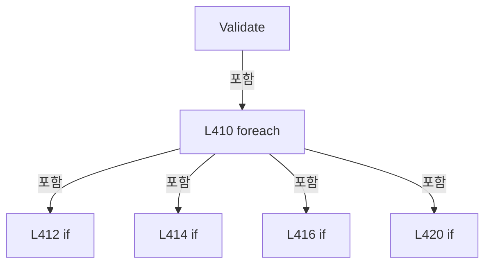

변경 전 점검: 입력/반환 타입, 위 호출자, 예외/취소 경로, 공유 상태와 저장·전송 소비자를 함께 확인합니다. 값의 단위나 물리 방향을 이름만으로 확정하지 않습니다.

### MethodDeclaration `Load` · L426–432

[Drilling.Common/Correction/CAlignInterpolation.cs:426–432](https://github.com/kjuws10-rgb/A3Drilling/blob/334b3599651b2e8e0181fd4459bafaf3cddafff3/Drilling.Common/Correction/CAlignInterpolation.cs#L426-L432)

| 항목 | 실제 추출 값 |
| --- | --- |
| 서명 | System.Threading.Tasks.Task<System.Collections.Generic.IReadOnlyDictionary<string, double>> Drilling.Common.Correction.CAlignWapageService.Load(System.Threading.CancellationToken) |
| 접근/수식자 | Public / public |
| 반환/값 타입 | System.Threading.Tasks.Task<System.Collections.Generic.IReadOnlyDictionary<string, double>> |
| 소속 타입 | NamedType:Drilling.Common.Correction.CAlignWapageService |

입력 계약:

| 이름 | 타입 | 전달 | 선택/기본값 |
| --- | --- | --- | --- |
| token | System.Threading.CancellationToken | None | True / null |

정적 호출자로 확인된 위치:

| 호출 파일/행 | 호출 표현식 | 런타임 분기 가능 |
| --- | --- | --- |
| [Drilling.UI/Menu/Menus/CMenuCorrection.cs:2800–2800](https://github.com/kjuws10-rgb/A3Drilling/blob/334b3599651b2e8e0181fd4459bafaf3cddafff3/Drilling.UI/Menu/Menus/CMenuCorrection.cs#L2800-L2800) | _wapage.Load | False |

호출하는 대상과 해석 범위:

| 원본 행 | 표현식 | 분석 상태 | 대상/소스 위치 |
| --- | --- | --- | --- |
| 428 | Enumerable.Range(1, 4).SelectMany | resolved | System.Collections.Generic.IEnumerable<string> System.Collections.Generic.IEnumerable<int>.SelectMany<int, string>(System.Func<int, System.Collections.Generic.IEnumerable<string>>) |
| 428 | Enumerable.Range | resolved | System.Collections.Generic.IEnumerable<int> System.Linq.Enumerable.Range(int, int) |
| 429 | visionOrder.Concat(Points.Select(point => point.BaseId)).Concat(Points.Select(point => point.RangeId)).ToArray | resolved | string[] System.Collections.Generic.IEnumerable<string>.ToArray<string>() |
| 429 | visionOrder.Concat(Points.Select(point => point.BaseId)).Concat | resolved | System.Collections.Generic.IEnumerable<string> System.Collections.Generic.IEnumerable<string>.Concat<string>(System.Collections.Generic.IEnumerable<string>) |
| 429 | visionOrder.Concat | resolved | System.Collections.Generic.IEnumerable<string> System.Collections.Generic.IEnumerable<string>.Concat<string>(System.Collections.Generic.IEnumerable<string>) |
| 429 | Points.Select | resolved | System.Collections.Generic.IEnumerable<string> System.Collections.Generic.IEnumerable<Drilling.Common.Correction.ST_WAPAGE_ALIGNBASE_POINT>.Select<Drilling.Common.Correction.ST_WAPAGE_ALIGNBASE_POINT, string>(System.Func<Drilling.Common.Correction.ST_WAPAGE_ALIGNBASE_POINT, string>) |
| 429 | Points.Select | resolved | System.Collections.Generic.IEnumerable<string> System.Collections.Generic.IEnumerable<Drilling.Common.Correction.ST_WAPAGE_ALIGNBASE_POINT>.Select<Drilling.Common.Correction.ST_WAPAGE_ALIGNBASE_POINT, string>(System.Func<Drilling.Common.Correction.ST_WAPAGE_ALIGNBASE_POINT, string>) |
| 430 | Validate | resolved | System.Collections.Generic.Dictionary<string, Drilling.Common.Interface.ST_MELSEC_MAP_DATA> Drilling.Common.Correction.CAlignWapageService.Validate(System.Collections.Generic.IReadOnlyCollection<string>, bool) · Drilling.Common/Correction/CAlignInterpolation.cs:406 |
| 431 | Task.Run<IReadOnlyDictionary<string, double>> | resolved | System.Threading.Tasks.Task<System.Collections.Generic.IReadOnlyDictionary<string, double>> System.Threading.Tasks.Task.Run<System.Collections.Generic.IReadOnlyDictionary<string, double>>(System.Func<System.Collections.Generic.IReadOnlyDictionary<string, double>>, System.Threading.CancellationToken) |
| 431 | Read | resolved | System.Collections.Generic.Dictionary<string, double> Drilling.Common.Correction.CAlignWapageService.Read(System.Collections.Generic.IEnumerable<string>, System.Threading.CancellationToken) · Drilling.Common/Correction/CAlignInterpolation.cs:439 |

본문의 실제 연산·분기·예외·반환 순서(원문 위치 순):

| 원본 행 | 종류 | 주석 해설 |
| --- | --- | --- |
| 428 | call | 함수·델리게이트 또는 객체 생성자를 호출합니다: Enumerable.Range(1, 4).SelectMany(camera => new[] { $"SVID_FINEALN_CAM{camera}_GLS_RESULT_X", $"SVID_FINEALN_CAM{camera}_GLS_RESULT_Y" }) |
| 428 | call | 함수·델리게이트 또는 객체 생성자를 호출합니다: Enumerable.Range(1, 4) |
| 428 | local-declaration | 지역 변수를 선언합니다: var visionOrder = Enumerable.Range(1, 4).SelectMany(camera => new[] { $"SVID_FINEALN_CAM{camera}_GLS_RESULT_X", $"SVID_FINEALN_CAM{camera}_GLS_RESULT_Y" }); |
| 428 | variable-initializer | 변수의 초기값을 지정합니다: visionOrder = Enumerable.Range(1, 4).SelectMany(camera => new[] { $"SVID_FINEALN_CAM{camera}_GLS_RESULT_X", $"SVID_FINEALN_CAM{camera}_GLS_RESULT_Y" }) |
| 429 | call | 함수·델리게이트 또는 객체 생성자를 호출합니다: visionOrder.Concat(Points.Select(point => point.BaseId)).Concat(Points.Select(point => point.RangeId)).ToArray() |
| 429 | call | 함수·델리게이트 또는 객체 생성자를 호출합니다: visionOrder.Concat(Points.Select(point => point.BaseId)).Concat(Points.Select(point => point.RangeId)) |
| 429 | call | 함수·델리게이트 또는 객체 생성자를 호출합니다: visionOrder.Concat(Points.Select(point => point.BaseId)) |
| 429 | call | 함수·델리게이트 또는 객체 생성자를 호출합니다: Points.Select(point => point.BaseId) |
| 429 | call | 함수·델리게이트 또는 객체 생성자를 호출합니다: Points.Select(point => point.RangeId) |
| 429 | local-declaration | 지역 변수를 선언합니다: var ids = visionOrder.Concat(Points.Select(point => point.BaseId)).Concat(Points.Select(point => point.RangeId)).ToArray(); |
| 429 | variable-initializer | 변수의 초기값을 지정합니다: ids = visionOrder.Concat(Points.Select(point => point.BaseId)).Concat(Points.Select(point => point.RangeId)).ToArray() |
| 430 | call | 함수·델리게이트 또는 객체 생성자를 호출합니다: Validate(ids, false) |
| 431 | call | 함수·델리게이트 또는 객체 생성자를 호출합니다: Task.Run<IReadOnlyDictionary<string, double>>(() => Read(ids, token), token) |
| 431 | call | 함수·델리게이트 또는 객체 생성자를 호출합니다: Read(ids, token) |
| 431 | return | 호출자에게 값 또는 제어를 반환합니다: return Task.Run<IReadOnlyDictionary<string, double>>(() => Read(ids, token), token); |

변경 전 점검: 입력/반환 타입, 위 호출자, 예외/취소 경로, 공유 상태와 저장·전송 소비자를 함께 확인합니다. 값의 단위나 물리 방향을 이름만으로 확정하지 않습니다.

### MethodDeclaration `ReadValues` · L433–437

[Drilling.Common/Correction/CAlignInterpolation.cs:433–437](https://github.com/kjuws10-rgb/A3Drilling/blob/334b3599651b2e8e0181fd4459bafaf3cddafff3/Drilling.Common/Correction/CAlignInterpolation.cs#L433-L437)

| 항목 | 실제 추출 값 |
| --- | --- |
| 서명 | System.Threading.Tasks.Task<System.Collections.Generic.IReadOnlyDictionary<string, double>> Drilling.Common.Correction.CAlignWapageService.ReadValues(string[], System.Threading.CancellationToken) |
| 접근/수식자 | Internal / internal |
| 반환/값 타입 | System.Threading.Tasks.Task<System.Collections.Generic.IReadOnlyDictionary<string, double>> |
| 소속 타입 | NamedType:Drilling.Common.Correction.CAlignWapageService |

입력 계약:

| 이름 | 타입 | 전달 | 선택/기본값 |
| --- | --- | --- | --- |
| ids | string[] | None | False /  |
| token | System.Threading.CancellationToken | None | False /  |

정적 호출자로 확인된 위치:

| 호출 파일/행 | 호출 표현식 | 런타임 분기 가능 |
| --- | --- | --- |
| [Drilling.Common/Correction/CAlignInterpolation.cs:316–316](https://github.com/kjuws10-rgb/A3Drilling/blob/334b3599651b2e8e0181fd4459bafaf3cddafff3/Drilling.Common/Correction/CAlignInterpolation.cs#L316-L316) | _io.ReadValues | False |
| [Drilling.Common/Correction/CAlignInterpolation.cs:326–326](https://github.com/kjuws10-rgb/A3Drilling/blob/334b3599651b2e8e0181fd4459bafaf3cddafff3/Drilling.Common/Correction/CAlignInterpolation.cs#L326-L326) | _io.ReadValues | False |

호출하는 대상과 해석 범위:

| 원본 행 | 표현식 | 분석 상태 | 대상/소스 위치 |
| --- | --- | --- | --- |
| 435 | Validate | resolved | System.Collections.Generic.Dictionary<string, Drilling.Common.Interface.ST_MELSEC_MAP_DATA> Drilling.Common.Correction.CAlignWapageService.Validate(System.Collections.Generic.IReadOnlyCollection<string>, bool) · Drilling.Common/Correction/CAlignInterpolation.cs:406 |
| 436 | Task.Run<IReadOnlyDictionary<string, double>> | resolved | System.Threading.Tasks.Task<System.Collections.Generic.IReadOnlyDictionary<string, double>> System.Threading.Tasks.Task.Run<System.Collections.Generic.IReadOnlyDictionary<string, double>>(System.Func<System.Collections.Generic.IReadOnlyDictionary<string, double>>, System.Threading.CancellationToken) |
| 436 | Read | resolved | System.Collections.Generic.Dictionary<string, double> Drilling.Common.Correction.CAlignWapageService.Read(System.Collections.Generic.IEnumerable<string>, System.Threading.CancellationToken) · Drilling.Common/Correction/CAlignInterpolation.cs:439 |

본문의 실제 연산·분기·예외·반환 순서(원문 위치 순):

| 원본 행 | 종류 | 주석 해설 |
| --- | --- | --- |
| 435 | call | 함수·델리게이트 또는 객체 생성자를 호출합니다: Validate(ids, false) |
| 436 | call | 함수·델리게이트 또는 객체 생성자를 호출합니다: Task.Run<IReadOnlyDictionary<string, double>>(() => Read(ids, token), token) |
| 436 | call | 함수·델리게이트 또는 객체 생성자를 호출합니다: Read(ids, token) |
| 436 | return | 호출자에게 값 또는 제어를 반환합니다: return Task.Run<IReadOnlyDictionary<string, double>>(() => Read(ids, token), token); |

변경 전 점검: 입력/반환 타입, 위 호출자, 예외/취소 경로, 공유 상태와 저장·전송 소비자를 함께 확인합니다. 값의 단위나 물리 방향을 이름만으로 확정하지 않습니다.

### MethodDeclaration `WriteValues` · L438–438

[Drilling.Common/Correction/CAlignInterpolation.cs:438–438](https://github.com/kjuws10-rgb/A3Drilling/blob/334b3599651b2e8e0181fd4459bafaf3cddafff3/Drilling.Common/Correction/CAlignInterpolation.cs#L438-L438)

| 항목 | 실제 추출 값 |
| --- | --- |
| 서명 | System.Threading.Tasks.Task<System.Collections.Generic.IReadOnlyDictionary<string, double>> Drilling.Common.Correction.CAlignWapageService.WriteValues((string Id, double Value)[], System.Threading.CancellationToken) |
| 접근/수식자 | Internal / internal |
| 반환/값 타입 | System.Threading.Tasks.Task<System.Collections.Generic.IReadOnlyDictionary<string, double>> |
| 소속 타입 | NamedType:Drilling.Common.Correction.CAlignWapageService |

입력 계약:

| 이름 | 타입 | 전달 | 선택/기본값 |
| --- | --- | --- | --- |
| values | (string Id, double Value)[] | None | False /  |
| token | System.Threading.CancellationToken | None | False /  |

정적 호출자로 확인된 위치:

| 호출 파일/행 | 호출 표현식 | 런타임 분기 가능 |
| --- | --- | --- |
| [Drilling.Common/Correction/CAlignInterpolation.cs:319–319](https://github.com/kjuws10-rgb/A3Drilling/blob/334b3599651b2e8e0181fd4459bafaf3cddafff3/Drilling.Common/Correction/CAlignInterpolation.cs#L319-L319) | _io.WriteValues | False |

호출하는 대상과 해석 범위:

| 원본 행 | 표현식 | 분석 상태 | 대상/소스 위치 |
| --- | --- | --- | --- |
| 438 | Write | resolved | System.Threading.Tasks.Task<System.Collections.Generic.IReadOnlyDictionary<string, double>> Drilling.Common.Correction.CAlignWapageService.Write((string Id, double Value)[], System.Threading.CancellationToken) · Drilling.Common/Correction/CAlignInterpolation.cs:462 |

본문의 실제 연산·분기·예외·반환 순서(원문 위치 순):

| 원본 행 | 종류 | 주석 해설 |
| --- | --- | --- |
| 438 | call | 함수·델리게이트 또는 객체 생성자를 호출합니다: Write(values, token) |

변경 전 점검: 입력/반환 타입, 위 호출자, 예외/취소 경로, 공유 상태와 저장·전송 소비자를 함께 확인합니다. 값의 단위나 물리 방향을 이름만으로 확정하지 않습니다.

### MethodDeclaration `Read` · L439–450

[Drilling.Common/Correction/CAlignInterpolation.cs:439–450](https://github.com/kjuws10-rgb/A3Drilling/blob/334b3599651b2e8e0181fd4459bafaf3cddafff3/Drilling.Common/Correction/CAlignInterpolation.cs#L439-L450)

| 항목 | 실제 추출 값 |
| --- | --- |
| 서명 | System.Collections.Generic.Dictionary<string, double> Drilling.Common.Correction.CAlignWapageService.Read(System.Collections.Generic.IEnumerable<string>, System.Threading.CancellationToken) |
| 접근/수식자 | Private / private |
| 반환/값 타입 | System.Collections.Generic.Dictionary<string, double> |
| 소속 타입 | NamedType:Drilling.Common.Correction.CAlignWapageService |

입력 계약:

| 이름 | 타입 | 전달 | 선택/기본값 |
| --- | --- | --- | --- |
| ids | System.Collections.Generic.IEnumerable<string> | None | False /  |
| token | System.Threading.CancellationToken | None | False /  |

정적 호출자로 확인된 위치:

| 호출 파일/행 | 호출 표현식 | 런타임 분기 가능 |
| --- | --- | --- |
| [Drilling.Common/Correction/CAlignInterpolation.cs:431–431](https://github.com/kjuws10-rgb/A3Drilling/blob/334b3599651b2e8e0181fd4459bafaf3cddafff3/Drilling.Common/Correction/CAlignInterpolation.cs#L431-L431) | Read | False |
| [Drilling.Common/Correction/CAlignInterpolation.cs:436–436](https://github.com/kjuws10-rgb/A3Drilling/blob/334b3599651b2e8e0181fd4459bafaf3cddafff3/Drilling.Common/Correction/CAlignInterpolation.cs#L436-L436) | Read | False |
| [Drilling.Common/Correction/CAlignInterpolation.cs:484–484](https://github.com/kjuws10-rgb/A3Drilling/blob/334b3599651b2e8e0181fd4459bafaf3cddafff3/Drilling.Common/Correction/CAlignInterpolation.cs#L484-L484) | Read | False |

호출하는 대상과 해석 범위:

| 원본 행 | 표현식 | 분석 상태 | 대상/소스 위치 |
| --- | --- | --- | --- |
| 441 | new Dictionary<string, double> | resolved | System.Collections.Generic.Dictionary<string, double>.Dictionary(System.Collections.Generic.IEqualityComparer<string>?) |
| 444 | token.ThrowIfCancellationRequested | resolved | void System.Threading.CancellationToken.ThrowIfCancellationRequested() |
| 445 | _read | resolved · 동적 구현 선택 가능 | double System.Func<string, System.Threading.CancellationToken, double>.Invoke(string, System.Threading.CancellationToken) |
| 446 | double.IsFinite | resolved | bool double.IsFinite(double) |
| 446 | new InvalidOperationException | resolved | System.InvalidOperationException.InvalidOperationException(string?) |
| 447 | values.Add | resolved | void System.Collections.Generic.Dictionary<string, double>.Add(string, double) |

본문의 실제 연산·분기·예외·반환 순서(원문 위치 순):

| 원본 행 | 종류 | 주석 해설 |
| --- | --- | --- |
| 441 | call | 함수·델리게이트 또는 객체 생성자를 호출합니다: new Dictionary<string, double>(StringComparer.OrdinalIgnoreCase) |
| 441 | local-declaration | 지역 변수를 선언합니다: var values = new Dictionary<string, double>(StringComparer.OrdinalIgnoreCase); |
| 441 | variable-initializer | 변수의 초기값을 지정합니다: values = new Dictionary<string, double>(StringComparer.OrdinalIgnoreCase) |
| 442 | foreach | 컬렉션 요소를 순회합니다: foreach (var id in ids) |
| 444 | call | 함수·델리게이트 또는 객체 생성자를 호출합니다: token.ThrowIfCancellationRequested() |
| 445 | call | 함수·델리게이트 또는 객체 생성자를 호출합니다: _read(id, token) |
| 445 | local-declaration | 지역 변수를 선언합니다: var value = _read(id, token); |
| 445 | variable-initializer | 변수의 초기값을 지정합니다: value = _read(id, token) |
| 446 | call | 함수·델리게이트 또는 객체 생성자를 호출합니다: double.IsFinite(value) |
| 446 | call | 함수·델리게이트 또는 객체 생성자를 호출합니다: new InvalidOperationException($"{id}의 MELSEC 값이 유한한 숫자가 아닙니다.") |
| 446 | if | 조건에 따라 분기합니다: if (!double.IsFinite(value)) |
| 446 | throw | 예외를 발생/전달합니다: throw new InvalidOperationException($"{id}의 MELSEC 값이 유한한 숫자가 아닙니다."); |
| 447 | call | 함수·델리게이트 또는 객체 생성자를 호출합니다: values.Add(id, value) |
| 449 | return | 호출자에게 값 또는 제어를 반환합니다: return values; |

제어 구문의 포함 구조(실제 실행 순서/CFG가 아닌 구문 탐색 그림):

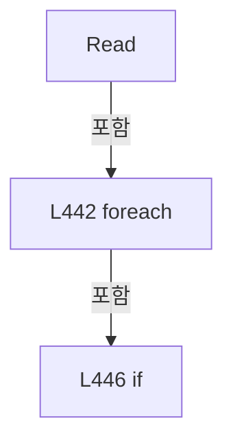

변경 전 점검: 입력/반환 타입, 위 호출자, 예외/취소 경로, 공유 상태와 저장·전송 소비자를 함께 확인합니다. 값의 단위나 물리 방향을 이름만으로 확정하지 않습니다.

### MethodDeclaration `SetBase` · L451–456

[Drilling.Common/Correction/CAlignInterpolation.cs:451–456](https://github.com/kjuws10-rgb/A3Drilling/blob/334b3599651b2e8e0181fd4459bafaf3cddafff3/Drilling.Common/Correction/CAlignInterpolation.cs#L451-L456)

| 항목 | 실제 추출 값 |
| --- | --- |
| 서명 | System.Threading.Tasks.Task<System.Collections.Generic.IReadOnlyDictionary<string, double>> Drilling.Common.Correction.CAlignWapageService.SetBase(System.Collections.Generic.IReadOnlyDictionary<string, double>, System.Threading.CancellationToken) |
| 접근/수식자 | Public / public |
| 반환/값 타입 | System.Threading.Tasks.Task<System.Collections.Generic.IReadOnlyDictionary<string, double>> |
| 소속 타입 | NamedType:Drilling.Common.Correction.CAlignWapageService |

입력 계약:

| 이름 | 타입 | 전달 | 선택/기본값 |
| --- | --- | --- | --- |
| vision | System.Collections.Generic.IReadOnlyDictionary<string, double> | None | False /  |
| token | System.Threading.CancellationToken | None | True / null |

정적 호출자로 확인된 위치:

| 호출 파일/행 | 호출 표현식 | 런타임 분기 가능 |
| --- | --- | --- |
| [Drilling.Common/Correction/CAlignInterpolation.cs:317–317](https://github.com/kjuws10-rgb/A3Drilling/blob/334b3599651b2e8e0181fd4459bafaf3cddafff3/Drilling.Common/Correction/CAlignInterpolation.cs#L317-L317) | _io.SetBase | False |
| [Drilling.UI/Menu/Menus/CMenuCorrection.cs:2815–2815](https://github.com/kjuws10-rgb/A3Drilling/blob/334b3599651b2e8e0181fd4459bafaf3cddafff3/Drilling.UI/Menu/Menus/CMenuCorrection.cs#L2815-L2815) | _wapage.SetBase | False |

호출하는 대상과 해석 범위:

| 원본 행 | 표현식 | 분석 상태 | 대상/소스 위치 |
| --- | --- | --- | --- |
| 453 | Points.Any | resolved | bool System.Collections.Generic.IEnumerable<Drilling.Common.Correction.ST_WAPAGE_ALIGNBASE_POINT>.Any<Drilling.Common.Correction.ST_WAPAGE_ALIGNBASE_POINT>(System.Func<Drilling.Common.Correction.ST_WAPAGE_ALIGNBASE_POINT, bool>) |
| 453 | vision.TryGetValue | resolved · 동적 구현 선택 가능 | bool System.Collections.Generic.IReadOnlyDictionary<string, double>.TryGetValue(string, out double) |
| 453 | double.IsFinite | resolved | bool double.IsFinite(double) |
| 454 | new InvalidOperationException | resolved | System.InvalidOperationException.InvalidOperationException(string?) |
| 455 | Write | resolved | System.Threading.Tasks.Task<System.Collections.Generic.IReadOnlyDictionary<string, double>> Drilling.Common.Correction.CAlignWapageService.Write((string Id, double Value)[], System.Threading.CancellationToken) · Drilling.Common/Correction/CAlignInterpolation.cs:462 |
| 455 | Points.Select(point => (point.BaseId, vision[point.VisionId])).ToArray | resolved | (string BaseId, double)[] System.Collections.Generic.IEnumerable<(string BaseId, double)>.ToArray<(string BaseId, double)>() |
| 455 | Points.Select | resolved | System.Collections.Generic.IEnumerable<(string BaseId, double)> System.Collections.Generic.IEnumerable<Drilling.Common.Correction.ST_WAPAGE_ALIGNBASE_POINT>.Select<Drilling.Common.Correction.ST_WAPAGE_ALIGNBASE_POINT, (string BaseId, double)>(System.Func<Drilling.Common.Correction.ST_WAPAGE_ALIGNBASE_POINT, (string BaseId, double)>) |

본문의 실제 연산·분기·예외·반환 순서(원문 위치 순):

| 원본 행 | 종류 | 주석 해설 |
| --- | --- | --- |
| 453 | call | 함수·델리게이트 또는 객체 생성자를 호출합니다: Points.Any(point => !vision.TryGetValue(point.VisionId, out var value) &#124;&#124; !double.IsFinite(value)) |
| 453 | call | 함수·델리게이트 또는 객체 생성자를 호출합니다: vision.TryGetValue(point.VisionId, out var value) |
| 453 | call | 함수·델리게이트 또는 객체 생성자를 호출합니다: double.IsFinite(value) |
| 453 | if | 조건에 따라 분기합니다: if (vision.Count != 8 &#124;&#124; Points.Any(point => !vision.TryGetValue(point.VisionId, out var value) &#124;&#124; !double.IsFinite(value))) |
| 454 | call | 함수·델리게이트 또는 객체 생성자를 호출합니다: new InvalidOperationException("Vision X/Y 8개 값을 먼저 정상적으로 Load해 주세요.") |
| 454 | throw | 예외를 발생/전달합니다: throw new InvalidOperationException("Vision X/Y 8개 값을 먼저 정상적으로 Load해 주세요."); |
| 455 | call | 함수·델리게이트 또는 객체 생성자를 호출합니다: Write(Points.Select(point => (point.BaseId, vision[point.VisionId])).ToArray(), token) |
| 455 | call | 함수·델리게이트 또는 객체 생성자를 호출합니다: Points.Select(point => (point.BaseId, vision[point.VisionId])).ToArray() |
| 455 | call | 함수·델리게이트 또는 객체 생성자를 호출합니다: Points.Select(point => (point.BaseId, vision[point.VisionId])) |
| 455 | return | 호출자에게 값 또는 제어를 반환합니다: return Write(Points.Select(point => (point.BaseId, vision[point.VisionId])).ToArray(), token); |

제어 구문의 포함 구조(실제 실행 순서/CFG가 아닌 구문 탐색 그림):

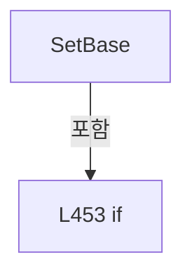

변경 전 점검: 입력/반환 타입, 위 호출자, 예외/취소 경로, 공유 상태와 저장·전송 소비자를 함께 확인합니다. 값의 단위나 물리 방향을 이름만으로 확정하지 않습니다.

### MethodDeclaration `SetRange` · L457–461

[Drilling.Common/Correction/CAlignInterpolation.cs:457–461](https://github.com/kjuws10-rgb/A3Drilling/blob/334b3599651b2e8e0181fd4459bafaf3cddafff3/Drilling.Common/Correction/CAlignInterpolation.cs#L457-L461)

| 항목 | 실제 추출 값 |
| --- | --- |
| 서명 | System.Threading.Tasks.Task<System.Collections.Generic.IReadOnlyDictionary<string, double>> Drilling.Common.Correction.CAlignWapageService.SetRange(double, System.Threading.CancellationToken) |
| 접근/수식자 | Public / public |
| 반환/값 타입 | System.Threading.Tasks.Task<System.Collections.Generic.IReadOnlyDictionary<string, double>> |
| 소속 타입 | NamedType:Drilling.Common.Correction.CAlignWapageService |

입력 계약:

| 이름 | 타입 | 전달 | 선택/기본값 |
| --- | --- | --- | --- |
| pixels | double | None | False /  |
| token | System.Threading.CancellationToken | None | True / null |

정적 호출자로 확인된 위치:

| 호출 파일/행 | 호출 표현식 | 런타임 분기 가능 |
| --- | --- | --- |
| [Drilling.Common/Correction/CAlignInterpolation.cs:318–318](https://github.com/kjuws10-rgb/A3Drilling/blob/334b3599651b2e8e0181fd4459bafaf3cddafff3/Drilling.Common/Correction/CAlignInterpolation.cs#L318-L318) | _io.SetRange | False |
| [Drilling.UI/Menu/Menus/CMenuCorrection.cs:2826–2826](https://github.com/kjuws10-rgb/A3Drilling/blob/334b3599651b2e8e0181fd4459bafaf3cddafff3/Drilling.UI/Menu/Menus/CMenuCorrection.cs#L2826-L2826) | _wapage.SetRange | False |

호출하는 대상과 해석 범위:

| 원본 행 | 표현식 | 분석 상태 | 대상/소스 위치 |
| --- | --- | --- | --- |
| 459 | double.IsFinite | resolved | bool double.IsFinite(double) |
| 459 | new InvalidOperationException | resolved | System.InvalidOperationException.InvalidOperationException(string?) |
| 460 | Write | resolved | System.Threading.Tasks.Task<System.Collections.Generic.IReadOnlyDictionary<string, double>> Drilling.Common.Correction.CAlignWapageService.Write((string Id, double Value)[], System.Threading.CancellationToken) · Drilling.Common/Correction/CAlignInterpolation.cs:462 |
| 460 | Points.Select(point => (point.RangeId, pixels)).ToArray | resolved | (string RangeId, double pixels)[] System.Collections.Generic.IEnumerable<(string RangeId, double pixels)>.ToArray<(string RangeId, double pixels)>() |
| 460 | Points.Select | resolved | System.Collections.Generic.IEnumerable<(string RangeId, double pixels)> System.Collections.Generic.IEnumerable<Drilling.Common.Correction.ST_WAPAGE_ALIGNBASE_POINT>.Select<Drilling.Common.Correction.ST_WAPAGE_ALIGNBASE_POINT, (string RangeId, double pixels)>(System.Func<Drilling.Common.Correction.ST_WAPAGE_ALIGNBASE_POINT, (string RangeId, double pixels)>) |

본문의 실제 연산·분기·예외·반환 순서(원문 위치 순):

| 원본 행 | 종류 | 주석 해설 |
| --- | --- | --- |
| 459 | call | 함수·델리게이트 또는 객체 생성자를 호출합니다: double.IsFinite(pixels) |
| 459 | call | 함수·델리게이트 또는 객체 생성자를 호출합니다: new InvalidOperationException("Wapage Range는 0 이상의 유한한 pixel 값이어야 합니다.") |
| 459 | if | 조건에 따라 분기합니다: if (!double.IsFinite(pixels) &#124;&#124; pixels < 0) |
| 459 | throw | 예외를 발생/전달합니다: throw new InvalidOperationException("Wapage Range는 0 이상의 유한한 pixel 값이어야 합니다."); |
| 460 | call | 함수·델리게이트 또는 객체 생성자를 호출합니다: Write(Points.Select(point => (point.RangeId, pixels)).ToArray(), token) |
| 460 | call | 함수·델리게이트 또는 객체 생성자를 호출합니다: Points.Select(point => (point.RangeId, pixels)).ToArray() |
| 460 | call | 함수·델리게이트 또는 객체 생성자를 호출합니다: Points.Select(point => (point.RangeId, pixels)) |
| 460 | return | 호출자에게 값 또는 제어를 반환합니다: return Write(Points.Select(point => (point.RangeId, pixels)).ToArray(), token); |

제어 구문의 포함 구조(실제 실행 순서/CFG가 아닌 구문 탐색 그림):

```mermaid
flowchart TD
 M["SetRange"]
 N0["L459 if"]
 M -->|포함| N0
```

변경 전 점검: 입력/반환 타입, 위 호출자, 예외/취소 경로, 공유 상태와 저장·전송 소비자를 함께 확인합니다. 값의 단위나 물리 방향을 이름만으로 확정하지 않습니다.

### MethodDeclaration `Write` · L462–495

[Drilling.Common/Correction/CAlignInterpolation.cs:462–495](https://github.com/kjuws10-rgb/A3Drilling/blob/334b3599651b2e8e0181fd4459bafaf3cddafff3/Drilling.Common/Correction/CAlignInterpolation.cs#L462-L495)

| 항목 | 실제 추출 값 |
| --- | --- |
| 서명 | System.Threading.Tasks.Task<System.Collections.Generic.IReadOnlyDictionary<string, double>> Drilling.Common.Correction.CAlignWapageService.Write((string Id, double Value)[], System.Threading.CancellationToken) |
| 접근/수식자 | Private / private |
| 반환/값 타입 | System.Threading.Tasks.Task<System.Collections.Generic.IReadOnlyDictionary<string, double>> |
| 소속 타입 | NamedType:Drilling.Common.Correction.CAlignWapageService |

입력 계약:

| 이름 | 타입 | 전달 | 선택/기본값 |
| --- | --- | --- | --- |
| values | (string Id, double Value)[] | None | False /  |
| token | System.Threading.CancellationToken | None | False /  |

정적 호출자로 확인된 위치:

| 호출 파일/행 | 호출 표현식 | 런타임 분기 가능 |
| --- | --- | --- |
| [Drilling.Common/Correction/CAlignInterpolation.cs:438–438](https://github.com/kjuws10-rgb/A3Drilling/blob/334b3599651b2e8e0181fd4459bafaf3cddafff3/Drilling.Common/Correction/CAlignInterpolation.cs#L438-L438) | Write | False |
| [Drilling.Common/Correction/CAlignInterpolation.cs:455–455](https://github.com/kjuws10-rgb/A3Drilling/blob/334b3599651b2e8e0181fd4459bafaf3cddafff3/Drilling.Common/Correction/CAlignInterpolation.cs#L455-L455) | Write | False |
| [Drilling.Common/Correction/CAlignInterpolation.cs:460–460](https://github.com/kjuws10-rgb/A3Drilling/blob/334b3599651b2e8e0181fd4459bafaf3cddafff3/Drilling.Common/Correction/CAlignInterpolation.cs#L460-L460) | Write | False |

호출하는 대상과 해석 범위:

| 원본 행 | 표현식 | 분석 상태 | 대상/소스 위치 |
| --- | --- | --- | --- |
| 464 | Validate | resolved | System.Collections.Generic.Dictionary<string, Drilling.Common.Interface.ST_MELSEC_MAP_DATA> Drilling.Common.Correction.CAlignWapageService.Validate(System.Collections.Generic.IReadOnlyCollection<string>, bool) · Drilling.Common/Correction/CAlignInterpolation.cs:406 |
| 464 | values.Select(item => item.Id).ToArray | resolved | string[] System.Collections.Generic.IEnumerable<string>.ToArray<string>() |
| 464 | values.Select | resolved | System.Collections.Generic.IEnumerable<string> System.Collections.Generic.IEnumerable<(string Id, double Value)>.Select<(string Id, double Value), string>(System.Func<(string Id, double Value), string>) |
| 465 | new Dictionary<string, double> | resolved | System.Collections.Generic.Dictionary<string, double>.Dictionary(System.Collections.Generic.IEqualityComparer<string>?) |
| 468 | Math.Round | resolved | double System.Math.Round(double, System.MidpointRounding) |
| 469 | double.IsFinite | resolved | bool double.IsFinite(double) |
| 470 | new InvalidOperationException | resolved | System.InvalidOperationException.InvalidOperationException(string?) |
| 471 | expected.Add | resolved | void System.Collections.Generic.Dictionary<string, double>.Add(string, double) |
| 473 | Task.Run<IReadOnlyDictionary<string, double>> | resolved | System.Threading.Tasks.Task<System.Collections.Generic.IReadOnlyDictionary<string, double>> System.Threading.Tasks.Task.Run<System.Collections.Generic.IReadOnlyDictionary<string, double>>(System.Func<System.Collections.Generic.IReadOnlyDictionary<string, double>>, System.Threading.CancellationToken) |
| 480 | token.ThrowIfCancellationRequested | resolved | void System.Threading.CancellationToken.ThrowIfCancellationRequested() |
| 481 | _write | resolved · 동적 구현 선택 가능 | void System.Action<string, double, System.Threading.CancellationToken>.Invoke(string, double, System.Threading.CancellationToken) |
| 484 | Read | resolved | System.Collections.Generic.Dictionary<string, double> Drilling.Common.Correction.CAlignWapageService.Read(System.Collections.Generic.IEnumerable<string>, System.Threading.CancellationToken) · Drilling.Common/Correction/CAlignInterpolation.cs:439 |
| 484 | values.Select | resolved | System.Collections.Generic.IEnumerable<string> System.Collections.Generic.IEnumerable<(string Id, double Value)>.Select<(string Id, double Value), string>(System.Func<(string Id, double Value), string>) |
| 486 | Math.Abs | resolved | double System.Math.Abs(double) |
| 487 | new InvalidOperationException | resolved | System.InvalidOperationException.InvalidOperationException(string?) |
| 492 | new InvalidOperationException | resolved | System.InvalidOperationException.InvalidOperationException(string?, System.Exception?) |

본문의 실제 연산·분기·예외·반환 순서(원문 위치 순):

| 원본 행 | 종류 | 주석 해설 |
| --- | --- | --- |
| 464 | call | 함수·델리게이트 또는 객체 생성자를 호출합니다: Validate(values.Select(item => item.Id).ToArray(), true) |
| 464 | call | 함수·델리게이트 또는 객체 생성자를 호출합니다: values.Select(item => item.Id).ToArray() |
| 464 | call | 함수·델리게이트 또는 객체 생성자를 호출합니다: values.Select(item => item.Id) |
| 464 | local-declaration | 지역 변수를 선언합니다: var map = Validate(values.Select(item => item.Id).ToArray(), true); |
| 464 | variable-initializer | 변수의 초기값을 지정합니다: map = Validate(values.Select(item => item.Id).ToArray(), true) |
| 465 | call | 함수·델리게이트 또는 객체 생성자를 호출합니다: new Dictionary<string, double>(StringComparer.OrdinalIgnoreCase) |
| 465 | local-declaration | 지역 변수를 선언합니다: var expected = new Dictionary<string, double>(StringComparer.OrdinalIgnoreCase); |
| 465 | variable-initializer | 변수의 초기값을 지정합니다: expected = new Dictionary<string, double>(StringComparer.OrdinalIgnoreCase) |
| 466 | foreach | 컬렉션 요소를 순회합니다: foreach (var item in values) |
| 468 | call | 함수·델리게이트 또는 객체 생성자를 호출합니다: Math.Round(item.Value * map[item.Id].WriteScale, MidpointRounding.AwayFromZero) |
| 468 | local-declaration | 지역 변수를 선언합니다: var raw = Math.Round(item.Value * map[item.Id].WriteScale, MidpointRounding.AwayFromZero); |
| 468 | variable-initializer | 변수의 초기값을 지정합니다: raw = Math.Round(item.Value * map[item.Id].WriteScale, MidpointRounding.AwayFromZero) |
| 469 | call | 함수·델리게이트 또는 객체 생성자를 호출합니다: double.IsFinite(raw) |
| 469 | if | 조건에 따라 분기합니다: if (!double.IsFinite(raw) &#124;&#124; raw < int.MinValue &#124;&#124; raw > int.MaxValue) |
| 470 | call | 함수·델리게이트 또는 객체 생성자를 호출합니다: new InvalidOperationException($"{item.Id} 값이 MELSEC 저장 범위를 초과합니다.") |
| 470 | throw | 예외를 발생/전달합니다: throw new InvalidOperationException($"{item.Id} 값이 MELSEC 저장 범위를 초과합니다."); |
| 471 | call | 함수·델리게이트 또는 객체 생성자를 호출합니다: expected.Add(item.Id, raw * map[item.Id].ReadScale) |
| 473 | call | 함수·델리게이트 또는 객체 생성자를 호출합니다: Task.Run<IReadOnlyDictionary<string, double>>(() => { var completed = 0; try { foreach (var item in values) { token.ThrowIfCancellationRequested(); _write(item.Id, item.Value, token); // WRITE_SCALE is applied once, insi… |
| 473 | return | 호출자에게 값 또는 제어를 반환합니다: return Task.Run<IReadOnlyDictionary<string, double>>(() => { var completed = 0; try { foreach (var item in values) { token.ThrowIfCancellationRequested(); _write(item.Id, item.Value, token); // WRITE_SCALE is applied once, inside  |
| 475 | local-declaration | 지역 변수를 선언합니다: var completed = 0; |
| 475 | variable-initializer | 변수의 초기값을 지정합니다: completed = 0 |
| 476 | try | 예외 처리 범위입니다: try |
| 478 | foreach | 컬렉션 요소를 순회합니다: foreach (var item in values) |
| 480 | call | 함수·델리게이트 또는 객체 생성자를 호출합니다: token.ThrowIfCancellationRequested() |
| 481 | call | 함수·델리게이트 또는 객체 생성자를 호출합니다: _write(item.Id, item.Value, token) |
| 484 | call | 함수·델리게이트 또는 객체 생성자를 호출합니다: Read(values.Select(item => item.Id), token) |
| 484 | call | 함수·델리게이트 또는 객체 생성자를 호출합니다: values.Select(item => item.Id) |
| 484 | local-declaration | 지역 변수를 선언합니다: var readback = Read(values.Select(item => item.Id), token); |
| 484 | variable-initializer | 변수의 초기값을 지정합니다: readback = Read(values.Select(item => item.Id), token) |
| 485 | foreach | 컬렉션 요소를 순회합니다: foreach (var pair in expected) |
| 486 | call | 함수·델리게이트 또는 객체 생성자를 호출합니다: Math.Abs(readback[pair.Key] - pair.Value) |
| 486 | if | 조건에 따라 분기합니다: if (Math.Abs(readback[pair.Key] - pair.Value) > 1e-7) |
| 487 | call | 함수·델리게이트 또는 객체 생성자를 호출합니다: new InvalidOperationException($"{pair.Key} 기록값과 읽은 값이 다릅니다.") |
| 487 | throw | 예외를 발생/전달합니다: throw new InvalidOperationException($"{pair.Key} 기록값과 읽은 값이 다릅니다."); |
| 488 | return | 호출자에게 값 또는 제어를 반환합니다: return readback; |
| 490 | catch | 지정 예외를 처리합니다: catch (Exception exception) |
| 492 | call | 함수·델리게이트 또는 객체 생성자를 호출합니다: new InvalidOperationException($"Wapage Set 확인 실패 (쓰기 완료 {completed}/{values.Length}). 일부 값이 변경되었을 수 있으므로 Load로 현재값을 확인하세요.\n{exception.Message}", exception) |
| 492 | throw | 예외를 발생/전달합니다: throw new InvalidOperationException($"Wapage Set 확인 실패 (쓰기 완료 {completed}/{values.Length}). 일부 값이 변경되었을 수 있으므로 Load로 현재값을 확인하세요.\n{exception.Message}", exception); |

제어 구문의 포함 구조(실제 실행 순서/CFG가 아닌 구문 탐색 그림):

```mermaid
flowchart TD
 M["Write"]
 N0["L466 foreach"]
 M -->|포함| N0
 N1["L469 if"]
 N0 -->|포함| N1
 N2["L476 try"]
 M -->|포함| N2
 N3["L478 foreach"]
 N2 -->|포함| N3
 N4["L485 foreach"]
 N2 -->|포함| N4
 N5["L486 if"]
 N4 -->|포함| N5
 N6["L490 catch"]
 N2 -->|포함| N6
```

변경 전 점검: 입력/반환 타입, 위 호출자, 예외/취소 경로, 공유 상태와 저장·전송 소비자를 함께 확인합니다. 값의 단위나 물리 방향을 이름만으로 확정하지 않습니다.

## 구문·바인딩 한계

전체 WPF/벤더 SDK/프로젝트별 빌드 조건을 로드한 정식 빌드가 아닙니다. `resolved`는 이 부분 컴파일에서의 심볼 연결이며 virtual/interface/delegate/이벤트/Reflection/XAML의 실제 런타임 구현을 확정하지 않습니다. `candidate`와 `unresolved`는 후속 확인 대상으로 남깁니다.

## 원문 전체 주석 해설본

[원본 모든 행과 행별 해설 보기](../../../annotated/Drilling.Common/Correction/CAlignInterpolation.cs.annotated.txt)

원본을 빠뜨리거나 임의로 줄이지 않았습니다. `L000001 |` 표시는 원본 행 번호, `// 해설`은 별도 설명입니다. 실행용 소스가 아닌 문서입니다.

## 수정·재검증 체크

- 원본 Commit과 현재 작업 파일 SHA가 같은지 먼저 확인합니다. 다르면 이 문서를 과거 버전 자료로 취급합니다.
- 선언·직접 호출·이벤트/인터페이스 경계·설정 소비를 함께 확인합니다. 정적 연결의 빈 곳을 정상 경로로 추정하지 않습니다.
- 저장 형식/단위/식별자·재시도·취소·예외·롤백에 영향을 주는 변경은 상세 해설장과 호출자를 다시 검토합니다.
- 도구의 구문 추출과 별도 정적 추적 해설, 실제 빌드·시뮬레이션·실장비 검증 결과를 분리합니다.
