# Drilling.Common/Correction/CDefaultOffsetCalibration.cs

| 항목 | 내용 |
| --- | --- |
| 원본 저장소 | https://github.com/kjuws10-rgb/A3Drilling.git |
| 원본 Commit | 5aee8e58439c9b455cae7c9593c9be986c3e682e |
| 원본 SHA256 | 7e55224d03de3996247d9d9f084d6914c12af1754ffa20fb4dfb0361e5350456 |
| 파일 분류 | code |
| 원본 크기/행 | 19,684 bytes / 267 physical lines |
| 인코딩 | utf-8-sig |
| 검토 범위 | 구문/부분 의미 분석에서 추출한 사실. 동작·물리 단위·실장비 합격을 보증하지 않습니다. |
| 원본 링크 | [고정 Commit 원본](https://github.com/kjuws10-rgb/A3Drilling/blob/5aee8e58439c9b455cae7c9593c9be986c3e682e/Drilling.Common/Correction/CDefaultOffsetCalibration.cs) |

## 파일의 역할과 읽는 순서

보정 계산·설정·원본/적용값의 관계를 다루는 계층입니다. 값의 좌표계와 단위는 호출부의 근거를 따릅니다.

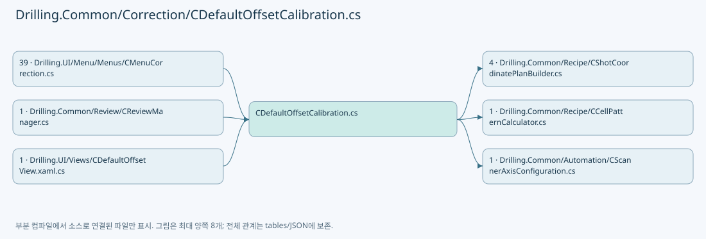

## 네임스페이스·타입·상속

| 타입 | 구분 | 원본 범위 | 선언/상속 |
| --- | --- | --- | --- |
| CDefaultOffsetCalibration | ClassDeclaration | 12–230 | CDefaultOffsetCalibration |
| EN_DEFAULT_MACHINING_MODE | EnumDeclaration | 232–232 | EN_DEFAULT_MACHINING_MODE |
| ST_DEFAULT_OFFSET_OPTIONS | RecordDeclaration | 233–250 | ST_DEFAULT_OFFSET_OPTIONS |
| ST_DEFAULT_HEAD_GEOMETRY | RecordDeclaration | 251–251 | ST_DEFAULT_HEAD_GEOMETRY |
| ST_DEFAULT_PREVIEW_POINT | RecordDeclaration | 252–252 | ST_DEFAULT_PREVIEW_POINT |
| ST_DEFAULT_OFFSET_MARK | RecordDeclaration | 253–253 | ST_DEFAULT_OFFSET_MARK |
| ST_DEFAULT_OFFSET_FIT | RecordDeclaration | 254–254 | ST_DEFAULT_OFFSET_FIT |
| ST_DEFAULT_OFFSET_HEAD_RESULT | RecordDeclaration | 255–266 | ST_DEFAULT_OFFSET_HEAD_RESULT |
| ST_DEFAULT_OFFSET_LOG | RecordDeclaration | 267–267 | ST_DEFAULT_OFFSET_LOG |

## 멤버 빠른 목록

| 이름 | 종류 | 범위 | 서명 |
| --- | --- | --- | --- |
| Parameters | MethodDeclaration | L14–20 | System.Collections.Generic.IReadOnlyDictionary<string, string> Drilling.Common.Correction.CDefaultOffsetCalibration.Parameters(Drilling.Common.Managers.ST_RECIPE_DEFINITION, System.Collections.Generic.IEnumerable<Drilling.Common.Managers.ST_SYSTEM_PARAMETER>) |
| Number | MethodDeclaration | L22–27 | double Drilling.Common.Correction.CDefaultOffsetCalibration.Number(System.Collections.Generic.IReadOnlyDictionary<string, string>, string) |
| Conditions | MethodDeclaration | L31–39 | Drilling.Common.Correction.ST_DEFAULT_OFFSET_OPTIONS Drilling.Common.Correction.CDefaultOffsetCalibration.Conditions(System.Collections.Generic.IReadOnlyDictionary<string, string>, double?) |
| HeadGeometry | MethodDeclaration | L41–51 | Drilling.Common.Correction.ST_DEFAULT_HEAD_GEOMETRY Drilling.Common.Correction.CDefaultOffsetCalibration.HeadGeometry(System.Collections.Generic.IReadOnlyDictionary<string, string>, int) |
| PredictCenter | MethodDeclaration | L53–70 | Drilling.Common.Correction.ST_DEFAULT_PREVIEW_POINT Drilling.Common.Correction.CDefaultOffsetCalibration.PredictCenter(System.Collections.Generic.IReadOnlyDictionary<string, string>, int, double) |
| FitsField | MethodDeclaration | L74–78 | bool Drilling.Common.Correction.CDefaultOffsetCalibration.FitsField(System.Collections.Generic.IReadOnlyDictionary<string, string>, int, double, double) |
| ValidateOptions | MethodDeclaration | L80–88 | void Drilling.Common.Correction.CDefaultOffsetCalibration.ValidateOptions(Drilling.Common.Correction.ST_DEFAULT_OFFSET_OPTIONS) |
| CenterScannerTargets | MethodDeclaration | L92–105 | System.Collections.Generic.IReadOnlyList<(double X, double Y)> Drilling.Common.Correction.CDefaultOffsetCalibration.CenterScannerTargets(System.Collections.Generic.IReadOnlyDictionary<string, string>, int, Drilling.Common.Correction.ST_DEFAULT_OFFSET_OPTIONS) |
| Pitch | MethodDeclaration | L107–114 | double Drilling.Common.Correction.CDefaultOffsetCalibration.Pitch(System.Collections.Generic.IReadOnlyDictionary<string, string>, int) |
| Slot | MethodDeclaration | L116–123 | (double X, double Y) Drilling.Common.Correction.CDefaultOffsetCalibration.Slot(int, double, double) |
| Fit | MethodDeclaration | L125–160 | Drilling.Common.Correction.ST_DEFAULT_OFFSET_FIT Drilling.Common.Correction.CDefaultOffsetCalibration.Fit(System.Collections.Generic.IReadOnlyList<Drilling.Common.Correction.ST_DEFAULT_OFFSET_MARK>, double, double, double) |
| Coefficient | LocalFunctionStatement | L138–138 | double Coefficient(bool, bool) |
| FitCross | MethodDeclaration | L162–170 | Drilling.Common.Correction.ST_DEFAULT_OFFSET_FIT Drilling.Common.Correction.CDefaultOffsetCalibration.FitCross(Drilling.Common.Correction.ST_DEFAULT_OFFSET_MARK) |
| WithHeadReference | MethodDeclaration | L175–201 | Drilling.Common.Correction.ST_DEFAULT_OFFSET_HEAD_RESULT Drilling.Common.Correction.CDefaultOffsetCalibration.WithHeadReference(System.Collections.Generic.IReadOnlyDictionary<string, string>, Drilling.Common.Correction.ST_DEFAULT_OFFSET_HEAD_RESULT) |
| ActiveHeads | MethodDeclaration | L203–204 | int[] Drilling.Common.Correction.CDefaultOffsetCalibration.ActiveHeads(System.Collections.Generic.IReadOnlyDictionary<string, string>) |
| Recommend | MethodDeclaration | L206–229 | System.Collections.Generic.IReadOnlyDictionary<string, string> Drilling.Common.Correction.CDefaultOffsetCalibration.Recommend(System.Collections.Generic.IReadOnlyDictionary<string, string>, System.Collections.Generic.IReadOnlyCollection<Drilling.Common.Correction.ST_DEFAULT_OFFSET_HEAD_RESULT>, System.Collections.Generic.IReadOnlyCollection<int>?) |
| Shot | EnumMemberDeclaration | L232–232 | Drilling.Common.Correction.EN_DEFAULT_MACHINING_MODE.Shot |
| Cross | EnumMemberDeclaration | L232–232 | Drilling.Common.Correction.EN_DEFAULT_MACHINING_MODE.Cross |
| MachiningMode | PropertyDeclaration | L235–235 | Drilling.Common.Correction.EN_DEFAULT_MACHINING_MODE Drilling.Common.Correction.ST_DEFAULT_OFFSET_OPTIONS.MachiningMode |
| get_MachiningMode | GetAccessorDeclaration | L235–235 | Drilling.Common.Correction.EN_DEFAULT_MACHINING_MODE Drilling.Common.Correction.ST_DEFAULT_OFFSET_OPTIONS.MachiningMode.get |
| set_MachiningMode | InitAccessorDeclaration | L235–235 | void Drilling.Common.Correction.ST_DEFAULT_OFFSET_OPTIONS.MachiningMode.init |
| CrossSize | PropertyDeclaration | L236–236 | double Drilling.Common.Correction.ST_DEFAULT_OFFSET_OPTIONS.CrossSize |
| get_CrossSize | GetAccessorDeclaration | L236–236 | double Drilling.Common.Correction.ST_DEFAULT_OFFSET_OPTIONS.CrossSize.get |
| set_CrossSize | InitAccessorDeclaration | L236–236 | void Drilling.Common.Correction.ST_DEFAULT_OFFSET_OPTIONS.CrossSize.init |
| VisionMethod | PropertyDeclaration | L240–242 | Drilling.Common.Review.EN_ONE_SHOT_METHOD Drilling.Common.Correction.ST_DEFAULT_OFFSET_OPTIONS.VisionMethod |
| InspectionPointCount | PropertyDeclaration | L243–243 | int Drilling.Common.Correction.ST_DEFAULT_OFFSET_OPTIONS.InspectionPointCount |
| InspectionDescription | PropertyDeclaration | L244–246 | string Drilling.Common.Correction.ST_DEFAULT_OFFSET_OPTIONS.InspectionDescription |
| MachiningDescription | PropertyDeclaration | L247–248 | string Drilling.Common.Correction.ST_DEFAULT_OFFSET_OPTIONS.MachiningDescription |
| VisionDescription | PropertyDeclaration | L249–249 | string Drilling.Common.Correction.ST_DEFAULT_OFFSET_OPTIONS.VisionDescription |
| Model | PropertyDeclaration | L257–257 | int Drilling.Common.Correction.ST_DEFAULT_OFFSET_HEAD_RESULT.Model |
| get_Model | GetAccessorDeclaration | L257–257 | int Drilling.Common.Correction.ST_DEFAULT_OFFSET_HEAD_RESULT.Model.get |
| set_Model | InitAccessorDeclaration | L257–257 | void Drilling.Common.Correction.ST_DEFAULT_OFFSET_HEAD_RESULT.Model.init |
| ReferenceCell | PropertyDeclaration | L258–258 | int Drilling.Common.Correction.ST_DEFAULT_OFFSET_HEAD_RESULT.ReferenceCell |
| get_ReferenceCell | GetAccessorDeclaration | L258–258 | int Drilling.Common.Correction.ST_DEFAULT_OFFSET_HEAD_RESULT.ReferenceCell.get |
| set_ReferenceCell | InitAccessorDeclaration | L258–258 | void Drilling.Common.Correction.ST_DEFAULT_OFFSET_HEAD_RESULT.ReferenceCell.init |
| Geometry | PropertyDeclaration | L259–259 | Drilling.Common.Correction.ST_DEFAULT_HEAD_GEOMETRY? Drilling.Common.Correction.ST_DEFAULT_OFFSET_HEAD_RESULT.Geometry |
| get_Geometry | GetAccessorDeclaration | L259–259 | Drilling.Common.Correction.ST_DEFAULT_HEAD_GEOMETRY? Drilling.Common.Correction.ST_DEFAULT_OFFSET_HEAD_RESULT.Geometry.get |
| set_Geometry | InitAccessorDeclaration | L259–259 | void Drilling.Common.Correction.ST_DEFAULT_OFFSET_HEAD_RESULT.Geometry.init |
| TargetReviewX | PropertyDeclaration | L260–260 | double Drilling.Common.Correction.ST_DEFAULT_OFFSET_HEAD_RESULT.TargetReviewX |
| get_TargetReviewX | GetAccessorDeclaration | L260–260 | double Drilling.Common.Correction.ST_DEFAULT_OFFSET_HEAD_RESULT.TargetReviewX.get |
| set_TargetReviewX | InitAccessorDeclaration | L260–260 | void Drilling.Common.Correction.ST_DEFAULT_OFFSET_HEAD_RESULT.TargetReviewX.init |
| TargetStageY | PropertyDeclaration | L261–261 | double Drilling.Common.Correction.ST_DEFAULT_OFFSET_HEAD_RESULT.TargetStageY |
| get_TargetStageY | GetAccessorDeclaration | L261–261 | double Drilling.Common.Correction.ST_DEFAULT_OFFSET_HEAD_RESULT.TargetStageY.get |
| set_TargetStageY | InitAccessorDeclaration | L261–261 | void Drilling.Common.Correction.ST_DEFAULT_OFFSET_HEAD_RESULT.TargetStageY.init |
| CenterReviewX | PropertyDeclaration | L262–262 | double Drilling.Common.Correction.ST_DEFAULT_OFFSET_HEAD_RESULT.CenterReviewX |
| get_CenterReviewX | GetAccessorDeclaration | L262–262 | double Drilling.Common.Correction.ST_DEFAULT_OFFSET_HEAD_RESULT.CenterReviewX.get |
| set_CenterReviewX | InitAccessorDeclaration | L262–262 | void Drilling.Common.Correction.ST_DEFAULT_OFFSET_HEAD_RESULT.CenterReviewX.init |
| CenterStageY | PropertyDeclaration | L263–263 | double Drilling.Common.Correction.ST_DEFAULT_OFFSET_HEAD_RESULT.CenterStageY |
| get_CenterStageY | GetAccessorDeclaration | L263–263 | double Drilling.Common.Correction.ST_DEFAULT_OFFSET_HEAD_RESULT.CenterStageY.get |
| set_CenterStageY | InitAccessorDeclaration | L263–263 | void Drilling.Common.Correction.ST_DEFAULT_OFFSET_HEAD_RESULT.CenterStageY.init |
| CenterErrorX | PropertyDeclaration | L264–264 | double Drilling.Common.Correction.ST_DEFAULT_OFFSET_HEAD_RESULT.CenterErrorX |
| get_CenterErrorX | GetAccessorDeclaration | L264–264 | double Drilling.Common.Correction.ST_DEFAULT_OFFSET_HEAD_RESULT.CenterErrorX.get |
| set_CenterErrorX | InitAccessorDeclaration | L264–264 | void Drilling.Common.Correction.ST_DEFAULT_OFFSET_HEAD_RESULT.CenterErrorX.init |
| CenterErrorY | PropertyDeclaration | L265–265 | double Drilling.Common.Correction.ST_DEFAULT_OFFSET_HEAD_RESULT.CenterErrorY |
| get_CenterErrorY | GetAccessorDeclaration | L265–265 | double Drilling.Common.Correction.ST_DEFAULT_OFFSET_HEAD_RESULT.CenterErrorY.get |
| set_CenterErrorY | InitAccessorDeclaration | L265–265 | void Drilling.Common.Correction.ST_DEFAULT_OFFSET_HEAD_RESULT.CenterErrorY.init |

## 멤버별 상세 계약·호출·처리 해설

### MethodDeclaration `Parameters` · L14–20

[Drilling.Common/Correction/CDefaultOffsetCalibration.cs:14–20](https://github.com/kjuws10-rgb/A3Drilling/blob/5aee8e58439c9b455cae7c9593c9be986c3e682e/Drilling.Common/Correction/CDefaultOffsetCalibration.cs#L14-L20)

| 항목 | 실제 추출 값 |
| --- | --- |
| 서명 | System.Collections.Generic.IReadOnlyDictionary<string, string> Drilling.Common.Correction.CDefaultOffsetCalibration.Parameters(Drilling.Common.Managers.ST_RECIPE_DEFINITION, System.Collections.Generic.IEnumerable<Drilling.Common.Managers.ST_SYSTEM_PARAMETER>) |
| 접근/수식자 | Public / public, static |
| 반환/값 타입 | System.Collections.Generic.IReadOnlyDictionary<string, string> |
| 소속 타입 | NamedType:Drilling.Common.Correction.CDefaultOffsetCalibration |

입력 계약:

| 이름 | 타입 | 전달 | 선택/기본값 |
| --- | --- | --- | --- |
| recipe | Drilling.Common.Managers.ST_RECIPE_DEFINITION | None | False /  |
| settings | System.Collections.Generic.IEnumerable<Drilling.Common.Managers.ST_SYSTEM_PARAMETER> | None | False /  |

정적 호출자로 확인된 위치:

| 호출 파일/행 | 호출 표현식 | 런타임 분기 가능 |
| --- | --- | --- |
| [Drilling.UI/Menu/Menus/CMenuCorrection.cs:3130–3130](https://github.com/kjuws10-rgb/A3Drilling/blob/5aee8e58439c9b455cae7c9593c9be986c3e682e/Drilling.UI/Menu/Menus/CMenuCorrection.cs#L3130-L3130) | CDefaultOffsetCalibration.Parameters | False |
| [Drilling.UI/Menu/Menus/CMenuCorrection.cs:3405–3405](https://github.com/kjuws10-rgb/A3Drilling/blob/5aee8e58439c9b455cae7c9593c9be986c3e682e/Drilling.UI/Menu/Menus/CMenuCorrection.cs#L3405-L3405) | CDefaultOffsetCalibration.Parameters | False |
| [Drilling.UI/Menu/Menus/CMenuCorrection.cs:3775–3775](https://github.com/kjuws10-rgb/A3Drilling/blob/5aee8e58439c9b455cae7c9593c9be986c3e682e/Drilling.UI/Menu/Menus/CMenuCorrection.cs#L3775-L3775) | CDefaultOffsetCalibration.Parameters | False |

호출하는 대상과 해석 범위:

| 원본 행 | 표현식 | 분석 상태 | 대상/소스 위치 |
| --- | --- | --- | --- |
| 16 | new Dictionary<string, string> | resolved | System.Collections.Generic.Dictionary<string, string>.Dictionary(System.Collections.Generic.IEqualityComparer<string>?) |

본문의 실제 연산·분기·예외·반환 순서(원문 위치 순):

| 원본 행 | 종류 | 주석 해설 |
| --- | --- | --- |
| 16 | call | 함수·델리게이트 또는 객체 생성자를 호출합니다: new Dictionary<string, string>(StringComparer.OrdinalIgnoreCase) |
| 16 | local-declaration | 지역 변수를 선언합니다: var values = new Dictionary<string, string>(StringComparer.OrdinalIgnoreCase); |
| 16 | variable-initializer | 변수의 초기값을 지정합니다: values = new Dictionary<string, string>(StringComparer.OrdinalIgnoreCase) |
| 17 | assignment | 값을 대상에 대입합니다: values[p.Key] = p.Value |
| 17 | foreach | 컬렉션 요소를 순회합니다: foreach (var p in settings) |
| 18 | assignment | 값을 대상에 대입합니다: values[p.Key] = p.Value |
| 18 | foreach | 컬렉션 요소를 순회합니다: foreach (var p in recipe.Parameters) |
| 19 | return | 호출자에게 값 또는 제어를 반환합니다: return values; |

제어 구문의 포함 구조(실제 실행 순서/CFG가 아닌 구문 탐색 그림):

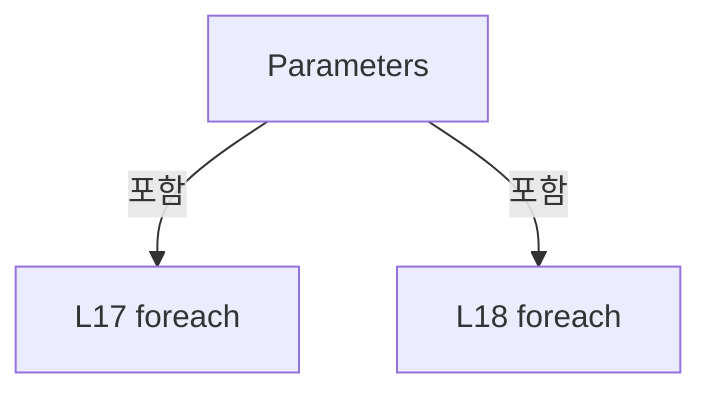

변경 전 점검: 입력/반환 타입, 위 호출자, 예외/취소 경로, 공유 상태와 저장·전송 소비자를 함께 확인합니다. 값의 단위나 물리 방향을 이름만으로 확정하지 않습니다.

### MethodDeclaration `Number` · L22–27

[Drilling.Common/Correction/CDefaultOffsetCalibration.cs:22–27](https://github.com/kjuws10-rgb/A3Drilling/blob/5aee8e58439c9b455cae7c9593c9be986c3e682e/Drilling.Common/Correction/CDefaultOffsetCalibration.cs#L22-L27)

| 항목 | 실제 추출 값 |
| --- | --- |
| 서명 | double Drilling.Common.Correction.CDefaultOffsetCalibration.Number(System.Collections.Generic.IReadOnlyDictionary<string, string>, string) |
| 접근/수식자 | Public / public, static |
| 반환/값 타입 | double |
| 소속 타입 | NamedType:Drilling.Common.Correction.CDefaultOffsetCalibration |

입력 계약:

| 이름 | 타입 | 전달 | 선택/기본값 |
| --- | --- | --- | --- |
| values | System.Collections.Generic.IReadOnlyDictionary<string, string> | None | False /  |
| key | string | None | False /  |

정적 호출자로 확인된 위치:

| 호출 파일/행 | 호출 표현식 | 런타임 분기 가능 |
| --- | --- | --- |
| [Drilling.Common/Correction/CDefaultOffsetCalibration.cs:33–33](https://github.com/kjuws10-rgb/A3Drilling/blob/5aee8e58439c9b455cae7c9593c9be986c3e682e/Drilling.Common/Correction/CDefaultOffsetCalibration.cs#L33-L33) | Number | False |
| [Drilling.Common/Correction/CDefaultOffsetCalibration.cs:33–33](https://github.com/kjuws10-rgb/A3Drilling/blob/5aee8e58439c9b455cae7c9593c9be986c3e682e/Drilling.Common/Correction/CDefaultOffsetCalibration.cs#L33-L33) | Number | False |
| [Drilling.Common/Correction/CDefaultOffsetCalibration.cs:33–33](https://github.com/kjuws10-rgb/A3Drilling/blob/5aee8e58439c9b455cae7c9593c9be986c3e682e/Drilling.Common/Correction/CDefaultOffsetCalibration.cs#L33-L33) | Number | False |
| [Drilling.Common/Correction/CDefaultOffsetCalibration.cs:34–34](https://github.com/kjuws10-rgb/A3Drilling/blob/5aee8e58439c9b455cae7c9593c9be986c3e682e/Drilling.Common/Correction/CDefaultOffsetCalibration.cs#L34-L34) | Number | False |
| [Drilling.Common/Correction/CDefaultOffsetCalibration.cs:35–35](https://github.com/kjuws10-rgb/A3Drilling/blob/5aee8e58439c9b455cae7c9593c9be986c3e682e/Drilling.Common/Correction/CDefaultOffsetCalibration.cs#L35-L35) | Number | False |
| [Drilling.Common/Correction/CDefaultOffsetCalibration.cs:35–35](https://github.com/kjuws10-rgb/A3Drilling/blob/5aee8e58439c9b455cae7c9593c9be986c3e682e/Drilling.Common/Correction/CDefaultOffsetCalibration.cs#L35-L35) | Number | False |
| [Drilling.Common/Correction/CDefaultOffsetCalibration.cs:45–45](https://github.com/kjuws10-rgb/A3Drilling/blob/5aee8e58439c9b455cae7c9593c9be986c3e682e/Drilling.Common/Correction/CDefaultOffsetCalibration.cs#L45-L45) | Number | False |
| [Drilling.Common/Correction/CDefaultOffsetCalibration.cs:46–46](https://github.com/kjuws10-rgb/A3Drilling/blob/5aee8e58439c9b455cae7c9593c9be986c3e682e/Drilling.Common/Correction/CDefaultOffsetCalibration.cs#L46-L46) | Number | False |
| [Drilling.Common/Correction/CDefaultOffsetCalibration.cs:47–47](https://github.com/kjuws10-rgb/A3Drilling/blob/5aee8e58439c9b455cae7c9593c9be986c3e682e/Drilling.Common/Correction/CDefaultOffsetCalibration.cs#L47-L47) | Number | False |
| [Drilling.Common/Correction/CDefaultOffsetCalibration.cs:57–57](https://github.com/kjuws10-rgb/A3Drilling/blob/5aee8e58439c9b455cae7c9593c9be986c3e682e/Drilling.Common/Correction/CDefaultOffsetCalibration.cs#L57-L57) | Number | False |
| [Drilling.Common/Correction/CDefaultOffsetCalibration.cs:59–59](https://github.com/kjuws10-rgb/A3Drilling/blob/5aee8e58439c9b455cae7c9593c9be986c3e682e/Drilling.Common/Correction/CDefaultOffsetCalibration.cs#L59-L59) | Number | False |
| [Drilling.Common/Correction/CDefaultOffsetCalibration.cs:60–60](https://github.com/kjuws10-rgb/A3Drilling/blob/5aee8e58439c9b455cae7c9593c9be986c3e682e/Drilling.Common/Correction/CDefaultOffsetCalibration.cs#L60-L60) | Number | False |
| [Drilling.Common/Correction/CDefaultOffsetCalibration.cs:60–60](https://github.com/kjuws10-rgb/A3Drilling/blob/5aee8e58439c9b455cae7c9593c9be986c3e682e/Drilling.Common/Correction/CDefaultOffsetCalibration.cs#L60-L60) | Number | False |
| [Drilling.Common/Correction/CDefaultOffsetCalibration.cs:64–64](https://github.com/kjuws10-rgb/A3Drilling/blob/5aee8e58439c9b455cae7c9593c9be986c3e682e/Drilling.Common/Correction/CDefaultOffsetCalibration.cs#L64-L64) | Number | False |
| [Drilling.Common/Correction/CDefaultOffsetCalibration.cs:64–64](https://github.com/kjuws10-rgb/A3Drilling/blob/5aee8e58439c9b455cae7c9593c9be986c3e682e/Drilling.Common/Correction/CDefaultOffsetCalibration.cs#L64-L64) | Number | False |
| [Drilling.Common/Correction/CDefaultOffsetCalibration.cs:65–65](https://github.com/kjuws10-rgb/A3Drilling/blob/5aee8e58439c9b455cae7c9593c9be986c3e682e/Drilling.Common/Correction/CDefaultOffsetCalibration.cs#L65-L65) | Number | False |
| [Drilling.Common/Correction/CDefaultOffsetCalibration.cs:65–65](https://github.com/kjuws10-rgb/A3Drilling/blob/5aee8e58439c9b455cae7c9593c9be986c3e682e/Drilling.Common/Correction/CDefaultOffsetCalibration.cs#L65-L65) | Number | False |
| [Drilling.Common/Correction/CDefaultOffsetCalibration.cs:65–65](https://github.com/kjuws10-rgb/A3Drilling/blob/5aee8e58439c9b455cae7c9593c9be986c3e682e/Drilling.Common/Correction/CDefaultOffsetCalibration.cs#L65-L65) | Number | False |
| [Drilling.Common/Correction/CDefaultOffsetCalibration.cs:65–65](https://github.com/kjuws10-rgb/A3Drilling/blob/5aee8e58439c9b455cae7c9593c9be986c3e682e/Drilling.Common/Correction/CDefaultOffsetCalibration.cs#L65-L65) | Number | False |
| [Drilling.Common/Correction/CDefaultOffsetCalibration.cs:66–66](https://github.com/kjuws10-rgb/A3Drilling/blob/5aee8e58439c9b455cae7c9593c9be986c3e682e/Drilling.Common/Correction/CDefaultOffsetCalibration.cs#L66-L66) | Number | False |
| [Drilling.Common/Correction/CDefaultOffsetCalibration.cs:67–67](https://github.com/kjuws10-rgb/A3Drilling/blob/5aee8e58439c9b455cae7c9593c9be986c3e682e/Drilling.Common/Correction/CDefaultOffsetCalibration.cs#L67-L67) | Number | False |
| [Drilling.Common/Correction/CDefaultOffsetCalibration.cs:67–67](https://github.com/kjuws10-rgb/A3Drilling/blob/5aee8e58439c9b455cae7c9593c9be986c3e682e/Drilling.Common/Correction/CDefaultOffsetCalibration.cs#L67-L67) | Number | False |
| [Drilling.Common/Correction/CDefaultOffsetCalibration.cs:95–95](https://github.com/kjuws10-rgb/A3Drilling/blob/5aee8e58439c9b455cae7c9593c9be986c3e682e/Drilling.Common/Correction/CDefaultOffsetCalibration.cs#L95-L95) | Number | False |
| [Drilling.Common/Correction/CDefaultOffsetCalibration.cs:96–96](https://github.com/kjuws10-rgb/A3Drilling/blob/5aee8e58439c9b455cae7c9593c9be986c3e682e/Drilling.Common/Correction/CDefaultOffsetCalibration.cs#L96-L96) | Number | False |
| [Drilling.Common/Correction/CDefaultOffsetCalibration.cs:109–109](https://github.com/kjuws10-rgb/A3Drilling/blob/5aee8e58439c9b455cae7c9593c9be986c3e682e/Drilling.Common/Correction/CDefaultOffsetCalibration.cs#L109-L109) | Number | False |
| [Drilling.Common/Correction/CDefaultOffsetCalibration.cs:111–111](https://github.com/kjuws10-rgb/A3Drilling/blob/5aee8e58439c9b455cae7c9593c9be986c3e682e/Drilling.Common/Correction/CDefaultOffsetCalibration.cs#L111-L111) | Number | False |
| [Drilling.Common/Correction/CDefaultOffsetCalibration.cs:184–184](https://github.com/kjuws10-rgb/A3Drilling/blob/5aee8e58439c9b455cae7c9593c9be986c3e682e/Drilling.Common/Correction/CDefaultOffsetCalibration.cs#L184-L184) | Number | False |
| [Drilling.Common/Correction/CDefaultOffsetCalibration.cs:184–184](https://github.com/kjuws10-rgb/A3Drilling/blob/5aee8e58439c9b455cae7c9593c9be986c3e682e/Drilling.Common/Correction/CDefaultOffsetCalibration.cs#L184-L184) | Number | False |
| [Drilling.Common/Correction/CDefaultOffsetCalibration.cs:184–184](https://github.com/kjuws10-rgb/A3Drilling/blob/5aee8e58439c9b455cae7c9593c9be986c3e682e/Drilling.Common/Correction/CDefaultOffsetCalibration.cs#L184-L184) | Number | False |
| [Drilling.Common/Correction/CDefaultOffsetCalibration.cs:185–185](https://github.com/kjuws10-rgb/A3Drilling/blob/5aee8e58439c9b455cae7c9593c9be986c3e682e/Drilling.Common/Correction/CDefaultOffsetCalibration.cs#L185-L185) | Number | False |
| [Drilling.Common/Correction/CDefaultOffsetCalibration.cs:187–187](https://github.com/kjuws10-rgb/A3Drilling/blob/5aee8e58439c9b455cae7c9593c9be986c3e682e/Drilling.Common/Correction/CDefaultOffsetCalibration.cs#L187-L187) | Number | False |
| [Drilling.Common/Correction/CDefaultOffsetCalibration.cs:188–188](https://github.com/kjuws10-rgb/A3Drilling/blob/5aee8e58439c9b455cae7c9593c9be986c3e682e/Drilling.Common/Correction/CDefaultOffsetCalibration.cs#L188-L188) | Number | False |
| [Drilling.Common/Correction/CDefaultOffsetCalibration.cs:188–188](https://github.com/kjuws10-rgb/A3Drilling/blob/5aee8e58439c9b455cae7c9593c9be986c3e682e/Drilling.Common/Correction/CDefaultOffsetCalibration.cs#L188-L188) | Number | False |
| [Drilling.Common/Correction/CDefaultOffsetCalibration.cs:223–223](https://github.com/kjuws10-rgb/A3Drilling/blob/5aee8e58439c9b455cae7c9593c9be986c3e682e/Drilling.Common/Correction/CDefaultOffsetCalibration.cs#L223-L223) | Number | False |
| [Drilling.UI/Menu/Menus/CMenuCorrection.cs:3450–3450](https://github.com/kjuws10-rgb/A3Drilling/blob/5aee8e58439c9b455cae7c9593c9be986c3e682e/Drilling.UI/Menu/Menus/CMenuCorrection.cs#L3450-L3450) | CDefaultOffsetCalibration.Number | False |
| [Drilling.UI/Menu/Menus/CMenuCorrection.cs:3538–3538](https://github.com/kjuws10-rgb/A3Drilling/blob/5aee8e58439c9b455cae7c9593c9be986c3e682e/Drilling.UI/Menu/Menus/CMenuCorrection.cs#L3538-L3538) | CDefaultOffsetCalibration.Number | False |
| [Drilling.UI/Menu/Menus/CMenuCorrection.cs:3566–3566](https://github.com/kjuws10-rgb/A3Drilling/blob/5aee8e58439c9b455cae7c9593c9be986c3e682e/Drilling.UI/Menu/Menus/CMenuCorrection.cs#L3566-L3566) | CDefaultOffsetCalibration.Number | False |
| [Drilling.UI/Menu/Menus/CMenuCorrection.cs:3585–3585](https://github.com/kjuws10-rgb/A3Drilling/blob/5aee8e58439c9b455cae7c9593c9be986c3e682e/Drilling.UI/Menu/Menus/CMenuCorrection.cs#L3585-L3585) | CDefaultOffsetCalibration.Number | False |
| [Drilling.UI/Menu/Menus/CMenuCorrection.cs:3677–3677](https://github.com/kjuws10-rgb/A3Drilling/blob/5aee8e58439c9b455cae7c9593c9be986c3e682e/Drilling.UI/Menu/Menus/CMenuCorrection.cs#L3677-L3677) | CDefaultOffsetCalibration.Number | False |
| [Drilling.UI/Menu/Menus/CMenuCorrection.cs:3727–3727](https://github.com/kjuws10-rgb/A3Drilling/blob/5aee8e58439c9b455cae7c9593c9be986c3e682e/Drilling.UI/Menu/Menus/CMenuCorrection.cs#L3727-L3727) | CDefaultOffsetCalibration.Number | False |
| [Drilling.UI/Menu/Menus/CMenuCorrection.cs:3727–3727](https://github.com/kjuws10-rgb/A3Drilling/blob/5aee8e58439c9b455cae7c9593c9be986c3e682e/Drilling.UI/Menu/Menus/CMenuCorrection.cs#L3727-L3727) | CDefaultOffsetCalibration.Number | False |
| [Drilling.UI/Menu/Menus/CMenuCorrection.cs:3727–3727](https://github.com/kjuws10-rgb/A3Drilling/blob/5aee8e58439c9b455cae7c9593c9be986c3e682e/Drilling.UI/Menu/Menus/CMenuCorrection.cs#L3727-L3727) | CDefaultOffsetCalibration.Number | False |
| [Drilling.UI/Menu/Menus/CMenuCorrection.cs:3732–3732](https://github.com/kjuws10-rgb/A3Drilling/blob/5aee8e58439c9b455cae7c9593c9be986c3e682e/Drilling.UI/Menu/Menus/CMenuCorrection.cs#L3732-L3732) | CDefaultOffsetCalibration.Number | False |
| [Drilling.UI/Menu/Menus/CMenuCorrection.cs:3732–3732](https://github.com/kjuws10-rgb/A3Drilling/blob/5aee8e58439c9b455cae7c9593c9be986c3e682e/Drilling.UI/Menu/Menus/CMenuCorrection.cs#L3732-L3732) | CDefaultOffsetCalibration.Number | False |
| [Drilling.UI/Menu/Menus/CMenuCorrection.cs:3732–3732](https://github.com/kjuws10-rgb/A3Drilling/blob/5aee8e58439c9b455cae7c9593c9be986c3e682e/Drilling.UI/Menu/Menus/CMenuCorrection.cs#L3732-L3732) | CDefaultOffsetCalibration.Number | False |
| [Drilling.UI/Menu/Menus/CMenuCorrection.cs:3732–3732](https://github.com/kjuws10-rgb/A3Drilling/blob/5aee8e58439c9b455cae7c9593c9be986c3e682e/Drilling.UI/Menu/Menus/CMenuCorrection.cs#L3732-L3732) | CDefaultOffsetCalibration.Number | False |
| [Drilling.UI/Menu/Menus/CMenuCorrection.cs:3733–3733](https://github.com/kjuws10-rgb/A3Drilling/blob/5aee8e58439c9b455cae7c9593c9be986c3e682e/Drilling.UI/Menu/Menus/CMenuCorrection.cs#L3733-L3733) | CDefaultOffsetCalibration.Number | False |

호출하는 대상과 해석 범위:

| 원본 행 | 표현식 | 분석 상태 | 대상/소스 위치 |
| --- | --- | --- | --- |
| 24 | values.TryGetValue | resolved · 동적 구현 선택 가능 | bool System.Collections.Generic.IReadOnlyDictionary<string, string>.TryGetValue(string, out string) |
| 24 | double.TryParse | resolved | bool double.TryParse(string?, System.Globalization.NumberStyles, System.IFormatProvider?, out double) |
| 24 | double.IsFinite | resolved | bool double.IsFinite(double) |
| 25 | new InvalidOperationException | resolved | System.InvalidOperationException.InvalidOperationException(string?) |

본문의 실제 연산·분기·예외·반환 순서(원문 위치 순):

| 원본 행 | 종류 | 주석 해설 |
| --- | --- | --- |
| 24 | call | 함수·델리게이트 또는 객체 생성자를 호출합니다: values.TryGetValue(key, out var text) |
| 24 | call | 함수·델리게이트 또는 객체 생성자를 호출합니다: double.TryParse(text, NumberStyles.Float, CultureInfo.InvariantCulture, out var number) |
| 24 | call | 함수·델리게이트 또는 객체 생성자를 호출합니다: double.IsFinite(number) |
| 24 | if | 조건에 따라 분기합니다: if (!values.TryGetValue(key, out var text) &#124;&#124; !double.TryParse(text, NumberStyles.Float, CultureInfo.InvariantCulture, out var number) &#124;&#124; !double.IsFinite(number)) |
| 25 | call | 함수·델리게이트 또는 객체 생성자를 호출합니다: new InvalidOperationException($"Default 측정 설정을 확인해 주세요: {key}") |
| 25 | throw | 예외를 발생/전달합니다: throw new InvalidOperationException($"Default 측정 설정을 확인해 주세요: {key}"); |
| 26 | return | 호출자에게 값 또는 제어를 반환합니다: return number; |

제어 구문의 포함 구조(실제 실행 순서/CFG가 아닌 구문 탐색 그림):

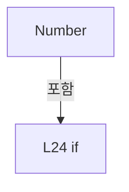

변경 전 점검: 입력/반환 타입, 위 호출자, 예외/취소 경로, 공유 상태와 저장·전송 소비자를 함께 확인합니다. 값의 단위나 물리 방향을 이름만으로 확정하지 않습니다.

### MethodDeclaration `Conditions` · L31–39

[Drilling.Common/Correction/CDefaultOffsetCalibration.cs:31–39](https://github.com/kjuws10-rgb/A3Drilling/blob/5aee8e58439c9b455cae7c9593c9be986c3e682e/Drilling.Common/Correction/CDefaultOffsetCalibration.cs#L31-L39)

| 항목 | 실제 추출 값 |
| --- | --- |
| 서명 | Drilling.Common.Correction.ST_DEFAULT_OFFSET_OPTIONS Drilling.Common.Correction.CDefaultOffsetCalibration.Conditions(System.Collections.Generic.IReadOnlyDictionary<string, string>, double?) |
| 접근/수식자 | Public / public, static |
| 반환/값 타입 | Drilling.Common.Correction.ST_DEFAULT_OFFSET_OPTIONS |
| 소속 타입 | NamedType:Drilling.Common.Correction.CDefaultOffsetCalibration |

입력 계약:

| 이름 | 타입 | 전달 | 선택/기본값 |
| --- | --- | --- | --- |
| values | System.Collections.Generic.IReadOnlyDictionary<string, string> | None | False /  |
| testStageY | double? | None | True / null |

정적 호출자로 확인된 위치:

| 호출 파일/행 | 호출 표현식 | 런타임 분기 가능 |
| --- | --- | --- |
| [Drilling.UI/Menu/Menus/CMenuCorrection.cs:3294–3294](https://github.com/kjuws10-rgb/A3Drilling/blob/5aee8e58439c9b455cae7c9593c9be986c3e682e/Drilling.UI/Menu/Menus/CMenuCorrection.cs#L3294-L3294) | CDefaultOffsetCalibration.Conditions | False |

호출하는 대상과 해석 범위:

| 원본 행 | 표현식 | 분석 상태 | 대상/소스 위치 |
| --- | --- | --- | --- |
| 33 | Number | resolved | double Drilling.Common.Correction.CDefaultOffsetCalibration.Number(System.Collections.Generic.IReadOnlyDictionary<string, string>, string) · Drilling.Common/Correction/CDefaultOffsetCalibration.cs:22 |
| 33 | Number | resolved | double Drilling.Common.Correction.CDefaultOffsetCalibration.Number(System.Collections.Generic.IReadOnlyDictionary<string, string>, string) · Drilling.Common/Correction/CDefaultOffsetCalibration.cs:22 |
| 33 | Number | resolved | double Drilling.Common.Correction.CDefaultOffsetCalibration.Number(System.Collections.Generic.IReadOnlyDictionary<string, string>, string) · Drilling.Common/Correction/CDefaultOffsetCalibration.cs:22 |
| 34 | Number | resolved | double Drilling.Common.Correction.CDefaultOffsetCalibration.Number(System.Collections.Generic.IReadOnlyDictionary<string, string>, string) · Drilling.Common/Correction/CDefaultOffsetCalibration.cs:22 |
| 35 | Math.Min | resolved | double System.Math.Min(double, double) |
| 35 | Number | resolved | double Drilling.Common.Correction.CDefaultOffsetCalibration.Number(System.Collections.Generic.IReadOnlyDictionary<string, string>, string) · Drilling.Common/Correction/CDefaultOffsetCalibration.cs:22 |
| 35 | Number | resolved | double Drilling.Common.Correction.CDefaultOffsetCalibration.Number(System.Collections.Generic.IReadOnlyDictionary<string, string>, string) · Drilling.Common/Correction/CDefaultOffsetCalibration.cs:22 |
| 36 | double.IsFinite | resolved | bool double.IsFinite(double) |
| 36 | double.IsFinite | resolved | bool double.IsFinite(double) |
| 36 | double.IsFinite | resolved | bool double.IsFinite(double) |
| 37 | new InvalidOperationException | resolved | System.InvalidOperationException.InvalidOperationException(string?) |
| 38 | new | resolved | Drilling.Common.Correction.ST_DEFAULT_OFFSET_OPTIONS.ST_DEFAULT_OFFSET_OPTIONS(double, double, double) · Drilling.Common/Correction/CDefaultOffsetCalibration.cs:233 |

본문의 실제 연산·분기·예외·반환 순서(원문 위치 순):

| 원본 행 | 종류 | 주석 해설 |
| --- | --- | --- |
| 33 | call | 함수·델리게이트 또는 객체 생성자를 호출합니다: Number(values, "REVIEW_CAMERA_ALIGN_KEY_POS_X") |
| 33 | call | 함수·델리게이트 또는 객체 생성자를 호출합니다: Number(values, "GLASS_SIZE_X") |
| 33 | call | 함수·델리게이트 또는 객체 생성자를 호출합니다: Number(values, "AK_MARGIN_X") |
| 33 | local-declaration | 지역 변수를 선언합니다: var center = Number(values, "REVIEW_CAMERA_ALIGN_KEY_POS_X") + Number(values, "GLASS_SIZE_X") / 2 - Number(values, "AK_MARGIN_X"); |
| 33 | variable-initializer | 변수의 초기값을 지정합니다: center = Number(values, "REVIEW_CAMERA_ALIGN_KEY_POS_X") + Number(values, "GLASS_SIZE_X") / 2 - Number(values, "AK_MARGIN_X") |
| 34 | call | 함수·델리게이트 또는 객체 생성자를 호출합니다: Number(values, "STAGE_START_POS_Y") |
| 34 | local-declaration | 지역 변수를 선언합니다: var stageY = testStageY ?? Number(values, "STAGE_START_POS_Y"); |
| 34 | variable-initializer | 변수의 초기값을 지정합니다: stageY = testStageY ?? Number(values, "STAGE_START_POS_Y") |
| 35 | call | 함수·델리게이트 또는 객체 생성자를 호출합니다: Math.Min(Number(values, "REVIEW_TOLERANCE_X"), Number(values, "REVIEW_TOLERANCE_Y")) |
| 35 | call | 함수·델리게이트 또는 객체 생성자를 호출합니다: Number(values, "REVIEW_TOLERANCE_X") |
| 35 | call | 함수·델리게이트 또는 객체 생성자를 호출합니다: Number(values, "REVIEW_TOLERANCE_Y") |
| 35 | local-declaration | 지역 변수를 선언합니다: var tolerance = Math.Min(Number(values, "REVIEW_TOLERANCE_X"), Number(values, "REVIEW_TOLERANCE_Y")); |
| 35 | variable-initializer | 변수의 초기값을 지정합니다: tolerance = Math.Min(Number(values, "REVIEW_TOLERANCE_X"), Number(values, "REVIEW_TOLERANCE_Y")) |
| 36 | call | 함수·델리게이트 또는 객체 생성자를 호출합니다: double.IsFinite(center) |
| 36 | call | 함수·델리게이트 또는 객체 생성자를 호출합니다: double.IsFinite(stageY) |
| 36 | call | 함수·델리게이트 또는 객체 생성자를 호출합니다: double.IsFinite(tolerance) |
| 36 | if | 조건에 따라 분기합니다: if (!double.IsFinite(center) &#124;&#124; !double.IsFinite(stageY) &#124;&#124; !double.IsFinite(tolerance) &#124;&#124; tolerance <= 0) |
| 37 | call | 함수·델리게이트 또는 객체 생성자를 호출합니다: new InvalidOperationException("Recipe의 Review 허용오차와 Stage Y 위치를 확인해 주세요.") |
| 37 | throw | 예외를 발생/전달합니다: throw new InvalidOperationException("Recipe의 Review 허용오차와 Stage Y 위치를 확인해 주세요."); |
| 38 | call | 함수·델리게이트 또는 객체 생성자를 호출합니다: new(center, stageY, tolerance) |
| 38 | return | 호출자에게 값 또는 제어를 반환합니다: return new(center, stageY, tolerance); |

제어 구문의 포함 구조(실제 실행 순서/CFG가 아닌 구문 탐색 그림):

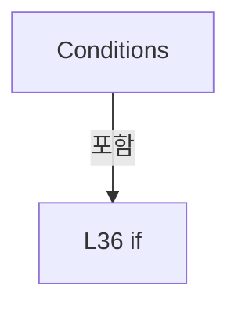

변경 전 점검: 입력/반환 타입, 위 호출자, 예외/취소 경로, 공유 상태와 저장·전송 소비자를 함께 확인합니다. 값의 단위나 물리 방향을 이름만으로 확정하지 않습니다.

### MethodDeclaration `HeadGeometry` · L41–51

[Drilling.Common/Correction/CDefaultOffsetCalibration.cs:41–51](https://github.com/kjuws10-rgb/A3Drilling/blob/5aee8e58439c9b455cae7c9593c9be986c3e682e/Drilling.Common/Correction/CDefaultOffsetCalibration.cs#L41-L51)

| 항목 | 실제 추출 값 |
| --- | --- |
| 서명 | Drilling.Common.Correction.ST_DEFAULT_HEAD_GEOMETRY Drilling.Common.Correction.CDefaultOffsetCalibration.HeadGeometry(System.Collections.Generic.IReadOnlyDictionary<string, string>, int) |
| 접근/수식자 | Public / public, static |
| 반환/값 타입 | Drilling.Common.Correction.ST_DEFAULT_HEAD_GEOMETRY |
| 소속 타입 | NamedType:Drilling.Common.Correction.CDefaultOffsetCalibration |

입력 계약:

| 이름 | 타입 | 전달 | 선택/기본값 |
| --- | --- | --- | --- |
| values | System.Collections.Generic.IReadOnlyDictionary<string, string> | None | False /  |
| head | int | None | False /  |

정적 호출자로 확인된 위치:

| 호출 파일/행 | 호출 표현식 | 런타임 분기 가능 |
| --- | --- | --- |
| [Drilling.Common/Correction/CDefaultOffsetCalibration.cs:76–76](https://github.com/kjuws10-rgb/A3Drilling/blob/5aee8e58439c9b455cae7c9593c9be986c3e682e/Drilling.Common/Correction/CDefaultOffsetCalibration.cs#L76-L76) | HeadGeometry | False |
| [Drilling.UI/Menu/Menus/CMenuCorrection.cs:3137–3137](https://github.com/kjuws10-rgb/A3Drilling/blob/5aee8e58439c9b455cae7c9593c9be986c3e682e/Drilling.UI/Menu/Menus/CMenuCorrection.cs#L3137-L3137) | CDefaultOffsetCalibration.HeadGeometry | False |
| [Drilling.UI/Menu/Menus/CMenuCorrection.cs:3578–3578](https://github.com/kjuws10-rgb/A3Drilling/blob/5aee8e58439c9b455cae7c9593c9be986c3e682e/Drilling.UI/Menu/Menus/CMenuCorrection.cs#L3578-L3578) | CDefaultOffsetCalibration.HeadGeometry | False |
| [Drilling.UI/Menu/Menus/CMenuCorrection.cs:3737–3737](https://github.com/kjuws10-rgb/A3Drilling/blob/5aee8e58439c9b455cae7c9593c9be986c3e682e/Drilling.UI/Menu/Menus/CMenuCorrection.cs#L3737-L3737) | CDefaultOffsetCalibration.HeadGeometry | False |

호출하는 대상과 해석 범위:

| 원본 행 | 표현식 | 분석 상태 | 대상/소스 위치 |
| --- | --- | --- | --- |
| 43 | new ArgumentOutOfRangeException | resolved | System.ArgumentOutOfRangeException.ArgumentOutOfRangeException(string?) |
| 43 | nameof | unresolved | None |
| 45 | Number | resolved | double Drilling.Common.Correction.CDefaultOffsetCalibration.Number(System.Collections.Generic.IReadOnlyDictionary<string, string>, string) · Drilling.Common/Correction/CDefaultOffsetCalibration.cs:22 |
| 46 | Number | resolved | double Drilling.Common.Correction.CDefaultOffsetCalibration.Number(System.Collections.Generic.IReadOnlyDictionary<string, string>, string) · Drilling.Common/Correction/CDefaultOffsetCalibration.cs:22 |
| 47 | Number | resolved | double Drilling.Common.Correction.CDefaultOffsetCalibration.Number(System.Collections.Generic.IReadOnlyDictionary<string, string>, string) · Drilling.Common/Correction/CDefaultOffsetCalibration.cs:22 |
| 48 | new InvalidOperationException | resolved | System.InvalidOperationException.InvalidOperationException(string?) |
| 50 | new | resolved | Drilling.Common.Correction.ST_DEFAULT_HEAD_GEOMETRY.ST_DEFAULT_HEAD_GEOMETRY(double, double, double) · Drilling.Common/Correction/CDefaultOffsetCalibration.cs:251 |

본문의 실제 연산·분기·예외·반환 순서(원문 위치 순):

| 원본 행 | 종류 | 주석 해설 |
| --- | --- | --- |
| 43 | call | 함수·델리게이트 또는 객체 생성자를 호출합니다: new ArgumentOutOfRangeException(nameof(head)) |
| 43 | call | 함수·델리게이트 또는 객체 생성자를 호출합니다: nameof(head) |
| 43 | if | 조건에 따라 분기합니다: if (head is < 1 or > 8) |
| 43 | throw | 예외를 발생/전달합니다: throw new ArgumentOutOfRangeException(nameof(head)); |
| 44 | local-declaration | 지역 변수를 선언합니다: var prefix = $"H{head:00}_"; |
| 44 | variable-initializer | 변수의 초기값을 지정합니다: prefix = $"H{head:00}_" |
| 45 | call | 함수·델리게이트 또는 객체 생성자를 호출합니다: Number(values, prefix + "SCAN_FIELD_WIDTH_X") |
| 45 | local-declaration | 지역 변수를 선언합니다: var x = Number(values, prefix + "SCAN_FIELD_WIDTH_X"); |
| 45 | variable-initializer | 변수의 초기값을 지정합니다: x = Number(values, prefix + "SCAN_FIELD_WIDTH_X") |
| 46 | call | 함수·델리게이트 또는 객체 생성자를 호출합니다: Number(values, prefix + "SCAN_FIELD_HEIGHT_Y") |
| 46 | local-declaration | 지역 변수를 선언합니다: var y = Number(values, prefix + "SCAN_FIELD_HEIGHT_Y"); |
| 46 | variable-initializer | 변수의 초기값을 지정합니다: y = Number(values, prefix + "SCAN_FIELD_HEIGHT_Y") |
| 47 | call | 함수·델리게이트 또는 객체 생성자를 호출합니다: Number(values, prefix + "DOE_ROTATION_ANGLE") |
| 47 | local-declaration | 지역 변수를 선언합니다: var angle = Number(values, prefix + "DOE_ROTATION_ANGLE"); |
| 47 | variable-initializer | 변수의 초기값을 지정합니다: angle = Number(values, prefix + "DOE_ROTATION_ANGLE") |
| 48 | call | 함수·델리게이트 또는 객체 생성자를 호출합니다: new InvalidOperationException($"HEAD {head:00}의 Setting Scan Field X/Y는 0보다 커야 합니다.") |
| 48 | if | 조건에 따라 분기합니다: if (x <= 0 &#124;&#124; y <= 0) |
| 48 | throw | 예외를 발생/전달합니다: throw new InvalidOperationException($"HEAD {head:00}의 Setting Scan Field X/Y는 0보다 커야 합니다."); |
| 50 | call | 함수·델리게이트 또는 객체 생성자를 호출합니다: new(x / 2, y / 2, angle) |
| 50 | return | 호출자에게 값 또는 제어를 반환합니다: return new(x / 2, y / 2, angle); |

제어 구문의 포함 구조(실제 실행 순서/CFG가 아닌 구문 탐색 그림):

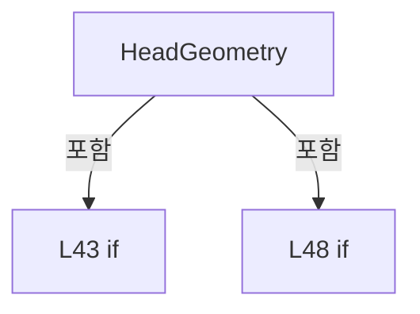

변경 전 점검: 입력/반환 타입, 위 호출자, 예외/취소 경로, 공유 상태와 저장·전송 소비자를 함께 확인합니다. 값의 단위나 물리 방향을 이름만으로 확정하지 않습니다.

### MethodDeclaration `PredictCenter` · L53–70

[Drilling.Common/Correction/CDefaultOffsetCalibration.cs:53–70](https://github.com/kjuws10-rgb/A3Drilling/blob/5aee8e58439c9b455cae7c9593c9be986c3e682e/Drilling.Common/Correction/CDefaultOffsetCalibration.cs#L53-L70)

| 항목 | 실제 추출 값 |
| --- | --- |
| 서명 | Drilling.Common.Correction.ST_DEFAULT_PREVIEW_POINT Drilling.Common.Correction.CDefaultOffsetCalibration.PredictCenter(System.Collections.Generic.IReadOnlyDictionary<string, string>, int, double) |
| 접근/수식자 | Public / public, static |
| 반환/값 타입 | Drilling.Common.Correction.ST_DEFAULT_PREVIEW_POINT |
| 소속 타입 | NamedType:Drilling.Common.Correction.CDefaultOffsetCalibration |

입력 계약:

| 이름 | 타입 | 전달 | 선택/기본값 |
| --- | --- | --- | --- |
| values | System.Collections.Generic.IReadOnlyDictionary<string, string> | None | False /  |
| head | int | None | False /  |
| stageY | double | None | False /  |

정적 호출자로 확인된 위치:

| 호출 파일/행 | 호출 표현식 | 런타임 분기 가능 |
| --- | --- | --- |
| [Drilling.UI/Menu/Menus/CMenuCorrection.cs:4564–4565](https://github.com/kjuws10-rgb/A3Drilling/blob/5aee8e58439c9b455cae7c9593c9be986c3e682e/Drilling.UI/Menu/Menus/CMenuCorrection.cs#L4564-L4565) | CDefaultOffsetCalibration.PredictCenter | False |

호출하는 대상과 해석 범위:

| 원본 행 | 표현식 | 분석 상태 | 대상/소스 위치 |
| --- | --- | --- | --- |
| 55 | new ArgumentOutOfRangeException | resolved | System.ArgumentOutOfRangeException.ArgumentOutOfRangeException(string?) |
| 55 | nameof | unresolved | None |
| 56 | double.IsFinite | resolved | bool double.IsFinite(double) |
| 56 | new ArgumentOutOfRangeException | resolved | System.ArgumentOutOfRangeException.ArgumentOutOfRangeException(string?) |
| 56 | nameof | unresolved | None |
| 57 | Number | resolved | double Drilling.Common.Correction.CDefaultOffsetCalibration.Number(System.Collections.Generic.IReadOnlyDictionary<string, string>, string) · Drilling.Common/Correction/CDefaultOffsetCalibration.cs:22 |
| 58 | CScannerAxisTransform.ReadStageDirection | resolved | double Drilling.Common.Recipe.CScannerAxisTransform.ReadStageDirection(System.Collections.Generic.IReadOnlyDictionary<string, string>) · Drilling.Common/Recipe/CShotCoordinatePlanBuilder.cs:1233 |
| 59 | values.ContainsKey | resolved · 동적 구현 선택 가능 | bool System.Collections.Generic.IReadOnlyDictionary<string, string>.ContainsKey(string) |
| 59 | Number | resolved | double Drilling.Common.Correction.CDefaultOffsetCalibration.Number(System.Collections.Generic.IReadOnlyDictionary<string, string>, string) · Drilling.Common/Correction/CDefaultOffsetCalibration.cs:22 |
| 60 | Number | resolved | double Drilling.Common.Correction.CDefaultOffsetCalibration.Number(System.Collections.Generic.IReadOnlyDictionary<string, string>, string) · Drilling.Common/Correction/CDefaultOffsetCalibration.cs:22 |
| 60 | Number | resolved | double Drilling.Common.Correction.CDefaultOffsetCalibration.Number(System.Collections.Generic.IReadOnlyDictionary<string, string>, string) · Drilling.Common/Correction/CDefaultOffsetCalibration.cs:22 |
| 64 | Number | resolved | double Drilling.Common.Correction.CDefaultOffsetCalibration.Number(System.Collections.Generic.IReadOnlyDictionary<string, string>, string) · Drilling.Common/Correction/CDefaultOffsetCalibration.cs:22 |
| 64 | Number | resolved | double Drilling.Common.Correction.CDefaultOffsetCalibration.Number(System.Collections.Generic.IReadOnlyDictionary<string, string>, string) · Drilling.Common/Correction/CDefaultOffsetCalibration.cs:22 |
| 65 | Number | resolved | double Drilling.Common.Correction.CDefaultOffsetCalibration.Number(System.Collections.Generic.IReadOnlyDictionary<string, string>, string) · Drilling.Common/Correction/CDefaultOffsetCalibration.cs:22 |
| 65 | Number | resolved | double Drilling.Common.Correction.CDefaultOffsetCalibration.Number(System.Collections.Generic.IReadOnlyDictionary<string, string>, string) · Drilling.Common/Correction/CDefaultOffsetCalibration.cs:22 |
| 65 | Number | resolved | double Drilling.Common.Correction.CDefaultOffsetCalibration.Number(System.Collections.Generic.IReadOnlyDictionary<string, string>, string) · Drilling.Common/Correction/CDefaultOffsetCalibration.cs:22 |
| 65 | Number | resolved | double Drilling.Common.Correction.CDefaultOffsetCalibration.Number(System.Collections.Generic.IReadOnlyDictionary<string, string>, string) · Drilling.Common/Correction/CDefaultOffsetCalibration.cs:22 |
| 66 | Number | resolved | double Drilling.Common.Correction.CDefaultOffsetCalibration.Number(System.Collections.Generic.IReadOnlyDictionary<string, string>, string) · Drilling.Common/Correction/CDefaultOffsetCalibration.cs:22 |
| 67 | Number | resolved | double Drilling.Common.Correction.CDefaultOffsetCalibration.Number(System.Collections.Generic.IReadOnlyDictionary<string, string>, string) · Drilling.Common/Correction/CDefaultOffsetCalibration.cs:22 |
| 67 | Number | resolved | double Drilling.Common.Correction.CDefaultOffsetCalibration.Number(System.Collections.Generic.IReadOnlyDictionary<string, string>, string) · Drilling.Common/Correction/CDefaultOffsetCalibration.cs:22 |
| 68 | double.IsFinite | resolved | bool double.IsFinite(double) |
| 68 | double.IsFinite | resolved | bool double.IsFinite(double) |
| 68 | new InvalidOperationException | resolved | System.InvalidOperationException.InvalidOperationException(string?) |
| 69 | new | resolved | Drilling.Common.Correction.ST_DEFAULT_PREVIEW_POINT.ST_DEFAULT_PREVIEW_POINT(int, double, double, double, bool) · Drilling.Common/Correction/CDefaultOffsetCalibration.cs:252 |

본문의 실제 연산·분기·예외·반환 순서(원문 위치 순):

| 원본 행 | 종류 | 주석 해설 |
| --- | --- | --- |
| 55 | call | 함수·델리게이트 또는 객체 생성자를 호출합니다: new ArgumentOutOfRangeException(nameof(head)) |
| 55 | call | 함수·델리게이트 또는 객체 생성자를 호출합니다: nameof(head) |
| 55 | if | 조건에 따라 분기합니다: if (head is < 1 or > 8) |
| 55 | throw | 예외를 발생/전달합니다: throw new ArgumentOutOfRangeException(nameof(head)); |
| 56 | call | 함수·델리게이트 또는 객체 생성자를 호출합니다: double.IsFinite(stageY) |
| 56 | call | 함수·델리게이트 또는 객체 생성자를 호출합니다: new ArgumentOutOfRangeException(nameof(stageY)) |
| 56 | call | 함수·델리게이트 또는 객체 생성자를 호출합니다: nameof(stageY) |
| 56 | if | 조건에 따라 분기합니다: if (!double.IsFinite(stageY)) |
| 56 | throw | 예외를 발생/전달합니다: throw new ArgumentOutOfRangeException(nameof(stageY)); |
| 57 | call | 함수·델리게이트 또는 객체 생성자를 호출합니다: Number(values, "STAGE_START_POS_Y") |
| 57 | local-declaration | 지역 변수를 선언합니다: var start = Number(values, "STAGE_START_POS_Y"); |
| 57 | variable-initializer | 변수의 초기값을 지정합니다: start = Number(values, "STAGE_START_POS_Y") |
| 58 | call | 함수·델리게이트 또는 객체 생성자를 호출합니다: CScannerAxisTransform.ReadStageDirection(values) |
| 58 | local-declaration | 지역 변수를 선언합니다: var direction = CScannerAxisTransform.ReadStageDirection(values); |
| 58 | variable-initializer | 변수의 초기값을 지정합니다: direction = CScannerAxisTransform.ReadStageDirection(values) |
| 59 | call | 함수·델리게이트 또는 객체 생성자를 호출합니다: values.ContainsKey($"H{head:00}_AK_POSITION_Y") |
| 59 | call | 함수·델리게이트 또는 객체 생성자를 호출합니다: Number(values, $"H{head:00}_AK_POSITION_Y") |
| 59 | conditional-expression | 조건에 따라 결과식을 선택합니다: values.ContainsKey($"H{head:00}_AK_POSITION_Y") ? Number(values, $"H{head:00}_AK_POSITION_Y") : Number(values, "REVIEW_TO_HEAD1_GAP_Y") + (head % 2 == 0 ? Number(values, "HeadGapY") : 0) |
| 59 | local-declaration | 지역 변수를 선언합니다: var gap = values.ContainsKey($"H{head:00}_AK_POSITION_Y") ? Number(values, $"H{head:00}_AK_POSITION_Y") : Number(values, "REVIEW_TO_HEAD1_GAP_Y") + (head % 2 == 0 ? Number(values, "HeadGapY") : 0); |
| 59 | variable-initializer | 변수의 초기값을 지정합니다: gap = values.ContainsKey($"H{head:00}_AK_POSITION_Y") ? Number(values, $"H{head:00}_AK_POSITION_Y") : Number(values, "REVIEW_TO_HEAD1_GAP_Y") + (head % 2 == 0 ? Number(values, "HeadGapY") : 0) |
| 60 | call | 함수·델리게이트 또는 객체 생성자를 호출합니다: Number(values, "REVIEW_TO_HEAD1_GAP_Y") |
| 60 | call | 함수·델리게이트 또는 객체 생성자를 호출합니다: Number(values, "HeadGapY") |
| 60 | conditional-expression | 조건에 따라 결과식을 선택합니다: head % 2 == 0 ? Number(values, "HeadGapY") : 0 |
| 64 | call | 함수·델리게이트 또는 객체 생성자를 호출합니다: Number(values, "REVIEW_CAMERA_ALIGN_KEY_POS_Y") |
| 64 | call | 함수·델리게이트 또는 객체 생성자를 호출합니다: Number(values, "AK_MARGIN_Y") |
| 64 | local-declaration | 지역 변수를 선언합니다: var yAtStart = (start - direction * gap - Number(values, "REVIEW_CAMERA_ALIGN_KEY_POS_Y")) / direction + Number(values, "AK_MARGIN_Y"); |
| 64 | variable-initializer | 변수의 초기값을 지정합니다: yAtStart = (start - direction * gap - Number(values, "REVIEW_CAMERA_ALIGN_KEY_POS_Y")) / direction + Number(values, "AK_MARGIN_Y") |
| 65 | call | 함수·델리게이트 또는 객체 생성자를 호출합니다: Number(values, "AK_MARGIN_X") |
| 65 | call | 함수·델리게이트 또는 객체 생성자를 호출합니다: Number(values, "H01_AK_POSITION_X") |
| 65 | call | 함수·델리게이트 또는 객체 생성자를 호출합니다: Number(values, "HeadGapX") |
| 65 | call | 함수·델리게이트 또는 객체 생성자를 호출합니다: Number(values, $"H{head:00}_DEFAULT_OFFSET_X") |
| 65 | local-declaration | 지역 변수를 선언합니다: var x = Number(values, "AK_MARGIN_X") + Number(values, "H01_AK_POSITION_X") + (head - 1) * Number(values, "HeadGapX") + Number(values, $"H{head:00}_DEFAULT_OFFSET_X"); |
| 65 | variable-initializer | 변수의 초기값을 지정합니다: x = Number(values, "AK_MARGIN_X") + Number(values, "H01_AK_POSITION_X") + (head - 1) * Number(values, "HeadGapX") + Number(values, $"H{head:00}_DEFAULT_OFFSET_X") |
| 66 | call | 함수·델리게이트 또는 객체 생성자를 호출합니다: Number(values, $"H{head:00}_DEFAULT_OFFSET_Y") |
| 66 | local-declaration | 지역 변수를 선언합니다: var y = yAtStart + (stageY - start) / direction + Number(values, $"H{head:00}_DEFAULT_OFFSET_Y"); |
| 66 | variable-initializer | 변수의 초기값을 지정합니다: y = yAtStart + (stageY - start) / direction + Number(values, $"H{head:00}_DEFAULT_OFFSET_Y") |
| 67 | call | 함수·델리게이트 또는 객체 생성자를 호출합니다: Number(values, "GLASS_SIZE_X") |
| 67 | call | 함수·델리게이트 또는 객체 생성자를 호출합니다: Number(values, "GLASS_SIZE_Y") |
| 67 | local-declaration | 지역 변수를 선언합니다: var width = Number(values, "GLASS_SIZE_X"); |
| 67 | local-declaration | 지역 변수를 선언합니다: var height = Number(values, "GLASS_SIZE_Y"); |
| 67 | variable-initializer | 변수의 초기값을 지정합니다: width = Number(values, "GLASS_SIZE_X") |
| 67 | variable-initializer | 변수의 초기값을 지정합니다: height = Number(values, "GLASS_SIZE_Y") |
| 68 | call | 함수·델리게이트 또는 객체 생성자를 호출합니다: double.IsFinite(x) |
| 68 | call | 함수·델리게이트 또는 객체 생성자를 호출합니다: double.IsFinite(y) |
| 68 | call | 함수·델리게이트 또는 객체 생성자를 호출합니다: new InvalidOperationException("예상 가공 위치의 Recipe·Setting 기준값을 확인해 주세요.") |
| 68 | if | 조건에 따라 분기합니다: if (!double.IsFinite(x) &#124;&#124; !double.IsFinite(y) &#124;&#124; width <= 0 &#124;&#124; height <= 0) |
| 68 | throw | 예외를 발생/전달합니다: throw new InvalidOperationException("예상 가공 위치의 Recipe·Setting 기준값을 확인해 주세요."); |
| 69 | call | 함수·델리게이트 또는 객체 생성자를 호출합니다: new(head, stageY, x, y, x >= 0 && x <= width && y >= 0 && y <= height) |
| 69 | return | 호출자에게 값 또는 제어를 반환합니다: return new(head, stageY, x, y, x >= 0 && x <= width && y >= 0 && y <= height); |

제어 구문의 포함 구조(실제 실행 순서/CFG가 아닌 구문 탐색 그림):

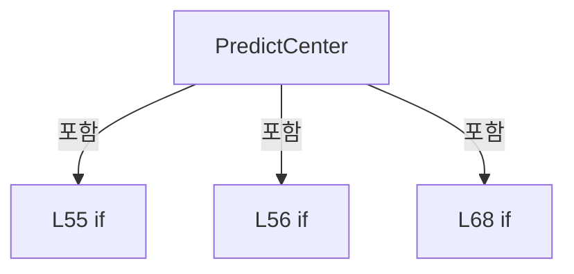

변경 전 점검: 입력/반환 타입, 위 호출자, 예외/취소 경로, 공유 상태와 저장·전송 소비자를 함께 확인합니다. 값의 단위나 물리 방향을 이름만으로 확정하지 않습니다.

### MethodDeclaration `FitsField` · L74–78

[Drilling.Common/Correction/CDefaultOffsetCalibration.cs:74–78](https://github.com/kjuws10-rgb/A3Drilling/blob/5aee8e58439c9b455cae7c9593c9be986c3e682e/Drilling.Common/Correction/CDefaultOffsetCalibration.cs#L74-L78)

| 항목 | 실제 추출 값 |
| --- | --- |
| 서명 | bool Drilling.Common.Correction.CDefaultOffsetCalibration.FitsField(System.Collections.Generic.IReadOnlyDictionary<string, string>, int, double, double) |
| 접근/수식자 | Public / public, static |
| 반환/값 타입 | bool |
| 소속 타입 | NamedType:Drilling.Common.Correction.CDefaultOffsetCalibration |

입력 계약:

| 이름 | 타입 | 전달 | 선택/기본값 |
| --- | --- | --- | --- |
| values | System.Collections.Generic.IReadOnlyDictionary<string, string> | None | False /  |
| head | int | None | False /  |
| x | double | None | False /  |
| y | double | None | False /  |

정적 호출자로 확인된 위치:

| 호출 파일/행 | 호출 표현식 | 런타임 분기 가능 |
| --- | --- | --- |
| [Drilling.Common/Correction/CDefaultOffsetCalibration.cs:102–102](https://github.com/kjuws10-rgb/A3Drilling/blob/5aee8e58439c9b455cae7c9593c9be986c3e682e/Drilling.Common/Correction/CDefaultOffsetCalibration.cs#L102-L102) | FitsField | False |

호출하는 대상과 해석 범위:

| 원본 행 | 표현식 | 분석 상태 | 대상/소스 위치 |
| --- | --- | --- | --- |
| 76 | HeadGeometry | resolved | Drilling.Common.Correction.ST_DEFAULT_HEAD_GEOMETRY Drilling.Common.Correction.CDefaultOffsetCalibration.HeadGeometry(System.Collections.Generic.IReadOnlyDictionary<string, string>, int) · Drilling.Common/Correction/CDefaultOffsetCalibration.cs:41 |
| 77 | double.IsFinite | resolved | bool double.IsFinite(double) |
| 77 | double.IsFinite | resolved | bool double.IsFinite(double) |
| 77 | Math.Abs | resolved | double System.Math.Abs(double) |
| 77 | Math.Abs | resolved | double System.Math.Abs(double) |

본문의 실제 연산·분기·예외·반환 순서(원문 위치 순):

| 원본 행 | 종류 | 주석 해설 |
| --- | --- | --- |
| 76 | call | 함수·델리게이트 또는 객체 생성자를 호출합니다: HeadGeometry(values, head) |
| 76 | local-declaration | 지역 변수를 선언합니다: var field = HeadGeometry(values, head); |
| 76 | variable-initializer | 변수의 초기값을 지정합니다: field = HeadGeometry(values, head) |
| 77 | call | 함수·델리게이트 또는 객체 생성자를 호출합니다: double.IsFinite(x) |
| 77 | call | 함수·델리게이트 또는 객체 생성자를 호출합니다: double.IsFinite(y) |
| 77 | call | 함수·델리게이트 또는 객체 생성자를 호출합니다: Math.Abs(x) |
| 77 | call | 함수·델리게이트 또는 객체 생성자를 호출합니다: Math.Abs(y) |
| 77 | return | 호출자에게 값 또는 제어를 반환합니다: return double.IsFinite(x) && double.IsFinite(y) && Math.Abs(x) <= field.FieldHalfX && Math.Abs(y) <= field.FieldHalfY; |

변경 전 점검: 입력/반환 타입, 위 호출자, 예외/취소 경로, 공유 상태와 저장·전송 소비자를 함께 확인합니다. 값의 단위나 물리 방향을 이름만으로 확정하지 않습니다.

### MethodDeclaration `ValidateOptions` · L80–88

[Drilling.Common/Correction/CDefaultOffsetCalibration.cs:80–88](https://github.com/kjuws10-rgb/A3Drilling/blob/5aee8e58439c9b455cae7c9593c9be986c3e682e/Drilling.Common/Correction/CDefaultOffsetCalibration.cs#L80-L88)

| 항목 | 실제 추출 값 |
| --- | --- |
| 서명 | void Drilling.Common.Correction.CDefaultOffsetCalibration.ValidateOptions(Drilling.Common.Correction.ST_DEFAULT_OFFSET_OPTIONS) |
| 접근/수식자 | Public / public, static |
| 반환/값 타입 | void |
| 소속 타입 | NamedType:Drilling.Common.Correction.CDefaultOffsetCalibration |

입력 계약:

| 이름 | 타입 | 전달 | 선택/기본값 |
| --- | --- | --- | --- |
| options | Drilling.Common.Correction.ST_DEFAULT_OFFSET_OPTIONS | None | False /  |

정적 호출자로 확인된 위치:

| 호출 파일/행 | 호출 표현식 | 런타임 분기 가능 |
| --- | --- | --- |
| [Drilling.Common/Correction/CDefaultOffsetCalibration.cs:94–94](https://github.com/kjuws10-rgb/A3Drilling/blob/5aee8e58439c9b455cae7c9593c9be986c3e682e/Drilling.Common/Correction/CDefaultOffsetCalibration.cs#L94-L94) | ValidateOptions | False |
| [Drilling.UI/Menu/Menus/CMenuCorrection.cs:3425–3425](https://github.com/kjuws10-rgb/A3Drilling/blob/5aee8e58439c9b455cae7c9593c9be986c3e682e/Drilling.UI/Menu/Menus/CMenuCorrection.cs#L3425-L3425) | CDefaultOffsetCalibration.ValidateOptions | False |
| [Drilling.UI/Views/CDefaultOffsetView.xaml.cs:141–141](https://github.com/kjuws10-rgb/A3Drilling/blob/5aee8e58439c9b455cae7c9593c9be986c3e682e/Drilling.UI/Views/CDefaultOffsetView.xaml.cs#L141-L141) | CDefaultOffsetCalibration.ValidateOptions | False |

호출하는 대상과 해석 범위:

| 원본 행 | 표현식 | 분석 상태 | 대상/소스 위치 |
| --- | --- | --- | --- |
| 82 | new[] { options.BoardCenterX, options.TestStageY, options.Tolerance }.Any | resolved | bool System.Collections.Generic.IEnumerable<double>.Any<double>(System.Func<double, bool>) |
| 82 | double.IsFinite | resolved | bool double.IsFinite(double) |
| 83 | new InvalidOperationException | resolved | System.InvalidOperationException.InvalidOperationException(string?) |
| 84 | Enum.IsDefined | resolved | bool System.Enum.IsDefined<Drilling.Common.Correction.EN_DEFAULT_MACHINING_MODE>(Drilling.Common.Correction.EN_DEFAULT_MACHINING_MODE) |
| 85 | new InvalidOperationException | resolved | System.InvalidOperationException.InvalidOperationException(string?) |
| 86 | double.IsFinite | resolved | bool double.IsFinite(double) |
| 87 | new InvalidOperationException | resolved | System.InvalidOperationException.InvalidOperationException(string?) |

본문의 실제 연산·분기·예외·반환 순서(원문 위치 순):

| 원본 행 | 종류 | 주석 해설 |
| --- | --- | --- |
| 82 | call | 함수·델리게이트 또는 객체 생성자를 호출합니다: new[] { options.BoardCenterX, options.TestStageY, options.Tolerance }.Any(v => !double.IsFinite(v)) |
| 82 | call | 함수·델리게이트 또는 객체 생성자를 호출합니다: double.IsFinite(v) |
| 82 | if | 조건에 따라 분기합니다: if (new[] { options.BoardCenterX, options.TestStageY, options.Tolerance }.Any(v => !double.IsFinite(v)) &#124;&#124; options.Tolerance <= 0) |
| 83 | call | 함수·델리게이트 또는 객체 생성자를 호출합니다: new InvalidOperationException("가공할 Stage Y 위치와 Recipe Review 허용오차를 확인해 주세요.") |
| 83 | throw | 예외를 발생/전달합니다: throw new InvalidOperationException("가공할 Stage Y 위치와 Recipe Review 허용오차를 확인해 주세요."); |
| 84 | call | 함수·델리게이트 또는 객체 생성자를 호출합니다: Enum.IsDefined(options.MachiningMode) |
| 84 | if | 조건에 따라 분기합니다: if (!Enum.IsDefined(options.MachiningMode)) |
| 85 | call | 함수·델리게이트 또는 객체 생성자를 호출합니다: new InvalidOperationException("Default 가공 방식을 확인해 주세요.") |
| 85 | throw | 예외를 발생/전달합니다: throw new InvalidOperationException("Default 가공 방식을 확인해 주세요."); |
| 86 | call | 함수·델리게이트 또는 객체 생성자를 호출합니다: double.IsFinite(options.CrossSize) |
| 86 | if | 조건에 따라 분기합니다: if (options.MachiningMode == EN_DEFAULT_MACHINING_MODE.Cross && (!double.IsFinite(options.CrossSize) &#124;&#124; options.CrossSize <= 0)) |
| 87 | call | 함수·델리게이트 또는 객체 생성자를 호출합니다: new InvalidOperationException("십자 전체 길이는 0보다 큰 유한한 mm 값이어야 합니다.") |
| 87 | throw | 예외를 발생/전달합니다: throw new InvalidOperationException("십자 전체 길이는 0보다 큰 유한한 mm 값이어야 합니다."); |

제어 구문의 포함 구조(실제 실행 순서/CFG가 아닌 구문 탐색 그림):

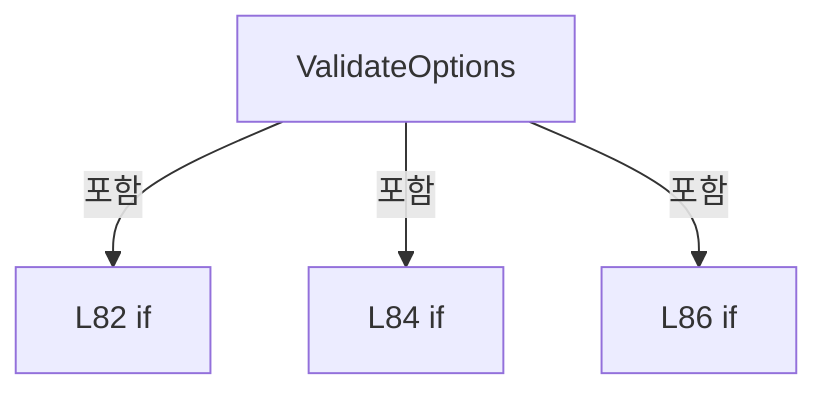

변경 전 점검: 입력/반환 타입, 위 호출자, 예외/취소 경로, 공유 상태와 저장·전송 소비자를 함께 확인합니다. 값의 단위나 물리 방향을 이름만으로 확정하지 않습니다.

### MethodDeclaration `CenterScannerTargets` · L92–105

[Drilling.Common/Correction/CDefaultOffsetCalibration.cs:92–105](https://github.com/kjuws10-rgb/A3Drilling/blob/5aee8e58439c9b455cae7c9593c9be986c3e682e/Drilling.Common/Correction/CDefaultOffsetCalibration.cs#L92-L105)

| 항목 | 실제 추출 값 |
| --- | --- |
| 서명 | System.Collections.Generic.IReadOnlyList<(double X, double Y)> Drilling.Common.Correction.CDefaultOffsetCalibration.CenterScannerTargets(System.Collections.Generic.IReadOnlyDictionary<string, string>, int, Drilling.Common.Correction.ST_DEFAULT_OFFSET_OPTIONS) |
| 접근/수식자 | Public / public, static |
| 반환/값 타입 | System.Collections.Generic.IReadOnlyList<(double X, double Y)> |
| 소속 타입 | NamedType:Drilling.Common.Correction.CDefaultOffsetCalibration |

입력 계약:

| 이름 | 타입 | 전달 | 선택/기본값 |
| --- | --- | --- | --- |
| values | System.Collections.Generic.IReadOnlyDictionary<string, string> | None | False /  |
| head | int | None | False /  |
| options | Drilling.Common.Correction.ST_DEFAULT_OFFSET_OPTIONS | None | False /  |

정적 호출자로 확인된 위치:

| 호출 파일/행 | 호출 표현식 | 런타임 분기 가능 |
| --- | --- | --- |
| [Drilling.UI/Menu/Menus/CMenuCorrection.cs:3454–3454](https://github.com/kjuws10-rgb/A3Drilling/blob/5aee8e58439c9b455cae7c9593c9be986c3e682e/Drilling.UI/Menu/Menus/CMenuCorrection.cs#L3454-L3454) | CDefaultOffsetCalibration.CenterScannerTargets | False |
| [Drilling.UI/Menu/Menus/CMenuCorrection.cs:3588–3588](https://github.com/kjuws10-rgb/A3Drilling/blob/5aee8e58439c9b455cae7c9593c9be986c3e682e/Drilling.UI/Menu/Menus/CMenuCorrection.cs#L3588-L3588) | CDefaultOffsetCalibration.CenterScannerTargets | False |
| [Drilling.UI/Menu/Menus/CMenuCorrection.cs:3676–3676](https://github.com/kjuws10-rgb/A3Drilling/blob/5aee8e58439c9b455cae7c9593c9be986c3e682e/Drilling.UI/Menu/Menus/CMenuCorrection.cs#L3676-L3676) | CDefaultOffsetCalibration.CenterScannerTargets | False |

호출하는 대상과 해석 범위:

| 원본 행 | 표현식 | 분석 상태 | 대상/소스 위치 |
| --- | --- | --- | --- |
| 94 | ValidateOptions | resolved | void Drilling.Common.Correction.CDefaultOffsetCalibration.ValidateOptions(Drilling.Common.Correction.ST_DEFAULT_OFFSET_OPTIONS) · Drilling.Common/Correction/CDefaultOffsetCalibration.cs:80 |
| 95 | Number | resolved | double Drilling.Common.Correction.CDefaultOffsetCalibration.Number(System.Collections.Generic.IReadOnlyDictionary<string, string>, string) · Drilling.Common/Correction/CDefaultOffsetCalibration.cs:22 |
| 96 | Number | resolved | double Drilling.Common.Correction.CDefaultOffsetCalibration.Number(System.Collections.Generic.IReadOnlyDictionary<string, string>, string) · Drilling.Common/Correction/CDefaultOffsetCalibration.cs:22 |
| 97 | CScannerAxisTransform.Read | resolved | Drilling.Common.Recipe.ST_SCANNER_AXIS_TRANSFORM Drilling.Common.Recipe.CScannerAxisTransform.Read(System.Collections.Generic.IReadOnlyDictionary<string, string>, int) · Drilling.Common/Recipe/CShotCoordinatePlanBuilder.cs:1239 |
| 101 | design.Select(p => transform.Apply(p.X, -p.Y)).ToArray | resolved | (double X, double Y)[] System.Collections.Generic.IEnumerable<(double X, double Y)>.ToArray<(double X, double Y)>() |
| 101 | design.Select | resolved | System.Collections.Generic.IEnumerable<(double X, double Y)> System.Collections.Generic.IEnumerable<(double X, double Y)>.Select<(double X, double Y), (double X, double Y)>(System.Func<(double X, double Y), (double X, double Y)>) |
| 101 | transform.Apply | resolved | (double X, double Y) Drilling.Common.Recipe.ST_SCANNER_AXIS_TRANSFORM.Apply(double, double) · Drilling.Common/Recipe/CShotCoordinatePlanBuilder.cs:1210 |
| 102 | targets.Any | resolved | bool System.Collections.Generic.IEnumerable<(double X, double Y)>.Any<(double X, double Y)>(System.Func<(double X, double Y), bool>) |
| 102 | FitsField | resolved | bool Drilling.Common.Correction.CDefaultOffsetCalibration.FitsField(System.Collections.Generic.IReadOnlyDictionary<string, string>, int, double, double) · Drilling.Common/Correction/CDefaultOffsetCalibration.cs:74 |
| 103 | new InvalidOperationException | resolved | System.InvalidOperationException.InvalidOperationException(string?) |

본문의 실제 연산·분기·예외·반환 순서(원문 위치 순):

| 원본 행 | 종류 | 주석 해설 |
| --- | --- | --- |
| 94 | call | 함수·델리게이트 또는 객체 생성자를 호출합니다: ValidateOptions(options) |
| 95 | call | 함수·델리게이트 또는 객체 생성자를 호출합니다: Number(values, $"H{head:00}_DEFAULT_OFFSET_X") |
| 95 | local-declaration | 지역 변수를 선언합니다: var x = Number(values, $"H{head:00}_DEFAULT_OFFSET_X"); |
| 95 | variable-initializer | 변수의 초기값을 지정합니다: x = Number(values, $"H{head:00}_DEFAULT_OFFSET_X") |
| 96 | call | 함수·델리게이트 또는 객체 생성자를 호출합니다: Number(values, $"H{head:00}_DEFAULT_OFFSET_Y") |
| 96 | local-declaration | 지역 변수를 선언합니다: var y = Number(values, $"H{head:00}_DEFAULT_OFFSET_Y"); |
| 96 | variable-initializer | 변수의 초기값을 지정합니다: y = Number(values, $"H{head:00}_DEFAULT_OFFSET_Y") |
| 97 | call | 함수·델리게이트 또는 객체 생성자를 호출합니다: CScannerAxisTransform.Read(values, head) |
| 97 | local-declaration | 지역 변수를 선언합니다: var transform = CScannerAxisTransform.Read(values, head); |
| 97 | variable-initializer | 변수의 초기값을 지정합니다: transform = CScannerAxisTransform.Read(values, head) |
| 98 | local-declaration | 지역 변수를 선언합니다: var half = options.CrossSize / 2; |
| 98 | variable-initializer | 변수의 초기값을 지정합니다: half = options.CrossSize / 2 |
| 99 | conditional-expression | 조건에 따라 결과식을 선택합니다: options.MachiningMode == EN_DEFAULT_MACHINING_MODE.Cross ? [(x - half, y), (x + half, y), (x, y - half), (x, y + half)] : [(x, y)] |
| 99 | local-declaration | 지역 변수를 선언합니다: (double X, double Y)[] design = options.MachiningMode == EN_DEFAULT_MACHINING_MODE.Cross ? [(x - half, y), (x + half, y), (x, y - half), (x, y + half)] : [(x, y)]; |
| 99 | variable-initializer | 변수의 초기값을 지정합니다: design = options.MachiningMode == EN_DEFAULT_MACHINING_MODE.Cross ? [(x - half, y), (x + half, y), (x, y - half), (x, y + half)] : [(x, y)] |
| 101 | call | 함수·델리게이트 또는 객체 생성자를 호출합니다: design.Select(p => transform.Apply(p.X, -p.Y)).ToArray() |
| 101 | call | 함수·델리게이트 또는 객체 생성자를 호출합니다: design.Select(p => transform.Apply(p.X, -p.Y)) |
| 101 | call | 함수·델리게이트 또는 객체 생성자를 호출합니다: transform.Apply(p.X, -p.Y) |
| 101 | local-declaration | 지역 변수를 선언합니다: var targets = design.Select(p => transform.Apply(p.X, -p.Y)).ToArray(); |
| 101 | variable-initializer | 변수의 초기값을 지정합니다: targets = design.Select(p => transform.Apply(p.X, -p.Y)).ToArray() |
| 102 | call | 함수·델리게이트 또는 객체 생성자를 호출합니다: targets.Any(p => !FitsField(values, head, p.X, p.Y)) |
| 102 | call | 함수·델리게이트 또는 객체 생성자를 호출합니다: FitsField(values, head, p.X, p.Y) |
| 102 | if | 조건에 따라 분기합니다: if (targets.Any(p => !FitsField(values, head, p.X, p.Y))) |
| 103 | call | 함수·델리게이트 또는 객체 생성자를 호출합니다: new InvalidOperationException($"HEAD {head:00} CENTER {options.MachiningMode} 스캐너 목표가 설정된 이동 범위를 초과합니다.") |
| 103 | throw | 예외를 발생/전달합니다: throw new InvalidOperationException($"HEAD {head:00} CENTER {options.MachiningMode} 스캐너 목표가 설정된 이동 범위를 초과합니다."); |
| 104 | return | 호출자에게 값 또는 제어를 반환합니다: return targets; |

제어 구문의 포함 구조(실제 실행 순서/CFG가 아닌 구문 탐색 그림):

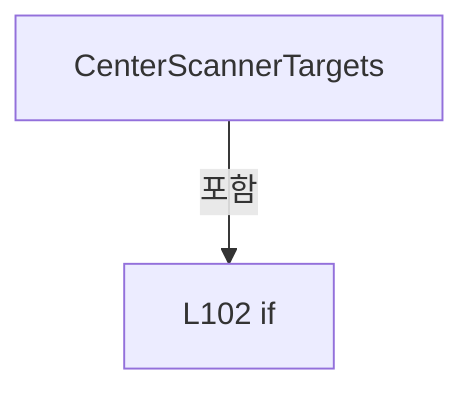

변경 전 점검: 입력/반환 타입, 위 호출자, 예외/취소 경로, 공유 상태와 저장·전송 소비자를 함께 확인합니다. 값의 단위나 물리 방향을 이름만으로 확정하지 않습니다.

### MethodDeclaration `Pitch` · L107–114

[Drilling.Common/Correction/CDefaultOffsetCalibration.cs:107–114](https://github.com/kjuws10-rgb/A3Drilling/blob/5aee8e58439c9b455cae7c9593c9be986c3e682e/Drilling.Common/Correction/CDefaultOffsetCalibration.cs#L107-L114)

| 항목 | 실제 추출 값 |
| --- | --- |
| 서명 | double Drilling.Common.Correction.CDefaultOffsetCalibration.Pitch(System.Collections.Generic.IReadOnlyDictionary<string, string>, int) |
| 접근/수식자 | Public / public, static |
| 반환/값 타입 | double |
| 소속 타입 | NamedType:Drilling.Common.Correction.CDefaultOffsetCalibration |

입력 계약:

| 이름 | 타입 | 전달 | 선택/기본값 |
| --- | --- | --- | --- |
| values | System.Collections.Generic.IReadOnlyDictionary<string, string> | None | False /  |
| model | int | None | False /  |

정적 호출자로 확인된 위치:

| 호출 파일/행 | 호출 표현식 | 런타임 분기 가능 |
| --- | --- | --- |
| [Drilling.UI/Menu/Menus/CMenuCorrection.cs:3144–3144](https://github.com/kjuws10-rgb/A3Drilling/blob/5aee8e58439c9b455cae7c9593c9be986c3e682e/Drilling.UI/Menu/Menus/CMenuCorrection.cs#L3144-L3144) | CDefaultOffsetCalibration.Pitch | False |

호출하는 대상과 해석 범위:

| 원본 행 | 표현식 | 분석 상태 | 대상/소스 위치 |
| --- | --- | --- | --- |
| 109 | Number | resolved | double Drilling.Common.Correction.CDefaultOffsetCalibration.Number(System.Collections.Generic.IReadOnlyDictionary<string, string>, string) · Drilling.Common/Correction/CDefaultOffsetCalibration.cs:22 |
| 109 | new InvalidOperationException | resolved | System.InvalidOperationException.InvalidOperationException(string?) |
| 110 | CRecipeModelPixelCountReader.ReadPatternForModel | resolved | Drilling.Common.Recipe.ST_RECIPE_MODEL_PATTERN Drilling.Common.Recipe.CRecipeModelPixelCountReader.ReadPatternForModel(System.Collections.Generic.IReadOnlyDictionary<string, string>, int) · Drilling.Common/Recipe/CCellPatternCalculator.cs:455 |
| 111 | Number | resolved | double Drilling.Common.Correction.CDefaultOffsetCalibration.Number(System.Collections.Generic.IReadOnlyDictionary<string, string>, string) · Drilling.Common/Correction/CDefaultOffsetCalibration.cs:22 |
| 112 | double.IsFinite | resolved | bool double.IsFinite(double) |
| 112 | new InvalidOperationException | resolved | System.InvalidOperationException.InvalidOperationException(string?) |

본문의 실제 연산·분기·예외·반환 순서(원문 위치 순):

| 원본 행 | 종류 | 주석 해설 |
| --- | --- | --- |
| 109 | call | 함수·델리게이트 또는 객체 생성자를 호출합니다: Number(values, "SPLITED_BEAM_COUNT") |
| 109 | call | 함수·델리게이트 또는 객체 생성자를 호출합니다: new InvalidOperationException("Default 측정은 현재 4×4, 총 16빔만 지원합니다.") |
| 109 | if | 조건에 따라 분기합니다: if (Number(values, "SPLITED_BEAM_COUNT") != 4) |
| 109 | throw | 예외를 발생/전달합니다: throw new InvalidOperationException("Default 측정은 현재 4×4, 총 16빔만 지원합니다."); |
| 110 | call | 함수·델리게이트 또는 객체 생성자를 호출합니다: CRecipeModelPixelCountReader.ReadPatternForModel(values, model) |
| 110 | local-declaration | 지역 변수를 선언합니다: var pattern = CRecipeModelPixelCountReader.ReadPatternForModel(values, model); |
| 110 | variable-initializer | 변수의 초기값을 지정합니다: pattern = CRecipeModelPixelCountReader.ReadPatternForModel(values, model) |
| 111 | call | 함수·델리게이트 또는 객체 생성자를 호출합니다: Number(values, "PIXEL_SIZE") |
| 111 | local-declaration | 지역 변수를 선언합니다: var pitch = Number(values, "PIXEL_SIZE") * pattern.ProcessPitch / 4; |
| 111 | variable-initializer | 변수의 초기값을 지정합니다: pitch = Number(values, "PIXEL_SIZE") * pattern.ProcessPitch / 4 |
| 112 | call | 함수·델리게이트 또는 객체 생성자를 호출합니다: double.IsFinite(pitch) |
| 112 | call | 함수·델리게이트 또는 객체 생성자를 호출합니다: new InvalidOperationException("DOE 빔 간격은 0보다 커야 합니다.") |
| 112 | if | 조건에 따라 분기합니다: if (!double.IsFinite(pitch) &#124;&#124; pitch <= 0) |
| 112 | throw | 예외를 발생/전달합니다: throw new InvalidOperationException("DOE 빔 간격은 0보다 커야 합니다."); |
| 113 | return | 호출자에게 값 또는 제어를 반환합니다: return pitch; |

제어 구문의 포함 구조(실제 실행 순서/CFG가 아닌 구문 탐색 그림):

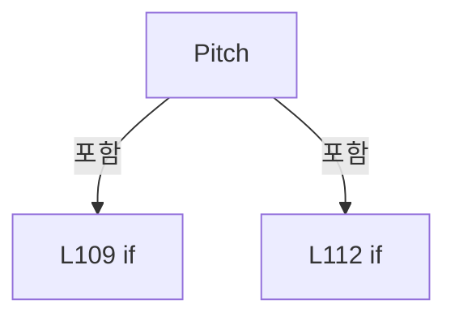

변경 전 점검: 입력/반환 타입, 위 호출자, 예외/취소 경로, 공유 상태와 저장·전송 소비자를 함께 확인합니다. 값의 단위나 물리 방향을 이름만으로 확정하지 않습니다.

### MethodDeclaration `Slot` · L116–123

[Drilling.Common/Correction/CDefaultOffsetCalibration.cs:116–123](https://github.com/kjuws10-rgb/A3Drilling/blob/5aee8e58439c9b455cae7c9593c9be986c3e682e/Drilling.Common/Correction/CDefaultOffsetCalibration.cs#L116-L123)

| 항목 | 실제 추출 값 |
| --- | --- |
| 서명 | (double X, double Y) Drilling.Common.Correction.CDefaultOffsetCalibration.Slot(int, double, double) |
| 접근/수식자 | Public / public, static |
| 반환/값 타입 | (double X, double Y) |
| 소속 타입 | NamedType:Drilling.Common.Correction.CDefaultOffsetCalibration |

입력 계약:

| 이름 | 타입 | 전달 | 선택/기본값 |
| --- | --- | --- | --- |
| beam | int | None | False /  |
| pitch | double | None | False /  |
| angle | double | None | False /  |

정적 호출자로 확인된 위치:

| 호출 파일/행 | 호출 표현식 | 런타임 분기 가능 |
| --- | --- | --- |
| [Drilling.UI/Menu/Menus/CMenuCorrection.cs:3753–3753](https://github.com/kjuws10-rgb/A3Drilling/blob/5aee8e58439c9b455cae7c9593c9be986c3e682e/Drilling.UI/Menu/Menus/CMenuCorrection.cs#L3753-L3753) | CDefaultOffsetCalibration.Slot | False |
| [Drilling.UI/Menu/Menus/CMenuCorrection.cs:4663–4663](https://github.com/kjuws10-rgb/A3Drilling/blob/5aee8e58439c9b455cae7c9593c9be986c3e682e/Drilling.UI/Menu/Menus/CMenuCorrection.cs#L4663-L4663) | CDefaultOffsetCalibration.Slot | False |

호출하는 대상과 해석 범위:

| 원본 행 | 표현식 | 분석 상태 | 대상/소스 위치 |
| --- | --- | --- | --- |
| 118 | double.IsFinite | resolved | bool double.IsFinite(double) |
| 118 | double.IsFinite | resolved | bool double.IsFinite(double) |
| 118 | new ArgumentException | resolved | System.ArgumentException.ArgumentException(string?) |
| 122 | Math.Cos | resolved | double System.Math.Cos(double) |
| 122 | Math.Sin | resolved | double System.Math.Sin(double) |
| 122 | Math.Sin | resolved | double System.Math.Sin(double) |
| 122 | Math.Cos | resolved | double System.Math.Cos(double) |

본문의 실제 연산·분기·예외·반환 순서(원문 위치 순):

| 원본 행 | 종류 | 주석 해설 |
| --- | --- | --- |
| 118 | call | 함수·델리게이트 또는 객체 생성자를 호출합니다: double.IsFinite(pitch) |
| 118 | call | 함수·델리게이트 또는 객체 생성자를 호출합니다: double.IsFinite(angle) |
| 118 | call | 함수·델리게이트 또는 객체 생성자를 호출합니다: new ArgumentException("16빔 슬롯 설정 오류") |
| 118 | if | 조건에 따라 분기합니다: if (beam is < 1 or > 16 &#124;&#124; !double.IsFinite(pitch) &#124;&#124; pitch <= 0 &#124;&#124; !double.IsFinite(angle)) |
| 118 | throw | 예외를 발생/전달합니다: throw new ArgumentException("16빔 슬롯 설정 오류"); |
| 119 | local-declaration | 지역 변수를 선언합니다: var x = ((beam - 1) % 4 - 1.5) * pitch; |
| 119 | variable-initializer | 변수의 초기값을 지정합니다: x = ((beam - 1) % 4 - 1.5) * pitch |
| 120 | local-declaration | 지역 변수를 선언합니다: var y = ((beam - 1) / 4 - 1.5) * pitch; |
| 120 | variable-initializer | 변수의 초기값을 지정합니다: y = ((beam - 1) / 4 - 1.5) * pitch |
| 121 | local-declaration | 지역 변수를 선언합니다: var radians = angle * Math.PI / 180; |
| 121 | variable-initializer | 변수의 초기값을 지정합니다: radians = angle * Math.PI / 180 |
| 122 | call | 함수·델리게이트 또는 객체 생성자를 호출합니다: Math.Cos(radians) |
| 122 | call | 함수·델리게이트 또는 객체 생성자를 호출합니다: Math.Sin(radians) |
| 122 | call | 함수·델리게이트 또는 객체 생성자를 호출합니다: Math.Sin(radians) |
| 122 | call | 함수·델리게이트 또는 객체 생성자를 호출합니다: Math.Cos(radians) |
| 122 | return | 호출자에게 값 또는 제어를 반환합니다: return (x * Math.Cos(radians) - y * Math.Sin(radians), x * Math.Sin(radians) + y * Math.Cos(radians)); |

제어 구문의 포함 구조(실제 실행 순서/CFG가 아닌 구문 탐색 그림):

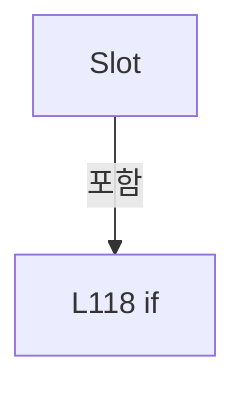

변경 전 점검: 입력/반환 타입, 위 호출자, 예외/취소 경로, 공유 상태와 저장·전송 소비자를 함께 확인합니다. 값의 단위나 물리 방향을 이름만으로 확정하지 않습니다.

### MethodDeclaration `Fit` · L125–160

[Drilling.Common/Correction/CDefaultOffsetCalibration.cs:125–160](https://github.com/kjuws10-rgb/A3Drilling/blob/5aee8e58439c9b455cae7c9593c9be986c3e682e/Drilling.Common/Correction/CDefaultOffsetCalibration.cs#L125-L160)

| 항목 | 실제 추출 값 |
| --- | --- |
| 서명 | Drilling.Common.Correction.ST_DEFAULT_OFFSET_FIT Drilling.Common.Correction.CDefaultOffsetCalibration.Fit(System.Collections.Generic.IReadOnlyList<Drilling.Common.Correction.ST_DEFAULT_OFFSET_MARK>, double, double, double) |
| 접근/수식자 | Public / public, static |
| 반환/값 타입 | Drilling.Common.Correction.ST_DEFAULT_OFFSET_FIT |
| 소속 타입 | NamedType:Drilling.Common.Correction.CDefaultOffsetCalibration |

입력 계약:

| 이름 | 타입 | 전달 | 선택/기본값 |
| --- | --- | --- | --- |
| marks | System.Collections.Generic.IReadOnlyList<Drilling.Common.Correction.ST_DEFAULT_OFFSET_MARK> | None | False /  |
| pitch | double | None | False /  |
| angle | double | None | False /  |
| residualTolerance | double | None | False /  |

정적 호출자로 확인된 위치:

| 호출 파일/행 | 호출 표현식 | 런타임 분기 가능 |
| --- | --- | --- |
| [Drilling.UI/Menu/Menus/CMenuCorrection.cs:3758–3758](https://github.com/kjuws10-rgb/A3Drilling/blob/5aee8e58439c9b455cae7c9593c9be986c3e682e/Drilling.UI/Menu/Menus/CMenuCorrection.cs#L3758-L3758) | CDefaultOffsetCalibration.Fit | False |

호출하는 대상과 해석 범위:

| 원본 행 | 표현식 | 분석 상태 | 대상/소스 위치 |
| --- | --- | --- | --- |
| 127 | double.IsFinite | resolved | bool double.IsFinite(double) |
| 128 | new ArgumentException | resolved | System.ArgumentException.ArgumentException(string?) |
| 129 | marks.Select(m => m.Beam).Order().SequenceEqual | resolved | bool System.Collections.Generic.IEnumerable<int>.SequenceEqual<int>(System.Collections.Generic.IEnumerable<int>) |
| 129 | marks.Select(m => m.Beam).Order | resolved | System.Linq.IOrderedEnumerable<int> System.Collections.Generic.IEnumerable<int>.Order<int>() |
| 129 | marks.Select | resolved | System.Collections.Generic.IEnumerable<int> System.Collections.Generic.IEnumerable<Drilling.Common.Correction.ST_DEFAULT_OFFSET_MARK>.Select<Drilling.Common.Correction.ST_DEFAULT_OFFSET_MARK, int>(System.Func<Drilling.Common.Correction.ST_DEFAULT_OFFSET_MARK, int>) |
| 129 | Enumerable.Range | resolved | System.Collections.Generic.IEnumerable<int> System.Linq.Enumerable.Range(int, int) |
| 130 | new InvalidOperationException | resolved | System.InvalidOperationException.InvalidOperationException(string?) |
| 131 | marks.Any | resolved | bool System.Collections.Generic.IEnumerable<Drilling.Common.Correction.ST_DEFAULT_OFFSET_MARK>.Any<Drilling.Common.Correction.ST_DEFAULT_OFFSET_MARK>(System.Func<Drilling.Common.Correction.ST_DEFAULT_OFFSET_MARK, bool>) |
| 131 | new[] { m.X, m.Y, m.RawX, m.RawY, m.CorrectionX, m.CorrectionY, m.EncoderX, m.EncoderY }.Any | resolved | bool System.Collections.Generic.IEnumerable<double>.Any<double>(System.Func<double, bool>) |
| 131 | double.IsFinite | resolved | bool double.IsFinite(double) |
| 132 | new InvalidOperationException | resolved | System.InvalidOperationException.InvalidOperationException(string?) |
| 135 | marks.Average | resolved | double System.Collections.Generic.IEnumerable<Drilling.Common.Correction.ST_DEFAULT_OFFSET_MARK>.Average<Drilling.Common.Correction.ST_DEFAULT_OFFSET_MARK>(System.Func<Drilling.Common.Correction.ST_DEFAULT_OFFSET_MARK, double>) |
| 135 | marks.Average | resolved | double System.Collections.Generic.IEnumerable<Drilling.Common.Correction.ST_DEFAULT_OFFSET_MARK>.Average<Drilling.Common.Correction.ST_DEFAULT_OFFSET_MARK>(System.Func<Drilling.Common.Correction.ST_DEFAULT_OFFSET_MARK, double>) |
| 136 | Enumerable.Range(1, 16).Sum | resolved | double System.Collections.Generic.IEnumerable<int>.Sum<int>(System.Func<int, double>) |
| 136 | Enumerable.Range | resolved | System.Collections.Generic.IEnumerable<int> System.Linq.Enumerable.Range(int, int) |
| 136 | Math.Pow | resolved | double System.Math.Pow(double, double) |
| 137 | double.IsFinite | resolved | bool double.IsFinite(double) |
| 137 | new InvalidOperationException | resolved | System.InvalidOperationException.InvalidOperationException(string?) |
| 139 | Coefficient | resolved | double Coefficient(bool, bool) · Drilling.Common/Correction/CDefaultOffsetCalibration.cs:138 |
| 139 | Coefficient | resolved | double Coefficient(bool, bool) · Drilling.Common/Correction/CDefaultOffsetCalibration.cs:138 |
| 140 | Coefficient | resolved | double Coefficient(bool, bool) · Drilling.Common/Correction/CDefaultOffsetCalibration.cs:138 |
| 140 | Coefficient | resolved | double Coefficient(bool, bool) · Drilling.Common/Correction/CDefaultOffsetCalibration.cs:138 |
| 141 | Math.Sqrt | resolved | double System.Math.Sqrt(double) |
| 141 | Math.Sqrt | resolved | double System.Math.Sqrt(double) |
| 143 | Math.Cos | resolved | double System.Math.Cos(double) |
| 143 | Math.Sin | resolved | double System.Math.Sin(double) |
| 143 | Math.Sin | resolved | double System.Math.Sin(double) |
| 143 | Math.Cos | resolved | double System.Math.Cos(double) |
| 146 | Enumerable.Range(1, 16).Max | resolved | double System.Collections.Generic.IEnumerable<int>.Max<int>(System.Func<int, double>) |
| 146 | Enumerable.Range | resolved | System.Collections.Generic.IEnumerable<int> System.Linq.Enumerable.Range(int, int) |
| 149 | Math.Sqrt | resolved | double System.Math.Sqrt(double) |
| 149 | Math.Pow | resolved | double System.Math.Pow(double, double) |
| 149 | Math.Pow | resolved | double System.Math.Pow(double, double) |
| 151 | double.IsFinite | resolved | bool double.IsFinite(double) |
| 151 | double.IsFinite | resolved | bool double.IsFinite(double) |
| 151 | double.IsFinite | resolved | bool double.IsFinite(double) |
| 152 | new InvalidOperationException | resolved | System.InvalidOperationException.InvalidOperationException(string?) |
| 153 | marks.Max | resolved | double System.Collections.Generic.IEnumerable<Drilling.Common.Correction.ST_DEFAULT_OFFSET_MARK>.Max<Drilling.Common.Correction.ST_DEFAULT_OFFSET_MARK>(System.Func<Drilling.Common.Correction.ST_DEFAULT_OFFSET_MARK, double>) |
| 156 | Math.Sqrt | resolved | double System.Math.Sqrt(double) |
| 156 | Math.Pow | resolved | double System.Math.Pow(double, double) |
| 156 | Math.Pow | resolved | double System.Math.Pow(double, double) |
| 158 | double.IsFinite | resolved | bool double.IsFinite(double) |
| 158 | new InvalidOperationException | resolved | System.InvalidOperationException.InvalidOperationException(string?) |
| 159 | new | resolved | Drilling.Common.Correction.ST_DEFAULT_OFFSET_FIT.ST_DEFAULT_OFFSET_FIT(double, double, double, double, double) · Drilling.Common/Correction/CDefaultOffsetCalibration.cs:254 |

본문의 실제 연산·분기·예외·반환 순서(원문 위치 순):

| 원본 행 | 종류 | 주석 해설 |
| --- | --- | --- |
| 127 | call | 함수·델리게이트 또는 객체 생성자를 호출합니다: double.IsFinite(residualTolerance) |
| 127 | if | 조건에 따라 분기합니다: if (!double.IsFinite(residualTolerance) &#124;&#124; residualTolerance <= 0) |
| 128 | call | 함수·델리게이트 또는 객체 생성자를 호출합니다: new ArgumentException("중심 위치·Beam 간격 허용오차를 확인해 주세요.") |
| 128 | throw | 예외를 발생/전달합니다: throw new ArgumentException("중심 위치·Beam 간격 허용오차를 확인해 주세요."); |
| 129 | call | 함수·델리게이트 또는 객체 생성자를 호출합니다: marks.Select(m => m.Beam).Order().SequenceEqual(Enumerable.Range(1, 16)) |
| 129 | call | 함수·델리게이트 또는 객체 생성자를 호출합니다: marks.Select(m => m.Beam).Order() |
| 129 | call | 함수·델리게이트 또는 객체 생성자를 호출합니다: marks.Select(m => m.Beam) |
| 129 | call | 함수·델리게이트 또는 객체 생성자를 호출합니다: Enumerable.Range(1, 16) |
| 129 | if | 조건에 따라 분기합니다: if (marks.Count != 16 &#124;&#124; !marks.Select(m => m.Beam).Order().SequenceEqual(Enumerable.Range(1, 16))) |
| 130 | call | 함수·델리게이트 또는 객체 생성자를 호출합니다: new InvalidOperationException("서로 다른 16개 빔이 모두 측정되어야 합니다.") |
| 130 | throw | 예외를 발생/전달합니다: throw new InvalidOperationException("서로 다른 16개 빔이 모두 측정되어야 합니다."); |
| 131 | call | 함수·델리게이트 또는 객체 생성자를 호출합니다: marks.Any(m => m.Judge != "OK" &#124;&#124; new[] { m.X, m.Y, m.RawX, m.RawY, m.CorrectionX, m.CorrectionY, m.EncoderX, m.EncoderY }.Any(v => !double.IsFinite(v))) |
| 131 | call | 함수·델리게이트 또는 객체 생성자를 호출합니다: new[] { m.X, m.Y, m.RawX, m.RawY, m.CorrectionX, m.CorrectionY, m.EncoderX, m.EncoderY }.Any(v => !double.IsFinite(v)) |
| 131 | call | 함수·델리게이트 또는 객체 생성자를 호출합니다: double.IsFinite(v) |
| 131 | if | 조건에 따라 분기합니다: if (marks.Any(m => m.Judge != "OK" &#124;&#124; new[] { m.X, m.Y, m.RawX, m.RawY, m.CorrectionX, m.CorrectionY, m.EncoderX, m.EncoderY }.Any(v => !double.IsFinite(v)))) |
| 132 | call | 함수·델리게이트 또는 객체 생성자를 호출합니다: new InvalidOperationException("NG 또는 유효하지 않은 빔 측정값이 있습니다. 해당 Head를 다시 측정해 주세요.") |
| 132 | throw | 예외를 발생/전달합니다: throw new InvalidOperationException("NG 또는 유효하지 않은 빔 측정값이 있습니다. 해당 Head를 다시 측정해 주세요."); |
| 135 | call | 함수·델리게이트 또는 객체 생성자를 호출합니다: marks.Average(m => m.X) |
| 135 | call | 함수·델리게이트 또는 객체 생성자를 호출합니다: marks.Average(m => m.Y) |
| 135 | local-declaration | 지역 변수를 선언합니다: var cx = marks.Average(m => m.X); |
| 135 | local-declaration | 지역 변수를 선언합니다: var cy = marks.Average(m => m.Y); |
| 135 | variable-initializer | 변수의 초기값을 지정합니다: cx = marks.Average(m => m.X) |
| 135 | variable-initializer | 변수의 초기값을 지정합니다: cy = marks.Average(m => m.Y) |
| 136 | call | 함수·델리게이트 또는 객체 생성자를 호출합니다: Enumerable.Range(1, 16).Sum(b => Math.Pow(((b - 1) % 4 - 1.5) * pitch, 2)) |
| 136 | call | 함수·델리게이트 또는 객체 생성자를 호출합니다: Enumerable.Range(1, 16) |
| 136 | call | 함수·델리게이트 또는 객체 생성자를 호출합니다: Math.Pow(((b - 1) % 4 - 1.5) * pitch, 2) |
| 136 | local-declaration | 지역 변수를 선언합니다: var square = Enumerable.Range(1, 16).Sum(b => Math.Pow(((b - 1) % 4 - 1.5) * pitch, 2)); |
| 136 | variable-initializer | 변수의 초기값을 지정합니다: square = Enumerable.Range(1, 16).Sum(b => Math.Pow(((b - 1) % 4 - 1.5) * pitch, 2)) |
| 137 | call | 함수·델리게이트 또는 객체 생성자를 호출합니다: double.IsFinite(square) |
| 137 | call | 함수·델리게이트 또는 객체 생성자를 호출합니다: new InvalidOperationException("DOE 격자 크기를 확인해 주세요.") |
| 137 | if | 조건에 따라 분기합니다: if (!double.IsFinite(square) &#124;&#124; square <= 0) |
| 137 | throw | 예외를 발생/전달합니다: throw new InvalidOperationException("DOE 격자 크기를 확인해 주세요."); |
| 139 | call | 함수·델리게이트 또는 객체 생성자를 호출합니다: Coefficient(true, true) |
| 139 | call | 함수·델리게이트 또는 객체 생성자를 호출합니다: Coefficient(true, false) |
| 139 | local-declaration | 지역 변수를 선언합니다: var a = Coefficient(true, true); |
| 139 | local-declaration | 지역 변수를 선언합니다: var b = Coefficient(true, false); |
| 139 | variable-initializer | 변수의 초기값을 지정합니다: a = Coefficient(true, true) |
| 139 | variable-initializer | 변수의 초기값을 지정합니다: b = Coefficient(true, false) |
| 140 | call | 함수·델리게이트 또는 객체 생성자를 호출합니다: Coefficient(false, true) |
| 140 | call | 함수·델리게이트 또는 객체 생성자를 호출합니다: Coefficient(false, false) |
| 140 | local-declaration | 지역 변수를 선언합니다: var c = Coefficient(false, true); |
| 140 | local-declaration | 지역 변수를 선언합니다: var d = Coefficient(false, false); |
| 140 | variable-initializer | 변수의 초기값을 지정합니다: c = Coefficient(false, true) |
| 140 | variable-initializer | 변수의 초기값을 지정합니다: d = Coefficient(false, false) |
| 141 | call | 함수·델리게이트 또는 객체 생성자를 호출합니다: Math.Sqrt(a * a + c * c) |
| 141 | call | 함수·델리게이트 또는 객체 생성자를 호출합니다: Math.Sqrt(b * b + d * d) |
| 141 | local-declaration | 지역 변수를 선언합니다: var px = pitch * Math.Sqrt(a * a + c * c); |
| 141 | local-declaration | 지역 변수를 선언합니다: var py = pitch * Math.Sqrt(b * b + d * d); |
| 141 | variable-initializer | 변수의 초기값을 지정합니다: px = pitch * Math.Sqrt(a * a + c * c) |
| 141 | variable-initializer | 변수의 초기값을 지정합니다: py = pitch * Math.Sqrt(b * b + d * d) |
| 142 | local-declaration | 지역 변수를 선언합니다: var radians = angle * Math.PI / 180; |
| 142 | variable-initializer | 변수의 초기값을 지정합니다: radians = angle * Math.PI / 180 |
| 143 | call | 함수·델리게이트 또는 객체 생성자를 호출합니다: Math.Cos(radians) |
| 143 | call | 함수·델리게이트 또는 객체 생성자를 호출합니다: Math.Sin(radians) |
| 143 | call | 함수·델리게이트 또는 객체 생성자를 호출합니다: Math.Sin(radians) |
| 143 | call | 함수·델리게이트 또는 객체 생성자를 호출합니다: Math.Cos(radians) |
| 143 | local-declaration | 지역 변수를 선언합니다: var expected = new[] { Math.Cos(radians), -Math.Sin(radians), Math.Sin(radians), Math.Cos(radians) }; |
| 143 | variable-initializer | 변수의 초기값을 지정합니다: expected = new[] { Math.Cos(radians), -Math.Sin(radians), Math.Sin(radians), Math.Cos(radians) } |
| 146 | call | 함수·델리게이트 또는 객체 생성자를 호출합니다: Enumerable.Range(1, 16) |
| 146 | call | 함수·델리게이트 또는 객체 생성자를 호출합니다: Enumerable.Range(1, 16).Max(beam => { var u = ((beam - 1) % 4 - 1.5) * pitch; var v = ((beam - 1) / 4 - 1.5) * pitch; return Math.Sqrt(Math.Pow((a - expected[0]) * u + (b - expected[1]) * v, 2) + Math.Pow((c - expected[2… |
| 146 | local-declaration | 지역 변수를 선언합니다: var gridError = Enumerable.Range(1, 16).Max(beam => { var u = ((beam - 1) % 4 - 1.5) * pitch; var v = ((beam - 1) / 4 - 1.5) * pitch; return Math.Sqrt(Math.Pow((a - expected[0]) * u + (b - expected[1]) * v, 2) + Math.Pow((c - expe |
| 146 | variable-initializer | 변수의 초기값을 지정합니다: gridError = Enumerable.Range(1, 16).Max(beam => { var u = ((beam - 1) % 4 - 1.5) * pitch; var v = ((beam - 1) / 4 - 1.5) * pitch; return Math.Sqrt(Math.Pow((a - expected[0]) * u + (b - expected[1]) * v, 2) + Math.Pow((c - expected |
| 148 | local-declaration | 지역 변수를 선언합니다: var u = ((beam - 1) % 4 - 1.5) * pitch; |
| 148 | local-declaration | 지역 변수를 선언합니다: var v = ((beam - 1) / 4 - 1.5) * pitch; |
| 148 | variable-initializer | 변수의 초기값을 지정합니다: u = ((beam - 1) % 4 - 1.5) * pitch |
| 148 | variable-initializer | 변수의 초기값을 지정합니다: v = ((beam - 1) / 4 - 1.5) * pitch |
| 149 | call | 함수·델리게이트 또는 객체 생성자를 호출합니다: Math.Sqrt(Math.Pow((a - expected[0]) * u + (b - expected[1]) * v, 2) + Math.Pow((c - expected[2]) * u + (d - expected[3]) * v, 2)) |
| 149 | call | 함수·델리게이트 또는 객체 생성자를 호출합니다: Math.Pow((a - expected[0]) * u + (b - expected[1]) * v, 2) |
| 149 | call | 함수·델리게이트 또는 객체 생성자를 호출합니다: Math.Pow((c - expected[2]) * u + (d - expected[3]) * v, 2) |
| 149 | return | 호출자에게 값 또는 제어를 반환합니다: return Math.Sqrt(Math.Pow((a - expected[0]) * u + (b - expected[1]) * v, 2) + Math.Pow((c - expected[2]) * u + (d - expected[3]) * v, 2)); |
| 151 | call | 함수·델리게이트 또는 객체 생성자를 호출합니다: double.IsFinite(px) |
| 151 | call | 함수·델리게이트 또는 객체 생성자를 호출합니다: double.IsFinite(py) |
| 151 | call | 함수·델리게이트 또는 객체 생성자를 호출합니다: double.IsFinite(gridError) |
| 151 | if | 조건에 따라 분기합니다: if (!double.IsFinite(px) &#124;&#124; !double.IsFinite(py) &#124;&#124; !double.IsFinite(gridError) &#124;&#124; gridError > residualTolerance) |
| 152 | call | 함수·델리게이트 또는 객체 생성자를 호출합니다: new InvalidOperationException("실측 Pitch/방향이 예상 DOE 배열과 다릅니다. 슬롯·DOE 각도·Vision Flip을 확인해 주세요.") |
| 152 | throw | 예외를 발생/전달합니다: throw new InvalidOperationException("실측 Pitch/방향이 예상 DOE 배열과 다릅니다. 슬롯·DOE 각도·Vision Flip을 확인해 주세요."); |
| 153 | call | 함수·델리게이트 또는 객체 생성자를 호출합니다: marks.Max(m => { var u = ((m.Beam - 1) % 4 - 1.5) * pitch; var v = ((m.Beam - 1) / 4 - 1.5) * pitch; return Math.Sqrt(Math.Pow(m.X - cx - a * u - b * v, 2) + Math.Pow(m.Y - cy - c * u - d * v, 2)); }) |
| 153 | local-declaration | 지역 변수를 선언합니다: var residual = marks.Max(m => { var u = ((m.Beam - 1) % 4 - 1.5) * pitch; var v = ((m.Beam - 1) / 4 - 1.5) * pitch; return Math.Sqrt(Math.Pow(m.X - cx - a * u - b * v, 2) + Math.Pow(m.Y - cy - c * u - d * v, 2)); }); |
| 153 | variable-initializer | 변수의 초기값을 지정합니다: residual = marks.Max(m => { var u = ((m.Beam - 1) % 4 - 1.5) * pitch; var v = ((m.Beam - 1) / 4 - 1.5) * pitch; return Math.Sqrt(Math.Pow(m.X - cx - a * u - b * v, 2) + Math.Pow(m.Y - cy - c * u - d * v, 2)); }) |
| 155 | local-declaration | 지역 변수를 선언합니다: var u = ((m.Beam - 1) % 4 - 1.5) * pitch; |
| 155 | local-declaration | 지역 변수를 선언합니다: var v = ((m.Beam - 1) / 4 - 1.5) * pitch; |
| 155 | variable-initializer | 변수의 초기값을 지정합니다: u = ((m.Beam - 1) % 4 - 1.5) * pitch |
| 155 | variable-initializer | 변수의 초기값을 지정합니다: v = ((m.Beam - 1) / 4 - 1.5) * pitch |
| 156 | call | 함수·델리게이트 또는 객체 생성자를 호출합니다: Math.Sqrt(Math.Pow(m.X - cx - a * u - b * v, 2) + Math.Pow(m.Y - cy - c * u - d * v, 2)) |
| 156 | call | 함수·델리게이트 또는 객체 생성자를 호출합니다: Math.Pow(m.X - cx - a * u - b * v, 2) |
| 156 | call | 함수·델리게이트 또는 객체 생성자를 호출합니다: Math.Pow(m.Y - cy - c * u - d * v, 2) |
| 156 | return | 호출자에게 값 또는 제어를 반환합니다: return Math.Sqrt(Math.Pow(m.X - cx - a * u - b * v, 2) + Math.Pow(m.Y - cy - c * u - d * v, 2)); |
| 158 | call | 함수·델리게이트 또는 객체 생성자를 호출합니다: double.IsFinite(residual) |
| 158 | call | 함수·델리게이트 또는 객체 생성자를 호출합니다: new InvalidOperationException($"16빔 위치 오차 {residual:0.0000} mm가 허용값을 초과했습니다.") |
| 158 | if | 조건에 따라 분기합니다: if (!double.IsFinite(residual) &#124;&#124; residual > residualTolerance) |
| 158 | throw | 예외를 발생/전달합니다: throw new InvalidOperationException($"16빔 위치 오차 {residual:0.0000} mm가 허용값을 초과했습니다."); |
| 159 | call | 함수·델리게이트 또는 객체 생성자를 호출합니다: new(cx, cy, residual, px, py) |
| 159 | return | 호출자에게 값 또는 제어를 반환합니다: return new(cx, cy, residual, px, py); |

제어 구문의 포함 구조(실제 실행 순서/CFG가 아닌 구문 탐색 그림):

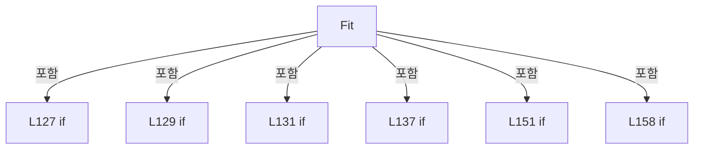

변경 전 점검: 입력/반환 타입, 위 호출자, 예외/취소 경로, 공유 상태와 저장·전송 소비자를 함께 확인합니다. 값의 단위나 물리 방향을 이름만으로 확정하지 않습니다.

### LocalFunctionStatement `Coefficient` · L138–138

[Drilling.Common/Correction/CDefaultOffsetCalibration.cs:138–138](https://github.com/kjuws10-rgb/A3Drilling/blob/5aee8e58439c9b455cae7c9593c9be986c3e682e/Drilling.Common/Correction/CDefaultOffsetCalibration.cs#L138-L138)

| 항목 | 실제 추출 값 |
| --- | --- |
| 서명 | double Coefficient(bool, bool) |
| 접근/수식자 | Private /  |
| 반환/값 타입 | double |
| 소속 타입 | NamedType:Drilling.Common.Correction.CDefaultOffsetCalibration |

입력 계약:

| 이름 | 타입 | 전달 | 선택/기본값 |
| --- | --- | --- | --- |
| x | bool | None | False /  |
| column | bool | None | False /  |

정적 호출자로 확인된 위치:

| 호출 파일/행 | 호출 표현식 | 런타임 분기 가능 |
| --- | --- | --- |
| [Drilling.Common/Correction/CDefaultOffsetCalibration.cs:139–139](https://github.com/kjuws10-rgb/A3Drilling/blob/5aee8e58439c9b455cae7c9593c9be986c3e682e/Drilling.Common/Correction/CDefaultOffsetCalibration.cs#L139-L139) | Coefficient | False |
| [Drilling.Common/Correction/CDefaultOffsetCalibration.cs:139–139](https://github.com/kjuws10-rgb/A3Drilling/blob/5aee8e58439c9b455cae7c9593c9be986c3e682e/Drilling.Common/Correction/CDefaultOffsetCalibration.cs#L139-L139) | Coefficient | False |
| [Drilling.Common/Correction/CDefaultOffsetCalibration.cs:140–140](https://github.com/kjuws10-rgb/A3Drilling/blob/5aee8e58439c9b455cae7c9593c9be986c3e682e/Drilling.Common/Correction/CDefaultOffsetCalibration.cs#L140-L140) | Coefficient | False |
| [Drilling.Common/Correction/CDefaultOffsetCalibration.cs:140–140](https://github.com/kjuws10-rgb/A3Drilling/blob/5aee8e58439c9b455cae7c9593c9be986c3e682e/Drilling.Common/Correction/CDefaultOffsetCalibration.cs#L140-L140) | Coefficient | False |

호출하는 대상과 해석 범위:

| 원본 행 | 표현식 | 분석 상태 | 대상/소스 위치 |
| --- | --- | --- | --- |
| 138 | marks.Sum | resolved | double System.Collections.Generic.IEnumerable<Drilling.Common.Correction.ST_DEFAULT_OFFSET_MARK>.Sum<Drilling.Common.Correction.ST_DEFAULT_OFFSET_MARK>(System.Func<Drilling.Common.Correction.ST_DEFAULT_OFFSET_MARK, double>) |

본문의 실제 연산·분기·예외·반환 순서(원문 위치 순):

| 원본 행 | 종류 | 주석 해설 |
| --- | --- | --- |
| 138 | call | 함수·델리게이트 또는 객체 생성자를 호출합니다: marks.Sum(m => ((column ? (m.Beam - 1) % 4 : (m.Beam - 1) / 4) - 1.5) * pitch * (x ? m.X - cx : m.Y - cy)) |
| 138 | conditional-expression | 조건에 따라 결과식을 선택합니다: column ? (m.Beam - 1) % 4 : (m.Beam - 1) / 4 |
| 138 | conditional-expression | 조건에 따라 결과식을 선택합니다: x ? m.X - cx : m.Y - cy |

변경 전 점검: 입력/반환 타입, 위 호출자, 예외/취소 경로, 공유 상태와 저장·전송 소비자를 함께 확인합니다. 값의 단위나 물리 방향을 이름만으로 확정하지 않습니다.

### MethodDeclaration `FitCross` · L162–170

[Drilling.Common/Correction/CDefaultOffsetCalibration.cs:162–170](https://github.com/kjuws10-rgb/A3Drilling/blob/5aee8e58439c9b455cae7c9593c9be986c3e682e/Drilling.Common/Correction/CDefaultOffsetCalibration.cs#L162-L170)

| 항목 | 실제 추출 값 |
| --- | --- |
| 서명 | Drilling.Common.Correction.ST_DEFAULT_OFFSET_FIT Drilling.Common.Correction.CDefaultOffsetCalibration.FitCross(Drilling.Common.Correction.ST_DEFAULT_OFFSET_MARK) |
| 접근/수식자 | Public / public, static |
| 반환/값 타입 | Drilling.Common.Correction.ST_DEFAULT_OFFSET_FIT |
| 소속 타입 | NamedType:Drilling.Common.Correction.CDefaultOffsetCalibration |

입력 계약:

| 이름 | 타입 | 전달 | 선택/기본값 |
| --- | --- | --- | --- |
| mark | Drilling.Common.Correction.ST_DEFAULT_OFFSET_MARK | None | False /  |

정적 호출자로 확인된 위치:

| 호출 파일/행 | 호출 표현식 | 런타임 분기 가능 |
| --- | --- | --- |
| [Drilling.UI/Menu/Menus/CMenuCorrection.cs:3746–3746](https://github.com/kjuws10-rgb/A3Drilling/blob/5aee8e58439c9b455cae7c9593c9be986c3e682e/Drilling.UI/Menu/Menus/CMenuCorrection.cs#L3746-L3746) | CDefaultOffsetCalibration.FitCross | False |

호출하는 대상과 해석 범위:

| 원본 행 | 표현식 | 분석 상태 | 대상/소스 위치 |
| --- | --- | --- | --- |
| 165 | new[] { mark.X, mark.Y, mark.RawX, mark.RawY, mark.CorrectionX, mark.CorrectionY, mark.EncoderX, mark.EncoderY }.Any | resolved | bool System.Collections.Generic.IEnumerable<double>.Any<double>(System.Func<double, bool>) |
| 165 | double.IsFinite | resolved | bool double.IsFinite(double) |
| 166 | new InvalidOperationException | resolved | System.InvalidOperationException.InvalidOperationException(string?) |
| 169 | new | resolved | Drilling.Common.Correction.ST_DEFAULT_OFFSET_FIT.ST_DEFAULT_OFFSET_FIT(double, double, double, double, double) · Drilling.Common/Correction/CDefaultOffsetCalibration.cs:254 |

본문의 실제 연산·분기·예외·반환 순서(원문 위치 순):

| 원본 행 | 종류 | 주석 해설 |
| --- | --- | --- |
| 164 | if | 조건에 따라 분기합니다: if (mark.Beam != 0 &#124;&#124; mark.Judge != "OK" &#124;&#124; new[] { mark.X, mark.Y, mark.RawX, mark.RawY, mark.CorrectionX, mark.CorrectionY, mark.EncoderX, mark.EncoderY }.Any(v => !double.IsFinite(v))) |
| 165 | call | 함수·델리게이트 또는 객체 생성자를 호출합니다: new[] { mark.X, mark.Y, mark.RawX, mark.RawY, mark.CorrectionX, mark.CorrectionY, mark.EncoderX, mark.EncoderY }.Any(v => !double.IsFinite(v)) |
| 165 | call | 함수·델리게이트 또는 객체 생성자를 호출합니다: double.IsFinite(v) |
| 166 | call | 함수·델리게이트 또는 객체 생성자를 호출합니다: new InvalidOperationException("유효한 십자 중심 측정값이 필요합니다.") |
| 166 | throw | 예외를 발생/전달합니다: throw new InvalidOperationException("유효한 십자 중심 측정값이 필요합니다."); |
| 169 | call | 함수·델리게이트 또는 객체 생성자를 호출합니다: new(mark.X, mark.Y, 0, 0, 0) |
| 169 | return | 호출자에게 값 또는 제어를 반환합니다: return new(mark.X, mark.Y, 0, 0, 0); |

제어 구문의 포함 구조(실제 실행 순서/CFG가 아닌 구문 탐색 그림):

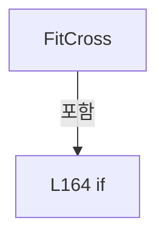

변경 전 점검: 입력/반환 타입, 위 호출자, 예외/취소 경로, 공유 상태와 저장·전송 소비자를 함께 확인합니다. 값의 단위나 물리 방향을 이름만으로 확정하지 않습니다.

### MethodDeclaration `WithHeadReference` · L175–201

[Drilling.Common/Correction/CDefaultOffsetCalibration.cs:175–201](https://github.com/kjuws10-rgb/A3Drilling/blob/5aee8e58439c9b455cae7c9593c9be986c3e682e/Drilling.Common/Correction/CDefaultOffsetCalibration.cs#L175-L201)

| 항목 | 실제 추출 값 |
| --- | --- |
| 서명 | Drilling.Common.Correction.ST_DEFAULT_OFFSET_HEAD_RESULT Drilling.Common.Correction.CDefaultOffsetCalibration.WithHeadReference(System.Collections.Generic.IReadOnlyDictionary<string, string>, Drilling.Common.Correction.ST_DEFAULT_OFFSET_HEAD_RESULT) |
| 접근/수식자 | Public / public, static |
| 반환/값 타입 | Drilling.Common.Correction.ST_DEFAULT_OFFSET_HEAD_RESULT |
| 소속 타입 | NamedType:Drilling.Common.Correction.CDefaultOffsetCalibration |

입력 계약:

| 이름 | 타입 | 전달 | 선택/기본값 |
| --- | --- | --- | --- |
| values | System.Collections.Generic.IReadOnlyDictionary<string, string> | None | False /  |
| result | Drilling.Common.Correction.ST_DEFAULT_OFFSET_HEAD_RESULT | None | False /  |

정적 호출자로 확인된 위치:

| 호출 파일/행 | 호출 표현식 | 런타임 분기 가능 |
| --- | --- | --- |
| [Drilling.Common/Correction/CDefaultOffsetCalibration.cs:217–217](https://github.com/kjuws10-rgb/A3Drilling/blob/5aee8e58439c9b455cae7c9593c9be986c3e682e/Drilling.Common/Correction/CDefaultOffsetCalibration.cs#L217-L217) | WithHeadReference | False |
| [Drilling.UI/Menu/Menus/CMenuCorrection.cs:3760–3762](https://github.com/kjuws10-rgb/A3Drilling/blob/5aee8e58439c9b455cae7c9593c9be986c3e682e/Drilling.UI/Menu/Menus/CMenuCorrection.cs#L3760-L3762) | CDefaultOffsetCalibration.WithHeadReference | False |

호출하는 대상과 해석 범위:

| 원본 행 | 표현식 | 분석 상태 | 대상/소스 위치 |
| --- | --- | --- | --- |
| 179 | result.Marks.Select(m => m.Beam).Order().SequenceEqual | resolved | bool System.Collections.Generic.IEnumerable<int>.SequenceEqual<int>(System.Collections.Generic.IEnumerable<int>) |
| 179 | result.Marks.Select(m => m.Beam).Order | resolved | System.Linq.IOrderedEnumerable<int> System.Collections.Generic.IEnumerable<int>.Order<int>() |
| 179 | result.Marks.Select | resolved | System.Collections.Generic.IEnumerable<int> System.Collections.Generic.IEnumerable<Drilling.Common.Correction.ST_DEFAULT_OFFSET_MARK>.Select<Drilling.Common.Correction.ST_DEFAULT_OFFSET_MARK, int>(System.Func<Drilling.Common.Correction.ST_DEFAULT_OFFSET_MARK, int>) |
| 179 | Enumerable.Range | resolved | System.Collections.Generic.IEnumerable<int> System.Linq.Enumerable.Range(int, int) |
| 180 | double.IsFinite | resolved | bool double.IsFinite(double) |
| 181 | result.Marks.Any | resolved | bool System.Collections.Generic.IEnumerable<Drilling.Common.Correction.ST_DEFAULT_OFFSET_MARK>.Any<Drilling.Common.Correction.ST_DEFAULT_OFFSET_MARK>(System.Func<Drilling.Common.Correction.ST_DEFAULT_OFFSET_MARK, bool>) |
| 181 | double.IsFinite | resolved | bool double.IsFinite(double) |
| 181 | double.IsFinite | resolved | bool double.IsFinite(double) |
| 182 | double.IsFinite | resolved | bool double.IsFinite(double) |
| 182 | double.IsFinite | resolved | bool double.IsFinite(double) |
| 183 | new InvalidOperationException | resolved | System.InvalidOperationException.InvalidOperationException(string?) |
| 184 | Number | resolved | double Drilling.Common.Correction.CDefaultOffsetCalibration.Number(System.Collections.Generic.IReadOnlyDictionary<string, string>, string) · Drilling.Common/Correction/CDefaultOffsetCalibration.cs:22 |
| 184 | Number | resolved | double Drilling.Common.Correction.CDefaultOffsetCalibration.Number(System.Collections.Generic.IReadOnlyDictionary<string, string>, string) · Drilling.Common/Correction/CDefaultOffsetCalibration.cs:22 |
| 184 | Number | resolved | double Drilling.Common.Correction.CDefaultOffsetCalibration.Number(System.Collections.Generic.IReadOnlyDictionary<string, string>, string) · Drilling.Common/Correction/CDefaultOffsetCalibration.cs:22 |
| 185 | Number | resolved | double Drilling.Common.Correction.CDefaultOffsetCalibration.Number(System.Collections.Generic.IReadOnlyDictionary<string, string>, string) · Drilling.Common/Correction/CDefaultOffsetCalibration.cs:22 |
| 186 | CScannerAxisTransform.ReadStageDirection | resolved | double Drilling.Common.Recipe.CScannerAxisTransform.ReadStageDirection(System.Collections.Generic.IReadOnlyDictionary<string, string>) · Drilling.Common/Recipe/CShotCoordinatePlanBuilder.cs:1233 |
| 187 | values.ContainsKey | resolved · 동적 구현 선택 가능 | bool System.Collections.Generic.IReadOnlyDictionary<string, string>.ContainsKey(string) |
| 187 | Number | resolved | double Drilling.Common.Correction.CDefaultOffsetCalibration.Number(System.Collections.Generic.IReadOnlyDictionary<string, string>, string) · Drilling.Common/Correction/CDefaultOffsetCalibration.cs:22 |
| 188 | Number | resolved | double Drilling.Common.Correction.CDefaultOffsetCalibration.Number(System.Collections.Generic.IReadOnlyDictionary<string, string>, string) · Drilling.Common/Correction/CDefaultOffsetCalibration.cs:22 |
| 188 | Number | resolved | double Drilling.Common.Correction.CDefaultOffsetCalibration.Number(System.Collections.Generic.IReadOnlyDictionary<string, string>, string) · Drilling.Common/Correction/CDefaultOffsetCalibration.cs:22 |
| 194 | result.Marks.Average | resolved | double System.Collections.Generic.IEnumerable<Drilling.Common.Correction.ST_DEFAULT_OFFSET_MARK>.Average<Drilling.Common.Correction.ST_DEFAULT_OFFSET_MARK>(System.Func<Drilling.Common.Correction.ST_DEFAULT_OFFSET_MARK, double>) |
| 195 | result.Marks.Average | resolved | double System.Collections.Generic.IEnumerable<Drilling.Common.Correction.ST_DEFAULT_OFFSET_MARK>.Average<Drilling.Common.Correction.ST_DEFAULT_OFFSET_MARK>(System.Func<Drilling.Common.Correction.ST_DEFAULT_OFFSET_MARK, double>) |
| 196 | new[] { targetX, targetY, actualX, actualY }.Any | resolved | bool System.Collections.Generic.IEnumerable<double>.Any<double>(System.Func<double, bool>) |
| 196 | double.IsFinite | resolved | bool double.IsFinite(double) |
| 197 | new InvalidOperationException | resolved | System.InvalidOperationException.InvalidOperationException(string?) |

본문의 실제 연산·분기·예외·반환 순서(원문 위치 순):

| 원본 행 | 종류 | 주석 해설 |
| --- | --- | --- |
| 177 | local-declaration | 지역 변수를 선언합니다: var isCrossMeasurement = result.Marks.Count == 1 && result.Marks[0].Beam == 0; |
| 177 | variable-initializer | 변수의 초기값을 지정합니다: isCrossMeasurement = result.Marks.Count == 1 && result.Marks[0].Beam == 0 |
| 178 | local-declaration | 지역 변수를 선언합니다: var isShotMeasurement = result.Marks.Count == 16 && result.Marks.Select(m => m.Beam).Order().SequenceEqual(Enumerable.Range(1, 16)); |
| 178 | variable-initializer | 변수의 초기값을 지정합니다: isShotMeasurement = result.Marks.Count == 16 && result.Marks.Select(m => m.Beam).Order().SequenceEqual(Enumerable.Range(1, 16)) |
| 179 | call | 함수·델리게이트 또는 객체 생성자를 호출합니다: result.Marks.Select(m => m.Beam).Order().SequenceEqual(Enumerable.Range(1, 16)) |
| 179 | call | 함수·델리게이트 또는 객체 생성자를 호출합니다: result.Marks.Select(m => m.Beam).Order() |
| 179 | call | 함수·델리게이트 또는 객체 생성자를 호출합니다: result.Marks.Select(m => m.Beam) |
| 179 | call | 함수·델리게이트 또는 객체 생성자를 호출합니다: Enumerable.Range(1, 16) |
| 180 | call | 함수·델리게이트 또는 객체 생성자를 호출합니다: double.IsFinite(result.Q) |
| 180 | if | 조건에 따라 분기합니다: if (result.Head is < 1 or > 8 &#124;&#124; !double.IsFinite(result.Q) &#124;&#124; !(isCrossMeasurement &#124;&#124; isShotMeasurement) &#124;&#124; result.Marks.Any(m => !double.IsFinite(m.EncoderX) &#124;&#124; !double.IsFinite(m.EncoderY) &#124;&#124; !double.IsFinite(m.Correction…) |
| 181 | call | 함수·델리게이트 또는 객체 생성자를 호출합니다: double.IsFinite(m.EncoderX) |
| 181 | call | 함수·델리게이트 또는 객체 생성자를 호출합니다: double.IsFinite(m.EncoderY) |
| 181 | call | 함수·델리게이트 또는 객체 생성자를 호출합니다: result.Marks.Any(m => !double.IsFinite(m.EncoderX) &#124;&#124; !double.IsFinite(m.EncoderY) &#124;&#124; !double.IsFinite(m.CorrectionX) &#124;&#124; !double.IsFinite(m.CorrectionY)) |
| 182 | call | 함수·델리게이트 또는 객체 생성자를 호출합니다: double.IsFinite(m.CorrectionX) |
| 182 | call | 함수·델리게이트 또는 객체 생성자를 호출합니다: double.IsFinite(m.CorrectionY) |
| 183 | call | 함수·델리게이트 또는 객체 생성자를 호출합니다: new InvalidOperationException("Head 중심 계산에 유효한 십자 중심 또는 16빔 측정 좌표가 필요합니다.") |
| 183 | throw | 예외를 발생/전달합니다: throw new InvalidOperationException("Head 중심 계산에 유효한 십자 중심 또는 16빔 측정 좌표가 필요합니다."); |
| 184 | call | 함수·델리게이트 또는 객체 생성자를 호출합니다: Number(values, "REVIEW_CAMERA_ALIGN_KEY_POS_X") |
| 184 | call | 함수·델리게이트 또는 객체 생성자를 호출합니다: Number(values, "GLASS_SIZE_X") |
| 184 | call | 함수·델리게이트 또는 객체 생성자를 호출합니다: Number(values, "AK_MARGIN_X") |
| 184 | local-declaration | 지역 변수를 선언합니다: var boardCenter = Number(values, "REVIEW_CAMERA_ALIGN_KEY_POS_X") + Number(values, "GLASS_SIZE_X") / 2 - Number(values, "AK_MARGIN_X"); |
| 184 | variable-initializer | 변수의 초기값을 지정합니다: boardCenter = Number(values, "REVIEW_CAMERA_ALIGN_KEY_POS_X") + Number(values, "GLASS_SIZE_X") / 2 - Number(values, "AK_MARGIN_X") |
| 185 | call | 함수·델리게이트 또는 객체 생성자를 호출합니다: Number(values, "HeadGapX") |
| 185 | local-declaration | 지역 변수를 선언합니다: var targetX = boardCenter + (result.Head - 4.5) * Number(values, "HeadGapX"); |
| 185 | variable-initializer | 변수의 초기값을 지정합니다: targetX = boardCenter + (result.Head - 4.5) * Number(values, "HeadGapX") |
| 186 | call | 함수·델리게이트 또는 객체 생성자를 호출합니다: CScannerAxisTransform.ReadStageDirection(values) |
| 186 | local-declaration | 지역 변수를 선언합니다: var direction = CScannerAxisTransform.ReadStageDirection(values); |
| 186 | variable-initializer | 변수의 초기값을 지정합니다: direction = CScannerAxisTransform.ReadStageDirection(values) |
| 187 | call | 함수·델리게이트 또는 객체 생성자를 호출합니다: values.ContainsKey($"H{result.Head:00}_AK_POSITION_Y") |
| 187 | call | 함수·델리게이트 또는 객체 생성자를 호출합니다: Number(values, $"H{result.Head:00}_AK_POSITION_Y") |
| 187 | conditional-expression | 조건에 따라 결과식을 선택합니다: values.ContainsKey($"H{result.Head:00}_AK_POSITION_Y") ? Number(values, $"H{result.Head:00}_AK_POSITION_Y") : Number(values, "REVIEW_TO_HEAD1_GAP_Y") + (result.Head % 2 == 0 ? Number(values, "HeadGapY") : 0) |
| 187 | local-declaration | 지역 변수를 선언합니다: var gapY = values.ContainsKey($"H{result.Head:00}_AK_POSITION_Y") ? Number(values, $"H{result.Head:00}_AK_POSITION_Y") : Number(values, "REVIEW_TO_HEAD1_GAP_Y") + (result.Head % 2 == 0 ? Number(values, "HeadGapY") : 0); |
| 187 | variable-initializer | 변수의 초기값을 지정합니다: gapY = values.ContainsKey($"H{result.Head:00}_AK_POSITION_Y") ? Number(values, $"H{result.Head:00}_AK_POSITION_Y") : Number(values, "REVIEW_TO_HEAD1_GAP_Y") + (result.Head % 2 == 0 ? Number(values, "HeadGapY") : 0) |
| 188 | call | 함수·델리게이트 또는 객체 생성자를 호출합니다: Number(values, "REVIEW_TO_HEAD1_GAP_Y") |
| 188 | call | 함수·델리게이트 또는 객체 생성자를 호출합니다: Number(values, "HeadGapY") |
| 188 | conditional-expression | 조건에 따라 결과식을 선택합니다: result.Head % 2 == 0 ? Number(values, "HeadGapY") : 0 |
| 189 | local-declaration | 지역 변수를 선언합니다: var targetY = result.Q - direction * gapY; |
| 189 | variable-initializer | 변수의 초기값을 지정합니다: targetY = result.Q - direction * gapY |
| 194 | call | 함수·델리게이트 또는 객체 생성자를 호출합니다: result.Marks.Average(m => m.EncoderX - m.CorrectionX) |
| 194 | local-declaration | 지역 변수를 선언합니다: var actualX = result.Marks.Average(m => m.EncoderX - m.CorrectionX); |
| 194 | variable-initializer | 변수의 초기값을 지정합니다: actualX = result.Marks.Average(m => m.EncoderX - m.CorrectionX) |
| 195 | call | 함수·델리게이트 또는 객체 생성자를 호출합니다: result.Marks.Average(m => m.EncoderY - direction * m.CorrectionY) |
| 195 | local-declaration | 지역 변수를 선언합니다: var actualY = result.Marks.Average(m => m.EncoderY - direction * m.CorrectionY); |
| 195 | variable-initializer | 변수의 초기값을 지정합니다: actualY = result.Marks.Average(m => m.EncoderY - direction * m.CorrectionY) |
| 196 | call | 함수·델리게이트 또는 객체 생성자를 호출합니다: new[] { targetX, targetY, actualX, actualY }.Any(v => !double.IsFinite(v)) |
| 196 | call | 함수·델리게이트 또는 객체 생성자를 호출합니다: double.IsFinite(v) |
| 196 | if | 조건에 따라 분기합니다: if (new[] { targetX, targetY, actualX, actualY }.Any(v => !double.IsFinite(v))) |
| 197 | call | 함수·델리게이트 또는 객체 생성자를 호출합니다: new InvalidOperationException("글래스 기준 목표 중심 또는 실측 중심 좌표를 확인해 주세요.") |
| 197 | throw | 예외를 발생/전달합니다: throw new InvalidOperationException("글래스 기준 목표 중심 또는 실측 중심 좌표를 확인해 주세요."); |
| 198 | assignment | 값을 대상에 대입합니다: TargetReviewX = targetX |
| 198 | assignment | 값을 대상에 대입합니다: TargetStageY = targetY |
| 198 | return | 호출자에게 값 또는 제어를 반환합니다: return result with { TargetReviewX = targetX, TargetStageY = targetY, CenterReviewX = actualX, CenterStageY = actualY, CenterErrorX = actualX - targetX, CenterErrorY = (actualY - targetY) / direction }; |
| 199 | assignment | 값을 대상에 대입합니다: CenterReviewX = actualX |
| 199 | assignment | 값을 대상에 대입합니다: CenterStageY = actualY |
| 200 | assignment | 값을 대상에 대입합니다: CenterErrorX = actualX - targetX |
| 200 | assignment | 값을 대상에 대입합니다: CenterErrorY = (actualY - targetY) / direction |

제어 구문의 포함 구조(실제 실행 순서/CFG가 아닌 구문 탐색 그림):

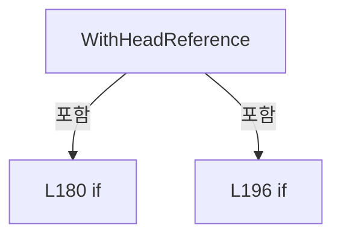

변경 전 점검: 입력/반환 타입, 위 호출자, 예외/취소 경로, 공유 상태와 저장·전송 소비자를 함께 확인합니다. 값의 단위나 물리 방향을 이름만으로 확정하지 않습니다.

### MethodDeclaration `ActiveHeads` · L203–204

[Drilling.Common/Correction/CDefaultOffsetCalibration.cs:203–204](https://github.com/kjuws10-rgb/A3Drilling/blob/5aee8e58439c9b455cae7c9593c9be986c3e682e/Drilling.Common/Correction/CDefaultOffsetCalibration.cs#L203-L204)

| 항목 | 실제 추출 값 |
| --- | --- |
| 서명 | int[] Drilling.Common.Correction.CDefaultOffsetCalibration.ActiveHeads(System.Collections.Generic.IReadOnlyDictionary<string, string>) |
| 접근/수식자 | Public / public, static |
| 반환/값 타입 | int[] |
| 소속 타입 | NamedType:Drilling.Common.Correction.CDefaultOffsetCalibration |

입력 계약:

| 이름 | 타입 | 전달 | 선택/기본값 |
| --- | --- | --- | --- |
| values | System.Collections.Generic.IReadOnlyDictionary<string, string> | None | False /  |

정적 호출자로 확인된 위치:

| 호출 파일/행 | 호출 표현식 | 런타임 분기 가능 |
| --- | --- | --- |
| [Drilling.Common/Correction/CDefaultOffsetCalibration.cs:208–208](https://github.com/kjuws10-rgb/A3Drilling/blob/5aee8e58439c9b455cae7c9593c9be986c3e682e/Drilling.Common/Correction/CDefaultOffsetCalibration.cs#L208-L208) | ActiveHeads | False |
| [Drilling.UI/Menu/Menus/CMenuCorrection.cs:3165–3165](https://github.com/kjuws10-rgb/A3Drilling/blob/5aee8e58439c9b455cae7c9593c9be986c3e682e/Drilling.UI/Menu/Menus/CMenuCorrection.cs#L3165-L3165) | CDefaultOffsetCalibration.ActiveHeads | False |
| [Drilling.UI/Menu/Menus/CMenuCorrection.cs:3184–3184](https://github.com/kjuws10-rgb/A3Drilling/blob/5aee8e58439c9b455cae7c9593c9be986c3e682e/Drilling.UI/Menu/Menus/CMenuCorrection.cs#L3184-L3184) | CDefaultOffsetCalibration.ActiveHeads | False |
| [Drilling.UI/Menu/Menus/CMenuCorrection.cs:3298–3298](https://github.com/kjuws10-rgb/A3Drilling/blob/5aee8e58439c9b455cae7c9593c9be986c3e682e/Drilling.UI/Menu/Menus/CMenuCorrection.cs#L3298-L3298) | CDefaultOffsetCalibration.ActiveHeads | False |
| [Drilling.UI/Menu/Menus/CMenuCorrection.cs:3782–3782](https://github.com/kjuws10-rgb/A3Drilling/blob/5aee8e58439c9b455cae7c9593c9be986c3e682e/Drilling.UI/Menu/Menus/CMenuCorrection.cs#L3782-L3782) | CDefaultOffsetCalibration.ActiveHeads | False |

호출하는 대상과 해석 범위:

| 원본 행 | 표현식 | 분석 상태 | 대상/소스 위치 |
| --- | --- | --- | --- |
| 204 | Enumerable.Range(1, 8).Where(h => CScannerAxisConfiguration.IsHeadEnabled(values, h)).ToArray | resolved | int[] System.Collections.Generic.IEnumerable<int>.ToArray<int>() |
| 204 | Enumerable.Range(1, 8).Where | resolved | System.Collections.Generic.IEnumerable<int> System.Collections.Generic.IEnumerable<int>.Where<int>(System.Func<int, bool>) |
| 204 | Enumerable.Range | resolved | System.Collections.Generic.IEnumerable<int> System.Linq.Enumerable.Range(int, int) |
| 204 | CScannerAxisConfiguration.IsHeadEnabled | resolved | bool Drilling.Common.Automation.CScannerAxisConfiguration.IsHeadEnabled(System.Collections.Generic.IReadOnlyDictionary<string, string>, int) · Drilling.Common/Automation/CScannerAxisConfiguration.cs:166 |

본문의 실제 연산·분기·예외·반환 순서(원문 위치 순):

| 원본 행 | 종류 | 주석 해설 |
| --- | --- | --- |
| 204 | call | 함수·델리게이트 또는 객체 생성자를 호출합니다: Enumerable.Range(1, 8).Where(h => CScannerAxisConfiguration.IsHeadEnabled(values, h)).ToArray() |
| 204 | call | 함수·델리게이트 또는 객체 생성자를 호출합니다: Enumerable.Range(1, 8).Where(h => CScannerAxisConfiguration.IsHeadEnabled(values, h)) |
| 204 | call | 함수·델리게이트 또는 객체 생성자를 호출합니다: Enumerable.Range(1, 8) |
| 204 | call | 함수·델리게이트 또는 객체 생성자를 호출합니다: CScannerAxisConfiguration.IsHeadEnabled(values, h) |

변경 전 점검: 입력/반환 타입, 위 호출자, 예외/취소 경로, 공유 상태와 저장·전송 소비자를 함께 확인합니다. 값의 단위나 물리 방향을 이름만으로 확정하지 않습니다.

### MethodDeclaration `Recommend` · L206–229

[Drilling.Common/Correction/CDefaultOffsetCalibration.cs:206–229](https://github.com/kjuws10-rgb/A3Drilling/blob/5aee8e58439c9b455cae7c9593c9be986c3e682e/Drilling.Common/Correction/CDefaultOffsetCalibration.cs#L206-L229)

| 항목 | 실제 추출 값 |
| --- | --- |
| 서명 | System.Collections.Generic.IReadOnlyDictionary<string, string> Drilling.Common.Correction.CDefaultOffsetCalibration.Recommend(System.Collections.Generic.IReadOnlyDictionary<string, string>, System.Collections.Generic.IReadOnlyCollection<Drilling.Common.Correction.ST_DEFAULT_OFFSET_HEAD_RESULT>, System.Collections.Generic.IReadOnlyCollection<int>?) |
| 접근/수식자 | Public / public, static |
| 반환/값 타입 | System.Collections.Generic.IReadOnlyDictionary<string, string> |
| 소속 타입 | NamedType:Drilling.Common.Correction.CDefaultOffsetCalibration |

입력 계약:

| 이름 | 타입 | 전달 | 선택/기본값 |
| --- | --- | --- | --- |
| values | System.Collections.Generic.IReadOnlyDictionary<string, string> | None | False /  |
| results | System.Collections.Generic.IReadOnlyCollection<Drilling.Common.Correction.ST_DEFAULT_OFFSET_HEAD_RESULT> | None | False /  |
| targetHeads | System.Collections.Generic.IReadOnlyCollection<int>? | None | True / null |

정적 호출자로 확인된 위치:

| 호출 파일/행 | 호출 표현식 | 런타임 분기 가능 |
| --- | --- | --- |
| [Drilling.UI/Menu/Menus/CMenuCorrection.cs:3154–3154](https://github.com/kjuws10-rgb/A3Drilling/blob/5aee8e58439c9b455cae7c9593c9be986c3e682e/Drilling.UI/Menu/Menus/CMenuCorrection.cs#L3154-L3154) | CDefaultOffsetCalibration.Recommend | False |
| [Drilling.UI/Menu/Menus/CMenuCorrection.cs:3334–3334](https://github.com/kjuws10-rgb/A3Drilling/blob/5aee8e58439c9b455cae7c9593c9be986c3e682e/Drilling.UI/Menu/Menus/CMenuCorrection.cs#L3334-L3334) | CDefaultOffsetCalibration.Recommend | False |

호출하는 대상과 해석 범위:

| 원본 행 | 표현식 | 분석 상태 | 대상/소스 위치 |
| --- | --- | --- | --- |
| 208 | ActiveHeads(values).ToHashSet | resolved | System.Collections.Generic.HashSet<int> System.Collections.Generic.IEnumerable<int>.ToHashSet<int>() |
| 208 | ActiveHeads | resolved | int[] Drilling.Common.Correction.CDefaultOffsetCalibration.ActiveHeads(System.Collections.Generic.IReadOnlyDictionary<string, string>) · Drilling.Common/Correction/CDefaultOffsetCalibration.cs:203 |
| 209 | (targetHeads ?? active).Order().ToArray | resolved | int[] System.Collections.Generic.IEnumerable<int>.ToArray<int>() |
| 209 | (targetHeads ?? active).Order | resolved | System.Linq.IOrderedEnumerable<int> System.Collections.Generic.IEnumerable<int>.Order<int>() |
| 210 | targets.Distinct().Count | resolved | int System.Collections.Generic.IEnumerable<int>.Count<int>() |
| 210 | targets.Distinct | resolved | System.Collections.Generic.IEnumerable<int> System.Collections.Generic.IEnumerable<int>.Distinct<int>() |
| 210 | targets.Any | resolved | bool System.Collections.Generic.IEnumerable<int>.Any<int>(System.Func<int, bool>) |
| 210 | active.Contains | resolved | bool System.Collections.Generic.HashSet<int>.Contains(int) |
| 211 | new InvalidOperationException | resolved | System.InvalidOperationException.InvalidOperationException(string?) |
| 212 | results.Select(r => r.Head).Order().SequenceEqual | resolved | bool System.Collections.Generic.IEnumerable<int>.SequenceEqual<int>(System.Collections.Generic.IEnumerable<int>) |
| 212 | results.Select(r => r.Head).Order | resolved | System.Linq.IOrderedEnumerable<int> System.Collections.Generic.IEnumerable<int>.Order<int>() |
| 212 | results.Select | resolved | System.Collections.Generic.IEnumerable<int> System.Collections.Generic.IEnumerable<Drilling.Common.Correction.ST_DEFAULT_OFFSET_HEAD_RESULT>.Select<Drilling.Common.Correction.ST_DEFAULT_OFFSET_HEAD_RESULT, int>(System.Func<Drilling.Common.Correction.ST_DEFAULT_OFFSET_HEAD_RESULT, int>) |
| 213 | new InvalidOperationException | resolved | System.InvalidOperationException.InvalidOperationException(string?) |
| 214 | new Dictionary<string, string> | resolved | System.Collections.Generic.Dictionary<string, string>.Dictionary(System.Collections.Generic.IEqualityComparer<string>?) |
| 217 | WithHeadReference | resolved | Drilling.Common.Correction.ST_DEFAULT_OFFSET_HEAD_RESULT Drilling.Common.Correction.CDefaultOffsetCalibration.WithHeadReference(System.Collections.Generic.IReadOnlyDictionary<string, string>, Drilling.Common.Correction.ST_DEFAULT_OFFSET_HEAD_RESULT) · Drilling.Common/Correction/CDefaultOffsetCalibration.cs:175 |
| 223 | Math.Round | resolved | double System.Math.Round(double, int, System.MidpointRounding) |
| 223 | Number | resolved | double Drilling.Common.Correction.CDefaultOffsetCalibration.Number(System.Collections.Generic.IReadOnlyDictionary<string, string>, string) · Drilling.Common/Correction/CDefaultOffsetCalibration.cs:22 |
| 224 | double.IsFinite | resolved | bool double.IsFinite(double) |
| 224 | Math.Abs | resolved | double System.Math.Abs(double) |
| 224 | new InvalidOperationException | resolved | System.InvalidOperationException.InvalidOperationException(string?) |
| 225 | next.ToString | resolved | string double.ToString(string?, System.IFormatProvider?) |

본문의 실제 연산·분기·예외·반환 순서(원문 위치 순):

| 원본 행 | 종류 | 주석 해설 |
| --- | --- | --- |
| 208 | call | 함수·델리게이트 또는 객체 생성자를 호출합니다: ActiveHeads(values).ToHashSet() |
| 208 | call | 함수·델리게이트 또는 객체 생성자를 호출합니다: ActiveHeads(values) |
| 208 | local-declaration | 지역 변수를 선언합니다: var active = ActiveHeads(values).ToHashSet(); |
| 208 | variable-initializer | 변수의 초기값을 지정합니다: active = ActiveHeads(values).ToHashSet() |
| 209 | call | 함수·델리게이트 또는 객체 생성자를 호출합니다: (targetHeads ?? active).Order().ToArray() |
| 209 | call | 함수·델리게이트 또는 객체 생성자를 호출합니다: (targetHeads ?? active).Order() |
| 209 | local-declaration | 지역 변수를 선언합니다: var targets = (targetHeads ?? active).Order().ToArray(); |
| 209 | variable-initializer | 변수의 초기값을 지정합니다: targets = (targetHeads ?? active).Order().ToArray() |
| 210 | call | 함수·델리게이트 또는 객체 생성자를 호출합니다: targets.Distinct().Count() |
| 210 | call | 함수·델리게이트 또는 객체 생성자를 호출합니다: targets.Distinct() |
| 210 | call | 함수·델리게이트 또는 객체 생성자를 호출합니다: targets.Any(h => !active.Contains(h)) |
| 210 | call | 함수·델리게이트 또는 객체 생성자를 호출합니다: active.Contains(h) |
| 210 | if | 조건에 따라 분기합니다: if (targets.Length == 0 &#124;&#124; targets.Distinct().Count() != targets.Length &#124;&#124; targets.Any(h => !active.Contains(h))) |
| 211 | call | 함수·델리게이트 또는 객체 생성자를 호출합니다: new InvalidOperationException("USE인 가공 대상 Head를 확인해 주세요.") |
| 211 | throw | 예외를 발생/전달합니다: throw new InvalidOperationException("USE인 가공 대상 Head를 확인해 주세요."); |
| 212 | call | 함수·델리게이트 또는 객체 생성자를 호출합니다: results.Select(r => r.Head).Order().SequenceEqual(targets) |
| 212 | call | 함수·델리게이트 또는 객체 생성자를 호출합니다: results.Select(r => r.Head).Order() |
| 212 | call | 함수·델리게이트 또는 객체 생성자를 호출합니다: results.Select(r => r.Head) |
| 212 | if | 조건에 따라 분기합니다: if (results.Count != targets.Length &#124;&#124; !results.Select(r => r.Head).Order().SequenceEqual(targets)) |
| 213 | call | 함수·델리게이트 또는 객체 생성자를 호출합니다: new InvalidOperationException($"{targets.Length}개 Head(USE)의 유효한 측정을 모두 완료해 주세요.") |
| 213 | throw | 예외를 발생/전달합니다: throw new InvalidOperationException($"{targets.Length}개 Head(USE)의 유효한 측정을 모두 완료해 주세요."); |
| 214 | call | 함수·델리게이트 또는 객체 생성자를 호출합니다: new Dictionary<string, string>(StringComparer.OrdinalIgnoreCase) |
| 214 | local-declaration | 지역 변수를 선언합니다: var changes = new Dictionary<string, string>(StringComparer.OrdinalIgnoreCase); |
| 214 | variable-initializer | 변수의 초기값을 지정합니다: changes = new Dictionary<string, string>(StringComparer.OrdinalIgnoreCase) |
| 215 | foreach | 컬렉션 요소를 순회합니다: foreach (var r in results) |
| 217 | call | 함수·델리게이트 또는 객체 생성자를 호출합니다: WithHeadReference(values, r) |
| 217 | local-declaration | 지역 변수를 선언합니다: var center = WithHeadReference(values, r); |
| 217 | variable-initializer | 변수의 초기값을 지정합니다: center = WithHeadReference(values, r) |
| 220 | foreach | 컬렉션 요소를 순회합니다: foreach (var (axis, error) in new[] { ("X", center.CenterErrorX), ("Y", center.CenterErrorY) }) { var key = $"H{r.Head:00}_DEFAULT_OFFSET_{axis}"; var next = Math.Round(Number(values, key) - error, 5, MidpointRounding.AwayFromZero |
| 222 | local-declaration | 지역 변수를 선언합니다: var key = $"H{r.Head:00}_DEFAULT_OFFSET_{axis}"; |
| 222 | variable-initializer | 변수의 초기값을 지정합니다: key = $"H{r.Head:00}_DEFAULT_OFFSET_{axis}" |
| 223 | call | 함수·델리게이트 또는 객체 생성자를 호출합니다: Math.Round(Number(values, key) - error, 5, MidpointRounding.AwayFromZero) |
| 223 | call | 함수·델리게이트 또는 객체 생성자를 호출합니다: Number(values, key) |
| 223 | local-declaration | 지역 변수를 선언합니다: var next = Math.Round(Number(values, key) - error, 5, MidpointRounding.AwayFromZero); |
| 223 | variable-initializer | 변수의 초기값을 지정합니다: next = Math.Round(Number(values, key) - error, 5, MidpointRounding.AwayFromZero) |
| 224 | call | 함수·델리게이트 또는 객체 생성자를 호출합니다: double.IsFinite(next) |
| 224 | call | 함수·델리게이트 또는 객체 생성자를 호출합니다: Math.Abs(next) |
| 224 | call | 함수·델리게이트 또는 객체 생성자를 호출합니다: new InvalidOperationException($"HEAD {r.Head:00} Default {axis}가 레시피 허용범위 ±100 mm를 초과합니다.") |
| 224 | if | 조건에 따라 분기합니다: if (!double.IsFinite(next) &#124;&#124; Math.Abs(next) > 100) |
| 224 | throw | 예외를 발생/전달합니다: throw new InvalidOperationException($"HEAD {r.Head:00} Default {axis}가 레시피 허용범위 ±100 mm를 초과합니다."); |
| 225 | assignment | 값을 대상에 대입합니다: changes[key] = next.ToString("0.00000", CultureInfo.InvariantCulture) |
| 225 | call | 함수·델리게이트 또는 객체 생성자를 호출합니다: next.ToString("0.00000", CultureInfo.InvariantCulture) |
| 228 | return | 호출자에게 값 또는 제어를 반환합니다: return changes; |

제어 구문의 포함 구조(실제 실행 순서/CFG가 아닌 구문 탐색 그림):

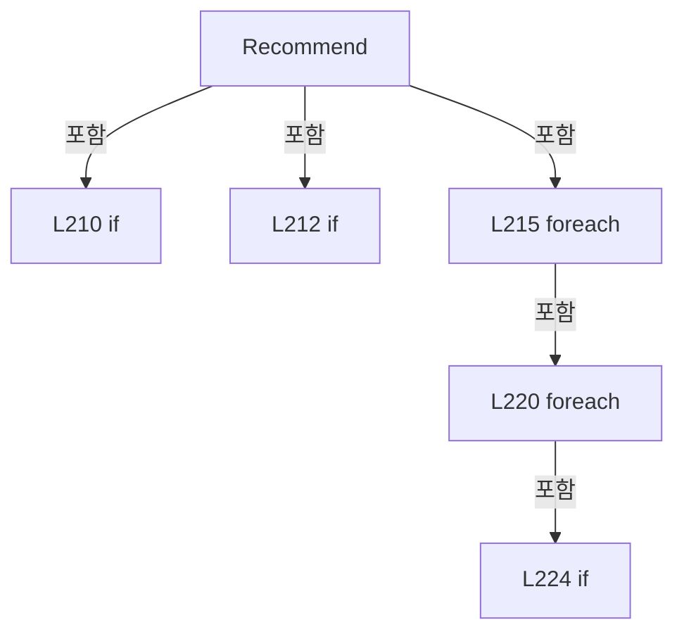

변경 전 점검: 입력/반환 타입, 위 호출자, 예외/취소 경로, 공유 상태와 저장·전송 소비자를 함께 확인합니다. 값의 단위나 물리 방향을 이름만으로 확정하지 않습니다.

### EnumMemberDeclaration `Shot` · L232–232

[Drilling.Common/Correction/CDefaultOffsetCalibration.cs:232–232](https://github.com/kjuws10-rgb/A3Drilling/blob/5aee8e58439c9b455cae7c9593c9be986c3e682e/Drilling.Common/Correction/CDefaultOffsetCalibration.cs#L232-L232)

| 항목 | 실제 추출 값 |
| --- | --- |
| 서명 | Drilling.Common.Correction.EN_DEFAULT_MACHINING_MODE.Shot |
| 접근/수식자 | Public /  |
| 반환/값 타입 | Drilling.Common.Correction.EN_DEFAULT_MACHINING_MODE |
| 소속 타입 | NamedType:Drilling.Common.Correction.EN_DEFAULT_MACHINING_MODE |

현재 부분 분석에서 직접 연결된 호출자는 없습니다. XAML/이벤트/인터페이스·델리게이트·외부 진입을 추가 확인해야 하며, 미사용으로 판정한 것이 아닙니다.

변경 전 점검: 입력/반환 타입, 위 호출자, 예외/취소 경로, 공유 상태와 저장·전송 소비자를 함께 확인합니다. 값의 단위나 물리 방향을 이름만으로 확정하지 않습니다.

### EnumMemberDeclaration `Cross` · L232–232

[Drilling.Common/Correction/CDefaultOffsetCalibration.cs:232–232](https://github.com/kjuws10-rgb/A3Drilling/blob/5aee8e58439c9b455cae7c9593c9be986c3e682e/Drilling.Common/Correction/CDefaultOffsetCalibration.cs#L232-L232)

| 항목 | 실제 추출 값 |
| --- | --- |
| 서명 | Drilling.Common.Correction.EN_DEFAULT_MACHINING_MODE.Cross |
| 접근/수식자 | Public /  |
| 반환/값 타입 | Drilling.Common.Correction.EN_DEFAULT_MACHINING_MODE |
| 소속 타입 | NamedType:Drilling.Common.Correction.EN_DEFAULT_MACHINING_MODE |

현재 부분 분석에서 직접 연결된 호출자는 없습니다. XAML/이벤트/인터페이스·델리게이트·외부 진입을 추가 확인해야 하며, 미사용으로 판정한 것이 아닙니다.

변경 전 점검: 입력/반환 타입, 위 호출자, 예외/취소 경로, 공유 상태와 저장·전송 소비자를 함께 확인합니다. 값의 단위나 물리 방향을 이름만으로 확정하지 않습니다.

### PropertyDeclaration `MachiningMode` · L235–235

[Drilling.Common/Correction/CDefaultOffsetCalibration.cs:235–235](https://github.com/kjuws10-rgb/A3Drilling/blob/5aee8e58439c9b455cae7c9593c9be986c3e682e/Drilling.Common/Correction/CDefaultOffsetCalibration.cs#L235-L235)

| 항목 | 실제 추출 값 |
| --- | --- |
| 서명 | Drilling.Common.Correction.EN_DEFAULT_MACHINING_MODE Drilling.Common.Correction.ST_DEFAULT_OFFSET_OPTIONS.MachiningMode |
| 접근/수식자 | Public / public |
| 반환/값 타입 | Drilling.Common.Correction.EN_DEFAULT_MACHINING_MODE |
| 소속 타입 | NamedType:Drilling.Common.Correction.ST_DEFAULT_OFFSET_OPTIONS |

현재 부분 분석에서 직접 연결된 호출자는 없습니다. XAML/이벤트/인터페이스·델리게이트·외부 진입을 추가 확인해야 하며, 미사용으로 판정한 것이 아닙니다.

변경 전 점검: 입력/반환 타입, 위 호출자, 예외/취소 경로, 공유 상태와 저장·전송 소비자를 함께 확인합니다. 값의 단위나 물리 방향을 이름만으로 확정하지 않습니다.

### GetAccessorDeclaration `get_MachiningMode` · L235–235

[Drilling.Common/Correction/CDefaultOffsetCalibration.cs:235–235](https://github.com/kjuws10-rgb/A3Drilling/blob/5aee8e58439c9b455cae7c9593c9be986c3e682e/Drilling.Common/Correction/CDefaultOffsetCalibration.cs#L235-L235)

| 항목 | 실제 추출 값 |
| --- | --- |
| 서명 | Drilling.Common.Correction.EN_DEFAULT_MACHINING_MODE Drilling.Common.Correction.ST_DEFAULT_OFFSET_OPTIONS.MachiningMode.get |
| 접근/수식자 | Public / get |
| 반환/값 타입 | Drilling.Common.Correction.EN_DEFAULT_MACHINING_MODE |
| 소속 타입 | NamedType:Drilling.Common.Correction.ST_DEFAULT_OFFSET_OPTIONS |

현재 부분 분석에서 직접 연결된 호출자는 없습니다. XAML/이벤트/인터페이스·델리게이트·외부 진입을 추가 확인해야 하며, 미사용으로 판정한 것이 아닙니다.

변경 전 점검: 입력/반환 타입, 위 호출자, 예외/취소 경로, 공유 상태와 저장·전송 소비자를 함께 확인합니다. 값의 단위나 물리 방향을 이름만으로 확정하지 않습니다.

### InitAccessorDeclaration `set_MachiningMode` · L235–235

[Drilling.Common/Correction/CDefaultOffsetCalibration.cs:235–235](https://github.com/kjuws10-rgb/A3Drilling/blob/5aee8e58439c9b455cae7c9593c9be986c3e682e/Drilling.Common/Correction/CDefaultOffsetCalibration.cs#L235-L235)

| 항목 | 실제 추출 값 |
| --- | --- |
| 서명 | void Drilling.Common.Correction.ST_DEFAULT_OFFSET_OPTIONS.MachiningMode.init |
| 접근/수식자 | Public / init |
| 반환/값 타입 | void |
| 소속 타입 | NamedType:Drilling.Common.Correction.ST_DEFAULT_OFFSET_OPTIONS |

입력 계약:

| 이름 | 타입 | 전달 | 선택/기본값 |
| --- | --- | --- | --- |
| value | Drilling.Common.Correction.EN_DEFAULT_MACHINING_MODE | None | False /  |

현재 부분 분석에서 직접 연결된 호출자는 없습니다. XAML/이벤트/인터페이스·델리게이트·외부 진입을 추가 확인해야 하며, 미사용으로 판정한 것이 아닙니다.

변경 전 점검: 입력/반환 타입, 위 호출자, 예외/취소 경로, 공유 상태와 저장·전송 소비자를 함께 확인합니다. 값의 단위나 물리 방향을 이름만으로 확정하지 않습니다.

### PropertyDeclaration `CrossSize` · L236–236

[Drilling.Common/Correction/CDefaultOffsetCalibration.cs:236–236](https://github.com/kjuws10-rgb/A3Drilling/blob/5aee8e58439c9b455cae7c9593c9be986c3e682e/Drilling.Common/Correction/CDefaultOffsetCalibration.cs#L236-L236)

| 항목 | 실제 추출 값 |
| --- | --- |
| 서명 | double Drilling.Common.Correction.ST_DEFAULT_OFFSET_OPTIONS.CrossSize |
| 접근/수식자 | Public / public |
| 반환/값 타입 | double |
| 소속 타입 | NamedType:Drilling.Common.Correction.ST_DEFAULT_OFFSET_OPTIONS |

현재 부분 분석에서 직접 연결된 호출자는 없습니다. XAML/이벤트/인터페이스·델리게이트·외부 진입을 추가 확인해야 하며, 미사용으로 판정한 것이 아닙니다.

변경 전 점검: 입력/반환 타입, 위 호출자, 예외/취소 경로, 공유 상태와 저장·전송 소비자를 함께 확인합니다. 값의 단위나 물리 방향을 이름만으로 확정하지 않습니다.

### GetAccessorDeclaration `get_CrossSize` · L236–236

[Drilling.Common/Correction/CDefaultOffsetCalibration.cs:236–236](https://github.com/kjuws10-rgb/A3Drilling/blob/5aee8e58439c9b455cae7c9593c9be986c3e682e/Drilling.Common/Correction/CDefaultOffsetCalibration.cs#L236-L236)

| 항목 | 실제 추출 값 |
| --- | --- |
| 서명 | double Drilling.Common.Correction.ST_DEFAULT_OFFSET_OPTIONS.CrossSize.get |
| 접근/수식자 | Public / get |
| 반환/값 타입 | double |
| 소속 타입 | NamedType:Drilling.Common.Correction.ST_DEFAULT_OFFSET_OPTIONS |

현재 부분 분석에서 직접 연결된 호출자는 없습니다. XAML/이벤트/인터페이스·델리게이트·외부 진입을 추가 확인해야 하며, 미사용으로 판정한 것이 아닙니다.

변경 전 점검: 입력/반환 타입, 위 호출자, 예외/취소 경로, 공유 상태와 저장·전송 소비자를 함께 확인합니다. 값의 단위나 물리 방향을 이름만으로 확정하지 않습니다.

### InitAccessorDeclaration `set_CrossSize` · L236–236

[Drilling.Common/Correction/CDefaultOffsetCalibration.cs:236–236](https://github.com/kjuws10-rgb/A3Drilling/blob/5aee8e58439c9b455cae7c9593c9be986c3e682e/Drilling.Common/Correction/CDefaultOffsetCalibration.cs#L236-L236)

| 항목 | 실제 추출 값 |
| --- | --- |
| 서명 | void Drilling.Common.Correction.ST_DEFAULT_OFFSET_OPTIONS.CrossSize.init |
| 접근/수식자 | Public / init |
| 반환/값 타입 | void |
| 소속 타입 | NamedType:Drilling.Common.Correction.ST_DEFAULT_OFFSET_OPTIONS |

입력 계약:

| 이름 | 타입 | 전달 | 선택/기본값 |
| --- | --- | --- | --- |
| value | double | None | False /  |

현재 부분 분석에서 직접 연결된 호출자는 없습니다. XAML/이벤트/인터페이스·델리게이트·외부 진입을 추가 확인해야 하며, 미사용으로 판정한 것이 아닙니다.

변경 전 점검: 입력/반환 타입, 위 호출자, 예외/취소 경로, 공유 상태와 저장·전송 소비자를 함께 확인합니다. 값의 단위나 물리 방향을 이름만으로 확정하지 않습니다.

### PropertyDeclaration `VisionMethod` · L240–242

[Drilling.Common/Correction/CDefaultOffsetCalibration.cs:240–242](https://github.com/kjuws10-rgb/A3Drilling/blob/5aee8e58439c9b455cae7c9593c9be986c3e682e/Drilling.Common/Correction/CDefaultOffsetCalibration.cs#L240-L242)

| 항목 | 실제 추출 값 |
| --- | --- |
| 서명 | Drilling.Common.Review.EN_ONE_SHOT_METHOD Drilling.Common.Correction.ST_DEFAULT_OFFSET_OPTIONS.VisionMethod |
| 접근/수식자 | Public / public |
| 반환/값 타입 | Drilling.Common.Review.EN_ONE_SHOT_METHOD |
| 소속 타입 | NamedType:Drilling.Common.Correction.ST_DEFAULT_OFFSET_OPTIONS |

현재 부분 분석에서 직접 연결된 호출자는 없습니다. XAML/이벤트/인터페이스·델리게이트·외부 진입을 추가 확인해야 하며, 미사용으로 판정한 것이 아닙니다.

본문의 실제 연산·분기·예외·반환 순서(원문 위치 순):

| 원본 행 | 종류 | 주석 해설 |
| --- | --- | --- |
| 240 | conditional-expression | 조건에 따라 결과식을 선택합니다: MachiningMode == EN_DEFAULT_MACHINING_MODE.Cross ? EN_ONE_SHOT_METHOD.MarkFindSettingSingle : EN_ONE_SHOT_METHOD.MarkFindSingle |

변경 전 점검: 입력/반환 타입, 위 호출자, 예외/취소 경로, 공유 상태와 저장·전송 소비자를 함께 확인합니다. 값의 단위나 물리 방향을 이름만으로 확정하지 않습니다.

### PropertyDeclaration `InspectionPointCount` · L243–243

[Drilling.Common/Correction/CDefaultOffsetCalibration.cs:243–243](https://github.com/kjuws10-rgb/A3Drilling/blob/5aee8e58439c9b455cae7c9593c9be986c3e682e/Drilling.Common/Correction/CDefaultOffsetCalibration.cs#L243-L243)

| 항목 | 실제 추출 값 |
| --- | --- |
| 서명 | int Drilling.Common.Correction.ST_DEFAULT_OFFSET_OPTIONS.InspectionPointCount |
| 접근/수식자 | Public / public |
| 반환/값 타입 | int |
| 소속 타입 | NamedType:Drilling.Common.Correction.ST_DEFAULT_OFFSET_OPTIONS |

현재 부분 분석에서 직접 연결된 호출자는 없습니다. XAML/이벤트/인터페이스·델리게이트·외부 진입을 추가 확인해야 하며, 미사용으로 판정한 것이 아닙니다.

본문의 실제 연산·분기·예외·반환 순서(원문 위치 순):

| 원본 행 | 종류 | 주석 해설 |
| --- | --- | --- |
| 243 | conditional-expression | 조건에 따라 결과식을 선택합니다: MachiningMode == EN_DEFAULT_MACHINING_MODE.Cross ? 1 : 16 |

변경 전 점검: 입력/반환 타입, 위 호출자, 예외/취소 경로, 공유 상태와 저장·전송 소비자를 함께 확인합니다. 값의 단위나 물리 방향을 이름만으로 확정하지 않습니다.

### PropertyDeclaration `InspectionDescription` · L244–246

[Drilling.Common/Correction/CDefaultOffsetCalibration.cs:244–246](https://github.com/kjuws10-rgb/A3Drilling/blob/5aee8e58439c9b455cae7c9593c9be986c3e682e/Drilling.Common/Correction/CDefaultOffsetCalibration.cs#L244-L246)

| 항목 | 실제 추출 값 |
| --- | --- |
| 서명 | string Drilling.Common.Correction.ST_DEFAULT_OFFSET_OPTIONS.InspectionDescription |
| 접근/수식자 | Public / public |
| 반환/값 타입 | string |
| 소속 타입 | NamedType:Drilling.Common.Correction.ST_DEFAULT_OFFSET_OPTIONS |

현재 부분 분석에서 직접 연결된 호출자는 없습니다. XAML/이벤트/인터페이스·델리게이트·외부 진입을 추가 확인해야 하며, 미사용으로 판정한 것이 아닙니다.

본문의 실제 연산·분기·예외·반환 순서(원문 위치 순):

| 원본 행 | 종류 | 주석 해설 |
| --- | --- | --- |
| 244 | conditional-expression | 조건에 따라 결과식을 선택합니다: MachiningMode == EN_DEFAULT_MACHINING_MODE.Cross ? "십자 중심 1회 측정" : "DOE 16빔 측정" |

변경 전 점검: 입력/반환 타입, 위 호출자, 예외/취소 경로, 공유 상태와 저장·전송 소비자를 함께 확인합니다. 값의 단위나 물리 방향을 이름만으로 확정하지 않습니다.

### PropertyDeclaration `MachiningDescription` · L247–248

[Drilling.Common/Correction/CDefaultOffsetCalibration.cs:247–248](https://github.com/kjuws10-rgb/A3Drilling/blob/5aee8e58439c9b455cae7c9593c9be986c3e682e/Drilling.Common/Correction/CDefaultOffsetCalibration.cs#L247-L248)

| 항목 | 실제 추출 값 |
| --- | --- |
| 서명 | string Drilling.Common.Correction.ST_DEFAULT_OFFSET_OPTIONS.MachiningDescription |
| 접근/수식자 | Public / public |
| 반환/값 타입 | string |
| 소속 타입 | NamedType:Drilling.Common.Correction.ST_DEFAULT_OFFSET_OPTIONS |

현재 부분 분석에서 직접 연결된 호출자는 없습니다. XAML/이벤트/인터페이스·델리게이트·외부 진입을 추가 확인해야 하며, 미사용으로 판정한 것이 아닙니다.

호출하는 대상과 해석 범위:

| 원본 행 | 표현식 | 분석 상태 | 대상/소스 위치 |
| --- | --- | --- | --- |
| 248 | CrossSize.ToString | resolved | string double.ToString(string?, System.IFormatProvider?) |

본문의 실제 연산·분기·예외·반환 순서(원문 위치 순):

| 원본 행 | 종류 | 주석 해설 |
| --- | --- | --- |
| 247 | conditional-expression | 조건에 따라 결과식을 선택합니다: MachiningMode == EN_DEFAULT_MACHINING_MODE.Cross ? $"십자 가공 · 전체 길이 {CrossSize.ToString("0.#####", CultureInfo.InvariantCulture)} mm · Head Jump Speed 사용" : "샷 가공 · Head Shot Count 사용" |
| 248 | call | 함수·델리게이트 또는 객체 생성자를 호출합니다: CrossSize.ToString("0.#####", CultureInfo.InvariantCulture) |

변경 전 점검: 입력/반환 타입, 위 호출자, 예외/취소 경로, 공유 상태와 저장·전송 소비자를 함께 확인합니다. 값의 단위나 물리 방향을 이름만으로 확정하지 않습니다.

### PropertyDeclaration `VisionDescription` · L249–249

[Drilling.Common/Correction/CDefaultOffsetCalibration.cs:249–249](https://github.com/kjuws10-rgb/A3Drilling/blob/5aee8e58439c9b455cae7c9593c9be986c3e682e/Drilling.Common/Correction/CDefaultOffsetCalibration.cs#L249-L249)

| 항목 | 실제 추출 값 |
| --- | --- |
| 서명 | string Drilling.Common.Correction.ST_DEFAULT_OFFSET_OPTIONS.VisionDescription |
| 접근/수식자 | Public / public |
| 반환/값 타입 | string |
| 소속 타입 | NamedType:Drilling.Common.Correction.ST_DEFAULT_OFFSET_OPTIONS |

현재 부분 분석에서 직접 연결된 호출자는 없습니다. XAML/이벤트/인터페이스·델리게이트·외부 진입을 추가 확인해야 하며, 미사용으로 판정한 것이 아닙니다.

본문의 실제 연산·분기·예외·반환 순서(원문 위치 순):

| 원본 행 | 종류 | 주석 해설 |
| --- | --- | --- |
| 249 | conditional-expression | 조건에 따라 결과식을 선택합니다: VisionMethod == EN_ONE_SHOT_METHOD.MarkFindSettingSingle ? "Mark Find Setting Single" : "Mark Find Single" |

변경 전 점검: 입력/반환 타입, 위 호출자, 예외/취소 경로, 공유 상태와 저장·전송 소비자를 함께 확인합니다. 값의 단위나 물리 방향을 이름만으로 확정하지 않습니다.

### PropertyDeclaration `Model` · L257–257

[Drilling.Common/Correction/CDefaultOffsetCalibration.cs:257–257](https://github.com/kjuws10-rgb/A3Drilling/blob/5aee8e58439c9b455cae7c9593c9be986c3e682e/Drilling.Common/Correction/CDefaultOffsetCalibration.cs#L257-L257)

| 항목 | 실제 추출 값 |
| --- | --- |
| 서명 | int Drilling.Common.Correction.ST_DEFAULT_OFFSET_HEAD_RESULT.Model |
| 접근/수식자 | Public / public |
| 반환/값 타입 | int |
| 소속 타입 | NamedType:Drilling.Common.Correction.ST_DEFAULT_OFFSET_HEAD_RESULT |

현재 부분 분석에서 직접 연결된 호출자는 없습니다. XAML/이벤트/인터페이스·델리게이트·외부 진입을 추가 확인해야 하며, 미사용으로 판정한 것이 아닙니다.

변경 전 점검: 입력/반환 타입, 위 호출자, 예외/취소 경로, 공유 상태와 저장·전송 소비자를 함께 확인합니다. 값의 단위나 물리 방향을 이름만으로 확정하지 않습니다.

### GetAccessorDeclaration `get_Model` · L257–257

[Drilling.Common/Correction/CDefaultOffsetCalibration.cs:257–257](https://github.com/kjuws10-rgb/A3Drilling/blob/5aee8e58439c9b455cae7c9593c9be986c3e682e/Drilling.Common/Correction/CDefaultOffsetCalibration.cs#L257-L257)

| 항목 | 실제 추출 값 |
| --- | --- |
| 서명 | int Drilling.Common.Correction.ST_DEFAULT_OFFSET_HEAD_RESULT.Model.get |
| 접근/수식자 | Public / get |
| 반환/값 타입 | int |
| 소속 타입 | NamedType:Drilling.Common.Correction.ST_DEFAULT_OFFSET_HEAD_RESULT |

현재 부분 분석에서 직접 연결된 호출자는 없습니다. XAML/이벤트/인터페이스·델리게이트·외부 진입을 추가 확인해야 하며, 미사용으로 판정한 것이 아닙니다.

변경 전 점검: 입력/반환 타입, 위 호출자, 예외/취소 경로, 공유 상태와 저장·전송 소비자를 함께 확인합니다. 값의 단위나 물리 방향을 이름만으로 확정하지 않습니다.

### InitAccessorDeclaration `set_Model` · L257–257

[Drilling.Common/Correction/CDefaultOffsetCalibration.cs:257–257](https://github.com/kjuws10-rgb/A3Drilling/blob/5aee8e58439c9b455cae7c9593c9be986c3e682e/Drilling.Common/Correction/CDefaultOffsetCalibration.cs#L257-L257)

| 항목 | 실제 추출 값 |
| --- | --- |
| 서명 | void Drilling.Common.Correction.ST_DEFAULT_OFFSET_HEAD_RESULT.Model.init |
| 접근/수식자 | Public / init |
| 반환/값 타입 | void |
| 소속 타입 | NamedType:Drilling.Common.Correction.ST_DEFAULT_OFFSET_HEAD_RESULT |

입력 계약:

| 이름 | 타입 | 전달 | 선택/기본값 |
| --- | --- | --- | --- |
| value | int | None | False /  |

현재 부분 분석에서 직접 연결된 호출자는 없습니다. XAML/이벤트/인터페이스·델리게이트·외부 진입을 추가 확인해야 하며, 미사용으로 판정한 것이 아닙니다.

변경 전 점검: 입력/반환 타입, 위 호출자, 예외/취소 경로, 공유 상태와 저장·전송 소비자를 함께 확인합니다. 값의 단위나 물리 방향을 이름만으로 확정하지 않습니다.

### PropertyDeclaration `ReferenceCell` · L258–258

[Drilling.Common/Correction/CDefaultOffsetCalibration.cs:258–258](https://github.com/kjuws10-rgb/A3Drilling/blob/5aee8e58439c9b455cae7c9593c9be986c3e682e/Drilling.Common/Correction/CDefaultOffsetCalibration.cs#L258-L258)

| 항목 | 실제 추출 값 |
| --- | --- |
| 서명 | int Drilling.Common.Correction.ST_DEFAULT_OFFSET_HEAD_RESULT.ReferenceCell |
| 접근/수식자 | Public / public |
| 반환/값 타입 | int |
| 소속 타입 | NamedType:Drilling.Common.Correction.ST_DEFAULT_OFFSET_HEAD_RESULT |

현재 부분 분석에서 직접 연결된 호출자는 없습니다. XAML/이벤트/인터페이스·델리게이트·외부 진입을 추가 확인해야 하며, 미사용으로 판정한 것이 아닙니다.

변경 전 점검: 입력/반환 타입, 위 호출자, 예외/취소 경로, 공유 상태와 저장·전송 소비자를 함께 확인합니다. 값의 단위나 물리 방향을 이름만으로 확정하지 않습니다.

### GetAccessorDeclaration `get_ReferenceCell` · L258–258

[Drilling.Common/Correction/CDefaultOffsetCalibration.cs:258–258](https://github.com/kjuws10-rgb/A3Drilling/blob/5aee8e58439c9b455cae7c9593c9be986c3e682e/Drilling.Common/Correction/CDefaultOffsetCalibration.cs#L258-L258)

| 항목 | 실제 추출 값 |
| --- | --- |
| 서명 | int Drilling.Common.Correction.ST_DEFAULT_OFFSET_HEAD_RESULT.ReferenceCell.get |
| 접근/수식자 | Public / get |
| 반환/값 타입 | int |
| 소속 타입 | NamedType:Drilling.Common.Correction.ST_DEFAULT_OFFSET_HEAD_RESULT |

현재 부분 분석에서 직접 연결된 호출자는 없습니다. XAML/이벤트/인터페이스·델리게이트·외부 진입을 추가 확인해야 하며, 미사용으로 판정한 것이 아닙니다.

변경 전 점검: 입력/반환 타입, 위 호출자, 예외/취소 경로, 공유 상태와 저장·전송 소비자를 함께 확인합니다. 값의 단위나 물리 방향을 이름만으로 확정하지 않습니다.

### InitAccessorDeclaration `set_ReferenceCell` · L258–258

[Drilling.Common/Correction/CDefaultOffsetCalibration.cs:258–258](https://github.com/kjuws10-rgb/A3Drilling/blob/5aee8e58439c9b455cae7c9593c9be986c3e682e/Drilling.Common/Correction/CDefaultOffsetCalibration.cs#L258-L258)

| 항목 | 실제 추출 값 |
| --- | --- |
| 서명 | void Drilling.Common.Correction.ST_DEFAULT_OFFSET_HEAD_RESULT.ReferenceCell.init |
| 접근/수식자 | Public / init |
| 반환/값 타입 | void |
| 소속 타입 | NamedType:Drilling.Common.Correction.ST_DEFAULT_OFFSET_HEAD_RESULT |

입력 계약:

| 이름 | 타입 | 전달 | 선택/기본값 |
| --- | --- | --- | --- |
| value | int | None | False /  |

현재 부분 분석에서 직접 연결된 호출자는 없습니다. XAML/이벤트/인터페이스·델리게이트·외부 진입을 추가 확인해야 하며, 미사용으로 판정한 것이 아닙니다.

변경 전 점검: 입력/반환 타입, 위 호출자, 예외/취소 경로, 공유 상태와 저장·전송 소비자를 함께 확인합니다. 값의 단위나 물리 방향을 이름만으로 확정하지 않습니다.

### PropertyDeclaration `Geometry` · L259–259

[Drilling.Common/Correction/CDefaultOffsetCalibration.cs:259–259](https://github.com/kjuws10-rgb/A3Drilling/blob/5aee8e58439c9b455cae7c9593c9be986c3e682e/Drilling.Common/Correction/CDefaultOffsetCalibration.cs#L259-L259)

| 항목 | 실제 추출 값 |
| --- | --- |
| 서명 | Drilling.Common.Correction.ST_DEFAULT_HEAD_GEOMETRY? Drilling.Common.Correction.ST_DEFAULT_OFFSET_HEAD_RESULT.Geometry |
| 접근/수식자 | Public / public |
| 반환/값 타입 | Drilling.Common.Correction.ST_DEFAULT_HEAD_GEOMETRY? |
| 소속 타입 | NamedType:Drilling.Common.Correction.ST_DEFAULT_OFFSET_HEAD_RESULT |

현재 부분 분석에서 직접 연결된 호출자는 없습니다. XAML/이벤트/인터페이스·델리게이트·외부 진입을 추가 확인해야 하며, 미사용으로 판정한 것이 아닙니다.

변경 전 점검: 입력/반환 타입, 위 호출자, 예외/취소 경로, 공유 상태와 저장·전송 소비자를 함께 확인합니다. 값의 단위나 물리 방향을 이름만으로 확정하지 않습니다.

### GetAccessorDeclaration `get_Geometry` · L259–259

[Drilling.Common/Correction/CDefaultOffsetCalibration.cs:259–259](https://github.com/kjuws10-rgb/A3Drilling/blob/5aee8e58439c9b455cae7c9593c9be986c3e682e/Drilling.Common/Correction/CDefaultOffsetCalibration.cs#L259-L259)

| 항목 | 실제 추출 값 |
| --- | --- |
| 서명 | Drilling.Common.Correction.ST_DEFAULT_HEAD_GEOMETRY? Drilling.Common.Correction.ST_DEFAULT_OFFSET_HEAD_RESULT.Geometry.get |
| 접근/수식자 | Public / get |
| 반환/값 타입 | Drilling.Common.Correction.ST_DEFAULT_HEAD_GEOMETRY? |
| 소속 타입 | NamedType:Drilling.Common.Correction.ST_DEFAULT_OFFSET_HEAD_RESULT |

현재 부분 분석에서 직접 연결된 호출자는 없습니다. XAML/이벤트/인터페이스·델리게이트·외부 진입을 추가 확인해야 하며, 미사용으로 판정한 것이 아닙니다.

변경 전 점검: 입력/반환 타입, 위 호출자, 예외/취소 경로, 공유 상태와 저장·전송 소비자를 함께 확인합니다. 값의 단위나 물리 방향을 이름만으로 확정하지 않습니다.

### InitAccessorDeclaration `set_Geometry` · L259–259

[Drilling.Common/Correction/CDefaultOffsetCalibration.cs:259–259](https://github.com/kjuws10-rgb/A3Drilling/blob/5aee8e58439c9b455cae7c9593c9be986c3e682e/Drilling.Common/Correction/CDefaultOffsetCalibration.cs#L259-L259)

| 항목 | 실제 추출 값 |
| --- | --- |
| 서명 | void Drilling.Common.Correction.ST_DEFAULT_OFFSET_HEAD_RESULT.Geometry.init |
| 접근/수식자 | Public / init |
| 반환/값 타입 | void |
| 소속 타입 | NamedType:Drilling.Common.Correction.ST_DEFAULT_OFFSET_HEAD_RESULT |

입력 계약:

| 이름 | 타입 | 전달 | 선택/기본값 |
| --- | --- | --- | --- |
| value | Drilling.Common.Correction.ST_DEFAULT_HEAD_GEOMETRY? | None | False /  |

현재 부분 분석에서 직접 연결된 호출자는 없습니다. XAML/이벤트/인터페이스·델리게이트·외부 진입을 추가 확인해야 하며, 미사용으로 판정한 것이 아닙니다.

변경 전 점검: 입력/반환 타입, 위 호출자, 예외/취소 경로, 공유 상태와 저장·전송 소비자를 함께 확인합니다. 값의 단위나 물리 방향을 이름만으로 확정하지 않습니다.

### PropertyDeclaration `TargetReviewX` · L260–260

[Drilling.Common/Correction/CDefaultOffsetCalibration.cs:260–260](https://github.com/kjuws10-rgb/A3Drilling/blob/5aee8e58439c9b455cae7c9593c9be986c3e682e/Drilling.Common/Correction/CDefaultOffsetCalibration.cs#L260-L260)

| 항목 | 실제 추출 값 |
| --- | --- |
| 서명 | double Drilling.Common.Correction.ST_DEFAULT_OFFSET_HEAD_RESULT.TargetReviewX |
| 접근/수식자 | Public / public |
| 반환/값 타입 | double |
| 소속 타입 | NamedType:Drilling.Common.Correction.ST_DEFAULT_OFFSET_HEAD_RESULT |

현재 부분 분석에서 직접 연결된 호출자는 없습니다. XAML/이벤트/인터페이스·델리게이트·외부 진입을 추가 확인해야 하며, 미사용으로 판정한 것이 아닙니다.

변경 전 점검: 입력/반환 타입, 위 호출자, 예외/취소 경로, 공유 상태와 저장·전송 소비자를 함께 확인합니다. 값의 단위나 물리 방향을 이름만으로 확정하지 않습니다.

### GetAccessorDeclaration `get_TargetReviewX` · L260–260

[Drilling.Common/Correction/CDefaultOffsetCalibration.cs:260–260](https://github.com/kjuws10-rgb/A3Drilling/blob/5aee8e58439c9b455cae7c9593c9be986c3e682e/Drilling.Common/Correction/CDefaultOffsetCalibration.cs#L260-L260)

| 항목 | 실제 추출 값 |
| --- | --- |
| 서명 | double Drilling.Common.Correction.ST_DEFAULT_OFFSET_HEAD_RESULT.TargetReviewX.get |
| 접근/수식자 | Public / get |
| 반환/값 타입 | double |
| 소속 타입 | NamedType:Drilling.Common.Correction.ST_DEFAULT_OFFSET_HEAD_RESULT |

현재 부분 분석에서 직접 연결된 호출자는 없습니다. XAML/이벤트/인터페이스·델리게이트·외부 진입을 추가 확인해야 하며, 미사용으로 판정한 것이 아닙니다.

변경 전 점검: 입력/반환 타입, 위 호출자, 예외/취소 경로, 공유 상태와 저장·전송 소비자를 함께 확인합니다. 값의 단위나 물리 방향을 이름만으로 확정하지 않습니다.

### InitAccessorDeclaration `set_TargetReviewX` · L260–260

[Drilling.Common/Correction/CDefaultOffsetCalibration.cs:260–260](https://github.com/kjuws10-rgb/A3Drilling/blob/5aee8e58439c9b455cae7c9593c9be986c3e682e/Drilling.Common/Correction/CDefaultOffsetCalibration.cs#L260-L260)

| 항목 | 실제 추출 값 |
| --- | --- |
| 서명 | void Drilling.Common.Correction.ST_DEFAULT_OFFSET_HEAD_RESULT.TargetReviewX.init |
| 접근/수식자 | Public / init |
| 반환/값 타입 | void |
| 소속 타입 | NamedType:Drilling.Common.Correction.ST_DEFAULT_OFFSET_HEAD_RESULT |

입력 계약:

| 이름 | 타입 | 전달 | 선택/기본값 |
| --- | --- | --- | --- |
| value | double | None | False /  |

현재 부분 분석에서 직접 연결된 호출자는 없습니다. XAML/이벤트/인터페이스·델리게이트·외부 진입을 추가 확인해야 하며, 미사용으로 판정한 것이 아닙니다.

변경 전 점검: 입력/반환 타입, 위 호출자, 예외/취소 경로, 공유 상태와 저장·전송 소비자를 함께 확인합니다. 값의 단위나 물리 방향을 이름만으로 확정하지 않습니다.

### PropertyDeclaration `TargetStageY` · L261–261

[Drilling.Common/Correction/CDefaultOffsetCalibration.cs:261–261](https://github.com/kjuws10-rgb/A3Drilling/blob/5aee8e58439c9b455cae7c9593c9be986c3e682e/Drilling.Common/Correction/CDefaultOffsetCalibration.cs#L261-L261)

| 항목 | 실제 추출 값 |
| --- | --- |
| 서명 | double Drilling.Common.Correction.ST_DEFAULT_OFFSET_HEAD_RESULT.TargetStageY |
| 접근/수식자 | Public / public |
| 반환/값 타입 | double |
| 소속 타입 | NamedType:Drilling.Common.Correction.ST_DEFAULT_OFFSET_HEAD_RESULT |

현재 부분 분석에서 직접 연결된 호출자는 없습니다. XAML/이벤트/인터페이스·델리게이트·외부 진입을 추가 확인해야 하며, 미사용으로 판정한 것이 아닙니다.

변경 전 점검: 입력/반환 타입, 위 호출자, 예외/취소 경로, 공유 상태와 저장·전송 소비자를 함께 확인합니다. 값의 단위나 물리 방향을 이름만으로 확정하지 않습니다.

### GetAccessorDeclaration `get_TargetStageY` · L261–261

[Drilling.Common/Correction/CDefaultOffsetCalibration.cs:261–261](https://github.com/kjuws10-rgb/A3Drilling/blob/5aee8e58439c9b455cae7c9593c9be986c3e682e/Drilling.Common/Correction/CDefaultOffsetCalibration.cs#L261-L261)

| 항목 | 실제 추출 값 |
| --- | --- |
| 서명 | double Drilling.Common.Correction.ST_DEFAULT_OFFSET_HEAD_RESULT.TargetStageY.get |
| 접근/수식자 | Public / get |
| 반환/값 타입 | double |
| 소속 타입 | NamedType:Drilling.Common.Correction.ST_DEFAULT_OFFSET_HEAD_RESULT |

현재 부분 분석에서 직접 연결된 호출자는 없습니다. XAML/이벤트/인터페이스·델리게이트·외부 진입을 추가 확인해야 하며, 미사용으로 판정한 것이 아닙니다.

변경 전 점검: 입력/반환 타입, 위 호출자, 예외/취소 경로, 공유 상태와 저장·전송 소비자를 함께 확인합니다. 값의 단위나 물리 방향을 이름만으로 확정하지 않습니다.

### InitAccessorDeclaration `set_TargetStageY` · L261–261

[Drilling.Common/Correction/CDefaultOffsetCalibration.cs:261–261](https://github.com/kjuws10-rgb/A3Drilling/blob/5aee8e58439c9b455cae7c9593c9be986c3e682e/Drilling.Common/Correction/CDefaultOffsetCalibration.cs#L261-L261)

| 항목 | 실제 추출 값 |
| --- | --- |
| 서명 | void Drilling.Common.Correction.ST_DEFAULT_OFFSET_HEAD_RESULT.TargetStageY.init |
| 접근/수식자 | Public / init |
| 반환/값 타입 | void |
| 소속 타입 | NamedType:Drilling.Common.Correction.ST_DEFAULT_OFFSET_HEAD_RESULT |

입력 계약:

| 이름 | 타입 | 전달 | 선택/기본값 |
| --- | --- | --- | --- |
| value | double | None | False /  |

현재 부분 분석에서 직접 연결된 호출자는 없습니다. XAML/이벤트/인터페이스·델리게이트·외부 진입을 추가 확인해야 하며, 미사용으로 판정한 것이 아닙니다.

변경 전 점검: 입력/반환 타입, 위 호출자, 예외/취소 경로, 공유 상태와 저장·전송 소비자를 함께 확인합니다. 값의 단위나 물리 방향을 이름만으로 확정하지 않습니다.

### PropertyDeclaration `CenterReviewX` · L262–262

[Drilling.Common/Correction/CDefaultOffsetCalibration.cs:262–262](https://github.com/kjuws10-rgb/A3Drilling/blob/5aee8e58439c9b455cae7c9593c9be986c3e682e/Drilling.Common/Correction/CDefaultOffsetCalibration.cs#L262-L262)

| 항목 | 실제 추출 값 |
| --- | --- |
| 서명 | double Drilling.Common.Correction.ST_DEFAULT_OFFSET_HEAD_RESULT.CenterReviewX |
| 접근/수식자 | Public / public |
| 반환/값 타입 | double |
| 소속 타입 | NamedType:Drilling.Common.Correction.ST_DEFAULT_OFFSET_HEAD_RESULT |

현재 부분 분석에서 직접 연결된 호출자는 없습니다. XAML/이벤트/인터페이스·델리게이트·외부 진입을 추가 확인해야 하며, 미사용으로 판정한 것이 아닙니다.

변경 전 점검: 입력/반환 타입, 위 호출자, 예외/취소 경로, 공유 상태와 저장·전송 소비자를 함께 확인합니다. 값의 단위나 물리 방향을 이름만으로 확정하지 않습니다.

### GetAccessorDeclaration `get_CenterReviewX` · L262–262

[Drilling.Common/Correction/CDefaultOffsetCalibration.cs:262–262](https://github.com/kjuws10-rgb/A3Drilling/blob/5aee8e58439c9b455cae7c9593c9be986c3e682e/Drilling.Common/Correction/CDefaultOffsetCalibration.cs#L262-L262)

| 항목 | 실제 추출 값 |
| --- | --- |
| 서명 | double Drilling.Common.Correction.ST_DEFAULT_OFFSET_HEAD_RESULT.CenterReviewX.get |
| 접근/수식자 | Public / get |
| 반환/값 타입 | double |
| 소속 타입 | NamedType:Drilling.Common.Correction.ST_DEFAULT_OFFSET_HEAD_RESULT |

현재 부분 분석에서 직접 연결된 호출자는 없습니다. XAML/이벤트/인터페이스·델리게이트·외부 진입을 추가 확인해야 하며, 미사용으로 판정한 것이 아닙니다.

변경 전 점검: 입력/반환 타입, 위 호출자, 예외/취소 경로, 공유 상태와 저장·전송 소비자를 함께 확인합니다. 값의 단위나 물리 방향을 이름만으로 확정하지 않습니다.

### InitAccessorDeclaration `set_CenterReviewX` · L262–262

[Drilling.Common/Correction/CDefaultOffsetCalibration.cs:262–262](https://github.com/kjuws10-rgb/A3Drilling/blob/5aee8e58439c9b455cae7c9593c9be986c3e682e/Drilling.Common/Correction/CDefaultOffsetCalibration.cs#L262-L262)

| 항목 | 실제 추출 값 |
| --- | --- |
| 서명 | void Drilling.Common.Correction.ST_DEFAULT_OFFSET_HEAD_RESULT.CenterReviewX.init |
| 접근/수식자 | Public / init |
| 반환/값 타입 | void |
| 소속 타입 | NamedType:Drilling.Common.Correction.ST_DEFAULT_OFFSET_HEAD_RESULT |

입력 계약:

| 이름 | 타입 | 전달 | 선택/기본값 |
| --- | --- | --- | --- |
| value | double | None | False /  |

현재 부분 분석에서 직접 연결된 호출자는 없습니다. XAML/이벤트/인터페이스·델리게이트·외부 진입을 추가 확인해야 하며, 미사용으로 판정한 것이 아닙니다.

변경 전 점검: 입력/반환 타입, 위 호출자, 예외/취소 경로, 공유 상태와 저장·전송 소비자를 함께 확인합니다. 값의 단위나 물리 방향을 이름만으로 확정하지 않습니다.

### PropertyDeclaration `CenterStageY` · L263–263

[Drilling.Common/Correction/CDefaultOffsetCalibration.cs:263–263](https://github.com/kjuws10-rgb/A3Drilling/blob/5aee8e58439c9b455cae7c9593c9be986c3e682e/Drilling.Common/Correction/CDefaultOffsetCalibration.cs#L263-L263)

| 항목 | 실제 추출 값 |
| --- | --- |
| 서명 | double Drilling.Common.Correction.ST_DEFAULT_OFFSET_HEAD_RESULT.CenterStageY |
| 접근/수식자 | Public / public |
| 반환/값 타입 | double |
| 소속 타입 | NamedType:Drilling.Common.Correction.ST_DEFAULT_OFFSET_HEAD_RESULT |

현재 부분 분석에서 직접 연결된 호출자는 없습니다. XAML/이벤트/인터페이스·델리게이트·외부 진입을 추가 확인해야 하며, 미사용으로 판정한 것이 아닙니다.

변경 전 점검: 입력/반환 타입, 위 호출자, 예외/취소 경로, 공유 상태와 저장·전송 소비자를 함께 확인합니다. 값의 단위나 물리 방향을 이름만으로 확정하지 않습니다.

### GetAccessorDeclaration `get_CenterStageY` · L263–263

[Drilling.Common/Correction/CDefaultOffsetCalibration.cs:263–263](https://github.com/kjuws10-rgb/A3Drilling/blob/5aee8e58439c9b455cae7c9593c9be986c3e682e/Drilling.Common/Correction/CDefaultOffsetCalibration.cs#L263-L263)

| 항목 | 실제 추출 값 |
| --- | --- |
| 서명 | double Drilling.Common.Correction.ST_DEFAULT_OFFSET_HEAD_RESULT.CenterStageY.get |
| 접근/수식자 | Public / get |
| 반환/값 타입 | double |
| 소속 타입 | NamedType:Drilling.Common.Correction.ST_DEFAULT_OFFSET_HEAD_RESULT |

현재 부분 분석에서 직접 연결된 호출자는 없습니다. XAML/이벤트/인터페이스·델리게이트·외부 진입을 추가 확인해야 하며, 미사용으로 판정한 것이 아닙니다.

변경 전 점검: 입력/반환 타입, 위 호출자, 예외/취소 경로, 공유 상태와 저장·전송 소비자를 함께 확인합니다. 값의 단위나 물리 방향을 이름만으로 확정하지 않습니다.

### InitAccessorDeclaration `set_CenterStageY` · L263–263

[Drilling.Common/Correction/CDefaultOffsetCalibration.cs:263–263](https://github.com/kjuws10-rgb/A3Drilling/blob/5aee8e58439c9b455cae7c9593c9be986c3e682e/Drilling.Common/Correction/CDefaultOffsetCalibration.cs#L263-L263)

| 항목 | 실제 추출 값 |
| --- | --- |
| 서명 | void Drilling.Common.Correction.ST_DEFAULT_OFFSET_HEAD_RESULT.CenterStageY.init |
| 접근/수식자 | Public / init |
| 반환/값 타입 | void |
| 소속 타입 | NamedType:Drilling.Common.Correction.ST_DEFAULT_OFFSET_HEAD_RESULT |

입력 계약:

| 이름 | 타입 | 전달 | 선택/기본값 |
| --- | --- | --- | --- |
| value | double | None | False /  |

현재 부분 분석에서 직접 연결된 호출자는 없습니다. XAML/이벤트/인터페이스·델리게이트·외부 진입을 추가 확인해야 하며, 미사용으로 판정한 것이 아닙니다.

변경 전 점검: 입력/반환 타입, 위 호출자, 예외/취소 경로, 공유 상태와 저장·전송 소비자를 함께 확인합니다. 값의 단위나 물리 방향을 이름만으로 확정하지 않습니다.

### PropertyDeclaration `CenterErrorX` · L264–264

[Drilling.Common/Correction/CDefaultOffsetCalibration.cs:264–264](https://github.com/kjuws10-rgb/A3Drilling/blob/5aee8e58439c9b455cae7c9593c9be986c3e682e/Drilling.Common/Correction/CDefaultOffsetCalibration.cs#L264-L264)

| 항목 | 실제 추출 값 |
| --- | --- |
| 서명 | double Drilling.Common.Correction.ST_DEFAULT_OFFSET_HEAD_RESULT.CenterErrorX |
| 접근/수식자 | Public / public |
| 반환/값 타입 | double |
| 소속 타입 | NamedType:Drilling.Common.Correction.ST_DEFAULT_OFFSET_HEAD_RESULT |

현재 부분 분석에서 직접 연결된 호출자는 없습니다. XAML/이벤트/인터페이스·델리게이트·외부 진입을 추가 확인해야 하며, 미사용으로 판정한 것이 아닙니다.

변경 전 점검: 입력/반환 타입, 위 호출자, 예외/취소 경로, 공유 상태와 저장·전송 소비자를 함께 확인합니다. 값의 단위나 물리 방향을 이름만으로 확정하지 않습니다.

### GetAccessorDeclaration `get_CenterErrorX` · L264–264

[Drilling.Common/Correction/CDefaultOffsetCalibration.cs:264–264](https://github.com/kjuws10-rgb/A3Drilling/blob/5aee8e58439c9b455cae7c9593c9be986c3e682e/Drilling.Common/Correction/CDefaultOffsetCalibration.cs#L264-L264)

| 항목 | 실제 추출 값 |
| --- | --- |
| 서명 | double Drilling.Common.Correction.ST_DEFAULT_OFFSET_HEAD_RESULT.CenterErrorX.get |
| 접근/수식자 | Public / get |
| 반환/값 타입 | double |
| 소속 타입 | NamedType:Drilling.Common.Correction.ST_DEFAULT_OFFSET_HEAD_RESULT |

현재 부분 분석에서 직접 연결된 호출자는 없습니다. XAML/이벤트/인터페이스·델리게이트·외부 진입을 추가 확인해야 하며, 미사용으로 판정한 것이 아닙니다.

변경 전 점검: 입력/반환 타입, 위 호출자, 예외/취소 경로, 공유 상태와 저장·전송 소비자를 함께 확인합니다. 값의 단위나 물리 방향을 이름만으로 확정하지 않습니다.

### InitAccessorDeclaration `set_CenterErrorX` · L264–264

[Drilling.Common/Correction/CDefaultOffsetCalibration.cs:264–264](https://github.com/kjuws10-rgb/A3Drilling/blob/5aee8e58439c9b455cae7c9593c9be986c3e682e/Drilling.Common/Correction/CDefaultOffsetCalibration.cs#L264-L264)

| 항목 | 실제 추출 값 |
| --- | --- |
| 서명 | void Drilling.Common.Correction.ST_DEFAULT_OFFSET_HEAD_RESULT.CenterErrorX.init |
| 접근/수식자 | Public / init |
| 반환/값 타입 | void |
| 소속 타입 | NamedType:Drilling.Common.Correction.ST_DEFAULT_OFFSET_HEAD_RESULT |

입력 계약:

| 이름 | 타입 | 전달 | 선택/기본값 |
| --- | --- | --- | --- |
| value | double | None | False /  |

현재 부분 분석에서 직접 연결된 호출자는 없습니다. XAML/이벤트/인터페이스·델리게이트·외부 진입을 추가 확인해야 하며, 미사용으로 판정한 것이 아닙니다.

변경 전 점검: 입력/반환 타입, 위 호출자, 예외/취소 경로, 공유 상태와 저장·전송 소비자를 함께 확인합니다. 값의 단위나 물리 방향을 이름만으로 확정하지 않습니다.

### PropertyDeclaration `CenterErrorY` · L265–265

[Drilling.Common/Correction/CDefaultOffsetCalibration.cs:265–265](https://github.com/kjuws10-rgb/A3Drilling/blob/5aee8e58439c9b455cae7c9593c9be986c3e682e/Drilling.Common/Correction/CDefaultOffsetCalibration.cs#L265-L265)

| 항목 | 실제 추출 값 |
| --- | --- |
| 서명 | double Drilling.Common.Correction.ST_DEFAULT_OFFSET_HEAD_RESULT.CenterErrorY |
| 접근/수식자 | Public / public |
| 반환/값 타입 | double |
| 소속 타입 | NamedType:Drilling.Common.Correction.ST_DEFAULT_OFFSET_HEAD_RESULT |

현재 부분 분석에서 직접 연결된 호출자는 없습니다. XAML/이벤트/인터페이스·델리게이트·외부 진입을 추가 확인해야 하며, 미사용으로 판정한 것이 아닙니다.

변경 전 점검: 입력/반환 타입, 위 호출자, 예외/취소 경로, 공유 상태와 저장·전송 소비자를 함께 확인합니다. 값의 단위나 물리 방향을 이름만으로 확정하지 않습니다.

### GetAccessorDeclaration `get_CenterErrorY` · L265–265

[Drilling.Common/Correction/CDefaultOffsetCalibration.cs:265–265](https://github.com/kjuws10-rgb/A3Drilling/blob/5aee8e58439c9b455cae7c9593c9be986c3e682e/Drilling.Common/Correction/CDefaultOffsetCalibration.cs#L265-L265)

| 항목 | 실제 추출 값 |
| --- | --- |
| 서명 | double Drilling.Common.Correction.ST_DEFAULT_OFFSET_HEAD_RESULT.CenterErrorY.get |
| 접근/수식자 | Public / get |
| 반환/값 타입 | double |
| 소속 타입 | NamedType:Drilling.Common.Correction.ST_DEFAULT_OFFSET_HEAD_RESULT |

현재 부분 분석에서 직접 연결된 호출자는 없습니다. XAML/이벤트/인터페이스·델리게이트·외부 진입을 추가 확인해야 하며, 미사용으로 판정한 것이 아닙니다.

변경 전 점검: 입력/반환 타입, 위 호출자, 예외/취소 경로, 공유 상태와 저장·전송 소비자를 함께 확인합니다. 값의 단위나 물리 방향을 이름만으로 확정하지 않습니다.

### InitAccessorDeclaration `set_CenterErrorY` · L265–265

[Drilling.Common/Correction/CDefaultOffsetCalibration.cs:265–265](https://github.com/kjuws10-rgb/A3Drilling/blob/5aee8e58439c9b455cae7c9593c9be986c3e682e/Drilling.Common/Correction/CDefaultOffsetCalibration.cs#L265-L265)

| 항목 | 실제 추출 값 |
| --- | --- |
| 서명 | void Drilling.Common.Correction.ST_DEFAULT_OFFSET_HEAD_RESULT.CenterErrorY.init |
| 접근/수식자 | Public / init |
| 반환/값 타입 | void |
| 소속 타입 | NamedType:Drilling.Common.Correction.ST_DEFAULT_OFFSET_HEAD_RESULT |

입력 계약:

| 이름 | 타입 | 전달 | 선택/기본값 |
| --- | --- | --- | --- |
| value | double | None | False /  |

현재 부분 분석에서 직접 연결된 호출자는 없습니다. XAML/이벤트/인터페이스·델리게이트·외부 진입을 추가 확인해야 하며, 미사용으로 판정한 것이 아닙니다.

변경 전 점검: 입력/반환 타입, 위 호출자, 예외/취소 경로, 공유 상태와 저장·전송 소비자를 함께 확인합니다. 값의 단위나 물리 방향을 이름만으로 확정하지 않습니다.

## 구문·바인딩 한계

전체 WPF/벤더 SDK/프로젝트별 빌드 조건을 로드한 정식 빌드가 아닙니다. `resolved`는 이 부분 컴파일에서의 심볼 연결이며 virtual/interface/delegate/이벤트/Reflection/XAML의 실제 런타임 구현을 확정하지 않습니다. `candidate`와 `unresolved`는 후속 확인 대상으로 남깁니다.

## 원문 전체 주석 해설본

[원본 모든 행과 행별 해설 보기](../../../annotated/Drilling.Common/Correction/CDefaultOffsetCalibration.cs.annotated.txt)

원본을 빠뜨리거나 임의로 줄이지 않았습니다. `L000001 |` 표시는 원본 행 번호, `// 해설`은 별도 설명입니다. 실행용 소스가 아닌 문서입니다.

## 수정·재검증 체크

- 원본 Commit과 현재 작업 파일 SHA가 같은지 먼저 확인합니다. 다르면 이 문서를 과거 버전 자료로 취급합니다.
- 선언·직접 호출·이벤트/인터페이스 경계·설정 소비를 함께 확인합니다. 정적 연결의 빈 곳을 정상 경로로 추정하지 않습니다.
- 저장 형식/단위/식별자·재시도·취소·예외·롤백에 영향을 주는 변경은 상세 해설장과 호출자를 다시 검토합니다.
- 도구의 구문 추출과 별도 정적 추적 해설, 실제 빌드·시뮬레이션·실장비 검증 결과를 분리합니다.
