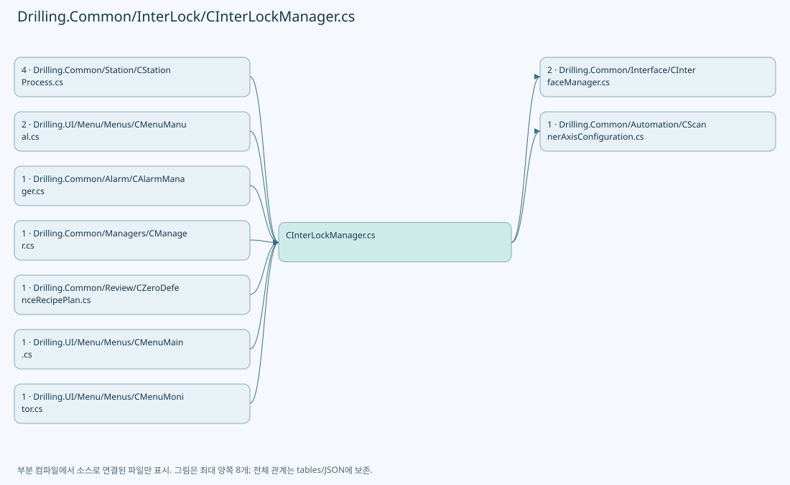
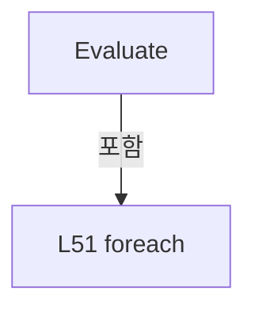
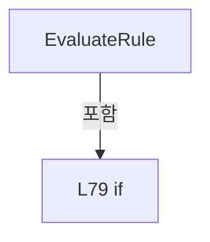
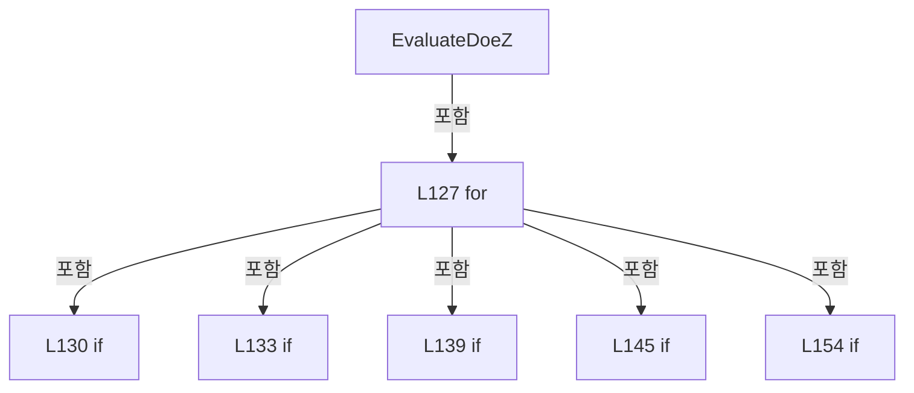
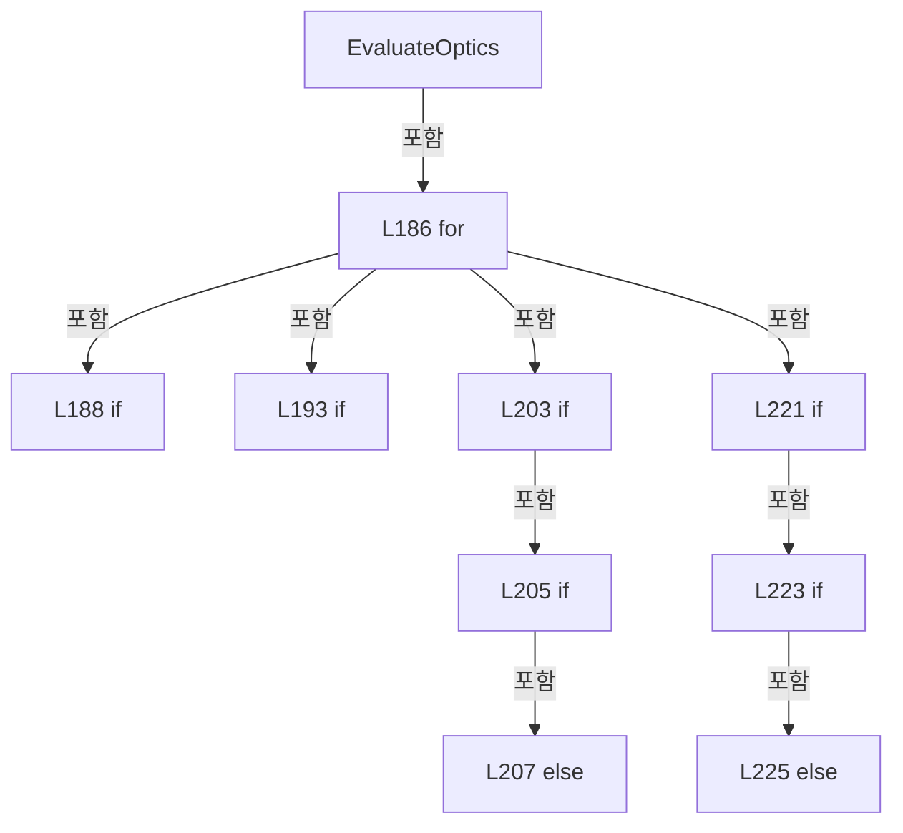

# Drilling.Common/InterLock/CInterLockManager.cs

| 항목 | 내용 |
| --- | --- |
| 원본 저장소 | https://github.com/kjuws10-rgb/A3Drilling.git |
| 원본 Commit | 5aee8e58439c9b455cae7c9593c9be986c3e682e |
| 원본 SHA256 | 6eb5679e2bedbc38cfd134f78abbba4eaca1cf263a4d13751f7a0561d9e5c149 |
| 파일 분류 | code |
| 원본 크기/행 | 17,250 bytes / 278 physical lines |
| 인코딩 | utf-8-sig |
| 검토 범위 | 구문/부분 의미 분석에서 추출한 사실. 동작·물리 단위·실장비 합격을 보증하지 않습니다. |
| 원본 링크 | [고정 Commit 원본](https://github.com/kjuws10-rgb/A3Drilling/blob/5aee8e58439c9b455cae7c9593c9be986c3e682e/Drilling.Common/InterLock/CInterLockManager.cs) |

## 파일의 역할과 읽는 순서

프로그램의 시작·구성·공유 타입 또는 빌드 연결에 사용됩니다. 아래 실제 선언·참조와 원본 근거를 확인합니다.

## 네임스페이스·타입·상속

| 타입 | 구분 | 원본 범위 | 선언/상속 |
| --- | --- | --- | --- |
| CInterLockManager | ClassDeclaration | 13–251 | CInterLockManager |
| ST_INTERLOCK_CHECK | RecordDeclaration | 108–108 | ST_INTERLOCK_CHECK |
| EN_INTERLOCK_TARGET | EnumDeclaration | 253–260 | EN_INTERLOCK_TARGET |
| EN_INTERLOCK_LEVEL | EnumDeclaration | 262–267 | EN_INTERLOCK_LEVEL |
| ST_INTERLOCK_ITEM | RecordDeclaration | 269–274 | ST_INTERLOCK_ITEM |
| ST_INTERLOCK_RULE | RecordDeclaration | 276–276 | ST_INTERLOCK_RULE |
| ST_INTERLOCK_SUMMARY | RecordDeclaration | 277–277 | ST_INTERLOCK_SUMMARY |

## 멤버 빠른 목록

| 이름 | 종류 | 범위 | 서명 |
| --- | --- | --- | --- |
| Rules | FieldDeclaration | L15–27 | System.Collections.Generic.IReadOnlyList<Drilling.Common.InterLock.ST_INTERLOCK_RULE> Drilling.Common.InterLock.CInterLockManager.Rules |
| Evaluate | MethodDeclaration | L28–69 | Drilling.Common.InterLock.ST_INTERLOCK_SUMMARY Drilling.Common.InterLock.CInterLockManager.Evaluate(Drilling.Common.Managers.ST_DEVICE_STATUS) |
| EvaluateInterlockRule | LocalFunctionStatement | L30–33 | Drilling.Common.InterLock.CInterLockManager.ST_INTERLOCK_CHECK EvaluateInterlockRule(Drilling.Common.InterLock.ST_INTERLOCK_RULE) |
| SelectInterlockItem | LocalFunctionStatement | L36–42 | Drilling.Common.InterLock.ST_INTERLOCK_ITEM SelectInterlockItem(Drilling.Common.InterLock.CInterLockManager.ST_INTERLOCK_CHECK) |
| IsAlarmOn | LocalFunctionStatement | L45–48 | bool IsAlarmOn(Drilling.Common.Motion.ST_MOTOR_AXIS_STATUS) |
| MatchesItem | LocalFunctionStatement | L59–62 | bool MatchesItem(Drilling.Common.InterLock.ST_INTERLOCK_ITEM) |
| EvaluateRule | MethodDeclaration | L71–86 | Drilling.Common.InterLock.CInterLockManager.ST_INTERLOCK_CHECK Drilling.Common.InterLock.CInterLockManager.EvaluateRule(Drilling.Common.InterLock.ST_INTERLOCK_RULE, Drilling.Common.Managers.ST_DEVICE_STATUS) |
| MatchesItem | LocalFunctionStatement | L73–76 | bool MatchesItem(Drilling.Common.Motion.ST_IO_STATUS) |
| IsTargetOk | MethodDeclaration | L88–101 | bool Drilling.Common.InterLock.CInterLockManager.IsTargetOk(System.Collections.Generic.IEnumerable<Drilling.Common.InterLock.CInterLockManager.ST_INTERLOCK_CHECK>, Drilling.Common.InterLock.EN_INTERLOCK_TARGET) |
| ShouldIncludeItem | LocalFunctionStatement | L90–93 | bool ShouldIncludeItem(Drilling.Common.InterLock.CInterLockManager.ST_INTERLOCK_CHECK) |
| IsIsOk | LocalFunctionStatement | L95–98 | bool IsIsOk(Drilling.Common.InterLock.CInterLockManager.ST_INTERLOCK_CHECK) |
| Rule | MethodDeclaration | L103–106 | Drilling.Common.InterLock.ST_INTERLOCK_RULE Drilling.Common.InterLock.CInterLockManager.Rule(string, string, bool, string, string, Drilling.Common.InterLock.EN_INTERLOCK_LEVEL, Drilling.Common.InterLock.EN_INTERLOCK_TARGET) |
| EvaluateHeadUse | MethodDeclaration | L110–121 | System.Collections.Generic.IReadOnlyList<Drilling.Common.InterLock.ST_INTERLOCK_ITEM> Drilling.Common.InterLock.CInterLockManager.EvaluateHeadUse(System.Collections.Generic.IReadOnlyDictionary<string, string>?) |
| EvaluateDoeZ | MethodDeclaration | L124–166 | System.Collections.Generic.IReadOnlyList<Drilling.Common.InterLock.ST_INTERLOCK_ITEM> Drilling.Common.InterLock.CInterLockManager.EvaluateDoeZ(System.Collections.Generic.IReadOnlyDictionary<string, string>, System.Func<Drilling.Common.Automation.ST_SCANNER_AXIS_SETTING, Drilling.Common.Automation.ST_AUTOMATION_STATUS_SNAPSHOT<Drilling.Common.Automation.ST_AUTOMATION_AXIS_STATUS>>) |
| Add | LocalFunctionStatement | L132–132 | void Add(bool, string, string) |
| ReadDoeZNumber | MethodDeclaration | L168–172 | bool Drilling.Common.InterLock.CInterLockManager.ReadDoeZNumber(System.Collections.Generic.IReadOnlyDictionary<string, string>, string, out double) |
| OpticPositionTolerance | FieldDeclaration | L176–176 | double Drilling.Common.InterLock.CInterLockManager.OpticPositionTolerance |
| EvaluateOptics | MethodDeclaration | L177–241 | System.Collections.Generic.IReadOnlyList<Drilling.Common.InterLock.ST_INTERLOCK_ITEM> Drilling.Common.InterLock.CInterLockManager.EvaluateOptics(System.Collections.Generic.IReadOnlyDictionary<string, string>, System.Collections.Generic.IReadOnlyList<Drilling.Common.Interface.ST_INTERFACE_DATA>, System.Func<int, Drilling.Common.Interface.ST_SHARED_DEVICE_SNAPSHOT<Drilling.Common.Interface.ST_LASER_STATUS>>, System.Func<int, Drilling.Common.Interface.ST_SHARED_DEVICE_SNAPSHOT<Drilling.Common.Interface.ST_BET_STATUS>>, System.Func<int, Drilling.Common.Interface.ST_ATTENUATOR_STATUS_SNAPSHOT>) |
| Add | LocalFunctionStatement | L191–191 | void Add(string, bool, string, string) |
| Registered | LocalFunctionStatement | L192–192 | bool Registered(Drilling.Common.Interface.EN_EQP_MODULE) |
| ReadOpticNumber | MethodDeclaration | L243–247 | bool Drilling.Common.InterLock.CInterLockManager.ReadOpticNumber(System.Collections.Generic.IReadOnlyDictionary<string, string>, string, out double) |
| NearOpticPosition | MethodDeclaration | L249–249 | bool Drilling.Common.InterLock.CInterLockManager.NearOpticPosition(double, double) |
| None | EnumMemberDeclaration | L256–256 | Drilling.Common.InterLock.EN_INTERLOCK_TARGET.None |
| AutoRun | EnumMemberDeclaration | L257–257 | Drilling.Common.InterLock.EN_INTERLOCK_TARGET.AutoRun |
| ManualMove | EnumMemberDeclaration | L258–258 | Drilling.Common.InterLock.EN_INTERLOCK_TARGET.ManualMove |
| LaserOn | EnumMemberDeclaration | L259–259 | Drilling.Common.InterLock.EN_INTERLOCK_TARGET.LaserOn |
| Ok | EnumMemberDeclaration | L264–264 | Drilling.Common.InterLock.EN_INTERLOCK_LEVEL.Ok |
| Warn | EnumMemberDeclaration | L265–265 | Drilling.Common.InterLock.EN_INTERLOCK_LEVEL.Warn |
| Error | EnumMemberDeclaration | L266–266 | Drilling.Common.InterLock.EN_INTERLOCK_LEVEL.Error |
| Group | PropertyDeclaration | L271–271 | string Drilling.Common.InterLock.ST_INTERLOCK_ITEM.Group |
| get_Group | GetAccessorDeclaration | L271–271 | string Drilling.Common.InterLock.ST_INTERLOCK_ITEM.Group.get |
| set_Group | InitAccessorDeclaration | L271–271 | void Drilling.Common.InterLock.ST_INTERLOCK_ITEM.Group.init |
| BlocksAutoRun | PropertyDeclaration | L272–272 | bool Drilling.Common.InterLock.ST_INTERLOCK_ITEM.BlocksAutoRun |
| get_BlocksAutoRun | GetAccessorDeclaration | L272–272 | bool Drilling.Common.InterLock.ST_INTERLOCK_ITEM.BlocksAutoRun.get |
| set_BlocksAutoRun | InitAccessorDeclaration | L272–272 | void Drilling.Common.InterLock.ST_INTERLOCK_ITEM.BlocksAutoRun.init |
| HeadNo | PropertyDeclaration | L273–273 | int? Drilling.Common.InterLock.ST_INTERLOCK_ITEM.HeadNo |
| get_HeadNo | GetAccessorDeclaration | L273–273 | int? Drilling.Common.InterLock.ST_INTERLOCK_ITEM.HeadNo.get |
| set_HeadNo | InitAccessorDeclaration | L273–273 | void Drilling.Common.InterLock.ST_INTERLOCK_ITEM.HeadNo.init |

## 멤버별 상세 계약·호출·처리 해설

### FieldDeclaration `Rules` · L15–27

[Drilling.Common/InterLock/CInterLockManager.cs:15–27](https://github.com/kjuws10-rgb/A3Drilling/blob/5aee8e58439c9b455cae7c9593c9be986c3e682e/Drilling.Common/InterLock/CInterLockManager.cs#L15-L27)

| 항목 | 실제 추출 값 |
| --- | --- |
| 서명 | System.Collections.Generic.IReadOnlyList<Drilling.Common.InterLock.ST_INTERLOCK_RULE> Drilling.Common.InterLock.CInterLockManager.Rules |
| 접근/수식자 | Private / private, static, readonly |
| 반환/값 타입 | System.Collections.Generic.IReadOnlyList<Drilling.Common.InterLock.ST_INTERLOCK_RULE> |
| 소속 타입 | NamedType:Drilling.Common.InterLock.CInterLockManager |

현재 부분 분석에서 직접 연결된 호출자는 없습니다. XAML/이벤트/인터페이스·델리게이트·외부 진입을 추가 확인해야 하며, 미사용으로 판정한 것이 아닙니다.

호출하는 대상과 해석 범위:

| 원본 행 | 표현식 | 분석 상태 | 대상/소스 위치 |
| --- | --- | --- | --- |
| 16 | Rule | resolved | Drilling.Common.InterLock.ST_INTERLOCK_RULE Drilling.Common.InterLock.CInterLockManager.Rule(string, string, bool, string, string, Drilling.Common.InterLock.EN_INTERLOCK_LEVEL, Drilling.Common.InterLock.EN_INTERLOCK_TARGET) · Drilling.Common/InterLock/CInterLockManager.cs:103 |
| 17 | Rule | resolved | Drilling.Common.InterLock.ST_INTERLOCK_RULE Drilling.Common.InterLock.CInterLockManager.Rule(string, string, bool, string, string, Drilling.Common.InterLock.EN_INTERLOCK_LEVEL, Drilling.Common.InterLock.EN_INTERLOCK_TARGET) · Drilling.Common/InterLock/CInterLockManager.cs:103 |
| 18 | Rule | resolved | Drilling.Common.InterLock.ST_INTERLOCK_RULE Drilling.Common.InterLock.CInterLockManager.Rule(string, string, bool, string, string, Drilling.Common.InterLock.EN_INTERLOCK_LEVEL, Drilling.Common.InterLock.EN_INTERLOCK_TARGET) · Drilling.Common/InterLock/CInterLockManager.cs:103 |
| 19 | Rule | resolved | Drilling.Common.InterLock.ST_INTERLOCK_RULE Drilling.Common.InterLock.CInterLockManager.Rule(string, string, bool, string, string, Drilling.Common.InterLock.EN_INTERLOCK_LEVEL, Drilling.Common.InterLock.EN_INTERLOCK_TARGET) · Drilling.Common/InterLock/CInterLockManager.cs:103 |
| 20 | Rule | resolved | Drilling.Common.InterLock.ST_INTERLOCK_RULE Drilling.Common.InterLock.CInterLockManager.Rule(string, string, bool, string, string, Drilling.Common.InterLock.EN_INTERLOCK_LEVEL, Drilling.Common.InterLock.EN_INTERLOCK_TARGET) · Drilling.Common/InterLock/CInterLockManager.cs:103 |
| 21 | Rule | resolved | Drilling.Common.InterLock.ST_INTERLOCK_RULE Drilling.Common.InterLock.CInterLockManager.Rule(string, string, bool, string, string, Drilling.Common.InterLock.EN_INTERLOCK_LEVEL, Drilling.Common.InterLock.EN_INTERLOCK_TARGET) · Drilling.Common/InterLock/CInterLockManager.cs:103 |
| 22 | Rule | resolved | Drilling.Common.InterLock.ST_INTERLOCK_RULE Drilling.Common.InterLock.CInterLockManager.Rule(string, string, bool, string, string, Drilling.Common.InterLock.EN_INTERLOCK_LEVEL, Drilling.Common.InterLock.EN_INTERLOCK_TARGET) · Drilling.Common/InterLock/CInterLockManager.cs:103 |
| 23 | Rule | resolved | Drilling.Common.InterLock.ST_INTERLOCK_RULE Drilling.Common.InterLock.CInterLockManager.Rule(string, string, bool, string, string, Drilling.Common.InterLock.EN_INTERLOCK_LEVEL, Drilling.Common.InterLock.EN_INTERLOCK_TARGET) · Drilling.Common/InterLock/CInterLockManager.cs:103 |
| 24 | Rule | resolved | Drilling.Common.InterLock.ST_INTERLOCK_RULE Drilling.Common.InterLock.CInterLockManager.Rule(string, string, bool, string, string, Drilling.Common.InterLock.EN_INTERLOCK_LEVEL, Drilling.Common.InterLock.EN_INTERLOCK_TARGET) · Drilling.Common/InterLock/CInterLockManager.cs:103 |
| 25 | Rule | resolved | Drilling.Common.InterLock.ST_INTERLOCK_RULE Drilling.Common.InterLock.CInterLockManager.Rule(string, string, bool, string, string, Drilling.Common.InterLock.EN_INTERLOCK_LEVEL, Drilling.Common.InterLock.EN_INTERLOCK_TARGET) · Drilling.Common/InterLock/CInterLockManager.cs:103 |
| 26 | Rule | resolved | Drilling.Common.InterLock.ST_INTERLOCK_RULE Drilling.Common.InterLock.CInterLockManager.Rule(string, string, bool, string, string, Drilling.Common.InterLock.EN_INTERLOCK_LEVEL, Drilling.Common.InterLock.EN_INTERLOCK_TARGET) · Drilling.Common/InterLock/CInterLockManager.cs:103 |

본문의 실제 연산·분기·예외·반환 순서(원문 위치 순):

| 원본 행 | 종류 | 주석 해설 |
| --- | --- | --- |
| 15 | variable-initializer | 변수의 초기값을 지정합니다: Rules = [ Rule("Door", "DOOR_LOCK_SENSOR", true, "Closed", "Door is open", EN_INTERLOCK_LEVEL.Error, EN_INTERLOCK_TARGET.AutoRun &#124; EN_INTERLOCK_TARGET.ManualMove &#124; EN_INTERLOCK_TARGET.LaserOn), Rule("EMS", "EMS", true, "Normal", " |
| 16 | call | 함수·델리게이트 또는 객체 생성자를 호출합니다: Rule("Door", "DOOR_LOCK_SENSOR", true, "Closed", "Door is open", EN_INTERLOCK_LEVEL.Error, EN_INTERLOCK_TARGET.AutoRun &#124; EN_INTERLOCK_TARGET.ManualMove &#124; EN_INTERLOCK_TARGET.LaserOn) |
| 17 | call | 함수·델리게이트 또는 객체 생성자를 호출합니다: Rule("EMS", "EMS", true, "Normal", "Emergency stop is active", EN_INTERLOCK_LEVEL.Error, EN_INTERLOCK_TARGET.AutoRun &#124; EN_INTERLOCK_TARGET.ManualMove &#124; EN_INTERLOCK_TARGET.LaserOn) |
| 18 | call | 함수·델리게이트 또는 객체 생성자를 호출합니다: Rule("Key Switch", "KEY_SWITCH_AUTO", true, "AUTO", "Key switch is not AUTO", EN_INTERLOCK_LEVEL.Warn, EN_INTERLOCK_TARGET.AutoRun) |
| 19 | call | 함수·델리게이트 또는 객체 생성자를 호출합니다: Rule("Laser Shutter", "LASER_SHUTTER_CLOSED", true, "SAFE", "Laser shutter is not closed", EN_INTERLOCK_LEVEL.Warn, EN_INTERLOCK_TARGET.LaserOn) |
| 20 | call | 함수·델리게이트 또는 객체 생성자를 호출합니다: Rule("Leak Sensor", "LEAK_SENSOR", true, "OK", "Leak sensor is active", EN_INTERLOCK_LEVEL.Error, EN_INTERLOCK_TARGET.AutoRun &#124; EN_INTERLOCK_TARGET.LaserOn) |
| 21 | call | 함수·델리게이트 또는 객체 생성자를 호출합니다: Rule("Smoke Temp", "SMOKE_TEMP", true, "OK", "Smoke or over temperature input is active", EN_INTERLOCK_LEVEL.Error, EN_INTERLOCK_TARGET.AutoRun &#124; EN_INTERLOCK_TARGET.LaserOn) |
| 22 | call | 함수·델리게이트 또는 객체 생성자를 호출합니다: Rule("PM Lock", "PM_LOCK", true, "READY", "PM lock is active", EN_INTERLOCK_LEVEL.Error, EN_INTERLOCK_TARGET.AutoRun &#124; EN_INTERLOCK_TARGET.ManualMove &#124; EN_INTERLOCK_TARGET.LaserOn) |
| 23 | call | 함수·델리게이트 또는 객체 생성자를 호출합니다: Rule("Scanner Ready", "SCANNER_READY", true, "READY", "Scanner ready signal is off", EN_INTERLOCK_LEVEL.Warn, EN_INTERLOCK_TARGET.AutoRun) |
| 24 | call | 함수·델리게이트 또는 객체 생성자를 호출합니다: Rule("Vision Ready", "VISION_READY", true, "READY", "Vision ready signal is off", EN_INTERLOCK_LEVEL.Warn, EN_INTERLOCK_TARGET.AutoRun) |
| 25 | call | 함수·델리게이트 또는 객체 생성자를 호출합니다: Rule("Panel In Position", "PANEL_IN_POSITION", true, "OK", "Panel is not in position", EN_INTERLOCK_LEVEL.Warn, EN_INTERLOCK_TARGET.AutoRun) |
| 26 | call | 함수·델리게이트 또는 객체 생성자를 호출합니다: Rule("Vacuum Check", "VACUUM_CHECK", true, "OK", "Vacuum check is off", EN_INTERLOCK_LEVEL.Warn, EN_INTERLOCK_TARGET.AutoRun) |

변경 전 점검: 입력/반환 타입, 위 호출자, 예외/취소 경로, 공유 상태와 저장·전송 소비자를 함께 확인합니다. 값의 단위나 물리 방향을 이름만으로 확정하지 않습니다.

### MethodDeclaration `Evaluate` · L28–69

[Drilling.Common/InterLock/CInterLockManager.cs:28–69](https://github.com/kjuws10-rgb/A3Drilling/blob/5aee8e58439c9b455cae7c9593c9be986c3e682e/Drilling.Common/InterLock/CInterLockManager.cs#L28-L69)

| 항목 | 실제 추출 값 |
| --- | --- |
| 서명 | Drilling.Common.InterLock.ST_INTERLOCK_SUMMARY Drilling.Common.InterLock.CInterLockManager.Evaluate(Drilling.Common.Managers.ST_DEVICE_STATUS) |
| 접근/수식자 | Public / public |
| 반환/값 타입 | Drilling.Common.InterLock.ST_INTERLOCK_SUMMARY |
| 소속 타입 | NamedType:Drilling.Common.InterLock.CInterLockManager |

입력 계약:

| 이름 | 타입 | 전달 | 선택/기본값 |
| --- | --- | --- | --- |
| status | Drilling.Common.Managers.ST_DEVICE_STATUS | None | False /  |

정적 호출자로 확인된 위치:

| 호출 파일/행 | 호출 표현식 | 런타임 분기 가능 |
| --- | --- | --- |
| [Drilling.Common/Alarm/CAlarmManager.cs:423–423](https://github.com/kjuws10-rgb/A3Drilling/blob/5aee8e58439c9b455cae7c9593c9be986c3e682e/Drilling.Common/Alarm/CAlarmManager.cs#L423-L423) | interLocks.Evaluate | False |
| [Drilling.Common/Station/CStationProcess.cs:1372–1372](https://github.com/kjuws10-rgb/A3Drilling/blob/5aee8e58439c9b455cae7c9593c9be986c3e682e/Drilling.Common/Station/CStationProcess.cs#L1372-L1372) | _interLockManager.Evaluate | False |
| [Drilling.UI/Menu/Menus/CMenuMonitor.cs:4555–4555](https://github.com/kjuws10-rgb/A3Drilling/blob/5aee8e58439c9b455cae7c9593c9be986c3e682e/Drilling.UI/Menu/Menus/CMenuMonitor.cs#L4555-L4555) | _interLockManager.Evaluate | False |

호출하는 대상과 해석 범위:

| 원본 행 | 표현식 | 분석 상태 | 대상/소스 위치 |
| --- | --- | --- | --- |
| 35 | Rules.Select(EvaluateInterlockRule).ToArray | resolved | Drilling.Common.InterLock.CInterLockManager.ST_INTERLOCK_CHECK[] System.Collections.Generic.IEnumerable<Drilling.Common.InterLock.CInterLockManager.ST_INTERLOCK_CHECK>.ToArray<Drilling.Common.InterLock.CInterLockManager.ST_INTERLOCK_CHECK>() |
| 35 | Rules.Select | resolved | System.Collections.Generic.IEnumerable<Drilling.Common.InterLock.CInterLockManager.ST_INTERLOCK_CHECK> System.Collections.Generic.IEnumerable<Drilling.Common.InterLock.ST_INTERLOCK_RULE>.Select<Drilling.Common.InterLock.ST_INTERLOCK_RULE, Drilling.Common.InterLock.CInterLockManager.ST_INTERLOCK_CHECK>(System.Func<Drilling.Common.InterLock.ST_INTERLOCK_RULE, Drilling.Common.InterLock.CInterLockManager.ST_INTERLOCK_CHECK>) |
| 44 | checks.Select(SelectInterlockItem).ToList | resolved | System.Collections.Generic.List<Drilling.Common.InterLock.ST_INTERLOCK_ITEM> System.Collections.Generic.IEnumerable<Drilling.Common.InterLock.ST_INTERLOCK_ITEM>.ToList<Drilling.Common.InterLock.ST_INTERLOCK_ITEM>() |
| 44 | checks.Select | resolved | System.Collections.Generic.IEnumerable<Drilling.Common.InterLock.ST_INTERLOCK_ITEM> System.Collections.Generic.IEnumerable<Drilling.Common.InterLock.CInterLockManager.ST_INTERLOCK_CHECK>.Select<Drilling.Common.InterLock.CInterLockManager.ST_INTERLOCK_CHECK, Drilling.Common.InterLock.ST_INTERLOCK_ITEM>(System.Func<Drilling.Common.InterLock.CInterLockManager.ST_INTERLOCK_CHECK, Drilling.Common.InterLock.ST_INTERLOCK_ITEM>) |
| 50 | status.Motors.Any | resolved | bool System.Collections.Generic.IEnumerable<Drilling.Common.Motion.ST_MOTOR_AXIS_STATUS>.Any<Drilling.Common.Motion.ST_MOTOR_AXIS_STATUS>(System.Func<Drilling.Common.Motion.ST_MOTOR_AXIS_STATUS, bool>) |
| 53 | string.IsNullOrWhiteSpace | resolved | bool string.IsNullOrWhiteSpace(string?) |
| 54 | items.Add | resolved | void System.Collections.Generic.List<Drilling.Common.InterLock.ST_INTERLOCK_ITEM>.Add(Drilling.Common.InterLock.ST_INTERLOCK_ITEM) |
| 54 | new ST_INTERLOCK_ITEM | resolved | Drilling.Common.InterLock.ST_INTERLOCK_ITEM.ST_INTERLOCK_ITEM(string, Drilling.Common.InterLock.EN_INTERLOCK_LEVEL, string, string) · Drilling.Common/InterLock/CInterLockManager.cs:269 |
| 58 | items.Add | resolved | void System.Collections.Generic.List<Drilling.Common.InterLock.ST_INTERLOCK_ITEM>.Add(Drilling.Common.InterLock.ST_INTERLOCK_ITEM) |
| 58 | new ST_INTERLOCK_ITEM | resolved | Drilling.Common.InterLock.ST_INTERLOCK_ITEM.ST_INTERLOCK_ITEM(string, Drilling.Common.InterLock.EN_INTERLOCK_LEVEL, string, string) · Drilling.Common/InterLock/CInterLockManager.cs:269 |
| 64 | items.Any | resolved | bool System.Collections.Generic.IEnumerable<Drilling.Common.InterLock.ST_INTERLOCK_ITEM>.Any<Drilling.Common.InterLock.ST_INTERLOCK_ITEM>(System.Func<Drilling.Common.InterLock.ST_INTERLOCK_ITEM, bool>) |
| 65 | IsTargetOk | resolved | bool Drilling.Common.InterLock.CInterLockManager.IsTargetOk(System.Collections.Generic.IEnumerable<Drilling.Common.InterLock.CInterLockManager.ST_INTERLOCK_CHECK>, Drilling.Common.InterLock.EN_INTERLOCK_TARGET) · Drilling.Common/InterLock/CInterLockManager.cs:88 |
| 66 | IsTargetOk | resolved | bool Drilling.Common.InterLock.CInterLockManager.IsTargetOk(System.Collections.Generic.IEnumerable<Drilling.Common.InterLock.CInterLockManager.ST_INTERLOCK_CHECK>, Drilling.Common.InterLock.EN_INTERLOCK_TARGET) · Drilling.Common/InterLock/CInterLockManager.cs:88 |
| 67 | IsTargetOk | resolved | bool Drilling.Common.InterLock.CInterLockManager.IsTargetOk(System.Collections.Generic.IEnumerable<Drilling.Common.InterLock.CInterLockManager.ST_INTERLOCK_CHECK>, Drilling.Common.InterLock.EN_INTERLOCK_TARGET) · Drilling.Common/InterLock/CInterLockManager.cs:88 |
| 68 | new ST_INTERLOCK_SUMMARY | resolved | Drilling.Common.InterLock.ST_INTERLOCK_SUMMARY.ST_INTERLOCK_SUMMARY(bool, bool, bool, bool, System.Collections.Generic.IReadOnlyList<Drilling.Common.InterLock.ST_INTERLOCK_ITEM>) · Drilling.Common/InterLock/CInterLockManager.cs:277 |

본문의 실제 연산·분기·예외·반환 순서(원문 위치 순):

| 원본 행 | 종류 | 주석 해설 |
| --- | --- | --- |
| 35 | call | 함수·델리게이트 또는 객체 생성자를 호출합니다: Rules.Select(EvaluateInterlockRule).ToArray() |
| 35 | call | 함수·델리게이트 또는 객체 생성자를 호출합니다: Rules.Select(EvaluateInterlockRule) |
| 35 | conditional-expression | 조건에 따라 결과식을 선택합니다: status.Io.Count == 0 ? [] : Rules.Select(EvaluateInterlockRule).ToArray() |
| 35 | local-declaration | 지역 변수를 선언합니다: ST_INTERLOCK_CHECK[] checks = status.Io.Count == 0 ? [] : Rules.Select(EvaluateInterlockRule).ToArray(); |
| 35 | variable-initializer | 변수의 초기값을 지정합니다: checks = status.Io.Count == 0 ? [] : Rules.Select(EvaluateInterlockRule).ToArray() |
| 44 | call | 함수·델리게이트 또는 객체 생성자를 호출합니다: checks.Select(SelectInterlockItem).ToList() |
| 44 | call | 함수·델리게이트 또는 객체 생성자를 호출합니다: checks.Select(SelectInterlockItem) |
| 44 | local-declaration | 지역 변수를 선언합니다: var items = checks.Select(SelectInterlockItem).ToList(); |
| 44 | variable-initializer | 변수의 초기값을 지정합니다: items = checks.Select(SelectInterlockItem).ToList() |
| 50 | call | 함수·델리게이트 또는 객체 생성자를 호출합니다: status.Motors.Any(IsAlarmOn) |
| 50 | local-declaration | 지역 변수를 선언합니다: var motionOk = !status.Motors.Any(IsAlarmOn); |
| 50 | variable-initializer | 변수의 초기값을 지정합니다: motionOk = !status.Motors.Any(IsAlarmOn) |
| 51 | foreach | 컬렉션 요소를 순회합니다: foreach (var axis in status.Motors) |
| 53 | call | 함수·델리게이트 또는 객체 생성자를 호출합니다: string.IsNullOrWhiteSpace(axis.Name) |
| 53 | conditional-expression | 조건에 따라 결과식을 선택합니다: string.IsNullOrWhiteSpace(axis.Name) ? axis.AxisId : axis.Name |
| 53 | local-declaration | 지역 변수를 선언합니다: var axisName = string.IsNullOrWhiteSpace(axis.Name) ? axis.AxisId : axis.Name; |
| 53 | variable-initializer | 변수의 초기값을 지정합니다: axisName = string.IsNullOrWhiteSpace(axis.Name) ? axis.AxisId : axis.Name |
| 54 | assignment | 값을 대상에 대입합니다: Group = "MOTION" |
| 54 | assignment | 값을 대상에 대입합니다: BlocksAutoRun = axis.AlarmOn |
| 54 | call | 함수·델리게이트 또는 객체 생성자를 호출합니다: items.Add(new ST_INTERLOCK_ITEM(axisName, axis.AlarmOn ? EN_INTERLOCK_LEVEL.Error : EN_INTERLOCK_LEVEL.Ok, axis.AlarmOn ? "ALARM" : "READY", $"{axis.AxisId}: Alarm {(axis.AlarmOn ? "ON" : "OFF")}") { Group = "MOTION", Bl… |
| 54 | call | 함수·델리게이트 또는 객체 생성자를 호출합니다: new ST_INTERLOCK_ITEM(axisName, axis.AlarmOn ? EN_INTERLOCK_LEVEL.Error : EN_INTERLOCK_LEVEL.Ok, axis.AlarmOn ? "ALARM" : "READY", $"{axis.AxisId}: Alarm {(axis.AlarmOn ? "ON" : "OFF")}") { Group = "MOTION", BlocksAutoRu… |
| 54 | conditional-expression | 조건에 따라 결과식을 선택합니다: axis.AlarmOn ? EN_INTERLOCK_LEVEL.Error : EN_INTERLOCK_LEVEL.Ok |
| 54 | conditional-expression | 조건에 따라 결과식을 선택합니다: axis.AlarmOn ? "ALARM" : "READY" |
| 54 | conditional-expression | 조건에 따라 결과식을 선택합니다: axis.AlarmOn ? "ON" : "OFF" |
| 57 | local-declaration | 지역 변수를 선언합니다: var betOk = !status.Bet.AlarmOn; |
| 57 | variable-initializer | 변수의 초기값을 지정합니다: betOk = !status.Bet.AlarmOn |
| 58 | assignment | 값을 대상에 대입합니다: BlocksAutoRun = !betOk |
| 58 | call | 함수·델리게이트 또는 객체 생성자를 호출합니다: items.Add(new ST_INTERLOCK_ITEM("BET", betOk ? EN_INTERLOCK_LEVEL.Ok : EN_INTERLOCK_LEVEL.Warn, betOk ? "READY" : "ALARM", betOk ? "Beam expander normal" : "Beam expander alarm is active") { BlocksAutoRun = !betOk }) |
| 58 | call | 함수·델리게이트 또는 객체 생성자를 호출합니다: new ST_INTERLOCK_ITEM("BET", betOk ? EN_INTERLOCK_LEVEL.Ok : EN_INTERLOCK_LEVEL.Warn, betOk ? "READY" : "ALARM", betOk ? "Beam expander normal" : "Beam expander alarm is active") { BlocksAutoRun = !betOk } |
| 58 | conditional-expression | 조건에 따라 결과식을 선택합니다: betOk ? EN_INTERLOCK_LEVEL.Ok : EN_INTERLOCK_LEVEL.Warn |
| 58 | conditional-expression | 조건에 따라 결과식을 선택합니다: betOk ? "READY" : "ALARM" |
| 58 | conditional-expression | 조건에 따라 결과식을 선택합니다: betOk ? "Beam expander normal" : "Beam expander alarm is active" |
| 64 | call | 함수·델리게이트 또는 객체 생성자를 호출합니다: items.Any(MatchesItem) |
| 64 | local-declaration | 지역 변수를 선언합니다: var hasError = items.Any(MatchesItem); |
| 64 | variable-initializer | 변수의 초기값을 지정합니다: hasError = items.Any(MatchesItem) |
| 65 | call | 함수·델리게이트 또는 객체 생성자를 호출합니다: IsTargetOk(checks, EN_INTERLOCK_TARGET.AutoRun) |
| 65 | local-declaration | 지역 변수를 선언합니다: var canAutoRun = IsTargetOk(checks, EN_INTERLOCK_TARGET.AutoRun) && motionOk && betOk; |
| 65 | variable-initializer | 변수의 초기값을 지정합니다: canAutoRun = IsTargetOk(checks, EN_INTERLOCK_TARGET.AutoRun) && motionOk && betOk |
| 66 | call | 함수·델리게이트 또는 객체 생성자를 호출합니다: IsTargetOk(checks, EN_INTERLOCK_TARGET.ManualMove) |
| 66 | local-declaration | 지역 변수를 선언합니다: var canManualMove = IsTargetOk(checks, EN_INTERLOCK_TARGET.ManualMove) && motionOk; |
| 66 | variable-initializer | 변수의 초기값을 지정합니다: canManualMove = IsTargetOk(checks, EN_INTERLOCK_TARGET.ManualMove) && motionOk |
| 67 | call | 함수·델리게이트 또는 객체 생성자를 호출합니다: IsTargetOk(checks, EN_INTERLOCK_TARGET.LaserOn) |
| 67 | local-declaration | 지역 변수를 선언합니다: var canLaserOn = IsTargetOk(checks, EN_INTERLOCK_TARGET.LaserOn); |
| 67 | variable-initializer | 변수의 초기값을 지정합니다: canLaserOn = IsTargetOk(checks, EN_INTERLOCK_TARGET.LaserOn) |
| 68 | call | 함수·델리게이트 또는 객체 생성자를 호출합니다: new ST_INTERLOCK_SUMMARY(canAutoRun, canManualMove, canLaserOn, hasError, items) |
| 68 | return | 호출자에게 값 또는 제어를 반환합니다: return new ST_INTERLOCK_SUMMARY(canAutoRun, canManualMove, canLaserOn, hasError, items); |

제어 구문의 포함 구조(실제 실행 순서/CFG가 아닌 구문 탐색 그림):

변경 전 점검: 입력/반환 타입, 위 호출자, 예외/취소 경로, 공유 상태와 저장·전송 소비자를 함께 확인합니다. 값의 단위나 물리 방향을 이름만으로 확정하지 않습니다.

### LocalFunctionStatement `EvaluateInterlockRule` · L30–33

[Drilling.Common/InterLock/CInterLockManager.cs:30–33](https://github.com/kjuws10-rgb/A3Drilling/blob/5aee8e58439c9b455cae7c9593c9be986c3e682e/Drilling.Common/InterLock/CInterLockManager.cs#L30-L33)

| 항목 | 실제 추출 값 |
| --- | --- |
| 서명 | Drilling.Common.InterLock.CInterLockManager.ST_INTERLOCK_CHECK EvaluateInterlockRule(Drilling.Common.InterLock.ST_INTERLOCK_RULE) |
| 접근/수식자 | Private /  |
| 반환/값 타입 | Drilling.Common.InterLock.CInterLockManager.ST_INTERLOCK_CHECK |
| 소속 타입 | NamedType:Drilling.Common.InterLock.CInterLockManager |

입력 계약:

| 이름 | 타입 | 전달 | 선택/기본값 |
| --- | --- | --- | --- |
| rule | Drilling.Common.InterLock.ST_INTERLOCK_RULE | None | False /  |

현재 부분 분석에서 직접 연결된 호출자는 없습니다. XAML/이벤트/인터페이스·델리게이트·외부 진입을 추가 확인해야 하며, 미사용으로 판정한 것이 아닙니다.

호출하는 대상과 해석 범위:

| 원본 행 | 표현식 | 분석 상태 | 대상/소스 위치 |
| --- | --- | --- | --- |
| 32 | EvaluateRule | resolved | Drilling.Common.InterLock.CInterLockManager.ST_INTERLOCK_CHECK Drilling.Common.InterLock.CInterLockManager.EvaluateRule(Drilling.Common.InterLock.ST_INTERLOCK_RULE, Drilling.Common.Managers.ST_DEVICE_STATUS) · Drilling.Common/InterLock/CInterLockManager.cs:71 |

본문의 실제 연산·분기·예외·반환 순서(원문 위치 순):

| 원본 행 | 종류 | 주석 해설 |
| --- | --- | --- |
| 32 | call | 함수·델리게이트 또는 객체 생성자를 호출합니다: EvaluateRule(rule, status) |
| 32 | return | 호출자에게 값 또는 제어를 반환합니다: return EvaluateRule(rule, status); |

변경 전 점검: 입력/반환 타입, 위 호출자, 예외/취소 경로, 공유 상태와 저장·전송 소비자를 함께 확인합니다. 값의 단위나 물리 방향을 이름만으로 확정하지 않습니다.

### LocalFunctionStatement `SelectInterlockItem` · L36–42

[Drilling.Common/InterLock/CInterLockManager.cs:36–42](https://github.com/kjuws10-rgb/A3Drilling/blob/5aee8e58439c9b455cae7c9593c9be986c3e682e/Drilling.Common/InterLock/CInterLockManager.cs#L36-L42)

| 항목 | 실제 추출 값 |
| --- | --- |
| 서명 | Drilling.Common.InterLock.ST_INTERLOCK_ITEM SelectInterlockItem(Drilling.Common.InterLock.CInterLockManager.ST_INTERLOCK_CHECK) |
| 접근/수식자 | Private /  |
| 반환/값 타입 | Drilling.Common.InterLock.ST_INTERLOCK_ITEM |
| 소속 타입 | NamedType:Drilling.Common.InterLock.CInterLockManager |

입력 계약:

| 이름 | 타입 | 전달 | 선택/기본값 |
| --- | --- | --- | --- |
| check | Drilling.Common.InterLock.CInterLockManager.ST_INTERLOCK_CHECK | None | False /  |

현재 부분 분석에서 직접 연결된 호출자는 없습니다. XAML/이벤트/인터페이스·델리게이트·외부 진입을 추가 확인해야 하며, 미사용으로 판정한 것이 아닙니다.

호출하는 대상과 해석 범위:

| 원본 행 | 표현식 | 분석 상태 | 대상/소스 위치 |
| --- | --- | --- | --- |
| 40 | check.Rule.Targets.HasFlag | resolved | bool System.Enum.HasFlag(System.Enum) |

본문의 실제 연산·분기·예외·반환 순서(원문 위치 순):

| 원본 행 | 종류 | 주석 해설 |
| --- | --- | --- |
| 38 | return | 호출자에게 값 또는 제어를 반환합니다: return check.Item with { BlocksAutoRun = !check.IsOk && check.Rule.Targets.HasFlag(EN_INTERLOCK_TARGET.AutoRun) }; |
| 40 | assignment | 값을 대상에 대입합니다: BlocksAutoRun = !check.IsOk && check.Rule.Targets.HasFlag(EN_INTERLOCK_TARGET.AutoRun) |
| 40 | call | 함수·델리게이트 또는 객체 생성자를 호출합니다: check.Rule.Targets.HasFlag(EN_INTERLOCK_TARGET.AutoRun) |

변경 전 점검: 입력/반환 타입, 위 호출자, 예외/취소 경로, 공유 상태와 저장·전송 소비자를 함께 확인합니다. 값의 단위나 물리 방향을 이름만으로 확정하지 않습니다.

### LocalFunctionStatement `IsAlarmOn` · L45–48

[Drilling.Common/InterLock/CInterLockManager.cs:45–48](https://github.com/kjuws10-rgb/A3Drilling/blob/5aee8e58439c9b455cae7c9593c9be986c3e682e/Drilling.Common/InterLock/CInterLockManager.cs#L45-L48)

| 항목 | 실제 추출 값 |
| --- | --- |
| 서명 | bool IsAlarmOn(Drilling.Common.Motion.ST_MOTOR_AXIS_STATUS) |
| 접근/수식자 | Private /  |
| 반환/값 타입 | bool |
| 소속 타입 | NamedType:Drilling.Common.InterLock.CInterLockManager |

입력 계약:

| 이름 | 타입 | 전달 | 선택/기본값 |
| --- | --- | --- | --- |
| axis | Drilling.Common.Motion.ST_MOTOR_AXIS_STATUS | None | False /  |

현재 부분 분석에서 직접 연결된 호출자는 없습니다. XAML/이벤트/인터페이스·델리게이트·외부 진입을 추가 확인해야 하며, 미사용으로 판정한 것이 아닙니다.

본문의 실제 연산·분기·예외·반환 순서(원문 위치 순):

| 원본 행 | 종류 | 주석 해설 |
| --- | --- | --- |
| 47 | return | 호출자에게 값 또는 제어를 반환합니다: return axis.AlarmOn; |

변경 전 점검: 입력/반환 타입, 위 호출자, 예외/취소 경로, 공유 상태와 저장·전송 소비자를 함께 확인합니다. 값의 단위나 물리 방향을 이름만으로 확정하지 않습니다.

### LocalFunctionStatement `MatchesItem` · L59–62

[Drilling.Common/InterLock/CInterLockManager.cs:59–62](https://github.com/kjuws10-rgb/A3Drilling/blob/5aee8e58439c9b455cae7c9593c9be986c3e682e/Drilling.Common/InterLock/CInterLockManager.cs#L59-L62)

| 항목 | 실제 추출 값 |
| --- | --- |
| 서명 | bool MatchesItem(Drilling.Common.InterLock.ST_INTERLOCK_ITEM) |
| 접근/수식자 | Private /  |
| 반환/값 타입 | bool |
| 소속 타입 | NamedType:Drilling.Common.InterLock.CInterLockManager |

입력 계약:

| 이름 | 타입 | 전달 | 선택/기본값 |
| --- | --- | --- | --- |
| item | Drilling.Common.InterLock.ST_INTERLOCK_ITEM | None | False /  |

현재 부분 분석에서 직접 연결된 호출자는 없습니다. XAML/이벤트/인터페이스·델리게이트·외부 진입을 추가 확인해야 하며, 미사용으로 판정한 것이 아닙니다.

본문의 실제 연산·분기·예외·반환 순서(원문 위치 순):

| 원본 행 | 종류 | 주석 해설 |
| --- | --- | --- |
| 61 | return | 호출자에게 값 또는 제어를 반환합니다: return item.Level == EN_INTERLOCK_LEVEL.Error; |

변경 전 점검: 입력/반환 타입, 위 호출자, 예외/취소 경로, 공유 상태와 저장·전송 소비자를 함께 확인합니다. 값의 단위나 물리 방향을 이름만으로 확정하지 않습니다.

### MethodDeclaration `EvaluateRule` · L71–86

[Drilling.Common/InterLock/CInterLockManager.cs:71–86](https://github.com/kjuws10-rgb/A3Drilling/blob/5aee8e58439c9b455cae7c9593c9be986c3e682e/Drilling.Common/InterLock/CInterLockManager.cs#L71-L86)

| 항목 | 실제 추출 값 |
| --- | --- |
| 서명 | Drilling.Common.InterLock.CInterLockManager.ST_INTERLOCK_CHECK Drilling.Common.InterLock.CInterLockManager.EvaluateRule(Drilling.Common.InterLock.ST_INTERLOCK_RULE, Drilling.Common.Managers.ST_DEVICE_STATUS) |
| 접근/수식자 | Private / private, static |
| 반환/값 타입 | Drilling.Common.InterLock.CInterLockManager.ST_INTERLOCK_CHECK |
| 소속 타입 | NamedType:Drilling.Common.InterLock.CInterLockManager |

입력 계약:

| 이름 | 타입 | 전달 | 선택/기본값 |
| --- | --- | --- | --- |
| rule | Drilling.Common.InterLock.ST_INTERLOCK_RULE | None | False /  |
| status | Drilling.Common.Managers.ST_DEVICE_STATUS | None | False /  |

정적 호출자로 확인된 위치:

| 호출 파일/행 | 호출 표현식 | 런타임 분기 가능 |
| --- | --- | --- |
| [Drilling.Common/InterLock/CInterLockManager.cs:32–32](https://github.com/kjuws10-rgb/A3Drilling/blob/5aee8e58439c9b455cae7c9593c9be986c3e682e/Drilling.Common/InterLock/CInterLockManager.cs#L32-L32) | EvaluateRule | False |

호출하는 대상과 해석 범위:

| 원본 행 | 표현식 | 분석 상태 | 대상/소스 위치 |
| --- | --- | --- | --- |
| 78 | status.Io.FirstOrDefault | resolved | Drilling.Common.Motion.ST_IO_STATUS? System.Collections.Generic.IEnumerable<Drilling.Common.Motion.ST_IO_STATUS>.FirstOrDefault<Drilling.Common.Motion.ST_IO_STATUS>(System.Func<Drilling.Common.Motion.ST_IO_STATUS, bool>) |
| 81 | new ST_INTERLOCK_CHECK | resolved | Drilling.Common.InterLock.CInterLockManager.ST_INTERLOCK_CHECK.ST_INTERLOCK_CHECK(Drilling.Common.InterLock.ST_INTERLOCK_RULE, bool, Drilling.Common.InterLock.ST_INTERLOCK_ITEM) · Drilling.Common/InterLock/CInterLockManager.cs:108 |
| 81 | new ST_INTERLOCK_ITEM | resolved | Drilling.Common.InterLock.ST_INTERLOCK_ITEM.ST_INTERLOCK_ITEM(string, Drilling.Common.InterLock.EN_INTERLOCK_LEVEL, string, string) · Drilling.Common/InterLock/CInterLockManager.cs:269 |
| 85 | new ST_INTERLOCK_CHECK | resolved | Drilling.Common.InterLock.CInterLockManager.ST_INTERLOCK_CHECK.ST_INTERLOCK_CHECK(Drilling.Common.InterLock.ST_INTERLOCK_RULE, bool, Drilling.Common.InterLock.ST_INTERLOCK_ITEM) · Drilling.Common/InterLock/CInterLockManager.cs:108 |
| 85 | new ST_INTERLOCK_ITEM | resolved | Drilling.Common.InterLock.ST_INTERLOCK_ITEM.ST_INTERLOCK_ITEM(string, Drilling.Common.InterLock.EN_INTERLOCK_LEVEL, string, string) · Drilling.Common/InterLock/CInterLockManager.cs:269 |

본문의 실제 연산·분기·예외·반환 순서(원문 위치 순):

| 원본 행 | 종류 | 주석 해설 |
| --- | --- | --- |
| 78 | call | 함수·델리게이트 또는 객체 생성자를 호출합니다: status.Io.FirstOrDefault(MatchesItem) |
| 78 | local-declaration | 지역 변수를 선언합니다: var io = status.Io.FirstOrDefault(MatchesItem); |
| 78 | variable-initializer | 변수의 초기값을 지정합니다: io = status.Io.FirstOrDefault(MatchesItem) |
| 79 | if | 조건에 따라 분기합니다: if (io is null) |
| 81 | call | 함수·델리게이트 또는 객체 생성자를 호출합니다: new ST_INTERLOCK_CHECK(rule, false, new ST_INTERLOCK_ITEM(rule.Signal, EN_INTERLOCK_LEVEL.Warn, "UNKNOWN", $"{rule.IoId} is not registered")) |
| 81 | call | 함수·델리게이트 또는 객체 생성자를 호출합니다: new ST_INTERLOCK_ITEM(rule.Signal, EN_INTERLOCK_LEVEL.Warn, "UNKNOWN", $"{rule.IoId} is not registered") |
| 81 | return | 호출자에게 값 또는 제어를 반환합니다: return new ST_INTERLOCK_CHECK(rule, false, new ST_INTERLOCK_ITEM(rule.Signal, EN_INTERLOCK_LEVEL.Warn, "UNKNOWN", $"{rule.IoId} is not registered")); |
| 84 | local-declaration | 지역 변수를 선언합니다: var isOk = io.IsOn == rule.ExpectedOn; |
| 84 | variable-initializer | 변수의 초기값을 지정합니다: isOk = io.IsOn == rule.ExpectedOn |
| 85 | call | 함수·델리게이트 또는 객체 생성자를 호출합니다: new ST_INTERLOCK_CHECK(rule, isOk, new ST_INTERLOCK_ITEM(rule.Signal, isOk ? EN_INTERLOCK_LEVEL.Ok : rule.NgLevel, isOk ? rule.OkState : (io.IsOn ? "ON" : "OFF"), isOk ? io.Name : rule.NgDetail)) |
| 85 | call | 함수·델리게이트 또는 객체 생성자를 호출합니다: new ST_INTERLOCK_ITEM(rule.Signal, isOk ? EN_INTERLOCK_LEVEL.Ok : rule.NgLevel, isOk ? rule.OkState : (io.IsOn ? "ON" : "OFF"), isOk ? io.Name : rule.NgDetail) |
| 85 | conditional-expression | 조건에 따라 결과식을 선택합니다: isOk ? EN_INTERLOCK_LEVEL.Ok : rule.NgLevel |
| 85 | conditional-expression | 조건에 따라 결과식을 선택합니다: isOk ? rule.OkState : (io.IsOn ? "ON" : "OFF") |
| 85 | conditional-expression | 조건에 따라 결과식을 선택합니다: io.IsOn ? "ON" : "OFF" |
| 85 | conditional-expression | 조건에 따라 결과식을 선택합니다: isOk ? io.Name : rule.NgDetail |
| 85 | return | 호출자에게 값 또는 제어를 반환합니다: return new ST_INTERLOCK_CHECK(rule, isOk, new ST_INTERLOCK_ITEM(rule.Signal, isOk ? EN_INTERLOCK_LEVEL.Ok : rule.NgLevel, isOk ? rule.OkState : (io.IsOn ? "ON" : "OFF"), isOk ? io.Name : rule.NgDetail)); |

제어 구문의 포함 구조(실제 실행 순서/CFG가 아닌 구문 탐색 그림):

변경 전 점검: 입력/반환 타입, 위 호출자, 예외/취소 경로, 공유 상태와 저장·전송 소비자를 함께 확인합니다. 값의 단위나 물리 방향을 이름만으로 확정하지 않습니다.

### LocalFunctionStatement `MatchesItem` · L73–76

[Drilling.Common/InterLock/CInterLockManager.cs:73–76](https://github.com/kjuws10-rgb/A3Drilling/blob/5aee8e58439c9b455cae7c9593c9be986c3e682e/Drilling.Common/InterLock/CInterLockManager.cs#L73-L76)

| 항목 | 실제 추출 값 |
| --- | --- |
| 서명 | bool MatchesItem(Drilling.Common.Motion.ST_IO_STATUS) |
| 접근/수식자 | Private /  |
| 반환/값 타입 | bool |
| 소속 타입 | NamedType:Drilling.Common.InterLock.CInterLockManager |

입력 계약:

| 이름 | 타입 | 전달 | 선택/기본값 |
| --- | --- | --- | --- |
| channel | Drilling.Common.Motion.ST_IO_STATUS | None | False /  |

현재 부분 분석에서 직접 연결된 호출자는 없습니다. XAML/이벤트/인터페이스·델리게이트·외부 진입을 추가 확인해야 하며, 미사용으로 판정한 것이 아닙니다.

호출하는 대상과 해석 범위:

| 원본 행 | 표현식 | 분석 상태 | 대상/소스 위치 |
| --- | --- | --- | --- |
| 75 | channel.Id.Equals | resolved | bool string.Equals(string?, System.StringComparison) |
| 75 | channel.Address.Equals | resolved | bool string.Equals(string?, System.StringComparison) |

본문의 실제 연산·분기·예외·반환 순서(원문 위치 순):

| 원본 행 | 종류 | 주석 해설 |
| --- | --- | --- |
| 75 | call | 함수·델리게이트 또는 객체 생성자를 호출합니다: channel.Id.Equals(rule.IoId, StringComparison.OrdinalIgnoreCase) |
| 75 | call | 함수·델리게이트 또는 객체 생성자를 호출합니다: channel.Address.Equals(rule.IoId, StringComparison.OrdinalIgnoreCase) |
| 75 | return | 호출자에게 값 또는 제어를 반환합니다: return channel.Id.Equals(rule.IoId, StringComparison.OrdinalIgnoreCase) &#124;&#124; channel.Address.Equals(rule.IoId, StringComparison.OrdinalIgnoreCase); |

변경 전 점검: 입력/반환 타입, 위 호출자, 예외/취소 경로, 공유 상태와 저장·전송 소비자를 함께 확인합니다. 값의 단위나 물리 방향을 이름만으로 확정하지 않습니다.

### MethodDeclaration `IsTargetOk` · L88–101

[Drilling.Common/InterLock/CInterLockManager.cs:88–101](https://github.com/kjuws10-rgb/A3Drilling/blob/5aee8e58439c9b455cae7c9593c9be986c3e682e/Drilling.Common/InterLock/CInterLockManager.cs#L88-L101)

| 항목 | 실제 추출 값 |
| --- | --- |
| 서명 | bool Drilling.Common.InterLock.CInterLockManager.IsTargetOk(System.Collections.Generic.IEnumerable<Drilling.Common.InterLock.CInterLockManager.ST_INTERLOCK_CHECK>, Drilling.Common.InterLock.EN_INTERLOCK_TARGET) |
| 접근/수식자 | Private / private, static |
| 반환/값 타입 | bool |
| 소속 타입 | NamedType:Drilling.Common.InterLock.CInterLockManager |

입력 계약:

| 이름 | 타입 | 전달 | 선택/기본값 |
| --- | --- | --- | --- |
| checks | System.Collections.Generic.IEnumerable<Drilling.Common.InterLock.CInterLockManager.ST_INTERLOCK_CHECK> | None | False /  |
| target | Drilling.Common.InterLock.EN_INTERLOCK_TARGET | None | False /  |

정적 호출자로 확인된 위치:

| 호출 파일/행 | 호출 표현식 | 런타임 분기 가능 |
| --- | --- | --- |
| [Drilling.Common/InterLock/CInterLockManager.cs:65–65](https://github.com/kjuws10-rgb/A3Drilling/blob/5aee8e58439c9b455cae7c9593c9be986c3e682e/Drilling.Common/InterLock/CInterLockManager.cs#L65-L65) | IsTargetOk | False |
| [Drilling.Common/InterLock/CInterLockManager.cs:66–66](https://github.com/kjuws10-rgb/A3Drilling/blob/5aee8e58439c9b455cae7c9593c9be986c3e682e/Drilling.Common/InterLock/CInterLockManager.cs#L66-L66) | IsTargetOk | False |
| [Drilling.Common/InterLock/CInterLockManager.cs:67–67](https://github.com/kjuws10-rgb/A3Drilling/blob/5aee8e58439c9b455cae7c9593c9be986c3e682e/Drilling.Common/InterLock/CInterLockManager.cs#L67-L67) | IsTargetOk | False |

호출하는 대상과 해석 범위:

| 원본 행 | 표현식 | 분석 상태 | 대상/소스 위치 |
| --- | --- | --- | --- |
| 100 | checks.Where(ShouldIncludeItem).All | resolved | bool System.Collections.Generic.IEnumerable<Drilling.Common.InterLock.CInterLockManager.ST_INTERLOCK_CHECK>.All<Drilling.Common.InterLock.CInterLockManager.ST_INTERLOCK_CHECK>(System.Func<Drilling.Common.InterLock.CInterLockManager.ST_INTERLOCK_CHECK, bool>) |
| 100 | checks.Where | resolved | System.Collections.Generic.IEnumerable<Drilling.Common.InterLock.CInterLockManager.ST_INTERLOCK_CHECK> System.Collections.Generic.IEnumerable<Drilling.Common.InterLock.CInterLockManager.ST_INTERLOCK_CHECK>.Where<Drilling.Common.InterLock.CInterLockManager.ST_INTERLOCK_CHECK>(System.Func<Drilling.Common.InterLock.CInterLockManager.ST_INTERLOCK_CHECK, bool>) |

본문의 실제 연산·분기·예외·반환 순서(원문 위치 순):

| 원본 행 | 종류 | 주석 해설 |
| --- | --- | --- |
| 100 | call | 함수·델리게이트 또는 객체 생성자를 호출합니다: checks.Where(ShouldIncludeItem).All(IsIsOk) |
| 100 | call | 함수·델리게이트 또는 객체 생성자를 호출합니다: checks.Where(ShouldIncludeItem) |
| 100 | return | 호출자에게 값 또는 제어를 반환합니다: return checks.Where(ShouldIncludeItem).All(IsIsOk); |

변경 전 점검: 입력/반환 타입, 위 호출자, 예외/취소 경로, 공유 상태와 저장·전송 소비자를 함께 확인합니다. 값의 단위나 물리 방향을 이름만으로 확정하지 않습니다.

### LocalFunctionStatement `ShouldIncludeItem` · L90–93

[Drilling.Common/InterLock/CInterLockManager.cs:90–93](https://github.com/kjuws10-rgb/A3Drilling/blob/5aee8e58439c9b455cae7c9593c9be986c3e682e/Drilling.Common/InterLock/CInterLockManager.cs#L90-L93)

| 항목 | 실제 추출 값 |
| --- | --- |
| 서명 | bool ShouldIncludeItem(Drilling.Common.InterLock.CInterLockManager.ST_INTERLOCK_CHECK) |
| 접근/수식자 | Private /  |
| 반환/값 타입 | bool |
| 소속 타입 | NamedType:Drilling.Common.InterLock.CInterLockManager |

입력 계약:

| 이름 | 타입 | 전달 | 선택/기본값 |
| --- | --- | --- | --- |
| check | Drilling.Common.InterLock.CInterLockManager.ST_INTERLOCK_CHECK | None | False /  |

현재 부분 분석에서 직접 연결된 호출자는 없습니다. XAML/이벤트/인터페이스·델리게이트·외부 진입을 추가 확인해야 하며, 미사용으로 판정한 것이 아닙니다.

호출하는 대상과 해석 범위:

| 원본 행 | 표현식 | 분석 상태 | 대상/소스 위치 |
| --- | --- | --- | --- |
| 92 | check.Rule.Targets.HasFlag | resolved | bool System.Enum.HasFlag(System.Enum) |

본문의 실제 연산·분기·예외·반환 순서(원문 위치 순):

| 원본 행 | 종류 | 주석 해설 |
| --- | --- | --- |
| 92 | call | 함수·델리게이트 또는 객체 생성자를 호출합니다: check.Rule.Targets.HasFlag(target) |
| 92 | return | 호출자에게 값 또는 제어를 반환합니다: return check.Rule.Targets.HasFlag(target); |

변경 전 점검: 입력/반환 타입, 위 호출자, 예외/취소 경로, 공유 상태와 저장·전송 소비자를 함께 확인합니다. 값의 단위나 물리 방향을 이름만으로 확정하지 않습니다.

### LocalFunctionStatement `IsIsOk` · L95–98

[Drilling.Common/InterLock/CInterLockManager.cs:95–98](https://github.com/kjuws10-rgb/A3Drilling/blob/5aee8e58439c9b455cae7c9593c9be986c3e682e/Drilling.Common/InterLock/CInterLockManager.cs#L95-L98)

| 항목 | 실제 추출 값 |
| --- | --- |
| 서명 | bool IsIsOk(Drilling.Common.InterLock.CInterLockManager.ST_INTERLOCK_CHECK) |
| 접근/수식자 | Private /  |
| 반환/값 타입 | bool |
| 소속 타입 | NamedType:Drilling.Common.InterLock.CInterLockManager |

입력 계약:

| 이름 | 타입 | 전달 | 선택/기본값 |
| --- | --- | --- | --- |
| check | Drilling.Common.InterLock.CInterLockManager.ST_INTERLOCK_CHECK | None | False /  |

현재 부분 분석에서 직접 연결된 호출자는 없습니다. XAML/이벤트/인터페이스·델리게이트·외부 진입을 추가 확인해야 하며, 미사용으로 판정한 것이 아닙니다.

본문의 실제 연산·분기·예외·반환 순서(원문 위치 순):

| 원본 행 | 종류 | 주석 해설 |
| --- | --- | --- |
| 97 | return | 호출자에게 값 또는 제어를 반환합니다: return check.IsOk; |

변경 전 점검: 입력/반환 타입, 위 호출자, 예외/취소 경로, 공유 상태와 저장·전송 소비자를 함께 확인합니다. 값의 단위나 물리 방향을 이름만으로 확정하지 않습니다.

### MethodDeclaration `Rule` · L103–106

[Drilling.Common/InterLock/CInterLockManager.cs:103–106](https://github.com/kjuws10-rgb/A3Drilling/blob/5aee8e58439c9b455cae7c9593c9be986c3e682e/Drilling.Common/InterLock/CInterLockManager.cs#L103-L106)

| 항목 | 실제 추출 값 |
| --- | --- |
| 서명 | Drilling.Common.InterLock.ST_INTERLOCK_RULE Drilling.Common.InterLock.CInterLockManager.Rule(string, string, bool, string, string, Drilling.Common.InterLock.EN_INTERLOCK_LEVEL, Drilling.Common.InterLock.EN_INTERLOCK_TARGET) |
| 접근/수식자 | Private / private, static |
| 반환/값 타입 | Drilling.Common.InterLock.ST_INTERLOCK_RULE |
| 소속 타입 | NamedType:Drilling.Common.InterLock.CInterLockManager |

입력 계약:

| 이름 | 타입 | 전달 | 선택/기본값 |
| --- | --- | --- | --- |
| signal | string | None | False /  |
| ioId | string | None | False /  |
| expectedOn | bool | None | False /  |
| okState | string | None | False /  |
| ngDetail | string | None | False /  |
| ngLevel | Drilling.Common.InterLock.EN_INTERLOCK_LEVEL | None | False /  |
| targets | Drilling.Common.InterLock.EN_INTERLOCK_TARGET | None | False /  |

정적 호출자로 확인된 위치:

| 호출 파일/행 | 호출 표현식 | 런타임 분기 가능 |
| --- | --- | --- |
| [Drilling.Common/InterLock/CInterLockManager.cs:16–16](https://github.com/kjuws10-rgb/A3Drilling/blob/5aee8e58439c9b455cae7c9593c9be986c3e682e/Drilling.Common/InterLock/CInterLockManager.cs#L16-L16) | Rule | False |
| [Drilling.Common/InterLock/CInterLockManager.cs:17–17](https://github.com/kjuws10-rgb/A3Drilling/blob/5aee8e58439c9b455cae7c9593c9be986c3e682e/Drilling.Common/InterLock/CInterLockManager.cs#L17-L17) | Rule | False |
| [Drilling.Common/InterLock/CInterLockManager.cs:18–18](https://github.com/kjuws10-rgb/A3Drilling/blob/5aee8e58439c9b455cae7c9593c9be986c3e682e/Drilling.Common/InterLock/CInterLockManager.cs#L18-L18) | Rule | False |
| [Drilling.Common/InterLock/CInterLockManager.cs:19–19](https://github.com/kjuws10-rgb/A3Drilling/blob/5aee8e58439c9b455cae7c9593c9be986c3e682e/Drilling.Common/InterLock/CInterLockManager.cs#L19-L19) | Rule | False |
| [Drilling.Common/InterLock/CInterLockManager.cs:20–20](https://github.com/kjuws10-rgb/A3Drilling/blob/5aee8e58439c9b455cae7c9593c9be986c3e682e/Drilling.Common/InterLock/CInterLockManager.cs#L20-L20) | Rule | False |
| [Drilling.Common/InterLock/CInterLockManager.cs:21–21](https://github.com/kjuws10-rgb/A3Drilling/blob/5aee8e58439c9b455cae7c9593c9be986c3e682e/Drilling.Common/InterLock/CInterLockManager.cs#L21-L21) | Rule | False |
| [Drilling.Common/InterLock/CInterLockManager.cs:22–22](https://github.com/kjuws10-rgb/A3Drilling/blob/5aee8e58439c9b455cae7c9593c9be986c3e682e/Drilling.Common/InterLock/CInterLockManager.cs#L22-L22) | Rule | False |
| [Drilling.Common/InterLock/CInterLockManager.cs:23–23](https://github.com/kjuws10-rgb/A3Drilling/blob/5aee8e58439c9b455cae7c9593c9be986c3e682e/Drilling.Common/InterLock/CInterLockManager.cs#L23-L23) | Rule | False |
| [Drilling.Common/InterLock/CInterLockManager.cs:24–24](https://github.com/kjuws10-rgb/A3Drilling/blob/5aee8e58439c9b455cae7c9593c9be986c3e682e/Drilling.Common/InterLock/CInterLockManager.cs#L24-L24) | Rule | False |
| [Drilling.Common/InterLock/CInterLockManager.cs:25–25](https://github.com/kjuws10-rgb/A3Drilling/blob/5aee8e58439c9b455cae7c9593c9be986c3e682e/Drilling.Common/InterLock/CInterLockManager.cs#L25-L25) | Rule | False |
| [Drilling.Common/InterLock/CInterLockManager.cs:26–26](https://github.com/kjuws10-rgb/A3Drilling/blob/5aee8e58439c9b455cae7c9593c9be986c3e682e/Drilling.Common/InterLock/CInterLockManager.cs#L26-L26) | Rule | False |

호출하는 대상과 해석 범위:

| 원본 행 | 표현식 | 분석 상태 | 대상/소스 위치 |
| --- | --- | --- | --- |
| 105 | new ST_INTERLOCK_RULE | resolved | Drilling.Common.InterLock.ST_INTERLOCK_RULE.ST_INTERLOCK_RULE(string, string, bool, string, string, Drilling.Common.InterLock.EN_INTERLOCK_LEVEL, Drilling.Common.InterLock.EN_INTERLOCK_TARGET) · Drilling.Common/InterLock/CInterLockManager.cs:276 |

본문의 실제 연산·분기·예외·반환 순서(원문 위치 순):

| 원본 행 | 종류 | 주석 해설 |
| --- | --- | --- |
| 105 | call | 함수·델리게이트 또는 객체 생성자를 호출합니다: new ST_INTERLOCK_RULE(signal, ioId, expectedOn, okState, ngDetail, ngLevel, targets) |
| 105 | return | 호출자에게 값 또는 제어를 반환합니다: return new ST_INTERLOCK_RULE(signal, ioId, expectedOn, okState, ngDetail, ngLevel, targets); |

변경 전 점검: 입력/반환 타입, 위 호출자, 예외/취소 경로, 공유 상태와 저장·전송 소비자를 함께 확인합니다. 값의 단위나 물리 방향을 이름만으로 확정하지 않습니다.

### MethodDeclaration `EvaluateHeadUse` · L110–121

[Drilling.Common/InterLock/CInterLockManager.cs:110–121](https://github.com/kjuws10-rgb/A3Drilling/blob/5aee8e58439c9b455cae7c9593c9be986c3e682e/Drilling.Common/InterLock/CInterLockManager.cs#L110-L121)

| 항목 | 실제 추출 값 |
| --- | --- |
| 서명 | System.Collections.Generic.IReadOnlyList<Drilling.Common.InterLock.ST_INTERLOCK_ITEM> Drilling.Common.InterLock.CInterLockManager.EvaluateHeadUse(System.Collections.Generic.IReadOnlyDictionary<string, string>?) |
| 접근/수식자 | Public / public, static |
| 반환/값 타입 | System.Collections.Generic.IReadOnlyList<Drilling.Common.InterLock.ST_INTERLOCK_ITEM> |
| 소속 타입 | NamedType:Drilling.Common.InterLock.CInterLockManager |

입력 계약:

| 이름 | 타입 | 전달 | 선택/기본값 |
| --- | --- | --- | --- |
| parameters | System.Collections.Generic.IReadOnlyDictionary<string, string>? | None | False /  |

정적 호출자로 확인된 위치:

| 호출 파일/행 | 호출 표현식 | 런타임 분기 가능 |
| --- | --- | --- |
| [Drilling.Common/Review/CZeroDefenceRecipePlan.cs:270–270](https://github.com/kjuws10-rgb/A3Drilling/blob/5aee8e58439c9b455cae7c9593c9be986c3e682e/Drilling.Common/Review/CZeroDefenceRecipePlan.cs#L270-L270) | CInterLockManager.EvaluateHeadUse | False |
| [Drilling.Common/Station/CStationProcess.cs:1386–1386](https://github.com/kjuws10-rgb/A3Drilling/blob/5aee8e58439c9b455cae7c9593c9be986c3e682e/Drilling.Common/Station/CStationProcess.cs#L1386-L1386) | CInterLockManager.EvaluateHeadUse | False |

호출하는 대상과 해석 범위:

| 원본 행 | 표현식 | 분석 상태 | 대상/소스 위치 |
| --- | --- | --- | --- |
| 110 | Enumerable.Range(1, 8).Select(head => { var key = $"H{head:00}_USE"; var value = parameters?.GetValueOrDefault(key)?.Trim(); var enabled = value?.ToUpperInvariant()is "ON" or "TRUE" or "1" or "YES"; var state = enabled ? "USE" : string.IsNullOrWhiteSpace(value) ? "NOT CONFIGURED" : "NOT USE"; return new ST_INTERLOCK_ITEM($"H{head:00} USE", enabled … | resolved | Drilling.Common.InterLock.ST_INTERLOCK_ITEM[] System.Collections.Generic.IEnumerable<Drilling.Common.InterLock.ST_INTERLOCK_ITEM>.ToArray<Drilling.Common.InterLock.ST_INTERLOCK_ITEM>() |
| 110 | Enumerable.Range(1, 8).Select | resolved | System.Collections.Generic.IEnumerable<Drilling.Common.InterLock.ST_INTERLOCK_ITEM> System.Collections.Generic.IEnumerable<int>.Select<int, Drilling.Common.InterLock.ST_INTERLOCK_ITEM>(System.Func<int, Drilling.Common.InterLock.ST_INTERLOCK_ITEM>) |
| 110 | Enumerable.Range | resolved | System.Collections.Generic.IEnumerable<int> System.Linq.Enumerable.Range(int, int) |
| 113 | .GetValueOrDefault | resolved | string? System.Collections.Generic.IReadOnlyDictionary<string, string>.GetValueOrDefault<string, string>(string) |
| 113 | .Trim | resolved | string string.Trim() |
| 114 | .ToUpperInvariant | resolved | string string.ToUpperInvariant() |
| 115 | string.IsNullOrWhiteSpace | resolved | bool string.IsNullOrWhiteSpace(string?) |
| 116 | new ST_INTERLOCK_ITEM | resolved | Drilling.Common.InterLock.ST_INTERLOCK_ITEM.ST_INTERLOCK_ITEM(string, Drilling.Common.InterLock.EN_INTERLOCK_LEVEL, string, string) · Drilling.Common/InterLock/CInterLockManager.cs:269 |
| 116 | string.IsNullOrWhiteSpace | resolved | bool string.IsNullOrWhiteSpace(string?) |

본문의 실제 연산·분기·예외·반환 순서(원문 위치 순):

| 원본 행 | 종류 | 주석 해설 |
| --- | --- | --- |
| 110 | call | 함수·델리게이트 또는 객체 생성자를 호출합니다: Enumerable.Range(1, 8) |
| 110 | call | 함수·델리게이트 또는 객체 생성자를 호출합니다: Enumerable.Range(1, 8).Select(head => { var key = $"H{head:00}_USE"; var value = parameters?.GetValueOrDefault(key)?.Trim(); var enabled = value?.ToUpperInvariant()is "ON" or "TRUE" or "1" or "YES"; var state = enabled ?… |
| 110 | call | 함수·델리게이트 또는 객체 생성자를 호출합니다: Enumerable.Range(1, 8).Select(head => { var key = $"H{head:00}_USE"; var value = parameters?.GetValueOrDefault(key)?.Trim(); var enabled = value?.ToUpperInvariant()is "ON" or "TRUE" or "1" or "YES"; var state = enabled ?… |
| 112 | local-declaration | 지역 변수를 선언합니다: var key = $"H{head:00}_USE"; |
| 112 | variable-initializer | 변수의 초기값을 지정합니다: key = $"H{head:00}_USE" |
| 113 | call | 함수·델리게이트 또는 객체 생성자를 호출합니다: .GetValueOrDefault(key) |
| 113 | call | 함수·델리게이트 또는 객체 생성자를 호출합니다: .Trim() |
| 113 | local-declaration | 지역 변수를 선언합니다: var value = parameters?.GetValueOrDefault(key)?.Trim(); |
| 113 | variable-initializer | 변수의 초기값을 지정합니다: value = parameters?.GetValueOrDefault(key)?.Trim() |
| 114 | call | 함수·델리게이트 또는 객체 생성자를 호출합니다: .ToUpperInvariant() |
| 114 | local-declaration | 지역 변수를 선언합니다: var enabled = value?.ToUpperInvariant()is "ON" or "TRUE" or "1" or "YES"; |
| 114 | variable-initializer | 변수의 초기값을 지정합니다: enabled = value?.ToUpperInvariant()is "ON" or "TRUE" or "1" or "YES" |
| 115 | call | 함수·델리게이트 또는 객체 생성자를 호출합니다: string.IsNullOrWhiteSpace(value) |
| 115 | conditional-expression | 조건에 따라 결과식을 선택합니다: enabled ? "USE" : string.IsNullOrWhiteSpace(value) ? "NOT CONFIGURED" : "NOT USE" |
| 115 | conditional-expression | 조건에 따라 결과식을 선택합니다: string.IsNullOrWhiteSpace(value) ? "NOT CONFIGURED" : "NOT USE" |
| 115 | local-declaration | 지역 변수를 선언합니다: var state = enabled ? "USE" : string.IsNullOrWhiteSpace(value) ? "NOT CONFIGURED" : "NOT USE"; |
| 115 | variable-initializer | 변수의 초기값을 지정합니다: state = enabled ? "USE" : string.IsNullOrWhiteSpace(value) ? "NOT CONFIGURED" : "NOT USE" |
| 116 | call | 함수·델리게이트 또는 객체 생성자를 호출합니다: string.IsNullOrWhiteSpace(value) |
| 116 | conditional-expression | 조건에 따라 결과식을 선택합니다: enabled ? EN_INTERLOCK_LEVEL.Ok : EN_INTERLOCK_LEVEL.Error |
| 116 | conditional-expression | 조건에 따라 결과식을 선택합니다: string.IsNullOrWhiteSpace(value) ? "미설정" : value |
| 116 | call | 함수·델리게이트 또는 객체 생성자를 호출합니다: new ST_INTERLOCK_ITEM($"H{head:00} USE", enabled ? EN_INTERLOCK_LEVEL.Ok : EN_INTERLOCK_LEVEL.Error, state, $"{key} = {(string.IsNullOrWhiteSpace(value) ? "미설정" : value)}. AUTO는 HEAD 1~8이 모두 USE여야 합니다.") { HeadNo = head,… |
| 116 | return | 호출자에게 값 또는 제어를 반환합니다: return new ST_INTERLOCK_ITEM($"H{head:00} USE", enabled ? EN_INTERLOCK_LEVEL.Ok : EN_INTERLOCK_LEVEL.Error, state, $"{key} = {(string.IsNullOrWhiteSpace(value) ? "미설정" : value)}. AUTO는 HEAD 1~8이 모두 USE여야 합니다.") { HeadNo = head, Bl |
| 118 | assignment | 값을 대상에 대입합니다: HeadNo = head |
| 119 | assignment | 값을 대상에 대입합니다: BlocksAutoRun = !enabled |

변경 전 점검: 입력/반환 타입, 위 호출자, 예외/취소 경로, 공유 상태와 저장·전송 소비자를 함께 확인합니다. 값의 단위나 물리 방향을 이름만으로 확정하지 않습니다.

### MethodDeclaration `EvaluateDoeZ` · L124–166

[Drilling.Common/InterLock/CInterLockManager.cs:124–166](https://github.com/kjuws10-rgb/A3Drilling/blob/5aee8e58439c9b455cae7c9593c9be986c3e682e/Drilling.Common/InterLock/CInterLockManager.cs#L124-L166)

| 항목 | 실제 추출 값 |
| --- | --- |
| 서명 | System.Collections.Generic.IReadOnlyList<Drilling.Common.InterLock.ST_INTERLOCK_ITEM> Drilling.Common.InterLock.CInterLockManager.EvaluateDoeZ(System.Collections.Generic.IReadOnlyDictionary<string, string>, System.Func<Drilling.Common.Automation.ST_SCANNER_AXIS_SETTING, Drilling.Common.Automation.ST_AUTOMATION_STATUS_SNAPSHOT<Drilling.Common.Automation.ST_AUTOMATION_AXIS_STATUS>>) |
| 접근/수식자 | Public / public, static |
| 반환/값 타입 | System.Collections.Generic.IReadOnlyList<Drilling.Common.InterLock.ST_INTERLOCK_ITEM> |
| 소속 타입 | NamedType:Drilling.Common.InterLock.CInterLockManager |

입력 계약:

| 이름 | 타입 | 전달 | 선택/기본값 |
| --- | --- | --- | --- |
| parameters | System.Collections.Generic.IReadOnlyDictionary<string, string> | None | False /  |
| readSnapshot | System.Func<Drilling.Common.Automation.ST_SCANNER_AXIS_SETTING, Drilling.Common.Automation.ST_AUTOMATION_STATUS_SNAPSHOT<Drilling.Common.Automation.ST_AUTOMATION_AXIS_STATUS>> | None | False /  |

정적 호출자로 확인된 위치:

| 호출 파일/행 | 호출 표현식 | 런타임 분기 가능 |
| --- | --- | --- |
| [Drilling.Common/Station/CStationProcess.cs:1375–1375](https://github.com/kjuws10-rgb/A3Drilling/blob/5aee8e58439c9b455cae7c9593c9be986c3e682e/Drilling.Common/Station/CStationProcess.cs#L1375-L1375) | CInterLockManager.EvaluateDoeZ | False |

호출하는 대상과 해석 범위:

| 원본 행 | 표현식 | 분석 상태 | 대상/소스 위치 |
| --- | --- | --- | --- |
| 126 | new List<ST_INTERLOCK_ITEM> | resolved | System.Collections.Generic.List<Drilling.Common.InterLock.ST_INTERLOCK_ITEM>.List() |
| 129 | CScannerAxisConfiguration.BuildAxisDefinitions(parameters, head).FirstOrDefault | resolved | Drilling.Common.Automation.ST_SCANNER_AXIS_SETTING System.Collections.Generic.IEnumerable<Drilling.Common.Automation.ST_SCANNER_AXIS_SETTING>.FirstOrDefault<Drilling.Common.Automation.ST_SCANNER_AXIS_SETTING>(System.Func<Drilling.Common.Automation.ST_SCANNER_AXIS_SETTING, bool>) |
| 129 | CScannerAxisConfiguration.BuildAxisDefinitions | resolved | System.Collections.Generic.IReadOnlyList<Drilling.Common.Automation.ST_SCANNER_AXIS_SETTING> Drilling.Common.Automation.CScannerAxisConfiguration.BuildAxisDefinitions(System.Collections.Generic.IReadOnlyDictionary<string, string>, int) · Drilling.Common/Automation/CScannerAxisConfiguration.cs:29 |
| 133 | string.IsNullOrEmpty | resolved | bool string.IsNullOrEmpty(string?) |
| 135 | Add | resolved | void Add(bool, string, string) · Drilling.Common/InterLock/CInterLockManager.cs:132 |
| 139 | ReadDoeZNumber | resolved | bool Drilling.Common.InterLock.CInterLockManager.ReadDoeZNumber(System.Collections.Generic.IReadOnlyDictionary<string, string>, string, out double) · Drilling.Common/InterLock/CInterLockManager.cs:168 |
| 141 | Add | resolved | void Add(bool, string, string) · Drilling.Common/InterLock/CInterLockManager.cs:132 |
| 145 | ReadDoeZNumber | resolved | bool Drilling.Common.InterLock.CInterLockManager.ReadDoeZNumber(System.Collections.Generic.IReadOnlyDictionary<string, string>, string, out double) · Drilling.Common/InterLock/CInterLockManager.cs:168 |
| 147 | Add | resolved | void Add(bool, string, string) · Drilling.Common/InterLock/CInterLockManager.cs:132 |
| 151 | readSnapshot | resolved · 동적 구현 선택 가능 | Drilling.Common.Automation.ST_AUTOMATION_STATUS_SNAPSHOT<Drilling.Common.Automation.ST_AUTOMATION_AXIS_STATUS> System.Func<Drilling.Common.Automation.ST_SCANNER_AXIS_SETTING, Drilling.Common.Automation.ST_AUTOMATION_STATUS_SNAPSHOT<Drilling.Common.Automation.ST_AUTOMATION_AXIS_STATUS>>.Invoke(Drilling.Common.Automation.ST_SCANNER_AXIS_SETTING) |
| 152 | Stopwatch.GetElapsedTime | resolved | System.TimeSpan System.Diagnostics.Stopwatch.GetElapsedTime(long) |
| 153 | TimeSpan.FromSeconds | resolved | System.TimeSpan System.TimeSpan.FromSeconds(long) |
| 156 | Add | resolved | void Add(bool, string, string) · Drilling.Common/InterLock/CInterLockManager.cs:132 |
| 161 | double.IsFinite | resolved | bool double.IsFinite(double) |
| 161 | Math.Abs | resolved | double System.Math.Abs(double) |
| 162 | Add | resolved | void Add(bool, string, string) · Drilling.Common/InterLock/CInterLockManager.cs:132 |
| 162 | FormattableString.Invariant | resolved | string System.FormattableString.Invariant(System.FormattableString) |

본문의 실제 연산·분기·예외·반환 순서(원문 위치 순):

| 원본 행 | 종류 | 주석 해설 |
| --- | --- | --- |
| 126 | call | 함수·델리게이트 또는 객체 생성자를 호출합니다: new List<ST_INTERLOCK_ITEM>() |
| 126 | local-declaration | 지역 변수를 선언합니다: var items = new List<ST_INTERLOCK_ITEM>(); |
| 126 | variable-initializer | 변수의 초기값을 지정합니다: items = new List<ST_INTERLOCK_ITEM>() |
| 127 | variable-initializer | 변수의 초기값을 지정합니다: head = 1 |
| 127 | for | 초기화·조건·증감이 있는 반복입니다: for (var head = 1; head <= 8; head++) |
| 129 | call | 함수·델리게이트 또는 객체 생성자를 호출합니다: CScannerAxisConfiguration.BuildAxisDefinitions(parameters, head).FirstOrDefault(axis => axis.AxisName == "Z" && axis.IsUsed) |
| 129 | call | 함수·델리게이트 또는 객체 생성자를 호출합니다: CScannerAxisConfiguration.BuildAxisDefinitions(parameters, head) |
| 129 | local-declaration | 지역 변수를 선언합니다: var axis = CScannerAxisConfiguration.BuildAxisDefinitions(parameters, head).FirstOrDefault(axis => axis.AxisName == "Z" && axis.IsUsed); |
| 129 | variable-initializer | 변수의 초기값을 지정합니다: axis = CScannerAxisConfiguration.BuildAxisDefinitions(parameters, head).FirstOrDefault(axis => axis.AxisName == "Z" && axis.IsUsed) |
| 130 | if | 조건에 따라 분기합니다: if (axis.HeadNo == 0) |
| 131 | continue | 다음 반복으로 진행합니다: continue; |
| 133 | call | 함수·델리게이트 또는 객체 생성자를 호출합니다: string.IsNullOrEmpty(axis.ConfigurationError) |
| 133 | if | 조건에 따라 분기합니다: if (!string.IsNullOrEmpty(axis.ConfigurationError)) |
| 135 | call | 함수·델리게이트 또는 객체 생성자를 호출합니다: Add(false, "AXIS NG", axis.ConfigurationError) |
| 136 | continue | 다음 반복으로 진행합니다: continue; |
| 139 | call | 함수·델리게이트 또는 객체 생성자를 호출합니다: ReadDoeZNumber(parameters, $"H{head:00}_DOE_Z_POSITION", out var target) |
| 139 | if | 조건에 따라 분기합니다: if (!ReadDoeZNumber(parameters, $"H{head:00}_DOE_Z_POSITION", out var target)) |
| 141 | call | 함수·델리게이트 또는 객체 생성자를 호출합니다: Add(false, "TARGET NG", "Recipe의 DOE Z 목표 위치를 확인해 주세요.") |
| 142 | continue | 다음 반복으로 진행합니다: continue; |
| 145 | call | 함수·델리게이트 또는 객체 생성자를 호출합니다: ReadDoeZNumber(parameters, "DOE_Z_TOLERANCE", out var tolerance) |
| 145 | if | 조건에 따라 분기합니다: if (!ReadDoeZNumber(parameters, "DOE_Z_TOLERANCE", out var tolerance) &#124;&#124; tolerance < 0) |
| 147 | call | 함수·델리게이트 또는 객체 생성자를 호출합니다: Add(false, "SETTING NG", "Setting의 DOE Z Tolerance는 0 이상의 유한한 값이어야 합니다.") |
| 148 | continue | 다음 반복으로 진행합니다: continue; |
| 151 | call | 함수·델리게이트 또는 객체 생성자를 호출합니다: readSnapshot(axis) |
| 151 | local-declaration | 지역 변수를 선언합니다: var snapshot = readSnapshot(axis); |
| 151 | variable-initializer | 변수의 초기값을 지정합니다: snapshot = readSnapshot(axis) |
| 152 | call | 함수·델리게이트 또는 객체 생성자를 호출합니다: Stopwatch.GetElapsedTime(snapshot.CollectedTimestamp) |
| 152 | conditional-expression | 조건에 따라 결과식을 선택합니다: snapshot.CollectedTimestamp > 0 ? Stopwatch.GetElapsedTime(snapshot.CollectedTimestamp) : DateTimeOffset.UtcNow - snapshot.UpdatedAt |
| 152 | local-declaration | 지역 변수를 선언합니다: var age = snapshot.CollectedTimestamp > 0 ? Stopwatch.GetElapsedTime(snapshot.CollectedTimestamp) : DateTimeOffset.UtcNow - snapshot.UpdatedAt; |
| 152 | variable-initializer | 변수의 초기값을 지정합니다: age = snapshot.CollectedTimestamp > 0 ? Stopwatch.GetElapsedTime(snapshot.CollectedTimestamp) : DateTimeOffset.UtcNow - snapshot.UpdatedAt |
| 153 | call | 함수·델리게이트 또는 객체 생성자를 호출합니다: TimeSpan.FromSeconds(5) |
| 153 | local-declaration | 지역 변수를 선언합니다: var fresh = snapshot.UpdatedAt != default && age >= TimeSpan.Zero && age <= TimeSpan.FromSeconds(5); |
| 153 | variable-initializer | 변수의 초기값을 지정합니다: fresh = snapshot.UpdatedAt != default && age >= TimeSpan.Zero && age <= TimeSpan.FromSeconds(5) |
| 154 | if | 조건에 따라 분기합니다: if (snapshot.State != "OK" &#124;&#124; snapshot.Value is not { } status &#124;&#124; !fresh) |
| 156 | call | 함수·델리게이트 또는 객체 생성자를 호출합니다: Add(false, snapshot.State == "OK" ? "STALE" : snapshot.State, $"{axis.AxisReference}: 유효한 현재 위치 스냅샷이 필요합니다. {snapshot.Detail}") |
| 156 | conditional-expression | 조건에 따라 결과식을 선택합니다: snapshot.State == "OK" ? "STALE" : snapshot.State |
| 157 | continue | 다음 반복으로 진행합니다: continue; |
| 160 | local-declaration | 지역 변수를 선언합니다: var position = status.PositionFeedback; |
| 160 | variable-initializer | 변수의 초기값을 지정합니다: position = status.PositionFeedback |
| 161 | call | 함수·델리게이트 또는 객체 생성자를 호출합니다: double.IsFinite(position) |
| 161 | call | 함수·델리게이트 또는 객체 생성자를 호출합니다: Math.Abs(position - target) |
| 161 | local-declaration | 지역 변수를 선언합니다: var ready = double.IsFinite(position) && Math.Abs(position - target) <= tolerance + 1e-9; |
| 161 | variable-initializer | 변수의 초기값을 지정합니다: ready = double.IsFinite(position) && Math.Abs(position - target) <= tolerance + 1e-9 |
| 162 | call | 함수·델리게이트 또는 객체 생성자를 호출합니다: Add(ready, ready ? "OK" : "POSITION NG", FormattableString.Invariant($"{axis.AxisReference}: Current {position:0.######} mm / Recipe {target:0.######} mm; Tolerance ±{tolerance:0.######} mm")) |
| 162 | call | 함수·델리게이트 또는 객체 생성자를 호출합니다: FormattableString.Invariant($"{axis.AxisReference}: Current {position:0.######} mm / Recipe {target:0.######} mm; Tolerance ±{tolerance:0.######} mm") |
| 162 | conditional-expression | 조건에 따라 결과식을 선택합니다: ready ? "OK" : "POSITION NG" |
| 165 | return | 호출자에게 값 또는 제어를 반환합니다: return items; |

제어 구문의 포함 구조(실제 실행 순서/CFG가 아닌 구문 탐색 그림):

변경 전 점검: 입력/반환 타입, 위 호출자, 예외/취소 경로, 공유 상태와 저장·전송 소비자를 함께 확인합니다. 값의 단위나 물리 방향을 이름만으로 확정하지 않습니다.

### LocalFunctionStatement `Add` · L132–132

[Drilling.Common/InterLock/CInterLockManager.cs:132–132](https://github.com/kjuws10-rgb/A3Drilling/blob/5aee8e58439c9b455cae7c9593c9be986c3e682e/Drilling.Common/InterLock/CInterLockManager.cs#L132-L132)

| 항목 | 실제 추출 값 |
| --- | --- |
| 서명 | void Add(bool, string, string) |
| 접근/수식자 | Private /  |
| 반환/값 타입 | void |
| 소속 타입 | NamedType:Drilling.Common.InterLock.CInterLockManager |

입력 계약:

| 이름 | 타입 | 전달 | 선택/기본값 |
| --- | --- | --- | --- |
| ready | bool | None | False /  |
| state | string | None | False /  |
| detail | string | None | False /  |

정적 호출자로 확인된 위치:

| 호출 파일/행 | 호출 표현식 | 런타임 분기 가능 |
| --- | --- | --- |
| [Drilling.Common/InterLock/CInterLockManager.cs:135–135](https://github.com/kjuws10-rgb/A3Drilling/blob/5aee8e58439c9b455cae7c9593c9be986c3e682e/Drilling.Common/InterLock/CInterLockManager.cs#L135-L135) | Add | False |
| [Drilling.Common/InterLock/CInterLockManager.cs:141–141](https://github.com/kjuws10-rgb/A3Drilling/blob/5aee8e58439c9b455cae7c9593c9be986c3e682e/Drilling.Common/InterLock/CInterLockManager.cs#L141-L141) | Add | False |
| [Drilling.Common/InterLock/CInterLockManager.cs:147–147](https://github.com/kjuws10-rgb/A3Drilling/blob/5aee8e58439c9b455cae7c9593c9be986c3e682e/Drilling.Common/InterLock/CInterLockManager.cs#L147-L147) | Add | False |
| [Drilling.Common/InterLock/CInterLockManager.cs:156–156](https://github.com/kjuws10-rgb/A3Drilling/blob/5aee8e58439c9b455cae7c9593c9be986c3e682e/Drilling.Common/InterLock/CInterLockManager.cs#L156-L156) | Add | False |
| [Drilling.Common/InterLock/CInterLockManager.cs:162–162](https://github.com/kjuws10-rgb/A3Drilling/blob/5aee8e58439c9b455cae7c9593c9be986c3e682e/Drilling.Common/InterLock/CInterLockManager.cs#L162-L162) | Add | False |

호출하는 대상과 해석 범위:

| 원본 행 | 표현식 | 분석 상태 | 대상/소스 위치 |
| --- | --- | --- | --- |
| 132 | items.Add | resolved | void System.Collections.Generic.List<Drilling.Common.InterLock.ST_INTERLOCK_ITEM>.Add(Drilling.Common.InterLock.ST_INTERLOCK_ITEM) |
| 132 | new | resolved | Drilling.Common.InterLock.ST_INTERLOCK_ITEM.ST_INTERLOCK_ITEM(string, Drilling.Common.InterLock.EN_INTERLOCK_LEVEL, string, string) · Drilling.Common/InterLock/CInterLockManager.cs:269 |

본문의 실제 연산·분기·예외·반환 순서(원문 위치 순):

| 원본 행 | 종류 | 주석 해설 |
| --- | --- | --- |
| 132 | assignment | 값을 대상에 대입합니다: Group = "HEAD" |
| 132 | assignment | 값을 대상에 대입합니다: HeadNo = head |
| 132 | assignment | 값을 대상에 대입합니다: BlocksAutoRun = !ready |
| 132 | call | 함수·델리게이트 또는 객체 생성자를 호출합니다: items.Add(new("DOE Z Position", ready ? EN_INTERLOCK_LEVEL.Ok : EN_INTERLOCK_LEVEL.Error, state, detail) { Group = "HEAD", HeadNo = head, BlocksAutoRun = !ready }) |
| 132 | call | 함수·델리게이트 또는 객체 생성자를 호출합니다: new("DOE Z Position", ready ? EN_INTERLOCK_LEVEL.Ok : EN_INTERLOCK_LEVEL.Error, state, detail) { Group = "HEAD", HeadNo = head, BlocksAutoRun = !ready } |
| 132 | conditional-expression | 조건에 따라 결과식을 선택합니다: ready ? EN_INTERLOCK_LEVEL.Ok : EN_INTERLOCK_LEVEL.Error |

변경 전 점검: 입력/반환 타입, 위 호출자, 예외/취소 경로, 공유 상태와 저장·전송 소비자를 함께 확인합니다. 값의 단위나 물리 방향을 이름만으로 확정하지 않습니다.

### MethodDeclaration `ReadDoeZNumber` · L168–172

[Drilling.Common/InterLock/CInterLockManager.cs:168–172](https://github.com/kjuws10-rgb/A3Drilling/blob/5aee8e58439c9b455cae7c9593c9be986c3e682e/Drilling.Common/InterLock/CInterLockManager.cs#L168-L172)

| 항목 | 실제 추출 값 |
| --- | --- |
| 서명 | bool Drilling.Common.InterLock.CInterLockManager.ReadDoeZNumber(System.Collections.Generic.IReadOnlyDictionary<string, string>, string, out double) |
| 접근/수식자 | Private / private, static |
| 반환/값 타입 | bool |
| 소속 타입 | NamedType:Drilling.Common.InterLock.CInterLockManager |

입력 계약:

| 이름 | 타입 | 전달 | 선택/기본값 |
| --- | --- | --- | --- |
| parameters | System.Collections.Generic.IReadOnlyDictionary<string, string> | None | False /  |
| key | string | None | False /  |
| value | double | Out | False /  |

정적 호출자로 확인된 위치:

| 호출 파일/행 | 호출 표현식 | 런타임 분기 가능 |
| --- | --- | --- |
| [Drilling.Common/InterLock/CInterLockManager.cs:139–139](https://github.com/kjuws10-rgb/A3Drilling/blob/5aee8e58439c9b455cae7c9593c9be986c3e682e/Drilling.Common/InterLock/CInterLockManager.cs#L139-L139) | ReadDoeZNumber | False |
| [Drilling.Common/InterLock/CInterLockManager.cs:145–145](https://github.com/kjuws10-rgb/A3Drilling/blob/5aee8e58439c9b455cae7c9593c9be986c3e682e/Drilling.Common/InterLock/CInterLockManager.cs#L145-L145) | ReadDoeZNumber | False |

호출하는 대상과 해석 범위:

| 원본 행 | 표현식 | 분석 상태 | 대상/소스 위치 |
| --- | --- | --- | --- |
| 171 | parameters.TryGetValue | resolved · 동적 구현 선택 가능 | bool System.Collections.Generic.IReadOnlyDictionary<string, string>.TryGetValue(string, out string) |
| 171 | double.TryParse | resolved | bool double.TryParse(string?, System.Globalization.NumberStyles, System.IFormatProvider?, out double) |
| 171 | double.IsFinite | resolved | bool double.IsFinite(double) |

본문의 실제 연산·분기·예외·반환 순서(원문 위치 순):

| 원본 행 | 종류 | 주석 해설 |
| --- | --- | --- |
| 170 | assignment | 값을 대상에 대입합니다: value = 0 |
| 171 | call | 함수·델리게이트 또는 객체 생성자를 호출합니다: parameters.TryGetValue(key, out var text) |
| 171 | call | 함수·델리게이트 또는 객체 생성자를 호출합니다: double.TryParse(text, NumberStyles.Float, CultureInfo.InvariantCulture, out value) |
| 171 | call | 함수·델리게이트 또는 객체 생성자를 호출합니다: double.IsFinite(value) |
| 171 | return | 호출자에게 값 또는 제어를 반환합니다: return parameters.TryGetValue(key, out var text) && double.TryParse(text, NumberStyles.Float, CultureInfo.InvariantCulture, out value) && double.IsFinite(value); |

변경 전 점검: 입력/반환 타입, 위 호출자, 예외/취소 경로, 공유 상태와 저장·전송 소비자를 함께 확인합니다. 값의 단위나 물리 방향을 이름만으로 확정하지 않습니다.

### FieldDeclaration `OpticPositionTolerance` · L176–176

[Drilling.Common/InterLock/CInterLockManager.cs:176–176](https://github.com/kjuws10-rgb/A3Drilling/blob/5aee8e58439c9b455cae7c9593c9be986c3e682e/Drilling.Common/InterLock/CInterLockManager.cs#L176-L176)

| 항목 | 실제 추출 값 |
| --- | --- |
| 서명 | double Drilling.Common.InterLock.CInterLockManager.OpticPositionTolerance |
| 접근/수식자 | Public / public, const |
| 반환/값 타입 | double |
| 소속 타입 | NamedType:Drilling.Common.InterLock.CInterLockManager |

현재 부분 분석에서 직접 연결된 호출자는 없습니다. XAML/이벤트/인터페이스·델리게이트·외부 진입을 추가 확인해야 하며, 미사용으로 판정한 것이 아닙니다.

본문의 실제 연산·분기·예외·반환 순서(원문 위치 순):

| 원본 행 | 종류 | 주석 해설 |
| --- | --- | --- |
| 176 | variable-initializer | 변수의 초기값을 지정합니다: OpticPositionTolerance = 0.01 |

변경 전 점검: 입력/반환 타입, 위 호출자, 예외/취소 경로, 공유 상태와 저장·전송 소비자를 함께 확인합니다. 값의 단위나 물리 방향을 이름만으로 확정하지 않습니다.

### MethodDeclaration `EvaluateOptics` · L177–241

[Drilling.Common/InterLock/CInterLockManager.cs:177–241](https://github.com/kjuws10-rgb/A3Drilling/blob/5aee8e58439c9b455cae7c9593c9be986c3e682e/Drilling.Common/InterLock/CInterLockManager.cs#L177-L241)

| 항목 | 실제 추출 값 |
| --- | --- |
| 서명 | System.Collections.Generic.IReadOnlyList<Drilling.Common.InterLock.ST_INTERLOCK_ITEM> Drilling.Common.InterLock.CInterLockManager.EvaluateOptics(System.Collections.Generic.IReadOnlyDictionary<string, string>, System.Collections.Generic.IReadOnlyList<Drilling.Common.Interface.ST_INTERFACE_DATA>, System.Func<int, Drilling.Common.Interface.ST_SHARED_DEVICE_SNAPSHOT<Drilling.Common.Interface.ST_LASER_STATUS>>, System.Func<int, Drilling.Common.Interface.ST_SHARED_DEVICE_SNAPSHOT<Drilling.Common.Interface.ST_BET_STATUS>>, System.Func<int, Drilling.Common.Interface.ST_ATTENUATOR_STATUS_SNAPSHOT>) |
| 접근/수식자 | Public / public, static |
| 반환/값 타입 | System.Collections.Generic.IReadOnlyList<Drilling.Common.InterLock.ST_INTERLOCK_ITEM> |
| 소속 타입 | NamedType:Drilling.Common.InterLock.CInterLockManager |

입력 계약:

| 이름 | 타입 | 전달 | 선택/기본값 |
| --- | --- | --- | --- |
| parameters | System.Collections.Generic.IReadOnlyDictionary<string, string> | None | False /  |
| devices | System.Collections.Generic.IReadOnlyList<Drilling.Common.Interface.ST_INTERFACE_DATA> | None | False /  |
| laser | System.Func<int, Drilling.Common.Interface.ST_SHARED_DEVICE_SNAPSHOT<Drilling.Common.Interface.ST_LASER_STATUS>> | None | False /  |
| bet | System.Func<int, Drilling.Common.Interface.ST_SHARED_DEVICE_SNAPSHOT<Drilling.Common.Interface.ST_BET_STATUS>> | None | False /  |
| attenuator | System.Func<int, Drilling.Common.Interface.ST_ATTENUATOR_STATUS_SNAPSHOT> | None | False /  |

정적 호출자로 확인된 위치:

| 호출 파일/행 | 호출 표현식 | 런타임 분기 가능 |
| --- | --- | --- |
| [Drilling.Common/Station/CStationProcess.cs:1375–1375](https://github.com/kjuws10-rgb/A3Drilling/blob/5aee8e58439c9b455cae7c9593c9be986c3e682e/Drilling.Common/Station/CStationProcess.cs#L1375-L1375) | CInterLockManager.EvaluateOptics | False |

호출하는 대상과 해석 범위:

| 원본 행 | 표현식 | 분석 상태 | 대상/소스 위치 |
| --- | --- | --- | --- |
| 185 | new List<ST_INTERLOCK_ITEM> | resolved | System.Collections.Generic.List<Drilling.Common.InterLock.ST_INTERLOCK_ITEM>.List() |
| 188 | parameters.TryGetValue | resolved · 동적 구현 선택 가능 | bool System.Collections.Generic.IReadOnlyDictionary<string, string>.TryGetValue(string, out string) |
| 188 | use.Trim().ToUpperInvariant | resolved | string string.ToUpperInvariant() |
| 188 | use.Trim | resolved | string string.Trim() |
| 193 | Registered | resolved | bool Registered(Drilling.Common.Interface.EN_EQP_MODULE) · Drilling.Common/InterLock/CInterLockManager.cs:192 |
| 195 | laser | resolved · 동적 구현 선택 가능 | Drilling.Common.Interface.ST_SHARED_DEVICE_SNAPSHOT<Drilling.Common.Interface.ST_LASER_STATUS> System.Func<int, Drilling.Common.Interface.ST_SHARED_DEVICE_SNAPSHOT<Drilling.Common.Interface.ST_LASER_STATUS>>.Invoke(int) |
| 198 | Add | resolved | void Add(string, bool, string, string) · Drilling.Common/InterLock/CInterLockManager.cs:191 |
| 199 | Add | resolved | void Add(string, bool, string, string) · Drilling.Common/InterLock/CInterLockManager.cs:191 |
| 200 | Add | resolved | void Add(string, bool, string, string) · Drilling.Common/InterLock/CInterLockManager.cs:191 |
| 203 | Registered | resolved | bool Registered(Drilling.Common.Interface.EN_EQP_MODULE) · Drilling.Common/InterLock/CInterLockManager.cs:192 |
| 205 | ReadOpticNumber | resolved | bool Drilling.Common.InterLock.CInterLockManager.ReadOpticNumber(System.Collections.Generic.IReadOnlyDictionary<string, string>, string, out double) · Drilling.Common/InterLock/CInterLockManager.cs:243 |
| 205 | ReadOpticNumber | resolved | bool Drilling.Common.InterLock.CInterLockManager.ReadOpticNumber(System.Collections.Generic.IReadOnlyDictionary<string, string>, string, out double) · Drilling.Common/InterLock/CInterLockManager.cs:243 |
| 206 | Add | resolved | void Add(string, bool, string, string) · Drilling.Common/InterLock/CInterLockManager.cs:191 |
| 209 | bet | resolved · 동적 구현 선택 가능 | Drilling.Common.Interface.ST_SHARED_DEVICE_SNAPSHOT<Drilling.Common.Interface.ST_BET_STATUS> System.Func<int, Drilling.Common.Interface.ST_SHARED_DEVICE_SNAPSHOT<Drilling.Common.Interface.ST_BET_STATUS>>.Invoke(int) |
| 211 | NearOpticPosition | resolved | bool Drilling.Common.InterLock.CInterLockManager.NearOpticPosition(double, double) · Drilling.Common/InterLock/CInterLockManager.cs:249 |
| 211 | NearOpticPosition | resolved | bool Drilling.Common.InterLock.CInterLockManager.NearOpticPosition(double, double) · Drilling.Common/InterLock/CInterLockManager.cs:249 |
| 212 | Add | resolved | void Add(string, bool, string, string) · Drilling.Common/InterLock/CInterLockManager.cs:191 |
| 215 | FormattableString.Invariant | resolved | string System.FormattableString.Invariant(System.FormattableString) |
| 221 | Registered | resolved | bool Registered(Drilling.Common.Interface.EN_EQP_MODULE) · Drilling.Common/InterLock/CInterLockManager.cs:192 |
| 223 | ReadOpticNumber | resolved | bool Drilling.Common.InterLock.CInterLockManager.ReadOpticNumber(System.Collections.Generic.IReadOnlyDictionary<string, string>, string, out double) · Drilling.Common/InterLock/CInterLockManager.cs:243 |
| 224 | Add | resolved | void Add(string, bool, string, string) · Drilling.Common/InterLock/CInterLockManager.cs:191 |
| 227 | attenuator | resolved · 동적 구현 선택 가능 | Drilling.Common.Interface.ST_ATTENUATOR_STATUS_SNAPSHOT System.Func<int, Drilling.Common.Interface.ST_ATTENUATOR_STATUS_SNAPSHOT>.Invoke(int) |
| 229 | status.IsFresh | resolved | bool Drilling.Common.Interface.ST_ATTENUATOR_STATUS_SNAPSHOT.IsFresh(System.TimeSpan) · Drilling.Common/Interface/CInterfaceManager.cs:2495 |
| 229 | TimeSpan.FromSeconds | resolved | System.TimeSpan System.TimeSpan.FromSeconds(long) |
| 229 | current.CommandState.Trim().ToUpperInvariant | resolved | string string.ToUpperInvariant() |
| 229 | current.CommandState.Trim | resolved | string string.Trim() |
| 229 | NearOpticPosition | resolved | bool Drilling.Common.InterLock.CInterLockManager.NearOpticPosition(double, double) · Drilling.Common/InterLock/CInterLockManager.cs:249 |
| 230 | Add | resolved | void Add(string, bool, string, string) · Drilling.Common/InterLock/CInterLockManager.cs:191 |
| 233 | FormattableString.Invariant | resolved | string System.FormattableString.Invariant(System.FormattableString) |
| 234 | status.IsFresh | resolved | bool Drilling.Common.Interface.ST_ATTENUATOR_STATUS_SNAPSHOT.IsFresh(System.TimeSpan) · Drilling.Common/Interface/CInterfaceManager.cs:2495 |
| 234 | TimeSpan.FromSeconds | resolved | System.TimeSpan System.TimeSpan.FromSeconds(long) |

본문의 실제 연산·분기·예외·반환 순서(원문 위치 순):

| 원본 행 | 종류 | 주석 해설 |
| --- | --- | --- |
| 185 | call | 함수·델리게이트 또는 객체 생성자를 호출합니다: new List<ST_INTERLOCK_ITEM>() |
| 185 | local-declaration | 지역 변수를 선언합니다: var items = new List<ST_INTERLOCK_ITEM>(); |
| 185 | variable-initializer | 변수의 초기값을 지정합니다: items = new List<ST_INTERLOCK_ITEM>() |
| 186 | variable-initializer | 변수의 초기값을 지정합니다: head = 1 |
| 186 | for | 초기화·조건·증감이 있는 반복입니다: for (var head = 1; head <= 8; head++) |
| 188 | call | 함수·델리게이트 또는 객체 생성자를 호출합니다: parameters.TryGetValue($"H{head:00}_USE", out var use) |
| 188 | call | 함수·델리게이트 또는 객체 생성자를 호출합니다: use.Trim().ToUpperInvariant() |
| 188 | call | 함수·델리게이트 또는 객체 생성자를 호출합니다: use.Trim() |
| 188 | if | 조건에 따라 분기합니다: if (parameters.TryGetValue($"H{head:00}_USE", out var use) && use.Trim().ToUpperInvariant()is "OFF" or "FALSE" or "0" or "NO") |
| 189 | continue | 다음 반복으로 진행합니다: continue; |
| 190 | local-declaration | 지역 변수를 선언합니다: var name = $"H{head:00}"; |
| 190 | variable-initializer | 변수의 초기값을 지정합니다: name = $"H{head:00}" |
| 193 | call | 함수·델리게이트 또는 객체 생성자를 호출합니다: Registered(EN_EQP_MODULE.TalonLaser) |
| 193 | if | 조건에 따라 분기합니다: if (Registered(EN_EQP_MODULE.TalonLaser)) |
| 195 | call | 함수·델리게이트 또는 객체 생성자를 호출합니다: laser(head - 1) |
| 195 | local-declaration | 지역 변수를 선언합니다: var laserStatus = laser(head - 1); |
| 195 | variable-initializer | 변수의 초기값을 지정합니다: laserStatus = laser(head - 1) |
| 196 | local-declaration | 지역 변수를 선언합니다: var laserValid = laserStatus is { State: "OK", Value: not null }; |
| 196 | variable-initializer | 변수의 초기값을 지정합니다: laserValid = laserStatus is { State: "OK", Value: not null } |
| 197 | local-declaration | 지역 변수를 선언합니다: var value = laserStatus.Value; |
| 197 | variable-initializer | 변수의 초기값을 지정합니다: value = laserStatus.Value |
| 198 | call | 함수·델리게이트 또는 객체 생성자를 호출합니다: Add("Laser ON", laserValid && value!.PowerOn, laserValid ? $"Laser={(value!.PowerOn ? "ON" : "OFF")}" : laserStatus.Detail, laserValid ? "OFF" : laserStatus.State) |
| 198 | conditional-expression | 조건에 따라 결과식을 선택합니다: laserValid ? $"Laser={(value!.PowerOn ? "ON" : "OFF")}" : laserStatus.Detail |
| 198 | conditional-expression | 조건에 따라 결과식을 선택합니다: value!.PowerOn ? "ON" : "OFF" |
| 198 | conditional-expression | 조건에 따라 결과식을 선택합니다: laserValid ? "OFF" : laserStatus.State |
| 199 | call | 함수·델리게이트 또는 객체 생성자를 호출합니다: Add("Laser Gate", laserValid && value!.GateOn, laserValid ? $"Gate={(value!.GateOn ? "OPEN" : "CLOSE")}" : laserStatus.Detail, laserValid ? "CLOSE" : laserStatus.State) |
| 199 | conditional-expression | 조건에 따라 결과식을 선택합니다: laserValid ? $"Gate={(value!.GateOn ? "OPEN" : "CLOSE")}" : laserStatus.Detail |
| 199 | conditional-expression | 조건에 따라 결과식을 선택합니다: value!.GateOn ? "OPEN" : "CLOSE" |
| 199 | conditional-expression | 조건에 따라 결과식을 선택합니다: laserValid ? "CLOSE" : laserStatus.State |
| 200 | call | 함수·델리게이트 또는 객체 생성자를 호출합니다: Add("Laser Shutter", laserValid && value!.ShutterOpen, laserValid ? $"Shutter={(value!.ShutterOpen ? "OPEN" : "CLOSE")}" : laserStatus.Detail, laserValid ? "CLOSE" : laserStatus.State) |
| 200 | conditional-expression | 조건에 따라 결과식을 선택합니다: laserValid ? $"Shutter={(value!.ShutterOpen ? "OPEN" : "CLOSE")}" : laserStatus.Detail |
| 200 | conditional-expression | 조건에 따라 결과식을 선택합니다: value!.ShutterOpen ? "OPEN" : "CLOSE" |
| 200 | conditional-expression | 조건에 따라 결과식을 선택합니다: laserValid ? "CLOSE" : laserStatus.State |
| 203 | call | 함수·델리게이트 또는 객체 생성자를 호출합니다: Registered(EN_EQP_MODULE.Bet) |
| 203 | if | 조건에 따라 분기합니다: if (Registered(EN_EQP_MODULE.Bet)) |
| 205 | call | 함수·델리게이트 또는 객체 생성자를 호출합니다: ReadOpticNumber(parameters, $"{name}_BET_MAGNIFICATION", out var targetMag) |
| 205 | call | 함수·델리게이트 또는 객체 생성자를 호출합니다: ReadOpticNumber(parameters, $"{name}_BET_DIVERGENCE", out var targetDiv) |
| 205 | if | 조건에 따라 분기합니다: if (!ReadOpticNumber(parameters, $"{name}_BET_MAGNIFICATION", out var targetMag) &#124;&#124; !ReadOpticNumber(parameters, $"{name}_BET_DIVERGENCE", out var targetDiv)) |
| 206 | call | 함수·델리게이트 또는 객체 생성자를 호출합니다: Add("BET Position", false, "레시피의 BET MAG/DIV 목표값을 확인해 주세요.", "TARGET NG") |
| 207 | else | 앞 조건이 거짓인 경로입니다: else |
| 209 | call | 함수·델리게이트 또는 객체 생성자를 호출합니다: bet(head - 1) |
| 209 | local-declaration | 지역 변수를 선언합니다: var status = bet(head - 1); |
| 209 | variable-initializer | 변수의 초기값을 지정합니다: status = bet(head - 1) |
| 210 | local-declaration | 지역 변수를 선언합니다: var current = status.Value; |
| 210 | variable-initializer | 변수의 초기값을 지정합니다: current = status.Value |
| 211 | call | 함수·델리게이트 또는 객체 생성자를 호출합니다: NearOpticPosition(current.CurrentMagnification, targetMag) |
| 211 | call | 함수·델리게이트 또는 객체 생성자를 호출합니다: NearOpticPosition(current.CurrentDivergence, targetDiv) |
| 211 | local-declaration | 지역 변수를 선언합니다: var ready = status.State == "OK" && current is { CommOk: true, AlarmOn: false, IsMoving: false, LastError: EN_BET_ERROR.Ok } && NearOpticPosition(current.CurrentMagnification, targetMag) && NearOpticPosition(current.CurrentDiverge |
| 211 | variable-initializer | 변수의 초기값을 지정합니다: ready = status.State == "OK" && current is { CommOk: true, AlarmOn: false, IsMoving: false, LastError: EN_BET_ERROR.Ok } && NearOpticPosition(current.CurrentMagnification, targetMag) && NearOpticPosition(current.CurrentDivergence, |
| 212 | call | 함수·델리게이트 또는 객체 생성자를 호출합니다: Add( "BET Position", ready, current is null ? status.Detail : FormattableString.Invariant($"MAG {current.CurrentMagnification:0.###} / Recipe {targetMag:0.###}, DIV {current.CurrentDivergence:0.###} / Recipe {targetDiv:0… |
| 215 | call | 함수·델리게이트 또는 객체 생성자를 호출합니다: FormattableString.Invariant($"MAG {current.CurrentMagnification:0.###} / Recipe {targetMag:0.###}, DIV {current.CurrentDivergence:0.###} / Recipe {targetDiv:0.###}; Tolerance ±{OpticPositionTolerance}; Moving={current.Is… |
| 215 | conditional-expression | 조건에 따라 결과식을 선택합니다: current is null ? status.Detail : FormattableString.Invariant($"MAG {current.CurrentMagnification:0.###} / Recipe {targetMag:0.###}, DIV {current.CurrentDivergence:0.###} / Recipe {targetDiv:0.###}; Tolerance ±{OpticPositionTolera |
| 216 | conditional-expression | 조건에 따라 결과식을 선택합니다: status.State == "OK" ? "POS NG" : status.State |
| 221 | call | 함수·델리게이트 또는 객체 생성자를 호출합니다: Registered(EN_EQP_MODULE.Attenuator) |
| 221 | if | 조건에 따라 분기합니다: if (Registered(EN_EQP_MODULE.Attenuator)) |
| 223 | call | 함수·델리게이트 또는 객체 생성자를 호출합니다: ReadOpticNumber(parameters, $"{name}_ATTENUATOR_POSITION", out var targetAtt) |
| 223 | if | 조건에 따라 분기합니다: if (!ReadOpticNumber(parameters, $"{name}_ATTENUATOR_POSITION", out var targetAtt)) |
| 224 | call | 함수·델리게이트 또는 객체 생성자를 호출합니다: Add("ATT Position", false, "레시피의 ATT 목표각도를 확인해 주세요.", "TARGET NG") |
| 225 | else | 앞 조건이 거짓인 경로입니다: else |
| 227 | call | 함수·델리게이트 또는 객체 생성자를 호출합니다: attenuator(head - 1) |
| 227 | local-declaration | 지역 변수를 선언합니다: var status = attenuator(head - 1); |
| 227 | variable-initializer | 변수의 초기값을 지정합니다: status = attenuator(head - 1) |
| 228 | local-declaration | 지역 변수를 선언합니다: var current = status?.Value; |
| 228 | variable-initializer | 변수의 초기값을 지정합니다: current = status?.Value |
| 229 | call | 함수·델리게이트 또는 객체 생성자를 호출합니다: status.IsFresh(TimeSpan.FromSeconds(2)) |
| 229 | call | 함수·델리게이트 또는 객체 생성자를 호출합니다: TimeSpan.FromSeconds(2) |
| 229 | call | 함수·델리게이트 또는 객체 생성자를 호출합니다: current.CommandState.Trim().ToUpperInvariant() |
| 229 | call | 함수·델리게이트 또는 객체 생성자를 호출합니다: current.CommandState.Trim() |
| 229 | call | 함수·델리게이트 또는 객체 생성자를 호출합니다: NearOpticPosition(current.CurrentPosition, targetAtt) |
| 229 | local-declaration | 지역 변수를 선언합니다: var ready = status is { IsValid: true, IsInPosition: true } && status.IsFresh(TimeSpan.FromSeconds(2)) && current is not null && current.CommandState.Trim().ToUpperInvariant()is not ("MOVING" or "HOMING" or "BUSY") && NearOpticPos |
| 229 | variable-initializer | 변수의 초기값을 지정합니다: ready = status is { IsValid: true, IsInPosition: true } && status.IsFresh(TimeSpan.FromSeconds(2)) && current is not null && current.CommandState.Trim().ToUpperInvariant()is not ("MOVING" or "HOMING" or "BUSY") && NearOpticPositio |
| 230 | call | 함수·델리게이트 또는 객체 생성자를 호출합니다: Add( "ATT Position", ready, current is null ? status?.Detail ?? "ATT가 등록되지 않았습니다." : FormattableString.Invariant($"Current {current.CurrentPosition:0.###}° / Recipe {targetAtt:0.###}°; Tolerance ±{OpticPositionTolerance}… |
| 233 | call | 함수·델리게이트 또는 객체 생성자를 호출합니다: FormattableString.Invariant($"Current {current.CurrentPosition:0.###}° / Recipe {targetAtt:0.###}°; Tolerance ±{OpticPositionTolerance}°; InPosition={status!.IsInPosition}, State={current.CommandState}") |
| 233 | conditional-expression | 조건에 따라 결과식을 선택합니다: current is null ? status?.Detail ?? "ATT가 등록되지 않았습니다." : FormattableString.Invariant($"Current {current.CurrentPosition:0.###}° / Recipe {targetAtt:0.###}°; Tolerance ±{OpticPositionTolerance}°; InPosition={status!.IsInPosition},  |
| 234 | call | 함수·델리게이트 또는 객체 생성자를 호출합니다: status.IsFresh(TimeSpan.FromSeconds(2)) |
| 234 | call | 함수·델리게이트 또는 객체 생성자를 호출합니다: TimeSpan.FromSeconds(2) |
| 234 | conditional-expression | 조건에 따라 결과식을 선택합니다: status is { IsValid: true } && !status.IsFresh(TimeSpan.FromSeconds(2)) ? "STALE" : status is { IsValid: true } ? "POS NG" : status?.State ?? "N/C" |
| 234 | conditional-expression | 조건에 따라 결과식을 선택합니다: status is { IsValid: true } ? "POS NG" : status?.State ?? "N/C" |
| 240 | return | 호출자에게 값 또는 제어를 반환합니다: return items; |

제어 구문의 포함 구조(실제 실행 순서/CFG가 아닌 구문 탐색 그림):

변경 전 점검: 입력/반환 타입, 위 호출자, 예외/취소 경로, 공유 상태와 저장·전송 소비자를 함께 확인합니다. 값의 단위나 물리 방향을 이름만으로 확정하지 않습니다.

### LocalFunctionStatement `Add` · L191–191

[Drilling.Common/InterLock/CInterLockManager.cs:191–191](https://github.com/kjuws10-rgb/A3Drilling/blob/5aee8e58439c9b455cae7c9593c9be986c3e682e/Drilling.Common/InterLock/CInterLockManager.cs#L191-L191)

| 항목 | 실제 추출 값 |
| --- | --- |
| 서명 | void Add(string, bool, string, string) |
| 접근/수식자 | Private /  |
| 반환/값 타입 | void |
| 소속 타입 | NamedType:Drilling.Common.InterLock.CInterLockManager |

입력 계약:

| 이름 | 타입 | 전달 | 선택/기본값 |
| --- | --- | --- | --- |
| signal | string | None | False /  |
| ready | bool | None | False /  |
| detail | string | None | False /  |
| state | string | None | True / "NOT READY" |

정적 호출자로 확인된 위치:

| 호출 파일/행 | 호출 표현식 | 런타임 분기 가능 |
| --- | --- | --- |
| [Drilling.Common/InterLock/CInterLockManager.cs:198–198](https://github.com/kjuws10-rgb/A3Drilling/blob/5aee8e58439c9b455cae7c9593c9be986c3e682e/Drilling.Common/InterLock/CInterLockManager.cs#L198-L198) | Add | False |
| [Drilling.Common/InterLock/CInterLockManager.cs:199–199](https://github.com/kjuws10-rgb/A3Drilling/blob/5aee8e58439c9b455cae7c9593c9be986c3e682e/Drilling.Common/InterLock/CInterLockManager.cs#L199-L199) | Add | False |
| [Drilling.Common/InterLock/CInterLockManager.cs:200–200](https://github.com/kjuws10-rgb/A3Drilling/blob/5aee8e58439c9b455cae7c9593c9be986c3e682e/Drilling.Common/InterLock/CInterLockManager.cs#L200-L200) | Add | False |
| [Drilling.Common/InterLock/CInterLockManager.cs:206–206](https://github.com/kjuws10-rgb/A3Drilling/blob/5aee8e58439c9b455cae7c9593c9be986c3e682e/Drilling.Common/InterLock/CInterLockManager.cs#L206-L206) | Add | False |
| [Drilling.Common/InterLock/CInterLockManager.cs:212–217](https://github.com/kjuws10-rgb/A3Drilling/blob/5aee8e58439c9b455cae7c9593c9be986c3e682e/Drilling.Common/InterLock/CInterLockManager.cs#L212-L217) | Add | False |
| [Drilling.Common/InterLock/CInterLockManager.cs:224–224](https://github.com/kjuws10-rgb/A3Drilling/blob/5aee8e58439c9b455cae7c9593c9be986c3e682e/Drilling.Common/InterLock/CInterLockManager.cs#L224-L224) | Add | False |
| [Drilling.Common/InterLock/CInterLockManager.cs:230–235](https://github.com/kjuws10-rgb/A3Drilling/blob/5aee8e58439c9b455cae7c9593c9be986c3e682e/Drilling.Common/InterLock/CInterLockManager.cs#L230-L235) | Add | False |

호출하는 대상과 해석 범위:

| 원본 행 | 표현식 | 분석 상태 | 대상/소스 위치 |
| --- | --- | --- | --- |
| 191 | items.Add | resolved | void System.Collections.Generic.List<Drilling.Common.InterLock.ST_INTERLOCK_ITEM>.Add(Drilling.Common.InterLock.ST_INTERLOCK_ITEM) |
| 191 | new | resolved | Drilling.Common.InterLock.ST_INTERLOCK_ITEM.ST_INTERLOCK_ITEM(string, Drilling.Common.InterLock.EN_INTERLOCK_LEVEL, string, string) · Drilling.Common/InterLock/CInterLockManager.cs:269 |

본문의 실제 연산·분기·예외·반환 순서(원문 위치 순):

| 원본 행 | 종류 | 주석 해설 |
| --- | --- | --- |
| 191 | assignment | 값을 대상에 대입합니다: HeadNo = head |
| 191 | assignment | 값을 대상에 대입합니다: BlocksAutoRun = !ready |
| 191 | call | 함수·델리게이트 또는 객체 생성자를 호출합니다: items.Add(new($"{name} {signal}", ready ? EN_INTERLOCK_LEVEL.Ok : EN_INTERLOCK_LEVEL.Error, ready ? "READY" : state, detail) { HeadNo = head, BlocksAutoRun = !ready }) |
| 191 | call | 함수·델리게이트 또는 객체 생성자를 호출합니다: new($"{name} {signal}", ready ? EN_INTERLOCK_LEVEL.Ok : EN_INTERLOCK_LEVEL.Error, ready ? "READY" : state, detail) { HeadNo = head, BlocksAutoRun = !ready } |
| 191 | conditional-expression | 조건에 따라 결과식을 선택합니다: ready ? EN_INTERLOCK_LEVEL.Ok : EN_INTERLOCK_LEVEL.Error |
| 191 | conditional-expression | 조건에 따라 결과식을 선택합니다: ready ? "READY" : state |

변경 전 점검: 입력/반환 타입, 위 호출자, 예외/취소 경로, 공유 상태와 저장·전송 소비자를 함께 확인합니다. 값의 단위나 물리 방향을 이름만으로 확정하지 않습니다.

### LocalFunctionStatement `Registered` · L192–192

[Drilling.Common/InterLock/CInterLockManager.cs:192–192](https://github.com/kjuws10-rgb/A3Drilling/blob/5aee8e58439c9b455cae7c9593c9be986c3e682e/Drilling.Common/InterLock/CInterLockManager.cs#L192-L192)

| 항목 | 실제 추출 값 |
| --- | --- |
| 서명 | bool Registered(Drilling.Common.Interface.EN_EQP_MODULE) |
| 접근/수식자 | Private /  |
| 반환/값 타입 | bool |
| 소속 타입 | NamedType:Drilling.Common.InterLock.CInterLockManager |

입력 계약:

| 이름 | 타입 | 전달 | 선택/기본값 |
| --- | --- | --- | --- |
| module | Drilling.Common.Interface.EN_EQP_MODULE | None | False /  |

정적 호출자로 확인된 위치:

| 호출 파일/행 | 호출 표현식 | 런타임 분기 가능 |
| --- | --- | --- |
| [Drilling.Common/InterLock/CInterLockManager.cs:193–193](https://github.com/kjuws10-rgb/A3Drilling/blob/5aee8e58439c9b455cae7c9593c9be986c3e682e/Drilling.Common/InterLock/CInterLockManager.cs#L193-L193) | Registered | False |
| [Drilling.Common/InterLock/CInterLockManager.cs:203–203](https://github.com/kjuws10-rgb/A3Drilling/blob/5aee8e58439c9b455cae7c9593c9be986c3e682e/Drilling.Common/InterLock/CInterLockManager.cs#L203-L203) | Registered | False |
| [Drilling.Common/InterLock/CInterLockManager.cs:221–221](https://github.com/kjuws10-rgb/A3Drilling/blob/5aee8e58439c9b455cae7c9593c9be986c3e682e/Drilling.Common/InterLock/CInterLockManager.cs#L221-L221) | Registered | False |

호출하는 대상과 해석 범위:

| 원본 행 | 표현식 | 분석 상태 | 대상/소스 위치 |
| --- | --- | --- | --- |
| 192 | devices.Any | resolved | bool System.Collections.Generic.IEnumerable<Drilling.Common.Interface.ST_INTERFACE_DATA>.Any<Drilling.Common.Interface.ST_INTERFACE_DATA>(System.Func<Drilling.Common.Interface.ST_INTERFACE_DATA, bool>) |

본문의 실제 연산·분기·예외·반환 순서(원문 위치 순):

| 원본 행 | 종류 | 주석 해설 |
| --- | --- | --- |
| 192 | call | 함수·델리게이트 또는 객체 생성자를 호출합니다: devices.Any(device => device.Device == module && device.Number == head - 1) |

변경 전 점검: 입력/반환 타입, 위 호출자, 예외/취소 경로, 공유 상태와 저장·전송 소비자를 함께 확인합니다. 값의 단위나 물리 방향을 이름만으로 확정하지 않습니다.

### MethodDeclaration `ReadOpticNumber` · L243–247

[Drilling.Common/InterLock/CInterLockManager.cs:243–247](https://github.com/kjuws10-rgb/A3Drilling/blob/5aee8e58439c9b455cae7c9593c9be986c3e682e/Drilling.Common/InterLock/CInterLockManager.cs#L243-L247)

| 항목 | 실제 추출 값 |
| --- | --- |
| 서명 | bool Drilling.Common.InterLock.CInterLockManager.ReadOpticNumber(System.Collections.Generic.IReadOnlyDictionary<string, string>, string, out double) |
| 접근/수식자 | Private / private, static |
| 반환/값 타입 | bool |
| 소속 타입 | NamedType:Drilling.Common.InterLock.CInterLockManager |

입력 계약:

| 이름 | 타입 | 전달 | 선택/기본값 |
| --- | --- | --- | --- |
| parameters | System.Collections.Generic.IReadOnlyDictionary<string, string> | None | False /  |
| key | string | None | False /  |
| value | double | Out | False /  |

정적 호출자로 확인된 위치:

| 호출 파일/행 | 호출 표현식 | 런타임 분기 가능 |
| --- | --- | --- |
| [Drilling.Common/InterLock/CInterLockManager.cs:205–205](https://github.com/kjuws10-rgb/A3Drilling/blob/5aee8e58439c9b455cae7c9593c9be986c3e682e/Drilling.Common/InterLock/CInterLockManager.cs#L205-L205) | ReadOpticNumber | False |
| [Drilling.Common/InterLock/CInterLockManager.cs:205–205](https://github.com/kjuws10-rgb/A3Drilling/blob/5aee8e58439c9b455cae7c9593c9be986c3e682e/Drilling.Common/InterLock/CInterLockManager.cs#L205-L205) | ReadOpticNumber | False |
| [Drilling.Common/InterLock/CInterLockManager.cs:223–223](https://github.com/kjuws10-rgb/A3Drilling/blob/5aee8e58439c9b455cae7c9593c9be986c3e682e/Drilling.Common/InterLock/CInterLockManager.cs#L223-L223) | ReadOpticNumber | False |

호출하는 대상과 해석 범위:

| 원본 행 | 표현식 | 분석 상태 | 대상/소스 위치 |
| --- | --- | --- | --- |
| 246 | parameters.TryGetValue | resolved · 동적 구현 선택 가능 | bool System.Collections.Generic.IReadOnlyDictionary<string, string>.TryGetValue(string, out string) |
| 246 | double.TryParse | resolved | bool double.TryParse(string?, System.Globalization.NumberStyles, System.IFormatProvider?, out double) |
| 246 | double.IsFinite | resolved | bool double.IsFinite(double) |

본문의 실제 연산·분기·예외·반환 순서(원문 위치 순):

| 원본 행 | 종류 | 주석 해설 |
| --- | --- | --- |
| 245 | assignment | 값을 대상에 대입합니다: value = 0 |
| 246 | call | 함수·델리게이트 또는 객체 생성자를 호출합니다: parameters.TryGetValue(key, out var text) |
| 246 | call | 함수·델리게이트 또는 객체 생성자를 호출합니다: double.TryParse(text, NumberStyles.Float, CultureInfo.InvariantCulture, out value) |
| 246 | call | 함수·델리게이트 또는 객체 생성자를 호출합니다: double.IsFinite(value) |
| 246 | return | 호출자에게 값 또는 제어를 반환합니다: return parameters.TryGetValue(key, out var text) && double.TryParse(text, NumberStyles.Float, CultureInfo.InvariantCulture, out value) && double.IsFinite(value); |

변경 전 점검: 입력/반환 타입, 위 호출자, 예외/취소 경로, 공유 상태와 저장·전송 소비자를 함께 확인합니다. 값의 단위나 물리 방향을 이름만으로 확정하지 않습니다.

### MethodDeclaration `NearOpticPosition` · L249–249

[Drilling.Common/InterLock/CInterLockManager.cs:249–249](https://github.com/kjuws10-rgb/A3Drilling/blob/5aee8e58439c9b455cae7c9593c9be986c3e682e/Drilling.Common/InterLock/CInterLockManager.cs#L249-L249)

| 항목 | 실제 추출 값 |
| --- | --- |
| 서명 | bool Drilling.Common.InterLock.CInterLockManager.NearOpticPosition(double, double) |
| 접근/수식자 | Private / private, static |
| 반환/값 타입 | bool |
| 소속 타입 | NamedType:Drilling.Common.InterLock.CInterLockManager |

입력 계약:

| 이름 | 타입 | 전달 | 선택/기본값 |
| --- | --- | --- | --- |
| current | double | None | False /  |
| target | double | None | False /  |

정적 호출자로 확인된 위치:

| 호출 파일/행 | 호출 표현식 | 런타임 분기 가능 |
| --- | --- | --- |
| [Drilling.Common/InterLock/CInterLockManager.cs:211–211](https://github.com/kjuws10-rgb/A3Drilling/blob/5aee8e58439c9b455cae7c9593c9be986c3e682e/Drilling.Common/InterLock/CInterLockManager.cs#L211-L211) | NearOpticPosition | False |
| [Drilling.Common/InterLock/CInterLockManager.cs:211–211](https://github.com/kjuws10-rgb/A3Drilling/blob/5aee8e58439c9b455cae7c9593c9be986c3e682e/Drilling.Common/InterLock/CInterLockManager.cs#L211-L211) | NearOpticPosition | False |
| [Drilling.Common/InterLock/CInterLockManager.cs:229–229](https://github.com/kjuws10-rgb/A3Drilling/blob/5aee8e58439c9b455cae7c9593c9be986c3e682e/Drilling.Common/InterLock/CInterLockManager.cs#L229-L229) | NearOpticPosition | False |

호출하는 대상과 해석 범위:

| 원본 행 | 표현식 | 분석 상태 | 대상/소스 위치 |
| --- | --- | --- | --- |
| 249 | double.IsFinite | resolved | bool double.IsFinite(double) |
| 249 | Math.Abs | resolved | double System.Math.Abs(double) |

본문의 실제 연산·분기·예외·반환 순서(원문 위치 순):

| 원본 행 | 종류 | 주석 해설 |
| --- | --- | --- |
| 249 | call | 함수·델리게이트 또는 객체 생성자를 호출합니다: double.IsFinite(current) |
| 249 | call | 함수·델리게이트 또는 객체 생성자를 호출합니다: Math.Abs(current - target) |

변경 전 점검: 입력/반환 타입, 위 호출자, 예외/취소 경로, 공유 상태와 저장·전송 소비자를 함께 확인합니다. 값의 단위나 물리 방향을 이름만으로 확정하지 않습니다.

### EnumMemberDeclaration `None` · L256–256

[Drilling.Common/InterLock/CInterLockManager.cs:256–256](https://github.com/kjuws10-rgb/A3Drilling/blob/5aee8e58439c9b455cae7c9593c9be986c3e682e/Drilling.Common/InterLock/CInterLockManager.cs#L256-L256)

| 항목 | 실제 추출 값 |
| --- | --- |
| 서명 | Drilling.Common.InterLock.EN_INTERLOCK_TARGET.None |
| 접근/수식자 | Public /  |
| 반환/값 타입 | Drilling.Common.InterLock.EN_INTERLOCK_TARGET |
| 소속 타입 | NamedType:Drilling.Common.InterLock.EN_INTERLOCK_TARGET |

현재 부분 분석에서 직접 연결된 호출자는 없습니다. XAML/이벤트/인터페이스·델리게이트·외부 진입을 추가 확인해야 하며, 미사용으로 판정한 것이 아닙니다.

변경 전 점검: 입력/반환 타입, 위 호출자, 예외/취소 경로, 공유 상태와 저장·전송 소비자를 함께 확인합니다. 값의 단위나 물리 방향을 이름만으로 확정하지 않습니다.

### EnumMemberDeclaration `AutoRun` · L257–257

[Drilling.Common/InterLock/CInterLockManager.cs:257–257](https://github.com/kjuws10-rgb/A3Drilling/blob/5aee8e58439c9b455cae7c9593c9be986c3e682e/Drilling.Common/InterLock/CInterLockManager.cs#L257-L257)

| 항목 | 실제 추출 값 |
| --- | --- |
| 서명 | Drilling.Common.InterLock.EN_INTERLOCK_TARGET.AutoRun |
| 접근/수식자 | Public /  |
| 반환/값 타입 | Drilling.Common.InterLock.EN_INTERLOCK_TARGET |
| 소속 타입 | NamedType:Drilling.Common.InterLock.EN_INTERLOCK_TARGET |

현재 부분 분석에서 직접 연결된 호출자는 없습니다. XAML/이벤트/인터페이스·델리게이트·외부 진입을 추가 확인해야 하며, 미사용으로 판정한 것이 아닙니다.

변경 전 점검: 입력/반환 타입, 위 호출자, 예외/취소 경로, 공유 상태와 저장·전송 소비자를 함께 확인합니다. 값의 단위나 물리 방향을 이름만으로 확정하지 않습니다.

### EnumMemberDeclaration `ManualMove` · L258–258

[Drilling.Common/InterLock/CInterLockManager.cs:258–258](https://github.com/kjuws10-rgb/A3Drilling/blob/5aee8e58439c9b455cae7c9593c9be986c3e682e/Drilling.Common/InterLock/CInterLockManager.cs#L258-L258)

| 항목 | 실제 추출 값 |
| --- | --- |
| 서명 | Drilling.Common.InterLock.EN_INTERLOCK_TARGET.ManualMove |
| 접근/수식자 | Public /  |
| 반환/값 타입 | Drilling.Common.InterLock.EN_INTERLOCK_TARGET |
| 소속 타입 | NamedType:Drilling.Common.InterLock.EN_INTERLOCK_TARGET |

현재 부분 분석에서 직접 연결된 호출자는 없습니다. XAML/이벤트/인터페이스·델리게이트·외부 진입을 추가 확인해야 하며, 미사용으로 판정한 것이 아닙니다.

변경 전 점검: 입력/반환 타입, 위 호출자, 예외/취소 경로, 공유 상태와 저장·전송 소비자를 함께 확인합니다. 값의 단위나 물리 방향을 이름만으로 확정하지 않습니다.

### EnumMemberDeclaration `LaserOn` · L259–259

[Drilling.Common/InterLock/CInterLockManager.cs:259–259](https://github.com/kjuws10-rgb/A3Drilling/blob/5aee8e58439c9b455cae7c9593c9be986c3e682e/Drilling.Common/InterLock/CInterLockManager.cs#L259-L259)

| 항목 | 실제 추출 값 |
| --- | --- |
| 서명 | Drilling.Common.InterLock.EN_INTERLOCK_TARGET.LaserOn |
| 접근/수식자 | Public /  |
| 반환/값 타입 | Drilling.Common.InterLock.EN_INTERLOCK_TARGET |
| 소속 타입 | NamedType:Drilling.Common.InterLock.EN_INTERLOCK_TARGET |

현재 부분 분석에서 직접 연결된 호출자는 없습니다. XAML/이벤트/인터페이스·델리게이트·외부 진입을 추가 확인해야 하며, 미사용으로 판정한 것이 아닙니다.

변경 전 점검: 입력/반환 타입, 위 호출자, 예외/취소 경로, 공유 상태와 저장·전송 소비자를 함께 확인합니다. 값의 단위나 물리 방향을 이름만으로 확정하지 않습니다.

### EnumMemberDeclaration `Ok` · L264–264

[Drilling.Common/InterLock/CInterLockManager.cs:264–264](https://github.com/kjuws10-rgb/A3Drilling/blob/5aee8e58439c9b455cae7c9593c9be986c3e682e/Drilling.Common/InterLock/CInterLockManager.cs#L264-L264)

| 항목 | 실제 추출 값 |
| --- | --- |
| 서명 | Drilling.Common.InterLock.EN_INTERLOCK_LEVEL.Ok |
| 접근/수식자 | Public /  |
| 반환/값 타입 | Drilling.Common.InterLock.EN_INTERLOCK_LEVEL |
| 소속 타입 | NamedType:Drilling.Common.InterLock.EN_INTERLOCK_LEVEL |

현재 부분 분석에서 직접 연결된 호출자는 없습니다. XAML/이벤트/인터페이스·델리게이트·외부 진입을 추가 확인해야 하며, 미사용으로 판정한 것이 아닙니다.

변경 전 점검: 입력/반환 타입, 위 호출자, 예외/취소 경로, 공유 상태와 저장·전송 소비자를 함께 확인합니다. 값의 단위나 물리 방향을 이름만으로 확정하지 않습니다.

### EnumMemberDeclaration `Warn` · L265–265

[Drilling.Common/InterLock/CInterLockManager.cs:265–265](https://github.com/kjuws10-rgb/A3Drilling/blob/5aee8e58439c9b455cae7c9593c9be986c3e682e/Drilling.Common/InterLock/CInterLockManager.cs#L265-L265)

| 항목 | 실제 추출 값 |
| --- | --- |
| 서명 | Drilling.Common.InterLock.EN_INTERLOCK_LEVEL.Warn |
| 접근/수식자 | Public /  |
| 반환/값 타입 | Drilling.Common.InterLock.EN_INTERLOCK_LEVEL |
| 소속 타입 | NamedType:Drilling.Common.InterLock.EN_INTERLOCK_LEVEL |

현재 부분 분석에서 직접 연결된 호출자는 없습니다. XAML/이벤트/인터페이스·델리게이트·외부 진입을 추가 확인해야 하며, 미사용으로 판정한 것이 아닙니다.

변경 전 점검: 입력/반환 타입, 위 호출자, 예외/취소 경로, 공유 상태와 저장·전송 소비자를 함께 확인합니다. 값의 단위나 물리 방향을 이름만으로 확정하지 않습니다.

### EnumMemberDeclaration `Error` · L266–266

[Drilling.Common/InterLock/CInterLockManager.cs:266–266](https://github.com/kjuws10-rgb/A3Drilling/blob/5aee8e58439c9b455cae7c9593c9be986c3e682e/Drilling.Common/InterLock/CInterLockManager.cs#L266-L266)

| 항목 | 실제 추출 값 |
| --- | --- |
| 서명 | Drilling.Common.InterLock.EN_INTERLOCK_LEVEL.Error |
| 접근/수식자 | Public /  |
| 반환/값 타입 | Drilling.Common.InterLock.EN_INTERLOCK_LEVEL |
| 소속 타입 | NamedType:Drilling.Common.InterLock.EN_INTERLOCK_LEVEL |

현재 부분 분석에서 직접 연결된 호출자는 없습니다. XAML/이벤트/인터페이스·델리게이트·외부 진입을 추가 확인해야 하며, 미사용으로 판정한 것이 아닙니다.

변경 전 점검: 입력/반환 타입, 위 호출자, 예외/취소 경로, 공유 상태와 저장·전송 소비자를 함께 확인합니다. 값의 단위나 물리 방향을 이름만으로 확정하지 않습니다.

### PropertyDeclaration `Group` · L271–271

[Drilling.Common/InterLock/CInterLockManager.cs:271–271](https://github.com/kjuws10-rgb/A3Drilling/blob/5aee8e58439c9b455cae7c9593c9be986c3e682e/Drilling.Common/InterLock/CInterLockManager.cs#L271-L271)

| 항목 | 실제 추출 값 |
| --- | --- |
| 서명 | string Drilling.Common.InterLock.ST_INTERLOCK_ITEM.Group |
| 접근/수식자 | Public / public |
| 반환/값 타입 | string |
| 소속 타입 | NamedType:Drilling.Common.InterLock.ST_INTERLOCK_ITEM |

현재 부분 분석에서 직접 연결된 호출자는 없습니다. XAML/이벤트/인터페이스·델리게이트·외부 진입을 추가 확인해야 하며, 미사용으로 판정한 것이 아닙니다.

변경 전 점검: 입력/반환 타입, 위 호출자, 예외/취소 경로, 공유 상태와 저장·전송 소비자를 함께 확인합니다. 값의 단위나 물리 방향을 이름만으로 확정하지 않습니다.

### GetAccessorDeclaration `get_Group` · L271–271

[Drilling.Common/InterLock/CInterLockManager.cs:271–271](https://github.com/kjuws10-rgb/A3Drilling/blob/5aee8e58439c9b455cae7c9593c9be986c3e682e/Drilling.Common/InterLock/CInterLockManager.cs#L271-L271)

| 항목 | 실제 추출 값 |
| --- | --- |
| 서명 | string Drilling.Common.InterLock.ST_INTERLOCK_ITEM.Group.get |
| 접근/수식자 | Public / get |
| 반환/값 타입 | string |
| 소속 타입 | NamedType:Drilling.Common.InterLock.ST_INTERLOCK_ITEM |

현재 부분 분석에서 직접 연결된 호출자는 없습니다. XAML/이벤트/인터페이스·델리게이트·외부 진입을 추가 확인해야 하며, 미사용으로 판정한 것이 아닙니다.

변경 전 점검: 입력/반환 타입, 위 호출자, 예외/취소 경로, 공유 상태와 저장·전송 소비자를 함께 확인합니다. 값의 단위나 물리 방향을 이름만으로 확정하지 않습니다.

### InitAccessorDeclaration `set_Group` · L271–271

[Drilling.Common/InterLock/CInterLockManager.cs:271–271](https://github.com/kjuws10-rgb/A3Drilling/blob/5aee8e58439c9b455cae7c9593c9be986c3e682e/Drilling.Common/InterLock/CInterLockManager.cs#L271-L271)

| 항목 | 실제 추출 값 |
| --- | --- |
| 서명 | void Drilling.Common.InterLock.ST_INTERLOCK_ITEM.Group.init |
| 접근/수식자 | Public / init |
| 반환/값 타입 | void |
| 소속 타입 | NamedType:Drilling.Common.InterLock.ST_INTERLOCK_ITEM |

입력 계약:

| 이름 | 타입 | 전달 | 선택/기본값 |
| --- | --- | --- | --- |
| value | string | None | False /  |

현재 부분 분석에서 직접 연결된 호출자는 없습니다. XAML/이벤트/인터페이스·델리게이트·외부 진입을 추가 확인해야 하며, 미사용으로 판정한 것이 아닙니다.

변경 전 점검: 입력/반환 타입, 위 호출자, 예외/취소 경로, 공유 상태와 저장·전송 소비자를 함께 확인합니다. 값의 단위나 물리 방향을 이름만으로 확정하지 않습니다.

### PropertyDeclaration `BlocksAutoRun` · L272–272

[Drilling.Common/InterLock/CInterLockManager.cs:272–272](https://github.com/kjuws10-rgb/A3Drilling/blob/5aee8e58439c9b455cae7c9593c9be986c3e682e/Drilling.Common/InterLock/CInterLockManager.cs#L272-L272)

| 항목 | 실제 추출 값 |
| --- | --- |
| 서명 | bool Drilling.Common.InterLock.ST_INTERLOCK_ITEM.BlocksAutoRun |
| 접근/수식자 | Public / public |
| 반환/값 타입 | bool |
| 소속 타입 | NamedType:Drilling.Common.InterLock.ST_INTERLOCK_ITEM |

현재 부분 분석에서 직접 연결된 호출자는 없습니다. XAML/이벤트/인터페이스·델리게이트·외부 진입을 추가 확인해야 하며, 미사용으로 판정한 것이 아닙니다.

변경 전 점검: 입력/반환 타입, 위 호출자, 예외/취소 경로, 공유 상태와 저장·전송 소비자를 함께 확인합니다. 값의 단위나 물리 방향을 이름만으로 확정하지 않습니다.

### GetAccessorDeclaration `get_BlocksAutoRun` · L272–272

[Drilling.Common/InterLock/CInterLockManager.cs:272–272](https://github.com/kjuws10-rgb/A3Drilling/blob/5aee8e58439c9b455cae7c9593c9be986c3e682e/Drilling.Common/InterLock/CInterLockManager.cs#L272-L272)

| 항목 | 실제 추출 값 |
| --- | --- |
| 서명 | bool Drilling.Common.InterLock.ST_INTERLOCK_ITEM.BlocksAutoRun.get |
| 접근/수식자 | Public / get |
| 반환/값 타입 | bool |
| 소속 타입 | NamedType:Drilling.Common.InterLock.ST_INTERLOCK_ITEM |

현재 부분 분석에서 직접 연결된 호출자는 없습니다. XAML/이벤트/인터페이스·델리게이트·외부 진입을 추가 확인해야 하며, 미사용으로 판정한 것이 아닙니다.

변경 전 점검: 입력/반환 타입, 위 호출자, 예외/취소 경로, 공유 상태와 저장·전송 소비자를 함께 확인합니다. 값의 단위나 물리 방향을 이름만으로 확정하지 않습니다.

### InitAccessorDeclaration `set_BlocksAutoRun` · L272–272

[Drilling.Common/InterLock/CInterLockManager.cs:272–272](https://github.com/kjuws10-rgb/A3Drilling/blob/5aee8e58439c9b455cae7c9593c9be986c3e682e/Drilling.Common/InterLock/CInterLockManager.cs#L272-L272)

| 항목 | 실제 추출 값 |
| --- | --- |
| 서명 | void Drilling.Common.InterLock.ST_INTERLOCK_ITEM.BlocksAutoRun.init |
| 접근/수식자 | Public / init |
| 반환/값 타입 | void |
| 소속 타입 | NamedType:Drilling.Common.InterLock.ST_INTERLOCK_ITEM |

입력 계약:

| 이름 | 타입 | 전달 | 선택/기본값 |
| --- | --- | --- | --- |
| value | bool | None | False /  |

현재 부분 분석에서 직접 연결된 호출자는 없습니다. XAML/이벤트/인터페이스·델리게이트·외부 진입을 추가 확인해야 하며, 미사용으로 판정한 것이 아닙니다.

변경 전 점검: 입력/반환 타입, 위 호출자, 예외/취소 경로, 공유 상태와 저장·전송 소비자를 함께 확인합니다. 값의 단위나 물리 방향을 이름만으로 확정하지 않습니다.

### PropertyDeclaration `HeadNo` · L273–273

[Drilling.Common/InterLock/CInterLockManager.cs:273–273](https://github.com/kjuws10-rgb/A3Drilling/blob/5aee8e58439c9b455cae7c9593c9be986c3e682e/Drilling.Common/InterLock/CInterLockManager.cs#L273-L273)

| 항목 | 실제 추출 값 |
| --- | --- |
| 서명 | int? Drilling.Common.InterLock.ST_INTERLOCK_ITEM.HeadNo |
| 접근/수식자 | Public / public |
| 반환/값 타입 | int? |
| 소속 타입 | NamedType:Drilling.Common.InterLock.ST_INTERLOCK_ITEM |

현재 부분 분석에서 직접 연결된 호출자는 없습니다. XAML/이벤트/인터페이스·델리게이트·외부 진입을 추가 확인해야 하며, 미사용으로 판정한 것이 아닙니다.

변경 전 점검: 입력/반환 타입, 위 호출자, 예외/취소 경로, 공유 상태와 저장·전송 소비자를 함께 확인합니다. 값의 단위나 물리 방향을 이름만으로 확정하지 않습니다.

### GetAccessorDeclaration `get_HeadNo` · L273–273

[Drilling.Common/InterLock/CInterLockManager.cs:273–273](https://github.com/kjuws10-rgb/A3Drilling/blob/5aee8e58439c9b455cae7c9593c9be986c3e682e/Drilling.Common/InterLock/CInterLockManager.cs#L273-L273)

| 항목 | 실제 추출 값 |
| --- | --- |
| 서명 | int? Drilling.Common.InterLock.ST_INTERLOCK_ITEM.HeadNo.get |
| 접근/수식자 | Public / get |
| 반환/값 타입 | int? |
| 소속 타입 | NamedType:Drilling.Common.InterLock.ST_INTERLOCK_ITEM |

현재 부분 분석에서 직접 연결된 호출자는 없습니다. XAML/이벤트/인터페이스·델리게이트·외부 진입을 추가 확인해야 하며, 미사용으로 판정한 것이 아닙니다.

변경 전 점검: 입력/반환 타입, 위 호출자, 예외/취소 경로, 공유 상태와 저장·전송 소비자를 함께 확인합니다. 값의 단위나 물리 방향을 이름만으로 확정하지 않습니다.

### InitAccessorDeclaration `set_HeadNo` · L273–273

[Drilling.Common/InterLock/CInterLockManager.cs:273–273](https://github.com/kjuws10-rgb/A3Drilling/blob/5aee8e58439c9b455cae7c9593c9be986c3e682e/Drilling.Common/InterLock/CInterLockManager.cs#L273-L273)

| 항목 | 실제 추출 값 |
| --- | --- |
| 서명 | void Drilling.Common.InterLock.ST_INTERLOCK_ITEM.HeadNo.init |
| 접근/수식자 | Public / init |
| 반환/값 타입 | void |
| 소속 타입 | NamedType:Drilling.Common.InterLock.ST_INTERLOCK_ITEM |

입력 계약:

| 이름 | 타입 | 전달 | 선택/기본값 |
| --- | --- | --- | --- |
| value | int? | None | False /  |

현재 부분 분석에서 직접 연결된 호출자는 없습니다. XAML/이벤트/인터페이스·델리게이트·외부 진입을 추가 확인해야 하며, 미사용으로 판정한 것이 아닙니다.

변경 전 점검: 입력/반환 타입, 위 호출자, 예외/취소 경로, 공유 상태와 저장·전송 소비자를 함께 확인합니다. 값의 단위나 물리 방향을 이름만으로 확정하지 않습니다.

## 구문·바인딩 한계

전체 WPF/벤더 SDK/프로젝트별 빌드 조건을 로드한 정식 빌드가 아닙니다. `resolved`는 이 부분 컴파일에서의 심볼 연결이며 virtual/interface/delegate/이벤트/Reflection/XAML의 실제 런타임 구현을 확정하지 않습니다. `candidate`와 `unresolved`는 후속 확인 대상으로 남깁니다.

## 원문 전체 주석 해설본

[원본 모든 행과 행별 해설 보기](../../../annotated/Drilling.Common/InterLock/CInterLockManager.cs.annotated.txt)

원본을 빠뜨리거나 임의로 줄이지 않았습니다. `L000001 |` 표시는 원본 행 번호, `// 해설`은 별도 설명입니다. 실행용 소스가 아닌 문서입니다.

## 수정·재검증 체크

- 원본 Commit과 현재 작업 파일 SHA가 같은지 먼저 확인합니다. 다르면 이 문서를 과거 버전 자료로 취급합니다.
- 선언·직접 호출·이벤트/인터페이스 경계·설정 소비를 함께 확인합니다. 정적 연결의 빈 곳을 정상 경로로 추정하지 않습니다.
- 저장 형식/단위/식별자·재시도·취소·예외·롤백에 영향을 주는 변경은 상세 해설장과 호출자를 다시 검토합니다.
- 도구의 구문 추출과 별도 정적 추적 해설, 실제 빌드·시뮬레이션·실장비 검증 결과를 분리합니다.
