# Drilling.Common/Interface/Automation1/CAutomation1Comm.cs

| 항목 | 내용 |
| --- | --- |
| 원본 저장소 | https://github.com/kjuws10-rgb/A3Drilling.git |
| 원본 Commit | 5aee8e58439c9b455cae7c9593c9be986c3e682e |
| 원본 SHA256 | d2a75a6585fbb0315c9c2611d912e1b958ff6e9629e5fe8c05d1ebf2fb33ddc8 |
| 파일 분류 | code |
| 원본 크기/행 | 87,606 bytes / 1,915 physical lines |
| 인코딩 | utf-8-sig |
| 검토 범위 | 구문/부분 의미 분석에서 추출한 사실. 동작·물리 단위·실장비 합격을 보증하지 않습니다. |
| 원본 링크 | [고정 Commit 원본](https://github.com/kjuws10-rgb/A3Drilling/blob/5aee8e58439c9b455cae7c9593c9be986c3e682e/Drilling.Common/Interface/Automation1/CAutomation1Comm.cs) |

## 파일의 역할과 읽는 순서

외부 통신과 장치 인터페이스를 연결합니다. 요청 생성·전송·수신·장치 실행을 같은 의미로 합치지 않습니다.

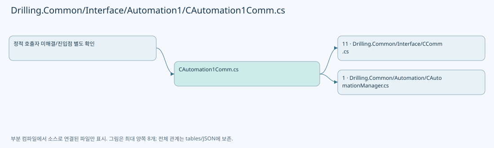

## 네임스페이스·타입·상속

| 타입 | 구분 | 원본 범위 | 선언/상속 |
| --- | --- | --- | --- |
| CAutomation1Comm | ClassDeclaration | 9–1914 | CAutomation1Comm: CCommBase(data, option) |
| CAutoAxis | RecordDeclaration | 1789–1798 | CAutoAxis |
| CBufferedRunRequest | RecordDeclaration | 1800–1800 | CBufferedRunRequest |
| CBufferedRunQueue | RecordDeclaration | 1801–1801 | CBufferedRunQueue |
| CBufferedRunTaskState | RecordDeclaration | 1802–1815 | CBufferedRunTaskState |

## 멤버 빠른 목록

| 이름 | 종류 | 범위 | 서명 |
| --- | --- | --- | --- |
| DefaultTaskIndex | FieldDeclaration | L13–13 | int Drilling.Common.Interface.CAutomation1Comm.DefaultTaskIndex |
| CommandQueuePollIntervalMs | FieldDeclaration | L14–14 | int Drilling.Common.Interface.CAutomation1Comm.CommandQueuePollIntervalMs |
| CommandQueueCleanupTimeoutMs | FieldDeclaration | L15–15 | int Drilling.Common.Interface.CAutomation1Comm.CommandQueueCleanupTimeoutMs |
| _commLock | FieldDeclaration | L16–16 | System.Threading.SemaphoreSlim Drilling.Common.Interface.CAutomation1Comm._commLock |
| _statusReadLock | FieldDeclaration | L19–19 | System.Threading.SemaphoreSlim Drilling.Common.Interface.CAutomation1Comm._statusReadLock |
| _activeBufferedRunLock | FieldDeclaration | L20–20 | object Drilling.Common.Interface.CAutomation1Comm._activeBufferedRunLock |
| _controller | FieldDeclaration | L21–21 | Controller? Drilling.Common.Interface.CAutomation1Comm._controller |
| _activeBufferedRunCancellation | FieldDeclaration | L22–22 | System.Threading.CancellationTokenSource? Drilling.Common.Interface.CAutomation1Comm._activeBufferedRunCancellation |
| _bufferedRunChanged | FieldDeclaration | L23–23 | System.Threading.Tasks.TaskCompletionSource Drilling.Common.Interface.CAutomation1Comm._bufferedRunChanged |
| _activeBufferedRunTaskStates | FieldDeclaration | L24–24 | System.Collections.Generic.IReadOnlyDictionary<int, Drilling.Common.Interface.CAutomation1Comm.CBufferedRunTaskState> Drilling.Common.Interface.CAutomation1Comm._activeBufferedRunTaskStates |
| _activeBufferedRunRequestedTasks | FieldDeclaration | L25–25 | System.Collections.Generic.IReadOnlySet<int> Drilling.Common.Interface.CAutomation1Comm._activeBufferedRunRequestedTasks |
| _lastTaskStatusResponses | FieldDeclaration | L26–26 | System.Collections.Generic.Dictionary<int, string> Drilling.Common.Interface.CAutomation1Comm._lastTaskStatusResponses |
| Connect | MethodDeclaration | L29–54 | System.Threading.Tasks.Task Drilling.Common.Interface.CAutomation1Comm.Connect(System.Threading.CancellationToken) |
| Disconnect | MethodDeclaration | L56–74 | System.Threading.Tasks.Task Drilling.Common.Interface.CAutomation1Comm.Disconnect(System.Threading.CancellationToken) |
| Execute | MethodDeclaration | L76–159 | System.Threading.Tasks.Task<string> Drilling.Common.Interface.CAutomation1Comm.Execute(string, System.Threading.CancellationToken) |
| SelectValue | LocalFunctionStatement | L110–113 | string SelectValue() |
| AcquireCommandLockOrReadBufferedStatus | MethodDeclaration | L161–197 | System.Threading.Tasks.Task<string?> Drilling.Common.Interface.CAutomation1Comm.AcquireCommandLockOrReadBufferedStatus(string, System.Threading.CancellationToken) |
| FinishBufferedRunAfterStatusReads | MethodDeclaration | L199–212 | System.Threading.Tasks.Task Drilling.Common.Interface.CAutomation1Comm.FinishBufferedRunAfterStatusReads(System.Threading.CancellationTokenSource) |
| RegisterActiveBufferedRun | MethodDeclaration | L214–233 | void Drilling.Common.Interface.CAutomation1Comm.RegisterActiveBufferedRun(System.Threading.CancellationTokenSource, string) |
| UnregisterActiveBufferedRun | MethodDeclaration | L235–247 | void Drilling.Common.Interface.CAutomation1Comm.UnregisterActiveBufferedRun(System.Threading.CancellationTokenSource) |
| SignalBufferedRunChanged | MethodDeclaration | L250–255 | void Drilling.Common.Interface.CAutomation1Comm.SignalBufferedRunChanged() |
| TryReadActiveBufferedRunTaskStatus | MethodDeclaration | L257–294 | bool Drilling.Common.Interface.CAutomation1Comm.TryReadActiveBufferedRunTaskStatus(string, out string) |
| TryExecuteActiveBufferedRunStatusRead | MethodDeclaration | L296–354 | System.Threading.Tasks.Task<string?> Drilling.Common.Interface.CAutomation1Comm.TryExecuteActiveBufferedRunStatusRead(string, System.Threading.CancellationToken) |
| ReadBufferedRunStatus | LocalFunctionStatement | L316–319 | string ReadBufferedRunStatus() |
| TryGetActiveBufferedRunController | MethodDeclaration | L356–369 | bool Drilling.Common.Interface.CAutomation1Comm.TryGetActiveBufferedRunController(out Controller) |
| IsBufferedRunReadOnlyStatusRequest | MethodDeclaration | L371–421 | bool Drilling.Common.Interface.CAutomation1Comm.IsBufferedRunReadOnlyStatusRequest(string) |
| RememberTaskStatusResponse | MethodDeclaration | L423–439 | void Drilling.Common.Interface.CAutomation1Comm.RememberTaskStatusResponse(string, string) |
| CancelActiveBufferedRunIfStopCommand | MethodDeclaration | L441–447 | void Drilling.Common.Interface.CAutomation1Comm.CancelActiveBufferedRunIfStopCommand(string) |
| CancelActiveBufferedRun | MethodDeclaration | L449–455 | void Drilling.Common.Interface.CAutomation1Comm.CancelActiveBufferedRun() |
| IsBufferedRunCommand | MethodDeclaration | L457–472 | bool Drilling.Common.Interface.CAutomation1Comm.IsBufferedRunCommand(string) |
| IsBufferedRunStopCommand | MethodDeclaration | L474–500 | bool Drilling.Common.Interface.CAutomation1Comm.IsBufferedRunStopCommand(string) |
| IsTaskStopCommand | MethodDeclaration | L502–512 | bool Drilling.Common.Interface.CAutomation1Comm.IsTaskStopCommand(string) |
| TryReadTaskStatusRequest | MethodDeclaration | L514–563 | bool Drilling.Common.Interface.CAutomation1Comm.TryReadTaskStatusRequest(string, out int) |
| TryGetAutomationBody | MethodDeclaration | L565–587 | bool Drilling.Common.Interface.CAutomation1Comm.TryGetAutomationBody(string, out string) |
| ReadAutomationSection | MethodDeclaration | L589–593 | string Drilling.Common.Interface.CAutomation1Comm.ReadAutomationSection(string) |
| ConnectLocked | MethodDeclaration | L595–622 | void Drilling.Common.Interface.CAutomation1Comm.ConnectLocked() |
| ConnectController | MethodDeclaration | L624–637 | Controller Drilling.Common.Interface.CAutomation1Comm.ConnectController() |
| ExecuteAutomation1Function | MethodDeclaration | L639–674 | string Drilling.Common.Interface.CAutomation1Comm.ExecuteAutomation1Function(Controller, string, System.Threading.CancellationToken) |
| ExecuteFeedbackFunction | MethodDeclaration | L676–694 | string Drilling.Common.Interface.CAutomation1Comm.ExecuteFeedbackFunction(Controller, string[]) |
| ExecuteScriptFunction | MethodDeclaration | L696–716 | string Drilling.Common.Interface.CAutomation1Comm.ExecuteScriptFunction(Controller, string, System.Threading.CancellationToken) |
| ExecuteTaskFunction | MethodDeclaration | L718–752 | string Drilling.Common.Interface.CAutomation1Comm.ExecuteTaskFunction(Controller, string) |
| ExecuteCommandFunction | MethodDeclaration | L754–767 | string Drilling.Common.Interface.CAutomation1Comm.ExecuteCommandFunction(Controller, string) |
| UploadScript | MethodDeclaration | L769–780 | string Drilling.Common.Interface.CAutomation1Comm.UploadScript(Controller, System.Collections.Generic.IReadOnlyList<string>) |
| RunControllerScript | MethodDeclaration | L782–803 | string Drilling.Common.Interface.CAutomation1Comm.RunControllerScript(Controller, System.Collections.Generic.IReadOnlyList<string>, bool) |
| RunLocalScript | MethodDeclaration | L805–820 | string Drilling.Common.Interface.CAutomation1Comm.RunLocalScript(Controller, System.Collections.Generic.IReadOnlyList<string>) |
| RunBufferedScript | MethodDeclaration | L822–836 | string Drilling.Common.Interface.CAutomation1Comm.RunBufferedScript(Controller, System.Collections.Generic.IReadOnlyList<string>, System.Threading.CancellationToken) |
| RunBufferedScriptGroup | MethodDeclaration | L838–864 | string Drilling.Common.Interface.CAutomation1Comm.RunBufferedScriptGroup(Controller, System.Collections.Generic.IReadOnlyList<string>, System.Threading.CancellationToken) |
| RunBufferedControllerFiles | MethodDeclaration | L866–918 | string Drilling.Common.Interface.CAutomation1Comm.RunBufferedControllerFiles(Controller, System.Collections.Generic.IReadOnlyList<Drilling.Common.Interface.CAutomation1Comm.CBufferedRunRequest>, int, int, int, System.Threading.CancellationToken) |
| WaitForBufferedRunTasksComplete | MethodDeclaration | L920–944 | void Drilling.Common.Interface.CAutomation1Comm.WaitForBufferedRunTasksComplete(Controller, System.Collections.Generic.IReadOnlyList<Drilling.Common.Interface.CAutomation1Comm.CBufferedRunQueue>, int, System.Threading.CancellationToken) |
| ReadBufferedRunTaskState | MethodDeclaration | L946–963 | Drilling.Common.Interface.CAutomation1Comm.CBufferedRunTaskState Drilling.Common.Interface.CAutomation1Comm.ReadBufferedRunTaskState(Controller, Drilling.Common.Interface.CAutomation1Comm.CBufferedRunQueue) |
| ReadBufferedRunTaskStates | MethodDeclaration | L965–974 | Drilling.Common.Interface.CAutomation1Comm.CBufferedRunTaskState[] Drilling.Common.Interface.CAutomation1Comm.ReadBufferedRunTaskStates(Controller, System.Collections.Generic.IReadOnlyList<Drilling.Common.Interface.CAutomation1Comm.CBufferedRunQueue>) |
| FindBufferedRunErrorState | MethodDeclaration | L976–987 | Drilling.Common.Interface.CAutomation1Comm.CBufferedRunTaskState? Drilling.Common.Interface.CAutomation1Comm.FindBufferedRunErrorState(System.Collections.Generic.IReadOnlyList<Drilling.Common.Interface.CAutomation1Comm.CBufferedRunTaskState>) |
| AreBufferedRunQueuesComplete | MethodDeclaration | L989–1000 | bool Drilling.Common.Interface.CAutomation1Comm.AreBufferedRunQueuesComplete(System.Collections.Generic.IReadOnlyList<Drilling.Common.Interface.CAutomation1Comm.CBufferedRunTaskState>) |
| ThrowIfBufferedRunTimeout | MethodDeclaration | L1002–1014 | void Drilling.Common.Interface.CAutomation1Comm.ThrowIfBufferedRunTimeout(long, int, System.Collections.Generic.IReadOnlyList<Drilling.Common.Interface.CAutomation1Comm.CBufferedRunTaskState>) |
| WaitBufferedRunPollInterval | MethodDeclaration | L1016–1037 | void Drilling.Common.Interface.CAutomation1Comm.WaitBufferedRunPollInterval(long, int, System.Threading.CancellationToken) |
| ReadBufferedRunRequests | MethodDeclaration | L1039–1048 | System.Collections.Generic.IReadOnlyList<Drilling.Common.Interface.CAutomation1Comm.CBufferedRunRequest> Drilling.Common.Interface.CAutomation1Comm.ReadBufferedRunRequests(System.Collections.Generic.IReadOnlyList<Drilling.Common.Interface.CAutomation1Comm.CBufferedRunQueue>) |
| UpdateActiveBufferedRunTaskStates | MethodDeclaration | L1050–1059 | void Drilling.Common.Interface.CAutomation1Comm.UpdateActiveBufferedRunTaskStates(Controller, System.Collections.Generic.IReadOnlyList<Drilling.Common.Interface.CAutomation1Comm.CBufferedRunQueue>) |
| SetActiveBufferedRunTaskStates | MethodDeclaration | L1061–1076 | void Drilling.Common.Interface.CAutomation1Comm.SetActiveBufferedRunTaskStates(System.Collections.Generic.IReadOnlyList<Drilling.Common.Interface.CAutomation1Comm.CBufferedRunTaskState>) |
| FormatActiveBufferedRunTaskStatus | MethodDeclaration | L1078–1083 | string Drilling.Common.Interface.CAutomation1Comm.FormatActiveBufferedRunTaskStatus(Drilling.Common.Interface.CAutomation1Comm.CBufferedRunTaskState) |
| FormatBufferedRunTaskStatusStarting | MethodDeclaration | L1085–1088 | string Drilling.Common.Interface.CAutomation1Comm.FormatBufferedRunTaskStatusStarting(int) |
| FormatActiveBufferedRunTaskState | MethodDeclaration | L1090–1112 | string Drilling.Common.Interface.CAutomation1Comm.FormatActiveBufferedRunTaskState(Drilling.Common.Interface.CAutomation1Comm.CBufferedRunTaskState) |
| HasBufferedRunQueueActivity | MethodDeclaration | L1114–1117 | bool Drilling.Common.Interface.CAutomation1Comm.HasBufferedRunQueueActivity(Drilling.Common.Interface.CAutomation1Comm.CBufferedRunTaskState) |
| IsBufferedRunQueueComplete | MethodDeclaration | L1119–1128 | bool Drilling.Common.Interface.CAutomation1Comm.IsBufferedRunQueueComplete(Drilling.Common.Interface.CAutomation1Comm.CBufferedRunTaskState) |
| FormatBufferedRunTaskStates | MethodDeclaration | L1130–1139 | string Drilling.Common.Interface.CAutomation1Comm.FormatBufferedRunTaskStates(System.Collections.Generic.IReadOnlyList<Drilling.Common.Interface.CAutomation1Comm.CBufferedRunTaskState>) |
| StopBufferedRunTasks | MethodDeclaration | L1141–1159 | void Drilling.Common.Interface.CAutomation1Comm.StopBufferedRunTasks(Controller, System.Collections.Generic.IEnumerable<Drilling.Common.Interface.CAutomation1Comm.CBufferedRunRequest>, System.Collections.Generic.ICollection<System.Exception>) |
| SelectTaskIndex | LocalFunctionStatement | L1143–1146 | int SelectTaskIndex(Drilling.Common.Interface.CAutomation1Comm.CBufferedRunRequest) |
| EndBufferedCommandQueues | MethodDeclaration | L1161–1181 | void Drilling.Common.Interface.CAutomation1Comm.EndBufferedCommandQueues(Controller, System.Collections.Generic.IReadOnlyList<Drilling.Common.Interface.CAutomation1Comm.CBufferedRunQueue>, int, System.Collections.Generic.ICollection<System.Exception>) |
| ReadCommandQueueCleanupTimeoutMs | MethodDeclaration | L1183–1196 | int Drilling.Common.Interface.CAutomation1Comm.ReadCommandQueueCleanupTimeoutMs(System.Exception?, int) |
| AddCleanupExceptions | MethodDeclaration | L1198–1211 | void Drilling.Common.Interface.CAutomation1Comm.AddCleanupExceptions(System.Exception, System.Collections.Generic.IReadOnlyCollection<System.Exception>) |
| SelectMessage | LocalFunctionStatement | L1205–1208 | string SelectMessage(System.Exception) |
| StopTask | MethodDeclaration | L1213–1218 | string Drilling.Common.Interface.CAutomation1Comm.StopTask(Controller, int) |
| ReadTaskStatus | MethodDeclaration | L1220–1226 | string Drilling.Common.Interface.CAutomation1Comm.ReadTaskStatus(Controller, int) |
| ReadTaskLineStatus | MethodDeclaration | L1228–1236 | string Drilling.Common.Interface.CAutomation1Comm.ReadTaskLineStatus(Controller, int) |
| ExecuteAxisFunction | MethodDeclaration | L1238–1382 | string Drilling.Common.Interface.CAutomation1Comm.ExecuteAxisFunction(Controller, System.Collections.Generic.IReadOnlyList<string>) |
| ExecuteIntCallback | LocalFunctionStatement | L1251–1254 | void ExecuteIntCallback(int) |
| ExecuteStringCallback | LocalFunctionStatement | L1256–1259 | void ExecuteStringCallback(string) |
| ExecuteIntCallback2 | LocalFunctionStatement | L1261–1264 | void ExecuteIntCallback2(int) |
| ExecuteStringCallback2 | LocalFunctionStatement | L1266–1269 | void ExecuteStringCallback2(string) |
| ExecuteIntCallback3 | LocalFunctionStatement | L1271–1274 | void ExecuteIntCallback3(int) |
| ExecuteStringCallback3 | LocalFunctionStatement | L1276–1279 | void ExecuteStringCallback3(string) |
| ExecuteIntCallback4 | LocalFunctionStatement | L1281–1284 | void ExecuteIntCallback4(int) |
| ExecuteStringCallback4 | LocalFunctionStatement | L1286–1289 | void ExecuteStringCallback4(string) |
| ExecuteIntCallback5 | LocalFunctionStatement | L1291–1294 | void ExecuteIntCallback5(int, double, double) |
| ExecuteStringCallback5 | LocalFunctionStatement | L1296–1299 | void ExecuteStringCallback5(string, double, double) |
| ExecuteIntCallback6 | LocalFunctionStatement | L1301–1304 | void ExecuteIntCallback6(int, double, double) |
| ExecuteStringCallback6 | LocalFunctionStatement | L1306–1309 | void ExecuteStringCallback6(string, double, double) |
| ExecuteIntCallback7 | LocalFunctionStatement | L1311–1314 | void ExecuteIntCallback7(int) |
| ExecuteStringCallback7 | LocalFunctionStatement | L1316–1319 | void ExecuteStringCallback7(string) |
| ReadAxisStatus | MethodDeclaration | L1384–1470 | string Drilling.Common.Interface.CAutomation1Comm.ReadAxisStatus(Controller, Drilling.Common.Interface.CAutomation1Comm.CAutoAxis, string, int, bool) |
| ReadStatusFlag | MethodDeclaration | L1472–1481 | string Drilling.Common.Interface.CAutomation1Comm.ReadStatusFlag(string, long) |
| ReadMotorTemperatureFromAnalogInput | MethodDeclaration | L1483–1486 | double Drilling.Common.Interface.CAutomation1Comm.ReadMotorTemperatureFromAnalogInput(StatusItemResults, AxisStatusItem, Drilling.Common.Interface.CAutomation1Comm.CAutoAxis) |
| ReadAxisStatusAnalogInputNo | MethodDeclaration | L1488–1501 | int Drilling.Common.Interface.CAutomation1Comm.ReadAxisStatusAnalogInputNo(System.Collections.Generic.IReadOnlyList<string>, int) |
| ReadAxisStatusExtendedFlag | MethodDeclaration | L1503–1516 | bool Drilling.Common.Interface.CAutomation1Comm.ReadAxisStatusExtendedFlag(System.Collections.Generic.IReadOnlyList<string>, int) |
| ReadAnalogInputNo | MethodDeclaration | L1518–1527 | int Drilling.Common.Interface.CAutomation1Comm.ReadAnalogInputNo(string) |
| ToAnalogInputStatusItem | MethodDeclaration | L1529–1544 | AxisStatusItem Drilling.Common.Interface.CAutomation1Comm.ToAnalogInputStatusItem(int) |
| CreateAxisReference | MethodDeclaration | L1546–1560 | Drilling.Common.Interface.CAutomation1Comm.CAutoAxis Drilling.Common.Interface.CAutomation1Comm.CreateAxisReference(string) |
| ExecuteAxis | MethodDeclaration | L1562–1571 | void Drilling.Common.Interface.CAutomation1Comm.ExecuteAxis(Drilling.Common.Interface.CAutomation1Comm.CAutoAxis, System.Action<int>, System.Action<string>) |
| ExecuteAxis | MethodDeclaration | L1573–1582 | void Drilling.Common.Interface.CAutomation1Comm.ExecuteAxis(Drilling.Common.Interface.CAutomation1Comm.CAutoAxis, System.Action<int, double, double>, System.Action<string, double, double>, double, double) |
| GetAxisStatusValue | MethodDeclaration | L1584–1587 | object Drilling.Common.Interface.CAutomation1Comm.GetAxisStatusValue(StatusItemResults, AxisStatusItem, Drilling.Common.Interface.CAutomation1Comm.CAutoAxis) |
| ExecuteIoFunction | MethodDeclaration | L1589–1616 | string Drilling.Common.Interface.CAutomation1Comm.ExecuteIoFunction(Controller, System.Collections.Generic.IReadOnlyList<string>) |
| ReadIo | MethodDeclaration | L1618–1627 | string Drilling.Common.Interface.CAutomation1Comm.ReadIo(Controller, string, int, int, bool) |
| ExecuteSystemFunction | MethodDeclaration | L1629–1648 | string Drilling.Common.Interface.CAutomation1Comm.ExecuteSystemFunction(Controller, System.Collections.Generic.IReadOnlyList<string>) |
| ResetController | MethodDeclaration | L1650–1654 | string Drilling.Common.Interface.CAutomation1Comm.ResetController(Controller) |
| ReadProcessorUsage | MethodDeclaration | L1656–1663 | string Drilling.Common.Interface.CAutomation1Comm.ReadProcessorUsage(Controller) |
| ExecuteStatus | MethodDeclaration | L1665–1672 | string Drilling.Common.Interface.CAutomation1Comm.ExecuteStatus(Controller) |
| EnsureController | MethodDeclaration | L1674–1687 | Controller Drilling.Common.Interface.CAutomation1Comm.EnsureController() |
| CloseController | MethodDeclaration | L1689–1708 | void Drilling.Common.Interface.CAutomation1Comm.CloseController() |
| ValidateTask | MethodDeclaration | L1710–1717 | void Drilling.Common.Interface.CAutomation1Comm.ValidateTask(Controller, int) |
| SplitColon | MethodDeclaration | L1719–1722 | string[] Drilling.Common.Interface.CAutomation1Comm.SplitColon(string) |
| SplitPipe | MethodDeclaration | L1724–1727 | string[] Drilling.Common.Interface.CAutomation1Comm.SplitPipe(string) |
| ReadInt | MethodDeclaration | L1729–1732 | int Drilling.Common.Interface.CAutomation1Comm.ReadInt(string, string) |
| ReadInt | MethodDeclaration | L1734–1737 | int Drilling.Common.Interface.CAutomation1Comm.ReadInt(System.Collections.Generic.IReadOnlyList<string>, int, int, string) |
| ReadDouble | MethodDeclaration | L1739–1747 | double Drilling.Common.Interface.CAutomation1Comm.ReadDouble(System.Collections.Generic.IReadOnlyList<string>, int, string) |
| ReadDouble | MethodDeclaration | L1749–1752 | double Drilling.Common.Interface.CAutomation1Comm.ReadDouble(System.Collections.Generic.IReadOnlyList<string>, int, double, string) |
| ParseIoAddress | MethodDeclaration | L1754–1766 | (int AxisNo, int BitNo, bool IsOutput) Drilling.Common.Interface.CAutomation1Comm.ParseIoAddress(string) |
| Sanitize | MethodDeclaration | L1768–1771 | string Drilling.Common.Interface.CAutomation1Comm.Sanitize(string) |
| CreateErrorResponse | MethodDeclaration | L1773–1776 | string Drilling.Common.Interface.CAutomation1Comm.CreateErrorResponse(System.Exception) |
| CreateErrorMessage | MethodDeclaration | L1778–1787 | string Drilling.Common.Interface.CAutomation1Comm.CreateErrorMessage(System.Exception) |
| CommandText | PropertyDeclaration | L1791–1797 | string Drilling.Common.Interface.CAutomation1Comm.CAutoAxis.CommandText |
| get_CommandText | GetAccessorDeclaration | L1793–1796 | string Drilling.Common.Interface.CAutomation1Comm.CAutoAxis.CommandText.get |
| FeedComplete | PropertyDeclaration | L1814–1814 | bool Drilling.Common.Interface.CAutomation1Comm.CBufferedRunTaskState.FeedComplete |
| get_FeedComplete | GetAccessorDeclaration | L1814–1814 | bool Drilling.Common.Interface.CAutomation1Comm.CBufferedRunTaskState.FeedComplete.get |
| set_FeedComplete | InitAccessorDeclaration | L1814–1814 | void Drilling.Common.Interface.CAutomation1Comm.CBufferedRunTaskState.FeedComplete.init |
| ExecuteConfiguredHomeSpeedFunction | MethodDeclaration | L1821–1858 | string Drilling.Common.Interface.CAutomation1Comm.ExecuteConfiguredHomeSpeedFunction(Controller, System.Collections.Generic.IReadOnlyList<string>) |
| ConfiguredHomeSpeedAxis | MethodDeclaration | L1860–1860 | AxisParameterCategory Drilling.Common.Interface.CAutomation1Comm.ConfiguredHomeSpeedAxis(ConfiguredParameters, string) |
| ValidateConfiguredHomeSpeedAxis | MethodDeclaration | L1861–1869 | string Drilling.Common.Interface.CAutomation1Comm.ValidateConfiguredHomeSpeedAxis(string) |
| IsMofReadinessReadRequest | MethodDeclaration | L1873–1879 | bool Drilling.Common.Interface.CAutomation1Comm.IsMofReadinessReadRequest(string) |
| ExecuteVariableFunction | MethodDeclaration | L1881–1897 | string Drilling.Common.Interface.CAutomation1Comm.ExecuteVariableFunction(Controller, string[]) |
| ExecuteMofReadinessFunction | MethodDeclaration | L1899–1912 | string Drilling.Common.Interface.CAutomation1Comm.ExecuteMofReadinessFunction(string[], int, System.Func<int, long>, System.Action<int, long>) |

## 멤버별 상세 계약·호출·처리 해설

### FieldDeclaration `DefaultTaskIndex` · L13–13

[Drilling.Common/Interface/Automation1/CAutomation1Comm.cs:13–13](https://github.com/kjuws10-rgb/A3Drilling/blob/5aee8e58439c9b455cae7c9593c9be986c3e682e/Drilling.Common/Interface/Automation1/CAutomation1Comm.cs#L13-L13)

| 항목 | 실제 추출 값 |
| --- | --- |
| 서명 | int Drilling.Common.Interface.CAutomation1Comm.DefaultTaskIndex |
| 접근/수식자 | Private / private, const |
| 반환/값 타입 | int |
| 소속 타입 | NamedType:Drilling.Common.Interface.CAutomation1Comm |

현재 부분 분석에서 직접 연결된 호출자는 없습니다. XAML/이벤트/인터페이스·델리게이트·외부 진입을 추가 확인해야 하며, 미사용으로 판정한 것이 아닙니다.

본문의 실제 연산·분기·예외·반환 순서(원문 위치 순):

| 원본 행 | 종류 | 주석 해설 |
| --- | --- | --- |
| 13 | variable-initializer | 변수의 초기값을 지정합니다: DefaultTaskIndex = 1 |

변경 전 점검: 입력/반환 타입, 위 호출자, 예외/취소 경로, 공유 상태와 저장·전송 소비자를 함께 확인합니다. 값의 단위나 물리 방향을 이름만으로 확정하지 않습니다.

### FieldDeclaration `CommandQueuePollIntervalMs` · L14–14

[Drilling.Common/Interface/Automation1/CAutomation1Comm.cs:14–14](https://github.com/kjuws10-rgb/A3Drilling/blob/5aee8e58439c9b455cae7c9593c9be986c3e682e/Drilling.Common/Interface/Automation1/CAutomation1Comm.cs#L14-L14)

| 항목 | 실제 추출 값 |
| --- | --- |
| 서명 | int Drilling.Common.Interface.CAutomation1Comm.CommandQueuePollIntervalMs |
| 접근/수식자 | Private / private, const |
| 반환/값 타입 | int |
| 소속 타입 | NamedType:Drilling.Common.Interface.CAutomation1Comm |

현재 부분 분석에서 직접 연결된 호출자는 없습니다. XAML/이벤트/인터페이스·델리게이트·외부 진입을 추가 확인해야 하며, 미사용으로 판정한 것이 아닙니다.

본문의 실제 연산·분기·예외·반환 순서(원문 위치 순):

| 원본 행 | 종류 | 주석 해설 |
| --- | --- | --- |
| 14 | variable-initializer | 변수의 초기값을 지정합니다: CommandQueuePollIntervalMs = 100 |

변경 전 점검: 입력/반환 타입, 위 호출자, 예외/취소 경로, 공유 상태와 저장·전송 소비자를 함께 확인합니다. 값의 단위나 물리 방향을 이름만으로 확정하지 않습니다.

### FieldDeclaration `CommandQueueCleanupTimeoutMs` · L15–15

[Drilling.Common/Interface/Automation1/CAutomation1Comm.cs:15–15](https://github.com/kjuws10-rgb/A3Drilling/blob/5aee8e58439c9b455cae7c9593c9be986c3e682e/Drilling.Common/Interface/Automation1/CAutomation1Comm.cs#L15-L15)

| 항목 | 실제 추출 값 |
| --- | --- |
| 서명 | int Drilling.Common.Interface.CAutomation1Comm.CommandQueueCleanupTimeoutMs |
| 접근/수식자 | Private / private, const |
| 반환/값 타입 | int |
| 소속 타입 | NamedType:Drilling.Common.Interface.CAutomation1Comm |

현재 부분 분석에서 직접 연결된 호출자는 없습니다. XAML/이벤트/인터페이스·델리게이트·외부 진입을 추가 확인해야 하며, 미사용으로 판정한 것이 아닙니다.

본문의 실제 연산·분기·예외·반환 순서(원문 위치 순):

| 원본 행 | 종류 | 주석 해설 |
| --- | --- | --- |
| 15 | variable-initializer | 변수의 초기값을 지정합니다: CommandQueueCleanupTimeoutMs = 5000 |

변경 전 점검: 입력/반환 타입, 위 호출자, 예외/취소 경로, 공유 상태와 저장·전송 소비자를 함께 확인합니다. 값의 단위나 물리 방향을 이름만으로 확정하지 않습니다.

### FieldDeclaration `_commLock` · L16–16

[Drilling.Common/Interface/Automation1/CAutomation1Comm.cs:16–16](https://github.com/kjuws10-rgb/A3Drilling/blob/5aee8e58439c9b455cae7c9593c9be986c3e682e/Drilling.Common/Interface/Automation1/CAutomation1Comm.cs#L16-L16)

| 항목 | 실제 추출 값 |
| --- | --- |
| 서명 | System.Threading.SemaphoreSlim Drilling.Common.Interface.CAutomation1Comm._commLock |
| 접근/수식자 | Private / private, readonly |
| 반환/값 타입 | System.Threading.SemaphoreSlim |
| 소속 타입 | NamedType:Drilling.Common.Interface.CAutomation1Comm |

현재 부분 분석에서 직접 연결된 호출자는 없습니다. XAML/이벤트/인터페이스·델리게이트·외부 진입을 추가 확인해야 하며, 미사용으로 판정한 것이 아닙니다.

호출하는 대상과 해석 범위:

| 원본 행 | 표현식 | 분석 상태 | 대상/소스 위치 |
| --- | --- | --- | --- |
| 16 | new | resolved | System.Threading.SemaphoreSlim.SemaphoreSlim(int, int) |

본문의 실제 연산·분기·예외·반환 순서(원문 위치 순):

| 원본 행 | 종류 | 주석 해설 |
| --- | --- | --- |
| 16 | call | 함수·델리게이트 또는 객체 생성자를 호출합니다: new(1, 1) |
| 16 | variable-initializer | 변수의 초기값을 지정합니다: _commLock = new(1, 1) |

변경 전 점검: 입력/반환 타입, 위 호출자, 예외/취소 경로, 공유 상태와 저장·전송 소비자를 함께 확인합니다. 값의 단위나 물리 방향을 이름만으로 확정하지 않습니다.

### FieldDeclaration `_statusReadLock` · L19–19

[Drilling.Common/Interface/Automation1/CAutomation1Comm.cs:19–19](https://github.com/kjuws10-rgb/A3Drilling/blob/5aee8e58439c9b455cae7c9593c9be986c3e682e/Drilling.Common/Interface/Automation1/CAutomation1Comm.cs#L19-L19)

| 항목 | 실제 추출 값 |
| --- | --- |
| 서명 | System.Threading.SemaphoreSlim Drilling.Common.Interface.CAutomation1Comm._statusReadLock |
| 접근/수식자 | Private / private, readonly |
| 반환/값 타입 | System.Threading.SemaphoreSlim |
| 소속 타입 | NamedType:Drilling.Common.Interface.CAutomation1Comm |

현재 부분 분석에서 직접 연결된 호출자는 없습니다. XAML/이벤트/인터페이스·델리게이트·외부 진입을 추가 확인해야 하며, 미사용으로 판정한 것이 아닙니다.

호출하는 대상과 해석 범위:

| 원본 행 | 표현식 | 분석 상태 | 대상/소스 위치 |
| --- | --- | --- | --- |
| 19 | new | resolved | System.Threading.SemaphoreSlim.SemaphoreSlim(int, int) |

본문의 실제 연산·분기·예외·반환 순서(원문 위치 순):

| 원본 행 | 종류 | 주석 해설 |
| --- | --- | --- |
| 19 | call | 함수·델리게이트 또는 객체 생성자를 호출합니다: new(1, 1) |
| 19 | variable-initializer | 변수의 초기값을 지정합니다: _statusReadLock = new(1, 1) |

변경 전 점검: 입력/반환 타입, 위 호출자, 예외/취소 경로, 공유 상태와 저장·전송 소비자를 함께 확인합니다. 값의 단위나 물리 방향을 이름만으로 확정하지 않습니다.

### FieldDeclaration `_activeBufferedRunLock` · L20–20

[Drilling.Common/Interface/Automation1/CAutomation1Comm.cs:20–20](https://github.com/kjuws10-rgb/A3Drilling/blob/5aee8e58439c9b455cae7c9593c9be986c3e682e/Drilling.Common/Interface/Automation1/CAutomation1Comm.cs#L20-L20)

| 항목 | 실제 추출 값 |
| --- | --- |
| 서명 | object Drilling.Common.Interface.CAutomation1Comm._activeBufferedRunLock |
| 접근/수식자 | Private / private, readonly |
| 반환/값 타입 | object |
| 소속 타입 | NamedType:Drilling.Common.Interface.CAutomation1Comm |

현재 부분 분석에서 직접 연결된 호출자는 없습니다. XAML/이벤트/인터페이스·델리게이트·외부 진입을 추가 확인해야 하며, 미사용으로 판정한 것이 아닙니다.

호출하는 대상과 해석 범위:

| 원본 행 | 표현식 | 분석 상태 | 대상/소스 위치 |
| --- | --- | --- | --- |
| 20 | new | resolved | object.Object() |

본문의 실제 연산·분기·예외·반환 순서(원문 위치 순):

| 원본 행 | 종류 | 주석 해설 |
| --- | --- | --- |
| 20 | call | 함수·델리게이트 또는 객체 생성자를 호출합니다: new() |
| 20 | variable-initializer | 변수의 초기값을 지정합니다: _activeBufferedRunLock = new() |

변경 전 점검: 입력/반환 타입, 위 호출자, 예외/취소 경로, 공유 상태와 저장·전송 소비자를 함께 확인합니다. 값의 단위나 물리 방향을 이름만으로 확정하지 않습니다.

### FieldDeclaration `_controller` · L21–21

[Drilling.Common/Interface/Automation1/CAutomation1Comm.cs:21–21](https://github.com/kjuws10-rgb/A3Drilling/blob/5aee8e58439c9b455cae7c9593c9be986c3e682e/Drilling.Common/Interface/Automation1/CAutomation1Comm.cs#L21-L21)

| 항목 | 실제 추출 값 |
| --- | --- |
| 서명 | Controller? Drilling.Common.Interface.CAutomation1Comm._controller |
| 접근/수식자 | Private / private |
| 반환/값 타입 | Controller? |
| 소속 타입 | NamedType:Drilling.Common.Interface.CAutomation1Comm |

현재 부분 분석에서 직접 연결된 호출자는 없습니다. XAML/이벤트/인터페이스·델리게이트·외부 진입을 추가 확인해야 하며, 미사용으로 판정한 것이 아닙니다.

변경 전 점검: 입력/반환 타입, 위 호출자, 예외/취소 경로, 공유 상태와 저장·전송 소비자를 함께 확인합니다. 값의 단위나 물리 방향을 이름만으로 확정하지 않습니다.

### FieldDeclaration `_activeBufferedRunCancellation` · L22–22

[Drilling.Common/Interface/Automation1/CAutomation1Comm.cs:22–22](https://github.com/kjuws10-rgb/A3Drilling/blob/5aee8e58439c9b455cae7c9593c9be986c3e682e/Drilling.Common/Interface/Automation1/CAutomation1Comm.cs#L22-L22)

| 항목 | 실제 추출 값 |
| --- | --- |
| 서명 | System.Threading.CancellationTokenSource? Drilling.Common.Interface.CAutomation1Comm._activeBufferedRunCancellation |
| 접근/수식자 | Private / private |
| 반환/값 타입 | System.Threading.CancellationTokenSource? |
| 소속 타입 | NamedType:Drilling.Common.Interface.CAutomation1Comm |

현재 부분 분석에서 직접 연결된 호출자는 없습니다. XAML/이벤트/인터페이스·델리게이트·외부 진입을 추가 확인해야 하며, 미사용으로 판정한 것이 아닙니다.

변경 전 점검: 입력/반환 타입, 위 호출자, 예외/취소 경로, 공유 상태와 저장·전송 소비자를 함께 확인합니다. 값의 단위나 물리 방향을 이름만으로 확정하지 않습니다.

### FieldDeclaration `_bufferedRunChanged` · L23–23

[Drilling.Common/Interface/Automation1/CAutomation1Comm.cs:23–23](https://github.com/kjuws10-rgb/A3Drilling/blob/5aee8e58439c9b455cae7c9593c9be986c3e682e/Drilling.Common/Interface/Automation1/CAutomation1Comm.cs#L23-L23)

| 항목 | 실제 추출 값 |
| --- | --- |
| 서명 | System.Threading.Tasks.TaskCompletionSource Drilling.Common.Interface.CAutomation1Comm._bufferedRunChanged |
| 접근/수식자 | Private / private |
| 반환/값 타입 | System.Threading.Tasks.TaskCompletionSource |
| 소속 타입 | NamedType:Drilling.Common.Interface.CAutomation1Comm |

현재 부분 분석에서 직접 연결된 호출자는 없습니다. XAML/이벤트/인터페이스·델리게이트·외부 진입을 추가 확인해야 하며, 미사용으로 판정한 것이 아닙니다.

호출하는 대상과 해석 범위:

| 원본 행 | 표현식 | 분석 상태 | 대상/소스 위치 |
| --- | --- | --- | --- |
| 23 | new | resolved | System.Threading.Tasks.TaskCompletionSource.TaskCompletionSource(System.Threading.Tasks.TaskCreationOptions) |

본문의 실제 연산·분기·예외·반환 순서(원문 위치 순):

| 원본 행 | 종류 | 주석 해설 |
| --- | --- | --- |
| 23 | call | 함수·델리게이트 또는 객체 생성자를 호출합니다: new(TaskCreationOptions.RunContinuationsAsynchronously) |
| 23 | variable-initializer | 변수의 초기값을 지정합니다: _bufferedRunChanged = new(TaskCreationOptions.RunContinuationsAsynchronously) |

변경 전 점검: 입력/반환 타입, 위 호출자, 예외/취소 경로, 공유 상태와 저장·전송 소비자를 함께 확인합니다. 값의 단위나 물리 방향을 이름만으로 확정하지 않습니다.

### FieldDeclaration `_activeBufferedRunTaskStates` · L24–24

[Drilling.Common/Interface/Automation1/CAutomation1Comm.cs:24–24](https://github.com/kjuws10-rgb/A3Drilling/blob/5aee8e58439c9b455cae7c9593c9be986c3e682e/Drilling.Common/Interface/Automation1/CAutomation1Comm.cs#L24-L24)

| 항목 | 실제 추출 값 |
| --- | --- |
| 서명 | System.Collections.Generic.IReadOnlyDictionary<int, Drilling.Common.Interface.CAutomation1Comm.CBufferedRunTaskState> Drilling.Common.Interface.CAutomation1Comm._activeBufferedRunTaskStates |
| 접근/수식자 | Private / private |
| 반환/값 타입 | System.Collections.Generic.IReadOnlyDictionary<int, Drilling.Common.Interface.CAutomation1Comm.CBufferedRunTaskState> |
| 소속 타입 | NamedType:Drilling.Common.Interface.CAutomation1Comm |

현재 부분 분석에서 직접 연결된 호출자는 없습니다. XAML/이벤트/인터페이스·델리게이트·외부 진입을 추가 확인해야 하며, 미사용으로 판정한 것이 아닙니다.

호출하는 대상과 해석 범위:

| 원본 행 | 표현식 | 분석 상태 | 대상/소스 위치 |
| --- | --- | --- | --- |
| 24 | new Dictionary<int, CBufferedRunTaskState> | resolved | System.Collections.Generic.Dictionary<int, Drilling.Common.Interface.CAutomation1Comm.CBufferedRunTaskState>.Dictionary() |

본문의 실제 연산·분기·예외·반환 순서(원문 위치 순):

| 원본 행 | 종류 | 주석 해설 |
| --- | --- | --- |
| 24 | call | 함수·델리게이트 또는 객체 생성자를 호출합니다: new Dictionary<int, CBufferedRunTaskState>() |
| 24 | variable-initializer | 변수의 초기값을 지정합니다: _activeBufferedRunTaskStates = new Dictionary<int, CBufferedRunTaskState>() |

변경 전 점검: 입력/반환 타입, 위 호출자, 예외/취소 경로, 공유 상태와 저장·전송 소비자를 함께 확인합니다. 값의 단위나 물리 방향을 이름만으로 확정하지 않습니다.

### FieldDeclaration `_activeBufferedRunRequestedTasks` · L25–25

[Drilling.Common/Interface/Automation1/CAutomation1Comm.cs:25–25](https://github.com/kjuws10-rgb/A3Drilling/blob/5aee8e58439c9b455cae7c9593c9be986c3e682e/Drilling.Common/Interface/Automation1/CAutomation1Comm.cs#L25-L25)

| 항목 | 실제 추출 값 |
| --- | --- |
| 서명 | System.Collections.Generic.IReadOnlySet<int> Drilling.Common.Interface.CAutomation1Comm._activeBufferedRunRequestedTasks |
| 접근/수식자 | Private / private |
| 반환/값 타입 | System.Collections.Generic.IReadOnlySet<int> |
| 소속 타입 | NamedType:Drilling.Common.Interface.CAutomation1Comm |

현재 부분 분석에서 직접 연결된 호출자는 없습니다. XAML/이벤트/인터페이스·델리게이트·외부 진입을 추가 확인해야 하며, 미사용으로 판정한 것이 아닙니다.

호출하는 대상과 해석 범위:

| 원본 행 | 표현식 | 분석 상태 | 대상/소스 위치 |
| --- | --- | --- | --- |
| 25 | new HashSet<int> | resolved | System.Collections.Generic.HashSet<int>.HashSet() |

본문의 실제 연산·분기·예외·반환 순서(원문 위치 순):

| 원본 행 | 종류 | 주석 해설 |
| --- | --- | --- |
| 25 | call | 함수·델리게이트 또는 객체 생성자를 호출합니다: new HashSet<int>() |
| 25 | variable-initializer | 변수의 초기값을 지정합니다: _activeBufferedRunRequestedTasks = new HashSet<int>() |

변경 전 점검: 입력/반환 타입, 위 호출자, 예외/취소 경로, 공유 상태와 저장·전송 소비자를 함께 확인합니다. 값의 단위나 물리 방향을 이름만으로 확정하지 않습니다.

### FieldDeclaration `_lastTaskStatusResponses` · L26–26

[Drilling.Common/Interface/Automation1/CAutomation1Comm.cs:26–26](https://github.com/kjuws10-rgb/A3Drilling/blob/5aee8e58439c9b455cae7c9593c9be986c3e682e/Drilling.Common/Interface/Automation1/CAutomation1Comm.cs#L26-L26)

| 항목 | 실제 추출 값 |
| --- | --- |
| 서명 | System.Collections.Generic.Dictionary<int, string> Drilling.Common.Interface.CAutomation1Comm._lastTaskStatusResponses |
| 접근/수식자 | Private / private, readonly |
| 반환/값 타입 | System.Collections.Generic.Dictionary<int, string> |
| 소속 타입 | NamedType:Drilling.Common.Interface.CAutomation1Comm |

현재 부분 분석에서 직접 연결된 호출자는 없습니다. XAML/이벤트/인터페이스·델리게이트·외부 진입을 추가 확인해야 하며, 미사용으로 판정한 것이 아닙니다.

호출하는 대상과 해석 범위:

| 원본 행 | 표현식 | 분석 상태 | 대상/소스 위치 |
| --- | --- | --- | --- |
| 26 | new | resolved | System.Collections.Generic.Dictionary<int, string>.Dictionary() |

본문의 실제 연산·분기·예외·반환 순서(원문 위치 순):

| 원본 행 | 종류 | 주석 해설 |
| --- | --- | --- |
| 26 | call | 함수·델리게이트 또는 객체 생성자를 호출합니다: new() |
| 26 | variable-initializer | 변수의 초기값을 지정합니다: _lastTaskStatusResponses = new() |

변경 전 점검: 입력/반환 타입, 위 호출자, 예외/취소 경로, 공유 상태와 저장·전송 소비자를 함께 확인합니다. 값의 단위나 물리 방향을 이름만으로 확정하지 않습니다.

### MethodDeclaration `Connect` · L29–54

[Drilling.Common/Interface/Automation1/CAutomation1Comm.cs:29–54](https://github.com/kjuws10-rgb/A3Drilling/blob/5aee8e58439c9b455cae7c9593c9be986c3e682e/Drilling.Common/Interface/Automation1/CAutomation1Comm.cs#L29-L54)

| 항목 | 실제 추출 값 |
| --- | --- |
| 서명 | System.Threading.Tasks.Task Drilling.Common.Interface.CAutomation1Comm.Connect(System.Threading.CancellationToken) |
| 접근/수식자 | Public / public, override, async |
| 반환/값 타입 | System.Threading.Tasks.Task |
| 소속 타입 | NamedType:Drilling.Common.Interface.CAutomation1Comm |

입력 계약:

| 이름 | 타입 | 전달 | 선택/기본값 |
| --- | --- | --- | --- |
| cancellationToken | System.Threading.CancellationToken | None | True / null |

현재 부분 분석에서 직접 연결된 호출자는 없습니다. XAML/이벤트/인터페이스·델리게이트·외부 진입을 추가 확인해야 하며, 미사용으로 판정한 것이 아닙니다.

호출하는 대상과 해석 범위:

| 원본 행 | 표현식 | 분석 상태 | 대상/소스 위치 |
| --- | --- | --- | --- |
| 31 | _commLock.WaitAsync | resolved | System.Threading.Tasks.Task System.Threading.SemaphoreSlim.WaitAsync(System.Threading.CancellationToken) |
| 35 | _statusReadLock.WaitAsync(cancellationToken).ConfigureAwait | resolved | System.Runtime.CompilerServices.ConfiguredTaskAwaitable System.Threading.Tasks.Task.ConfigureAwait(bool) |
| 35 | _statusReadLock.WaitAsync | resolved | System.Threading.Tasks.Task System.Threading.SemaphoreSlim.WaitAsync(System.Threading.CancellationToken) |
| 37 | ConnectLocked | resolved | void Drilling.Common.Interface.CAutomation1Comm.ConnectLocked() · Drilling.Common/Interface/Automation1/CAutomation1Comm.cs:595 |
| 45 | CloseController | resolved | void Drilling.Common.Interface.CAutomation1Comm.CloseController() · Drilling.Common/Interface/Automation1/CAutomation1Comm.cs:1689 |
| 46 | SetError | resolved | void Drilling.Common.Interface.CCommBase.SetError(System.Exception) · Drilling.Common/Interface/CComm.cs:120 |
| 51 | _statusReadLock.Release | resolved | int System.Threading.SemaphoreSlim.Release() |
| 52 | _commLock.Release | resolved | int System.Threading.SemaphoreSlim.Release() |

본문의 실제 연산·분기·예외·반환 순서(원문 위치 순):

| 원본 행 | 종류 | 주석 해설 |
| --- | --- | --- |
| 31 | await | 비동기 완료를 기다립니다: await _commLock.WaitAsync(cancellationToken) |
| 31 | call | 함수·델리게이트 또는 객체 생성자를 호출합니다: _commLock.WaitAsync(cancellationToken) |
| 32 | local-declaration | 지역 변수를 선언합니다: var statusReadLocked = false; |
| 32 | variable-initializer | 변수의 초기값을 지정합니다: statusReadLocked = false |
| 33 | try | 예외 처리 범위입니다: try |
| 35 | await | 비동기 완료를 기다립니다: await _statusReadLock.WaitAsync(cancellationToken).ConfigureAwait(false) |
| 35 | call | 함수·델리게이트 또는 객체 생성자를 호출합니다: _statusReadLock.WaitAsync(cancellationToken).ConfigureAwait(false) |
| 35 | call | 함수·델리게이트 또는 객체 생성자를 호출합니다: _statusReadLock.WaitAsync(cancellationToken) |
| 36 | assignment | 값을 대상에 대입합니다: statusReadLocked = true |
| 37 | call | 함수·델리게이트 또는 객체 생성자를 호출합니다: ConnectLocked() |
| 39 | catch | 지정 예외를 처리합니다: catch (OperationCanceledException) when (cancellationToken.IsCancellationRequested) |
| 41 | throw | 예외를 발생/전달합니다: throw; |
| 43 | catch | 지정 예외를 처리합니다: catch (Exception ex) when (statusReadLocked) |
| 45 | call | 함수·델리게이트 또는 객체 생성자를 호출합니다: CloseController() |
| 46 | call | 함수·델리게이트 또는 객체 생성자를 호출합니다: SetError(ex) |
| 48 | finally | 종료 정리 구간입니다: finally |
| 50 | if | 조건에 따라 분기합니다: if (statusReadLocked) |
| 51 | call | 함수·델리게이트 또는 객체 생성자를 호출합니다: _statusReadLock.Release() |
| 52 | call | 함수·델리게이트 또는 객체 생성자를 호출합니다: _commLock.Release() |

제어 구문의 포함 구조(실제 실행 순서/CFG가 아닌 구문 탐색 그림):

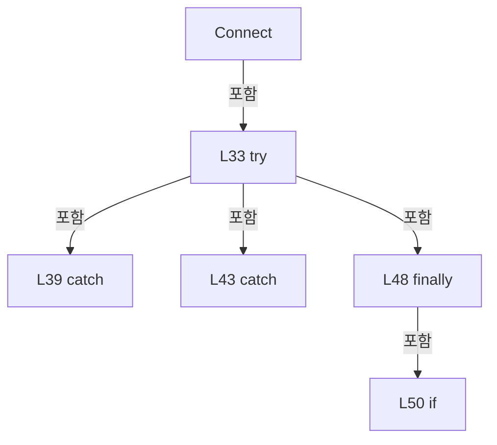

변경 전 점검: 입력/반환 타입, 위 호출자, 예외/취소 경로, 공유 상태와 저장·전송 소비자를 함께 확인합니다. 값의 단위나 물리 방향을 이름만으로 확정하지 않습니다.

### MethodDeclaration `Disconnect` · L56–74

[Drilling.Common/Interface/Automation1/CAutomation1Comm.cs:56–74](https://github.com/kjuws10-rgb/A3Drilling/blob/5aee8e58439c9b455cae7c9593c9be986c3e682e/Drilling.Common/Interface/Automation1/CAutomation1Comm.cs#L56-L74)

| 항목 | 실제 추출 값 |
| --- | --- |
| 서명 | System.Threading.Tasks.Task Drilling.Common.Interface.CAutomation1Comm.Disconnect(System.Threading.CancellationToken) |
| 접근/수식자 | Public / public, override, async |
| 반환/값 타입 | System.Threading.Tasks.Task |
| 소속 타입 | NamedType:Drilling.Common.Interface.CAutomation1Comm |

입력 계약:

| 이름 | 타입 | 전달 | 선택/기본값 |
| --- | --- | --- | --- |
| cancellationToken | System.Threading.CancellationToken | None | True / null |

현재 부분 분석에서 직접 연결된 호출자는 없습니다. XAML/이벤트/인터페이스·델리게이트·외부 진입을 추가 확인해야 하며, 미사용으로 판정한 것이 아닙니다.

호출하는 대상과 해석 범위:

| 원본 행 | 표현식 | 분석 상태 | 대상/소스 위치 |
| --- | --- | --- | --- |
| 58 | CancelActiveBufferedRun | resolved | void Drilling.Common.Interface.CAutomation1Comm.CancelActiveBufferedRun() · Drilling.Common/Interface/Automation1/CAutomation1Comm.cs:449 |
| 59 | _commLock.WaitAsync | resolved | System.Threading.Tasks.Task System.Threading.SemaphoreSlim.WaitAsync(System.Threading.CancellationToken) |
| 63 | _statusReadLock.WaitAsync(cancellationToken).ConfigureAwait | resolved | System.Runtime.CompilerServices.ConfiguredTaskAwaitable System.Threading.Tasks.Task.ConfigureAwait(bool) |
| 63 | _statusReadLock.WaitAsync | resolved | System.Threading.Tasks.Task System.Threading.SemaphoreSlim.WaitAsync(System.Threading.CancellationToken) |
| 65 | CloseController | resolved | void Drilling.Common.Interface.CAutomation1Comm.CloseController() · Drilling.Common/Interface/Automation1/CAutomation1Comm.cs:1689 |
| 66 | SetState | resolved | void Drilling.Common.Interface.CCommBase.SetState(Drilling.Common.Interface.EN_COMM_STATE) · Drilling.Common/Interface/CComm.cs:114 |
| 71 | _statusReadLock.Release | resolved | int System.Threading.SemaphoreSlim.Release() |
| 72 | _commLock.Release | resolved | int System.Threading.SemaphoreSlim.Release() |

본문의 실제 연산·분기·예외·반환 순서(원문 위치 순):

| 원본 행 | 종류 | 주석 해설 |
| --- | --- | --- |
| 58 | call | 함수·델리게이트 또는 객체 생성자를 호출합니다: CancelActiveBufferedRun() |
| 59 | await | 비동기 완료를 기다립니다: await _commLock.WaitAsync(cancellationToken) |
| 59 | call | 함수·델리게이트 또는 객체 생성자를 호출합니다: _commLock.WaitAsync(cancellationToken) |
| 60 | local-declaration | 지역 변수를 선언합니다: var statusReadLocked = false; |
| 60 | variable-initializer | 변수의 초기값을 지정합니다: statusReadLocked = false |
| 61 | try | 예외 처리 범위입니다: try |
| 63 | await | 비동기 완료를 기다립니다: await _statusReadLock.WaitAsync(cancellationToken).ConfigureAwait(false) |
| 63 | call | 함수·델리게이트 또는 객체 생성자를 호출합니다: _statusReadLock.WaitAsync(cancellationToken).ConfigureAwait(false) |
| 63 | call | 함수·델리게이트 또는 객체 생성자를 호출합니다: _statusReadLock.WaitAsync(cancellationToken) |
| 64 | assignment | 값을 대상에 대입합니다: statusReadLocked = true |
| 65 | call | 함수·델리게이트 또는 객체 생성자를 호출합니다: CloseController() |
| 66 | call | 함수·델리게이트 또는 객체 생성자를 호출합니다: SetState(EN_COMM_STATE.Offline) |
| 68 | finally | 종료 정리 구간입니다: finally |
| 70 | if | 조건에 따라 분기합니다: if (statusReadLocked) |
| 71 | call | 함수·델리게이트 또는 객체 생성자를 호출합니다: _statusReadLock.Release() |
| 72 | call | 함수·델리게이트 또는 객체 생성자를 호출합니다: _commLock.Release() |

제어 구문의 포함 구조(실제 실행 순서/CFG가 아닌 구문 탐색 그림):

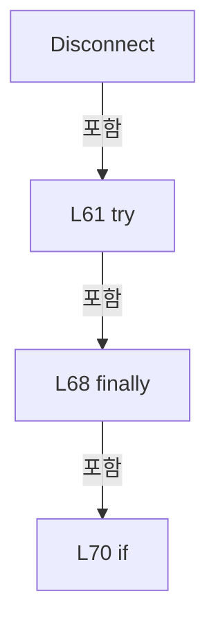

변경 전 점검: 입력/반환 타입, 위 호출자, 예외/취소 경로, 공유 상태와 저장·전송 소비자를 함께 확인합니다. 값의 단위나 물리 방향을 이름만으로 확정하지 않습니다.

### MethodDeclaration `Execute` · L76–159

[Drilling.Common/Interface/Automation1/CAutomation1Comm.cs:76–159](https://github.com/kjuws10-rgb/A3Drilling/blob/5aee8e58439c9b455cae7c9593c9be986c3e682e/Drilling.Common/Interface/Automation1/CAutomation1Comm.cs#L76-L159)

| 항목 | 실제 추출 값 |
| --- | --- |
| 서명 | System.Threading.Tasks.Task<string> Drilling.Common.Interface.CAutomation1Comm.Execute(string, System.Threading.CancellationToken) |
| 접근/수식자 | Public / public, override, async |
| 반환/값 타입 | System.Threading.Tasks.Task<string> |
| 소속 타입 | NamedType:Drilling.Common.Interface.CAutomation1Comm |

입력 계약:

| 이름 | 타입 | 전달 | 선택/기본값 |
| --- | --- | --- | --- |
| function | string | None | False /  |
| cancellationToken | System.Threading.CancellationToken | None | True / null |

현재 부분 분석에서 직접 연결된 호출자는 없습니다. XAML/이벤트/인터페이스·델리게이트·외부 진입을 추가 확인해야 하며, 미사용으로 판정한 것이 아닙니다.

호출하는 대상과 해석 범위:

| 원본 행 | 표현식 | 분석 상태 | 대상/소스 위치 |
| --- | --- | --- | --- |
| 78 | CancelActiveBufferedRunIfStopCommand | resolved | void Drilling.Common.Interface.CAutomation1Comm.CancelActiveBufferedRunIfStopCommand(string) · Drilling.Common/Interface/Automation1/CAutomation1Comm.cs:441 |
| 79 | AcquireCommandLockOrReadBufferedStatus(function, cancellationToken).ConfigureAwait | resolved | System.Runtime.CompilerServices.ConfiguredTaskAwaitable<string?> System.Threading.Tasks.Task<string?>.ConfigureAwait(bool) |
| 79 | AcquireCommandLockOrReadBufferedStatus | resolved | System.Threading.Tasks.Task<string?> Drilling.Common.Interface.CAutomation1Comm.AcquireCommandLockOrReadBufferedStatus(string, System.Threading.CancellationToken) · Drilling.Common/Interface/Automation1/CAutomation1Comm.cs:161 |
| 91 | _statusReadLock.WaitAsync(cancellationToken).ConfigureAwait | resolved | System.Runtime.CompilerServices.ConfiguredTaskAwaitable System.Threading.Tasks.Task.ConfigureAwait(bool) |
| 91 | _statusReadLock.WaitAsync | resolved | System.Threading.Tasks.Task System.Threading.SemaphoreSlim.WaitAsync(System.Threading.CancellationToken) |
| 95 | ConnectLocked | resolved | void Drilling.Common.Interface.CAutomation1Comm.ConnectLocked() · Drilling.Common/Interface/Automation1/CAutomation1Comm.cs:595 |
| 98 | EnsureController | resolved | Controller Drilling.Common.Interface.CAutomation1Comm.EnsureController() · Drilling.Common/Interface/Automation1/CAutomation1Comm.cs:1674 |
| 99 | cancellationToken.ThrowIfCancellationRequested | resolved | void System.Threading.CancellationToken.ThrowIfCancellationRequested() |
| 100 | IsBufferedRunCommand | resolved | bool Drilling.Common.Interface.CAutomation1Comm.IsBufferedRunCommand(string) · Drilling.Common/Interface/Automation1/CAutomation1Comm.cs:457 |
| 102 | CancellationTokenSource.CreateLinkedTokenSource | resolved | System.Threading.CancellationTokenSource System.Threading.CancellationTokenSource.CreateLinkedTokenSource(System.Threading.CancellationToken) |
| 104 | RegisterActiveBufferedRun | resolved | void Drilling.Common.Interface.CAutomation1Comm.RegisterActiveBufferedRun(System.Threading.CancellationTokenSource, string) · Drilling.Common/Interface/Automation1/CAutomation1Comm.cs:214 |
| 106 | _statusReadLock.Release | resolved | int System.Threading.SemaphoreSlim.Release() |
| 115 | Task.Run | resolved | System.Threading.Tasks.Task<string> System.Threading.Tasks.Task.Run<string>(System.Func<string>, System.Threading.CancellationToken) |
| 116 | RememberTaskStatusResponse | resolved | void Drilling.Common.Interface.CAutomation1Comm.RememberTaskStatusResponse(string, string) · Drilling.Common/Interface/Automation1/CAutomation1Comm.cs:423 |
| 120 | SetState | resolved | void Drilling.Common.Interface.CCommBase.SetState(Drilling.Common.Interface.EN_COMM_STATE) · Drilling.Common/Interface/CComm.cs:114 |
| 130 | CreateErrorResponse | candidate | OverloadResolutionFailure |
| 133 | SetCommandError | resolved | void Drilling.Common.Interface.CCommBase.SetCommandError(string) · Drilling.Common/Interface/CComm.cs:132 |
| 133 | CreateErrorMessage | candidate | OverloadResolutionFailure |
| 134 | SetState | resolved | void Drilling.Common.Interface.CCommBase.SetState(Drilling.Common.Interface.EN_COMM_STATE) · Drilling.Common/Interface/CComm.cs:114 |
| 139 | CreateErrorResponse | resolved | string Drilling.Common.Interface.CAutomation1Comm.CreateErrorResponse(System.Exception) · Drilling.Common/Interface/Automation1/CAutomation1Comm.cs:1773 |
| 142 | SetError | resolved | void Drilling.Common.Interface.CCommBase.SetError(System.Exception) · Drilling.Common/Interface/CComm.cs:120 |
| 150 | _statusReadLock.Release | resolved | int System.Threading.SemaphoreSlim.Release() |
| 152 | FinishBufferedRunAfterStatusReads(bufferedRunCancellation).ConfigureAwait | resolved | System.Runtime.CompilerServices.ConfiguredTaskAwaitable System.Threading.Tasks.Task.ConfigureAwait(bool) |
| 152 | FinishBufferedRunAfterStatusReads | resolved | System.Threading.Tasks.Task Drilling.Common.Interface.CAutomation1Comm.FinishBufferedRunAfterStatusReads(System.Threading.CancellationTokenSource) · Drilling.Common/Interface/Automation1/CAutomation1Comm.cs:199 |
| 156 | _commLock.Release | resolved | int System.Threading.SemaphoreSlim.Release() |

본문의 실제 연산·분기·예외·반환 순서(원문 위치 순):

| 원본 행 | 종류 | 주석 해설 |
| --- | --- | --- |
| 78 | call | 함수·델리게이트 또는 객체 생성자를 호출합니다: CancelActiveBufferedRunIfStopCommand(function) |
| 79 | await | 비동기 완료를 기다립니다: await AcquireCommandLockOrReadBufferedStatus(function, cancellationToken).ConfigureAwait(false) |
| 79 | call | 함수·델리게이트 또는 객체 생성자를 호출합니다: AcquireCommandLockOrReadBufferedStatus(function, cancellationToken).ConfigureAwait(false) |
| 79 | call | 함수·델리게이트 또는 객체 생성자를 호출합니다: AcquireCommandLockOrReadBufferedStatus(function, cancellationToken) |
| 79 | local-declaration | 지역 변수를 선언합니다: var activeBufferedRunStatusRead = await AcquireCommandLockOrReadBufferedStatus(function, cancellationToken).ConfigureAwait(false); |
| 79 | variable-initializer | 변수의 초기값을 지정합니다: activeBufferedRunStatusRead = await AcquireCommandLockOrReadBufferedStatus(function, cancellationToken).ConfigureAwait(false) |
| 80 | if | 조건에 따라 분기합니다: if (activeBufferedRunStatusRead is not null) |
| 82 | return | 호출자에게 값 또는 제어를 반환합니다: return activeBufferedRunStatusRead; |
| 85 | local-declaration | 지역 변수를 선언합니다: CancellationTokenSource? bufferedRunCancellation = null; |
| 85 | variable-initializer | 변수의 초기값을 지정합니다: bufferedRunCancellation = null |
| 86 | local-declaration | 지역 변수를 선언합니다: var statusReadLocked = false; |
| 86 | variable-initializer | 변수의 초기값을 지정합니다: statusReadLocked = false |
| 87 | local-declaration | 지역 변수를 선언합니다: var executeCancellationToken = cancellationToken; |
| 87 | variable-initializer | 변수의 초기값을 지정합니다: executeCancellationToken = cancellationToken |
| 88 | try | 예외 처리 범위입니다: try |
| 91 | await | 비동기 완료를 기다립니다: await _statusReadLock.WaitAsync(cancellationToken).ConfigureAwait(false) |
| 91 | call | 함수·델리게이트 또는 객체 생성자를 호출합니다: _statusReadLock.WaitAsync(cancellationToken).ConfigureAwait(false) |
| 91 | call | 함수·델리게이트 또는 객체 생성자를 호출합니다: _statusReadLock.WaitAsync(cancellationToken) |
| 92 | assignment | 값을 대상에 대입합니다: statusReadLocked = true |
| 93 | if | 조건에 따라 분기합니다: if (_controller is null &#124;&#124; ConnectionState != EN_COMM_STATE.Online) |
| 95 | call | 함수·델리게이트 또는 객체 생성자를 호출합니다: ConnectLocked() |
| 98 | call | 함수·델리게이트 또는 객체 생성자를 호출합니다: EnsureController() |
| 98 | local-declaration | 지역 변수를 선언합니다: var controller = EnsureController(); |
| 98 | variable-initializer | 변수의 초기값을 지정합니다: controller = EnsureController() |
| 99 | call | 함수·델리게이트 또는 객체 생성자를 호출합니다: cancellationToken.ThrowIfCancellationRequested() |
| 100 | call | 함수·델리게이트 또는 객체 생성자를 호출합니다: IsBufferedRunCommand(function) |
| 100 | if | 조건에 따라 분기합니다: if (IsBufferedRunCommand(function)) |
| 102 | assignment | 값을 대상에 대입합니다: bufferedRunCancellation = CancellationTokenSource.CreateLinkedTokenSource(cancellationToken) |
| 102 | call | 함수·델리게이트 또는 객체 생성자를 호출합니다: CancellationTokenSource.CreateLinkedTokenSource(cancellationToken) |
| 103 | assignment | 값을 대상에 대입합니다: executeCancellationToken = bufferedRunCancellation.Token |
| 104 | call | 함수·델리게이트 또는 객체 생성자를 호출합니다: RegisterActiveBufferedRun(bufferedRunCancellation, function) |
| 106 | call | 함수·델리게이트 또는 객체 생성자를 호출합니다: _statusReadLock.Release() |
| 107 | assignment | 값을 대상에 대입합니다: statusReadLocked = false |
| 115 | await | 비동기 완료를 기다립니다: await Task.Run(SelectValue, executeCancellationToken) |
| 115 | call | 함수·델리게이트 또는 객체 생성자를 호출합니다: Task.Run(SelectValue, executeCancellationToken) |
| 115 | local-declaration | 지역 변수를 선언합니다: var response = await Task.Run(SelectValue, executeCancellationToken); |
| 115 | variable-initializer | 변수의 초기값을 지정합니다: response = await Task.Run(SelectValue, executeCancellationToken) |
| 116 | call | 함수·델리게이트 또는 객체 생성자를 호출합니다: RememberTaskStatusResponse(function, response) |
| 117 | assignment | 값을 대상에 대입합니다: LastSent = function |
| 118 | assignment | 값을 대상에 대입합니다: LastReceived = response |
| 119 | assignment | 값을 대상에 대입합니다: LastError = "" |
| 120 | call | 함수·델리게이트 또는 객체 생성자를 호출합니다: SetState(EN_COMM_STATE.Online) |
| 121 | return | 호출자에게 값 또는 제어를 반환합니다: return LastReceived; |
| 123 | catch | 지정 예외를 처리합니다: catch (OperationCanceledException) when (executeCancellationToken.IsCancellationRequested) |
| 125 | assignment | 값을 대상에 대입합니다: LastReceived = "" |
| 126 | throw | 예외를 발생/전달합니다: throw; |
| 128 | catch | 지정 예외를 처리합니다: catch (Aerotech.Automation1.ControllerOperationException ex) |
| 130 | call | 함수·델리게이트 또는 객체 생성자를 호출합니다: CreateErrorResponse(ex) |
| 130 | local-declaration | 지역 변수를 선언합니다: var response = CreateErrorResponse(ex); |
| 130 | variable-initializer | 변수의 초기값을 지정합니다: response = CreateErrorResponse(ex) |
| 131 | assignment | 값을 대상에 대입합니다: LastSent = function |
| 132 | assignment | 값을 대상에 대입합니다: LastReceived = response |
| 133 | call | 함수·델리게이트 또는 객체 생성자를 호출합니다: SetCommandError(CreateErrorMessage(ex)) |
| 133 | call | 함수·델리게이트 또는 객체 생성자를 호출합니다: CreateErrorMessage(ex) |
| 134 | call | 함수·델리게이트 또는 객체 생성자를 호출합니다: SetState(EN_COMM_STATE.Online) |
| 135 | return | 호출자에게 값 또는 제어를 반환합니다: return response; |
| 137 | catch | 지정 예외를 처리합니다: catch (Exception ex) |
| 139 | call | 함수·델리게이트 또는 객체 생성자를 호출합니다: CreateErrorResponse(ex) |
| 139 | local-declaration | 지역 변수를 선언합니다: var response = CreateErrorResponse(ex); |
| 139 | variable-initializer | 변수의 초기값을 지정합니다: response = CreateErrorResponse(ex) |
| 140 | assignment | 값을 대상에 대입합니다: LastSent = function |
| 141 | assignment | 값을 대상에 대입합니다: LastReceived = response |
| 142 | call | 함수·델리게이트 또는 객체 생성자를 호출합니다: SetError(ex) |
| 143 | return | 호출자에게 값 또는 제어를 반환합니다: return response; |
| 145 | finally | 종료 정리 구간입니다: finally |
| 147 | try | 예외 처리 범위입니다: try |
| 149 | if | 조건에 따라 분기합니다: if (statusReadLocked) |
| 150 | call | 함수·델리게이트 또는 객체 생성자를 호출합니다: _statusReadLock.Release() |
| 151 | if | 조건에 따라 분기합니다: if (bufferedRunCancellation is not null) |
| 152 | await | 비동기 완료를 기다립니다: await FinishBufferedRunAfterStatusReads(bufferedRunCancellation).ConfigureAwait(false) |
| 152 | call | 함수·델리게이트 또는 객체 생성자를 호출합니다: FinishBufferedRunAfterStatusReads(bufferedRunCancellation).ConfigureAwait(false) |
| 152 | call | 함수·델리게이트 또는 객체 생성자를 호출합니다: FinishBufferedRunAfterStatusReads(bufferedRunCancellation) |
| 154 | finally | 종료 정리 구간입니다: finally |
| 156 | call | 함수·델리게이트 또는 객체 생성자를 호출합니다: _commLock.Release() |

제어 구문의 포함 구조(실제 실행 순서/CFG가 아닌 구문 탐색 그림):

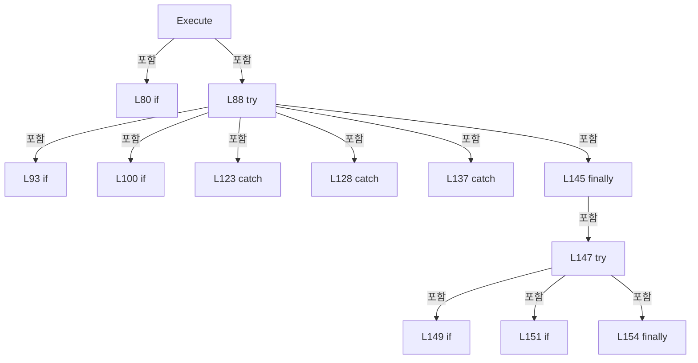

변경 전 점검: 입력/반환 타입, 위 호출자, 예외/취소 경로, 공유 상태와 저장·전송 소비자를 함께 확인합니다. 값의 단위나 물리 방향을 이름만으로 확정하지 않습니다.

### LocalFunctionStatement `SelectValue` · L110–113

[Drilling.Common/Interface/Automation1/CAutomation1Comm.cs:110–113](https://github.com/kjuws10-rgb/A3Drilling/blob/5aee8e58439c9b455cae7c9593c9be986c3e682e/Drilling.Common/Interface/Automation1/CAutomation1Comm.cs#L110-L113)

| 항목 | 실제 추출 값 |
| --- | --- |
| 서명 | string SelectValue() |
| 접근/수식자 | Private /  |
| 반환/값 타입 | string |
| 소속 타입 | NamedType:Drilling.Common.Interface.CAutomation1Comm |

현재 부분 분석에서 직접 연결된 호출자는 없습니다. XAML/이벤트/인터페이스·델리게이트·외부 진입을 추가 확인해야 하며, 미사용으로 판정한 것이 아닙니다.

호출하는 대상과 해석 범위:

| 원본 행 | 표현식 | 분석 상태 | 대상/소스 위치 |
| --- | --- | --- | --- |
| 112 | ExecuteAutomation1Function | resolved | string Drilling.Common.Interface.CAutomation1Comm.ExecuteAutomation1Function(Controller, string, System.Threading.CancellationToken) · Drilling.Common/Interface/Automation1/CAutomation1Comm.cs:639 |

본문의 실제 연산·분기·예외·반환 순서(원문 위치 순):

| 원본 행 | 종류 | 주석 해설 |
| --- | --- | --- |
| 112 | call | 함수·델리게이트 또는 객체 생성자를 호출합니다: ExecuteAutomation1Function(controller, function, executeCancellationToken) |
| 112 | return | 호출자에게 값 또는 제어를 반환합니다: return ExecuteAutomation1Function(controller, function, executeCancellationToken); |

변경 전 점검: 입력/반환 타입, 위 호출자, 예외/취소 경로, 공유 상태와 저장·전송 소비자를 함께 확인합니다. 값의 단위나 물리 방향을 이름만으로 확정하지 않습니다.

### MethodDeclaration `AcquireCommandLockOrReadBufferedStatus` · L161–197

[Drilling.Common/Interface/Automation1/CAutomation1Comm.cs:161–197](https://github.com/kjuws10-rgb/A3Drilling/blob/5aee8e58439c9b455cae7c9593c9be986c3e682e/Drilling.Common/Interface/Automation1/CAutomation1Comm.cs#L161-L197)

| 항목 | 실제 추출 값 |
| --- | --- |
| 서명 | System.Threading.Tasks.Task<string?> Drilling.Common.Interface.CAutomation1Comm.AcquireCommandLockOrReadBufferedStatus(string, System.Threading.CancellationToken) |
| 접근/수식자 | Private / private, async |
| 반환/값 타입 | System.Threading.Tasks.Task<string?> |
| 소속 타입 | NamedType:Drilling.Common.Interface.CAutomation1Comm |

입력 계약:

| 이름 | 타입 | 전달 | 선택/기본값 |
| --- | --- | --- | --- |
| function | string | None | False /  |
| token | System.Threading.CancellationToken | None | False /  |

정적 호출자로 확인된 위치:

| 호출 파일/행 | 호출 표현식 | 런타임 분기 가능 |
| --- | --- | --- |
| [Drilling.Common/Interface/Automation1/CAutomation1Comm.cs:79–79](https://github.com/kjuws10-rgb/A3Drilling/blob/5aee8e58439c9b455cae7c9593c9be986c3e682e/Drilling.Common/Interface/Automation1/CAutomation1Comm.cs#L79-L79) | AcquireCommandLockOrReadBufferedStatus | False |

호출하는 대상과 해석 범위:

| 원본 행 | 표현식 | 분석 상태 | 대상/소스 위치 |
| --- | --- | --- | --- |
| 163 | IsBufferedRunReadOnlyStatusRequest | resolved | bool Drilling.Common.Interface.CAutomation1Comm.IsBufferedRunReadOnlyStatusRequest(string) · Drilling.Common/Interface/Automation1/CAutomation1Comm.cs:371 |
| 163 | TryReadTaskStatusRequest | resolved | bool Drilling.Common.Interface.CAutomation1Comm.TryReadTaskStatusRequest(string, out int) · Drilling.Common/Interface/Automation1/CAutomation1Comm.cs:514 |
| 165 | _commLock.WaitAsync(token).ConfigureAwait | resolved | System.Runtime.CompilerServices.ConfiguredTaskAwaitable System.Threading.Tasks.Task.ConfigureAwait(bool) |
| 165 | _commLock.WaitAsync | resolved | System.Threading.Tasks.Task System.Threading.SemaphoreSlim.WaitAsync(System.Threading.CancellationToken) |
| 171 | token.ThrowIfCancellationRequested | resolved | void System.Threading.CancellationToken.ThrowIfCancellationRequested() |
| 175 | TryReadActiveBufferedRunTaskStatus | resolved | bool Drilling.Common.Interface.CAutomation1Comm.TryReadActiveBufferedRunTaskStatus(string, out string) · Drilling.Common/Interface/Automation1/CAutomation1Comm.cs:257 |
| 177 | TryExecuteActiveBufferedRunStatusRead(function, token).ConfigureAwait | resolved | System.Runtime.CompilerServices.ConfiguredTaskAwaitable<string?> System.Threading.Tasks.Task<string?>.ConfigureAwait(bool) |
| 177 | TryExecuteActiveBufferedRunStatusRead | resolved | System.Threading.Tasks.Task<string?> Drilling.Common.Interface.CAutomation1Comm.TryExecuteActiveBufferedRunStatusRead(string, System.Threading.CancellationToken) · Drilling.Common/Interface/Automation1/CAutomation1Comm.cs:296 |
| 183 | CancellationTokenSource.CreateLinkedTokenSource | resolved | System.Threading.CancellationTokenSource System.Threading.CancellationTokenSource.CreateLinkedTokenSource(System.Threading.CancellationToken) |
| 184 | _commLock.WaitAsync | resolved | System.Threading.Tasks.Task System.Threading.SemaphoreSlim.WaitAsync(System.Threading.CancellationToken) |
| 186 | Task.WhenAny(acquired, changed.WaitAsync(wait.Token)).ConfigureAwait | resolved | System.Runtime.CompilerServices.ConfiguredTaskAwaitable<System.Threading.Tasks.Task> System.Threading.Tasks.Task<System.Threading.Tasks.Task>.ConfigureAwait(bool) |
| 186 | Task.WhenAny | resolved | System.Threading.Tasks.Task<System.Threading.Tasks.Task> System.Threading.Tasks.Task.WhenAny(System.Threading.Tasks.Task, System.Threading.Tasks.Task) |
| 186 | changed.WaitAsync | resolved | System.Threading.Tasks.Task System.Threading.Tasks.Task.WaitAsync(System.Threading.CancellationToken) |
| 187 | wait.Cancel | resolved | void System.Threading.CancellationTokenSource.Cancel() |
| 190 | acquired.ConfigureAwait | resolved | System.Runtime.CompilerServices.ConfiguredTaskAwaitable System.Threading.Tasks.Task.ConfigureAwait(bool) |

본문의 실제 연산·분기·예외·반환 순서(원문 위치 순):

| 원본 행 | 종류 | 주석 해설 |
| --- | --- | --- |
| 163 | call | 함수·델리게이트 또는 객체 생성자를 호출합니다: IsBufferedRunReadOnlyStatusRequest(function) |
| 163 | call | 함수·델리게이트 또는 객체 생성자를 호출합니다: TryReadTaskStatusRequest(function, out _) |
| 163 | if | 조건에 따라 분기합니다: if (!IsBufferedRunReadOnlyStatusRequest(function) && !TryReadTaskStatusRequest(function, out _)) |
| 165 | await | 비동기 완료를 기다립니다: await _commLock.WaitAsync(token).ConfigureAwait(false) |
| 165 | call | 함수·델리게이트 또는 객체 생성자를 호출합니다: _commLock.WaitAsync(token).ConfigureAwait(false) |
| 165 | call | 함수·델리게이트 또는 객체 생성자를 호출합니다: _commLock.WaitAsync(token) |
| 166 | return | 호출자에게 값 또는 제어를 반환합니다: return null; |
| 169 | while | 조건을 먼저 확인하며 반복합니다: while (true) |
| 171 | call | 함수·델리게이트 또는 객체 생성자를 호출합니다: token.ThrowIfCancellationRequested() |
| 172 | local-declaration | 지역 변수를 선언합니다: Task changed; |
| 173 | lock | 공유 상태의 임계 구역에 진입합니다: lock (_activeBufferedRunLock) |
| 174 | assignment | 값을 대상에 대입합니다: changed = _bufferedRunChanged.Task |
| 175 | call | 함수·델리게이트 또는 객체 생성자를 호출합니다: TryReadActiveBufferedRunTaskStatus(function, out var taskStatus) |
| 175 | if | 조건에 따라 분기합니다: if (TryReadActiveBufferedRunTaskStatus(function, out var taskStatus)) |
| 176 | return | 호출자에게 값 또는 제어를 반환합니다: return taskStatus; |
| 177 | await | 비동기 완료를 기다립니다: await TryExecuteActiveBufferedRunStatusRead(function, token).ConfigureAwait(false) |
| 177 | call | 함수·델리게이트 또는 객체 생성자를 호출합니다: TryExecuteActiveBufferedRunStatusRead(function, token).ConfigureAwait(false) |
| 177 | call | 함수·델리게이트 또는 객체 생성자를 호출합니다: TryExecuteActiveBufferedRunStatusRead(function, token) |
| 177 | local-declaration | 지역 변수를 선언합니다: var status = await TryExecuteActiveBufferedRunStatusRead(function, token).ConfigureAwait(false); |
| 177 | variable-initializer | 변수의 초기값을 지정합니다: status = await TryExecuteActiveBufferedRunStatusRead(function, token).ConfigureAwait(false) |
| 178 | if | 조건에 따라 분기합니다: if (status is not null) |
| 179 | return | 호출자에게 값 또는 제어를 반환합니다: return status; |
| 183 | call | 함수·델리게이트 또는 객체 생성자를 호출합니다: CancellationTokenSource.CreateLinkedTokenSource(token) |
| 183 | using-declaration | 정리할 자원을 선언합니다: using var wait = CancellationTokenSource.CreateLinkedTokenSource(token); |
| 183 | variable-initializer | 변수의 초기값을 지정합니다: wait = CancellationTokenSource.CreateLinkedTokenSource(token) |
| 184 | call | 함수·델리게이트 또는 객체 생성자를 호출합니다: _commLock.WaitAsync(wait.Token) |
| 184 | local-declaration | 지역 변수를 선언합니다: var acquired = _commLock.WaitAsync(wait.Token); |
| 184 | variable-initializer | 변수의 초기값을 지정합니다: acquired = _commLock.WaitAsync(wait.Token) |
| 185 | if | 조건에 따라 분기합니다: if (!acquired.IsCompleted) |
| 186 | await | 비동기 완료를 기다립니다: await Task.WhenAny(acquired, changed.WaitAsync(wait.Token)).ConfigureAwait(false) |
| 186 | call | 함수·델리게이트 또는 객체 생성자를 호출합니다: Task.WhenAny(acquired, changed.WaitAsync(wait.Token)).ConfigureAwait(false) |
| 186 | call | 함수·델리게이트 또는 객체 생성자를 호출합니다: Task.WhenAny(acquired, changed.WaitAsync(wait.Token)) |
| 186 | call | 함수·델리게이트 또는 객체 생성자를 호출합니다: changed.WaitAsync(wait.Token) |
| 187 | call | 함수·델리게이트 또는 객체 생성자를 호출합니다: wait.Cancel() |
| 188 | try | 예외 처리 범위입니다: try |
| 190 | await | 비동기 완료를 기다립니다: await acquired.ConfigureAwait(false) |
| 190 | call | 함수·델리게이트 또는 객체 생성자를 호출합니다: acquired.ConfigureAwait(false) |
| 191 | return | 호출자에게 값 또는 제어를 반환합니다: return null; |
| 193 | catch | 지정 예외를 처리합니다: catch (OperationCanceledException) when (!token.IsCancellationRequested) |

제어 구문의 포함 구조(실제 실행 순서/CFG가 아닌 구문 탐색 그림):

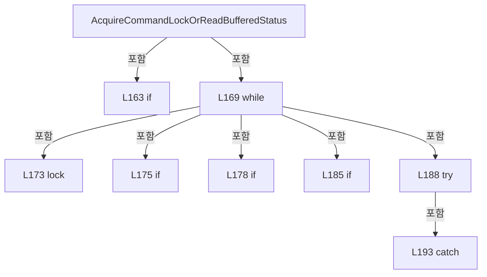

변경 전 점검: 입력/반환 타입, 위 호출자, 예외/취소 경로, 공유 상태와 저장·전송 소비자를 함께 확인합니다. 값의 단위나 물리 방향을 이름만으로 확정하지 않습니다.

### MethodDeclaration `FinishBufferedRunAfterStatusReads` · L199–212

[Drilling.Common/Interface/Automation1/CAutomation1Comm.cs:199–212](https://github.com/kjuws10-rgb/A3Drilling/blob/5aee8e58439c9b455cae7c9593c9be986c3e682e/Drilling.Common/Interface/Automation1/CAutomation1Comm.cs#L199-L212)

| 항목 | 실제 추출 값 |
| --- | --- |
| 서명 | System.Threading.Tasks.Task Drilling.Common.Interface.CAutomation1Comm.FinishBufferedRunAfterStatusReads(System.Threading.CancellationTokenSource) |
| 접근/수식자 | Private / private, async |
| 반환/값 타입 | System.Threading.Tasks.Task |
| 소속 타입 | NamedType:Drilling.Common.Interface.CAutomation1Comm |

입력 계약:

| 이름 | 타입 | 전달 | 선택/기본값 |
| --- | --- | --- | --- |
| cancellation | System.Threading.CancellationTokenSource | None | False /  |

정적 호출자로 확인된 위치:

| 호출 파일/행 | 호출 표현식 | 런타임 분기 가능 |
| --- | --- | --- |
| [Drilling.Common/Interface/Automation1/CAutomation1Comm.cs:152–152](https://github.com/kjuws10-rgb/A3Drilling/blob/5aee8e58439c9b455cae7c9593c9be986c3e682e/Drilling.Common/Interface/Automation1/CAutomation1Comm.cs#L152-L152) | FinishBufferedRunAfterStatusReads | False |

호출하는 대상과 해석 범위:

| 원본 행 | 표현식 | 분석 상태 | 대상/소스 위치 |
| --- | --- | --- | --- |
| 202 | _statusReadLock.WaitAsync().ConfigureAwait | resolved | System.Runtime.CompilerServices.ConfiguredTaskAwaitable System.Threading.Tasks.Task.ConfigureAwait(bool) |
| 202 | _statusReadLock.WaitAsync | resolved | System.Threading.Tasks.Task System.Threading.SemaphoreSlim.WaitAsync() |
| 205 | UnregisterActiveBufferedRun | resolved | void Drilling.Common.Interface.CAutomation1Comm.UnregisterActiveBufferedRun(System.Threading.CancellationTokenSource) · Drilling.Common/Interface/Automation1/CAutomation1Comm.cs:235 |
| 206 | cancellation.Dispose | resolved | void System.Threading.CancellationTokenSource.Dispose() |
| 210 | _statusReadLock.Release | resolved | int System.Threading.SemaphoreSlim.Release() |

본문의 실제 연산·분기·예외·반환 순서(원문 위치 순):

| 원본 행 | 종류 | 주석 해설 |
| --- | --- | --- |
| 202 | await | 비동기 완료를 기다립니다: await _statusReadLock.WaitAsync().ConfigureAwait(false) |
| 202 | call | 함수·델리게이트 또는 객체 생성자를 호출합니다: _statusReadLock.WaitAsync().ConfigureAwait(false) |
| 202 | call | 함수·델리게이트 또는 객체 생성자를 호출합니다: _statusReadLock.WaitAsync() |
| 203 | try | 예외 처리 범위입니다: try |
| 205 | call | 함수·델리게이트 또는 객체 생성자를 호출합니다: UnregisterActiveBufferedRun(cancellation) |
| 206 | call | 함수·델리게이트 또는 객체 생성자를 호출합니다: cancellation.Dispose() |
| 208 | finally | 종료 정리 구간입니다: finally |
| 210 | call | 함수·델리게이트 또는 객체 생성자를 호출합니다: _statusReadLock.Release() |

제어 구문의 포함 구조(실제 실행 순서/CFG가 아닌 구문 탐색 그림):

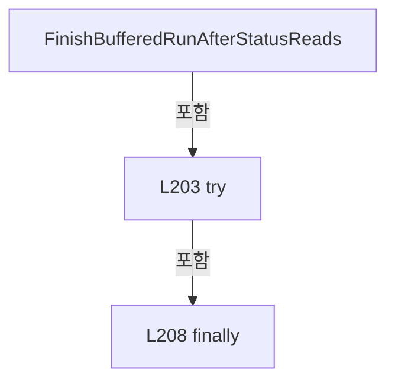

변경 전 점검: 입력/반환 타입, 위 호출자, 예외/취소 경로, 공유 상태와 저장·전송 소비자를 함께 확인합니다. 값의 단위나 물리 방향을 이름만으로 확정하지 않습니다.

### MethodDeclaration `RegisterActiveBufferedRun` · L214–233

[Drilling.Common/Interface/Automation1/CAutomation1Comm.cs:214–233](https://github.com/kjuws10-rgb/A3Drilling/blob/5aee8e58439c9b455cae7c9593c9be986c3e682e/Drilling.Common/Interface/Automation1/CAutomation1Comm.cs#L214-L233)

| 항목 | 실제 추출 값 |
| --- | --- |
| 서명 | void Drilling.Common.Interface.CAutomation1Comm.RegisterActiveBufferedRun(System.Threading.CancellationTokenSource, string) |
| 접근/수식자 | Private / private |
| 반환/값 타입 | void |
| 소속 타입 | NamedType:Drilling.Common.Interface.CAutomation1Comm |

입력 계약:

| 이름 | 타입 | 전달 | 선택/기본값 |
| --- | --- | --- | --- |
| cancellation | System.Threading.CancellationTokenSource | None | False /  |
| function | string | None | False /  |

정적 호출자로 확인된 위치:

| 호출 파일/행 | 호출 표현식 | 런타임 분기 가능 |
| --- | --- | --- |
| [Drilling.Common/Interface/Automation1/CAutomation1Comm.cs:104–104](https://github.com/kjuws10-rgb/A3Drilling/blob/5aee8e58439c9b455cae7c9593c9be986c3e682e/Drilling.Common/Interface/Automation1/CAutomation1Comm.cs#L104-L104) | RegisterActiveBufferedRun | False |

호출하는 대상과 해석 범위:

| 원본 행 | 표현식 | 분석 상태 | 대상/소스 위치 |
| --- | --- | --- | --- |
| 216 | TryGetAutomationBody | resolved | bool Drilling.Common.Interface.CAutomation1Comm.TryGetAutomationBody(string, out string) · Drilling.Common/Interface/Automation1/CAutomation1Comm.cs:565 |
| 217 | SplitPipe | resolved | string[] Drilling.Common.Interface.CAutomation1Comm.SplitPipe(string) · Drilling.Common/Interface/Automation1/CAutomation1Comm.cs:1724 |
| 218 | new HashSet<int> | resolved | System.Collections.Generic.HashSet<int>.HashSet() |
| 219 | fields[1].Equals | resolved | bool string.Equals(string?, System.StringComparison) |
| 222 | tasks.Add | resolved | bool System.Collections.Generic.HashSet<int>.Add(int) |
| 222 | ReadInt | resolved | int Drilling.Common.Interface.CAutomation1Comm.ReadInt(string, string) · Drilling.Common/Interface/Automation1/CAutomation1Comm.cs:1729 |
| 225 | tasks.Add | resolved | bool System.Collections.Generic.HashSet<int>.Add(int) |
| 225 | ReadInt | resolved | int Drilling.Common.Interface.CAutomation1Comm.ReadInt(System.Collections.Generic.IReadOnlyList<string>, int, int, string) · Drilling.Common/Interface/Automation1/CAutomation1Comm.cs:1734 |
| 229 | new Dictionary<int, CBufferedRunTaskState> | resolved | System.Collections.Generic.Dictionary<int, Drilling.Common.Interface.CAutomation1Comm.CBufferedRunTaskState>.Dictionary() |
| 231 | SignalBufferedRunChanged | resolved | void Drilling.Common.Interface.CAutomation1Comm.SignalBufferedRunChanged() · Drilling.Common/Interface/Automation1/CAutomation1Comm.cs:250 |

본문의 실제 연산·분기·예외·반환 순서(원문 위치 순):

| 원본 행 | 종류 | 주석 해설 |
| --- | --- | --- |
| 216 | call | 함수·델리게이트 또는 객체 생성자를 호출합니다: TryGetAutomationBody(function, out var body) |
| 217 | call | 함수·델리게이트 또는 객체 생성자를 호출합니다: SplitPipe(body) |
| 217 | local-declaration | 지역 변수를 선언합니다: var fields = SplitPipe(body); |
| 217 | variable-initializer | 변수의 초기값을 지정합니다: fields = SplitPipe(body) |
| 218 | call | 함수·델리게이트 또는 객체 생성자를 호출합니다: new HashSet<int>() |
| 218 | local-declaration | 지역 변수를 선언합니다: var tasks = new HashSet<int>(); |
| 218 | variable-initializer | 변수의 초기값을 지정합니다: tasks = new HashSet<int>() |
| 219 | call | 함수·델리게이트 또는 객체 생성자를 호출합니다: fields[1].Equals("BUFFERED_RUN_GROUP", StringComparison.OrdinalIgnoreCase) |
| 219 | if | 조건에 따라 분기합니다: if (fields.Length > 1 && fields[1].Equals("BUFFERED_RUN_GROUP", StringComparison.OrdinalIgnoreCase)) |
| 221 | compound-assignment-or-event-subscription | 복합 대입 또는 이벤트 구독/해지 표현입니다: index += 2 |
| 221 | variable-initializer | 변수의 초기값을 지정합니다: index = 5 |
| 221 | for | 초기화·조건·증감이 있는 반복입니다: for (var index = 5; index + 1 < fields.Length; index += 2) |
| 222 | call | 함수·델리게이트 또는 객체 생성자를 호출합니다: tasks.Add(ReadInt(fields[index], "TASK")) |
| 222 | call | 함수·델리게이트 또는 객체 생성자를 호출합니다: ReadInt(fields[index], "TASK") |
| 224 | else | 앞 조건이 거짓인 경로입니다: else |
| 225 | call | 함수·델리게이트 또는 객체 생성자를 호출합니다: tasks.Add(ReadInt(fields, 2, DefaultTaskIndex, "TASK")) |
| 225 | call | 함수·델리게이트 또는 객체 생성자를 호출합니다: ReadInt(fields, 2, DefaultTaskIndex, "TASK") |
| 226 | lock | 공유 상태의 임계 구역에 진입합니다: lock (_activeBufferedRunLock) |
| 228 | assignment | 값을 대상에 대입합니다: _activeBufferedRunCancellation = cancellation |
| 229 | assignment | 값을 대상에 대입합니다: _activeBufferedRunTaskStates = new Dictionary<int, CBufferedRunTaskState>() |
| 229 | call | 함수·델리게이트 또는 객체 생성자를 호출합니다: new Dictionary<int, CBufferedRunTaskState>() |
| 230 | assignment | 값을 대상에 대입합니다: _activeBufferedRunRequestedTasks = tasks |
| 231 | call | 함수·델리게이트 또는 객체 생성자를 호출합니다: SignalBufferedRunChanged() |

제어 구문의 포함 구조(실제 실행 순서/CFG가 아닌 구문 탐색 그림):

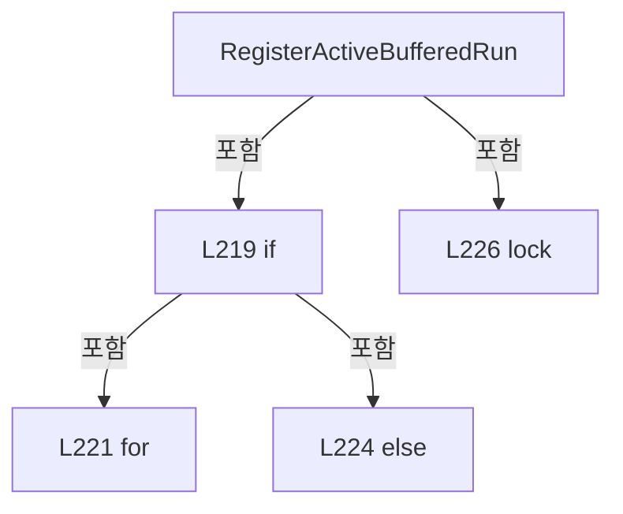

변경 전 점검: 입력/반환 타입, 위 호출자, 예외/취소 경로, 공유 상태와 저장·전송 소비자를 함께 확인합니다. 값의 단위나 물리 방향을 이름만으로 확정하지 않습니다.

### MethodDeclaration `UnregisterActiveBufferedRun` · L235–247

[Drilling.Common/Interface/Automation1/CAutomation1Comm.cs:235–247](https://github.com/kjuws10-rgb/A3Drilling/blob/5aee8e58439c9b455cae7c9593c9be986c3e682e/Drilling.Common/Interface/Automation1/CAutomation1Comm.cs#L235-L247)

| 항목 | 실제 추출 값 |
| --- | --- |
| 서명 | void Drilling.Common.Interface.CAutomation1Comm.UnregisterActiveBufferedRun(System.Threading.CancellationTokenSource) |
| 접근/수식자 | Private / private |
| 반환/값 타입 | void |
| 소속 타입 | NamedType:Drilling.Common.Interface.CAutomation1Comm |

입력 계약:

| 이름 | 타입 | 전달 | 선택/기본값 |
| --- | --- | --- | --- |
| cancellation | System.Threading.CancellationTokenSource | None | False /  |

정적 호출자로 확인된 위치:

| 호출 파일/행 | 호출 표현식 | 런타임 분기 가능 |
| --- | --- | --- |
| [Drilling.Common/Interface/Automation1/CAutomation1Comm.cs:205–205](https://github.com/kjuws10-rgb/A3Drilling/blob/5aee8e58439c9b455cae7c9593c9be986c3e682e/Drilling.Common/Interface/Automation1/CAutomation1Comm.cs#L205-L205) | UnregisterActiveBufferedRun | False |

호출하는 대상과 해석 범위:

| 원본 행 | 표현식 | 분석 상태 | 대상/소스 위치 |
| --- | --- | --- | --- |
| 239 | ReferenceEquals | resolved | bool object.ReferenceEquals(object?, object?) |
| 242 | new Dictionary<int, CBufferedRunTaskState> | resolved | System.Collections.Generic.Dictionary<int, Drilling.Common.Interface.CAutomation1Comm.CBufferedRunTaskState>.Dictionary() |
| 243 | new HashSet<int> | resolved | System.Collections.Generic.HashSet<int>.HashSet() |
| 244 | SignalBufferedRunChanged | resolved | void Drilling.Common.Interface.CAutomation1Comm.SignalBufferedRunChanged() · Drilling.Common/Interface/Automation1/CAutomation1Comm.cs:250 |

본문의 실제 연산·분기·예외·반환 순서(원문 위치 순):

| 원본 행 | 종류 | 주석 해설 |
| --- | --- | --- |
| 237 | lock | 공유 상태의 임계 구역에 진입합니다: lock (_activeBufferedRunLock) |
| 239 | call | 함수·델리게이트 또는 객체 생성자를 호출합니다: ReferenceEquals(_activeBufferedRunCancellation, cancellation) |
| 239 | if | 조건에 따라 분기합니다: if (ReferenceEquals(_activeBufferedRunCancellation, cancellation)) |
| 241 | assignment | 값을 대상에 대입합니다: _activeBufferedRunCancellation = null |
| 242 | assignment | 값을 대상에 대입합니다: _activeBufferedRunTaskStates = new Dictionary<int, CBufferedRunTaskState>() |
| 242 | call | 함수·델리게이트 또는 객체 생성자를 호출합니다: new Dictionary<int, CBufferedRunTaskState>() |
| 243 | assignment | 값을 대상에 대입합니다: _activeBufferedRunRequestedTasks = new HashSet<int>() |
| 243 | call | 함수·델리게이트 또는 객체 생성자를 호출합니다: new HashSet<int>() |
| 244 | call | 함수·델리게이트 또는 객체 생성자를 호출합니다: SignalBufferedRunChanged() |

제어 구문의 포함 구조(실제 실행 순서/CFG가 아닌 구문 탐색 그림):

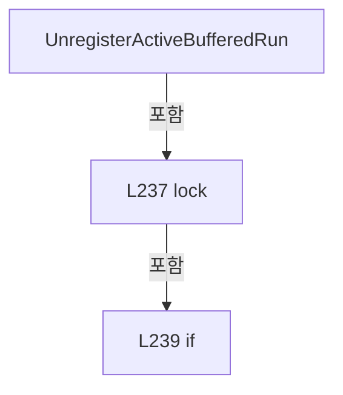

변경 전 점검: 입력/반환 타입, 위 호출자, 예외/취소 경로, 공유 상태와 저장·전송 소비자를 함께 확인합니다. 값의 단위나 물리 방향을 이름만으로 확정하지 않습니다.

### MethodDeclaration `SignalBufferedRunChanged` · L250–255

[Drilling.Common/Interface/Automation1/CAutomation1Comm.cs:250–255](https://github.com/kjuws10-rgb/A3Drilling/blob/5aee8e58439c9b455cae7c9593c9be986c3e682e/Drilling.Common/Interface/Automation1/CAutomation1Comm.cs#L250-L255)

| 항목 | 실제 추출 값 |
| --- | --- |
| 서명 | void Drilling.Common.Interface.CAutomation1Comm.SignalBufferedRunChanged() |
| 접근/수식자 | Private / private |
| 반환/값 타입 | void |
| 소속 타입 | NamedType:Drilling.Common.Interface.CAutomation1Comm |

정적 호출자로 확인된 위치:

| 호출 파일/행 | 호출 표현식 | 런타임 분기 가능 |
| --- | --- | --- |
| [Drilling.Common/Interface/Automation1/CAutomation1Comm.cs:231–231](https://github.com/kjuws10-rgb/A3Drilling/blob/5aee8e58439c9b455cae7c9593c9be986c3e682e/Drilling.Common/Interface/Automation1/CAutomation1Comm.cs#L231-L231) | SignalBufferedRunChanged | False |
| [Drilling.Common/Interface/Automation1/CAutomation1Comm.cs:244–244](https://github.com/kjuws10-rgb/A3Drilling/blob/5aee8e58439c9b455cae7c9593c9be986c3e682e/Drilling.Common/Interface/Automation1/CAutomation1Comm.cs#L244-L244) | SignalBufferedRunChanged | False |

호출하는 대상과 해석 범위:

| 원본 행 | 표현식 | 분석 상태 | 대상/소스 위치 |
| --- | --- | --- | --- |
| 253 | new | resolved | System.Threading.Tasks.TaskCompletionSource.TaskCompletionSource(System.Threading.Tasks.TaskCreationOptions) |
| 254 | previous.TrySetResult | resolved | bool System.Threading.Tasks.TaskCompletionSource.TrySetResult() |

본문의 실제 연산·분기·예외·반환 순서(원문 위치 순):

| 원본 행 | 종류 | 주석 해설 |
| --- | --- | --- |
| 252 | local-declaration | 지역 변수를 선언합니다: var previous = _bufferedRunChanged; |
| 252 | variable-initializer | 변수의 초기값을 지정합니다: previous = _bufferedRunChanged |
| 253 | assignment | 값을 대상에 대입합니다: _bufferedRunChanged = new(TaskCreationOptions.RunContinuationsAsynchronously) |
| 253 | call | 함수·델리게이트 또는 객체 생성자를 호출합니다: new(TaskCreationOptions.RunContinuationsAsynchronously) |
| 254 | call | 함수·델리게이트 또는 객체 생성자를 호출합니다: previous.TrySetResult() |

변경 전 점검: 입력/반환 타입, 위 호출자, 예외/취소 경로, 공유 상태와 저장·전송 소비자를 함께 확인합니다. 값의 단위나 물리 방향을 이름만으로 확정하지 않습니다.

### MethodDeclaration `TryReadActiveBufferedRunTaskStatus` · L257–294

[Drilling.Common/Interface/Automation1/CAutomation1Comm.cs:257–294](https://github.com/kjuws10-rgb/A3Drilling/blob/5aee8e58439c9b455cae7c9593c9be986c3e682e/Drilling.Common/Interface/Automation1/CAutomation1Comm.cs#L257-L294)

| 항목 | 실제 추출 값 |
| --- | --- |
| 서명 | bool Drilling.Common.Interface.CAutomation1Comm.TryReadActiveBufferedRunTaskStatus(string, out string) |
| 접근/수식자 | Private / private |
| 반환/값 타입 | bool |
| 소속 타입 | NamedType:Drilling.Common.Interface.CAutomation1Comm |

입력 계약:

| 이름 | 타입 | 전달 | 선택/기본값 |
| --- | --- | --- | --- |
| function | string | None | False /  |
| response | string | Out | False /  |

정적 호출자로 확인된 위치:

| 호출 파일/행 | 호출 표현식 | 런타임 분기 가능 |
| --- | --- | --- |
| [Drilling.Common/Interface/Automation1/CAutomation1Comm.cs:175–175](https://github.com/kjuws10-rgb/A3Drilling/blob/5aee8e58439c9b455cae7c9593c9be986c3e682e/Drilling.Common/Interface/Automation1/CAutomation1Comm.cs#L175-L175) | TryReadActiveBufferedRunTaskStatus | False |

호출하는 대상과 해석 범위:

| 원본 행 | 표현식 | 분석 상태 | 대상/소스 위치 |
| --- | --- | --- | --- |
| 260 | TryReadTaskStatusRequest | resolved | bool Drilling.Common.Interface.CAutomation1Comm.TryReadTaskStatusRequest(string, out int) · Drilling.Common/Interface/Automation1/CAutomation1Comm.cs:514 |
| 272 | _activeBufferedRunTaskStates.TryGetValue | resolved · 동적 구현 선택 가능 | bool System.Collections.Generic.IReadOnlyDictionary<int, Drilling.Common.Interface.CAutomation1Comm.CBufferedRunTaskState>.TryGetValue(int, out Drilling.Common.Interface.CAutomation1Comm.CBufferedRunTaskState) |
| 274 | _activeBufferedRunRequestedTasks.Contains | resolved · 동적 구현 선택 가능 | bool System.Collections.Generic.IReadOnlySet<int>.Contains(int) |
| 274 | _lastTaskStatusResponses.TryGetValue | resolved | bool System.Collections.Generic.Dictionary<int, string>.TryGetValue(int, out string) |
| 280 | FormatBufferedRunTaskStatusStarting | resolved | string Drilling.Common.Interface.CAutomation1Comm.FormatBufferedRunTaskStatusStarting(int) · Drilling.Common/Interface/Automation1/CAutomation1Comm.cs:1085 |
| 285 | FormatActiveBufferedRunTaskStatus | resolved | string Drilling.Common.Interface.CAutomation1Comm.FormatActiveBufferedRunTaskStatus(Drilling.Common.Interface.CAutomation1Comm.CBufferedRunTaskState) · Drilling.Common/Interface/Automation1/CAutomation1Comm.cs:1078 |

본문의 실제 연산·분기·예외·반환 순서(원문 위치 순):

| 원본 행 | 종류 | 주석 해설 |
| --- | --- | --- |
| 259 | assignment | 값을 대상에 대입합니다: response = "" |
| 260 | call | 함수·델리게이트 또는 객체 생성자를 호출합니다: TryReadTaskStatusRequest(function, out var taskIndex) |
| 260 | if | 조건에 따라 분기합니다: if (!TryReadTaskStatusRequest(function, out var taskIndex)) |
| 262 | return | 호출자에게 값 또는 제어를 반환합니다: return false; |
| 265 | lock | 공유 상태의 임계 구역에 진입합니다: lock (_activeBufferedRunLock) |
| 267 | if | 조건에 따라 분기합니다: if (_activeBufferedRunCancellation is null) |
| 269 | return | 호출자에게 값 또는 제어를 반환합니다: return false; |
| 272 | call | 함수·델리게이트 또는 객체 생성자를 호출합니다: _activeBufferedRunTaskStates.TryGetValue(taskIndex, out var state) |
| 272 | if | 조건에 따라 분기합니다: if (!_activeBufferedRunTaskStates.TryGetValue(taskIndex, out var state)) |
| 274 | call | 함수·델리게이트 또는 객체 생성자를 호출합니다: _activeBufferedRunRequestedTasks.Contains(taskIndex) |
| 274 | call | 함수·델리게이트 또는 객체 생성자를 호출합니다: _lastTaskStatusResponses.TryGetValue(taskIndex, out var lastResponse) |
| 274 | if | 조건에 따라 분기합니다: if (!_activeBufferedRunRequestedTasks.Contains(taskIndex) && _lastTaskStatusResponses.TryGetValue(taskIndex, out var lastResponse)) |
| 276 | assignment | 값을 대상에 대입합니다: response = lastResponse |
| 278 | else | 앞 조건이 거짓인 경로입니다: else |
| 280 | assignment | 값을 대상에 대입합니다: response = FormatBufferedRunTaskStatusStarting(taskIndex) |
| 280 | call | 함수·델리게이트 또는 객체 생성자를 호출합니다: FormatBufferedRunTaskStatusStarting(taskIndex) |
| 283 | else | 앞 조건이 거짓인 경로입니다: else |
| 285 | assignment | 값을 대상에 대입합니다: response = FormatActiveBufferedRunTaskStatus(state) |
| 285 | call | 함수·델리게이트 또는 객체 생성자를 호출합니다: FormatActiveBufferedRunTaskStatus(state) |
| 286 | assignment | 값을 대상에 대입합니다: _lastTaskStatusResponses[taskIndex] = response |
| 289 | assignment | 값을 대상에 대입합니다: LastSent = function |
| 290 | assignment | 값을 대상에 대입합니다: LastReceived = response |
| 291 | assignment | 값을 대상에 대입합니다: LastError = "" |
| 292 | return | 호출자에게 값 또는 제어를 반환합니다: return true; |

제어 구문의 포함 구조(실제 실행 순서/CFG가 아닌 구문 탐색 그림):

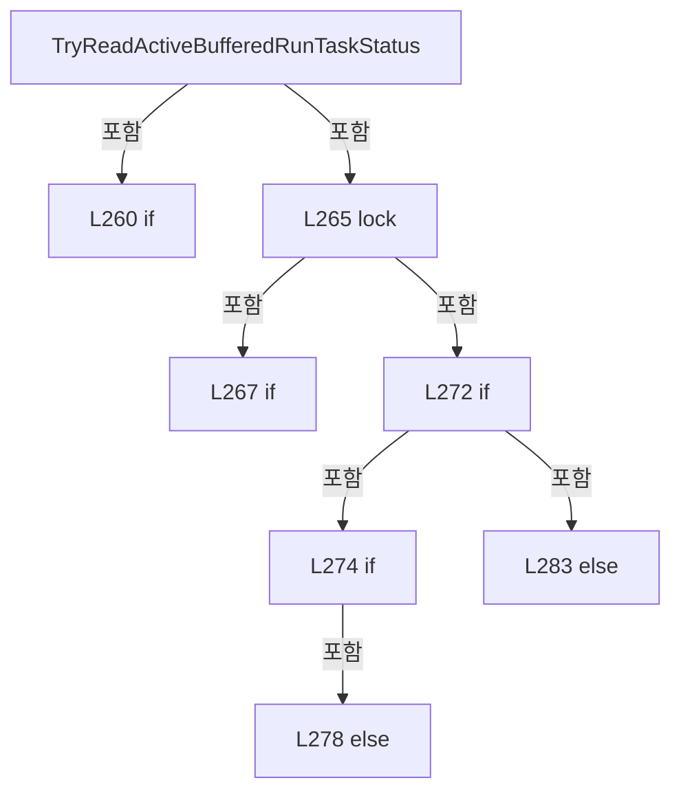

변경 전 점검: 입력/반환 타입, 위 호출자, 예외/취소 경로, 공유 상태와 저장·전송 소비자를 함께 확인합니다. 값의 단위나 물리 방향을 이름만으로 확정하지 않습니다.

### MethodDeclaration `TryExecuteActiveBufferedRunStatusRead` · L296–354

[Drilling.Common/Interface/Automation1/CAutomation1Comm.cs:296–354](https://github.com/kjuws10-rgb/A3Drilling/blob/5aee8e58439c9b455cae7c9593c9be986c3e682e/Drilling.Common/Interface/Automation1/CAutomation1Comm.cs#L296-L354)

| 항목 | 실제 추출 값 |
| --- | --- |
| 서명 | System.Threading.Tasks.Task<string?> Drilling.Common.Interface.CAutomation1Comm.TryExecuteActiveBufferedRunStatusRead(string, System.Threading.CancellationToken) |
| 접근/수식자 | Private / private, async |
| 반환/값 타입 | System.Threading.Tasks.Task<string?> |
| 소속 타입 | NamedType:Drilling.Common.Interface.CAutomation1Comm |

입력 계약:

| 이름 | 타입 | 전달 | 선택/기본값 |
| --- | --- | --- | --- |
| function | string | None | False /  |
| cancellationToken | System.Threading.CancellationToken | None | False /  |

정적 호출자로 확인된 위치:

| 호출 파일/행 | 호출 표현식 | 런타임 분기 가능 |
| --- | --- | --- |
| [Drilling.Common/Interface/Automation1/CAutomation1Comm.cs:177–177](https://github.com/kjuws10-rgb/A3Drilling/blob/5aee8e58439c9b455cae7c9593c9be986c3e682e/Drilling.Common/Interface/Automation1/CAutomation1Comm.cs#L177-L177) | TryExecuteActiveBufferedRunStatusRead | False |

호출하는 대상과 해석 범위:

| 원본 행 | 표현식 | 분석 상태 | 대상/소스 위치 |
| --- | --- | --- | --- |
| 298 | IsBufferedRunReadOnlyStatusRequest | resolved | bool Drilling.Common.Interface.CAutomation1Comm.IsBufferedRunReadOnlyStatusRequest(string) · Drilling.Common/Interface/Automation1/CAutomation1Comm.cs:371 |
| 309 | _statusReadLock.WaitAsync(cancellationToken).ConfigureAwait | resolved | System.Runtime.CompilerServices.ConfiguredTaskAwaitable System.Threading.Tasks.Task.ConfigureAwait(bool) |
| 309 | _statusReadLock.WaitAsync | resolved | System.Threading.Tasks.Task System.Threading.SemaphoreSlim.WaitAsync(System.Threading.CancellationToken) |
| 314 | TryGetActiveBufferedRunController | resolved | bool Drilling.Common.Interface.CAutomation1Comm.TryGetActiveBufferedRunController(out Controller) · Drilling.Common/Interface/Automation1/CAutomation1Comm.cs:356 |
| 321 | Task.Run(ReadBufferedRunStatus, cancellationToken).ConfigureAwait | resolved | System.Runtime.CompilerServices.ConfiguredTaskAwaitable<string> System.Threading.Tasks.Task<string>.ConfigureAwait(bool) |
| 321 | Task.Run | resolved | System.Threading.Tasks.Task<string> System.Threading.Tasks.Task.Run<string>(System.Func<string>, System.Threading.CancellationToken) |
| 322 | RememberTaskStatusResponse | resolved | void Drilling.Common.Interface.CAutomation1Comm.RememberTaskStatusResponse(string, string) · Drilling.Common/Interface/Automation1/CAutomation1Comm.cs:423 |
| 326 | SetState | resolved | void Drilling.Common.Interface.CCommBase.SetState(Drilling.Common.Interface.EN_COMM_STATE) · Drilling.Common/Interface/CComm.cs:114 |
| 335 | CreateErrorResponse | candidate | OverloadResolutionFailure |
| 338 | SetCommandError | resolved | void Drilling.Common.Interface.CCommBase.SetCommandError(string) · Drilling.Common/Interface/CComm.cs:132 |
| 338 | CreateErrorMessage | candidate | OverloadResolutionFailure |
| 339 | SetState | resolved | void Drilling.Common.Interface.CCommBase.SetState(Drilling.Common.Interface.EN_COMM_STATE) · Drilling.Common/Interface/CComm.cs:114 |
| 344 | CreateErrorResponse | resolved | string Drilling.Common.Interface.CAutomation1Comm.CreateErrorResponse(System.Exception) · Drilling.Common/Interface/Automation1/CAutomation1Comm.cs:1773 |
| 347 | SetError | resolved | void Drilling.Common.Interface.CCommBase.SetError(System.Exception) · Drilling.Common/Interface/CComm.cs:120 |
| 352 | _statusReadLock.Release | resolved | int System.Threading.SemaphoreSlim.Release() |

본문의 실제 연산·분기·예외·반환 순서(원문 위치 순):

| 원본 행 | 종류 | 주석 해설 |
| --- | --- | --- |
| 298 | call | 함수·델리게이트 또는 객체 생성자를 호출합니다: IsBufferedRunReadOnlyStatusRequest(function) |
| 298 | if | 조건에 따라 분기합니다: if (!IsBufferedRunReadOnlyStatusRequest(function)) |
| 300 | return | 호출자에게 값 또는 제어를 반환합니다: return null; |
| 303 | lock | 공유 상태의 임계 구역에 진입합니다: lock (_activeBufferedRunLock) |
| 305 | if | 조건에 따라 분기합니다: if (_activeBufferedRunCancellation is null) |
| 306 | return | 호출자에게 값 또는 제어를 반환합니다: return null; |
| 309 | await | 비동기 완료를 기다립니다: await _statusReadLock.WaitAsync(cancellationToken).ConfigureAwait(false) |
| 309 | call | 함수·델리게이트 또는 객체 생성자를 호출합니다: _statusReadLock.WaitAsync(cancellationToken).ConfigureAwait(false) |
| 309 | call | 함수·델리게이트 또는 객체 생성자를 호출합니다: _statusReadLock.WaitAsync(cancellationToken) |
| 310 | try | 예외 처리 범위입니다: try |
| 314 | call | 함수·델리게이트 또는 객체 생성자를 호출합니다: TryGetActiveBufferedRunController(out var controller) |
| 314 | if | 조건에 따라 분기합니다: if (!TryGetActiveBufferedRunController(out var controller)) |
| 315 | return | 호출자에게 값 또는 제어를 반환합니다: return null; |
| 321 | await | 비동기 완료를 기다립니다: await Task.Run(ReadBufferedRunStatus, cancellationToken).ConfigureAwait(false) |
| 321 | call | 함수·델리게이트 또는 객체 생성자를 호출합니다: Task.Run(ReadBufferedRunStatus, cancellationToken).ConfigureAwait(false) |
| 321 | call | 함수·델리게이트 또는 객체 생성자를 호출합니다: Task.Run(ReadBufferedRunStatus, cancellationToken) |
| 321 | local-declaration | 지역 변수를 선언합니다: var response = await Task.Run(ReadBufferedRunStatus, cancellationToken).ConfigureAwait(false); |
| 321 | variable-initializer | 변수의 초기값을 지정합니다: response = await Task.Run(ReadBufferedRunStatus, cancellationToken).ConfigureAwait(false) |
| 322 | call | 함수·델리게이트 또는 객체 생성자를 호출합니다: RememberTaskStatusResponse(function, response) |
| 323 | assignment | 값을 대상에 대입합니다: LastSent = function |
| 324 | assignment | 값을 대상에 대입합니다: LastReceived = response |
| 325 | assignment | 값을 대상에 대입합니다: LastError = "" |
| 326 | call | 함수·델리게이트 또는 객체 생성자를 호출합니다: SetState(EN_COMM_STATE.Online) |
| 327 | return | 호출자에게 값 또는 제어를 반환합니다: return response; |
| 329 | catch | 지정 예외를 처리합니다: catch (OperationCanceledException) when (cancellationToken.IsCancellationRequested) |
| 331 | throw | 예외를 발생/전달합니다: throw; |
| 333 | catch | 지정 예외를 처리합니다: catch (Aerotech.Automation1.ControllerOperationException ex) |
| 335 | call | 함수·델리게이트 또는 객체 생성자를 호출합니다: CreateErrorResponse(ex) |
| 335 | local-declaration | 지역 변수를 선언합니다: var response = CreateErrorResponse(ex); |
| 335 | variable-initializer | 변수의 초기값을 지정합니다: response = CreateErrorResponse(ex) |
| 336 | assignment | 값을 대상에 대입합니다: LastSent = function |
| 337 | assignment | 값을 대상에 대입합니다: LastReceived = response |
| 338 | call | 함수·델리게이트 또는 객체 생성자를 호출합니다: SetCommandError(CreateErrorMessage(ex)) |
| 338 | call | 함수·델리게이트 또는 객체 생성자를 호출합니다: CreateErrorMessage(ex) |
| 339 | call | 함수·델리게이트 또는 객체 생성자를 호출합니다: SetState(EN_COMM_STATE.Online) |
| 340 | return | 호출자에게 값 또는 제어를 반환합니다: return response; |
| 342 | catch | 지정 예외를 처리합니다: catch (Exception ex) |
| 344 | call | 함수·델리게이트 또는 객체 생성자를 호출합니다: CreateErrorResponse(ex) |
| 344 | local-declaration | 지역 변수를 선언합니다: var response = CreateErrorResponse(ex); |
| 344 | variable-initializer | 변수의 초기값을 지정합니다: response = CreateErrorResponse(ex) |
| 345 | assignment | 값을 대상에 대입합니다: LastSent = function |
| 346 | assignment | 값을 대상에 대입합니다: LastReceived = response |
| 347 | call | 함수·델리게이트 또는 객체 생성자를 호출합니다: SetError(ex) |
| 348 | return | 호출자에게 값 또는 제어를 반환합니다: return response; |
| 350 | finally | 종료 정리 구간입니다: finally |
| 352 | call | 함수·델리게이트 또는 객체 생성자를 호출합니다: _statusReadLock.Release() |

제어 구문의 포함 구조(실제 실행 순서/CFG가 아닌 구문 탐색 그림):

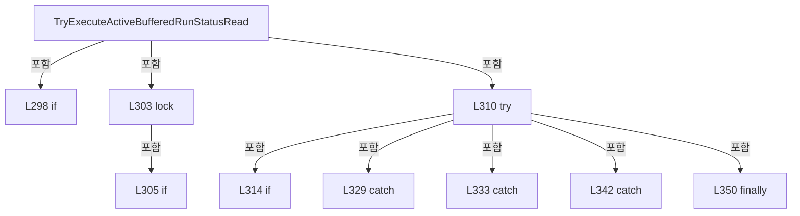

변경 전 점검: 입력/반환 타입, 위 호출자, 예외/취소 경로, 공유 상태와 저장·전송 소비자를 함께 확인합니다. 값의 단위나 물리 방향을 이름만으로 확정하지 않습니다.

### LocalFunctionStatement `ReadBufferedRunStatus` · L316–319

[Drilling.Common/Interface/Automation1/CAutomation1Comm.cs:316–319](https://github.com/kjuws10-rgb/A3Drilling/blob/5aee8e58439c9b455cae7c9593c9be986c3e682e/Drilling.Common/Interface/Automation1/CAutomation1Comm.cs#L316-L319)

| 항목 | 실제 추출 값 |
| --- | --- |
| 서명 | string ReadBufferedRunStatus() |
| 접근/수식자 | Private /  |
| 반환/값 타입 | string |
| 소속 타입 | NamedType:Drilling.Common.Interface.CAutomation1Comm |

현재 부분 분석에서 직접 연결된 호출자는 없습니다. XAML/이벤트/인터페이스·델리게이트·외부 진입을 추가 확인해야 하며, 미사용으로 판정한 것이 아닙니다.

호출하는 대상과 해석 범위:

| 원본 행 | 표현식 | 분석 상태 | 대상/소스 위치 |
| --- | --- | --- | --- |
| 318 | ExecuteAutomation1Function | resolved | string Drilling.Common.Interface.CAutomation1Comm.ExecuteAutomation1Function(Controller, string, System.Threading.CancellationToken) · Drilling.Common/Interface/Automation1/CAutomation1Comm.cs:639 |

본문의 실제 연산·분기·예외·반환 순서(원문 위치 순):

| 원본 행 | 종류 | 주석 해설 |
| --- | --- | --- |
| 318 | call | 함수·델리게이트 또는 객체 생성자를 호출합니다: ExecuteAutomation1Function(controller, function, cancellationToken) |
| 318 | return | 호출자에게 값 또는 제어를 반환합니다: return ExecuteAutomation1Function(controller, function, cancellationToken); |

변경 전 점검: 입력/반환 타입, 위 호출자, 예외/취소 경로, 공유 상태와 저장·전송 소비자를 함께 확인합니다. 값의 단위나 물리 방향을 이름만으로 확정하지 않습니다.

### MethodDeclaration `TryGetActiveBufferedRunController` · L356–369

[Drilling.Common/Interface/Automation1/CAutomation1Comm.cs:356–369](https://github.com/kjuws10-rgb/A3Drilling/blob/5aee8e58439c9b455cae7c9593c9be986c3e682e/Drilling.Common/Interface/Automation1/CAutomation1Comm.cs#L356-L369)

| 항목 | 실제 추출 값 |
| --- | --- |
| 서명 | bool Drilling.Common.Interface.CAutomation1Comm.TryGetActiveBufferedRunController(out Controller) |
| 접근/수식자 | Private / private |
| 반환/값 타입 | bool |
| 소속 타입 | NamedType:Drilling.Common.Interface.CAutomation1Comm |

입력 계약:

| 이름 | 타입 | 전달 | 선택/기본값 |
| --- | --- | --- | --- |
| controller | Controller | Out | False /  |

정적 호출자로 확인된 위치:

| 호출 파일/행 | 호출 표현식 | 런타임 분기 가능 |
| --- | --- | --- |
| [Drilling.Common/Interface/Automation1/CAutomation1Comm.cs:314–314](https://github.com/kjuws10-rgb/A3Drilling/blob/5aee8e58439c9b455cae7c9593c9be986c3e682e/Drilling.Common/Interface/Automation1/CAutomation1Comm.cs#L314-L314) | TryGetActiveBufferedRunController | False |

본문의 실제 연산·분기·예외·반환 순서(원문 위치 순):

| 원본 행 | 종류 | 주석 해설 |
| --- | --- | --- |
| 358 | lock | 공유 상태의 임계 구역에 진입합니다: lock (_activeBufferedRunLock) |
| 360 | if | 조건에 따라 분기합니다: if (_activeBufferedRunCancellation is null &#124;&#124; _controller is null &#124;&#124; ConnectionState != EN_COMM_STATE.Online) |
| 362 | assignment | 값을 대상에 대입합니다: controller = null ! |
| 363 | return | 호출자에게 값 또는 제어를 반환합니다: return false; |
| 366 | assignment | 값을 대상에 대입합니다: controller = _controller |
| 367 | return | 호출자에게 값 또는 제어를 반환합니다: return true; |

제어 구문의 포함 구조(실제 실행 순서/CFG가 아닌 구문 탐색 그림):

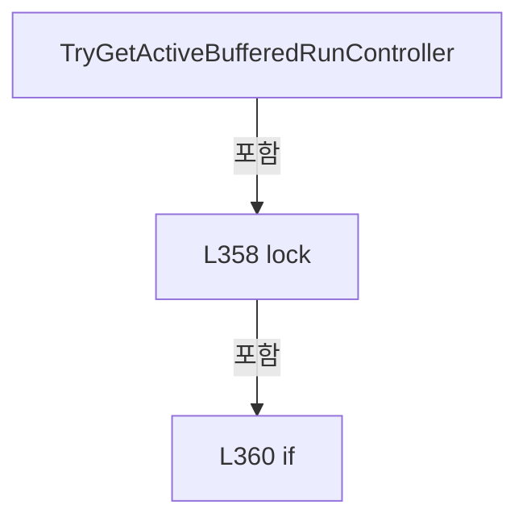

변경 전 점검: 입력/반환 타입, 위 호출자, 예외/취소 경로, 공유 상태와 저장·전송 소비자를 함께 확인합니다. 값의 단위나 물리 방향을 이름만으로 확정하지 않습니다.

### MethodDeclaration `IsBufferedRunReadOnlyStatusRequest` · L371–421

[Drilling.Common/Interface/Automation1/CAutomation1Comm.cs:371–421](https://github.com/kjuws10-rgb/A3Drilling/blob/5aee8e58439c9b455cae7c9593c9be986c3e682e/Drilling.Common/Interface/Automation1/CAutomation1Comm.cs#L371-L421)

| 항목 | 실제 추출 값 |
| --- | --- |
| 서명 | bool Drilling.Common.Interface.CAutomation1Comm.IsBufferedRunReadOnlyStatusRequest(string) |
| 접근/수식자 | Private / private, static |
| 반환/값 타입 | bool |
| 소속 타입 | NamedType:Drilling.Common.Interface.CAutomation1Comm |

입력 계약:

| 이름 | 타입 | 전달 | 선택/기본값 |
| --- | --- | --- | --- |
| function | string | None | False /  |

정적 호출자로 확인된 위치:

| 호출 파일/행 | 호출 표현식 | 런타임 분기 가능 |
| --- | --- | --- |
| [Drilling.Common/Interface/Automation1/CAutomation1Comm.cs:163–163](https://github.com/kjuws10-rgb/A3Drilling/blob/5aee8e58439c9b455cae7c9593c9be986c3e682e/Drilling.Common/Interface/Automation1/CAutomation1Comm.cs#L163-L163) | IsBufferedRunReadOnlyStatusRequest | False |
| [Drilling.Common/Interface/Automation1/CAutomation1Comm.cs:298–298](https://github.com/kjuws10-rgb/A3Drilling/blob/5aee8e58439c9b455cae7c9593c9be986c3e682e/Drilling.Common/Interface/Automation1/CAutomation1Comm.cs#L298-L298) | IsBufferedRunReadOnlyStatusRequest | False |

호출하는 대상과 해석 범위:

| 원본 행 | 표현식 | 분석 상태 | 대상/소스 위치 |
| --- | --- | --- | --- |
| 373 | TryGetAutomationBody | resolved | bool Drilling.Common.Interface.CAutomation1Comm.TryGetAutomationBody(string, out string) · Drilling.Common/Interface/Automation1/CAutomation1Comm.cs:565 |
| 378 | ReadAutomationSection | resolved | string Drilling.Common.Interface.CAutomation1Comm.ReadAutomationSection(string) · Drilling.Common/Interface/Automation1/CAutomation1Comm.cs:589 |
| 379 | section.Equals | resolved | bool string.Equals(string?, System.StringComparison) |
| 381 | IsMofReadinessReadRequest | resolved | bool Drilling.Common.Interface.CAutomation1Comm.IsMofReadinessReadRequest(string) · Drilling.Common/Interface/Automation1/CAutomation1Comm.cs:1873 |
| 384 | section.Equals | resolved | bool string.Equals(string?, System.StringComparison) |
| 386 | SplitPipe | resolved | string[] Drilling.Common.Interface.CAutomation1Comm.SplitPipe(string) · Drilling.Common/Interface/Automation1/CAutomation1Comm.cs:1724 |
| 387 | fields[1].Equals | resolved | bool string.Equals(string?, System.StringComparison) |
| 390 | section.Equals | resolved | bool string.Equals(string?, System.StringComparison) |
| 392 | SplitColon | resolved | string[] Drilling.Common.Interface.CAutomation1Comm.SplitColon(string) · Drilling.Common/Interface/Automation1/CAutomation1Comm.cs:1719 |
| 393 | tokens[2].Equals | resolved | bool string.Equals(string?, System.StringComparison) |
| 396 | section.Equals | resolved | bool string.Equals(string?, System.StringComparison) |
| 398 | SplitColon | resolved | string[] Drilling.Common.Interface.CAutomation1Comm.SplitColon(string) · Drilling.Common/Interface/Automation1/CAutomation1Comm.cs:1719 |
| 399 | tokens[2].Equals | resolved | bool string.Equals(string?, System.StringComparison) |
| 402 | section.Equals | resolved | bool string.Equals(string?, System.StringComparison) |
| 404 | body.Contains | resolved | bool string.Contains(char, System.StringComparison) |
| 406 | SplitPipe | resolved | string[] Drilling.Common.Interface.CAutomation1Comm.SplitPipe(string) · Drilling.Common/Interface/Automation1/CAutomation1Comm.cs:1724 |
| 407 | fields[1].Equals | resolved | bool string.Equals(string?, System.StringComparison) |
| 410 | SplitColon | resolved | string[] Drilling.Common.Interface.CAutomation1Comm.SplitColon(string) · Drilling.Common/Interface/Automation1/CAutomation1Comm.cs:1719 |
| 411 | tokens[2].Equals | resolved | bool string.Equals(string?, System.StringComparison) |
| 414 | section.Equals | resolved | bool string.Equals(string?, System.StringComparison) |
| 416 | SplitColon | resolved | string[] Drilling.Common.Interface.CAutomation1Comm.SplitColon(string) · Drilling.Common/Interface/Automation1/CAutomation1Comm.cs:1719 |
| 417 | tokens[1].Equals | resolved | bool string.Equals(string?, System.StringComparison) |

본문의 실제 연산·분기·예외·반환 순서(원문 위치 순):

| 원본 행 | 종류 | 주석 해설 |
| --- | --- | --- |
| 373 | call | 함수·델리게이트 또는 객체 생성자를 호출합니다: TryGetAutomationBody(function, out var body) |
| 373 | if | 조건에 따라 분기합니다: if (!TryGetAutomationBody(function, out var body)) |
| 375 | return | 호출자에게 값 또는 제어를 반환합니다: return false; |
| 378 | call | 함수·델리게이트 또는 객체 생성자를 호출합니다: ReadAutomationSection(body) |
| 378 | local-declaration | 지역 변수를 선언합니다: var section = ReadAutomationSection(body); |
| 378 | variable-initializer | 변수의 초기값을 지정합니다: section = ReadAutomationSection(body) |
| 379 | call | 함수·델리게이트 또는 객체 생성자를 호출합니다: section.Equals("VARIABLE", StringComparison.OrdinalIgnoreCase) |
| 379 | if | 조건에 따라 분기합니다: if (section.Equals("VARIABLE", StringComparison.OrdinalIgnoreCase)) |
| 381 | call | 함수·델리게이트 또는 객체 생성자를 호출합니다: IsMofReadinessReadRequest(function) |
| 381 | return | 호출자에게 값 또는 제어를 반환합니다: return IsMofReadinessReadRequest(function); |
| 384 | call | 함수·델리게이트 또는 객체 생성자를 호출합니다: section.Equals("FEEDBACK", StringComparison.OrdinalIgnoreCase) |
| 384 | if | 조건에 따라 분기합니다: if (section.Equals("FEEDBACK", StringComparison.OrdinalIgnoreCase)) |
| 386 | call | 함수·델리게이트 또는 객체 생성자를 호출합니다: SplitPipe(body) |
| 386 | local-declaration | 지역 변수를 선언합니다: var fields = SplitPipe(body); |
| 386 | variable-initializer | 변수의 초기값을 지정합니다: fields = SplitPipe(body) |
| 387 | call | 함수·델리게이트 또는 객체 생성자를 호출합니다: fields[1].Equals("READ_AUX", StringComparison.OrdinalIgnoreCase) |
| 387 | return | 호출자에게 값 또는 제어를 반환합니다: return fields.Length >= 2 && fields[1].Equals("READ_AUX", StringComparison.OrdinalIgnoreCase); |
| 390 | call | 함수·델리게이트 또는 객체 생성자를 호출합니다: section.Equals("AXIS", StringComparison.OrdinalIgnoreCase) |
| 390 | if | 조건에 따라 분기합니다: if (section.Equals("AXIS", StringComparison.OrdinalIgnoreCase)) |
| 392 | call | 함수·델리게이트 또는 객체 생성자를 호출합니다: SplitColon(body) |
| 392 | local-declaration | 지역 변수를 선언합니다: var tokens = SplitColon(body); |
| 392 | variable-initializer | 변수의 초기값을 지정합니다: tokens = SplitColon(body) |
| 393 | call | 함수·델리게이트 또는 객체 생성자를 호출합니다: tokens[2].Equals("READ", StringComparison.OrdinalIgnoreCase) |
| 393 | return | 호출자에게 값 또는 제어를 반환합니다: return tokens.Length >= 3 && tokens[2].Equals("READ", StringComparison.OrdinalIgnoreCase); |
| 396 | call | 함수·델리게이트 또는 객체 생성자를 호출합니다: section.Equals("IO", StringComparison.OrdinalIgnoreCase) |
| 396 | if | 조건에 따라 분기합니다: if (section.Equals("IO", StringComparison.OrdinalIgnoreCase)) |
| 398 | call | 함수·델리게이트 또는 객체 생성자를 호출합니다: SplitColon(body) |
| 398 | local-declaration | 지역 변수를 선언합니다: var tokens = SplitColon(body); |
| 398 | variable-initializer | 변수의 초기값을 지정합니다: tokens = SplitColon(body) |
| 399 | call | 함수·델리게이트 또는 객체 생성자를 호출합니다: tokens[2].Equals("READ", StringComparison.OrdinalIgnoreCase) |
| 399 | return | 호출자에게 값 또는 제어를 반환합니다: return tokens.Length >= 3 && tokens[2].Equals("READ", StringComparison.OrdinalIgnoreCase); |
| 402 | call | 함수·델리게이트 또는 객체 생성자를 호출합니다: section.Equals("TASK", StringComparison.OrdinalIgnoreCase) |
| 402 | if | 조건에 따라 분기합니다: if (section.Equals("TASK", StringComparison.OrdinalIgnoreCase)) |
| 404 | call | 함수·델리게이트 또는 객체 생성자를 호출합니다: body.Contains('&#124;', StringComparison.Ordinal) |
| 404 | if | 조건에 따라 분기합니다: if (body.Contains('&#124;', StringComparison.Ordinal)) |
| 406 | call | 함수·델리게이트 또는 객체 생성자를 호출합니다: SplitPipe(body) |
| 406 | local-declaration | 지역 변수를 선언합니다: var fields = SplitPipe(body); |
| 406 | variable-initializer | 변수의 초기값을 지정합니다: fields = SplitPipe(body) |
| 407 | call | 함수·델리게이트 또는 객체 생성자를 호출합니다: fields[1].Equals("LINE_STATUS", StringComparison.OrdinalIgnoreCase) |
| 407 | return | 호출자에게 값 또는 제어를 반환합니다: return fields.Length >= 2 && fields[1].Equals("LINE_STATUS", StringComparison.OrdinalIgnoreCase); |
| 410 | call | 함수·델리게이트 또는 객체 생성자를 호출합니다: SplitColon(body) |
| 410 | local-declaration | 지역 변수를 선언합니다: var tokens = SplitColon(body); |
| 410 | variable-initializer | 변수의 초기값을 지정합니다: tokens = SplitColon(body) |
| 411 | call | 함수·델리게이트 또는 객체 생성자를 호출합니다: tokens[2].Equals("LINE_STATUS", StringComparison.OrdinalIgnoreCase) |
| 411 | return | 호출자에게 값 또는 제어를 반환합니다: return tokens.Length >= 3 && tokens[2].Equals("LINE_STATUS", StringComparison.OrdinalIgnoreCase); |
| 414 | call | 함수·델리게이트 또는 객체 생성자를 호출합니다: section.Equals("SYSTEM", StringComparison.OrdinalIgnoreCase) |
| 414 | if | 조건에 따라 분기합니다: if (section.Equals("SYSTEM", StringComparison.OrdinalIgnoreCase)) |
| 416 | call | 함수·델리게이트 또는 객체 생성자를 호출합니다: SplitColon(body) |
| 416 | local-declaration | 지역 변수를 선언합니다: var tokens = SplitColon(body); |
| 416 | variable-initializer | 변수의 초기값을 지정합니다: tokens = SplitColon(body) |
| 417 | call | 함수·델리게이트 또는 객체 생성자를 호출합니다: tokens[1].Equals("PROCESSOR_USAGE", StringComparison.OrdinalIgnoreCase) |
| 417 | return | 호출자에게 값 또는 제어를 반환합니다: return tokens.Length >= 2 && tokens[1].Equals("PROCESSOR_USAGE", StringComparison.OrdinalIgnoreCase); |
| 420 | return | 호출자에게 값 또는 제어를 반환합니다: return false; |

제어 구문의 포함 구조(실제 실행 순서/CFG가 아닌 구문 탐색 그림):

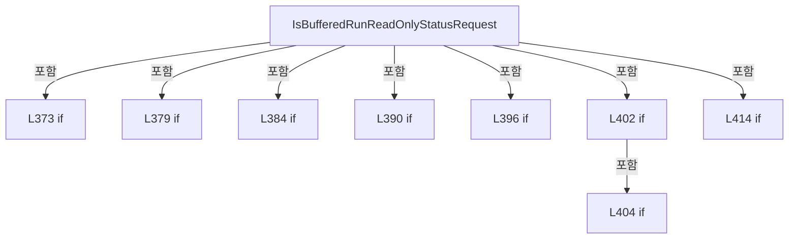

변경 전 점검: 입력/반환 타입, 위 호출자, 예외/취소 경로, 공유 상태와 저장·전송 소비자를 함께 확인합니다. 값의 단위나 물리 방향을 이름만으로 확정하지 않습니다.

### MethodDeclaration `RememberTaskStatusResponse` · L423–439

[Drilling.Common/Interface/Automation1/CAutomation1Comm.cs:423–439](https://github.com/kjuws10-rgb/A3Drilling/blob/5aee8e58439c9b455cae7c9593c9be986c3e682e/Drilling.Common/Interface/Automation1/CAutomation1Comm.cs#L423-L439)

| 항목 | 실제 추출 값 |
| --- | --- |
| 서명 | void Drilling.Common.Interface.CAutomation1Comm.RememberTaskStatusResponse(string, string) |
| 접근/수식자 | Private / private |
| 반환/값 타입 | void |
| 소속 타입 | NamedType:Drilling.Common.Interface.CAutomation1Comm |

입력 계약:

| 이름 | 타입 | 전달 | 선택/기본값 |
| --- | --- | --- | --- |
| function | string | None | False /  |
| response | string | None | False /  |

정적 호출자로 확인된 위치:

| 호출 파일/행 | 호출 표현식 | 런타임 분기 가능 |
| --- | --- | --- |
| [Drilling.Common/Interface/Automation1/CAutomation1Comm.cs:116–116](https://github.com/kjuws10-rgb/A3Drilling/blob/5aee8e58439c9b455cae7c9593c9be986c3e682e/Drilling.Common/Interface/Automation1/CAutomation1Comm.cs#L116-L116) | RememberTaskStatusResponse | False |
| [Drilling.Common/Interface/Automation1/CAutomation1Comm.cs:322–322](https://github.com/kjuws10-rgb/A3Drilling/blob/5aee8e58439c9b455cae7c9593c9be986c3e682e/Drilling.Common/Interface/Automation1/CAutomation1Comm.cs#L322-L322) | RememberTaskStatusResponse | False |

호출하는 대상과 해석 범위:

| 원본 행 | 표현식 | 분석 상태 | 대상/소스 위치 |
| --- | --- | --- | --- |
| 425 | TryReadTaskStatusRequest | resolved | bool Drilling.Common.Interface.CAutomation1Comm.TryReadTaskStatusRequest(string, out int) · Drilling.Common/Interface/Automation1/CAutomation1Comm.cs:514 |
| 430 | response.StartsWith | resolved | bool string.StartsWith(string, System.StringComparison) |

본문의 실제 연산·분기·예외·반환 순서(원문 위치 순):

| 원본 행 | 종류 | 주석 해설 |
| --- | --- | --- |
| 425 | call | 함수·델리게이트 또는 객체 생성자를 호출합니다: TryReadTaskStatusRequest(function, out var taskIndex) |
| 425 | if | 조건에 따라 분기합니다: if (!TryReadTaskStatusRequest(function, out var taskIndex)) |
| 427 | return | 호출자에게 값 또는 제어를 반환합니다: return; |
| 430 | call | 함수·델리게이트 또는 객체 생성자를 호출합니다: response.StartsWith("OK:TASK:", StringComparison.OrdinalIgnoreCase) |
| 430 | if | 조건에 따라 분기합니다: if (!response.StartsWith("OK:TASK:", StringComparison.OrdinalIgnoreCase)) |
| 432 | return | 호출자에게 값 또는 제어를 반환합니다: return; |
| 435 | lock | 공유 상태의 임계 구역에 진입합니다: lock (_activeBufferedRunLock) |
| 437 | assignment | 값을 대상에 대입합니다: _lastTaskStatusResponses[taskIndex] = response |

제어 구문의 포함 구조(실제 실행 순서/CFG가 아닌 구문 탐색 그림):

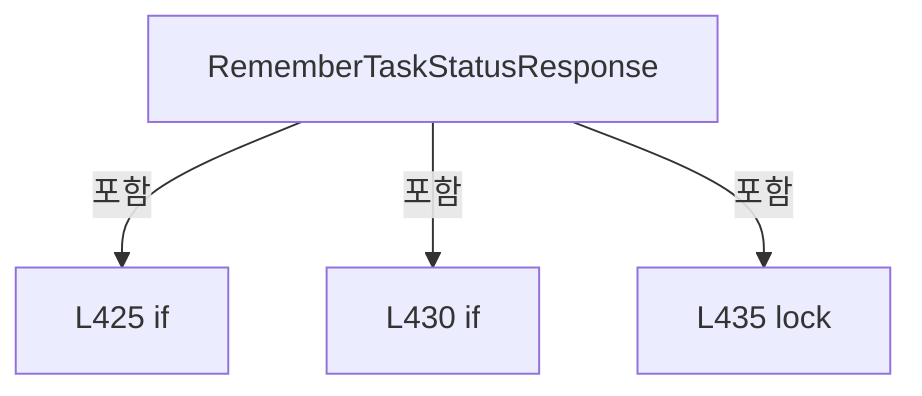

변경 전 점검: 입력/반환 타입, 위 호출자, 예외/취소 경로, 공유 상태와 저장·전송 소비자를 함께 확인합니다. 값의 단위나 물리 방향을 이름만으로 확정하지 않습니다.

### MethodDeclaration `CancelActiveBufferedRunIfStopCommand` · L441–447

[Drilling.Common/Interface/Automation1/CAutomation1Comm.cs:441–447](https://github.com/kjuws10-rgb/A3Drilling/blob/5aee8e58439c9b455cae7c9593c9be986c3e682e/Drilling.Common/Interface/Automation1/CAutomation1Comm.cs#L441-L447)

| 항목 | 실제 추출 값 |
| --- | --- |
| 서명 | void Drilling.Common.Interface.CAutomation1Comm.CancelActiveBufferedRunIfStopCommand(string) |
| 접근/수식자 | Private / private |
| 반환/값 타입 | void |
| 소속 타입 | NamedType:Drilling.Common.Interface.CAutomation1Comm |

입력 계약:

| 이름 | 타입 | 전달 | 선택/기본값 |
| --- | --- | --- | --- |
| function | string | None | False /  |

정적 호출자로 확인된 위치:

| 호출 파일/행 | 호출 표현식 | 런타임 분기 가능 |
| --- | --- | --- |
| [Drilling.Common/Interface/Automation1/CAutomation1Comm.cs:78–78](https://github.com/kjuws10-rgb/A3Drilling/blob/5aee8e58439c9b455cae7c9593c9be986c3e682e/Drilling.Common/Interface/Automation1/CAutomation1Comm.cs#L78-L78) | CancelActiveBufferedRunIfStopCommand | False |

호출하는 대상과 해석 범위:

| 원본 행 | 표현식 | 분석 상태 | 대상/소스 위치 |
| --- | --- | --- | --- |
| 443 | IsBufferedRunStopCommand | resolved | bool Drilling.Common.Interface.CAutomation1Comm.IsBufferedRunStopCommand(string) · Drilling.Common/Interface/Automation1/CAutomation1Comm.cs:474 |
| 445 | CancelActiveBufferedRun | resolved | void Drilling.Common.Interface.CAutomation1Comm.CancelActiveBufferedRun() · Drilling.Common/Interface/Automation1/CAutomation1Comm.cs:449 |

본문의 실제 연산·분기·예외·반환 순서(원문 위치 순):

| 원본 행 | 종류 | 주석 해설 |
| --- | --- | --- |
| 443 | call | 함수·델리게이트 또는 객체 생성자를 호출합니다: IsBufferedRunStopCommand(function) |
| 443 | if | 조건에 따라 분기합니다: if (IsBufferedRunStopCommand(function)) |
| 445 | call | 함수·델리게이트 또는 객체 생성자를 호출합니다: CancelActiveBufferedRun() |

제어 구문의 포함 구조(실제 실행 순서/CFG가 아닌 구문 탐색 그림):

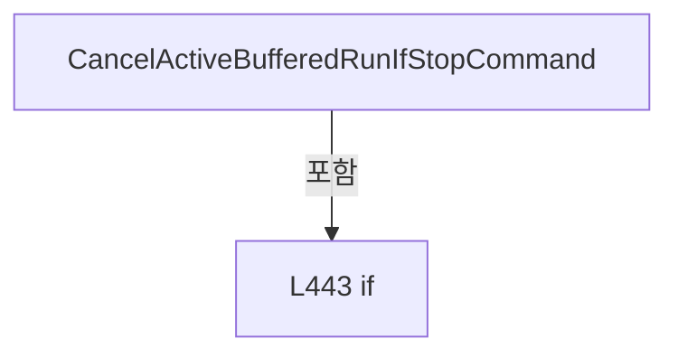

변경 전 점검: 입력/반환 타입, 위 호출자, 예외/취소 경로, 공유 상태와 저장·전송 소비자를 함께 확인합니다. 값의 단위나 물리 방향을 이름만으로 확정하지 않습니다.

### MethodDeclaration `CancelActiveBufferedRun` · L449–455

[Drilling.Common/Interface/Automation1/CAutomation1Comm.cs:449–455](https://github.com/kjuws10-rgb/A3Drilling/blob/5aee8e58439c9b455cae7c9593c9be986c3e682e/Drilling.Common/Interface/Automation1/CAutomation1Comm.cs#L449-L455)

| 항목 | 실제 추출 값 |
| --- | --- |
| 서명 | void Drilling.Common.Interface.CAutomation1Comm.CancelActiveBufferedRun() |
| 접근/수식자 | Private / private |
| 반환/값 타입 | void |
| 소속 타입 | NamedType:Drilling.Common.Interface.CAutomation1Comm |

정적 호출자로 확인된 위치:

| 호출 파일/행 | 호출 표현식 | 런타임 분기 가능 |
| --- | --- | --- |
| [Drilling.Common/Interface/Automation1/CAutomation1Comm.cs:58–58](https://github.com/kjuws10-rgb/A3Drilling/blob/5aee8e58439c9b455cae7c9593c9be986c3e682e/Drilling.Common/Interface/Automation1/CAutomation1Comm.cs#L58-L58) | CancelActiveBufferedRun | False |
| [Drilling.Common/Interface/Automation1/CAutomation1Comm.cs:445–445](https://github.com/kjuws10-rgb/A3Drilling/blob/5aee8e58439c9b455cae7c9593c9be986c3e682e/Drilling.Common/Interface/Automation1/CAutomation1Comm.cs#L445-L445) | CancelActiveBufferedRun | False |

호출하는 대상과 해석 범위:

| 원본 행 | 표현식 | 분석 상태 | 대상/소스 위치 |
| --- | --- | --- | --- |
| 453 | .Cancel | resolved | void System.Threading.CancellationTokenSource.Cancel() |

본문의 실제 연산·분기·예외·반환 순서(원문 위치 순):

| 원본 행 | 종류 | 주석 해설 |
| --- | --- | --- |
| 451 | lock | 공유 상태의 임계 구역에 진입합니다: lock (_activeBufferedRunLock) |
| 453 | call | 함수·델리게이트 또는 객체 생성자를 호출합니다: .Cancel() |

제어 구문의 포함 구조(실제 실행 순서/CFG가 아닌 구문 탐색 그림):

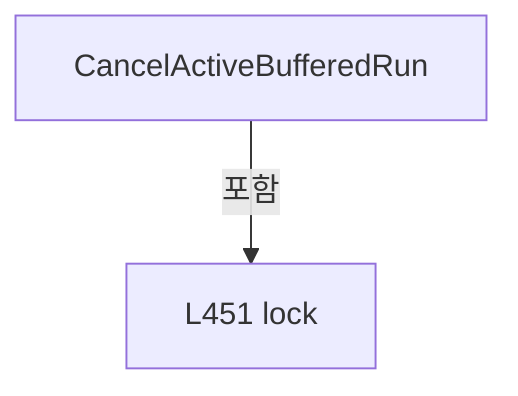

변경 전 점검: 입력/반환 타입, 위 호출자, 예외/취소 경로, 공유 상태와 저장·전송 소비자를 함께 확인합니다. 값의 단위나 물리 방향을 이름만으로 확정하지 않습니다.

### MethodDeclaration `IsBufferedRunCommand` · L457–472

[Drilling.Common/Interface/Automation1/CAutomation1Comm.cs:457–472](https://github.com/kjuws10-rgb/A3Drilling/blob/5aee8e58439c9b455cae7c9593c9be986c3e682e/Drilling.Common/Interface/Automation1/CAutomation1Comm.cs#L457-L472)

| 항목 | 실제 추출 값 |
| --- | --- |
| 서명 | bool Drilling.Common.Interface.CAutomation1Comm.IsBufferedRunCommand(string) |
| 접근/수식자 | Private / private, static |
| 반환/값 타입 | bool |
| 소속 타입 | NamedType:Drilling.Common.Interface.CAutomation1Comm |

입력 계약:

| 이름 | 타입 | 전달 | 선택/기본값 |
| --- | --- | --- | --- |
| function | string | None | False /  |

정적 호출자로 확인된 위치:

| 호출 파일/행 | 호출 표현식 | 런타임 분기 가능 |
| --- | --- | --- |
| [Drilling.Common/Interface/Automation1/CAutomation1Comm.cs:100–100](https://github.com/kjuws10-rgb/A3Drilling/blob/5aee8e58439c9b455cae7c9593c9be986c3e682e/Drilling.Common/Interface/Automation1/CAutomation1Comm.cs#L100-L100) | IsBufferedRunCommand | False |

호출하는 대상과 해석 범위:

| 원본 행 | 표현식 | 분석 상태 | 대상/소스 위치 |
| --- | --- | --- | --- |
| 459 | TryGetAutomationBody | resolved | bool Drilling.Common.Interface.CAutomation1Comm.TryGetAutomationBody(string, out string) · Drilling.Common/Interface/Automation1/CAutomation1Comm.cs:565 |
| 464 | ReadAutomationSection | resolved | string Drilling.Common.Interface.CAutomation1Comm.ReadAutomationSection(string) · Drilling.Common/Interface/Automation1/CAutomation1Comm.cs:589 |
| 465 | section.Equals | resolved | bool string.Equals(string?, System.StringComparison) |
| 470 | SplitPipe | resolved | string[] Drilling.Common.Interface.CAutomation1Comm.SplitPipe(string) · Drilling.Common/Interface/Automation1/CAutomation1Comm.cs:1724 |
| 471 | fields[1].Equals | resolved | bool string.Equals(string?, System.StringComparison) |
| 471 | fields[1].Equals | resolved | bool string.Equals(string?, System.StringComparison) |

본문의 실제 연산·분기·예외·반환 순서(원문 위치 순):

| 원본 행 | 종류 | 주석 해설 |
| --- | --- | --- |
| 459 | call | 함수·델리게이트 또는 객체 생성자를 호출합니다: TryGetAutomationBody(function, out var body) |
| 459 | if | 조건에 따라 분기합니다: if (!TryGetAutomationBody(function, out var body)) |
| 461 | return | 호출자에게 값 또는 제어를 반환합니다: return false; |
| 464 | call | 함수·델리게이트 또는 객체 생성자를 호출합니다: ReadAutomationSection(body) |
| 464 | local-declaration | 지역 변수를 선언합니다: var section = ReadAutomationSection(body); |
| 464 | variable-initializer | 변수의 초기값을 지정합니다: section = ReadAutomationSection(body) |
| 465 | call | 함수·델리게이트 또는 객체 생성자를 호출합니다: section.Equals("SCRIPT", StringComparison.OrdinalIgnoreCase) |
| 465 | if | 조건에 따라 분기합니다: if (!section.Equals("SCRIPT", StringComparison.OrdinalIgnoreCase)) |
| 467 | return | 호출자에게 값 또는 제어를 반환합니다: return false; |
| 470 | call | 함수·델리게이트 또는 객체 생성자를 호출합니다: SplitPipe(body) |
| 470 | local-declaration | 지역 변수를 선언합니다: var fields = SplitPipe(body); |
| 470 | variable-initializer | 변수의 초기값을 지정합니다: fields = SplitPipe(body) |
| 471 | call | 함수·델리게이트 또는 객체 생성자를 호출합니다: fields[1].Equals("BUFFERED_RUN", StringComparison.OrdinalIgnoreCase) |
| 471 | call | 함수·델리게이트 또는 객체 생성자를 호출합니다: fields[1].Equals("BUFFERED_RUN_GROUP", StringComparison.OrdinalIgnoreCase) |
| 471 | return | 호출자에게 값 또는 제어를 반환합니다: return fields.Length >= 2 && (fields[1].Equals("BUFFERED_RUN", StringComparison.OrdinalIgnoreCase) &#124;&#124; fields[1].Equals("BUFFERED_RUN_GROUP", StringComparison.OrdinalIgnoreCase)); |

제어 구문의 포함 구조(실제 실행 순서/CFG가 아닌 구문 탐색 그림):

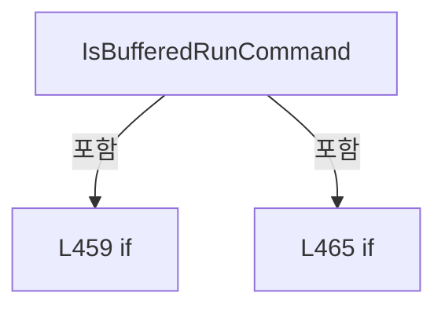

변경 전 점검: 입력/반환 타입, 위 호출자, 예외/취소 경로, 공유 상태와 저장·전송 소비자를 함께 확인합니다. 값의 단위나 물리 방향을 이름만으로 확정하지 않습니다.

### MethodDeclaration `IsBufferedRunStopCommand` · L474–500

[Drilling.Common/Interface/Automation1/CAutomation1Comm.cs:474–500](https://github.com/kjuws10-rgb/A3Drilling/blob/5aee8e58439c9b455cae7c9593c9be986c3e682e/Drilling.Common/Interface/Automation1/CAutomation1Comm.cs#L474-L500)

| 항목 | 실제 추출 값 |
| --- | --- |
| 서명 | bool Drilling.Common.Interface.CAutomation1Comm.IsBufferedRunStopCommand(string) |
| 접근/수식자 | Private / private, static |
| 반환/값 타입 | bool |
| 소속 타입 | NamedType:Drilling.Common.Interface.CAutomation1Comm |

입력 계약:

| 이름 | 타입 | 전달 | 선택/기본값 |
| --- | --- | --- | --- |
| function | string | None | False /  |

정적 호출자로 확인된 위치:

| 호출 파일/행 | 호출 표현식 | 런타임 분기 가능 |
| --- | --- | --- |
| [Drilling.Common/Interface/Automation1/CAutomation1Comm.cs:443–443](https://github.com/kjuws10-rgb/A3Drilling/blob/5aee8e58439c9b455cae7c9593c9be986c3e682e/Drilling.Common/Interface/Automation1/CAutomation1Comm.cs#L443-L443) | IsBufferedRunStopCommand | False |

호출하는 대상과 해석 범위:

| 원본 행 | 표현식 | 분석 상태 | 대상/소스 위치 |
| --- | --- | --- | --- |
| 476 | TryGetAutomationBody | resolved | bool Drilling.Common.Interface.CAutomation1Comm.TryGetAutomationBody(string, out string) · Drilling.Common/Interface/Automation1/CAutomation1Comm.cs:565 |
| 481 | ReadAutomationSection | resolved | string Drilling.Common.Interface.CAutomation1Comm.ReadAutomationSection(string) · Drilling.Common/Interface/Automation1/CAutomation1Comm.cs:589 |
| 482 | section.Equals | resolved | bool string.Equals(string?, System.StringComparison) |
| 484 | SplitPipe | resolved | string[] Drilling.Common.Interface.CAutomation1Comm.SplitPipe(string) · Drilling.Common/Interface/Automation1/CAutomation1Comm.cs:1724 |
| 485 | fields[1].Equals | resolved | bool string.Equals(string?, System.StringComparison) |
| 488 | section.Equals | resolved | bool string.Equals(string?, System.StringComparison) |
| 490 | IsTaskStopCommand | resolved | bool Drilling.Common.Interface.CAutomation1Comm.IsTaskStopCommand(string) · Drilling.Common/Interface/Automation1/CAutomation1Comm.cs:502 |
| 493 | section.Equals | resolved | bool string.Equals(string?, System.StringComparison) |
| 495 | SplitColon | resolved | string[] Drilling.Common.Interface.CAutomation1Comm.SplitColon(string) · Drilling.Common/Interface/Automation1/CAutomation1Comm.cs:1719 |
| 496 | tokens[2].Equals | resolved | bool string.Equals(string?, System.StringComparison) |

본문의 실제 연산·분기·예외·반환 순서(원문 위치 순):

| 원본 행 | 종류 | 주석 해설 |
| --- | --- | --- |
| 476 | call | 함수·델리게이트 또는 객체 생성자를 호출합니다: TryGetAutomationBody(function, out var body) |
| 476 | if | 조건에 따라 분기합니다: if (!TryGetAutomationBody(function, out var body)) |
| 478 | return | 호출자에게 값 또는 제어를 반환합니다: return false; |
| 481 | call | 함수·델리게이트 또는 객체 생성자를 호출합니다: ReadAutomationSection(body) |
| 481 | local-declaration | 지역 변수를 선언합니다: var section = ReadAutomationSection(body); |
| 481 | variable-initializer | 변수의 초기값을 지정합니다: section = ReadAutomationSection(body) |
| 482 | call | 함수·델리게이트 또는 객체 생성자를 호출합니다: section.Equals("SCRIPT", StringComparison.OrdinalIgnoreCase) |
| 482 | if | 조건에 따라 분기합니다: if (section.Equals("SCRIPT", StringComparison.OrdinalIgnoreCase)) |
| 484 | call | 함수·델리게이트 또는 객체 생성자를 호출합니다: SplitPipe(body) |
| 484 | local-declaration | 지역 변수를 선언합니다: var fields = SplitPipe(body); |
| 484 | variable-initializer | 변수의 초기값을 지정합니다: fields = SplitPipe(body) |
| 485 | call | 함수·델리게이트 또는 객체 생성자를 호출합니다: fields[1].Equals("STOP", StringComparison.OrdinalIgnoreCase) |
| 485 | return | 호출자에게 값 또는 제어를 반환합니다: return fields.Length >= 2 && fields[1].Equals("STOP", StringComparison.OrdinalIgnoreCase); |
| 488 | call | 함수·델리게이트 또는 객체 생성자를 호출합니다: section.Equals("TASK", StringComparison.OrdinalIgnoreCase) |
| 488 | if | 조건에 따라 분기합니다: if (section.Equals("TASK", StringComparison.OrdinalIgnoreCase)) |
| 490 | call | 함수·델리게이트 또는 객체 생성자를 호출합니다: IsTaskStopCommand(body) |
| 490 | return | 호출자에게 값 또는 제어를 반환합니다: return IsTaskStopCommand(body); |
| 493 | call | 함수·델리게이트 또는 객체 생성자를 호출합니다: section.Equals("AXIS", StringComparison.OrdinalIgnoreCase) |
| 493 | if | 조건에 따라 분기합니다: if (section.Equals("AXIS", StringComparison.OrdinalIgnoreCase)) |
| 495 | call | 함수·델리게이트 또는 객체 생성자를 호출합니다: SplitColon(body) |
| 495 | local-declaration | 지역 변수를 선언합니다: var tokens = SplitColon(body); |
| 495 | variable-initializer | 변수의 초기값을 지정합니다: tokens = SplitColon(body) |
| 496 | call | 함수·델리게이트 또는 객체 생성자를 호출합니다: tokens[2].Equals("STOP", StringComparison.OrdinalIgnoreCase) |
| 496 | return | 호출자에게 값 또는 제어를 반환합니다: return tokens.Length >= 3 && tokens[2].Equals("STOP", StringComparison.OrdinalIgnoreCase); |
| 499 | return | 호출자에게 값 또는 제어를 반환합니다: return false; |

제어 구문의 포함 구조(실제 실행 순서/CFG가 아닌 구문 탐색 그림):

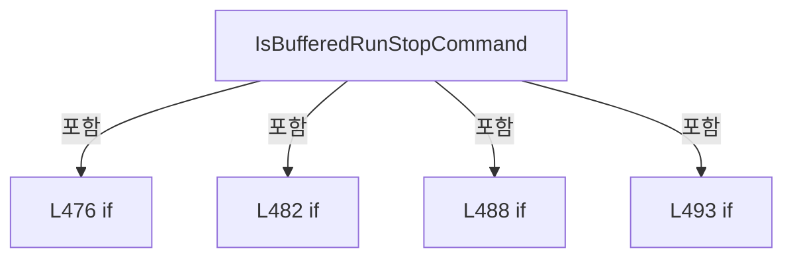

변경 전 점검: 입력/반환 타입, 위 호출자, 예외/취소 경로, 공유 상태와 저장·전송 소비자를 함께 확인합니다. 값의 단위나 물리 방향을 이름만으로 확정하지 않습니다.

### MethodDeclaration `IsTaskStopCommand` · L502–512

[Drilling.Common/Interface/Automation1/CAutomation1Comm.cs:502–512](https://github.com/kjuws10-rgb/A3Drilling/blob/5aee8e58439c9b455cae7c9593c9be986c3e682e/Drilling.Common/Interface/Automation1/CAutomation1Comm.cs#L502-L512)

| 항목 | 실제 추출 값 |
| --- | --- |
| 서명 | bool Drilling.Common.Interface.CAutomation1Comm.IsTaskStopCommand(string) |
| 접근/수식자 | Private / private, static |
| 반환/값 타입 | bool |
| 소속 타입 | NamedType:Drilling.Common.Interface.CAutomation1Comm |

입력 계약:

| 이름 | 타입 | 전달 | 선택/기본값 |
| --- | --- | --- | --- |
| body | string | None | False /  |

정적 호출자로 확인된 위치:

| 호출 파일/행 | 호출 표현식 | 런타임 분기 가능 |
| --- | --- | --- |
| [Drilling.Common/Interface/Automation1/CAutomation1Comm.cs:490–490](https://github.com/kjuws10-rgb/A3Drilling/blob/5aee8e58439c9b455cae7c9593c9be986c3e682e/Drilling.Common/Interface/Automation1/CAutomation1Comm.cs#L490-L490) | IsTaskStopCommand | False |

호출하는 대상과 해석 범위:

| 원본 행 | 표현식 | 분석 상태 | 대상/소스 위치 |
| --- | --- | --- | --- |
| 504 | body.Contains | resolved | bool string.Contains(char, System.StringComparison) |
| 506 | SplitPipe | resolved | string[] Drilling.Common.Interface.CAutomation1Comm.SplitPipe(string) · Drilling.Common/Interface/Automation1/CAutomation1Comm.cs:1724 |
| 507 | fields[1].Equals | resolved | bool string.Equals(string?, System.StringComparison) |
| 510 | SplitColon | resolved | string[] Drilling.Common.Interface.CAutomation1Comm.SplitColon(string) · Drilling.Common/Interface/Automation1/CAutomation1Comm.cs:1719 |
| 511 | tokens[2].Equals | resolved | bool string.Equals(string?, System.StringComparison) |

본문의 실제 연산·분기·예외·반환 순서(원문 위치 순):

| 원본 행 | 종류 | 주석 해설 |
| --- | --- | --- |
| 504 | call | 함수·델리게이트 또는 객체 생성자를 호출합니다: body.Contains('&#124;', StringComparison.Ordinal) |
| 504 | if | 조건에 따라 분기합니다: if (body.Contains('&#124;', StringComparison.Ordinal)) |
| 506 | call | 함수·델리게이트 또는 객체 생성자를 호출합니다: SplitPipe(body) |
| 506 | local-declaration | 지역 변수를 선언합니다: var fields = SplitPipe(body); |
| 506 | variable-initializer | 변수의 초기값을 지정합니다: fields = SplitPipe(body) |
| 507 | call | 함수·델리게이트 또는 객체 생성자를 호출합니다: fields[1].Equals("STOP", StringComparison.OrdinalIgnoreCase) |
| 507 | return | 호출자에게 값 또는 제어를 반환합니다: return fields.Length >= 2 && fields[1].Equals("STOP", StringComparison.OrdinalIgnoreCase); |
| 510 | call | 함수·델리게이트 또는 객체 생성자를 호출합니다: SplitColon(body) |
| 510 | local-declaration | 지역 변수를 선언합니다: var tokens = SplitColon(body); |
| 510 | variable-initializer | 변수의 초기값을 지정합니다: tokens = SplitColon(body) |
| 511 | call | 함수·델리게이트 또는 객체 생성자를 호출합니다: tokens[2].Equals("STOP", StringComparison.OrdinalIgnoreCase) |
| 511 | return | 호출자에게 값 또는 제어를 반환합니다: return tokens.Length >= 3 && tokens[2].Equals("STOP", StringComparison.OrdinalIgnoreCase); |

제어 구문의 포함 구조(실제 실행 순서/CFG가 아닌 구문 탐색 그림):

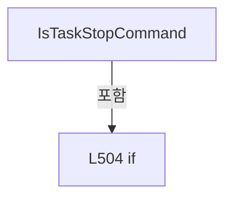

변경 전 점검: 입력/반환 타입, 위 호출자, 예외/취소 경로, 공유 상태와 저장·전송 소비자를 함께 확인합니다. 값의 단위나 물리 방향을 이름만으로 확정하지 않습니다.

### MethodDeclaration `TryReadTaskStatusRequest` · L514–563

[Drilling.Common/Interface/Automation1/CAutomation1Comm.cs:514–563](https://github.com/kjuws10-rgb/A3Drilling/blob/5aee8e58439c9b455cae7c9593c9be986c3e682e/Drilling.Common/Interface/Automation1/CAutomation1Comm.cs#L514-L563)

| 항목 | 실제 추출 값 |
| --- | --- |
| 서명 | bool Drilling.Common.Interface.CAutomation1Comm.TryReadTaskStatusRequest(string, out int) |
| 접근/수식자 | Private / private, static |
| 반환/값 타입 | bool |
| 소속 타입 | NamedType:Drilling.Common.Interface.CAutomation1Comm |

입력 계약:

| 이름 | 타입 | 전달 | 선택/기본값 |
| --- | --- | --- | --- |
| function | string | None | False /  |
| taskIndex | int | Out | False /  |

정적 호출자로 확인된 위치:

| 호출 파일/행 | 호출 표현식 | 런타임 분기 가능 |
| --- | --- | --- |
| [Drilling.Common/Interface/Automation1/CAutomation1Comm.cs:163–163](https://github.com/kjuws10-rgb/A3Drilling/blob/5aee8e58439c9b455cae7c9593c9be986c3e682e/Drilling.Common/Interface/Automation1/CAutomation1Comm.cs#L163-L163) | TryReadTaskStatusRequest | False |
| [Drilling.Common/Interface/Automation1/CAutomation1Comm.cs:260–260](https://github.com/kjuws10-rgb/A3Drilling/blob/5aee8e58439c9b455cae7c9593c9be986c3e682e/Drilling.Common/Interface/Automation1/CAutomation1Comm.cs#L260-L260) | TryReadTaskStatusRequest | False |
| [Drilling.Common/Interface/Automation1/CAutomation1Comm.cs:425–425](https://github.com/kjuws10-rgb/A3Drilling/blob/5aee8e58439c9b455cae7c9593c9be986c3e682e/Drilling.Common/Interface/Automation1/CAutomation1Comm.cs#L425-L425) | TryReadTaskStatusRequest | False |

호출하는 대상과 해석 범위:

| 원본 행 | 표현식 | 분석 상태 | 대상/소스 위치 |
| --- | --- | --- | --- |
| 517 | TryGetAutomationBody | resolved | bool Drilling.Common.Interface.CAutomation1Comm.TryGetAutomationBody(string, out string) · Drilling.Common/Interface/Automation1/CAutomation1Comm.cs:565 |
| 524 | ReadAutomationSection | resolved | string Drilling.Common.Interface.CAutomation1Comm.ReadAutomationSection(string) · Drilling.Common/Interface/Automation1/CAutomation1Comm.cs:589 |
| 525 | section.Equals | resolved | bool string.Equals(string?, System.StringComparison) |
| 527 | SplitPipe | resolved | string[] Drilling.Common.Interface.CAutomation1Comm.SplitPipe(string) · Drilling.Common/Interface/Automation1/CAutomation1Comm.cs:1724 |
| 528 | fields[1].Equals | resolved | bool string.Equals(string?, System.StringComparison) |
| 530 | ReadInt | resolved | int Drilling.Common.Interface.CAutomation1Comm.ReadInt(System.Collections.Generic.IReadOnlyList<string>, int, int, string) · Drilling.Common/Interface/Automation1/CAutomation1Comm.cs:1734 |
| 535 | section.Equals | resolved | bool string.Equals(string?, System.StringComparison) |
| 537 | body.Contains | resolved | bool string.Contains(char, System.StringComparison) |
| 539 | SplitPipe | resolved | string[] Drilling.Common.Interface.CAutomation1Comm.SplitPipe(string) · Drilling.Common/Interface/Automation1/CAutomation1Comm.cs:1724 |
| 540 | fields[1].Equals | resolved | bool string.Equals(string?, System.StringComparison) |
| 542 | ReadInt | resolved | int Drilling.Common.Interface.CAutomation1Comm.ReadInt(System.Collections.Generic.IReadOnlyList<string>, int, int, string) · Drilling.Common/Interface/Automation1/CAutomation1Comm.cs:1734 |
| 548 | SplitColon | resolved | string[] Drilling.Common.Interface.CAutomation1Comm.SplitColon(string) · Drilling.Common/Interface/Automation1/CAutomation1Comm.cs:1719 |
| 549 | tokens[2].Equals | resolved | bool string.Equals(string?, System.StringComparison) |
| 551 | ReadInt | resolved | int Drilling.Common.Interface.CAutomation1Comm.ReadInt(string, string) · Drilling.Common/Interface/Automation1/CAutomation1Comm.cs:1729 |

본문의 실제 연산·분기·예외·반환 순서(원문 위치 순):

| 원본 행 | 종류 | 주석 해설 |
| --- | --- | --- |
| 516 | assignment | 값을 대상에 대입합니다: taskIndex = DefaultTaskIndex |
| 517 | call | 함수·델리게이트 또는 객체 생성자를 호출합니다: TryGetAutomationBody(function, out var body) |
| 517 | if | 조건에 따라 분기합니다: if (!TryGetAutomationBody(function, out var body)) |
| 519 | return | 호출자에게 값 또는 제어를 반환합니다: return false; |
| 522 | try | 예외 처리 범위입니다: try |
| 524 | call | 함수·델리게이트 또는 객체 생성자를 호출합니다: ReadAutomationSection(body) |
| 524 | local-declaration | 지역 변수를 선언합니다: var section = ReadAutomationSection(body); |
| 524 | variable-initializer | 변수의 초기값을 지정합니다: section = ReadAutomationSection(body) |
| 525 | call | 함수·델리게이트 또는 객체 생성자를 호출합니다: section.Equals("SCRIPT", StringComparison.OrdinalIgnoreCase) |
| 525 | if | 조건에 따라 분기합니다: if (section.Equals("SCRIPT", StringComparison.OrdinalIgnoreCase)) |
| 527 | call | 함수·델리게이트 또는 객체 생성자를 호출합니다: SplitPipe(body) |
| 527 | local-declaration | 지역 변수를 선언합니다: var fields = SplitPipe(body); |
| 527 | variable-initializer | 변수의 초기값을 지정합니다: fields = SplitPipe(body) |
| 528 | call | 함수·델리게이트 또는 객체 생성자를 호출합니다: fields[1].Equals("STATUS", StringComparison.OrdinalIgnoreCase) |
| 528 | if | 조건에 따라 분기합니다: if (fields.Length >= 2 && fields[1].Equals("STATUS", StringComparison.OrdinalIgnoreCase)) |
| 530 | assignment | 값을 대상에 대입합니다: taskIndex = ReadInt(fields, 2, DefaultTaskIndex, "TASK") |
| 530 | call | 함수·델리게이트 또는 객체 생성자를 호출합니다: ReadInt(fields, 2, DefaultTaskIndex, "TASK") |
| 531 | return | 호출자에게 값 또는 제어를 반환합니다: return true; |
| 535 | call | 함수·델리게이트 또는 객체 생성자를 호출합니다: section.Equals("TASK", StringComparison.OrdinalIgnoreCase) |
| 535 | if | 조건에 따라 분기합니다: if (section.Equals("TASK", StringComparison.OrdinalIgnoreCase)) |
| 537 | call | 함수·델리게이트 또는 객체 생성자를 호출합니다: body.Contains('&#124;', StringComparison.Ordinal) |
| 537 | if | 조건에 따라 분기합니다: if (body.Contains('&#124;', StringComparison.Ordinal)) |
| 539 | call | 함수·델리게이트 또는 객체 생성자를 호출합니다: SplitPipe(body) |
| 539 | local-declaration | 지역 변수를 선언합니다: var fields = SplitPipe(body); |
| 539 | variable-initializer | 변수의 초기값을 지정합니다: fields = SplitPipe(body) |
| 540 | call | 함수·델리게이트 또는 객체 생성자를 호출합니다: fields[1].Equals("STATUS", StringComparison.OrdinalIgnoreCase) |
| 540 | if | 조건에 따라 분기합니다: if (fields.Length >= 2 && fields[1].Equals("STATUS", StringComparison.OrdinalIgnoreCase)) |
| 542 | assignment | 값을 대상에 대입합니다: taskIndex = ReadInt(fields, 2, DefaultTaskIndex, "TASK") |
| 542 | call | 함수·델리게이트 또는 객체 생성자를 호출합니다: ReadInt(fields, 2, DefaultTaskIndex, "TASK") |
| 543 | return | 호출자에게 값 또는 제어를 반환합니다: return true; |
| 546 | else | 앞 조건이 거짓인 경로입니다: else |
| 548 | call | 함수·델리게이트 또는 객체 생성자를 호출합니다: SplitColon(body) |
| 548 | local-declaration | 지역 변수를 선언합니다: var tokens = SplitColon(body); |
| 548 | variable-initializer | 변수의 초기값을 지정합니다: tokens = SplitColon(body) |
| 549 | call | 함수·델리게이트 또는 객체 생성자를 호출합니다: tokens[2].Equals("STATUS", StringComparison.OrdinalIgnoreCase) |
| 549 | if | 조건에 따라 분기합니다: if (tokens.Length >= 3 && tokens[2].Equals("STATUS", StringComparison.OrdinalIgnoreCase)) |
| 551 | assignment | 값을 대상에 대입합니다: taskIndex = ReadInt(tokens[1], "TASK") |
| 551 | call | 함수·델리게이트 또는 객체 생성자를 호출합니다: ReadInt(tokens[1], "TASK") |
| 552 | return | 호출자에게 값 또는 제어를 반환합니다: return true; |
| 557 | catch | 지정 예외를 처리합니다: catch (InvalidOperationException) |
| 559 | assignment | 값을 대상에 대입합니다: taskIndex = DefaultTaskIndex |
| 562 | return | 호출자에게 값 또는 제어를 반환합니다: return false; |

제어 구문의 포함 구조(실제 실행 순서/CFG가 아닌 구문 탐색 그림):

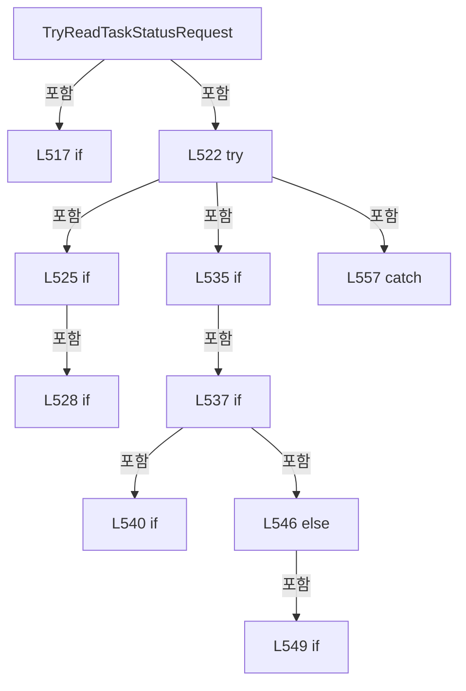

변경 전 점검: 입력/반환 타입, 위 호출자, 예외/취소 경로, 공유 상태와 저장·전송 소비자를 함께 확인합니다. 값의 단위나 물리 방향을 이름만으로 확정하지 않습니다.

### MethodDeclaration `TryGetAutomationBody` · L565–587

[Drilling.Common/Interface/Automation1/CAutomation1Comm.cs:565–587](https://github.com/kjuws10-rgb/A3Drilling/blob/5aee8e58439c9b455cae7c9593c9be986c3e682e/Drilling.Common/Interface/Automation1/CAutomation1Comm.cs#L565-L587)

| 항목 | 실제 추출 값 |
| --- | --- |
| 서명 | bool Drilling.Common.Interface.CAutomation1Comm.TryGetAutomationBody(string, out string) |
| 접근/수식자 | Private / private, static |
| 반환/값 타입 | bool |
| 소속 타입 | NamedType:Drilling.Common.Interface.CAutomation1Comm |

입력 계약:

| 이름 | 타입 | 전달 | 선택/기본값 |
| --- | --- | --- | --- |
| function | string | None | False /  |
| body | string | Out | False /  |

정적 호출자로 확인된 위치:

| 호출 파일/행 | 호출 표현식 | 런타임 분기 가능 |
| --- | --- | --- |
| [Drilling.Common/Interface/Automation1/CAutomation1Comm.cs:216–216](https://github.com/kjuws10-rgb/A3Drilling/blob/5aee8e58439c9b455cae7c9593c9be986c3e682e/Drilling.Common/Interface/Automation1/CAutomation1Comm.cs#L216-L216) | TryGetAutomationBody | False |
| [Drilling.Common/Interface/Automation1/CAutomation1Comm.cs:373–373](https://github.com/kjuws10-rgb/A3Drilling/blob/5aee8e58439c9b455cae7c9593c9be986c3e682e/Drilling.Common/Interface/Automation1/CAutomation1Comm.cs#L373-L373) | TryGetAutomationBody | False |
| [Drilling.Common/Interface/Automation1/CAutomation1Comm.cs:459–459](https://github.com/kjuws10-rgb/A3Drilling/blob/5aee8e58439c9b455cae7c9593c9be986c3e682e/Drilling.Common/Interface/Automation1/CAutomation1Comm.cs#L459-L459) | TryGetAutomationBody | False |
| [Drilling.Common/Interface/Automation1/CAutomation1Comm.cs:476–476](https://github.com/kjuws10-rgb/A3Drilling/blob/5aee8e58439c9b455cae7c9593c9be986c3e682e/Drilling.Common/Interface/Automation1/CAutomation1Comm.cs#L476-L476) | TryGetAutomationBody | False |
| [Drilling.Common/Interface/Automation1/CAutomation1Comm.cs:517–517](https://github.com/kjuws10-rgb/A3Drilling/blob/5aee8e58439c9b455cae7c9593c9be986c3e682e/Drilling.Common/Interface/Automation1/CAutomation1Comm.cs#L517-L517) | TryGetAutomationBody | False |
| [Drilling.Common/Interface/Automation1/CAutomation1Comm.cs:1875–1875](https://github.com/kjuws10-rgb/A3Drilling/blob/5aee8e58439c9b455cae7c9593c9be986c3e682e/Drilling.Common/Interface/Automation1/CAutomation1Comm.cs#L1875-L1875) | TryGetAutomationBody | False |

호출하는 대상과 해석 범위:

| 원본 행 | 표현식 | 분석 상태 | 대상/소스 위치 |
| --- | --- | --- | --- |
| 568 | string.IsNullOrWhiteSpace | resolved | bool string.IsNullOrWhiteSpace(string?) |
| 573 | function.Trim | resolved | string string.Trim() |
| 574 | command.StartsWith | resolved | bool string.StartsWith(string, System.StringComparison) |
| 574 | command.StartsWith | resolved | bool string.StartsWith(string, System.StringComparison) |
| 579 | command.IndexOf | resolved | int string.IndexOf(char, System.StringComparison) |

본문의 실제 연산·분기·예외·반환 순서(원문 위치 순):

| 원본 행 | 종류 | 주석 해설 |
| --- | --- | --- |
| 567 | assignment | 값을 대상에 대입합니다: body = "" |
| 568 | call | 함수·델리게이트 또는 객체 생성자를 호출합니다: string.IsNullOrWhiteSpace(function) |
| 568 | if | 조건에 따라 분기합니다: if (string.IsNullOrWhiteSpace(function)) |
| 570 | return | 호출자에게 값 또는 제어를 반환합니다: return false; |
| 573 | call | 함수·델리게이트 또는 객체 생성자를 호출합니다: function.Trim() |
| 573 | local-declaration | 지역 변수를 선언합니다: var command = function.Trim(); |
| 573 | variable-initializer | 변수의 초기값을 지정합니다: command = function.Trim() |
| 574 | call | 함수·델리게이트 또는 객체 생성자를 호출합니다: command.StartsWith("AUTOMATION1:", StringComparison.OrdinalIgnoreCase) |
| 574 | call | 함수·델리게이트 또는 객체 생성자를 호출합니다: command.StartsWith("A1:", StringComparison.OrdinalIgnoreCase) |
| 574 | if | 조건에 따라 분기합니다: if (!command.StartsWith("AUTOMATION1:", StringComparison.OrdinalIgnoreCase) && !command.StartsWith("A1:", StringComparison.OrdinalIgnoreCase)) |
| 576 | return | 호출자에게 값 또는 제어를 반환합니다: return false; |
| 579 | call | 함수·델리게이트 또는 객체 생성자를 호출합니다: command.IndexOf(':', StringComparison.Ordinal) |
| 579 | local-declaration | 지역 변수를 선언합니다: var prefixEnd = command.IndexOf(':', StringComparison.Ordinal); |
| 579 | variable-initializer | 변수의 초기값을 지정합니다: prefixEnd = command.IndexOf(':', StringComparison.Ordinal) |
| 580 | if | 조건에 따라 분기합니다: if (prefixEnd < 0 &#124;&#124; prefixEnd + 1 >= command.Length) |
| 582 | return | 호출자에게 값 또는 제어를 반환합니다: return false; |
| 585 | assignment | 값을 대상에 대입합니다: body = command[(prefixEnd + 1)..] |
| 586 | return | 호출자에게 값 또는 제어를 반환합니다: return true; |

제어 구문의 포함 구조(실제 실행 순서/CFG가 아닌 구문 탐색 그림):

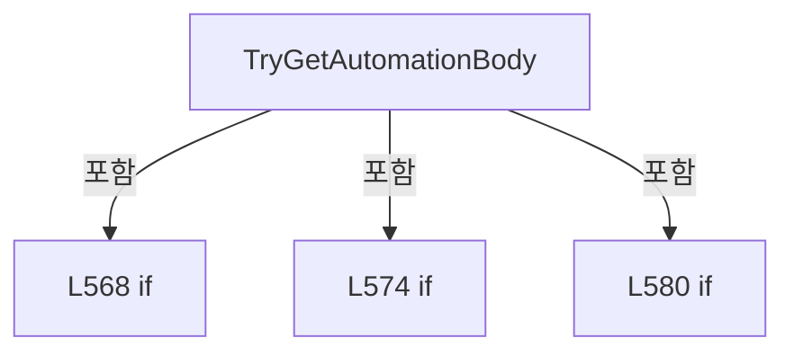

변경 전 점검: 입력/반환 타입, 위 호출자, 예외/취소 경로, 공유 상태와 저장·전송 소비자를 함께 확인합니다. 값의 단위나 물리 방향을 이름만으로 확정하지 않습니다.

### MethodDeclaration `ReadAutomationSection` · L589–593

[Drilling.Common/Interface/Automation1/CAutomation1Comm.cs:589–593](https://github.com/kjuws10-rgb/A3Drilling/blob/5aee8e58439c9b455cae7c9593c9be986c3e682e/Drilling.Common/Interface/Automation1/CAutomation1Comm.cs#L589-L593)

| 항목 | 실제 추출 값 |
| --- | --- |
| 서명 | string Drilling.Common.Interface.CAutomation1Comm.ReadAutomationSection(string) |
| 접근/수식자 | Private / private, static |
| 반환/값 타입 | string |
| 소속 타입 | NamedType:Drilling.Common.Interface.CAutomation1Comm |

입력 계약:

| 이름 | 타입 | 전달 | 선택/기본값 |
| --- | --- | --- | --- |
| body | string | None | False /  |

정적 호출자로 확인된 위치:

| 호출 파일/행 | 호출 표현식 | 런타임 분기 가능 |
| --- | --- | --- |
| [Drilling.Common/Interface/Automation1/CAutomation1Comm.cs:378–378](https://github.com/kjuws10-rgb/A3Drilling/blob/5aee8e58439c9b455cae7c9593c9be986c3e682e/Drilling.Common/Interface/Automation1/CAutomation1Comm.cs#L378-L378) | ReadAutomationSection | False |
| [Drilling.Common/Interface/Automation1/CAutomation1Comm.cs:464–464](https://github.com/kjuws10-rgb/A3Drilling/blob/5aee8e58439c9b455cae7c9593c9be986c3e682e/Drilling.Common/Interface/Automation1/CAutomation1Comm.cs#L464-L464) | ReadAutomationSection | False |
| [Drilling.Common/Interface/Automation1/CAutomation1Comm.cs:481–481](https://github.com/kjuws10-rgb/A3Drilling/blob/5aee8e58439c9b455cae7c9593c9be986c3e682e/Drilling.Common/Interface/Automation1/CAutomation1Comm.cs#L481-L481) | ReadAutomationSection | False |
| [Drilling.Common/Interface/Automation1/CAutomation1Comm.cs:524–524](https://github.com/kjuws10-rgb/A3Drilling/blob/5aee8e58439c9b455cae7c9593c9be986c3e682e/Drilling.Common/Interface/Automation1/CAutomation1Comm.cs#L524-L524) | ReadAutomationSection | False |

호출하는 대상과 해석 범위:

| 원본 행 | 표현식 | 분석 상태 | 대상/소스 위치 |
| --- | --- | --- | --- |
| 591 | body.IndexOfAny | resolved | int string.IndexOfAny(char[]) |

본문의 실제 연산·분기·예외·반환 순서(원문 위치 순):

| 원본 행 | 종류 | 주석 해설 |
| --- | --- | --- |
| 591 | call | 함수·델리게이트 또는 객체 생성자를 호출합니다: body.IndexOfAny([':', '&#124;']) |
| 591 | local-declaration | 지역 변수를 선언합니다: var sectionEnd = body.IndexOfAny([':', '&#124;']); |
| 591 | variable-initializer | 변수의 초기값을 지정합니다: sectionEnd = body.IndexOfAny([':', '&#124;']) |
| 592 | conditional-expression | 조건에 따라 결과식을 선택합니다: sectionEnd >= 0 ? body[..sectionEnd] : body |
| 592 | return | 호출자에게 값 또는 제어를 반환합니다: return sectionEnd >= 0 ? body[..sectionEnd] : body; |

변경 전 점검: 입력/반환 타입, 위 호출자, 예외/취소 경로, 공유 상태와 저장·전송 소비자를 함께 확인합니다. 값의 단위나 물리 방향을 이름만으로 확정하지 않습니다.

### MethodDeclaration `ConnectLocked` · L595–622

[Drilling.Common/Interface/Automation1/CAutomation1Comm.cs:595–622](https://github.com/kjuws10-rgb/A3Drilling/blob/5aee8e58439c9b455cae7c9593c9be986c3e682e/Drilling.Common/Interface/Automation1/CAutomation1Comm.cs#L595-L622)

| 항목 | 실제 추출 값 |
| --- | --- |
| 서명 | void Drilling.Common.Interface.CAutomation1Comm.ConnectLocked() |
| 접근/수식자 | Private / private |
| 반환/값 타입 | void |
| 소속 타입 | NamedType:Drilling.Common.Interface.CAutomation1Comm |

정적 호출자로 확인된 위치:

| 호출 파일/행 | 호출 표현식 | 런타임 분기 가능 |
| --- | --- | --- |
| [Drilling.Common/Interface/Automation1/CAutomation1Comm.cs:37–37](https://github.com/kjuws10-rgb/A3Drilling/blob/5aee8e58439c9b455cae7c9593c9be986c3e682e/Drilling.Common/Interface/Automation1/CAutomation1Comm.cs#L37-L37) | ConnectLocked | False |
| [Drilling.Common/Interface/Automation1/CAutomation1Comm.cs:95–95](https://github.com/kjuws10-rgb/A3Drilling/blob/5aee8e58439c9b455cae7c9593c9be986c3e682e/Drilling.Common/Interface/Automation1/CAutomation1Comm.cs#L95-L95) | ConnectLocked | False |

호출하는 대상과 해석 범위:

| 원본 행 | 표현식 | 분석 상태 | 대상/소스 위치 |
| --- | --- | --- | --- |
| 597 | CloseController | resolved | void Drilling.Common.Interface.CAutomation1Comm.CloseController() · Drilling.Common/Interface/Automation1/CAutomation1Comm.cs:1689 |
| 598 | Math.Max | resolved | int System.Math.Max(int, int) |
| 604 | ConnectController | resolved | Controller Drilling.Common.Interface.CAutomation1Comm.ConnectController() · Drilling.Common/Interface/Automation1/CAutomation1Comm.cs:624 |
| 607 | _controller.Start | unresolved | None |
| 611 | SetState | resolved | void Drilling.Common.Interface.CCommBase.SetState(Drilling.Common.Interface.EN_COMM_STATE) · Drilling.Common/Interface/CComm.cs:114 |
| 617 | CloseController | resolved | void Drilling.Common.Interface.CAutomation1Comm.CloseController() · Drilling.Common/Interface/Automation1/CAutomation1Comm.cs:1689 |
| 621 | new InvalidOperationException | resolved | System.InvalidOperationException.InvalidOperationException(string?, System.Exception?) |

본문의 실제 연산·분기·예외·반환 순서(원문 위치 순):

| 원본 행 | 종류 | 주석 해설 |
| --- | --- | --- |
| 597 | call | 함수·델리게이트 또는 객체 생성자를 호출합니다: CloseController() |
| 598 | call | 함수·델리게이트 또는 객체 생성자를 호출합니다: Math.Max(1, Option.RetryCount) |
| 598 | local-declaration | 지역 변수를 선언합니다: var retryCount = Math.Max(1, Option.RetryCount); |
| 598 | variable-initializer | 변수의 초기값을 지정합니다: retryCount = Math.Max(1, Option.RetryCount) |
| 599 | local-declaration | 지역 변수를 선언합니다: Exception? lastException = null; |
| 599 | variable-initializer | 변수의 초기값을 지정합니다: lastException = null |
| 600 | variable-initializer | 변수의 초기값을 지정합니다: tryNo = 0 |
| 600 | for | 초기화·조건·증감이 있는 반복입니다: for (var tryNo = 0; tryNo < retryCount; tryNo++) |
| 602 | try | 예외 처리 범위입니다: try |
| 604 | assignment | 값을 대상에 대입합니다: _controller = ConnectController() |
| 604 | call | 함수·델리게이트 또는 객체 생성자를 호출합니다: ConnectController() |
| 605 | if | 조건에 따라 분기합니다: if (!_controller.IsRunning) |
| 607 | call | 함수·델리게이트 또는 객체 생성자를 호출합니다: _controller.Start() |
| 610 | assignment | 값을 대상에 대입합니다: LastError = "" |
| 611 | call | 함수·델리게이트 또는 객체 생성자를 호출합니다: SetState(EN_COMM_STATE.Online) |
| 612 | return | 호출자에게 값 또는 제어를 반환합니다: return; |
| 614 | catch | 지정 예외를 처리합니다: catch (Exception ex) |
| 616 | assignment | 값을 대상에 대입합니다: lastException = ex |
| 617 | call | 함수·델리게이트 또는 객체 생성자를 호출합니다: CloseController() |
| 621 | call | 함수·델리게이트 또는 객체 생성자를 호출합니다: new InvalidOperationException($"Automation1 connection failed. Endpoint={Option.Endpoint}", lastException) |
| 621 | throw | 예외를 발생/전달합니다: throw new InvalidOperationException($"Automation1 connection failed. Endpoint={Option.Endpoint}", lastException); |

제어 구문의 포함 구조(실제 실행 순서/CFG가 아닌 구문 탐색 그림):

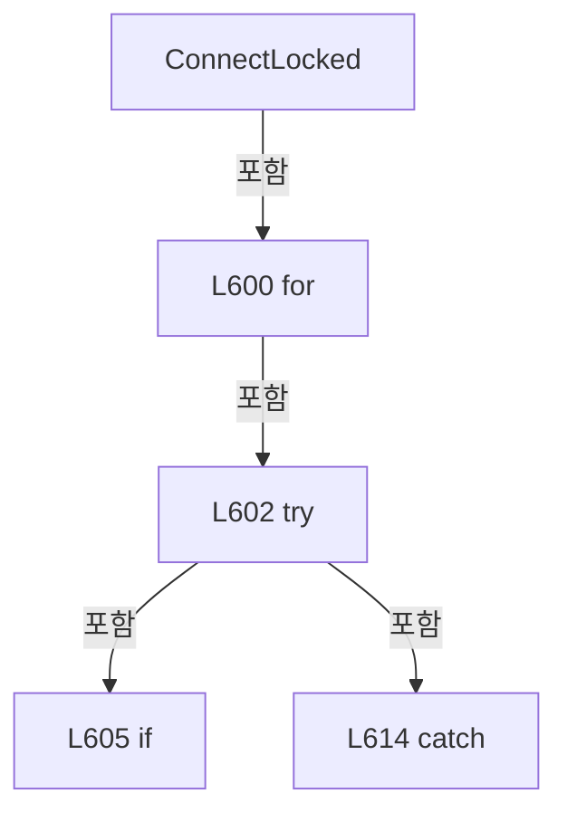

변경 전 점검: 입력/반환 타입, 위 호출자, 예외/취소 경로, 공유 상태와 저장·전송 소비자를 함께 확인합니다. 값의 단위나 물리 방향을 이름만으로 확정하지 않습니다.

### MethodDeclaration `ConnectController` · L624–637

[Drilling.Common/Interface/Automation1/CAutomation1Comm.cs:624–637](https://github.com/kjuws10-rgb/A3Drilling/blob/5aee8e58439c9b455cae7c9593c9be986c3e682e/Drilling.Common/Interface/Automation1/CAutomation1Comm.cs#L624-L637)

| 항목 | 실제 추출 값 |
| --- | --- |
| 서명 | Controller Drilling.Common.Interface.CAutomation1Comm.ConnectController() |
| 접근/수식자 | Private / private |
| 반환/값 타입 | Controller |
| 소속 타입 | NamedType:Drilling.Common.Interface.CAutomation1Comm |

정적 호출자로 확인된 위치:

| 호출 파일/행 | 호출 표현식 | 런타임 분기 가능 |
| --- | --- | --- |
| [Drilling.Common/Interface/Automation1/CAutomation1Comm.cs:604–604](https://github.com/kjuws10-rgb/A3Drilling/blob/5aee8e58439c9b455cae7c9593c9be986c3e682e/Drilling.Common/Interface/Automation1/CAutomation1Comm.cs#L604-L604) | ConnectController | False |

호출하는 대상과 해석 범위:

| 원본 행 | 표현식 | 분석 상태 | 대상/소스 위치 |
| --- | --- | --- | --- |
| 626 | string.IsNullOrWhiteSpace | resolved | bool string.IsNullOrWhiteSpace(string?) |
| 626 | Option.RemoteAddress.Equals | resolved | bool string.Equals(string?, System.StringComparison) |
| 626 | Option.RemoteAddress.Equals | resolved | bool string.Equals(string?, System.StringComparison) |
| 628 | Controller.Connect | unresolved | None |
| 633 | Controller.Connect | unresolved | None |
| 636 | Controller.Connect | unresolved | None |

본문의 실제 연산·분기·예외·반환 순서(원문 위치 순):

| 원본 행 | 종류 | 주석 해설 |
| --- | --- | --- |
| 626 | call | 함수·델리게이트 또는 객체 생성자를 호출합니다: string.IsNullOrWhiteSpace(Option.RemoteAddress) |
| 626 | call | 함수·델리게이트 또는 객체 생성자를 호출합니다: Option.RemoteAddress.Equals("LOCAL", StringComparison.OrdinalIgnoreCase) |
| 626 | call | 함수·델리게이트 또는 객체 생성자를 호출합니다: Option.RemoteAddress.Equals("DEFAULT", StringComparison.OrdinalIgnoreCase) |
| 626 | if | 조건에 따라 분기합니다: if (string.IsNullOrWhiteSpace(Option.RemoteAddress) &#124;&#124; Option.RemoteAddress.Equals("LOCAL", StringComparison.OrdinalIgnoreCase) &#124;&#124; Option.RemoteAddress.Equals("DEFAULT", StringComparison.OrdinalIgnoreCase)) |
| 628 | call | 함수·델리게이트 또는 객체 생성자를 호출합니다: Controller.Connect() |
| 628 | return | 호출자에게 값 또는 제어를 반환합니다: return Controller.Connect(); |
| 631 | if | 조건에 따라 분기합니다: if (Option.Port <= 0) |
| 633 | call | 함수·델리게이트 또는 객체 생성자를 호출합니다: Controller.Connect(Option.RemoteAddress) |
| 633 | return | 호출자에게 값 또는 제어를 반환합니다: return Controller.Connect(Option.RemoteAddress); |
| 636 | call | 함수·델리게이트 또는 객체 생성자를 호출합니다: Controller.Connect(Option.RemoteAddress, Option.Port) |
| 636 | return | 호출자에게 값 또는 제어를 반환합니다: return Controller.Connect(Option.RemoteAddress, Option.Port); |

제어 구문의 포함 구조(실제 실행 순서/CFG가 아닌 구문 탐색 그림):

```mermaid
flowchart TD
 M["ConnectController"]
 N0["L626 if"]
 M -->|포함| N0
 N1["L631 if"]
 M -->|포함| N1
```

변경 전 점검: 입력/반환 타입, 위 호출자, 예외/취소 경로, 공유 상태와 저장·전송 소비자를 함께 확인합니다. 값의 단위나 물리 방향을 이름만으로 확정하지 않습니다.

### MethodDeclaration `ExecuteAutomation1Function` · L639–674

[Drilling.Common/Interface/Automation1/CAutomation1Comm.cs:639–674](https://github.com/kjuws10-rgb/A3Drilling/blob/5aee8e58439c9b455cae7c9593c9be986c3e682e/Drilling.Common/Interface/Automation1/CAutomation1Comm.cs#L639-L674)

| 항목 | 실제 추출 값 |
| --- | --- |
| 서명 | string Drilling.Common.Interface.CAutomation1Comm.ExecuteAutomation1Function(Controller, string, System.Threading.CancellationToken) |
| 접근/수식자 | Private / private |
| 반환/값 타입 | string |
| 소속 타입 | NamedType:Drilling.Common.Interface.CAutomation1Comm |

입력 계약:

| 이름 | 타입 | 전달 | 선택/기본값 |
| --- | --- | --- | --- |
| controller | Controller | None | False /  |
| function | string | None | False /  |
| cancellationToken | System.Threading.CancellationToken | None | False /  |

정적 호출자로 확인된 위치:

| 호출 파일/행 | 호출 표현식 | 런타임 분기 가능 |
| --- | --- | --- |
| [Drilling.Common/Interface/Automation1/CAutomation1Comm.cs:112–112](https://github.com/kjuws10-rgb/A3Drilling/blob/5aee8e58439c9b455cae7c9593c9be986c3e682e/Drilling.Common/Interface/Automation1/CAutomation1Comm.cs#L112-L112) | ExecuteAutomation1Function | False |
| [Drilling.Common/Interface/Automation1/CAutomation1Comm.cs:318–318](https://github.com/kjuws10-rgb/A3Drilling/blob/5aee8e58439c9b455cae7c9593c9be986c3e682e/Drilling.Common/Interface/Automation1/CAutomation1Comm.cs#L318-L318) | ExecuteAutomation1Function | False |

호출하는 대상과 해석 범위:

| 원본 행 | 표현식 | 분석 상태 | 대상/소스 위치 |
| --- | --- | --- | --- |
| 641 | function.Trim | resolved | string string.Trim() |
| 642 | command.Equals | resolved | bool string.Equals(string?, System.StringComparison) |
| 642 | command.Equals | resolved | bool string.Equals(string?, System.StringComparison) |
| 644 | ExecuteStatus | resolved | string Drilling.Common.Interface.CAutomation1Comm.ExecuteStatus(Controller) · Drilling.Common/Interface/Automation1/CAutomation1Comm.cs:1665 |
| 647 | command.StartsWith | resolved | bool string.StartsWith(string, System.StringComparison) |
| 647 | command.StartsWith | resolved | bool string.StartsWith(string, System.StringComparison) |
| 649 | cancellationToken.ThrowIfCancellationRequested | resolved | void System.Threading.CancellationToken.ThrowIfCancellationRequested() |
| 650 | controller.Runtime.Commands.Execute | unresolved | None |
| 654 | command.IndexOf | resolved | int string.IndexOf(char, System.StringComparison) |
| 656 | body.IndexOfAny | resolved | int string.IndexOfAny(char[]) |
| 658 | section.Equals | resolved | bool string.Equals(string?, System.StringComparison) |
| 660 | ExecuteSystemFunction | resolved | string Drilling.Common.Interface.CAutomation1Comm.ExecuteSystemFunction(Controller, System.Collections.Generic.IReadOnlyList<string>) · Drilling.Common/Interface/Automation1/CAutomation1Comm.cs:1629 |
| 660 | SplitColon | resolved | string[] Drilling.Common.Interface.CAutomation1Comm.SplitColon(string) · Drilling.Common/Interface/Automation1/CAutomation1Comm.cs:1719 |
| 663 | section.ToUpperInvariant | resolved | string string.ToUpperInvariant() |
| 665 | ExecuteScriptFunction | resolved | string Drilling.Common.Interface.CAutomation1Comm.ExecuteScriptFunction(Controller, string, System.Threading.CancellationToken) · Drilling.Common/Interface/Automation1/CAutomation1Comm.cs:696 |
| 666 | ExecuteTaskFunction | resolved | string Drilling.Common.Interface.CAutomation1Comm.ExecuteTaskFunction(Controller, string) · Drilling.Common/Interface/Automation1/CAutomation1Comm.cs:718 |
| 667 | ExecuteCommandFunction | resolved | string Drilling.Common.Interface.CAutomation1Comm.ExecuteCommandFunction(Controller, string) · Drilling.Common/Interface/Automation1/CAutomation1Comm.cs:754 |
| 668 | ExecuteAxisFunction | resolved | string Drilling.Common.Interface.CAutomation1Comm.ExecuteAxisFunction(Controller, System.Collections.Generic.IReadOnlyList<string>) · Drilling.Common/Interface/Automation1/CAutomation1Comm.cs:1238 |
| 668 | SplitColon | resolved | string[] Drilling.Common.Interface.CAutomation1Comm.SplitColon(string) · Drilling.Common/Interface/Automation1/CAutomation1Comm.cs:1719 |
| 669 | ExecuteConfiguredHomeSpeedFunction | resolved | string Drilling.Common.Interface.CAutomation1Comm.ExecuteConfiguredHomeSpeedFunction(Controller, System.Collections.Generic.IReadOnlyList<string>) · Drilling.Common/Interface/Automation1/CAutomation1Comm.cs:1821 |
| 669 | SplitColon | resolved | string[] Drilling.Common.Interface.CAutomation1Comm.SplitColon(string) · Drilling.Common/Interface/Automation1/CAutomation1Comm.cs:1719 |
| 670 | ExecuteFeedbackFunction | resolved | string Drilling.Common.Interface.CAutomation1Comm.ExecuteFeedbackFunction(Controller, string[]) · Drilling.Common/Interface/Automation1/CAutomation1Comm.cs:676 |
| 670 | SplitPipe | resolved | string[] Drilling.Common.Interface.CAutomation1Comm.SplitPipe(string) · Drilling.Common/Interface/Automation1/CAutomation1Comm.cs:1724 |
| 671 | ExecuteVariableFunction | resolved | string Drilling.Common.Interface.CAutomation1Comm.ExecuteVariableFunction(Controller, string[]) · Drilling.Common/Interface/Automation1/CAutomation1Comm.cs:1881 |
| 671 | SplitPipe | resolved | string[] Drilling.Common.Interface.CAutomation1Comm.SplitPipe(string) · Drilling.Common/Interface/Automation1/CAutomation1Comm.cs:1724 |
| 672 | ExecuteIoFunction | resolved | string Drilling.Common.Interface.CAutomation1Comm.ExecuteIoFunction(Controller, System.Collections.Generic.IReadOnlyList<string>) · Drilling.Common/Interface/Automation1/CAutomation1Comm.cs:1589 |
| 672 | SplitColon | resolved | string[] Drilling.Common.Interface.CAutomation1Comm.SplitColon(string) · Drilling.Common/Interface/Automation1/CAutomation1Comm.cs:1719 |
| 673 | new InvalidOperationException | resolved | System.InvalidOperationException.InvalidOperationException(string?) |

본문의 실제 연산·분기·예외·반환 순서(원문 위치 순):

| 원본 행 | 종류 | 주석 해설 |
| --- | --- | --- |
| 641 | call | 함수·델리게이트 또는 객체 생성자를 호출합니다: function.Trim() |
| 641 | local-declaration | 지역 변수를 선언합니다: var command = function.Trim(); |
| 641 | variable-initializer | 변수의 초기값을 지정합니다: command = function.Trim() |
| 642 | call | 함수·델리게이트 또는 객체 생성자를 호출합니다: command.Equals("STATUS", StringComparison.OrdinalIgnoreCase) |
| 642 | call | 함수·델리게이트 또는 객체 생성자를 호출합니다: command.Equals("AUTOMATION1:STATUS", StringComparison.OrdinalIgnoreCase) |
| 642 | if | 조건에 따라 분기합니다: if (command.Equals("STATUS", StringComparison.OrdinalIgnoreCase) &#124;&#124; command.Equals("AUTOMATION1:STATUS", StringComparison.OrdinalIgnoreCase)) |
| 644 | call | 함수·델리게이트 또는 객체 생성자를 호출합니다: ExecuteStatus(controller) |
| 644 | return | 호출자에게 값 또는 제어를 반환합니다: return ExecuteStatus(controller); |
| 647 | call | 함수·델리게이트 또는 객체 생성자를 호출합니다: command.StartsWith("AUTOMATION1:", StringComparison.OrdinalIgnoreCase) |
| 647 | call | 함수·델리게이트 또는 객체 생성자를 호출합니다: command.StartsWith("A1:", StringComparison.OrdinalIgnoreCase) |
| 647 | if | 조건에 따라 분기합니다: if (!command.StartsWith("AUTOMATION1:", StringComparison.OrdinalIgnoreCase) && !command.StartsWith("A1:", StringComparison.OrdinalIgnoreCase)) |
| 649 | call | 함수·델리게이트 또는 객체 생성자를 호출합니다: cancellationToken.ThrowIfCancellationRequested() |
| 650 | call | 함수·델리게이트 또는 객체 생성자를 호출합니다: controller.Runtime.Commands.Execute(command, DefaultTaskIndex) |
| 651 | return | 호출자에게 값 또는 제어를 반환합니다: return "OK:COMMAND"; |
| 654 | call | 함수·델리게이트 또는 객체 생성자를 호출합니다: command.IndexOf(':', StringComparison.Ordinal) |
| 654 | local-declaration | 지역 변수를 선언합니다: var prefixEnd = command.IndexOf(':', StringComparison.Ordinal); |
| 654 | variable-initializer | 변수의 초기값을 지정합니다: prefixEnd = command.IndexOf(':', StringComparison.Ordinal) |
| 655 | local-declaration | 지역 변수를 선언합니다: var body = command[(prefixEnd + 1)..]; |
| 655 | variable-initializer | 변수의 초기값을 지정합니다: body = command[(prefixEnd + 1)..] |
| 656 | call | 함수·델리게이트 또는 객체 생성자를 호출합니다: body.IndexOfAny([':', '&#124;']) |
| 656 | local-declaration | 지역 변수를 선언합니다: var sectionEnd = body.IndexOfAny([':', '&#124;']); |
| 656 | variable-initializer | 변수의 초기값을 지정합니다: sectionEnd = body.IndexOfAny([':', '&#124;']) |
| 657 | conditional-expression | 조건에 따라 결과식을 선택합니다: sectionEnd >= 0 ? body[..sectionEnd] : body |
| 657 | local-declaration | 지역 변수를 선언합니다: var section = sectionEnd >= 0 ? body[..sectionEnd] : body; |
| 657 | variable-initializer | 변수의 초기값을 지정합니다: section = sectionEnd >= 0 ? body[..sectionEnd] : body |
| 658 | call | 함수·델리게이트 또는 객체 생성자를 호출합니다: section.Equals("SYSTEM", StringComparison.OrdinalIgnoreCase) |
| 658 | if | 조건에 따라 분기합니다: if (section.Equals("SYSTEM", StringComparison.OrdinalIgnoreCase)) |
| 660 | call | 함수·델리게이트 또는 객체 생성자를 호출합니다: ExecuteSystemFunction(controller, SplitColon(body)) |
| 660 | call | 함수·델리게이트 또는 객체 생성자를 호출합니다: SplitColon(body) |
| 660 | return | 호출자에게 값 또는 제어를 반환합니다: return ExecuteSystemFunction(controller, SplitColon(body)); |
| 663 | call | 함수·델리게이트 또는 객체 생성자를 호출합니다: section.ToUpperInvariant() |
| 663 | return | 호출자에게 값 또는 제어를 반환합니다: return section.ToUpperInvariant() switch { "SCRIPT" => ExecuteScriptFunction(controller, body, cancellationToken), "TASK" => ExecuteTaskFunction(controller, body), "COMMAND" => ExecuteCommandFunction(controller, body), "AXIS" => E |
| 663 | switch-expression | 값별 결과식을 선택합니다: section.ToUpperInvariant() switch { "SCRIPT" => ExecuteScriptFunction(controller, body, cancellationToken), "TASK" => ExecuteTaskFunction(controller, body), "COMMAND" => ExecuteCommandFunction(controller, body), "AXIS" => ExecuteA |
| 665 | call | 함수·델리게이트 또는 객체 생성자를 호출합니다: ExecuteScriptFunction(controller, body, cancellationToken) |
| 666 | call | 함수·델리게이트 또는 객체 생성자를 호출합니다: ExecuteTaskFunction(controller, body) |
| 667 | call | 함수·델리게이트 또는 객체 생성자를 호출합니다: ExecuteCommandFunction(controller, body) |
| 668 | call | 함수·델리게이트 또는 객체 생성자를 호출합니다: ExecuteAxisFunction(controller, SplitColon(body)) |
| 668 | call | 함수·델리게이트 또는 객체 생성자를 호출합니다: SplitColon(body) |
| 669 | call | 함수·델리게이트 또는 객체 생성자를 호출합니다: ExecuteConfiguredHomeSpeedFunction(controller, SplitColon(body)) |
| 669 | call | 함수·델리게이트 또는 객체 생성자를 호출합니다: SplitColon(body) |
| 670 | call | 함수·델리게이트 또는 객체 생성자를 호출합니다: ExecuteFeedbackFunction(controller, SplitPipe(body)) |
| 670 | call | 함수·델리게이트 또는 객체 생성자를 호출합니다: SplitPipe(body) |
| 671 | call | 함수·델리게이트 또는 객체 생성자를 호출합니다: ExecuteVariableFunction(controller, SplitPipe(body)) |
| 671 | call | 함수·델리게이트 또는 객체 생성자를 호출합니다: SplitPipe(body) |
| 672 | call | 함수·델리게이트 또는 객체 생성자를 호출합니다: ExecuteIoFunction(controller, SplitColon(body)) |
| 672 | call | 함수·델리게이트 또는 객체 생성자를 호출합니다: SplitColon(body) |
| 673 | call | 함수·델리게이트 또는 객체 생성자를 호출합니다: new InvalidOperationException($"Automation1 command is unknown: {function}") |
| 673 | throw | 예외를 발생/전달합니다: throw new InvalidOperationException($"Automation1 command is unknown: {function}") |

제어 구문의 포함 구조(실제 실행 순서/CFG가 아닌 구문 탐색 그림):

```mermaid
flowchart TD
 M["ExecuteAutomation1Function"]
 N0["L642 if"]
 M -->|포함| N0
 N1["L647 if"]
 M -->|포함| N1
 N2["L658 if"]
 M -->|포함| N2
 N3["L663 switch-expression"]
 M -->|포함| N3
```

변경 전 점검: 입력/반환 타입, 위 호출자, 예외/취소 경로, 공유 상태와 저장·전송 소비자를 함께 확인합니다. 값의 단위나 물리 방향을 이름만으로 확정하지 않습니다.

### MethodDeclaration `ExecuteFeedbackFunction` · L676–694

[Drilling.Common/Interface/Automation1/CAutomation1Comm.cs:676–694](https://github.com/kjuws10-rgb/A3Drilling/blob/5aee8e58439c9b455cae7c9593c9be986c3e682e/Drilling.Common/Interface/Automation1/CAutomation1Comm.cs#L676-L694)

| 항목 | 실제 추출 값 |
| --- | --- |
| 서명 | string Drilling.Common.Interface.CAutomation1Comm.ExecuteFeedbackFunction(Controller, string[]) |
| 접근/수식자 | Private / private, static |
| 반환/값 타입 | string |
| 소속 타입 | NamedType:Drilling.Common.Interface.CAutomation1Comm |

입력 계약:

| 이름 | 타입 | 전달 | 선택/기본값 |
| --- | --- | --- | --- |
| controller | Controller | None | False /  |
| fields | string[] | None | False /  |

정적 호출자로 확인된 위치:

| 호출 파일/행 | 호출 표현식 | 런타임 분기 가능 |
| --- | --- | --- |
| [Drilling.Common/Interface/Automation1/CAutomation1Comm.cs:670–670](https://github.com/kjuws10-rgb/A3Drilling/blob/5aee8e58439c9b455cae7c9593c9be986c3e682e/Drilling.Common/Interface/Automation1/CAutomation1Comm.cs#L670-L670) | ExecuteFeedbackFunction | False |

호출하는 대상과 해석 범위:

| 원본 행 | 표현식 | 분석 상태 | 대상/소스 위치 |
| --- | --- | --- | --- |
| 678 | string.IsNullOrWhiteSpace | resolved | bool string.IsNullOrWhiteSpace(string?) |
| 679 | new InvalidOperationException | resolved | System.InvalidOperationException.InvalidOperationException(string?) |
| 683 | new StatusItemConfiguration | unresolved | None |
| 684 | configuration.Axis.Add | unresolved | None |
| 685 | controller.Runtime.Status.GetStatusItems | unresolved | None |
| 686 | Convert.ToDouble | resolved | double System.Convert.ToDouble(object?, System.IFormatProvider?) |
| 686 | GetAxisStatusValue | candidate | OverloadResolutionFailure |
| 686 | new CAutoAxis | resolved | Drilling.Common.Interface.CAutomation1Comm.CAutoAxis.CAutoAxis(string, int?) · Drilling.Common/Interface/Automation1/CAutomation1Comm.cs:1789 |
| 687 | value.ToString | resolved | string double.ToString(string?, System.IFormatProvider?) |
| 691 | new InvalidOperationException | resolved | System.InvalidOperationException.InvalidOperationException(string?) |
| 692 | controller.Runtime.Commands.Device.DriveSetEncoderPosition | unresolved | None |
| 692 | ReadInt | resolved | int Drilling.Common.Interface.CAutomation1Comm.ReadInt(string, string) · Drilling.Common/Interface/Automation1/CAutomation1Comm.cs:1729 |

본문의 실제 연산·분기·예외·반환 순서(원문 위치 순):

| 원본 행 | 종류 | 주석 해설 |
| --- | --- | --- |
| 678 | call | 함수·델리게이트 또는 객체 생성자를 호출합니다: string.IsNullOrWhiteSpace(fields[2]) |
| 678 | if | 조건에 따라 분기합니다: if (fields.Length < 3 &#124;&#124; string.IsNullOrWhiteSpace(fields[2])) |
| 679 | call | 함수·델리게이트 또는 객체 생성자를 호출합니다: new InvalidOperationException("Auxiliary feedback command requires an axis.") |
| 679 | throw | 예외를 발생/전달합니다: throw new InvalidOperationException("Auxiliary feedback command requires an axis."); |
| 680 | local-declaration | 지역 변수를 선언합니다: var axis = fields[2]; |
| 680 | variable-initializer | 변수의 초기값을 지정합니다: axis = fields[2] |
| 681 | if | 조건에 따라 분기합니다: if (fields[1] == "READ_AUX") |
| 683 | call | 함수·델리게이트 또는 객체 생성자를 호출합니다: new StatusItemConfiguration() |
| 683 | local-declaration | 지역 변수를 선언합니다: var configuration = new StatusItemConfiguration(); |
| 683 | variable-initializer | 변수의 초기값을 지정합니다: configuration = new StatusItemConfiguration() |
| 684 | call | 함수·델리게이트 또는 객체 생성자를 호출합니다: configuration.Axis.Add(AxisStatusItem.AuxiliaryFeedback, axis) |
| 685 | call | 함수·델리게이트 또는 객체 생성자를 호출합니다: controller.Runtime.Status.GetStatusItems(configuration) |
| 685 | local-declaration | 지역 변수를 선언합니다: var results = controller.Runtime.Status.GetStatusItems(configuration); |
| 685 | variable-initializer | 변수의 초기값을 지정합니다: results = controller.Runtime.Status.GetStatusItems(configuration) |
| 686 | call | 함수·델리게이트 또는 객체 생성자를 호출합니다: Convert.ToDouble(GetAxisStatusValue(results, AxisStatusItem.AuxiliaryFeedback, new CAutoAxis(axis, null)), CultureInfo.InvariantCulture) |
| 686 | call | 함수·델리게이트 또는 객체 생성자를 호출합니다: GetAxisStatusValue(results, AxisStatusItem.AuxiliaryFeedback, new CAutoAxis(axis, null)) |
| 686 | call | 함수·델리게이트 또는 객체 생성자를 호출합니다: new CAutoAxis(axis, null) |
| 686 | local-declaration | 지역 변수를 선언합니다: var value = Convert.ToDouble(GetAxisStatusValue(results, AxisStatusItem.AuxiliaryFeedback, new CAutoAxis(axis, null)), CultureInfo.InvariantCulture); |
| 686 | variable-initializer | 변수의 초기값을 지정합니다: value = Convert.ToDouble(GetAxisStatusValue(results, AxisStatusItem.AuxiliaryFeedback, new CAutoAxis(axis, null)), CultureInfo.InvariantCulture) |
| 687 | call | 함수·델리게이트 또는 객체 생성자를 호출합니다: value.ToString("R", CultureInfo.InvariantCulture) |
| 687 | return | 호출자에게 값 또는 제어를 반환합니다: return $"OK:AUX:{value.ToString("R", CultureInfo.InvariantCulture)}"; |
| 690 | if | 조건에 따라 분기합니다: if (fields[1] != "ZERO_AUX" &#124;&#124; fields.Length != 4) |
| 691 | call | 함수·델리게이트 또는 객체 생성자를 호출합니다: new InvalidOperationException("Unknown auxiliary feedback command.") |
| 691 | throw | 예외를 발생/전달합니다: throw new InvalidOperationException("Unknown auxiliary feedback command."); |
| 692 | call | 함수·델리게이트 또는 객체 생성자를 호출합니다: controller.Runtime.Commands.Device.DriveSetEncoderPosition(axis, DriveEncoderChannel.AuxiliaryEncoder, 0, ReadInt(fields[3], "TASK")) |
| 692 | call | 함수·델리게이트 또는 객체 생성자를 호출합니다: ReadInt(fields[3], "TASK") |
| 693 | return | 호출자에게 값 또는 제어를 반환합니다: return "OK:AUX_ZERO"; |

제어 구문의 포함 구조(실제 실행 순서/CFG가 아닌 구문 탐색 그림):

```mermaid
flowchart TD
 M["ExecuteFeedbackFunction"]
 N0["L678 if"]
 M -->|포함| N0
 N1["L681 if"]
 M -->|포함| N1
 N2["L690 if"]
 M -->|포함| N2
```

변경 전 점검: 입력/반환 타입, 위 호출자, 예외/취소 경로, 공유 상태와 저장·전송 소비자를 함께 확인합니다. 값의 단위나 물리 방향을 이름만으로 확정하지 않습니다.

### MethodDeclaration `ExecuteScriptFunction` · L696–716

[Drilling.Common/Interface/Automation1/CAutomation1Comm.cs:696–716](https://github.com/kjuws10-rgb/A3Drilling/blob/5aee8e58439c9b455cae7c9593c9be986c3e682e/Drilling.Common/Interface/Automation1/CAutomation1Comm.cs#L696-L716)

| 항목 | 실제 추출 값 |
| --- | --- |
| 서명 | string Drilling.Common.Interface.CAutomation1Comm.ExecuteScriptFunction(Controller, string, System.Threading.CancellationToken) |
| 접근/수식자 | Private / private |
| 반환/값 타입 | string |
| 소속 타입 | NamedType:Drilling.Common.Interface.CAutomation1Comm |

입력 계약:

| 이름 | 타입 | 전달 | 선택/기본값 |
| --- | --- | --- | --- |
| controller | Controller | None | False /  |
| body | string | None | False /  |
| cancellationToken | System.Threading.CancellationToken | None | False /  |

정적 호출자로 확인된 위치:

| 호출 파일/행 | 호출 표현식 | 런타임 분기 가능 |
| --- | --- | --- |
| [Drilling.Common/Interface/Automation1/CAutomation1Comm.cs:665–665](https://github.com/kjuws10-rgb/A3Drilling/blob/5aee8e58439c9b455cae7c9593c9be986c3e682e/Drilling.Common/Interface/Automation1/CAutomation1Comm.cs#L665-L665) | ExecuteScriptFunction | False |

호출하는 대상과 해석 범위:

| 원본 행 | 표현식 | 분석 상태 | 대상/소스 위치 |
| --- | --- | --- | --- |
| 698 | SplitPipe | resolved | string[] Drilling.Common.Interface.CAutomation1Comm.SplitPipe(string) · Drilling.Common/Interface/Automation1/CAutomation1Comm.cs:1724 |
| 701 | new InvalidOperationException | resolved | System.InvalidOperationException.InvalidOperationException(string?) |
| 704 | fields[1].ToUpperInvariant | resolved | string string.ToUpperInvariant() |
| 707 | UploadScript | resolved | string Drilling.Common.Interface.CAutomation1Comm.UploadScript(Controller, System.Collections.Generic.IReadOnlyList<string>) · Drilling.Common/Interface/Automation1/CAutomation1Comm.cs:769 |
| 708 | RunControllerScript | resolved | string Drilling.Common.Interface.CAutomation1Comm.RunControllerScript(Controller, System.Collections.Generic.IReadOnlyList<string>, bool) · Drilling.Common/Interface/Automation1/CAutomation1Comm.cs:782 |
| 709 | RunControllerScript | resolved | string Drilling.Common.Interface.CAutomation1Comm.RunControllerScript(Controller, System.Collections.Generic.IReadOnlyList<string>, bool) · Drilling.Common/Interface/Automation1/CAutomation1Comm.cs:782 |
| 710 | RunLocalScript | resolved | string Drilling.Common.Interface.CAutomation1Comm.RunLocalScript(Controller, System.Collections.Generic.IReadOnlyList<string>) · Drilling.Common/Interface/Automation1/CAutomation1Comm.cs:805 |
| 711 | RunBufferedScript | resolved | string Drilling.Common.Interface.CAutomation1Comm.RunBufferedScript(Controller, System.Collections.Generic.IReadOnlyList<string>, System.Threading.CancellationToken) · Drilling.Common/Interface/Automation1/CAutomation1Comm.cs:822 |
| 712 | RunBufferedScriptGroup | resolved | string Drilling.Common.Interface.CAutomation1Comm.RunBufferedScriptGroup(Controller, System.Collections.Generic.IReadOnlyList<string>, System.Threading.CancellationToken) · Drilling.Common/Interface/Automation1/CAutomation1Comm.cs:838 |
| 713 | StopTask | resolved | string Drilling.Common.Interface.CAutomation1Comm.StopTask(Controller, int) · Drilling.Common/Interface/Automation1/CAutomation1Comm.cs:1213 |
| 713 | ReadInt | resolved | int Drilling.Common.Interface.CAutomation1Comm.ReadInt(System.Collections.Generic.IReadOnlyList<string>, int, int, string) · Drilling.Common/Interface/Automation1/CAutomation1Comm.cs:1734 |
| 714 | ReadTaskStatus | resolved | string Drilling.Common.Interface.CAutomation1Comm.ReadTaskStatus(Controller, int) · Drilling.Common/Interface/Automation1/CAutomation1Comm.cs:1220 |
| 714 | ReadInt | resolved | int Drilling.Common.Interface.CAutomation1Comm.ReadInt(System.Collections.Generic.IReadOnlyList<string>, int, int, string) · Drilling.Common/Interface/Automation1/CAutomation1Comm.cs:1734 |
| 715 | new InvalidOperationException | resolved | System.InvalidOperationException.InvalidOperationException(string?) |

본문의 실제 연산·분기·예외·반환 순서(원문 위치 순):

| 원본 행 | 종류 | 주석 해설 |
| --- | --- | --- |
| 698 | call | 함수·델리게이트 또는 객체 생성자를 호출합니다: SplitPipe(body) |
| 698 | local-declaration | 지역 변수를 선언합니다: var fields = SplitPipe(body); |
| 698 | variable-initializer | 변수의 초기값을 지정합니다: fields = SplitPipe(body) |
| 699 | if | 조건에 따라 분기합니다: if (fields.Length < 2) |
| 701 | call | 함수·델리게이트 또는 객체 생성자를 호출합니다: new InvalidOperationException("Automation1 script command is invalid.") |
| 701 | throw | 예외를 발생/전달합니다: throw new InvalidOperationException("Automation1 script command is invalid."); |
| 704 | call | 함수·델리게이트 또는 객체 생성자를 호출합니다: fields[1].ToUpperInvariant() |
| 704 | local-declaration | 지역 변수를 선언합니다: var command = fields[1].ToUpperInvariant(); |
| 704 | variable-initializer | 변수의 초기값을 지정합니다: command = fields[1].ToUpperInvariant() |
| 705 | return | 호출자에게 값 또는 제어를 반환합니다: return command switch { "UPLOAD" => UploadScript(controller, fields), "RUN" => RunControllerScript(controller, fields), "RUN_IF_IDLE" => RunControllerScript(controller, fields, requireIdle: true), "RUN_LOCAL" => RunLocalScript(con |
| 705 | switch-expression | 값별 결과식을 선택합니다: command switch { "UPLOAD" => UploadScript(controller, fields), "RUN" => RunControllerScript(controller, fields), "RUN_IF_IDLE" => RunControllerScript(controller, fields, requireIdle: true), "RUN_LOCAL" => RunLocalScript(controller |
| 707 | call | 함수·델리게이트 또는 객체 생성자를 호출합니다: UploadScript(controller, fields) |
| 708 | call | 함수·델리게이트 또는 객체 생성자를 호출합니다: RunControllerScript(controller, fields) |
| 709 | call | 함수·델리게이트 또는 객체 생성자를 호출합니다: RunControllerScript(controller, fields, requireIdle: true) |
| 710 | call | 함수·델리게이트 또는 객체 생성자를 호출합니다: RunLocalScript(controller, fields) |
| 711 | call | 함수·델리게이트 또는 객체 생성자를 호출합니다: RunBufferedScript(controller, fields, cancellationToken) |
| 712 | call | 함수·델리게이트 또는 객체 생성자를 호출합니다: RunBufferedScriptGroup(controller, fields, cancellationToken) |
| 713 | call | 함수·델리게이트 또는 객체 생성자를 호출합니다: StopTask(controller, ReadInt(fields, 2, DefaultTaskIndex, "TASK")) |
| 713 | call | 함수·델리게이트 또는 객체 생성자를 호출합니다: ReadInt(fields, 2, DefaultTaskIndex, "TASK") |
| 714 | call | 함수·델리게이트 또는 객체 생성자를 호출합니다: ReadTaskStatus(controller, ReadInt(fields, 2, DefaultTaskIndex, "TASK")) |
| 714 | call | 함수·델리게이트 또는 객체 생성자를 호출합니다: ReadInt(fields, 2, DefaultTaskIndex, "TASK") |
| 715 | call | 함수·델리게이트 또는 객체 생성자를 호출합니다: new InvalidOperationException($"Automation1 script command is unknown: {command}") |
| 715 | throw | 예외를 발생/전달합니다: throw new InvalidOperationException($"Automation1 script command is unknown: {command}") |

제어 구문의 포함 구조(실제 실행 순서/CFG가 아닌 구문 탐색 그림):

```mermaid
flowchart TD
 M["ExecuteScriptFunction"]
 N0["L699 if"]
 M -->|포함| N0
 N1["L705 switch-expression"]
 M -->|포함| N1
```

변경 전 점검: 입력/반환 타입, 위 호출자, 예외/취소 경로, 공유 상태와 저장·전송 소비자를 함께 확인합니다. 값의 단위나 물리 방향을 이름만으로 확정하지 않습니다.

### MethodDeclaration `ExecuteTaskFunction` · L718–752

[Drilling.Common/Interface/Automation1/CAutomation1Comm.cs:718–752](https://github.com/kjuws10-rgb/A3Drilling/blob/5aee8e58439c9b455cae7c9593c9be986c3e682e/Drilling.Common/Interface/Automation1/CAutomation1Comm.cs#L718-L752)

| 항목 | 실제 추출 값 |
| --- | --- |
| 서명 | string Drilling.Common.Interface.CAutomation1Comm.ExecuteTaskFunction(Controller, string) |
| 접근/수식자 | Private / private, static |
| 반환/값 타입 | string |
| 소속 타입 | NamedType:Drilling.Common.Interface.CAutomation1Comm |

입력 계약:

| 이름 | 타입 | 전달 | 선택/기본값 |
| --- | --- | --- | --- |
| controller | Controller | None | False /  |
| body | string | None | False /  |

정적 호출자로 확인된 위치:

| 호출 파일/행 | 호출 표현식 | 런타임 분기 가능 |
| --- | --- | --- |
| [Drilling.Common/Interface/Automation1/CAutomation1Comm.cs:666–666](https://github.com/kjuws10-rgb/A3Drilling/blob/5aee8e58439c9b455cae7c9593c9be986c3e682e/Drilling.Common/Interface/Automation1/CAutomation1Comm.cs#L666-L666) | ExecuteTaskFunction | False |

호출하는 대상과 해석 범위:

| 원본 행 | 표현식 | 분석 상태 | 대상/소스 위치 |
| --- | --- | --- | --- |
| 720 | body.Contains | resolved | bool string.Contains(char, System.StringComparison) |
| 722 | SplitPipe | resolved | string[] Drilling.Common.Interface.CAutomation1Comm.SplitPipe(string) · Drilling.Common/Interface/Automation1/CAutomation1Comm.cs:1724 |
| 725 | new InvalidOperationException | resolved | System.InvalidOperationException.InvalidOperationException(string?) |
| 728 | fields[1].ToUpperInvariant | resolved | string string.ToUpperInvariant() |
| 729 | ReadInt | resolved | int Drilling.Common.Interface.CAutomation1Comm.ReadInt(System.Collections.Generic.IReadOnlyList<string>, int, int, string) · Drilling.Common/Interface/Automation1/CAutomation1Comm.cs:1734 |
| 732 | ReadTaskStatus | resolved | string Drilling.Common.Interface.CAutomation1Comm.ReadTaskStatus(Controller, int) · Drilling.Common/Interface/Automation1/CAutomation1Comm.cs:1220 |
| 733 | ReadTaskLineStatus | resolved | string Drilling.Common.Interface.CAutomation1Comm.ReadTaskLineStatus(Controller, int) · Drilling.Common/Interface/Automation1/CAutomation1Comm.cs:1228 |
| 734 | StopTask | resolved | string Drilling.Common.Interface.CAutomation1Comm.StopTask(Controller, int) · Drilling.Common/Interface/Automation1/CAutomation1Comm.cs:1213 |
| 735 | new InvalidOperationException | resolved | System.InvalidOperationException.InvalidOperationException(string?) |
| 738 | SplitColon | resolved | string[] Drilling.Common.Interface.CAutomation1Comm.SplitColon(string) · Drilling.Common/Interface/Automation1/CAutomation1Comm.cs:1719 |
| 741 | new InvalidOperationException | resolved | System.InvalidOperationException.InvalidOperationException(string?) |
| 744 | ReadInt | resolved | int Drilling.Common.Interface.CAutomation1Comm.ReadInt(string, string) · Drilling.Common/Interface/Automation1/CAutomation1Comm.cs:1729 |
| 745 | tokens[2].ToUpperInvariant | resolved | string string.ToUpperInvariant() |
| 748 | ReadTaskStatus | resolved | string Drilling.Common.Interface.CAutomation1Comm.ReadTaskStatus(Controller, int) · Drilling.Common/Interface/Automation1/CAutomation1Comm.cs:1220 |
| 749 | ReadTaskLineStatus | resolved | string Drilling.Common.Interface.CAutomation1Comm.ReadTaskLineStatus(Controller, int) · Drilling.Common/Interface/Automation1/CAutomation1Comm.cs:1228 |
| 750 | StopTask | resolved | string Drilling.Common.Interface.CAutomation1Comm.StopTask(Controller, int) · Drilling.Common/Interface/Automation1/CAutomation1Comm.cs:1213 |
| 751 | new InvalidOperationException | resolved | System.InvalidOperationException.InvalidOperationException(string?) |

본문의 실제 연산·분기·예외·반환 순서(원문 위치 순):

| 원본 행 | 종류 | 주석 해설 |
| --- | --- | --- |
| 720 | call | 함수·델리게이트 또는 객체 생성자를 호출합니다: body.Contains('&#124;', StringComparison.Ordinal) |
| 720 | if | 조건에 따라 분기합니다: if (body.Contains('&#124;', StringComparison.Ordinal)) |
| 722 | call | 함수·델리게이트 또는 객체 생성자를 호출합니다: SplitPipe(body) |
| 722 | local-declaration | 지역 변수를 선언합니다: var fields = SplitPipe(body); |
| 722 | variable-initializer | 변수의 초기값을 지정합니다: fields = SplitPipe(body) |
| 723 | if | 조건에 따라 분기합니다: if (fields.Length < 2) |
| 725 | call | 함수·델리게이트 또는 객체 생성자를 호출합니다: new InvalidOperationException("Automation1 task command is invalid.") |
| 725 | throw | 예외를 발생/전달합니다: throw new InvalidOperationException("Automation1 task command is invalid."); |
| 728 | call | 함수·델리게이트 또는 객체 생성자를 호출합니다: fields[1].ToUpperInvariant() |
| 728 | local-declaration | 지역 변수를 선언합니다: var pipeCommand = fields[1].ToUpperInvariant(); |
| 728 | variable-initializer | 변수의 초기값을 지정합니다: pipeCommand = fields[1].ToUpperInvariant() |
| 729 | call | 함수·델리게이트 또는 객체 생성자를 호출합니다: ReadInt(fields, 2, DefaultTaskIndex, "TASK") |
| 729 | local-declaration | 지역 변수를 선언합니다: var pipeTaskIndex = ReadInt(fields, 2, DefaultTaskIndex, "TASK"); |
| 729 | variable-initializer | 변수의 초기값을 지정합니다: pipeTaskIndex = ReadInt(fields, 2, DefaultTaskIndex, "TASK") |
| 730 | return | 호출자에게 값 또는 제어를 반환합니다: return pipeCommand switch { "STATUS" => ReadTaskStatus(controller, pipeTaskIndex), "LINE_STATUS" => ReadTaskLineStatus(controller, pipeTaskIndex), "STOP" => StopTask(controller, pipeTaskIndex), _ => throw new InvalidOperationExcep |
| 730 | switch-expression | 값별 결과식을 선택합니다: pipeCommand switch { "STATUS" => ReadTaskStatus(controller, pipeTaskIndex), "LINE_STATUS" => ReadTaskLineStatus(controller, pipeTaskIndex), "STOP" => StopTask(controller, pipeTaskIndex), _ => throw new InvalidOperationException($" |
| 732 | call | 함수·델리게이트 또는 객체 생성자를 호출합니다: ReadTaskStatus(controller, pipeTaskIndex) |
| 733 | call | 함수·델리게이트 또는 객체 생성자를 호출합니다: ReadTaskLineStatus(controller, pipeTaskIndex) |
| 734 | call | 함수·델리게이트 또는 객체 생성자를 호출합니다: StopTask(controller, pipeTaskIndex) |
| 735 | call | 함수·델리게이트 또는 객체 생성자를 호출합니다: new InvalidOperationException($"Automation1 task command is unknown: {pipeCommand}") |
| 735 | throw | 예외를 발생/전달합니다: throw new InvalidOperationException($"Automation1 task command is unknown: {pipeCommand}") |
| 738 | call | 함수·델리게이트 또는 객체 생성자를 호출합니다: SplitColon(body) |
| 738 | local-declaration | 지역 변수를 선언합니다: var tokens = SplitColon(body); |
| 738 | variable-initializer | 변수의 초기값을 지정합니다: tokens = SplitColon(body) |
| 739 | if | 조건에 따라 분기합니다: if (tokens.Length < 3) |
| 741 | call | 함수·델리게이트 또는 객체 생성자를 호출합니다: new InvalidOperationException("Automation1 task command is invalid.") |
| 741 | throw | 예외를 발생/전달합니다: throw new InvalidOperationException("Automation1 task command is invalid."); |
| 744 | call | 함수·델리게이트 또는 객체 생성자를 호출합니다: ReadInt(tokens[1], "TASK") |
| 744 | local-declaration | 지역 변수를 선언합니다: var taskIndex = ReadInt(tokens[1], "TASK"); |
| 744 | variable-initializer | 변수의 초기값을 지정합니다: taskIndex = ReadInt(tokens[1], "TASK") |
| 745 | call | 함수·델리게이트 또는 객체 생성자를 호출합니다: tokens[2].ToUpperInvariant() |
| 745 | local-declaration | 지역 변수를 선언합니다: var command = tokens[2].ToUpperInvariant(); |
| 745 | variable-initializer | 변수의 초기값을 지정합니다: command = tokens[2].ToUpperInvariant() |
| 746 | return | 호출자에게 값 또는 제어를 반환합니다: return command switch { "STATUS" => ReadTaskStatus(controller, taskIndex), "LINE_STATUS" => ReadTaskLineStatus(controller, taskIndex), "STOP" => StopTask(controller, taskIndex), _ => throw new InvalidOperationException($"Automatio |
| 746 | switch-expression | 값별 결과식을 선택합니다: command switch { "STATUS" => ReadTaskStatus(controller, taskIndex), "LINE_STATUS" => ReadTaskLineStatus(controller, taskIndex), "STOP" => StopTask(controller, taskIndex), _ => throw new InvalidOperationException($"Automation1 task |
| 748 | call | 함수·델리게이트 또는 객체 생성자를 호출합니다: ReadTaskStatus(controller, taskIndex) |
| 749 | call | 함수·델리게이트 또는 객체 생성자를 호출합니다: ReadTaskLineStatus(controller, taskIndex) |
| 750 | call | 함수·델리게이트 또는 객체 생성자를 호출합니다: StopTask(controller, taskIndex) |
| 751 | call | 함수·델리게이트 또는 객체 생성자를 호출합니다: new InvalidOperationException($"Automation1 task command is unknown: {command}") |
| 751 | throw | 예외를 발생/전달합니다: throw new InvalidOperationException($"Automation1 task command is unknown: {command}") |

제어 구문의 포함 구조(실제 실행 순서/CFG가 아닌 구문 탐색 그림):

```mermaid
flowchart TD
 M["ExecuteTaskFunction"]
 N0["L720 if"]
 M -->|포함| N0
 N1["L723 if"]
 N0 -->|포함| N1
 N2["L730 switch-expression"]
 N0 -->|포함| N2
 N3["L739 if"]
 M -->|포함| N3
 N4["L746 switch-expression"]
 M -->|포함| N4
```

변경 전 점검: 입력/반환 타입, 위 호출자, 예외/취소 경로, 공유 상태와 저장·전송 소비자를 함께 확인합니다. 값의 단위나 물리 방향을 이름만으로 확정하지 않습니다.

### MethodDeclaration `ExecuteCommandFunction` · L754–767

[Drilling.Common/Interface/Automation1/CAutomation1Comm.cs:754–767](https://github.com/kjuws10-rgb/A3Drilling/blob/5aee8e58439c9b455cae7c9593c9be986c3e682e/Drilling.Common/Interface/Automation1/CAutomation1Comm.cs#L754-L767)

| 항목 | 실제 추출 값 |
| --- | --- |
| 서명 | string Drilling.Common.Interface.CAutomation1Comm.ExecuteCommandFunction(Controller, string) |
| 접근/수식자 | Private / private, static |
| 반환/값 타입 | string |
| 소속 타입 | NamedType:Drilling.Common.Interface.CAutomation1Comm |

입력 계약:

| 이름 | 타입 | 전달 | 선택/기본값 |
| --- | --- | --- | --- |
| controller | Controller | None | False /  |
| body | string | None | False /  |

정적 호출자로 확인된 위치:

| 호출 파일/행 | 호출 표현식 | 런타임 분기 가능 |
| --- | --- | --- |
| [Drilling.Common/Interface/Automation1/CAutomation1Comm.cs:667–667](https://github.com/kjuws10-rgb/A3Drilling/blob/5aee8e58439c9b455cae7c9593c9be986c3e682e/Drilling.Common/Interface/Automation1/CAutomation1Comm.cs#L667-L667) | ExecuteCommandFunction | False |

호출하는 대상과 해석 범위:

| 원본 행 | 표현식 | 분석 상태 | 대상/소스 위치 |
| --- | --- | --- | --- |
| 756 | SplitPipe | resolved | string[] Drilling.Common.Interface.CAutomation1Comm.SplitPipe(string) · Drilling.Common/Interface/Automation1/CAutomation1Comm.cs:1724 |
| 759 | new InvalidOperationException | resolved | System.InvalidOperationException.InvalidOperationException(string?) |
| 762 | ReadInt | resolved | int Drilling.Common.Interface.CAutomation1Comm.ReadInt(System.Collections.Generic.IReadOnlyList<string>, int, int, string) · Drilling.Common/Interface/Automation1/CAutomation1Comm.cs:1734 |
| 764 | ValidateTask | resolved | void Drilling.Common.Interface.CAutomation1Comm.ValidateTask(Controller, int) · Drilling.Common/Interface/Automation1/CAutomation1Comm.cs:1710 |
| 765 | controller.Runtime.Commands.Execute | unresolved | None |

본문의 실제 연산·분기·예외·반환 순서(원문 위치 순):

| 원본 행 | 종류 | 주석 해설 |
| --- | --- | --- |
| 756 | call | 함수·델리게이트 또는 객체 생성자를 호출합니다: SplitPipe(body) |
| 756 | local-declaration | 지역 변수를 선언합니다: var fields = SplitPipe(body); |
| 756 | variable-initializer | 변수의 초기값을 지정합니다: fields = SplitPipe(body) |
| 757 | if | 조건에 따라 분기합니다: if (fields.Length < 3) |
| 759 | call | 함수·델리게이트 또는 객체 생성자를 호출합니다: new InvalidOperationException("Automation1 direct command is invalid. Use AUTOMATION1:COMMAND&#124;task&#124;aeroscript.") |
| 759 | throw | 예외를 발생/전달합니다: throw new InvalidOperationException("Automation1 direct command is invalid. Use AUTOMATION1:COMMAND&#124;task&#124;aeroscript."); |
| 762 | call | 함수·델리게이트 또는 객체 생성자를 호출합니다: ReadInt(fields, 1, DefaultTaskIndex, "TASK") |
| 762 | local-declaration | 지역 변수를 선언합니다: var taskIndex = ReadInt(fields, 1, DefaultTaskIndex, "TASK"); |
| 762 | variable-initializer | 변수의 초기값을 지정합니다: taskIndex = ReadInt(fields, 1, DefaultTaskIndex, "TASK") |
| 763 | local-declaration | 지역 변수를 선언합니다: var aeroScript = fields[2]; |
| 763 | variable-initializer | 변수의 초기값을 지정합니다: aeroScript = fields[2] |
| 764 | call | 함수·델리게이트 또는 객체 생성자를 호출합니다: ValidateTask(controller, taskIndex) |
| 765 | call | 함수·델리게이트 또는 객체 생성자를 호출합니다: controller.Runtime.Commands.Execute(aeroScript, taskIndex) |
| 766 | return | 호출자에게 값 또는 제어를 반환합니다: return $"OK:COMMAND:{taskIndex}"; |

제어 구문의 포함 구조(실제 실행 순서/CFG가 아닌 구문 탐색 그림):

```mermaid
flowchart TD
 M["ExecuteCommandFunction"]
 N0["L757 if"]
 M -->|포함| N0
```

변경 전 점검: 입력/반환 타입, 위 호출자, 예외/취소 경로, 공유 상태와 저장·전송 소비자를 함께 확인합니다. 값의 단위나 물리 방향을 이름만으로 확정하지 않습니다.

### MethodDeclaration `UploadScript` · L769–780

[Drilling.Common/Interface/Automation1/CAutomation1Comm.cs:769–780](https://github.com/kjuws10-rgb/A3Drilling/blob/5aee8e58439c9b455cae7c9593c9be986c3e682e/Drilling.Common/Interface/Automation1/CAutomation1Comm.cs#L769-L780)

| 항목 | 실제 추출 값 |
| --- | --- |
| 서명 | string Drilling.Common.Interface.CAutomation1Comm.UploadScript(Controller, System.Collections.Generic.IReadOnlyList<string>) |
| 접근/수식자 | Private / private, static |
| 반환/값 타입 | string |
| 소속 타입 | NamedType:Drilling.Common.Interface.CAutomation1Comm |

입력 계약:

| 이름 | 타입 | 전달 | 선택/기본값 |
| --- | --- | --- | --- |
| controller | Controller | None | False /  |
| fields | System.Collections.Generic.IReadOnlyList<string> | None | False /  |

정적 호출자로 확인된 위치:

| 호출 파일/행 | 호출 표현식 | 런타임 분기 가능 |
| --- | --- | --- |
| [Drilling.Common/Interface/Automation1/CAutomation1Comm.cs:707–707](https://github.com/kjuws10-rgb/A3Drilling/blob/5aee8e58439c9b455cae7c9593c9be986c3e682e/Drilling.Common/Interface/Automation1/CAutomation1Comm.cs#L707-L707) | UploadScript | False |

호출하는 대상과 해석 범위:

| 원본 행 | 표현식 | 분석 상태 | 대상/소스 위치 |
| --- | --- | --- | --- |
| 773 | new InvalidOperationException | resolved | System.InvalidOperationException.InvalidOperationException(string?) |
| 778 | controller.Files.Upload | unresolved | None |
| 779 | Sanitize | resolved | string Drilling.Common.Interface.CAutomation1Comm.Sanitize(string) · Drilling.Common/Interface/Automation1/CAutomation1Comm.cs:1768 |

본문의 실제 연산·분기·예외·반환 순서(원문 위치 순):

| 원본 행 | 종류 | 주석 해설 |
| --- | --- | --- |
| 771 | if | 조건에 따라 분기합니다: if (fields.Count < 4) |
| 773 | call | 함수·델리게이트 또는 객체 생성자를 호출합니다: new InvalidOperationException("Automation1 script upload command is invalid. Use AUTOMATION1:SCRIPT&#124;UPLOAD&#124;localPath&#124;controllerFile.") |
| 773 | throw | 예외를 발생/전달합니다: throw new InvalidOperationException("Automation1 script upload command is invalid. Use AUTOMATION1:SCRIPT&#124;UPLOAD&#124;localPath&#124;controllerFile."); |
| 776 | local-declaration | 지역 변수를 선언합니다: var localPath = fields[2]; |
| 776 | variable-initializer | 변수의 초기값을 지정합니다: localPath = fields[2] |
| 777 | local-declaration | 지역 변수를 선언합니다: var controllerFile = fields[3]; |
| 777 | variable-initializer | 변수의 초기값을 지정합니다: controllerFile = fields[3] |
| 778 | call | 함수·델리게이트 또는 객체 생성자를 호출합니다: controller.Files.Upload(localPath, controllerFile) |
| 779 | call | 함수·델리게이트 또는 객체 생성자를 호출합니다: Sanitize(controllerFile) |
| 779 | return | 호출자에게 값 또는 제어를 반환합니다: return $"OK:SCRIPT:UPLOAD:{Sanitize(controllerFile)}"; |

제어 구문의 포함 구조(실제 실행 순서/CFG가 아닌 구문 탐색 그림):

```mermaid
flowchart TD
 M["UploadScript"]
 N0["L771 if"]
 M -->|포함| N0
```

변경 전 점검: 입력/반환 타입, 위 호출자, 예외/취소 경로, 공유 상태와 저장·전송 소비자를 함께 확인합니다. 값의 단위나 물리 방향을 이름만으로 확정하지 않습니다.

### MethodDeclaration `RunControllerScript` · L782–803

[Drilling.Common/Interface/Automation1/CAutomation1Comm.cs:782–803](https://github.com/kjuws10-rgb/A3Drilling/blob/5aee8e58439c9b455cae7c9593c9be986c3e682e/Drilling.Common/Interface/Automation1/CAutomation1Comm.cs#L782-L803)

| 항목 | 실제 추출 값 |
| --- | --- |
| 서명 | string Drilling.Common.Interface.CAutomation1Comm.RunControllerScript(Controller, System.Collections.Generic.IReadOnlyList<string>, bool) |
| 접근/수식자 | Private / private, static |
| 반환/값 타입 | string |
| 소속 타입 | NamedType:Drilling.Common.Interface.CAutomation1Comm |

입력 계약:

| 이름 | 타입 | 전달 | 선택/기본값 |
| --- | --- | --- | --- |
| controller | Controller | None | False /  |
| fields | System.Collections.Generic.IReadOnlyList<string> | None | False /  |
| requireIdle | bool | None | True / false |

정적 호출자로 확인된 위치:

| 호출 파일/행 | 호출 표현식 | 런타임 분기 가능 |
| --- | --- | --- |
| [Drilling.Common/Interface/Automation1/CAutomation1Comm.cs:708–708](https://github.com/kjuws10-rgb/A3Drilling/blob/5aee8e58439c9b455cae7c9593c9be986c3e682e/Drilling.Common/Interface/Automation1/CAutomation1Comm.cs#L708-L708) | RunControllerScript | False |
| [Drilling.Common/Interface/Automation1/CAutomation1Comm.cs:709–709](https://github.com/kjuws10-rgb/A3Drilling/blob/5aee8e58439c9b455cae7c9593c9be986c3e682e/Drilling.Common/Interface/Automation1/CAutomation1Comm.cs#L709-L709) | RunControllerScript | False |

호출하는 대상과 해석 범위:

| 원본 행 | 표현식 | 분석 상태 | 대상/소스 위치 |
| --- | --- | --- | --- |
| 786 | new InvalidOperationException | resolved | System.InvalidOperationException.InvalidOperationException(string?) |
| 789 | ReadInt | resolved | int Drilling.Common.Interface.CAutomation1Comm.ReadInt(System.Collections.Generic.IReadOnlyList<string>, int, int, string) · Drilling.Common/Interface/Automation1/CAutomation1Comm.cs:1734 |
| 791 | ValidateTask | resolved | void Drilling.Common.Interface.CAutomation1Comm.ValidateTask(Controller, int) · Drilling.Common/Interface/Automation1/CAutomation1Comm.cs:1710 |
| 792 | controller.Compiler.CompileControllerFile | unresolved | None |
| 795 | ReadTaskStatus | resolved | string Drilling.Common.Interface.CAutomation1Comm.ReadTaskStatus(Controller, int) · Drilling.Common/Interface/Automation1/CAutomation1Comm.cs:1220 |
| 796 | status.Split | resolved | string[] string.Split(char, System.StringSplitOptions) |
| 797 | state.Equals | resolved | bool string.Equals(string?, System.StringComparison) |
| 797 | state.Equals | resolved | bool string.Equals(string?, System.StringComparison) |
| 798 | new InvalidOperationException | resolved | System.InvalidOperationException.InvalidOperationException(string?) |
| 801 | controller.Runtime.Tasks[taskIndex].Program.Run | unresolved | None |
| 802 | ReadTaskStatus | resolved | string Drilling.Common.Interface.CAutomation1Comm.ReadTaskStatus(Controller, int) · Drilling.Common/Interface/Automation1/CAutomation1Comm.cs:1220 |

본문의 실제 연산·분기·예외·반환 순서(원문 위치 순):

| 원본 행 | 종류 | 주석 해설 |
| --- | --- | --- |
| 784 | if | 조건에 따라 분기합니다: if (fields.Count < 4) |
| 786 | call | 함수·델리게이트 또는 객체 생성자를 호출합니다: new InvalidOperationException("Automation1 script run command is invalid. Use AUTOMATION1:SCRIPT&#124;RUN&#124;task&#124;controllerFile.") |
| 786 | throw | 예외를 발생/전달합니다: throw new InvalidOperationException("Automation1 script run command is invalid. Use AUTOMATION1:SCRIPT&#124;RUN&#124;task&#124;controllerFile."); |
| 789 | call | 함수·델리게이트 또는 객체 생성자를 호출합니다: ReadInt(fields, 2, DefaultTaskIndex, "TASK") |
| 789 | local-declaration | 지역 변수를 선언합니다: var taskIndex = ReadInt(fields, 2, DefaultTaskIndex, "TASK"); |
| 789 | variable-initializer | 변수의 초기값을 지정합니다: taskIndex = ReadInt(fields, 2, DefaultTaskIndex, "TASK") |
| 790 | local-declaration | 지역 변수를 선언합니다: var controllerFile = fields[3]; |
| 790 | variable-initializer | 변수의 초기값을 지정합니다: controllerFile = fields[3] |
| 791 | call | 함수·델리게이트 또는 객체 생성자를 호출합니다: ValidateTask(controller, taskIndex) |
| 792 | call | 함수·델리게이트 또는 객체 생성자를 호출합니다: controller.Compiler.CompileControllerFile(controllerFile, compileWithDebugInformation: true) |
| 792 | local-declaration | 지역 변수를 선언합니다: var compiled = controller.Compiler.CompileControllerFile(controllerFile, compileWithDebugInformation: true); |
| 792 | variable-initializer | 변수의 초기값을 지정합니다: compiled = controller.Compiler.CompileControllerFile(controllerFile, compileWithDebugInformation: true) |
| 793 | if | 조건에 따라 분기합니다: if (requireIdle) |
| 795 | call | 함수·델리게이트 또는 객체 생성자를 호출합니다: ReadTaskStatus(controller, taskIndex) |
| 795 | local-declaration | 지역 변수를 선언합니다: var status = ReadTaskStatus(controller, taskIndex); |
| 795 | variable-initializer | 변수의 초기값을 지정합니다: status = ReadTaskStatus(controller, taskIndex) |
| 796 | call | 함수·델리게이트 또는 객체 생성자를 호출합니다: status.Split(':') |
| 796 | local-declaration | 지역 변수를 선언합니다: var state = status.Split(':')[3]; |
| 796 | variable-initializer | 변수의 초기값을 지정합니다: state = status.Split(':')[3] |
| 797 | call | 함수·델리게이트 또는 객체 생성자를 호출합니다: state.Equals("Idle", StringComparison.OrdinalIgnoreCase) |
| 797 | call | 함수·델리게이트 또는 객체 생성자를 호출합니다: state.Equals("ProgramComplete", StringComparison.OrdinalIgnoreCase) |
| 797 | if | 조건에 따라 분기합니다: if (!state.Equals("Idle", StringComparison.OrdinalIgnoreCase) && !state.Equals("ProgramComplete", StringComparison.OrdinalIgnoreCase)) |
| 798 | call | 함수·델리게이트 또는 객체 생성자를 호출합니다: new InvalidOperationException($"Task {taskIndex} is not idle: {state}") |
| 798 | throw | 예외를 발생/전달합니다: throw new InvalidOperationException($"Task {taskIndex} is not idle: {state}"); |
| 801 | call | 함수·델리게이트 또는 객체 생성자를 호출합니다: controller.Runtime.Tasks[taskIndex].Program.Run(compiled) |
| 802 | call | 함수·델리게이트 또는 객체 생성자를 호출합니다: ReadTaskStatus(controller, taskIndex) |
| 802 | return | 호출자에게 값 또는 제어를 반환합니다: return ReadTaskStatus(controller, taskIndex); |

제어 구문의 포함 구조(실제 실행 순서/CFG가 아닌 구문 탐색 그림):

```mermaid
flowchart TD
 M["RunControllerScript"]
 N0["L784 if"]
 M -->|포함| N0
 N1["L793 if"]
 M -->|포함| N1
 N2["L797 if"]
 N1 -->|포함| N2
```

변경 전 점검: 입력/반환 타입, 위 호출자, 예외/취소 경로, 공유 상태와 저장·전송 소비자를 함께 확인합니다. 값의 단위나 물리 방향을 이름만으로 확정하지 않습니다.

### MethodDeclaration `RunLocalScript` · L805–820

[Drilling.Common/Interface/Automation1/CAutomation1Comm.cs:805–820](https://github.com/kjuws10-rgb/A3Drilling/blob/5aee8e58439c9b455cae7c9593c9be986c3e682e/Drilling.Common/Interface/Automation1/CAutomation1Comm.cs#L805-L820)

| 항목 | 실제 추출 값 |
| --- | --- |
| 서명 | string Drilling.Common.Interface.CAutomation1Comm.RunLocalScript(Controller, System.Collections.Generic.IReadOnlyList<string>) |
| 접근/수식자 | Private / private, static |
| 반환/값 타입 | string |
| 소속 타입 | NamedType:Drilling.Common.Interface.CAutomation1Comm |

입력 계약:

| 이름 | 타입 | 전달 | 선택/기본값 |
| --- | --- | --- | --- |
| controller | Controller | None | False /  |
| fields | System.Collections.Generic.IReadOnlyList<string> | None | False /  |

정적 호출자로 확인된 위치:

| 호출 파일/행 | 호출 표현식 | 런타임 분기 가능 |
| --- | --- | --- |
| [Drilling.Common/Interface/Automation1/CAutomation1Comm.cs:710–710](https://github.com/kjuws10-rgb/A3Drilling/blob/5aee8e58439c9b455cae7c9593c9be986c3e682e/Drilling.Common/Interface/Automation1/CAutomation1Comm.cs#L710-L710) | RunLocalScript | False |

호출하는 대상과 해석 범위:

| 원본 행 | 표현식 | 분석 상태 | 대상/소스 위치 |
| --- | --- | --- | --- |
| 809 | new InvalidOperationException | resolved | System.InvalidOperationException.InvalidOperationException(string?) |
| 812 | ReadInt | resolved | int Drilling.Common.Interface.CAutomation1Comm.ReadInt(System.Collections.Generic.IReadOnlyList<string>, int, int, string) · Drilling.Common/Interface/Automation1/CAutomation1Comm.cs:1734 |
| 815 | ValidateTask | resolved | void Drilling.Common.Interface.CAutomation1Comm.ValidateTask(Controller, int) · Drilling.Common/Interface/Automation1/CAutomation1Comm.cs:1710 |
| 816 | controller.Files.Upload | unresolved | None |
| 817 | controller.Compiler.CompileControllerFile | unresolved | None |
| 818 | controller.Runtime.Tasks[taskIndex].Program.Run | unresolved | None |
| 819 | ReadTaskStatus | resolved | string Drilling.Common.Interface.CAutomation1Comm.ReadTaskStatus(Controller, int) · Drilling.Common/Interface/Automation1/CAutomation1Comm.cs:1220 |

본문의 실제 연산·분기·예외·반환 순서(원문 위치 순):

| 원본 행 | 종류 | 주석 해설 |
| --- | --- | --- |
| 807 | if | 조건에 따라 분기합니다: if (fields.Count < 5) |
| 809 | call | 함수·델리게이트 또는 객체 생성자를 호출합니다: new InvalidOperationException("Automation1 local script run command is invalid. Use AUTOMATION1:SCRIPT&#124;RUN_LOCAL&#124;task&#124;localPath&#124;controllerFile.") |
| 809 | throw | 예외를 발생/전달합니다: throw new InvalidOperationException("Automation1 local script run command is invalid. Use AUTOMATION1:SCRIPT&#124;RUN_LOCAL&#124;task&#124;localPath&#124;controllerFile."); |
| 812 | call | 함수·델리게이트 또는 객체 생성자를 호출합니다: ReadInt(fields, 2, DefaultTaskIndex, "TASK") |
| 812 | local-declaration | 지역 변수를 선언합니다: var taskIndex = ReadInt(fields, 2, DefaultTaskIndex, "TASK"); |
| 812 | variable-initializer | 변수의 초기값을 지정합니다: taskIndex = ReadInt(fields, 2, DefaultTaskIndex, "TASK") |
| 813 | local-declaration | 지역 변수를 선언합니다: var localPath = fields[3]; |
| 813 | variable-initializer | 변수의 초기값을 지정합니다: localPath = fields[3] |
| 814 | local-declaration | 지역 변수를 선언합니다: var controllerFile = fields[4]; |
| 814 | variable-initializer | 변수의 초기값을 지정합니다: controllerFile = fields[4] |
| 815 | call | 함수·델리게이트 또는 객체 생성자를 호출합니다: ValidateTask(controller, taskIndex) |
| 816 | call | 함수·델리게이트 또는 객체 생성자를 호출합니다: controller.Files.Upload(localPath, controllerFile) |
| 817 | call | 함수·델리게이트 또는 객체 생성자를 호출합니다: controller.Compiler.CompileControllerFile(controllerFile, compileWithDebugInformation: true) |
| 817 | local-declaration | 지역 변수를 선언합니다: var compiled = controller.Compiler.CompileControllerFile(controllerFile, compileWithDebugInformation: true); |
| 817 | variable-initializer | 변수의 초기값을 지정합니다: compiled = controller.Compiler.CompileControllerFile(controllerFile, compileWithDebugInformation: true) |
| 818 | call | 함수·델리게이트 또는 객체 생성자를 호출합니다: controller.Runtime.Tasks[taskIndex].Program.Run(compiled) |
| 819 | call | 함수·델리게이트 또는 객체 생성자를 호출합니다: ReadTaskStatus(controller, taskIndex) |
| 819 | return | 호출자에게 값 또는 제어를 반환합니다: return ReadTaskStatus(controller, taskIndex); |

제어 구문의 포함 구조(실제 실행 순서/CFG가 아닌 구문 탐색 그림):

```mermaid
flowchart TD
 M["RunLocalScript"]
 N0["L807 if"]
 M -->|포함| N0
```

변경 전 점검: 입력/반환 타입, 위 호출자, 예외/취소 경로, 공유 상태와 저장·전송 소비자를 함께 확인합니다. 값의 단위나 물리 방향을 이름만으로 확정하지 않습니다.

### MethodDeclaration `RunBufferedScript` · L822–836

[Drilling.Common/Interface/Automation1/CAutomation1Comm.cs:822–836](https://github.com/kjuws10-rgb/A3Drilling/blob/5aee8e58439c9b455cae7c9593c9be986c3e682e/Drilling.Common/Interface/Automation1/CAutomation1Comm.cs#L822-L836)

| 항목 | 실제 추출 값 |
| --- | --- |
| 서명 | string Drilling.Common.Interface.CAutomation1Comm.RunBufferedScript(Controller, System.Collections.Generic.IReadOnlyList<string>, System.Threading.CancellationToken) |
| 접근/수식자 | Private / private |
| 반환/값 타입 | string |
| 소속 타입 | NamedType:Drilling.Common.Interface.CAutomation1Comm |

입력 계약:

| 이름 | 타입 | 전달 | 선택/기본값 |
| --- | --- | --- | --- |
| controller | Controller | None | False /  |
| fields | System.Collections.Generic.IReadOnlyList<string> | None | False /  |
| cancellationToken | System.Threading.CancellationToken | None | False /  |

정적 호출자로 확인된 위치:

| 호출 파일/행 | 호출 표현식 | 런타임 분기 가능 |
| --- | --- | --- |
| [Drilling.Common/Interface/Automation1/CAutomation1Comm.cs:711–711](https://github.com/kjuws10-rgb/A3Drilling/blob/5aee8e58439c9b455cae7c9593c9be986c3e682e/Drilling.Common/Interface/Automation1/CAutomation1Comm.cs#L711-L711) | RunBufferedScript | False |

호출하는 대상과 해석 범위:

| 원본 행 | 표현식 | 분석 상태 | 대상/소스 위치 |
| --- | --- | --- | --- |
| 826 | new InvalidOperationException | resolved | System.InvalidOperationException.InvalidOperationException(string?) |
| 829 | ReadInt | resolved | int Drilling.Common.Interface.CAutomation1Comm.ReadInt(System.Collections.Generic.IReadOnlyList<string>, int, int, string) · Drilling.Common/Interface/Automation1/CAutomation1Comm.cs:1734 |
| 831 | Math.Max | resolved | int System.Math.Max(int, int) |
| 831 | ReadInt | resolved | int Drilling.Common.Interface.CAutomation1Comm.ReadInt(System.Collections.Generic.IReadOnlyList<string>, int, int, string) · Drilling.Common/Interface/Automation1/CAutomation1Comm.cs:1734 |
| 832 | Math.Max | resolved | int System.Math.Max(int, int) |
| 832 | ReadInt | resolved | int Drilling.Common.Interface.CAutomation1Comm.ReadInt(System.Collections.Generic.IReadOnlyList<string>, int, int, string) · Drilling.Common/Interface/Automation1/CAutomation1Comm.cs:1734 |
| 833 | Math.Max | resolved | int System.Math.Max(int, int) |
| 833 | ReadInt | resolved | int Drilling.Common.Interface.CAutomation1Comm.ReadInt(System.Collections.Generic.IReadOnlyList<string>, int, int, string) · Drilling.Common/Interface/Automation1/CAutomation1Comm.cs:1734 |
| 834 | ValidateTask | resolved | void Drilling.Common.Interface.CAutomation1Comm.ValidateTask(Controller, int) · Drilling.Common/Interface/Automation1/CAutomation1Comm.cs:1710 |
| 835 | RunBufferedControllerFiles | resolved | string Drilling.Common.Interface.CAutomation1Comm.RunBufferedControllerFiles(Controller, System.Collections.Generic.IReadOnlyList<Drilling.Common.Interface.CAutomation1Comm.CBufferedRunRequest>, int, int, int, System.Threading.CancellationToken) · Drilling.Common/Interface/Automation1/CAutomation1Comm.cs:866 |
| 835 | new CBufferedRunRequest | resolved | Drilling.Common.Interface.CAutomation1Comm.CBufferedRunRequest.CBufferedRunRequest(int, string) · Drilling.Common/Interface/Automation1/CAutomation1Comm.cs:1800 |

본문의 실제 연산·분기·예외·반환 순서(원문 위치 순):

| 원본 행 | 종류 | 주석 해설 |
| --- | --- | --- |
| 824 | if | 조건에 따라 분기합니다: if (fields.Count < 7) |
| 826 | call | 함수·델리게이트 또는 객체 생성자를 호출합니다: new InvalidOperationException("Automation1 buffered run command is invalid. Use AUTOMATION1:SCRIPT&#124;BUFFERED_RUN&#124;task&#124;controllerFile&#124;queueSize&#124;linesPerCommand&#124;timeoutMs.") |
| 826 | throw | 예외를 발생/전달합니다: throw new InvalidOperationException("Automation1 buffered run command is invalid. Use AUTOMATION1:SCRIPT&#124;BUFFERED_RUN&#124;task&#124;controllerFile&#124;queueSize&#124;linesPerCommand&#124;timeoutMs."); |
| 829 | call | 함수·델리게이트 또는 객체 생성자를 호출합니다: ReadInt(fields, 2, DefaultTaskIndex, "TASK") |
| 829 | local-declaration | 지역 변수를 선언합니다: var taskIndex = ReadInt(fields, 2, DefaultTaskIndex, "TASK"); |
| 829 | variable-initializer | 변수의 초기값을 지정합니다: taskIndex = ReadInt(fields, 2, DefaultTaskIndex, "TASK") |
| 830 | local-declaration | 지역 변수를 선언합니다: var controllerFile = fields[3]; |
| 830 | variable-initializer | 변수의 초기값을 지정합니다: controllerFile = fields[3] |
| 831 | call | 함수·델리게이트 또는 객체 생성자를 호출합니다: Math.Max(1, ReadInt(fields, 4, 100, "QUEUE_SIZE")) |
| 831 | call | 함수·델리게이트 또는 객체 생성자를 호출합니다: ReadInt(fields, 4, 100, "QUEUE_SIZE") |
| 831 | local-declaration | 지역 변수를 선언합니다: var queueSize = Math.Max(1, ReadInt(fields, 4, 100, "QUEUE_SIZE")); |
| 831 | variable-initializer | 변수의 초기값을 지정합니다: queueSize = Math.Max(1, ReadInt(fields, 4, 100, "QUEUE_SIZE")) |
| 832 | call | 함수·델리게이트 또는 객체 생성자를 호출합니다: Math.Max(2, ReadInt(fields, 5, 1000, "LINES_PER_COMMAND")) |
| 832 | call | 함수·델리게이트 또는 객체 생성자를 호출합니다: ReadInt(fields, 5, 1000, "LINES_PER_COMMAND") |
| 832 | local-declaration | 지역 변수를 선언합니다: var linesPerCommand = Math.Max(2, ReadInt(fields, 5, 1000, "LINES_PER_COMMAND")); |
| 832 | variable-initializer | 변수의 초기값을 지정합니다: linesPerCommand = Math.Max(2, ReadInt(fields, 5, 1000, "LINES_PER_COMMAND")) |
| 833 | call | 함수·델리게이트 또는 객체 생성자를 호출합니다: Math.Max(0, ReadInt(fields, 6, 600000, "TIMEOUT_MS")) |
| 833 | call | 함수·델리게이트 또는 객체 생성자를 호출합니다: ReadInt(fields, 6, 600000, "TIMEOUT_MS") |
| 833 | local-declaration | 지역 변수를 선언합니다: var timeoutMs = Math.Max(0, ReadInt(fields, 6, 600000, "TIMEOUT_MS")); |
| 833 | variable-initializer | 변수의 초기값을 지정합니다: timeoutMs = Math.Max(0, ReadInt(fields, 6, 600000, "TIMEOUT_MS")) |
| 834 | call | 함수·델리게이트 또는 객체 생성자를 호출합니다: ValidateTask(controller, taskIndex) |
| 835 | call | 함수·델리게이트 또는 객체 생성자를 호출합니다: RunBufferedControllerFiles(controller, [new CBufferedRunRequest(taskIndex, controllerFile)], queueSize, linesPerCommand, timeoutMs, cancellationToken) |
| 835 | call | 함수·델리게이트 또는 객체 생성자를 호출합니다: new CBufferedRunRequest(taskIndex, controllerFile) |
| 835 | return | 호출자에게 값 또는 제어를 반환합니다: return RunBufferedControllerFiles(controller, [new CBufferedRunRequest(taskIndex, controllerFile)], queueSize, linesPerCommand, timeoutMs, cancellationToken); |

제어 구문의 포함 구조(실제 실행 순서/CFG가 아닌 구문 탐색 그림):

```mermaid
flowchart TD
 M["RunBufferedScript"]
 N0["L824 if"]
 M -->|포함| N0
```

변경 전 점검: 입력/반환 타입, 위 호출자, 예외/취소 경로, 공유 상태와 저장·전송 소비자를 함께 확인합니다. 값의 단위나 물리 방향을 이름만으로 확정하지 않습니다.

### MethodDeclaration `RunBufferedScriptGroup` · L838–864

[Drilling.Common/Interface/Automation1/CAutomation1Comm.cs:838–864](https://github.com/kjuws10-rgb/A3Drilling/blob/5aee8e58439c9b455cae7c9593c9be986c3e682e/Drilling.Common/Interface/Automation1/CAutomation1Comm.cs#L838-L864)

| 항목 | 실제 추출 값 |
| --- | --- |
| 서명 | string Drilling.Common.Interface.CAutomation1Comm.RunBufferedScriptGroup(Controller, System.Collections.Generic.IReadOnlyList<string>, System.Threading.CancellationToken) |
| 접근/수식자 | Private / private |
| 반환/값 타입 | string |
| 소속 타입 | NamedType:Drilling.Common.Interface.CAutomation1Comm |

입력 계약:

| 이름 | 타입 | 전달 | 선택/기본값 |
| --- | --- | --- | --- |
| controller | Controller | None | False /  |
| fields | System.Collections.Generic.IReadOnlyList<string> | None | False /  |
| cancellationToken | System.Threading.CancellationToken | None | False /  |

정적 호출자로 확인된 위치:

| 호출 파일/행 | 호출 표현식 | 런타임 분기 가능 |
| --- | --- | --- |
| [Drilling.Common/Interface/Automation1/CAutomation1Comm.cs:712–712](https://github.com/kjuws10-rgb/A3Drilling/blob/5aee8e58439c9b455cae7c9593c9be986c3e682e/Drilling.Common/Interface/Automation1/CAutomation1Comm.cs#L712-L712) | RunBufferedScriptGroup | False |

호출하는 대상과 해석 범위:

| 원본 행 | 표현식 | 분석 상태 | 대상/소스 위치 |
| --- | --- | --- | --- |
| 842 | new InvalidOperationException | resolved | System.InvalidOperationException.InvalidOperationException(string?) |
| 845 | Math.Max | resolved | int System.Math.Max(int, int) |
| 845 | ReadInt | resolved | int Drilling.Common.Interface.CAutomation1Comm.ReadInt(System.Collections.Generic.IReadOnlyList<string>, int, int, string) · Drilling.Common/Interface/Automation1/CAutomation1Comm.cs:1734 |
| 846 | Math.Max | resolved | int System.Math.Max(int, int) |
| 846 | ReadInt | resolved | int Drilling.Common.Interface.CAutomation1Comm.ReadInt(System.Collections.Generic.IReadOnlyList<string>, int, int, string) · Drilling.Common/Interface/Automation1/CAutomation1Comm.cs:1734 |
| 847 | Math.Max | resolved | int System.Math.Max(int, int) |
| 847 | ReadInt | resolved | int Drilling.Common.Interface.CAutomation1Comm.ReadInt(System.Collections.Generic.IReadOnlyList<string>, int, int, string) · Drilling.Common/Interface/Automation1/CAutomation1Comm.cs:1734 |
| 848 | new List<CBufferedRunRequest> | resolved | System.Collections.Generic.List<Drilling.Common.Interface.CAutomation1Comm.CBufferedRunRequest>.List() |
| 849 | new HashSet<int> | resolved | System.Collections.Generic.HashSet<int>.HashSet() |
| 852 | ReadInt | resolved | int Drilling.Common.Interface.CAutomation1Comm.ReadInt(System.Collections.Generic.IReadOnlyList<string>, int, int, string) · Drilling.Common/Interface/Automation1/CAutomation1Comm.cs:1734 |
| 854 | taskIndexes.Add | resolved | bool System.Collections.Generic.HashSet<int>.Add(int) |
| 856 | new InvalidOperationException | resolved | System.InvalidOperationException.InvalidOperationException(string?) |
| 859 | ValidateTask | resolved | void Drilling.Common.Interface.CAutomation1Comm.ValidateTask(Controller, int) · Drilling.Common/Interface/Automation1/CAutomation1Comm.cs:1710 |
| 860 | requests.Add | resolved | void System.Collections.Generic.List<Drilling.Common.Interface.CAutomation1Comm.CBufferedRunRequest>.Add(Drilling.Common.Interface.CAutomation1Comm.CBufferedRunRequest) |
| 860 | new CBufferedRunRequest | resolved | Drilling.Common.Interface.CAutomation1Comm.CBufferedRunRequest.CBufferedRunRequest(int, string) · Drilling.Common/Interface/Automation1/CAutomation1Comm.cs:1800 |
| 863 | RunBufferedControllerFiles | resolved | string Drilling.Common.Interface.CAutomation1Comm.RunBufferedControllerFiles(Controller, System.Collections.Generic.IReadOnlyList<Drilling.Common.Interface.CAutomation1Comm.CBufferedRunRequest>, int, int, int, System.Threading.CancellationToken) · Drilling.Common/Interface/Automation1/CAutomation1Comm.cs:866 |

본문의 실제 연산·분기·예외·반환 순서(원문 위치 순):

| 원본 행 | 종류 | 주석 해설 |
| --- | --- | --- |
| 840 | if | 조건에 따라 분기합니다: if (fields.Count < 7 &#124;&#124; (fields.Count - 5) % 2 != 0) |
| 842 | call | 함수·델리게이트 또는 객체 생성자를 호출합니다: new InvalidOperationException("Automation1 buffered run group command is invalid. Use AUTOMATION1:SCRIPT&#124;BUFFERED_RUN_GROUP&#124;queueSize&#124;linesPerCommand&#124;timeoutMs&#124;task&#124;controllerFile...") |
| 842 | throw | 예외를 발생/전달합니다: throw new InvalidOperationException("Automation1 buffered run group command is invalid. Use AUTOMATION1:SCRIPT&#124;BUFFERED_RUN_GROUP&#124;queueSize&#124;linesPerCommand&#124;timeoutMs&#124;task&#124;controllerFile..."); |
| 845 | call | 함수·델리게이트 또는 객체 생성자를 호출합니다: Math.Max(1, ReadInt(fields, 2, 100, "QUEUE_SIZE")) |
| 845 | call | 함수·델리게이트 또는 객체 생성자를 호출합니다: ReadInt(fields, 2, 100, "QUEUE_SIZE") |
| 845 | local-declaration | 지역 변수를 선언합니다: var queueSize = Math.Max(1, ReadInt(fields, 2, 100, "QUEUE_SIZE")); |
| 845 | variable-initializer | 변수의 초기값을 지정합니다: queueSize = Math.Max(1, ReadInt(fields, 2, 100, "QUEUE_SIZE")) |
| 846 | call | 함수·델리게이트 또는 객체 생성자를 호출합니다: Math.Max(2, ReadInt(fields, 3, 1000, "LINES_PER_COMMAND")) |
| 846 | call | 함수·델리게이트 또는 객체 생성자를 호출합니다: ReadInt(fields, 3, 1000, "LINES_PER_COMMAND") |
| 846 | local-declaration | 지역 변수를 선언합니다: var linesPerCommand = Math.Max(2, ReadInt(fields, 3, 1000, "LINES_PER_COMMAND")); |
| 846 | variable-initializer | 변수의 초기값을 지정합니다: linesPerCommand = Math.Max(2, ReadInt(fields, 3, 1000, "LINES_PER_COMMAND")) |
| 847 | call | 함수·델리게이트 또는 객체 생성자를 호출합니다: Math.Max(0, ReadInt(fields, 4, 600000, "TIMEOUT_MS")) |
| 847 | call | 함수·델리게이트 또는 객체 생성자를 호출합니다: ReadInt(fields, 4, 600000, "TIMEOUT_MS") |
| 847 | local-declaration | 지역 변수를 선언합니다: var timeoutMs = Math.Max(0, ReadInt(fields, 4, 600000, "TIMEOUT_MS")); |
| 847 | variable-initializer | 변수의 초기값을 지정합니다: timeoutMs = Math.Max(0, ReadInt(fields, 4, 600000, "TIMEOUT_MS")) |
| 848 | call | 함수·델리게이트 또는 객체 생성자를 호출합니다: new List<CBufferedRunRequest>() |
| 848 | local-declaration | 지역 변수를 선언합니다: var requests = new List<CBufferedRunRequest>(); |
| 848 | variable-initializer | 변수의 초기값을 지정합니다: requests = new List<CBufferedRunRequest>() |
| 849 | call | 함수·델리게이트 또는 객체 생성자를 호출합니다: new HashSet<int>() |
| 849 | local-declaration | 지역 변수를 선언합니다: var taskIndexes = new HashSet<int>(); |
| 849 | variable-initializer | 변수의 초기값을 지정합니다: taskIndexes = new HashSet<int>() |
| 850 | compound-assignment-or-event-subscription | 복합 대입 또는 이벤트 구독/해지 표현입니다: index += 2 |
| 850 | variable-initializer | 변수의 초기값을 지정합니다: index = 5 |
| 850 | for | 초기화·조건·증감이 있는 반복입니다: for (var index = 5; index + 1 < fields.Count; index += 2) |
| 852 | call | 함수·델리게이트 또는 객체 생성자를 호출합니다: ReadInt(fields, index, DefaultTaskIndex, "TASK") |
| 852 | local-declaration | 지역 변수를 선언합니다: var taskIndex = ReadInt(fields, index, DefaultTaskIndex, "TASK"); |
| 852 | variable-initializer | 변수의 초기값을 지정합니다: taskIndex = ReadInt(fields, index, DefaultTaskIndex, "TASK") |
| 853 | local-declaration | 지역 변수를 선언합니다: var controllerFile = fields[index + 1]; |
| 853 | variable-initializer | 변수의 초기값을 지정합니다: controllerFile = fields[index + 1] |
| 854 | call | 함수·델리게이트 또는 객체 생성자를 호출합니다: taskIndexes.Add(taskIndex) |
| 854 | if | 조건에 따라 분기합니다: if (!taskIndexes.Add(taskIndex)) |
| 856 | call | 함수·델리게이트 또는 객체 생성자를 호출합니다: new InvalidOperationException($"Automation1 buffered run group has duplicated task: {taskIndex}") |
| 856 | throw | 예외를 발생/전달합니다: throw new InvalidOperationException($"Automation1 buffered run group has duplicated task: {taskIndex}"); |
| 859 | call | 함수·델리게이트 또는 객체 생성자를 호출합니다: ValidateTask(controller, taskIndex) |
| 860 | call | 함수·델리게이트 또는 객체 생성자를 호출합니다: requests.Add(new CBufferedRunRequest(taskIndex, controllerFile)) |
| 860 | call | 함수·델리게이트 또는 객체 생성자를 호출합니다: new CBufferedRunRequest(taskIndex, controllerFile) |
| 863 | call | 함수·델리게이트 또는 객체 생성자를 호출합니다: RunBufferedControllerFiles(controller, requests, queueSize, linesPerCommand, timeoutMs, cancellationToken) |
| 863 | return | 호출자에게 값 또는 제어를 반환합니다: return RunBufferedControllerFiles(controller, requests, queueSize, linesPerCommand, timeoutMs, cancellationToken); |

제어 구문의 포함 구조(실제 실행 순서/CFG가 아닌 구문 탐색 그림):

```mermaid
flowchart TD
 M["RunBufferedScriptGroup"]
 N0["L840 if"]
 M -->|포함| N0
 N1["L850 for"]
 M -->|포함| N1
 N2["L854 if"]
 N1 -->|포함| N2
```

변경 전 점검: 입력/반환 타입, 위 호출자, 예외/취소 경로, 공유 상태와 저장·전송 소비자를 함께 확인합니다. 값의 단위나 물리 방향을 이름만으로 확정하지 않습니다.

### MethodDeclaration `RunBufferedControllerFiles` · L866–918

[Drilling.Common/Interface/Automation1/CAutomation1Comm.cs:866–918](https://github.com/kjuws10-rgb/A3Drilling/blob/5aee8e58439c9b455cae7c9593c9be986c3e682e/Drilling.Common/Interface/Automation1/CAutomation1Comm.cs#L866-L918)

| 항목 | 실제 추출 값 |
| --- | --- |
| 서명 | string Drilling.Common.Interface.CAutomation1Comm.RunBufferedControllerFiles(Controller, System.Collections.Generic.IReadOnlyList<Drilling.Common.Interface.CAutomation1Comm.CBufferedRunRequest>, int, int, int, System.Threading.CancellationToken) |
| 접근/수식자 | Private / private |
| 반환/값 타입 | string |
| 소속 타입 | NamedType:Drilling.Common.Interface.CAutomation1Comm |

입력 계약:

| 이름 | 타입 | 전달 | 선택/기본값 |
| --- | --- | --- | --- |
| controller | Controller | None | False /  |
| requests | System.Collections.Generic.IReadOnlyList<Drilling.Common.Interface.CAutomation1Comm.CBufferedRunRequest> | None | False /  |
| queueSize | int | None | False /  |
| linesPerCommand | int | None | False /  |
| timeoutMs | int | None | False /  |
| cancellationToken | System.Threading.CancellationToken | None | False /  |

정적 호출자로 확인된 위치:

| 호출 파일/행 | 호출 표현식 | 런타임 분기 가능 |
| --- | --- | --- |
| [Drilling.Common/Interface/Automation1/CAutomation1Comm.cs:835–835](https://github.com/kjuws10-rgb/A3Drilling/blob/5aee8e58439c9b455cae7c9593c9be986c3e682e/Drilling.Common/Interface/Automation1/CAutomation1Comm.cs#L835-L835) | RunBufferedControllerFiles | False |
| [Drilling.Common/Interface/Automation1/CAutomation1Comm.cs:863–863](https://github.com/kjuws10-rgb/A3Drilling/blob/5aee8e58439c9b455cae7c9593c9be986c3e682e/Drilling.Common/Interface/Automation1/CAutomation1Comm.cs#L863-L863) | RunBufferedControllerFiles | False |

호출하는 대상과 해석 범위:

| 원본 행 | 표현식 | 분석 상태 | 대상/소스 위치 |
| --- | --- | --- | --- |
| 868 | new List<CBufferedRunQueue> | resolved | System.Collections.Generic.List<Drilling.Common.Interface.CAutomation1Comm.CBufferedRunQueue>.List() |
| 869 | new List<Exception> | resolved | System.Collections.Generic.List<System.Exception>.List() |
| 875 | cancellationToken.ThrowIfCancellationRequested | resolved | void System.Threading.CancellationToken.ThrowIfCancellationRequested() |
| 876 | controller.Runtime.Commands.BeginCommandQueue | unresolved | None |
| 877 | new CBufferedRunQueue | candidate | OverloadResolutionFailure |
| 878 | commandQueues.Add | resolved | void System.Collections.Generic.List<Drilling.Common.Interface.CAutomation1Comm.CBufferedRunQueue>.Add(Drilling.Common.Interface.CAutomation1Comm.CBufferedRunQueue) |
| 885 | UpdateActiveBufferedRunTaskStates | resolved | void Drilling.Common.Interface.CAutomation1Comm.UpdateActiveBufferedRunTaskStates(Controller, System.Collections.Generic.IReadOnlyList<Drilling.Common.Interface.CAutomation1Comm.CBufferedRunQueue>) · Drilling.Common/Interface/Automation1/CAutomation1Comm.cs:1050 |
| 888 | cancellationToken.ThrowIfCancellationRequested | resolved | void System.Threading.CancellationToken.ThrowIfCancellationRequested() |
| 889 | item.Queue.Commands.ExecuteFromControllerFile | unresolved | None |
| 892 | UpdateActiveBufferedRunTaskStates | resolved | void Drilling.Common.Interface.CAutomation1Comm.UpdateActiveBufferedRunTaskStates(Controller, System.Collections.Generic.IReadOnlyList<Drilling.Common.Interface.CAutomation1Comm.CBufferedRunQueue>) · Drilling.Common/Interface/Automation1/CAutomation1Comm.cs:1050 |
| 893 | WaitForBufferedRunTasksComplete | resolved | void Drilling.Common.Interface.CAutomation1Comm.WaitForBufferedRunTasksComplete(Controller, System.Collections.Generic.IReadOnlyList<Drilling.Common.Interface.CAutomation1Comm.CBufferedRunQueue>, int, System.Threading.CancellationToken) · Drilling.Common/Interface/Automation1/CAutomation1Comm.cs:920 |
| 898 | StopBufferedRunTasks | resolved | void Drilling.Common.Interface.CAutomation1Comm.StopBufferedRunTasks(Controller, System.Collections.Generic.IEnumerable<Drilling.Common.Interface.CAutomation1Comm.CBufferedRunRequest>, System.Collections.Generic.ICollection<System.Exception>) · Drilling.Common/Interface/Automation1/CAutomation1Comm.cs:1141 |
| 898 | ReadBufferedRunRequests | resolved | System.Collections.Generic.IReadOnlyList<Drilling.Common.Interface.CAutomation1Comm.CBufferedRunRequest> Drilling.Common.Interface.CAutomation1Comm.ReadBufferedRunRequests(System.Collections.Generic.IReadOnlyList<Drilling.Common.Interface.CAutomation1Comm.CBufferedRunQueue>) · Drilling.Common/Interface/Automation1/CAutomation1Comm.cs:1039 |
| 902 | ReadCommandQueueCleanupTimeoutMs | resolved | int Drilling.Common.Interface.CAutomation1Comm.ReadCommandQueueCleanupTimeoutMs(System.Exception?, int) · Drilling.Common/Interface/Automation1/CAutomation1Comm.cs:1183 |
| 903 | EndBufferedCommandQueues | resolved | void Drilling.Common.Interface.CAutomation1Comm.EndBufferedCommandQueues(Controller, System.Collections.Generic.IReadOnlyList<Drilling.Common.Interface.CAutomation1Comm.CBufferedRunQueue>, int, System.Collections.Generic.ICollection<System.Exception>) · Drilling.Common/Interface/Automation1/CAutomation1Comm.cs:1161 |
| 908 | AddCleanupExceptions | resolved | void Drilling.Common.Interface.CAutomation1Comm.AddCleanupExceptions(System.Exception, System.Collections.Generic.IReadOnlyCollection<System.Exception>) · Drilling.Common/Interface/Automation1/CAutomation1Comm.cs:1198 |
| 909 | ExceptionDispatchInfo.Capture(runException).Throw | resolved | void System.Runtime.ExceptionServices.ExceptionDispatchInfo.Throw() |
| 909 | ExceptionDispatchInfo.Capture | resolved | System.Runtime.ExceptionServices.ExceptionDispatchInfo System.Runtime.ExceptionServices.ExceptionDispatchInfo.Capture(System.Exception) |
| 914 | new AggregateException | resolved | System.AggregateException.AggregateException(string?, System.Collections.Generic.IEnumerable<System.Exception>) |
| 917 | string.Join | resolved | string string.Join(string?, params System.ReadOnlySpan<string?>) |
| 917 | requests.Count.ToString | resolved | string int.ToString(System.IFormatProvider?) |
| 917 | queueSize.ToString | resolved | string int.ToString(System.IFormatProvider?) |
| 917 | linesPerCommand.ToString | resolved | string int.ToString(System.IFormatProvider?) |

본문의 실제 연산·분기·예외·반환 순서(원문 위치 순):

| 원본 행 | 종류 | 주석 해설 |
| --- | --- | --- |
| 868 | call | 함수·델리게이트 또는 객체 생성자를 호출합니다: new List<CBufferedRunQueue>() |
| 868 | local-declaration | 지역 변수를 선언합니다: var commandQueues = new List<CBufferedRunQueue>(); |
| 868 | variable-initializer | 변수의 초기값을 지정합니다: commandQueues = new List<CBufferedRunQueue>() |
| 869 | call | 함수·델리게이트 또는 객체 생성자를 호출합니다: new List<Exception>() |
| 869 | local-declaration | 지역 변수를 선언합니다: var cleanupExceptions = new List<Exception>(); |
| 869 | variable-initializer | 변수의 초기값을 지정합니다: cleanupExceptions = new List<Exception>() |
| 870 | local-declaration | 지역 변수를 선언합니다: Exception? runException = null; |
| 870 | variable-initializer | 변수의 초기값을 지정합니다: runException = null |
| 871 | try | 예외 처리 범위입니다: try |
| 873 | foreach | 컬렉션 요소를 순회합니다: foreach (var request in requests) |
| 875 | call | 함수·델리게이트 또는 객체 생성자를 호출합니다: cancellationToken.ThrowIfCancellationRequested() |
| 876 | call | 함수·델리게이트 또는 객체 생성자를 호출합니다: controller.Runtime.Commands.BeginCommandQueue(request.TaskIndex, queueSize, shouldBlockIfFull: false) |
| 876 | local-declaration | 지역 변수를 선언합니다: var commandQueue = controller.Runtime.Commands.BeginCommandQueue(request.TaskIndex, queueSize, shouldBlockIfFull: false); |
| 876 | variable-initializer | 변수의 초기값을 지정합니다: commandQueue = controller.Runtime.Commands.BeginCommandQueue(request.TaskIndex, queueSize, shouldBlockIfFull: false) |
| 877 | call | 함수·델리게이트 또는 객체 생성자를 호출합니다: new CBufferedRunQueue(request, commandQueue, 0) |
| 877 | local-declaration | 지역 변수를 선언합니다: var commandQueueEntry = new CBufferedRunQueue(request, commandQueue, 0); |
| 877 | variable-initializer | 변수의 초기값을 지정합니다: commandQueueEntry = new CBufferedRunQueue(request, commandQueue, 0) |
| 878 | call | 함수·델리게이트 또는 객체 생성자를 호출합니다: commandQueues.Add(commandQueueEntry) |
| 879 | assignment | 값을 대상에 대입합니다: commandQueues[^1] = commandQueueEntry with { InitialNumberOfTimesEmptied = commandQueue.Status.NumberOfTimesEmptied } |
| 881 | assignment | 값을 대상에 대입합니다: InitialNumberOfTimesEmptied = commandQueue.Status.NumberOfTimesEmptied |
| 885 | call | 함수·델리게이트 또는 객체 생성자를 호출합니다: UpdateActiveBufferedRunTaskStates(controller, commandQueues) |
| 886 | foreach | 컬렉션 요소를 순회합니다: foreach (var item in commandQueues) |
| 888 | call | 함수·델리게이트 또는 객체 생성자를 호출합니다: cancellationToken.ThrowIfCancellationRequested() |
| 889 | call | 함수·델리게이트 또는 객체 생성자를 호출합니다: item.Queue.Commands.ExecuteFromControllerFile(item.Request.ControllerFile, linesPerCommand) |
| 892 | call | 함수·델리게이트 또는 객체 생성자를 호출합니다: UpdateActiveBufferedRunTaskStates(controller, commandQueues) |
| 893 | call | 함수·델리게이트 또는 객체 생성자를 호출합니다: WaitForBufferedRunTasksComplete(controller, commandQueues, timeoutMs, cancellationToken) |
| 895 | catch | 지정 예외를 처리합니다: catch (Exception ex) |
| 897 | assignment | 값을 대상에 대입합니다: runException = ex |
| 898 | call | 함수·델리게이트 또는 객체 생성자를 호출합니다: StopBufferedRunTasks(controller, ReadBufferedRunRequests(commandQueues), cleanupExceptions) |
| 898 | call | 함수·델리게이트 또는 객체 생성자를 호출합니다: ReadBufferedRunRequests(commandQueues) |
| 900 | finally | 종료 정리 구간입니다: finally |
| 902 | call | 함수·델리게이트 또는 객체 생성자를 호출합니다: ReadCommandQueueCleanupTimeoutMs(runException, timeoutMs) |
| 902 | local-declaration | 지역 변수를 선언합니다: var cleanupTimeoutMs = ReadCommandQueueCleanupTimeoutMs(runException, timeoutMs); |
| 902 | variable-initializer | 변수의 초기값을 지정합니다: cleanupTimeoutMs = ReadCommandQueueCleanupTimeoutMs(runException, timeoutMs) |
| 903 | call | 함수·델리게이트 또는 객체 생성자를 호출합니다: EndBufferedCommandQueues(controller, commandQueues, cleanupTimeoutMs, cleanupExceptions) |
| 906 | if | 조건에 따라 분기합니다: if (runException is not null) |
| 908 | call | 함수·델리게이트 또는 객체 생성자를 호출합니다: AddCleanupExceptions(runException, cleanupExceptions) |
| 909 | call | 함수·델리게이트 또는 객체 생성자를 호출합니다: ExceptionDispatchInfo.Capture(runException).Throw() |
| 909 | call | 함수·델리게이트 또는 객체 생성자를 호출합니다: ExceptionDispatchInfo.Capture(runException) |
| 912 | if | 조건에 따라 분기합니다: if (cleanupExceptions.Count > 0) |
| 914 | call | 함수·델리게이트 또는 객체 생성자를 호출합니다: new AggregateException("Automation1 buffered run cleanup failed.", cleanupExceptions) |
| 914 | throw | 예외를 발생/전달합니다: throw new AggregateException("Automation1 buffered run cleanup failed.", cleanupExceptions); |
| 917 | call | 함수·델리게이트 또는 객체 생성자를 호출합니다: string.Join(":", "OK", "SCRIPT", "BUFFERED_RUN", requests.Count.ToString(CultureInfo.InvariantCulture), queueSize.ToString(CultureInfo.InvariantCulture), linesPerCommand.ToString(CultureInfo.InvariantCulture)) |
| 917 | call | 함수·델리게이트 또는 객체 생성자를 호출합니다: requests.Count.ToString(CultureInfo.InvariantCulture) |
| 917 | call | 함수·델리게이트 또는 객체 생성자를 호출합니다: queueSize.ToString(CultureInfo.InvariantCulture) |
| 917 | call | 함수·델리게이트 또는 객체 생성자를 호출합니다: linesPerCommand.ToString(CultureInfo.InvariantCulture) |
| 917 | return | 호출자에게 값 또는 제어를 반환합니다: return string.Join(":", "OK", "SCRIPT", "BUFFERED_RUN", requests.Count.ToString(CultureInfo.InvariantCulture), queueSize.ToString(CultureInfo.InvariantCulture), linesPerCommand.ToString(CultureInfo.InvariantCulture)); |

제어 구문의 포함 구조(실제 실행 순서/CFG가 아닌 구문 탐색 그림):

```mermaid
flowchart TD
 M["RunBufferedControllerFiles"]
 N0["L871 try"]
 M -->|포함| N0
 N1["L873 foreach"]
 N0 -->|포함| N1
 N2["L886 foreach"]
 N0 -->|포함| N2
 N3["L895 catch"]
 N0 -->|포함| N3
 N4["L900 finally"]
 N0 -->|포함| N4
 N5["L906 if"]
 M -->|포함| N5
 N6["L912 if"]
 M -->|포함| N6
```

변경 전 점검: 입력/반환 타입, 위 호출자, 예외/취소 경로, 공유 상태와 저장·전송 소비자를 함께 확인합니다. 값의 단위나 물리 방향을 이름만으로 확정하지 않습니다.

### MethodDeclaration `WaitForBufferedRunTasksComplete` · L920–944

[Drilling.Common/Interface/Automation1/CAutomation1Comm.cs:920–944](https://github.com/kjuws10-rgb/A3Drilling/blob/5aee8e58439c9b455cae7c9593c9be986c3e682e/Drilling.Common/Interface/Automation1/CAutomation1Comm.cs#L920-L944)

| 항목 | 실제 추출 값 |
| --- | --- |
| 서명 | void Drilling.Common.Interface.CAutomation1Comm.WaitForBufferedRunTasksComplete(Controller, System.Collections.Generic.IReadOnlyList<Drilling.Common.Interface.CAutomation1Comm.CBufferedRunQueue>, int, System.Threading.CancellationToken) |
| 접근/수식자 | Private / private |
| 반환/값 타입 | void |
| 소속 타입 | NamedType:Drilling.Common.Interface.CAutomation1Comm |

입력 계약:

| 이름 | 타입 | 전달 | 선택/기본값 |
| --- | --- | --- | --- |
| controller | Controller | None | False /  |
| commandQueues | System.Collections.Generic.IReadOnlyList<Drilling.Common.Interface.CAutomation1Comm.CBufferedRunQueue> | None | False /  |
| timeoutMs | int | None | False /  |
| cancellationToken | System.Threading.CancellationToken | None | False /  |

정적 호출자로 확인된 위치:

| 호출 파일/행 | 호출 표현식 | 런타임 분기 가능 |
| --- | --- | --- |
| [Drilling.Common/Interface/Automation1/CAutomation1Comm.cs:893–893](https://github.com/kjuws10-rgb/A3Drilling/blob/5aee8e58439c9b455cae7c9593c9be986c3e682e/Drilling.Common/Interface/Automation1/CAutomation1Comm.cs#L893-L893) | WaitForBufferedRunTasksComplete | False |

호출하는 대상과 해석 범위:

| 원본 행 | 표현식 | 분석 상태 | 대상/소스 위치 |
| --- | --- | --- | --- |
| 922 | commandQueues.ToArray | resolved | Drilling.Common.Interface.CAutomation1Comm.CBufferedRunQueue[] System.Collections.Generic.IEnumerable<Drilling.Common.Interface.CAutomation1Comm.CBufferedRunQueue>.ToArray<Drilling.Common.Interface.CAutomation1Comm.CBufferedRunQueue>() |
| 926 | cancellationToken.ThrowIfCancellationRequested | resolved | void System.Threading.CancellationToken.ThrowIfCancellationRequested() |
| 928 | ReadBufferedRunTaskStates(controller, queueList).Select(state => state with { FeedComplete = true }).ToArray | resolved | Drilling.Common.Interface.CAutomation1Comm.CBufferedRunTaskState[] System.Collections.Generic.IEnumerable<Drilling.Common.Interface.CAutomation1Comm.CBufferedRunTaskState>.ToArray<Drilling.Common.Interface.CAutomation1Comm.CBufferedRunTaskState>() |
| 928 | ReadBufferedRunTaskStates(controller, queueList).Select | resolved | System.Collections.Generic.IEnumerable<Drilling.Common.Interface.CAutomation1Comm.CBufferedRunTaskState> System.Collections.Generic.IEnumerable<Drilling.Common.Interface.CAutomation1Comm.CBufferedRunTaskState>.Select<Drilling.Common.Interface.CAutomation1Comm.CBufferedRunTaskState, Drilling.Common.Interface.CAutomation1Comm.CBufferedRunTaskState>(System.Func<Drilling.Common.Interface.CAutomation1Comm.CBufferedRunTaskState, Drilling.Common.Interface.CAutomation1Comm.CBufferedRunTaskState>) |
| 928 | ReadBufferedRunTaskStates | resolved | Drilling.Common.Interface.CAutomation1Comm.CBufferedRunTaskState[] Drilling.Common.Interface.CAutomation1Comm.ReadBufferedRunTaskStates(Controller, System.Collections.Generic.IReadOnlyList<Drilling.Common.Interface.CAutomation1Comm.CBufferedRunQueue>) · Drilling.Common/Interface/Automation1/CAutomation1Comm.cs:965 |
| 929 | SetActiveBufferedRunTaskStates | resolved | void Drilling.Common.Interface.CAutomation1Comm.SetActiveBufferedRunTaskStates(System.Collections.Generic.IReadOnlyList<Drilling.Common.Interface.CAutomation1Comm.CBufferedRunTaskState>) · Drilling.Common/Interface/Automation1/CAutomation1Comm.cs:1061 |
| 930 | FindBufferedRunErrorState | resolved | Drilling.Common.Interface.CAutomation1Comm.CBufferedRunTaskState? Drilling.Common.Interface.CAutomation1Comm.FindBufferedRunErrorState(System.Collections.Generic.IReadOnlyList<Drilling.Common.Interface.CAutomation1Comm.CBufferedRunTaskState>) · Drilling.Common/Interface/Automation1/CAutomation1Comm.cs:976 |
| 933 | new InvalidOperationException | resolved | System.InvalidOperationException.InvalidOperationException(string?) |
| 936 | AreBufferedRunQueuesComplete | resolved | bool Drilling.Common.Interface.CAutomation1Comm.AreBufferedRunQueuesComplete(System.Collections.Generic.IReadOnlyList<Drilling.Common.Interface.CAutomation1Comm.CBufferedRunTaskState>) · Drilling.Common/Interface/Automation1/CAutomation1Comm.cs:989 |
| 941 | ThrowIfBufferedRunTimeout | resolved | void Drilling.Common.Interface.CAutomation1Comm.ThrowIfBufferedRunTimeout(long, int, System.Collections.Generic.IReadOnlyList<Drilling.Common.Interface.CAutomation1Comm.CBufferedRunTaskState>) · Drilling.Common/Interface/Automation1/CAutomation1Comm.cs:1002 |
| 942 | WaitBufferedRunPollInterval | resolved | void Drilling.Common.Interface.CAutomation1Comm.WaitBufferedRunPollInterval(long, int, System.Threading.CancellationToken) · Drilling.Common/Interface/Automation1/CAutomation1Comm.cs:1016 |

본문의 실제 연산·분기·예외·반환 순서(원문 위치 순):

| 원본 행 | 종류 | 주석 해설 |
| --- | --- | --- |
| 922 | call | 함수·델리게이트 또는 객체 생성자를 호출합니다: commandQueues.ToArray() |
| 922 | local-declaration | 지역 변수를 선언합니다: var queueList = commandQueues.ToArray(); |
| 922 | variable-initializer | 변수의 초기값을 지정합니다: queueList = commandQueues.ToArray() |
| 923 | local-declaration | 지역 변수를 선언합니다: var startedAt = Environment.TickCount64; |
| 923 | variable-initializer | 변수의 초기값을 지정합니다: startedAt = Environment.TickCount64 |
| 924 | while | 조건을 먼저 확인하며 반복합니다: while (true) |
| 926 | call | 함수·델리게이트 또는 객체 생성자를 호출합니다: cancellationToken.ThrowIfCancellationRequested() |
| 928 | assignment | 값을 대상에 대입합니다: FeedComplete = true |
| 928 | call | 함수·델리게이트 또는 객체 생성자를 호출합니다: ReadBufferedRunTaskStates(controller, queueList).Select(state => state with { FeedComplete = true }).ToArray() |
| 928 | call | 함수·델리게이트 또는 객체 생성자를 호출합니다: ReadBufferedRunTaskStates(controller, queueList).Select(state => state with { FeedComplete = true }) |
| 928 | call | 함수·델리게이트 또는 객체 생성자를 호출합니다: ReadBufferedRunTaskStates(controller, queueList) |
| 928 | local-declaration | 지역 변수를 선언합니다: var states = ReadBufferedRunTaskStates(controller, queueList).Select(state => state with { FeedComplete = true }).ToArray(); |
| 928 | variable-initializer | 변수의 초기값을 지정합니다: states = ReadBufferedRunTaskStates(controller, queueList).Select(state => state with { FeedComplete = true }).ToArray() |
| 929 | call | 함수·델리게이트 또는 객체 생성자를 호출합니다: SetActiveBufferedRunTaskStates(states) |
| 930 | call | 함수·델리게이트 또는 객체 생성자를 호출합니다: FindBufferedRunErrorState(states) |
| 930 | local-declaration | 지역 변수를 선언합니다: var errorState = FindBufferedRunErrorState(states); |
| 930 | variable-initializer | 변수의 초기값을 지정합니다: errorState = FindBufferedRunErrorState(states) |
| 931 | if | 조건에 따라 분기합니다: if (errorState is not null) |
| 933 | call | 함수·델리게이트 또는 객체 생성자를 호출합니다: new InvalidOperationException($"Automation1 buffered run task error. Task={errorState.TaskIndex}, Error={errorState.Error}") |
| 933 | throw | 예외를 발생/전달합니다: throw new InvalidOperationException($"Automation1 buffered run task error. Task={errorState.TaskIndex}, Error={errorState.Error}"); |
| 936 | call | 함수·델리게이트 또는 객체 생성자를 호출합니다: AreBufferedRunQueuesComplete(states) |
| 936 | if | 조건에 따라 분기합니다: if (AreBufferedRunQueuesComplete(states)) |
| 938 | return | 호출자에게 값 또는 제어를 반환합니다: return; |
| 941 | call | 함수·델리게이트 또는 객체 생성자를 호출합니다: ThrowIfBufferedRunTimeout(startedAt, timeoutMs, states) |
| 942 | call | 함수·델리게이트 또는 객체 생성자를 호출합니다: WaitBufferedRunPollInterval(startedAt, timeoutMs, cancellationToken) |

제어 구문의 포함 구조(실제 실행 순서/CFG가 아닌 구문 탐색 그림):

```mermaid
flowchart TD
 M["WaitForBufferedRunTasksComplete"]
 N0["L924 while"]
 M -->|포함| N0
 N1["L931 if"]
 N0 -->|포함| N1
 N2["L936 if"]
 N0 -->|포함| N2
```

변경 전 점검: 입력/반환 타입, 위 호출자, 예외/취소 경로, 공유 상태와 저장·전송 소비자를 함께 확인합니다. 값의 단위나 물리 방향을 이름만으로 확정하지 않습니다.

### MethodDeclaration `ReadBufferedRunTaskState` · L946–963

[Drilling.Common/Interface/Automation1/CAutomation1Comm.cs:946–963](https://github.com/kjuws10-rgb/A3Drilling/blob/5aee8e58439c9b455cae7c9593c9be986c3e682e/Drilling.Common/Interface/Automation1/CAutomation1Comm.cs#L946-L963)

| 항목 | 실제 추출 값 |
| --- | --- |
| 서명 | Drilling.Common.Interface.CAutomation1Comm.CBufferedRunTaskState Drilling.Common.Interface.CAutomation1Comm.ReadBufferedRunTaskState(Controller, Drilling.Common.Interface.CAutomation1Comm.CBufferedRunQueue) |
| 접근/수식자 | Private / private, static |
| 반환/값 타입 | Drilling.Common.Interface.CAutomation1Comm.CBufferedRunTaskState |
| 소속 타입 | NamedType:Drilling.Common.Interface.CAutomation1Comm |

입력 계약:

| 이름 | 타입 | 전달 | 선택/기본값 |
| --- | --- | --- | --- |
| controller | Controller | None | False /  |
| commandQueue | Drilling.Common.Interface.CAutomation1Comm.CBufferedRunQueue | None | False /  |

정적 호출자로 확인된 위치:

| 호출 파일/행 | 호출 표현식 | 런타임 분기 가능 |
| --- | --- | --- |
| [Drilling.Common/Interface/Automation1/CAutomation1Comm.cs:970–970](https://github.com/kjuws10-rgb/A3Drilling/blob/5aee8e58439c9b455cae7c9593c9be986c3e682e/Drilling.Common/Interface/Automation1/CAutomation1Comm.cs#L970-L970) | ReadBufferedRunTaskState | False |
| [Drilling.Common/Interface/Automation1/CAutomation1Comm.cs:1055–1055](https://github.com/kjuws10-rgb/A3Drilling/blob/5aee8e58439c9b455cae7c9593c9be986c3e682e/Drilling.Common/Interface/Automation1/CAutomation1Comm.cs#L1055-L1055) | ReadBufferedRunTaskState | False |

호출하는 대상과 해석 범위:

| 원본 행 | 표현식 | 분석 상태 | 대상/소스 위치 |
| --- | --- | --- | --- |
| 949 | ValidateTask | resolved | void Drilling.Common.Interface.CAutomation1Comm.ValidateTask(Controller, int) · Drilling.Common/Interface/Automation1/CAutomation1Comm.cs:1710 |
| 952 | new CBufferedRunTaskState | candidate | OverloadResolutionFailure |
| 961 | .ToString | unresolved | None |

본문의 실제 연산·분기·예외·반환 순서(원문 위치 순):

| 원본 행 | 종류 | 주석 해설 |
| --- | --- | --- |
| 948 | local-declaration | 지역 변수를 선언합니다: var request = commandQueue.Request; |
| 948 | variable-initializer | 변수의 초기값을 지정합니다: request = commandQueue.Request |
| 949 | call | 함수·델리게이트 또는 객체 생성자를 호출합니다: ValidateTask(controller, request.TaskIndex) |
| 950 | local-declaration | 지역 변수를 선언합니다: var taskStatus = controller.Runtime.Tasks[request.TaskIndex].Status; |
| 950 | variable-initializer | 변수의 초기값을 지정합니다: taskStatus = controller.Runtime.Tasks[request.TaskIndex].Status |
| 951 | local-declaration | 지역 변수를 선언합니다: var queueStatus = commandQueue.Queue.Status; |
| 951 | variable-initializer | 변수의 초기값을 지정합니다: queueStatus = commandQueue.Queue.Status |
| 952 | call | 함수·델리게이트 또는 객체 생성자를 호출합니다: new CBufferedRunTaskState( request.TaskIndex, request.ControllerFile, taskStatus.TaskState, queueStatus.NumberOfTimesEmptied, commandQueue.InitialNumberOfTimesEmptied, queueStatus.NumberOfExecutedCommands, queueStatus.Nu… |
| 952 | return | 호출자에게 값 또는 제어를 반환합니다: return new CBufferedRunTaskState( request.TaskIndex, request.ControllerFile, taskStatus.TaskState, queueStatus.NumberOfTimesEmptied, commandQueue.InitialNumberOfTimesEmptied, queueStatus.NumberOfExecutedCommands, queueStatus.Numbe |
| 961 | call | 함수·델리게이트 또는 객체 생성자를 호출합니다: .ToString() |

변경 전 점검: 입력/반환 타입, 위 호출자, 예외/취소 경로, 공유 상태와 저장·전송 소비자를 함께 확인합니다. 값의 단위나 물리 방향을 이름만으로 확정하지 않습니다.

### MethodDeclaration `ReadBufferedRunTaskStates` · L965–974

[Drilling.Common/Interface/Automation1/CAutomation1Comm.cs:965–974](https://github.com/kjuws10-rgb/A3Drilling/blob/5aee8e58439c9b455cae7c9593c9be986c3e682e/Drilling.Common/Interface/Automation1/CAutomation1Comm.cs#L965-L974)

| 항목 | 실제 추출 값 |
| --- | --- |
| 서명 | Drilling.Common.Interface.CAutomation1Comm.CBufferedRunTaskState[] Drilling.Common.Interface.CAutomation1Comm.ReadBufferedRunTaskStates(Controller, System.Collections.Generic.IReadOnlyList<Drilling.Common.Interface.CAutomation1Comm.CBufferedRunQueue>) |
| 접근/수식자 | Private / private, static |
| 반환/값 타입 | Drilling.Common.Interface.CAutomation1Comm.CBufferedRunTaskState[] |
| 소속 타입 | NamedType:Drilling.Common.Interface.CAutomation1Comm |

입력 계약:

| 이름 | 타입 | 전달 | 선택/기본값 |
| --- | --- | --- | --- |
| controller | Controller | None | False /  |
| commandQueues | System.Collections.Generic.IReadOnlyList<Drilling.Common.Interface.CAutomation1Comm.CBufferedRunQueue> | None | False /  |

정적 호출자로 확인된 위치:

| 호출 파일/행 | 호출 표현식 | 런타임 분기 가능 |
| --- | --- | --- |
| [Drilling.Common/Interface/Automation1/CAutomation1Comm.cs:928–928](https://github.com/kjuws10-rgb/A3Drilling/blob/5aee8e58439c9b455cae7c9593c9be986c3e682e/Drilling.Common/Interface/Automation1/CAutomation1Comm.cs#L928-L928) | ReadBufferedRunTaskStates | False |

호출하는 대상과 해석 범위:

| 원본 행 | 표현식 | 분석 상태 | 대상/소스 위치 |
| --- | --- | --- | --- |
| 970 | ReadBufferedRunTaskState | resolved | Drilling.Common.Interface.CAutomation1Comm.CBufferedRunTaskState Drilling.Common.Interface.CAutomation1Comm.ReadBufferedRunTaskState(Controller, Drilling.Common.Interface.CAutomation1Comm.CBufferedRunQueue) · Drilling.Common/Interface/Automation1/CAutomation1Comm.cs:946 |

본문의 실제 연산·분기·예외·반환 순서(원문 위치 순):

| 원본 행 | 종류 | 주석 해설 |
| --- | --- | --- |
| 967 | local-declaration | 지역 변수를 선언합니다: var states = new CBufferedRunTaskState[commandQueues.Count]; |
| 967 | variable-initializer | 변수의 초기값을 지정합니다: states = new CBufferedRunTaskState[commandQueues.Count] |
| 968 | variable-initializer | 변수의 초기값을 지정합니다: index = 0 |
| 968 | for | 초기화·조건·증감이 있는 반복입니다: for (var index = 0; index < commandQueues.Count; index++) |
| 970 | assignment | 값을 대상에 대입합니다: states[index] = ReadBufferedRunTaskState(controller, commandQueues[index]) |
| 970 | call | 함수·델리게이트 또는 객체 생성자를 호출합니다: ReadBufferedRunTaskState(controller, commandQueues[index]) |
| 973 | return | 호출자에게 값 또는 제어를 반환합니다: return states; |

제어 구문의 포함 구조(실제 실행 순서/CFG가 아닌 구문 탐색 그림):

```mermaid
flowchart TD
 M["ReadBufferedRunTaskStates"]
 N0["L968 for"]
 M -->|포함| N0
```

변경 전 점검: 입력/반환 타입, 위 호출자, 예외/취소 경로, 공유 상태와 저장·전송 소비자를 함께 확인합니다. 값의 단위나 물리 방향을 이름만으로 확정하지 않습니다.

### MethodDeclaration `FindBufferedRunErrorState` · L976–987

[Drilling.Common/Interface/Automation1/CAutomation1Comm.cs:976–987](https://github.com/kjuws10-rgb/A3Drilling/blob/5aee8e58439c9b455cae7c9593c9be986c3e682e/Drilling.Common/Interface/Automation1/CAutomation1Comm.cs#L976-L987)

| 항목 | 실제 추출 값 |
| --- | --- |
| 서명 | Drilling.Common.Interface.CAutomation1Comm.CBufferedRunTaskState? Drilling.Common.Interface.CAutomation1Comm.FindBufferedRunErrorState(System.Collections.Generic.IReadOnlyList<Drilling.Common.Interface.CAutomation1Comm.CBufferedRunTaskState>) |
| 접근/수식자 | Private / private, static |
| 반환/값 타입 | Drilling.Common.Interface.CAutomation1Comm.CBufferedRunTaskState? |
| 소속 타입 | NamedType:Drilling.Common.Interface.CAutomation1Comm |

입력 계약:

| 이름 | 타입 | 전달 | 선택/기본값 |
| --- | --- | --- | --- |
| states | System.Collections.Generic.IReadOnlyList<Drilling.Common.Interface.CAutomation1Comm.CBufferedRunTaskState> | None | False /  |

정적 호출자로 확인된 위치:

| 호출 파일/행 | 호출 표현식 | 런타임 분기 가능 |
| --- | --- | --- |
| [Drilling.Common/Interface/Automation1/CAutomation1Comm.cs:930–930](https://github.com/kjuws10-rgb/A3Drilling/blob/5aee8e58439c9b455cae7c9593c9be986c3e682e/Drilling.Common/Interface/Automation1/CAutomation1Comm.cs#L930-L930) | FindBufferedRunErrorState | False |

본문의 실제 연산·분기·예외·반환 순서(원문 위치 순):

| 원본 행 | 종류 | 주석 해설 |
| --- | --- | --- |
| 978 | foreach | 컬렉션 요소를 순회합니다: foreach (var state in states) |
| 980 | if | 조건에 따라 분기합니다: if (state.State == TaskState.Error) |
| 982 | return | 호출자에게 값 또는 제어를 반환합니다: return state; |
| 986 | return | 호출자에게 값 또는 제어를 반환합니다: return null; |

제어 구문의 포함 구조(실제 실행 순서/CFG가 아닌 구문 탐색 그림):

```mermaid
flowchart TD
 M["FindBufferedRunErrorState"]
 N0["L978 foreach"]
 M -->|포함| N0
 N1["L980 if"]
 N0 -->|포함| N1
```

변경 전 점검: 입력/반환 타입, 위 호출자, 예외/취소 경로, 공유 상태와 저장·전송 소비자를 함께 확인합니다. 값의 단위나 물리 방향을 이름만으로 확정하지 않습니다.

### MethodDeclaration `AreBufferedRunQueuesComplete` · L989–1000

[Drilling.Common/Interface/Automation1/CAutomation1Comm.cs:989–1000](https://github.com/kjuws10-rgb/A3Drilling/blob/5aee8e58439c9b455cae7c9593c9be986c3e682e/Drilling.Common/Interface/Automation1/CAutomation1Comm.cs#L989-L1000)

| 항목 | 실제 추출 값 |
| --- | --- |
| 서명 | bool Drilling.Common.Interface.CAutomation1Comm.AreBufferedRunQueuesComplete(System.Collections.Generic.IReadOnlyList<Drilling.Common.Interface.CAutomation1Comm.CBufferedRunTaskState>) |
| 접근/수식자 | Private / private, static |
| 반환/값 타입 | bool |
| 소속 타입 | NamedType:Drilling.Common.Interface.CAutomation1Comm |

입력 계약:

| 이름 | 타입 | 전달 | 선택/기본값 |
| --- | --- | --- | --- |
| states | System.Collections.Generic.IReadOnlyList<Drilling.Common.Interface.CAutomation1Comm.CBufferedRunTaskState> | None | False /  |

정적 호출자로 확인된 위치:

| 호출 파일/행 | 호출 표현식 | 런타임 분기 가능 |
| --- | --- | --- |
| [Drilling.Common/Interface/Automation1/CAutomation1Comm.cs:936–936](https://github.com/kjuws10-rgb/A3Drilling/blob/5aee8e58439c9b455cae7c9593c9be986c3e682e/Drilling.Common/Interface/Automation1/CAutomation1Comm.cs#L936-L936) | AreBufferedRunQueuesComplete | False |

호출하는 대상과 해석 범위:

| 원본 행 | 표현식 | 분석 상태 | 대상/소스 위치 |
| --- | --- | --- | --- |
| 993 | IsBufferedRunQueueComplete | resolved | bool Drilling.Common.Interface.CAutomation1Comm.IsBufferedRunQueueComplete(Drilling.Common.Interface.CAutomation1Comm.CBufferedRunTaskState) · Drilling.Common/Interface/Automation1/CAutomation1Comm.cs:1119 |

본문의 실제 연산·분기·예외·반환 순서(원문 위치 순):

| 원본 행 | 종류 | 주석 해설 |
| --- | --- | --- |
| 991 | foreach | 컬렉션 요소를 순회합니다: foreach (var state in states) |
| 993 | call | 함수·델리게이트 또는 객체 생성자를 호출합니다: IsBufferedRunQueueComplete(state) |
| 993 | if | 조건에 따라 분기합니다: if (!IsBufferedRunQueueComplete(state)) |
| 995 | return | 호출자에게 값 또는 제어를 반환합니다: return false; |
| 999 | return | 호출자에게 값 또는 제어를 반환합니다: return true; |

제어 구문의 포함 구조(실제 실행 순서/CFG가 아닌 구문 탐색 그림):

```mermaid
flowchart TD
 M["AreBufferedRunQueuesComplete"]
 N0["L991 foreach"]
 M -->|포함| N0
 N1["L993 if"]
 N0 -->|포함| N1
```

변경 전 점검: 입력/반환 타입, 위 호출자, 예외/취소 경로, 공유 상태와 저장·전송 소비자를 함께 확인합니다. 값의 단위나 물리 방향을 이름만으로 확정하지 않습니다.

### MethodDeclaration `ThrowIfBufferedRunTimeout` · L1002–1014

[Drilling.Common/Interface/Automation1/CAutomation1Comm.cs:1002–1014](https://github.com/kjuws10-rgb/A3Drilling/blob/5aee8e58439c9b455cae7c9593c9be986c3e682e/Drilling.Common/Interface/Automation1/CAutomation1Comm.cs#L1002-L1014)

| 항목 | 실제 추출 값 |
| --- | --- |
| 서명 | void Drilling.Common.Interface.CAutomation1Comm.ThrowIfBufferedRunTimeout(long, int, System.Collections.Generic.IReadOnlyList<Drilling.Common.Interface.CAutomation1Comm.CBufferedRunTaskState>) |
| 접근/수식자 | Private / private, static |
| 반환/값 타입 | void |
| 소속 타입 | NamedType:Drilling.Common.Interface.CAutomation1Comm |

입력 계약:

| 이름 | 타입 | 전달 | 선택/기본값 |
| --- | --- | --- | --- |
| startedAt | long | None | False /  |
| timeoutMs | int | None | False /  |
| states | System.Collections.Generic.IReadOnlyList<Drilling.Common.Interface.CAutomation1Comm.CBufferedRunTaskState> | None | False /  |

정적 호출자로 확인된 위치:

| 호출 파일/행 | 호출 표현식 | 런타임 분기 가능 |
| --- | --- | --- |
| [Drilling.Common/Interface/Automation1/CAutomation1Comm.cs:941–941](https://github.com/kjuws10-rgb/A3Drilling/blob/5aee8e58439c9b455cae7c9593c9be986c3e682e/Drilling.Common/Interface/Automation1/CAutomation1Comm.cs#L941-L941) | ThrowIfBufferedRunTimeout | False |

호출하는 대상과 해석 범위:

| 원본 행 | 표현식 | 분석 상태 | 대상/소스 위치 |
| --- | --- | --- | --- |
| 1012 | new TimeoutException | resolved | System.TimeoutException.TimeoutException(string?) |
| 1012 | FormatBufferedRunTaskStates | resolved | string Drilling.Common.Interface.CAutomation1Comm.FormatBufferedRunTaskStates(System.Collections.Generic.IReadOnlyList<Drilling.Common.Interface.CAutomation1Comm.CBufferedRunTaskState>) · Drilling.Common/Interface/Automation1/CAutomation1Comm.cs:1130 |

본문의 실제 연산·분기·예외·반환 순서(원문 위치 순):

| 원본 행 | 종류 | 주석 해설 |
| --- | --- | --- |
| 1004 | if | 조건에 따라 분기합니다: if (timeoutMs <= 0) |
| 1006 | return | 호출자에게 값 또는 제어를 반환합니다: return; |
| 1009 | local-declaration | 지역 변수를 선언합니다: var elapsedMs = Environment.TickCount64 - startedAt; |
| 1009 | variable-initializer | 변수의 초기값을 지정합니다: elapsedMs = Environment.TickCount64 - startedAt |
| 1010 | if | 조건에 따라 분기합니다: if (elapsedMs >= timeoutMs) |
| 1012 | call | 함수·델리게이트 또는 객체 생성자를 호출합니다: new TimeoutException($"Automation1 buffered run task queue drain timeout. TimeoutMs={timeoutMs}, States={FormatBufferedRunTaskStates(states)}") |
| 1012 | call | 함수·델리게이트 또는 객체 생성자를 호출합니다: FormatBufferedRunTaskStates(states) |
| 1012 | throw | 예외를 발생/전달합니다: throw new TimeoutException($"Automation1 buffered run task queue drain timeout. TimeoutMs={timeoutMs}, States={FormatBufferedRunTaskStates(states)}"); |

제어 구문의 포함 구조(실제 실행 순서/CFG가 아닌 구문 탐색 그림):

```mermaid
flowchart TD
 M["ThrowIfBufferedRunTimeout"]
 N0["L1004 if"]
 M -->|포함| N0
 N1["L1010 if"]
 M -->|포함| N1
```

변경 전 점검: 입력/반환 타입, 위 호출자, 예외/취소 경로, 공유 상태와 저장·전송 소비자를 함께 확인합니다. 값의 단위나 물리 방향을 이름만으로 확정하지 않습니다.

### MethodDeclaration `WaitBufferedRunPollInterval` · L1016–1037

[Drilling.Common/Interface/Automation1/CAutomation1Comm.cs:1016–1037](https://github.com/kjuws10-rgb/A3Drilling/blob/5aee8e58439c9b455cae7c9593c9be986c3e682e/Drilling.Common/Interface/Automation1/CAutomation1Comm.cs#L1016-L1037)

| 항목 | 실제 추출 값 |
| --- | --- |
| 서명 | void Drilling.Common.Interface.CAutomation1Comm.WaitBufferedRunPollInterval(long, int, System.Threading.CancellationToken) |
| 접근/수식자 | Private / private, static |
| 반환/값 타입 | void |
| 소속 타입 | NamedType:Drilling.Common.Interface.CAutomation1Comm |

입력 계약:

| 이름 | 타입 | 전달 | 선택/기본값 |
| --- | --- | --- | --- |
| startedAt | long | None | False /  |
| timeoutMs | int | None | False /  |
| cancellationToken | System.Threading.CancellationToken | None | False /  |

정적 호출자로 확인된 위치:

| 호출 파일/행 | 호출 표현식 | 런타임 분기 가능 |
| --- | --- | --- |
| [Drilling.Common/Interface/Automation1/CAutomation1Comm.cs:942–942](https://github.com/kjuws10-rgb/A3Drilling/blob/5aee8e58439c9b455cae7c9593c9be986c3e682e/Drilling.Common/Interface/Automation1/CAutomation1Comm.cs#L942-L942) | WaitBufferedRunPollInterval | False |

호출하는 대상과 해석 범위:

| 원본 행 | 표현식 | 분석 상태 | 대상/소스 위치 |
| --- | --- | --- | --- |
| 1028 | Math.Min | resolved | long System.Math.Min(long, long) |
| 1036 | cancellationToken.WaitHandle.WaitOne | resolved · 동적 구현 선택 가능 | bool System.Threading.WaitHandle.WaitOne(int) |

본문의 실제 연산·분기·예외·반환 순서(원문 위치 순):

| 원본 행 | 종류 | 주석 해설 |
| --- | --- | --- |
| 1018 | local-declaration | 지역 변수를 선언합니다: var waitMs = CommandQueuePollIntervalMs; |
| 1018 | variable-initializer | 변수의 초기값을 지정합니다: waitMs = CommandQueuePollIntervalMs |
| 1019 | if | 조건에 따라 분기합니다: if (timeoutMs > 0) |
| 1021 | local-declaration | 지역 변수를 선언합니다: var elapsedMs = Environment.TickCount64 - startedAt; |
| 1021 | variable-initializer | 변수의 초기값을 지정합니다: elapsedMs = Environment.TickCount64 - startedAt |
| 1022 | local-declaration | 지역 변수를 선언합니다: var remainingMs = timeoutMs - elapsedMs; |
| 1022 | variable-initializer | 변수의 초기값을 지정합니다: remainingMs = timeoutMs - elapsedMs |
| 1023 | if | 조건에 따라 분기합니다: if (remainingMs <= 0) |
| 1025 | return | 호출자에게 값 또는 제어를 반환합니다: return; |
| 1028 | assignment | 값을 대상에 대입합니다: waitMs = (int)Math.Min(waitMs, remainingMs) |
| 1028 | call | 함수·델리게이트 또는 객체 생성자를 호출합니다: Math.Min(waitMs, remainingMs) |
| 1031 | if | 조건에 따라 분기합니다: if (waitMs <= 0) |
| 1033 | return | 호출자에게 값 또는 제어를 반환합니다: return; |
| 1036 | call | 함수·델리게이트 또는 객체 생성자를 호출합니다: cancellationToken.WaitHandle.WaitOne(waitMs) |

제어 구문의 포함 구조(실제 실행 순서/CFG가 아닌 구문 탐색 그림):

```mermaid
flowchart TD
 M["WaitBufferedRunPollInterval"]
 N0["L1019 if"]
 M -->|포함| N0
 N1["L1023 if"]
 N0 -->|포함| N1
 N2["L1031 if"]
 M -->|포함| N2
```

변경 전 점검: 입력/반환 타입, 위 호출자, 예외/취소 경로, 공유 상태와 저장·전송 소비자를 함께 확인합니다. 값의 단위나 물리 방향을 이름만으로 확정하지 않습니다.

### MethodDeclaration `ReadBufferedRunRequests` · L1039–1048

[Drilling.Common/Interface/Automation1/CAutomation1Comm.cs:1039–1048](https://github.com/kjuws10-rgb/A3Drilling/blob/5aee8e58439c9b455cae7c9593c9be986c3e682e/Drilling.Common/Interface/Automation1/CAutomation1Comm.cs#L1039-L1048)

| 항목 | 실제 추출 값 |
| --- | --- |
| 서명 | System.Collections.Generic.IReadOnlyList<Drilling.Common.Interface.CAutomation1Comm.CBufferedRunRequest> Drilling.Common.Interface.CAutomation1Comm.ReadBufferedRunRequests(System.Collections.Generic.IReadOnlyList<Drilling.Common.Interface.CAutomation1Comm.CBufferedRunQueue>) |
| 접근/수식자 | Private / private, static |
| 반환/값 타입 | System.Collections.Generic.IReadOnlyList<Drilling.Common.Interface.CAutomation1Comm.CBufferedRunRequest> |
| 소속 타입 | NamedType:Drilling.Common.Interface.CAutomation1Comm |

입력 계약:

| 이름 | 타입 | 전달 | 선택/기본값 |
| --- | --- | --- | --- |
| commandQueues | System.Collections.Generic.IReadOnlyList<Drilling.Common.Interface.CAutomation1Comm.CBufferedRunQueue> | None | False /  |

정적 호출자로 확인된 위치:

| 호출 파일/행 | 호출 표현식 | 런타임 분기 가능 |
| --- | --- | --- |
| [Drilling.Common/Interface/Automation1/CAutomation1Comm.cs:898–898](https://github.com/kjuws10-rgb/A3Drilling/blob/5aee8e58439c9b455cae7c9593c9be986c3e682e/Drilling.Common/Interface/Automation1/CAutomation1Comm.cs#L898-L898) | ReadBufferedRunRequests | False |

호출하는 대상과 해석 범위:

| 원본 행 | 표현식 | 분석 상태 | 대상/소스 위치 |
| --- | --- | --- | --- |
| 1041 | new List<CBufferedRunRequest> | resolved | System.Collections.Generic.List<Drilling.Common.Interface.CAutomation1Comm.CBufferedRunRequest>.List(int) |
| 1044 | requests.Add | resolved | void System.Collections.Generic.List<Drilling.Common.Interface.CAutomation1Comm.CBufferedRunRequest>.Add(Drilling.Common.Interface.CAutomation1Comm.CBufferedRunRequest) |

본문의 실제 연산·분기·예외·반환 순서(원문 위치 순):

| 원본 행 | 종류 | 주석 해설 |
| --- | --- | --- |
| 1041 | call | 함수·델리게이트 또는 객체 생성자를 호출합니다: new List<CBufferedRunRequest>(commandQueues.Count) |
| 1041 | local-declaration | 지역 변수를 선언합니다: var requests = new List<CBufferedRunRequest>(commandQueues.Count); |
| 1041 | variable-initializer | 변수의 초기값을 지정합니다: requests = new List<CBufferedRunRequest>(commandQueues.Count) |
| 1042 | foreach | 컬렉션 요소를 순회합니다: foreach (var item in commandQueues) |
| 1044 | call | 함수·델리게이트 또는 객체 생성자를 호출합니다: requests.Add(item.Request) |
| 1047 | return | 호출자에게 값 또는 제어를 반환합니다: return requests; |

제어 구문의 포함 구조(실제 실행 순서/CFG가 아닌 구문 탐색 그림):

```mermaid
flowchart TD
 M["ReadBufferedRunRequests"]
 N0["L1042 foreach"]
 M -->|포함| N0
```

변경 전 점검: 입력/반환 타입, 위 호출자, 예외/취소 경로, 공유 상태와 저장·전송 소비자를 함께 확인합니다. 값의 단위나 물리 방향을 이름만으로 확정하지 않습니다.

### MethodDeclaration `UpdateActiveBufferedRunTaskStates` · L1050–1059

[Drilling.Common/Interface/Automation1/CAutomation1Comm.cs:1050–1059](https://github.com/kjuws10-rgb/A3Drilling/blob/5aee8e58439c9b455cae7c9593c9be986c3e682e/Drilling.Common/Interface/Automation1/CAutomation1Comm.cs#L1050-L1059)

| 항목 | 실제 추출 값 |
| --- | --- |
| 서명 | void Drilling.Common.Interface.CAutomation1Comm.UpdateActiveBufferedRunTaskStates(Controller, System.Collections.Generic.IReadOnlyList<Drilling.Common.Interface.CAutomation1Comm.CBufferedRunQueue>) |
| 접근/수식자 | Private / private |
| 반환/값 타입 | void |
| 소속 타입 | NamedType:Drilling.Common.Interface.CAutomation1Comm |

입력 계약:

| 이름 | 타입 | 전달 | 선택/기본값 |
| --- | --- | --- | --- |
| controller | Controller | None | False /  |
| commandQueues | System.Collections.Generic.IReadOnlyList<Drilling.Common.Interface.CAutomation1Comm.CBufferedRunQueue> | None | False /  |

정적 호출자로 확인된 위치:

| 호출 파일/행 | 호출 표현식 | 런타임 분기 가능 |
| --- | --- | --- |
| [Drilling.Common/Interface/Automation1/CAutomation1Comm.cs:885–885](https://github.com/kjuws10-rgb/A3Drilling/blob/5aee8e58439c9b455cae7c9593c9be986c3e682e/Drilling.Common/Interface/Automation1/CAutomation1Comm.cs#L885-L885) | UpdateActiveBufferedRunTaskStates | False |
| [Drilling.Common/Interface/Automation1/CAutomation1Comm.cs:892–892](https://github.com/kjuws10-rgb/A3Drilling/blob/5aee8e58439c9b455cae7c9593c9be986c3e682e/Drilling.Common/Interface/Automation1/CAutomation1Comm.cs#L892-L892) | UpdateActiveBufferedRunTaskStates | False |

호출하는 대상과 해석 범위:

| 원본 행 | 표현식 | 분석 상태 | 대상/소스 위치 |
| --- | --- | --- | --- |
| 1055 | ReadBufferedRunTaskState | resolved | Drilling.Common.Interface.CAutomation1Comm.CBufferedRunTaskState Drilling.Common.Interface.CAutomation1Comm.ReadBufferedRunTaskState(Controller, Drilling.Common.Interface.CAutomation1Comm.CBufferedRunQueue) · Drilling.Common/Interface/Automation1/CAutomation1Comm.cs:946 |
| 1058 | SetActiveBufferedRunTaskStates | resolved | void Drilling.Common.Interface.CAutomation1Comm.SetActiveBufferedRunTaskStates(System.Collections.Generic.IReadOnlyList<Drilling.Common.Interface.CAutomation1Comm.CBufferedRunTaskState>) · Drilling.Common/Interface/Automation1/CAutomation1Comm.cs:1061 |

본문의 실제 연산·분기·예외·반환 순서(원문 위치 순):

| 원본 행 | 종류 | 주석 해설 |
| --- | --- | --- |
| 1052 | local-declaration | 지역 변수를 선언합니다: var states = new CBufferedRunTaskState[commandQueues.Count]; |
| 1052 | variable-initializer | 변수의 초기값을 지정합니다: states = new CBufferedRunTaskState[commandQueues.Count] |
| 1053 | variable-initializer | 변수의 초기값을 지정합니다: index = 0 |
| 1053 | for | 초기화·조건·증감이 있는 반복입니다: for (var index = 0; index < commandQueues.Count; index++) |
| 1055 | assignment | 값을 대상에 대입합니다: states[index] = ReadBufferedRunTaskState(controller, commandQueues[index]) |
| 1055 | call | 함수·델리게이트 또는 객체 생성자를 호출합니다: ReadBufferedRunTaskState(controller, commandQueues[index]) |
| 1058 | call | 함수·델리게이트 또는 객체 생성자를 호출합니다: SetActiveBufferedRunTaskStates(states) |

제어 구문의 포함 구조(실제 실행 순서/CFG가 아닌 구문 탐색 그림):

```mermaid
flowchart TD
 M["UpdateActiveBufferedRunTaskStates"]
 N0["L1053 for"]
 M -->|포함| N0
```

변경 전 점검: 입력/반환 타입, 위 호출자, 예외/취소 경로, 공유 상태와 저장·전송 소비자를 함께 확인합니다. 값의 단위나 물리 방향을 이름만으로 확정하지 않습니다.

### MethodDeclaration `SetActiveBufferedRunTaskStates` · L1061–1076

[Drilling.Common/Interface/Automation1/CAutomation1Comm.cs:1061–1076](https://github.com/kjuws10-rgb/A3Drilling/blob/5aee8e58439c9b455cae7c9593c9be986c3e682e/Drilling.Common/Interface/Automation1/CAutomation1Comm.cs#L1061-L1076)

| 항목 | 실제 추출 값 |
| --- | --- |
| 서명 | void Drilling.Common.Interface.CAutomation1Comm.SetActiveBufferedRunTaskStates(System.Collections.Generic.IReadOnlyList<Drilling.Common.Interface.CAutomation1Comm.CBufferedRunTaskState>) |
| 접근/수식자 | Private / private |
| 반환/값 타입 | void |
| 소속 타입 | NamedType:Drilling.Common.Interface.CAutomation1Comm |

입력 계약:

| 이름 | 타입 | 전달 | 선택/기본값 |
| --- | --- | --- | --- |
| states | System.Collections.Generic.IReadOnlyList<Drilling.Common.Interface.CAutomation1Comm.CBufferedRunTaskState> | None | False /  |

정적 호출자로 확인된 위치:

| 호출 파일/행 | 호출 표현식 | 런타임 분기 가능 |
| --- | --- | --- |
| [Drilling.Common/Interface/Automation1/CAutomation1Comm.cs:929–929](https://github.com/kjuws10-rgb/A3Drilling/blob/5aee8e58439c9b455cae7c9593c9be986c3e682e/Drilling.Common/Interface/Automation1/CAutomation1Comm.cs#L929-L929) | SetActiveBufferedRunTaskStates | False |
| [Drilling.Common/Interface/Automation1/CAutomation1Comm.cs:1058–1058](https://github.com/kjuws10-rgb/A3Drilling/blob/5aee8e58439c9b455cae7c9593c9be986c3e682e/Drilling.Common/Interface/Automation1/CAutomation1Comm.cs#L1058-L1058) | SetActiveBufferedRunTaskStates | False |

호출하는 대상과 해석 범위:

| 원본 행 | 표현식 | 분석 상태 | 대상/소스 위치 |
| --- | --- | --- | --- |
| 1063 | new Dictionary<int, CBufferedRunTaskState> | resolved | System.Collections.Generic.Dictionary<int, Drilling.Common.Interface.CAutomation1Comm.CBufferedRunTaskState>.Dictionary() |

본문의 실제 연산·분기·예외·반환 순서(원문 위치 순):

| 원본 행 | 종류 | 주석 해설 |
| --- | --- | --- |
| 1063 | call | 함수·델리게이트 또는 객체 생성자를 호출합니다: new Dictionary<int, CBufferedRunTaskState>() |
| 1063 | local-declaration | 지역 변수를 선언합니다: var nextStates = new Dictionary<int, CBufferedRunTaskState>(); |
| 1063 | variable-initializer | 변수의 초기값을 지정합니다: nextStates = new Dictionary<int, CBufferedRunTaskState>() |
| 1064 | foreach | 컬렉션 요소를 순회합니다: foreach (var state in states) |
| 1066 | assignment | 값을 대상에 대입합니다: nextStates[state.TaskIndex] = state |
| 1069 | lock | 공유 상태의 임계 구역에 진입합니다: lock (_activeBufferedRunLock) |
| 1071 | if | 조건에 따라 분기합니다: if (_activeBufferedRunCancellation is not null) |
| 1073 | assignment | 값을 대상에 대입합니다: _activeBufferedRunTaskStates = nextStates |

제어 구문의 포함 구조(실제 실행 순서/CFG가 아닌 구문 탐색 그림):

```mermaid
flowchart TD
 M["SetActiveBufferedRunTaskStates"]
 N0["L1064 foreach"]
 M -->|포함| N0
 N1["L1069 lock"]
 M -->|포함| N1
 N2["L1071 if"]
 N1 -->|포함| N2
```

변경 전 점검: 입력/반환 타입, 위 호출자, 예외/취소 경로, 공유 상태와 저장·전송 소비자를 함께 확인합니다. 값의 단위나 물리 방향을 이름만으로 확정하지 않습니다.

### MethodDeclaration `FormatActiveBufferedRunTaskStatus` · L1078–1083

[Drilling.Common/Interface/Automation1/CAutomation1Comm.cs:1078–1083](https://github.com/kjuws10-rgb/A3Drilling/blob/5aee8e58439c9b455cae7c9593c9be986c3e682e/Drilling.Common/Interface/Automation1/CAutomation1Comm.cs#L1078-L1083)

| 항목 | 실제 추출 값 |
| --- | --- |
| 서명 | string Drilling.Common.Interface.CAutomation1Comm.FormatActiveBufferedRunTaskStatus(Drilling.Common.Interface.CAutomation1Comm.CBufferedRunTaskState) |
| 접근/수식자 | Private / private, static |
| 반환/값 타입 | string |
| 소속 타입 | NamedType:Drilling.Common.Interface.CAutomation1Comm |

입력 계약:

| 이름 | 타입 | 전달 | 선택/기본값 |
| --- | --- | --- | --- |
| state | Drilling.Common.Interface.CAutomation1Comm.CBufferedRunTaskState | None | False /  |

정적 호출자로 확인된 위치:

| 호출 파일/행 | 호출 표현식 | 런타임 분기 가능 |
| --- | --- | --- |
| [Drilling.Common/Interface/Automation1/CAutomation1Comm.cs:285–285](https://github.com/kjuws10-rgb/A3Drilling/blob/5aee8e58439c9b455cae7c9593c9be986c3e682e/Drilling.Common/Interface/Automation1/CAutomation1Comm.cs#L285-L285) | FormatActiveBufferedRunTaskStatus | False |

호출하는 대상과 해석 범위:

| 원본 행 | 표현식 | 분석 상태 | 대상/소스 위치 |
| --- | --- | --- | --- |
| 1080 | FormatActiveBufferedRunTaskState | resolved | string Drilling.Common.Interface.CAutomation1Comm.FormatActiveBufferedRunTaskState(Drilling.Common.Interface.CAutomation1Comm.CBufferedRunTaskState) · Drilling.Common/Interface/Automation1/CAutomation1Comm.cs:1090 |
| 1081 | string.IsNullOrWhiteSpace | resolved | bool string.IsNullOrWhiteSpace(string?) |
| 1081 | state.NumberOfExecutedCommands.ToString | resolved | string int.ToString(System.IFormatProvider?) |
| 1081 | state.NumberOfUnexecutedCommands.ToString | resolved | string int.ToString(System.IFormatProvider?) |
| 1082 | string.Join | resolved | string string.Join(string?, params System.ReadOnlySpan<string?>) |
| 1082 | state.TaskIndex.ToString | resolved | string int.ToString(System.IFormatProvider?) |
| 1082 | Sanitize | resolved | string Drilling.Common.Interface.CAutomation1Comm.Sanitize(string) · Drilling.Common/Interface/Automation1/CAutomation1Comm.cs:1768 |
| 1082 | Sanitize | resolved | string Drilling.Common.Interface.CAutomation1Comm.Sanitize(string) · Drilling.Common/Interface/Automation1/CAutomation1Comm.cs:1768 |
| 1082 | Sanitize | resolved | string Drilling.Common.Interface.CAutomation1Comm.Sanitize(string) · Drilling.Common/Interface/Automation1/CAutomation1Comm.cs:1768 |

본문의 실제 연산·분기·예외·반환 순서(원문 위치 순):

| 원본 행 | 종류 | 주석 해설 |
| --- | --- | --- |
| 1080 | call | 함수·델리게이트 또는 객체 생성자를 호출합니다: FormatActiveBufferedRunTaskState(state) |
| 1080 | local-declaration | 지역 변수를 선언합니다: var taskState = FormatActiveBufferedRunTaskState(state); |
| 1080 | variable-initializer | 변수의 초기값을 지정합니다: taskState = FormatActiveBufferedRunTaskState(state) |
| 1081 | call | 함수·델리게이트 또는 객체 생성자를 호출합니다: string.IsNullOrWhiteSpace(state.Error) |
| 1081 | call | 함수·델리게이트 또는 객체 생성자를 호출합니다: state.NumberOfExecutedCommands.ToString(CultureInfo.InvariantCulture) |
| 1081 | call | 함수·델리게이트 또는 객체 생성자를 호출합니다: state.NumberOfUnexecutedCommands.ToString(CultureInfo.InvariantCulture) |
| 1081 | conditional-expression | 조건에 따라 결과식을 선택합니다: string.IsNullOrWhiteSpace(state.Error) ? $"QueueEmpty={state.IsQueueEmpty}, QueueExecuted={state.NumberOfExecutedCommands.ToString(CultureInfo.InvariantCulture)}, QueuePending={state.NumberOfUnexecutedCommands.ToString(CultureInfo |
| 1081 | local-declaration | 지역 변수를 선언합니다: var detail = string.IsNullOrWhiteSpace(state.Error) ? $"QueueEmpty={state.IsQueueEmpty}, QueueExecuted={state.NumberOfExecutedCommands.ToString(CultureInfo.InvariantCulture)}, QueuePending={state.NumberOfUnexecutedCommands.ToStrin |
| 1081 | variable-initializer | 변수의 초기값을 지정합니다: detail = string.IsNullOrWhiteSpace(state.Error) ? $"QueueEmpty={state.IsQueueEmpty}, QueueExecuted={state.NumberOfExecutedCommands.ToString(CultureInfo.InvariantCulture)}, QueuePending={state.NumberOfUnexecutedCommands.ToString(Cu |
| 1082 | call | 함수·델리게이트 또는 객체 생성자를 호출합니다: string.Join(":", "OK", "TASK", state.TaskIndex.ToString(CultureInfo.InvariantCulture), Sanitize(taskState), Sanitize(state.SourceFile), Sanitize(detail)) |
| 1082 | call | 함수·델리게이트 또는 객체 생성자를 호출합니다: state.TaskIndex.ToString(CultureInfo.InvariantCulture) |
| 1082 | call | 함수·델리게이트 또는 객체 생성자를 호출합니다: Sanitize(taskState) |
| 1082 | call | 함수·델리게이트 또는 객체 생성자를 호출합니다: Sanitize(state.SourceFile) |
| 1082 | call | 함수·델리게이트 또는 객체 생성자를 호출합니다: Sanitize(detail) |
| 1082 | return | 호출자에게 값 또는 제어를 반환합니다: return string.Join(":", "OK", "TASK", state.TaskIndex.ToString(CultureInfo.InvariantCulture), Sanitize(taskState), Sanitize(state.SourceFile), Sanitize(detail)); |

변경 전 점검: 입력/반환 타입, 위 호출자, 예외/취소 경로, 공유 상태와 저장·전송 소비자를 함께 확인합니다. 값의 단위나 물리 방향을 이름만으로 확정하지 않습니다.

### MethodDeclaration `FormatBufferedRunTaskStatusStarting` · L1085–1088

[Drilling.Common/Interface/Automation1/CAutomation1Comm.cs:1085–1088](https://github.com/kjuws10-rgb/A3Drilling/blob/5aee8e58439c9b455cae7c9593c9be986c3e682e/Drilling.Common/Interface/Automation1/CAutomation1Comm.cs#L1085-L1088)

| 항목 | 실제 추출 값 |
| --- | --- |
| 서명 | string Drilling.Common.Interface.CAutomation1Comm.FormatBufferedRunTaskStatusStarting(int) |
| 접근/수식자 | Private / private, static |
| 반환/값 타입 | string |
| 소속 타입 | NamedType:Drilling.Common.Interface.CAutomation1Comm |

입력 계약:

| 이름 | 타입 | 전달 | 선택/기본값 |
| --- | --- | --- | --- |
| taskIndex | int | None | False /  |

정적 호출자로 확인된 위치:

| 호출 파일/행 | 호출 표현식 | 런타임 분기 가능 |
| --- | --- | --- |
| [Drilling.Common/Interface/Automation1/CAutomation1Comm.cs:280–280](https://github.com/kjuws10-rgb/A3Drilling/blob/5aee8e58439c9b455cae7c9593c9be986c3e682e/Drilling.Common/Interface/Automation1/CAutomation1Comm.cs#L280-L280) | FormatBufferedRunTaskStatusStarting | False |

호출하는 대상과 해석 범위:

| 원본 행 | 표현식 | 분석 상태 | 대상/소스 위치 |
| --- | --- | --- | --- |
| 1087 | string.Join | resolved | string string.Join(string?, params System.ReadOnlySpan<string?>) |
| 1087 | taskIndex.ToString | resolved | string int.ToString(System.IFormatProvider?) |

본문의 실제 연산·분기·예외·반환 순서(원문 위치 순):

| 원본 행 | 종류 | 주석 해설 |
| --- | --- | --- |
| 1087 | call | 함수·델리게이트 또는 객체 생성자를 호출합니다: string.Join(":", "OK", "TASK", taskIndex.ToString(CultureInfo.InvariantCulture), "QueuePending", "", "Waiting for buffered queue status") |
| 1087 | call | 함수·델리게이트 또는 객체 생성자를 호출합니다: taskIndex.ToString(CultureInfo.InvariantCulture) |
| 1087 | return | 호출자에게 값 또는 제어를 반환합니다: return string.Join(":", "OK", "TASK", taskIndex.ToString(CultureInfo.InvariantCulture), "QueuePending", "", "Waiting for buffered queue status"); |

변경 전 점검: 입력/반환 타입, 위 호출자, 예외/취소 경로, 공유 상태와 저장·전송 소비자를 함께 확인합니다. 값의 단위나 물리 방향을 이름만으로 확정하지 않습니다.

### MethodDeclaration `FormatActiveBufferedRunTaskState` · L1090–1112

[Drilling.Common/Interface/Automation1/CAutomation1Comm.cs:1090–1112](https://github.com/kjuws10-rgb/A3Drilling/blob/5aee8e58439c9b455cae7c9593c9be986c3e682e/Drilling.Common/Interface/Automation1/CAutomation1Comm.cs#L1090-L1112)

| 항목 | 실제 추출 값 |
| --- | --- |
| 서명 | string Drilling.Common.Interface.CAutomation1Comm.FormatActiveBufferedRunTaskState(Drilling.Common.Interface.CAutomation1Comm.CBufferedRunTaskState) |
| 접근/수식자 | Private / private, static |
| 반환/값 타입 | string |
| 소속 타입 | NamedType:Drilling.Common.Interface.CAutomation1Comm |

입력 계약:

| 이름 | 타입 | 전달 | 선택/기본값 |
| --- | --- | --- | --- |
| state | Drilling.Common.Interface.CAutomation1Comm.CBufferedRunTaskState | None | False /  |

정적 호출자로 확인된 위치:

| 호출 파일/행 | 호출 표현식 | 런타임 분기 가능 |
| --- | --- | --- |
| [Drilling.Common/Interface/Automation1/CAutomation1Comm.cs:1080–1080](https://github.com/kjuws10-rgb/A3Drilling/blob/5aee8e58439c9b455cae7c9593c9be986c3e682e/Drilling.Common/Interface/Automation1/CAutomation1Comm.cs#L1080-L1080) | FormatActiveBufferedRunTaskState | False |

호출하는 대상과 해석 범위:

| 원본 행 | 표현식 | 분석 상태 | 대상/소스 위치 |
| --- | --- | --- | --- |
| 1094 | state.State.ToString | unresolved | None |
| 1097 | IsBufferedRunQueueComplete | resolved | bool Drilling.Common.Interface.CAutomation1Comm.IsBufferedRunQueueComplete(Drilling.Common.Interface.CAutomation1Comm.CBufferedRunTaskState) · Drilling.Common/Interface/Automation1/CAutomation1Comm.cs:1119 |
| 1103 | state.State.ToString | unresolved | None |
| 1106 | IsBufferedRunQueueComplete | resolved | bool Drilling.Common.Interface.CAutomation1Comm.IsBufferedRunQueueComplete(Drilling.Common.Interface.CAutomation1Comm.CBufferedRunTaskState) · Drilling.Common/Interface/Automation1/CAutomation1Comm.cs:1119 |
| 1106 | HasBufferedRunQueueActivity | resolved | bool Drilling.Common.Interface.CAutomation1Comm.HasBufferedRunQueueActivity(Drilling.Common.Interface.CAutomation1Comm.CBufferedRunTaskState) · Drilling.Common/Interface/Automation1/CAutomation1Comm.cs:1114 |

본문의 실제 연산·분기·예외·반환 순서(원문 위치 순):

| 원본 행 | 종류 | 주석 해설 |
| --- | --- | --- |
| 1092 | if | 조건에 따라 분기합니다: if (state.State is TaskState.Error or TaskState.Inactive or TaskState.Unavailable) |
| 1094 | call | 함수·델리게이트 또는 객체 생성자를 호출합니다: state.State.ToString() |
| 1094 | return | 호출자에게 값 또는 제어를 반환합니다: return state.State.ToString(); |
| 1097 | call | 함수·델리게이트 또는 객체 생성자를 호출합니다: IsBufferedRunQueueComplete(state) |
| 1097 | if | 조건에 따라 분기합니다: if (IsBufferedRunQueueComplete(state)) |
| 1098 | return | 호출자에게 값 또는 제어를 반환합니다: return "QueueComplete"; |
| 1099 | if | 조건에 따라 분기합니다: if (state.State == TaskState.QueueRunning) |
| 1100 | return | 호출자에게 값 또는 제어를 반환합니다: return "QueueRunning"; |
| 1101 | if | 조건에 따라 분기합니다: if (state.State == TaskState.ProgramRunning) |
| 1103 | call | 함수·델리게이트 또는 객체 생성자를 호출합니다: state.State.ToString() |
| 1103 | return | 호출자에게 값 또는 제어를 반환합니다: return state.State.ToString(); |
| 1106 | call | 함수·델리게이트 또는 객체 생성자를 호출합니다: IsBufferedRunQueueComplete(state) |
| 1106 | call | 함수·델리게이트 또는 객체 생성자를 호출합니다: HasBufferedRunQueueActivity(state) |
| 1106 | if | 조건에 따라 분기합니다: if (!IsBufferedRunQueueComplete(state) && HasBufferedRunQueueActivity(state)) |
| 1108 | return | 호출자에게 값 또는 제어를 반환합니다: return "QueueRunning"; |
| 1111 | return | 호출자에게 값 또는 제어를 반환합니다: return "QueuePending"; |

제어 구문의 포함 구조(실제 실행 순서/CFG가 아닌 구문 탐색 그림):

```mermaid
flowchart TD
 M["FormatActiveBufferedRunTaskState"]
 N0["L1092 if"]
 M -->|포함| N0
 N1["L1097 if"]
 M -->|포함| N1
 N2["L1099 if"]
 M -->|포함| N2
 N3["L1101 if"]
 M -->|포함| N3
 N4["L1106 if"]
 M -->|포함| N4
```

변경 전 점검: 입력/반환 타입, 위 호출자, 예외/취소 경로, 공유 상태와 저장·전송 소비자를 함께 확인합니다. 값의 단위나 물리 방향을 이름만으로 확정하지 않습니다.

### MethodDeclaration `HasBufferedRunQueueActivity` · L1114–1117

[Drilling.Common/Interface/Automation1/CAutomation1Comm.cs:1114–1117](https://github.com/kjuws10-rgb/A3Drilling/blob/5aee8e58439c9b455cae7c9593c9be986c3e682e/Drilling.Common/Interface/Automation1/CAutomation1Comm.cs#L1114-L1117)

| 항목 | 실제 추출 값 |
| --- | --- |
| 서명 | bool Drilling.Common.Interface.CAutomation1Comm.HasBufferedRunQueueActivity(Drilling.Common.Interface.CAutomation1Comm.CBufferedRunTaskState) |
| 접근/수식자 | Private / private, static |
| 반환/값 타입 | bool |
| 소속 타입 | NamedType:Drilling.Common.Interface.CAutomation1Comm |

입력 계약:

| 이름 | 타입 | 전달 | 선택/기본값 |
| --- | --- | --- | --- |
| state | Drilling.Common.Interface.CAutomation1Comm.CBufferedRunTaskState | None | False /  |

정적 호출자로 확인된 위치:

| 호출 파일/행 | 호출 표현식 | 런타임 분기 가능 |
| --- | --- | --- |
| [Drilling.Common/Interface/Automation1/CAutomation1Comm.cs:1106–1106](https://github.com/kjuws10-rgb/A3Drilling/blob/5aee8e58439c9b455cae7c9593c9be986c3e682e/Drilling.Common/Interface/Automation1/CAutomation1Comm.cs#L1106-L1106) | HasBufferedRunQueueActivity | False |

본문의 실제 연산·분기·예외·반환 순서(원문 위치 순):

| 원본 행 | 종류 | 주석 해설 |
| --- | --- | --- |
| 1116 | return | 호출자에게 값 또는 제어를 반환합니다: return !state.IsQueueEmpty &#124;&#124; state.NumberOfExecutedCommands > 0 &#124;&#124; state.NumberOfUnexecutedCommands > 0 &#124;&#124; state.NumberOfTimesEmptied > state.InitialNumberOfTimesEmptied; |

변경 전 점검: 입력/반환 타입, 위 호출자, 예외/취소 경로, 공유 상태와 저장·전송 소비자를 함께 확인합니다. 값의 단위나 물리 방향을 이름만으로 확정하지 않습니다.

### MethodDeclaration `IsBufferedRunQueueComplete` · L1119–1128

[Drilling.Common/Interface/Automation1/CAutomation1Comm.cs:1119–1128](https://github.com/kjuws10-rgb/A3Drilling/blob/5aee8e58439c9b455cae7c9593c9be986c3e682e/Drilling.Common/Interface/Automation1/CAutomation1Comm.cs#L1119-L1128)

| 항목 | 실제 추출 값 |
| --- | --- |
| 서명 | bool Drilling.Common.Interface.CAutomation1Comm.IsBufferedRunQueueComplete(Drilling.Common.Interface.CAutomation1Comm.CBufferedRunTaskState) |
| 접근/수식자 | Private / private, static |
| 반환/값 타입 | bool |
| 소속 타입 | NamedType:Drilling.Common.Interface.CAutomation1Comm |

입력 계약:

| 이름 | 타입 | 전달 | 선택/기본값 |
| --- | --- | --- | --- |
| state | Drilling.Common.Interface.CAutomation1Comm.CBufferedRunTaskState | None | False /  |

정적 호출자로 확인된 위치:

| 호출 파일/행 | 호출 표현식 | 런타임 분기 가능 |
| --- | --- | --- |
| [Drilling.Common/Interface/Automation1/CAutomation1Comm.cs:993–993](https://github.com/kjuws10-rgb/A3Drilling/blob/5aee8e58439c9b455cae7c9593c9be986c3e682e/Drilling.Common/Interface/Automation1/CAutomation1Comm.cs#L993-L993) | IsBufferedRunQueueComplete | False |
| [Drilling.Common/Interface/Automation1/CAutomation1Comm.cs:1097–1097](https://github.com/kjuws10-rgb/A3Drilling/blob/5aee8e58439c9b455cae7c9593c9be986c3e682e/Drilling.Common/Interface/Automation1/CAutomation1Comm.cs#L1097-L1097) | IsBufferedRunQueueComplete | False |
| [Drilling.Common/Interface/Automation1/CAutomation1Comm.cs:1106–1106](https://github.com/kjuws10-rgb/A3Drilling/blob/5aee8e58439c9b455cae7c9593c9be986c3e682e/Drilling.Common/Interface/Automation1/CAutomation1Comm.cs#L1106-L1106) | IsBufferedRunQueueComplete | False |

본문의 실제 연산·분기·예외·반환 순서(원문 위치 순):

| 원본 행 | 종류 | 주석 해설 |
| --- | --- | --- |
| 1121 | if | 조건에 따라 분기합니다: if (state.State is TaskState.Error or TaskState.Inactive or TaskState.Unavailable) |
| 1123 | return | 호출자에게 값 또는 제어를 반환합니다: return false; |
| 1127 | return | 호출자에게 값 또는 제어를 반환합니다: return state.FeedComplete && state.IsQueueEmpty && state.NumberOfUnexecutedCommands == 0 && state.NumberOfExecutedCommands > 0; |

제어 구문의 포함 구조(실제 실행 순서/CFG가 아닌 구문 탐색 그림):

```mermaid
flowchart TD
 M["IsBufferedRunQueueComplete"]
 N0["L1121 if"]
 M -->|포함| N0
```

변경 전 점검: 입력/반환 타입, 위 호출자, 예외/취소 경로, 공유 상태와 저장·전송 소비자를 함께 확인합니다. 값의 단위나 물리 방향을 이름만으로 확정하지 않습니다.

### MethodDeclaration `FormatBufferedRunTaskStates` · L1130–1139

[Drilling.Common/Interface/Automation1/CAutomation1Comm.cs:1130–1139](https://github.com/kjuws10-rgb/A3Drilling/blob/5aee8e58439c9b455cae7c9593c9be986c3e682e/Drilling.Common/Interface/Automation1/CAutomation1Comm.cs#L1130-L1139)

| 항목 | 실제 추출 값 |
| --- | --- |
| 서명 | string Drilling.Common.Interface.CAutomation1Comm.FormatBufferedRunTaskStates(System.Collections.Generic.IReadOnlyList<Drilling.Common.Interface.CAutomation1Comm.CBufferedRunTaskState>) |
| 접근/수식자 | Private / private, static |
| 반환/값 타입 | string |
| 소속 타입 | NamedType:Drilling.Common.Interface.CAutomation1Comm |

입력 계약:

| 이름 | 타입 | 전달 | 선택/기본값 |
| --- | --- | --- | --- |
| states | System.Collections.Generic.IReadOnlyList<Drilling.Common.Interface.CAutomation1Comm.CBufferedRunTaskState> | None | False /  |

정적 호출자로 확인된 위치:

| 호출 파일/행 | 호출 표현식 | 런타임 분기 가능 |
| --- | --- | --- |
| [Drilling.Common/Interface/Automation1/CAutomation1Comm.cs:1012–1012](https://github.com/kjuws10-rgb/A3Drilling/blob/5aee8e58439c9b455cae7c9593c9be986c3e682e/Drilling.Common/Interface/Automation1/CAutomation1Comm.cs#L1012-L1012) | FormatBufferedRunTaskStates | False |

호출하는 대상과 해석 범위:

| 원본 행 | 표현식 | 분석 상태 | 대상/소스 위치 |
| --- | --- | --- | --- |
| 1132 | new List<string> | resolved | System.Collections.Generic.List<string>.List(int) |
| 1135 | details.Add | resolved | void System.Collections.Generic.List<string>.Add(string) |
| 1135 | string.IsNullOrWhiteSpace | resolved | bool string.IsNullOrWhiteSpace(string?) |
| 1138 | string.Join | resolved | string string.Join(string?, System.Collections.Generic.IEnumerable<string?>) |

본문의 실제 연산·분기·예외·반환 순서(원문 위치 순):

| 원본 행 | 종류 | 주석 해설 |
| --- | --- | --- |
| 1132 | call | 함수·델리게이트 또는 객체 생성자를 호출합니다: new List<string>(states.Count) |
| 1132 | local-declaration | 지역 변수를 선언합니다: var details = new List<string>(states.Count); |
| 1132 | variable-initializer | 변수의 초기값을 지정합니다: details = new List<string>(states.Count) |
| 1133 | foreach | 컬렉션 요소를 순회합니다: foreach (var state in states) |
| 1135 | call | 함수·델리게이트 또는 객체 생성자를 호출합니다: details.Add($"T{state.TaskIndex}={state.State}/QueueEmpty={state.IsQueueEmpty}/QueueEmptied={state.NumberOfTimesEmptied}/Initial={state.InitialNumberOfTimesEmptied}/Executed={state.NumberOfExecutedCommands}/Pending={stat… |
| 1135 | call | 함수·델리게이트 또는 객체 생성자를 호출합니다: string.IsNullOrWhiteSpace(state.Error) |
| 1135 | conditional-expression | 조건에 따라 결과식을 선택합니다: string.IsNullOrWhiteSpace(state.Error) ? "" : $"/{state.Error}" |
| 1138 | call | 함수·델리게이트 또는 객체 생성자를 호출합니다: string.Join(", ", details) |
| 1138 | return | 호출자에게 값 또는 제어를 반환합니다: return string.Join(", ", details); |

제어 구문의 포함 구조(실제 실행 순서/CFG가 아닌 구문 탐색 그림):

```mermaid
flowchart TD
 M["FormatBufferedRunTaskStates"]
 N0["L1133 foreach"]
 M -->|포함| N0
```

변경 전 점검: 입력/반환 타입, 위 호출자, 예외/취소 경로, 공유 상태와 저장·전송 소비자를 함께 확인합니다. 값의 단위나 물리 방향을 이름만으로 확정하지 않습니다.

### MethodDeclaration `StopBufferedRunTasks` · L1141–1159

[Drilling.Common/Interface/Automation1/CAutomation1Comm.cs:1141–1159](https://github.com/kjuws10-rgb/A3Drilling/blob/5aee8e58439c9b455cae7c9593c9be986c3e682e/Drilling.Common/Interface/Automation1/CAutomation1Comm.cs#L1141-L1159)

| 항목 | 실제 추출 값 |
| --- | --- |
| 서명 | void Drilling.Common.Interface.CAutomation1Comm.StopBufferedRunTasks(Controller, System.Collections.Generic.IEnumerable<Drilling.Common.Interface.CAutomation1Comm.CBufferedRunRequest>, System.Collections.Generic.ICollection<System.Exception>) |
| 접근/수식자 | Private / private, static |
| 반환/값 타입 | void |
| 소속 타입 | NamedType:Drilling.Common.Interface.CAutomation1Comm |

입력 계약:

| 이름 | 타입 | 전달 | 선택/기본값 |
| --- | --- | --- | --- |
| controller | Controller | None | False /  |
| requests | System.Collections.Generic.IEnumerable<Drilling.Common.Interface.CAutomation1Comm.CBufferedRunRequest> | None | False /  |
| cleanupExceptions | System.Collections.Generic.ICollection<System.Exception> | None | False /  |

정적 호출자로 확인된 위치:

| 호출 파일/행 | 호출 표현식 | 런타임 분기 가능 |
| --- | --- | --- |
| [Drilling.Common/Interface/Automation1/CAutomation1Comm.cs:898–898](https://github.com/kjuws10-rgb/A3Drilling/blob/5aee8e58439c9b455cae7c9593c9be986c3e682e/Drilling.Common/Interface/Automation1/CAutomation1Comm.cs#L898-L898) | StopBufferedRunTasks | False |

호출하는 대상과 해석 범위:

| 원본 행 | 표현식 | 분석 상태 | 대상/소스 위치 |
| --- | --- | --- | --- |
| 1148 | requests.Select(SelectTaskIndex).Distinct | resolved | System.Collections.Generic.IEnumerable<int> System.Collections.Generic.IEnumerable<int>.Distinct<int>() |
| 1148 | requests.Select | resolved | System.Collections.Generic.IEnumerable<int> System.Collections.Generic.IEnumerable<Drilling.Common.Interface.CAutomation1Comm.CBufferedRunRequest>.Select<Drilling.Common.Interface.CAutomation1Comm.CBufferedRunRequest, int>(System.Func<Drilling.Common.Interface.CAutomation1Comm.CBufferedRunRequest, int>) |
| 1152 | controller.Runtime.Tasks[taskIndex].Program.Stop | unresolved | None |
| 1156 | cleanupExceptions.Add | resolved · 동적 구현 선택 가능 | void System.Collections.Generic.ICollection<System.Exception>.Add(System.Exception) |
| 1156 | new InvalidOperationException | resolved | System.InvalidOperationException.InvalidOperationException(string?, System.Exception?) |

본문의 실제 연산·분기·예외·반환 순서(원문 위치 순):

| 원본 행 | 종류 | 주석 해설 |
| --- | --- | --- |
| 1148 | call | 함수·델리게이트 또는 객체 생성자를 호출합니다: requests.Select(SelectTaskIndex).Distinct() |
| 1148 | call | 함수·델리게이트 또는 객체 생성자를 호출합니다: requests.Select(SelectTaskIndex) |
| 1148 | foreach | 컬렉션 요소를 순회합니다: foreach (var taskIndex in requests.Select(SelectTaskIndex).Distinct()) |
| 1150 | try | 예외 처리 범위입니다: try |
| 1152 | call | 함수·델리게이트 또는 객체 생성자를 호출합니다: controller.Runtime.Tasks[taskIndex].Program.Stop(5000) |
| 1154 | catch | 지정 예외를 처리합니다: catch (Exception ex) |
| 1156 | call | 함수·델리게이트 또는 객체 생성자를 호출합니다: cleanupExceptions.Add(new InvalidOperationException($"Automation1 buffered run task stop failed. Task={taskIndex}", ex)) |
| 1156 | call | 함수·델리게이트 또는 객체 생성자를 호출합니다: new InvalidOperationException($"Automation1 buffered run task stop failed. Task={taskIndex}", ex) |

제어 구문의 포함 구조(실제 실행 순서/CFG가 아닌 구문 탐색 그림):

```mermaid
flowchart TD
 M["StopBufferedRunTasks"]
 N0["L1148 foreach"]
 M -->|포함| N0
 N1["L1150 try"]
 N0 -->|포함| N1
 N2["L1154 catch"]
 N1 -->|포함| N2
```

변경 전 점검: 입력/반환 타입, 위 호출자, 예외/취소 경로, 공유 상태와 저장·전송 소비자를 함께 확인합니다. 값의 단위나 물리 방향을 이름만으로 확정하지 않습니다.

### LocalFunctionStatement `SelectTaskIndex` · L1143–1146

[Drilling.Common/Interface/Automation1/CAutomation1Comm.cs:1143–1146](https://github.com/kjuws10-rgb/A3Drilling/blob/5aee8e58439c9b455cae7c9593c9be986c3e682e/Drilling.Common/Interface/Automation1/CAutomation1Comm.cs#L1143-L1146)

| 항목 | 실제 추출 값 |
| --- | --- |
| 서명 | int SelectTaskIndex(Drilling.Common.Interface.CAutomation1Comm.CBufferedRunRequest) |
| 접근/수식자 | Private /  |
| 반환/값 타입 | int |
| 소속 타입 | NamedType:Drilling.Common.Interface.CAutomation1Comm |

입력 계약:

| 이름 | 타입 | 전달 | 선택/기본값 |
| --- | --- | --- | --- |
| request | Drilling.Common.Interface.CAutomation1Comm.CBufferedRunRequest | None | False /  |

현재 부분 분석에서 직접 연결된 호출자는 없습니다. XAML/이벤트/인터페이스·델리게이트·외부 진입을 추가 확인해야 하며, 미사용으로 판정한 것이 아닙니다.

본문의 실제 연산·분기·예외·반환 순서(원문 위치 순):

| 원본 행 | 종류 | 주석 해설 |
| --- | --- | --- |
| 1145 | return | 호출자에게 값 또는 제어를 반환합니다: return request.TaskIndex; |

변경 전 점검: 입력/반환 타입, 위 호출자, 예외/취소 경로, 공유 상태와 저장·전송 소비자를 함께 확인합니다. 값의 단위나 물리 방향을 이름만으로 확정하지 않습니다.

### MethodDeclaration `EndBufferedCommandQueues` · L1161–1181

[Drilling.Common/Interface/Automation1/CAutomation1Comm.cs:1161–1181](https://github.com/kjuws10-rgb/A3Drilling/blob/5aee8e58439c9b455cae7c9593c9be986c3e682e/Drilling.Common/Interface/Automation1/CAutomation1Comm.cs#L1161-L1181)

| 항목 | 실제 추출 값 |
| --- | --- |
| 서명 | void Drilling.Common.Interface.CAutomation1Comm.EndBufferedCommandQueues(Controller, System.Collections.Generic.IReadOnlyList<Drilling.Common.Interface.CAutomation1Comm.CBufferedRunQueue>, int, System.Collections.Generic.ICollection<System.Exception>) |
| 접근/수식자 | Private / private, static |
| 반환/값 타입 | void |
| 소속 타입 | NamedType:Drilling.Common.Interface.CAutomation1Comm |

입력 계약:

| 이름 | 타입 | 전달 | 선택/기본값 |
| --- | --- | --- | --- |
| controller | Controller | None | False /  |
| commandQueues | System.Collections.Generic.IReadOnlyList<Drilling.Common.Interface.CAutomation1Comm.CBufferedRunQueue> | None | False /  |
| timeoutMs | int | None | False /  |
| cleanupExceptions | System.Collections.Generic.ICollection<System.Exception> | None | False /  |

정적 호출자로 확인된 위치:

| 호출 파일/행 | 호출 표현식 | 런타임 분기 가능 |
| --- | --- | --- |
| [Drilling.Common/Interface/Automation1/CAutomation1Comm.cs:903–903](https://github.com/kjuws10-rgb/A3Drilling/blob/5aee8e58439c9b455cae7c9593c9be986c3e682e/Drilling.Common/Interface/Automation1/CAutomation1Comm.cs#L903-L903) | EndBufferedCommandQueues | False |

호출하는 대상과 해석 범위:

| 원본 행 | 표현식 | 분석 상태 | 대상/소스 위치 |
| --- | --- | --- | --- |
| 1163 | commandQueues.AsEnumerable().Reverse | resolved | System.Collections.Generic.IEnumerable<Drilling.Common.Interface.CAutomation1Comm.CBufferedRunQueue> System.Collections.Generic.IEnumerable<Drilling.Common.Interface.CAutomation1Comm.CBufferedRunQueue>.Reverse<Drilling.Common.Interface.CAutomation1Comm.CBufferedRunQueue>() |
| 1163 | commandQueues.AsEnumerable | resolved | System.Collections.Generic.IEnumerable<Drilling.Common.Interface.CAutomation1Comm.CBufferedRunQueue> System.Collections.Generic.IEnumerable<Drilling.Common.Interface.CAutomation1Comm.CBufferedRunQueue>.AsEnumerable<Drilling.Common.Interface.CAutomation1Comm.CBufferedRunQueue>() |
| 1169 | controller.Runtime.Commands.EndCommandQueue | unresolved | None |
| 1173 | controller.Runtime.Commands.EndCommandQueue | unresolved | None |
| 1178 | cleanupExceptions.Add | resolved · 동적 구현 선택 가능 | void System.Collections.Generic.ICollection<System.Exception>.Add(System.Exception) |
| 1178 | new InvalidOperationException | resolved | System.InvalidOperationException.InvalidOperationException(string?, System.Exception?) |

본문의 실제 연산·분기·예외·반환 순서(원문 위치 순):

| 원본 행 | 종류 | 주석 해설 |
| --- | --- | --- |
| 1163 | call | 함수·델리게이트 또는 객체 생성자를 호출합니다: commandQueues.AsEnumerable().Reverse() |
| 1163 | call | 함수·델리게이트 또는 객체 생성자를 호출합니다: commandQueues.AsEnumerable() |
| 1163 | foreach | 컬렉션 요소를 순회합니다: foreach (var item in commandQueues.AsEnumerable().Reverse()) |
| 1165 | try | 예외 처리 범위입니다: try |
| 1167 | if | 조건에 따라 분기합니다: if (timeoutMs <= 0) |
| 1169 | call | 함수·델리게이트 또는 객체 생성자를 호출합니다: controller.Runtime.Commands.EndCommandQueue(item.Queue) |
| 1171 | else | 앞 조건이 거짓인 경로입니다: else |
| 1173 | call | 함수·델리게이트 또는 객체 생성자를 호출합니다: controller.Runtime.Commands.EndCommandQueue(item.Queue, timeoutMs) |
| 1176 | catch | 지정 예외를 처리합니다: catch (Exception ex) |
| 1178 | call | 함수·델리게이트 또는 객체 생성자를 호출합니다: cleanupExceptions.Add(new InvalidOperationException($"Automation1 command queue end failed. Task={item.Request.TaskIndex}", ex)) |
| 1178 | call | 함수·델리게이트 또는 객체 생성자를 호출합니다: new InvalidOperationException($"Automation1 command queue end failed. Task={item.Request.TaskIndex}", ex) |

제어 구문의 포함 구조(실제 실행 순서/CFG가 아닌 구문 탐색 그림):

```mermaid
flowchart TD
 M["EndBufferedCommandQueues"]
 N0["L1163 foreach"]
 M -->|포함| N0
 N1["L1165 try"]
 N0 -->|포함| N1
 N2["L1167 if"]
 N1 -->|포함| N2
 N3["L1171 else"]
 N2 -->|포함| N3
 N4["L1176 catch"]
 N1 -->|포함| N4
```

변경 전 점검: 입력/반환 타입, 위 호출자, 예외/취소 경로, 공유 상태와 저장·전송 소비자를 함께 확인합니다. 값의 단위나 물리 방향을 이름만으로 확정하지 않습니다.

### MethodDeclaration `ReadCommandQueueCleanupTimeoutMs` · L1183–1196

[Drilling.Common/Interface/Automation1/CAutomation1Comm.cs:1183–1196](https://github.com/kjuws10-rgb/A3Drilling/blob/5aee8e58439c9b455cae7c9593c9be986c3e682e/Drilling.Common/Interface/Automation1/CAutomation1Comm.cs#L1183-L1196)

| 항목 | 실제 추출 값 |
| --- | --- |
| 서명 | int Drilling.Common.Interface.CAutomation1Comm.ReadCommandQueueCleanupTimeoutMs(System.Exception?, int) |
| 접근/수식자 | Private / private, static |
| 반환/값 타입 | int |
| 소속 타입 | NamedType:Drilling.Common.Interface.CAutomation1Comm |

입력 계약:

| 이름 | 타입 | 전달 | 선택/기본값 |
| --- | --- | --- | --- |
| runException | System.Exception? | None | False /  |
| timeoutMs | int | None | False /  |

정적 호출자로 확인된 위치:

| 호출 파일/행 | 호출 표현식 | 런타임 분기 가능 |
| --- | --- | --- |
| [Drilling.Common/Interface/Automation1/CAutomation1Comm.cs:902–902](https://github.com/kjuws10-rgb/A3Drilling/blob/5aee8e58439c9b455cae7c9593c9be986c3e682e/Drilling.Common/Interface/Automation1/CAutomation1Comm.cs#L902-L902) | ReadCommandQueueCleanupTimeoutMs | False |

호출하는 대상과 해석 범위:

| 원본 행 | 표현식 | 분석 상태 | 대상/소스 위치 |
| --- | --- | --- | --- |
| 1195 | Math.Min | resolved | int System.Math.Min(int, int) |

본문의 실제 연산·분기·예외·반환 순서(원문 위치 순):

| 원본 행 | 종류 | 주석 해설 |
| --- | --- | --- |
| 1185 | if | 조건에 따라 분기합니다: if (runException is null) |
| 1187 | return | 호출자에게 값 또는 제어를 반환합니다: return timeoutMs; |
| 1190 | if | 조건에 따라 분기합니다: if (timeoutMs <= 0) |
| 1192 | return | 호출자에게 값 또는 제어를 반환합니다: return CommandQueueCleanupTimeoutMs; |
| 1195 | call | 함수·델리게이트 또는 객체 생성자를 호출합니다: Math.Min(timeoutMs, CommandQueueCleanupTimeoutMs) |
| 1195 | return | 호출자에게 값 또는 제어를 반환합니다: return Math.Min(timeoutMs, CommandQueueCleanupTimeoutMs); |

제어 구문의 포함 구조(실제 실행 순서/CFG가 아닌 구문 탐색 그림):

```mermaid
flowchart TD
 M["ReadCommandQueueCleanupTimeoutMs"]
 N0["L1185 if"]
 M -->|포함| N0
 N1["L1190 if"]
 M -->|포함| N1
```

변경 전 점검: 입력/반환 타입, 위 호출자, 예외/취소 경로, 공유 상태와 저장·전송 소비자를 함께 확인합니다. 값의 단위나 물리 방향을 이름만으로 확정하지 않습니다.

### MethodDeclaration `AddCleanupExceptions` · L1198–1211

[Drilling.Common/Interface/Automation1/CAutomation1Comm.cs:1198–1211](https://github.com/kjuws10-rgb/A3Drilling/blob/5aee8e58439c9b455cae7c9593c9be986c3e682e/Drilling.Common/Interface/Automation1/CAutomation1Comm.cs#L1198-L1211)

| 항목 | 실제 추출 값 |
| --- | --- |
| 서명 | void Drilling.Common.Interface.CAutomation1Comm.AddCleanupExceptions(System.Exception, System.Collections.Generic.IReadOnlyCollection<System.Exception>) |
| 접근/수식자 | Private / private, static |
| 반환/값 타입 | void |
| 소속 타입 | NamedType:Drilling.Common.Interface.CAutomation1Comm |

입력 계약:

| 이름 | 타입 | 전달 | 선택/기본값 |
| --- | --- | --- | --- |
| exception | System.Exception | None | False /  |
| cleanupExceptions | System.Collections.Generic.IReadOnlyCollection<System.Exception> | None | False /  |

정적 호출자로 확인된 위치:

| 호출 파일/행 | 호출 표현식 | 런타임 분기 가능 |
| --- | --- | --- |
| [Drilling.Common/Interface/Automation1/CAutomation1Comm.cs:908–908](https://github.com/kjuws10-rgb/A3Drilling/blob/5aee8e58439c9b455cae7c9593c9be986c3e682e/Drilling.Common/Interface/Automation1/CAutomation1Comm.cs#L908-L908) | AddCleanupExceptions | False |

호출하는 대상과 해석 범위:

| 원본 행 | 표현식 | 분석 상태 | 대상/소스 위치 |
| --- | --- | --- | --- |
| 1210 | string.Join | resolved | string string.Join(string?, System.Collections.Generic.IEnumerable<string?>) |
| 1210 | cleanupExceptions.Select | resolved | System.Collections.Generic.IEnumerable<string> System.Collections.Generic.IEnumerable<System.Exception>.Select<System.Exception, string>(System.Func<System.Exception, string>) |

본문의 실제 연산·분기·예외·반환 순서(원문 위치 순):

| 원본 행 | 종류 | 주석 해설 |
| --- | --- | --- |
| 1200 | if | 조건에 따라 분기합니다: if (cleanupExceptions.Count == 0) |
| 1202 | return | 호출자에게 값 또는 제어를 반환합니다: return; |
| 1210 | assignment | 값을 대상에 대입합니다: exception.Data["Automation1BufferedRunCleanupErrors"] = string.Join(Environment.NewLine, cleanupExceptions.Select(SelectMessage)) |
| 1210 | call | 함수·델리게이트 또는 객체 생성자를 호출합니다: string.Join(Environment.NewLine, cleanupExceptions.Select(SelectMessage)) |
| 1210 | call | 함수·델리게이트 또는 객체 생성자를 호출합니다: cleanupExceptions.Select(SelectMessage) |

제어 구문의 포함 구조(실제 실행 순서/CFG가 아닌 구문 탐색 그림):

```mermaid
flowchart TD
 M["AddCleanupExceptions"]
 N0["L1200 if"]
 M -->|포함| N0
```

변경 전 점검: 입력/반환 타입, 위 호출자, 예외/취소 경로, 공유 상태와 저장·전송 소비자를 함께 확인합니다. 값의 단위나 물리 방향을 이름만으로 확정하지 않습니다.

### LocalFunctionStatement `SelectMessage` · L1205–1208

[Drilling.Common/Interface/Automation1/CAutomation1Comm.cs:1205–1208](https://github.com/kjuws10-rgb/A3Drilling/blob/5aee8e58439c9b455cae7c9593c9be986c3e682e/Drilling.Common/Interface/Automation1/CAutomation1Comm.cs#L1205-L1208)

| 항목 | 실제 추출 값 |
| --- | --- |
| 서명 | string SelectMessage(System.Exception) |
| 접근/수식자 | Private /  |
| 반환/값 타입 | string |
| 소속 타입 | NamedType:Drilling.Common.Interface.CAutomation1Comm |

입력 계약:

| 이름 | 타입 | 전달 | 선택/기본값 |
| --- | --- | --- | --- |
| error | System.Exception | None | False /  |

현재 부분 분석에서 직접 연결된 호출자는 없습니다. XAML/이벤트/인터페이스·델리게이트·외부 진입을 추가 확인해야 하며, 미사용으로 판정한 것이 아닙니다.

본문의 실제 연산·분기·예외·반환 순서(원문 위치 순):

| 원본 행 | 종류 | 주석 해설 |
| --- | --- | --- |
| 1207 | return | 호출자에게 값 또는 제어를 반환합니다: return error.Message; |

변경 전 점검: 입력/반환 타입, 위 호출자, 예외/취소 경로, 공유 상태와 저장·전송 소비자를 함께 확인합니다. 값의 단위나 물리 방향을 이름만으로 확정하지 않습니다.

### MethodDeclaration `StopTask` · L1213–1218

[Drilling.Common/Interface/Automation1/CAutomation1Comm.cs:1213–1218](https://github.com/kjuws10-rgb/A3Drilling/blob/5aee8e58439c9b455cae7c9593c9be986c3e682e/Drilling.Common/Interface/Automation1/CAutomation1Comm.cs#L1213-L1218)

| 항목 | 실제 추출 값 |
| --- | --- |
| 서명 | string Drilling.Common.Interface.CAutomation1Comm.StopTask(Controller, int) |
| 접근/수식자 | Private / private, static |
| 반환/값 타입 | string |
| 소속 타입 | NamedType:Drilling.Common.Interface.CAutomation1Comm |

입력 계약:

| 이름 | 타입 | 전달 | 선택/기본값 |
| --- | --- | --- | --- |
| controller | Controller | None | False /  |
| taskIndex | int | None | False /  |

정적 호출자로 확인된 위치:

| 호출 파일/행 | 호출 표현식 | 런타임 분기 가능 |
| --- | --- | --- |
| [Drilling.Common/Interface/Automation1/CAutomation1Comm.cs:713–713](https://github.com/kjuws10-rgb/A3Drilling/blob/5aee8e58439c9b455cae7c9593c9be986c3e682e/Drilling.Common/Interface/Automation1/CAutomation1Comm.cs#L713-L713) | StopTask | False |
| [Drilling.Common/Interface/Automation1/CAutomation1Comm.cs:734–734](https://github.com/kjuws10-rgb/A3Drilling/blob/5aee8e58439c9b455cae7c9593c9be986c3e682e/Drilling.Common/Interface/Automation1/CAutomation1Comm.cs#L734-L734) | StopTask | False |
| [Drilling.Common/Interface/Automation1/CAutomation1Comm.cs:750–750](https://github.com/kjuws10-rgb/A3Drilling/blob/5aee8e58439c9b455cae7c9593c9be986c3e682e/Drilling.Common/Interface/Automation1/CAutomation1Comm.cs#L750-L750) | StopTask | False |

호출하는 대상과 해석 범위:

| 원본 행 | 표현식 | 분석 상태 | 대상/소스 위치 |
| --- | --- | --- | --- |
| 1215 | ValidateTask | resolved | void Drilling.Common.Interface.CAutomation1Comm.ValidateTask(Controller, int) · Drilling.Common/Interface/Automation1/CAutomation1Comm.cs:1710 |
| 1216 | controller.Runtime.Tasks[taskIndex].Program.Stop | unresolved | None |
| 1217 | ReadTaskStatus | resolved | string Drilling.Common.Interface.CAutomation1Comm.ReadTaskStatus(Controller, int) · Drilling.Common/Interface/Automation1/CAutomation1Comm.cs:1220 |

본문의 실제 연산·분기·예외·반환 순서(원문 위치 순):

| 원본 행 | 종류 | 주석 해설 |
| --- | --- | --- |
| 1215 | call | 함수·델리게이트 또는 객체 생성자를 호출합니다: ValidateTask(controller, taskIndex) |
| 1216 | call | 함수·델리게이트 또는 객체 생성자를 호출합니다: controller.Runtime.Tasks[taskIndex].Program.Stop(5000) |
| 1217 | call | 함수·델리게이트 또는 객체 생성자를 호출합니다: ReadTaskStatus(controller, taskIndex) |
| 1217 | return | 호출자에게 값 또는 제어를 반환합니다: return ReadTaskStatus(controller, taskIndex); |

변경 전 점검: 입력/반환 타입, 위 호출자, 예외/취소 경로, 공유 상태와 저장·전송 소비자를 함께 확인합니다. 값의 단위나 물리 방향을 이름만으로 확정하지 않습니다.

### MethodDeclaration `ReadTaskStatus` · L1220–1226

[Drilling.Common/Interface/Automation1/CAutomation1Comm.cs:1220–1226](https://github.com/kjuws10-rgb/A3Drilling/blob/5aee8e58439c9b455cae7c9593c9be986c3e682e/Drilling.Common/Interface/Automation1/CAutomation1Comm.cs#L1220-L1226)

| 항목 | 실제 추출 값 |
| --- | --- |
| 서명 | string Drilling.Common.Interface.CAutomation1Comm.ReadTaskStatus(Controller, int) |
| 접근/수식자 | Private / private, static |
| 반환/값 타입 | string |
| 소속 타입 | NamedType:Drilling.Common.Interface.CAutomation1Comm |

입력 계약:

| 이름 | 타입 | 전달 | 선택/기본값 |
| --- | --- | --- | --- |
| controller | Controller | None | False /  |
| taskIndex | int | None | False /  |

정적 호출자로 확인된 위치:

| 호출 파일/행 | 호출 표현식 | 런타임 분기 가능 |
| --- | --- | --- |
| [Drilling.Common/Interface/Automation1/CAutomation1Comm.cs:714–714](https://github.com/kjuws10-rgb/A3Drilling/blob/5aee8e58439c9b455cae7c9593c9be986c3e682e/Drilling.Common/Interface/Automation1/CAutomation1Comm.cs#L714-L714) | ReadTaskStatus | False |
| [Drilling.Common/Interface/Automation1/CAutomation1Comm.cs:732–732](https://github.com/kjuws10-rgb/A3Drilling/blob/5aee8e58439c9b455cae7c9593c9be986c3e682e/Drilling.Common/Interface/Automation1/CAutomation1Comm.cs#L732-L732) | ReadTaskStatus | False |
| [Drilling.Common/Interface/Automation1/CAutomation1Comm.cs:748–748](https://github.com/kjuws10-rgb/A3Drilling/blob/5aee8e58439c9b455cae7c9593c9be986c3e682e/Drilling.Common/Interface/Automation1/CAutomation1Comm.cs#L748-L748) | ReadTaskStatus | False |
| [Drilling.Common/Interface/Automation1/CAutomation1Comm.cs:795–795](https://github.com/kjuws10-rgb/A3Drilling/blob/5aee8e58439c9b455cae7c9593c9be986c3e682e/Drilling.Common/Interface/Automation1/CAutomation1Comm.cs#L795-L795) | ReadTaskStatus | False |
| [Drilling.Common/Interface/Automation1/CAutomation1Comm.cs:802–802](https://github.com/kjuws10-rgb/A3Drilling/blob/5aee8e58439c9b455cae7c9593c9be986c3e682e/Drilling.Common/Interface/Automation1/CAutomation1Comm.cs#L802-L802) | ReadTaskStatus | False |
| [Drilling.Common/Interface/Automation1/CAutomation1Comm.cs:819–819](https://github.com/kjuws10-rgb/A3Drilling/blob/5aee8e58439c9b455cae7c9593c9be986c3e682e/Drilling.Common/Interface/Automation1/CAutomation1Comm.cs#L819-L819) | ReadTaskStatus | False |
| [Drilling.Common/Interface/Automation1/CAutomation1Comm.cs:1217–1217](https://github.com/kjuws10-rgb/A3Drilling/blob/5aee8e58439c9b455cae7c9593c9be986c3e682e/Drilling.Common/Interface/Automation1/CAutomation1Comm.cs#L1217-L1217) | ReadTaskStatus | False |

호출하는 대상과 해석 범위:

| 원본 행 | 표현식 | 분석 상태 | 대상/소스 위치 |
| --- | --- | --- | --- |
| 1222 | ValidateTask | resolved | void Drilling.Common.Interface.CAutomation1Comm.ValidateTask(Controller, int) · Drilling.Common/Interface/Automation1/CAutomation1Comm.cs:1710 |
| 1224 | .ToString | unresolved | None |
| 1225 | string.Join | resolved | string string.Join(string?, params System.ReadOnlySpan<string?>) |
| 1225 | taskIndex.ToString | resolved | string int.ToString(System.IFormatProvider?) |
| 1225 | Sanitize | candidate | OverloadResolutionFailure |
| 1225 | status.TaskState.ToString | unresolved | None |
| 1225 | Sanitize | candidate | OverloadResolutionFailure |
| 1225 | Sanitize | candidate | OverloadResolutionFailure |

본문의 실제 연산·분기·예외·반환 순서(원문 위치 순):

| 원본 행 | 종류 | 주석 해설 |
| --- | --- | --- |
| 1222 | call | 함수·델리게이트 또는 객체 생성자를 호출합니다: ValidateTask(controller, taskIndex) |
| 1223 | local-declaration | 지역 변수를 선언합니다: var status = controller.Runtime.Tasks[taskIndex].Status; |
| 1223 | variable-initializer | 변수의 초기값을 지정합니다: status = controller.Runtime.Tasks[taskIndex].Status |
| 1224 | call | 함수·델리게이트 또는 객체 생성자를 호출합니다: .ToString() |
| 1224 | local-declaration | 지역 변수를 선언합니다: var error = status.Error?.ToString() ?? ""; |
| 1224 | variable-initializer | 변수의 초기값을 지정합니다: error = status.Error?.ToString() ?? "" |
| 1225 | call | 함수·델리게이트 또는 객체 생성자를 호출합니다: string.Join(":", "OK", "TASK", taskIndex.ToString(CultureInfo.InvariantCulture), Sanitize(status.TaskState.ToString()), Sanitize(status.AeroScriptSourceFileName ?? ""), Sanitize(error)) |
| 1225 | call | 함수·델리게이트 또는 객체 생성자를 호출합니다: taskIndex.ToString(CultureInfo.InvariantCulture) |
| 1225 | call | 함수·델리게이트 또는 객체 생성자를 호출합니다: Sanitize(status.TaskState.ToString()) |
| 1225 | call | 함수·델리게이트 또는 객체 생성자를 호출합니다: status.TaskState.ToString() |
| 1225 | call | 함수·델리게이트 또는 객체 생성자를 호출합니다: Sanitize(status.AeroScriptSourceFileName ?? "") |
| 1225 | call | 함수·델리게이트 또는 객체 생성자를 호출합니다: Sanitize(error) |
| 1225 | return | 호출자에게 값 또는 제어를 반환합니다: return string.Join(":", "OK", "TASK", taskIndex.ToString(CultureInfo.InvariantCulture), Sanitize(status.TaskState.ToString()), Sanitize(status.AeroScriptSourceFileName ?? ""), Sanitize(error)); |

변경 전 점검: 입력/반환 타입, 위 호출자, 예외/취소 경로, 공유 상태와 저장·전송 소비자를 함께 확인합니다. 값의 단위나 물리 방향을 이름만으로 확정하지 않습니다.

### MethodDeclaration `ReadTaskLineStatus` · L1228–1236

[Drilling.Common/Interface/Automation1/CAutomation1Comm.cs:1228–1236](https://github.com/kjuws10-rgb/A3Drilling/blob/5aee8e58439c9b455cae7c9593c9be986c3e682e/Drilling.Common/Interface/Automation1/CAutomation1Comm.cs#L1228-L1236)

| 항목 | 실제 추출 값 |
| --- | --- |
| 서명 | string Drilling.Common.Interface.CAutomation1Comm.ReadTaskLineStatus(Controller, int) |
| 접근/수식자 | Private / private, static |
| 반환/값 타입 | string |
| 소속 타입 | NamedType:Drilling.Common.Interface.CAutomation1Comm |

입력 계약:

| 이름 | 타입 | 전달 | 선택/기본값 |
| --- | --- | --- | --- |
| controller | Controller | None | False /  |
| taskIndex | int | None | False /  |

정적 호출자로 확인된 위치:

| 호출 파일/행 | 호출 표현식 | 런타임 분기 가능 |
| --- | --- | --- |
| [Drilling.Common/Interface/Automation1/CAutomation1Comm.cs:733–733](https://github.com/kjuws10-rgb/A3Drilling/blob/5aee8e58439c9b455cae7c9593c9be986c3e682e/Drilling.Common/Interface/Automation1/CAutomation1Comm.cs#L733-L733) | ReadTaskLineStatus | False |
| [Drilling.Common/Interface/Automation1/CAutomation1Comm.cs:749–749](https://github.com/kjuws10-rgb/A3Drilling/blob/5aee8e58439c9b455cae7c9593c9be986c3e682e/Drilling.Common/Interface/Automation1/CAutomation1Comm.cs#L749-L749) | ReadTaskLineStatus | False |

호출하는 대상과 해석 범위:

| 원본 행 | 표현식 | 분석 상태 | 대상/소스 위치 |
| --- | --- | --- | --- |
| 1230 | ValidateTask | resolved | void Drilling.Common.Interface.CAutomation1Comm.ValidateTask(Controller, int) · Drilling.Common/Interface/Automation1/CAutomation1Comm.cs:1710 |
| 1231 | new StatusItemConfiguration | unresolved | None |
| 1232 | configuration.Task.Add | unresolved | None |
| 1233 | controller.Runtime.Status.GetStatusItems | unresolved | None |
| 1234 | Convert.ToInt32 | candidate | OverloadResolutionFailure |
| 1235 | string.Join | resolved | string string.Join(string?, params System.ReadOnlySpan<string?>) |
| 1235 | taskIndex.ToString | resolved | string int.ToString(System.IFormatProvider?) |
| 1235 | currentLine.ToString | resolved | string int.ToString(System.IFormatProvider?) |

본문의 실제 연산·분기·예외·반환 순서(원문 위치 순):

| 원본 행 | 종류 | 주석 해설 |
| --- | --- | --- |
| 1230 | call | 함수·델리게이트 또는 객체 생성자를 호출합니다: ValidateTask(controller, taskIndex) |
| 1231 | call | 함수·델리게이트 또는 객체 생성자를 호출합니다: new StatusItemConfiguration() |
| 1231 | local-declaration | 지역 변수를 선언합니다: var configuration = new StatusItemConfiguration(); |
| 1231 | variable-initializer | 변수의 초기값을 지정합니다: configuration = new StatusItemConfiguration() |
| 1232 | call | 함수·델리게이트 또는 객체 생성자를 호출합니다: configuration.Task.Add(TaskStatusItem.ProgramLineNumber, taskIndex) |
| 1233 | call | 함수·델리게이트 또는 객체 생성자를 호출합니다: controller.Runtime.Status.GetStatusItems(configuration) |
| 1233 | local-declaration | 지역 변수를 선언합니다: var results = controller.Runtime.Status.GetStatusItems(configuration); |
| 1233 | variable-initializer | 변수의 초기값을 지정합니다: results = controller.Runtime.Status.GetStatusItems(configuration) |
| 1234 | call | 함수·델리게이트 또는 객체 생성자를 호출합니다: Convert.ToInt32(results.Task[TaskStatusItem.ProgramLineNumber, taskIndex].Value, CultureInfo.InvariantCulture) |
| 1234 | local-declaration | 지역 변수를 선언합니다: var currentLine = Convert.ToInt32(results.Task[TaskStatusItem.ProgramLineNumber, taskIndex].Value, CultureInfo.InvariantCulture); |
| 1234 | variable-initializer | 변수의 초기값을 지정합니다: currentLine = Convert.ToInt32(results.Task[TaskStatusItem.ProgramLineNumber, taskIndex].Value, CultureInfo.InvariantCulture) |
| 1235 | call | 함수·델리게이트 또는 객체 생성자를 호출합니다: string.Join(":", "OK", "TASK_LINE", taskIndex.ToString(CultureInfo.InvariantCulture), currentLine.ToString(CultureInfo.InvariantCulture)) |
| 1235 | call | 함수·델리게이트 또는 객체 생성자를 호출합니다: taskIndex.ToString(CultureInfo.InvariantCulture) |
| 1235 | call | 함수·델리게이트 또는 객체 생성자를 호출합니다: currentLine.ToString(CultureInfo.InvariantCulture) |
| 1235 | return | 호출자에게 값 또는 제어를 반환합니다: return string.Join(":", "OK", "TASK_LINE", taskIndex.ToString(CultureInfo.InvariantCulture), currentLine.ToString(CultureInfo.InvariantCulture)); |

변경 전 점검: 입력/반환 타입, 위 호출자, 예외/취소 경로, 공유 상태와 저장·전송 소비자를 함께 확인합니다. 값의 단위나 물리 방향을 이름만으로 확정하지 않습니다.

### MethodDeclaration `ExecuteAxisFunction` · L1238–1382

[Drilling.Common/Interface/Automation1/CAutomation1Comm.cs:1238–1382](https://github.com/kjuws10-rgb/A3Drilling/blob/5aee8e58439c9b455cae7c9593c9be986c3e682e/Drilling.Common/Interface/Automation1/CAutomation1Comm.cs#L1238-L1382)

| 항목 | 실제 추출 값 |
| --- | --- |
| 서명 | string Drilling.Common.Interface.CAutomation1Comm.ExecuteAxisFunction(Controller, System.Collections.Generic.IReadOnlyList<string>) |
| 접근/수식자 | Private / private, static |
| 반환/값 타입 | string |
| 소속 타입 | NamedType:Drilling.Common.Interface.CAutomation1Comm |

입력 계약:

| 이름 | 타입 | 전달 | 선택/기본값 |
| --- | --- | --- | --- |
| controller | Controller | None | False /  |
| tokens | System.Collections.Generic.IReadOnlyList<string> | None | False /  |

정적 호출자로 확인된 위치:

| 호출 파일/행 | 호출 표현식 | 런타임 분기 가능 |
| --- | --- | --- |
| [Drilling.Common/Interface/Automation1/CAutomation1Comm.cs:668–668](https://github.com/kjuws10-rgb/A3Drilling/blob/5aee8e58439c9b455cae7c9593c9be986c3e682e/Drilling.Common/Interface/Automation1/CAutomation1Comm.cs#L668-L668) | ExecuteAxisFunction | False |

호출하는 대상과 해석 범위:

| 원본 행 | 표현식 | 분석 상태 | 대상/소스 위치 |
| --- | --- | --- | --- |
| 1242 | new InvalidOperationException | resolved | System.InvalidOperationException.InvalidOperationException(string?) |
| 1245 | CreateAxisReference | resolved | Drilling.Common.Interface.CAutomation1Comm.CAutoAxis Drilling.Common.Interface.CAutomation1Comm.CreateAxisReference(string) · Drilling.Common/Interface/Automation1/CAutomation1Comm.cs:1546 |
| 1249 | tokens[commandIndex].ToUpperInvariant | resolved | string string.ToUpperInvariant() |
| 1250 | tokens[^2].Equals | resolved | bool string.Equals(string?, System.StringComparison) |
| 1250 | ReadInt | resolved | int Drilling.Common.Interface.CAutomation1Comm.ReadInt(string, string) · Drilling.Common/Interface/Automation1/CAutomation1Comm.cs:1729 |
| 1326 | controller.Runtime.Commands.Galvo.IfovOff | unresolved | None |
| 1327 | controller.Runtime.Commands.MotionSetup.SetupTaskDistanceUnits | unresolved | None |
| 1328 | controller.Runtime.Commands.MotionSetup.SetupTaskTimeUnits | unresolved | None |
| 1331 | ReadDouble | resolved | double Drilling.Common.Interface.CAutomation1Comm.ReadDouble(System.Collections.Generic.IReadOnlyList<string>, int, string) · Drilling.Common/Interface/Automation1/CAutomation1Comm.cs:1739 |
| 1332 | ExecuteAxis | resolved | void Drilling.Common.Interface.CAutomation1Comm.ExecuteAxis(Drilling.Common.Interface.CAutomation1Comm.CAutoAxis, System.Action<int>, System.Action<string>) · Drilling.Common/Interface/Automation1/CAutomation1Comm.cs:1562 |
| 1332 | controller.Runtime.Commands.Motion.MoveFreerun | unresolved | None |
| 1332 | controller.Runtime.Commands.Motion.MoveFreerun | unresolved | None |
| 1336 | ReadDouble | resolved | double Drilling.Common.Interface.CAutomation1Comm.ReadDouble(System.Collections.Generic.IReadOnlyList<string>, int, string) · Drilling.Common/Interface/Automation1/CAutomation1Comm.cs:1739 |
| 1337 | ReadDouble | resolved | double Drilling.Common.Interface.CAutomation1Comm.ReadDouble(System.Collections.Generic.IReadOnlyList<string>, int, string) · Drilling.Common/Interface/Automation1/CAutomation1Comm.cs:1739 |
| 1339 | ExecuteAxis | resolved | void Drilling.Common.Interface.CAutomation1Comm.ExecuteAxis(Drilling.Common.Interface.CAutomation1Comm.CAutoAxis, System.Action<int, double, double>, System.Action<string, double, double>, double, double) · Drilling.Common/Interface/Automation1/CAutomation1Comm.cs:1573 |
| 1341 | ExecuteAxis | resolved | void Drilling.Common.Interface.CAutomation1Comm.ExecuteAxis(Drilling.Common.Interface.CAutomation1Comm.CAutoAxis, System.Action<int, double, double>, System.Action<string, double, double>, double, double) · Drilling.Common/Interface/Automation1/CAutomation1Comm.cs:1573 |
| 1344 | Sanitize | resolved | string Drilling.Common.Interface.CAutomation1Comm.Sanitize(string) · Drilling.Common/Interface/Automation1/CAutomation1Comm.cs:1768 |
| 1346 | ExecuteAxis | resolved | void Drilling.Common.Interface.CAutomation1Comm.ExecuteAxis(Drilling.Common.Interface.CAutomation1Comm.CAutoAxis, System.Action<int>, System.Action<string>) · Drilling.Common/Interface/Automation1/CAutomation1Comm.cs:1562 |
| 1346 | controller.Runtime.Commands.Motion.MoveFreerunStop | unresolved | None |
| 1346 | controller.Runtime.Commands.Motion.MoveFreerunStop | unresolved | None |
| 1347 | Sanitize | resolved | string Drilling.Common.Interface.CAutomation1Comm.Sanitize(string) · Drilling.Common/Interface/Automation1/CAutomation1Comm.cs:1768 |
| 1349 | ExecuteAxis | resolved | void Drilling.Common.Interface.CAutomation1Comm.ExecuteAxis(Drilling.Common.Interface.CAutomation1Comm.CAutoAxis, System.Action<int>, System.Action<string>) · Drilling.Common/Interface/Automation1/CAutomation1Comm.cs:1562 |
| 1349 | controller.Runtime.Commands.Motion.Abort | unresolved | None |
| 1349 | controller.Runtime.Commands.Motion.Abort | unresolved | None |
| 1350 | Sanitize | resolved | string Drilling.Common.Interface.CAutomation1Comm.Sanitize(string) · Drilling.Common/Interface/Automation1/CAutomation1Comm.cs:1768 |
| 1352 | ExecuteAxis | resolved | void Drilling.Common.Interface.CAutomation1Comm.ExecuteAxis(Drilling.Common.Interface.CAutomation1Comm.CAutoAxis, System.Action<int>, System.Action<string>) · Drilling.Common/Interface/Automation1/CAutomation1Comm.cs:1562 |
| 1353 | Sanitize | resolved | string Drilling.Common.Interface.CAutomation1Comm.Sanitize(string) · Drilling.Common/Interface/Automation1/CAutomation1Comm.cs:1768 |
| 1355 | ExecuteAxis | resolved | void Drilling.Common.Interface.CAutomation1Comm.ExecuteAxis(Drilling.Common.Interface.CAutomation1Comm.CAutoAxis, System.Action<int>, System.Action<string>) · Drilling.Common/Interface/Automation1/CAutomation1Comm.cs:1562 |
| 1356 | Sanitize | resolved | string Drilling.Common.Interface.CAutomation1Comm.Sanitize(string) · Drilling.Common/Interface/Automation1/CAutomation1Comm.cs:1768 |
| 1358 | ExecuteAxis | resolved | void Drilling.Common.Interface.CAutomation1Comm.ExecuteAxis(Drilling.Common.Interface.CAutomation1Comm.CAutoAxis, System.Action<int>, System.Action<string>) · Drilling.Common/Interface/Automation1/CAutomation1Comm.cs:1562 |
| 1359 | Sanitize | resolved | string Drilling.Common.Interface.CAutomation1Comm.Sanitize(string) · Drilling.Common/Interface/Automation1/CAutomation1Comm.cs:1768 |
| 1361 | ExecuteAxis | resolved | void Drilling.Common.Interface.CAutomation1Comm.ExecuteAxis(Drilling.Common.Interface.CAutomation1Comm.CAutoAxis, System.Action<int>, System.Action<string>) · Drilling.Common/Interface/Automation1/CAutomation1Comm.cs:1562 |
| 1362 | Sanitize | resolved | string Drilling.Common.Interface.CAutomation1Comm.Sanitize(string) · Drilling.Common/Interface/Automation1/CAutomation1Comm.cs:1768 |
| 1364 | ExecuteAxis | resolved | void Drilling.Common.Interface.CAutomation1Comm.ExecuteAxis(Drilling.Common.Interface.CAutomation1Comm.CAutoAxis, System.Action<int, double, double>, System.Action<string, double, double>, double, double) · Drilling.Common/Interface/Automation1/CAutomation1Comm.cs:1573 |
| 1364 | ReadDouble | resolved | double Drilling.Common.Interface.CAutomation1Comm.ReadDouble(System.Collections.Generic.IReadOnlyList<string>, int, string) · Drilling.Common/Interface/Automation1/CAutomation1Comm.cs:1739 |
| 1364 | ReadDouble | resolved | double Drilling.Common.Interface.CAutomation1Comm.ReadDouble(System.Collections.Generic.IReadOnlyList<string>, int, double, string) · Drilling.Common/Interface/Automation1/CAutomation1Comm.cs:1749 |
| 1365 | Sanitize | resolved | string Drilling.Common.Interface.CAutomation1Comm.Sanitize(string) · Drilling.Common/Interface/Automation1/CAutomation1Comm.cs:1768 |
| 1367 | ExecuteAxis | resolved | void Drilling.Common.Interface.CAutomation1Comm.ExecuteAxis(Drilling.Common.Interface.CAutomation1Comm.CAutoAxis, System.Action<int, double, double>, System.Action<string, double, double>, double, double) · Drilling.Common/Interface/Automation1/CAutomation1Comm.cs:1573 |
| 1367 | ReadDouble | resolved | double Drilling.Common.Interface.CAutomation1Comm.ReadDouble(System.Collections.Generic.IReadOnlyList<string>, int, string) · Drilling.Common/Interface/Automation1/CAutomation1Comm.cs:1739 |
| 1367 | ReadDouble | resolved | double Drilling.Common.Interface.CAutomation1Comm.ReadDouble(System.Collections.Generic.IReadOnlyList<string>, int, double, string) · Drilling.Common/Interface/Automation1/CAutomation1Comm.cs:1749 |
| 1368 | Sanitize | resolved | string Drilling.Common.Interface.CAutomation1Comm.Sanitize(string) · Drilling.Common/Interface/Automation1/CAutomation1Comm.cs:1768 |
| 1370 | controller.Runtime.Commands.Execute | unresolved | None |
| 1371 | Sanitize | resolved | string Drilling.Common.Interface.CAutomation1Comm.Sanitize(string) · Drilling.Common/Interface/Automation1/CAutomation1Comm.cs:1768 |
| 1373 | ExecuteAxis | resolved | void Drilling.Common.Interface.CAutomation1Comm.ExecuteAxis(Drilling.Common.Interface.CAutomation1Comm.CAutoAxis, System.Action<int>, System.Action<string>) · Drilling.Common/Interface/Automation1/CAutomation1Comm.cs:1562 |
| 1374 | Sanitize | resolved | string Drilling.Common.Interface.CAutomation1Comm.Sanitize(string) · Drilling.Common/Interface/Automation1/CAutomation1Comm.cs:1768 |
| 1376 | ReadAxisStatusAnalogInputNo | resolved | int Drilling.Common.Interface.CAutomation1Comm.ReadAxisStatusAnalogInputNo(System.Collections.Generic.IReadOnlyList<string>, int) · Drilling.Common/Interface/Automation1/CAutomation1Comm.cs:1488 |
| 1377 | ReadAxisStatusExtendedFlag | resolved | bool Drilling.Common.Interface.CAutomation1Comm.ReadAxisStatusExtendedFlag(System.Collections.Generic.IReadOnlyList<string>, int) · Drilling.Common/Interface/Automation1/CAutomation1Comm.cs:1503 |
| 1378 | ReadAxisStatus | resolved | string Drilling.Common.Interface.CAutomation1Comm.ReadAxisStatus(Controller, Drilling.Common.Interface.CAutomation1Comm.CAutoAxis, string, int, bool) · Drilling.Common/Interface/Automation1/CAutomation1Comm.cs:1384 |
| 1380 | new InvalidOperationException | resolved | System.InvalidOperationException.InvalidOperationException(string?) |

본문의 실제 연산·분기·예외·반환 순서(원문 위치 순):

| 원본 행 | 종류 | 주석 해설 |
| --- | --- | --- |
| 1240 | if | 조건에 따라 분기합니다: if (tokens.Count < 3) |
| 1242 | call | 함수·델리게이트 또는 객체 생성자를 호출합니다: new InvalidOperationException("Automation1 axis command is invalid.") |
| 1242 | throw | 예외를 발생/전달합니다: throw new InvalidOperationException("Automation1 axis command is invalid."); |
| 1245 | call | 함수·델리게이트 또는 객체 생성자를 호출합니다: CreateAxisReference(tokens[1]) |
| 1245 | local-declaration | 지역 변수를 선언합니다: var axis = CreateAxisReference(tokens[1]); |
| 1245 | variable-initializer | 변수의 초기값을 지정합니다: axis = CreateAxisReference(tokens[1]) |
| 1246 | local-declaration | 지역 변수를 선언합니다: var axisName = tokens[1]; |
| 1246 | variable-initializer | 변수의 초기값을 지정합니다: axisName = tokens[1] |
| 1247 | local-declaration | 지역 변수를 선언합니다: const int commandIndex = 2; |
| 1247 | variable-initializer | 변수의 초기값을 지정합니다: commandIndex = 2 |
| 1248 | local-declaration | 지역 변수를 선언합니다: var valueIndex = commandIndex + 1; |
| 1248 | variable-initializer | 변수의 초기값을 지정합니다: valueIndex = commandIndex + 1 |
| 1249 | call | 함수·델리게이트 또는 객체 생성자를 호출합니다: tokens[commandIndex].ToUpperInvariant() |
| 1249 | local-declaration | 지역 변수를 선언합니다: var command = tokens[commandIndex].ToUpperInvariant(); |
| 1249 | variable-initializer | 변수의 초기값을 지정합니다: command = tokens[commandIndex].ToUpperInvariant() |
| 1250 | call | 함수·델리게이트 또는 객체 생성자를 호출합니다: tokens[^2].Equals("TASK", StringComparison.OrdinalIgnoreCase) |
| 1250 | call | 함수·델리게이트 또는 객체 생성자를 호출합니다: ReadInt(tokens[^1], "TASK") |
| 1250 | conditional-expression | 조건에 따라 결과식을 선택합니다: tokens.Count > valueIndex + 1 && tokens[^2].Equals("TASK", StringComparison.OrdinalIgnoreCase) ? ReadInt(tokens[^1], "TASK") : DefaultTaskIndex |
| 1250 | local-declaration | 지역 변수를 선언합니다: var taskIndex = tokens.Count > valueIndex + 1 && tokens[^2].Equals("TASK", StringComparison.OrdinalIgnoreCase) ? ReadInt(tokens[^1], "TASK") : DefaultTaskIndex; |
| 1250 | variable-initializer | 변수의 초기값을 지정합니다: taskIndex = tokens.Count > valueIndex + 1 && tokens[^2].Equals("TASK", StringComparison.OrdinalIgnoreCase) ? ReadInt(tokens[^1], "TASK") : DefaultTaskIndex |
| 1321 | switch | 값에 따라 분기합니다: switch (command) |
| 1323 | case | 분기값/패턴의 구간입니다: case "MANUAL_ABS": |
| 1324 | case | 분기값/패턴의 구간입니다: case "MANUAL_REL": |
| 1325 | case | 분기값/패턴의 구간입니다: case "JOG_START": |
| 1326 | call | 함수·델리게이트 또는 객체 생성자를 호출합니다: controller.Runtime.Commands.Galvo.IfovOff(taskIndex) |
| 1327 | call | 함수·델리게이트 또는 객체 생성자를 호출합니다: controller.Runtime.Commands.MotionSetup.SetupTaskDistanceUnits(DistanceUnits.Primary, taskIndex) |
| 1328 | call | 함수·델리게이트 또는 객체 생성자를 호출합니다: controller.Runtime.Commands.MotionSetup.SetupTaskTimeUnits(TimeUnits.Seconds, taskIndex) |
| 1329 | if | 조건에 따라 분기합니다: if (command == "JOG_START") |
| 1331 | call | 함수·델리게이트 또는 객체 생성자를 호출합니다: ReadDouble(tokens, valueIndex, "VELOCITY") |
| 1331 | local-declaration | 지역 변수를 선언합니다: var speed = ReadDouble(tokens, valueIndex, "VELOCITY"); |
| 1331 | variable-initializer | 변수의 초기값을 지정합니다: speed = ReadDouble(tokens, valueIndex, "VELOCITY") |
| 1332 | call | 함수·델리게이트 또는 객체 생성자를 호출합니다: ExecuteAxis(axis, n => controller.Runtime.Commands.Motion.MoveFreerun(n, speed, taskIndex), name => controller.Runtime.Commands.Motion.MoveFreerun(name, speed, taskIndex)) |
| 1332 | call | 함수·델리게이트 또는 객체 생성자를 호출합니다: controller.Runtime.Commands.Motion.MoveFreerun(n, speed, taskIndex) |
| 1332 | call | 함수·델리게이트 또는 객체 생성자를 호출합니다: controller.Runtime.Commands.Motion.MoveFreerun(name, speed, taskIndex) |
| 1334 | else | 앞 조건이 거짓인 경로입니다: else |
| 1336 | call | 함수·델리게이트 또는 객체 생성자를 호출합니다: ReadDouble(tokens, valueIndex, "POSITION") |
| 1336 | local-declaration | 지역 변수를 선언합니다: var value = ReadDouble(tokens, valueIndex, "POSITION"); |
| 1336 | variable-initializer | 변수의 초기값을 지정합니다: value = ReadDouble(tokens, valueIndex, "POSITION") |
| 1337 | call | 함수·델리게이트 또는 객체 생성자를 호출합니다: ReadDouble(tokens, valueIndex + 1, "VELOCITY") |
| 1337 | local-declaration | 지역 변수를 선언합니다: var speed = ReadDouble(tokens, valueIndex + 1, "VELOCITY"); |
| 1337 | variable-initializer | 변수의 초기값을 지정합니다: speed = ReadDouble(tokens, valueIndex + 1, "VELOCITY") |
| 1338 | if | 조건에 따라 분기합니다: if (command == "MANUAL_ABS") |
| 1339 | call | 함수·델리게이트 또는 객체 생성자를 호출합니다: ExecuteAxis(axis, ExecuteIntCallback5, ExecuteStringCallback5, value, speed) |
| 1340 | else | 앞 조건이 거짓인 경로입니다: else |
| 1341 | call | 함수·델리게이트 또는 객체 생성자를 호출합니다: ExecuteAxis(axis, ExecuteIntCallback6, ExecuteStringCallback6, value, speed) |
| 1344 | call | 함수·델리게이트 또는 객체 생성자를 호출합니다: Sanitize(axisName) |
| 1344 | return | 호출자에게 값 또는 제어를 반환합니다: return $"OK:AXIS:{Sanitize(axisName)}:{command}"; |
| 1345 | case | 분기값/패턴의 구간입니다: case "JOG_STOP": |
| 1346 | call | 함수·델리게이트 또는 객체 생성자를 호출합니다: ExecuteAxis(axis, n => controller.Runtime.Commands.Motion.MoveFreerunStop(n, taskIndex), name => controller.Runtime.Commands.Motion.MoveFreerunStop(name, taskIndex)) |
| 1346 | call | 함수·델리게이트 또는 객체 생성자를 호출합니다: controller.Runtime.Commands.Motion.MoveFreerunStop(n, taskIndex) |
| 1346 | call | 함수·델리게이트 또는 객체 생성자를 호출합니다: controller.Runtime.Commands.Motion.MoveFreerunStop(name, taskIndex) |
| 1347 | call | 함수·델리게이트 또는 객체 생성자를 호출합니다: Sanitize(axisName) |
| 1347 | return | 호출자에게 값 또는 제어를 반환합니다: return $"OK:AXIS:{Sanitize(axisName)}:JOG_STOP"; |
| 1348 | case | 분기값/패턴의 구간입니다: case "ABORT_MOTION": |
| 1349 | call | 함수·델리게이트 또는 객체 생성자를 호출합니다: ExecuteAxis(axis, n => controller.Runtime.Commands.Motion.Abort(n), name => controller.Runtime.Commands.Motion.Abort(name)) |
| 1349 | call | 함수·델리게이트 또는 객체 생성자를 호출합니다: controller.Runtime.Commands.Motion.Abort(n) |
| 1349 | call | 함수·델리게이트 또는 객체 생성자를 호출합니다: controller.Runtime.Commands.Motion.Abort(name) |
| 1350 | call | 함수·델리게이트 또는 객체 생성자를 호출합니다: Sanitize(axisName) |
| 1350 | return | 호출자에게 값 또는 제어를 반환합니다: return $"OK:AXIS:{Sanitize(axisName)}:ABORT_MOTION"; |
| 1351 | case | 분기값/패턴의 구간입니다: case "SERVO_ON": |
| 1352 | call | 함수·델리게이트 또는 객체 생성자를 호출합니다: ExecuteAxis(axis, ExecuteIntCallback, ExecuteStringCallback) |
| 1353 | call | 함수·델리게이트 또는 객체 생성자를 호출합니다: Sanitize(axisName) |
| 1353 | return | 호출자에게 값 또는 제어를 반환합니다: return $"OK:AXIS:{Sanitize(axisName)}:SERVO_ON"; |
| 1354 | case | 분기값/패턴의 구간입니다: case "SERVO_OFF": |
| 1355 | call | 함수·델리게이트 또는 객체 생성자를 호출합니다: ExecuteAxis(axis, ExecuteIntCallback2, ExecuteStringCallback2) |
| 1356 | call | 함수·델리게이트 또는 객체 생성자를 호출합니다: Sanitize(axisName) |
| 1356 | return | 호출자에게 값 또는 제어를 반환합니다: return $"OK:AXIS:{Sanitize(axisName)}:SERVO_OFF"; |
| 1357 | case | 분기값/패턴의 구간입니다: case "HOME": |
| 1358 | call | 함수·델리게이트 또는 객체 생성자를 호출합니다: ExecuteAxis(axis, ExecuteIntCallback3, ExecuteStringCallback3) |
| 1359 | call | 함수·델리게이트 또는 객체 생성자를 호출합니다: Sanitize(axisName) |
| 1359 | return | 호출자에게 값 또는 제어를 반환합니다: return $"OK:AXIS:{Sanitize(axisName)}:HOME"; |
| 1360 | case | 분기값/패턴의 구간입니다: case "HOME_ASYNC": |
| 1361 | call | 함수·델리게이트 또는 객체 생성자를 호출합니다: ExecuteAxis(axis, ExecuteIntCallback4, ExecuteStringCallback4) |
| 1362 | call | 함수·델리게이트 또는 객체 생성자를 호출합니다: Sanitize(axisName) |
| 1362 | return | 호출자에게 값 또는 제어를 반환합니다: return $"OK:AXIS:{Sanitize(axisName)}:HOME_ASYNC"; |
| 1363 | case | 분기값/패턴의 구간입니다: case "MOVE_ABS": |
| 1364 | call | 함수·델리게이트 또는 객체 생성자를 호출합니다: ExecuteAxis(axis, ExecuteIntCallback5, ExecuteStringCallback5, ReadDouble(tokens, valueIndex, "MOVE_ABS"), ReadDouble(tokens, valueIndex + 1, 100.0, "VELOCITY")) |
| 1364 | call | 함수·델리게이트 또는 객체 생성자를 호출합니다: ReadDouble(tokens, valueIndex, "MOVE_ABS") |
| 1364 | call | 함수·델리게이트 또는 객체 생성자를 호출합니다: ReadDouble(tokens, valueIndex + 1, 100.0, "VELOCITY") |
| 1365 | call | 함수·델리게이트 또는 객체 생성자를 호출합니다: Sanitize(axisName) |
| 1365 | return | 호출자에게 값 또는 제어를 반환합니다: return $"OK:AXIS:{Sanitize(axisName)}:MOVE_ABS"; |
| 1366 | case | 분기값/패턴의 구간입니다: case "MOVE_REL": |
| 1367 | call | 함수·델리게이트 또는 객체 생성자를 호출합니다: ExecuteAxis(axis, ExecuteIntCallback6, ExecuteStringCallback6, ReadDouble(tokens, valueIndex, "MOVE_REL"), ReadDouble(tokens, valueIndex + 1, 100.0, "VELOCITY")) |
| 1367 | call | 함수·델리게이트 또는 객체 생성자를 호출합니다: ReadDouble(tokens, valueIndex, "MOVE_REL") |
| 1367 | call | 함수·델리게이트 또는 객체 생성자를 호출합니다: ReadDouble(tokens, valueIndex + 1, 100.0, "VELOCITY") |
| 1368 | call | 함수·델리게이트 또는 객체 생성자를 호출합니다: Sanitize(axisName) |
| 1368 | return | 호출자에게 값 또는 제어를 반환합니다: return $"OK:AXIS:{Sanitize(axisName)}:MOVE_REL"; |
| 1369 | case | 분기값/패턴의 구간입니다: case "STOP": |
| 1370 | call | 함수·델리게이트 또는 객체 생성자를 호출합니다: controller.Runtime.Commands.Execute($"Abort({axis.CommandText})", taskIndex) |
| 1371 | call | 함수·델리게이트 또는 객체 생성자를 호출합니다: Sanitize(axisName) |
| 1371 | return | 호출자에게 값 또는 제어를 반환합니다: return $"OK:AXIS:{Sanitize(axisName)}:STOP"; |
| 1372 | case | 분기값/패턴의 구간입니다: case "RESET_ALARM": |
| 1373 | call | 함수·델리게이트 또는 객체 생성자를 호출합니다: ExecuteAxis(axis, ExecuteIntCallback7, ExecuteStringCallback7) |
| 1374 | call | 함수·델리게이트 또는 객체 생성자를 호출합니다: Sanitize(axisName) |
| 1374 | return | 호출자에게 값 또는 제어를 반환합니다: return $"OK:AXIS:{Sanitize(axisName)}:RESET_ALARM"; |
| 1375 | case | 분기값/패턴의 구간입니다: case "READ": |
| 1376 | call | 함수·델리게이트 또는 객체 생성자를 호출합니다: ReadAxisStatusAnalogInputNo(tokens, valueIndex) |
| 1376 | local-declaration | 지역 변수를 선언합니다: var analogInputNo = ReadAxisStatusAnalogInputNo(tokens, valueIndex); |
| 1376 | variable-initializer | 변수의 초기값을 지정합니다: analogInputNo = ReadAxisStatusAnalogInputNo(tokens, valueIndex) |
| 1377 | call | 함수·델리게이트 또는 객체 생성자를 호출합니다: ReadAxisStatusExtendedFlag(tokens, valueIndex + 1) |
| 1377 | local-declaration | 지역 변수를 선언합니다: var readExtendedStatus = ReadAxisStatusExtendedFlag(tokens, valueIndex + 1); |
| 1377 | variable-initializer | 변수의 초기값을 지정합니다: readExtendedStatus = ReadAxisStatusExtendedFlag(tokens, valueIndex + 1) |
| 1378 | call | 함수·델리게이트 또는 객체 생성자를 호출합니다: ReadAxisStatus(controller, axis, axisName, analogInputNo, readExtendedStatus) |
| 1378 | return | 호출자에게 값 또는 제어를 반환합니다: return ReadAxisStatus(controller, axis, axisName, analogInputNo, readExtendedStatus); |
| 1379 | case | 분기값/패턴의 구간입니다: default: |
| 1380 | call | 함수·델리게이트 또는 객체 생성자를 호출합니다: new InvalidOperationException($"Automation1 axis command is unknown: {command}") |
| 1380 | throw | 예외를 발생/전달합니다: throw new InvalidOperationException($"Automation1 axis command is unknown: {command}"); |

제어 구문의 포함 구조(실제 실행 순서/CFG가 아닌 구문 탐색 그림):

```mermaid
flowchart TD
 M["ExecuteAxisFunction"]
 N0["L1240 if"]
 M -->|포함| N0
 N1["L1321 switch"]
 M -->|포함| N1
 N2["L1329 if"]
 N1 -->|포함| N2
 N3["L1334 else"]
 N2 -->|포함| N3
 N4["L1338 if"]
 N3 -->|포함| N4
 N5["L1340 else"]
 N4 -->|포함| N5
```

변경 전 점검: 입력/반환 타입, 위 호출자, 예외/취소 경로, 공유 상태와 저장·전송 소비자를 함께 확인합니다. 값의 단위나 물리 방향을 이름만으로 확정하지 않습니다.

### LocalFunctionStatement `ExecuteIntCallback` · L1251–1254

[Drilling.Common/Interface/Automation1/CAutomation1Comm.cs:1251–1254](https://github.com/kjuws10-rgb/A3Drilling/blob/5aee8e58439c9b455cae7c9593c9be986c3e682e/Drilling.Common/Interface/Automation1/CAutomation1Comm.cs#L1251-L1254)

| 항목 | 실제 추출 값 |
| --- | --- |
| 서명 | void ExecuteIntCallback(int) |
| 접근/수식자 | Private /  |
| 반환/값 타입 | void |
| 소속 타입 | NamedType:Drilling.Common.Interface.CAutomation1Comm |

입력 계약:

| 이름 | 타입 | 전달 | 선택/기본값 |
| --- | --- | --- | --- |
| axisNo | int | None | False /  |

현재 부분 분석에서 직접 연결된 호출자는 없습니다. XAML/이벤트/인터페이스·델리게이트·외부 진입을 추가 확인해야 하며, 미사용으로 판정한 것이 아닙니다.

호출하는 대상과 해석 범위:

| 원본 행 | 표현식 | 분석 상태 | 대상/소스 위치 |
| --- | --- | --- | --- |
| 1253 | controller.Runtime.Commands.Motion.Enable | unresolved | None |

본문의 실제 연산·분기·예외·반환 순서(원문 위치 순):

| 원본 행 | 종류 | 주석 해설 |
| --- | --- | --- |
| 1253 | call | 함수·델리게이트 또는 객체 생성자를 호출합니다: controller.Runtime.Commands.Motion.Enable(axisNo) |

변경 전 점검: 입력/반환 타입, 위 호출자, 예외/취소 경로, 공유 상태와 저장·전송 소비자를 함께 확인합니다. 값의 단위나 물리 방향을 이름만으로 확정하지 않습니다.

### LocalFunctionStatement `ExecuteStringCallback` · L1256–1259

[Drilling.Common/Interface/Automation1/CAutomation1Comm.cs:1256–1259](https://github.com/kjuws10-rgb/A3Drilling/blob/5aee8e58439c9b455cae7c9593c9be986c3e682e/Drilling.Common/Interface/Automation1/CAutomation1Comm.cs#L1256-L1259)

| 항목 | 실제 추출 값 |
| --- | --- |
| 서명 | void ExecuteStringCallback(string) |
| 접근/수식자 | Private /  |
| 반환/값 타입 | void |
| 소속 타입 | NamedType:Drilling.Common.Interface.CAutomation1Comm |

입력 계약:

| 이름 | 타입 | 전달 | 선택/기본값 |
| --- | --- | --- | --- |
| axisText | string | None | False /  |

현재 부분 분석에서 직접 연결된 호출자는 없습니다. XAML/이벤트/인터페이스·델리게이트·외부 진입을 추가 확인해야 하며, 미사용으로 판정한 것이 아닙니다.

호출하는 대상과 해석 범위:

| 원본 행 | 표현식 | 분석 상태 | 대상/소스 위치 |
| --- | --- | --- | --- |
| 1258 | controller.Runtime.Commands.Motion.Enable | unresolved | None |

본문의 실제 연산·분기·예외·반환 순서(원문 위치 순):

| 원본 행 | 종류 | 주석 해설 |
| --- | --- | --- |
| 1258 | call | 함수·델리게이트 또는 객체 생성자를 호출합니다: controller.Runtime.Commands.Motion.Enable(axisText) |

변경 전 점검: 입력/반환 타입, 위 호출자, 예외/취소 경로, 공유 상태와 저장·전송 소비자를 함께 확인합니다. 값의 단위나 물리 방향을 이름만으로 확정하지 않습니다.

### LocalFunctionStatement `ExecuteIntCallback2` · L1261–1264

[Drilling.Common/Interface/Automation1/CAutomation1Comm.cs:1261–1264](https://github.com/kjuws10-rgb/A3Drilling/blob/5aee8e58439c9b455cae7c9593c9be986c3e682e/Drilling.Common/Interface/Automation1/CAutomation1Comm.cs#L1261-L1264)

| 항목 | 실제 추출 값 |
| --- | --- |
| 서명 | void ExecuteIntCallback2(int) |
| 접근/수식자 | Private /  |
| 반환/값 타입 | void |
| 소속 타입 | NamedType:Drilling.Common.Interface.CAutomation1Comm |

입력 계약:

| 이름 | 타입 | 전달 | 선택/기본값 |
| --- | --- | --- | --- |
| axisNo | int | None | False /  |

현재 부분 분석에서 직접 연결된 호출자는 없습니다. XAML/이벤트/인터페이스·델리게이트·외부 진입을 추가 확인해야 하며, 미사용으로 판정한 것이 아닙니다.

호출하는 대상과 해석 범위:

| 원본 행 | 표현식 | 분석 상태 | 대상/소스 위치 |
| --- | --- | --- | --- |
| 1263 | controller.Runtime.Commands.Motion.Disable | unresolved | None |

본문의 실제 연산·분기·예외·반환 순서(원문 위치 순):

| 원본 행 | 종류 | 주석 해설 |
| --- | --- | --- |
| 1263 | call | 함수·델리게이트 또는 객체 생성자를 호출합니다: controller.Runtime.Commands.Motion.Disable(axisNo) |

변경 전 점검: 입력/반환 타입, 위 호출자, 예외/취소 경로, 공유 상태와 저장·전송 소비자를 함께 확인합니다. 값의 단위나 물리 방향을 이름만으로 확정하지 않습니다.

### LocalFunctionStatement `ExecuteStringCallback2` · L1266–1269

[Drilling.Common/Interface/Automation1/CAutomation1Comm.cs:1266–1269](https://github.com/kjuws10-rgb/A3Drilling/blob/5aee8e58439c9b455cae7c9593c9be986c3e682e/Drilling.Common/Interface/Automation1/CAutomation1Comm.cs#L1266-L1269)

| 항목 | 실제 추출 값 |
| --- | --- |
| 서명 | void ExecuteStringCallback2(string) |
| 접근/수식자 | Private /  |
| 반환/값 타입 | void |
| 소속 타입 | NamedType:Drilling.Common.Interface.CAutomation1Comm |

입력 계약:

| 이름 | 타입 | 전달 | 선택/기본값 |
| --- | --- | --- | --- |
| axisText | string | None | False /  |

현재 부분 분석에서 직접 연결된 호출자는 없습니다. XAML/이벤트/인터페이스·델리게이트·외부 진입을 추가 확인해야 하며, 미사용으로 판정한 것이 아닙니다.

호출하는 대상과 해석 범위:

| 원본 행 | 표현식 | 분석 상태 | 대상/소스 위치 |
| --- | --- | --- | --- |
| 1268 | controller.Runtime.Commands.Motion.Disable | unresolved | None |

본문의 실제 연산·분기·예외·반환 순서(원문 위치 순):

| 원본 행 | 종류 | 주석 해설 |
| --- | --- | --- |
| 1268 | call | 함수·델리게이트 또는 객체 생성자를 호출합니다: controller.Runtime.Commands.Motion.Disable(axisText) |

변경 전 점검: 입력/반환 타입, 위 호출자, 예외/취소 경로, 공유 상태와 저장·전송 소비자를 함께 확인합니다. 값의 단위나 물리 방향을 이름만으로 확정하지 않습니다.

### LocalFunctionStatement `ExecuteIntCallback3` · L1271–1274

[Drilling.Common/Interface/Automation1/CAutomation1Comm.cs:1271–1274](https://github.com/kjuws10-rgb/A3Drilling/blob/5aee8e58439c9b455cae7c9593c9be986c3e682e/Drilling.Common/Interface/Automation1/CAutomation1Comm.cs#L1271-L1274)

| 항목 | 실제 추출 값 |
| --- | --- |
| 서명 | void ExecuteIntCallback3(int) |
| 접근/수식자 | Private /  |
| 반환/값 타입 | void |
| 소속 타입 | NamedType:Drilling.Common.Interface.CAutomation1Comm |

입력 계약:

| 이름 | 타입 | 전달 | 선택/기본값 |
| --- | --- | --- | --- |
| axisNo | int | None | False /  |

현재 부분 분석에서 직접 연결된 호출자는 없습니다. XAML/이벤트/인터페이스·델리게이트·외부 진입을 추가 확인해야 하며, 미사용으로 판정한 것이 아닙니다.

호출하는 대상과 해석 범위:

| 원본 행 | 표현식 | 분석 상태 | 대상/소스 위치 |
| --- | --- | --- | --- |
| 1273 | controller.Runtime.Commands.Motion.Home | unresolved | None |

본문의 실제 연산·분기·예외·반환 순서(원문 위치 순):

| 원본 행 | 종류 | 주석 해설 |
| --- | --- | --- |
| 1273 | call | 함수·델리게이트 또는 객체 생성자를 호출합니다: controller.Runtime.Commands.Motion.Home(axisNo) |

변경 전 점검: 입력/반환 타입, 위 호출자, 예외/취소 경로, 공유 상태와 저장·전송 소비자를 함께 확인합니다. 값의 단위나 물리 방향을 이름만으로 확정하지 않습니다.

### LocalFunctionStatement `ExecuteStringCallback3` · L1276–1279

[Drilling.Common/Interface/Automation1/CAutomation1Comm.cs:1276–1279](https://github.com/kjuws10-rgb/A3Drilling/blob/5aee8e58439c9b455cae7c9593c9be986c3e682e/Drilling.Common/Interface/Automation1/CAutomation1Comm.cs#L1276-L1279)

| 항목 | 실제 추출 값 |
| --- | --- |
| 서명 | void ExecuteStringCallback3(string) |
| 접근/수식자 | Private /  |
| 반환/값 타입 | void |
| 소속 타입 | NamedType:Drilling.Common.Interface.CAutomation1Comm |

입력 계약:

| 이름 | 타입 | 전달 | 선택/기본값 |
| --- | --- | --- | --- |
| axisText | string | None | False /  |

현재 부분 분석에서 직접 연결된 호출자는 없습니다. XAML/이벤트/인터페이스·델리게이트·외부 진입을 추가 확인해야 하며, 미사용으로 판정한 것이 아닙니다.

호출하는 대상과 해석 범위:

| 원본 행 | 표현식 | 분석 상태 | 대상/소스 위치 |
| --- | --- | --- | --- |
| 1278 | controller.Runtime.Commands.Motion.Home | unresolved | None |

본문의 실제 연산·분기·예외·반환 순서(원문 위치 순):

| 원본 행 | 종류 | 주석 해설 |
| --- | --- | --- |
| 1278 | call | 함수·델리게이트 또는 객체 생성자를 호출합니다: controller.Runtime.Commands.Motion.Home(axisText) |

변경 전 점검: 입력/반환 타입, 위 호출자, 예외/취소 경로, 공유 상태와 저장·전송 소비자를 함께 확인합니다. 값의 단위나 물리 방향을 이름만으로 확정하지 않습니다.

### LocalFunctionStatement `ExecuteIntCallback4` · L1281–1284

[Drilling.Common/Interface/Automation1/CAutomation1Comm.cs:1281–1284](https://github.com/kjuws10-rgb/A3Drilling/blob/5aee8e58439c9b455cae7c9593c9be986c3e682e/Drilling.Common/Interface/Automation1/CAutomation1Comm.cs#L1281-L1284)

| 항목 | 실제 추출 값 |
| --- | --- |
| 서명 | void ExecuteIntCallback4(int) |
| 접근/수식자 | Private /  |
| 반환/값 타입 | void |
| 소속 타입 | NamedType:Drilling.Common.Interface.CAutomation1Comm |

입력 계약:

| 이름 | 타입 | 전달 | 선택/기본값 |
| --- | --- | --- | --- |
| axisNo | int | None | False /  |

현재 부분 분석에서 직접 연결된 호출자는 없습니다. XAML/이벤트/인터페이스·델리게이트·외부 진입을 추가 확인해야 하며, 미사용으로 판정한 것이 아닙니다.

호출하는 대상과 해석 범위:

| 원본 행 | 표현식 | 분석 상태 | 대상/소스 위치 |
| --- | --- | --- | --- |
| 1283 | controller.Runtime.Commands.Motion.HomeAsync | unresolved | None |

본문의 실제 연산·분기·예외·반환 순서(원문 위치 순):

| 원본 행 | 종류 | 주석 해설 |
| --- | --- | --- |
| 1283 | call | 함수·델리게이트 또는 객체 생성자를 호출합니다: controller.Runtime.Commands.Motion.HomeAsync(axisNo) |

변경 전 점검: 입력/반환 타입, 위 호출자, 예외/취소 경로, 공유 상태와 저장·전송 소비자를 함께 확인합니다. 값의 단위나 물리 방향을 이름만으로 확정하지 않습니다.

### LocalFunctionStatement `ExecuteStringCallback4` · L1286–1289

[Drilling.Common/Interface/Automation1/CAutomation1Comm.cs:1286–1289](https://github.com/kjuws10-rgb/A3Drilling/blob/5aee8e58439c9b455cae7c9593c9be986c3e682e/Drilling.Common/Interface/Automation1/CAutomation1Comm.cs#L1286-L1289)

| 항목 | 실제 추출 값 |
| --- | --- |
| 서명 | void ExecuteStringCallback4(string) |
| 접근/수식자 | Private /  |
| 반환/값 타입 | void |
| 소속 타입 | NamedType:Drilling.Common.Interface.CAutomation1Comm |

입력 계약:

| 이름 | 타입 | 전달 | 선택/기본값 |
| --- | --- | --- | --- |
| axisText | string | None | False /  |

현재 부분 분석에서 직접 연결된 호출자는 없습니다. XAML/이벤트/인터페이스·델리게이트·외부 진입을 추가 확인해야 하며, 미사용으로 판정한 것이 아닙니다.

호출하는 대상과 해석 범위:

| 원본 행 | 표현식 | 분석 상태 | 대상/소스 위치 |
| --- | --- | --- | --- |
| 1288 | controller.Runtime.Commands.Motion.HomeAsync | unresolved | None |

본문의 실제 연산·분기·예외·반환 순서(원문 위치 순):

| 원본 행 | 종류 | 주석 해설 |
| --- | --- | --- |
| 1288 | call | 함수·델리게이트 또는 객체 생성자를 호출합니다: controller.Runtime.Commands.Motion.HomeAsync(axisText) |

변경 전 점검: 입력/반환 타입, 위 호출자, 예외/취소 경로, 공유 상태와 저장·전송 소비자를 함께 확인합니다. 값의 단위나 물리 방향을 이름만으로 확정하지 않습니다.

### LocalFunctionStatement `ExecuteIntCallback5` · L1291–1294

[Drilling.Common/Interface/Automation1/CAutomation1Comm.cs:1291–1294](https://github.com/kjuws10-rgb/A3Drilling/blob/5aee8e58439c9b455cae7c9593c9be986c3e682e/Drilling.Common/Interface/Automation1/CAutomation1Comm.cs#L1291-L1294)

| 항목 | 실제 추출 값 |
| --- | --- |
| 서명 | void ExecuteIntCallback5(int, double, double) |
| 접근/수식자 | Private /  |
| 반환/값 타입 | void |
| 소속 타입 | NamedType:Drilling.Common.Interface.CAutomation1Comm |

입력 계약:

| 이름 | 타입 | 전달 | 선택/기본값 |
| --- | --- | --- | --- |
| axisNo | int | None | False /  |
| position | double | None | False /  |
| velocity | double | None | False /  |

현재 부분 분석에서 직접 연결된 호출자는 없습니다. XAML/이벤트/인터페이스·델리게이트·외부 진입을 추가 확인해야 하며, 미사용으로 판정한 것이 아닙니다.

호출하는 대상과 해석 범위:

| 원본 행 | 표현식 | 분석 상태 | 대상/소스 위치 |
| --- | --- | --- | --- |
| 1293 | controller.Runtime.Commands.Motion.MoveAbsolute | unresolved | None |

본문의 실제 연산·분기·예외·반환 순서(원문 위치 순):

| 원본 행 | 종류 | 주석 해설 |
| --- | --- | --- |
| 1293 | call | 함수·델리게이트 또는 객체 생성자를 호출합니다: controller.Runtime.Commands.Motion.MoveAbsolute(axisNo, position, velocity) |

변경 전 점검: 입력/반환 타입, 위 호출자, 예외/취소 경로, 공유 상태와 저장·전송 소비자를 함께 확인합니다. 값의 단위나 물리 방향을 이름만으로 확정하지 않습니다.

### LocalFunctionStatement `ExecuteStringCallback5` · L1296–1299

[Drilling.Common/Interface/Automation1/CAutomation1Comm.cs:1296–1299](https://github.com/kjuws10-rgb/A3Drilling/blob/5aee8e58439c9b455cae7c9593c9be986c3e682e/Drilling.Common/Interface/Automation1/CAutomation1Comm.cs#L1296-L1299)

| 항목 | 실제 추출 값 |
| --- | --- |
| 서명 | void ExecuteStringCallback5(string, double, double) |
| 접근/수식자 | Private /  |
| 반환/값 타입 | void |
| 소속 타입 | NamedType:Drilling.Common.Interface.CAutomation1Comm |

입력 계약:

| 이름 | 타입 | 전달 | 선택/기본값 |
| --- | --- | --- | --- |
| axisText | string | None | False /  |
| position | double | None | False /  |
| velocity | double | None | False /  |

현재 부분 분석에서 직접 연결된 호출자는 없습니다. XAML/이벤트/인터페이스·델리게이트·외부 진입을 추가 확인해야 하며, 미사용으로 판정한 것이 아닙니다.

호출하는 대상과 해석 범위:

| 원본 행 | 표현식 | 분석 상태 | 대상/소스 위치 |
| --- | --- | --- | --- |
| 1298 | controller.Runtime.Commands.Motion.MoveAbsolute | unresolved | None |

본문의 실제 연산·분기·예외·반환 순서(원문 위치 순):

| 원본 행 | 종류 | 주석 해설 |
| --- | --- | --- |
| 1298 | call | 함수·델리게이트 또는 객체 생성자를 호출합니다: controller.Runtime.Commands.Motion.MoveAbsolute(axisText, position, velocity) |

변경 전 점검: 입력/반환 타입, 위 호출자, 예외/취소 경로, 공유 상태와 저장·전송 소비자를 함께 확인합니다. 값의 단위나 물리 방향을 이름만으로 확정하지 않습니다.

### LocalFunctionStatement `ExecuteIntCallback6` · L1301–1304

[Drilling.Common/Interface/Automation1/CAutomation1Comm.cs:1301–1304](https://github.com/kjuws10-rgb/A3Drilling/blob/5aee8e58439c9b455cae7c9593c9be986c3e682e/Drilling.Common/Interface/Automation1/CAutomation1Comm.cs#L1301-L1304)

| 항목 | 실제 추출 값 |
| --- | --- |
| 서명 | void ExecuteIntCallback6(int, double, double) |
| 접근/수식자 | Private /  |
| 반환/값 타입 | void |
| 소속 타입 | NamedType:Drilling.Common.Interface.CAutomation1Comm |

입력 계약:

| 이름 | 타입 | 전달 | 선택/기본값 |
| --- | --- | --- | --- |
| axisNo | int | None | False /  |
| distance | double | None | False /  |
| velocity | double | None | False /  |

현재 부분 분석에서 직접 연결된 호출자는 없습니다. XAML/이벤트/인터페이스·델리게이트·외부 진입을 추가 확인해야 하며, 미사용으로 판정한 것이 아닙니다.

호출하는 대상과 해석 범위:

| 원본 행 | 표현식 | 분석 상태 | 대상/소스 위치 |
| --- | --- | --- | --- |
| 1303 | controller.Runtime.Commands.Motion.MoveIncremental | unresolved | None |

본문의 실제 연산·분기·예외·반환 순서(원문 위치 순):

| 원본 행 | 종류 | 주석 해설 |
| --- | --- | --- |
| 1303 | call | 함수·델리게이트 또는 객체 생성자를 호출합니다: controller.Runtime.Commands.Motion.MoveIncremental(axisNo, distance, velocity) |

변경 전 점검: 입력/반환 타입, 위 호출자, 예외/취소 경로, 공유 상태와 저장·전송 소비자를 함께 확인합니다. 값의 단위나 물리 방향을 이름만으로 확정하지 않습니다.

### LocalFunctionStatement `ExecuteStringCallback6` · L1306–1309

[Drilling.Common/Interface/Automation1/CAutomation1Comm.cs:1306–1309](https://github.com/kjuws10-rgb/A3Drilling/blob/5aee8e58439c9b455cae7c9593c9be986c3e682e/Drilling.Common/Interface/Automation1/CAutomation1Comm.cs#L1306-L1309)

| 항목 | 실제 추출 값 |
| --- | --- |
| 서명 | void ExecuteStringCallback6(string, double, double) |
| 접근/수식자 | Private /  |
| 반환/값 타입 | void |
| 소속 타입 | NamedType:Drilling.Common.Interface.CAutomation1Comm |

입력 계약:

| 이름 | 타입 | 전달 | 선택/기본값 |
| --- | --- | --- | --- |
| axisText | string | None | False /  |
| distance | double | None | False /  |
| velocity | double | None | False /  |

현재 부분 분석에서 직접 연결된 호출자는 없습니다. XAML/이벤트/인터페이스·델리게이트·외부 진입을 추가 확인해야 하며, 미사용으로 판정한 것이 아닙니다.

호출하는 대상과 해석 범위:

| 원본 행 | 표현식 | 분석 상태 | 대상/소스 위치 |
| --- | --- | --- | --- |
| 1308 | controller.Runtime.Commands.Motion.MoveIncremental | unresolved | None |

본문의 실제 연산·분기·예외·반환 순서(원문 위치 순):

| 원본 행 | 종류 | 주석 해설 |
| --- | --- | --- |
| 1308 | call | 함수·델리게이트 또는 객체 생성자를 호출합니다: controller.Runtime.Commands.Motion.MoveIncremental(axisText, distance, velocity) |

변경 전 점검: 입력/반환 타입, 위 호출자, 예외/취소 경로, 공유 상태와 저장·전송 소비자를 함께 확인합니다. 값의 단위나 물리 방향을 이름만으로 확정하지 않습니다.

### LocalFunctionStatement `ExecuteIntCallback7` · L1311–1314

[Drilling.Common/Interface/Automation1/CAutomation1Comm.cs:1311–1314](https://github.com/kjuws10-rgb/A3Drilling/blob/5aee8e58439c9b455cae7c9593c9be986c3e682e/Drilling.Common/Interface/Automation1/CAutomation1Comm.cs#L1311-L1314)

| 항목 | 실제 추출 값 |
| --- | --- |
| 서명 | void ExecuteIntCallback7(int) |
| 접근/수식자 | Private /  |
| 반환/값 타입 | void |
| 소속 타입 | NamedType:Drilling.Common.Interface.CAutomation1Comm |

입력 계약:

| 이름 | 타입 | 전달 | 선택/기본값 |
| --- | --- | --- | --- |
| axisNo | int | None | False /  |

현재 부분 분석에서 직접 연결된 호출자는 없습니다. XAML/이벤트/인터페이스·델리게이트·외부 진입을 추가 확인해야 하며, 미사용으로 판정한 것이 아닙니다.

호출하는 대상과 해석 범위:

| 원본 행 | 표현식 | 분석 상태 | 대상/소스 위치 |
| --- | --- | --- | --- |
| 1313 | controller.Runtime.Commands.FaultAndError.FaultAcknowledge | unresolved | None |

본문의 실제 연산·분기·예외·반환 순서(원문 위치 순):

| 원본 행 | 종류 | 주석 해설 |
| --- | --- | --- |
| 1313 | call | 함수·델리게이트 또는 객체 생성자를 호출합니다: controller.Runtime.Commands.FaultAndError.FaultAcknowledge(axisNo) |

변경 전 점검: 입력/반환 타입, 위 호출자, 예외/취소 경로, 공유 상태와 저장·전송 소비자를 함께 확인합니다. 값의 단위나 물리 방향을 이름만으로 확정하지 않습니다.

### LocalFunctionStatement `ExecuteStringCallback7` · L1316–1319

[Drilling.Common/Interface/Automation1/CAutomation1Comm.cs:1316–1319](https://github.com/kjuws10-rgb/A3Drilling/blob/5aee8e58439c9b455cae7c9593c9be986c3e682e/Drilling.Common/Interface/Automation1/CAutomation1Comm.cs#L1316-L1319)

| 항목 | 실제 추출 값 |
| --- | --- |
| 서명 | void ExecuteStringCallback7(string) |
| 접근/수식자 | Private /  |
| 반환/값 타입 | void |
| 소속 타입 | NamedType:Drilling.Common.Interface.CAutomation1Comm |

입력 계약:

| 이름 | 타입 | 전달 | 선택/기본값 |
| --- | --- | --- | --- |
| axisText | string | None | False /  |

현재 부분 분석에서 직접 연결된 호출자는 없습니다. XAML/이벤트/인터페이스·델리게이트·외부 진입을 추가 확인해야 하며, 미사용으로 판정한 것이 아닙니다.

호출하는 대상과 해석 범위:

| 원본 행 | 표현식 | 분석 상태 | 대상/소스 위치 |
| --- | --- | --- | --- |
| 1318 | controller.Runtime.Commands.FaultAndError.FaultAcknowledge | unresolved | None |

본문의 실제 연산·분기·예외·반환 순서(원문 위치 순):

| 원본 행 | 종류 | 주석 해설 |
| --- | --- | --- |
| 1318 | call | 함수·델리게이트 또는 객체 생성자를 호출합니다: controller.Runtime.Commands.FaultAndError.FaultAcknowledge(axisText) |

변경 전 점검: 입력/반환 타입, 위 호출자, 예외/취소 경로, 공유 상태와 저장·전송 소비자를 함께 확인합니다. 값의 단위나 물리 방향을 이름만으로 확정하지 않습니다.

### MethodDeclaration `ReadAxisStatus` · L1384–1470

[Drilling.Common/Interface/Automation1/CAutomation1Comm.cs:1384–1470](https://github.com/kjuws10-rgb/A3Drilling/blob/5aee8e58439c9b455cae7c9593c9be986c3e682e/Drilling.Common/Interface/Automation1/CAutomation1Comm.cs#L1384-L1470)

| 항목 | 실제 추출 값 |
| --- | --- |
| 서명 | string Drilling.Common.Interface.CAutomation1Comm.ReadAxisStatus(Controller, Drilling.Common.Interface.CAutomation1Comm.CAutoAxis, string, int, bool) |
| 접근/수식자 | Private / private, static |
| 반환/값 타입 | string |
| 소속 타입 | NamedType:Drilling.Common.Interface.CAutomation1Comm |

입력 계약:

| 이름 | 타입 | 전달 | 선택/기본값 |
| --- | --- | --- | --- |
| controller | Controller | None | False /  |
| axis | Drilling.Common.Interface.CAutomation1Comm.CAutoAxis | None | False /  |
| axisName | string | None | False /  |
| analogInputNo | int | None | False /  |
| readExtendedStatus | bool | None | False /  |

정적 호출자로 확인된 위치:

| 호출 파일/행 | 호출 표현식 | 런타임 분기 가능 |
| --- | --- | --- |
| [Drilling.Common/Interface/Automation1/CAutomation1Comm.cs:1378–1378](https://github.com/kjuws10-rgb/A3Drilling/blob/5aee8e58439c9b455cae7c9593c9be986c3e682e/Drilling.Common/Interface/Automation1/CAutomation1Comm.cs#L1378-L1378) | ReadAxisStatus | False |

호출하는 대상과 해석 범위:

| 원본 행 | 표현식 | 분석 상태 | 대상/소스 위치 |
| --- | --- | --- | --- |
| 1386 | new StatusItemConfiguration | unresolved | None |
| 1387 | ToAnalogInputStatusItem | resolved | AxisStatusItem Drilling.Common.Interface.CAutomation1Comm.ToAnalogInputStatusItem(int) · Drilling.Common/Interface/Automation1/CAutomation1Comm.cs:1529 |
| 1390 | configuration.Axis.Add | unresolved | None |
| 1391 | configuration.Axis.Add | unresolved | None |
| 1394 | configuration.Axis.Add | unresolved | None |
| 1395 | configuration.Axis.Add | unresolved | None |
| 1396 | configuration.Axis.Add | unresolved | None |
| 1397 | configuration.Axis.Add | unresolved | None |
| 1400 | configuration.Axis.Add | unresolved | None |
| 1401 | configuration.Axis.Add | unresolved | None |
| 1402 | configuration.Axis.Add | unresolved | None |
| 1406 | configuration.Axis.Add | unresolved | None |
| 1407 | configuration.Axis.Add | unresolved | None |
| 1410 | configuration.Axis.Add | unresolved | None |
| 1411 | configuration.Axis.Add | unresolved | None |
| 1412 | configuration.Axis.Add | unresolved | None |
| 1413 | configuration.Axis.Add | unresolved | None |
| 1416 | configuration.Axis.Add | unresolved | None |
| 1417 | configuration.Axis.Add | unresolved | None |
| 1418 | configuration.Axis.Add | unresolved | None |
| 1421 | controller.Runtime.Status.GetStatusItems | unresolved | None |
| 1422 | Convert.ToDouble | resolved | double System.Convert.ToDouble(object?, System.IFormatProvider?) |
| 1422 | GetAxisStatusValue | candidate | OverloadResolutionFailure |
| 1423 | Convert.ToDouble | resolved | double System.Convert.ToDouble(object?, System.IFormatProvider?) |
| 1423 | GetAxisStatusValue | candidate | OverloadResolutionFailure |
| 1424 | Convert.ToString | resolved | string? System.Convert.ToString(object?, System.IFormatProvider?) |
| 1424 | GetAxisStatusValue | candidate | OverloadResolutionFailure |
| 1425 | Convert.ToInt64 | resolved | long System.Convert.ToInt64(object?, System.IFormatProvider?) |
| 1425 | GetAxisStatusValue | candidate | OverloadResolutionFailure |
| 1426 | Convert.ToString | resolved | string? System.Convert.ToString(object?, System.IFormatProvider?) |
| 1426 | GetAxisStatusValue | candidate | OverloadResolutionFailure |
| 1427 | new List<string> | resolved | System.Collections.Generic.List<string>.List() |
| 1431 | Sanitize | resolved | string Drilling.Common.Interface.CAutomation1Comm.Sanitize(string) · Drilling.Common/Interface/Automation1/CAutomation1Comm.cs:1768 |
| 1433 | feedback.ToString | resolved | string double.ToString(string?, System.IFormatProvider?) |
| 1435 | command.ToString | resolved | string double.ToString(string?, System.IFormatProvider?) |
| 1439 | Convert.ToDouble | resolved | double System.Convert.ToDouble(object?, System.IFormatProvider?) |
| 1439 | GetAxisStatusValue | candidate | OverloadResolutionFailure |
| 1440 | Convert.ToDouble | resolved | double System.Convert.ToDouble(object?, System.IFormatProvider?) |
| 1440 | GetAxisStatusValue | candidate | OverloadResolutionFailure |
| 1441 | Convert.ToDouble | resolved | double System.Convert.ToDouble(object?, System.IFormatProvider?) |
| 1441 | GetAxisStatusValue | candidate | OverloadResolutionFailure |
| 1442 | ReadMotorTemperatureFromAnalogInput | candidate | OverloadResolutionFailure |
| 1443 | fields.AddRange | resolved | void System.Collections.Generic.List<string>.AddRange(System.Collections.Generic.IEnumerable<string>) |
| 1445 | auxiliaryFeedback.ToString | resolved | string double.ToString(string?, System.IFormatProvider?) |
| 1447 | currentFeedback.ToString | resolved | string double.ToString(string?, System.IFormatProvider?) |
| 1449 | galvoLaserOutputRaw.ToString | resolved | string double.ToString(string?, System.IFormatProvider?) |
| 1451 | analogInputNo.ToString | resolved | string int.ToString(System.IFormatProvider?) |
| 1453 | motorTemperature.ToString | resolved | string double.ToString(string?, System.IFormatProvider?) |
| 1457 | fields.AddRange | resolved | void System.Collections.Generic.List<string>.AddRange(System.Collections.Generic.IEnumerable<string>) |
| 1459 | Sanitize | candidate | OverloadResolutionFailure |
| 1461 | fault.ToString | resolved | string long.ToString(System.IFormatProvider?) |
| 1463 | Sanitize | candidate | OverloadResolutionFailure |
| 1465 | ReadStatusFlag | candidate | OverloadResolutionFailure |
| 1467 | ReadStatusFlag | candidate | OverloadResolutionFailure |
| 1469 | string.Join | resolved | string string.Join(string?, System.Collections.Generic.IEnumerable<string?>) |

본문의 실제 연산·분기·예외·반환 순서(원문 위치 순):

| 원본 행 | 종류 | 주석 해설 |
| --- | --- | --- |
| 1386 | call | 함수·델리게이트 또는 객체 생성자를 호출합니다: new StatusItemConfiguration() |
| 1386 | local-declaration | 지역 변수를 선언합니다: var configuration = new StatusItemConfiguration(); |
| 1386 | variable-initializer | 변수의 초기값을 지정합니다: configuration = new StatusItemConfiguration() |
| 1387 | call | 함수·델리게이트 또는 객체 생성자를 호출합니다: ToAnalogInputStatusItem(analogInputNo) |
| 1387 | local-declaration | 지역 변수를 선언합니다: var analogInputItem = ToAnalogInputStatusItem(analogInputNo); |
| 1387 | variable-initializer | 변수의 초기값을 지정합니다: analogInputItem = ToAnalogInputStatusItem(analogInputNo) |
| 1388 | if | 조건에 따라 분기합니다: if (axis.AxisNo.HasValue) |
| 1390 | call | 함수·델리게이트 또는 객체 생성자를 호출합니다: configuration.Axis.Add(AxisStatusItem.PositionFeedback, axis.AxisNo.Value) |
| 1391 | call | 함수·델리게이트 또는 객체 생성자를 호출합니다: configuration.Axis.Add(AxisStatusItem.PositionCommand, axis.AxisNo.Value) |
| 1392 | if | 조건에 따라 분기합니다: if (readExtendedStatus) |
| 1394 | call | 함수·델리게이트 또는 객체 생성자를 호출합니다: configuration.Axis.Add(AxisStatusItem.AuxiliaryFeedback, axis.AxisNo.Value) |
| 1395 | call | 함수·델리게이트 또는 객체 생성자를 호출합니다: configuration.Axis.Add(AxisStatusItem.CurrentFeedback, axis.AxisNo.Value) |
| 1396 | call | 함수·델리게이트 또는 객체 생성자를 호출합니다: configuration.Axis.Add(AxisStatusItem.GalvoLaserOutputRaw, axis.AxisNo.Value) |
| 1397 | call | 함수·델리게이트 또는 객체 생성자를 호출합니다: configuration.Axis.Add(analogInputItem, axis.AxisNo.Value) |
| 1400 | call | 함수·델리게이트 또는 객체 생성자를 호출합니다: configuration.Axis.Add(AxisStatusItem.DriveStatus, axis.AxisNo.Value) |
| 1401 | call | 함수·델리게이트 또는 객체 생성자를 호출합니다: configuration.Axis.Add(AxisStatusItem.AxisFault, axis.AxisNo.Value) |
| 1402 | call | 함수·델리게이트 또는 객체 생성자를 호출합니다: configuration.Axis.Add(AxisStatusItem.AxisStatus, axis.AxisNo.Value) |
| 1404 | else | 앞 조건이 거짓인 경로입니다: else |
| 1406 | call | 함수·델리게이트 또는 객체 생성자를 호출합니다: configuration.Axis.Add(AxisStatusItem.PositionFeedback, axis.AxisName) |
| 1407 | call | 함수·델리게이트 또는 객체 생성자를 호출합니다: configuration.Axis.Add(AxisStatusItem.PositionCommand, axis.AxisName) |
| 1408 | if | 조건에 따라 분기합니다: if (readExtendedStatus) |
| 1410 | call | 함수·델리게이트 또는 객체 생성자를 호출합니다: configuration.Axis.Add(AxisStatusItem.AuxiliaryFeedback, axis.AxisName) |
| 1411 | call | 함수·델리게이트 또는 객체 생성자를 호출합니다: configuration.Axis.Add(AxisStatusItem.CurrentFeedback, axis.AxisName) |
| 1412 | call | 함수·델리게이트 또는 객체 생성자를 호출합니다: configuration.Axis.Add(AxisStatusItem.GalvoLaserOutputRaw, axis.AxisName) |
| 1413 | call | 함수·델리게이트 또는 객체 생성자를 호출합니다: configuration.Axis.Add(analogInputItem, axis.AxisName) |
| 1416 | call | 함수·델리게이트 또는 객체 생성자를 호출합니다: configuration.Axis.Add(AxisStatusItem.DriveStatus, axis.AxisName) |
| 1417 | call | 함수·델리게이트 또는 객체 생성자를 호출합니다: configuration.Axis.Add(AxisStatusItem.AxisFault, axis.AxisName) |
| 1418 | call | 함수·델리게이트 또는 객체 생성자를 호출합니다: configuration.Axis.Add(AxisStatusItem.AxisStatus, axis.AxisName) |
| 1421 | call | 함수·델리게이트 또는 객체 생성자를 호출합니다: controller.Runtime.Status.GetStatusItems(configuration) |
| 1421 | local-declaration | 지역 변수를 선언합니다: var results = controller.Runtime.Status.GetStatusItems(configuration); |
| 1421 | variable-initializer | 변수의 초기값을 지정합니다: results = controller.Runtime.Status.GetStatusItems(configuration) |
| 1422 | call | 함수·델리게이트 또는 객체 생성자를 호출합니다: Convert.ToDouble(GetAxisStatusValue(results, AxisStatusItem.PositionFeedback, axis), CultureInfo.InvariantCulture) |
| 1422 | call | 함수·델리게이트 또는 객체 생성자를 호출합니다: GetAxisStatusValue(results, AxisStatusItem.PositionFeedback, axis) |
| 1422 | local-declaration | 지역 변수를 선언합니다: var feedback = Convert.ToDouble(GetAxisStatusValue(results, AxisStatusItem.PositionFeedback, axis), CultureInfo.InvariantCulture); |
| 1422 | variable-initializer | 변수의 초기값을 지정합니다: feedback = Convert.ToDouble(GetAxisStatusValue(results, AxisStatusItem.PositionFeedback, axis), CultureInfo.InvariantCulture) |
| 1423 | call | 함수·델리게이트 또는 객체 생성자를 호출합니다: Convert.ToDouble(GetAxisStatusValue(results, AxisStatusItem.PositionCommand, axis), CultureInfo.InvariantCulture) |
| 1423 | call | 함수·델리게이트 또는 객체 생성자를 호출합니다: GetAxisStatusValue(results, AxisStatusItem.PositionCommand, axis) |
| 1423 | local-declaration | 지역 변수를 선언합니다: var command = Convert.ToDouble(GetAxisStatusValue(results, AxisStatusItem.PositionCommand, axis), CultureInfo.InvariantCulture); |
| 1423 | variable-initializer | 변수의 초기값을 지정합니다: command = Convert.ToDouble(GetAxisStatusValue(results, AxisStatusItem.PositionCommand, axis), CultureInfo.InvariantCulture) |
| 1424 | call | 함수·델리게이트 또는 객체 생성자를 호출합니다: Convert.ToString(GetAxisStatusValue(results, AxisStatusItem.DriveStatus, axis), CultureInfo.InvariantCulture) |
| 1424 | call | 함수·델리게이트 또는 객체 생성자를 호출합니다: GetAxisStatusValue(results, AxisStatusItem.DriveStatus, axis) |
| 1424 | local-declaration | 지역 변수를 선언합니다: var driveStatus = Convert.ToString(GetAxisStatusValue(results, AxisStatusItem.DriveStatus, axis), CultureInfo.InvariantCulture) ?? ""; |
| 1424 | variable-initializer | 변수의 초기값을 지정합니다: driveStatus = Convert.ToString(GetAxisStatusValue(results, AxisStatusItem.DriveStatus, axis), CultureInfo.InvariantCulture) ?? "" |
| 1425 | call | 함수·델리게이트 또는 객체 생성자를 호출합니다: Convert.ToInt64(GetAxisStatusValue(results, AxisStatusItem.AxisFault, axis), CultureInfo.InvariantCulture) |
| 1425 | call | 함수·델리게이트 또는 객체 생성자를 호출합니다: GetAxisStatusValue(results, AxisStatusItem.AxisFault, axis) |
| 1425 | local-declaration | 지역 변수를 선언합니다: var fault = Convert.ToInt64(GetAxisStatusValue(results, AxisStatusItem.AxisFault, axis), CultureInfo.InvariantCulture); |
| 1425 | variable-initializer | 변수의 초기값을 지정합니다: fault = Convert.ToInt64(GetAxisStatusValue(results, AxisStatusItem.AxisFault, axis), CultureInfo.InvariantCulture) |
| 1426 | call | 함수·델리게이트 또는 객체 생성자를 호출합니다: Convert.ToString(GetAxisStatusValue(results, AxisStatusItem.AxisStatus, axis), CultureInfo.InvariantCulture) |
| 1426 | call | 함수·델리게이트 또는 객체 생성자를 호출합니다: GetAxisStatusValue(results, AxisStatusItem.AxisStatus, axis) |
| 1426 | local-declaration | 지역 변수를 선언합니다: var axisStatus = Convert.ToString(GetAxisStatusValue(results, AxisStatusItem.AxisStatus, axis), CultureInfo.InvariantCulture) ?? ""; |
| 1426 | variable-initializer | 변수의 초기값을 지정합니다: axisStatus = Convert.ToString(GetAxisStatusValue(results, AxisStatusItem.AxisStatus, axis), CultureInfo.InvariantCulture) ?? "" |
| 1427 | call | 함수·델리게이트 또는 객체 생성자를 호출합니다: new List<string> { "OK", "AXIS", Sanitize(axisName), "FPOS", feedback.ToString("F6", CultureInfo.InvariantCulture), "CPOS", command.ToString("F6", CultureInfo.InvariantCulture) } |
| 1427 | local-declaration | 지역 변수를 선언합니다: var fields = new List<string> { "OK", "AXIS", Sanitize(axisName), "FPOS", feedback.ToString("F6", CultureInfo.InvariantCulture), "CPOS", command.ToString("F6", CultureInfo.InvariantCulture) }; |
| 1427 | variable-initializer | 변수의 초기값을 지정합니다: fields = new List<string> { "OK", "AXIS", Sanitize(axisName), "FPOS", feedback.ToString("F6", CultureInfo.InvariantCulture), "CPOS", command.ToString("F6", CultureInfo.InvariantCulture) } |
| 1431 | call | 함수·델리게이트 또는 객체 생성자를 호출합니다: Sanitize(axisName) |
| 1433 | call | 함수·델리게이트 또는 객체 생성자를 호출합니다: feedback.ToString("F6", CultureInfo.InvariantCulture) |
| 1435 | call | 함수·델리게이트 또는 객체 생성자를 호출합니다: command.ToString("F6", CultureInfo.InvariantCulture) |
| 1437 | if | 조건에 따라 분기합니다: if (readExtendedStatus) |
| 1439 | call | 함수·델리게이트 또는 객체 생성자를 호출합니다: Convert.ToDouble(GetAxisStatusValue(results, AxisStatusItem.AuxiliaryFeedback, axis), CultureInfo.InvariantCulture) |
| 1439 | call | 함수·델리게이트 또는 객체 생성자를 호출합니다: GetAxisStatusValue(results, AxisStatusItem.AuxiliaryFeedback, axis) |
| 1439 | local-declaration | 지역 변수를 선언합니다: var auxiliaryFeedback = Convert.ToDouble(GetAxisStatusValue(results, AxisStatusItem.AuxiliaryFeedback, axis), CultureInfo.InvariantCulture); |
| 1439 | variable-initializer | 변수의 초기값을 지정합니다: auxiliaryFeedback = Convert.ToDouble(GetAxisStatusValue(results, AxisStatusItem.AuxiliaryFeedback, axis), CultureInfo.InvariantCulture) |
| 1440 | call | 함수·델리게이트 또는 객체 생성자를 호출합니다: Convert.ToDouble(GetAxisStatusValue(results, AxisStatusItem.CurrentFeedback, axis), CultureInfo.InvariantCulture) |
| 1440 | call | 함수·델리게이트 또는 객체 생성자를 호출합니다: GetAxisStatusValue(results, AxisStatusItem.CurrentFeedback, axis) |
| 1440 | local-declaration | 지역 변수를 선언합니다: var currentFeedback = Convert.ToDouble(GetAxisStatusValue(results, AxisStatusItem.CurrentFeedback, axis), CultureInfo.InvariantCulture); |
| 1440 | variable-initializer | 변수의 초기값을 지정합니다: currentFeedback = Convert.ToDouble(GetAxisStatusValue(results, AxisStatusItem.CurrentFeedback, axis), CultureInfo.InvariantCulture) |
| 1441 | call | 함수·델리게이트 또는 객체 생성자를 호출합니다: Convert.ToDouble(GetAxisStatusValue(results, AxisStatusItem.GalvoLaserOutputRaw, axis), CultureInfo.InvariantCulture) |
| 1441 | call | 함수·델리게이트 또는 객체 생성자를 호출합니다: GetAxisStatusValue(results, AxisStatusItem.GalvoLaserOutputRaw, axis) |
| 1441 | local-declaration | 지역 변수를 선언합니다: var galvoLaserOutputRaw = Convert.ToDouble(GetAxisStatusValue(results, AxisStatusItem.GalvoLaserOutputRaw, axis), CultureInfo.InvariantCulture); |
| 1441 | variable-initializer | 변수의 초기값을 지정합니다: galvoLaserOutputRaw = Convert.ToDouble(GetAxisStatusValue(results, AxisStatusItem.GalvoLaserOutputRaw, axis), CultureInfo.InvariantCulture) |
| 1442 | call | 함수·델리게이트 또는 객체 생성자를 호출합니다: ReadMotorTemperatureFromAnalogInput(results, analogInputItem, axis) |
| 1442 | local-declaration | 지역 변수를 선언합니다: var motorTemperature = ReadMotorTemperatureFromAnalogInput(results, analogInputItem, axis); |
| 1442 | variable-initializer | 변수의 초기값을 지정합니다: motorTemperature = ReadMotorTemperatureFromAnalogInput(results, analogInputItem, axis) |
| 1443 | call | 함수·델리게이트 또는 객체 생성자를 호출합니다: fields.AddRange([ "AUX", auxiliaryFeedback.ToString("F6", CultureInfo.InvariantCulture), "CURRENT", currentFeedback.ToString("F6", CultureInfo.InvariantCulture), "LASER_RAW", galvoLaserOutputRaw.ToString("F6", CultureInf… |
| 1445 | call | 함수·델리게이트 또는 객체 생성자를 호출합니다: auxiliaryFeedback.ToString("F6", CultureInfo.InvariantCulture) |
| 1447 | call | 함수·델리게이트 또는 객체 생성자를 호출합니다: currentFeedback.ToString("F6", CultureInfo.InvariantCulture) |
| 1449 | call | 함수·델리게이트 또는 객체 생성자를 호출합니다: galvoLaserOutputRaw.ToString("F6", CultureInfo.InvariantCulture) |
| 1451 | call | 함수·델리게이트 또는 객체 생성자를 호출합니다: analogInputNo.ToString(CultureInfo.InvariantCulture) |
| 1453 | call | 함수·델리게이트 또는 객체 생성자를 호출합니다: motorTemperature.ToString("F6", CultureInfo.InvariantCulture) |
| 1457 | call | 함수·델리게이트 또는 객체 생성자를 호출합니다: fields.AddRange([ "DRIVE", Sanitize(driveStatus), "FAULT", fault.ToString(CultureInfo.InvariantCulture), "HOME", Sanitize(axisStatus), "IN_POSITION", ReadStatusFlag(driveStatus, (long)DriveStatus.InPosition), "MOTION_DON… |
| 1459 | call | 함수·델리게이트 또는 객체 생성자를 호출합니다: Sanitize(driveStatus) |
| 1461 | call | 함수·델리게이트 또는 객체 생성자를 호출합니다: fault.ToString(CultureInfo.InvariantCulture) |
| 1463 | call | 함수·델리게이트 또는 객체 생성자를 호출합니다: Sanitize(axisStatus) |
| 1465 | call | 함수·델리게이트 또는 객체 생성자를 호출합니다: ReadStatusFlag(driveStatus, (long)DriveStatus.InPosition) |
| 1467 | call | 함수·델리게이트 또는 객체 생성자를 호출합니다: ReadStatusFlag(axisStatus, (long)AxisStatus.MotionDone) |
| 1469 | call | 함수·델리게이트 또는 객체 생성자를 호출합니다: string.Join(":", fields) |
| 1469 | return | 호출자에게 값 또는 제어를 반환합니다: return string.Join(":", fields); |

제어 구문의 포함 구조(실제 실행 순서/CFG가 아닌 구문 탐색 그림):

```mermaid
flowchart TD
 M["ReadAxisStatus"]
 N0["L1388 if"]
 M -->|포함| N0
 N1["L1392 if"]
 N0 -->|포함| N1
 N2["L1404 else"]
 N0 -->|포함| N2
 N3["L1408 if"]
 N2 -->|포함| N3
 N4["L1437 if"]
 M -->|포함| N4
```

변경 전 점검: 입력/반환 타입, 위 호출자, 예외/취소 경로, 공유 상태와 저장·전송 소비자를 함께 확인합니다. 값의 단위나 물리 방향을 이름만으로 확정하지 않습니다.

### MethodDeclaration `ReadStatusFlag` · L1472–1481

[Drilling.Common/Interface/Automation1/CAutomation1Comm.cs:1472–1481](https://github.com/kjuws10-rgb/A3Drilling/blob/5aee8e58439c9b455cae7c9593c9be986c3e682e/Drilling.Common/Interface/Automation1/CAutomation1Comm.cs#L1472-L1481)

| 항목 | 실제 추출 값 |
| --- | --- |
| 서명 | string Drilling.Common.Interface.CAutomation1Comm.ReadStatusFlag(string, long) |
| 접근/수식자 | Private / private, static |
| 반환/값 타입 | string |
| 소속 타입 | NamedType:Drilling.Common.Interface.CAutomation1Comm |

입력 계약:

| 이름 | 타입 | 전달 | 선택/기본값 |
| --- | --- | --- | --- |
| value | string | None | False /  |
| mask | long | None | False /  |

현재 부분 분석에서 직접 연결된 호출자는 없습니다. XAML/이벤트/인터페이스·델리게이트·외부 진입을 추가 확인해야 하며, 미사용으로 판정한 것이 아닙니다.

호출하는 대상과 해석 범위:

| 원본 행 | 표현식 | 분석 상태 | 대상/소스 위치 |
| --- | --- | --- | --- |
| 1474 | long.TryParse | resolved | bool long.TryParse(string?, System.Globalization.NumberStyles, System.IFormatProvider?, out long) |
| 1476 | Enum.TryParse<DriveStatus> | resolved | bool System.Enum.TryParse<DriveStatus>(string?, out DriveStatus) |
| 1478 | Enum.TryParse<AxisStatus> | resolved | bool System.Enum.TryParse<AxisStatus>(string?, out AxisStatus) |

본문의 실제 연산·분기·예외·반환 순서(원문 위치 순):

| 원본 행 | 종류 | 주석 해설 |
| --- | --- | --- |
| 1474 | call | 함수·델리게이트 또는 객체 생성자를 호출합니다: long.TryParse(value, NumberStyles.Integer, CultureInfo.InvariantCulture, out var numeric) |
| 1474 | if | 조건에 따라 분기합니다: if (long.TryParse(value, NumberStyles.Integer, CultureInfo.InvariantCulture, out var numeric)) |
| 1475 | conditional-expression | 조건에 따라 결과식을 선택합니다: (numeric & mask) == mask ? "1" : "0" |
| 1475 | return | 호출자에게 값 또는 제어를 반환합니다: return (numeric & mask) == mask ? "1" : "0"; |
| 1476 | call | 함수·델리게이트 또는 객체 생성자를 호출합니다: Enum.TryParse<DriveStatus>(value, out var drive) |
| 1476 | if | 조건에 따라 분기합니다: if (Enum.TryParse<DriveStatus>(value, out var drive) && mask == (long)DriveStatus.InPosition) |
| 1477 | conditional-expression | 조건에 따라 결과식을 선택합니다: ((long)drive & mask) == mask ? "1" : "0" |
| 1477 | return | 호출자에게 값 또는 제어를 반환합니다: return ((long)drive & mask) == mask ? "1" : "0"; |
| 1478 | call | 함수·델리게이트 또는 객체 생성자를 호출합니다: Enum.TryParse<AxisStatus>(value, out var axis) |
| 1478 | if | 조건에 따라 분기합니다: if (Enum.TryParse<AxisStatus>(value, out var axis) && mask == (long)AxisStatus.MotionDone) |
| 1479 | conditional-expression | 조건에 따라 결과식을 선택합니다: ((long)axis & mask) == mask ? "1" : "0" |
| 1479 | return | 호출자에게 값 또는 제어를 반환합니다: return ((long)axis & mask) == mask ? "1" : "0"; |
| 1480 | return | 호출자에게 값 또는 제어를 반환합니다: return "UNKNOWN"; |

제어 구문의 포함 구조(실제 실행 순서/CFG가 아닌 구문 탐색 그림):

```mermaid
flowchart TD
 M["ReadStatusFlag"]
 N0["L1474 if"]
 M -->|포함| N0
 N1["L1476 if"]
 M -->|포함| N1
 N2["L1478 if"]
 M -->|포함| N2
```

변경 전 점검: 입력/반환 타입, 위 호출자, 예외/취소 경로, 공유 상태와 저장·전송 소비자를 함께 확인합니다. 값의 단위나 물리 방향을 이름만으로 확정하지 않습니다.

### MethodDeclaration `ReadMotorTemperatureFromAnalogInput` · L1483–1486

[Drilling.Common/Interface/Automation1/CAutomation1Comm.cs:1483–1486](https://github.com/kjuws10-rgb/A3Drilling/blob/5aee8e58439c9b455cae7c9593c9be986c3e682e/Drilling.Common/Interface/Automation1/CAutomation1Comm.cs#L1483-L1486)

| 항목 | 실제 추출 값 |
| --- | --- |
| 서명 | double Drilling.Common.Interface.CAutomation1Comm.ReadMotorTemperatureFromAnalogInput(StatusItemResults, AxisStatusItem, Drilling.Common.Interface.CAutomation1Comm.CAutoAxis) |
| 접근/수식자 | Private / private, static |
| 반환/값 타입 | double |
| 소속 타입 | NamedType:Drilling.Common.Interface.CAutomation1Comm |

입력 계약:

| 이름 | 타입 | 전달 | 선택/기본값 |
| --- | --- | --- | --- |
| results | StatusItemResults | None | False /  |
| analogInputItem | AxisStatusItem | None | False /  |
| axis | Drilling.Common.Interface.CAutomation1Comm.CAutoAxis | None | False /  |

현재 부분 분석에서 직접 연결된 호출자는 없습니다. XAML/이벤트/인터페이스·델리게이트·외부 진입을 추가 확인해야 하며, 미사용으로 판정한 것이 아닙니다.

호출하는 대상과 해석 범위:

| 원본 행 | 표현식 | 분석 상태 | 대상/소스 위치 |
| --- | --- | --- | --- |
| 1485 | Convert.ToDouble | resolved | double System.Convert.ToDouble(object?, System.IFormatProvider?) |
| 1485 | GetAxisStatusValue | resolved | object Drilling.Common.Interface.CAutomation1Comm.GetAxisStatusValue(StatusItemResults, AxisStatusItem, Drilling.Common.Interface.CAutomation1Comm.CAutoAxis) · Drilling.Common/Interface/Automation1/CAutomation1Comm.cs:1584 |

본문의 실제 연산·분기·예외·반환 순서(원문 위치 순):

| 원본 행 | 종류 | 주석 해설 |
| --- | --- | --- |
| 1485 | call | 함수·델리게이트 또는 객체 생성자를 호출합니다: Convert.ToDouble(GetAxisStatusValue(results, analogInputItem, axis), CultureInfo.InvariantCulture) |
| 1485 | call | 함수·델리게이트 또는 객체 생성자를 호출합니다: GetAxisStatusValue(results, analogInputItem, axis) |
| 1485 | return | 호출자에게 값 또는 제어를 반환합니다: return Convert.ToDouble(GetAxisStatusValue(results, analogInputItem, axis), CultureInfo.InvariantCulture); |

변경 전 점검: 입력/반환 타입, 위 호출자, 예외/취소 경로, 공유 상태와 저장·전송 소비자를 함께 확인합니다. 값의 단위나 물리 방향을 이름만으로 확정하지 않습니다.

### MethodDeclaration `ReadAxisStatusAnalogInputNo` · L1488–1501

[Drilling.Common/Interface/Automation1/CAutomation1Comm.cs:1488–1501](https://github.com/kjuws10-rgb/A3Drilling/blob/5aee8e58439c9b455cae7c9593c9be986c3e682e/Drilling.Common/Interface/Automation1/CAutomation1Comm.cs#L1488-L1501)

| 항목 | 실제 추출 값 |
| --- | --- |
| 서명 | int Drilling.Common.Interface.CAutomation1Comm.ReadAxisStatusAnalogInputNo(System.Collections.Generic.IReadOnlyList<string>, int) |
| 접근/수식자 | Private / private, static |
| 반환/값 타입 | int |
| 소속 타입 | NamedType:Drilling.Common.Interface.CAutomation1Comm |

입력 계약:

| 이름 | 타입 | 전달 | 선택/기본값 |
| --- | --- | --- | --- |
| tokens | System.Collections.Generic.IReadOnlyList<string> | None | False /  |
| valueIndex | int | None | False /  |

정적 호출자로 확인된 위치:

| 호출 파일/행 | 호출 표현식 | 런타임 분기 가능 |
| --- | --- | --- |
| [Drilling.Common/Interface/Automation1/CAutomation1Comm.cs:1376–1376](https://github.com/kjuws10-rgb/A3Drilling/blob/5aee8e58439c9b455cae7c9593c9be986c3e682e/Drilling.Common/Interface/Automation1/CAutomation1Comm.cs#L1376-L1376) | ReadAxisStatusAnalogInputNo | False |

호출하는 대상과 해석 범위:

| 원본 행 | 표현식 | 분석 상태 | 대상/소스 위치 |
| --- | --- | --- | --- |
| 1495 | tokens[valueIndex].Equals | resolved | bool string.Equals(string?, System.StringComparison) |
| 1500 | ReadAnalogInputNo | resolved | int Drilling.Common.Interface.CAutomation1Comm.ReadAnalogInputNo(string) · Drilling.Common/Interface/Automation1/CAutomation1Comm.cs:1518 |

본문의 실제 연산·분기·예외·반환 순서(원문 위치 순):

| 원본 행 | 종류 | 주석 해설 |
| --- | --- | --- |
| 1490 | if | 조건에 따라 분기합니다: if (tokens.Count <= valueIndex) |
| 1492 | return | 호출자에게 값 또는 제어를 반환합니다: return 0; |
| 1495 | call | 함수·델리게이트 또는 객체 생성자를 호출합니다: tokens[valueIndex].Equals("TASK", StringComparison.OrdinalIgnoreCase) |
| 1495 | if | 조건에 따라 분기합니다: if (tokens[valueIndex].Equals("TASK", StringComparison.OrdinalIgnoreCase)) |
| 1497 | return | 호출자에게 값 또는 제어를 반환합니다: return 0; |
| 1500 | call | 함수·델리게이트 또는 객체 생성자를 호출합니다: ReadAnalogInputNo(tokens[valueIndex]) |
| 1500 | return | 호출자에게 값 또는 제어를 반환합니다: return ReadAnalogInputNo(tokens[valueIndex]); |

제어 구문의 포함 구조(실제 실행 순서/CFG가 아닌 구문 탐색 그림):

```mermaid
flowchart TD
 M["ReadAxisStatusAnalogInputNo"]
 N0["L1490 if"]
 M -->|포함| N0
 N1["L1495 if"]
 M -->|포함| N1
```

변경 전 점검: 입력/반환 타입, 위 호출자, 예외/취소 경로, 공유 상태와 저장·전송 소비자를 함께 확인합니다. 값의 단위나 물리 방향을 이름만으로 확정하지 않습니다.

### MethodDeclaration `ReadAxisStatusExtendedFlag` · L1503–1516

[Drilling.Common/Interface/Automation1/CAutomation1Comm.cs:1503–1516](https://github.com/kjuws10-rgb/A3Drilling/blob/5aee8e58439c9b455cae7c9593c9be986c3e682e/Drilling.Common/Interface/Automation1/CAutomation1Comm.cs#L1503-L1516)

| 항목 | 실제 추출 값 |
| --- | --- |
| 서명 | bool Drilling.Common.Interface.CAutomation1Comm.ReadAxisStatusExtendedFlag(System.Collections.Generic.IReadOnlyList<string>, int) |
| 접근/수식자 | Private / private, static |
| 반환/값 타입 | bool |
| 소속 타입 | NamedType:Drilling.Common.Interface.CAutomation1Comm |

입력 계약:

| 이름 | 타입 | 전달 | 선택/기본값 |
| --- | --- | --- | --- |
| tokens | System.Collections.Generic.IReadOnlyList<string> | None | False /  |
| valueIndex | int | None | False /  |

정적 호출자로 확인된 위치:

| 호출 파일/행 | 호출 표현식 | 런타임 분기 가능 |
| --- | --- | --- |
| [Drilling.Common/Interface/Automation1/CAutomation1Comm.cs:1377–1377](https://github.com/kjuws10-rgb/A3Drilling/blob/5aee8e58439c9b455cae7c9593c9be986c3e682e/Drilling.Common/Interface/Automation1/CAutomation1Comm.cs#L1377-L1377) | ReadAxisStatusExtendedFlag | False |

호출하는 대상과 해석 범위:

| 원본 행 | 표현식 | 분석 상태 | 대상/소스 위치 |
| --- | --- | --- | --- |
| 1510 | tokens[valueIndex].Equals | resolved | bool string.Equals(string?, System.StringComparison) |

본문의 실제 연산·분기·예외·반환 순서(원문 위치 순):

| 원본 행 | 종류 | 주석 해설 |
| --- | --- | --- |
| 1505 | if | 조건에 따라 분기합니다: if (tokens.Count <= valueIndex) |
| 1507 | return | 호출자에게 값 또는 제어를 반환합니다: return true; |
| 1510 | call | 함수·델리게이트 또는 객체 생성자를 호출합니다: tokens[valueIndex].Equals("BASIC", StringComparison.OrdinalIgnoreCase) |
| 1510 | if | 조건에 따라 분기합니다: if (tokens[valueIndex].Equals("BASIC", StringComparison.OrdinalIgnoreCase)) |
| 1512 | return | 호출자에게 값 또는 제어를 반환합니다: return false; |
| 1515 | return | 호출자에게 값 또는 제어를 반환합니다: return true; |

제어 구문의 포함 구조(실제 실행 순서/CFG가 아닌 구문 탐색 그림):

```mermaid
flowchart TD
 M["ReadAxisStatusExtendedFlag"]
 N0["L1505 if"]
 M -->|포함| N0
 N1["L1510 if"]
 M -->|포함| N1
```

변경 전 점검: 입력/반환 타입, 위 호출자, 예외/취소 경로, 공유 상태와 저장·전송 소비자를 함께 확인합니다. 값의 단위나 물리 방향을 이름만으로 확정하지 않습니다.

### MethodDeclaration `ReadAnalogInputNo` · L1518–1527

[Drilling.Common/Interface/Automation1/CAutomation1Comm.cs:1518–1527](https://github.com/kjuws10-rgb/A3Drilling/blob/5aee8e58439c9b455cae7c9593c9be986c3e682e/Drilling.Common/Interface/Automation1/CAutomation1Comm.cs#L1518-L1527)

| 항목 | 실제 추출 값 |
| --- | --- |
| 서명 | int Drilling.Common.Interface.CAutomation1Comm.ReadAnalogInputNo(string) |
| 접근/수식자 | Private / private, static |
| 반환/값 타입 | int |
| 소속 타입 | NamedType:Drilling.Common.Interface.CAutomation1Comm |

입력 계약:

| 이름 | 타입 | 전달 | 선택/기본값 |
| --- | --- | --- | --- |
| value | string | None | False /  |

정적 호출자로 확인된 위치:

| 호출 파일/행 | 호출 표현식 | 런타임 분기 가능 |
| --- | --- | --- |
| [Drilling.Common/Interface/Automation1/CAutomation1Comm.cs:1500–1500](https://github.com/kjuws10-rgb/A3Drilling/blob/5aee8e58439c9b455cae7c9593c9be986c3e682e/Drilling.Common/Interface/Automation1/CAutomation1Comm.cs#L1500-L1500) | ReadAnalogInputNo | False |

호출하는 대상과 해석 범위:

| 원본 행 | 표현식 | 분석 상태 | 대상/소스 위치 |
| --- | --- | --- | --- |
| 1520 | ReadInt | resolved | int Drilling.Common.Interface.CAutomation1Comm.ReadInt(string, string) · Drilling.Common/Interface/Automation1/CAutomation1Comm.cs:1729 |
| 1523 | new InvalidOperationException | resolved | System.InvalidOperationException.InvalidOperationException(string?) |

본문의 실제 연산·분기·예외·반환 순서(원문 위치 순):

| 원본 행 | 종류 | 주석 해설 |
| --- | --- | --- |
| 1520 | call | 함수·델리게이트 또는 객체 생성자를 호출합니다: ReadInt(value, "AIO") |
| 1520 | local-declaration | 지역 변수를 선언합니다: var analogInputNo = ReadInt(value, "AIO"); |
| 1520 | variable-initializer | 변수의 초기값을 지정합니다: analogInputNo = ReadInt(value, "AIO") |
| 1521 | if | 조건에 따라 분기합니다: if (analogInputNo < 0 &#124;&#124; analogInputNo > 3) |
| 1523 | call | 함수·델리게이트 또는 객체 생성자를 호출합니다: new InvalidOperationException($"Automation1 analog input number is out of range. AIO={analogInputNo}, Range=0~3") |
| 1523 | throw | 예외를 발생/전달합니다: throw new InvalidOperationException($"Automation1 analog input number is out of range. AIO={analogInputNo}, Range=0~3"); |
| 1526 | return | 호출자에게 값 또는 제어를 반환합니다: return analogInputNo; |

제어 구문의 포함 구조(실제 실행 순서/CFG가 아닌 구문 탐색 그림):

```mermaid
flowchart TD
 M["ReadAnalogInputNo"]
 N0["L1521 if"]
 M -->|포함| N0
```

변경 전 점검: 입력/반환 타입, 위 호출자, 예외/취소 경로, 공유 상태와 저장·전송 소비자를 함께 확인합니다. 값의 단위나 물리 방향을 이름만으로 확정하지 않습니다.

### MethodDeclaration `ToAnalogInputStatusItem` · L1529–1544

[Drilling.Common/Interface/Automation1/CAutomation1Comm.cs:1529–1544](https://github.com/kjuws10-rgb/A3Drilling/blob/5aee8e58439c9b455cae7c9593c9be986c3e682e/Drilling.Common/Interface/Automation1/CAutomation1Comm.cs#L1529-L1544)

| 항목 | 실제 추출 값 |
| --- | --- |
| 서명 | AxisStatusItem Drilling.Common.Interface.CAutomation1Comm.ToAnalogInputStatusItem(int) |
| 접근/수식자 | Private / private, static |
| 반환/값 타입 | AxisStatusItem |
| 소속 타입 | NamedType:Drilling.Common.Interface.CAutomation1Comm |

입력 계약:

| 이름 | 타입 | 전달 | 선택/기본값 |
| --- | --- | --- | --- |
| analogInputNo | int | None | False /  |

정적 호출자로 확인된 위치:

| 호출 파일/행 | 호출 표현식 | 런타임 분기 가능 |
| --- | --- | --- |
| [Drilling.Common/Interface/Automation1/CAutomation1Comm.cs:1387–1387](https://github.com/kjuws10-rgb/A3Drilling/blob/5aee8e58439c9b455cae7c9593c9be986c3e682e/Drilling.Common/Interface/Automation1/CAutomation1Comm.cs#L1387-L1387) | ToAnalogInputStatusItem | False |

호출하는 대상과 해석 범위:

| 원본 행 | 표현식 | 분석 상태 | 대상/소스 위치 |
| --- | --- | --- | --- |
| 1542 | new InvalidOperationException | resolved | System.InvalidOperationException.InvalidOperationException(string?) |

본문의 실제 연산·분기·예외·반환 순서(원문 위치 순):

| 원본 행 | 종류 | 주석 해설 |
| --- | --- | --- |
| 1531 | switch | 값에 따라 분기합니다: switch (analogInputNo) |
| 1533 | case | 분기값/패턴의 구간입니다: case 0: |
| 1534 | return | 호출자에게 값 또는 제어를 반환합니다: return AxisStatusItem.AnalogInput0; |
| 1535 | case | 분기값/패턴의 구간입니다: case 1: |
| 1536 | return | 호출자에게 값 또는 제어를 반환합니다: return AxisStatusItem.AnalogInput1; |
| 1537 | case | 분기값/패턴의 구간입니다: case 2: |
| 1538 | return | 호출자에게 값 또는 제어를 반환합니다: return AxisStatusItem.AnalogInput2; |
| 1539 | case | 분기값/패턴의 구간입니다: case 3: |
| 1540 | return | 호출자에게 값 또는 제어를 반환합니다: return AxisStatusItem.AnalogInput3; |
| 1541 | case | 분기값/패턴의 구간입니다: default: |
| 1542 | call | 함수·델리게이트 또는 객체 생성자를 호출합니다: new InvalidOperationException($"Automation1 analog input number is out of range. AIO={analogInputNo}, Range=0~3") |
| 1542 | throw | 예외를 발생/전달합니다: throw new InvalidOperationException($"Automation1 analog input number is out of range. AIO={analogInputNo}, Range=0~3"); |

제어 구문의 포함 구조(실제 실행 순서/CFG가 아닌 구문 탐색 그림):

```mermaid
flowchart TD
 M["ToAnalogInputStatusItem"]
 N0["L1531 switch"]
 M -->|포함| N0
```

변경 전 점검: 입력/반환 타입, 위 호출자, 예외/취소 경로, 공유 상태와 저장·전송 소비자를 함께 확인합니다. 값의 단위나 물리 방향을 이름만으로 확정하지 않습니다.

### MethodDeclaration `CreateAxisReference` · L1546–1560

[Drilling.Common/Interface/Automation1/CAutomation1Comm.cs:1546–1560](https://github.com/kjuws10-rgb/A3Drilling/blob/5aee8e58439c9b455cae7c9593c9be986c3e682e/Drilling.Common/Interface/Automation1/CAutomation1Comm.cs#L1546-L1560)

| 항목 | 실제 추출 값 |
| --- | --- |
| 서명 | Drilling.Common.Interface.CAutomation1Comm.CAutoAxis Drilling.Common.Interface.CAutomation1Comm.CreateAxisReference(string) |
| 접근/수식자 | Private / private, static |
| 반환/값 타입 | Drilling.Common.Interface.CAutomation1Comm.CAutoAxis |
| 소속 타입 | NamedType:Drilling.Common.Interface.CAutomation1Comm |

입력 계약:

| 이름 | 타입 | 전달 | 선택/기본값 |
| --- | --- | --- | --- |
| value | string | None | False /  |

정적 호출자로 확인된 위치:

| 호출 파일/행 | 호출 표현식 | 런타임 분기 가능 |
| --- | --- | --- |
| [Drilling.Common/Interface/Automation1/CAutomation1Comm.cs:1245–1245](https://github.com/kjuws10-rgb/A3Drilling/blob/5aee8e58439c9b455cae7c9593c9be986c3e682e/Drilling.Common/Interface/Automation1/CAutomation1Comm.cs#L1245-L1245) | CreateAxisReference | False |

호출하는 대상과 해석 범위:

| 원본 행 | 표현식 | 분석 상태 | 대상/소스 위치 |
| --- | --- | --- | --- |
| 1548 | value.Trim | resolved | string string.Trim() |
| 1549 | int.TryParse | resolved | bool int.TryParse(string?, System.Globalization.NumberStyles, System.IFormatProvider?, out int) |
| 1551 | new CAutoAxis | resolved | Drilling.Common.Interface.CAutomation1Comm.CAutoAxis.CAutoAxis(string, int?) · Drilling.Common/Interface/Automation1/CAutomation1Comm.cs:1789 |
| 1554 | string.IsNullOrWhiteSpace | resolved | bool string.IsNullOrWhiteSpace(string?) |
| 1556 | new InvalidOperationException | resolved | System.InvalidOperationException.InvalidOperationException(string?) |
| 1559 | new CAutoAxis | resolved | Drilling.Common.Interface.CAutomation1Comm.CAutoAxis.CAutoAxis(string, int?) · Drilling.Common/Interface/Automation1/CAutomation1Comm.cs:1789 |

본문의 실제 연산·분기·예외·반환 순서(원문 위치 순):

| 원본 행 | 종류 | 주석 해설 |
| --- | --- | --- |
| 1548 | call | 함수·델리게이트 또는 객체 생성자를 호출합니다: value.Trim() |
| 1548 | local-declaration | 지역 변수를 선언합니다: var axisName = value.Trim(); |
| 1548 | variable-initializer | 변수의 초기값을 지정합니다: axisName = value.Trim() |
| 1549 | call | 함수·델리게이트 또는 객체 생성자를 호출합니다: int.TryParse(axisName, NumberStyles.Integer, CultureInfo.InvariantCulture, out var axisNo) |
| 1549 | if | 조건에 따라 분기합니다: if (int.TryParse(axisName, NumberStyles.Integer, CultureInfo.InvariantCulture, out var axisNo)) |
| 1551 | call | 함수·델리게이트 또는 객체 생성자를 호출합니다: new CAutoAxis(axisName, axisNo) |
| 1551 | return | 호출자에게 값 또는 제어를 반환합니다: return new CAutoAxis(axisName, axisNo); |
| 1554 | call | 함수·델리게이트 또는 객체 생성자를 호출합니다: string.IsNullOrWhiteSpace(axisName) |
| 1554 | if | 조건에 따라 분기합니다: if (string.IsNullOrWhiteSpace(axisName)) |
| 1556 | call | 함수·델리게이트 또는 객체 생성자를 호출합니다: new InvalidOperationException("Automation1 axis name is empty.") |
| 1556 | throw | 예외를 발생/전달합니다: throw new InvalidOperationException("Automation1 axis name is empty."); |
| 1559 | call | 함수·델리게이트 또는 객체 생성자를 호출합니다: new CAutoAxis(axisName, null) |
| 1559 | return | 호출자에게 값 또는 제어를 반환합니다: return new CAutoAxis(axisName, null); |

제어 구문의 포함 구조(실제 실행 순서/CFG가 아닌 구문 탐색 그림):

```mermaid
flowchart TD
 M["CreateAxisReference"]
 N0["L1549 if"]
 M -->|포함| N0
 N1["L1554 if"]
 M -->|포함| N1
```

변경 전 점검: 입력/반환 타입, 위 호출자, 예외/취소 경로, 공유 상태와 저장·전송 소비자를 함께 확인합니다. 값의 단위나 물리 방향을 이름만으로 확정하지 않습니다.

### MethodDeclaration `ExecuteAxis` · L1562–1571

[Drilling.Common/Interface/Automation1/CAutomation1Comm.cs:1562–1571](https://github.com/kjuws10-rgb/A3Drilling/blob/5aee8e58439c9b455cae7c9593c9be986c3e682e/Drilling.Common/Interface/Automation1/CAutomation1Comm.cs#L1562-L1571)

| 항목 | 실제 추출 값 |
| --- | --- |
| 서명 | void Drilling.Common.Interface.CAutomation1Comm.ExecuteAxis(Drilling.Common.Interface.CAutomation1Comm.CAutoAxis, System.Action<int>, System.Action<string>) |
| 접근/수식자 | Private / private, static |
| 반환/값 타입 | void |
| 소속 타입 | NamedType:Drilling.Common.Interface.CAutomation1Comm |

입력 계약:

| 이름 | 타입 | 전달 | 선택/기본값 |
| --- | --- | --- | --- |
| axis | Drilling.Common.Interface.CAutomation1Comm.CAutoAxis | None | False /  |
| byNumber | System.Action<int> | None | False /  |
| byName | System.Action<string> | None | False /  |

정적 호출자로 확인된 위치:

| 호출 파일/행 | 호출 표현식 | 런타임 분기 가능 |
| --- | --- | --- |
| [Drilling.Common/Interface/Automation1/CAutomation1Comm.cs:1332–1332](https://github.com/kjuws10-rgb/A3Drilling/blob/5aee8e58439c9b455cae7c9593c9be986c3e682e/Drilling.Common/Interface/Automation1/CAutomation1Comm.cs#L1332-L1332) | ExecuteAxis | False |
| [Drilling.Common/Interface/Automation1/CAutomation1Comm.cs:1346–1346](https://github.com/kjuws10-rgb/A3Drilling/blob/5aee8e58439c9b455cae7c9593c9be986c3e682e/Drilling.Common/Interface/Automation1/CAutomation1Comm.cs#L1346-L1346) | ExecuteAxis | False |
| [Drilling.Common/Interface/Automation1/CAutomation1Comm.cs:1349–1349](https://github.com/kjuws10-rgb/A3Drilling/blob/5aee8e58439c9b455cae7c9593c9be986c3e682e/Drilling.Common/Interface/Automation1/CAutomation1Comm.cs#L1349-L1349) | ExecuteAxis | False |
| [Drilling.Common/Interface/Automation1/CAutomation1Comm.cs:1352–1352](https://github.com/kjuws10-rgb/A3Drilling/blob/5aee8e58439c9b455cae7c9593c9be986c3e682e/Drilling.Common/Interface/Automation1/CAutomation1Comm.cs#L1352-L1352) | ExecuteAxis | False |
| [Drilling.Common/Interface/Automation1/CAutomation1Comm.cs:1355–1355](https://github.com/kjuws10-rgb/A3Drilling/blob/5aee8e58439c9b455cae7c9593c9be986c3e682e/Drilling.Common/Interface/Automation1/CAutomation1Comm.cs#L1355-L1355) | ExecuteAxis | False |
| [Drilling.Common/Interface/Automation1/CAutomation1Comm.cs:1358–1358](https://github.com/kjuws10-rgb/A3Drilling/blob/5aee8e58439c9b455cae7c9593c9be986c3e682e/Drilling.Common/Interface/Automation1/CAutomation1Comm.cs#L1358-L1358) | ExecuteAxis | False |
| [Drilling.Common/Interface/Automation1/CAutomation1Comm.cs:1361–1361](https://github.com/kjuws10-rgb/A3Drilling/blob/5aee8e58439c9b455cae7c9593c9be986c3e682e/Drilling.Common/Interface/Automation1/CAutomation1Comm.cs#L1361-L1361) | ExecuteAxis | False |
| [Drilling.Common/Interface/Automation1/CAutomation1Comm.cs:1373–1373](https://github.com/kjuws10-rgb/A3Drilling/blob/5aee8e58439c9b455cae7c9593c9be986c3e682e/Drilling.Common/Interface/Automation1/CAutomation1Comm.cs#L1373-L1373) | ExecuteAxis | False |

호출하는 대상과 해석 범위:

| 원본 행 | 표현식 | 분석 상태 | 대상/소스 위치 |
| --- | --- | --- | --- |
| 1566 | byNumber | resolved · 동적 구현 선택 가능 | void System.Action<int>.Invoke(int) |
| 1570 | byName | resolved · 동적 구현 선택 가능 | void System.Action<string>.Invoke(string) |

본문의 실제 연산·분기·예외·반환 순서(원문 위치 순):

| 원본 행 | 종류 | 주석 해설 |
| --- | --- | --- |
| 1564 | if | 조건에 따라 분기합니다: if (axis.AxisNo.HasValue) |
| 1566 | call | 함수·델리게이트 또는 객체 생성자를 호출합니다: byNumber(axis.AxisNo.Value) |
| 1567 | return | 호출자에게 값 또는 제어를 반환합니다: return; |
| 1570 | call | 함수·델리게이트 또는 객체 생성자를 호출합니다: byName(axis.AxisName) |

제어 구문의 포함 구조(실제 실행 순서/CFG가 아닌 구문 탐색 그림):

```mermaid
flowchart TD
 M["ExecuteAxis"]
 N0["L1564 if"]
 M -->|포함| N0
```

변경 전 점검: 입력/반환 타입, 위 호출자, 예외/취소 경로, 공유 상태와 저장·전송 소비자를 함께 확인합니다. 값의 단위나 물리 방향을 이름만으로 확정하지 않습니다.

### MethodDeclaration `ExecuteAxis` · L1573–1582

[Drilling.Common/Interface/Automation1/CAutomation1Comm.cs:1573–1582](https://github.com/kjuws10-rgb/A3Drilling/blob/5aee8e58439c9b455cae7c9593c9be986c3e682e/Drilling.Common/Interface/Automation1/CAutomation1Comm.cs#L1573-L1582)

| 항목 | 실제 추출 값 |
| --- | --- |
| 서명 | void Drilling.Common.Interface.CAutomation1Comm.ExecuteAxis(Drilling.Common.Interface.CAutomation1Comm.CAutoAxis, System.Action<int, double, double>, System.Action<string, double, double>, double, double) |
| 접근/수식자 | Private / private, static |
| 반환/값 타입 | void |
| 소속 타입 | NamedType:Drilling.Common.Interface.CAutomation1Comm |

입력 계약:

| 이름 | 타입 | 전달 | 선택/기본값 |
| --- | --- | --- | --- |
| axis | Drilling.Common.Interface.CAutomation1Comm.CAutoAxis | None | False /  |
| byNumber | System.Action<int, double, double> | None | False /  |
| byName | System.Action<string, double, double> | None | False /  |
| value | double | None | False /  |
| velocity | double | None | False /  |

정적 호출자로 확인된 위치:

| 호출 파일/행 | 호출 표현식 | 런타임 분기 가능 |
| --- | --- | --- |
| [Drilling.Common/Interface/Automation1/CAutomation1Comm.cs:1339–1339](https://github.com/kjuws10-rgb/A3Drilling/blob/5aee8e58439c9b455cae7c9593c9be986c3e682e/Drilling.Common/Interface/Automation1/CAutomation1Comm.cs#L1339-L1339) | ExecuteAxis | False |
| [Drilling.Common/Interface/Automation1/CAutomation1Comm.cs:1341–1341](https://github.com/kjuws10-rgb/A3Drilling/blob/5aee8e58439c9b455cae7c9593c9be986c3e682e/Drilling.Common/Interface/Automation1/CAutomation1Comm.cs#L1341-L1341) | ExecuteAxis | False |
| [Drilling.Common/Interface/Automation1/CAutomation1Comm.cs:1364–1364](https://github.com/kjuws10-rgb/A3Drilling/blob/5aee8e58439c9b455cae7c9593c9be986c3e682e/Drilling.Common/Interface/Automation1/CAutomation1Comm.cs#L1364-L1364) | ExecuteAxis | False |
| [Drilling.Common/Interface/Automation1/CAutomation1Comm.cs:1367–1367](https://github.com/kjuws10-rgb/A3Drilling/blob/5aee8e58439c9b455cae7c9593c9be986c3e682e/Drilling.Common/Interface/Automation1/CAutomation1Comm.cs#L1367-L1367) | ExecuteAxis | False |

호출하는 대상과 해석 범위:

| 원본 행 | 표현식 | 분석 상태 | 대상/소스 위치 |
| --- | --- | --- | --- |
| 1577 | byNumber | resolved · 동적 구현 선택 가능 | void System.Action<int, double, double>.Invoke(int, double, double) |
| 1581 | byName | resolved · 동적 구현 선택 가능 | void System.Action<string, double, double>.Invoke(string, double, double) |

본문의 실제 연산·분기·예외·반환 순서(원문 위치 순):

| 원본 행 | 종류 | 주석 해설 |
| --- | --- | --- |
| 1575 | if | 조건에 따라 분기합니다: if (axis.AxisNo.HasValue) |
| 1577 | call | 함수·델리게이트 또는 객체 생성자를 호출합니다: byNumber(axis.AxisNo.Value, value, velocity) |
| 1578 | return | 호출자에게 값 또는 제어를 반환합니다: return; |
| 1581 | call | 함수·델리게이트 또는 객체 생성자를 호출합니다: byName(axis.AxisName, value, velocity) |

제어 구문의 포함 구조(실제 실행 순서/CFG가 아닌 구문 탐색 그림):

```mermaid
flowchart TD
 M["ExecuteAxis"]
 N0["L1575 if"]
 M -->|포함| N0
```

변경 전 점검: 입력/반환 타입, 위 호출자, 예외/취소 경로, 공유 상태와 저장·전송 소비자를 함께 확인합니다. 값의 단위나 물리 방향을 이름만으로 확정하지 않습니다.

### MethodDeclaration `GetAxisStatusValue` · L1584–1587

[Drilling.Common/Interface/Automation1/CAutomation1Comm.cs:1584–1587](https://github.com/kjuws10-rgb/A3Drilling/blob/5aee8e58439c9b455cae7c9593c9be986c3e682e/Drilling.Common/Interface/Automation1/CAutomation1Comm.cs#L1584-L1587)

| 항목 | 실제 추출 값 |
| --- | --- |
| 서명 | object Drilling.Common.Interface.CAutomation1Comm.GetAxisStatusValue(StatusItemResults, AxisStatusItem, Drilling.Common.Interface.CAutomation1Comm.CAutoAxis) |
| 접근/수식자 | Private / private, static |
| 반환/값 타입 | object |
| 소속 타입 | NamedType:Drilling.Common.Interface.CAutomation1Comm |

입력 계약:

| 이름 | 타입 | 전달 | 선택/기본값 |
| --- | --- | --- | --- |
| results | StatusItemResults | None | False /  |
| item | AxisStatusItem | None | False /  |
| axis | Drilling.Common.Interface.CAutomation1Comm.CAutoAxis | None | False /  |

정적 호출자로 확인된 위치:

| 호출 파일/행 | 호출 표현식 | 런타임 분기 가능 |
| --- | --- | --- |
| [Drilling.Common/Interface/Automation1/CAutomation1Comm.cs:1485–1485](https://github.com/kjuws10-rgb/A3Drilling/blob/5aee8e58439c9b455cae7c9593c9be986c3e682e/Drilling.Common/Interface/Automation1/CAutomation1Comm.cs#L1485-L1485) | GetAxisStatusValue | False |

본문의 실제 연산·분기·예외·반환 순서(원문 위치 순):

| 원본 행 | 종류 | 주석 해설 |
| --- | --- | --- |
| 1586 | conditional-expression | 조건에 따라 결과식을 선택합니다: axis.AxisNo.HasValue ? results.Axis[item, axis.AxisNo.Value].Value : results.Axis[item, axis.AxisName].Value |
| 1586 | return | 호출자에게 값 또는 제어를 반환합니다: return axis.AxisNo.HasValue ? results.Axis[item, axis.AxisNo.Value].Value : results.Axis[item, axis.AxisName].Value; |

변경 전 점검: 입력/반환 타입, 위 호출자, 예외/취소 경로, 공유 상태와 저장·전송 소비자를 함께 확인합니다. 값의 단위나 물리 방향을 이름만으로 확정하지 않습니다.

### MethodDeclaration `ExecuteIoFunction` · L1589–1616

[Drilling.Common/Interface/Automation1/CAutomation1Comm.cs:1589–1616](https://github.com/kjuws10-rgb/A3Drilling/blob/5aee8e58439c9b455cae7c9593c9be986c3e682e/Drilling.Common/Interface/Automation1/CAutomation1Comm.cs#L1589-L1616)

| 항목 | 실제 추출 값 |
| --- | --- |
| 서명 | string Drilling.Common.Interface.CAutomation1Comm.ExecuteIoFunction(Controller, System.Collections.Generic.IReadOnlyList<string>) |
| 접근/수식자 | Private / private, static |
| 반환/값 타입 | string |
| 소속 타입 | NamedType:Drilling.Common.Interface.CAutomation1Comm |

입력 계약:

| 이름 | 타입 | 전달 | 선택/기본값 |
| --- | --- | --- | --- |
| controller | Controller | None | False /  |
| tokens | System.Collections.Generic.IReadOnlyList<string> | None | False /  |

정적 호출자로 확인된 위치:

| 호출 파일/행 | 호출 표현식 | 런타임 분기 가능 |
| --- | --- | --- |
| [Drilling.Common/Interface/Automation1/CAutomation1Comm.cs:672–672](https://github.com/kjuws10-rgb/A3Drilling/blob/5aee8e58439c9b455cae7c9593c9be986c3e682e/Drilling.Common/Interface/Automation1/CAutomation1Comm.cs#L672-L672) | ExecuteIoFunction | False |

호출하는 대상과 해석 범위:

| 원본 행 | 표현식 | 분석 상태 | 대상/소스 위치 |
| --- | --- | --- | --- |
| 1593 | new InvalidOperationException | resolved | System.InvalidOperationException.InvalidOperationException(string?) |
| 1597 | ParseIoAddress | resolved | (int AxisNo, int BitNo, bool IsOutput) Drilling.Common.Interface.CAutomation1Comm.ParseIoAddress(string) · Drilling.Common/Interface/Automation1/CAutomation1Comm.cs:1754 |
| 1598 | tokens[2].ToUpperInvariant | resolved | string string.ToUpperInvariant() |
| 1601 | ReadIo | resolved | string Drilling.Common.Interface.CAutomation1Comm.ReadIo(Controller, string, int, int, bool) · Drilling.Common/Interface/Automation1/CAutomation1Comm.cs:1618 |
| 1606 | new InvalidOperationException | resolved | System.InvalidOperationException.InvalidOperationException(string?) |
| 1611 | new InvalidOperationException | resolved | System.InvalidOperationException.InvalidOperationException(string?) |
| 1614 | controller.Runtime.Commands.IO.DigitalOutputSet | unresolved | None |
| 1615 | Sanitize | resolved | string Drilling.Common.Interface.CAutomation1Comm.Sanitize(string) · Drilling.Common/Interface/Automation1/CAutomation1Comm.cs:1768 |

본문의 실제 연산·분기·예외·반환 순서(원문 위치 순):

| 원본 행 | 종류 | 주석 해설 |
| --- | --- | --- |
| 1591 | if | 조건에 따라 분기합니다: if (tokens.Count < 3) |
| 1593 | call | 함수·델리게이트 또는 객체 생성자를 호출합니다: new InvalidOperationException("Automation1 IO command is invalid.") |
| 1593 | throw | 예외를 발생/전달합니다: throw new InvalidOperationException("Automation1 IO command is invalid."); |
| 1596 | local-declaration | 지역 변수를 선언합니다: var address = tokens[1]; |
| 1596 | variable-initializer | 변수의 초기값을 지정합니다: address = tokens[1] |
| 1597 | assignment | 값을 대상에 대입합니다: var(axisNo, bitNo, isOutput) = ParseIoAddress(address) |
| 1597 | call | 함수·델리게이트 또는 객체 생성자를 호출합니다: ParseIoAddress(address) |
| 1598 | call | 함수·델리게이트 또는 객체 생성자를 호출합니다: tokens[2].ToUpperInvariant() |
| 1598 | local-declaration | 지역 변수를 선언합니다: var command = tokens[2].ToUpperInvariant(); |
| 1598 | variable-initializer | 변수의 초기값을 지정합니다: command = tokens[2].ToUpperInvariant() |
| 1599 | if | 조건에 따라 분기합니다: if (command == "READ") |
| 1601 | call | 함수·델리게이트 또는 객체 생성자를 호출합니다: ReadIo(controller, address, axisNo, bitNo, isOutput) |
| 1601 | return | 호출자에게 값 또는 제어를 반환합니다: return ReadIo(controller, address, axisNo, bitNo, isOutput); |
| 1604 | if | 조건에 따라 분기합니다: if (command is not ("ON" or "OFF")) |
| 1606 | call | 함수·델리게이트 또는 객체 생성자를 호출합니다: new InvalidOperationException($"Automation1 IO command is unknown: {command}") |
| 1606 | throw | 예외를 발생/전달합니다: throw new InvalidOperationException($"Automation1 IO command is unknown: {command}"); |
| 1609 | if | 조건에 따라 분기합니다: if (!isOutput) |
| 1611 | call | 함수·델리게이트 또는 객체 생성자를 호출합니다: new InvalidOperationException($"Automation1 IO output command can use DO/Y address only: {address}") |
| 1611 | throw | 예외를 발생/전달합니다: throw new InvalidOperationException($"Automation1 IO output command can use DO/Y address only: {address}"); |
| 1614 | call | 함수·델리게이트 또는 객체 생성자를 호출합니다: controller.Runtime.Commands.IO.DigitalOutputSet(axisNo, bitNo, command == "ON" ? 1 : 0) |
| 1614 | conditional-expression | 조건에 따라 결과식을 선택합니다: command == "ON" ? 1 : 0 |
| 1615 | call | 함수·델리게이트 또는 객체 생성자를 호출합니다: Sanitize(address) |
| 1615 | return | 호출자에게 값 또는 제어를 반환합니다: return $"OK:IO:{Sanitize(address)}:{command}"; |

제어 구문의 포함 구조(실제 실행 순서/CFG가 아닌 구문 탐색 그림):

```mermaid
flowchart TD
 M["ExecuteIoFunction"]
 N0["L1591 if"]
 M -->|포함| N0
 N1["L1599 if"]
 M -->|포함| N1
 N2["L1604 if"]
 M -->|포함| N2
 N3["L1609 if"]
 M -->|포함| N3
```

변경 전 점검: 입력/반환 타입, 위 호출자, 예외/취소 경로, 공유 상태와 저장·전송 소비자를 함께 확인합니다. 값의 단위나 물리 방향을 이름만으로 확정하지 않습니다.

### MethodDeclaration `ReadIo` · L1618–1627

[Drilling.Common/Interface/Automation1/CAutomation1Comm.cs:1618–1627](https://github.com/kjuws10-rgb/A3Drilling/blob/5aee8e58439c9b455cae7c9593c9be986c3e682e/Drilling.Common/Interface/Automation1/CAutomation1Comm.cs#L1618-L1627)

| 항목 | 실제 추출 값 |
| --- | --- |
| 서명 | string Drilling.Common.Interface.CAutomation1Comm.ReadIo(Controller, string, int, int, bool) |
| 접근/수식자 | Private / private, static |
| 반환/값 타입 | string |
| 소속 타입 | NamedType:Drilling.Common.Interface.CAutomation1Comm |

입력 계약:

| 이름 | 타입 | 전달 | 선택/기본값 |
| --- | --- | --- | --- |
| controller | Controller | None | False /  |
| address | string | None | False /  |
| axisNo | int | None | False /  |
| bitNo | int | None | False /  |
| isOutput | bool | None | False /  |

정적 호출자로 확인된 위치:

| 호출 파일/행 | 호출 표현식 | 런타임 분기 가능 |
| --- | --- | --- |
| [Drilling.Common/Interface/Automation1/CAutomation1Comm.cs:1601–1601](https://github.com/kjuws10-rgb/A3Drilling/blob/5aee8e58439c9b455cae7c9593c9be986c3e682e/Drilling.Common/Interface/Automation1/CAutomation1Comm.cs#L1601-L1601) | ReadIo | False |

호출하는 대상과 해석 범위:

| 원본 행 | 표현식 | 분석 상태 | 대상/소스 위치 |
| --- | --- | --- | --- |
| 1621 | new StatusItemConfiguration | unresolved | None |
| 1622 | configuration.Axis.Add | unresolved | None |
| 1623 | controller.Runtime.Status.GetStatusItems | unresolved | None |
| 1624 | Convert.ToInt64 | candidate | OverloadResolutionFailure |
| 1626 | Sanitize | resolved | string Drilling.Common.Interface.CAutomation1Comm.Sanitize(string) · Drilling.Common/Interface/Automation1/CAutomation1Comm.cs:1768 |

본문의 실제 연산·분기·예외·반환 순서(원문 위치 순):

| 원본 행 | 종류 | 주석 해설 |
| --- | --- | --- |
| 1620 | conditional-expression | 조건에 따라 결과식을 선택합니다: isOutput ? AxisStatusItem.DigitalOutput : AxisStatusItem.DigitalInput |
| 1620 | local-declaration | 지역 변수를 선언합니다: var statusItem = isOutput ? AxisStatusItem.DigitalOutput : AxisStatusItem.DigitalInput; |
| 1620 | variable-initializer | 변수의 초기값을 지정합니다: statusItem = isOutput ? AxisStatusItem.DigitalOutput : AxisStatusItem.DigitalInput |
| 1621 | call | 함수·델리게이트 또는 객체 생성자를 호출합니다: new StatusItemConfiguration() |
| 1621 | local-declaration | 지역 변수를 선언합니다: var configuration = new StatusItemConfiguration(); |
| 1621 | variable-initializer | 변수의 초기값을 지정합니다: configuration = new StatusItemConfiguration() |
| 1622 | call | 함수·델리게이트 또는 객체 생성자를 호출합니다: configuration.Axis.Add(statusItem, axisNo) |
| 1623 | call | 함수·델리게이트 또는 객체 생성자를 호출합니다: controller.Runtime.Status.GetStatusItems(configuration) |
| 1623 | local-declaration | 지역 변수를 선언합니다: var results = controller.Runtime.Status.GetStatusItems(configuration); |
| 1623 | variable-initializer | 변수의 초기값을 지정합니다: results = controller.Runtime.Status.GetStatusItems(configuration) |
| 1624 | call | 함수·델리게이트 또는 객체 생성자를 호출합니다: Convert.ToInt64(results.Axis[statusItem, axisNo].Value, CultureInfo.InvariantCulture) |
| 1624 | local-declaration | 지역 변수를 선언합니다: var maskValue = Convert.ToInt64(results.Axis[statusItem, axisNo].Value, CultureInfo.InvariantCulture); |
| 1624 | variable-initializer | 변수의 초기값을 지정합니다: maskValue = Convert.ToInt64(results.Axis[statusItem, axisNo].Value, CultureInfo.InvariantCulture) |
| 1625 | local-declaration | 지역 변수를 선언합니다: var isOn = (maskValue & (1L << bitNo)) != 0; |
| 1625 | variable-initializer | 변수의 초기값을 지정합니다: isOn = (maskValue & (1L << bitNo)) != 0 |
| 1626 | call | 함수·델리게이트 또는 객체 생성자를 호출합니다: Sanitize(address) |
| 1626 | conditional-expression | 조건에 따라 결과식을 선택합니다: isOn ? "ON" : "OFF" |
| 1626 | return | 호출자에게 값 또는 제어를 반환합니다: return $"OK:IO:{Sanitize(address)}:{(isOn ? "ON" : "OFF")}"; |

변경 전 점검: 입력/반환 타입, 위 호출자, 예외/취소 경로, 공유 상태와 저장·전송 소비자를 함께 확인합니다. 값의 단위나 물리 방향을 이름만으로 확정하지 않습니다.

### MethodDeclaration `ExecuteSystemFunction` · L1629–1648

[Drilling.Common/Interface/Automation1/CAutomation1Comm.cs:1629–1648](https://github.com/kjuws10-rgb/A3Drilling/blob/5aee8e58439c9b455cae7c9593c9be986c3e682e/Drilling.Common/Interface/Automation1/CAutomation1Comm.cs#L1629-L1648)

| 항목 | 실제 추출 값 |
| --- | --- |
| 서명 | string Drilling.Common.Interface.CAutomation1Comm.ExecuteSystemFunction(Controller, System.Collections.Generic.IReadOnlyList<string>) |
| 접근/수식자 | Private / private, static |
| 반환/값 타입 | string |
| 소속 타입 | NamedType:Drilling.Common.Interface.CAutomation1Comm |

입력 계약:

| 이름 | 타입 | 전달 | 선택/기본값 |
| --- | --- | --- | --- |
| controller | Controller | None | False /  |
| tokens | System.Collections.Generic.IReadOnlyList<string> | None | False /  |

정적 호출자로 확인된 위치:

| 호출 파일/행 | 호출 표현식 | 런타임 분기 가능 |
| --- | --- | --- |
| [Drilling.Common/Interface/Automation1/CAutomation1Comm.cs:660–660](https://github.com/kjuws10-rgb/A3Drilling/blob/5aee8e58439c9b455cae7c9593c9be986c3e682e/Drilling.Common/Interface/Automation1/CAutomation1Comm.cs#L660-L660) | ExecuteSystemFunction | False |

호출하는 대상과 해석 범위:

| 원본 행 | 표현식 | 분석 상태 | 대상/소스 위치 |
| --- | --- | --- | --- |
| 1633 | new InvalidOperationException | resolved | System.InvalidOperationException.InvalidOperationException(string?) |
| 1636 | tokens[1].ToUpperInvariant | resolved | string string.ToUpperInvariant() |
| 1640 | string.Join | candidate | OverloadResolutionFailure |
| 1640 | controller.Runtime.Axes.Select | unresolved | None |
| 1640 | Uri.EscapeDataString | candidate | OverloadResolutionFailure |
| 1642 | ReadProcessorUsage | resolved | string Drilling.Common.Interface.CAutomation1Comm.ReadProcessorUsage(Controller) · Drilling.Common/Interface/Automation1/CAutomation1Comm.cs:1656 |
| 1644 | ResetController | resolved | string Drilling.Common.Interface.CAutomation1Comm.ResetController(Controller) · Drilling.Common/Interface/Automation1/CAutomation1Comm.cs:1650 |
| 1646 | new InvalidOperationException | resolved | System.InvalidOperationException.InvalidOperationException(string?) |

본문의 실제 연산·분기·예외·반환 순서(원문 위치 순):

| 원본 행 | 종류 | 주석 해설 |
| --- | --- | --- |
| 1631 | if | 조건에 따라 분기합니다: if (tokens.Count < 2) |
| 1633 | call | 함수·델리게이트 또는 객체 생성자를 호출합니다: new InvalidOperationException("Automation1 system command is invalid.") |
| 1633 | throw | 예외를 발생/전달합니다: throw new InvalidOperationException("Automation1 system command is invalid."); |
| 1636 | call | 함수·델리게이트 또는 객체 생성자를 호출합니다: tokens[1].ToUpperInvariant() |
| 1636 | local-declaration | 지역 변수를 선언합니다: var command = tokens[1].ToUpperInvariant(); |
| 1636 | variable-initializer | 변수의 초기값을 지정합니다: command = tokens[1].ToUpperInvariant() |
| 1637 | switch | 값에 따라 분기합니다: switch (command) |
| 1639 | case | 분기값/패턴의 구간입니다: case "AXES": |
| 1640 | call | 함수·델리게이트 또는 객체 생성자를 호출합니다: string.Join(",", controller.Runtime.Axes.Select(axis => Uri.EscapeDataString(axis.AxisName))) |
| 1640 | call | 함수·델리게이트 또는 객체 생성자를 호출합니다: controller.Runtime.Axes.Select(axis => Uri.EscapeDataString(axis.AxisName)) |
| 1640 | call | 함수·델리게이트 또는 객체 생성자를 호출합니다: Uri.EscapeDataString(axis.AxisName) |
| 1640 | return | 호출자에게 값 또는 제어를 반환합니다: return "OK:AXES:" + string.Join(",", controller.Runtime.Axes.Select(axis => Uri.EscapeDataString(axis.AxisName))); |
| 1641 | case | 분기값/패턴의 구간입니다: case "PROCESSOR_USAGE": |
| 1642 | call | 함수·델리게이트 또는 객체 생성자를 호출합니다: ReadProcessorUsage(controller) |
| 1642 | return | 호출자에게 값 또는 제어를 반환합니다: return ReadProcessorUsage(controller); |
| 1643 | case | 분기값/패턴의 구간입니다: case "RESET": |
| 1644 | call | 함수·델리게이트 또는 객체 생성자를 호출합니다: ResetController(controller) |
| 1644 | return | 호출자에게 값 또는 제어를 반환합니다: return ResetController(controller); |
| 1645 | case | 분기값/패턴의 구간입니다: default: |
| 1646 | call | 함수·델리게이트 또는 객체 생성자를 호출합니다: new InvalidOperationException($"Automation1 system command is unknown: {command}") |
| 1646 | throw | 예외를 발생/전달합니다: throw new InvalidOperationException($"Automation1 system command is unknown: {command}"); |

제어 구문의 포함 구조(실제 실행 순서/CFG가 아닌 구문 탐색 그림):

```mermaid
flowchart TD
 M["ExecuteSystemFunction"]
 N0["L1631 if"]
 M -->|포함| N0
 N1["L1637 switch"]
 M -->|포함| N1
```

변경 전 점검: 입력/반환 타입, 위 호출자, 예외/취소 경로, 공유 상태와 저장·전송 소비자를 함께 확인합니다. 값의 단위나 물리 방향을 이름만으로 확정하지 않습니다.

### MethodDeclaration `ResetController` · L1650–1654

[Drilling.Common/Interface/Automation1/CAutomation1Comm.cs:1650–1654](https://github.com/kjuws10-rgb/A3Drilling/blob/5aee8e58439c9b455cae7c9593c9be986c3e682e/Drilling.Common/Interface/Automation1/CAutomation1Comm.cs#L1650-L1654)

| 항목 | 실제 추출 값 |
| --- | --- |
| 서명 | string Drilling.Common.Interface.CAutomation1Comm.ResetController(Controller) |
| 접근/수식자 | Private / private, static |
| 반환/값 타입 | string |
| 소속 타입 | NamedType:Drilling.Common.Interface.CAutomation1Comm |

입력 계약:

| 이름 | 타입 | 전달 | 선택/기본값 |
| --- | --- | --- | --- |
| controller | Controller | None | False /  |

정적 호출자로 확인된 위치:

| 호출 파일/행 | 호출 표현식 | 런타임 분기 가능 |
| --- | --- | --- |
| [Drilling.Common/Interface/Automation1/CAutomation1Comm.cs:1644–1644](https://github.com/kjuws10-rgb/A3Drilling/blob/5aee8e58439c9b455cae7c9593c9be986c3e682e/Drilling.Common/Interface/Automation1/CAutomation1Comm.cs#L1644-L1644) | ResetController | False |

호출하는 대상과 해석 범위:

| 원본 행 | 표현식 | 분석 상태 | 대상/소스 위치 |
| --- | --- | --- | --- |
| 1652 | controller.Reset | unresolved | None |

본문의 실제 연산·분기·예외·반환 순서(원문 위치 순):

| 원본 행 | 종류 | 주석 해설 |
| --- | --- | --- |
| 1652 | call | 함수·델리게이트 또는 객체 생성자를 호출합니다: controller.Reset() |
| 1653 | return | 호출자에게 값 또는 제어를 반환합니다: return "OK:SYSTEM:RESET"; |

변경 전 점검: 입력/반환 타입, 위 호출자, 예외/취소 경로, 공유 상태와 저장·전송 소비자를 함께 확인합니다. 값의 단위나 물리 방향을 이름만으로 확정하지 않습니다.

### MethodDeclaration `ReadProcessorUsage` · L1656–1663

[Drilling.Common/Interface/Automation1/CAutomation1Comm.cs:1656–1663](https://github.com/kjuws10-rgb/A3Drilling/blob/5aee8e58439c9b455cae7c9593c9be986c3e682e/Drilling.Common/Interface/Automation1/CAutomation1Comm.cs#L1656-L1663)

| 항목 | 실제 추출 값 |
| --- | --- |
| 서명 | string Drilling.Common.Interface.CAutomation1Comm.ReadProcessorUsage(Controller) |
| 접근/수식자 | Private / private, static |
| 반환/값 타입 | string |
| 소속 타입 | NamedType:Drilling.Common.Interface.CAutomation1Comm |

입력 계약:

| 이름 | 타입 | 전달 | 선택/기본값 |
| --- | --- | --- | --- |
| controller | Controller | None | False /  |

정적 호출자로 확인된 위치:

| 호출 파일/행 | 호출 표현식 | 런타임 분기 가능 |
| --- | --- | --- |
| [Drilling.Common/Interface/Automation1/CAutomation1Comm.cs:1642–1642](https://github.com/kjuws10-rgb/A3Drilling/blob/5aee8e58439c9b455cae7c9593c9be986c3e682e/Drilling.Common/Interface/Automation1/CAutomation1Comm.cs#L1642-L1642) | ReadProcessorUsage | False |

호출하는 대상과 해석 범위:

| 원본 행 | 표현식 | 분석 상태 | 대상/소스 위치 |
| --- | --- | --- | --- |
| 1658 | new StatusItemConfiguration | unresolved | None |
| 1659 | configuration.System.Add | unresolved | None |
| 1660 | controller.Runtime.Status.GetStatusItems | unresolved | None |
| 1661 | Convert.ToDouble | candidate | OverloadResolutionFailure |
| 1662 | usage.ToString | resolved | string double.ToString(string?, System.IFormatProvider?) |

본문의 실제 연산·분기·예외·반환 순서(원문 위치 순):

| 원본 행 | 종류 | 주석 해설 |
| --- | --- | --- |
| 1658 | call | 함수·델리게이트 또는 객체 생성자를 호출합니다: new StatusItemConfiguration() |
| 1658 | local-declaration | 지역 변수를 선언합니다: var configuration = new StatusItemConfiguration(); |
| 1658 | variable-initializer | 변수의 초기값을 지정합니다: configuration = new StatusItemConfiguration() |
| 1659 | call | 함수·델리게이트 또는 객체 생성자를 호출합니다: configuration.System.Add(SystemStatusItem.EstimatedProcessorUsage) |
| 1660 | call | 함수·델리게이트 또는 객체 생성자를 호출합니다: controller.Runtime.Status.GetStatusItems(configuration) |
| 1660 | local-declaration | 지역 변수를 선언합니다: var results = controller.Runtime.Status.GetStatusItems(configuration); |
| 1660 | variable-initializer | 변수의 초기값을 지정합니다: results = controller.Runtime.Status.GetStatusItems(configuration) |
| 1661 | call | 함수·델리게이트 또는 객체 생성자를 호출합니다: Convert.ToDouble(results.System[SystemStatusItem.EstimatedProcessorUsage].Value, CultureInfo.InvariantCulture) |
| 1661 | local-declaration | 지역 변수를 선언합니다: var usage = Convert.ToDouble(results.System[SystemStatusItem.EstimatedProcessorUsage].Value, CultureInfo.InvariantCulture); |
| 1661 | variable-initializer | 변수의 초기값을 지정합니다: usage = Convert.ToDouble(results.System[SystemStatusItem.EstimatedProcessorUsage].Value, CultureInfo.InvariantCulture) |
| 1662 | call | 함수·델리게이트 또는 객체 생성자를 호출합니다: usage.ToString("F3", CultureInfo.InvariantCulture) |
| 1662 | return | 호출자에게 값 또는 제어를 반환합니다: return $"OK:SYSTEM:PROCESSOR_USAGE:{usage.ToString("F3", CultureInfo.InvariantCulture)}"; |

변경 전 점검: 입력/반환 타입, 위 호출자, 예외/취소 경로, 공유 상태와 저장·전송 소비자를 함께 확인합니다. 값의 단위나 물리 방향을 이름만으로 확정하지 않습니다.

### MethodDeclaration `ExecuteStatus` · L1665–1672

[Drilling.Common/Interface/Automation1/CAutomation1Comm.cs:1665–1672](https://github.com/kjuws10-rgb/A3Drilling/blob/5aee8e58439c9b455cae7c9593c9be986c3e682e/Drilling.Common/Interface/Automation1/CAutomation1Comm.cs#L1665-L1672)

| 항목 | 실제 추출 값 |
| --- | --- |
| 서명 | string Drilling.Common.Interface.CAutomation1Comm.ExecuteStatus(Controller) |
| 접근/수식자 | Private / private, static |
| 반환/값 타입 | string |
| 소속 타입 | NamedType:Drilling.Common.Interface.CAutomation1Comm |

입력 계약:

| 이름 | 타입 | 전달 | 선택/기본값 |
| --- | --- | --- | --- |
| controller | Controller | None | False /  |

정적 호출자로 확인된 위치:

| 호출 파일/행 | 호출 표현식 | 런타임 분기 가능 |
| --- | --- | --- |
| [Drilling.Common/Interface/Automation1/CAutomation1Comm.cs:644–644](https://github.com/kjuws10-rgb/A3Drilling/blob/5aee8e58439c9b455cae7c9593c9be986c3e682e/Drilling.Common/Interface/Automation1/CAutomation1Comm.cs#L644-L644) | ExecuteStatus | False |

호출하는 대상과 해석 범위:

| 원본 행 | 표현식 | 분석 상태 | 대상/소스 위치 |
| --- | --- | --- | --- |
| 1671 | Sanitize | candidate | OverloadResolutionFailure |

본문의 실제 연산·분기·예외·반환 순서(원문 위치 순):

| 원본 행 | 종류 | 주석 해설 |
| --- | --- | --- |
| 1667 | local-declaration | 지역 변수를 선언합니다: var host = controller.Information.Host ?? ""; |
| 1667 | variable-initializer | 변수의 초기값을 지정합니다: host = controller.Information.Host ?? "" |
| 1668 | local-declaration | 지역 변수를 선언합니다: var port = controller.Information.Port; |
| 1668 | variable-initializer | 변수의 초기값을 지정합니다: port = controller.Information.Port |
| 1669 | conditional-expression | 조건에 따라 결과식을 선택합니다: controller.IsRunning ? controller.Runtime.Tasks.Count : 0 |
| 1669 | local-declaration | 지역 변수를 선언합니다: var taskCount = controller.IsRunning ? controller.Runtime.Tasks.Count : 0; |
| 1669 | variable-initializer | 변수의 초기값을 지정합니다: taskCount = controller.IsRunning ? controller.Runtime.Tasks.Count : 0 |
| 1670 | conditional-expression | 조건에 따라 결과식을 선택합니다: controller.IsRunning ? controller.Runtime.Axes.Count : 0 |
| 1670 | local-declaration | 지역 변수를 선언합니다: var axisCount = controller.IsRunning ? controller.Runtime.Axes.Count : 0; |
| 1670 | variable-initializer | 변수의 초기값을 지정합니다: axisCount = controller.IsRunning ? controller.Runtime.Axes.Count : 0 |
| 1671 | call | 함수·델리게이트 또는 객체 생성자를 호출합니다: Sanitize(host) |
| 1671 | return | 호출자에게 값 또는 제어를 반환합니다: return $"OK:STATUS:{Sanitize(host)}:{port}:{controller.IsRunning}:{taskCount}:{axisCount}"; |

변경 전 점검: 입력/반환 타입, 위 호출자, 예외/취소 경로, 공유 상태와 저장·전송 소비자를 함께 확인합니다. 값의 단위나 물리 방향을 이름만으로 확정하지 않습니다.

### MethodDeclaration `EnsureController` · L1674–1687

[Drilling.Common/Interface/Automation1/CAutomation1Comm.cs:1674–1687](https://github.com/kjuws10-rgb/A3Drilling/blob/5aee8e58439c9b455cae7c9593c9be986c3e682e/Drilling.Common/Interface/Automation1/CAutomation1Comm.cs#L1674-L1687)

| 항목 | 실제 추출 값 |
| --- | --- |
| 서명 | Controller Drilling.Common.Interface.CAutomation1Comm.EnsureController() |
| 접근/수식자 | Private / private |
| 반환/값 타입 | Controller |
| 소속 타입 | NamedType:Drilling.Common.Interface.CAutomation1Comm |

정적 호출자로 확인된 위치:

| 호출 파일/행 | 호출 표현식 | 런타임 분기 가능 |
| --- | --- | --- |
| [Drilling.Common/Interface/Automation1/CAutomation1Comm.cs:98–98](https://github.com/kjuws10-rgb/A3Drilling/blob/5aee8e58439c9b455cae7c9593c9be986c3e682e/Drilling.Common/Interface/Automation1/CAutomation1Comm.cs#L98-L98) | EnsureController | False |

호출하는 대상과 해석 범위:

| 원본 행 | 표현식 | 분석 상태 | 대상/소스 위치 |
| --- | --- | --- | --- |
| 1678 | new InvalidOperationException | resolved | System.InvalidOperationException.InvalidOperationException(string?) |
| 1683 | new InvalidOperationException | resolved | System.InvalidOperationException.InvalidOperationException(string?) |

본문의 실제 연산·분기·예외·반환 순서(원문 위치 순):

| 원본 행 | 종류 | 주석 해설 |
| --- | --- | --- |
| 1676 | if | 조건에 따라 분기합니다: if (_controller is null) |
| 1678 | call | 함수·델리게이트 또는 객체 생성자를 호출합니다: new InvalidOperationException("Automation1 is not connected.") |
| 1678 | throw | 예외를 발생/전달합니다: throw new InvalidOperationException("Automation1 is not connected."); |
| 1681 | if | 조건에 따라 분기합니다: if (!_controller.IsRunning) |
| 1683 | call | 함수·델리게이트 또는 객체 생성자를 호출합니다: new InvalidOperationException("Automation1 controller is not running.") |
| 1683 | throw | 예외를 발생/전달합니다: throw new InvalidOperationException("Automation1 controller is not running."); |
| 1686 | return | 호출자에게 값 또는 제어를 반환합니다: return _controller; |

제어 구문의 포함 구조(실제 실행 순서/CFG가 아닌 구문 탐색 그림):

```mermaid
flowchart TD
 M["EnsureController"]
 N0["L1676 if"]
 M -->|포함| N0
 N1["L1681 if"]
 M -->|포함| N1
```

변경 전 점검: 입력/반환 타입, 위 호출자, 예외/취소 경로, 공유 상태와 저장·전송 소비자를 함께 확인합니다. 값의 단위나 물리 방향을 이름만으로 확정하지 않습니다.

### MethodDeclaration `CloseController` · L1689–1708

[Drilling.Common/Interface/Automation1/CAutomation1Comm.cs:1689–1708](https://github.com/kjuws10-rgb/A3Drilling/blob/5aee8e58439c9b455cae7c9593c9be986c3e682e/Drilling.Common/Interface/Automation1/CAutomation1Comm.cs#L1689-L1708)

| 항목 | 실제 추출 값 |
| --- | --- |
| 서명 | void Drilling.Common.Interface.CAutomation1Comm.CloseController() |
| 접근/수식자 | Private / private |
| 반환/값 타입 | void |
| 소속 타입 | NamedType:Drilling.Common.Interface.CAutomation1Comm |

정적 호출자로 확인된 위치:

| 호출 파일/행 | 호출 표현식 | 런타임 분기 가능 |
| --- | --- | --- |
| [Drilling.Common/Interface/Automation1/CAutomation1Comm.cs:45–45](https://github.com/kjuws10-rgb/A3Drilling/blob/5aee8e58439c9b455cae7c9593c9be986c3e682e/Drilling.Common/Interface/Automation1/CAutomation1Comm.cs#L45-L45) | CloseController | False |
| [Drilling.Common/Interface/Automation1/CAutomation1Comm.cs:65–65](https://github.com/kjuws10-rgb/A3Drilling/blob/5aee8e58439c9b455cae7c9593c9be986c3e682e/Drilling.Common/Interface/Automation1/CAutomation1Comm.cs#L65-L65) | CloseController | False |
| [Drilling.Common/Interface/Automation1/CAutomation1Comm.cs:597–597](https://github.com/kjuws10-rgb/A3Drilling/blob/5aee8e58439c9b455cae7c9593c9be986c3e682e/Drilling.Common/Interface/Automation1/CAutomation1Comm.cs#L597-L597) | CloseController | False |
| [Drilling.Common/Interface/Automation1/CAutomation1Comm.cs:617–617](https://github.com/kjuws10-rgb/A3Drilling/blob/5aee8e58439c9b455cae7c9593c9be986c3e682e/Drilling.Common/Interface/Automation1/CAutomation1Comm.cs#L617-L617) | CloseController | False |

호출하는 대상과 해석 범위:

| 원본 행 | 표현식 | 분석 상태 | 대상/소스 위치 |
| --- | --- | --- | --- |
| 1698 | _controller.Disconnect | unresolved | None |

본문의 실제 연산·분기·예외·반환 순서(원문 위치 순):

| 원본 행 | 종류 | 주석 해설 |
| --- | --- | --- |
| 1691 | if | 조건에 따라 분기합니다: if (_controller is null) |
| 1693 | return | 호출자에게 값 또는 제어를 반환합니다: return; |
| 1696 | try | 예외 처리 범위입니다: try |
| 1698 | call | 함수·델리게이트 또는 객체 생성자를 호출합니다: _controller.Disconnect() |
| 1700 | catch | 지정 예외를 처리합니다: catch  |
| 1704 | finally | 종료 정리 구간입니다: finally |
| 1706 | assignment | 값을 대상에 대입합니다: _controller = null |

제어 구문의 포함 구조(실제 실행 순서/CFG가 아닌 구문 탐색 그림):

```mermaid
flowchart TD
 M["CloseController"]
 N0["L1691 if"]
 M -->|포함| N0
 N1["L1696 try"]
 M -->|포함| N1
 N2["L1700 catch"]
 N1 -->|포함| N2
 N3["L1704 finally"]
 N1 -->|포함| N3
```

변경 전 점검: 입력/반환 타입, 위 호출자, 예외/취소 경로, 공유 상태와 저장·전송 소비자를 함께 확인합니다. 값의 단위나 물리 방향을 이름만으로 확정하지 않습니다.

### MethodDeclaration `ValidateTask` · L1710–1717

[Drilling.Common/Interface/Automation1/CAutomation1Comm.cs:1710–1717](https://github.com/kjuws10-rgb/A3Drilling/blob/5aee8e58439c9b455cae7c9593c9be986c3e682e/Drilling.Common/Interface/Automation1/CAutomation1Comm.cs#L1710-L1717)

| 항목 | 실제 추출 값 |
| --- | --- |
| 서명 | void Drilling.Common.Interface.CAutomation1Comm.ValidateTask(Controller, int) |
| 접근/수식자 | Private / private, static |
| 반환/값 타입 | void |
| 소속 타입 | NamedType:Drilling.Common.Interface.CAutomation1Comm |

입력 계약:

| 이름 | 타입 | 전달 | 선택/기본값 |
| --- | --- | --- | --- |
| controller | Controller | None | False /  |
| taskIndex | int | None | False /  |

정적 호출자로 확인된 위치:

| 호출 파일/행 | 호출 표현식 | 런타임 분기 가능 |
| --- | --- | --- |
| [Drilling.Common/Interface/Automation1/CAutomation1Comm.cs:764–764](https://github.com/kjuws10-rgb/A3Drilling/blob/5aee8e58439c9b455cae7c9593c9be986c3e682e/Drilling.Common/Interface/Automation1/CAutomation1Comm.cs#L764-L764) | ValidateTask | False |
| [Drilling.Common/Interface/Automation1/CAutomation1Comm.cs:791–791](https://github.com/kjuws10-rgb/A3Drilling/blob/5aee8e58439c9b455cae7c9593c9be986c3e682e/Drilling.Common/Interface/Automation1/CAutomation1Comm.cs#L791-L791) | ValidateTask | False |
| [Drilling.Common/Interface/Automation1/CAutomation1Comm.cs:815–815](https://github.com/kjuws10-rgb/A3Drilling/blob/5aee8e58439c9b455cae7c9593c9be986c3e682e/Drilling.Common/Interface/Automation1/CAutomation1Comm.cs#L815-L815) | ValidateTask | False |
| [Drilling.Common/Interface/Automation1/CAutomation1Comm.cs:834–834](https://github.com/kjuws10-rgb/A3Drilling/blob/5aee8e58439c9b455cae7c9593c9be986c3e682e/Drilling.Common/Interface/Automation1/CAutomation1Comm.cs#L834-L834) | ValidateTask | False |
| [Drilling.Common/Interface/Automation1/CAutomation1Comm.cs:859–859](https://github.com/kjuws10-rgb/A3Drilling/blob/5aee8e58439c9b455cae7c9593c9be986c3e682e/Drilling.Common/Interface/Automation1/CAutomation1Comm.cs#L859-L859) | ValidateTask | False |
| [Drilling.Common/Interface/Automation1/CAutomation1Comm.cs:949–949](https://github.com/kjuws10-rgb/A3Drilling/blob/5aee8e58439c9b455cae7c9593c9be986c3e682e/Drilling.Common/Interface/Automation1/CAutomation1Comm.cs#L949-L949) | ValidateTask | False |
| [Drilling.Common/Interface/Automation1/CAutomation1Comm.cs:1215–1215](https://github.com/kjuws10-rgb/A3Drilling/blob/5aee8e58439c9b455cae7c9593c9be986c3e682e/Drilling.Common/Interface/Automation1/CAutomation1Comm.cs#L1215-L1215) | ValidateTask | False |
| [Drilling.Common/Interface/Automation1/CAutomation1Comm.cs:1222–1222](https://github.com/kjuws10-rgb/A3Drilling/blob/5aee8e58439c9b455cae7c9593c9be986c3e682e/Drilling.Common/Interface/Automation1/CAutomation1Comm.cs#L1222-L1222) | ValidateTask | False |
| [Drilling.Common/Interface/Automation1/CAutomation1Comm.cs:1230–1230](https://github.com/kjuws10-rgb/A3Drilling/blob/5aee8e58439c9b455cae7c9593c9be986c3e682e/Drilling.Common/Interface/Automation1/CAutomation1Comm.cs#L1230-L1230) | ValidateTask | False |

호출하는 대상과 해석 범위:

| 원본 행 | 표현식 | 분석 상태 | 대상/소스 위치 |
| --- | --- | --- | --- |
| 1715 | new InvalidOperationException | resolved | System.InvalidOperationException.InvalidOperationException(string?) |

본문의 실제 연산·분기·예외·반환 순서(원문 위치 순):

| 원본 행 | 종류 | 주석 해설 |
| --- | --- | --- |
| 1712 | local-declaration | 지역 변수를 선언합니다: var taskCount = controller.Runtime.Tasks.Count; |
| 1712 | variable-initializer | 변수의 초기값을 지정합니다: taskCount = controller.Runtime.Tasks.Count |
| 1713 | if | 조건에 따라 분기합니다: if (taskIndex <= 0 &#124;&#124; taskIndex > taskCount) |
| 1715 | call | 함수·델리게이트 또는 객체 생성자를 호출합니다: new InvalidOperationException($"Automation1 task index is out of range. Task={taskIndex}, Range=1~{taskCount}") |
| 1715 | throw | 예외를 발생/전달합니다: throw new InvalidOperationException($"Automation1 task index is out of range. Task={taskIndex}, Range=1~{taskCount}"); |

제어 구문의 포함 구조(실제 실행 순서/CFG가 아닌 구문 탐색 그림):

```mermaid
flowchart TD
 M["ValidateTask"]
 N0["L1713 if"]
 M -->|포함| N0
```

변경 전 점검: 입력/반환 타입, 위 호출자, 예외/취소 경로, 공유 상태와 저장·전송 소비자를 함께 확인합니다. 값의 단위나 물리 방향을 이름만으로 확정하지 않습니다.

### MethodDeclaration `SplitColon` · L1719–1722

[Drilling.Common/Interface/Automation1/CAutomation1Comm.cs:1719–1722](https://github.com/kjuws10-rgb/A3Drilling/blob/5aee8e58439c9b455cae7c9593c9be986c3e682e/Drilling.Common/Interface/Automation1/CAutomation1Comm.cs#L1719-L1722)

| 항목 | 실제 추출 값 |
| --- | --- |
| 서명 | string[] Drilling.Common.Interface.CAutomation1Comm.SplitColon(string) |
| 접근/수식자 | Private / private, static |
| 반환/값 타입 | string[] |
| 소속 타입 | NamedType:Drilling.Common.Interface.CAutomation1Comm |

입력 계약:

| 이름 | 타입 | 전달 | 선택/기본값 |
| --- | --- | --- | --- |
| value | string | None | False /  |

정적 호출자로 확인된 위치:

| 호출 파일/행 | 호출 표현식 | 런타임 분기 가능 |
| --- | --- | --- |
| [Drilling.Common/Interface/Automation1/CAutomation1Comm.cs:392–392](https://github.com/kjuws10-rgb/A3Drilling/blob/5aee8e58439c9b455cae7c9593c9be986c3e682e/Drilling.Common/Interface/Automation1/CAutomation1Comm.cs#L392-L392) | SplitColon | False |
| [Drilling.Common/Interface/Automation1/CAutomation1Comm.cs:398–398](https://github.com/kjuws10-rgb/A3Drilling/blob/5aee8e58439c9b455cae7c9593c9be986c3e682e/Drilling.Common/Interface/Automation1/CAutomation1Comm.cs#L398-L398) | SplitColon | False |
| [Drilling.Common/Interface/Automation1/CAutomation1Comm.cs:410–410](https://github.com/kjuws10-rgb/A3Drilling/blob/5aee8e58439c9b455cae7c9593c9be986c3e682e/Drilling.Common/Interface/Automation1/CAutomation1Comm.cs#L410-L410) | SplitColon | False |
| [Drilling.Common/Interface/Automation1/CAutomation1Comm.cs:416–416](https://github.com/kjuws10-rgb/A3Drilling/blob/5aee8e58439c9b455cae7c9593c9be986c3e682e/Drilling.Common/Interface/Automation1/CAutomation1Comm.cs#L416-L416) | SplitColon | False |
| [Drilling.Common/Interface/Automation1/CAutomation1Comm.cs:495–495](https://github.com/kjuws10-rgb/A3Drilling/blob/5aee8e58439c9b455cae7c9593c9be986c3e682e/Drilling.Common/Interface/Automation1/CAutomation1Comm.cs#L495-L495) | SplitColon | False |
| [Drilling.Common/Interface/Automation1/CAutomation1Comm.cs:510–510](https://github.com/kjuws10-rgb/A3Drilling/blob/5aee8e58439c9b455cae7c9593c9be986c3e682e/Drilling.Common/Interface/Automation1/CAutomation1Comm.cs#L510-L510) | SplitColon | False |
| [Drilling.Common/Interface/Automation1/CAutomation1Comm.cs:548–548](https://github.com/kjuws10-rgb/A3Drilling/blob/5aee8e58439c9b455cae7c9593c9be986c3e682e/Drilling.Common/Interface/Automation1/CAutomation1Comm.cs#L548-L548) | SplitColon | False |
| [Drilling.Common/Interface/Automation1/CAutomation1Comm.cs:660–660](https://github.com/kjuws10-rgb/A3Drilling/blob/5aee8e58439c9b455cae7c9593c9be986c3e682e/Drilling.Common/Interface/Automation1/CAutomation1Comm.cs#L660-L660) | SplitColon | False |
| [Drilling.Common/Interface/Automation1/CAutomation1Comm.cs:668–668](https://github.com/kjuws10-rgb/A3Drilling/blob/5aee8e58439c9b455cae7c9593c9be986c3e682e/Drilling.Common/Interface/Automation1/CAutomation1Comm.cs#L668-L668) | SplitColon | False |
| [Drilling.Common/Interface/Automation1/CAutomation1Comm.cs:669–669](https://github.com/kjuws10-rgb/A3Drilling/blob/5aee8e58439c9b455cae7c9593c9be986c3e682e/Drilling.Common/Interface/Automation1/CAutomation1Comm.cs#L669-L669) | SplitColon | False |
| [Drilling.Common/Interface/Automation1/CAutomation1Comm.cs:672–672](https://github.com/kjuws10-rgb/A3Drilling/blob/5aee8e58439c9b455cae7c9593c9be986c3e682e/Drilling.Common/Interface/Automation1/CAutomation1Comm.cs#L672-L672) | SplitColon | False |
| [Drilling.Common/Interface/Automation1/CAutomation1Comm.cs:738–738](https://github.com/kjuws10-rgb/A3Drilling/blob/5aee8e58439c9b455cae7c9593c9be986c3e682e/Drilling.Common/Interface/Automation1/CAutomation1Comm.cs#L738-L738) | SplitColon | False |

호출하는 대상과 해석 범위:

| 원본 행 | 표현식 | 분석 상태 | 대상/소스 위치 |
| --- | --- | --- | --- |
| 1721 | value.Split | resolved | string[] string.Split(char, System.StringSplitOptions) |

본문의 실제 연산·분기·예외·반환 순서(원문 위치 순):

| 원본 행 | 종류 | 주석 해설 |
| --- | --- | --- |
| 1721 | call | 함수·델리게이트 또는 객체 생성자를 호출합니다: value.Split(':', StringSplitOptions.TrimEntries &#124; StringSplitOptions.RemoveEmptyEntries) |
| 1721 | return | 호출자에게 값 또는 제어를 반환합니다: return value.Split(':', StringSplitOptions.TrimEntries &#124; StringSplitOptions.RemoveEmptyEntries); |

변경 전 점검: 입력/반환 타입, 위 호출자, 예외/취소 경로, 공유 상태와 저장·전송 소비자를 함께 확인합니다. 값의 단위나 물리 방향을 이름만으로 확정하지 않습니다.

### MethodDeclaration `SplitPipe` · L1724–1727

[Drilling.Common/Interface/Automation1/CAutomation1Comm.cs:1724–1727](https://github.com/kjuws10-rgb/A3Drilling/blob/5aee8e58439c9b455cae7c9593c9be986c3e682e/Drilling.Common/Interface/Automation1/CAutomation1Comm.cs#L1724-L1727)

| 항목 | 실제 추출 값 |
| --- | --- |
| 서명 | string[] Drilling.Common.Interface.CAutomation1Comm.SplitPipe(string) |
| 접근/수식자 | Private / private, static |
| 반환/값 타입 | string[] |
| 소속 타입 | NamedType:Drilling.Common.Interface.CAutomation1Comm |

입력 계약:

| 이름 | 타입 | 전달 | 선택/기본값 |
| --- | --- | --- | --- |
| value | string | None | False /  |

정적 호출자로 확인된 위치:

| 호출 파일/행 | 호출 표현식 | 런타임 분기 가능 |
| --- | --- | --- |
| [Drilling.Common/Interface/Automation1/CAutomation1Comm.cs:217–217](https://github.com/kjuws10-rgb/A3Drilling/blob/5aee8e58439c9b455cae7c9593c9be986c3e682e/Drilling.Common/Interface/Automation1/CAutomation1Comm.cs#L217-L217) | SplitPipe | False |
| [Drilling.Common/Interface/Automation1/CAutomation1Comm.cs:386–386](https://github.com/kjuws10-rgb/A3Drilling/blob/5aee8e58439c9b455cae7c9593c9be986c3e682e/Drilling.Common/Interface/Automation1/CAutomation1Comm.cs#L386-L386) | SplitPipe | False |
| [Drilling.Common/Interface/Automation1/CAutomation1Comm.cs:406–406](https://github.com/kjuws10-rgb/A3Drilling/blob/5aee8e58439c9b455cae7c9593c9be986c3e682e/Drilling.Common/Interface/Automation1/CAutomation1Comm.cs#L406-L406) | SplitPipe | False |
| [Drilling.Common/Interface/Automation1/CAutomation1Comm.cs:470–470](https://github.com/kjuws10-rgb/A3Drilling/blob/5aee8e58439c9b455cae7c9593c9be986c3e682e/Drilling.Common/Interface/Automation1/CAutomation1Comm.cs#L470-L470) | SplitPipe | False |
| [Drilling.Common/Interface/Automation1/CAutomation1Comm.cs:484–484](https://github.com/kjuws10-rgb/A3Drilling/blob/5aee8e58439c9b455cae7c9593c9be986c3e682e/Drilling.Common/Interface/Automation1/CAutomation1Comm.cs#L484-L484) | SplitPipe | False |
| [Drilling.Common/Interface/Automation1/CAutomation1Comm.cs:506–506](https://github.com/kjuws10-rgb/A3Drilling/blob/5aee8e58439c9b455cae7c9593c9be986c3e682e/Drilling.Common/Interface/Automation1/CAutomation1Comm.cs#L506-L506) | SplitPipe | False |
| [Drilling.Common/Interface/Automation1/CAutomation1Comm.cs:527–527](https://github.com/kjuws10-rgb/A3Drilling/blob/5aee8e58439c9b455cae7c9593c9be986c3e682e/Drilling.Common/Interface/Automation1/CAutomation1Comm.cs#L527-L527) | SplitPipe | False |
| [Drilling.Common/Interface/Automation1/CAutomation1Comm.cs:539–539](https://github.com/kjuws10-rgb/A3Drilling/blob/5aee8e58439c9b455cae7c9593c9be986c3e682e/Drilling.Common/Interface/Automation1/CAutomation1Comm.cs#L539-L539) | SplitPipe | False |
| [Drilling.Common/Interface/Automation1/CAutomation1Comm.cs:670–670](https://github.com/kjuws10-rgb/A3Drilling/blob/5aee8e58439c9b455cae7c9593c9be986c3e682e/Drilling.Common/Interface/Automation1/CAutomation1Comm.cs#L670-L670) | SplitPipe | False |
| [Drilling.Common/Interface/Automation1/CAutomation1Comm.cs:671–671](https://github.com/kjuws10-rgb/A3Drilling/blob/5aee8e58439c9b455cae7c9593c9be986c3e682e/Drilling.Common/Interface/Automation1/CAutomation1Comm.cs#L671-L671) | SplitPipe | False |
| [Drilling.Common/Interface/Automation1/CAutomation1Comm.cs:698–698](https://github.com/kjuws10-rgb/A3Drilling/blob/5aee8e58439c9b455cae7c9593c9be986c3e682e/Drilling.Common/Interface/Automation1/CAutomation1Comm.cs#L698-L698) | SplitPipe | False |
| [Drilling.Common/Interface/Automation1/CAutomation1Comm.cs:722–722](https://github.com/kjuws10-rgb/A3Drilling/blob/5aee8e58439c9b455cae7c9593c9be986c3e682e/Drilling.Common/Interface/Automation1/CAutomation1Comm.cs#L722-L722) | SplitPipe | False |
| [Drilling.Common/Interface/Automation1/CAutomation1Comm.cs:756–756](https://github.com/kjuws10-rgb/A3Drilling/blob/5aee8e58439c9b455cae7c9593c9be986c3e682e/Drilling.Common/Interface/Automation1/CAutomation1Comm.cs#L756-L756) | SplitPipe | False |
| [Drilling.Common/Interface/Automation1/CAutomation1Comm.cs:1877–1877](https://github.com/kjuws10-rgb/A3Drilling/blob/5aee8e58439c9b455cae7c9593c9be986c3e682e/Drilling.Common/Interface/Automation1/CAutomation1Comm.cs#L1877-L1877) | SplitPipe | False |

호출하는 대상과 해석 범위:

| 원본 행 | 표현식 | 분석 상태 | 대상/소스 위치 |
| --- | --- | --- | --- |
| 1726 | value.Split | resolved | string[] string.Split(char, System.StringSplitOptions) |

본문의 실제 연산·분기·예외·반환 순서(원문 위치 순):

| 원본 행 | 종류 | 주석 해설 |
| --- | --- | --- |
| 1726 | call | 함수·델리게이트 또는 객체 생성자를 호출합니다: value.Split('&#124;', StringSplitOptions.TrimEntries &#124; StringSplitOptions.RemoveEmptyEntries) |
| 1726 | return | 호출자에게 값 또는 제어를 반환합니다: return value.Split('&#124;', StringSplitOptions.TrimEntries &#124; StringSplitOptions.RemoveEmptyEntries); |

변경 전 점검: 입력/반환 타입, 위 호출자, 예외/취소 경로, 공유 상태와 저장·전송 소비자를 함께 확인합니다. 값의 단위나 물리 방향을 이름만으로 확정하지 않습니다.

### MethodDeclaration `ReadInt` · L1729–1732

[Drilling.Common/Interface/Automation1/CAutomation1Comm.cs:1729–1732](https://github.com/kjuws10-rgb/A3Drilling/blob/5aee8e58439c9b455cae7c9593c9be986c3e682e/Drilling.Common/Interface/Automation1/CAutomation1Comm.cs#L1729-L1732)

| 항목 | 실제 추출 값 |
| --- | --- |
| 서명 | int Drilling.Common.Interface.CAutomation1Comm.ReadInt(string, string) |
| 접근/수식자 | Private / private, static |
| 반환/값 타입 | int |
| 소속 타입 | NamedType:Drilling.Common.Interface.CAutomation1Comm |

입력 계약:

| 이름 | 타입 | 전달 | 선택/기본값 |
| --- | --- | --- | --- |
| value | string | None | False /  |
| fieldName | string | None | False /  |

정적 호출자로 확인된 위치:

| 호출 파일/행 | 호출 표현식 | 런타임 분기 가능 |
| --- | --- | --- |
| [Drilling.Common/Interface/Automation1/CAutomation1Comm.cs:222–222](https://github.com/kjuws10-rgb/A3Drilling/blob/5aee8e58439c9b455cae7c9593c9be986c3e682e/Drilling.Common/Interface/Automation1/CAutomation1Comm.cs#L222-L222) | ReadInt | False |
| [Drilling.Common/Interface/Automation1/CAutomation1Comm.cs:551–551](https://github.com/kjuws10-rgb/A3Drilling/blob/5aee8e58439c9b455cae7c9593c9be986c3e682e/Drilling.Common/Interface/Automation1/CAutomation1Comm.cs#L551-L551) | ReadInt | False |
| [Drilling.Common/Interface/Automation1/CAutomation1Comm.cs:692–692](https://github.com/kjuws10-rgb/A3Drilling/blob/5aee8e58439c9b455cae7c9593c9be986c3e682e/Drilling.Common/Interface/Automation1/CAutomation1Comm.cs#L692-L692) | ReadInt | False |
| [Drilling.Common/Interface/Automation1/CAutomation1Comm.cs:744–744](https://github.com/kjuws10-rgb/A3Drilling/blob/5aee8e58439c9b455cae7c9593c9be986c3e682e/Drilling.Common/Interface/Automation1/CAutomation1Comm.cs#L744-L744) | ReadInt | False |
| [Drilling.Common/Interface/Automation1/CAutomation1Comm.cs:1250–1250](https://github.com/kjuws10-rgb/A3Drilling/blob/5aee8e58439c9b455cae7c9593c9be986c3e682e/Drilling.Common/Interface/Automation1/CAutomation1Comm.cs#L1250-L1250) | ReadInt | False |
| [Drilling.Common/Interface/Automation1/CAutomation1Comm.cs:1520–1520](https://github.com/kjuws10-rgb/A3Drilling/blob/5aee8e58439c9b455cae7c9593c9be986c3e682e/Drilling.Common/Interface/Automation1/CAutomation1Comm.cs#L1520-L1520) | ReadInt | False |
| [Drilling.Common/Interface/Automation1/CAutomation1Comm.cs:1736–1736](https://github.com/kjuws10-rgb/A3Drilling/blob/5aee8e58439c9b455cae7c9593c9be986c3e682e/Drilling.Common/Interface/Automation1/CAutomation1Comm.cs#L1736-L1736) | ReadInt | False |

호출하는 대상과 해석 범위:

| 원본 행 | 표현식 | 분석 상태 | 대상/소스 위치 |
| --- | --- | --- | --- |
| 1731 | int.TryParse | resolved | bool int.TryParse(string?, System.Globalization.NumberStyles, System.IFormatProvider?, out int) |
| 1731 | new InvalidOperationException | resolved | System.InvalidOperationException.InvalidOperationException(string?) |

본문의 실제 연산·분기·예외·반환 순서(원문 위치 순):

| 원본 행 | 종류 | 주석 해설 |
| --- | --- | --- |
| 1731 | call | 함수·델리게이트 또는 객체 생성자를 호출합니다: int.TryParse(value, NumberStyles.Integer, CultureInfo.InvariantCulture, out var result) |
| 1731 | call | 함수·델리게이트 또는 객체 생성자를 호출합니다: new InvalidOperationException($"Automation1 {fieldName} value is invalid: {value}") |
| 1731 | conditional-expression | 조건에 따라 결과식을 선택합니다: int.TryParse(value, NumberStyles.Integer, CultureInfo.InvariantCulture, out var result) ? result : throw new InvalidOperationException($"Automation1 {fieldName} value is invalid: {value}") |
| 1731 | return | 호출자에게 값 또는 제어를 반환합니다: return int.TryParse(value, NumberStyles.Integer, CultureInfo.InvariantCulture, out var result) ? result : throw new InvalidOperationException($"Automation1 {fieldName} value is invalid: {value}"); |
| 1731 | throw | 예외를 발생/전달합니다: throw new InvalidOperationException($"Automation1 {fieldName} value is invalid: {value}") |

변경 전 점검: 입력/반환 타입, 위 호출자, 예외/취소 경로, 공유 상태와 저장·전송 소비자를 함께 확인합니다. 값의 단위나 물리 방향을 이름만으로 확정하지 않습니다.

### MethodDeclaration `ReadInt` · L1734–1737

[Drilling.Common/Interface/Automation1/CAutomation1Comm.cs:1734–1737](https://github.com/kjuws10-rgb/A3Drilling/blob/5aee8e58439c9b455cae7c9593c9be986c3e682e/Drilling.Common/Interface/Automation1/CAutomation1Comm.cs#L1734-L1737)

| 항목 | 실제 추출 값 |
| --- | --- |
| 서명 | int Drilling.Common.Interface.CAutomation1Comm.ReadInt(System.Collections.Generic.IReadOnlyList<string>, int, int, string) |
| 접근/수식자 | Private / private, static |
| 반환/값 타입 | int |
| 소속 타입 | NamedType:Drilling.Common.Interface.CAutomation1Comm |

입력 계약:

| 이름 | 타입 | 전달 | 선택/기본값 |
| --- | --- | --- | --- |
| values | System.Collections.Generic.IReadOnlyList<string> | None | False /  |
| index | int | None | False /  |
| defaultValue | int | None | False /  |
| fieldName | string | None | False /  |

정적 호출자로 확인된 위치:

| 호출 파일/행 | 호출 표현식 | 런타임 분기 가능 |
| --- | --- | --- |
| [Drilling.Common/Interface/Automation1/CAutomation1Comm.cs:225–225](https://github.com/kjuws10-rgb/A3Drilling/blob/5aee8e58439c9b455cae7c9593c9be986c3e682e/Drilling.Common/Interface/Automation1/CAutomation1Comm.cs#L225-L225) | ReadInt | False |
| [Drilling.Common/Interface/Automation1/CAutomation1Comm.cs:530–530](https://github.com/kjuws10-rgb/A3Drilling/blob/5aee8e58439c9b455cae7c9593c9be986c3e682e/Drilling.Common/Interface/Automation1/CAutomation1Comm.cs#L530-L530) | ReadInt | False |
| [Drilling.Common/Interface/Automation1/CAutomation1Comm.cs:542–542](https://github.com/kjuws10-rgb/A3Drilling/blob/5aee8e58439c9b455cae7c9593c9be986c3e682e/Drilling.Common/Interface/Automation1/CAutomation1Comm.cs#L542-L542) | ReadInt | False |
| [Drilling.Common/Interface/Automation1/CAutomation1Comm.cs:713–713](https://github.com/kjuws10-rgb/A3Drilling/blob/5aee8e58439c9b455cae7c9593c9be986c3e682e/Drilling.Common/Interface/Automation1/CAutomation1Comm.cs#L713-L713) | ReadInt | False |
| [Drilling.Common/Interface/Automation1/CAutomation1Comm.cs:714–714](https://github.com/kjuws10-rgb/A3Drilling/blob/5aee8e58439c9b455cae7c9593c9be986c3e682e/Drilling.Common/Interface/Automation1/CAutomation1Comm.cs#L714-L714) | ReadInt | False |
| [Drilling.Common/Interface/Automation1/CAutomation1Comm.cs:729–729](https://github.com/kjuws10-rgb/A3Drilling/blob/5aee8e58439c9b455cae7c9593c9be986c3e682e/Drilling.Common/Interface/Automation1/CAutomation1Comm.cs#L729-L729) | ReadInt | False |
| [Drilling.Common/Interface/Automation1/CAutomation1Comm.cs:762–762](https://github.com/kjuws10-rgb/A3Drilling/blob/5aee8e58439c9b455cae7c9593c9be986c3e682e/Drilling.Common/Interface/Automation1/CAutomation1Comm.cs#L762-L762) | ReadInt | False |
| [Drilling.Common/Interface/Automation1/CAutomation1Comm.cs:789–789](https://github.com/kjuws10-rgb/A3Drilling/blob/5aee8e58439c9b455cae7c9593c9be986c3e682e/Drilling.Common/Interface/Automation1/CAutomation1Comm.cs#L789-L789) | ReadInt | False |
| [Drilling.Common/Interface/Automation1/CAutomation1Comm.cs:812–812](https://github.com/kjuws10-rgb/A3Drilling/blob/5aee8e58439c9b455cae7c9593c9be986c3e682e/Drilling.Common/Interface/Automation1/CAutomation1Comm.cs#L812-L812) | ReadInt | False |
| [Drilling.Common/Interface/Automation1/CAutomation1Comm.cs:829–829](https://github.com/kjuws10-rgb/A3Drilling/blob/5aee8e58439c9b455cae7c9593c9be986c3e682e/Drilling.Common/Interface/Automation1/CAutomation1Comm.cs#L829-L829) | ReadInt | False |
| [Drilling.Common/Interface/Automation1/CAutomation1Comm.cs:831–831](https://github.com/kjuws10-rgb/A3Drilling/blob/5aee8e58439c9b455cae7c9593c9be986c3e682e/Drilling.Common/Interface/Automation1/CAutomation1Comm.cs#L831-L831) | ReadInt | False |
| [Drilling.Common/Interface/Automation1/CAutomation1Comm.cs:832–832](https://github.com/kjuws10-rgb/A3Drilling/blob/5aee8e58439c9b455cae7c9593c9be986c3e682e/Drilling.Common/Interface/Automation1/CAutomation1Comm.cs#L832-L832) | ReadInt | False |
| [Drilling.Common/Interface/Automation1/CAutomation1Comm.cs:833–833](https://github.com/kjuws10-rgb/A3Drilling/blob/5aee8e58439c9b455cae7c9593c9be986c3e682e/Drilling.Common/Interface/Automation1/CAutomation1Comm.cs#L833-L833) | ReadInt | False |
| [Drilling.Common/Interface/Automation1/CAutomation1Comm.cs:845–845](https://github.com/kjuws10-rgb/A3Drilling/blob/5aee8e58439c9b455cae7c9593c9be986c3e682e/Drilling.Common/Interface/Automation1/CAutomation1Comm.cs#L845-L845) | ReadInt | False |
| [Drilling.Common/Interface/Automation1/CAutomation1Comm.cs:846–846](https://github.com/kjuws10-rgb/A3Drilling/blob/5aee8e58439c9b455cae7c9593c9be986c3e682e/Drilling.Common/Interface/Automation1/CAutomation1Comm.cs#L846-L846) | ReadInt | False |
| [Drilling.Common/Interface/Automation1/CAutomation1Comm.cs:847–847](https://github.com/kjuws10-rgb/A3Drilling/blob/5aee8e58439c9b455cae7c9593c9be986c3e682e/Drilling.Common/Interface/Automation1/CAutomation1Comm.cs#L847-L847) | ReadInt | False |
| [Drilling.Common/Interface/Automation1/CAutomation1Comm.cs:852–852](https://github.com/kjuws10-rgb/A3Drilling/blob/5aee8e58439c9b455cae7c9593c9be986c3e682e/Drilling.Common/Interface/Automation1/CAutomation1Comm.cs#L852-L852) | ReadInt | False |

호출하는 대상과 해석 범위:

| 원본 행 | 표현식 | 분석 상태 | 대상/소스 위치 |
| --- | --- | --- | --- |
| 1736 | string.IsNullOrWhiteSpace | resolved | bool string.IsNullOrWhiteSpace(string?) |
| 1736 | ReadInt | resolved | int Drilling.Common.Interface.CAutomation1Comm.ReadInt(string, string) · Drilling.Common/Interface/Automation1/CAutomation1Comm.cs:1729 |

본문의 실제 연산·분기·예외·반환 순서(원문 위치 순):

| 원본 행 | 종류 | 주석 해설 |
| --- | --- | --- |
| 1736 | call | 함수·델리게이트 또는 객체 생성자를 호출합니다: string.IsNullOrWhiteSpace(values[index]) |
| 1736 | call | 함수·델리게이트 또는 객체 생성자를 호출합니다: ReadInt(values[index], fieldName) |
| 1736 | conditional-expression | 조건에 따라 결과식을 선택합니다: values.Count <= index &#124;&#124; string.IsNullOrWhiteSpace(values[index]) ? defaultValue : ReadInt(values[index], fieldName) |
| 1736 | return | 호출자에게 값 또는 제어를 반환합니다: return values.Count <= index &#124;&#124; string.IsNullOrWhiteSpace(values[index]) ? defaultValue : ReadInt(values[index], fieldName); |

변경 전 점검: 입력/반환 타입, 위 호출자, 예외/취소 경로, 공유 상태와 저장·전송 소비자를 함께 확인합니다. 값의 단위나 물리 방향을 이름만으로 확정하지 않습니다.

### MethodDeclaration `ReadDouble` · L1739–1747

[Drilling.Common/Interface/Automation1/CAutomation1Comm.cs:1739–1747](https://github.com/kjuws10-rgb/A3Drilling/blob/5aee8e58439c9b455cae7c9593c9be986c3e682e/Drilling.Common/Interface/Automation1/CAutomation1Comm.cs#L1739-L1747)

| 항목 | 실제 추출 값 |
| --- | --- |
| 서명 | double Drilling.Common.Interface.CAutomation1Comm.ReadDouble(System.Collections.Generic.IReadOnlyList<string>, int, string) |
| 접근/수식자 | Private / private, static |
| 반환/값 타입 | double |
| 소속 타입 | NamedType:Drilling.Common.Interface.CAutomation1Comm |

입력 계약:

| 이름 | 타입 | 전달 | 선택/기본값 |
| --- | --- | --- | --- |
| values | System.Collections.Generic.IReadOnlyList<string> | None | False /  |
| index | int | None | False /  |
| fieldName | string | None | False /  |

정적 호출자로 확인된 위치:

| 호출 파일/행 | 호출 표현식 | 런타임 분기 가능 |
| --- | --- | --- |
| [Drilling.Common/Interface/Automation1/CAutomation1Comm.cs:1331–1331](https://github.com/kjuws10-rgb/A3Drilling/blob/5aee8e58439c9b455cae7c9593c9be986c3e682e/Drilling.Common/Interface/Automation1/CAutomation1Comm.cs#L1331-L1331) | ReadDouble | False |
| [Drilling.Common/Interface/Automation1/CAutomation1Comm.cs:1336–1336](https://github.com/kjuws10-rgb/A3Drilling/blob/5aee8e58439c9b455cae7c9593c9be986c3e682e/Drilling.Common/Interface/Automation1/CAutomation1Comm.cs#L1336-L1336) | ReadDouble | False |
| [Drilling.Common/Interface/Automation1/CAutomation1Comm.cs:1337–1337](https://github.com/kjuws10-rgb/A3Drilling/blob/5aee8e58439c9b455cae7c9593c9be986c3e682e/Drilling.Common/Interface/Automation1/CAutomation1Comm.cs#L1337-L1337) | ReadDouble | False |
| [Drilling.Common/Interface/Automation1/CAutomation1Comm.cs:1364–1364](https://github.com/kjuws10-rgb/A3Drilling/blob/5aee8e58439c9b455cae7c9593c9be986c3e682e/Drilling.Common/Interface/Automation1/CAutomation1Comm.cs#L1364-L1364) | ReadDouble | False |
| [Drilling.Common/Interface/Automation1/CAutomation1Comm.cs:1367–1367](https://github.com/kjuws10-rgb/A3Drilling/blob/5aee8e58439c9b455cae7c9593c9be986c3e682e/Drilling.Common/Interface/Automation1/CAutomation1Comm.cs#L1367-L1367) | ReadDouble | False |
| [Drilling.Common/Interface/Automation1/CAutomation1Comm.cs:1751–1751](https://github.com/kjuws10-rgb/A3Drilling/blob/5aee8e58439c9b455cae7c9593c9be986c3e682e/Drilling.Common/Interface/Automation1/CAutomation1Comm.cs#L1751-L1751) | ReadDouble | False |
| [Drilling.Common/Interface/Automation1/CAutomation1Comm.cs:1842–1842](https://github.com/kjuws10-rgb/A3Drilling/blob/5aee8e58439c9b455cae7c9593c9be986c3e682e/Drilling.Common/Interface/Automation1/CAutomation1Comm.cs#L1842-L1842) | ReadDouble | False |

호출하는 대상과 해석 범위:

| 원본 행 | 표현식 | 분석 상태 | 대상/소스 위치 |
| --- | --- | --- | --- |
| 1741 | double.TryParse | resolved | bool double.TryParse(string?, System.Globalization.NumberStyles, System.IFormatProvider?, out double) |
| 1743 | new InvalidOperationException | resolved | System.InvalidOperationException.InvalidOperationException(string?) |

본문의 실제 연산·분기·예외·반환 순서(원문 위치 순):

| 원본 행 | 종류 | 주석 해설 |
| --- | --- | --- |
| 1741 | call | 함수·델리게이트 또는 객체 생성자를 호출합니다: double.TryParse(values[index], NumberStyles.Float, CultureInfo.InvariantCulture, out var result) |
| 1741 | if | 조건에 따라 분기합니다: if (values.Count <= index &#124;&#124; !double.TryParse(values[index], NumberStyles.Float, CultureInfo.InvariantCulture, out var result)) |
| 1743 | call | 함수·델리게이트 또는 객체 생성자를 호출합니다: new InvalidOperationException($"Automation1 {fieldName} value is invalid.") |
| 1743 | throw | 예외를 발생/전달합니다: throw new InvalidOperationException($"Automation1 {fieldName} value is invalid."); |
| 1746 | return | 호출자에게 값 또는 제어를 반환합니다: return result; |

제어 구문의 포함 구조(실제 실행 순서/CFG가 아닌 구문 탐색 그림):

```mermaid
flowchart TD
 M["ReadDouble"]
 N0["L1741 if"]
 M -->|포함| N0
```

변경 전 점검: 입력/반환 타입, 위 호출자, 예외/취소 경로, 공유 상태와 저장·전송 소비자를 함께 확인합니다. 값의 단위나 물리 방향을 이름만으로 확정하지 않습니다.

### MethodDeclaration `ReadDouble` · L1749–1752

[Drilling.Common/Interface/Automation1/CAutomation1Comm.cs:1749–1752](https://github.com/kjuws10-rgb/A3Drilling/blob/5aee8e58439c9b455cae7c9593c9be986c3e682e/Drilling.Common/Interface/Automation1/CAutomation1Comm.cs#L1749-L1752)

| 항목 | 실제 추출 값 |
| --- | --- |
| 서명 | double Drilling.Common.Interface.CAutomation1Comm.ReadDouble(System.Collections.Generic.IReadOnlyList<string>, int, double, string) |
| 접근/수식자 | Private / private, static |
| 반환/값 타입 | double |
| 소속 타입 | NamedType:Drilling.Common.Interface.CAutomation1Comm |

입력 계약:

| 이름 | 타입 | 전달 | 선택/기본값 |
| --- | --- | --- | --- |
| values | System.Collections.Generic.IReadOnlyList<string> | None | False /  |
| index | int | None | False /  |
| defaultValue | double | None | False /  |
| fieldName | string | None | False /  |

정적 호출자로 확인된 위치:

| 호출 파일/행 | 호출 표현식 | 런타임 분기 가능 |
| --- | --- | --- |
| [Drilling.Common/Interface/Automation1/CAutomation1Comm.cs:1364–1364](https://github.com/kjuws10-rgb/A3Drilling/blob/5aee8e58439c9b455cae7c9593c9be986c3e682e/Drilling.Common/Interface/Automation1/CAutomation1Comm.cs#L1364-L1364) | ReadDouble | False |
| [Drilling.Common/Interface/Automation1/CAutomation1Comm.cs:1367–1367](https://github.com/kjuws10-rgb/A3Drilling/blob/5aee8e58439c9b455cae7c9593c9be986c3e682e/Drilling.Common/Interface/Automation1/CAutomation1Comm.cs#L1367-L1367) | ReadDouble | False |

호출하는 대상과 해석 범위:

| 원본 행 | 표현식 | 분석 상태 | 대상/소스 위치 |
| --- | --- | --- | --- |
| 1751 | string.IsNullOrWhiteSpace | resolved | bool string.IsNullOrWhiteSpace(string?) |
| 1751 | ReadDouble | resolved | double Drilling.Common.Interface.CAutomation1Comm.ReadDouble(System.Collections.Generic.IReadOnlyList<string>, int, string) · Drilling.Common/Interface/Automation1/CAutomation1Comm.cs:1739 |

본문의 실제 연산·분기·예외·반환 순서(원문 위치 순):

| 원본 행 | 종류 | 주석 해설 |
| --- | --- | --- |
| 1751 | call | 함수·델리게이트 또는 객체 생성자를 호출합니다: string.IsNullOrWhiteSpace(values[index]) |
| 1751 | call | 함수·델리게이트 또는 객체 생성자를 호출합니다: ReadDouble(values, index, fieldName) |
| 1751 | conditional-expression | 조건에 따라 결과식을 선택합니다: values.Count <= index &#124;&#124; string.IsNullOrWhiteSpace(values[index]) ? defaultValue : ReadDouble(values, index, fieldName) |
| 1751 | return | 호출자에게 값 또는 제어를 반환합니다: return values.Count <= index &#124;&#124; string.IsNullOrWhiteSpace(values[index]) ? defaultValue : ReadDouble(values, index, fieldName); |

변경 전 점검: 입력/반환 타입, 위 호출자, 예외/취소 경로, 공유 상태와 저장·전송 소비자를 함께 확인합니다. 값의 단위나 물리 방향을 이름만으로 확정하지 않습니다.

### MethodDeclaration `ParseIoAddress` · L1754–1766

[Drilling.Common/Interface/Automation1/CAutomation1Comm.cs:1754–1766](https://github.com/kjuws10-rgb/A3Drilling/blob/5aee8e58439c9b455cae7c9593c9be986c3e682e/Drilling.Common/Interface/Automation1/CAutomation1Comm.cs#L1754-L1766)

| 항목 | 실제 추출 값 |
| --- | --- |
| 서명 | (int AxisNo, int BitNo, bool IsOutput) Drilling.Common.Interface.CAutomation1Comm.ParseIoAddress(string) |
| 접근/수식자 | Private / private, static |
| 반환/값 타입 | (int AxisNo, int BitNo, bool IsOutput) |
| 소속 타입 | NamedType:Drilling.Common.Interface.CAutomation1Comm |

입력 계약:

| 이름 | 타입 | 전달 | 선택/기본값 |
| --- | --- | --- | --- |
| address | string | None | False /  |

정적 호출자로 확인된 위치:

| 호출 파일/행 | 호출 표현식 | 런타임 분기 가능 |
| --- | --- | --- |
| [Drilling.Common/Interface/Automation1/CAutomation1Comm.cs:1597–1597](https://github.com/kjuws10-rgb/A3Drilling/blob/5aee8e58439c9b455cae7c9593c9be986c3e682e/Drilling.Common/Interface/Automation1/CAutomation1Comm.cs#L1597-L1597) | ParseIoAddress | False |

호출하는 대상과 해석 범위:

| 원본 행 | 표현식 | 분석 상태 | 대상/소스 위치 |
| --- | --- | --- | --- |
| 1756 | address.Trim().ToUpperInvariant | resolved | string string.ToUpperInvariant() |
| 1756 | address.Trim | resolved | string string.Trim() |
| 1757 | normalized.StartsWith | resolved | bool string.StartsWith(char) |
| 1757 | normalized.Contains | resolved | bool string.Contains(string, System.StringComparison) |
| 1758 | normalized.Replace("AXIS", "", StringComparison.OrdinalIgnoreCase).Replace("A", "", StringComparison.OrdinalIgnoreCase).Replace("DO", "", StringComparison.OrdinalIgnoreCase).Replace("DI", "", StringComparison.OrdinalIgnoreCase).Replace("Y", "", StringComparison.OrdinalIgnoreCase).Replace | resolved | string string.Replace(string, string?, System.StringComparison) |
| 1758 | normalized.Replace("AXIS", "", StringComparison.OrdinalIgnoreCase).Replace("A", "", StringComparison.OrdinalIgnoreCase).Replace("DO", "", StringComparison.OrdinalIgnoreCase).Replace("DI", "", StringComparison.OrdinalIgnoreCase).Replace | resolved | string string.Replace(string, string?, System.StringComparison) |
| 1758 | normalized.Replace("AXIS", "", StringComparison.OrdinalIgnoreCase).Replace("A", "", StringComparison.OrdinalIgnoreCase).Replace("DO", "", StringComparison.OrdinalIgnoreCase).Replace | resolved | string string.Replace(string, string?, System.StringComparison) |
| 1758 | normalized.Replace("AXIS", "", StringComparison.OrdinalIgnoreCase).Replace("A", "", StringComparison.OrdinalIgnoreCase).Replace | resolved | string string.Replace(string, string?, System.StringComparison) |
| 1758 | normalized.Replace("AXIS", "", StringComparison.OrdinalIgnoreCase).Replace | resolved | string string.Replace(string, string?, System.StringComparison) |
| 1758 | normalized.Replace | resolved | string string.Replace(string, string?, System.StringComparison) |
| 1759 | normalized.Split | resolved | string[] string.Split(char[]?, System.StringSplitOptions) |
| 1760 | int.TryParse | resolved | bool int.TryParse(string?, System.Globalization.NumberStyles, System.IFormatProvider?, out int) |
| 1760 | int.TryParse | resolved | bool int.TryParse(string?, System.Globalization.NumberStyles, System.IFormatProvider?, out int) |
| 1762 | new InvalidOperationException | resolved | System.InvalidOperationException.InvalidOperationException(string?) |

본문의 실제 연산·분기·예외·반환 순서(원문 위치 순):

| 원본 행 | 종류 | 주석 해설 |
| --- | --- | --- |
| 1756 | call | 함수·델리게이트 또는 객체 생성자를 호출합니다: address.Trim().ToUpperInvariant() |
| 1756 | call | 함수·델리게이트 또는 객체 생성자를 호출합니다: address.Trim() |
| 1756 | local-declaration | 지역 변수를 선언합니다: var normalized = address.Trim().ToUpperInvariant(); |
| 1756 | variable-initializer | 변수의 초기값을 지정합니다: normalized = address.Trim().ToUpperInvariant() |
| 1757 | call | 함수·델리게이트 또는 객체 생성자를 호출합니다: normalized.StartsWith('Y') |
| 1757 | call | 함수·델리게이트 또는 객체 생성자를 호출합니다: normalized.Contains("DO", StringComparison.Ordinal) |
| 1757 | local-declaration | 지역 변수를 선언합니다: var isOutput = normalized.StartsWith('Y') &#124;&#124; normalized.Contains("DO", StringComparison.Ordinal); |
| 1757 | variable-initializer | 변수의 초기값을 지정합니다: isOutput = normalized.StartsWith('Y') &#124;&#124; normalized.Contains("DO", StringComparison.Ordinal) |
| 1758 | assignment | 값을 대상에 대입합니다: normalized = normalized.Replace("AXIS", "", StringComparison.OrdinalIgnoreCase).Replace("A", "", StringComparison.OrdinalIgnoreCase).Replace("DO", "", StringComparison.OrdinalIgnoreCase).Replace("DI", "", StringComparison.OrdinalI |
| 1758 | call | 함수·델리게이트 또는 객체 생성자를 호출합니다: normalized.Replace("AXIS", "", StringComparison.OrdinalIgnoreCase).Replace("A", "", StringComparison.OrdinalIgnoreCase).Replace("DO", "", StringComparison.OrdinalIgnoreCase).Replace("DI", "", StringComparison.OrdinalIgno… |
| 1758 | call | 함수·델리게이트 또는 객체 생성자를 호출합니다: normalized.Replace("AXIS", "", StringComparison.OrdinalIgnoreCase).Replace("A", "", StringComparison.OrdinalIgnoreCase).Replace("DO", "", StringComparison.OrdinalIgnoreCase).Replace("DI", "", StringComparison.OrdinalIgno… |
| 1758 | call | 함수·델리게이트 또는 객체 생성자를 호출합니다: normalized.Replace("AXIS", "", StringComparison.OrdinalIgnoreCase).Replace("A", "", StringComparison.OrdinalIgnoreCase).Replace("DO", "", StringComparison.OrdinalIgnoreCase).Replace("DI", "", StringComparison.OrdinalIgno… |
| 1758 | call | 함수·델리게이트 또는 객체 생성자를 호출합니다: normalized.Replace("AXIS", "", StringComparison.OrdinalIgnoreCase).Replace("A", "", StringComparison.OrdinalIgnoreCase).Replace("DO", "", StringComparison.OrdinalIgnoreCase) |
| 1758 | call | 함수·델리게이트 또는 객체 생성자를 호출합니다: normalized.Replace("AXIS", "", StringComparison.OrdinalIgnoreCase).Replace("A", "", StringComparison.OrdinalIgnoreCase) |
| 1758 | call | 함수·델리게이트 또는 객체 생성자를 호출합니다: normalized.Replace("AXIS", "", StringComparison.OrdinalIgnoreCase) |
| 1759 | call | 함수·델리게이트 또는 객체 생성자를 호출합니다: normalized.Split(['.', ':', '/', ','], StringSplitOptions.TrimEntries &#124; StringSplitOptions.RemoveEmptyEntries) |
| 1759 | local-declaration | 지역 변수를 선언합니다: var parts = normalized.Split(['.', ':', '/', ','], StringSplitOptions.TrimEntries &#124; StringSplitOptions.RemoveEmptyEntries); |
| 1759 | variable-initializer | 변수의 초기값을 지정합니다: parts = normalized.Split(['.', ':', '/', ','], StringSplitOptions.TrimEntries &#124; StringSplitOptions.RemoveEmptyEntries) |
| 1760 | call | 함수·델리게이트 또는 객체 생성자를 호출합니다: int.TryParse(parts[0], NumberStyles.Integer, CultureInfo.InvariantCulture, out var axisNo) |
| 1760 | call | 함수·델리게이트 또는 객체 생성자를 호출합니다: int.TryParse(parts[1], NumberStyles.Integer, CultureInfo.InvariantCulture, out var bitNo) |
| 1760 | if | 조건에 따라 분기합니다: if (parts.Length < 2 &#124;&#124; !int.TryParse(parts[0], NumberStyles.Integer, CultureInfo.InvariantCulture, out var axisNo) &#124;&#124; !int.TryParse(parts[1], NumberStyles.Integer, CultureInfo.InvariantCulture, out var bitNo) &#124;&#124; axisNo < 0 …) |
| 1762 | call | 함수·델리게이트 또는 객체 생성자를 호출합니다: new InvalidOperationException($"Automation1 IO address is invalid: {address}. Use A0.DO1, A0.DI1, 0.1, or 0:1.") |
| 1762 | throw | 예외를 발생/전달합니다: throw new InvalidOperationException($"Automation1 IO address is invalid: {address}. Use A0.DO1, A0.DI1, 0.1, or 0:1."); |
| 1765 | return | 호출자에게 값 또는 제어를 반환합니다: return (axisNo, bitNo, isOutput); |

제어 구문의 포함 구조(실제 실행 순서/CFG가 아닌 구문 탐색 그림):

```mermaid
flowchart TD
 M["ParseIoAddress"]
 N0["L1760 if"]
 M -->|포함| N0
```

변경 전 점검: 입력/반환 타입, 위 호출자, 예외/취소 경로, 공유 상태와 저장·전송 소비자를 함께 확인합니다. 값의 단위나 물리 방향을 이름만으로 확정하지 않습니다.

### MethodDeclaration `Sanitize` · L1768–1771

[Drilling.Common/Interface/Automation1/CAutomation1Comm.cs:1768–1771](https://github.com/kjuws10-rgb/A3Drilling/blob/5aee8e58439c9b455cae7c9593c9be986c3e682e/Drilling.Common/Interface/Automation1/CAutomation1Comm.cs#L1768-L1771)

| 항목 | 실제 추출 값 |
| --- | --- |
| 서명 | string Drilling.Common.Interface.CAutomation1Comm.Sanitize(string) |
| 접근/수식자 | Private / private, static |
| 반환/값 타입 | string |
| 소속 타입 | NamedType:Drilling.Common.Interface.CAutomation1Comm |

입력 계약:

| 이름 | 타입 | 전달 | 선택/기본값 |
| --- | --- | --- | --- |
| value | string | None | False /  |

정적 호출자로 확인된 위치:

| 호출 파일/행 | 호출 표현식 | 런타임 분기 가능 |
| --- | --- | --- |
| [Drilling.Common/Interface/Automation1/CAutomation1Comm.cs:779–779](https://github.com/kjuws10-rgb/A3Drilling/blob/5aee8e58439c9b455cae7c9593c9be986c3e682e/Drilling.Common/Interface/Automation1/CAutomation1Comm.cs#L779-L779) | Sanitize | False |
| [Drilling.Common/Interface/Automation1/CAutomation1Comm.cs:1082–1082](https://github.com/kjuws10-rgb/A3Drilling/blob/5aee8e58439c9b455cae7c9593c9be986c3e682e/Drilling.Common/Interface/Automation1/CAutomation1Comm.cs#L1082-L1082) | Sanitize | False |
| [Drilling.Common/Interface/Automation1/CAutomation1Comm.cs:1082–1082](https://github.com/kjuws10-rgb/A3Drilling/blob/5aee8e58439c9b455cae7c9593c9be986c3e682e/Drilling.Common/Interface/Automation1/CAutomation1Comm.cs#L1082-L1082) | Sanitize | False |
| [Drilling.Common/Interface/Automation1/CAutomation1Comm.cs:1082–1082](https://github.com/kjuws10-rgb/A3Drilling/blob/5aee8e58439c9b455cae7c9593c9be986c3e682e/Drilling.Common/Interface/Automation1/CAutomation1Comm.cs#L1082-L1082) | Sanitize | False |
| [Drilling.Common/Interface/Automation1/CAutomation1Comm.cs:1344–1344](https://github.com/kjuws10-rgb/A3Drilling/blob/5aee8e58439c9b455cae7c9593c9be986c3e682e/Drilling.Common/Interface/Automation1/CAutomation1Comm.cs#L1344-L1344) | Sanitize | False |
| [Drilling.Common/Interface/Automation1/CAutomation1Comm.cs:1347–1347](https://github.com/kjuws10-rgb/A3Drilling/blob/5aee8e58439c9b455cae7c9593c9be986c3e682e/Drilling.Common/Interface/Automation1/CAutomation1Comm.cs#L1347-L1347) | Sanitize | False |
| [Drilling.Common/Interface/Automation1/CAutomation1Comm.cs:1350–1350](https://github.com/kjuws10-rgb/A3Drilling/blob/5aee8e58439c9b455cae7c9593c9be986c3e682e/Drilling.Common/Interface/Automation1/CAutomation1Comm.cs#L1350-L1350) | Sanitize | False |
| [Drilling.Common/Interface/Automation1/CAutomation1Comm.cs:1353–1353](https://github.com/kjuws10-rgb/A3Drilling/blob/5aee8e58439c9b455cae7c9593c9be986c3e682e/Drilling.Common/Interface/Automation1/CAutomation1Comm.cs#L1353-L1353) | Sanitize | False |
| [Drilling.Common/Interface/Automation1/CAutomation1Comm.cs:1356–1356](https://github.com/kjuws10-rgb/A3Drilling/blob/5aee8e58439c9b455cae7c9593c9be986c3e682e/Drilling.Common/Interface/Automation1/CAutomation1Comm.cs#L1356-L1356) | Sanitize | False |
| [Drilling.Common/Interface/Automation1/CAutomation1Comm.cs:1359–1359](https://github.com/kjuws10-rgb/A3Drilling/blob/5aee8e58439c9b455cae7c9593c9be986c3e682e/Drilling.Common/Interface/Automation1/CAutomation1Comm.cs#L1359-L1359) | Sanitize | False |
| [Drilling.Common/Interface/Automation1/CAutomation1Comm.cs:1362–1362](https://github.com/kjuws10-rgb/A3Drilling/blob/5aee8e58439c9b455cae7c9593c9be986c3e682e/Drilling.Common/Interface/Automation1/CAutomation1Comm.cs#L1362-L1362) | Sanitize | False |
| [Drilling.Common/Interface/Automation1/CAutomation1Comm.cs:1365–1365](https://github.com/kjuws10-rgb/A3Drilling/blob/5aee8e58439c9b455cae7c9593c9be986c3e682e/Drilling.Common/Interface/Automation1/CAutomation1Comm.cs#L1365-L1365) | Sanitize | False |
| [Drilling.Common/Interface/Automation1/CAutomation1Comm.cs:1368–1368](https://github.com/kjuws10-rgb/A3Drilling/blob/5aee8e58439c9b455cae7c9593c9be986c3e682e/Drilling.Common/Interface/Automation1/CAutomation1Comm.cs#L1368-L1368) | Sanitize | False |
| [Drilling.Common/Interface/Automation1/CAutomation1Comm.cs:1371–1371](https://github.com/kjuws10-rgb/A3Drilling/blob/5aee8e58439c9b455cae7c9593c9be986c3e682e/Drilling.Common/Interface/Automation1/CAutomation1Comm.cs#L1371-L1371) | Sanitize | False |
| [Drilling.Common/Interface/Automation1/CAutomation1Comm.cs:1374–1374](https://github.com/kjuws10-rgb/A3Drilling/blob/5aee8e58439c9b455cae7c9593c9be986c3e682e/Drilling.Common/Interface/Automation1/CAutomation1Comm.cs#L1374-L1374) | Sanitize | False |
| [Drilling.Common/Interface/Automation1/CAutomation1Comm.cs:1431–1431](https://github.com/kjuws10-rgb/A3Drilling/blob/5aee8e58439c9b455cae7c9593c9be986c3e682e/Drilling.Common/Interface/Automation1/CAutomation1Comm.cs#L1431-L1431) | Sanitize | False |
| [Drilling.Common/Interface/Automation1/CAutomation1Comm.cs:1615–1615](https://github.com/kjuws10-rgb/A3Drilling/blob/5aee8e58439c9b455cae7c9593c9be986c3e682e/Drilling.Common/Interface/Automation1/CAutomation1Comm.cs#L1615-L1615) | Sanitize | False |
| [Drilling.Common/Interface/Automation1/CAutomation1Comm.cs:1626–1626](https://github.com/kjuws10-rgb/A3Drilling/blob/5aee8e58439c9b455cae7c9593c9be986c3e682e/Drilling.Common/Interface/Automation1/CAutomation1Comm.cs#L1626-L1626) | Sanitize | False |
| [Drilling.Common/Interface/Automation1/CAutomation1Comm.cs:1775–1775](https://github.com/kjuws10-rgb/A3Drilling/blob/5aee8e58439c9b455cae7c9593c9be986c3e682e/Drilling.Common/Interface/Automation1/CAutomation1Comm.cs#L1775-L1775) | Sanitize | False |
| [Drilling.Common/Interface/Automation1/CAutomation1Comm.cs:1775–1775](https://github.com/kjuws10-rgb/A3Drilling/blob/5aee8e58439c9b455cae7c9593c9be986c3e682e/Drilling.Common/Interface/Automation1/CAutomation1Comm.cs#L1775-L1775) | Sanitize | False |

호출하는 대상과 해석 범위:

| 원본 행 | 표현식 | 분석 상태 | 대상/소스 위치 |
| --- | --- | --- | --- |
| 1770 | value.Replace(":", " ", StringComparison.Ordinal).Replace("\r", " ", StringComparison.Ordinal).Replace("\n", " ", StringComparison.Ordinal).Trim | resolved | string string.Trim() |
| 1770 | value.Replace(":", " ", StringComparison.Ordinal).Replace("\r", " ", StringComparison.Ordinal).Replace | resolved | string string.Replace(string, string?, System.StringComparison) |
| 1770 | value.Replace(":", " ", StringComparison.Ordinal).Replace | resolved | string string.Replace(string, string?, System.StringComparison) |
| 1770 | value.Replace | resolved | string string.Replace(string, string?, System.StringComparison) |

본문의 실제 연산·분기·예외·반환 순서(원문 위치 순):

| 원본 행 | 종류 | 주석 해설 |
| --- | --- | --- |
| 1770 | call | 함수·델리게이트 또는 객체 생성자를 호출합니다: value.Replace(":", " ", StringComparison.Ordinal).Replace("\r", " ", StringComparison.Ordinal).Replace("\n", " ", StringComparison.Ordinal).Trim() |
| 1770 | call | 함수·델리게이트 또는 객체 생성자를 호출합니다: value.Replace(":", " ", StringComparison.Ordinal).Replace("\r", " ", StringComparison.Ordinal).Replace("\n", " ", StringComparison.Ordinal) |
| 1770 | call | 함수·델리게이트 또는 객체 생성자를 호출합니다: value.Replace(":", " ", StringComparison.Ordinal).Replace("\r", " ", StringComparison.Ordinal) |
| 1770 | call | 함수·델리게이트 또는 객체 생성자를 호출합니다: value.Replace(":", " ", StringComparison.Ordinal) |
| 1770 | return | 호출자에게 값 또는 제어를 반환합니다: return value.Replace(":", " ", StringComparison.Ordinal).Replace("\r", " ", StringComparison.Ordinal).Replace("\n", " ", StringComparison.Ordinal).Trim(); |

변경 전 점검: 입력/반환 타입, 위 호출자, 예외/취소 경로, 공유 상태와 저장·전송 소비자를 함께 확인합니다. 값의 단위나 물리 방향을 이름만으로 확정하지 않습니다.

### MethodDeclaration `CreateErrorResponse` · L1773–1776

[Drilling.Common/Interface/Automation1/CAutomation1Comm.cs:1773–1776](https://github.com/kjuws10-rgb/A3Drilling/blob/5aee8e58439c9b455cae7c9593c9be986c3e682e/Drilling.Common/Interface/Automation1/CAutomation1Comm.cs#L1773-L1776)

| 항목 | 실제 추출 값 |
| --- | --- |
| 서명 | string Drilling.Common.Interface.CAutomation1Comm.CreateErrorResponse(System.Exception) |
| 접근/수식자 | Private / private, static |
| 반환/값 타입 | string |
| 소속 타입 | NamedType:Drilling.Common.Interface.CAutomation1Comm |

입력 계약:

| 이름 | 타입 | 전달 | 선택/기본값 |
| --- | --- | --- | --- |
| exception | System.Exception | None | False /  |

정적 호출자로 확인된 위치:

| 호출 파일/행 | 호출 표현식 | 런타임 분기 가능 |
| --- | --- | --- |
| [Drilling.Common/Interface/Automation1/CAutomation1Comm.cs:139–139](https://github.com/kjuws10-rgb/A3Drilling/blob/5aee8e58439c9b455cae7c9593c9be986c3e682e/Drilling.Common/Interface/Automation1/CAutomation1Comm.cs#L139-L139) | CreateErrorResponse | False |
| [Drilling.Common/Interface/Automation1/CAutomation1Comm.cs:344–344](https://github.com/kjuws10-rgb/A3Drilling/blob/5aee8e58439c9b455cae7c9593c9be986c3e682e/Drilling.Common/Interface/Automation1/CAutomation1Comm.cs#L344-L344) | CreateErrorResponse | False |

호출하는 대상과 해석 범위:

| 원본 행 | 표현식 | 분석 상태 | 대상/소스 위치 |
| --- | --- | --- | --- |
| 1775 | string.Join | resolved | string string.Join(string?, params System.ReadOnlySpan<string?>) |
| 1775 | Sanitize | resolved | string Drilling.Common.Interface.CAutomation1Comm.Sanitize(string) · Drilling.Common/Interface/Automation1/CAutomation1Comm.cs:1768 |
| 1775 | exception.GetType | resolved | System.Type System.Exception.GetType() |
| 1775 | Sanitize | resolved | string Drilling.Common.Interface.CAutomation1Comm.Sanitize(string) · Drilling.Common/Interface/Automation1/CAutomation1Comm.cs:1768 |
| 1775 | CreateErrorMessage | resolved | string Drilling.Common.Interface.CAutomation1Comm.CreateErrorMessage(System.Exception) · Drilling.Common/Interface/Automation1/CAutomation1Comm.cs:1778 |

본문의 실제 연산·분기·예외·반환 순서(원문 위치 순):

| 원본 행 | 종류 | 주석 해설 |
| --- | --- | --- |
| 1775 | call | 함수·델리게이트 또는 객체 생성자를 호출합니다: string.Join(":", "ERROR", "AUTOMATION1", Sanitize(exception.GetType().Name), Sanitize(CreateErrorMessage(exception))) |
| 1775 | call | 함수·델리게이트 또는 객체 생성자를 호출합니다: Sanitize(exception.GetType().Name) |
| 1775 | call | 함수·델리게이트 또는 객체 생성자를 호출합니다: exception.GetType() |
| 1775 | call | 함수·델리게이트 또는 객체 생성자를 호출합니다: Sanitize(CreateErrorMessage(exception)) |
| 1775 | call | 함수·델리게이트 또는 객체 생성자를 호출합니다: CreateErrorMessage(exception) |
| 1775 | return | 호출자에게 값 또는 제어를 반환합니다: return string.Join(":", "ERROR", "AUTOMATION1", Sanitize(exception.GetType().Name), Sanitize(CreateErrorMessage(exception))); |

변경 전 점검: 입력/반환 타입, 위 호출자, 예외/취소 경로, 공유 상태와 저장·전송 소비자를 함께 확인합니다. 값의 단위나 물리 방향을 이름만으로 확정하지 않습니다.

### MethodDeclaration `CreateErrorMessage` · L1778–1787

[Drilling.Common/Interface/Automation1/CAutomation1Comm.cs:1778–1787](https://github.com/kjuws10-rgb/A3Drilling/blob/5aee8e58439c9b455cae7c9593c9be986c3e682e/Drilling.Common/Interface/Automation1/CAutomation1Comm.cs#L1778-L1787)

| 항목 | 실제 추출 값 |
| --- | --- |
| 서명 | string Drilling.Common.Interface.CAutomation1Comm.CreateErrorMessage(System.Exception) |
| 접근/수식자 | Private / private, static |
| 반환/값 타입 | string |
| 소속 타입 | NamedType:Drilling.Common.Interface.CAutomation1Comm |

입력 계약:

| 이름 | 타입 | 전달 | 선택/기본값 |
| --- | --- | --- | --- |
| exception | System.Exception | None | False /  |

정적 호출자로 확인된 위치:

| 호출 파일/행 | 호출 표현식 | 런타임 분기 가능 |
| --- | --- | --- |
| [Drilling.Common/Interface/Automation1/CAutomation1Comm.cs:1775–1775](https://github.com/kjuws10-rgb/A3Drilling/blob/5aee8e58439c9b455cae7c9593c9be986c3e682e/Drilling.Common/Interface/Automation1/CAutomation1Comm.cs#L1775-L1775) | CreateErrorMessage | False |

호출하는 대상과 해석 범위:

| 원본 행 | 표현식 | 분석 상태 | 대상/소스 위치 |
| --- | --- | --- | --- |
| 1781 | string.IsNullOrWhiteSpace | resolved | bool string.IsNullOrWhiteSpace(string?) |
| 1783 | exception.GetBaseException | resolved · 동적 구현 선택 가능 | System.Exception System.Exception.GetBaseException() |
| 1786 | string.IsNullOrWhiteSpace | resolved | bool string.IsNullOrWhiteSpace(string?) |
| 1786 | exception.GetType | resolved | System.Type System.Exception.GetType() |
| 1786 | message.Trim | resolved | string string.Trim() |

본문의 실제 연산·분기·예외·반환 순서(원문 위치 순):

| 원본 행 | 종류 | 주석 해설 |
| --- | --- | --- |
| 1780 | local-declaration | 지역 변수를 선언합니다: var message = exception.Message; |
| 1780 | variable-initializer | 변수의 초기값을 지정합니다: message = exception.Message |
| 1781 | call | 함수·델리게이트 또는 객체 생성자를 호출합니다: string.IsNullOrWhiteSpace(message) |
| 1781 | if | 조건에 따라 분기합니다: if (string.IsNullOrWhiteSpace(message)) |
| 1783 | assignment | 값을 대상에 대입합니다: message = exception.GetBaseException().Message |
| 1783 | call | 함수·델리게이트 또는 객체 생성자를 호출합니다: exception.GetBaseException() |
| 1786 | call | 함수·델리게이트 또는 객체 생성자를 호출합니다: string.IsNullOrWhiteSpace(message) |
| 1786 | call | 함수·델리게이트 또는 객체 생성자를 호출합니다: exception.GetType() |
| 1786 | call | 함수·델리게이트 또는 객체 생성자를 호출합니다: message.Trim() |
| 1786 | conditional-expression | 조건에 따라 결과식을 선택합니다: string.IsNullOrWhiteSpace(message) ? exception.GetType().Name : message.Trim() |
| 1786 | return | 호출자에게 값 또는 제어를 반환합니다: return string.IsNullOrWhiteSpace(message) ? exception.GetType().Name : message.Trim(); |

제어 구문의 포함 구조(실제 실행 순서/CFG가 아닌 구문 탐색 그림):

```mermaid
flowchart TD
 M["CreateErrorMessage"]
 N0["L1781 if"]
 M -->|포함| N0
```

변경 전 점검: 입력/반환 타입, 위 호출자, 예외/취소 경로, 공유 상태와 저장·전송 소비자를 함께 확인합니다. 값의 단위나 물리 방향을 이름만으로 확정하지 않습니다.

### PropertyDeclaration `CommandText` · L1791–1797

[Drilling.Common/Interface/Automation1/CAutomation1Comm.cs:1791–1797](https://github.com/kjuws10-rgb/A3Drilling/blob/5aee8e58439c9b455cae7c9593c9be986c3e682e/Drilling.Common/Interface/Automation1/CAutomation1Comm.cs#L1791-L1797)

| 항목 | 실제 추출 값 |
| --- | --- |
| 서명 | string Drilling.Common.Interface.CAutomation1Comm.CAutoAxis.CommandText |
| 접근/수식자 | Public / public |
| 반환/값 타입 | string |
| 소속 타입 | NamedType:Drilling.Common.Interface.CAutomation1Comm.CAutoAxis |

현재 부분 분석에서 직접 연결된 호출자는 없습니다. XAML/이벤트/인터페이스·델리게이트·외부 진입을 추가 확인해야 하며, 미사용으로 판정한 것이 아닙니다.

변경 전 점검: 입력/반환 타입, 위 호출자, 예외/취소 경로, 공유 상태와 저장·전송 소비자를 함께 확인합니다. 값의 단위나 물리 방향을 이름만으로 확정하지 않습니다.

### GetAccessorDeclaration `get_CommandText` · L1793–1796

[Drilling.Common/Interface/Automation1/CAutomation1Comm.cs:1793–1796](https://github.com/kjuws10-rgb/A3Drilling/blob/5aee8e58439c9b455cae7c9593c9be986c3e682e/Drilling.Common/Interface/Automation1/CAutomation1Comm.cs#L1793-L1796)

| 항목 | 실제 추출 값 |
| --- | --- |
| 서명 | string Drilling.Common.Interface.CAutomation1Comm.CAutoAxis.CommandText.get |
| 접근/수식자 | Public / get |
| 반환/값 타입 | string |
| 소속 타입 | NamedType:Drilling.Common.Interface.CAutomation1Comm.CAutoAxis |

현재 부분 분석에서 직접 연결된 호출자는 없습니다. XAML/이벤트/인터페이스·델리게이트·외부 진입을 추가 확인해야 하며, 미사용으로 판정한 것이 아닙니다.

호출하는 대상과 해석 범위:

| 원본 행 | 표현식 | 분석 상태 | 대상/소스 위치 |
| --- | --- | --- | --- |
| 1795 | AxisNo.Value.ToString | resolved | string int.ToString(System.IFormatProvider?) |

본문의 실제 연산·분기·예외·반환 순서(원문 위치 순):

| 원본 행 | 종류 | 주석 해설 |
| --- | --- | --- |
| 1795 | call | 함수·델리게이트 또는 객체 생성자를 호출합니다: AxisNo.Value.ToString(CultureInfo.InvariantCulture) |
| 1795 | conditional-expression | 조건에 따라 결과식을 선택합니다: AxisNo.HasValue ? AxisNo.Value.ToString(CultureInfo.InvariantCulture) : AxisName |
| 1795 | return | 호출자에게 값 또는 제어를 반환합니다: return AxisNo.HasValue ? AxisNo.Value.ToString(CultureInfo.InvariantCulture) : AxisName; |

변경 전 점검: 입력/반환 타입, 위 호출자, 예외/취소 경로, 공유 상태와 저장·전송 소비자를 함께 확인합니다. 값의 단위나 물리 방향을 이름만으로 확정하지 않습니다.

### PropertyDeclaration `FeedComplete` · L1814–1814

[Drilling.Common/Interface/Automation1/CAutomation1Comm.cs:1814–1814](https://github.com/kjuws10-rgb/A3Drilling/blob/5aee8e58439c9b455cae7c9593c9be986c3e682e/Drilling.Common/Interface/Automation1/CAutomation1Comm.cs#L1814-L1814)

| 항목 | 실제 추출 값 |
| --- | --- |
| 서명 | bool Drilling.Common.Interface.CAutomation1Comm.CBufferedRunTaskState.FeedComplete |
| 접근/수식자 | Public / public |
| 반환/값 타입 | bool |
| 소속 타입 | NamedType:Drilling.Common.Interface.CAutomation1Comm.CBufferedRunTaskState |

현재 부분 분석에서 직접 연결된 호출자는 없습니다. XAML/이벤트/인터페이스·델리게이트·외부 진입을 추가 확인해야 하며, 미사용으로 판정한 것이 아닙니다.

변경 전 점검: 입력/반환 타입, 위 호출자, 예외/취소 경로, 공유 상태와 저장·전송 소비자를 함께 확인합니다. 값의 단위나 물리 방향을 이름만으로 확정하지 않습니다.

### GetAccessorDeclaration `get_FeedComplete` · L1814–1814

[Drilling.Common/Interface/Automation1/CAutomation1Comm.cs:1814–1814](https://github.com/kjuws10-rgb/A3Drilling/blob/5aee8e58439c9b455cae7c9593c9be986c3e682e/Drilling.Common/Interface/Automation1/CAutomation1Comm.cs#L1814-L1814)

| 항목 | 실제 추출 값 |
| --- | --- |
| 서명 | bool Drilling.Common.Interface.CAutomation1Comm.CBufferedRunTaskState.FeedComplete.get |
| 접근/수식자 | Public / get |
| 반환/값 타입 | bool |
| 소속 타입 | NamedType:Drilling.Common.Interface.CAutomation1Comm.CBufferedRunTaskState |

현재 부분 분석에서 직접 연결된 호출자는 없습니다. XAML/이벤트/인터페이스·델리게이트·외부 진입을 추가 확인해야 하며, 미사용으로 판정한 것이 아닙니다.

변경 전 점검: 입력/반환 타입, 위 호출자, 예외/취소 경로, 공유 상태와 저장·전송 소비자를 함께 확인합니다. 값의 단위나 물리 방향을 이름만으로 확정하지 않습니다.

### InitAccessorDeclaration `set_FeedComplete` · L1814–1814

[Drilling.Common/Interface/Automation1/CAutomation1Comm.cs:1814–1814](https://github.com/kjuws10-rgb/A3Drilling/blob/5aee8e58439c9b455cae7c9593c9be986c3e682e/Drilling.Common/Interface/Automation1/CAutomation1Comm.cs#L1814-L1814)

| 항목 | 실제 추출 값 |
| --- | --- |
| 서명 | void Drilling.Common.Interface.CAutomation1Comm.CBufferedRunTaskState.FeedComplete.init |
| 접근/수식자 | Public / init |
| 반환/값 타입 | void |
| 소속 타입 | NamedType:Drilling.Common.Interface.CAutomation1Comm.CBufferedRunTaskState |

입력 계약:

| 이름 | 타입 | 전달 | 선택/기본값 |
| --- | --- | --- | --- |
| value | bool | None | False /  |

현재 부분 분석에서 직접 연결된 호출자는 없습니다. XAML/이벤트/인터페이스·델리게이트·외부 진입을 추가 확인해야 하며, 미사용으로 판정한 것이 아닙니다.

변경 전 점검: 입력/반환 타입, 위 호출자, 예외/취소 경로, 공유 상태와 저장·전송 소비자를 함께 확인합니다. 값의 단위나 물리 방향을 이름만으로 확정하지 않습니다.

### MethodDeclaration `ExecuteConfiguredHomeSpeedFunction` · L1821–1858

[Drilling.Common/Interface/Automation1/CAutomation1Comm.cs:1821–1858](https://github.com/kjuws10-rgb/A3Drilling/blob/5aee8e58439c9b455cae7c9593c9be986c3e682e/Drilling.Common/Interface/Automation1/CAutomation1Comm.cs#L1821-L1858)

| 항목 | 실제 추출 값 |
| --- | --- |
| 서명 | string Drilling.Common.Interface.CAutomation1Comm.ExecuteConfiguredHomeSpeedFunction(Controller, System.Collections.Generic.IReadOnlyList<string>) |
| 접근/수식자 | Private / private, static |
| 반환/값 타입 | string |
| 소속 타입 | NamedType:Drilling.Common.Interface.CAutomation1Comm |

입력 계약:

| 이름 | 타입 | 전달 | 선택/기본값 |
| --- | --- | --- | --- |
| controller | Controller | None | False /  |
| tokens | System.Collections.Generic.IReadOnlyList<string> | None | False /  |

정적 호출자로 확인된 위치:

| 호출 파일/행 | 호출 표현식 | 런타임 분기 가능 |
| --- | --- | --- |
| [Drilling.Common/Interface/Automation1/CAutomation1Comm.cs:669–669](https://github.com/kjuws10-rgb/A3Drilling/blob/5aee8e58439c9b455cae7c9593c9be986c3e682e/Drilling.Common/Interface/Automation1/CAutomation1Comm.cs#L669-L669) | ExecuteConfiguredHomeSpeedFunction | False |

호출하는 대상과 해석 범위:

| 원본 행 | 표현식 | 분석 상태 | 대상/소스 위치 |
| --- | --- | --- | --- |
| 1824 | new InvalidOperationException | resolved | System.InvalidOperationException.InvalidOperationException(string?) |
| 1825 | tokens[1].ToUpperInvariant | resolved | string string.ToUpperInvariant() |
| 1828 | tokens[2].Split(',', StringSplitOptions.None).Select(ValidateConfiguredHomeSpeedAxis).Distinct(StringComparer.OrdinalIgnoreCase).ToArray | resolved | string[] System.Collections.Generic.IEnumerable<string>.ToArray<string>() |
| 1828 | tokens[2].Split(',', StringSplitOptions.None).Select(ValidateConfiguredHomeSpeedAxis).Distinct | resolved | System.Collections.Generic.IEnumerable<string> System.Collections.Generic.IEnumerable<string>.Distinct<string>(System.Collections.Generic.IEqualityComparer<string>?) |
| 1828 | tokens[2].Split(',', StringSplitOptions.None).Select | resolved | System.Collections.Generic.IEnumerable<string> System.Collections.Generic.IEnumerable<string>.Select<string, string>(System.Func<string, string>) |
| 1828 | tokens[2].Split | resolved | string[] string.Split(char, System.StringSplitOptions) |
| 1829 | controller.Configuration.Parameters.GetConfiguration | unresolved | None |
| 1830 | axes.ToDictionary | resolved | System.Collections.Generic.Dictionary<string, > System.Collections.Generic.IEnumerable<string>.ToDictionary<string, string, >(System.Func<string, string>, System.Func<string, >, System.Collections.Generic.IEqualityComparer<string>?) |
| 1830 | ConfiguredHomeSpeedAxis | candidate | OverloadResolutionFailure |
| 1831 | axes.ToDictionary | resolved | System.Collections.Generic.Dictionary<string, string> System.Collections.Generic.IEnumerable<string>.ToDictionary<string, string, string>(System.Func<string, string>, System.Func<string, string>, System.Collections.Generic.IEqualityComparer<string>?) |
| 1833 | ConfiguredHomeSpeedAxis | candidate | OverloadResolutionFailure |
| 1833 | .Trim | unresolved | None |
| 1834 | string.IsNullOrEmpty | candidate | OverloadResolutionFailure |
| 1836 | JsonSerializer.Serialize | resolved | string System.Text.Json.JsonSerializer.Serialize<<anonymous type: System.Collections.Generic.Dictionary<string, > Values, System.Collections.Generic.Dictionary<string, string> Units>>(<anonymous type: System.Collections.Generic.Dictionary<string, > Values, System.Collections.Generic.Dictionary<string, string> Units>, System.Text.Json.JsonSerializerOptions?) |
| 1841 | ValidateConfiguredHomeSpeedAxis | resolved | string Drilling.Common.Interface.CAutomation1Comm.ValidateConfiguredHomeSpeedAxis(string) · Drilling.Common/Interface/Automation1/CAutomation1Comm.cs:1861 |
| 1842 | ReadDouble | resolved | double Drilling.Common.Interface.CAutomation1Comm.ReadDouble(System.Collections.Generic.IReadOnlyList<string>, int, string) · Drilling.Common/Interface/Automation1/CAutomation1Comm.cs:1739 |
| 1843 | double.IsFinite | resolved | bool double.IsFinite(double) |
| 1844 | new ArgumentOutOfRangeException | resolved | System.ArgumentOutOfRangeException.ArgumentOutOfRangeException(string?, string?) |
| 1844 | nameof | unresolved | None |
| 1847 | controller.Configuration.Parameters.GetConfiguration | unresolved | None |
| 1848 | ConfiguredHomeSpeedAxis | candidate | OverloadResolutionFailure |
| 1849 | controller.Configuration.Parameters.SetConfiguration | unresolved | None |
| 1850 | controller.Configuration.Parameters.GetConfiguration | unresolved | None |
| 1851 | ConfiguredHomeSpeedAxis | candidate | OverloadResolutionFailure |
| 1852 | double.IsFinite | candidate | OverloadResolutionFailure |
| 1853 | new InvalidOperationException | resolved | System.InvalidOperationException.InvalidOperationException(string?) |
| 1854 | saved.ToString | unresolved | None |
| 1857 | new InvalidOperationException | resolved | System.InvalidOperationException.InvalidOperationException(string?) |

본문의 실제 연산·분기·예외·반환 순서(원문 위치 순):

| 원본 행 | 종류 | 주석 해설 |
| --- | --- | --- |
| 1823 | if | 조건에 따라 분기합니다: if (tokens.Count < 3) |
| 1824 | call | 함수·델리게이트 또는 객체 생성자를 호출합니다: new InvalidOperationException("Automation1 saved HomeSpeed command is invalid.") |
| 1824 | throw | 예외를 발생/전달합니다: throw new InvalidOperationException("Automation1 saved HomeSpeed command is invalid."); |
| 1825 | call | 함수·델리게이트 또는 객체 생성자를 호출합니다: tokens[1].ToUpperInvariant() |
| 1825 | local-declaration | 지역 변수를 선언합니다: var command = tokens[1].ToUpperInvariant(); |
| 1825 | variable-initializer | 변수의 초기값을 지정합니다: command = tokens[1].ToUpperInvariant() |
| 1826 | if | 조건에 따라 분기합니다: if (command == "HOME_SPEEDS" && tokens.Count == 3) |
| 1828 | call | 함수·델리게이트 또는 객체 생성자를 호출합니다: tokens[2].Split(',', StringSplitOptions.None).Select(ValidateConfiguredHomeSpeedAxis).Distinct(StringComparer.OrdinalIgnoreCase).ToArray() |
| 1828 | call | 함수·델리게이트 또는 객체 생성자를 호출합니다: tokens[2].Split(',', StringSplitOptions.None).Select(ValidateConfiguredHomeSpeedAxis).Distinct(StringComparer.OrdinalIgnoreCase) |
| 1828 | call | 함수·델리게이트 또는 객체 생성자를 호출합니다: tokens[2].Split(',', StringSplitOptions.None).Select(ValidateConfiguredHomeSpeedAxis) |
| 1828 | call | 함수·델리게이트 또는 객체 생성자를 호출합니다: tokens[2].Split(',', StringSplitOptions.None) |
| 1828 | local-declaration | 지역 변수를 선언합니다: var axes = tokens[2].Split(',', StringSplitOptions.None).Select(ValidateConfiguredHomeSpeedAxis).Distinct(StringComparer.OrdinalIgnoreCase).ToArray(); |
| 1828 | variable-initializer | 변수의 초기값을 지정합니다: axes = tokens[2].Split(',', StringSplitOptions.None).Select(ValidateConfiguredHomeSpeedAxis).Distinct(StringComparer.OrdinalIgnoreCase).ToArray() |
| 1829 | call | 함수·델리게이트 또는 객체 생성자를 호출합니다: controller.Configuration.Parameters.GetConfiguration() |
| 1829 | local-declaration | 지역 변수를 선언합니다: var configuration = controller.Configuration.Parameters.GetConfiguration(); |
| 1829 | variable-initializer | 변수의 초기값을 지정합니다: configuration = controller.Configuration.Parameters.GetConfiguration() |
| 1830 | call | 함수·델리게이트 또는 객체 생성자를 호출합니다: axes.ToDictionary(axis => axis, axis => ConfiguredHomeSpeedAxis(configuration, axis).Homing.HomeSpeed.Value, StringComparer.OrdinalIgnoreCase) |
| 1830 | call | 함수·델리게이트 또는 객체 생성자를 호출합니다: ConfiguredHomeSpeedAxis(configuration, axis) |
| 1830 | local-declaration | 지역 변수를 선언합니다: var values = axes.ToDictionary(axis => axis, axis => ConfiguredHomeSpeedAxis(configuration, axis).Homing.HomeSpeed.Value, StringComparer.OrdinalIgnoreCase); |
| 1830 | variable-initializer | 변수의 초기값을 지정합니다: values = axes.ToDictionary(axis => axis, axis => ConfiguredHomeSpeedAxis(configuration, axis).Homing.HomeSpeed.Value, StringComparer.OrdinalIgnoreCase) |
| 1831 | call | 함수·델리게이트 또는 객체 생성자를 호출합니다: axes.ToDictionary(axis => axis, axis => { var primaryUnits = ConfiguredHomeSpeedAxis(configuration, axis).Units.UnitsName.Value?.Trim(); return string.IsNullOrEmpty(primaryUnits) ? string.Empty : $"{primaryUnits}/sec"; }… |
| 1831 | local-declaration | 지역 변수를 선언합니다: var units = axes.ToDictionary(axis => axis, axis => { var primaryUnits = ConfiguredHomeSpeedAxis(configuration, axis).Units.UnitsName.Value?.Trim(); return string.IsNullOrEmpty(primaryUnits) ? string.Empty : $"{primaryUnits}/sec"; |
| 1831 | variable-initializer | 변수의 초기값을 지정합니다: units = axes.ToDictionary(axis => axis, axis => { var primaryUnits = ConfiguredHomeSpeedAxis(configuration, axis).Units.UnitsName.Value?.Trim(); return string.IsNullOrEmpty(primaryUnits) ? string.Empty : $"{primaryUnits}/sec"; },  |
| 1833 | call | 함수·델리게이트 또는 객체 생성자를 호출합니다: ConfiguredHomeSpeedAxis(configuration, axis) |
| 1833 | call | 함수·델리게이트 또는 객체 생성자를 호출합니다: .Trim() |
| 1833 | local-declaration | 지역 변수를 선언합니다: var primaryUnits = ConfiguredHomeSpeedAxis(configuration, axis).Units.UnitsName.Value?.Trim(); |
| 1833 | variable-initializer | 변수의 초기값을 지정합니다: primaryUnits = ConfiguredHomeSpeedAxis(configuration, axis).Units.UnitsName.Value?.Trim() |
| 1834 | call | 함수·델리게이트 또는 객체 생성자를 호출합니다: string.IsNullOrEmpty(primaryUnits) |
| 1834 | conditional-expression | 조건에 따라 결과식을 선택합니다: string.IsNullOrEmpty(primaryUnits) ? string.Empty : $"{primaryUnits}/sec" |
| 1834 | return | 호출자에게 값 또는 제어를 반환합니다: return string.IsNullOrEmpty(primaryUnits) ? string.Empty : $"{primaryUnits}/sec"; |
| 1836 | call | 함수·델리게이트 또는 객체 생성자를 호출합니다: JsonSerializer.Serialize(new { Values = values, Units = units }) |
| 1836 | return | 호출자에게 값 또는 제어를 반환합니다: return "OK:CONFIG_HOME_SPEEDS:" + JsonSerializer.Serialize(new { Values = values, Units = units }); |
| 1839 | if | 조건에 따라 분기합니다: if (command == "HOME_SPEED" && tokens.Count == 4) |
| 1841 | call | 함수·델리게이트 또는 객체 생성자를 호출합니다: ValidateConfiguredHomeSpeedAxis(tokens[2]) |
| 1841 | local-declaration | 지역 변수를 선언합니다: var axis = ValidateConfiguredHomeSpeedAxis(tokens[2]); |
| 1841 | variable-initializer | 변수의 초기값을 지정합니다: axis = ValidateConfiguredHomeSpeedAxis(tokens[2]) |
| 1842 | call | 함수·델리게이트 또는 객체 생성자를 호출합니다: ReadDouble(tokens, 3, "HOME_SPEED") |
| 1842 | local-declaration | 지역 변수를 선언합니다: var speed = ReadDouble(tokens, 3, "HOME_SPEED"); |
| 1842 | variable-initializer | 변수의 초기값을 지정합니다: speed = ReadDouble(tokens, 3, "HOME_SPEED") |
| 1843 | call | 함수·델리게이트 또는 객체 생성자를 호출합니다: double.IsFinite(speed) |
| 1843 | if | 조건에 따라 분기합니다: if (!double.IsFinite(speed) &#124;&#124; speed <= 0) |
| 1844 | call | 함수·델리게이트 또는 객체 생성자를 호출합니다: new ArgumentOutOfRangeException(nameof(speed), "Home speed must be finite and greater than zero.") |
| 1844 | call | 함수·델리게이트 또는 객체 생성자를 호출합니다: nameof(speed) |
| 1844 | throw | 예외를 발생/전달합니다: throw new ArgumentOutOfRangeException(nameof(speed), "Home speed must be finite and greater than zero."); |
| 1847 | call | 함수·델리게이트 또는 객체 생성자를 호출합니다: controller.Configuration.Parameters.GetConfiguration() |
| 1847 | local-declaration | 지역 변수를 선언합니다: var configuration = controller.Configuration.Parameters.GetConfiguration(); |
| 1847 | variable-initializer | 변수의 초기값을 지정합니다: configuration = controller.Configuration.Parameters.GetConfiguration() |
| 1848 | assignment | 값을 대상에 대입합니다: ConfiguredHomeSpeedAxis(configuration, axis).Homing.HomeSpeed.Value = speed |
| 1848 | call | 함수·델리게이트 또는 객체 생성자를 호출합니다: ConfiguredHomeSpeedAxis(configuration, axis) |
| 1849 | call | 함수·델리게이트 또는 객체 생성자를 호출합니다: controller.Configuration.Parameters.SetConfiguration(configuration) |
| 1850 | call | 함수·델리게이트 또는 객체 생성자를 호출합니다: controller.Configuration.Parameters.GetConfiguration() |
| 1850 | local-declaration | 지역 변수를 선언합니다: var readback = controller.Configuration.Parameters.GetConfiguration(); |
| 1850 | variable-initializer | 변수의 초기값을 지정합니다: readback = controller.Configuration.Parameters.GetConfiguration() |
| 1851 | call | 함수·델리게이트 또는 객체 생성자를 호출합니다: ConfiguredHomeSpeedAxis(readback, axis) |
| 1851 | local-declaration | 지역 변수를 선언합니다: var saved = ConfiguredHomeSpeedAxis(readback, axis).Homing.HomeSpeed.Value; |
| 1851 | variable-initializer | 변수의 초기값을 지정합니다: saved = ConfiguredHomeSpeedAxis(readback, axis).Homing.HomeSpeed.Value |
| 1852 | call | 함수·델리게이트 또는 객체 생성자를 호출합니다: double.IsFinite(saved) |
| 1852 | if | 조건에 따라 분기합니다: if (!double.IsFinite(saved) &#124;&#124; saved != speed) |
| 1853 | call | 함수·델리게이트 또는 객체 생성자를 호출합니다: new InvalidOperationException($"Saved HomeSpeed did not match the requested value. Axis={axis}") |
| 1853 | throw | 예외를 발생/전달합니다: throw new InvalidOperationException($"Saved HomeSpeed did not match the requested value. Axis={axis}"); |
| 1854 | call | 함수·델리게이트 또는 객체 생성자를 호출합니다: saved.ToString("R", CultureInfo.InvariantCulture) |
| 1854 | return | 호출자에게 값 또는 제어를 반환합니다: return "OK:CONFIG_HOME_SPEED:" + saved.ToString("R", CultureInfo.InvariantCulture); |
| 1857 | call | 함수·델리게이트 또는 객체 생성자를 호출합니다: new InvalidOperationException($"Automation1 saved HomeSpeed command is unknown: {command}") |
| 1857 | throw | 예외를 발생/전달합니다: throw new InvalidOperationException($"Automation1 saved HomeSpeed command is unknown: {command}"); |

제어 구문의 포함 구조(실제 실행 순서/CFG가 아닌 구문 탐색 그림):

```mermaid
flowchart TD
 M["ExecuteConfiguredHomeSpeedFunction"]
 N0["L1823 if"]
 M -->|포함| N0
 N1["L1826 if"]
 M -->|포함| N1
 N2["L1839 if"]
 M -->|포함| N2
 N3["L1843 if"]
 N2 -->|포함| N3
 N4["L1852 if"]
 N2 -->|포함| N4
```

변경 전 점검: 입력/반환 타입, 위 호출자, 예외/취소 경로, 공유 상태와 저장·전송 소비자를 함께 확인합니다. 값의 단위나 물리 방향을 이름만으로 확정하지 않습니다.

### MethodDeclaration `ConfiguredHomeSpeedAxis` · L1860–1860

[Drilling.Common/Interface/Automation1/CAutomation1Comm.cs:1860–1860](https://github.com/kjuws10-rgb/A3Drilling/blob/5aee8e58439c9b455cae7c9593c9be986c3e682e/Drilling.Common/Interface/Automation1/CAutomation1Comm.cs#L1860-L1860)

| 항목 | 실제 추출 값 |
| --- | --- |
| 서명 | AxisParameterCategory Drilling.Common.Interface.CAutomation1Comm.ConfiguredHomeSpeedAxis(ConfiguredParameters, string) |
| 접근/수식자 | Private / private, static |
| 반환/값 타입 | AxisParameterCategory |
| 소속 타입 | NamedType:Drilling.Common.Interface.CAutomation1Comm |

입력 계약:

| 이름 | 타입 | 전달 | 선택/기본값 |
| --- | --- | --- | --- |
| configuration | ConfiguredParameters | None | False /  |
| axis | string | None | False /  |

현재 부분 분석에서 직접 연결된 호출자는 없습니다. XAML/이벤트/인터페이스·델리게이트·외부 진입을 추가 확인해야 하며, 미사용으로 판정한 것이 아닙니다.

호출하는 대상과 해석 범위:

| 원본 행 | 표현식 | 분석 상태 | 대상/소스 위치 |
| --- | --- | --- | --- |
| 1860 | int.TryParse | resolved | bool int.TryParse(string?, System.Globalization.NumberStyles, System.IFormatProvider?, out int) |

본문의 실제 연산·분기·예외·반환 순서(원문 위치 순):

| 원본 행 | 종류 | 주석 해설 |
| --- | --- | --- |
| 1860 | call | 함수·델리게이트 또는 객체 생성자를 호출합니다: int.TryParse(axis, NumberStyles.None, CultureInfo.InvariantCulture, out var number) |
| 1860 | conditional-expression | 조건에 따라 결과식을 선택합니다: int.TryParse(axis, NumberStyles.None, CultureInfo.InvariantCulture, out var number) ? configuration.Axes[number] : configuration.Axes[axis] |

변경 전 점검: 입력/반환 타입, 위 호출자, 예외/취소 경로, 공유 상태와 저장·전송 소비자를 함께 확인합니다. 값의 단위나 물리 방향을 이름만으로 확정하지 않습니다.

### MethodDeclaration `ValidateConfiguredHomeSpeedAxis` · L1861–1869

[Drilling.Common/Interface/Automation1/CAutomation1Comm.cs:1861–1869](https://github.com/kjuws10-rgb/A3Drilling/blob/5aee8e58439c9b455cae7c9593c9be986c3e682e/Drilling.Common/Interface/Automation1/CAutomation1Comm.cs#L1861-L1869)

| 항목 | 실제 추출 값 |
| --- | --- |
| 서명 | string Drilling.Common.Interface.CAutomation1Comm.ValidateConfiguredHomeSpeedAxis(string) |
| 접근/수식자 | Private / private, static |
| 반환/값 타입 | string |
| 소속 타입 | NamedType:Drilling.Common.Interface.CAutomation1Comm |

입력 계약:

| 이름 | 타입 | 전달 | 선택/기본값 |
| --- | --- | --- | --- |
| value | string | None | False /  |

정적 호출자로 확인된 위치:

| 호출 파일/행 | 호출 표현식 | 런타임 분기 가능 |
| --- | --- | --- |
| [Drilling.Common/Interface/Automation1/CAutomation1Comm.cs:1841–1841](https://github.com/kjuws10-rgb/A3Drilling/blob/5aee8e58439c9b455cae7c9593c9be986c3e682e/Drilling.Common/Interface/Automation1/CAutomation1Comm.cs#L1841-L1841) | ValidateConfiguredHomeSpeedAxis | False |

호출하는 대상과 해석 범위:

| 원본 행 | 표현식 | 분석 상태 | 대상/소스 위치 |
| --- | --- | --- | --- |
| 1863 | value.Trim | resolved | string string.Trim() |
| 1864 | axis.All | resolved | bool System.Collections.Generic.IEnumerable<char>.All<char>(System.Func<char, bool>) |
| 1865 | char.IsAsciiLetter | resolved | bool char.IsAsciiLetter(char) |
| 1865 | axis.All | resolved | bool System.Collections.Generic.IEnumerable<char>.All<char>(System.Func<char, bool>) |
| 1865 | char.IsAsciiLetterOrDigit | resolved | bool char.IsAsciiLetterOrDigit(char) |
| 1866 | int.TryParse | resolved | bool int.TryParse(string?, System.Globalization.NumberStyles, System.IFormatProvider?, out int) |
| 1867 | new InvalidOperationException | resolved | System.InvalidOperationException.InvalidOperationException(string?) |

본문의 실제 연산·분기·예외·반환 순서(원문 위치 순):

| 원본 행 | 종류 | 주석 해설 |
| --- | --- | --- |
| 1863 | call | 함수·델리게이트 또는 객체 생성자를 호출합니다: value.Trim() |
| 1863 | local-declaration | 지역 변수를 선언합니다: var axis = value.Trim(); |
| 1863 | variable-initializer | 변수의 초기값을 지정합니다: axis = value.Trim() |
| 1864 | call | 함수·델리게이트 또는 객체 생성자를 호출합니다: axis.All(char.IsAsciiDigit) |
| 1864 | local-declaration | 지역 변수를 선언합니다: var isNumber = axis.Length > 0 && axis.All(char.IsAsciiDigit); |
| 1864 | variable-initializer | 변수의 초기값을 지정합니다: isNumber = axis.Length > 0 && axis.All(char.IsAsciiDigit) |
| 1865 | call | 함수·델리게이트 또는 객체 생성자를 호출합니다: char.IsAsciiLetter(axis[0]) |
| 1865 | call | 함수·델리게이트 또는 객체 생성자를 호출합니다: axis.All(character => char.IsAsciiLetterOrDigit(character) &#124;&#124; character == '_') |
| 1865 | call | 함수·델리게이트 또는 객체 생성자를 호출합니다: char.IsAsciiLetterOrDigit(character) |
| 1865 | local-declaration | 지역 변수를 선언합니다: var isName = axis.Length > 0 && char.IsAsciiLetter(axis[0]) && axis.All(character => char.IsAsciiLetterOrDigit(character) &#124;&#124; character == '_'); |
| 1865 | variable-initializer | 변수의 초기값을 지정합니다: isName = axis.Length > 0 && char.IsAsciiLetter(axis[0]) && axis.All(character => char.IsAsciiLetterOrDigit(character) &#124;&#124; character == '_') |
| 1866 | call | 함수·델리게이트 또는 객체 생성자를 호출합니다: int.TryParse(axis, NumberStyles.None, CultureInfo.InvariantCulture, out _) |
| 1866 | if | 조건에 따라 분기합니다: if (!isNumber && !isName &#124;&#124; isNumber && !int.TryParse(axis, NumberStyles.None, CultureInfo.InvariantCulture, out _)) |
| 1867 | call | 함수·델리게이트 또는 객체 생성자를 호출합니다: new InvalidOperationException($"Automation1 configured axis reference is invalid: {value}") |
| 1867 | throw | 예외를 발생/전달합니다: throw new InvalidOperationException($"Automation1 configured axis reference is invalid: {value}"); |
| 1868 | return | 호출자에게 값 또는 제어를 반환합니다: return axis; |

제어 구문의 포함 구조(실제 실행 순서/CFG가 아닌 구문 탐색 그림):

```mermaid
flowchart TD
 M["ValidateConfiguredHomeSpeedAxis"]
 N0["L1866 if"]
 M -->|포함| N0
```

변경 전 점검: 입력/반환 타입, 위 호출자, 예외/취소 경로, 공유 상태와 저장·전송 소비자를 함께 확인합니다. 값의 단위나 물리 방향을 이름만으로 확정하지 않습니다.

### MethodDeclaration `IsMofReadinessReadRequest` · L1873–1879

[Drilling.Common/Interface/Automation1/CAutomation1Comm.cs:1873–1879](https://github.com/kjuws10-rgb/A3Drilling/blob/5aee8e58439c9b455cae7c9593c9be986c3e682e/Drilling.Common/Interface/Automation1/CAutomation1Comm.cs#L1873-L1879)

| 항목 | 실제 추출 값 |
| --- | --- |
| 서명 | bool Drilling.Common.Interface.CAutomation1Comm.IsMofReadinessReadRequest(string) |
| 접근/수식자 | Private / private, static |
| 반환/값 타입 | bool |
| 소속 타입 | NamedType:Drilling.Common.Interface.CAutomation1Comm |

입력 계약:

| 이름 | 타입 | 전달 | 선택/기본값 |
| --- | --- | --- | --- |
| function | string | None | False /  |

정적 호출자로 확인된 위치:

| 호출 파일/행 | 호출 표현식 | 런타임 분기 가능 |
| --- | --- | --- |
| [Drilling.Common/Interface/Automation1/CAutomation1Comm.cs:381–381](https://github.com/kjuws10-rgb/A3Drilling/blob/5aee8e58439c9b455cae7c9593c9be986c3e682e/Drilling.Common/Interface/Automation1/CAutomation1Comm.cs#L381-L381) | IsMofReadinessReadRequest | False |

호출하는 대상과 해석 범위:

| 원본 행 | 표현식 | 분석 상태 | 대상/소스 위치 |
| --- | --- | --- | --- |
| 1875 | TryGetAutomationBody | resolved | bool Drilling.Common.Interface.CAutomation1Comm.TryGetAutomationBody(string, out string) · Drilling.Common/Interface/Automation1/CAutomation1Comm.cs:565 |
| 1877 | SplitPipe | resolved | string[] Drilling.Common.Interface.CAutomation1Comm.SplitPipe(string) · Drilling.Common/Interface/Automation1/CAutomation1Comm.cs:1724 |
| 1878 | fields[0].Equals | resolved | bool string.Equals(string?, System.StringComparison) |
| 1878 | fields[1].Equals | resolved | bool string.Equals(string?, System.StringComparison) |
| 1878 | fields[1].Equals | resolved | bool string.Equals(string?, System.StringComparison) |

본문의 실제 연산·분기·예외·반환 순서(원문 위치 순):

| 원본 행 | 종류 | 주석 해설 |
| --- | --- | --- |
| 1875 | call | 함수·델리게이트 또는 객체 생성자를 호출합니다: TryGetAutomationBody(function, out var body) |
| 1875 | if | 조건에 따라 분기합니다: if (!TryGetAutomationBody(function, out var body)) |
| 1876 | return | 호출자에게 값 또는 제어를 반환합니다: return false; |
| 1877 | call | 함수·델리게이트 또는 객체 생성자를 호출합니다: SplitPipe(body) |
| 1877 | local-declaration | 지역 변수를 선언합니다: var fields = SplitPipe(body); |
| 1877 | variable-initializer | 변수의 초기값을 지정합니다: fields = SplitPipe(body) |
| 1878 | call | 함수·델리게이트 또는 객체 생성자를 호출합니다: fields[0].Equals("VARIABLE", StringComparison.OrdinalIgnoreCase) |
| 1878 | call | 함수·델리게이트 또는 객체 생성자를 호출합니다: fields[1].Equals("GET_GLOBAL_INTEGER", StringComparison.OrdinalIgnoreCase) |
| 1878 | call | 함수·델리게이트 또는 객체 생성자를 호출합니다: fields[1].Equals("GET_MOF_READINESS", StringComparison.OrdinalIgnoreCase) |
| 1878 | return | 호출자에게 값 또는 제어를 반환합니다: return fields.Length == 3 && fields[0].Equals("VARIABLE", StringComparison.OrdinalIgnoreCase) && (fields[1].Equals("GET_GLOBAL_INTEGER", StringComparison.OrdinalIgnoreCase) &#124;&#124; fields[1].Equals("GET_MOF_READINESS", StringComparison |

제어 구문의 포함 구조(실제 실행 순서/CFG가 아닌 구문 탐색 그림):

```mermaid
flowchart TD
 M["IsMofReadinessReadRequest"]
 N0["L1875 if"]
 M -->|포함| N0
```

변경 전 점검: 입력/반환 타입, 위 호출자, 예외/취소 경로, 공유 상태와 저장·전송 소비자를 함께 확인합니다. 값의 단위나 물리 방향을 이름만으로 확정하지 않습니다.

### MethodDeclaration `ExecuteVariableFunction` · L1881–1897

[Drilling.Common/Interface/Automation1/CAutomation1Comm.cs:1881–1897](https://github.com/kjuws10-rgb/A3Drilling/blob/5aee8e58439c9b455cae7c9593c9be986c3e682e/Drilling.Common/Interface/Automation1/CAutomation1Comm.cs#L1881-L1897)

| 항목 | 실제 추출 값 |
| --- | --- |
| 서명 | string Drilling.Common.Interface.CAutomation1Comm.ExecuteVariableFunction(Controller, string[]) |
| 접근/수식자 | Private / private, static |
| 반환/값 타입 | string |
| 소속 타입 | NamedType:Drilling.Common.Interface.CAutomation1Comm |

입력 계약:

| 이름 | 타입 | 전달 | 선택/기본값 |
| --- | --- | --- | --- |
| controller | Controller | None | False /  |
| fields | string[] | None | False /  |

정적 호출자로 확인된 위치:

| 호출 파일/행 | 호출 표현식 | 런타임 분기 가능 |
| --- | --- | --- |
| [Drilling.Common/Interface/Automation1/CAutomation1Comm.cs:671–671](https://github.com/kjuws10-rgb/A3Drilling/blob/5aee8e58439c9b455cae7c9593c9be986c3e682e/Drilling.Common/Interface/Automation1/CAutomation1Comm.cs#L671-L671) | ExecuteVariableFunction | False |

호출하는 대상과 해석 범위:

| 원본 행 | 표현식 | 분석 상태 | 대상/소스 위치 |
| --- | --- | --- | --- |
| 1884 | ExecuteMofReadinessFunction | candidate | OverloadResolutionFailure |
| 1884 | controller.Runtime.Variables.Global.GetInteger | unresolved | None |
| 1884 | controller.Runtime.Variables.Global.SetInteger | unresolved | None |
| 1885 | int.TryParse | resolved | bool int.TryParse(string?, System.Globalization.NumberStyles, System.IFormatProvider?, out int) |
| 1886 | new InvalidOperationException | resolved | System.InvalidOperationException.InvalidOperationException(string?) |
| 1889 | controller.Runtime.Variables.Global.GetInteger | unresolved | None |
| 1890 | FormattableString.Invariant | resolved | string System.FormattableString.Invariant(System.FormattableString) |
| 1893 | long.TryParse | resolved | bool long.TryParse(string?, System.Globalization.NumberStyles, System.IFormatProvider?, out long) |
| 1894 | new InvalidOperationException | resolved | System.InvalidOperationException.InvalidOperationException(string?) |
| 1895 | controller.Runtime.Variables.Global.SetInteger | unresolved | None |

본문의 실제 연산·분기·예외·반환 순서(원문 위치 순):

| 원본 행 | 종류 | 주석 해설 |
| --- | --- | --- |
| 1883 | if | 조건에 따라 분기합니다: if (fields.Length >= 2 && fields[1] is "GET_MOF_READINESS" or "SET_MOF_READINESS") |
| 1884 | call | 함수·델리게이트 또는 객체 생성자를 호출합니다: ExecuteMofReadinessFunction(fields, controller.Runtime.Tasks.Count, index => controller.Runtime.Variables.Global.GetInteger(index), (index, value) => controller.Runtime.Variables.Global.SetInteger(index, value)) |
| 1884 | call | 함수·델리게이트 또는 객체 생성자를 호출합니다: controller.Runtime.Variables.Global.GetInteger(index) |
| 1884 | call | 함수·델리게이트 또는 객체 생성자를 호출합니다: controller.Runtime.Variables.Global.SetInteger(index, value) |
| 1884 | return | 호출자에게 값 또는 제어를 반환합니다: return ExecuteMofReadinessFunction(fields, controller.Runtime.Tasks.Count, index => controller.Runtime.Variables.Global.GetInteger(index), (index, value) => controller.Runtime.Variables.Global.SetInteger(index, value)); |
| 1885 | call | 함수·델리게이트 또는 객체 생성자를 호출합니다: int.TryParse(fields[2], NumberStyles.Integer, CultureInfo.InvariantCulture, out var index) |
| 1885 | if | 조건에 따라 분기합니다: if (fields.Length < 3 &#124;&#124; !int.TryParse(fields[2], NumberStyles.Integer, CultureInfo.InvariantCulture, out var index) &#124;&#124; index < 0) |
| 1886 | call | 함수·델리게이트 또는 객체 생성자를 호출합니다: new InvalidOperationException("A non-negative controller global integer index is required.") |
| 1886 | throw | 예외를 발생/전달합니다: throw new InvalidOperationException("A non-negative controller global integer index is required."); |
| 1887 | if | 조건에 따라 분기합니다: if (fields.Length == 3 && fields[1] == "GET_GLOBAL_INTEGER") |
| 1889 | call | 함수·델리게이트 또는 객체 생성자를 호출합니다: controller.Runtime.Variables.Global.GetInteger(index) |
| 1889 | local-declaration | 지역 변수를 선언합니다: var value = controller.Runtime.Variables.Global.GetInteger(index); |
| 1889 | variable-initializer | 변수의 초기값을 지정합니다: value = controller.Runtime.Variables.Global.GetInteger(index) |
| 1890 | call | 함수·델리게이트 또는 객체 생성자를 호출합니다: FormattableString.Invariant($"OK:GLOBAL_INTEGER:{index}:{value}") |
| 1890 | return | 호출자에게 값 또는 제어를 반환합니다: return FormattableString.Invariant($"OK:GLOBAL_INTEGER:{index}:{value}"); |
| 1893 | call | 함수·델리게이트 또는 객체 생성자를 호출합니다: long.TryParse(fields[3], NumberStyles.Integer, CultureInfo.InvariantCulture, out var written) |
| 1893 | if | 조건에 따라 분기합니다: if (fields.Length != 4 &#124;&#124; fields[1] != "SET_GLOBAL_INTEGER" &#124;&#124; !long.TryParse(fields[3], NumberStyles.Integer, CultureInfo.InvariantCulture, out var written)) |
| 1894 | call | 함수·델리게이트 또는 객체 생성자를 호출합니다: new InvalidOperationException("Invalid controller global integer command.") |
| 1894 | throw | 예외를 발생/전달합니다: throw new InvalidOperationException("Invalid controller global integer command."); |
| 1895 | call | 함수·델리게이트 또는 객체 생성자를 호출합니다: controller.Runtime.Variables.Global.SetInteger(index, written) |
| 1896 | return | 호출자에게 값 또는 제어를 반환합니다: return "OK:GLOBAL_INTEGER_WRITE"; |

제어 구문의 포함 구조(실제 실행 순서/CFG가 아닌 구문 탐색 그림):

```mermaid
flowchart TD
 M["ExecuteVariableFunction"]
 N0["L1883 if"]
 M -->|포함| N0
 N1["L1885 if"]
 M -->|포함| N1
 N2["L1887 if"]
 M -->|포함| N2
 N3["L1893 if"]
 M -->|포함| N3
```

변경 전 점검: 입력/반환 타입, 위 호출자, 예외/취소 경로, 공유 상태와 저장·전송 소비자를 함께 확인합니다. 값의 단위나 물리 방향을 이름만으로 확정하지 않습니다.

### MethodDeclaration `ExecuteMofReadinessFunction` · L1899–1912

[Drilling.Common/Interface/Automation1/CAutomation1Comm.cs:1899–1912](https://github.com/kjuws10-rgb/A3Drilling/blob/5aee8e58439c9b455cae7c9593c9be986c3e682e/Drilling.Common/Interface/Automation1/CAutomation1Comm.cs#L1899-L1912)

| 항목 | 실제 추출 값 |
| --- | --- |
| 서명 | string Drilling.Common.Interface.CAutomation1Comm.ExecuteMofReadinessFunction(string[], int, System.Func<int, long>, System.Action<int, long>) |
| 접근/수식자 | Private / private, static |
| 반환/값 타입 | string |
| 소속 타입 | NamedType:Drilling.Common.Interface.CAutomation1Comm |

입력 계약:

| 이름 | 타입 | 전달 | 선택/기본값 |
| --- | --- | --- | --- |
| fields | string[] | None | False /  |
| taskCount | int | None | False /  |
| read | System.Func<int, long> | None | False /  |
| write | System.Action<int, long> | None | False /  |

현재 부분 분석에서 직접 연결된 호출자는 없습니다. XAML/이벤트/인터페이스·델리게이트·외부 진입을 추가 확인해야 하며, 미사용으로 판정한 것이 아닙니다.

호출하는 대상과 해석 범위:

| 원본 행 | 표현식 | 분석 상태 | 대상/소스 위치 |
| --- | --- | --- | --- |
| 1901 | int.TryParse | resolved | bool int.TryParse(string?, System.Globalization.NumberStyles, System.IFormatProvider?, out int) |
| 1902 | new InvalidOperationException | resolved | System.InvalidOperationException.InvalidOperationException(string?) |
| 1905 | CMofReadiness.VariableIndex | resolved | int Drilling.Common.Automation.CMofReadiness.VariableIndex(int, int) · Drilling.Common/Automation/CAutomationManager.cs:1770 |
| 1907 | FormattableString.Invariant | resolved | string System.FormattableString.Invariant(System.FormattableString) |
| 1907 | read | resolved · 동적 구현 선택 가능 | long System.Func<int, long>.Invoke(int) |
| 1908 | long.TryParse | resolved | bool long.TryParse(string?, System.Globalization.NumberStyles, System.IFormatProvider?, out long) |
| 1909 | new InvalidOperationException | resolved | System.InvalidOperationException.InvalidOperationException(string?) |
| 1910 | write | resolved · 동적 구현 선택 가능 | void System.Action<int, long>.Invoke(int, long) |

본문의 실제 연산·분기·예외·반환 순서(원문 위치 순):

| 원본 행 | 종류 | 주석 해설 |
| --- | --- | --- |
| 1901 | call | 함수·델리게이트 또는 객체 생성자를 호출합니다: int.TryParse(fields[2], NumberStyles.Integer, CultureInfo.InvariantCulture, out var task) |
| 1901 | if | 조건에 따라 분기합니다: if (fields.Length < 3 &#124;&#124; !int.TryParse(fields[2], NumberStyles.Integer, CultureInfo.InvariantCulture, out var task)) |
| 1902 | call | 함수·델리게이트 또는 객체 생성자를 호출합니다: new InvalidOperationException("MOF readiness requires an Automation1 Task number.") |
| 1902 | throw | 예외를 발생/전달합니다: throw new InvalidOperationException("MOF readiness requires an Automation1 Task number."); |
| 1905 | call | 함수·델리게이트 또는 객체 생성자를 호출합니다: CMofReadiness.VariableIndex(task, taskCount) |
| 1905 | local-declaration | 지역 변수를 선언합니다: var index = CMofReadiness.VariableIndex(task, taskCount); |
| 1905 | variable-initializer | 변수의 초기값을 지정합니다: index = CMofReadiness.VariableIndex(task, taskCount) |
| 1906 | if | 조건에 따라 분기합니다: if (fields.Length == 3 && fields[1] == "GET_MOF_READINESS") |
| 1907 | call | 함수·델리게이트 또는 객체 생성자를 호출합니다: FormattableString.Invariant($"OK:GLOBAL_INTEGER:{index}:{read(index)}") |
| 1907 | call | 함수·델리게이트 또는 객체 생성자를 호출합니다: read(index) |
| 1907 | return | 호출자에게 값 또는 제어를 반환합니다: return FormattableString.Invariant($"OK:GLOBAL_INTEGER:{index}:{read(index)}"); |
| 1908 | call | 함수·델리게이트 또는 객체 생성자를 호출합니다: long.TryParse(fields[3], NumberStyles.Integer, CultureInfo.InvariantCulture, out var value) |
| 1908 | if | 조건에 따라 분기합니다: if (fields.Length != 4 &#124;&#124; fields[1] != "SET_MOF_READINESS" &#124;&#124; !long.TryParse(fields[3], NumberStyles.Integer, CultureInfo.InvariantCulture, out var value)) |
| 1909 | call | 함수·델리게이트 또는 객체 생성자를 호출합니다: new InvalidOperationException("Invalid MOF readiness command.") |
| 1909 | throw | 예외를 발생/전달합니다: throw new InvalidOperationException("Invalid MOF readiness command."); |
| 1910 | call | 함수·델리게이트 또는 객체 생성자를 호출합니다: write(index, value) |
| 1911 | return | 호출자에게 값 또는 제어를 반환합니다: return "OK:GLOBAL_INTEGER_WRITE"; |

제어 구문의 포함 구조(실제 실행 순서/CFG가 아닌 구문 탐색 그림):

```mermaid
flowchart TD
 M["ExecuteMofReadinessFunction"]
 N0["L1901 if"]
 M -->|포함| N0
 N1["L1906 if"]
 M -->|포함| N1
 N2["L1908 if"]
 M -->|포함| N2
```

변경 전 점검: 입력/반환 타입, 위 호출자, 예외/취소 경로, 공유 상태와 저장·전송 소비자를 함께 확인합니다. 값의 단위나 물리 방향을 이름만으로 확정하지 않습니다.

## 구문·바인딩 한계

전체 WPF/벤더 SDK/프로젝트별 빌드 조건을 로드한 정식 빌드가 아닙니다. `resolved`는 이 부분 컴파일에서의 심볼 연결이며 virtual/interface/delegate/이벤트/Reflection/XAML의 실제 런타임 구현을 확정하지 않습니다. `candidate`와 `unresolved`는 후속 확인 대상으로 남깁니다.

## 원문 전체 주석 해설본

[원본 모든 행과 행별 해설 보기](../../../../annotated/Drilling.Common/Interface/Automation1/CAutomation1Comm.cs.annotated.txt)

원본을 빠뜨리거나 임의로 줄이지 않았습니다. `L000001 |` 표시는 원본 행 번호, `// 해설`은 별도 설명입니다. 실행용 소스가 아닌 문서입니다.

## 수정·재검증 체크

- 원본 Commit과 현재 작업 파일 SHA가 같은지 먼저 확인합니다. 다르면 이 문서를 과거 버전 자료로 취급합니다.
- 선언·직접 호출·이벤트/인터페이스 경계·설정 소비를 함께 확인합니다. 정적 연결의 빈 곳을 정상 경로로 추정하지 않습니다.
- 저장 형식/단위/식별자·재시도·취소·예외·롤백에 영향을 주는 변경은 상세 해설장과 호출자를 다시 검토합니다.
- 도구의 구문 추출과 별도 정적 추적 해설, 실제 빌드·시뮬레이션·실장비 검증 결과를 분리합니다.
