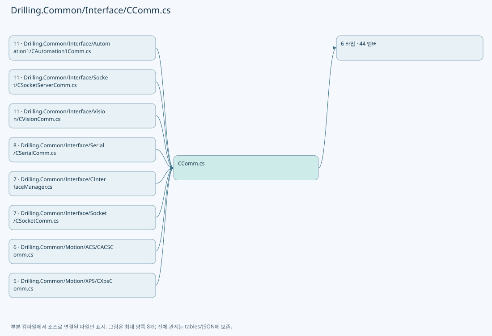
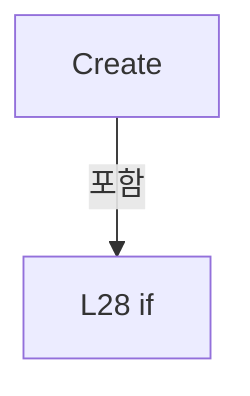

# Drilling.Common/Interface/CComm.cs

| 항목 | 내용 |
| --- | --- |
| 원본 저장소 | https://github.com/kjuws10-rgb/A3Drilling.git |
| 원본 Commit | 5aee8e58439c9b455cae7c9593c9be986c3e682e |
| 원본 SHA256 | 6e793d154d708b514ef2940d287181a6e6a49473e2501e3f8981c0ed9095c46e |
| 파일 분류 | code |
| 원본 크기/행 | 6,165 bytes / 155 physical lines |
| 인코딩 | utf-8-sig |
| 검토 범위 | 구문/부분 의미 분석에서 추출한 사실. 동작·물리 단위·실장비 합격을 보증하지 않습니다. |
| 원본 링크 | [고정 Commit 원본](https://github.com/kjuws10-rgb/A3Drilling/blob/5aee8e58439c9b455cae7c9593c9be986c3e682e/Drilling.Common/Interface/CComm.cs) |

## 파일의 역할과 읽는 순서

외부 통신과 장치 인터페이스를 연결합니다. 요청 생성·전송·수신·장치 실행을 같은 의미로 합치지 않습니다.

## 네임스페이스·타입·상속

| 타입 | 구분 | 원본 범위 | 선언/상속 |
| --- | --- | --- | --- |
| CComm | ClassDeclaration | 10–63 | CComm |
| CCommRegistration | RecordDeclaration | 56–62 | CCommRegistration |
| CCommTypeAttribute | ClassDeclaration | 65–75 | CCommTypeAttribute: Attribute |
| ST_COMM_RECEIVED_MESSAGE | RecordDeclaration | 77–77 | ST_COMM_RECEIVED_MESSAGE |
| CCommBase | ClassDeclaration | 78–136 | CCommBase |
| CReadyOnlyComm | ClassDeclaration | 138–155 | CReadyOnlyComm: CCommBase(data, option) |

## 멤버 빠른 목록

| 이름 | 종류 | 범위 | 서명 |
| --- | --- | --- | --- |
| CommTypes | FieldDeclaration | L12–12 | System.Collections.Generic.IReadOnlyList<Drilling.Common.Interface.CComm.CCommRegistration> Drilling.Common.Interface.CComm.CommTypes |
| Create | MethodDeclaration | L13–34 | Drilling.Common.Interface.CCommBase Drilling.Common.Interface.CComm.Create(Drilling.Common.Interface.ST_INTERFACE_DATA, Drilling.Common.Interface.ST_INTERFACE_CONNECT_OPTION) |
| ShouldIncludeItem | LocalFunctionStatement | L17–20 | bool ShouldIncludeItem(Drilling.Common.Interface.CComm.CCommRegistration) |
| SelectSortKey | LocalFunctionStatement | L22–25 | int SelectSortKey(Drilling.Common.Interface.CComm.CCommRegistration) |
| LoadCommTypes | MethodDeclaration | L36–54 | System.Collections.Generic.IReadOnlyList<Drilling.Common.Interface.CComm.CCommRegistration> Drilling.Common.Interface.CComm.LoadCommTypes() |
| ShouldIncludeItem | LocalFunctionStatement | L38–41 | bool ShouldIncludeItem(System.Type) |
| BuildCCommRegistration | LocalFunctionStatement | L43–51 | System.Collections.Generic.IEnumerable<Drilling.Common.Interface.CComm.CCommRegistration> BuildCCommRegistration(System.Type) |
| BuildCCommRegistration | LocalFunctionStatement | L45–48 | Drilling.Common.Interface.CComm.CCommRegistration BuildCCommRegistration(Drilling.Common.Interface.CCommTypeAttribute) |
| IsMatch | MethodDeclaration | L58–61 | bool Drilling.Common.Interface.CComm.CCommRegistration.IsMatch(string, string) |
| InterfaceType | PropertyDeclaration | L68–68 | string Drilling.Common.Interface.CCommTypeAttribute.InterfaceType |
| get_InterfaceType | GetAccessorDeclaration | L68–68 | string Drilling.Common.Interface.CCommTypeAttribute.InterfaceType.get |
| DeviceNames | PropertyDeclaration | L69–69 | System.Collections.Generic.IReadOnlyList<string> Drilling.Common.Interface.CCommTypeAttribute.DeviceNames |
| get_DeviceNames | GetAccessorDeclaration | L69–69 | System.Collections.Generic.IReadOnlyList<string> Drilling.Common.Interface.CCommTypeAttribute.DeviceNames.get |
| NormalizeName | MethodDeclaration | L71–74 | string Drilling.Common.Interface.CCommTypeAttribute.NormalizeName(string) |
| Data | FieldDeclaration | L80–80 | Drilling.Common.Interface.ST_INTERFACE_DATA Drilling.Common.Interface.CCommBase.Data |
| Option | FieldDeclaration | L81–81 | Drilling.Common.Interface.ST_INTERFACE_CONNECT_OPTION Drilling.Common.Interface.CCommBase.Option |
| ConnectionState | PropertyDeclaration | L82–82 | Drilling.Common.Interface.EN_COMM_STATE Drilling.Common.Interface.CCommBase.ConnectionState |
| get_ConnectionState | GetAccessorDeclaration | L82–82 | Drilling.Common.Interface.EN_COMM_STATE Drilling.Common.Interface.CCommBase.ConnectionState.get |
| set_ConnectionState | SetAccessorDeclaration | L82–82 | void Drilling.Common.Interface.CCommBase.ConnectionState.set |
| Endpoint | PropertyDeclaration | L84–90 | string Drilling.Common.Interface.CCommBase.Endpoint |
| get_Endpoint | GetAccessorDeclaration | L86–89 | string Drilling.Common.Interface.CCommBase.Endpoint.get |
| LastSent | PropertyDeclaration | L92–92 | string Drilling.Common.Interface.CCommBase.LastSent |
| get_LastSent | GetAccessorDeclaration | L92–92 | string Drilling.Common.Interface.CCommBase.LastSent.get |
| set_LastSent | SetAccessorDeclaration | L92–92 | void Drilling.Common.Interface.CCommBase.LastSent.set |
| LastReceived | PropertyDeclaration | L93–93 | string Drilling.Common.Interface.CCommBase.LastReceived |
| get_LastReceived | GetAccessorDeclaration | L93–93 | string Drilling.Common.Interface.CCommBase.LastReceived.get |
| set_LastReceived | SetAccessorDeclaration | L93–93 | void Drilling.Common.Interface.CCommBase.LastReceived.set |
| LastError | PropertyDeclaration | L94–94 | string Drilling.Common.Interface.CCommBase.LastError |
| get_LastError | GetAccessorDeclaration | L94–94 | string Drilling.Common.Interface.CCommBase.LastError.get |
| set_LastError | SetAccessorDeclaration | L94–94 | void Drilling.Common.Interface.CCommBase.LastError.set |
| LastChangedAt | PropertyDeclaration | L95–95 | System.DateTimeOffset? Drilling.Common.Interface.CCommBase.LastChangedAt |
| get_LastChangedAt | GetAccessorDeclaration | L95–95 | System.DateTimeOffset? Drilling.Common.Interface.CCommBase.LastChangedAt.get |
| set_LastChangedAt | SetAccessorDeclaration | L95–95 | void Drilling.Common.Interface.CCommBase.LastChangedAt.set |
| Connect | MethodDeclaration | L97–97 | System.Threading.Tasks.Task Drilling.Common.Interface.CCommBase.Connect(System.Threading.CancellationToken) |
| ResetAutoReconnectPolicy | MethodDeclaration | L98–100 | void Drilling.Common.Interface.CCommBase.ResetAutoReconnectPolicy() |
| SuppressAutoReconnect | MethodDeclaration | L102–104 | void Drilling.Common.Interface.CCommBase.SuppressAutoReconnect() |
| Disconnect | MethodDeclaration | L106–111 | System.Threading.Tasks.Task Drilling.Common.Interface.CCommBase.Disconnect(System.Threading.CancellationToken) |
| Execute | MethodDeclaration | L113–113 | System.Threading.Tasks.Task<string> Drilling.Common.Interface.CCommBase.Execute(string, System.Threading.CancellationToken) |
| SetState | MethodDeclaration | L114–118 | void Drilling.Common.Interface.CCommBase.SetState(Drilling.Common.Interface.EN_COMM_STATE) |
| SetError | MethodDeclaration | L120–124 | void Drilling.Common.Interface.CCommBase.SetError(System.Exception) |
| SetError | MethodDeclaration | L126–130 | void Drilling.Common.Interface.CCommBase.SetError(string) |
| SetCommandError | MethodDeclaration | L132–135 | void Drilling.Common.Interface.CCommBase.SetCommandError(string) |
| Connect | MethodDeclaration | L140–145 | System.Threading.Tasks.Task Drilling.Common.Interface.CReadyOnlyComm.Connect(System.Threading.CancellationToken) |
| Execute | MethodDeclaration | L147–154 | System.Threading.Tasks.Task<string> Drilling.Common.Interface.CReadyOnlyComm.Execute(string, System.Threading.CancellationToken) |

## 멤버별 상세 계약·호출·처리 해설

### FieldDeclaration `CommTypes` · L12–12

[Drilling.Common/Interface/CComm.cs:12–12](https://github.com/kjuws10-rgb/A3Drilling/blob/5aee8e58439c9b455cae7c9593c9be986c3e682e/Drilling.Common/Interface/CComm.cs#L12-L12)

| 항목 | 실제 추출 값 |
| --- | --- |
| 서명 | System.Collections.Generic.IReadOnlyList<Drilling.Common.Interface.CComm.CCommRegistration> Drilling.Common.Interface.CComm.CommTypes |
| 접근/수식자 | Private / private, static, readonly |
| 반환/값 타입 | System.Collections.Generic.IReadOnlyList<Drilling.Common.Interface.CComm.CCommRegistration> |
| 소속 타입 | NamedType:Drilling.Common.Interface.CComm |

현재 부분 분석에서 직접 연결된 호출자는 없습니다. XAML/이벤트/인터페이스·델리게이트·외부 진입을 추가 확인해야 하며, 미사용으로 판정한 것이 아닙니다.

호출하는 대상과 해석 범위:

| 원본 행 | 표현식 | 분석 상태 | 대상/소스 위치 |
| --- | --- | --- | --- |
| 12 | LoadCommTypes | resolved | System.Collections.Generic.IReadOnlyList<Drilling.Common.Interface.CComm.CCommRegistration> Drilling.Common.Interface.CComm.LoadCommTypes() · Drilling.Common/Interface/CComm.cs:36 |

본문의 실제 연산·분기·예외·반환 순서(원문 위치 순):

| 원본 행 | 종류 | 주석 해설 |
| --- | --- | --- |
| 12 | call | 함수·델리게이트 또는 객체 생성자를 호출합니다: LoadCommTypes() |
| 12 | variable-initializer | 변수의 초기값을 지정합니다: CommTypes = LoadCommTypes() |

변경 전 점검: 입력/반환 타입, 위 호출자, 예외/취소 경로, 공유 상태와 저장·전송 소비자를 함께 확인합니다. 값의 단위나 물리 방향을 이름만으로 확정하지 않습니다.

### MethodDeclaration `Create` · L13–34

[Drilling.Common/Interface/CComm.cs:13–34](https://github.com/kjuws10-rgb/A3Drilling/blob/5aee8e58439c9b455cae7c9593c9be986c3e682e/Drilling.Common/Interface/CComm.cs#L13-L34)

| 항목 | 실제 추출 값 |
| --- | --- |
| 서명 | Drilling.Common.Interface.CCommBase Drilling.Common.Interface.CComm.Create(Drilling.Common.Interface.ST_INTERFACE_DATA, Drilling.Common.Interface.ST_INTERFACE_CONNECT_OPTION) |
| 접근/수식자 | Public / public, static |
| 반환/값 타입 | Drilling.Common.Interface.CCommBase |
| 소속 타입 | NamedType:Drilling.Common.Interface.CComm |

입력 계약:

| 이름 | 타입 | 전달 | 선택/기본값 |
| --- | --- | --- | --- |
| data | Drilling.Common.Interface.ST_INTERFACE_DATA | None | False /  |
| option | Drilling.Common.Interface.ST_INTERFACE_CONNECT_OPTION | None | False /  |

정적 호출자로 확인된 위치:

| 호출 파일/행 | 호출 표현식 | 런타임 분기 가능 |
| --- | --- | --- |
| [Drilling.Common/Interface/CInterfaceManager.cs:2989–2989](https://github.com/kjuws10-rgb/A3Drilling/blob/5aee8e58439c9b455cae7c9593c9be986c3e682e/Drilling.Common/Interface/CInterfaceManager.cs#L2989-L2989) | CComm.Create | False |

호출하는 대상과 해석 범위:

| 원본 행 | 표현식 | 분석 상태 | 대상/소스 위치 |
| --- | --- | --- | --- |
| 15 | CCommTypeAttribute.NormalizeName | resolved | string Drilling.Common.Interface.CCommTypeAttribute.NormalizeName(string) · Drilling.Common/Interface/CComm.cs:71 |
| 15 | data.InterfaceType.ToString | resolved · 동적 구현 선택 가능 | string System.Enum.ToString() |
| 16 | CCommTypeAttribute.NormalizeName | resolved | string Drilling.Common.Interface.CCommTypeAttribute.NormalizeName(string) · Drilling.Common/Interface/CComm.cs:71 |
| 16 | data.Device.ToString | resolved · 동적 구현 선택 가능 | string System.Enum.ToString() |
| 27 | CommTypes.Where(ShouldIncludeItem).OrderByDescending(SelectSortKey).FirstOrDefault | resolved | Drilling.Common.Interface.CComm.CCommRegistration? System.Collections.Generic.IEnumerable<Drilling.Common.Interface.CComm.CCommRegistration>.FirstOrDefault<Drilling.Common.Interface.CComm.CCommRegistration>() |
| 27 | CommTypes.Where(ShouldIncludeItem).OrderByDescending | resolved | System.Linq.IOrderedEnumerable<Drilling.Common.Interface.CComm.CCommRegistration> System.Collections.Generic.IEnumerable<Drilling.Common.Interface.CComm.CCommRegistration>.OrderByDescending<Drilling.Common.Interface.CComm.CCommRegistration, int>(System.Func<Drilling.Common.Interface.CComm.CCommRegistration, int>) |
| 27 | CommTypes.Where | resolved | System.Collections.Generic.IEnumerable<Drilling.Common.Interface.CComm.CCommRegistration> System.Collections.Generic.IEnumerable<Drilling.Common.Interface.CComm.CCommRegistration>.Where<Drilling.Common.Interface.CComm.CCommRegistration>(System.Func<Drilling.Common.Interface.CComm.CCommRegistration, bool>) |
| 30 | new CReadyOnlyComm | resolved | Drilling.Common.Interface.CReadyOnlyComm.CReadyOnlyComm(Drilling.Common.Interface.ST_INTERFACE_DATA, Drilling.Common.Interface.ST_INTERFACE_CONNECT_OPTION) · Drilling.Common/Interface/CComm.cs:138 |
| 33 | Activator.CreateInstance | resolved | object? System.Activator.CreateInstance(System.Type, params object?[]?) |
| 33 | new InvalidOperationException | resolved | System.InvalidOperationException.InvalidOperationException(string?) |

본문의 실제 연산·분기·예외·반환 순서(원문 위치 순):

| 원본 행 | 종류 | 주석 해설 |
| --- | --- | --- |
| 15 | call | 함수·델리게이트 또는 객체 생성자를 호출합니다: CCommTypeAttribute.NormalizeName(data.InterfaceType.ToString()) |
| 15 | call | 함수·델리게이트 또는 객체 생성자를 호출합니다: data.InterfaceType.ToString() |
| 15 | local-declaration | 지역 변수를 선언합니다: var interfaceType = CCommTypeAttribute.NormalizeName(data.InterfaceType.ToString()); |
| 15 | variable-initializer | 변수의 초기값을 지정합니다: interfaceType = CCommTypeAttribute.NormalizeName(data.InterfaceType.ToString()) |
| 16 | call | 함수·델리게이트 또는 객체 생성자를 호출합니다: CCommTypeAttribute.NormalizeName(data.Device.ToString()) |
| 16 | call | 함수·델리게이트 또는 객체 생성자를 호출합니다: data.Device.ToString() |
| 16 | local-declaration | 지역 변수를 선언합니다: var deviceName = CCommTypeAttribute.NormalizeName(data.Device.ToString()); |
| 16 | variable-initializer | 변수의 초기값을 지정합니다: deviceName = CCommTypeAttribute.NormalizeName(data.Device.ToString()) |
| 27 | call | 함수·델리게이트 또는 객체 생성자를 호출합니다: CommTypes.Where(ShouldIncludeItem).OrderByDescending(SelectSortKey).FirstOrDefault() |
| 27 | call | 함수·델리게이트 또는 객체 생성자를 호출합니다: CommTypes.Where(ShouldIncludeItem).OrderByDescending(SelectSortKey) |
| 27 | call | 함수·델리게이트 또는 객체 생성자를 호출합니다: CommTypes.Where(ShouldIncludeItem) |
| 27 | local-declaration | 지역 변수를 선언합니다: var commType = CommTypes.Where(ShouldIncludeItem).OrderByDescending(SelectSortKey).FirstOrDefault(); |
| 27 | variable-initializer | 변수의 초기값을 지정합니다: commType = CommTypes.Where(ShouldIncludeItem).OrderByDescending(SelectSortKey).FirstOrDefault() |
| 28 | if | 조건에 따라 분기합니다: if (commType is null) |
| 30 | call | 함수·델리게이트 또는 객체 생성자를 호출합니다: new CReadyOnlyComm(data, option) |
| 30 | return | 호출자에게 값 또는 제어를 반환합니다: return new CReadyOnlyComm(data, option); |
| 33 | call | 함수·델리게이트 또는 객체 생성자를 호출합니다: Activator.CreateInstance(commType.CommType, data, option) |
| 33 | call | 함수·델리게이트 또는 객체 생성자를 호출합니다: new InvalidOperationException($"Interface communication creation failed: {data.InterfaceType}/{data.Device}") |
| 33 | return | 호출자에게 값 또는 제어를 반환합니다: return Activator.CreateInstance(commType.CommType, data, option) as CCommBase ?? throw new InvalidOperationException($"Interface communication creation failed: {data.InterfaceType}/{data.Device}"); |
| 33 | throw | 예외를 발생/전달합니다: throw new InvalidOperationException($"Interface communication creation failed: {data.InterfaceType}/{data.Device}") |

제어 구문의 포함 구조(실제 실행 순서/CFG가 아닌 구문 탐색 그림):

변경 전 점검: 입력/반환 타입, 위 호출자, 예외/취소 경로, 공유 상태와 저장·전송 소비자를 함께 확인합니다. 값의 단위나 물리 방향을 이름만으로 확정하지 않습니다.

### LocalFunctionStatement `ShouldIncludeItem` · L17–20

[Drilling.Common/Interface/CComm.cs:17–20](https://github.com/kjuws10-rgb/A3Drilling/blob/5aee8e58439c9b455cae7c9593c9be986c3e682e/Drilling.Common/Interface/CComm.cs#L17-L20)

| 항목 | 실제 추출 값 |
| --- | --- |
| 서명 | bool ShouldIncludeItem(Drilling.Common.Interface.CComm.CCommRegistration) |
| 접근/수식자 | Private /  |
| 반환/값 타입 | bool |
| 소속 타입 | NamedType:Drilling.Common.Interface.CComm |

입력 계약:

| 이름 | 타입 | 전달 | 선택/기본값 |
| --- | --- | --- | --- |
| item | Drilling.Common.Interface.CComm.CCommRegistration | None | False /  |

현재 부분 분석에서 직접 연결된 호출자는 없습니다. XAML/이벤트/인터페이스·델리게이트·외부 진입을 추가 확인해야 하며, 미사용으로 판정한 것이 아닙니다.

호출하는 대상과 해석 범위:

| 원본 행 | 표현식 | 분석 상태 | 대상/소스 위치 |
| --- | --- | --- | --- |
| 19 | item.IsMatch | resolved | bool Drilling.Common.Interface.CComm.CCommRegistration.IsMatch(string, string) · Drilling.Common/Interface/CComm.cs:58 |

본문의 실제 연산·분기·예외·반환 순서(원문 위치 순):

| 원본 행 | 종류 | 주석 해설 |
| --- | --- | --- |
| 19 | call | 함수·델리게이트 또는 객체 생성자를 호출합니다: item.IsMatch(interfaceType, deviceName) |
| 19 | return | 호출자에게 값 또는 제어를 반환합니다: return item.IsMatch(interfaceType, deviceName); |

변경 전 점검: 입력/반환 타입, 위 호출자, 예외/취소 경로, 공유 상태와 저장·전송 소비자를 함께 확인합니다. 값의 단위나 물리 방향을 이름만으로 확정하지 않습니다.

### LocalFunctionStatement `SelectSortKey` · L22–25

[Drilling.Common/Interface/CComm.cs:22–25](https://github.com/kjuws10-rgb/A3Drilling/blob/5aee8e58439c9b455cae7c9593c9be986c3e682e/Drilling.Common/Interface/CComm.cs#L22-L25)

| 항목 | 실제 추출 값 |
| --- | --- |
| 서명 | int SelectSortKey(Drilling.Common.Interface.CComm.CCommRegistration) |
| 접근/수식자 | Private /  |
| 반환/값 타입 | int |
| 소속 타입 | NamedType:Drilling.Common.Interface.CComm |

입력 계약:

| 이름 | 타입 | 전달 | 선택/기본값 |
| --- | --- | --- | --- |
| item | Drilling.Common.Interface.CComm.CCommRegistration | None | False /  |

현재 부분 분석에서 직접 연결된 호출자는 없습니다. XAML/이벤트/인터페이스·델리게이트·외부 진입을 추가 확인해야 하며, 미사용으로 판정한 것이 아닙니다.

본문의 실제 연산·분기·예외·반환 순서(원문 위치 순):

| 원본 행 | 종류 | 주석 해설 |
| --- | --- | --- |
| 24 | return | 호출자에게 값 또는 제어를 반환합니다: return item.DeviceNames.Count; |

변경 전 점검: 입력/반환 타입, 위 호출자, 예외/취소 경로, 공유 상태와 저장·전송 소비자를 함께 확인합니다. 값의 단위나 물리 방향을 이름만으로 확정하지 않습니다.

### MethodDeclaration `LoadCommTypes` · L36–54

[Drilling.Common/Interface/CComm.cs:36–54](https://github.com/kjuws10-rgb/A3Drilling/blob/5aee8e58439c9b455cae7c9593c9be986c3e682e/Drilling.Common/Interface/CComm.cs#L36-L54)

| 항목 | 실제 추출 값 |
| --- | --- |
| 서명 | System.Collections.Generic.IReadOnlyList<Drilling.Common.Interface.CComm.CCommRegistration> Drilling.Common.Interface.CComm.LoadCommTypes() |
| 접근/수식자 | Private / private, static |
| 반환/값 타입 | System.Collections.Generic.IReadOnlyList<Drilling.Common.Interface.CComm.CCommRegistration> |
| 소속 타입 | NamedType:Drilling.Common.Interface.CComm |

정적 호출자로 확인된 위치:

| 호출 파일/행 | 호출 표현식 | 런타임 분기 가능 |
| --- | --- | --- |
| [Drilling.Common/Interface/CComm.cs:12–12](https://github.com/kjuws10-rgb/A3Drilling/blob/5aee8e58439c9b455cae7c9593c9be986c3e682e/Drilling.Common/Interface/CComm.cs#L12-L12) | LoadCommTypes | False |

호출하는 대상과 해석 범위:

| 원본 행 | 표현식 | 분석 상태 | 대상/소스 위치 |
| --- | --- | --- | --- |
| 53 | typeof(CCommBase).Assembly.GetTypes().Where(ShouldIncludeItem).SelectMany(BuildCCommRegistration).ToArray | resolved | Drilling.Common.Interface.CComm.CCommRegistration[] System.Collections.Generic.IEnumerable<Drilling.Common.Interface.CComm.CCommRegistration>.ToArray<Drilling.Common.Interface.CComm.CCommRegistration>() |
| 53 | typeof(CCommBase).Assembly.GetTypes().Where(ShouldIncludeItem).SelectMany | resolved | System.Collections.Generic.IEnumerable<Drilling.Common.Interface.CComm.CCommRegistration> System.Collections.Generic.IEnumerable<System.Type>.SelectMany<System.Type, Drilling.Common.Interface.CComm.CCommRegistration>(System.Func<System.Type, System.Collections.Generic.IEnumerable<Drilling.Common.Interface.CComm.CCommRegistration>>) |
| 53 | typeof(CCommBase).Assembly.GetTypes().Where | resolved | System.Collections.Generic.IEnumerable<System.Type> System.Collections.Generic.IEnumerable<System.Type>.Where<System.Type>(System.Func<System.Type, bool>) |
| 53 | typeof(CCommBase).Assembly.GetTypes | resolved · 동적 구현 선택 가능 | System.Type[] System.Reflection.Assembly.GetTypes() |

본문의 실제 연산·분기·예외·반환 순서(원문 위치 순):

| 원본 행 | 종류 | 주석 해설 |
| --- | --- | --- |
| 53 | call | 함수·델리게이트 또는 객체 생성자를 호출합니다: typeof(CCommBase).Assembly.GetTypes().Where(ShouldIncludeItem).SelectMany(BuildCCommRegistration).ToArray() |
| 53 | call | 함수·델리게이트 또는 객체 생성자를 호출합니다: typeof(CCommBase).Assembly.GetTypes().Where(ShouldIncludeItem).SelectMany(BuildCCommRegistration) |
| 53 | call | 함수·델리게이트 또는 객체 생성자를 호출합니다: typeof(CCommBase).Assembly.GetTypes().Where(ShouldIncludeItem) |
| 53 | call | 함수·델리게이트 또는 객체 생성자를 호출합니다: typeof(CCommBase).Assembly.GetTypes() |
| 53 | return | 호출자에게 값 또는 제어를 반환합니다: return typeof(CCommBase).Assembly.GetTypes().Where(ShouldIncludeItem).SelectMany(BuildCCommRegistration).ToArray(); |

변경 전 점검: 입력/반환 타입, 위 호출자, 예외/취소 경로, 공유 상태와 저장·전송 소비자를 함께 확인합니다. 값의 단위나 물리 방향을 이름만으로 확정하지 않습니다.

### LocalFunctionStatement `ShouldIncludeItem` · L38–41

[Drilling.Common/Interface/CComm.cs:38–41](https://github.com/kjuws10-rgb/A3Drilling/blob/5aee8e58439c9b455cae7c9593c9be986c3e682e/Drilling.Common/Interface/CComm.cs#L38-L41)

| 항목 | 실제 추출 값 |
| --- | --- |
| 서명 | bool ShouldIncludeItem(System.Type) |
| 접근/수식자 | Private /  |
| 반환/값 타입 | bool |
| 소속 타입 | NamedType:Drilling.Common.Interface.CComm |

입력 계약:

| 이름 | 타입 | 전달 | 선택/기본값 |
| --- | --- | --- | --- |
| type | System.Type | None | False /  |

현재 부분 분석에서 직접 연결된 호출자는 없습니다. XAML/이벤트/인터페이스·델리게이트·외부 진입을 추가 확인해야 하며, 미사용으로 판정한 것이 아닙니다.

호출하는 대상과 해석 범위:

| 원본 행 | 표현식 | 분석 상태 | 대상/소스 위치 |
| --- | --- | --- | --- |
| 40 | typeof(CCommBase).IsAssignableFrom | resolved · 동적 구현 선택 가능 | bool System.Type.IsAssignableFrom(System.Type?) |

본문의 실제 연산·분기·예외·반환 순서(원문 위치 순):

| 원본 행 | 종류 | 주석 해설 |
| --- | --- | --- |
| 40 | call | 함수·델리게이트 또는 객체 생성자를 호출합니다: typeof(CCommBase).IsAssignableFrom(type) |
| 40 | return | 호출자에게 값 또는 제어를 반환합니다: return !type.IsAbstract && typeof(CCommBase).IsAssignableFrom(type); |

변경 전 점검: 입력/반환 타입, 위 호출자, 예외/취소 경로, 공유 상태와 저장·전송 소비자를 함께 확인합니다. 값의 단위나 물리 방향을 이름만으로 확정하지 않습니다.

### LocalFunctionStatement `BuildCCommRegistration` · L43–51

[Drilling.Common/Interface/CComm.cs:43–51](https://github.com/kjuws10-rgb/A3Drilling/blob/5aee8e58439c9b455cae7c9593c9be986c3e682e/Drilling.Common/Interface/CComm.cs#L43-L51)

| 항목 | 실제 추출 값 |
| --- | --- |
| 서명 | System.Collections.Generic.IEnumerable<Drilling.Common.Interface.CComm.CCommRegistration> BuildCCommRegistration(System.Type) |
| 접근/수식자 | Private /  |
| 반환/값 타입 | System.Collections.Generic.IEnumerable<Drilling.Common.Interface.CComm.CCommRegistration> |
| 소속 타입 | NamedType:Drilling.Common.Interface.CComm |

입력 계약:

| 이름 | 타입 | 전달 | 선택/기본값 |
| --- | --- | --- | --- |
| type | System.Type | None | False /  |

현재 부분 분석에서 직접 연결된 호출자는 없습니다. XAML/이벤트/인터페이스·델리게이트·외부 진입을 추가 확인해야 하며, 미사용으로 판정한 것이 아닙니다.

호출하는 대상과 해석 범위:

| 원본 행 | 표현식 | 분석 상태 | 대상/소스 위치 |
| --- | --- | --- | --- |
| 50 | type.GetCustomAttributes<CCommTypeAttribute>().Select | resolved | System.Collections.Generic.IEnumerable<Drilling.Common.Interface.CComm.CCommRegistration> System.Collections.Generic.IEnumerable<Drilling.Common.Interface.CCommTypeAttribute>.Select<Drilling.Common.Interface.CCommTypeAttribute, Drilling.Common.Interface.CComm.CCommRegistration>(System.Func<Drilling.Common.Interface.CCommTypeAttribute, Drilling.Common.Interface.CComm.CCommRegistration>) |
| 50 | type.GetCustomAttributes<CCommTypeAttribute> | resolved | System.Collections.Generic.IEnumerable<Drilling.Common.Interface.CCommTypeAttribute> System.Reflection.MemberInfo.GetCustomAttributes<Drilling.Common.Interface.CCommTypeAttribute>() |

본문의 실제 연산·분기·예외·반환 순서(원문 위치 순):

| 원본 행 | 종류 | 주석 해설 |
| --- | --- | --- |
| 50 | call | 함수·델리게이트 또는 객체 생성자를 호출합니다: type.GetCustomAttributes<CCommTypeAttribute>().Select(BuildCCommRegistration) |
| 50 | call | 함수·델리게이트 또는 객체 생성자를 호출합니다: type.GetCustomAttributes<CCommTypeAttribute>() |
| 50 | return | 호출자에게 값 또는 제어를 반환합니다: return type.GetCustomAttributes<CCommTypeAttribute>().Select(BuildCCommRegistration); |

변경 전 점검: 입력/반환 타입, 위 호출자, 예외/취소 경로, 공유 상태와 저장·전송 소비자를 함께 확인합니다. 값의 단위나 물리 방향을 이름만으로 확정하지 않습니다.

### LocalFunctionStatement `BuildCCommRegistration` · L45–48

[Drilling.Common/Interface/CComm.cs:45–48](https://github.com/kjuws10-rgb/A3Drilling/blob/5aee8e58439c9b455cae7c9593c9be986c3e682e/Drilling.Common/Interface/CComm.cs#L45-L48)

| 항목 | 실제 추출 값 |
| --- | --- |
| 서명 | Drilling.Common.Interface.CComm.CCommRegistration BuildCCommRegistration(Drilling.Common.Interface.CCommTypeAttribute) |
| 접근/수식자 | Private /  |
| 반환/값 타입 | Drilling.Common.Interface.CComm.CCommRegistration |
| 소속 타입 | NamedType:Drilling.Common.Interface.CComm |

입력 계약:

| 이름 | 타입 | 전달 | 선택/기본값 |
| --- | --- | --- | --- |
| attribute | Drilling.Common.Interface.CCommTypeAttribute | None | False /  |

현재 부분 분석에서 직접 연결된 호출자는 없습니다. XAML/이벤트/인터페이스·델리게이트·외부 진입을 추가 확인해야 하며, 미사용으로 판정한 것이 아닙니다.

호출하는 대상과 해석 범위:

| 원본 행 | 표현식 | 분석 상태 | 대상/소스 위치 |
| --- | --- | --- | --- |
| 47 | new CCommRegistration | resolved | Drilling.Common.Interface.CComm.CCommRegistration.CCommRegistration(string, System.Collections.Generic.IReadOnlyList<string>, System.Type) · Drilling.Common/Interface/CComm.cs:56 |

본문의 실제 연산·분기·예외·반환 순서(원문 위치 순):

| 원본 행 | 종류 | 주석 해설 |
| --- | --- | --- |
| 47 | call | 함수·델리게이트 또는 객체 생성자를 호출합니다: new CCommRegistration(attribute.InterfaceType, attribute.DeviceNames, type) |
| 47 | return | 호출자에게 값 또는 제어를 반환합니다: return new CCommRegistration(attribute.InterfaceType, attribute.DeviceNames, type); |

변경 전 점검: 입력/반환 타입, 위 호출자, 예외/취소 경로, 공유 상태와 저장·전송 소비자를 함께 확인합니다. 값의 단위나 물리 방향을 이름만으로 확정하지 않습니다.

### MethodDeclaration `IsMatch` · L58–61

[Drilling.Common/Interface/CComm.cs:58–61](https://github.com/kjuws10-rgb/A3Drilling/blob/5aee8e58439c9b455cae7c9593c9be986c3e682e/Drilling.Common/Interface/CComm.cs#L58-L61)

| 항목 | 실제 추출 값 |
| --- | --- |
| 서명 | bool Drilling.Common.Interface.CComm.CCommRegistration.IsMatch(string, string) |
| 접근/수식자 | Public / public |
| 반환/값 타입 | bool |
| 소속 타입 | NamedType:Drilling.Common.Interface.CComm.CCommRegistration |

입력 계약:

| 이름 | 타입 | 전달 | 선택/기본값 |
| --- | --- | --- | --- |
| interfaceType | string | None | False /  |
| deviceName | string | None | False /  |

정적 호출자로 확인된 위치:

| 호출 파일/행 | 호출 표현식 | 런타임 분기 가능 |
| --- | --- | --- |
| [Drilling.Common/Interface/CComm.cs:19–19](https://github.com/kjuws10-rgb/A3Drilling/blob/5aee8e58439c9b455cae7c9593c9be986c3e682e/Drilling.Common/Interface/CComm.cs#L19-L19) | item.IsMatch | False |

호출하는 대상과 해석 범위:

| 원본 행 | 표현식 | 분석 상태 | 대상/소스 위치 |
| --- | --- | --- | --- |
| 60 | InterfaceType.Equals | resolved | bool string.Equals(string?, System.StringComparison) |
| 60 | DeviceNames.Contains | resolved | bool System.Collections.Generic.IEnumerable<string>.Contains<string>(string, System.Collections.Generic.IEqualityComparer<string>?) |

본문의 실제 연산·분기·예외·반환 순서(원문 위치 순):

| 원본 행 | 종류 | 주석 해설 |
| --- | --- | --- |
| 60 | call | 함수·델리게이트 또는 객체 생성자를 호출합니다: InterfaceType.Equals(interfaceType, StringComparison.OrdinalIgnoreCase) |
| 60 | call | 함수·델리게이트 또는 객체 생성자를 호출합니다: DeviceNames.Contains(deviceName, StringComparer.OrdinalIgnoreCase) |
| 60 | return | 호출자에게 값 또는 제어를 반환합니다: return InterfaceType.Equals(interfaceType, StringComparison.OrdinalIgnoreCase) && (DeviceNames.Count == 0 &#124;&#124; DeviceNames.Contains(deviceName, StringComparer.OrdinalIgnoreCase)); |

변경 전 점검: 입력/반환 타입, 위 호출자, 예외/취소 경로, 공유 상태와 저장·전송 소비자를 함께 확인합니다. 값의 단위나 물리 방향을 이름만으로 확정하지 않습니다.

### PropertyDeclaration `InterfaceType` · L68–68

[Drilling.Common/Interface/CComm.cs:68–68](https://github.com/kjuws10-rgb/A3Drilling/blob/5aee8e58439c9b455cae7c9593c9be986c3e682e/Drilling.Common/Interface/CComm.cs#L68-L68)

| 항목 | 실제 추출 값 |
| --- | --- |
| 서명 | string Drilling.Common.Interface.CCommTypeAttribute.InterfaceType |
| 접근/수식자 | Public / public |
| 반환/값 타입 | string |
| 소속 타입 | NamedType:Drilling.Common.Interface.CCommTypeAttribute |

현재 부분 분석에서 직접 연결된 호출자는 없습니다. XAML/이벤트/인터페이스·델리게이트·외부 진입을 추가 확인해야 하며, 미사용으로 판정한 것이 아닙니다.

호출하는 대상과 해석 범위:

| 원본 행 | 표현식 | 분석 상태 | 대상/소스 위치 |
| --- | --- | --- | --- |
| 68 | NormalizeName | resolved | string Drilling.Common.Interface.CCommTypeAttribute.NormalizeName(string) · Drilling.Common/Interface/CComm.cs:71 |

본문의 실제 연산·분기·예외·반환 순서(원문 위치 순):

| 원본 행 | 종류 | 주석 해설 |
| --- | --- | --- |
| 68 | call | 함수·델리게이트 또는 객체 생성자를 호출합니다: NormalizeName(interfaceType) |

변경 전 점검: 입력/반환 타입, 위 호출자, 예외/취소 경로, 공유 상태와 저장·전송 소비자를 함께 확인합니다. 값의 단위나 물리 방향을 이름만으로 확정하지 않습니다.

### GetAccessorDeclaration `get_InterfaceType` · L68–68

[Drilling.Common/Interface/CComm.cs:68–68](https://github.com/kjuws10-rgb/A3Drilling/blob/5aee8e58439c9b455cae7c9593c9be986c3e682e/Drilling.Common/Interface/CComm.cs#L68-L68)

| 항목 | 실제 추출 값 |
| --- | --- |
| 서명 | string Drilling.Common.Interface.CCommTypeAttribute.InterfaceType.get |
| 접근/수식자 | Public / get |
| 반환/값 타입 | string |
| 소속 타입 | NamedType:Drilling.Common.Interface.CCommTypeAttribute |

현재 부분 분석에서 직접 연결된 호출자는 없습니다. XAML/이벤트/인터페이스·델리게이트·외부 진입을 추가 확인해야 하며, 미사용으로 판정한 것이 아닙니다.

변경 전 점검: 입력/반환 타입, 위 호출자, 예외/취소 경로, 공유 상태와 저장·전송 소비자를 함께 확인합니다. 값의 단위나 물리 방향을 이름만으로 확정하지 않습니다.

### PropertyDeclaration `DeviceNames` · L69–69

[Drilling.Common/Interface/CComm.cs:69–69](https://github.com/kjuws10-rgb/A3Drilling/blob/5aee8e58439c9b455cae7c9593c9be986c3e682e/Drilling.Common/Interface/CComm.cs#L69-L69)

| 항목 | 실제 추출 값 |
| --- | --- |
| 서명 | System.Collections.Generic.IReadOnlyList<string> Drilling.Common.Interface.CCommTypeAttribute.DeviceNames |
| 접근/수식자 | Public / public |
| 반환/값 타입 | System.Collections.Generic.IReadOnlyList<string> |
| 소속 타입 | NamedType:Drilling.Common.Interface.CCommTypeAttribute |

현재 부분 분석에서 직접 연결된 호출자는 없습니다. XAML/이벤트/인터페이스·델리게이트·외부 진입을 추가 확인해야 하며, 미사용으로 판정한 것이 아닙니다.

호출하는 대상과 해석 범위:

| 원본 행 | 표현식 | 분석 상태 | 대상/소스 위치 |
| --- | --- | --- | --- |
| 69 | deviceNames.Where(name => !string.IsNullOrWhiteSpace(name)).Select(NormalizeName).Distinct(StringComparer.OrdinalIgnoreCase).ToArray | resolved | string[] System.Collections.Generic.IEnumerable<string>.ToArray<string>() |
| 69 | deviceNames.Where(name => !string.IsNullOrWhiteSpace(name)).Select(NormalizeName).Distinct | resolved | System.Collections.Generic.IEnumerable<string> System.Collections.Generic.IEnumerable<string>.Distinct<string>(System.Collections.Generic.IEqualityComparer<string>?) |
| 69 | deviceNames.Where(name => !string.IsNullOrWhiteSpace(name)).Select | resolved | System.Collections.Generic.IEnumerable<string> System.Collections.Generic.IEnumerable<string>.Select<string, string>(System.Func<string, string>) |
| 69 | deviceNames.Where | resolved | System.Collections.Generic.IEnumerable<string> System.Collections.Generic.IEnumerable<string>.Where<string>(System.Func<string, bool>) |
| 69 | string.IsNullOrWhiteSpace | resolved | bool string.IsNullOrWhiteSpace(string?) |

본문의 실제 연산·분기·예외·반환 순서(원문 위치 순):

| 원본 행 | 종류 | 주석 해설 |
| --- | --- | --- |
| 69 | call | 함수·델리게이트 또는 객체 생성자를 호출합니다: deviceNames.Where(name => !string.IsNullOrWhiteSpace(name)).Select(NormalizeName).Distinct(StringComparer.OrdinalIgnoreCase).ToArray() |
| 69 | call | 함수·델리게이트 또는 객체 생성자를 호출합니다: deviceNames.Where(name => !string.IsNullOrWhiteSpace(name)).Select(NormalizeName).Distinct(StringComparer.OrdinalIgnoreCase) |
| 69 | call | 함수·델리게이트 또는 객체 생성자를 호출합니다: deviceNames.Where(name => !string.IsNullOrWhiteSpace(name)).Select(NormalizeName) |
| 69 | call | 함수·델리게이트 또는 객체 생성자를 호출합니다: deviceNames.Where(name => !string.IsNullOrWhiteSpace(name)) |
| 69 | call | 함수·델리게이트 또는 객체 생성자를 호출합니다: string.IsNullOrWhiteSpace(name) |

변경 전 점검: 입력/반환 타입, 위 호출자, 예외/취소 경로, 공유 상태와 저장·전송 소비자를 함께 확인합니다. 값의 단위나 물리 방향을 이름만으로 확정하지 않습니다.

### GetAccessorDeclaration `get_DeviceNames` · L69–69

[Drilling.Common/Interface/CComm.cs:69–69](https://github.com/kjuws10-rgb/A3Drilling/blob/5aee8e58439c9b455cae7c9593c9be986c3e682e/Drilling.Common/Interface/CComm.cs#L69-L69)

| 항목 | 실제 추출 값 |
| --- | --- |
| 서명 | System.Collections.Generic.IReadOnlyList<string> Drilling.Common.Interface.CCommTypeAttribute.DeviceNames.get |
| 접근/수식자 | Public / get |
| 반환/값 타입 | System.Collections.Generic.IReadOnlyList<string> |
| 소속 타입 | NamedType:Drilling.Common.Interface.CCommTypeAttribute |

현재 부분 분석에서 직접 연결된 호출자는 없습니다. XAML/이벤트/인터페이스·델리게이트·외부 진입을 추가 확인해야 하며, 미사용으로 판정한 것이 아닙니다.

변경 전 점검: 입력/반환 타입, 위 호출자, 예외/취소 경로, 공유 상태와 저장·전송 소비자를 함께 확인합니다. 값의 단위나 물리 방향을 이름만으로 확정하지 않습니다.

### MethodDeclaration `NormalizeName` · L71–74

[Drilling.Common/Interface/CComm.cs:71–74](https://github.com/kjuws10-rgb/A3Drilling/blob/5aee8e58439c9b455cae7c9593c9be986c3e682e/Drilling.Common/Interface/CComm.cs#L71-L74)

| 항목 | 실제 추출 값 |
| --- | --- |
| 서명 | string Drilling.Common.Interface.CCommTypeAttribute.NormalizeName(string) |
| 접근/수식자 | Public / public, static |
| 반환/값 타입 | string |
| 소속 타입 | NamedType:Drilling.Common.Interface.CCommTypeAttribute |

입력 계약:

| 이름 | 타입 | 전달 | 선택/기본값 |
| --- | --- | --- | --- |
| value | string | None | False /  |

정적 호출자로 확인된 위치:

| 호출 파일/행 | 호출 표현식 | 런타임 분기 가능 |
| --- | --- | --- |
| [Drilling.Common/Interface/CComm.cs:15–15](https://github.com/kjuws10-rgb/A3Drilling/blob/5aee8e58439c9b455cae7c9593c9be986c3e682e/Drilling.Common/Interface/CComm.cs#L15-L15) | CCommTypeAttribute.NormalizeName | False |
| [Drilling.Common/Interface/CComm.cs:16–16](https://github.com/kjuws10-rgb/A3Drilling/blob/5aee8e58439c9b455cae7c9593c9be986c3e682e/Drilling.Common/Interface/CComm.cs#L16-L16) | CCommTypeAttribute.NormalizeName | False |
| [Drilling.Common/Interface/CComm.cs:68–68](https://github.com/kjuws10-rgb/A3Drilling/blob/5aee8e58439c9b455cae7c9593c9be986c3e682e/Drilling.Common/Interface/CComm.cs#L68-L68) | NormalizeName | False |

호출하는 대상과 해석 범위:

| 원본 행 | 표현식 | 분석 상태 | 대상/소스 위치 |
| --- | --- | --- | --- |
| 73 | value.Trim().ToUpperInvariant().Replace("_", "", StringComparison.OrdinalIgnoreCase).Replace("-", "", StringComparison.OrdinalIgnoreCase).Replace | resolved | string string.Replace(string, string?, System.StringComparison) |
| 73 | value.Trim().ToUpperInvariant().Replace("_", "", StringComparison.OrdinalIgnoreCase).Replace | resolved | string string.Replace(string, string?, System.StringComparison) |
| 73 | value.Trim().ToUpperInvariant().Replace | resolved | string string.Replace(string, string?, System.StringComparison) |
| 73 | value.Trim().ToUpperInvariant | resolved | string string.ToUpperInvariant() |
| 73 | value.Trim | resolved | string string.Trim() |

본문의 실제 연산·분기·예외·반환 순서(원문 위치 순):

| 원본 행 | 종류 | 주석 해설 |
| --- | --- | --- |
| 73 | call | 함수·델리게이트 또는 객체 생성자를 호출합니다: value.Trim().ToUpperInvariant().Replace("_", "", StringComparison.OrdinalIgnoreCase).Replace("-", "", StringComparison.OrdinalIgnoreCase).Replace(" ", "", StringComparison.OrdinalIgnoreCase) |
| 73 | call | 함수·델리게이트 또는 객체 생성자를 호출합니다: value.Trim().ToUpperInvariant().Replace("_", "", StringComparison.OrdinalIgnoreCase).Replace("-", "", StringComparison.OrdinalIgnoreCase) |
| 73 | call | 함수·델리게이트 또는 객체 생성자를 호출합니다: value.Trim().ToUpperInvariant().Replace("_", "", StringComparison.OrdinalIgnoreCase) |
| 73 | call | 함수·델리게이트 또는 객체 생성자를 호출합니다: value.Trim().ToUpperInvariant() |
| 73 | call | 함수·델리게이트 또는 객체 생성자를 호출합니다: value.Trim() |
| 73 | return | 호출자에게 값 또는 제어를 반환합니다: return value.Trim().ToUpperInvariant().Replace("_", "", StringComparison.OrdinalIgnoreCase).Replace("-", "", StringComparison.OrdinalIgnoreCase).Replace(" ", "", StringComparison.OrdinalIgnoreCase); |

변경 전 점검: 입력/반환 타입, 위 호출자, 예외/취소 경로, 공유 상태와 저장·전송 소비자를 함께 확인합니다. 값의 단위나 물리 방향을 이름만으로 확정하지 않습니다.

### FieldDeclaration `Data` · L80–80

[Drilling.Common/Interface/CComm.cs:80–80](https://github.com/kjuws10-rgb/A3Drilling/blob/5aee8e58439c9b455cae7c9593c9be986c3e682e/Drilling.Common/Interface/CComm.cs#L80-L80)

| 항목 | 실제 추출 값 |
| --- | --- |
| 서명 | Drilling.Common.Interface.ST_INTERFACE_DATA Drilling.Common.Interface.CCommBase.Data |
| 접근/수식자 | Protected / protected, readonly |
| 반환/값 타입 | Drilling.Common.Interface.ST_INTERFACE_DATA |
| 소속 타입 | NamedType:Drilling.Common.Interface.CCommBase |

현재 부분 분석에서 직접 연결된 호출자는 없습니다. XAML/이벤트/인터페이스·델리게이트·외부 진입을 추가 확인해야 하며, 미사용으로 판정한 것이 아닙니다.

본문의 실제 연산·분기·예외·반환 순서(원문 위치 순):

| 원본 행 | 종류 | 주석 해설 |
| --- | --- | --- |
| 80 | variable-initializer | 변수의 초기값을 지정합니다: Data = data |

변경 전 점검: 입력/반환 타입, 위 호출자, 예외/취소 경로, 공유 상태와 저장·전송 소비자를 함께 확인합니다. 값의 단위나 물리 방향을 이름만으로 확정하지 않습니다.

### FieldDeclaration `Option` · L81–81

[Drilling.Common/Interface/CComm.cs:81–81](https://github.com/kjuws10-rgb/A3Drilling/blob/5aee8e58439c9b455cae7c9593c9be986c3e682e/Drilling.Common/Interface/CComm.cs#L81-L81)

| 항목 | 실제 추출 값 |
| --- | --- |
| 서명 | Drilling.Common.Interface.ST_INTERFACE_CONNECT_OPTION Drilling.Common.Interface.CCommBase.Option |
| 접근/수식자 | Protected / protected, readonly |
| 반환/값 타입 | Drilling.Common.Interface.ST_INTERFACE_CONNECT_OPTION |
| 소속 타입 | NamedType:Drilling.Common.Interface.CCommBase |

현재 부분 분석에서 직접 연결된 호출자는 없습니다. XAML/이벤트/인터페이스·델리게이트·외부 진입을 추가 확인해야 하며, 미사용으로 판정한 것이 아닙니다.

본문의 실제 연산·분기·예외·반환 순서(원문 위치 순):

| 원본 행 | 종류 | 주석 해설 |
| --- | --- | --- |
| 81 | variable-initializer | 변수의 초기값을 지정합니다: Option = option |

변경 전 점검: 입력/반환 타입, 위 호출자, 예외/취소 경로, 공유 상태와 저장·전송 소비자를 함께 확인합니다. 값의 단위나 물리 방향을 이름만으로 확정하지 않습니다.

### PropertyDeclaration `ConnectionState` · L82–82

[Drilling.Common/Interface/CComm.cs:82–82](https://github.com/kjuws10-rgb/A3Drilling/blob/5aee8e58439c9b455cae7c9593c9be986c3e682e/Drilling.Common/Interface/CComm.cs#L82-L82)

| 항목 | 실제 추출 값 |
| --- | --- |
| 서명 | Drilling.Common.Interface.EN_COMM_STATE Drilling.Common.Interface.CCommBase.ConnectionState |
| 접근/수식자 | Public / public |
| 반환/값 타입 | Drilling.Common.Interface.EN_COMM_STATE |
| 소속 타입 | NamedType:Drilling.Common.Interface.CCommBase |

현재 부분 분석에서 직접 연결된 호출자는 없습니다. XAML/이벤트/인터페이스·델리게이트·외부 진입을 추가 확인해야 하며, 미사용으로 판정한 것이 아닙니다.

변경 전 점검: 입력/반환 타입, 위 호출자, 예외/취소 경로, 공유 상태와 저장·전송 소비자를 함께 확인합니다. 값의 단위나 물리 방향을 이름만으로 확정하지 않습니다.

### GetAccessorDeclaration `get_ConnectionState` · L82–82

[Drilling.Common/Interface/CComm.cs:82–82](https://github.com/kjuws10-rgb/A3Drilling/blob/5aee8e58439c9b455cae7c9593c9be986c3e682e/Drilling.Common/Interface/CComm.cs#L82-L82)

| 항목 | 실제 추출 값 |
| --- | --- |
| 서명 | Drilling.Common.Interface.EN_COMM_STATE Drilling.Common.Interface.CCommBase.ConnectionState.get |
| 접근/수식자 | Public / get |
| 반환/값 타입 | Drilling.Common.Interface.EN_COMM_STATE |
| 소속 타입 | NamedType:Drilling.Common.Interface.CCommBase |

현재 부분 분석에서 직접 연결된 호출자는 없습니다. XAML/이벤트/인터페이스·델리게이트·외부 진입을 추가 확인해야 하며, 미사용으로 판정한 것이 아닙니다.

변경 전 점검: 입력/반환 타입, 위 호출자, 예외/취소 경로, 공유 상태와 저장·전송 소비자를 함께 확인합니다. 값의 단위나 물리 방향을 이름만으로 확정하지 않습니다.

### SetAccessorDeclaration `set_ConnectionState` · L82–82

[Drilling.Common/Interface/CComm.cs:82–82](https://github.com/kjuws10-rgb/A3Drilling/blob/5aee8e58439c9b455cae7c9593c9be986c3e682e/Drilling.Common/Interface/CComm.cs#L82-L82)

| 항목 | 실제 추출 값 |
| --- | --- |
| 서명 | void Drilling.Common.Interface.CCommBase.ConnectionState.set |
| 접근/수식자 | Protected / protected, set |
| 반환/값 타입 | void |
| 소속 타입 | NamedType:Drilling.Common.Interface.CCommBase |

입력 계약:

| 이름 | 타입 | 전달 | 선택/기본값 |
| --- | --- | --- | --- |
| value | Drilling.Common.Interface.EN_COMM_STATE | None | False /  |

현재 부분 분석에서 직접 연결된 호출자는 없습니다. XAML/이벤트/인터페이스·델리게이트·외부 진입을 추가 확인해야 하며, 미사용으로 판정한 것이 아닙니다.

변경 전 점검: 입력/반환 타입, 위 호출자, 예외/취소 경로, 공유 상태와 저장·전송 소비자를 함께 확인합니다. 값의 단위나 물리 방향을 이름만으로 확정하지 않습니다.

### PropertyDeclaration `Endpoint` · L84–90

[Drilling.Common/Interface/CComm.cs:84–90](https://github.com/kjuws10-rgb/A3Drilling/blob/5aee8e58439c9b455cae7c9593c9be986c3e682e/Drilling.Common/Interface/CComm.cs#L84-L90)

| 항목 | 실제 추출 값 |
| --- | --- |
| 서명 | string Drilling.Common.Interface.CCommBase.Endpoint |
| 접근/수식자 | Public / public |
| 반환/값 타입 | string |
| 소속 타입 | NamedType:Drilling.Common.Interface.CCommBase |

현재 부분 분석에서 직접 연결된 호출자는 없습니다. XAML/이벤트/인터페이스·델리게이트·외부 진입을 추가 확인해야 하며, 미사용으로 판정한 것이 아닙니다.

변경 전 점검: 입력/반환 타입, 위 호출자, 예외/취소 경로, 공유 상태와 저장·전송 소비자를 함께 확인합니다. 값의 단위나 물리 방향을 이름만으로 확정하지 않습니다.

### GetAccessorDeclaration `get_Endpoint` · L86–89

[Drilling.Common/Interface/CComm.cs:86–89](https://github.com/kjuws10-rgb/A3Drilling/blob/5aee8e58439c9b455cae7c9593c9be986c3e682e/Drilling.Common/Interface/CComm.cs#L86-L89)

| 항목 | 실제 추출 값 |
| --- | --- |
| 서명 | string Drilling.Common.Interface.CCommBase.Endpoint.get |
| 접근/수식자 | Public / get |
| 반환/값 타입 | string |
| 소속 타입 | NamedType:Drilling.Common.Interface.CCommBase |

현재 부분 분석에서 직접 연결된 호출자는 없습니다. XAML/이벤트/인터페이스·델리게이트·외부 진입을 추가 확인해야 하며, 미사용으로 판정한 것이 아닙니다.

본문의 실제 연산·분기·예외·반환 순서(원문 위치 순):

| 원본 행 | 종류 | 주석 해설 |
| --- | --- | --- |
| 88 | return | 호출자에게 값 또는 제어를 반환합니다: return Option.Endpoint; |

변경 전 점검: 입력/반환 타입, 위 호출자, 예외/취소 경로, 공유 상태와 저장·전송 소비자를 함께 확인합니다. 값의 단위나 물리 방향을 이름만으로 확정하지 않습니다.

### PropertyDeclaration `LastSent` · L92–92

[Drilling.Common/Interface/CComm.cs:92–92](https://github.com/kjuws10-rgb/A3Drilling/blob/5aee8e58439c9b455cae7c9593c9be986c3e682e/Drilling.Common/Interface/CComm.cs#L92-L92)

| 항목 | 실제 추출 값 |
| --- | --- |
| 서명 | string Drilling.Common.Interface.CCommBase.LastSent |
| 접근/수식자 | Public / public |
| 반환/값 타입 | string |
| 소속 타입 | NamedType:Drilling.Common.Interface.CCommBase |

현재 부분 분석에서 직접 연결된 호출자는 없습니다. XAML/이벤트/인터페이스·델리게이트·외부 진입을 추가 확인해야 하며, 미사용으로 판정한 것이 아닙니다.

변경 전 점검: 입력/반환 타입, 위 호출자, 예외/취소 경로, 공유 상태와 저장·전송 소비자를 함께 확인합니다. 값의 단위나 물리 방향을 이름만으로 확정하지 않습니다.

### GetAccessorDeclaration `get_LastSent` · L92–92

[Drilling.Common/Interface/CComm.cs:92–92](https://github.com/kjuws10-rgb/A3Drilling/blob/5aee8e58439c9b455cae7c9593c9be986c3e682e/Drilling.Common/Interface/CComm.cs#L92-L92)

| 항목 | 실제 추출 값 |
| --- | --- |
| 서명 | string Drilling.Common.Interface.CCommBase.LastSent.get |
| 접근/수식자 | Public / get |
| 반환/값 타입 | string |
| 소속 타입 | NamedType:Drilling.Common.Interface.CCommBase |

현재 부분 분석에서 직접 연결된 호출자는 없습니다. XAML/이벤트/인터페이스·델리게이트·외부 진입을 추가 확인해야 하며, 미사용으로 판정한 것이 아닙니다.

변경 전 점검: 입력/반환 타입, 위 호출자, 예외/취소 경로, 공유 상태와 저장·전송 소비자를 함께 확인합니다. 값의 단위나 물리 방향을 이름만으로 확정하지 않습니다.

### SetAccessorDeclaration `set_LastSent` · L92–92

[Drilling.Common/Interface/CComm.cs:92–92](https://github.com/kjuws10-rgb/A3Drilling/blob/5aee8e58439c9b455cae7c9593c9be986c3e682e/Drilling.Common/Interface/CComm.cs#L92-L92)

| 항목 | 실제 추출 값 |
| --- | --- |
| 서명 | void Drilling.Common.Interface.CCommBase.LastSent.set |
| 접근/수식자 | Protected / protected, set |
| 반환/값 타입 | void |
| 소속 타입 | NamedType:Drilling.Common.Interface.CCommBase |

입력 계약:

| 이름 | 타입 | 전달 | 선택/기본값 |
| --- | --- | --- | --- |
| value | string | None | False /  |

현재 부분 분석에서 직접 연결된 호출자는 없습니다. XAML/이벤트/인터페이스·델리게이트·외부 진입을 추가 확인해야 하며, 미사용으로 판정한 것이 아닙니다.

변경 전 점검: 입력/반환 타입, 위 호출자, 예외/취소 경로, 공유 상태와 저장·전송 소비자를 함께 확인합니다. 값의 단위나 물리 방향을 이름만으로 확정하지 않습니다.

### PropertyDeclaration `LastReceived` · L93–93

[Drilling.Common/Interface/CComm.cs:93–93](https://github.com/kjuws10-rgb/A3Drilling/blob/5aee8e58439c9b455cae7c9593c9be986c3e682e/Drilling.Common/Interface/CComm.cs#L93-L93)

| 항목 | 실제 추출 값 |
| --- | --- |
| 서명 | string Drilling.Common.Interface.CCommBase.LastReceived |
| 접근/수식자 | Public / public |
| 반환/값 타입 | string |
| 소속 타입 | NamedType:Drilling.Common.Interface.CCommBase |

현재 부분 분석에서 직접 연결된 호출자는 없습니다. XAML/이벤트/인터페이스·델리게이트·외부 진입을 추가 확인해야 하며, 미사용으로 판정한 것이 아닙니다.

변경 전 점검: 입력/반환 타입, 위 호출자, 예외/취소 경로, 공유 상태와 저장·전송 소비자를 함께 확인합니다. 값의 단위나 물리 방향을 이름만으로 확정하지 않습니다.

### GetAccessorDeclaration `get_LastReceived` · L93–93

[Drilling.Common/Interface/CComm.cs:93–93](https://github.com/kjuws10-rgb/A3Drilling/blob/5aee8e58439c9b455cae7c9593c9be986c3e682e/Drilling.Common/Interface/CComm.cs#L93-L93)

| 항목 | 실제 추출 값 |
| --- | --- |
| 서명 | string Drilling.Common.Interface.CCommBase.LastReceived.get |
| 접근/수식자 | Public / get |
| 반환/값 타입 | string |
| 소속 타입 | NamedType:Drilling.Common.Interface.CCommBase |

현재 부분 분석에서 직접 연결된 호출자는 없습니다. XAML/이벤트/인터페이스·델리게이트·외부 진입을 추가 확인해야 하며, 미사용으로 판정한 것이 아닙니다.

변경 전 점검: 입력/반환 타입, 위 호출자, 예외/취소 경로, 공유 상태와 저장·전송 소비자를 함께 확인합니다. 값의 단위나 물리 방향을 이름만으로 확정하지 않습니다.

### SetAccessorDeclaration `set_LastReceived` · L93–93

[Drilling.Common/Interface/CComm.cs:93–93](https://github.com/kjuws10-rgb/A3Drilling/blob/5aee8e58439c9b455cae7c9593c9be986c3e682e/Drilling.Common/Interface/CComm.cs#L93-L93)

| 항목 | 실제 추출 값 |
| --- | --- |
| 서명 | void Drilling.Common.Interface.CCommBase.LastReceived.set |
| 접근/수식자 | Protected / protected, set |
| 반환/값 타입 | void |
| 소속 타입 | NamedType:Drilling.Common.Interface.CCommBase |

입력 계약:

| 이름 | 타입 | 전달 | 선택/기본값 |
| --- | --- | --- | --- |
| value | string | None | False /  |

현재 부분 분석에서 직접 연결된 호출자는 없습니다. XAML/이벤트/인터페이스·델리게이트·외부 진입을 추가 확인해야 하며, 미사용으로 판정한 것이 아닙니다.

변경 전 점검: 입력/반환 타입, 위 호출자, 예외/취소 경로, 공유 상태와 저장·전송 소비자를 함께 확인합니다. 값의 단위나 물리 방향을 이름만으로 확정하지 않습니다.

### PropertyDeclaration `LastError` · L94–94

[Drilling.Common/Interface/CComm.cs:94–94](https://github.com/kjuws10-rgb/A3Drilling/blob/5aee8e58439c9b455cae7c9593c9be986c3e682e/Drilling.Common/Interface/CComm.cs#L94-L94)

| 항목 | 실제 추출 값 |
| --- | --- |
| 서명 | string Drilling.Common.Interface.CCommBase.LastError |
| 접근/수식자 | Public / public |
| 반환/값 타입 | string |
| 소속 타입 | NamedType:Drilling.Common.Interface.CCommBase |

현재 부분 분석에서 직접 연결된 호출자는 없습니다. XAML/이벤트/인터페이스·델리게이트·외부 진입을 추가 확인해야 하며, 미사용으로 판정한 것이 아닙니다.

변경 전 점검: 입력/반환 타입, 위 호출자, 예외/취소 경로, 공유 상태와 저장·전송 소비자를 함께 확인합니다. 값의 단위나 물리 방향을 이름만으로 확정하지 않습니다.

### GetAccessorDeclaration `get_LastError` · L94–94

[Drilling.Common/Interface/CComm.cs:94–94](https://github.com/kjuws10-rgb/A3Drilling/blob/5aee8e58439c9b455cae7c9593c9be986c3e682e/Drilling.Common/Interface/CComm.cs#L94-L94)

| 항목 | 실제 추출 값 |
| --- | --- |
| 서명 | string Drilling.Common.Interface.CCommBase.LastError.get |
| 접근/수식자 | Public / get |
| 반환/값 타입 | string |
| 소속 타입 | NamedType:Drilling.Common.Interface.CCommBase |

현재 부분 분석에서 직접 연결된 호출자는 없습니다. XAML/이벤트/인터페이스·델리게이트·외부 진입을 추가 확인해야 하며, 미사용으로 판정한 것이 아닙니다.

변경 전 점검: 입력/반환 타입, 위 호출자, 예외/취소 경로, 공유 상태와 저장·전송 소비자를 함께 확인합니다. 값의 단위나 물리 방향을 이름만으로 확정하지 않습니다.

### SetAccessorDeclaration `set_LastError` · L94–94

[Drilling.Common/Interface/CComm.cs:94–94](https://github.com/kjuws10-rgb/A3Drilling/blob/5aee8e58439c9b455cae7c9593c9be986c3e682e/Drilling.Common/Interface/CComm.cs#L94-L94)

| 항목 | 실제 추출 값 |
| --- | --- |
| 서명 | void Drilling.Common.Interface.CCommBase.LastError.set |
| 접근/수식자 | Protected / protected, set |
| 반환/값 타입 | void |
| 소속 타입 | NamedType:Drilling.Common.Interface.CCommBase |

입력 계약:

| 이름 | 타입 | 전달 | 선택/기본값 |
| --- | --- | --- | --- |
| value | string | None | False /  |

현재 부분 분석에서 직접 연결된 호출자는 없습니다. XAML/이벤트/인터페이스·델리게이트·외부 진입을 추가 확인해야 하며, 미사용으로 판정한 것이 아닙니다.

변경 전 점검: 입력/반환 타입, 위 호출자, 예외/취소 경로, 공유 상태와 저장·전송 소비자를 함께 확인합니다. 값의 단위나 물리 방향을 이름만으로 확정하지 않습니다.

### PropertyDeclaration `LastChangedAt` · L95–95

[Drilling.Common/Interface/CComm.cs:95–95](https://github.com/kjuws10-rgb/A3Drilling/blob/5aee8e58439c9b455cae7c9593c9be986c3e682e/Drilling.Common/Interface/CComm.cs#L95-L95)

| 항목 | 실제 추출 값 |
| --- | --- |
| 서명 | System.DateTimeOffset? Drilling.Common.Interface.CCommBase.LastChangedAt |
| 접근/수식자 | Public / public |
| 반환/값 타입 | System.DateTimeOffset? |
| 소속 타입 | NamedType:Drilling.Common.Interface.CCommBase |

현재 부분 분석에서 직접 연결된 호출자는 없습니다. XAML/이벤트/인터페이스·델리게이트·외부 진입을 추가 확인해야 하며, 미사용으로 판정한 것이 아닙니다.

변경 전 점검: 입력/반환 타입, 위 호출자, 예외/취소 경로, 공유 상태와 저장·전송 소비자를 함께 확인합니다. 값의 단위나 물리 방향을 이름만으로 확정하지 않습니다.

### GetAccessorDeclaration `get_LastChangedAt` · L95–95

[Drilling.Common/Interface/CComm.cs:95–95](https://github.com/kjuws10-rgb/A3Drilling/blob/5aee8e58439c9b455cae7c9593c9be986c3e682e/Drilling.Common/Interface/CComm.cs#L95-L95)

| 항목 | 실제 추출 값 |
| --- | --- |
| 서명 | System.DateTimeOffset? Drilling.Common.Interface.CCommBase.LastChangedAt.get |
| 접근/수식자 | Public / get |
| 반환/값 타입 | System.DateTimeOffset? |
| 소속 타입 | NamedType:Drilling.Common.Interface.CCommBase |

현재 부분 분석에서 직접 연결된 호출자는 없습니다. XAML/이벤트/인터페이스·델리게이트·외부 진입을 추가 확인해야 하며, 미사용으로 판정한 것이 아닙니다.

변경 전 점검: 입력/반환 타입, 위 호출자, 예외/취소 경로, 공유 상태와 저장·전송 소비자를 함께 확인합니다. 값의 단위나 물리 방향을 이름만으로 확정하지 않습니다.

### SetAccessorDeclaration `set_LastChangedAt` · L95–95

[Drilling.Common/Interface/CComm.cs:95–95](https://github.com/kjuws10-rgb/A3Drilling/blob/5aee8e58439c9b455cae7c9593c9be986c3e682e/Drilling.Common/Interface/CComm.cs#L95-L95)

| 항목 | 실제 추출 값 |
| --- | --- |
| 서명 | void Drilling.Common.Interface.CCommBase.LastChangedAt.set |
| 접근/수식자 | Protected / protected, set |
| 반환/값 타입 | void |
| 소속 타입 | NamedType:Drilling.Common.Interface.CCommBase |

입력 계약:

| 이름 | 타입 | 전달 | 선택/기본값 |
| --- | --- | --- | --- |
| value | System.DateTimeOffset? | None | False /  |

현재 부분 분석에서 직접 연결된 호출자는 없습니다. XAML/이벤트/인터페이스·델리게이트·외부 진입을 추가 확인해야 하며, 미사용으로 판정한 것이 아닙니다.

변경 전 점검: 입력/반환 타입, 위 호출자, 예외/취소 경로, 공유 상태와 저장·전송 소비자를 함께 확인합니다. 값의 단위나 물리 방향을 이름만으로 확정하지 않습니다.

### MethodDeclaration `Connect` · L97–97

[Drilling.Common/Interface/CComm.cs:97–97](https://github.com/kjuws10-rgb/A3Drilling/blob/5aee8e58439c9b455cae7c9593c9be986c3e682e/Drilling.Common/Interface/CComm.cs#L97-L97)

| 항목 | 실제 추출 값 |
| --- | --- |
| 서명 | System.Threading.Tasks.Task Drilling.Common.Interface.CCommBase.Connect(System.Threading.CancellationToken) |
| 접근/수식자 | Public / public, abstract |
| 반환/값 타입 | System.Threading.Tasks.Task |
| 소속 타입 | NamedType:Drilling.Common.Interface.CCommBase |

입력 계약:

| 이름 | 타입 | 전달 | 선택/기본값 |
| --- | --- | --- | --- |
| cancellationToken | System.Threading.CancellationToken | None | True / null |

정적 호출자로 확인된 위치:

| 호출 파일/행 | 호출 표현식 | 런타임 분기 가능 |
| --- | --- | --- |
| [Drilling.Common/Interface/CInterfaceManager.cs:3111–3111](https://github.com/kjuws10-rgb/A3Drilling/blob/5aee8e58439c9b455cae7c9593c9be986c3e682e/Drilling.Common/Interface/CInterfaceManager.cs#L3111-L3111) | _comm.Connect | False |

변경 전 점검: 입력/반환 타입, 위 호출자, 예외/취소 경로, 공유 상태와 저장·전송 소비자를 함께 확인합니다. 값의 단위나 물리 방향을 이름만으로 확정하지 않습니다.

### MethodDeclaration `ResetAutoReconnectPolicy` · L98–100

[Drilling.Common/Interface/CComm.cs:98–100](https://github.com/kjuws10-rgb/A3Drilling/blob/5aee8e58439c9b455cae7c9593c9be986c3e682e/Drilling.Common/Interface/CComm.cs#L98-L100)

| 항목 | 실제 추출 값 |
| --- | --- |
| 서명 | void Drilling.Common.Interface.CCommBase.ResetAutoReconnectPolicy() |
| 접근/수식자 | Public / public, virtual |
| 반환/값 타입 | void |
| 소속 타입 | NamedType:Drilling.Common.Interface.CCommBase |

정적 호출자로 확인된 위치:

| 호출 파일/행 | 호출 표현식 | 런타임 분기 가능 |
| --- | --- | --- |
| [Drilling.Common/Interface/CInterfaceManager.cs:3116–3116](https://github.com/kjuws10-rgb/A3Drilling/blob/5aee8e58439c9b455cae7c9593c9be986c3e682e/Drilling.Common/Interface/CInterfaceManager.cs#L3116-L3116) | _comm.ResetAutoReconnectPolicy | True |

변경 전 점검: 입력/반환 타입, 위 호출자, 예외/취소 경로, 공유 상태와 저장·전송 소비자를 함께 확인합니다. 값의 단위나 물리 방향을 이름만으로 확정하지 않습니다.

### MethodDeclaration `SuppressAutoReconnect` · L102–104

[Drilling.Common/Interface/CComm.cs:102–104](https://github.com/kjuws10-rgb/A3Drilling/blob/5aee8e58439c9b455cae7c9593c9be986c3e682e/Drilling.Common/Interface/CComm.cs#L102-L104)

| 항목 | 실제 추출 값 |
| --- | --- |
| 서명 | void Drilling.Common.Interface.CCommBase.SuppressAutoReconnect() |
| 접근/수식자 | Public / public, virtual |
| 반환/값 타입 | void |
| 소속 타입 | NamedType:Drilling.Common.Interface.CCommBase |

정적 호출자로 확인된 위치:

| 호출 파일/행 | 호출 표현식 | 런타임 분기 가능 |
| --- | --- | --- |
| [Drilling.Common/Interface/CInterfaceManager.cs:3121–3121](https://github.com/kjuws10-rgb/A3Drilling/blob/5aee8e58439c9b455cae7c9593c9be986c3e682e/Drilling.Common/Interface/CInterfaceManager.cs#L3121-L3121) | _comm.SuppressAutoReconnect | True |

변경 전 점검: 입력/반환 타입, 위 호출자, 예외/취소 경로, 공유 상태와 저장·전송 소비자를 함께 확인합니다. 값의 단위나 물리 방향을 이름만으로 확정하지 않습니다.

### MethodDeclaration `Disconnect` · L106–111

[Drilling.Common/Interface/CComm.cs:106–111](https://github.com/kjuws10-rgb/A3Drilling/blob/5aee8e58439c9b455cae7c9593c9be986c3e682e/Drilling.Common/Interface/CComm.cs#L106-L111)

| 항목 | 실제 추출 값 |
| --- | --- |
| 서명 | System.Threading.Tasks.Task Drilling.Common.Interface.CCommBase.Disconnect(System.Threading.CancellationToken) |
| 접근/수식자 | Public / public, virtual |
| 반환/값 타입 | System.Threading.Tasks.Task |
| 소속 타입 | NamedType:Drilling.Common.Interface.CCommBase |

입력 계약:

| 이름 | 타입 | 전달 | 선택/기본값 |
| --- | --- | --- | --- |
| cancellationToken | System.Threading.CancellationToken | None | True / null |

정적 호출자로 확인된 위치:

| 호출 파일/행 | 호출 표현식 | 런타임 분기 가능 |
| --- | --- | --- |
| [Drilling.Common/Interface/CInterfaceManager.cs:3088–3088](https://github.com/kjuws10-rgb/A3Drilling/blob/5aee8e58439c9b455cae7c9593c9be986c3e682e/Drilling.Common/Interface/CInterfaceManager.cs#L3088-L3088) | _comm.Disconnect | True |
| [Drilling.Common/Interface/CInterfaceManager.cs:3141–3141](https://github.com/kjuws10-rgb/A3Drilling/blob/5aee8e58439c9b455cae7c9593c9be986c3e682e/Drilling.Common/Interface/CInterfaceManager.cs#L3141-L3141) | _comm.Disconnect | True |

호출하는 대상과 해석 범위:

| 원본 행 | 표현식 | 분석 상태 | 대상/소스 위치 |
| --- | --- | --- | --- |
| 108 | cancellationToken.ThrowIfCancellationRequested | resolved | void System.Threading.CancellationToken.ThrowIfCancellationRequested() |
| 109 | SetState | resolved | void Drilling.Common.Interface.CCommBase.SetState(Drilling.Common.Interface.EN_COMM_STATE) · Drilling.Common/Interface/CComm.cs:114 |

본문의 실제 연산·분기·예외·반환 순서(원문 위치 순):

| 원본 행 | 종류 | 주석 해설 |
| --- | --- | --- |
| 108 | call | 함수·델리게이트 또는 객체 생성자를 호출합니다: cancellationToken.ThrowIfCancellationRequested() |
| 109 | call | 함수·델리게이트 또는 객체 생성자를 호출합니다: SetState(EN_COMM_STATE.Offline) |
| 110 | return | 호출자에게 값 또는 제어를 반환합니다: return Task.CompletedTask; |

변경 전 점검: 입력/반환 타입, 위 호출자, 예외/취소 경로, 공유 상태와 저장·전송 소비자를 함께 확인합니다. 값의 단위나 물리 방향을 이름만으로 확정하지 않습니다.

### MethodDeclaration `Execute` · L113–113

[Drilling.Common/Interface/CComm.cs:113–113](https://github.com/kjuws10-rgb/A3Drilling/blob/5aee8e58439c9b455cae7c9593c9be986c3e682e/Drilling.Common/Interface/CComm.cs#L113-L113)

| 항목 | 실제 추출 값 |
| --- | --- |
| 서명 | System.Threading.Tasks.Task<string> Drilling.Common.Interface.CCommBase.Execute(string, System.Threading.CancellationToken) |
| 접근/수식자 | Public / public, abstract |
| 반환/값 타입 | System.Threading.Tasks.Task<string> |
| 소속 타입 | NamedType:Drilling.Common.Interface.CCommBase |

입력 계약:

| 이름 | 타입 | 전달 | 선택/기본값 |
| --- | --- | --- | --- |
| function | string | None | False /  |
| cancellationToken | System.Threading.CancellationToken | None | True / null |

정적 호출자로 확인된 위치:

| 호출 파일/행 | 호출 표현식 | 런타임 분기 가능 |
| --- | --- | --- |
| [Drilling.Common/Interface/CInterfaceManager.cs:3161–3161](https://github.com/kjuws10-rgb/A3Drilling/blob/5aee8e58439c9b455cae7c9593c9be986c3e682e/Drilling.Common/Interface/CInterfaceManager.cs#L3161-L3161) | _comm.Execute | False |

변경 전 점검: 입력/반환 타입, 위 호출자, 예외/취소 경로, 공유 상태와 저장·전송 소비자를 함께 확인합니다. 값의 단위나 물리 방향을 이름만으로 확정하지 않습니다.

### MethodDeclaration `SetState` · L114–118

[Drilling.Common/Interface/CComm.cs:114–118](https://github.com/kjuws10-rgb/A3Drilling/blob/5aee8e58439c9b455cae7c9593c9be986c3e682e/Drilling.Common/Interface/CComm.cs#L114-L118)

| 항목 | 실제 추출 값 |
| --- | --- |
| 서명 | void Drilling.Common.Interface.CCommBase.SetState(Drilling.Common.Interface.EN_COMM_STATE) |
| 접근/수식자 | Protected / protected |
| 반환/값 타입 | void |
| 소속 타입 | NamedType:Drilling.Common.Interface.CCommBase |

입력 계약:

| 이름 | 타입 | 전달 | 선택/기본값 |
| --- | --- | --- | --- |
| state | Drilling.Common.Interface.EN_COMM_STATE | None | False /  |

정적 호출자로 확인된 위치:

| 호출 파일/행 | 호출 표현식 | 런타임 분기 가능 |
| --- | --- | --- |
| [Drilling.Common/Interface/Automation1/CAutomation1Comm.cs:66–66](https://github.com/kjuws10-rgb/A3Drilling/blob/5aee8e58439c9b455cae7c9593c9be986c3e682e/Drilling.Common/Interface/Automation1/CAutomation1Comm.cs#L66-L66) | SetState | False |
| [Drilling.Common/Interface/Automation1/CAutomation1Comm.cs:120–120](https://github.com/kjuws10-rgb/A3Drilling/blob/5aee8e58439c9b455cae7c9593c9be986c3e682e/Drilling.Common/Interface/Automation1/CAutomation1Comm.cs#L120-L120) | SetState | False |
| [Drilling.Common/Interface/Automation1/CAutomation1Comm.cs:134–134](https://github.com/kjuws10-rgb/A3Drilling/blob/5aee8e58439c9b455cae7c9593c9be986c3e682e/Drilling.Common/Interface/Automation1/CAutomation1Comm.cs#L134-L134) | SetState | False |
| [Drilling.Common/Interface/Automation1/CAutomation1Comm.cs:326–326](https://github.com/kjuws10-rgb/A3Drilling/blob/5aee8e58439c9b455cae7c9593c9be986c3e682e/Drilling.Common/Interface/Automation1/CAutomation1Comm.cs#L326-L326) | SetState | False |
| [Drilling.Common/Interface/Automation1/CAutomation1Comm.cs:339–339](https://github.com/kjuws10-rgb/A3Drilling/blob/5aee8e58439c9b455cae7c9593c9be986c3e682e/Drilling.Common/Interface/Automation1/CAutomation1Comm.cs#L339-L339) | SetState | False |
| [Drilling.Common/Interface/Automation1/CAutomation1Comm.cs:611–611](https://github.com/kjuws10-rgb/A3Drilling/blob/5aee8e58439c9b455cae7c9593c9be986c3e682e/Drilling.Common/Interface/Automation1/CAutomation1Comm.cs#L611-L611) | SetState | False |
| [Drilling.Common/Interface/CComm.cs:109–109](https://github.com/kjuws10-rgb/A3Drilling/blob/5aee8e58439c9b455cae7c9593c9be986c3e682e/Drilling.Common/Interface/CComm.cs#L109-L109) | SetState | False |
| [Drilling.Common/Interface/CComm.cs:123–123](https://github.com/kjuws10-rgb/A3Drilling/blob/5aee8e58439c9b455cae7c9593c9be986c3e682e/Drilling.Common/Interface/CComm.cs#L123-L123) | SetState | False |
| [Drilling.Common/Interface/CComm.cs:129–129](https://github.com/kjuws10-rgb/A3Drilling/blob/5aee8e58439c9b455cae7c9593c9be986c3e682e/Drilling.Common/Interface/CComm.cs#L129-L129) | SetState | False |
| [Drilling.Common/Interface/Serial/CPowerMeter.cs:62–62](https://github.com/kjuws10-rgb/A3Drilling/blob/5aee8e58439c9b455cae7c9593c9be986c3e682e/Drilling.Common/Interface/Serial/CPowerMeter.cs#L62-L62) | SetState | False |
| [Drilling.Common/Interface/Serial/CPowerMeter.cs:82–82](https://github.com/kjuws10-rgb/A3Drilling/blob/5aee8e58439c9b455cae7c9593c9be986c3e682e/Drilling.Common/Interface/Serial/CPowerMeter.cs#L82-L82) | SetState | False |
| [Drilling.Common/Interface/Serial/CPowerMeter.cs:104–104](https://github.com/kjuws10-rgb/A3Drilling/blob/5aee8e58439c9b455cae7c9593c9be986c3e682e/Drilling.Common/Interface/Serial/CPowerMeter.cs#L104-L104) | SetState | False |
| [Drilling.Common/Interface/Serial/CSerialComm.cs:77–77](https://github.com/kjuws10-rgb/A3Drilling/blob/5aee8e58439c9b455cae7c9593c9be986c3e682e/Drilling.Common/Interface/Serial/CSerialComm.cs#L77-L77) | SetState | False |
| [Drilling.Common/Interface/Serial/CSerialComm.cs:187–187](https://github.com/kjuws10-rgb/A3Drilling/blob/5aee8e58439c9b455cae7c9593c9be986c3e682e/Drilling.Common/Interface/Serial/CSerialComm.cs#L187-L187) | SetState | False |
| [Drilling.Common/Interface/Serial/CSerialComm.cs:196–196](https://github.com/kjuws10-rgb/A3Drilling/blob/5aee8e58439c9b455cae7c9593c9be986c3e682e/Drilling.Common/Interface/Serial/CSerialComm.cs#L196-L196) | SetState | False |
| [Drilling.Common/Interface/Serial/CSerialComm.cs:203–203](https://github.com/kjuws10-rgb/A3Drilling/blob/5aee8e58439c9b455cae7c9593c9be986c3e682e/Drilling.Common/Interface/Serial/CSerialComm.cs#L203-L203) | SetState | False |
| [Drilling.Common/Interface/Serial/CSerialComm.cs:214–214](https://github.com/kjuws10-rgb/A3Drilling/blob/5aee8e58439c9b455cae7c9593c9be986c3e682e/Drilling.Common/Interface/Serial/CSerialComm.cs#L214-L214) | SetState | False |
| [Drilling.Common/Interface/Serial/CSerialComm.cs:295–295](https://github.com/kjuws10-rgb/A3Drilling/blob/5aee8e58439c9b455cae7c9593c9be986c3e682e/Drilling.Common/Interface/Serial/CSerialComm.cs#L295-L295) | SetState | False |
| [Drilling.Common/Interface/Serial/CTalonLaser.cs:60–60](https://github.com/kjuws10-rgb/A3Drilling/blob/5aee8e58439c9b455cae7c9593c9be986c3e682e/Drilling.Common/Interface/Serial/CTalonLaser.cs#L60-L60) | SetState | False |
| [Drilling.Common/Interface/Serial/CTalonLaser.cs:74–74](https://github.com/kjuws10-rgb/A3Drilling/blob/5aee8e58439c9b455cae7c9593c9be986c3e682e/Drilling.Common/Interface/Serial/CTalonLaser.cs#L74-L74) | SetState | False |
| [Drilling.Common/Interface/Socket/CSocketComm.cs:50–50](https://github.com/kjuws10-rgb/A3Drilling/blob/5aee8e58439c9b455cae7c9593c9be986c3e682e/Drilling.Common/Interface/Socket/CSocketComm.cs#L50-L50) | SetState | False |
| [Drilling.Common/Interface/Socket/CSocketComm.cs:64–64](https://github.com/kjuws10-rgb/A3Drilling/blob/5aee8e58439c9b455cae7c9593c9be986c3e682e/Drilling.Common/Interface/Socket/CSocketComm.cs#L64-L64) | SetState | False |
| [Drilling.Common/Interface/Socket/CSocketComm.cs:95–95](https://github.com/kjuws10-rgb/A3Drilling/blob/5aee8e58439c9b455cae7c9593c9be986c3e682e/Drilling.Common/Interface/Socket/CSocketComm.cs#L95-L95) | SetState | False |
| [Drilling.Common/Interface/Socket/CSocketServerComm.cs:27–27](https://github.com/kjuws10-rgb/A3Drilling/blob/5aee8e58439c9b455cae7c9593c9be986c3e682e/Drilling.Common/Interface/Socket/CSocketServerComm.cs#L27-L27) | SetState | False |
| [Drilling.Common/Interface/Socket/CSocketServerComm.cs:52–52](https://github.com/kjuws10-rgb/A3Drilling/blob/5aee8e58439c9b455cae7c9593c9be986c3e682e/Drilling.Common/Interface/Socket/CSocketServerComm.cs#L52-L52) | SetState | False |
| [Drilling.Common/Interface/Socket/CSocketServerComm.cs:72–72](https://github.com/kjuws10-rgb/A3Drilling/blob/5aee8e58439c9b455cae7c9593c9be986c3e682e/Drilling.Common/Interface/Socket/CSocketServerComm.cs#L72-L72) | SetState | False |
| [Drilling.Common/Interface/Socket/CSocketServerComm.cs:98–98](https://github.com/kjuws10-rgb/A3Drilling/blob/5aee8e58439c9b455cae7c9593c9be986c3e682e/Drilling.Common/Interface/Socket/CSocketServerComm.cs#L98-L98) | SetState | False |
| [Drilling.Common/Interface/Socket/CSocketServerComm.cs:108–108](https://github.com/kjuws10-rgb/A3Drilling/blob/5aee8e58439c9b455cae7c9593c9be986c3e682e/Drilling.Common/Interface/Socket/CSocketServerComm.cs#L108-L108) | SetState | False |
| [Drilling.Common/Interface/Socket/CSocketServerComm.cs:145–145](https://github.com/kjuws10-rgb/A3Drilling/blob/5aee8e58439c9b455cae7c9593c9be986c3e682e/Drilling.Common/Interface/Socket/CSocketServerComm.cs#L145-L145) | SetState | False |
| [Drilling.Common/Interface/Socket/CSocketServerComm.cs:240–240](https://github.com/kjuws10-rgb/A3Drilling/blob/5aee8e58439c9b455cae7c9593c9be986c3e682e/Drilling.Common/Interface/Socket/CSocketServerComm.cs#L240-L240) | SetState | False |
| [Drilling.Common/Interface/Vision/CVisionComm.cs:40–40](https://github.com/kjuws10-rgb/A3Drilling/blob/5aee8e58439c9b455cae7c9593c9be986c3e682e/Drilling.Common/Interface/Vision/CVisionComm.cs#L40-L40) | SetState | False |
| [Drilling.Common/Interface/Vision/CVisionComm.cs:64–64](https://github.com/kjuws10-rgb/A3Drilling/blob/5aee8e58439c9b455cae7c9593c9be986c3e682e/Drilling.Common/Interface/Vision/CVisionComm.cs#L64-L64) | SetState | False |
| [Drilling.Common/Interface/Vision/CVisionComm.cs:85–85](https://github.com/kjuws10-rgb/A3Drilling/blob/5aee8e58439c9b455cae7c9593c9be986c3e682e/Drilling.Common/Interface/Vision/CVisionComm.cs#L85-L85) | SetState | False |
| [Drilling.Common/Interface/Vision/CVisionComm.cs:122–122](https://github.com/kjuws10-rgb/A3Drilling/blob/5aee8e58439c9b455cae7c9593c9be986c3e682e/Drilling.Common/Interface/Vision/CVisionComm.cs#L122-L122) | SetState | False |
| [Drilling.Common/Interface/Vision/CVisionComm.cs:184–184](https://github.com/kjuws10-rgb/A3Drilling/blob/5aee8e58439c9b455cae7c9593c9be986c3e682e/Drilling.Common/Interface/Vision/CVisionComm.cs#L184-L184) | SetState | False |
| [Drilling.Common/Interface/Vision/CVisionComm.cs:200–200](https://github.com/kjuws10-rgb/A3Drilling/blob/5aee8e58439c9b455cae7c9593c9be986c3e682e/Drilling.Common/Interface/Vision/CVisionComm.cs#L200-L200) | SetState | False |
| [Drilling.Common/Interface/Vision/CVisionComm.cs:243–243](https://github.com/kjuws10-rgb/A3Drilling/blob/5aee8e58439c9b455cae7c9593c9be986c3e682e/Drilling.Common/Interface/Vision/CVisionComm.cs#L243-L243) | SetState | False |
| [Drilling.Common/Motion/ACS/CACSComm.cs:40–40](https://github.com/kjuws10-rgb/A3Drilling/blob/5aee8e58439c9b455cae7c9593c9be986c3e682e/Drilling.Common/Motion/ACS/CACSComm.cs#L40-L40) | SetState | False |
| [Drilling.Common/Motion/ACS/CACSComm.cs:67–67](https://github.com/kjuws10-rgb/A3Drilling/blob/5aee8e58439c9b455cae7c9593c9be986c3e682e/Drilling.Common/Motion/ACS/CACSComm.cs#L67-L67) | SetState | False |
| [Drilling.Common/Motion/ACS/CACSComm.cs:102–102](https://github.com/kjuws10-rgb/A3Drilling/blob/5aee8e58439c9b455cae7c9593c9be986c3e682e/Drilling.Common/Motion/ACS/CACSComm.cs#L102-L102) | SetState | False |
| [Drilling.Common/Motion/XPS/CXpsComm.cs:411–411](https://github.com/kjuws10-rgb/A3Drilling/blob/5aee8e58439c9b455cae7c9593c9be986c3e682e/Drilling.Common/Motion/XPS/CXpsComm.cs#L411-L411) | SetState | False |
| [Drilling.Common/Motion/XPS/CXpsComm.cs:427–427](https://github.com/kjuws10-rgb/A3Drilling/blob/5aee8e58439c9b455cae7c9593c9be986c3e682e/Drilling.Common/Motion/XPS/CXpsComm.cs#L427-L427) | SetState | False |
| [Drilling.Common/Motion/XPS/CXpsComm.cs:487–487](https://github.com/kjuws10-rgb/A3Drilling/blob/5aee8e58439c9b455cae7c9593c9be986c3e682e/Drilling.Common/Motion/XPS/CXpsComm.cs#L487-L487) | SetState | False |
| [Drilling.Common/Motion/XPS/CXpsComm.cs:495–495](https://github.com/kjuws10-rgb/A3Drilling/blob/5aee8e58439c9b455cae7c9593c9be986c3e682e/Drilling.Common/Motion/XPS/CXpsComm.cs#L495-L495) | SetState | False |

본문의 실제 연산·분기·예외·반환 순서(원문 위치 순):

| 원본 행 | 종류 | 주석 해설 |
| --- | --- | --- |
| 116 | assignment | 값을 대상에 대입합니다: ConnectionState = state |
| 117 | assignment | 값을 대상에 대입합니다: LastChangedAt = DateTimeOffset.Now |

변경 전 점검: 입력/반환 타입, 위 호출자, 예외/취소 경로, 공유 상태와 저장·전송 소비자를 함께 확인합니다. 값의 단위나 물리 방향을 이름만으로 확정하지 않습니다.

### MethodDeclaration `SetError` · L120–124

[Drilling.Common/Interface/CComm.cs:120–124](https://github.com/kjuws10-rgb/A3Drilling/blob/5aee8e58439c9b455cae7c9593c9be986c3e682e/Drilling.Common/Interface/CComm.cs#L120-L124)

| 항목 | 실제 추출 값 |
| --- | --- |
| 서명 | void Drilling.Common.Interface.CCommBase.SetError(System.Exception) |
| 접근/수식자 | Protected / protected |
| 반환/값 타입 | void |
| 소속 타입 | NamedType:Drilling.Common.Interface.CCommBase |

입력 계약:

| 이름 | 타입 | 전달 | 선택/기본값 |
| --- | --- | --- | --- |
| ex | System.Exception | None | False /  |

정적 호출자로 확인된 위치:

| 호출 파일/행 | 호출 표현식 | 런타임 분기 가능 |
| --- | --- | --- |
| [Drilling.Common/Interface/Automation1/CAutomation1Comm.cs:46–46](https://github.com/kjuws10-rgb/A3Drilling/blob/5aee8e58439c9b455cae7c9593c9be986c3e682e/Drilling.Common/Interface/Automation1/CAutomation1Comm.cs#L46-L46) | SetError | False |
| [Drilling.Common/Interface/Automation1/CAutomation1Comm.cs:142–142](https://github.com/kjuws10-rgb/A3Drilling/blob/5aee8e58439c9b455cae7c9593c9be986c3e682e/Drilling.Common/Interface/Automation1/CAutomation1Comm.cs#L142-L142) | SetError | False |
| [Drilling.Common/Interface/Automation1/CAutomation1Comm.cs:347–347](https://github.com/kjuws10-rgb/A3Drilling/blob/5aee8e58439c9b455cae7c9593c9be986c3e682e/Drilling.Common/Interface/Automation1/CAutomation1Comm.cs#L347-L347) | SetError | False |
| [Drilling.Common/Interface/Serial/CSerialComm.cs:194–194](https://github.com/kjuws10-rgb/A3Drilling/blob/5aee8e58439c9b455cae7c9593c9be986c3e682e/Drilling.Common/Interface/Serial/CSerialComm.cs#L194-L194) | base.SetError | False |
| [Drilling.Common/Interface/Socket/CSocketComm.cs:55–55](https://github.com/kjuws10-rgb/A3Drilling/blob/5aee8e58439c9b455cae7c9593c9be986c3e682e/Drilling.Common/Interface/Socket/CSocketComm.cs#L55-L55) | SetError | False |
| [Drilling.Common/Interface/Socket/CSocketComm.cs:101–101](https://github.com/kjuws10-rgb/A3Drilling/blob/5aee8e58439c9b455cae7c9593c9be986c3e682e/Drilling.Common/Interface/Socket/CSocketComm.cs#L101-L101) | SetError | False |
| [Drilling.Common/Interface/Socket/CSocketServerComm.cs:57–57](https://github.com/kjuws10-rgb/A3Drilling/blob/5aee8e58439c9b455cae7c9593c9be986c3e682e/Drilling.Common/Interface/Socket/CSocketServerComm.cs#L57-L57) | SetError | False |
| [Drilling.Common/Interface/Vision/CVisionComm.cs:70–70](https://github.com/kjuws10-rgb/A3Drilling/blob/5aee8e58439c9b455cae7c9593c9be986c3e682e/Drilling.Common/Interface/Vision/CVisionComm.cs#L70-L70) | SetError | False |
| [Drilling.Common/Motion/ACS/CACSComm.cs:26–26](https://github.com/kjuws10-rgb/A3Drilling/blob/5aee8e58439c9b455cae7c9593c9be986c3e682e/Drilling.Common/Motion/ACS/CACSComm.cs#L26-L26) | SetError | False |
| [Drilling.Common/Motion/ACS/CACSComm.cs:73–73](https://github.com/kjuws10-rgb/A3Drilling/blob/5aee8e58439c9b455cae7c9593c9be986c3e682e/Drilling.Common/Motion/ACS/CACSComm.cs#L73-L73) | SetError | False |
| [Drilling.Common/Motion/XPS/CXpsComm.cs:503–503](https://github.com/kjuws10-rgb/A3Drilling/blob/5aee8e58439c9b455cae7c9593c9be986c3e682e/Drilling.Common/Motion/XPS/CXpsComm.cs#L503-L503) | SetError | False |

호출하는 대상과 해석 범위:

| 원본 행 | 표현식 | 분석 상태 | 대상/소스 위치 |
| --- | --- | --- | --- |
| 123 | SetState | resolved | void Drilling.Common.Interface.CCommBase.SetState(Drilling.Common.Interface.EN_COMM_STATE) · Drilling.Common/Interface/CComm.cs:114 |

본문의 실제 연산·분기·예외·반환 순서(원문 위치 순):

| 원본 행 | 종류 | 주석 해설 |
| --- | --- | --- |
| 122 | assignment | 값을 대상에 대입합니다: LastError = ex.Message |
| 123 | call | 함수·델리게이트 또는 객체 생성자를 호출합니다: SetState(EN_COMM_STATE.Offline) |

변경 전 점검: 입력/반환 타입, 위 호출자, 예외/취소 경로, 공유 상태와 저장·전송 소비자를 함께 확인합니다. 값의 단위나 물리 방향을 이름만으로 확정하지 않습니다.

### MethodDeclaration `SetError` · L126–130

[Drilling.Common/Interface/CComm.cs:126–130](https://github.com/kjuws10-rgb/A3Drilling/blob/5aee8e58439c9b455cae7c9593c9be986c3e682e/Drilling.Common/Interface/CComm.cs#L126-L130)

| 항목 | 실제 추출 값 |
| --- | --- |
| 서명 | void Drilling.Common.Interface.CCommBase.SetError(string) |
| 접근/수식자 | Protected / protected |
| 반환/값 타입 | void |
| 소속 타입 | NamedType:Drilling.Common.Interface.CCommBase |

입력 계약:

| 이름 | 타입 | 전달 | 선택/기본값 |
| --- | --- | --- | --- |
| message | string | None | False /  |

정적 호출자로 확인된 위치:

| 호출 파일/행 | 호출 표현식 | 런타임 분기 가능 |
| --- | --- | --- |
| [Drilling.Common/Interface/CComm.cs:143–143](https://github.com/kjuws10-rgb/A3Drilling/blob/5aee8e58439c9b455cae7c9593c9be986c3e682e/Drilling.Common/Interface/CComm.cs#L143-L143) | SetError | False |
| [Drilling.Common/Interface/CComm.cs:152–152](https://github.com/kjuws10-rgb/A3Drilling/blob/5aee8e58439c9b455cae7c9593c9be986c3e682e/Drilling.Common/Interface/CComm.cs#L152-L152) | SetError | False |
| [Drilling.Common/Interface/Serial/CSerialComm.cs:201–201](https://github.com/kjuws10-rgb/A3Drilling/blob/5aee8e58439c9b455cae7c9593c9be986c3e682e/Drilling.Common/Interface/Serial/CSerialComm.cs#L201-L201) | base.SetError | False |
| [Drilling.Common/Interface/Socket/CSocketComm.cs:22–22](https://github.com/kjuws10-rgb/A3Drilling/blob/5aee8e58439c9b455cae7c9593c9be986c3e682e/Drilling.Common/Interface/Socket/CSocketComm.cs#L22-L22) | SetError | False |
| [Drilling.Common/Interface/Socket/CSocketComm.cs:91–91](https://github.com/kjuws10-rgb/A3Drilling/blob/5aee8e58439c9b455cae7c9593c9be986c3e682e/Drilling.Common/Interface/Socket/CSocketComm.cs#L91-L91) | SetError | False |
| [Drilling.Common/Interface/Socket/CSocketServerComm.cs:34–34](https://github.com/kjuws10-rgb/A3Drilling/blob/5aee8e58439c9b455cae7c9593c9be986c3e682e/Drilling.Common/Interface/Socket/CSocketServerComm.cs#L34-L34) | SetError | False |
| [Drilling.Common/Interface/Vision/CVisionComm.cs:47–47](https://github.com/kjuws10-rgb/A3Drilling/blob/5aee8e58439c9b455cae7c9593c9be986c3e682e/Drilling.Common/Interface/Vision/CVisionComm.cs#L47-L47) | SetError | False |
| [Drilling.Common/Motion/ACS/CACSComm.cs:94–94](https://github.com/kjuws10-rgb/A3Drilling/blob/5aee8e58439c9b455cae7c9593c9be986c3e682e/Drilling.Common/Motion/ACS/CACSComm.cs#L94-L94) | SetError | False |

호출하는 대상과 해석 범위:

| 원본 행 | 표현식 | 분석 상태 | 대상/소스 위치 |
| --- | --- | --- | --- |
| 129 | SetState | resolved | void Drilling.Common.Interface.CCommBase.SetState(Drilling.Common.Interface.EN_COMM_STATE) · Drilling.Common/Interface/CComm.cs:114 |

본문의 실제 연산·분기·예외·반환 순서(원문 위치 순):

| 원본 행 | 종류 | 주석 해설 |
| --- | --- | --- |
| 128 | assignment | 값을 대상에 대입합니다: LastError = message |
| 129 | call | 함수·델리게이트 또는 객체 생성자를 호출합니다: SetState(EN_COMM_STATE.Offline) |

변경 전 점검: 입력/반환 타입, 위 호출자, 예외/취소 경로, 공유 상태와 저장·전송 소비자를 함께 확인합니다. 값의 단위나 물리 방향을 이름만으로 확정하지 않습니다.

### MethodDeclaration `SetCommandError` · L132–135

[Drilling.Common/Interface/CComm.cs:132–135](https://github.com/kjuws10-rgb/A3Drilling/blob/5aee8e58439c9b455cae7c9593c9be986c3e682e/Drilling.Common/Interface/CComm.cs#L132-L135)

| 항목 | 실제 추출 값 |
| --- | --- |
| 서명 | void Drilling.Common.Interface.CCommBase.SetCommandError(string) |
| 접근/수식자 | Protected / protected |
| 반환/값 타입 | void |
| 소속 타입 | NamedType:Drilling.Common.Interface.CCommBase |

입력 계약:

| 이름 | 타입 | 전달 | 선택/기본값 |
| --- | --- | --- | --- |
| message | string | None | False /  |

정적 호출자로 확인된 위치:

| 호출 파일/행 | 호출 표현식 | 런타임 분기 가능 |
| --- | --- | --- |
| [Drilling.Common/Interface/Automation1/CAutomation1Comm.cs:133–133](https://github.com/kjuws10-rgb/A3Drilling/blob/5aee8e58439c9b455cae7c9593c9be986c3e682e/Drilling.Common/Interface/Automation1/CAutomation1Comm.cs#L133-L133) | SetCommandError | False |
| [Drilling.Common/Interface/Automation1/CAutomation1Comm.cs:338–338](https://github.com/kjuws10-rgb/A3Drilling/blob/5aee8e58439c9b455cae7c9593c9be986c3e682e/Drilling.Common/Interface/Automation1/CAutomation1Comm.cs#L338-L338) | SetCommandError | False |
| [Drilling.Common/Interface/Socket/CSocketServerComm.cs:114–114](https://github.com/kjuws10-rgb/A3Drilling/blob/5aee8e58439c9b455cae7c9593c9be986c3e682e/Drilling.Common/Interface/Socket/CSocketServerComm.cs#L114-L114) | SetCommandError | False |
| [Drilling.Common/Interface/Vision/CVisionComm.cs:129–129](https://github.com/kjuws10-rgb/A3Drilling/blob/5aee8e58439c9b455cae7c9593c9be986c3e682e/Drilling.Common/Interface/Vision/CVisionComm.cs#L129-L129) | SetCommandError | False |
| [Drilling.Common/Interface/Vision/CVisionComm.cs:139–139](https://github.com/kjuws10-rgb/A3Drilling/blob/5aee8e58439c9b455cae7c9593c9be986c3e682e/Drilling.Common/Interface/Vision/CVisionComm.cs#L139-L139) | SetCommandError | False |

본문의 실제 연산·분기·예외·반환 순서(원문 위치 순):

| 원본 행 | 종류 | 주석 해설 |
| --- | --- | --- |
| 134 | assignment | 값을 대상에 대입합니다: LastError = message |

변경 전 점검: 입력/반환 타입, 위 호출자, 예외/취소 경로, 공유 상태와 저장·전송 소비자를 함께 확인합니다. 값의 단위나 물리 방향을 이름만으로 확정하지 않습니다.

### MethodDeclaration `Connect` · L140–145

[Drilling.Common/Interface/CComm.cs:140–145](https://github.com/kjuws10-rgb/A3Drilling/blob/5aee8e58439c9b455cae7c9593c9be986c3e682e/Drilling.Common/Interface/CComm.cs#L140-L145)

| 항목 | 실제 추출 값 |
| --- | --- |
| 서명 | System.Threading.Tasks.Task Drilling.Common.Interface.CReadyOnlyComm.Connect(System.Threading.CancellationToken) |
| 접근/수식자 | Public / public, override |
| 반환/값 타입 | System.Threading.Tasks.Task |
| 소속 타입 | NamedType:Drilling.Common.Interface.CReadyOnlyComm |

입력 계약:

| 이름 | 타입 | 전달 | 선택/기본값 |
| --- | --- | --- | --- |
| cancellationToken | System.Threading.CancellationToken | None | True / null |

현재 부분 분석에서 직접 연결된 호출자는 없습니다. XAML/이벤트/인터페이스·델리게이트·외부 진입을 추가 확인해야 하며, 미사용으로 판정한 것이 아닙니다.

호출하는 대상과 해석 범위:

| 원본 행 | 표현식 | 분석 상태 | 대상/소스 위치 |
| --- | --- | --- | --- |
| 142 | cancellationToken.ThrowIfCancellationRequested | resolved | void System.Threading.CancellationToken.ThrowIfCancellationRequested() |
| 143 | SetError | resolved | void Drilling.Common.Interface.CCommBase.SetError(string) · Drilling.Common/Interface/CComm.cs:126 |

본문의 실제 연산·분기·예외·반환 순서(원문 위치 순):

| 원본 행 | 종류 | 주석 해설 |
| --- | --- | --- |
| 142 | call | 함수·델리게이트 또는 객체 생성자를 호출합니다: cancellationToken.ThrowIfCancellationRequested() |
| 143 | call | 함수·델리게이트 또는 객체 생성자를 호출합니다: SetError($"Live channel is not ready for {Data.InterfaceType}.") |
| 144 | return | 호출자에게 값 또는 제어를 반환합니다: return Task.CompletedTask; |

변경 전 점검: 입력/반환 타입, 위 호출자, 예외/취소 경로, 공유 상태와 저장·전송 소비자를 함께 확인합니다. 값의 단위나 물리 방향을 이름만으로 확정하지 않습니다.

### MethodDeclaration `Execute` · L147–154

[Drilling.Common/Interface/CComm.cs:147–154](https://github.com/kjuws10-rgb/A3Drilling/blob/5aee8e58439c9b455cae7c9593c9be986c3e682e/Drilling.Common/Interface/CComm.cs#L147-L154)

| 항목 | 실제 추출 값 |
| --- | --- |
| 서명 | System.Threading.Tasks.Task<string> Drilling.Common.Interface.CReadyOnlyComm.Execute(string, System.Threading.CancellationToken) |
| 접근/수식자 | Public / public, override |
| 반환/값 타입 | System.Threading.Tasks.Task<string> |
| 소속 타입 | NamedType:Drilling.Common.Interface.CReadyOnlyComm |

입력 계약:

| 이름 | 타입 | 전달 | 선택/기본값 |
| --- | --- | --- | --- |
| function | string | None | False /  |
| cancellationToken | System.Threading.CancellationToken | None | True / null |

현재 부분 분석에서 직접 연결된 호출자는 없습니다. XAML/이벤트/인터페이스·델리게이트·외부 진입을 추가 확인해야 하며, 미사용으로 판정한 것이 아닙니다.

호출하는 대상과 해석 범위:

| 원본 행 | 표현식 | 분석 상태 | 대상/소스 위치 |
| --- | --- | --- | --- |
| 149 | cancellationToken.ThrowIfCancellationRequested | resolved | void System.Threading.CancellationToken.ThrowIfCancellationRequested() |
| 152 | SetError | resolved | void Drilling.Common.Interface.CCommBase.SetError(string) · Drilling.Common/Interface/CComm.cs:126 |
| 153 | Task.FromResult | resolved | System.Threading.Tasks.Task<string> System.Threading.Tasks.Task.FromResult<string>(string) |

본문의 실제 연산·분기·예외·반환 순서(원문 위치 순):

| 원본 행 | 종류 | 주석 해설 |
| --- | --- | --- |
| 149 | call | 함수·델리게이트 또는 객체 생성자를 호출합니다: cancellationToken.ThrowIfCancellationRequested() |
| 150 | assignment | 값을 대상에 대입합니다: LastSent = function |
| 151 | assignment | 값을 대상에 대입합니다: LastReceived = "" |
| 152 | call | 함수·델리게이트 또는 객체 생성자를 호출합니다: SetError($"Live command is not ready for {Data.InterfaceType}.") |
| 153 | call | 함수·델리게이트 또는 객체 생성자를 호출합니다: Task.FromResult("") |
| 153 | return | 호출자에게 값 또는 제어를 반환합니다: return Task.FromResult(""); |

변경 전 점검: 입력/반환 타입, 위 호출자, 예외/취소 경로, 공유 상태와 저장·전송 소비자를 함께 확인합니다. 값의 단위나 물리 방향을 이름만으로 확정하지 않습니다.

## 구문·바인딩 한계

전체 WPF/벤더 SDK/프로젝트별 빌드 조건을 로드한 정식 빌드가 아닙니다. `resolved`는 이 부분 컴파일에서의 심볼 연결이며 virtual/interface/delegate/이벤트/Reflection/XAML의 실제 런타임 구현을 확정하지 않습니다. `candidate`와 `unresolved`는 후속 확인 대상으로 남깁니다.

## 원문 전체 주석 해설본

[원본 모든 행과 행별 해설 보기](../../../annotated/Drilling.Common/Interface/CComm.cs.annotated.txt)

원본을 빠뜨리거나 임의로 줄이지 않았습니다. `L000001 |` 표시는 원본 행 번호, `// 해설`은 별도 설명입니다. 실행용 소스가 아닌 문서입니다.

## 수정·재검증 체크

- 원본 Commit과 현재 작업 파일 SHA가 같은지 먼저 확인합니다. 다르면 이 문서를 과거 버전 자료로 취급합니다.
- 선언·직접 호출·이벤트/인터페이스 경계·설정 소비를 함께 확인합니다. 정적 연결의 빈 곳을 정상 경로로 추정하지 않습니다.
- 저장 형식/단위/식별자·재시도·취소·예외·롤백에 영향을 주는 변경은 상세 해설장과 호출자를 다시 검토합니다.
- 도구의 구문 추출과 별도 정적 추적 해설, 실제 빌드·시뮬레이션·실장비 검증 결과를 분리합니다.
