# Drilling.Common/Interface/CInterfaceManager.cs

| 항목 | 내용 |
| --- | --- |
| 원본 저장소 | https://github.com/kjuws10-rgb/A3Drilling.git |
| 원본 Commit | 334b3599651b2e8e0181fd4459bafaf3cddafff3 |
| 원본 SHA256 | abcba67628431513583ebafd5d0a27a1d3feb991a17d7c46ed5373fbab571b0f |
| 파일 분류 | code |
| 원본 크기/행 | 173,386 bytes / 3,634 physical lines |
| 인코딩 | utf-8-sig |
| 검토 범위 | 구문/부분 의미 분석에서 추출한 사실. 동작·물리 단위·실장비 합격을 보증하지 않습니다. |
| 원본 링크 | [고정 Commit 원본](https://github.com/kjuws10-rgb/A3Drilling/blob/334b3599651b2e8e0181fd4459bafaf3cddafff3/Drilling.Common/Interface/CInterfaceManager.cs) |

## 파일의 역할과 읽는 순서

외부 통신과 장치 인터페이스를 연결합니다. 요청 생성·전송·수신·장치 실행을 같은 의미로 합치지 않습니다.

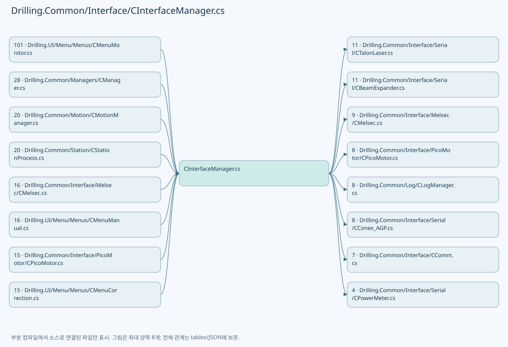

## 네임스페이스·타입·상속

| 타입 | 구분 | 원본 범위 | 선언/상속 |
| --- | --- | --- | --- |
| CInterfaceManager | ClassDeclaration | 16–2189 | CInterfaceManager |
| ST_ATTENUATOR_MOVE_TARGET | RecordDeclaration | 2191–2191 | ST_ATTENUATOR_MOVE_TARGET |
| CAttenuatorPositioningService | ClassDeclaration | 2193–2492 | CAttenuatorPositioningService |
| ST_ATTENUATOR_COMPLETION_FENCE | RecordDeclaration | 2491–2491 | ST_ATTENUATOR_COMPLETION_FENCE |
| ST_ATTENUATOR_STATUS_SNAPSHOT | RecordDeclaration | 2494–2505 | ST_ATTENUATOR_STATUS_SNAPSHOT |
| CAttenuatorStatusSnapshotService | ClassDeclaration | 2508–2851 | CAttenuatorStatusSnapshotService: IAsyncDisposable |
| CDeviceRead | ClassDeclaration | 2844–2848 | CDeviceRead |
| CFrame | RecordDeclaration | 2850–2850 | CFrame |
| EN_COMM_STATE | EnumDeclaration | 2853–2858 | EN_COMM_STATE |
| EN_EQP_MODULE | EnumDeclaration | 2860–2872 | EN_EQP_MODULE |
| EN_INTERFACE_TYPE | EnumDeclaration | 2874–2889 | EN_INTERFACE_TYPE |
| ST_DEVICE_COMM_STATUS | RecordDeclaration | 2891–2891 | ST_DEVICE_COMM_STATUS |
| ST_INTERFACE_CONNECT_OPTION | RecordDeclaration | 2892–2906 | ST_INTERFACE_CONNECT_OPTION |
| ST_INTERFACE_COMM_STATUS | RecordDeclaration | 2907–2938 | ST_INTERFACE_COMM_STATUS |
| ST_INTERFACE_RECEIVED_MESSAGE | RecordDeclaration | 2940–2940 | ST_INTERFACE_RECEIVED_MESSAGE |
| ST_INTERFACE_PROTOCOL_TRACE | RecordDeclaration | 2941–2941 | ST_INTERFACE_PROTOCOL_TRACE |
| ST_COMM_PROTOCOL_TRACE | RecordDeclaration | 2942–2942 | ST_COMM_PROTOCOL_TRACE |
| ST_INTERFACE_DATA | RecordDeclaration | 2943–2962 | ST_INTERFACE_DATA |
| ST_DEVICE_COMMAND_RESULT | RecordDeclaration | 2964–2964 | ST_DEVICE_COMMAND_RESULT |
| CBETFileBase | ClassDeclaration | 2965–2969 | CBETFileBase |
| CInterfaceDevice | ClassDeclaration | 2971–3213 | CInterfaceDevice |
| CInterfaceConnectOption | ClassDeclaration | 3215–3344 | CInterfaceConnectOption |
| COpticStatusSnapshotService | ClassDeclaration | 3347–3469 | COpticStatusSnapshotService: IAsyncDisposable |
| Versioned | RecordDeclaration | 3349–3350 | Versioned |
| Entry | ClassDeclaration | 3351–3356 | Entry |
| ST_SHARED_DEVICE_SNAPSHOT | RecordDeclaration | 3471–3472 | ST_SHARED_DEVICE_SNAPSHOT |
| CSharedDeviceSnapshotService | ClassDeclaration | 3474–3633 | CSharedDeviceSnapshotService |

## 멤버 빠른 목록

| 이름 | 종류 | 범위 | 서명 |
| --- | --- | --- | --- |
| AttenuatorSoftwareLimitMessagePrefix | FieldDeclaration | L19–19 | string Drilling.Common.Interface.CInterfaceManager.AttenuatorSoftwareLimitMessagePrefix |
| _attenuatorMoveLocks | FieldDeclaration | L20–20 | System.Collections.Concurrent.ConcurrentDictionary<int, System.Threading.SemaphoreSlim> Drilling.Common.Interface.CInterfaceManager._attenuatorMoveLocks |
| _attenuatorLimitSettings | FieldDeclaration | L21–21 | System.Func<System.Collections.Generic.IReadOnlyList<Drilling.Common.Managers.ST_SYSTEM_PARAMETER>>? Drilling.Common.Interface.CInterfaceManager._attenuatorLimitSettings |
| _visionLineCapacity | FieldDeclaration | L22–22 | System.Func<int>? Drilling.Common.Interface.CInterfaceManager._visionLineCapacity |
| _visionCountLimitAlarm | FieldDeclaration | L23–23 | System.Action<Drilling.Common.Interface.Vision.CVisionLineCountExceededException>? Drilling.Common.Interface.CInterfaceManager._visionCountLimitAlarm |
| _devices | FieldDeclaration | L24–24 | System.Collections.Concurrent.ConcurrentDictionary<string, Drilling.Common.Interface.CInterfaceDevice> Drilling.Common.Interface.CInterfaceManager._devices |
| _logManager | FieldDeclaration | L25–25 | Drilling.Common.Log.CLogManager? Drilling.Common.Interface.CInterfaceManager._logManager |
| _betFile | FieldDeclaration | L26–26 | Drilling.Common.Interface.CBETFileBase? Drilling.Common.Interface.CInterfaceManager._betFile |
| _melsec | FieldDeclaration | L27–27 | Drilling.Common.Interface.CMelsec Drilling.Common.Interface.CInterfaceManager._melsec |
| _picoMotorService | FieldDeclaration | L28–28 | Drilling.Common.Interface.CPicoMotorService Drilling.Common.Interface.CInterfaceManager._picoMotorService |
| _simulationMode | FieldDeclaration | L29–29 | bool? Drilling.Common.Interface.CInterfaceManager._simulationMode |
| MessageReceived | EventFieldDeclaration | L30–30 | System.Func<Drilling.Common.Interface.ST_INTERFACE_RECEIVED_MESSAGE, System.Threading.CancellationToken, System.Threading.Tasks.Task<string>>? Drilling.Common.Interface.CInterfaceManager.MessageReceived |
| ProtocolTrace | EventFieldDeclaration | L31–31 | System.Action<Drilling.Common.Interface.ST_INTERFACE_PROTOCOL_TRACE>? Drilling.Common.Interface.CInterfaceManager.ProtocolTrace |
| _laserOnHeads | FieldDeclaration | L32–32 | System.Collections.Generic.Dictionary<int, System.Collections.Generic.HashSet<int>> Drilling.Common.Interface.CInterfaceManager._laserOnHeads |
| _talonStatuses | FieldDeclaration | L33–33 | System.Collections.Concurrent.ConcurrentDictionary<int, Drilling.Common.Interface.ST_TALON_STATUS> Drilling.Common.Interface.CInterfaceManager._talonStatuses |
| _attenuatorStatuses | FieldDeclaration | L34–34 | System.Collections.Generic.Dictionary<int, Drilling.Common.Interface.ST_ATTENUATOR_STATUS> Drilling.Common.Interface.CInterfaceManager._attenuatorStatuses |
| _attenuatorStatusLock | FieldDeclaration | L35–35 | object Drilling.Common.Interface.CInterfaceManager._attenuatorStatusLock |
| _betStatuses | FieldDeclaration | L36–36 | System.Collections.Concurrent.ConcurrentDictionary<int, Drilling.Common.Interface.ST_BET_STATUS> Drilling.Common.Interface.CInterfaceManager._betStatuses |
| _powerMeterStatuses | FieldDeclaration | L37–37 | System.Collections.Concurrent.ConcurrentDictionary<int, Drilling.Common.Managers.ST_POWER_METER_STATUS> Drilling.Common.Interface.CInterfaceManager._powerMeterStatuses |
| _powerMeterSimulationAttenuators | FieldDeclaration | L38–38 | System.Collections.Generic.Dictionary<int, int> Drilling.Common.Interface.CInterfaceManager._powerMeterSimulationAttenuators |
| _reloadLock | FieldDeclaration | L39–39 | System.Threading.SemaphoreSlim Drilling.Common.Interface.CInterfaceManager._reloadLock |
| _stageMotionSimulations | FieldDeclaration | L40–40 | System.Collections.Concurrent.ConcurrentDictionary<int, Drilling.Common.Motion.CManualStageMotionSimulation> Drilling.Common.Interface.CInterfaceManager._stageMotionSimulations |
| .ctor | ConstructorDeclaration | L43–79 | Drilling.Common.Interface.CInterfaceManager.CInterfaceManager(bool?, Drilling.Common.Log.CLogManager?, Drilling.Common.Interface.CBETFileBase?, System.Collections.Generic.IReadOnlyList<Drilling.Common.Interface.ST_MELSEC_MAP_DATA>?, Drilling.Common.Interface.CMelsecNetApi?) |
| AttenuatorSnapshots | PropertyDeclaration | L83–83 | Drilling.Common.Interface.CAttenuatorStatusSnapshotService Drilling.Common.Interface.CInterfaceManager.AttenuatorSnapshots |
| get_AttenuatorSnapshots | GetAccessorDeclaration | L83–83 | Drilling.Common.Interface.CAttenuatorStatusSnapshotService Drilling.Common.Interface.CInterfaceManager.AttenuatorSnapshots.get |
| StageReviewSequences | PropertyDeclaration | L84–84 | Drilling.Common.Station.CStageReviewSequences Drilling.Common.Interface.CInterfaceManager.StageReviewSequences |
| get_StageReviewSequences | GetAccessorDeclaration | L84–84 | Drilling.Common.Station.CStageReviewSequences Drilling.Common.Interface.CInterfaceManager.StageReviewSequences.get |
| OpticSnapshots | PropertyDeclaration | L85–85 | Drilling.Common.Interface.COpticStatusSnapshotService Drilling.Common.Interface.CInterfaceManager.OpticSnapshots |
| get_OpticSnapshots | GetAccessorDeclaration | L85–85 | Drilling.Common.Interface.COpticStatusSnapshotService Drilling.Common.Interface.CInterfaceManager.OpticSnapshots.get |
| ConfigureVisionLineProtocol | MethodDeclaration | L87–95 | void Drilling.Common.Interface.CInterfaceManager.ConfigureVisionLineProtocol(System.Func<int>, System.Action<Drilling.Common.Interface.Vision.CVisionLineCountExceededException>?) |
| IsSimulation | PropertyDeclaration | L97–108 | bool Drilling.Common.Interface.CInterfaceManager.IsSimulation |
| get_IsSimulation | GetAccessorDeclaration | L99–107 | bool Drilling.Common.Interface.CInterfaceManager.IsSimulation.get |
| IsIsSimulation | LocalFunctionStatement | L101–104 | bool IsIsSimulation(Drilling.Common.Interface.CInterfaceDevice) |
| Devices | PropertyDeclaration | L110–116 | System.Collections.Generic.IReadOnlyList<Drilling.Common.Interface.CInterfaceDevice> Drilling.Common.Interface.CInterfaceManager.Devices |
| get_Devices | GetAccessorDeclaration | L112–115 | System.Collections.Generic.IReadOnlyList<Drilling.Common.Interface.CInterfaceDevice> Drilling.Common.Interface.CInterfaceManager.Devices.get |
| Melsec | PropertyDeclaration | L118–124 | Drilling.Common.Interface.CMelsec Drilling.Common.Interface.CInterfaceManager.Melsec |
| get_Melsec | GetAccessorDeclaration | L120–123 | Drilling.Common.Interface.CMelsec Drilling.Common.Interface.CInterfaceManager.Melsec.get |
| SetSimulationMode | MethodDeclaration | L126–155 | System.Threading.Tasks.Task Drilling.Common.Interface.CInterfaceManager.SetSimulationMode(bool, System.Threading.CancellationToken) |
| IsMelsecDevice | LocalFunctionStatement | L130–133 | bool IsMelsecDevice(Drilling.Common.Interface.CInterfaceDevice) |
| Register | MethodDeclaration | L157–166 | void Drilling.Common.Interface.CInterfaceManager.Register(Drilling.Common.Interface.ST_INTERFACE_DATA) |
| CreateDevice | MethodDeclaration | L168–181 | Drilling.Common.Interface.CInterfaceDevice Drilling.Common.Interface.CInterfaceManager.CreateDevice(Drilling.Common.Interface.ST_INTERFACE_DATA) |
| Initialize | MethodDeclaration | L183–186 | System.Threading.Tasks.Task Drilling.Common.Interface.CInterfaceManager.Initialize(System.Threading.CancellationToken) |
| Destroy | MethodDeclaration | L188–196 | System.Threading.Tasks.Task Drilling.Common.Interface.CInterfaceManager.Destroy(System.Threading.CancellationToken) |
| Connect | MethodDeclaration | L198–235 | System.Threading.Tasks.Task<int> Drilling.Common.Interface.CInterfaceManager.Connect(bool, System.Threading.CancellationToken) |
| Disconnect | MethodDeclaration | L237–260 | System.Threading.Tasks.Task<int> Drilling.Common.Interface.CInterfaceManager.Disconnect(System.Threading.CancellationToken) |
| Connect | MethodDeclaration | L262–274 | System.Threading.Tasks.Task Drilling.Common.Interface.CInterfaceManager.Connect(Drilling.Common.Interface.EN_EQP_MODULE, int, bool, System.Threading.CancellationToken) |
| Disconnect | MethodDeclaration | L276–290 | System.Threading.Tasks.Task Drilling.Common.Interface.CInterfaceManager.Disconnect(Drilling.Common.Interface.EN_EQP_MODULE, int, System.Threading.CancellationToken) |
| Reconnect | MethodDeclaration | L292–318 | System.Threading.Tasks.Task Drilling.Common.Interface.CInterfaceManager.Reconnect(Drilling.Common.Interface.EN_EQP_MODULE, int, System.Threading.CancellationToken) |
| ExecuteFunction | MethodDeclaration | L320–324 | System.Threading.Tasks.Task<string> Drilling.Common.Interface.CInterfaceManager.ExecuteFunction(Drilling.Common.Interface.EN_EQP_MODULE, int, string, System.Threading.CancellationToken) |
| ExecuteFunctionNoLog | MethodDeclaration | L326–330 | System.Threading.Tasks.Task<string> Drilling.Common.Interface.CInterfaceManager.ExecuteFunctionNoLog(Drilling.Common.Interface.EN_EQP_MODULE, int, string, System.Threading.CancellationToken) |
| ExecuteFunctionWithLogText | MethodDeclaration | L332–336 | System.Threading.Tasks.Task<string> Drilling.Common.Interface.CInterfaceManager.ExecuteFunctionWithLogText(Drilling.Common.Interface.EN_EQP_MODULE, int, string, string, System.Threading.CancellationToken) |
| IsConnect | MethodDeclaration | L338–341 | bool Drilling.Common.Interface.CInterfaceManager.IsConnect(Drilling.Common.Interface.EN_EQP_MODULE, int) |
| IsSimul | MethodDeclaration | L343–346 | bool Drilling.Common.Interface.CInterfaceManager.IsSimul(Drilling.Common.Interface.EN_EQP_MODULE, int) |
| GetInterfaceData | MethodDeclaration | L348–351 | Drilling.Common.Interface.ST_INTERFACE_DATA? Drilling.Common.Interface.CInterfaceManager.GetInterfaceData(Drilling.Common.Interface.EN_EQP_MODULE, int) |
| UpdateMelsecCommunicationState | MethodDeclaration | L353–361 | void Drilling.Common.Interface.CInterfaceManager.UpdateMelsecCommunicationState(int, bool, string, string, string) |
| Connect | MethodDeclaration | L363–375 | System.Threading.Tasks.Task Drilling.Common.Interface.CInterfaceManager.Connect(string, bool, System.Threading.CancellationToken) |
| Disconnect | MethodDeclaration | L377–391 | System.Threading.Tasks.Task Drilling.Common.Interface.CInterfaceManager.Disconnect(string, System.Threading.CancellationToken) |
| Reconnect | MethodDeclaration | L393–419 | System.Threading.Tasks.Task Drilling.Common.Interface.CInterfaceManager.Reconnect(string, System.Threading.CancellationToken) |
| ExecuteFunction | MethodDeclaration | L421–425 | System.Threading.Tasks.Task<string> Drilling.Common.Interface.CInterfaceManager.ExecuteFunction(string, string, System.Threading.CancellationToken) |
| IsConnect | MethodDeclaration | L427–430 | bool Drilling.Common.Interface.CInterfaceManager.IsConnect(string) |
| IsSimul | MethodDeclaration | L432–435 | bool Drilling.Common.Interface.CInterfaceManager.IsSimul(string) |
| GetInterfaceData | MethodDeclaration | L437–440 | Drilling.Common.Interface.ST_INTERFACE_DATA? Drilling.Common.Interface.CInterfaceManager.GetInterfaceData(string) |
| GetInterfaceList | MethodDeclaration | L442–470 | System.Collections.Generic.IReadOnlyList<Drilling.Common.Interface.ST_INTERFACE_DATA> Drilling.Common.Interface.CInterfaceManager.GetInterfaceList(Drilling.Common.Interface.EN_EQP_MODULE?) |
| MatchesCinterfacedevice | LocalFunctionStatement | L444–447 | bool MatchesCinterfacedevice(Drilling.Common.Interface.CInterfaceDevice) |
| SelectData | LocalFunctionStatement | L449–452 | Drilling.Common.Interface.ST_INTERFACE_DATA SelectData(Drilling.Common.Interface.CInterfaceDevice) |
| SelectDevice | LocalFunctionStatement | L454–457 | Drilling.Common.Interface.EN_EQP_MODULE SelectDevice(Drilling.Common.Interface.ST_INTERFACE_DATA) |
| SelectNumber | LocalFunctionStatement | L459–462 | int SelectNumber(Drilling.Common.Interface.ST_INTERFACE_DATA) |
| SelectNickName | LocalFunctionStatement | L464–467 | string SelectNickName(Drilling.Common.Interface.ST_INTERFACE_DATA) |
| GetInterfaceCommunicationList | MethodDeclaration | L472–500 | System.Collections.Generic.IReadOnlyList<Drilling.Common.Interface.ST_INTERFACE_COMM_STATUS> Drilling.Common.Interface.CInterfaceManager.GetInterfaceCommunicationList(Drilling.Common.Interface.EN_EQP_MODULE?) |
| MatchesCinterfacedevice | LocalFunctionStatement | L474–477 | bool MatchesCinterfacedevice(Drilling.Common.Interface.CInterfaceDevice) |
| SelectValue | LocalFunctionStatement | L479–482 | Drilling.Common.Interface.ST_INTERFACE_COMM_STATUS SelectValue(Drilling.Common.Interface.CInterfaceDevice) |
| SelectModule | LocalFunctionStatement | L484–487 | Drilling.Common.Interface.EN_EQP_MODULE SelectModule(Drilling.Common.Interface.ST_INTERFACE_COMM_STATUS) |
| SelectNumber | LocalFunctionStatement | L489–492 | int SelectNumber(Drilling.Common.Interface.ST_INTERFACE_COMM_STATUS) |
| SelectNickName | LocalFunctionStatement | L494–497 | string SelectNickName(Drilling.Common.Interface.ST_INTERFACE_COMM_STATUS) |
| GetCommunicationStatus | MethodDeclaration | L502–526 | System.Collections.Generic.IReadOnlyList<Drilling.Common.Interface.ST_DEVICE_COMM_STATUS> Drilling.Common.Interface.CInterfaceManager.GetCommunicationStatus(System.Threading.CancellationToken) |
| SelectValue | LocalFunctionStatement | L505–508 | Drilling.Common.Interface.EN_EQP_MODULE SelectValue(Drilling.Common.Interface.CInterfaceDevice) |
| SelectConnectionState | LocalFunctionStatement | L510–513 | Drilling.Common.Interface.EN_COMM_STATE SelectConnectionState(Drilling.Common.Interface.CInterfaceDevice) |
| BuildDevice | LocalFunctionStatement | L515–518 | Drilling.Common.Interface.ST_DEVICE_COMM_STATUS BuildDevice(System.Linq.IGrouping<Drilling.Common.Interface.EN_EQP_MODULE, Drilling.Common.Interface.CInterfaceDevice>) |
| SelectModule | LocalFunctionStatement | L520–523 | Drilling.Common.Interface.EN_EQP_MODULE SelectModule(Drilling.Common.Interface.ST_DEVICE_COMM_STATUS) |
| CollapseConnectionState | MethodDeclaration | L528–552 | Drilling.Common.Interface.EN_COMM_STATE Drilling.Common.Interface.CInterfaceManager.CollapseConnectionState(System.Collections.Generic.IEnumerable<Drilling.Common.Interface.EN_COMM_STATE>) |
| MatchesItem | LocalFunctionStatement | L531–534 | bool MatchesItem(Drilling.Common.Interface.EN_COMM_STATE) |
| MatchesItem2 | LocalFunctionStatement | L541–544 | bool MatchesItem2(Drilling.Common.Interface.EN_COMM_STATE) |
| ConnectDevice | MethodDeclaration | L554–572 | System.Threading.Tasks.Task Drilling.Common.Interface.CInterfaceManager.ConnectDevice(Drilling.Common.Interface.CInterfaceDevice, bool, System.Threading.CancellationToken) |
| AutoReconnectDevice | MethodDeclaration | L574–583 | System.Threading.Tasks.Task Drilling.Common.Interface.CInterfaceManager.AutoReconnectDevice(Drilling.Common.Interface.EN_EQP_MODULE, int, System.Threading.CancellationToken) |
| DisconnectDevice | MethodDeclaration | L585–599 | System.Threading.Tasks.Task Drilling.Common.Interface.CInterfaceManager.DisconnectDevice(Drilling.Common.Interface.CInterfaceDevice, System.Threading.CancellationToken) |
| ConnectMelsecDevice | MethodDeclaration | L601–620 | void Drilling.Common.Interface.CInterfaceManager.ConnectMelsecDevice(Drilling.Common.Interface.CInterfaceDevice, System.Threading.CancellationToken) |
| DisconnectMelsecDevice | MethodDeclaration | L622–628 | void Drilling.Common.Interface.CInterfaceManager.DisconnectMelsecDevice(Drilling.Common.Interface.CInterfaceDevice, System.Threading.CancellationToken) |
| ExecuteDeviceFunction | MethodDeclaration | L630–656 | System.Threading.Tasks.Task<string> Drilling.Common.Interface.CInterfaceManager.ExecuteDeviceFunction(Drilling.Common.Interface.CInterfaceDevice, string, System.Threading.CancellationToken, string?, bool) |
| GetDeviceOrThrow | MethodDeclaration | L658–661 | Drilling.Common.Interface.CInterfaceDevice Drilling.Common.Interface.CInterfaceManager.GetDeviceOrThrow(Drilling.Common.Interface.EN_EQP_MODULE, int) |
| GetDeviceByNickNameOrThrow | MethodDeclaration | L663–666 | Drilling.Common.Interface.CInterfaceDevice Drilling.Common.Interface.CInterfaceManager.GetDeviceByNickNameOrThrow(string) |
| TryGetDeviceByNickName | MethodDeclaration | L668–696 | bool Drilling.Common.Interface.CInterfaceManager.TryGetDeviceByNickName(string, out Drilling.Common.Interface.CInterfaceDevice?, bool) |
| ShouldIncludeItem | LocalFunctionStatement | L671–674 | bool ShouldIncludeItem(Drilling.Common.Interface.CInterfaceDevice) |
| SelectItem | LocalFunctionStatement | L683–686 | string SelectItem(Drilling.Common.Interface.CInterfaceDevice) |
| WriteConnectionLog | MethodDeclaration | L698–713 | void Drilling.Common.Interface.CInterfaceManager.WriteConnectionLog(string, Drilling.Common.Interface.CInterfaceDevice, Drilling.Common.Interface.EN_COMM_STATE) |
| WriteCommandLog | MethodDeclaration | L715–732 | void Drilling.Common.Interface.CInterfaceManager.WriteCommandLog(Drilling.Common.Interface.CInterfaceDevice, string, string, string?) |
| WriteErrorLog | MethodDeclaration | L734–739 | void Drilling.Common.Interface.CInterfaceManager.WriteErrorLog(Drilling.Common.Interface.CInterfaceDevice, string, string, string?) |
| OnDeviceMessageReceived | MethodDeclaration | L741–762 | System.Threading.Tasks.Task<string> Drilling.Common.Interface.CInterfaceManager.OnDeviceMessageReceived(Drilling.Common.Interface.CInterfaceDevice, Drilling.Common.Interface.ST_COMM_RECEIVED_MESSAGE, System.Threading.CancellationToken) |
| OnDeviceProtocolTrace | MethodDeclaration | L764–772 | void Drilling.Common.Interface.CInterfaceManager.OnDeviceProtocolTrace(Drilling.Common.Interface.CInterfaceDevice, Drilling.Common.Interface.ST_COMM_PROTOCOL_TRACE) |
| WriteTalonCommandLog | MethodDeclaration | L774–777 | void Drilling.Common.Interface.CInterfaceManager.WriteTalonCommandLog(Drilling.Common.Interface.ST_INTERFACE_DATA, string, string) |
| WriteTalonErrorLog | MethodDeclaration | L779–782 | void Drilling.Common.Interface.CInterfaceManager.WriteTalonErrorLog(Drilling.Common.Interface.ST_INTERFACE_DATA, string, string) |
| WriteInterfaceCommandLog | MethodDeclaration | L784–787 | void Drilling.Common.Interface.CInterfaceManager.WriteInterfaceCommandLog(Drilling.Common.Interface.ST_INTERFACE_DATA, string, string) |
| WriteInterfaceErrorLog | MethodDeclaration | L789–792 | void Drilling.Common.Interface.CInterfaceManager.WriteInterfaceErrorLog(Drilling.Common.Interface.ST_INTERFACE_DATA, string, string) |
| FormatConnectionState | MethodDeclaration | L794–802 | string Drilling.Common.Interface.CInterfaceManager.FormatConnectionState(Drilling.Common.Interface.EN_COMM_STATE) |
| NormalizeNickName | MethodDeclaration | L804–807 | string Drilling.Common.Interface.CInterfaceManager.NormalizeNickName(string) |
| CreateDeviceKey | MethodDeclaration | L809–812 | string Drilling.Common.Interface.CInterfaceManager.CreateDeviceKey(Drilling.Common.Interface.EN_EQP_MODULE, int) |
| FormatDeviceName | MethodDeclaration | L814–817 | string Drilling.Common.Interface.CInterfaceManager.FormatDeviceName(Drilling.Common.Interface.ST_INTERFACE_DATA) |
| FormatDeviceName | MethodDeclaration | L819–822 | string Drilling.Common.Interface.CInterfaceManager.FormatDeviceName(Drilling.Common.Interface.EN_EQP_MODULE, int) |
| InitializeSimulatedScannerOutputs | MethodDeclaration | L825–848 | int Drilling.Common.Interface.CInterfaceManager.InitializeSimulatedScannerOutputs(System.Collections.Generic.IReadOnlyList<Drilling.Common.Managers.ST_SYSTEM_PARAMETER>) |
| GetLaserStatus | MethodDeclaration | L850–854 | Drilling.Common.Interface.ST_LASER_STATUS Drilling.Common.Interface.CInterfaceManager.GetLaserStatus(System.Threading.CancellationToken) |
| GetLaserStatus | MethodDeclaration | L856–868 | Drilling.Common.Interface.ST_LASER_STATUS Drilling.Common.Interface.CInterfaceManager.GetLaserStatus(int, System.Threading.CancellationToken) |
| SetLaser | MethodDeclaration | L870–874 | System.Threading.Tasks.Task Drilling.Common.Interface.CInterfaceManager.SetLaser(int, bool, System.Threading.CancellationToken) |
| SetLaser | MethodDeclaration | L876–892 | System.Threading.Tasks.Task Drilling.Common.Interface.CInterfaceManager.SetLaser(int, int, bool, System.Threading.CancellationToken) |
| ExecuteTalonLaserCommand | MethodDeclaration | L894–898 | System.Threading.Tasks.Task<Drilling.Common.Interface.ST_DEVICE_COMMAND_RESULT> Drilling.Common.Interface.CInterfaceManager.ExecuteTalonLaserCommand(Drilling.Common.Interface.EN_TALON_COMMAND, double, System.Threading.CancellationToken) |
| ExecuteTalonLaserCommand | MethodDeclaration | L900–960 | System.Threading.Tasks.Task<Drilling.Common.Interface.ST_DEVICE_COMMAND_RESULT> Drilling.Common.Interface.CInterfaceManager.ExecuteTalonLaserCommand(int, Drilling.Common.Interface.EN_TALON_COMMAND, double, System.Threading.CancellationToken, bool) |
| RefreshTalonLaserStatus | MethodDeclaration | L962–966 | Drilling.Common.Interface.ST_TALON_STATUS Drilling.Common.Interface.CInterfaceManager.RefreshTalonLaserStatus(System.Threading.CancellationToken) |
| RefreshTalonLaserStatus | MethodDeclaration | L968–971 | Drilling.Common.Interface.ST_TALON_STATUS Drilling.Common.Interface.CInterfaceManager.RefreshTalonLaserStatus(int, System.Threading.CancellationToken) |
| RefreshTalonLaserStatus | MethodDeclaration | L973–973 | Drilling.Common.Interface.ST_TALON_STATUS Drilling.Common.Interface.CInterfaceManager.RefreshTalonLaserStatus(int, System.Threading.CancellationToken, bool) |
| RefreshTalonLaserStatusAsync | MethodDeclaration | L974–1006 | System.Threading.Tasks.Task<Drilling.Common.Interface.ST_TALON_STATUS> Drilling.Common.Interface.CInterfaceManager.RefreshTalonLaserStatusAsync(int, System.Threading.CancellationToken, bool) |
| GetAttenuatorStatus | MethodDeclaration | L1008–1012 | Drilling.Common.Interface.ST_ATTENUATOR_STATUS Drilling.Common.Interface.CInterfaceManager.GetAttenuatorStatus(System.Threading.CancellationToken) |
| GetAttenuatorStatus | MethodDeclaration | L1014–1021 | Drilling.Common.Interface.ST_ATTENUATOR_STATUS Drilling.Common.Interface.CInterfaceManager.GetAttenuatorStatus(int, System.Threading.CancellationToken) |
| GetCachedAttenuatorStatus | MethodDeclaration | L1023–1026 | Drilling.Common.Interface.ST_ATTENUATOR_STATUS Drilling.Common.Interface.CInterfaceManager.GetCachedAttenuatorStatus(int) |
| ExecuteAttenuatorCommand | MethodDeclaration | L1028–1032 | System.Threading.Tasks.Task<Drilling.Common.Interface.ST_DEVICE_COMMAND_RESULT> Drilling.Common.Interface.CInterfaceManager.ExecuteAttenuatorCommand(Drilling.Common.Interface.EN_ATTENUATOR_COMMAND, double, System.Threading.CancellationToken) |
| ExecuteAttenuatorCommand | MethodDeclaration | L1034–1054 | System.Threading.Tasks.Task<Drilling.Common.Interface.ST_DEVICE_COMMAND_RESULT> Drilling.Common.Interface.CInterfaceManager.ExecuteAttenuatorCommand(int, Drilling.Common.Interface.EN_ATTENUATOR_COMMAND, double, System.Threading.CancellationToken, bool) |
| ExecuteAttenuatorCommandCore | MethodDeclaration | L1056–1129 | System.Threading.Tasks.Task<Drilling.Common.Interface.ST_DEVICE_COMMAND_RESULT> Drilling.Common.Interface.CInterfaceManager.ExecuteAttenuatorCommandCore(int, Drilling.Common.Interface.EN_ATTENUATOR_COMMAND, double, System.Threading.CancellationToken, bool) |
| RefreshAttenuatorStatus | MethodDeclaration | L1131–1135 | Drilling.Common.Interface.ST_ATTENUATOR_STATUS Drilling.Common.Interface.CInterfaceManager.RefreshAttenuatorStatus(System.Threading.CancellationToken) |
| RefreshAttenuatorStatus | MethodDeclaration | L1137–1140 | Drilling.Common.Interface.ST_ATTENUATOR_STATUS Drilling.Common.Interface.CInterfaceManager.RefreshAttenuatorStatus(int, System.Threading.CancellationToken) |
| RefreshAttenuatorStatus | MethodDeclaration | L1142–1171 | Drilling.Common.Interface.ST_ATTENUATOR_STATUS Drilling.Common.Interface.CInterfaceManager.RefreshAttenuatorStatus(int, System.Threading.CancellationToken, bool) |
| IsAttenuatorSelectingCommand | MethodDeclaration | L1173–1176 | bool Drilling.Common.Interface.CInterfaceManager.IsAttenuatorSelectingCommand(Drilling.Common.Interface.EN_ATTENUATOR_COMMAND) |
| ValidateAttenuatorCommand | MethodDeclaration | L1178–1246 | string Drilling.Common.Interface.CInterfaceManager.ValidateAttenuatorCommand(Drilling.Common.Interface.EN_ATTENUATOR_COMMAND, double, Drilling.Common.Interface.ST_ATTENUATOR_STATUS) |
| GetBETStatus | MethodDeclaration | L1248–1252 | Drilling.Common.Interface.ST_BET_STATUS Drilling.Common.Interface.CInterfaceManager.GetBETStatus(System.Threading.CancellationToken) |
| GetBETStatus | MethodDeclaration | L1254–1262 | Drilling.Common.Interface.ST_BET_STATUS Drilling.Common.Interface.CInterfaceManager.GetBETStatus(int, System.Threading.CancellationToken) |
| ExecuteBETCommand | MethodDeclaration | L1264–1268 | System.Threading.Tasks.Task<Drilling.Common.Interface.ST_DEVICE_COMMAND_RESULT> Drilling.Common.Interface.CInterfaceManager.ExecuteBETCommand(Drilling.Common.Interface.EN_BET_COMMAND, double, double, System.Threading.CancellationToken) |
| ExecuteBETCommand | MethodDeclaration | L1270–1350 | System.Threading.Tasks.Task<Drilling.Common.Interface.ST_DEVICE_COMMAND_RESULT> Drilling.Common.Interface.CInterfaceManager.ExecuteBETCommand(int, Drilling.Common.Interface.EN_BET_COMMAND, double, double, System.Threading.CancellationToken, bool) |
| MatchesItem | LocalFunctionStatement | L1290–1293 | bool MatchesItem(Drilling.Common.Interface.ST_BET_TABLE_DATA) |
| RefreshBETStatus | MethodDeclaration | L1352–1356 | Drilling.Common.Interface.ST_BET_STATUS Drilling.Common.Interface.CInterfaceManager.RefreshBETStatus(System.Threading.CancellationToken) |
| RefreshBETStatus | MethodDeclaration | L1358–1361 | Drilling.Common.Interface.ST_BET_STATUS Drilling.Common.Interface.CInterfaceManager.RefreshBETStatus(int, System.Threading.CancellationToken) |
| RefreshBETStatus | MethodDeclaration | L1363–1363 | Drilling.Common.Interface.ST_BET_STATUS Drilling.Common.Interface.CInterfaceManager.RefreshBETStatus(int, System.Threading.CancellationToken, bool) |
| RefreshBETStatusAsync | MethodDeclaration | L1364–1383 | System.Threading.Tasks.Task<Drilling.Common.Interface.ST_BET_STATUS> Drilling.Common.Interface.CInterfaceManager.RefreshBETStatusAsync(int, System.Threading.CancellationToken, bool) |
| LoadBETData | MethodDeclaration | L1385–1388 | System.Threading.Tasks.Task<System.Collections.Generic.IReadOnlyList<Drilling.Common.Interface.ST_BET_TABLE_DATA>> Drilling.Common.Interface.CInterfaceManager.LoadBETData(System.Threading.CancellationToken) |
| SaveBETData | MethodDeclaration | L1390–1393 | System.Threading.Tasks.Task Drilling.Common.Interface.CInterfaceManager.SaveBETData(System.Collections.Generic.IReadOnlyList<Drilling.Common.Interface.ST_BET_TABLE_DATA>, System.Threading.CancellationToken) |
| GetPowerMeterStatus | MethodDeclaration | L1395–1399 | Drilling.Common.Managers.ST_POWER_METER_STATUS Drilling.Common.Interface.CInterfaceManager.GetPowerMeterStatus(System.Threading.CancellationToken) |
| GetPowerMeterStatus | MethodDeclaration | L1401–1404 | Drilling.Common.Managers.ST_POWER_METER_STATUS Drilling.Common.Interface.CInterfaceManager.GetPowerMeterStatus(int, System.Threading.CancellationToken) |
| SetPowerMeterSimulationAttenuator | MethodDeclaration | L1406–1414 | void Drilling.Common.Interface.CInterfaceManager.SetPowerMeterSimulationAttenuator(int, int) |
| ExecutePowerMeterCommand | MethodDeclaration | L1416–1420 | System.Threading.Tasks.Task<Drilling.Common.Interface.ST_DEVICE_COMMAND_RESULT> Drilling.Common.Interface.CInterfaceManager.ExecutePowerMeterCommand(Drilling.Common.Interface.EN_POWER_METER_COMMAND, double, System.Threading.CancellationToken) |
| ExecutePowerMeterCommand | MethodDeclaration | L1422–1468 | System.Threading.Tasks.Task<Drilling.Common.Interface.ST_DEVICE_COMMAND_RESULT> Drilling.Common.Interface.CInterfaceManager.ExecutePowerMeterCommand(int, Drilling.Common.Interface.EN_POWER_METER_COMMAND, double, System.Threading.CancellationToken) |
| RefreshPowerMeterStatus | MethodDeclaration | L1470–1474 | Drilling.Common.Managers.ST_POWER_METER_STATUS Drilling.Common.Interface.CInterfaceManager.RefreshPowerMeterStatus(System.Threading.CancellationToken) |
| RefreshPowerMeterStatus | MethodDeclaration | L1476–1480 | Drilling.Common.Managers.ST_POWER_METER_STATUS Drilling.Common.Interface.CInterfaceManager.RefreshPowerMeterStatus(int, System.Threading.CancellationToken) |
| GetPicoMotorStatus | MethodDeclaration | L1482–1501 | Drilling.Common.Interface.ST_PICO_MOTOR_STATUS Drilling.Common.Interface.CInterfaceManager.GetPicoMotorStatus(System.Threading.CancellationToken) |
| SelectNumber | LocalFunctionStatement | L1484–1487 | int SelectNumber(Drilling.Common.Interface.ST_INTERFACE_DATA) |
| GetPicoMotorStatus | MethodDeclaration | L1503–1534 | Drilling.Common.Interface.ST_PICO_MOTOR_STATUS Drilling.Common.Interface.CInterfaceManager.GetPicoMotorStatus(int, System.Threading.CancellationToken) |
| MatchesItem | LocalFunctionStatement | L1505–1508 | bool MatchesItem(Drilling.Common.Interface.ST_INTERFACE_DATA) |
| RefreshPicoMotorStatus | MethodDeclaration | L1536–1539 | Drilling.Common.Interface.ST_PICO_MOTOR_STATUS Drilling.Common.Interface.CInterfaceManager.RefreshPicoMotorStatus(System.Threading.CancellationToken) |
| RefreshPicoMotorStatus | MethodDeclaration | L1541–1544 | Drilling.Common.Interface.ST_PICO_MOTOR_STATUS Drilling.Common.Interface.CInterfaceManager.RefreshPicoMotorStatus(int, System.Threading.CancellationToken) |
| ExecutePicoMotorCommand | MethodDeclaration | L1546–1560 | System.Threading.Tasks.Task<Drilling.Common.Interface.ST_DEVICE_COMMAND_RESULT> Drilling.Common.Interface.CInterfaceManager.ExecutePicoMotorCommand(Drilling.Common.Interface.EN_PICO_MOTOR_COMMAND, int, double, System.Threading.CancellationToken) |
| SelectNumber | LocalFunctionStatement | L1548–1551 | int SelectNumber(Drilling.Common.Interface.ST_INTERFACE_DATA) |
| ExecutePicoMotorCommand | MethodDeclaration | L1562–1587 | System.Threading.Tasks.Task<Drilling.Common.Interface.ST_DEVICE_COMMAND_RESULT> Drilling.Common.Interface.CInterfaceManager.ExecutePicoMotorCommand(int, Drilling.Common.Interface.EN_PICO_MOTOR_COMMAND, int, double, System.Threading.CancellationToken) |
| MatchesItem | LocalFunctionStatement | L1564–1567 | bool MatchesItem(Drilling.Common.Interface.ST_INTERFACE_DATA) |
| ExecutePicoMotorAllMove | MethodDeclaration | L1589–1603 | System.Threading.Tasks.Task<Drilling.Common.Interface.ST_DEVICE_COMMAND_RESULT> Drilling.Common.Interface.CInterfaceManager.ExecutePicoMotorAllMove(System.Collections.Generic.IReadOnlyCollection<int>, double, int, System.Threading.CancellationToken) |
| SelectNumber | LocalFunctionStatement | L1591–1594 | int SelectNumber(Drilling.Common.Interface.ST_INTERFACE_DATA) |
| ExecutePicoMotorAllMove | MethodDeclaration | L1605–1630 | System.Threading.Tasks.Task<Drilling.Common.Interface.ST_DEVICE_COMMAND_RESULT> Drilling.Common.Interface.CInterfaceManager.ExecutePicoMotorAllMove(int, System.Collections.Generic.IReadOnlyCollection<int>, double, int, System.Threading.CancellationToken) |
| MatchesItem | LocalFunctionStatement | L1607–1610 | bool MatchesItem(Drilling.Common.Interface.ST_INTERFACE_DATA) |
| SetSimulLaserHead | MethodDeclaration | L1632–1643 | void Drilling.Common.Interface.CInterfaceManager.SetSimulLaserHead(int, int, bool) |
| GetLaserOnHeads | MethodDeclaration | L1645–1654 | System.Collections.Generic.HashSet<int> Drilling.Common.Interface.CInterfaceManager.GetLaserOnHeads(int) |
| GetTalonStatus | MethodDeclaration | L1656–1659 | Drilling.Common.Interface.ST_TALON_STATUS Drilling.Common.Interface.CInterfaceManager.GetTalonStatus(int) |
| SetTalonStatus | MethodDeclaration | L1661–1664 | void Drilling.Common.Interface.CInterfaceManager.SetTalonStatus(int, Drilling.Common.Interface.ST_TALON_STATUS) |
| GetAttenuatorStatusValue | MethodDeclaration | L1666–1678 | Drilling.Common.Interface.ST_ATTENUATOR_STATUS Drilling.Common.Interface.CInterfaceManager.GetAttenuatorStatusValue(int) |
| SetAttenuatorStatus | MethodDeclaration | L1680–1684 | void Drilling.Common.Interface.CInterfaceManager.SetAttenuatorStatus(int, Drilling.Common.Interface.ST_ATTENUATOR_STATUS) |
| GetBETStatusValue | MethodDeclaration | L1686–1689 | Drilling.Common.Interface.ST_BET_STATUS Drilling.Common.Interface.CInterfaceManager.GetBETStatusValue(int) |
| SetBETStatus | MethodDeclaration | L1691–1694 | void Drilling.Common.Interface.CInterfaceManager.SetBETStatus(int, Drilling.Common.Interface.ST_BET_STATUS) |
| GetPowerMeterStatusValue | MethodDeclaration | L1696–1699 | Drilling.Common.Managers.ST_POWER_METER_STATUS Drilling.Common.Interface.CInterfaceManager.GetPowerMeterStatusValue(int) |
| SetPowerMeterStatus | MethodDeclaration | L1701–1704 | void Drilling.Common.Interface.CInterfaceManager.SetPowerMeterStatus(int, Drilling.Common.Managers.ST_POWER_METER_STATUS) |
| CreatePowerMeterSimulationPower | MethodDeclaration | L1706–1729 | double? Drilling.Common.Interface.CInterfaceManager.CreatePowerMeterSimulationPower(int) |
| NormalizePowerMeterSimulationAttenuator | MethodDeclaration | L1731–1739 | double Drilling.Common.Interface.CInterfaceManager.NormalizePowerMeterSimulationAttenuator(double) |
| PruneDeviceStateMaps | MethodDeclaration | L1741–1750 | void Drilling.Common.Interface.CInterfaceManager.PruneDeviceStateMaps() |
| ClearDeviceStateMaps | MethodDeclaration | L1752–1761 | void Drilling.Common.Interface.CInterfaceManager.ClearDeviceStateMaps() |
| PruneDeviceStateMap | MethodDeclaration | L1763–1780 | void Drilling.Common.Interface.CInterfaceManager.PruneDeviceStateMap<T>(System.Collections.Generic.IDictionary<int, T>, Drilling.Common.Interface.EN_EQP_MODULE) |
| SelectNumber | LocalFunctionStatement | L1765–1768 | int SelectNumber(Drilling.Common.Interface.ST_INTERFACE_DATA) |
| ShouldIncludeItem | LocalFunctionStatement | L1771–1774 | bool ShouldIncludeItem(int) |
| GetTalonInterfaceData | MethodDeclaration | L1782–1795 | Drilling.Common.Interface.ST_INTERFACE_DATA? Drilling.Common.Interface.CInterfaceManager.GetTalonInterfaceData() |
| SelectNumber | LocalFunctionStatement | L1784–1787 | int SelectNumber(Drilling.Common.Interface.ST_INTERFACE_DATA) |
| SelectNickName | LocalFunctionStatement | L1789–1792 | string SelectNickName(Drilling.Common.Interface.ST_INTERFACE_DATA) |
| GetTalonInterfaceData | MethodDeclaration | L1797–1800 | Drilling.Common.Interface.ST_INTERFACE_DATA? Drilling.Common.Interface.CInterfaceManager.GetTalonInterfaceData(int) |
| GetAttenuatorInterfaceData | MethodDeclaration | L1802–1815 | Drilling.Common.Interface.ST_INTERFACE_DATA? Drilling.Common.Interface.CInterfaceManager.GetAttenuatorInterfaceData() |
| SelectNumber | LocalFunctionStatement | L1804–1807 | int SelectNumber(Drilling.Common.Interface.ST_INTERFACE_DATA) |
| SelectNickName | LocalFunctionStatement | L1809–1812 | string SelectNickName(Drilling.Common.Interface.ST_INTERFACE_DATA) |
| GetAttenuatorInterfaceData | MethodDeclaration | L1817–1820 | Drilling.Common.Interface.ST_INTERFACE_DATA? Drilling.Common.Interface.CInterfaceManager.GetAttenuatorInterfaceData(int) |
| GetBETInterfaceData | MethodDeclaration | L1822–1835 | Drilling.Common.Interface.ST_INTERFACE_DATA? Drilling.Common.Interface.CInterfaceManager.GetBETInterfaceData() |
| SelectNumber | LocalFunctionStatement | L1824–1827 | int SelectNumber(Drilling.Common.Interface.ST_INTERFACE_DATA) |
| SelectNickName | LocalFunctionStatement | L1829–1832 | string SelectNickName(Drilling.Common.Interface.ST_INTERFACE_DATA) |
| GetBETInterfaceData | MethodDeclaration | L1837–1840 | Drilling.Common.Interface.ST_INTERFACE_DATA? Drilling.Common.Interface.CInterfaceManager.GetBETInterfaceData(int) |
| GetPowerMeterInterfaceData | MethodDeclaration | L1842–1855 | Drilling.Common.Interface.ST_INTERFACE_DATA? Drilling.Common.Interface.CInterfaceManager.GetPowerMeterInterfaceData() |
| SelectNumber | LocalFunctionStatement | L1844–1847 | int SelectNumber(Drilling.Common.Interface.ST_INTERFACE_DATA) |
| SelectNickName | LocalFunctionStatement | L1849–1852 | string SelectNickName(Drilling.Common.Interface.ST_INTERFACE_DATA) |
| GetPowerMeterInterfaceData | MethodDeclaration | L1857–1860 | Drilling.Common.Interface.ST_INTERFACE_DATA? Drilling.Common.Interface.CInterfaceManager.GetPowerMeterInterfaceData(int) |
| IsInterfaceSimulation | MethodDeclaration | L1862–1865 | bool Drilling.Common.Interface.CInterfaceManager.IsInterfaceSimulation(Drilling.Common.Interface.ST_INTERFACE_DATA?) |
| CreateDefaultAttenuatorStatus | MethodDeclaration | L1867–1870 | Drilling.Common.Interface.ST_ATTENUATOR_STATUS Drilling.Common.Interface.CInterfaceManager.CreateDefaultAttenuatorStatus() |
| CreateDefaultBETStatus | MethodDeclaration | L1872–1875 | Drilling.Common.Interface.ST_BET_STATUS Drilling.Common.Interface.CInterfaceManager.CreateDefaultBETStatus() |
| CreateDefaultBETData | MethodDeclaration | L1877–1880 | System.Collections.Generic.IReadOnlyList<Drilling.Common.Interface.ST_BET_TABLE_DATA> Drilling.Common.Interface.CInterfaceManager.CreateDefaultBETData() |
| ValidateAttenuatorAbsoluteMoveTarget | MethodDeclaration | L1885–1905 | Drilling.Common.Interface.ST_DEVICE_COMMAND_RESULT Drilling.Common.Interface.CInterfaceManager.ValidateAttenuatorAbsoluteMoveTarget(int, double) |
| ReadLimit | LocalFunctionStatement | L1888–1892 | double ReadLimit(string) |
| Block | LocalFunctionStatement | L1904–1904 | Drilling.Common.Interface.ST_DEVICE_COMMAND_RESULT Block(string) |
| ConfigureAttenuatorSoftwareLimits | MethodDeclaration | L1909–1912 | void Drilling.Common.Interface.CInterfaceManager.ConfigureAttenuatorSoftwareLimits(System.Func<System.Collections.Generic.IReadOnlyList<Drilling.Common.Managers.ST_SYSTEM_PARAMETER>>) |
| ExecuteAttenuatorMoveWithinLimits | MethodDeclaration | L1914–1989 | System.Threading.Tasks.Task<Drilling.Common.Interface.ST_DEVICE_COMMAND_RESULT> Drilling.Common.Interface.CInterfaceManager.ExecuteAttenuatorMoveWithinLimits(int, Drilling.Common.Interface.EN_ATTENUATOR_COMMAND, double, System.Threading.CancellationToken, bool) |
| ReadLimit | LocalFunctionStatement | L1921–1925 | double ReadLimit(string) |
| Block | LocalFunctionStatement | L1988–1988 | Drilling.Common.Interface.ST_DEVICE_COMMAND_RESULT Block(string) |
| ReadLaserStatusAsync | MethodDeclaration | L1993–2003 | System.Threading.Tasks.Task<Drilling.Common.Interface.ST_LASER_STATUS> Drilling.Common.Interface.CInterfaceManager.ReadLaserStatusAsync(System.Threading.CancellationToken) |
| ReadBetStatusAsync | MethodDeclaration | L2005–2015 | System.Threading.Tasks.Task<Drilling.Common.Interface.ST_BET_STATUS> Drilling.Common.Interface.CInterfaceManager.ReadBetStatusAsync(System.Threading.CancellationToken) |
| CreateOpticSnapshots | MethodDeclaration | L2019–2024 | Drilling.Common.Interface.COpticStatusSnapshotService Drilling.Common.Interface.CInterfaceManager.CreateOpticSnapshots() |
| ReadOpticLaserStatus | MethodDeclaration | L2025–2034 | System.Threading.Tasks.Task<Drilling.Common.Interface.ST_LASER_STATUS> Drilling.Common.Interface.CInterfaceManager.ReadOpticLaserStatus(int, System.Threading.CancellationToken) |
| ReadOpticBetStatus | MethodDeclaration | L2036–2045 | System.Threading.Tasks.Task<Drilling.Common.Interface.ST_BET_STATUS> Drilling.Common.Interface.CInterfaceManager.ReadOpticBetStatus(int, System.Threading.CancellationToken) |
| GetCachedLaserStatus | MethodDeclaration | L2047–2051 | Drilling.Common.Interface.ST_LASER_STATUS Drilling.Common.Interface.CInterfaceManager.GetCachedLaserStatus(int) |
| GetCachedTalonStatus | MethodDeclaration | L2054–2054 | Drilling.Common.Interface.ST_TALON_STATUS Drilling.Common.Interface.CInterfaceManager.GetCachedTalonStatus(int) |
| GetCachedBetStatus | MethodDeclaration | L2056–2056 | Drilling.Common.Interface.ST_BET_STATUS Drilling.Common.Interface.CInterfaceManager.GetCachedBetStatus(int) |
| Reload | MethodDeclaration | L2060–2124 | System.Threading.Tasks.Task Drilling.Common.Interface.CInterfaceManager.Reload(System.Collections.Generic.IReadOnlyList<Drilling.Common.Interface.ST_INTERFACE_DATA>, bool, System.Threading.CancellationToken) |
| SameInterfaceSettings | MethodDeclaration | L2126–2135 | bool Drilling.Common.Interface.CInterfaceManager.SameInterfaceSettings(Drilling.Common.Interface.ST_INTERFACE_DATA, Drilling.Common.Interface.ST_INTERFACE_DATA) |
| NormalizeExtra | MethodDeclaration | L2137–2137 | System.Collections.Generic.Dictionary<string, string> Drilling.Common.Interface.CInterfaceManager.NormalizeExtra(System.Collections.Generic.IReadOnlyDictionary<string, string>?) |
| ClearDeviceState | MethodDeclaration | L2138–2160 | void Drilling.Common.Interface.CInterfaceManager.ClearDeviceState(Drilling.Common.Interface.ST_INTERFACE_DATA) |
| GetStageMotionSimulation | MethodDeclaration | L2165–2169 | Drilling.Common.Motion.CManualStageMotionSimulation Drilling.Common.Interface.CInterfaceManager.GetStageMotionSimulation(int?) |
| GetStageMotionSimulationFeedback | MethodDeclaration | L2171–2187 | System.Collections.Generic.IReadOnlyDictionary<string, double> Drilling.Common.Interface.CInterfaceManager.GetStageMotionSimulationFeedback(int?) |
| PositionTolerance | FieldDeclaration | L2195–2195 | double Drilling.Common.Interface.CAttenuatorPositioningService.PositionTolerance |
| MaximumSnapshotAge | FieldDeclaration | L2196–2196 | System.TimeSpan Drilling.Common.Interface.CAttenuatorPositioningService.MaximumSnapshotAge |
| _isRegistered | FieldDeclaration | L2197–2197 | System.Func<int, bool> Drilling.Common.Interface.CAttenuatorPositioningService._isRegistered |
| _validateTarget | FieldDeclaration | L2198–2198 | System.Func<int, double, Drilling.Common.Interface.ST_DEVICE_COMMAND_RESULT> Drilling.Common.Interface.CAttenuatorPositioningService._validateTarget |
| _executeCommand | FieldDeclaration | L2199–2199 | System.Func<int, Drilling.Common.Interface.EN_ATTENUATOR_COMMAND, double, System.Threading.CancellationToken, System.Threading.Tasks.Task<Drilling.Common.Interface.ST_DEVICE_COMMAND_RESULT>> Drilling.Common.Interface.CAttenuatorPositioningService._executeCommand |
| _getSnapshot | FieldDeclaration | L2200–2200 | System.Func<int, Drilling.Common.Interface.ST_ATTENUATOR_STATUS_SNAPSHOT> Drilling.Common.Interface.CAttenuatorPositioningService._getSnapshot |
| _moveTimeout | FieldDeclaration | L2201–2201 | System.TimeSpan Drilling.Common.Interface.CAttenuatorPositioningService._moveTimeout |
| _pollInterval | FieldDeclaration | L2202–2202 | System.TimeSpan Drilling.Common.Interface.CAttenuatorPositioningService._pollInterval |
| _operationLock | FieldDeclaration | L2203–2203 | System.Threading.SemaphoreSlim Drilling.Common.Interface.CAttenuatorPositioningService._operationLock |
| _pendingLock | FieldDeclaration | L2204–2204 | object Drilling.Common.Interface.CAttenuatorPositioningService._pendingLock |
| _pendingStops | FieldDeclaration | L2205–2205 | System.Collections.Generic.IReadOnlyList<Drilling.Common.Interface.ST_ATTENUATOR_MOVE_TARGET> Drilling.Common.Interface.CAttenuatorPositioningService._pendingStops |
| .ctor | ConstructorDeclaration | L2206–2214 | Drilling.Common.Interface.CAttenuatorPositioningService.CAttenuatorPositioningService(Drilling.Common.Interface.CInterfaceManager) |
| .ctor | ConstructorDeclaration | L2217–2236 | Drilling.Common.Interface.CAttenuatorPositioningService.CAttenuatorPositioningService(System.Func<int, bool>, System.Func<int, double, Drilling.Common.Interface.ST_DEVICE_COMMAND_RESULT>, System.Func<int, Drilling.Common.Interface.EN_ATTENUATOR_COMMAND, double, System.Threading.CancellationToken, System.Threading.Tasks.Task<Drilling.Common.Interface.ST_DEVICE_COMMAND_RESULT>>, System.Func<int, Drilling.Common.Interface.ST_ATTENUATOR_STATUS_SNAPSHOT>, System.TimeSpan?, System.TimeSpan?) |
| HasPendingStops | PropertyDeclaration | L2238–2245 | bool Drilling.Common.Interface.CAttenuatorPositioningService.HasPendingStops |
| get_HasPendingStops | GetAccessorDeclaration | L2240–2244 | bool Drilling.Common.Interface.CAttenuatorPositioningService.HasPendingStops.get |
| MoveAndWaitAsync | MethodDeclaration | L2247–2295 | System.Threading.Tasks.Task Drilling.Common.Interface.CAttenuatorPositioningService.MoveAndWaitAsync(System.Collections.Generic.IReadOnlyList<Drilling.Common.Interface.ST_ATTENUATOR_MOVE_TARGET>, System.Threading.CancellationToken) |
| StopPendingAsync | MethodDeclaration | L2297–2313 | System.Threading.Tasks.Task Drilling.Common.Interface.CAttenuatorPositioningService.StopPendingAsync(System.Threading.CancellationToken) |
| ValidateTargets | MethodDeclaration | L2315–2336 | System.Collections.Generic.IReadOnlyList<Drilling.Common.Interface.ST_ATTENUATOR_MOVE_TARGET> Drilling.Common.Interface.CAttenuatorPositioningService.ValidateTargets(System.Collections.Generic.IReadOnlyList<Drilling.Common.Interface.ST_ATTENUATOR_MOVE_TARGET>) |
| MoveOneAndWait | MethodDeclaration | L2338–2362 | System.Threading.Tasks.Task<Drilling.Common.Interface.CAttenuatorPositioningService.ST_ATTENUATOR_COMPLETION_FENCE> Drilling.Common.Interface.CAttenuatorPositioningService.MoveOneAndWait(Drilling.Common.Interface.ST_ATTENUATOR_MOVE_TARGET, System.Threading.CancellationToken) |
| WaitForInitialSnapshot | MethodDeclaration | L2364–2385 | System.Threading.Tasks.Task<Drilling.Common.Interface.ST_ATTENUATOR_STATUS_SNAPSHOT> Drilling.Common.Interface.CAttenuatorPositioningService.WaitForInitialSnapshot(Drilling.Common.Interface.ST_ATTENUATOR_MOVE_TARGET, System.Threading.CancellationToken) |
| WaitForFreshSnapshot | MethodDeclaration | L2387–2413 | System.Threading.Tasks.Task<Drilling.Common.Interface.ST_ATTENUATOR_STATUS_SNAPSHOT> Drilling.Common.Interface.CAttenuatorPositioningService.WaitForFreshSnapshot(Drilling.Common.Interface.ST_ATTENUATOR_MOVE_TARGET, Drilling.Common.Interface.CAttenuatorPositioningService.ST_ATTENUATOR_COMPLETION_FENCE, System.Threading.CancellationToken) |
| GetSnapshot | MethodDeclaration | L2415–2421 | Drilling.Common.Interface.ST_ATTENUATOR_STATUS_SNAPSHOT Drilling.Common.Interface.CAttenuatorPositioningService.GetSnapshot(Drilling.Common.Interface.ST_ATTENUATOR_MOVE_TARGET) |
| Execute | MethodDeclaration | L2423–2436 | System.Threading.Tasks.Task<Drilling.Common.Interface.ST_DEVICE_COMMAND_RESULT> Drilling.Common.Interface.CAttenuatorPositioningService.Execute(Drilling.Common.Interface.ST_ATTENUATOR_MOVE_TARGET, Drilling.Common.Interface.EN_ATTENUATOR_COMMAND, double, System.Threading.CancellationToken) |
| StopTargets | MethodDeclaration | L2438–2472 | System.Threading.Tasks.Task<System.Collections.Generic.IReadOnlyList<string>> Drilling.Common.Interface.CAttenuatorPositioningService.StopTargets(System.Collections.Generic.IReadOnlyList<Drilling.Common.Interface.ST_ATTENUATOR_MOVE_TARGET>, System.Threading.CancellationToken) |
| IsAtTarget | MethodDeclaration | L2474–2474 | bool Drilling.Common.Interface.CAttenuatorPositioningService.IsAtTarget(Drilling.Common.Interface.ST_ATTENUATOR_MOVE_TARGET, Drilling.Common.Interface.ST_ATTENUATOR_STATUS_SNAPSHOT) |
| RequireReady | MethodDeclaration | L2475–2479 | void Drilling.Common.Interface.CAttenuatorPositioningService.RequireReady(Drilling.Common.Interface.ST_ATTENUATOR_MOVE_TARGET, Drilling.Common.Interface.ST_ATTENUATOR_STATUS_SNAPSHOT) |
| RequireAtTarget | MethodDeclaration | L2481–2486 | void Drilling.Common.Interface.CAttenuatorPositioningService.RequireAtTarget(Drilling.Common.Interface.ST_ATTENUATOR_MOVE_TARGET, Drilling.Common.Interface.ST_ATTENUATOR_STATUS_SNAPSHOT) |
| Describe | MethodDeclaration | L2488–2488 | string Drilling.Common.Interface.CAttenuatorPositioningService.Describe(Drilling.Common.Interface.ST_ATTENUATOR_STATUS_SNAPSHOT?) |
| Prefix | MethodDeclaration | L2489–2489 | string Drilling.Common.Interface.CAttenuatorPositioningService.Prefix(Drilling.Common.Interface.ST_ATTENUATOR_MOVE_TARGET) |
| Failure | MethodDeclaration | L2490–2490 | System.InvalidOperationException Drilling.Common.Interface.CAttenuatorPositioningService.Failure(Drilling.Common.Interface.ST_ATTENUATOR_MOVE_TARGET, string) |
| IsValid | PropertyDeclaration | L2496–2496 | bool Drilling.Common.Interface.ST_ATTENUATOR_STATUS_SNAPSHOT.IsValid |
| IsFresh | MethodDeclaration | L2498–2504 | bool Drilling.Common.Interface.ST_ATTENUATOR_STATUS_SNAPSHOT.IsFresh(System.TimeSpan) |
| _deviceNumbers | FieldDeclaration | L2510–2510 | System.Func<System.Collections.Generic.IReadOnlyList<int>> Drilling.Common.Interface.CAttenuatorStatusSnapshotService._deviceNumbers |
| _isConnected | FieldDeclaration | L2511–2511 | System.Func<int, bool> Drilling.Common.Interface.CAttenuatorStatusSnapshotService._isConnected |
| _read | FieldDeclaration | L2512–2512 | System.Func<int, Drilling.Common.Interface.EN_ATTENUATOR_COMMAND, System.Threading.CancellationToken, System.Threading.Tasks.Task<string>> Drilling.Common.Interface.CAttenuatorStatusSnapshotService._read |
| _cachedValue | FieldDeclaration | L2513–2513 | System.Func<int, Drilling.Common.Interface.ST_ATTENUATOR_STATUS>? Drilling.Common.Interface.CAttenuatorStatusSnapshotService._cachedValue |
| _period | FieldDeclaration | L2514–2514 | System.TimeSpan Drilling.Common.Interface.CAttenuatorStatusSnapshotService._period |
| _readTimeout | FieldDeclaration | L2515–2515 | System.TimeSpan Drilling.Common.Interface.CAttenuatorStatusSnapshotService._readTimeout |
| _autoStartOnRead | FieldDeclaration | L2516–2516 | bool Drilling.Common.Interface.CAttenuatorStatusSnapshotService._autoStartOnRead |
| _lifecycle | FieldDeclaration | L2517–2517 | object Drilling.Common.Interface.CAttenuatorStatusSnapshotService._lifecycle |
| _publication | FieldDeclaration | L2518–2518 | object Drilling.Common.Interface.CAttenuatorStatusSnapshotService._publication |
| _snapshots | FieldDeclaration | L2519–2519 | System.Collections.Concurrent.ConcurrentDictionary<int, Drilling.Common.Interface.ST_ATTENUATOR_STATUS_SNAPSHOT> Drilling.Common.Interface.CAttenuatorStatusSnapshotService._snapshots |
| _reads | FieldDeclaration | L2520–2520 | System.Collections.Concurrent.ConcurrentDictionary<int, Drilling.Common.Interface.CAttenuatorStatusSnapshotService.CDeviceRead> Drilling.Common.Interface.CAttenuatorStatusSnapshotService._reads |
| _epochs | FieldDeclaration | L2521–2521 | System.Collections.Concurrent.ConcurrentDictionary<int, long> Drilling.Common.Interface.CAttenuatorStatusSnapshotService._epochs |
| _workers | FieldDeclaration | L2522–2522 | System.Collections.Concurrent.ConcurrentDictionary<int, System.Threading.Tasks.Task> Drilling.Common.Interface.CAttenuatorStatusSnapshotService._workers |
| _cancellation | FieldDeclaration | L2523–2523 | System.Threading.CancellationTokenSource? Drilling.Common.Interface.CAttenuatorStatusSnapshotService._cancellation |
| _discovery | FieldDeclaration | L2524–2524 | System.Threading.Tasks.Task? Drilling.Common.Interface.CAttenuatorStatusSnapshotService._discovery |
| _version | FieldDeclaration | L2525–2525 | long Drilling.Common.Interface.CAttenuatorStatusSnapshotService._version |
| _generation | FieldDeclaration | L2526–2526 | int Drilling.Common.Interface.CAttenuatorStatusSnapshotService._generation |
| _allowAutoStart | FieldDeclaration | L2527–2527 | bool Drilling.Common.Interface.CAttenuatorStatusSnapshotService._allowAutoStart |
| _disposed | FieldDeclaration | L2528–2528 | bool Drilling.Common.Interface.CAttenuatorStatusSnapshotService._disposed |
| _stopping | FieldDeclaration | L2529–2529 | bool Drilling.Common.Interface.CAttenuatorStatusSnapshotService._stopping |
| .ctor | ConstructorDeclaration | L2531–2552 | Drilling.Common.Interface.CAttenuatorStatusSnapshotService.CAttenuatorStatusSnapshotService(System.Func<System.Collections.Generic.IReadOnlyList<int>>, System.Func<int, bool>, System.Func<int, Drilling.Common.Interface.EN_ATTENUATOR_COMMAND, System.Threading.CancellationToken, System.Threading.Tasks.Task<string>>, System.Func<int, Drilling.Common.Interface.ST_ATTENUATOR_STATUS>?, System.TimeSpan?, System.TimeSpan?, bool) |
| GetSnapshot | MethodDeclaration | L2554–2571 | Drilling.Common.Interface.ST_ATTENUATOR_STATUS_SNAPSHOT Drilling.Common.Interface.CAttenuatorStatusSnapshotService.GetSnapshot(int) |
| Start | MethodDeclaration | L2573–2587 | void Drilling.Common.Interface.CAttenuatorStatusSnapshotService.Start() |
| StopAsync | MethodDeclaration | L2589–2620 | System.Threading.Tasks.Task Drilling.Common.Interface.CAttenuatorStatusSnapshotService.StopAsync(System.Threading.CancellationToken) |
| DisposeAsync | MethodDeclaration | L2622–2627 | System.Threading.Tasks.ValueTask Drilling.Common.Interface.CAttenuatorStatusSnapshotService.DisposeAsync() |
| Invalidate | MethodDeclaration | L2630–2637 | void Drilling.Common.Interface.CAttenuatorStatusSnapshotService.Invalidate(int, string, string) |
| CollectOnceAsync | MethodDeclaration | L2640–2640 | System.Threading.Tasks.Task Drilling.Common.Interface.CAttenuatorStatusSnapshotService.CollectOnceAsync(int, System.Threading.CancellationToken) |
| Discover | MethodDeclaration | L2641–2657 | System.Threading.Tasks.Task Drilling.Common.Interface.CAttenuatorStatusSnapshotService.Discover(int, System.Threading.CancellationToken) |
| PollDevice | MethodDeclaration | L2659–2669 | System.Threading.Tasks.Task Drilling.Common.Interface.CAttenuatorStatusSnapshotService.PollDevice(int, int, System.Threading.CancellationToken) |
| Collect | MethodDeclaration | L2671–2772 | System.Threading.Tasks.Task Drilling.Common.Interface.CAttenuatorStatusSnapshotService.Collect(int, int, System.Threading.CancellationToken) |
| ReadFrame | MethodDeclaration | L2774–2801 | System.Threading.Tasks.Task<Drilling.Common.Interface.CAttenuatorStatusSnapshotService.CFrame> Drilling.Common.Interface.CAttenuatorStatusSnapshotService.ReadFrame(int, System.Threading.CancellationToken) |
| Read | LocalFunctionStatement | L2794–2800 | System.Threading.Tasks.Task<string> Read(Drilling.Common.Interface.EN_ATTENUATOR_COMMAND) |
| ParseState | MethodDeclaration | L2803–2824 | string Drilling.Common.Interface.CAttenuatorStatusSnapshotService.ParseState(string) |
| Unavailable | MethodDeclaration | L2826–2826 | Drilling.Common.Interface.ST_ATTENUATOR_STATUS_SNAPSHOT Drilling.Common.Interface.CAttenuatorStatusSnapshotService.Unavailable(int, string, string) |
| Observe | MethodDeclaration | L2827–2831 | void Drilling.Common.Interface.CAttenuatorStatusSnapshotService.Observe(System.Threading.Tasks.Task) |
| IgnoreCancellation | MethodDeclaration | L2833–2842 | System.Threading.Tasks.Task Drilling.Common.Interface.CAttenuatorStatusSnapshotService.IgnoreCancellation(System.Threading.Tasks.Task) |
| Gate | PropertyDeclaration | L2846–2846 | System.Threading.SemaphoreSlim Drilling.Common.Interface.CAttenuatorStatusSnapshotService.CDeviceRead.Gate |
| get_Gate | GetAccessorDeclaration | L2846–2846 | System.Threading.SemaphoreSlim Drilling.Common.Interface.CAttenuatorStatusSnapshotService.CDeviceRead.Gate.get |
| InFlight | PropertyDeclaration | L2847–2847 | System.Threading.Tasks.Task<Drilling.Common.Interface.CAttenuatorStatusSnapshotService.CFrame>? Drilling.Common.Interface.CAttenuatorStatusSnapshotService.CDeviceRead.InFlight |
| get_InFlight | GetAccessorDeclaration | L2847–2847 | System.Threading.Tasks.Task<Drilling.Common.Interface.CAttenuatorStatusSnapshotService.CFrame>? Drilling.Common.Interface.CAttenuatorStatusSnapshotService.CDeviceRead.InFlight.get |
| set_InFlight | SetAccessorDeclaration | L2847–2847 | void Drilling.Common.Interface.CAttenuatorStatusSnapshotService.CDeviceRead.InFlight.set |
| Offline | EnumMemberDeclaration | L2855–2855 | Drilling.Common.Interface.EN_COMM_STATE.Offline |
| Simulation | EnumMemberDeclaration | L2856–2856 | Drilling.Common.Interface.EN_COMM_STATE.Simulation |
| Online | EnumMemberDeclaration | L2857–2857 | Drilling.Common.Interface.EN_COMM_STATE.Online |
| WonikCtrl | EnumMemberDeclaration | L2862–2862 | Drilling.Common.Interface.EN_EQP_MODULE.WonikCtrl |
| Vision | EnumMemberDeclaration | L2863–2863 | Drilling.Common.Interface.EN_EQP_MODULE.Vision |
| Automation1 | EnumMemberDeclaration | L2864–2864 | Drilling.Common.Interface.EN_EQP_MODULE.Automation1 |
| Motion | EnumMemberDeclaration | L2865–2865 | Drilling.Common.Interface.EN_EQP_MODULE.Motion |
| TalonLaser | EnumMemberDeclaration | L2866–2866 | Drilling.Common.Interface.EN_EQP_MODULE.TalonLaser |
| Attenuator | EnumMemberDeclaration | L2867–2867 | Drilling.Common.Interface.EN_EQP_MODULE.Attenuator |
| Bet | EnumMemberDeclaration | L2868–2868 | Drilling.Common.Interface.EN_EQP_MODULE.Bet |
| PowerMeter | EnumMemberDeclaration | L2869–2869 | Drilling.Common.Interface.EN_EQP_MODULE.PowerMeter |
| PicoMotor | EnumMemberDeclaration | L2870–2870 | Drilling.Common.Interface.EN_EQP_MODULE.PicoMotor |
| Melsec | EnumMemberDeclaration | L2871–2871 | Drilling.Common.Interface.EN_EQP_MODULE.Melsec |
| OpcUa | EnumMemberDeclaration | L2876–2876 | Drilling.Common.Interface.EN_INTERFACE_TYPE.OpcUa |
| ModbusSerial | EnumMemberDeclaration | L2877–2877 | Drilling.Common.Interface.EN_INTERFACE_TYPE.ModbusSerial |
| ModbusTcp | EnumMemberDeclaration | L2878–2878 | Drilling.Common.Interface.EN_INTERFACE_TYPE.ModbusTcp |
| Serial | EnumMemberDeclaration | L2879–2879 | Drilling.Common.Interface.EN_INTERFACE_TYPE.Serial |
| SocketClient | EnumMemberDeclaration | L2880–2880 | Drilling.Common.Interface.EN_INTERFACE_TYPE.SocketClient |
| SocketServer | EnumMemberDeclaration | L2881–2881 | Drilling.Common.Interface.EN_INTERFACE_TYPE.SocketServer |
| SocketClientUdp | EnumMemberDeclaration | L2882–2882 | Drilling.Common.Interface.EN_INTERFACE_TYPE.SocketClientUdp |
| SocketServerUdp | EnumMemberDeclaration | L2883–2883 | Drilling.Common.Interface.EN_INTERFACE_TYPE.SocketServerUdp |
| AcsNet | EnumMemberDeclaration | L2884–2884 | Drilling.Common.Interface.EN_INTERFACE_TYPE.AcsNet |
| XpsNet | EnumMemberDeclaration | L2885–2885 | Drilling.Common.Interface.EN_INTERFACE_TYPE.XpsNet |
| Automation1Net | EnumMemberDeclaration | L2886–2886 | Drilling.Common.Interface.EN_INTERFACE_TYPE.Automation1Net |
| PicoMotor | EnumMemberDeclaration | L2887–2887 | Drilling.Common.Interface.EN_INTERFACE_TYPE.PicoMotor |
| MelsecNet | EnumMemberDeclaration | L2888–2888 | Drilling.Common.Interface.EN_INTERFACE_TYPE.MelsecNet |
| IsClientConnected | PropertyDeclaration | L2923–2923 | bool? Drilling.Common.Interface.ST_INTERFACE_COMM_STATUS.IsClientConnected |
| get_IsClientConnected | GetAccessorDeclaration | L2923–2923 | bool? Drilling.Common.Interface.ST_INTERFACE_COMM_STATUS.IsClientConnected.get |
| set_IsClientConnected | InitAccessorDeclaration | L2923–2923 | void Drilling.Common.Interface.ST_INTERFACE_COMM_STATUS.IsClientConnected.init |
| ConnectionText | PropertyDeclaration | L2924–2930 | string Drilling.Common.Interface.ST_INTERFACE_COMM_STATUS.ConnectionText |
| InstanceKey | PropertyDeclaration | L2931–2937 | string Drilling.Common.Interface.ST_INTERFACE_COMM_STATUS.InstanceKey |
| get_InstanceKey | GetAccessorDeclaration | L2933–2936 | string Drilling.Common.Interface.ST_INTERFACE_COMM_STATUS.InstanceKey.get |
| InstanceKey | PropertyDeclaration | L2955–2961 | string Drilling.Common.Interface.ST_INTERFACE_DATA.InstanceKey |
| get_InstanceKey | GetAccessorDeclaration | L2957–2960 | string Drilling.Common.Interface.ST_INTERFACE_DATA.InstanceKey.get |
| Load | MethodDeclaration | L2967–2967 | System.Threading.Tasks.Task<System.Collections.Generic.IReadOnlyList<Drilling.Common.Interface.ST_BET_TABLE_DATA>> Drilling.Common.Interface.CBETFileBase.Load(System.Threading.CancellationToken) |
| Save | MethodDeclaration | L2968–2968 | System.Threading.Tasks.Task Drilling.Common.Interface.CBETFileBase.Save(System.Collections.Generic.IReadOnlyList<Drilling.Common.Interface.ST_BET_TABLE_DATA>, System.Threading.CancellationToken) |
| _simulationMode | FieldDeclaration | L2973–2973 | bool Drilling.Common.Interface.CInterfaceDevice._simulationMode |
| _comm | FieldDeclaration | L2974–2974 | Drilling.Common.Interface.CCommBase Drilling.Common.Interface.CInterfaceDevice._comm |
| _simulationLastSent | FieldDeclaration | L2975–2975 | string Drilling.Common.Interface.CInterfaceDevice._simulationLastSent |
| _simulationLastReceived | FieldDeclaration | L2976–2976 | string Drilling.Common.Interface.CInterfaceDevice._simulationLastReceived |
| _simulationLastError | FieldDeclaration | L2977–2977 | string Drilling.Common.Interface.CInterfaceDevice._simulationLastError |
| _simulationLastChangedAt | FieldDeclaration | L2978–2978 | System.DateTimeOffset? Drilling.Common.Interface.CInterfaceDevice._simulationLastChangedAt |
| _externalCommunication | FieldDeclaration | L2979–2979 | bool Drilling.Common.Interface.CInterfaceDevice._externalCommunication |
| _externalConnectionState | FieldDeclaration | L2980–2980 | Drilling.Common.Interface.EN_COMM_STATE Drilling.Common.Interface.CInterfaceDevice._externalConnectionState |
| _externalLastSent | FieldDeclaration | L2981–2981 | string Drilling.Common.Interface.CInterfaceDevice._externalLastSent |
| _externalLastReceived | FieldDeclaration | L2982–2982 | string Drilling.Common.Interface.CInterfaceDevice._externalLastReceived |
| _externalLastError | FieldDeclaration | L2983–2983 | string Drilling.Common.Interface.CInterfaceDevice._externalLastError |
| _externalLastChangedAt | FieldDeclaration | L2984–2984 | System.DateTimeOffset? Drilling.Common.Interface.CInterfaceDevice._externalLastChangedAt |
| MessageReceived | EventFieldDeclaration | L2985–2985 | System.Func<Drilling.Common.Interface.CInterfaceDevice, Drilling.Common.Interface.ST_COMM_RECEIVED_MESSAGE, System.Threading.CancellationToken, System.Threading.Tasks.Task<string>>? Drilling.Common.Interface.CInterfaceDevice.MessageReceived |
| ProtocolTrace | EventFieldDeclaration | L2986–2986 | System.Action<Drilling.Common.Interface.CInterfaceDevice, Drilling.Common.Interface.ST_COMM_PROTOCOL_TRACE>? Drilling.Common.Interface.CInterfaceDevice.ProtocolTrace |
| .ctor | ConstructorDeclaration | L2987–3007 | Drilling.Common.Interface.CInterfaceDevice.CInterfaceDevice(Drilling.Common.Interface.ST_INTERFACE_DATA, bool) |
| Data | PropertyDeclaration | L3009–3009 | Drilling.Common.Interface.ST_INTERFACE_DATA Drilling.Common.Interface.CInterfaceDevice.Data |
| get_Data | GetAccessorDeclaration | L3009–3009 | Drilling.Common.Interface.ST_INTERFACE_DATA Drilling.Common.Interface.CInterfaceDevice.Data.get |
| ConnectOption | PropertyDeclaration | L3010–3010 | Drilling.Common.Interface.ST_INTERFACE_CONNECT_OPTION Drilling.Common.Interface.CInterfaceDevice.ConnectOption |
| get_ConnectOption | GetAccessorDeclaration | L3010–3010 | Drilling.Common.Interface.ST_INTERFACE_CONNECT_OPTION Drilling.Common.Interface.CInterfaceDevice.ConnectOption.get |
| ConfigureVisionLineProtocol | MethodDeclaration | L3012–3016 | void Drilling.Common.Interface.CInterfaceDevice.ConfigureVisionLineProtocol(System.Func<int>) |
| ConnectionState | PropertyDeclaration | L3018–3024 | Drilling.Common.Interface.EN_COMM_STATE Drilling.Common.Interface.CInterfaceDevice.ConnectionState |
| get_ConnectionState | GetAccessorDeclaration | L3020–3023 | Drilling.Common.Interface.EN_COMM_STATE Drilling.Common.Interface.CInterfaceDevice.ConnectionState.get |
| IsSimulation | PropertyDeclaration | L3026–3032 | bool Drilling.Common.Interface.CInterfaceDevice.IsSimulation |
| get_IsSimulation | GetAccessorDeclaration | L3028–3031 | bool Drilling.Common.Interface.CInterfaceDevice.IsSimulation.get |
| GetCommunicationStatus | MethodDeclaration | L3034–3071 | Drilling.Common.Interface.ST_INTERFACE_COMM_STATUS Drilling.Common.Interface.CInterfaceDevice.GetCommunicationStatus() |
| SetSimulationMode | MethodDeclaration | L3073–3094 | System.Threading.Tasks.Task Drilling.Common.Interface.CInterfaceDevice.SetSimulationMode(bool, System.Threading.CancellationToken) |
| Connect | MethodDeclaration | L3096–3115 | System.Threading.Tasks.Task Drilling.Common.Interface.CInterfaceDevice.Connect(System.Threading.CancellationToken) |
| ResetAutoReconnectPolicy | MethodDeclaration | L3117–3120 | void Drilling.Common.Interface.CInterfaceDevice.ResetAutoReconnectPolicy() |
| SuppressAutoReconnect | MethodDeclaration | L3122–3125 | void Drilling.Common.Interface.CInterfaceDevice.SuppressAutoReconnect() |
| Disconnect | MethodDeclaration | L3127–3145 | System.Threading.Tasks.Task Drilling.Common.Interface.CInterfaceDevice.Disconnect(System.Threading.CancellationToken) |
| ExecuteFunction | MethodDeclaration | L3147–3165 | System.Threading.Tasks.Task<string> Drilling.Common.Interface.CInterfaceDevice.ExecuteFunction(string, System.Threading.CancellationToken) |
| EnableExternalCommunication | MethodDeclaration | L3167–3172 | void Drilling.Common.Interface.CInterfaceDevice.EnableExternalCommunication() |
| SetExternalCommunicationState | MethodDeclaration | L3174–3181 | void Drilling.Common.Interface.CInterfaceDevice.SetExternalCommunicationState(Drilling.Common.Interface.EN_COMM_STATE, string, string, string) |
| TouchSimulationState | MethodDeclaration | L3183–3186 | void Drilling.Common.Interface.CInterfaceDevice.TouchSimulationState() |
| OnCommMessageReceived | MethodDeclaration | L3188–3207 | System.Threading.Tasks.Task<string> Drilling.Common.Interface.CInterfaceDevice.OnCommMessageReceived(Drilling.Common.Interface.ST_COMM_RECEIVED_MESSAGE, System.Threading.CancellationToken) |
| OnCommProtocolTrace | MethodDeclaration | L3209–3212 | void Drilling.Common.Interface.CInterfaceDevice.OnCommProtocolTrace(Drilling.Common.Interface.ST_COMM_PROTOCOL_TRACE) |
| Parse | MethodDeclaration | L3217–3236 | Drilling.Common.Interface.ST_INTERFACE_CONNECT_OPTION Drilling.Common.Interface.CInterfaceConnectOption.Parse(Drilling.Common.Interface.ST_INTERFACE_DATA) |
| SelectItem | LocalFunctionStatement | L3219–3222 | string SelectItem(string) |
| CreateSocketOption | MethodDeclaration | L3238–3250 | Drilling.Common.Interface.ST_INTERFACE_CONNECT_OPTION Drilling.Common.Interface.CInterfaceConnectOption.CreateSocketOption(Drilling.Common.Interface.ST_INTERFACE_DATA, System.Collections.Generic.IReadOnlyList<string>) |
| CreateAcsOption | MethodDeclaration | L3252–3260 | Drilling.Common.Interface.ST_INTERFACE_CONNECT_OPTION Drilling.Common.Interface.CInterfaceConnectOption.CreateAcsOption(System.Collections.Generic.IReadOnlyList<string>) |
| CreateXpsOption | MethodDeclaration | L3262–3270 | Drilling.Common.Interface.ST_INTERFACE_CONNECT_OPTION Drilling.Common.Interface.CInterfaceConnectOption.CreateXpsOption(System.Collections.Generic.IReadOnlyList<string>) |
| CreateAutomation1Option | MethodDeclaration | L3272–3280 | Drilling.Common.Interface.ST_INTERFACE_CONNECT_OPTION Drilling.Common.Interface.CInterfaceConnectOption.CreateAutomation1Option(System.Collections.Generic.IReadOnlyList<string>) |
| CreatePicoMotorOption | MethodDeclaration | L3282–3285 | Drilling.Common.Interface.ST_INTERFACE_CONNECT_OPTION Drilling.Common.Interface.CInterfaceConnectOption.CreatePicoMotorOption() |
| CreateMelsecNetOption | MethodDeclaration | L3287–3296 | Drilling.Common.Interface.ST_INTERFACE_CONNECT_OPTION Drilling.Common.Interface.CInterfaceConnectOption.CreateMelsecNetOption(System.Collections.Generic.IReadOnlyList<string>) |
| CreateSerialOption | MethodDeclaration | L3298–3307 | Drilling.Common.Interface.ST_INTERFACE_CONNECT_OPTION Drilling.Common.Interface.CInterfaceConnectOption.CreateSerialOption(Drilling.Common.Interface.ST_INTERFACE_DATA, System.Collections.Generic.IReadOnlyList<string>) |
| CreateOpcUaOption | MethodDeclaration | L3309–3315 | Drilling.Common.Interface.ST_INTERFACE_CONNECT_OPTION Drilling.Common.Interface.CInterfaceConnectOption.CreateOpcUaOption(System.Collections.Generic.IReadOnlyList<string>) |
| ReadExtra | MethodDeclaration | L3317–3333 | string Drilling.Common.Interface.CInterfaceConnectOption.ReadExtra(Drilling.Common.Interface.ST_INTERFACE_DATA, params string[]) |
| DefaultIfBlank | MethodDeclaration | L3335–3338 | string Drilling.Common.Interface.CInterfaceConnectOption.DefaultIfBlank(string, string) |
| ReadInt | MethodDeclaration | L3340–3343 | int Drilling.Common.Interface.CInterfaceConnectOption.ReadInt(string, int) |
| Version | FieldDeclaration | L3354–3354 | long Drilling.Common.Interface.COpticStatusSnapshotService.Entry<T>.Version |
| Reader | FieldDeclaration | L3355–3355 | Drilling.Common.Interface.CSharedDeviceSnapshotService<Drilling.Common.Interface.COpticStatusSnapshotService.Versioned<T>> Drilling.Common.Interface.COpticStatusSnapshotService.Entry<T>.Reader |
| _devices | FieldDeclaration | L3358–3358 | System.Func<System.Collections.Generic.IReadOnlyList<(Drilling.Common.Interface.EN_EQP_MODULE Module, int Number)>> Drilling.Common.Interface.COpticStatusSnapshotService._devices |
| _connected | FieldDeclaration | L3359–3359 | System.Func<Drilling.Common.Interface.EN_EQP_MODULE, int, bool> Drilling.Common.Interface.COpticStatusSnapshotService._connected |
| _laserRead | FieldDeclaration | L3360–3360 | System.Func<int, System.Threading.CancellationToken, System.Threading.Tasks.Task<Drilling.Common.Interface.ST_LASER_STATUS>> Drilling.Common.Interface.COpticStatusSnapshotService._laserRead |
| _betRead | FieldDeclaration | L3361–3361 | System.Func<int, System.Threading.CancellationToken, System.Threading.Tasks.Task<Drilling.Common.Interface.ST_BET_STATUS>> Drilling.Common.Interface.COpticStatusSnapshotService._betRead |
| _lasers | FieldDeclaration | L3362–3362 | System.Collections.Generic.Dictionary<int, Drilling.Common.Interface.COpticStatusSnapshotService.Entry<Drilling.Common.Interface.ST_LASER_STATUS>> Drilling.Common.Interface.COpticStatusSnapshotService._lasers |
| _bets | FieldDeclaration | L3363–3363 | System.Collections.Generic.Dictionary<int, Drilling.Common.Interface.COpticStatusSnapshotService.Entry<Drilling.Common.Interface.ST_BET_STATUS>> Drilling.Common.Interface.COpticStatusSnapshotService._bets |
| _sync | FieldDeclaration | L3364–3364 | object Drilling.Common.Interface.COpticStatusSnapshotService._sync |
| _running | FieldDeclaration | L3365–3365 | bool Drilling.Common.Interface.COpticStatusSnapshotService._running |
| _disposed | FieldDeclaration | L3366–3366 | bool Drilling.Common.Interface.COpticStatusSnapshotService._disposed |
| .ctor | ConstructorDeclaration | L3367–3378 | Drilling.Common.Interface.COpticStatusSnapshotService.COpticStatusSnapshotService(System.Func<System.Collections.Generic.IReadOnlyList<(Drilling.Common.Interface.EN_EQP_MODULE Module, int Number)>>, System.Func<Drilling.Common.Interface.EN_EQP_MODULE, int, bool>, System.Func<int, System.Threading.CancellationToken, System.Threading.Tasks.Task<Drilling.Common.Interface.ST_LASER_STATUS>>, System.Func<int, System.Threading.CancellationToken, System.Threading.Tasks.Task<Drilling.Common.Interface.ST_BET_STATUS>>) |
| GetLaser | MethodDeclaration | L3380–3380 | Drilling.Common.Interface.ST_SHARED_DEVICE_SNAPSHOT<Drilling.Common.Interface.ST_LASER_STATUS> Drilling.Common.Interface.COpticStatusSnapshotService.GetLaser(int) |
| GetBet | MethodDeclaration | L3381–3381 | Drilling.Common.Interface.ST_SHARED_DEVICE_SNAPSHOT<Drilling.Common.Interface.ST_BET_STATUS> Drilling.Common.Interface.COpticStatusSnapshotService.GetBet(int) |
| Get | MethodDeclaration | L3382–3420 | Drilling.Common.Interface.ST_SHARED_DEVICE_SNAPSHOT<T> Drilling.Common.Interface.COpticStatusSnapshotService.Get<T>(Drilling.Common.Interface.EN_EQP_MODULE, int, System.Collections.Generic.Dictionary<int, Drilling.Common.Interface.COpticStatusSnapshotService.Entry<T>>, System.Func<int, System.Threading.CancellationToken, System.Threading.Tasks.Task<T>>) |
| Invalidate | MethodDeclaration | L3422–3431 | void Drilling.Common.Interface.COpticStatusSnapshotService.Invalidate(Drilling.Common.Interface.EN_EQP_MODULE, int) |
| Start | MethodDeclaration | L3433–3449 | void Drilling.Common.Interface.COpticStatusSnapshotService.Start() |
| StopAsync | MethodDeclaration | L3451–3461 | System.Threading.Tasks.Task Drilling.Common.Interface.COpticStatusSnapshotService.StopAsync() |
| DisposeAsync | MethodDeclaration | L3463–3468 | System.Threading.Tasks.ValueTask Drilling.Common.Interface.COpticStatusSnapshotService.DisposeAsync() |
| _read | FieldDeclaration | L3477–3477 | System.Func<System.Threading.CancellationToken, System.Threading.Tasks.Task<T>> Drilling.Common.Interface.CSharedDeviceSnapshotService<T>._read |
| _period | FieldDeclaration | L3478–3478 | System.TimeSpan Drilling.Common.Interface.CSharedDeviceSnapshotService<T>._period |
| _timeout | FieldDeclaration | L3479–3479 | System.TimeSpan Drilling.Common.Interface.CSharedDeviceSnapshotService<T>._timeout |
| _maximumAge | FieldDeclaration | L3480–3480 | System.TimeSpan Drilling.Common.Interface.CSharedDeviceSnapshotService<T>._maximumAge |
| _sync | FieldDeclaration | L3481–3481 | object Drilling.Common.Interface.CSharedDeviceSnapshotService<T>._sync |
| _stop | FieldDeclaration | L3482–3482 | System.Threading.CancellationTokenSource? Drilling.Common.Interface.CSharedDeviceSnapshotService<T>._stop |
| _worker | FieldDeclaration | L3483–3483 | System.Threading.Tasks.Task? Drilling.Common.Interface.CSharedDeviceSnapshotService<T>._worker |
| _inflight | FieldDeclaration | L3484–3484 | System.Threading.Tasks.Task<T>? Drilling.Common.Interface.CSharedDeviceSnapshotService<T>._inflight |
| _stopping | FieldDeclaration | L3485–3485 | bool Drilling.Common.Interface.CSharedDeviceSnapshotService<T>._stopping |
| _generation | FieldDeclaration | L3486–3486 | long Drilling.Common.Interface.CSharedDeviceSnapshotService<T>._generation |
| _collectedAt | FieldDeclaration | L3487–3487 | long Drilling.Common.Interface.CSharedDeviceSnapshotService<T>._collectedAt |
| _snapshot | FieldDeclaration | L3488–3488 | Drilling.Common.Interface.ST_SHARED_DEVICE_SNAPSHOT<T> Drilling.Common.Interface.CSharedDeviceSnapshotService<T>._snapshot |
| .ctor | ConstructorDeclaration | L3489–3497 | Drilling.Common.Interface.CSharedDeviceSnapshotService<T>.CSharedDeviceSnapshotService(System.Func<System.Threading.CancellationToken, System.Threading.Tasks.Task<T>>, System.TimeSpan?, System.TimeSpan?, System.TimeSpan?) |
| GetSnapshot | MethodDeclaration | L3499–3512 | Drilling.Common.Interface.ST_SHARED_DEVICE_SNAPSHOT<T> Drilling.Common.Interface.CSharedDeviceSnapshotService<T>.GetSnapshot() |
| Start | MethodDeclaration | L3514–3526 | void Drilling.Common.Interface.CSharedDeviceSnapshotService<T>.Start() |
| StopAsync | MethodDeclaration | L3528–3554 | System.Threading.Tasks.Task Drilling.Common.Interface.CSharedDeviceSnapshotService<T>.StopAsync() |
| Collect | MethodDeclaration | L3556–3632 | System.Threading.Tasks.Task Drilling.Common.Interface.CSharedDeviceSnapshotService<T>.Collect(long, System.Threading.CancellationToken) |

## 멤버별 상세 계약·호출·처리 해설

### FieldDeclaration `AttenuatorSoftwareLimitMessagePrefix` · L19–19

[Drilling.Common/Interface/CInterfaceManager.cs:19–19](https://github.com/kjuws10-rgb/A3Drilling/blob/334b3599651b2e8e0181fd4459bafaf3cddafff3/Drilling.Common/Interface/CInterfaceManager.cs#L19-L19)

| 항목 | 실제 추출 값 |
| --- | --- |
| 서명 | string Drilling.Common.Interface.CInterfaceManager.AttenuatorSoftwareLimitMessagePrefix |
| 접근/수식자 | Public / public, const |
| 반환/값 타입 | string |
| 소속 타입 | NamedType:Drilling.Common.Interface.CInterfaceManager |

현재 부분 분석에서 직접 연결된 호출자는 없습니다. XAML/이벤트/인터페이스·델리게이트·외부 진입을 추가 확인해야 하며, 미사용으로 판정한 것이 아닙니다.

본문의 실제 연산·분기·예외·반환 순서(원문 위치 순):

| 원본 행 | 종류 | 주석 해설 |
| --- | --- | --- |
| 19 | variable-initializer | 변수의 초기값을 지정합니다: AttenuatorSoftwareLimitMessagePrefix = "ATT SW LIMIT: " |

변경 전 점검: 입력/반환 타입, 위 호출자, 예외/취소 경로, 공유 상태와 저장·전송 소비자를 함께 확인합니다. 값의 단위나 물리 방향을 이름만으로 확정하지 않습니다.

### FieldDeclaration `_attenuatorMoveLocks` · L20–20

[Drilling.Common/Interface/CInterfaceManager.cs:20–20](https://github.com/kjuws10-rgb/A3Drilling/blob/334b3599651b2e8e0181fd4459bafaf3cddafff3/Drilling.Common/Interface/CInterfaceManager.cs#L20-L20)

| 항목 | 실제 추출 값 |
| --- | --- |
| 서명 | System.Collections.Concurrent.ConcurrentDictionary<int, System.Threading.SemaphoreSlim> Drilling.Common.Interface.CInterfaceManager._attenuatorMoveLocks |
| 접근/수식자 | Private / private, readonly |
| 반환/값 타입 | System.Collections.Concurrent.ConcurrentDictionary<int, System.Threading.SemaphoreSlim> |
| 소속 타입 | NamedType:Drilling.Common.Interface.CInterfaceManager |

현재 부분 분석에서 직접 연결된 호출자는 없습니다. XAML/이벤트/인터페이스·델리게이트·외부 진입을 추가 확인해야 하며, 미사용으로 판정한 것이 아닙니다.

호출하는 대상과 해석 범위:

| 원본 행 | 표현식 | 분석 상태 | 대상/소스 위치 |
| --- | --- | --- | --- |
| 20 | new | resolved | System.Collections.Concurrent.ConcurrentDictionary<int, System.Threading.SemaphoreSlim>.ConcurrentDictionary() |

본문의 실제 연산·분기·예외·반환 순서(원문 위치 순):

| 원본 행 | 종류 | 주석 해설 |
| --- | --- | --- |
| 20 | call | 함수·델리게이트 또는 객체 생성자를 호출합니다: new() |
| 20 | variable-initializer | 변수의 초기값을 지정합니다: _attenuatorMoveLocks = new() |

변경 전 점검: 입력/반환 타입, 위 호출자, 예외/취소 경로, 공유 상태와 저장·전송 소비자를 함께 확인합니다. 값의 단위나 물리 방향을 이름만으로 확정하지 않습니다.

### FieldDeclaration `_attenuatorLimitSettings` · L21–21

[Drilling.Common/Interface/CInterfaceManager.cs:21–21](https://github.com/kjuws10-rgb/A3Drilling/blob/334b3599651b2e8e0181fd4459bafaf3cddafff3/Drilling.Common/Interface/CInterfaceManager.cs#L21-L21)

| 항목 | 실제 추출 값 |
| --- | --- |
| 서명 | System.Func<System.Collections.Generic.IReadOnlyList<Drilling.Common.Managers.ST_SYSTEM_PARAMETER>>? Drilling.Common.Interface.CInterfaceManager._attenuatorLimitSettings |
| 접근/수식자 | Private / private |
| 반환/값 타입 | System.Func<System.Collections.Generic.IReadOnlyList<Drilling.Common.Managers.ST_SYSTEM_PARAMETER>>? |
| 소속 타입 | NamedType:Drilling.Common.Interface.CInterfaceManager |

현재 부분 분석에서 직접 연결된 호출자는 없습니다. XAML/이벤트/인터페이스·델리게이트·외부 진입을 추가 확인해야 하며, 미사용으로 판정한 것이 아닙니다.

변경 전 점검: 입력/반환 타입, 위 호출자, 예외/취소 경로, 공유 상태와 저장·전송 소비자를 함께 확인합니다. 값의 단위나 물리 방향을 이름만으로 확정하지 않습니다.

### FieldDeclaration `_visionLineCapacity` · L22–22

[Drilling.Common/Interface/CInterfaceManager.cs:22–22](https://github.com/kjuws10-rgb/A3Drilling/blob/334b3599651b2e8e0181fd4459bafaf3cddafff3/Drilling.Common/Interface/CInterfaceManager.cs#L22-L22)

| 항목 | 실제 추출 값 |
| --- | --- |
| 서명 | System.Func<int>? Drilling.Common.Interface.CInterfaceManager._visionLineCapacity |
| 접근/수식자 | Private / private |
| 반환/값 타입 | System.Func<int>? |
| 소속 타입 | NamedType:Drilling.Common.Interface.CInterfaceManager |

현재 부분 분석에서 직접 연결된 호출자는 없습니다. XAML/이벤트/인터페이스·델리게이트·외부 진입을 추가 확인해야 하며, 미사용으로 판정한 것이 아닙니다.

변경 전 점검: 입력/반환 타입, 위 호출자, 예외/취소 경로, 공유 상태와 저장·전송 소비자를 함께 확인합니다. 값의 단위나 물리 방향을 이름만으로 확정하지 않습니다.

### FieldDeclaration `_visionCountLimitAlarm` · L23–23

[Drilling.Common/Interface/CInterfaceManager.cs:23–23](https://github.com/kjuws10-rgb/A3Drilling/blob/334b3599651b2e8e0181fd4459bafaf3cddafff3/Drilling.Common/Interface/CInterfaceManager.cs#L23-L23)

| 항목 | 실제 추출 값 |
| --- | --- |
| 서명 | System.Action<Drilling.Common.Interface.Vision.CVisionLineCountExceededException>? Drilling.Common.Interface.CInterfaceManager._visionCountLimitAlarm |
| 접근/수식자 | Private / private |
| 반환/값 타입 | System.Action<Drilling.Common.Interface.Vision.CVisionLineCountExceededException>? |
| 소속 타입 | NamedType:Drilling.Common.Interface.CInterfaceManager |

현재 부분 분석에서 직접 연결된 호출자는 없습니다. XAML/이벤트/인터페이스·델리게이트·외부 진입을 추가 확인해야 하며, 미사용으로 판정한 것이 아닙니다.

변경 전 점검: 입력/반환 타입, 위 호출자, 예외/취소 경로, 공유 상태와 저장·전송 소비자를 함께 확인합니다. 값의 단위나 물리 방향을 이름만으로 확정하지 않습니다.

### FieldDeclaration `_devices` · L24–24

[Drilling.Common/Interface/CInterfaceManager.cs:24–24](https://github.com/kjuws10-rgb/A3Drilling/blob/334b3599651b2e8e0181fd4459bafaf3cddafff3/Drilling.Common/Interface/CInterfaceManager.cs#L24-L24)

| 항목 | 실제 추출 값 |
| --- | --- |
| 서명 | System.Collections.Concurrent.ConcurrentDictionary<string, Drilling.Common.Interface.CInterfaceDevice> Drilling.Common.Interface.CInterfaceManager._devices |
| 접근/수식자 | Private / private, readonly |
| 반환/값 타입 | System.Collections.Concurrent.ConcurrentDictionary<string, Drilling.Common.Interface.CInterfaceDevice> |
| 소속 타입 | NamedType:Drilling.Common.Interface.CInterfaceManager |

현재 부분 분석에서 직접 연결된 호출자는 없습니다. XAML/이벤트/인터페이스·델리게이트·외부 진입을 추가 확인해야 하며, 미사용으로 판정한 것이 아닙니다.

호출하는 대상과 해석 범위:

| 원본 행 | 표현식 | 분석 상태 | 대상/소스 위치 |
| --- | --- | --- | --- |
| 24 | new | resolved | System.Collections.Concurrent.ConcurrentDictionary<string, Drilling.Common.Interface.CInterfaceDevice>.ConcurrentDictionary(System.Collections.Generic.IEqualityComparer<string>?) |

본문의 실제 연산·분기·예외·반환 순서(원문 위치 순):

| 원본 행 | 종류 | 주석 해설 |
| --- | --- | --- |
| 24 | call | 함수·델리게이트 또는 객체 생성자를 호출합니다: new(StringComparer.OrdinalIgnoreCase) |
| 24 | variable-initializer | 변수의 초기값을 지정합니다: _devices = new(StringComparer.OrdinalIgnoreCase) |

변경 전 점검: 입력/반환 타입, 위 호출자, 예외/취소 경로, 공유 상태와 저장·전송 소비자를 함께 확인합니다. 값의 단위나 물리 방향을 이름만으로 확정하지 않습니다.

### FieldDeclaration `_logManager` · L25–25

[Drilling.Common/Interface/CInterfaceManager.cs:25–25](https://github.com/kjuws10-rgb/A3Drilling/blob/334b3599651b2e8e0181fd4459bafaf3cddafff3/Drilling.Common/Interface/CInterfaceManager.cs#L25-L25)

| 항목 | 실제 추출 값 |
| --- | --- |
| 서명 | Drilling.Common.Log.CLogManager? Drilling.Common.Interface.CInterfaceManager._logManager |
| 접근/수식자 | Private / private, readonly |
| 반환/값 타입 | Drilling.Common.Log.CLogManager? |
| 소속 타입 | NamedType:Drilling.Common.Interface.CInterfaceManager |

현재 부분 분석에서 직접 연결된 호출자는 없습니다. XAML/이벤트/인터페이스·델리게이트·외부 진입을 추가 확인해야 하며, 미사용으로 판정한 것이 아닙니다.

변경 전 점검: 입력/반환 타입, 위 호출자, 예외/취소 경로, 공유 상태와 저장·전송 소비자를 함께 확인합니다. 값의 단위나 물리 방향을 이름만으로 확정하지 않습니다.

### FieldDeclaration `_betFile` · L26–26

[Drilling.Common/Interface/CInterfaceManager.cs:26–26](https://github.com/kjuws10-rgb/A3Drilling/blob/334b3599651b2e8e0181fd4459bafaf3cddafff3/Drilling.Common/Interface/CInterfaceManager.cs#L26-L26)

| 항목 | 실제 추출 값 |
| --- | --- |
| 서명 | Drilling.Common.Interface.CBETFileBase? Drilling.Common.Interface.CInterfaceManager._betFile |
| 접근/수식자 | Private / private, readonly |
| 반환/값 타입 | Drilling.Common.Interface.CBETFileBase? |
| 소속 타입 | NamedType:Drilling.Common.Interface.CInterfaceManager |

현재 부분 분석에서 직접 연결된 호출자는 없습니다. XAML/이벤트/인터페이스·델리게이트·외부 진입을 추가 확인해야 하며, 미사용으로 판정한 것이 아닙니다.

변경 전 점검: 입력/반환 타입, 위 호출자, 예외/취소 경로, 공유 상태와 저장·전송 소비자를 함께 확인합니다. 값의 단위나 물리 방향을 이름만으로 확정하지 않습니다.

### FieldDeclaration `_melsec` · L27–27

[Drilling.Common/Interface/CInterfaceManager.cs:27–27](https://github.com/kjuws10-rgb/A3Drilling/blob/334b3599651b2e8e0181fd4459bafaf3cddafff3/Drilling.Common/Interface/CInterfaceManager.cs#L27-L27)

| 항목 | 실제 추출 값 |
| --- | --- |
| 서명 | Drilling.Common.Interface.CMelsec Drilling.Common.Interface.CInterfaceManager._melsec |
| 접근/수식자 | Private / private, readonly |
| 반환/값 타입 | Drilling.Common.Interface.CMelsec |
| 소속 타입 | NamedType:Drilling.Common.Interface.CInterfaceManager |

현재 부분 분석에서 직접 연결된 호출자는 없습니다. XAML/이벤트/인터페이스·델리게이트·외부 진입을 추가 확인해야 하며, 미사용으로 판정한 것이 아닙니다.

변경 전 점검: 입력/반환 타입, 위 호출자, 예외/취소 경로, 공유 상태와 저장·전송 소비자를 함께 확인합니다. 값의 단위나 물리 방향을 이름만으로 확정하지 않습니다.

### FieldDeclaration `_picoMotorService` · L28–28

[Drilling.Common/Interface/CInterfaceManager.cs:28–28](https://github.com/kjuws10-rgb/A3Drilling/blob/334b3599651b2e8e0181fd4459bafaf3cddafff3/Drilling.Common/Interface/CInterfaceManager.cs#L28-L28)

| 항목 | 실제 추출 값 |
| --- | --- |
| 서명 | Drilling.Common.Interface.CPicoMotorService Drilling.Common.Interface.CInterfaceManager._picoMotorService |
| 접근/수식자 | Private / private, readonly |
| 반환/값 타입 | Drilling.Common.Interface.CPicoMotorService |
| 소속 타입 | NamedType:Drilling.Common.Interface.CInterfaceManager |

현재 부분 분석에서 직접 연결된 호출자는 없습니다. XAML/이벤트/인터페이스·델리게이트·외부 진입을 추가 확인해야 하며, 미사용으로 판정한 것이 아닙니다.

호출하는 대상과 해석 범위:

| 원본 행 | 표현식 | 분석 상태 | 대상/소스 위치 |
| --- | --- | --- | --- |
| 28 | new | resolved | Drilling.Common.Interface.CPicoMotorService.CPicoMotorService() · Drilling.Common/Interface/PicoMotor/CPicoMotor.cs:408 |

본문의 실제 연산·분기·예외·반환 순서(원문 위치 순):

| 원본 행 | 종류 | 주석 해설 |
| --- | --- | --- |
| 28 | call | 함수·델리게이트 또는 객체 생성자를 호출합니다: new() |
| 28 | variable-initializer | 변수의 초기값을 지정합니다: _picoMotorService = new() |

변경 전 점검: 입력/반환 타입, 위 호출자, 예외/취소 경로, 공유 상태와 저장·전송 소비자를 함께 확인합니다. 값의 단위나 물리 방향을 이름만으로 확정하지 않습니다.

### FieldDeclaration `_simulationMode` · L29–29

[Drilling.Common/Interface/CInterfaceManager.cs:29–29](https://github.com/kjuws10-rgb/A3Drilling/blob/334b3599651b2e8e0181fd4459bafaf3cddafff3/Drilling.Common/Interface/CInterfaceManager.cs#L29-L29)

| 항목 | 실제 추출 값 |
| --- | --- |
| 서명 | bool? Drilling.Common.Interface.CInterfaceManager._simulationMode |
| 접근/수식자 | Private / private |
| 반환/값 타입 | bool? |
| 소속 타입 | NamedType:Drilling.Common.Interface.CInterfaceManager |

현재 부분 분석에서 직접 연결된 호출자는 없습니다. XAML/이벤트/인터페이스·델리게이트·외부 진입을 추가 확인해야 하며, 미사용으로 판정한 것이 아닙니다.

변경 전 점검: 입력/반환 타입, 위 호출자, 예외/취소 경로, 공유 상태와 저장·전송 소비자를 함께 확인합니다. 값의 단위나 물리 방향을 이름만으로 확정하지 않습니다.

### EventFieldDeclaration `MessageReceived` · L30–30

[Drilling.Common/Interface/CInterfaceManager.cs:30–30](https://github.com/kjuws10-rgb/A3Drilling/blob/334b3599651b2e8e0181fd4459bafaf3cddafff3/Drilling.Common/Interface/CInterfaceManager.cs#L30-L30)

| 항목 | 실제 추출 값 |
| --- | --- |
| 서명 | System.Func<Drilling.Common.Interface.ST_INTERFACE_RECEIVED_MESSAGE, System.Threading.CancellationToken, System.Threading.Tasks.Task<string>>? Drilling.Common.Interface.CInterfaceManager.MessageReceived |
| 접근/수식자 | Public / public, event |
| 반환/값 타입 | System.Func<Drilling.Common.Interface.ST_INTERFACE_RECEIVED_MESSAGE, System.Threading.CancellationToken, System.Threading.Tasks.Task<string>>? |
| 소속 타입 | NamedType:Drilling.Common.Interface.CInterfaceManager |

현재 부분 분석에서 직접 연결된 호출자는 없습니다. XAML/이벤트/인터페이스·델리게이트·외부 진입을 추가 확인해야 하며, 미사용으로 판정한 것이 아닙니다.

변경 전 점검: 입력/반환 타입, 위 호출자, 예외/취소 경로, 공유 상태와 저장·전송 소비자를 함께 확인합니다. 값의 단위나 물리 방향을 이름만으로 확정하지 않습니다.

### EventFieldDeclaration `ProtocolTrace` · L31–31

[Drilling.Common/Interface/CInterfaceManager.cs:31–31](https://github.com/kjuws10-rgb/A3Drilling/blob/334b3599651b2e8e0181fd4459bafaf3cddafff3/Drilling.Common/Interface/CInterfaceManager.cs#L31-L31)

| 항목 | 실제 추출 값 |
| --- | --- |
| 서명 | System.Action<Drilling.Common.Interface.ST_INTERFACE_PROTOCOL_TRACE>? Drilling.Common.Interface.CInterfaceManager.ProtocolTrace |
| 접근/수식자 | Public / public, event |
| 반환/값 타입 | System.Action<Drilling.Common.Interface.ST_INTERFACE_PROTOCOL_TRACE>? |
| 소속 타입 | NamedType:Drilling.Common.Interface.CInterfaceManager |

현재 부분 분석에서 직접 연결된 호출자는 없습니다. XAML/이벤트/인터페이스·델리게이트·외부 진입을 추가 확인해야 하며, 미사용으로 판정한 것이 아닙니다.

변경 전 점검: 입력/반환 타입, 위 호출자, 예외/취소 경로, 공유 상태와 저장·전송 소비자를 함께 확인합니다. 값의 단위나 물리 방향을 이름만으로 확정하지 않습니다.

### FieldDeclaration `_laserOnHeads` · L32–32

[Drilling.Common/Interface/CInterfaceManager.cs:32–32](https://github.com/kjuws10-rgb/A3Drilling/blob/334b3599651b2e8e0181fd4459bafaf3cddafff3/Drilling.Common/Interface/CInterfaceManager.cs#L32-L32)

| 항목 | 실제 추출 값 |
| --- | --- |
| 서명 | System.Collections.Generic.Dictionary<int, System.Collections.Generic.HashSet<int>> Drilling.Common.Interface.CInterfaceManager._laserOnHeads |
| 접근/수식자 | Private / private, readonly |
| 반환/값 타입 | System.Collections.Generic.Dictionary<int, System.Collections.Generic.HashSet<int>> |
| 소속 타입 | NamedType:Drilling.Common.Interface.CInterfaceManager |

현재 부분 분석에서 직접 연결된 호출자는 없습니다. XAML/이벤트/인터페이스·델리게이트·외부 진입을 추가 확인해야 하며, 미사용으로 판정한 것이 아닙니다.

본문의 실제 연산·분기·예외·반환 순서(원문 위치 순):

| 원본 행 | 종류 | 주석 해설 |
| --- | --- | --- |
| 32 | variable-initializer | 변수의 초기값을 지정합니다: _laserOnHeads = [] |

변경 전 점검: 입력/반환 타입, 위 호출자, 예외/취소 경로, 공유 상태와 저장·전송 소비자를 함께 확인합니다. 값의 단위나 물리 방향을 이름만으로 확정하지 않습니다.

### FieldDeclaration `_talonStatuses` · L33–33

[Drilling.Common/Interface/CInterfaceManager.cs:33–33](https://github.com/kjuws10-rgb/A3Drilling/blob/334b3599651b2e8e0181fd4459bafaf3cddafff3/Drilling.Common/Interface/CInterfaceManager.cs#L33-L33)

| 항목 | 실제 추출 값 |
| --- | --- |
| 서명 | System.Collections.Concurrent.ConcurrentDictionary<int, Drilling.Common.Interface.ST_TALON_STATUS> Drilling.Common.Interface.CInterfaceManager._talonStatuses |
| 접근/수식자 | Private / private, readonly |
| 반환/값 타입 | System.Collections.Concurrent.ConcurrentDictionary<int, Drilling.Common.Interface.ST_TALON_STATUS> |
| 소속 타입 | NamedType:Drilling.Common.Interface.CInterfaceManager |

현재 부분 분석에서 직접 연결된 호출자는 없습니다. XAML/이벤트/인터페이스·델리게이트·외부 진입을 추가 확인해야 하며, 미사용으로 판정한 것이 아닙니다.

호출하는 대상과 해석 범위:

| 원본 행 | 표현식 | 분석 상태 | 대상/소스 위치 |
| --- | --- | --- | --- |
| 33 | new | resolved | System.Collections.Concurrent.ConcurrentDictionary<int, Drilling.Common.Interface.ST_TALON_STATUS>.ConcurrentDictionary() |

본문의 실제 연산·분기·예외·반환 순서(원문 위치 순):

| 원본 행 | 종류 | 주석 해설 |
| --- | --- | --- |
| 33 | call | 함수·델리게이트 또는 객체 생성자를 호출합니다: new() |
| 33 | variable-initializer | 변수의 초기값을 지정합니다: _talonStatuses = new() |

변경 전 점검: 입력/반환 타입, 위 호출자, 예외/취소 경로, 공유 상태와 저장·전송 소비자를 함께 확인합니다. 값의 단위나 물리 방향을 이름만으로 확정하지 않습니다.

### FieldDeclaration `_attenuatorStatuses` · L34–34

[Drilling.Common/Interface/CInterfaceManager.cs:34–34](https://github.com/kjuws10-rgb/A3Drilling/blob/334b3599651b2e8e0181fd4459bafaf3cddafff3/Drilling.Common/Interface/CInterfaceManager.cs#L34-L34)

| 항목 | 실제 추출 값 |
| --- | --- |
| 서명 | System.Collections.Generic.Dictionary<int, Drilling.Common.Interface.ST_ATTENUATOR_STATUS> Drilling.Common.Interface.CInterfaceManager._attenuatorStatuses |
| 접근/수식자 | Private / private, readonly |
| 반환/값 타입 | System.Collections.Generic.Dictionary<int, Drilling.Common.Interface.ST_ATTENUATOR_STATUS> |
| 소속 타입 | NamedType:Drilling.Common.Interface.CInterfaceManager |

현재 부분 분석에서 직접 연결된 호출자는 없습니다. XAML/이벤트/인터페이스·델리게이트·외부 진입을 추가 확인해야 하며, 미사용으로 판정한 것이 아닙니다.

본문의 실제 연산·분기·예외·반환 순서(원문 위치 순):

| 원본 행 | 종류 | 주석 해설 |
| --- | --- | --- |
| 34 | variable-initializer | 변수의 초기값을 지정합니다: _attenuatorStatuses = [] |

변경 전 점검: 입력/반환 타입, 위 호출자, 예외/취소 경로, 공유 상태와 저장·전송 소비자를 함께 확인합니다. 값의 단위나 물리 방향을 이름만으로 확정하지 않습니다.

### FieldDeclaration `_attenuatorStatusLock` · L35–35

[Drilling.Common/Interface/CInterfaceManager.cs:35–35](https://github.com/kjuws10-rgb/A3Drilling/blob/334b3599651b2e8e0181fd4459bafaf3cddafff3/Drilling.Common/Interface/CInterfaceManager.cs#L35-L35)

| 항목 | 실제 추출 값 |
| --- | --- |
| 서명 | object Drilling.Common.Interface.CInterfaceManager._attenuatorStatusLock |
| 접근/수식자 | Private / private, readonly |
| 반환/값 타입 | object |
| 소속 타입 | NamedType:Drilling.Common.Interface.CInterfaceManager |

현재 부분 분석에서 직접 연결된 호출자는 없습니다. XAML/이벤트/인터페이스·델리게이트·외부 진입을 추가 확인해야 하며, 미사용으로 판정한 것이 아닙니다.

호출하는 대상과 해석 범위:

| 원본 행 | 표현식 | 분석 상태 | 대상/소스 위치 |
| --- | --- | --- | --- |
| 35 | new | resolved | object.Object() |

본문의 실제 연산·분기·예외·반환 순서(원문 위치 순):

| 원본 행 | 종류 | 주석 해설 |
| --- | --- | --- |
| 35 | call | 함수·델리게이트 또는 객체 생성자를 호출합니다: new() |
| 35 | variable-initializer | 변수의 초기값을 지정합니다: _attenuatorStatusLock = new() |

변경 전 점검: 입력/반환 타입, 위 호출자, 예외/취소 경로, 공유 상태와 저장·전송 소비자를 함께 확인합니다. 값의 단위나 물리 방향을 이름만으로 확정하지 않습니다.

### FieldDeclaration `_betStatuses` · L36–36

[Drilling.Common/Interface/CInterfaceManager.cs:36–36](https://github.com/kjuws10-rgb/A3Drilling/blob/334b3599651b2e8e0181fd4459bafaf3cddafff3/Drilling.Common/Interface/CInterfaceManager.cs#L36-L36)

| 항목 | 실제 추출 값 |
| --- | --- |
| 서명 | System.Collections.Concurrent.ConcurrentDictionary<int, Drilling.Common.Interface.ST_BET_STATUS> Drilling.Common.Interface.CInterfaceManager._betStatuses |
| 접근/수식자 | Private / private, readonly |
| 반환/값 타입 | System.Collections.Concurrent.ConcurrentDictionary<int, Drilling.Common.Interface.ST_BET_STATUS> |
| 소속 타입 | NamedType:Drilling.Common.Interface.CInterfaceManager |

현재 부분 분석에서 직접 연결된 호출자는 없습니다. XAML/이벤트/인터페이스·델리게이트·외부 진입을 추가 확인해야 하며, 미사용으로 판정한 것이 아닙니다.

호출하는 대상과 해석 범위:

| 원본 행 | 표현식 | 분석 상태 | 대상/소스 위치 |
| --- | --- | --- | --- |
| 36 | new | resolved | System.Collections.Concurrent.ConcurrentDictionary<int, Drilling.Common.Interface.ST_BET_STATUS>.ConcurrentDictionary() |

본문의 실제 연산·분기·예외·반환 순서(원문 위치 순):

| 원본 행 | 종류 | 주석 해설 |
| --- | --- | --- |
| 36 | call | 함수·델리게이트 또는 객체 생성자를 호출합니다: new() |
| 36 | variable-initializer | 변수의 초기값을 지정합니다: _betStatuses = new() |

변경 전 점검: 입력/반환 타입, 위 호출자, 예외/취소 경로, 공유 상태와 저장·전송 소비자를 함께 확인합니다. 값의 단위나 물리 방향을 이름만으로 확정하지 않습니다.

### FieldDeclaration `_powerMeterStatuses` · L37–37

[Drilling.Common/Interface/CInterfaceManager.cs:37–37](https://github.com/kjuws10-rgb/A3Drilling/blob/334b3599651b2e8e0181fd4459bafaf3cddafff3/Drilling.Common/Interface/CInterfaceManager.cs#L37-L37)

| 항목 | 실제 추출 값 |
| --- | --- |
| 서명 | System.Collections.Concurrent.ConcurrentDictionary<int, Drilling.Common.Managers.ST_POWER_METER_STATUS> Drilling.Common.Interface.CInterfaceManager._powerMeterStatuses |
| 접근/수식자 | Private / private, readonly |
| 반환/값 타입 | System.Collections.Concurrent.ConcurrentDictionary<int, Drilling.Common.Managers.ST_POWER_METER_STATUS> |
| 소속 타입 | NamedType:Drilling.Common.Interface.CInterfaceManager |

현재 부분 분석에서 직접 연결된 호출자는 없습니다. XAML/이벤트/인터페이스·델리게이트·외부 진입을 추가 확인해야 하며, 미사용으로 판정한 것이 아닙니다.

호출하는 대상과 해석 범위:

| 원본 행 | 표현식 | 분석 상태 | 대상/소스 위치 |
| --- | --- | --- | --- |
| 37 | new | resolved | System.Collections.Concurrent.ConcurrentDictionary<int, Drilling.Common.Managers.ST_POWER_METER_STATUS>.ConcurrentDictionary() |

본문의 실제 연산·분기·예외·반환 순서(원문 위치 순):

| 원본 행 | 종류 | 주석 해설 |
| --- | --- | --- |
| 37 | call | 함수·델리게이트 또는 객체 생성자를 호출합니다: new() |
| 37 | variable-initializer | 변수의 초기값을 지정합니다: _powerMeterStatuses = new() |

변경 전 점검: 입력/반환 타입, 위 호출자, 예외/취소 경로, 공유 상태와 저장·전송 소비자를 함께 확인합니다. 값의 단위나 물리 방향을 이름만으로 확정하지 않습니다.

### FieldDeclaration `_powerMeterSimulationAttenuators` · L38–38

[Drilling.Common/Interface/CInterfaceManager.cs:38–38](https://github.com/kjuws10-rgb/A3Drilling/blob/334b3599651b2e8e0181fd4459bafaf3cddafff3/Drilling.Common/Interface/CInterfaceManager.cs#L38-L38)

| 항목 | 실제 추출 값 |
| --- | --- |
| 서명 | System.Collections.Generic.Dictionary<int, int> Drilling.Common.Interface.CInterfaceManager._powerMeterSimulationAttenuators |
| 접근/수식자 | Private / private, readonly |
| 반환/값 타입 | System.Collections.Generic.Dictionary<int, int> |
| 소속 타입 | NamedType:Drilling.Common.Interface.CInterfaceManager |

현재 부분 분석에서 직접 연결된 호출자는 없습니다. XAML/이벤트/인터페이스·델리게이트·외부 진입을 추가 확인해야 하며, 미사용으로 판정한 것이 아닙니다.

본문의 실제 연산·분기·예외·반환 순서(원문 위치 순):

| 원본 행 | 종류 | 주석 해설 |
| --- | --- | --- |
| 38 | variable-initializer | 변수의 초기값을 지정합니다: _powerMeterSimulationAttenuators = [] |

변경 전 점검: 입력/반환 타입, 위 호출자, 예외/취소 경로, 공유 상태와 저장·전송 소비자를 함께 확인합니다. 값의 단위나 물리 방향을 이름만으로 확정하지 않습니다.

### FieldDeclaration `_reloadLock` · L39–39

[Drilling.Common/Interface/CInterfaceManager.cs:39–39](https://github.com/kjuws10-rgb/A3Drilling/blob/334b3599651b2e8e0181fd4459bafaf3cddafff3/Drilling.Common/Interface/CInterfaceManager.cs#L39-L39)

| 항목 | 실제 추출 값 |
| --- | --- |
| 서명 | System.Threading.SemaphoreSlim Drilling.Common.Interface.CInterfaceManager._reloadLock |
| 접근/수식자 | Private / private, readonly |
| 반환/값 타입 | System.Threading.SemaphoreSlim |
| 소속 타입 | NamedType:Drilling.Common.Interface.CInterfaceManager |

현재 부분 분석에서 직접 연결된 호출자는 없습니다. XAML/이벤트/인터페이스·델리게이트·외부 진입을 추가 확인해야 하며, 미사용으로 판정한 것이 아닙니다.

호출하는 대상과 해석 범위:

| 원본 행 | 표현식 | 분석 상태 | 대상/소스 위치 |
| --- | --- | --- | --- |
| 39 | new | resolved | System.Threading.SemaphoreSlim.SemaphoreSlim(int, int) |

본문의 실제 연산·분기·예외·반환 순서(원문 위치 순):

| 원본 행 | 종류 | 주석 해설 |
| --- | --- | --- |
| 39 | call | 함수·델리게이트 또는 객체 생성자를 호출합니다: new(1, 1) |
| 39 | variable-initializer | 변수의 초기값을 지정합니다: _reloadLock = new(1, 1) |

변경 전 점검: 입력/반환 타입, 위 호출자, 예외/취소 경로, 공유 상태와 저장·전송 소비자를 함께 확인합니다. 값의 단위나 물리 방향을 이름만으로 확정하지 않습니다.

### FieldDeclaration `_stageMotionSimulations` · L40–40

[Drilling.Common/Interface/CInterfaceManager.cs:40–40](https://github.com/kjuws10-rgb/A3Drilling/blob/334b3599651b2e8e0181fd4459bafaf3cddafff3/Drilling.Common/Interface/CInterfaceManager.cs#L40-L40)

| 항목 | 실제 추출 값 |
| --- | --- |
| 서명 | System.Collections.Concurrent.ConcurrentDictionary<int, Drilling.Common.Motion.CManualStageMotionSimulation> Drilling.Common.Interface.CInterfaceManager._stageMotionSimulations |
| 접근/수식자 | Private / private, readonly |
| 반환/값 타입 | System.Collections.Concurrent.ConcurrentDictionary<int, Drilling.Common.Motion.CManualStageMotionSimulation> |
| 소속 타입 | NamedType:Drilling.Common.Interface.CInterfaceManager |

현재 부분 분석에서 직접 연결된 호출자는 없습니다. XAML/이벤트/인터페이스·델리게이트·외부 진입을 추가 확인해야 하며, 미사용으로 판정한 것이 아닙니다.

호출하는 대상과 해석 범위:

| 원본 행 | 표현식 | 분석 상태 | 대상/소스 위치 |
| --- | --- | --- | --- |
| 40 | new | resolved | System.Collections.Concurrent.ConcurrentDictionary<int, Drilling.Common.Motion.CManualStageMotionSimulation>.ConcurrentDictionary() |

본문의 실제 연산·분기·예외·반환 순서(원문 위치 순):

| 원본 행 | 종류 | 주석 해설 |
| --- | --- | --- |
| 40 | call | 함수·델리게이트 또는 객체 생성자를 호출합니다: new() |
| 40 | variable-initializer | 변수의 초기값을 지정합니다: _stageMotionSimulations = new() |

변경 전 점검: 입력/반환 타입, 위 호출자, 예외/취소 경로, 공유 상태와 저장·전송 소비자를 함께 확인합니다. 값의 단위나 물리 방향을 이름만으로 확정하지 않습니다.

### ConstructorDeclaration `.ctor` · L43–79

[Drilling.Common/Interface/CInterfaceManager.cs:43–79](https://github.com/kjuws10-rgb/A3Drilling/blob/334b3599651b2e8e0181fd4459bafaf3cddafff3/Drilling.Common/Interface/CInterfaceManager.cs#L43-L79)

| 항목 | 실제 추출 값 |
| --- | --- |
| 서명 | Drilling.Common.Interface.CInterfaceManager.CInterfaceManager(bool?, Drilling.Common.Log.CLogManager?, Drilling.Common.Interface.CBETFileBase?, System.Collections.Generic.IReadOnlyList<Drilling.Common.Interface.ST_MELSEC_MAP_DATA>?, Drilling.Common.Interface.CMelsecNetApi?) |
| 접근/수식자 | Public / public |
| 반환/값 타입 | void |
| 소속 타입 | NamedType:Drilling.Common.Interface.CInterfaceManager |

입력 계약:

| 이름 | 타입 | 전달 | 선택/기본값 |
| --- | --- | --- | --- |
| simulationMode | bool? | None | True / null |
| logManager | Drilling.Common.Log.CLogManager? | None | True / null |
| betFile | Drilling.Common.Interface.CBETFileBase? | None | True / null |
| melsecMap | System.Collections.Generic.IReadOnlyList<Drilling.Common.Interface.ST_MELSEC_MAP_DATA>? | None | True / null |
| melsecNetApi | Drilling.Common.Interface.CMelsecNetApi? | None | True / null |

정적 호출자로 확인된 위치:

| 호출 파일/행 | 호출 표현식 | 런타임 분기 가능 |
| --- | --- | --- |
| [Drilling.Common/Managers/CManager.cs:94–94](https://github.com/kjuws10-rgb/A3Drilling/blob/334b3599651b2e8e0181fd4459bafaf3cddafff3/Drilling.Common/Managers/CManager.cs#L94-L94) | new CInterfaceManager | False |

호출하는 대상과 해석 범위:

| 원본 행 | 표현식 | 분석 상태 | 대상/소스 위치 |
| --- | --- | --- | --- |
| 54 | new CMelsec | resolved | Drilling.Common.Interface.CMelsec.CMelsec(Drilling.Common.Interface.CInterfaceManager, Drilling.Common.Log.CLogManager?, System.Collections.Generic.IReadOnlyList<Drilling.Common.Interface.ST_MELSEC_MAP_DATA>?, Drilling.Common.Interface.CMelsecNetApi?) · Drilling.Common/Interface/Melsec/CMelsec.cs:65 |
| 55 | new CStageReviewSequences | resolved | Drilling.Common.Station.CStageReviewSequences.CStageReviewSequences(Drilling.Common.Interface.CInterfaceManager, System.TimeSpan?) · Drilling.Common/Station/CStageReviewSequences.cs:11 |
| 56 | new CAttenuatorStatusSnapshotService | resolved | Drilling.Common.Interface.CAttenuatorStatusSnapshotService.CAttenuatorStatusSnapshotService(System.Func<System.Collections.Generic.IReadOnlyList<int>>, System.Func<int, bool>, System.Func<int, Drilling.Common.Interface.EN_ATTENUATOR_COMMAND, System.Threading.CancellationToken, System.Threading.Tasks.Task<string>>, System.Func<int, Drilling.Common.Interface.ST_ATTENUATOR_STATUS>?, System.TimeSpan?, System.TimeSpan?, bool) · Drilling.Common/Interface/CInterfaceManager.cs:2531 |
| 57 | GetInterfaceList(EN_EQP_MODULE.Attenuator).Select(data => data.Number).ToArray | resolved | int[] System.Collections.Generic.IEnumerable<int>.ToArray<int>() |
| 57 | GetInterfaceList(EN_EQP_MODULE.Attenuator).Select | resolved | System.Collections.Generic.IEnumerable<int> System.Collections.Generic.IEnumerable<Drilling.Common.Interface.ST_INTERFACE_DATA>.Select<Drilling.Common.Interface.ST_INTERFACE_DATA, int>(System.Func<Drilling.Common.Interface.ST_INTERFACE_DATA, int>) |
| 57 | GetInterfaceList | resolved | System.Collections.Generic.IReadOnlyList<Drilling.Common.Interface.ST_INTERFACE_DATA> Drilling.Common.Interface.CInterfaceManager.GetInterfaceList(Drilling.Common.Interface.EN_EQP_MODULE?) · Drilling.Common/Interface/CInterfaceManager.cs:442 |
| 58 | IsConnect | resolved | bool Drilling.Common.Interface.CInterfaceManager.IsConnect(Drilling.Common.Interface.EN_EQP_MODULE, int) · Drilling.Common/Interface/CInterfaceManager.cs:338 |
| 58 | IsSimul | resolved | bool Drilling.Common.Interface.CInterfaceManager.IsSimul(Drilling.Common.Interface.EN_EQP_MODULE, int) · Drilling.Common/Interface/CInterfaceManager.cs:343 |
| 61 | IsConnect | resolved | bool Drilling.Common.Interface.CInterfaceManager.IsConnect(Drilling.Common.Interface.EN_EQP_MODULE, int) · Drilling.Common/Interface/CInterfaceManager.cs:338 |
| 61 | IsSimul | resolved | bool Drilling.Common.Interface.CInterfaceManager.IsSimul(Drilling.Common.Interface.EN_EQP_MODULE, int) · Drilling.Common/Interface/CInterfaceManager.cs:343 |
| 62 | new IOException | resolved | System.IO.IOException.IOException(string?) |
| 63 | ExecuteAttenuatorCommand(number, command, cancellationToken: token, suppressCommandLog: true).ConfigureAwait | resolved | System.Runtime.CompilerServices.ConfiguredTaskAwaitable<Drilling.Common.Interface.ST_DEVICE_COMMAND_RESULT> System.Threading.Tasks.Task<Drilling.Common.Interface.ST_DEVICE_COMMAND_RESULT>.ConfigureAwait(bool) |
| 63 | ExecuteAttenuatorCommand | resolved | System.Threading.Tasks.Task<Drilling.Common.Interface.ST_DEVICE_COMMAND_RESULT> Drilling.Common.Interface.CInterfaceManager.ExecuteAttenuatorCommand(int, Drilling.Common.Interface.EN_ATTENUATOR_COMMAND, double, System.Threading.CancellationToken, bool) · Drilling.Common/Interface/CInterfaceManager.cs:1034 |
| 65 | new IOException | resolved | System.IO.IOException.IOException(string?) |
| 66 | IsSimul | resolved | bool Drilling.Common.Interface.CInterfaceManager.IsSimul(Drilling.Common.Interface.EN_EQP_MODULE, int) · Drilling.Common/Interface/CInterfaceManager.cs:343 |
| 68 | GetAttenuatorStatusValue | resolved | Drilling.Common.Interface.ST_ATTENUATOR_STATUS Drilling.Common.Interface.CInterfaceManager.GetAttenuatorStatusValue(int) · Drilling.Common/Interface/CInterfaceManager.cs:1666 |
| 72 | status.CurrentPosition.ToString | resolved | string double.ToString(string?, System.IFormatProvider?) |
| 73 | status.TargetPosition.ToString | resolved | string double.ToString(string?, System.IFormatProvider?) |
| 74 | new InvalidOperationException | resolved | System.InvalidOperationException.InvalidOperationException(string?) |
| 78 | CreateOpticSnapshots | resolved | Drilling.Common.Interface.COpticStatusSnapshotService Drilling.Common.Interface.CInterfaceManager.CreateOpticSnapshots() · Drilling.Common/Interface/CInterfaceManager.cs:2019 |

본문의 실제 연산·분기·예외·반환 순서(원문 위치 순):

| 원본 행 | 종류 | 주석 해설 |
| --- | --- | --- |
| 51 | assignment | 값을 대상에 대입합니다: _simulationMode = simulationMode |
| 52 | assignment | 값을 대상에 대입합니다: _logManager = logManager |
| 53 | assignment | 값을 대상에 대입합니다: _betFile = betFile |
| 54 | assignment | 값을 대상에 대입합니다: _melsec = new CMelsec(this, _logManager, melsecMap, melsecNetApi) |
| 54 | call | 함수·델리게이트 또는 객체 생성자를 호출합니다: new CMelsec(this, _logManager, melsecMap, melsecNetApi) |
| 55 | assignment | 값을 대상에 대입합니다: StageReviewSequences = new CStageReviewSequences(this) |
| 55 | call | 함수·델리게이트 또는 객체 생성자를 호출합니다: new CStageReviewSequences(this) |
| 56 | assignment | 값을 대상에 대입합니다: AttenuatorSnapshots = new CAttenuatorStatusSnapshotService( () => GetInterfaceList(EN_EQP_MODULE.Attenuator).Select(data => data.Number).ToArray(), number => IsConnect(EN_EQP_MODULE.Attenuator, number) &#124;&#124; IsSimul(EN_EQP_MODULE.Att |
| 56 | call | 함수·델리게이트 또는 객체 생성자를 호출합니다: new CAttenuatorStatusSnapshotService( () => GetInterfaceList(EN_EQP_MODULE.Attenuator).Select(data => data.Number).ToArray(), number => IsConnect(EN_EQP_MODULE.Attenuator, number) &#124;&#124; IsSimul(EN_EQP_MODULE.Attenuator, num… |
| 57 | call | 함수·델리게이트 또는 객체 생성자를 호출합니다: GetInterfaceList(EN_EQP_MODULE.Attenuator).Select(data => data.Number).ToArray() |
| 57 | call | 함수·델리게이트 또는 객체 생성자를 호출합니다: GetInterfaceList(EN_EQP_MODULE.Attenuator).Select(data => data.Number) |
| 57 | call | 함수·델리게이트 또는 객체 생성자를 호출합니다: GetInterfaceList(EN_EQP_MODULE.Attenuator) |
| 58 | call | 함수·델리게이트 또는 객체 생성자를 호출합니다: IsConnect(EN_EQP_MODULE.Attenuator, number) |
| 58 | call | 함수·델리게이트 또는 객체 생성자를 호출합니다: IsSimul(EN_EQP_MODULE.Attenuator, number) |
| 61 | call | 함수·델리게이트 또는 객체 생성자를 호출합니다: IsConnect(EN_EQP_MODULE.Attenuator, number) |
| 61 | call | 함수·델리게이트 또는 객체 생성자를 호출합니다: IsSimul(EN_EQP_MODULE.Attenuator, number) |
| 61 | if | 조건에 따라 분기합니다: if (!IsConnect(EN_EQP_MODULE.Attenuator, number) && !IsSimul(EN_EQP_MODULE.Attenuator, number)) |
| 62 | call | 함수·델리게이트 또는 객체 생성자를 호출합니다: new IOException("ATT가 연결되어 있지 않습니다.") |
| 62 | throw | 예외를 발생/전달합니다: throw new IOException("ATT가 연결되어 있지 않습니다."); |
| 63 | await | 비동기 완료를 기다립니다: await ExecuteAttenuatorCommand(number, command, cancellationToken: token, suppressCommandLog: true).ConfigureAwait(false) |
| 63 | call | 함수·델리게이트 또는 객체 생성자를 호출합니다: ExecuteAttenuatorCommand(number, command, cancellationToken: token, suppressCommandLog: true).ConfigureAwait(false) |
| 63 | call | 함수·델리게이트 또는 객체 생성자를 호출합니다: ExecuteAttenuatorCommand(number, command, cancellationToken: token, suppressCommandLog: true) |
| 63 | local-declaration | 지역 변수를 선언합니다: var response = await ExecuteAttenuatorCommand(number, command, cancellationToken: token, suppressCommandLog: true).ConfigureAwait(false); |
| 63 | variable-initializer | 변수의 초기값을 지정합니다: response = await ExecuteAttenuatorCommand(number, command, cancellationToken: token, suppressCommandLog: true).ConfigureAwait(false) |
| 64 | if | 조건에 따라 분기합니다: if (!response.IsSuccess) |
| 65 | call | 함수·델리게이트 또는 객체 생성자를 호출합니다: new IOException(response.Message) |
| 65 | throw | 예외를 발생/전달합니다: throw new IOException(response.Message); |
| 66 | call | 함수·델리게이트 또는 객체 생성자를 호출합니다: IsSimul(EN_EQP_MODULE.Attenuator, number) |
| 66 | if | 조건에 따라 분기합니다: if (!IsSimul(EN_EQP_MODULE.Attenuator, number)) |
| 67 | return | 호출자에게 값 또는 제어를 반환합니다: return response.Message; |
| 68 | call | 함수·델리게이트 또는 객체 생성자를 호출합니다: GetAttenuatorStatusValue(number) |
| 68 | local-declaration | 지역 변수를 선언합니다: var status = GetAttenuatorStatusValue(number); |
| 68 | variable-initializer | 변수의 초기값을 지정합니다: status = GetAttenuatorStatusValue(number) |
| 69 | return | 호출자에게 값 또는 제어를 반환합니다: return command switch { EN_ATTENUATOR_COMMAND.PollState => $"TS:0:{status.CommandState}", EN_ATTENUATOR_COMMAND.PollCurrentPosition => $"TP:{status.CurrentPosition.ToString("R", CultureInfo.InvariantCulture)}", EN_ATTENUATOR_COMMA |
| 69 | switch-expression | 값별 결과식을 선택합니다: command switch { EN_ATTENUATOR_COMMAND.PollState => $"TS:0:{status.CommandState}", EN_ATTENUATOR_COMMAND.PollCurrentPosition => $"TP:{status.CurrentPosition.ToString("R", CultureInfo.InvariantCulture)}", EN_ATTENUATOR_COMMAND.Poll |
| 72 | call | 함수·델리게이트 또는 객체 생성자를 호출합니다: status.CurrentPosition.ToString("R", CultureInfo.InvariantCulture) |
| 73 | call | 함수·델리게이트 또는 객체 생성자를 호출합니다: status.TargetPosition.ToString("R", CultureInfo.InvariantCulture) |
| 74 | call | 함수·델리게이트 또는 객체 생성자를 호출합니다: new InvalidOperationException("지원하지 않는 ATT 스냅샷 명령입니다.") |
| 74 | throw | 예외를 발생/전달합니다: throw new InvalidOperationException("지원하지 않는 ATT 스냅샷 명령입니다.") |
| 78 | assignment | 값을 대상에 대입합니다: OpticSnapshots = CreateOpticSnapshots() |
| 78 | call | 함수·델리게이트 또는 객체 생성자를 호출합니다: CreateOpticSnapshots() |

제어 구문의 포함 구조(실제 실행 순서/CFG가 아닌 구문 탐색 그림):

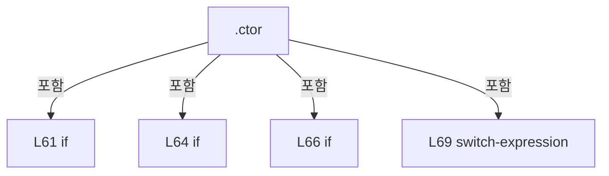

변경 전 점검: 입력/반환 타입, 위 호출자, 예외/취소 경로, 공유 상태와 저장·전송 소비자를 함께 확인합니다. 값의 단위나 물리 방향을 이름만으로 확정하지 않습니다.

### PropertyDeclaration `AttenuatorSnapshots` · L83–83

[Drilling.Common/Interface/CInterfaceManager.cs:83–83](https://github.com/kjuws10-rgb/A3Drilling/blob/334b3599651b2e8e0181fd4459bafaf3cddafff3/Drilling.Common/Interface/CInterfaceManager.cs#L83-L83)

| 항목 | 실제 추출 값 |
| --- | --- |
| 서명 | Drilling.Common.Interface.CAttenuatorStatusSnapshotService Drilling.Common.Interface.CInterfaceManager.AttenuatorSnapshots |
| 접근/수식자 | Public / public |
| 반환/값 타입 | Drilling.Common.Interface.CAttenuatorStatusSnapshotService |
| 소속 타입 | NamedType:Drilling.Common.Interface.CInterfaceManager |

현재 부분 분석에서 직접 연결된 호출자는 없습니다. XAML/이벤트/인터페이스·델리게이트·외부 진입을 추가 확인해야 하며, 미사용으로 판정한 것이 아닙니다.

변경 전 점검: 입력/반환 타입, 위 호출자, 예외/취소 경로, 공유 상태와 저장·전송 소비자를 함께 확인합니다. 값의 단위나 물리 방향을 이름만으로 확정하지 않습니다.

### GetAccessorDeclaration `get_AttenuatorSnapshots` · L83–83

[Drilling.Common/Interface/CInterfaceManager.cs:83–83](https://github.com/kjuws10-rgb/A3Drilling/blob/334b3599651b2e8e0181fd4459bafaf3cddafff3/Drilling.Common/Interface/CInterfaceManager.cs#L83-L83)

| 항목 | 실제 추출 값 |
| --- | --- |
| 서명 | Drilling.Common.Interface.CAttenuatorStatusSnapshotService Drilling.Common.Interface.CInterfaceManager.AttenuatorSnapshots.get |
| 접근/수식자 | Public / get |
| 반환/값 타입 | Drilling.Common.Interface.CAttenuatorStatusSnapshotService |
| 소속 타입 | NamedType:Drilling.Common.Interface.CInterfaceManager |

현재 부분 분석에서 직접 연결된 호출자는 없습니다. XAML/이벤트/인터페이스·델리게이트·외부 진입을 추가 확인해야 하며, 미사용으로 판정한 것이 아닙니다.

변경 전 점검: 입력/반환 타입, 위 호출자, 예외/취소 경로, 공유 상태와 저장·전송 소비자를 함께 확인합니다. 값의 단위나 물리 방향을 이름만으로 확정하지 않습니다.

### PropertyDeclaration `StageReviewSequences` · L84–84

[Drilling.Common/Interface/CInterfaceManager.cs:84–84](https://github.com/kjuws10-rgb/A3Drilling/blob/334b3599651b2e8e0181fd4459bafaf3cddafff3/Drilling.Common/Interface/CInterfaceManager.cs#L84-L84)

| 항목 | 실제 추출 값 |
| --- | --- |
| 서명 | Drilling.Common.Station.CStageReviewSequences Drilling.Common.Interface.CInterfaceManager.StageReviewSequences |
| 접근/수식자 | Public / public |
| 반환/값 타입 | Drilling.Common.Station.CStageReviewSequences |
| 소속 타입 | NamedType:Drilling.Common.Interface.CInterfaceManager |

현재 부분 분석에서 직접 연결된 호출자는 없습니다. XAML/이벤트/인터페이스·델리게이트·외부 진입을 추가 확인해야 하며, 미사용으로 판정한 것이 아닙니다.

변경 전 점검: 입력/반환 타입, 위 호출자, 예외/취소 경로, 공유 상태와 저장·전송 소비자를 함께 확인합니다. 값의 단위나 물리 방향을 이름만으로 확정하지 않습니다.

### GetAccessorDeclaration `get_StageReviewSequences` · L84–84

[Drilling.Common/Interface/CInterfaceManager.cs:84–84](https://github.com/kjuws10-rgb/A3Drilling/blob/334b3599651b2e8e0181fd4459bafaf3cddafff3/Drilling.Common/Interface/CInterfaceManager.cs#L84-L84)

| 항목 | 실제 추출 값 |
| --- | --- |
| 서명 | Drilling.Common.Station.CStageReviewSequences Drilling.Common.Interface.CInterfaceManager.StageReviewSequences.get |
| 접근/수식자 | Public / get |
| 반환/값 타입 | Drilling.Common.Station.CStageReviewSequences |
| 소속 타입 | NamedType:Drilling.Common.Interface.CInterfaceManager |

현재 부분 분석에서 직접 연결된 호출자는 없습니다. XAML/이벤트/인터페이스·델리게이트·외부 진입을 추가 확인해야 하며, 미사용으로 판정한 것이 아닙니다.

변경 전 점검: 입력/반환 타입, 위 호출자, 예외/취소 경로, 공유 상태와 저장·전송 소비자를 함께 확인합니다. 값의 단위나 물리 방향을 이름만으로 확정하지 않습니다.

### PropertyDeclaration `OpticSnapshots` · L85–85

[Drilling.Common/Interface/CInterfaceManager.cs:85–85](https://github.com/kjuws10-rgb/A3Drilling/blob/334b3599651b2e8e0181fd4459bafaf3cddafff3/Drilling.Common/Interface/CInterfaceManager.cs#L85-L85)

| 항목 | 실제 추출 값 |
| --- | --- |
| 서명 | Drilling.Common.Interface.COpticStatusSnapshotService Drilling.Common.Interface.CInterfaceManager.OpticSnapshots |
| 접근/수식자 | Public / public |
| 반환/값 타입 | Drilling.Common.Interface.COpticStatusSnapshotService |
| 소속 타입 | NamedType:Drilling.Common.Interface.CInterfaceManager |

현재 부분 분석에서 직접 연결된 호출자는 없습니다. XAML/이벤트/인터페이스·델리게이트·외부 진입을 추가 확인해야 하며, 미사용으로 판정한 것이 아닙니다.

변경 전 점검: 입력/반환 타입, 위 호출자, 예외/취소 경로, 공유 상태와 저장·전송 소비자를 함께 확인합니다. 값의 단위나 물리 방향을 이름만으로 확정하지 않습니다.

### GetAccessorDeclaration `get_OpticSnapshots` · L85–85

[Drilling.Common/Interface/CInterfaceManager.cs:85–85](https://github.com/kjuws10-rgb/A3Drilling/blob/334b3599651b2e8e0181fd4459bafaf3cddafff3/Drilling.Common/Interface/CInterfaceManager.cs#L85-L85)

| 항목 | 실제 추출 값 |
| --- | --- |
| 서명 | Drilling.Common.Interface.COpticStatusSnapshotService Drilling.Common.Interface.CInterfaceManager.OpticSnapshots.get |
| 접근/수식자 | Public / get |
| 반환/값 타입 | Drilling.Common.Interface.COpticStatusSnapshotService |
| 소속 타입 | NamedType:Drilling.Common.Interface.CInterfaceManager |

현재 부분 분석에서 직접 연결된 호출자는 없습니다. XAML/이벤트/인터페이스·델리게이트·외부 진입을 추가 확인해야 하며, 미사용으로 판정한 것이 아닙니다.

변경 전 점검: 입력/반환 타입, 위 호출자, 예외/취소 경로, 공유 상태와 저장·전송 소비자를 함께 확인합니다. 값의 단위나 물리 방향을 이름만으로 확정하지 않습니다.

### MethodDeclaration `ConfigureVisionLineProtocol` · L87–95

[Drilling.Common/Interface/CInterfaceManager.cs:87–95](https://github.com/kjuws10-rgb/A3Drilling/blob/334b3599651b2e8e0181fd4459bafaf3cddafff3/Drilling.Common/Interface/CInterfaceManager.cs#L87-L95)

| 항목 | 실제 추출 값 |
| --- | --- |
| 서명 | void Drilling.Common.Interface.CInterfaceManager.ConfigureVisionLineProtocol(System.Func<int>, System.Action<Drilling.Common.Interface.Vision.CVisionLineCountExceededException>?) |
| 접근/수식자 | Public / public |
| 반환/값 타입 | void |
| 소속 타입 | NamedType:Drilling.Common.Interface.CInterfaceManager |

입력 계약:

| 이름 | 타입 | 전달 | 선택/기본값 |
| --- | --- | --- | --- |
| capacity | System.Func<int> | None | False /  |
| reportCountAlarm | System.Action<Drilling.Common.Interface.Vision.CVisionLineCountExceededException>? | None | True / null |

정적 호출자로 확인된 위치:

| 호출 파일/행 | 호출 표현식 | 런타임 분기 가능 |
| --- | --- | --- |
| [Drilling.Common/Managers/CManager.cs:103–104](https://github.com/kjuws10-rgb/A3Drilling/blob/334b3599651b2e8e0181fd4459bafaf3cddafff3/Drilling.Common/Managers/CManager.cs#L103-L104) | _interfaceManager.ConfigureVisionLineProtocol | False |

호출하는 대상과 해석 범위:

| 원본 행 | 표현식 | 분석 상태 | 대상/소스 위치 |
| --- | --- | --- | --- |
| 89 | ArgumentNullException.ThrowIfNull | resolved | void System.ArgumentNullException.ThrowIfNull(object?, string?) |
| 90 | CVisionProtocol.ValidateLineCapacity | resolved | int Drilling.Common.Interface.Vision.CVisionProtocol.ValidateLineCapacity(int) · Drilling.Common/Interface/Vision/CVisionComm.cs:573 |
| 90 | capacity | resolved · 동적 구현 선택 가능 | int System.Func<int>.Invoke() |
| 94 | device.ConfigureVisionLineProtocol | resolved | void Drilling.Common.Interface.CInterfaceDevice.ConfigureVisionLineProtocol(System.Func<int>) · Drilling.Common/Interface/CInterfaceManager.cs:3012 |

본문의 실제 연산·분기·예외·반환 순서(원문 위치 순):

| 원본 행 | 종류 | 주석 해설 |
| --- | --- | --- |
| 89 | call | 함수·델리게이트 또는 객체 생성자를 호출합니다: ArgumentNullException.ThrowIfNull(capacity) |
| 90 | assignment | 값을 대상에 대입합니다: _ = CVisionProtocol.ValidateLineCapacity(capacity()) |
| 90 | call | 함수·델리게이트 또는 객체 생성자를 호출합니다: CVisionProtocol.ValidateLineCapacity(capacity()) |
| 90 | call | 함수·델리게이트 또는 객체 생성자를 호출합니다: capacity() |
| 91 | assignment | 값을 대상에 대입합니다: _visionLineCapacity = capacity |
| 92 | assignment | 값을 대상에 대입합니다: _visionCountLimitAlarm = reportCountAlarm |
| 93 | foreach | 컬렉션 요소를 순회합니다: foreach (var device in _devices.Values) |
| 94 | call | 함수·델리게이트 또는 객체 생성자를 호출합니다: device.ConfigureVisionLineProtocol(capacity) |

제어 구문의 포함 구조(실제 실행 순서/CFG가 아닌 구문 탐색 그림):

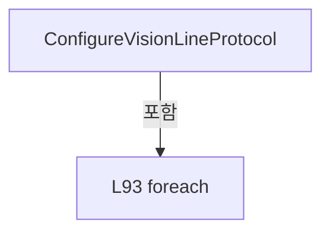

변경 전 점검: 입력/반환 타입, 위 호출자, 예외/취소 경로, 공유 상태와 저장·전송 소비자를 함께 확인합니다. 값의 단위나 물리 방향을 이름만으로 확정하지 않습니다.

### PropertyDeclaration `IsSimulation` · L97–108

[Drilling.Common/Interface/CInterfaceManager.cs:97–108](https://github.com/kjuws10-rgb/A3Drilling/blob/334b3599651b2e8e0181fd4459bafaf3cddafff3/Drilling.Common/Interface/CInterfaceManager.cs#L97-L108)

| 항목 | 실제 추출 값 |
| --- | --- |
| 서명 | bool Drilling.Common.Interface.CInterfaceManager.IsSimulation |
| 접근/수식자 | Public / public |
| 반환/값 타입 | bool |
| 소속 타입 | NamedType:Drilling.Common.Interface.CInterfaceManager |

현재 부분 분석에서 직접 연결된 호출자는 없습니다. XAML/이벤트/인터페이스·델리게이트·외부 진입을 추가 확인해야 하며, 미사용으로 판정한 것이 아닙니다.

변경 전 점검: 입력/반환 타입, 위 호출자, 예외/취소 경로, 공유 상태와 저장·전송 소비자를 함께 확인합니다. 값의 단위나 물리 방향을 이름만으로 확정하지 않습니다.

### GetAccessorDeclaration `get_IsSimulation` · L99–107

[Drilling.Common/Interface/CInterfaceManager.cs:99–107](https://github.com/kjuws10-rgb/A3Drilling/blob/334b3599651b2e8e0181fd4459bafaf3cddafff3/Drilling.Common/Interface/CInterfaceManager.cs#L99-L107)

| 항목 | 실제 추출 값 |
| --- | --- |
| 서명 | bool Drilling.Common.Interface.CInterfaceManager.IsSimulation.get |
| 접근/수식자 | Public / get |
| 반환/값 타입 | bool |
| 소속 타입 | NamedType:Drilling.Common.Interface.CInterfaceManager |

현재 부분 분석에서 직접 연결된 호출자는 없습니다. XAML/이벤트/인터페이스·델리게이트·외부 진입을 추가 확인해야 하며, 미사용으로 판정한 것이 아닙니다.

호출하는 대상과 해석 범위:

| 원본 행 | 표현식 | 분석 상태 | 대상/소스 위치 |
| --- | --- | --- | --- |
| 106 | _devices.Values.All | resolved | bool System.Collections.Generic.IEnumerable<Drilling.Common.Interface.CInterfaceDevice>.All<Drilling.Common.Interface.CInterfaceDevice>(System.Func<Drilling.Common.Interface.CInterfaceDevice, bool>) |

본문의 실제 연산·분기·예외·반환 순서(원문 위치 순):

| 원본 행 | 종류 | 주석 해설 |
| --- | --- | --- |
| 106 | call | 함수·델리게이트 또는 객체 생성자를 호출합니다: _devices.Values.All(IsIsSimulation) |
| 106 | conditional-expression | 조건에 따라 결과식을 선택합니다: _devices.Count == 0 ? _simulationMode ?? true : _devices.Values.All(IsIsSimulation) |
| 106 | return | 호출자에게 값 또는 제어를 반환합니다: return _devices.Count == 0 ? _simulationMode ?? true : _devices.Values.All(IsIsSimulation); |

변경 전 점검: 입력/반환 타입, 위 호출자, 예외/취소 경로, 공유 상태와 저장·전송 소비자를 함께 확인합니다. 값의 단위나 물리 방향을 이름만으로 확정하지 않습니다.

### LocalFunctionStatement `IsIsSimulation` · L101–104

[Drilling.Common/Interface/CInterfaceManager.cs:101–104](https://github.com/kjuws10-rgb/A3Drilling/blob/334b3599651b2e8e0181fd4459bafaf3cddafff3/Drilling.Common/Interface/CInterfaceManager.cs#L101-L104)

| 항목 | 실제 추출 값 |
| --- | --- |
| 서명 | bool IsIsSimulation(Drilling.Common.Interface.CInterfaceDevice) |
| 접근/수식자 | Private /  |
| 반환/값 타입 | bool |
| 소속 타입 | NamedType:Drilling.Common.Interface.CInterfaceManager |

입력 계약:

| 이름 | 타입 | 전달 | 선택/기본값 |
| --- | --- | --- | --- |
| device | Drilling.Common.Interface.CInterfaceDevice | None | False /  |

현재 부분 분석에서 직접 연결된 호출자는 없습니다. XAML/이벤트/인터페이스·델리게이트·외부 진입을 추가 확인해야 하며, 미사용으로 판정한 것이 아닙니다.

본문의 실제 연산·분기·예외·반환 순서(원문 위치 순):

| 원본 행 | 종류 | 주석 해설 |
| --- | --- | --- |
| 103 | return | 호출자에게 값 또는 제어를 반환합니다: return device.IsSimulation; |

변경 전 점검: 입력/반환 타입, 위 호출자, 예외/취소 경로, 공유 상태와 저장·전송 소비자를 함께 확인합니다. 값의 단위나 물리 방향을 이름만으로 확정하지 않습니다.

### PropertyDeclaration `Devices` · L110–116

[Drilling.Common/Interface/CInterfaceManager.cs:110–116](https://github.com/kjuws10-rgb/A3Drilling/blob/334b3599651b2e8e0181fd4459bafaf3cddafff3/Drilling.Common/Interface/CInterfaceManager.cs#L110-L116)

| 항목 | 실제 추출 값 |
| --- | --- |
| 서명 | System.Collections.Generic.IReadOnlyList<Drilling.Common.Interface.CInterfaceDevice> Drilling.Common.Interface.CInterfaceManager.Devices |
| 접근/수식자 | Public / public |
| 반환/값 타입 | System.Collections.Generic.IReadOnlyList<Drilling.Common.Interface.CInterfaceDevice> |
| 소속 타입 | NamedType:Drilling.Common.Interface.CInterfaceManager |

현재 부분 분석에서 직접 연결된 호출자는 없습니다. XAML/이벤트/인터페이스·델리게이트·외부 진입을 추가 확인해야 하며, 미사용으로 판정한 것이 아닙니다.

변경 전 점검: 입력/반환 타입, 위 호출자, 예외/취소 경로, 공유 상태와 저장·전송 소비자를 함께 확인합니다. 값의 단위나 물리 방향을 이름만으로 확정하지 않습니다.

### GetAccessorDeclaration `get_Devices` · L112–115

[Drilling.Common/Interface/CInterfaceManager.cs:112–115](https://github.com/kjuws10-rgb/A3Drilling/blob/334b3599651b2e8e0181fd4459bafaf3cddafff3/Drilling.Common/Interface/CInterfaceManager.cs#L112-L115)

| 항목 | 실제 추출 값 |
| --- | --- |
| 서명 | System.Collections.Generic.IReadOnlyList<Drilling.Common.Interface.CInterfaceDevice> Drilling.Common.Interface.CInterfaceManager.Devices.get |
| 접근/수식자 | Public / get |
| 반환/값 타입 | System.Collections.Generic.IReadOnlyList<Drilling.Common.Interface.CInterfaceDevice> |
| 소속 타입 | NamedType:Drilling.Common.Interface.CInterfaceManager |

현재 부분 분석에서 직접 연결된 호출자는 없습니다. XAML/이벤트/인터페이스·델리게이트·외부 진입을 추가 확인해야 하며, 미사용으로 판정한 것이 아닙니다.

호출하는 대상과 해석 범위:

| 원본 행 | 표현식 | 분석 상태 | 대상/소스 위치 |
| --- | --- | --- | --- |
| 114 | _devices.Values.ToArray | resolved | Drilling.Common.Interface.CInterfaceDevice[] System.Collections.Generic.IEnumerable<Drilling.Common.Interface.CInterfaceDevice>.ToArray<Drilling.Common.Interface.CInterfaceDevice>() |

본문의 실제 연산·분기·예외·반환 순서(원문 위치 순):

| 원본 행 | 종류 | 주석 해설 |
| --- | --- | --- |
| 114 | call | 함수·델리게이트 또는 객체 생성자를 호출합니다: _devices.Values.ToArray() |
| 114 | return | 호출자에게 값 또는 제어를 반환합니다: return _devices.Values.ToArray(); |

변경 전 점검: 입력/반환 타입, 위 호출자, 예외/취소 경로, 공유 상태와 저장·전송 소비자를 함께 확인합니다. 값의 단위나 물리 방향을 이름만으로 확정하지 않습니다.

### PropertyDeclaration `Melsec` · L118–124

[Drilling.Common/Interface/CInterfaceManager.cs:118–124](https://github.com/kjuws10-rgb/A3Drilling/blob/334b3599651b2e8e0181fd4459bafaf3cddafff3/Drilling.Common/Interface/CInterfaceManager.cs#L118-L124)

| 항목 | 실제 추출 값 |
| --- | --- |
| 서명 | Drilling.Common.Interface.CMelsec Drilling.Common.Interface.CInterfaceManager.Melsec |
| 접근/수식자 | Public / public |
| 반환/값 타입 | Drilling.Common.Interface.CMelsec |
| 소속 타입 | NamedType:Drilling.Common.Interface.CInterfaceManager |

현재 부분 분석에서 직접 연결된 호출자는 없습니다. XAML/이벤트/인터페이스·델리게이트·외부 진입을 추가 확인해야 하며, 미사용으로 판정한 것이 아닙니다.

변경 전 점검: 입력/반환 타입, 위 호출자, 예외/취소 경로, 공유 상태와 저장·전송 소비자를 함께 확인합니다. 값의 단위나 물리 방향을 이름만으로 확정하지 않습니다.

### GetAccessorDeclaration `get_Melsec` · L120–123

[Drilling.Common/Interface/CInterfaceManager.cs:120–123](https://github.com/kjuws10-rgb/A3Drilling/blob/334b3599651b2e8e0181fd4459bafaf3cddafff3/Drilling.Common/Interface/CInterfaceManager.cs#L120-L123)

| 항목 | 실제 추출 값 |
| --- | --- |
| 서명 | Drilling.Common.Interface.CMelsec Drilling.Common.Interface.CInterfaceManager.Melsec.get |
| 접근/수식자 | Public / get |
| 반환/값 타입 | Drilling.Common.Interface.CMelsec |
| 소속 타입 | NamedType:Drilling.Common.Interface.CInterfaceManager |

현재 부분 분석에서 직접 연결된 호출자는 없습니다. XAML/이벤트/인터페이스·델리게이트·외부 진입을 추가 확인해야 하며, 미사용으로 판정한 것이 아닙니다.

본문의 실제 연산·분기·예외·반환 순서(원문 위치 순):

| 원본 행 | 종류 | 주석 해설 |
| --- | --- | --- |
| 122 | return | 호출자에게 값 또는 제어를 반환합니다: return _melsec; |

변경 전 점검: 입력/반환 타입, 위 호출자, 예외/취소 경로, 공유 상태와 저장·전송 소비자를 함께 확인합니다. 값의 단위나 물리 방향을 이름만으로 확정하지 않습니다.

### MethodDeclaration `SetSimulationMode` · L126–155

[Drilling.Common/Interface/CInterfaceManager.cs:126–155](https://github.com/kjuws10-rgb/A3Drilling/blob/334b3599651b2e8e0181fd4459bafaf3cddafff3/Drilling.Common/Interface/CInterfaceManager.cs#L126-L155)

| 항목 | 실제 추출 값 |
| --- | --- |
| 서명 | System.Threading.Tasks.Task Drilling.Common.Interface.CInterfaceManager.SetSimulationMode(bool, System.Threading.CancellationToken) |
| 접근/수식자 | Public / public, async |
| 반환/값 타입 | System.Threading.Tasks.Task |
| 소속 타입 | NamedType:Drilling.Common.Interface.CInterfaceManager |

입력 계약:

| 이름 | 타입 | 전달 | 선택/기본값 |
| --- | --- | --- | --- |
| enabled | bool | None | False /  |
| cancellationToken | System.Threading.CancellationToken | None | True / null |

정적 호출자로 확인된 위치:

| 호출 파일/행 | 호출 표현식 | 런타임 분기 가능 |
| --- | --- | --- |
| [Drilling.Common/Managers/CManager.cs:203–203](https://github.com/kjuws10-rgb/A3Drilling/blob/334b3599651b2e8e0181fd4459bafaf3cddafff3/Drilling.Common/Managers/CManager.cs#L203-L203) | _interfaceManager.SetSimulationMode | False |

호출하는 대상과 해석 범위:

| 원본 행 | 표현식 | 분석 상태 | 대상/소스 위치 |
| --- | --- | --- | --- |
| 128 | AttenuatorSnapshots.StopAsync | resolved | System.Threading.Tasks.Task Drilling.Common.Interface.CAttenuatorStatusSnapshotService.StopAsync(System.Threading.CancellationToken) · Drilling.Common/Interface/CInterfaceManager.cs:2589 |
| 129 | OpticSnapshots.StopAsync | resolved | System.Threading.Tasks.Task Drilling.Common.Interface.COpticStatusSnapshotService.StopAsync() · Drilling.Common/Interface/CInterfaceManager.cs:3451 |
| 135 | _devices.Values.Any | resolved | bool System.Collections.Generic.IEnumerable<Drilling.Common.Interface.CInterfaceDevice>.Any<Drilling.Common.Interface.CInterfaceDevice>(System.Func<Drilling.Common.Interface.CInterfaceDevice, bool>) |
| 138 | _melsec.DeInitialize | resolved | void Drilling.Common.Interface.CMelsec.DeInitialize() · Drilling.Common/Interface/Melsec/CMelsec.cs:156 |
| 144 | cancellationToken.ThrowIfCancellationRequested | resolved | void System.Threading.CancellationToken.ThrowIfCancellationRequested() |
| 145 | device.SetSimulationMode | resolved | System.Threading.Tasks.Task Drilling.Common.Interface.CInterfaceDevice.SetSimulationMode(bool, System.Threading.CancellationToken) · Drilling.Common/Interface/CInterfaceManager.cs:3073 |
| 150 | _melsec.Initialize | resolved | void Drilling.Common.Interface.CMelsec.Initialize() · Drilling.Common/Interface/Melsec/CMelsec.cs:141 |
| 153 | AttenuatorSnapshots.Start | resolved | void Drilling.Common.Interface.CAttenuatorStatusSnapshotService.Start() · Drilling.Common/Interface/CInterfaceManager.cs:2573 |
| 154 | OpticSnapshots.Start | resolved | void Drilling.Common.Interface.COpticStatusSnapshotService.Start() · Drilling.Common/Interface/CInterfaceManager.cs:3433 |

본문의 실제 연산·분기·예외·반환 순서(원문 위치 순):

| 원본 행 | 종류 | 주석 해설 |
| --- | --- | --- |
| 128 | await | 비동기 완료를 기다립니다: await AttenuatorSnapshots.StopAsync(cancellationToken) |
| 128 | call | 함수·델리게이트 또는 객체 생성자를 호출합니다: AttenuatorSnapshots.StopAsync(cancellationToken) |
| 129 | await | 비동기 완료를 기다립니다: await OpticSnapshots.StopAsync() |
| 129 | call | 함수·델리게이트 또는 객체 생성자를 호출합니다: OpticSnapshots.StopAsync() |
| 135 | call | 함수·델리게이트 또는 객체 생성자를 호출합니다: _devices.Values.Any(IsMelsecDevice) |
| 135 | local-declaration | 지역 변수를 선언합니다: var restartMelsec = _devices.Values.Any(IsMelsecDevice); |
| 135 | variable-initializer | 변수의 초기값을 지정합니다: restartMelsec = _devices.Values.Any(IsMelsecDevice) |
| 136 | if | 조건에 따라 분기합니다: if (restartMelsec) |
| 138 | call | 함수·델리게이트 또는 객체 생성자를 호출합니다: _melsec.DeInitialize() |
| 141 | assignment | 값을 대상에 대입합니다: _simulationMode = enabled |
| 142 | foreach | 컬렉션 요소를 순회합니다: foreach (var device in _devices.Values) |
| 144 | call | 함수·델리게이트 또는 객체 생성자를 호출합니다: cancellationToken.ThrowIfCancellationRequested() |
| 145 | await | 비동기 완료를 기다립니다: await device.SetSimulationMode(enabled, cancellationToken) |
| 145 | call | 함수·델리게이트 또는 객체 생성자를 호출합니다: device.SetSimulationMode(enabled, cancellationToken) |
| 148 | if | 조건에 따라 분기합니다: if (restartMelsec) |
| 150 | call | 함수·델리게이트 또는 객체 생성자를 호출합니다: _melsec.Initialize() |
| 153 | call | 함수·델리게이트 또는 객체 생성자를 호출합니다: AttenuatorSnapshots.Start() |
| 154 | call | 함수·델리게이트 또는 객체 생성자를 호출합니다: OpticSnapshots.Start() |

제어 구문의 포함 구조(실제 실행 순서/CFG가 아닌 구문 탐색 그림):

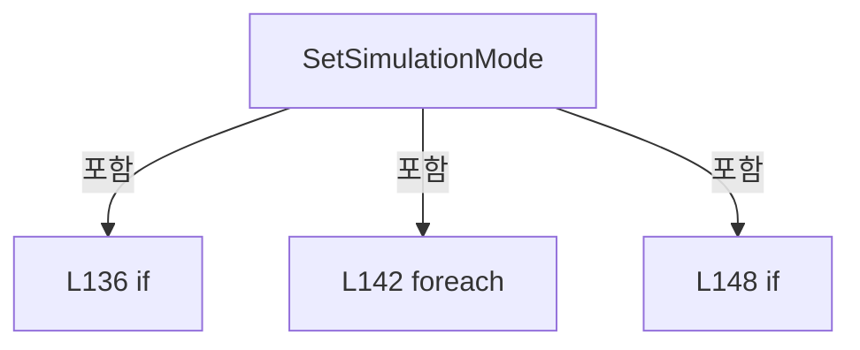

변경 전 점검: 입력/반환 타입, 위 호출자, 예외/취소 경로, 공유 상태와 저장·전송 소비자를 함께 확인합니다. 값의 단위나 물리 방향을 이름만으로 확정하지 않습니다.

### LocalFunctionStatement `IsMelsecDevice` · L130–133

[Drilling.Common/Interface/CInterfaceManager.cs:130–133](https://github.com/kjuws10-rgb/A3Drilling/blob/334b3599651b2e8e0181fd4459bafaf3cddafff3/Drilling.Common/Interface/CInterfaceManager.cs#L130-L133)

| 항목 | 실제 추출 값 |
| --- | --- |
| 서명 | bool IsMelsecDevice(Drilling.Common.Interface.CInterfaceDevice) |
| 접근/수식자 | Private /  |
| 반환/값 타입 | bool |
| 소속 타입 | NamedType:Drilling.Common.Interface.CInterfaceManager |

입력 계약:

| 이름 | 타입 | 전달 | 선택/기본값 |
| --- | --- | --- | --- |
| device | Drilling.Common.Interface.CInterfaceDevice | None | False /  |

현재 부분 분석에서 직접 연결된 호출자는 없습니다. XAML/이벤트/인터페이스·델리게이트·외부 진입을 추가 확인해야 하며, 미사용으로 판정한 것이 아닙니다.

본문의 실제 연산·분기·예외·반환 순서(원문 위치 순):

| 원본 행 | 종류 | 주석 해설 |
| --- | --- | --- |
| 132 | return | 호출자에게 값 또는 제어를 반환합니다: return device.Data.Device == EN_EQP_MODULE.Melsec; |

변경 전 점검: 입력/반환 타입, 위 호출자, 예외/취소 경로, 공유 상태와 저장·전송 소비자를 함께 확인합니다. 값의 단위나 물리 방향을 이름만으로 확정하지 않습니다.

### MethodDeclaration `Register` · L157–166

[Drilling.Common/Interface/CInterfaceManager.cs:157–166](https://github.com/kjuws10-rgb/A3Drilling/blob/334b3599651b2e8e0181fd4459bafaf3cddafff3/Drilling.Common/Interface/CInterfaceManager.cs#L157-L166)

| 항목 | 실제 추출 값 |
| --- | --- |
| 서명 | void Drilling.Common.Interface.CInterfaceManager.Register(Drilling.Common.Interface.ST_INTERFACE_DATA) |
| 접근/수식자 | Public / public |
| 반환/값 타입 | void |
| 소속 타입 | NamedType:Drilling.Common.Interface.CInterfaceManager |

입력 계약:

| 이름 | 타입 | 전달 | 선택/기본값 |
| --- | --- | --- | --- |
| data | Drilling.Common.Interface.ST_INTERFACE_DATA | None | False /  |

정적 호출자로 확인된 위치:

| 호출 파일/행 | 호출 표현식 | 런타임 분기 가능 |
| --- | --- | --- |
| [Drilling.Common/Managers/CManager.cs:499–499](https://github.com/kjuws10-rgb/A3Drilling/blob/334b3599651b2e8e0181fd4459bafaf3cddafff3/Drilling.Common/Managers/CManager.cs#L499-L499) | _interfaceManager.Register | False |

호출하는 대상과 해석 범위:

| 원본 행 | 표현식 | 분석 상태 | 대상/소스 위치 |
| --- | --- | --- | --- |
| 159 | CreateDeviceKey | resolved | string Drilling.Common.Interface.CInterfaceManager.CreateDeviceKey(Drilling.Common.Interface.EN_EQP_MODULE, int) · Drilling.Common/Interface/CInterfaceManager.cs:809 |
| 160 | _devices.ContainsKey | resolved | bool System.Collections.Concurrent.ConcurrentDictionary<string, Drilling.Common.Interface.CInterfaceDevice>.ContainsKey(string) |
| 162 | new InvalidOperationException | resolved | System.InvalidOperationException.InvalidOperationException(string?) |
| 162 | FormatDeviceName | resolved | string Drilling.Common.Interface.CInterfaceManager.FormatDeviceName(Drilling.Common.Interface.ST_INTERFACE_DATA) · Drilling.Common/Interface/CInterfaceManager.cs:814 |
| 165 | CreateDevice | resolved | Drilling.Common.Interface.CInterfaceDevice Drilling.Common.Interface.CInterfaceManager.CreateDevice(Drilling.Common.Interface.ST_INTERFACE_DATA) · Drilling.Common/Interface/CInterfaceManager.cs:168 |

본문의 실제 연산·분기·예외·반환 순서(원문 위치 순):

| 원본 행 | 종류 | 주석 해설 |
| --- | --- | --- |
| 159 | call | 함수·델리게이트 또는 객체 생성자를 호출합니다: CreateDeviceKey(data.Device, data.Number) |
| 159 | local-declaration | 지역 변수를 선언합니다: var key = CreateDeviceKey(data.Device, data.Number); |
| 159 | variable-initializer | 변수의 초기값을 지정합니다: key = CreateDeviceKey(data.Device, data.Number) |
| 160 | call | 함수·델리게이트 또는 객체 생성자를 호출합니다: _devices.ContainsKey(key) |
| 160 | if | 조건에 따라 분기합니다: if (_devices.ContainsKey(key)) |
| 162 | call | 함수·델리게이트 또는 객체 생성자를 호출합니다: new InvalidOperationException($"Interface device was already registered: {FormatDeviceName(data)}") |
| 162 | call | 함수·델리게이트 또는 객체 생성자를 호출합니다: FormatDeviceName(data) |
| 162 | throw | 예외를 발생/전달합니다: throw new InvalidOperationException($"Interface device was already registered: {FormatDeviceName(data)}"); |
| 165 | assignment | 값을 대상에 대입합니다: _devices[key] = CreateDevice(data) |
| 165 | call | 함수·델리게이트 또는 객체 생성자를 호출합니다: CreateDevice(data) |

제어 구문의 포함 구조(실제 실행 순서/CFG가 아닌 구문 탐색 그림):

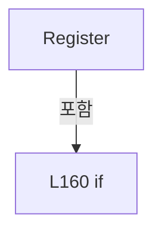

변경 전 점검: 입력/반환 타입, 위 호출자, 예외/취소 경로, 공유 상태와 저장·전송 소비자를 함께 확인합니다. 값의 단위나 물리 방향을 이름만으로 확정하지 않습니다.

### MethodDeclaration `CreateDevice` · L168–181

[Drilling.Common/Interface/CInterfaceManager.cs:168–181](https://github.com/kjuws10-rgb/A3Drilling/blob/334b3599651b2e8e0181fd4459bafaf3cddafff3/Drilling.Common/Interface/CInterfaceManager.cs#L168-L181)

| 항목 | 실제 추출 값 |
| --- | --- |
| 서명 | Drilling.Common.Interface.CInterfaceDevice Drilling.Common.Interface.CInterfaceManager.CreateDevice(Drilling.Common.Interface.ST_INTERFACE_DATA) |
| 접근/수식자 | Private / private |
| 반환/값 타입 | Drilling.Common.Interface.CInterfaceDevice |
| 소속 타입 | NamedType:Drilling.Common.Interface.CInterfaceManager |

입력 계약:

| 이름 | 타입 | 전달 | 선택/기본값 |
| --- | --- | --- | --- |
| data | Drilling.Common.Interface.ST_INTERFACE_DATA | None | False /  |

정적 호출자로 확인된 위치:

| 호출 파일/행 | 호출 표현식 | 런타임 분기 가능 |
| --- | --- | --- |
| [Drilling.Common/Interface/CInterfaceManager.cs:165–165](https://github.com/kjuws10-rgb/A3Drilling/blob/334b3599651b2e8e0181fd4459bafaf3cddafff3/Drilling.Common/Interface/CInterfaceManager.cs#L165-L165) | CreateDevice | False |
| [Drilling.Common/Interface/CInterfaceManager.cs:2074–2074](https://github.com/kjuws10-rgb/A3Drilling/blob/334b3599651b2e8e0181fd4459bafaf3cddafff3/Drilling.Common/Interface/CInterfaceManager.cs#L2074-L2074) | CreateDevice | False |

호출하는 대상과 해석 범위:

| 원본 행 | 표현식 | 분석 상태 | 대상/소스 위치 |
| --- | --- | --- | --- |
| 170 | new CInterfaceDevice | resolved | Drilling.Common.Interface.CInterfaceDevice.CInterfaceDevice(Drilling.Common.Interface.ST_INTERFACE_DATA, bool) · Drilling.Common/Interface/CInterfaceManager.cs:2987 |
| 172 | device.ConfigureVisionLineProtocol | resolved | void Drilling.Common.Interface.CInterfaceDevice.ConfigureVisionLineProtocol(System.Func<int>) · Drilling.Common/Interface/CInterfaceManager.cs:3012 |
| 175 | device.EnableExternalCommunication | resolved | void Drilling.Common.Interface.CInterfaceDevice.EnableExternalCommunication() · Drilling.Common/Interface/CInterfaceManager.cs:3167 |

본문의 실제 연산·분기·예외·반환 순서(원문 위치 순):

| 원본 행 | 종류 | 주석 해설 |
| --- | --- | --- |
| 170 | call | 함수·델리게이트 또는 객체 생성자를 호출합니다: new CInterfaceDevice(data, _simulationMode ?? data.IsSimulation) |
| 170 | local-declaration | 지역 변수를 선언합니다: var device = new CInterfaceDevice(data, _simulationMode ?? data.IsSimulation); |
| 170 | variable-initializer | 변수의 초기값을 지정합니다: device = new CInterfaceDevice(data, _simulationMode ?? data.IsSimulation) |
| 171 | if | 조건에 따라 분기합니다: if (_visionLineCapacity is not null) |
| 172 | call | 함수·델리게이트 또는 객체 생성자를 호출합니다: device.ConfigureVisionLineProtocol(_visionLineCapacity) |
| 173 | if | 조건에 따라 분기합니다: if (data.Device == EN_EQP_MODULE.Melsec) |
| 175 | call | 함수·델리게이트 또는 객체 생성자를 호출합니다: device.EnableExternalCommunication() |
| 178 | compound-assignment-or-event-subscription | 복합 대입 또는 이벤트 구독/해지 표현입니다: device.MessageReceived += OnDeviceMessageReceived |
| 179 | compound-assignment-or-event-subscription | 복합 대입 또는 이벤트 구독/해지 표현입니다: device.ProtocolTrace += OnDeviceProtocolTrace |
| 180 | return | 호출자에게 값 또는 제어를 반환합니다: return device; |

제어 구문의 포함 구조(실제 실행 순서/CFG가 아닌 구문 탐색 그림):

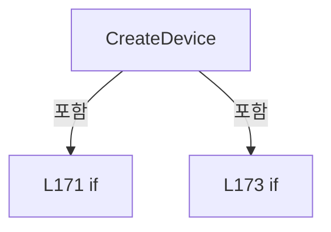

변경 전 점검: 입력/반환 타입, 위 호출자, 예외/취소 경로, 공유 상태와 저장·전송 소비자를 함께 확인합니다. 값의 단위나 물리 방향을 이름만으로 확정하지 않습니다.

### MethodDeclaration `Initialize` · L183–186

[Drilling.Common/Interface/CInterfaceManager.cs:183–186](https://github.com/kjuws10-rgb/A3Drilling/blob/334b3599651b2e8e0181fd4459bafaf3cddafff3/Drilling.Common/Interface/CInterfaceManager.cs#L183-L186)

| 항목 | 실제 추출 값 |
| --- | --- |
| 서명 | System.Threading.Tasks.Task Drilling.Common.Interface.CInterfaceManager.Initialize(System.Threading.CancellationToken) |
| 접근/수식자 | Public / public |
| 반환/값 타입 | System.Threading.Tasks.Task |
| 소속 타입 | NamedType:Drilling.Common.Interface.CInterfaceManager |

입력 계약:

| 이름 | 타입 | 전달 | 선택/기본값 |
| --- | --- | --- | --- |
| cancellationToken | System.Threading.CancellationToken | None | True / null |

정적 호출자로 확인된 위치:

| 호출 파일/행 | 호출 표현식 | 런타임 분기 가능 |
| --- | --- | --- |
| [Drilling.Common/Managers/CManager.cs:216–216](https://github.com/kjuws10-rgb/A3Drilling/blob/334b3599651b2e8e0181fd4459bafaf3cddafff3/Drilling.Common/Managers/CManager.cs#L216-L216) | _interfaceManager.Initialize | False |

호출하는 대상과 해석 범위:

| 원본 행 | 표현식 | 분석 상태 | 대상/소스 위치 |
| --- | --- | --- | --- |
| 185 | Connect | resolved | System.Threading.Tasks.Task<int> Drilling.Common.Interface.CInterfaceManager.Connect(bool, System.Threading.CancellationToken) · Drilling.Common/Interface/CInterfaceManager.cs:198 |

본문의 실제 연산·분기·예외·반환 순서(원문 위치 순):

| 원본 행 | 종류 | 주석 해설 |
| --- | --- | --- |
| 185 | call | 함수·델리게이트 또는 객체 생성자를 호출합니다: Connect(init: true, cancellationToken) |
| 185 | return | 호출자에게 값 또는 제어를 반환합니다: return Connect(init: true, cancellationToken); |

변경 전 점검: 입력/반환 타입, 위 호출자, 예외/취소 경로, 공유 상태와 저장·전송 소비자를 함께 확인합니다. 값의 단위나 물리 방향을 이름만으로 확정하지 않습니다.

### MethodDeclaration `Destroy` · L188–196

[Drilling.Common/Interface/CInterfaceManager.cs:188–196](https://github.com/kjuws10-rgb/A3Drilling/blob/334b3599651b2e8e0181fd4459bafaf3cddafff3/Drilling.Common/Interface/CInterfaceManager.cs#L188-L196)

| 항목 | 실제 추출 값 |
| --- | --- |
| 서명 | System.Threading.Tasks.Task Drilling.Common.Interface.CInterfaceManager.Destroy(System.Threading.CancellationToken) |
| 접근/수식자 | Public / public, async |
| 반환/값 타입 | System.Threading.Tasks.Task |
| 소속 타입 | NamedType:Drilling.Common.Interface.CInterfaceManager |

입력 계약:

| 이름 | 타입 | 전달 | 선택/기본값 |
| --- | --- | --- | --- |
| cancellationToken | System.Threading.CancellationToken | None | True / null |

정적 호출자로 확인된 위치:

| 호출 파일/행 | 호출 표현식 | 런타임 분기 가능 |
| --- | --- | --- |
| [Drilling.Common/Managers/CManager.cs:244–244](https://github.com/kjuws10-rgb/A3Drilling/blob/334b3599651b2e8e0181fd4459bafaf3cddafff3/Drilling.Common/Managers/CManager.cs#L244-L244) | _interfaceManager.Destroy | False |

호출하는 대상과 해석 범위:

| 원본 행 | 표현식 | 분석 상태 | 대상/소스 위치 |
| --- | --- | --- | --- |
| 190 | Disconnect | resolved | System.Threading.Tasks.Task<int> Drilling.Common.Interface.CInterfaceManager.Disconnect(System.Threading.CancellationToken) · Drilling.Common/Interface/CInterfaceManager.cs:237 |
| 191 | AttenuatorSnapshots.DisposeAsync | resolved | System.Threading.Tasks.ValueTask Drilling.Common.Interface.CAttenuatorStatusSnapshotService.DisposeAsync() · Drilling.Common/Interface/CInterfaceManager.cs:2622 |
| 192 | OpticSnapshots.DisposeAsync | resolved | System.Threading.Tasks.ValueTask Drilling.Common.Interface.COpticStatusSnapshotService.DisposeAsync() · Drilling.Common/Interface/CInterfaceManager.cs:3463 |
| 193 | _picoMotorService.DisconnectAll | resolved | void Drilling.Common.Interface.CPicoMotorService.DisconnectAll() · Drilling.Common/Interface/PicoMotor/CPicoMotor.cs:768 |
| 194 | _devices.Clear | resolved | void System.Collections.Concurrent.ConcurrentDictionary<string, Drilling.Common.Interface.CInterfaceDevice>.Clear() |
| 195 | ClearDeviceStateMaps | resolved | void Drilling.Common.Interface.CInterfaceManager.ClearDeviceStateMaps() · Drilling.Common/Interface/CInterfaceManager.cs:1752 |

본문의 실제 연산·분기·예외·반환 순서(원문 위치 순):

| 원본 행 | 종류 | 주석 해설 |
| --- | --- | --- |
| 190 | await | 비동기 완료를 기다립니다: await Disconnect(cancellationToken) |
| 190 | call | 함수·델리게이트 또는 객체 생성자를 호출합니다: Disconnect(cancellationToken) |
| 191 | await | 비동기 완료를 기다립니다: await AttenuatorSnapshots.DisposeAsync() |
| 191 | call | 함수·델리게이트 또는 객체 생성자를 호출합니다: AttenuatorSnapshots.DisposeAsync() |
| 192 | await | 비동기 완료를 기다립니다: await OpticSnapshots.DisposeAsync() |
| 192 | call | 함수·델리게이트 또는 객체 생성자를 호출합니다: OpticSnapshots.DisposeAsync() |
| 193 | call | 함수·델리게이트 또는 객체 생성자를 호출합니다: _picoMotorService.DisconnectAll() |
| 194 | call | 함수·델리게이트 또는 객체 생성자를 호출합니다: _devices.Clear() |
| 195 | call | 함수·델리게이트 또는 객체 생성자를 호출합니다: ClearDeviceStateMaps() |

변경 전 점검: 입력/반환 타입, 위 호출자, 예외/취소 경로, 공유 상태와 저장·전송 소비자를 함께 확인합니다. 값의 단위나 물리 방향을 이름만으로 확정하지 않습니다.

### MethodDeclaration `Connect` · L198–235

[Drilling.Common/Interface/CInterfaceManager.cs:198–235](https://github.com/kjuws10-rgb/A3Drilling/blob/334b3599651b2e8e0181fd4459bafaf3cddafff3/Drilling.Common/Interface/CInterfaceManager.cs#L198-L235)

| 항목 | 실제 추출 값 |
| --- | --- |
| 서명 | System.Threading.Tasks.Task<int> Drilling.Common.Interface.CInterfaceManager.Connect(bool, System.Threading.CancellationToken) |
| 접근/수식자 | Public / public, async |
| 반환/값 타입 | System.Threading.Tasks.Task<int> |
| 소속 타입 | NamedType:Drilling.Common.Interface.CInterfaceManager |

입력 계약:

| 이름 | 타입 | 전달 | 선택/기본값 |
| --- | --- | --- | --- |
| init | bool | None | True / false |
| cancellationToken | System.Threading.CancellationToken | None | True / null |

정적 호출자로 확인된 위치:

| 호출 파일/행 | 호출 표현식 | 런타임 분기 가능 |
| --- | --- | --- |
| [Drilling.Common/Interface/CInterfaceManager.cs:185–185](https://github.com/kjuws10-rgb/A3Drilling/blob/334b3599651b2e8e0181fd4459bafaf3cddafff3/Drilling.Common/Interface/CInterfaceManager.cs#L185-L185) | Connect | False |
| [Drilling.Common/Managers/CManager.cs:317–317](https://github.com/kjuws10-rgb/A3Drilling/blob/334b3599651b2e8e0181fd4459bafaf3cddafff3/Drilling.Common/Managers/CManager.cs#L317-L317) | _interfaceManager.Connect | False |

호출하는 대상과 해석 범위:

| 원본 행 | 표현식 | 분석 상태 | 대상/소스 위치 |
| --- | --- | --- | --- |
| 215 | device.ResetAutoReconnectPolicy | resolved | void Drilling.Common.Interface.CInterfaceDevice.ResetAutoReconnectPolicy() · Drilling.Common/Interface/CInterfaceManager.cs:3117 |
| 218 | ConnectMelsecDevice | resolved | void Drilling.Common.Interface.CInterfaceManager.ConnectMelsecDevice(Drilling.Common.Interface.CInterfaceDevice, System.Threading.CancellationToken) · Drilling.Common/Interface/CInterfaceManager.cs:601 |
| 222 | device.Connect | resolved | System.Threading.Tasks.Task Drilling.Common.Interface.CInterfaceDevice.Connect(System.Threading.CancellationToken) · Drilling.Common/Interface/CInterfaceManager.cs:3096 |
| 225 | WriteConnectionLog | resolved | void Drilling.Common.Interface.CInterfaceManager.WriteConnectionLog(string, Drilling.Common.Interface.CInterfaceDevice, Drilling.Common.Interface.EN_COMM_STATE) · Drilling.Common/Interface/CInterfaceManager.cs:698 |
| 232 | AttenuatorSnapshots.Start | resolved | void Drilling.Common.Interface.CAttenuatorStatusSnapshotService.Start() · Drilling.Common/Interface/CInterfaceManager.cs:2573 |
| 233 | OpticSnapshots.Start | resolved | void Drilling.Common.Interface.COpticStatusSnapshotService.Start() · Drilling.Common/Interface/CInterfaceManager.cs:3433 |

본문의 실제 연산·분기·예외·반환 순서(원문 위치 순):

| 원본 행 | 종류 | 주석 해설 |
| --- | --- | --- |
| 200 | local-declaration | 지역 변수를 선언합니다: var connectedCount = 0; |
| 200 | variable-initializer | 변수의 초기값을 지정합니다: connectedCount = 0 |
| 201 | foreach | 컬렉션 요소를 순회합니다: foreach (var device in _devices.Values) |
| 203 | if | 조건에 따라 분기합니다: if (!device.Data.AutoConnection) |
| 205 | continue | 다음 반복으로 진행합니다: continue; |
| 208 | if | 조건에 따라 분기합니다: if (device.ConnectionState is EN_COMM_STATE.Online or EN_COMM_STATE.Simulation && (device.Data.Device != EN_EQP_MODULE.Melsec &#124;&#124; _melsec.IsCommunicationAvailable)) |
| 211 | continue | 다음 반복으로 진행합니다: continue; |
| 214 | local-declaration | 지역 변수를 선언합니다: var beforeState = device.ConnectionState; |
| 214 | variable-initializer | 변수의 초기값을 지정합니다: beforeState = device.ConnectionState |
| 215 | call | 함수·델리게이트 또는 객체 생성자를 호출합니다: device.ResetAutoReconnectPolicy() |
| 216 | if | 조건에 따라 분기합니다: if (device.Data.Device == EN_EQP_MODULE.Melsec) |
| 218 | call | 함수·델리게이트 또는 객체 생성자를 호출합니다: ConnectMelsecDevice(device, cancellationToken) |
| 220 | else | 앞 조건이 거짓인 경로입니다: else |
| 222 | await | 비동기 완료를 기다립니다: await device.Connect(cancellationToken) |
| 222 | call | 함수·델리게이트 또는 객체 생성자를 호출합니다: device.Connect(cancellationToken) |
| 225 | call | 함수·델리게이트 또는 객체 생성자를 호출합니다: WriteConnectionLog(init ? "INIT_CONNECT" : "CONNECT", device, beforeState) |
| 225 | conditional-expression | 조건에 따라 결과식을 선택합니다: init ? "INIT_CONNECT" : "CONNECT" |
| 226 | if | 조건에 따라 분기합니다: if (device.ConnectionState is EN_COMM_STATE.Online or EN_COMM_STATE.Simulation) |
| 232 | call | 함수·델리게이트 또는 객체 생성자를 호출합니다: AttenuatorSnapshots.Start() |
| 233 | call | 함수·델리게이트 또는 객체 생성자를 호출합니다: OpticSnapshots.Start() |
| 234 | return | 호출자에게 값 또는 제어를 반환합니다: return connectedCount; |

제어 구문의 포함 구조(실제 실행 순서/CFG가 아닌 구문 탐색 그림):

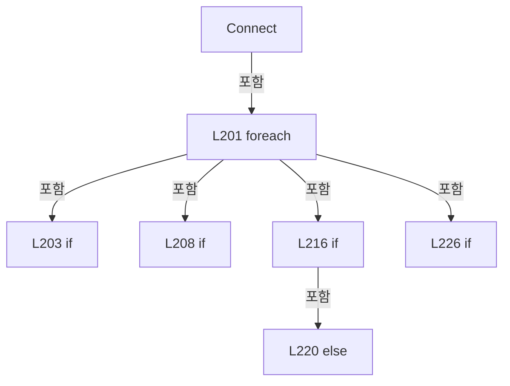

변경 전 점검: 입력/반환 타입, 위 호출자, 예외/취소 경로, 공유 상태와 저장·전송 소비자를 함께 확인합니다. 값의 단위나 물리 방향을 이름만으로 확정하지 않습니다.

### MethodDeclaration `Disconnect` · L237–260

[Drilling.Common/Interface/CInterfaceManager.cs:237–260](https://github.com/kjuws10-rgb/A3Drilling/blob/334b3599651b2e8e0181fd4459bafaf3cddafff3/Drilling.Common/Interface/CInterfaceManager.cs#L237-L260)

| 항목 | 실제 추출 값 |
| --- | --- |
| 서명 | System.Threading.Tasks.Task<int> Drilling.Common.Interface.CInterfaceManager.Disconnect(System.Threading.CancellationToken) |
| 접근/수식자 | Public / public, async |
| 반환/값 타입 | System.Threading.Tasks.Task<int> |
| 소속 타입 | NamedType:Drilling.Common.Interface.CInterfaceManager |

입력 계약:

| 이름 | 타입 | 전달 | 선택/기본값 |
| --- | --- | --- | --- |
| cancellationToken | System.Threading.CancellationToken | None | True / null |

정적 호출자로 확인된 위치:

| 호출 파일/행 | 호출 표현식 | 런타임 분기 가능 |
| --- | --- | --- |
| [Drilling.Common/Interface/CInterfaceManager.cs:190–190](https://github.com/kjuws10-rgb/A3Drilling/blob/334b3599651b2e8e0181fd4459bafaf3cddafff3/Drilling.Common/Interface/CInterfaceManager.cs#L190-L190) | Disconnect | False |
| [Drilling.Common/Managers/CManager.cs:322–322](https://github.com/kjuws10-rgb/A3Drilling/blob/334b3599651b2e8e0181fd4459bafaf3cddafff3/Drilling.Common/Managers/CManager.cs#L322-L322) | _interfaceManager.Disconnect | False |

호출하는 대상과 해석 범위:

| 원본 행 | 표현식 | 분석 상태 | 대상/소스 위치 |
| --- | --- | --- | --- |
| 239 | AttenuatorSnapshots.StopAsync | resolved | System.Threading.Tasks.Task Drilling.Common.Interface.CAttenuatorStatusSnapshotService.StopAsync(System.Threading.CancellationToken) · Drilling.Common/Interface/CInterfaceManager.cs:2589 |
| 240 | OpticSnapshots.StopAsync | resolved | System.Threading.Tasks.Task Drilling.Common.Interface.COpticStatusSnapshotService.StopAsync() · Drilling.Common/Interface/CInterfaceManager.cs:3451 |
| 244 | device.SuppressAutoReconnect | resolved | void Drilling.Common.Interface.CInterfaceDevice.SuppressAutoReconnect() · Drilling.Common/Interface/CInterfaceManager.cs:3122 |
| 247 | DisconnectMelsecDevice | resolved | void Drilling.Common.Interface.CInterfaceManager.DisconnectMelsecDevice(Drilling.Common.Interface.CInterfaceDevice, System.Threading.CancellationToken) · Drilling.Common/Interface/CInterfaceManager.cs:622 |
| 251 | device.Disconnect | resolved | System.Threading.Tasks.Task Drilling.Common.Interface.CInterfaceDevice.Disconnect(System.Threading.CancellationToken) · Drilling.Common/Interface/CInterfaceManager.cs:3127 |
| 254 | WriteConnectionLog | resolved | void Drilling.Common.Interface.CInterfaceManager.WriteConnectionLog(string, Drilling.Common.Interface.CInterfaceDevice, Drilling.Common.Interface.EN_COMM_STATE) · Drilling.Common/Interface/CInterfaceManager.cs:698 |
| 257 | _melsec.DeInitialize | resolved | void Drilling.Common.Interface.CMelsec.DeInitialize() · Drilling.Common/Interface/Melsec/CMelsec.cs:156 |
| 258 | _picoMotorService.DisconnectAll | resolved | void Drilling.Common.Interface.CPicoMotorService.DisconnectAll() · Drilling.Common/Interface/PicoMotor/CPicoMotor.cs:768 |

본문의 실제 연산·분기·예외·반환 순서(원문 위치 순):

| 원본 행 | 종류 | 주석 해설 |
| --- | --- | --- |
| 239 | await | 비동기 완료를 기다립니다: await AttenuatorSnapshots.StopAsync(cancellationToken) |
| 239 | call | 함수·델리게이트 또는 객체 생성자를 호출합니다: AttenuatorSnapshots.StopAsync(cancellationToken) |
| 240 | await | 비동기 완료를 기다립니다: await OpticSnapshots.StopAsync() |
| 240 | call | 함수·델리게이트 또는 객체 생성자를 호출합니다: OpticSnapshots.StopAsync() |
| 241 | foreach | 컬렉션 요소를 순회합니다: foreach (var device in _devices.Values) |
| 243 | local-declaration | 지역 변수를 선언합니다: var beforeState = device.ConnectionState; |
| 243 | variable-initializer | 변수의 초기값을 지정합니다: beforeState = device.ConnectionState |
| 244 | call | 함수·델리게이트 또는 객체 생성자를 호출합니다: device.SuppressAutoReconnect() |
| 245 | if | 조건에 따라 분기합니다: if (device.Data.Device == EN_EQP_MODULE.Melsec) |
| 247 | call | 함수·델리게이트 또는 객체 생성자를 호출합니다: DisconnectMelsecDevice(device, cancellationToken) |
| 249 | else | 앞 조건이 거짓인 경로입니다: else |
| 251 | await | 비동기 완료를 기다립니다: await device.Disconnect(cancellationToken) |
| 251 | call | 함수·델리게이트 또는 객체 생성자를 호출합니다: device.Disconnect(cancellationToken) |
| 254 | call | 함수·델리게이트 또는 객체 생성자를 호출합니다: WriteConnectionLog("DISCONNECT", device, beforeState) |
| 257 | call | 함수·델리게이트 또는 객체 생성자를 호출합니다: _melsec.DeInitialize() |
| 258 | call | 함수·델리게이트 또는 객체 생성자를 호출합니다: _picoMotorService.DisconnectAll() |
| 259 | return | 호출자에게 값 또는 제어를 반환합니다: return _devices.Count; |

제어 구문의 포함 구조(실제 실행 순서/CFG가 아닌 구문 탐색 그림):

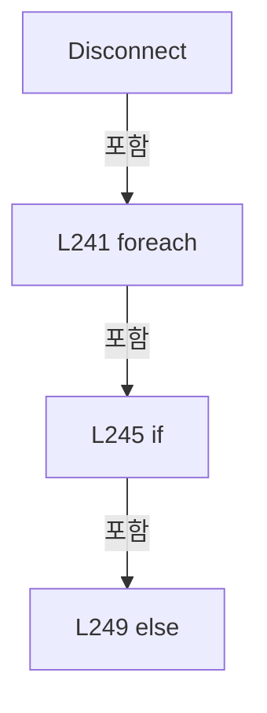

변경 전 점검: 입력/반환 타입, 위 호출자, 예외/취소 경로, 공유 상태와 저장·전송 소비자를 함께 확인합니다. 값의 단위나 물리 방향을 이름만으로 확정하지 않습니다.

### MethodDeclaration `Connect` · L262–274

[Drilling.Common/Interface/CInterfaceManager.cs:262–274](https://github.com/kjuws10-rgb/A3Drilling/blob/334b3599651b2e8e0181fd4459bafaf3cddafff3/Drilling.Common/Interface/CInterfaceManager.cs#L262-L274)

| 항목 | 실제 추출 값 |
| --- | --- |
| 서명 | System.Threading.Tasks.Task Drilling.Common.Interface.CInterfaceManager.Connect(Drilling.Common.Interface.EN_EQP_MODULE, int, bool, System.Threading.CancellationToken) |
| 접근/수식자 | Public / public, async |
| 반환/값 타입 | System.Threading.Tasks.Task |
| 소속 타입 | NamedType:Drilling.Common.Interface.CInterfaceManager |

입력 계약:

| 이름 | 타입 | 전달 | 선택/기본값 |
| --- | --- | --- | --- |
| module | Drilling.Common.Interface.EN_EQP_MODULE | None | False /  |
| number | int | None | False /  |
| autoConnection | bool | None | True / true |
| cancellationToken | System.Threading.CancellationToken | None | True / null |

정적 호출자로 확인된 위치:

| 호출 파일/행 | 호출 표현식 | 런타임 분기 가능 |
| --- | --- | --- |
| [Drilling.Common/Automation/CAutomationManager.cs:50–50](https://github.com/kjuws10-rgb/A3Drilling/blob/334b3599651b2e8e0181fd4459bafaf3cddafff3/Drilling.Common/Automation/CAutomationManager.cs#L50-L50) | _interfaceManager.Connect | False |
| [Drilling.Common/Managers/CSettingManager.cs:176–176](https://github.com/kjuws10-rgb/A3Drilling/blob/334b3599651b2e8e0181fd4459bafaf3cddafff3/Drilling.Common/Managers/CSettingManager.cs#L176-L176) | interfaceManager.Connect | False |
| [Drilling.Common/Motion/CMotionManager.cs:1436–1436](https://github.com/kjuws10-rgb/A3Drilling/blob/334b3599651b2e8e0181fd4459bafaf3cddafff3/Drilling.Common/Motion/CMotionManager.cs#L1436-L1436) | _interfaceManager.Connect | False |
| [Drilling.Common/Motion/CMotionManager.cs:1551–1551](https://github.com/kjuws10-rgb/A3Drilling/blob/334b3599651b2e8e0181fd4459bafaf3cddafff3/Drilling.Common/Motion/CMotionManager.cs#L1551-L1551) | _interfaceManager.Connect | False |
| [Drilling.Common/Station/CStageReviewSequences.cs:480–480](https://github.com/kjuws10-rgb/A3Drilling/blob/334b3599651b2e8e0181fd4459bafaf3cddafff3/Drilling.Common/Station/CStageReviewSequences.cs#L480-L480) | _interfaces.Connect | False |

호출하는 대상과 해석 범위:

| 원본 행 | 표현식 | 분석 상태 | 대상/소스 위치 |
| --- | --- | --- | --- |
| 264 | GetDeviceOrThrow | resolved | Drilling.Common.Interface.CInterfaceDevice Drilling.Common.Interface.CInterfaceManager.GetDeviceOrThrow(Drilling.Common.Interface.EN_EQP_MODULE, int) · Drilling.Common/Interface/CInterfaceManager.cs:658 |
| 265 | device.ResetAutoReconnectPolicy | resolved | void Drilling.Common.Interface.CInterfaceDevice.ResetAutoReconnectPolicy() · Drilling.Common/Interface/CInterfaceManager.cs:3117 |
| 266 | ConnectDevice | resolved | System.Threading.Tasks.Task Drilling.Common.Interface.CInterfaceManager.ConnectDevice(Drilling.Common.Interface.CInterfaceDevice, bool, System.Threading.CancellationToken) · Drilling.Common/Interface/CInterfaceManager.cs:554 |
| 269 | AttenuatorSnapshots.Invalidate | resolved | void Drilling.Common.Interface.CAttenuatorStatusSnapshotService.Invalidate(int, string, string) · Drilling.Common/Interface/CInterfaceManager.cs:2630 |
| 270 | AttenuatorSnapshots.Start | resolved | void Drilling.Common.Interface.CAttenuatorStatusSnapshotService.Start() · Drilling.Common/Interface/CInterfaceManager.cs:2573 |
| 273 | OpticSnapshots.Start | resolved | void Drilling.Common.Interface.COpticStatusSnapshotService.Start() · Drilling.Common/Interface/CInterfaceManager.cs:3433 |

본문의 실제 연산·분기·예외·반환 순서(원문 위치 순):

| 원본 행 | 종류 | 주석 해설 |
| --- | --- | --- |
| 264 | call | 함수·델리게이트 또는 객체 생성자를 호출합니다: GetDeviceOrThrow(module, number) |
| 264 | local-declaration | 지역 변수를 선언합니다: var device = GetDeviceOrThrow(module, number); |
| 264 | variable-initializer | 변수의 초기값을 지정합니다: device = GetDeviceOrThrow(module, number) |
| 265 | call | 함수·델리게이트 또는 객체 생성자를 호출합니다: device.ResetAutoReconnectPolicy() |
| 266 | await | 비동기 완료를 기다립니다: await ConnectDevice(device, autoConnection, cancellationToken) |
| 266 | call | 함수·델리게이트 또는 객체 생성자를 호출합니다: ConnectDevice(device, autoConnection, cancellationToken) |
| 267 | if | 조건에 따라 분기합니다: if (module == EN_EQP_MODULE.Attenuator) |
| 269 | call | 함수·델리게이트 또는 객체 생성자를 호출합니다: AttenuatorSnapshots.Invalidate(number, "LOADING", "ATT 연결 후 새 상태를 기다리고 있습니다.") |
| 270 | call | 함수·델리게이트 또는 객체 생성자를 호출합니다: AttenuatorSnapshots.Start() |
| 273 | call | 함수·델리게이트 또는 객체 생성자를 호출합니다: OpticSnapshots.Start() |

제어 구문의 포함 구조(실제 실행 순서/CFG가 아닌 구문 탐색 그림):

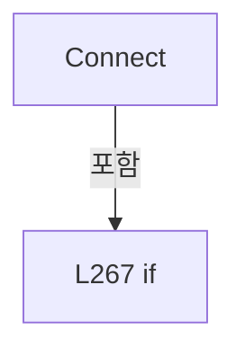

변경 전 점검: 입력/반환 타입, 위 호출자, 예외/취소 경로, 공유 상태와 저장·전송 소비자를 함께 확인합니다. 값의 단위나 물리 방향을 이름만으로 확정하지 않습니다.

### MethodDeclaration `Disconnect` · L276–290

[Drilling.Common/Interface/CInterfaceManager.cs:276–290](https://github.com/kjuws10-rgb/A3Drilling/blob/334b3599651b2e8e0181fd4459bafaf3cddafff3/Drilling.Common/Interface/CInterfaceManager.cs#L276-L290)

| 항목 | 실제 추출 값 |
| --- | --- |
| 서명 | System.Threading.Tasks.Task Drilling.Common.Interface.CInterfaceManager.Disconnect(Drilling.Common.Interface.EN_EQP_MODULE, int, System.Threading.CancellationToken) |
| 접근/수식자 | Public / public, async |
| 반환/값 타입 | System.Threading.Tasks.Task |
| 소속 타입 | NamedType:Drilling.Common.Interface.CInterfaceManager |

입력 계약:

| 이름 | 타입 | 전달 | 선택/기본값 |
| --- | --- | --- | --- |
| module | Drilling.Common.Interface.EN_EQP_MODULE | None | False /  |
| number | int | None | False /  |
| cancellationToken | System.Threading.CancellationToken | None | True / null |

정적 호출자로 확인된 위치:

| 호출 파일/행 | 호출 표현식 | 런타임 분기 가능 |
| --- | --- | --- |
| [Drilling.Common/Automation/CAutomationManager.cs:55–55](https://github.com/kjuws10-rgb/A3Drilling/blob/334b3599651b2e8e0181fd4459bafaf3cddafff3/Drilling.Common/Automation/CAutomationManager.cs#L55-L55) | _interfaceManager.Disconnect | False |
| [Drilling.Common/Managers/CSettingManager.cs:181–181](https://github.com/kjuws10-rgb/A3Drilling/blob/334b3599651b2e8e0181fd4459bafaf3cddafff3/Drilling.Common/Managers/CSettingManager.cs#L181-L181) | interfaceManager.Disconnect | False |
| [Drilling.Common/Motion/CMotionManager.cs:1451–1451](https://github.com/kjuws10-rgb/A3Drilling/blob/334b3599651b2e8e0181fd4459bafaf3cddafff3/Drilling.Common/Motion/CMotionManager.cs#L1451-L1451) | _interfaceManager.Disconnect | False |

호출하는 대상과 해석 범위:

| 원본 행 | 표현식 | 분석 상태 | 대상/소스 위치 |
| --- | --- | --- | --- |
| 278 | _devices.TryGetValue | resolved | bool System.Collections.Concurrent.ConcurrentDictionary<string, Drilling.Common.Interface.CInterfaceDevice>.TryGetValue(string, out Drilling.Common.Interface.CInterfaceDevice) |
| 278 | CreateDeviceKey | resolved | string Drilling.Common.Interface.CInterfaceManager.CreateDeviceKey(Drilling.Common.Interface.EN_EQP_MODULE, int) · Drilling.Common/Interface/CInterfaceManager.cs:809 |
| 283 | OpticSnapshots.Invalidate | resolved | void Drilling.Common.Interface.COpticStatusSnapshotService.Invalidate(Drilling.Common.Interface.EN_EQP_MODULE, int) · Drilling.Common/Interface/CInterfaceManager.cs:3422 |
| 285 | AttenuatorSnapshots.Invalidate | resolved | void Drilling.Common.Interface.CAttenuatorStatusSnapshotService.Invalidate(int, string, string) · Drilling.Common/Interface/CInterfaceManager.cs:2630 |
| 286 | DisconnectDevice | resolved | System.Threading.Tasks.Task Drilling.Common.Interface.CInterfaceManager.DisconnectDevice(Drilling.Common.Interface.CInterfaceDevice, System.Threading.CancellationToken) · Drilling.Common/Interface/CInterfaceManager.cs:585 |
| 287 | OpticSnapshots.Invalidate | resolved | void Drilling.Common.Interface.COpticStatusSnapshotService.Invalidate(Drilling.Common.Interface.EN_EQP_MODULE, int) · Drilling.Common/Interface/CInterfaceManager.cs:3422 |
| 289 | AttenuatorSnapshots.Invalidate | resolved | void Drilling.Common.Interface.CAttenuatorStatusSnapshotService.Invalidate(int, string, string) · Drilling.Common/Interface/CInterfaceManager.cs:2630 |

본문의 실제 연산·분기·예외·반환 순서(원문 위치 순):

| 원본 행 | 종류 | 주석 해설 |
| --- | --- | --- |
| 278 | call | 함수·델리게이트 또는 객체 생성자를 호출합니다: _devices.TryGetValue(CreateDeviceKey(module, number), out var device) |
| 278 | call | 함수·델리게이트 또는 객체 생성자를 호출합니다: CreateDeviceKey(module, number) |
| 278 | if | 조건에 따라 분기합니다: if (!_devices.TryGetValue(CreateDeviceKey(module, number), out var device)) |
| 280 | return | 호출자에게 값 또는 제어를 반환합니다: return; |
| 283 | call | 함수·델리게이트 또는 객체 생성자를 호출합니다: OpticSnapshots.Invalidate(module, number) |
| 284 | if | 조건에 따라 분기합니다: if (module == EN_EQP_MODULE.Attenuator) |
| 285 | call | 함수·델리게이트 또는 객체 생성자를 호출합니다: AttenuatorSnapshots.Invalidate(number) |
| 286 | await | 비동기 완료를 기다립니다: await DisconnectDevice(device, cancellationToken) |
| 286 | call | 함수·델리게이트 또는 객체 생성자를 호출합니다: DisconnectDevice(device, cancellationToken) |
| 287 | call | 함수·델리게이트 또는 객체 생성자를 호출합니다: OpticSnapshots.Invalidate(module, number) |
| 288 | if | 조건에 따라 분기합니다: if (module == EN_EQP_MODULE.Attenuator) |
| 289 | call | 함수·델리게이트 또는 객체 생성자를 호출합니다: AttenuatorSnapshots.Invalidate(number) |

제어 구문의 포함 구조(실제 실행 순서/CFG가 아닌 구문 탐색 그림):

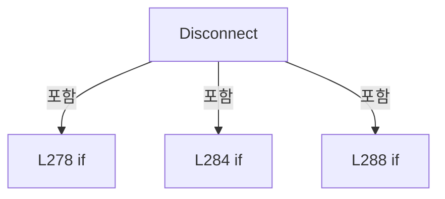

변경 전 점검: 입력/반환 타입, 위 호출자, 예외/취소 경로, 공유 상태와 저장·전송 소비자를 함께 확인합니다. 값의 단위나 물리 방향을 이름만으로 확정하지 않습니다.

### MethodDeclaration `Reconnect` · L292–318

[Drilling.Common/Interface/CInterfaceManager.cs:292–318](https://github.com/kjuws10-rgb/A3Drilling/blob/334b3599651b2e8e0181fd4459bafaf3cddafff3/Drilling.Common/Interface/CInterfaceManager.cs#L292-L318)

| 항목 | 실제 추출 값 |
| --- | --- |
| 서명 | System.Threading.Tasks.Task Drilling.Common.Interface.CInterfaceManager.Reconnect(Drilling.Common.Interface.EN_EQP_MODULE, int, System.Threading.CancellationToken) |
| 접근/수식자 | Public / public, async |
| 반환/값 타입 | System.Threading.Tasks.Task |
| 소속 타입 | NamedType:Drilling.Common.Interface.CInterfaceManager |

입력 계약:

| 이름 | 타입 | 전달 | 선택/기본값 |
| --- | --- | --- | --- |
| module | Drilling.Common.Interface.EN_EQP_MODULE | None | False /  |
| number | int | None | False /  |
| cancellationToken | System.Threading.CancellationToken | None | True / null |

정적 호출자로 확인된 위치:

| 호출 파일/행 | 호출 표현식 | 런타임 분기 가능 |
| --- | --- | --- |
| [Drilling.Common/Managers/CManager.cs:327–327](https://github.com/kjuws10-rgb/A3Drilling/blob/334b3599651b2e8e0181fd4459bafaf3cddafff3/Drilling.Common/Managers/CManager.cs#L327-L327) | _interfaceManager.Reconnect | False |
| [Drilling.Common/Managers/CSettingManager.cs:186–186](https://github.com/kjuws10-rgb/A3Drilling/blob/334b3599651b2e8e0181fd4459bafaf3cddafff3/Drilling.Common/Managers/CSettingManager.cs#L186-L186) | interfaceManager.Reconnect | False |

호출하는 대상과 해석 범위:

| 원본 행 | 표현식 | 분석 상태 | 대상/소스 위치 |
| --- | --- | --- | --- |
| 294 | GetDeviceOrThrow | resolved | Drilling.Common.Interface.CInterfaceDevice Drilling.Common.Interface.CInterfaceManager.GetDeviceOrThrow(Drilling.Common.Interface.EN_EQP_MODULE, int) · Drilling.Common/Interface/CInterfaceManager.cs:658 |
| 296 | AttenuatorSnapshots.Invalidate | resolved | void Drilling.Common.Interface.CAttenuatorStatusSnapshotService.Invalidate(int, string, string) · Drilling.Common/Interface/CInterfaceManager.cs:2630 |
| 300 | DisconnectMelsecDevice | resolved | void Drilling.Common.Interface.CInterfaceManager.DisconnectMelsecDevice(Drilling.Common.Interface.CInterfaceDevice, System.Threading.CancellationToken) · Drilling.Common/Interface/CInterfaceManager.cs:622 |
| 301 | ConnectMelsecDevice | resolved | void Drilling.Common.Interface.CInterfaceManager.ConnectMelsecDevice(Drilling.Common.Interface.CInterfaceDevice, System.Threading.CancellationToken) · Drilling.Common/Interface/CInterfaceManager.cs:601 |
| 305 | device.Disconnect | resolved | System.Threading.Tasks.Task Drilling.Common.Interface.CInterfaceDevice.Disconnect(System.Threading.CancellationToken) · Drilling.Common/Interface/CInterfaceManager.cs:3127 |
| 306 | device.ResetAutoReconnectPolicy | resolved | void Drilling.Common.Interface.CInterfaceDevice.ResetAutoReconnectPolicy() · Drilling.Common/Interface/CInterfaceManager.cs:3117 |
| 307 | device.Connect | resolved | System.Threading.Tasks.Task Drilling.Common.Interface.CInterfaceDevice.Connect(System.Threading.CancellationToken) · Drilling.Common/Interface/CInterfaceManager.cs:3096 |
| 310 | WriteConnectionLog | resolved | void Drilling.Common.Interface.CInterfaceManager.WriteConnectionLog(string, Drilling.Common.Interface.CInterfaceDevice, Drilling.Common.Interface.EN_COMM_STATE) · Drilling.Common/Interface/CInterfaceManager.cs:698 |
| 313 | AttenuatorSnapshots.Invalidate | resolved | void Drilling.Common.Interface.CAttenuatorStatusSnapshotService.Invalidate(int, string, string) · Drilling.Common/Interface/CInterfaceManager.cs:2630 |
| 314 | AttenuatorSnapshots.Start | resolved | void Drilling.Common.Interface.CAttenuatorStatusSnapshotService.Start() · Drilling.Common/Interface/CInterfaceManager.cs:2573 |
| 317 | OpticSnapshots.Start | resolved | void Drilling.Common.Interface.COpticStatusSnapshotService.Start() · Drilling.Common/Interface/CInterfaceManager.cs:3433 |

본문의 실제 연산·분기·예외·반환 순서(원문 위치 순):

| 원본 행 | 종류 | 주석 해설 |
| --- | --- | --- |
| 294 | call | 함수·델리게이트 또는 객체 생성자를 호출합니다: GetDeviceOrThrow(module, number) |
| 294 | local-declaration | 지역 변수를 선언합니다: var device = GetDeviceOrThrow(module, number); |
| 294 | variable-initializer | 변수의 초기값을 지정합니다: device = GetDeviceOrThrow(module, number) |
| 295 | if | 조건에 따라 분기합니다: if (module == EN_EQP_MODULE.Attenuator) |
| 296 | call | 함수·델리게이트 또는 객체 생성자를 호출합니다: AttenuatorSnapshots.Invalidate(number, "LOADING", "ATT 재연결 후 상태를 기다리고 있습니다.") |
| 297 | local-declaration | 지역 변수를 선언합니다: var beforeState = device.ConnectionState; |
| 297 | variable-initializer | 변수의 초기값을 지정합니다: beforeState = device.ConnectionState |
| 298 | if | 조건에 따라 분기합니다: if (device.Data.Device == EN_EQP_MODULE.Melsec) |
| 300 | call | 함수·델리게이트 또는 객체 생성자를 호출합니다: DisconnectMelsecDevice(device, cancellationToken) |
| 301 | call | 함수·델리게이트 또는 객체 생성자를 호출합니다: ConnectMelsecDevice(device, cancellationToken) |
| 303 | else | 앞 조건이 거짓인 경로입니다: else |
| 305 | await | 비동기 완료를 기다립니다: await device.Disconnect(cancellationToken) |
| 305 | call | 함수·델리게이트 또는 객체 생성자를 호출합니다: device.Disconnect(cancellationToken) |
| 306 | call | 함수·델리게이트 또는 객체 생성자를 호출합니다: device.ResetAutoReconnectPolicy() |
| 307 | await | 비동기 완료를 기다립니다: await device.Connect(cancellationToken) |
| 307 | call | 함수·델리게이트 또는 객체 생성자를 호출합니다: device.Connect(cancellationToken) |
| 310 | call | 함수·델리게이트 또는 객체 생성자를 호출합니다: WriteConnectionLog("RECONNECT", device, beforeState) |
| 311 | if | 조건에 따라 분기합니다: if (module == EN_EQP_MODULE.Attenuator) |
| 313 | call | 함수·델리게이트 또는 객체 생성자를 호출합니다: AttenuatorSnapshots.Invalidate(number, "LOADING", "ATT 재연결 후 새 상태를 기다리고 있습니다.") |
| 314 | call | 함수·델리게이트 또는 객체 생성자를 호출합니다: AttenuatorSnapshots.Start() |
| 317 | call | 함수·델리게이트 또는 객체 생성자를 호출합니다: OpticSnapshots.Start() |

제어 구문의 포함 구조(실제 실행 순서/CFG가 아닌 구문 탐색 그림):


변경 전 점검: 입력/반환 타입, 위 호출자, 예외/취소 경로, 공유 상태와 저장·전송 소비자를 함께 확인합니다. 값의 단위나 물리 방향을 이름만으로 확정하지 않습니다.

### MethodDeclaration `ExecuteFunction` · L320–324

[Drilling.Common/Interface/CInterfaceManager.cs:320–324](https://github.com/kjuws10-rgb/A3Drilling/blob/334b3599651b2e8e0181fd4459bafaf3cddafff3/Drilling.Common/Interface/CInterfaceManager.cs#L320-L324)

| 항목 | 실제 추출 값 |
| --- | --- |
| 서명 | System.Threading.Tasks.Task<string> Drilling.Common.Interface.CInterfaceManager.ExecuteFunction(Drilling.Common.Interface.EN_EQP_MODULE, int, string, System.Threading.CancellationToken) |
| 접근/수식자 | Public / public, virtual, async |
| 반환/값 타입 | System.Threading.Tasks.Task<string> |
| 소속 타입 | NamedType:Drilling.Common.Interface.CInterfaceManager |

입력 계약:

| 이름 | 타입 | 전달 | 선택/기본값 |
| --- | --- | --- | --- |
| module | Drilling.Common.Interface.EN_EQP_MODULE | None | False /  |
| number | int | None | False /  |
| function | string | None | False /  |
| cancellationToken | System.Threading.CancellationToken | None | True / null |

정적 호출자로 확인된 위치:

| 호출 파일/행 | 호출 표현식 | 런타임 분기 가능 |
| --- | --- | --- |
| [Drilling.Common/Automation/CAutomationManager.cs:183–183](https://github.com/kjuws10-rgb/A3Drilling/blob/334b3599651b2e8e0181fd4459bafaf3cddafff3/Drilling.Common/Automation/CAutomationManager.cs#L183-L183) | _interfaceManager.ExecuteFunction | True |
| [Drilling.Common/Interface/CInterfaceManager.cs:943–943](https://github.com/kjuws10-rgb/A3Drilling/blob/334b3599651b2e8e0181fd4459bafaf3cddafff3/Drilling.Common/Interface/CInterfaceManager.cs#L943-L943) | ExecuteFunction | True |
| [Drilling.Common/Interface/CInterfaceManager.cs:1125–1125](https://github.com/kjuws10-rgb/A3Drilling/blob/334b3599651b2e8e0181fd4459bafaf3cddafff3/Drilling.Common/Interface/CInterfaceManager.cs#L1125-L1125) | ExecuteFunction | True |
| [Drilling.Common/Interface/CInterfaceManager.cs:1345–1345](https://github.com/kjuws10-rgb/A3Drilling/blob/334b3599651b2e8e0181fd4459bafaf3cddafff3/Drilling.Common/Interface/CInterfaceManager.cs#L1345-L1345) | ExecuteFunction | True |
| [Drilling.Common/Interface/CInterfaceManager.cs:1464–1464](https://github.com/kjuws10-rgb/A3Drilling/blob/334b3599651b2e8e0181fd4459bafaf3cddafff3/Drilling.Common/Interface/CInterfaceManager.cs#L1464-L1464) | ExecuteFunction | True |
| [Drilling.Common/Motion/CMotionManager.cs:1572–1572](https://github.com/kjuws10-rgb/A3Drilling/blob/334b3599651b2e8e0181fd4459bafaf3cddafff3/Drilling.Common/Motion/CMotionManager.cs#L1572-L1572) | _interfaceManager.ExecuteFunction | True |
| [Drilling.Common/Review/CReviewManager.cs:1948–1948](https://github.com/kjuws10-rgb/A3Drilling/blob/334b3599651b2e8e0181fd4459bafaf3cddafff3/Drilling.Common/Review/CReviewManager.cs#L1948-L1948) | interfaceManager.ExecuteFunction | True |
| [Drilling.Common/Review/CReviewManager.cs:2101–2101](https://github.com/kjuws10-rgb/A3Drilling/blob/334b3599651b2e8e0181fd4459bafaf3cddafff3/Drilling.Common/Review/CReviewManager.cs#L2101-L2101) | interfaceManager.ExecuteFunction | True |
| [Drilling.Common/Review/CReviewManager.cs:3179–3179](https://github.com/kjuws10-rgb/A3Drilling/blob/334b3599651b2e8e0181fd4459bafaf3cddafff3/Drilling.Common/Review/CReviewManager.cs#L3179-L3179) | interfaceManager.ExecuteFunction | True |
| [Drilling.Common/Station/CStationProcess.cs:643–643](https://github.com/kjuws10-rgb/A3Drilling/blob/334b3599651b2e8e0181fd4459bafaf3cddafff3/Drilling.Common/Station/CStationProcess.cs#L643-L643) | _interfaceManager.ExecuteFunction | True |
| [Drilling.UI/Menu/Menus/CMenuManual.cs:6438–6438](https://github.com/kjuws10-rgb/A3Drilling/blob/334b3599651b2e8e0181fd4459bafaf3cddafff3/Drilling.UI/Menu/Menus/CMenuManual.cs#L6438-L6438) | interfaceManager.ExecuteFunction | True |

호출하는 대상과 해석 범위:

| 원본 행 | 표현식 | 분석 상태 | 대상/소스 위치 |
| --- | --- | --- | --- |
| 322 | GetDeviceOrThrow | resolved | Drilling.Common.Interface.CInterfaceDevice Drilling.Common.Interface.CInterfaceManager.GetDeviceOrThrow(Drilling.Common.Interface.EN_EQP_MODULE, int) · Drilling.Common/Interface/CInterfaceManager.cs:658 |
| 323 | ExecuteDeviceFunction | resolved | System.Threading.Tasks.Task<string> Drilling.Common.Interface.CInterfaceManager.ExecuteDeviceFunction(Drilling.Common.Interface.CInterfaceDevice, string, System.Threading.CancellationToken, string?, bool) · Drilling.Common/Interface/CInterfaceManager.cs:630 |

본문의 실제 연산·분기·예외·반환 순서(원문 위치 순):

| 원본 행 | 종류 | 주석 해설 |
| --- | --- | --- |
| 322 | call | 함수·델리게이트 또는 객체 생성자를 호출합니다: GetDeviceOrThrow(module, number) |
| 322 | local-declaration | 지역 변수를 선언합니다: var device = GetDeviceOrThrow(module, number); |
| 322 | variable-initializer | 변수의 초기값을 지정합니다: device = GetDeviceOrThrow(module, number) |
| 323 | await | 비동기 완료를 기다립니다: await ExecuteDeviceFunction(device, function, cancellationToken) |
| 323 | call | 함수·델리게이트 또는 객체 생성자를 호출합니다: ExecuteDeviceFunction(device, function, cancellationToken) |
| 323 | return | 호출자에게 값 또는 제어를 반환합니다: return await ExecuteDeviceFunction(device, function, cancellationToken); |

변경 전 점검: 입력/반환 타입, 위 호출자, 예외/취소 경로, 공유 상태와 저장·전송 소비자를 함께 확인합니다. 값의 단위나 물리 방향을 이름만으로 확정하지 않습니다.

### MethodDeclaration `ExecuteFunctionNoLog` · L326–330

[Drilling.Common/Interface/CInterfaceManager.cs:326–330](https://github.com/kjuws10-rgb/A3Drilling/blob/334b3599651b2e8e0181fd4459bafaf3cddafff3/Drilling.Common/Interface/CInterfaceManager.cs#L326-L330)

| 항목 | 실제 추출 값 |
| --- | --- |
| 서명 | System.Threading.Tasks.Task<string> Drilling.Common.Interface.CInterfaceManager.ExecuteFunctionNoLog(Drilling.Common.Interface.EN_EQP_MODULE, int, string, System.Threading.CancellationToken) |
| 접근/수식자 | Public / public, virtual, async |
| 반환/값 타입 | System.Threading.Tasks.Task<string> |
| 소속 타입 | NamedType:Drilling.Common.Interface.CInterfaceManager |

입력 계약:

| 이름 | 타입 | 전달 | 선택/기본값 |
| --- | --- | --- | --- |
| module | Drilling.Common.Interface.EN_EQP_MODULE | None | False /  |
| number | int | None | False /  |
| function | string | None | False /  |
| cancellationToken | System.Threading.CancellationToken | None | True / null |

정적 호출자로 확인된 위치:

| 호출 파일/행 | 호출 표현식 | 런타임 분기 가능 |
| --- | --- | --- |
| [Drilling.Common/Automation/CAutomationManager.cs:183–183](https://github.com/kjuws10-rgb/A3Drilling/blob/334b3599651b2e8e0181fd4459bafaf3cddafff3/Drilling.Common/Automation/CAutomationManager.cs#L183-L183) | _interfaceManager.ExecuteFunctionNoLog | True |
| [Drilling.Common/Interface/CInterfaceManager.cs:943–943](https://github.com/kjuws10-rgb/A3Drilling/blob/334b3599651b2e8e0181fd4459bafaf3cddafff3/Drilling.Common/Interface/CInterfaceManager.cs#L943-L943) | ExecuteFunctionNoLog | True |
| [Drilling.Common/Interface/CInterfaceManager.cs:1125–1125](https://github.com/kjuws10-rgb/A3Drilling/blob/334b3599651b2e8e0181fd4459bafaf3cddafff3/Drilling.Common/Interface/CInterfaceManager.cs#L1125-L1125) | ExecuteFunctionNoLog | True |
| [Drilling.Common/Interface/CInterfaceManager.cs:1345–1345](https://github.com/kjuws10-rgb/A3Drilling/blob/334b3599651b2e8e0181fd4459bafaf3cddafff3/Drilling.Common/Interface/CInterfaceManager.cs#L1345-L1345) | ExecuteFunctionNoLog | True |

호출하는 대상과 해석 범위:

| 원본 행 | 표현식 | 분석 상태 | 대상/소스 위치 |
| --- | --- | --- | --- |
| 328 | GetDeviceOrThrow | resolved | Drilling.Common.Interface.CInterfaceDevice Drilling.Common.Interface.CInterfaceManager.GetDeviceOrThrow(Drilling.Common.Interface.EN_EQP_MODULE, int) · Drilling.Common/Interface/CInterfaceManager.cs:658 |
| 329 | ExecuteDeviceFunction | resolved | System.Threading.Tasks.Task<string> Drilling.Common.Interface.CInterfaceManager.ExecuteDeviceFunction(Drilling.Common.Interface.CInterfaceDevice, string, System.Threading.CancellationToken, string?, bool) · Drilling.Common/Interface/CInterfaceManager.cs:630 |

본문의 실제 연산·분기·예외·반환 순서(원문 위치 순):

| 원본 행 | 종류 | 주석 해설 |
| --- | --- | --- |
| 328 | call | 함수·델리게이트 또는 객체 생성자를 호출합니다: GetDeviceOrThrow(module, number) |
| 328 | local-declaration | 지역 변수를 선언합니다: var device = GetDeviceOrThrow(module, number); |
| 328 | variable-initializer | 변수의 초기값을 지정합니다: device = GetDeviceOrThrow(module, number) |
| 329 | await | 비동기 완료를 기다립니다: await ExecuteDeviceFunction(device, function, cancellationToken, suppressLog: true) |
| 329 | call | 함수·델리게이트 또는 객체 생성자를 호출합니다: ExecuteDeviceFunction(device, function, cancellationToken, suppressLog: true) |
| 329 | return | 호출자에게 값 또는 제어를 반환합니다: return await ExecuteDeviceFunction(device, function, cancellationToken, suppressLog: true); |

변경 전 점검: 입력/반환 타입, 위 호출자, 예외/취소 경로, 공유 상태와 저장·전송 소비자를 함께 확인합니다. 값의 단위나 물리 방향을 이름만으로 확정하지 않습니다.

### MethodDeclaration `ExecuteFunctionWithLogText` · L332–336

[Drilling.Common/Interface/CInterfaceManager.cs:332–336](https://github.com/kjuws10-rgb/A3Drilling/blob/334b3599651b2e8e0181fd4459bafaf3cddafff3/Drilling.Common/Interface/CInterfaceManager.cs#L332-L336)

| 항목 | 실제 추출 값 |
| --- | --- |
| 서명 | System.Threading.Tasks.Task<string> Drilling.Common.Interface.CInterfaceManager.ExecuteFunctionWithLogText(Drilling.Common.Interface.EN_EQP_MODULE, int, string, string, System.Threading.CancellationToken) |
| 접근/수식자 | Public / public, async |
| 반환/값 타입 | System.Threading.Tasks.Task<string> |
| 소속 타입 | NamedType:Drilling.Common.Interface.CInterfaceManager |

입력 계약:

| 이름 | 타입 | 전달 | 선택/기본값 |
| --- | --- | --- | --- |
| module | Drilling.Common.Interface.EN_EQP_MODULE | None | False /  |
| number | int | None | False /  |
| function | string | None | False /  |
| logText | string | None | False /  |
| cancellationToken | System.Threading.CancellationToken | None | True / null |

현재 부분 분석에서 직접 연결된 호출자는 없습니다. XAML/이벤트/인터페이스·델리게이트·외부 진입을 추가 확인해야 하며, 미사용으로 판정한 것이 아닙니다.

호출하는 대상과 해석 범위:

| 원본 행 | 표현식 | 분석 상태 | 대상/소스 위치 |
| --- | --- | --- | --- |
| 334 | GetDeviceOrThrow | resolved | Drilling.Common.Interface.CInterfaceDevice Drilling.Common.Interface.CInterfaceManager.GetDeviceOrThrow(Drilling.Common.Interface.EN_EQP_MODULE, int) · Drilling.Common/Interface/CInterfaceManager.cs:658 |
| 335 | ExecuteDeviceFunction | resolved | System.Threading.Tasks.Task<string> Drilling.Common.Interface.CInterfaceManager.ExecuteDeviceFunction(Drilling.Common.Interface.CInterfaceDevice, string, System.Threading.CancellationToken, string?, bool) · Drilling.Common/Interface/CInterfaceManager.cs:630 |

본문의 실제 연산·분기·예외·반환 순서(원문 위치 순):

| 원본 행 | 종류 | 주석 해설 |
| --- | --- | --- |
| 334 | call | 함수·델리게이트 또는 객체 생성자를 호출합니다: GetDeviceOrThrow(module, number) |
| 334 | local-declaration | 지역 변수를 선언합니다: var device = GetDeviceOrThrow(module, number); |
| 334 | variable-initializer | 변수의 초기값을 지정합니다: device = GetDeviceOrThrow(module, number) |
| 335 | await | 비동기 완료를 기다립니다: await ExecuteDeviceFunction(device, function, cancellationToken, logText) |
| 335 | call | 함수·델리게이트 또는 객체 생성자를 호출합니다: ExecuteDeviceFunction(device, function, cancellationToken, logText) |
| 335 | return | 호출자에게 값 또는 제어를 반환합니다: return await ExecuteDeviceFunction(device, function, cancellationToken, logText); |

변경 전 점검: 입력/반환 타입, 위 호출자, 예외/취소 경로, 공유 상태와 저장·전송 소비자를 함께 확인합니다. 값의 단위나 물리 방향을 이름만으로 확정하지 않습니다.

### MethodDeclaration `IsConnect` · L338–341

[Drilling.Common/Interface/CInterfaceManager.cs:338–341](https://github.com/kjuws10-rgb/A3Drilling/blob/334b3599651b2e8e0181fd4459bafaf3cddafff3/Drilling.Common/Interface/CInterfaceManager.cs#L338-L341)

| 항목 | 실제 추출 값 |
| --- | --- |
| 서명 | bool Drilling.Common.Interface.CInterfaceManager.IsConnect(Drilling.Common.Interface.EN_EQP_MODULE, int) |
| 접근/수식자 | Public / public |
| 반환/값 타입 | bool |
| 소속 타입 | NamedType:Drilling.Common.Interface.CInterfaceManager |

입력 계약:

| 이름 | 타입 | 전달 | 선택/기본값 |
| --- | --- | --- | --- |
| module | Drilling.Common.Interface.EN_EQP_MODULE | None | False /  |
| number | int | None | False /  |

정적 호출자로 확인된 위치:

| 호출 파일/행 | 호출 표현식 | 런타임 분기 가능 |
| --- | --- | --- |
| [Drilling.Common/Automation/CAutomationManager.cs:60–60](https://github.com/kjuws10-rgb/A3Drilling/blob/334b3599651b2e8e0181fd4459bafaf3cddafff3/Drilling.Common/Automation/CAutomationManager.cs#L60-L60) | _interfaceManager.IsConnect | False |
| [Drilling.Common/Interface/CInterfaceManager.cs:58–58](https://github.com/kjuws10-rgb/A3Drilling/blob/334b3599651b2e8e0181fd4459bafaf3cddafff3/Drilling.Common/Interface/CInterfaceManager.cs#L58-L58) | IsConnect | False |
| [Drilling.Common/Interface/CInterfaceManager.cs:61–61](https://github.com/kjuws10-rgb/A3Drilling/blob/334b3599651b2e8e0181fd4459bafaf3cddafff3/Drilling.Common/Interface/CInterfaceManager.cs#L61-L61) | IsConnect | False |
| [Drilling.Common/Interface/CInterfaceManager.cs:927–927](https://github.com/kjuws10-rgb/A3Drilling/blob/334b3599651b2e8e0181fd4459bafaf3cddafff3/Drilling.Common/Interface/CInterfaceManager.cs#L927-L927) | IsConnect | False |
| [Drilling.Common/Interface/CInterfaceManager.cs:932–932](https://github.com/kjuws10-rgb/A3Drilling/blob/334b3599651b2e8e0181fd4459bafaf3cddafff3/Drilling.Common/Interface/CInterfaceManager.cs#L932-L932) | IsConnect | False |
| [Drilling.Common/Interface/CInterfaceManager.cs:1098–1098](https://github.com/kjuws10-rgb/A3Drilling/blob/334b3599651b2e8e0181fd4459bafaf3cddafff3/Drilling.Common/Interface/CInterfaceManager.cs#L1098-L1098) | IsConnect | False |
| [Drilling.Common/Interface/CInterfaceManager.cs:1103–1103](https://github.com/kjuws10-rgb/A3Drilling/blob/334b3599651b2e8e0181fd4459bafaf3cddafff3/Drilling.Common/Interface/CInterfaceManager.cs#L1103-L1103) | IsConnect | False |
| [Drilling.Common/Interface/CInterfaceManager.cs:1329–1329](https://github.com/kjuws10-rgb/A3Drilling/blob/334b3599651b2e8e0181fd4459bafaf3cddafff3/Drilling.Common/Interface/CInterfaceManager.cs#L1329-L1329) | IsConnect | False |
| [Drilling.Common/Interface/CInterfaceManager.cs:1334–1334](https://github.com/kjuws10-rgb/A3Drilling/blob/334b3599651b2e8e0181fd4459bafaf3cddafff3/Drilling.Common/Interface/CInterfaceManager.cs#L1334-L1334) | IsConnect | False |
| [Drilling.Common/Interface/CInterfaceManager.cs:1452–1452](https://github.com/kjuws10-rgb/A3Drilling/blob/334b3599651b2e8e0181fd4459bafaf3cddafff3/Drilling.Common/Interface/CInterfaceManager.cs#L1452-L1452) | IsConnect | False |
| [Drilling.Common/Interface/CInterfaceManager.cs:1457–1457](https://github.com/kjuws10-rgb/A3Drilling/blob/334b3599651b2e8e0181fd4459bafaf3cddafff3/Drilling.Common/Interface/CInterfaceManager.cs#L1457-L1457) | IsConnect | False |
| [Drilling.Common/Interface/CInterfaceManager.cs:1999–1999](https://github.com/kjuws10-rgb/A3Drilling/blob/334b3599651b2e8e0181fd4459bafaf3cddafff3/Drilling.Common/Interface/CInterfaceManager.cs#L1999-L1999) | IsConnect | False |
| [Drilling.Common/Interface/CInterfaceManager.cs:2011–2011](https://github.com/kjuws10-rgb/A3Drilling/blob/334b3599651b2e8e0181fd4459bafaf3cddafff3/Drilling.Common/Interface/CInterfaceManager.cs#L2011-L2011) | IsConnect | False |
| [Drilling.Common/Interface/CInterfaceManager.cs:2021–2021](https://github.com/kjuws10-rgb/A3Drilling/blob/334b3599651b2e8e0181fd4459bafaf3cddafff3/Drilling.Common/Interface/CInterfaceManager.cs#L2021-L2021) | IsConnect | False |
| [Drilling.Common/Interface/CInterfaceManager.cs:2028–2028](https://github.com/kjuws10-rgb/A3Drilling/blob/334b3599651b2e8e0181fd4459bafaf3cddafff3/Drilling.Common/Interface/CInterfaceManager.cs#L2028-L2028) | IsConnect | False |
| [Drilling.Common/Interface/CInterfaceManager.cs:2039–2039](https://github.com/kjuws10-rgb/A3Drilling/blob/334b3599651b2e8e0181fd4459bafaf3cddafff3/Drilling.Common/Interface/CInterfaceManager.cs#L2039-L2039) | IsConnect | False |
| [Drilling.Common/Interface/Melsec/CMelsec.cs:937–937](https://github.com/kjuws10-rgb/A3Drilling/blob/334b3599651b2e8e0181fd4459bafaf3cddafff3/Drilling.Common/Interface/Melsec/CMelsec.cs#L937-L937) | _interfaceManager.IsConnect | False |
| [Drilling.Common/Interface/Melsec/CMelsec.cs:1167–1167](https://github.com/kjuws10-rgb/A3Drilling/blob/334b3599651b2e8e0181fd4459bafaf3cddafff3/Drilling.Common/Interface/Melsec/CMelsec.cs#L1167-L1167) | _interfaceManager.IsConnect | False |
| [Drilling.Common/Motion/CMotionManager.cs:1434–1434](https://github.com/kjuws10-rgb/A3Drilling/blob/334b3599651b2e8e0181fd4459bafaf3cddafff3/Drilling.Common/Motion/CMotionManager.cs#L1434-L1434) | _interfaceManager.IsConnect | False |
| [Drilling.Common/Motion/CMotionManager.cs:1449–1449](https://github.com/kjuws10-rgb/A3Drilling/blob/334b3599651b2e8e0181fd4459bafaf3cddafff3/Drilling.Common/Motion/CMotionManager.cs#L1449-L1449) | _interfaceManager.IsConnect | False |
| [Drilling.Common/Motion/CMotionManager.cs:1475–1475](https://github.com/kjuws10-rgb/A3Drilling/blob/334b3599651b2e8e0181fd4459bafaf3cddafff3/Drilling.Common/Motion/CMotionManager.cs#L1475-L1475) | .IsConnect | False |
| [Drilling.Common/Motion/CMotionManager.cs:1544–1544](https://github.com/kjuws10-rgb/A3Drilling/blob/334b3599651b2e8e0181fd4459bafaf3cddafff3/Drilling.Common/Motion/CMotionManager.cs#L1544-L1544) | _interfaceManager.IsConnect | False |
| [Drilling.Common/Motion/CMotionManager.cs:1549–1549](https://github.com/kjuws10-rgb/A3Drilling/blob/334b3599651b2e8e0181fd4459bafaf3cddafff3/Drilling.Common/Motion/CMotionManager.cs#L1549-L1549) | _interfaceManager.IsConnect | False |
| [Drilling.Common/Motion/CMotionManager.cs:1554–1554](https://github.com/kjuws10-rgb/A3Drilling/blob/334b3599651b2e8e0181fd4459bafaf3cddafff3/Drilling.Common/Motion/CMotionManager.cs#L1554-L1554) | _interfaceManager.IsConnect | False |
| [Drilling.Common/Review/CReviewManager.cs:2677–2677](https://github.com/kjuws10-rgb/A3Drilling/blob/334b3599651b2e8e0181fd4459bafaf3cddafff3/Drilling.Common/Review/CReviewManager.cs#L2677-L2677) | interfaceManager.IsConnect | False |
| [Drilling.Common/Review/CReviewManager.cs:3166–3166](https://github.com/kjuws10-rgb/A3Drilling/blob/334b3599651b2e8e0181fd4459bafaf3cddafff3/Drilling.Common/Review/CReviewManager.cs#L3166-L3166) | interfaceManager.IsConnect | False |
| [Drilling.Common/Review/CReviewManager.cs:3176–3176](https://github.com/kjuws10-rgb/A3Drilling/blob/334b3599651b2e8e0181fd4459bafaf3cddafff3/Drilling.Common/Review/CReviewManager.cs#L3176-L3176) | interfaceManager.IsConnect | False |
| [Drilling.UI/Menu/Menus/CMenuCorrection.cs:3622–3622](https://github.com/kjuws10-rgb/A3Drilling/blob/334b3599651b2e8e0181fd4459bafaf3cddafff3/Drilling.UI/Menu/Menus/CMenuCorrection.cs#L3622-L3622) | interfaces.IsConnect | False |
| [Drilling.UI/Menu/Menus/CMenuCorrection.cs:3676–3676](https://github.com/kjuws10-rgb/A3Drilling/blob/334b3599651b2e8e0181fd4459bafaf3cddafff3/Drilling.UI/Menu/Menus/CMenuCorrection.cs#L3676-L3676) | interfaces.IsConnect | False |

호출하는 대상과 해석 범위:

| 원본 행 | 표현식 | 분석 상태 | 대상/소스 위치 |
| --- | --- | --- | --- |
| 340 | _devices.TryGetValue | resolved | bool System.Collections.Concurrent.ConcurrentDictionary<string, Drilling.Common.Interface.CInterfaceDevice>.TryGetValue(string, out Drilling.Common.Interface.CInterfaceDevice) |
| 340 | CreateDeviceKey | resolved | string Drilling.Common.Interface.CInterfaceManager.CreateDeviceKey(Drilling.Common.Interface.EN_EQP_MODULE, int) · Drilling.Common/Interface/CInterfaceManager.cs:809 |

본문의 실제 연산·분기·예외·반환 순서(원문 위치 순):

| 원본 행 | 종류 | 주석 해설 |
| --- | --- | --- |
| 340 | call | 함수·델리게이트 또는 객체 생성자를 호출합니다: _devices.TryGetValue(CreateDeviceKey(module, number), out var device) |
| 340 | call | 함수·델리게이트 또는 객체 생성자를 호출합니다: CreateDeviceKey(module, number) |
| 340 | return | 호출자에게 값 또는 제어를 반환합니다: return _devices.TryGetValue(CreateDeviceKey(module, number), out var device) && device.ConnectionState is EN_COMM_STATE.Online or EN_COMM_STATE.Simulation; |

변경 전 점검: 입력/반환 타입, 위 호출자, 예외/취소 경로, 공유 상태와 저장·전송 소비자를 함께 확인합니다. 값의 단위나 물리 방향을 이름만으로 확정하지 않습니다.

### MethodDeclaration `IsSimul` · L343–346

[Drilling.Common/Interface/CInterfaceManager.cs:343–346](https://github.com/kjuws10-rgb/A3Drilling/blob/334b3599651b2e8e0181fd4459bafaf3cddafff3/Drilling.Common/Interface/CInterfaceManager.cs#L343-L346)

| 항목 | 실제 추출 값 |
| --- | --- |
| 서명 | bool Drilling.Common.Interface.CInterfaceManager.IsSimul(Drilling.Common.Interface.EN_EQP_MODULE, int) |
| 접근/수식자 | Public / public |
| 반환/값 타입 | bool |
| 소속 타입 | NamedType:Drilling.Common.Interface.CInterfaceManager |

입력 계약:

| 이름 | 타입 | 전달 | 선택/기본값 |
| --- | --- | --- | --- |
| module | Drilling.Common.Interface.EN_EQP_MODULE | None | False /  |
| number | int | None | False /  |

정적 호출자로 확인된 위치:

| 호출 파일/행 | 호출 표현식 | 런타임 분기 가능 |
| --- | --- | --- |
| [Drilling.Common/Automation/CAutomationManager.cs:65–65](https://github.com/kjuws10-rgb/A3Drilling/blob/334b3599651b2e8e0181fd4459bafaf3cddafff3/Drilling.Common/Automation/CAutomationManager.cs#L65-L65) | _interfaceManager.IsSimul | False |
| [Drilling.Common/Interface/CInterfaceManager.cs:58–58](https://github.com/kjuws10-rgb/A3Drilling/blob/334b3599651b2e8e0181fd4459bafaf3cddafff3/Drilling.Common/Interface/CInterfaceManager.cs#L58-L58) | IsSimul | False |
| [Drilling.Common/Interface/CInterfaceManager.cs:61–61](https://github.com/kjuws10-rgb/A3Drilling/blob/334b3599651b2e8e0181fd4459bafaf3cddafff3/Drilling.Common/Interface/CInterfaceManager.cs#L61-L61) | IsSimul | False |
| [Drilling.Common/Interface/CInterfaceManager.cs:66–66](https://github.com/kjuws10-rgb/A3Drilling/blob/334b3599651b2e8e0181fd4459bafaf3cddafff3/Drilling.Common/Interface/CInterfaceManager.cs#L66-L66) | IsSimul | False |
| [Drilling.Common/Interface/CInterfaceManager.cs:1864–1864](https://github.com/kjuws10-rgb/A3Drilling/blob/334b3599651b2e8e0181fd4459bafaf3cddafff3/Drilling.Common/Interface/CInterfaceManager.cs#L1864-L1864) | IsSimul | False |
| [Drilling.Common/Interface/CInterfaceManager.cs:1999–1999](https://github.com/kjuws10-rgb/A3Drilling/blob/334b3599651b2e8e0181fd4459bafaf3cddafff3/Drilling.Common/Interface/CInterfaceManager.cs#L1999-L1999) | IsSimul | False |
| [Drilling.Common/Interface/CInterfaceManager.cs:2011–2011](https://github.com/kjuws10-rgb/A3Drilling/blob/334b3599651b2e8e0181fd4459bafaf3cddafff3/Drilling.Common/Interface/CInterfaceManager.cs#L2011-L2011) | IsSimul | False |
| [Drilling.Common/Interface/CInterfaceManager.cs:2021–2021](https://github.com/kjuws10-rgb/A3Drilling/blob/334b3599651b2e8e0181fd4459bafaf3cddafff3/Drilling.Common/Interface/CInterfaceManager.cs#L2021-L2021) | IsSimul | False |
| [Drilling.Common/Interface/CInterfaceManager.cs:2028–2028](https://github.com/kjuws10-rgb/A3Drilling/blob/334b3599651b2e8e0181fd4459bafaf3cddafff3/Drilling.Common/Interface/CInterfaceManager.cs#L2028-L2028) | IsSimul | False |
| [Drilling.Common/Interface/CInterfaceManager.cs:2039–2039](https://github.com/kjuws10-rgb/A3Drilling/blob/334b3599651b2e8e0181fd4459bafaf3cddafff3/Drilling.Common/Interface/CInterfaceManager.cs#L2039-L2039) | IsSimul | False |
| [Drilling.Common/Interface/Melsec/CMelsec.InterfaceLog.cs:118–118](https://github.com/kjuws10-rgb/A3Drilling/blob/334b3599651b2e8e0181fd4459bafaf3cddafff3/Drilling.Common/Interface/Melsec/CMelsec.InterfaceLog.cs#L118-L118) | _interfaceManager.IsSimul | False |
| [Drilling.Common/Interface/Melsec/CMelsec.cs:1847–1847](https://github.com/kjuws10-rgb/A3Drilling/blob/334b3599651b2e8e0181fd4459bafaf3cddafff3/Drilling.Common/Interface/Melsec/CMelsec.cs#L1847-L1847) | _interfaceManager.IsSimul | False |
| [Drilling.Common/Motion/CMotionManager.cs:1422–1422](https://github.com/kjuws10-rgb/A3Drilling/blob/334b3599651b2e8e0181fd4459bafaf3cddafff3/Drilling.Common/Motion/CMotionManager.cs#L1422-L1422) | .IsSimul | False |
| [Drilling.Common/Station/CStageReviewSequences.cs:42–42](https://github.com/kjuws10-rgb/A3Drilling/blob/334b3599651b2e8e0181fd4459bafaf3cddafff3/Drilling.Common/Station/CStageReviewSequences.cs#L42-L42) | interfaces.IsSimul | False |
| [Drilling.Common/Station/CStationProcess.cs:6425–6425](https://github.com/kjuws10-rgb/A3Drilling/blob/334b3599651b2e8e0181fd4459bafaf3cddafff3/Drilling.Common/Station/CStationProcess.cs#L6425-L6425) | interfaces.IsSimul | False |
| [Drilling.UI/Menu/Menus/CMenuCorrection.cs:3622–3622](https://github.com/kjuws10-rgb/A3Drilling/blob/334b3599651b2e8e0181fd4459bafaf3cddafff3/Drilling.UI/Menu/Menus/CMenuCorrection.cs#L3622-L3622) | interfaces.IsSimul | False |
| [Drilling.UI/Menu/Menus/CMenuCorrection.cs:3631–3631](https://github.com/kjuws10-rgb/A3Drilling/blob/334b3599651b2e8e0181fd4459bafaf3cddafff3/Drilling.UI/Menu/Menus/CMenuCorrection.cs#L3631-L3631) | manager.Interface().IsSimul | False |
| [Drilling.UI/Menu/Menus/CMenuCorrection.cs:3676–3676](https://github.com/kjuws10-rgb/A3Drilling/blob/334b3599651b2e8e0181fd4459bafaf3cddafff3/Drilling.UI/Menu/Menus/CMenuCorrection.cs#L3676-L3676) | interfaces.IsSimul | False |
| [Drilling.UI/Menu/Menus/CMenuMonitor.cs:5471–5471](https://github.com/kjuws10-rgb/A3Drilling/blob/334b3599651b2e8e0181fd4459bafaf3cddafff3/Drilling.UI/Menu/Menus/CMenuMonitor.cs#L5471-L5471) | _interfaceManager.IsSimul | False |
| [Drilling.UI/Popup/CMelsecStageSimulationDialog.xaml.cs:102–102](https://github.com/kjuws10-rgb/A3Drilling/blob/334b3599651b2e8e0181fd4459bafaf3cddafff3/Drilling.UI/Popup/CMelsecStageSimulationDialog.xaml.cs#L102-L102) | interfaces.IsSimul | False |
| [Drilling.UI/Popup/CMelsecStageSimulationDialog.xaml.cs:195–195](https://github.com/kjuws10-rgb/A3Drilling/blob/334b3599651b2e8e0181fd4459bafaf3cddafff3/Drilling.UI/Popup/CMelsecStageSimulationDialog.xaml.cs#L195-L195) | interfaces.IsSimul | False |

호출하는 대상과 해석 범위:

| 원본 행 | 표현식 | 분석 상태 | 대상/소스 위치 |
| --- | --- | --- | --- |
| 345 | _devices.TryGetValue | resolved | bool System.Collections.Concurrent.ConcurrentDictionary<string, Drilling.Common.Interface.CInterfaceDevice>.TryGetValue(string, out Drilling.Common.Interface.CInterfaceDevice) |
| 345 | CreateDeviceKey | resolved | string Drilling.Common.Interface.CInterfaceManager.CreateDeviceKey(Drilling.Common.Interface.EN_EQP_MODULE, int) · Drilling.Common/Interface/CInterfaceManager.cs:809 |

본문의 실제 연산·분기·예외·반환 순서(원문 위치 순):

| 원본 행 | 종류 | 주석 해설 |
| --- | --- | --- |
| 345 | call | 함수·델리게이트 또는 객체 생성자를 호출합니다: _devices.TryGetValue(CreateDeviceKey(module, number), out var device) |
| 345 | call | 함수·델리게이트 또는 객체 생성자를 호출합니다: CreateDeviceKey(module, number) |
| 345 | return | 호출자에게 값 또는 제어를 반환합니다: return _devices.TryGetValue(CreateDeviceKey(module, number), out var device) && device.ConnectionState == EN_COMM_STATE.Simulation; |

변경 전 점검: 입력/반환 타입, 위 호출자, 예외/취소 경로, 공유 상태와 저장·전송 소비자를 함께 확인합니다. 값의 단위나 물리 방향을 이름만으로 확정하지 않습니다.

### MethodDeclaration `GetInterfaceData` · L348–351

[Drilling.Common/Interface/CInterfaceManager.cs:348–351](https://github.com/kjuws10-rgb/A3Drilling/blob/334b3599651b2e8e0181fd4459bafaf3cddafff3/Drilling.Common/Interface/CInterfaceManager.cs#L348-L351)

| 항목 | 실제 추출 값 |
| --- | --- |
| 서명 | Drilling.Common.Interface.ST_INTERFACE_DATA? Drilling.Common.Interface.CInterfaceManager.GetInterfaceData(Drilling.Common.Interface.EN_EQP_MODULE, int) |
| 접근/수식자 | Public / public |
| 반환/값 타입 | Drilling.Common.Interface.ST_INTERFACE_DATA? |
| 소속 타입 | NamedType:Drilling.Common.Interface.CInterfaceManager |

입력 계약:

| 이름 | 타입 | 전달 | 선택/기본값 |
| --- | --- | --- | --- |
| module | Drilling.Common.Interface.EN_EQP_MODULE | None | False /  |
| number | int | None | False /  |

정적 호출자로 확인된 위치:

| 호출 파일/행 | 호출 표현식 | 런타임 분기 가능 |
| --- | --- | --- |
| [Drilling.Common/Interface/CInterfaceManager.cs:1799–1799](https://github.com/kjuws10-rgb/A3Drilling/blob/334b3599651b2e8e0181fd4459bafaf3cddafff3/Drilling.Common/Interface/CInterfaceManager.cs#L1799-L1799) | GetInterfaceData | False |
| [Drilling.Common/Interface/CInterfaceManager.cs:1819–1819](https://github.com/kjuws10-rgb/A3Drilling/blob/334b3599651b2e8e0181fd4459bafaf3cddafff3/Drilling.Common/Interface/CInterfaceManager.cs#L1819-L1819) | GetInterfaceData | False |
| [Drilling.Common/Interface/CInterfaceManager.cs:1839–1839](https://github.com/kjuws10-rgb/A3Drilling/blob/334b3599651b2e8e0181fd4459bafaf3cddafff3/Drilling.Common/Interface/CInterfaceManager.cs#L1839-L1839) | GetInterfaceData | False |
| [Drilling.Common/Interface/CInterfaceManager.cs:1859–1859](https://github.com/kjuws10-rgb/A3Drilling/blob/334b3599651b2e8e0181fd4459bafaf3cddafff3/Drilling.Common/Interface/CInterfaceManager.cs#L1859-L1859) | GetInterfaceData | False |
| [Drilling.Common/Interface/CInterfaceManager.cs:2207–2207](https://github.com/kjuws10-rgb/A3Drilling/blob/334b3599651b2e8e0181fd4459bafaf3cddafff3/Drilling.Common/Interface/CInterfaceManager.cs#L2207-L2207) | interfaces.GetInterfaceData | False |
| [Drilling.Common/Interface/Melsec/CMelsec.InterfaceLog.cs:100–100](https://github.com/kjuws10-rgb/A3Drilling/blob/334b3599651b2e8e0181fd4459bafaf3cddafff3/Drilling.Common/Interface/Melsec/CMelsec.InterfaceLog.cs#L100-L100) | _interfaceManager.GetInterfaceData | False |
| [Drilling.Common/Interface/Melsec/CMelsec.cs:719–719](https://github.com/kjuws10-rgb/A3Drilling/blob/334b3599651b2e8e0181fd4459bafaf3cddafff3/Drilling.Common/Interface/Melsec/CMelsec.cs#L719-L719) | _interfaceManager.GetInterfaceData | False |
| [Drilling.Common/Interface/Melsec/CMelsec.cs:807–807](https://github.com/kjuws10-rgb/A3Drilling/blob/334b3599651b2e8e0181fd4459bafaf3cddafff3/Drilling.Common/Interface/Melsec/CMelsec.cs#L807-L807) | _interfaceManager.GetInterfaceData | False |
| [Drilling.Common/Interface/Melsec/CMelsec.cs:1842–1842](https://github.com/kjuws10-rgb/A3Drilling/blob/334b3599651b2e8e0181fd4459bafaf3cddafff3/Drilling.Common/Interface/Melsec/CMelsec.cs#L1842-L1842) | _interfaceManager.GetInterfaceData | False |
| [Drilling.Common/Interface/Melsec/CMelsec.cs:2198–2198](https://github.com/kjuws10-rgb/A3Drilling/blob/334b3599651b2e8e0181fd4459bafaf3cddafff3/Drilling.Common/Interface/Melsec/CMelsec.cs#L2198-L2198) | _interfaceManager.GetInterfaceData | False |
| [Drilling.Common/Interface/Melsec/CMelsec.cs:2392–2392](https://github.com/kjuws10-rgb/A3Drilling/blob/334b3599651b2e8e0181fd4459bafaf3cddafff3/Drilling.Common/Interface/Melsec/CMelsec.cs#L2392-L2392) | _interfaceManager.GetInterfaceData | False |
| [Drilling.Common/Station/CStationProcess.cs:1483–1483](https://github.com/kjuws10-rgb/A3Drilling/blob/334b3599651b2e8e0181fd4459bafaf3cddafff3/Drilling.Common/Station/CStationProcess.cs#L1483-L1483) | _interfaceManager.GetInterfaceData | False |
| [Drilling.UI/Menu/Menus/CMenuCorrection.cs:3622–3622](https://github.com/kjuws10-rgb/A3Drilling/blob/334b3599651b2e8e0181fd4459bafaf3cddafff3/Drilling.UI/Menu/Menus/CMenuCorrection.cs#L3622-L3622) | interfaces.GetInterfaceData | False |
| [Drilling.UI/Menu/Menus/CMenuMonitor.cs:2406–2406](https://github.com/kjuws10-rgb/A3Drilling/blob/334b3599651b2e8e0181fd4459bafaf3cddafff3/Drilling.UI/Menu/Menus/CMenuMonitor.cs#L2406-L2406) | _interfaceManager.GetInterfaceData | False |
| [Drilling.UI/Menu/Menus/CMenuMonitor.cs:2408–2408](https://github.com/kjuws10-rgb/A3Drilling/blob/334b3599651b2e8e0181fd4459bafaf3cddafff3/Drilling.UI/Menu/Menus/CMenuMonitor.cs#L2408-L2408) | _interfaceManager.GetInterfaceData | False |
| [Drilling.UI/Menu/Menus/CMenuMonitor.cs:2410–2410](https://github.com/kjuws10-rgb/A3Drilling/blob/334b3599651b2e8e0181fd4459bafaf3cddafff3/Drilling.UI/Menu/Menus/CMenuMonitor.cs#L2410-L2410) | _interfaceManager.GetInterfaceData | False |
| [Drilling.UI/Menu/Menus/CMenuMonitor.cs:2412–2412](https://github.com/kjuws10-rgb/A3Drilling/blob/334b3599651b2e8e0181fd4459bafaf3cddafff3/Drilling.UI/Menu/Menus/CMenuMonitor.cs#L2412-L2412) | _interfaceManager.GetInterfaceData | False |
| [Drilling.UI/Menu/Menus/CMenuMonitor.cs:5577–5577](https://github.com/kjuws10-rgb/A3Drilling/blob/334b3599651b2e8e0181fd4459bafaf3cddafff3/Drilling.UI/Menu/Menus/CMenuMonitor.cs#L5577-L5577) | _interfaceManager.GetInterfaceData | False |
| [Drilling.UI/Menu/Menus/CMenuMonitor.cs:5582–5582](https://github.com/kjuws10-rgb/A3Drilling/blob/334b3599651b2e8e0181fd4459bafaf3cddafff3/Drilling.UI/Menu/Menus/CMenuMonitor.cs#L5582-L5582) | _interfaceManager.GetInterfaceData | False |

호출하는 대상과 해석 범위:

| 원본 행 | 표현식 | 분석 상태 | 대상/소스 위치 |
| --- | --- | --- | --- |
| 350 | _devices.TryGetValue | resolved | bool System.Collections.Concurrent.ConcurrentDictionary<string, Drilling.Common.Interface.CInterfaceDevice>.TryGetValue(string, out Drilling.Common.Interface.CInterfaceDevice) |
| 350 | CreateDeviceKey | resolved | string Drilling.Common.Interface.CInterfaceManager.CreateDeviceKey(Drilling.Common.Interface.EN_EQP_MODULE, int) · Drilling.Common/Interface/CInterfaceManager.cs:809 |

본문의 실제 연산·분기·예외·반환 순서(원문 위치 순):

| 원본 행 | 종류 | 주석 해설 |
| --- | --- | --- |
| 350 | call | 함수·델리게이트 또는 객체 생성자를 호출합니다: _devices.TryGetValue(CreateDeviceKey(module, number), out var device) |
| 350 | call | 함수·델리게이트 또는 객체 생성자를 호출합니다: CreateDeviceKey(module, number) |
| 350 | conditional-expression | 조건에 따라 결과식을 선택합니다: _devices.TryGetValue(CreateDeviceKey(module, number), out var device) ? device.Data : null |
| 350 | return | 호출자에게 값 또는 제어를 반환합니다: return _devices.TryGetValue(CreateDeviceKey(module, number), out var device) ? device.Data : null; |

변경 전 점검: 입력/반환 타입, 위 호출자, 예외/취소 경로, 공유 상태와 저장·전송 소비자를 함께 확인합니다. 값의 단위나 물리 방향을 이름만으로 확정하지 않습니다.

### MethodDeclaration `UpdateMelsecCommunicationState` · L353–361

[Drilling.Common/Interface/CInterfaceManager.cs:353–361](https://github.com/kjuws10-rgb/A3Drilling/blob/334b3599651b2e8e0181fd4459bafaf3cddafff3/Drilling.Common/Interface/CInterfaceManager.cs#L353-L361)

| 항목 | 실제 추출 값 |
| --- | --- |
| 서명 | void Drilling.Common.Interface.CInterfaceManager.UpdateMelsecCommunicationState(int, bool, string, string, string) |
| 접근/수식자 | Internal / internal |
| 반환/값 타입 | void |
| 소속 타입 | NamedType:Drilling.Common.Interface.CInterfaceManager |

입력 계약:

| 이름 | 타입 | 전달 | 선택/기본값 |
| --- | --- | --- | --- |
| number | int | None | False /  |
| online | bool | None | False /  |
| lastSent | string | None | False /  |
| lastReceived | string | None | False /  |
| lastError | string | None | False /  |

정적 호출자로 확인된 위치:

| 호출 파일/행 | 호출 표현식 | 런타임 분기 가능 |
| --- | --- | --- |
| [Drilling.Common/Interface/Melsec/CMelsec.cs:1706–1706](https://github.com/kjuws10-rgb/A3Drilling/blob/334b3599651b2e8e0181fd4459bafaf3cddafff3/Drilling.Common/Interface/Melsec/CMelsec.cs#L1706-L1706) | _interfaceManager.UpdateMelsecCommunicationState | False |
| [Drilling.Common/Interface/Melsec/CMelsec.cs:1722–1722](https://github.com/kjuws10-rgb/A3Drilling/blob/334b3599651b2e8e0181fd4459bafaf3cddafff3/Drilling.Common/Interface/Melsec/CMelsec.cs#L1722-L1722) | _interfaceManager.UpdateMelsecCommunicationState | False |
| [Drilling.Common/Interface/Melsec/CMelsec.cs:1738–1738](https://github.com/kjuws10-rgb/A3Drilling/blob/334b3599651b2e8e0181fd4459bafaf3cddafff3/Drilling.Common/Interface/Melsec/CMelsec.cs#L1738-L1738) | _interfaceManager.UpdateMelsecCommunicationState | False |
| [Drilling.Common/Interface/Melsec/CMelsec.cs:1759–1759](https://github.com/kjuws10-rgb/A3Drilling/blob/334b3599651b2e8e0181fd4459bafaf3cddafff3/Drilling.Common/Interface/Melsec/CMelsec.cs#L1759-L1759) | _interfaceManager.UpdateMelsecCommunicationState | False |
| [Drilling.Common/Interface/Melsec/CMelsec.cs:1836–1836](https://github.com/kjuws10-rgb/A3Drilling/blob/334b3599651b2e8e0181fd4459bafaf3cddafff3/Drilling.Common/Interface/Melsec/CMelsec.cs#L1836-L1836) | _interfaceManager.UpdateMelsecCommunicationState | False |
| [Drilling.Common/Interface/Melsec/CMelsec.cs:1894–1894](https://github.com/kjuws10-rgb/A3Drilling/blob/334b3599651b2e8e0181fd4459bafaf3cddafff3/Drilling.Common/Interface/Melsec/CMelsec.cs#L1894-L1894) | _interfaceManager.UpdateMelsecCommunicationState | False |

호출하는 대상과 해석 범위:

| 원본 행 | 표현식 | 분석 상태 | 대상/소스 위치 |
| --- | --- | --- | --- |
| 355 | _devices.TryGetValue | resolved | bool System.Collections.Concurrent.ConcurrentDictionary<string, Drilling.Common.Interface.CInterfaceDevice>.TryGetValue(string, out Drilling.Common.Interface.CInterfaceDevice) |
| 355 | CreateDeviceKey | resolved | string Drilling.Common.Interface.CInterfaceManager.CreateDeviceKey(Drilling.Common.Interface.EN_EQP_MODULE, int) · Drilling.Common/Interface/CInterfaceManager.cs:809 |
| 360 | device.SetExternalCommunicationState | resolved | void Drilling.Common.Interface.CInterfaceDevice.SetExternalCommunicationState(Drilling.Common.Interface.EN_COMM_STATE, string, string, string) · Drilling.Common/Interface/CInterfaceManager.cs:3174 |

본문의 실제 연산·분기·예외·반환 순서(원문 위치 순):

| 원본 행 | 종류 | 주석 해설 |
| --- | --- | --- |
| 355 | call | 함수·델리게이트 또는 객체 생성자를 호출합니다: _devices.TryGetValue(CreateDeviceKey(EN_EQP_MODULE.Melsec, number), out var device) |
| 355 | call | 함수·델리게이트 또는 객체 생성자를 호출합니다: CreateDeviceKey(EN_EQP_MODULE.Melsec, number) |
| 355 | if | 조건에 따라 분기합니다: if (!_devices.TryGetValue(CreateDeviceKey(EN_EQP_MODULE.Melsec, number), out var device) &#124;&#124; device.IsSimulation) |
| 357 | return | 호출자에게 값 또는 제어를 반환합니다: return; |
| 360 | call | 함수·델리게이트 또는 객체 생성자를 호출합니다: device.SetExternalCommunicationState(online ? EN_COMM_STATE.Online : EN_COMM_STATE.Offline, lastSent, lastReceived, lastError) |
| 360 | conditional-expression | 조건에 따라 결과식을 선택합니다: online ? EN_COMM_STATE.Online : EN_COMM_STATE.Offline |

제어 구문의 포함 구조(실제 실행 순서/CFG가 아닌 구문 탐색 그림):

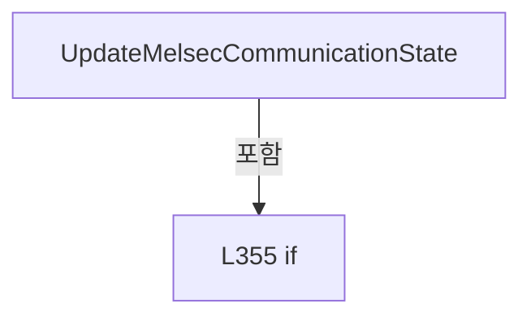

변경 전 점검: 입력/반환 타입, 위 호출자, 예외/취소 경로, 공유 상태와 저장·전송 소비자를 함께 확인합니다. 값의 단위나 물리 방향을 이름만으로 확정하지 않습니다.

### MethodDeclaration `Connect` · L363–375

[Drilling.Common/Interface/CInterfaceManager.cs:363–375](https://github.com/kjuws10-rgb/A3Drilling/blob/334b3599651b2e8e0181fd4459bafaf3cddafff3/Drilling.Common/Interface/CInterfaceManager.cs#L363-L375)

| 항목 | 실제 추출 값 |
| --- | --- |
| 서명 | System.Threading.Tasks.Task Drilling.Common.Interface.CInterfaceManager.Connect(string, bool, System.Threading.CancellationToken) |
| 접근/수식자 | Public / public, async |
| 반환/값 타입 | System.Threading.Tasks.Task |
| 소속 타입 | NamedType:Drilling.Common.Interface.CInterfaceManager |

입력 계약:

| 이름 | 타입 | 전달 | 선택/기본값 |
| --- | --- | --- | --- |
| nickName | string | None | False /  |
| autoConnection | bool | None | True / true |
| cancellationToken | System.Threading.CancellationToken | None | True / null |

현재 부분 분석에서 직접 연결된 호출자는 없습니다. XAML/이벤트/인터페이스·델리게이트·외부 진입을 추가 확인해야 하며, 미사용으로 판정한 것이 아닙니다.

호출하는 대상과 해석 범위:

| 원본 행 | 표현식 | 분석 상태 | 대상/소스 위치 |
| --- | --- | --- | --- |
| 365 | GetDeviceByNickNameOrThrow | resolved | Drilling.Common.Interface.CInterfaceDevice Drilling.Common.Interface.CInterfaceManager.GetDeviceByNickNameOrThrow(string) · Drilling.Common/Interface/CInterfaceManager.cs:663 |
| 366 | device.ResetAutoReconnectPolicy | resolved | void Drilling.Common.Interface.CInterfaceDevice.ResetAutoReconnectPolicy() · Drilling.Common/Interface/CInterfaceManager.cs:3117 |
| 367 | ConnectDevice | resolved | System.Threading.Tasks.Task Drilling.Common.Interface.CInterfaceManager.ConnectDevice(Drilling.Common.Interface.CInterfaceDevice, bool, System.Threading.CancellationToken) · Drilling.Common/Interface/CInterfaceManager.cs:554 |
| 370 | AttenuatorSnapshots.Invalidate | resolved | void Drilling.Common.Interface.CAttenuatorStatusSnapshotService.Invalidate(int, string, string) · Drilling.Common/Interface/CInterfaceManager.cs:2630 |
| 371 | AttenuatorSnapshots.Start | resolved | void Drilling.Common.Interface.CAttenuatorStatusSnapshotService.Start() · Drilling.Common/Interface/CInterfaceManager.cs:2573 |
| 374 | OpticSnapshots.Start | resolved | void Drilling.Common.Interface.COpticStatusSnapshotService.Start() · Drilling.Common/Interface/CInterfaceManager.cs:3433 |

본문의 실제 연산·분기·예외·반환 순서(원문 위치 순):

| 원본 행 | 종류 | 주석 해설 |
| --- | --- | --- |
| 365 | call | 함수·델리게이트 또는 객체 생성자를 호출합니다: GetDeviceByNickNameOrThrow(nickName) |
| 365 | local-declaration | 지역 변수를 선언합니다: var device = GetDeviceByNickNameOrThrow(nickName); |
| 365 | variable-initializer | 변수의 초기값을 지정합니다: device = GetDeviceByNickNameOrThrow(nickName) |
| 366 | call | 함수·델리게이트 또는 객체 생성자를 호출합니다: device.ResetAutoReconnectPolicy() |
| 367 | await | 비동기 완료를 기다립니다: await ConnectDevice(device, autoConnection, cancellationToken) |
| 367 | call | 함수·델리게이트 또는 객체 생성자를 호출합니다: ConnectDevice(device, autoConnection, cancellationToken) |
| 368 | if | 조건에 따라 분기합니다: if (device.Data.Device == EN_EQP_MODULE.Attenuator) |
| 370 | call | 함수·델리게이트 또는 객체 생성자를 호출합니다: AttenuatorSnapshots.Invalidate(device.Data.Number, "LOADING", "ATT 연결 후 새 상태를 기다리고 있습니다.") |
| 371 | call | 함수·델리게이트 또는 객체 생성자를 호출합니다: AttenuatorSnapshots.Start() |
| 374 | call | 함수·델리게이트 또는 객체 생성자를 호출합니다: OpticSnapshots.Start() |

제어 구문의 포함 구조(실제 실행 순서/CFG가 아닌 구문 탐색 그림):

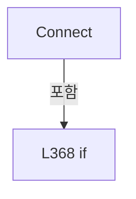

변경 전 점검: 입력/반환 타입, 위 호출자, 예외/취소 경로, 공유 상태와 저장·전송 소비자를 함께 확인합니다. 값의 단위나 물리 방향을 이름만으로 확정하지 않습니다.

### MethodDeclaration `Disconnect` · L377–391

[Drilling.Common/Interface/CInterfaceManager.cs:377–391](https://github.com/kjuws10-rgb/A3Drilling/blob/334b3599651b2e8e0181fd4459bafaf3cddafff3/Drilling.Common/Interface/CInterfaceManager.cs#L377-L391)

| 항목 | 실제 추출 값 |
| --- | --- |
| 서명 | System.Threading.Tasks.Task Drilling.Common.Interface.CInterfaceManager.Disconnect(string, System.Threading.CancellationToken) |
| 접근/수식자 | Public / public, async |
| 반환/값 타입 | System.Threading.Tasks.Task |
| 소속 타입 | NamedType:Drilling.Common.Interface.CInterfaceManager |

입력 계약:

| 이름 | 타입 | 전달 | 선택/기본값 |
| --- | --- | --- | --- |
| nickName | string | None | False /  |
| cancellationToken | System.Threading.CancellationToken | None | True / null |

현재 부분 분석에서 직접 연결된 호출자는 없습니다. XAML/이벤트/인터페이스·델리게이트·외부 진입을 추가 확인해야 하며, 미사용으로 판정한 것이 아닙니다.

호출하는 대상과 해석 범위:

| 원본 행 | 표현식 | 분석 상태 | 대상/소스 위치 |
| --- | --- | --- | --- |
| 379 | TryGetDeviceByNickName | resolved | bool Drilling.Common.Interface.CInterfaceManager.TryGetDeviceByNickName(string, out Drilling.Common.Interface.CInterfaceDevice?, bool) · Drilling.Common/Interface/CInterfaceManager.cs:668 |
| 384 | OpticSnapshots.Invalidate | resolved | void Drilling.Common.Interface.COpticStatusSnapshotService.Invalidate(Drilling.Common.Interface.EN_EQP_MODULE, int) · Drilling.Common/Interface/CInterfaceManager.cs:3422 |
| 386 | AttenuatorSnapshots.Invalidate | resolved | void Drilling.Common.Interface.CAttenuatorStatusSnapshotService.Invalidate(int, string, string) · Drilling.Common/Interface/CInterfaceManager.cs:2630 |
| 387 | DisconnectDevice | resolved | System.Threading.Tasks.Task Drilling.Common.Interface.CInterfaceManager.DisconnectDevice(Drilling.Common.Interface.CInterfaceDevice, System.Threading.CancellationToken) · Drilling.Common/Interface/CInterfaceManager.cs:585 |
| 388 | OpticSnapshots.Invalidate | resolved | void Drilling.Common.Interface.COpticStatusSnapshotService.Invalidate(Drilling.Common.Interface.EN_EQP_MODULE, int) · Drilling.Common/Interface/CInterfaceManager.cs:3422 |
| 390 | AttenuatorSnapshots.Invalidate | resolved | void Drilling.Common.Interface.CAttenuatorStatusSnapshotService.Invalidate(int, string, string) · Drilling.Common/Interface/CInterfaceManager.cs:2630 |

본문의 실제 연산·분기·예외·반환 순서(원문 위치 순):

| 원본 행 | 종류 | 주석 해설 |
| --- | --- | --- |
| 379 | call | 함수·델리게이트 또는 객체 생성자를 호출합니다: TryGetDeviceByNickName(nickName, out var device, throwIfAmbiguous: true) |
| 379 | if | 조건에 따라 분기합니다: if (!TryGetDeviceByNickName(nickName, out var device, throwIfAmbiguous: true) &#124;&#124; device is null) |
| 381 | return | 호출자에게 값 또는 제어를 반환합니다: return; |
| 384 | call | 함수·델리게이트 또는 객체 생성자를 호출합니다: OpticSnapshots.Invalidate(device.Data.Device, device.Data.Number) |
| 385 | if | 조건에 따라 분기합니다: if (device.Data.Device == EN_EQP_MODULE.Attenuator) |
| 386 | call | 함수·델리게이트 또는 객체 생성자를 호출합니다: AttenuatorSnapshots.Invalidate(device.Data.Number) |
| 387 | await | 비동기 완료를 기다립니다: await DisconnectDevice(device, cancellationToken) |
| 387 | call | 함수·델리게이트 또는 객체 생성자를 호출합니다: DisconnectDevice(device, cancellationToken) |
| 388 | call | 함수·델리게이트 또는 객체 생성자를 호출합니다: OpticSnapshots.Invalidate(device.Data.Device, device.Data.Number) |
| 389 | if | 조건에 따라 분기합니다: if (device.Data.Device == EN_EQP_MODULE.Attenuator) |
| 390 | call | 함수·델리게이트 또는 객체 생성자를 호출합니다: AttenuatorSnapshots.Invalidate(device.Data.Number) |

제어 구문의 포함 구조(실제 실행 순서/CFG가 아닌 구문 탐색 그림):

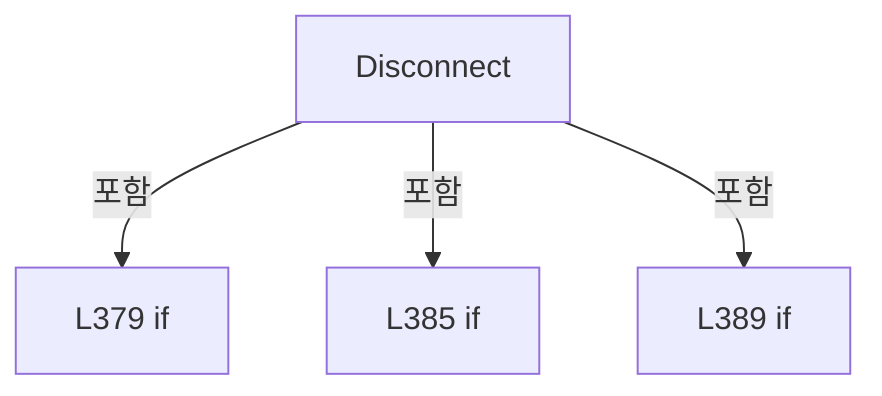

변경 전 점검: 입력/반환 타입, 위 호출자, 예외/취소 경로, 공유 상태와 저장·전송 소비자를 함께 확인합니다. 값의 단위나 물리 방향을 이름만으로 확정하지 않습니다.

### MethodDeclaration `Reconnect` · L393–419

[Drilling.Common/Interface/CInterfaceManager.cs:393–419](https://github.com/kjuws10-rgb/A3Drilling/blob/334b3599651b2e8e0181fd4459bafaf3cddafff3/Drilling.Common/Interface/CInterfaceManager.cs#L393-L419)

| 항목 | 실제 추출 값 |
| --- | --- |
| 서명 | System.Threading.Tasks.Task Drilling.Common.Interface.CInterfaceManager.Reconnect(string, System.Threading.CancellationToken) |
| 접근/수식자 | Public / public, async |
| 반환/값 타입 | System.Threading.Tasks.Task |
| 소속 타입 | NamedType:Drilling.Common.Interface.CInterfaceManager |

입력 계약:

| 이름 | 타입 | 전달 | 선택/기본값 |
| --- | --- | --- | --- |
| nickName | string | None | False /  |
| cancellationToken | System.Threading.CancellationToken | None | True / null |

현재 부분 분석에서 직접 연결된 호출자는 없습니다. XAML/이벤트/인터페이스·델리게이트·외부 진입을 추가 확인해야 하며, 미사용으로 판정한 것이 아닙니다.

호출하는 대상과 해석 범위:

| 원본 행 | 표현식 | 분석 상태 | 대상/소스 위치 |
| --- | --- | --- | --- |
| 395 | GetDeviceByNickNameOrThrow | resolved | Drilling.Common.Interface.CInterfaceDevice Drilling.Common.Interface.CInterfaceManager.GetDeviceByNickNameOrThrow(string) · Drilling.Common/Interface/CInterfaceManager.cs:663 |
| 397 | AttenuatorSnapshots.Invalidate | resolved | void Drilling.Common.Interface.CAttenuatorStatusSnapshotService.Invalidate(int, string, string) · Drilling.Common/Interface/CInterfaceManager.cs:2630 |
| 401 | DisconnectMelsecDevice | resolved | void Drilling.Common.Interface.CInterfaceManager.DisconnectMelsecDevice(Drilling.Common.Interface.CInterfaceDevice, System.Threading.CancellationToken) · Drilling.Common/Interface/CInterfaceManager.cs:622 |
| 402 | ConnectMelsecDevice | resolved | void Drilling.Common.Interface.CInterfaceManager.ConnectMelsecDevice(Drilling.Common.Interface.CInterfaceDevice, System.Threading.CancellationToken) · Drilling.Common/Interface/CInterfaceManager.cs:601 |
| 406 | device.Disconnect | resolved | System.Threading.Tasks.Task Drilling.Common.Interface.CInterfaceDevice.Disconnect(System.Threading.CancellationToken) · Drilling.Common/Interface/CInterfaceManager.cs:3127 |
| 407 | device.ResetAutoReconnectPolicy | resolved | void Drilling.Common.Interface.CInterfaceDevice.ResetAutoReconnectPolicy() · Drilling.Common/Interface/CInterfaceManager.cs:3117 |
| 408 | device.Connect | resolved | System.Threading.Tasks.Task Drilling.Common.Interface.CInterfaceDevice.Connect(System.Threading.CancellationToken) · Drilling.Common/Interface/CInterfaceManager.cs:3096 |
| 411 | WriteConnectionLog | resolved | void Drilling.Common.Interface.CInterfaceManager.WriteConnectionLog(string, Drilling.Common.Interface.CInterfaceDevice, Drilling.Common.Interface.EN_COMM_STATE) · Drilling.Common/Interface/CInterfaceManager.cs:698 |
| 414 | AttenuatorSnapshots.Invalidate | resolved | void Drilling.Common.Interface.CAttenuatorStatusSnapshotService.Invalidate(int, string, string) · Drilling.Common/Interface/CInterfaceManager.cs:2630 |
| 415 | AttenuatorSnapshots.Start | resolved | void Drilling.Common.Interface.CAttenuatorStatusSnapshotService.Start() · Drilling.Common/Interface/CInterfaceManager.cs:2573 |
| 418 | OpticSnapshots.Start | resolved | void Drilling.Common.Interface.COpticStatusSnapshotService.Start() · Drilling.Common/Interface/CInterfaceManager.cs:3433 |

본문의 실제 연산·분기·예외·반환 순서(원문 위치 순):

| 원본 행 | 종류 | 주석 해설 |
| --- | --- | --- |
| 395 | call | 함수·델리게이트 또는 객체 생성자를 호출합니다: GetDeviceByNickNameOrThrow(nickName) |
| 395 | local-declaration | 지역 변수를 선언합니다: var device = GetDeviceByNickNameOrThrow(nickName); |
| 395 | variable-initializer | 변수의 초기값을 지정합니다: device = GetDeviceByNickNameOrThrow(nickName) |
| 396 | if | 조건에 따라 분기합니다: if (device.Data.Device == EN_EQP_MODULE.Attenuator) |
| 397 | call | 함수·델리게이트 또는 객체 생성자를 호출합니다: AttenuatorSnapshots.Invalidate(device.Data.Number, "LOADING", "ATT 재연결 후 상태를 기다리고 있습니다.") |
| 398 | local-declaration | 지역 변수를 선언합니다: var beforeState = device.ConnectionState; |
| 398 | variable-initializer | 변수의 초기값을 지정합니다: beforeState = device.ConnectionState |
| 399 | if | 조건에 따라 분기합니다: if (device.Data.Device == EN_EQP_MODULE.Melsec) |
| 401 | call | 함수·델리게이트 또는 객체 생성자를 호출합니다: DisconnectMelsecDevice(device, cancellationToken) |
| 402 | call | 함수·델리게이트 또는 객체 생성자를 호출합니다: ConnectMelsecDevice(device, cancellationToken) |
| 404 | else | 앞 조건이 거짓인 경로입니다: else |
| 406 | await | 비동기 완료를 기다립니다: await device.Disconnect(cancellationToken) |
| 406 | call | 함수·델리게이트 또는 객체 생성자를 호출합니다: device.Disconnect(cancellationToken) |
| 407 | call | 함수·델리게이트 또는 객체 생성자를 호출합니다: device.ResetAutoReconnectPolicy() |
| 408 | await | 비동기 완료를 기다립니다: await device.Connect(cancellationToken) |
| 408 | call | 함수·델리게이트 또는 객체 생성자를 호출합니다: device.Connect(cancellationToken) |
| 411 | call | 함수·델리게이트 또는 객체 생성자를 호출합니다: WriteConnectionLog("RECONNECT", device, beforeState) |
| 412 | if | 조건에 따라 분기합니다: if (device.Data.Device == EN_EQP_MODULE.Attenuator) |
| 414 | call | 함수·델리게이트 또는 객체 생성자를 호출합니다: AttenuatorSnapshots.Invalidate(device.Data.Number, "LOADING", "ATT 재연결 후 새 상태를 기다리고 있습니다.") |
| 415 | call | 함수·델리게이트 또는 객체 생성자를 호출합니다: AttenuatorSnapshots.Start() |
| 418 | call | 함수·델리게이트 또는 객체 생성자를 호출합니다: OpticSnapshots.Start() |

제어 구문의 포함 구조(실제 실행 순서/CFG가 아닌 구문 탐색 그림):

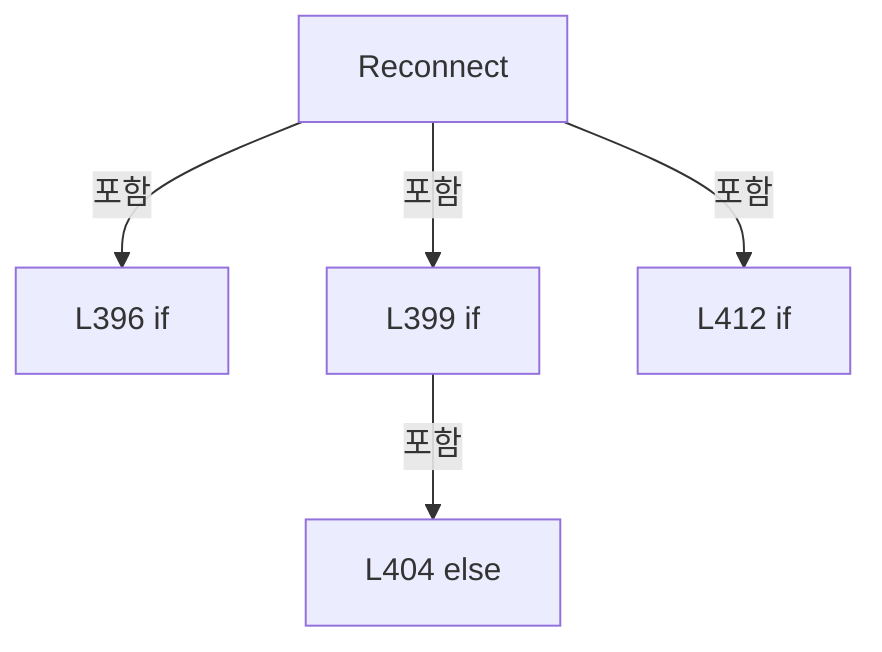

변경 전 점검: 입력/반환 타입, 위 호출자, 예외/취소 경로, 공유 상태와 저장·전송 소비자를 함께 확인합니다. 값의 단위나 물리 방향을 이름만으로 확정하지 않습니다.

### MethodDeclaration `ExecuteFunction` · L421–425

[Drilling.Common/Interface/CInterfaceManager.cs:421–425](https://github.com/kjuws10-rgb/A3Drilling/blob/334b3599651b2e8e0181fd4459bafaf3cddafff3/Drilling.Common/Interface/CInterfaceManager.cs#L421-L425)

| 항목 | 실제 추출 값 |
| --- | --- |
| 서명 | System.Threading.Tasks.Task<string> Drilling.Common.Interface.CInterfaceManager.ExecuteFunction(string, string, System.Threading.CancellationToken) |
| 접근/수식자 | Public / public, async |
| 반환/값 타입 | System.Threading.Tasks.Task<string> |
| 소속 타입 | NamedType:Drilling.Common.Interface.CInterfaceManager |

입력 계약:

| 이름 | 타입 | 전달 | 선택/기본값 |
| --- | --- | --- | --- |
| nickName | string | None | False /  |
| function | string | None | False /  |
| cancellationToken | System.Threading.CancellationToken | None | True / null |

현재 부분 분석에서 직접 연결된 호출자는 없습니다. XAML/이벤트/인터페이스·델리게이트·외부 진입을 추가 확인해야 하며, 미사용으로 판정한 것이 아닙니다.

호출하는 대상과 해석 범위:

| 원본 행 | 표현식 | 분석 상태 | 대상/소스 위치 |
| --- | --- | --- | --- |
| 423 | GetDeviceByNickNameOrThrow | resolved | Drilling.Common.Interface.CInterfaceDevice Drilling.Common.Interface.CInterfaceManager.GetDeviceByNickNameOrThrow(string) · Drilling.Common/Interface/CInterfaceManager.cs:663 |
| 424 | ExecuteDeviceFunction | resolved | System.Threading.Tasks.Task<string> Drilling.Common.Interface.CInterfaceManager.ExecuteDeviceFunction(Drilling.Common.Interface.CInterfaceDevice, string, System.Threading.CancellationToken, string?, bool) · Drilling.Common/Interface/CInterfaceManager.cs:630 |

본문의 실제 연산·분기·예외·반환 순서(원문 위치 순):

| 원본 행 | 종류 | 주석 해설 |
| --- | --- | --- |
| 423 | call | 함수·델리게이트 또는 객체 생성자를 호출합니다: GetDeviceByNickNameOrThrow(nickName) |
| 423 | local-declaration | 지역 변수를 선언합니다: var device = GetDeviceByNickNameOrThrow(nickName); |
| 423 | variable-initializer | 변수의 초기값을 지정합니다: device = GetDeviceByNickNameOrThrow(nickName) |
| 424 | await | 비동기 완료를 기다립니다: await ExecuteDeviceFunction(device, function, cancellationToken) |
| 424 | call | 함수·델리게이트 또는 객체 생성자를 호출합니다: ExecuteDeviceFunction(device, function, cancellationToken) |
| 424 | return | 호출자에게 값 또는 제어를 반환합니다: return await ExecuteDeviceFunction(device, function, cancellationToken); |

변경 전 점검: 입력/반환 타입, 위 호출자, 예외/취소 경로, 공유 상태와 저장·전송 소비자를 함께 확인합니다. 값의 단위나 물리 방향을 이름만으로 확정하지 않습니다.

### MethodDeclaration `IsConnect` · L427–430

[Drilling.Common/Interface/CInterfaceManager.cs:427–430](https://github.com/kjuws10-rgb/A3Drilling/blob/334b3599651b2e8e0181fd4459bafaf3cddafff3/Drilling.Common/Interface/CInterfaceManager.cs#L427-L430)

| 항목 | 실제 추출 값 |
| --- | --- |
| 서명 | bool Drilling.Common.Interface.CInterfaceManager.IsConnect(string) |
| 접근/수식자 | Public / public |
| 반환/값 타입 | bool |
| 소속 타입 | NamedType:Drilling.Common.Interface.CInterfaceManager |

입력 계약:

| 이름 | 타입 | 전달 | 선택/기본값 |
| --- | --- | --- | --- |
| nickName | string | None | False /  |

현재 부분 분석에서 직접 연결된 호출자는 없습니다. XAML/이벤트/인터페이스·델리게이트·외부 진입을 추가 확인해야 하며, 미사용으로 판정한 것이 아닙니다.

호출하는 대상과 해석 범위:

| 원본 행 | 표현식 | 분석 상태 | 대상/소스 위치 |
| --- | --- | --- | --- |
| 429 | TryGetDeviceByNickName | resolved | bool Drilling.Common.Interface.CInterfaceManager.TryGetDeviceByNickName(string, out Drilling.Common.Interface.CInterfaceDevice?, bool) · Drilling.Common/Interface/CInterfaceManager.cs:668 |

본문의 실제 연산·분기·예외·반환 순서(원문 위치 순):

| 원본 행 | 종류 | 주석 해설 |
| --- | --- | --- |
| 429 | call | 함수·델리게이트 또는 객체 생성자를 호출합니다: TryGetDeviceByNickName(nickName, out var device, throwIfAmbiguous: true) |
| 429 | return | 호출자에게 값 또는 제어를 반환합니다: return TryGetDeviceByNickName(nickName, out var device, throwIfAmbiguous: true) && device is not null && device.ConnectionState is EN_COMM_STATE.Online or EN_COMM_STATE.Simulation; |

변경 전 점검: 입력/반환 타입, 위 호출자, 예외/취소 경로, 공유 상태와 저장·전송 소비자를 함께 확인합니다. 값의 단위나 물리 방향을 이름만으로 확정하지 않습니다.

### MethodDeclaration `IsSimul` · L432–435

[Drilling.Common/Interface/CInterfaceManager.cs:432–435](https://github.com/kjuws10-rgb/A3Drilling/blob/334b3599651b2e8e0181fd4459bafaf3cddafff3/Drilling.Common/Interface/CInterfaceManager.cs#L432-L435)

| 항목 | 실제 추출 값 |
| --- | --- |
| 서명 | bool Drilling.Common.Interface.CInterfaceManager.IsSimul(string) |
| 접근/수식자 | Public / public |
| 반환/값 타입 | bool |
| 소속 타입 | NamedType:Drilling.Common.Interface.CInterfaceManager |

입력 계약:

| 이름 | 타입 | 전달 | 선택/기본값 |
| --- | --- | --- | --- |
| nickName | string | None | False /  |

현재 부분 분석에서 직접 연결된 호출자는 없습니다. XAML/이벤트/인터페이스·델리게이트·외부 진입을 추가 확인해야 하며, 미사용으로 판정한 것이 아닙니다.

호출하는 대상과 해석 범위:

| 원본 행 | 표현식 | 분석 상태 | 대상/소스 위치 |
| --- | --- | --- | --- |
| 434 | TryGetDeviceByNickName | resolved | bool Drilling.Common.Interface.CInterfaceManager.TryGetDeviceByNickName(string, out Drilling.Common.Interface.CInterfaceDevice?, bool) · Drilling.Common/Interface/CInterfaceManager.cs:668 |

본문의 실제 연산·분기·예외·반환 순서(원문 위치 순):

| 원본 행 | 종류 | 주석 해설 |
| --- | --- | --- |
| 434 | call | 함수·델리게이트 또는 객체 생성자를 호출합니다: TryGetDeviceByNickName(nickName, out var device, throwIfAmbiguous: true) |
| 434 | return | 호출자에게 값 또는 제어를 반환합니다: return TryGetDeviceByNickName(nickName, out var device, throwIfAmbiguous: true) && device is not null && device.ConnectionState == EN_COMM_STATE.Simulation; |

변경 전 점검: 입력/반환 타입, 위 호출자, 예외/취소 경로, 공유 상태와 저장·전송 소비자를 함께 확인합니다. 값의 단위나 물리 방향을 이름만으로 확정하지 않습니다.

### MethodDeclaration `GetInterfaceData` · L437–440

[Drilling.Common/Interface/CInterfaceManager.cs:437–440](https://github.com/kjuws10-rgb/A3Drilling/blob/334b3599651b2e8e0181fd4459bafaf3cddafff3/Drilling.Common/Interface/CInterfaceManager.cs#L437-L440)

| 항목 | 실제 추출 값 |
| --- | --- |
| 서명 | Drilling.Common.Interface.ST_INTERFACE_DATA? Drilling.Common.Interface.CInterfaceManager.GetInterfaceData(string) |
| 접근/수식자 | Public / public |
| 반환/값 타입 | Drilling.Common.Interface.ST_INTERFACE_DATA? |
| 소속 타입 | NamedType:Drilling.Common.Interface.CInterfaceManager |

입력 계약:

| 이름 | 타입 | 전달 | 선택/기본값 |
| --- | --- | --- | --- |
| nickName | string | None | False /  |

현재 부분 분석에서 직접 연결된 호출자는 없습니다. XAML/이벤트/인터페이스·델리게이트·외부 진입을 추가 확인해야 하며, 미사용으로 판정한 것이 아닙니다.

호출하는 대상과 해석 범위:

| 원본 행 | 표현식 | 분석 상태 | 대상/소스 위치 |
| --- | --- | --- | --- |
| 439 | TryGetDeviceByNickName | resolved | bool Drilling.Common.Interface.CInterfaceManager.TryGetDeviceByNickName(string, out Drilling.Common.Interface.CInterfaceDevice?, bool) · Drilling.Common/Interface/CInterfaceManager.cs:668 |

본문의 실제 연산·분기·예외·반환 순서(원문 위치 순):

| 원본 행 | 종류 | 주석 해설 |
| --- | --- | --- |
| 439 | call | 함수·델리게이트 또는 객체 생성자를 호출합니다: TryGetDeviceByNickName(nickName, out var device, throwIfAmbiguous: true) |
| 439 | conditional-expression | 조건에 따라 결과식을 선택합니다: TryGetDeviceByNickName(nickName, out var device, throwIfAmbiguous: true) && device is not null ? device.Data : null |
| 439 | return | 호출자에게 값 또는 제어를 반환합니다: return TryGetDeviceByNickName(nickName, out var device, throwIfAmbiguous: true) && device is not null ? device.Data : null; |

변경 전 점검: 입력/반환 타입, 위 호출자, 예외/취소 경로, 공유 상태와 저장·전송 소비자를 함께 확인합니다. 값의 단위나 물리 방향을 이름만으로 확정하지 않습니다.

### MethodDeclaration `GetInterfaceList` · L442–470

[Drilling.Common/Interface/CInterfaceManager.cs:442–470](https://github.com/kjuws10-rgb/A3Drilling/blob/334b3599651b2e8e0181fd4459bafaf3cddafff3/Drilling.Common/Interface/CInterfaceManager.cs#L442-L470)

| 항목 | 실제 추출 값 |
| --- | --- |
| 서명 | System.Collections.Generic.IReadOnlyList<Drilling.Common.Interface.ST_INTERFACE_DATA> Drilling.Common.Interface.CInterfaceManager.GetInterfaceList(Drilling.Common.Interface.EN_EQP_MODULE?) |
| 접근/수식자 | Public / public |
| 반환/값 타입 | System.Collections.Generic.IReadOnlyList<Drilling.Common.Interface.ST_INTERFACE_DATA> |
| 소속 타입 | NamedType:Drilling.Common.Interface.CInterfaceManager |

입력 계약:

| 이름 | 타입 | 전달 | 선택/기본값 |
| --- | --- | --- | --- |
| module | Drilling.Common.Interface.EN_EQP_MODULE? | None | True / null |

정적 호출자로 확인된 위치:

| 호출 파일/행 | 호출 표현식 | 런타임 분기 가능 |
| --- | --- | --- |
| [Drilling.Common/Interface/CInterfaceManager.cs:57–57](https://github.com/kjuws10-rgb/A3Drilling/blob/334b3599651b2e8e0181fd4459bafaf3cddafff3/Drilling.Common/Interface/CInterfaceManager.cs#L57-L57) | GetInterfaceList | False |
| [Drilling.Common/Interface/CInterfaceManager.cs:1489–1489](https://github.com/kjuws10-rgb/A3Drilling/blob/334b3599651b2e8e0181fd4459bafaf3cddafff3/Drilling.Common/Interface/CInterfaceManager.cs#L1489-L1489) | GetInterfaceList | False |
| [Drilling.Common/Interface/CInterfaceManager.cs:1510–1510](https://github.com/kjuws10-rgb/A3Drilling/blob/334b3599651b2e8e0181fd4459bafaf3cddafff3/Drilling.Common/Interface/CInterfaceManager.cs#L1510-L1510) | GetInterfaceList | False |
| [Drilling.Common/Interface/CInterfaceManager.cs:1553–1553](https://github.com/kjuws10-rgb/A3Drilling/blob/334b3599651b2e8e0181fd4459bafaf3cddafff3/Drilling.Common/Interface/CInterfaceManager.cs#L1553-L1553) | GetInterfaceList | False |
| [Drilling.Common/Interface/CInterfaceManager.cs:1569–1569](https://github.com/kjuws10-rgb/A3Drilling/blob/334b3599651b2e8e0181fd4459bafaf3cddafff3/Drilling.Common/Interface/CInterfaceManager.cs#L1569-L1569) | GetInterfaceList | False |
| [Drilling.Common/Interface/CInterfaceManager.cs:1596–1596](https://github.com/kjuws10-rgb/A3Drilling/blob/334b3599651b2e8e0181fd4459bafaf3cddafff3/Drilling.Common/Interface/CInterfaceManager.cs#L1596-L1596) | GetInterfaceList | False |
| [Drilling.Common/Interface/CInterfaceManager.cs:1612–1612](https://github.com/kjuws10-rgb/A3Drilling/blob/334b3599651b2e8e0181fd4459bafaf3cddafff3/Drilling.Common/Interface/CInterfaceManager.cs#L1612-L1612) | GetInterfaceList | False |
| [Drilling.Common/Interface/CInterfaceManager.cs:1770–1770](https://github.com/kjuws10-rgb/A3Drilling/blob/334b3599651b2e8e0181fd4459bafaf3cddafff3/Drilling.Common/Interface/CInterfaceManager.cs#L1770-L1770) | GetInterfaceList | False |
| [Drilling.Common/Interface/CInterfaceManager.cs:1794–1794](https://github.com/kjuws10-rgb/A3Drilling/blob/334b3599651b2e8e0181fd4459bafaf3cddafff3/Drilling.Common/Interface/CInterfaceManager.cs#L1794-L1794) | GetInterfaceList | False |
| [Drilling.Common/Interface/CInterfaceManager.cs:1814–1814](https://github.com/kjuws10-rgb/A3Drilling/blob/334b3599651b2e8e0181fd4459bafaf3cddafff3/Drilling.Common/Interface/CInterfaceManager.cs#L1814-L1814) | GetInterfaceList | False |
| [Drilling.Common/Interface/CInterfaceManager.cs:1834–1834](https://github.com/kjuws10-rgb/A3Drilling/blob/334b3599651b2e8e0181fd4459bafaf3cddafff3/Drilling.Common/Interface/CInterfaceManager.cs#L1834-L1834) | GetInterfaceList | False |
| [Drilling.Common/Interface/CInterfaceManager.cs:1854–1854](https://github.com/kjuws10-rgb/A3Drilling/blob/334b3599651b2e8e0181fd4459bafaf3cddafff3/Drilling.Common/Interface/CInterfaceManager.cs#L1854-L1854) | GetInterfaceList | False |
| [Drilling.Common/Interface/CInterfaceManager.cs:2020–2020](https://github.com/kjuws10-rgb/A3Drilling/blob/334b3599651b2e8e0181fd4459bafaf3cddafff3/Drilling.Common/Interface/CInterfaceManager.cs#L2020-L2020) | GetInterfaceList | False |
| [Drilling.Common/Interface/CInterfaceManager.cs:2167–2167](https://github.com/kjuws10-rgb/A3Drilling/blob/334b3599651b2e8e0181fd4459bafaf3cddafff3/Drilling.Common/Interface/CInterfaceManager.cs#L2167-L2167) | GetInterfaceList | False |
| [Drilling.Common/Interface/CPowerMeasureRun.cs:311–311](https://github.com/kjuws10-rgb/A3Drilling/blob/334b3599651b2e8e0181fd4459bafaf3cddafff3/Drilling.Common/Interface/CPowerMeasureRun.cs#L311-L311) | Interfaces.GetInterfaceList | False |
| [Drilling.Common/Managers/CManager.cs:301–301](https://github.com/kjuws10-rgb/A3Drilling/blob/334b3599651b2e8e0181fd4459bafaf3cddafff3/Drilling.Common/Managers/CManager.cs#L301-L301) | _interfaceManager.GetInterfaceList | False |
| [Drilling.Common/Managers/CManager.cs:600–600](https://github.com/kjuws10-rgb/A3Drilling/blob/334b3599651b2e8e0181fd4459bafaf3cddafff3/Drilling.Common/Managers/CManager.cs#L600-L600) | _interfaceManager.GetInterfaceList | False |
| [Drilling.Common/Motion/CMotionManager.cs:1647–1647](https://github.com/kjuws10-rgb/A3Drilling/blob/334b3599651b2e8e0181fd4459bafaf3cddafff3/Drilling.Common/Motion/CMotionManager.cs#L1647-L1647) | _interfaceManager.GetInterfaceList | False |
| [Drilling.Common/Motion/CMotionManager.cs:1663–1663](https://github.com/kjuws10-rgb/A3Drilling/blob/334b3599651b2e8e0181fd4459bafaf3cddafff3/Drilling.Common/Motion/CMotionManager.cs#L1663-L1663) | _interfaceManager.GetInterfaceList | False |
| [Drilling.Common/Review/CReviewManager.cs:2536–2536](https://github.com/kjuws10-rgb/A3Drilling/blob/334b3599651b2e8e0181fd4459bafaf3cddafff3/Drilling.Common/Review/CReviewManager.cs#L2536-L2536) | interfaceManager.GetInterfaceList | False |
| [Drilling.Common/Station/CStationProcess.cs:470–470](https://github.com/kjuws10-rgb/A3Drilling/blob/334b3599651b2e8e0181fd4459bafaf3cddafff3/Drilling.Common/Station/CStationProcess.cs#L470-L470) | _interfaceManager.GetInterfaceList | False |
| [Drilling.Common/Station/CStationProcess.cs:1377–1377](https://github.com/kjuws10-rgb/A3Drilling/blob/334b3599651b2e8e0181fd4459bafaf3cddafff3/Drilling.Common/Station/CStationProcess.cs#L1377-L1377) | _interfaceManager.GetInterfaceList | False |
| [Drilling.Common/Station/CStationProcess.cs:1406–1406](https://github.com/kjuws10-rgb/A3Drilling/blob/334b3599651b2e8e0181fd4459bafaf3cddafff3/Drilling.Common/Station/CStationProcess.cs#L1406-L1406) | _interfaceManager.GetInterfaceList | False |
| [Drilling.Common/Station/CStationProcess.cs:1409–1409](https://github.com/kjuws10-rgb/A3Drilling/blob/334b3599651b2e8e0181fd4459bafaf3cddafff3/Drilling.Common/Station/CStationProcess.cs#L1409-L1409) | _interfaceManager.GetInterfaceList | False |
| [Drilling.UI/Menu/Menus/CMenuMain.cs:1612–1612](https://github.com/kjuws10-rgb/A3Drilling/blob/334b3599651b2e8e0181fd4459bafaf3cddafff3/Drilling.UI/Menu/Menus/CMenuMain.cs#L1612-L1612) | interfaceManager.GetInterfaceList | False |
| [Drilling.UI/Menu/Menus/CMenuMain.cs:2304–2304](https://github.com/kjuws10-rgb/A3Drilling/blob/334b3599651b2e8e0181fd4459bafaf3cddafff3/Drilling.UI/Menu/Menus/CMenuMain.cs#L2304-L2304) | interfaceManager.GetInterfaceList | False |
| [Drilling.UI/Menu/Menus/CMenuMain.cs:4126–4126](https://github.com/kjuws10-rgb/A3Drilling/blob/334b3599651b2e8e0181fd4459bafaf3cddafff3/Drilling.UI/Menu/Menus/CMenuMain.cs#L4126-L4126) | interfaceManager.GetInterfaceList | False |
| [Drilling.UI/Menu/Menus/CMenuManual.cs:2241–2241](https://github.com/kjuws10-rgb/A3Drilling/blob/334b3599651b2e8e0181fd4459bafaf3cddafff3/Drilling.UI/Menu/Menus/CMenuManual.cs#L2241-L2241) | _manager.Interface().GetInterfaceList | False |
| [Drilling.UI/Menu/Menus/CMenuManual.cs:3313–3313](https://github.com/kjuws10-rgb/A3Drilling/blob/334b3599651b2e8e0181fd4459bafaf3cddafff3/Drilling.UI/Menu/Menus/CMenuManual.cs#L3313-L3313) | interfaces.GetInterfaceList | False |
| [Drilling.UI/Menu/Menus/CMenuManual.cs:6292–6292](https://github.com/kjuws10-rgb/A3Drilling/blob/334b3599651b2e8e0181fd4459bafaf3cddafff3/Drilling.UI/Menu/Menus/CMenuManual.cs#L6292-L6292) | _manager.Interface().GetInterfaceList | False |
| [Drilling.UI/Menu/Menus/CMenuManual.cs:6421–6421](https://github.com/kjuws10-rgb/A3Drilling/blob/334b3599651b2e8e0181fd4459bafaf3cddafff3/Drilling.UI/Menu/Menus/CMenuManual.cs#L6421-L6421) | interfaceManager.GetInterfaceList | False |
| [Drilling.UI/Menu/Menus/CMenuMonitor.cs:5470–5470](https://github.com/kjuws10-rgb/A3Drilling/blob/334b3599651b2e8e0181fd4459bafaf3cddafff3/Drilling.UI/Menu/Menus/CMenuMonitor.cs#L5470-L5470) | _interfaceManager.GetInterfaceList | False |
| [Drilling.UI/Menu/Menus/CMenuPm.cs:84–84](https://github.com/kjuws10-rgb/A3Drilling/blob/334b3599651b2e8e0181fd4459bafaf3cddafff3/Drilling.UI/Menu/Menus/CMenuPm.cs#L84-L84) | interfaceManager.GetInterfaceList | False |

호출하는 대상과 해석 범위:

| 원본 행 | 표현식 | 분석 상태 | 대상/소스 위치 |
| --- | --- | --- | --- |
| 469 | _devices.Values.Where(MatchesCinterfacedevice).Select(SelectData).OrderBy(SelectDevice).ThenBy(SelectNumber).ThenBy(SelectNickName, StringComparer.OrdinalIgnoreCase).ToArray | resolved | Drilling.Common.Interface.ST_INTERFACE_DATA[] System.Collections.Generic.IEnumerable<Drilling.Common.Interface.ST_INTERFACE_DATA>.ToArray<Drilling.Common.Interface.ST_INTERFACE_DATA>() |
| 469 | _devices.Values.Where(MatchesCinterfacedevice).Select(SelectData).OrderBy(SelectDevice).ThenBy(SelectNumber).ThenBy | resolved | System.Linq.IOrderedEnumerable<Drilling.Common.Interface.ST_INTERFACE_DATA> System.Linq.IOrderedEnumerable<Drilling.Common.Interface.ST_INTERFACE_DATA>.ThenBy<Drilling.Common.Interface.ST_INTERFACE_DATA, string>(System.Func<Drilling.Common.Interface.ST_INTERFACE_DATA, string>, System.Collections.Generic.IComparer<string>?) |
| 469 | _devices.Values.Where(MatchesCinterfacedevice).Select(SelectData).OrderBy(SelectDevice).ThenBy | resolved | System.Linq.IOrderedEnumerable<Drilling.Common.Interface.ST_INTERFACE_DATA> System.Linq.IOrderedEnumerable<Drilling.Common.Interface.ST_INTERFACE_DATA>.ThenBy<Drilling.Common.Interface.ST_INTERFACE_DATA, int>(System.Func<Drilling.Common.Interface.ST_INTERFACE_DATA, int>) |
| 469 | _devices.Values.Where(MatchesCinterfacedevice).Select(SelectData).OrderBy | resolved | System.Linq.IOrderedEnumerable<Drilling.Common.Interface.ST_INTERFACE_DATA> System.Collections.Generic.IEnumerable<Drilling.Common.Interface.ST_INTERFACE_DATA>.OrderBy<Drilling.Common.Interface.ST_INTERFACE_DATA, Drilling.Common.Interface.EN_EQP_MODULE>(System.Func<Drilling.Common.Interface.ST_INTERFACE_DATA, Drilling.Common.Interface.EN_EQP_MODULE>) |
| 469 | _devices.Values.Where(MatchesCinterfacedevice).Select | resolved | System.Collections.Generic.IEnumerable<Drilling.Common.Interface.ST_INTERFACE_DATA> System.Collections.Generic.IEnumerable<Drilling.Common.Interface.CInterfaceDevice>.Select<Drilling.Common.Interface.CInterfaceDevice, Drilling.Common.Interface.ST_INTERFACE_DATA>(System.Func<Drilling.Common.Interface.CInterfaceDevice, Drilling.Common.Interface.ST_INTERFACE_DATA>) |
| 469 | _devices.Values.Where | resolved | System.Collections.Generic.IEnumerable<Drilling.Common.Interface.CInterfaceDevice> System.Collections.Generic.IEnumerable<Drilling.Common.Interface.CInterfaceDevice>.Where<Drilling.Common.Interface.CInterfaceDevice>(System.Func<Drilling.Common.Interface.CInterfaceDevice, bool>) |

본문의 실제 연산·분기·예외·반환 순서(원문 위치 순):

| 원본 행 | 종류 | 주석 해설 |
| --- | --- | --- |
| 469 | call | 함수·델리게이트 또는 객체 생성자를 호출합니다: _devices.Values.Where(MatchesCinterfacedevice).Select(SelectData).OrderBy(SelectDevice).ThenBy(SelectNumber).ThenBy(SelectNickName, StringComparer.OrdinalIgnoreCase).ToArray() |
| 469 | call | 함수·델리게이트 또는 객체 생성자를 호출합니다: _devices.Values.Where(MatchesCinterfacedevice).Select(SelectData).OrderBy(SelectDevice).ThenBy(SelectNumber).ThenBy(SelectNickName, StringComparer.OrdinalIgnoreCase) |
| 469 | call | 함수·델리게이트 또는 객체 생성자를 호출합니다: _devices.Values.Where(MatchesCinterfacedevice).Select(SelectData).OrderBy(SelectDevice).ThenBy(SelectNumber) |
| 469 | call | 함수·델리게이트 또는 객체 생성자를 호출합니다: _devices.Values.Where(MatchesCinterfacedevice).Select(SelectData).OrderBy(SelectDevice) |
| 469 | call | 함수·델리게이트 또는 객체 생성자를 호출합니다: _devices.Values.Where(MatchesCinterfacedevice).Select(SelectData) |
| 469 | call | 함수·델리게이트 또는 객체 생성자를 호출합니다: _devices.Values.Where(MatchesCinterfacedevice) |
| 469 | return | 호출자에게 값 또는 제어를 반환합니다: return _devices.Values.Where(MatchesCinterfacedevice).Select(SelectData).OrderBy(SelectDevice).ThenBy(SelectNumber).ThenBy(SelectNickName, StringComparer.OrdinalIgnoreCase).ToArray(); |

변경 전 점검: 입력/반환 타입, 위 호출자, 예외/취소 경로, 공유 상태와 저장·전송 소비자를 함께 확인합니다. 값의 단위나 물리 방향을 이름만으로 확정하지 않습니다.

### LocalFunctionStatement `MatchesCinterfacedevice` · L444–447

[Drilling.Common/Interface/CInterfaceManager.cs:444–447](https://github.com/kjuws10-rgb/A3Drilling/blob/334b3599651b2e8e0181fd4459bafaf3cddafff3/Drilling.Common/Interface/CInterfaceManager.cs#L444-L447)

| 항목 | 실제 추출 값 |
| --- | --- |
| 서명 | bool MatchesCinterfacedevice(Drilling.Common.Interface.CInterfaceDevice) |
| 접근/수식자 | Private /  |
| 반환/값 타입 | bool |
| 소속 타입 | NamedType:Drilling.Common.Interface.CInterfaceManager |

입력 계약:

| 이름 | 타입 | 전달 | 선택/기본값 |
| --- | --- | --- | --- |
| device | Drilling.Common.Interface.CInterfaceDevice | None | False /  |

현재 부분 분석에서 직접 연결된 호출자는 없습니다. XAML/이벤트/인터페이스·델리게이트·외부 진입을 추가 확인해야 하며, 미사용으로 판정한 것이 아닙니다.

본문의 실제 연산·분기·예외·반환 순서(원문 위치 순):

| 원본 행 | 종류 | 주석 해설 |
| --- | --- | --- |
| 446 | return | 호출자에게 값 또는 제어를 반환합니다: return module is null &#124;&#124; device.Data.Device == module; |

변경 전 점검: 입력/반환 타입, 위 호출자, 예외/취소 경로, 공유 상태와 저장·전송 소비자를 함께 확인합니다. 값의 단위나 물리 방향을 이름만으로 확정하지 않습니다.

### LocalFunctionStatement `SelectData` · L449–452

[Drilling.Common/Interface/CInterfaceManager.cs:449–452](https://github.com/kjuws10-rgb/A3Drilling/blob/334b3599651b2e8e0181fd4459bafaf3cddafff3/Drilling.Common/Interface/CInterfaceManager.cs#L449-L452)

| 항목 | 실제 추출 값 |
| --- | --- |
| 서명 | Drilling.Common.Interface.ST_INTERFACE_DATA SelectData(Drilling.Common.Interface.CInterfaceDevice) |
| 접근/수식자 | Private /  |
| 반환/값 타입 | Drilling.Common.Interface.ST_INTERFACE_DATA |
| 소속 타입 | NamedType:Drilling.Common.Interface.CInterfaceManager |

입력 계약:

| 이름 | 타입 | 전달 | 선택/기본값 |
| --- | --- | --- | --- |
| device | Drilling.Common.Interface.CInterfaceDevice | None | False /  |

현재 부분 분석에서 직접 연결된 호출자는 없습니다. XAML/이벤트/인터페이스·델리게이트·외부 진입을 추가 확인해야 하며, 미사용으로 판정한 것이 아닙니다.

본문의 실제 연산·분기·예외·반환 순서(원문 위치 순):

| 원본 행 | 종류 | 주석 해설 |
| --- | --- | --- |
| 451 | return | 호출자에게 값 또는 제어를 반환합니다: return device.Data; |

변경 전 점검: 입력/반환 타입, 위 호출자, 예외/취소 경로, 공유 상태와 저장·전송 소비자를 함께 확인합니다. 값의 단위나 물리 방향을 이름만으로 확정하지 않습니다.

### LocalFunctionStatement `SelectDevice` · L454–457

[Drilling.Common/Interface/CInterfaceManager.cs:454–457](https://github.com/kjuws10-rgb/A3Drilling/blob/334b3599651b2e8e0181fd4459bafaf3cddafff3/Drilling.Common/Interface/CInterfaceManager.cs#L454-L457)

| 항목 | 실제 추출 값 |
| --- | --- |
| 서명 | Drilling.Common.Interface.EN_EQP_MODULE SelectDevice(Drilling.Common.Interface.ST_INTERFACE_DATA) |
| 접근/수식자 | Private /  |
| 반환/값 타입 | Drilling.Common.Interface.EN_EQP_MODULE |
| 소속 타입 | NamedType:Drilling.Common.Interface.CInterfaceManager |

입력 계약:

| 이름 | 타입 | 전달 | 선택/기본값 |
| --- | --- | --- | --- |
| data | Drilling.Common.Interface.ST_INTERFACE_DATA | None | False /  |

현재 부분 분석에서 직접 연결된 호출자는 없습니다. XAML/이벤트/인터페이스·델리게이트·외부 진입을 추가 확인해야 하며, 미사용으로 판정한 것이 아닙니다.

본문의 실제 연산·분기·예외·반환 순서(원문 위치 순):

| 원본 행 | 종류 | 주석 해설 |
| --- | --- | --- |
| 456 | return | 호출자에게 값 또는 제어를 반환합니다: return data.Device; |

변경 전 점검: 입력/반환 타입, 위 호출자, 예외/취소 경로, 공유 상태와 저장·전송 소비자를 함께 확인합니다. 값의 단위나 물리 방향을 이름만으로 확정하지 않습니다.

### LocalFunctionStatement `SelectNumber` · L459–462

[Drilling.Common/Interface/CInterfaceManager.cs:459–462](https://github.com/kjuws10-rgb/A3Drilling/blob/334b3599651b2e8e0181fd4459bafaf3cddafff3/Drilling.Common/Interface/CInterfaceManager.cs#L459-L462)

| 항목 | 실제 추출 값 |
| --- | --- |
| 서명 | int SelectNumber(Drilling.Common.Interface.ST_INTERFACE_DATA) |
| 접근/수식자 | Private /  |
| 반환/값 타입 | int |
| 소속 타입 | NamedType:Drilling.Common.Interface.CInterfaceManager |

입력 계약:

| 이름 | 타입 | 전달 | 선택/기본값 |
| --- | --- | --- | --- |
| data | Drilling.Common.Interface.ST_INTERFACE_DATA | None | False /  |

현재 부분 분석에서 직접 연결된 호출자는 없습니다. XAML/이벤트/인터페이스·델리게이트·외부 진입을 추가 확인해야 하며, 미사용으로 판정한 것이 아닙니다.

본문의 실제 연산·분기·예외·반환 순서(원문 위치 순):

| 원본 행 | 종류 | 주석 해설 |
| --- | --- | --- |
| 461 | return | 호출자에게 값 또는 제어를 반환합니다: return data.Number; |

변경 전 점검: 입력/반환 타입, 위 호출자, 예외/취소 경로, 공유 상태와 저장·전송 소비자를 함께 확인합니다. 값의 단위나 물리 방향을 이름만으로 확정하지 않습니다.

### LocalFunctionStatement `SelectNickName` · L464–467

[Drilling.Common/Interface/CInterfaceManager.cs:464–467](https://github.com/kjuws10-rgb/A3Drilling/blob/334b3599651b2e8e0181fd4459bafaf3cddafff3/Drilling.Common/Interface/CInterfaceManager.cs#L464-L467)

| 항목 | 실제 추출 값 |
| --- | --- |
| 서명 | string SelectNickName(Drilling.Common.Interface.ST_INTERFACE_DATA) |
| 접근/수식자 | Private /  |
| 반환/값 타입 | string |
| 소속 타입 | NamedType:Drilling.Common.Interface.CInterfaceManager |

입력 계약:

| 이름 | 타입 | 전달 | 선택/기본값 |
| --- | --- | --- | --- |
| data | Drilling.Common.Interface.ST_INTERFACE_DATA | None | False /  |

현재 부분 분석에서 직접 연결된 호출자는 없습니다. XAML/이벤트/인터페이스·델리게이트·외부 진입을 추가 확인해야 하며, 미사용으로 판정한 것이 아닙니다.

본문의 실제 연산·분기·예외·반환 순서(원문 위치 순):

| 원본 행 | 종류 | 주석 해설 |
| --- | --- | --- |
| 466 | return | 호출자에게 값 또는 제어를 반환합니다: return data.NickName; |

변경 전 점검: 입력/반환 타입, 위 호출자, 예외/취소 경로, 공유 상태와 저장·전송 소비자를 함께 확인합니다. 값의 단위나 물리 방향을 이름만으로 확정하지 않습니다.

### MethodDeclaration `GetInterfaceCommunicationList` · L472–500

[Drilling.Common/Interface/CInterfaceManager.cs:472–500](https://github.com/kjuws10-rgb/A3Drilling/blob/334b3599651b2e8e0181fd4459bafaf3cddafff3/Drilling.Common/Interface/CInterfaceManager.cs#L472-L500)

| 항목 | 실제 추출 값 |
| --- | --- |
| 서명 | System.Collections.Generic.IReadOnlyList<Drilling.Common.Interface.ST_INTERFACE_COMM_STATUS> Drilling.Common.Interface.CInterfaceManager.GetInterfaceCommunicationList(Drilling.Common.Interface.EN_EQP_MODULE?) |
| 접근/수식자 | Public / public |
| 반환/값 타입 | System.Collections.Generic.IReadOnlyList<Drilling.Common.Interface.ST_INTERFACE_COMM_STATUS> |
| 소속 타입 | NamedType:Drilling.Common.Interface.CInterfaceManager |

입력 계약:

| 이름 | 타입 | 전달 | 선택/기본값 |
| --- | --- | --- | --- |
| module | Drilling.Common.Interface.EN_EQP_MODULE? | None | True / null |

정적 호출자로 확인된 위치:

| 호출 파일/행 | 호출 표현식 | 런타임 분기 가능 |
| --- | --- | --- |
| [Drilling.Common/Correction/CAlignInterpolation.cs:363–363](https://github.com/kjuws10-rgb/A3Drilling/blob/334b3599651b2e8e0181fd4459bafaf3cddafff3/Drilling.Common/Correction/CAlignInterpolation.cs#L363-L363) | interfaces.GetInterfaceCommunicationList | False |
| [Drilling.Common/Correction/CAlignInterpolation.cs:399–399](https://github.com/kjuws10-rgb/A3Drilling/blob/334b3599651b2e8e0181fd4459bafaf3cddafff3/Drilling.Common/Correction/CAlignInterpolation.cs#L399-L399) | .GetInterfaceCommunicationList | False |
| [Drilling.Common/Interface/CPowerMeasureRun.cs:166–166](https://github.com/kjuws10-rgb/A3Drilling/blob/334b3599651b2e8e0181fd4459bafaf3cddafff3/Drilling.Common/Interface/CPowerMeasureRun.cs#L166-L166) | Interfaces.GetInterfaceCommunicationList | False |
| [Drilling.Common/Interface/CPowerMeasureRun.cs:170–170](https://github.com/kjuws10-rgb/A3Drilling/blob/334b3599651b2e8e0181fd4459bafaf3cddafff3/Drilling.Common/Interface/CPowerMeasureRun.cs#L170-L170) | Interfaces.GetInterfaceCommunicationList | False |
| [Drilling.Common/Review/CReviewManager.cs:2540–2540](https://github.com/kjuws10-rgb/A3Drilling/blob/334b3599651b2e8e0181fd4459bafaf3cddafff3/Drilling.Common/Review/CReviewManager.cs#L2540-L2540) | interfaceManager.GetInterfaceCommunicationList | False |
| [Drilling.Common/Station/CStageReviewSequences.cs:120–120](https://github.com/kjuws10-rgb/A3Drilling/blob/334b3599651b2e8e0181fd4459bafaf3cddafff3/Drilling.Common/Station/CStageReviewSequences.cs#L120-L120) | interfaces.GetInterfaceCommunicationList | False |
| [Drilling.Common/Station/CStageReviewSequences.cs:146–146](https://github.com/kjuws10-rgb/A3Drilling/blob/334b3599651b2e8e0181fd4459bafaf3cddafff3/Drilling.Common/Station/CStageReviewSequences.cs#L146-L146) | interfaces.GetInterfaceCommunicationList | False |
| [Drilling.Common/Station/CStageReviewSequences.cs:251–251](https://github.com/kjuws10-rgb/A3Drilling/blob/334b3599651b2e8e0181fd4459bafaf3cddafff3/Drilling.Common/Station/CStageReviewSequences.cs#L251-L251) | interfaces.GetInterfaceCommunicationList | False |
| [Drilling.Common/Station/CStageReviewSequences.cs:268–268](https://github.com/kjuws10-rgb/A3Drilling/blob/334b3599651b2e8e0181fd4459bafaf3cddafff3/Drilling.Common/Station/CStageReviewSequences.cs#L268-L268) | _interfaces.GetInterfaceCommunicationList | False |
| [Drilling.Common/Station/CStationProcess.cs:3966–3966](https://github.com/kjuws10-rgb/A3Drilling/blob/334b3599651b2e8e0181fd4459bafaf3cddafff3/Drilling.Common/Station/CStationProcess.cs#L3966-L3966) | _interfaceManager.GetInterfaceCommunicationList | False |
| [Drilling.Common/Station/CStationProcess.cs:4365–4365](https://github.com/kjuws10-rgb/A3Drilling/blob/334b3599651b2e8e0181fd4459bafaf3cddafff3/Drilling.Common/Station/CStationProcess.cs#L4365-L4365) | interfaces.GetInterfaceCommunicationList | False |
| [Drilling.Common/Station/CStationProcess.cs:4546–4546](https://github.com/kjuws10-rgb/A3Drilling/blob/334b3599651b2e8e0181fd4459bafaf3cddafff3/Drilling.Common/Station/CStationProcess.cs#L4546-L4546) | interfaces.GetInterfaceCommunicationList | False |
| [Drilling.Common/Station/CStationProcess.cs:4649–4649](https://github.com/kjuws10-rgb/A3Drilling/blob/334b3599651b2e8e0181fd4459bafaf3cddafff3/Drilling.Common/Station/CStationProcess.cs#L4649-L4649) | interfaces.GetInterfaceCommunicationList | False |
| [Drilling.Common/Station/CStationProcess.cs:4804–4804](https://github.com/kjuws10-rgb/A3Drilling/blob/334b3599651b2e8e0181fd4459bafaf3cddafff3/Drilling.Common/Station/CStationProcess.cs#L4804-L4804) | interfaces.GetInterfaceCommunicationList | False |
| [Drilling.Common/Station/CStationProcess.cs:4910–4910](https://github.com/kjuws10-rgb/A3Drilling/blob/334b3599651b2e8e0181fd4459bafaf3cddafff3/Drilling.Common/Station/CStationProcess.cs#L4910-L4910) | interfaces.GetInterfaceCommunicationList | False |
| [Drilling.Common/Station/CStationProcess.cs:4962–4962](https://github.com/kjuws10-rgb/A3Drilling/blob/334b3599651b2e8e0181fd4459bafaf3cddafff3/Drilling.Common/Station/CStationProcess.cs#L4962-L4962) | interfaces.GetInterfaceCommunicationList | False |
| [Drilling.Common/Station/CStationProcess.cs:6102–6102](https://github.com/kjuws10-rgb/A3Drilling/blob/334b3599651b2e8e0181fd4459bafaf3cddafff3/Drilling.Common/Station/CStationProcess.cs#L6102-L6102) | interfaces.GetInterfaceCommunicationList | False |
| [Drilling.UI/CRootView.cs:1225–1225](https://github.com/kjuws10-rgb/A3Drilling/blob/334b3599651b2e8e0181fd4459bafaf3cddafff3/Drilling.UI/CRootView.cs#L1225-L1225) | _interfaceManager.GetInterfaceCommunicationList | False |
| [Drilling.UI/CRootView.cs:1245–1245](https://github.com/kjuws10-rgb/A3Drilling/blob/334b3599651b2e8e0181fd4459bafaf3cddafff3/Drilling.UI/CRootView.cs#L1245-L1245) | _interfaceManager.GetInterfaceCommunicationList | False |
| [Drilling.UI/CRootView.cs:3309–3309](https://github.com/kjuws10-rgb/A3Drilling/blob/334b3599651b2e8e0181fd4459bafaf3cddafff3/Drilling.UI/CRootView.cs#L3309-L3309) | _interfaceManager.GetInterfaceCommunicationList | False |
| [Drilling.UI/Menu/Menus/CMenuCorrection.cs:5650–5650](https://github.com/kjuws10-rgb/A3Drilling/blob/334b3599651b2e8e0181fd4459bafaf3cddafff3/Drilling.UI/Menu/Menus/CMenuCorrection.cs#L5650-L5650) | .GetInterfaceCommunicationList | False |
| [Drilling.UI/Menu/Menus/CMenuMain.cs:141–141](https://github.com/kjuws10-rgb/A3Drilling/blob/334b3599651b2e8e0181fd4459bafaf3cddafff3/Drilling.UI/Menu/Menus/CMenuMain.cs#L141-L141) | interfaceManager.GetInterfaceCommunicationList | False |
| [Drilling.UI/Menu/Menus/CMenuMain.cs:4121–4121](https://github.com/kjuws10-rgb/A3Drilling/blob/334b3599651b2e8e0181fd4459bafaf3cddafff3/Drilling.UI/Menu/Menus/CMenuMain.cs#L4121-L4121) | interfaceManager.GetInterfaceCommunicationList | False |
| [Drilling.UI/Menu/Menus/CMenuMain.cs:4167–4167](https://github.com/kjuws10-rgb/A3Drilling/blob/334b3599651b2e8e0181fd4459bafaf3cddafff3/Drilling.UI/Menu/Menus/CMenuMain.cs#L4167-L4167) | interfaceManager.GetInterfaceCommunicationList | False |
| [Drilling.UI/Menu/Menus/CMenuManual.cs:3314–3314](https://github.com/kjuws10-rgb/A3Drilling/blob/334b3599651b2e8e0181fd4459bafaf3cddafff3/Drilling.UI/Menu/Menus/CMenuManual.cs#L3314-L3314) | interfaces.GetInterfaceCommunicationList | False |
| [Drilling.UI/Menu/Menus/CMenuManual.cs:6581–6581](https://github.com/kjuws10-rgb/A3Drilling/blob/334b3599651b2e8e0181fd4459bafaf3cddafff3/Drilling.UI/Menu/Menus/CMenuManual.cs#L6581-L6581) | _manager.Interface().GetInterfaceCommunicationList | False |
| [Drilling.UI/Menu/Menus/CMenuManual.cs:6611–6611](https://github.com/kjuws10-rgb/A3Drilling/blob/334b3599651b2e8e0181fd4459bafaf3cddafff3/Drilling.UI/Menu/Menus/CMenuManual.cs#L6611-L6611) | _manager.Interface().GetInterfaceCommunicationList | False |
| [Drilling.UI/Menu/Menus/CMenuManual.cs:6625–6625](https://github.com/kjuws10-rgb/A3Drilling/blob/334b3599651b2e8e0181fd4459bafaf3cddafff3/Drilling.UI/Menu/Menus/CMenuManual.cs#L6625-L6625) | _manager.Interface().GetInterfaceCommunicationList | False |
| [Drilling.UI/Menu/Menus/CMenuMonitor.cs:2437–2437](https://github.com/kjuws10-rgb/A3Drilling/blob/334b3599651b2e8e0181fd4459bafaf3cddafff3/Drilling.UI/Menu/Menus/CMenuMonitor.cs#L2437-L2437) | _interfaceManager.GetInterfaceCommunicationList | False |
| [Drilling.UI/Menu/Menus/CMenuMonitor.cs:2493–2493](https://github.com/kjuws10-rgb/A3Drilling/blob/334b3599651b2e8e0181fd4459bafaf3cddafff3/Drilling.UI/Menu/Menus/CMenuMonitor.cs#L2493-L2493) | _interfaceManager.GetInterfaceCommunicationList | False |
| [Drilling.UI/Menu/Menus/CMenuMonitor.cs:6368–6368](https://github.com/kjuws10-rgb/A3Drilling/blob/334b3599651b2e8e0181fd4459bafaf3cddafff3/Drilling.UI/Menu/Menus/CMenuMonitor.cs#L6368-L6368) | _interfaceManager.GetInterfaceCommunicationList | False |
| [Drilling.UI/Menu/Menus/CMenuMonitor.cs:6415–6415](https://github.com/kjuws10-rgb/A3Drilling/blob/334b3599651b2e8e0181fd4459bafaf3cddafff3/Drilling.UI/Menu/Menus/CMenuMonitor.cs#L6415-L6415) | _interfaceManager.GetInterfaceCommunicationList | False |
| [Drilling.UI/Popup/CMelsecStageSimulationDialog.xaml.cs:178–178](https://github.com/kjuws10-rgb/A3Drilling/blob/334b3599651b2e8e0181fd4459bafaf3cddafff3/Drilling.UI/Popup/CMelsecStageSimulationDialog.xaml.cs#L178-L178) | interfaces.GetInterfaceCommunicationList | False |
| [Drilling.UI/Popup/CProtectWindowRequestDialog.xaml.cs:65–65](https://github.com/kjuws10-rgb/A3Drilling/blob/334b3599651b2e8e0181fd4459bafaf3cddafff3/Drilling.UI/Popup/CProtectWindowRequestDialog.xaml.cs#L65-L65) | _interfaces.GetInterfaceCommunicationList | False |

호출하는 대상과 해석 범위:

| 원본 행 | 표현식 | 분석 상태 | 대상/소스 위치 |
| --- | --- | --- | --- |
| 499 | _devices.Values.Where(MatchesCinterfacedevice).Select(SelectValue).OrderBy(SelectModule).ThenBy(SelectNumber).ThenBy(SelectNickName, StringComparer.OrdinalIgnoreCase).ToArray | resolved | Drilling.Common.Interface.ST_INTERFACE_COMM_STATUS[] System.Collections.Generic.IEnumerable<Drilling.Common.Interface.ST_INTERFACE_COMM_STATUS>.ToArray<Drilling.Common.Interface.ST_INTERFACE_COMM_STATUS>() |
| 499 | _devices.Values.Where(MatchesCinterfacedevice).Select(SelectValue).OrderBy(SelectModule).ThenBy(SelectNumber).ThenBy | resolved | System.Linq.IOrderedEnumerable<Drilling.Common.Interface.ST_INTERFACE_COMM_STATUS> System.Linq.IOrderedEnumerable<Drilling.Common.Interface.ST_INTERFACE_COMM_STATUS>.ThenBy<Drilling.Common.Interface.ST_INTERFACE_COMM_STATUS, string>(System.Func<Drilling.Common.Interface.ST_INTERFACE_COMM_STATUS, string>, System.Collections.Generic.IComparer<string>?) |
| 499 | _devices.Values.Where(MatchesCinterfacedevice).Select(SelectValue).OrderBy(SelectModule).ThenBy | resolved | System.Linq.IOrderedEnumerable<Drilling.Common.Interface.ST_INTERFACE_COMM_STATUS> System.Linq.IOrderedEnumerable<Drilling.Common.Interface.ST_INTERFACE_COMM_STATUS>.ThenBy<Drilling.Common.Interface.ST_INTERFACE_COMM_STATUS, int>(System.Func<Drilling.Common.Interface.ST_INTERFACE_COMM_STATUS, int>) |
| 499 | _devices.Values.Where(MatchesCinterfacedevice).Select(SelectValue).OrderBy | resolved | System.Linq.IOrderedEnumerable<Drilling.Common.Interface.ST_INTERFACE_COMM_STATUS> System.Collections.Generic.IEnumerable<Drilling.Common.Interface.ST_INTERFACE_COMM_STATUS>.OrderBy<Drilling.Common.Interface.ST_INTERFACE_COMM_STATUS, Drilling.Common.Interface.EN_EQP_MODULE>(System.Func<Drilling.Common.Interface.ST_INTERFACE_COMM_STATUS, Drilling.Common.Interface.EN_EQP_MODULE>) |
| 499 | _devices.Values.Where(MatchesCinterfacedevice).Select | resolved | System.Collections.Generic.IEnumerable<Drilling.Common.Interface.ST_INTERFACE_COMM_STATUS> System.Collections.Generic.IEnumerable<Drilling.Common.Interface.CInterfaceDevice>.Select<Drilling.Common.Interface.CInterfaceDevice, Drilling.Common.Interface.ST_INTERFACE_COMM_STATUS>(System.Func<Drilling.Common.Interface.CInterfaceDevice, Drilling.Common.Interface.ST_INTERFACE_COMM_STATUS>) |
| 499 | _devices.Values.Where | resolved | System.Collections.Generic.IEnumerable<Drilling.Common.Interface.CInterfaceDevice> System.Collections.Generic.IEnumerable<Drilling.Common.Interface.CInterfaceDevice>.Where<Drilling.Common.Interface.CInterfaceDevice>(System.Func<Drilling.Common.Interface.CInterfaceDevice, bool>) |

본문의 실제 연산·분기·예외·반환 순서(원문 위치 순):

| 원본 행 | 종류 | 주석 해설 |
| --- | --- | --- |
| 499 | call | 함수·델리게이트 또는 객체 생성자를 호출합니다: _devices.Values.Where(MatchesCinterfacedevice).Select(SelectValue).OrderBy(SelectModule).ThenBy(SelectNumber).ThenBy(SelectNickName, StringComparer.OrdinalIgnoreCase).ToArray() |
| 499 | call | 함수·델리게이트 또는 객체 생성자를 호출합니다: _devices.Values.Where(MatchesCinterfacedevice).Select(SelectValue).OrderBy(SelectModule).ThenBy(SelectNumber).ThenBy(SelectNickName, StringComparer.OrdinalIgnoreCase) |
| 499 | call | 함수·델리게이트 또는 객체 생성자를 호출합니다: _devices.Values.Where(MatchesCinterfacedevice).Select(SelectValue).OrderBy(SelectModule).ThenBy(SelectNumber) |
| 499 | call | 함수·델리게이트 또는 객체 생성자를 호출합니다: _devices.Values.Where(MatchesCinterfacedevice).Select(SelectValue).OrderBy(SelectModule) |
| 499 | call | 함수·델리게이트 또는 객체 생성자를 호출합니다: _devices.Values.Where(MatchesCinterfacedevice).Select(SelectValue) |
| 499 | call | 함수·델리게이트 또는 객체 생성자를 호출합니다: _devices.Values.Where(MatchesCinterfacedevice) |
| 499 | return | 호출자에게 값 또는 제어를 반환합니다: return _devices.Values.Where(MatchesCinterfacedevice).Select(SelectValue).OrderBy(SelectModule).ThenBy(SelectNumber).ThenBy(SelectNickName, StringComparer.OrdinalIgnoreCase).ToArray(); |

변경 전 점검: 입력/반환 타입, 위 호출자, 예외/취소 경로, 공유 상태와 저장·전송 소비자를 함께 확인합니다. 값의 단위나 물리 방향을 이름만으로 확정하지 않습니다.

### LocalFunctionStatement `MatchesCinterfacedevice` · L474–477

[Drilling.Common/Interface/CInterfaceManager.cs:474–477](https://github.com/kjuws10-rgb/A3Drilling/blob/334b3599651b2e8e0181fd4459bafaf3cddafff3/Drilling.Common/Interface/CInterfaceManager.cs#L474-L477)

| 항목 | 실제 추출 값 |
| --- | --- |
| 서명 | bool MatchesCinterfacedevice(Drilling.Common.Interface.CInterfaceDevice) |
| 접근/수식자 | Private /  |
| 반환/값 타입 | bool |
| 소속 타입 | NamedType:Drilling.Common.Interface.CInterfaceManager |

입력 계약:

| 이름 | 타입 | 전달 | 선택/기본값 |
| --- | --- | --- | --- |
| device | Drilling.Common.Interface.CInterfaceDevice | None | False /  |

현재 부분 분석에서 직접 연결된 호출자는 없습니다. XAML/이벤트/인터페이스·델리게이트·외부 진입을 추가 확인해야 하며, 미사용으로 판정한 것이 아닙니다.

본문의 실제 연산·분기·예외·반환 순서(원문 위치 순):

| 원본 행 | 종류 | 주석 해설 |
| --- | --- | --- |
| 476 | return | 호출자에게 값 또는 제어를 반환합니다: return module is null &#124;&#124; device.Data.Device == module; |

변경 전 점검: 입력/반환 타입, 위 호출자, 예외/취소 경로, 공유 상태와 저장·전송 소비자를 함께 확인합니다. 값의 단위나 물리 방향을 이름만으로 확정하지 않습니다.

### LocalFunctionStatement `SelectValue` · L479–482

[Drilling.Common/Interface/CInterfaceManager.cs:479–482](https://github.com/kjuws10-rgb/A3Drilling/blob/334b3599651b2e8e0181fd4459bafaf3cddafff3/Drilling.Common/Interface/CInterfaceManager.cs#L479-L482)

| 항목 | 실제 추출 값 |
| --- | --- |
| 서명 | Drilling.Common.Interface.ST_INTERFACE_COMM_STATUS SelectValue(Drilling.Common.Interface.CInterfaceDevice) |
| 접근/수식자 | Private /  |
| 반환/값 타입 | Drilling.Common.Interface.ST_INTERFACE_COMM_STATUS |
| 소속 타입 | NamedType:Drilling.Common.Interface.CInterfaceManager |

입력 계약:

| 이름 | 타입 | 전달 | 선택/기본값 |
| --- | --- | --- | --- |
| device | Drilling.Common.Interface.CInterfaceDevice | None | False /  |

현재 부분 분석에서 직접 연결된 호출자는 없습니다. XAML/이벤트/인터페이스·델리게이트·외부 진입을 추가 확인해야 하며, 미사용으로 판정한 것이 아닙니다.

호출하는 대상과 해석 범위:

| 원본 행 | 표현식 | 분석 상태 | 대상/소스 위치 |
| --- | --- | --- | --- |
| 481 | device.GetCommunicationStatus | resolved | Drilling.Common.Interface.ST_INTERFACE_COMM_STATUS Drilling.Common.Interface.CInterfaceDevice.GetCommunicationStatus() · Drilling.Common/Interface/CInterfaceManager.cs:3034 |

본문의 실제 연산·분기·예외·반환 순서(원문 위치 순):

| 원본 행 | 종류 | 주석 해설 |
| --- | --- | --- |
| 481 | call | 함수·델리게이트 또는 객체 생성자를 호출합니다: device.GetCommunicationStatus() |
| 481 | return | 호출자에게 값 또는 제어를 반환합니다: return device.GetCommunicationStatus(); |

변경 전 점검: 입력/반환 타입, 위 호출자, 예외/취소 경로, 공유 상태와 저장·전송 소비자를 함께 확인합니다. 값의 단위나 물리 방향을 이름만으로 확정하지 않습니다.

### LocalFunctionStatement `SelectModule` · L484–487

[Drilling.Common/Interface/CInterfaceManager.cs:484–487](https://github.com/kjuws10-rgb/A3Drilling/blob/334b3599651b2e8e0181fd4459bafaf3cddafff3/Drilling.Common/Interface/CInterfaceManager.cs#L484-L487)

| 항목 | 실제 추출 값 |
| --- | --- |
| 서명 | Drilling.Common.Interface.EN_EQP_MODULE SelectModule(Drilling.Common.Interface.ST_INTERFACE_COMM_STATUS) |
| 접근/수식자 | Private /  |
| 반환/값 타입 | Drilling.Common.Interface.EN_EQP_MODULE |
| 소속 타입 | NamedType:Drilling.Common.Interface.CInterfaceManager |

입력 계약:

| 이름 | 타입 | 전달 | 선택/기본값 |
| --- | --- | --- | --- |
| status | Drilling.Common.Interface.ST_INTERFACE_COMM_STATUS | None | False /  |

현재 부분 분석에서 직접 연결된 호출자는 없습니다. XAML/이벤트/인터페이스·델리게이트·외부 진입을 추가 확인해야 하며, 미사용으로 판정한 것이 아닙니다.

본문의 실제 연산·분기·예외·반환 순서(원문 위치 순):

| 원본 행 | 종류 | 주석 해설 |
| --- | --- | --- |
| 486 | return | 호출자에게 값 또는 제어를 반환합니다: return status.Module; |

변경 전 점검: 입력/반환 타입, 위 호출자, 예외/취소 경로, 공유 상태와 저장·전송 소비자를 함께 확인합니다. 값의 단위나 물리 방향을 이름만으로 확정하지 않습니다.

### LocalFunctionStatement `SelectNumber` · L489–492

[Drilling.Common/Interface/CInterfaceManager.cs:489–492](https://github.com/kjuws10-rgb/A3Drilling/blob/334b3599651b2e8e0181fd4459bafaf3cddafff3/Drilling.Common/Interface/CInterfaceManager.cs#L489-L492)

| 항목 | 실제 추출 값 |
| --- | --- |
| 서명 | int SelectNumber(Drilling.Common.Interface.ST_INTERFACE_COMM_STATUS) |
| 접근/수식자 | Private /  |
| 반환/값 타입 | int |
| 소속 타입 | NamedType:Drilling.Common.Interface.CInterfaceManager |

입력 계약:

| 이름 | 타입 | 전달 | 선택/기본값 |
| --- | --- | --- | --- |
| status | Drilling.Common.Interface.ST_INTERFACE_COMM_STATUS | None | False /  |

현재 부분 분석에서 직접 연결된 호출자는 없습니다. XAML/이벤트/인터페이스·델리게이트·외부 진입을 추가 확인해야 하며, 미사용으로 판정한 것이 아닙니다.

본문의 실제 연산·분기·예외·반환 순서(원문 위치 순):

| 원본 행 | 종류 | 주석 해설 |
| --- | --- | --- |
| 491 | return | 호출자에게 값 또는 제어를 반환합니다: return status.Number; |

변경 전 점검: 입력/반환 타입, 위 호출자, 예외/취소 경로, 공유 상태와 저장·전송 소비자를 함께 확인합니다. 값의 단위나 물리 방향을 이름만으로 확정하지 않습니다.

### LocalFunctionStatement `SelectNickName` · L494–497

[Drilling.Common/Interface/CInterfaceManager.cs:494–497](https://github.com/kjuws10-rgb/A3Drilling/blob/334b3599651b2e8e0181fd4459bafaf3cddafff3/Drilling.Common/Interface/CInterfaceManager.cs#L494-L497)

| 항목 | 실제 추출 값 |
| --- | --- |
| 서명 | string SelectNickName(Drilling.Common.Interface.ST_INTERFACE_COMM_STATUS) |
| 접근/수식자 | Private /  |
| 반환/값 타입 | string |
| 소속 타입 | NamedType:Drilling.Common.Interface.CInterfaceManager |

입력 계약:

| 이름 | 타입 | 전달 | 선택/기본값 |
| --- | --- | --- | --- |
| status | Drilling.Common.Interface.ST_INTERFACE_COMM_STATUS | None | False /  |

현재 부분 분석에서 직접 연결된 호출자는 없습니다. XAML/이벤트/인터페이스·델리게이트·외부 진입을 추가 확인해야 하며, 미사용으로 판정한 것이 아닙니다.

본문의 실제 연산·분기·예외·반환 순서(원문 위치 순):

| 원본 행 | 종류 | 주석 해설 |
| --- | --- | --- |
| 496 | return | 호출자에게 값 또는 제어를 반환합니다: return status.NickName; |

변경 전 점검: 입력/반환 타입, 위 호출자, 예외/취소 경로, 공유 상태와 저장·전송 소비자를 함께 확인합니다. 값의 단위나 물리 방향을 이름만으로 확정하지 않습니다.

### MethodDeclaration `GetCommunicationStatus` · L502–526

[Drilling.Common/Interface/CInterfaceManager.cs:502–526](https://github.com/kjuws10-rgb/A3Drilling/blob/334b3599651b2e8e0181fd4459bafaf3cddafff3/Drilling.Common/Interface/CInterfaceManager.cs#L502-L526)

| 항목 | 실제 추출 값 |
| --- | --- |
| 서명 | System.Collections.Generic.IReadOnlyList<Drilling.Common.Interface.ST_DEVICE_COMM_STATUS> Drilling.Common.Interface.CInterfaceManager.GetCommunicationStatus(System.Threading.CancellationToken) |
| 접근/수식자 | Public / public |
| 반환/값 타입 | System.Collections.Generic.IReadOnlyList<Drilling.Common.Interface.ST_DEVICE_COMM_STATUS> |
| 소속 타입 | NamedType:Drilling.Common.Interface.CInterfaceManager |

입력 계약:

| 이름 | 타입 | 전달 | 선택/기본값 |
| --- | --- | --- | --- |
| cancellationToken | System.Threading.CancellationToken | None | True / null |

정적 호출자로 확인된 위치:

| 호출 파일/행 | 호출 표현식 | 런타임 분기 가능 |
| --- | --- | --- |
| [Drilling.UI/CRootView.cs:1224–1224](https://github.com/kjuws10-rgb/A3Drilling/blob/334b3599651b2e8e0181fd4459bafaf3cddafff3/Drilling.UI/CRootView.cs#L1224-L1224) | _interfaceManager.GetCommunicationStatus | False |
| [Drilling.UI/CRootView.cs:1244–1244](https://github.com/kjuws10-rgb/A3Drilling/blob/334b3599651b2e8e0181fd4459bafaf3cddafff3/Drilling.UI/CRootView.cs#L1244-L1244) | _interfaceManager.GetCommunicationStatus | False |
| [Drilling.UI/Menu/Menus/CMonitorStatusPollingService.cs:152–152](https://github.com/kjuws10-rgb/A3Drilling/blob/334b3599651b2e8e0181fd4459bafaf3cddafff3/Drilling.UI/Menu/Menus/CMonitorStatusPollingService.cs#L152-L152) | interfaceManager.GetCommunicationStatus | False |

호출하는 대상과 해석 범위:

| 원본 행 | 표현식 | 분석 상태 | 대상/소스 위치 |
| --- | --- | --- | --- |
| 504 | cancellationToken.ThrowIfCancellationRequested | resolved | void System.Threading.CancellationToken.ThrowIfCancellationRequested() |
| 525 | _devices.Values.GroupBy(SelectValue).Select(BuildDevice).OrderBy(SelectModule).ToArray | resolved | Drilling.Common.Interface.ST_DEVICE_COMM_STATUS[] System.Collections.Generic.IEnumerable<Drilling.Common.Interface.ST_DEVICE_COMM_STATUS>.ToArray<Drilling.Common.Interface.ST_DEVICE_COMM_STATUS>() |
| 525 | _devices.Values.GroupBy(SelectValue).Select(BuildDevice).OrderBy | resolved | System.Linq.IOrderedEnumerable<Drilling.Common.Interface.ST_DEVICE_COMM_STATUS> System.Collections.Generic.IEnumerable<Drilling.Common.Interface.ST_DEVICE_COMM_STATUS>.OrderBy<Drilling.Common.Interface.ST_DEVICE_COMM_STATUS, Drilling.Common.Interface.EN_EQP_MODULE>(System.Func<Drilling.Common.Interface.ST_DEVICE_COMM_STATUS, Drilling.Common.Interface.EN_EQP_MODULE>) |
| 525 | _devices.Values.GroupBy(SelectValue).Select | resolved | System.Collections.Generic.IEnumerable<Drilling.Common.Interface.ST_DEVICE_COMM_STATUS> System.Collections.Generic.IEnumerable<System.Linq.IGrouping<Drilling.Common.Interface.EN_EQP_MODULE, Drilling.Common.Interface.CInterfaceDevice>>.Select<System.Linq.IGrouping<Drilling.Common.Interface.EN_EQP_MODULE, Drilling.Common.Interface.CInterfaceDevice>, Drilling.Common.Interface.ST_DEVICE_COMM_STATUS>(System.Func<System.Linq.IGrouping<Drilling.Common.Interface.EN_EQP_MODULE, Drilling.Common.Interface.CInterfaceDevice>, Drilling.Common.Interface.ST_DEVICE_COMM_STATUS>) |
| 525 | _devices.Values.GroupBy | resolved | System.Collections.Generic.IEnumerable<System.Linq.IGrouping<Drilling.Common.Interface.EN_EQP_MODULE, Drilling.Common.Interface.CInterfaceDevice>> System.Collections.Generic.IEnumerable<Drilling.Common.Interface.CInterfaceDevice>.GroupBy<Drilling.Common.Interface.CInterfaceDevice, Drilling.Common.Interface.EN_EQP_MODULE>(System.Func<Drilling.Common.Interface.CInterfaceDevice, Drilling.Common.Interface.EN_EQP_MODULE>) |

본문의 실제 연산·분기·예외·반환 순서(원문 위치 순):

| 원본 행 | 종류 | 주석 해설 |
| --- | --- | --- |
| 504 | call | 함수·델리게이트 또는 객체 생성자를 호출합니다: cancellationToken.ThrowIfCancellationRequested() |
| 525 | call | 함수·델리게이트 또는 객체 생성자를 호출합니다: _devices.Values.GroupBy(SelectValue).Select(BuildDevice).OrderBy(SelectModule).ToArray() |
| 525 | call | 함수·델리게이트 또는 객체 생성자를 호출합니다: _devices.Values.GroupBy(SelectValue).Select(BuildDevice).OrderBy(SelectModule) |
| 525 | call | 함수·델리게이트 또는 객체 생성자를 호출합니다: _devices.Values.GroupBy(SelectValue).Select(BuildDevice) |
| 525 | call | 함수·델리게이트 또는 객체 생성자를 호출합니다: _devices.Values.GroupBy(SelectValue) |
| 525 | return | 호출자에게 값 또는 제어를 반환합니다: return _devices.Values.GroupBy(SelectValue).Select(BuildDevice).OrderBy(SelectModule).ToArray(); |

변경 전 점검: 입력/반환 타입, 위 호출자, 예외/취소 경로, 공유 상태와 저장·전송 소비자를 함께 확인합니다. 값의 단위나 물리 방향을 이름만으로 확정하지 않습니다.

### LocalFunctionStatement `SelectValue` · L505–508

[Drilling.Common/Interface/CInterfaceManager.cs:505–508](https://github.com/kjuws10-rgb/A3Drilling/blob/334b3599651b2e8e0181fd4459bafaf3cddafff3/Drilling.Common/Interface/CInterfaceManager.cs#L505-L508)

| 항목 | 실제 추출 값 |
| --- | --- |
| 서명 | Drilling.Common.Interface.EN_EQP_MODULE SelectValue(Drilling.Common.Interface.CInterfaceDevice) |
| 접근/수식자 | Private /  |
| 반환/값 타입 | Drilling.Common.Interface.EN_EQP_MODULE |
| 소속 타입 | NamedType:Drilling.Common.Interface.CInterfaceManager |

입력 계약:

| 이름 | 타입 | 전달 | 선택/기본값 |
| --- | --- | --- | --- |
| device | Drilling.Common.Interface.CInterfaceDevice | None | False /  |

현재 부분 분석에서 직접 연결된 호출자는 없습니다. XAML/이벤트/인터페이스·델리게이트·외부 진입을 추가 확인해야 하며, 미사용으로 판정한 것이 아닙니다.

본문의 실제 연산·분기·예외·반환 순서(원문 위치 순):

| 원본 행 | 종류 | 주석 해설 |
| --- | --- | --- |
| 507 | return | 호출자에게 값 또는 제어를 반환합니다: return device.Data.Device; |

변경 전 점검: 입력/반환 타입, 위 호출자, 예외/취소 경로, 공유 상태와 저장·전송 소비자를 함께 확인합니다. 값의 단위나 물리 방향을 이름만으로 확정하지 않습니다.

### LocalFunctionStatement `SelectConnectionState` · L510–513

[Drilling.Common/Interface/CInterfaceManager.cs:510–513](https://github.com/kjuws10-rgb/A3Drilling/blob/334b3599651b2e8e0181fd4459bafaf3cddafff3/Drilling.Common/Interface/CInterfaceManager.cs#L510-L513)

| 항목 | 실제 추출 값 |
| --- | --- |
| 서명 | Drilling.Common.Interface.EN_COMM_STATE SelectConnectionState(Drilling.Common.Interface.CInterfaceDevice) |
| 접근/수식자 | Private /  |
| 반환/값 타입 | Drilling.Common.Interface.EN_COMM_STATE |
| 소속 타입 | NamedType:Drilling.Common.Interface.CInterfaceManager |

입력 계약:

| 이름 | 타입 | 전달 | 선택/기본값 |
| --- | --- | --- | --- |
| device | Drilling.Common.Interface.CInterfaceDevice | None | False /  |

현재 부분 분석에서 직접 연결된 호출자는 없습니다. XAML/이벤트/인터페이스·델리게이트·외부 진입을 추가 확인해야 하며, 미사용으로 판정한 것이 아닙니다.

본문의 실제 연산·분기·예외·반환 순서(원문 위치 순):

| 원본 행 | 종류 | 주석 해설 |
| --- | --- | --- |
| 512 | return | 호출자에게 값 또는 제어를 반환합니다: return device.ConnectionState; |

변경 전 점검: 입력/반환 타입, 위 호출자, 예외/취소 경로, 공유 상태와 저장·전송 소비자를 함께 확인합니다. 값의 단위나 물리 방향을 이름만으로 확정하지 않습니다.

### LocalFunctionStatement `BuildDevice` · L515–518

[Drilling.Common/Interface/CInterfaceManager.cs:515–518](https://github.com/kjuws10-rgb/A3Drilling/blob/334b3599651b2e8e0181fd4459bafaf3cddafff3/Drilling.Common/Interface/CInterfaceManager.cs#L515-L518)

| 항목 | 실제 추출 값 |
| --- | --- |
| 서명 | Drilling.Common.Interface.ST_DEVICE_COMM_STATUS BuildDevice(System.Linq.IGrouping<Drilling.Common.Interface.EN_EQP_MODULE, Drilling.Common.Interface.CInterfaceDevice>) |
| 접근/수식자 | Private /  |
| 반환/값 타입 | Drilling.Common.Interface.ST_DEVICE_COMM_STATUS |
| 소속 타입 | NamedType:Drilling.Common.Interface.CInterfaceManager |

입력 계약:

| 이름 | 타입 | 전달 | 선택/기본값 |
| --- | --- | --- | --- |
| group | System.Linq.IGrouping<Drilling.Common.Interface.EN_EQP_MODULE, Drilling.Common.Interface.CInterfaceDevice> | None | False /  |

현재 부분 분석에서 직접 연결된 호출자는 없습니다. XAML/이벤트/인터페이스·델리게이트·외부 진입을 추가 확인해야 하며, 미사용으로 판정한 것이 아닙니다.

호출하는 대상과 해석 범위:

| 원본 행 | 표현식 | 분석 상태 | 대상/소스 위치 |
| --- | --- | --- | --- |
| 517 | new ST_DEVICE_COMM_STATUS | resolved | Drilling.Common.Interface.ST_DEVICE_COMM_STATUS.ST_DEVICE_COMM_STATUS(Drilling.Common.Interface.EN_EQP_MODULE, Drilling.Common.Interface.EN_COMM_STATE) · Drilling.Common/Interface/CInterfaceManager.cs:2891 |
| 517 | CollapseConnectionState | resolved | Drilling.Common.Interface.EN_COMM_STATE Drilling.Common.Interface.CInterfaceManager.CollapseConnectionState(System.Collections.Generic.IEnumerable<Drilling.Common.Interface.EN_COMM_STATE>) · Drilling.Common/Interface/CInterfaceManager.cs:528 |
| 517 | group.Select | resolved | System.Collections.Generic.IEnumerable<Drilling.Common.Interface.EN_COMM_STATE> System.Collections.Generic.IEnumerable<Drilling.Common.Interface.CInterfaceDevice>.Select<Drilling.Common.Interface.CInterfaceDevice, Drilling.Common.Interface.EN_COMM_STATE>(System.Func<Drilling.Common.Interface.CInterfaceDevice, Drilling.Common.Interface.EN_COMM_STATE>) |

본문의 실제 연산·분기·예외·반환 순서(원문 위치 순):

| 원본 행 | 종류 | 주석 해설 |
| --- | --- | --- |
| 517 | call | 함수·델리게이트 또는 객체 생성자를 호출합니다: new ST_DEVICE_COMM_STATUS(group.Key, CollapseConnectionState(group.Select(SelectConnectionState))) |
| 517 | call | 함수·델리게이트 또는 객체 생성자를 호출합니다: CollapseConnectionState(group.Select(SelectConnectionState)) |
| 517 | call | 함수·델리게이트 또는 객체 생성자를 호출합니다: group.Select(SelectConnectionState) |
| 517 | return | 호출자에게 값 또는 제어를 반환합니다: return new ST_DEVICE_COMM_STATUS(group.Key, CollapseConnectionState(group.Select(SelectConnectionState))); |

변경 전 점검: 입력/반환 타입, 위 호출자, 예외/취소 경로, 공유 상태와 저장·전송 소비자를 함께 확인합니다. 값의 단위나 물리 방향을 이름만으로 확정하지 않습니다.

### LocalFunctionStatement `SelectModule` · L520–523

[Drilling.Common/Interface/CInterfaceManager.cs:520–523](https://github.com/kjuws10-rgb/A3Drilling/blob/334b3599651b2e8e0181fd4459bafaf3cddafff3/Drilling.Common/Interface/CInterfaceManager.cs#L520-L523)

| 항목 | 실제 추출 값 |
| --- | --- |
| 서명 | Drilling.Common.Interface.EN_EQP_MODULE SelectModule(Drilling.Common.Interface.ST_DEVICE_COMM_STATUS) |
| 접근/수식자 | Private /  |
| 반환/값 타입 | Drilling.Common.Interface.EN_EQP_MODULE |
| 소속 타입 | NamedType:Drilling.Common.Interface.CInterfaceManager |

입력 계약:

| 이름 | 타입 | 전달 | 선택/기본값 |
| --- | --- | --- | --- |
| status | Drilling.Common.Interface.ST_DEVICE_COMM_STATUS | None | False /  |

현재 부분 분석에서 직접 연결된 호출자는 없습니다. XAML/이벤트/인터페이스·델리게이트·외부 진입을 추가 확인해야 하며, 미사용으로 판정한 것이 아닙니다.

본문의 실제 연산·분기·예외·반환 순서(원문 위치 순):

| 원본 행 | 종류 | 주석 해설 |
| --- | --- | --- |
| 522 | return | 호출자에게 값 또는 제어를 반환합니다: return status.Module; |

변경 전 점검: 입력/반환 타입, 위 호출자, 예외/취소 경로, 공유 상태와 저장·전송 소비자를 함께 확인합니다. 값의 단위나 물리 방향을 이름만으로 확정하지 않습니다.

### MethodDeclaration `CollapseConnectionState` · L528–552

[Drilling.Common/Interface/CInterfaceManager.cs:528–552](https://github.com/kjuws10-rgb/A3Drilling/blob/334b3599651b2e8e0181fd4459bafaf3cddafff3/Drilling.Common/Interface/CInterfaceManager.cs#L528-L552)

| 항목 | 실제 추출 값 |
| --- | --- |
| 서명 | Drilling.Common.Interface.EN_COMM_STATE Drilling.Common.Interface.CInterfaceManager.CollapseConnectionState(System.Collections.Generic.IEnumerable<Drilling.Common.Interface.EN_COMM_STATE>) |
| 접근/수식자 | Private / private, static |
| 반환/값 타입 | Drilling.Common.Interface.EN_COMM_STATE |
| 소속 타입 | NamedType:Drilling.Common.Interface.CInterfaceManager |

입력 계약:

| 이름 | 타입 | 전달 | 선택/기본값 |
| --- | --- | --- | --- |
| states | System.Collections.Generic.IEnumerable<Drilling.Common.Interface.EN_COMM_STATE> | None | False /  |

정적 호출자로 확인된 위치:

| 호출 파일/행 | 호출 표현식 | 런타임 분기 가능 |
| --- | --- | --- |
| [Drilling.Common/Interface/CInterfaceManager.cs:517–517](https://github.com/kjuws10-rgb/A3Drilling/blob/334b3599651b2e8e0181fd4459bafaf3cddafff3/Drilling.Common/Interface/CInterfaceManager.cs#L517-L517) | CollapseConnectionState | False |

호출하는 대상과 해석 범위:

| 원본 행 | 표현식 | 분석 상태 | 대상/소스 위치 |
| --- | --- | --- | --- |
| 530 | states.ToArray | resolved | Drilling.Common.Interface.EN_COMM_STATE[] System.Collections.Generic.IEnumerable<Drilling.Common.Interface.EN_COMM_STATE>.ToArray<Drilling.Common.Interface.EN_COMM_STATE>() |
| 536 | stateArray.Any | resolved | bool System.Collections.Generic.IEnumerable<Drilling.Common.Interface.EN_COMM_STATE>.Any<Drilling.Common.Interface.EN_COMM_STATE>(System.Func<Drilling.Common.Interface.EN_COMM_STATE, bool>) |
| 546 | stateArray.All | resolved | bool System.Collections.Generic.IEnumerable<Drilling.Common.Interface.EN_COMM_STATE>.All<Drilling.Common.Interface.EN_COMM_STATE>(System.Func<Drilling.Common.Interface.EN_COMM_STATE, bool>) |

본문의 실제 연산·분기·예외·반환 순서(원문 위치 순):

| 원본 행 | 종류 | 주석 해설 |
| --- | --- | --- |
| 530 | call | 함수·델리게이트 또는 객체 생성자를 호출합니다: states.ToArray() |
| 530 | local-declaration | 지역 변수를 선언합니다: var stateArray = states.ToArray(); |
| 530 | variable-initializer | 변수의 초기값을 지정합니다: stateArray = states.ToArray() |
| 536 | call | 함수·델리게이트 또는 객체 생성자를 호출합니다: stateArray.Any(MatchesItem) |
| 536 | if | 조건에 따라 분기합니다: if (stateArray.Any(MatchesItem)) |
| 538 | return | 호출자에게 값 또는 제어를 반환합니다: return EN_COMM_STATE.Offline; |
| 546 | call | 함수·델리게이트 또는 객체 생성자를 호출합니다: stateArray.All(MatchesItem2) |
| 546 | if | 조건에 따라 분기합니다: if (stateArray.All(MatchesItem2)) |
| 548 | return | 호출자에게 값 또는 제어를 반환합니다: return EN_COMM_STATE.Simulation; |
| 551 | return | 호출자에게 값 또는 제어를 반환합니다: return EN_COMM_STATE.Online; |

제어 구문의 포함 구조(실제 실행 순서/CFG가 아닌 구문 탐색 그림):

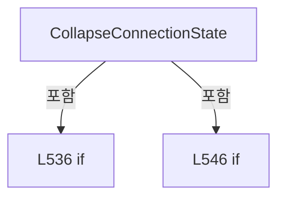

변경 전 점검: 입력/반환 타입, 위 호출자, 예외/취소 경로, 공유 상태와 저장·전송 소비자를 함께 확인합니다. 값의 단위나 물리 방향을 이름만으로 확정하지 않습니다.

### LocalFunctionStatement `MatchesItem` · L531–534

[Drilling.Common/Interface/CInterfaceManager.cs:531–534](https://github.com/kjuws10-rgb/A3Drilling/blob/334b3599651b2e8e0181fd4459bafaf3cddafff3/Drilling.Common/Interface/CInterfaceManager.cs#L531-L534)

| 항목 | 실제 추출 값 |
| --- | --- |
| 서명 | bool MatchesItem(Drilling.Common.Interface.EN_COMM_STATE) |
| 접근/수식자 | Private /  |
| 반환/값 타입 | bool |
| 소속 타입 | NamedType:Drilling.Common.Interface.CInterfaceManager |

입력 계약:

| 이름 | 타입 | 전달 | 선택/기본값 |
| --- | --- | --- | --- |
| state | Drilling.Common.Interface.EN_COMM_STATE | None | False /  |

현재 부분 분석에서 직접 연결된 호출자는 없습니다. XAML/이벤트/인터페이스·델리게이트·외부 진입을 추가 확인해야 하며, 미사용으로 판정한 것이 아닙니다.

본문의 실제 연산·분기·예외·반환 순서(원문 위치 순):

| 원본 행 | 종류 | 주석 해설 |
| --- | --- | --- |
| 533 | return | 호출자에게 값 또는 제어를 반환합니다: return state == EN_COMM_STATE.Offline; |

변경 전 점검: 입력/반환 타입, 위 호출자, 예외/취소 경로, 공유 상태와 저장·전송 소비자를 함께 확인합니다. 값의 단위나 물리 방향을 이름만으로 확정하지 않습니다.

### LocalFunctionStatement `MatchesItem2` · L541–544

[Drilling.Common/Interface/CInterfaceManager.cs:541–544](https://github.com/kjuws10-rgb/A3Drilling/blob/334b3599651b2e8e0181fd4459bafaf3cddafff3/Drilling.Common/Interface/CInterfaceManager.cs#L541-L544)

| 항목 | 실제 추출 값 |
| --- | --- |
| 서명 | bool MatchesItem2(Drilling.Common.Interface.EN_COMM_STATE) |
| 접근/수식자 | Private /  |
| 반환/값 타입 | bool |
| 소속 타입 | NamedType:Drilling.Common.Interface.CInterfaceManager |

입력 계약:

| 이름 | 타입 | 전달 | 선택/기본값 |
| --- | --- | --- | --- |
| state | Drilling.Common.Interface.EN_COMM_STATE | None | False /  |

현재 부분 분석에서 직접 연결된 호출자는 없습니다. XAML/이벤트/인터페이스·델리게이트·외부 진입을 추가 확인해야 하며, 미사용으로 판정한 것이 아닙니다.

본문의 실제 연산·분기·예외·반환 순서(원문 위치 순):

| 원본 행 | 종류 | 주석 해설 |
| --- | --- | --- |
| 543 | return | 호출자에게 값 또는 제어를 반환합니다: return state == EN_COMM_STATE.Simulation; |

변경 전 점검: 입력/반환 타입, 위 호출자, 예외/취소 경로, 공유 상태와 저장·전송 소비자를 함께 확인합니다. 값의 단위나 물리 방향을 이름만으로 확정하지 않습니다.

### MethodDeclaration `ConnectDevice` · L554–572

[Drilling.Common/Interface/CInterfaceManager.cs:554–572](https://github.com/kjuws10-rgb/A3Drilling/blob/334b3599651b2e8e0181fd4459bafaf3cddafff3/Drilling.Common/Interface/CInterfaceManager.cs#L554-L572)

| 항목 | 실제 추출 값 |
| --- | --- |
| 서명 | System.Threading.Tasks.Task Drilling.Common.Interface.CInterfaceManager.ConnectDevice(Drilling.Common.Interface.CInterfaceDevice, bool, System.Threading.CancellationToken) |
| 접근/수식자 | Private / private, async |
| 반환/값 타입 | System.Threading.Tasks.Task |
| 소속 타입 | NamedType:Drilling.Common.Interface.CInterfaceManager |

입력 계약:

| 이름 | 타입 | 전달 | 선택/기본값 |
| --- | --- | --- | --- |
| device | Drilling.Common.Interface.CInterfaceDevice | None | False /  |
| autoConnection | bool | None | False /  |
| cancellationToken | System.Threading.CancellationToken | None | False /  |

정적 호출자로 확인된 위치:

| 호출 파일/행 | 호출 표현식 | 런타임 분기 가능 |
| --- | --- | --- |
| [Drilling.Common/Interface/CInterfaceManager.cs:266–266](https://github.com/kjuws10-rgb/A3Drilling/blob/334b3599651b2e8e0181fd4459bafaf3cddafff3/Drilling.Common/Interface/CInterfaceManager.cs#L266-L266) | ConnectDevice | False |
| [Drilling.Common/Interface/CInterfaceManager.cs:367–367](https://github.com/kjuws10-rgb/A3Drilling/blob/334b3599651b2e8e0181fd4459bafaf3cddafff3/Drilling.Common/Interface/CInterfaceManager.cs#L367-L367) | ConnectDevice | False |
| [Drilling.Common/Interface/CInterfaceManager.cs:2112–2112](https://github.com/kjuws10-rgb/A3Drilling/blob/334b3599651b2e8e0181fd4459bafaf3cddafff3/Drilling.Common/Interface/CInterfaceManager.cs#L2112-L2112) | ConnectDevice | False |

호출하는 대상과 해석 범위:

| 원본 행 | 표현식 | 분석 상태 | 대상/소스 위치 |
| --- | --- | --- | --- |
| 564 | ConnectMelsecDevice | resolved | void Drilling.Common.Interface.CInterfaceManager.ConnectMelsecDevice(Drilling.Common.Interface.CInterfaceDevice, System.Threading.CancellationToken) · Drilling.Common/Interface/CInterfaceManager.cs:601 |
| 568 | device.Connect | resolved | System.Threading.Tasks.Task Drilling.Common.Interface.CInterfaceDevice.Connect(System.Threading.CancellationToken) · Drilling.Common/Interface/CInterfaceManager.cs:3096 |
| 571 | WriteConnectionLog | resolved | void Drilling.Common.Interface.CInterfaceManager.WriteConnectionLog(string, Drilling.Common.Interface.CInterfaceDevice, Drilling.Common.Interface.EN_COMM_STATE) · Drilling.Common/Interface/CInterfaceManager.cs:698 |

본문의 실제 연산·분기·예외·반환 순서(원문 위치 순):

| 원본 행 | 종류 | 주석 해설 |
| --- | --- | --- |
| 556 | if | 조건에 따라 분기합니다: if (!autoConnection && device.Data.AutoConnection) |
| 558 | return | 호출자에게 값 또는 제어를 반환합니다: return; |
| 561 | local-declaration | 지역 변수를 선언합니다: var beforeState = device.ConnectionState; |
| 561 | variable-initializer | 변수의 초기값을 지정합니다: beforeState = device.ConnectionState |
| 562 | if | 조건에 따라 분기합니다: if (device.Data.Device == EN_EQP_MODULE.Melsec) |
| 564 | call | 함수·델리게이트 또는 객체 생성자를 호출합니다: ConnectMelsecDevice(device, cancellationToken) |
| 566 | else | 앞 조건이 거짓인 경로입니다: else |
| 568 | await | 비동기 완료를 기다립니다: await device.Connect(cancellationToken) |
| 568 | call | 함수·델리게이트 또는 객체 생성자를 호출합니다: device.Connect(cancellationToken) |
| 571 | call | 함수·델리게이트 또는 객체 생성자를 호출합니다: WriteConnectionLog("CONNECT", device, beforeState) |

제어 구문의 포함 구조(실제 실행 순서/CFG가 아닌 구문 탐색 그림):

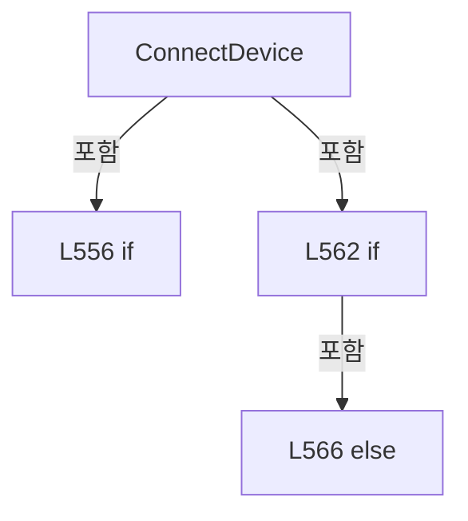

변경 전 점검: 입력/반환 타입, 위 호출자, 예외/취소 경로, 공유 상태와 저장·전송 소비자를 함께 확인합니다. 값의 단위나 물리 방향을 이름만으로 확정하지 않습니다.

### MethodDeclaration `AutoReconnectDevice` · L574–583

[Drilling.Common/Interface/CInterfaceManager.cs:574–583](https://github.com/kjuws10-rgb/A3Drilling/blob/334b3599651b2e8e0181fd4459bafaf3cddafff3/Drilling.Common/Interface/CInterfaceManager.cs#L574-L583)

| 항목 | 실제 추출 값 |
| --- | --- |
| 서명 | System.Threading.Tasks.Task Drilling.Common.Interface.CInterfaceManager.AutoReconnectDevice(Drilling.Common.Interface.EN_EQP_MODULE, int, System.Threading.CancellationToken) |
| 접근/수식자 | Private / private, async |
| 반환/값 타입 | System.Threading.Tasks.Task |
| 소속 타입 | NamedType:Drilling.Common.Interface.CInterfaceManager |

입력 계약:

| 이름 | 타입 | 전달 | 선택/기본값 |
| --- | --- | --- | --- |
| module | Drilling.Common.Interface.EN_EQP_MODULE | None | False /  |
| number | int | None | False /  |
| cancellationToken | System.Threading.CancellationToken | None | False /  |

정적 호출자로 확인된 위치:

| 호출 파일/행 | 호출 표현식 | 런타임 분기 가능 |
| --- | --- | --- |
| [Drilling.Common/Interface/CInterfaceManager.cs:929–929](https://github.com/kjuws10-rgb/A3Drilling/blob/334b3599651b2e8e0181fd4459bafaf3cddafff3/Drilling.Common/Interface/CInterfaceManager.cs#L929-L929) | AutoReconnectDevice | False |
| [Drilling.Common/Interface/CInterfaceManager.cs:1100–1100](https://github.com/kjuws10-rgb/A3Drilling/blob/334b3599651b2e8e0181fd4459bafaf3cddafff3/Drilling.Common/Interface/CInterfaceManager.cs#L1100-L1100) | AutoReconnectDevice | False |
| [Drilling.Common/Interface/CInterfaceManager.cs:1331–1331](https://github.com/kjuws10-rgb/A3Drilling/blob/334b3599651b2e8e0181fd4459bafaf3cddafff3/Drilling.Common/Interface/CInterfaceManager.cs#L1331-L1331) | AutoReconnectDevice | False |
| [Drilling.Common/Interface/CInterfaceManager.cs:1454–1454](https://github.com/kjuws10-rgb/A3Drilling/blob/334b3599651b2e8e0181fd4459bafaf3cddafff3/Drilling.Common/Interface/CInterfaceManager.cs#L1454-L1454) | AutoReconnectDevice | False |

호출하는 대상과 해석 범위:

| 원본 행 | 표현식 | 분석 상태 | 대상/소스 위치 |
| --- | --- | --- | --- |
| 576 | GetDeviceOrThrow | resolved | Drilling.Common.Interface.CInterfaceDevice Drilling.Common.Interface.CInterfaceManager.GetDeviceOrThrow(Drilling.Common.Interface.EN_EQP_MODULE, int) · Drilling.Common/Interface/CInterfaceManager.cs:658 |
| 578 | device.Connect | resolved | System.Threading.Tasks.Task Drilling.Common.Interface.CInterfaceDevice.Connect(System.Threading.CancellationToken) · Drilling.Common/Interface/CInterfaceManager.cs:3096 |
| 581 | WriteConnectionLog | resolved | void Drilling.Common.Interface.CInterfaceManager.WriteConnectionLog(string, Drilling.Common.Interface.CInterfaceDevice, Drilling.Common.Interface.EN_COMM_STATE) · Drilling.Common/Interface/CInterfaceManager.cs:698 |

본문의 실제 연산·분기·예외·반환 순서(원문 위치 순):

| 원본 행 | 종류 | 주석 해설 |
| --- | --- | --- |
| 576 | call | 함수·델리게이트 또는 객체 생성자를 호출합니다: GetDeviceOrThrow(module, number) |
| 576 | local-declaration | 지역 변수를 선언합니다: var device = GetDeviceOrThrow(module, number); |
| 576 | variable-initializer | 변수의 초기값을 지정합니다: device = GetDeviceOrThrow(module, number) |
| 577 | local-declaration | 지역 변수를 선언합니다: var beforeState = device.ConnectionState; |
| 577 | variable-initializer | 변수의 초기값을 지정합니다: beforeState = device.ConnectionState |
| 578 | await | 비동기 완료를 기다립니다: await device.Connect(cancellationToken) |
| 578 | call | 함수·델리게이트 또는 객체 생성자를 호출합니다: device.Connect(cancellationToken) |
| 579 | if | 조건에 따라 분기합니다: if (device.ConnectionState != beforeState &#124;&#124; device.ConnectionState is EN_COMM_STATE.Online or EN_COMM_STATE.Simulation) |
| 581 | call | 함수·델리게이트 또는 객체 생성자를 호출합니다: WriteConnectionLog("AUTO_RECONNECT", device, beforeState) |

제어 구문의 포함 구조(실제 실행 순서/CFG가 아닌 구문 탐색 그림):

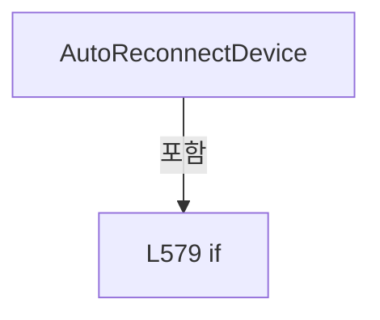

변경 전 점검: 입력/반환 타입, 위 호출자, 예외/취소 경로, 공유 상태와 저장·전송 소비자를 함께 확인합니다. 값의 단위나 물리 방향을 이름만으로 확정하지 않습니다.

### MethodDeclaration `DisconnectDevice` · L585–599

[Drilling.Common/Interface/CInterfaceManager.cs:585–599](https://github.com/kjuws10-rgb/A3Drilling/blob/334b3599651b2e8e0181fd4459bafaf3cddafff3/Drilling.Common/Interface/CInterfaceManager.cs#L585-L599)

| 항목 | 실제 추출 값 |
| --- | --- |
| 서명 | System.Threading.Tasks.Task Drilling.Common.Interface.CInterfaceManager.DisconnectDevice(Drilling.Common.Interface.CInterfaceDevice, System.Threading.CancellationToken) |
| 접근/수식자 | Private / private, async |
| 반환/값 타입 | System.Threading.Tasks.Task |
| 소속 타입 | NamedType:Drilling.Common.Interface.CInterfaceManager |

입력 계약:

| 이름 | 타입 | 전달 | 선택/기본값 |
| --- | --- | --- | --- |
| device | Drilling.Common.Interface.CInterfaceDevice | None | False /  |
| cancellationToken | System.Threading.CancellationToken | None | False /  |

정적 호출자로 확인된 위치:

| 호출 파일/행 | 호출 표현식 | 런타임 분기 가능 |
| --- | --- | --- |
| [Drilling.Common/Interface/CInterfaceManager.cs:286–286](https://github.com/kjuws10-rgb/A3Drilling/blob/334b3599651b2e8e0181fd4459bafaf3cddafff3/Drilling.Common/Interface/CInterfaceManager.cs#L286-L286) | DisconnectDevice | False |
| [Drilling.Common/Interface/CInterfaceManager.cs:387–387](https://github.com/kjuws10-rgb/A3Drilling/blob/334b3599651b2e8e0181fd4459bafaf3cddafff3/Drilling.Common/Interface/CInterfaceManager.cs#L387-L387) | DisconnectDevice | False |
| [Drilling.Common/Interface/CInterfaceManager.cs:2094–2094](https://github.com/kjuws10-rgb/A3Drilling/blob/334b3599651b2e8e0181fd4459bafaf3cddafff3/Drilling.Common/Interface/CInterfaceManager.cs#L2094-L2094) | DisconnectDevice | False |

호출하는 대상과 해석 범위:

| 원본 행 | 표현식 | 분석 상태 | 대상/소스 위치 |
| --- | --- | --- | --- |
| 588 | device.SuppressAutoReconnect | resolved | void Drilling.Common.Interface.CInterfaceDevice.SuppressAutoReconnect() · Drilling.Common/Interface/CInterfaceManager.cs:3122 |
| 591 | DisconnectMelsecDevice | resolved | void Drilling.Common.Interface.CInterfaceManager.DisconnectMelsecDevice(Drilling.Common.Interface.CInterfaceDevice, System.Threading.CancellationToken) · Drilling.Common/Interface/CInterfaceManager.cs:622 |
| 595 | device.Disconnect | resolved | System.Threading.Tasks.Task Drilling.Common.Interface.CInterfaceDevice.Disconnect(System.Threading.CancellationToken) · Drilling.Common/Interface/CInterfaceManager.cs:3127 |
| 598 | WriteConnectionLog | resolved | void Drilling.Common.Interface.CInterfaceManager.WriteConnectionLog(string, Drilling.Common.Interface.CInterfaceDevice, Drilling.Common.Interface.EN_COMM_STATE) · Drilling.Common/Interface/CInterfaceManager.cs:698 |

본문의 실제 연산·분기·예외·반환 순서(원문 위치 순):

| 원본 행 | 종류 | 주석 해설 |
| --- | --- | --- |
| 587 | local-declaration | 지역 변수를 선언합니다: var beforeState = device.ConnectionState; |
| 587 | variable-initializer | 변수의 초기값을 지정합니다: beforeState = device.ConnectionState |
| 588 | call | 함수·델리게이트 또는 객체 생성자를 호출합니다: device.SuppressAutoReconnect() |
| 589 | if | 조건에 따라 분기합니다: if (device.Data.Device == EN_EQP_MODULE.Melsec) |
| 591 | call | 함수·델리게이트 또는 객체 생성자를 호출합니다: DisconnectMelsecDevice(device, cancellationToken) |
| 593 | else | 앞 조건이 거짓인 경로입니다: else |
| 595 | await | 비동기 완료를 기다립니다: await device.Disconnect(cancellationToken) |
| 595 | call | 함수·델리게이트 또는 객체 생성자를 호출합니다: device.Disconnect(cancellationToken) |
| 598 | call | 함수·델리게이트 또는 객체 생성자를 호출합니다: WriteConnectionLog("DISCONNECT", device, beforeState) |

제어 구문의 포함 구조(실제 실행 순서/CFG가 아닌 구문 탐색 그림):

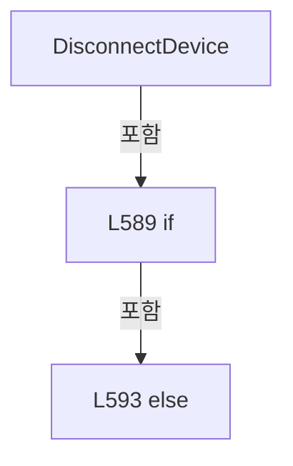

변경 전 점검: 입력/반환 타입, 위 호출자, 예외/취소 경로, 공유 상태와 저장·전송 소비자를 함께 확인합니다. 값의 단위나 물리 방향을 이름만으로 확정하지 않습니다.

### MethodDeclaration `ConnectMelsecDevice` · L601–620

[Drilling.Common/Interface/CInterfaceManager.cs:601–620](https://github.com/kjuws10-rgb/A3Drilling/blob/334b3599651b2e8e0181fd4459bafaf3cddafff3/Drilling.Common/Interface/CInterfaceManager.cs#L601-L620)

| 항목 | 실제 추출 값 |
| --- | --- |
| 서명 | void Drilling.Common.Interface.CInterfaceManager.ConnectMelsecDevice(Drilling.Common.Interface.CInterfaceDevice, System.Threading.CancellationToken) |
| 접근/수식자 | Private / private |
| 반환/값 타입 | void |
| 소속 타입 | NamedType:Drilling.Common.Interface.CInterfaceManager |

입력 계약:

| 이름 | 타입 | 전달 | 선택/기본값 |
| --- | --- | --- | --- |
| device | Drilling.Common.Interface.CInterfaceDevice | None | False /  |
| cancellationToken | System.Threading.CancellationToken | None | False /  |

정적 호출자로 확인된 위치:

| 호출 파일/행 | 호출 표현식 | 런타임 분기 가능 |
| --- | --- | --- |
| [Drilling.Common/Interface/CInterfaceManager.cs:218–218](https://github.com/kjuws10-rgb/A3Drilling/blob/334b3599651b2e8e0181fd4459bafaf3cddafff3/Drilling.Common/Interface/CInterfaceManager.cs#L218-L218) | ConnectMelsecDevice | False |
| [Drilling.Common/Interface/CInterfaceManager.cs:301–301](https://github.com/kjuws10-rgb/A3Drilling/blob/334b3599651b2e8e0181fd4459bafaf3cddafff3/Drilling.Common/Interface/CInterfaceManager.cs#L301-L301) | ConnectMelsecDevice | False |
| [Drilling.Common/Interface/CInterfaceManager.cs:402–402](https://github.com/kjuws10-rgb/A3Drilling/blob/334b3599651b2e8e0181fd4459bafaf3cddafff3/Drilling.Common/Interface/CInterfaceManager.cs#L402-L402) | ConnectMelsecDevice | False |
| [Drilling.Common/Interface/CInterfaceManager.cs:564–564](https://github.com/kjuws10-rgb/A3Drilling/blob/334b3599651b2e8e0181fd4459bafaf3cddafff3/Drilling.Common/Interface/CInterfaceManager.cs#L564-L564) | ConnectMelsecDevice | False |

호출하는 대상과 해석 범위:

| 원본 행 | 표현식 | 분석 상태 | 대상/소스 위치 |
| --- | --- | --- | --- |
| 603 | _melsec.Initialize | resolved | void Drilling.Common.Interface.CMelsec.Initialize() · Drilling.Common/Interface/Melsec/CMelsec.cs:141 |
| 606 | _melsec.Open | resolved | void Drilling.Common.Interface.CMelsec.Open(int, System.Threading.CancellationToken) · Drilling.Common/Interface/Melsec/CMelsec.cs:345 |
| 607 | device.SetExternalCommunicationState | resolved | void Drilling.Common.Interface.CInterfaceDevice.SetExternalCommunicationState(Drilling.Common.Interface.EN_COMM_STATE, string, string, string) · Drilling.Common/Interface/CInterfaceManager.cs:3174 |
| 613 | _melsec.Open | resolved | void Drilling.Common.Interface.CMelsec.Open(int, System.Threading.CancellationToken) · Drilling.Common/Interface/Melsec/CMelsec.cs:345 |
| 614 | device.SetExternalCommunicationState | resolved | void Drilling.Common.Interface.CInterfaceDevice.SetExternalCommunicationState(Drilling.Common.Interface.EN_COMM_STATE, string, string, string) · Drilling.Common/Interface/CInterfaceManager.cs:3174 |
| 618 | device.SetExternalCommunicationState | resolved | void Drilling.Common.Interface.CInterfaceDevice.SetExternalCommunicationState(Drilling.Common.Interface.EN_COMM_STATE, string, string, string) · Drilling.Common/Interface/CInterfaceManager.cs:3174 |

본문의 실제 연산·분기·예외·반환 순서(원문 위치 순):

| 원본 행 | 종류 | 주석 해설 |
| --- | --- | --- |
| 603 | call | 함수·델리게이트 또는 객체 생성자를 호출합니다: _melsec.Initialize() |
| 604 | if | 조건에 따라 분기합니다: if (device.IsSimulation) |
| 606 | call | 함수·델리게이트 또는 객체 생성자를 호출합니다: _melsec.Open(device.Data.Number, cancellationToken) |
| 607 | call | 함수·델리게이트 또는 객체 생성자를 호출합니다: device.SetExternalCommunicationState(EN_COMM_STATE.Simulation, "[SIMULATION] OPEN", "[SIMULATION] READY", "") |
| 608 | return | 호출자에게 값 또는 제어를 반환합니다: return; |
| 611 | try | 예외 처리 범위입니다: try |
| 613 | call | 함수·델리게이트 또는 객체 생성자를 호출합니다: _melsec.Open(device.Data.Number, cancellationToken) |
| 614 | call | 함수·델리게이트 또는 객체 생성자를 호출합니다: device.SetExternalCommunicationState(EN_COMM_STATE.Online, "OPEN", "CONNECTED", "") |
| 616 | catch | 지정 예외를 처리합니다: catch (Exception exception) when (exception is not OperationCanceledException) |
| 618 | call | 함수·델리게이트 또는 객체 생성자를 호출합니다: device.SetExternalCommunicationState(EN_COMM_STATE.Offline, "OPEN", "", exception.Message) |

제어 구문의 포함 구조(실제 실행 순서/CFG가 아닌 구문 탐색 그림):

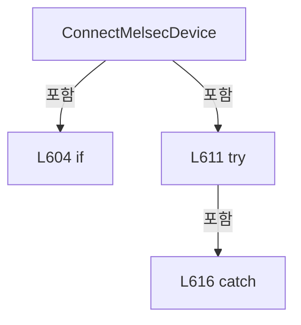

변경 전 점검: 입력/반환 타입, 위 호출자, 예외/취소 경로, 공유 상태와 저장·전송 소비자를 함께 확인합니다. 값의 단위나 물리 방향을 이름만으로 확정하지 않습니다.

### MethodDeclaration `DisconnectMelsecDevice` · L622–628

[Drilling.Common/Interface/CInterfaceManager.cs:622–628](https://github.com/kjuws10-rgb/A3Drilling/blob/334b3599651b2e8e0181fd4459bafaf3cddafff3/Drilling.Common/Interface/CInterfaceManager.cs#L622-L628)

| 항목 | 실제 추출 값 |
| --- | --- |
| 서명 | void Drilling.Common.Interface.CInterfaceManager.DisconnectMelsecDevice(Drilling.Common.Interface.CInterfaceDevice, System.Threading.CancellationToken) |
| 접근/수식자 | Private / private |
| 반환/값 타입 | void |
| 소속 타입 | NamedType:Drilling.Common.Interface.CInterfaceManager |

입력 계약:

| 이름 | 타입 | 전달 | 선택/기본값 |
| --- | --- | --- | --- |
| device | Drilling.Common.Interface.CInterfaceDevice | None | False /  |
| cancellationToken | System.Threading.CancellationToken | None | False /  |

정적 호출자로 확인된 위치:

| 호출 파일/행 | 호출 표현식 | 런타임 분기 가능 |
| --- | --- | --- |
| [Drilling.Common/Interface/CInterfaceManager.cs:247–247](https://github.com/kjuws10-rgb/A3Drilling/blob/334b3599651b2e8e0181fd4459bafaf3cddafff3/Drilling.Common/Interface/CInterfaceManager.cs#L247-L247) | DisconnectMelsecDevice | False |
| [Drilling.Common/Interface/CInterfaceManager.cs:300–300](https://github.com/kjuws10-rgb/A3Drilling/blob/334b3599651b2e8e0181fd4459bafaf3cddafff3/Drilling.Common/Interface/CInterfaceManager.cs#L300-L300) | DisconnectMelsecDevice | False |
| [Drilling.Common/Interface/CInterfaceManager.cs:401–401](https://github.com/kjuws10-rgb/A3Drilling/blob/334b3599651b2e8e0181fd4459bafaf3cddafff3/Drilling.Common/Interface/CInterfaceManager.cs#L401-L401) | DisconnectMelsecDevice | False |
| [Drilling.Common/Interface/CInterfaceManager.cs:591–591](https://github.com/kjuws10-rgb/A3Drilling/blob/334b3599651b2e8e0181fd4459bafaf3cddafff3/Drilling.Common/Interface/CInterfaceManager.cs#L591-L591) | DisconnectMelsecDevice | False |

호출하는 대상과 해석 범위:

| 원본 행 | 표현식 | 분석 상태 | 대상/소스 위치 |
| --- | --- | --- | --- |
| 624 | cancellationToken.ThrowIfCancellationRequested | resolved | void System.Threading.CancellationToken.ThrowIfCancellationRequested() |
| 625 | _melsec.DeInitialize | resolved | void Drilling.Common.Interface.CMelsec.DeInitialize() · Drilling.Common/Interface/Melsec/CMelsec.cs:156 |
| 627 | device.SetExternalCommunicationState | resolved | void Drilling.Common.Interface.CInterfaceDevice.SetExternalCommunicationState(Drilling.Common.Interface.EN_COMM_STATE, string, string, string) · Drilling.Common/Interface/CInterfaceManager.cs:3174 |

본문의 실제 연산·분기·예외·반환 순서(원문 위치 순):

| 원본 행 | 종류 | 주석 해설 |
| --- | --- | --- |
| 624 | call | 함수·델리게이트 또는 객체 생성자를 호출합니다: cancellationToken.ThrowIfCancellationRequested() |
| 625 | call | 함수·델리게이트 또는 객체 생성자를 호출합니다: _melsec.DeInitialize() |
| 626 | conditional-expression | 조건에 따라 결과식을 선택합니다: device.IsSimulation ? EN_COMM_STATE.Simulation : EN_COMM_STATE.Offline |
| 626 | local-declaration | 지역 변수를 선언합니다: var closedState = device.IsSimulation ? EN_COMM_STATE.Simulation : EN_COMM_STATE.Offline; |
| 626 | variable-initializer | 변수의 초기값을 지정합니다: closedState = device.IsSimulation ? EN_COMM_STATE.Simulation : EN_COMM_STATE.Offline |
| 627 | call | 함수·델리게이트 또는 객체 생성자를 호출합니다: device.SetExternalCommunicationState(closedState, device.IsSimulation ? "[SIMULATION] CLOSE" : "CLOSE", device.IsSimulation ? "[SIMULATION] CLOSED" : "CLOSED", "") |
| 627 | conditional-expression | 조건에 따라 결과식을 선택합니다: device.IsSimulation ? "[SIMULATION] CLOSE" : "CLOSE" |
| 627 | conditional-expression | 조건에 따라 결과식을 선택합니다: device.IsSimulation ? "[SIMULATION] CLOSED" : "CLOSED" |

변경 전 점검: 입력/반환 타입, 위 호출자, 예외/취소 경로, 공유 상태와 저장·전송 소비자를 함께 확인합니다. 값의 단위나 물리 방향을 이름만으로 확정하지 않습니다.

### MethodDeclaration `ExecuteDeviceFunction` · L630–656

[Drilling.Common/Interface/CInterfaceManager.cs:630–656](https://github.com/kjuws10-rgb/A3Drilling/blob/334b3599651b2e8e0181fd4459bafaf3cddafff3/Drilling.Common/Interface/CInterfaceManager.cs#L630-L656)

| 항목 | 실제 추출 값 |
| --- | --- |
| 서명 | System.Threading.Tasks.Task<string> Drilling.Common.Interface.CInterfaceManager.ExecuteDeviceFunction(Drilling.Common.Interface.CInterfaceDevice, string, System.Threading.CancellationToken, string?, bool) |
| 접근/수식자 | Private / private, async |
| 반환/값 타입 | System.Threading.Tasks.Task<string> |
| 소속 타입 | NamedType:Drilling.Common.Interface.CInterfaceManager |

입력 계약:

| 이름 | 타입 | 전달 | 선택/기본값 |
| --- | --- | --- | --- |
| device | Drilling.Common.Interface.CInterfaceDevice | None | False /  |
| function | string | None | False /  |
| cancellationToken | System.Threading.CancellationToken | None | False /  |
| logText | string? | None | True / null |
| suppressLog | bool | None | True / false |

정적 호출자로 확인된 위치:

| 호출 파일/행 | 호출 표현식 | 런타임 분기 가능 |
| --- | --- | --- |
| [Drilling.Common/Interface/CInterfaceManager.cs:323–323](https://github.com/kjuws10-rgb/A3Drilling/blob/334b3599651b2e8e0181fd4459bafaf3cddafff3/Drilling.Common/Interface/CInterfaceManager.cs#L323-L323) | ExecuteDeviceFunction | False |
| [Drilling.Common/Interface/CInterfaceManager.cs:329–329](https://github.com/kjuws10-rgb/A3Drilling/blob/334b3599651b2e8e0181fd4459bafaf3cddafff3/Drilling.Common/Interface/CInterfaceManager.cs#L329-L329) | ExecuteDeviceFunction | False |
| [Drilling.Common/Interface/CInterfaceManager.cs:335–335](https://github.com/kjuws10-rgb/A3Drilling/blob/334b3599651b2e8e0181fd4459bafaf3cddafff3/Drilling.Common/Interface/CInterfaceManager.cs#L335-L335) | ExecuteDeviceFunction | False |
| [Drilling.Common/Interface/CInterfaceManager.cs:424–424](https://github.com/kjuws10-rgb/A3Drilling/blob/334b3599651b2e8e0181fd4459bafaf3cddafff3/Drilling.Common/Interface/CInterfaceManager.cs#L424-L424) | ExecuteDeviceFunction | False |

호출하는 대상과 해석 범위:

| 원본 행 | 표현식 | 분석 상태 | 대상/소스 위치 |
| --- | --- | --- | --- |
| 634 | device.ExecuteFunction | resolved | System.Threading.Tasks.Task<string> Drilling.Common.Interface.CInterfaceDevice.ExecuteFunction(string, System.Threading.CancellationToken) · Drilling.Common/Interface/CInterfaceManager.cs:3147 |
| 637 | WriteCommandLog | resolved | void Drilling.Common.Interface.CInterfaceManager.WriteCommandLog(Drilling.Common.Interface.CInterfaceDevice, string, string, string?) · Drilling.Common/Interface/CInterfaceManager.cs:715 |
| 646 | .Invoke | resolved · 동적 구현 선택 가능 | void System.Action<Drilling.Common.Interface.Vision.CVisionLineCountExceededException>.Invoke(Drilling.Common.Interface.Vision.CVisionLineCountExceededException) |
| 647 | Trace.TraceError | resolved | void System.Diagnostics.Trace.TraceError(string?) |
| 651 | WriteErrorLog | resolved | void Drilling.Common.Interface.CInterfaceManager.WriteErrorLog(Drilling.Common.Interface.CInterfaceDevice, string, string, string?) · Drilling.Common/Interface/CInterfaceManager.cs:734 |

본문의 실제 연산·분기·예외·반환 순서(원문 위치 순):

| 원본 행 | 종류 | 주석 해설 |
| --- | --- | --- |
| 632 | try | 예외 처리 범위입니다: try |
| 634 | await | 비동기 완료를 기다립니다: await device.ExecuteFunction(function, cancellationToken) |
| 634 | call | 함수·델리게이트 또는 객체 생성자를 호출합니다: device.ExecuteFunction(function, cancellationToken) |
| 634 | local-declaration | 지역 변수를 선언합니다: var response = await device.ExecuteFunction(function, cancellationToken); |
| 634 | variable-initializer | 변수의 초기값을 지정합니다: response = await device.ExecuteFunction(function, cancellationToken) |
| 635 | if | 조건에 따라 분기합니다: if (!suppressLog) |
| 637 | call | 함수·델리게이트 또는 객체 생성자를 호출합니다: WriteCommandLog(device, function, response, logText) |
| 640 | return | 호출자에게 값 또는 제어를 반환합니다: return response; |
| 642 | catch | 지정 예외를 처리합니다: catch (Exception ex) when (ex is InvalidOperationException or IOException or TimeoutException) |
| 644 | if | 조건에 따라 분기합니다: if (ex is CVisionLineCountExceededException countError) |
| 646 | call | 함수·델리게이트 또는 객체 생성자를 호출합니다: .Invoke(countError) |
| 646 | try | 예외 처리 범위입니다: try |
| 647 | call | 함수·델리게이트 또는 객체 생성자를 호출합니다: Trace.TraceError($"Vision count alarm registration failed: {alarmError}") |
| 647 | catch | 지정 예외를 처리합니다: catch (Exception alarmError) |
| 649 | if | 조건에 따라 분기합니다: if (!suppressLog) |
| 651 | call | 함수·델리게이트 또는 객체 생성자를 호출합니다: WriteErrorLog(device, function, ex.Message, logText) |
| 654 | throw | 예외를 발생/전달합니다: throw; |

제어 구문의 포함 구조(실제 실행 순서/CFG가 아닌 구문 탐색 그림):

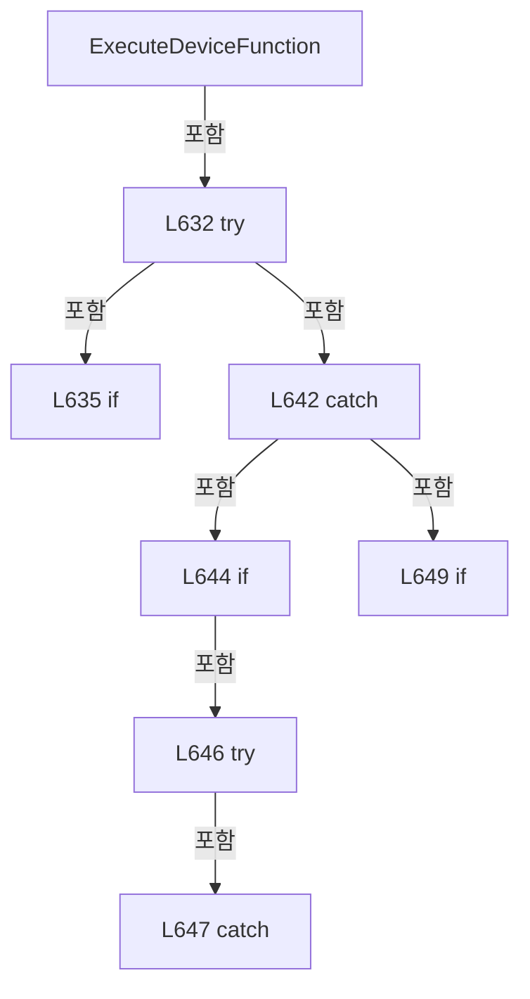

변경 전 점검: 입력/반환 타입, 위 호출자, 예외/취소 경로, 공유 상태와 저장·전송 소비자를 함께 확인합니다. 값의 단위나 물리 방향을 이름만으로 확정하지 않습니다.

### MethodDeclaration `GetDeviceOrThrow` · L658–661

[Drilling.Common/Interface/CInterfaceManager.cs:658–661](https://github.com/kjuws10-rgb/A3Drilling/blob/334b3599651b2e8e0181fd4459bafaf3cddafff3/Drilling.Common/Interface/CInterfaceManager.cs#L658-L661)

| 항목 | 실제 추출 값 |
| --- | --- |
| 서명 | Drilling.Common.Interface.CInterfaceDevice Drilling.Common.Interface.CInterfaceManager.GetDeviceOrThrow(Drilling.Common.Interface.EN_EQP_MODULE, int) |
| 접근/수식자 | Private / private |
| 반환/값 타입 | Drilling.Common.Interface.CInterfaceDevice |
| 소속 타입 | NamedType:Drilling.Common.Interface.CInterfaceManager |

입력 계약:

| 이름 | 타입 | 전달 | 선택/기본값 |
| --- | --- | --- | --- |
| module | Drilling.Common.Interface.EN_EQP_MODULE | None | False /  |
| number | int | None | False /  |

정적 호출자로 확인된 위치:

| 호출 파일/행 | 호출 표현식 | 런타임 분기 가능 |
| --- | --- | --- |
| [Drilling.Common/Interface/CInterfaceManager.cs:264–264](https://github.com/kjuws10-rgb/A3Drilling/blob/334b3599651b2e8e0181fd4459bafaf3cddafff3/Drilling.Common/Interface/CInterfaceManager.cs#L264-L264) | GetDeviceOrThrow | False |
| [Drilling.Common/Interface/CInterfaceManager.cs:294–294](https://github.com/kjuws10-rgb/A3Drilling/blob/334b3599651b2e8e0181fd4459bafaf3cddafff3/Drilling.Common/Interface/CInterfaceManager.cs#L294-L294) | GetDeviceOrThrow | False |
| [Drilling.Common/Interface/CInterfaceManager.cs:322–322](https://github.com/kjuws10-rgb/A3Drilling/blob/334b3599651b2e8e0181fd4459bafaf3cddafff3/Drilling.Common/Interface/CInterfaceManager.cs#L322-L322) | GetDeviceOrThrow | False |
| [Drilling.Common/Interface/CInterfaceManager.cs:328–328](https://github.com/kjuws10-rgb/A3Drilling/blob/334b3599651b2e8e0181fd4459bafaf3cddafff3/Drilling.Common/Interface/CInterfaceManager.cs#L328-L328) | GetDeviceOrThrow | False |
| [Drilling.Common/Interface/CInterfaceManager.cs:334–334](https://github.com/kjuws10-rgb/A3Drilling/blob/334b3599651b2e8e0181fd4459bafaf3cddafff3/Drilling.Common/Interface/CInterfaceManager.cs#L334-L334) | GetDeviceOrThrow | False |
| [Drilling.Common/Interface/CInterfaceManager.cs:576–576](https://github.com/kjuws10-rgb/A3Drilling/blob/334b3599651b2e8e0181fd4459bafaf3cddafff3/Drilling.Common/Interface/CInterfaceManager.cs#L576-L576) | GetDeviceOrThrow | False |

호출하는 대상과 해석 범위:

| 원본 행 | 표현식 | 분석 상태 | 대상/소스 위치 |
| --- | --- | --- | --- |
| 660 | _devices.TryGetValue | resolved | bool System.Collections.Concurrent.ConcurrentDictionary<string, Drilling.Common.Interface.CInterfaceDevice>.TryGetValue(string, out Drilling.Common.Interface.CInterfaceDevice) |
| 660 | CreateDeviceKey | resolved | string Drilling.Common.Interface.CInterfaceManager.CreateDeviceKey(Drilling.Common.Interface.EN_EQP_MODULE, int) · Drilling.Common/Interface/CInterfaceManager.cs:809 |
| 660 | new KeyNotFoundException | resolved | System.Collections.Generic.KeyNotFoundException.KeyNotFoundException(string?) |
| 660 | FormatDeviceName | resolved | string Drilling.Common.Interface.CInterfaceManager.FormatDeviceName(Drilling.Common.Interface.EN_EQP_MODULE, int) · Drilling.Common/Interface/CInterfaceManager.cs:819 |

본문의 실제 연산·분기·예외·반환 순서(원문 위치 순):

| 원본 행 | 종류 | 주석 해설 |
| --- | --- | --- |
| 660 | call | 함수·델리게이트 또는 객체 생성자를 호출합니다: _devices.TryGetValue(CreateDeviceKey(module, number), out var device) |
| 660 | call | 함수·델리게이트 또는 객체 생성자를 호출합니다: CreateDeviceKey(module, number) |
| 660 | call | 함수·델리게이트 또는 객체 생성자를 호출합니다: new KeyNotFoundException($"Interface device was not registered: {FormatDeviceName(module, number)}") |
| 660 | call | 함수·델리게이트 또는 객체 생성자를 호출합니다: FormatDeviceName(module, number) |
| 660 | conditional-expression | 조건에 따라 결과식을 선택합니다: _devices.TryGetValue(CreateDeviceKey(module, number), out var device) ? device : throw new KeyNotFoundException($"Interface device was not registered: {FormatDeviceName(module, number)}") |
| 660 | return | 호출자에게 값 또는 제어를 반환합니다: return _devices.TryGetValue(CreateDeviceKey(module, number), out var device) ? device : throw new KeyNotFoundException($"Interface device was not registered: {FormatDeviceName(module, number)}"); |
| 660 | throw | 예외를 발생/전달합니다: throw new KeyNotFoundException($"Interface device was not registered: {FormatDeviceName(module, number)}") |

변경 전 점검: 입력/반환 타입, 위 호출자, 예외/취소 경로, 공유 상태와 저장·전송 소비자를 함께 확인합니다. 값의 단위나 물리 방향을 이름만으로 확정하지 않습니다.

### MethodDeclaration `GetDeviceByNickNameOrThrow` · L663–666

[Drilling.Common/Interface/CInterfaceManager.cs:663–666](https://github.com/kjuws10-rgb/A3Drilling/blob/334b3599651b2e8e0181fd4459bafaf3cddafff3/Drilling.Common/Interface/CInterfaceManager.cs#L663-L666)

| 항목 | 실제 추출 값 |
| --- | --- |
| 서명 | Drilling.Common.Interface.CInterfaceDevice Drilling.Common.Interface.CInterfaceManager.GetDeviceByNickNameOrThrow(string) |
| 접근/수식자 | Private / private |
| 반환/값 타입 | Drilling.Common.Interface.CInterfaceDevice |
| 소속 타입 | NamedType:Drilling.Common.Interface.CInterfaceManager |

입력 계약:

| 이름 | 타입 | 전달 | 선택/기본값 |
| --- | --- | --- | --- |
| nickName | string | None | False /  |

정적 호출자로 확인된 위치:

| 호출 파일/행 | 호출 표현식 | 런타임 분기 가능 |
| --- | --- | --- |
| [Drilling.Common/Interface/CInterfaceManager.cs:365–365](https://github.com/kjuws10-rgb/A3Drilling/blob/334b3599651b2e8e0181fd4459bafaf3cddafff3/Drilling.Common/Interface/CInterfaceManager.cs#L365-L365) | GetDeviceByNickNameOrThrow | False |
| [Drilling.Common/Interface/CInterfaceManager.cs:395–395](https://github.com/kjuws10-rgb/A3Drilling/blob/334b3599651b2e8e0181fd4459bafaf3cddafff3/Drilling.Common/Interface/CInterfaceManager.cs#L395-L395) | GetDeviceByNickNameOrThrow | False |
| [Drilling.Common/Interface/CInterfaceManager.cs:423–423](https://github.com/kjuws10-rgb/A3Drilling/blob/334b3599651b2e8e0181fd4459bafaf3cddafff3/Drilling.Common/Interface/CInterfaceManager.cs#L423-L423) | GetDeviceByNickNameOrThrow | False |

호출하는 대상과 해석 범위:

| 원본 행 | 표현식 | 분석 상태 | 대상/소스 위치 |
| --- | --- | --- | --- |
| 665 | TryGetDeviceByNickName | resolved | bool Drilling.Common.Interface.CInterfaceManager.TryGetDeviceByNickName(string, out Drilling.Common.Interface.CInterfaceDevice?, bool) · Drilling.Common/Interface/CInterfaceManager.cs:668 |
| 665 | new KeyNotFoundException | resolved | System.Collections.Generic.KeyNotFoundException.KeyNotFoundException(string?) |

본문의 실제 연산·분기·예외·반환 순서(원문 위치 순):

| 원본 행 | 종류 | 주석 해설 |
| --- | --- | --- |
| 665 | call | 함수·델리게이트 또는 객체 생성자를 호출합니다: TryGetDeviceByNickName(nickName, out var device, throwIfAmbiguous: true) |
| 665 | call | 함수·델리게이트 또는 객체 생성자를 호출합니다: new KeyNotFoundException($"Interface device was not registered: {nickName}") |
| 665 | conditional-expression | 조건에 따라 결과식을 선택합니다: TryGetDeviceByNickName(nickName, out var device, throwIfAmbiguous: true) && device is not null ? device : throw new KeyNotFoundException($"Interface device was not registered: {nickName}") |
| 665 | return | 호출자에게 값 또는 제어를 반환합니다: return TryGetDeviceByNickName(nickName, out var device, throwIfAmbiguous: true) && device is not null ? device : throw new KeyNotFoundException($"Interface device was not registered: {nickName}"); |
| 665 | throw | 예외를 발생/전달합니다: throw new KeyNotFoundException($"Interface device was not registered: {nickName}") |

변경 전 점검: 입력/반환 타입, 위 호출자, 예외/취소 경로, 공유 상태와 저장·전송 소비자를 함께 확인합니다. 값의 단위나 물리 방향을 이름만으로 확정하지 않습니다.

### MethodDeclaration `TryGetDeviceByNickName` · L668–696

[Drilling.Common/Interface/CInterfaceManager.cs:668–696](https://github.com/kjuws10-rgb/A3Drilling/blob/334b3599651b2e8e0181fd4459bafaf3cddafff3/Drilling.Common/Interface/CInterfaceManager.cs#L668-L696)

| 항목 | 실제 추출 값 |
| --- | --- |
| 서명 | bool Drilling.Common.Interface.CInterfaceManager.TryGetDeviceByNickName(string, out Drilling.Common.Interface.CInterfaceDevice?, bool) |
| 접근/수식자 | Private / private |
| 반환/값 타입 | bool |
| 소속 타입 | NamedType:Drilling.Common.Interface.CInterfaceManager |

입력 계약:

| 이름 | 타입 | 전달 | 선택/기본값 |
| --- | --- | --- | --- |
| nickName | string | None | False /  |
| device | Drilling.Common.Interface.CInterfaceDevice? | Out | False /  |
| throwIfAmbiguous | bool | None | True / false |

정적 호출자로 확인된 위치:

| 호출 파일/행 | 호출 표현식 | 런타임 분기 가능 |
| --- | --- | --- |
| [Drilling.Common/Interface/CInterfaceManager.cs:379–379](https://github.com/kjuws10-rgb/A3Drilling/blob/334b3599651b2e8e0181fd4459bafaf3cddafff3/Drilling.Common/Interface/CInterfaceManager.cs#L379-L379) | TryGetDeviceByNickName | False |
| [Drilling.Common/Interface/CInterfaceManager.cs:429–429](https://github.com/kjuws10-rgb/A3Drilling/blob/334b3599651b2e8e0181fd4459bafaf3cddafff3/Drilling.Common/Interface/CInterfaceManager.cs#L429-L429) | TryGetDeviceByNickName | False |
| [Drilling.Common/Interface/CInterfaceManager.cs:434–434](https://github.com/kjuws10-rgb/A3Drilling/blob/334b3599651b2e8e0181fd4459bafaf3cddafff3/Drilling.Common/Interface/CInterfaceManager.cs#L434-L434) | TryGetDeviceByNickName | False |
| [Drilling.Common/Interface/CInterfaceManager.cs:439–439](https://github.com/kjuws10-rgb/A3Drilling/blob/334b3599651b2e8e0181fd4459bafaf3cddafff3/Drilling.Common/Interface/CInterfaceManager.cs#L439-L439) | TryGetDeviceByNickName | False |
| [Drilling.Common/Interface/CInterfaceManager.cs:665–665](https://github.com/kjuws10-rgb/A3Drilling/blob/334b3599651b2e8e0181fd4459bafaf3cddafff3/Drilling.Common/Interface/CInterfaceManager.cs#L665-L665) | TryGetDeviceByNickName | False |

호출하는 대상과 해석 범위:

| 원본 행 | 표현식 | 분석 상태 | 대상/소스 위치 |
| --- | --- | --- | --- |
| 670 | NormalizeNickName | resolved | string Drilling.Common.Interface.CInterfaceManager.NormalizeNickName(string) · Drilling.Common/Interface/CInterfaceManager.cs:804 |
| 676 | _devices.Values.Where(ShouldIncludeItem).ToArray | resolved | Drilling.Common.Interface.CInterfaceDevice[] System.Collections.Generic.IEnumerable<Drilling.Common.Interface.CInterfaceDevice>.ToArray<Drilling.Common.Interface.CInterfaceDevice>() |
| 676 | _devices.Values.Where | resolved | System.Collections.Generic.IEnumerable<Drilling.Common.Interface.CInterfaceDevice> System.Collections.Generic.IEnumerable<Drilling.Common.Interface.CInterfaceDevice>.Where<Drilling.Common.Interface.CInterfaceDevice>(System.Func<Drilling.Common.Interface.CInterfaceDevice, bool>) |
| 690 | string.Join | resolved | string string.Join(string?, System.Collections.Generic.IEnumerable<string?>) |
| 690 | matches.Select | resolved | System.Collections.Generic.IEnumerable<string> System.Collections.Generic.IEnumerable<Drilling.Common.Interface.CInterfaceDevice>.Select<Drilling.Common.Interface.CInterfaceDevice, string>(System.Func<Drilling.Common.Interface.CInterfaceDevice, string>) |
| 691 | new InvalidOperationException | resolved | System.InvalidOperationException.InvalidOperationException(string?) |

본문의 실제 연산·분기·예외·반환 순서(원문 위치 순):

| 원본 행 | 종류 | 주석 해설 |
| --- | --- | --- |
| 670 | call | 함수·델리게이트 또는 객체 생성자를 호출합니다: NormalizeNickName(nickName) |
| 670 | local-declaration | 지역 변수를 선언합니다: var normalized = NormalizeNickName(nickName); |
| 670 | variable-initializer | 변수의 초기값을 지정합니다: normalized = NormalizeNickName(nickName) |
| 676 | call | 함수·델리게이트 또는 객체 생성자를 호출합니다: _devices.Values.Where(ShouldIncludeItem).ToArray() |
| 676 | call | 함수·델리게이트 또는 객체 생성자를 호출합니다: _devices.Values.Where(ShouldIncludeItem) |
| 676 | local-declaration | 지역 변수를 선언합니다: var matches = _devices.Values.Where(ShouldIncludeItem).ToArray(); |
| 676 | variable-initializer | 변수의 초기값을 지정합니다: matches = _devices.Values.Where(ShouldIncludeItem).ToArray() |
| 677 | if | 조건에 따라 분기합니다: if (matches.Length == 0) |
| 679 | assignment | 값을 대상에 대입합니다: device = null |
| 680 | return | 호출자에게 값 또는 제어를 반환합니다: return false; |
| 688 | if | 조건에 따라 분기합니다: if (matches.Length > 1 && throwIfAmbiguous) |
| 690 | call | 함수·델리게이트 또는 객체 생성자를 호출합니다: string.Join(", ", matches.Select(SelectItem)) |
| 690 | call | 함수·델리게이트 또는 객체 생성자를 호출합니다: matches.Select(SelectItem) |
| 690 | local-declaration | 지역 변수를 선언합니다: var candidates = string.Join(", ", matches.Select(SelectItem)); |
| 690 | variable-initializer | 변수의 초기값을 지정합니다: candidates = string.Join(", ", matches.Select(SelectItem)) |
| 691 | call | 함수·델리게이트 또는 객체 생성자를 호출합니다: new InvalidOperationException($"Interface NICKNAME is duplicated: {nickName}. Use DEVICE + NUMBER instead. Candidates: {candidates}") |
| 691 | throw | 예외를 발생/전달합니다: throw new InvalidOperationException($"Interface NICKNAME is duplicated: {nickName}. Use DEVICE + NUMBER instead. Candidates: {candidates}"); |
| 694 | assignment | 값을 대상에 대입합니다: device = matches[0] |
| 695 | return | 호출자에게 값 또는 제어를 반환합니다: return true; |

제어 구문의 포함 구조(실제 실행 순서/CFG가 아닌 구문 탐색 그림):

```mermaid
flowchart TD
 M["TryGetDeviceByNickName"]
 N0["L677 if"]
 M -->|포함| N0
 N1["L688 if"]
 M -->|포함| N1
```

변경 전 점검: 입력/반환 타입, 위 호출자, 예외/취소 경로, 공유 상태와 저장·전송 소비자를 함께 확인합니다. 값의 단위나 물리 방향을 이름만으로 확정하지 않습니다.

### LocalFunctionStatement `ShouldIncludeItem` · L671–674

[Drilling.Common/Interface/CInterfaceManager.cs:671–674](https://github.com/kjuws10-rgb/A3Drilling/blob/334b3599651b2e8e0181fd4459bafaf3cddafff3/Drilling.Common/Interface/CInterfaceManager.cs#L671-L674)

| 항목 | 실제 추출 값 |
| --- | --- |
| 서명 | bool ShouldIncludeItem(Drilling.Common.Interface.CInterfaceDevice) |
| 접근/수식자 | Private /  |
| 반환/값 타입 | bool |
| 소속 타입 | NamedType:Drilling.Common.Interface.CInterfaceManager |

입력 계약:

| 이름 | 타입 | 전달 | 선택/기본값 |
| --- | --- | --- | --- |
| item | Drilling.Common.Interface.CInterfaceDevice | None | False /  |

현재 부분 분석에서 직접 연결된 호출자는 없습니다. XAML/이벤트/인터페이스·델리게이트·외부 진입을 추가 확인해야 하며, 미사용으로 판정한 것이 아닙니다.

호출하는 대상과 해석 범위:

| 원본 행 | 표현식 | 분석 상태 | 대상/소스 위치 |
| --- | --- | --- | --- |
| 673 | NormalizeNickName(item.Data.NickName).Equals | resolved | bool string.Equals(string?, System.StringComparison) |
| 673 | NormalizeNickName | resolved | string Drilling.Common.Interface.CInterfaceManager.NormalizeNickName(string) · Drilling.Common/Interface/CInterfaceManager.cs:804 |

본문의 실제 연산·분기·예외·반환 순서(원문 위치 순):

| 원본 행 | 종류 | 주석 해설 |
| --- | --- | --- |
| 673 | call | 함수·델리게이트 또는 객체 생성자를 호출합니다: NormalizeNickName(item.Data.NickName).Equals(normalized, StringComparison.OrdinalIgnoreCase) |
| 673 | call | 함수·델리게이트 또는 객체 생성자를 호출합니다: NormalizeNickName(item.Data.NickName) |
| 673 | return | 호출자에게 값 또는 제어를 반환합니다: return NormalizeNickName(item.Data.NickName).Equals(normalized, StringComparison.OrdinalIgnoreCase); |

변경 전 점검: 입력/반환 타입, 위 호출자, 예외/취소 경로, 공유 상태와 저장·전송 소비자를 함께 확인합니다. 값의 단위나 물리 방향을 이름만으로 확정하지 않습니다.

### LocalFunctionStatement `SelectItem` · L683–686

[Drilling.Common/Interface/CInterfaceManager.cs:683–686](https://github.com/kjuws10-rgb/A3Drilling/blob/334b3599651b2e8e0181fd4459bafaf3cddafff3/Drilling.Common/Interface/CInterfaceManager.cs#L683-L686)

| 항목 | 실제 추출 값 |
| --- | --- |
| 서명 | string SelectItem(Drilling.Common.Interface.CInterfaceDevice) |
| 접근/수식자 | Private /  |
| 반환/값 타입 | string |
| 소속 타입 | NamedType:Drilling.Common.Interface.CInterfaceManager |

입력 계약:

| 이름 | 타입 | 전달 | 선택/기본값 |
| --- | --- | --- | --- |
| item | Drilling.Common.Interface.CInterfaceDevice | None | False /  |

현재 부분 분석에서 직접 연결된 호출자는 없습니다. XAML/이벤트/인터페이스·델리게이트·외부 진입을 추가 확인해야 하며, 미사용으로 판정한 것이 아닙니다.

호출하는 대상과 해석 범위:

| 원본 행 | 표현식 | 분석 상태 | 대상/소스 위치 |
| --- | --- | --- | --- |
| 685 | FormatDeviceName | resolved | string Drilling.Common.Interface.CInterfaceManager.FormatDeviceName(Drilling.Common.Interface.ST_INTERFACE_DATA) · Drilling.Common/Interface/CInterfaceManager.cs:814 |

본문의 실제 연산·분기·예외·반환 순서(원문 위치 순):

| 원본 행 | 종류 | 주석 해설 |
| --- | --- | --- |
| 685 | call | 함수·델리게이트 또는 객체 생성자를 호출합니다: FormatDeviceName(item.Data) |
| 685 | return | 호출자에게 값 또는 제어를 반환합니다: return FormatDeviceName(item.Data); |

변경 전 점검: 입력/반환 타입, 위 호출자, 예외/취소 경로, 공유 상태와 저장·전송 소비자를 함께 확인합니다. 값의 단위나 물리 방향을 이름만으로 확정하지 않습니다.

### MethodDeclaration `WriteConnectionLog` · L698–713

[Drilling.Common/Interface/CInterfaceManager.cs:698–713](https://github.com/kjuws10-rgb/A3Drilling/blob/334b3599651b2e8e0181fd4459bafaf3cddafff3/Drilling.Common/Interface/CInterfaceManager.cs#L698-L713)

| 항목 | 실제 추출 값 |
| --- | --- |
| 서명 | void Drilling.Common.Interface.CInterfaceManager.WriteConnectionLog(string, Drilling.Common.Interface.CInterfaceDevice, Drilling.Common.Interface.EN_COMM_STATE) |
| 접근/수식자 | Private / private |
| 반환/값 타입 | void |
| 소속 타입 | NamedType:Drilling.Common.Interface.CInterfaceManager |

입력 계약:

| 이름 | 타입 | 전달 | 선택/기본값 |
| --- | --- | --- | --- |
| action | string | None | False /  |
| device | Drilling.Common.Interface.CInterfaceDevice | None | False /  |
| beforeState | Drilling.Common.Interface.EN_COMM_STATE | None | False /  |

정적 호출자로 확인된 위치:

| 호출 파일/행 | 호출 표현식 | 런타임 분기 가능 |
| --- | --- | --- |
| [Drilling.Common/Interface/CInterfaceManager.cs:225–225](https://github.com/kjuws10-rgb/A3Drilling/blob/334b3599651b2e8e0181fd4459bafaf3cddafff3/Drilling.Common/Interface/CInterfaceManager.cs#L225-L225) | WriteConnectionLog | False |
| [Drilling.Common/Interface/CInterfaceManager.cs:254–254](https://github.com/kjuws10-rgb/A3Drilling/blob/334b3599651b2e8e0181fd4459bafaf3cddafff3/Drilling.Common/Interface/CInterfaceManager.cs#L254-L254) | WriteConnectionLog | False |
| [Drilling.Common/Interface/CInterfaceManager.cs:310–310](https://github.com/kjuws10-rgb/A3Drilling/blob/334b3599651b2e8e0181fd4459bafaf3cddafff3/Drilling.Common/Interface/CInterfaceManager.cs#L310-L310) | WriteConnectionLog | False |
| [Drilling.Common/Interface/CInterfaceManager.cs:411–411](https://github.com/kjuws10-rgb/A3Drilling/blob/334b3599651b2e8e0181fd4459bafaf3cddafff3/Drilling.Common/Interface/CInterfaceManager.cs#L411-L411) | WriteConnectionLog | False |
| [Drilling.Common/Interface/CInterfaceManager.cs:571–571](https://github.com/kjuws10-rgb/A3Drilling/blob/334b3599651b2e8e0181fd4459bafaf3cddafff3/Drilling.Common/Interface/CInterfaceManager.cs#L571-L571) | WriteConnectionLog | False |
| [Drilling.Common/Interface/CInterfaceManager.cs:581–581](https://github.com/kjuws10-rgb/A3Drilling/blob/334b3599651b2e8e0181fd4459bafaf3cddafff3/Drilling.Common/Interface/CInterfaceManager.cs#L581-L581) | WriteConnectionLog | False |
| [Drilling.Common/Interface/CInterfaceManager.cs:598–598](https://github.com/kjuws10-rgb/A3Drilling/blob/334b3599651b2e8e0181fd4459bafaf3cddafff3/Drilling.Common/Interface/CInterfaceManager.cs#L598-L598) | WriteConnectionLog | False |
| [Drilling.Common/Interface/CInterfaceManager.cs:2090–2090](https://github.com/kjuws10-rgb/A3Drilling/blob/334b3599651b2e8e0181fd4459bafaf3cddafff3/Drilling.Common/Interface/CInterfaceManager.cs#L2090-L2090) | WriteConnectionLog | False |

호출하는 대상과 해석 범위:

| 원본 행 | 표현식 | 분석 상태 | 대상/소스 위치 |
| --- | --- | --- | --- |
| 705 | device.GetCommunicationStatus | resolved | Drilling.Common.Interface.ST_INTERFACE_COMM_STATUS Drilling.Common.Interface.CInterfaceDevice.GetCommunicationStatus() · Drilling.Common/Interface/CInterfaceManager.cs:3034 |
| 706 | FormatConnectionState | resolved | string Drilling.Common.Interface.CInterfaceManager.FormatConnectionState(Drilling.Common.Interface.EN_COMM_STATE) · Drilling.Common/Interface/CInterfaceManager.cs:794 |
| 707 | string.IsNullOrWhiteSpace | resolved | bool string.IsNullOrWhiteSpace(string?) |
| 712 | _logManager.WriteInterfaceConnection | resolved | void Drilling.Common.Log.CLogManager.WriteInterfaceConnection(Drilling.Common.Interface.EN_EQP_MODULE, string, string, string, string) · Drilling.Common/Log/CLogManager.cs:302 |
| 712 | FormatConnectionState | resolved | string Drilling.Common.Interface.CInterfaceManager.FormatConnectionState(Drilling.Common.Interface.EN_COMM_STATE) · Drilling.Common/Interface/CInterfaceManager.cs:794 |

본문의 실제 연산·분기·예외·반환 순서(원문 위치 순):

| 원본 행 | 종류 | 주석 해설 |
| --- | --- | --- |
| 700 | if | 조건에 따라 분기합니다: if (_logManager is null) |
| 702 | return | 호출자에게 값 또는 제어를 반환합니다: return; |
| 705 | call | 함수·델리게이트 또는 객체 생성자를 호출합니다: device.GetCommunicationStatus() |
| 705 | local-declaration | 지역 변수를 선언합니다: var status = device.GetCommunicationStatus(); |
| 705 | variable-initializer | 변수의 초기값을 지정합니다: status = device.GetCommunicationStatus() |
| 706 | call | 함수·델리게이트 또는 객체 생성자를 호출합니다: FormatConnectionState(status.ConnectionState) |
| 706 | local-declaration | 지역 변수를 선언합니다: var afterState = FormatConnectionState(status.ConnectionState); |
| 706 | variable-initializer | 변수의 초기값을 지정합니다: afterState = FormatConnectionState(status.ConnectionState) |
| 707 | call | 함수·델리게이트 또는 객체 생성자를 호출합니다: string.IsNullOrWhiteSpace(status.LastError) |
| 707 | if | 조건에 따라 분기합니다: if (!string.IsNullOrWhiteSpace(status.LastError)) |
| 709 | assignment | 값을 대상에 대입합니다: afterState = $"{afterState} / {status.LastError}" |
| 712 | call | 함수·델리게이트 또는 객체 생성자를 호출합니다: _logManager.WriteInterfaceConnection(device.Data.Device, action, device.Data.NickName, FormatConnectionState(beforeState), afterState) |
| 712 | call | 함수·델리게이트 또는 객체 생성자를 호출합니다: FormatConnectionState(beforeState) |

제어 구문의 포함 구조(실제 실행 순서/CFG가 아닌 구문 탐색 그림):

```mermaid
flowchart TD
 M["WriteConnectionLog"]
 N0["L700 if"]
 M -->|포함| N0
 N1["L707 if"]
 M -->|포함| N1
```

변경 전 점검: 입력/반환 타입, 위 호출자, 예외/취소 경로, 공유 상태와 저장·전송 소비자를 함께 확인합니다. 값의 단위나 물리 방향을 이름만으로 확정하지 않습니다.

### MethodDeclaration `WriteCommandLog` · L715–732

[Drilling.Common/Interface/CInterfaceManager.cs:715–732](https://github.com/kjuws10-rgb/A3Drilling/blob/334b3599651b2e8e0181fd4459bafaf3cddafff3/Drilling.Common/Interface/CInterfaceManager.cs#L715-L732)

| 항목 | 실제 추출 값 |
| --- | --- |
| 서명 | void Drilling.Common.Interface.CInterfaceManager.WriteCommandLog(Drilling.Common.Interface.CInterfaceDevice, string, string, string?) |
| 접근/수식자 | Private / private |
| 반환/값 타입 | void |
| 소속 타입 | NamedType:Drilling.Common.Interface.CInterfaceManager |

입력 계약:

| 이름 | 타입 | 전달 | 선택/기본값 |
| --- | --- | --- | --- |
| device | Drilling.Common.Interface.CInterfaceDevice | None | False /  |
| command | string | None | False /  |
| response | string | None | False /  |
| logText | string? | None | True / null |

정적 호출자로 확인된 위치:

| 호출 파일/행 | 호출 표현식 | 런타임 분기 가능 |
| --- | --- | --- |
| [Drilling.Common/Interface/CInterfaceManager.cs:637–637](https://github.com/kjuws10-rgb/A3Drilling/blob/334b3599651b2e8e0181fd4459bafaf3cddafff3/Drilling.Common/Interface/CInterfaceManager.cs#L637-L637) | WriteCommandLog | False |

호출하는 대상과 해석 범위:

| 원본 행 | 표현식 | 분석 상태 | 대상/소스 위치 |
| --- | --- | --- | --- |
| 722 | device.GetCommunicationStatus | resolved | Drilling.Common.Interface.ST_INTERFACE_COMM_STATUS Drilling.Common.Interface.CInterfaceDevice.GetCommunicationStatus() · Drilling.Common/Interface/CInterfaceManager.cs:3034 |
| 723 | string.IsNullOrWhiteSpace | resolved | bool string.IsNullOrWhiteSpace(string?) |
| 723 | string.IsNullOrWhiteSpace | resolved | bool string.IsNullOrWhiteSpace(string?) |
| 724 | string.IsNullOrWhiteSpace | resolved | bool string.IsNullOrWhiteSpace(string?) |
| 724 | response.Replace | resolved | string string.Replace(string, string?, System.StringComparison) |
| 725 | string.IsNullOrWhiteSpace | resolved | bool string.IsNullOrWhiteSpace(string?) |
| 727 | _logManager.WriteInterfaceError | resolved | void Drilling.Common.Log.CLogManager.WriteInterfaceError(Drilling.Common.Interface.EN_EQP_MODULE, string, string, string) · Drilling.Common/Log/CLogManager.cs:313 |
| 731 | _logManager.WriteInterfaceCommand | resolved | void Drilling.Common.Log.CLogManager.WriteInterfaceCommand(Drilling.Common.Interface.EN_EQP_MODULE, string, string, string, string) · Drilling.Common/Log/CLogManager.cs:307 |
| 731 | FormatConnectionState | resolved | string Drilling.Common.Interface.CInterfaceManager.FormatConnectionState(Drilling.Common.Interface.EN_COMM_STATE) · Drilling.Common/Interface/CInterfaceManager.cs:794 |

본문의 실제 연산·분기·예외·반환 순서(원문 위치 순):

| 원본 행 | 종류 | 주석 해설 |
| --- | --- | --- |
| 717 | if | 조건에 따라 분기합니다: if (_logManager is null) |
| 719 | return | 호출자에게 값 또는 제어를 반환합니다: return; |
| 722 | call | 함수·델리게이트 또는 객체 생성자를 호출합니다: device.GetCommunicationStatus() |
| 722 | local-declaration | 지역 변수를 선언합니다: var status = device.GetCommunicationStatus(); |
| 722 | variable-initializer | 변수의 초기값을 지정합니다: status = device.GetCommunicationStatus() |
| 723 | call | 함수·델리게이트 또는 객체 생성자를 호출합니다: string.IsNullOrWhiteSpace(logText) |
| 723 | call | 함수·델리게이트 또는 객체 생성자를 호출합니다: string.IsNullOrWhiteSpace(status.LastSent) |
| 723 | conditional-expression | 조건에 따라 결과식을 선택합니다: !string.IsNullOrWhiteSpace(logText) ? logText : string.IsNullOrWhiteSpace(status.LastSent) ? command : status.LastSent |
| 723 | conditional-expression | 조건에 따라 결과식을 선택합니다: string.IsNullOrWhiteSpace(status.LastSent) ? command : status.LastSent |
| 723 | local-declaration | 지역 변수를 선언합니다: var sentCommand = !string.IsNullOrWhiteSpace(logText) ? logText : string.IsNullOrWhiteSpace(status.LastSent) ? command : status.LastSent; |
| 723 | variable-initializer | 변수의 초기값을 지정합니다: sentCommand = !string.IsNullOrWhiteSpace(logText) ? logText : string.IsNullOrWhiteSpace(status.LastSent) ? command : status.LastSent |
| 724 | call | 함수·델리게이트 또는 객체 생성자를 호출합니다: string.IsNullOrWhiteSpace(logText) |
| 724 | call | 함수·델리게이트 또는 객체 생성자를 호출합니다: response.Replace(command, logText, StringComparison.Ordinal) |
| 724 | conditional-expression | 조건에 따라 결과식을 선택합니다: !string.IsNullOrWhiteSpace(logText) ? response.Replace(command, logText, StringComparison.Ordinal) : response |
| 724 | local-declaration | 지역 변수를 선언합니다: var loggedResponse = !string.IsNullOrWhiteSpace(logText) ? response.Replace(command, logText, StringComparison.Ordinal) : response; |
| 724 | variable-initializer | 변수의 초기값을 지정합니다: loggedResponse = !string.IsNullOrWhiteSpace(logText) ? response.Replace(command, logText, StringComparison.Ordinal) : response |
| 725 | call | 함수·델리게이트 또는 객체 생성자를 호출합니다: string.IsNullOrWhiteSpace(status.LastError) |
| 725 | if | 조건에 따라 분기합니다: if (!string.IsNullOrWhiteSpace(status.LastError)) |
| 727 | call | 함수·델리게이트 또는 객체 생성자를 호출합니다: _logManager.WriteInterfaceError(device.Data.Device, device.Data.NickName, sentCommand, status.LastError) |
| 728 | return | 호출자에게 값 또는 제어를 반환합니다: return; |
| 731 | call | 함수·델리게이트 또는 객체 생성자를 호출합니다: _logManager.WriteInterfaceCommand(device.Data.Device, device.Data.NickName, sentCommand, loggedResponse, FormatConnectionState(status.ConnectionState)) |
| 731 | call | 함수·델리게이트 또는 객체 생성자를 호출합니다: FormatConnectionState(status.ConnectionState) |

제어 구문의 포함 구조(실제 실행 순서/CFG가 아닌 구문 탐색 그림):

```mermaid
flowchart TD
 M["WriteCommandLog"]
 N0["L717 if"]
 M -->|포함| N0
 N1["L725 if"]
 M -->|포함| N1
```

변경 전 점검: 입력/반환 타입, 위 호출자, 예외/취소 경로, 공유 상태와 저장·전송 소비자를 함께 확인합니다. 값의 단위나 물리 방향을 이름만으로 확정하지 않습니다.

### MethodDeclaration `WriteErrorLog` · L734–739

[Drilling.Common/Interface/CInterfaceManager.cs:734–739](https://github.com/kjuws10-rgb/A3Drilling/blob/334b3599651b2e8e0181fd4459bafaf3cddafff3/Drilling.Common/Interface/CInterfaceManager.cs#L734-L739)

| 항목 | 실제 추출 값 |
| --- | --- |
| 서명 | void Drilling.Common.Interface.CInterfaceManager.WriteErrorLog(Drilling.Common.Interface.CInterfaceDevice, string, string, string?) |
| 접근/수식자 | Private / private |
| 반환/값 타입 | void |
| 소속 타입 | NamedType:Drilling.Common.Interface.CInterfaceManager |

입력 계약:

| 이름 | 타입 | 전달 | 선택/기본값 |
| --- | --- | --- | --- |
| device | Drilling.Common.Interface.CInterfaceDevice | None | False /  |
| command | string | None | False /  |
| detail | string | None | False /  |
| logText | string? | None | True / null |

정적 호출자로 확인된 위치:

| 호출 파일/행 | 호출 표현식 | 런타임 분기 가능 |
| --- | --- | --- |
| [Drilling.Common/Interface/CInterfaceManager.cs:651–651](https://github.com/kjuws10-rgb/A3Drilling/blob/334b3599651b2e8e0181fd4459bafaf3cddafff3/Drilling.Common/Interface/CInterfaceManager.cs#L651-L651) | WriteErrorLog | False |

호출하는 대상과 해석 범위:

| 원본 행 | 표현식 | 분석 상태 | 대상/소스 위치 |
| --- | --- | --- | --- |
| 736 | device.GetCommunicationStatus | resolved | Drilling.Common.Interface.ST_INTERFACE_COMM_STATUS Drilling.Common.Interface.CInterfaceDevice.GetCommunicationStatus() · Drilling.Common/Interface/CInterfaceManager.cs:3034 |
| 737 | string.IsNullOrWhiteSpace | resolved | bool string.IsNullOrWhiteSpace(string?) |
| 737 | string.IsNullOrWhiteSpace | resolved | bool string.IsNullOrWhiteSpace(string?) |
| 738 | .WriteInterfaceError | resolved | void Drilling.Common.Log.CLogManager.WriteInterfaceError(Drilling.Common.Interface.EN_EQP_MODULE, string, string, string) · Drilling.Common/Log/CLogManager.cs:313 |

본문의 실제 연산·분기·예외·반환 순서(원문 위치 순):

| 원본 행 | 종류 | 주석 해설 |
| --- | --- | --- |
| 736 | call | 함수·델리게이트 또는 객체 생성자를 호출합니다: device.GetCommunicationStatus() |
| 736 | local-declaration | 지역 변수를 선언합니다: var status = device.GetCommunicationStatus(); |
| 736 | variable-initializer | 변수의 초기값을 지정합니다: status = device.GetCommunicationStatus() |
| 737 | call | 함수·델리게이트 또는 객체 생성자를 호출합니다: string.IsNullOrWhiteSpace(logText) |
| 737 | call | 함수·델리게이트 또는 객체 생성자를 호출합니다: string.IsNullOrWhiteSpace(status.LastSent) |
| 737 | conditional-expression | 조건에 따라 결과식을 선택합니다: !string.IsNullOrWhiteSpace(logText) ? logText : string.IsNullOrWhiteSpace(status.LastSent) ? command : status.LastSent |
| 737 | conditional-expression | 조건에 따라 결과식을 선택합니다: string.IsNullOrWhiteSpace(status.LastSent) ? command : status.LastSent |
| 737 | local-declaration | 지역 변수를 선언합니다: var sentCommand = !string.IsNullOrWhiteSpace(logText) ? logText : string.IsNullOrWhiteSpace(status.LastSent) ? command : status.LastSent; |
| 737 | variable-initializer | 변수의 초기값을 지정합니다: sentCommand = !string.IsNullOrWhiteSpace(logText) ? logText : string.IsNullOrWhiteSpace(status.LastSent) ? command : status.LastSent |
| 738 | call | 함수·델리게이트 또는 객체 생성자를 호출합니다: .WriteInterfaceError(device.Data.Device, device.Data.NickName, sentCommand, detail) |

변경 전 점검: 입력/반환 타입, 위 호출자, 예외/취소 경로, 공유 상태와 저장·전송 소비자를 함께 확인합니다. 값의 단위나 물리 방향을 이름만으로 확정하지 않습니다.

### MethodDeclaration `OnDeviceMessageReceived` · L741–762

[Drilling.Common/Interface/CInterfaceManager.cs:741–762](https://github.com/kjuws10-rgb/A3Drilling/blob/334b3599651b2e8e0181fd4459bafaf3cddafff3/Drilling.Common/Interface/CInterfaceManager.cs#L741-L762)

| 항목 | 실제 추출 값 |
| --- | --- |
| 서명 | System.Threading.Tasks.Task<string> Drilling.Common.Interface.CInterfaceManager.OnDeviceMessageReceived(Drilling.Common.Interface.CInterfaceDevice, Drilling.Common.Interface.ST_COMM_RECEIVED_MESSAGE, System.Threading.CancellationToken) |
| 접근/수식자 | Private / private, async |
| 반환/값 타입 | System.Threading.Tasks.Task<string> |
| 소속 타입 | NamedType:Drilling.Common.Interface.CInterfaceManager |

입력 계약:

| 이름 | 타입 | 전달 | 선택/기본값 |
| --- | --- | --- | --- |
| device | Drilling.Common.Interface.CInterfaceDevice | None | False /  |
| message | Drilling.Common.Interface.ST_COMM_RECEIVED_MESSAGE | None | False /  |
| cancellationToken | System.Threading.CancellationToken | None | False /  |

현재 부분 분석에서 직접 연결된 호출자는 없습니다. XAML/이벤트/인터페이스·델리게이트·외부 진입을 추가 확인해야 하며, 미사용으로 판정한 것이 아닙니다.

호출하는 대상과 해석 범위:

| 원본 행 | 표현식 | 분석 상태 | 대상/소스 위치 |
| --- | --- | --- | --- |
| 743 | new ST_INTERFACE_RECEIVED_MESSAGE | resolved | Drilling.Common.Interface.ST_INTERFACE_RECEIVED_MESSAGE.ST_INTERFACE_RECEIVED_MESSAGE(System.DateTimeOffset, Drilling.Common.Interface.EN_EQP_MODULE, int, string, string, string) · Drilling.Common/Interface/CInterfaceManager.cs:2940 |
| 744 | .WriteInterfaceCommand | resolved | void Drilling.Common.Log.CLogManager.WriteInterfaceCommand(Drilling.Common.Interface.EN_EQP_MODULE, string, string, string, string) · Drilling.Common/Log/CLogManager.cs:307 |
| 752 | handler.GetInvocationList().Cast<Func<ST_INTERFACE_RECEIVED_MESSAGE, CancellationToken, Task<string>>> | resolved | System.Collections.Generic.IEnumerable<System.Func<Drilling.Common.Interface.ST_INTERFACE_RECEIVED_MESSAGE, System.Threading.CancellationToken, System.Threading.Tasks.Task<string>>> System.Collections.IEnumerable.Cast<System.Func<Drilling.Common.Interface.ST_INTERFACE_RECEIVED_MESSAGE, System.Threading.CancellationToken, System.Threading.Tasks.Task<string>>>() |
| 752 | handler.GetInvocationList | resolved · 동적 구현 선택 가능 | System.Delegate[] System.MulticastDelegate.GetInvocationList() |
| 754 | callback | resolved · 동적 구현 선택 가능 | System.Threading.Tasks.Task<string> System.Func<Drilling.Common.Interface.ST_INTERFACE_RECEIVED_MESSAGE, System.Threading.CancellationToken, System.Threading.Tasks.Task<string>>.Invoke(Drilling.Common.Interface.ST_INTERFACE_RECEIVED_MESSAGE, System.Threading.CancellationToken) |
| 755 | string.IsNullOrWhiteSpace | resolved | bool string.IsNullOrWhiteSpace(string?) |
| 761 | string.IsNullOrWhiteSpace | resolved | bool string.IsNullOrWhiteSpace(string?) |

본문의 실제 연산·분기·예외·반환 순서(원문 위치 순):

| 원본 행 | 종류 | 주석 해설 |
| --- | --- | --- |
| 743 | call | 함수·델리게이트 또는 객체 생성자를 호출합니다: new ST_INTERFACE_RECEIVED_MESSAGE(message.ReceivedAt, device.Data.Device, device.Data.Number, device.Data.NickName, message.RemoteEndPoint, message.Message) |
| 743 | local-declaration | 지역 변수를 선언합니다: var receivedMessage = new ST_INTERFACE_RECEIVED_MESSAGE(message.ReceivedAt, device.Data.Device, device.Data.Number, device.Data.NickName, message.RemoteEndPoint, message.Message); |
| 743 | variable-initializer | 변수의 초기값을 지정합니다: receivedMessage = new ST_INTERFACE_RECEIVED_MESSAGE(message.ReceivedAt, device.Data.Device, device.Data.Number, device.Data.NickName, message.RemoteEndPoint, message.Message) |
| 744 | call | 함수·델리게이트 또는 객체 생성자를 호출합니다: .WriteInterfaceCommand(device.Data.Device, device.Data.NickName, $"RECV:{message.RemoteEndPoint}", message.Message, "SOCKET_SERVER") |
| 745 | local-declaration | 지역 변수를 선언합니다: var handler = MessageReceived; |
| 745 | variable-initializer | 변수의 초기값을 지정합니다: handler = MessageReceived |
| 746 | if | 조건에 따라 분기합니다: if (handler is null) |
| 748 | return | 호출자에게 값 또는 제어를 반환합니다: return "ACK"; |
| 751 | local-declaration | 지역 변수를 선언합니다: var response = "ACK"; |
| 751 | variable-initializer | 변수의 초기값을 지정합니다: response = "ACK" |
| 752 | call | 함수·델리게이트 또는 객체 생성자를 호출합니다: handler.GetInvocationList().Cast<Func<ST_INTERFACE_RECEIVED_MESSAGE, CancellationToken, Task<string>>>() |
| 752 | call | 함수·델리게이트 또는 객체 생성자를 호출합니다: handler.GetInvocationList() |
| 752 | foreach | 컬렉션 요소를 순회합니다: foreach (var callback in handler.GetInvocationList().Cast<Func<ST_INTERFACE_RECEIVED_MESSAGE, CancellationToken, Task<string>>>()) |
| 754 | await | 비동기 완료를 기다립니다: await callback(receivedMessage, cancellationToken) |
| 754 | call | 함수·델리게이트 또는 객체 생성자를 호출합니다: callback(receivedMessage, cancellationToken) |
| 754 | local-declaration | 지역 변수를 선언합니다: var callbackResponse = await callback(receivedMessage, cancellationToken); |
| 754 | variable-initializer | 변수의 초기값을 지정합니다: callbackResponse = await callback(receivedMessage, cancellationToken) |
| 755 | call | 함수·델리게이트 또는 객체 생성자를 호출합니다: string.IsNullOrWhiteSpace(callbackResponse) |
| 755 | if | 조건에 따라 분기합니다: if (!string.IsNullOrWhiteSpace(callbackResponse)) |
| 757 | assignment | 값을 대상에 대입합니다: response = callbackResponse |
| 761 | call | 함수·델리게이트 또는 객체 생성자를 호출합니다: string.IsNullOrWhiteSpace(response) |
| 761 | conditional-expression | 조건에 따라 결과식을 선택합니다: string.IsNullOrWhiteSpace(response) ? "ACK" : response |
| 761 | return | 호출자에게 값 또는 제어를 반환합니다: return string.IsNullOrWhiteSpace(response) ? "ACK" : response; |

제어 구문의 포함 구조(실제 실행 순서/CFG가 아닌 구문 탐색 그림):

```mermaid
flowchart TD
 M["OnDeviceMessageReceived"]
 N0["L746 if"]
 M -->|포함| N0
 N1["L752 foreach"]
 M -->|포함| N1
 N2["L755 if"]
 N1 -->|포함| N2
```

변경 전 점검: 입력/반환 타입, 위 호출자, 예외/취소 경로, 공유 상태와 저장·전송 소비자를 함께 확인합니다. 값의 단위나 물리 방향을 이름만으로 확정하지 않습니다.

### MethodDeclaration `OnDeviceProtocolTrace` · L764–772

[Drilling.Common/Interface/CInterfaceManager.cs:764–772](https://github.com/kjuws10-rgb/A3Drilling/blob/334b3599651b2e8e0181fd4459bafaf3cddafff3/Drilling.Common/Interface/CInterfaceManager.cs#L764-L772)

| 항목 | 실제 추출 값 |
| --- | --- |
| 서명 | void Drilling.Common.Interface.CInterfaceManager.OnDeviceProtocolTrace(Drilling.Common.Interface.CInterfaceDevice, Drilling.Common.Interface.ST_COMM_PROTOCOL_TRACE) |
| 접근/수식자 | Private / private |
| 반환/값 타입 | void |
| 소속 타입 | NamedType:Drilling.Common.Interface.CInterfaceManager |

입력 계약:

| 이름 | 타입 | 전달 | 선택/기본값 |
| --- | --- | --- | --- |
| device | Drilling.Common.Interface.CInterfaceDevice | None | False /  |
| trace | Drilling.Common.Interface.ST_COMM_PROTOCOL_TRACE | None | False /  |

현재 부분 분석에서 직접 연결된 호출자는 없습니다. XAML/이벤트/인터페이스·델리게이트·외부 진입을 추가 확인해야 하며, 미사용으로 판정한 것이 아닙니다.

호출하는 대상과 해석 범위:

| 원본 행 | 표현식 | 분석 상태 | 대상/소스 위치 |
| --- | --- | --- | --- |
| 766 | trace.Direction.Equals | resolved | bool string.Equals(string?, System.StringComparison) |
| 768 | .WriteInterfaceProtocolTrace | resolved | void Drilling.Common.Log.CLogManager.WriteInterfaceProtocolTrace(Drilling.Common.Interface.EN_EQP_MODULE, System.DateTimeOffset, string) · Drilling.Common/Log/CLogManager.cs:318 |
| 771 | .Invoke | resolved · 동적 구현 선택 가능 | void System.Action<Drilling.Common.Interface.ST_INTERFACE_PROTOCOL_TRACE>.Invoke(Drilling.Common.Interface.ST_INTERFACE_PROTOCOL_TRACE) |
| 771 | new ST_INTERFACE_PROTOCOL_TRACE | resolved | Drilling.Common.Interface.ST_INTERFACE_PROTOCOL_TRACE.ST_INTERFACE_PROTOCOL_TRACE(System.DateTimeOffset, Drilling.Common.Interface.EN_EQP_MODULE, int, string, string, string) · Drilling.Common/Interface/CInterfaceManager.cs:2941 |

본문의 실제 연산·분기·예외·반환 순서(원문 위치 순):

| 원본 행 | 종류 | 주석 해설 |
| --- | --- | --- |
| 766 | call | 함수·델리게이트 또는 객체 생성자를 호출합니다: trace.Direction.Equals("PACKET", StringComparison.OrdinalIgnoreCase) |
| 766 | if | 조건에 따라 분기합니다: if (trace.Direction.Equals("PACKET", StringComparison.OrdinalIgnoreCase)) |
| 768 | call | 함수·델리게이트 또는 객체 생성자를 호출합니다: .WriteInterfaceProtocolTrace(device.Data.Device, trace.OccurredAt, trace.Message) |
| 771 | call | 함수·델리게이트 또는 객체 생성자를 호출합니다: .Invoke(new ST_INTERFACE_PROTOCOL_TRACE(trace.OccurredAt, device.Data.Device, device.Data.Number, device.Data.NickName, trace.Direction, trace.Message)) |
| 771 | call | 함수·델리게이트 또는 객체 생성자를 호출합니다: new ST_INTERFACE_PROTOCOL_TRACE(trace.OccurredAt, device.Data.Device, device.Data.Number, device.Data.NickName, trace.Direction, trace.Message) |

제어 구문의 포함 구조(실제 실행 순서/CFG가 아닌 구문 탐색 그림):

```mermaid
flowchart TD
 M["OnDeviceProtocolTrace"]
 N0["L766 if"]
 M -->|포함| N0
```

변경 전 점검: 입력/반환 타입, 위 호출자, 예외/취소 경로, 공유 상태와 저장·전송 소비자를 함께 확인합니다. 값의 단위나 물리 방향을 이름만으로 확정하지 않습니다.

### MethodDeclaration `WriteTalonCommandLog` · L774–777

[Drilling.Common/Interface/CInterfaceManager.cs:774–777](https://github.com/kjuws10-rgb/A3Drilling/blob/334b3599651b2e8e0181fd4459bafaf3cddafff3/Drilling.Common/Interface/CInterfaceManager.cs#L774-L777)

| 항목 | 실제 추출 값 |
| --- | --- |
| 서명 | void Drilling.Common.Interface.CInterfaceManager.WriteTalonCommandLog(Drilling.Common.Interface.ST_INTERFACE_DATA, string, string) |
| 접근/수식자 | Private / private |
| 반환/값 타입 | void |
| 소속 타입 | NamedType:Drilling.Common.Interface.CInterfaceManager |

입력 계약:

| 이름 | 타입 | 전달 | 선택/기본값 |
| --- | --- | --- | --- |
| data | Drilling.Common.Interface.ST_INTERFACE_DATA | None | False /  |
| command | string | None | False /  |
| response | string | None | False /  |

정적 호출자로 확인된 위치:

| 호출 파일/행 | 호출 표현식 | 런타임 분기 가능 |
| --- | --- | --- |
| [Drilling.Common/Interface/CInterfaceManager.cs:921–921](https://github.com/kjuws10-rgb/A3Drilling/blob/334b3599651b2e8e0181fd4459bafaf3cddafff3/Drilling.Common/Interface/CInterfaceManager.cs#L921-L921) | WriteTalonCommandLog | False |

호출하는 대상과 해석 범위:

| 원본 행 | 표현식 | 분석 상태 | 대상/소스 위치 |
| --- | --- | --- | --- |
| 776 | WriteInterfaceCommandLog | resolved | void Drilling.Common.Interface.CInterfaceManager.WriteInterfaceCommandLog(Drilling.Common.Interface.ST_INTERFACE_DATA, string, string) · Drilling.Common/Interface/CInterfaceManager.cs:784 |

본문의 실제 연산·분기·예외·반환 순서(원문 위치 순):

| 원본 행 | 종류 | 주석 해설 |
| --- | --- | --- |
| 776 | call | 함수·델리게이트 또는 객체 생성자를 호출합니다: WriteInterfaceCommandLog(data, command, response) |

변경 전 점검: 입력/반환 타입, 위 호출자, 예외/취소 경로, 공유 상태와 저장·전송 소비자를 함께 확인합니다. 값의 단위나 물리 방향을 이름만으로 확정하지 않습니다.

### MethodDeclaration `WriteTalonErrorLog` · L779–782

[Drilling.Common/Interface/CInterfaceManager.cs:779–782](https://github.com/kjuws10-rgb/A3Drilling/blob/334b3599651b2e8e0181fd4459bafaf3cddafff3/Drilling.Common/Interface/CInterfaceManager.cs#L779-L782)

| 항목 | 실제 추출 값 |
| --- | --- |
| 서명 | void Drilling.Common.Interface.CInterfaceManager.WriteTalonErrorLog(Drilling.Common.Interface.ST_INTERFACE_DATA, string, string) |
| 접근/수식자 | Private / private |
| 반환/값 타입 | void |
| 소속 타입 | NamedType:Drilling.Common.Interface.CInterfaceManager |

입력 계약:

| 이름 | 타입 | 전달 | 선택/기본값 |
| --- | --- | --- | --- |
| data | Drilling.Common.Interface.ST_INTERFACE_DATA | None | False /  |
| command | string | None | False /  |
| detail | string | None | False /  |

정적 호출자로 확인된 위치:

| 호출 파일/행 | 호출 표현식 | 런타임 분기 가능 |
| --- | --- | --- |
| [Drilling.Common/Interface/CInterfaceManager.cs:937–937](https://github.com/kjuws10-rgb/A3Drilling/blob/334b3599651b2e8e0181fd4459bafaf3cddafff3/Drilling.Common/Interface/CInterfaceManager.cs#L937-L937) | WriteTalonErrorLog | False |
| [Drilling.Common/Interface/CInterfaceManager.cs:951–951](https://github.com/kjuws10-rgb/A3Drilling/blob/334b3599651b2e8e0181fd4459bafaf3cddafff3/Drilling.Common/Interface/CInterfaceManager.cs#L951-L951) | WriteTalonErrorLog | False |

호출하는 대상과 해석 범위:

| 원본 행 | 표현식 | 분석 상태 | 대상/소스 위치 |
| --- | --- | --- | --- |
| 781 | WriteInterfaceErrorLog | resolved | void Drilling.Common.Interface.CInterfaceManager.WriteInterfaceErrorLog(Drilling.Common.Interface.ST_INTERFACE_DATA, string, string) · Drilling.Common/Interface/CInterfaceManager.cs:789 |

본문의 실제 연산·분기·예외·반환 순서(원문 위치 순):

| 원본 행 | 종류 | 주석 해설 |
| --- | --- | --- |
| 781 | call | 함수·델리게이트 또는 객체 생성자를 호출합니다: WriteInterfaceErrorLog(data, command, detail) |

변경 전 점검: 입력/반환 타입, 위 호출자, 예외/취소 경로, 공유 상태와 저장·전송 소비자를 함께 확인합니다. 값의 단위나 물리 방향을 이름만으로 확정하지 않습니다.

### MethodDeclaration `WriteInterfaceCommandLog` · L784–787

[Drilling.Common/Interface/CInterfaceManager.cs:784–787](https://github.com/kjuws10-rgb/A3Drilling/blob/334b3599651b2e8e0181fd4459bafaf3cddafff3/Drilling.Common/Interface/CInterfaceManager.cs#L784-L787)

| 항목 | 실제 추출 값 |
| --- | --- |
| 서명 | void Drilling.Common.Interface.CInterfaceManager.WriteInterfaceCommandLog(Drilling.Common.Interface.ST_INTERFACE_DATA, string, string) |
| 접근/수식자 | Private / private |
| 반환/값 타입 | void |
| 소속 타입 | NamedType:Drilling.Common.Interface.CInterfaceManager |

입력 계약:

| 이름 | 타입 | 전달 | 선택/기본값 |
| --- | --- | --- | --- |
| data | Drilling.Common.Interface.ST_INTERFACE_DATA | None | False /  |
| command | string | None | False /  |
| response | string | None | False /  |

정적 호출자로 확인된 위치:

| 호출 파일/행 | 호출 표현식 | 런타임 분기 가능 |
| --- | --- | --- |
| [Drilling.Common/Interface/CInterfaceManager.cs:776–776](https://github.com/kjuws10-rgb/A3Drilling/blob/334b3599651b2e8e0181fd4459bafaf3cddafff3/Drilling.Common/Interface/CInterfaceManager.cs#L776-L776) | WriteInterfaceCommandLog | False |
| [Drilling.Common/Interface/CInterfaceManager.cs:1092–1092](https://github.com/kjuws10-rgb/A3Drilling/blob/334b3599651b2e8e0181fd4459bafaf3cddafff3/Drilling.Common/Interface/CInterfaceManager.cs#L1092-L1092) | WriteInterfaceCommandLog | False |
| [Drilling.Common/Interface/CInterfaceManager.cs:1323–1323](https://github.com/kjuws10-rgb/A3Drilling/blob/334b3599651b2e8e0181fd4459bafaf3cddafff3/Drilling.Common/Interface/CInterfaceManager.cs#L1323-L1323) | WriteInterfaceCommandLog | False |
| [Drilling.Common/Interface/CInterfaceManager.cs:1448–1448](https://github.com/kjuws10-rgb/A3Drilling/blob/334b3599651b2e8e0181fd4459bafaf3cddafff3/Drilling.Common/Interface/CInterfaceManager.cs#L1448-L1448) | WriteInterfaceCommandLog | False |
| [Drilling.Common/Interface/CInterfaceManager.cs:1579–1579](https://github.com/kjuws10-rgb/A3Drilling/blob/334b3599651b2e8e0181fd4459bafaf3cddafff3/Drilling.Common/Interface/CInterfaceManager.cs#L1579-L1579) | WriteInterfaceCommandLog | False |
| [Drilling.Common/Interface/CInterfaceManager.cs:1622–1622](https://github.com/kjuws10-rgb/A3Drilling/blob/334b3599651b2e8e0181fd4459bafaf3cddafff3/Drilling.Common/Interface/CInterfaceManager.cs#L1622-L1622) | WriteInterfaceCommandLog | False |

호출하는 대상과 해석 범위:

| 원본 행 | 표현식 | 분석 상태 | 대상/소스 위치 |
| --- | --- | --- | --- |
| 786 | .WriteInterfaceCommand | resolved | void Drilling.Common.Log.CLogManager.WriteInterfaceCommand(Drilling.Common.Interface.EN_EQP_MODULE, string, string, string, string) · Drilling.Common/Log/CLogManager.cs:307 |

본문의 실제 연산·분기·예외·반환 순서(원문 위치 순):

| 원본 행 | 종류 | 주석 해설 |
| --- | --- | --- |
| 786 | call | 함수·델리게이트 또는 객체 생성자를 호출합니다: .WriteInterfaceCommand(data.Device, data.NickName, command, response, data.IsSimulation ? "SIMULATION" : "") |
| 786 | conditional-expression | 조건에 따라 결과식을 선택합니다: data.IsSimulation ? "SIMULATION" : "" |

변경 전 점검: 입력/반환 타입, 위 호출자, 예외/취소 경로, 공유 상태와 저장·전송 소비자를 함께 확인합니다. 값의 단위나 물리 방향을 이름만으로 확정하지 않습니다.

### MethodDeclaration `WriteInterfaceErrorLog` · L789–792

[Drilling.Common/Interface/CInterfaceManager.cs:789–792](https://github.com/kjuws10-rgb/A3Drilling/blob/334b3599651b2e8e0181fd4459bafaf3cddafff3/Drilling.Common/Interface/CInterfaceManager.cs#L789-L792)

| 항목 | 실제 추출 값 |
| --- | --- |
| 서명 | void Drilling.Common.Interface.CInterfaceManager.WriteInterfaceErrorLog(Drilling.Common.Interface.ST_INTERFACE_DATA, string, string) |
| 접근/수식자 | Private / private |
| 반환/값 타입 | void |
| 소속 타입 | NamedType:Drilling.Common.Interface.CInterfaceManager |

입력 계약:

| 이름 | 타입 | 전달 | 선택/기본값 |
| --- | --- | --- | --- |
| data | Drilling.Common.Interface.ST_INTERFACE_DATA | None | False /  |
| command | string | None | False /  |
| detail | string | None | False /  |

정적 호출자로 확인된 위치:

| 호출 파일/행 | 호출 표현식 | 런타임 분기 가능 |
| --- | --- | --- |
| [Drilling.Common/Interface/CInterfaceManager.cs:781–781](https://github.com/kjuws10-rgb/A3Drilling/blob/334b3599651b2e8e0181fd4459bafaf3cddafff3/Drilling.Common/Interface/CInterfaceManager.cs#L781-L781) | WriteInterfaceErrorLog | False |
| [Drilling.Common/Interface/CInterfaceManager.cs:1108–1108](https://github.com/kjuws10-rgb/A3Drilling/blob/334b3599651b2e8e0181fd4459bafaf3cddafff3/Drilling.Common/Interface/CInterfaceManager.cs#L1108-L1108) | WriteInterfaceErrorLog | False |
| [Drilling.Common/Interface/CInterfaceManager.cs:1339–1339](https://github.com/kjuws10-rgb/A3Drilling/blob/334b3599651b2e8e0181fd4459bafaf3cddafff3/Drilling.Common/Interface/CInterfaceManager.cs#L1339-L1339) | WriteInterfaceErrorLog | False |
| [Drilling.Common/Interface/CInterfaceManager.cs:1460–1460](https://github.com/kjuws10-rgb/A3Drilling/blob/334b3599651b2e8e0181fd4459bafaf3cddafff3/Drilling.Common/Interface/CInterfaceManager.cs#L1460-L1460) | WriteInterfaceErrorLog | False |
| [Drilling.Common/Interface/CInterfaceManager.cs:1583–1583](https://github.com/kjuws10-rgb/A3Drilling/blob/334b3599651b2e8e0181fd4459bafaf3cddafff3/Drilling.Common/Interface/CInterfaceManager.cs#L1583-L1583) | WriteInterfaceErrorLog | False |
| [Drilling.Common/Interface/CInterfaceManager.cs:1626–1626](https://github.com/kjuws10-rgb/A3Drilling/blob/334b3599651b2e8e0181fd4459bafaf3cddafff3/Drilling.Common/Interface/CInterfaceManager.cs#L1626-L1626) | WriteInterfaceErrorLog | False |

호출하는 대상과 해석 범위:

| 원본 행 | 표현식 | 분석 상태 | 대상/소스 위치 |
| --- | --- | --- | --- |
| 791 | .WriteInterfaceError | resolved | void Drilling.Common.Log.CLogManager.WriteInterfaceError(Drilling.Common.Interface.EN_EQP_MODULE, string, string, string) · Drilling.Common/Log/CLogManager.cs:313 |

본문의 실제 연산·분기·예외·반환 순서(원문 위치 순):

| 원본 행 | 종류 | 주석 해설 |
| --- | --- | --- |
| 791 | call | 함수·델리게이트 또는 객체 생성자를 호출합니다: .WriteInterfaceError(data.Device, data.NickName, command, detail) |

변경 전 점검: 입력/반환 타입, 위 호출자, 예외/취소 경로, 공유 상태와 저장·전송 소비자를 함께 확인합니다. 값의 단위나 물리 방향을 이름만으로 확정하지 않습니다.

### MethodDeclaration `FormatConnectionState` · L794–802

[Drilling.Common/Interface/CInterfaceManager.cs:794–802](https://github.com/kjuws10-rgb/A3Drilling/blob/334b3599651b2e8e0181fd4459bafaf3cddafff3/Drilling.Common/Interface/CInterfaceManager.cs#L794-L802)

| 항목 | 실제 추출 값 |
| --- | --- |
| 서명 | string Drilling.Common.Interface.CInterfaceManager.FormatConnectionState(Drilling.Common.Interface.EN_COMM_STATE) |
| 접근/수식자 | Private / private, static |
| 반환/값 타입 | string |
| 소속 타입 | NamedType:Drilling.Common.Interface.CInterfaceManager |

입력 계약:

| 이름 | 타입 | 전달 | 선택/기본값 |
| --- | --- | --- | --- |
| state | Drilling.Common.Interface.EN_COMM_STATE | None | False /  |

정적 호출자로 확인된 위치:

| 호출 파일/행 | 호출 표현식 | 런타임 분기 가능 |
| --- | --- | --- |
| [Drilling.Common/Interface/CInterfaceManager.cs:706–706](https://github.com/kjuws10-rgb/A3Drilling/blob/334b3599651b2e8e0181fd4459bafaf3cddafff3/Drilling.Common/Interface/CInterfaceManager.cs#L706-L706) | FormatConnectionState | False |
| [Drilling.Common/Interface/CInterfaceManager.cs:712–712](https://github.com/kjuws10-rgb/A3Drilling/blob/334b3599651b2e8e0181fd4459bafaf3cddafff3/Drilling.Common/Interface/CInterfaceManager.cs#L712-L712) | FormatConnectionState | False |
| [Drilling.Common/Interface/CInterfaceManager.cs:731–731](https://github.com/kjuws10-rgb/A3Drilling/blob/334b3599651b2e8e0181fd4459bafaf3cddafff3/Drilling.Common/Interface/CInterfaceManager.cs#L731-L731) | FormatConnectionState | False |

본문의 실제 연산·분기·예외·반환 순서(원문 위치 순):

| 원본 행 | 종류 | 주석 해설 |
| --- | --- | --- |
| 796 | return | 호출자에게 값 또는 제어를 반환합니다: return state switch { EN_COMM_STATE.Online => "ONLINE", EN_COMM_STATE.Simulation => "SIMULATION", _ => "OFFLINE" }; |
| 796 | switch-expression | 값별 결과식을 선택합니다: state switch { EN_COMM_STATE.Online => "ONLINE", EN_COMM_STATE.Simulation => "SIMULATION", _ => "OFFLINE" } |

제어 구문의 포함 구조(실제 실행 순서/CFG가 아닌 구문 탐색 그림):

```mermaid
flowchart TD
 M["FormatConnectionState"]
 N0["L796 switch-expression"]
 M -->|포함| N0
```

변경 전 점검: 입력/반환 타입, 위 호출자, 예외/취소 경로, 공유 상태와 저장·전송 소비자를 함께 확인합니다. 값의 단위나 물리 방향을 이름만으로 확정하지 않습니다.

### MethodDeclaration `NormalizeNickName` · L804–807

[Drilling.Common/Interface/CInterfaceManager.cs:804–807](https://github.com/kjuws10-rgb/A3Drilling/blob/334b3599651b2e8e0181fd4459bafaf3cddafff3/Drilling.Common/Interface/CInterfaceManager.cs#L804-L807)

| 항목 | 실제 추출 값 |
| --- | --- |
| 서명 | string Drilling.Common.Interface.CInterfaceManager.NormalizeNickName(string) |
| 접근/수식자 | Private / private, static |
| 반환/값 타입 | string |
| 소속 타입 | NamedType:Drilling.Common.Interface.CInterfaceManager |

입력 계약:

| 이름 | 타입 | 전달 | 선택/기본값 |
| --- | --- | --- | --- |
| nickName | string | None | False /  |

정적 호출자로 확인된 위치:

| 호출 파일/행 | 호출 표현식 | 런타임 분기 가능 |
| --- | --- | --- |
| [Drilling.Common/Interface/CInterfaceManager.cs:670–670](https://github.com/kjuws10-rgb/A3Drilling/blob/334b3599651b2e8e0181fd4459bafaf3cddafff3/Drilling.Common/Interface/CInterfaceManager.cs#L670-L670) | NormalizeNickName | False |
| [Drilling.Common/Interface/CInterfaceManager.cs:673–673](https://github.com/kjuws10-rgb/A3Drilling/blob/334b3599651b2e8e0181fd4459bafaf3cddafff3/Drilling.Common/Interface/CInterfaceManager.cs#L673-L673) | NormalizeNickName | False |

호출하는 대상과 해석 범위:

| 원본 행 | 표현식 | 분석 상태 | 대상/소스 위치 |
| --- | --- | --- | --- |
| 806 | nickName.Trim().ToUpperInvariant | resolved | string string.ToUpperInvariant() |
| 806 | nickName.Trim | resolved | string string.Trim() |

본문의 실제 연산·분기·예외·반환 순서(원문 위치 순):

| 원본 행 | 종류 | 주석 해설 |
| --- | --- | --- |
| 806 | call | 함수·델리게이트 또는 객체 생성자를 호출합니다: nickName.Trim().ToUpperInvariant() |
| 806 | call | 함수·델리게이트 또는 객체 생성자를 호출합니다: nickName.Trim() |
| 806 | return | 호출자에게 값 또는 제어를 반환합니다: return nickName.Trim().ToUpperInvariant(); |

변경 전 점검: 입력/반환 타입, 위 호출자, 예외/취소 경로, 공유 상태와 저장·전송 소비자를 함께 확인합니다. 값의 단위나 물리 방향을 이름만으로 확정하지 않습니다.

### MethodDeclaration `CreateDeviceKey` · L809–812

[Drilling.Common/Interface/CInterfaceManager.cs:809–812](https://github.com/kjuws10-rgb/A3Drilling/blob/334b3599651b2e8e0181fd4459bafaf3cddafff3/Drilling.Common/Interface/CInterfaceManager.cs#L809-L812)

| 항목 | 실제 추출 값 |
| --- | --- |
| 서명 | string Drilling.Common.Interface.CInterfaceManager.CreateDeviceKey(Drilling.Common.Interface.EN_EQP_MODULE, int) |
| 접근/수식자 | Private / private, static |
| 반환/값 타입 | string |
| 소속 타입 | NamedType:Drilling.Common.Interface.CInterfaceManager |

입력 계약:

| 이름 | 타입 | 전달 | 선택/기본값 |
| --- | --- | --- | --- |
| module | Drilling.Common.Interface.EN_EQP_MODULE | None | False /  |
| number | int | None | False /  |

정적 호출자로 확인된 위치:

| 호출 파일/행 | 호출 표현식 | 런타임 분기 가능 |
| --- | --- | --- |
| [Drilling.Common/Interface/CInterfaceManager.cs:159–159](https://github.com/kjuws10-rgb/A3Drilling/blob/334b3599651b2e8e0181fd4459bafaf3cddafff3/Drilling.Common/Interface/CInterfaceManager.cs#L159-L159) | CreateDeviceKey | False |
| [Drilling.Common/Interface/CInterfaceManager.cs:278–278](https://github.com/kjuws10-rgb/A3Drilling/blob/334b3599651b2e8e0181fd4459bafaf3cddafff3/Drilling.Common/Interface/CInterfaceManager.cs#L278-L278) | CreateDeviceKey | False |
| [Drilling.Common/Interface/CInterfaceManager.cs:340–340](https://github.com/kjuws10-rgb/A3Drilling/blob/334b3599651b2e8e0181fd4459bafaf3cddafff3/Drilling.Common/Interface/CInterfaceManager.cs#L340-L340) | CreateDeviceKey | False |
| [Drilling.Common/Interface/CInterfaceManager.cs:345–345](https://github.com/kjuws10-rgb/A3Drilling/blob/334b3599651b2e8e0181fd4459bafaf3cddafff3/Drilling.Common/Interface/CInterfaceManager.cs#L345-L345) | CreateDeviceKey | False |
| [Drilling.Common/Interface/CInterfaceManager.cs:350–350](https://github.com/kjuws10-rgb/A3Drilling/blob/334b3599651b2e8e0181fd4459bafaf3cddafff3/Drilling.Common/Interface/CInterfaceManager.cs#L350-L350) | CreateDeviceKey | False |
| [Drilling.Common/Interface/CInterfaceManager.cs:355–355](https://github.com/kjuws10-rgb/A3Drilling/blob/334b3599651b2e8e0181fd4459bafaf3cddafff3/Drilling.Common/Interface/CInterfaceManager.cs#L355-L355) | CreateDeviceKey | False |
| [Drilling.Common/Interface/CInterfaceManager.cs:660–660](https://github.com/kjuws10-rgb/A3Drilling/blob/334b3599651b2e8e0181fd4459bafaf3cddafff3/Drilling.Common/Interface/CInterfaceManager.cs#L660-L660) | CreateDeviceKey | False |
| [Drilling.Common/Interface/CInterfaceManager.cs:838–838](https://github.com/kjuws10-rgb/A3Drilling/blob/334b3599651b2e8e0181fd4459bafaf3cddafff3/Drilling.Common/Interface/CInterfaceManager.cs#L838-L838) | CreateDeviceKey | False |
| [Drilling.Common/Interface/CInterfaceManager.cs:840–840](https://github.com/kjuws10-rgb/A3Drilling/blob/334b3599651b2e8e0181fd4459bafaf3cddafff3/Drilling.Common/Interface/CInterfaceManager.cs#L840-L840) | CreateDeviceKey | False |
| [Drilling.Common/Interface/CInterfaceManager.cs:2069–2069](https://github.com/kjuws10-rgb/A3Drilling/blob/334b3599651b2e8e0181fd4459bafaf3cddafff3/Drilling.Common/Interface/CInterfaceManager.cs#L2069-L2069) | CreateDeviceKey | False |

본문의 실제 연산·분기·예외·반환 순서(원문 위치 순):

| 원본 행 | 종류 | 주석 해설 |
| --- | --- | --- |
| 811 | return | 호출자에게 값 또는 제어를 반환합니다: return $"{module}:{number}"; |

변경 전 점검: 입력/반환 타입, 위 호출자, 예외/취소 경로, 공유 상태와 저장·전송 소비자를 함께 확인합니다. 값의 단위나 물리 방향을 이름만으로 확정하지 않습니다.

### MethodDeclaration `FormatDeviceName` · L814–817

[Drilling.Common/Interface/CInterfaceManager.cs:814–817](https://github.com/kjuws10-rgb/A3Drilling/blob/334b3599651b2e8e0181fd4459bafaf3cddafff3/Drilling.Common/Interface/CInterfaceManager.cs#L814-L817)

| 항목 | 실제 추출 값 |
| --- | --- |
| 서명 | string Drilling.Common.Interface.CInterfaceManager.FormatDeviceName(Drilling.Common.Interface.ST_INTERFACE_DATA) |
| 접근/수식자 | Private / private, static |
| 반환/값 타입 | string |
| 소속 타입 | NamedType:Drilling.Common.Interface.CInterfaceManager |

입력 계약:

| 이름 | 타입 | 전달 | 선택/기본값 |
| --- | --- | --- | --- |
| data | Drilling.Common.Interface.ST_INTERFACE_DATA | None | False /  |

정적 호출자로 확인된 위치:

| 호출 파일/행 | 호출 표현식 | 런타임 분기 가능 |
| --- | --- | --- |
| [Drilling.Common/Interface/CInterfaceManager.cs:162–162](https://github.com/kjuws10-rgb/A3Drilling/blob/334b3599651b2e8e0181fd4459bafaf3cddafff3/Drilling.Common/Interface/CInterfaceManager.cs#L162-L162) | FormatDeviceName | False |
| [Drilling.Common/Interface/CInterfaceManager.cs:685–685](https://github.com/kjuws10-rgb/A3Drilling/blob/334b3599651b2e8e0181fd4459bafaf3cddafff3/Drilling.Common/Interface/CInterfaceManager.cs#L685-L685) | FormatDeviceName | False |
| [Drilling.Common/Interface/CInterfaceManager.cs:940–940](https://github.com/kjuws10-rgb/A3Drilling/blob/334b3599651b2e8e0181fd4459bafaf3cddafff3/Drilling.Common/Interface/CInterfaceManager.cs#L940-L940) | FormatDeviceName | False |
| [Drilling.Common/Interface/CInterfaceManager.cs:1111–1111](https://github.com/kjuws10-rgb/A3Drilling/blob/334b3599651b2e8e0181fd4459bafaf3cddafff3/Drilling.Common/Interface/CInterfaceManager.cs#L1111-L1111) | FormatDeviceName | False |
| [Drilling.Common/Interface/CInterfaceManager.cs:1342–1342](https://github.com/kjuws10-rgb/A3Drilling/blob/334b3599651b2e8e0181fd4459bafaf3cddafff3/Drilling.Common/Interface/CInterfaceManager.cs#L1342-L1342) | FormatDeviceName | False |
| [Drilling.Common/Interface/CInterfaceManager.cs:1461–1461](https://github.com/kjuws10-rgb/A3Drilling/blob/334b3599651b2e8e0181fd4459bafaf3cddafff3/Drilling.Common/Interface/CInterfaceManager.cs#L1461-L1461) | FormatDeviceName | False |
| [Drilling.Common/Interface/CInterfaceManager.cs:2070–2070](https://github.com/kjuws10-rgb/A3Drilling/blob/334b3599651b2e8e0181fd4459bafaf3cddafff3/Drilling.Common/Interface/CInterfaceManager.cs#L2070-L2070) | FormatDeviceName | False |

본문의 실제 연산·분기·예외·반환 순서(원문 위치 순):

| 원본 행 | 종류 | 주석 해설 |
| --- | --- | --- |
| 816 | return | 호출자에게 값 또는 제어를 반환합니다: return $"{data.Device}[{data.Number}]/{data.NickName}"; |

변경 전 점검: 입력/반환 타입, 위 호출자, 예외/취소 경로, 공유 상태와 저장·전송 소비자를 함께 확인합니다. 값의 단위나 물리 방향을 이름만으로 확정하지 않습니다.

### MethodDeclaration `FormatDeviceName` · L819–822

[Drilling.Common/Interface/CInterfaceManager.cs:819–822](https://github.com/kjuws10-rgb/A3Drilling/blob/334b3599651b2e8e0181fd4459bafaf3cddafff3/Drilling.Common/Interface/CInterfaceManager.cs#L819-L822)

| 항목 | 실제 추출 값 |
| --- | --- |
| 서명 | string Drilling.Common.Interface.CInterfaceManager.FormatDeviceName(Drilling.Common.Interface.EN_EQP_MODULE, int) |
| 접근/수식자 | Private / private, static |
| 반환/값 타입 | string |
| 소속 타입 | NamedType:Drilling.Common.Interface.CInterfaceManager |

입력 계약:

| 이름 | 타입 | 전달 | 선택/기본값 |
| --- | --- | --- | --- |
| module | Drilling.Common.Interface.EN_EQP_MODULE | None | False /  |
| number | int | None | False /  |

정적 호출자로 확인된 위치:

| 호출 파일/행 | 호출 표현식 | 런타임 분기 가능 |
| --- | --- | --- |
| [Drilling.Common/Interface/CInterfaceManager.cs:660–660](https://github.com/kjuws10-rgb/A3Drilling/blob/334b3599651b2e8e0181fd4459bafaf3cddafff3/Drilling.Common/Interface/CInterfaceManager.cs#L660-L660) | FormatDeviceName | False |
| [Drilling.Common/Interface/CInterfaceManager.cs:912–912](https://github.com/kjuws10-rgb/A3Drilling/blob/334b3599651b2e8e0181fd4459bafaf3cddafff3/Drilling.Common/Interface/CInterfaceManager.cs#L912-L912) | FormatDeviceName | False |
| [Drilling.Common/Interface/CInterfaceManager.cs:1083–1083](https://github.com/kjuws10-rgb/A3Drilling/blob/334b3599651b2e8e0181fd4459bafaf3cddafff3/Drilling.Common/Interface/CInterfaceManager.cs#L1083-L1083) | FormatDeviceName | False |
| [Drilling.Common/Interface/CInterfaceManager.cs:1314–1314](https://github.com/kjuws10-rgb/A3Drilling/blob/334b3599651b2e8e0181fd4459bafaf3cddafff3/Drilling.Common/Interface/CInterfaceManager.cs#L1314-L1314) | FormatDeviceName | False |
| [Drilling.Common/Interface/CInterfaceManager.cs:1440–1440](https://github.com/kjuws10-rgb/A3Drilling/blob/334b3599651b2e8e0181fd4459bafaf3cddafff3/Drilling.Common/Interface/CInterfaceManager.cs#L1440-L1440) | FormatDeviceName | False |

본문의 실제 연산·분기·예외·반환 순서(원문 위치 순):

| 원본 행 | 종류 | 주석 해설 |
| --- | --- | --- |
| 821 | return | 호출자에게 값 또는 제어를 반환합니다: return $"{module}[{number}]"; |

변경 전 점검: 입력/반환 타입, 위 호출자, 예외/취소 경로, 공유 상태와 저장·전송 소비자를 함께 확인합니다. 값의 단위나 물리 방향을 이름만으로 확정하지 않습니다.

### MethodDeclaration `InitializeSimulatedScannerOutputs` · L825–848

[Drilling.Common/Interface/CInterfaceManager.cs:825–848](https://github.com/kjuws10-rgb/A3Drilling/blob/334b3599651b2e8e0181fd4459bafaf3cddafff3/Drilling.Common/Interface/CInterfaceManager.cs#L825-L848)

| 항목 | 실제 추출 값 |
| --- | --- |
| 서명 | int Drilling.Common.Interface.CInterfaceManager.InitializeSimulatedScannerOutputs(System.Collections.Generic.IReadOnlyList<Drilling.Common.Managers.ST_SYSTEM_PARAMETER>) |
| 접근/수식자 | Internal / internal |
| 반환/값 타입 | int |
| 소속 타입 | NamedType:Drilling.Common.Interface.CInterfaceManager |

원본 XML 주석:

````xml
/// <summary>Seed virtual scanner states once, before startup snapshot readers begin.</summary>
````

입력 계약:

| 이름 | 타입 | 전달 | 선택/기본값 |
| --- | --- | --- | --- |
| settings | System.Collections.Generic.IReadOnlyList<Drilling.Common.Managers.ST_SYSTEM_PARAMETER> | None | False /  |

정적 호출자로 확인된 위치:

| 호출 파일/행 | 호출 표현식 | 런타임 분기 가능 |
| --- | --- | --- |
| [Drilling.Common/Managers/CManager.cs:100–100](https://github.com/kjuws10-rgb/A3Drilling/blob/334b3599651b2e8e0181fd4459bafaf3cddafff3/Drilling.Common/Managers/CManager.cs#L100-L100) | _interfaceManager.InitializeSimulatedScannerOutputs | False |

호출하는 대상과 해석 범위:

| 원본 행 | 표현식 | 분석 상태 | 대상/소스 위치 |
| --- | --- | --- | --- |
| 827 | ArgumentNullException.ThrowIfNull | resolved | void System.ArgumentNullException.ThrowIfNull(object?, string?) |
| 832 | settings.FirstOrDefault | resolved | Drilling.Common.Managers.ST_SYSTEM_PARAMETER? System.Collections.Generic.IEnumerable<Drilling.Common.Managers.ST_SYSTEM_PARAMETER>.FirstOrDefault<Drilling.Common.Managers.ST_SYSTEM_PARAMETER>(System.Func<Drilling.Common.Managers.ST_SYSTEM_PARAMETER, bool>) |
| 832 | key.Equals | resolved | bool string.Equals(string?, System.StringComparison) |
| 833 | key.Equals | resolved | bool string.Equals(string?, System.StringComparison) |
| 835 | int.TryParse | resolved | bool int.TryParse(string?, System.Globalization.NumberStyles, System.IFormatProvider?, out int) |
| 838 | _devices.TryGetValue | resolved | bool System.Collections.Concurrent.ConcurrentDictionary<string, Drilling.Common.Interface.CInterfaceDevice>.TryGetValue(string, out Drilling.Common.Interface.CInterfaceDevice) |
| 838 | CreateDeviceKey | resolved | string Drilling.Common.Interface.CInterfaceManager.CreateDeviceKey(Drilling.Common.Interface.EN_EQP_MODULE, int) · Drilling.Common/Interface/CInterfaceManager.cs:809 |
| 840 | _devices.TryGetValue | resolved | bool System.Collections.Concurrent.ConcurrentDictionary<string, Drilling.Common.Interface.CInterfaceDevice>.TryGetValue(string, out Drilling.Common.Interface.CInterfaceDevice) |
| 840 | CreateDeviceKey | resolved | string Drilling.Common.Interface.CInterfaceManager.CreateDeviceKey(Drilling.Common.Interface.EN_EQP_MODULE, int) · Drilling.Common/Interface/CInterfaceManager.cs:809 |
| 844 | _talonStatuses.TryAdd | resolved | bool System.Collections.Concurrent.ConcurrentDictionary<int, Drilling.Common.Interface.ST_TALON_STATUS>.TryAdd(int, Drilling.Common.Interface.ST_TALON_STATUS) |

본문의 실제 연산·분기·예외·반환 순서(원문 위치 순):

| 원본 행 | 종류 | 주석 해설 |
| --- | --- | --- |
| 827 | call | 함수·델리게이트 또는 객체 생성자를 호출합니다: ArgumentNullException.ThrowIfNull(settings) |
| 828 | local-declaration | 지역 변수를 선언합니다: var initialized = 0; |
| 828 | variable-initializer | 변수의 초기값을 지정합니다: initialized = 0 |
| 829 | variable-initializer | 변수의 초기값을 지정합니다: head = 1 |
| 829 | for | 초기화·조건·증감이 있는 반복입니다: for (var head = 1; head <= 8; head++) |
| 831 | local-declaration | 지역 변수를 선언합니다: var key = $"H{head:00}_AUTOMATION_NO"; |
| 831 | variable-initializer | 변수의 초기값을 지정합니다: key = $"H{head:00}_AUTOMATION_NO" |
| 832 | call | 함수·델리게이트 또는 객체 생성자를 호출합니다: key.Equals(setting.Key, StringComparison.OrdinalIgnoreCase) |
| 832 | call | 함수·델리게이트 또는 객체 생성자를 호출합니다: settings.FirstOrDefault(setting => key.Equals(setting.Key, StringComparison.OrdinalIgnoreCase) &#124;&#124; key.Equals(setting.Name, StringComparison.OrdinalIgnoreCase)) |
| 832 | local-declaration | 지역 변수를 선언합니다: var mapping = settings.FirstOrDefault(setting => key.Equals(setting.Key, StringComparison.OrdinalIgnoreCase) &#124;&#124; key.Equals(setting.Name, StringComparison.OrdinalIgnoreCase)); |
| 832 | variable-initializer | 변수의 초기값을 지정합니다: mapping = settings.FirstOrDefault(setting => key.Equals(setting.Key, StringComparison.OrdinalIgnoreCase) &#124;&#124; key.Equals(setting.Name, StringComparison.OrdinalIgnoreCase)) |
| 833 | call | 함수·델리게이트 또는 객체 생성자를 호출합니다: key.Equals(setting.Name, StringComparison.OrdinalIgnoreCase) |
| 834 | conditional-expression | 조건에 따라 결과식을 선택합니다: head <= 4 ? 0 : 1 |
| 834 | local-declaration | 지역 변수를 선언합니다: var automationNo = head <= 4 ? 0 : 1; |
| 834 | variable-initializer | 변수의 초기값을 지정합니다: automationNo = head <= 4 ? 0 : 1 |
| 835 | call | 함수·델리게이트 또는 객체 생성자를 호출합니다: int.TryParse(mapping.Value, NumberStyles.Integer, CultureInfo.InvariantCulture, out automationNo) |
| 835 | if | 조건에 따라 분기합니다: if (mapping is not null && !int.TryParse(mapping.Value, NumberStyles.Integer, CultureInfo.InvariantCulture, out automationNo)) |
| 836 | continue | 다음 반복으로 진행합니다: continue; |
| 837 | local-declaration | 지역 변수를 선언합니다: var laserNo = head - 1; |
| 837 | variable-initializer | 변수의 초기값을 지정합니다: laserNo = head - 1 |
| 838 | call | 함수·델리게이트 또는 객체 생성자를 호출합니다: _devices.TryGetValue(CreateDeviceKey(EN_EQP_MODULE.Automation1, automationNo), out var automation) |
| 838 | call | 함수·델리게이트 또는 객체 생성자를 호출합니다: CreateDeviceKey(EN_EQP_MODULE.Automation1, automationNo) |
| 838 | if | 조건에 따라 분기합니다: if (!_devices.TryGetValue(CreateDeviceKey(EN_EQP_MODULE.Automation1, automationNo), out var automation) &#124;&#124; !automation.IsSimulation &#124;&#124; !_devices.TryGetValue(CreateDeviceKey(EN_EQP_MODULE.TalonLaser, laserNo), out var laser) …) |
| 840 | call | 함수·델리게이트 또는 객체 생성자를 호출합니다: _devices.TryGetValue(CreateDeviceKey(EN_EQP_MODULE.TalonLaser, laserNo), out var laser) |
| 840 | call | 함수·델리게이트 또는 객체 생성자를 호출합니다: CreateDeviceKey(EN_EQP_MODULE.TalonLaser, laserNo) |
| 842 | continue | 다음 반복으로 진행합니다: continue; |
| 844 | assignment | 값을 대상에 대입합니다: LaserOn = true |
| 844 | assignment | 값을 대상에 대입합니다: ShutterOpen = true |
| 844 | assignment | 값을 대상에 대입합니다: GateOpen = true |
| 844 | call | 함수·델리게이트 또는 객체 생성자를 호출합니다: _talonStatuses.TryAdd(laserNo, ST_TALON_STATUS.Empty with { LaserOn = true, ShutterOpen = true, GateOpen = true }) |
| 844 | if | 조건에 따라 분기합니다: if (_talonStatuses.TryAdd(laserNo, ST_TALON_STATUS.Empty with { LaserOn = true, ShutterOpen = true, GateOpen = true })) |
| 847 | return | 호출자에게 값 또는 제어를 반환합니다: return initialized; |

제어 구문의 포함 구조(실제 실행 순서/CFG가 아닌 구문 탐색 그림):

```mermaid
flowchart TD
 M["InitializeSimulatedScannerOutputs"]
 N0["L829 for"]
 M -->|포함| N0
 N1["L835 if"]
 N0 -->|포함| N1
 N2["L838 if"]
 N0 -->|포함| N2
 N3["L844 if"]
 N0 -->|포함| N3
```

변경 전 점검: 입력/반환 타입, 위 호출자, 예외/취소 경로, 공유 상태와 저장·전송 소비자를 함께 확인합니다. 값의 단위나 물리 방향을 이름만으로 확정하지 않습니다.

### MethodDeclaration `GetLaserStatus` · L850–854

[Drilling.Common/Interface/CInterfaceManager.cs:850–854](https://github.com/kjuws10-rgb/A3Drilling/blob/334b3599651b2e8e0181fd4459bafaf3cddafff3/Drilling.Common/Interface/CInterfaceManager.cs#L850-L854)

| 항목 | 실제 추출 값 |
| --- | --- |
| 서명 | Drilling.Common.Interface.ST_LASER_STATUS Drilling.Common.Interface.CInterfaceManager.GetLaserStatus(System.Threading.CancellationToken) |
| 접근/수식자 | Public / public |
| 반환/값 타입 | Drilling.Common.Interface.ST_LASER_STATUS |
| 소속 타입 | NamedType:Drilling.Common.Interface.CInterfaceManager |

입력 계약:

| 이름 | 타입 | 전달 | 선택/기본값 |
| --- | --- | --- | --- |
| cancellationToken | System.Threading.CancellationToken | None | True / null |

현재 부분 분석에서 직접 연결된 호출자는 없습니다. XAML/이벤트/인터페이스·델리게이트·외부 진입을 추가 확인해야 하며, 미사용으로 판정한 것이 아닙니다.

호출하는 대상과 해석 범위:

| 원본 행 | 표현식 | 분석 상태 | 대상/소스 위치 |
| --- | --- | --- | --- |
| 852 | GetTalonInterfaceData | resolved | Drilling.Common.Interface.ST_INTERFACE_DATA? Drilling.Common.Interface.CInterfaceManager.GetTalonInterfaceData() · Drilling.Common/Interface/CInterfaceManager.cs:1782 |
| 853 | GetLaserStatus | resolved | Drilling.Common.Interface.ST_LASER_STATUS Drilling.Common.Interface.CInterfaceManager.GetLaserStatus(int, System.Threading.CancellationToken) · Drilling.Common/Interface/CInterfaceManager.cs:856 |

본문의 실제 연산·분기·예외·반환 순서(원문 위치 순):

| 원본 행 | 종류 | 주석 해설 |
| --- | --- | --- |
| 852 | call | 함수·델리게이트 또는 객체 생성자를 호출합니다: GetTalonInterfaceData() |
| 852 | local-declaration | 지역 변수를 선언합니다: var interfaceData = GetTalonInterfaceData(); |
| 852 | variable-initializer | 변수의 초기값을 지정합니다: interfaceData = GetTalonInterfaceData() |
| 853 | call | 함수·델리게이트 또는 객체 생성자를 호출합니다: GetLaserStatus(interfaceData?.Number ?? 0, cancellationToken) |
| 853 | return | 호출자에게 값 또는 제어를 반환합니다: return GetLaserStatus(interfaceData?.Number ?? 0, cancellationToken); |

변경 전 점검: 입력/반환 타입, 위 호출자, 예외/취소 경로, 공유 상태와 저장·전송 소비자를 함께 확인합니다. 값의 단위나 물리 방향을 이름만으로 확정하지 않습니다.

### MethodDeclaration `GetLaserStatus` · L856–868

[Drilling.Common/Interface/CInterfaceManager.cs:856–868](https://github.com/kjuws10-rgb/A3Drilling/blob/334b3599651b2e8e0181fd4459bafaf3cddafff3/Drilling.Common/Interface/CInterfaceManager.cs#L856-L868)

| 항목 | 실제 추출 값 |
| --- | --- |
| 서명 | Drilling.Common.Interface.ST_LASER_STATUS Drilling.Common.Interface.CInterfaceManager.GetLaserStatus(int, System.Threading.CancellationToken) |
| 접근/수식자 | Public / public |
| 반환/값 타입 | Drilling.Common.Interface.ST_LASER_STATUS |
| 소속 타입 | NamedType:Drilling.Common.Interface.CInterfaceManager |

입력 계약:

| 이름 | 타입 | 전달 | 선택/기본값 |
| --- | --- | --- | --- |
| number | int | None | False /  |
| cancellationToken | System.Threading.CancellationToken | None | True / null |

정적 호출자로 확인된 위치:

| 호출 파일/행 | 호출 표현식 | 런타임 분기 가능 |
| --- | --- | --- |
| [Drilling.Common/Interface/CInterfaceManager.cs:853–853](https://github.com/kjuws10-rgb/A3Drilling/blob/334b3599651b2e8e0181fd4459bafaf3cddafff3/Drilling.Common/Interface/CInterfaceManager.cs#L853-L853) | GetLaserStatus | False |
| [Drilling.UI/Menu/Menus/CMenuMonitor.cs:1133–1133](https://github.com/kjuws10-rgb/A3Drilling/blob/334b3599651b2e8e0181fd4459bafaf3cddafff3/Drilling.UI/Menu/Menus/CMenuMonitor.cs#L1133-L1133) | _interfaceManager.GetLaserStatus | False |

호출하는 대상과 해석 범위:

| 원본 행 | 표현식 | 분석 상태 | 대상/소스 위치 |
| --- | --- | --- | --- |
| 858 | GetTalonInterfaceData | resolved | Drilling.Common.Interface.ST_INTERFACE_DATA? Drilling.Common.Interface.CInterfaceManager.GetTalonInterfaceData(int) · Drilling.Common/Interface/CInterfaceManager.cs:1797 |
| 859 | IsInterfaceSimulation | resolved | bool Drilling.Common.Interface.CInterfaceManager.IsInterfaceSimulation(Drilling.Common.Interface.ST_INTERFACE_DATA?) · Drilling.Common/Interface/CInterfaceManager.cs:1862 |
| 861 | RefreshTalonLaserStatus | resolved | Drilling.Common.Interface.ST_TALON_STATUS Drilling.Common.Interface.CInterfaceManager.RefreshTalonLaserStatus(int, System.Threading.CancellationToken) · Drilling.Common/Interface/CInterfaceManager.cs:968 |
| 862 | new ST_LASER_STATUS | resolved | Drilling.Common.Interface.ST_LASER_STATUS.ST_LASER_STATUS(bool, bool, bool, double) · Drilling.Common/Interface/Serial/CTalonLaser.cs:367 |
| 865 | GetTalonStatus | resolved | Drilling.Common.Interface.ST_TALON_STATUS Drilling.Common.Interface.CInterfaceManager.GetTalonStatus(int) · Drilling.Common/Interface/CInterfaceManager.cs:1656 |
| 867 | new ST_LASER_STATUS | resolved | Drilling.Common.Interface.ST_LASER_STATUS.ST_LASER_STATUS(bool, bool, bool, double) · Drilling.Common/Interface/Serial/CTalonLaser.cs:367 |

본문의 실제 연산·분기·예외·반환 순서(원문 위치 순):

| 원본 행 | 종류 | 주석 해설 |
| --- | --- | --- |
| 858 | call | 함수·델리게이트 또는 객체 생성자를 호출합니다: GetTalonInterfaceData(number) |
| 858 | local-declaration | 지역 변수를 선언합니다: var interfaceData = GetTalonInterfaceData(number); |
| 858 | variable-initializer | 변수의 초기값을 지정합니다: interfaceData = GetTalonInterfaceData(number) |
| 859 | call | 함수·델리게이트 또는 객체 생성자를 호출합니다: IsInterfaceSimulation(interfaceData) |
| 859 | if | 조건에 따라 분기합니다: if (!IsInterfaceSimulation(interfaceData)) |
| 861 | call | 함수·델리게이트 또는 객체 생성자를 호출합니다: RefreshTalonLaserStatus(number, cancellationToken) |
| 861 | local-declaration | 지역 변수를 선언합니다: var liveStatus = RefreshTalonLaserStatus(number, cancellationToken); |
| 861 | variable-initializer | 변수의 초기값을 지정합니다: liveStatus = RefreshTalonLaserStatus(number, cancellationToken) |
| 862 | call | 함수·델리게이트 또는 객체 생성자를 호출합니다: new ST_LASER_STATUS(liveStatus.LaserOn, liveStatus.ShutterOpen, liveStatus.GateOpen, liveStatus.OutputPower) |
| 862 | return | 호출자에게 값 또는 제어를 반환합니다: return new ST_LASER_STATUS(liveStatus.LaserOn, liveStatus.ShutterOpen, liveStatus.GateOpen, liveStatus.OutputPower); |
| 865 | call | 함수·델리게이트 또는 객체 생성자를 호출합니다: GetTalonStatus(number) |
| 865 | local-declaration | 지역 변수를 선언합니다: var simulationStatus = GetTalonStatus(number); |
| 865 | variable-initializer | 변수의 초기값을 지정합니다: simulationStatus = GetTalonStatus(number) |
| 866 | conditional-expression | 조건에 따라 결과식을 선택합니다: simulationStatus.OutputPower > 0.0 ? simulationStatus.OutputPower : simulationStatus.LaserOn ? 8.5 : 0.0 |
| 866 | conditional-expression | 조건에 따라 결과식을 선택합니다: simulationStatus.LaserOn ? 8.5 : 0.0 |
| 866 | local-declaration | 지역 변수를 선언합니다: var outputPower = simulationStatus.OutputPower > 0.0 ? simulationStatus.OutputPower : simulationStatus.LaserOn ? 8.5 : 0.0; |
| 866 | variable-initializer | 변수의 초기값을 지정합니다: outputPower = simulationStatus.OutputPower > 0.0 ? simulationStatus.OutputPower : simulationStatus.LaserOn ? 8.5 : 0.0 |
| 867 | call | 함수·델리게이트 또는 객체 생성자를 호출합니다: new ST_LASER_STATUS(simulationStatus.LaserOn, simulationStatus.ShutterOpen, simulationStatus.GateOpen, outputPower) |
| 867 | return | 호출자에게 값 또는 제어를 반환합니다: return new ST_LASER_STATUS(simulationStatus.LaserOn, simulationStatus.ShutterOpen, simulationStatus.GateOpen, outputPower); |

제어 구문의 포함 구조(실제 실행 순서/CFG가 아닌 구문 탐색 그림):

```mermaid
flowchart TD
 M["GetLaserStatus"]
 N0["L859 if"]
 M -->|포함| N0
```

변경 전 점검: 입력/반환 타입, 위 호출자, 예외/취소 경로, 공유 상태와 저장·전송 소비자를 함께 확인합니다. 값의 단위나 물리 방향을 이름만으로 확정하지 않습니다.

### MethodDeclaration `SetLaser` · L870–874

[Drilling.Common/Interface/CInterfaceManager.cs:870–874](https://github.com/kjuws10-rgb/A3Drilling/blob/334b3599651b2e8e0181fd4459bafaf3cddafff3/Drilling.Common/Interface/CInterfaceManager.cs#L870-L874)

| 항목 | 실제 추출 값 |
| --- | --- |
| 서명 | System.Threading.Tasks.Task Drilling.Common.Interface.CInterfaceManager.SetLaser(int, bool, System.Threading.CancellationToken) |
| 접근/수식자 | Public / public, async |
| 반환/값 타입 | System.Threading.Tasks.Task |
| 소속 타입 | NamedType:Drilling.Common.Interface.CInterfaceManager |

입력 계약:

| 이름 | 타입 | 전달 | 선택/기본값 |
| --- | --- | --- | --- |
| headNo | int | None | False /  |
| enabled | bool | None | False /  |
| cancellationToken | System.Threading.CancellationToken | None | True / null |

현재 부분 분석에서 직접 연결된 호출자는 없습니다. XAML/이벤트/인터페이스·델리게이트·외부 진입을 추가 확인해야 하며, 미사용으로 판정한 것이 아닙니다.

호출하는 대상과 해석 범위:

| 원본 행 | 표현식 | 분석 상태 | 대상/소스 위치 |
| --- | --- | --- | --- |
| 872 | GetTalonInterfaceData | resolved | Drilling.Common.Interface.ST_INTERFACE_DATA? Drilling.Common.Interface.CInterfaceManager.GetTalonInterfaceData() · Drilling.Common/Interface/CInterfaceManager.cs:1782 |
| 873 | SetLaser | resolved | System.Threading.Tasks.Task Drilling.Common.Interface.CInterfaceManager.SetLaser(int, int, bool, System.Threading.CancellationToken) · Drilling.Common/Interface/CInterfaceManager.cs:876 |

본문의 실제 연산·분기·예외·반환 순서(원문 위치 순):

| 원본 행 | 종류 | 주석 해설 |
| --- | --- | --- |
| 872 | call | 함수·델리게이트 또는 객체 생성자를 호출합니다: GetTalonInterfaceData() |
| 872 | local-declaration | 지역 변수를 선언합니다: var interfaceData = GetTalonInterfaceData(); |
| 872 | variable-initializer | 변수의 초기값을 지정합니다: interfaceData = GetTalonInterfaceData() |
| 873 | await | 비동기 완료를 기다립니다: await SetLaser(interfaceData?.Number ?? 0, headNo, enabled, cancellationToken) |
| 873 | call | 함수·델리게이트 또는 객체 생성자를 호출합니다: SetLaser(interfaceData?.Number ?? 0, headNo, enabled, cancellationToken) |

변경 전 점검: 입력/반환 타입, 위 호출자, 예외/취소 경로, 공유 상태와 저장·전송 소비자를 함께 확인합니다. 값의 단위나 물리 방향을 이름만으로 확정하지 않습니다.

### MethodDeclaration `SetLaser` · L876–892

[Drilling.Common/Interface/CInterfaceManager.cs:876–892](https://github.com/kjuws10-rgb/A3Drilling/blob/334b3599651b2e8e0181fd4459bafaf3cddafff3/Drilling.Common/Interface/CInterfaceManager.cs#L876-L892)

| 항목 | 실제 추출 값 |
| --- | --- |
| 서명 | System.Threading.Tasks.Task Drilling.Common.Interface.CInterfaceManager.SetLaser(int, int, bool, System.Threading.CancellationToken) |
| 접근/수식자 | Public / public, async |
| 반환/값 타입 | System.Threading.Tasks.Task |
| 소속 타입 | NamedType:Drilling.Common.Interface.CInterfaceManager |

입력 계약:

| 이름 | 타입 | 전달 | 선택/기본값 |
| --- | --- | --- | --- |
| number | int | None | False /  |
| headNo | int | None | False /  |
| enabled | bool | None | False /  |
| cancellationToken | System.Threading.CancellationToken | None | True / null |

정적 호출자로 확인된 위치:

| 호출 파일/행 | 호출 표현식 | 런타임 분기 가능 |
| --- | --- | --- |
| [Drilling.Common/Interface/CInterfaceManager.cs:873–873](https://github.com/kjuws10-rgb/A3Drilling/blob/334b3599651b2e8e0181fd4459bafaf3cddafff3/Drilling.Common/Interface/CInterfaceManager.cs#L873-L873) | SetLaser | False |

호출하는 대상과 해석 범위:

| 원본 행 | 표현식 | 분석 상태 | 대상/소스 위치 |
| --- | --- | --- | --- |
| 878 | GetTalonInterfaceData | resolved | Drilling.Common.Interface.ST_INTERFACE_DATA? Drilling.Common.Interface.CInterfaceManager.GetTalonInterfaceData(int) · Drilling.Common/Interface/CInterfaceManager.cs:1797 |
| 879 | IsInterfaceSimulation | resolved | bool Drilling.Common.Interface.CInterfaceManager.IsInterfaceSimulation(Drilling.Common.Interface.ST_INTERFACE_DATA?) · Drilling.Common/Interface/CInterfaceManager.cs:1862 |
| 881 | SetSimulLaserHead | resolved | void Drilling.Common.Interface.CInterfaceManager.SetSimulLaserHead(int, int, bool) · Drilling.Common/Interface/CInterfaceManager.cs:1632 |
| 882 | CTalonLaser.Apply | resolved | Drilling.Common.Interface.ST_TALON_STATUS Drilling.Common.Interface.CTalonLaser.Apply(Drilling.Common.Interface.EN_TALON_COMMAND, double, string, Drilling.Common.Interface.ST_TALON_STATUS, bool) · Drilling.Common/Interface/Serial/CTalonLaser.cs:136 |
| 882 | GetTalonStatus | resolved | Drilling.Common.Interface.ST_TALON_STATUS Drilling.Common.Interface.CInterfaceManager.GetTalonStatus(int) · Drilling.Common/Interface/CInterfaceManager.cs:1656 |
| 883 | SetTalonStatus | resolved | void Drilling.Common.Interface.CInterfaceManager.SetTalonStatus(int, Drilling.Common.Interface.ST_TALON_STATUS) · Drilling.Common/Interface/CInterfaceManager.cs:1661 |
| 887 | ExecuteTalonLaserCommand | resolved | System.Threading.Tasks.Task<Drilling.Common.Interface.ST_DEVICE_COMMAND_RESULT> Drilling.Common.Interface.CInterfaceManager.ExecuteTalonLaserCommand(int, Drilling.Common.Interface.EN_TALON_COMMAND, double, System.Threading.CancellationToken, bool) · Drilling.Common/Interface/CInterfaceManager.cs:900 |
| 890 | SetSimulLaserHead | resolved | void Drilling.Common.Interface.CInterfaceManager.SetSimulLaserHead(int, int, bool) · Drilling.Common/Interface/CInterfaceManager.cs:1632 |

본문의 실제 연산·분기·예외·반환 순서(원문 위치 순):

| 원본 행 | 종류 | 주석 해설 |
| --- | --- | --- |
| 878 | call | 함수·델리게이트 또는 객체 생성자를 호출합니다: GetTalonInterfaceData(number) |
| 878 | local-declaration | 지역 변수를 선언합니다: var interfaceData = GetTalonInterfaceData(number); |
| 878 | variable-initializer | 변수의 초기값을 지정합니다: interfaceData = GetTalonInterfaceData(number) |
| 879 | call | 함수·델리게이트 또는 객체 생성자를 호출합니다: IsInterfaceSimulation(interfaceData) |
| 879 | if | 조건에 따라 분기합니다: if (interfaceData is not null && IsInterfaceSimulation(interfaceData)) |
| 881 | call | 함수·델리게이트 또는 객체 생성자를 호출합니다: SetSimulLaserHead(number, headNo, enabled) |
| 882 | call | 함수·델리게이트 또는 객체 생성자를 호출합니다: CTalonLaser.Apply(EN_TALON_COMMAND.SetLaserOnOff, enabled ? 1.0 : 0.0, "", GetTalonStatus(number), simulation: true) |
| 882 | call | 함수·델리게이트 또는 객체 생성자를 호출합니다: GetTalonStatus(number) |
| 882 | conditional-expression | 조건에 따라 결과식을 선택합니다: enabled ? 1.0 : 0.0 |
| 882 | local-declaration | 지역 변수를 선언합니다: var status = CTalonLaser.Apply(EN_TALON_COMMAND.SetLaserOnOff, enabled ? 1.0 : 0.0, "", GetTalonStatus(number), simulation: true); |
| 882 | variable-initializer | 변수의 초기값을 지정합니다: status = CTalonLaser.Apply(EN_TALON_COMMAND.SetLaserOnOff, enabled ? 1.0 : 0.0, "", GetTalonStatus(number), simulation: true) |
| 883 | call | 함수·델리게이트 또는 객체 생성자를 호출합니다: SetTalonStatus(number, status) |
| 884 | return | 호출자에게 값 또는 제어를 반환합니다: return; |
| 887 | await | 비동기 완료를 기다립니다: await ExecuteTalonLaserCommand(number, EN_TALON_COMMAND.SetLaserOnOff, enabled ? 1.0 : 0.0, cancellationToken) |
| 887 | call | 함수·델리게이트 또는 객체 생성자를 호출합니다: ExecuteTalonLaserCommand(number, EN_TALON_COMMAND.SetLaserOnOff, enabled ? 1.0 : 0.0, cancellationToken) |
| 887 | conditional-expression | 조건에 따라 결과식을 선택합니다: enabled ? 1.0 : 0.0 |
| 887 | local-declaration | 지역 변수를 선언합니다: var result = await ExecuteTalonLaserCommand(number, EN_TALON_COMMAND.SetLaserOnOff, enabled ? 1.0 : 0.0, cancellationToken); |
| 887 | variable-initializer | 변수의 초기값을 지정합니다: result = await ExecuteTalonLaserCommand(number, EN_TALON_COMMAND.SetLaserOnOff, enabled ? 1.0 : 0.0, cancellationToken) |
| 888 | if | 조건에 따라 분기합니다: if (result.IsSuccess) |
| 890 | call | 함수·델리게이트 또는 객체 생성자를 호출합니다: SetSimulLaserHead(number, headNo, enabled) |

제어 구문의 포함 구조(실제 실행 순서/CFG가 아닌 구문 탐색 그림):

```mermaid
flowchart TD
 M["SetLaser"]
 N0["L879 if"]
 M -->|포함| N0
 N1["L888 if"]
 M -->|포함| N1
```

변경 전 점검: 입력/반환 타입, 위 호출자, 예외/취소 경로, 공유 상태와 저장·전송 소비자를 함께 확인합니다. 값의 단위나 물리 방향을 이름만으로 확정하지 않습니다.

### MethodDeclaration `ExecuteTalonLaserCommand` · L894–898

[Drilling.Common/Interface/CInterfaceManager.cs:894–898](https://github.com/kjuws10-rgb/A3Drilling/blob/334b3599651b2e8e0181fd4459bafaf3cddafff3/Drilling.Common/Interface/CInterfaceManager.cs#L894-L898)

| 항목 | 실제 추출 값 |
| --- | --- |
| 서명 | System.Threading.Tasks.Task<Drilling.Common.Interface.ST_DEVICE_COMMAND_RESULT> Drilling.Common.Interface.CInterfaceManager.ExecuteTalonLaserCommand(Drilling.Common.Interface.EN_TALON_COMMAND, double, System.Threading.CancellationToken) |
| 접근/수식자 | Public / public, async |
| 반환/값 타입 | System.Threading.Tasks.Task<Drilling.Common.Interface.ST_DEVICE_COMMAND_RESULT> |
| 소속 타입 | NamedType:Drilling.Common.Interface.CInterfaceManager |

입력 계약:

| 이름 | 타입 | 전달 | 선택/기본값 |
| --- | --- | --- | --- |
| command | Drilling.Common.Interface.EN_TALON_COMMAND | None | False /  |
| parameter | double | None | True / 0 |
| cancellationToken | System.Threading.CancellationToken | None | True / null |

현재 부분 분석에서 직접 연결된 호출자는 없습니다. XAML/이벤트/인터페이스·델리게이트·외부 진입을 추가 확인해야 하며, 미사용으로 판정한 것이 아닙니다.

호출하는 대상과 해석 범위:

| 원본 행 | 표현식 | 분석 상태 | 대상/소스 위치 |
| --- | --- | --- | --- |
| 896 | GetTalonInterfaceData | resolved | Drilling.Common.Interface.ST_INTERFACE_DATA? Drilling.Common.Interface.CInterfaceManager.GetTalonInterfaceData() · Drilling.Common/Interface/CInterfaceManager.cs:1782 |
| 897 | new ST_DEVICE_COMMAND_RESULT | resolved | Drilling.Common.Interface.ST_DEVICE_COMMAND_RESULT.ST_DEVICE_COMMAND_RESULT(bool, string) · Drilling.Common/Interface/CInterfaceManager.cs:2964 |
| 897 | ExecuteTalonLaserCommand | resolved | System.Threading.Tasks.Task<Drilling.Common.Interface.ST_DEVICE_COMMAND_RESULT> Drilling.Common.Interface.CInterfaceManager.ExecuteTalonLaserCommand(int, Drilling.Common.Interface.EN_TALON_COMMAND, double, System.Threading.CancellationToken, bool) · Drilling.Common/Interface/CInterfaceManager.cs:900 |

본문의 실제 연산·분기·예외·반환 순서(원문 위치 순):

| 원본 행 | 종류 | 주석 해설 |
| --- | --- | --- |
| 896 | call | 함수·델리게이트 또는 객체 생성자를 호출합니다: GetTalonInterfaceData() |
| 896 | local-declaration | 지역 변수를 선언합니다: var interfaceData = GetTalonInterfaceData(); |
| 896 | variable-initializer | 변수의 초기값을 지정합니다: interfaceData = GetTalonInterfaceData() |
| 897 | await | 비동기 완료를 기다립니다: await ExecuteTalonLaserCommand(interfaceData.Number, command, parameter, cancellationToken) |
| 897 | call | 함수·델리게이트 또는 객체 생성자를 호출합니다: new ST_DEVICE_COMMAND_RESULT(false, "Talon interface is not registered.") |
| 897 | call | 함수·델리게이트 또는 객체 생성자를 호출합니다: ExecuteTalonLaserCommand(interfaceData.Number, command, parameter, cancellationToken) |
| 897 | conditional-expression | 조건에 따라 결과식을 선택합니다: interfaceData is null ? new ST_DEVICE_COMMAND_RESULT(false, "Talon interface is not registered.") : await ExecuteTalonLaserCommand(interfaceData.Number, command, parameter, cancellationToken) |
| 897 | return | 호출자에게 값 또는 제어를 반환합니다: return interfaceData is null ? new ST_DEVICE_COMMAND_RESULT(false, "Talon interface is not registered.") : await ExecuteTalonLaserCommand(interfaceData.Number, command, parameter, cancellationToken); |

변경 전 점검: 입력/반환 타입, 위 호출자, 예외/취소 경로, 공유 상태와 저장·전송 소비자를 함께 확인합니다. 값의 단위나 물리 방향을 이름만으로 확정하지 않습니다.

### MethodDeclaration `ExecuteTalonLaserCommand` · L900–960

[Drilling.Common/Interface/CInterfaceManager.cs:900–960](https://github.com/kjuws10-rgb/A3Drilling/blob/334b3599651b2e8e0181fd4459bafaf3cddafff3/Drilling.Common/Interface/CInterfaceManager.cs#L900-L960)

| 항목 | 실제 추출 값 |
| --- | --- |
| 서명 | System.Threading.Tasks.Task<Drilling.Common.Interface.ST_DEVICE_COMMAND_RESULT> Drilling.Common.Interface.CInterfaceManager.ExecuteTalonLaserCommand(int, Drilling.Common.Interface.EN_TALON_COMMAND, double, System.Threading.CancellationToken, bool) |
| 접근/수식자 | Public / public, async |
| 반환/값 타입 | System.Threading.Tasks.Task<Drilling.Common.Interface.ST_DEVICE_COMMAND_RESULT> |
| 소속 타입 | NamedType:Drilling.Common.Interface.CInterfaceManager |

입력 계약:

| 이름 | 타입 | 전달 | 선택/기본값 |
| --- | --- | --- | --- |
| number | int | None | False /  |
| command | Drilling.Common.Interface.EN_TALON_COMMAND | None | False /  |
| parameter | double | None | True / 0 |
| cancellationToken | System.Threading.CancellationToken | None | True / null |
| suppressCommandLog | bool | None | True / false |

정적 호출자로 확인된 위치:

| 호출 파일/행 | 호출 표현식 | 런타임 분기 가능 |
| --- | --- | --- |
| [Drilling.Common/Interface/CInterfaceManager.cs:887–887](https://github.com/kjuws10-rgb/A3Drilling/blob/334b3599651b2e8e0181fd4459bafaf3cddafff3/Drilling.Common/Interface/CInterfaceManager.cs#L887-L887) | ExecuteTalonLaserCommand | False |
| [Drilling.Common/Interface/CInterfaceManager.cs:897–897](https://github.com/kjuws10-rgb/A3Drilling/blob/334b3599651b2e8e0181fd4459bafaf3cddafff3/Drilling.Common/Interface/CInterfaceManager.cs#L897-L897) | ExecuteTalonLaserCommand | False |
| [Drilling.Common/Interface/CInterfaceManager.cs:998–998](https://github.com/kjuws10-rgb/A3Drilling/blob/334b3599651b2e8e0181fd4459bafaf3cddafff3/Drilling.Common/Interface/CInterfaceManager.cs#L998-L998) | ExecuteTalonLaserCommand | False |
| [Drilling.UI/Menu/Menus/CMenuMonitor.cs:5071–5071](https://github.com/kjuws10-rgb/A3Drilling/blob/334b3599651b2e8e0181fd4459bafaf3cddafff3/Drilling.UI/Menu/Menus/CMenuMonitor.cs#L5071-L5071) | _interfaceManager.ExecuteTalonLaserCommand | False |

호출하는 대상과 해석 범위:

| 원본 행 | 표현식 | 분석 상태 | 대상/소스 위치 |
| --- | --- | --- | --- |
| 902 | cancellationToken.ThrowIfCancellationRequested | resolved | void System.Threading.CancellationToken.ThrowIfCancellationRequested() |
| 903 | CTalonLaser.Build | resolved | string Drilling.Common.Interface.CTalonLaser.Build(Drilling.Common.Interface.EN_TALON_COMMAND, double) · Drilling.Common/Interface/Serial/CTalonLaser.cs:95 |
| 904 | string.IsNullOrWhiteSpace | resolved | bool string.IsNullOrWhiteSpace(string?) |
| 906 | new ST_DEVICE_COMMAND_RESULT | resolved | Drilling.Common.Interface.ST_DEVICE_COMMAND_RESULT.ST_DEVICE_COMMAND_RESULT(bool, string) · Drilling.Common/Interface/CInterfaceManager.cs:2964 |
| 909 | GetTalonInterfaceData | resolved | Drilling.Common.Interface.ST_INTERFACE_DATA? Drilling.Common.Interface.CInterfaceManager.GetTalonInterfaceData(int) · Drilling.Common/Interface/CInterfaceManager.cs:1797 |
| 912 | new ST_DEVICE_COMMAND_RESULT | resolved | Drilling.Common.Interface.ST_DEVICE_COMMAND_RESULT.ST_DEVICE_COMMAND_RESULT(bool, string) · Drilling.Common/Interface/CInterfaceManager.cs:2964 |
| 912 | FormatDeviceName | resolved | string Drilling.Common.Interface.CInterfaceManager.FormatDeviceName(Drilling.Common.Interface.EN_EQP_MODULE, int) · Drilling.Common/Interface/CInterfaceManager.cs:819 |
| 915 | IsInterfaceSimulation | resolved | bool Drilling.Common.Interface.CInterfaceManager.IsInterfaceSimulation(Drilling.Common.Interface.ST_INTERFACE_DATA?) · Drilling.Common/Interface/CInterfaceManager.cs:1862 |
| 917 | CTalonLaser.Apply | resolved | Drilling.Common.Interface.ST_TALON_STATUS Drilling.Common.Interface.CTalonLaser.Apply(Drilling.Common.Interface.EN_TALON_COMMAND, double, string, Drilling.Common.Interface.ST_TALON_STATUS, bool) · Drilling.Common/Interface/Serial/CTalonLaser.cs:136 |
| 917 | GetTalonStatus | resolved | Drilling.Common.Interface.ST_TALON_STATUS Drilling.Common.Interface.CInterfaceManager.GetTalonStatus(int) · Drilling.Common/Interface/CInterfaceManager.cs:1656 |
| 918 | SetTalonStatus | resolved | void Drilling.Common.Interface.CInterfaceManager.SetTalonStatus(int, Drilling.Common.Interface.ST_TALON_STATUS) · Drilling.Common/Interface/CInterfaceManager.cs:1661 |
| 921 | WriteTalonCommandLog | resolved | void Drilling.Common.Interface.CInterfaceManager.WriteTalonCommandLog(Drilling.Common.Interface.ST_INTERFACE_DATA, string, string) · Drilling.Common/Interface/CInterfaceManager.cs:774 |
| 924 | new ST_DEVICE_COMMAND_RESULT | resolved | Drilling.Common.Interface.ST_DEVICE_COMMAND_RESULT.ST_DEVICE_COMMAND_RESULT(bool, string) · Drilling.Common/Interface/CInterfaceManager.cs:2964 |
| 927 | IsConnect | resolved | bool Drilling.Common.Interface.CInterfaceManager.IsConnect(Drilling.Common.Interface.EN_EQP_MODULE, int) · Drilling.Common/Interface/CInterfaceManager.cs:338 |
| 929 | AutoReconnectDevice | resolved | System.Threading.Tasks.Task Drilling.Common.Interface.CInterfaceManager.AutoReconnectDevice(Drilling.Common.Interface.EN_EQP_MODULE, int, System.Threading.CancellationToken) · Drilling.Common/Interface/CInterfaceManager.cs:574 |
| 932 | IsConnect | resolved | bool Drilling.Common.Interface.CInterfaceManager.IsConnect(Drilling.Common.Interface.EN_EQP_MODULE, int) · Drilling.Common/Interface/CInterfaceManager.cs:338 |
| 934 | SetTalonStatus | resolved | void Drilling.Common.Interface.CInterfaceManager.SetTalonStatus(int, Drilling.Common.Interface.ST_TALON_STATUS) · Drilling.Common/Interface/CInterfaceManager.cs:1661 |
| 934 | GetTalonStatus | resolved | Drilling.Common.Interface.ST_TALON_STATUS Drilling.Common.Interface.CInterfaceManager.GetTalonStatus(int) · Drilling.Common/Interface/CInterfaceManager.cs:1656 |
| 937 | WriteTalonErrorLog | resolved | void Drilling.Common.Interface.CInterfaceManager.WriteTalonErrorLog(Drilling.Common.Interface.ST_INTERFACE_DATA, string, string) · Drilling.Common/Interface/CInterfaceManager.cs:779 |
| 940 | new ST_DEVICE_COMMAND_RESULT | resolved | Drilling.Common.Interface.ST_DEVICE_COMMAND_RESULT.ST_DEVICE_COMMAND_RESULT(bool, string) · Drilling.Common/Interface/CInterfaceManager.cs:2964 |
| 940 | FormatDeviceName | resolved | string Drilling.Common.Interface.CInterfaceManager.FormatDeviceName(Drilling.Common.Interface.ST_INTERFACE_DATA) · Drilling.Common/Interface/CInterfaceManager.cs:814 |
| 943 | ExecuteFunctionNoLog | resolved · 동적 구현 선택 가능 | System.Threading.Tasks.Task<string> Drilling.Common.Interface.CInterfaceManager.ExecuteFunctionNoLog(Drilling.Common.Interface.EN_EQP_MODULE, int, string, System.Threading.CancellationToken) · Drilling.Common/Interface/CInterfaceManager.cs:326 |
| 943 | ExecuteFunction | resolved · 동적 구현 선택 가능 | System.Threading.Tasks.Task<string> Drilling.Common.Interface.CInterfaceManager.ExecuteFunction(Drilling.Common.Interface.EN_EQP_MODULE, int, string, System.Threading.CancellationToken) · Drilling.Common/Interface/CInterfaceManager.cs:320 |
| 944 | CTalonLaser.ExpectsResponse | resolved | bool Drilling.Common.Interface.CTalonLaser.ExpectsResponse(Drilling.Common.Interface.EN_TALON_COMMAND) · Drilling.Common/Interface/Serial/CTalonLaser.cs:90 |
| 945 | cancellationToken.ThrowIfCancellationRequested | resolved | void System.Threading.CancellationToken.ThrowIfCancellationRequested() |
| 946 | CTalonLaser.IsValidResponse | resolved | bool Drilling.Common.Interface.CTalonLaser.IsValidResponse(string) · Drilling.Common/Interface/Serial/CTalonLaser.cs:131 |
| 948 | SetTalonStatus | resolved | void Drilling.Common.Interface.CInterfaceManager.SetTalonStatus(int, Drilling.Common.Interface.ST_TALON_STATUS) · Drilling.Common/Interface/CInterfaceManager.cs:1661 |
| 948 | GetTalonStatus | resolved | Drilling.Common.Interface.ST_TALON_STATUS Drilling.Common.Interface.CInterfaceManager.GetTalonStatus(int) · Drilling.Common/Interface/CInterfaceManager.cs:1656 |
| 951 | WriteTalonErrorLog | resolved | void Drilling.Common.Interface.CInterfaceManager.WriteTalonErrorLog(Drilling.Common.Interface.ST_INTERFACE_DATA, string, string) · Drilling.Common/Interface/CInterfaceManager.cs:779 |
| 954 | new ST_DEVICE_COMMAND_RESULT | resolved | Drilling.Common.Interface.ST_DEVICE_COMMAND_RESULT.ST_DEVICE_COMMAND_RESULT(bool, string) · Drilling.Common/Interface/CInterfaceManager.cs:2964 |
| 957 | CTalonLaser.Apply | resolved | Drilling.Common.Interface.ST_TALON_STATUS Drilling.Common.Interface.CTalonLaser.Apply(Drilling.Common.Interface.EN_TALON_COMMAND, double, string, Drilling.Common.Interface.ST_TALON_STATUS, bool) · Drilling.Common/Interface/Serial/CTalonLaser.cs:136 |
| 957 | GetTalonStatus | resolved | Drilling.Common.Interface.ST_TALON_STATUS Drilling.Common.Interface.CInterfaceManager.GetTalonStatus(int) · Drilling.Common/Interface/CInterfaceManager.cs:1656 |
| 958 | SetTalonStatus | resolved | void Drilling.Common.Interface.CInterfaceManager.SetTalonStatus(int, Drilling.Common.Interface.ST_TALON_STATUS) · Drilling.Common/Interface/CInterfaceManager.cs:1661 |
| 959 | new ST_DEVICE_COMMAND_RESULT | resolved | Drilling.Common.Interface.ST_DEVICE_COMMAND_RESULT.ST_DEVICE_COMMAND_RESULT(bool, string) · Drilling.Common/Interface/CInterfaceManager.cs:2964 |

본문의 실제 연산·분기·예외·반환 순서(원문 위치 순):

| 원본 행 | 종류 | 주석 해설 |
| --- | --- | --- |
| 902 | call | 함수·델리게이트 또는 객체 생성자를 호출합니다: cancellationToken.ThrowIfCancellationRequested() |
| 903 | call | 함수·델리게이트 또는 객체 생성자를 호출합니다: CTalonLaser.Build(command, parameter) |
| 903 | local-declaration | 지역 변수를 선언합니다: var commandText = CTalonLaser.Build(command, parameter); |
| 903 | variable-initializer | 변수의 초기값을 지정합니다: commandText = CTalonLaser.Build(command, parameter) |
| 904 | call | 함수·델리게이트 또는 객체 생성자를 호출합니다: string.IsNullOrWhiteSpace(commandText) |
| 904 | if | 조건에 따라 분기합니다: if (string.IsNullOrWhiteSpace(commandText)) |
| 906 | call | 함수·델리게이트 또는 객체 생성자를 호출합니다: new ST_DEVICE_COMMAND_RESULT(false, $"Talon command is not defined: {command}") |
| 906 | return | 호출자에게 값 또는 제어를 반환합니다: return new ST_DEVICE_COMMAND_RESULT(false, $"Talon command is not defined: {command}"); |
| 909 | call | 함수·델리게이트 또는 객체 생성자를 호출합니다: GetTalonInterfaceData(number) |
| 909 | local-declaration | 지역 변수를 선언합니다: var interfaceData = GetTalonInterfaceData(number); |
| 909 | variable-initializer | 변수의 초기값을 지정합니다: interfaceData = GetTalonInterfaceData(number) |
| 910 | if | 조건에 따라 분기합니다: if (interfaceData is null) |
| 912 | call | 함수·델리게이트 또는 객체 생성자를 호출합니다: new ST_DEVICE_COMMAND_RESULT(false, $"Talon interface is not registered: {FormatDeviceName(EN_EQP_MODULE.TalonLaser, number)}") |
| 912 | call | 함수·델리게이트 또는 객체 생성자를 호출합니다: FormatDeviceName(EN_EQP_MODULE.TalonLaser, number) |
| 912 | return | 호출자에게 값 또는 제어를 반환합니다: return new ST_DEVICE_COMMAND_RESULT(false, $"Talon interface is not registered: {FormatDeviceName(EN_EQP_MODULE.TalonLaser, number)}"); |
| 915 | call | 함수·델리게이트 또는 객체 생성자를 호출합니다: IsInterfaceSimulation(interfaceData) |
| 915 | if | 조건에 따라 분기합니다: if (IsInterfaceSimulation(interfaceData)) |
| 917 | call | 함수·델리게이트 또는 객체 생성자를 호출합니다: CTalonLaser.Apply(command, parameter, "", GetTalonStatus(number), simulation: true) |
| 917 | call | 함수·델리게이트 또는 객체 생성자를 호출합니다: GetTalonStatus(number) |
| 917 | local-declaration | 지역 변수를 선언합니다: var status = CTalonLaser.Apply(command, parameter, "", GetTalonStatus(number), simulation: true); |
| 917 | variable-initializer | 변수의 초기값을 지정합니다: status = CTalonLaser.Apply(command, parameter, "", GetTalonStatus(number), simulation: true) |
| 918 | call | 함수·델리게이트 또는 객체 생성자를 호출합니다: SetTalonStatus(number, status) |
| 919 | if | 조건에 따라 분기합니다: if (!suppressCommandLog) |
| 921 | call | 함수·델리게이트 또는 객체 생성자를 호출합니다: WriteTalonCommandLog(interfaceData, commandText, "SIMULATION OK") |
| 924 | call | 함수·델리게이트 또는 객체 생성자를 호출합니다: new ST_DEVICE_COMMAND_RESULT(true, $"SIM:TALON:{number}:{command}:OK") |
| 924 | return | 호출자에게 값 또는 제어를 반환합니다: return new ST_DEVICE_COMMAND_RESULT(true, $"SIM:TALON:{number}:{command}:OK"); |
| 927 | call | 함수·델리게이트 또는 객체 생성자를 호출합니다: IsConnect(interfaceData.Device, interfaceData.Number) |
| 927 | if | 조건에 따라 분기합니다: if (!IsConnect(interfaceData.Device, interfaceData.Number)) |
| 929 | await | 비동기 완료를 기다립니다: await AutoReconnectDevice(interfaceData.Device, interfaceData.Number, cancellationToken) |
| 929 | call | 함수·델리게이트 또는 객체 생성자를 호출합니다: AutoReconnectDevice(interfaceData.Device, interfaceData.Number, cancellationToken) |
| 932 | call | 함수·델리게이트 또는 객체 생성자를 호출합니다: IsConnect(interfaceData.Device, interfaceData.Number) |
| 932 | if | 조건에 따라 분기합니다: if (!IsConnect(interfaceData.Device, interfaceData.Number)) |
| 934 | assignment | 값을 대상에 대입합니다: LastError = EN_TALON_ERROR.Timeout |
| 934 | call | 함수·델리게이트 또는 객체 생성자를 호출합니다: SetTalonStatus(number, GetTalonStatus(number)with { LastError = EN_TALON_ERROR.Timeout }) |
| 934 | call | 함수·델리게이트 또는 객체 생성자를 호출합니다: GetTalonStatus(number) |
| 935 | if | 조건에 따라 분기합니다: if (!suppressCommandLog) |
| 937 | call | 함수·델리게이트 또는 객체 생성자를 호출합니다: WriteTalonErrorLog(interfaceData, commandText, "OFFLINE") |
| 940 | call | 함수·델리게이트 또는 객체 생성자를 호출합니다: new ST_DEVICE_COMMAND_RESULT(false, $"Talon interface is offline: {FormatDeviceName(interfaceData)}") |
| 940 | call | 함수·델리게이트 또는 객체 생성자를 호출합니다: FormatDeviceName(interfaceData) |
| 940 | return | 호출자에게 값 또는 제어를 반환합니다: return new ST_DEVICE_COMMAND_RESULT(false, $"Talon interface is offline: {FormatDeviceName(interfaceData)}"); |
| 943 | await | 비동기 완료를 기다립니다: await ExecuteFunctionNoLog(interfaceData.Device, interfaceData.Number, commandText, cancellationToken) |
| 943 | await | 비동기 완료를 기다립니다: await ExecuteFunction(interfaceData.Device, interfaceData.Number, commandText, cancellationToken) |
| 943 | call | 함수·델리게이트 또는 객체 생성자를 호출합니다: ExecuteFunctionNoLog(interfaceData.Device, interfaceData.Number, commandText, cancellationToken) |
| 943 | call | 함수·델리게이트 또는 객체 생성자를 호출합니다: ExecuteFunction(interfaceData.Device, interfaceData.Number, commandText, cancellationToken) |
| 943 | conditional-expression | 조건에 따라 결과식을 선택합니다: suppressCommandLog ? await ExecuteFunctionNoLog(interfaceData.Device, interfaceData.Number, commandText, cancellationToken) : await ExecuteFunction(interfaceData.Device, interfaceData.Number, commandText, cancellationToken) |
| 943 | local-declaration | 지역 변수를 선언합니다: var response = suppressCommandLog ? await ExecuteFunctionNoLog(interfaceData.Device, interfaceData.Number, commandText, cancellationToken) : await ExecuteFunction(interfaceData.Device, interfaceData.Number, commandText, cancellati |
| 943 | variable-initializer | 변수의 초기값을 지정합니다: response = suppressCommandLog ? await ExecuteFunctionNoLog(interfaceData.Device, interfaceData.Number, commandText, cancellationToken) : await ExecuteFunction(interfaceData.Device, interfaceData.Number, commandText, cancellationTo |
| 944 | call | 함수·델리게이트 또는 객체 생성자를 호출합니다: CTalonLaser.ExpectsResponse(command) |
| 944 | local-declaration | 지역 변수를 선언합니다: var expectsResponse = CTalonLaser.ExpectsResponse(command); |
| 944 | variable-initializer | 변수의 초기값을 지정합니다: expectsResponse = CTalonLaser.ExpectsResponse(command) |
| 945 | call | 함수·델리게이트 또는 객체 생성자를 호출합니다: cancellationToken.ThrowIfCancellationRequested() |
| 946 | call | 함수·델리게이트 또는 객체 생성자를 호출합니다: CTalonLaser.IsValidResponse(response) |
| 946 | if | 조건에 따라 분기합니다: if (expectsResponse && !CTalonLaser.IsValidResponse(response)) |
| 948 | assignment | 값을 대상에 대입합니다: LastError = EN_TALON_ERROR.InvalidResponse |
| 948 | call | 함수·델리게이트 또는 객체 생성자를 호출합니다: SetTalonStatus(number, GetTalonStatus(number)with { LastError = EN_TALON_ERROR.InvalidResponse }) |
| 948 | call | 함수·델리게이트 또는 객체 생성자를 호출합니다: GetTalonStatus(number) |
| 949 | if | 조건에 따라 분기합니다: if (!suppressCommandLog) |
| 951 | call | 함수·델리게이트 또는 객체 생성자를 호출합니다: WriteTalonErrorLog(interfaceData, commandText, $"INVALID RESPONSE / {response}") |
| 954 | call | 함수·델리게이트 또는 객체 생성자를 호출합니다: new ST_DEVICE_COMMAND_RESULT(false, $"Talon invalid response. Command={commandText}, Response={response}") |
| 954 | return | 호출자에게 값 또는 제어를 반환합니다: return new ST_DEVICE_COMMAND_RESULT(false, $"Talon invalid response. Command={commandText}, Response={response}"); |
| 957 | call | 함수·델리게이트 또는 객체 생성자를 호출합니다: CTalonLaser.Apply(command, parameter, response, GetTalonStatus(number), simulation: false) |
| 957 | call | 함수·델리게이트 또는 객체 생성자를 호출합니다: GetTalonStatus(number) |
| 957 | local-declaration | 지역 변수를 선언합니다: var updatedStatus = CTalonLaser.Apply(command, parameter, response, GetTalonStatus(number), simulation: false); |
| 957 | variable-initializer | 변수의 초기값을 지정합니다: updatedStatus = CTalonLaser.Apply(command, parameter, response, GetTalonStatus(number), simulation: false) |
| 958 | call | 함수·델리게이트 또는 객체 생성자를 호출합니다: SetTalonStatus(number, updatedStatus) |
| 959 | call | 함수·델리게이트 또는 객체 생성자를 호출합니다: new ST_DEVICE_COMMAND_RESULT(true, expectsResponse ? response : $"Talon command sent: {commandText}") |
| 959 | conditional-expression | 조건에 따라 결과식을 선택합니다: expectsResponse ? response : $"Talon command sent: {commandText}" |
| 959 | return | 호출자에게 값 또는 제어를 반환합니다: return new ST_DEVICE_COMMAND_RESULT(true, expectsResponse ? response : $"Talon command sent: {commandText}"); |

제어 구문의 포함 구조(실제 실행 순서/CFG가 아닌 구문 탐색 그림):

```mermaid
flowchart TD
 M["ExecuteTalonLaserCommand"]
 N0["L904 if"]
 M -->|포함| N0
 N1["L910 if"]
 M -->|포함| N1
 N2["L915 if"]
 M -->|포함| N2
 N3["L919 if"]
 N2 -->|포함| N3
 N4["L927 if"]
 M -->|포함| N4
 N5["L932 if"]
 M -->|포함| N5
 N6["L935 if"]
 N5 -->|포함| N6
 N7["L946 if"]
 M -->|포함| N7
 N8["L949 if"]
 N7 -->|포함| N8
```

변경 전 점검: 입력/반환 타입, 위 호출자, 예외/취소 경로, 공유 상태와 저장·전송 소비자를 함께 확인합니다. 값의 단위나 물리 방향을 이름만으로 확정하지 않습니다.

### MethodDeclaration `RefreshTalonLaserStatus` · L962–966

[Drilling.Common/Interface/CInterfaceManager.cs:962–966](https://github.com/kjuws10-rgb/A3Drilling/blob/334b3599651b2e8e0181fd4459bafaf3cddafff3/Drilling.Common/Interface/CInterfaceManager.cs#L962-L966)

| 항목 | 실제 추출 값 |
| --- | --- |
| 서명 | Drilling.Common.Interface.ST_TALON_STATUS Drilling.Common.Interface.CInterfaceManager.RefreshTalonLaserStatus(System.Threading.CancellationToken) |
| 접근/수식자 | Public / public |
| 반환/값 타입 | Drilling.Common.Interface.ST_TALON_STATUS |
| 소속 타입 | NamedType:Drilling.Common.Interface.CInterfaceManager |

입력 계약:

| 이름 | 타입 | 전달 | 선택/기본값 |
| --- | --- | --- | --- |
| cancellationToken | System.Threading.CancellationToken | None | True / null |

현재 부분 분석에서 직접 연결된 호출자는 없습니다. XAML/이벤트/인터페이스·델리게이트·외부 진입을 추가 확인해야 하며, 미사용으로 판정한 것이 아닙니다.

호출하는 대상과 해석 범위:

| 원본 행 | 표현식 | 분석 상태 | 대상/소스 위치 |
| --- | --- | --- | --- |
| 964 | GetTalonInterfaceData | resolved | Drilling.Common.Interface.ST_INTERFACE_DATA? Drilling.Common.Interface.CInterfaceManager.GetTalonInterfaceData() · Drilling.Common/Interface/CInterfaceManager.cs:1782 |
| 965 | RefreshTalonLaserStatus | resolved | Drilling.Common.Interface.ST_TALON_STATUS Drilling.Common.Interface.CInterfaceManager.RefreshTalonLaserStatus(int, System.Threading.CancellationToken) · Drilling.Common/Interface/CInterfaceManager.cs:968 |

본문의 실제 연산·분기·예외·반환 순서(원문 위치 순):

| 원본 행 | 종류 | 주석 해설 |
| --- | --- | --- |
| 964 | call | 함수·델리게이트 또는 객체 생성자를 호출합니다: GetTalonInterfaceData() |
| 964 | local-declaration | 지역 변수를 선언합니다: var interfaceData = GetTalonInterfaceData(); |
| 964 | variable-initializer | 변수의 초기값을 지정합니다: interfaceData = GetTalonInterfaceData() |
| 965 | call | 함수·델리게이트 또는 객체 생성자를 호출합니다: RefreshTalonLaserStatus(interfaceData.Number, cancellationToken) |
| 965 | conditional-expression | 조건에 따라 결과식을 선택합니다: interfaceData is null ? ST_TALON_STATUS.Empty : RefreshTalonLaserStatus(interfaceData.Number, cancellationToken) |
| 965 | return | 호출자에게 값 또는 제어를 반환합니다: return interfaceData is null ? ST_TALON_STATUS.Empty : RefreshTalonLaserStatus(interfaceData.Number, cancellationToken); |

변경 전 점검: 입력/반환 타입, 위 호출자, 예외/취소 경로, 공유 상태와 저장·전송 소비자를 함께 확인합니다. 값의 단위나 물리 방향을 이름만으로 확정하지 않습니다.

### MethodDeclaration `RefreshTalonLaserStatus` · L968–971

[Drilling.Common/Interface/CInterfaceManager.cs:968–971](https://github.com/kjuws10-rgb/A3Drilling/blob/334b3599651b2e8e0181fd4459bafaf3cddafff3/Drilling.Common/Interface/CInterfaceManager.cs#L968-L971)

| 항목 | 실제 추출 값 |
| --- | --- |
| 서명 | Drilling.Common.Interface.ST_TALON_STATUS Drilling.Common.Interface.CInterfaceManager.RefreshTalonLaserStatus(int, System.Threading.CancellationToken) |
| 접근/수식자 | Public / public |
| 반환/값 타입 | Drilling.Common.Interface.ST_TALON_STATUS |
| 소속 타입 | NamedType:Drilling.Common.Interface.CInterfaceManager |

입력 계약:

| 이름 | 타입 | 전달 | 선택/기본값 |
| --- | --- | --- | --- |
| number | int | None | False /  |
| cancellationToken | System.Threading.CancellationToken | None | True / null |

정적 호출자로 확인된 위치:

| 호출 파일/행 | 호출 표현식 | 런타임 분기 가능 |
| --- | --- | --- |
| [Drilling.Common/Interface/CInterfaceManager.cs:861–861](https://github.com/kjuws10-rgb/A3Drilling/blob/334b3599651b2e8e0181fd4459bafaf3cddafff3/Drilling.Common/Interface/CInterfaceManager.cs#L861-L861) | RefreshTalonLaserStatus | False |
| [Drilling.Common/Interface/CInterfaceManager.cs:965–965](https://github.com/kjuws10-rgb/A3Drilling/blob/334b3599651b2e8e0181fd4459bafaf3cddafff3/Drilling.Common/Interface/CInterfaceManager.cs#L965-L965) | RefreshTalonLaserStatus | False |
| [Drilling.UI/Menu/Menus/CMenuMonitor.cs:5046–5046](https://github.com/kjuws10-rgb/A3Drilling/blob/334b3599651b2e8e0181fd4459bafaf3cddafff3/Drilling.UI/Menu/Menus/CMenuMonitor.cs#L5046-L5046) | _interfaceManager.RefreshTalonLaserStatus | False |

호출하는 대상과 해석 범위:

| 원본 행 | 표현식 | 분석 상태 | 대상/소스 위치 |
| --- | --- | --- | --- |
| 970 | RefreshTalonLaserStatus | resolved | Drilling.Common.Interface.ST_TALON_STATUS Drilling.Common.Interface.CInterfaceManager.RefreshTalonLaserStatus(int, System.Threading.CancellationToken, bool) · Drilling.Common/Interface/CInterfaceManager.cs:973 |

본문의 실제 연산·분기·예외·반환 순서(원문 위치 순):

| 원본 행 | 종류 | 주석 해설 |
| --- | --- | --- |
| 970 | call | 함수·델리게이트 또는 객체 생성자를 호출합니다: RefreshTalonLaserStatus(number, cancellationToken, suppressCommandLog: false) |
| 970 | return | 호출자에게 값 또는 제어를 반환합니다: return RefreshTalonLaserStatus(number, cancellationToken, suppressCommandLog: false); |

변경 전 점검: 입력/반환 타입, 위 호출자, 예외/취소 경로, 공유 상태와 저장·전송 소비자를 함께 확인합니다. 값의 단위나 물리 방향을 이름만으로 확정하지 않습니다.

### MethodDeclaration `RefreshTalonLaserStatus` · L973–973

[Drilling.Common/Interface/CInterfaceManager.cs:973–973](https://github.com/kjuws10-rgb/A3Drilling/blob/334b3599651b2e8e0181fd4459bafaf3cddafff3/Drilling.Common/Interface/CInterfaceManager.cs#L973-L973)

| 항목 | 실제 추출 값 |
| --- | --- |
| 서명 | Drilling.Common.Interface.ST_TALON_STATUS Drilling.Common.Interface.CInterfaceManager.RefreshTalonLaserStatus(int, System.Threading.CancellationToken, bool) |
| 접근/수식자 | Public / public |
| 반환/값 타입 | Drilling.Common.Interface.ST_TALON_STATUS |
| 소속 타입 | NamedType:Drilling.Common.Interface.CInterfaceManager |

입력 계약:

| 이름 | 타입 | 전달 | 선택/기본값 |
| --- | --- | --- | --- |
| number | int | None | False /  |
| cancellationToken | System.Threading.CancellationToken | None | False /  |
| suppressCommandLog | bool | None | False /  |

정적 호출자로 확인된 위치:

| 호출 파일/행 | 호출 표현식 | 런타임 분기 가능 |
| --- | --- | --- |
| [Drilling.Common/Interface/CInterfaceManager.cs:970–970](https://github.com/kjuws10-rgb/A3Drilling/blob/334b3599651b2e8e0181fd4459bafaf3cddafff3/Drilling.Common/Interface/CInterfaceManager.cs#L970-L970) | RefreshTalonLaserStatus | False |
| [Drilling.UI/Menu/Menus/CMonitorStatusPollingService.cs:207–207](https://github.com/kjuws10-rgb/A3Drilling/blob/334b3599651b2e8e0181fd4459bafaf3cddafff3/Drilling.UI/Menu/Menus/CMonitorStatusPollingService.cs#L207-L207) | interfaceManager.RefreshTalonLaserStatus | False |

호출하는 대상과 해석 범위:

| 원본 행 | 표현식 | 분석 상태 | 대상/소스 위치 |
| --- | --- | --- | --- |
| 973 | RefreshTalonLaserStatusAsync(number, cancellationToken, suppressCommandLog).GetAwaiter().GetResult | resolved | Drilling.Common.Interface.ST_TALON_STATUS System.Runtime.CompilerServices.TaskAwaiter<Drilling.Common.Interface.ST_TALON_STATUS>.GetResult() |
| 973 | RefreshTalonLaserStatusAsync(number, cancellationToken, suppressCommandLog).GetAwaiter | resolved | System.Runtime.CompilerServices.TaskAwaiter<Drilling.Common.Interface.ST_TALON_STATUS> System.Threading.Tasks.Task<Drilling.Common.Interface.ST_TALON_STATUS>.GetAwaiter() |
| 973 | RefreshTalonLaserStatusAsync | resolved | System.Threading.Tasks.Task<Drilling.Common.Interface.ST_TALON_STATUS> Drilling.Common.Interface.CInterfaceManager.RefreshTalonLaserStatusAsync(int, System.Threading.CancellationToken, bool) · Drilling.Common/Interface/CInterfaceManager.cs:974 |

본문의 실제 연산·분기·예외·반환 순서(원문 위치 순):

| 원본 행 | 종류 | 주석 해설 |
| --- | --- | --- |
| 973 | call | 함수·델리게이트 또는 객체 생성자를 호출합니다: RefreshTalonLaserStatusAsync(number, cancellationToken, suppressCommandLog).GetAwaiter().GetResult() |
| 973 | call | 함수·델리게이트 또는 객체 생성자를 호출합니다: RefreshTalonLaserStatusAsync(number, cancellationToken, suppressCommandLog).GetAwaiter() |
| 973 | call | 함수·델리게이트 또는 객체 생성자를 호출합니다: RefreshTalonLaserStatusAsync(number, cancellationToken, suppressCommandLog) |

변경 전 점검: 입력/반환 타입, 위 호출자, 예외/취소 경로, 공유 상태와 저장·전송 소비자를 함께 확인합니다. 값의 단위나 물리 방향을 이름만으로 확정하지 않습니다.

### MethodDeclaration `RefreshTalonLaserStatusAsync` · L974–1006

[Drilling.Common/Interface/CInterfaceManager.cs:974–1006](https://github.com/kjuws10-rgb/A3Drilling/blob/334b3599651b2e8e0181fd4459bafaf3cddafff3/Drilling.Common/Interface/CInterfaceManager.cs#L974-L1006)

| 항목 | 실제 추출 값 |
| --- | --- |
| 서명 | System.Threading.Tasks.Task<Drilling.Common.Interface.ST_TALON_STATUS> Drilling.Common.Interface.CInterfaceManager.RefreshTalonLaserStatusAsync(int, System.Threading.CancellationToken, bool) |
| 접근/수식자 | Public / public, async |
| 반환/값 타입 | System.Threading.Tasks.Task<Drilling.Common.Interface.ST_TALON_STATUS> |
| 소속 타입 | NamedType:Drilling.Common.Interface.CInterfaceManager |

입력 계약:

| 이름 | 타입 | 전달 | 선택/기본값 |
| --- | --- | --- | --- |
| number | int | None | False /  |
| cancellationToken | System.Threading.CancellationToken | None | False /  |
| suppressCommandLog | bool | None | False /  |

정적 호출자로 확인된 위치:

| 호출 파일/행 | 호출 표현식 | 런타임 분기 가능 |
| --- | --- | --- |
| [Drilling.Common/Interface/CInterfaceManager.cs:973–973](https://github.com/kjuws10-rgb/A3Drilling/blob/334b3599651b2e8e0181fd4459bafaf3cddafff3/Drilling.Common/Interface/CInterfaceManager.cs#L973-L973) | RefreshTalonLaserStatusAsync | False |
| [Drilling.Common/Interface/CInterfaceManager.cs:2030–2030](https://github.com/kjuws10-rgb/A3Drilling/blob/334b3599651b2e8e0181fd4459bafaf3cddafff3/Drilling.Common/Interface/CInterfaceManager.cs#L2030-L2030) | RefreshTalonLaserStatusAsync | False |

호출하는 대상과 해석 범위:

| 원본 행 | 표현식 | 분석 상태 | 대상/소스 위치 |
| --- | --- | --- | --- |
| 976 | GetTalonInterfaceData | resolved | Drilling.Common.Interface.ST_INTERFACE_DATA? Drilling.Common.Interface.CInterfaceManager.GetTalonInterfaceData(int) · Drilling.Common/Interface/CInterfaceManager.cs:1797 |
| 977 | IsInterfaceSimulation | resolved | bool Drilling.Common.Interface.CInterfaceManager.IsInterfaceSimulation(Drilling.Common.Interface.ST_INTERFACE_DATA?) · Drilling.Common/Interface/CInterfaceManager.cs:1862 |
| 979 | GetTalonStatus | resolved | Drilling.Common.Interface.ST_TALON_STATUS Drilling.Common.Interface.CInterfaceManager.GetTalonStatus(int) · Drilling.Common/Interface/CInterfaceManager.cs:1656 |
| 998 | ExecuteTalonLaserCommand(number, command, cancellationToken: cancellationToken, suppressCommandLog: suppressCommandLog).ConfigureAwait | resolved | System.Runtime.CompilerServices.ConfiguredTaskAwaitable<Drilling.Common.Interface.ST_DEVICE_COMMAND_RESULT> System.Threading.Tasks.Task<Drilling.Common.Interface.ST_DEVICE_COMMAND_RESULT>.ConfigureAwait(bool) |
| 998 | ExecuteTalonLaserCommand | resolved | System.Threading.Tasks.Task<Drilling.Common.Interface.ST_DEVICE_COMMAND_RESULT> Drilling.Common.Interface.CInterfaceManager.ExecuteTalonLaserCommand(int, Drilling.Common.Interface.EN_TALON_COMMAND, double, System.Threading.CancellationToken, bool) · Drilling.Common/Interface/CInterfaceManager.cs:900 |
| 1001 | GetTalonStatus | resolved | Drilling.Common.Interface.ST_TALON_STATUS Drilling.Common.Interface.CInterfaceManager.GetTalonStatus(int) · Drilling.Common/Interface/CInterfaceManager.cs:1656 |
| 1005 | GetTalonStatus | resolved | Drilling.Common.Interface.ST_TALON_STATUS Drilling.Common.Interface.CInterfaceManager.GetTalonStatus(int) · Drilling.Common/Interface/CInterfaceManager.cs:1656 |

본문의 실제 연산·분기·예외·반환 순서(원문 위치 순):

| 원본 행 | 종류 | 주석 해설 |
| --- | --- | --- |
| 976 | call | 함수·델리게이트 또는 객체 생성자를 호출합니다: GetTalonInterfaceData(number) |
| 976 | local-declaration | 지역 변수를 선언합니다: var interfaceData = GetTalonInterfaceData(number); |
| 976 | variable-initializer | 변수의 초기값을 지정합니다: interfaceData = GetTalonInterfaceData(number) |
| 977 | call | 함수·델리게이트 또는 객체 생성자를 호출합니다: IsInterfaceSimulation(interfaceData) |
| 977 | if | 조건에 따라 분기합니다: if (IsInterfaceSimulation(interfaceData)) |
| 979 | call | 함수·델리게이트 또는 객체 생성자를 호출합니다: GetTalonStatus(number) |
| 979 | return | 호출자에게 값 또는 제어를 반환합니다: return GetTalonStatus(number); |
| 982 | local-declaration | 지역 변수를 선언합니다: EN_TALON_COMMAND[] commands = [ EN_TALON_COMMAND.GetDiodeCurrent, EN_TALON_COMMAND.GetDiodeTemp, EN_TALON_COMMAND.GetGateOpenClose, EN_TALON_COMMAND.GetShutterOpenClose, EN_TALON_COMMAND.GetExtGateEnableDisable, EN_TALON_COMMAND.G |
| 982 | variable-initializer | 변수의 초기값을 지정합니다: commands = [ EN_TALON_COMMAND.GetDiodeCurrent, EN_TALON_COMMAND.GetDiodeTemp, EN_TALON_COMMAND.GetGateOpenClose, EN_TALON_COMMAND.GetShutterOpenClose, EN_TALON_COMMAND.GetExtGateEnableDisable, EN_TALON_COMMAND.GetOutputPower, EN_T |
| 996 | foreach | 컬렉션 요소를 순회합니다: foreach (var command in commands) |
| 998 | await | 비동기 완료를 기다립니다: await ExecuteTalonLaserCommand(number, command, cancellationToken: cancellationToken, suppressCommandLog: suppressCommandLog).ConfigureAwait(false) |
| 998 | call | 함수·델리게이트 또는 객체 생성자를 호출합니다: ExecuteTalonLaserCommand(number, command, cancellationToken: cancellationToken, suppressCommandLog: suppressCommandLog).ConfigureAwait(false) |
| 998 | call | 함수·델리게이트 또는 객체 생성자를 호출합니다: ExecuteTalonLaserCommand(number, command, cancellationToken: cancellationToken, suppressCommandLog: suppressCommandLog) |
| 998 | local-declaration | 지역 변수를 선언합니다: var result = await ExecuteTalonLaserCommand(number, command, cancellationToken: cancellationToken, suppressCommandLog: suppressCommandLog).ConfigureAwait(false); |
| 998 | variable-initializer | 변수의 초기값을 지정합니다: result = await ExecuteTalonLaserCommand(number, command, cancellationToken: cancellationToken, suppressCommandLog: suppressCommandLog).ConfigureAwait(false) |
| 999 | if | 조건에 따라 분기합니다: if (!result.IsSuccess) |
| 1001 | call | 함수·델리게이트 또는 객체 생성자를 호출합니다: GetTalonStatus(number) |
| 1001 | return | 호출자에게 값 또는 제어를 반환합니다: return GetTalonStatus(number); |
| 1005 | call | 함수·델리게이트 또는 객체 생성자를 호출합니다: GetTalonStatus(number) |
| 1005 | return | 호출자에게 값 또는 제어를 반환합니다: return GetTalonStatus(number); |

제어 구문의 포함 구조(실제 실행 순서/CFG가 아닌 구문 탐색 그림):

```mermaid
flowchart TD
 M["RefreshTalonLaserStatusAsync"]
 N0["L977 if"]
 M -->|포함| N0
 N1["L996 foreach"]
 M -->|포함| N1
 N2["L999 if"]
 N1 -->|포함| N2
```

변경 전 점검: 입력/반환 타입, 위 호출자, 예외/취소 경로, 공유 상태와 저장·전송 소비자를 함께 확인합니다. 값의 단위나 물리 방향을 이름만으로 확정하지 않습니다.

### MethodDeclaration `GetAttenuatorStatus` · L1008–1012

[Drilling.Common/Interface/CInterfaceManager.cs:1008–1012](https://github.com/kjuws10-rgb/A3Drilling/blob/334b3599651b2e8e0181fd4459bafaf3cddafff3/Drilling.Common/Interface/CInterfaceManager.cs#L1008-L1012)

| 항목 | 실제 추출 값 |
| --- | --- |
| 서명 | Drilling.Common.Interface.ST_ATTENUATOR_STATUS Drilling.Common.Interface.CInterfaceManager.GetAttenuatorStatus(System.Threading.CancellationToken) |
| 접근/수식자 | Public / public |
| 반환/값 타입 | Drilling.Common.Interface.ST_ATTENUATOR_STATUS |
| 소속 타입 | NamedType:Drilling.Common.Interface.CInterfaceManager |

입력 계약:

| 이름 | 타입 | 전달 | 선택/기본값 |
| --- | --- | --- | --- |
| cancellationToken | System.Threading.CancellationToken | None | True / null |

정적 호출자로 확인된 위치:

| 호출 파일/행 | 호출 표현식 | 런타임 분기 가능 |
| --- | --- | --- |
| [Drilling.Common/Station/CStationProcess.cs:1408–1408](https://github.com/kjuws10-rgb/A3Drilling/blob/334b3599651b2e8e0181fd4459bafaf3cddafff3/Drilling.Common/Station/CStationProcess.cs#L1408-L1408) | _interfaceManager.GetAttenuatorStatus | False |

호출하는 대상과 해석 범위:

| 원본 행 | 표현식 | 분석 상태 | 대상/소스 위치 |
| --- | --- | --- | --- |
| 1010 | GetAttenuatorInterfaceData | resolved | Drilling.Common.Interface.ST_INTERFACE_DATA? Drilling.Common.Interface.CInterfaceManager.GetAttenuatorInterfaceData() · Drilling.Common/Interface/CInterfaceManager.cs:1802 |
| 1011 | GetAttenuatorStatus | resolved | Drilling.Common.Interface.ST_ATTENUATOR_STATUS Drilling.Common.Interface.CInterfaceManager.GetAttenuatorStatus(int, System.Threading.CancellationToken) · Drilling.Common/Interface/CInterfaceManager.cs:1014 |

본문의 실제 연산·분기·예외·반환 순서(원문 위치 순):

| 원본 행 | 종류 | 주석 해설 |
| --- | --- | --- |
| 1010 | call | 함수·델리게이트 또는 객체 생성자를 호출합니다: GetAttenuatorInterfaceData() |
| 1010 | local-declaration | 지역 변수를 선언합니다: var interfaceData = GetAttenuatorInterfaceData(); |
| 1010 | variable-initializer | 변수의 초기값을 지정합니다: interfaceData = GetAttenuatorInterfaceData() |
| 1011 | call | 함수·델리게이트 또는 객체 생성자를 호출합니다: GetAttenuatorStatus(interfaceData?.Number ?? 0, cancellationToken) |
| 1011 | return | 호출자에게 값 또는 제어를 반환합니다: return GetAttenuatorStatus(interfaceData?.Number ?? 0, cancellationToken); |

변경 전 점검: 입력/반환 타입, 위 호출자, 예외/취소 경로, 공유 상태와 저장·전송 소비자를 함께 확인합니다. 값의 단위나 물리 방향을 이름만으로 확정하지 않습니다.

### MethodDeclaration `GetAttenuatorStatus` · L1014–1021

[Drilling.Common/Interface/CInterfaceManager.cs:1014–1021](https://github.com/kjuws10-rgb/A3Drilling/blob/334b3599651b2e8e0181fd4459bafaf3cddafff3/Drilling.Common/Interface/CInterfaceManager.cs#L1014-L1021)

| 항목 | 실제 추출 값 |
| --- | --- |
| 서명 | Drilling.Common.Interface.ST_ATTENUATOR_STATUS Drilling.Common.Interface.CInterfaceManager.GetAttenuatorStatus(int, System.Threading.CancellationToken) |
| 접근/수식자 | Public / public |
| 반환/값 타입 | Drilling.Common.Interface.ST_ATTENUATOR_STATUS |
| 소속 타입 | NamedType:Drilling.Common.Interface.CInterfaceManager |

입력 계약:

| 이름 | 타입 | 전달 | 선택/기본값 |
| --- | --- | --- | --- |
| number | int | None | False /  |
| cancellationToken | System.Threading.CancellationToken | None | True / null |

정적 호출자로 확인된 위치:

| 호출 파일/행 | 호출 표현식 | 런타임 분기 가능 |
| --- | --- | --- |
| [Drilling.Common/Interface/CInterfaceManager.cs:1011–1011](https://github.com/kjuws10-rgb/A3Drilling/blob/334b3599651b2e8e0181fd4459bafaf3cddafff3/Drilling.Common/Interface/CInterfaceManager.cs#L1011-L1011) | GetAttenuatorStatus | False |
| [Drilling.UI/Menu/Menus/CMenuMain.cs:1645–1645](https://github.com/kjuws10-rgb/A3Drilling/blob/334b3599651b2e8e0181fd4459bafaf3cddafff3/Drilling.UI/Menu/Menus/CMenuMain.cs#L1645-L1645) | interfaceManager.GetAttenuatorStatus | False |
| [Drilling.UI/Menu/Menus/CMenuMonitor.cs:1134–1134](https://github.com/kjuws10-rgb/A3Drilling/blob/334b3599651b2e8e0181fd4459bafaf3cddafff3/Drilling.UI/Menu/Menus/CMenuMonitor.cs#L1134-L1134) | _interfaceManager.GetAttenuatorStatus | False |
| [Drilling.UI/Menu/Menus/CMenuMonitor.cs:5596–5596](https://github.com/kjuws10-rgb/A3Drilling/blob/334b3599651b2e8e0181fd4459bafaf3cddafff3/Drilling.UI/Menu/Menus/CMenuMonitor.cs#L5596-L5596) | _interfaceManager.GetAttenuatorStatus | False |
| [Drilling.UI/Menu/Menus/CMonitorStatusPollingService.cs:226–226](https://github.com/kjuws10-rgb/A3Drilling/blob/334b3599651b2e8e0181fd4459bafaf3cddafff3/Drilling.UI/Menu/Menus/CMonitorStatusPollingService.cs#L226-L226) | interfaceManager.GetAttenuatorStatus | False |

호출하는 대상과 해석 범위:

| 원본 행 | 표현식 | 분석 상태 | 대상/소스 위치 |
| --- | --- | --- | --- |
| 1016 | cancellationToken.ThrowIfCancellationRequested | resolved | void System.Threading.CancellationToken.ThrowIfCancellationRequested() |
| 1017 | AttenuatorSnapshots.GetSnapshot | resolved | Drilling.Common.Interface.ST_ATTENUATOR_STATUS_SNAPSHOT Drilling.Common.Interface.CAttenuatorStatusSnapshotService.GetSnapshot(int) · Drilling.Common/Interface/CInterfaceManager.cs:2554 |
| 1018 | snapshot.IsFresh | resolved | bool Drilling.Common.Interface.ST_ATTENUATOR_STATUS_SNAPSHOT.IsFresh(System.TimeSpan) · Drilling.Common/Interface/CInterfaceManager.cs:2498 |
| 1018 | TimeSpan.FromSeconds | resolved | System.TimeSpan System.TimeSpan.FromSeconds(long) |
| 1020 | new ST_ATTENUATOR_STATUS | resolved | Drilling.Common.Interface.ST_ATTENUATOR_STATUS.ST_ATTENUATOR_STATUS(double, double, string, bool, Drilling.Common.Interface.EN_CONEX_AGP_ERROR, System.DateTimeOffset?, int?, double?, double?, double?, double?, double?) · Drilling.Common/Interface/Serial/CConex_AGP.cs:549 |

본문의 실제 연산·분기·예외·반환 순서(원문 위치 순):

| 원본 행 | 종류 | 주석 해설 |
| --- | --- | --- |
| 1016 | call | 함수·델리게이트 또는 객체 생성자를 호출합니다: cancellationToken.ThrowIfCancellationRequested() |
| 1017 | call | 함수·델리게이트 또는 객체 생성자를 호출합니다: AttenuatorSnapshots.GetSnapshot(number) |
| 1017 | local-declaration | 지역 변수를 선언합니다: var snapshot = AttenuatorSnapshots.GetSnapshot(number); |
| 1017 | variable-initializer | 변수의 초기값을 지정합니다: snapshot = AttenuatorSnapshots.GetSnapshot(number) |
| 1018 | call | 함수·델리게이트 또는 객체 생성자를 호출합니다: snapshot.IsFresh(TimeSpan.FromSeconds(2)) |
| 1018 | call | 함수·델리게이트 또는 객체 생성자를 호출합니다: TimeSpan.FromSeconds(2) |
| 1018 | if | 조건에 따라 분기합니다: if (snapshot.IsValid && snapshot.IsFresh(TimeSpan.FromSeconds(2))) |
| 1019 | return | 호출자에게 값 또는 제어를 반환합니다: return snapshot.Value!; |
| 1020 | call | 함수·델리게이트 또는 객체 생성자를 호출합니다: new ST_ATTENUATOR_STATUS(double.NaN, double.NaN, snapshot.State, CommOk: false, LastError: EN_CONEX_AGP_ERROR.Timeout, UpdatedAt: snapshot.UpdatedAt == DateTimeOffset.MinValue ? null : snapshot.UpdatedAt) |
| 1020 | conditional-expression | 조건에 따라 결과식을 선택합니다: snapshot.UpdatedAt == DateTimeOffset.MinValue ? null : snapshot.UpdatedAt |
| 1020 | return | 호출자에게 값 또는 제어를 반환합니다: return new ST_ATTENUATOR_STATUS(double.NaN, double.NaN, snapshot.State, CommOk: false, LastError: EN_CONEX_AGP_ERROR.Timeout, UpdatedAt: snapshot.UpdatedAt == DateTimeOffset.MinValue ? null : snapshot.UpdatedAt); |

제어 구문의 포함 구조(실제 실행 순서/CFG가 아닌 구문 탐색 그림):

```mermaid
flowchart TD
 M["GetAttenuatorStatus"]
 N0["L1018 if"]
 M -->|포함| N0
```

변경 전 점검: 입력/반환 타입, 위 호출자, 예외/취소 경로, 공유 상태와 저장·전송 소비자를 함께 확인합니다. 값의 단위나 물리 방향을 이름만으로 확정하지 않습니다.

### MethodDeclaration `GetCachedAttenuatorStatus` · L1023–1026

[Drilling.Common/Interface/CInterfaceManager.cs:1023–1026](https://github.com/kjuws10-rgb/A3Drilling/blob/334b3599651b2e8e0181fd4459bafaf3cddafff3/Drilling.Common/Interface/CInterfaceManager.cs#L1023-L1026)

| 항목 | 실제 추출 값 |
| --- | --- |
| 서명 | Drilling.Common.Interface.ST_ATTENUATOR_STATUS Drilling.Common.Interface.CInterfaceManager.GetCachedAttenuatorStatus(int) |
| 접근/수식자 | Public / public |
| 반환/값 타입 | Drilling.Common.Interface.ST_ATTENUATOR_STATUS |
| 소속 타입 | NamedType:Drilling.Common.Interface.CInterfaceManager |

입력 계약:

| 이름 | 타입 | 전달 | 선택/기본값 |
| --- | --- | --- | --- |
| number | int | None | False /  |

정적 호출자로 확인된 위치:

| 호출 파일/행 | 호출 표현식 | 런타임 분기 가능 |
| --- | --- | --- |
| [Drilling.Common/Managers/CManager.cs:306–306](https://github.com/kjuws10-rgb/A3Drilling/blob/334b3599651b2e8e0181fd4459bafaf3cddafff3/Drilling.Common/Managers/CManager.cs#L306-L306) | _interfaceManager.GetCachedAttenuatorStatus | False |

호출하는 대상과 해석 범위:

| 원본 행 | 표현식 | 분석 상태 | 대상/소스 위치 |
| --- | --- | --- | --- |
| 1025 | GetAttenuatorStatusValue | resolved | Drilling.Common.Interface.ST_ATTENUATOR_STATUS Drilling.Common.Interface.CInterfaceManager.GetAttenuatorStatusValue(int) · Drilling.Common/Interface/CInterfaceManager.cs:1666 |

본문의 실제 연산·분기·예외·반환 순서(원문 위치 순):

| 원본 행 | 종류 | 주석 해설 |
| --- | --- | --- |
| 1025 | call | 함수·델리게이트 또는 객체 생성자를 호출합니다: GetAttenuatorStatusValue(number) |
| 1025 | return | 호출자에게 값 또는 제어를 반환합니다: return GetAttenuatorStatusValue(number); |

변경 전 점검: 입력/반환 타입, 위 호출자, 예외/취소 경로, 공유 상태와 저장·전송 소비자를 함께 확인합니다. 값의 단위나 물리 방향을 이름만으로 확정하지 않습니다.

### MethodDeclaration `ExecuteAttenuatorCommand` · L1028–1032

[Drilling.Common/Interface/CInterfaceManager.cs:1028–1032](https://github.com/kjuws10-rgb/A3Drilling/blob/334b3599651b2e8e0181fd4459bafaf3cddafff3/Drilling.Common/Interface/CInterfaceManager.cs#L1028-L1032)

| 항목 | 실제 추출 값 |
| --- | --- |
| 서명 | System.Threading.Tasks.Task<Drilling.Common.Interface.ST_DEVICE_COMMAND_RESULT> Drilling.Common.Interface.CInterfaceManager.ExecuteAttenuatorCommand(Drilling.Common.Interface.EN_ATTENUATOR_COMMAND, double, System.Threading.CancellationToken) |
| 접근/수식자 | Public / public, async |
| 반환/값 타입 | System.Threading.Tasks.Task<Drilling.Common.Interface.ST_DEVICE_COMMAND_RESULT> |
| 소속 타입 | NamedType:Drilling.Common.Interface.CInterfaceManager |

입력 계약:

| 이름 | 타입 | 전달 | 선택/기본값 |
| --- | --- | --- | --- |
| command | Drilling.Common.Interface.EN_ATTENUATOR_COMMAND | None | False /  |
| parameter | double | None | True / 0 |
| cancellationToken | System.Threading.CancellationToken | None | True / null |

현재 부분 분석에서 직접 연결된 호출자는 없습니다. XAML/이벤트/인터페이스·델리게이트·외부 진입을 추가 확인해야 하며, 미사용으로 판정한 것이 아닙니다.

호출하는 대상과 해석 범위:

| 원본 행 | 표현식 | 분석 상태 | 대상/소스 위치 |
| --- | --- | --- | --- |
| 1030 | GetAttenuatorInterfaceData | resolved | Drilling.Common.Interface.ST_INTERFACE_DATA? Drilling.Common.Interface.CInterfaceManager.GetAttenuatorInterfaceData() · Drilling.Common/Interface/CInterfaceManager.cs:1802 |
| 1031 | new ST_DEVICE_COMMAND_RESULT | resolved | Drilling.Common.Interface.ST_DEVICE_COMMAND_RESULT.ST_DEVICE_COMMAND_RESULT(bool, string) · Drilling.Common/Interface/CInterfaceManager.cs:2964 |
| 1031 | ExecuteAttenuatorCommand | resolved | System.Threading.Tasks.Task<Drilling.Common.Interface.ST_DEVICE_COMMAND_RESULT> Drilling.Common.Interface.CInterfaceManager.ExecuteAttenuatorCommand(int, Drilling.Common.Interface.EN_ATTENUATOR_COMMAND, double, System.Threading.CancellationToken, bool) · Drilling.Common/Interface/CInterfaceManager.cs:1034 |

본문의 실제 연산·분기·예외·반환 순서(원문 위치 순):

| 원본 행 | 종류 | 주석 해설 |
| --- | --- | --- |
| 1030 | call | 함수·델리게이트 또는 객체 생성자를 호출합니다: GetAttenuatorInterfaceData() |
| 1030 | local-declaration | 지역 변수를 선언합니다: var interfaceData = GetAttenuatorInterfaceData(); |
| 1030 | variable-initializer | 변수의 초기값을 지정합니다: interfaceData = GetAttenuatorInterfaceData() |
| 1031 | await | 비동기 완료를 기다립니다: await ExecuteAttenuatorCommand(interfaceData.Number, command, parameter, cancellationToken) |
| 1031 | call | 함수·델리게이트 또는 객체 생성자를 호출합니다: new ST_DEVICE_COMMAND_RESULT(false, "CONEX_AGP interface is not registered.") |
| 1031 | call | 함수·델리게이트 또는 객체 생성자를 호출합니다: ExecuteAttenuatorCommand(interfaceData.Number, command, parameter, cancellationToken) |
| 1031 | conditional-expression | 조건에 따라 결과식을 선택합니다: interfaceData is null ? new ST_DEVICE_COMMAND_RESULT(false, "CONEX_AGP interface is not registered.") : await ExecuteAttenuatorCommand(interfaceData.Number, command, parameter, cancellationToken) |
| 1031 | return | 호출자에게 값 또는 제어를 반환합니다: return interfaceData is null ? new ST_DEVICE_COMMAND_RESULT(false, "CONEX_AGP interface is not registered.") : await ExecuteAttenuatorCommand(interfaceData.Number, command, parameter, cancellationToken); |

변경 전 점검: 입력/반환 타입, 위 호출자, 예외/취소 경로, 공유 상태와 저장·전송 소비자를 함께 확인합니다. 값의 단위나 물리 방향을 이름만으로 확정하지 않습니다.

### MethodDeclaration `ExecuteAttenuatorCommand` · L1034–1054

[Drilling.Common/Interface/CInterfaceManager.cs:1034–1054](https://github.com/kjuws10-rgb/A3Drilling/blob/334b3599651b2e8e0181fd4459bafaf3cddafff3/Drilling.Common/Interface/CInterfaceManager.cs#L1034-L1054)

| 항목 | 실제 추출 값 |
| --- | --- |
| 서명 | System.Threading.Tasks.Task<Drilling.Common.Interface.ST_DEVICE_COMMAND_RESULT> Drilling.Common.Interface.CInterfaceManager.ExecuteAttenuatorCommand(int, Drilling.Common.Interface.EN_ATTENUATOR_COMMAND, double, System.Threading.CancellationToken, bool) |
| 접근/수식자 | Public / public, async |
| 반환/값 타입 | System.Threading.Tasks.Task<Drilling.Common.Interface.ST_DEVICE_COMMAND_RESULT> |
| 소속 타입 | NamedType:Drilling.Common.Interface.CInterfaceManager |

입력 계약:

| 이름 | 타입 | 전달 | 선택/기본값 |
| --- | --- | --- | --- |
| number | int | None | False /  |
| command | Drilling.Common.Interface.EN_ATTENUATOR_COMMAND | None | False /  |
| parameter | double | None | True / 0 |
| cancellationToken | System.Threading.CancellationToken | None | True / null |
| suppressCommandLog | bool | None | True / false |

정적 호출자로 확인된 위치:

| 호출 파일/행 | 호출 표현식 | 런타임 분기 가능 |
| --- | --- | --- |
| [Drilling.Common/Interface/CInterfaceManager.cs:63–63](https://github.com/kjuws10-rgb/A3Drilling/blob/334b3599651b2e8e0181fd4459bafaf3cddafff3/Drilling.Common/Interface/CInterfaceManager.cs#L63-L63) | ExecuteAttenuatorCommand | False |
| [Drilling.Common/Interface/CInterfaceManager.cs:1031–1031](https://github.com/kjuws10-rgb/A3Drilling/blob/334b3599651b2e8e0181fd4459bafaf3cddafff3/Drilling.Common/Interface/CInterfaceManager.cs#L1031-L1031) | ExecuteAttenuatorCommand | False |
| [Drilling.Common/Interface/CInterfaceManager.cs:1153–1153](https://github.com/kjuws10-rgb/A3Drilling/blob/334b3599651b2e8e0181fd4459bafaf3cddafff3/Drilling.Common/Interface/CInterfaceManager.cs#L1153-L1153) | ExecuteAttenuatorCommand | False |
| [Drilling.Common/Interface/CInterfaceManager.cs:1163–1163](https://github.com/kjuws10-rgb/A3Drilling/blob/334b3599651b2e8e0181fd4459bafaf3cddafff3/Drilling.Common/Interface/CInterfaceManager.cs#L1163-L1163) | ExecuteAttenuatorCommand | False |
| [Drilling.Common/Interface/CInterfaceManager.cs:2209–2209](https://github.com/kjuws10-rgb/A3Drilling/blob/334b3599651b2e8e0181fd4459bafaf3cddafff3/Drilling.Common/Interface/CInterfaceManager.cs#L2209-L2209) | interfaces.ExecuteAttenuatorCommand | False |
| [Drilling.UI/Menu/Menus/CMenuMonitor.cs:5109–5109](https://github.com/kjuws10-rgb/A3Drilling/blob/334b3599651b2e8e0181fd4459bafaf3cddafff3/Drilling.UI/Menu/Menus/CMenuMonitor.cs#L5109-L5109) | _interfaceManager.ExecuteAttenuatorCommand | False |
| [Drilling.UI/Menu/Menus/CMenuMonitor.cs:5154–5154](https://github.com/kjuws10-rgb/A3Drilling/blob/334b3599651b2e8e0181fd4459bafaf3cddafff3/Drilling.UI/Menu/Menus/CMenuMonitor.cs#L5154-L5154) | _interfaceManager.ExecuteAttenuatorCommand | False |
| [Drilling.UI/Menu/Menus/CMenuMonitor.cs:5625–5625](https://github.com/kjuws10-rgb/A3Drilling/blob/334b3599651b2e8e0181fd4459bafaf3cddafff3/Drilling.UI/Menu/Menus/CMenuMonitor.cs#L5625-L5625) | _interfaceManager.ExecuteAttenuatorCommand | False |
| [Drilling.UI/Menu/Menus/CMenuMonitor.cs:5702–5702](https://github.com/kjuws10-rgb/A3Drilling/blob/334b3599651b2e8e0181fd4459bafaf3cddafff3/Drilling.UI/Menu/Menus/CMenuMonitor.cs#L5702-L5702) | _interfaceManager.ExecuteAttenuatorCommand | False |

호출하는 대상과 해석 범위:

| 원본 행 | 표현식 | 분석 상태 | 대상/소스 위치 |
| --- | --- | --- | --- |
| 1038 | AttenuatorSnapshots.Invalidate | resolved | void Drilling.Common.Interface.CAttenuatorStatusSnapshotService.Invalidate(int, string, string) · Drilling.Common/Interface/CInterfaceManager.cs:2630 |
| 1043 | ExecuteAttenuatorMoveWithinLimits | resolved | System.Threading.Tasks.Task<Drilling.Common.Interface.ST_DEVICE_COMMAND_RESULT> Drilling.Common.Interface.CInterfaceManager.ExecuteAttenuatorMoveWithinLimits(int, Drilling.Common.Interface.EN_ATTENUATOR_COMMAND, double, System.Threading.CancellationToken, bool) · Drilling.Common/Interface/CInterfaceManager.cs:1914 |
| 1046 | ExecuteAttenuatorCommandCore | resolved | System.Threading.Tasks.Task<Drilling.Common.Interface.ST_DEVICE_COMMAND_RESULT> Drilling.Common.Interface.CInterfaceManager.ExecuteAttenuatorCommandCore(int, Drilling.Common.Interface.EN_ATTENUATOR_COMMAND, double, System.Threading.CancellationToken, bool) · Drilling.Common/Interface/CInterfaceManager.cs:1056 |
| 1052 | AttenuatorSnapshots.Invalidate | resolved | void Drilling.Common.Interface.CAttenuatorStatusSnapshotService.Invalidate(int, string, string) · Drilling.Common/Interface/CInterfaceManager.cs:2630 |

본문의 실제 연산·분기·예외·반환 순서(원문 위치 순):

| 원본 행 | 종류 | 주석 해설 |
| --- | --- | --- |
| 1036 | local-declaration | 지역 변수를 선언합니다: var changesMotion = command is EN_ATTENUATOR_COMMAND.MoveAbs or EN_ATTENUATOR_COMMAND.MoveRel or EN_ATTENUATOR_COMMAND.Home or EN_ATTENUATOR_COMMAND.Stop or EN_ATTENUATOR_COMMAND.ResetController; |
| 1036 | variable-initializer | 변수의 초기값을 지정합니다: changesMotion = command is EN_ATTENUATOR_COMMAND.MoveAbs or EN_ATTENUATOR_COMMAND.MoveRel or EN_ATTENUATOR_COMMAND.Home or EN_ATTENUATOR_COMMAND.Stop or EN_ATTENUATOR_COMMAND.ResetController |
| 1037 | if | 조건에 따라 분기합니다: if (changesMotion) |
| 1038 | call | 함수·델리게이트 또는 객체 생성자를 호출합니다: AttenuatorSnapshots.Invalidate(number, "LOADING", "ATT 명령 후 새 상태 수집을 기다리고 있습니다.") |
| 1039 | try | 예외 처리 범위입니다: try |
| 1041 | if | 조건에 따라 분기합니다: if (command is EN_ATTENUATOR_COMMAND.MoveAbs or EN_ATTENUATOR_COMMAND.MoveRel) |
| 1043 | await | 비동기 완료를 기다립니다: await ExecuteAttenuatorMoveWithinLimits(number, command, parameter, cancellationToken, suppressCommandLog) |
| 1043 | call | 함수·델리게이트 또는 객체 생성자를 호출합니다: ExecuteAttenuatorMoveWithinLimits(number, command, parameter, cancellationToken, suppressCommandLog) |
| 1043 | return | 호출자에게 값 또는 제어를 반환합니다: return await ExecuteAttenuatorMoveWithinLimits(number, command, parameter, cancellationToken, suppressCommandLog); |
| 1046 | await | 비동기 완료를 기다립니다: await ExecuteAttenuatorCommandCore(number, command, parameter, cancellationToken, suppressCommandLog) |
| 1046 | call | 함수·델리게이트 또는 객체 생성자를 호출합니다: ExecuteAttenuatorCommandCore(number, command, parameter, cancellationToken, suppressCommandLog) |
| 1046 | return | 호출자에게 값 또는 제어를 반환합니다: return await ExecuteAttenuatorCommandCore(number, command, parameter, cancellationToken, suppressCommandLog); |
| 1048 | finally | 종료 정리 구간입니다: finally |
| 1051 | if | 조건에 따라 분기합니다: if (changesMotion) |
| 1052 | call | 함수·델리게이트 또는 객체 생성자를 호출합니다: AttenuatorSnapshots.Invalidate(number, "LOADING", "ATT 명령 후 새 상태 수집을 기다리고 있습니다.") |

제어 구문의 포함 구조(실제 실행 순서/CFG가 아닌 구문 탐색 그림):

```mermaid
flowchart TD
 M["ExecuteAttenuatorCommand"]
 N0["L1037 if"]
 M -->|포함| N0
 N1["L1039 try"]
 M -->|포함| N1
 N2["L1041 if"]
 N1 -->|포함| N2
 N3["L1048 finally"]
 N1 -->|포함| N3
 N4["L1051 if"]
 N3 -->|포함| N4
```

변경 전 점검: 입력/반환 타입, 위 호출자, 예외/취소 경로, 공유 상태와 저장·전송 소비자를 함께 확인합니다. 값의 단위나 물리 방향을 이름만으로 확정하지 않습니다.

### MethodDeclaration `ExecuteAttenuatorCommandCore` · L1056–1129

[Drilling.Common/Interface/CInterfaceManager.cs:1056–1129](https://github.com/kjuws10-rgb/A3Drilling/blob/334b3599651b2e8e0181fd4459bafaf3cddafff3/Drilling.Common/Interface/CInterfaceManager.cs#L1056-L1129)

| 항목 | 실제 추출 값 |
| --- | --- |
| 서명 | System.Threading.Tasks.Task<Drilling.Common.Interface.ST_DEVICE_COMMAND_RESULT> Drilling.Common.Interface.CInterfaceManager.ExecuteAttenuatorCommandCore(int, Drilling.Common.Interface.EN_ATTENUATOR_COMMAND, double, System.Threading.CancellationToken, bool) |
| 접근/수식자 | Private / private, async |
| 반환/값 타입 | System.Threading.Tasks.Task<Drilling.Common.Interface.ST_DEVICE_COMMAND_RESULT> |
| 소속 타입 | NamedType:Drilling.Common.Interface.CInterfaceManager |

입력 계약:

| 이름 | 타입 | 전달 | 선택/기본값 |
| --- | --- | --- | --- |
| number | int | None | False /  |
| command | Drilling.Common.Interface.EN_ATTENUATOR_COMMAND | None | False /  |
| parameter | double | None | False /  |
| cancellationToken | System.Threading.CancellationToken | None | False /  |
| suppressCommandLog | bool | None | False /  |

정적 호출자로 확인된 위치:

| 호출 파일/행 | 호출 표현식 | 런타임 분기 가능 |
| --- | --- | --- |
| [Drilling.Common/Interface/CInterfaceManager.cs:1046–1046](https://github.com/kjuws10-rgb/A3Drilling/blob/334b3599651b2e8e0181fd4459bafaf3cddafff3/Drilling.Common/Interface/CInterfaceManager.cs#L1046-L1046) | ExecuteAttenuatorCommandCore | False |
| [Drilling.Common/Interface/CInterfaceManager.cs:1952–1952](https://github.com/kjuws10-rgb/A3Drilling/blob/334b3599651b2e8e0181fd4459bafaf3cddafff3/Drilling.Common/Interface/CInterfaceManager.cs#L1952-L1952) | ExecuteAttenuatorCommandCore | False |
| [Drilling.Common/Interface/CInterfaceManager.cs:1977–1977](https://github.com/kjuws10-rgb/A3Drilling/blob/334b3599651b2e8e0181fd4459bafaf3cddafff3/Drilling.Common/Interface/CInterfaceManager.cs#L1977-L1977) | ExecuteAttenuatorCommandCore | False |

호출하는 대상과 해석 범위:

| 원본 행 | 표현식 | 분석 상태 | 대상/소스 위치 |
| --- | --- | --- | --- |
| 1058 | cancellationToken.ThrowIfCancellationRequested | resolved | void System.Threading.CancellationToken.ThrowIfCancellationRequested() |
| 1061 | RefreshAttenuatorStatus | resolved | Drilling.Common.Interface.ST_ATTENUATOR_STATUS Drilling.Common.Interface.CInterfaceManager.RefreshAttenuatorStatus(int, System.Threading.CancellationToken, bool) · Drilling.Common/Interface/CInterfaceManager.cs:1142 |
| 1062 | new ST_DEVICE_COMMAND_RESULT | resolved | Drilling.Common.Interface.ST_DEVICE_COMMAND_RESULT.ST_DEVICE_COMMAND_RESULT(bool, string) · Drilling.Common/Interface/CInterfaceManager.cs:2964 |
| 1068 | CConex_AGP.Build | resolved | string Drilling.Common.Interface.CConex_AGP.Build(Drilling.Common.Interface.EN_ATTENUATOR_COMMAND, double) · Drilling.Common/Interface/Serial/CConex_AGP.cs:15 |
| 1072 | new ST_DEVICE_COMMAND_RESULT | resolved | Drilling.Common.Interface.ST_DEVICE_COMMAND_RESULT.ST_DEVICE_COMMAND_RESULT(bool, string) · Drilling.Common/Interface/CInterfaceManager.cs:2964 |
| 1072 | parameter.ToString | resolved | string double.ToString(System.IFormatProvider?) |
| 1075 | string.IsNullOrWhiteSpace | resolved | bool string.IsNullOrWhiteSpace(string?) |
| 1077 | new ST_DEVICE_COMMAND_RESULT | resolved | Drilling.Common.Interface.ST_DEVICE_COMMAND_RESULT.ST_DEVICE_COMMAND_RESULT(bool, string) · Drilling.Common/Interface/CInterfaceManager.cs:2964 |
| 1080 | GetAttenuatorInterfaceData | resolved | Drilling.Common.Interface.ST_INTERFACE_DATA? Drilling.Common.Interface.CInterfaceManager.GetAttenuatorInterfaceData(int) · Drilling.Common/Interface/CInterfaceManager.cs:1817 |
| 1083 | new ST_DEVICE_COMMAND_RESULT | resolved | Drilling.Common.Interface.ST_DEVICE_COMMAND_RESULT.ST_DEVICE_COMMAND_RESULT(bool, string) · Drilling.Common/Interface/CInterfaceManager.cs:2964 |
| 1083 | FormatDeviceName | resolved | string Drilling.Common.Interface.CInterfaceManager.FormatDeviceName(Drilling.Common.Interface.EN_EQP_MODULE, int) · Drilling.Common/Interface/CInterfaceManager.cs:819 |
| 1086 | IsInterfaceSimulation | resolved | bool Drilling.Common.Interface.CInterfaceManager.IsInterfaceSimulation(Drilling.Common.Interface.ST_INTERFACE_DATA?) · Drilling.Common/Interface/CInterfaceManager.cs:1862 |
| 1088 | CConex_AGP.Apply | resolved | Drilling.Common.Interface.ST_ATTENUATOR_STATUS Drilling.Common.Interface.CConex_AGP.Apply(Drilling.Common.Interface.EN_ATTENUATOR_COMMAND, double, string, Drilling.Common.Interface.ST_ATTENUATOR_STATUS, bool) · Drilling.Common/Interface/Serial/CConex_AGP.cs:49 |
| 1088 | GetAttenuatorStatusValue | resolved | Drilling.Common.Interface.ST_ATTENUATOR_STATUS Drilling.Common.Interface.CInterfaceManager.GetAttenuatorStatusValue(int) · Drilling.Common/Interface/CInterfaceManager.cs:1666 |
| 1089 | SetAttenuatorStatus | resolved | void Drilling.Common.Interface.CInterfaceManager.SetAttenuatorStatus(int, Drilling.Common.Interface.ST_ATTENUATOR_STATUS) · Drilling.Common/Interface/CInterfaceManager.cs:1680 |
| 1092 | WriteInterfaceCommandLog | resolved | void Drilling.Common.Interface.CInterfaceManager.WriteInterfaceCommandLog(Drilling.Common.Interface.ST_INTERFACE_DATA, string, string) · Drilling.Common/Interface/CInterfaceManager.cs:784 |
| 1095 | new ST_DEVICE_COMMAND_RESULT | resolved | Drilling.Common.Interface.ST_DEVICE_COMMAND_RESULT.ST_DEVICE_COMMAND_RESULT(bool, string) · Drilling.Common/Interface/CInterfaceManager.cs:2964 |
| 1098 | IsConnect | resolved | bool Drilling.Common.Interface.CInterfaceManager.IsConnect(Drilling.Common.Interface.EN_EQP_MODULE, int) · Drilling.Common/Interface/CInterfaceManager.cs:338 |
| 1100 | AutoReconnectDevice | resolved | System.Threading.Tasks.Task Drilling.Common.Interface.CInterfaceManager.AutoReconnectDevice(Drilling.Common.Interface.EN_EQP_MODULE, int, System.Threading.CancellationToken) · Drilling.Common/Interface/CInterfaceManager.cs:574 |
| 1103 | IsConnect | resolved | bool Drilling.Common.Interface.CInterfaceManager.IsConnect(Drilling.Common.Interface.EN_EQP_MODULE, int) · Drilling.Common/Interface/CInterfaceManager.cs:338 |
| 1105 | SetAttenuatorStatus | resolved | void Drilling.Common.Interface.CInterfaceManager.SetAttenuatorStatus(int, Drilling.Common.Interface.ST_ATTENUATOR_STATUS) · Drilling.Common/Interface/CInterfaceManager.cs:1680 |
| 1105 | GetAttenuatorStatusValue | resolved | Drilling.Common.Interface.ST_ATTENUATOR_STATUS Drilling.Common.Interface.CInterfaceManager.GetAttenuatorStatusValue(int) · Drilling.Common/Interface/CInterfaceManager.cs:1666 |
| 1108 | WriteInterfaceErrorLog | resolved | void Drilling.Common.Interface.CInterfaceManager.WriteInterfaceErrorLog(Drilling.Common.Interface.ST_INTERFACE_DATA, string, string) · Drilling.Common/Interface/CInterfaceManager.cs:789 |
| 1111 | new ST_DEVICE_COMMAND_RESULT | resolved | Drilling.Common.Interface.ST_DEVICE_COMMAND_RESULT.ST_DEVICE_COMMAND_RESULT(bool, string) · Drilling.Common/Interface/CInterfaceManager.cs:2964 |
| 1111 | FormatDeviceName | resolved | string Drilling.Common.Interface.CInterfaceManager.FormatDeviceName(Drilling.Common.Interface.ST_INTERFACE_DATA) · Drilling.Common/Interface/CInterfaceManager.cs:814 |
| 1114 | IsAttenuatorSelectingCommand | resolved | bool Drilling.Common.Interface.CInterfaceManager.IsAttenuatorSelectingCommand(Drilling.Common.Interface.EN_ATTENUATOR_COMMAND) · Drilling.Common/Interface/CInterfaceManager.cs:1173 |
| 1125 | ExecuteFunctionNoLog | resolved · 동적 구현 선택 가능 | System.Threading.Tasks.Task<string> Drilling.Common.Interface.CInterfaceManager.ExecuteFunctionNoLog(Drilling.Common.Interface.EN_EQP_MODULE, int, string, System.Threading.CancellationToken) · Drilling.Common/Interface/CInterfaceManager.cs:326 |
| 1125 | ExecuteFunction | resolved · 동적 구현 선택 가능 | System.Threading.Tasks.Task<string> Drilling.Common.Interface.CInterfaceManager.ExecuteFunction(Drilling.Common.Interface.EN_EQP_MODULE, int, string, System.Threading.CancellationToken) · Drilling.Common/Interface/CInterfaceManager.cs:320 |
| 1126 | CConex_AGP.Apply | resolved | Drilling.Common.Interface.ST_ATTENUATOR_STATUS Drilling.Common.Interface.CConex_AGP.Apply(Drilling.Common.Interface.EN_ATTENUATOR_COMMAND, double, string, Drilling.Common.Interface.ST_ATTENUATOR_STATUS, bool) · Drilling.Common/Interface/Serial/CConex_AGP.cs:49 |
| 1126 | GetAttenuatorStatusValue | resolved | Drilling.Common.Interface.ST_ATTENUATOR_STATUS Drilling.Common.Interface.CInterfaceManager.GetAttenuatorStatusValue(int) · Drilling.Common/Interface/CInterfaceManager.cs:1666 |
| 1127 | SetAttenuatorStatus | resolved | void Drilling.Common.Interface.CInterfaceManager.SetAttenuatorStatus(int, Drilling.Common.Interface.ST_ATTENUATOR_STATUS) · Drilling.Common/Interface/CInterfaceManager.cs:1680 |
| 1128 | CConex_AGP.IsSuccessResponse | resolved | bool Drilling.Common.Interface.CConex_AGP.IsSuccessResponse(string) · Drilling.Common/Interface/Serial/CConex_AGP.cs:44 |
| 1128 | new ST_DEVICE_COMMAND_RESULT | resolved | Drilling.Common.Interface.ST_DEVICE_COMMAND_RESULT.ST_DEVICE_COMMAND_RESULT(bool, string) · Drilling.Common/Interface/CInterfaceManager.cs:2964 |
| 1128 | new ST_DEVICE_COMMAND_RESULT | resolved | Drilling.Common.Interface.ST_DEVICE_COMMAND_RESULT.ST_DEVICE_COMMAND_RESULT(bool, string) · Drilling.Common/Interface/CInterfaceManager.cs:2964 |

본문의 실제 연산·분기·예외·반환 순서(원문 위치 순):

| 원본 행 | 종류 | 주석 해설 |
| --- | --- | --- |
| 1058 | call | 함수·델리게이트 또는 객체 생성자를 호출합니다: cancellationToken.ThrowIfCancellationRequested() |
| 1059 | if | 조건에 따라 분기합니다: if (command == EN_ATTENUATOR_COMMAND.Refresh) |
| 1061 | call | 함수·델리게이트 또는 객체 생성자를 호출합니다: RefreshAttenuatorStatus(number, cancellationToken, suppressCommandLog) |
| 1061 | local-declaration | 지역 변수를 선언합니다: var status = RefreshAttenuatorStatus(number, cancellationToken, suppressCommandLog); |
| 1061 | variable-initializer | 변수의 초기값을 지정합니다: status = RefreshAttenuatorStatus(number, cancellationToken, suppressCommandLog) |
| 1062 | call | 함수·델리게이트 또는 객체 생성자를 호출합니다: new ST_DEVICE_COMMAND_RESULT(true, $"CONEX_AGP refreshed. Position {status.CurrentPosition:F3} DEG.") |
| 1062 | return | 호출자에게 값 또는 제어를 반환합니다: return new ST_DEVICE_COMMAND_RESULT(true, $"CONEX_AGP refreshed. Position {status.CurrentPosition:F3} DEG."); |
| 1065 | local-declaration | 지역 변수를 선언합니다: string commandText; |
| 1066 | try | 예외 처리 범위입니다: try |
| 1068 | assignment | 값을 대상에 대입합니다: commandText = CConex_AGP.Build(command, parameter) |
| 1068 | call | 함수·델리게이트 또는 객체 생성자를 호출합니다: CConex_AGP.Build(command, parameter) |
| 1070 | catch | 지정 예외를 처리합니다: catch (ArgumentOutOfRangeException ex) |
| 1072 | call | 함수·델리게이트 또는 객체 생성자를 호출합니다: new ST_DEVICE_COMMAND_RESULT(false, $"CONEX_AGP command parameter is invalid. Command={command}, Parameter={parameter.ToString(CultureInfo.InvariantCulture)}, Reason={ex.Message}") |
| 1072 | call | 함수·델리게이트 또는 객체 생성자를 호출합니다: parameter.ToString(CultureInfo.InvariantCulture) |
| 1072 | return | 호출자에게 값 또는 제어를 반환합니다: return new ST_DEVICE_COMMAND_RESULT(false, $"CONEX_AGP command parameter is invalid. Command={command}, Parameter={parameter.ToString(CultureInfo.InvariantCulture)}, Reason={ex.Message}"); |
| 1075 | call | 함수·델리게이트 또는 객체 생성자를 호출합니다: string.IsNullOrWhiteSpace(commandText) |
| 1075 | if | 조건에 따라 분기합니다: if (string.IsNullOrWhiteSpace(commandText)) |
| 1077 | call | 함수·델리게이트 또는 객체 생성자를 호출합니다: new ST_DEVICE_COMMAND_RESULT(false, $"CONEX_AGP command is not defined: {command}") |
| 1077 | return | 호출자에게 값 또는 제어를 반환합니다: return new ST_DEVICE_COMMAND_RESULT(false, $"CONEX_AGP command is not defined: {command}"); |
| 1080 | call | 함수·델리게이트 또는 객체 생성자를 호출합니다: GetAttenuatorInterfaceData(number) |
| 1080 | local-declaration | 지역 변수를 선언합니다: var interfaceData = GetAttenuatorInterfaceData(number); |
| 1080 | variable-initializer | 변수의 초기값을 지정합니다: interfaceData = GetAttenuatorInterfaceData(number) |
| 1081 | if | 조건에 따라 분기합니다: if (interfaceData is null) |
| 1083 | call | 함수·델리게이트 또는 객체 생성자를 호출합니다: new ST_DEVICE_COMMAND_RESULT(false, $"CONEX_AGP interface is not registered: {FormatDeviceName(EN_EQP_MODULE.Attenuator, number)}") |
| 1083 | call | 함수·델리게이트 또는 객체 생성자를 호출합니다: FormatDeviceName(EN_EQP_MODULE.Attenuator, number) |
| 1083 | return | 호출자에게 값 또는 제어를 반환합니다: return new ST_DEVICE_COMMAND_RESULT(false, $"CONEX_AGP interface is not registered: {FormatDeviceName(EN_EQP_MODULE.Attenuator, number)}"); |
| 1086 | call | 함수·델리게이트 또는 객체 생성자를 호출합니다: IsInterfaceSimulation(interfaceData) |
| 1086 | if | 조건에 따라 분기합니다: if (IsInterfaceSimulation(interfaceData)) |
| 1088 | call | 함수·델리게이트 또는 객체 생성자를 호출합니다: CConex_AGP.Apply(command, parameter, "", GetAttenuatorStatusValue(number), simulation: true) |
| 1088 | call | 함수·델리게이트 또는 객체 생성자를 호출합니다: GetAttenuatorStatusValue(number) |
| 1088 | local-declaration | 지역 변수를 선언합니다: var status = CConex_AGP.Apply(command, parameter, "", GetAttenuatorStatusValue(number), simulation: true); |
| 1088 | variable-initializer | 변수의 초기값을 지정합니다: status = CConex_AGP.Apply(command, parameter, "", GetAttenuatorStatusValue(number), simulation: true) |
| 1089 | call | 함수·델리게이트 또는 객체 생성자를 호출합니다: SetAttenuatorStatus(number, status) |
| 1090 | if | 조건에 따라 분기합니다: if (!suppressCommandLog) |
| 1092 | call | 함수·델리게이트 또는 객체 생성자를 호출합니다: WriteInterfaceCommandLog(interfaceData, commandText, "SIMULATION OK") |
| 1095 | call | 함수·델리게이트 또는 객체 생성자를 호출합니다: new ST_DEVICE_COMMAND_RESULT(true, $"SIM:CONEX_AGP:{number}:{command}:OK") |
| 1095 | return | 호출자에게 값 또는 제어를 반환합니다: return new ST_DEVICE_COMMAND_RESULT(true, $"SIM:CONEX_AGP:{number}:{command}:OK"); |
| 1098 | call | 함수·델리게이트 또는 객체 생성자를 호출합니다: IsConnect(interfaceData.Device, interfaceData.Number) |
| 1098 | if | 조건에 따라 분기합니다: if (!IsConnect(interfaceData.Device, interfaceData.Number) && command is not (EN_ATTENUATOR_COMMAND.PollState or EN_ATTENUATOR_COMMAND.PollCurrentPosition or EN_ATTENUATOR_COMMAND.PollTargetPosition)) |
| 1100 | await | 비동기 완료를 기다립니다: await AutoReconnectDevice(interfaceData.Device, interfaceData.Number, cancellationToken) |
| 1100 | call | 함수·델리게이트 또는 객체 생성자를 호출합니다: AutoReconnectDevice(interfaceData.Device, interfaceData.Number, cancellationToken) |
| 1103 | call | 함수·델리게이트 또는 객체 생성자를 호출합니다: IsConnect(interfaceData.Device, interfaceData.Number) |
| 1103 | if | 조건에 따라 분기합니다: if (!IsConnect(interfaceData.Device, interfaceData.Number)) |
| 1105 | assignment | 값을 대상에 대입합니다: CommOk = false |
| 1105 | assignment | 값을 대상에 대입합니다: LastError = EN_CONEX_AGP_ERROR.Timeout |
| 1105 | assignment | 값을 대상에 대입합니다: UpdatedAt = DateTimeOffset.Now |
| 1105 | call | 함수·델리게이트 또는 객체 생성자를 호출합니다: SetAttenuatorStatus(number, GetAttenuatorStatusValue(number)with { CommOk = false, LastError = EN_CONEX_AGP_ERROR.Timeout, UpdatedAt = DateTimeOffset.Now }) |
| 1105 | call | 함수·델리게이트 또는 객체 생성자를 호출합니다: GetAttenuatorStatusValue(number) |
| 1106 | if | 조건에 따라 분기합니다: if (!suppressCommandLog) |
| 1108 | call | 함수·델리게이트 또는 객체 생성자를 호출합니다: WriteInterfaceErrorLog(interfaceData, commandText, "OFFLINE") |
| 1111 | call | 함수·델리게이트 또는 객체 생성자를 호출합니다: new ST_DEVICE_COMMAND_RESULT(false, $"CONEX_AGP interface is offline: {FormatDeviceName(interfaceData)}") |
| 1111 | call | 함수·델리게이트 또는 객체 생성자를 호출합니다: FormatDeviceName(interfaceData) |
| 1111 | return | 호출자에게 값 또는 제어를 반환합니다: return new ST_DEVICE_COMMAND_RESULT(false, $"CONEX_AGP interface is offline: {FormatDeviceName(interfaceData)}"); |
| 1114 | call | 함수·델리게이트 또는 객체 생성자를 호출합니다: IsAttenuatorSelectingCommand(command) |
| 1114 | if | 조건에 따라 분기합니다: if (IsAttenuatorSelectingCommand(command)) |
| 1125 | await | 비동기 완료를 기다립니다: await ExecuteFunctionNoLog(interfaceData.Device, interfaceData.Number, commandText, cancellationToken) |
| 1125 | await | 비동기 완료를 기다립니다: await ExecuteFunction(interfaceData.Device, interfaceData.Number, commandText, cancellationToken) |
| 1125 | call | 함수·델리게이트 또는 객체 생성자를 호출합니다: ExecuteFunctionNoLog(interfaceData.Device, interfaceData.Number, commandText, cancellationToken) |
| 1125 | call | 함수·델리게이트 또는 객체 생성자를 호출합니다: ExecuteFunction(interfaceData.Device, interfaceData.Number, commandText, cancellationToken) |
| 1125 | conditional-expression | 조건에 따라 결과식을 선택합니다: suppressCommandLog ? await ExecuteFunctionNoLog(interfaceData.Device, interfaceData.Number, commandText, cancellationToken) : await ExecuteFunction(interfaceData.Device, interfaceData.Number, commandText, cancellationToken) |
| 1125 | local-declaration | 지역 변수를 선언합니다: var response = suppressCommandLog ? await ExecuteFunctionNoLog(interfaceData.Device, interfaceData.Number, commandText, cancellationToken) : await ExecuteFunction(interfaceData.Device, interfaceData.Number, commandText, cancellati |
| 1125 | variable-initializer | 변수의 초기값을 지정합니다: response = suppressCommandLog ? await ExecuteFunctionNoLog(interfaceData.Device, interfaceData.Number, commandText, cancellationToken) : await ExecuteFunction(interfaceData.Device, interfaceData.Number, commandText, cancellationTo |
| 1126 | call | 함수·델리게이트 또는 객체 생성자를 호출합니다: CConex_AGP.Apply(command, parameter, response, GetAttenuatorStatusValue(number), simulation: false) |
| 1126 | call | 함수·델리게이트 또는 객체 생성자를 호출합니다: GetAttenuatorStatusValue(number) |
| 1126 | local-declaration | 지역 변수를 선언합니다: var updatedStatus = CConex_AGP.Apply(command, parameter, response, GetAttenuatorStatusValue(number), simulation: false); |
| 1126 | variable-initializer | 변수의 초기값을 지정합니다: updatedStatus = CConex_AGP.Apply(command, parameter, response, GetAttenuatorStatusValue(number), simulation: false) |
| 1127 | call | 함수·델리게이트 또는 객체 생성자를 호출합니다: SetAttenuatorStatus(number, updatedStatus) |
| 1128 | call | 함수·델리게이트 또는 객체 생성자를 호출합니다: CConex_AGP.IsSuccessResponse(response) |
| 1128 | call | 함수·델리게이트 또는 객체 생성자를 호출합니다: new ST_DEVICE_COMMAND_RESULT(true, response) |
| 1128 | call | 함수·델리게이트 또는 객체 생성자를 호출합니다: new ST_DEVICE_COMMAND_RESULT(false, $"CONEX_AGP command failed. Command={commandText}, Response={response}") |
| 1128 | conditional-expression | 조건에 따라 결과식을 선택합니다: CConex_AGP.IsSuccessResponse(response) ? new ST_DEVICE_COMMAND_RESULT(true, response) : new ST_DEVICE_COMMAND_RESULT(false, $"CONEX_AGP command failed. Command={commandText}, Response={response}") |
| 1128 | return | 호출자에게 값 또는 제어를 반환합니다: return CConex_AGP.IsSuccessResponse(response) ? new ST_DEVICE_COMMAND_RESULT(true, response) : new ST_DEVICE_COMMAND_RESULT(false, $"CONEX_AGP command failed. Command={commandText}, Response={response}"); |

제어 구문의 포함 구조(실제 실행 순서/CFG가 아닌 구문 탐색 그림):

```mermaid
flowchart TD
 M["ExecuteAttenuatorCommandCore"]
 N0["L1059 if"]
 M -->|포함| N0
 N1["L1066 try"]
 M -->|포함| N1
 N2["L1070 catch"]
 N1 -->|포함| N2
 N3["L1075 if"]
 M -->|포함| N3
 N4["L1081 if"]
 M -->|포함| N4
 N5["L1086 if"]
 M -->|포함| N5
 N6["L1090 if"]
 N5 -->|포함| N6
 N7["L1098 if"]
 M -->|포함| N7
 N8["L1103 if"]
 M -->|포함| N8
 N9["L1106 if"]
 N8 -->|포함| N9
 N10["L1114 if"]
 M -->|포함| N10
```

변경 전 점검: 입력/반환 타입, 위 호출자, 예외/취소 경로, 공유 상태와 저장·전송 소비자를 함께 확인합니다. 값의 단위나 물리 방향을 이름만으로 확정하지 않습니다.

### MethodDeclaration `RefreshAttenuatorStatus` · L1131–1135

[Drilling.Common/Interface/CInterfaceManager.cs:1131–1135](https://github.com/kjuws10-rgb/A3Drilling/blob/334b3599651b2e8e0181fd4459bafaf3cddafff3/Drilling.Common/Interface/CInterfaceManager.cs#L1131-L1135)

| 항목 | 실제 추출 값 |
| --- | --- |
| 서명 | Drilling.Common.Interface.ST_ATTENUATOR_STATUS Drilling.Common.Interface.CInterfaceManager.RefreshAttenuatorStatus(System.Threading.CancellationToken) |
| 접근/수식자 | Public / public |
| 반환/값 타입 | Drilling.Common.Interface.ST_ATTENUATOR_STATUS |
| 소속 타입 | NamedType:Drilling.Common.Interface.CInterfaceManager |

입력 계약:

| 이름 | 타입 | 전달 | 선택/기본값 |
| --- | --- | --- | --- |
| cancellationToken | System.Threading.CancellationToken | None | True / null |

현재 부분 분석에서 직접 연결된 호출자는 없습니다. XAML/이벤트/인터페이스·델리게이트·외부 진입을 추가 확인해야 하며, 미사용으로 판정한 것이 아닙니다.

호출하는 대상과 해석 범위:

| 원본 행 | 표현식 | 분석 상태 | 대상/소스 위치 |
| --- | --- | --- | --- |
| 1133 | GetAttenuatorInterfaceData | resolved | Drilling.Common.Interface.ST_INTERFACE_DATA? Drilling.Common.Interface.CInterfaceManager.GetAttenuatorInterfaceData() · Drilling.Common/Interface/CInterfaceManager.cs:1802 |
| 1134 | CreateDefaultAttenuatorStatus | resolved | Drilling.Common.Interface.ST_ATTENUATOR_STATUS Drilling.Common.Interface.CInterfaceManager.CreateDefaultAttenuatorStatus() · Drilling.Common/Interface/CInterfaceManager.cs:1867 |
| 1134 | RefreshAttenuatorStatus | resolved | Drilling.Common.Interface.ST_ATTENUATOR_STATUS Drilling.Common.Interface.CInterfaceManager.RefreshAttenuatorStatus(int, System.Threading.CancellationToken) · Drilling.Common/Interface/CInterfaceManager.cs:1137 |

본문의 실제 연산·분기·예외·반환 순서(원문 위치 순):

| 원본 행 | 종류 | 주석 해설 |
| --- | --- | --- |
| 1133 | call | 함수·델리게이트 또는 객체 생성자를 호출합니다: GetAttenuatorInterfaceData() |
| 1133 | local-declaration | 지역 변수를 선언합니다: var interfaceData = GetAttenuatorInterfaceData(); |
| 1133 | variable-initializer | 변수의 초기값을 지정합니다: interfaceData = GetAttenuatorInterfaceData() |
| 1134 | call | 함수·델리게이트 또는 객체 생성자를 호출합니다: CreateDefaultAttenuatorStatus() |
| 1134 | call | 함수·델리게이트 또는 객체 생성자를 호출합니다: RefreshAttenuatorStatus(interfaceData.Number, cancellationToken) |
| 1134 | conditional-expression | 조건에 따라 결과식을 선택합니다: interfaceData is null ? CreateDefaultAttenuatorStatus() : RefreshAttenuatorStatus(interfaceData.Number, cancellationToken) |
| 1134 | return | 호출자에게 값 또는 제어를 반환합니다: return interfaceData is null ? CreateDefaultAttenuatorStatus() : RefreshAttenuatorStatus(interfaceData.Number, cancellationToken); |

변경 전 점검: 입력/반환 타입, 위 호출자, 예외/취소 경로, 공유 상태와 저장·전송 소비자를 함께 확인합니다. 값의 단위나 물리 방향을 이름만으로 확정하지 않습니다.

### MethodDeclaration `RefreshAttenuatorStatus` · L1137–1140

[Drilling.Common/Interface/CInterfaceManager.cs:1137–1140](https://github.com/kjuws10-rgb/A3Drilling/blob/334b3599651b2e8e0181fd4459bafaf3cddafff3/Drilling.Common/Interface/CInterfaceManager.cs#L1137-L1140)

| 항목 | 실제 추출 값 |
| --- | --- |
| 서명 | Drilling.Common.Interface.ST_ATTENUATOR_STATUS Drilling.Common.Interface.CInterfaceManager.RefreshAttenuatorStatus(int, System.Threading.CancellationToken) |
| 접근/수식자 | Public / public |
| 반환/값 타입 | Drilling.Common.Interface.ST_ATTENUATOR_STATUS |
| 소속 타입 | NamedType:Drilling.Common.Interface.CInterfaceManager |

입력 계약:

| 이름 | 타입 | 전달 | 선택/기본값 |
| --- | --- | --- | --- |
| number | int | None | False /  |
| cancellationToken | System.Threading.CancellationToken | None | True / null |

정적 호출자로 확인된 위치:

| 호출 파일/행 | 호출 표현식 | 런타임 분기 가능 |
| --- | --- | --- |
| [Drilling.Common/Interface/CInterfaceManager.cs:1134–1134](https://github.com/kjuws10-rgb/A3Drilling/blob/334b3599651b2e8e0181fd4459bafaf3cddafff3/Drilling.Common/Interface/CInterfaceManager.cs#L1134-L1134) | RefreshAttenuatorStatus | False |
| [Drilling.UI/Menu/Menus/CMenuMonitor.cs:5081–5081](https://github.com/kjuws10-rgb/A3Drilling/blob/334b3599651b2e8e0181fd4459bafaf3cddafff3/Drilling.UI/Menu/Menus/CMenuMonitor.cs#L5081-L5081) | _interfaceManager.RefreshAttenuatorStatus | False |
| [Drilling.UI/Menu/Menus/CMenuMonitor.cs:5125–5125](https://github.com/kjuws10-rgb/A3Drilling/blob/334b3599651b2e8e0181fd4459bafaf3cddafff3/Drilling.UI/Menu/Menus/CMenuMonitor.cs#L5125-L5125) | _interfaceManager.RefreshAttenuatorStatus | False |
| [Drilling.UI/Menu/Menus/CMenuMonitor.cs:5161–5161](https://github.com/kjuws10-rgb/A3Drilling/blob/334b3599651b2e8e0181fd4459bafaf3cddafff3/Drilling.UI/Menu/Menus/CMenuMonitor.cs#L5161-L5161) | _interfaceManager.RefreshAttenuatorStatus | False |

호출하는 대상과 해석 범위:

| 원본 행 | 표현식 | 분석 상태 | 대상/소스 위치 |
| --- | --- | --- | --- |
| 1139 | RefreshAttenuatorStatus | resolved | Drilling.Common.Interface.ST_ATTENUATOR_STATUS Drilling.Common.Interface.CInterfaceManager.RefreshAttenuatorStatus(int, System.Threading.CancellationToken, bool) · Drilling.Common/Interface/CInterfaceManager.cs:1142 |

본문의 실제 연산·분기·예외·반환 순서(원문 위치 순):

| 원본 행 | 종류 | 주석 해설 |
| --- | --- | --- |
| 1139 | call | 함수·델리게이트 또는 객체 생성자를 호출합니다: RefreshAttenuatorStatus(number, cancellationToken, suppressCommandLog: false) |
| 1139 | return | 호출자에게 값 또는 제어를 반환합니다: return RefreshAttenuatorStatus(number, cancellationToken, suppressCommandLog: false); |

변경 전 점검: 입력/반환 타입, 위 호출자, 예외/취소 경로, 공유 상태와 저장·전송 소비자를 함께 확인합니다. 값의 단위나 물리 방향을 이름만으로 확정하지 않습니다.

### MethodDeclaration `RefreshAttenuatorStatus` · L1142–1171

[Drilling.Common/Interface/CInterfaceManager.cs:1142–1171](https://github.com/kjuws10-rgb/A3Drilling/blob/334b3599651b2e8e0181fd4459bafaf3cddafff3/Drilling.Common/Interface/CInterfaceManager.cs#L1142-L1171)

| 항목 | 실제 추출 값 |
| --- | --- |
| 서명 | Drilling.Common.Interface.ST_ATTENUATOR_STATUS Drilling.Common.Interface.CInterfaceManager.RefreshAttenuatorStatus(int, System.Threading.CancellationToken, bool) |
| 접근/수식자 | Public / public |
| 반환/값 타입 | Drilling.Common.Interface.ST_ATTENUATOR_STATUS |
| 소속 타입 | NamedType:Drilling.Common.Interface.CInterfaceManager |

입력 계약:

| 이름 | 타입 | 전달 | 선택/기본값 |
| --- | --- | --- | --- |
| number | int | None | False /  |
| cancellationToken | System.Threading.CancellationToken | None | False /  |
| suppressCommandLog | bool | None | False /  |

정적 호출자로 확인된 위치:

| 호출 파일/행 | 호출 표현식 | 런타임 분기 가능 |
| --- | --- | --- |
| [Drilling.Common/Interface/CInterfaceManager.cs:1061–1061](https://github.com/kjuws10-rgb/A3Drilling/blob/334b3599651b2e8e0181fd4459bafaf3cddafff3/Drilling.Common/Interface/CInterfaceManager.cs#L1061-L1061) | RefreshAttenuatorStatus | False |
| [Drilling.Common/Interface/CInterfaceManager.cs:1139–1139](https://github.com/kjuws10-rgb/A3Drilling/blob/334b3599651b2e8e0181fd4459bafaf3cddafff3/Drilling.Common/Interface/CInterfaceManager.cs#L1139-L1139) | RefreshAttenuatorStatus | False |

호출하는 대상과 해석 범위:

| 원본 행 | 표현식 | 분석 상태 | 대상/소스 위치 |
| --- | --- | --- | --- |
| 1144 | GetAttenuatorInterfaceData | resolved | Drilling.Common.Interface.ST_INTERFACE_DATA? Drilling.Common.Interface.CInterfaceManager.GetAttenuatorInterfaceData(int) · Drilling.Common/Interface/CInterfaceManager.cs:1817 |
| 1145 | IsInterfaceSimulation | resolved | bool Drilling.Common.Interface.CInterfaceManager.IsInterfaceSimulation(Drilling.Common.Interface.ST_INTERFACE_DATA?) · Drilling.Common/Interface/CInterfaceManager.cs:1862 |
| 1147 | GetAttenuatorStatusValue | resolved | Drilling.Common.Interface.ST_ATTENUATOR_STATUS Drilling.Common.Interface.CInterfaceManager.GetAttenuatorStatusValue(int) · Drilling.Common/Interface/CInterfaceManager.cs:1666 |
| 1153 | ExecuteAttenuatorCommand(number, command, cancellationToken: cancellationToken, suppressCommandLog: suppressCommandLog).GetAwaiter().GetResult | resolved | Drilling.Common.Interface.ST_DEVICE_COMMAND_RESULT System.Runtime.CompilerServices.TaskAwaiter<Drilling.Common.Interface.ST_DEVICE_COMMAND_RESULT>.GetResult() |
| 1153 | ExecuteAttenuatorCommand(number, command, cancellationToken: cancellationToken, suppressCommandLog: suppressCommandLog).GetAwaiter | resolved | System.Runtime.CompilerServices.TaskAwaiter<Drilling.Common.Interface.ST_DEVICE_COMMAND_RESULT> System.Threading.Tasks.Task<Drilling.Common.Interface.ST_DEVICE_COMMAND_RESULT>.GetAwaiter() |
| 1153 | ExecuteAttenuatorCommand | resolved | System.Threading.Tasks.Task<Drilling.Common.Interface.ST_DEVICE_COMMAND_RESULT> Drilling.Common.Interface.CInterfaceManager.ExecuteAttenuatorCommand(int, Drilling.Common.Interface.EN_ATTENUATOR_COMMAND, double, System.Threading.CancellationToken, bool) · Drilling.Common/Interface/CInterfaceManager.cs:1034 |
| 1156 | GetAttenuatorStatusValue | resolved | Drilling.Common.Interface.ST_ATTENUATOR_STATUS Drilling.Common.Interface.CInterfaceManager.GetAttenuatorStatusValue(int) · Drilling.Common/Interface/CInterfaceManager.cs:1666 |
| 1160 | GetAttenuatorStatusValue | resolved | Drilling.Common.Interface.ST_ATTENUATOR_STATUS Drilling.Common.Interface.CInterfaceManager.GetAttenuatorStatusValue(int) · Drilling.Common/Interface/CInterfaceManager.cs:1666 |
| 1163 | ExecuteAttenuatorCommand(number, EN_ATTENUATOR_COMMAND.PollTargetPosition, cancellationToken: cancellationToken, suppressCommandLog: suppressCommandLog).GetAwaiter().GetResult | resolved | Drilling.Common.Interface.ST_DEVICE_COMMAND_RESULT System.Runtime.CompilerServices.TaskAwaiter<Drilling.Common.Interface.ST_DEVICE_COMMAND_RESULT>.GetResult() |
| 1163 | ExecuteAttenuatorCommand(number, EN_ATTENUATOR_COMMAND.PollTargetPosition, cancellationToken: cancellationToken, suppressCommandLog: suppressCommandLog).GetAwaiter | resolved | System.Runtime.CompilerServices.TaskAwaiter<Drilling.Common.Interface.ST_DEVICE_COMMAND_RESULT> System.Threading.Tasks.Task<Drilling.Common.Interface.ST_DEVICE_COMMAND_RESULT>.GetAwaiter() |
| 1163 | ExecuteAttenuatorCommand | resolved | System.Threading.Tasks.Task<Drilling.Common.Interface.ST_DEVICE_COMMAND_RESULT> Drilling.Common.Interface.CInterfaceManager.ExecuteAttenuatorCommand(int, Drilling.Common.Interface.EN_ATTENUATOR_COMMAND, double, System.Threading.CancellationToken, bool) · Drilling.Common/Interface/CInterfaceManager.cs:1034 |
| 1166 | GetAttenuatorStatusValue | resolved | Drilling.Common.Interface.ST_ATTENUATOR_STATUS Drilling.Common.Interface.CInterfaceManager.GetAttenuatorStatusValue(int) · Drilling.Common/Interface/CInterfaceManager.cs:1666 |
| 1170 | GetAttenuatorStatusValue | resolved | Drilling.Common.Interface.ST_ATTENUATOR_STATUS Drilling.Common.Interface.CInterfaceManager.GetAttenuatorStatusValue(int) · Drilling.Common/Interface/CInterfaceManager.cs:1666 |

본문의 실제 연산·분기·예외·반환 순서(원문 위치 순):

| 원본 행 | 종류 | 주석 해설 |
| --- | --- | --- |
| 1144 | call | 함수·델리게이트 또는 객체 생성자를 호출합니다: GetAttenuatorInterfaceData(number) |
| 1144 | local-declaration | 지역 변수를 선언합니다: var interfaceData = GetAttenuatorInterfaceData(number); |
| 1144 | variable-initializer | 변수의 초기값을 지정합니다: interfaceData = GetAttenuatorInterfaceData(number) |
| 1145 | call | 함수·델리게이트 또는 객체 생성자를 호출합니다: IsInterfaceSimulation(interfaceData) |
| 1145 | if | 조건에 따라 분기합니다: if (IsInterfaceSimulation(interfaceData)) |
| 1147 | call | 함수·델리게이트 또는 객체 생성자를 호출합니다: GetAttenuatorStatusValue(number) |
| 1147 | return | 호출자에게 값 또는 제어를 반환합니다: return GetAttenuatorStatusValue(number); |
| 1150 | local-declaration | 지역 변수를 선언합니다: EN_ATTENUATOR_COMMAND[] requiredCommands = [EN_ATTENUATOR_COMMAND.PollState, EN_ATTENUATOR_COMMAND.PollCurrentPosition]; |
| 1150 | variable-initializer | 변수의 초기값을 지정합니다: requiredCommands = [EN_ATTENUATOR_COMMAND.PollState, EN_ATTENUATOR_COMMAND.PollCurrentPosition] |
| 1151 | foreach | 컬렉션 요소를 순회합니다: foreach (var command in requiredCommands) |
| 1153 | call | 함수·델리게이트 또는 객체 생성자를 호출합니다: ExecuteAttenuatorCommand(number, command, cancellationToken: cancellationToken, suppressCommandLog: suppressCommandLog).GetAwaiter().GetResult() |
| 1153 | call | 함수·델리게이트 또는 객체 생성자를 호출합니다: ExecuteAttenuatorCommand(number, command, cancellationToken: cancellationToken, suppressCommandLog: suppressCommandLog).GetAwaiter() |
| 1153 | call | 함수·델리게이트 또는 객체 생성자를 호출합니다: ExecuteAttenuatorCommand(number, command, cancellationToken: cancellationToken, suppressCommandLog: suppressCommandLog) |
| 1153 | local-declaration | 지역 변수를 선언합니다: var result = ExecuteAttenuatorCommand(number, command, cancellationToken: cancellationToken, suppressCommandLog: suppressCommandLog).GetAwaiter().GetResult(); |
| 1153 | variable-initializer | 변수의 초기값을 지정합니다: result = ExecuteAttenuatorCommand(number, command, cancellationToken: cancellationToken, suppressCommandLog: suppressCommandLog).GetAwaiter().GetResult() |
| 1154 | if | 조건에 따라 분기합니다: if (!result.IsSuccess) |
| 1156 | call | 함수·델리게이트 또는 객체 생성자를 호출합니다: GetAttenuatorStatusValue(number) |
| 1156 | return | 호출자에게 값 또는 제어를 반환합니다: return GetAttenuatorStatusValue(number); |
| 1160 | call | 함수·델리게이트 또는 객체 생성자를 호출합니다: GetAttenuatorStatusValue(number) |
| 1160 | local-declaration | 지역 변수를 선언합니다: var status = GetAttenuatorStatusValue(number); |
| 1160 | variable-initializer | 변수의 초기값을 지정합니다: status = GetAttenuatorStatusValue(number) |
| 1161 | if | 조건에 따라 분기합니다: if (status.CommandState is "DISABLE" or "READY" or "HOMING" or "MOVING") |
| 1163 | call | 함수·델리게이트 또는 객체 생성자를 호출합니다: ExecuteAttenuatorCommand(number, EN_ATTENUATOR_COMMAND.PollTargetPosition, cancellationToken: cancellationToken, suppressCommandLog: suppressCommandLog).GetAwaiter().GetResult() |
| 1163 | call | 함수·델리게이트 또는 객체 생성자를 호출합니다: ExecuteAttenuatorCommand(number, EN_ATTENUATOR_COMMAND.PollTargetPosition, cancellationToken: cancellationToken, suppressCommandLog: suppressCommandLog).GetAwaiter() |
| 1163 | call | 함수·델리게이트 또는 객체 생성자를 호출합니다: ExecuteAttenuatorCommand(number, EN_ATTENUATOR_COMMAND.PollTargetPosition, cancellationToken: cancellationToken, suppressCommandLog: suppressCommandLog) |
| 1163 | local-declaration | 지역 변수를 선언합니다: var targetResult = ExecuteAttenuatorCommand(number, EN_ATTENUATOR_COMMAND.PollTargetPosition, cancellationToken: cancellationToken, suppressCommandLog: suppressCommandLog).GetAwaiter().GetResult(); |
| 1163 | variable-initializer | 변수의 초기값을 지정합니다: targetResult = ExecuteAttenuatorCommand(number, EN_ATTENUATOR_COMMAND.PollTargetPosition, cancellationToken: cancellationToken, suppressCommandLog: suppressCommandLog).GetAwaiter().GetResult() |
| 1164 | if | 조건에 따라 분기합니다: if (!targetResult.IsSuccess) |
| 1166 | call | 함수·델리게이트 또는 객체 생성자를 호출합니다: GetAttenuatorStatusValue(number) |
| 1166 | return | 호출자에게 값 또는 제어를 반환합니다: return GetAttenuatorStatusValue(number); |
| 1170 | call | 함수·델리게이트 또는 객체 생성자를 호출합니다: GetAttenuatorStatusValue(number) |
| 1170 | return | 호출자에게 값 또는 제어를 반환합니다: return GetAttenuatorStatusValue(number); |

제어 구문의 포함 구조(실제 실행 순서/CFG가 아닌 구문 탐색 그림):

```mermaid
flowchart TD
 M["RefreshAttenuatorStatus"]
 N0["L1145 if"]
 M -->|포함| N0
 N1["L1151 foreach"]
 M -->|포함| N1
 N2["L1154 if"]
 N1 -->|포함| N2
 N3["L1161 if"]
 M -->|포함| N3
 N4["L1164 if"]
 N3 -->|포함| N4
```

변경 전 점검: 입력/반환 타입, 위 호출자, 예외/취소 경로, 공유 상태와 저장·전송 소비자를 함께 확인합니다. 값의 단위나 물리 방향을 이름만으로 확정하지 않습니다.

### MethodDeclaration `IsAttenuatorSelectingCommand` · L1173–1176

[Drilling.Common/Interface/CInterfaceManager.cs:1173–1176](https://github.com/kjuws10-rgb/A3Drilling/blob/334b3599651b2e8e0181fd4459bafaf3cddafff3/Drilling.Common/Interface/CInterfaceManager.cs#L1173-L1176)

| 항목 | 실제 추출 값 |
| --- | --- |
| 서명 | bool Drilling.Common.Interface.CInterfaceManager.IsAttenuatorSelectingCommand(Drilling.Common.Interface.EN_ATTENUATOR_COMMAND) |
| 접근/수식자 | Private / private, static |
| 반환/값 타입 | bool |
| 소속 타입 | NamedType:Drilling.Common.Interface.CInterfaceManager |

입력 계약:

| 이름 | 타입 | 전달 | 선택/기본값 |
| --- | --- | --- | --- |
| command | Drilling.Common.Interface.EN_ATTENUATOR_COMMAND | None | False /  |

정적 호출자로 확인된 위치:

| 호출 파일/행 | 호출 표현식 | 런타임 분기 가능 |
| --- | --- | --- |
| [Drilling.Common/Interface/CInterfaceManager.cs:1114–1114](https://github.com/kjuws10-rgb/A3Drilling/blob/334b3599651b2e8e0181fd4459bafaf3cddafff3/Drilling.Common/Interface/CInterfaceManager.cs#L1114-L1114) | IsAttenuatorSelectingCommand | False |

본문의 실제 연산·분기·예외·반환 순서(원문 위치 순):

| 원본 행 | 종류 | 주석 해설 |
| --- | --- | --- |
| 1175 | return | 호출자에게 값 또는 제어를 반환합니다: return command is EN_ATTENUATOR_COMMAND.MoveAbs or EN_ATTENUATOR_COMMAND.MoveRel or EN_ATTENUATOR_COMMAND.Home or EN_ATTENUATOR_COMMAND.Stop or EN_ATTENUATOR_COMMAND.ResetController or EN_ATTENUATOR_COMMAND.SetHomeType or EN_ATTEN |

변경 전 점검: 입력/반환 타입, 위 호출자, 예외/취소 경로, 공유 상태와 저장·전송 소비자를 함께 확인합니다. 값의 단위나 물리 방향을 이름만으로 확정하지 않습니다.

### MethodDeclaration `ValidateAttenuatorCommand` · L1178–1246

[Drilling.Common/Interface/CInterfaceManager.cs:1178–1246](https://github.com/kjuws10-rgb/A3Drilling/blob/334b3599651b2e8e0181fd4459bafaf3cddafff3/Drilling.Common/Interface/CInterfaceManager.cs#L1178-L1246)

| 항목 | 실제 추출 값 |
| --- | --- |
| 서명 | string Drilling.Common.Interface.CInterfaceManager.ValidateAttenuatorCommand(Drilling.Common.Interface.EN_ATTENUATOR_COMMAND, double, Drilling.Common.Interface.ST_ATTENUATOR_STATUS) |
| 접근/수식자 | Private / private, static |
| 반환/값 타입 | string |
| 소속 타입 | NamedType:Drilling.Common.Interface.CInterfaceManager |

입력 계약:

| 이름 | 타입 | 전달 | 선택/기본값 |
| --- | --- | --- | --- |
| command | Drilling.Common.Interface.EN_ATTENUATOR_COMMAND | None | False /  |
| parameter | double | None | False /  |
| status | Drilling.Common.Interface.ST_ATTENUATOR_STATUS | None | False /  |

현재 부분 분석에서 직접 연결된 호출자는 없습니다. XAML/이벤트/인터페이스·델리게이트·외부 진입을 추가 확인해야 하며, 미사용으로 판정한 것이 아닙니다.

호출하는 대상과 해석 범위:

| 원본 행 | 표현식 | 분석 상태 | 대상/소스 위치 |
| --- | --- | --- | --- |
| 1180 | status.CommandState.Trim().ToUpperInvariant | resolved | string string.ToUpperInvariant() |
| 1180 | status.CommandState.Trim | resolved | string string.Trim() |
| 1181 | string.IsNullOrWhiteSpace | resolved | bool string.IsNullOrWhiteSpace(string?) |
| 1181 | state.StartsWith | resolved | bool string.StartsWith(string, System.StringComparison) |
| 1200 | target.ToString | resolved | string double.ToString(System.IFormatProvider?) |
| 1200 | status.NegativeSoftwareLimit.Value.ToString | resolved | string double.ToString(System.IFormatProvider?) |
| 1205 | target.ToString | resolved | string double.ToString(System.IFormatProvider?) |
| 1205 | status.PositiveSoftwareLimit.Value.ToString | resolved | string double.ToString(System.IFormatProvider?) |

본문의 실제 연산·분기·예외·반환 순서(원문 위치 순):

| 원본 행 | 종류 | 주석 해설 |
| --- | --- | --- |
| 1180 | call | 함수·델리게이트 또는 객체 생성자를 호출합니다: status.CommandState.Trim().ToUpperInvariant() |
| 1180 | call | 함수·델리게이트 또는 객체 생성자를 호출합니다: status.CommandState.Trim() |
| 1180 | local-declaration | 지역 변수를 선언합니다: var state = status.CommandState.Trim().ToUpperInvariant(); |
| 1180 | variable-initializer | 변수의 초기값을 지정합니다: state = status.CommandState.Trim().ToUpperInvariant() |
| 1181 | call | 함수·델리게이트 또는 객체 생성자를 호출합니다: string.IsNullOrWhiteSpace(state) |
| 1181 | call | 함수·델리게이트 또는 객체 생성자를 호출합니다: state.StartsWith("STATE_", StringComparison.Ordinal) |
| 1181 | if | 조건에 따라 분기합니다: if (!status.CommOk &#124;&#124; !status.UpdatedAt.HasValue &#124;&#124; string.IsNullOrWhiteSpace(state) &#124;&#124; state.StartsWith("STATE_", StringComparison.Ordinal)) |
| 1183 | return | 호출자에게 값 또는 제어를 반환합니다: return $"Controller state is unavailable: {status.CommandState}"; |
| 1190 | if | 조건에 따라 분기합니다: if (command is EN_ATTENUATOR_COMMAND.MoveAbs or EN_ATTENUATOR_COMMAND.MoveRel) |
| 1192 | if | 조건에 따라 분기합니다: if (state != "READY") |
| 1194 | return | 호출자에게 값 또는 제어를 반환합니다: return $"PA/PR is allowed only in READY state. Current={state}"; |
| 1197 | conditional-expression | 조건에 따라 결과식을 선택합니다: command == EN_ATTENUATOR_COMMAND.MoveAbs ? parameter : status.TargetPosition + parameter |
| 1197 | local-declaration | 지역 변수를 선언합니다: var target = command == EN_ATTENUATOR_COMMAND.MoveAbs ? parameter : status.TargetPosition + parameter; |
| 1197 | variable-initializer | 변수의 초기값을 지정합니다: target = command == EN_ATTENUATOR_COMMAND.MoveAbs ? parameter : status.TargetPosition + parameter |
| 1198 | if | 조건에 따라 분기합니다: if (status.NegativeSoftwareLimit.HasValue && target < status.NegativeSoftwareLimit.Value) |
| 1200 | call | 함수·델리게이트 또는 객체 생성자를 호출합니다: target.ToString(CultureInfo.InvariantCulture) |
| 1200 | call | 함수·델리게이트 또는 객체 생성자를 호출합니다: status.NegativeSoftwareLimit.Value.ToString(CultureInfo.InvariantCulture) |
| 1200 | return | 호출자에게 값 또는 제어를 반환합니다: return $"Target {target.ToString(CultureInfo.InvariantCulture)} is below SL {status.NegativeSoftwareLimit.Value.ToString(CultureInfo.InvariantCulture)}."; |
| 1203 | if | 조건에 따라 분기합니다: if (status.PositiveSoftwareLimit.HasValue && target > status.PositiveSoftwareLimit.Value) |
| 1205 | call | 함수·델리게이트 또는 객체 생성자를 호출합니다: target.ToString(CultureInfo.InvariantCulture) |
| 1205 | call | 함수·델리게이트 또는 객체 생성자를 호출합니다: status.PositiveSoftwareLimit.Value.ToString(CultureInfo.InvariantCulture) |
| 1205 | return | 호출자에게 값 또는 제어를 반환합니다: return $"Target {target.ToString(CultureInfo.InvariantCulture)} is above SR {status.PositiveSoftwareLimit.Value.ToString(CultureInfo.InvariantCulture)}."; |
| 1209 | if | 조건에 따라 분기합니다: if (command is EN_ATTENUATOR_COMMAND.SetHomeType or EN_ATTENUATOR_COMMAND.SetIGain or EN_ATTENUATOR_COMMAND.SetPGain or EN_ATTENUATOR_COMMAND.SetInterpolationFactor && state is not ("NOT_REFERENCED" or "CONFIGURATION" or "DI…) |
| 1211 | return | 호출자에게 값 또는 제어를 반환합니다: return $"HT/KI/KP/IF cannot be set in {state} state."; |
| 1214 | if | 조건에 따라 분기합니다: if (command == EN_ATTENUATOR_COMMAND.SetNegativeSoftwareLimit) |
| 1216 | if | 조건에 따라 분기합니다: if (state is not ("CONFIGURATION" or "DISABLE" or "READY")) |
| 1218 | return | 호출자에게 값 또는 제어를 반환합니다: return $"SL cannot be set in {state} state."; |
| 1221 | if | 조건에 따라 분기합니다: if (parameter > status.TargetPosition &#124;&#124; status.PositiveSoftwareLimit.HasValue && parameter > status.PositiveSoftwareLimit.Value) |
| 1223 | return | 호출자에게 값 또는 제어를 반환합니다: return "SL must be less than or equal to the current target and SR."; |
| 1227 | if | 조건에 따라 분기합니다: if (command == EN_ATTENUATOR_COMMAND.SetPositiveSoftwareLimit) |
| 1229 | if | 조건에 따라 분기합니다: if (state is not ("CONFIGURATION" or "DISABLE" or "READY")) |
| 1231 | return | 호출자에게 값 또는 제어를 반환합니다: return $"SR cannot be set in {state} state."; |
| 1234 | if | 조건에 따라 분기합니다: if (parameter < status.TargetPosition &#124;&#124; status.NegativeSoftwareLimit.HasValue && parameter < status.NegativeSoftwareLimit.Value) |
| 1236 | return | 호출자에게 값 또는 제어를 반환합니다: return "SR must be greater than or equal to the current target and SL."; |
| 1240 | if | 조건에 따라 분기합니다: if (command == EN_ATTENUATOR_COMMAND.Stop && state is not ("HOMING" or "MOVING")) |
| 1242 | return | 호출자에게 값 또는 제어를 반환합니다: return $"ST is allowed only while HOMING or MOVING. Current={state}"; |
| 1245 | return | 호출자에게 값 또는 제어를 반환합니다: return ""; |

제어 구문의 포함 구조(실제 실행 순서/CFG가 아닌 구문 탐색 그림):

```mermaid
flowchart TD
 M["ValidateAttenuatorCommand"]
 N0["L1181 if"]
 M -->|포함| N0
 N1["L1190 if"]
 M -->|포함| N1
 N2["L1192 if"]
 N1 -->|포함| N2
 N3["L1198 if"]
 N1 -->|포함| N3
 N4["L1203 if"]
 N1 -->|포함| N4
 N5["L1209 if"]
 M -->|포함| N5
 N6["L1214 if"]
 M -->|포함| N6
 N7["L1216 if"]
 N6 -->|포함| N7
 N8["L1221 if"]
 N6 -->|포함| N8
 N9["L1227 if"]
 M -->|포함| N9
 N10["L1229 if"]
 N9 -->|포함| N10
 N11["L1234 if"]
 N9 -->|포함| N11
 N12["L1240 if"]
 M -->|포함| N12
```

변경 전 점검: 입력/반환 타입, 위 호출자, 예외/취소 경로, 공유 상태와 저장·전송 소비자를 함께 확인합니다. 값의 단위나 물리 방향을 이름만으로 확정하지 않습니다.

### MethodDeclaration `GetBETStatus` · L1248–1252

[Drilling.Common/Interface/CInterfaceManager.cs:1248–1252](https://github.com/kjuws10-rgb/A3Drilling/blob/334b3599651b2e8e0181fd4459bafaf3cddafff3/Drilling.Common/Interface/CInterfaceManager.cs#L1248-L1252)

| 항목 | 실제 추출 값 |
| --- | --- |
| 서명 | Drilling.Common.Interface.ST_BET_STATUS Drilling.Common.Interface.CInterfaceManager.GetBETStatus(System.Threading.CancellationToken) |
| 접근/수식자 | Public / public |
| 반환/값 타입 | Drilling.Common.Interface.ST_BET_STATUS |
| 소속 타입 | NamedType:Drilling.Common.Interface.CInterfaceManager |

입력 계약:

| 이름 | 타입 | 전달 | 선택/기본값 |
| --- | --- | --- | --- |
| cancellationToken | System.Threading.CancellationToken | None | True / null |

현재 부분 분석에서 직접 연결된 호출자는 없습니다. XAML/이벤트/인터페이스·델리게이트·외부 진입을 추가 확인해야 하며, 미사용으로 판정한 것이 아닙니다.

호출하는 대상과 해석 범위:

| 원본 행 | 표현식 | 분석 상태 | 대상/소스 위치 |
| --- | --- | --- | --- |
| 1250 | GetBETInterfaceData | resolved | Drilling.Common.Interface.ST_INTERFACE_DATA? Drilling.Common.Interface.CInterfaceManager.GetBETInterfaceData() · Drilling.Common/Interface/CInterfaceManager.cs:1822 |
| 1251 | GetBETStatus | resolved | Drilling.Common.Interface.ST_BET_STATUS Drilling.Common.Interface.CInterfaceManager.GetBETStatus(int, System.Threading.CancellationToken) · Drilling.Common/Interface/CInterfaceManager.cs:1254 |

본문의 실제 연산·분기·예외·반환 순서(원문 위치 순):

| 원본 행 | 종류 | 주석 해설 |
| --- | --- | --- |
| 1250 | call | 함수·델리게이트 또는 객체 생성자를 호출합니다: GetBETInterfaceData() |
| 1250 | local-declaration | 지역 변수를 선언합니다: var interfaceData = GetBETInterfaceData(); |
| 1250 | variable-initializer | 변수의 초기값을 지정합니다: interfaceData = GetBETInterfaceData() |
| 1251 | call | 함수·델리게이트 또는 객체 생성자를 호출합니다: GetBETStatus(interfaceData?.Number ?? 0, cancellationToken) |
| 1251 | return | 호출자에게 값 또는 제어를 반환합니다: return GetBETStatus(interfaceData?.Number ?? 0, cancellationToken); |

변경 전 점검: 입력/반환 타입, 위 호출자, 예외/취소 경로, 공유 상태와 저장·전송 소비자를 함께 확인합니다. 값의 단위나 물리 방향을 이름만으로 확정하지 않습니다.

### MethodDeclaration `GetBETStatus` · L1254–1262

[Drilling.Common/Interface/CInterfaceManager.cs:1254–1262](https://github.com/kjuws10-rgb/A3Drilling/blob/334b3599651b2e8e0181fd4459bafaf3cddafff3/Drilling.Common/Interface/CInterfaceManager.cs#L1254-L1262)

| 항목 | 실제 추출 값 |
| --- | --- |
| 서명 | Drilling.Common.Interface.ST_BET_STATUS Drilling.Common.Interface.CInterfaceManager.GetBETStatus(int, System.Threading.CancellationToken) |
| 접근/수식자 | Public / public |
| 반환/값 타입 | Drilling.Common.Interface.ST_BET_STATUS |
| 소속 타입 | NamedType:Drilling.Common.Interface.CInterfaceManager |

입력 계약:

| 이름 | 타입 | 전달 | 선택/기본값 |
| --- | --- | --- | --- |
| number | int | None | False /  |
| cancellationToken | System.Threading.CancellationToken | None | True / null |

정적 호출자로 확인된 위치:

| 호출 파일/행 | 호출 표현식 | 런타임 분기 가능 |
| --- | --- | --- |
| [Drilling.Common/Interface/CInterfaceManager.cs:1251–1251](https://github.com/kjuws10-rgb/A3Drilling/blob/334b3599651b2e8e0181fd4459bafaf3cddafff3/Drilling.Common/Interface/CInterfaceManager.cs#L1251-L1251) | GetBETStatus | False |
| [Drilling.UI/Menu/Menus/CMenuMonitor.cs:1135–1135](https://github.com/kjuws10-rgb/A3Drilling/blob/334b3599651b2e8e0181fd4459bafaf3cddafff3/Drilling.UI/Menu/Menus/CMenuMonitor.cs#L1135-L1135) | _interfaceManager.GetBETStatus | False |

호출하는 대상과 해석 범위:

| 원본 행 | 표현식 | 분석 상태 | 대상/소스 위치 |
| --- | --- | --- | --- |
| 1256 | IsInterfaceSimulation | resolved | bool Drilling.Common.Interface.CInterfaceManager.IsInterfaceSimulation(Drilling.Common.Interface.ST_INTERFACE_DATA?) · Drilling.Common/Interface/CInterfaceManager.cs:1862 |
| 1256 | GetBETInterfaceData | resolved | Drilling.Common.Interface.ST_INTERFACE_DATA? Drilling.Common.Interface.CInterfaceManager.GetBETInterfaceData(int) · Drilling.Common/Interface/CInterfaceManager.cs:1837 |
| 1258 | RefreshBETStatus | resolved | Drilling.Common.Interface.ST_BET_STATUS Drilling.Common.Interface.CInterfaceManager.RefreshBETStatus(int, System.Threading.CancellationToken) · Drilling.Common/Interface/CInterfaceManager.cs:1358 |
| 1261 | GetBETStatusValue | resolved | Drilling.Common.Interface.ST_BET_STATUS Drilling.Common.Interface.CInterfaceManager.GetBETStatusValue(int) · Drilling.Common/Interface/CInterfaceManager.cs:1686 |

본문의 실제 연산·분기·예외·반환 순서(원문 위치 순):

| 원본 행 | 종류 | 주석 해설 |
| --- | --- | --- |
| 1256 | call | 함수·델리게이트 또는 객체 생성자를 호출합니다: IsInterfaceSimulation(GetBETInterfaceData(number)) |
| 1256 | call | 함수·델리게이트 또는 객체 생성자를 호출합니다: GetBETInterfaceData(number) |
| 1256 | if | 조건에 따라 분기합니다: if (!IsInterfaceSimulation(GetBETInterfaceData(number))) |
| 1258 | call | 함수·델리게이트 또는 객체 생성자를 호출합니다: RefreshBETStatus(number, cancellationToken) |
| 1261 | call | 함수·델리게이트 또는 객체 생성자를 호출합니다: GetBETStatusValue(number) |
| 1261 | return | 호출자에게 값 또는 제어를 반환합니다: return GetBETStatusValue(number); |

제어 구문의 포함 구조(실제 실행 순서/CFG가 아닌 구문 탐색 그림):

```mermaid
flowchart TD
 M["GetBETStatus"]
 N0["L1256 if"]
 M -->|포함| N0
```

변경 전 점검: 입력/반환 타입, 위 호출자, 예외/취소 경로, 공유 상태와 저장·전송 소비자를 함께 확인합니다. 값의 단위나 물리 방향을 이름만으로 확정하지 않습니다.

### MethodDeclaration `ExecuteBETCommand` · L1264–1268

[Drilling.Common/Interface/CInterfaceManager.cs:1264–1268](https://github.com/kjuws10-rgb/A3Drilling/blob/334b3599651b2e8e0181fd4459bafaf3cddafff3/Drilling.Common/Interface/CInterfaceManager.cs#L1264-L1268)

| 항목 | 실제 추출 값 |
| --- | --- |
| 서명 | System.Threading.Tasks.Task<Drilling.Common.Interface.ST_DEVICE_COMMAND_RESULT> Drilling.Common.Interface.CInterfaceManager.ExecuteBETCommand(Drilling.Common.Interface.EN_BET_COMMAND, double, double, System.Threading.CancellationToken) |
| 접근/수식자 | Public / public, async |
| 반환/값 타입 | System.Threading.Tasks.Task<Drilling.Common.Interface.ST_DEVICE_COMMAND_RESULT> |
| 소속 타입 | NamedType:Drilling.Common.Interface.CInterfaceManager |

입력 계약:

| 이름 | 타입 | 전달 | 선택/기본값 |
| --- | --- | --- | --- |
| command | Drilling.Common.Interface.EN_BET_COMMAND | None | False /  |
| parameter1 | double | None | True / 0 |
| parameter2 | double | None | True / 0 |
| cancellationToken | System.Threading.CancellationToken | None | True / null |

현재 부분 분석에서 직접 연결된 호출자는 없습니다. XAML/이벤트/인터페이스·델리게이트·외부 진입을 추가 확인해야 하며, 미사용으로 판정한 것이 아닙니다.

호출하는 대상과 해석 범위:

| 원본 행 | 표현식 | 분석 상태 | 대상/소스 위치 |
| --- | --- | --- | --- |
| 1266 | GetBETInterfaceData | resolved | Drilling.Common.Interface.ST_INTERFACE_DATA? Drilling.Common.Interface.CInterfaceManager.GetBETInterfaceData() · Drilling.Common/Interface/CInterfaceManager.cs:1822 |
| 1267 | new ST_DEVICE_COMMAND_RESULT | resolved | Drilling.Common.Interface.ST_DEVICE_COMMAND_RESULT.ST_DEVICE_COMMAND_RESULT(bool, string) · Drilling.Common/Interface/CInterfaceManager.cs:2964 |
| 1267 | ExecuteBETCommand | resolved | System.Threading.Tasks.Task<Drilling.Common.Interface.ST_DEVICE_COMMAND_RESULT> Drilling.Common.Interface.CInterfaceManager.ExecuteBETCommand(int, Drilling.Common.Interface.EN_BET_COMMAND, double, double, System.Threading.CancellationToken, bool) · Drilling.Common/Interface/CInterfaceManager.cs:1270 |

본문의 실제 연산·분기·예외·반환 순서(원문 위치 순):

| 원본 행 | 종류 | 주석 해설 |
| --- | --- | --- |
| 1266 | call | 함수·델리게이트 또는 객체 생성자를 호출합니다: GetBETInterfaceData() |
| 1266 | local-declaration | 지역 변수를 선언합니다: var interfaceData = GetBETInterfaceData(); |
| 1266 | variable-initializer | 변수의 초기값을 지정합니다: interfaceData = GetBETInterfaceData() |
| 1267 | await | 비동기 완료를 기다립니다: await ExecuteBETCommand(interfaceData.Number, command, parameter1, parameter2, cancellationToken) |
| 1267 | call | 함수·델리게이트 또는 객체 생성자를 호출합니다: new ST_DEVICE_COMMAND_RESULT(false, "BeamExpander interface is not registered.") |
| 1267 | call | 함수·델리게이트 또는 객체 생성자를 호출합니다: ExecuteBETCommand(interfaceData.Number, command, parameter1, parameter2, cancellationToken) |
| 1267 | conditional-expression | 조건에 따라 결과식을 선택합니다: interfaceData is null ? new ST_DEVICE_COMMAND_RESULT(false, "BeamExpander interface is not registered.") : await ExecuteBETCommand(interfaceData.Number, command, parameter1, parameter2, cancellationToken) |
| 1267 | return | 호출자에게 값 또는 제어를 반환합니다: return interfaceData is null ? new ST_DEVICE_COMMAND_RESULT(false, "BeamExpander interface is not registered.") : await ExecuteBETCommand(interfaceData.Number, command, parameter1, parameter2, cancellationToken); |

변경 전 점검: 입력/반환 타입, 위 호출자, 예외/취소 경로, 공유 상태와 저장·전송 소비자를 함께 확인합니다. 값의 단위나 물리 방향을 이름만으로 확정하지 않습니다.

### MethodDeclaration `ExecuteBETCommand` · L1270–1350

[Drilling.Common/Interface/CInterfaceManager.cs:1270–1350](https://github.com/kjuws10-rgb/A3Drilling/blob/334b3599651b2e8e0181fd4459bafaf3cddafff3/Drilling.Common/Interface/CInterfaceManager.cs#L1270-L1350)

| 항목 | 실제 추출 값 |
| --- | --- |
| 서명 | System.Threading.Tasks.Task<Drilling.Common.Interface.ST_DEVICE_COMMAND_RESULT> Drilling.Common.Interface.CInterfaceManager.ExecuteBETCommand(int, Drilling.Common.Interface.EN_BET_COMMAND, double, double, System.Threading.CancellationToken, bool) |
| 접근/수식자 | Public / public, async |
| 반환/값 타입 | System.Threading.Tasks.Task<Drilling.Common.Interface.ST_DEVICE_COMMAND_RESULT> |
| 소속 타입 | NamedType:Drilling.Common.Interface.CInterfaceManager |

입력 계약:

| 이름 | 타입 | 전달 | 선택/기본값 |
| --- | --- | --- | --- |
| number | int | None | False /  |
| command | Drilling.Common.Interface.EN_BET_COMMAND | None | False /  |
| parameter1 | double | None | True / 0 |
| parameter2 | double | None | True / 0 |
| cancellationToken | System.Threading.CancellationToken | None | True / null |
| suppressCommandLog | bool | None | True / false |

정적 호출자로 확인된 위치:

| 호출 파일/행 | 호출 표현식 | 런타임 분기 가능 |
| --- | --- | --- |
| [Drilling.Common/Interface/CInterfaceManager.cs:1267–1267](https://github.com/kjuws10-rgb/A3Drilling/blob/334b3599651b2e8e0181fd4459bafaf3cddafff3/Drilling.Common/Interface/CInterfaceManager.cs#L1267-L1267) | ExecuteBETCommand | False |
| [Drilling.Common/Interface/CInterfaceManager.cs:1301–1301](https://github.com/kjuws10-rgb/A3Drilling/blob/334b3599651b2e8e0181fd4459bafaf3cddafff3/Drilling.Common/Interface/CInterfaceManager.cs#L1301-L1301) | ExecuteBETCommand | False |
| [Drilling.Common/Interface/CInterfaceManager.cs:1375–1375](https://github.com/kjuws10-rgb/A3Drilling/blob/334b3599651b2e8e0181fd4459bafaf3cddafff3/Drilling.Common/Interface/CInterfaceManager.cs#L1375-L1375) | ExecuteBETCommand | False |
| [Drilling.UI/Menu/Menus/CMenuMonitor.cs:5229–5229](https://github.com/kjuws10-rgb/A3Drilling/blob/334b3599651b2e8e0181fd4459bafaf3cddafff3/Drilling.UI/Menu/Menus/CMenuMonitor.cs#L5229-L5229) | _interfaceManager.ExecuteBETCommand | False |
| [Drilling.UI/Menu/Menus/CMenuMonitor.cs:5249–5249](https://github.com/kjuws10-rgb/A3Drilling/blob/334b3599651b2e8e0181fd4459bafaf3cddafff3/Drilling.UI/Menu/Menus/CMenuMonitor.cs#L5249-L5249) | _interfaceManager.ExecuteBETCommand | False |

호출하는 대상과 해석 범위:

| 원본 행 | 표현식 | 분석 상태 | 대상/소스 위치 |
| --- | --- | --- | --- |
| 1279 | cancellationToken.ThrowIfCancellationRequested | resolved | void System.Threading.CancellationToken.ThrowIfCancellationRequested() |
| 1282 | RefreshBETStatus | resolved | Drilling.Common.Interface.ST_BET_STATUS Drilling.Common.Interface.CInterfaceManager.RefreshBETStatus(int, System.Threading.CancellationToken, bool) · Drilling.Common/Interface/CInterfaceManager.cs:1363 |
| 1283 | new ST_DEVICE_COMMAND_RESULT | resolved | Drilling.Common.Interface.ST_DEVICE_COMMAND_RESULT.ST_DEVICE_COMMAND_RESULT(bool, string) · Drilling.Common/Interface/CInterfaceManager.cs:2964 |
| 1288 | LoadBETData | resolved | System.Threading.Tasks.Task<System.Collections.Generic.IReadOnlyList<Drilling.Common.Interface.ST_BET_TABLE_DATA>> Drilling.Common.Interface.CInterfaceManager.LoadBETData(System.Threading.CancellationToken) · Drilling.Common/Interface/CInterfaceManager.cs:1385 |
| 1289 | Math.Round | resolved | double System.Math.Round(double) |
| 1295 | table.FirstOrDefault | resolved | Drilling.Common.Interface.ST_BET_TABLE_DATA? System.Collections.Generic.IEnumerable<Drilling.Common.Interface.ST_BET_TABLE_DATA>.FirstOrDefault<Drilling.Common.Interface.ST_BET_TABLE_DATA>(System.Func<Drilling.Common.Interface.ST_BET_TABLE_DATA, bool>) |
| 1298 | new ST_DEVICE_COMMAND_RESULT | resolved | Drilling.Common.Interface.ST_DEVICE_COMMAND_RESULT.ST_DEVICE_COMMAND_RESULT(bool, string) · Drilling.Common/Interface/CInterfaceManager.cs:2964 |
| 1301 | ExecuteBETCommand | resolved | System.Threading.Tasks.Task<Drilling.Common.Interface.ST_DEVICE_COMMAND_RESULT> Drilling.Common.Interface.CInterfaceManager.ExecuteBETCommand(int, Drilling.Common.Interface.EN_BET_COMMAND, double, double, System.Threading.CancellationToken, bool) · Drilling.Common/Interface/CInterfaceManager.cs:1270 |
| 1304 | CBeamExpander.Build | resolved | string Drilling.Common.Interface.CBeamExpander.Build(Drilling.Common.Interface.EN_BET_COMMAND, double, double) · Drilling.Common/Interface/Serial/CBeamExpander.cs:19 |
| 1305 | CBeamExpander.BuildLogText | resolved | string Drilling.Common.Interface.CBeamExpander.BuildLogText(Drilling.Common.Interface.EN_BET_COMMAND, double, double) · Drilling.Common/Interface/Serial/CBeamExpander.cs:35 |
| 1306 | string.IsNullOrWhiteSpace | resolved | bool string.IsNullOrWhiteSpace(string?) |
| 1308 | new ST_DEVICE_COMMAND_RESULT | resolved | Drilling.Common.Interface.ST_DEVICE_COMMAND_RESULT.ST_DEVICE_COMMAND_RESULT(bool, string) · Drilling.Common/Interface/CInterfaceManager.cs:2964 |
| 1311 | GetBETInterfaceData | resolved | Drilling.Common.Interface.ST_INTERFACE_DATA? Drilling.Common.Interface.CInterfaceManager.GetBETInterfaceData(int) · Drilling.Common/Interface/CInterfaceManager.cs:1837 |
| 1314 | new ST_DEVICE_COMMAND_RESULT | resolved | Drilling.Common.Interface.ST_DEVICE_COMMAND_RESULT.ST_DEVICE_COMMAND_RESULT(bool, string) · Drilling.Common/Interface/CInterfaceManager.cs:2964 |
| 1314 | FormatDeviceName | resolved | string Drilling.Common.Interface.CInterfaceManager.FormatDeviceName(Drilling.Common.Interface.EN_EQP_MODULE, int) · Drilling.Common/Interface/CInterfaceManager.cs:819 |
| 1317 | IsInterfaceSimulation | resolved | bool Drilling.Common.Interface.CInterfaceManager.IsInterfaceSimulation(Drilling.Common.Interface.ST_INTERFACE_DATA?) · Drilling.Common/Interface/CInterfaceManager.cs:1862 |
| 1319 | CBeamExpander.Apply | resolved | Drilling.Common.Interface.ST_BET_STATUS Drilling.Common.Interface.CBeamExpander.Apply(Drilling.Common.Interface.EN_BET_COMMAND, double, double, string, Drilling.Common.Interface.ST_BET_STATUS, bool) · Drilling.Common/Interface/Serial/CBeamExpander.cs:50 |
| 1319 | GetBETStatusValue | resolved | Drilling.Common.Interface.ST_BET_STATUS Drilling.Common.Interface.CInterfaceManager.GetBETStatusValue(int) · Drilling.Common/Interface/CInterfaceManager.cs:1686 |
| 1320 | SetBETStatus | resolved | void Drilling.Common.Interface.CInterfaceManager.SetBETStatus(int, Drilling.Common.Interface.ST_BET_STATUS) · Drilling.Common/Interface/CInterfaceManager.cs:1691 |
| 1323 | WriteInterfaceCommandLog | resolved | void Drilling.Common.Interface.CInterfaceManager.WriteInterfaceCommandLog(Drilling.Common.Interface.ST_INTERFACE_DATA, string, string) · Drilling.Common/Interface/CInterfaceManager.cs:784 |
| 1326 | new ST_DEVICE_COMMAND_RESULT | resolved | Drilling.Common.Interface.ST_DEVICE_COMMAND_RESULT.ST_DEVICE_COMMAND_RESULT(bool, string) · Drilling.Common/Interface/CInterfaceManager.cs:2964 |
| 1329 | IsConnect | resolved | bool Drilling.Common.Interface.CInterfaceManager.IsConnect(Drilling.Common.Interface.EN_EQP_MODULE, int) · Drilling.Common/Interface/CInterfaceManager.cs:338 |
| 1331 | AutoReconnectDevice | resolved | System.Threading.Tasks.Task Drilling.Common.Interface.CInterfaceManager.AutoReconnectDevice(Drilling.Common.Interface.EN_EQP_MODULE, int, System.Threading.CancellationToken) · Drilling.Common/Interface/CInterfaceManager.cs:574 |
| 1334 | IsConnect | resolved | bool Drilling.Common.Interface.CInterfaceManager.IsConnect(Drilling.Common.Interface.EN_EQP_MODULE, int) · Drilling.Common/Interface/CInterfaceManager.cs:338 |
| 1336 | SetBETStatus | resolved | void Drilling.Common.Interface.CInterfaceManager.SetBETStatus(int, Drilling.Common.Interface.ST_BET_STATUS) · Drilling.Common/Interface/CInterfaceManager.cs:1691 |
| 1336 | GetBETStatusValue | resolved | Drilling.Common.Interface.ST_BET_STATUS Drilling.Common.Interface.CInterfaceManager.GetBETStatusValue(int) · Drilling.Common/Interface/CInterfaceManager.cs:1686 |
| 1339 | WriteInterfaceErrorLog | resolved | void Drilling.Common.Interface.CInterfaceManager.WriteInterfaceErrorLog(Drilling.Common.Interface.ST_INTERFACE_DATA, string, string) · Drilling.Common/Interface/CInterfaceManager.cs:789 |
| 1342 | new ST_DEVICE_COMMAND_RESULT | resolved | Drilling.Common.Interface.ST_DEVICE_COMMAND_RESULT.ST_DEVICE_COMMAND_RESULT(bool, string) · Drilling.Common/Interface/CInterfaceManager.cs:2964 |
| 1342 | FormatDeviceName | resolved | string Drilling.Common.Interface.CInterfaceManager.FormatDeviceName(Drilling.Common.Interface.ST_INTERFACE_DATA) · Drilling.Common/Interface/CInterfaceManager.cs:814 |
| 1345 | ExecuteFunctionNoLog | resolved · 동적 구현 선택 가능 | System.Threading.Tasks.Task<string> Drilling.Common.Interface.CInterfaceManager.ExecuteFunctionNoLog(Drilling.Common.Interface.EN_EQP_MODULE, int, string, System.Threading.CancellationToken) · Drilling.Common/Interface/CInterfaceManager.cs:326 |
| 1345 | ExecuteFunction | resolved · 동적 구현 선택 가능 | System.Threading.Tasks.Task<string> Drilling.Common.Interface.CInterfaceManager.ExecuteFunction(Drilling.Common.Interface.EN_EQP_MODULE, int, string, System.Threading.CancellationToken) · Drilling.Common/Interface/CInterfaceManager.cs:320 |
| 1346 | CBeamExpander.Apply | resolved | Drilling.Common.Interface.ST_BET_STATUS Drilling.Common.Interface.CBeamExpander.Apply(Drilling.Common.Interface.EN_BET_COMMAND, double, double, string, Drilling.Common.Interface.ST_BET_STATUS, bool) · Drilling.Common/Interface/Serial/CBeamExpander.cs:50 |
| 1346 | GetBETStatusValue | resolved | Drilling.Common.Interface.ST_BET_STATUS Drilling.Common.Interface.CInterfaceManager.GetBETStatusValue(int) · Drilling.Common/Interface/CInterfaceManager.cs:1686 |
| 1347 | cancellationToken.ThrowIfCancellationRequested | resolved | void System.Threading.CancellationToken.ThrowIfCancellationRequested() |
| 1348 | SetBETStatus | resolved | void Drilling.Common.Interface.CInterfaceManager.SetBETStatus(int, Drilling.Common.Interface.ST_BET_STATUS) · Drilling.Common/Interface/CInterfaceManager.cs:1691 |
| 1349 | CBeamExpander.IsSuccessResponse | resolved | bool Drilling.Common.Interface.CBeamExpander.IsSuccessResponse(string) · Drilling.Common/Interface/Serial/CBeamExpander.cs:45 |
| 1349 | new ST_DEVICE_COMMAND_RESULT | resolved | Drilling.Common.Interface.ST_DEVICE_COMMAND_RESULT.ST_DEVICE_COMMAND_RESULT(bool, string) · Drilling.Common/Interface/CInterfaceManager.cs:2964 |
| 1349 | new ST_DEVICE_COMMAND_RESULT | resolved | Drilling.Common.Interface.ST_DEVICE_COMMAND_RESULT.ST_DEVICE_COMMAND_RESULT(bool, string) · Drilling.Common/Interface/CInterfaceManager.cs:2964 |

본문의 실제 연산·분기·예외·반환 순서(원문 위치 순):

| 원본 행 | 종류 | 주석 해설 |
| --- | --- | --- |
| 1279 | call | 함수·델리게이트 또는 객체 생성자를 호출합니다: cancellationToken.ThrowIfCancellationRequested() |
| 1280 | if | 조건에 따라 분기합니다: if (command == EN_BET_COMMAND.Refresh) |
| 1282 | call | 함수·델리게이트 또는 객체 생성자를 호출합니다: RefreshBETStatus(number, cancellationToken, suppressCommandLog) |
| 1282 | local-declaration | 지역 변수를 선언합니다: var status = RefreshBETStatus(number, cancellationToken, suppressCommandLog); |
| 1282 | variable-initializer | 변수의 초기값을 지정합니다: status = RefreshBETStatus(number, cancellationToken, suppressCommandLog) |
| 1283 | call | 함수·델리게이트 또는 객체 생성자를 호출합니다: new ST_DEVICE_COMMAND_RESULT(true, $"BET refreshed. MAG {status.CurrentMagnification:F3}, DIV {status.CurrentDivergence:F3}.") |
| 1283 | return | 호출자에게 값 또는 제어를 반환합니다: return new ST_DEVICE_COMMAND_RESULT(true, $"BET refreshed. MAG {status.CurrentMagnification:F3}, DIV {status.CurrentDivergence:F3}."); |
| 1286 | if | 조건에 따라 분기합니다: if (command == EN_BET_COMMAND.MoveTable) |
| 1288 | await | 비동기 완료를 기다립니다: await LoadBETData(cancellationToken) |
| 1288 | call | 함수·델리게이트 또는 객체 생성자를 호출합니다: LoadBETData(cancellationToken) |
| 1288 | local-declaration | 지역 변수를 선언합니다: var table = await LoadBETData(cancellationToken); |
| 1288 | variable-initializer | 변수의 초기값을 지정합니다: table = await LoadBETData(cancellationToken) |
| 1289 | call | 함수·델리게이트 또는 객체 생성자를 호출합니다: Math.Round(parameter1) |
| 1289 | local-declaration | 지역 변수를 선언합니다: var index = (int)Math.Round(parameter1); |
| 1289 | variable-initializer | 변수의 초기값을 지정합니다: index = (int)Math.Round(parameter1) |
| 1295 | call | 함수·델리게이트 또는 객체 생성자를 호출합니다: table.FirstOrDefault(MatchesItem) |
| 1295 | local-declaration | 지역 변수를 선언합니다: var row = table.FirstOrDefault(MatchesItem); |
| 1295 | variable-initializer | 변수의 초기값을 지정합니다: row = table.FirstOrDefault(MatchesItem) |
| 1296 | if | 조건에 따라 분기합니다: if (row is null) |
| 1298 | call | 함수·델리게이트 또는 객체 생성자를 호출합니다: new ST_DEVICE_COMMAND_RESULT(false, $"BET table row was not found: {index}") |
| 1298 | return | 호출자에게 값 또는 제어를 반환합니다: return new ST_DEVICE_COMMAND_RESULT(false, $"BET table row was not found: {index}"); |
| 1301 | await | 비동기 완료를 기다립니다: await ExecuteBETCommand(number, EN_BET_COMMAND.MoveManual, row.Magnification, row.Divergence, cancellationToken) |
| 1301 | call | 함수·델리게이트 또는 객체 생성자를 호출합니다: ExecuteBETCommand(number, EN_BET_COMMAND.MoveManual, row.Magnification, row.Divergence, cancellationToken) |
| 1301 | return | 호출자에게 값 또는 제어를 반환합니다: return await ExecuteBETCommand(number, EN_BET_COMMAND.MoveManual, row.Magnification, row.Divergence, cancellationToken); |
| 1304 | call | 함수·델리게이트 또는 객체 생성자를 호출합니다: CBeamExpander.Build(command, parameter1, parameter2) |
| 1304 | local-declaration | 지역 변수를 선언합니다: var commandText = CBeamExpander.Build(command, parameter1, parameter2); |
| 1304 | variable-initializer | 변수의 초기값을 지정합니다: commandText = CBeamExpander.Build(command, parameter1, parameter2) |
| 1305 | call | 함수·델리게이트 또는 객체 생성자를 호출합니다: CBeamExpander.BuildLogText(command, parameter1, parameter2) |
| 1305 | local-declaration | 지역 변수를 선언합니다: var logCommandText = CBeamExpander.BuildLogText(command, parameter1, parameter2); |
| 1305 | variable-initializer | 변수의 초기값을 지정합니다: logCommandText = CBeamExpander.BuildLogText(command, parameter1, parameter2) |
| 1306 | call | 함수·델리게이트 또는 객체 생성자를 호출합니다: string.IsNullOrWhiteSpace(commandText) |
| 1306 | if | 조건에 따라 분기합니다: if (string.IsNullOrWhiteSpace(commandText)) |
| 1308 | call | 함수·델리게이트 또는 객체 생성자를 호출합니다: new ST_DEVICE_COMMAND_RESULT(false, $"BeamExpander command is not defined: {command}") |
| 1308 | return | 호출자에게 값 또는 제어를 반환합니다: return new ST_DEVICE_COMMAND_RESULT(false, $"BeamExpander command is not defined: {command}"); |
| 1311 | call | 함수·델리게이트 또는 객체 생성자를 호출합니다: GetBETInterfaceData(number) |
| 1311 | local-declaration | 지역 변수를 선언합니다: var interfaceData = GetBETInterfaceData(number); |
| 1311 | variable-initializer | 변수의 초기값을 지정합니다: interfaceData = GetBETInterfaceData(number) |
| 1312 | if | 조건에 따라 분기합니다: if (interfaceData is null) |
| 1314 | call | 함수·델리게이트 또는 객체 생성자를 호출합니다: new ST_DEVICE_COMMAND_RESULT(false, $"BeamExpander interface is not registered: {FormatDeviceName(EN_EQP_MODULE.Bet, number)}") |
| 1314 | call | 함수·델리게이트 또는 객체 생성자를 호출합니다: FormatDeviceName(EN_EQP_MODULE.Bet, number) |
| 1314 | return | 호출자에게 값 또는 제어를 반환합니다: return new ST_DEVICE_COMMAND_RESULT(false, $"BeamExpander interface is not registered: {FormatDeviceName(EN_EQP_MODULE.Bet, number)}"); |
| 1317 | call | 함수·델리게이트 또는 객체 생성자를 호출합니다: IsInterfaceSimulation(interfaceData) |
| 1317 | if | 조건에 따라 분기합니다: if (IsInterfaceSimulation(interfaceData)) |
| 1319 | call | 함수·델리게이트 또는 객체 생성자를 호출합니다: CBeamExpander.Apply(command, parameter1, parameter2, "", GetBETStatusValue(number), simulation: true) |
| 1319 | call | 함수·델리게이트 또는 객체 생성자를 호출합니다: GetBETStatusValue(number) |
| 1319 | local-declaration | 지역 변수를 선언합니다: var status = CBeamExpander.Apply(command, parameter1, parameter2, "", GetBETStatusValue(number), simulation: true); |
| 1319 | variable-initializer | 변수의 초기값을 지정합니다: status = CBeamExpander.Apply(command, parameter1, parameter2, "", GetBETStatusValue(number), simulation: true) |
| 1320 | call | 함수·델리게이트 또는 객체 생성자를 호출합니다: SetBETStatus(number, status) |
| 1321 | if | 조건에 따라 분기합니다: if (!suppressCommandLog) |
| 1323 | call | 함수·델리게이트 또는 객체 생성자를 호출합니다: WriteInterfaceCommandLog(interfaceData, logCommandText, "SIMULATION OK") |
| 1326 | call | 함수·델리게이트 또는 객체 생성자를 호출합니다: new ST_DEVICE_COMMAND_RESULT(true, $"SIM:BEAM_EXPENDER:{number}:{command}:OK") |
| 1326 | return | 호출자에게 값 또는 제어를 반환합니다: return new ST_DEVICE_COMMAND_RESULT(true, $"SIM:BEAM_EXPENDER:{number}:{command}:OK"); |
| 1329 | call | 함수·델리게이트 또는 객체 생성자를 호출합니다: IsConnect(interfaceData.Device, interfaceData.Number) |
| 1329 | if | 조건에 따라 분기합니다: if (!IsConnect(interfaceData.Device, interfaceData.Number)) |
| 1331 | await | 비동기 완료를 기다립니다: await AutoReconnectDevice(interfaceData.Device, interfaceData.Number, cancellationToken) |
| 1331 | call | 함수·델리게이트 또는 객체 생성자를 호출합니다: AutoReconnectDevice(interfaceData.Device, interfaceData.Number, cancellationToken) |
| 1334 | call | 함수·델리게이트 또는 객체 생성자를 호출합니다: IsConnect(interfaceData.Device, interfaceData.Number) |
| 1334 | if | 조건에 따라 분기합니다: if (!IsConnect(interfaceData.Device, interfaceData.Number)) |
| 1336 | assignment | 값을 대상에 대입합니다: CommOk = false |
| 1336 | assignment | 값을 대상에 대입합니다: LastError = EN_BET_ERROR.Timeout |
| 1336 | assignment | 값을 대상에 대입합니다: UpdatedAt = DateTimeOffset.Now |
| 1336 | call | 함수·델리게이트 또는 객체 생성자를 호출합니다: SetBETStatus(number, GetBETStatusValue(number)with { CommOk = false, LastError = EN_BET_ERROR.Timeout, UpdatedAt = DateTimeOffset.Now }) |
| 1336 | call | 함수·델리게이트 또는 객체 생성자를 호출합니다: GetBETStatusValue(number) |
| 1337 | if | 조건에 따라 분기합니다: if (!suppressCommandLog) |
| 1339 | call | 함수·델리게이트 또는 객체 생성자를 호출합니다: WriteInterfaceErrorLog(interfaceData, logCommandText, "OFFLINE") |
| 1342 | call | 함수·델리게이트 또는 객체 생성자를 호출합니다: new ST_DEVICE_COMMAND_RESULT(false, $"BeamExpander interface is offline: {FormatDeviceName(interfaceData)}") |
| 1342 | call | 함수·델리게이트 또는 객체 생성자를 호출합니다: FormatDeviceName(interfaceData) |
| 1342 | return | 호출자에게 값 또는 제어를 반환합니다: return new ST_DEVICE_COMMAND_RESULT(false, $"BeamExpander interface is offline: {FormatDeviceName(interfaceData)}"); |
| 1345 | await | 비동기 완료를 기다립니다: await ExecuteFunctionNoLog(interfaceData.Device, interfaceData.Number, commandText, cancellationToken) |
| 1345 | await | 비동기 완료를 기다립니다: await ExecuteFunction(interfaceData.Device, interfaceData.Number, commandText, cancellationToken) |
| 1345 | call | 함수·델리게이트 또는 객체 생성자를 호출합니다: ExecuteFunctionNoLog(interfaceData.Device, interfaceData.Number, commandText, cancellationToken) |
| 1345 | call | 함수·델리게이트 또는 객체 생성자를 호출합니다: ExecuteFunction(interfaceData.Device, interfaceData.Number, commandText, cancellationToken) |
| 1345 | conditional-expression | 조건에 따라 결과식을 선택합니다: suppressCommandLog ? await ExecuteFunctionNoLog(interfaceData.Device, interfaceData.Number, commandText, cancellationToken) : await ExecuteFunction(interfaceData.Device, interfaceData.Number, commandText, cancellationToken) |
| 1345 | local-declaration | 지역 변수를 선언합니다: var response = suppressCommandLog ? await ExecuteFunctionNoLog(interfaceData.Device, interfaceData.Number, commandText, cancellationToken) : await ExecuteFunction(interfaceData.Device, interfaceData.Number, commandText, cancellati |
| 1345 | variable-initializer | 변수의 초기값을 지정합니다: response = suppressCommandLog ? await ExecuteFunctionNoLog(interfaceData.Device, interfaceData.Number, commandText, cancellationToken) : await ExecuteFunction(interfaceData.Device, interfaceData.Number, commandText, cancellationTo |
| 1346 | call | 함수·델리게이트 또는 객체 생성자를 호출합니다: CBeamExpander.Apply(command, parameter1, parameter2, response, GetBETStatusValue(number), simulation: false) |
| 1346 | call | 함수·델리게이트 또는 객체 생성자를 호출합니다: GetBETStatusValue(number) |
| 1346 | local-declaration | 지역 변수를 선언합니다: var updatedStatus = CBeamExpander.Apply(command, parameter1, parameter2, response, GetBETStatusValue(number), simulation: false); |
| 1346 | variable-initializer | 변수의 초기값을 지정합니다: updatedStatus = CBeamExpander.Apply(command, parameter1, parameter2, response, GetBETStatusValue(number), simulation: false) |
| 1347 | call | 함수·델리게이트 또는 객체 생성자를 호출합니다: cancellationToken.ThrowIfCancellationRequested() |
| 1348 | call | 함수·델리게이트 또는 객체 생성자를 호출합니다: SetBETStatus(number, updatedStatus) |
| 1349 | call | 함수·델리게이트 또는 객체 생성자를 호출합니다: CBeamExpander.IsSuccessResponse(response) |
| 1349 | call | 함수·델리게이트 또는 객체 생성자를 호출합니다: new ST_DEVICE_COMMAND_RESULT(true, response) |
| 1349 | call | 함수·델리게이트 또는 객체 생성자를 호출합니다: new ST_DEVICE_COMMAND_RESULT(false, $"BeamExpander command failed. Command={logCommandText}, Response={response}") |
| 1349 | conditional-expression | 조건에 따라 결과식을 선택합니다: CBeamExpander.IsSuccessResponse(response) ? new ST_DEVICE_COMMAND_RESULT(true, response) : new ST_DEVICE_COMMAND_RESULT(false, $"BeamExpander command failed. Command={logCommandText}, Response={response}") |
| 1349 | return | 호출자에게 값 또는 제어를 반환합니다: return CBeamExpander.IsSuccessResponse(response) ? new ST_DEVICE_COMMAND_RESULT(true, response) : new ST_DEVICE_COMMAND_RESULT(false, $"BeamExpander command failed. Command={logCommandText}, Response={response}"); |

제어 구문의 포함 구조(실제 실행 순서/CFG가 아닌 구문 탐색 그림):

```mermaid
flowchart TD
 M["ExecuteBETCommand"]
 N0["L1280 if"]
 M -->|포함| N0
 N1["L1286 if"]
 M -->|포함| N1
 N2["L1296 if"]
 N1 -->|포함| N2
 N3["L1306 if"]
 M -->|포함| N3
 N4["L1312 if"]
 M -->|포함| N4
 N5["L1317 if"]
 M -->|포함| N5
 N6["L1321 if"]
 N5 -->|포함| N6
 N7["L1329 if"]
 M -->|포함| N7
 N8["L1334 if"]
 M -->|포함| N8
 N9["L1337 if"]
 N8 -->|포함| N9
```

변경 전 점검: 입력/반환 타입, 위 호출자, 예외/취소 경로, 공유 상태와 저장·전송 소비자를 함께 확인합니다. 값의 단위나 물리 방향을 이름만으로 확정하지 않습니다.

### LocalFunctionStatement `MatchesItem` · L1290–1293

[Drilling.Common/Interface/CInterfaceManager.cs:1290–1293](https://github.com/kjuws10-rgb/A3Drilling/blob/334b3599651b2e8e0181fd4459bafaf3cddafff3/Drilling.Common/Interface/CInterfaceManager.cs#L1290-L1293)

| 항목 | 실제 추출 값 |
| --- | --- |
| 서명 | bool MatchesItem(Drilling.Common.Interface.ST_BET_TABLE_DATA) |
| 접근/수식자 | Private /  |
| 반환/값 타입 | bool |
| 소속 타입 | NamedType:Drilling.Common.Interface.CInterfaceManager |

입력 계약:

| 이름 | 타입 | 전달 | 선택/기본값 |
| --- | --- | --- | --- |
| item | Drilling.Common.Interface.ST_BET_TABLE_DATA | None | False /  |

현재 부분 분석에서 직접 연결된 호출자는 없습니다. XAML/이벤트/인터페이스·델리게이트·외부 진입을 추가 확인해야 하며, 미사용으로 판정한 것이 아닙니다.

본문의 실제 연산·분기·예외·반환 순서(원문 위치 순):

| 원본 행 | 종류 | 주석 해설 |
| --- | --- | --- |
| 1292 | return | 호출자에게 값 또는 제어를 반환합니다: return item.Index == index; |

변경 전 점검: 입력/반환 타입, 위 호출자, 예외/취소 경로, 공유 상태와 저장·전송 소비자를 함께 확인합니다. 값의 단위나 물리 방향을 이름만으로 확정하지 않습니다.

### MethodDeclaration `RefreshBETStatus` · L1352–1356

[Drilling.Common/Interface/CInterfaceManager.cs:1352–1356](https://github.com/kjuws10-rgb/A3Drilling/blob/334b3599651b2e8e0181fd4459bafaf3cddafff3/Drilling.Common/Interface/CInterfaceManager.cs#L1352-L1356)

| 항목 | 실제 추출 값 |
| --- | --- |
| 서명 | Drilling.Common.Interface.ST_BET_STATUS Drilling.Common.Interface.CInterfaceManager.RefreshBETStatus(System.Threading.CancellationToken) |
| 접근/수식자 | Public / public |
| 반환/값 타입 | Drilling.Common.Interface.ST_BET_STATUS |
| 소속 타입 | NamedType:Drilling.Common.Interface.CInterfaceManager |

입력 계약:

| 이름 | 타입 | 전달 | 선택/기본값 |
| --- | --- | --- | --- |
| cancellationToken | System.Threading.CancellationToken | None | True / null |

현재 부분 분석에서 직접 연결된 호출자는 없습니다. XAML/이벤트/인터페이스·델리게이트·외부 진입을 추가 확인해야 하며, 미사용으로 판정한 것이 아닙니다.

호출하는 대상과 해석 범위:

| 원본 행 | 표현식 | 분석 상태 | 대상/소스 위치 |
| --- | --- | --- | --- |
| 1354 | GetBETInterfaceData | resolved | Drilling.Common.Interface.ST_INTERFACE_DATA? Drilling.Common.Interface.CInterfaceManager.GetBETInterfaceData() · Drilling.Common/Interface/CInterfaceManager.cs:1822 |
| 1355 | CreateDefaultBETStatus | resolved | Drilling.Common.Interface.ST_BET_STATUS Drilling.Common.Interface.CInterfaceManager.CreateDefaultBETStatus() · Drilling.Common/Interface/CInterfaceManager.cs:1872 |
| 1355 | RefreshBETStatus | resolved | Drilling.Common.Interface.ST_BET_STATUS Drilling.Common.Interface.CInterfaceManager.RefreshBETStatus(int, System.Threading.CancellationToken) · Drilling.Common/Interface/CInterfaceManager.cs:1358 |

본문의 실제 연산·분기·예외·반환 순서(원문 위치 순):

| 원본 행 | 종류 | 주석 해설 |
| --- | --- | --- |
| 1354 | call | 함수·델리게이트 또는 객체 생성자를 호출합니다: GetBETInterfaceData() |
| 1354 | local-declaration | 지역 변수를 선언합니다: var interfaceData = GetBETInterfaceData(); |
| 1354 | variable-initializer | 변수의 초기값을 지정합니다: interfaceData = GetBETInterfaceData() |
| 1355 | call | 함수·델리게이트 또는 객체 생성자를 호출합니다: CreateDefaultBETStatus() |
| 1355 | call | 함수·델리게이트 또는 객체 생성자를 호출합니다: RefreshBETStatus(interfaceData.Number, cancellationToken) |
| 1355 | conditional-expression | 조건에 따라 결과식을 선택합니다: interfaceData is null ? CreateDefaultBETStatus() : RefreshBETStatus(interfaceData.Number, cancellationToken) |
| 1355 | return | 호출자에게 값 또는 제어를 반환합니다: return interfaceData is null ? CreateDefaultBETStatus() : RefreshBETStatus(interfaceData.Number, cancellationToken); |

변경 전 점검: 입력/반환 타입, 위 호출자, 예외/취소 경로, 공유 상태와 저장·전송 소비자를 함께 확인합니다. 값의 단위나 물리 방향을 이름만으로 확정하지 않습니다.

### MethodDeclaration `RefreshBETStatus` · L1358–1361

[Drilling.Common/Interface/CInterfaceManager.cs:1358–1361](https://github.com/kjuws10-rgb/A3Drilling/blob/334b3599651b2e8e0181fd4459bafaf3cddafff3/Drilling.Common/Interface/CInterfaceManager.cs#L1358-L1361)

| 항목 | 실제 추출 값 |
| --- | --- |
| 서명 | Drilling.Common.Interface.ST_BET_STATUS Drilling.Common.Interface.CInterfaceManager.RefreshBETStatus(int, System.Threading.CancellationToken) |
| 접근/수식자 | Public / public |
| 반환/값 타입 | Drilling.Common.Interface.ST_BET_STATUS |
| 소속 타입 | NamedType:Drilling.Common.Interface.CInterfaceManager |

입력 계약:

| 이름 | 타입 | 전달 | 선택/기본값 |
| --- | --- | --- | --- |
| number | int | None | False /  |
| cancellationToken | System.Threading.CancellationToken | None | True / null |

정적 호출자로 확인된 위치:

| 호출 파일/행 | 호출 표현식 | 런타임 분기 가능 |
| --- | --- | --- |
| [Drilling.Common/Interface/CInterfaceManager.cs:1258–1258](https://github.com/kjuws10-rgb/A3Drilling/blob/334b3599651b2e8e0181fd4459bafaf3cddafff3/Drilling.Common/Interface/CInterfaceManager.cs#L1258-L1258) | RefreshBETStatus | False |
| [Drilling.Common/Interface/CInterfaceManager.cs:1355–1355](https://github.com/kjuws10-rgb/A3Drilling/blob/334b3599651b2e8e0181fd4459bafaf3cddafff3/Drilling.Common/Interface/CInterfaceManager.cs#L1355-L1355) | RefreshBETStatus | False |
| [Drilling.UI/Menu/Menus/CMenuMonitor.cs:5210–5210](https://github.com/kjuws10-rgb/A3Drilling/blob/334b3599651b2e8e0181fd4459bafaf3cddafff3/Drilling.UI/Menu/Menus/CMenuMonitor.cs#L5210-L5210) | _interfaceManager.RefreshBETStatus | False |

호출하는 대상과 해석 범위:

| 원본 행 | 표현식 | 분석 상태 | 대상/소스 위치 |
| --- | --- | --- | --- |
| 1360 | RefreshBETStatus | resolved | Drilling.Common.Interface.ST_BET_STATUS Drilling.Common.Interface.CInterfaceManager.RefreshBETStatus(int, System.Threading.CancellationToken, bool) · Drilling.Common/Interface/CInterfaceManager.cs:1363 |

본문의 실제 연산·분기·예외·반환 순서(원문 위치 순):

| 원본 행 | 종류 | 주석 해설 |
| --- | --- | --- |
| 1360 | call | 함수·델리게이트 또는 객체 생성자를 호출합니다: RefreshBETStatus(number, cancellationToken, suppressCommandLog: false) |
| 1360 | return | 호출자에게 값 또는 제어를 반환합니다: return RefreshBETStatus(number, cancellationToken, suppressCommandLog: false); |

변경 전 점검: 입력/반환 타입, 위 호출자, 예외/취소 경로, 공유 상태와 저장·전송 소비자를 함께 확인합니다. 값의 단위나 물리 방향을 이름만으로 확정하지 않습니다.

### MethodDeclaration `RefreshBETStatus` · L1363–1363

[Drilling.Common/Interface/CInterfaceManager.cs:1363–1363](https://github.com/kjuws10-rgb/A3Drilling/blob/334b3599651b2e8e0181fd4459bafaf3cddafff3/Drilling.Common/Interface/CInterfaceManager.cs#L1363-L1363)

| 항목 | 실제 추출 값 |
| --- | --- |
| 서명 | Drilling.Common.Interface.ST_BET_STATUS Drilling.Common.Interface.CInterfaceManager.RefreshBETStatus(int, System.Threading.CancellationToken, bool) |
| 접근/수식자 | Public / public |
| 반환/값 타입 | Drilling.Common.Interface.ST_BET_STATUS |
| 소속 타입 | NamedType:Drilling.Common.Interface.CInterfaceManager |

입력 계약:

| 이름 | 타입 | 전달 | 선택/기본값 |
| --- | --- | --- | --- |
| number | int | None | False /  |
| cancellationToken | System.Threading.CancellationToken | None | False /  |
| suppressCommandLog | bool | None | False /  |

정적 호출자로 확인된 위치:

| 호출 파일/행 | 호출 표현식 | 런타임 분기 가능 |
| --- | --- | --- |
| [Drilling.Common/Interface/CInterfaceManager.cs:1282–1282](https://github.com/kjuws10-rgb/A3Drilling/blob/334b3599651b2e8e0181fd4459bafaf3cddafff3/Drilling.Common/Interface/CInterfaceManager.cs#L1282-L1282) | RefreshBETStatus | False |
| [Drilling.Common/Interface/CInterfaceManager.cs:1360–1360](https://github.com/kjuws10-rgb/A3Drilling/blob/334b3599651b2e8e0181fd4459bafaf3cddafff3/Drilling.Common/Interface/CInterfaceManager.cs#L1360-L1360) | RefreshBETStatus | False |
| [Drilling.UI/Menu/Menus/CMonitorStatusPollingService.cs:243–243](https://github.com/kjuws10-rgb/A3Drilling/blob/334b3599651b2e8e0181fd4459bafaf3cddafff3/Drilling.UI/Menu/Menus/CMonitorStatusPollingService.cs#L243-L243) | interfaceManager.RefreshBETStatus | False |

호출하는 대상과 해석 범위:

| 원본 행 | 표현식 | 분석 상태 | 대상/소스 위치 |
| --- | --- | --- | --- |
| 1363 | RefreshBETStatusAsync(number, cancellationToken, suppressCommandLog).GetAwaiter().GetResult | resolved | Drilling.Common.Interface.ST_BET_STATUS System.Runtime.CompilerServices.TaskAwaiter<Drilling.Common.Interface.ST_BET_STATUS>.GetResult() |
| 1363 | RefreshBETStatusAsync(number, cancellationToken, suppressCommandLog).GetAwaiter | resolved | System.Runtime.CompilerServices.TaskAwaiter<Drilling.Common.Interface.ST_BET_STATUS> System.Threading.Tasks.Task<Drilling.Common.Interface.ST_BET_STATUS>.GetAwaiter() |
| 1363 | RefreshBETStatusAsync | resolved | System.Threading.Tasks.Task<Drilling.Common.Interface.ST_BET_STATUS> Drilling.Common.Interface.CInterfaceManager.RefreshBETStatusAsync(int, System.Threading.CancellationToken, bool) · Drilling.Common/Interface/CInterfaceManager.cs:1364 |

본문의 실제 연산·분기·예외·반환 순서(원문 위치 순):

| 원본 행 | 종류 | 주석 해설 |
| --- | --- | --- |
| 1363 | call | 함수·델리게이트 또는 객체 생성자를 호출합니다: RefreshBETStatusAsync(number, cancellationToken, suppressCommandLog).GetAwaiter().GetResult() |
| 1363 | call | 함수·델리게이트 또는 객체 생성자를 호출합니다: RefreshBETStatusAsync(number, cancellationToken, suppressCommandLog).GetAwaiter() |
| 1363 | call | 함수·델리게이트 또는 객체 생성자를 호출합니다: RefreshBETStatusAsync(number, cancellationToken, suppressCommandLog) |

변경 전 점검: 입력/반환 타입, 위 호출자, 예외/취소 경로, 공유 상태와 저장·전송 소비자를 함께 확인합니다. 값의 단위나 물리 방향을 이름만으로 확정하지 않습니다.

### MethodDeclaration `RefreshBETStatusAsync` · L1364–1383

[Drilling.Common/Interface/CInterfaceManager.cs:1364–1383](https://github.com/kjuws10-rgb/A3Drilling/blob/334b3599651b2e8e0181fd4459bafaf3cddafff3/Drilling.Common/Interface/CInterfaceManager.cs#L1364-L1383)

| 항목 | 실제 추출 값 |
| --- | --- |
| 서명 | System.Threading.Tasks.Task<Drilling.Common.Interface.ST_BET_STATUS> Drilling.Common.Interface.CInterfaceManager.RefreshBETStatusAsync(int, System.Threading.CancellationToken, bool) |
| 접근/수식자 | Public / public, async |
| 반환/값 타입 | System.Threading.Tasks.Task<Drilling.Common.Interface.ST_BET_STATUS> |
| 소속 타입 | NamedType:Drilling.Common.Interface.CInterfaceManager |

입력 계약:

| 이름 | 타입 | 전달 | 선택/기본값 |
| --- | --- | --- | --- |
| number | int | None | False /  |
| cancellationToken | System.Threading.CancellationToken | None | False /  |
| suppressCommandLog | bool | None | False /  |

정적 호출자로 확인된 위치:

| 호출 파일/행 | 호출 표현식 | 런타임 분기 가능 |
| --- | --- | --- |
| [Drilling.Common/Interface/CInterfaceManager.cs:1363–1363](https://github.com/kjuws10-rgb/A3Drilling/blob/334b3599651b2e8e0181fd4459bafaf3cddafff3/Drilling.Common/Interface/CInterfaceManager.cs#L1363-L1363) | RefreshBETStatusAsync | False |
| [Drilling.Common/Interface/CInterfaceManager.cs:2041–2041](https://github.com/kjuws10-rgb/A3Drilling/blob/334b3599651b2e8e0181fd4459bafaf3cddafff3/Drilling.Common/Interface/CInterfaceManager.cs#L2041-L2041) | RefreshBETStatusAsync | False |

호출하는 대상과 해석 범위:

| 원본 행 | 표현식 | 분석 상태 | 대상/소스 위치 |
| --- | --- | --- | --- |
| 1366 | GetBETInterfaceData | resolved | Drilling.Common.Interface.ST_INTERFACE_DATA? Drilling.Common.Interface.CInterfaceManager.GetBETInterfaceData(int) · Drilling.Common/Interface/CInterfaceManager.cs:1837 |
| 1367 | IsInterfaceSimulation | resolved | bool Drilling.Common.Interface.CInterfaceManager.IsInterfaceSimulation(Drilling.Common.Interface.ST_INTERFACE_DATA?) · Drilling.Common/Interface/CInterfaceManager.cs:1862 |
| 1369 | GetBETStatusValue | resolved | Drilling.Common.Interface.ST_BET_STATUS Drilling.Common.Interface.CInterfaceManager.GetBETStatusValue(int) · Drilling.Common/Interface/CInterfaceManager.cs:1686 |
| 1375 | ExecuteBETCommand(number, command, cancellationToken: cancellationToken, suppressCommandLog: suppressCommandLog).ConfigureAwait | resolved | System.Runtime.CompilerServices.ConfiguredTaskAwaitable<Drilling.Common.Interface.ST_DEVICE_COMMAND_RESULT> System.Threading.Tasks.Task<Drilling.Common.Interface.ST_DEVICE_COMMAND_RESULT>.ConfigureAwait(bool) |
| 1375 | ExecuteBETCommand | resolved | System.Threading.Tasks.Task<Drilling.Common.Interface.ST_DEVICE_COMMAND_RESULT> Drilling.Common.Interface.CInterfaceManager.ExecuteBETCommand(int, Drilling.Common.Interface.EN_BET_COMMAND, double, double, System.Threading.CancellationToken, bool) · Drilling.Common/Interface/CInterfaceManager.cs:1270 |
| 1378 | GetBETStatusValue | resolved | Drilling.Common.Interface.ST_BET_STATUS Drilling.Common.Interface.CInterfaceManager.GetBETStatusValue(int) · Drilling.Common/Interface/CInterfaceManager.cs:1686 |
| 1382 | GetBETStatusValue | resolved | Drilling.Common.Interface.ST_BET_STATUS Drilling.Common.Interface.CInterfaceManager.GetBETStatusValue(int) · Drilling.Common/Interface/CInterfaceManager.cs:1686 |

본문의 실제 연산·분기·예외·반환 순서(원문 위치 순):

| 원본 행 | 종류 | 주석 해설 |
| --- | --- | --- |
| 1366 | call | 함수·델리게이트 또는 객체 생성자를 호출합니다: GetBETInterfaceData(number) |
| 1366 | local-declaration | 지역 변수를 선언합니다: var interfaceData = GetBETInterfaceData(number); |
| 1366 | variable-initializer | 변수의 초기값을 지정합니다: interfaceData = GetBETInterfaceData(number) |
| 1367 | call | 함수·델리게이트 또는 객체 생성자를 호출합니다: IsInterfaceSimulation(interfaceData) |
| 1367 | if | 조건에 따라 분기합니다: if (IsInterfaceSimulation(interfaceData)) |
| 1369 | call | 함수·델리게이트 또는 객체 생성자를 호출합니다: GetBETStatusValue(number) |
| 1369 | return | 호출자에게 값 또는 제어를 반환합니다: return GetBETStatusValue(number); |
| 1372 | local-declaration | 지역 변수를 선언합니다: EN_BET_COMMAND[] commands = [EN_BET_COMMAND.PollMagnificationPosition, EN_BET_COMMAND.PollDivergencePosition]; |
| 1372 | variable-initializer | 변수의 초기값을 지정합니다: commands = [EN_BET_COMMAND.PollMagnificationPosition, EN_BET_COMMAND.PollDivergencePosition] |
| 1373 | foreach | 컬렉션 요소를 순회합니다: foreach (var command in commands) |
| 1375 | await | 비동기 완료를 기다립니다: await ExecuteBETCommand(number, command, cancellationToken: cancellationToken, suppressCommandLog: suppressCommandLog).ConfigureAwait(false) |
| 1375 | call | 함수·델리게이트 또는 객체 생성자를 호출합니다: ExecuteBETCommand(number, command, cancellationToken: cancellationToken, suppressCommandLog: suppressCommandLog).ConfigureAwait(false) |
| 1375 | call | 함수·델리게이트 또는 객체 생성자를 호출합니다: ExecuteBETCommand(number, command, cancellationToken: cancellationToken, suppressCommandLog: suppressCommandLog) |
| 1375 | local-declaration | 지역 변수를 선언합니다: var result = await ExecuteBETCommand(number, command, cancellationToken: cancellationToken, suppressCommandLog: suppressCommandLog).ConfigureAwait(false); |
| 1375 | variable-initializer | 변수의 초기값을 지정합니다: result = await ExecuteBETCommand(number, command, cancellationToken: cancellationToken, suppressCommandLog: suppressCommandLog).ConfigureAwait(false) |
| 1376 | if | 조건에 따라 분기합니다: if (!result.IsSuccess) |
| 1378 | call | 함수·델리게이트 또는 객체 생성자를 호출합니다: GetBETStatusValue(number) |
| 1378 | return | 호출자에게 값 또는 제어를 반환합니다: return GetBETStatusValue(number); |
| 1382 | call | 함수·델리게이트 또는 객체 생성자를 호출합니다: GetBETStatusValue(number) |
| 1382 | return | 호출자에게 값 또는 제어를 반환합니다: return GetBETStatusValue(number); |

제어 구문의 포함 구조(실제 실행 순서/CFG가 아닌 구문 탐색 그림):

```mermaid
flowchart TD
 M["RefreshBETStatusAsync"]
 N0["L1367 if"]
 M -->|포함| N0
 N1["L1373 foreach"]
 M -->|포함| N1
 N2["L1376 if"]
 N1 -->|포함| N2
```

변경 전 점검: 입력/반환 타입, 위 호출자, 예외/취소 경로, 공유 상태와 저장·전송 소비자를 함께 확인합니다. 값의 단위나 물리 방향을 이름만으로 확정하지 않습니다.

### MethodDeclaration `LoadBETData` · L1385–1388

[Drilling.Common/Interface/CInterfaceManager.cs:1385–1388](https://github.com/kjuws10-rgb/A3Drilling/blob/334b3599651b2e8e0181fd4459bafaf3cddafff3/Drilling.Common/Interface/CInterfaceManager.cs#L1385-L1388)

| 항목 | 실제 추출 값 |
| --- | --- |
| 서명 | System.Threading.Tasks.Task<System.Collections.Generic.IReadOnlyList<Drilling.Common.Interface.ST_BET_TABLE_DATA>> Drilling.Common.Interface.CInterfaceManager.LoadBETData(System.Threading.CancellationToken) |
| 접근/수식자 | Public / public |
| 반환/값 타입 | System.Threading.Tasks.Task<System.Collections.Generic.IReadOnlyList<Drilling.Common.Interface.ST_BET_TABLE_DATA>> |
| 소속 타입 | NamedType:Drilling.Common.Interface.CInterfaceManager |

입력 계약:

| 이름 | 타입 | 전달 | 선택/기본값 |
| --- | --- | --- | --- |
| cancellationToken | System.Threading.CancellationToken | None | True / null |

정적 호출자로 확인된 위치:

| 호출 파일/행 | 호출 표현식 | 런타임 분기 가능 |
| --- | --- | --- |
| [Drilling.Common/Interface/CInterfaceManager.cs:1288–1288](https://github.com/kjuws10-rgb/A3Drilling/blob/334b3599651b2e8e0181fd4459bafaf3cddafff3/Drilling.Common/Interface/CInterfaceManager.cs#L1288-L1288) | LoadBETData | False |
| [Drilling.UI/Menu/Menus/CMenuMonitor.cs:757–757](https://github.com/kjuws10-rgb/A3Drilling/blob/334b3599651b2e8e0181fd4459bafaf3cddafff3/Drilling.UI/Menu/Menus/CMenuMonitor.cs#L757-L757) | _interfaceManager.LoadBETData | False |

호출하는 대상과 해석 범위:

| 원본 행 | 표현식 | 분석 상태 | 대상/소스 위치 |
| --- | --- | --- | --- |
| 1387 | Task.FromResult<IReadOnlyList<ST_BET_TABLE_DATA>> | resolved | System.Threading.Tasks.Task<System.Collections.Generic.IReadOnlyList<Drilling.Common.Interface.ST_BET_TABLE_DATA>> System.Threading.Tasks.Task.FromResult<System.Collections.Generic.IReadOnlyList<Drilling.Common.Interface.ST_BET_TABLE_DATA>>(System.Collections.Generic.IReadOnlyList<Drilling.Common.Interface.ST_BET_TABLE_DATA>) |
| 1387 | CreateDefaultBETData | resolved | System.Collections.Generic.IReadOnlyList<Drilling.Common.Interface.ST_BET_TABLE_DATA> Drilling.Common.Interface.CInterfaceManager.CreateDefaultBETData() · Drilling.Common/Interface/CInterfaceManager.cs:1877 |
| 1387 | _betFile.Load | resolved | System.Threading.Tasks.Task<System.Collections.Generic.IReadOnlyList<Drilling.Common.Interface.ST_BET_TABLE_DATA>> Drilling.Common.Interface.CBETFileBase.Load(System.Threading.CancellationToken) · Drilling.Common/Interface/CInterfaceManager.cs:2967 |

본문의 실제 연산·분기·예외·반환 순서(원문 위치 순):

| 원본 행 | 종류 | 주석 해설 |
| --- | --- | --- |
| 1387 | call | 함수·델리게이트 또는 객체 생성자를 호출합니다: Task.FromResult<IReadOnlyList<ST_BET_TABLE_DATA>>(CreateDefaultBETData()) |
| 1387 | call | 함수·델리게이트 또는 객체 생성자를 호출합니다: CreateDefaultBETData() |
| 1387 | call | 함수·델리게이트 또는 객체 생성자를 호출합니다: _betFile.Load(cancellationToken) |
| 1387 | conditional-expression | 조건에 따라 결과식을 선택합니다: _betFile is null ? Task.FromResult<IReadOnlyList<ST_BET_TABLE_DATA>>(CreateDefaultBETData()) : _betFile.Load(cancellationToken) |
| 1387 | return | 호출자에게 값 또는 제어를 반환합니다: return _betFile is null ? Task.FromResult<IReadOnlyList<ST_BET_TABLE_DATA>>(CreateDefaultBETData()) : _betFile.Load(cancellationToken); |

변경 전 점검: 입력/반환 타입, 위 호출자, 예외/취소 경로, 공유 상태와 저장·전송 소비자를 함께 확인합니다. 값의 단위나 물리 방향을 이름만으로 확정하지 않습니다.

### MethodDeclaration `SaveBETData` · L1390–1393

[Drilling.Common/Interface/CInterfaceManager.cs:1390–1393](https://github.com/kjuws10-rgb/A3Drilling/blob/334b3599651b2e8e0181fd4459bafaf3cddafff3/Drilling.Common/Interface/CInterfaceManager.cs#L1390-L1393)

| 항목 | 실제 추출 값 |
| --- | --- |
| 서명 | System.Threading.Tasks.Task Drilling.Common.Interface.CInterfaceManager.SaveBETData(System.Collections.Generic.IReadOnlyList<Drilling.Common.Interface.ST_BET_TABLE_DATA>, System.Threading.CancellationToken) |
| 접근/수식자 | Public / public |
| 반환/값 타입 | System.Threading.Tasks.Task |
| 소속 타입 | NamedType:Drilling.Common.Interface.CInterfaceManager |

입력 계약:

| 이름 | 타입 | 전달 | 선택/기본값 |
| --- | --- | --- | --- |
| table | System.Collections.Generic.IReadOnlyList<Drilling.Common.Interface.ST_BET_TABLE_DATA> | None | False /  |
| cancellationToken | System.Threading.CancellationToken | None | True / null |

정적 호출자로 확인된 위치:

| 호출 파일/행 | 호출 표현식 | 런타임 분기 가능 |
| --- | --- | --- |
| [Drilling.UI/Menu/Menus/CMenuMonitor.cs:5216–5216](https://github.com/kjuws10-rgb/A3Drilling/blob/334b3599651b2e8e0181fd4459bafaf3cddafff3/Drilling.UI/Menu/Menus/CMenuMonitor.cs#L5216-L5216) | _interfaceManager.SaveBETData | False |

호출하는 대상과 해석 범위:

| 원본 행 | 표현식 | 분석 상태 | 대상/소스 위치 |
| --- | --- | --- | --- |
| 1392 | _betFile.Save | resolved | System.Threading.Tasks.Task Drilling.Common.Interface.CBETFileBase.Save(System.Collections.Generic.IReadOnlyList<Drilling.Common.Interface.ST_BET_TABLE_DATA>, System.Threading.CancellationToken) · Drilling.Common/Interface/CInterfaceManager.cs:2968 |

본문의 실제 연산·분기·예외·반환 순서(원문 위치 순):

| 원본 행 | 종류 | 주석 해설 |
| --- | --- | --- |
| 1392 | call | 함수·델리게이트 또는 객체 생성자를 호출합니다: _betFile.Save(table, cancellationToken) |
| 1392 | conditional-expression | 조건에 따라 결과식을 선택합니다: _betFile is null ? Task.CompletedTask : _betFile.Save(table, cancellationToken) |
| 1392 | return | 호출자에게 값 또는 제어를 반환합니다: return _betFile is null ? Task.CompletedTask : _betFile.Save(table, cancellationToken); |

변경 전 점검: 입력/반환 타입, 위 호출자, 예외/취소 경로, 공유 상태와 저장·전송 소비자를 함께 확인합니다. 값의 단위나 물리 방향을 이름만으로 확정하지 않습니다.

### MethodDeclaration `GetPowerMeterStatus` · L1395–1399

[Drilling.Common/Interface/CInterfaceManager.cs:1395–1399](https://github.com/kjuws10-rgb/A3Drilling/blob/334b3599651b2e8e0181fd4459bafaf3cddafff3/Drilling.Common/Interface/CInterfaceManager.cs#L1395-L1399)

| 항목 | 실제 추출 값 |
| --- | --- |
| 서명 | Drilling.Common.Managers.ST_POWER_METER_STATUS Drilling.Common.Interface.CInterfaceManager.GetPowerMeterStatus(System.Threading.CancellationToken) |
| 접근/수식자 | Public / public |
| 반환/값 타입 | Drilling.Common.Managers.ST_POWER_METER_STATUS |
| 소속 타입 | NamedType:Drilling.Common.Interface.CInterfaceManager |

입력 계약:

| 이름 | 타입 | 전달 | 선택/기본값 |
| --- | --- | --- | --- |
| cancellationToken | System.Threading.CancellationToken | None | True / null |

정적 호출자로 확인된 위치:

| 호출 파일/행 | 호출 표현식 | 런타임 분기 가능 |
| --- | --- | --- |
| [Drilling.Common/Managers/CManager.cs:308–308](https://github.com/kjuws10-rgb/A3Drilling/blob/334b3599651b2e8e0181fd4459bafaf3cddafff3/Drilling.Common/Managers/CManager.cs#L308-L308) | _interfaceManager.GetPowerMeterStatus | False |
| [Drilling.Common/Station/CStationProcess.cs:1153–1153](https://github.com/kjuws10-rgb/A3Drilling/blob/334b3599651b2e8e0181fd4459bafaf3cddafff3/Drilling.Common/Station/CStationProcess.cs#L1153-L1153) | _interfaceManager.GetPowerMeterStatus | False |
| [Drilling.Common/Station/CStationProcess.cs:1411–1411](https://github.com/kjuws10-rgb/A3Drilling/blob/334b3599651b2e8e0181fd4459bafaf3cddafff3/Drilling.Common/Station/CStationProcess.cs#L1411-L1411) | _interfaceManager.GetPowerMeterStatus | False |
| [Drilling.UI/Menu/Menus/CMonitorStatusPollingService.cs:260–260](https://github.com/kjuws10-rgb/A3Drilling/blob/334b3599651b2e8e0181fd4459bafaf3cddafff3/Drilling.UI/Menu/Menus/CMonitorStatusPollingService.cs#L260-L260) | interfaceManager.GetPowerMeterStatus | False |

호출하는 대상과 해석 범위:

| 원본 행 | 표현식 | 분석 상태 | 대상/소스 위치 |
| --- | --- | --- | --- |
| 1397 | GetPowerMeterInterfaceData | resolved | Drilling.Common.Interface.ST_INTERFACE_DATA? Drilling.Common.Interface.CInterfaceManager.GetPowerMeterInterfaceData() · Drilling.Common/Interface/CInterfaceManager.cs:1842 |
| 1398 | GetPowerMeterStatus | resolved | Drilling.Common.Managers.ST_POWER_METER_STATUS Drilling.Common.Interface.CInterfaceManager.GetPowerMeterStatus(int, System.Threading.CancellationToken) · Drilling.Common/Interface/CInterfaceManager.cs:1401 |

본문의 실제 연산·분기·예외·반환 순서(원문 위치 순):

| 원본 행 | 종류 | 주석 해설 |
| --- | --- | --- |
| 1397 | call | 함수·델리게이트 또는 객체 생성자를 호출합니다: GetPowerMeterInterfaceData() |
| 1397 | local-declaration | 지역 변수를 선언합니다: var interfaceData = GetPowerMeterInterfaceData(); |
| 1397 | variable-initializer | 변수의 초기값을 지정합니다: interfaceData = GetPowerMeterInterfaceData() |
| 1398 | call | 함수·델리게이트 또는 객체 생성자를 호출합니다: GetPowerMeterStatus(interfaceData?.Number ?? 0, cancellationToken) |
| 1398 | return | 호출자에게 값 또는 제어를 반환합니다: return GetPowerMeterStatus(interfaceData?.Number ?? 0, cancellationToken); |

변경 전 점검: 입력/반환 타입, 위 호출자, 예외/취소 경로, 공유 상태와 저장·전송 소비자를 함께 확인합니다. 값의 단위나 물리 방향을 이름만으로 확정하지 않습니다.

### MethodDeclaration `GetPowerMeterStatus` · L1401–1404

[Drilling.Common/Interface/CInterfaceManager.cs:1401–1404](https://github.com/kjuws10-rgb/A3Drilling/blob/334b3599651b2e8e0181fd4459bafaf3cddafff3/Drilling.Common/Interface/CInterfaceManager.cs#L1401-L1404)

| 항목 | 실제 추출 값 |
| --- | --- |
| 서명 | Drilling.Common.Managers.ST_POWER_METER_STATUS Drilling.Common.Interface.CInterfaceManager.GetPowerMeterStatus(int, System.Threading.CancellationToken) |
| 접근/수식자 | Public / public |
| 반환/값 타입 | Drilling.Common.Managers.ST_POWER_METER_STATUS |
| 소속 타입 | NamedType:Drilling.Common.Interface.CInterfaceManager |

입력 계약:

| 이름 | 타입 | 전달 | 선택/기본값 |
| --- | --- | --- | --- |
| number | int | None | False /  |
| cancellationToken | System.Threading.CancellationToken | None | True / null |

정적 호출자로 확인된 위치:

| 호출 파일/행 | 호출 표현식 | 런타임 분기 가능 |
| --- | --- | --- |
| [Drilling.Common/Interface/CInterfaceManager.cs:1398–1398](https://github.com/kjuws10-rgb/A3Drilling/blob/334b3599651b2e8e0181fd4459bafaf3cddafff3/Drilling.Common/Interface/CInterfaceManager.cs#L1398-L1398) | GetPowerMeterStatus | False |
| [Drilling.Common/Interface/CInterfaceManager.cs:1427–1427](https://github.com/kjuws10-rgb/A3Drilling/blob/334b3599651b2e8e0181fd4459bafaf3cddafff3/Drilling.Common/Interface/CInterfaceManager.cs#L1427-L1427) | GetPowerMeterStatus | False |
| [Drilling.Common/Interface/CPowerMeasureRun.cs:396–396](https://github.com/kjuws10-rgb/A3Drilling/blob/334b3599651b2e8e0181fd4459bafaf3cddafff3/Drilling.Common/Interface/CPowerMeasureRun.cs#L396-L396) | Interfaces.GetPowerMeterStatus | False |
| [Drilling.UI/Menu/Menus/CMenuMonitor.cs:1112–1112](https://github.com/kjuws10-rgb/A3Drilling/blob/334b3599651b2e8e0181fd4459bafaf3cddafff3/Drilling.UI/Menu/Menus/CMenuMonitor.cs#L1112-L1112) | _interfaceManager.GetPowerMeterStatus | False |
| [Drilling.UI/Menu/Menus/CMenuMonitor.cs:1136–1136](https://github.com/kjuws10-rgb/A3Drilling/blob/334b3599651b2e8e0181fd4459bafaf3cddafff3/Drilling.UI/Menu/Menus/CMenuMonitor.cs#L1136-L1136) | _interfaceManager.GetPowerMeterStatus | False |
| [Drilling.UI/Menu/Menus/CMenuMonitor.cs:5739–5739](https://github.com/kjuws10-rgb/A3Drilling/blob/334b3599651b2e8e0181fd4459bafaf3cddafff3/Drilling.UI/Menu/Menus/CMenuMonitor.cs#L5739-L5739) | _interfaceManager.GetPowerMeterStatus | False |
| [Drilling.UI/Menu/Menus/CMenuMonitor.cs:5756–5756](https://github.com/kjuws10-rgb/A3Drilling/blob/334b3599651b2e8e0181fd4459bafaf3cddafff3/Drilling.UI/Menu/Menus/CMenuMonitor.cs#L5756-L5756) | _interfaceManager.GetPowerMeterStatus | False |

호출하는 대상과 해석 범위:

| 원본 행 | 표현식 | 분석 상태 | 대상/소스 위치 |
| --- | --- | --- | --- |
| 1403 | GetPowerMeterStatusValue | resolved | Drilling.Common.Managers.ST_POWER_METER_STATUS Drilling.Common.Interface.CInterfaceManager.GetPowerMeterStatusValue(int) · Drilling.Common/Interface/CInterfaceManager.cs:1696 |

본문의 실제 연산·분기·예외·반환 순서(원문 위치 순):

| 원본 행 | 종류 | 주석 해설 |
| --- | --- | --- |
| 1403 | call | 함수·델리게이트 또는 객체 생성자를 호출합니다: GetPowerMeterStatusValue(number) |
| 1403 | return | 호출자에게 값 또는 제어를 반환합니다: return GetPowerMeterStatusValue(number); |

변경 전 점검: 입력/반환 타입, 위 호출자, 예외/취소 경로, 공유 상태와 저장·전송 소비자를 함께 확인합니다. 값의 단위나 물리 방향을 이름만으로 확정하지 않습니다.

### MethodDeclaration `SetPowerMeterSimulationAttenuator` · L1406–1414

[Drilling.Common/Interface/CInterfaceManager.cs:1406–1414](https://github.com/kjuws10-rgb/A3Drilling/blob/334b3599651b2e8e0181fd4459bafaf3cddafff3/Drilling.Common/Interface/CInterfaceManager.cs#L1406-L1414)

| 항목 | 실제 추출 값 |
| --- | --- |
| 서명 | void Drilling.Common.Interface.CInterfaceManager.SetPowerMeterSimulationAttenuator(int, int) |
| 접근/수식자 | Public / public |
| 반환/값 타입 | void |
| 소속 타입 | NamedType:Drilling.Common.Interface.CInterfaceManager |

입력 계약:

| 이름 | 타입 | 전달 | 선택/기본값 |
| --- | --- | --- | --- |
| powerMeterNumber | int | None | False /  |
| attenuatorNumber | int | None | False /  |

정적 호출자로 확인된 위치:

| 호출 파일/행 | 호출 표현식 | 런타임 분기 가능 |
| --- | --- | --- |
| [Drilling.Common/Interface/CPowerMeasureRun.cs:273–273](https://github.com/kjuws10-rgb/A3Drilling/blob/334b3599651b2e8e0181fd4459bafaf3cddafff3/Drilling.Common/Interface/CPowerMeasureRun.cs#L273-L273) | Interfaces.SetPowerMeterSimulationAttenuator | False |
| [Drilling.UI/Menu/Menus/CMenuMonitor.cs:5259–5259](https://github.com/kjuws10-rgb/A3Drilling/blob/334b3599651b2e8e0181fd4459bafaf3cddafff3/Drilling.UI/Menu/Menus/CMenuMonitor.cs#L5259-L5259) | _interfaceManager.SetPowerMeterSimulationAttenuator | False |
| [Drilling.UI/Menu/Menus/CMenuMonitor.cs:5604–5604](https://github.com/kjuws10-rgb/A3Drilling/blob/334b3599651b2e8e0181fd4459bafaf3cddafff3/Drilling.UI/Menu/Menus/CMenuMonitor.cs#L5604-L5604) | _interfaceManager.SetPowerMeterSimulationAttenuator | False |

본문의 실제 연산·분기·예외·반환 순서(원문 위치 순):

| 원본 행 | 종류 | 주석 해설 |
| --- | --- | --- |
| 1408 | if | 조건에 따라 분기합니다: if (powerMeterNumber < 0 &#124;&#124; attenuatorNumber < 0) |
| 1410 | return | 호출자에게 값 또는 제어를 반환합니다: return; |
| 1413 | assignment | 값을 대상에 대입합니다: _powerMeterSimulationAttenuators[powerMeterNumber] = attenuatorNumber |

제어 구문의 포함 구조(실제 실행 순서/CFG가 아닌 구문 탐색 그림):

```mermaid
flowchart TD
 M["SetPowerMeterSimulationAttenuator"]
 N0["L1408 if"]
 M -->|포함| N0
```

변경 전 점검: 입력/반환 타입, 위 호출자, 예외/취소 경로, 공유 상태와 저장·전송 소비자를 함께 확인합니다. 값의 단위나 물리 방향을 이름만으로 확정하지 않습니다.

### MethodDeclaration `ExecutePowerMeterCommand` · L1416–1420

[Drilling.Common/Interface/CInterfaceManager.cs:1416–1420](https://github.com/kjuws10-rgb/A3Drilling/blob/334b3599651b2e8e0181fd4459bafaf3cddafff3/Drilling.Common/Interface/CInterfaceManager.cs#L1416-L1420)

| 항목 | 실제 추출 값 |
| --- | --- |
| 서명 | System.Threading.Tasks.Task<Drilling.Common.Interface.ST_DEVICE_COMMAND_RESULT> Drilling.Common.Interface.CInterfaceManager.ExecutePowerMeterCommand(Drilling.Common.Interface.EN_POWER_METER_COMMAND, double, System.Threading.CancellationToken) |
| 접근/수식자 | Public / public, async |
| 반환/값 타입 | System.Threading.Tasks.Task<Drilling.Common.Interface.ST_DEVICE_COMMAND_RESULT> |
| 소속 타입 | NamedType:Drilling.Common.Interface.CInterfaceManager |

입력 계약:

| 이름 | 타입 | 전달 | 선택/기본값 |
| --- | --- | --- | --- |
| command | Drilling.Common.Interface.EN_POWER_METER_COMMAND | None | False /  |
| parameter | double | None | True / 0 |
| cancellationToken | System.Threading.CancellationToken | None | True / null |

현재 부분 분석에서 직접 연결된 호출자는 없습니다. XAML/이벤트/인터페이스·델리게이트·외부 진입을 추가 확인해야 하며, 미사용으로 판정한 것이 아닙니다.

호출하는 대상과 해석 범위:

| 원본 행 | 표현식 | 분석 상태 | 대상/소스 위치 |
| --- | --- | --- | --- |
| 1418 | GetPowerMeterInterfaceData | resolved | Drilling.Common.Interface.ST_INTERFACE_DATA? Drilling.Common.Interface.CInterfaceManager.GetPowerMeterInterfaceData() · Drilling.Common/Interface/CInterfaceManager.cs:1842 |
| 1419 | new ST_DEVICE_COMMAND_RESULT | resolved | Drilling.Common.Interface.ST_DEVICE_COMMAND_RESULT.ST_DEVICE_COMMAND_RESULT(bool, string) · Drilling.Common/Interface/CInterfaceManager.cs:2964 |
| 1419 | ExecutePowerMeterCommand | resolved | System.Threading.Tasks.Task<Drilling.Common.Interface.ST_DEVICE_COMMAND_RESULT> Drilling.Common.Interface.CInterfaceManager.ExecutePowerMeterCommand(int, Drilling.Common.Interface.EN_POWER_METER_COMMAND, double, System.Threading.CancellationToken) · Drilling.Common/Interface/CInterfaceManager.cs:1422 |

본문의 실제 연산·분기·예외·반환 순서(원문 위치 순):

| 원본 행 | 종류 | 주석 해설 |
| --- | --- | --- |
| 1418 | call | 함수·델리게이트 또는 객체 생성자를 호출합니다: GetPowerMeterInterfaceData() |
| 1418 | local-declaration | 지역 변수를 선언합니다: var interfaceData = GetPowerMeterInterfaceData(); |
| 1418 | variable-initializer | 변수의 초기값을 지정합니다: interfaceData = GetPowerMeterInterfaceData() |
| 1419 | await | 비동기 완료를 기다립니다: await ExecutePowerMeterCommand(interfaceData.Number, command, parameter, cancellationToken) |
| 1419 | call | 함수·델리게이트 또는 객체 생성자를 호출합니다: new ST_DEVICE_COMMAND_RESULT(false, "PowerMeter interface is not registered.") |
| 1419 | call | 함수·델리게이트 또는 객체 생성자를 호출합니다: ExecutePowerMeterCommand(interfaceData.Number, command, parameter, cancellationToken) |
| 1419 | conditional-expression | 조건에 따라 결과식을 선택합니다: interfaceData is null ? new ST_DEVICE_COMMAND_RESULT(false, "PowerMeter interface is not registered.") : await ExecutePowerMeterCommand(interfaceData.Number, command, parameter, cancellationToken) |
| 1419 | return | 호출자에게 값 또는 제어를 반환합니다: return interfaceData is null ? new ST_DEVICE_COMMAND_RESULT(false, "PowerMeter interface is not registered.") : await ExecutePowerMeterCommand(interfaceData.Number, command, parameter, cancellationToken); |

변경 전 점검: 입력/반환 타입, 위 호출자, 예외/취소 경로, 공유 상태와 저장·전송 소비자를 함께 확인합니다. 값의 단위나 물리 방향을 이름만으로 확정하지 않습니다.

### MethodDeclaration `ExecutePowerMeterCommand` · L1422–1468

[Drilling.Common/Interface/CInterfaceManager.cs:1422–1468](https://github.com/kjuws10-rgb/A3Drilling/blob/334b3599651b2e8e0181fd4459bafaf3cddafff3/Drilling.Common/Interface/CInterfaceManager.cs#L1422-L1468)

| 항목 | 실제 추출 값 |
| --- | --- |
| 서명 | System.Threading.Tasks.Task<Drilling.Common.Interface.ST_DEVICE_COMMAND_RESULT> Drilling.Common.Interface.CInterfaceManager.ExecutePowerMeterCommand(int, Drilling.Common.Interface.EN_POWER_METER_COMMAND, double, System.Threading.CancellationToken) |
| 접근/수식자 | Public / public, async |
| 반환/값 타입 | System.Threading.Tasks.Task<Drilling.Common.Interface.ST_DEVICE_COMMAND_RESULT> |
| 소속 타입 | NamedType:Drilling.Common.Interface.CInterfaceManager |

입력 계약:

| 이름 | 타입 | 전달 | 선택/기본값 |
| --- | --- | --- | --- |
| number | int | None | False /  |
| command | Drilling.Common.Interface.EN_POWER_METER_COMMAND | None | False /  |
| parameter | double | None | True / 0 |
| cancellationToken | System.Threading.CancellationToken | None | True / null |

정적 호출자로 확인된 위치:

| 호출 파일/행 | 호출 표현식 | 런타임 분기 가능 |
| --- | --- | --- |
| [Drilling.Common/Interface/CInterfaceManager.cs:1419–1419](https://github.com/kjuws10-rgb/A3Drilling/blob/334b3599651b2e8e0181fd4459bafaf3cddafff3/Drilling.Common/Interface/CInterfaceManager.cs#L1419-L1419) | ExecutePowerMeterCommand | False |
| [Drilling.Common/Interface/CPowerMeasureRun.cs:392–392](https://github.com/kjuws10-rgb/A3Drilling/blob/334b3599651b2e8e0181fd4459bafaf3cddafff3/Drilling.Common/Interface/CPowerMeasureRun.cs#L392-L392) | Interfaces.ExecutePowerMeterCommand | False |
| [Drilling.UI/Menu/Menus/CMenuMonitor.cs:5290–5290](https://github.com/kjuws10-rgb/A3Drilling/blob/334b3599651b2e8e0181fd4459bafaf3cddafff3/Drilling.UI/Menu/Menus/CMenuMonitor.cs#L5290-L5290) | _interfaceManager.ExecutePowerMeterCommand | False |
| [Drilling.UI/Menu/Menus/CMenuMonitor.cs:5733–5733](https://github.com/kjuws10-rgb/A3Drilling/blob/334b3599651b2e8e0181fd4459bafaf3cddafff3/Drilling.UI/Menu/Menus/CMenuMonitor.cs#L5733-L5733) | _interfaceManager.ExecutePowerMeterCommand | False |

호출하는 대상과 해석 범위:

| 원본 행 | 표현식 | 분석 상태 | 대상/소스 위치 |
| --- | --- | --- | --- |
| 1424 | cancellationToken.ThrowIfCancellationRequested | resolved | void System.Threading.CancellationToken.ThrowIfCancellationRequested() |
| 1427 | GetPowerMeterStatus | resolved | Drilling.Common.Managers.ST_POWER_METER_STATUS Drilling.Common.Interface.CInterfaceManager.GetPowerMeterStatus(int, System.Threading.CancellationToken) · Drilling.Common/Interface/CInterfaceManager.cs:1401 |
| 1428 | new ST_DEVICE_COMMAND_RESULT | resolved | Drilling.Common.Interface.ST_DEVICE_COMMAND_RESULT.ST_DEVICE_COMMAND_RESULT(bool, string) · Drilling.Common/Interface/CInterfaceManager.cs:2964 |
| 1428 | status.MeasuredPower.ToString | resolved | string double.ToString(string?, System.IFormatProvider?) |
| 1431 | CPowerMeter.Build | resolved | string Drilling.Common.Interface.CPowerMeter.Build(Drilling.Common.Interface.EN_POWER_METER_COMMAND, double) · Drilling.Common/Interface/Serial/CPowerMeter.cs:179 |
| 1432 | string.IsNullOrWhiteSpace | resolved | bool string.IsNullOrWhiteSpace(string?) |
| 1434 | new ST_DEVICE_COMMAND_RESULT | resolved | Drilling.Common.Interface.ST_DEVICE_COMMAND_RESULT.ST_DEVICE_COMMAND_RESULT(bool, string) · Drilling.Common/Interface/CInterfaceManager.cs:2964 |
| 1437 | GetPowerMeterInterfaceData | resolved | Drilling.Common.Interface.ST_INTERFACE_DATA? Drilling.Common.Interface.CInterfaceManager.GetPowerMeterInterfaceData(int) · Drilling.Common/Interface/CInterfaceManager.cs:1857 |
| 1440 | new ST_DEVICE_COMMAND_RESULT | resolved | Drilling.Common.Interface.ST_DEVICE_COMMAND_RESULT.ST_DEVICE_COMMAND_RESULT(bool, string) · Drilling.Common/Interface/CInterfaceManager.cs:2964 |
| 1440 | FormatDeviceName | resolved | string Drilling.Common.Interface.CInterfaceManager.FormatDeviceName(Drilling.Common.Interface.EN_EQP_MODULE, int) · Drilling.Common/Interface/CInterfaceManager.cs:819 |
| 1443 | IsInterfaceSimulation | resolved | bool Drilling.Common.Interface.CInterfaceManager.IsInterfaceSimulation(Drilling.Common.Interface.ST_INTERFACE_DATA?) · Drilling.Common/Interface/CInterfaceManager.cs:1862 |
| 1445 | CreatePowerMeterSimulationPower | resolved | double? Drilling.Common.Interface.CInterfaceManager.CreatePowerMeterSimulationPower(int) · Drilling.Common/Interface/CInterfaceManager.cs:1706 |
| 1446 | CPowerMeter.Apply | resolved | Drilling.Common.Managers.ST_POWER_METER_STATUS Drilling.Common.Interface.CPowerMeter.Apply(Drilling.Common.Interface.EN_POWER_METER_COMMAND, double, string, Drilling.Common.Managers.ST_POWER_METER_STATUS, bool, double?) · Drilling.Common/Interface/Serial/CPowerMeter.cs:201 |
| 1446 | GetPowerMeterStatusValue | resolved | Drilling.Common.Managers.ST_POWER_METER_STATUS Drilling.Common.Interface.CInterfaceManager.GetPowerMeterStatusValue(int) · Drilling.Common/Interface/CInterfaceManager.cs:1696 |
| 1447 | SetPowerMeterStatus | resolved | void Drilling.Common.Interface.CInterfaceManager.SetPowerMeterStatus(int, Drilling.Common.Managers.ST_POWER_METER_STATUS) · Drilling.Common/Interface/CInterfaceManager.cs:1701 |
| 1448 | WriteInterfaceCommandLog | resolved | void Drilling.Common.Interface.CInterfaceManager.WriteInterfaceCommandLog(Drilling.Common.Interface.ST_INTERFACE_DATA, string, string) · Drilling.Common/Interface/CInterfaceManager.cs:784 |
| 1449 | new ST_DEVICE_COMMAND_RESULT | resolved | Drilling.Common.Interface.ST_DEVICE_COMMAND_RESULT.ST_DEVICE_COMMAND_RESULT(bool, string) · Drilling.Common/Interface/CInterfaceManager.cs:2964 |
| 1452 | IsConnect | resolved | bool Drilling.Common.Interface.CInterfaceManager.IsConnect(Drilling.Common.Interface.EN_EQP_MODULE, int) · Drilling.Common/Interface/CInterfaceManager.cs:338 |
| 1454 | AutoReconnectDevice | resolved | System.Threading.Tasks.Task Drilling.Common.Interface.CInterfaceManager.AutoReconnectDevice(Drilling.Common.Interface.EN_EQP_MODULE, int, System.Threading.CancellationToken) · Drilling.Common/Interface/CInterfaceManager.cs:574 |
| 1457 | IsConnect | resolved | bool Drilling.Common.Interface.CInterfaceManager.IsConnect(Drilling.Common.Interface.EN_EQP_MODULE, int) · Drilling.Common/Interface/CInterfaceManager.cs:338 |
| 1459 | SetPowerMeterStatus | resolved | void Drilling.Common.Interface.CInterfaceManager.SetPowerMeterStatus(int, Drilling.Common.Managers.ST_POWER_METER_STATUS) · Drilling.Common/Interface/CInterfaceManager.cs:1701 |
| 1459 | GetPowerMeterStatusValue | resolved | Drilling.Common.Managers.ST_POWER_METER_STATUS Drilling.Common.Interface.CInterfaceManager.GetPowerMeterStatusValue(int) · Drilling.Common/Interface/CInterfaceManager.cs:1696 |
| 1460 | WriteInterfaceErrorLog | resolved | void Drilling.Common.Interface.CInterfaceManager.WriteInterfaceErrorLog(Drilling.Common.Interface.ST_INTERFACE_DATA, string, string) · Drilling.Common/Interface/CInterfaceManager.cs:789 |
| 1461 | new ST_DEVICE_COMMAND_RESULT | resolved | Drilling.Common.Interface.ST_DEVICE_COMMAND_RESULT.ST_DEVICE_COMMAND_RESULT(bool, string) · Drilling.Common/Interface/CInterfaceManager.cs:2964 |
| 1461 | FormatDeviceName | resolved | string Drilling.Common.Interface.CInterfaceManager.FormatDeviceName(Drilling.Common.Interface.ST_INTERFACE_DATA) · Drilling.Common/Interface/CInterfaceManager.cs:814 |
| 1464 | ExecuteFunction | resolved · 동적 구현 선택 가능 | System.Threading.Tasks.Task<string> Drilling.Common.Interface.CInterfaceManager.ExecuteFunction(Drilling.Common.Interface.EN_EQP_MODULE, int, string, System.Threading.CancellationToken) · Drilling.Common/Interface/CInterfaceManager.cs:320 |
| 1465 | CPowerMeter.Apply | resolved | Drilling.Common.Managers.ST_POWER_METER_STATUS Drilling.Common.Interface.CPowerMeter.Apply(Drilling.Common.Interface.EN_POWER_METER_COMMAND, double, string, Drilling.Common.Managers.ST_POWER_METER_STATUS, bool, double?) · Drilling.Common/Interface/Serial/CPowerMeter.cs:201 |
| 1465 | GetPowerMeterStatusValue | resolved | Drilling.Common.Managers.ST_POWER_METER_STATUS Drilling.Common.Interface.CInterfaceManager.GetPowerMeterStatusValue(int) · Drilling.Common/Interface/CInterfaceManager.cs:1696 |
| 1466 | SetPowerMeterStatus | resolved | void Drilling.Common.Interface.CInterfaceManager.SetPowerMeterStatus(int, Drilling.Common.Managers.ST_POWER_METER_STATUS) · Drilling.Common/Interface/CInterfaceManager.cs:1701 |
| 1467 | CPowerMeter.IsSuccessResponse | resolved | bool Drilling.Common.Interface.CPowerMeter.IsSuccessResponse(string) · Drilling.Common/Interface/Serial/CPowerMeter.cs:196 |
| 1467 | new ST_DEVICE_COMMAND_RESULT | resolved | Drilling.Common.Interface.ST_DEVICE_COMMAND_RESULT.ST_DEVICE_COMMAND_RESULT(bool, string) · Drilling.Common/Interface/CInterfaceManager.cs:2964 |
| 1467 | new ST_DEVICE_COMMAND_RESULT | resolved | Drilling.Common.Interface.ST_DEVICE_COMMAND_RESULT.ST_DEVICE_COMMAND_RESULT(bool, string) · Drilling.Common/Interface/CInterfaceManager.cs:2964 |

본문의 실제 연산·분기·예외·반환 순서(원문 위치 순):

| 원본 행 | 종류 | 주석 해설 |
| --- | --- | --- |
| 1424 | call | 함수·델리게이트 또는 객체 생성자를 호출합니다: cancellationToken.ThrowIfCancellationRequested() |
| 1425 | if | 조건에 따라 분기합니다: if (command == EN_POWER_METER_COMMAND.Refresh) |
| 1427 | call | 함수·델리게이트 또는 객체 생성자를 호출합니다: GetPowerMeterStatus(number, cancellationToken) |
| 1427 | local-declaration | 지역 변수를 선언합니다: var status = GetPowerMeterStatus(number, cancellationToken); |
| 1427 | variable-initializer | 변수의 초기값을 지정합니다: status = GetPowerMeterStatus(number, cancellationToken) |
| 1428 | call | 함수·델리게이트 또는 객체 생성자를 호출합니다: new ST_DEVICE_COMMAND_RESULT(true, $"PowerMeter refreshed. Power {status.MeasuredPower.ToString("F4", CultureInfo.InvariantCulture)} {status.Unit}.") |
| 1428 | call | 함수·델리게이트 또는 객체 생성자를 호출합니다: status.MeasuredPower.ToString("F4", CultureInfo.InvariantCulture) |
| 1428 | return | 호출자에게 값 또는 제어를 반환합니다: return new ST_DEVICE_COMMAND_RESULT(true, $"PowerMeter refreshed. Power {status.MeasuredPower.ToString("F4", CultureInfo.InvariantCulture)} {status.Unit}."); |
| 1431 | call | 함수·델리게이트 또는 객체 생성자를 호출합니다: CPowerMeter.Build(command, parameter) |
| 1431 | local-declaration | 지역 변수를 선언합니다: var commandText = CPowerMeter.Build(command, parameter); |
| 1431 | variable-initializer | 변수의 초기값을 지정합니다: commandText = CPowerMeter.Build(command, parameter) |
| 1432 | call | 함수·델리게이트 또는 객체 생성자를 호출합니다: string.IsNullOrWhiteSpace(commandText) |
| 1432 | if | 조건에 따라 분기합니다: if (string.IsNullOrWhiteSpace(commandText)) |
| 1434 | call | 함수·델리게이트 또는 객체 생성자를 호출합니다: new ST_DEVICE_COMMAND_RESULT(false, $"PowerMeter command is not defined: {command}") |
| 1434 | return | 호출자에게 값 또는 제어를 반환합니다: return new ST_DEVICE_COMMAND_RESULT(false, $"PowerMeter command is not defined: {command}"); |
| 1437 | call | 함수·델리게이트 또는 객체 생성자를 호출합니다: GetPowerMeterInterfaceData(number) |
| 1437 | local-declaration | 지역 변수를 선언합니다: var interfaceData = GetPowerMeterInterfaceData(number); |
| 1437 | variable-initializer | 변수의 초기값을 지정합니다: interfaceData = GetPowerMeterInterfaceData(number) |
| 1438 | if | 조건에 따라 분기합니다: if (interfaceData is null) |
| 1440 | call | 함수·델리게이트 또는 객체 생성자를 호출합니다: new ST_DEVICE_COMMAND_RESULT(false, $"PowerMeter interface is not registered: {FormatDeviceName(EN_EQP_MODULE.PowerMeter, number)}") |
| 1440 | call | 함수·델리게이트 또는 객체 생성자를 호출합니다: FormatDeviceName(EN_EQP_MODULE.PowerMeter, number) |
| 1440 | return | 호출자에게 값 또는 제어를 반환합니다: return new ST_DEVICE_COMMAND_RESULT(false, $"PowerMeter interface is not registered: {FormatDeviceName(EN_EQP_MODULE.PowerMeter, number)}"); |
| 1443 | call | 함수·델리게이트 또는 객체 생성자를 호출합니다: IsInterfaceSimulation(interfaceData) |
| 1443 | if | 조건에 따라 분기합니다: if (IsInterfaceSimulation(interfaceData)) |
| 1445 | call | 함수·델리게이트 또는 객체 생성자를 호출합니다: CreatePowerMeterSimulationPower(number) |
| 1445 | conditional-expression | 조건에 따라 결과식을 선택합니다: command == EN_POWER_METER_COMMAND.ReadPower ? CreatePowerMeterSimulationPower(number) : null |
| 1445 | local-declaration | 지역 변수를 선언합니다: var simulationPower = command == EN_POWER_METER_COMMAND.ReadPower ? CreatePowerMeterSimulationPower(number) : null; |
| 1445 | variable-initializer | 변수의 초기값을 지정합니다: simulationPower = command == EN_POWER_METER_COMMAND.ReadPower ? CreatePowerMeterSimulationPower(number) : null |
| 1446 | call | 함수·델리게이트 또는 객체 생성자를 호출합니다: CPowerMeter.Apply(command, parameter, "", GetPowerMeterStatusValue(number), simulation: true, simulationPower: simulationPower) |
| 1446 | call | 함수·델리게이트 또는 객체 생성자를 호출합니다: GetPowerMeterStatusValue(number) |
| 1446 | local-declaration | 지역 변수를 선언합니다: var status = CPowerMeter.Apply(command, parameter, "", GetPowerMeterStatusValue(number), simulation: true, simulationPower: simulationPower); |
| 1446 | variable-initializer | 변수의 초기값을 지정합니다: status = CPowerMeter.Apply(command, parameter, "", GetPowerMeterStatusValue(number), simulation: true, simulationPower: simulationPower) |
| 1447 | call | 함수·델리게이트 또는 객체 생성자를 호출합니다: SetPowerMeterStatus(number, status) |
| 1448 | call | 함수·델리게이트 또는 객체 생성자를 호출합니다: WriteInterfaceCommandLog(interfaceData, commandText, "SIMULATION OK") |
| 1449 | call | 함수·델리게이트 또는 객체 생성자를 호출합니다: new ST_DEVICE_COMMAND_RESULT(true, $"SIM:POWER_METER:{number}:{command}:OK") |
| 1449 | return | 호출자에게 값 또는 제어를 반환합니다: return new ST_DEVICE_COMMAND_RESULT(true, $"SIM:POWER_METER:{number}:{command}:OK"); |
| 1452 | call | 함수·델리게이트 또는 객체 생성자를 호출합니다: IsConnect(interfaceData.Device, interfaceData.Number) |
| 1452 | if | 조건에 따라 분기합니다: if (!IsConnect(interfaceData.Device, interfaceData.Number)) |
| 1454 | await | 비동기 완료를 기다립니다: await AutoReconnectDevice(interfaceData.Device, interfaceData.Number, cancellationToken) |
| 1454 | call | 함수·델리게이트 또는 객체 생성자를 호출합니다: AutoReconnectDevice(interfaceData.Device, interfaceData.Number, cancellationToken) |
| 1457 | call | 함수·델리게이트 또는 객체 생성자를 호출합니다: IsConnect(interfaceData.Device, interfaceData.Number) |
| 1457 | if | 조건에 따라 분기합니다: if (!IsConnect(interfaceData.Device, interfaceData.Number)) |
| 1459 | assignment | 값을 대상에 대입합니다: LastError = EN_POWER_METER_ERROR.Timeout |
| 1459 | assignment | 값을 대상에 대입합니다: MeasuredAt = DateTimeOffset.Now |
| 1459 | call | 함수·델리게이트 또는 객체 생성자를 호출합니다: SetPowerMeterStatus(number, GetPowerMeterStatusValue(number)with { LastError = EN_POWER_METER_ERROR.Timeout, MeasuredAt = DateTimeOffset.Now }) |
| 1459 | call | 함수·델리게이트 또는 객체 생성자를 호출합니다: GetPowerMeterStatusValue(number) |
| 1460 | call | 함수·델리게이트 또는 객체 생성자를 호출합니다: WriteInterfaceErrorLog(interfaceData, commandText, "OFFLINE") |
| 1461 | call | 함수·델리게이트 또는 객체 생성자를 호출합니다: new ST_DEVICE_COMMAND_RESULT(false, $"PowerMeter interface is offline: {FormatDeviceName(interfaceData)}") |
| 1461 | call | 함수·델리게이트 또는 객체 생성자를 호출합니다: FormatDeviceName(interfaceData) |
| 1461 | return | 호출자에게 값 또는 제어를 반환합니다: return new ST_DEVICE_COMMAND_RESULT(false, $"PowerMeter interface is offline: {FormatDeviceName(interfaceData)}"); |
| 1464 | await | 비동기 완료를 기다립니다: await ExecuteFunction(interfaceData.Device, interfaceData.Number, commandText, cancellationToken) |
| 1464 | call | 함수·델리게이트 또는 객체 생성자를 호출합니다: ExecuteFunction(interfaceData.Device, interfaceData.Number, commandText, cancellationToken) |
| 1464 | local-declaration | 지역 변수를 선언합니다: var response = await ExecuteFunction(interfaceData.Device, interfaceData.Number, commandText, cancellationToken); |
| 1464 | variable-initializer | 변수의 초기값을 지정합니다: response = await ExecuteFunction(interfaceData.Device, interfaceData.Number, commandText, cancellationToken) |
| 1465 | call | 함수·델리게이트 또는 객체 생성자를 호출합니다: CPowerMeter.Apply(command, parameter, response, GetPowerMeterStatusValue(number), simulation: false) |
| 1465 | call | 함수·델리게이트 또는 객체 생성자를 호출합니다: GetPowerMeterStatusValue(number) |
| 1465 | local-declaration | 지역 변수를 선언합니다: var updatedStatus = CPowerMeter.Apply(command, parameter, response, GetPowerMeterStatusValue(number), simulation: false); |
| 1465 | variable-initializer | 변수의 초기값을 지정합니다: updatedStatus = CPowerMeter.Apply(command, parameter, response, GetPowerMeterStatusValue(number), simulation: false) |
| 1466 | call | 함수·델리게이트 또는 객체 생성자를 호출합니다: SetPowerMeterStatus(number, updatedStatus) |
| 1467 | call | 함수·델리게이트 또는 객체 생성자를 호출합니다: CPowerMeter.IsSuccessResponse(response) |
| 1467 | call | 함수·델리게이트 또는 객체 생성자를 호출합니다: new ST_DEVICE_COMMAND_RESULT(true, response) |
| 1467 | call | 함수·델리게이트 또는 객체 생성자를 호출합니다: new ST_DEVICE_COMMAND_RESULT(false, $"PowerMeter command failed. Command={commandText}, Response={response}") |
| 1467 | conditional-expression | 조건에 따라 결과식을 선택합니다: CPowerMeter.IsSuccessResponse(response) && updatedStatus.LastError == EN_POWER_METER_ERROR.Ok ? new ST_DEVICE_COMMAND_RESULT(true, response) : new ST_DEVICE_COMMAND_RESULT(false, $"PowerMeter command failed. Command={commandText}, |
| 1467 | return | 호출자에게 값 또는 제어를 반환합니다: return CPowerMeter.IsSuccessResponse(response) && updatedStatus.LastError == EN_POWER_METER_ERROR.Ok ? new ST_DEVICE_COMMAND_RESULT(true, response) : new ST_DEVICE_COMMAND_RESULT(false, $"PowerMeter command failed. Command={comman |

제어 구문의 포함 구조(실제 실행 순서/CFG가 아닌 구문 탐색 그림):

```mermaid
flowchart TD
 M["ExecutePowerMeterCommand"]
 N0["L1425 if"]
 M -->|포함| N0
 N1["L1432 if"]
 M -->|포함| N1
 N2["L1438 if"]
 M -->|포함| N2
 N3["L1443 if"]
 M -->|포함| N3
 N4["L1452 if"]
 M -->|포함| N4
 N5["L1457 if"]
 M -->|포함| N5
```

변경 전 점검: 입력/반환 타입, 위 호출자, 예외/취소 경로, 공유 상태와 저장·전송 소비자를 함께 확인합니다. 값의 단위나 물리 방향을 이름만으로 확정하지 않습니다.

### MethodDeclaration `RefreshPowerMeterStatus` · L1470–1474

[Drilling.Common/Interface/CInterfaceManager.cs:1470–1474](https://github.com/kjuws10-rgb/A3Drilling/blob/334b3599651b2e8e0181fd4459bafaf3cddafff3/Drilling.Common/Interface/CInterfaceManager.cs#L1470-L1474)

| 항목 | 실제 추출 값 |
| --- | --- |
| 서명 | Drilling.Common.Managers.ST_POWER_METER_STATUS Drilling.Common.Interface.CInterfaceManager.RefreshPowerMeterStatus(System.Threading.CancellationToken) |
| 접근/수식자 | Public / public |
| 반환/값 타입 | Drilling.Common.Managers.ST_POWER_METER_STATUS |
| 소속 타입 | NamedType:Drilling.Common.Interface.CInterfaceManager |

입력 계약:

| 이름 | 타입 | 전달 | 선택/기본값 |
| --- | --- | --- | --- |
| cancellationToken | System.Threading.CancellationToken | None | True / null |

현재 부분 분석에서 직접 연결된 호출자는 없습니다. XAML/이벤트/인터페이스·델리게이트·외부 진입을 추가 확인해야 하며, 미사용으로 판정한 것이 아닙니다.

호출하는 대상과 해석 범위:

| 원본 행 | 표현식 | 분석 상태 | 대상/소스 위치 |
| --- | --- | --- | --- |
| 1472 | GetPowerMeterInterfaceData | resolved | Drilling.Common.Interface.ST_INTERFACE_DATA? Drilling.Common.Interface.CInterfaceManager.GetPowerMeterInterfaceData() · Drilling.Common/Interface/CInterfaceManager.cs:1842 |
| 1473 | RefreshPowerMeterStatus | resolved | Drilling.Common.Managers.ST_POWER_METER_STATUS Drilling.Common.Interface.CInterfaceManager.RefreshPowerMeterStatus(int, System.Threading.CancellationToken) · Drilling.Common/Interface/CInterfaceManager.cs:1476 |

본문의 실제 연산·분기·예외·반환 순서(원문 위치 순):

| 원본 행 | 종류 | 주석 해설 |
| --- | --- | --- |
| 1472 | call | 함수·델리게이트 또는 객체 생성자를 호출합니다: GetPowerMeterInterfaceData() |
| 1472 | local-declaration | 지역 변수를 선언합니다: var interfaceData = GetPowerMeterInterfaceData(); |
| 1472 | variable-initializer | 변수의 초기값을 지정합니다: interfaceData = GetPowerMeterInterfaceData() |
| 1473 | call | 함수·델리게이트 또는 객체 생성자를 호출합니다: RefreshPowerMeterStatus(interfaceData.Number, cancellationToken) |
| 1473 | conditional-expression | 조건에 따라 결과식을 선택합니다: interfaceData is null ? ST_POWER_METER_STATUS.Empty : RefreshPowerMeterStatus(interfaceData.Number, cancellationToken) |
| 1473 | return | 호출자에게 값 또는 제어를 반환합니다: return interfaceData is null ? ST_POWER_METER_STATUS.Empty : RefreshPowerMeterStatus(interfaceData.Number, cancellationToken); |

변경 전 점검: 입력/반환 타입, 위 호출자, 예외/취소 경로, 공유 상태와 저장·전송 소비자를 함께 확인합니다. 값의 단위나 물리 방향을 이름만으로 확정하지 않습니다.

### MethodDeclaration `RefreshPowerMeterStatus` · L1476–1480

[Drilling.Common/Interface/CInterfaceManager.cs:1476–1480](https://github.com/kjuws10-rgb/A3Drilling/blob/334b3599651b2e8e0181fd4459bafaf3cddafff3/Drilling.Common/Interface/CInterfaceManager.cs#L1476-L1480)

| 항목 | 실제 추출 값 |
| --- | --- |
| 서명 | Drilling.Common.Managers.ST_POWER_METER_STATUS Drilling.Common.Interface.CInterfaceManager.RefreshPowerMeterStatus(int, System.Threading.CancellationToken) |
| 접근/수식자 | Public / public |
| 반환/값 타입 | Drilling.Common.Managers.ST_POWER_METER_STATUS |
| 소속 타입 | NamedType:Drilling.Common.Interface.CInterfaceManager |

입력 계약:

| 이름 | 타입 | 전달 | 선택/기본값 |
| --- | --- | --- | --- |
| number | int | None | False /  |
| cancellationToken | System.Threading.CancellationToken | None | True / null |

정적 호출자로 확인된 위치:

| 호출 파일/행 | 호출 표현식 | 런타임 분기 가능 |
| --- | --- | --- |
| [Drilling.Common/Interface/CInterfaceManager.cs:1473–1473](https://github.com/kjuws10-rgb/A3Drilling/blob/334b3599651b2e8e0181fd4459bafaf3cddafff3/Drilling.Common/Interface/CInterfaceManager.cs#L1473-L1473) | RefreshPowerMeterStatus | False |
| [Drilling.UI/Menu/Menus/CMenuMonitor.cs:5262–5262](https://github.com/kjuws10-rgb/A3Drilling/blob/334b3599651b2e8e0181fd4459bafaf3cddafff3/Drilling.UI/Menu/Menus/CMenuMonitor.cs#L5262-L5262) | _interfaceManager.RefreshPowerMeterStatus | False |

호출하는 대상과 해석 범위:

| 원본 행 | 표현식 | 분석 상태 | 대상/소스 위치 |
| --- | --- | --- | --- |
| 1478 | cancellationToken.ThrowIfCancellationRequested | resolved | void System.Threading.CancellationToken.ThrowIfCancellationRequested() |
| 1479 | GetPowerMeterStatusValue | resolved | Drilling.Common.Managers.ST_POWER_METER_STATUS Drilling.Common.Interface.CInterfaceManager.GetPowerMeterStatusValue(int) · Drilling.Common/Interface/CInterfaceManager.cs:1696 |

본문의 실제 연산·분기·예외·반환 순서(원문 위치 순):

| 원본 행 | 종류 | 주석 해설 |
| --- | --- | --- |
| 1478 | call | 함수·델리게이트 또는 객체 생성자를 호출합니다: cancellationToken.ThrowIfCancellationRequested() |
| 1479 | call | 함수·델리게이트 또는 객체 생성자를 호출합니다: GetPowerMeterStatusValue(number) |
| 1479 | return | 호출자에게 값 또는 제어를 반환합니다: return GetPowerMeterStatusValue(number); |

변경 전 점검: 입력/반환 타입, 위 호출자, 예외/취소 경로, 공유 상태와 저장·전송 소비자를 함께 확인합니다. 값의 단위나 물리 방향을 이름만으로 확정하지 않습니다.

### MethodDeclaration `GetPicoMotorStatus` · L1482–1501

[Drilling.Common/Interface/CInterfaceManager.cs:1482–1501](https://github.com/kjuws10-rgb/A3Drilling/blob/334b3599651b2e8e0181fd4459bafaf3cddafff3/Drilling.Common/Interface/CInterfaceManager.cs#L1482-L1501)

| 항목 | 실제 추출 값 |
| --- | --- |
| 서명 | Drilling.Common.Interface.ST_PICO_MOTOR_STATUS Drilling.Common.Interface.CInterfaceManager.GetPicoMotorStatus(System.Threading.CancellationToken) |
| 접근/수식자 | Public / public |
| 반환/값 타입 | Drilling.Common.Interface.ST_PICO_MOTOR_STATUS |
| 소속 타입 | NamedType:Drilling.Common.Interface.CInterfaceManager |

입력 계약:

| 이름 | 타입 | 전달 | 선택/기본값 |
| --- | --- | --- | --- |
| cancellationToken | System.Threading.CancellationToken | None | True / null |

정적 호출자로 확인된 위치:

| 호출 파일/행 | 호출 표현식 | 런타임 분기 가능 |
| --- | --- | --- |
| [Drilling.Common/Interface/CInterfaceManager.cs:1538–1538](https://github.com/kjuws10-rgb/A3Drilling/blob/334b3599651b2e8e0181fd4459bafaf3cddafff3/Drilling.Common/Interface/CInterfaceManager.cs#L1538-L1538) | GetPicoMotorStatus | False |
| [Drilling.UI/Menu/Menus/CMenuMonitor.cs:5545–5545](https://github.com/kjuws10-rgb/A3Drilling/blob/334b3599651b2e8e0181fd4459bafaf3cddafff3/Drilling.UI/Menu/Menus/CMenuMonitor.cs#L5545-L5545) | _interfaceManager.GetPicoMotorStatus | False |
| [Drilling.UI/Menu/Menus/CMonitorStatusPollingService.cs:277–277](https://github.com/kjuws10-rgb/A3Drilling/blob/334b3599651b2e8e0181fd4459bafaf3cddafff3/Drilling.UI/Menu/Menus/CMonitorStatusPollingService.cs#L277-L277) | interfaceManager.GetPicoMotorStatus | False |

호출하는 대상과 해석 범위:

| 원본 행 | 표현식 | 분석 상태 | 대상/소스 위치 |
| --- | --- | --- | --- |
| 1489 | GetInterfaceList(EN_EQP_MODULE.PicoMotor).OrderBy(SelectNumber).FirstOrDefault | resolved | Drilling.Common.Interface.ST_INTERFACE_DATA? System.Collections.Generic.IEnumerable<Drilling.Common.Interface.ST_INTERFACE_DATA>.FirstOrDefault<Drilling.Common.Interface.ST_INTERFACE_DATA>() |
| 1489 | GetInterfaceList(EN_EQP_MODULE.PicoMotor).OrderBy | resolved | System.Linq.IOrderedEnumerable<Drilling.Common.Interface.ST_INTERFACE_DATA> System.Collections.Generic.IEnumerable<Drilling.Common.Interface.ST_INTERFACE_DATA>.OrderBy<Drilling.Common.Interface.ST_INTERFACE_DATA, int>(System.Func<Drilling.Common.Interface.ST_INTERFACE_DATA, int>) |
| 1489 | GetInterfaceList | resolved | System.Collections.Generic.IReadOnlyList<Drilling.Common.Interface.ST_INTERFACE_DATA> Drilling.Common.Interface.CInterfaceManager.GetInterfaceList(Drilling.Common.Interface.EN_EQP_MODULE?) · Drilling.Common/Interface/CInterfaceManager.cs:442 |
| 1500 | GetPicoMotorStatus | resolved | Drilling.Common.Interface.ST_PICO_MOTOR_STATUS Drilling.Common.Interface.CInterfaceManager.GetPicoMotorStatus(int, System.Threading.CancellationToken) · Drilling.Common/Interface/CInterfaceManager.cs:1503 |

본문의 실제 연산·분기·예외·반환 순서(원문 위치 순):

| 원본 행 | 종류 | 주석 해설 |
| --- | --- | --- |
| 1489 | call | 함수·델리게이트 또는 객체 생성자를 호출합니다: GetInterfaceList(EN_EQP_MODULE.PicoMotor).OrderBy(SelectNumber).FirstOrDefault() |
| 1489 | call | 함수·델리게이트 또는 객체 생성자를 호출합니다: GetInterfaceList(EN_EQP_MODULE.PicoMotor).OrderBy(SelectNumber) |
| 1489 | call | 함수·델리게이트 또는 객체 생성자를 호출합니다: GetInterfaceList(EN_EQP_MODULE.PicoMotor) |
| 1489 | local-declaration | 지역 변수를 선언합니다: var data = GetInterfaceList(EN_EQP_MODULE.PicoMotor).OrderBy(SelectNumber).FirstOrDefault(); |
| 1489 | variable-initializer | 변수의 초기값을 지정합니다: data = GetInterfaceList(EN_EQP_MODULE.PicoMotor).OrderBy(SelectNumber).FirstOrDefault() |
| 1490 | if | 조건에 따라 분기합니다: if (data is null) |
| 1492 | return | 호출자에게 값 또는 제어를 반환합니다: return ST_PICO_MOTOR_STATUS.Empty with { CommOk = false, LastError = EN_PICO_MOTOR_ERROR.NotSupported, UpdatedAt = DateTimeOffset.Now }; |
| 1494 | assignment | 값을 대상에 대입합니다: CommOk = false |
| 1495 | assignment | 값을 대상에 대입합니다: LastError = EN_PICO_MOTOR_ERROR.NotSupported |
| 1496 | assignment | 값을 대상에 대입합니다: UpdatedAt = DateTimeOffset.Now |
| 1500 | call | 함수·델리게이트 또는 객체 생성자를 호출합니다: GetPicoMotorStatus(data.Number, cancellationToken) |
| 1500 | return | 호출자에게 값 또는 제어를 반환합니다: return GetPicoMotorStatus(data.Number, cancellationToken); |

제어 구문의 포함 구조(실제 실행 순서/CFG가 아닌 구문 탐색 그림):

```mermaid
flowchart TD
 M["GetPicoMotorStatus"]
 N0["L1490 if"]
 M -->|포함| N0
```

변경 전 점검: 입력/반환 타입, 위 호출자, 예외/취소 경로, 공유 상태와 저장·전송 소비자를 함께 확인합니다. 값의 단위나 물리 방향을 이름만으로 확정하지 않습니다.

### LocalFunctionStatement `SelectNumber` · L1484–1487

[Drilling.Common/Interface/CInterfaceManager.cs:1484–1487](https://github.com/kjuws10-rgb/A3Drilling/blob/334b3599651b2e8e0181fd4459bafaf3cddafff3/Drilling.Common/Interface/CInterfaceManager.cs#L1484-L1487)

| 항목 | 실제 추출 값 |
| --- | --- |
| 서명 | int SelectNumber(Drilling.Common.Interface.ST_INTERFACE_DATA) |
| 접근/수식자 | Private /  |
| 반환/값 타입 | int |
| 소속 타입 | NamedType:Drilling.Common.Interface.CInterfaceManager |

입력 계약:

| 이름 | 타입 | 전달 | 선택/기본값 |
| --- | --- | --- | --- |
| item | Drilling.Common.Interface.ST_INTERFACE_DATA | None | False /  |

현재 부분 분석에서 직접 연결된 호출자는 없습니다. XAML/이벤트/인터페이스·델리게이트·외부 진입을 추가 확인해야 하며, 미사용으로 판정한 것이 아닙니다.

본문의 실제 연산·분기·예외·반환 순서(원문 위치 순):

| 원본 행 | 종류 | 주석 해설 |
| --- | --- | --- |
| 1486 | return | 호출자에게 값 또는 제어를 반환합니다: return item.Number; |

변경 전 점검: 입력/반환 타입, 위 호출자, 예외/취소 경로, 공유 상태와 저장·전송 소비자를 함께 확인합니다. 값의 단위나 물리 방향을 이름만으로 확정하지 않습니다.

### MethodDeclaration `GetPicoMotorStatus` · L1503–1534

[Drilling.Common/Interface/CInterfaceManager.cs:1503–1534](https://github.com/kjuws10-rgb/A3Drilling/blob/334b3599651b2e8e0181fd4459bafaf3cddafff3/Drilling.Common/Interface/CInterfaceManager.cs#L1503-L1534)

| 항목 | 실제 추출 값 |
| --- | --- |
| 서명 | Drilling.Common.Interface.ST_PICO_MOTOR_STATUS Drilling.Common.Interface.CInterfaceManager.GetPicoMotorStatus(int, System.Threading.CancellationToken) |
| 접근/수식자 | Public / public |
| 반환/값 타입 | Drilling.Common.Interface.ST_PICO_MOTOR_STATUS |
| 소속 타입 | NamedType:Drilling.Common.Interface.CInterfaceManager |

입력 계약:

| 이름 | 타입 | 전달 | 선택/기본값 |
| --- | --- | --- | --- |
| number | int | None | False /  |
| cancellationToken | System.Threading.CancellationToken | None | True / null |

정적 호출자로 확인된 위치:

| 호출 파일/행 | 호출 표현식 | 런타임 분기 가능 |
| --- | --- | --- |
| [Drilling.Common/Interface/CInterfaceManager.cs:1500–1500](https://github.com/kjuws10-rgb/A3Drilling/blob/334b3599651b2e8e0181fd4459bafaf3cddafff3/Drilling.Common/Interface/CInterfaceManager.cs#L1500-L1500) | GetPicoMotorStatus | False |
| [Drilling.Common/Interface/CInterfaceManager.cs:1543–1543](https://github.com/kjuws10-rgb/A3Drilling/blob/334b3599651b2e8e0181fd4459bafaf3cddafff3/Drilling.Common/Interface/CInterfaceManager.cs#L1543-L1543) | GetPicoMotorStatus | False |

호출하는 대상과 해석 범위:

| 원본 행 | 표현식 | 분석 상태 | 대상/소스 위치 |
| --- | --- | --- | --- |
| 1510 | GetInterfaceList(EN_EQP_MODULE.PicoMotor).FirstOrDefault | resolved | Drilling.Common.Interface.ST_INTERFACE_DATA? System.Collections.Generic.IEnumerable<Drilling.Common.Interface.ST_INTERFACE_DATA>.FirstOrDefault<Drilling.Common.Interface.ST_INTERFACE_DATA>(System.Func<Drilling.Common.Interface.ST_INTERFACE_DATA, bool>) |
| 1510 | GetInterfaceList | resolved | System.Collections.Generic.IReadOnlyList<Drilling.Common.Interface.ST_INTERFACE_DATA> Drilling.Common.Interface.CInterfaceManager.GetInterfaceList(Drilling.Common.Interface.EN_EQP_MODULE?) · Drilling.Common/Interface/CInterfaceManager.cs:442 |
| 1523 | _picoMotorService.Refresh(data.Number, IsInterfaceSimulation(data), cancellationToken).GetAwaiter().GetResult | resolved | Drilling.Common.Interface.ST_PICO_MOTOR_STATUS System.Runtime.CompilerServices.TaskAwaiter<Drilling.Common.Interface.ST_PICO_MOTOR_STATUS>.GetResult() |
| 1523 | _picoMotorService.Refresh(data.Number, IsInterfaceSimulation(data), cancellationToken).GetAwaiter | resolved | System.Runtime.CompilerServices.TaskAwaiter<Drilling.Common.Interface.ST_PICO_MOTOR_STATUS> System.Threading.Tasks.Task<Drilling.Common.Interface.ST_PICO_MOTOR_STATUS>.GetAwaiter() |
| 1523 | _picoMotorService.Refresh | resolved | System.Threading.Tasks.Task<Drilling.Common.Interface.ST_PICO_MOTOR_STATUS> Drilling.Common.Interface.CPicoMotorService.Refresh(int, bool, System.Threading.CancellationToken) · Drilling.Common/Interface/PicoMotor/CPicoMotor.cs:424 |
| 1523 | IsInterfaceSimulation | resolved | bool Drilling.Common.Interface.CInterfaceManager.IsInterfaceSimulation(Drilling.Common.Interface.ST_INTERFACE_DATA?) · Drilling.Common/Interface/CInterfaceManager.cs:1862 |
| 1527 | _picoMotorService.GetStatus | resolved | Drilling.Common.Interface.ST_PICO_MOTOR_STATUS Drilling.Common.Interface.CPicoMotorService.GetStatus(int) · Drilling.Common/Interface/PicoMotor/CPicoMotor.cs:416 |

본문의 실제 연산·분기·예외·반환 순서(원문 위치 순):

| 원본 행 | 종류 | 주석 해설 |
| --- | --- | --- |
| 1510 | call | 함수·델리게이트 또는 객체 생성자를 호출합니다: GetInterfaceList(EN_EQP_MODULE.PicoMotor).FirstOrDefault(MatchesItem) |
| 1510 | call | 함수·델리게이트 또는 객체 생성자를 호출합니다: GetInterfaceList(EN_EQP_MODULE.PicoMotor) |
| 1510 | local-declaration | 지역 변수를 선언합니다: var data = GetInterfaceList(EN_EQP_MODULE.PicoMotor).FirstOrDefault(MatchesItem); |
| 1510 | variable-initializer | 변수의 초기값을 지정합니다: data = GetInterfaceList(EN_EQP_MODULE.PicoMotor).FirstOrDefault(MatchesItem) |
| 1511 | if | 조건에 따라 분기합니다: if (data is null) |
| 1513 | return | 호출자에게 값 또는 제어를 반환합니다: return ST_PICO_MOTOR_STATUS.Empty with { CommOk = false, LastError = EN_PICO_MOTOR_ERROR.NotSupported, UpdatedAt = DateTimeOffset.Now }; |
| 1515 | assignment | 값을 대상에 대입합니다: CommOk = false |
| 1516 | assignment | 값을 대상에 대입합니다: LastError = EN_PICO_MOTOR_ERROR.NotSupported |
| 1517 | assignment | 값을 대상에 대입합니다: UpdatedAt = DateTimeOffset.Now |
| 1521 | try | 예외 처리 범위입니다: try |
| 1523 | call | 함수·델리게이트 또는 객체 생성자를 호출합니다: _picoMotorService.Refresh(data.Number, IsInterfaceSimulation(data), cancellationToken).GetAwaiter().GetResult() |
| 1523 | call | 함수·델리게이트 또는 객체 생성자를 호출합니다: _picoMotorService.Refresh(data.Number, IsInterfaceSimulation(data), cancellationToken).GetAwaiter() |
| 1523 | call | 함수·델리게이트 또는 객체 생성자를 호출합니다: _picoMotorService.Refresh(data.Number, IsInterfaceSimulation(data), cancellationToken) |
| 1523 | call | 함수·델리게이트 또는 객체 생성자를 호출합니다: IsInterfaceSimulation(data) |
| 1523 | return | 호출자에게 값 또는 제어를 반환합니다: return _picoMotorService.Refresh(data.Number, IsInterfaceSimulation(data), cancellationToken).GetAwaiter().GetResult(); |
| 1525 | catch | 지정 예외를 처리합니다: catch  |
| 1527 | call | 함수·델리게이트 또는 객체 생성자를 호출합니다: _picoMotorService.GetStatus(data.Number) |
| 1527 | return | 호출자에게 값 또는 제어를 반환합니다: return _picoMotorService.GetStatus(data.Number)with { CommOk = false, LastError = EN_PICO_MOTOR_ERROR.Timeout, UpdatedAt = DateTimeOffset.Now }; |
| 1529 | assignment | 값을 대상에 대입합니다: CommOk = false |
| 1530 | assignment | 값을 대상에 대입합니다: LastError = EN_PICO_MOTOR_ERROR.Timeout |
| 1531 | assignment | 값을 대상에 대입합니다: UpdatedAt = DateTimeOffset.Now |

제어 구문의 포함 구조(실제 실행 순서/CFG가 아닌 구문 탐색 그림):

```mermaid
flowchart TD
 M["GetPicoMotorStatus"]
 N0["L1511 if"]
 M -->|포함| N0
 N1["L1521 try"]
 M -->|포함| N1
 N2["L1525 catch"]
 N1 -->|포함| N2
```

변경 전 점검: 입력/반환 타입, 위 호출자, 예외/취소 경로, 공유 상태와 저장·전송 소비자를 함께 확인합니다. 값의 단위나 물리 방향을 이름만으로 확정하지 않습니다.

### LocalFunctionStatement `MatchesItem` · L1505–1508

[Drilling.Common/Interface/CInterfaceManager.cs:1505–1508](https://github.com/kjuws10-rgb/A3Drilling/blob/334b3599651b2e8e0181fd4459bafaf3cddafff3/Drilling.Common/Interface/CInterfaceManager.cs#L1505-L1508)

| 항목 | 실제 추출 값 |
| --- | --- |
| 서명 | bool MatchesItem(Drilling.Common.Interface.ST_INTERFACE_DATA) |
| 접근/수식자 | Private /  |
| 반환/값 타입 | bool |
| 소속 타입 | NamedType:Drilling.Common.Interface.CInterfaceManager |

입력 계약:

| 이름 | 타입 | 전달 | 선택/기본값 |
| --- | --- | --- | --- |
| item | Drilling.Common.Interface.ST_INTERFACE_DATA | None | False /  |

현재 부분 분석에서 직접 연결된 호출자는 없습니다. XAML/이벤트/인터페이스·델리게이트·외부 진입을 추가 확인해야 하며, 미사용으로 판정한 것이 아닙니다.

본문의 실제 연산·분기·예외·반환 순서(원문 위치 순):

| 원본 행 | 종류 | 주석 해설 |
| --- | --- | --- |
| 1507 | return | 호출자에게 값 또는 제어를 반환합니다: return item.Number == number; |

변경 전 점검: 입력/반환 타입, 위 호출자, 예외/취소 경로, 공유 상태와 저장·전송 소비자를 함께 확인합니다. 값의 단위나 물리 방향을 이름만으로 확정하지 않습니다.

### MethodDeclaration `RefreshPicoMotorStatus` · L1536–1539

[Drilling.Common/Interface/CInterfaceManager.cs:1536–1539](https://github.com/kjuws10-rgb/A3Drilling/blob/334b3599651b2e8e0181fd4459bafaf3cddafff3/Drilling.Common/Interface/CInterfaceManager.cs#L1536-L1539)

| 항목 | 실제 추출 값 |
| --- | --- |
| 서명 | Drilling.Common.Interface.ST_PICO_MOTOR_STATUS Drilling.Common.Interface.CInterfaceManager.RefreshPicoMotorStatus(System.Threading.CancellationToken) |
| 접근/수식자 | Public / public |
| 반환/값 타입 | Drilling.Common.Interface.ST_PICO_MOTOR_STATUS |
| 소속 타입 | NamedType:Drilling.Common.Interface.CInterfaceManager |

입력 계약:

| 이름 | 타입 | 전달 | 선택/기본값 |
| --- | --- | --- | --- |
| cancellationToken | System.Threading.CancellationToken | None | True / null |

현재 부분 분석에서 직접 연결된 호출자는 없습니다. XAML/이벤트/인터페이스·델리게이트·외부 진입을 추가 확인해야 하며, 미사용으로 판정한 것이 아닙니다.

호출하는 대상과 해석 범위:

| 원본 행 | 표현식 | 분석 상태 | 대상/소스 위치 |
| --- | --- | --- | --- |
| 1538 | GetPicoMotorStatus | resolved | Drilling.Common.Interface.ST_PICO_MOTOR_STATUS Drilling.Common.Interface.CInterfaceManager.GetPicoMotorStatus(System.Threading.CancellationToken) · Drilling.Common/Interface/CInterfaceManager.cs:1482 |

본문의 실제 연산·분기·예외·반환 순서(원문 위치 순):

| 원본 행 | 종류 | 주석 해설 |
| --- | --- | --- |
| 1538 | call | 함수·델리게이트 또는 객체 생성자를 호출합니다: GetPicoMotorStatus(cancellationToken) |
| 1538 | return | 호출자에게 값 또는 제어를 반환합니다: return GetPicoMotorStatus(cancellationToken); |

변경 전 점검: 입력/반환 타입, 위 호출자, 예외/취소 경로, 공유 상태와 저장·전송 소비자를 함께 확인합니다. 값의 단위나 물리 방향을 이름만으로 확정하지 않습니다.

### MethodDeclaration `RefreshPicoMotorStatus` · L1541–1544

[Drilling.Common/Interface/CInterfaceManager.cs:1541–1544](https://github.com/kjuws10-rgb/A3Drilling/blob/334b3599651b2e8e0181fd4459bafaf3cddafff3/Drilling.Common/Interface/CInterfaceManager.cs#L1541-L1544)

| 항목 | 실제 추출 값 |
| --- | --- |
| 서명 | Drilling.Common.Interface.ST_PICO_MOTOR_STATUS Drilling.Common.Interface.CInterfaceManager.RefreshPicoMotorStatus(int, System.Threading.CancellationToken) |
| 접근/수식자 | Public / public |
| 반환/값 타입 | Drilling.Common.Interface.ST_PICO_MOTOR_STATUS |
| 소속 타입 | NamedType:Drilling.Common.Interface.CInterfaceManager |

입력 계약:

| 이름 | 타입 | 전달 | 선택/기본값 |
| --- | --- | --- | --- |
| number | int | None | False /  |
| cancellationToken | System.Threading.CancellationToken | None | True / null |

현재 부분 분석에서 직접 연결된 호출자는 없습니다. XAML/이벤트/인터페이스·델리게이트·외부 진입을 추가 확인해야 하며, 미사용으로 판정한 것이 아닙니다.

호출하는 대상과 해석 범위:

| 원본 행 | 표현식 | 분석 상태 | 대상/소스 위치 |
| --- | --- | --- | --- |
| 1543 | GetPicoMotorStatus | resolved | Drilling.Common.Interface.ST_PICO_MOTOR_STATUS Drilling.Common.Interface.CInterfaceManager.GetPicoMotorStatus(int, System.Threading.CancellationToken) · Drilling.Common/Interface/CInterfaceManager.cs:1503 |

본문의 실제 연산·분기·예외·반환 순서(원문 위치 순):

| 원본 행 | 종류 | 주석 해설 |
| --- | --- | --- |
| 1543 | call | 함수·델리게이트 또는 객체 생성자를 호출합니다: GetPicoMotorStatus(number, cancellationToken) |
| 1543 | return | 호출자에게 값 또는 제어를 반환합니다: return GetPicoMotorStatus(number, cancellationToken); |

변경 전 점검: 입력/반환 타입, 위 호출자, 예외/취소 경로, 공유 상태와 저장·전송 소비자를 함께 확인합니다. 값의 단위나 물리 방향을 이름만으로 확정하지 않습니다.

### MethodDeclaration `ExecutePicoMotorCommand` · L1546–1560

[Drilling.Common/Interface/CInterfaceManager.cs:1546–1560](https://github.com/kjuws10-rgb/A3Drilling/blob/334b3599651b2e8e0181fd4459bafaf3cddafff3/Drilling.Common/Interface/CInterfaceManager.cs#L1546-L1560)

| 항목 | 실제 추출 값 |
| --- | --- |
| 서명 | System.Threading.Tasks.Task<Drilling.Common.Interface.ST_DEVICE_COMMAND_RESULT> Drilling.Common.Interface.CInterfaceManager.ExecutePicoMotorCommand(Drilling.Common.Interface.EN_PICO_MOTOR_COMMAND, int, double, System.Threading.CancellationToken) |
| 접근/수식자 | Public / public, async |
| 반환/값 타입 | System.Threading.Tasks.Task<Drilling.Common.Interface.ST_DEVICE_COMMAND_RESULT> |
| 소속 타입 | NamedType:Drilling.Common.Interface.CInterfaceManager |

입력 계약:

| 이름 | 타입 | 전달 | 선택/기본값 |
| --- | --- | --- | --- |
| command | Drilling.Common.Interface.EN_PICO_MOTOR_COMMAND | None | False /  |
| motorNo | int | None | True / 1 |
| parameter | double | None | True / 0 |
| cancellationToken | System.Threading.CancellationToken | None | True / null |

정적 호출자로 확인된 위치:

| 호출 파일/행 | 호출 표현식 | 런타임 분기 가능 |
| --- | --- | --- |
| [Drilling.UI/Menu/Menus/CMenuMonitor.cs:5314–5314](https://github.com/kjuws10-rgb/A3Drilling/blob/334b3599651b2e8e0181fd4459bafaf3cddafff3/Drilling.UI/Menu/Menus/CMenuMonitor.cs#L5314-L5314) | _interfaceManager.ExecutePicoMotorCommand | False |
| [Drilling.UI/Menu/Menus/CMenuMonitor.cs:5386–5386](https://github.com/kjuws10-rgb/A3Drilling/blob/334b3599651b2e8e0181fd4459bafaf3cddafff3/Drilling.UI/Menu/Menus/CMenuMonitor.cs#L5386-L5386) | _interfaceManager.ExecutePicoMotorCommand | False |
| [Drilling.UI/Menu/Menus/CMenuMonitor.cs:5423–5423](https://github.com/kjuws10-rgb/A3Drilling/blob/334b3599651b2e8e0181fd4459bafaf3cddafff3/Drilling.UI/Menu/Menus/CMenuMonitor.cs#L5423-L5423) | _interfaceManager.ExecutePicoMotorCommand | False |
| [Drilling.UI/Menu/Menus/CMenuMonitor.cs:5454–5454](https://github.com/kjuws10-rgb/A3Drilling/blob/334b3599651b2e8e0181fd4459bafaf3cddafff3/Drilling.UI/Menu/Menus/CMenuMonitor.cs#L5454-L5454) | _interfaceManager.ExecutePicoMotorCommand | False |
| [Drilling.UI/Menu/Menus/CMenuMonitor.cs:5481–5481](https://github.com/kjuws10-rgb/A3Drilling/blob/334b3599651b2e8e0181fd4459bafaf3cddafff3/Drilling.UI/Menu/Menus/CMenuMonitor.cs#L5481-L5481) | _interfaceManager.ExecutePicoMotorCommand | False |
| [Drilling.UI/Menu/Menus/CMenuMonitor.cs:5518–5518](https://github.com/kjuws10-rgb/A3Drilling/blob/334b3599651b2e8e0181fd4459bafaf3cddafff3/Drilling.UI/Menu/Menus/CMenuMonitor.cs#L5518-L5518) | _interfaceManager.ExecutePicoMotorCommand | False |

호출하는 대상과 해석 범위:

| 원본 행 | 표현식 | 분석 상태 | 대상/소스 위치 |
| --- | --- | --- | --- |
| 1553 | GetInterfaceList(EN_EQP_MODULE.PicoMotor).OrderBy(SelectNumber).FirstOrDefault | resolved | Drilling.Common.Interface.ST_INTERFACE_DATA? System.Collections.Generic.IEnumerable<Drilling.Common.Interface.ST_INTERFACE_DATA>.FirstOrDefault<Drilling.Common.Interface.ST_INTERFACE_DATA>() |
| 1553 | GetInterfaceList(EN_EQP_MODULE.PicoMotor).OrderBy | resolved | System.Linq.IOrderedEnumerable<Drilling.Common.Interface.ST_INTERFACE_DATA> System.Collections.Generic.IEnumerable<Drilling.Common.Interface.ST_INTERFACE_DATA>.OrderBy<Drilling.Common.Interface.ST_INTERFACE_DATA, int>(System.Func<Drilling.Common.Interface.ST_INTERFACE_DATA, int>) |
| 1553 | GetInterfaceList | resolved | System.Collections.Generic.IReadOnlyList<Drilling.Common.Interface.ST_INTERFACE_DATA> Drilling.Common.Interface.CInterfaceManager.GetInterfaceList(Drilling.Common.Interface.EN_EQP_MODULE?) · Drilling.Common/Interface/CInterfaceManager.cs:442 |
| 1556 | new ST_DEVICE_COMMAND_RESULT | resolved | Drilling.Common.Interface.ST_DEVICE_COMMAND_RESULT.ST_DEVICE_COMMAND_RESULT(bool, string) · Drilling.Common/Interface/CInterfaceManager.cs:2964 |
| 1559 | ExecutePicoMotorCommand | resolved | System.Threading.Tasks.Task<Drilling.Common.Interface.ST_DEVICE_COMMAND_RESULT> Drilling.Common.Interface.CInterfaceManager.ExecutePicoMotorCommand(int, Drilling.Common.Interface.EN_PICO_MOTOR_COMMAND, int, double, System.Threading.CancellationToken) · Drilling.Common/Interface/CInterfaceManager.cs:1562 |

본문의 실제 연산·분기·예외·반환 순서(원문 위치 순):

| 원본 행 | 종류 | 주석 해설 |
| --- | --- | --- |
| 1553 | call | 함수·델리게이트 또는 객체 생성자를 호출합니다: GetInterfaceList(EN_EQP_MODULE.PicoMotor).OrderBy(SelectNumber).FirstOrDefault() |
| 1553 | call | 함수·델리게이트 또는 객체 생성자를 호출합니다: GetInterfaceList(EN_EQP_MODULE.PicoMotor).OrderBy(SelectNumber) |
| 1553 | call | 함수·델리게이트 또는 객체 생성자를 호출합니다: GetInterfaceList(EN_EQP_MODULE.PicoMotor) |
| 1553 | local-declaration | 지역 변수를 선언합니다: var data = GetInterfaceList(EN_EQP_MODULE.PicoMotor).OrderBy(SelectNumber).FirstOrDefault(); |
| 1553 | variable-initializer | 변수의 초기값을 지정합니다: data = GetInterfaceList(EN_EQP_MODULE.PicoMotor).OrderBy(SelectNumber).FirstOrDefault() |
| 1554 | if | 조건에 따라 분기합니다: if (data is null) |
| 1556 | call | 함수·델리게이트 또는 객체 생성자를 호출합니다: new ST_DEVICE_COMMAND_RESULT(false, "PicoMotor interface is not registered.") |
| 1556 | return | 호출자에게 값 또는 제어를 반환합니다: return new ST_DEVICE_COMMAND_RESULT(false, "PicoMotor interface is not registered."); |
| 1559 | await | 비동기 완료를 기다립니다: await ExecutePicoMotorCommand(data.Number, command, motorNo, parameter, cancellationToken) |
| 1559 | call | 함수·델리게이트 또는 객체 생성자를 호출합니다: ExecutePicoMotorCommand(data.Number, command, motorNo, parameter, cancellationToken) |
| 1559 | return | 호출자에게 값 또는 제어를 반환합니다: return await ExecutePicoMotorCommand(data.Number, command, motorNo, parameter, cancellationToken); |

제어 구문의 포함 구조(실제 실행 순서/CFG가 아닌 구문 탐색 그림):

```mermaid
flowchart TD
 M["ExecutePicoMotorCommand"]
 N0["L1554 if"]
 M -->|포함| N0
```

변경 전 점검: 입력/반환 타입, 위 호출자, 예외/취소 경로, 공유 상태와 저장·전송 소비자를 함께 확인합니다. 값의 단위나 물리 방향을 이름만으로 확정하지 않습니다.

### LocalFunctionStatement `SelectNumber` · L1548–1551

[Drilling.Common/Interface/CInterfaceManager.cs:1548–1551](https://github.com/kjuws10-rgb/A3Drilling/blob/334b3599651b2e8e0181fd4459bafaf3cddafff3/Drilling.Common/Interface/CInterfaceManager.cs#L1548-L1551)

| 항목 | 실제 추출 값 |
| --- | --- |
| 서명 | int SelectNumber(Drilling.Common.Interface.ST_INTERFACE_DATA) |
| 접근/수식자 | Private /  |
| 반환/값 타입 | int |
| 소속 타입 | NamedType:Drilling.Common.Interface.CInterfaceManager |

입력 계약:

| 이름 | 타입 | 전달 | 선택/기본값 |
| --- | --- | --- | --- |
| item | Drilling.Common.Interface.ST_INTERFACE_DATA | None | False /  |

현재 부분 분석에서 직접 연결된 호출자는 없습니다. XAML/이벤트/인터페이스·델리게이트·외부 진입을 추가 확인해야 하며, 미사용으로 판정한 것이 아닙니다.

본문의 실제 연산·분기·예외·반환 순서(원문 위치 순):

| 원본 행 | 종류 | 주석 해설 |
| --- | --- | --- |
| 1550 | return | 호출자에게 값 또는 제어를 반환합니다: return item.Number; |

변경 전 점검: 입력/반환 타입, 위 호출자, 예외/취소 경로, 공유 상태와 저장·전송 소비자를 함께 확인합니다. 값의 단위나 물리 방향을 이름만으로 확정하지 않습니다.

### MethodDeclaration `ExecutePicoMotorCommand` · L1562–1587

[Drilling.Common/Interface/CInterfaceManager.cs:1562–1587](https://github.com/kjuws10-rgb/A3Drilling/blob/334b3599651b2e8e0181fd4459bafaf3cddafff3/Drilling.Common/Interface/CInterfaceManager.cs#L1562-L1587)

| 항목 | 실제 추출 값 |
| --- | --- |
| 서명 | System.Threading.Tasks.Task<Drilling.Common.Interface.ST_DEVICE_COMMAND_RESULT> Drilling.Common.Interface.CInterfaceManager.ExecutePicoMotorCommand(int, Drilling.Common.Interface.EN_PICO_MOTOR_COMMAND, int, double, System.Threading.CancellationToken) |
| 접근/수식자 | Public / public, async |
| 반환/값 타입 | System.Threading.Tasks.Task<Drilling.Common.Interface.ST_DEVICE_COMMAND_RESULT> |
| 소속 타입 | NamedType:Drilling.Common.Interface.CInterfaceManager |

입력 계약:

| 이름 | 타입 | 전달 | 선택/기본값 |
| --- | --- | --- | --- |
| number | int | None | False /  |
| command | Drilling.Common.Interface.EN_PICO_MOTOR_COMMAND | None | False /  |
| motorNo | int | None | True / 1 |
| parameter | double | None | True / 0 |
| cancellationToken | System.Threading.CancellationToken | None | True / null |

정적 호출자로 확인된 위치:

| 호출 파일/행 | 호출 표현식 | 런타임 분기 가능 |
| --- | --- | --- |
| [Drilling.Common/Interface/CInterfaceManager.cs:1559–1559](https://github.com/kjuws10-rgb/A3Drilling/blob/334b3599651b2e8e0181fd4459bafaf3cddafff3/Drilling.Common/Interface/CInterfaceManager.cs#L1559-L1559) | ExecutePicoMotorCommand | False |

호출하는 대상과 해석 범위:

| 원본 행 | 표현식 | 분석 상태 | 대상/소스 위치 |
| --- | --- | --- | --- |
| 1569 | GetInterfaceList(EN_EQP_MODULE.PicoMotor).FirstOrDefault | resolved | Drilling.Common.Interface.ST_INTERFACE_DATA? System.Collections.Generic.IEnumerable<Drilling.Common.Interface.ST_INTERFACE_DATA>.FirstOrDefault<Drilling.Common.Interface.ST_INTERFACE_DATA>(System.Func<Drilling.Common.Interface.ST_INTERFACE_DATA, bool>) |
| 1569 | GetInterfaceList | resolved | System.Collections.Generic.IReadOnlyList<Drilling.Common.Interface.ST_INTERFACE_DATA> Drilling.Common.Interface.CInterfaceManager.GetInterfaceList(Drilling.Common.Interface.EN_EQP_MODULE?) · Drilling.Common/Interface/CInterfaceManager.cs:442 |
| 1572 | new ST_DEVICE_COMMAND_RESULT | resolved | Drilling.Common.Interface.ST_DEVICE_COMMAND_RESULT.ST_DEVICE_COMMAND_RESULT(bool, string) · Drilling.Common/Interface/CInterfaceManager.cs:2964 |
| 1575 | _picoMotorService.Execute | resolved | System.Threading.Tasks.Task<Drilling.Common.Interface.ST_DEVICE_COMMAND_RESULT> Drilling.Common.Interface.CPicoMotorService.Execute(int, bool, Drilling.Common.Interface.EN_PICO_MOTOR_COMMAND, int, double, System.Threading.CancellationToken) · Drilling.Common/Interface/PicoMotor/CPicoMotor.cs:467 |
| 1575 | IsInterfaceSimulation | resolved | bool Drilling.Common.Interface.CInterfaceManager.IsInterfaceSimulation(Drilling.Common.Interface.ST_INTERFACE_DATA?) · Drilling.Common/Interface/CInterfaceManager.cs:1862 |
| 1576 | parameter.ToString | resolved | string double.ToString(string?, System.IFormatProvider?) |
| 1579 | WriteInterfaceCommandLog | resolved | void Drilling.Common.Interface.CInterfaceManager.WriteInterfaceCommandLog(Drilling.Common.Interface.ST_INTERFACE_DATA, string, string) · Drilling.Common/Interface/CInterfaceManager.cs:784 |
| 1583 | WriteInterfaceErrorLog | resolved | void Drilling.Common.Interface.CInterfaceManager.WriteInterfaceErrorLog(Drilling.Common.Interface.ST_INTERFACE_DATA, string, string) · Drilling.Common/Interface/CInterfaceManager.cs:789 |

본문의 실제 연산·분기·예외·반환 순서(원문 위치 순):

| 원본 행 | 종류 | 주석 해설 |
| --- | --- | --- |
| 1569 | call | 함수·델리게이트 또는 객체 생성자를 호출합니다: GetInterfaceList(EN_EQP_MODULE.PicoMotor).FirstOrDefault(MatchesItem) |
| 1569 | call | 함수·델리게이트 또는 객체 생성자를 호출합니다: GetInterfaceList(EN_EQP_MODULE.PicoMotor) |
| 1569 | local-declaration | 지역 변수를 선언합니다: var data = GetInterfaceList(EN_EQP_MODULE.PicoMotor).FirstOrDefault(MatchesItem); |
| 1569 | variable-initializer | 변수의 초기값을 지정합니다: data = GetInterfaceList(EN_EQP_MODULE.PicoMotor).FirstOrDefault(MatchesItem) |
| 1570 | if | 조건에 따라 분기합니다: if (data is null) |
| 1572 | call | 함수·델리게이트 또는 객체 생성자를 호출합니다: new ST_DEVICE_COMMAND_RESULT(false, $"PicoMotor interface {number} is not registered.") |
| 1572 | return | 호출자에게 값 또는 제어를 반환합니다: return new ST_DEVICE_COMMAND_RESULT(false, $"PicoMotor interface {number} is not registered."); |
| 1575 | await | 비동기 완료를 기다립니다: await _picoMotorService.Execute(data.Number, IsInterfaceSimulation(data), command, motorNo, parameter, cancellationToken) |
| 1575 | call | 함수·델리게이트 또는 객체 생성자를 호출합니다: _picoMotorService.Execute(data.Number, IsInterfaceSimulation(data), command, motorNo, parameter, cancellationToken) |
| 1575 | call | 함수·델리게이트 또는 객체 생성자를 호출합니다: IsInterfaceSimulation(data) |
| 1575 | local-declaration | 지역 변수를 선언합니다: var result = await _picoMotorService.Execute(data.Number, IsInterfaceSimulation(data), command, motorNo, parameter, cancellationToken); |
| 1575 | variable-initializer | 변수의 초기값을 지정합니다: result = await _picoMotorService.Execute(data.Number, IsInterfaceSimulation(data), command, motorNo, parameter, cancellationToken) |
| 1576 | call | 함수·델리게이트 또는 객체 생성자를 호출합니다: parameter.ToString("0.######", CultureInfo.InvariantCulture) |
| 1576 | local-declaration | 지역 변수를 선언합니다: var commandText = $"{command}:MOTOR={motorNo}:VALUE={parameter.ToString("0.######", CultureInfo.InvariantCulture)}"; |
| 1576 | variable-initializer | 변수의 초기값을 지정합니다: commandText = $"{command}:MOTOR={motorNo}:VALUE={parameter.ToString("0.######", CultureInfo.InvariantCulture)}" |
| 1577 | if | 조건에 따라 분기합니다: if (result.IsSuccess) |
| 1579 | call | 함수·델리게이트 또는 객체 생성자를 호출합니다: WriteInterfaceCommandLog(data, commandText, result.Message) |
| 1581 | else | 앞 조건이 거짓인 경로입니다: else |
| 1583 | call | 함수·델리게이트 또는 객체 생성자를 호출합니다: WriteInterfaceErrorLog(data, commandText, result.Message) |
| 1586 | return | 호출자에게 값 또는 제어를 반환합니다: return result; |

제어 구문의 포함 구조(실제 실행 순서/CFG가 아닌 구문 탐색 그림):

```mermaid
flowchart TD
 M["ExecutePicoMotorCommand"]
 N0["L1570 if"]
 M -->|포함| N0
 N1["L1577 if"]
 M -->|포함| N1
 N2["L1581 else"]
 N1 -->|포함| N2
```

변경 전 점검: 입력/반환 타입, 위 호출자, 예외/취소 경로, 공유 상태와 저장·전송 소비자를 함께 확인합니다. 값의 단위나 물리 방향을 이름만으로 확정하지 않습니다.

### LocalFunctionStatement `MatchesItem` · L1564–1567

[Drilling.Common/Interface/CInterfaceManager.cs:1564–1567](https://github.com/kjuws10-rgb/A3Drilling/blob/334b3599651b2e8e0181fd4459bafaf3cddafff3/Drilling.Common/Interface/CInterfaceManager.cs#L1564-L1567)

| 항목 | 실제 추출 값 |
| --- | --- |
| 서명 | bool MatchesItem(Drilling.Common.Interface.ST_INTERFACE_DATA) |
| 접근/수식자 | Private /  |
| 반환/값 타입 | bool |
| 소속 타입 | NamedType:Drilling.Common.Interface.CInterfaceManager |

입력 계약:

| 이름 | 타입 | 전달 | 선택/기본값 |
| --- | --- | --- | --- |
| item | Drilling.Common.Interface.ST_INTERFACE_DATA | None | False /  |

현재 부분 분석에서 직접 연결된 호출자는 없습니다. XAML/이벤트/인터페이스·델리게이트·외부 진입을 추가 확인해야 하며, 미사용으로 판정한 것이 아닙니다.

본문의 실제 연산·분기·예외·반환 순서(원문 위치 순):

| 원본 행 | 종류 | 주석 해설 |
| --- | --- | --- |
| 1566 | return | 호출자에게 값 또는 제어를 반환합니다: return item.Number == number; |

변경 전 점검: 입력/반환 타입, 위 호출자, 예외/취소 경로, 공유 상태와 저장·전송 소비자를 함께 확인합니다. 값의 단위나 물리 방향을 이름만으로 확정하지 않습니다.

### MethodDeclaration `ExecutePicoMotorAllMove` · L1589–1603

[Drilling.Common/Interface/CInterfaceManager.cs:1589–1603](https://github.com/kjuws10-rgb/A3Drilling/blob/334b3599651b2e8e0181fd4459bafaf3cddafff3/Drilling.Common/Interface/CInterfaceManager.cs#L1589-L1603)

| 항목 | 실제 추출 값 |
| --- | --- |
| 서명 | System.Threading.Tasks.Task<Drilling.Common.Interface.ST_DEVICE_COMMAND_RESULT> Drilling.Common.Interface.CInterfaceManager.ExecutePicoMotorAllMove(System.Collections.Generic.IReadOnlyCollection<int>, double, int, System.Threading.CancellationToken) |
| 접근/수식자 | Public / public, async |
| 반환/값 타입 | System.Threading.Tasks.Task<Drilling.Common.Interface.ST_DEVICE_COMMAND_RESULT> |
| 소속 타입 | NamedType:Drilling.Common.Interface.CInterfaceManager |

입력 계약:

| 이름 | 타입 | 전달 | 선택/기본값 |
| --- | --- | --- | --- |
| motorNos | System.Collections.Generic.IReadOnlyCollection<int> | None | False /  |
| positionMm | double | None | False /  |
| count | int | None | False /  |
| cancellationToken | System.Threading.CancellationToken | None | True / null |

정적 호출자로 확인된 위치:

| 호출 파일/행 | 호출 표현식 | 런타임 분기 가능 |
| --- | --- | --- |
| [Drilling.UI/Menu/Menus/CMenuMonitor.cs:5494–5494](https://github.com/kjuws10-rgb/A3Drilling/blob/334b3599651b2e8e0181fd4459bafaf3cddafff3/Drilling.UI/Menu/Menus/CMenuMonitor.cs#L5494-L5494) | _interfaceManager.ExecutePicoMotorAllMove | False |

호출하는 대상과 해석 범위:

| 원본 행 | 표현식 | 분석 상태 | 대상/소스 위치 |
| --- | --- | --- | --- |
| 1596 | GetInterfaceList(EN_EQP_MODULE.PicoMotor).OrderBy(SelectNumber).FirstOrDefault | resolved | Drilling.Common.Interface.ST_INTERFACE_DATA? System.Collections.Generic.IEnumerable<Drilling.Common.Interface.ST_INTERFACE_DATA>.FirstOrDefault<Drilling.Common.Interface.ST_INTERFACE_DATA>() |
| 1596 | GetInterfaceList(EN_EQP_MODULE.PicoMotor).OrderBy | resolved | System.Linq.IOrderedEnumerable<Drilling.Common.Interface.ST_INTERFACE_DATA> System.Collections.Generic.IEnumerable<Drilling.Common.Interface.ST_INTERFACE_DATA>.OrderBy<Drilling.Common.Interface.ST_INTERFACE_DATA, int>(System.Func<Drilling.Common.Interface.ST_INTERFACE_DATA, int>) |
| 1596 | GetInterfaceList | resolved | System.Collections.Generic.IReadOnlyList<Drilling.Common.Interface.ST_INTERFACE_DATA> Drilling.Common.Interface.CInterfaceManager.GetInterfaceList(Drilling.Common.Interface.EN_EQP_MODULE?) · Drilling.Common/Interface/CInterfaceManager.cs:442 |
| 1599 | new ST_DEVICE_COMMAND_RESULT | resolved | Drilling.Common.Interface.ST_DEVICE_COMMAND_RESULT.ST_DEVICE_COMMAND_RESULT(bool, string) · Drilling.Common/Interface/CInterfaceManager.cs:2964 |
| 1602 | ExecutePicoMotorAllMove | resolved | System.Threading.Tasks.Task<Drilling.Common.Interface.ST_DEVICE_COMMAND_RESULT> Drilling.Common.Interface.CInterfaceManager.ExecutePicoMotorAllMove(int, System.Collections.Generic.IReadOnlyCollection<int>, double, int, System.Threading.CancellationToken) · Drilling.Common/Interface/CInterfaceManager.cs:1605 |

본문의 실제 연산·분기·예외·반환 순서(원문 위치 순):

| 원본 행 | 종류 | 주석 해설 |
| --- | --- | --- |
| 1596 | call | 함수·델리게이트 또는 객체 생성자를 호출합니다: GetInterfaceList(EN_EQP_MODULE.PicoMotor).OrderBy(SelectNumber).FirstOrDefault() |
| 1596 | call | 함수·델리게이트 또는 객체 생성자를 호출합니다: GetInterfaceList(EN_EQP_MODULE.PicoMotor).OrderBy(SelectNumber) |
| 1596 | call | 함수·델리게이트 또는 객체 생성자를 호출합니다: GetInterfaceList(EN_EQP_MODULE.PicoMotor) |
| 1596 | local-declaration | 지역 변수를 선언합니다: var data = GetInterfaceList(EN_EQP_MODULE.PicoMotor).OrderBy(SelectNumber).FirstOrDefault(); |
| 1596 | variable-initializer | 변수의 초기값을 지정합니다: data = GetInterfaceList(EN_EQP_MODULE.PicoMotor).OrderBy(SelectNumber).FirstOrDefault() |
| 1597 | if | 조건에 따라 분기합니다: if (data is null) |
| 1599 | call | 함수·델리게이트 또는 객체 생성자를 호출합니다: new ST_DEVICE_COMMAND_RESULT(false, "PicoMotor interface is not registered.") |
| 1599 | return | 호출자에게 값 또는 제어를 반환합니다: return new ST_DEVICE_COMMAND_RESULT(false, "PicoMotor interface is not registered."); |
| 1602 | await | 비동기 완료를 기다립니다: await ExecutePicoMotorAllMove(data.Number, motorNos, positionMm, count, cancellationToken) |
| 1602 | call | 함수·델리게이트 또는 객체 생성자를 호출합니다: ExecutePicoMotorAllMove(data.Number, motorNos, positionMm, count, cancellationToken) |
| 1602 | return | 호출자에게 값 또는 제어를 반환합니다: return await ExecutePicoMotorAllMove(data.Number, motorNos, positionMm, count, cancellationToken); |

제어 구문의 포함 구조(실제 실행 순서/CFG가 아닌 구문 탐색 그림):

```mermaid
flowchart TD
 M["ExecutePicoMotorAllMove"]
 N0["L1597 if"]
 M -->|포함| N0
```

변경 전 점검: 입력/반환 타입, 위 호출자, 예외/취소 경로, 공유 상태와 저장·전송 소비자를 함께 확인합니다. 값의 단위나 물리 방향을 이름만으로 확정하지 않습니다.

### LocalFunctionStatement `SelectNumber` · L1591–1594

[Drilling.Common/Interface/CInterfaceManager.cs:1591–1594](https://github.com/kjuws10-rgb/A3Drilling/blob/334b3599651b2e8e0181fd4459bafaf3cddafff3/Drilling.Common/Interface/CInterfaceManager.cs#L1591-L1594)

| 항목 | 실제 추출 값 |
| --- | --- |
| 서명 | int SelectNumber(Drilling.Common.Interface.ST_INTERFACE_DATA) |
| 접근/수식자 | Private /  |
| 반환/값 타입 | int |
| 소속 타입 | NamedType:Drilling.Common.Interface.CInterfaceManager |

입력 계약:

| 이름 | 타입 | 전달 | 선택/기본값 |
| --- | --- | --- | --- |
| item | Drilling.Common.Interface.ST_INTERFACE_DATA | None | False /  |

현재 부분 분석에서 직접 연결된 호출자는 없습니다. XAML/이벤트/인터페이스·델리게이트·외부 진입을 추가 확인해야 하며, 미사용으로 판정한 것이 아닙니다.

본문의 실제 연산·분기·예외·반환 순서(원문 위치 순):

| 원본 행 | 종류 | 주석 해설 |
| --- | --- | --- |
| 1593 | return | 호출자에게 값 또는 제어를 반환합니다: return item.Number; |

변경 전 점검: 입력/반환 타입, 위 호출자, 예외/취소 경로, 공유 상태와 저장·전송 소비자를 함께 확인합니다. 값의 단위나 물리 방향을 이름만으로 확정하지 않습니다.

### MethodDeclaration `ExecutePicoMotorAllMove` · L1605–1630

[Drilling.Common/Interface/CInterfaceManager.cs:1605–1630](https://github.com/kjuws10-rgb/A3Drilling/blob/334b3599651b2e8e0181fd4459bafaf3cddafff3/Drilling.Common/Interface/CInterfaceManager.cs#L1605-L1630)

| 항목 | 실제 추출 값 |
| --- | --- |
| 서명 | System.Threading.Tasks.Task<Drilling.Common.Interface.ST_DEVICE_COMMAND_RESULT> Drilling.Common.Interface.CInterfaceManager.ExecutePicoMotorAllMove(int, System.Collections.Generic.IReadOnlyCollection<int>, double, int, System.Threading.CancellationToken) |
| 접근/수식자 | Public / public, async |
| 반환/값 타입 | System.Threading.Tasks.Task<Drilling.Common.Interface.ST_DEVICE_COMMAND_RESULT> |
| 소속 타입 | NamedType:Drilling.Common.Interface.CInterfaceManager |

입력 계약:

| 이름 | 타입 | 전달 | 선택/기본값 |
| --- | --- | --- | --- |
| number | int | None | False /  |
| motorNos | System.Collections.Generic.IReadOnlyCollection<int> | None | False /  |
| positionMm | double | None | False /  |
| count | int | None | False /  |
| cancellationToken | System.Threading.CancellationToken | None | True / null |

정적 호출자로 확인된 위치:

| 호출 파일/행 | 호출 표현식 | 런타임 분기 가능 |
| --- | --- | --- |
| [Drilling.Common/Interface/CInterfaceManager.cs:1602–1602](https://github.com/kjuws10-rgb/A3Drilling/blob/334b3599651b2e8e0181fd4459bafaf3cddafff3/Drilling.Common/Interface/CInterfaceManager.cs#L1602-L1602) | ExecutePicoMotorAllMove | False |

호출하는 대상과 해석 범위:

| 원본 행 | 표현식 | 분석 상태 | 대상/소스 위치 |
| --- | --- | --- | --- |
| 1612 | GetInterfaceList(EN_EQP_MODULE.PicoMotor).FirstOrDefault | resolved | Drilling.Common.Interface.ST_INTERFACE_DATA? System.Collections.Generic.IEnumerable<Drilling.Common.Interface.ST_INTERFACE_DATA>.FirstOrDefault<Drilling.Common.Interface.ST_INTERFACE_DATA>(System.Func<Drilling.Common.Interface.ST_INTERFACE_DATA, bool>) |
| 1612 | GetInterfaceList | resolved | System.Collections.Generic.IReadOnlyList<Drilling.Common.Interface.ST_INTERFACE_DATA> Drilling.Common.Interface.CInterfaceManager.GetInterfaceList(Drilling.Common.Interface.EN_EQP_MODULE?) · Drilling.Common/Interface/CInterfaceManager.cs:442 |
| 1615 | new ST_DEVICE_COMMAND_RESULT | resolved | Drilling.Common.Interface.ST_DEVICE_COMMAND_RESULT.ST_DEVICE_COMMAND_RESULT(bool, string) · Drilling.Common/Interface/CInterfaceManager.cs:2964 |
| 1618 | _picoMotorService.ExecuteAllMove | resolved | System.Threading.Tasks.Task<Drilling.Common.Interface.ST_DEVICE_COMMAND_RESULT> Drilling.Common.Interface.CPicoMotorService.ExecuteAllMove(int, bool, System.Collections.Generic.IReadOnlyCollection<int>, double, int, System.Threading.CancellationToken) · Drilling.Common/Interface/PicoMotor/CPicoMotor.cs:529 |
| 1618 | IsInterfaceSimulation | resolved | bool Drilling.Common.Interface.CInterfaceManager.IsInterfaceSimulation(Drilling.Common.Interface.ST_INTERFACE_DATA?) · Drilling.Common/Interface/CInterfaceManager.cs:1862 |
| 1619 | string.Join | resolved | string string.Join<int>(string?, System.Collections.Generic.IEnumerable<int>) |
| 1619 | positionMm.ToString | resolved | string double.ToString(string?, System.IFormatProvider?) |
| 1622 | WriteInterfaceCommandLog | resolved | void Drilling.Common.Interface.CInterfaceManager.WriteInterfaceCommandLog(Drilling.Common.Interface.ST_INTERFACE_DATA, string, string) · Drilling.Common/Interface/CInterfaceManager.cs:784 |
| 1626 | WriteInterfaceErrorLog | resolved | void Drilling.Common.Interface.CInterfaceManager.WriteInterfaceErrorLog(Drilling.Common.Interface.ST_INTERFACE_DATA, string, string) · Drilling.Common/Interface/CInterfaceManager.cs:789 |

본문의 실제 연산·분기·예외·반환 순서(원문 위치 순):

| 원본 행 | 종류 | 주석 해설 |
| --- | --- | --- |
| 1612 | call | 함수·델리게이트 또는 객체 생성자를 호출합니다: GetInterfaceList(EN_EQP_MODULE.PicoMotor).FirstOrDefault(MatchesItem) |
| 1612 | call | 함수·델리게이트 또는 객체 생성자를 호출합니다: GetInterfaceList(EN_EQP_MODULE.PicoMotor) |
| 1612 | local-declaration | 지역 변수를 선언합니다: var data = GetInterfaceList(EN_EQP_MODULE.PicoMotor).FirstOrDefault(MatchesItem); |
| 1612 | variable-initializer | 변수의 초기값을 지정합니다: data = GetInterfaceList(EN_EQP_MODULE.PicoMotor).FirstOrDefault(MatchesItem) |
| 1613 | if | 조건에 따라 분기합니다: if (data is null) |
| 1615 | call | 함수·델리게이트 또는 객체 생성자를 호출합니다: new ST_DEVICE_COMMAND_RESULT(false, $"PicoMotor interface {number} is not registered.") |
| 1615 | return | 호출자에게 값 또는 제어를 반환합니다: return new ST_DEVICE_COMMAND_RESULT(false, $"PicoMotor interface {number} is not registered."); |
| 1618 | await | 비동기 완료를 기다립니다: await _picoMotorService.ExecuteAllMove(data.Number, IsInterfaceSimulation(data), motorNos, positionMm, count, cancellationToken) |
| 1618 | call | 함수·델리게이트 또는 객체 생성자를 호출합니다: _picoMotorService.ExecuteAllMove(data.Number, IsInterfaceSimulation(data), motorNos, positionMm, count, cancellationToken) |
| 1618 | call | 함수·델리게이트 또는 객체 생성자를 호출합니다: IsInterfaceSimulation(data) |
| 1618 | local-declaration | 지역 변수를 선언합니다: var result = await _picoMotorService.ExecuteAllMove(data.Number, IsInterfaceSimulation(data), motorNos, positionMm, count, cancellationToken); |
| 1618 | variable-initializer | 변수의 초기값을 지정합니다: result = await _picoMotorService.ExecuteAllMove(data.Number, IsInterfaceSimulation(data), motorNos, positionMm, count, cancellationToken) |
| 1619 | call | 함수·델리게이트 또는 객체 생성자를 호출합니다: string.Join(",", motorNos) |
| 1619 | call | 함수·델리게이트 또는 객체 생성자를 호출합니다: positionMm.ToString("0.######", CultureInfo.InvariantCulture) |
| 1619 | local-declaration | 지역 변수를 선언합니다: var commandText = $"ALL_MOVE:MOTOR={string.Join(",", motorNos)}:DIST={positionMm.ToString("0.######", CultureInfo.InvariantCulture)}:COUNT={count}"; |
| 1619 | variable-initializer | 변수의 초기값을 지정합니다: commandText = $"ALL_MOVE:MOTOR={string.Join(",", motorNos)}:DIST={positionMm.ToString("0.######", CultureInfo.InvariantCulture)}:COUNT={count}" |
| 1620 | if | 조건에 따라 분기합니다: if (result.IsSuccess) |
| 1622 | call | 함수·델리게이트 또는 객체 생성자를 호출합니다: WriteInterfaceCommandLog(data, commandText, result.Message) |
| 1624 | else | 앞 조건이 거짓인 경로입니다: else |
| 1626 | call | 함수·델리게이트 또는 객체 생성자를 호출합니다: WriteInterfaceErrorLog(data, commandText, result.Message) |
| 1629 | return | 호출자에게 값 또는 제어를 반환합니다: return result; |

제어 구문의 포함 구조(실제 실행 순서/CFG가 아닌 구문 탐색 그림):

```mermaid
flowchart TD
 M["ExecutePicoMotorAllMove"]
 N0["L1613 if"]
 M -->|포함| N0
 N1["L1620 if"]
 M -->|포함| N1
 N2["L1624 else"]
 N1 -->|포함| N2
```

변경 전 점검: 입력/반환 타입, 위 호출자, 예외/취소 경로, 공유 상태와 저장·전송 소비자를 함께 확인합니다. 값의 단위나 물리 방향을 이름만으로 확정하지 않습니다.

### LocalFunctionStatement `MatchesItem` · L1607–1610

[Drilling.Common/Interface/CInterfaceManager.cs:1607–1610](https://github.com/kjuws10-rgb/A3Drilling/blob/334b3599651b2e8e0181fd4459bafaf3cddafff3/Drilling.Common/Interface/CInterfaceManager.cs#L1607-L1610)

| 항목 | 실제 추출 값 |
| --- | --- |
| 서명 | bool MatchesItem(Drilling.Common.Interface.ST_INTERFACE_DATA) |
| 접근/수식자 | Private /  |
| 반환/값 타입 | bool |
| 소속 타입 | NamedType:Drilling.Common.Interface.CInterfaceManager |

입력 계약:

| 이름 | 타입 | 전달 | 선택/기본값 |
| --- | --- | --- | --- |
| item | Drilling.Common.Interface.ST_INTERFACE_DATA | None | False /  |

현재 부분 분석에서 직접 연결된 호출자는 없습니다. XAML/이벤트/인터페이스·델리게이트·외부 진입을 추가 확인해야 하며, 미사용으로 판정한 것이 아닙니다.

본문의 실제 연산·분기·예외·반환 순서(원문 위치 순):

| 원본 행 | 종류 | 주석 해설 |
| --- | --- | --- |
| 1609 | return | 호출자에게 값 또는 제어를 반환합니다: return item.Number == number; |

변경 전 점검: 입력/반환 타입, 위 호출자, 예외/취소 경로, 공유 상태와 저장·전송 소비자를 함께 확인합니다. 값의 단위나 물리 방향을 이름만으로 확정하지 않습니다.

### MethodDeclaration `SetSimulLaserHead` · L1632–1643

[Drilling.Common/Interface/CInterfaceManager.cs:1632–1643](https://github.com/kjuws10-rgb/A3Drilling/blob/334b3599651b2e8e0181fd4459bafaf3cddafff3/Drilling.Common/Interface/CInterfaceManager.cs#L1632-L1643)

| 항목 | 실제 추출 값 |
| --- | --- |
| 서명 | void Drilling.Common.Interface.CInterfaceManager.SetSimulLaserHead(int, int, bool) |
| 접근/수식자 | Private / private |
| 반환/값 타입 | void |
| 소속 타입 | NamedType:Drilling.Common.Interface.CInterfaceManager |

입력 계약:

| 이름 | 타입 | 전달 | 선택/기본값 |
| --- | --- | --- | --- |
| number | int | None | False /  |
| headNo | int | None | False /  |
| enabled | bool | None | False /  |

정적 호출자로 확인된 위치:

| 호출 파일/행 | 호출 표현식 | 런타임 분기 가능 |
| --- | --- | --- |
| [Drilling.Common/Interface/CInterfaceManager.cs:881–881](https://github.com/kjuws10-rgb/A3Drilling/blob/334b3599651b2e8e0181fd4459bafaf3cddafff3/Drilling.Common/Interface/CInterfaceManager.cs#L881-L881) | SetSimulLaserHead | False |
| [Drilling.Common/Interface/CInterfaceManager.cs:890–890](https://github.com/kjuws10-rgb/A3Drilling/blob/334b3599651b2e8e0181fd4459bafaf3cddafff3/Drilling.Common/Interface/CInterfaceManager.cs#L890-L890) | SetSimulLaserHead | False |

호출하는 대상과 해석 범위:

| 원본 행 | 표현식 | 분석 상태 | 대상/소스 위치 |
| --- | --- | --- | --- |
| 1634 | GetLaserOnHeads | resolved | System.Collections.Generic.HashSet<int> Drilling.Common.Interface.CInterfaceManager.GetLaserOnHeads(int) · Drilling.Common/Interface/CInterfaceManager.cs:1645 |
| 1637 | laserOnHeads.Add | resolved | bool System.Collections.Generic.HashSet<int>.Add(int) |
| 1641 | laserOnHeads.Remove | resolved | bool System.Collections.Generic.HashSet<int>.Remove(int) |

본문의 실제 연산·분기·예외·반환 순서(원문 위치 순):

| 원본 행 | 종류 | 주석 해설 |
| --- | --- | --- |
| 1634 | call | 함수·델리게이트 또는 객체 생성자를 호출합니다: GetLaserOnHeads(number) |
| 1634 | local-declaration | 지역 변수를 선언합니다: var laserOnHeads = GetLaserOnHeads(number); |
| 1634 | variable-initializer | 변수의 초기값을 지정합니다: laserOnHeads = GetLaserOnHeads(number) |
| 1635 | if | 조건에 따라 분기합니다: if (enabled) |
| 1637 | call | 함수·델리게이트 또는 객체 생성자를 호출합니다: laserOnHeads.Add(headNo) |
| 1639 | else | 앞 조건이 거짓인 경로입니다: else |
| 1641 | call | 함수·델리게이트 또는 객체 생성자를 호출합니다: laserOnHeads.Remove(headNo) |

제어 구문의 포함 구조(실제 실행 순서/CFG가 아닌 구문 탐색 그림):

```mermaid
flowchart TD
 M["SetSimulLaserHead"]
 N0["L1635 if"]
 M -->|포함| N0
 N1["L1639 else"]
 N0 -->|포함| N1
```

변경 전 점검: 입력/반환 타입, 위 호출자, 예외/취소 경로, 공유 상태와 저장·전송 소비자를 함께 확인합니다. 값의 단위나 물리 방향을 이름만으로 확정하지 않습니다.

### MethodDeclaration `GetLaserOnHeads` · L1645–1654

[Drilling.Common/Interface/CInterfaceManager.cs:1645–1654](https://github.com/kjuws10-rgb/A3Drilling/blob/334b3599651b2e8e0181fd4459bafaf3cddafff3/Drilling.Common/Interface/CInterfaceManager.cs#L1645-L1654)

| 항목 | 실제 추출 값 |
| --- | --- |
| 서명 | System.Collections.Generic.HashSet<int> Drilling.Common.Interface.CInterfaceManager.GetLaserOnHeads(int) |
| 접근/수식자 | Private / private |
| 반환/값 타입 | System.Collections.Generic.HashSet<int> |
| 소속 타입 | NamedType:Drilling.Common.Interface.CInterfaceManager |

입력 계약:

| 이름 | 타입 | 전달 | 선택/기본값 |
| --- | --- | --- | --- |
| number | int | None | False /  |

정적 호출자로 확인된 위치:

| 호출 파일/행 | 호출 표현식 | 런타임 분기 가능 |
| --- | --- | --- |
| [Drilling.Common/Interface/CInterfaceManager.cs:1634–1634](https://github.com/kjuws10-rgb/A3Drilling/blob/334b3599651b2e8e0181fd4459bafaf3cddafff3/Drilling.Common/Interface/CInterfaceManager.cs#L1634-L1634) | GetLaserOnHeads | False |

호출하는 대상과 해석 범위:

| 원본 행 | 표현식 | 분석 상태 | 대상/소스 위치 |
| --- | --- | --- | --- |
| 1647 | _laserOnHeads.TryGetValue | resolved | bool System.Collections.Generic.Dictionary<int, System.Collections.Generic.HashSet<int>>.TryGetValue(int, out System.Collections.Generic.HashSet<int>) |

본문의 실제 연산·분기·예외·반환 순서(원문 위치 순):

| 원본 행 | 종류 | 주석 해설 |
| --- | --- | --- |
| 1647 | call | 함수·델리게이트 또는 객체 생성자를 호출합니다: _laserOnHeads.TryGetValue(number, out var heads) |
| 1647 | if | 조건에 따라 분기합니다: if (!_laserOnHeads.TryGetValue(number, out var heads)) |
| 1649 | assignment | 값을 대상에 대입합니다: heads = [] |
| 1650 | assignment | 값을 대상에 대입합니다: _laserOnHeads[number] = heads |
| 1653 | return | 호출자에게 값 또는 제어를 반환합니다: return heads; |

제어 구문의 포함 구조(실제 실행 순서/CFG가 아닌 구문 탐색 그림):

```mermaid
flowchart TD
 M["GetLaserOnHeads"]
 N0["L1647 if"]
 M -->|포함| N0
```

변경 전 점검: 입력/반환 타입, 위 호출자, 예외/취소 경로, 공유 상태와 저장·전송 소비자를 함께 확인합니다. 값의 단위나 물리 방향을 이름만으로 확정하지 않습니다.

### MethodDeclaration `GetTalonStatus` · L1656–1659

[Drilling.Common/Interface/CInterfaceManager.cs:1656–1659](https://github.com/kjuws10-rgb/A3Drilling/blob/334b3599651b2e8e0181fd4459bafaf3cddafff3/Drilling.Common/Interface/CInterfaceManager.cs#L1656-L1659)

| 항목 | 실제 추출 값 |
| --- | --- |
| 서명 | Drilling.Common.Interface.ST_TALON_STATUS Drilling.Common.Interface.CInterfaceManager.GetTalonStatus(int) |
| 접근/수식자 | Private / private |
| 반환/값 타입 | Drilling.Common.Interface.ST_TALON_STATUS |
| 소속 타입 | NamedType:Drilling.Common.Interface.CInterfaceManager |

입력 계약:

| 이름 | 타입 | 전달 | 선택/기본값 |
| --- | --- | --- | --- |
| number | int | None | False /  |

정적 호출자로 확인된 위치:

| 호출 파일/행 | 호출 표현식 | 런타임 분기 가능 |
| --- | --- | --- |
| [Drilling.Common/Interface/CInterfaceManager.cs:865–865](https://github.com/kjuws10-rgb/A3Drilling/blob/334b3599651b2e8e0181fd4459bafaf3cddafff3/Drilling.Common/Interface/CInterfaceManager.cs#L865-L865) | GetTalonStatus | False |
| [Drilling.Common/Interface/CInterfaceManager.cs:882–882](https://github.com/kjuws10-rgb/A3Drilling/blob/334b3599651b2e8e0181fd4459bafaf3cddafff3/Drilling.Common/Interface/CInterfaceManager.cs#L882-L882) | GetTalonStatus | False |
| [Drilling.Common/Interface/CInterfaceManager.cs:917–917](https://github.com/kjuws10-rgb/A3Drilling/blob/334b3599651b2e8e0181fd4459bafaf3cddafff3/Drilling.Common/Interface/CInterfaceManager.cs#L917-L917) | GetTalonStatus | False |
| [Drilling.Common/Interface/CInterfaceManager.cs:934–934](https://github.com/kjuws10-rgb/A3Drilling/blob/334b3599651b2e8e0181fd4459bafaf3cddafff3/Drilling.Common/Interface/CInterfaceManager.cs#L934-L934) | GetTalonStatus | False |
| [Drilling.Common/Interface/CInterfaceManager.cs:948–948](https://github.com/kjuws10-rgb/A3Drilling/blob/334b3599651b2e8e0181fd4459bafaf3cddafff3/Drilling.Common/Interface/CInterfaceManager.cs#L948-L948) | GetTalonStatus | False |
| [Drilling.Common/Interface/CInterfaceManager.cs:957–957](https://github.com/kjuws10-rgb/A3Drilling/blob/334b3599651b2e8e0181fd4459bafaf3cddafff3/Drilling.Common/Interface/CInterfaceManager.cs#L957-L957) | GetTalonStatus | False |
| [Drilling.Common/Interface/CInterfaceManager.cs:979–979](https://github.com/kjuws10-rgb/A3Drilling/blob/334b3599651b2e8e0181fd4459bafaf3cddafff3/Drilling.Common/Interface/CInterfaceManager.cs#L979-L979) | GetTalonStatus | False |
| [Drilling.Common/Interface/CInterfaceManager.cs:1001–1001](https://github.com/kjuws10-rgb/A3Drilling/blob/334b3599651b2e8e0181fd4459bafaf3cddafff3/Drilling.Common/Interface/CInterfaceManager.cs#L1001-L1001) | GetTalonStatus | False |
| [Drilling.Common/Interface/CInterfaceManager.cs:1005–1005](https://github.com/kjuws10-rgb/A3Drilling/blob/334b3599651b2e8e0181fd4459bafaf3cddafff3/Drilling.Common/Interface/CInterfaceManager.cs#L1005-L1005) | GetTalonStatus | False |
| [Drilling.Common/Interface/CInterfaceManager.cs:2049–2049](https://github.com/kjuws10-rgb/A3Drilling/blob/334b3599651b2e8e0181fd4459bafaf3cddafff3/Drilling.Common/Interface/CInterfaceManager.cs#L2049-L2049) | GetTalonStatus | False |
| [Drilling.Common/Interface/CInterfaceManager.cs:2054–2054](https://github.com/kjuws10-rgb/A3Drilling/blob/334b3599651b2e8e0181fd4459bafaf3cddafff3/Drilling.Common/Interface/CInterfaceManager.cs#L2054-L2054) | GetTalonStatus | False |

호출하는 대상과 해석 범위:

| 원본 행 | 표현식 | 분석 상태 | 대상/소스 위치 |
| --- | --- | --- | --- |
| 1658 | _talonStatuses.GetOrAdd | resolved | Drilling.Common.Interface.ST_TALON_STATUS System.Collections.Concurrent.ConcurrentDictionary<int, Drilling.Common.Interface.ST_TALON_STATUS>.GetOrAdd(int, System.Func<int, Drilling.Common.Interface.ST_TALON_STATUS>) |

본문의 실제 연산·분기·예외·반환 순서(원문 위치 순):

| 원본 행 | 종류 | 주석 해설 |
| --- | --- | --- |
| 1658 | call | 함수·델리게이트 또는 객체 생성자를 호출합니다: _talonStatuses.GetOrAdd(number, _ => ST_TALON_STATUS.Empty) |
| 1658 | return | 호출자에게 값 또는 제어를 반환합니다: return _talonStatuses.GetOrAdd(number, _ => ST_TALON_STATUS.Empty); |

변경 전 점검: 입력/반환 타입, 위 호출자, 예외/취소 경로, 공유 상태와 저장·전송 소비자를 함께 확인합니다. 값의 단위나 물리 방향을 이름만으로 확정하지 않습니다.

### MethodDeclaration `SetTalonStatus` · L1661–1664

[Drilling.Common/Interface/CInterfaceManager.cs:1661–1664](https://github.com/kjuws10-rgb/A3Drilling/blob/334b3599651b2e8e0181fd4459bafaf3cddafff3/Drilling.Common/Interface/CInterfaceManager.cs#L1661-L1664)

| 항목 | 실제 추출 값 |
| --- | --- |
| 서명 | void Drilling.Common.Interface.CInterfaceManager.SetTalonStatus(int, Drilling.Common.Interface.ST_TALON_STATUS) |
| 접근/수식자 | Private / private |
| 반환/값 타입 | void |
| 소속 타입 | NamedType:Drilling.Common.Interface.CInterfaceManager |

입력 계약:

| 이름 | 타입 | 전달 | 선택/기본값 |
| --- | --- | --- | --- |
| number | int | None | False /  |
| status | Drilling.Common.Interface.ST_TALON_STATUS | None | False /  |

정적 호출자로 확인된 위치:

| 호출 파일/행 | 호출 표현식 | 런타임 분기 가능 |
| --- | --- | --- |
| [Drilling.Common/Interface/CInterfaceManager.cs:883–883](https://github.com/kjuws10-rgb/A3Drilling/blob/334b3599651b2e8e0181fd4459bafaf3cddafff3/Drilling.Common/Interface/CInterfaceManager.cs#L883-L883) | SetTalonStatus | False |
| [Drilling.Common/Interface/CInterfaceManager.cs:918–918](https://github.com/kjuws10-rgb/A3Drilling/blob/334b3599651b2e8e0181fd4459bafaf3cddafff3/Drilling.Common/Interface/CInterfaceManager.cs#L918-L918) | SetTalonStatus | False |
| [Drilling.Common/Interface/CInterfaceManager.cs:934–934](https://github.com/kjuws10-rgb/A3Drilling/blob/334b3599651b2e8e0181fd4459bafaf3cddafff3/Drilling.Common/Interface/CInterfaceManager.cs#L934-L934) | SetTalonStatus | False |
| [Drilling.Common/Interface/CInterfaceManager.cs:948–948](https://github.com/kjuws10-rgb/A3Drilling/blob/334b3599651b2e8e0181fd4459bafaf3cddafff3/Drilling.Common/Interface/CInterfaceManager.cs#L948-L948) | SetTalonStatus | False |
| [Drilling.Common/Interface/CInterfaceManager.cs:958–958](https://github.com/kjuws10-rgb/A3Drilling/blob/334b3599651b2e8e0181fd4459bafaf3cddafff3/Drilling.Common/Interface/CInterfaceManager.cs#L958-L958) | SetTalonStatus | False |

본문의 실제 연산·분기·예외·반환 순서(원문 위치 순):

| 원본 행 | 종류 | 주석 해설 |
| --- | --- | --- |
| 1663 | assignment | 값을 대상에 대입합니다: _talonStatuses[number] = status |

변경 전 점검: 입력/반환 타입, 위 호출자, 예외/취소 경로, 공유 상태와 저장·전송 소비자를 함께 확인합니다. 값의 단위나 물리 방향을 이름만으로 확정하지 않습니다.

### MethodDeclaration `GetAttenuatorStatusValue` · L1666–1678

[Drilling.Common/Interface/CInterfaceManager.cs:1666–1678](https://github.com/kjuws10-rgb/A3Drilling/blob/334b3599651b2e8e0181fd4459bafaf3cddafff3/Drilling.Common/Interface/CInterfaceManager.cs#L1666-L1678)

| 항목 | 실제 추출 값 |
| --- | --- |
| 서명 | Drilling.Common.Interface.ST_ATTENUATOR_STATUS Drilling.Common.Interface.CInterfaceManager.GetAttenuatorStatusValue(int) |
| 접근/수식자 | Private / private |
| 반환/값 타입 | Drilling.Common.Interface.ST_ATTENUATOR_STATUS |
| 소속 타입 | NamedType:Drilling.Common.Interface.CInterfaceManager |

입력 계약:

| 이름 | 타입 | 전달 | 선택/기본값 |
| --- | --- | --- | --- |
| number | int | None | False /  |

정적 호출자로 확인된 위치:

| 호출 파일/행 | 호출 표현식 | 런타임 분기 가능 |
| --- | --- | --- |
| [Drilling.Common/Interface/CInterfaceManager.cs:68–68](https://github.com/kjuws10-rgb/A3Drilling/blob/334b3599651b2e8e0181fd4459bafaf3cddafff3/Drilling.Common/Interface/CInterfaceManager.cs#L68-L68) | GetAttenuatorStatusValue | False |
| [Drilling.Common/Interface/CInterfaceManager.cs:1025–1025](https://github.com/kjuws10-rgb/A3Drilling/blob/334b3599651b2e8e0181fd4459bafaf3cddafff3/Drilling.Common/Interface/CInterfaceManager.cs#L1025-L1025) | GetAttenuatorStatusValue | False |
| [Drilling.Common/Interface/CInterfaceManager.cs:1088–1088](https://github.com/kjuws10-rgb/A3Drilling/blob/334b3599651b2e8e0181fd4459bafaf3cddafff3/Drilling.Common/Interface/CInterfaceManager.cs#L1088-L1088) | GetAttenuatorStatusValue | False |
| [Drilling.Common/Interface/CInterfaceManager.cs:1105–1105](https://github.com/kjuws10-rgb/A3Drilling/blob/334b3599651b2e8e0181fd4459bafaf3cddafff3/Drilling.Common/Interface/CInterfaceManager.cs#L1105-L1105) | GetAttenuatorStatusValue | False |
| [Drilling.Common/Interface/CInterfaceManager.cs:1126–1126](https://github.com/kjuws10-rgb/A3Drilling/blob/334b3599651b2e8e0181fd4459bafaf3cddafff3/Drilling.Common/Interface/CInterfaceManager.cs#L1126-L1126) | GetAttenuatorStatusValue | False |
| [Drilling.Common/Interface/CInterfaceManager.cs:1147–1147](https://github.com/kjuws10-rgb/A3Drilling/blob/334b3599651b2e8e0181fd4459bafaf3cddafff3/Drilling.Common/Interface/CInterfaceManager.cs#L1147-L1147) | GetAttenuatorStatusValue | False |
| [Drilling.Common/Interface/CInterfaceManager.cs:1156–1156](https://github.com/kjuws10-rgb/A3Drilling/blob/334b3599651b2e8e0181fd4459bafaf3cddafff3/Drilling.Common/Interface/CInterfaceManager.cs#L1156-L1156) | GetAttenuatorStatusValue | False |
| [Drilling.Common/Interface/CInterfaceManager.cs:1160–1160](https://github.com/kjuws10-rgb/A3Drilling/blob/334b3599651b2e8e0181fd4459bafaf3cddafff3/Drilling.Common/Interface/CInterfaceManager.cs#L1160-L1160) | GetAttenuatorStatusValue | False |
| [Drilling.Common/Interface/CInterfaceManager.cs:1166–1166](https://github.com/kjuws10-rgb/A3Drilling/blob/334b3599651b2e8e0181fd4459bafaf3cddafff3/Drilling.Common/Interface/CInterfaceManager.cs#L1166-L1166) | GetAttenuatorStatusValue | False |
| [Drilling.Common/Interface/CInterfaceManager.cs:1170–1170](https://github.com/kjuws10-rgb/A3Drilling/blob/334b3599651b2e8e0181fd4459bafaf3cddafff3/Drilling.Common/Interface/CInterfaceManager.cs#L1170-L1170) | GetAttenuatorStatusValue | False |
| [Drilling.Common/Interface/CInterfaceManager.cs:1724–1724](https://github.com/kjuws10-rgb/A3Drilling/blob/334b3599651b2e8e0181fd4459bafaf3cddafff3/Drilling.Common/Interface/CInterfaceManager.cs#L1724-L1724) | GetAttenuatorStatusValue | False |
| [Drilling.Common/Interface/CInterfaceManager.cs:1947–1947](https://github.com/kjuws10-rgb/A3Drilling/blob/334b3599651b2e8e0181fd4459bafaf3cddafff3/Drilling.Common/Interface/CInterfaceManager.cs#L1947-L1947) | GetAttenuatorStatusValue | False |
| [Drilling.Common/Interface/CInterfaceManager.cs:1953–1953](https://github.com/kjuws10-rgb/A3Drilling/blob/334b3599651b2e8e0181fd4459bafaf3cddafff3/Drilling.Common/Interface/CInterfaceManager.cs#L1953-L1953) | GetAttenuatorStatusValue | False |

호출하는 대상과 해석 범위:

| 원본 행 | 표현식 | 분석 상태 | 대상/소스 위치 |
| --- | --- | --- | --- |
| 1670 | _attenuatorStatuses.TryGetValue | resolved | bool System.Collections.Generic.Dictionary<int, Drilling.Common.Interface.ST_ATTENUATOR_STATUS>.TryGetValue(int, out Drilling.Common.Interface.ST_ATTENUATOR_STATUS) |
| 1672 | CreateDefaultAttenuatorStatus | resolved | Drilling.Common.Interface.ST_ATTENUATOR_STATUS Drilling.Common.Interface.CInterfaceManager.CreateDefaultAttenuatorStatus() · Drilling.Common/Interface/CInterfaceManager.cs:1867 |

본문의 실제 연산·분기·예외·반환 순서(원문 위치 순):

| 원본 행 | 종류 | 주석 해설 |
| --- | --- | --- |
| 1668 | lock | 공유 상태의 임계 구역에 진입합니다: lock (_attenuatorStatusLock) |
| 1670 | call | 함수·델리게이트 또는 객체 생성자를 호출합니다: _attenuatorStatuses.TryGetValue(number, out var status) |
| 1670 | if | 조건에 따라 분기합니다: if (!_attenuatorStatuses.TryGetValue(number, out var status)) |
| 1672 | assignment | 값을 대상에 대입합니다: status = CreateDefaultAttenuatorStatus() |
| 1672 | call | 함수·델리게이트 또는 객체 생성자를 호출합니다: CreateDefaultAttenuatorStatus() |
| 1673 | assignment | 값을 대상에 대입합니다: _attenuatorStatuses[number] = status |
| 1676 | return | 호출자에게 값 또는 제어를 반환합니다: return status; |

제어 구문의 포함 구조(실제 실행 순서/CFG가 아닌 구문 탐색 그림):

```mermaid
flowchart TD
 M["GetAttenuatorStatusValue"]
 N0["L1668 lock"]
 M -->|포함| N0
 N1["L1670 if"]
 N0 -->|포함| N1
```

변경 전 점검: 입력/반환 타입, 위 호출자, 예외/취소 경로, 공유 상태와 저장·전송 소비자를 함께 확인합니다. 값의 단위나 물리 방향을 이름만으로 확정하지 않습니다.

### MethodDeclaration `SetAttenuatorStatus` · L1680–1684

[Drilling.Common/Interface/CInterfaceManager.cs:1680–1684](https://github.com/kjuws10-rgb/A3Drilling/blob/334b3599651b2e8e0181fd4459bafaf3cddafff3/Drilling.Common/Interface/CInterfaceManager.cs#L1680-L1684)

| 항목 | 실제 추출 값 |
| --- | --- |
| 서명 | void Drilling.Common.Interface.CInterfaceManager.SetAttenuatorStatus(int, Drilling.Common.Interface.ST_ATTENUATOR_STATUS) |
| 접근/수식자 | Private / private |
| 반환/값 타입 | void |
| 소속 타입 | NamedType:Drilling.Common.Interface.CInterfaceManager |

입력 계약:

| 이름 | 타입 | 전달 | 선택/기본값 |
| --- | --- | --- | --- |
| number | int | None | False /  |
| status | Drilling.Common.Interface.ST_ATTENUATOR_STATUS | None | False /  |

정적 호출자로 확인된 위치:

| 호출 파일/행 | 호출 표현식 | 런타임 분기 가능 |
| --- | --- | --- |
| [Drilling.Common/Interface/CInterfaceManager.cs:1089–1089](https://github.com/kjuws10-rgb/A3Drilling/blob/334b3599651b2e8e0181fd4459bafaf3cddafff3/Drilling.Common/Interface/CInterfaceManager.cs#L1089-L1089) | SetAttenuatorStatus | False |
| [Drilling.Common/Interface/CInterfaceManager.cs:1105–1105](https://github.com/kjuws10-rgb/A3Drilling/blob/334b3599651b2e8e0181fd4459bafaf3cddafff3/Drilling.Common/Interface/CInterfaceManager.cs#L1105-L1105) | SetAttenuatorStatus | False |
| [Drilling.Common/Interface/CInterfaceManager.cs:1127–1127](https://github.com/kjuws10-rgb/A3Drilling/blob/334b3599651b2e8e0181fd4459bafaf3cddafff3/Drilling.Common/Interface/CInterfaceManager.cs#L1127-L1127) | SetAttenuatorStatus | False |

본문의 실제 연산·분기·예외·반환 순서(원문 위치 순):

| 원본 행 | 종류 | 주석 해설 |
| --- | --- | --- |
| 1682 | lock | 공유 상태의 임계 구역에 진입합니다: lock (_attenuatorStatusLock) |
| 1683 | assignment | 값을 대상에 대입합니다: _attenuatorStatuses[number] = status |

제어 구문의 포함 구조(실제 실행 순서/CFG가 아닌 구문 탐색 그림):

```mermaid
flowchart TD
 M["SetAttenuatorStatus"]
 N0["L1682 lock"]
 M -->|포함| N0
```

변경 전 점검: 입력/반환 타입, 위 호출자, 예외/취소 경로, 공유 상태와 저장·전송 소비자를 함께 확인합니다. 값의 단위나 물리 방향을 이름만으로 확정하지 않습니다.

### MethodDeclaration `GetBETStatusValue` · L1686–1689

[Drilling.Common/Interface/CInterfaceManager.cs:1686–1689](https://github.com/kjuws10-rgb/A3Drilling/blob/334b3599651b2e8e0181fd4459bafaf3cddafff3/Drilling.Common/Interface/CInterfaceManager.cs#L1686-L1689)

| 항목 | 실제 추출 값 |
| --- | --- |
| 서명 | Drilling.Common.Interface.ST_BET_STATUS Drilling.Common.Interface.CInterfaceManager.GetBETStatusValue(int) |
| 접근/수식자 | Private / private |
| 반환/값 타입 | Drilling.Common.Interface.ST_BET_STATUS |
| 소속 타입 | NamedType:Drilling.Common.Interface.CInterfaceManager |

입력 계약:

| 이름 | 타입 | 전달 | 선택/기본값 |
| --- | --- | --- | --- |
| number | int | None | False /  |

정적 호출자로 확인된 위치:

| 호출 파일/행 | 호출 표현식 | 런타임 분기 가능 |
| --- | --- | --- |
| [Drilling.Common/Interface/CInterfaceManager.cs:1261–1261](https://github.com/kjuws10-rgb/A3Drilling/blob/334b3599651b2e8e0181fd4459bafaf3cddafff3/Drilling.Common/Interface/CInterfaceManager.cs#L1261-L1261) | GetBETStatusValue | False |
| [Drilling.Common/Interface/CInterfaceManager.cs:1319–1319](https://github.com/kjuws10-rgb/A3Drilling/blob/334b3599651b2e8e0181fd4459bafaf3cddafff3/Drilling.Common/Interface/CInterfaceManager.cs#L1319-L1319) | GetBETStatusValue | False |
| [Drilling.Common/Interface/CInterfaceManager.cs:1336–1336](https://github.com/kjuws10-rgb/A3Drilling/blob/334b3599651b2e8e0181fd4459bafaf3cddafff3/Drilling.Common/Interface/CInterfaceManager.cs#L1336-L1336) | GetBETStatusValue | False |
| [Drilling.Common/Interface/CInterfaceManager.cs:1346–1346](https://github.com/kjuws10-rgb/A3Drilling/blob/334b3599651b2e8e0181fd4459bafaf3cddafff3/Drilling.Common/Interface/CInterfaceManager.cs#L1346-L1346) | GetBETStatusValue | False |
| [Drilling.Common/Interface/CInterfaceManager.cs:1369–1369](https://github.com/kjuws10-rgb/A3Drilling/blob/334b3599651b2e8e0181fd4459bafaf3cddafff3/Drilling.Common/Interface/CInterfaceManager.cs#L1369-L1369) | GetBETStatusValue | False |
| [Drilling.Common/Interface/CInterfaceManager.cs:1378–1378](https://github.com/kjuws10-rgb/A3Drilling/blob/334b3599651b2e8e0181fd4459bafaf3cddafff3/Drilling.Common/Interface/CInterfaceManager.cs#L1378-L1378) | GetBETStatusValue | False |
| [Drilling.Common/Interface/CInterfaceManager.cs:1382–1382](https://github.com/kjuws10-rgb/A3Drilling/blob/334b3599651b2e8e0181fd4459bafaf3cddafff3/Drilling.Common/Interface/CInterfaceManager.cs#L1382-L1382) | GetBETStatusValue | False |
| [Drilling.Common/Interface/CInterfaceManager.cs:2056–2056](https://github.com/kjuws10-rgb/A3Drilling/blob/334b3599651b2e8e0181fd4459bafaf3cddafff3/Drilling.Common/Interface/CInterfaceManager.cs#L2056-L2056) | GetBETStatusValue | False |

호출하는 대상과 해석 범위:

| 원본 행 | 표현식 | 분석 상태 | 대상/소스 위치 |
| --- | --- | --- | --- |
| 1688 | _betStatuses.GetOrAdd | resolved | Drilling.Common.Interface.ST_BET_STATUS System.Collections.Concurrent.ConcurrentDictionary<int, Drilling.Common.Interface.ST_BET_STATUS>.GetOrAdd(int, System.Func<int, Drilling.Common.Interface.ST_BET_STATUS>) |
| 1688 | CreateDefaultBETStatus | resolved | Drilling.Common.Interface.ST_BET_STATUS Drilling.Common.Interface.CInterfaceManager.CreateDefaultBETStatus() · Drilling.Common/Interface/CInterfaceManager.cs:1872 |

본문의 실제 연산·분기·예외·반환 순서(원문 위치 순):

| 원본 행 | 종류 | 주석 해설 |
| --- | --- | --- |
| 1688 | call | 함수·델리게이트 또는 객체 생성자를 호출합니다: _betStatuses.GetOrAdd(number, _ => CreateDefaultBETStatus()) |
| 1688 | call | 함수·델리게이트 또는 객체 생성자를 호출합니다: CreateDefaultBETStatus() |
| 1688 | return | 호출자에게 값 또는 제어를 반환합니다: return _betStatuses.GetOrAdd(number, _ => CreateDefaultBETStatus()); |

변경 전 점검: 입력/반환 타입, 위 호출자, 예외/취소 경로, 공유 상태와 저장·전송 소비자를 함께 확인합니다. 값의 단위나 물리 방향을 이름만으로 확정하지 않습니다.

### MethodDeclaration `SetBETStatus` · L1691–1694

[Drilling.Common/Interface/CInterfaceManager.cs:1691–1694](https://github.com/kjuws10-rgb/A3Drilling/blob/334b3599651b2e8e0181fd4459bafaf3cddafff3/Drilling.Common/Interface/CInterfaceManager.cs#L1691-L1694)

| 항목 | 실제 추출 값 |
| --- | --- |
| 서명 | void Drilling.Common.Interface.CInterfaceManager.SetBETStatus(int, Drilling.Common.Interface.ST_BET_STATUS) |
| 접근/수식자 | Private / private |
| 반환/값 타입 | void |
| 소속 타입 | NamedType:Drilling.Common.Interface.CInterfaceManager |

입력 계약:

| 이름 | 타입 | 전달 | 선택/기본값 |
| --- | --- | --- | --- |
| number | int | None | False /  |
| status | Drilling.Common.Interface.ST_BET_STATUS | None | False /  |

정적 호출자로 확인된 위치:

| 호출 파일/행 | 호출 표현식 | 런타임 분기 가능 |
| --- | --- | --- |
| [Drilling.Common/Interface/CInterfaceManager.cs:1320–1320](https://github.com/kjuws10-rgb/A3Drilling/blob/334b3599651b2e8e0181fd4459bafaf3cddafff3/Drilling.Common/Interface/CInterfaceManager.cs#L1320-L1320) | SetBETStatus | False |
| [Drilling.Common/Interface/CInterfaceManager.cs:1336–1336](https://github.com/kjuws10-rgb/A3Drilling/blob/334b3599651b2e8e0181fd4459bafaf3cddafff3/Drilling.Common/Interface/CInterfaceManager.cs#L1336-L1336) | SetBETStatus | False |
| [Drilling.Common/Interface/CInterfaceManager.cs:1348–1348](https://github.com/kjuws10-rgb/A3Drilling/blob/334b3599651b2e8e0181fd4459bafaf3cddafff3/Drilling.Common/Interface/CInterfaceManager.cs#L1348-L1348) | SetBETStatus | False |

본문의 실제 연산·분기·예외·반환 순서(원문 위치 순):

| 원본 행 | 종류 | 주석 해설 |
| --- | --- | --- |
| 1693 | assignment | 값을 대상에 대입합니다: _betStatuses[number] = status |

변경 전 점검: 입력/반환 타입, 위 호출자, 예외/취소 경로, 공유 상태와 저장·전송 소비자를 함께 확인합니다. 값의 단위나 물리 방향을 이름만으로 확정하지 않습니다.

### MethodDeclaration `GetPowerMeterStatusValue` · L1696–1699

[Drilling.Common/Interface/CInterfaceManager.cs:1696–1699](https://github.com/kjuws10-rgb/A3Drilling/blob/334b3599651b2e8e0181fd4459bafaf3cddafff3/Drilling.Common/Interface/CInterfaceManager.cs#L1696-L1699)

| 항목 | 실제 추출 값 |
| --- | --- |
| 서명 | Drilling.Common.Managers.ST_POWER_METER_STATUS Drilling.Common.Interface.CInterfaceManager.GetPowerMeterStatusValue(int) |
| 접근/수식자 | Private / private |
| 반환/값 타입 | Drilling.Common.Managers.ST_POWER_METER_STATUS |
| 소속 타입 | NamedType:Drilling.Common.Interface.CInterfaceManager |

입력 계약:

| 이름 | 타입 | 전달 | 선택/기본값 |
| --- | --- | --- | --- |
| number | int | None | False /  |

정적 호출자로 확인된 위치:

| 호출 파일/행 | 호출 표현식 | 런타임 분기 가능 |
| --- | --- | --- |
| [Drilling.Common/Interface/CInterfaceManager.cs:1403–1403](https://github.com/kjuws10-rgb/A3Drilling/blob/334b3599651b2e8e0181fd4459bafaf3cddafff3/Drilling.Common/Interface/CInterfaceManager.cs#L1403-L1403) | GetPowerMeterStatusValue | False |
| [Drilling.Common/Interface/CInterfaceManager.cs:1446–1446](https://github.com/kjuws10-rgb/A3Drilling/blob/334b3599651b2e8e0181fd4459bafaf3cddafff3/Drilling.Common/Interface/CInterfaceManager.cs#L1446-L1446) | GetPowerMeterStatusValue | False |
| [Drilling.Common/Interface/CInterfaceManager.cs:1459–1459](https://github.com/kjuws10-rgb/A3Drilling/blob/334b3599651b2e8e0181fd4459bafaf3cddafff3/Drilling.Common/Interface/CInterfaceManager.cs#L1459-L1459) | GetPowerMeterStatusValue | False |
| [Drilling.Common/Interface/CInterfaceManager.cs:1465–1465](https://github.com/kjuws10-rgb/A3Drilling/blob/334b3599651b2e8e0181fd4459bafaf3cddafff3/Drilling.Common/Interface/CInterfaceManager.cs#L1465-L1465) | GetPowerMeterStatusValue | False |
| [Drilling.Common/Interface/CInterfaceManager.cs:1479–1479](https://github.com/kjuws10-rgb/A3Drilling/blob/334b3599651b2e8e0181fd4459bafaf3cddafff3/Drilling.Common/Interface/CInterfaceManager.cs#L1479-L1479) | GetPowerMeterStatusValue | False |

호출하는 대상과 해석 범위:

| 원본 행 | 표현식 | 분석 상태 | 대상/소스 위치 |
| --- | --- | --- | --- |
| 1698 | _powerMeterStatuses.GetOrAdd | resolved | Drilling.Common.Managers.ST_POWER_METER_STATUS System.Collections.Concurrent.ConcurrentDictionary<int, Drilling.Common.Managers.ST_POWER_METER_STATUS>.GetOrAdd(int, System.Func<int, Drilling.Common.Managers.ST_POWER_METER_STATUS>) |

본문의 실제 연산·분기·예외·반환 순서(원문 위치 순):

| 원본 행 | 종류 | 주석 해설 |
| --- | --- | --- |
| 1698 | call | 함수·델리게이트 또는 객체 생성자를 호출합니다: _powerMeterStatuses.GetOrAdd(number, _ => ST_POWER_METER_STATUS.Empty) |
| 1698 | return | 호출자에게 값 또는 제어를 반환합니다: return _powerMeterStatuses.GetOrAdd(number, _ => ST_POWER_METER_STATUS.Empty); |

변경 전 점검: 입력/반환 타입, 위 호출자, 예외/취소 경로, 공유 상태와 저장·전송 소비자를 함께 확인합니다. 값의 단위나 물리 방향을 이름만으로 확정하지 않습니다.

### MethodDeclaration `SetPowerMeterStatus` · L1701–1704

[Drilling.Common/Interface/CInterfaceManager.cs:1701–1704](https://github.com/kjuws10-rgb/A3Drilling/blob/334b3599651b2e8e0181fd4459bafaf3cddafff3/Drilling.Common/Interface/CInterfaceManager.cs#L1701-L1704)

| 항목 | 실제 추출 값 |
| --- | --- |
| 서명 | void Drilling.Common.Interface.CInterfaceManager.SetPowerMeterStatus(int, Drilling.Common.Managers.ST_POWER_METER_STATUS) |
| 접근/수식자 | Private / private |
| 반환/값 타입 | void |
| 소속 타입 | NamedType:Drilling.Common.Interface.CInterfaceManager |

입력 계약:

| 이름 | 타입 | 전달 | 선택/기본값 |
| --- | --- | --- | --- |
| number | int | None | False /  |
| status | Drilling.Common.Managers.ST_POWER_METER_STATUS | None | False /  |

정적 호출자로 확인된 위치:

| 호출 파일/행 | 호출 표현식 | 런타임 분기 가능 |
| --- | --- | --- |
| [Drilling.Common/Interface/CInterfaceManager.cs:1447–1447](https://github.com/kjuws10-rgb/A3Drilling/blob/334b3599651b2e8e0181fd4459bafaf3cddafff3/Drilling.Common/Interface/CInterfaceManager.cs#L1447-L1447) | SetPowerMeterStatus | False |
| [Drilling.Common/Interface/CInterfaceManager.cs:1459–1459](https://github.com/kjuws10-rgb/A3Drilling/blob/334b3599651b2e8e0181fd4459bafaf3cddafff3/Drilling.Common/Interface/CInterfaceManager.cs#L1459-L1459) | SetPowerMeterStatus | False |
| [Drilling.Common/Interface/CInterfaceManager.cs:1466–1466](https://github.com/kjuws10-rgb/A3Drilling/blob/334b3599651b2e8e0181fd4459bafaf3cddafff3/Drilling.Common/Interface/CInterfaceManager.cs#L1466-L1466) | SetPowerMeterStatus | False |

본문의 실제 연산·분기·예외·반환 순서(원문 위치 순):

| 원본 행 | 종류 | 주석 해설 |
| --- | --- | --- |
| 1703 | assignment | 값을 대상에 대입합니다: _powerMeterStatuses[number] = status |

변경 전 점검: 입력/반환 타입, 위 호출자, 예외/취소 경로, 공유 상태와 저장·전송 소비자를 함께 확인합니다. 값의 단위나 물리 방향을 이름만으로 확정하지 않습니다.

### MethodDeclaration `CreatePowerMeterSimulationPower` · L1706–1729

[Drilling.Common/Interface/CInterfaceManager.cs:1706–1729](https://github.com/kjuws10-rgb/A3Drilling/blob/334b3599651b2e8e0181fd4459bafaf3cddafff3/Drilling.Common/Interface/CInterfaceManager.cs#L1706-L1729)

| 항목 | 실제 추출 값 |
| --- | --- |
| 서명 | double? Drilling.Common.Interface.CInterfaceManager.CreatePowerMeterSimulationPower(int) |
| 접근/수식자 | Private / private |
| 반환/값 타입 | double? |
| 소속 타입 | NamedType:Drilling.Common.Interface.CInterfaceManager |

입력 계약:

| 이름 | 타입 | 전달 | 선택/기본값 |
| --- | --- | --- | --- |
| powerMeterNumber | int | None | False /  |

정적 호출자로 확인된 위치:

| 호출 파일/행 | 호출 표현식 | 런타임 분기 가능 |
| --- | --- | --- |
| [Drilling.Common/Interface/CInterfaceManager.cs:1445–1445](https://github.com/kjuws10-rgb/A3Drilling/blob/334b3599651b2e8e0181fd4459bafaf3cddafff3/Drilling.Common/Interface/CInterfaceManager.cs#L1445-L1445) | CreatePowerMeterSimulationPower | False |

호출하는 대상과 해석 범위:

| 원본 행 | 표현식 | 분석 상태 | 대상/소스 위치 |
| --- | --- | --- | --- |
| 1708 | _powerMeterSimulationAttenuators.TryGetValue | resolved | bool System.Collections.Generic.Dictionary<int, int>.TryGetValue(int, out int) |
| 1710 | GetAttenuatorInterfaceData | resolved | Drilling.Common.Interface.ST_INTERFACE_DATA? Drilling.Common.Interface.CInterfaceManager.GetAttenuatorInterfaceData() · Drilling.Common/Interface/CInterfaceManager.cs:1802 |
| 1719 | GetAttenuatorInterfaceData | resolved | Drilling.Common.Interface.ST_INTERFACE_DATA? Drilling.Common.Interface.CInterfaceManager.GetAttenuatorInterfaceData(int) · Drilling.Common/Interface/CInterfaceManager.cs:1817 |
| 1724 | GetAttenuatorStatusValue | resolved | Drilling.Common.Interface.ST_ATTENUATOR_STATUS Drilling.Common.Interface.CInterfaceManager.GetAttenuatorStatusValue(int) · Drilling.Common/Interface/CInterfaceManager.cs:1666 |
| 1725 | NormalizePowerMeterSimulationAttenuator | resolved | double Drilling.Common.Interface.CInterfaceManager.NormalizePowerMeterSimulationAttenuator(double) · Drilling.Common/Interface/CInterfaceManager.cs:1731 |
| 1728 | Math.Round | resolved | double System.Math.Round(double, int) |

본문의 실제 연산·분기·예외·반환 순서(원문 위치 순):

| 원본 행 | 종류 | 주석 해설 |
| --- | --- | --- |
| 1708 | call | 함수·델리게이트 또는 객체 생성자를 호출합니다: _powerMeterSimulationAttenuators.TryGetValue(powerMeterNumber, out var attenuatorNumber) |
| 1708 | if | 조건에 따라 분기합니다: if (!_powerMeterSimulationAttenuators.TryGetValue(powerMeterNumber, out var attenuatorNumber)) |
| 1710 | call | 함수·델리게이트 또는 객체 생성자를 호출합니다: GetAttenuatorInterfaceData() |
| 1710 | local-declaration | 지역 변수를 선언합니다: var attenuatorData = GetAttenuatorInterfaceData(); |
| 1710 | variable-initializer | 변수의 초기값을 지정합니다: attenuatorData = GetAttenuatorInterfaceData() |
| 1711 | if | 조건에 따라 분기합니다: if (attenuatorData is null) |
| 1713 | return | 호출자에게 값 또는 제어를 반환합니다: return null; |
| 1716 | assignment | 값을 대상에 대입합니다: attenuatorNumber = attenuatorData.Number |
| 1719 | call | 함수·델리게이트 또는 객체 생성자를 호출합니다: GetAttenuatorInterfaceData(attenuatorNumber) |
| 1719 | if | 조건에 따라 분기합니다: if (GetAttenuatorInterfaceData(attenuatorNumber)is null) |
| 1721 | return | 호출자에게 값 또는 제어를 반환합니다: return null; |
| 1724 | call | 함수·델리게이트 또는 객체 생성자를 호출합니다: GetAttenuatorStatusValue(attenuatorNumber) |
| 1724 | local-declaration | 지역 변수를 선언합니다: var attenuatorStatus = GetAttenuatorStatusValue(attenuatorNumber); |
| 1724 | variable-initializer | 변수의 초기값을 지정합니다: attenuatorStatus = GetAttenuatorStatusValue(attenuatorNumber) |
| 1725 | call | 함수·델리게이트 또는 객체 생성자를 호출합니다: NormalizePowerMeterSimulationAttenuator(attenuatorStatus.CurrentPosition) |
| 1725 | local-declaration | 지역 변수를 선언합니다: var normalizedAttenuator = NormalizePowerMeterSimulationAttenuator(attenuatorStatus.CurrentPosition) / 360.0; |
| 1725 | variable-initializer | 변수의 초기값을 지정합니다: normalizedAttenuator = NormalizePowerMeterSimulationAttenuator(attenuatorStatus.CurrentPosition) / 360.0 |
| 1726 | local-declaration | 지역 변수를 선언합니다: const double minimumPower = 0.05; |
| 1726 | variable-initializer | 변수의 초기값을 지정합니다: minimumPower = 0.05 |
| 1727 | local-declaration | 지역 변수를 선언합니다: const double maximumPower = 2.25; |
| 1727 | variable-initializer | 변수의 초기값을 지정합니다: maximumPower = 2.25 |
| 1728 | call | 함수·델리게이트 또는 객체 생성자를 호출합니다: Math.Round(minimumPower + ((maximumPower - minimumPower) * normalizedAttenuator), 4) |
| 1728 | return | 호출자에게 값 또는 제어를 반환합니다: return Math.Round(minimumPower + ((maximumPower - minimumPower) * normalizedAttenuator), 4); |

제어 구문의 포함 구조(실제 실행 순서/CFG가 아닌 구문 탐색 그림):

```mermaid
flowchart TD
 M["CreatePowerMeterSimulationPower"]
 N0["L1708 if"]
 M -->|포함| N0
 N1["L1711 if"]
 N0 -->|포함| N1
 N2["L1719 if"]
 M -->|포함| N2
```

변경 전 점검: 입력/반환 타입, 위 호출자, 예외/취소 경로, 공유 상태와 저장·전송 소비자를 함께 확인합니다. 값의 단위나 물리 방향을 이름만으로 확정하지 않습니다.

### MethodDeclaration `NormalizePowerMeterSimulationAttenuator` · L1731–1739

[Drilling.Common/Interface/CInterfaceManager.cs:1731–1739](https://github.com/kjuws10-rgb/A3Drilling/blob/334b3599651b2e8e0181fd4459bafaf3cddafff3/Drilling.Common/Interface/CInterfaceManager.cs#L1731-L1739)

| 항목 | 실제 추출 값 |
| --- | --- |
| 서명 | double Drilling.Common.Interface.CInterfaceManager.NormalizePowerMeterSimulationAttenuator(double) |
| 접근/수식자 | Private / private, static |
| 반환/값 타입 | double |
| 소속 타입 | NamedType:Drilling.Common.Interface.CInterfaceManager |

입력 계약:

| 이름 | 타입 | 전달 | 선택/기본값 |
| --- | --- | --- | --- |
| position | double | None | False /  |

정적 호출자로 확인된 위치:

| 호출 파일/행 | 호출 표현식 | 런타임 분기 가능 |
| --- | --- | --- |
| [Drilling.Common/Interface/CInterfaceManager.cs:1725–1725](https://github.com/kjuws10-rgb/A3Drilling/blob/334b3599651b2e8e0181fd4459bafaf3cddafff3/Drilling.Common/Interface/CInterfaceManager.cs#L1725-L1725) | NormalizePowerMeterSimulationAttenuator | False |

호출하는 대상과 해석 범위:

| 원본 행 | 표현식 | 분석 상태 | 대상/소스 위치 |
| --- | --- | --- | --- |
| 1733 | double.IsFinite | resolved | bool double.IsFinite(double) |
| 1738 | Math.Clamp | resolved | double System.Math.Clamp(double, double, double) |

본문의 실제 연산·분기·예외·반환 순서(원문 위치 순):

| 원본 행 | 종류 | 주석 해설 |
| --- | --- | --- |
| 1733 | call | 함수·델리게이트 또는 객체 생성자를 호출합니다: double.IsFinite(position) |
| 1733 | if | 조건에 따라 분기합니다: if (!double.IsFinite(position)) |
| 1735 | return | 호출자에게 값 또는 제어를 반환합니다: return 0.0; |
| 1738 | call | 함수·델리게이트 또는 객체 생성자를 호출합니다: Math.Clamp(position, 0.0, 360.0) |
| 1738 | return | 호출자에게 값 또는 제어를 반환합니다: return Math.Clamp(position, 0.0, 360.0); |

제어 구문의 포함 구조(실제 실행 순서/CFG가 아닌 구문 탐색 그림):

```mermaid
flowchart TD
 M["NormalizePowerMeterSimulationAttenuator"]
 N0["L1733 if"]
 M -->|포함| N0
```

변경 전 점검: 입력/반환 타입, 위 호출자, 예외/취소 경로, 공유 상태와 저장·전송 소비자를 함께 확인합니다. 값의 단위나 물리 방향을 이름만으로 확정하지 않습니다.

### MethodDeclaration `PruneDeviceStateMaps` · L1741–1750

[Drilling.Common/Interface/CInterfaceManager.cs:1741–1750](https://github.com/kjuws10-rgb/A3Drilling/blob/334b3599651b2e8e0181fd4459bafaf3cddafff3/Drilling.Common/Interface/CInterfaceManager.cs#L1741-L1750)

| 항목 | 실제 추출 값 |
| --- | --- |
| 서명 | void Drilling.Common.Interface.CInterfaceManager.PruneDeviceStateMaps() |
| 접근/수식자 | Private / private |
| 반환/값 타입 | void |
| 소속 타입 | NamedType:Drilling.Common.Interface.CInterfaceManager |

정적 호출자로 확인된 위치:

| 호출 파일/행 | 호출 표현식 | 런타임 분기 가능 |
| --- | --- | --- |
| [Drilling.Common/Interface/CInterfaceManager.cs:2108–2108](https://github.com/kjuws10-rgb/A3Drilling/blob/334b3599651b2e8e0181fd4459bafaf3cddafff3/Drilling.Common/Interface/CInterfaceManager.cs#L2108-L2108) | PruneDeviceStateMaps | False |

호출하는 대상과 해석 범위:

| 원본 행 | 표현식 | 분석 상태 | 대상/소스 위치 |
| --- | --- | --- | --- |
| 1743 | PruneDeviceStateMap | resolved | void Drilling.Common.Interface.CInterfaceManager.PruneDeviceStateMap<System.Collections.Generic.HashSet<int>>(System.Collections.Generic.IDictionary<int, System.Collections.Generic.HashSet<int>>, Drilling.Common.Interface.EN_EQP_MODULE) · Drilling.Common/Interface/CInterfaceManager.cs:1763 |
| 1744 | PruneDeviceStateMap | resolved | void Drilling.Common.Interface.CInterfaceManager.PruneDeviceStateMap<Drilling.Common.Interface.ST_TALON_STATUS>(System.Collections.Generic.IDictionary<int, Drilling.Common.Interface.ST_TALON_STATUS>, Drilling.Common.Interface.EN_EQP_MODULE) · Drilling.Common/Interface/CInterfaceManager.cs:1763 |
| 1746 | PruneDeviceStateMap | resolved | void Drilling.Common.Interface.CInterfaceManager.PruneDeviceStateMap<Drilling.Common.Interface.ST_ATTENUATOR_STATUS>(System.Collections.Generic.IDictionary<int, Drilling.Common.Interface.ST_ATTENUATOR_STATUS>, Drilling.Common.Interface.EN_EQP_MODULE) · Drilling.Common/Interface/CInterfaceManager.cs:1763 |
| 1747 | PruneDeviceStateMap | resolved | void Drilling.Common.Interface.CInterfaceManager.PruneDeviceStateMap<Drilling.Common.Interface.ST_BET_STATUS>(System.Collections.Generic.IDictionary<int, Drilling.Common.Interface.ST_BET_STATUS>, Drilling.Common.Interface.EN_EQP_MODULE) · Drilling.Common/Interface/CInterfaceManager.cs:1763 |
| 1748 | PruneDeviceStateMap | resolved | void Drilling.Common.Interface.CInterfaceManager.PruneDeviceStateMap<Drilling.Common.Managers.ST_POWER_METER_STATUS>(System.Collections.Generic.IDictionary<int, Drilling.Common.Managers.ST_POWER_METER_STATUS>, Drilling.Common.Interface.EN_EQP_MODULE) · Drilling.Common/Interface/CInterfaceManager.cs:1763 |
| 1749 | PruneDeviceStateMap | resolved | void Drilling.Common.Interface.CInterfaceManager.PruneDeviceStateMap<int>(System.Collections.Generic.IDictionary<int, int>, Drilling.Common.Interface.EN_EQP_MODULE) · Drilling.Common/Interface/CInterfaceManager.cs:1763 |

본문의 실제 연산·분기·예외·반환 순서(원문 위치 순):

| 원본 행 | 종류 | 주석 해설 |
| --- | --- | --- |
| 1743 | call | 함수·델리게이트 또는 객체 생성자를 호출합니다: PruneDeviceStateMap(_laserOnHeads, EN_EQP_MODULE.TalonLaser) |
| 1744 | call | 함수·델리게이트 또는 객체 생성자를 호출합니다: PruneDeviceStateMap(_talonStatuses, EN_EQP_MODULE.TalonLaser) |
| 1745 | lock | 공유 상태의 임계 구역에 진입합니다: lock (_attenuatorStatusLock) |
| 1746 | call | 함수·델리게이트 또는 객체 생성자를 호출합니다: PruneDeviceStateMap(_attenuatorStatuses, EN_EQP_MODULE.Attenuator) |
| 1747 | call | 함수·델리게이트 또는 객체 생성자를 호출합니다: PruneDeviceStateMap(_betStatuses, EN_EQP_MODULE.Bet) |
| 1748 | call | 함수·델리게이트 또는 객체 생성자를 호출합니다: PruneDeviceStateMap(_powerMeterStatuses, EN_EQP_MODULE.PowerMeter) |
| 1749 | call | 함수·델리게이트 또는 객체 생성자를 호출합니다: PruneDeviceStateMap(_powerMeterSimulationAttenuators, EN_EQP_MODULE.PowerMeter) |

제어 구문의 포함 구조(실제 실행 순서/CFG가 아닌 구문 탐색 그림):

```mermaid
flowchart TD
 M["PruneDeviceStateMaps"]
 N0["L1745 lock"]
 M -->|포함| N0
```

변경 전 점검: 입력/반환 타입, 위 호출자, 예외/취소 경로, 공유 상태와 저장·전송 소비자를 함께 확인합니다. 값의 단위나 물리 방향을 이름만으로 확정하지 않습니다.

### MethodDeclaration `ClearDeviceStateMaps` · L1752–1761

[Drilling.Common/Interface/CInterfaceManager.cs:1752–1761](https://github.com/kjuws10-rgb/A3Drilling/blob/334b3599651b2e8e0181fd4459bafaf3cddafff3/Drilling.Common/Interface/CInterfaceManager.cs#L1752-L1761)

| 항목 | 실제 추출 값 |
| --- | --- |
| 서명 | void Drilling.Common.Interface.CInterfaceManager.ClearDeviceStateMaps() |
| 접근/수식자 | Private / private |
| 반환/값 타입 | void |
| 소속 타입 | NamedType:Drilling.Common.Interface.CInterfaceManager |

정적 호출자로 확인된 위치:

| 호출 파일/행 | 호출 표현식 | 런타임 분기 가능 |
| --- | --- | --- |
| [Drilling.Common/Interface/CInterfaceManager.cs:195–195](https://github.com/kjuws10-rgb/A3Drilling/blob/334b3599651b2e8e0181fd4459bafaf3cddafff3/Drilling.Common/Interface/CInterfaceManager.cs#L195-L195) | ClearDeviceStateMaps | False |

호출하는 대상과 해석 범위:

| 원본 행 | 표현식 | 분석 상태 | 대상/소스 위치 |
| --- | --- | --- | --- |
| 1754 | _laserOnHeads.Clear | resolved | void System.Collections.Generic.Dictionary<int, System.Collections.Generic.HashSet<int>>.Clear() |
| 1755 | _talonStatuses.Clear | resolved | void System.Collections.Concurrent.ConcurrentDictionary<int, Drilling.Common.Interface.ST_TALON_STATUS>.Clear() |
| 1757 | _attenuatorStatuses.Clear | resolved | void System.Collections.Generic.Dictionary<int, Drilling.Common.Interface.ST_ATTENUATOR_STATUS>.Clear() |
| 1758 | _betStatuses.Clear | resolved | void System.Collections.Concurrent.ConcurrentDictionary<int, Drilling.Common.Interface.ST_BET_STATUS>.Clear() |
| 1759 | _powerMeterStatuses.Clear | resolved | void System.Collections.Concurrent.ConcurrentDictionary<int, Drilling.Common.Managers.ST_POWER_METER_STATUS>.Clear() |
| 1760 | _powerMeterSimulationAttenuators.Clear | resolved | void System.Collections.Generic.Dictionary<int, int>.Clear() |

본문의 실제 연산·분기·예외·반환 순서(원문 위치 순):

| 원본 행 | 종류 | 주석 해설 |
| --- | --- | --- |
| 1754 | call | 함수·델리게이트 또는 객체 생성자를 호출합니다: _laserOnHeads.Clear() |
| 1755 | call | 함수·델리게이트 또는 객체 생성자를 호출합니다: _talonStatuses.Clear() |
| 1756 | lock | 공유 상태의 임계 구역에 진입합니다: lock (_attenuatorStatusLock) |
| 1757 | call | 함수·델리게이트 또는 객체 생성자를 호출합니다: _attenuatorStatuses.Clear() |
| 1758 | call | 함수·델리게이트 또는 객체 생성자를 호출합니다: _betStatuses.Clear() |
| 1759 | call | 함수·델리게이트 또는 객체 생성자를 호출합니다: _powerMeterStatuses.Clear() |
| 1760 | call | 함수·델리게이트 또는 객체 생성자를 호출합니다: _powerMeterSimulationAttenuators.Clear() |

제어 구문의 포함 구조(실제 실행 순서/CFG가 아닌 구문 탐색 그림):

```mermaid
flowchart TD
 M["ClearDeviceStateMaps"]
 N0["L1756 lock"]
 M -->|포함| N0
```

변경 전 점검: 입력/반환 타입, 위 호출자, 예외/취소 경로, 공유 상태와 저장·전송 소비자를 함께 확인합니다. 값의 단위나 물리 방향을 이름만으로 확정하지 않습니다.

### MethodDeclaration `PruneDeviceStateMap` · L1763–1780

[Drilling.Common/Interface/CInterfaceManager.cs:1763–1780](https://github.com/kjuws10-rgb/A3Drilling/blob/334b3599651b2e8e0181fd4459bafaf3cddafff3/Drilling.Common/Interface/CInterfaceManager.cs#L1763-L1780)

| 항목 | 실제 추출 값 |
| --- | --- |
| 서명 | void Drilling.Common.Interface.CInterfaceManager.PruneDeviceStateMap<T>(System.Collections.Generic.IDictionary<int, T>, Drilling.Common.Interface.EN_EQP_MODULE) |
| 접근/수식자 | Private / private |
| 반환/값 타입 | void |
| 소속 타입 | NamedType:Drilling.Common.Interface.CInterfaceManager |

입력 계약:

| 이름 | 타입 | 전달 | 선택/기본값 |
| --- | --- | --- | --- |
| statusMap | System.Collections.Generic.IDictionary<int, T> | None | False /  |
| module | Drilling.Common.Interface.EN_EQP_MODULE | None | False /  |

정적 호출자로 확인된 위치:

| 호출 파일/행 | 호출 표현식 | 런타임 분기 가능 |
| --- | --- | --- |
| [Drilling.Common/Interface/CInterfaceManager.cs:1743–1743](https://github.com/kjuws10-rgb/A3Drilling/blob/334b3599651b2e8e0181fd4459bafaf3cddafff3/Drilling.Common/Interface/CInterfaceManager.cs#L1743-L1743) | PruneDeviceStateMap | False |
| [Drilling.Common/Interface/CInterfaceManager.cs:1744–1744](https://github.com/kjuws10-rgb/A3Drilling/blob/334b3599651b2e8e0181fd4459bafaf3cddafff3/Drilling.Common/Interface/CInterfaceManager.cs#L1744-L1744) | PruneDeviceStateMap | False |
| [Drilling.Common/Interface/CInterfaceManager.cs:1746–1746](https://github.com/kjuws10-rgb/A3Drilling/blob/334b3599651b2e8e0181fd4459bafaf3cddafff3/Drilling.Common/Interface/CInterfaceManager.cs#L1746-L1746) | PruneDeviceStateMap | False |
| [Drilling.Common/Interface/CInterfaceManager.cs:1747–1747](https://github.com/kjuws10-rgb/A3Drilling/blob/334b3599651b2e8e0181fd4459bafaf3cddafff3/Drilling.Common/Interface/CInterfaceManager.cs#L1747-L1747) | PruneDeviceStateMap | False |
| [Drilling.Common/Interface/CInterfaceManager.cs:1748–1748](https://github.com/kjuws10-rgb/A3Drilling/blob/334b3599651b2e8e0181fd4459bafaf3cddafff3/Drilling.Common/Interface/CInterfaceManager.cs#L1748-L1748) | PruneDeviceStateMap | False |
| [Drilling.Common/Interface/CInterfaceManager.cs:1749–1749](https://github.com/kjuws10-rgb/A3Drilling/blob/334b3599651b2e8e0181fd4459bafaf3cddafff3/Drilling.Common/Interface/CInterfaceManager.cs#L1749-L1749) | PruneDeviceStateMap | False |

호출하는 대상과 해석 범위:

| 원본 행 | 표현식 | 분석 상태 | 대상/소스 위치 |
| --- | --- | --- | --- |
| 1770 | GetInterfaceList(module).Select(SelectNumber).ToHashSet | resolved | System.Collections.Generic.HashSet<int> System.Collections.Generic.IEnumerable<int>.ToHashSet<int>() |
| 1770 | GetInterfaceList(module).Select | resolved | System.Collections.Generic.IEnumerable<int> System.Collections.Generic.IEnumerable<Drilling.Common.Interface.ST_INTERFACE_DATA>.Select<Drilling.Common.Interface.ST_INTERFACE_DATA, int>(System.Func<Drilling.Common.Interface.ST_INTERFACE_DATA, int>) |
| 1770 | GetInterfaceList | resolved | System.Collections.Generic.IReadOnlyList<Drilling.Common.Interface.ST_INTERFACE_DATA> Drilling.Common.Interface.CInterfaceManager.GetInterfaceList(Drilling.Common.Interface.EN_EQP_MODULE?) · Drilling.Common/Interface/CInterfaceManager.cs:442 |
| 1776 | statusMap.Keys.Where(ShouldIncludeItem).ToArray | resolved | int[] System.Collections.Generic.IEnumerable<int>.ToArray<int>() |
| 1776 | statusMap.Keys.Where | resolved | System.Collections.Generic.IEnumerable<int> System.Collections.Generic.IEnumerable<int>.Where<int>(System.Func<int, bool>) |
| 1778 | statusMap.Remove | resolved · 동적 구현 선택 가능 | bool System.Collections.Generic.IDictionary<int, T>.Remove(int) |

본문의 실제 연산·분기·예외·반환 순서(원문 위치 순):

| 원본 행 | 종류 | 주석 해설 |
| --- | --- | --- |
| 1770 | call | 함수·델리게이트 또는 객체 생성자를 호출합니다: GetInterfaceList(module).Select(SelectNumber).ToHashSet() |
| 1770 | call | 함수·델리게이트 또는 객체 생성자를 호출합니다: GetInterfaceList(module).Select(SelectNumber) |
| 1770 | call | 함수·델리게이트 또는 객체 생성자를 호출합니다: GetInterfaceList(module) |
| 1770 | local-declaration | 지역 변수를 선언합니다: var validNumbers = GetInterfaceList(module).Select(SelectNumber).ToHashSet(); |
| 1770 | variable-initializer | 변수의 초기값을 지정합니다: validNumbers = GetInterfaceList(module).Select(SelectNumber).ToHashSet() |
| 1776 | call | 함수·델리게이트 또는 객체 생성자를 호출합니다: statusMap.Keys.Where(ShouldIncludeItem).ToArray() |
| 1776 | call | 함수·델리게이트 또는 객체 생성자를 호출합니다: statusMap.Keys.Where(ShouldIncludeItem) |
| 1776 | foreach | 컬렉션 요소를 순회합니다: foreach (var number in statusMap.Keys.Where(ShouldIncludeItem).ToArray()) |
| 1778 | call | 함수·델리게이트 또는 객체 생성자를 호출합니다: statusMap.Remove(number) |

제어 구문의 포함 구조(실제 실행 순서/CFG가 아닌 구문 탐색 그림):

```mermaid
flowchart TD
 M["PruneDeviceStateMap"]
 N0["L1776 foreach"]
 M -->|포함| N0
```

변경 전 점검: 입력/반환 타입, 위 호출자, 예외/취소 경로, 공유 상태와 저장·전송 소비자를 함께 확인합니다. 값의 단위나 물리 방향을 이름만으로 확정하지 않습니다.

### LocalFunctionStatement `SelectNumber` · L1765–1768

[Drilling.Common/Interface/CInterfaceManager.cs:1765–1768](https://github.com/kjuws10-rgb/A3Drilling/blob/334b3599651b2e8e0181fd4459bafaf3cddafff3/Drilling.Common/Interface/CInterfaceManager.cs#L1765-L1768)

| 항목 | 실제 추출 값 |
| --- | --- |
| 서명 | int SelectNumber(Drilling.Common.Interface.ST_INTERFACE_DATA) |
| 접근/수식자 | Private /  |
| 반환/값 타입 | int |
| 소속 타입 | NamedType:Drilling.Common.Interface.CInterfaceManager |

입력 계약:

| 이름 | 타입 | 전달 | 선택/기본값 |
| --- | --- | --- | --- |
| data | Drilling.Common.Interface.ST_INTERFACE_DATA | None | False /  |

현재 부분 분석에서 직접 연결된 호출자는 없습니다. XAML/이벤트/인터페이스·델리게이트·외부 진입을 추가 확인해야 하며, 미사용으로 판정한 것이 아닙니다.

본문의 실제 연산·분기·예외·반환 순서(원문 위치 순):

| 원본 행 | 종류 | 주석 해설 |
| --- | --- | --- |
| 1767 | return | 호출자에게 값 또는 제어를 반환합니다: return data.Number; |

변경 전 점검: 입력/반환 타입, 위 호출자, 예외/취소 경로, 공유 상태와 저장·전송 소비자를 함께 확인합니다. 값의 단위나 물리 방향을 이름만으로 확정하지 않습니다.

### LocalFunctionStatement `ShouldIncludeItem` · L1771–1774

[Drilling.Common/Interface/CInterfaceManager.cs:1771–1774](https://github.com/kjuws10-rgb/A3Drilling/blob/334b3599651b2e8e0181fd4459bafaf3cddafff3/Drilling.Common/Interface/CInterfaceManager.cs#L1771-L1774)

| 항목 | 실제 추출 값 |
| --- | --- |
| 서명 | bool ShouldIncludeItem(int) |
| 접근/수식자 | Private /  |
| 반환/값 타입 | bool |
| 소속 타입 | NamedType:Drilling.Common.Interface.CInterfaceManager |

입력 계약:

| 이름 | 타입 | 전달 | 선택/기본값 |
| --- | --- | --- | --- |
| number | int | None | False /  |

현재 부분 분석에서 직접 연결된 호출자는 없습니다. XAML/이벤트/인터페이스·델리게이트·외부 진입을 추가 확인해야 하며, 미사용으로 판정한 것이 아닙니다.

호출하는 대상과 해석 범위:

| 원본 행 | 표현식 | 분석 상태 | 대상/소스 위치 |
| --- | --- | --- | --- |
| 1773 | validNumbers.Contains | resolved | bool System.Collections.Generic.HashSet<int>.Contains(int) |

본문의 실제 연산·분기·예외·반환 순서(원문 위치 순):

| 원본 행 | 종류 | 주석 해설 |
| --- | --- | --- |
| 1773 | call | 함수·델리게이트 또는 객체 생성자를 호출합니다: validNumbers.Contains(number) |
| 1773 | return | 호출자에게 값 또는 제어를 반환합니다: return !validNumbers.Contains(number); |

변경 전 점검: 입력/반환 타입, 위 호출자, 예외/취소 경로, 공유 상태와 저장·전송 소비자를 함께 확인합니다. 값의 단위나 물리 방향을 이름만으로 확정하지 않습니다.

### MethodDeclaration `GetTalonInterfaceData` · L1782–1795

[Drilling.Common/Interface/CInterfaceManager.cs:1782–1795](https://github.com/kjuws10-rgb/A3Drilling/blob/334b3599651b2e8e0181fd4459bafaf3cddafff3/Drilling.Common/Interface/CInterfaceManager.cs#L1782-L1795)

| 항목 | 실제 추출 값 |
| --- | --- |
| 서명 | Drilling.Common.Interface.ST_INTERFACE_DATA? Drilling.Common.Interface.CInterfaceManager.GetTalonInterfaceData() |
| 접근/수식자 | Private / private |
| 반환/값 타입 | Drilling.Common.Interface.ST_INTERFACE_DATA? |
| 소속 타입 | NamedType:Drilling.Common.Interface.CInterfaceManager |

정적 호출자로 확인된 위치:

| 호출 파일/행 | 호출 표현식 | 런타임 분기 가능 |
| --- | --- | --- |
| [Drilling.Common/Interface/CInterfaceManager.cs:852–852](https://github.com/kjuws10-rgb/A3Drilling/blob/334b3599651b2e8e0181fd4459bafaf3cddafff3/Drilling.Common/Interface/CInterfaceManager.cs#L852-L852) | GetTalonInterfaceData | False |
| [Drilling.Common/Interface/CInterfaceManager.cs:872–872](https://github.com/kjuws10-rgb/A3Drilling/blob/334b3599651b2e8e0181fd4459bafaf3cddafff3/Drilling.Common/Interface/CInterfaceManager.cs#L872-L872) | GetTalonInterfaceData | False |
| [Drilling.Common/Interface/CInterfaceManager.cs:896–896](https://github.com/kjuws10-rgb/A3Drilling/blob/334b3599651b2e8e0181fd4459bafaf3cddafff3/Drilling.Common/Interface/CInterfaceManager.cs#L896-L896) | GetTalonInterfaceData | False |
| [Drilling.Common/Interface/CInterfaceManager.cs:964–964](https://github.com/kjuws10-rgb/A3Drilling/blob/334b3599651b2e8e0181fd4459bafaf3cddafff3/Drilling.Common/Interface/CInterfaceManager.cs#L964-L964) | GetTalonInterfaceData | False |
| [Drilling.Common/Interface/CInterfaceManager.cs:1996–1996](https://github.com/kjuws10-rgb/A3Drilling/blob/334b3599651b2e8e0181fd4459bafaf3cddafff3/Drilling.Common/Interface/CInterfaceManager.cs#L1996-L1996) | GetTalonInterfaceData | False |

호출하는 대상과 해석 범위:

| 원본 행 | 표현식 | 분석 상태 | 대상/소스 위치 |
| --- | --- | --- | --- |
| 1794 | GetInterfaceList(EN_EQP_MODULE.TalonLaser).OrderBy(SelectNumber).ThenBy(SelectNickName, StringComparer.OrdinalIgnoreCase).FirstOrDefault | resolved | Drilling.Common.Interface.ST_INTERFACE_DATA? System.Collections.Generic.IEnumerable<Drilling.Common.Interface.ST_INTERFACE_DATA>.FirstOrDefault<Drilling.Common.Interface.ST_INTERFACE_DATA>() |
| 1794 | GetInterfaceList(EN_EQP_MODULE.TalonLaser).OrderBy(SelectNumber).ThenBy | resolved | System.Linq.IOrderedEnumerable<Drilling.Common.Interface.ST_INTERFACE_DATA> System.Linq.IOrderedEnumerable<Drilling.Common.Interface.ST_INTERFACE_DATA>.ThenBy<Drilling.Common.Interface.ST_INTERFACE_DATA, string>(System.Func<Drilling.Common.Interface.ST_INTERFACE_DATA, string>, System.Collections.Generic.IComparer<string>?) |
| 1794 | GetInterfaceList(EN_EQP_MODULE.TalonLaser).OrderBy | resolved | System.Linq.IOrderedEnumerable<Drilling.Common.Interface.ST_INTERFACE_DATA> System.Collections.Generic.IEnumerable<Drilling.Common.Interface.ST_INTERFACE_DATA>.OrderBy<Drilling.Common.Interface.ST_INTERFACE_DATA, int>(System.Func<Drilling.Common.Interface.ST_INTERFACE_DATA, int>) |
| 1794 | GetInterfaceList | resolved | System.Collections.Generic.IReadOnlyList<Drilling.Common.Interface.ST_INTERFACE_DATA> Drilling.Common.Interface.CInterfaceManager.GetInterfaceList(Drilling.Common.Interface.EN_EQP_MODULE?) · Drilling.Common/Interface/CInterfaceManager.cs:442 |

본문의 실제 연산·분기·예외·반환 순서(원문 위치 순):

| 원본 행 | 종류 | 주석 해설 |
| --- | --- | --- |
| 1794 | call | 함수·델리게이트 또는 객체 생성자를 호출합니다: GetInterfaceList(EN_EQP_MODULE.TalonLaser).OrderBy(SelectNumber).ThenBy(SelectNickName, StringComparer.OrdinalIgnoreCase).FirstOrDefault() |
| 1794 | call | 함수·델리게이트 또는 객체 생성자를 호출합니다: GetInterfaceList(EN_EQP_MODULE.TalonLaser).OrderBy(SelectNumber).ThenBy(SelectNickName, StringComparer.OrdinalIgnoreCase) |
| 1794 | call | 함수·델리게이트 또는 객체 생성자를 호출합니다: GetInterfaceList(EN_EQP_MODULE.TalonLaser).OrderBy(SelectNumber) |
| 1794 | call | 함수·델리게이트 또는 객체 생성자를 호출합니다: GetInterfaceList(EN_EQP_MODULE.TalonLaser) |
| 1794 | return | 호출자에게 값 또는 제어를 반환합니다: return GetInterfaceList(EN_EQP_MODULE.TalonLaser).OrderBy(SelectNumber).ThenBy(SelectNickName, StringComparer.OrdinalIgnoreCase).FirstOrDefault(); |

변경 전 점검: 입력/반환 타입, 위 호출자, 예외/취소 경로, 공유 상태와 저장·전송 소비자를 함께 확인합니다. 값의 단위나 물리 방향을 이름만으로 확정하지 않습니다.

### LocalFunctionStatement `SelectNumber` · L1784–1787

[Drilling.Common/Interface/CInterfaceManager.cs:1784–1787](https://github.com/kjuws10-rgb/A3Drilling/blob/334b3599651b2e8e0181fd4459bafaf3cddafff3/Drilling.Common/Interface/CInterfaceManager.cs#L1784-L1787)

| 항목 | 실제 추출 값 |
| --- | --- |
| 서명 | int SelectNumber(Drilling.Common.Interface.ST_INTERFACE_DATA) |
| 접근/수식자 | Private /  |
| 반환/값 타입 | int |
| 소속 타입 | NamedType:Drilling.Common.Interface.CInterfaceManager |

입력 계약:

| 이름 | 타입 | 전달 | 선택/기본값 |
| --- | --- | --- | --- |
| data | Drilling.Common.Interface.ST_INTERFACE_DATA | None | False /  |

현재 부분 분석에서 직접 연결된 호출자는 없습니다. XAML/이벤트/인터페이스·델리게이트·외부 진입을 추가 확인해야 하며, 미사용으로 판정한 것이 아닙니다.

본문의 실제 연산·분기·예외·반환 순서(원문 위치 순):

| 원본 행 | 종류 | 주석 해설 |
| --- | --- | --- |
| 1786 | return | 호출자에게 값 또는 제어를 반환합니다: return data.Number; |

변경 전 점검: 입력/반환 타입, 위 호출자, 예외/취소 경로, 공유 상태와 저장·전송 소비자를 함께 확인합니다. 값의 단위나 물리 방향을 이름만으로 확정하지 않습니다.

### LocalFunctionStatement `SelectNickName` · L1789–1792

[Drilling.Common/Interface/CInterfaceManager.cs:1789–1792](https://github.com/kjuws10-rgb/A3Drilling/blob/334b3599651b2e8e0181fd4459bafaf3cddafff3/Drilling.Common/Interface/CInterfaceManager.cs#L1789-L1792)

| 항목 | 실제 추출 값 |
| --- | --- |
| 서명 | string SelectNickName(Drilling.Common.Interface.ST_INTERFACE_DATA) |
| 접근/수식자 | Private /  |
| 반환/값 타입 | string |
| 소속 타입 | NamedType:Drilling.Common.Interface.CInterfaceManager |

입력 계약:

| 이름 | 타입 | 전달 | 선택/기본값 |
| --- | --- | --- | --- |
| data | Drilling.Common.Interface.ST_INTERFACE_DATA | None | False /  |

현재 부분 분석에서 직접 연결된 호출자는 없습니다. XAML/이벤트/인터페이스·델리게이트·외부 진입을 추가 확인해야 하며, 미사용으로 판정한 것이 아닙니다.

본문의 실제 연산·분기·예외·반환 순서(원문 위치 순):

| 원본 행 | 종류 | 주석 해설 |
| --- | --- | --- |
| 1791 | return | 호출자에게 값 또는 제어를 반환합니다: return data.NickName; |

변경 전 점검: 입력/반환 타입, 위 호출자, 예외/취소 경로, 공유 상태와 저장·전송 소비자를 함께 확인합니다. 값의 단위나 물리 방향을 이름만으로 확정하지 않습니다.

### MethodDeclaration `GetTalonInterfaceData` · L1797–1800

[Drilling.Common/Interface/CInterfaceManager.cs:1797–1800](https://github.com/kjuws10-rgb/A3Drilling/blob/334b3599651b2e8e0181fd4459bafaf3cddafff3/Drilling.Common/Interface/CInterfaceManager.cs#L1797-L1800)

| 항목 | 실제 추출 값 |
| --- | --- |
| 서명 | Drilling.Common.Interface.ST_INTERFACE_DATA? Drilling.Common.Interface.CInterfaceManager.GetTalonInterfaceData(int) |
| 접근/수식자 | Private / private |
| 반환/값 타입 | Drilling.Common.Interface.ST_INTERFACE_DATA? |
| 소속 타입 | NamedType:Drilling.Common.Interface.CInterfaceManager |

입력 계약:

| 이름 | 타입 | 전달 | 선택/기본값 |
| --- | --- | --- | --- |
| number | int | None | False /  |

정적 호출자로 확인된 위치:

| 호출 파일/행 | 호출 표현식 | 런타임 분기 가능 |
| --- | --- | --- |
| [Drilling.Common/Interface/CInterfaceManager.cs:858–858](https://github.com/kjuws10-rgb/A3Drilling/blob/334b3599651b2e8e0181fd4459bafaf3cddafff3/Drilling.Common/Interface/CInterfaceManager.cs#L858-L858) | GetTalonInterfaceData | False |
| [Drilling.Common/Interface/CInterfaceManager.cs:878–878](https://github.com/kjuws10-rgb/A3Drilling/blob/334b3599651b2e8e0181fd4459bafaf3cddafff3/Drilling.Common/Interface/CInterfaceManager.cs#L878-L878) | GetTalonInterfaceData | False |
| [Drilling.Common/Interface/CInterfaceManager.cs:909–909](https://github.com/kjuws10-rgb/A3Drilling/blob/334b3599651b2e8e0181fd4459bafaf3cddafff3/Drilling.Common/Interface/CInterfaceManager.cs#L909-L909) | GetTalonInterfaceData | False |
| [Drilling.Common/Interface/CInterfaceManager.cs:976–976](https://github.com/kjuws10-rgb/A3Drilling/blob/334b3599651b2e8e0181fd4459bafaf3cddafff3/Drilling.Common/Interface/CInterfaceManager.cs#L976-L976) | GetTalonInterfaceData | False |

호출하는 대상과 해석 범위:

| 원본 행 | 표현식 | 분석 상태 | 대상/소스 위치 |
| --- | --- | --- | --- |
| 1799 | GetInterfaceData | resolved | Drilling.Common.Interface.ST_INTERFACE_DATA? Drilling.Common.Interface.CInterfaceManager.GetInterfaceData(Drilling.Common.Interface.EN_EQP_MODULE, int) · Drilling.Common/Interface/CInterfaceManager.cs:348 |

본문의 실제 연산·분기·예외·반환 순서(원문 위치 순):

| 원본 행 | 종류 | 주석 해설 |
| --- | --- | --- |
| 1799 | call | 함수·델리게이트 또는 객체 생성자를 호출합니다: GetInterfaceData(EN_EQP_MODULE.TalonLaser, number) |
| 1799 | return | 호출자에게 값 또는 제어를 반환합니다: return GetInterfaceData(EN_EQP_MODULE.TalonLaser, number); |

변경 전 점검: 입력/반환 타입, 위 호출자, 예외/취소 경로, 공유 상태와 저장·전송 소비자를 함께 확인합니다. 값의 단위나 물리 방향을 이름만으로 확정하지 않습니다.

### MethodDeclaration `GetAttenuatorInterfaceData` · L1802–1815

[Drilling.Common/Interface/CInterfaceManager.cs:1802–1815](https://github.com/kjuws10-rgb/A3Drilling/blob/334b3599651b2e8e0181fd4459bafaf3cddafff3/Drilling.Common/Interface/CInterfaceManager.cs#L1802-L1815)

| 항목 | 실제 추출 값 |
| --- | --- |
| 서명 | Drilling.Common.Interface.ST_INTERFACE_DATA? Drilling.Common.Interface.CInterfaceManager.GetAttenuatorInterfaceData() |
| 접근/수식자 | Private / private |
| 반환/값 타입 | Drilling.Common.Interface.ST_INTERFACE_DATA? |
| 소속 타입 | NamedType:Drilling.Common.Interface.CInterfaceManager |

정적 호출자로 확인된 위치:

| 호출 파일/행 | 호출 표현식 | 런타임 분기 가능 |
| --- | --- | --- |
| [Drilling.Common/Interface/CInterfaceManager.cs:1010–1010](https://github.com/kjuws10-rgb/A3Drilling/blob/334b3599651b2e8e0181fd4459bafaf3cddafff3/Drilling.Common/Interface/CInterfaceManager.cs#L1010-L1010) | GetAttenuatorInterfaceData | False |
| [Drilling.Common/Interface/CInterfaceManager.cs:1030–1030](https://github.com/kjuws10-rgb/A3Drilling/blob/334b3599651b2e8e0181fd4459bafaf3cddafff3/Drilling.Common/Interface/CInterfaceManager.cs#L1030-L1030) | GetAttenuatorInterfaceData | False |
| [Drilling.Common/Interface/CInterfaceManager.cs:1133–1133](https://github.com/kjuws10-rgb/A3Drilling/blob/334b3599651b2e8e0181fd4459bafaf3cddafff3/Drilling.Common/Interface/CInterfaceManager.cs#L1133-L1133) | GetAttenuatorInterfaceData | False |
| [Drilling.Common/Interface/CInterfaceManager.cs:1710–1710](https://github.com/kjuws10-rgb/A3Drilling/blob/334b3599651b2e8e0181fd4459bafaf3cddafff3/Drilling.Common/Interface/CInterfaceManager.cs#L1710-L1710) | GetAttenuatorInterfaceData | False |

호출하는 대상과 해석 범위:

| 원본 행 | 표현식 | 분석 상태 | 대상/소스 위치 |
| --- | --- | --- | --- |
| 1814 | GetInterfaceList(EN_EQP_MODULE.Attenuator).OrderBy(SelectNumber).ThenBy(SelectNickName, StringComparer.OrdinalIgnoreCase).FirstOrDefault | resolved | Drilling.Common.Interface.ST_INTERFACE_DATA? System.Collections.Generic.IEnumerable<Drilling.Common.Interface.ST_INTERFACE_DATA>.FirstOrDefault<Drilling.Common.Interface.ST_INTERFACE_DATA>() |
| 1814 | GetInterfaceList(EN_EQP_MODULE.Attenuator).OrderBy(SelectNumber).ThenBy | resolved | System.Linq.IOrderedEnumerable<Drilling.Common.Interface.ST_INTERFACE_DATA> System.Linq.IOrderedEnumerable<Drilling.Common.Interface.ST_INTERFACE_DATA>.ThenBy<Drilling.Common.Interface.ST_INTERFACE_DATA, string>(System.Func<Drilling.Common.Interface.ST_INTERFACE_DATA, string>, System.Collections.Generic.IComparer<string>?) |
| 1814 | GetInterfaceList(EN_EQP_MODULE.Attenuator).OrderBy | resolved | System.Linq.IOrderedEnumerable<Drilling.Common.Interface.ST_INTERFACE_DATA> System.Collections.Generic.IEnumerable<Drilling.Common.Interface.ST_INTERFACE_DATA>.OrderBy<Drilling.Common.Interface.ST_INTERFACE_DATA, int>(System.Func<Drilling.Common.Interface.ST_INTERFACE_DATA, int>) |
| 1814 | GetInterfaceList | resolved | System.Collections.Generic.IReadOnlyList<Drilling.Common.Interface.ST_INTERFACE_DATA> Drilling.Common.Interface.CInterfaceManager.GetInterfaceList(Drilling.Common.Interface.EN_EQP_MODULE?) · Drilling.Common/Interface/CInterfaceManager.cs:442 |

본문의 실제 연산·분기·예외·반환 순서(원문 위치 순):

| 원본 행 | 종류 | 주석 해설 |
| --- | --- | --- |
| 1814 | call | 함수·델리게이트 또는 객체 생성자를 호출합니다: GetInterfaceList(EN_EQP_MODULE.Attenuator).OrderBy(SelectNumber).ThenBy(SelectNickName, StringComparer.OrdinalIgnoreCase).FirstOrDefault() |
| 1814 | call | 함수·델리게이트 또는 객체 생성자를 호출합니다: GetInterfaceList(EN_EQP_MODULE.Attenuator).OrderBy(SelectNumber).ThenBy(SelectNickName, StringComparer.OrdinalIgnoreCase) |
| 1814 | call | 함수·델리게이트 또는 객체 생성자를 호출합니다: GetInterfaceList(EN_EQP_MODULE.Attenuator).OrderBy(SelectNumber) |
| 1814 | call | 함수·델리게이트 또는 객체 생성자를 호출합니다: GetInterfaceList(EN_EQP_MODULE.Attenuator) |
| 1814 | return | 호출자에게 값 또는 제어를 반환합니다: return GetInterfaceList(EN_EQP_MODULE.Attenuator).OrderBy(SelectNumber).ThenBy(SelectNickName, StringComparer.OrdinalIgnoreCase).FirstOrDefault(); |

변경 전 점검: 입력/반환 타입, 위 호출자, 예외/취소 경로, 공유 상태와 저장·전송 소비자를 함께 확인합니다. 값의 단위나 물리 방향을 이름만으로 확정하지 않습니다.

### LocalFunctionStatement `SelectNumber` · L1804–1807

[Drilling.Common/Interface/CInterfaceManager.cs:1804–1807](https://github.com/kjuws10-rgb/A3Drilling/blob/334b3599651b2e8e0181fd4459bafaf3cddafff3/Drilling.Common/Interface/CInterfaceManager.cs#L1804-L1807)

| 항목 | 실제 추출 값 |
| --- | --- |
| 서명 | int SelectNumber(Drilling.Common.Interface.ST_INTERFACE_DATA) |
| 접근/수식자 | Private /  |
| 반환/값 타입 | int |
| 소속 타입 | NamedType:Drilling.Common.Interface.CInterfaceManager |

입력 계약:

| 이름 | 타입 | 전달 | 선택/기본값 |
| --- | --- | --- | --- |
| data | Drilling.Common.Interface.ST_INTERFACE_DATA | None | False /  |

현재 부분 분석에서 직접 연결된 호출자는 없습니다. XAML/이벤트/인터페이스·델리게이트·외부 진입을 추가 확인해야 하며, 미사용으로 판정한 것이 아닙니다.

본문의 실제 연산·분기·예외·반환 순서(원문 위치 순):

| 원본 행 | 종류 | 주석 해설 |
| --- | --- | --- |
| 1806 | return | 호출자에게 값 또는 제어를 반환합니다: return data.Number; |

변경 전 점검: 입력/반환 타입, 위 호출자, 예외/취소 경로, 공유 상태와 저장·전송 소비자를 함께 확인합니다. 값의 단위나 물리 방향을 이름만으로 확정하지 않습니다.

### LocalFunctionStatement `SelectNickName` · L1809–1812

[Drilling.Common/Interface/CInterfaceManager.cs:1809–1812](https://github.com/kjuws10-rgb/A3Drilling/blob/334b3599651b2e8e0181fd4459bafaf3cddafff3/Drilling.Common/Interface/CInterfaceManager.cs#L1809-L1812)

| 항목 | 실제 추출 값 |
| --- | --- |
| 서명 | string SelectNickName(Drilling.Common.Interface.ST_INTERFACE_DATA) |
| 접근/수식자 | Private /  |
| 반환/값 타입 | string |
| 소속 타입 | NamedType:Drilling.Common.Interface.CInterfaceManager |

입력 계약:

| 이름 | 타입 | 전달 | 선택/기본값 |
| --- | --- | --- | --- |
| data | Drilling.Common.Interface.ST_INTERFACE_DATA | None | False /  |

현재 부분 분석에서 직접 연결된 호출자는 없습니다. XAML/이벤트/인터페이스·델리게이트·외부 진입을 추가 확인해야 하며, 미사용으로 판정한 것이 아닙니다.

본문의 실제 연산·분기·예외·반환 순서(원문 위치 순):

| 원본 행 | 종류 | 주석 해설 |
| --- | --- | --- |
| 1811 | return | 호출자에게 값 또는 제어를 반환합니다: return data.NickName; |

변경 전 점검: 입력/반환 타입, 위 호출자, 예외/취소 경로, 공유 상태와 저장·전송 소비자를 함께 확인합니다. 값의 단위나 물리 방향을 이름만으로 확정하지 않습니다.

### MethodDeclaration `GetAttenuatorInterfaceData` · L1817–1820

[Drilling.Common/Interface/CInterfaceManager.cs:1817–1820](https://github.com/kjuws10-rgb/A3Drilling/blob/334b3599651b2e8e0181fd4459bafaf3cddafff3/Drilling.Common/Interface/CInterfaceManager.cs#L1817-L1820)

| 항목 | 실제 추출 값 |
| --- | --- |
| 서명 | Drilling.Common.Interface.ST_INTERFACE_DATA? Drilling.Common.Interface.CInterfaceManager.GetAttenuatorInterfaceData(int) |
| 접근/수식자 | Private / private |
| 반환/값 타입 | Drilling.Common.Interface.ST_INTERFACE_DATA? |
| 소속 타입 | NamedType:Drilling.Common.Interface.CInterfaceManager |

입력 계약:

| 이름 | 타입 | 전달 | 선택/기본값 |
| --- | --- | --- | --- |
| number | int | None | False /  |

정적 호출자로 확인된 위치:

| 호출 파일/행 | 호출 표현식 | 런타임 분기 가능 |
| --- | --- | --- |
| [Drilling.Common/Interface/CInterfaceManager.cs:1080–1080](https://github.com/kjuws10-rgb/A3Drilling/blob/334b3599651b2e8e0181fd4459bafaf3cddafff3/Drilling.Common/Interface/CInterfaceManager.cs#L1080-L1080) | GetAttenuatorInterfaceData | False |
| [Drilling.Common/Interface/CInterfaceManager.cs:1144–1144](https://github.com/kjuws10-rgb/A3Drilling/blob/334b3599651b2e8e0181fd4459bafaf3cddafff3/Drilling.Common/Interface/CInterfaceManager.cs#L1144-L1144) | GetAttenuatorInterfaceData | False |
| [Drilling.Common/Interface/CInterfaceManager.cs:1719–1719](https://github.com/kjuws10-rgb/A3Drilling/blob/334b3599651b2e8e0181fd4459bafaf3cddafff3/Drilling.Common/Interface/CInterfaceManager.cs#L1719-L1719) | GetAttenuatorInterfaceData | False |
| [Drilling.Common/Interface/CInterfaceManager.cs:1942–1942](https://github.com/kjuws10-rgb/A3Drilling/blob/334b3599651b2e8e0181fd4459bafaf3cddafff3/Drilling.Common/Interface/CInterfaceManager.cs#L1942-L1942) | GetAttenuatorInterfaceData | False |

호출하는 대상과 해석 범위:

| 원본 행 | 표현식 | 분석 상태 | 대상/소스 위치 |
| --- | --- | --- | --- |
| 1819 | GetInterfaceData | resolved | Drilling.Common.Interface.ST_INTERFACE_DATA? Drilling.Common.Interface.CInterfaceManager.GetInterfaceData(Drilling.Common.Interface.EN_EQP_MODULE, int) · Drilling.Common/Interface/CInterfaceManager.cs:348 |

본문의 실제 연산·분기·예외·반환 순서(원문 위치 순):

| 원본 행 | 종류 | 주석 해설 |
| --- | --- | --- |
| 1819 | call | 함수·델리게이트 또는 객체 생성자를 호출합니다: GetInterfaceData(EN_EQP_MODULE.Attenuator, number) |
| 1819 | return | 호출자에게 값 또는 제어를 반환합니다: return GetInterfaceData(EN_EQP_MODULE.Attenuator, number); |

변경 전 점검: 입력/반환 타입, 위 호출자, 예외/취소 경로, 공유 상태와 저장·전송 소비자를 함께 확인합니다. 값의 단위나 물리 방향을 이름만으로 확정하지 않습니다.

### MethodDeclaration `GetBETInterfaceData` · L1822–1835

[Drilling.Common/Interface/CInterfaceManager.cs:1822–1835](https://github.com/kjuws10-rgb/A3Drilling/blob/334b3599651b2e8e0181fd4459bafaf3cddafff3/Drilling.Common/Interface/CInterfaceManager.cs#L1822-L1835)

| 항목 | 실제 추출 값 |
| --- | --- |
| 서명 | Drilling.Common.Interface.ST_INTERFACE_DATA? Drilling.Common.Interface.CInterfaceManager.GetBETInterfaceData() |
| 접근/수식자 | Private / private |
| 반환/값 타입 | Drilling.Common.Interface.ST_INTERFACE_DATA? |
| 소속 타입 | NamedType:Drilling.Common.Interface.CInterfaceManager |

정적 호출자로 확인된 위치:

| 호출 파일/행 | 호출 표현식 | 런타임 분기 가능 |
| --- | --- | --- |
| [Drilling.Common/Interface/CInterfaceManager.cs:1250–1250](https://github.com/kjuws10-rgb/A3Drilling/blob/334b3599651b2e8e0181fd4459bafaf3cddafff3/Drilling.Common/Interface/CInterfaceManager.cs#L1250-L1250) | GetBETInterfaceData | False |
| [Drilling.Common/Interface/CInterfaceManager.cs:1266–1266](https://github.com/kjuws10-rgb/A3Drilling/blob/334b3599651b2e8e0181fd4459bafaf3cddafff3/Drilling.Common/Interface/CInterfaceManager.cs#L1266-L1266) | GetBETInterfaceData | False |
| [Drilling.Common/Interface/CInterfaceManager.cs:1354–1354](https://github.com/kjuws10-rgb/A3Drilling/blob/334b3599651b2e8e0181fd4459bafaf3cddafff3/Drilling.Common/Interface/CInterfaceManager.cs#L1354-L1354) | GetBETInterfaceData | False |
| [Drilling.Common/Interface/CInterfaceManager.cs:2008–2008](https://github.com/kjuws10-rgb/A3Drilling/blob/334b3599651b2e8e0181fd4459bafaf3cddafff3/Drilling.Common/Interface/CInterfaceManager.cs#L2008-L2008) | GetBETInterfaceData | False |

호출하는 대상과 해석 범위:

| 원본 행 | 표현식 | 분석 상태 | 대상/소스 위치 |
| --- | --- | --- | --- |
| 1834 | GetInterfaceList(EN_EQP_MODULE.Bet).OrderBy(SelectNumber).ThenBy(SelectNickName, StringComparer.OrdinalIgnoreCase).FirstOrDefault | resolved | Drilling.Common.Interface.ST_INTERFACE_DATA? System.Collections.Generic.IEnumerable<Drilling.Common.Interface.ST_INTERFACE_DATA>.FirstOrDefault<Drilling.Common.Interface.ST_INTERFACE_DATA>() |
| 1834 | GetInterfaceList(EN_EQP_MODULE.Bet).OrderBy(SelectNumber).ThenBy | resolved | System.Linq.IOrderedEnumerable<Drilling.Common.Interface.ST_INTERFACE_DATA> System.Linq.IOrderedEnumerable<Drilling.Common.Interface.ST_INTERFACE_DATA>.ThenBy<Drilling.Common.Interface.ST_INTERFACE_DATA, string>(System.Func<Drilling.Common.Interface.ST_INTERFACE_DATA, string>, System.Collections.Generic.IComparer<string>?) |
| 1834 | GetInterfaceList(EN_EQP_MODULE.Bet).OrderBy | resolved | System.Linq.IOrderedEnumerable<Drilling.Common.Interface.ST_INTERFACE_DATA> System.Collections.Generic.IEnumerable<Drilling.Common.Interface.ST_INTERFACE_DATA>.OrderBy<Drilling.Common.Interface.ST_INTERFACE_DATA, int>(System.Func<Drilling.Common.Interface.ST_INTERFACE_DATA, int>) |
| 1834 | GetInterfaceList | resolved | System.Collections.Generic.IReadOnlyList<Drilling.Common.Interface.ST_INTERFACE_DATA> Drilling.Common.Interface.CInterfaceManager.GetInterfaceList(Drilling.Common.Interface.EN_EQP_MODULE?) · Drilling.Common/Interface/CInterfaceManager.cs:442 |

본문의 실제 연산·분기·예외·반환 순서(원문 위치 순):

| 원본 행 | 종류 | 주석 해설 |
| --- | --- | --- |
| 1834 | call | 함수·델리게이트 또는 객체 생성자를 호출합니다: GetInterfaceList(EN_EQP_MODULE.Bet).OrderBy(SelectNumber).ThenBy(SelectNickName, StringComparer.OrdinalIgnoreCase).FirstOrDefault() |
| 1834 | call | 함수·델리게이트 또는 객체 생성자를 호출합니다: GetInterfaceList(EN_EQP_MODULE.Bet).OrderBy(SelectNumber).ThenBy(SelectNickName, StringComparer.OrdinalIgnoreCase) |
| 1834 | call | 함수·델리게이트 또는 객체 생성자를 호출합니다: GetInterfaceList(EN_EQP_MODULE.Bet).OrderBy(SelectNumber) |
| 1834 | call | 함수·델리게이트 또는 객체 생성자를 호출합니다: GetInterfaceList(EN_EQP_MODULE.Bet) |
| 1834 | return | 호출자에게 값 또는 제어를 반환합니다: return GetInterfaceList(EN_EQP_MODULE.Bet).OrderBy(SelectNumber).ThenBy(SelectNickName, StringComparer.OrdinalIgnoreCase).FirstOrDefault(); |

변경 전 점검: 입력/반환 타입, 위 호출자, 예외/취소 경로, 공유 상태와 저장·전송 소비자를 함께 확인합니다. 값의 단위나 물리 방향을 이름만으로 확정하지 않습니다.

### LocalFunctionStatement `SelectNumber` · L1824–1827

[Drilling.Common/Interface/CInterfaceManager.cs:1824–1827](https://github.com/kjuws10-rgb/A3Drilling/blob/334b3599651b2e8e0181fd4459bafaf3cddafff3/Drilling.Common/Interface/CInterfaceManager.cs#L1824-L1827)

| 항목 | 실제 추출 값 |
| --- | --- |
| 서명 | int SelectNumber(Drilling.Common.Interface.ST_INTERFACE_DATA) |
| 접근/수식자 | Private /  |
| 반환/값 타입 | int |
| 소속 타입 | NamedType:Drilling.Common.Interface.CInterfaceManager |

입력 계약:

| 이름 | 타입 | 전달 | 선택/기본값 |
| --- | --- | --- | --- |
| data | Drilling.Common.Interface.ST_INTERFACE_DATA | None | False /  |

현재 부분 분석에서 직접 연결된 호출자는 없습니다. XAML/이벤트/인터페이스·델리게이트·외부 진입을 추가 확인해야 하며, 미사용으로 판정한 것이 아닙니다.

본문의 실제 연산·분기·예외·반환 순서(원문 위치 순):

| 원본 행 | 종류 | 주석 해설 |
| --- | --- | --- |
| 1826 | return | 호출자에게 값 또는 제어를 반환합니다: return data.Number; |

변경 전 점검: 입력/반환 타입, 위 호출자, 예외/취소 경로, 공유 상태와 저장·전송 소비자를 함께 확인합니다. 값의 단위나 물리 방향을 이름만으로 확정하지 않습니다.

### LocalFunctionStatement `SelectNickName` · L1829–1832

[Drilling.Common/Interface/CInterfaceManager.cs:1829–1832](https://github.com/kjuws10-rgb/A3Drilling/blob/334b3599651b2e8e0181fd4459bafaf3cddafff3/Drilling.Common/Interface/CInterfaceManager.cs#L1829-L1832)

| 항목 | 실제 추출 값 |
| --- | --- |
| 서명 | string SelectNickName(Drilling.Common.Interface.ST_INTERFACE_DATA) |
| 접근/수식자 | Private /  |
| 반환/값 타입 | string |
| 소속 타입 | NamedType:Drilling.Common.Interface.CInterfaceManager |

입력 계약:

| 이름 | 타입 | 전달 | 선택/기본값 |
| --- | --- | --- | --- |
| data | Drilling.Common.Interface.ST_INTERFACE_DATA | None | False /  |

현재 부분 분석에서 직접 연결된 호출자는 없습니다. XAML/이벤트/인터페이스·델리게이트·외부 진입을 추가 확인해야 하며, 미사용으로 판정한 것이 아닙니다.

본문의 실제 연산·분기·예외·반환 순서(원문 위치 순):

| 원본 행 | 종류 | 주석 해설 |
| --- | --- | --- |
| 1831 | return | 호출자에게 값 또는 제어를 반환합니다: return data.NickName; |

변경 전 점검: 입력/반환 타입, 위 호출자, 예외/취소 경로, 공유 상태와 저장·전송 소비자를 함께 확인합니다. 값의 단위나 물리 방향을 이름만으로 확정하지 않습니다.

### MethodDeclaration `GetBETInterfaceData` · L1837–1840

[Drilling.Common/Interface/CInterfaceManager.cs:1837–1840](https://github.com/kjuws10-rgb/A3Drilling/blob/334b3599651b2e8e0181fd4459bafaf3cddafff3/Drilling.Common/Interface/CInterfaceManager.cs#L1837-L1840)

| 항목 | 실제 추출 값 |
| --- | --- |
| 서명 | Drilling.Common.Interface.ST_INTERFACE_DATA? Drilling.Common.Interface.CInterfaceManager.GetBETInterfaceData(int) |
| 접근/수식자 | Private / private |
| 반환/값 타입 | Drilling.Common.Interface.ST_INTERFACE_DATA? |
| 소속 타입 | NamedType:Drilling.Common.Interface.CInterfaceManager |

입력 계약:

| 이름 | 타입 | 전달 | 선택/기본값 |
| --- | --- | --- | --- |
| number | int | None | False /  |

정적 호출자로 확인된 위치:

| 호출 파일/행 | 호출 표현식 | 런타임 분기 가능 |
| --- | --- | --- |
| [Drilling.Common/Interface/CInterfaceManager.cs:1256–1256](https://github.com/kjuws10-rgb/A3Drilling/blob/334b3599651b2e8e0181fd4459bafaf3cddafff3/Drilling.Common/Interface/CInterfaceManager.cs#L1256-L1256) | GetBETInterfaceData | False |
| [Drilling.Common/Interface/CInterfaceManager.cs:1311–1311](https://github.com/kjuws10-rgb/A3Drilling/blob/334b3599651b2e8e0181fd4459bafaf3cddafff3/Drilling.Common/Interface/CInterfaceManager.cs#L1311-L1311) | GetBETInterfaceData | False |
| [Drilling.Common/Interface/CInterfaceManager.cs:1366–1366](https://github.com/kjuws10-rgb/A3Drilling/blob/334b3599651b2e8e0181fd4459bafaf3cddafff3/Drilling.Common/Interface/CInterfaceManager.cs#L1366-L1366) | GetBETInterfaceData | False |

호출하는 대상과 해석 범위:

| 원본 행 | 표현식 | 분석 상태 | 대상/소스 위치 |
| --- | --- | --- | --- |
| 1839 | GetInterfaceData | resolved | Drilling.Common.Interface.ST_INTERFACE_DATA? Drilling.Common.Interface.CInterfaceManager.GetInterfaceData(Drilling.Common.Interface.EN_EQP_MODULE, int) · Drilling.Common/Interface/CInterfaceManager.cs:348 |

본문의 실제 연산·분기·예외·반환 순서(원문 위치 순):

| 원본 행 | 종류 | 주석 해설 |
| --- | --- | --- |
| 1839 | call | 함수·델리게이트 또는 객체 생성자를 호출합니다: GetInterfaceData(EN_EQP_MODULE.Bet, number) |
| 1839 | return | 호출자에게 값 또는 제어를 반환합니다: return GetInterfaceData(EN_EQP_MODULE.Bet, number); |

변경 전 점검: 입력/반환 타입, 위 호출자, 예외/취소 경로, 공유 상태와 저장·전송 소비자를 함께 확인합니다. 값의 단위나 물리 방향을 이름만으로 확정하지 않습니다.

### MethodDeclaration `GetPowerMeterInterfaceData` · L1842–1855

[Drilling.Common/Interface/CInterfaceManager.cs:1842–1855](https://github.com/kjuws10-rgb/A3Drilling/blob/334b3599651b2e8e0181fd4459bafaf3cddafff3/Drilling.Common/Interface/CInterfaceManager.cs#L1842-L1855)

| 항목 | 실제 추출 값 |
| --- | --- |
| 서명 | Drilling.Common.Interface.ST_INTERFACE_DATA? Drilling.Common.Interface.CInterfaceManager.GetPowerMeterInterfaceData() |
| 접근/수식자 | Private / private |
| 반환/값 타입 | Drilling.Common.Interface.ST_INTERFACE_DATA? |
| 소속 타입 | NamedType:Drilling.Common.Interface.CInterfaceManager |

정적 호출자로 확인된 위치:

| 호출 파일/행 | 호출 표현식 | 런타임 분기 가능 |
| --- | --- | --- |
| [Drilling.Common/Interface/CInterfaceManager.cs:1397–1397](https://github.com/kjuws10-rgb/A3Drilling/blob/334b3599651b2e8e0181fd4459bafaf3cddafff3/Drilling.Common/Interface/CInterfaceManager.cs#L1397-L1397) | GetPowerMeterInterfaceData | False |
| [Drilling.Common/Interface/CInterfaceManager.cs:1418–1418](https://github.com/kjuws10-rgb/A3Drilling/blob/334b3599651b2e8e0181fd4459bafaf3cddafff3/Drilling.Common/Interface/CInterfaceManager.cs#L1418-L1418) | GetPowerMeterInterfaceData | False |
| [Drilling.Common/Interface/CInterfaceManager.cs:1472–1472](https://github.com/kjuws10-rgb/A3Drilling/blob/334b3599651b2e8e0181fd4459bafaf3cddafff3/Drilling.Common/Interface/CInterfaceManager.cs#L1472-L1472) | GetPowerMeterInterfaceData | False |

호출하는 대상과 해석 범위:

| 원본 행 | 표현식 | 분석 상태 | 대상/소스 위치 |
| --- | --- | --- | --- |
| 1854 | GetInterfaceList(EN_EQP_MODULE.PowerMeter).OrderBy(IsInterfaceSimulation).ThenBy(SelectNumber).ThenBy(SelectNickName, StringComparer.OrdinalIgnoreCase).FirstOrDefault | resolved | Drilling.Common.Interface.ST_INTERFACE_DATA? System.Collections.Generic.IEnumerable<Drilling.Common.Interface.ST_INTERFACE_DATA>.FirstOrDefault<Drilling.Common.Interface.ST_INTERFACE_DATA>() |
| 1854 | GetInterfaceList(EN_EQP_MODULE.PowerMeter).OrderBy(IsInterfaceSimulation).ThenBy(SelectNumber).ThenBy | resolved | System.Linq.IOrderedEnumerable<Drilling.Common.Interface.ST_INTERFACE_DATA> System.Linq.IOrderedEnumerable<Drilling.Common.Interface.ST_INTERFACE_DATA>.ThenBy<Drilling.Common.Interface.ST_INTERFACE_DATA, string>(System.Func<Drilling.Common.Interface.ST_INTERFACE_DATA, string>, System.Collections.Generic.IComparer<string>?) |
| 1854 | GetInterfaceList(EN_EQP_MODULE.PowerMeter).OrderBy(IsInterfaceSimulation).ThenBy | resolved | System.Linq.IOrderedEnumerable<Drilling.Common.Interface.ST_INTERFACE_DATA> System.Linq.IOrderedEnumerable<Drilling.Common.Interface.ST_INTERFACE_DATA>.ThenBy<Drilling.Common.Interface.ST_INTERFACE_DATA, int>(System.Func<Drilling.Common.Interface.ST_INTERFACE_DATA, int>) |
| 1854 | GetInterfaceList(EN_EQP_MODULE.PowerMeter).OrderBy | resolved | System.Linq.IOrderedEnumerable<Drilling.Common.Interface.ST_INTERFACE_DATA> System.Collections.Generic.IEnumerable<Drilling.Common.Interface.ST_INTERFACE_DATA>.OrderBy<Drilling.Common.Interface.ST_INTERFACE_DATA, bool>(System.Func<Drilling.Common.Interface.ST_INTERFACE_DATA, bool>) |
| 1854 | GetInterfaceList | resolved | System.Collections.Generic.IReadOnlyList<Drilling.Common.Interface.ST_INTERFACE_DATA> Drilling.Common.Interface.CInterfaceManager.GetInterfaceList(Drilling.Common.Interface.EN_EQP_MODULE?) · Drilling.Common/Interface/CInterfaceManager.cs:442 |

본문의 실제 연산·분기·예외·반환 순서(원문 위치 순):

| 원본 행 | 종류 | 주석 해설 |
| --- | --- | --- |
| 1854 | call | 함수·델리게이트 또는 객체 생성자를 호출합니다: GetInterfaceList(EN_EQP_MODULE.PowerMeter).OrderBy(IsInterfaceSimulation).ThenBy(SelectNumber).ThenBy(SelectNickName, StringComparer.OrdinalIgnoreCase).FirstOrDefault() |
| 1854 | call | 함수·델리게이트 또는 객체 생성자를 호출합니다: GetInterfaceList(EN_EQP_MODULE.PowerMeter).OrderBy(IsInterfaceSimulation).ThenBy(SelectNumber).ThenBy(SelectNickName, StringComparer.OrdinalIgnoreCase) |
| 1854 | call | 함수·델리게이트 또는 객체 생성자를 호출합니다: GetInterfaceList(EN_EQP_MODULE.PowerMeter).OrderBy(IsInterfaceSimulation).ThenBy(SelectNumber) |
| 1854 | call | 함수·델리게이트 또는 객체 생성자를 호출합니다: GetInterfaceList(EN_EQP_MODULE.PowerMeter).OrderBy(IsInterfaceSimulation) |
| 1854 | call | 함수·델리게이트 또는 객체 생성자를 호출합니다: GetInterfaceList(EN_EQP_MODULE.PowerMeter) |
| 1854 | return | 호출자에게 값 또는 제어를 반환합니다: return GetInterfaceList(EN_EQP_MODULE.PowerMeter).OrderBy(IsInterfaceSimulation).ThenBy(SelectNumber).ThenBy(SelectNickName, StringComparer.OrdinalIgnoreCase).FirstOrDefault(); |

변경 전 점검: 입력/반환 타입, 위 호출자, 예외/취소 경로, 공유 상태와 저장·전송 소비자를 함께 확인합니다. 값의 단위나 물리 방향을 이름만으로 확정하지 않습니다.

### LocalFunctionStatement `SelectNumber` · L1844–1847

[Drilling.Common/Interface/CInterfaceManager.cs:1844–1847](https://github.com/kjuws10-rgb/A3Drilling/blob/334b3599651b2e8e0181fd4459bafaf3cddafff3/Drilling.Common/Interface/CInterfaceManager.cs#L1844-L1847)

| 항목 | 실제 추출 값 |
| --- | --- |
| 서명 | int SelectNumber(Drilling.Common.Interface.ST_INTERFACE_DATA) |
| 접근/수식자 | Private /  |
| 반환/값 타입 | int |
| 소속 타입 | NamedType:Drilling.Common.Interface.CInterfaceManager |

입력 계약:

| 이름 | 타입 | 전달 | 선택/기본값 |
| --- | --- | --- | --- |
| data | Drilling.Common.Interface.ST_INTERFACE_DATA | None | False /  |

현재 부분 분석에서 직접 연결된 호출자는 없습니다. XAML/이벤트/인터페이스·델리게이트·외부 진입을 추가 확인해야 하며, 미사용으로 판정한 것이 아닙니다.

본문의 실제 연산·분기·예외·반환 순서(원문 위치 순):

| 원본 행 | 종류 | 주석 해설 |
| --- | --- | --- |
| 1846 | return | 호출자에게 값 또는 제어를 반환합니다: return data.Number; |

변경 전 점검: 입력/반환 타입, 위 호출자, 예외/취소 경로, 공유 상태와 저장·전송 소비자를 함께 확인합니다. 값의 단위나 물리 방향을 이름만으로 확정하지 않습니다.

### LocalFunctionStatement `SelectNickName` · L1849–1852

[Drilling.Common/Interface/CInterfaceManager.cs:1849–1852](https://github.com/kjuws10-rgb/A3Drilling/blob/334b3599651b2e8e0181fd4459bafaf3cddafff3/Drilling.Common/Interface/CInterfaceManager.cs#L1849-L1852)

| 항목 | 실제 추출 값 |
| --- | --- |
| 서명 | string SelectNickName(Drilling.Common.Interface.ST_INTERFACE_DATA) |
| 접근/수식자 | Private /  |
| 반환/값 타입 | string |
| 소속 타입 | NamedType:Drilling.Common.Interface.CInterfaceManager |

입력 계약:

| 이름 | 타입 | 전달 | 선택/기본값 |
| --- | --- | --- | --- |
| data | Drilling.Common.Interface.ST_INTERFACE_DATA | None | False /  |

현재 부분 분석에서 직접 연결된 호출자는 없습니다. XAML/이벤트/인터페이스·델리게이트·외부 진입을 추가 확인해야 하며, 미사용으로 판정한 것이 아닙니다.

본문의 실제 연산·분기·예외·반환 순서(원문 위치 순):

| 원본 행 | 종류 | 주석 해설 |
| --- | --- | --- |
| 1851 | return | 호출자에게 값 또는 제어를 반환합니다: return data.NickName; |

변경 전 점검: 입력/반환 타입, 위 호출자, 예외/취소 경로, 공유 상태와 저장·전송 소비자를 함께 확인합니다. 값의 단위나 물리 방향을 이름만으로 확정하지 않습니다.

### MethodDeclaration `GetPowerMeterInterfaceData` · L1857–1860

[Drilling.Common/Interface/CInterfaceManager.cs:1857–1860](https://github.com/kjuws10-rgb/A3Drilling/blob/334b3599651b2e8e0181fd4459bafaf3cddafff3/Drilling.Common/Interface/CInterfaceManager.cs#L1857-L1860)

| 항목 | 실제 추출 값 |
| --- | --- |
| 서명 | Drilling.Common.Interface.ST_INTERFACE_DATA? Drilling.Common.Interface.CInterfaceManager.GetPowerMeterInterfaceData(int) |
| 접근/수식자 | Private / private |
| 반환/값 타입 | Drilling.Common.Interface.ST_INTERFACE_DATA? |
| 소속 타입 | NamedType:Drilling.Common.Interface.CInterfaceManager |

입력 계약:

| 이름 | 타입 | 전달 | 선택/기본값 |
| --- | --- | --- | --- |
| number | int | None | False /  |

정적 호출자로 확인된 위치:

| 호출 파일/행 | 호출 표현식 | 런타임 분기 가능 |
| --- | --- | --- |
| [Drilling.Common/Interface/CInterfaceManager.cs:1437–1437](https://github.com/kjuws10-rgb/A3Drilling/blob/334b3599651b2e8e0181fd4459bafaf3cddafff3/Drilling.Common/Interface/CInterfaceManager.cs#L1437-L1437) | GetPowerMeterInterfaceData | False |

호출하는 대상과 해석 범위:

| 원본 행 | 표현식 | 분석 상태 | 대상/소스 위치 |
| --- | --- | --- | --- |
| 1859 | GetInterfaceData | resolved | Drilling.Common.Interface.ST_INTERFACE_DATA? Drilling.Common.Interface.CInterfaceManager.GetInterfaceData(Drilling.Common.Interface.EN_EQP_MODULE, int) · Drilling.Common/Interface/CInterfaceManager.cs:348 |

본문의 실제 연산·분기·예외·반환 순서(원문 위치 순):

| 원본 행 | 종류 | 주석 해설 |
| --- | --- | --- |
| 1859 | call | 함수·델리게이트 또는 객체 생성자를 호출합니다: GetInterfaceData(EN_EQP_MODULE.PowerMeter, number) |
| 1859 | return | 호출자에게 값 또는 제어를 반환합니다: return GetInterfaceData(EN_EQP_MODULE.PowerMeter, number); |

변경 전 점검: 입력/반환 타입, 위 호출자, 예외/취소 경로, 공유 상태와 저장·전송 소비자를 함께 확인합니다. 값의 단위나 물리 방향을 이름만으로 확정하지 않습니다.

### MethodDeclaration `IsInterfaceSimulation` · L1862–1865

[Drilling.Common/Interface/CInterfaceManager.cs:1862–1865](https://github.com/kjuws10-rgb/A3Drilling/blob/334b3599651b2e8e0181fd4459bafaf3cddafff3/Drilling.Common/Interface/CInterfaceManager.cs#L1862-L1865)

| 항목 | 실제 추출 값 |
| --- | --- |
| 서명 | bool Drilling.Common.Interface.CInterfaceManager.IsInterfaceSimulation(Drilling.Common.Interface.ST_INTERFACE_DATA?) |
| 접근/수식자 | Private / private |
| 반환/값 타입 | bool |
| 소속 타입 | NamedType:Drilling.Common.Interface.CInterfaceManager |

입력 계약:

| 이름 | 타입 | 전달 | 선택/기본값 |
| --- | --- | --- | --- |
| interfaceData | Drilling.Common.Interface.ST_INTERFACE_DATA? | None | False /  |

정적 호출자로 확인된 위치:

| 호출 파일/행 | 호출 표현식 | 런타임 분기 가능 |
| --- | --- | --- |
| [Drilling.Common/Interface/CInterfaceManager.cs:859–859](https://github.com/kjuws10-rgb/A3Drilling/blob/334b3599651b2e8e0181fd4459bafaf3cddafff3/Drilling.Common/Interface/CInterfaceManager.cs#L859-L859) | IsInterfaceSimulation | False |
| [Drilling.Common/Interface/CInterfaceManager.cs:879–879](https://github.com/kjuws10-rgb/A3Drilling/blob/334b3599651b2e8e0181fd4459bafaf3cddafff3/Drilling.Common/Interface/CInterfaceManager.cs#L879-L879) | IsInterfaceSimulation | False |
| [Drilling.Common/Interface/CInterfaceManager.cs:915–915](https://github.com/kjuws10-rgb/A3Drilling/blob/334b3599651b2e8e0181fd4459bafaf3cddafff3/Drilling.Common/Interface/CInterfaceManager.cs#L915-L915) | IsInterfaceSimulation | False |
| [Drilling.Common/Interface/CInterfaceManager.cs:977–977](https://github.com/kjuws10-rgb/A3Drilling/blob/334b3599651b2e8e0181fd4459bafaf3cddafff3/Drilling.Common/Interface/CInterfaceManager.cs#L977-L977) | IsInterfaceSimulation | False |
| [Drilling.Common/Interface/CInterfaceManager.cs:1086–1086](https://github.com/kjuws10-rgb/A3Drilling/blob/334b3599651b2e8e0181fd4459bafaf3cddafff3/Drilling.Common/Interface/CInterfaceManager.cs#L1086-L1086) | IsInterfaceSimulation | False |
| [Drilling.Common/Interface/CInterfaceManager.cs:1145–1145](https://github.com/kjuws10-rgb/A3Drilling/blob/334b3599651b2e8e0181fd4459bafaf3cddafff3/Drilling.Common/Interface/CInterfaceManager.cs#L1145-L1145) | IsInterfaceSimulation | False |
| [Drilling.Common/Interface/CInterfaceManager.cs:1256–1256](https://github.com/kjuws10-rgb/A3Drilling/blob/334b3599651b2e8e0181fd4459bafaf3cddafff3/Drilling.Common/Interface/CInterfaceManager.cs#L1256-L1256) | IsInterfaceSimulation | False |
| [Drilling.Common/Interface/CInterfaceManager.cs:1317–1317](https://github.com/kjuws10-rgb/A3Drilling/blob/334b3599651b2e8e0181fd4459bafaf3cddafff3/Drilling.Common/Interface/CInterfaceManager.cs#L1317-L1317) | IsInterfaceSimulation | False |
| [Drilling.Common/Interface/CInterfaceManager.cs:1367–1367](https://github.com/kjuws10-rgb/A3Drilling/blob/334b3599651b2e8e0181fd4459bafaf3cddafff3/Drilling.Common/Interface/CInterfaceManager.cs#L1367-L1367) | IsInterfaceSimulation | False |
| [Drilling.Common/Interface/CInterfaceManager.cs:1443–1443](https://github.com/kjuws10-rgb/A3Drilling/blob/334b3599651b2e8e0181fd4459bafaf3cddafff3/Drilling.Common/Interface/CInterfaceManager.cs#L1443-L1443) | IsInterfaceSimulation | False |
| [Drilling.Common/Interface/CInterfaceManager.cs:1523–1523](https://github.com/kjuws10-rgb/A3Drilling/blob/334b3599651b2e8e0181fd4459bafaf3cddafff3/Drilling.Common/Interface/CInterfaceManager.cs#L1523-L1523) | IsInterfaceSimulation | False |
| [Drilling.Common/Interface/CInterfaceManager.cs:1575–1575](https://github.com/kjuws10-rgb/A3Drilling/blob/334b3599651b2e8e0181fd4459bafaf3cddafff3/Drilling.Common/Interface/CInterfaceManager.cs#L1575-L1575) | IsInterfaceSimulation | False |
| [Drilling.Common/Interface/CInterfaceManager.cs:1618–1618](https://github.com/kjuws10-rgb/A3Drilling/blob/334b3599651b2e8e0181fd4459bafaf3cddafff3/Drilling.Common/Interface/CInterfaceManager.cs#L1618-L1618) | IsInterfaceSimulation | False |
| [Drilling.Common/Interface/CInterfaceManager.cs:1945–1945](https://github.com/kjuws10-rgb/A3Drilling/blob/334b3599651b2e8e0181fd4459bafaf3cddafff3/Drilling.Common/Interface/CInterfaceManager.cs#L1945-L1945) | IsInterfaceSimulation | False |

호출하는 대상과 해석 범위:

| 원본 행 | 표현식 | 분석 상태 | 대상/소스 위치 |
| --- | --- | --- | --- |
| 1864 | IsSimul | resolved | bool Drilling.Common.Interface.CInterfaceManager.IsSimul(Drilling.Common.Interface.EN_EQP_MODULE, int) · Drilling.Common/Interface/CInterfaceManager.cs:343 |

본문의 실제 연산·분기·예외·반환 순서(원문 위치 순):

| 원본 행 | 종류 | 주석 해설 |
| --- | --- | --- |
| 1864 | call | 함수·델리게이트 또는 객체 생성자를 호출합니다: IsSimul(interfaceData.Device, interfaceData.Number) |
| 1864 | return | 호출자에게 값 또는 제어를 반환합니다: return interfaceData is null &#124;&#124; IsSimul(interfaceData.Device, interfaceData.Number); |

변경 전 점검: 입력/반환 타입, 위 호출자, 예외/취소 경로, 공유 상태와 저장·전송 소비자를 함께 확인합니다. 값의 단위나 물리 방향을 이름만으로 확정하지 않습니다.

### MethodDeclaration `CreateDefaultAttenuatorStatus` · L1867–1870

[Drilling.Common/Interface/CInterfaceManager.cs:1867–1870](https://github.com/kjuws10-rgb/A3Drilling/blob/334b3599651b2e8e0181fd4459bafaf3cddafff3/Drilling.Common/Interface/CInterfaceManager.cs#L1867-L1870)

| 항목 | 실제 추출 값 |
| --- | --- |
| 서명 | Drilling.Common.Interface.ST_ATTENUATOR_STATUS Drilling.Common.Interface.CInterfaceManager.CreateDefaultAttenuatorStatus() |
| 접근/수식자 | Private / private, static |
| 반환/값 타입 | Drilling.Common.Interface.ST_ATTENUATOR_STATUS |
| 소속 타입 | NamedType:Drilling.Common.Interface.CInterfaceManager |

정적 호출자로 확인된 위치:

| 호출 파일/행 | 호출 표현식 | 런타임 분기 가능 |
| --- | --- | --- |
| [Drilling.Common/Interface/CInterfaceManager.cs:1134–1134](https://github.com/kjuws10-rgb/A3Drilling/blob/334b3599651b2e8e0181fd4459bafaf3cddafff3/Drilling.Common/Interface/CInterfaceManager.cs#L1134-L1134) | CreateDefaultAttenuatorStatus | False |
| [Drilling.Common/Interface/CInterfaceManager.cs:1672–1672](https://github.com/kjuws10-rgb/A3Drilling/blob/334b3599651b2e8e0181fd4459bafaf3cddafff3/Drilling.Common/Interface/CInterfaceManager.cs#L1672-L1672) | CreateDefaultAttenuatorStatus | False |

호출하는 대상과 해석 범위:

| 원본 행 | 표현식 | 분석 상태 | 대상/소스 위치 |
| --- | --- | --- | --- |
| 1869 | new ST_ATTENUATOR_STATUS | resolved | Drilling.Common.Interface.ST_ATTENUATOR_STATUS.ST_ATTENUATOR_STATUS(double, double, string, bool, Drilling.Common.Interface.EN_CONEX_AGP_ERROR, System.DateTimeOffset?, int?, double?, double?, double?, double?, double?) · Drilling.Common/Interface/Serial/CConex_AGP.cs:549 |

본문의 실제 연산·분기·예외·반환 순서(원문 위치 순):

| 원본 행 | 종류 | 주석 해설 |
| --- | --- | --- |
| 1869 | call | 함수·델리게이트 또는 객체 생성자를 호출합니다: new ST_ATTENUATOR_STATUS(55.0, 55.0, "READY") |
| 1869 | return | 호출자에게 값 또는 제어를 반환합니다: return new ST_ATTENUATOR_STATUS(55.0, 55.0, "READY"); |

변경 전 점검: 입력/반환 타입, 위 호출자, 예외/취소 경로, 공유 상태와 저장·전송 소비자를 함께 확인합니다. 값의 단위나 물리 방향을 이름만으로 확정하지 않습니다.

### MethodDeclaration `CreateDefaultBETStatus` · L1872–1875

[Drilling.Common/Interface/CInterfaceManager.cs:1872–1875](https://github.com/kjuws10-rgb/A3Drilling/blob/334b3599651b2e8e0181fd4459bafaf3cddafff3/Drilling.Common/Interface/CInterfaceManager.cs#L1872-L1875)

| 항목 | 실제 추출 값 |
| --- | --- |
| 서명 | Drilling.Common.Interface.ST_BET_STATUS Drilling.Common.Interface.CInterfaceManager.CreateDefaultBETStatus() |
| 접근/수식자 | Private / private, static |
| 반환/값 타입 | Drilling.Common.Interface.ST_BET_STATUS |
| 소속 타입 | NamedType:Drilling.Common.Interface.CInterfaceManager |

정적 호출자로 확인된 위치:

| 호출 파일/행 | 호출 표현식 | 런타임 분기 가능 |
| --- | --- | --- |
| [Drilling.Common/Interface/CInterfaceManager.cs:1355–1355](https://github.com/kjuws10-rgb/A3Drilling/blob/334b3599651b2e8e0181fd4459bafaf3cddafff3/Drilling.Common/Interface/CInterfaceManager.cs#L1355-L1355) | CreateDefaultBETStatus | False |
| [Drilling.Common/Interface/CInterfaceManager.cs:1688–1688](https://github.com/kjuws10-rgb/A3Drilling/blob/334b3599651b2e8e0181fd4459bafaf3cddafff3/Drilling.Common/Interface/CInterfaceManager.cs#L1688-L1688) | CreateDefaultBETStatus | False |
| [Drilling.Common/Interface/CInterfaceManager.cs:2010–2010](https://github.com/kjuws10-rgb/A3Drilling/blob/334b3599651b2e8e0181fd4459bafaf3cddafff3/Drilling.Common/Interface/CInterfaceManager.cs#L2010-L2010) | CreateDefaultBETStatus | False |

호출하는 대상과 해석 범위:

| 원본 행 | 표현식 | 분석 상태 | 대상/소스 위치 |
| --- | --- | --- | --- |
| 1874 | new ST_BET_STATUS | resolved | Drilling.Common.Interface.ST_BET_STATUS.ST_BET_STATUS(double, double, double, double, double, double, bool, bool, bool, bool, bool, Drilling.Common.Interface.EN_BET_ERROR, System.DateTimeOffset?, string) · Drilling.Common/Interface/Serial/CBeamExpander.cs:449 |

본문의 실제 연산·분기·예외·반환 순서(원문 위치 순):

| 원본 행 | 종류 | 주석 해설 |
| --- | --- | --- |
| 1874 | call | 함수·델리게이트 또는 객체 생성자를 호출합니다: new ST_BET_STATUS(1020.000, 1020.000, 1626.000, 1626.000, 1020.000, 1626.000, false, true, true, false) |
| 1874 | return | 호출자에게 값 또는 제어를 반환합니다: return new ST_BET_STATUS(1020.000, 1020.000, 1626.000, 1626.000, 1020.000, 1626.000, false, true, true, false); |

변경 전 점검: 입력/반환 타입, 위 호출자, 예외/취소 경로, 공유 상태와 저장·전송 소비자를 함께 확인합니다. 값의 단위나 물리 방향을 이름만으로 확정하지 않습니다.

### MethodDeclaration `CreateDefaultBETData` · L1877–1880

[Drilling.Common/Interface/CInterfaceManager.cs:1877–1880](https://github.com/kjuws10-rgb/A3Drilling/blob/334b3599651b2e8e0181fd4459bafaf3cddafff3/Drilling.Common/Interface/CInterfaceManager.cs#L1877-L1880)

| 항목 | 실제 추출 값 |
| --- | --- |
| 서명 | System.Collections.Generic.IReadOnlyList<Drilling.Common.Interface.ST_BET_TABLE_DATA> Drilling.Common.Interface.CInterfaceManager.CreateDefaultBETData() |
| 접근/수식자 | Private / private, static |
| 반환/값 타입 | System.Collections.Generic.IReadOnlyList<Drilling.Common.Interface.ST_BET_TABLE_DATA> |
| 소속 타입 | NamedType:Drilling.Common.Interface.CInterfaceManager |

정적 호출자로 확인된 위치:

| 호출 파일/행 | 호출 표현식 | 런타임 분기 가능 |
| --- | --- | --- |
| [Drilling.Common/Interface/CInterfaceManager.cs:1387–1387](https://github.com/kjuws10-rgb/A3Drilling/blob/334b3599651b2e8e0181fd4459bafaf3cddafff3/Drilling.Common/Interface/CInterfaceManager.cs#L1387-L1387) | CreateDefaultBETData | False |

호출하는 대상과 해석 범위:

| 원본 행 | 표현식 | 분석 상태 | 대상/소스 위치 |
| --- | --- | --- | --- |
| 1879 | new | resolved | Drilling.Common.Interface.ST_BET_TABLE_DATA.ST_BET_TABLE_DATA(int, int, int, string) · Drilling.Common/Interface/Serial/CBeamExpander.cs:465 |
| 1879 | new | resolved | Drilling.Common.Interface.ST_BET_TABLE_DATA.ST_BET_TABLE_DATA(int, int, int, string) · Drilling.Common/Interface/Serial/CBeamExpander.cs:465 |
| 1879 | new | resolved | Drilling.Common.Interface.ST_BET_TABLE_DATA.ST_BET_TABLE_DATA(int, int, int, string) · Drilling.Common/Interface/Serial/CBeamExpander.cs:465 |
| 1879 | new | resolved | Drilling.Common.Interface.ST_BET_TABLE_DATA.ST_BET_TABLE_DATA(int, int, int, string) · Drilling.Common/Interface/Serial/CBeamExpander.cs:465 |
| 1879 | new | resolved | Drilling.Common.Interface.ST_BET_TABLE_DATA.ST_BET_TABLE_DATA(int, int, int, string) · Drilling.Common/Interface/Serial/CBeamExpander.cs:465 |

본문의 실제 연산·분기·예외·반환 순서(원문 위치 순):

| 원본 행 | 종류 | 주석 해설 |
| --- | --- | --- |
| 1879 | call | 함수·델리게이트 또는 객체 생성자를 호출합니다: new(0, 1020, 1626, "2times") |
| 1879 | call | 함수·델리게이트 또는 객체 생성자를 호출합니다: new(1, 2351, 1118, "3times") |
| 1879 | call | 함수·델리게이트 또는 객체 생성자를 호출합니다: new(2, 3014, 1278, "4times") |
| 1879 | call | 함수·델리게이트 또는 객체 생성자를 호출합니다: new(3, 3410, 1706, "5times") |
| 1879 | call | 함수·델리게이트 또는 객체 생성자를 호출합니다: new(4, 3673, 2267, "6times") |
| 1879 | return | 호출자에게 값 또는 제어를 반환합니다: return[new(0, 1020, 1626, "2times"), new(1, 2351, 1118, "3times"), new(2, 3014, 1278, "4times"), new(3, 3410, 1706, "5times"), new(4, 3673, 2267, "6times")]; |

변경 전 점검: 입력/반환 타입, 위 호출자, 예외/취소 경로, 공유 상태와 저장·전송 소비자를 함께 확인합니다. 값의 단위나 물리 방향을 이름만으로 확정하지 않습니다.

### MethodDeclaration `ValidateAttenuatorAbsoluteMoveTarget` · L1885–1905

[Drilling.Common/Interface/CInterfaceManager.cs:1885–1905](https://github.com/kjuws10-rgb/A3Drilling/blob/334b3599651b2e8e0181fd4459bafaf3cddafff3/Drilling.Common/Interface/CInterfaceManager.cs#L1885-L1905)

| 항목 | 실제 추출 값 |
| --- | --- |
| 서명 | Drilling.Common.Interface.ST_DEVICE_COMMAND_RESULT Drilling.Common.Interface.CInterfaceManager.ValidateAttenuatorAbsoluteMoveTarget(int, double) |
| 접근/수식자 | Public / public |
| 반환/값 타입 | Drilling.Common.Interface.ST_DEVICE_COMMAND_RESULT |
| 소속 타입 | NamedType:Drilling.Common.Interface.CInterfaceManager |

원본 XML 주석:

````xml
/// <summary>Read-only absolute-target preflight using the same configured software limits as PA.</summary>
````

입력 계약:

| 이름 | 타입 | 전달 | 선택/기본값 |
| --- | --- | --- | --- |
| number | int | None | False /  |
| angle | double | None | False /  |

정적 호출자로 확인된 위치:

| 호출 파일/행 | 호출 표현식 | 런타임 분기 가능 |
| --- | --- | --- |
| [Drilling.UI/Menu/Menus/CMenuCorrection.cs:3623–3623](https://github.com/kjuws10-rgb/A3Drilling/blob/334b3599651b2e8e0181fd4459bafaf3cddafff3/Drilling.UI/Menu/Menus/CMenuCorrection.cs#L3623-L3623) | interfaces.ValidateAttenuatorAbsoluteMoveTarget | False |

호출하는 대상과 해석 범위:

| 원본 행 | 표현식 | 분석 상태 | 대상/소스 위치 |
| --- | --- | --- | --- |
| 1887 | .Invoke | resolved · 동적 구현 선택 가능 | System.Collections.Generic.IReadOnlyList<Drilling.Common.Managers.ST_SYSTEM_PARAMETER> System.Func<System.Collections.Generic.IReadOnlyList<Drilling.Common.Managers.ST_SYSTEM_PARAMETER>>.Invoke() |
| 1894 | ReadLimit | resolved | double ReadLimit(string) · Drilling.Common/Interface/CInterfaceManager.cs:1888 |
| 1895 | ReadLimit | resolved | double ReadLimit(string) · Drilling.Common/Interface/CInterfaceManager.cs:1888 |
| 1896 | double.IsFinite | resolved | bool double.IsFinite(double) |
| 1896 | double.IsFinite | resolved | bool double.IsFinite(double) |
| 1897 | Block | resolved | Drilling.Common.Interface.ST_DEVICE_COMMAND_RESULT Block(string) · Drilling.Common/Interface/CInterfaceManager.cs:1904 |
| 1898 | double.IsFinite | resolved | bool double.IsFinite(double) |
| 1899 | Block | resolved | Drilling.Common.Interface.ST_DEVICE_COMMAND_RESULT Block(string) · Drilling.Common/Interface/CInterfaceManager.cs:1904 |
| 1900 | double.Parse | resolved | double double.Parse(string, System.IFormatProvider?) |
| 1900 | angle.ToString | resolved | string double.ToString(string?, System.IFormatProvider?) |
| 1902 | Block | resolved | Drilling.Common.Interface.ST_DEVICE_COMMAND_RESULT Block(string) · Drilling.Common/Interface/CInterfaceManager.cs:1904 |
| 1902 | angle.ToString | resolved | string double.ToString(string?, System.IFormatProvider?) |
| 1902 | minimum.ToString | resolved | string double.ToString(System.IFormatProvider?) |
| 1902 | maximum.ToString | resolved | string double.ToString(System.IFormatProvider?) |
| 1903 | new | resolved | Drilling.Common.Interface.ST_DEVICE_COMMAND_RESULT.ST_DEVICE_COMMAND_RESULT(bool, string) · Drilling.Common/Interface/CInterfaceManager.cs:2964 |

본문의 실제 연산·분기·예외·반환 순서(원문 위치 순):

| 원본 행 | 종류 | 주석 해설 |
| --- | --- | --- |
| 1887 | call | 함수·델리게이트 또는 객체 생성자를 호출합니다: .Invoke() |
| 1887 | local-declaration | 지역 변수를 선언합니다: var settings = _attenuatorLimitSettings?.Invoke(); |
| 1887 | variable-initializer | 변수의 초기값을 지정합니다: settings = _attenuatorLimitSettings?.Invoke() |
| 1894 | call | 함수·델리게이트 또는 객체 생성자를 호출합니다: ReadLimit("ATTENUATOR_DEGREE_MIN_SW_LIMIT") |
| 1894 | local-declaration | 지역 변수를 선언합니다: var minimum = ReadLimit("ATTENUATOR_DEGREE_MIN_SW_LIMIT"); |
| 1894 | variable-initializer | 변수의 초기값을 지정합니다: minimum = ReadLimit("ATTENUATOR_DEGREE_MIN_SW_LIMIT") |
| 1895 | call | 함수·델리게이트 또는 객체 생성자를 호출합니다: ReadLimit("ATTENUATOR_DEGREE_MAX_SW_LIMIT") |
| 1895 | local-declaration | 지역 변수를 선언합니다: var maximum = ReadLimit("ATTENUATOR_DEGREE_MAX_SW_LIMIT"); |
| 1895 | variable-initializer | 변수의 초기값을 지정합니다: maximum = ReadLimit("ATTENUATOR_DEGREE_MAX_SW_LIMIT") |
| 1896 | call | 함수·델리게이트 또는 객체 생성자를 호출합니다: double.IsFinite(minimum) |
| 1896 | call | 함수·델리게이트 또는 객체 생성자를 호출합니다: double.IsFinite(maximum) |
| 1896 | if | 조건에 따라 분기합니다: if (!double.IsFinite(minimum) &#124;&#124; !double.IsFinite(maximum) &#124;&#124; minimum > maximum) |
| 1897 | call | 함수·델리게이트 또는 객체 생성자를 호출합니다: Block("Attenuator Degree Min/Max SW Limit 설정을 확인해 주세요.") |
| 1897 | return | 호출자에게 값 또는 제어를 반환합니다: return Block("Attenuator Degree Min/Max SW Limit 설정을 확인해 주세요."); |
| 1898 | call | 함수·델리게이트 또는 객체 생성자를 호출합니다: double.IsFinite(angle) |
| 1898 | if | 조건에 따라 분기합니다: if (!double.IsFinite(angle)) |
| 1899 | call | 함수·델리게이트 또는 객체 생성자를 호출합니다: Block("이동 각도는 유효한 숫자여야 합니다.") |
| 1899 | return | 호출자에게 값 또는 제어를 반환합니다: return Block("이동 각도는 유효한 숫자여야 합니다."); |
| 1900 | call | 함수·델리게이트 또는 객체 생성자를 호출합니다: double.Parse(angle.ToString("F3", CultureInfo.InvariantCulture), CultureInfo.InvariantCulture) |
| 1900 | call | 함수·델리게이트 또는 객체 생성자를 호출합니다: angle.ToString("F3", CultureInfo.InvariantCulture) |
| 1900 | local-declaration | 지역 변수를 선언합니다: var transmitted = double.Parse(angle.ToString("F3", CultureInfo.InvariantCulture), CultureInfo.InvariantCulture); |
| 1900 | variable-initializer | 변수의 초기값을 지정합니다: transmitted = double.Parse(angle.ToString("F3", CultureInfo.InvariantCulture), CultureInfo.InvariantCulture) |
| 1901 | if | 조건에 따라 분기합니다: if (angle < minimum &#124;&#124; angle > maximum &#124;&#124; transmitted < minimum &#124;&#124; transmitted > maximum) |
| 1902 | call | 함수·델리게이트 또는 객체 생성자를 호출합니다: Block($"목표 각도 {angle.ToString("G17", CultureInfo.InvariantCulture)} deg가 허용 범위 [{minimum.ToString(CultureInfo.InvariantCulture)}, {maximum.ToString(CultureInfo.InvariantCulture)}] deg를 벗어났습니다.") |
| 1902 | call | 함수·델리게이트 또는 객체 생성자를 호출합니다: angle.ToString("G17", CultureInfo.InvariantCulture) |
| 1902 | call | 함수·델리게이트 또는 객체 생성자를 호출합니다: minimum.ToString(CultureInfo.InvariantCulture) |
| 1902 | call | 함수·델리게이트 또는 객체 생성자를 호출합니다: maximum.ToString(CultureInfo.InvariantCulture) |
| 1902 | return | 호출자에게 값 또는 제어를 반환합니다: return Block($"목표 각도 {angle.ToString("G17", CultureInfo.InvariantCulture)} deg가 허용 범위 [{minimum.ToString(CultureInfo.InvariantCulture)}, {maximum.ToString(CultureInfo.InvariantCulture)}] deg를 벗어났습니다."); |
| 1903 | call | 함수·델리게이트 또는 객체 생성자를 호출합니다: new(true, "ATT target is within software limits.") |
| 1903 | return | 호출자에게 값 또는 제어를 반환합니다: return new(true, "ATT target is within software limits."); |

제어 구문의 포함 구조(실제 실행 순서/CFG가 아닌 구문 탐색 그림):

```mermaid
flowchart TD
 M["ValidateAttenuatorAbsoluteMoveTarget"]
 N0["L1896 if"]
 M -->|포함| N0
 N1["L1898 if"]
 M -->|포함| N1
 N2["L1901 if"]
 M -->|포함| N2
```

변경 전 점검: 입력/반환 타입, 위 호출자, 예외/취소 경로, 공유 상태와 저장·전송 소비자를 함께 확인합니다. 값의 단위나 물리 방향을 이름만으로 확정하지 않습니다.

### LocalFunctionStatement `ReadLimit` · L1888–1892

[Drilling.Common/Interface/CInterfaceManager.cs:1888–1892](https://github.com/kjuws10-rgb/A3Drilling/blob/334b3599651b2e8e0181fd4459bafaf3cddafff3/Drilling.Common/Interface/CInterfaceManager.cs#L1888-L1892)

| 항목 | 실제 추출 값 |
| --- | --- |
| 서명 | double ReadLimit(string) |
| 접근/수식자 | Private /  |
| 반환/값 타입 | double |
| 소속 타입 | NamedType:Drilling.Common.Interface.CInterfaceManager |

입력 계약:

| 이름 | 타입 | 전달 | 선택/기본값 |
| --- | --- | --- | --- |
| key | string | None | False /  |

정적 호출자로 확인된 위치:

| 호출 파일/행 | 호출 표현식 | 런타임 분기 가능 |
| --- | --- | --- |
| [Drilling.Common/Interface/CInterfaceManager.cs:1894–1894](https://github.com/kjuws10-rgb/A3Drilling/blob/334b3599651b2e8e0181fd4459bafaf3cddafff3/Drilling.Common/Interface/CInterfaceManager.cs#L1894-L1894) | ReadLimit | False |
| [Drilling.Common/Interface/CInterfaceManager.cs:1895–1895](https://github.com/kjuws10-rgb/A3Drilling/blob/334b3599651b2e8e0181fd4459bafaf3cddafff3/Drilling.Common/Interface/CInterfaceManager.cs#L1895-L1895) | ReadLimit | False |

호출하는 대상과 해석 범위:

| 원본 행 | 표현식 | 분석 상태 | 대상/소스 위치 |
| --- | --- | --- | --- |
| 1890 | .FirstOrDefault | resolved | Drilling.Common.Managers.ST_SYSTEM_PARAMETER? System.Collections.Generic.IEnumerable<Drilling.Common.Managers.ST_SYSTEM_PARAMETER>.FirstOrDefault<Drilling.Common.Managers.ST_SYSTEM_PARAMETER>(System.Func<Drilling.Common.Managers.ST_SYSTEM_PARAMETER, bool>) |
| 1890 | item.Key.Equals | resolved | bool string.Equals(string?, System.StringComparison) |
| 1891 | double.TryParse | resolved | bool double.TryParse(string?, System.Globalization.NumberStyles, System.IFormatProvider?, out double) |

본문의 실제 연산·분기·예외·반환 순서(원문 위치 순):

| 원본 행 | 종류 | 주석 해설 |
| --- | --- | --- |
| 1890 | call | 함수·델리게이트 또는 객체 생성자를 호출합니다: .FirstOrDefault(item => item.Key.Equals(key, StringComparison.OrdinalIgnoreCase)) |
| 1890 | call | 함수·델리게이트 또는 객체 생성자를 호출합니다: item.Key.Equals(key, StringComparison.OrdinalIgnoreCase) |
| 1890 | local-declaration | 지역 변수를 선언합니다: var text = settings?.FirstOrDefault(item => item.Key.Equals(key, StringComparison.OrdinalIgnoreCase))?.Value; |
| 1890 | variable-initializer | 변수의 초기값을 지정합니다: text = settings?.FirstOrDefault(item => item.Key.Equals(key, StringComparison.OrdinalIgnoreCase))?.Value |
| 1891 | call | 함수·델리게이트 또는 객체 생성자를 호출합니다: double.TryParse(text, NumberStyles.Float, CultureInfo.InvariantCulture, out var value) |
| 1891 | conditional-expression | 조건에 따라 결과식을 선택합니다: double.TryParse(text, NumberStyles.Float, CultureInfo.InvariantCulture, out var value) ? value : double.NaN |
| 1891 | return | 호출자에게 값 또는 제어를 반환합니다: return double.TryParse(text, NumberStyles.Float, CultureInfo.InvariantCulture, out var value) ? value : double.NaN; |

변경 전 점검: 입력/반환 타입, 위 호출자, 예외/취소 경로, 공유 상태와 저장·전송 소비자를 함께 확인합니다. 값의 단위나 물리 방향을 이름만으로 확정하지 않습니다.

### LocalFunctionStatement `Block` · L1904–1904

[Drilling.Common/Interface/CInterfaceManager.cs:1904–1904](https://github.com/kjuws10-rgb/A3Drilling/blob/334b3599651b2e8e0181fd4459bafaf3cddafff3/Drilling.Common/Interface/CInterfaceManager.cs#L1904-L1904)

| 항목 | 실제 추출 값 |
| --- | --- |
| 서명 | Drilling.Common.Interface.ST_DEVICE_COMMAND_RESULT Block(string) |
| 접근/수식자 | Private /  |
| 반환/값 타입 | Drilling.Common.Interface.ST_DEVICE_COMMAND_RESULT |
| 소속 타입 | NamedType:Drilling.Common.Interface.CInterfaceManager |

입력 계약:

| 이름 | 타입 | 전달 | 선택/기본값 |
| --- | --- | --- | --- |
| message | string | None | False /  |

정적 호출자로 확인된 위치:

| 호출 파일/행 | 호출 표현식 | 런타임 분기 가능 |
| --- | --- | --- |
| [Drilling.Common/Interface/CInterfaceManager.cs:1897–1897](https://github.com/kjuws10-rgb/A3Drilling/blob/334b3599651b2e8e0181fd4459bafaf3cddafff3/Drilling.Common/Interface/CInterfaceManager.cs#L1897-L1897) | Block | False |
| [Drilling.Common/Interface/CInterfaceManager.cs:1899–1899](https://github.com/kjuws10-rgb/A3Drilling/blob/334b3599651b2e8e0181fd4459bafaf3cddafff3/Drilling.Common/Interface/CInterfaceManager.cs#L1899-L1899) | Block | False |
| [Drilling.Common/Interface/CInterfaceManager.cs:1902–1902](https://github.com/kjuws10-rgb/A3Drilling/blob/334b3599651b2e8e0181fd4459bafaf3cddafff3/Drilling.Common/Interface/CInterfaceManager.cs#L1902-L1902) | Block | False |

호출하는 대상과 해석 범위:

| 원본 행 | 표현식 | 분석 상태 | 대상/소스 위치 |
| --- | --- | --- | --- |
| 1904 | new | resolved | Drilling.Common.Interface.ST_DEVICE_COMMAND_RESULT.ST_DEVICE_COMMAND_RESULT(bool, string) · Drilling.Common/Interface/CInterfaceManager.cs:2964 |

본문의 실제 연산·분기·예외·반환 순서(원문 위치 순):

| 원본 행 | 종류 | 주석 해설 |
| --- | --- | --- |
| 1904 | call | 함수·델리게이트 또는 객체 생성자를 호출합니다: new(false, $"{AttenuatorSoftwareLimitMessagePrefix}H{number + 1:00} {message}") |

변경 전 점검: 입력/반환 타입, 위 호출자, 예외/취소 경로, 공유 상태와 저장·전송 소비자를 함께 확인합니다. 값의 단위나 물리 방향을 이름만으로 확정하지 않습니다.

### MethodDeclaration `ConfigureAttenuatorSoftwareLimits` · L1909–1912

[Drilling.Common/Interface/CInterfaceManager.cs:1909–1912](https://github.com/kjuws10-rgb/A3Drilling/blob/334b3599651b2e8e0181fd4459bafaf3cddafff3/Drilling.Common/Interface/CInterfaceManager.cs#L1909-L1912)

| 항목 | 실제 추출 값 |
| --- | --- |
| 서명 | void Drilling.Common.Interface.CInterfaceManager.ConfigureAttenuatorSoftwareLimits(System.Func<System.Collections.Generic.IReadOnlyList<Drilling.Common.Managers.ST_SYSTEM_PARAMETER>>) |
| 접근/수식자 | Public / public |
| 반환/값 타입 | void |
| 소속 타입 | NamedType:Drilling.Common.Interface.CInterfaceManager |

입력 계약:

| 이름 | 타입 | 전달 | 선택/기본값 |
| --- | --- | --- | --- |
| settingsProvider | System.Func<System.Collections.Generic.IReadOnlyList<Drilling.Common.Managers.ST_SYSTEM_PARAMETER>> | None | False /  |

정적 호출자로 확인된 위치:

| 호출 파일/행 | 호출 표현식 | 런타임 분기 가능 |
| --- | --- | --- |
| [Drilling.Common/Managers/CManager.cs:105–105](https://github.com/kjuws10-rgb/A3Drilling/blob/334b3599651b2e8e0181fd4459bafaf3cddafff3/Drilling.Common/Managers/CManager.cs#L105-L105) | _interfaceManager.ConfigureAttenuatorSoftwareLimits | False |

호출하는 대상과 해석 범위:

| 원본 행 | 표현식 | 분석 상태 | 대상/소스 위치 |
| --- | --- | --- | --- |
| 1911 | new ArgumentNullException | resolved | System.ArgumentNullException.ArgumentNullException(string?) |
| 1911 | nameof | unresolved | None |

본문의 실제 연산·분기·예외·반환 순서(원문 위치 순):

| 원본 행 | 종류 | 주석 해설 |
| --- | --- | --- |
| 1911 | assignment | 값을 대상에 대입합니다: _attenuatorLimitSettings = settingsProvider ?? throw new ArgumentNullException(nameof(settingsProvider)) |
| 1911 | call | 함수·델리게이트 또는 객체 생성자를 호출합니다: new ArgumentNullException(nameof(settingsProvider)) |
| 1911 | call | 함수·델리게이트 또는 객체 생성자를 호출합니다: nameof(settingsProvider) |
| 1911 | throw | 예외를 발생/전달합니다: throw new ArgumentNullException(nameof(settingsProvider)) |

변경 전 점검: 입력/반환 타입, 위 호출자, 예외/취소 경로, 공유 상태와 저장·전송 소비자를 함께 확인합니다. 값의 단위나 물리 방향을 이름만으로 확정하지 않습니다.

### MethodDeclaration `ExecuteAttenuatorMoveWithinLimits` · L1914–1989

[Drilling.Common/Interface/CInterfaceManager.cs:1914–1989](https://github.com/kjuws10-rgb/A3Drilling/blob/334b3599651b2e8e0181fd4459bafaf3cddafff3/Drilling.Common/Interface/CInterfaceManager.cs#L1914-L1989)

| 항목 | 실제 추출 값 |
| --- | --- |
| 서명 | System.Threading.Tasks.Task<Drilling.Common.Interface.ST_DEVICE_COMMAND_RESULT> Drilling.Common.Interface.CInterfaceManager.ExecuteAttenuatorMoveWithinLimits(int, Drilling.Common.Interface.EN_ATTENUATOR_COMMAND, double, System.Threading.CancellationToken, bool) |
| 접근/수식자 | Private / private, async |
| 반환/값 타입 | System.Threading.Tasks.Task<Drilling.Common.Interface.ST_DEVICE_COMMAND_RESULT> |
| 소속 타입 | NamedType:Drilling.Common.Interface.CInterfaceManager |

입력 계약:

| 이름 | 타입 | 전달 | 선택/기본값 |
| --- | --- | --- | --- |
| number | int | None | False /  |
| command | Drilling.Common.Interface.EN_ATTENUATOR_COMMAND | None | False /  |
| parameter | double | None | False /  |
| cancellationToken | System.Threading.CancellationToken | None | False /  |
| suppressCommandLog | bool | None | False /  |

정적 호출자로 확인된 위치:

| 호출 파일/행 | 호출 표현식 | 런타임 분기 가능 |
| --- | --- | --- |
| [Drilling.Common/Interface/CInterfaceManager.cs:1043–1043](https://github.com/kjuws10-rgb/A3Drilling/blob/334b3599651b2e8e0181fd4459bafaf3cddafff3/Drilling.Common/Interface/CInterfaceManager.cs#L1043-L1043) | ExecuteAttenuatorMoveWithinLimits | False |

호출하는 대상과 해석 범위:

| 원본 행 | 표현식 | 분석 상태 | 대상/소스 위치 |
| --- | --- | --- | --- |
| 1916 | _attenuatorMoveLocks.GetOrAdd | resolved | System.Threading.SemaphoreSlim System.Collections.Concurrent.ConcurrentDictionary<int, System.Threading.SemaphoreSlim>.GetOrAdd(int, System.Func<int, System.Threading.SemaphoreSlim>) |
| 1916 | new SemaphoreSlim | resolved | System.Threading.SemaphoreSlim.SemaphoreSlim(int, int) |
| 1917 | gate.WaitAsync | resolved | System.Threading.Tasks.Task System.Threading.SemaphoreSlim.WaitAsync(System.Threading.CancellationToken) |
| 1920 | .Invoke | resolved · 동적 구현 선택 가능 | System.Collections.Generic.IReadOnlyList<Drilling.Common.Managers.ST_SYSTEM_PARAMETER> System.Func<System.Collections.Generic.IReadOnlyList<Drilling.Common.Managers.ST_SYSTEM_PARAMETER>>.Invoke() |
| 1927 | ReadLimit | resolved | double ReadLimit(string) · Drilling.Common/Interface/CInterfaceManager.cs:1921 |
| 1928 | ReadLimit | resolved | double ReadLimit(string) · Drilling.Common/Interface/CInterfaceManager.cs:1921 |
| 1929 | double.IsFinite | resolved | bool double.IsFinite(double) |
| 1929 | double.IsFinite | resolved | bool double.IsFinite(double) |
| 1931 | Block | resolved | Drilling.Common.Interface.ST_DEVICE_COMMAND_RESULT Block(string) · Drilling.Common/Interface/CInterfaceManager.cs:1988 |
| 1934 | double.IsFinite | resolved | bool double.IsFinite(double) |
| 1936 | Block | resolved | Drilling.Common.Interface.ST_DEVICE_COMMAND_RESULT Block(string) · Drilling.Common/Interface/CInterfaceManager.cs:1988 |
| 1942 | GetAttenuatorInterfaceData | resolved | Drilling.Common.Interface.ST_INTERFACE_DATA? Drilling.Common.Interface.CInterfaceManager.GetAttenuatorInterfaceData(int) · Drilling.Common/Interface/CInterfaceManager.cs:1817 |
| 1944 | Block | resolved | Drilling.Common.Interface.ST_DEVICE_COMMAND_RESULT Block(string) · Drilling.Common/Interface/CInterfaceManager.cs:1988 |
| 1945 | IsInterfaceSimulation | resolved | bool Drilling.Common.Interface.CInterfaceManager.IsInterfaceSimulation(Drilling.Common.Interface.ST_INTERFACE_DATA?) · Drilling.Common/Interface/CInterfaceManager.cs:1862 |
| 1947 | GetAttenuatorStatusValue | resolved | Drilling.Common.Interface.ST_ATTENUATOR_STATUS Drilling.Common.Interface.CInterfaceManager.GetAttenuatorStatusValue(int) · Drilling.Common/Interface/CInterfaceManager.cs:1666 |
| 1952 | ExecuteAttenuatorCommandCore | resolved | System.Threading.Tasks.Task<Drilling.Common.Interface.ST_DEVICE_COMMAND_RESULT> Drilling.Common.Interface.CInterfaceManager.ExecuteAttenuatorCommandCore(int, Drilling.Common.Interface.EN_ATTENUATOR_COMMAND, double, System.Threading.CancellationToken, bool) · Drilling.Common/Interface/CInterfaceManager.cs:1056 |
| 1953 | CConex_AGP.Apply | resolved | Drilling.Common.Interface.ST_ATTENUATOR_STATUS Drilling.Common.Interface.CConex_AGP.Apply(Drilling.Common.Interface.EN_ATTENUATOR_COMMAND, double, string, Drilling.Common.Interface.ST_ATTENUATOR_STATUS, bool) · Drilling.Common/Interface/Serial/CConex_AGP.cs:49 |
| 1953 | GetAttenuatorStatusValue | resolved | Drilling.Common.Interface.ST_ATTENUATOR_STATUS Drilling.Common.Interface.CInterfaceManager.GetAttenuatorStatusValue(int) · Drilling.Common/Interface/CInterfaceManager.cs:1666 |
| 1954 | double.IsFinite | resolved | bool double.IsFinite(double) |
| 1955 | Block | resolved | Drilling.Common.Interface.ST_DEVICE_COMMAND_RESULT Block(string) · Drilling.Common/Interface/CInterfaceManager.cs:1988 |
| 1960 | double.Parse | resolved | double double.Parse(string, System.IFormatProvider?) |
| 1960 | parameter.ToString | resolved | string double.ToString(string?, System.IFormatProvider?) |
| 1971 | double.IsFinite | resolved | bool double.IsFinite(double) |
| 1973 | Block | resolved | Drilling.Common.Interface.ST_DEVICE_COMMAND_RESULT Block(string) · Drilling.Common/Interface/CInterfaceManager.cs:1988 |
| 1973 | target.ToString | resolved | string double.ToString(string?, System.IFormatProvider?) |
| 1973 | minimum.ToString | resolved | string double.ToString(System.IFormatProvider?) |
| 1973 | maximum.ToString | resolved | string double.ToString(System.IFormatProvider?) |
| 1977 | ExecuteAttenuatorCommandCore | resolved | System.Threading.Tasks.Task<Drilling.Common.Interface.ST_DEVICE_COMMAND_RESULT> Drilling.Common.Interface.CInterfaceManager.ExecuteAttenuatorCommandCore(int, Drilling.Common.Interface.EN_ATTENUATOR_COMMAND, double, System.Threading.CancellationToken, bool) · Drilling.Common/Interface/CInterfaceManager.cs:1056 |
| 1981 | Block | resolved | Drilling.Common.Interface.ST_DEVICE_COMMAND_RESULT Block(string) · Drilling.Common/Interface/CInterfaceManager.cs:1988 |
| 1985 | gate.Release | resolved | int System.Threading.SemaphoreSlim.Release() |

본문의 실제 연산·분기·예외·반환 순서(원문 위치 순):

| 원본 행 | 종류 | 주석 해설 |
| --- | --- | --- |
| 1916 | call | 함수·델리게이트 또는 객체 생성자를 호출합니다: _attenuatorMoveLocks.GetOrAdd(number, _ => new SemaphoreSlim(1, 1)) |
| 1916 | call | 함수·델리게이트 또는 객체 생성자를 호출합니다: new SemaphoreSlim(1, 1) |
| 1916 | local-declaration | 지역 변수를 선언합니다: var gate = _attenuatorMoveLocks.GetOrAdd(number, _ => new SemaphoreSlim(1, 1)); |
| 1916 | variable-initializer | 변수의 초기값을 지정합니다: gate = _attenuatorMoveLocks.GetOrAdd(number, _ => new SemaphoreSlim(1, 1)) |
| 1917 | await | 비동기 완료를 기다립니다: await gate.WaitAsync(cancellationToken) |
| 1917 | call | 함수·델리게이트 또는 객체 생성자를 호출합니다: gate.WaitAsync(cancellationToken) |
| 1918 | try | 예외 처리 범위입니다: try |
| 1920 | call | 함수·델리게이트 또는 객체 생성자를 호출합니다: .Invoke() |
| 1920 | local-declaration | 지역 변수를 선언합니다: var settings = _attenuatorLimitSettings?.Invoke(); |
| 1920 | variable-initializer | 변수의 초기값을 지정합니다: settings = _attenuatorLimitSettings?.Invoke() |
| 1927 | call | 함수·델리게이트 또는 객체 생성자를 호출합니다: ReadLimit("ATTENUATOR_DEGREE_MIN_SW_LIMIT") |
| 1927 | local-declaration | 지역 변수를 선언합니다: var minimum = ReadLimit("ATTENUATOR_DEGREE_MIN_SW_LIMIT"); |
| 1927 | variable-initializer | 변수의 초기값을 지정합니다: minimum = ReadLimit("ATTENUATOR_DEGREE_MIN_SW_LIMIT") |
| 1928 | call | 함수·델리게이트 또는 객체 생성자를 호출합니다: ReadLimit("ATTENUATOR_DEGREE_MAX_SW_LIMIT") |
| 1928 | local-declaration | 지역 변수를 선언합니다: var maximum = ReadLimit("ATTENUATOR_DEGREE_MAX_SW_LIMIT"); |
| 1928 | variable-initializer | 변수의 초기값을 지정합니다: maximum = ReadLimit("ATTENUATOR_DEGREE_MAX_SW_LIMIT") |
| 1929 | call | 함수·델리게이트 또는 객체 생성자를 호출합니다: double.IsFinite(minimum) |
| 1929 | call | 함수·델리게이트 또는 객체 생성자를 호출합니다: double.IsFinite(maximum) |
| 1929 | if | 조건에 따라 분기합니다: if (!double.IsFinite(minimum) &#124;&#124; !double.IsFinite(maximum) &#124;&#124; minimum > maximum) |
| 1931 | call | 함수·델리게이트 또는 객체 생성자를 호출합니다: Block("Attenuator Degree Min/Max SW Limit 설정을 확인하세요. 유효한 숫자와 Min ≤ Max가 필요합니다.") |
| 1931 | return | 호출자에게 값 또는 제어를 반환합니다: return Block("Attenuator Degree Min/Max SW Limit 설정을 확인하세요. 유효한 숫자와 Min ≤ Max가 필요합니다."); |
| 1934 | call | 함수·델리게이트 또는 객체 생성자를 호출합니다: double.IsFinite(parameter) |
| 1934 | if | 조건에 따라 분기합니다: if (!double.IsFinite(parameter)) |
| 1936 | call | 함수·델리게이트 또는 객체 생성자를 호출합니다: Block("이동 각도는 유효한 숫자여야 합니다.") |
| 1936 | return | 호출자에게 값 또는 제어를 반환합니다: return Block("이동 각도는 유효한 숫자여야 합니다."); |
| 1939 | local-declaration | 지역 변수를 선언합니다: var origin = 0.0; |
| 1939 | variable-initializer | 변수의 초기값을 지정합니다: origin = 0.0 |
| 1940 | if | 조건에 따라 분기합니다: if (command == EN_ATTENUATOR_COMMAND.MoveRel) |
| 1942 | call | 함수·델리게이트 또는 객체 생성자를 호출합니다: GetAttenuatorInterfaceData(number) |
| 1942 | local-declaration | 지역 변수를 선언합니다: var device = GetAttenuatorInterfaceData(number); |
| 1942 | variable-initializer | 변수의 초기값을 지정합니다: device = GetAttenuatorInterfaceData(number) |
| 1943 | if | 조건에 따라 분기합니다: if (device is null) |
| 1944 | call | 함수·델리게이트 또는 객체 생성자를 호출합니다: Block("Attenuator 연결 설정을 확인할 수 없어 REL 이동을 차단했습니다.") |
| 1944 | return | 호출자에게 값 또는 제어를 반환합니다: return Block("Attenuator 연결 설정을 확인할 수 없어 REL 이동을 차단했습니다."); |
| 1945 | call | 함수·델리게이트 또는 객체 생성자를 호출합니다: IsInterfaceSimulation(device) |
| 1945 | if | 조건에 따라 분기합니다: if (IsInterfaceSimulation(device)) |
| 1947 | assignment | 값을 대상에 대입합니다: origin = GetAttenuatorStatusValue(number).CurrentPosition |
| 1947 | call | 함수·델리게이트 또는 객체 생성자를 호출합니다: GetAttenuatorStatusValue(number) |
| 1949 | else | 앞 조건이 거짓인 경로입니다: else |
| 1952 | await | 비동기 완료를 기다립니다: await ExecuteAttenuatorCommandCore(number, EN_ATTENUATOR_COMMAND.PollTargetPosition, 0, cancellationToken, true) |
| 1952 | call | 함수·델리게이트 또는 객체 생성자를 호출합니다: ExecuteAttenuatorCommandCore(number, EN_ATTENUATOR_COMMAND.PollTargetPosition, 0, cancellationToken, true) |
| 1952 | local-declaration | 지역 변수를 선언합니다: var read = await ExecuteAttenuatorCommandCore(number, EN_ATTENUATOR_COMMAND.PollTargetPosition, 0, cancellationToken, true); |
| 1952 | variable-initializer | 변수의 초기값을 지정합니다: read = await ExecuteAttenuatorCommandCore(number, EN_ATTENUATOR_COMMAND.PollTargetPosition, 0, cancellationToken, true) |
| 1953 | assignment | 값을 대상에 대입합니다: origin = read.IsSuccess ? CConex_AGP.Apply(EN_ATTENUATOR_COMMAND.PollTargetPosition, 0, read.Message, GetAttenuatorStatusValue(number)with { TargetPosition = double.NaN }, false).TargetPosition : double.NaN |
| 1953 | assignment | 값을 대상에 대입합니다: TargetPosition = double.NaN |
| 1953 | call | 함수·델리게이트 또는 객체 생성자를 호출합니다: CConex_AGP.Apply(EN_ATTENUATOR_COMMAND.PollTargetPosition, 0, read.Message, GetAttenuatorStatusValue(number)with { TargetPosition = double.NaN }, false) |
| 1953 | call | 함수·델리게이트 또는 객체 생성자를 호출합니다: GetAttenuatorStatusValue(number) |
| 1953 | conditional-expression | 조건에 따라 결과식을 선택합니다: read.IsSuccess ? CConex_AGP.Apply(EN_ATTENUATOR_COMMAND.PollTargetPosition, 0, read.Message, GetAttenuatorStatusValue(number)with { TargetPosition = double.NaN }, false).TargetPosition : double.NaN |
| 1954 | call | 함수·델리게이트 또는 객체 생성자를 호출합니다: double.IsFinite(origin) |
| 1954 | if | 조건에 따라 분기합니다: if (!double.IsFinite(origin)) |
| 1955 | call | 함수·델리게이트 또는 객체 생성자를 호출합니다: Block("장치의 목표 각도를 읽을 수 없어 REL 이동을 차단했습니다.") |
| 1955 | return | 호출자에게 값 또는 제어를 반환합니다: return Block("장치의 목표 각도를 읽을 수 없어 REL 이동을 차단했습니다."); |
| 1960 | call | 함수·델리게이트 또는 객체 생성자를 호출합니다: double.Parse(parameter.ToString("F3", CultureInfo.InvariantCulture), CultureInfo.InvariantCulture) |
| 1960 | call | 함수·델리게이트 또는 객체 생성자를 호출합니다: parameter.ToString("F3", CultureInfo.InvariantCulture) |
| 1960 | local-declaration | 지역 변수를 선언합니다: var transmittedParameter = double.Parse(parameter.ToString("F3", CultureInfo.InvariantCulture), CultureInfo.InvariantCulture); |
| 1960 | variable-initializer | 변수의 초기값을 지정합니다: transmittedParameter = double.Parse(parameter.ToString("F3", CultureInfo.InvariantCulture), CultureInfo.InvariantCulture) |
| 1961 | foreach | 컬렉션 요소를 순회합니다: foreach (var offset in new[] { parameter, transmittedParameter }) |
| 1970 | local-declaration | 지역 변수를 선언합니다: var target = (double)((decimal)origin + (decimal)offset); |
| 1970 | variable-initializer | 변수의 초기값을 지정합니다: target = (double)((decimal)origin + (decimal)offset) |
| 1971 | call | 함수·델리게이트 또는 객체 생성자를 호출합니다: double.IsFinite(target) |
| 1971 | if | 조건에 따라 분기합니다: if (!double.IsFinite(target) &#124;&#124; target < minimum &#124;&#124; target > maximum) |
| 1973 | call | 함수·델리게이트 또는 객체 생성자를 호출합니다: Block($"목표 각도 {target.ToString("G17", CultureInfo.InvariantCulture)} deg가 허용 범위 " + $"[{minimum.ToString(CultureInfo.InvariantCulture)}, {maximum.ToString(CultureInfo.InvariantCulture)}] deg를 벗어나 이동을 차단했습니다.") |
| 1973 | call | 함수·델리게이트 또는 객체 생성자를 호출합니다: target.ToString("G17", CultureInfo.InvariantCulture) |
| 1973 | call | 함수·델리게이트 또는 객체 생성자를 호출합니다: minimum.ToString(CultureInfo.InvariantCulture) |
| 1973 | call | 함수·델리게이트 또는 객체 생성자를 호출합니다: maximum.ToString(CultureInfo.InvariantCulture) |
| 1973 | return | 호출자에게 값 또는 제어를 반환합니다: return Block($"목표 각도 {target.ToString("G17", CultureInfo.InvariantCulture)} deg가 허용 범위 " + $"[{minimum.ToString(CultureInfo.InvariantCulture)}, {maximum.ToString(CultureInfo.InvariantCulture)}] deg를 벗어나 이동을 차단했습니다."); |
| 1977 | await | 비동기 완료를 기다립니다: await ExecuteAttenuatorCommandCore(number, command, transmittedParameter, cancellationToken, suppressCommandLog) |
| 1977 | call | 함수·델리게이트 또는 객체 생성자를 호출합니다: ExecuteAttenuatorCommandCore(number, command, transmittedParameter, cancellationToken, suppressCommandLog) |
| 1977 | return | 호출자에게 값 또는 제어를 반환합니다: return await ExecuteAttenuatorCommandCore(number, command, transmittedParameter, cancellationToken, suppressCommandLog); |
| 1979 | catch | 지정 예외를 처리합니다: catch (Exception exception) when (exception is not OperationCanceledException) |
| 1981 | call | 함수·델리게이트 또는 객체 생성자를 호출합니다: Block($"Attenuator 이동 처리에 실패했습니다. {exception.Message}") |
| 1981 | return | 호출자에게 값 또는 제어를 반환합니다: return Block($"Attenuator 이동 처리에 실패했습니다. {exception.Message}"); |
| 1983 | finally | 종료 정리 구간입니다: finally |
| 1985 | call | 함수·델리게이트 또는 객체 생성자를 호출합니다: gate.Release() |

제어 구문의 포함 구조(실제 실행 순서/CFG가 아닌 구문 탐색 그림):

```mermaid
flowchart TD
 M["ExecuteAttenuatorMoveWithinLimits"]
 N0["L1918 try"]
 M -->|포함| N0
 N1["L1929 if"]
 N0 -->|포함| N1
 N2["L1934 if"]
 N0 -->|포함| N2
 N3["L1940 if"]
 N0 -->|포함| N3
 N4["L1943 if"]
 N3 -->|포함| N4
 N5["L1945 if"]
 N3 -->|포함| N5
 N6["L1949 else"]
 N5 -->|포함| N6
 N7["L1954 if"]
 N6 -->|포함| N7
 N8["L1961 foreach"]
 N0 -->|포함| N8
 N9["L1971 if"]
 N8 -->|포함| N9
 N10["L1979 catch"]
 N0 -->|포함| N10
 N11["L1983 finally"]
 N0 -->|포함| N11
```

변경 전 점검: 입력/반환 타입, 위 호출자, 예외/취소 경로, 공유 상태와 저장·전송 소비자를 함께 확인합니다. 값의 단위나 물리 방향을 이름만으로 확정하지 않습니다.

### LocalFunctionStatement `ReadLimit` · L1921–1925

[Drilling.Common/Interface/CInterfaceManager.cs:1921–1925](https://github.com/kjuws10-rgb/A3Drilling/blob/334b3599651b2e8e0181fd4459bafaf3cddafff3/Drilling.Common/Interface/CInterfaceManager.cs#L1921-L1925)

| 항목 | 실제 추출 값 |
| --- | --- |
| 서명 | double ReadLimit(string) |
| 접근/수식자 | Private /  |
| 반환/값 타입 | double |
| 소속 타입 | NamedType:Drilling.Common.Interface.CInterfaceManager |

입력 계약:

| 이름 | 타입 | 전달 | 선택/기본값 |
| --- | --- | --- | --- |
| key | string | None | False /  |

정적 호출자로 확인된 위치:

| 호출 파일/행 | 호출 표현식 | 런타임 분기 가능 |
| --- | --- | --- |
| [Drilling.Common/Interface/CInterfaceManager.cs:1927–1927](https://github.com/kjuws10-rgb/A3Drilling/blob/334b3599651b2e8e0181fd4459bafaf3cddafff3/Drilling.Common/Interface/CInterfaceManager.cs#L1927-L1927) | ReadLimit | False |
| [Drilling.Common/Interface/CInterfaceManager.cs:1928–1928](https://github.com/kjuws10-rgb/A3Drilling/blob/334b3599651b2e8e0181fd4459bafaf3cddafff3/Drilling.Common/Interface/CInterfaceManager.cs#L1928-L1928) | ReadLimit | False |

호출하는 대상과 해석 범위:

| 원본 행 | 표현식 | 분석 상태 | 대상/소스 위치 |
| --- | --- | --- | --- |
| 1923 | .FirstOrDefault | resolved | Drilling.Common.Managers.ST_SYSTEM_PARAMETER? System.Collections.Generic.IEnumerable<Drilling.Common.Managers.ST_SYSTEM_PARAMETER>.FirstOrDefault<Drilling.Common.Managers.ST_SYSTEM_PARAMETER>(System.Func<Drilling.Common.Managers.ST_SYSTEM_PARAMETER, bool>) |
| 1923 | item.Key.Equals | resolved | bool string.Equals(string?, System.StringComparison) |
| 1924 | double.TryParse | resolved | bool double.TryParse(string?, System.Globalization.NumberStyles, System.IFormatProvider?, out double) |

본문의 실제 연산·분기·예외·반환 순서(원문 위치 순):

| 원본 행 | 종류 | 주석 해설 |
| --- | --- | --- |
| 1923 | call | 함수·델리게이트 또는 객체 생성자를 호출합니다: .FirstOrDefault(item => item.Key.Equals(key, StringComparison.OrdinalIgnoreCase)) |
| 1923 | call | 함수·델리게이트 또는 객체 생성자를 호출합니다: item.Key.Equals(key, StringComparison.OrdinalIgnoreCase) |
| 1923 | local-declaration | 지역 변수를 선언합니다: var text = settings?.FirstOrDefault(item => item.Key.Equals(key, StringComparison.OrdinalIgnoreCase))?.Value; |
| 1923 | variable-initializer | 변수의 초기값을 지정합니다: text = settings?.FirstOrDefault(item => item.Key.Equals(key, StringComparison.OrdinalIgnoreCase))?.Value |
| 1924 | call | 함수·델리게이트 또는 객체 생성자를 호출합니다: double.TryParse(text, NumberStyles.Float, CultureInfo.InvariantCulture, out var value) |
| 1924 | conditional-expression | 조건에 따라 결과식을 선택합니다: double.TryParse(text, NumberStyles.Float, CultureInfo.InvariantCulture, out var value) ? value : double.NaN |
| 1924 | return | 호출자에게 값 또는 제어를 반환합니다: return double.TryParse(text, NumberStyles.Float, CultureInfo.InvariantCulture, out var value) ? value : double.NaN; |

변경 전 점검: 입력/반환 타입, 위 호출자, 예외/취소 경로, 공유 상태와 저장·전송 소비자를 함께 확인합니다. 값의 단위나 물리 방향을 이름만으로 확정하지 않습니다.

### LocalFunctionStatement `Block` · L1988–1988

[Drilling.Common/Interface/CInterfaceManager.cs:1988–1988](https://github.com/kjuws10-rgb/A3Drilling/blob/334b3599651b2e8e0181fd4459bafaf3cddafff3/Drilling.Common/Interface/CInterfaceManager.cs#L1988-L1988)

| 항목 | 실제 추출 값 |
| --- | --- |
| 서명 | Drilling.Common.Interface.ST_DEVICE_COMMAND_RESULT Block(string) |
| 접근/수식자 | Private /  |
| 반환/값 타입 | Drilling.Common.Interface.ST_DEVICE_COMMAND_RESULT |
| 소속 타입 | NamedType:Drilling.Common.Interface.CInterfaceManager |

입력 계약:

| 이름 | 타입 | 전달 | 선택/기본값 |
| --- | --- | --- | --- |
| message | string | None | False /  |

정적 호출자로 확인된 위치:

| 호출 파일/행 | 호출 표현식 | 런타임 분기 가능 |
| --- | --- | --- |
| [Drilling.Common/Interface/CInterfaceManager.cs:1931–1931](https://github.com/kjuws10-rgb/A3Drilling/blob/334b3599651b2e8e0181fd4459bafaf3cddafff3/Drilling.Common/Interface/CInterfaceManager.cs#L1931-L1931) | Block | False |
| [Drilling.Common/Interface/CInterfaceManager.cs:1936–1936](https://github.com/kjuws10-rgb/A3Drilling/blob/334b3599651b2e8e0181fd4459bafaf3cddafff3/Drilling.Common/Interface/CInterfaceManager.cs#L1936-L1936) | Block | False |
| [Drilling.Common/Interface/CInterfaceManager.cs:1944–1944](https://github.com/kjuws10-rgb/A3Drilling/blob/334b3599651b2e8e0181fd4459bafaf3cddafff3/Drilling.Common/Interface/CInterfaceManager.cs#L1944-L1944) | Block | False |
| [Drilling.Common/Interface/CInterfaceManager.cs:1955–1955](https://github.com/kjuws10-rgb/A3Drilling/blob/334b3599651b2e8e0181fd4459bafaf3cddafff3/Drilling.Common/Interface/CInterfaceManager.cs#L1955-L1955) | Block | False |
| [Drilling.Common/Interface/CInterfaceManager.cs:1973–1973](https://github.com/kjuws10-rgb/A3Drilling/blob/334b3599651b2e8e0181fd4459bafaf3cddafff3/Drilling.Common/Interface/CInterfaceManager.cs#L1973-L1973) | Block | False |
| [Drilling.Common/Interface/CInterfaceManager.cs:1981–1981](https://github.com/kjuws10-rgb/A3Drilling/blob/334b3599651b2e8e0181fd4459bafaf3cddafff3/Drilling.Common/Interface/CInterfaceManager.cs#L1981-L1981) | Block | False |

호출하는 대상과 해석 범위:

| 원본 행 | 표현식 | 분석 상태 | 대상/소스 위치 |
| --- | --- | --- | --- |
| 1988 | new | resolved | Drilling.Common.Interface.ST_DEVICE_COMMAND_RESULT.ST_DEVICE_COMMAND_RESULT(bool, string) · Drilling.Common/Interface/CInterfaceManager.cs:2964 |

본문의 실제 연산·분기·예외·반환 순서(원문 위치 순):

| 원본 행 | 종류 | 주석 해설 |
| --- | --- | --- |
| 1988 | call | 함수·델리게이트 또는 객체 생성자를 호출합니다: new(false, $"{AttenuatorSoftwareLimitMessagePrefix}H{number + 1:00} {message}") |

변경 전 점검: 입력/반환 타입, 위 호출자, 예외/취소 경로, 공유 상태와 저장·전송 소비자를 함께 확인합니다. 값의 단위나 물리 방향을 이름만으로 확정하지 않습니다.

### MethodDeclaration `ReadLaserStatusAsync` · L1993–2003

[Drilling.Common/Interface/CInterfaceManager.cs:1993–2003](https://github.com/kjuws10-rgb/A3Drilling/blob/334b3599651b2e8e0181fd4459bafaf3cddafff3/Drilling.Common/Interface/CInterfaceManager.cs#L1993-L2003)

| 항목 | 실제 추출 값 |
| --- | --- |
| 서명 | System.Threading.Tasks.Task<Drilling.Common.Interface.ST_LASER_STATUS> Drilling.Common.Interface.CInterfaceManager.ReadLaserStatusAsync(System.Threading.CancellationToken) |
| 접근/수식자 | Public / public |
| 반환/값 타입 | System.Threading.Tasks.Task<Drilling.Common.Interface.ST_LASER_STATUS> |
| 소속 타입 | NamedType:Drilling.Common.Interface.CInterfaceManager |

입력 계약:

| 이름 | 타입 | 전달 | 선택/기본값 |
| --- | --- | --- | --- |
| token | System.Threading.CancellationToken | None | False /  |

현재 부분 분석에서 직접 연결된 호출자는 없습니다. XAML/이벤트/인터페이스·델리게이트·외부 진입을 추가 확인해야 하며, 미사용으로 판정한 것이 아닙니다.

호출하는 대상과 해석 범위:

| 원본 행 | 표현식 | 분석 상태 | 대상/소스 위치 |
| --- | --- | --- | --- |
| 1995 | token.ThrowIfCancellationRequested | resolved | void System.Threading.CancellationToken.ThrowIfCancellationRequested() |
| 1996 | GetTalonInterfaceData | resolved | Drilling.Common.Interface.ST_INTERFACE_DATA? Drilling.Common.Interface.CInterfaceManager.GetTalonInterfaceData() · Drilling.Common/Interface/CInterfaceManager.cs:1782 |
| 1998 | Task.FromResult | resolved | System.Threading.Tasks.Task<Drilling.Common.Interface.ST_LASER_STATUS> System.Threading.Tasks.Task.FromResult<Drilling.Common.Interface.ST_LASER_STATUS>(Drilling.Common.Interface.ST_LASER_STATUS) |
| 1998 | new ST_LASER_STATUS | resolved | Drilling.Common.Interface.ST_LASER_STATUS.ST_LASER_STATUS(bool, bool, bool, double) · Drilling.Common/Interface/Serial/CTalonLaser.cs:367 |
| 1999 | IsSimul | resolved | bool Drilling.Common.Interface.CInterfaceManager.IsSimul(Drilling.Common.Interface.EN_EQP_MODULE, int) · Drilling.Common/Interface/CInterfaceManager.cs:343 |
| 1999 | IsConnect | resolved | bool Drilling.Common.Interface.CInterfaceManager.IsConnect(Drilling.Common.Interface.EN_EQP_MODULE, int) · Drilling.Common/Interface/CInterfaceManager.cs:338 |
| 2000 | new IOException | resolved | System.IO.IOException.IOException(string?) |
| 2001 | OpticSnapshots.GetLaser | resolved | Drilling.Common.Interface.ST_SHARED_DEVICE_SNAPSHOT<Drilling.Common.Interface.ST_LASER_STATUS> Drilling.Common.Interface.COpticStatusSnapshotService.GetLaser(int) · Drilling.Common/Interface/CInterfaceManager.cs:3380 |
| 2002 | Task.FromResult | resolved | System.Threading.Tasks.Task<Drilling.Common.Interface.ST_LASER_STATUS> System.Threading.Tasks.Task.FromResult<Drilling.Common.Interface.ST_LASER_STATUS>(Drilling.Common.Interface.ST_LASER_STATUS) |
| 2002 | new IOException | resolved | System.IO.IOException.IOException(string?) |

본문의 실제 연산·분기·예외·반환 순서(원문 위치 순):

| 원본 행 | 종류 | 주석 해설 |
| --- | --- | --- |
| 1995 | call | 함수·델리게이트 또는 객체 생성자를 호출합니다: token.ThrowIfCancellationRequested() |
| 1996 | call | 함수·델리게이트 또는 객체 생성자를 호출합니다: GetTalonInterfaceData() |
| 1996 | local-declaration | 지역 변수를 선언합니다: var data = GetTalonInterfaceData(); |
| 1996 | variable-initializer | 변수의 초기값을 지정합니다: data = GetTalonInterfaceData() |
| 1997 | if | 조건에 따라 분기합니다: if (data is null) |
| 1998 | call | 함수·델리게이트 또는 객체 생성자를 호출합니다: Task.FromResult(new ST_LASER_STATUS(false, false, false, 0)) |
| 1998 | call | 함수·델리게이트 또는 객체 생성자를 호출합니다: new ST_LASER_STATUS(false, false, false, 0) |
| 1998 | return | 호출자에게 값 또는 제어를 반환합니다: return Task.FromResult(new ST_LASER_STATUS(false, false, false, 0)); |
| 1999 | call | 함수·델리게이트 또는 객체 생성자를 호출합니다: IsSimul(data.Device, data.Number) |
| 1999 | call | 함수·델리게이트 또는 객체 생성자를 호출합니다: IsConnect(data.Device, data.Number) |
| 1999 | if | 조건에 따라 분기합니다: if (!IsSimul(data.Device, data.Number) && !IsConnect(data.Device, data.Number)) |
| 2000 | call | 함수·델리게이트 또는 객체 생성자를 호출합니다: new IOException("LASER가 연결되어 있지 않아 상태 수집을 보류합니다.") |
| 2000 | throw | 예외를 발생/전달합니다: throw new IOException("LASER가 연결되어 있지 않아 상태 수집을 보류합니다."); |
| 2001 | call | 함수·델리게이트 또는 객체 생성자를 호출합니다: OpticSnapshots.GetLaser(data.Number) |
| 2001 | local-declaration | 지역 변수를 선언합니다: var snapshot = OpticSnapshots.GetLaser(data.Number); |
| 2001 | variable-initializer | 변수의 초기값을 지정합니다: snapshot = OpticSnapshots.GetLaser(data.Number) |
| 2002 | call | 함수·델리게이트 또는 객체 생성자를 호출합니다: Task.FromResult(snapshot.Value ?? throw new IOException($"LASER {snapshot.State}: {snapshot.Detail}")) |
| 2002 | call | 함수·델리게이트 또는 객체 생성자를 호출합니다: new IOException($"LASER {snapshot.State}: {snapshot.Detail}") |
| 2002 | return | 호출자에게 값 또는 제어를 반환합니다: return Task.FromResult(snapshot.Value ?? throw new IOException($"LASER {snapshot.State}: {snapshot.Detail}")); |
| 2002 | throw | 예외를 발생/전달합니다: throw new IOException($"LASER {snapshot.State}: {snapshot.Detail}") |

제어 구문의 포함 구조(실제 실행 순서/CFG가 아닌 구문 탐색 그림):

```mermaid
flowchart TD
 M["ReadLaserStatusAsync"]
 N0["L1997 if"]
 M -->|포함| N0
 N1["L1999 if"]
 M -->|포함| N1
```

변경 전 점검: 입력/반환 타입, 위 호출자, 예외/취소 경로, 공유 상태와 저장·전송 소비자를 함께 확인합니다. 값의 단위나 물리 방향을 이름만으로 확정하지 않습니다.

### MethodDeclaration `ReadBetStatusAsync` · L2005–2015

[Drilling.Common/Interface/CInterfaceManager.cs:2005–2015](https://github.com/kjuws10-rgb/A3Drilling/blob/334b3599651b2e8e0181fd4459bafaf3cddafff3/Drilling.Common/Interface/CInterfaceManager.cs#L2005-L2015)

| 항목 | 실제 추출 값 |
| --- | --- |
| 서명 | System.Threading.Tasks.Task<Drilling.Common.Interface.ST_BET_STATUS> Drilling.Common.Interface.CInterfaceManager.ReadBetStatusAsync(System.Threading.CancellationToken) |
| 접근/수식자 | Public / public |
| 반환/값 타입 | System.Threading.Tasks.Task<Drilling.Common.Interface.ST_BET_STATUS> |
| 소속 타입 | NamedType:Drilling.Common.Interface.CInterfaceManager |

입력 계약:

| 이름 | 타입 | 전달 | 선택/기본값 |
| --- | --- | --- | --- |
| token | System.Threading.CancellationToken | None | False /  |

현재 부분 분석에서 직접 연결된 호출자는 없습니다. XAML/이벤트/인터페이스·델리게이트·외부 진입을 추가 확인해야 하며, 미사용으로 판정한 것이 아닙니다.

호출하는 대상과 해석 범위:

| 원본 행 | 표현식 | 분석 상태 | 대상/소스 위치 |
| --- | --- | --- | --- |
| 2007 | token.ThrowIfCancellationRequested | resolved | void System.Threading.CancellationToken.ThrowIfCancellationRequested() |
| 2008 | GetBETInterfaceData | resolved | Drilling.Common.Interface.ST_INTERFACE_DATA? Drilling.Common.Interface.CInterfaceManager.GetBETInterfaceData() · Drilling.Common/Interface/CInterfaceManager.cs:1822 |
| 2010 | Task.FromResult | resolved | System.Threading.Tasks.Task<Drilling.Common.Interface.ST_BET_STATUS> System.Threading.Tasks.Task.FromResult<Drilling.Common.Interface.ST_BET_STATUS>(Drilling.Common.Interface.ST_BET_STATUS) |
| 2010 | CreateDefaultBETStatus | resolved | Drilling.Common.Interface.ST_BET_STATUS Drilling.Common.Interface.CInterfaceManager.CreateDefaultBETStatus() · Drilling.Common/Interface/CInterfaceManager.cs:1872 |
| 2011 | IsSimul | resolved | bool Drilling.Common.Interface.CInterfaceManager.IsSimul(Drilling.Common.Interface.EN_EQP_MODULE, int) · Drilling.Common/Interface/CInterfaceManager.cs:343 |
| 2011 | IsConnect | resolved | bool Drilling.Common.Interface.CInterfaceManager.IsConnect(Drilling.Common.Interface.EN_EQP_MODULE, int) · Drilling.Common/Interface/CInterfaceManager.cs:338 |
| 2012 | new IOException | resolved | System.IO.IOException.IOException(string?) |
| 2013 | OpticSnapshots.GetBet | resolved | Drilling.Common.Interface.ST_SHARED_DEVICE_SNAPSHOT<Drilling.Common.Interface.ST_BET_STATUS> Drilling.Common.Interface.COpticStatusSnapshotService.GetBet(int) · Drilling.Common/Interface/CInterfaceManager.cs:3381 |
| 2014 | Task.FromResult | resolved | System.Threading.Tasks.Task<Drilling.Common.Interface.ST_BET_STATUS> System.Threading.Tasks.Task.FromResult<Drilling.Common.Interface.ST_BET_STATUS>(Drilling.Common.Interface.ST_BET_STATUS) |
| 2014 | new IOException | resolved | System.IO.IOException.IOException(string?) |

본문의 실제 연산·분기·예외·반환 순서(원문 위치 순):

| 원본 행 | 종류 | 주석 해설 |
| --- | --- | --- |
| 2007 | call | 함수·델리게이트 또는 객체 생성자를 호출합니다: token.ThrowIfCancellationRequested() |
| 2008 | call | 함수·델리게이트 또는 객체 생성자를 호출합니다: GetBETInterfaceData() |
| 2008 | local-declaration | 지역 변수를 선언합니다: var data = GetBETInterfaceData(); |
| 2008 | variable-initializer | 변수의 초기값을 지정합니다: data = GetBETInterfaceData() |
| 2009 | if | 조건에 따라 분기합니다: if (data is null) |
| 2010 | call | 함수·델리게이트 또는 객체 생성자를 호출합니다: Task.FromResult(CreateDefaultBETStatus()) |
| 2010 | call | 함수·델리게이트 또는 객체 생성자를 호출합니다: CreateDefaultBETStatus() |
| 2010 | return | 호출자에게 값 또는 제어를 반환합니다: return Task.FromResult(CreateDefaultBETStatus()); |
| 2011 | call | 함수·델리게이트 또는 객체 생성자를 호출합니다: IsSimul(data.Device, data.Number) |
| 2011 | call | 함수·델리게이트 또는 객체 생성자를 호출합니다: IsConnect(data.Device, data.Number) |
| 2011 | if | 조건에 따라 분기합니다: if (!IsSimul(data.Device, data.Number) && !IsConnect(data.Device, data.Number)) |
| 2012 | call | 함수·델리게이트 또는 객체 생성자를 호출합니다: new IOException("BET가 연결되어 있지 않아 상태 수집을 보류합니다.") |
| 2012 | throw | 예외를 발생/전달합니다: throw new IOException("BET가 연결되어 있지 않아 상태 수집을 보류합니다."); |
| 2013 | call | 함수·델리게이트 또는 객체 생성자를 호출합니다: OpticSnapshots.GetBet(data.Number) |
| 2013 | local-declaration | 지역 변수를 선언합니다: var snapshot = OpticSnapshots.GetBet(data.Number); |
| 2013 | variable-initializer | 변수의 초기값을 지정합니다: snapshot = OpticSnapshots.GetBet(data.Number) |
| 2014 | call | 함수·델리게이트 또는 객체 생성자를 호출합니다: Task.FromResult(snapshot.Value ?? throw new IOException($"BET {snapshot.State}: {snapshot.Detail}")) |
| 2014 | call | 함수·델리게이트 또는 객체 생성자를 호출합니다: new IOException($"BET {snapshot.State}: {snapshot.Detail}") |
| 2014 | return | 호출자에게 값 또는 제어를 반환합니다: return Task.FromResult(snapshot.Value ?? throw new IOException($"BET {snapshot.State}: {snapshot.Detail}")); |
| 2014 | throw | 예외를 발생/전달합니다: throw new IOException($"BET {snapshot.State}: {snapshot.Detail}") |

제어 구문의 포함 구조(실제 실행 순서/CFG가 아닌 구문 탐색 그림):

```mermaid
flowchart TD
 M["ReadBetStatusAsync"]
 N0["L2009 if"]
 M -->|포함| N0
 N1["L2011 if"]
 M -->|포함| N1
```

변경 전 점검: 입력/반환 타입, 위 호출자, 예외/취소 경로, 공유 상태와 저장·전송 소비자를 함께 확인합니다. 값의 단위나 물리 방향을 이름만으로 확정하지 않습니다.

### MethodDeclaration `CreateOpticSnapshots` · L2019–2024

[Drilling.Common/Interface/CInterfaceManager.cs:2019–2024](https://github.com/kjuws10-rgb/A3Drilling/blob/334b3599651b2e8e0181fd4459bafaf3cddafff3/Drilling.Common/Interface/CInterfaceManager.cs#L2019-L2024)

| 항목 | 실제 추출 값 |
| --- | --- |
| 서명 | Drilling.Common.Interface.COpticStatusSnapshotService Drilling.Common.Interface.CInterfaceManager.CreateOpticSnapshots() |
| 접근/수식자 | Private / private |
| 반환/값 타입 | Drilling.Common.Interface.COpticStatusSnapshotService |
| 소속 타입 | NamedType:Drilling.Common.Interface.CInterfaceManager |

정적 호출자로 확인된 위치:

| 호출 파일/행 | 호출 표현식 | 런타임 분기 가능 |
| --- | --- | --- |
| [Drilling.Common/Interface/CInterfaceManager.cs:78–78](https://github.com/kjuws10-rgb/A3Drilling/blob/334b3599651b2e8e0181fd4459bafaf3cddafff3/Drilling.Common/Interface/CInterfaceManager.cs#L78-L78) | CreateOpticSnapshots | False |

호출하는 대상과 해석 범위:

| 원본 행 | 표현식 | 분석 상태 | 대상/소스 위치 |
| --- | --- | --- | --- |
| 2019 | new | resolved | Drilling.Common.Interface.COpticStatusSnapshotService.COpticStatusSnapshotService(System.Func<System.Collections.Generic.IReadOnlyList<(Drilling.Common.Interface.EN_EQP_MODULE Module, int Number)>>, System.Func<Drilling.Common.Interface.EN_EQP_MODULE, int, bool>, System.Func<int, System.Threading.CancellationToken, System.Threading.Tasks.Task<Drilling.Common.Interface.ST_LASER_STATUS>>, System.Func<int, System.Threading.CancellationToken, System.Threading.Tasks.Task<Drilling.Common.Interface.ST_BET_STATUS>>) · Drilling.Common/Interface/CInterfaceManager.cs:3367 |
| 2020 | GetInterfaceList().Where(data => data.Device is EN_EQP_MODULE.TalonLaser or EN_EQP_MODULE.Bet).Select(data => (data.Device, data.Number)).ToArray | resolved | (Drilling.Common.Interface.EN_EQP_MODULE Device, int Number)[] System.Collections.Generic.IEnumerable<(Drilling.Common.Interface.EN_EQP_MODULE Device, int Number)>.ToArray<(Drilling.Common.Interface.EN_EQP_MODULE Device, int Number)>() |
| 2020 | GetInterfaceList().Where(data => data.Device is EN_EQP_MODULE.TalonLaser or EN_EQP_MODULE.Bet).Select | resolved | System.Collections.Generic.IEnumerable<(Drilling.Common.Interface.EN_EQP_MODULE Device, int Number)> System.Collections.Generic.IEnumerable<Drilling.Common.Interface.ST_INTERFACE_DATA>.Select<Drilling.Common.Interface.ST_INTERFACE_DATA, (Drilling.Common.Interface.EN_EQP_MODULE Device, int Number)>(System.Func<Drilling.Common.Interface.ST_INTERFACE_DATA, (Drilling.Common.Interface.EN_EQP_MODULE Device, int Number)>) |
| 2020 | GetInterfaceList().Where | resolved | System.Collections.Generic.IEnumerable<Drilling.Common.Interface.ST_INTERFACE_DATA> System.Collections.Generic.IEnumerable<Drilling.Common.Interface.ST_INTERFACE_DATA>.Where<Drilling.Common.Interface.ST_INTERFACE_DATA>(System.Func<Drilling.Common.Interface.ST_INTERFACE_DATA, bool>) |
| 2020 | GetInterfaceList | resolved | System.Collections.Generic.IReadOnlyList<Drilling.Common.Interface.ST_INTERFACE_DATA> Drilling.Common.Interface.CInterfaceManager.GetInterfaceList(Drilling.Common.Interface.EN_EQP_MODULE?) · Drilling.Common/Interface/CInterfaceManager.cs:442 |
| 2021 | IsSimul | resolved | bool Drilling.Common.Interface.CInterfaceManager.IsSimul(Drilling.Common.Interface.EN_EQP_MODULE, int) · Drilling.Common/Interface/CInterfaceManager.cs:343 |
| 2021 | IsConnect | resolved | bool Drilling.Common.Interface.CInterfaceManager.IsConnect(Drilling.Common.Interface.EN_EQP_MODULE, int) · Drilling.Common/Interface/CInterfaceManager.cs:338 |

본문의 실제 연산·분기·예외·반환 순서(원문 위치 순):

| 원본 행 | 종류 | 주석 해설 |
| --- | --- | --- |
| 2019 | call | 함수·델리게이트 또는 객체 생성자를 호출합니다: new( () => GetInterfaceList().Where(data => data.Device is EN_EQP_MODULE.TalonLaser or EN_EQP_MODULE.Bet).Select(data => (data.Device, data.Number)).ToArray(), (module, number) => IsSimul(module, number) &#124;&#124; IsConnect(mod… |
| 2020 | call | 함수·델리게이트 또는 객체 생성자를 호출합니다: GetInterfaceList().Where(data => data.Device is EN_EQP_MODULE.TalonLaser or EN_EQP_MODULE.Bet).Select(data => (data.Device, data.Number)).ToArray() |
| 2020 | call | 함수·델리게이트 또는 객체 생성자를 호출합니다: GetInterfaceList().Where(data => data.Device is EN_EQP_MODULE.TalonLaser or EN_EQP_MODULE.Bet).Select(data => (data.Device, data.Number)) |
| 2020 | call | 함수·델리게이트 또는 객체 생성자를 호출합니다: GetInterfaceList().Where(data => data.Device is EN_EQP_MODULE.TalonLaser or EN_EQP_MODULE.Bet) |
| 2020 | call | 함수·델리게이트 또는 객체 생성자를 호출합니다: GetInterfaceList() |
| 2021 | call | 함수·델리게이트 또는 객체 생성자를 호출합니다: IsSimul(module, number) |
| 2021 | call | 함수·델리게이트 또는 객체 생성자를 호출합니다: IsConnect(module, number) |

변경 전 점검: 입력/반환 타입, 위 호출자, 예외/취소 경로, 공유 상태와 저장·전송 소비자를 함께 확인합니다. 값의 단위나 물리 방향을 이름만으로 확정하지 않습니다.

### MethodDeclaration `ReadOpticLaserStatus` · L2025–2034

[Drilling.Common/Interface/CInterfaceManager.cs:2025–2034](https://github.com/kjuws10-rgb/A3Drilling/blob/334b3599651b2e8e0181fd4459bafaf3cddafff3/Drilling.Common/Interface/CInterfaceManager.cs#L2025-L2034)

| 항목 | 실제 추출 값 |
| --- | --- |
| 서명 | System.Threading.Tasks.Task<Drilling.Common.Interface.ST_LASER_STATUS> Drilling.Common.Interface.CInterfaceManager.ReadOpticLaserStatus(int, System.Threading.CancellationToken) |
| 접근/수식자 | Private / private, async |
| 반환/값 타입 | System.Threading.Tasks.Task<Drilling.Common.Interface.ST_LASER_STATUS> |
| 소속 타입 | NamedType:Drilling.Common.Interface.CInterfaceManager |

입력 계약:

| 이름 | 타입 | 전달 | 선택/기본값 |
| --- | --- | --- | --- |
| number | int | None | False /  |
| token | System.Threading.CancellationToken | None | False /  |

현재 부분 분석에서 직접 연결된 호출자는 없습니다. XAML/이벤트/인터페이스·델리게이트·외부 진입을 추가 확인해야 하며, 미사용으로 판정한 것이 아닙니다.

호출하는 대상과 해석 범위:

| 원본 행 | 표현식 | 분석 상태 | 대상/소스 위치 |
| --- | --- | --- | --- |
| 2027 | token.ThrowIfCancellationRequested | resolved | void System.Threading.CancellationToken.ThrowIfCancellationRequested() |
| 2028 | IsSimul | resolved | bool Drilling.Common.Interface.CInterfaceManager.IsSimul(Drilling.Common.Interface.EN_EQP_MODULE, int) · Drilling.Common/Interface/CInterfaceManager.cs:343 |
| 2028 | IsConnect | resolved | bool Drilling.Common.Interface.CInterfaceManager.IsConnect(Drilling.Common.Interface.EN_EQP_MODULE, int) · Drilling.Common/Interface/CInterfaceManager.cs:338 |
| 2029 | new IOException | resolved | System.IO.IOException.IOException(string?) |
| 2030 | RefreshTalonLaserStatusAsync(number, token, suppressCommandLog: true).ConfigureAwait | resolved | System.Runtime.CompilerServices.ConfiguredTaskAwaitable<Drilling.Common.Interface.ST_TALON_STATUS> System.Threading.Tasks.Task<Drilling.Common.Interface.ST_TALON_STATUS>.ConfigureAwait(bool) |
| 2030 | RefreshTalonLaserStatusAsync | resolved | System.Threading.Tasks.Task<Drilling.Common.Interface.ST_TALON_STATUS> Drilling.Common.Interface.CInterfaceManager.RefreshTalonLaserStatusAsync(int, System.Threading.CancellationToken, bool) · Drilling.Common/Interface/CInterfaceManager.cs:974 |
| 2032 | new IOException | resolved | System.IO.IOException.IOException(string?) |
| 2033 | new | resolved | Drilling.Common.Interface.ST_LASER_STATUS.ST_LASER_STATUS(bool, bool, bool, double) · Drilling.Common/Interface/Serial/CTalonLaser.cs:367 |

본문의 실제 연산·분기·예외·반환 순서(원문 위치 순):

| 원본 행 | 종류 | 주석 해설 |
| --- | --- | --- |
| 2027 | call | 함수·델리게이트 또는 객체 생성자를 호출합니다: token.ThrowIfCancellationRequested() |
| 2028 | call | 함수·델리게이트 또는 객체 생성자를 호출합니다: IsSimul(EN_EQP_MODULE.TalonLaser, number) |
| 2028 | call | 함수·델리게이트 또는 객체 생성자를 호출합니다: IsConnect(EN_EQP_MODULE.TalonLaser, number) |
| 2028 | if | 조건에 따라 분기합니다: if (!IsSimul(EN_EQP_MODULE.TalonLaser, number) && !IsConnect(EN_EQP_MODULE.TalonLaser, number)) |
| 2029 | call | 함수·델리게이트 또는 객체 생성자를 호출합니다: new IOException("LASER가 연결되어 있지 않습니다.") |
| 2029 | throw | 예외를 발생/전달합니다: throw new IOException("LASER가 연결되어 있지 않습니다."); |
| 2030 | await | 비동기 완료를 기다립니다: await RefreshTalonLaserStatusAsync(number, token, suppressCommandLog: true).ConfigureAwait(false) |
| 2030 | call | 함수·델리게이트 또는 객체 생성자를 호출합니다: RefreshTalonLaserStatusAsync(number, token, suppressCommandLog: true).ConfigureAwait(false) |
| 2030 | call | 함수·델리게이트 또는 객체 생성자를 호출합니다: RefreshTalonLaserStatusAsync(number, token, suppressCommandLog: true) |
| 2030 | local-declaration | 지역 변수를 선언합니다: var value = await RefreshTalonLaserStatusAsync(number, token, suppressCommandLog: true).ConfigureAwait(false); |
| 2030 | variable-initializer | 변수의 초기값을 지정합니다: value = await RefreshTalonLaserStatusAsync(number, token, suppressCommandLog: true).ConfigureAwait(false) |
| 2031 | if | 조건에 따라 분기합니다: if (value.LastError != EN_TALON_ERROR.Ok) |
| 2032 | call | 함수·델리게이트 또는 객체 생성자를 호출합니다: new IOException($"LASER 상태 수집 실패: {value.LastError}") |
| 2032 | throw | 예외를 발생/전달합니다: throw new IOException($"LASER 상태 수집 실패: {value.LastError}"); |
| 2033 | call | 함수·델리게이트 또는 객체 생성자를 호출합니다: new(value.LaserOn, value.ShutterOpen, value.GateOpen, value.OutputPower) |
| 2033 | return | 호출자에게 값 또는 제어를 반환합니다: return new(value.LaserOn, value.ShutterOpen, value.GateOpen, value.OutputPower); |

제어 구문의 포함 구조(실제 실행 순서/CFG가 아닌 구문 탐색 그림):

```mermaid
flowchart TD
 M["ReadOpticLaserStatus"]
 N0["L2028 if"]
 M -->|포함| N0
 N1["L2031 if"]
 M -->|포함| N1
```

변경 전 점검: 입력/반환 타입, 위 호출자, 예외/취소 경로, 공유 상태와 저장·전송 소비자를 함께 확인합니다. 값의 단위나 물리 방향을 이름만으로 확정하지 않습니다.

### MethodDeclaration `ReadOpticBetStatus` · L2036–2045

[Drilling.Common/Interface/CInterfaceManager.cs:2036–2045](https://github.com/kjuws10-rgb/A3Drilling/blob/334b3599651b2e8e0181fd4459bafaf3cddafff3/Drilling.Common/Interface/CInterfaceManager.cs#L2036-L2045)

| 항목 | 실제 추출 값 |
| --- | --- |
| 서명 | System.Threading.Tasks.Task<Drilling.Common.Interface.ST_BET_STATUS> Drilling.Common.Interface.CInterfaceManager.ReadOpticBetStatus(int, System.Threading.CancellationToken) |
| 접근/수식자 | Private / private, async |
| 반환/값 타입 | System.Threading.Tasks.Task<Drilling.Common.Interface.ST_BET_STATUS> |
| 소속 타입 | NamedType:Drilling.Common.Interface.CInterfaceManager |

입력 계약:

| 이름 | 타입 | 전달 | 선택/기본값 |
| --- | --- | --- | --- |
| number | int | None | False /  |
| token | System.Threading.CancellationToken | None | False /  |

현재 부분 분석에서 직접 연결된 호출자는 없습니다. XAML/이벤트/인터페이스·델리게이트·외부 진입을 추가 확인해야 하며, 미사용으로 판정한 것이 아닙니다.

호출하는 대상과 해석 범위:

| 원본 행 | 표현식 | 분석 상태 | 대상/소스 위치 |
| --- | --- | --- | --- |
| 2038 | token.ThrowIfCancellationRequested | resolved | void System.Threading.CancellationToken.ThrowIfCancellationRequested() |
| 2039 | IsSimul | resolved | bool Drilling.Common.Interface.CInterfaceManager.IsSimul(Drilling.Common.Interface.EN_EQP_MODULE, int) · Drilling.Common/Interface/CInterfaceManager.cs:343 |
| 2039 | IsConnect | resolved | bool Drilling.Common.Interface.CInterfaceManager.IsConnect(Drilling.Common.Interface.EN_EQP_MODULE, int) · Drilling.Common/Interface/CInterfaceManager.cs:338 |
| 2040 | new IOException | resolved | System.IO.IOException.IOException(string?) |
| 2041 | RefreshBETStatusAsync(number, token, suppressCommandLog: true).ConfigureAwait | resolved | System.Runtime.CompilerServices.ConfiguredTaskAwaitable<Drilling.Common.Interface.ST_BET_STATUS> System.Threading.Tasks.Task<Drilling.Common.Interface.ST_BET_STATUS>.ConfigureAwait(bool) |
| 2041 | RefreshBETStatusAsync | resolved | System.Threading.Tasks.Task<Drilling.Common.Interface.ST_BET_STATUS> Drilling.Common.Interface.CInterfaceManager.RefreshBETStatusAsync(int, System.Threading.CancellationToken, bool) · Drilling.Common/Interface/CInterfaceManager.cs:1364 |
| 2043 | new IOException | resolved | System.IO.IOException.IOException(string?) |

본문의 실제 연산·분기·예외·반환 순서(원문 위치 순):

| 원본 행 | 종류 | 주석 해설 |
| --- | --- | --- |
| 2038 | call | 함수·델리게이트 또는 객체 생성자를 호출합니다: token.ThrowIfCancellationRequested() |
| 2039 | call | 함수·델리게이트 또는 객체 생성자를 호출합니다: IsSimul(EN_EQP_MODULE.Bet, number) |
| 2039 | call | 함수·델리게이트 또는 객체 생성자를 호출합니다: IsConnect(EN_EQP_MODULE.Bet, number) |
| 2039 | if | 조건에 따라 분기합니다: if (!IsSimul(EN_EQP_MODULE.Bet, number) && !IsConnect(EN_EQP_MODULE.Bet, number)) |
| 2040 | call | 함수·델리게이트 또는 객체 생성자를 호출합니다: new IOException("BET가 연결되어 있지 않습니다.") |
| 2040 | throw | 예외를 발생/전달합니다: throw new IOException("BET가 연결되어 있지 않습니다."); |
| 2041 | await | 비동기 완료를 기다립니다: await RefreshBETStatusAsync(number, token, suppressCommandLog: true).ConfigureAwait(false) |
| 2041 | call | 함수·델리게이트 또는 객체 생성자를 호출합니다: RefreshBETStatusAsync(number, token, suppressCommandLog: true).ConfigureAwait(false) |
| 2041 | call | 함수·델리게이트 또는 객체 생성자를 호출합니다: RefreshBETStatusAsync(number, token, suppressCommandLog: true) |
| 2041 | local-declaration | 지역 변수를 선언합니다: var value = await RefreshBETStatusAsync(number, token, suppressCommandLog: true).ConfigureAwait(false); |
| 2041 | variable-initializer | 변수의 초기값을 지정합니다: value = await RefreshBETStatusAsync(number, token, suppressCommandLog: true).ConfigureAwait(false) |
| 2042 | if | 조건에 따라 분기합니다: if (!value.CommOk &#124;&#124; value.LastError != EN_BET_ERROR.Ok) |
| 2043 | call | 함수·델리게이트 또는 객체 생성자를 호출합니다: new IOException($"BET 상태 수집 실패: {value.LastError}") |
| 2043 | throw | 예외를 발생/전달합니다: throw new IOException($"BET 상태 수집 실패: {value.LastError}"); |
| 2044 | return | 호출자에게 값 또는 제어를 반환합니다: return value; |

제어 구문의 포함 구조(실제 실행 순서/CFG가 아닌 구문 탐색 그림):

```mermaid
flowchart TD
 M["ReadOpticBetStatus"]
 N0["L2039 if"]
 M -->|포함| N0
 N1["L2042 if"]
 M -->|포함| N1
```

변경 전 점검: 입력/반환 타입, 위 호출자, 예외/취소 경로, 공유 상태와 저장·전송 소비자를 함께 확인합니다. 값의 단위나 물리 방향을 이름만으로 확정하지 않습니다.

### MethodDeclaration `GetCachedLaserStatus` · L2047–2051

[Drilling.Common/Interface/CInterfaceManager.cs:2047–2051](https://github.com/kjuws10-rgb/A3Drilling/blob/334b3599651b2e8e0181fd4459bafaf3cddafff3/Drilling.Common/Interface/CInterfaceManager.cs#L2047-L2051)

| 항목 | 실제 추출 값 |
| --- | --- |
| 서명 | Drilling.Common.Interface.ST_LASER_STATUS Drilling.Common.Interface.CInterfaceManager.GetCachedLaserStatus(int) |
| 접근/수식자 | Public / public |
| 반환/값 타입 | Drilling.Common.Interface.ST_LASER_STATUS |
| 소속 타입 | NamedType:Drilling.Common.Interface.CInterfaceManager |

입력 계약:

| 이름 | 타입 | 전달 | 선택/기본값 |
| --- | --- | --- | --- |
| number | int | None | False /  |

정적 호출자로 확인된 위치:

| 호출 파일/행 | 호출 표현식 | 런타임 분기 가능 |
| --- | --- | --- |
| [Drilling.Common/Station/CStationProcess.cs:1407–1407](https://github.com/kjuws10-rgb/A3Drilling/blob/334b3599651b2e8e0181fd4459bafaf3cddafff3/Drilling.Common/Station/CStationProcess.cs#L1407-L1407) | _interfaceManager.GetCachedLaserStatus | False |

호출하는 대상과 해석 범위:

| 원본 행 | 표현식 | 분석 상태 | 대상/소스 위치 |
| --- | --- | --- | --- |
| 2049 | GetTalonStatus | resolved | Drilling.Common.Interface.ST_TALON_STATUS Drilling.Common.Interface.CInterfaceManager.GetTalonStatus(int) · Drilling.Common/Interface/CInterfaceManager.cs:1656 |
| 2050 | new | resolved | Drilling.Common.Interface.ST_LASER_STATUS.ST_LASER_STATUS(bool, bool, bool, double) · Drilling.Common/Interface/Serial/CTalonLaser.cs:367 |

본문의 실제 연산·분기·예외·반환 순서(원문 위치 순):

| 원본 행 | 종류 | 주석 해설 |
| --- | --- | --- |
| 2049 | call | 함수·델리게이트 또는 객체 생성자를 호출합니다: GetTalonStatus(number) |
| 2049 | local-declaration | 지역 변수를 선언합니다: var value = GetTalonStatus(number); |
| 2049 | variable-initializer | 변수의 초기값을 지정합니다: value = GetTalonStatus(number) |
| 2050 | call | 함수·델리게이트 또는 객체 생성자를 호출합니다: new(value.LaserOn, value.ShutterOpen, value.GateOpen, value.OutputPower) |
| 2050 | return | 호출자에게 값 또는 제어를 반환합니다: return new(value.LaserOn, value.ShutterOpen, value.GateOpen, value.OutputPower); |

변경 전 점검: 입력/반환 타입, 위 호출자, 예외/취소 경로, 공유 상태와 저장·전송 소비자를 함께 확인합니다. 값의 단위나 물리 방향을 이름만으로 확정하지 않습니다.

### MethodDeclaration `GetCachedTalonStatus` · L2054–2054

[Drilling.Common/Interface/CInterfaceManager.cs:2054–2054](https://github.com/kjuws10-rgb/A3Drilling/blob/334b3599651b2e8e0181fd4459bafaf3cddafff3/Drilling.Common/Interface/CInterfaceManager.cs#L2054-L2054)

| 항목 | 실제 추출 값 |
| --- | --- |
| 서명 | Drilling.Common.Interface.ST_TALON_STATUS Drilling.Common.Interface.CInterfaceManager.GetCachedTalonStatus(int) |
| 접근/수식자 | Public / public |
| 반환/값 타입 | Drilling.Common.Interface.ST_TALON_STATUS |
| 소속 타입 | NamedType:Drilling.Common.Interface.CInterfaceManager |

원본 XML 주석:

````xml
/// <summary>주기 수집기가 마지막으로 게시한 Talon 전체 상태를 장치 통신 없이 반환한다.</summary>
````

입력 계약:

| 이름 | 타입 | 전달 | 선택/기본값 |
| --- | --- | --- | --- |
| number | int | None | False /  |

정적 호출자로 확인된 위치:

| 호출 파일/행 | 호출 표현식 | 런타임 분기 가능 |
| --- | --- | --- |
| [Drilling.UI/Menu/Menus/CMenuPm.cs:104–104](https://github.com/kjuws10-rgb/A3Drilling/blob/334b3599651b2e8e0181fd4459bafaf3cddafff3/Drilling.UI/Menu/Menus/CMenuPm.cs#L104-L104) | interfaceManager.GetCachedTalonStatus | False |

호출하는 대상과 해석 범위:

| 원본 행 | 표현식 | 분석 상태 | 대상/소스 위치 |
| --- | --- | --- | --- |
| 2054 | GetTalonStatus | resolved | Drilling.Common.Interface.ST_TALON_STATUS Drilling.Common.Interface.CInterfaceManager.GetTalonStatus(int) · Drilling.Common/Interface/CInterfaceManager.cs:1656 |

본문의 실제 연산·분기·예외·반환 순서(원문 위치 순):

| 원본 행 | 종류 | 주석 해설 |
| --- | --- | --- |
| 2054 | call | 함수·델리게이트 또는 객체 생성자를 호출합니다: GetTalonStatus(number) |

변경 전 점검: 입력/반환 타입, 위 호출자, 예외/취소 경로, 공유 상태와 저장·전송 소비자를 함께 확인합니다. 값의 단위나 물리 방향을 이름만으로 확정하지 않습니다.

### MethodDeclaration `GetCachedBetStatus` · L2056–2056

[Drilling.Common/Interface/CInterfaceManager.cs:2056–2056](https://github.com/kjuws10-rgb/A3Drilling/blob/334b3599651b2e8e0181fd4459bafaf3cddafff3/Drilling.Common/Interface/CInterfaceManager.cs#L2056-L2056)

| 항목 | 실제 추출 값 |
| --- | --- |
| 서명 | Drilling.Common.Interface.ST_BET_STATUS Drilling.Common.Interface.CInterfaceManager.GetCachedBetStatus(int) |
| 접근/수식자 | Public / public |
| 반환/값 타입 | Drilling.Common.Interface.ST_BET_STATUS |
| 소속 타입 | NamedType:Drilling.Common.Interface.CInterfaceManager |

입력 계약:

| 이름 | 타입 | 전달 | 선택/기본값 |
| --- | --- | --- | --- |
| number | int | None | False /  |

정적 호출자로 확인된 위치:

| 호출 파일/행 | 호출 표현식 | 런타임 분기 가능 |
| --- | --- | --- |
| [Drilling.Common/Station/CStationProcess.cs:1410–1410](https://github.com/kjuws10-rgb/A3Drilling/blob/334b3599651b2e8e0181fd4459bafaf3cddafff3/Drilling.Common/Station/CStationProcess.cs#L1410-L1410) | _interfaceManager.GetCachedBetStatus | False |

호출하는 대상과 해석 범위:

| 원본 행 | 표현식 | 분석 상태 | 대상/소스 위치 |
| --- | --- | --- | --- |
| 2056 | GetBETStatusValue | resolved | Drilling.Common.Interface.ST_BET_STATUS Drilling.Common.Interface.CInterfaceManager.GetBETStatusValue(int) · Drilling.Common/Interface/CInterfaceManager.cs:1686 |

본문의 실제 연산·분기·예외·반환 순서(원문 위치 순):

| 원본 행 | 종류 | 주석 해설 |
| --- | --- | --- |
| 2056 | call | 함수·델리게이트 또는 객체 생성자를 호출합니다: GetBETStatusValue(number) |

변경 전 점검: 입력/반환 타입, 위 호출자, 예외/취소 경로, 공유 상태와 저장·전송 소비자를 함께 확인합니다. 값의 단위나 물리 방향을 이름만으로 확정하지 않습니다.

### MethodDeclaration `Reload` · L2060–2124

[Drilling.Common/Interface/CInterfaceManager.cs:2060–2124](https://github.com/kjuws10-rgb/A3Drilling/blob/334b3599651b2e8e0181fd4459bafaf3cddafff3/Drilling.Common/Interface/CInterfaceManager.cs#L2060-L2124)

| 항목 | 실제 추출 값 |
| --- | --- |
| 서명 | System.Threading.Tasks.Task Drilling.Common.Interface.CInterfaceManager.Reload(System.Collections.Generic.IReadOnlyList<Drilling.Common.Interface.ST_INTERFACE_DATA>, bool, System.Threading.CancellationToken) |
| 접근/수식자 | Public / public, async |
| 반환/값 타입 | System.Threading.Tasks.Task |
| 소속 타입 | NamedType:Drilling.Common.Interface.CInterfaceManager |

원본 XML 주석:

````xml
/// <summary>Applies changed rows only. Unchanged devices retain their live connection and status.</summary>
````

입력 계약:

| 이름 | 타입 | 전달 | 선택/기본값 |
| --- | --- | --- | --- |
| interfaces | System.Collections.Generic.IReadOnlyList<Drilling.Common.Interface.ST_INTERFACE_DATA> | None | False /  |
| reconnect | bool | None | True / true |
| cancellationToken | System.Threading.CancellationToken | None | True / null |

정적 호출자로 확인된 위치:

| 호출 파일/행 | 호출 표현식 | 런타임 분기 가능 |
| --- | --- | --- |
| [Drilling.Common/Managers/CSettingManager.cs:171–171](https://github.com/kjuws10-rgb/A3Drilling/blob/334b3599651b2e8e0181fd4459bafaf3cddafff3/Drilling.Common/Managers/CSettingManager.cs#L171-L171) | interfaceManager.Reload | False |

호출하는 대상과 해석 범위:

| 원본 행 | 표현식 | 분석 상태 | 대상/소스 위치 |
| --- | --- | --- | --- |
| 2062 | _reloadLock.WaitAsync | resolved | System.Threading.Tasks.Task System.Threading.SemaphoreSlim.WaitAsync(System.Threading.CancellationToken) |
| 2065 | new Dictionary<string, ST_INTERFACE_DATA> | resolved | System.Collections.Generic.Dictionary<string, Drilling.Common.Interface.ST_INTERFACE_DATA>.Dictionary(System.Collections.Generic.IEqualityComparer<string>?) |
| 2068 | cancellationToken.ThrowIfCancellationRequested | resolved | void System.Threading.CancellationToken.ThrowIfCancellationRequested() |
| 2069 | requested.TryAdd | resolved | bool System.Collections.Generic.Dictionary<string, Drilling.Common.Interface.ST_INTERFACE_DATA>.TryAdd(string, Drilling.Common.Interface.ST_INTERFACE_DATA) |
| 2069 | CreateDeviceKey | resolved | string Drilling.Common.Interface.CInterfaceManager.CreateDeviceKey(Drilling.Common.Interface.EN_EQP_MODULE, int) · Drilling.Common/Interface/CInterfaceManager.cs:809 |
| 2070 | new InvalidDataException | resolved | System.IO.InvalidDataException.InvalidDataException(string?) |
| 2070 | FormatDeviceName | resolved | string Drilling.Common.Interface.CInterfaceManager.FormatDeviceName(Drilling.Common.Interface.ST_INTERFACE_DATA) · Drilling.Common/Interface/CInterfaceManager.cs:814 |
| 2074 | requested.Where(pair => !_devices.TryGetValue(pair.Key, out var current) &#124;&#124; !SameInterfaceSettings(current.Data, pair.Value)).ToDictionary | resolved | System.Collections.Generic.Dictionary<string, Drilling.Common.Interface.CInterfaceDevice> System.Collections.Generic.IEnumerable<System.Collections.Generic.KeyValuePair<string, Drilling.Common.Interface.ST_INTERFACE_DATA>>.ToDictionary<System.Collections.Generic.KeyValuePair<string, Drilling.Common.Interface.ST_INTERFACE_DATA>, string, Drilling.Common.Interface.CInterfaceDevice>(System.Func<System.Collections.Generic.KeyValuePair<string, Drilling.Common.Interface.ST_INTERFACE_DATA>, string>, System.Func<System.Collections.Generic.KeyValuePair<string, Drilling.Common.Interface.ST_INTERFACE_DATA>, Drilling.Common.Interface.CInterfaceDevice>, System.Collections.Generic.IEqualityComparer<string>?) |
| 2074 | requested.Where | resolved | System.Collections.Generic.IEnumerable<System.Collections.Generic.KeyValuePair<string, Drilling.Common.Interface.ST_INTERFACE_DATA>> System.Collections.Generic.IEnumerable<System.Collections.Generic.KeyValuePair<string, Drilling.Common.Interface.ST_INTERFACE_DATA>>.Where<System.Collections.Generic.KeyValuePair<string, Drilling.Common.Interface.ST_INTERFACE_DATA>>(System.Func<System.Collections.Generic.KeyValuePair<string, Drilling.Common.Interface.ST_INTERFACE_DATA>, bool>) |
| 2074 | _devices.TryGetValue | resolved | bool System.Collections.Concurrent.ConcurrentDictionary<string, Drilling.Common.Interface.CInterfaceDevice>.TryGetValue(string, out Drilling.Common.Interface.CInterfaceDevice) |
| 2074 | SameInterfaceSettings | resolved | bool Drilling.Common.Interface.CInterfaceManager.SameInterfaceSettings(Drilling.Common.Interface.ST_INTERFACE_DATA, Drilling.Common.Interface.ST_INTERFACE_DATA) · Drilling.Common/Interface/CInterfaceManager.cs:2126 |
| 2074 | CreateDevice | resolved | Drilling.Common.Interface.CInterfaceDevice Drilling.Common.Interface.CInterfaceManager.CreateDevice(Drilling.Common.Interface.ST_INTERFACE_DATA) · Drilling.Common/Interface/CInterfaceManager.cs:168 |
| 2075 | _devices.Where(pair => !requested.ContainsKey(pair.Key) &#124;&#124; replacements.ContainsKey(pair.Key)).ToArray | resolved | System.Collections.Generic.KeyValuePair<string, Drilling.Common.Interface.CInterfaceDevice>[] System.Collections.Generic.IEnumerable<System.Collections.Generic.KeyValuePair<string, Drilling.Common.Interface.CInterfaceDevice>>.ToArray<System.Collections.Generic.KeyValuePair<string, Drilling.Common.Interface.CInterfaceDevice>>() |
| 2075 | _devices.Where | resolved | System.Collections.Generic.IEnumerable<System.Collections.Generic.KeyValuePair<string, Drilling.Common.Interface.CInterfaceDevice>> System.Collections.Generic.IEnumerable<System.Collections.Generic.KeyValuePair<string, Drilling.Common.Interface.CInterfaceDevice>>.Where<System.Collections.Generic.KeyValuePair<string, Drilling.Common.Interface.CInterfaceDevice>>(System.Func<System.Collections.Generic.KeyValuePair<string, Drilling.Common.Interface.CInterfaceDevice>, bool>) |
| 2075 | requested.ContainsKey | resolved | bool System.Collections.Generic.Dictionary<string, Drilling.Common.Interface.ST_INTERFACE_DATA>.ContainsKey(string) |
| 2075 | replacements.ContainsKey | resolved | bool System.Collections.Generic.Dictionary<string, Drilling.Common.Interface.CInterfaceDevice>.ContainsKey(string) |
| 2081 | cancellationToken.ThrowIfCancellationRequested | resolved | void System.Threading.CancellationToken.ThrowIfCancellationRequested() |
| 2084 | AttenuatorSnapshots.Invalidate | resolved | void Drilling.Common.Interface.CAttenuatorStatusSnapshotService.Invalidate(int, string, string) · Drilling.Common/Interface/CInterfaceManager.cs:2630 |
| 2088 | _melsec.CloseDevice | resolved | void Drilling.Common.Interface.CMelsec.CloseDevice(int, System.Threading.CancellationToken) · Drilling.Common/Interface/Melsec/CMelsec.cs:2351 |
| 2089 | device.SetExternalCommunicationState | resolved | void Drilling.Common.Interface.CInterfaceDevice.SetExternalCommunicationState(Drilling.Common.Interface.EN_COMM_STATE, string, string, string) · Drilling.Common/Interface/CInterfaceManager.cs:3174 |
| 2090 | WriteConnectionLog | resolved | void Drilling.Common.Interface.CInterfaceManager.WriteConnectionLog(string, Drilling.Common.Interface.CInterfaceDevice, Drilling.Common.Interface.EN_COMM_STATE) · Drilling.Common/Interface/CInterfaceManager.cs:698 |
| 2094 | DisconnectDevice | resolved | System.Threading.Tasks.Task Drilling.Common.Interface.CInterfaceManager.DisconnectDevice(Drilling.Common.Interface.CInterfaceDevice, System.Threading.CancellationToken) · Drilling.Common/Interface/CInterfaceManager.cs:585 |
| 2098 | _picoMotorService.Disconnect | resolved | void Drilling.Common.Interface.CPicoMotorService.Disconnect(int) · Drilling.Common/Interface/PicoMotor/CPicoMotor.cs:754 |
| 2101 | _devices.TryRemove | resolved | bool System.Collections.Concurrent.ConcurrentDictionary<string, Drilling.Common.Interface.CInterfaceDevice>.TryRemove(string, out Drilling.Common.Interface.CInterfaceDevice) |
| 2102 | ClearDeviceState | resolved | void Drilling.Common.Interface.CInterfaceManager.ClearDeviceState(Drilling.Common.Interface.ST_INTERFACE_DATA) · Drilling.Common/Interface/CInterfaceManager.cs:2138 |
| 2107 | OpticSnapshots.Start | resolved | void Drilling.Common.Interface.COpticStatusSnapshotService.Start() · Drilling.Common/Interface/CInterfaceManager.cs:3433 |
| 2108 | PruneDeviceStateMaps | resolved | void Drilling.Common.Interface.CInterfaceManager.PruneDeviceStateMaps() · Drilling.Common/Interface/CInterfaceManager.cs:1741 |
| 2112 | ConnectDevice | resolved | System.Threading.Tasks.Task Drilling.Common.Interface.CInterfaceManager.ConnectDevice(Drilling.Common.Interface.CInterfaceDevice, bool, System.Threading.CancellationToken) · Drilling.Common/Interface/CInterfaceManager.cs:554 |
| 2115 | AttenuatorSnapshots.Invalidate | resolved | void Drilling.Common.Interface.CAttenuatorStatusSnapshotService.Invalidate(int, string, string) · Drilling.Common/Interface/CInterfaceManager.cs:2630 |
| 2116 | AttenuatorSnapshots.Start | resolved | void Drilling.Common.Interface.CAttenuatorStatusSnapshotService.Start() · Drilling.Common/Interface/CInterfaceManager.cs:2573 |
| 2122 | _reloadLock.Release | resolved | int System.Threading.SemaphoreSlim.Release() |

본문의 실제 연산·분기·예외·반환 순서(원문 위치 순):

| 원본 행 | 종류 | 주석 해설 |
| --- | --- | --- |
| 2062 | await | 비동기 완료를 기다립니다: await _reloadLock.WaitAsync(cancellationToken) |
| 2062 | call | 함수·델리게이트 또는 객체 생성자를 호출합니다: _reloadLock.WaitAsync(cancellationToken) |
| 2063 | try | 예외 처리 범위입니다: try |
| 2065 | call | 함수·델리게이트 또는 객체 생성자를 호출합니다: new Dictionary<string, ST_INTERFACE_DATA>(StringComparer.OrdinalIgnoreCase) |
| 2065 | local-declaration | 지역 변수를 선언합니다: var requested = new Dictionary<string, ST_INTERFACE_DATA>(StringComparer.OrdinalIgnoreCase); |
| 2065 | variable-initializer | 변수의 초기값을 지정합니다: requested = new Dictionary<string, ST_INTERFACE_DATA>(StringComparer.OrdinalIgnoreCase) |
| 2066 | foreach | 컬렉션 요소를 순회합니다: foreach (var data in interfaces) |
| 2068 | call | 함수·델리게이트 또는 객체 생성자를 호출합니다: cancellationToken.ThrowIfCancellationRequested() |
| 2069 | call | 함수·델리게이트 또는 객체 생성자를 호출합니다: requested.TryAdd(CreateDeviceKey(data.Device, data.Number), data) |
| 2069 | call | 함수·델리게이트 또는 객체 생성자를 호출합니다: CreateDeviceKey(data.Device, data.Number) |
| 2069 | if | 조건에 따라 분기합니다: if (!requested.TryAdd(CreateDeviceKey(data.Device, data.Number), data)) |
| 2070 | call | 함수·델리게이트 또는 객체 생성자를 호출합니다: new InvalidDataException($"Duplicated interface DEVICE/NUMBER: {FormatDeviceName(data)}") |
| 2070 | call | 함수·델리게이트 또는 객체 생성자를 호출합니다: FormatDeviceName(data) |
| 2070 | throw | 예외를 발생/전달합니다: throw new InvalidDataException($"Duplicated interface DEVICE/NUMBER: {FormatDeviceName(data)}"); |
| 2074 | call | 함수·델리게이트 또는 객체 생성자를 호출합니다: requested.Where(pair => !_devices.TryGetValue(pair.Key, out var current) &#124;&#124; !SameInterfaceSettings(current.Data, pair.Value)).ToDictionary(pair => pair.Key, pair => CreateDevice(pair.Value), StringComparer.OrdinalIgnoreC… |
| 2074 | call | 함수·델리게이트 또는 객체 생성자를 호출합니다: requested.Where(pair => !_devices.TryGetValue(pair.Key, out var current) &#124;&#124; !SameInterfaceSettings(current.Data, pair.Value)) |
| 2074 | call | 함수·델리게이트 또는 객체 생성자를 호출합니다: _devices.TryGetValue(pair.Key, out var current) |
| 2074 | call | 함수·델리게이트 또는 객체 생성자를 호출합니다: SameInterfaceSettings(current.Data, pair.Value) |
| 2074 | call | 함수·델리게이트 또는 객체 생성자를 호출합니다: CreateDevice(pair.Value) |
| 2074 | local-declaration | 지역 변수를 선언합니다: var replacements = requested.Where(pair => !_devices.TryGetValue(pair.Key, out var current) &#124;&#124; !SameInterfaceSettings(current.Data, pair.Value)).ToDictionary(pair => pair.Key, pair => CreateDevice(pair.Value), StringComparer.Ordin |
| 2074 | variable-initializer | 변수의 초기값을 지정합니다: replacements = requested.Where(pair => !_devices.TryGetValue(pair.Key, out var current) &#124;&#124; !SameInterfaceSettings(current.Data, pair.Value)).ToDictionary(pair => pair.Key, pair => CreateDevice(pair.Value), StringComparer.OrdinalIg |
| 2075 | call | 함수·델리게이트 또는 객체 생성자를 호출합니다: _devices.Where(pair => !requested.ContainsKey(pair.Key) &#124;&#124; replacements.ContainsKey(pair.Key)).ToArray() |
| 2075 | call | 함수·델리게이트 또는 객체 생성자를 호출합니다: _devices.Where(pair => !requested.ContainsKey(pair.Key) &#124;&#124; replacements.ContainsKey(pair.Key)) |
| 2075 | call | 함수·델리게이트 또는 객체 생성자를 호출합니다: requested.ContainsKey(pair.Key) |
| 2075 | call | 함수·델리게이트 또는 객체 생성자를 호출합니다: replacements.ContainsKey(pair.Key) |
| 2075 | local-declaration | 지역 변수를 선언합니다: var retired = _devices.Where(pair => !requested.ContainsKey(pair.Key) &#124;&#124; replacements.ContainsKey(pair.Key)).ToArray(); |
| 2075 | variable-initializer | 변수의 초기값을 지정합니다: retired = _devices.Where(pair => !requested.ContainsKey(pair.Key) &#124;&#124; replacements.ContainsKey(pair.Key)).ToArray() |
| 2076 | if | 조건에 따라 분기합니다: if (retired.Length == 0 && replacements.Count == 0) |
| 2077 | return | 호출자에게 값 또는 제어를 반환합니다: return; |
| 2079 | foreach | 컬렉션 요소를 순회합니다: foreach (var pair in retired) |
| 2081 | call | 함수·델리게이트 또는 객체 생성자를 호출합니다: cancellationToken.ThrowIfCancellationRequested() |
| 2082 | local-declaration | 지역 변수를 선언합니다: var device = pair.Value; |
| 2082 | variable-initializer | 변수의 초기값을 지정합니다: device = pair.Value |
| 2083 | if | 조건에 따라 분기합니다: if (device.Data.Device == EN_EQP_MODULE.Attenuator) |
| 2084 | call | 함수·델리게이트 또는 객체 생성자를 호출합니다: AttenuatorSnapshots.Invalidate(device.Data.Number) |
| 2085 | if | 조건에 따라 분기합니다: if (device.Data.Device == EN_EQP_MODULE.Melsec) |
| 2087 | local-declaration | 지역 변수를 선언합니다: var before = device.ConnectionState; |
| 2087 | variable-initializer | 변수의 초기값을 지정합니다: before = device.ConnectionState |
| 2088 | call | 함수·델리게이트 또는 객체 생성자를 호출합니다: _melsec.CloseDevice(device.Data.Number, cancellationToken) |
| 2089 | call | 함수·델리게이트 또는 객체 생성자를 호출합니다: device.SetExternalCommunicationState(EN_COMM_STATE.Offline, "CLOSE", "CLOSED", "") |
| 2090 | call | 함수·델리게이트 또는 객체 생성자를 호출합니다: WriteConnectionLog("DISCONNECT", device, before) |
| 2092 | else | 앞 조건이 거짓인 경로입니다: else |
| 2094 | await | 비동기 완료를 기다립니다: await DisconnectDevice(device, cancellationToken) |
| 2094 | call | 함수·델리게이트 또는 객체 생성자를 호출합니다: DisconnectDevice(device, cancellationToken) |
| 2097 | if | 조건에 따라 분기합니다: if (device.Data.Device == EN_EQP_MODULE.PicoMotor) |
| 2098 | call | 함수·델리게이트 또는 객체 생성자를 호출합니다: _picoMotorService.Disconnect(device.Data.Number) |
| 2099 | compound-assignment-or-event-subscription | 복합 대입 또는 이벤트 구독/해지 표현입니다: device.MessageReceived -= OnDeviceMessageReceived |
| 2100 | compound-assignment-or-event-subscription | 복합 대입 또는 이벤트 구독/해지 표현입니다: device.ProtocolTrace -= OnDeviceProtocolTrace |
| 2101 | call | 함수·델리게이트 또는 객체 생성자를 호출합니다: _devices.TryRemove(pair.Key, out _) |
| 2102 | call | 함수·델리게이트 또는 객체 생성자를 호출합니다: ClearDeviceState(device.Data) |
| 2105 | foreach | 컬렉션 요소를 순회합니다: foreach (var pair in replacements) |
| 2106 | assignment | 값을 대상에 대입합니다: _devices[pair.Key] = pair.Value |
| 2107 | call | 함수·델리게이트 또는 객체 생성자를 호출합니다: OpticSnapshots.Start() |
| 2108 | call | 함수·델리게이트 또는 객체 생성자를 호출합니다: PruneDeviceStateMaps() |
| 2109 | foreach | 컬렉션 요소를 순회합니다: foreach (var device in replacements.Values) |
| 2111 | if | 조건에 따라 분기합니다: if (reconnect && device.Data.AutoConnection) |
| 2112 | await | 비동기 완료를 기다립니다: await ConnectDevice(device, autoConnection: true, cancellationToken) |
| 2112 | call | 함수·델리게이트 또는 객체 생성자를 호출합니다: ConnectDevice(device, autoConnection: true, cancellationToken) |
| 2113 | if | 조건에 따라 분기합니다: if (device.Data.Device == EN_EQP_MODULE.Attenuator) |
| 2115 | call | 함수·델리게이트 또는 객체 생성자를 호출합니다: AttenuatorSnapshots.Invalidate(device.Data.Number, "LOADING", "ATT 연결 설정 변경 후 새 상태를 기다리고 있습니다.") |
| 2116 | call | 함수·델리게이트 또는 객체 생성자를 호출합니다: AttenuatorSnapshots.Start() |
| 2120 | finally | 종료 정리 구간입니다: finally |
| 2122 | call | 함수·델리게이트 또는 객체 생성자를 호출합니다: _reloadLock.Release() |

제어 구문의 포함 구조(실제 실행 순서/CFG가 아닌 구문 탐색 그림):

```mermaid
flowchart TD
 M["Reload"]
 N0["L2063 try"]
 M -->|포함| N0
 N1["L2066 foreach"]
 N0 -->|포함| N1
 N2["L2069 if"]
 N1 -->|포함| N2
 N3["L2076 if"]
 N0 -->|포함| N3
 N4["L2079 foreach"]
 N0 -->|포함| N4
 N5["L2083 if"]
 N4 -->|포함| N5
 N6["L2085 if"]
 N4 -->|포함| N6
 N7["L2092 else"]
 N6 -->|포함| N7
 N8["L2097 if"]
 N4 -->|포함| N8
 N9["L2105 foreach"]
 N0 -->|포함| N9
 N10["L2109 foreach"]
 N0 -->|포함| N10
 N11["L2111 if"]
 N10 -->|포함| N11
 N12["L2113 if"]
 N10 -->|포함| N12
 N13["L2120 finally"]
 N0 -->|포함| N13
```

변경 전 점검: 입력/반환 타입, 위 호출자, 예외/취소 경로, 공유 상태와 저장·전송 소비자를 함께 확인합니다. 값의 단위나 물리 방향을 이름만으로 확정하지 않습니다.

### MethodDeclaration `SameInterfaceSettings` · L2126–2135

[Drilling.Common/Interface/CInterfaceManager.cs:2126–2135](https://github.com/kjuws10-rgb/A3Drilling/blob/334b3599651b2e8e0181fd4459bafaf3cddafff3/Drilling.Common/Interface/CInterfaceManager.cs#L2126-L2135)

| 항목 | 실제 추출 값 |
| --- | --- |
| 서명 | bool Drilling.Common.Interface.CInterfaceManager.SameInterfaceSettings(Drilling.Common.Interface.ST_INTERFACE_DATA, Drilling.Common.Interface.ST_INTERFACE_DATA) |
| 접근/수식자 | Private / private, static |
| 반환/값 타입 | bool |
| 소속 타입 | NamedType:Drilling.Common.Interface.CInterfaceManager |

입력 계약:

| 이름 | 타입 | 전달 | 선택/기본값 |
| --- | --- | --- | --- |
| left | Drilling.Common.Interface.ST_INTERFACE_DATA | None | False /  |
| right | Drilling.Common.Interface.ST_INTERFACE_DATA | None | False /  |

정적 호출자로 확인된 위치:

| 호출 파일/행 | 호출 표현식 | 런타임 분기 가능 |
| --- | --- | --- |
| [Drilling.Common/Interface/CInterfaceManager.cs:2074–2074](https://github.com/kjuws10-rgb/A3Drilling/blob/334b3599651b2e8e0181fd4459bafaf3cddafff3/Drilling.Common/Interface/CInterfaceManager.cs#L2074-L2074) | SameInterfaceSettings | False |

호출하는 대상과 해석 범위:

| 원본 행 | 표현식 | 분석 상태 | 대상/소스 위치 |
| --- | --- | --- | --- |
| 2128 | left.NickName.Trim | resolved | string string.Trim() |
| 2128 | right.NickName.Trim | resolved | string string.Trim() |
| 2128 | left.SystemSection.Trim | resolved | string string.Trim() |
| 2128 | right.SystemSection.Trim | resolved | string string.Trim() |
| 2130 | left.Arguments.Concat(Enumerable.Repeat("", 5)).Take(5).Select(value => value.Trim()).SequenceEqual | resolved | bool System.Collections.Generic.IEnumerable<string>.SequenceEqual<string>(System.Collections.Generic.IEnumerable<string>) |
| 2130 | left.Arguments.Concat(Enumerable.Repeat("", 5)).Take(5).Select | resolved | System.Collections.Generic.IEnumerable<string> System.Collections.Generic.IEnumerable<string>.Select<string, string>(System.Func<string, string>) |
| 2130 | left.Arguments.Concat(Enumerable.Repeat("", 5)).Take | resolved | System.Collections.Generic.IEnumerable<string> System.Collections.Generic.IEnumerable<string>.Take<string>(int) |
| 2130 | left.Arguments.Concat | resolved | System.Collections.Generic.IEnumerable<string> System.Collections.Generic.IEnumerable<string>.Concat<string>(System.Collections.Generic.IEnumerable<string>) |
| 2130 | Enumerable.Repeat | resolved | System.Collections.Generic.IEnumerable<string> System.Linq.Enumerable.Repeat<string>(string, int) |
| 2130 | value.Trim | resolved | string string.Trim() |
| 2130 | right.Arguments.Concat(Enumerable.Repeat("", 5)).Take(5).Select | resolved | System.Collections.Generic.IEnumerable<string> System.Collections.Generic.IEnumerable<string>.Select<string, string>(System.Func<string, string>) |
| 2130 | right.Arguments.Concat(Enumerable.Repeat("", 5)).Take | resolved | System.Collections.Generic.IEnumerable<string> System.Collections.Generic.IEnumerable<string>.Take<string>(int) |
| 2130 | right.Arguments.Concat | resolved | System.Collections.Generic.IEnumerable<string> System.Collections.Generic.IEnumerable<string>.Concat<string>(System.Collections.Generic.IEnumerable<string>) |
| 2130 | Enumerable.Repeat | resolved | System.Collections.Generic.IEnumerable<string> System.Linq.Enumerable.Repeat<string>(string, int) |
| 2130 | value.Trim | resolved | string string.Trim() |
| 2132 | NormalizeExtra | resolved | System.Collections.Generic.Dictionary<string, string> Drilling.Common.Interface.CInterfaceManager.NormalizeExtra(System.Collections.Generic.IReadOnlyDictionary<string, string>?) · Drilling.Common/Interface/CInterfaceManager.cs:2137 |
| 2133 | NormalizeExtra | resolved | System.Collections.Generic.Dictionary<string, string> Drilling.Common.Interface.CInterfaceManager.NormalizeExtra(System.Collections.Generic.IReadOnlyDictionary<string, string>?) · Drilling.Common/Interface/CInterfaceManager.cs:2137 |
| 2134 | leftExtra.All | resolved | bool System.Collections.Generic.IEnumerable<System.Collections.Generic.KeyValuePair<string, string>>.All<System.Collections.Generic.KeyValuePair<string, string>>(System.Func<System.Collections.Generic.KeyValuePair<string, string>, bool>) |
| 2134 | rightExtra.TryGetValue | resolved | bool System.Collections.Generic.Dictionary<string, string>.TryGetValue(string, out string) |

본문의 실제 연산·분기·예외·반환 순서(원문 위치 순):

| 원본 행 | 종류 | 주석 해설 |
| --- | --- | --- |
| 2128 | call | 함수·델리게이트 또는 객체 생성자를 호출합니다: left.NickName.Trim() |
| 2128 | call | 함수·델리게이트 또는 객체 생성자를 호출합니다: right.NickName.Trim() |
| 2128 | call | 함수·델리게이트 또는 객체 생성자를 호출합니다: left.SystemSection.Trim() |
| 2128 | call | 함수·델리게이트 또는 객체 생성자를 호출합니다: right.SystemSection.Trim() |
| 2128 | if | 조건에 따라 분기합니다: if (left.InterfaceType != right.InterfaceType &#124;&#124; left.Device != right.Device &#124;&#124; left.Number != right.Number &#124;&#124; left.NickName.Trim() != right.NickName.Trim() &#124;&#124; left.SystemSection.Trim() != right.SystemSection.Trim() &#124;&#124; left.…) |
| 2129 | return | 호출자에게 값 또는 제어를 반환합니다: return false; |
| 2130 | call | 함수·델리게이트 또는 객체 생성자를 호출합니다: left.Arguments.Concat(Enumerable.Repeat("", 5)).Take(5).Select(value => value.Trim()).SequenceEqual(right.Arguments.Concat(Enumerable.Repeat("", 5)).Take(5).Select(value => value.Trim())) |
| 2130 | call | 함수·델리게이트 또는 객체 생성자를 호출합니다: left.Arguments.Concat(Enumerable.Repeat("", 5)).Take(5).Select(value => value.Trim()) |
| 2130 | call | 함수·델리게이트 또는 객체 생성자를 호출합니다: left.Arguments.Concat(Enumerable.Repeat("", 5)).Take(5) |
| 2130 | call | 함수·델리게이트 또는 객체 생성자를 호출합니다: left.Arguments.Concat(Enumerable.Repeat("", 5)) |
| 2130 | call | 함수·델리게이트 또는 객체 생성자를 호출합니다: Enumerable.Repeat("", 5) |
| 2130 | call | 함수·델리게이트 또는 객체 생성자를 호출합니다: value.Trim() |
| 2130 | call | 함수·델리게이트 또는 객체 생성자를 호출합니다: right.Arguments.Concat(Enumerable.Repeat("", 5)).Take(5).Select(value => value.Trim()) |
| 2130 | call | 함수·델리게이트 또는 객체 생성자를 호출합니다: right.Arguments.Concat(Enumerable.Repeat("", 5)).Take(5) |
| 2130 | call | 함수·델리게이트 또는 객체 생성자를 호출합니다: right.Arguments.Concat(Enumerable.Repeat("", 5)) |
| 2130 | call | 함수·델리게이트 또는 객체 생성자를 호출합니다: Enumerable.Repeat("", 5) |
| 2130 | call | 함수·델리게이트 또는 객체 생성자를 호출합니다: value.Trim() |
| 2130 | if | 조건에 따라 분기합니다: if (!left.Arguments.Concat(Enumerable.Repeat("", 5)).Take(5).Select(value => value.Trim()).SequenceEqual(right.Arguments.Concat(Enumerable.Repeat("", 5)).Take(5).Select(value => value.Trim()))) |
| 2131 | return | 호출자에게 값 또는 제어를 반환합니다: return false; |
| 2132 | call | 함수·델리게이트 또는 객체 생성자를 호출합니다: NormalizeExtra(left.Extra) |
| 2132 | local-declaration | 지역 변수를 선언합니다: var leftExtra = NormalizeExtra(left.Extra); |
| 2132 | variable-initializer | 변수의 초기값을 지정합니다: leftExtra = NormalizeExtra(left.Extra) |
| 2133 | call | 함수·델리게이트 또는 객체 생성자를 호출합니다: NormalizeExtra(right.Extra) |
| 2133 | local-declaration | 지역 변수를 선언합니다: var rightExtra = NormalizeExtra(right.Extra); |
| 2133 | variable-initializer | 변수의 초기값을 지정합니다: rightExtra = NormalizeExtra(right.Extra) |
| 2134 | call | 함수·델리게이트 또는 객체 생성자를 호출합니다: leftExtra.All(pair => rightExtra.TryGetValue(pair.Key, out var value) && value == pair.Value) |
| 2134 | call | 함수·델리게이트 또는 객체 생성자를 호출합니다: rightExtra.TryGetValue(pair.Key, out var value) |
| 2134 | return | 호출자에게 값 또는 제어를 반환합니다: return leftExtra.Count == rightExtra.Count && leftExtra.All(pair => rightExtra.TryGetValue(pair.Key, out var value) && value == pair.Value); |

제어 구문의 포함 구조(실제 실행 순서/CFG가 아닌 구문 탐색 그림):

```mermaid
flowchart TD
 M["SameInterfaceSettings"]
 N0["L2128 if"]
 M -->|포함| N0
 N1["L2130 if"]
 M -->|포함| N1
```

변경 전 점검: 입력/반환 타입, 위 호출자, 예외/취소 경로, 공유 상태와 저장·전송 소비자를 함께 확인합니다. 값의 단위나 물리 방향을 이름만으로 확정하지 않습니다.

### MethodDeclaration `NormalizeExtra` · L2137–2137

[Drilling.Common/Interface/CInterfaceManager.cs:2137–2137](https://github.com/kjuws10-rgb/A3Drilling/blob/334b3599651b2e8e0181fd4459bafaf3cddafff3/Drilling.Common/Interface/CInterfaceManager.cs#L2137-L2137)

| 항목 | 실제 추출 값 |
| --- | --- |
| 서명 | System.Collections.Generic.Dictionary<string, string> Drilling.Common.Interface.CInterfaceManager.NormalizeExtra(System.Collections.Generic.IReadOnlyDictionary<string, string>?) |
| 접근/수식자 | Private / private, static |
| 반환/값 타입 | System.Collections.Generic.Dictionary<string, string> |
| 소속 타입 | NamedType:Drilling.Common.Interface.CInterfaceManager |

입력 계약:

| 이름 | 타입 | 전달 | 선택/기본값 |
| --- | --- | --- | --- |
| extra | System.Collections.Generic.IReadOnlyDictionary<string, string>? | None | False /  |

정적 호출자로 확인된 위치:

| 호출 파일/행 | 호출 표현식 | 런타임 분기 가능 |
| --- | --- | --- |
| [Drilling.Common/Interface/CInterfaceManager.cs:2132–2132](https://github.com/kjuws10-rgb/A3Drilling/blob/334b3599651b2e8e0181fd4459bafaf3cddafff3/Drilling.Common/Interface/CInterfaceManager.cs#L2132-L2132) | NormalizeExtra | False |
| [Drilling.Common/Interface/CInterfaceManager.cs:2133–2133](https://github.com/kjuws10-rgb/A3Drilling/blob/334b3599651b2e8e0181fd4459bafaf3cddafff3/Drilling.Common/Interface/CInterfaceManager.cs#L2133-L2133) | NormalizeExtra | False |

호출하는 대상과 해석 범위:

| 원본 행 | 표현식 | 분석 상태 | 대상/소스 위치 |
| --- | --- | --- | --- |
| 2137 | (extra ?? new Dictionary<string, string>()).Where(pair => !string.IsNullOrWhiteSpace(pair.Value)).ToDictionary | resolved | System.Collections.Generic.Dictionary<string, string> System.Collections.Generic.IEnumerable<System.Collections.Generic.KeyValuePair<string, string>>.ToDictionary<System.Collections.Generic.KeyValuePair<string, string>, string, string>(System.Func<System.Collections.Generic.KeyValuePair<string, string>, string>, System.Func<System.Collections.Generic.KeyValuePair<string, string>, string>, System.Collections.Generic.IEqualityComparer<string>?) |
| 2137 | (extra ?? new Dictionary<string, string>()).Where | resolved | System.Collections.Generic.IEnumerable<System.Collections.Generic.KeyValuePair<string, string>> System.Collections.Generic.IEnumerable<System.Collections.Generic.KeyValuePair<string, string>>.Where<System.Collections.Generic.KeyValuePair<string, string>>(System.Func<System.Collections.Generic.KeyValuePair<string, string>, bool>) |
| 2137 | new Dictionary<string, string> | resolved | System.Collections.Generic.Dictionary<string, string>.Dictionary() |
| 2137 | string.IsNullOrWhiteSpace | resolved | bool string.IsNullOrWhiteSpace(string?) |
| 2137 | pair.Key.Trim | resolved | string string.Trim() |
| 2137 | pair.Value.Trim | resolved | string string.Trim() |

본문의 실제 연산·분기·예외·반환 순서(원문 위치 순):

| 원본 행 | 종류 | 주석 해설 |
| --- | --- | --- |
| 2137 | call | 함수·델리게이트 또는 객체 생성자를 호출합니다: (extra ?? new Dictionary<string, string>()).Where(pair => !string.IsNullOrWhiteSpace(pair.Value)).ToDictionary(pair => pair.Key.Trim(), pair => pair.Value.Trim(), StringComparer.OrdinalIgnoreCase) |
| 2137 | call | 함수·델리게이트 또는 객체 생성자를 호출합니다: (extra ?? new Dictionary<string, string>()).Where(pair => !string.IsNullOrWhiteSpace(pair.Value)) |
| 2137 | call | 함수·델리게이트 또는 객체 생성자를 호출합니다: new Dictionary<string, string>() |
| 2137 | call | 함수·델리게이트 또는 객체 생성자를 호출합니다: string.IsNullOrWhiteSpace(pair.Value) |
| 2137 | call | 함수·델리게이트 또는 객체 생성자를 호출합니다: pair.Key.Trim() |
| 2137 | call | 함수·델리게이트 또는 객체 생성자를 호출합니다: pair.Value.Trim() |

변경 전 점검: 입력/반환 타입, 위 호출자, 예외/취소 경로, 공유 상태와 저장·전송 소비자를 함께 확인합니다. 값의 단위나 물리 방향을 이름만으로 확정하지 않습니다.

### MethodDeclaration `ClearDeviceState` · L2138–2160

[Drilling.Common/Interface/CInterfaceManager.cs:2138–2160](https://github.com/kjuws10-rgb/A3Drilling/blob/334b3599651b2e8e0181fd4459bafaf3cddafff3/Drilling.Common/Interface/CInterfaceManager.cs#L2138-L2160)

| 항목 | 실제 추출 값 |
| --- | --- |
| 서명 | void Drilling.Common.Interface.CInterfaceManager.ClearDeviceState(Drilling.Common.Interface.ST_INTERFACE_DATA) |
| 접근/수식자 | Private / private |
| 반환/값 타입 | void |
| 소속 타입 | NamedType:Drilling.Common.Interface.CInterfaceManager |

입력 계약:

| 이름 | 타입 | 전달 | 선택/기본값 |
| --- | --- | --- | --- |
| data | Drilling.Common.Interface.ST_INTERFACE_DATA | None | False /  |

정적 호출자로 확인된 위치:

| 호출 파일/행 | 호출 표현식 | 런타임 분기 가능 |
| --- | --- | --- |
| [Drilling.Common/Interface/CInterfaceManager.cs:2102–2102](https://github.com/kjuws10-rgb/A3Drilling/blob/334b3599651b2e8e0181fd4459bafaf3cddafff3/Drilling.Common/Interface/CInterfaceManager.cs#L2102-L2102) | ClearDeviceState | False |

호출하는 대상과 해석 범위:

| 원본 행 | 표현식 | 분석 상태 | 대상/소스 위치 |
| --- | --- | --- | --- |
| 2140 | OpticSnapshots.Invalidate | resolved | void Drilling.Common.Interface.COpticStatusSnapshotService.Invalidate(Drilling.Common.Interface.EN_EQP_MODULE, int) · Drilling.Common/Interface/CInterfaceManager.cs:3422 |
| 2144 | _laserOnHeads.Remove | resolved | bool System.Collections.Generic.Dictionary<int, System.Collections.Generic.HashSet<int>>.Remove(int) |
| 2145 | _talonStatuses.TryRemove | resolved | bool System.Collections.Concurrent.ConcurrentDictionary<int, Drilling.Common.Interface.ST_TALON_STATUS>.TryRemove(int, out Drilling.Common.Interface.ST_TALON_STATUS) |
| 2149 | _attenuatorStatuses.Remove | resolved | bool System.Collections.Generic.Dictionary<int, Drilling.Common.Interface.ST_ATTENUATOR_STATUS>.Remove(int) |
| 2150 | AttenuatorSnapshots.Invalidate | resolved | void Drilling.Common.Interface.CAttenuatorStatusSnapshotService.Invalidate(int, string, string) · Drilling.Common/Interface/CInterfaceManager.cs:2630 |
| 2153 | _betStatuses.TryRemove | resolved | bool System.Collections.Concurrent.ConcurrentDictionary<int, Drilling.Common.Interface.ST_BET_STATUS>.TryRemove(int, out Drilling.Common.Interface.ST_BET_STATUS) |
| 2156 | _powerMeterStatuses.TryRemove | resolved | bool System.Collections.Concurrent.ConcurrentDictionary<int, Drilling.Common.Managers.ST_POWER_METER_STATUS>.TryRemove(int, out Drilling.Common.Managers.ST_POWER_METER_STATUS) |
| 2157 | _powerMeterSimulationAttenuators.Remove | resolved | bool System.Collections.Generic.Dictionary<int, int>.Remove(int) |

본문의 실제 연산·분기·예외·반환 순서(원문 위치 순):

| 원본 행 | 종류 | 주석 해설 |
| --- | --- | --- |
| 2140 | call | 함수·델리게이트 또는 객체 생성자를 호출합니다: OpticSnapshots.Invalidate(data.Device, data.Number) |
| 2141 | switch | 값에 따라 분기합니다: switch (data.Device) |
| 2143 | case | 분기값/패턴의 구간입니다: case EN_EQP_MODULE.TalonLaser: |
| 2144 | call | 함수·델리게이트 또는 객체 생성자를 호출합니다: _laserOnHeads.Remove(data.Number) |
| 2145 | call | 함수·델리게이트 또는 객체 생성자를 호출합니다: _talonStatuses.TryRemove(data.Number, out _) |
| 2146 | break | 해당 반복/분기 구간을 종료합니다: break; |
| 2147 | case | 분기값/패턴의 구간입니다: case EN_EQP_MODULE.Attenuator: |
| 2148 | lock | 공유 상태의 임계 구역에 진입합니다: lock (_attenuatorStatusLock) |
| 2149 | call | 함수·델리게이트 또는 객체 생성자를 호출합니다: _attenuatorStatuses.Remove(data.Number) |
| 2150 | call | 함수·델리게이트 또는 객체 생성자를 호출합니다: AttenuatorSnapshots.Invalidate(data.Number) |
| 2151 | break | 해당 반복/분기 구간을 종료합니다: break; |
| 2152 | case | 분기값/패턴의 구간입니다: case EN_EQP_MODULE.Bet: |
| 2153 | call | 함수·델리게이트 또는 객체 생성자를 호출합니다: _betStatuses.TryRemove(data.Number, out _) |
| 2154 | break | 해당 반복/분기 구간을 종료합니다: break; |
| 2155 | case | 분기값/패턴의 구간입니다: case EN_EQP_MODULE.PowerMeter: |
| 2156 | call | 함수·델리게이트 또는 객체 생성자를 호출합니다: _powerMeterStatuses.TryRemove(data.Number, out _) |
| 2157 | call | 함수·델리게이트 또는 객체 생성자를 호출합니다: _powerMeterSimulationAttenuators.Remove(data.Number) |
| 2158 | break | 해당 반복/분기 구간을 종료합니다: break; |

제어 구문의 포함 구조(실제 실행 순서/CFG가 아닌 구문 탐색 그림):

```mermaid
flowchart TD
 M["ClearDeviceState"]
 N0["L2141 switch"]
 M -->|포함| N0
 N1["L2148 lock"]
 N0 -->|포함| N1
```

변경 전 점검: 입력/반환 타입, 위 호출자, 예외/취소 경로, 공유 상태와 저장·전송 소비자를 함께 확인합니다. 값의 단위나 물리 방향을 이름만으로 확정하지 않습니다.

### MethodDeclaration `GetStageMotionSimulation` · L2165–2169

[Drilling.Common/Interface/CInterfaceManager.cs:2165–2169](https://github.com/kjuws10-rgb/A3Drilling/blob/334b3599651b2e8e0181fd4459bafaf3cddafff3/Drilling.Common/Interface/CInterfaceManager.cs#L2165-L2169)

| 항목 | 실제 추출 값 |
| --- | --- |
| 서명 | Drilling.Common.Motion.CManualStageMotionSimulation Drilling.Common.Interface.CInterfaceManager.GetStageMotionSimulation(int?) |
| 접근/수식자 | Public / public |
| 반환/값 타입 | Drilling.Common.Motion.CManualStageMotionSimulation |
| 소속 타입 | NamedType:Drilling.Common.Interface.CInterfaceManager |

원본 XML 주석:

````xml
/// <summary>One shared motion model per MELSEC device, independent of the selected menu.</summary>
````

입력 계약:

| 이름 | 타입 | 전달 | 선택/기본값 |
| --- | --- | --- | --- |
| deviceNo | int? | None | True / null |

정적 호출자로 확인된 위치:

| 호출 파일/행 | 호출 표현식 | 런타임 분기 가능 |
| --- | --- | --- |
| [Drilling.Common/Interface/CInterfaceManager.cs:2173–2173](https://github.com/kjuws10-rgb/A3Drilling/blob/334b3599651b2e8e0181fd4459bafaf3cddafff3/Drilling.Common/Interface/CInterfaceManager.cs#L2173-L2173) | GetStageMotionSimulation | False |
| [Drilling.Common/Station/CStageReviewSequences.cs:257–257](https://github.com/kjuws10-rgb/A3Drilling/blob/334b3599651b2e8e0181fd4459bafaf3cddafff3/Drilling.Common/Station/CStageReviewSequences.cs#L257-L257) | interfaces.GetStageMotionSimulation | False |
| [Drilling.UI/Menu/Menus/CMenuManual.cs:3301–3301](https://github.com/kjuws10-rgb/A3Drilling/blob/334b3599651b2e8e0181fd4459bafaf3cddafff3/Drilling.UI/Menu/Menus/CMenuManual.cs#L3301-L3301) | _manager.Interface().GetStageMotionSimulation | False |
| [Drilling.UI/Menu/Menus/CMenuManual.cs:6298–6298](https://github.com/kjuws10-rgb/A3Drilling/blob/334b3599651b2e8e0181fd4459bafaf3cddafff3/Drilling.UI/Menu/Menus/CMenuManual.cs#L6298-L6298) | _manager.Interface().GetStageMotionSimulation | False |

호출하는 대상과 해석 범위:

| 원본 행 | 표현식 | 분석 상태 | 대상/소스 위치 |
| --- | --- | --- | --- |
| 2167 | Melsec.Map.FirstOrDefault | resolved | Drilling.Common.Interface.ST_MELSEC_MAP_DATA? System.Collections.Generic.IEnumerable<Drilling.Common.Interface.ST_MELSEC_MAP_DATA>.FirstOrDefault<Drilling.Common.Interface.ST_MELSEC_MAP_DATA>(System.Func<Drilling.Common.Interface.ST_MELSEC_MAP_DATA, bool>) |
| 2167 | row.Id.Equals | resolved | bool string.Equals(string?, System.StringComparison) |
| 2167 | GetInterfaceList(EN_EQP_MODULE.Melsec).FirstOrDefault | resolved | Drilling.Common.Interface.ST_INTERFACE_DATA? System.Collections.Generic.IEnumerable<Drilling.Common.Interface.ST_INTERFACE_DATA>.FirstOrDefault<Drilling.Common.Interface.ST_INTERFACE_DATA>() |
| 2167 | GetInterfaceList | resolved | System.Collections.Generic.IReadOnlyList<Drilling.Common.Interface.ST_INTERFACE_DATA> Drilling.Common.Interface.CInterfaceManager.GetInterfaceList(Drilling.Common.Interface.EN_EQP_MODULE?) · Drilling.Common/Interface/CInterfaceManager.cs:442 |
| 2168 | _stageMotionSimulations.GetOrAdd | resolved | Drilling.Common.Motion.CManualStageMotionSimulation System.Collections.Concurrent.ConcurrentDictionary<int, Drilling.Common.Motion.CManualStageMotionSimulation>.GetOrAdd(int, System.Func<int, Drilling.Common.Motion.CManualStageMotionSimulation>) |
| 2168 | new | resolved | Drilling.Common.Motion.CManualStageMotionSimulation.CManualStageMotionSimulation(System.Func<double>?) · Drilling.Common/Motion/CMotionManager.cs:1186 |

본문의 실제 연산·분기·예외·반환 순서(원문 위치 순):

| 원본 행 | 종류 | 주석 해설 |
| --- | --- | --- |
| 2167 | call | 함수·델리게이트 또는 객체 생성자를 호출합니다: Melsec.Map.FirstOrDefault(row => row.Id.Equals("MOTOR_STAGE_Y_CUR_POS", StringComparison.OrdinalIgnoreCase)) |
| 2167 | call | 함수·델리게이트 또는 객체 생성자를 호출합니다: row.Id.Equals("MOTOR_STAGE_Y_CUR_POS", StringComparison.OrdinalIgnoreCase) |
| 2167 | call | 함수·델리게이트 또는 객체 생성자를 호출합니다: GetInterfaceList(EN_EQP_MODULE.Melsec).FirstOrDefault() |
| 2167 | call | 함수·델리게이트 또는 객체 생성자를 호출합니다: GetInterfaceList(EN_EQP_MODULE.Melsec) |
| 2167 | local-declaration | 지역 변수를 선언합니다: var number = deviceNo ?? Melsec.Map.FirstOrDefault(row => row.Id.Equals("MOTOR_STAGE_Y_CUR_POS", StringComparison.OrdinalIgnoreCase))?.DeviceNo ?? GetInterfaceList(EN_EQP_MODULE.Melsec).FirstOrDefault()?.Number ?? 0; |
| 2167 | variable-initializer | 변수의 초기값을 지정합니다: number = deviceNo ?? Melsec.Map.FirstOrDefault(row => row.Id.Equals("MOTOR_STAGE_Y_CUR_POS", StringComparison.OrdinalIgnoreCase))?.DeviceNo ?? GetInterfaceList(EN_EQP_MODULE.Melsec).FirstOrDefault()?.Number ?? 0 |
| 2168 | call | 함수·델리게이트 또는 객체 생성자를 호출합니다: _stageMotionSimulations.GetOrAdd(number, _ => new()) |
| 2168 | call | 함수·델리게이트 또는 객체 생성자를 호출합니다: new() |
| 2168 | return | 호출자에게 값 또는 제어를 반환합니다: return _stageMotionSimulations.GetOrAdd(number, _ => new()); |

변경 전 점검: 입력/반환 타입, 위 호출자, 예외/취소 경로, 공유 상태와 저장·전송 소비자를 함께 확인합니다. 값의 단위나 물리 방향을 이름만으로 확정하지 않습니다.

### MethodDeclaration `GetStageMotionSimulationFeedback` · L2171–2187

[Drilling.Common/Interface/CInterfaceManager.cs:2171–2187](https://github.com/kjuws10-rgb/A3Drilling/blob/334b3599651b2e8e0181fd4459bafaf3cddafff3/Drilling.Common/Interface/CInterfaceManager.cs#L2171-L2187)

| 항목 | 실제 추출 값 |
| --- | --- |
| 서명 | System.Collections.Generic.IReadOnlyDictionary<string, double> Drilling.Common.Interface.CInterfaceManager.GetStageMotionSimulationFeedback(int?) |
| 접근/수식자 | Public / public |
| 반환/값 타입 | System.Collections.Generic.IReadOnlyDictionary<string, double> |
| 소속 타입 | NamedType:Drilling.Common.Interface.CInterfaceManager |

입력 계약:

| 이름 | 타입 | 전달 | 선택/기본값 |
| --- | --- | --- | --- |
| deviceNo | int? | None | True / null |

정적 호출자로 확인된 위치:

| 호출 파일/행 | 호출 표현식 | 런타임 분기 가능 |
| --- | --- | --- |
| [Drilling.Common/Interface/Melsec/CMelsec.cs:3039–3039](https://github.com/kjuws10-rgb/A3Drilling/blob/334b3599651b2e8e0181fd4459bafaf3cddafff3/Drilling.Common/Interface/Melsec/CMelsec.cs#L3039-L3039) | _interfaceManager.GetStageMotionSimulationFeedback | False |
| [Drilling.Common/Station/CStageReviewSequences.cs:293–293](https://github.com/kjuws10-rgb/A3Drilling/blob/334b3599651b2e8e0181fd4459bafaf3cddafff3/Drilling.Common/Station/CStageReviewSequences.cs#L293-L293) | _interfaces.GetStageMotionSimulationFeedback | False |
| [Drilling.UI/Menu/Menus/CMenuMain.cs:4131–4131](https://github.com/kjuws10-rgb/A3Drilling/blob/334b3599651b2e8e0181fd4459bafaf3cddafff3/Drilling.UI/Menu/Menus/CMenuMain.cs#L4131-L4131) | interfaceManager.GetStageMotionSimulationFeedback | False |

호출하는 대상과 해석 범위:

| 원본 행 | 표현식 | 분석 상태 | 대상/소스 위치 |
| --- | --- | --- | --- |
| 2173 | GetStageMotionSimulation(deviceNo).GetSnapshot | resolved | System.Collections.Generic.IReadOnlyList<Drilling.Common.Motion.ST_MANUAL_STAGE_SIMULATION_AXIS> Drilling.Common.Motion.CManualStageMotionSimulation.GetSnapshot() · Drilling.Common/Motion/CMotionManager.cs:1218 |
| 2173 | GetStageMotionSimulation | resolved | Drilling.Common.Motion.CManualStageMotionSimulation Drilling.Common.Interface.CInterfaceManager.GetStageMotionSimulation(int?) · Drilling.Common/Interface/CInterfaceManager.cs:2165 |
| 2174 | axes.Single | resolved | Drilling.Common.Motion.ST_MANUAL_STAGE_SIMULATION_AXIS System.Collections.Generic.IEnumerable<Drilling.Common.Motion.ST_MANUAL_STAGE_SIMULATION_AXIS>.Single<Drilling.Common.Motion.ST_MANUAL_STAGE_SIMULATION_AXIS>(System.Func<Drilling.Common.Motion.ST_MANUAL_STAGE_SIMULATION_AXIS, bool>) |
| 2175 | axes.Single | resolved | Drilling.Common.Motion.ST_MANUAL_STAGE_SIMULATION_AXIS System.Collections.Generic.IEnumerable<Drilling.Common.Motion.ST_MANUAL_STAGE_SIMULATION_AXIS>.Single<Drilling.Common.Motion.ST_MANUAL_STAGE_SIMULATION_AXIS>(System.Func<Drilling.Common.Motion.ST_MANUAL_STAGE_SIMULATION_AXIS, bool>) |
| 2176 | new Dictionary<string, double> | resolved | System.Collections.Generic.Dictionary<string, double>.Dictionary(System.Collections.Generic.IEqualityComparer<string>?) |

본문의 실제 연산·분기·예외·반환 순서(원문 위치 순):

| 원본 행 | 종류 | 주석 해설 |
| --- | --- | --- |
| 2173 | call | 함수·델리게이트 또는 객체 생성자를 호출합니다: GetStageMotionSimulation(deviceNo).GetSnapshot() |
| 2173 | call | 함수·델리게이트 또는 객체 생성자를 호출합니다: GetStageMotionSimulation(deviceNo) |
| 2173 | local-declaration | 지역 변수를 선언합니다: var axes = GetStageMotionSimulation(deviceNo).GetSnapshot(); |
| 2173 | variable-initializer | 변수의 초기값을 지정합니다: axes = GetStageMotionSimulation(deviceNo).GetSnapshot() |
| 2174 | call | 함수·델리게이트 또는 객체 생성자를 호출합니다: axes.Single(row => row.Axis == EN_MANUAL_STAGE_AXIS.StageY) |
| 2174 | local-declaration | 지역 변수를 선언합니다: var stage = axes.Single(row => row.Axis == EN_MANUAL_STAGE_AXIS.StageY); |
| 2174 | variable-initializer | 변수의 초기값을 지정합니다: stage = axes.Single(row => row.Axis == EN_MANUAL_STAGE_AXIS.StageY) |
| 2175 | call | 함수·델리게이트 또는 객체 생성자를 호출합니다: axes.Single(row => row.Axis == EN_MANUAL_STAGE_AXIS.ReviewX) |
| 2175 | local-declaration | 지역 변수를 선언합니다: var review = axes.Single(row => row.Axis == EN_MANUAL_STAGE_AXIS.ReviewX); |
| 2175 | variable-initializer | 변수의 초기값을 지정합니다: review = axes.Single(row => row.Axis == EN_MANUAL_STAGE_AXIS.ReviewX) |
| 2176 | call | 함수·델리게이트 또는 객체 생성자를 호출합니다: new Dictionary<string, double>(StringComparer.OrdinalIgnoreCase) { ["MOTOR_STAGE_Y_CUR_POS"] = stage.Position, ["MOTOR_STAGE_Y_CUR_SPEED"] = stage.Speed, ["MOTOR_STAGE_Y_BUSY"] = stage.IsMoving ? 1 : 0, ["MOTOR_CAMERA_X_… |
| 2176 | return | 호출자에게 값 또는 제어를 반환합니다: return new Dictionary<string, double>(StringComparer.OrdinalIgnoreCase) { ["MOTOR_STAGE_Y_CUR_POS"] = stage.Position, ["MOTOR_STAGE_Y_CUR_SPEED"] = stage.Speed, ["MOTOR_STAGE_Y_BUSY"] = stage.IsMoving ? 1 : 0, ["MOTOR_CAMERA_X_CUR |
| 2178 | assignment | 값을 대상에 대입합니다: ["MOTOR_STAGE_Y_CUR_POS"] = stage.Position |
| 2179 | assignment | 값을 대상에 대입합니다: ["MOTOR_STAGE_Y_CUR_SPEED"] = stage.Speed |
| 2180 | assignment | 값을 대상에 대입합니다: ["MOTOR_STAGE_Y_BUSY"] = stage.IsMoving ? 1 : 0 |
| 2180 | conditional-expression | 조건에 따라 결과식을 선택합니다: stage.IsMoving ? 1 : 0 |
| 2181 | assignment | 값을 대상에 대입합니다: ["MOTOR_CAMERA_X_CUR_POS"] = review.Position |
| 2182 | assignment | 값을 대상에 대입합니다: ["MOTOR_CAMERA_X_CUR_SPEED"] = review.Speed |
| 2183 | assignment | 값을 대상에 대입합니다: ["MOTOR_CAMERA_X_BUSY"] = review.IsMoving ? 1 : 0 |
| 2183 | conditional-expression | 조건에 따라 결과식을 선택합니다: review.IsMoving ? 1 : 0 |
| 2184 | assignment | 값을 대상에 대입합니다: ["MOTOR_WINDOW_Y_CUR_POS"] = 0 |
| 2185 | assignment | 값을 대상에 대입합니다: ["MOTOR_WINDOW_Y_CUR_SPEED"] = 0 |

변경 전 점검: 입력/반환 타입, 위 호출자, 예외/취소 경로, 공유 상태와 저장·전송 소비자를 함께 확인합니다. 값의 단위나 물리 방향을 이름만으로 확정하지 않습니다.

### FieldDeclaration `PositionTolerance` · L2195–2195

[Drilling.Common/Interface/CInterfaceManager.cs:2195–2195](https://github.com/kjuws10-rgb/A3Drilling/blob/334b3599651b2e8e0181fd4459bafaf3cddafff3/Drilling.Common/Interface/CInterfaceManager.cs#L2195-L2195)

| 항목 | 실제 추출 값 |
| --- | --- |
| 서명 | double Drilling.Common.Interface.CAttenuatorPositioningService.PositionTolerance |
| 접근/수식자 | Private / private, const |
| 반환/값 타입 | double |
| 소속 타입 | NamedType:Drilling.Common.Interface.CAttenuatorPositioningService |

현재 부분 분석에서 직접 연결된 호출자는 없습니다. XAML/이벤트/인터페이스·델리게이트·외부 진입을 추가 확인해야 하며, 미사용으로 판정한 것이 아닙니다.

본문의 실제 연산·분기·예외·반환 순서(원문 위치 순):

| 원본 행 | 종류 | 주석 해설 |
| --- | --- | --- |
| 2195 | variable-initializer | 변수의 초기값을 지정합니다: PositionTolerance = 0.01 |

변경 전 점검: 입력/반환 타입, 위 호출자, 예외/취소 경로, 공유 상태와 저장·전송 소비자를 함께 확인합니다. 값의 단위나 물리 방향을 이름만으로 확정하지 않습니다.

### FieldDeclaration `MaximumSnapshotAge` · L2196–2196

[Drilling.Common/Interface/CInterfaceManager.cs:2196–2196](https://github.com/kjuws10-rgb/A3Drilling/blob/334b3599651b2e8e0181fd4459bafaf3cddafff3/Drilling.Common/Interface/CInterfaceManager.cs#L2196-L2196)

| 항목 | 실제 추출 값 |
| --- | --- |
| 서명 | System.TimeSpan Drilling.Common.Interface.CAttenuatorPositioningService.MaximumSnapshotAge |
| 접근/수식자 | Private / private, static, readonly |
| 반환/값 타입 | System.TimeSpan |
| 소속 타입 | NamedType:Drilling.Common.Interface.CAttenuatorPositioningService |

현재 부분 분석에서 직접 연결된 호출자는 없습니다. XAML/이벤트/인터페이스·델리게이트·외부 진입을 추가 확인해야 하며, 미사용으로 판정한 것이 아닙니다.

호출하는 대상과 해석 범위:

| 원본 행 | 표현식 | 분석 상태 | 대상/소스 위치 |
| --- | --- | --- | --- |
| 2196 | TimeSpan.FromSeconds | resolved | System.TimeSpan System.TimeSpan.FromSeconds(long) |

본문의 실제 연산·분기·예외·반환 순서(원문 위치 순):

| 원본 행 | 종류 | 주석 해설 |
| --- | --- | --- |
| 2196 | call | 함수·델리게이트 또는 객체 생성자를 호출합니다: TimeSpan.FromSeconds(2) |
| 2196 | variable-initializer | 변수의 초기값을 지정합니다: MaximumSnapshotAge = TimeSpan.FromSeconds(2) |

변경 전 점검: 입력/반환 타입, 위 호출자, 예외/취소 경로, 공유 상태와 저장·전송 소비자를 함께 확인합니다. 값의 단위나 물리 방향을 이름만으로 확정하지 않습니다.

### FieldDeclaration `_isRegistered` · L2197–2197

[Drilling.Common/Interface/CInterfaceManager.cs:2197–2197](https://github.com/kjuws10-rgb/A3Drilling/blob/334b3599651b2e8e0181fd4459bafaf3cddafff3/Drilling.Common/Interface/CInterfaceManager.cs#L2197-L2197)

| 항목 | 실제 추출 값 |
| --- | --- |
| 서명 | System.Func<int, bool> Drilling.Common.Interface.CAttenuatorPositioningService._isRegistered |
| 접근/수식자 | Private / private, readonly |
| 반환/값 타입 | System.Func<int, bool> |
| 소속 타입 | NamedType:Drilling.Common.Interface.CAttenuatorPositioningService |

현재 부분 분석에서 직접 연결된 호출자는 없습니다. XAML/이벤트/인터페이스·델리게이트·외부 진입을 추가 확인해야 하며, 미사용으로 판정한 것이 아닙니다.

변경 전 점검: 입력/반환 타입, 위 호출자, 예외/취소 경로, 공유 상태와 저장·전송 소비자를 함께 확인합니다. 값의 단위나 물리 방향을 이름만으로 확정하지 않습니다.

### FieldDeclaration `_validateTarget` · L2198–2198

[Drilling.Common/Interface/CInterfaceManager.cs:2198–2198](https://github.com/kjuws10-rgb/A3Drilling/blob/334b3599651b2e8e0181fd4459bafaf3cddafff3/Drilling.Common/Interface/CInterfaceManager.cs#L2198-L2198)

| 항목 | 실제 추출 값 |
| --- | --- |
| 서명 | System.Func<int, double, Drilling.Common.Interface.ST_DEVICE_COMMAND_RESULT> Drilling.Common.Interface.CAttenuatorPositioningService._validateTarget |
| 접근/수식자 | Private / private, readonly |
| 반환/값 타입 | System.Func<int, double, Drilling.Common.Interface.ST_DEVICE_COMMAND_RESULT> |
| 소속 타입 | NamedType:Drilling.Common.Interface.CAttenuatorPositioningService |

현재 부분 분석에서 직접 연결된 호출자는 없습니다. XAML/이벤트/인터페이스·델리게이트·외부 진입을 추가 확인해야 하며, 미사용으로 판정한 것이 아닙니다.

변경 전 점검: 입력/반환 타입, 위 호출자, 예외/취소 경로, 공유 상태와 저장·전송 소비자를 함께 확인합니다. 값의 단위나 물리 방향을 이름만으로 확정하지 않습니다.

### FieldDeclaration `_executeCommand` · L2199–2199

[Drilling.Common/Interface/CInterfaceManager.cs:2199–2199](https://github.com/kjuws10-rgb/A3Drilling/blob/334b3599651b2e8e0181fd4459bafaf3cddafff3/Drilling.Common/Interface/CInterfaceManager.cs#L2199-L2199)

| 항목 | 실제 추출 값 |
| --- | --- |
| 서명 | System.Func<int, Drilling.Common.Interface.EN_ATTENUATOR_COMMAND, double, System.Threading.CancellationToken, System.Threading.Tasks.Task<Drilling.Common.Interface.ST_DEVICE_COMMAND_RESULT>> Drilling.Common.Interface.CAttenuatorPositioningService._executeCommand |
| 접근/수식자 | Private / private, readonly |
| 반환/값 타입 | System.Func<int, Drilling.Common.Interface.EN_ATTENUATOR_COMMAND, double, System.Threading.CancellationToken, System.Threading.Tasks.Task<Drilling.Common.Interface.ST_DEVICE_COMMAND_RESULT>> |
| 소속 타입 | NamedType:Drilling.Common.Interface.CAttenuatorPositioningService |

현재 부분 분석에서 직접 연결된 호출자는 없습니다. XAML/이벤트/인터페이스·델리게이트·외부 진입을 추가 확인해야 하며, 미사용으로 판정한 것이 아닙니다.

변경 전 점검: 입력/반환 타입, 위 호출자, 예외/취소 경로, 공유 상태와 저장·전송 소비자를 함께 확인합니다. 값의 단위나 물리 방향을 이름만으로 확정하지 않습니다.

### FieldDeclaration `_getSnapshot` · L2200–2200

[Drilling.Common/Interface/CInterfaceManager.cs:2200–2200](https://github.com/kjuws10-rgb/A3Drilling/blob/334b3599651b2e8e0181fd4459bafaf3cddafff3/Drilling.Common/Interface/CInterfaceManager.cs#L2200-L2200)

| 항목 | 실제 추출 값 |
| --- | --- |
| 서명 | System.Func<int, Drilling.Common.Interface.ST_ATTENUATOR_STATUS_SNAPSHOT> Drilling.Common.Interface.CAttenuatorPositioningService._getSnapshot |
| 접근/수식자 | Private / private, readonly |
| 반환/값 타입 | System.Func<int, Drilling.Common.Interface.ST_ATTENUATOR_STATUS_SNAPSHOT> |
| 소속 타입 | NamedType:Drilling.Common.Interface.CAttenuatorPositioningService |

현재 부분 분석에서 직접 연결된 호출자는 없습니다. XAML/이벤트/인터페이스·델리게이트·외부 진입을 추가 확인해야 하며, 미사용으로 판정한 것이 아닙니다.

변경 전 점검: 입력/반환 타입, 위 호출자, 예외/취소 경로, 공유 상태와 저장·전송 소비자를 함께 확인합니다. 값의 단위나 물리 방향을 이름만으로 확정하지 않습니다.

### FieldDeclaration `_moveTimeout` · L2201–2201

[Drilling.Common/Interface/CInterfaceManager.cs:2201–2201](https://github.com/kjuws10-rgb/A3Drilling/blob/334b3599651b2e8e0181fd4459bafaf3cddafff3/Drilling.Common/Interface/CInterfaceManager.cs#L2201-L2201)

| 항목 | 실제 추출 값 |
| --- | --- |
| 서명 | System.TimeSpan Drilling.Common.Interface.CAttenuatorPositioningService._moveTimeout |
| 접근/수식자 | Private / private, readonly |
| 반환/값 타입 | System.TimeSpan |
| 소속 타입 | NamedType:Drilling.Common.Interface.CAttenuatorPositioningService |

현재 부분 분석에서 직접 연결된 호출자는 없습니다. XAML/이벤트/인터페이스·델리게이트·외부 진입을 추가 확인해야 하며, 미사용으로 판정한 것이 아닙니다.

변경 전 점검: 입력/반환 타입, 위 호출자, 예외/취소 경로, 공유 상태와 저장·전송 소비자를 함께 확인합니다. 값의 단위나 물리 방향을 이름만으로 확정하지 않습니다.

### FieldDeclaration `_pollInterval` · L2202–2202

[Drilling.Common/Interface/CInterfaceManager.cs:2202–2202](https://github.com/kjuws10-rgb/A3Drilling/blob/334b3599651b2e8e0181fd4459bafaf3cddafff3/Drilling.Common/Interface/CInterfaceManager.cs#L2202-L2202)

| 항목 | 실제 추출 값 |
| --- | --- |
| 서명 | System.TimeSpan Drilling.Common.Interface.CAttenuatorPositioningService._pollInterval |
| 접근/수식자 | Private / private, readonly |
| 반환/값 타입 | System.TimeSpan |
| 소속 타입 | NamedType:Drilling.Common.Interface.CAttenuatorPositioningService |

현재 부분 분석에서 직접 연결된 호출자는 없습니다. XAML/이벤트/인터페이스·델리게이트·외부 진입을 추가 확인해야 하며, 미사용으로 판정한 것이 아닙니다.

변경 전 점검: 입력/반환 타입, 위 호출자, 예외/취소 경로, 공유 상태와 저장·전송 소비자를 함께 확인합니다. 값의 단위나 물리 방향을 이름만으로 확정하지 않습니다.

### FieldDeclaration `_operationLock` · L2203–2203

[Drilling.Common/Interface/CInterfaceManager.cs:2203–2203](https://github.com/kjuws10-rgb/A3Drilling/blob/334b3599651b2e8e0181fd4459bafaf3cddafff3/Drilling.Common/Interface/CInterfaceManager.cs#L2203-L2203)

| 항목 | 실제 추출 값 |
| --- | --- |
| 서명 | System.Threading.SemaphoreSlim Drilling.Common.Interface.CAttenuatorPositioningService._operationLock |
| 접근/수식자 | Private / private, readonly |
| 반환/값 타입 | System.Threading.SemaphoreSlim |
| 소속 타입 | NamedType:Drilling.Common.Interface.CAttenuatorPositioningService |

현재 부분 분석에서 직접 연결된 호출자는 없습니다. XAML/이벤트/인터페이스·델리게이트·외부 진입을 추가 확인해야 하며, 미사용으로 판정한 것이 아닙니다.

호출하는 대상과 해석 범위:

| 원본 행 | 표현식 | 분석 상태 | 대상/소스 위치 |
| --- | --- | --- | --- |
| 2203 | new | resolved | System.Threading.SemaphoreSlim.SemaphoreSlim(int, int) |

본문의 실제 연산·분기·예외·반환 순서(원문 위치 순):

| 원본 행 | 종류 | 주석 해설 |
| --- | --- | --- |
| 2203 | call | 함수·델리게이트 또는 객체 생성자를 호출합니다: new(1, 1) |
| 2203 | variable-initializer | 변수의 초기값을 지정합니다: _operationLock = new(1, 1) |

변경 전 점검: 입력/반환 타입, 위 호출자, 예외/취소 경로, 공유 상태와 저장·전송 소비자를 함께 확인합니다. 값의 단위나 물리 방향을 이름만으로 확정하지 않습니다.

### FieldDeclaration `_pendingLock` · L2204–2204

[Drilling.Common/Interface/CInterfaceManager.cs:2204–2204](https://github.com/kjuws10-rgb/A3Drilling/blob/334b3599651b2e8e0181fd4459bafaf3cddafff3/Drilling.Common/Interface/CInterfaceManager.cs#L2204-L2204)

| 항목 | 실제 추출 값 |
| --- | --- |
| 서명 | object Drilling.Common.Interface.CAttenuatorPositioningService._pendingLock |
| 접근/수식자 | Private / private, readonly |
| 반환/값 타입 | object |
| 소속 타입 | NamedType:Drilling.Common.Interface.CAttenuatorPositioningService |

현재 부분 분석에서 직접 연결된 호출자는 없습니다. XAML/이벤트/인터페이스·델리게이트·외부 진입을 추가 확인해야 하며, 미사용으로 판정한 것이 아닙니다.

호출하는 대상과 해석 범위:

| 원본 행 | 표현식 | 분석 상태 | 대상/소스 위치 |
| --- | --- | --- | --- |
| 2204 | new | resolved | object.Object() |

본문의 실제 연산·분기·예외·반환 순서(원문 위치 순):

| 원본 행 | 종류 | 주석 해설 |
| --- | --- | --- |
| 2204 | call | 함수·델리게이트 또는 객체 생성자를 호출합니다: new() |
| 2204 | variable-initializer | 변수의 초기값을 지정합니다: _pendingLock = new() |

변경 전 점검: 입력/반환 타입, 위 호출자, 예외/취소 경로, 공유 상태와 저장·전송 소비자를 함께 확인합니다. 값의 단위나 물리 방향을 이름만으로 확정하지 않습니다.

### FieldDeclaration `_pendingStops` · L2205–2205

[Drilling.Common/Interface/CInterfaceManager.cs:2205–2205](https://github.com/kjuws10-rgb/A3Drilling/blob/334b3599651b2e8e0181fd4459bafaf3cddafff3/Drilling.Common/Interface/CInterfaceManager.cs#L2205-L2205)

| 항목 | 실제 추출 값 |
| --- | --- |
| 서명 | System.Collections.Generic.IReadOnlyList<Drilling.Common.Interface.ST_ATTENUATOR_MOVE_TARGET> Drilling.Common.Interface.CAttenuatorPositioningService._pendingStops |
| 접근/수식자 | Private / private |
| 반환/값 타입 | System.Collections.Generic.IReadOnlyList<Drilling.Common.Interface.ST_ATTENUATOR_MOVE_TARGET> |
| 소속 타입 | NamedType:Drilling.Common.Interface.CAttenuatorPositioningService |

현재 부분 분석에서 직접 연결된 호출자는 없습니다. XAML/이벤트/인터페이스·델리게이트·외부 진입을 추가 확인해야 하며, 미사용으로 판정한 것이 아닙니다.

본문의 실제 연산·분기·예외·반환 순서(원문 위치 순):

| 원본 행 | 종류 | 주석 해설 |
| --- | --- | --- |
| 2205 | variable-initializer | 변수의 초기값을 지정합니다: _pendingStops = [] |

변경 전 점검: 입력/반환 타입, 위 호출자, 예외/취소 경로, 공유 상태와 저장·전송 소비자를 함께 확인합니다. 값의 단위나 물리 방향을 이름만으로 확정하지 않습니다.

### ConstructorDeclaration `.ctor` · L2206–2214

[Drilling.Common/Interface/CInterfaceManager.cs:2206–2214](https://github.com/kjuws10-rgb/A3Drilling/blob/334b3599651b2e8e0181fd4459bafaf3cddafff3/Drilling.Common/Interface/CInterfaceManager.cs#L2206-L2214)

| 항목 | 실제 추출 값 |
| --- | --- |
| 서명 | Drilling.Common.Interface.CAttenuatorPositioningService.CAttenuatorPositioningService(Drilling.Common.Interface.CInterfaceManager) |
| 접근/수식자 | Public / public |
| 반환/값 타입 | void |
| 소속 타입 | NamedType:Drilling.Common.Interface.CAttenuatorPositioningService |

입력 계약:

| 이름 | 타입 | 전달 | 선택/기본값 |
| --- | --- | --- | --- |
| interfaces | Drilling.Common.Interface.CInterfaceManager | None | False /  |

정적 호출자로 확인된 위치:

| 호출 파일/행 | 호출 표현식 | 런타임 분기 가능 |
| --- | --- | --- |
| [Drilling.Common/Interface/CPowerMeasureRun.cs:272–272](https://github.com/kjuws10-rgb/A3Drilling/blob/334b3599651b2e8e0181fd4459bafaf3cddafff3/Drilling.Common/Interface/CPowerMeasureRun.cs#L272-L272) | new | False |
| [Drilling.UI/Menu/Menus/CMenuCorrection.cs:3757–3757](https://github.com/kjuws10-rgb/A3Drilling/blob/334b3599651b2e8e0181fd4459bafaf3cddafff3/Drilling.UI/Menu/Menus/CMenuCorrection.cs#L3757-L3757) | new CAttenuatorPositioningService | False |
| [Drilling.UI/Menu/Menus/CMenuManual.cs:4555–4555](https://github.com/kjuws10-rgb/A3Drilling/blob/334b3599651b2e8e0181fd4459bafaf3cddafff3/Drilling.UI/Menu/Menus/CMenuManual.cs#L4555-L4555) | new CAttenuatorPositioningService | False |

호출하는 대상과 해석 범위:

| 원본 행 | 표현식 | 분석 상태 | 대상/소스 위치 |
| --- | --- | --- | --- |
| 2207 | interfaces.GetInterfaceData | resolved | Drilling.Common.Interface.ST_INTERFACE_DATA? Drilling.Common.Interface.CInterfaceManager.GetInterfaceData(Drilling.Common.Interface.EN_EQP_MODULE, int) · Drilling.Common/Interface/CInterfaceManager.cs:348 |
| 2209 | interfaces.ExecuteAttenuatorCommand | resolved | System.Threading.Tasks.Task<Drilling.Common.Interface.ST_DEVICE_COMMAND_RESULT> Drilling.Common.Interface.CInterfaceManager.ExecuteAttenuatorCommand(int, Drilling.Common.Interface.EN_ATTENUATOR_COMMAND, double, System.Threading.CancellationToken, bool) · Drilling.Common/Interface/CInterfaceManager.cs:1034 |
| 2210 | interfaces.AttenuatorSnapshots.GetSnapshot | resolved | Drilling.Common.Interface.ST_ATTENUATOR_STATUS_SNAPSHOT Drilling.Common.Interface.CAttenuatorStatusSnapshotService.GetSnapshot(int) · Drilling.Common/Interface/CInterfaceManager.cs:2554 |
| 2213 | ArgumentNullException.ThrowIfNull | resolved | void System.ArgumentNullException.ThrowIfNull(object?, string?) |

본문의 실제 연산·분기·예외·반환 순서(원문 위치 순):

| 원본 행 | 종류 | 주석 해설 |
| --- | --- | --- |
| 2207 | call | 함수·델리게이트 또는 객체 생성자를 호출합니다: interfaces.GetInterfaceData(EN_EQP_MODULE.Attenuator, number) |
| 2209 | call | 함수·델리게이트 또는 객체 생성자를 호출합니다: interfaces.ExecuteAttenuatorCommand(number, command, value, token) |
| 2210 | call | 함수·델리게이트 또는 객체 생성자를 호출합니다: interfaces.AttenuatorSnapshots.GetSnapshot(number) |
| 2213 | call | 함수·델리게이트 또는 객체 생성자를 호출합니다: ArgumentNullException.ThrowIfNull(interfaces) |

변경 전 점검: 입력/반환 타입, 위 호출자, 예외/취소 경로, 공유 상태와 저장·전송 소비자를 함께 확인합니다. 값의 단위나 물리 방향을 이름만으로 확정하지 않습니다.

### ConstructorDeclaration `.ctor` · L2217–2236

[Drilling.Common/Interface/CInterfaceManager.cs:2217–2236](https://github.com/kjuws10-rgb/A3Drilling/blob/334b3599651b2e8e0181fd4459bafaf3cddafff3/Drilling.Common/Interface/CInterfaceManager.cs#L2217-L2236)

| 항목 | 실제 추출 값 |
| --- | --- |
| 서명 | Drilling.Common.Interface.CAttenuatorPositioningService.CAttenuatorPositioningService(System.Func<int, bool>, System.Func<int, double, Drilling.Common.Interface.ST_DEVICE_COMMAND_RESULT>, System.Func<int, Drilling.Common.Interface.EN_ATTENUATOR_COMMAND, double, System.Threading.CancellationToken, System.Threading.Tasks.Task<Drilling.Common.Interface.ST_DEVICE_COMMAND_RESULT>>, System.Func<int, Drilling.Common.Interface.ST_ATTENUATOR_STATUS_SNAPSHOT>, System.TimeSpan?, System.TimeSpan?) |
| 접근/수식자 | Public / public |
| 반환/값 타입 | void |
| 소속 타입 | NamedType:Drilling.Common.Interface.CAttenuatorPositioningService |

입력 계약:

| 이름 | 타입 | 전달 | 선택/기본값 |
| --- | --- | --- | --- |
| isRegistered | System.Func<int, bool> | None | False /  |
| validateTarget | System.Func<int, double, Drilling.Common.Interface.ST_DEVICE_COMMAND_RESULT> | None | False /  |
| executeCommand | System.Func<int, Drilling.Common.Interface.EN_ATTENUATOR_COMMAND, double, System.Threading.CancellationToken, System.Threading.Tasks.Task<Drilling.Common.Interface.ST_DEVICE_COMMAND_RESULT>> | None | False /  |
| getSnapshot | System.Func<int, Drilling.Common.Interface.ST_ATTENUATOR_STATUS_SNAPSHOT> | None | False /  |
| moveTimeout | System.TimeSpan? | None | True / null |
| pollInterval | System.TimeSpan? | None | True / null |

현재 부분 분석에서 직접 연결된 호출자는 없습니다. XAML/이벤트/인터페이스·델리게이트·외부 진입을 추가 확인해야 하며, 미사용으로 판정한 것이 아닙니다.

호출하는 대상과 해석 범위:

| 원본 행 | 표현식 | 분석 상태 | 대상/소스 위치 |
| --- | --- | --- | --- |
| 2226 | new ArgumentNullException | resolved | System.ArgumentNullException.ArgumentNullException(string?) |
| 2226 | nameof | unresolved | None |
| 2227 | new ArgumentNullException | resolved | System.ArgumentNullException.ArgumentNullException(string?) |
| 2227 | nameof | unresolved | None |
| 2228 | new ArgumentNullException | resolved | System.ArgumentNullException.ArgumentNullException(string?) |
| 2228 | nameof | unresolved | None |
| 2229 | new ArgumentNullException | resolved | System.ArgumentNullException.ArgumentNullException(string?) |
| 2229 | nameof | unresolved | None |
| 2230 | TimeSpan.FromSeconds | resolved | System.TimeSpan System.TimeSpan.FromSeconds(long) |
| 2231 | TimeSpan.FromMilliseconds | resolved | System.TimeSpan System.TimeSpan.FromMilliseconds(long) |
| 2233 | new ArgumentOutOfRangeException | resolved | System.ArgumentOutOfRangeException.ArgumentOutOfRangeException(string?) |
| 2233 | nameof | unresolved | None |
| 2235 | new ArgumentOutOfRangeException | resolved | System.ArgumentOutOfRangeException.ArgumentOutOfRangeException(string?) |
| 2235 | nameof | unresolved | None |

본문의 실제 연산·분기·예외·반환 순서(원문 위치 순):

| 원본 행 | 종류 | 주석 해설 |
| --- | --- | --- |
| 2226 | assignment | 값을 대상에 대입합니다: _isRegistered = isRegistered ?? throw new ArgumentNullException(nameof(isRegistered)) |
| 2226 | call | 함수·델리게이트 또는 객체 생성자를 호출합니다: new ArgumentNullException(nameof(isRegistered)) |
| 2226 | call | 함수·델리게이트 또는 객체 생성자를 호출합니다: nameof(isRegistered) |
| 2226 | throw | 예외를 발생/전달합니다: throw new ArgumentNullException(nameof(isRegistered)) |
| 2227 | assignment | 값을 대상에 대입합니다: _validateTarget = validateTarget ?? throw new ArgumentNullException(nameof(validateTarget)) |
| 2227 | call | 함수·델리게이트 또는 객체 생성자를 호출합니다: new ArgumentNullException(nameof(validateTarget)) |
| 2227 | call | 함수·델리게이트 또는 객체 생성자를 호출합니다: nameof(validateTarget) |
| 2227 | throw | 예외를 발생/전달합니다: throw new ArgumentNullException(nameof(validateTarget)) |
| 2228 | assignment | 값을 대상에 대입합니다: _executeCommand = executeCommand ?? throw new ArgumentNullException(nameof(executeCommand)) |
| 2228 | call | 함수·델리게이트 또는 객체 생성자를 호출합니다: new ArgumentNullException(nameof(executeCommand)) |
| 2228 | call | 함수·델리게이트 또는 객체 생성자를 호출합니다: nameof(executeCommand) |
| 2228 | throw | 예외를 발생/전달합니다: throw new ArgumentNullException(nameof(executeCommand)) |
| 2229 | assignment | 값을 대상에 대입합니다: _getSnapshot = getSnapshot ?? throw new ArgumentNullException(nameof(getSnapshot)) |
| 2229 | call | 함수·델리게이트 또는 객체 생성자를 호출합니다: new ArgumentNullException(nameof(getSnapshot)) |
| 2229 | call | 함수·델리게이트 또는 객체 생성자를 호출합니다: nameof(getSnapshot) |
| 2229 | throw | 예외를 발생/전달합니다: throw new ArgumentNullException(nameof(getSnapshot)) |
| 2230 | assignment | 값을 대상에 대입합니다: _moveTimeout = moveTimeout ?? TimeSpan.FromSeconds(30) |
| 2230 | call | 함수·델리게이트 또는 객체 생성자를 호출합니다: TimeSpan.FromSeconds(30) |
| 2231 | assignment | 값을 대상에 대입합니다: _pollInterval = pollInterval ?? TimeSpan.FromMilliseconds(200) |
| 2231 | call | 함수·델리게이트 또는 객체 생성자를 호출합니다: TimeSpan.FromMilliseconds(200) |
| 2232 | if | 조건에 따라 분기합니다: if (_moveTimeout <= TimeSpan.Zero) |
| 2233 | call | 함수·델리게이트 또는 객체 생성자를 호출합니다: new ArgumentOutOfRangeException(nameof(moveTimeout)) |
| 2233 | call | 함수·델리게이트 또는 객체 생성자를 호출합니다: nameof(moveTimeout) |
| 2233 | throw | 예외를 발생/전달합니다: throw new ArgumentOutOfRangeException(nameof(moveTimeout)); |
| 2234 | if | 조건에 따라 분기합니다: if (_pollInterval < TimeSpan.Zero) |
| 2235 | call | 함수·델리게이트 또는 객체 생성자를 호출합니다: new ArgumentOutOfRangeException(nameof(pollInterval)) |
| 2235 | call | 함수·델리게이트 또는 객체 생성자를 호출합니다: nameof(pollInterval) |
| 2235 | throw | 예외를 발생/전달합니다: throw new ArgumentOutOfRangeException(nameof(pollInterval)); |

제어 구문의 포함 구조(실제 실행 순서/CFG가 아닌 구문 탐색 그림):

```mermaid
flowchart TD
 M[".ctor"]
 N0["L2232 if"]
 M -->|포함| N0
 N1["L2234 if"]
 M -->|포함| N1
```

변경 전 점검: 입력/반환 타입, 위 호출자, 예외/취소 경로, 공유 상태와 저장·전송 소비자를 함께 확인합니다. 값의 단위나 물리 방향을 이름만으로 확정하지 않습니다.

### PropertyDeclaration `HasPendingStops` · L2238–2245

[Drilling.Common/Interface/CInterfaceManager.cs:2238–2245](https://github.com/kjuws10-rgb/A3Drilling/blob/334b3599651b2e8e0181fd4459bafaf3cddafff3/Drilling.Common/Interface/CInterfaceManager.cs#L2238-L2245)

| 항목 | 실제 추출 값 |
| --- | --- |
| 서명 | bool Drilling.Common.Interface.CAttenuatorPositioningService.HasPendingStops |
| 접근/수식자 | Public / public |
| 반환/값 타입 | bool |
| 소속 타입 | NamedType:Drilling.Common.Interface.CAttenuatorPositioningService |

현재 부분 분석에서 직접 연결된 호출자는 없습니다. XAML/이벤트/인터페이스·델리게이트·외부 진입을 추가 확인해야 하며, 미사용으로 판정한 것이 아닙니다.

변경 전 점검: 입력/반환 타입, 위 호출자, 예외/취소 경로, 공유 상태와 저장·전송 소비자를 함께 확인합니다. 값의 단위나 물리 방향을 이름만으로 확정하지 않습니다.

### GetAccessorDeclaration `get_HasPendingStops` · L2240–2244

[Drilling.Common/Interface/CInterfaceManager.cs:2240–2244](https://github.com/kjuws10-rgb/A3Drilling/blob/334b3599651b2e8e0181fd4459bafaf3cddafff3/Drilling.Common/Interface/CInterfaceManager.cs#L2240-L2244)

| 항목 | 실제 추출 값 |
| --- | --- |
| 서명 | bool Drilling.Common.Interface.CAttenuatorPositioningService.HasPendingStops.get |
| 접근/수식자 | Public / get |
| 반환/값 타입 | bool |
| 소속 타입 | NamedType:Drilling.Common.Interface.CAttenuatorPositioningService |

현재 부분 분석에서 직접 연결된 호출자는 없습니다. XAML/이벤트/인터페이스·델리게이트·외부 진입을 추가 확인해야 하며, 미사용으로 판정한 것이 아닙니다.

본문의 실제 연산·분기·예외·반환 순서(원문 위치 순):

| 원본 행 | 종류 | 주석 해설 |
| --- | --- | --- |
| 2242 | lock | 공유 상태의 임계 구역에 진입합니다: lock (_pendingLock) |
| 2243 | return | 호출자에게 값 또는 제어를 반환합니다: return _pendingStops.Count > 0; |

제어 구문의 포함 구조(실제 실행 순서/CFG가 아닌 구문 탐색 그림):

```mermaid
flowchart TD
 M["get_HasPendingStops"]
 N0["L2242 lock"]
 M -->|포함| N0
```

변경 전 점검: 입력/반환 타입, 위 호출자, 예외/취소 경로, 공유 상태와 저장·전송 소비자를 함께 확인합니다. 값의 단위나 물리 방향을 이름만으로 확정하지 않습니다.

### MethodDeclaration `MoveAndWaitAsync` · L2247–2295

[Drilling.Common/Interface/CInterfaceManager.cs:2247–2295](https://github.com/kjuws10-rgb/A3Drilling/blob/334b3599651b2e8e0181fd4459bafaf3cddafff3/Drilling.Common/Interface/CInterfaceManager.cs#L2247-L2295)

| 항목 | 실제 추출 값 |
| --- | --- |
| 서명 | System.Threading.Tasks.Task Drilling.Common.Interface.CAttenuatorPositioningService.MoveAndWaitAsync(System.Collections.Generic.IReadOnlyList<Drilling.Common.Interface.ST_ATTENUATOR_MOVE_TARGET>, System.Threading.CancellationToken) |
| 접근/수식자 | Public / public, async |
| 반환/값 타입 | System.Threading.Tasks.Task |
| 소속 타입 | NamedType:Drilling.Common.Interface.CAttenuatorPositioningService |

입력 계약:

| 이름 | 타입 | 전달 | 선택/기본값 |
| --- | --- | --- | --- |
| targets | System.Collections.Generic.IReadOnlyList<Drilling.Common.Interface.ST_ATTENUATOR_MOVE_TARGET> | None | False /  |
| cancellationToken | System.Threading.CancellationToken | None | False /  |

정적 호출자로 확인된 위치:

| 호출 파일/행 | 호출 표현식 | 런타임 분기 가능 |
| --- | --- | --- |
| [Drilling.Common/Interface/CPowerMeasureRun.cs:348–348](https://github.com/kjuws10-rgb/A3Drilling/blob/334b3599651b2e8e0181fd4459bafaf3cddafff3/Drilling.Common/Interface/CPowerMeasureRun.cs#L348-L348) | _attenuators[target.HeadNo].MoveAndWaitAsync | False |
| [Drilling.UI/Menu/Menus/CMenuCorrection.cs:3758–3758](https://github.com/kjuws10-rgb/A3Drilling/blob/334b3599651b2e8e0181fd4459bafaf3cddafff3/Drilling.UI/Menu/Menus/CMenuCorrection.cs#L3758-L3758) | att.MoveAndWaitAsync | False |
| [Drilling.UI/Menu/Menus/CMenuManual.cs:4556–4556](https://github.com/kjuws10-rgb/A3Drilling/blob/334b3599651b2e8e0181fd4459bafaf3cddafff3/Drilling.UI/Menu/Menus/CMenuManual.cs#L4556-L4556) | positioning.MoveAndWaitAsync | False |

호출하는 대상과 해석 범위:

| 원본 행 | 표현식 | 분석 상태 | 대상/소스 위치 |
| --- | --- | --- | --- |
| 2249 | ArgumentNullException.ThrowIfNull | resolved | void System.ArgumentNullException.ThrowIfNull(object?, string?) |
| 2250 | _operationLock.WaitAsync(cancellationToken).ConfigureAwait | resolved | System.Runtime.CompilerServices.ConfiguredTaskAwaitable System.Threading.Tasks.Task.ConfigureAwait(bool) |
| 2250 | _operationLock.WaitAsync | resolved | System.Threading.Tasks.Task System.Threading.SemaphoreSlim.WaitAsync(System.Threading.CancellationToken) |
| 2251 | new List<ST_ATTENUATOR_MOVE_TARGET> | resolved | System.Collections.Generic.List<Drilling.Common.Interface.ST_ATTENUATOR_MOVE_TARGET>.List() |
| 2255 | new InvalidOperationException | resolved | System.InvalidOperationException.InvalidOperationException(string?) |
| 2256 | ValidateTargets | resolved | System.Collections.Generic.IReadOnlyList<Drilling.Common.Interface.ST_ATTENUATOR_MOVE_TARGET> Drilling.Common.Interface.CAttenuatorPositioningService.ValidateTargets(System.Collections.Generic.IReadOnlyList<Drilling.Common.Interface.ST_ATTENUATOR_MOVE_TARGET>) · Drilling.Common/Interface/CInterfaceManager.cs:2315 |
| 2257 | new Dictionary<int, ST_ATTENUATOR_COMPLETION_FENCE> | resolved | System.Collections.Generic.Dictionary<int, Drilling.Common.Interface.CAttenuatorPositioningService.ST_ATTENUATOR_COMPLETION_FENCE>.Dictionary() |
| 2261 | RequireReady | resolved | void Drilling.Common.Interface.CAttenuatorPositioningService.RequireReady(Drilling.Common.Interface.ST_ATTENUATOR_MOVE_TARGET, Drilling.Common.Interface.ST_ATTENUATOR_STATUS_SNAPSHOT) · Drilling.Common/Interface/CInterfaceManager.cs:2475 |
| 2261 | WaitForInitialSnapshot(target, cancellationToken).ConfigureAwait | resolved | System.Runtime.CompilerServices.ConfiguredTaskAwaitable<Drilling.Common.Interface.ST_ATTENUATOR_STATUS_SNAPSHOT> System.Threading.Tasks.Task<Drilling.Common.Interface.ST_ATTENUATOR_STATUS_SNAPSHOT>.ConfigureAwait(bool) |
| 2261 | WaitForInitialSnapshot | resolved | System.Threading.Tasks.Task<Drilling.Common.Interface.ST_ATTENUATOR_STATUS_SNAPSHOT> Drilling.Common.Interface.CAttenuatorPositioningService.WaitForInitialSnapshot(Drilling.Common.Interface.ST_ATTENUATOR_MOVE_TARGET, System.Threading.CancellationToken) · Drilling.Common/Interface/CInterfaceManager.cs:2364 |
| 2266 | cancellationToken.ThrowIfCancellationRequested | resolved | void System.Threading.CancellationToken.ThrowIfCancellationRequested() |
| 2267 | attempted.Add | resolved | void System.Collections.Generic.List<Drilling.Common.Interface.ST_ATTENUATOR_MOVE_TARGET>.Add(Drilling.Common.Interface.ST_ATTENUATOR_MOVE_TARGET) |
| 2268 | MoveOneAndWait(target, cancellationToken).ConfigureAwait | resolved | System.Runtime.CompilerServices.ConfiguredTaskAwaitable<Drilling.Common.Interface.CAttenuatorPositioningService.ST_ATTENUATOR_COMPLETION_FENCE> System.Threading.Tasks.Task<Drilling.Common.Interface.CAttenuatorPositioningService.ST_ATTENUATOR_COMPLETION_FENCE>.ConfigureAwait(bool) |
| 2268 | MoveOneAndWait | resolved | System.Threading.Tasks.Task<Drilling.Common.Interface.CAttenuatorPositioningService.ST_ATTENUATOR_COMPLETION_FENCE> Drilling.Common.Interface.CAttenuatorPositioningService.MoveOneAndWait(Drilling.Common.Interface.ST_ATTENUATOR_MOVE_TARGET, System.Threading.CancellationToken) · Drilling.Common/Interface/CInterfaceManager.cs:2338 |
| 2274 | WaitForFreshSnapshot(target, fences[target.HeadNo], cancellationToken).ConfigureAwait | resolved | System.Runtime.CompilerServices.ConfiguredTaskAwaitable<Drilling.Common.Interface.ST_ATTENUATOR_STATUS_SNAPSHOT> System.Threading.Tasks.Task<Drilling.Common.Interface.ST_ATTENUATOR_STATUS_SNAPSHOT>.ConfigureAwait(bool) |
| 2274 | WaitForFreshSnapshot | resolved | System.Threading.Tasks.Task<Drilling.Common.Interface.ST_ATTENUATOR_STATUS_SNAPSHOT> Drilling.Common.Interface.CAttenuatorPositioningService.WaitForFreshSnapshot(Drilling.Common.Interface.ST_ATTENUATOR_MOVE_TARGET, Drilling.Common.Interface.CAttenuatorPositioningService.ST_ATTENUATOR_COMPLETION_FENCE, System.Threading.CancellationToken) · Drilling.Common/Interface/CInterfaceManager.cs:2387 |
| 2275 | RequireAtTarget | resolved | void Drilling.Common.Interface.CAttenuatorPositioningService.RequireAtTarget(Drilling.Common.Interface.ST_ATTENUATOR_MOVE_TARGET, Drilling.Common.Interface.ST_ATTENUATOR_STATUS_SNAPSHOT) · Drilling.Common/Interface/CInterfaceManager.cs:2481 |
| 2278 | cancellationToken.ThrowIfCancellationRequested | resolved | void System.Threading.CancellationToken.ThrowIfCancellationRequested() |
| 2284 | StopTargets(attempted, CancellationToken.None).ConfigureAwait | resolved | System.Runtime.CompilerServices.ConfiguredTaskAwaitable<System.Collections.Generic.IReadOnlyList<string>> System.Threading.Tasks.Task<System.Collections.Generic.IReadOnlyList<string>>.ConfigureAwait(bool) |
| 2284 | StopTargets | resolved | System.Threading.Tasks.Task<System.Collections.Generic.IReadOnlyList<string>> Drilling.Common.Interface.CAttenuatorPositioningService.StopTargets(System.Collections.Generic.IReadOnlyList<Drilling.Common.Interface.ST_ATTENUATOR_MOVE_TARGET>, System.Threading.CancellationToken) · Drilling.Common/Interface/CInterfaceManager.cs:2438 |
| 2286 | new IOException | resolved | System.IO.IOException.IOException(string?, System.Exception?) |
| 2286 | string.Join | resolved | string string.Join(string?, System.Collections.Generic.IEnumerable<string?>) |
| 2293 | _operationLock.Release | resolved | int System.Threading.SemaphoreSlim.Release() |

본문의 실제 연산·분기·예외·반환 순서(원문 위치 순):

| 원본 행 | 종류 | 주석 해설 |
| --- | --- | --- |
| 2249 | call | 함수·델리게이트 또는 객체 생성자를 호출합니다: ArgumentNullException.ThrowIfNull(targets) |
| 2250 | await | 비동기 완료를 기다립니다: await _operationLock.WaitAsync(cancellationToken).ConfigureAwait(false) |
| 2250 | call | 함수·델리게이트 또는 객체 생성자를 호출합니다: _operationLock.WaitAsync(cancellationToken).ConfigureAwait(false) |
| 2250 | call | 함수·델리게이트 또는 객체 생성자를 호출합니다: _operationLock.WaitAsync(cancellationToken) |
| 2251 | call | 함수·델리게이트 또는 객체 생성자를 호출합니다: new List<ST_ATTENUATOR_MOVE_TARGET>() |
| 2251 | local-declaration | 지역 변수를 선언합니다: var attempted = new List<ST_ATTENUATOR_MOVE_TARGET>(); |
| 2251 | variable-initializer | 변수의 초기값을 지정합니다: attempted = new List<ST_ATTENUATOR_MOVE_TARGET>() |
| 2252 | try | 예외 처리 범위입니다: try |
| 2254 | if | 조건에 따라 분기합니다: if (HasPendingStops) |
| 2255 | call | 함수·델리게이트 또는 객체 생성자를 호출합니다: new InvalidOperationException("ATT 정지가 확인되지 않은 Head가 있습니다. STOP으로 정지를 확인한 후 다시 시도해 주세요.") |
| 2255 | throw | 예외를 발생/전달합니다: throw new InvalidOperationException("ATT 정지가 확인되지 않은 Head가 있습니다. STOP으로 정지를 확인한 후 다시 시도해 주세요."); |
| 2256 | call | 함수·델리게이트 또는 객체 생성자를 호출합니다: ValidateTargets(targets) |
| 2256 | local-declaration | 지역 변수를 선언합니다: var prepared = ValidateTargets(targets); |
| 2256 | variable-initializer | 변수의 초기값을 지정합니다: prepared = ValidateTargets(targets) |
| 2257 | call | 함수·델리게이트 또는 객체 생성자를 호출합니다: new Dictionary<int, ST_ATTENUATOR_COMPLETION_FENCE>() |
| 2257 | local-declaration | 지역 변수를 선언합니다: var fences = new Dictionary<int, ST_ATTENUATOR_COMPLETION_FENCE>(); |
| 2257 | variable-initializer | 변수의 초기값을 지정합니다: fences = new Dictionary<int, ST_ATTENUATOR_COMPLETION_FENCE>() |
| 2259 | foreach | 컬렉션 요소를 순회합니다: foreach (var target in prepared) |
| 2261 | await | 비동기 완료를 기다립니다: await WaitForInitialSnapshot(target, cancellationToken).ConfigureAwait(false) |
| 2261 | call | 함수·델리게이트 또는 객체 생성자를 호출합니다: RequireReady(target, await WaitForInitialSnapshot(target, cancellationToken).ConfigureAwait(false)) |
| 2261 | call | 함수·델리게이트 또는 객체 생성자를 호출합니다: WaitForInitialSnapshot(target, cancellationToken).ConfigureAwait(false) |
| 2261 | call | 함수·델리게이트 또는 객체 생성자를 호출합니다: WaitForInitialSnapshot(target, cancellationToken) |
| 2264 | foreach | 컬렉션 요소를 순회합니다: foreach (var target in prepared) |
| 2266 | call | 함수·델리게이트 또는 객체 생성자를 호출합니다: cancellationToken.ThrowIfCancellationRequested() |
| 2267 | call | 함수·델리게이트 또는 객체 생성자를 호출합니다: attempted.Add(target) |
| 2268 | assignment | 값을 대상에 대입합니다: fences[target.HeadNo] = await MoveOneAndWait(target, cancellationToken).ConfigureAwait(false) |
| 2268 | await | 비동기 완료를 기다립니다: await MoveOneAndWait(target, cancellationToken).ConfigureAwait(false) |
| 2268 | call | 함수·델리게이트 또는 객체 생성자를 호출합니다: MoveOneAndWait(target, cancellationToken).ConfigureAwait(false) |
| 2268 | call | 함수·델리게이트 또는 객체 생성자를 호출합니다: MoveOneAndWait(target, cancellationToken) |
| 2272 | foreach | 컬렉션 요소를 순회합니다: foreach (var target in prepared) |
| 2274 | await | 비동기 완료를 기다립니다: await WaitForFreshSnapshot(target, fences[target.HeadNo], cancellationToken).ConfigureAwait(false) |
| 2274 | call | 함수·델리게이트 또는 객체 생성자를 호출합니다: WaitForFreshSnapshot(target, fences[target.HeadNo], cancellationToken).ConfigureAwait(false) |
| 2274 | call | 함수·델리게이트 또는 객체 생성자를 호출합니다: WaitForFreshSnapshot(target, fences[target.HeadNo], cancellationToken) |
| 2274 | local-declaration | 지역 변수를 선언합니다: var status = await WaitForFreshSnapshot(target, fences[target.HeadNo], cancellationToken).ConfigureAwait(false); |
| 2274 | variable-initializer | 변수의 초기값을 지정합니다: status = await WaitForFreshSnapshot(target, fences[target.HeadNo], cancellationToken).ConfigureAwait(false) |
| 2275 | call | 함수·델리게이트 또는 객체 생성자를 호출합니다: RequireAtTarget(target, status) |
| 2278 | call | 함수·델리게이트 또는 객체 생성자를 호출합니다: cancellationToken.ThrowIfCancellationRequested() |
| 2280 | catch | 지정 예외를 처리합니다: catch (Exception exception) |
| 2282 | if | 조건에 따라 분기합니다: if (attempted.Count > 0) |
| 2284 | await | 비동기 완료를 기다립니다: await StopTargets(attempted, CancellationToken.None).ConfigureAwait(false) |
| 2284 | call | 함수·델리게이트 또는 객체 생성자를 호출합니다: StopTargets(attempted, CancellationToken.None).ConfigureAwait(false) |
| 2284 | call | 함수·델리게이트 또는 객체 생성자를 호출합니다: StopTargets(attempted, CancellationToken.None) |
| 2284 | local-declaration | 지역 변수를 선언합니다: var failures = await StopTargets(attempted, CancellationToken.None).ConfigureAwait(false); |
| 2284 | variable-initializer | 변수의 초기값을 지정합니다: failures = await StopTargets(attempted, CancellationToken.None).ConfigureAwait(false) |
| 2285 | if | 조건에 따라 분기합니다: if (failures.Count > 0) |
| 2286 | call | 함수·델리게이트 또는 객체 생성자를 호출합니다: new IOException($"{exception.Message}\n일부 ATT의 정지를 확인하지 못했습니다. STOP으로 다시 정지해 주세요.\n{string.Join("\n", failures)}", exception) |
| 2286 | call | 함수·델리게이트 또는 객체 생성자를 호출합니다: string.Join("\n", failures) |
| 2286 | throw | 예외를 발생/전달합니다: throw new IOException($"{exception.Message}\n일부 ATT의 정지를 확인하지 못했습니다. STOP으로 다시 정지해 주세요.\n{string.Join("\n", failures)}", exception); |
| 2289 | throw | 예외를 발생/전달합니다: throw; |
| 2291 | finally | 종료 정리 구간입니다: finally |
| 2293 | call | 함수·델리게이트 또는 객체 생성자를 호출합니다: _operationLock.Release() |

제어 구문의 포함 구조(실제 실행 순서/CFG가 아닌 구문 탐색 그림):

```mermaid
flowchart TD
 M["MoveAndWaitAsync"]
 N0["L2252 try"]
 M -->|포함| N0
 N1["L2254 if"]
 N0 -->|포함| N1
 N2["L2259 foreach"]
 N0 -->|포함| N2
 N3["L2264 foreach"]
 N0 -->|포함| N3
 N4["L2272 foreach"]
 N0 -->|포함| N4
 N5["L2280 catch"]
 N0 -->|포함| N5
 N6["L2282 if"]
 N5 -->|포함| N6
 N7["L2285 if"]
 N6 -->|포함| N7
 N8["L2291 finally"]
 N0 -->|포함| N8
```

변경 전 점검: 입력/반환 타입, 위 호출자, 예외/취소 경로, 공유 상태와 저장·전송 소비자를 함께 확인합니다. 값의 단위나 물리 방향을 이름만으로 확정하지 않습니다.

### MethodDeclaration `StopPendingAsync` · L2297–2313

[Drilling.Common/Interface/CInterfaceManager.cs:2297–2313](https://github.com/kjuws10-rgb/A3Drilling/blob/334b3599651b2e8e0181fd4459bafaf3cddafff3/Drilling.Common/Interface/CInterfaceManager.cs#L2297-L2313)

| 항목 | 실제 추출 값 |
| --- | --- |
| 서명 | System.Threading.Tasks.Task Drilling.Common.Interface.CAttenuatorPositioningService.StopPendingAsync(System.Threading.CancellationToken) |
| 접근/수식자 | Public / public, async |
| 반환/값 타입 | System.Threading.Tasks.Task |
| 소속 타입 | NamedType:Drilling.Common.Interface.CAttenuatorPositioningService |

입력 계약:

| 이름 | 타입 | 전달 | 선택/기본값 |
| --- | --- | --- | --- |
| cancellationToken | System.Threading.CancellationToken | None | True / null |

정적 호출자로 확인된 위치:

| 호출 파일/행 | 호출 표현식 | 런타임 분기 가능 |
| --- | --- | --- |
| [Drilling.Common/Interface/CPowerMeasureRun.cs:407–407](https://github.com/kjuws10-rgb/A3Drilling/blob/334b3599651b2e8e0181fd4459bafaf3cddafff3/Drilling.Common/Interface/CPowerMeasureRun.cs#L407-L407) | mover.StopPendingAsync | False |
| [Drilling.UI/Menu/Menus/CMenuCorrection.cs:3762–3762](https://github.com/kjuws10-rgb/A3Drilling/blob/334b3599651b2e8e0181fd4459bafaf3cddafff3/Drilling.UI/Menu/Menus/CMenuCorrection.cs#L3762-L3762) | att.StopPendingAsync | False |
| [Drilling.UI/Menu/Menus/CMenuManual.cs:4355–4355](https://github.com/kjuws10-rgb/A3Drilling/blob/334b3599651b2e8e0181fd4459bafaf3cddafff3/Drilling.UI/Menu/Menus/CMenuManual.cs#L4355-L4355) | _manualShapeScanAttenuatorPositioning.StopPendingAsync | False |
| [Drilling.UI/Menu/Menus/CMenuManual.cs:4810–4810](https://github.com/kjuws10-rgb/A3Drilling/blob/334b3599651b2e8e0181fd4459bafaf3cddafff3/Drilling.UI/Menu/Menus/CMenuManual.cs#L4810-L4810) | _manualShapeScanAttenuatorPositioning.StopPendingAsync | False |

호출하는 대상과 해석 범위:

| 원본 행 | 표현식 | 분석 상태 | 대상/소스 위치 |
| --- | --- | --- | --- |
| 2299 | _operationLock.WaitAsync(cancellationToken).ConfigureAwait | resolved | System.Runtime.CompilerServices.ConfiguredTaskAwaitable System.Threading.Tasks.Task.ConfigureAwait(bool) |
| 2299 | _operationLock.WaitAsync | resolved | System.Threading.Tasks.Task System.Threading.SemaphoreSlim.WaitAsync(System.Threading.CancellationToken) |
| 2304 | _pendingStops.ToArray | resolved | Drilling.Common.Interface.ST_ATTENUATOR_MOVE_TARGET[] System.Collections.Generic.IEnumerable<Drilling.Common.Interface.ST_ATTENUATOR_MOVE_TARGET>.ToArray<Drilling.Common.Interface.ST_ATTENUATOR_MOVE_TARGET>() |
| 2305 | StopTargets(pending, cancellationToken).ConfigureAwait | resolved | System.Runtime.CompilerServices.ConfiguredTaskAwaitable<System.Collections.Generic.IReadOnlyList<string>> System.Threading.Tasks.Task<System.Collections.Generic.IReadOnlyList<string>>.ConfigureAwait(bool) |
| 2305 | StopTargets | resolved | System.Threading.Tasks.Task<System.Collections.Generic.IReadOnlyList<string>> Drilling.Common.Interface.CAttenuatorPositioningService.StopTargets(System.Collections.Generic.IReadOnlyList<Drilling.Common.Interface.ST_ATTENUATOR_MOVE_TARGET>, System.Threading.CancellationToken) · Drilling.Common/Interface/CInterfaceManager.cs:2438 |
| 2307 | new IOException | resolved | System.IO.IOException.IOException(string?) |
| 2307 | string.Join | resolved | string string.Join(string?, System.Collections.Generic.IEnumerable<string?>) |
| 2311 | _operationLock.Release | resolved | int System.Threading.SemaphoreSlim.Release() |

본문의 실제 연산·분기·예외·반환 순서(원문 위치 순):

| 원본 행 | 종류 | 주석 해설 |
| --- | --- | --- |
| 2299 | await | 비동기 완료를 기다립니다: await _operationLock.WaitAsync(cancellationToken).ConfigureAwait(false) |
| 2299 | call | 함수·델리게이트 또는 객체 생성자를 호출합니다: _operationLock.WaitAsync(cancellationToken).ConfigureAwait(false) |
| 2299 | call | 함수·델리게이트 또는 객체 생성자를 호출합니다: _operationLock.WaitAsync(cancellationToken) |
| 2300 | try | 예외 처리 범위입니다: try |
| 2302 | local-declaration | 지역 변수를 선언합니다: IReadOnlyList<ST_ATTENUATOR_MOVE_TARGET> pending; |
| 2303 | lock | 공유 상태의 임계 구역에 진입합니다: lock (_pendingLock) |
| 2304 | assignment | 값을 대상에 대입합니다: pending = _pendingStops.ToArray() |
| 2304 | call | 함수·델리게이트 또는 객체 생성자를 호출합니다: _pendingStops.ToArray() |
| 2305 | await | 비동기 완료를 기다립니다: await StopTargets(pending, cancellationToken).ConfigureAwait(false) |
| 2305 | call | 함수·델리게이트 또는 객체 생성자를 호출합니다: StopTargets(pending, cancellationToken).ConfigureAwait(false) |
| 2305 | call | 함수·델리게이트 또는 객체 생성자를 호출합니다: StopTargets(pending, cancellationToken) |
| 2305 | local-declaration | 지역 변수를 선언합니다: var failures = await StopTargets(pending, cancellationToken).ConfigureAwait(false); |
| 2305 | variable-initializer | 변수의 초기값을 지정합니다: failures = await StopTargets(pending, cancellationToken).ConfigureAwait(false) |
| 2306 | if | 조건에 따라 분기합니다: if (failures.Count > 0) |
| 2307 | call | 함수·델리게이트 또는 객체 생성자를 호출합니다: new IOException($"ATT 정지를 확인하지 못했습니다.\n{string.Join("\n", failures)}") |
| 2307 | call | 함수·델리게이트 또는 객체 생성자를 호출합니다: string.Join("\n", failures) |
| 2307 | throw | 예외를 발생/전달합니다: throw new IOException($"ATT 정지를 확인하지 못했습니다.\n{string.Join("\n", failures)}"); |
| 2309 | finally | 종료 정리 구간입니다: finally |
| 2311 | call | 함수·델리게이트 또는 객체 생성자를 호출합니다: _operationLock.Release() |

제어 구문의 포함 구조(실제 실행 순서/CFG가 아닌 구문 탐색 그림):

```mermaid
flowchart TD
 M["StopPendingAsync"]
 N0["L2300 try"]
 M -->|포함| N0
 N1["L2303 lock"]
 N0 -->|포함| N1
 N2["L2306 if"]
 N0 -->|포함| N2
 N3["L2309 finally"]
 N0 -->|포함| N3
```

변경 전 점검: 입력/반환 타입, 위 호출자, 예외/취소 경로, 공유 상태와 저장·전송 소비자를 함께 확인합니다. 값의 단위나 물리 방향을 이름만으로 확정하지 않습니다.

### MethodDeclaration `ValidateTargets` · L2315–2336

[Drilling.Common/Interface/CInterfaceManager.cs:2315–2336](https://github.com/kjuws10-rgb/A3Drilling/blob/334b3599651b2e8e0181fd4459bafaf3cddafff3/Drilling.Common/Interface/CInterfaceManager.cs#L2315-L2336)

| 항목 | 실제 추출 값 |
| --- | --- |
| 서명 | System.Collections.Generic.IReadOnlyList<Drilling.Common.Interface.ST_ATTENUATOR_MOVE_TARGET> Drilling.Common.Interface.CAttenuatorPositioningService.ValidateTargets(System.Collections.Generic.IReadOnlyList<Drilling.Common.Interface.ST_ATTENUATOR_MOVE_TARGET>) |
| 접근/수식자 | Private / private |
| 반환/값 타입 | System.Collections.Generic.IReadOnlyList<Drilling.Common.Interface.ST_ATTENUATOR_MOVE_TARGET> |
| 소속 타입 | NamedType:Drilling.Common.Interface.CAttenuatorPositioningService |

입력 계약:

| 이름 | 타입 | 전달 | 선택/기본값 |
| --- | --- | --- | --- |
| targets | System.Collections.Generic.IReadOnlyList<Drilling.Common.Interface.ST_ATTENUATOR_MOVE_TARGET> | None | False /  |

정적 호출자로 확인된 위치:

| 호출 파일/행 | 호출 표현식 | 런타임 분기 가능 |
| --- | --- | --- |
| [Drilling.Common/Interface/CInterfaceManager.cs:2256–2256](https://github.com/kjuws10-rgb/A3Drilling/blob/334b3599651b2e8e0181fd4459bafaf3cddafff3/Drilling.Common/Interface/CInterfaceManager.cs#L2256-L2256) | ValidateTargets | False |

호출하는 대상과 해석 범위:

| 원본 행 | 표현식 | 분석 상태 | 대상/소스 위치 |
| --- | --- | --- | --- |
| 2318 | new InvalidDataException | resolved | System.IO.InvalidDataException.InvalidDataException(string?) |
| 2319 | new HashSet<int> | resolved | System.Collections.Generic.HashSet<int>.HashSet() |
| 2320 | new List<ST_ATTENUATOR_MOVE_TARGET> | resolved | System.Collections.Generic.List<Drilling.Common.Interface.ST_ATTENUATOR_MOVE_TARGET>.List(int) |
| 2323 | heads.Add | resolved | bool System.Collections.Generic.HashSet<int>.Add(int) |
| 2324 | new InvalidDataException | resolved | System.IO.InvalidDataException.InvalidDataException(string?) |
| 2325 | _isRegistered | resolved · 동적 구현 선택 가능 | bool System.Func<int, bool>.Invoke(int) |
| 2326 | Failure | resolved | System.InvalidOperationException Drilling.Common.Interface.CAttenuatorPositioningService.Failure(Drilling.Common.Interface.ST_ATTENUATOR_MOVE_TARGET, string) · Drilling.Common/Interface/CInterfaceManager.cs:2490 |
| 2327 | double.IsFinite | resolved | bool double.IsFinite(double) |
| 2328 | Failure | resolved | System.InvalidOperationException Drilling.Common.Interface.CAttenuatorPositioningService.Failure(Drilling.Common.Interface.ST_ATTENUATOR_MOVE_TARGET, string) · Drilling.Common/Interface/CInterfaceManager.cs:2490 |
| 2329 | _validateTarget | resolved · 동적 구현 선택 가능 | Drilling.Common.Interface.ST_DEVICE_COMMAND_RESULT System.Func<int, double, Drilling.Common.Interface.ST_DEVICE_COMMAND_RESULT>.Invoke(int, double) |
| 2331 | Failure | resolved | System.InvalidOperationException Drilling.Common.Interface.CAttenuatorPositioningService.Failure(Drilling.Common.Interface.ST_ATTENUATOR_MOVE_TARGET, string) · Drilling.Common/Interface/CInterfaceManager.cs:2490 |
| 2332 | result.Add | resolved | void System.Collections.Generic.List<Drilling.Common.Interface.ST_ATTENUATOR_MOVE_TARGET>.Add(Drilling.Common.Interface.ST_ATTENUATOR_MOVE_TARGET) |
| 2332 | double.Parse | resolved | double double.Parse(string, System.IFormatProvider?) |
| 2332 | target.Angle.ToString | resolved | string double.ToString(string?, System.IFormatProvider?) |

본문의 실제 연산·분기·예외·반환 순서(원문 위치 순):

| 원본 행 | 종류 | 주석 해설 |
| --- | --- | --- |
| 2317 | if | 조건에 따라 분기합니다: if (targets.Count == 0) |
| 2318 | call | 함수·델리게이트 또는 객체 생성자를 호출합니다: new InvalidDataException("ATT를 이동할 Head가 없습니다.") |
| 2318 | throw | 예외를 발생/전달합니다: throw new InvalidDataException("ATT를 이동할 Head가 없습니다."); |
| 2319 | call | 함수·델리게이트 또는 객체 생성자를 호출합니다: new HashSet<int>() |
| 2319 | local-declaration | 지역 변수를 선언합니다: var heads = new HashSet<int>(); |
| 2319 | variable-initializer | 변수의 초기값을 지정합니다: heads = new HashSet<int>() |
| 2320 | call | 함수·델리게이트 또는 객체 생성자를 호출합니다: new List<ST_ATTENUATOR_MOVE_TARGET>(targets.Count) |
| 2320 | local-declaration | 지역 변수를 선언합니다: var result = new List<ST_ATTENUATOR_MOVE_TARGET>(targets.Count); |
| 2320 | variable-initializer | 변수의 초기값을 지정합니다: result = new List<ST_ATTENUATOR_MOVE_TARGET>(targets.Count) |
| 2321 | foreach | 컬렉션 요소를 순회합니다: foreach (var target in targets) |
| 2323 | call | 함수·델리게이트 또는 객체 생성자를 호출합니다: heads.Add(target.HeadNo) |
| 2323 | if | 조건에 따라 분기합니다: if (target.HeadNo is < 1 or > 8 &#124;&#124; !heads.Add(target.HeadNo)) |
| 2324 | call | 함수·델리게이트 또는 객체 생성자를 호출합니다: new InvalidDataException($"HEAD {target.HeadNo:00} ATT 대상 설정이 잘못되었거나 중복되었습니다.") |
| 2324 | throw | 예외를 발생/전달합니다: throw new InvalidDataException($"HEAD {target.HeadNo:00} ATT 대상 설정이 잘못되었거나 중복되었습니다."); |
| 2325 | call | 함수·델리게이트 또는 객체 생성자를 호출합니다: _isRegistered(target.HeadNo - 1) |
| 2325 | if | 조건에 따라 분기합니다: if (!_isRegistered(target.HeadNo - 1)) |
| 2326 | call | 함수·델리게이트 또는 객체 생성자를 호출합니다: Failure(target, "ATT 연결 설정이 없습니다.") |
| 2326 | throw | 예외를 발생/전달합니다: throw Failure(target, "ATT 연결 설정이 없습니다."); |
| 2327 | call | 함수·델리게이트 또는 객체 생성자를 호출합니다: double.IsFinite(target.Angle) |
| 2327 | if | 조건에 따라 분기합니다: if (!double.IsFinite(target.Angle)) |
| 2328 | call | 함수·델리게이트 또는 객체 생성자를 호출합니다: Failure(target, "목표 각도는 유효한 숫자여야 합니다.") |
| 2328 | throw | 예외를 발생/전달합니다: throw Failure(target, "목표 각도는 유효한 숫자여야 합니다."); |
| 2329 | call | 함수·델리게이트 또는 객체 생성자를 호출합니다: _validateTarget(target.HeadNo - 1, target.Angle) |
| 2329 | local-declaration | 지역 변수를 선언합니다: var validation = _validateTarget(target.HeadNo - 1, target.Angle); |
| 2329 | variable-initializer | 변수의 초기값을 지정합니다: validation = _validateTarget(target.HeadNo - 1, target.Angle) |
| 2330 | if | 조건에 따라 분기합니다: if (!validation.IsSuccess) |
| 2331 | call | 함수·델리게이트 또는 객체 생성자를 호출합니다: Failure(target, validation.Message) |
| 2331 | throw | 예외를 발생/전달합니다: throw Failure(target, validation.Message); |
| 2332 | assignment | 값을 대상에 대입합니다: Angle = double.Parse(target.Angle.ToString("F3", CultureInfo.InvariantCulture), CultureInfo.InvariantCulture) |
| 2332 | call | 함수·델리게이트 또는 객체 생성자를 호출합니다: result.Add(target with { Angle = double.Parse(target.Angle.ToString("F3", CultureInfo.InvariantCulture), CultureInfo.InvariantCulture) }) |
| 2332 | call | 함수·델리게이트 또는 객체 생성자를 호출합니다: double.Parse(target.Angle.ToString("F3", CultureInfo.InvariantCulture), CultureInfo.InvariantCulture) |
| 2332 | call | 함수·델리게이트 또는 객체 생성자를 호출합니다: target.Angle.ToString("F3", CultureInfo.InvariantCulture) |
| 2335 | return | 호출자에게 값 또는 제어를 반환합니다: return result; |

제어 구문의 포함 구조(실제 실행 순서/CFG가 아닌 구문 탐색 그림):

```mermaid
flowchart TD
 M["ValidateTargets"]
 N0["L2317 if"]
 M -->|포함| N0
 N1["L2321 foreach"]
 M -->|포함| N1
 N2["L2323 if"]
 N1 -->|포함| N2
 N3["L2325 if"]
 N1 -->|포함| N3
 N4["L2327 if"]
 N1 -->|포함| N4
 N5["L2330 if"]
 N1 -->|포함| N5
```

변경 전 점검: 입력/반환 타입, 위 호출자, 예외/취소 경로, 공유 상태와 저장·전송 소비자를 함께 확인합니다. 값의 단위나 물리 방향을 이름만으로 확정하지 않습니다.

### MethodDeclaration `MoveOneAndWait` · L2338–2362

[Drilling.Common/Interface/CInterfaceManager.cs:2338–2362](https://github.com/kjuws10-rgb/A3Drilling/blob/334b3599651b2e8e0181fd4459bafaf3cddafff3/Drilling.Common/Interface/CInterfaceManager.cs#L2338-L2362)

| 항목 | 실제 추출 값 |
| --- | --- |
| 서명 | System.Threading.Tasks.Task<Drilling.Common.Interface.CAttenuatorPositioningService.ST_ATTENUATOR_COMPLETION_FENCE> Drilling.Common.Interface.CAttenuatorPositioningService.MoveOneAndWait(Drilling.Common.Interface.ST_ATTENUATOR_MOVE_TARGET, System.Threading.CancellationToken) |
| 접근/수식자 | Private / private, async |
| 반환/값 타입 | System.Threading.Tasks.Task<Drilling.Common.Interface.CAttenuatorPositioningService.ST_ATTENUATOR_COMPLETION_FENCE> |
| 소속 타입 | NamedType:Drilling.Common.Interface.CAttenuatorPositioningService |

입력 계약:

| 이름 | 타입 | 전달 | 선택/기본값 |
| --- | --- | --- | --- |
| target | Drilling.Common.Interface.ST_ATTENUATOR_MOVE_TARGET | None | False /  |
| cancellationToken | System.Threading.CancellationToken | None | False /  |

정적 호출자로 확인된 위치:

| 호출 파일/행 | 호출 표현식 | 런타임 분기 가능 |
| --- | --- | --- |
| [Drilling.Common/Interface/CInterfaceManager.cs:2268–2268](https://github.com/kjuws10-rgb/A3Drilling/blob/334b3599651b2e8e0181fd4459bafaf3cddafff3/Drilling.Common/Interface/CInterfaceManager.cs#L2268-L2268) | MoveOneAndWait | False |

호출하는 대상과 해석 범위:

| 원본 행 | 표현식 | 분석 상태 | 대상/소스 위치 |
| --- | --- | --- | --- |
| 2340 | CancellationTokenSource.CreateLinkedTokenSource | resolved | System.Threading.CancellationTokenSource System.Threading.CancellationTokenSource.CreateLinkedTokenSource(System.Threading.CancellationToken) |
| 2341 | deadline.CancelAfter | resolved | void System.Threading.CancellationTokenSource.CancelAfter(System.TimeSpan) |
| 2345 | GetSnapshot | resolved | Drilling.Common.Interface.ST_ATTENUATOR_STATUS_SNAPSHOT Drilling.Common.Interface.CAttenuatorPositioningService.GetSnapshot(Drilling.Common.Interface.ST_ATTENUATOR_MOVE_TARGET) · Drilling.Common/Interface/CInterfaceManager.cs:2415 |
| 2346 | Execute(target, EN_ATTENUATOR_COMMAND.MoveAbs, target.Angle, deadline.Token).ConfigureAwait | resolved | System.Runtime.CompilerServices.ConfiguredTaskAwaitable<Drilling.Common.Interface.ST_DEVICE_COMMAND_RESULT> System.Threading.Tasks.Task<Drilling.Common.Interface.ST_DEVICE_COMMAND_RESULT>.ConfigureAwait(bool) |
| 2346 | Execute | resolved | System.Threading.Tasks.Task<Drilling.Common.Interface.ST_DEVICE_COMMAND_RESULT> Drilling.Common.Interface.CAttenuatorPositioningService.Execute(Drilling.Common.Interface.ST_ATTENUATOR_MOVE_TARGET, Drilling.Common.Interface.EN_ATTENUATOR_COMMAND, double, System.Threading.CancellationToken) · Drilling.Common/Interface/CInterfaceManager.cs:2423 |
| 2347 | new ST_ATTENUATOR_COMPLETION_FENCE | resolved | Drilling.Common.Interface.CAttenuatorPositioningService.ST_ATTENUATOR_COMPLETION_FENCE.ST_ATTENUATOR_COMPLETION_FENCE(long, long) · Drilling.Common/Interface/CInterfaceManager.cs:2491 |
| 2347 | Stopwatch.GetTimestamp | resolved | long System.Diagnostics.Stopwatch.GetTimestamp() |
| 2350 | WaitForFreshSnapshot(target, fence, deadline.Token).ConfigureAwait | resolved | System.Runtime.CompilerServices.ConfiguredTaskAwaitable<Drilling.Common.Interface.ST_ATTENUATOR_STATUS_SNAPSHOT> System.Threading.Tasks.Task<Drilling.Common.Interface.ST_ATTENUATOR_STATUS_SNAPSHOT>.ConfigureAwait(bool) |
| 2350 | WaitForFreshSnapshot | resolved | System.Threading.Tasks.Task<Drilling.Common.Interface.ST_ATTENUATOR_STATUS_SNAPSHOT> Drilling.Common.Interface.CAttenuatorPositioningService.WaitForFreshSnapshot(Drilling.Common.Interface.ST_ATTENUATOR_MOVE_TARGET, Drilling.Common.Interface.CAttenuatorPositioningService.ST_ATTENUATOR_COMPLETION_FENCE, System.Threading.CancellationToken) · Drilling.Common/Interface/CInterfaceManager.cs:2387 |
| 2351 | IsAtTarget | resolved | bool Drilling.Common.Interface.CAttenuatorPositioningService.IsAtTarget(Drilling.Common.Interface.ST_ATTENUATOR_MOVE_TARGET, Drilling.Common.Interface.ST_ATTENUATOR_STATUS_SNAPSHOT) · Drilling.Common/Interface/CInterfaceManager.cs:2474 |
| 2354 | Failure | resolved | System.InvalidOperationException Drilling.Common.Interface.CAttenuatorPositioningService.Failure(Drilling.Common.Interface.ST_ATTENUATOR_MOVE_TARGET, string) · Drilling.Common/Interface/CInterfaceManager.cs:2490 |
| 2354 | Describe | resolved | string Drilling.Common.Interface.CAttenuatorPositioningService.Describe(Drilling.Common.Interface.ST_ATTENUATOR_STATUS_SNAPSHOT?) · Drilling.Common/Interface/CInterfaceManager.cs:2488 |
| 2355 | Task.Delay(_pollInterval, deadline.Token).ConfigureAwait | resolved | System.Runtime.CompilerServices.ConfiguredTaskAwaitable System.Threading.Tasks.Task.ConfigureAwait(bool) |
| 2355 | Task.Delay | resolved | System.Threading.Tasks.Task System.Threading.Tasks.Task.Delay(System.TimeSpan, System.Threading.CancellationToken) |
| 2360 | new TimeoutException | resolved | System.TimeoutException.TimeoutException(string?) |
| 2360 | Prefix | resolved | string Drilling.Common.Interface.CAttenuatorPositioningService.Prefix(Drilling.Common.Interface.ST_ATTENUATOR_MOVE_TARGET) · Drilling.Common/Interface/CInterfaceManager.cs:2489 |
| 2360 | _moveTimeout.TotalSeconds.ToString | resolved | string double.ToString(string?, System.IFormatProvider?) |
| 2360 | Describe | resolved | string Drilling.Common.Interface.CAttenuatorPositioningService.Describe(Drilling.Common.Interface.ST_ATTENUATOR_STATUS_SNAPSHOT?) · Drilling.Common/Interface/CInterfaceManager.cs:2488 |

본문의 실제 연산·분기·예외·반환 순서(원문 위치 순):

| 원본 행 | 종류 | 주석 해설 |
| --- | --- | --- |
| 2340 | call | 함수·델리게이트 또는 객체 생성자를 호출합니다: CancellationTokenSource.CreateLinkedTokenSource(cancellationToken) |
| 2340 | using-declaration | 정리할 자원을 선언합니다: using var deadline = CancellationTokenSource.CreateLinkedTokenSource(cancellationToken); |
| 2340 | variable-initializer | 변수의 초기값을 지정합니다: deadline = CancellationTokenSource.CreateLinkedTokenSource(cancellationToken) |
| 2341 | call | 함수·델리게이트 또는 객체 생성자를 호출합니다: deadline.CancelAfter(_moveTimeout) |
| 2342 | local-declaration | 지역 변수를 선언합니다: ST_ATTENUATOR_STATUS_SNAPSHOT? last = null; |
| 2342 | variable-initializer | 변수의 초기값을 지정합니다: last = null |
| 2343 | try | 예외 처리 범위입니다: try |
| 2345 | call | 함수·델리게이트 또는 객체 생성자를 호출합니다: GetSnapshot(target) |
| 2345 | local-declaration | 지역 변수를 선언합니다: var baseline = GetSnapshot(target).Version; |
| 2345 | variable-initializer | 변수의 초기값을 지정합니다: baseline = GetSnapshot(target).Version |
| 2346 | await | 비동기 완료를 기다립니다: await Execute(target, EN_ATTENUATOR_COMMAND.MoveAbs, target.Angle, deadline.Token).ConfigureAwait(false) |
| 2346 | call | 함수·델리게이트 또는 객체 생성자를 호출합니다: Execute(target, EN_ATTENUATOR_COMMAND.MoveAbs, target.Angle, deadline.Token).ConfigureAwait(false) |
| 2346 | call | 함수·델리게이트 또는 객체 생성자를 호출합니다: Execute(target, EN_ATTENUATOR_COMMAND.MoveAbs, target.Angle, deadline.Token) |
| 2347 | call | 함수·델리게이트 또는 객체 생성자를 호출합니다: new ST_ATTENUATOR_COMPLETION_FENCE(baseline, Stopwatch.GetTimestamp()) |
| 2347 | call | 함수·델리게이트 또는 객체 생성자를 호출합니다: Stopwatch.GetTimestamp() |
| 2347 | local-declaration | 지역 변수를 선언합니다: var fence = new ST_ATTENUATOR_COMPLETION_FENCE(baseline, Stopwatch.GetTimestamp()); |
| 2347 | variable-initializer | 변수의 초기값을 지정합니다: fence = new ST_ATTENUATOR_COMPLETION_FENCE(baseline, Stopwatch.GetTimestamp()) |
| 2348 | while | 조건을 먼저 확인하며 반복합니다: while (true) |
| 2350 | assignment | 값을 대상에 대입합니다: last = await WaitForFreshSnapshot(target, fence, deadline.Token).ConfigureAwait(false) |
| 2350 | await | 비동기 완료를 기다립니다: await WaitForFreshSnapshot(target, fence, deadline.Token).ConfigureAwait(false) |
| 2350 | call | 함수·델리게이트 또는 객체 생성자를 호출합니다: WaitForFreshSnapshot(target, fence, deadline.Token).ConfigureAwait(false) |
| 2350 | call | 함수·델리게이트 또는 객체 생성자를 호출합니다: WaitForFreshSnapshot(target, fence, deadline.Token) |
| 2351 | call | 함수·델리게이트 또는 객체 생성자를 호출합니다: IsAtTarget(target, last) |
| 2351 | if | 조건에 따라 분기합니다: if (last.Value?.CommandState == "READY" && last.IsInPosition && IsAtTarget(target, last)) |
| 2352 | return | 호출자에게 값 또는 제어를 반환합니다: return fence; |
| 2353 | if | 조건에 따라 분기합니다: if (last.Value?.CommandState is not ("READY" or "MOVING")) |
| 2354 | call | 함수·델리게이트 또는 객체 생성자를 호출합니다: Failure(target, $"이동을 완료할 수 없는 상태입니다. {Describe(last)}") |
| 2354 | call | 함수·델리게이트 또는 객체 생성자를 호출합니다: Describe(last) |
| 2354 | throw | 예외를 발생/전달합니다: throw Failure(target, $"이동을 완료할 수 없는 상태입니다. {Describe(last)}"); |
| 2355 | await | 비동기 완료를 기다립니다: await Task.Delay(_pollInterval, deadline.Token).ConfigureAwait(false) |
| 2355 | call | 함수·델리게이트 또는 객체 생성자를 호출합니다: Task.Delay(_pollInterval, deadline.Token).ConfigureAwait(false) |
| 2355 | call | 함수·델리게이트 또는 객체 생성자를 호출합니다: Task.Delay(_pollInterval, deadline.Token) |
| 2358 | catch | 지정 예외를 처리합니다: catch (OperationCanceledException) when (!cancellationToken.IsCancellationRequested) |
| 2360 | call | 함수·델리게이트 또는 객체 생성자를 호출합니다: new TimeoutException($"{Prefix(target)} ATT 이동 완료 제한 시간({_moveTimeout.TotalSeconds.ToString("0.###", CultureInfo.InvariantCulture)}초)을 초과했습니다. {Describe(last)}") |
| 2360 | call | 함수·델리게이트 또는 객체 생성자를 호출합니다: Prefix(target) |
| 2360 | call | 함수·델리게이트 또는 객체 생성자를 호출합니다: _moveTimeout.TotalSeconds.ToString("0.###", CultureInfo.InvariantCulture) |
| 2360 | call | 함수·델리게이트 또는 객체 생성자를 호출합니다: Describe(last) |
| 2360 | throw | 예외를 발생/전달합니다: throw new TimeoutException($"{Prefix(target)} ATT 이동 완료 제한 시간({_moveTimeout.TotalSeconds.ToString("0.###", CultureInfo.InvariantCulture)}초)을 초과했습니다. {Describe(last)}"); |

제어 구문의 포함 구조(실제 실행 순서/CFG가 아닌 구문 탐색 그림):

```mermaid
flowchart TD
 M["MoveOneAndWait"]
 N0["L2343 try"]
 M -->|포함| N0
 N1["L2348 while"]
 N0 -->|포함| N1
 N2["L2351 if"]
 N1 -->|포함| N2
 N3["L2353 if"]
 N1 -->|포함| N3
 N4["L2358 catch"]
 N0 -->|포함| N4
```

변경 전 점검: 입력/반환 타입, 위 호출자, 예외/취소 경로, 공유 상태와 저장·전송 소비자를 함께 확인합니다. 값의 단위나 물리 방향을 이름만으로 확정하지 않습니다.

### MethodDeclaration `WaitForInitialSnapshot` · L2364–2385

[Drilling.Common/Interface/CInterfaceManager.cs:2364–2385](https://github.com/kjuws10-rgb/A3Drilling/blob/334b3599651b2e8e0181fd4459bafaf3cddafff3/Drilling.Common/Interface/CInterfaceManager.cs#L2364-L2385)

| 항목 | 실제 추출 값 |
| --- | --- |
| 서명 | System.Threading.Tasks.Task<Drilling.Common.Interface.ST_ATTENUATOR_STATUS_SNAPSHOT> Drilling.Common.Interface.CAttenuatorPositioningService.WaitForInitialSnapshot(Drilling.Common.Interface.ST_ATTENUATOR_MOVE_TARGET, System.Threading.CancellationToken) |
| 접근/수식자 | Private / private, async |
| 반환/값 타입 | System.Threading.Tasks.Task<Drilling.Common.Interface.ST_ATTENUATOR_STATUS_SNAPSHOT> |
| 소속 타입 | NamedType:Drilling.Common.Interface.CAttenuatorPositioningService |

입력 계약:

| 이름 | 타입 | 전달 | 선택/기본값 |
| --- | --- | --- | --- |
| target | Drilling.Common.Interface.ST_ATTENUATOR_MOVE_TARGET | None | False /  |
| cancellationToken | System.Threading.CancellationToken | None | False /  |

정적 호출자로 확인된 위치:

| 호출 파일/행 | 호출 표현식 | 런타임 분기 가능 |
| --- | --- | --- |
| [Drilling.Common/Interface/CInterfaceManager.cs:2261–2261](https://github.com/kjuws10-rgb/A3Drilling/blob/334b3599651b2e8e0181fd4459bafaf3cddafff3/Drilling.Common/Interface/CInterfaceManager.cs#L2261-L2261) | WaitForInitialSnapshot | False |

호출하는 대상과 해석 범위:

| 원본 행 | 표현식 | 분석 상태 | 대상/소스 위치 |
| --- | --- | --- | --- |
| 2366 | CancellationTokenSource.CreateLinkedTokenSource | resolved | System.Threading.CancellationTokenSource System.Threading.CancellationTokenSource.CreateLinkedTokenSource(System.Threading.CancellationToken) |
| 2367 | deadline.CancelAfter | resolved | void System.Threading.CancellationTokenSource.CancelAfter(System.TimeSpan) |
| 2372 | deadline.Token.ThrowIfCancellationRequested | resolved | void System.Threading.CancellationToken.ThrowIfCancellationRequested() |
| 2373 | GetSnapshot | resolved | Drilling.Common.Interface.ST_ATTENUATOR_STATUS_SNAPSHOT Drilling.Common.Interface.CAttenuatorPositioningService.GetSnapshot(Drilling.Common.Interface.ST_ATTENUATOR_MOVE_TARGET) · Drilling.Common/Interface/CInterfaceManager.cs:2415 |
| 2374 | snapshot.IsFresh | resolved | bool Drilling.Common.Interface.ST_ATTENUATOR_STATUS_SNAPSHOT.IsFresh(System.TimeSpan) · Drilling.Common/Interface/CInterfaceManager.cs:2498 |
| 2376 | snapshot.IsFresh | resolved | bool Drilling.Common.Interface.ST_ATTENUATOR_STATUS_SNAPSHOT.IsFresh(System.TimeSpan) · Drilling.Common/Interface/CInterfaceManager.cs:2498 |
| 2377 | Failure | resolved | System.InvalidOperationException Drilling.Common.Interface.CAttenuatorPositioningService.Failure(Drilling.Common.Interface.ST_ATTENUATOR_MOVE_TARGET, string) · Drilling.Common/Interface/CInterfaceManager.cs:2490 |
| 2377 | Describe | resolved | string Drilling.Common.Interface.CAttenuatorPositioningService.Describe(Drilling.Common.Interface.ST_ATTENUATOR_STATUS_SNAPSHOT?) · Drilling.Common/Interface/CInterfaceManager.cs:2488 |
| 2378 | Task.Delay(_pollInterval, deadline.Token).ConfigureAwait | resolved | System.Runtime.CompilerServices.ConfiguredTaskAwaitable System.Threading.Tasks.Task.ConfigureAwait(bool) |
| 2378 | Task.Delay | resolved | System.Threading.Tasks.Task System.Threading.Tasks.Task.Delay(System.TimeSpan, System.Threading.CancellationToken) |
| 2383 | new TimeoutException | resolved | System.TimeoutException.TimeoutException(string?) |
| 2383 | Prefix | resolved | string Drilling.Common.Interface.CAttenuatorPositioningService.Prefix(Drilling.Common.Interface.ST_ATTENUATOR_MOVE_TARGET) · Drilling.Common/Interface/CInterfaceManager.cs:2489 |

본문의 실제 연산·분기·예외·반환 순서(원문 위치 순):

| 원본 행 | 종류 | 주석 해설 |
| --- | --- | --- |
| 2366 | call | 함수·델리게이트 또는 객체 생성자를 호출합니다: CancellationTokenSource.CreateLinkedTokenSource(cancellationToken) |
| 2366 | using-declaration | 정리할 자원을 선언합니다: using var deadline = CancellationTokenSource.CreateLinkedTokenSource(cancellationToken); |
| 2366 | variable-initializer | 변수의 초기값을 지정합니다: deadline = CancellationTokenSource.CreateLinkedTokenSource(cancellationToken) |
| 2367 | call | 함수·델리게이트 또는 객체 생성자를 호출합니다: deadline.CancelAfter(_moveTimeout) |
| 2368 | try | 예외 처리 범위입니다: try |
| 2370 | while | 조건을 먼저 확인하며 반복합니다: while (true) |
| 2372 | call | 함수·델리게이트 또는 객체 생성자를 호출합니다: deadline.Token.ThrowIfCancellationRequested() |
| 2373 | call | 함수·델리게이트 또는 객체 생성자를 호출합니다: GetSnapshot(target) |
| 2373 | local-declaration | 지역 변수를 선언합니다: var snapshot = GetSnapshot(target); |
| 2373 | variable-initializer | 변수의 초기값을 지정합니다: snapshot = GetSnapshot(target) |
| 2374 | call | 함수·델리게이트 또는 객체 생성자를 호출합니다: snapshot.IsFresh(MaximumSnapshotAge) |
| 2374 | if | 조건에 따라 분기합니다: if (snapshot.IsFresh(MaximumSnapshotAge) && snapshot.IsValid) |
| 2375 | return | 호출자에게 값 또는 제어를 반환합니다: return snapshot; |
| 2376 | call | 함수·델리게이트 또는 객체 생성자를 호출합니다: snapshot.IsFresh(MaximumSnapshotAge) |
| 2376 | if | 조건에 따라 분기합니다: if (snapshot.State is "OFFLINE" or "STOPPED" or "ERROR" &#124;&#124; snapshot.IsFresh(MaximumSnapshotAge) && snapshot.State is not ("LOADING" or "STALE")) |
| 2377 | call | 함수·델리게이트 또는 객체 생성자를 호출합니다: Failure(target, $"ATT 상태를 확인할 수 없습니다. {Describe(snapshot)}") |
| 2377 | call | 함수·델리게이트 또는 객체 생성자를 호출합니다: Describe(snapshot) |
| 2377 | throw | 예외를 발생/전달합니다: throw Failure(target, $"ATT 상태를 확인할 수 없습니다. {Describe(snapshot)}"); |
| 2378 | await | 비동기 완료를 기다립니다: await Task.Delay(_pollInterval, deadline.Token).ConfigureAwait(false) |
| 2378 | call | 함수·델리게이트 또는 객체 생성자를 호출합니다: Task.Delay(_pollInterval, deadline.Token).ConfigureAwait(false) |
| 2378 | call | 함수·델리게이트 또는 객체 생성자를 호출합니다: Task.Delay(_pollInterval, deadline.Token) |
| 2381 | catch | 지정 예외를 처리합니다: catch (OperationCanceledException) when (!cancellationToken.IsCancellationRequested) |
| 2383 | call | 함수·델리게이트 또는 객체 생성자를 호출합니다: new TimeoutException($"{Prefix(target)} ATT 상태 확인 제한 시간을 초과했습니다.") |
| 2383 | call | 함수·델리게이트 또는 객체 생성자를 호출합니다: Prefix(target) |
| 2383 | throw | 예외를 발생/전달합니다: throw new TimeoutException($"{Prefix(target)} ATT 상태 확인 제한 시간을 초과했습니다."); |

제어 구문의 포함 구조(실제 실행 순서/CFG가 아닌 구문 탐색 그림):

```mermaid
flowchart TD
 M["WaitForInitialSnapshot"]
 N0["L2368 try"]
 M -->|포함| N0
 N1["L2370 while"]
 N0 -->|포함| N1
 N2["L2374 if"]
 N1 -->|포함| N2
 N3["L2376 if"]
 N1 -->|포함| N3
 N4["L2381 catch"]
 N0 -->|포함| N4
```

변경 전 점검: 입력/반환 타입, 위 호출자, 예외/취소 경로, 공유 상태와 저장·전송 소비자를 함께 확인합니다. 값의 단위나 물리 방향을 이름만으로 확정하지 않습니다.

### MethodDeclaration `WaitForFreshSnapshot` · L2387–2413

[Drilling.Common/Interface/CInterfaceManager.cs:2387–2413](https://github.com/kjuws10-rgb/A3Drilling/blob/334b3599651b2e8e0181fd4459bafaf3cddafff3/Drilling.Common/Interface/CInterfaceManager.cs#L2387-L2413)

| 항목 | 실제 추출 값 |
| --- | --- |
| 서명 | System.Threading.Tasks.Task<Drilling.Common.Interface.ST_ATTENUATOR_STATUS_SNAPSHOT> Drilling.Common.Interface.CAttenuatorPositioningService.WaitForFreshSnapshot(Drilling.Common.Interface.ST_ATTENUATOR_MOVE_TARGET, Drilling.Common.Interface.CAttenuatorPositioningService.ST_ATTENUATOR_COMPLETION_FENCE, System.Threading.CancellationToken) |
| 접근/수식자 | Private / private, async |
| 반환/값 타입 | System.Threading.Tasks.Task<Drilling.Common.Interface.ST_ATTENUATOR_STATUS_SNAPSHOT> |
| 소속 타입 | NamedType:Drilling.Common.Interface.CAttenuatorPositioningService |

입력 계약:

| 이름 | 타입 | 전달 | 선택/기본값 |
| --- | --- | --- | --- |
| target | Drilling.Common.Interface.ST_ATTENUATOR_MOVE_TARGET | None | False /  |
| fence | Drilling.Common.Interface.CAttenuatorPositioningService.ST_ATTENUATOR_COMPLETION_FENCE | None | False /  |
| cancellationToken | System.Threading.CancellationToken | None | False /  |

정적 호출자로 확인된 위치:

| 호출 파일/행 | 호출 표현식 | 런타임 분기 가능 |
| --- | --- | --- |
| [Drilling.Common/Interface/CInterfaceManager.cs:2274–2274](https://github.com/kjuws10-rgb/A3Drilling/blob/334b3599651b2e8e0181fd4459bafaf3cddafff3/Drilling.Common/Interface/CInterfaceManager.cs#L2274-L2274) | WaitForFreshSnapshot | False |
| [Drilling.Common/Interface/CInterfaceManager.cs:2350–2350](https://github.com/kjuws10-rgb/A3Drilling/blob/334b3599651b2e8e0181fd4459bafaf3cddafff3/Drilling.Common/Interface/CInterfaceManager.cs#L2350-L2350) | WaitForFreshSnapshot | False |
| [Drilling.Common/Interface/CInterfaceManager.cs:2453–2453](https://github.com/kjuws10-rgb/A3Drilling/blob/334b3599651b2e8e0181fd4459bafaf3cddafff3/Drilling.Common/Interface/CInterfaceManager.cs#L2453-L2453) | WaitForFreshSnapshot | False |

호출하는 대상과 해석 범위:

| 원본 행 | 표현식 | 분석 상태 | 대상/소스 위치 |
| --- | --- | --- | --- |
| 2389 | CancellationTokenSource.CreateLinkedTokenSource | resolved | System.Threading.CancellationTokenSource System.Threading.CancellationTokenSource.CreateLinkedTokenSource(System.Threading.CancellationToken) |
| 2390 | deadline.CancelAfter | resolved | void System.Threading.CancellationTokenSource.CancelAfter(System.TimeSpan) |
| 2395 | deadline.Token.ThrowIfCancellationRequested | resolved | void System.Threading.CancellationToken.ThrowIfCancellationRequested() |
| 2396 | GetSnapshot | resolved | Drilling.Common.Interface.ST_ATTENUATOR_STATUS_SNAPSHOT Drilling.Common.Interface.CAttenuatorPositioningService.GetSnapshot(Drilling.Common.Interface.ST_ATTENUATOR_MOVE_TARGET) · Drilling.Common/Interface/CInterfaceManager.cs:2415 |
| 2397 | snapshot.IsFresh | resolved | bool Drilling.Common.Interface.ST_ATTENUATOR_STATUS_SNAPSHOT.IsFresh(System.TimeSpan) · Drilling.Common/Interface/CInterfaceManager.cs:2498 |
| 2399 | double.IsFinite | resolved | bool double.IsFinite(double) |
| 2400 | Failure | resolved | System.InvalidOperationException Drilling.Common.Interface.CAttenuatorPositioningService.Failure(Drilling.Common.Interface.ST_ATTENUATOR_MOVE_TARGET, string) · Drilling.Common/Interface/CInterfaceManager.cs:2490 |
| 2400 | Describe | resolved | string Drilling.Common.Interface.CAttenuatorPositioningService.Describe(Drilling.Common.Interface.ST_ATTENUATOR_STATUS_SNAPSHOT?) · Drilling.Common/Interface/CInterfaceManager.cs:2488 |
| 2405 | Failure | resolved | System.InvalidOperationException Drilling.Common.Interface.CAttenuatorPositioningService.Failure(Drilling.Common.Interface.ST_ATTENUATOR_MOVE_TARGET, string) · Drilling.Common/Interface/CInterfaceManager.cs:2490 |
| 2405 | Describe | resolved | string Drilling.Common.Interface.CAttenuatorPositioningService.Describe(Drilling.Common.Interface.ST_ATTENUATOR_STATUS_SNAPSHOT?) · Drilling.Common/Interface/CInterfaceManager.cs:2488 |
| 2406 | Task.Delay(_pollInterval, deadline.Token).ConfigureAwait | resolved | System.Runtime.CompilerServices.ConfiguredTaskAwaitable System.Threading.Tasks.Task.ConfigureAwait(bool) |
| 2406 | Task.Delay | resolved | System.Threading.Tasks.Task System.Threading.Tasks.Task.Delay(System.TimeSpan, System.Threading.CancellationToken) |
| 2411 | new TimeoutException | resolved | System.TimeoutException.TimeoutException(string?) |
| 2411 | Prefix | resolved | string Drilling.Common.Interface.CAttenuatorPositioningService.Prefix(Drilling.Common.Interface.ST_ATTENUATOR_MOVE_TARGET) · Drilling.Common/Interface/CInterfaceManager.cs:2489 |

본문의 실제 연산·분기·예외·반환 순서(원문 위치 순):

| 원본 행 | 종류 | 주석 해설 |
| --- | --- | --- |
| 2389 | call | 함수·델리게이트 또는 객체 생성자를 호출합니다: CancellationTokenSource.CreateLinkedTokenSource(cancellationToken) |
| 2389 | using-declaration | 정리할 자원을 선언합니다: using var deadline = CancellationTokenSource.CreateLinkedTokenSource(cancellationToken); |
| 2389 | variable-initializer | 변수의 초기값을 지정합니다: deadline = CancellationTokenSource.CreateLinkedTokenSource(cancellationToken) |
| 2390 | call | 함수·델리게이트 또는 객체 생성자를 호출합니다: deadline.CancelAfter(_moveTimeout) |
| 2391 | try | 예외 처리 범위입니다: try |
| 2393 | while | 조건을 먼저 확인하며 반복합니다: while (true) |
| 2395 | call | 함수·델리게이트 또는 객체 생성자를 호출합니다: deadline.Token.ThrowIfCancellationRequested() |
| 2396 | call | 함수·델리게이트 또는 객체 생성자를 호출합니다: GetSnapshot(target) |
| 2396 | local-declaration | 지역 변수를 선언합니다: var snapshot = GetSnapshot(target); |
| 2396 | variable-initializer | 변수의 초기값을 지정합니다: snapshot = GetSnapshot(target) |
| 2397 | call | 함수·델리게이트 또는 객체 생성자를 호출합니다: snapshot.IsFresh(MaximumSnapshotAge) |
| 2397 | if | 조건에 따라 분기합니다: if (snapshot.Version > fence.Version && snapshot.CollectedTimestamp > fence.AcknowledgedTimestamp && snapshot.IsFresh(MaximumSnapshotAge)) |
| 2399 | call | 함수·델리게이트 또는 객체 생성자를 호출합니다: double.IsFinite(value.CurrentPosition) |
| 2399 | if | 조건에 따라 분기합니다: if (!snapshot.IsValid &#124;&#124; snapshot.Value is not { CommOk: true, LastError: EN_CONEX_AGP_ERROR.Ok } value &#124;&#124; !double.IsFinite(value.CurrentPosition)) |
| 2400 | call | 함수·델리게이트 또는 객체 생성자를 호출합니다: Failure(target, $"ATT 상태를 확인할 수 없습니다. {Describe(snapshot)}") |
| 2400 | call | 함수·델리게이트 또는 객체 생성자를 호출합니다: Describe(snapshot) |
| 2400 | throw | 예외를 발생/전달합니다: throw Failure(target, $"ATT 상태를 확인할 수 없습니다. {Describe(snapshot)}"); |
| 2401 | return | 호출자에게 값 또는 제어를 반환합니다: return snapshot; |
| 2404 | if | 조건에 따라 분기합니다: if (snapshot.State is "OFFLINE" or "STOPPED" or "ERROR") |
| 2405 | call | 함수·델리게이트 또는 객체 생성자를 호출합니다: Failure(target, $"ATT 상태를 확인할 수 없습니다. {Describe(snapshot)}") |
| 2405 | call | 함수·델리게이트 또는 객체 생성자를 호출합니다: Describe(snapshot) |
| 2405 | throw | 예외를 발생/전달합니다: throw Failure(target, $"ATT 상태를 확인할 수 없습니다. {Describe(snapshot)}"); |
| 2406 | await | 비동기 완료를 기다립니다: await Task.Delay(_pollInterval, deadline.Token).ConfigureAwait(false) |
| 2406 | call | 함수·델리게이트 또는 객체 생성자를 호출합니다: Task.Delay(_pollInterval, deadline.Token).ConfigureAwait(false) |
| 2406 | call | 함수·델리게이트 또는 객체 생성자를 호출합니다: Task.Delay(_pollInterval, deadline.Token) |
| 2409 | catch | 지정 예외를 처리합니다: catch (OperationCanceledException) when (!cancellationToken.IsCancellationRequested) |
| 2411 | call | 함수·델리게이트 또는 객체 생성자를 호출합니다: new TimeoutException($"{Prefix(target)} ATT의 새 상태를 확인하지 못했습니다.") |
| 2411 | call | 함수·델리게이트 또는 객체 생성자를 호출합니다: Prefix(target) |
| 2411 | throw | 예외를 발생/전달합니다: throw new TimeoutException($"{Prefix(target)} ATT의 새 상태를 확인하지 못했습니다."); |

제어 구문의 포함 구조(실제 실행 순서/CFG가 아닌 구문 탐색 그림):

```mermaid
flowchart TD
 M["WaitForFreshSnapshot"]
 N0["L2391 try"]
 M -->|포함| N0
 N1["L2393 while"]
 N0 -->|포함| N1
 N2["L2397 if"]
 N1 -->|포함| N2
 N3["L2399 if"]
 N2 -->|포함| N3
 N4["L2404 if"]
 N1 -->|포함| N4
 N5["L2409 catch"]
 N0 -->|포함| N5
```

변경 전 점검: 입력/반환 타입, 위 호출자, 예외/취소 경로, 공유 상태와 저장·전송 소비자를 함께 확인합니다. 값의 단위나 물리 방향을 이름만으로 확정하지 않습니다.

### MethodDeclaration `GetSnapshot` · L2415–2421

[Drilling.Common/Interface/CInterfaceManager.cs:2415–2421](https://github.com/kjuws10-rgb/A3Drilling/blob/334b3599651b2e8e0181fd4459bafaf3cddafff3/Drilling.Common/Interface/CInterfaceManager.cs#L2415-L2421)

| 항목 | 실제 추출 값 |
| --- | --- |
| 서명 | Drilling.Common.Interface.ST_ATTENUATOR_STATUS_SNAPSHOT Drilling.Common.Interface.CAttenuatorPositioningService.GetSnapshot(Drilling.Common.Interface.ST_ATTENUATOR_MOVE_TARGET) |
| 접근/수식자 | Private / private |
| 반환/값 타입 | Drilling.Common.Interface.ST_ATTENUATOR_STATUS_SNAPSHOT |
| 소속 타입 | NamedType:Drilling.Common.Interface.CAttenuatorPositioningService |

입력 계약:

| 이름 | 타입 | 전달 | 선택/기본값 |
| --- | --- | --- | --- |
| target | Drilling.Common.Interface.ST_ATTENUATOR_MOVE_TARGET | None | False /  |

정적 호출자로 확인된 위치:

| 호출 파일/행 | 호출 표현식 | 런타임 분기 가능 |
| --- | --- | --- |
| [Drilling.Common/Interface/CInterfaceManager.cs:2345–2345](https://github.com/kjuws10-rgb/A3Drilling/blob/334b3599651b2e8e0181fd4459bafaf3cddafff3/Drilling.Common/Interface/CInterfaceManager.cs#L2345-L2345) | GetSnapshot | False |
| [Drilling.Common/Interface/CInterfaceManager.cs:2373–2373](https://github.com/kjuws10-rgb/A3Drilling/blob/334b3599651b2e8e0181fd4459bafaf3cddafff3/Drilling.Common/Interface/CInterfaceManager.cs#L2373-L2373) | GetSnapshot | False |
| [Drilling.Common/Interface/CInterfaceManager.cs:2396–2396](https://github.com/kjuws10-rgb/A3Drilling/blob/334b3599651b2e8e0181fd4459bafaf3cddafff3/Drilling.Common/Interface/CInterfaceManager.cs#L2396-L2396) | GetSnapshot | False |
| [Drilling.Common/Interface/CInterfaceManager.cs:2448–2448](https://github.com/kjuws10-rgb/A3Drilling/blob/334b3599651b2e8e0181fd4459bafaf3cddafff3/Drilling.Common/Interface/CInterfaceManager.cs#L2448-L2448) | GetSnapshot | False |

호출하는 대상과 해석 범위:

| 원본 행 | 표현식 | 분석 상태 | 대상/소스 위치 |
| --- | --- | --- | --- |
| 2417 | _getSnapshot | resolved · 동적 구현 선택 가능 | Drilling.Common.Interface.ST_ATTENUATOR_STATUS_SNAPSHOT System.Func<int, Drilling.Common.Interface.ST_ATTENUATOR_STATUS_SNAPSHOT>.Invoke(int) |
| 2419 | Failure | resolved | System.InvalidOperationException Drilling.Common.Interface.CAttenuatorPositioningService.Failure(Drilling.Common.Interface.ST_ATTENUATOR_MOVE_TARGET, string) · Drilling.Common/Interface/CInterfaceManager.cs:2490 |

본문의 실제 연산·분기·예외·반환 순서(원문 위치 순):

| 원본 행 | 종류 | 주석 해설 |
| --- | --- | --- |
| 2417 | call | 함수·델리게이트 또는 객체 생성자를 호출합니다: _getSnapshot(target.HeadNo - 1) |
| 2417 | local-declaration | 지역 변수를 선언합니다: var snapshot = _getSnapshot(target.HeadNo - 1); |
| 2417 | variable-initializer | 변수의 초기값을 지정합니다: snapshot = _getSnapshot(target.HeadNo - 1) |
| 2418 | if | 조건에 따라 분기합니다: if (snapshot.Number != target.HeadNo - 1) |
| 2419 | call | 함수·델리게이트 또는 객체 생성자를 호출합니다: Failure(target, "다른 Head의 ATT 상태가 반환되었습니다.") |
| 2419 | throw | 예외를 발생/전달합니다: throw Failure(target, "다른 Head의 ATT 상태가 반환되었습니다."); |
| 2420 | return | 호출자에게 값 또는 제어를 반환합니다: return snapshot; |

제어 구문의 포함 구조(실제 실행 순서/CFG가 아닌 구문 탐색 그림):

```mermaid
flowchart TD
 M["GetSnapshot"]
 N0["L2418 if"]
 M -->|포함| N0
```

변경 전 점검: 입력/반환 타입, 위 호출자, 예외/취소 경로, 공유 상태와 저장·전송 소비자를 함께 확인합니다. 값의 단위나 물리 방향을 이름만으로 확정하지 않습니다.

### MethodDeclaration `Execute` · L2423–2436

[Drilling.Common/Interface/CInterfaceManager.cs:2423–2436](https://github.com/kjuws10-rgb/A3Drilling/blob/334b3599651b2e8e0181fd4459bafaf3cddafff3/Drilling.Common/Interface/CInterfaceManager.cs#L2423-L2436)

| 항목 | 실제 추출 값 |
| --- | --- |
| 서명 | System.Threading.Tasks.Task<Drilling.Common.Interface.ST_DEVICE_COMMAND_RESULT> Drilling.Common.Interface.CAttenuatorPositioningService.Execute(Drilling.Common.Interface.ST_ATTENUATOR_MOVE_TARGET, Drilling.Common.Interface.EN_ATTENUATOR_COMMAND, double, System.Threading.CancellationToken) |
| 접근/수식자 | Private / private, async |
| 반환/값 타입 | System.Threading.Tasks.Task<Drilling.Common.Interface.ST_DEVICE_COMMAND_RESULT> |
| 소속 타입 | NamedType:Drilling.Common.Interface.CAttenuatorPositioningService |

입력 계약:

| 이름 | 타입 | 전달 | 선택/기본값 |
| --- | --- | --- | --- |
| target | Drilling.Common.Interface.ST_ATTENUATOR_MOVE_TARGET | None | False /  |
| command | Drilling.Common.Interface.EN_ATTENUATOR_COMMAND | None | False /  |
| value | double | None | False /  |
| cancellationToken | System.Threading.CancellationToken | None | False /  |

정적 호출자로 확인된 위치:

| 호출 파일/행 | 호출 표현식 | 런타임 분기 가능 |
| --- | --- | --- |
| [Drilling.Common/Interface/CInterfaceManager.cs:2346–2346](https://github.com/kjuws10-rgb/A3Drilling/blob/334b3599651b2e8e0181fd4459bafaf3cddafff3/Drilling.Common/Interface/CInterfaceManager.cs#L2346-L2346) | Execute | False |
| [Drilling.Common/Interface/CInterfaceManager.cs:2449–2449](https://github.com/kjuws10-rgb/A3Drilling/blob/334b3599651b2e8e0181fd4459bafaf3cddafff3/Drilling.Common/Interface/CInterfaceManager.cs#L2449-L2449) | Execute | False |

호출하는 대상과 해석 범위:

| 원본 행 | 표현식 | 분석 상태 | 대상/소스 위치 |
| --- | --- | --- | --- |
| 2427 | _executeCommand(target.HeadNo - 1, command, value, cancellationToken).WaitAsync(cancellationToken).ConfigureAwait | resolved | System.Runtime.CompilerServices.ConfiguredTaskAwaitable<Drilling.Common.Interface.ST_DEVICE_COMMAND_RESULT> System.Threading.Tasks.Task<Drilling.Common.Interface.ST_DEVICE_COMMAND_RESULT>.ConfigureAwait(bool) |
| 2427 | _executeCommand(target.HeadNo - 1, command, value, cancellationToken).WaitAsync | resolved | System.Threading.Tasks.Task<Drilling.Common.Interface.ST_DEVICE_COMMAND_RESULT> System.Threading.Tasks.Task<Drilling.Common.Interface.ST_DEVICE_COMMAND_RESULT>.WaitAsync(System.Threading.CancellationToken) |
| 2427 | _executeCommand | resolved · 동적 구현 선택 가능 | System.Threading.Tasks.Task<Drilling.Common.Interface.ST_DEVICE_COMMAND_RESULT> System.Func<int, Drilling.Common.Interface.EN_ATTENUATOR_COMMAND, double, System.Threading.CancellationToken, System.Threading.Tasks.Task<Drilling.Common.Interface.ST_DEVICE_COMMAND_RESULT>>.Invoke(int, Drilling.Common.Interface.EN_ATTENUATOR_COMMAND, double, System.Threading.CancellationToken) |
| 2429 | Failure | resolved | System.InvalidOperationException Drilling.Common.Interface.CAttenuatorPositioningService.Failure(Drilling.Common.Interface.ST_ATTENUATOR_MOVE_TARGET, string) · Drilling.Common/Interface/CInterfaceManager.cs:2490 |
| 2434 | new InvalidOperationException | resolved | System.InvalidOperationException.InvalidOperationException(string?, System.Exception?) |
| 2434 | Prefix | resolved | string Drilling.Common.Interface.CAttenuatorPositioningService.Prefix(Drilling.Common.Interface.ST_ATTENUATOR_MOVE_TARGET) · Drilling.Common/Interface/CInterfaceManager.cs:2489 |

본문의 실제 연산·분기·예외·반환 순서(원문 위치 순):

| 원본 행 | 종류 | 주석 해설 |
| --- | --- | --- |
| 2425 | try | 예외 처리 범위입니다: try |
| 2427 | await | 비동기 완료를 기다립니다: await _executeCommand(target.HeadNo - 1, command, value, cancellationToken).WaitAsync(cancellationToken).ConfigureAwait(false) |
| 2427 | call | 함수·델리게이트 또는 객체 생성자를 호출합니다: _executeCommand(target.HeadNo - 1, command, value, cancellationToken).WaitAsync(cancellationToken).ConfigureAwait(false) |
| 2427 | call | 함수·델리게이트 또는 객체 생성자를 호출합니다: _executeCommand(target.HeadNo - 1, command, value, cancellationToken).WaitAsync(cancellationToken) |
| 2427 | call | 함수·델리게이트 또는 객체 생성자를 호출합니다: _executeCommand(target.HeadNo - 1, command, value, cancellationToken) |
| 2427 | local-declaration | 지역 변수를 선언합니다: var result = await _executeCommand(target.HeadNo - 1, command, value, cancellationToken).WaitAsync(cancellationToken).ConfigureAwait(false); |
| 2427 | variable-initializer | 변수의 초기값을 지정합니다: result = await _executeCommand(target.HeadNo - 1, command, value, cancellationToken).WaitAsync(cancellationToken).ConfigureAwait(false) |
| 2428 | if | 조건에 따라 분기합니다: if (!result.IsSuccess) |
| 2429 | call | 함수·델리게이트 또는 객체 생성자를 호출합니다: Failure(target, $"{command} 명령에 실패했습니다. {result.Message}") |
| 2429 | throw | 예외를 발생/전달합니다: throw Failure(target, $"{command} 명령에 실패했습니다. {result.Message}"); |
| 2430 | return | 호출자에게 값 또는 제어를 반환합니다: return result; |
| 2432 | catch | 지정 예외를 처리합니다: catch (Exception exception) when (exception is IOException or TimeoutException) |
| 2434 | call | 함수·델리게이트 또는 객체 생성자를 호출합니다: new InvalidOperationException($"{Prefix(target)} {command} 통신에 실패했습니다. {exception.Message}", exception) |
| 2434 | call | 함수·델리게이트 또는 객체 생성자를 호출합니다: Prefix(target) |
| 2434 | throw | 예외를 발생/전달합니다: throw new InvalidOperationException($"{Prefix(target)} {command} 통신에 실패했습니다. {exception.Message}", exception); |

제어 구문의 포함 구조(실제 실행 순서/CFG가 아닌 구문 탐색 그림):

```mermaid
flowchart TD
 M["Execute"]
 N0["L2425 try"]
 M -->|포함| N0
 N1["L2428 if"]
 N0 -->|포함| N1
 N2["L2432 catch"]
 N0 -->|포함| N2
```

변경 전 점검: 입력/반환 타입, 위 호출자, 예외/취소 경로, 공유 상태와 저장·전송 소비자를 함께 확인합니다. 값의 단위나 물리 방향을 이름만으로 확정하지 않습니다.

### MethodDeclaration `StopTargets` · L2438–2472

[Drilling.Common/Interface/CInterfaceManager.cs:2438–2472](https://github.com/kjuws10-rgb/A3Drilling/blob/334b3599651b2e8e0181fd4459bafaf3cddafff3/Drilling.Common/Interface/CInterfaceManager.cs#L2438-L2472)

| 항목 | 실제 추출 값 |
| --- | --- |
| 서명 | System.Threading.Tasks.Task<System.Collections.Generic.IReadOnlyList<string>> Drilling.Common.Interface.CAttenuatorPositioningService.StopTargets(System.Collections.Generic.IReadOnlyList<Drilling.Common.Interface.ST_ATTENUATOR_MOVE_TARGET>, System.Threading.CancellationToken) |
| 접근/수식자 | Private / private, async |
| 반환/값 타입 | System.Threading.Tasks.Task<System.Collections.Generic.IReadOnlyList<string>> |
| 소속 타입 | NamedType:Drilling.Common.Interface.CAttenuatorPositioningService |

입력 계약:

| 이름 | 타입 | 전달 | 선택/기본값 |
| --- | --- | --- | --- |
| targets | System.Collections.Generic.IReadOnlyList<Drilling.Common.Interface.ST_ATTENUATOR_MOVE_TARGET> | None | False /  |
| cancellationToken | System.Threading.CancellationToken | None | False /  |

정적 호출자로 확인된 위치:

| 호출 파일/행 | 호출 표현식 | 런타임 분기 가능 |
| --- | --- | --- |
| [Drilling.Common/Interface/CInterfaceManager.cs:2284–2284](https://github.com/kjuws10-rgb/A3Drilling/blob/334b3599651b2e8e0181fd4459bafaf3cddafff3/Drilling.Common/Interface/CInterfaceManager.cs#L2284-L2284) | StopTargets | False |
| [Drilling.Common/Interface/CInterfaceManager.cs:2305–2305](https://github.com/kjuws10-rgb/A3Drilling/blob/334b3599651b2e8e0181fd4459bafaf3cddafff3/Drilling.Common/Interface/CInterfaceManager.cs#L2305-L2305) | StopTargets | False |

호출하는 대상과 해석 범위:

| 원본 행 | 표현식 | 분석 상태 | 대상/소스 위치 |
| --- | --- | --- | --- |
| 2440 | new List<string> | resolved | System.Collections.Generic.List<string>.List() |
| 2441 | new List<ST_ATTENUATOR_MOVE_TARGET> | resolved | System.Collections.Generic.List<Drilling.Common.Interface.ST_ATTENUATOR_MOVE_TARGET>.List() |
| 2444 | CancellationTokenSource.CreateLinkedTokenSource | resolved | System.Threading.CancellationTokenSource System.Threading.CancellationTokenSource.CreateLinkedTokenSource(System.Threading.CancellationToken) |
| 2445 | deadline.CancelAfter | resolved | void System.Threading.CancellationTokenSource.CancelAfter(System.TimeSpan) |
| 2445 | TimeSpan.FromSeconds | resolved | System.TimeSpan System.TimeSpan.FromSeconds(long) |
| 2448 | GetSnapshot | resolved | Drilling.Common.Interface.ST_ATTENUATOR_STATUS_SNAPSHOT Drilling.Common.Interface.CAttenuatorPositioningService.GetSnapshot(Drilling.Common.Interface.ST_ATTENUATOR_MOVE_TARGET) · Drilling.Common/Interface/CInterfaceManager.cs:2415 |
| 2449 | Execute(target, EN_ATTENUATOR_COMMAND.Stop, 0, deadline.Token).ConfigureAwait | resolved | System.Runtime.CompilerServices.ConfiguredTaskAwaitable<Drilling.Common.Interface.ST_DEVICE_COMMAND_RESULT> System.Threading.Tasks.Task<Drilling.Common.Interface.ST_DEVICE_COMMAND_RESULT>.ConfigureAwait(bool) |
| 2449 | Execute | resolved | System.Threading.Tasks.Task<Drilling.Common.Interface.ST_DEVICE_COMMAND_RESULT> Drilling.Common.Interface.CAttenuatorPositioningService.Execute(Drilling.Common.Interface.ST_ATTENUATOR_MOVE_TARGET, Drilling.Common.Interface.EN_ATTENUATOR_COMMAND, double, System.Threading.CancellationToken) · Drilling.Common/Interface/CInterfaceManager.cs:2423 |
| 2450 | new ST_ATTENUATOR_COMPLETION_FENCE | resolved | Drilling.Common.Interface.CAttenuatorPositioningService.ST_ATTENUATOR_COMPLETION_FENCE.ST_ATTENUATOR_COMPLETION_FENCE(long, long) · Drilling.Common/Interface/CInterfaceManager.cs:2491 |
| 2450 | Stopwatch.GetTimestamp | resolved | long System.Diagnostics.Stopwatch.GetTimestamp() |
| 2453 | WaitForFreshSnapshot(target, fence, deadline.Token).ConfigureAwait | resolved | System.Runtime.CompilerServices.ConfiguredTaskAwaitable<Drilling.Common.Interface.ST_ATTENUATOR_STATUS_SNAPSHOT> System.Threading.Tasks.Task<Drilling.Common.Interface.ST_ATTENUATOR_STATUS_SNAPSHOT>.ConfigureAwait(bool) |
| 2453 | WaitForFreshSnapshot | resolved | System.Threading.Tasks.Task<Drilling.Common.Interface.ST_ATTENUATOR_STATUS_SNAPSHOT> Drilling.Common.Interface.CAttenuatorPositioningService.WaitForFreshSnapshot(Drilling.Common.Interface.ST_ATTENUATOR_MOVE_TARGET, Drilling.Common.Interface.CAttenuatorPositioningService.ST_ATTENUATOR_COMPLETION_FENCE, System.Threading.CancellationToken) · Drilling.Common/Interface/CInterfaceManager.cs:2387 |
| 2458 | Failure | resolved | System.InvalidOperationException Drilling.Common.Interface.CAttenuatorPositioningService.Failure(Drilling.Common.Interface.ST_ATTENUATOR_MOVE_TARGET, string) · Drilling.Common/Interface/CInterfaceManager.cs:2490 |
| 2459 | Task.Delay(_pollInterval, deadline.Token).ConfigureAwait | resolved | System.Runtime.CompilerServices.ConfiguredTaskAwaitable System.Threading.Tasks.Task.ConfigureAwait(bool) |
| 2459 | Task.Delay | resolved | System.Threading.Tasks.Task System.Threading.Tasks.Task.Delay(System.TimeSpan, System.Threading.CancellationToken) |
| 2464 | pending.Add | resolved | void System.Collections.Generic.List<Drilling.Common.Interface.ST_ATTENUATOR_MOVE_TARGET>.Add(Drilling.Common.Interface.ST_ATTENUATOR_MOVE_TARGET) |
| 2465 | failures.Add | resolved | void System.Collections.Generic.List<string>.Add(string) |
| 2465 | Prefix | resolved | string Drilling.Common.Interface.CAttenuatorPositioningService.Prefix(Drilling.Common.Interface.ST_ATTENUATOR_MOVE_TARGET) · Drilling.Common/Interface/CInterfaceManager.cs:2489 |

본문의 실제 연산·분기·예외·반환 순서(원문 위치 순):

| 원본 행 | 종류 | 주석 해설 |
| --- | --- | --- |
| 2440 | call | 함수·델리게이트 또는 객체 생성자를 호출합니다: new List<string>() |
| 2440 | local-declaration | 지역 변수를 선언합니다: var failures = new List<string>(); |
| 2440 | variable-initializer | 변수의 초기값을 지정합니다: failures = new List<string>() |
| 2441 | call | 함수·델리게이트 또는 객체 생성자를 호출합니다: new List<ST_ATTENUATOR_MOVE_TARGET>() |
| 2441 | local-declaration | 지역 변수를 선언합니다: var pending = new List<ST_ATTENUATOR_MOVE_TARGET>(); |
| 2441 | variable-initializer | 변수의 초기값을 지정합니다: pending = new List<ST_ATTENUATOR_MOVE_TARGET>() |
| 2442 | foreach | 컬렉션 요소를 순회합니다: foreach (var target in targets) |
| 2444 | call | 함수·델리게이트 또는 객체 생성자를 호출합니다: CancellationTokenSource.CreateLinkedTokenSource(cancellationToken) |
| 2444 | using-declaration | 정리할 자원을 선언합니다: using var deadline = CancellationTokenSource.CreateLinkedTokenSource(cancellationToken); |
| 2444 | variable-initializer | 변수의 초기값을 지정합니다: deadline = CancellationTokenSource.CreateLinkedTokenSource(cancellationToken) |
| 2445 | call | 함수·델리게이트 또는 객체 생성자를 호출합니다: deadline.CancelAfter(TimeSpan.FromSeconds(5)) |
| 2445 | call | 함수·델리게이트 또는 객체 생성자를 호출합니다: TimeSpan.FromSeconds(5) |
| 2446 | try | 예외 처리 범위입니다: try |
| 2448 | call | 함수·델리게이트 또는 객체 생성자를 호출합니다: GetSnapshot(target) |
| 2448 | local-declaration | 지역 변수를 선언합니다: var baseline = GetSnapshot(target).Version; |
| 2448 | variable-initializer | 변수의 초기값을 지정합니다: baseline = GetSnapshot(target).Version |
| 2449 | await | 비동기 완료를 기다립니다: await Execute(target, EN_ATTENUATOR_COMMAND.Stop, 0, deadline.Token).ConfigureAwait(false) |
| 2449 | call | 함수·델리게이트 또는 객체 생성자를 호출합니다: Execute(target, EN_ATTENUATOR_COMMAND.Stop, 0, deadline.Token).ConfigureAwait(false) |
| 2449 | call | 함수·델리게이트 또는 객체 생성자를 호출합니다: Execute(target, EN_ATTENUATOR_COMMAND.Stop, 0, deadline.Token) |
| 2450 | call | 함수·델리게이트 또는 객체 생성자를 호출합니다: new ST_ATTENUATOR_COMPLETION_FENCE(baseline, Stopwatch.GetTimestamp()) |
| 2450 | call | 함수·델리게이트 또는 객체 생성자를 호출합니다: Stopwatch.GetTimestamp() |
| 2450 | local-declaration | 지역 변수를 선언합니다: var fence = new ST_ATTENUATOR_COMPLETION_FENCE(baseline, Stopwatch.GetTimestamp()); |
| 2450 | variable-initializer | 변수의 초기값을 지정합니다: fence = new ST_ATTENUATOR_COMPLETION_FENCE(baseline, Stopwatch.GetTimestamp()) |
| 2451 | while | 조건을 먼저 확인하며 반복합니다: while (true) |
| 2453 | await | 비동기 완료를 기다립니다: await WaitForFreshSnapshot(target, fence, deadline.Token).ConfigureAwait(false) |
| 2453 | call | 함수·델리게이트 또는 객체 생성자를 호출합니다: WaitForFreshSnapshot(target, fence, deadline.Token).ConfigureAwait(false) |
| 2453 | call | 함수·델리게이트 또는 객체 생성자를 호출합니다: WaitForFreshSnapshot(target, fence, deadline.Token) |
| 2453 | local-declaration | 지역 변수를 선언합니다: var snapshot = await WaitForFreshSnapshot(target, fence, deadline.Token).ConfigureAwait(false); |
| 2453 | variable-initializer | 변수의 초기값을 지정합니다: snapshot = await WaitForFreshSnapshot(target, fence, deadline.Token).ConfigureAwait(false) |
| 2454 | local-declaration | 지역 변수를 선언합니다: var state = snapshot.Value?.CommandState; |
| 2454 | variable-initializer | 변수의 초기값을 지정합니다: state = snapshot.Value?.CommandState |
| 2455 | if | 조건에 따라 분기합니다: if (state is "READY" or "DISABLE" or "NOT_REFERENCED" or "CONFIGURATION") |
| 2456 | break | 해당 반복/분기 구간을 종료합니다: break; |
| 2457 | if | 조건에 따라 분기합니다: if (state is not ("MOVING" or "HOMING")) |
| 2458 | call | 함수·델리게이트 또는 객체 생성자를 호출합니다: Failure(target, $"정지 후 상태를 확인할 수 없습니다. State={state}") |
| 2458 | throw | 예외를 발생/전달합니다: throw Failure(target, $"정지 후 상태를 확인할 수 없습니다. State={state}"); |
| 2459 | await | 비동기 완료를 기다립니다: await Task.Delay(_pollInterval, deadline.Token).ConfigureAwait(false) |
| 2459 | call | 함수·델리게이트 또는 객체 생성자를 호출합니다: Task.Delay(_pollInterval, deadline.Token).ConfigureAwait(false) |
| 2459 | call | 함수·델리게이트 또는 객체 생성자를 호출합니다: Task.Delay(_pollInterval, deadline.Token) |
| 2462 | catch | 지정 예외를 처리합니다: catch (Exception exception) |
| 2464 | call | 함수·델리게이트 또는 객체 생성자를 호출합니다: pending.Add(target) |
| 2465 | call | 함수·델리게이트 또는 객체 생성자를 호출합니다: failures.Add($"{Prefix(target)} {exception.Message}") |
| 2465 | call | 함수·델리게이트 또는 객체 생성자를 호출합니다: Prefix(target) |
| 2469 | lock | 공유 상태의 임계 구역에 진입합니다: lock (_pendingLock) |
| 2470 | assignment | 값을 대상에 대입합니다: _pendingStops = pending |
| 2471 | return | 호출자에게 값 또는 제어를 반환합니다: return failures; |

제어 구문의 포함 구조(실제 실행 순서/CFG가 아닌 구문 탐색 그림):

```mermaid
flowchart TD
 M["StopTargets"]
 N0["L2442 foreach"]
 M -->|포함| N0
 N1["L2446 try"]
 N0 -->|포함| N1
 N2["L2451 while"]
 N1 -->|포함| N2
 N3["L2455 if"]
 N2 -->|포함| N3
 N4["L2457 if"]
 N2 -->|포함| N4
 N5["L2462 catch"]
 N1 -->|포함| N5
 N6["L2469 lock"]
 M -->|포함| N6
```

변경 전 점검: 입력/반환 타입, 위 호출자, 예외/취소 경로, 공유 상태와 저장·전송 소비자를 함께 확인합니다. 값의 단위나 물리 방향을 이름만으로 확정하지 않습니다.

### MethodDeclaration `IsAtTarget` · L2474–2474

[Drilling.Common/Interface/CInterfaceManager.cs:2474–2474](https://github.com/kjuws10-rgb/A3Drilling/blob/334b3599651b2e8e0181fd4459bafaf3cddafff3/Drilling.Common/Interface/CInterfaceManager.cs#L2474-L2474)

| 항목 | 실제 추출 값 |
| --- | --- |
| 서명 | bool Drilling.Common.Interface.CAttenuatorPositioningService.IsAtTarget(Drilling.Common.Interface.ST_ATTENUATOR_MOVE_TARGET, Drilling.Common.Interface.ST_ATTENUATOR_STATUS_SNAPSHOT) |
| 접근/수식자 | Private / private, static |
| 반환/값 타입 | bool |
| 소속 타입 | NamedType:Drilling.Common.Interface.CAttenuatorPositioningService |

입력 계약:

| 이름 | 타입 | 전달 | 선택/기본값 |
| --- | --- | --- | --- |
| target | Drilling.Common.Interface.ST_ATTENUATOR_MOVE_TARGET | None | False /  |
| snapshot | Drilling.Common.Interface.ST_ATTENUATOR_STATUS_SNAPSHOT | None | False /  |

정적 호출자로 확인된 위치:

| 호출 파일/행 | 호출 표현식 | 런타임 분기 가능 |
| --- | --- | --- |
| [Drilling.Common/Interface/CInterfaceManager.cs:2351–2351](https://github.com/kjuws10-rgb/A3Drilling/blob/334b3599651b2e8e0181fd4459bafaf3cddafff3/Drilling.Common/Interface/CInterfaceManager.cs#L2351-L2351) | IsAtTarget | False |
| [Drilling.Common/Interface/CInterfaceManager.cs:2484–2484](https://github.com/kjuws10-rgb/A3Drilling/blob/334b3599651b2e8e0181fd4459bafaf3cddafff3/Drilling.Common/Interface/CInterfaceManager.cs#L2484-L2484) | IsAtTarget | False |

호출하는 대상과 해석 범위:

| 원본 행 | 표현식 | 분석 상태 | 대상/소스 위치 |
| --- | --- | --- | --- |
| 2474 | double.IsFinite | resolved | bool double.IsFinite(double) |
| 2474 | Math.Abs | resolved | double System.Math.Abs(double) |

본문의 실제 연산·분기·예외·반환 순서(원문 위치 순):

| 원본 행 | 종류 | 주석 해설 |
| --- | --- | --- |
| 2474 | call | 함수·델리게이트 또는 객체 생성자를 호출합니다: double.IsFinite(status.CurrentPosition) |
| 2474 | call | 함수·델리게이트 또는 객체 생성자를 호출합니다: Math.Abs(status.CurrentPosition - target.Angle) |

변경 전 점검: 입력/반환 타입, 위 호출자, 예외/취소 경로, 공유 상태와 저장·전송 소비자를 함께 확인합니다. 값의 단위나 물리 방향을 이름만으로 확정하지 않습니다.

### MethodDeclaration `RequireReady` · L2475–2479

[Drilling.Common/Interface/CInterfaceManager.cs:2475–2479](https://github.com/kjuws10-rgb/A3Drilling/blob/334b3599651b2e8e0181fd4459bafaf3cddafff3/Drilling.Common/Interface/CInterfaceManager.cs#L2475-L2479)

| 항목 | 실제 추출 값 |
| --- | --- |
| 서명 | void Drilling.Common.Interface.CAttenuatorPositioningService.RequireReady(Drilling.Common.Interface.ST_ATTENUATOR_MOVE_TARGET, Drilling.Common.Interface.ST_ATTENUATOR_STATUS_SNAPSHOT) |
| 접근/수식자 | Private / private, static |
| 반환/값 타입 | void |
| 소속 타입 | NamedType:Drilling.Common.Interface.CAttenuatorPositioningService |

입력 계약:

| 이름 | 타입 | 전달 | 선택/기본값 |
| --- | --- | --- | --- |
| target | Drilling.Common.Interface.ST_ATTENUATOR_MOVE_TARGET | None | False /  |
| snapshot | Drilling.Common.Interface.ST_ATTENUATOR_STATUS_SNAPSHOT | None | False /  |

정적 호출자로 확인된 위치:

| 호출 파일/행 | 호출 표현식 | 런타임 분기 가능 |
| --- | --- | --- |
| [Drilling.Common/Interface/CInterfaceManager.cs:2261–2261](https://github.com/kjuws10-rgb/A3Drilling/blob/334b3599651b2e8e0181fd4459bafaf3cddafff3/Drilling.Common/Interface/CInterfaceManager.cs#L2261-L2261) | RequireReady | False |
| [Drilling.Common/Interface/CInterfaceManager.cs:2483–2483](https://github.com/kjuws10-rgb/A3Drilling/blob/334b3599651b2e8e0181fd4459bafaf3cddafff3/Drilling.Common/Interface/CInterfaceManager.cs#L2483-L2483) | RequireReady | False |

호출하는 대상과 해석 범위:

| 원본 행 | 표현식 | 분석 상태 | 대상/소스 위치 |
| --- | --- | --- | --- |
| 2477 | snapshot.IsFresh | resolved | bool Drilling.Common.Interface.ST_ATTENUATOR_STATUS_SNAPSHOT.IsFresh(System.TimeSpan) · Drilling.Common/Interface/CInterfaceManager.cs:2498 |
| 2477 | double.IsFinite | resolved | bool double.IsFinite(double) |
| 2478 | Failure | resolved | System.InvalidOperationException Drilling.Common.Interface.CAttenuatorPositioningService.Failure(Drilling.Common.Interface.ST_ATTENUATOR_MOVE_TARGET, string) · Drilling.Common/Interface/CInterfaceManager.cs:2490 |
| 2478 | Describe | resolved | string Drilling.Common.Interface.CAttenuatorPositioningService.Describe(Drilling.Common.Interface.ST_ATTENUATOR_STATUS_SNAPSHOT?) · Drilling.Common/Interface/CInterfaceManager.cs:2488 |

본문의 실제 연산·분기·예외·반환 순서(원문 위치 순):

| 원본 행 | 종류 | 주석 해설 |
| --- | --- | --- |
| 2477 | call | 함수·델리게이트 또는 객체 생성자를 호출합니다: snapshot.IsFresh(MaximumSnapshotAge) |
| 2477 | call | 함수·델리게이트 또는 객체 생성자를 호출합니다: double.IsFinite(status.CurrentPosition) |
| 2477 | if | 조건에 따라 분기합니다: if (!snapshot.IsValid &#124;&#124; !snapshot.IsFresh(MaximumSnapshotAge) &#124;&#124; snapshot.Value is not { CommOk: true, LastError: EN_CONEX_AGP_ERROR.Ok } status &#124;&#124; !double.IsFinite(status.CurrentPosition) &#124;&#124; status.CommandState != "READY" …) |
| 2478 | call | 함수·델리게이트 또는 객체 생성자를 호출합니다: Failure(target, $"ATT가 유효한 READY/INPOSITION 상태가 아닙니다. {Describe(snapshot)}") |
| 2478 | call | 함수·델리게이트 또는 객체 생성자를 호출합니다: Describe(snapshot) |
| 2478 | throw | 예외를 발생/전달합니다: throw Failure(target, $"ATT가 유효한 READY/INPOSITION 상태가 아닙니다. {Describe(snapshot)}"); |

제어 구문의 포함 구조(실제 실행 순서/CFG가 아닌 구문 탐색 그림):

```mermaid
flowchart TD
 M["RequireReady"]
 N0["L2477 if"]
 M -->|포함| N0
```

변경 전 점검: 입력/반환 타입, 위 호출자, 예외/취소 경로, 공유 상태와 저장·전송 소비자를 함께 확인합니다. 값의 단위나 물리 방향을 이름만으로 확정하지 않습니다.

### MethodDeclaration `RequireAtTarget` · L2481–2486

[Drilling.Common/Interface/CInterfaceManager.cs:2481–2486](https://github.com/kjuws10-rgb/A3Drilling/blob/334b3599651b2e8e0181fd4459bafaf3cddafff3/Drilling.Common/Interface/CInterfaceManager.cs#L2481-L2486)

| 항목 | 실제 추출 값 |
| --- | --- |
| 서명 | void Drilling.Common.Interface.CAttenuatorPositioningService.RequireAtTarget(Drilling.Common.Interface.ST_ATTENUATOR_MOVE_TARGET, Drilling.Common.Interface.ST_ATTENUATOR_STATUS_SNAPSHOT) |
| 접근/수식자 | Private / private, static |
| 반환/값 타입 | void |
| 소속 타입 | NamedType:Drilling.Common.Interface.CAttenuatorPositioningService |

입력 계약:

| 이름 | 타입 | 전달 | 선택/기본값 |
| --- | --- | --- | --- |
| target | Drilling.Common.Interface.ST_ATTENUATOR_MOVE_TARGET | None | False /  |
| status | Drilling.Common.Interface.ST_ATTENUATOR_STATUS_SNAPSHOT | None | False /  |

정적 호출자로 확인된 위치:

| 호출 파일/행 | 호출 표현식 | 런타임 분기 가능 |
| --- | --- | --- |
| [Drilling.Common/Interface/CInterfaceManager.cs:2275–2275](https://github.com/kjuws10-rgb/A3Drilling/blob/334b3599651b2e8e0181fd4459bafaf3cddafff3/Drilling.Common/Interface/CInterfaceManager.cs#L2275-L2275) | RequireAtTarget | False |

호출하는 대상과 해석 범위:

| 원본 행 | 표현식 | 분석 상태 | 대상/소스 위치 |
| --- | --- | --- | --- |
| 2483 | RequireReady | resolved | void Drilling.Common.Interface.CAttenuatorPositioningService.RequireReady(Drilling.Common.Interface.ST_ATTENUATOR_MOVE_TARGET, Drilling.Common.Interface.ST_ATTENUATOR_STATUS_SNAPSHOT) · Drilling.Common/Interface/CInterfaceManager.cs:2475 |
| 2484 | IsAtTarget | resolved | bool Drilling.Common.Interface.CAttenuatorPositioningService.IsAtTarget(Drilling.Common.Interface.ST_ATTENUATOR_MOVE_TARGET, Drilling.Common.Interface.ST_ATTENUATOR_STATUS_SNAPSHOT) · Drilling.Common/Interface/CInterfaceManager.cs:2474 |
| 2485 | Failure | resolved | System.InvalidOperationException Drilling.Common.Interface.CAttenuatorPositioningService.Failure(Drilling.Common.Interface.ST_ATTENUATOR_MOVE_TARGET, string) · Drilling.Common/Interface/CInterfaceManager.cs:2490 |
| 2485 | Describe | resolved | string Drilling.Common.Interface.CAttenuatorPositioningService.Describe(Drilling.Common.Interface.ST_ATTENUATOR_STATUS_SNAPSHOT?) · Drilling.Common/Interface/CInterfaceManager.cs:2488 |

본문의 실제 연산·분기·예외·반환 순서(원문 위치 순):

| 원본 행 | 종류 | 주석 해설 |
| --- | --- | --- |
| 2483 | call | 함수·델리게이트 또는 객체 생성자를 호출합니다: RequireReady(target, status) |
| 2484 | call | 함수·델리게이트 또는 객체 생성자를 호출합니다: IsAtTarget(target, status) |
| 2484 | if | 조건에 따라 분기합니다: if (!IsAtTarget(target, status)) |
| 2485 | call | 함수·델리게이트 또는 객체 생성자를 호출합니다: Failure(target, $"ATT가 목표 각도에 도착하지 않았습니다. {Describe(status)}") |
| 2485 | call | 함수·델리게이트 또는 객체 생성자를 호출합니다: Describe(status) |
| 2485 | throw | 예외를 발생/전달합니다: throw Failure(target, $"ATT가 목표 각도에 도착하지 않았습니다. {Describe(status)}"); |

제어 구문의 포함 구조(실제 실행 순서/CFG가 아닌 구문 탐색 그림):

```mermaid
flowchart TD
 M["RequireAtTarget"]
 N0["L2484 if"]
 M -->|포함| N0
```

변경 전 점검: 입력/반환 타입, 위 호출자, 예외/취소 경로, 공유 상태와 저장·전송 소비자를 함께 확인합니다. 값의 단위나 물리 방향을 이름만으로 확정하지 않습니다.

### MethodDeclaration `Describe` · L2488–2488

[Drilling.Common/Interface/CInterfaceManager.cs:2488–2488](https://github.com/kjuws10-rgb/A3Drilling/blob/334b3599651b2e8e0181fd4459bafaf3cddafff3/Drilling.Common/Interface/CInterfaceManager.cs#L2488-L2488)

| 항목 | 실제 추출 값 |
| --- | --- |
| 서명 | string Drilling.Common.Interface.CAttenuatorPositioningService.Describe(Drilling.Common.Interface.ST_ATTENUATOR_STATUS_SNAPSHOT?) |
| 접근/수식자 | Private / private, static |
| 반환/값 타입 | string |
| 소속 타입 | NamedType:Drilling.Common.Interface.CAttenuatorPositioningService |

입력 계약:

| 이름 | 타입 | 전달 | 선택/기본값 |
| --- | --- | --- | --- |
| snapshot | Drilling.Common.Interface.ST_ATTENUATOR_STATUS_SNAPSHOT? | None | False /  |

정적 호출자로 확인된 위치:

| 호출 파일/행 | 호출 표현식 | 런타임 분기 가능 |
| --- | --- | --- |
| [Drilling.Common/Interface/CInterfaceManager.cs:2354–2354](https://github.com/kjuws10-rgb/A3Drilling/blob/334b3599651b2e8e0181fd4459bafaf3cddafff3/Drilling.Common/Interface/CInterfaceManager.cs#L2354-L2354) | Describe | False |
| [Drilling.Common/Interface/CInterfaceManager.cs:2360–2360](https://github.com/kjuws10-rgb/A3Drilling/blob/334b3599651b2e8e0181fd4459bafaf3cddafff3/Drilling.Common/Interface/CInterfaceManager.cs#L2360-L2360) | Describe | False |
| [Drilling.Common/Interface/CInterfaceManager.cs:2377–2377](https://github.com/kjuws10-rgb/A3Drilling/blob/334b3599651b2e8e0181fd4459bafaf3cddafff3/Drilling.Common/Interface/CInterfaceManager.cs#L2377-L2377) | Describe | False |
| [Drilling.Common/Interface/CInterfaceManager.cs:2400–2400](https://github.com/kjuws10-rgb/A3Drilling/blob/334b3599651b2e8e0181fd4459bafaf3cddafff3/Drilling.Common/Interface/CInterfaceManager.cs#L2400-L2400) | Describe | False |
| [Drilling.Common/Interface/CInterfaceManager.cs:2405–2405](https://github.com/kjuws10-rgb/A3Drilling/blob/334b3599651b2e8e0181fd4459bafaf3cddafff3/Drilling.Common/Interface/CInterfaceManager.cs#L2405-L2405) | Describe | False |
| [Drilling.Common/Interface/CInterfaceManager.cs:2478–2478](https://github.com/kjuws10-rgb/A3Drilling/blob/334b3599651b2e8e0181fd4459bafaf3cddafff3/Drilling.Common/Interface/CInterfaceManager.cs#L2478-L2478) | Describe | False |
| [Drilling.Common/Interface/CInterfaceManager.cs:2485–2485](https://github.com/kjuws10-rgb/A3Drilling/blob/334b3599651b2e8e0181fd4459bafaf3cddafff3/Drilling.Common/Interface/CInterfaceManager.cs#L2485-L2485) | Describe | False |

호출하는 대상과 해석 범위:

| 원본 행 | 표현식 | 분석 상태 | 대상/소스 위치 |
| --- | --- | --- | --- |
| 2488 | .CurrentPosition.ToString | resolved | string double.ToString(string?, System.IFormatProvider?) |

본문의 실제 연산·분기·예외·반환 순서(원문 위치 순):

| 원본 행 | 종류 | 주석 해설 |
| --- | --- | --- |
| 2488 | call | 함수·델리게이트 또는 객체 생성자를 호출합니다: .CurrentPosition.ToString("0.###", CultureInfo.InvariantCulture) |
| 2488 | conditional-expression | 조건에 따라 결과식을 선택합니다: snapshot is null ? "수집된 상태가 없습니다." : $"State={snapshot.State}/{snapshot.Value?.CommandState}, Current={snapshot.Value?.CurrentPosition.ToString("0.###", CultureInfo.InvariantCulture)} deg, InPosition={snapshot.IsInPosition}, {snap |

변경 전 점검: 입력/반환 타입, 위 호출자, 예외/취소 경로, 공유 상태와 저장·전송 소비자를 함께 확인합니다. 값의 단위나 물리 방향을 이름만으로 확정하지 않습니다.

### MethodDeclaration `Prefix` · L2489–2489

[Drilling.Common/Interface/CInterfaceManager.cs:2489–2489](https://github.com/kjuws10-rgb/A3Drilling/blob/334b3599651b2e8e0181fd4459bafaf3cddafff3/Drilling.Common/Interface/CInterfaceManager.cs#L2489-L2489)

| 항목 | 실제 추출 값 |
| --- | --- |
| 서명 | string Drilling.Common.Interface.CAttenuatorPositioningService.Prefix(Drilling.Common.Interface.ST_ATTENUATOR_MOVE_TARGET) |
| 접근/수식자 | Private / private, static |
| 반환/값 타입 | string |
| 소속 타입 | NamedType:Drilling.Common.Interface.CAttenuatorPositioningService |

입력 계약:

| 이름 | 타입 | 전달 | 선택/기본값 |
| --- | --- | --- | --- |
| target | Drilling.Common.Interface.ST_ATTENUATOR_MOVE_TARGET | None | False /  |

정적 호출자로 확인된 위치:

| 호출 파일/행 | 호출 표현식 | 런타임 분기 가능 |
| --- | --- | --- |
| [Drilling.Common/Interface/CInterfaceManager.cs:2360–2360](https://github.com/kjuws10-rgb/A3Drilling/blob/334b3599651b2e8e0181fd4459bafaf3cddafff3/Drilling.Common/Interface/CInterfaceManager.cs#L2360-L2360) | Prefix | False |
| [Drilling.Common/Interface/CInterfaceManager.cs:2383–2383](https://github.com/kjuws10-rgb/A3Drilling/blob/334b3599651b2e8e0181fd4459bafaf3cddafff3/Drilling.Common/Interface/CInterfaceManager.cs#L2383-L2383) | Prefix | False |
| [Drilling.Common/Interface/CInterfaceManager.cs:2411–2411](https://github.com/kjuws10-rgb/A3Drilling/blob/334b3599651b2e8e0181fd4459bafaf3cddafff3/Drilling.Common/Interface/CInterfaceManager.cs#L2411-L2411) | Prefix | False |
| [Drilling.Common/Interface/CInterfaceManager.cs:2434–2434](https://github.com/kjuws10-rgb/A3Drilling/blob/334b3599651b2e8e0181fd4459bafaf3cddafff3/Drilling.Common/Interface/CInterfaceManager.cs#L2434-L2434) | Prefix | False |
| [Drilling.Common/Interface/CInterfaceManager.cs:2465–2465](https://github.com/kjuws10-rgb/A3Drilling/blob/334b3599651b2e8e0181fd4459bafaf3cddafff3/Drilling.Common/Interface/CInterfaceManager.cs#L2465-L2465) | Prefix | False |
| [Drilling.Common/Interface/CInterfaceManager.cs:2490–2490](https://github.com/kjuws10-rgb/A3Drilling/blob/334b3599651b2e8e0181fd4459bafaf3cddafff3/Drilling.Common/Interface/CInterfaceManager.cs#L2490-L2490) | Prefix | False |

호출하는 대상과 해석 범위:

| 원본 행 | 표현식 | 분석 상태 | 대상/소스 위치 |
| --- | --- | --- | --- |
| 2489 | target.Angle.ToString | resolved | string double.ToString(string?, System.IFormatProvider?) |

본문의 실제 연산·분기·예외·반환 순서(원문 위치 순):

| 원본 행 | 종류 | 주석 해설 |
| --- | --- | --- |
| 2489 | call | 함수·델리게이트 또는 객체 생성자를 호출합니다: target.Angle.ToString("0.###", CultureInfo.InvariantCulture) |

변경 전 점검: 입력/반환 타입, 위 호출자, 예외/취소 경로, 공유 상태와 저장·전송 소비자를 함께 확인합니다. 값의 단위나 물리 방향을 이름만으로 확정하지 않습니다.

### MethodDeclaration `Failure` · L2490–2490

[Drilling.Common/Interface/CInterfaceManager.cs:2490–2490](https://github.com/kjuws10-rgb/A3Drilling/blob/334b3599651b2e8e0181fd4459bafaf3cddafff3/Drilling.Common/Interface/CInterfaceManager.cs#L2490-L2490)

| 항목 | 실제 추출 값 |
| --- | --- |
| 서명 | System.InvalidOperationException Drilling.Common.Interface.CAttenuatorPositioningService.Failure(Drilling.Common.Interface.ST_ATTENUATOR_MOVE_TARGET, string) |
| 접근/수식자 | Private / private, static |
| 반환/값 타입 | System.InvalidOperationException |
| 소속 타입 | NamedType:Drilling.Common.Interface.CAttenuatorPositioningService |

입력 계약:

| 이름 | 타입 | 전달 | 선택/기본값 |
| --- | --- | --- | --- |
| target | Drilling.Common.Interface.ST_ATTENUATOR_MOVE_TARGET | None | False /  |
| message | string | None | False /  |

정적 호출자로 확인된 위치:

| 호출 파일/행 | 호출 표현식 | 런타임 분기 가능 |
| --- | --- | --- |
| [Drilling.Common/Interface/CInterfaceManager.cs:2326–2326](https://github.com/kjuws10-rgb/A3Drilling/blob/334b3599651b2e8e0181fd4459bafaf3cddafff3/Drilling.Common/Interface/CInterfaceManager.cs#L2326-L2326) | Failure | False |
| [Drilling.Common/Interface/CInterfaceManager.cs:2328–2328](https://github.com/kjuws10-rgb/A3Drilling/blob/334b3599651b2e8e0181fd4459bafaf3cddafff3/Drilling.Common/Interface/CInterfaceManager.cs#L2328-L2328) | Failure | False |
| [Drilling.Common/Interface/CInterfaceManager.cs:2331–2331](https://github.com/kjuws10-rgb/A3Drilling/blob/334b3599651b2e8e0181fd4459bafaf3cddafff3/Drilling.Common/Interface/CInterfaceManager.cs#L2331-L2331) | Failure | False |
| [Drilling.Common/Interface/CInterfaceManager.cs:2354–2354](https://github.com/kjuws10-rgb/A3Drilling/blob/334b3599651b2e8e0181fd4459bafaf3cddafff3/Drilling.Common/Interface/CInterfaceManager.cs#L2354-L2354) | Failure | False |
| [Drilling.Common/Interface/CInterfaceManager.cs:2377–2377](https://github.com/kjuws10-rgb/A3Drilling/blob/334b3599651b2e8e0181fd4459bafaf3cddafff3/Drilling.Common/Interface/CInterfaceManager.cs#L2377-L2377) | Failure | False |
| [Drilling.Common/Interface/CInterfaceManager.cs:2400–2400](https://github.com/kjuws10-rgb/A3Drilling/blob/334b3599651b2e8e0181fd4459bafaf3cddafff3/Drilling.Common/Interface/CInterfaceManager.cs#L2400-L2400) | Failure | False |
| [Drilling.Common/Interface/CInterfaceManager.cs:2405–2405](https://github.com/kjuws10-rgb/A3Drilling/blob/334b3599651b2e8e0181fd4459bafaf3cddafff3/Drilling.Common/Interface/CInterfaceManager.cs#L2405-L2405) | Failure | False |
| [Drilling.Common/Interface/CInterfaceManager.cs:2419–2419](https://github.com/kjuws10-rgb/A3Drilling/blob/334b3599651b2e8e0181fd4459bafaf3cddafff3/Drilling.Common/Interface/CInterfaceManager.cs#L2419-L2419) | Failure | False |
| [Drilling.Common/Interface/CInterfaceManager.cs:2429–2429](https://github.com/kjuws10-rgb/A3Drilling/blob/334b3599651b2e8e0181fd4459bafaf3cddafff3/Drilling.Common/Interface/CInterfaceManager.cs#L2429-L2429) | Failure | False |
| [Drilling.Common/Interface/CInterfaceManager.cs:2458–2458](https://github.com/kjuws10-rgb/A3Drilling/blob/334b3599651b2e8e0181fd4459bafaf3cddafff3/Drilling.Common/Interface/CInterfaceManager.cs#L2458-L2458) | Failure | False |
| [Drilling.Common/Interface/CInterfaceManager.cs:2478–2478](https://github.com/kjuws10-rgb/A3Drilling/blob/334b3599651b2e8e0181fd4459bafaf3cddafff3/Drilling.Common/Interface/CInterfaceManager.cs#L2478-L2478) | Failure | False |
| [Drilling.Common/Interface/CInterfaceManager.cs:2485–2485](https://github.com/kjuws10-rgb/A3Drilling/blob/334b3599651b2e8e0181fd4459bafaf3cddafff3/Drilling.Common/Interface/CInterfaceManager.cs#L2485-L2485) | Failure | False |

호출하는 대상과 해석 범위:

| 원본 행 | 표현식 | 분석 상태 | 대상/소스 위치 |
| --- | --- | --- | --- |
| 2490 | new | resolved | System.InvalidOperationException.InvalidOperationException(string?) |
| 2490 | Prefix | resolved | string Drilling.Common.Interface.CAttenuatorPositioningService.Prefix(Drilling.Common.Interface.ST_ATTENUATOR_MOVE_TARGET) · Drilling.Common/Interface/CInterfaceManager.cs:2489 |

본문의 실제 연산·분기·예외·반환 순서(원문 위치 순):

| 원본 행 | 종류 | 주석 해설 |
| --- | --- | --- |
| 2490 | call | 함수·델리게이트 또는 객체 생성자를 호출합니다: new($"{Prefix(target)} {message}") |
| 2490 | call | 함수·델리게이트 또는 객체 생성자를 호출합니다: Prefix(target) |

변경 전 점검: 입력/반환 타입, 위 호출자, 예외/취소 경로, 공유 상태와 저장·전송 소비자를 함께 확인합니다. 값의 단위나 물리 방향을 이름만으로 확정하지 않습니다.

### PropertyDeclaration `IsValid` · L2496–2496

[Drilling.Common/Interface/CInterfaceManager.cs:2496–2496](https://github.com/kjuws10-rgb/A3Drilling/blob/334b3599651b2e8e0181fd4459bafaf3cddafff3/Drilling.Common/Interface/CInterfaceManager.cs#L2496-L2496)

| 항목 | 실제 추출 값 |
| --- | --- |
| 서명 | bool Drilling.Common.Interface.ST_ATTENUATOR_STATUS_SNAPSHOT.IsValid |
| 접근/수식자 | Public / public |
| 반환/값 타입 | bool |
| 소속 타입 | NamedType:Drilling.Common.Interface.ST_ATTENUATOR_STATUS_SNAPSHOT |

현재 부분 분석에서 직접 연결된 호출자는 없습니다. XAML/이벤트/인터페이스·델리게이트·외부 진입을 추가 확인해야 하며, 미사용으로 판정한 것이 아닙니다.

호출하는 대상과 해석 범위:

| 원본 행 | 표현식 | 분석 상태 | 대상/소스 위치 |
| --- | --- | --- | --- |
| 2496 | double.IsFinite | resolved | bool double.IsFinite(double) |

본문의 실제 연산·분기·예외·반환 순서(원문 위치 순):

| 원본 행 | 종류 | 주석 해설 |
| --- | --- | --- |
| 2496 | call | 함수·델리게이트 또는 객체 생성자를 호출합니다: double.IsFinite(Value.CurrentPosition) |

변경 전 점검: 입력/반환 타입, 위 호출자, 예외/취소 경로, 공유 상태와 저장·전송 소비자를 함께 확인합니다. 값의 단위나 물리 방향을 이름만으로 확정하지 않습니다.

### MethodDeclaration `IsFresh` · L2498–2504

[Drilling.Common/Interface/CInterfaceManager.cs:2498–2504](https://github.com/kjuws10-rgb/A3Drilling/blob/334b3599651b2e8e0181fd4459bafaf3cddafff3/Drilling.Common/Interface/CInterfaceManager.cs#L2498-L2504)

| 항목 | 실제 추출 값 |
| --- | --- |
| 서명 | bool Drilling.Common.Interface.ST_ATTENUATOR_STATUS_SNAPSHOT.IsFresh(System.TimeSpan) |
| 접근/수식자 | Public / public |
| 반환/값 타입 | bool |
| 소속 타입 | NamedType:Drilling.Common.Interface.ST_ATTENUATOR_STATUS_SNAPSHOT |

입력 계약:

| 이름 | 타입 | 전달 | 선택/기본값 |
| --- | --- | --- | --- |
| maximumAge | System.TimeSpan | None | False /  |

정적 호출자로 확인된 위치:

| 호출 파일/행 | 호출 표현식 | 런타임 분기 가능 |
| --- | --- | --- |
| [Drilling.Common/InterLock/CInterLockManager.cs:229–229](https://github.com/kjuws10-rgb/A3Drilling/blob/334b3599651b2e8e0181fd4459bafaf3cddafff3/Drilling.Common/InterLock/CInterLockManager.cs#L229-L229) | status.IsFresh | False |
| [Drilling.Common/InterLock/CInterLockManager.cs:234–234](https://github.com/kjuws10-rgb/A3Drilling/blob/334b3599651b2e8e0181fd4459bafaf3cddafff3/Drilling.Common/InterLock/CInterLockManager.cs#L234-L234) | status.IsFresh | False |
| [Drilling.Common/Interface/CInterfaceManager.cs:1018–1018](https://github.com/kjuws10-rgb/A3Drilling/blob/334b3599651b2e8e0181fd4459bafaf3cddafff3/Drilling.Common/Interface/CInterfaceManager.cs#L1018-L1018) | snapshot.IsFresh | False |
| [Drilling.Common/Interface/CInterfaceManager.cs:2374–2374](https://github.com/kjuws10-rgb/A3Drilling/blob/334b3599651b2e8e0181fd4459bafaf3cddafff3/Drilling.Common/Interface/CInterfaceManager.cs#L2374-L2374) | snapshot.IsFresh | False |
| [Drilling.Common/Interface/CInterfaceManager.cs:2376–2376](https://github.com/kjuws10-rgb/A3Drilling/blob/334b3599651b2e8e0181fd4459bafaf3cddafff3/Drilling.Common/Interface/CInterfaceManager.cs#L2376-L2376) | snapshot.IsFresh | False |
| [Drilling.Common/Interface/CInterfaceManager.cs:2397–2397](https://github.com/kjuws10-rgb/A3Drilling/blob/334b3599651b2e8e0181fd4459bafaf3cddafff3/Drilling.Common/Interface/CInterfaceManager.cs#L2397-L2397) | snapshot.IsFresh | False |
| [Drilling.Common/Interface/CInterfaceManager.cs:2477–2477](https://github.com/kjuws10-rgb/A3Drilling/blob/334b3599651b2e8e0181fd4459bafaf3cddafff3/Drilling.Common/Interface/CInterfaceManager.cs#L2477-L2477) | snapshot.IsFresh | False |
| [Drilling.Common/Interface/CPowerMeasureRun.cs:337–337](https://github.com/kjuws10-rgb/A3Drilling/blob/334b3599651b2e8e0181fd4459bafaf3cddafff3/Drilling.Common/Interface/CPowerMeasureRun.cs#L337-L337) | snapshot.IsFresh | False |
| [Drilling.UI/Menu/Menus/CMenuCorrection.cs:3678–3678](https://github.com/kjuws10-rgb/A3Drilling/blob/334b3599651b2e8e0181fd4459bafaf3cddafff3/Drilling.UI/Menu/Menus/CMenuCorrection.cs#L3678-L3678) | att.IsFresh | False |
| [Drilling.UI/Menu/Menus/CMenuCorrection.cs:3679–3679](https://github.com/kjuws10-rgb/A3Drilling/blob/334b3599651b2e8e0181fd4459bafaf3cddafff3/Drilling.UI/Menu/Menus/CMenuCorrection.cs#L3679-L3679) | att.IsFresh | False |

호출하는 대상과 해석 범위:

| 원본 행 | 표현식 | 분석 상태 | 대상/소스 위치 |
| --- | --- | --- | --- |
| 2502 | Stopwatch.GetElapsedTime | resolved | System.TimeSpan System.Diagnostics.Stopwatch.GetElapsedTime(long) |

본문의 실제 연산·분기·예외·반환 순서(원문 위치 순):

| 원본 행 | 종류 | 주석 해설 |
| --- | --- | --- |
| 2500 | if | 조건에 따라 분기합니다: if (CollectedTimestamp <= 0 &#124;&#124; maximumAge < TimeSpan.Zero) |
| 2501 | return | 호출자에게 값 또는 제어를 반환합니다: return false; |
| 2502 | call | 함수·델리게이트 또는 객체 생성자를 호출합니다: Stopwatch.GetElapsedTime(CollectedTimestamp) |
| 2502 | local-declaration | 지역 변수를 선언합니다: var elapsed = Stopwatch.GetElapsedTime(CollectedTimestamp); |
| 2502 | variable-initializer | 변수의 초기값을 지정합니다: elapsed = Stopwatch.GetElapsedTime(CollectedTimestamp) |
| 2503 | return | 호출자에게 값 또는 제어를 반환합니다: return elapsed >= TimeSpan.Zero && elapsed <= maximumAge; |

제어 구문의 포함 구조(실제 실행 순서/CFG가 아닌 구문 탐색 그림):

```mermaid
flowchart TD
 M["IsFresh"]
 N0["L2500 if"]
 M -->|포함| N0
```

변경 전 점검: 입력/반환 타입, 위 호출자, 예외/취소 경로, 공유 상태와 저장·전송 소비자를 함께 확인합니다. 값의 단위나 물리 방향을 이름만으로 확정하지 않습니다.

### FieldDeclaration `_deviceNumbers` · L2510–2510

[Drilling.Common/Interface/CInterfaceManager.cs:2510–2510](https://github.com/kjuws10-rgb/A3Drilling/blob/334b3599651b2e8e0181fd4459bafaf3cddafff3/Drilling.Common/Interface/CInterfaceManager.cs#L2510-L2510)

| 항목 | 실제 추출 값 |
| --- | --- |
| 서명 | System.Func<System.Collections.Generic.IReadOnlyList<int>> Drilling.Common.Interface.CAttenuatorStatusSnapshotService._deviceNumbers |
| 접근/수식자 | Private / private, readonly |
| 반환/값 타입 | System.Func<System.Collections.Generic.IReadOnlyList<int>> |
| 소속 타입 | NamedType:Drilling.Common.Interface.CAttenuatorStatusSnapshotService |

현재 부분 분석에서 직접 연결된 호출자는 없습니다. XAML/이벤트/인터페이스·델리게이트·외부 진입을 추가 확인해야 하며, 미사용으로 판정한 것이 아닙니다.

변경 전 점검: 입력/반환 타입, 위 호출자, 예외/취소 경로, 공유 상태와 저장·전송 소비자를 함께 확인합니다. 값의 단위나 물리 방향을 이름만으로 확정하지 않습니다.

### FieldDeclaration `_isConnected` · L2511–2511

[Drilling.Common/Interface/CInterfaceManager.cs:2511–2511](https://github.com/kjuws10-rgb/A3Drilling/blob/334b3599651b2e8e0181fd4459bafaf3cddafff3/Drilling.Common/Interface/CInterfaceManager.cs#L2511-L2511)

| 항목 | 실제 추출 값 |
| --- | --- |
| 서명 | System.Func<int, bool> Drilling.Common.Interface.CAttenuatorStatusSnapshotService._isConnected |
| 접근/수식자 | Private / private, readonly |
| 반환/값 타입 | System.Func<int, bool> |
| 소속 타입 | NamedType:Drilling.Common.Interface.CAttenuatorStatusSnapshotService |

현재 부분 분석에서 직접 연결된 호출자는 없습니다. XAML/이벤트/인터페이스·델리게이트·외부 진입을 추가 확인해야 하며, 미사용으로 판정한 것이 아닙니다.

변경 전 점검: 입력/반환 타입, 위 호출자, 예외/취소 경로, 공유 상태와 저장·전송 소비자를 함께 확인합니다. 값의 단위나 물리 방향을 이름만으로 확정하지 않습니다.

### FieldDeclaration `_read` · L2512–2512

[Drilling.Common/Interface/CInterfaceManager.cs:2512–2512](https://github.com/kjuws10-rgb/A3Drilling/blob/334b3599651b2e8e0181fd4459bafaf3cddafff3/Drilling.Common/Interface/CInterfaceManager.cs#L2512-L2512)

| 항목 | 실제 추출 값 |
| --- | --- |
| 서명 | System.Func<int, Drilling.Common.Interface.EN_ATTENUATOR_COMMAND, System.Threading.CancellationToken, System.Threading.Tasks.Task<string>> Drilling.Common.Interface.CAttenuatorStatusSnapshotService._read |
| 접근/수식자 | Private / private, readonly |
| 반환/값 타입 | System.Func<int, Drilling.Common.Interface.EN_ATTENUATOR_COMMAND, System.Threading.CancellationToken, System.Threading.Tasks.Task<string>> |
| 소속 타입 | NamedType:Drilling.Common.Interface.CAttenuatorStatusSnapshotService |

현재 부분 분석에서 직접 연결된 호출자는 없습니다. XAML/이벤트/인터페이스·델리게이트·외부 진입을 추가 확인해야 하며, 미사용으로 판정한 것이 아닙니다.

변경 전 점검: 입력/반환 타입, 위 호출자, 예외/취소 경로, 공유 상태와 저장·전송 소비자를 함께 확인합니다. 값의 단위나 물리 방향을 이름만으로 확정하지 않습니다.

### FieldDeclaration `_cachedValue` · L2513–2513

[Drilling.Common/Interface/CInterfaceManager.cs:2513–2513](https://github.com/kjuws10-rgb/A3Drilling/blob/334b3599651b2e8e0181fd4459bafaf3cddafff3/Drilling.Common/Interface/CInterfaceManager.cs#L2513-L2513)

| 항목 | 실제 추출 값 |
| --- | --- |
| 서명 | System.Func<int, Drilling.Common.Interface.ST_ATTENUATOR_STATUS>? Drilling.Common.Interface.CAttenuatorStatusSnapshotService._cachedValue |
| 접근/수식자 | Private / private, readonly |
| 반환/값 타입 | System.Func<int, Drilling.Common.Interface.ST_ATTENUATOR_STATUS>? |
| 소속 타입 | NamedType:Drilling.Common.Interface.CAttenuatorStatusSnapshotService |

현재 부분 분석에서 직접 연결된 호출자는 없습니다. XAML/이벤트/인터페이스·델리게이트·외부 진입을 추가 확인해야 하며, 미사용으로 판정한 것이 아닙니다.

변경 전 점검: 입력/반환 타입, 위 호출자, 예외/취소 경로, 공유 상태와 저장·전송 소비자를 함께 확인합니다. 값의 단위나 물리 방향을 이름만으로 확정하지 않습니다.

### FieldDeclaration `_period` · L2514–2514

[Drilling.Common/Interface/CInterfaceManager.cs:2514–2514](https://github.com/kjuws10-rgb/A3Drilling/blob/334b3599651b2e8e0181fd4459bafaf3cddafff3/Drilling.Common/Interface/CInterfaceManager.cs#L2514-L2514)

| 항목 | 실제 추출 값 |
| --- | --- |
| 서명 | System.TimeSpan Drilling.Common.Interface.CAttenuatorStatusSnapshotService._period |
| 접근/수식자 | Private / private, readonly |
| 반환/값 타입 | System.TimeSpan |
| 소속 타입 | NamedType:Drilling.Common.Interface.CAttenuatorStatusSnapshotService |

현재 부분 분석에서 직접 연결된 호출자는 없습니다. XAML/이벤트/인터페이스·델리게이트·외부 진입을 추가 확인해야 하며, 미사용으로 판정한 것이 아닙니다.

변경 전 점검: 입력/반환 타입, 위 호출자, 예외/취소 경로, 공유 상태와 저장·전송 소비자를 함께 확인합니다. 값의 단위나 물리 방향을 이름만으로 확정하지 않습니다.

### FieldDeclaration `_readTimeout` · L2515–2515

[Drilling.Common/Interface/CInterfaceManager.cs:2515–2515](https://github.com/kjuws10-rgb/A3Drilling/blob/334b3599651b2e8e0181fd4459bafaf3cddafff3/Drilling.Common/Interface/CInterfaceManager.cs#L2515-L2515)

| 항목 | 실제 추출 값 |
| --- | --- |
| 서명 | System.TimeSpan Drilling.Common.Interface.CAttenuatorStatusSnapshotService._readTimeout |
| 접근/수식자 | Private / private, readonly |
| 반환/값 타입 | System.TimeSpan |
| 소속 타입 | NamedType:Drilling.Common.Interface.CAttenuatorStatusSnapshotService |

현재 부분 분석에서 직접 연결된 호출자는 없습니다. XAML/이벤트/인터페이스·델리게이트·외부 진입을 추가 확인해야 하며, 미사용으로 판정한 것이 아닙니다.

변경 전 점검: 입력/반환 타입, 위 호출자, 예외/취소 경로, 공유 상태와 저장·전송 소비자를 함께 확인합니다. 값의 단위나 물리 방향을 이름만으로 확정하지 않습니다.

### FieldDeclaration `_autoStartOnRead` · L2516–2516

[Drilling.Common/Interface/CInterfaceManager.cs:2516–2516](https://github.com/kjuws10-rgb/A3Drilling/blob/334b3599651b2e8e0181fd4459bafaf3cddafff3/Drilling.Common/Interface/CInterfaceManager.cs#L2516-L2516)

| 항목 | 실제 추출 값 |
| --- | --- |
| 서명 | bool Drilling.Common.Interface.CAttenuatorStatusSnapshotService._autoStartOnRead |
| 접근/수식자 | Private / private, readonly |
| 반환/값 타입 | bool |
| 소속 타입 | NamedType:Drilling.Common.Interface.CAttenuatorStatusSnapshotService |

현재 부분 분석에서 직접 연결된 호출자는 없습니다. XAML/이벤트/인터페이스·델리게이트·외부 진입을 추가 확인해야 하며, 미사용으로 판정한 것이 아닙니다.

변경 전 점검: 입력/반환 타입, 위 호출자, 예외/취소 경로, 공유 상태와 저장·전송 소비자를 함께 확인합니다. 값의 단위나 물리 방향을 이름만으로 확정하지 않습니다.

### FieldDeclaration `_lifecycle` · L2517–2517

[Drilling.Common/Interface/CInterfaceManager.cs:2517–2517](https://github.com/kjuws10-rgb/A3Drilling/blob/334b3599651b2e8e0181fd4459bafaf3cddafff3/Drilling.Common/Interface/CInterfaceManager.cs#L2517-L2517)

| 항목 | 실제 추출 값 |
| --- | --- |
| 서명 | object Drilling.Common.Interface.CAttenuatorStatusSnapshotService._lifecycle |
| 접근/수식자 | Private / private, readonly |
| 반환/값 타입 | object |
| 소속 타입 | NamedType:Drilling.Common.Interface.CAttenuatorStatusSnapshotService |

현재 부분 분석에서 직접 연결된 호출자는 없습니다. XAML/이벤트/인터페이스·델리게이트·외부 진입을 추가 확인해야 하며, 미사용으로 판정한 것이 아닙니다.

호출하는 대상과 해석 범위:

| 원본 행 | 표현식 | 분석 상태 | 대상/소스 위치 |
| --- | --- | --- | --- |
| 2517 | new | resolved | object.Object() |

본문의 실제 연산·분기·예외·반환 순서(원문 위치 순):

| 원본 행 | 종류 | 주석 해설 |
| --- | --- | --- |
| 2517 | call | 함수·델리게이트 또는 객체 생성자를 호출합니다: new() |
| 2517 | variable-initializer | 변수의 초기값을 지정합니다: _lifecycle = new() |

변경 전 점검: 입력/반환 타입, 위 호출자, 예외/취소 경로, 공유 상태와 저장·전송 소비자를 함께 확인합니다. 값의 단위나 물리 방향을 이름만으로 확정하지 않습니다.

### FieldDeclaration `_publication` · L2518–2518

[Drilling.Common/Interface/CInterfaceManager.cs:2518–2518](https://github.com/kjuws10-rgb/A3Drilling/blob/334b3599651b2e8e0181fd4459bafaf3cddafff3/Drilling.Common/Interface/CInterfaceManager.cs#L2518-L2518)

| 항목 | 실제 추출 값 |
| --- | --- |
| 서명 | object Drilling.Common.Interface.CAttenuatorStatusSnapshotService._publication |
| 접근/수식자 | Private / private, readonly |
| 반환/값 타입 | object |
| 소속 타입 | NamedType:Drilling.Common.Interface.CAttenuatorStatusSnapshotService |

현재 부분 분석에서 직접 연결된 호출자는 없습니다. XAML/이벤트/인터페이스·델리게이트·외부 진입을 추가 확인해야 하며, 미사용으로 판정한 것이 아닙니다.

호출하는 대상과 해석 범위:

| 원본 행 | 표현식 | 분석 상태 | 대상/소스 위치 |
| --- | --- | --- | --- |
| 2518 | new | resolved | object.Object() |

본문의 실제 연산·분기·예외·반환 순서(원문 위치 순):

| 원본 행 | 종류 | 주석 해설 |
| --- | --- | --- |
| 2518 | call | 함수·델리게이트 또는 객체 생성자를 호출합니다: new() |
| 2518 | variable-initializer | 변수의 초기값을 지정합니다: _publication = new() |

변경 전 점검: 입력/반환 타입, 위 호출자, 예외/취소 경로, 공유 상태와 저장·전송 소비자를 함께 확인합니다. 값의 단위나 물리 방향을 이름만으로 확정하지 않습니다.

### FieldDeclaration `_snapshots` · L2519–2519

[Drilling.Common/Interface/CInterfaceManager.cs:2519–2519](https://github.com/kjuws10-rgb/A3Drilling/blob/334b3599651b2e8e0181fd4459bafaf3cddafff3/Drilling.Common/Interface/CInterfaceManager.cs#L2519-L2519)

| 항목 | 실제 추출 값 |
| --- | --- |
| 서명 | System.Collections.Concurrent.ConcurrentDictionary<int, Drilling.Common.Interface.ST_ATTENUATOR_STATUS_SNAPSHOT> Drilling.Common.Interface.CAttenuatorStatusSnapshotService._snapshots |
| 접근/수식자 | Private / private, readonly |
| 반환/값 타입 | System.Collections.Concurrent.ConcurrentDictionary<int, Drilling.Common.Interface.ST_ATTENUATOR_STATUS_SNAPSHOT> |
| 소속 타입 | NamedType:Drilling.Common.Interface.CAttenuatorStatusSnapshotService |

현재 부분 분석에서 직접 연결된 호출자는 없습니다. XAML/이벤트/인터페이스·델리게이트·외부 진입을 추가 확인해야 하며, 미사용으로 판정한 것이 아닙니다.

호출하는 대상과 해석 범위:

| 원본 행 | 표현식 | 분석 상태 | 대상/소스 위치 |
| --- | --- | --- | --- |
| 2519 | new | resolved | System.Collections.Concurrent.ConcurrentDictionary<int, Drilling.Common.Interface.ST_ATTENUATOR_STATUS_SNAPSHOT>.ConcurrentDictionary() |

본문의 실제 연산·분기·예외·반환 순서(원문 위치 순):

| 원본 행 | 종류 | 주석 해설 |
| --- | --- | --- |
| 2519 | call | 함수·델리게이트 또는 객체 생성자를 호출합니다: new() |
| 2519 | variable-initializer | 변수의 초기값을 지정합니다: _snapshots = new() |

변경 전 점검: 입력/반환 타입, 위 호출자, 예외/취소 경로, 공유 상태와 저장·전송 소비자를 함께 확인합니다. 값의 단위나 물리 방향을 이름만으로 확정하지 않습니다.

### FieldDeclaration `_reads` · L2520–2520

[Drilling.Common/Interface/CInterfaceManager.cs:2520–2520](https://github.com/kjuws10-rgb/A3Drilling/blob/334b3599651b2e8e0181fd4459bafaf3cddafff3/Drilling.Common/Interface/CInterfaceManager.cs#L2520-L2520)

| 항목 | 실제 추출 값 |
| --- | --- |
| 서명 | System.Collections.Concurrent.ConcurrentDictionary<int, Drilling.Common.Interface.CAttenuatorStatusSnapshotService.CDeviceRead> Drilling.Common.Interface.CAttenuatorStatusSnapshotService._reads |
| 접근/수식자 | Private / private, readonly |
| 반환/값 타입 | System.Collections.Concurrent.ConcurrentDictionary<int, Drilling.Common.Interface.CAttenuatorStatusSnapshotService.CDeviceRead> |
| 소속 타입 | NamedType:Drilling.Common.Interface.CAttenuatorStatusSnapshotService |

현재 부분 분석에서 직접 연결된 호출자는 없습니다. XAML/이벤트/인터페이스·델리게이트·외부 진입을 추가 확인해야 하며, 미사용으로 판정한 것이 아닙니다.

호출하는 대상과 해석 범위:

| 원본 행 | 표현식 | 분석 상태 | 대상/소스 위치 |
| --- | --- | --- | --- |
| 2520 | new | resolved | System.Collections.Concurrent.ConcurrentDictionary<int, Drilling.Common.Interface.CAttenuatorStatusSnapshotService.CDeviceRead>.ConcurrentDictionary() |

본문의 실제 연산·분기·예외·반환 순서(원문 위치 순):

| 원본 행 | 종류 | 주석 해설 |
| --- | --- | --- |
| 2520 | call | 함수·델리게이트 또는 객체 생성자를 호출합니다: new() |
| 2520 | variable-initializer | 변수의 초기값을 지정합니다: _reads = new() |

변경 전 점검: 입력/반환 타입, 위 호출자, 예외/취소 경로, 공유 상태와 저장·전송 소비자를 함께 확인합니다. 값의 단위나 물리 방향을 이름만으로 확정하지 않습니다.

### FieldDeclaration `_epochs` · L2521–2521

[Drilling.Common/Interface/CInterfaceManager.cs:2521–2521](https://github.com/kjuws10-rgb/A3Drilling/blob/334b3599651b2e8e0181fd4459bafaf3cddafff3/Drilling.Common/Interface/CInterfaceManager.cs#L2521-L2521)

| 항목 | 실제 추출 값 |
| --- | --- |
| 서명 | System.Collections.Concurrent.ConcurrentDictionary<int, long> Drilling.Common.Interface.CAttenuatorStatusSnapshotService._epochs |
| 접근/수식자 | Private / private, readonly |
| 반환/값 타입 | System.Collections.Concurrent.ConcurrentDictionary<int, long> |
| 소속 타입 | NamedType:Drilling.Common.Interface.CAttenuatorStatusSnapshotService |

현재 부분 분석에서 직접 연결된 호출자는 없습니다. XAML/이벤트/인터페이스·델리게이트·외부 진입을 추가 확인해야 하며, 미사용으로 판정한 것이 아닙니다.

호출하는 대상과 해석 범위:

| 원본 행 | 표현식 | 분석 상태 | 대상/소스 위치 |
| --- | --- | --- | --- |
| 2521 | new | resolved | System.Collections.Concurrent.ConcurrentDictionary<int, long>.ConcurrentDictionary() |

본문의 실제 연산·분기·예외·반환 순서(원문 위치 순):

| 원본 행 | 종류 | 주석 해설 |
| --- | --- | --- |
| 2521 | call | 함수·델리게이트 또는 객체 생성자를 호출합니다: new() |
| 2521 | variable-initializer | 변수의 초기값을 지정합니다: _epochs = new() |

변경 전 점검: 입력/반환 타입, 위 호출자, 예외/취소 경로, 공유 상태와 저장·전송 소비자를 함께 확인합니다. 값의 단위나 물리 방향을 이름만으로 확정하지 않습니다.

### FieldDeclaration `_workers` · L2522–2522

[Drilling.Common/Interface/CInterfaceManager.cs:2522–2522](https://github.com/kjuws10-rgb/A3Drilling/blob/334b3599651b2e8e0181fd4459bafaf3cddafff3/Drilling.Common/Interface/CInterfaceManager.cs#L2522-L2522)

| 항목 | 실제 추출 값 |
| --- | --- |
| 서명 | System.Collections.Concurrent.ConcurrentDictionary<int, System.Threading.Tasks.Task> Drilling.Common.Interface.CAttenuatorStatusSnapshotService._workers |
| 접근/수식자 | Private / private, readonly |
| 반환/값 타입 | System.Collections.Concurrent.ConcurrentDictionary<int, System.Threading.Tasks.Task> |
| 소속 타입 | NamedType:Drilling.Common.Interface.CAttenuatorStatusSnapshotService |

현재 부분 분석에서 직접 연결된 호출자는 없습니다. XAML/이벤트/인터페이스·델리게이트·외부 진입을 추가 확인해야 하며, 미사용으로 판정한 것이 아닙니다.

호출하는 대상과 해석 범위:

| 원본 행 | 표현식 | 분석 상태 | 대상/소스 위치 |
| --- | --- | --- | --- |
| 2522 | new | resolved | System.Collections.Concurrent.ConcurrentDictionary<int, System.Threading.Tasks.Task>.ConcurrentDictionary() |

본문의 실제 연산·분기·예외·반환 순서(원문 위치 순):

| 원본 행 | 종류 | 주석 해설 |
| --- | --- | --- |
| 2522 | call | 함수·델리게이트 또는 객체 생성자를 호출합니다: new() |
| 2522 | variable-initializer | 변수의 초기값을 지정합니다: _workers = new() |

변경 전 점검: 입력/반환 타입, 위 호출자, 예외/취소 경로, 공유 상태와 저장·전송 소비자를 함께 확인합니다. 값의 단위나 물리 방향을 이름만으로 확정하지 않습니다.

### FieldDeclaration `_cancellation` · L2523–2523

[Drilling.Common/Interface/CInterfaceManager.cs:2523–2523](https://github.com/kjuws10-rgb/A3Drilling/blob/334b3599651b2e8e0181fd4459bafaf3cddafff3/Drilling.Common/Interface/CInterfaceManager.cs#L2523-L2523)

| 항목 | 실제 추출 값 |
| --- | --- |
| 서명 | System.Threading.CancellationTokenSource? Drilling.Common.Interface.CAttenuatorStatusSnapshotService._cancellation |
| 접근/수식자 | Private / private |
| 반환/값 타입 | System.Threading.CancellationTokenSource? |
| 소속 타입 | NamedType:Drilling.Common.Interface.CAttenuatorStatusSnapshotService |

현재 부분 분석에서 직접 연결된 호출자는 없습니다. XAML/이벤트/인터페이스·델리게이트·외부 진입을 추가 확인해야 하며, 미사용으로 판정한 것이 아닙니다.

변경 전 점검: 입력/반환 타입, 위 호출자, 예외/취소 경로, 공유 상태와 저장·전송 소비자를 함께 확인합니다. 값의 단위나 물리 방향을 이름만으로 확정하지 않습니다.

### FieldDeclaration `_discovery` · L2524–2524

[Drilling.Common/Interface/CInterfaceManager.cs:2524–2524](https://github.com/kjuws10-rgb/A3Drilling/blob/334b3599651b2e8e0181fd4459bafaf3cddafff3/Drilling.Common/Interface/CInterfaceManager.cs#L2524-L2524)

| 항목 | 실제 추출 값 |
| --- | --- |
| 서명 | System.Threading.Tasks.Task? Drilling.Common.Interface.CAttenuatorStatusSnapshotService._discovery |
| 접근/수식자 | Private / private |
| 반환/값 타입 | System.Threading.Tasks.Task? |
| 소속 타입 | NamedType:Drilling.Common.Interface.CAttenuatorStatusSnapshotService |

현재 부분 분석에서 직접 연결된 호출자는 없습니다. XAML/이벤트/인터페이스·델리게이트·외부 진입을 추가 확인해야 하며, 미사용으로 판정한 것이 아닙니다.

변경 전 점검: 입력/반환 타입, 위 호출자, 예외/취소 경로, 공유 상태와 저장·전송 소비자를 함께 확인합니다. 값의 단위나 물리 방향을 이름만으로 확정하지 않습니다.

### FieldDeclaration `_version` · L2525–2525

[Drilling.Common/Interface/CInterfaceManager.cs:2525–2525](https://github.com/kjuws10-rgb/A3Drilling/blob/334b3599651b2e8e0181fd4459bafaf3cddafff3/Drilling.Common/Interface/CInterfaceManager.cs#L2525-L2525)

| 항목 | 실제 추출 값 |
| --- | --- |
| 서명 | long Drilling.Common.Interface.CAttenuatorStatusSnapshotService._version |
| 접근/수식자 | Private / private |
| 반환/값 타입 | long |
| 소속 타입 | NamedType:Drilling.Common.Interface.CAttenuatorStatusSnapshotService |

현재 부분 분석에서 직접 연결된 호출자는 없습니다. XAML/이벤트/인터페이스·델리게이트·외부 진입을 추가 확인해야 하며, 미사용으로 판정한 것이 아닙니다.

변경 전 점검: 입력/반환 타입, 위 호출자, 예외/취소 경로, 공유 상태와 저장·전송 소비자를 함께 확인합니다. 값의 단위나 물리 방향을 이름만으로 확정하지 않습니다.

### FieldDeclaration `_generation` · L2526–2526

[Drilling.Common/Interface/CInterfaceManager.cs:2526–2526](https://github.com/kjuws10-rgb/A3Drilling/blob/334b3599651b2e8e0181fd4459bafaf3cddafff3/Drilling.Common/Interface/CInterfaceManager.cs#L2526-L2526)

| 항목 | 실제 추출 값 |
| --- | --- |
| 서명 | int Drilling.Common.Interface.CAttenuatorStatusSnapshotService._generation |
| 접근/수식자 | Private / private |
| 반환/값 타입 | int |
| 소속 타입 | NamedType:Drilling.Common.Interface.CAttenuatorStatusSnapshotService |

현재 부분 분석에서 직접 연결된 호출자는 없습니다. XAML/이벤트/인터페이스·델리게이트·외부 진입을 추가 확인해야 하며, 미사용으로 판정한 것이 아닙니다.

변경 전 점검: 입력/반환 타입, 위 호출자, 예외/취소 경로, 공유 상태와 저장·전송 소비자를 함께 확인합니다. 값의 단위나 물리 방향을 이름만으로 확정하지 않습니다.

### FieldDeclaration `_allowAutoStart` · L2527–2527

[Drilling.Common/Interface/CInterfaceManager.cs:2527–2527](https://github.com/kjuws10-rgb/A3Drilling/blob/334b3599651b2e8e0181fd4459bafaf3cddafff3/Drilling.Common/Interface/CInterfaceManager.cs#L2527-L2527)

| 항목 | 실제 추출 값 |
| --- | --- |
| 서명 | bool Drilling.Common.Interface.CAttenuatorStatusSnapshotService._allowAutoStart |
| 접근/수식자 | Private / private |
| 반환/값 타입 | bool |
| 소속 타입 | NamedType:Drilling.Common.Interface.CAttenuatorStatusSnapshotService |

현재 부분 분석에서 직접 연결된 호출자는 없습니다. XAML/이벤트/인터페이스·델리게이트·외부 진입을 추가 확인해야 하며, 미사용으로 판정한 것이 아닙니다.

본문의 실제 연산·분기·예외·반환 순서(원문 위치 순):

| 원본 행 | 종류 | 주석 해설 |
| --- | --- | --- |
| 2527 | variable-initializer | 변수의 초기값을 지정합니다: _allowAutoStart = true |

변경 전 점검: 입력/반환 타입, 위 호출자, 예외/취소 경로, 공유 상태와 저장·전송 소비자를 함께 확인합니다. 값의 단위나 물리 방향을 이름만으로 확정하지 않습니다.

### FieldDeclaration `_disposed` · L2528–2528

[Drilling.Common/Interface/CInterfaceManager.cs:2528–2528](https://github.com/kjuws10-rgb/A3Drilling/blob/334b3599651b2e8e0181fd4459bafaf3cddafff3/Drilling.Common/Interface/CInterfaceManager.cs#L2528-L2528)

| 항목 | 실제 추출 값 |
| --- | --- |
| 서명 | bool Drilling.Common.Interface.CAttenuatorStatusSnapshotService._disposed |
| 접근/수식자 | Private / private |
| 반환/값 타입 | bool |
| 소속 타입 | NamedType:Drilling.Common.Interface.CAttenuatorStatusSnapshotService |

현재 부분 분석에서 직접 연결된 호출자는 없습니다. XAML/이벤트/인터페이스·델리게이트·외부 진입을 추가 확인해야 하며, 미사용으로 판정한 것이 아닙니다.

변경 전 점검: 입력/반환 타입, 위 호출자, 예외/취소 경로, 공유 상태와 저장·전송 소비자를 함께 확인합니다. 값의 단위나 물리 방향을 이름만으로 확정하지 않습니다.

### FieldDeclaration `_stopping` · L2529–2529

[Drilling.Common/Interface/CInterfaceManager.cs:2529–2529](https://github.com/kjuws10-rgb/A3Drilling/blob/334b3599651b2e8e0181fd4459bafaf3cddafff3/Drilling.Common/Interface/CInterfaceManager.cs#L2529-L2529)

| 항목 | 실제 추출 값 |
| --- | --- |
| 서명 | bool Drilling.Common.Interface.CAttenuatorStatusSnapshotService._stopping |
| 접근/수식자 | Private / private |
| 반환/값 타입 | bool |
| 소속 타입 | NamedType:Drilling.Common.Interface.CAttenuatorStatusSnapshotService |

현재 부분 분석에서 직접 연결된 호출자는 없습니다. XAML/이벤트/인터페이스·델리게이트·외부 진입을 추가 확인해야 하며, 미사용으로 판정한 것이 아닙니다.

변경 전 점검: 입력/반환 타입, 위 호출자, 예외/취소 경로, 공유 상태와 저장·전송 소비자를 함께 확인합니다. 값의 단위나 물리 방향을 이름만으로 확정하지 않습니다.

### ConstructorDeclaration `.ctor` · L2531–2552

[Drilling.Common/Interface/CInterfaceManager.cs:2531–2552](https://github.com/kjuws10-rgb/A3Drilling/blob/334b3599651b2e8e0181fd4459bafaf3cddafff3/Drilling.Common/Interface/CInterfaceManager.cs#L2531-L2552)

| 항목 | 실제 추출 값 |
| --- | --- |
| 서명 | Drilling.Common.Interface.CAttenuatorStatusSnapshotService.CAttenuatorStatusSnapshotService(System.Func<System.Collections.Generic.IReadOnlyList<int>>, System.Func<int, bool>, System.Func<int, Drilling.Common.Interface.EN_ATTENUATOR_COMMAND, System.Threading.CancellationToken, System.Threading.Tasks.Task<string>>, System.Func<int, Drilling.Common.Interface.ST_ATTENUATOR_STATUS>?, System.TimeSpan?, System.TimeSpan?, bool) |
| 접근/수식자 | Public / public |
| 반환/값 타입 | void |
| 소속 타입 | NamedType:Drilling.Common.Interface.CAttenuatorStatusSnapshotService |

입력 계약:

| 이름 | 타입 | 전달 | 선택/기본값 |
| --- | --- | --- | --- |
| deviceNumbers | System.Func<System.Collections.Generic.IReadOnlyList<int>> | None | False /  |
| isConnected | System.Func<int, bool> | None | False /  |
| read | System.Func<int, Drilling.Common.Interface.EN_ATTENUATOR_COMMAND, System.Threading.CancellationToken, System.Threading.Tasks.Task<string>> | None | False /  |
| cachedValue | System.Func<int, Drilling.Common.Interface.ST_ATTENUATOR_STATUS>? | None | True / null |
| pollPeriod | System.TimeSpan? | None | True / null |
| readTimeout | System.TimeSpan? | None | True / null |
| autoStartOnRead | bool | None | True / true |

정적 호출자로 확인된 위치:

| 호출 파일/행 | 호출 표현식 | 런타임 분기 가능 |
| --- | --- | --- |
| [Drilling.Common/Interface/CInterfaceManager.cs:56–77](https://github.com/kjuws10-rgb/A3Drilling/blob/334b3599651b2e8e0181fd4459bafaf3cddafff3/Drilling.Common/Interface/CInterfaceManager.cs#L56-L77) | new CAttenuatorStatusSnapshotService | False |

호출하는 대상과 해석 범위:

| 원본 행 | 표현식 | 분석 상태 | 대상/소스 위치 |
| --- | --- | --- | --- |
| 2541 | new ArgumentNullException | resolved | System.ArgumentNullException.ArgumentNullException(string?) |
| 2541 | nameof | unresolved | None |
| 2542 | new ArgumentNullException | resolved | System.ArgumentNullException.ArgumentNullException(string?) |
| 2542 | nameof | unresolved | None |
| 2543 | new ArgumentNullException | resolved | System.ArgumentNullException.ArgumentNullException(string?) |
| 2543 | nameof | unresolved | None |
| 2545 | TimeSpan.FromMilliseconds | resolved | System.TimeSpan System.TimeSpan.FromMilliseconds(long) |
| 2546 | TimeSpan.FromSeconds | resolved | System.TimeSpan System.TimeSpan.FromSeconds(long) |
| 2549 | new ArgumentOutOfRangeException | resolved | System.ArgumentOutOfRangeException.ArgumentOutOfRangeException(string?) |
| 2549 | nameof | unresolved | None |
| 2551 | new ArgumentOutOfRangeException | resolved | System.ArgumentOutOfRangeException.ArgumentOutOfRangeException(string?) |
| 2551 | nameof | unresolved | None |

본문의 실제 연산·분기·예외·반환 순서(원문 위치 순):

| 원본 행 | 종류 | 주석 해설 |
| --- | --- | --- |
| 2541 | assignment | 값을 대상에 대입합니다: _deviceNumbers = deviceNumbers ?? throw new ArgumentNullException(nameof(deviceNumbers)) |
| 2541 | call | 함수·델리게이트 또는 객체 생성자를 호출합니다: new ArgumentNullException(nameof(deviceNumbers)) |
| 2541 | call | 함수·델리게이트 또는 객체 생성자를 호출합니다: nameof(deviceNumbers) |
| 2541 | throw | 예외를 발생/전달합니다: throw new ArgumentNullException(nameof(deviceNumbers)) |
| 2542 | assignment | 값을 대상에 대입합니다: _isConnected = isConnected ?? throw new ArgumentNullException(nameof(isConnected)) |
| 2542 | call | 함수·델리게이트 또는 객체 생성자를 호출합니다: new ArgumentNullException(nameof(isConnected)) |
| 2542 | call | 함수·델리게이트 또는 객체 생성자를 호출합니다: nameof(isConnected) |
| 2542 | throw | 예외를 발생/전달합니다: throw new ArgumentNullException(nameof(isConnected)) |
| 2543 | assignment | 값을 대상에 대입합니다: _read = read ?? throw new ArgumentNullException(nameof(read)) |
| 2543 | call | 함수·델리게이트 또는 객체 생성자를 호출합니다: new ArgumentNullException(nameof(read)) |
| 2543 | call | 함수·델리게이트 또는 객체 생성자를 호출합니다: nameof(read) |
| 2543 | throw | 예외를 발생/전달합니다: throw new ArgumentNullException(nameof(read)) |
| 2544 | assignment | 값을 대상에 대입합니다: _cachedValue = cachedValue |
| 2545 | assignment | 값을 대상에 대입합니다: _period = pollPeriod ?? TimeSpan.FromMilliseconds(500) |
| 2545 | call | 함수·델리게이트 또는 객체 생성자를 호출합니다: TimeSpan.FromMilliseconds(500) |
| 2546 | assignment | 값을 대상에 대입합니다: _readTimeout = readTimeout ?? TimeSpan.FromSeconds(2) |
| 2546 | call | 함수·델리게이트 또는 객체 생성자를 호출합니다: TimeSpan.FromSeconds(2) |
| 2547 | assignment | 값을 대상에 대입합니다: _autoStartOnRead = autoStartOnRead |
| 2548 | if | 조건에 따라 분기합니다: if (_period <= TimeSpan.Zero) |
| 2549 | call | 함수·델리게이트 또는 객체 생성자를 호출합니다: new ArgumentOutOfRangeException(nameof(pollPeriod)) |
| 2549 | call | 함수·델리게이트 또는 객체 생성자를 호출합니다: nameof(pollPeriod) |
| 2549 | throw | 예외를 발생/전달합니다: throw new ArgumentOutOfRangeException(nameof(pollPeriod)); |
| 2550 | if | 조건에 따라 분기합니다: if (_readTimeout <= TimeSpan.Zero) |
| 2551 | call | 함수·델리게이트 또는 객체 생성자를 호출합니다: new ArgumentOutOfRangeException(nameof(readTimeout)) |
| 2551 | call | 함수·델리게이트 또는 객체 생성자를 호출합니다: nameof(readTimeout) |
| 2551 | throw | 예외를 발생/전달합니다: throw new ArgumentOutOfRangeException(nameof(readTimeout)); |

제어 구문의 포함 구조(실제 실행 순서/CFG가 아닌 구문 탐색 그림):

```mermaid
flowchart TD
 M[".ctor"]
 N0["L2548 if"]
 M -->|포함| N0
 N1["L2550 if"]
 M -->|포함| N1
```

변경 전 점검: 입력/반환 타입, 위 호출자, 예외/취소 경로, 공유 상태와 저장·전송 소비자를 함께 확인합니다. 값의 단위나 물리 방향을 이름만으로 확정하지 않습니다.

### MethodDeclaration `GetSnapshot` · L2554–2571

[Drilling.Common/Interface/CInterfaceManager.cs:2554–2571](https://github.com/kjuws10-rgb/A3Drilling/blob/334b3599651b2e8e0181fd4459bafaf3cddafff3/Drilling.Common/Interface/CInterfaceManager.cs#L2554-L2571)

| 항목 | 실제 추출 값 |
| --- | --- |
| 서명 | Drilling.Common.Interface.ST_ATTENUATOR_STATUS_SNAPSHOT Drilling.Common.Interface.CAttenuatorStatusSnapshotService.GetSnapshot(int) |
| 접근/수식자 | Public / public |
| 반환/값 타입 | Drilling.Common.Interface.ST_ATTENUATOR_STATUS_SNAPSHOT |
| 소속 타입 | NamedType:Drilling.Common.Interface.CAttenuatorStatusSnapshotService |

입력 계약:

| 이름 | 타입 | 전달 | 선택/기본값 |
| --- | --- | --- | --- |
| number | int | None | False /  |

정적 호출자로 확인된 위치:

| 호출 파일/행 | 호출 표현식 | 런타임 분기 가능 |
| --- | --- | --- |
| [Drilling.Common/Interface/CInterfaceManager.cs:1017–1017](https://github.com/kjuws10-rgb/A3Drilling/blob/334b3599651b2e8e0181fd4459bafaf3cddafff3/Drilling.Common/Interface/CInterfaceManager.cs#L1017-L1017) | AttenuatorSnapshots.GetSnapshot | False |
| [Drilling.Common/Interface/CInterfaceManager.cs:2210–2210](https://github.com/kjuws10-rgb/A3Drilling/blob/334b3599651b2e8e0181fd4459bafaf3cddafff3/Drilling.Common/Interface/CInterfaceManager.cs#L2210-L2210) | interfaces.AttenuatorSnapshots.GetSnapshot | False |
| [Drilling.Common/Interface/CPowerMeasureRun.cs:336–336](https://github.com/kjuws10-rgb/A3Drilling/blob/334b3599651b2e8e0181fd4459bafaf3cddafff3/Drilling.Common/Interface/CPowerMeasureRun.cs#L336-L336) | Interfaces.AttenuatorSnapshots.GetSnapshot | False |
| [Drilling.UI/Menu/Menus/CMenuCorrection.cs:3677–3677](https://github.com/kjuws10-rgb/A3Drilling/blob/334b3599651b2e8e0181fd4459bafaf3cddafff3/Drilling.UI/Menu/Menus/CMenuCorrection.cs#L3677-L3677) | interfaces.AttenuatorSnapshots.GetSnapshot | False |

호출하는 대상과 해석 범위:

| 원본 행 | 표현식 | 분석 상태 | 대상/소스 위치 |
| --- | --- | --- | --- |
| 2559 | Start | resolved | void Drilling.Common.Interface.CAttenuatorStatusSnapshotService.Start() · Drilling.Common/Interface/CInterfaceManager.cs:2573 |
| 2562 | _deviceNumbers().Contains | resolved | bool System.Collections.Generic.IEnumerable<int>.Contains<int>(int) |
| 2562 | _deviceNumbers | resolved · 동적 구현 선택 가능 | System.Collections.Generic.IReadOnlyList<int> System.Func<System.Collections.Generic.IReadOnlyList<int>>.Invoke() |
| 2563 | Unavailable | resolved | Drilling.Common.Interface.ST_ATTENUATOR_STATUS_SNAPSHOT Drilling.Common.Interface.CAttenuatorStatusSnapshotService.Unavailable(int, string, string) · Drilling.Common/Interface/CInterfaceManager.cs:2826 |
| 2564 | _isConnected | resolved · 동적 구현 선택 가능 | bool System.Func<int, bool>.Invoke(int) |
| 2566 | _snapshots.TryGetValue | resolved | bool System.Collections.Concurrent.ConcurrentDictionary<int, Drilling.Common.Interface.ST_ATTENUATOR_STATUS_SNAPSHOT>.TryGetValue(int, out Drilling.Common.Interface.ST_ATTENUATOR_STATUS_SNAPSHOT) |
| 2567 | Invalidate | resolved | void Drilling.Common.Interface.CAttenuatorStatusSnapshotService.Invalidate(int, string, string) · Drilling.Common/Interface/CInterfaceManager.cs:2630 |
| 2570 | _snapshots.TryGetValue | resolved | bool System.Collections.Concurrent.ConcurrentDictionary<int, Drilling.Common.Interface.ST_ATTENUATOR_STATUS_SNAPSHOT>.TryGetValue(int, out Drilling.Common.Interface.ST_ATTENUATOR_STATUS_SNAPSHOT) |
| 2570 | Unavailable | resolved | Drilling.Common.Interface.ST_ATTENUATOR_STATUS_SNAPSHOT Drilling.Common.Interface.CAttenuatorStatusSnapshotService.Unavailable(int, string, string) · Drilling.Common/Interface/CInterfaceManager.cs:2826 |

본문의 실제 연산·분기·예외·반환 순서(원문 위치 순):

| 원본 행 | 종류 | 주석 해설 |
| --- | --- | --- |
| 2556 | lock | 공유 상태의 임계 구역에 진입합니다: lock (_lifecycle) |
| 2558 | if | 조건에 따라 분기합니다: if (_autoStartOnRead && _allowAutoStart) |
| 2559 | call | 함수·델리게이트 또는 객체 생성자를 호출합니다: Start() |
| 2562 | call | 함수·델리게이트 또는 객체 생성자를 호출합니다: _deviceNumbers().Contains(number) |
| 2562 | call | 함수·델리게이트 또는 객체 생성자를 호출합니다: _deviceNumbers() |
| 2562 | if | 조건에 따라 분기합니다: if (!_deviceNumbers().Contains(number)) |
| 2563 | call | 함수·델리게이트 또는 객체 생성자를 호출합니다: Unavailable(number, "UNREGISTERED", "ATT 연결 설정이 없습니다.") |
| 2563 | return | 호출자에게 값 또는 제어를 반환합니다: return Unavailable(number, "UNREGISTERED", "ATT 연결 설정이 없습니다."); |
| 2564 | call | 함수·델리게이트 또는 객체 생성자를 호출합니다: _isConnected(number) |
| 2564 | if | 조건에 따라 분기합니다: if (!_isConnected(number)) |
| 2566 | call | 함수·델리게이트 또는 객체 생성자를 호출합니다: _snapshots.TryGetValue(number, out var disconnected) |
| 2566 | if | 조건에 따라 분기합니다: if (!_snapshots.TryGetValue(number, out var disconnected) &#124;&#124; disconnected.State != "OFFLINE") |
| 2567 | call | 함수·델리게이트 또는 객체 생성자를 호출합니다: Invalidate(number, "OFFLINE", "ATT가 연결되어 있지 않습니다.") |
| 2570 | call | 함수·델리게이트 또는 객체 생성자를 호출합니다: _snapshots.TryGetValue(number, out var snapshot) |
| 2570 | call | 함수·델리게이트 또는 객체 생성자를 호출합니다: Unavailable(number, "LOADING", "ATT 상태 수집을 기다리고 있습니다.") |
| 2570 | conditional-expression | 조건에 따라 결과식을 선택합니다: _snapshots.TryGetValue(number, out var snapshot) ? snapshot : Unavailable(number, "LOADING", "ATT 상태 수집을 기다리고 있습니다.") |
| 2570 | return | 호출자에게 값 또는 제어를 반환합니다: return _snapshots.TryGetValue(number, out var snapshot) ? snapshot : Unavailable(number, "LOADING", "ATT 상태 수집을 기다리고 있습니다."); |

제어 구문의 포함 구조(실제 실행 순서/CFG가 아닌 구문 탐색 그림):

```mermaid
flowchart TD
 M["GetSnapshot"]
 N0["L2556 lock"]
 M -->|포함| N0
 N1["L2558 if"]
 N0 -->|포함| N1
 N2["L2562 if"]
 M -->|포함| N2
 N3["L2564 if"]
 M -->|포함| N3
 N4["L2566 if"]
 N3 -->|포함| N4
```

변경 전 점검: 입력/반환 타입, 위 호출자, 예외/취소 경로, 공유 상태와 저장·전송 소비자를 함께 확인합니다. 값의 단위나 물리 방향을 이름만으로 확정하지 않습니다.

### MethodDeclaration `Start` · L2573–2587

[Drilling.Common/Interface/CInterfaceManager.cs:2573–2587](https://github.com/kjuws10-rgb/A3Drilling/blob/334b3599651b2e8e0181fd4459bafaf3cddafff3/Drilling.Common/Interface/CInterfaceManager.cs#L2573-L2587)

| 항목 | 실제 추출 값 |
| --- | --- |
| 서명 | void Drilling.Common.Interface.CAttenuatorStatusSnapshotService.Start() |
| 접근/수식자 | Public / public |
| 반환/값 타입 | void |
| 소속 타입 | NamedType:Drilling.Common.Interface.CAttenuatorStatusSnapshotService |

정적 호출자로 확인된 위치:

| 호출 파일/행 | 호출 표현식 | 런타임 분기 가능 |
| --- | --- | --- |
| [Drilling.Common/Interface/CInterfaceManager.cs:153–153](https://github.com/kjuws10-rgb/A3Drilling/blob/334b3599651b2e8e0181fd4459bafaf3cddafff3/Drilling.Common/Interface/CInterfaceManager.cs#L153-L153) | AttenuatorSnapshots.Start | False |
| [Drilling.Common/Interface/CInterfaceManager.cs:232–232](https://github.com/kjuws10-rgb/A3Drilling/blob/334b3599651b2e8e0181fd4459bafaf3cddafff3/Drilling.Common/Interface/CInterfaceManager.cs#L232-L232) | AttenuatorSnapshots.Start | False |
| [Drilling.Common/Interface/CInterfaceManager.cs:270–270](https://github.com/kjuws10-rgb/A3Drilling/blob/334b3599651b2e8e0181fd4459bafaf3cddafff3/Drilling.Common/Interface/CInterfaceManager.cs#L270-L270) | AttenuatorSnapshots.Start | False |
| [Drilling.Common/Interface/CInterfaceManager.cs:314–314](https://github.com/kjuws10-rgb/A3Drilling/blob/334b3599651b2e8e0181fd4459bafaf3cddafff3/Drilling.Common/Interface/CInterfaceManager.cs#L314-L314) | AttenuatorSnapshots.Start | False |
| [Drilling.Common/Interface/CInterfaceManager.cs:371–371](https://github.com/kjuws10-rgb/A3Drilling/blob/334b3599651b2e8e0181fd4459bafaf3cddafff3/Drilling.Common/Interface/CInterfaceManager.cs#L371-L371) | AttenuatorSnapshots.Start | False |
| [Drilling.Common/Interface/CInterfaceManager.cs:415–415](https://github.com/kjuws10-rgb/A3Drilling/blob/334b3599651b2e8e0181fd4459bafaf3cddafff3/Drilling.Common/Interface/CInterfaceManager.cs#L415-L415) | AttenuatorSnapshots.Start | False |
| [Drilling.Common/Interface/CInterfaceManager.cs:2116–2116](https://github.com/kjuws10-rgb/A3Drilling/blob/334b3599651b2e8e0181fd4459bafaf3cddafff3/Drilling.Common/Interface/CInterfaceManager.cs#L2116-L2116) | AttenuatorSnapshots.Start | False |
| [Drilling.Common/Interface/CInterfaceManager.cs:2559–2559](https://github.com/kjuws10-rgb/A3Drilling/blob/334b3599651b2e8e0181fd4459bafaf3cddafff3/Drilling.Common/Interface/CInterfaceManager.cs#L2559-L2559) | Start | False |

호출하는 대상과 해석 범위:

| 원본 행 | 표현식 | 분석 상태 | 대상/소스 위치 |
| --- | --- | --- | --- |
| 2581 | _snapshots.Keys.Concat(_deviceNumbers()).Distinct | resolved | System.Collections.Generic.IEnumerable<int> System.Collections.Generic.IEnumerable<int>.Distinct<int>() |
| 2581 | _snapshots.Keys.Concat | resolved | System.Collections.Generic.IEnumerable<int> System.Collections.Generic.IEnumerable<int>.Concat<int>(System.Collections.Generic.IEnumerable<int>) |
| 2581 | _deviceNumbers | resolved · 동적 구현 선택 가능 | System.Collections.Generic.IReadOnlyList<int> System.Func<System.Collections.Generic.IReadOnlyList<int>>.Invoke() |
| 2582 | Invalidate | resolved | void Drilling.Common.Interface.CAttenuatorStatusSnapshotService.Invalidate(int, string, string) · Drilling.Common/Interface/CInterfaceManager.cs:2630 |
| 2583 | new CancellationTokenSource | resolved | System.Threading.CancellationTokenSource.CancellationTokenSource() |
| 2585 | Task.Run | resolved | System.Threading.Tasks.Task System.Threading.Tasks.Task.Run(System.Func<System.Threading.Tasks.Task?>, System.Threading.CancellationToken) |
| 2585 | Discover | resolved | System.Threading.Tasks.Task Drilling.Common.Interface.CAttenuatorStatusSnapshotService.Discover(int, System.Threading.CancellationToken) · Drilling.Common/Interface/CInterfaceManager.cs:2641 |

본문의 실제 연산·분기·예외·반환 순서(원문 위치 순):

| 원본 행 | 종류 | 주석 해설 |
| --- | --- | --- |
| 2575 | lock | 공유 상태의 임계 구역에 진입합니다: lock (_lifecycle) |
| 2577 | if | 조건에 따라 분기합니다: if (_disposed &#124;&#124; _stopping &#124;&#124; _cancellation is not null) |
| 2578 | return | 호출자에게 값 또는 제어를 반환합니다: return; |
| 2579 | assignment | 값을 대상에 대입합니다: _allowAutoStart = true |
| 2580 | local-declaration | 지역 변수를 선언합니다: var generation = ++_generation; |
| 2580 | variable-initializer | 변수의 초기값을 지정합니다: generation = ++_generation |
| 2581 | call | 함수·델리게이트 또는 객체 생성자를 호출합니다: _snapshots.Keys.Concat(_deviceNumbers()).Distinct() |
| 2581 | call | 함수·델리게이트 또는 객체 생성자를 호출합니다: _snapshots.Keys.Concat(_deviceNumbers()) |
| 2581 | call | 함수·델리게이트 또는 객체 생성자를 호출합니다: _deviceNumbers() |
| 2581 | foreach | 컬렉션 요소를 순회합니다: foreach (var number in _snapshots.Keys.Concat(_deviceNumbers()).Distinct()) |
| 2582 | call | 함수·델리게이트 또는 객체 생성자를 호출합니다: Invalidate(number, "LOADING", "ATT 상태 수집을 다시 시작합니다.") |
| 2583 | assignment | 값을 대상에 대입합니다: _cancellation = new CancellationTokenSource() |
| 2583 | call | 함수·델리게이트 또는 객체 생성자를 호출합니다: new CancellationTokenSource() |
| 2584 | local-declaration | 지역 변수를 선언합니다: var token = _cancellation.Token; |
| 2584 | variable-initializer | 변수의 초기값을 지정합니다: token = _cancellation.Token |
| 2585 | assignment | 값을 대상에 대입합니다: _discovery = Task.Run(() => Discover(generation, token), CancellationToken.None) |
| 2585 | call | 함수·델리게이트 또는 객체 생성자를 호출합니다: Task.Run(() => Discover(generation, token), CancellationToken.None) |
| 2585 | call | 함수·델리게이트 또는 객체 생성자를 호출합니다: Discover(generation, token) |

제어 구문의 포함 구조(실제 실행 순서/CFG가 아닌 구문 탐색 그림):

```mermaid
flowchart TD
 M["Start"]
 N0["L2575 lock"]
 M -->|포함| N0
 N1["L2577 if"]
 N0 -->|포함| N1
 N2["L2581 foreach"]
 N0 -->|포함| N2
```

변경 전 점검: 입력/반환 타입, 위 호출자, 예외/취소 경로, 공유 상태와 저장·전송 소비자를 함께 확인합니다. 값의 단위나 물리 방향을 이름만으로 확정하지 않습니다.

### MethodDeclaration `StopAsync` · L2589–2620

[Drilling.Common/Interface/CInterfaceManager.cs:2589–2620](https://github.com/kjuws10-rgb/A3Drilling/blob/334b3599651b2e8e0181fd4459bafaf3cddafff3/Drilling.Common/Interface/CInterfaceManager.cs#L2589-L2620)

| 항목 | 실제 추출 값 |
| --- | --- |
| 서명 | System.Threading.Tasks.Task Drilling.Common.Interface.CAttenuatorStatusSnapshotService.StopAsync(System.Threading.CancellationToken) |
| 접근/수식자 | Public / public, async |
| 반환/값 타입 | System.Threading.Tasks.Task |
| 소속 타입 | NamedType:Drilling.Common.Interface.CAttenuatorStatusSnapshotService |

입력 계약:

| 이름 | 타입 | 전달 | 선택/기본값 |
| --- | --- | --- | --- |
| cancellationToken | System.Threading.CancellationToken | None | True / null |

정적 호출자로 확인된 위치:

| 호출 파일/행 | 호출 표현식 | 런타임 분기 가능 |
| --- | --- | --- |
| [Drilling.Common/Interface/CInterfaceManager.cs:128–128](https://github.com/kjuws10-rgb/A3Drilling/blob/334b3599651b2e8e0181fd4459bafaf3cddafff3/Drilling.Common/Interface/CInterfaceManager.cs#L128-L128) | AttenuatorSnapshots.StopAsync | False |
| [Drilling.Common/Interface/CInterfaceManager.cs:239–239](https://github.com/kjuws10-rgb/A3Drilling/blob/334b3599651b2e8e0181fd4459bafaf3cddafff3/Drilling.Common/Interface/CInterfaceManager.cs#L239-L239) | AttenuatorSnapshots.StopAsync | False |
| [Drilling.Common/Interface/CInterfaceManager.cs:2624–2624](https://github.com/kjuws10-rgb/A3Drilling/blob/334b3599651b2e8e0181fd4459bafaf3cddafff3/Drilling.Common/Interface/CInterfaceManager.cs#L2624-L2624) | StopAsync | False |

호출하는 대상과 해석 범위:

| 원본 행 | 표현식 | 분석 상태 | 대상/소스 위치 |
| --- | --- | --- | --- |
| 2602 | .Cancel | resolved | void System.Threading.CancellationTokenSource.Cancel() |
| 2603 | _snapshots.Keys.Concat(_deviceNumbers()).Distinct | resolved | System.Collections.Generic.IEnumerable<int> System.Collections.Generic.IEnumerable<int>.Distinct<int>() |
| 2603 | _snapshots.Keys.Concat | resolved | System.Collections.Generic.IEnumerable<int> System.Collections.Generic.IEnumerable<int>.Concat<int>(System.Collections.Generic.IEnumerable<int>) |
| 2603 | _deviceNumbers | resolved · 동적 구현 선택 가능 | System.Collections.Generic.IReadOnlyList<int> System.Func<System.Collections.Generic.IReadOnlyList<int>>.Invoke() |
| 2604 | Invalidate | resolved | void Drilling.Common.Interface.CAttenuatorStatusSnapshotService.Invalidate(int, string, string) · Drilling.Common/Interface/CInterfaceManager.cs:2630 |
| 2610 | IgnoreCancellation(discovery).WaitAsync(cancellationToken).ConfigureAwait | resolved | System.Runtime.CompilerServices.ConfiguredTaskAwaitable System.Threading.Tasks.Task.ConfigureAwait(bool) |
| 2610 | IgnoreCancellation(discovery).WaitAsync | resolved | System.Threading.Tasks.Task System.Threading.Tasks.Task.WaitAsync(System.Threading.CancellationToken) |
| 2610 | IgnoreCancellation | resolved | System.Threading.Tasks.Task Drilling.Common.Interface.CAttenuatorStatusSnapshotService.IgnoreCancellation(System.Threading.Tasks.Task) · Drilling.Common/Interface/CInterfaceManager.cs:2833 |
| 2611 | IgnoreCancellation(Task.WhenAll(_workers.Values.ToArray())).WaitAsync(cancellationToken).ConfigureAwait | resolved | System.Runtime.CompilerServices.ConfiguredTaskAwaitable System.Threading.Tasks.Task.ConfigureAwait(bool) |
| 2611 | IgnoreCancellation(Task.WhenAll(_workers.Values.ToArray())).WaitAsync | resolved | System.Threading.Tasks.Task System.Threading.Tasks.Task.WaitAsync(System.Threading.CancellationToken) |
| 2611 | IgnoreCancellation | resolved | System.Threading.Tasks.Task Drilling.Common.Interface.CAttenuatorStatusSnapshotService.IgnoreCancellation(System.Threading.Tasks.Task) · Drilling.Common/Interface/CInterfaceManager.cs:2833 |
| 2611 | Task.WhenAll | resolved | System.Threading.Tasks.Task System.Threading.Tasks.Task.WhenAll(params System.Threading.Tasks.Task[]) |
| 2611 | _workers.Values.ToArray | resolved | System.Threading.Tasks.Task[] System.Collections.Generic.IEnumerable<System.Threading.Tasks.Task>.ToArray<System.Threading.Tasks.Task>() |
| 2612 | _workers.Clear | resolved | void System.Collections.Concurrent.ConcurrentDictionary<int, System.Threading.Tasks.Task>.Clear() |
| 2616 | .Dispose | resolved | void System.Threading.CancellationTokenSource.Dispose() |

본문의 실제 연산·분기·예외·반환 순서(원문 위치 순):

| 원본 행 | 종류 | 주석 해설 |
| --- | --- | --- |
| 2591 | local-declaration | 지역 변수를 선언합니다: Task? discovery; |
| 2592 | local-declaration | 지역 변수를 선언합니다: CancellationTokenSource? cancellation; |
| 2593 | lock | 공유 상태의 임계 구역에 진입합니다: lock (_lifecycle) |
| 2595 | assignment | 값을 대상에 대입합니다: _allowAutoStart = false |
| 2596 | assignment | 값을 대상에 대입합니다: _stopping = true |
| 2598 | assignment | 값을 대상에 대입합니다: cancellation = _cancellation |
| 2599 | assignment | 값을 대상에 대입합니다: _cancellation = null |
| 2600 | assignment | 값을 대상에 대입합니다: discovery = _discovery |
| 2601 | assignment | 값을 대상에 대입합니다: _discovery = null |
| 2602 | call | 함수·델리게이트 또는 객체 생성자를 호출합니다: .Cancel() |
| 2603 | call | 함수·델리게이트 또는 객체 생성자를 호출합니다: _snapshots.Keys.Concat(_deviceNumbers()).Distinct() |
| 2603 | call | 함수·델리게이트 또는 객체 생성자를 호출합니다: _snapshots.Keys.Concat(_deviceNumbers()) |
| 2603 | call | 함수·델리게이트 또는 객체 생성자를 호출합니다: _deviceNumbers() |
| 2603 | foreach | 컬렉션 요소를 순회합니다: foreach (var number in _snapshots.Keys.Concat(_deviceNumbers()).Distinct()) |
| 2604 | call | 함수·델리게이트 또는 객체 생성자를 호출합니다: Invalidate(number, "STOPPED", "ATT 상태 수집이 중지되었습니다.") |
| 2607 | try | 예외 처리 범위입니다: try |
| 2609 | if | 조건에 따라 분기합니다: if (discovery is not null) |
| 2610 | await | 비동기 완료를 기다립니다: await IgnoreCancellation(discovery).WaitAsync(cancellationToken).ConfigureAwait(false) |
| 2610 | call | 함수·델리게이트 또는 객체 생성자를 호출합니다: IgnoreCancellation(discovery).WaitAsync(cancellationToken).ConfigureAwait(false) |
| 2610 | call | 함수·델리게이트 또는 객체 생성자를 호출합니다: IgnoreCancellation(discovery).WaitAsync(cancellationToken) |
| 2610 | call | 함수·델리게이트 또는 객체 생성자를 호출합니다: IgnoreCancellation(discovery) |
| 2611 | await | 비동기 완료를 기다립니다: await IgnoreCancellation(Task.WhenAll(_workers.Values.ToArray())).WaitAsync(cancellationToken).ConfigureAwait(false) |
| 2611 | call | 함수·델리게이트 또는 객체 생성자를 호출합니다: IgnoreCancellation(Task.WhenAll(_workers.Values.ToArray())).WaitAsync(cancellationToken).ConfigureAwait(false) |
| 2611 | call | 함수·델리게이트 또는 객체 생성자를 호출합니다: IgnoreCancellation(Task.WhenAll(_workers.Values.ToArray())).WaitAsync(cancellationToken) |
| 2611 | call | 함수·델리게이트 또는 객체 생성자를 호출합니다: IgnoreCancellation(Task.WhenAll(_workers.Values.ToArray())) |
| 2611 | call | 함수·델리게이트 또는 객체 생성자를 호출합니다: Task.WhenAll(_workers.Values.ToArray()) |
| 2611 | call | 함수·델리게이트 또는 객체 생성자를 호출합니다: _workers.Values.ToArray() |
| 2612 | call | 함수·델리게이트 또는 객체 생성자를 호출합니다: _workers.Clear() |
| 2614 | finally | 종료 정리 구간입니다: finally |
| 2616 | call | 함수·델리게이트 또는 객체 생성자를 호출합니다: .Dispose() |
| 2617 | lock | 공유 상태의 임계 구역에 진입합니다: lock (_lifecycle) |
| 2618 | assignment | 값을 대상에 대입합니다: _stopping = false |

제어 구문의 포함 구조(실제 실행 순서/CFG가 아닌 구문 탐색 그림):

```mermaid
flowchart TD
 M["StopAsync"]
 N0["L2593 lock"]
 M -->|포함| N0
 N1["L2603 foreach"]
 N0 -->|포함| N1
 N2["L2607 try"]
 M -->|포함| N2
 N3["L2609 if"]
 N2 -->|포함| N3
 N4["L2614 finally"]
 N2 -->|포함| N4
 N5["L2617 lock"]
 N4 -->|포함| N5
```

변경 전 점검: 입력/반환 타입, 위 호출자, 예외/취소 경로, 공유 상태와 저장·전송 소비자를 함께 확인합니다. 값의 단위나 물리 방향을 이름만으로 확정하지 않습니다.

### MethodDeclaration `DisposeAsync` · L2622–2627

[Drilling.Common/Interface/CInterfaceManager.cs:2622–2627](https://github.com/kjuws10-rgb/A3Drilling/blob/334b3599651b2e8e0181fd4459bafaf3cddafff3/Drilling.Common/Interface/CInterfaceManager.cs#L2622-L2627)

| 항목 | 실제 추출 값 |
| --- | --- |
| 서명 | System.Threading.Tasks.ValueTask Drilling.Common.Interface.CAttenuatorStatusSnapshotService.DisposeAsync() |
| 접근/수식자 | Public / public, async |
| 반환/값 타입 | System.Threading.Tasks.ValueTask |
| 소속 타입 | NamedType:Drilling.Common.Interface.CAttenuatorStatusSnapshotService |

정적 호출자로 확인된 위치:

| 호출 파일/행 | 호출 표현식 | 런타임 분기 가능 |
| --- | --- | --- |
| [Drilling.Common/Interface/CInterfaceManager.cs:191–191](https://github.com/kjuws10-rgb/A3Drilling/blob/334b3599651b2e8e0181fd4459bafaf3cddafff3/Drilling.Common/Interface/CInterfaceManager.cs#L191-L191) | AttenuatorSnapshots.DisposeAsync | False |

호출하는 대상과 해석 범위:

| 원본 행 | 표현식 | 분석 상태 | 대상/소스 위치 |
| --- | --- | --- | --- |
| 2624 | StopAsync().ConfigureAwait | resolved | System.Runtime.CompilerServices.ConfiguredTaskAwaitable System.Threading.Tasks.Task.ConfigureAwait(bool) |
| 2624 | StopAsync | resolved | System.Threading.Tasks.Task Drilling.Common.Interface.CAttenuatorStatusSnapshotService.StopAsync(System.Threading.CancellationToken) · Drilling.Common/Interface/CInterfaceManager.cs:2589 |

본문의 실제 연산·분기·예외·반환 순서(원문 위치 순):

| 원본 행 | 종류 | 주석 해설 |
| --- | --- | --- |
| 2624 | await | 비동기 완료를 기다립니다: await StopAsync().ConfigureAwait(false) |
| 2624 | call | 함수·델리게이트 또는 객체 생성자를 호출합니다: StopAsync().ConfigureAwait(false) |
| 2624 | call | 함수·델리게이트 또는 객체 생성자를 호출합니다: StopAsync() |
| 2625 | lock | 공유 상태의 임계 구역에 진입합니다: lock (_lifecycle) |
| 2626 | assignment | 값을 대상에 대입합니다: _disposed = true |

제어 구문의 포함 구조(실제 실행 순서/CFG가 아닌 구문 탐색 그림):

```mermaid
flowchart TD
 M["DisposeAsync"]
 N0["L2625 lock"]
 M -->|포함| N0
```

변경 전 점검: 입력/반환 타입, 위 호출자, 예외/취소 경로, 공유 상태와 저장·전송 소비자를 함께 확인합니다. 값의 단위나 물리 방향을 이름만으로 확정하지 않습니다.

### MethodDeclaration `Invalidate` · L2630–2637

[Drilling.Common/Interface/CInterfaceManager.cs:2630–2637](https://github.com/kjuws10-rgb/A3Drilling/blob/334b3599651b2e8e0181fd4459bafaf3cddafff3/Drilling.Common/Interface/CInterfaceManager.cs#L2630-L2637)

| 항목 | 실제 추출 값 |
| --- | --- |
| 서명 | void Drilling.Common.Interface.CAttenuatorStatusSnapshotService.Invalidate(int, string, string) |
| 접근/수식자 | Public / public |
| 반환/값 타입 | void |
| 소속 타입 | NamedType:Drilling.Common.Interface.CAttenuatorStatusSnapshotService |

원본 XML 주석:

````xml
/// <summary>Invalidation is memory-only and immediately removes any completion indication.</summary>
````

입력 계약:

| 이름 | 타입 | 전달 | 선택/기본값 |
| --- | --- | --- | --- |
| number | int | None | False /  |
| state | string | None | True / "OFFLINE" |
| detail | string | None | True / "ATT \uC0C1\uD0DC\uB97C \uB2E4\uC2DC \uC218\uC9D1\uD574\uC57C \uD569\uB2C8\uB2E4." |

정적 호출자로 확인된 위치:

| 호출 파일/행 | 호출 표현식 | 런타임 분기 가능 |
| --- | --- | --- |
| [Drilling.Common/Interface/CInterfaceManager.cs:269–269](https://github.com/kjuws10-rgb/A3Drilling/blob/334b3599651b2e8e0181fd4459bafaf3cddafff3/Drilling.Common/Interface/CInterfaceManager.cs#L269-L269) | AttenuatorSnapshots.Invalidate | False |
| [Drilling.Common/Interface/CInterfaceManager.cs:285–285](https://github.com/kjuws10-rgb/A3Drilling/blob/334b3599651b2e8e0181fd4459bafaf3cddafff3/Drilling.Common/Interface/CInterfaceManager.cs#L285-L285) | AttenuatorSnapshots.Invalidate | False |
| [Drilling.Common/Interface/CInterfaceManager.cs:289–289](https://github.com/kjuws10-rgb/A3Drilling/blob/334b3599651b2e8e0181fd4459bafaf3cddafff3/Drilling.Common/Interface/CInterfaceManager.cs#L289-L289) | AttenuatorSnapshots.Invalidate | False |
| [Drilling.Common/Interface/CInterfaceManager.cs:296–296](https://github.com/kjuws10-rgb/A3Drilling/blob/334b3599651b2e8e0181fd4459bafaf3cddafff3/Drilling.Common/Interface/CInterfaceManager.cs#L296-L296) | AttenuatorSnapshots.Invalidate | False |
| [Drilling.Common/Interface/CInterfaceManager.cs:313–313](https://github.com/kjuws10-rgb/A3Drilling/blob/334b3599651b2e8e0181fd4459bafaf3cddafff3/Drilling.Common/Interface/CInterfaceManager.cs#L313-L313) | AttenuatorSnapshots.Invalidate | False |
| [Drilling.Common/Interface/CInterfaceManager.cs:370–370](https://github.com/kjuws10-rgb/A3Drilling/blob/334b3599651b2e8e0181fd4459bafaf3cddafff3/Drilling.Common/Interface/CInterfaceManager.cs#L370-L370) | AttenuatorSnapshots.Invalidate | False |
| [Drilling.Common/Interface/CInterfaceManager.cs:386–386](https://github.com/kjuws10-rgb/A3Drilling/blob/334b3599651b2e8e0181fd4459bafaf3cddafff3/Drilling.Common/Interface/CInterfaceManager.cs#L386-L386) | AttenuatorSnapshots.Invalidate | False |
| [Drilling.Common/Interface/CInterfaceManager.cs:390–390](https://github.com/kjuws10-rgb/A3Drilling/blob/334b3599651b2e8e0181fd4459bafaf3cddafff3/Drilling.Common/Interface/CInterfaceManager.cs#L390-L390) | AttenuatorSnapshots.Invalidate | False |
| [Drilling.Common/Interface/CInterfaceManager.cs:397–397](https://github.com/kjuws10-rgb/A3Drilling/blob/334b3599651b2e8e0181fd4459bafaf3cddafff3/Drilling.Common/Interface/CInterfaceManager.cs#L397-L397) | AttenuatorSnapshots.Invalidate | False |
| [Drilling.Common/Interface/CInterfaceManager.cs:414–414](https://github.com/kjuws10-rgb/A3Drilling/blob/334b3599651b2e8e0181fd4459bafaf3cddafff3/Drilling.Common/Interface/CInterfaceManager.cs#L414-L414) | AttenuatorSnapshots.Invalidate | False |
| [Drilling.Common/Interface/CInterfaceManager.cs:1038–1038](https://github.com/kjuws10-rgb/A3Drilling/blob/334b3599651b2e8e0181fd4459bafaf3cddafff3/Drilling.Common/Interface/CInterfaceManager.cs#L1038-L1038) | AttenuatorSnapshots.Invalidate | False |
| [Drilling.Common/Interface/CInterfaceManager.cs:1052–1052](https://github.com/kjuws10-rgb/A3Drilling/blob/334b3599651b2e8e0181fd4459bafaf3cddafff3/Drilling.Common/Interface/CInterfaceManager.cs#L1052-L1052) | AttenuatorSnapshots.Invalidate | False |
| [Drilling.Common/Interface/CInterfaceManager.cs:2084–2084](https://github.com/kjuws10-rgb/A3Drilling/blob/334b3599651b2e8e0181fd4459bafaf3cddafff3/Drilling.Common/Interface/CInterfaceManager.cs#L2084-L2084) | AttenuatorSnapshots.Invalidate | False |
| [Drilling.Common/Interface/CInterfaceManager.cs:2115–2115](https://github.com/kjuws10-rgb/A3Drilling/blob/334b3599651b2e8e0181fd4459bafaf3cddafff3/Drilling.Common/Interface/CInterfaceManager.cs#L2115-L2115) | AttenuatorSnapshots.Invalidate | False |
| [Drilling.Common/Interface/CInterfaceManager.cs:2150–2150](https://github.com/kjuws10-rgb/A3Drilling/blob/334b3599651b2e8e0181fd4459bafaf3cddafff3/Drilling.Common/Interface/CInterfaceManager.cs#L2150-L2150) | AttenuatorSnapshots.Invalidate | False |
| [Drilling.Common/Interface/CInterfaceManager.cs:2567–2567](https://github.com/kjuws10-rgb/A3Drilling/blob/334b3599651b2e8e0181fd4459bafaf3cddafff3/Drilling.Common/Interface/CInterfaceManager.cs#L2567-L2567) | Invalidate | False |
| [Drilling.Common/Interface/CInterfaceManager.cs:2582–2582](https://github.com/kjuws10-rgb/A3Drilling/blob/334b3599651b2e8e0181fd4459bafaf3cddafff3/Drilling.Common/Interface/CInterfaceManager.cs#L2582-L2582) | Invalidate | False |
| [Drilling.Common/Interface/CInterfaceManager.cs:2604–2604](https://github.com/kjuws10-rgb/A3Drilling/blob/334b3599651b2e8e0181fd4459bafaf3cddafff3/Drilling.Common/Interface/CInterfaceManager.cs#L2604-L2604) | Invalidate | False |
| [Drilling.Common/Interface/CInterfaceManager.cs:2681–2681](https://github.com/kjuws10-rgb/A3Drilling/blob/334b3599651b2e8e0181fd4459bafaf3cddafff3/Drilling.Common/Interface/CInterfaceManager.cs#L2681-L2681) | Invalidate | False |
| [Drilling.Common/Interface/CInterfaceManager.cs:2688–2688](https://github.com/kjuws10-rgb/A3Drilling/blob/334b3599651b2e8e0181fd4459bafaf3cddafff3/Drilling.Common/Interface/CInterfaceManager.cs#L2688-L2688) | Invalidate | False |
| [Drilling.Common/Interface/CInterfaceManager.cs:2694–2694](https://github.com/kjuws10-rgb/A3Drilling/blob/334b3599651b2e8e0181fd4459bafaf3cddafff3/Drilling.Common/Interface/CInterfaceManager.cs#L2694-L2694) | Invalidate | False |
| [Drilling.Common/Interface/CInterfaceManager.cs:2731–2731](https://github.com/kjuws10-rgb/A3Drilling/blob/334b3599651b2e8e0181fd4459bafaf3cddafff3/Drilling.Common/Interface/CInterfaceManager.cs#L2731-L2731) | Invalidate | False |
| [Drilling.Common/Interface/CInterfaceManager.cs:2741–2741](https://github.com/kjuws10-rgb/A3Drilling/blob/334b3599651b2e8e0181fd4459bafaf3cddafff3/Drilling.Common/Interface/CInterfaceManager.cs#L2741-L2741) | Invalidate | False |
| [Drilling.Common/Interface/CInterfaceManager.cs:2746–2746](https://github.com/kjuws10-rgb/A3Drilling/blob/334b3599651b2e8e0181fd4459bafaf3cddafff3/Drilling.Common/Interface/CInterfaceManager.cs#L2746-L2746) | Invalidate | False |

호출하는 대상과 해석 범위:

| 원본 행 | 표현식 | 분석 상태 | 대상/소스 위치 |
| --- | --- | --- | --- |
| 2634 | _epochs.AddOrUpdate | resolved | long System.Collections.Concurrent.ConcurrentDictionary<int, long>.AddOrUpdate(int, long, System.Func<int, long, long>) |
| 2635 | new | resolved | Drilling.Common.Interface.ST_ATTENUATOR_STATUS_SNAPSHOT.ST_ATTENUATOR_STATUS_SNAPSHOT(int, Drilling.Common.Interface.ST_ATTENUATOR_STATUS?, bool, long, System.DateTimeOffset, long, string, string) · Drilling.Common/Interface/CInterfaceManager.cs:2494 |
| 2635 | Interlocked.Increment | resolved | long System.Threading.Interlocked.Increment(ref long) |

본문의 실제 연산·분기·예외·반환 순서(원문 위치 순):

| 원본 행 | 종류 | 주석 해설 |
| --- | --- | --- |
| 2632 | lock | 공유 상태의 임계 구역에 진입합니다: lock (_publication) |
| 2634 | call | 함수·델리게이트 또는 객체 생성자를 호출합니다: _epochs.AddOrUpdate(number, 1, (_, previous) => previous + 1) |
| 2635 | assignment | 값을 대상에 대입합니다: _snapshots[number] = new(number, null, false, Interlocked.Increment(ref _version), DateTimeOffset.Now, 0, state, detail) |
| 2635 | call | 함수·델리게이트 또는 객체 생성자를 호출합니다: new(number, null, false, Interlocked.Increment(ref _version), DateTimeOffset.Now, 0, state, detail) |
| 2635 | call | 함수·델리게이트 또는 객체 생성자를 호출합니다: Interlocked.Increment(ref _version) |

제어 구문의 포함 구조(실제 실행 순서/CFG가 아닌 구문 탐색 그림):

```mermaid
flowchart TD
 M["Invalidate"]
 N0["L2632 lock"]
 M -->|포함| N0
```

변경 전 점검: 입력/반환 타입, 위 호출자, 예외/취소 경로, 공유 상태와 저장·전송 소비자를 함께 확인합니다. 값의 단위나 물리 방향을 이름만으로 확정하지 않습니다.

### MethodDeclaration `CollectOnceAsync` · L2640–2640

[Drilling.Common/Interface/CInterfaceManager.cs:2640–2640](https://github.com/kjuws10-rgb/A3Drilling/blob/334b3599651b2e8e0181fd4459bafaf3cddafff3/Drilling.Common/Interface/CInterfaceManager.cs#L2640-L2640)

| 항목 | 실제 추출 값 |
| --- | --- |
| 서명 | System.Threading.Tasks.Task Drilling.Common.Interface.CAttenuatorStatusSnapshotService.CollectOnceAsync(int, System.Threading.CancellationToken) |
| 접근/수식자 | Public / public |
| 반환/값 타입 | System.Threading.Tasks.Task |
| 소속 타입 | NamedType:Drilling.Common.Interface.CAttenuatorStatusSnapshotService |

원본 XML 주석:

````xml
/// <summary>Collects one shared sample; simultaneous collectors for the same ATT are serialized.</summary>
````

입력 계약:

| 이름 | 타입 | 전달 | 선택/기본값 |
| --- | --- | --- | --- |
| number | int | None | False /  |
| cancellationToken | System.Threading.CancellationToken | None | True / null |

현재 부분 분석에서 직접 연결된 호출자는 없습니다. XAML/이벤트/인터페이스·델리게이트·외부 진입을 추가 확인해야 하며, 미사용으로 판정한 것이 아닙니다.

호출하는 대상과 해석 범위:

| 원본 행 | 표현식 | 분석 상태 | 대상/소스 위치 |
| --- | --- | --- | --- |
| 2640 | Collect | resolved | System.Threading.Tasks.Task Drilling.Common.Interface.CAttenuatorStatusSnapshotService.Collect(int, int, System.Threading.CancellationToken) · Drilling.Common/Interface/CInterfaceManager.cs:2671 |
| 2640 | Volatile.Read | resolved | int System.Threading.Volatile.Read(ref readonly int) |

본문의 실제 연산·분기·예외·반환 순서(원문 위치 순):

| 원본 행 | 종류 | 주석 해설 |
| --- | --- | --- |
| 2640 | call | 함수·델리게이트 또는 객체 생성자를 호출합니다: Collect(number, Volatile.Read(ref _generation), cancellationToken) |
| 2640 | call | 함수·델리게이트 또는 객체 생성자를 호출합니다: Volatile.Read(ref _generation) |

변경 전 점검: 입력/반환 타입, 위 호출자, 예외/취소 경로, 공유 상태와 저장·전송 소비자를 함께 확인합니다. 값의 단위나 물리 방향을 이름만으로 확정하지 않습니다.

### MethodDeclaration `Discover` · L2641–2657

[Drilling.Common/Interface/CInterfaceManager.cs:2641–2657](https://github.com/kjuws10-rgb/A3Drilling/blob/334b3599651b2e8e0181fd4459bafaf3cddafff3/Drilling.Common/Interface/CInterfaceManager.cs#L2641-L2657)

| 항목 | 실제 추출 값 |
| --- | --- |
| 서명 | System.Threading.Tasks.Task Drilling.Common.Interface.CAttenuatorStatusSnapshotService.Discover(int, System.Threading.CancellationToken) |
| 접근/수식자 | Private / private, async |
| 반환/값 타입 | System.Threading.Tasks.Task |
| 소속 타입 | NamedType:Drilling.Common.Interface.CAttenuatorStatusSnapshotService |

입력 계약:

| 이름 | 타입 | 전달 | 선택/기본값 |
| --- | --- | --- | --- |
| generation | int | None | False /  |
| cancellationToken | System.Threading.CancellationToken | None | False /  |

정적 호출자로 확인된 위치:

| 호출 파일/행 | 호출 표현식 | 런타임 분기 가능 |
| --- | --- | --- |
| [Drilling.Common/Interface/CInterfaceManager.cs:2585–2585](https://github.com/kjuws10-rgb/A3Drilling/blob/334b3599651b2e8e0181fd4459bafaf3cddafff3/Drilling.Common/Interface/CInterfaceManager.cs#L2585-L2585) | Discover | False |

호출하는 대상과 해석 범위:

| 원본 행 | 표현식 | 분석 상태 | 대상/소스 위치 |
| --- | --- | --- | --- |
| 2645 | _deviceNumbers().Distinct | resolved | System.Collections.Generic.IEnumerable<int> System.Collections.Generic.IEnumerable<int>.Distinct<int>() |
| 2645 | _deviceNumbers | resolved · 동적 구현 선택 가능 | System.Collections.Generic.IReadOnlyList<int> System.Func<System.Collections.Generic.IReadOnlyList<int>>.Invoke() |
| 2647 | cancellationToken.ThrowIfCancellationRequested | resolved | void System.Threading.CancellationToken.ThrowIfCancellationRequested() |
| 2648 | _workers.TryGetValue | resolved | bool System.Collections.Concurrent.ConcurrentDictionary<int, System.Threading.Tasks.Task>.TryGetValue(int, out System.Threading.Tasks.Task) |
| 2651 | Observe | resolved | void Drilling.Common.Interface.CAttenuatorStatusSnapshotService.Observe(System.Threading.Tasks.Task) · Drilling.Common/Interface/CInterfaceManager.cs:2827 |
| 2652 | Task.Run | resolved | System.Threading.Tasks.Task System.Threading.Tasks.Task.Run(System.Func<System.Threading.Tasks.Task?>, System.Threading.CancellationToken) |
| 2652 | PollDevice | resolved | System.Threading.Tasks.Task Drilling.Common.Interface.CAttenuatorStatusSnapshotService.PollDevice(int, int, System.Threading.CancellationToken) · Drilling.Common/Interface/CInterfaceManager.cs:2659 |
| 2655 | Task.Delay(_period, cancellationToken).ConfigureAwait | resolved | System.Runtime.CompilerServices.ConfiguredTaskAwaitable System.Threading.Tasks.Task.ConfigureAwait(bool) |
| 2655 | Task.Delay | resolved | System.Threading.Tasks.Task System.Threading.Tasks.Task.Delay(System.TimeSpan, System.Threading.CancellationToken) |

본문의 실제 연산·분기·예외·반환 순서(원문 위치 순):

| 원본 행 | 종류 | 주석 해설 |
| --- | --- | --- |
| 2643 | while | 조건을 먼저 확인하며 반복합니다: while (!cancellationToken.IsCancellationRequested) |
| 2645 | call | 함수·델리게이트 또는 객체 생성자를 호출합니다: _deviceNumbers().Distinct() |
| 2645 | call | 함수·델리게이트 또는 객체 생성자를 호출합니다: _deviceNumbers() |
| 2645 | foreach | 컬렉션 요소를 순회합니다: foreach (var number in _deviceNumbers().Distinct()) |
| 2647 | call | 함수·델리게이트 또는 객체 생성자를 호출합니다: cancellationToken.ThrowIfCancellationRequested() |
| 2648 | call | 함수·델리게이트 또는 객체 생성자를 호출합니다: _workers.TryGetValue(number, out var previous) |
| 2648 | if | 조건에 따라 분기합니다: if (_workers.TryGetValue(number, out var previous) && !previous.IsCompleted) |
| 2649 | continue | 다음 반복으로 진행합니다: continue; |
| 2650 | if | 조건에 따라 분기합니다: if (previous is not null) |
| 2651 | call | 함수·델리게이트 또는 객체 생성자를 호출합니다: Observe(previous) |
| 2652 | assignment | 값을 대상에 대입합니다: _workers[number] = Task.Run(() => PollDevice(number, generation, cancellationToken), CancellationToken.None) |
| 2652 | call | 함수·델리게이트 또는 객체 생성자를 호출합니다: Task.Run(() => PollDevice(number, generation, cancellationToken), CancellationToken.None) |
| 2652 | call | 함수·델리게이트 또는 객체 생성자를 호출합니다: PollDevice(number, generation, cancellationToken) |
| 2655 | await | 비동기 완료를 기다립니다: await Task.Delay(_period, cancellationToken).ConfigureAwait(false) |
| 2655 | call | 함수·델리게이트 또는 객체 생성자를 호출합니다: Task.Delay(_period, cancellationToken).ConfigureAwait(false) |
| 2655 | call | 함수·델리게이트 또는 객체 생성자를 호출합니다: Task.Delay(_period, cancellationToken) |

제어 구문의 포함 구조(실제 실행 순서/CFG가 아닌 구문 탐색 그림):

```mermaid
flowchart TD
 M["Discover"]
 N0["L2643 while"]
 M -->|포함| N0
 N1["L2645 foreach"]
 N0 -->|포함| N1
 N2["L2648 if"]
 N1 -->|포함| N2
 N3["L2650 if"]
 N1 -->|포함| N3
```

변경 전 점검: 입력/반환 타입, 위 호출자, 예외/취소 경로, 공유 상태와 저장·전송 소비자를 함께 확인합니다. 값의 단위나 물리 방향을 이름만으로 확정하지 않습니다.

### MethodDeclaration `PollDevice` · L2659–2669

[Drilling.Common/Interface/CInterfaceManager.cs:2659–2669](https://github.com/kjuws10-rgb/A3Drilling/blob/334b3599651b2e8e0181fd4459bafaf3cddafff3/Drilling.Common/Interface/CInterfaceManager.cs#L2659-L2669)

| 항목 | 실제 추출 값 |
| --- | --- |
| 서명 | System.Threading.Tasks.Task Drilling.Common.Interface.CAttenuatorStatusSnapshotService.PollDevice(int, int, System.Threading.CancellationToken) |
| 접근/수식자 | Private / private, async |
| 반환/값 타입 | System.Threading.Tasks.Task |
| 소속 타입 | NamedType:Drilling.Common.Interface.CAttenuatorStatusSnapshotService |

입력 계약:

| 이름 | 타입 | 전달 | 선택/기본값 |
| --- | --- | --- | --- |
| number | int | None | False /  |
| generation | int | None | False /  |
| cancellationToken | System.Threading.CancellationToken | None | False /  |

정적 호출자로 확인된 위치:

| 호출 파일/행 | 호출 표현식 | 런타임 분기 가능 |
| --- | --- | --- |
| [Drilling.Common/Interface/CInterfaceManager.cs:2652–2652](https://github.com/kjuws10-rgb/A3Drilling/blob/334b3599651b2e8e0181fd4459bafaf3cddafff3/Drilling.Common/Interface/CInterfaceManager.cs#L2652-L2652) | PollDevice | False |

호출하는 대상과 해석 범위:

| 원본 행 | 표현식 | 분석 상태 | 대상/소스 위치 |
| --- | --- | --- | --- |
| 2661 | _deviceNumbers().Contains | resolved | bool System.Collections.Generic.IEnumerable<int>.Contains<int>(int) |
| 2661 | _deviceNumbers | resolved · 동적 구현 선택 가능 | System.Collections.Generic.IReadOnlyList<int> System.Func<System.Collections.Generic.IReadOnlyList<int>>.Invoke() |
| 2663 | Stopwatch.GetTimestamp | resolved | long System.Diagnostics.Stopwatch.GetTimestamp() |
| 2664 | Collect(number, generation, cancellationToken).ConfigureAwait | resolved | System.Runtime.CompilerServices.ConfiguredTaskAwaitable System.Threading.Tasks.Task.ConfigureAwait(bool) |
| 2664 | Collect | resolved | System.Threading.Tasks.Task Drilling.Common.Interface.CAttenuatorStatusSnapshotService.Collect(int, int, System.Threading.CancellationToken) · Drilling.Common/Interface/CInterfaceManager.cs:2671 |
| 2665 | Stopwatch.GetElapsedTime | resolved | System.TimeSpan System.Diagnostics.Stopwatch.GetElapsedTime(long) |
| 2667 | Task.Delay(delay, cancellationToken).ConfigureAwait | resolved | System.Runtime.CompilerServices.ConfiguredTaskAwaitable System.Threading.Tasks.Task.ConfigureAwait(bool) |
| 2667 | Task.Delay | resolved | System.Threading.Tasks.Task System.Threading.Tasks.Task.Delay(System.TimeSpan, System.Threading.CancellationToken) |

본문의 실제 연산·분기·예외·반환 순서(원문 위치 순):

| 원본 행 | 종류 | 주석 해설 |
| --- | --- | --- |
| 2661 | call | 함수·델리게이트 또는 객체 생성자를 호출합니다: _deviceNumbers().Contains(number) |
| 2661 | call | 함수·델리게이트 또는 객체 생성자를 호출합니다: _deviceNumbers() |
| 2661 | while | 조건을 먼저 확인하며 반복합니다: while (!cancellationToken.IsCancellationRequested && _deviceNumbers().Contains(number)) |
| 2663 | call | 함수·델리게이트 또는 객체 생성자를 호출합니다: Stopwatch.GetTimestamp() |
| 2663 | local-declaration | 지역 변수를 선언합니다: var started = Stopwatch.GetTimestamp(); |
| 2663 | variable-initializer | 변수의 초기값을 지정합니다: started = Stopwatch.GetTimestamp() |
| 2664 | await | 비동기 완료를 기다립니다: await Collect(number, generation, cancellationToken).ConfigureAwait(false) |
| 2664 | call | 함수·델리게이트 또는 객체 생성자를 호출합니다: Collect(number, generation, cancellationToken).ConfigureAwait(false) |
| 2664 | call | 함수·델리게이트 또는 객체 생성자를 호출합니다: Collect(number, generation, cancellationToken) |
| 2665 | call | 함수·델리게이트 또는 객체 생성자를 호출합니다: Stopwatch.GetElapsedTime(started) |
| 2665 | local-declaration | 지역 변수를 선언합니다: var delay = _period - Stopwatch.GetElapsedTime(started); |
| 2665 | variable-initializer | 변수의 초기값을 지정합니다: delay = _period - Stopwatch.GetElapsedTime(started) |
| 2666 | if | 조건에 따라 분기합니다: if (delay > TimeSpan.Zero) |
| 2667 | await | 비동기 완료를 기다립니다: await Task.Delay(delay, cancellationToken).ConfigureAwait(false) |
| 2667 | call | 함수·델리게이트 또는 객체 생성자를 호출합니다: Task.Delay(delay, cancellationToken).ConfigureAwait(false) |
| 2667 | call | 함수·델리게이트 또는 객체 생성자를 호출합니다: Task.Delay(delay, cancellationToken) |

제어 구문의 포함 구조(실제 실행 순서/CFG가 아닌 구문 탐색 그림):

```mermaid
flowchart TD
 M["PollDevice"]
 N0["L2661 while"]
 M -->|포함| N0
 N1["L2666 if"]
 N0 -->|포함| N1
```

변경 전 점검: 입력/반환 타입, 위 호출자, 예외/취소 경로, 공유 상태와 저장·전송 소비자를 함께 확인합니다. 값의 단위나 물리 방향을 이름만으로 확정하지 않습니다.

### MethodDeclaration `Collect` · L2671–2772

[Drilling.Common/Interface/CInterfaceManager.cs:2671–2772](https://github.com/kjuws10-rgb/A3Drilling/blob/334b3599651b2e8e0181fd4459bafaf3cddafff3/Drilling.Common/Interface/CInterfaceManager.cs#L2671-L2772)

| 항목 | 실제 추출 값 |
| --- | --- |
| 서명 | System.Threading.Tasks.Task Drilling.Common.Interface.CAttenuatorStatusSnapshotService.Collect(int, int, System.Threading.CancellationToken) |
| 접근/수식자 | Private / private, async |
| 반환/값 타입 | System.Threading.Tasks.Task |
| 소속 타입 | NamedType:Drilling.Common.Interface.CAttenuatorStatusSnapshotService |

입력 계약:

| 이름 | 타입 | 전달 | 선택/기본값 |
| --- | --- | --- | --- |
| number | int | None | False /  |
| generation | int | None | False /  |
| cancellationToken | System.Threading.CancellationToken | None | False /  |

정적 호출자로 확인된 위치:

| 호출 파일/행 | 호출 표현식 | 런타임 분기 가능 |
| --- | --- | --- |
| [Drilling.Common/Interface/CInterfaceManager.cs:2640–2640](https://github.com/kjuws10-rgb/A3Drilling/blob/334b3599651b2e8e0181fd4459bafaf3cddafff3/Drilling.Common/Interface/CInterfaceManager.cs#L2640-L2640) | Collect | False |
| [Drilling.Common/Interface/CInterfaceManager.cs:2664–2664](https://github.com/kjuws10-rgb/A3Drilling/blob/334b3599651b2e8e0181fd4459bafaf3cddafff3/Drilling.Common/Interface/CInterfaceManager.cs#L2664-L2664) | Collect | False |

호출하는 대상과 해석 범위:

| 원본 행 | 표현식 | 분석 상태 | 대상/소스 위치 |
| --- | --- | --- | --- |
| 2673 | _reads.GetOrAdd | resolved | Drilling.Common.Interface.CAttenuatorStatusSnapshotService.CDeviceRead System.Collections.Concurrent.ConcurrentDictionary<int, Drilling.Common.Interface.CAttenuatorStatusSnapshotService.CDeviceRead>.GetOrAdd(int, System.Func<int, Drilling.Common.Interface.CAttenuatorStatusSnapshotService.CDeviceRead>) |
| 2673 | new CDeviceRead | resolved | Drilling.Common.Interface.CAttenuatorStatusSnapshotService.CDeviceRead.CDeviceRead() · Drilling.Common/Interface/CInterfaceManager.cs:2844 |
| 2674 | device.Gate.WaitAsync(cancellationToken).ConfigureAwait | resolved | System.Runtime.CompilerServices.ConfiguredTaskAwaitable System.Threading.Tasks.Task.ConfigureAwait(bool) |
| 2674 | device.Gate.WaitAsync | resolved | System.Threading.Tasks.Task System.Threading.SemaphoreSlim.WaitAsync(System.Threading.CancellationToken) |
| 2677 | Volatile.Read | resolved | int System.Threading.Volatile.Read(ref readonly int) |
| 2679 | _deviceNumbers().Contains | resolved | bool System.Collections.Generic.IEnumerable<int>.Contains<int>(int) |
| 2679 | _deviceNumbers | resolved · 동적 구현 선택 가능 | System.Collections.Generic.IReadOnlyList<int> System.Func<System.Collections.Generic.IReadOnlyList<int>>.Invoke() |
| 2681 | Invalidate | resolved | void Drilling.Common.Interface.CAttenuatorStatusSnapshotService.Invalidate(int, string, string) · Drilling.Common/Interface/CInterfaceManager.cs:2630 |
| 2686 | _isConnected | resolved · 동적 구현 선택 가능 | bool System.Func<int, bool>.Invoke(int) |
| 2688 | Invalidate | resolved | void Drilling.Common.Interface.CAttenuatorStatusSnapshotService.Invalidate(int, string, string) · Drilling.Common/Interface/CInterfaceManager.cs:2630 |
| 2694 | Invalidate | resolved | void Drilling.Common.Interface.CAttenuatorStatusSnapshotService.Invalidate(int, string, string) · Drilling.Common/Interface/CInterfaceManager.cs:2630 |
| 2698 | CancellationTokenSource.CreateLinkedTokenSource | resolved | System.Threading.CancellationTokenSource System.Threading.CancellationTokenSource.CreateLinkedTokenSource(System.Threading.CancellationToken) |
| 2699 | deadline.CancelAfter | resolved | void System.Threading.CancellationTokenSource.CancelAfter(System.TimeSpan) |
| 2700 | Stopwatch.GetTimestamp | resolved | long System.Diagnostics.Stopwatch.GetTimestamp() |
| 2701 | _epochs.GetOrAdd | resolved | long System.Collections.Concurrent.ConcurrentDictionary<int, long>.GetOrAdd(int, long) |
| 2702 | ReadFrame | resolved | System.Threading.Tasks.Task<Drilling.Common.Interface.CAttenuatorStatusSnapshotService.CFrame> Drilling.Common.Interface.CAttenuatorStatusSnapshotService.ReadFrame(int, System.Threading.CancellationToken) · Drilling.Common/Interface/CInterfaceManager.cs:2774 |
| 2706 | read.WaitAsync(deadline.Token).ConfigureAwait | resolved | System.Runtime.CompilerServices.ConfiguredTaskAwaitable<Drilling.Common.Interface.CAttenuatorStatusSnapshotService.CFrame> System.Threading.Tasks.Task<Drilling.Common.Interface.CAttenuatorStatusSnapshotService.CFrame>.ConfigureAwait(bool) |
| 2706 | read.WaitAsync | resolved | System.Threading.Tasks.Task<Drilling.Common.Interface.CAttenuatorStatusSnapshotService.CFrame> System.Threading.Tasks.Task<Drilling.Common.Interface.CAttenuatorStatusSnapshotService.CFrame>.WaitAsync(System.Threading.CancellationToken) |
| 2707 | cancellationToken.ThrowIfCancellationRequested | resolved | void System.Threading.CancellationToken.ThrowIfCancellationRequested() |
| 2708 | Volatile.Read | resolved | int System.Threading.Volatile.Read(ref readonly int) |
| 2710 | .Invoke | resolved · 동적 구현 선택 가능 | Drilling.Common.Interface.ST_ATTENUATOR_STATUS System.Func<int, Drilling.Common.Interface.ST_ATTENUATOR_STATUS>.Invoke(int) |
| 2711 | new ST_ATTENUATOR_STATUS | resolved | Drilling.Common.Interface.ST_ATTENUATOR_STATUS.ST_ATTENUATOR_STATUS(double, double, string, bool, Drilling.Common.Interface.EN_CONEX_AGP_ERROR, System.DateTimeOffset?, int?, double?, double?, double?, double?, double?) · Drilling.Common/Interface/Serial/CConex_AGP.cs:549 |
| 2727 | _epochs.GetOrAdd | resolved | long System.Collections.Concurrent.ConcurrentDictionary<int, long>.GetOrAdd(int, long) |
| 2727 | Volatile.Read | resolved | int System.Threading.Volatile.Read(ref readonly int) |
| 2729 | _isConnected | resolved · 동적 구현 선택 가능 | bool System.Func<int, bool>.Invoke(int) |
| 2731 | Invalidate | resolved | void Drilling.Common.Interface.CAttenuatorStatusSnapshotService.Invalidate(int, string, string) · Drilling.Common/Interface/CInterfaceManager.cs:2630 |
| 2735 | new | resolved | Drilling.Common.Interface.ST_ATTENUATOR_STATUS_SNAPSHOT.ST_ATTENUATOR_STATUS_SNAPSHOT(int, Drilling.Common.Interface.ST_ATTENUATOR_STATUS?, bool, long, System.DateTimeOffset, long, string, string) · Drilling.Common/Interface/CInterfaceManager.cs:2494 |
| 2735 | Interlocked.Increment | resolved | long System.Threading.Interlocked.Increment(ref long) |
| 2740 | Volatile.Read | resolved | int System.Threading.Volatile.Read(ref readonly int) |
| 2741 | Invalidate | resolved | void Drilling.Common.Interface.CAttenuatorStatusSnapshotService.Invalidate(int, string, string) · Drilling.Common/Interface/CInterfaceManager.cs:2630 |
| 2745 | Volatile.Read | resolved | int System.Threading.Volatile.Read(ref readonly int) |
| 2746 | Invalidate | resolved | void Drilling.Common.Interface.CAttenuatorStatusSnapshotService.Invalidate(int, string, string) · Drilling.Common/Interface/CInterfaceManager.cs:2630 |
| 2746 | _isConnected | resolved · 동적 구현 선택 가능 | bool System.Func<int, bool>.Invoke(int) |
| 2752 | Observe | resolved | void Drilling.Common.Interface.CAttenuatorStatusSnapshotService.Observe(System.Threading.Tasks.Task) · Drilling.Common/Interface/CInterfaceManager.cs:2827 |
| 2753 | deadline.Dispose | resolved | void System.Threading.CancellationTokenSource.Dispose() |
| 2756 | read.ContinueWith | resolved | System.Threading.Tasks.Task System.Threading.Tasks.Task<Drilling.Common.Interface.CAttenuatorStatusSnapshotService.CFrame>.ContinueWith(System.Action<System.Threading.Tasks.Task<Drilling.Common.Interface.CAttenuatorStatusSnapshotService.CFrame>>, System.Threading.CancellationToken, System.Threading.Tasks.TaskContinuationOptions, System.Threading.Tasks.TaskScheduler) |
| 2759 | Observe | resolved | void Drilling.Common.Interface.CAttenuatorStatusSnapshotService.Observe(System.Threading.Tasks.Task) · Drilling.Common/Interface/CInterfaceManager.cs:2827 |
| 2760 | deadline.Dispose | resolved | void System.Threading.CancellationTokenSource.Dispose() |
| 2770 | device.Gate.Release | resolved | int System.Threading.SemaphoreSlim.Release() |

본문의 실제 연산·분기·예외·반환 순서(원문 위치 순):

| 원본 행 | 종류 | 주석 해설 |
| --- | --- | --- |
| 2673 | call | 함수·델리게이트 또는 객체 생성자를 호출합니다: _reads.GetOrAdd(number, _ => new CDeviceRead()) |
| 2673 | call | 함수·델리게이트 또는 객체 생성자를 호출합니다: new CDeviceRead() |
| 2673 | local-declaration | 지역 변수를 선언합니다: var device = _reads.GetOrAdd(number, _ => new CDeviceRead()); |
| 2673 | variable-initializer | 변수의 초기값을 지정합니다: device = _reads.GetOrAdd(number, _ => new CDeviceRead()) |
| 2674 | await | 비동기 완료를 기다립니다: await device.Gate.WaitAsync(cancellationToken).ConfigureAwait(false) |
| 2674 | call | 함수·델리게이트 또는 객체 생성자를 호출합니다: device.Gate.WaitAsync(cancellationToken).ConfigureAwait(false) |
| 2674 | call | 함수·델리게이트 또는 객체 생성자를 호출합니다: device.Gate.WaitAsync(cancellationToken) |
| 2675 | try | 예외 처리 범위입니다: try |
| 2677 | call | 함수·델리게이트 또는 객체 생성자를 호출합니다: Volatile.Read(ref _generation) |
| 2677 | if | 조건에 따라 분기합니다: if (generation != Volatile.Read(ref _generation)) |
| 2678 | return | 호출자에게 값 또는 제어를 반환합니다: return; |
| 2679 | call | 함수·델리게이트 또는 객체 생성자를 호출합니다: _deviceNumbers().Contains(number) |
| 2679 | call | 함수·델리게이트 또는 객체 생성자를 호출합니다: _deviceNumbers() |
| 2679 | if | 조건에 따라 분기합니다: if (!_deviceNumbers().Contains(number)) |
| 2681 | call | 함수·델리게이트 또는 객체 생성자를 호출합니다: Invalidate(number, "UNREGISTERED", "ATT 연결 설정이 없습니다.") |
| 2682 | return | 호출자에게 값 또는 제어를 반환합니다: return; |
| 2686 | call | 함수·델리게이트 또는 객체 생성자를 호출합니다: _isConnected(number) |
| 2686 | if | 조건에 따라 분기합니다: if (!_isConnected(number)) |
| 2688 | call | 함수·델리게이트 또는 객체 생성자를 호출합니다: Invalidate(number, "OFFLINE", "ATT가 연결되어 있지 않습니다.") |
| 2689 | return | 호출자에게 값 또는 제어를 반환합니다: return; |
| 2692 | if | 조건에 따라 분기합니다: if (device.InFlight is { IsCompleted: false }) |
| 2694 | call | 함수·델리게이트 또는 객체 생성자를 호출합니다: Invalidate(number, "TIMEOUT", "이전 ATT 응답이 끝나지 않아 새 상태 읽기를 보류했습니다.") |
| 2695 | return | 호출자에게 값 또는 제어를 반환합니다: return; |
| 2698 | call | 함수·델리게이트 또는 객체 생성자를 호출합니다: CancellationTokenSource.CreateLinkedTokenSource(cancellationToken) |
| 2698 | local-declaration | 지역 변수를 선언합니다: var deadline = CancellationTokenSource.CreateLinkedTokenSource(cancellationToken); |
| 2698 | variable-initializer | 변수의 초기값을 지정합니다: deadline = CancellationTokenSource.CreateLinkedTokenSource(cancellationToken) |
| 2699 | call | 함수·델리게이트 또는 객체 생성자를 호출합니다: deadline.CancelAfter(_readTimeout) |
| 2700 | call | 함수·델리게이트 또는 객체 생성자를 호출합니다: Stopwatch.GetTimestamp() |
| 2700 | local-declaration | 지역 변수를 선언합니다: var started = Stopwatch.GetTimestamp(); |
| 2700 | variable-initializer | 변수의 초기값을 지정합니다: started = Stopwatch.GetTimestamp() |
| 2701 | call | 함수·델리게이트 또는 객체 생성자를 호출합니다: _epochs.GetOrAdd(number, 0) |
| 2701 | local-declaration | 지역 변수를 선언합니다: var epoch = _epochs.GetOrAdd(number, 0); |
| 2701 | variable-initializer | 변수의 초기값을 지정합니다: epoch = _epochs.GetOrAdd(number, 0) |
| 2702 | call | 함수·델리게이트 또는 객체 생성자를 호출합니다: ReadFrame(number, deadline.Token) |
| 2702 | local-declaration | 지역 변수를 선언합니다: var read = ReadFrame(number, deadline.Token); |
| 2702 | variable-initializer | 변수의 초기값을 지정합니다: read = ReadFrame(number, deadline.Token) |
| 2703 | assignment | 값을 대상에 대입합니다: device.InFlight = read |
| 2704 | try | 예외 처리 범위입니다: try |
| 2706 | await | 비동기 완료를 기다립니다: await read.WaitAsync(deadline.Token).ConfigureAwait(false) |
| 2706 | call | 함수·델리게이트 또는 객체 생성자를 호출합니다: read.WaitAsync(deadline.Token).ConfigureAwait(false) |
| 2706 | call | 함수·델리게이트 또는 객체 생성자를 호출합니다: read.WaitAsync(deadline.Token) |
| 2706 | local-declaration | 지역 변수를 선언합니다: var frame = await read.WaitAsync(deadline.Token).ConfigureAwait(false); |
| 2706 | variable-initializer | 변수의 초기값을 지정합니다: frame = await read.WaitAsync(deadline.Token).ConfigureAwait(false) |
| 2707 | call | 함수·델리게이트 또는 객체 생성자를 호출합니다: cancellationToken.ThrowIfCancellationRequested() |
| 2708 | call | 함수·델리게이트 또는 객체 생성자를 호출합니다: Volatile.Read(ref _generation) |
| 2708 | if | 조건에 따라 분기합니다: if (generation != Volatile.Read(ref _generation)) |
| 2709 | return | 호출자에게 값 또는 제어를 반환합니다: return; |
| 2710 | call | 함수·델리게이트 또는 객체 생성자를 호출합니다: .Invoke(number) |
| 2710 | local-declaration | 지역 변수를 선언합니다: var cached = _cachedValue?.Invoke(number); |
| 2710 | variable-initializer | 변수의 초기값을 지정합니다: cached = _cachedValue?.Invoke(number) |
| 2711 | call | 함수·델리게이트 또는 객체 생성자를 호출합니다: new ST_ATTENUATOR_STATUS( frame.Position, frame.Target ?? cached?.TargetPosition ?? frame.Position, frame.State, CommOk: true, LastError: EN_CONEX_AGP_ERROR.Ok, UpdatedAt: DateTimeOffset.Now, HomeType: cached?.HomeType, … |
| 2711 | local-declaration | 지역 변수를 선언합니다: var value = new ST_ATTENUATOR_STATUS( frame.Position, frame.Target ?? cached?.TargetPosition ?? frame.Position, frame.State, CommOk: true, LastError: EN_CONEX_AGP_ERROR.Ok, UpdatedAt: DateTimeOffset.Now, HomeType: cached?.HomeType |
| 2711 | variable-initializer | 변수의 초기값을 지정합니다: value = new ST_ATTENUATOR_STATUS( frame.Position, frame.Target ?? cached?.TargetPosition ?? frame.Position, frame.State, CommOk: true, LastError: EN_CONEX_AGP_ERROR.Ok, UpdatedAt: DateTimeOffset.Now, HomeType: cached?.HomeType, Ne |
| 2725 | lock | 공유 상태의 임계 구역에 진입합니다: lock (_publication) |
| 2727 | call | 함수·델리게이트 또는 객체 생성자를 호출합니다: _epochs.GetOrAdd(number, 0) |
| 2727 | call | 함수·델리게이트 또는 객체 생성자를 호출합니다: Volatile.Read(ref _generation) |
| 2727 | if | 조건에 따라 분기합니다: if (_epochs.GetOrAdd(number, 0) != epoch &#124;&#124; generation != Volatile.Read(ref _generation)) |
| 2728 | return | 호출자에게 값 또는 제어를 반환합니다: return; |
| 2729 | call | 함수·델리게이트 또는 객체 생성자를 호출합니다: _isConnected(number) |
| 2729 | if | 조건에 따라 분기합니다: if (!_isConnected(number)) |
| 2731 | call | 함수·델리게이트 또는 객체 생성자를 호출합니다: Invalidate(number, "OFFLINE", "ATT 연결이 해제되었습니다.") |
| 2732 | return | 호출자에게 값 또는 제어를 반환합니다: return; |
| 2735 | assignment | 값을 대상에 대입합니다: _snapshots[number] = new(number, value, frame.InPosition, Interlocked.Increment(ref _version), DateTimeOffset.Now, started, frame.State, "") |
| 2735 | call | 함수·델리게이트 또는 객체 생성자를 호출합니다: new(number, value, frame.InPosition, Interlocked.Increment(ref _version), DateTimeOffset.Now, started, frame.State, "") |
| 2735 | call | 함수·델리게이트 또는 객체 생성자를 호출합니다: Interlocked.Increment(ref _version) |
| 2738 | catch | 지정 예외를 처리합니다: catch (OperationCanceledException) when (!cancellationToken.IsCancellationRequested) |
| 2740 | call | 함수·델리게이트 또는 객체 생성자를 호출합니다: Volatile.Read(ref _generation) |
| 2740 | if | 조건에 따라 분기합니다: if (generation == Volatile.Read(ref _generation)) |
| 2741 | call | 함수·델리게이트 또는 객체 생성자를 호출합니다: Invalidate(number, "TIMEOUT", "ATT 상태 응답 제한 시간을 초과했습니다.") |
| 2743 | catch | 지정 예외를 처리합니다: catch (Exception exception) when (exception is not OperationCanceledException) |
| 2745 | call | 함수·델리게이트 또는 객체 생성자를 호출합니다: Volatile.Read(ref _generation) |
| 2745 | if | 조건에 따라 분기합니다: if (generation == Volatile.Read(ref _generation)) |
| 2746 | call | 함수·델리게이트 또는 객체 생성자를 호출합니다: Invalidate(number, _isConnected(number) ? "ERROR" : "OFFLINE", exception.Message) |
| 2746 | call | 함수·델리게이트 또는 객체 생성자를 호출합니다: _isConnected(number) |
| 2746 | conditional-expression | 조건에 따라 결과식을 선택합니다: _isConnected(number) ? "ERROR" : "OFFLINE" |
| 2748 | finally | 종료 정리 구간입니다: finally |
| 2750 | if | 조건에 따라 분기합니다: if (read.IsCompleted) |
| 2752 | call | 함수·델리게이트 또는 객체 생성자를 호출합니다: Observe(read) |
| 2753 | call | 함수·델리게이트 또는 객체 생성자를 호출합니다: deadline.Dispose() |
| 2755 | else | 앞 조건이 거짓인 경로입니다: else |
| 2756 | assignment | 값을 대상에 대입합니다: _ = read.ContinueWith( completed => { Observe(completed); deadline.Dispose(); }, CancellationToken.None, TaskContinuationOptions.ExecuteSynchronously, TaskScheduler.Default ) |
| 2756 | call | 함수·델리게이트 또는 객체 생성자를 호출합니다: read.ContinueWith( completed => { Observe(completed); deadline.Dispose(); }, CancellationToken.None, TaskContinuationOptions.ExecuteSynchronously, TaskScheduler.Default ) |
| 2759 | call | 함수·델리게이트 또는 객체 생성자를 호출합니다: Observe(completed) |
| 2760 | call | 함수·델리게이트 또는 객체 생성자를 호출합니다: deadline.Dispose() |
| 2768 | finally | 종료 정리 구간입니다: finally |
| 2770 | call | 함수·델리게이트 또는 객체 생성자를 호출합니다: device.Gate.Release() |

제어 구문의 포함 구조(실제 실행 순서/CFG가 아닌 구문 탐색 그림):

```mermaid
flowchart TD
 M["Collect"]
 N0["L2675 try"]
 M -->|포함| N0
 N1["L2677 if"]
 N0 -->|포함| N1
 N2["L2679 if"]
 N0 -->|포함| N2
 N3["L2686 if"]
 N0 -->|포함| N3
 N4["L2692 if"]
 N0 -->|포함| N4
 N5["L2704 try"]
 N0 -->|포함| N5
 N6["L2708 if"]
 N5 -->|포함| N6
 N7["L2725 lock"]
 N5 -->|포함| N7
 N8["L2727 if"]
 N7 -->|포함| N8
 N9["L2729 if"]
 N7 -->|포함| N9
 N10["L2738 catch"]
 N5 -->|포함| N10
 N11["L2740 if"]
 N10 -->|포함| N11
 N12["L2743 catch"]
 N5 -->|포함| N12
 N13["L2745 if"]
 N12 -->|포함| N13
 N14["L2748 finally"]
 N5 -->|포함| N14
 N15["L2750 if"]
 N14 -->|포함| N15
 N16["L2755 else"]
 N15 -->|포함| N16
 N17["L2768 finally"]
 N0 -->|포함| N17
```

변경 전 점검: 입력/반환 타입, 위 호출자, 예외/취소 경로, 공유 상태와 저장·전송 소비자를 함께 확인합니다. 값의 단위나 물리 방향을 이름만으로 확정하지 않습니다.

### MethodDeclaration `ReadFrame` · L2774–2801

[Drilling.Common/Interface/CInterfaceManager.cs:2774–2801](https://github.com/kjuws10-rgb/A3Drilling/blob/334b3599651b2e8e0181fd4459bafaf3cddafff3/Drilling.Common/Interface/CInterfaceManager.cs#L2774-L2801)

| 항목 | 실제 추출 값 |
| --- | --- |
| 서명 | System.Threading.Tasks.Task<Drilling.Common.Interface.CAttenuatorStatusSnapshotService.CFrame> Drilling.Common.Interface.CAttenuatorStatusSnapshotService.ReadFrame(int, System.Threading.CancellationToken) |
| 접근/수식자 | Private / private, async |
| 반환/값 타입 | System.Threading.Tasks.Task<Drilling.Common.Interface.CAttenuatorStatusSnapshotService.CFrame> |
| 소속 타입 | NamedType:Drilling.Common.Interface.CAttenuatorStatusSnapshotService |

입력 계약:

| 이름 | 타입 | 전달 | 선택/기본값 |
| --- | --- | --- | --- |
| number | int | None | False /  |
| cancellationToken | System.Threading.CancellationToken | None | False /  |

정적 호출자로 확인된 위치:

| 호출 파일/행 | 호출 표현식 | 런타임 분기 가능 |
| --- | --- | --- |
| [Drilling.Common/Interface/CInterfaceManager.cs:2702–2702](https://github.com/kjuws10-rgb/A3Drilling/blob/334b3599651b2e8e0181fd4459bafaf3cddafff3/Drilling.Common/Interface/CInterfaceManager.cs#L2702-L2702) | ReadFrame | False |

호출하는 대상과 해석 범위:

| 원본 행 | 표현식 | 분석 상태 | 대상/소스 위치 |
| --- | --- | --- | --- |
| 2777 | ParseState | resolved | string Drilling.Common.Interface.CAttenuatorStatusSnapshotService.ParseState(string) · Drilling.Common/Interface/CInterfaceManager.cs:2803 |
| 2777 | Read(EN_ATTENUATOR_COMMAND.PollState).ConfigureAwait | resolved | System.Runtime.CompilerServices.ConfiguredTaskAwaitable<string> System.Threading.Tasks.Task<string>.ConfigureAwait(bool) |
| 2777 | Read | resolved | System.Threading.Tasks.Task<string> Read(Drilling.Common.Interface.EN_ATTENUATOR_COMMAND) · Drilling.Common/Interface/CInterfaceManager.cs:2794 |
| 2778 | Read(EN_ATTENUATOR_COMMAND.PollCurrentPosition).ConfigureAwait | resolved | System.Runtime.CompilerServices.ConfiguredTaskAwaitable<string> System.Threading.Tasks.Task<string>.ConfigureAwait(bool) |
| 2778 | Read | resolved | System.Threading.Tasks.Task<string> Read(Drilling.Common.Interface.EN_ATTENUATOR_COMMAND) · Drilling.Common/Interface/CInterfaceManager.cs:2794 |
| 2779 | positionText.Split | resolved | string[] string.Split(char, System.StringSplitOptions) |
| 2780 | fields[0].Equals | resolved | bool string.Equals(string?, System.StringComparison) |
| 2780 | double.TryParse | resolved | bool double.TryParse(string?, System.Globalization.NumberStyles, System.IFormatProvider?, out double) |
| 2780 | double.IsFinite | resolved | bool double.IsFinite(double) |
| 2781 | new InvalidDataException | resolved | System.IO.InvalidDataException.InvalidDataException(string?) |
| 2785 | Read(EN_ATTENUATOR_COMMAND.PollTargetPosition).ConfigureAwait | resolved | System.Runtime.CompilerServices.ConfiguredTaskAwaitable<string> System.Threading.Tasks.Task<string>.ConfigureAwait(bool) |
| 2785 | Read | resolved | System.Threading.Tasks.Task<string> Read(Drilling.Common.Interface.EN_ATTENUATOR_COMMAND) · Drilling.Common/Interface/CInterfaceManager.cs:2794 |
| 2786 | targetText.Split | resolved | string[] string.Split(char, System.StringSplitOptions) |
| 2787 | fields[0].Equals | resolved | bool string.Equals(string?, System.StringComparison) |
| 2787 | double.TryParse | resolved | bool double.TryParse(string?, System.Globalization.NumberStyles, System.IFormatProvider?, out double) |
| 2787 | double.IsFinite | resolved | bool double.IsFinite(double) |
| 2788 | new InvalidDataException | resolved | System.IO.InvalidDataException.InvalidDataException(string?) |
| 2792 | ParseState | resolved | string Drilling.Common.Interface.CAttenuatorStatusSnapshotService.ParseState(string) · Drilling.Common/Interface/CInterfaceManager.cs:2803 |
| 2792 | Read(EN_ATTENUATOR_COMMAND.PollState).ConfigureAwait | resolved | System.Runtime.CompilerServices.ConfiguredTaskAwaitable<string> System.Threading.Tasks.Task<string>.ConfigureAwait(bool) |
| 2792 | Read | resolved | System.Threading.Tasks.Task<string> Read(Drilling.Common.Interface.EN_ATTENUATOR_COMMAND) · Drilling.Common/Interface/CInterfaceManager.cs:2794 |
| 2793 | new | resolved | Drilling.Common.Interface.CAttenuatorStatusSnapshotService.CFrame.CFrame(double, double?, string, bool) · Drilling.Common/Interface/CInterfaceManager.cs:2850 |

본문의 실제 연산·분기·예외·반환 순서(원문 위치 순):

| 원본 행 | 종류 | 주석 해설 |
| --- | --- | --- |
| 2777 | await | 비동기 완료를 기다립니다: await Read(EN_ATTENUATOR_COMMAND.PollState).ConfigureAwait(false) |
| 2777 | call | 함수·델리게이트 또는 객체 생성자를 호출합니다: ParseState(await Read(EN_ATTENUATOR_COMMAND.PollState).ConfigureAwait(false)) |
| 2777 | call | 함수·델리게이트 또는 객체 생성자를 호출합니다: Read(EN_ATTENUATOR_COMMAND.PollState).ConfigureAwait(false) |
| 2777 | call | 함수·델리게이트 또는 객체 생성자를 호출합니다: Read(EN_ATTENUATOR_COMMAND.PollState) |
| 2777 | local-declaration | 지역 변수를 선언합니다: var before = ParseState(await Read(EN_ATTENUATOR_COMMAND.PollState).ConfigureAwait(false)); |
| 2777 | variable-initializer | 변수의 초기값을 지정합니다: before = ParseState(await Read(EN_ATTENUATOR_COMMAND.PollState).ConfigureAwait(false)) |
| 2778 | await | 비동기 완료를 기다립니다: await Read(EN_ATTENUATOR_COMMAND.PollCurrentPosition).ConfigureAwait(false) |
| 2778 | call | 함수·델리게이트 또는 객체 생성자를 호출합니다: Read(EN_ATTENUATOR_COMMAND.PollCurrentPosition).ConfigureAwait(false) |
| 2778 | call | 함수·델리게이트 또는 객체 생성자를 호출합니다: Read(EN_ATTENUATOR_COMMAND.PollCurrentPosition) |
| 2778 | local-declaration | 지역 변수를 선언합니다: var positionText = await Read(EN_ATTENUATOR_COMMAND.PollCurrentPosition).ConfigureAwait(false); |
| 2778 | variable-initializer | 변수의 초기값을 지정합니다: positionText = await Read(EN_ATTENUATOR_COMMAND.PollCurrentPosition).ConfigureAwait(false) |
| 2779 | call | 함수·델리게이트 또는 객체 생성자를 호출합니다: positionText.Split(':', StringSplitOptions.TrimEntries) |
| 2779 | local-declaration | 지역 변수를 선언합니다: var fields = positionText.Split(':', StringSplitOptions.TrimEntries); |
| 2779 | variable-initializer | 변수의 초기값을 지정합니다: fields = positionText.Split(':', StringSplitOptions.TrimEntries) |
| 2780 | call | 함수·델리게이트 또는 객체 생성자를 호출합니다: fields[0].Equals("TP", StringComparison.OrdinalIgnoreCase) |
| 2780 | call | 함수·델리게이트 또는 객체 생성자를 호출합니다: double.TryParse(fields[1], NumberStyles.Float, CultureInfo.InvariantCulture, out var position) |
| 2780 | call | 함수·델리게이트 또는 객체 생성자를 호출합니다: double.IsFinite(position) |
| 2780 | if | 조건에 따라 분기합니다: if (fields.Length != 2 &#124;&#124; !fields[0].Equals("TP", StringComparison.OrdinalIgnoreCase) &#124;&#124; !double.TryParse(fields[1], NumberStyles.Float, CultureInfo.InvariantCulture, out var position) &#124;&#124; !double.IsFinite(position)) |
| 2781 | call | 함수·델리게이트 또는 객체 생성자를 호출합니다: new InvalidDataException($"ATT TP 위치 응답이 잘못되었습니다. {positionText}") |
| 2781 | throw | 예외를 발생/전달합니다: throw new InvalidDataException($"ATT TP 위치 응답이 잘못되었습니다. {positionText}"); |
| 2782 | local-declaration | 지역 변수를 선언합니다: double? target = null; |
| 2782 | variable-initializer | 변수의 초기값을 지정합니다: target = null |
| 2783 | if | 조건에 따라 분기합니다: if (before is "READY" or "MOVING" or "HOMING" or "DISABLE") |
| 2785 | await | 비동기 완료를 기다립니다: await Read(EN_ATTENUATOR_COMMAND.PollTargetPosition).ConfigureAwait(false) |
| 2785 | call | 함수·델리게이트 또는 객체 생성자를 호출합니다: Read(EN_ATTENUATOR_COMMAND.PollTargetPosition).ConfigureAwait(false) |
| 2785 | call | 함수·델리게이트 또는 객체 생성자를 호출합니다: Read(EN_ATTENUATOR_COMMAND.PollTargetPosition) |
| 2785 | local-declaration | 지역 변수를 선언합니다: var targetText = await Read(EN_ATTENUATOR_COMMAND.PollTargetPosition).ConfigureAwait(false); |
| 2785 | variable-initializer | 변수의 초기값을 지정합니다: targetText = await Read(EN_ATTENUATOR_COMMAND.PollTargetPosition).ConfigureAwait(false) |
| 2786 | assignment | 값을 대상에 대입합니다: fields = targetText.Split(':', StringSplitOptions.TrimEntries) |
| 2786 | call | 함수·델리게이트 또는 객체 생성자를 호출합니다: targetText.Split(':', StringSplitOptions.TrimEntries) |
| 2787 | call | 함수·델리게이트 또는 객체 생성자를 호출합니다: fields[0].Equals("TH", StringComparison.OrdinalIgnoreCase) |
| 2787 | call | 함수·델리게이트 또는 객체 생성자를 호출합니다: double.TryParse(fields[1], NumberStyles.Float, CultureInfo.InvariantCulture, out var parsedTarget) |
| 2787 | call | 함수·델리게이트 또는 객체 생성자를 호출합니다: double.IsFinite(parsedTarget) |
| 2787 | if | 조건에 따라 분기합니다: if (fields.Length != 2 &#124;&#124; !fields[0].Equals("TH", StringComparison.OrdinalIgnoreCase) &#124;&#124; !double.TryParse(fields[1], NumberStyles.Float, CultureInfo.InvariantCulture, out var parsedTarget) &#124;&#124; !double.IsFinite(parsedTarget)) |
| 2788 | call | 함수·델리게이트 또는 객체 생성자를 호출합니다: new InvalidDataException($"ATT TH 목표 위치 응답이 잘못되었습니다. {targetText}") |
| 2788 | throw | 예외를 발생/전달합니다: throw new InvalidDataException($"ATT TH 목표 위치 응답이 잘못되었습니다. {targetText}"); |
| 2789 | assignment | 값을 대상에 대입합니다: target = parsedTarget |
| 2792 | await | 비동기 완료를 기다립니다: await Read(EN_ATTENUATOR_COMMAND.PollState).ConfigureAwait(false) |
| 2792 | call | 함수·델리게이트 또는 객체 생성자를 호출합니다: ParseState(await Read(EN_ATTENUATOR_COMMAND.PollState).ConfigureAwait(false)) |
| 2792 | call | 함수·델리게이트 또는 객체 생성자를 호출합니다: Read(EN_ATTENUATOR_COMMAND.PollState).ConfigureAwait(false) |
| 2792 | call | 함수·델리게이트 또는 객체 생성자를 호출합니다: Read(EN_ATTENUATOR_COMMAND.PollState) |
| 2792 | local-declaration | 지역 변수를 선언합니다: var after = ParseState(await Read(EN_ATTENUATOR_COMMAND.PollState).ConfigureAwait(false)); |
| 2792 | variable-initializer | 변수의 초기값을 지정합니다: after = ParseState(await Read(EN_ATTENUATOR_COMMAND.PollState).ConfigureAwait(false)) |
| 2793 | call | 함수·델리게이트 또는 객체 생성자를 호출합니다: new(position, target, after, before == "READY" && after == "READY") |
| 2793 | return | 호출자에게 값 또는 제어를 반환합니다: return new(position, target, after, before == "READY" && after == "READY"); |

제어 구문의 포함 구조(실제 실행 순서/CFG가 아닌 구문 탐색 그림):

```mermaid
flowchart TD
 M["ReadFrame"]
 N0["L2780 if"]
 M -->|포함| N0
 N1["L2783 if"]
 M -->|포함| N1
 N2["L2787 if"]
 N1 -->|포함| N2
```

변경 전 점검: 입력/반환 타입, 위 호출자, 예외/취소 경로, 공유 상태와 저장·전송 소비자를 함께 확인합니다. 값의 단위나 물리 방향을 이름만으로 확정하지 않습니다.

### LocalFunctionStatement `Read` · L2794–2800

[Drilling.Common/Interface/CInterfaceManager.cs:2794–2800](https://github.com/kjuws10-rgb/A3Drilling/blob/334b3599651b2e8e0181fd4459bafaf3cddafff3/Drilling.Common/Interface/CInterfaceManager.cs#L2794-L2800)

| 항목 | 실제 추출 값 |
| --- | --- |
| 서명 | System.Threading.Tasks.Task<string> Read(Drilling.Common.Interface.EN_ATTENUATOR_COMMAND) |
| 접근/수식자 | Private / async |
| 반환/값 타입 | System.Threading.Tasks.Task<string> |
| 소속 타입 | NamedType:Drilling.Common.Interface.CAttenuatorStatusSnapshotService |

입력 계약:

| 이름 | 타입 | 전달 | 선택/기본값 |
| --- | --- | --- | --- |
| command | Drilling.Common.Interface.EN_ATTENUATOR_COMMAND | None | False /  |

정적 호출자로 확인된 위치:

| 호출 파일/행 | 호출 표현식 | 런타임 분기 가능 |
| --- | --- | --- |
| [Drilling.Common/Interface/CInterfaceManager.cs:2777–2777](https://github.com/kjuws10-rgb/A3Drilling/blob/334b3599651b2e8e0181fd4459bafaf3cddafff3/Drilling.Common/Interface/CInterfaceManager.cs#L2777-L2777) | Read | False |
| [Drilling.Common/Interface/CInterfaceManager.cs:2778–2778](https://github.com/kjuws10-rgb/A3Drilling/blob/334b3599651b2e8e0181fd4459bafaf3cddafff3/Drilling.Common/Interface/CInterfaceManager.cs#L2778-L2778) | Read | False |
| [Drilling.Common/Interface/CInterfaceManager.cs:2785–2785](https://github.com/kjuws10-rgb/A3Drilling/blob/334b3599651b2e8e0181fd4459bafaf3cddafff3/Drilling.Common/Interface/CInterfaceManager.cs#L2785-L2785) | Read | False |
| [Drilling.Common/Interface/CInterfaceManager.cs:2792–2792](https://github.com/kjuws10-rgb/A3Drilling/blob/334b3599651b2e8e0181fd4459bafaf3cddafff3/Drilling.Common/Interface/CInterfaceManager.cs#L2792-L2792) | Read | False |

호출하는 대상과 해석 범위:

| 원본 행 | 표현식 | 분석 상태 | 대상/소스 위치 |
| --- | --- | --- | --- |
| 2796 | cancellationToken.ThrowIfCancellationRequested | resolved | void System.Threading.CancellationToken.ThrowIfCancellationRequested() |
| 2797 | _isConnected | resolved · 동적 구현 선택 가능 | bool System.Func<int, bool>.Invoke(int) |
| 2798 | new IOException | resolved | System.IO.IOException.IOException(string?) |
| 2799 | _read(number, command, cancellationToken).ConfigureAwait | resolved | System.Runtime.CompilerServices.ConfiguredTaskAwaitable<string> System.Threading.Tasks.Task<string>.ConfigureAwait(bool) |
| 2799 | _read | resolved · 동적 구현 선택 가능 | System.Threading.Tasks.Task<string> System.Func<int, Drilling.Common.Interface.EN_ATTENUATOR_COMMAND, System.Threading.CancellationToken, System.Threading.Tasks.Task<string>>.Invoke(int, Drilling.Common.Interface.EN_ATTENUATOR_COMMAND, System.Threading.CancellationToken) |

본문의 실제 연산·분기·예외·반환 순서(원문 위치 순):

| 원본 행 | 종류 | 주석 해설 |
| --- | --- | --- |
| 2796 | call | 함수·델리게이트 또는 객체 생성자를 호출합니다: cancellationToken.ThrowIfCancellationRequested() |
| 2797 | call | 함수·델리게이트 또는 객체 생성자를 호출합니다: _isConnected(number) |
| 2797 | if | 조건에 따라 분기합니다: if (!_isConnected(number)) |
| 2798 | call | 함수·델리게이트 또는 객체 생성자를 호출합니다: new IOException("ATT가 연결되어 있지 않습니다.") |
| 2798 | throw | 예외를 발생/전달합니다: throw new IOException("ATT가 연결되어 있지 않습니다."); |
| 2799 | await | 비동기 완료를 기다립니다: await _read(number, command, cancellationToken).ConfigureAwait(false) |
| 2799 | call | 함수·델리게이트 또는 객체 생성자를 호출합니다: _read(number, command, cancellationToken).ConfigureAwait(false) |
| 2799 | call | 함수·델리게이트 또는 객체 생성자를 호출합니다: _read(number, command, cancellationToken) |
| 2799 | return | 호출자에게 값 또는 제어를 반환합니다: return await _read(number, command, cancellationToken).ConfigureAwait(false); |

제어 구문의 포함 구조(실제 실행 순서/CFG가 아닌 구문 탐색 그림):

```mermaid
flowchart TD
 M["Read"]
 N0["L2797 if"]
 M -->|포함| N0
```

변경 전 점검: 입력/반환 타입, 위 호출자, 예외/취소 경로, 공유 상태와 저장·전송 소비자를 함께 확인합니다. 값의 단위나 물리 방향을 이름만으로 확정하지 않습니다.

### MethodDeclaration `ParseState` · L2803–2824

[Drilling.Common/Interface/CInterfaceManager.cs:2803–2824](https://github.com/kjuws10-rgb/A3Drilling/blob/334b3599651b2e8e0181fd4459bafaf3cddafff3/Drilling.Common/Interface/CInterfaceManager.cs#L2803-L2824)

| 항목 | 실제 추출 값 |
| --- | --- |
| 서명 | string Drilling.Common.Interface.CAttenuatorStatusSnapshotService.ParseState(string) |
| 접근/수식자 | Private / private, static |
| 반환/값 타입 | string |
| 소속 타입 | NamedType:Drilling.Common.Interface.CAttenuatorStatusSnapshotService |

입력 계약:

| 이름 | 타입 | 전달 | 선택/기본값 |
| --- | --- | --- | --- |
| response | string | None | False /  |

정적 호출자로 확인된 위치:

| 호출 파일/행 | 호출 표현식 | 런타임 분기 가능 |
| --- | --- | --- |
| [Drilling.Common/Interface/CInterfaceManager.cs:2777–2777](https://github.com/kjuws10-rgb/A3Drilling/blob/334b3599651b2e8e0181fd4459bafaf3cddafff3/Drilling.Common/Interface/CInterfaceManager.cs#L2777-L2777) | ParseState | False |
| [Drilling.Common/Interface/CInterfaceManager.cs:2792–2792](https://github.com/kjuws10-rgb/A3Drilling/blob/334b3599651b2e8e0181fd4459bafaf3cddafff3/Drilling.Common/Interface/CInterfaceManager.cs#L2792-L2792) | ParseState | False |

호출하는 대상과 해석 범위:

| 원본 행 | 표현식 | 분석 상태 | 대상/소스 위치 |
| --- | --- | --- | --- |
| 2805 | response.Split | resolved | string[] string.Split(char, System.StringSplitOptions) |
| 2806 | fields[0].Equals | resolved | bool string.Equals(string?, System.StringComparison) |
| 2806 | uint.TryParse | resolved | bool uint.TryParse(string?, System.Globalization.NumberStyles, System.IFormatProvider?, out uint) |
| 2807 | new InvalidDataException | resolved | System.IO.InvalidDataException.InvalidDataException(string?) |
| 2809 | new InvalidDataException | resolved | System.IO.InvalidDataException.InvalidDataException(string?) |
| 2810 | fields[2].ToUpperInvariant | resolved | string string.ToUpperInvariant() |
| 2811 | int.TryParse | resolved | bool int.TryParse(string?, System.Globalization.NumberStyles, System.IFormatProvider?, out int) |
| 2822 | new InvalidDataException | resolved | System.IO.InvalidDataException.InvalidDataException(string?) |

본문의 실제 연산·분기·예외·반환 순서(원문 위치 순):

| 원본 행 | 종류 | 주석 해설 |
| --- | --- | --- |
| 2805 | call | 함수·델리게이트 또는 객체 생성자를 호출합니다: response.Split(':', StringSplitOptions.TrimEntries) |
| 2805 | local-declaration | 지역 변수를 선언합니다: var fields = response.Split(':', StringSplitOptions.TrimEntries); |
| 2805 | variable-initializer | 변수의 초기값을 지정합니다: fields = response.Split(':', StringSplitOptions.TrimEntries) |
| 2806 | call | 함수·델리게이트 또는 객체 생성자를 호출합니다: fields[0].Equals("TS", StringComparison.OrdinalIgnoreCase) |
| 2806 | call | 함수·델리게이트 또는 객체 생성자를 호출합니다: uint.TryParse(fields[1], NumberStyles.HexNumber, CultureInfo.InvariantCulture, out var error) |
| 2806 | if | 조건에 따라 분기합니다: if (fields.Length != 3 &#124;&#124; !fields[0].Equals("TS", StringComparison.OrdinalIgnoreCase) &#124;&#124; !uint.TryParse(fields[1], NumberStyles.HexNumber, CultureInfo.InvariantCulture, out var error)) |
| 2807 | call | 함수·델리게이트 또는 객체 생성자를 호출합니다: new InvalidDataException($"ATT TS 상태 응답이 잘못되었습니다. {response}") |
| 2807 | throw | 예외를 발생/전달합니다: throw new InvalidDataException($"ATT TS 상태 응답이 잘못되었습니다. {response}"); |
| 2808 | if | 조건에 따라 분기합니다: if (error != 0) |
| 2809 | call | 함수·델리게이트 또는 객체 생성자를 호출합니다: new InvalidDataException($"ATT 컨트롤러 오류: {response}") |
| 2809 | throw | 예외를 발생/전달합니다: throw new InvalidDataException($"ATT 컨트롤러 오류: {response}"); |
| 2810 | call | 함수·델리게이트 또는 객체 생성자를 호출합니다: fields[2].ToUpperInvariant() |
| 2810 | local-declaration | 지역 변수를 선언합니다: var state = fields[2].ToUpperInvariant(); |
| 2810 | variable-initializer | 변수의 초기값을 지정합니다: state = fields[2].ToUpperInvariant() |
| 2811 | call | 함수·델리게이트 또는 객체 생성자를 호출합니다: int.TryParse(state, NumberStyles.HexNumber, CultureInfo.InvariantCulture, out var code) |
| 2811 | if | 조건에 따라 분기합니다: if (int.TryParse(state, NumberStyles.HexNumber, CultureInfo.InvariantCulture, out var code)) |
| 2812 | assignment | 값을 대상에 대입합니다: state = code switch { >= 0x0A and <= 0x10 => "NOT_REFERENCED", 0x14 => "CONFIGURATION", 0x1E => "HOMING", 0x28 => "MOVING", 0x32 or 0x33 or 0x34 => "READY", 0x3C or 0x3D => "DISABLE", _ => $"STATE_{code:X2}"} |
| 2812 | switch-expression | 값별 결과식을 선택합니다: code switch { >= 0x0A and <= 0x10 => "NOT_REFERENCED", 0x14 => "CONFIGURATION", 0x1E => "HOMING", 0x28 => "MOVING", 0x32 or 0x33 or 0x34 => "READY", 0x3C or 0x3D => "DISABLE", _ => $"STATE_{code:X2}"} |
| 2821 | if | 조건에 따라 분기합니다: if (state is not ("READY" or "MOVING" or "HOMING" or "NOT_REFERENCED" or "CONFIGURATION" or "DISABLE")) |
| 2822 | call | 함수·델리게이트 또는 객체 생성자를 호출합니다: new InvalidDataException($"ATT 상태를 확인할 수 없습니다. {response}") |
| 2822 | throw | 예외를 발생/전달합니다: throw new InvalidDataException($"ATT 상태를 확인할 수 없습니다. {response}"); |
| 2823 | return | 호출자에게 값 또는 제어를 반환합니다: return state; |

제어 구문의 포함 구조(실제 실행 순서/CFG가 아닌 구문 탐색 그림):

```mermaid
flowchart TD
 M["ParseState"]
 N0["L2806 if"]
 M -->|포함| N0
 N1["L2808 if"]
 M -->|포함| N1
 N2["L2811 if"]
 M -->|포함| N2
 N3["L2812 switch-expression"]
 N2 -->|포함| N3
 N4["L2821 if"]
 M -->|포함| N4
```

변경 전 점검: 입력/반환 타입, 위 호출자, 예외/취소 경로, 공유 상태와 저장·전송 소비자를 함께 확인합니다. 값의 단위나 물리 방향을 이름만으로 확정하지 않습니다.

### MethodDeclaration `Unavailable` · L2826–2826

[Drilling.Common/Interface/CInterfaceManager.cs:2826–2826](https://github.com/kjuws10-rgb/A3Drilling/blob/334b3599651b2e8e0181fd4459bafaf3cddafff3/Drilling.Common/Interface/CInterfaceManager.cs#L2826-L2826)

| 항목 | 실제 추출 값 |
| --- | --- |
| 서명 | Drilling.Common.Interface.ST_ATTENUATOR_STATUS_SNAPSHOT Drilling.Common.Interface.CAttenuatorStatusSnapshotService.Unavailable(int, string, string) |
| 접근/수식자 | Private / private, static |
| 반환/값 타입 | Drilling.Common.Interface.ST_ATTENUATOR_STATUS_SNAPSHOT |
| 소속 타입 | NamedType:Drilling.Common.Interface.CAttenuatorStatusSnapshotService |

입력 계약:

| 이름 | 타입 | 전달 | 선택/기본값 |
| --- | --- | --- | --- |
| number | int | None | False /  |
| state | string | None | False /  |
| detail | string | None | False /  |

정적 호출자로 확인된 위치:

| 호출 파일/행 | 호출 표현식 | 런타임 분기 가능 |
| --- | --- | --- |
| [Drilling.Common/Interface/CInterfaceManager.cs:2563–2563](https://github.com/kjuws10-rgb/A3Drilling/blob/334b3599651b2e8e0181fd4459bafaf3cddafff3/Drilling.Common/Interface/CInterfaceManager.cs#L2563-L2563) | Unavailable | False |
| [Drilling.Common/Interface/CInterfaceManager.cs:2570–2570](https://github.com/kjuws10-rgb/A3Drilling/blob/334b3599651b2e8e0181fd4459bafaf3cddafff3/Drilling.Common/Interface/CInterfaceManager.cs#L2570-L2570) | Unavailable | False |

호출하는 대상과 해석 범위:

| 원본 행 | 표현식 | 분석 상태 | 대상/소스 위치 |
| --- | --- | --- | --- |
| 2826 | new | resolved | Drilling.Common.Interface.ST_ATTENUATOR_STATUS_SNAPSHOT.ST_ATTENUATOR_STATUS_SNAPSHOT(int, Drilling.Common.Interface.ST_ATTENUATOR_STATUS?, bool, long, System.DateTimeOffset, long, string, string) · Drilling.Common/Interface/CInterfaceManager.cs:2494 |

본문의 실제 연산·분기·예외·반환 순서(원문 위치 순):

| 원본 행 | 종류 | 주석 해설 |
| --- | --- | --- |
| 2826 | call | 함수·델리게이트 또는 객체 생성자를 호출합니다: new(number, null, false, 0, DateTimeOffset.MinValue, 0, state, detail) |

변경 전 점검: 입력/반환 타입, 위 호출자, 예외/취소 경로, 공유 상태와 저장·전송 소비자를 함께 확인합니다. 값의 단위나 물리 방향을 이름만으로 확정하지 않습니다.

### MethodDeclaration `Observe` · L2827–2831

[Drilling.Common/Interface/CInterfaceManager.cs:2827–2831](https://github.com/kjuws10-rgb/A3Drilling/blob/334b3599651b2e8e0181fd4459bafaf3cddafff3/Drilling.Common/Interface/CInterfaceManager.cs#L2827-L2831)

| 항목 | 실제 추출 값 |
| --- | --- |
| 서명 | void Drilling.Common.Interface.CAttenuatorStatusSnapshotService.Observe(System.Threading.Tasks.Task) |
| 접근/수식자 | Private / private, static |
| 반환/값 타입 | void |
| 소속 타입 | NamedType:Drilling.Common.Interface.CAttenuatorStatusSnapshotService |

입력 계약:

| 이름 | 타입 | 전달 | 선택/기본값 |
| --- | --- | --- | --- |
| task | System.Threading.Tasks.Task | None | False /  |

정적 호출자로 확인된 위치:

| 호출 파일/행 | 호출 표현식 | 런타임 분기 가능 |
| --- | --- | --- |
| [Drilling.Common/Interface/CInterfaceManager.cs:2651–2651](https://github.com/kjuws10-rgb/A3Drilling/blob/334b3599651b2e8e0181fd4459bafaf3cddafff3/Drilling.Common/Interface/CInterfaceManager.cs#L2651-L2651) | Observe | False |
| [Drilling.Common/Interface/CInterfaceManager.cs:2752–2752](https://github.com/kjuws10-rgb/A3Drilling/blob/334b3599651b2e8e0181fd4459bafaf3cddafff3/Drilling.Common/Interface/CInterfaceManager.cs#L2752-L2752) | Observe | False |
| [Drilling.Common/Interface/CInterfaceManager.cs:2759–2759](https://github.com/kjuws10-rgb/A3Drilling/blob/334b3599651b2e8e0181fd4459bafaf3cddafff3/Drilling.Common/Interface/CInterfaceManager.cs#L2759-L2759) | Observe | False |

본문의 실제 연산·분기·예외·반환 순서(원문 위치 순):

| 원본 행 | 종류 | 주석 해설 |
| --- | --- | --- |
| 2829 | if | 조건에 따라 분기합니다: if (task.IsFaulted) |
| 2830 | assignment | 값을 대상에 대입합니다: _ = task.Exception |

제어 구문의 포함 구조(실제 실행 순서/CFG가 아닌 구문 탐색 그림):

```mermaid
flowchart TD
 M["Observe"]
 N0["L2829 if"]
 M -->|포함| N0
```

변경 전 점검: 입력/반환 타입, 위 호출자, 예외/취소 경로, 공유 상태와 저장·전송 소비자를 함께 확인합니다. 값의 단위나 물리 방향을 이름만으로 확정하지 않습니다.

### MethodDeclaration `IgnoreCancellation` · L2833–2842

[Drilling.Common/Interface/CInterfaceManager.cs:2833–2842](https://github.com/kjuws10-rgb/A3Drilling/blob/334b3599651b2e8e0181fd4459bafaf3cddafff3/Drilling.Common/Interface/CInterfaceManager.cs#L2833-L2842)

| 항목 | 실제 추출 값 |
| --- | --- |
| 서명 | System.Threading.Tasks.Task Drilling.Common.Interface.CAttenuatorStatusSnapshotService.IgnoreCancellation(System.Threading.Tasks.Task) |
| 접근/수식자 | Private / private, static, async |
| 반환/값 타입 | System.Threading.Tasks.Task |
| 소속 타입 | NamedType:Drilling.Common.Interface.CAttenuatorStatusSnapshotService |

입력 계약:

| 이름 | 타입 | 전달 | 선택/기본값 |
| --- | --- | --- | --- |
| task | System.Threading.Tasks.Task | None | False /  |

정적 호출자로 확인된 위치:

| 호출 파일/행 | 호출 표현식 | 런타임 분기 가능 |
| --- | --- | --- |
| [Drilling.Common/Interface/CInterfaceManager.cs:2610–2610](https://github.com/kjuws10-rgb/A3Drilling/blob/334b3599651b2e8e0181fd4459bafaf3cddafff3/Drilling.Common/Interface/CInterfaceManager.cs#L2610-L2610) | IgnoreCancellation | False |
| [Drilling.Common/Interface/CInterfaceManager.cs:2611–2611](https://github.com/kjuws10-rgb/A3Drilling/blob/334b3599651b2e8e0181fd4459bafaf3cddafff3/Drilling.Common/Interface/CInterfaceManager.cs#L2611-L2611) | IgnoreCancellation | False |

호출하는 대상과 해석 범위:

| 원본 행 | 표현식 | 분석 상태 | 대상/소스 위치 |
| --- | --- | --- | --- |
| 2837 | task.ConfigureAwait | resolved | System.Runtime.CompilerServices.ConfiguredTaskAwaitable System.Threading.Tasks.Task.ConfigureAwait(bool) |

본문의 실제 연산·분기·예외·반환 순서(원문 위치 순):

| 원본 행 | 종류 | 주석 해설 |
| --- | --- | --- |
| 2835 | try | 예외 처리 범위입니다: try |
| 2837 | await | 비동기 완료를 기다립니다: await task.ConfigureAwait(false) |
| 2837 | call | 함수·델리게이트 또는 객체 생성자를 호출합니다: task.ConfigureAwait(false) |
| 2839 | catch | 지정 예외를 처리합니다: catch (OperationCanceledException) |

제어 구문의 포함 구조(실제 실행 순서/CFG가 아닌 구문 탐색 그림):

```mermaid
flowchart TD
 M["IgnoreCancellation"]
 N0["L2835 try"]
 M -->|포함| N0
 N1["L2839 catch"]
 N0 -->|포함| N1
```

변경 전 점검: 입력/반환 타입, 위 호출자, 예외/취소 경로, 공유 상태와 저장·전송 소비자를 함께 확인합니다. 값의 단위나 물리 방향을 이름만으로 확정하지 않습니다.

### PropertyDeclaration `Gate` · L2846–2846

[Drilling.Common/Interface/CInterfaceManager.cs:2846–2846](https://github.com/kjuws10-rgb/A3Drilling/blob/334b3599651b2e8e0181fd4459bafaf3cddafff3/Drilling.Common/Interface/CInterfaceManager.cs#L2846-L2846)

| 항목 | 실제 추출 값 |
| --- | --- |
| 서명 | System.Threading.SemaphoreSlim Drilling.Common.Interface.CAttenuatorStatusSnapshotService.CDeviceRead.Gate |
| 접근/수식자 | Public / public |
| 반환/값 타입 | System.Threading.SemaphoreSlim |
| 소속 타입 | NamedType:Drilling.Common.Interface.CAttenuatorStatusSnapshotService.CDeviceRead |

현재 부분 분석에서 직접 연결된 호출자는 없습니다. XAML/이벤트/인터페이스·델리게이트·외부 진입을 추가 확인해야 하며, 미사용으로 판정한 것이 아닙니다.

호출하는 대상과 해석 범위:

| 원본 행 | 표현식 | 분석 상태 | 대상/소스 위치 |
| --- | --- | --- | --- |
| 2846 | new | resolved | System.Threading.SemaphoreSlim.SemaphoreSlim(int, int) |

본문의 실제 연산·분기·예외·반환 순서(원문 위치 순):

| 원본 행 | 종류 | 주석 해설 |
| --- | --- | --- |
| 2846 | call | 함수·델리게이트 또는 객체 생성자를 호출합니다: new(1, 1) |

변경 전 점검: 입력/반환 타입, 위 호출자, 예외/취소 경로, 공유 상태와 저장·전송 소비자를 함께 확인합니다. 값의 단위나 물리 방향을 이름만으로 확정하지 않습니다.

### GetAccessorDeclaration `get_Gate` · L2846–2846

[Drilling.Common/Interface/CInterfaceManager.cs:2846–2846](https://github.com/kjuws10-rgb/A3Drilling/blob/334b3599651b2e8e0181fd4459bafaf3cddafff3/Drilling.Common/Interface/CInterfaceManager.cs#L2846-L2846)

| 항목 | 실제 추출 값 |
| --- | --- |
| 서명 | System.Threading.SemaphoreSlim Drilling.Common.Interface.CAttenuatorStatusSnapshotService.CDeviceRead.Gate.get |
| 접근/수식자 | Public / get |
| 반환/값 타입 | System.Threading.SemaphoreSlim |
| 소속 타입 | NamedType:Drilling.Common.Interface.CAttenuatorStatusSnapshotService.CDeviceRead |

현재 부분 분석에서 직접 연결된 호출자는 없습니다. XAML/이벤트/인터페이스·델리게이트·외부 진입을 추가 확인해야 하며, 미사용으로 판정한 것이 아닙니다.

변경 전 점검: 입력/반환 타입, 위 호출자, 예외/취소 경로, 공유 상태와 저장·전송 소비자를 함께 확인합니다. 값의 단위나 물리 방향을 이름만으로 확정하지 않습니다.

### PropertyDeclaration `InFlight` · L2847–2847

[Drilling.Common/Interface/CInterfaceManager.cs:2847–2847](https://github.com/kjuws10-rgb/A3Drilling/blob/334b3599651b2e8e0181fd4459bafaf3cddafff3/Drilling.Common/Interface/CInterfaceManager.cs#L2847-L2847)

| 항목 | 실제 추출 값 |
| --- | --- |
| 서명 | System.Threading.Tasks.Task<Drilling.Common.Interface.CAttenuatorStatusSnapshotService.CFrame>? Drilling.Common.Interface.CAttenuatorStatusSnapshotService.CDeviceRead.InFlight |
| 접근/수식자 | Public / public |
| 반환/값 타입 | System.Threading.Tasks.Task<Drilling.Common.Interface.CAttenuatorStatusSnapshotService.CFrame>? |
| 소속 타입 | NamedType:Drilling.Common.Interface.CAttenuatorStatusSnapshotService.CDeviceRead |

현재 부분 분석에서 직접 연결된 호출자는 없습니다. XAML/이벤트/인터페이스·델리게이트·외부 진입을 추가 확인해야 하며, 미사용으로 판정한 것이 아닙니다.

변경 전 점검: 입력/반환 타입, 위 호출자, 예외/취소 경로, 공유 상태와 저장·전송 소비자를 함께 확인합니다. 값의 단위나 물리 방향을 이름만으로 확정하지 않습니다.

### GetAccessorDeclaration `get_InFlight` · L2847–2847

[Drilling.Common/Interface/CInterfaceManager.cs:2847–2847](https://github.com/kjuws10-rgb/A3Drilling/blob/334b3599651b2e8e0181fd4459bafaf3cddafff3/Drilling.Common/Interface/CInterfaceManager.cs#L2847-L2847)

| 항목 | 실제 추출 값 |
| --- | --- |
| 서명 | System.Threading.Tasks.Task<Drilling.Common.Interface.CAttenuatorStatusSnapshotService.CFrame>? Drilling.Common.Interface.CAttenuatorStatusSnapshotService.CDeviceRead.InFlight.get |
| 접근/수식자 | Public / get |
| 반환/값 타입 | System.Threading.Tasks.Task<Drilling.Common.Interface.CAttenuatorStatusSnapshotService.CFrame>? |
| 소속 타입 | NamedType:Drilling.Common.Interface.CAttenuatorStatusSnapshotService.CDeviceRead |

현재 부분 분석에서 직접 연결된 호출자는 없습니다. XAML/이벤트/인터페이스·델리게이트·외부 진입을 추가 확인해야 하며, 미사용으로 판정한 것이 아닙니다.

변경 전 점검: 입력/반환 타입, 위 호출자, 예외/취소 경로, 공유 상태와 저장·전송 소비자를 함께 확인합니다. 값의 단위나 물리 방향을 이름만으로 확정하지 않습니다.

### SetAccessorDeclaration `set_InFlight` · L2847–2847

[Drilling.Common/Interface/CInterfaceManager.cs:2847–2847](https://github.com/kjuws10-rgb/A3Drilling/blob/334b3599651b2e8e0181fd4459bafaf3cddafff3/Drilling.Common/Interface/CInterfaceManager.cs#L2847-L2847)

| 항목 | 실제 추출 값 |
| --- | --- |
| 서명 | void Drilling.Common.Interface.CAttenuatorStatusSnapshotService.CDeviceRead.InFlight.set |
| 접근/수식자 | Public / set |
| 반환/값 타입 | void |
| 소속 타입 | NamedType:Drilling.Common.Interface.CAttenuatorStatusSnapshotService.CDeviceRead |

입력 계약:

| 이름 | 타입 | 전달 | 선택/기본값 |
| --- | --- | --- | --- |
| value | System.Threading.Tasks.Task<Drilling.Common.Interface.CAttenuatorStatusSnapshotService.CFrame>? | None | False /  |

현재 부분 분석에서 직접 연결된 호출자는 없습니다. XAML/이벤트/인터페이스·델리게이트·외부 진입을 추가 확인해야 하며, 미사용으로 판정한 것이 아닙니다.

변경 전 점검: 입력/반환 타입, 위 호출자, 예외/취소 경로, 공유 상태와 저장·전송 소비자를 함께 확인합니다. 값의 단위나 물리 방향을 이름만으로 확정하지 않습니다.

### EnumMemberDeclaration `Offline` · L2855–2855

[Drilling.Common/Interface/CInterfaceManager.cs:2855–2855](https://github.com/kjuws10-rgb/A3Drilling/blob/334b3599651b2e8e0181fd4459bafaf3cddafff3/Drilling.Common/Interface/CInterfaceManager.cs#L2855-L2855)

| 항목 | 실제 추출 값 |
| --- | --- |
| 서명 | Drilling.Common.Interface.EN_COMM_STATE.Offline |
| 접근/수식자 | Public /  |
| 반환/값 타입 | Drilling.Common.Interface.EN_COMM_STATE |
| 소속 타입 | NamedType:Drilling.Common.Interface.EN_COMM_STATE |

현재 부분 분석에서 직접 연결된 호출자는 없습니다. XAML/이벤트/인터페이스·델리게이트·외부 진입을 추가 확인해야 하며, 미사용으로 판정한 것이 아닙니다.

변경 전 점검: 입력/반환 타입, 위 호출자, 예외/취소 경로, 공유 상태와 저장·전송 소비자를 함께 확인합니다. 값의 단위나 물리 방향을 이름만으로 확정하지 않습니다.

### EnumMemberDeclaration `Simulation` · L2856–2856

[Drilling.Common/Interface/CInterfaceManager.cs:2856–2856](https://github.com/kjuws10-rgb/A3Drilling/blob/334b3599651b2e8e0181fd4459bafaf3cddafff3/Drilling.Common/Interface/CInterfaceManager.cs#L2856-L2856)

| 항목 | 실제 추출 값 |
| --- | --- |
| 서명 | Drilling.Common.Interface.EN_COMM_STATE.Simulation |
| 접근/수식자 | Public /  |
| 반환/값 타입 | Drilling.Common.Interface.EN_COMM_STATE |
| 소속 타입 | NamedType:Drilling.Common.Interface.EN_COMM_STATE |

현재 부분 분석에서 직접 연결된 호출자는 없습니다. XAML/이벤트/인터페이스·델리게이트·외부 진입을 추가 확인해야 하며, 미사용으로 판정한 것이 아닙니다.

변경 전 점검: 입력/반환 타입, 위 호출자, 예외/취소 경로, 공유 상태와 저장·전송 소비자를 함께 확인합니다. 값의 단위나 물리 방향을 이름만으로 확정하지 않습니다.

### EnumMemberDeclaration `Online` · L2857–2857

[Drilling.Common/Interface/CInterfaceManager.cs:2857–2857](https://github.com/kjuws10-rgb/A3Drilling/blob/334b3599651b2e8e0181fd4459bafaf3cddafff3/Drilling.Common/Interface/CInterfaceManager.cs#L2857-L2857)

| 항목 | 실제 추출 값 |
| --- | --- |
| 서명 | Drilling.Common.Interface.EN_COMM_STATE.Online |
| 접근/수식자 | Public /  |
| 반환/값 타입 | Drilling.Common.Interface.EN_COMM_STATE |
| 소속 타입 | NamedType:Drilling.Common.Interface.EN_COMM_STATE |

현재 부분 분석에서 직접 연결된 호출자는 없습니다. XAML/이벤트/인터페이스·델리게이트·외부 진입을 추가 확인해야 하며, 미사용으로 판정한 것이 아닙니다.

변경 전 점검: 입력/반환 타입, 위 호출자, 예외/취소 경로, 공유 상태와 저장·전송 소비자를 함께 확인합니다. 값의 단위나 물리 방향을 이름만으로 확정하지 않습니다.

### EnumMemberDeclaration `WonikCtrl` · L2862–2862

[Drilling.Common/Interface/CInterfaceManager.cs:2862–2862](https://github.com/kjuws10-rgb/A3Drilling/blob/334b3599651b2e8e0181fd4459bafaf3cddafff3/Drilling.Common/Interface/CInterfaceManager.cs#L2862-L2862)

| 항목 | 실제 추출 값 |
| --- | --- |
| 서명 | Drilling.Common.Interface.EN_EQP_MODULE.WonikCtrl |
| 접근/수식자 | Public /  |
| 반환/값 타입 | Drilling.Common.Interface.EN_EQP_MODULE |
| 소속 타입 | NamedType:Drilling.Common.Interface.EN_EQP_MODULE |

현재 부분 분석에서 직접 연결된 호출자는 없습니다. XAML/이벤트/인터페이스·델리게이트·외부 진입을 추가 확인해야 하며, 미사용으로 판정한 것이 아닙니다.

변경 전 점검: 입력/반환 타입, 위 호출자, 예외/취소 경로, 공유 상태와 저장·전송 소비자를 함께 확인합니다. 값의 단위나 물리 방향을 이름만으로 확정하지 않습니다.

### EnumMemberDeclaration `Vision` · L2863–2863

[Drilling.Common/Interface/CInterfaceManager.cs:2863–2863](https://github.com/kjuws10-rgb/A3Drilling/blob/334b3599651b2e8e0181fd4459bafaf3cddafff3/Drilling.Common/Interface/CInterfaceManager.cs#L2863-L2863)

| 항목 | 실제 추출 값 |
| --- | --- |
| 서명 | Drilling.Common.Interface.EN_EQP_MODULE.Vision |
| 접근/수식자 | Public /  |
| 반환/값 타입 | Drilling.Common.Interface.EN_EQP_MODULE |
| 소속 타입 | NamedType:Drilling.Common.Interface.EN_EQP_MODULE |

현재 부분 분석에서 직접 연결된 호출자는 없습니다. XAML/이벤트/인터페이스·델리게이트·외부 진입을 추가 확인해야 하며, 미사용으로 판정한 것이 아닙니다.

변경 전 점검: 입력/반환 타입, 위 호출자, 예외/취소 경로, 공유 상태와 저장·전송 소비자를 함께 확인합니다. 값의 단위나 물리 방향을 이름만으로 확정하지 않습니다.

### EnumMemberDeclaration `Automation1` · L2864–2864

[Drilling.Common/Interface/CInterfaceManager.cs:2864–2864](https://github.com/kjuws10-rgb/A3Drilling/blob/334b3599651b2e8e0181fd4459bafaf3cddafff3/Drilling.Common/Interface/CInterfaceManager.cs#L2864-L2864)

| 항목 | 실제 추출 값 |
| --- | --- |
| 서명 | Drilling.Common.Interface.EN_EQP_MODULE.Automation1 |
| 접근/수식자 | Public /  |
| 반환/값 타입 | Drilling.Common.Interface.EN_EQP_MODULE |
| 소속 타입 | NamedType:Drilling.Common.Interface.EN_EQP_MODULE |

현재 부분 분석에서 직접 연결된 호출자는 없습니다. XAML/이벤트/인터페이스·델리게이트·외부 진입을 추가 확인해야 하며, 미사용으로 판정한 것이 아닙니다.

변경 전 점검: 입력/반환 타입, 위 호출자, 예외/취소 경로, 공유 상태와 저장·전송 소비자를 함께 확인합니다. 값의 단위나 물리 방향을 이름만으로 확정하지 않습니다.

### EnumMemberDeclaration `Motion` · L2865–2865

[Drilling.Common/Interface/CInterfaceManager.cs:2865–2865](https://github.com/kjuws10-rgb/A3Drilling/blob/334b3599651b2e8e0181fd4459bafaf3cddafff3/Drilling.Common/Interface/CInterfaceManager.cs#L2865-L2865)

| 항목 | 실제 추출 값 |
| --- | --- |
| 서명 | Drilling.Common.Interface.EN_EQP_MODULE.Motion |
| 접근/수식자 | Public /  |
| 반환/값 타입 | Drilling.Common.Interface.EN_EQP_MODULE |
| 소속 타입 | NamedType:Drilling.Common.Interface.EN_EQP_MODULE |

현재 부분 분석에서 직접 연결된 호출자는 없습니다. XAML/이벤트/인터페이스·델리게이트·외부 진입을 추가 확인해야 하며, 미사용으로 판정한 것이 아닙니다.

변경 전 점검: 입력/반환 타입, 위 호출자, 예외/취소 경로, 공유 상태와 저장·전송 소비자를 함께 확인합니다. 값의 단위나 물리 방향을 이름만으로 확정하지 않습니다.

### EnumMemberDeclaration `TalonLaser` · L2866–2866

[Drilling.Common/Interface/CInterfaceManager.cs:2866–2866](https://github.com/kjuws10-rgb/A3Drilling/blob/334b3599651b2e8e0181fd4459bafaf3cddafff3/Drilling.Common/Interface/CInterfaceManager.cs#L2866-L2866)

| 항목 | 실제 추출 값 |
| --- | --- |
| 서명 | Drilling.Common.Interface.EN_EQP_MODULE.TalonLaser |
| 접근/수식자 | Public /  |
| 반환/값 타입 | Drilling.Common.Interface.EN_EQP_MODULE |
| 소속 타입 | NamedType:Drilling.Common.Interface.EN_EQP_MODULE |

현재 부분 분석에서 직접 연결된 호출자는 없습니다. XAML/이벤트/인터페이스·델리게이트·외부 진입을 추가 확인해야 하며, 미사용으로 판정한 것이 아닙니다.

변경 전 점검: 입력/반환 타입, 위 호출자, 예외/취소 경로, 공유 상태와 저장·전송 소비자를 함께 확인합니다. 값의 단위나 물리 방향을 이름만으로 확정하지 않습니다.

### EnumMemberDeclaration `Attenuator` · L2867–2867

[Drilling.Common/Interface/CInterfaceManager.cs:2867–2867](https://github.com/kjuws10-rgb/A3Drilling/blob/334b3599651b2e8e0181fd4459bafaf3cddafff3/Drilling.Common/Interface/CInterfaceManager.cs#L2867-L2867)

| 항목 | 실제 추출 값 |
| --- | --- |
| 서명 | Drilling.Common.Interface.EN_EQP_MODULE.Attenuator |
| 접근/수식자 | Public /  |
| 반환/값 타입 | Drilling.Common.Interface.EN_EQP_MODULE |
| 소속 타입 | NamedType:Drilling.Common.Interface.EN_EQP_MODULE |

현재 부분 분석에서 직접 연결된 호출자는 없습니다. XAML/이벤트/인터페이스·델리게이트·외부 진입을 추가 확인해야 하며, 미사용으로 판정한 것이 아닙니다.

변경 전 점검: 입력/반환 타입, 위 호출자, 예외/취소 경로, 공유 상태와 저장·전송 소비자를 함께 확인합니다. 값의 단위나 물리 방향을 이름만으로 확정하지 않습니다.

### EnumMemberDeclaration `Bet` · L2868–2868

[Drilling.Common/Interface/CInterfaceManager.cs:2868–2868](https://github.com/kjuws10-rgb/A3Drilling/blob/334b3599651b2e8e0181fd4459bafaf3cddafff3/Drilling.Common/Interface/CInterfaceManager.cs#L2868-L2868)

| 항목 | 실제 추출 값 |
| --- | --- |
| 서명 | Drilling.Common.Interface.EN_EQP_MODULE.Bet |
| 접근/수식자 | Public /  |
| 반환/값 타입 | Drilling.Common.Interface.EN_EQP_MODULE |
| 소속 타입 | NamedType:Drilling.Common.Interface.EN_EQP_MODULE |

현재 부분 분석에서 직접 연결된 호출자는 없습니다. XAML/이벤트/인터페이스·델리게이트·외부 진입을 추가 확인해야 하며, 미사용으로 판정한 것이 아닙니다.

변경 전 점검: 입력/반환 타입, 위 호출자, 예외/취소 경로, 공유 상태와 저장·전송 소비자를 함께 확인합니다. 값의 단위나 물리 방향을 이름만으로 확정하지 않습니다.

### EnumMemberDeclaration `PowerMeter` · L2869–2869

[Drilling.Common/Interface/CInterfaceManager.cs:2869–2869](https://github.com/kjuws10-rgb/A3Drilling/blob/334b3599651b2e8e0181fd4459bafaf3cddafff3/Drilling.Common/Interface/CInterfaceManager.cs#L2869-L2869)

| 항목 | 실제 추출 값 |
| --- | --- |
| 서명 | Drilling.Common.Interface.EN_EQP_MODULE.PowerMeter |
| 접근/수식자 | Public /  |
| 반환/값 타입 | Drilling.Common.Interface.EN_EQP_MODULE |
| 소속 타입 | NamedType:Drilling.Common.Interface.EN_EQP_MODULE |

현재 부분 분석에서 직접 연결된 호출자는 없습니다. XAML/이벤트/인터페이스·델리게이트·외부 진입을 추가 확인해야 하며, 미사용으로 판정한 것이 아닙니다.

변경 전 점검: 입력/반환 타입, 위 호출자, 예외/취소 경로, 공유 상태와 저장·전송 소비자를 함께 확인합니다. 값의 단위나 물리 방향을 이름만으로 확정하지 않습니다.

### EnumMemberDeclaration `PicoMotor` · L2870–2870

[Drilling.Common/Interface/CInterfaceManager.cs:2870–2870](https://github.com/kjuws10-rgb/A3Drilling/blob/334b3599651b2e8e0181fd4459bafaf3cddafff3/Drilling.Common/Interface/CInterfaceManager.cs#L2870-L2870)

| 항목 | 실제 추출 값 |
| --- | --- |
| 서명 | Drilling.Common.Interface.EN_EQP_MODULE.PicoMotor |
| 접근/수식자 | Public /  |
| 반환/값 타입 | Drilling.Common.Interface.EN_EQP_MODULE |
| 소속 타입 | NamedType:Drilling.Common.Interface.EN_EQP_MODULE |

현재 부분 분석에서 직접 연결된 호출자는 없습니다. XAML/이벤트/인터페이스·델리게이트·외부 진입을 추가 확인해야 하며, 미사용으로 판정한 것이 아닙니다.

변경 전 점검: 입력/반환 타입, 위 호출자, 예외/취소 경로, 공유 상태와 저장·전송 소비자를 함께 확인합니다. 값의 단위나 물리 방향을 이름만으로 확정하지 않습니다.

### EnumMemberDeclaration `Melsec` · L2871–2871

[Drilling.Common/Interface/CInterfaceManager.cs:2871–2871](https://github.com/kjuws10-rgb/A3Drilling/blob/334b3599651b2e8e0181fd4459bafaf3cddafff3/Drilling.Common/Interface/CInterfaceManager.cs#L2871-L2871)

| 항목 | 실제 추출 값 |
| --- | --- |
| 서명 | Drilling.Common.Interface.EN_EQP_MODULE.Melsec |
| 접근/수식자 | Public /  |
| 반환/값 타입 | Drilling.Common.Interface.EN_EQP_MODULE |
| 소속 타입 | NamedType:Drilling.Common.Interface.EN_EQP_MODULE |

현재 부분 분석에서 직접 연결된 호출자는 없습니다. XAML/이벤트/인터페이스·델리게이트·외부 진입을 추가 확인해야 하며, 미사용으로 판정한 것이 아닙니다.

변경 전 점검: 입력/반환 타입, 위 호출자, 예외/취소 경로, 공유 상태와 저장·전송 소비자를 함께 확인합니다. 값의 단위나 물리 방향을 이름만으로 확정하지 않습니다.

### EnumMemberDeclaration `OpcUa` · L2876–2876

[Drilling.Common/Interface/CInterfaceManager.cs:2876–2876](https://github.com/kjuws10-rgb/A3Drilling/blob/334b3599651b2e8e0181fd4459bafaf3cddafff3/Drilling.Common/Interface/CInterfaceManager.cs#L2876-L2876)

| 항목 | 실제 추출 값 |
| --- | --- |
| 서명 | Drilling.Common.Interface.EN_INTERFACE_TYPE.OpcUa |
| 접근/수식자 | Public /  |
| 반환/값 타입 | Drilling.Common.Interface.EN_INTERFACE_TYPE |
| 소속 타입 | NamedType:Drilling.Common.Interface.EN_INTERFACE_TYPE |

현재 부분 분석에서 직접 연결된 호출자는 없습니다. XAML/이벤트/인터페이스·델리게이트·외부 진입을 추가 확인해야 하며, 미사용으로 판정한 것이 아닙니다.

변경 전 점검: 입력/반환 타입, 위 호출자, 예외/취소 경로, 공유 상태와 저장·전송 소비자를 함께 확인합니다. 값의 단위나 물리 방향을 이름만으로 확정하지 않습니다.

### EnumMemberDeclaration `ModbusSerial` · L2877–2877

[Drilling.Common/Interface/CInterfaceManager.cs:2877–2877](https://github.com/kjuws10-rgb/A3Drilling/blob/334b3599651b2e8e0181fd4459bafaf3cddafff3/Drilling.Common/Interface/CInterfaceManager.cs#L2877-L2877)

| 항목 | 실제 추출 값 |
| --- | --- |
| 서명 | Drilling.Common.Interface.EN_INTERFACE_TYPE.ModbusSerial |
| 접근/수식자 | Public /  |
| 반환/값 타입 | Drilling.Common.Interface.EN_INTERFACE_TYPE |
| 소속 타입 | NamedType:Drilling.Common.Interface.EN_INTERFACE_TYPE |

현재 부분 분석에서 직접 연결된 호출자는 없습니다. XAML/이벤트/인터페이스·델리게이트·외부 진입을 추가 확인해야 하며, 미사용으로 판정한 것이 아닙니다.

변경 전 점검: 입력/반환 타입, 위 호출자, 예외/취소 경로, 공유 상태와 저장·전송 소비자를 함께 확인합니다. 값의 단위나 물리 방향을 이름만으로 확정하지 않습니다.

### EnumMemberDeclaration `ModbusTcp` · L2878–2878

[Drilling.Common/Interface/CInterfaceManager.cs:2878–2878](https://github.com/kjuws10-rgb/A3Drilling/blob/334b3599651b2e8e0181fd4459bafaf3cddafff3/Drilling.Common/Interface/CInterfaceManager.cs#L2878-L2878)

| 항목 | 실제 추출 값 |
| --- | --- |
| 서명 | Drilling.Common.Interface.EN_INTERFACE_TYPE.ModbusTcp |
| 접근/수식자 | Public /  |
| 반환/값 타입 | Drilling.Common.Interface.EN_INTERFACE_TYPE |
| 소속 타입 | NamedType:Drilling.Common.Interface.EN_INTERFACE_TYPE |

현재 부분 분석에서 직접 연결된 호출자는 없습니다. XAML/이벤트/인터페이스·델리게이트·외부 진입을 추가 확인해야 하며, 미사용으로 판정한 것이 아닙니다.

변경 전 점검: 입력/반환 타입, 위 호출자, 예외/취소 경로, 공유 상태와 저장·전송 소비자를 함께 확인합니다. 값의 단위나 물리 방향을 이름만으로 확정하지 않습니다.

### EnumMemberDeclaration `Serial` · L2879–2879

[Drilling.Common/Interface/CInterfaceManager.cs:2879–2879](https://github.com/kjuws10-rgb/A3Drilling/blob/334b3599651b2e8e0181fd4459bafaf3cddafff3/Drilling.Common/Interface/CInterfaceManager.cs#L2879-L2879)

| 항목 | 실제 추출 값 |
| --- | --- |
| 서명 | Drilling.Common.Interface.EN_INTERFACE_TYPE.Serial |
| 접근/수식자 | Public /  |
| 반환/값 타입 | Drilling.Common.Interface.EN_INTERFACE_TYPE |
| 소속 타입 | NamedType:Drilling.Common.Interface.EN_INTERFACE_TYPE |

현재 부분 분석에서 직접 연결된 호출자는 없습니다. XAML/이벤트/인터페이스·델리게이트·외부 진입을 추가 확인해야 하며, 미사용으로 판정한 것이 아닙니다.

변경 전 점검: 입력/반환 타입, 위 호출자, 예외/취소 경로, 공유 상태와 저장·전송 소비자를 함께 확인합니다. 값의 단위나 물리 방향을 이름만으로 확정하지 않습니다.

### EnumMemberDeclaration `SocketClient` · L2880–2880

[Drilling.Common/Interface/CInterfaceManager.cs:2880–2880](https://github.com/kjuws10-rgb/A3Drilling/blob/334b3599651b2e8e0181fd4459bafaf3cddafff3/Drilling.Common/Interface/CInterfaceManager.cs#L2880-L2880)

| 항목 | 실제 추출 값 |
| --- | --- |
| 서명 | Drilling.Common.Interface.EN_INTERFACE_TYPE.SocketClient |
| 접근/수식자 | Public /  |
| 반환/값 타입 | Drilling.Common.Interface.EN_INTERFACE_TYPE |
| 소속 타입 | NamedType:Drilling.Common.Interface.EN_INTERFACE_TYPE |

현재 부분 분석에서 직접 연결된 호출자는 없습니다. XAML/이벤트/인터페이스·델리게이트·외부 진입을 추가 확인해야 하며, 미사용으로 판정한 것이 아닙니다.

변경 전 점검: 입력/반환 타입, 위 호출자, 예외/취소 경로, 공유 상태와 저장·전송 소비자를 함께 확인합니다. 값의 단위나 물리 방향을 이름만으로 확정하지 않습니다.

### EnumMemberDeclaration `SocketServer` · L2881–2881

[Drilling.Common/Interface/CInterfaceManager.cs:2881–2881](https://github.com/kjuws10-rgb/A3Drilling/blob/334b3599651b2e8e0181fd4459bafaf3cddafff3/Drilling.Common/Interface/CInterfaceManager.cs#L2881-L2881)

| 항목 | 실제 추출 값 |
| --- | --- |
| 서명 | Drilling.Common.Interface.EN_INTERFACE_TYPE.SocketServer |
| 접근/수식자 | Public /  |
| 반환/값 타입 | Drilling.Common.Interface.EN_INTERFACE_TYPE |
| 소속 타입 | NamedType:Drilling.Common.Interface.EN_INTERFACE_TYPE |

현재 부분 분석에서 직접 연결된 호출자는 없습니다. XAML/이벤트/인터페이스·델리게이트·외부 진입을 추가 확인해야 하며, 미사용으로 판정한 것이 아닙니다.

변경 전 점검: 입력/반환 타입, 위 호출자, 예외/취소 경로, 공유 상태와 저장·전송 소비자를 함께 확인합니다. 값의 단위나 물리 방향을 이름만으로 확정하지 않습니다.

### EnumMemberDeclaration `SocketClientUdp` · L2882–2882

[Drilling.Common/Interface/CInterfaceManager.cs:2882–2882](https://github.com/kjuws10-rgb/A3Drilling/blob/334b3599651b2e8e0181fd4459bafaf3cddafff3/Drilling.Common/Interface/CInterfaceManager.cs#L2882-L2882)

| 항목 | 실제 추출 값 |
| --- | --- |
| 서명 | Drilling.Common.Interface.EN_INTERFACE_TYPE.SocketClientUdp |
| 접근/수식자 | Public /  |
| 반환/값 타입 | Drilling.Common.Interface.EN_INTERFACE_TYPE |
| 소속 타입 | NamedType:Drilling.Common.Interface.EN_INTERFACE_TYPE |

현재 부분 분석에서 직접 연결된 호출자는 없습니다. XAML/이벤트/인터페이스·델리게이트·외부 진입을 추가 확인해야 하며, 미사용으로 판정한 것이 아닙니다.

변경 전 점검: 입력/반환 타입, 위 호출자, 예외/취소 경로, 공유 상태와 저장·전송 소비자를 함께 확인합니다. 값의 단위나 물리 방향을 이름만으로 확정하지 않습니다.

### EnumMemberDeclaration `SocketServerUdp` · L2883–2883

[Drilling.Common/Interface/CInterfaceManager.cs:2883–2883](https://github.com/kjuws10-rgb/A3Drilling/blob/334b3599651b2e8e0181fd4459bafaf3cddafff3/Drilling.Common/Interface/CInterfaceManager.cs#L2883-L2883)

| 항목 | 실제 추출 값 |
| --- | --- |
| 서명 | Drilling.Common.Interface.EN_INTERFACE_TYPE.SocketServerUdp |
| 접근/수식자 | Public /  |
| 반환/값 타입 | Drilling.Common.Interface.EN_INTERFACE_TYPE |
| 소속 타입 | NamedType:Drilling.Common.Interface.EN_INTERFACE_TYPE |

현재 부분 분석에서 직접 연결된 호출자는 없습니다. XAML/이벤트/인터페이스·델리게이트·외부 진입을 추가 확인해야 하며, 미사용으로 판정한 것이 아닙니다.

변경 전 점검: 입력/반환 타입, 위 호출자, 예외/취소 경로, 공유 상태와 저장·전송 소비자를 함께 확인합니다. 값의 단위나 물리 방향을 이름만으로 확정하지 않습니다.

### EnumMemberDeclaration `AcsNet` · L2884–2884

[Drilling.Common/Interface/CInterfaceManager.cs:2884–2884](https://github.com/kjuws10-rgb/A3Drilling/blob/334b3599651b2e8e0181fd4459bafaf3cddafff3/Drilling.Common/Interface/CInterfaceManager.cs#L2884-L2884)

| 항목 | 실제 추출 값 |
| --- | --- |
| 서명 | Drilling.Common.Interface.EN_INTERFACE_TYPE.AcsNet |
| 접근/수식자 | Public /  |
| 반환/값 타입 | Drilling.Common.Interface.EN_INTERFACE_TYPE |
| 소속 타입 | NamedType:Drilling.Common.Interface.EN_INTERFACE_TYPE |

현재 부분 분석에서 직접 연결된 호출자는 없습니다. XAML/이벤트/인터페이스·델리게이트·외부 진입을 추가 확인해야 하며, 미사용으로 판정한 것이 아닙니다.

변경 전 점검: 입력/반환 타입, 위 호출자, 예외/취소 경로, 공유 상태와 저장·전송 소비자를 함께 확인합니다. 값의 단위나 물리 방향을 이름만으로 확정하지 않습니다.

### EnumMemberDeclaration `XpsNet` · L2885–2885

[Drilling.Common/Interface/CInterfaceManager.cs:2885–2885](https://github.com/kjuws10-rgb/A3Drilling/blob/334b3599651b2e8e0181fd4459bafaf3cddafff3/Drilling.Common/Interface/CInterfaceManager.cs#L2885-L2885)

| 항목 | 실제 추출 값 |
| --- | --- |
| 서명 | Drilling.Common.Interface.EN_INTERFACE_TYPE.XpsNet |
| 접근/수식자 | Public /  |
| 반환/값 타입 | Drilling.Common.Interface.EN_INTERFACE_TYPE |
| 소속 타입 | NamedType:Drilling.Common.Interface.EN_INTERFACE_TYPE |

현재 부분 분석에서 직접 연결된 호출자는 없습니다. XAML/이벤트/인터페이스·델리게이트·외부 진입을 추가 확인해야 하며, 미사용으로 판정한 것이 아닙니다.

변경 전 점검: 입력/반환 타입, 위 호출자, 예외/취소 경로, 공유 상태와 저장·전송 소비자를 함께 확인합니다. 값의 단위나 물리 방향을 이름만으로 확정하지 않습니다.

### EnumMemberDeclaration `Automation1Net` · L2886–2886

[Drilling.Common/Interface/CInterfaceManager.cs:2886–2886](https://github.com/kjuws10-rgb/A3Drilling/blob/334b3599651b2e8e0181fd4459bafaf3cddafff3/Drilling.Common/Interface/CInterfaceManager.cs#L2886-L2886)

| 항목 | 실제 추출 값 |
| --- | --- |
| 서명 | Drilling.Common.Interface.EN_INTERFACE_TYPE.Automation1Net |
| 접근/수식자 | Public /  |
| 반환/값 타입 | Drilling.Common.Interface.EN_INTERFACE_TYPE |
| 소속 타입 | NamedType:Drilling.Common.Interface.EN_INTERFACE_TYPE |

현재 부분 분석에서 직접 연결된 호출자는 없습니다. XAML/이벤트/인터페이스·델리게이트·외부 진입을 추가 확인해야 하며, 미사용으로 판정한 것이 아닙니다.

변경 전 점검: 입력/반환 타입, 위 호출자, 예외/취소 경로, 공유 상태와 저장·전송 소비자를 함께 확인합니다. 값의 단위나 물리 방향을 이름만으로 확정하지 않습니다.

### EnumMemberDeclaration `PicoMotor` · L2887–2887

[Drilling.Common/Interface/CInterfaceManager.cs:2887–2887](https://github.com/kjuws10-rgb/A3Drilling/blob/334b3599651b2e8e0181fd4459bafaf3cddafff3/Drilling.Common/Interface/CInterfaceManager.cs#L2887-L2887)

| 항목 | 실제 추출 값 |
| --- | --- |
| 서명 | Drilling.Common.Interface.EN_INTERFACE_TYPE.PicoMotor |
| 접근/수식자 | Public /  |
| 반환/값 타입 | Drilling.Common.Interface.EN_INTERFACE_TYPE |
| 소속 타입 | NamedType:Drilling.Common.Interface.EN_INTERFACE_TYPE |

현재 부분 분석에서 직접 연결된 호출자는 없습니다. XAML/이벤트/인터페이스·델리게이트·외부 진입을 추가 확인해야 하며, 미사용으로 판정한 것이 아닙니다.

변경 전 점검: 입력/반환 타입, 위 호출자, 예외/취소 경로, 공유 상태와 저장·전송 소비자를 함께 확인합니다. 값의 단위나 물리 방향을 이름만으로 확정하지 않습니다.

### EnumMemberDeclaration `MelsecNet` · L2888–2888

[Drilling.Common/Interface/CInterfaceManager.cs:2888–2888](https://github.com/kjuws10-rgb/A3Drilling/blob/334b3599651b2e8e0181fd4459bafaf3cddafff3/Drilling.Common/Interface/CInterfaceManager.cs#L2888-L2888)

| 항목 | 실제 추출 값 |
| --- | --- |
| 서명 | Drilling.Common.Interface.EN_INTERFACE_TYPE.MelsecNet |
| 접근/수식자 | Public /  |
| 반환/값 타입 | Drilling.Common.Interface.EN_INTERFACE_TYPE |
| 소속 타입 | NamedType:Drilling.Common.Interface.EN_INTERFACE_TYPE |

현재 부분 분석에서 직접 연결된 호출자는 없습니다. XAML/이벤트/인터페이스·델리게이트·외부 진입을 추가 확인해야 하며, 미사용으로 판정한 것이 아닙니다.

변경 전 점검: 입력/반환 타입, 위 호출자, 예외/취소 경로, 공유 상태와 저장·전송 소비자를 함께 확인합니다. 값의 단위나 물리 방향을 이름만으로 확정하지 않습니다.

### PropertyDeclaration `IsClientConnected` · L2923–2923

[Drilling.Common/Interface/CInterfaceManager.cs:2923–2923](https://github.com/kjuws10-rgb/A3Drilling/blob/334b3599651b2e8e0181fd4459bafaf3cddafff3/Drilling.Common/Interface/CInterfaceManager.cs#L2923-L2923)

| 항목 | 실제 추출 값 |
| --- | --- |
| 서명 | bool? Drilling.Common.Interface.ST_INTERFACE_COMM_STATUS.IsClientConnected |
| 접근/수식자 | Public / public |
| 반환/값 타입 | bool? |
| 소속 타입 | NamedType:Drilling.Common.Interface.ST_INTERFACE_COMM_STATUS |

원본 XML 주석:

````xml
/// <summary>Vision server peer state; null for simulation and other transports.</summary>
````

현재 부분 분석에서 직접 연결된 호출자는 없습니다. XAML/이벤트/인터페이스·델리게이트·외부 진입을 추가 확인해야 하며, 미사용으로 판정한 것이 아닙니다.

변경 전 점검: 입력/반환 타입, 위 호출자, 예외/취소 경로, 공유 상태와 저장·전송 소비자를 함께 확인합니다. 값의 단위나 물리 방향을 이름만으로 확정하지 않습니다.

### GetAccessorDeclaration `get_IsClientConnected` · L2923–2923

[Drilling.Common/Interface/CInterfaceManager.cs:2923–2923](https://github.com/kjuws10-rgb/A3Drilling/blob/334b3599651b2e8e0181fd4459bafaf3cddafff3/Drilling.Common/Interface/CInterfaceManager.cs#L2923-L2923)

| 항목 | 실제 추출 값 |
| --- | --- |
| 서명 | bool? Drilling.Common.Interface.ST_INTERFACE_COMM_STATUS.IsClientConnected.get |
| 접근/수식자 | Public / get |
| 반환/값 타입 | bool? |
| 소속 타입 | NamedType:Drilling.Common.Interface.ST_INTERFACE_COMM_STATUS |

현재 부분 분석에서 직접 연결된 호출자는 없습니다. XAML/이벤트/인터페이스·델리게이트·외부 진입을 추가 확인해야 하며, 미사용으로 판정한 것이 아닙니다.

변경 전 점검: 입력/반환 타입, 위 호출자, 예외/취소 경로, 공유 상태와 저장·전송 소비자를 함께 확인합니다. 값의 단위나 물리 방향을 이름만으로 확정하지 않습니다.

### InitAccessorDeclaration `set_IsClientConnected` · L2923–2923

[Drilling.Common/Interface/CInterfaceManager.cs:2923–2923](https://github.com/kjuws10-rgb/A3Drilling/blob/334b3599651b2e8e0181fd4459bafaf3cddafff3/Drilling.Common/Interface/CInterfaceManager.cs#L2923-L2923)

| 항목 | 실제 추출 값 |
| --- | --- |
| 서명 | void Drilling.Common.Interface.ST_INTERFACE_COMM_STATUS.IsClientConnected.init |
| 접근/수식자 | Public / init |
| 반환/값 타입 | void |
| 소속 타입 | NamedType:Drilling.Common.Interface.ST_INTERFACE_COMM_STATUS |

입력 계약:

| 이름 | 타입 | 전달 | 선택/기본값 |
| --- | --- | --- | --- |
| value | bool? | None | False /  |

현재 부분 분석에서 직접 연결된 호출자는 없습니다. XAML/이벤트/인터페이스·델리게이트·외부 진입을 추가 확인해야 하며, 미사용으로 판정한 것이 아닙니다.

변경 전 점검: 입력/반환 타입, 위 호출자, 예외/취소 경로, 공유 상태와 저장·전송 소비자를 함께 확인합니다. 값의 단위나 물리 방향을 이름만으로 확정하지 않습니다.

### PropertyDeclaration `ConnectionText` · L2924–2930

[Drilling.Common/Interface/CInterfaceManager.cs:2924–2930](https://github.com/kjuws10-rgb/A3Drilling/blob/334b3599651b2e8e0181fd4459bafaf3cddafff3/Drilling.Common/Interface/CInterfaceManager.cs#L2924-L2930)

| 항목 | 실제 추출 값 |
| --- | --- |
| 서명 | string Drilling.Common.Interface.ST_INTERFACE_COMM_STATUS.ConnectionText |
| 접근/수식자 | Public / public |
| 반환/값 타입 | string |
| 소속 타입 | NamedType:Drilling.Common.Interface.ST_INTERFACE_COMM_STATUS |

현재 부분 분석에서 직접 연결된 호출자는 없습니다. XAML/이벤트/인터페이스·델리게이트·외부 진입을 추가 확인해야 하며, 미사용으로 판정한 것이 아닙니다.

본문의 실제 연산·분기·예외·반환 순서(원문 위치 순):

| 원본 행 | 종류 | 주석 해설 |
| --- | --- | --- |
| 2924 | switch-expression | 값별 결과식을 선택합니다: ConnectionState switch { EN_COMM_STATE.Online when IsClientConnected.HasValue => IsClientConnected.Value ? "ONLINE (CONNECT)" : "ONLINE (NOT CONNECT)", EN_COMM_STATE.Online => "ONLINE", EN_COMM_STATE.Offline => "OFFLINE", _ => "SI |
| 2926 | conditional-expression | 조건에 따라 결과식을 선택합니다: IsClientConnected.Value ? "ONLINE (CONNECT)" : "ONLINE (NOT CONNECT)" |

제어 구문의 포함 구조(실제 실행 순서/CFG가 아닌 구문 탐색 그림):

```mermaid
flowchart TD
 M["ConnectionText"]
 N0["L2924 switch-expression"]
 M -->|포함| N0
```

변경 전 점검: 입력/반환 타입, 위 호출자, 예외/취소 경로, 공유 상태와 저장·전송 소비자를 함께 확인합니다. 값의 단위나 물리 방향을 이름만으로 확정하지 않습니다.

### PropertyDeclaration `InstanceKey` · L2931–2937

[Drilling.Common/Interface/CInterfaceManager.cs:2931–2937](https://github.com/kjuws10-rgb/A3Drilling/blob/334b3599651b2e8e0181fd4459bafaf3cddafff3/Drilling.Common/Interface/CInterfaceManager.cs#L2931-L2937)

| 항목 | 실제 추출 값 |
| --- | --- |
| 서명 | string Drilling.Common.Interface.ST_INTERFACE_COMM_STATUS.InstanceKey |
| 접근/수식자 | Public / public |
| 반환/값 타입 | string |
| 소속 타입 | NamedType:Drilling.Common.Interface.ST_INTERFACE_COMM_STATUS |

현재 부분 분석에서 직접 연결된 호출자는 없습니다. XAML/이벤트/인터페이스·델리게이트·외부 진입을 추가 확인해야 하며, 미사용으로 판정한 것이 아닙니다.

변경 전 점검: 입력/반환 타입, 위 호출자, 예외/취소 경로, 공유 상태와 저장·전송 소비자를 함께 확인합니다. 값의 단위나 물리 방향을 이름만으로 확정하지 않습니다.

### GetAccessorDeclaration `get_InstanceKey` · L2933–2936

[Drilling.Common/Interface/CInterfaceManager.cs:2933–2936](https://github.com/kjuws10-rgb/A3Drilling/blob/334b3599651b2e8e0181fd4459bafaf3cddafff3/Drilling.Common/Interface/CInterfaceManager.cs#L2933-L2936)

| 항목 | 실제 추출 값 |
| --- | --- |
| 서명 | string Drilling.Common.Interface.ST_INTERFACE_COMM_STATUS.InstanceKey.get |
| 접근/수식자 | Public / get |
| 반환/값 타입 | string |
| 소속 타입 | NamedType:Drilling.Common.Interface.ST_INTERFACE_COMM_STATUS |

현재 부분 분석에서 직접 연결된 호출자는 없습니다. XAML/이벤트/인터페이스·델리게이트·외부 진입을 추가 확인해야 하며, 미사용으로 판정한 것이 아닙니다.

본문의 실제 연산·분기·예외·반환 순서(원문 위치 순):

| 원본 행 | 종류 | 주석 해설 |
| --- | --- | --- |
| 2935 | return | 호출자에게 값 또는 제어를 반환합니다: return $"{Module}[{Number}]"; |

변경 전 점검: 입력/반환 타입, 위 호출자, 예외/취소 경로, 공유 상태와 저장·전송 소비자를 함께 확인합니다. 값의 단위나 물리 방향을 이름만으로 확정하지 않습니다.

### PropertyDeclaration `InstanceKey` · L2955–2961

[Drilling.Common/Interface/CInterfaceManager.cs:2955–2961](https://github.com/kjuws10-rgb/A3Drilling/blob/334b3599651b2e8e0181fd4459bafaf3cddafff3/Drilling.Common/Interface/CInterfaceManager.cs#L2955-L2961)

| 항목 | 실제 추출 값 |
| --- | --- |
| 서명 | string Drilling.Common.Interface.ST_INTERFACE_DATA.InstanceKey |
| 접근/수식자 | Public / public |
| 반환/값 타입 | string |
| 소속 타입 | NamedType:Drilling.Common.Interface.ST_INTERFACE_DATA |

현재 부분 분석에서 직접 연결된 호출자는 없습니다. XAML/이벤트/인터페이스·델리게이트·외부 진입을 추가 확인해야 하며, 미사용으로 판정한 것이 아닙니다.

변경 전 점검: 입력/반환 타입, 위 호출자, 예외/취소 경로, 공유 상태와 저장·전송 소비자를 함께 확인합니다. 값의 단위나 물리 방향을 이름만으로 확정하지 않습니다.

### GetAccessorDeclaration `get_InstanceKey` · L2957–2960

[Drilling.Common/Interface/CInterfaceManager.cs:2957–2960](https://github.com/kjuws10-rgb/A3Drilling/blob/334b3599651b2e8e0181fd4459bafaf3cddafff3/Drilling.Common/Interface/CInterfaceManager.cs#L2957-L2960)

| 항목 | 실제 추출 값 |
| --- | --- |
| 서명 | string Drilling.Common.Interface.ST_INTERFACE_DATA.InstanceKey.get |
| 접근/수식자 | Public / get |
| 반환/값 타입 | string |
| 소속 타입 | NamedType:Drilling.Common.Interface.ST_INTERFACE_DATA |

현재 부분 분석에서 직접 연결된 호출자는 없습니다. XAML/이벤트/인터페이스·델리게이트·외부 진입을 추가 확인해야 하며, 미사용으로 판정한 것이 아닙니다.

본문의 실제 연산·분기·예외·반환 순서(원문 위치 순):

| 원본 행 | 종류 | 주석 해설 |
| --- | --- | --- |
| 2959 | return | 호출자에게 값 또는 제어를 반환합니다: return $"{Device}[{Number}]"; |

변경 전 점검: 입력/반환 타입, 위 호출자, 예외/취소 경로, 공유 상태와 저장·전송 소비자를 함께 확인합니다. 값의 단위나 물리 방향을 이름만으로 확정하지 않습니다.

### MethodDeclaration `Load` · L2967–2967

[Drilling.Common/Interface/CInterfaceManager.cs:2967–2967](https://github.com/kjuws10-rgb/A3Drilling/blob/334b3599651b2e8e0181fd4459bafaf3cddafff3/Drilling.Common/Interface/CInterfaceManager.cs#L2967-L2967)

| 항목 | 실제 추출 값 |
| --- | --- |
| 서명 | System.Threading.Tasks.Task<System.Collections.Generic.IReadOnlyList<Drilling.Common.Interface.ST_BET_TABLE_DATA>> Drilling.Common.Interface.CBETFileBase.Load(System.Threading.CancellationToken) |
| 접근/수식자 | Public / public, abstract |
| 반환/값 타입 | System.Threading.Tasks.Task<System.Collections.Generic.IReadOnlyList<Drilling.Common.Interface.ST_BET_TABLE_DATA>> |
| 소속 타입 | NamedType:Drilling.Common.Interface.CBETFileBase |

입력 계약:

| 이름 | 타입 | 전달 | 선택/기본값 |
| --- | --- | --- | --- |
| cancellationToken | System.Threading.CancellationToken | None | True / null |

정적 호출자로 확인된 위치:

| 호출 파일/행 | 호출 표현식 | 런타임 분기 가능 |
| --- | --- | --- |
| [Drilling.Common/Interface/CInterfaceManager.cs:1387–1387](https://github.com/kjuws10-rgb/A3Drilling/blob/334b3599651b2e8e0181fd4459bafaf3cddafff3/Drilling.Common/Interface/CInterfaceManager.cs#L1387-L1387) | _betFile.Load | False |

변경 전 점검: 입력/반환 타입, 위 호출자, 예외/취소 경로, 공유 상태와 저장·전송 소비자를 함께 확인합니다. 값의 단위나 물리 방향을 이름만으로 확정하지 않습니다.

### MethodDeclaration `Save` · L2968–2968

[Drilling.Common/Interface/CInterfaceManager.cs:2968–2968](https://github.com/kjuws10-rgb/A3Drilling/blob/334b3599651b2e8e0181fd4459bafaf3cddafff3/Drilling.Common/Interface/CInterfaceManager.cs#L2968-L2968)

| 항목 | 실제 추출 값 |
| --- | --- |
| 서명 | System.Threading.Tasks.Task Drilling.Common.Interface.CBETFileBase.Save(System.Collections.Generic.IReadOnlyList<Drilling.Common.Interface.ST_BET_TABLE_DATA>, System.Threading.CancellationToken) |
| 접근/수식자 | Public / public, abstract |
| 반환/값 타입 | System.Threading.Tasks.Task |
| 소속 타입 | NamedType:Drilling.Common.Interface.CBETFileBase |

입력 계약:

| 이름 | 타입 | 전달 | 선택/기본값 |
| --- | --- | --- | --- |
| table | System.Collections.Generic.IReadOnlyList<Drilling.Common.Interface.ST_BET_TABLE_DATA> | None | False /  |
| cancellationToken | System.Threading.CancellationToken | None | True / null |

정적 호출자로 확인된 위치:

| 호출 파일/행 | 호출 표현식 | 런타임 분기 가능 |
| --- | --- | --- |
| [Drilling.Common/Interface/CInterfaceManager.cs:1392–1392](https://github.com/kjuws10-rgb/A3Drilling/blob/334b3599651b2e8e0181fd4459bafaf3cddafff3/Drilling.Common/Interface/CInterfaceManager.cs#L1392-L1392) | _betFile.Save | False |

변경 전 점검: 입력/반환 타입, 위 호출자, 예외/취소 경로, 공유 상태와 저장·전송 소비자를 함께 확인합니다. 값의 단위나 물리 방향을 이름만으로 확정하지 않습니다.

### FieldDeclaration `_simulationMode` · L2973–2973

[Drilling.Common/Interface/CInterfaceManager.cs:2973–2973](https://github.com/kjuws10-rgb/A3Drilling/blob/334b3599651b2e8e0181fd4459bafaf3cddafff3/Drilling.Common/Interface/CInterfaceManager.cs#L2973-L2973)

| 항목 | 실제 추출 값 |
| --- | --- |
| 서명 | bool Drilling.Common.Interface.CInterfaceDevice._simulationMode |
| 접근/수식자 | Private / private |
| 반환/값 타입 | bool |
| 소속 타입 | NamedType:Drilling.Common.Interface.CInterfaceDevice |

현재 부분 분석에서 직접 연결된 호출자는 없습니다. XAML/이벤트/인터페이스·델리게이트·외부 진입을 추가 확인해야 하며, 미사용으로 판정한 것이 아닙니다.

변경 전 점검: 입력/반환 타입, 위 호출자, 예외/취소 경로, 공유 상태와 저장·전송 소비자를 함께 확인합니다. 값의 단위나 물리 방향을 이름만으로 확정하지 않습니다.

### FieldDeclaration `_comm` · L2974–2974

[Drilling.Common/Interface/CInterfaceManager.cs:2974–2974](https://github.com/kjuws10-rgb/A3Drilling/blob/334b3599651b2e8e0181fd4459bafaf3cddafff3/Drilling.Common/Interface/CInterfaceManager.cs#L2974-L2974)

| 항목 | 실제 추출 값 |
| --- | --- |
| 서명 | Drilling.Common.Interface.CCommBase Drilling.Common.Interface.CInterfaceDevice._comm |
| 접근/수식자 | Private / private, readonly |
| 반환/값 타입 | Drilling.Common.Interface.CCommBase |
| 소속 타입 | NamedType:Drilling.Common.Interface.CInterfaceDevice |

현재 부분 분석에서 직접 연결된 호출자는 없습니다. XAML/이벤트/인터페이스·델리게이트·외부 진입을 추가 확인해야 하며, 미사용으로 판정한 것이 아닙니다.

변경 전 점검: 입력/반환 타입, 위 호출자, 예외/취소 경로, 공유 상태와 저장·전송 소비자를 함께 확인합니다. 값의 단위나 물리 방향을 이름만으로 확정하지 않습니다.

### FieldDeclaration `_simulationLastSent` · L2975–2975

[Drilling.Common/Interface/CInterfaceManager.cs:2975–2975](https://github.com/kjuws10-rgb/A3Drilling/blob/334b3599651b2e8e0181fd4459bafaf3cddafff3/Drilling.Common/Interface/CInterfaceManager.cs#L2975-L2975)

| 항목 | 실제 추출 값 |
| --- | --- |
| 서명 | string Drilling.Common.Interface.CInterfaceDevice._simulationLastSent |
| 접근/수식자 | Private / private |
| 반환/값 타입 | string |
| 소속 타입 | NamedType:Drilling.Common.Interface.CInterfaceDevice |

현재 부분 분석에서 직접 연결된 호출자는 없습니다. XAML/이벤트/인터페이스·델리게이트·외부 진입을 추가 확인해야 하며, 미사용으로 판정한 것이 아닙니다.

본문의 실제 연산·분기·예외·반환 순서(원문 위치 순):

| 원본 행 | 종류 | 주석 해설 |
| --- | --- | --- |
| 2975 | variable-initializer | 변수의 초기값을 지정합니다: _simulationLastSent = "" |

변경 전 점검: 입력/반환 타입, 위 호출자, 예외/취소 경로, 공유 상태와 저장·전송 소비자를 함께 확인합니다. 값의 단위나 물리 방향을 이름만으로 확정하지 않습니다.

### FieldDeclaration `_simulationLastReceived` · L2976–2976

[Drilling.Common/Interface/CInterfaceManager.cs:2976–2976](https://github.com/kjuws10-rgb/A3Drilling/blob/334b3599651b2e8e0181fd4459bafaf3cddafff3/Drilling.Common/Interface/CInterfaceManager.cs#L2976-L2976)

| 항목 | 실제 추출 값 |
| --- | --- |
| 서명 | string Drilling.Common.Interface.CInterfaceDevice._simulationLastReceived |
| 접근/수식자 | Private / private |
| 반환/값 타입 | string |
| 소속 타입 | NamedType:Drilling.Common.Interface.CInterfaceDevice |

현재 부분 분석에서 직접 연결된 호출자는 없습니다. XAML/이벤트/인터페이스·델리게이트·외부 진입을 추가 확인해야 하며, 미사용으로 판정한 것이 아닙니다.

본문의 실제 연산·분기·예외·반환 순서(원문 위치 순):

| 원본 행 | 종류 | 주석 해설 |
| --- | --- | --- |
| 2976 | variable-initializer | 변수의 초기값을 지정합니다: _simulationLastReceived = "" |

변경 전 점검: 입력/반환 타입, 위 호출자, 예외/취소 경로, 공유 상태와 저장·전송 소비자를 함께 확인합니다. 값의 단위나 물리 방향을 이름만으로 확정하지 않습니다.

### FieldDeclaration `_simulationLastError` · L2977–2977

[Drilling.Common/Interface/CInterfaceManager.cs:2977–2977](https://github.com/kjuws10-rgb/A3Drilling/blob/334b3599651b2e8e0181fd4459bafaf3cddafff3/Drilling.Common/Interface/CInterfaceManager.cs#L2977-L2977)

| 항목 | 실제 추출 값 |
| --- | --- |
| 서명 | string Drilling.Common.Interface.CInterfaceDevice._simulationLastError |
| 접근/수식자 | Private / private |
| 반환/값 타입 | string |
| 소속 타입 | NamedType:Drilling.Common.Interface.CInterfaceDevice |

현재 부분 분석에서 직접 연결된 호출자는 없습니다. XAML/이벤트/인터페이스·델리게이트·외부 진입을 추가 확인해야 하며, 미사용으로 판정한 것이 아닙니다.

본문의 실제 연산·분기·예외·반환 순서(원문 위치 순):

| 원본 행 | 종류 | 주석 해설 |
| --- | --- | --- |
| 2977 | variable-initializer | 변수의 초기값을 지정합니다: _simulationLastError = "" |

변경 전 점검: 입력/반환 타입, 위 호출자, 예외/취소 경로, 공유 상태와 저장·전송 소비자를 함께 확인합니다. 값의 단위나 물리 방향을 이름만으로 확정하지 않습니다.

### FieldDeclaration `_simulationLastChangedAt` · L2978–2978

[Drilling.Common/Interface/CInterfaceManager.cs:2978–2978](https://github.com/kjuws10-rgb/A3Drilling/blob/334b3599651b2e8e0181fd4459bafaf3cddafff3/Drilling.Common/Interface/CInterfaceManager.cs#L2978-L2978)

| 항목 | 실제 추출 값 |
| --- | --- |
| 서명 | System.DateTimeOffset? Drilling.Common.Interface.CInterfaceDevice._simulationLastChangedAt |
| 접근/수식자 | Private / private |
| 반환/값 타입 | System.DateTimeOffset? |
| 소속 타입 | NamedType:Drilling.Common.Interface.CInterfaceDevice |

현재 부분 분석에서 직접 연결된 호출자는 없습니다. XAML/이벤트/인터페이스·델리게이트·외부 진입을 추가 확인해야 하며, 미사용으로 판정한 것이 아닙니다.

변경 전 점검: 입력/반환 타입, 위 호출자, 예외/취소 경로, 공유 상태와 저장·전송 소비자를 함께 확인합니다. 값의 단위나 물리 방향을 이름만으로 확정하지 않습니다.

### FieldDeclaration `_externalCommunication` · L2979–2979

[Drilling.Common/Interface/CInterfaceManager.cs:2979–2979](https://github.com/kjuws10-rgb/A3Drilling/blob/334b3599651b2e8e0181fd4459bafaf3cddafff3/Drilling.Common/Interface/CInterfaceManager.cs#L2979-L2979)

| 항목 | 실제 추출 값 |
| --- | --- |
| 서명 | bool Drilling.Common.Interface.CInterfaceDevice._externalCommunication |
| 접근/수식자 | Private / private |
| 반환/값 타입 | bool |
| 소속 타입 | NamedType:Drilling.Common.Interface.CInterfaceDevice |

현재 부분 분석에서 직접 연결된 호출자는 없습니다. XAML/이벤트/인터페이스·델리게이트·외부 진입을 추가 확인해야 하며, 미사용으로 판정한 것이 아닙니다.

변경 전 점검: 입력/반환 타입, 위 호출자, 예외/취소 경로, 공유 상태와 저장·전송 소비자를 함께 확인합니다. 값의 단위나 물리 방향을 이름만으로 확정하지 않습니다.

### FieldDeclaration `_externalConnectionState` · L2980–2980

[Drilling.Common/Interface/CInterfaceManager.cs:2980–2980](https://github.com/kjuws10-rgb/A3Drilling/blob/334b3599651b2e8e0181fd4459bafaf3cddafff3/Drilling.Common/Interface/CInterfaceManager.cs#L2980-L2980)

| 항목 | 실제 추출 값 |
| --- | --- |
| 서명 | Drilling.Common.Interface.EN_COMM_STATE Drilling.Common.Interface.CInterfaceDevice._externalConnectionState |
| 접근/수식자 | Private / private |
| 반환/값 타입 | Drilling.Common.Interface.EN_COMM_STATE |
| 소속 타입 | NamedType:Drilling.Common.Interface.CInterfaceDevice |

현재 부분 분석에서 직접 연결된 호출자는 없습니다. XAML/이벤트/인터페이스·델리게이트·외부 진입을 추가 확인해야 하며, 미사용으로 판정한 것이 아닙니다.

본문의 실제 연산·분기·예외·반환 순서(원문 위치 순):

| 원본 행 | 종류 | 주석 해설 |
| --- | --- | --- |
| 2980 | variable-initializer | 변수의 초기값을 지정합니다: _externalConnectionState = EN_COMM_STATE.Offline |

변경 전 점검: 입력/반환 타입, 위 호출자, 예외/취소 경로, 공유 상태와 저장·전송 소비자를 함께 확인합니다. 값의 단위나 물리 방향을 이름만으로 확정하지 않습니다.

### FieldDeclaration `_externalLastSent` · L2981–2981

[Drilling.Common/Interface/CInterfaceManager.cs:2981–2981](https://github.com/kjuws10-rgb/A3Drilling/blob/334b3599651b2e8e0181fd4459bafaf3cddafff3/Drilling.Common/Interface/CInterfaceManager.cs#L2981-L2981)

| 항목 | 실제 추출 값 |
| --- | --- |
| 서명 | string Drilling.Common.Interface.CInterfaceDevice._externalLastSent |
| 접근/수식자 | Private / private |
| 반환/값 타입 | string |
| 소속 타입 | NamedType:Drilling.Common.Interface.CInterfaceDevice |

현재 부분 분석에서 직접 연결된 호출자는 없습니다. XAML/이벤트/인터페이스·델리게이트·외부 진입을 추가 확인해야 하며, 미사용으로 판정한 것이 아닙니다.

본문의 실제 연산·분기·예외·반환 순서(원문 위치 순):

| 원본 행 | 종류 | 주석 해설 |
| --- | --- | --- |
| 2981 | variable-initializer | 변수의 초기값을 지정합니다: _externalLastSent = "" |

변경 전 점검: 입력/반환 타입, 위 호출자, 예외/취소 경로, 공유 상태와 저장·전송 소비자를 함께 확인합니다. 값의 단위나 물리 방향을 이름만으로 확정하지 않습니다.

### FieldDeclaration `_externalLastReceived` · L2982–2982

[Drilling.Common/Interface/CInterfaceManager.cs:2982–2982](https://github.com/kjuws10-rgb/A3Drilling/blob/334b3599651b2e8e0181fd4459bafaf3cddafff3/Drilling.Common/Interface/CInterfaceManager.cs#L2982-L2982)

| 항목 | 실제 추출 값 |
| --- | --- |
| 서명 | string Drilling.Common.Interface.CInterfaceDevice._externalLastReceived |
| 접근/수식자 | Private / private |
| 반환/값 타입 | string |
| 소속 타입 | NamedType:Drilling.Common.Interface.CInterfaceDevice |

현재 부분 분석에서 직접 연결된 호출자는 없습니다. XAML/이벤트/인터페이스·델리게이트·외부 진입을 추가 확인해야 하며, 미사용으로 판정한 것이 아닙니다.

본문의 실제 연산·분기·예외·반환 순서(원문 위치 순):

| 원본 행 | 종류 | 주석 해설 |
| --- | --- | --- |
| 2982 | variable-initializer | 변수의 초기값을 지정합니다: _externalLastReceived = "" |

변경 전 점검: 입력/반환 타입, 위 호출자, 예외/취소 경로, 공유 상태와 저장·전송 소비자를 함께 확인합니다. 값의 단위나 물리 방향을 이름만으로 확정하지 않습니다.

### FieldDeclaration `_externalLastError` · L2983–2983

[Drilling.Common/Interface/CInterfaceManager.cs:2983–2983](https://github.com/kjuws10-rgb/A3Drilling/blob/334b3599651b2e8e0181fd4459bafaf3cddafff3/Drilling.Common/Interface/CInterfaceManager.cs#L2983-L2983)

| 항목 | 실제 추출 값 |
| --- | --- |
| 서명 | string Drilling.Common.Interface.CInterfaceDevice._externalLastError |
| 접근/수식자 | Private / private |
| 반환/값 타입 | string |
| 소속 타입 | NamedType:Drilling.Common.Interface.CInterfaceDevice |

현재 부분 분석에서 직접 연결된 호출자는 없습니다. XAML/이벤트/인터페이스·델리게이트·외부 진입을 추가 확인해야 하며, 미사용으로 판정한 것이 아닙니다.

본문의 실제 연산·분기·예외·반환 순서(원문 위치 순):

| 원본 행 | 종류 | 주석 해설 |
| --- | --- | --- |
| 2983 | variable-initializer | 변수의 초기값을 지정합니다: _externalLastError = "" |

변경 전 점검: 입력/반환 타입, 위 호출자, 예외/취소 경로, 공유 상태와 저장·전송 소비자를 함께 확인합니다. 값의 단위나 물리 방향을 이름만으로 확정하지 않습니다.

### FieldDeclaration `_externalLastChangedAt` · L2984–2984

[Drilling.Common/Interface/CInterfaceManager.cs:2984–2984](https://github.com/kjuws10-rgb/A3Drilling/blob/334b3599651b2e8e0181fd4459bafaf3cddafff3/Drilling.Common/Interface/CInterfaceManager.cs#L2984-L2984)

| 항목 | 실제 추출 값 |
| --- | --- |
| 서명 | System.DateTimeOffset? Drilling.Common.Interface.CInterfaceDevice._externalLastChangedAt |
| 접근/수식자 | Private / private |
| 반환/값 타입 | System.DateTimeOffset? |
| 소속 타입 | NamedType:Drilling.Common.Interface.CInterfaceDevice |

현재 부분 분석에서 직접 연결된 호출자는 없습니다. XAML/이벤트/인터페이스·델리게이트·외부 진입을 추가 확인해야 하며, 미사용으로 판정한 것이 아닙니다.

변경 전 점검: 입력/반환 타입, 위 호출자, 예외/취소 경로, 공유 상태와 저장·전송 소비자를 함께 확인합니다. 값의 단위나 물리 방향을 이름만으로 확정하지 않습니다.

### EventFieldDeclaration `MessageReceived` · L2985–2985

[Drilling.Common/Interface/CInterfaceManager.cs:2985–2985](https://github.com/kjuws10-rgb/A3Drilling/blob/334b3599651b2e8e0181fd4459bafaf3cddafff3/Drilling.Common/Interface/CInterfaceManager.cs#L2985-L2985)

| 항목 | 실제 추출 값 |
| --- | --- |
| 서명 | System.Func<Drilling.Common.Interface.CInterfaceDevice, Drilling.Common.Interface.ST_COMM_RECEIVED_MESSAGE, System.Threading.CancellationToken, System.Threading.Tasks.Task<string>>? Drilling.Common.Interface.CInterfaceDevice.MessageReceived |
| 접근/수식자 | Internal / internal, event |
| 반환/값 타입 | System.Func<Drilling.Common.Interface.CInterfaceDevice, Drilling.Common.Interface.ST_COMM_RECEIVED_MESSAGE, System.Threading.CancellationToken, System.Threading.Tasks.Task<string>>? |
| 소속 타입 | NamedType:Drilling.Common.Interface.CInterfaceDevice |

현재 부분 분석에서 직접 연결된 호출자는 없습니다. XAML/이벤트/인터페이스·델리게이트·외부 진입을 추가 확인해야 하며, 미사용으로 판정한 것이 아닙니다.

변경 전 점검: 입력/반환 타입, 위 호출자, 예외/취소 경로, 공유 상태와 저장·전송 소비자를 함께 확인합니다. 값의 단위나 물리 방향을 이름만으로 확정하지 않습니다.

### EventFieldDeclaration `ProtocolTrace` · L2986–2986

[Drilling.Common/Interface/CInterfaceManager.cs:2986–2986](https://github.com/kjuws10-rgb/A3Drilling/blob/334b3599651b2e8e0181fd4459bafaf3cddafff3/Drilling.Common/Interface/CInterfaceManager.cs#L2986-L2986)

| 항목 | 실제 추출 값 |
| --- | --- |
| 서명 | System.Action<Drilling.Common.Interface.CInterfaceDevice, Drilling.Common.Interface.ST_COMM_PROTOCOL_TRACE>? Drilling.Common.Interface.CInterfaceDevice.ProtocolTrace |
| 접근/수식자 | Internal / internal, event |
| 반환/값 타입 | System.Action<Drilling.Common.Interface.CInterfaceDevice, Drilling.Common.Interface.ST_COMM_PROTOCOL_TRACE>? |
| 소속 타입 | NamedType:Drilling.Common.Interface.CInterfaceDevice |

현재 부분 분석에서 직접 연결된 호출자는 없습니다. XAML/이벤트/인터페이스·델리게이트·외부 진입을 추가 확인해야 하며, 미사용으로 판정한 것이 아닙니다.

변경 전 점검: 입력/반환 타입, 위 호출자, 예외/취소 경로, 공유 상태와 저장·전송 소비자를 함께 확인합니다. 값의 단위나 물리 방향을 이름만으로 확정하지 않습니다.

### ConstructorDeclaration `.ctor` · L2987–3007

[Drilling.Common/Interface/CInterfaceManager.cs:2987–3007](https://github.com/kjuws10-rgb/A3Drilling/blob/334b3599651b2e8e0181fd4459bafaf3cddafff3/Drilling.Common/Interface/CInterfaceManager.cs#L2987-L3007)

| 항목 | 실제 추출 값 |
| --- | --- |
| 서명 | Drilling.Common.Interface.CInterfaceDevice.CInterfaceDevice(Drilling.Common.Interface.ST_INTERFACE_DATA, bool) |
| 접근/수식자 | Public / public |
| 반환/값 타입 | void |
| 소속 타입 | NamedType:Drilling.Common.Interface.CInterfaceDevice |

입력 계약:

| 이름 | 타입 | 전달 | 선택/기본값 |
| --- | --- | --- | --- |
| data | Drilling.Common.Interface.ST_INTERFACE_DATA | None | False /  |
| simulationMode | bool | None | False /  |

정적 호출자로 확인된 위치:

| 호출 파일/행 | 호출 표현식 | 런타임 분기 가능 |
| --- | --- | --- |
| [Drilling.Common/Interface/CInterfaceManager.cs:170–170](https://github.com/kjuws10-rgb/A3Drilling/blob/334b3599651b2e8e0181fd4459bafaf3cddafff3/Drilling.Common/Interface/CInterfaceManager.cs#L170-L170) | new CInterfaceDevice | False |

호출하는 대상과 해석 범위:

| 원본 행 | 표현식 | 분석 상태 | 대상/소스 위치 |
| --- | --- | --- | --- |
| 2990 | CInterfaceConnectOption.Parse | resolved | Drilling.Common.Interface.ST_INTERFACE_CONNECT_OPTION Drilling.Common.Interface.CInterfaceConnectOption.Parse(Drilling.Common.Interface.ST_INTERFACE_DATA) · Drilling.Common/Interface/CInterfaceManager.cs:3217 |
| 2992 | CComm.Create | resolved | Drilling.Common.Interface.CCommBase Drilling.Common.Interface.CComm.Create(Drilling.Common.Interface.ST_INTERFACE_DATA, Drilling.Common.Interface.ST_INTERFACE_CONNECT_OPTION) · Drilling.Common/Interface/CComm.cs:13 |
| 3005 | TouchSimulationState | resolved | void Drilling.Common.Interface.CInterfaceDevice.TouchSimulationState() · Drilling.Common/Interface/CInterfaceManager.cs:3183 |

본문의 실제 연산·분기·예외·반환 순서(원문 위치 순):

| 원본 행 | 종류 | 주석 해설 |
| --- | --- | --- |
| 2989 | assignment | 값을 대상에 대입합니다: Data = data |
| 2990 | assignment | 값을 대상에 대입합니다: ConnectOption = CInterfaceConnectOption.Parse(data) |
| 2990 | call | 함수·델리게이트 또는 객체 생성자를 호출합니다: CInterfaceConnectOption.Parse(data) |
| 2991 | assignment | 값을 대상에 대입합니다: _simulationMode = simulationMode |
| 2992 | assignment | 값을 대상에 대입합니다: _comm = CComm.Create(Data, ConnectOption) |
| 2992 | call | 함수·델리게이트 또는 객체 생성자를 호출합니다: CComm.Create(Data, ConnectOption) |
| 2993 | if | 조건에 따라 분기합니다: if (_comm is CSocketServerComm messageSource) |
| 2995 | compound-assignment-or-event-subscription | 복합 대입 또는 이벤트 구독/해지 표현입니다: messageSource.MessageReceived += OnCommMessageReceived |
| 2998 | if | 조건에 따라 분기합니다: if (_comm is CVisionComm visionComm) |
| 3000 | compound-assignment-or-event-subscription | 복합 대입 또는 이벤트 구독/해지 표현입니다: visionComm.ProtocolTrace += OnCommProtocolTrace |
| 3003 | if | 조건에 따라 분기합니다: if (_simulationMode) |
| 3005 | call | 함수·델리게이트 또는 객체 생성자를 호출합니다: TouchSimulationState() |

제어 구문의 포함 구조(실제 실행 순서/CFG가 아닌 구문 탐색 그림):

```mermaid
flowchart TD
 M[".ctor"]
 N0["L2993 if"]
 M -->|포함| N0
 N1["L2998 if"]
 M -->|포함| N1
 N2["L3003 if"]
 M -->|포함| N2
```

변경 전 점검: 입력/반환 타입, 위 호출자, 예외/취소 경로, 공유 상태와 저장·전송 소비자를 함께 확인합니다. 값의 단위나 물리 방향을 이름만으로 확정하지 않습니다.

### PropertyDeclaration `Data` · L3009–3009

[Drilling.Common/Interface/CInterfaceManager.cs:3009–3009](https://github.com/kjuws10-rgb/A3Drilling/blob/334b3599651b2e8e0181fd4459bafaf3cddafff3/Drilling.Common/Interface/CInterfaceManager.cs#L3009-L3009)

| 항목 | 실제 추출 값 |
| --- | --- |
| 서명 | Drilling.Common.Interface.ST_INTERFACE_DATA Drilling.Common.Interface.CInterfaceDevice.Data |
| 접근/수식자 | Public / public |
| 반환/값 타입 | Drilling.Common.Interface.ST_INTERFACE_DATA |
| 소속 타입 | NamedType:Drilling.Common.Interface.CInterfaceDevice |

현재 부분 분석에서 직접 연결된 호출자는 없습니다. XAML/이벤트/인터페이스·델리게이트·외부 진입을 추가 확인해야 하며, 미사용으로 판정한 것이 아닙니다.

변경 전 점검: 입력/반환 타입, 위 호출자, 예외/취소 경로, 공유 상태와 저장·전송 소비자를 함께 확인합니다. 값의 단위나 물리 방향을 이름만으로 확정하지 않습니다.

### GetAccessorDeclaration `get_Data` · L3009–3009

[Drilling.Common/Interface/CInterfaceManager.cs:3009–3009](https://github.com/kjuws10-rgb/A3Drilling/blob/334b3599651b2e8e0181fd4459bafaf3cddafff3/Drilling.Common/Interface/CInterfaceManager.cs#L3009-L3009)

| 항목 | 실제 추출 값 |
| --- | --- |
| 서명 | Drilling.Common.Interface.ST_INTERFACE_DATA Drilling.Common.Interface.CInterfaceDevice.Data.get |
| 접근/수식자 | Public / get |
| 반환/값 타입 | Drilling.Common.Interface.ST_INTERFACE_DATA |
| 소속 타입 | NamedType:Drilling.Common.Interface.CInterfaceDevice |

현재 부분 분석에서 직접 연결된 호출자는 없습니다. XAML/이벤트/인터페이스·델리게이트·외부 진입을 추가 확인해야 하며, 미사용으로 판정한 것이 아닙니다.

변경 전 점검: 입력/반환 타입, 위 호출자, 예외/취소 경로, 공유 상태와 저장·전송 소비자를 함께 확인합니다. 값의 단위나 물리 방향을 이름만으로 확정하지 않습니다.

### PropertyDeclaration `ConnectOption` · L3010–3010

[Drilling.Common/Interface/CInterfaceManager.cs:3010–3010](https://github.com/kjuws10-rgb/A3Drilling/blob/334b3599651b2e8e0181fd4459bafaf3cddafff3/Drilling.Common/Interface/CInterfaceManager.cs#L3010-L3010)

| 항목 | 실제 추출 값 |
| --- | --- |
| 서명 | Drilling.Common.Interface.ST_INTERFACE_CONNECT_OPTION Drilling.Common.Interface.CInterfaceDevice.ConnectOption |
| 접근/수식자 | Public / public |
| 반환/값 타입 | Drilling.Common.Interface.ST_INTERFACE_CONNECT_OPTION |
| 소속 타입 | NamedType:Drilling.Common.Interface.CInterfaceDevice |

현재 부분 분석에서 직접 연결된 호출자는 없습니다. XAML/이벤트/인터페이스·델리게이트·외부 진입을 추가 확인해야 하며, 미사용으로 판정한 것이 아닙니다.

변경 전 점검: 입력/반환 타입, 위 호출자, 예외/취소 경로, 공유 상태와 저장·전송 소비자를 함께 확인합니다. 값의 단위나 물리 방향을 이름만으로 확정하지 않습니다.

### GetAccessorDeclaration `get_ConnectOption` · L3010–3010

[Drilling.Common/Interface/CInterfaceManager.cs:3010–3010](https://github.com/kjuws10-rgb/A3Drilling/blob/334b3599651b2e8e0181fd4459bafaf3cddafff3/Drilling.Common/Interface/CInterfaceManager.cs#L3010-L3010)

| 항목 | 실제 추출 값 |
| --- | --- |
| 서명 | Drilling.Common.Interface.ST_INTERFACE_CONNECT_OPTION Drilling.Common.Interface.CInterfaceDevice.ConnectOption.get |
| 접근/수식자 | Public / get |
| 반환/값 타입 | Drilling.Common.Interface.ST_INTERFACE_CONNECT_OPTION |
| 소속 타입 | NamedType:Drilling.Common.Interface.CInterfaceDevice |

현재 부분 분석에서 직접 연결된 호출자는 없습니다. XAML/이벤트/인터페이스·델리게이트·외부 진입을 추가 확인해야 하며, 미사용으로 판정한 것이 아닙니다.

변경 전 점검: 입력/반환 타입, 위 호출자, 예외/취소 경로, 공유 상태와 저장·전송 소비자를 함께 확인합니다. 값의 단위나 물리 방향을 이름만으로 확정하지 않습니다.

### MethodDeclaration `ConfigureVisionLineProtocol` · L3012–3016

[Drilling.Common/Interface/CInterfaceManager.cs:3012–3016](https://github.com/kjuws10-rgb/A3Drilling/blob/334b3599651b2e8e0181fd4459bafaf3cddafff3/Drilling.Common/Interface/CInterfaceManager.cs#L3012-L3016)

| 항목 | 실제 추출 값 |
| --- | --- |
| 서명 | void Drilling.Common.Interface.CInterfaceDevice.ConfigureVisionLineProtocol(System.Func<int>) |
| 접근/수식자 | Internal / internal |
| 반환/값 타입 | void |
| 소속 타입 | NamedType:Drilling.Common.Interface.CInterfaceDevice |

입력 계약:

| 이름 | 타입 | 전달 | 선택/기본값 |
| --- | --- | --- | --- |
| capacity | System.Func<int> | None | False /  |

정적 호출자로 확인된 위치:

| 호출 파일/행 | 호출 표현식 | 런타임 분기 가능 |
| --- | --- | --- |
| [Drilling.Common/Interface/CInterfaceManager.cs:94–94](https://github.com/kjuws10-rgb/A3Drilling/blob/334b3599651b2e8e0181fd4459bafaf3cddafff3/Drilling.Common/Interface/CInterfaceManager.cs#L94-L94) | device.ConfigureVisionLineProtocol | False |
| [Drilling.Common/Interface/CInterfaceManager.cs:172–172](https://github.com/kjuws10-rgb/A3Drilling/blob/334b3599651b2e8e0181fd4459bafaf3cddafff3/Drilling.Common/Interface/CInterfaceManager.cs#L172-L172) | device.ConfigureVisionLineProtocol | False |

본문의 실제 연산·분기·예외·반환 순서(원문 위치 순):

| 원본 행 | 종류 | 주석 해설 |
| --- | --- | --- |
| 3014 | if | 조건에 따라 분기합니다: if (_comm is CVisionComm vision) |
| 3015 | assignment | 값을 대상에 대입합니다: vision.LineCapacityProvider = capacity |

제어 구문의 포함 구조(실제 실행 순서/CFG가 아닌 구문 탐색 그림):

```mermaid
flowchart TD
 M["ConfigureVisionLineProtocol"]
 N0["L3014 if"]
 M -->|포함| N0
```

변경 전 점검: 입력/반환 타입, 위 호출자, 예외/취소 경로, 공유 상태와 저장·전송 소비자를 함께 확인합니다. 값의 단위나 물리 방향을 이름만으로 확정하지 않습니다.

### PropertyDeclaration `ConnectionState` · L3018–3024

[Drilling.Common/Interface/CInterfaceManager.cs:3018–3024](https://github.com/kjuws10-rgb/A3Drilling/blob/334b3599651b2e8e0181fd4459bafaf3cddafff3/Drilling.Common/Interface/CInterfaceManager.cs#L3018-L3024)

| 항목 | 실제 추출 값 |
| --- | --- |
| 서명 | Drilling.Common.Interface.EN_COMM_STATE Drilling.Common.Interface.CInterfaceDevice.ConnectionState |
| 접근/수식자 | Public / public |
| 반환/값 타입 | Drilling.Common.Interface.EN_COMM_STATE |
| 소속 타입 | NamedType:Drilling.Common.Interface.CInterfaceDevice |

현재 부분 분석에서 직접 연결된 호출자는 없습니다. XAML/이벤트/인터페이스·델리게이트·외부 진입을 추가 확인해야 하며, 미사용으로 판정한 것이 아닙니다.

변경 전 점검: 입력/반환 타입, 위 호출자, 예외/취소 경로, 공유 상태와 저장·전송 소비자를 함께 확인합니다. 값의 단위나 물리 방향을 이름만으로 확정하지 않습니다.

### GetAccessorDeclaration `get_ConnectionState` · L3020–3023

[Drilling.Common/Interface/CInterfaceManager.cs:3020–3023](https://github.com/kjuws10-rgb/A3Drilling/blob/334b3599651b2e8e0181fd4459bafaf3cddafff3/Drilling.Common/Interface/CInterfaceManager.cs#L3020-L3023)

| 항목 | 실제 추출 값 |
| --- | --- |
| 서명 | Drilling.Common.Interface.EN_COMM_STATE Drilling.Common.Interface.CInterfaceDevice.ConnectionState.get |
| 접근/수식자 | Public / get |
| 반환/값 타입 | Drilling.Common.Interface.EN_COMM_STATE |
| 소속 타입 | NamedType:Drilling.Common.Interface.CInterfaceDevice |

현재 부분 분석에서 직접 연결된 호출자는 없습니다. XAML/이벤트/인터페이스·델리게이트·외부 진입을 추가 확인해야 하며, 미사용으로 판정한 것이 아닙니다.

본문의 실제 연산·분기·예외·반환 순서(원문 위치 순):

| 원본 행 | 종류 | 주석 해설 |
| --- | --- | --- |
| 3022 | conditional-expression | 조건에 따라 결과식을 선택합니다: _externalCommunication ? _externalConnectionState : _simulationMode ? EN_COMM_STATE.Simulation : _comm.ConnectionState |
| 3022 | conditional-expression | 조건에 따라 결과식을 선택합니다: _simulationMode ? EN_COMM_STATE.Simulation : _comm.ConnectionState |
| 3022 | return | 호출자에게 값 또는 제어를 반환합니다: return _externalCommunication ? _externalConnectionState : _simulationMode ? EN_COMM_STATE.Simulation : _comm.ConnectionState; |

변경 전 점검: 입력/반환 타입, 위 호출자, 예외/취소 경로, 공유 상태와 저장·전송 소비자를 함께 확인합니다. 값의 단위나 물리 방향을 이름만으로 확정하지 않습니다.

### PropertyDeclaration `IsSimulation` · L3026–3032

[Drilling.Common/Interface/CInterfaceManager.cs:3026–3032](https://github.com/kjuws10-rgb/A3Drilling/blob/334b3599651b2e8e0181fd4459bafaf3cddafff3/Drilling.Common/Interface/CInterfaceManager.cs#L3026-L3032)

| 항목 | 실제 추출 값 |
| --- | --- |
| 서명 | bool Drilling.Common.Interface.CInterfaceDevice.IsSimulation |
| 접근/수식자 | Public / public |
| 반환/값 타입 | bool |
| 소속 타입 | NamedType:Drilling.Common.Interface.CInterfaceDevice |

현재 부분 분석에서 직접 연결된 호출자는 없습니다. XAML/이벤트/인터페이스·델리게이트·외부 진입을 추가 확인해야 하며, 미사용으로 판정한 것이 아닙니다.

변경 전 점검: 입력/반환 타입, 위 호출자, 예외/취소 경로, 공유 상태와 저장·전송 소비자를 함께 확인합니다. 값의 단위나 물리 방향을 이름만으로 확정하지 않습니다.

### GetAccessorDeclaration `get_IsSimulation` · L3028–3031

[Drilling.Common/Interface/CInterfaceManager.cs:3028–3031](https://github.com/kjuws10-rgb/A3Drilling/blob/334b3599651b2e8e0181fd4459bafaf3cddafff3/Drilling.Common/Interface/CInterfaceManager.cs#L3028-L3031)

| 항목 | 실제 추출 값 |
| --- | --- |
| 서명 | bool Drilling.Common.Interface.CInterfaceDevice.IsSimulation.get |
| 접근/수식자 | Public / get |
| 반환/값 타입 | bool |
| 소속 타입 | NamedType:Drilling.Common.Interface.CInterfaceDevice |

현재 부분 분석에서 직접 연결된 호출자는 없습니다. XAML/이벤트/인터페이스·델리게이트·외부 진입을 추가 확인해야 하며, 미사용으로 판정한 것이 아닙니다.

본문의 실제 연산·분기·예외·반환 순서(원문 위치 순):

| 원본 행 | 종류 | 주석 해설 |
| --- | --- | --- |
| 3030 | return | 호출자에게 값 또는 제어를 반환합니다: return _simulationMode; |

변경 전 점검: 입력/반환 타입, 위 호출자, 예외/취소 경로, 공유 상태와 저장·전송 소비자를 함께 확인합니다. 값의 단위나 물리 방향을 이름만으로 확정하지 않습니다.

### MethodDeclaration `GetCommunicationStatus` · L3034–3071

[Drilling.Common/Interface/CInterfaceManager.cs:3034–3071](https://github.com/kjuws10-rgb/A3Drilling/blob/334b3599651b2e8e0181fd4459bafaf3cddafff3/Drilling.Common/Interface/CInterfaceManager.cs#L3034-L3071)

| 항목 | 실제 추출 값 |
| --- | --- |
| 서명 | Drilling.Common.Interface.ST_INTERFACE_COMM_STATUS Drilling.Common.Interface.CInterfaceDevice.GetCommunicationStatus() |
| 접근/수식자 | Public / public |
| 반환/값 타입 | Drilling.Common.Interface.ST_INTERFACE_COMM_STATUS |
| 소속 타입 | NamedType:Drilling.Common.Interface.CInterfaceDevice |

정적 호출자로 확인된 위치:

| 호출 파일/행 | 호출 표현식 | 런타임 분기 가능 |
| --- | --- | --- |
| [Drilling.Common/Interface/CInterfaceManager.cs:481–481](https://github.com/kjuws10-rgb/A3Drilling/blob/334b3599651b2e8e0181fd4459bafaf3cddafff3/Drilling.Common/Interface/CInterfaceManager.cs#L481-L481) | device.GetCommunicationStatus | False |
| [Drilling.Common/Interface/CInterfaceManager.cs:705–705](https://github.com/kjuws10-rgb/A3Drilling/blob/334b3599651b2e8e0181fd4459bafaf3cddafff3/Drilling.Common/Interface/CInterfaceManager.cs#L705-L705) | device.GetCommunicationStatus | False |
| [Drilling.Common/Interface/CInterfaceManager.cs:722–722](https://github.com/kjuws10-rgb/A3Drilling/blob/334b3599651b2e8e0181fd4459bafaf3cddafff3/Drilling.Common/Interface/CInterfaceManager.cs#L722-L722) | device.GetCommunicationStatus | False |
| [Drilling.Common/Interface/CInterfaceManager.cs:736–736](https://github.com/kjuws10-rgb/A3Drilling/blob/334b3599651b2e8e0181fd4459bafaf3cddafff3/Drilling.Common/Interface/CInterfaceManager.cs#L736-L736) | device.GetCommunicationStatus | False |

호출하는 대상과 해석 범위:

| 원본 행 | 표현식 | 분석 상태 | 대상/소스 위치 |
| --- | --- | --- | --- |
| 3038 | new ST_INTERFACE_COMM_STATUS | resolved | Drilling.Common.Interface.ST_INTERFACE_COMM_STATUS.ST_INTERFACE_COMM_STATUS(Drilling.Common.Interface.EN_EQP_MODULE, string, Drilling.Common.Interface.EN_INTERFACE_TYPE, int, bool, Drilling.Common.Interface.EN_COMM_STATE, bool, string, string, string, string, System.DateTimeOffset?) · Drilling.Common/Interface/CInterfaceManager.cs:2907 |
| 3054 | new ST_INTERFACE_COMM_STATUS | resolved | Drilling.Common.Interface.ST_INTERFACE_COMM_STATUS.ST_INTERFACE_COMM_STATUS(Drilling.Common.Interface.EN_EQP_MODULE, string, Drilling.Common.Interface.EN_INTERFACE_TYPE, int, bool, Drilling.Common.Interface.EN_COMM_STATE, bool, string, string, string, string, System.DateTimeOffset?) · Drilling.Common/Interface/CInterfaceManager.cs:2907 |

본문의 실제 연산·분기·예외·반환 순서(원문 위치 순):

| 원본 행 | 종류 | 주석 해설 |
| --- | --- | --- |
| 3036 | if | 조건에 따라 분기합니다: if (_externalCommunication) |
| 3038 | call | 함수·델리게이트 또는 객체 생성자를 호출합니다: new ST_INTERFACE_COMM_STATUS( Data.Device, Data.NickName, Data.InterfaceType, Data.Number, Data.AutoConnection, _externalConnectionState, _simulationMode, ConnectOption.Endpoint, _externalLastSent, _externalLastReceived,… |
| 3038 | return | 호출자에게 값 또는 제어를 반환합니다: return new ST_INTERFACE_COMM_STATUS( Data.Device, Data.NickName, Data.InterfaceType, Data.Number, Data.AutoConnection, _externalConnectionState, _simulationMode, ConnectOption.Endpoint, _externalLastSent, _externalLastReceived, _e |
| 3054 | call | 함수·델리게이트 또는 객체 생성자를 호출합니다: new ST_INTERFACE_COMM_STATUS( Data.Device, Data.NickName, Data.InterfaceType, Data.Number, Data.AutoConnection, ConnectionState, _simulationMode, _comm.Endpoint, _simulationMode ? _simulationLastSent : _comm.LastSent, _s… |
| 3054 | return | 호출자에게 값 또는 제어를 반환합니다: return new ST_INTERFACE_COMM_STATUS( Data.Device, Data.NickName, Data.InterfaceType, Data.Number, Data.AutoConnection, ConnectionState, _simulationMode, _comm.Endpoint, _simulationMode ? _simulationLastSent : _comm.LastSent, _simu |
| 3063 | conditional-expression | 조건에 따라 결과식을 선택합니다: _simulationMode ? _simulationLastSent : _comm.LastSent |
| 3064 | conditional-expression | 조건에 따라 결과식을 선택합니다: _simulationMode ? _simulationLastReceived : _comm.LastReceived |
| 3065 | conditional-expression | 조건에 따라 결과식을 선택합니다: _simulationMode ? _simulationLastError : _comm.LastError |
| 3066 | conditional-expression | 조건에 따라 결과식을 선택합니다: _simulationMode ? _simulationLastChangedAt : _comm.LastChangedAt |
| 3069 | assignment | 값을 대상에 대입합니다: IsClientConnected = !_simulationMode && _comm is CVisionComm vision ? vision.HasConnectedClient : null |
| 3069 | conditional-expression | 조건에 따라 결과식을 선택합니다: !_simulationMode && _comm is CVisionComm vision ? vision.HasConnectedClient : null |

제어 구문의 포함 구조(실제 실행 순서/CFG가 아닌 구문 탐색 그림):

```mermaid
flowchart TD
 M["GetCommunicationStatus"]
 N0["L3036 if"]
 M -->|포함| N0
```

변경 전 점검: 입력/반환 타입, 위 호출자, 예외/취소 경로, 공유 상태와 저장·전송 소비자를 함께 확인합니다. 값의 단위나 물리 방향을 이름만으로 확정하지 않습니다.

### MethodDeclaration `SetSimulationMode` · L3073–3094

[Drilling.Common/Interface/CInterfaceManager.cs:3073–3094](https://github.com/kjuws10-rgb/A3Drilling/blob/334b3599651b2e8e0181fd4459bafaf3cddafff3/Drilling.Common/Interface/CInterfaceManager.cs#L3073-L3094)

| 항목 | 실제 추출 값 |
| --- | --- |
| 서명 | System.Threading.Tasks.Task Drilling.Common.Interface.CInterfaceDevice.SetSimulationMode(bool, System.Threading.CancellationToken) |
| 접근/수식자 | Public / public, async |
| 반환/값 타입 | System.Threading.Tasks.Task |
| 소속 타입 | NamedType:Drilling.Common.Interface.CInterfaceDevice |

입력 계약:

| 이름 | 타입 | 전달 | 선택/기본값 |
| --- | --- | --- | --- |
| enabled | bool | None | False /  |
| cancellationToken | System.Threading.CancellationToken | None | True / null |

정적 호출자로 확인된 위치:

| 호출 파일/행 | 호출 표현식 | 런타임 분기 가능 |
| --- | --- | --- |
| [Drilling.Common/Interface/CInterfaceManager.cs:145–145](https://github.com/kjuws10-rgb/A3Drilling/blob/334b3599651b2e8e0181fd4459bafaf3cddafff3/Drilling.Common/Interface/CInterfaceManager.cs#L145-L145) | device.SetSimulationMode | False |

호출하는 대상과 해석 범위:

| 원본 행 | 표현식 | 분석 상태 | 대상/소스 위치 |
| --- | --- | --- | --- |
| 3091 | _comm.Disconnect | resolved · 동적 구현 선택 가능 | System.Threading.Tasks.Task Drilling.Common.Interface.CCommBase.Disconnect(System.Threading.CancellationToken) · Drilling.Common/Interface/CComm.cs:106 |
| 3092 | TouchSimulationState | resolved | void Drilling.Common.Interface.CInterfaceDevice.TouchSimulationState() · Drilling.Common/Interface/CInterfaceManager.cs:3183 |

본문의 실제 연산·분기·예외·반환 순서(원문 위치 순):

| 원본 행 | 종류 | 주석 해설 |
| --- | --- | --- |
| 3075 | if | 조건에 따라 분기합니다: if (_simulationMode == enabled) |
| 3077 | return | 호출자에게 값 또는 제어를 반환합니다: return; |
| 3080 | assignment | 값을 대상에 대입합니다: _simulationMode = enabled |
| 3081 | if | 조건에 따라 분기합니다: if (_externalCommunication) |
| 3083 | assignment | 값을 대상에 대입합니다: _externalConnectionState = enabled ? EN_COMM_STATE.Simulation : EN_COMM_STATE.Offline |
| 3083 | conditional-expression | 조건에 따라 결과식을 선택합니다: enabled ? EN_COMM_STATE.Simulation : EN_COMM_STATE.Offline |
| 3084 | assignment | 값을 대상에 대입합니다: _externalLastError = "" |
| 3085 | assignment | 값을 대상에 대입합니다: _externalLastChangedAt = DateTimeOffset.Now |
| 3086 | return | 호출자에게 값 또는 제어를 반환합니다: return; |
| 3089 | if | 조건에 따라 분기합니다: if (_simulationMode) |
| 3091 | await | 비동기 완료를 기다립니다: await _comm.Disconnect(cancellationToken) |
| 3091 | call | 함수·델리게이트 또는 객체 생성자를 호출합니다: _comm.Disconnect(cancellationToken) |
| 3092 | call | 함수·델리게이트 또는 객체 생성자를 호출합니다: TouchSimulationState() |

제어 구문의 포함 구조(실제 실행 순서/CFG가 아닌 구문 탐색 그림):

```mermaid
flowchart TD
 M["SetSimulationMode"]
 N0["L3075 if"]
 M -->|포함| N0
 N1["L3081 if"]
 M -->|포함| N1
 N2["L3089 if"]
 M -->|포함| N2
```

변경 전 점검: 입력/반환 타입, 위 호출자, 예외/취소 경로, 공유 상태와 저장·전송 소비자를 함께 확인합니다. 값의 단위나 물리 방향을 이름만으로 확정하지 않습니다.

### MethodDeclaration `Connect` · L3096–3115

[Drilling.Common/Interface/CInterfaceManager.cs:3096–3115](https://github.com/kjuws10-rgb/A3Drilling/blob/334b3599651b2e8e0181fd4459bafaf3cddafff3/Drilling.Common/Interface/CInterfaceManager.cs#L3096-L3115)

| 항목 | 실제 추출 값 |
| --- | --- |
| 서명 | System.Threading.Tasks.Task Drilling.Common.Interface.CInterfaceDevice.Connect(System.Threading.CancellationToken) |
| 접근/수식자 | Public / public |
| 반환/값 타입 | System.Threading.Tasks.Task |
| 소속 타입 | NamedType:Drilling.Common.Interface.CInterfaceDevice |

입력 계약:

| 이름 | 타입 | 전달 | 선택/기본값 |
| --- | --- | --- | --- |
| cancellationToken | System.Threading.CancellationToken | None | True / null |

정적 호출자로 확인된 위치:

| 호출 파일/행 | 호출 표현식 | 런타임 분기 가능 |
| --- | --- | --- |
| [Drilling.Common/Interface/CInterfaceManager.cs:222–222](https://github.com/kjuws10-rgb/A3Drilling/blob/334b3599651b2e8e0181fd4459bafaf3cddafff3/Drilling.Common/Interface/CInterfaceManager.cs#L222-L222) | device.Connect | False |
| [Drilling.Common/Interface/CInterfaceManager.cs:307–307](https://github.com/kjuws10-rgb/A3Drilling/blob/334b3599651b2e8e0181fd4459bafaf3cddafff3/Drilling.Common/Interface/CInterfaceManager.cs#L307-L307) | device.Connect | False |
| [Drilling.Common/Interface/CInterfaceManager.cs:408–408](https://github.com/kjuws10-rgb/A3Drilling/blob/334b3599651b2e8e0181fd4459bafaf3cddafff3/Drilling.Common/Interface/CInterfaceManager.cs#L408-L408) | device.Connect | False |
| [Drilling.Common/Interface/CInterfaceManager.cs:568–568](https://github.com/kjuws10-rgb/A3Drilling/blob/334b3599651b2e8e0181fd4459bafaf3cddafff3/Drilling.Common/Interface/CInterfaceManager.cs#L568-L568) | device.Connect | False |
| [Drilling.Common/Interface/CInterfaceManager.cs:578–578](https://github.com/kjuws10-rgb/A3Drilling/blob/334b3599651b2e8e0181fd4459bafaf3cddafff3/Drilling.Common/Interface/CInterfaceManager.cs#L578-L578) | device.Connect | False |

호출하는 대상과 해석 범위:

| 원본 행 | 표현식 | 분석 상태 | 대상/소스 위치 |
| --- | --- | --- | --- |
| 3100 | cancellationToken.ThrowIfCancellationRequested | resolved | void System.Threading.CancellationToken.ThrowIfCancellationRequested() |
| 3108 | cancellationToken.ThrowIfCancellationRequested | resolved | void System.Threading.CancellationToken.ThrowIfCancellationRequested() |
| 3110 | TouchSimulationState | resolved | void Drilling.Common.Interface.CInterfaceDevice.TouchSimulationState() · Drilling.Common/Interface/CInterfaceManager.cs:3183 |
| 3114 | _comm.Connect | resolved | System.Threading.Tasks.Task Drilling.Common.Interface.CCommBase.Connect(System.Threading.CancellationToken) · Drilling.Common/Interface/CComm.cs:97 |

본문의 실제 연산·분기·예외·반환 순서(원문 위치 순):

| 원본 행 | 종류 | 주석 해설 |
| --- | --- | --- |
| 3098 | if | 조건에 따라 분기합니다: if (_externalCommunication) |
| 3100 | call | 함수·델리게이트 또는 객체 생성자를 호출합니다: cancellationToken.ThrowIfCancellationRequested() |
| 3101 | assignment | 값을 대상에 대입합니다: _externalConnectionState = _simulationMode ? EN_COMM_STATE.Simulation : EN_COMM_STATE.Offline |
| 3101 | conditional-expression | 조건에 따라 결과식을 선택합니다: _simulationMode ? EN_COMM_STATE.Simulation : EN_COMM_STATE.Offline |
| 3102 | assignment | 값을 대상에 대입합니다: _externalLastChangedAt = DateTimeOffset.Now |
| 3103 | return | 호출자에게 값 또는 제어를 반환합니다: return Task.CompletedTask; |
| 3106 | if | 조건에 따라 분기합니다: if (_simulationMode) |
| 3108 | call | 함수·델리게이트 또는 객체 생성자를 호출합니다: cancellationToken.ThrowIfCancellationRequested() |
| 3109 | assignment | 값을 대상에 대입합니다: _simulationLastError = "" |
| 3110 | call | 함수·델리게이트 또는 객체 생성자를 호출합니다: TouchSimulationState() |
| 3111 | return | 호출자에게 값 또는 제어를 반환합니다: return Task.CompletedTask; |
| 3114 | call | 함수·델리게이트 또는 객체 생성자를 호출합니다: _comm.Connect(cancellationToken) |
| 3114 | return | 호출자에게 값 또는 제어를 반환합니다: return _comm.Connect(cancellationToken); |

제어 구문의 포함 구조(실제 실행 순서/CFG가 아닌 구문 탐색 그림):

```mermaid
flowchart TD
 M["Connect"]
 N0["L3098 if"]
 M -->|포함| N0
 N1["L3106 if"]
 M -->|포함| N1
```

변경 전 점검: 입력/반환 타입, 위 호출자, 예외/취소 경로, 공유 상태와 저장·전송 소비자를 함께 확인합니다. 값의 단위나 물리 방향을 이름만으로 확정하지 않습니다.

### MethodDeclaration `ResetAutoReconnectPolicy` · L3117–3120

[Drilling.Common/Interface/CInterfaceManager.cs:3117–3120](https://github.com/kjuws10-rgb/A3Drilling/blob/334b3599651b2e8e0181fd4459bafaf3cddafff3/Drilling.Common/Interface/CInterfaceManager.cs#L3117-L3120)

| 항목 | 실제 추출 값 |
| --- | --- |
| 서명 | void Drilling.Common.Interface.CInterfaceDevice.ResetAutoReconnectPolicy() |
| 접근/수식자 | Public / public |
| 반환/값 타입 | void |
| 소속 타입 | NamedType:Drilling.Common.Interface.CInterfaceDevice |

정적 호출자로 확인된 위치:

| 호출 파일/행 | 호출 표현식 | 런타임 분기 가능 |
| --- | --- | --- |
| [Drilling.Common/Interface/CInterfaceManager.cs:215–215](https://github.com/kjuws10-rgb/A3Drilling/blob/334b3599651b2e8e0181fd4459bafaf3cddafff3/Drilling.Common/Interface/CInterfaceManager.cs#L215-L215) | device.ResetAutoReconnectPolicy | False |
| [Drilling.Common/Interface/CInterfaceManager.cs:265–265](https://github.com/kjuws10-rgb/A3Drilling/blob/334b3599651b2e8e0181fd4459bafaf3cddafff3/Drilling.Common/Interface/CInterfaceManager.cs#L265-L265) | device.ResetAutoReconnectPolicy | False |
| [Drilling.Common/Interface/CInterfaceManager.cs:306–306](https://github.com/kjuws10-rgb/A3Drilling/blob/334b3599651b2e8e0181fd4459bafaf3cddafff3/Drilling.Common/Interface/CInterfaceManager.cs#L306-L306) | device.ResetAutoReconnectPolicy | False |
| [Drilling.Common/Interface/CInterfaceManager.cs:366–366](https://github.com/kjuws10-rgb/A3Drilling/blob/334b3599651b2e8e0181fd4459bafaf3cddafff3/Drilling.Common/Interface/CInterfaceManager.cs#L366-L366) | device.ResetAutoReconnectPolicy | False |
| [Drilling.Common/Interface/CInterfaceManager.cs:407–407](https://github.com/kjuws10-rgb/A3Drilling/blob/334b3599651b2e8e0181fd4459bafaf3cddafff3/Drilling.Common/Interface/CInterfaceManager.cs#L407-L407) | device.ResetAutoReconnectPolicy | False |

호출하는 대상과 해석 범위:

| 원본 행 | 표현식 | 분석 상태 | 대상/소스 위치 |
| --- | --- | --- | --- |
| 3119 | _comm.ResetAutoReconnectPolicy | resolved · 동적 구현 선택 가능 | void Drilling.Common.Interface.CCommBase.ResetAutoReconnectPolicy() · Drilling.Common/Interface/CComm.cs:98 |

본문의 실제 연산·분기·예외·반환 순서(원문 위치 순):

| 원본 행 | 종류 | 주석 해설 |
| --- | --- | --- |
| 3119 | call | 함수·델리게이트 또는 객체 생성자를 호출합니다: _comm.ResetAutoReconnectPolicy() |

변경 전 점검: 입력/반환 타입, 위 호출자, 예외/취소 경로, 공유 상태와 저장·전송 소비자를 함께 확인합니다. 값의 단위나 물리 방향을 이름만으로 확정하지 않습니다.

### MethodDeclaration `SuppressAutoReconnect` · L3122–3125

[Drilling.Common/Interface/CInterfaceManager.cs:3122–3125](https://github.com/kjuws10-rgb/A3Drilling/blob/334b3599651b2e8e0181fd4459bafaf3cddafff3/Drilling.Common/Interface/CInterfaceManager.cs#L3122-L3125)

| 항목 | 실제 추출 값 |
| --- | --- |
| 서명 | void Drilling.Common.Interface.CInterfaceDevice.SuppressAutoReconnect() |
| 접근/수식자 | Public / public |
| 반환/값 타입 | void |
| 소속 타입 | NamedType:Drilling.Common.Interface.CInterfaceDevice |

정적 호출자로 확인된 위치:

| 호출 파일/행 | 호출 표현식 | 런타임 분기 가능 |
| --- | --- | --- |
| [Drilling.Common/Interface/CInterfaceManager.cs:244–244](https://github.com/kjuws10-rgb/A3Drilling/blob/334b3599651b2e8e0181fd4459bafaf3cddafff3/Drilling.Common/Interface/CInterfaceManager.cs#L244-L244) | device.SuppressAutoReconnect | False |
| [Drilling.Common/Interface/CInterfaceManager.cs:588–588](https://github.com/kjuws10-rgb/A3Drilling/blob/334b3599651b2e8e0181fd4459bafaf3cddafff3/Drilling.Common/Interface/CInterfaceManager.cs#L588-L588) | device.SuppressAutoReconnect | False |

호출하는 대상과 해석 범위:

| 원본 행 | 표현식 | 분석 상태 | 대상/소스 위치 |
| --- | --- | --- | --- |
| 3124 | _comm.SuppressAutoReconnect | resolved · 동적 구현 선택 가능 | void Drilling.Common.Interface.CCommBase.SuppressAutoReconnect() · Drilling.Common/Interface/CComm.cs:102 |

본문의 실제 연산·분기·예외·반환 순서(원문 위치 순):

| 원본 행 | 종류 | 주석 해설 |
| --- | --- | --- |
| 3124 | call | 함수·델리게이트 또는 객체 생성자를 호출합니다: _comm.SuppressAutoReconnect() |

변경 전 점검: 입력/반환 타입, 위 호출자, 예외/취소 경로, 공유 상태와 저장·전송 소비자를 함께 확인합니다. 값의 단위나 물리 방향을 이름만으로 확정하지 않습니다.

### MethodDeclaration `Disconnect` · L3127–3145

[Drilling.Common/Interface/CInterfaceManager.cs:3127–3145](https://github.com/kjuws10-rgb/A3Drilling/blob/334b3599651b2e8e0181fd4459bafaf3cddafff3/Drilling.Common/Interface/CInterfaceManager.cs#L3127-L3145)

| 항목 | 실제 추출 값 |
| --- | --- |
| 서명 | System.Threading.Tasks.Task Drilling.Common.Interface.CInterfaceDevice.Disconnect(System.Threading.CancellationToken) |
| 접근/수식자 | Public / public |
| 반환/값 타입 | System.Threading.Tasks.Task |
| 소속 타입 | NamedType:Drilling.Common.Interface.CInterfaceDevice |

입력 계약:

| 이름 | 타입 | 전달 | 선택/기본값 |
| --- | --- | --- | --- |
| cancellationToken | System.Threading.CancellationToken | None | True / null |

정적 호출자로 확인된 위치:

| 호출 파일/행 | 호출 표현식 | 런타임 분기 가능 |
| --- | --- | --- |
| [Drilling.Common/Interface/CInterfaceManager.cs:251–251](https://github.com/kjuws10-rgb/A3Drilling/blob/334b3599651b2e8e0181fd4459bafaf3cddafff3/Drilling.Common/Interface/CInterfaceManager.cs#L251-L251) | device.Disconnect | False |
| [Drilling.Common/Interface/CInterfaceManager.cs:305–305](https://github.com/kjuws10-rgb/A3Drilling/blob/334b3599651b2e8e0181fd4459bafaf3cddafff3/Drilling.Common/Interface/CInterfaceManager.cs#L305-L305) | device.Disconnect | False |
| [Drilling.Common/Interface/CInterfaceManager.cs:406–406](https://github.com/kjuws10-rgb/A3Drilling/blob/334b3599651b2e8e0181fd4459bafaf3cddafff3/Drilling.Common/Interface/CInterfaceManager.cs#L406-L406) | device.Disconnect | False |
| [Drilling.Common/Interface/CInterfaceManager.cs:595–595](https://github.com/kjuws10-rgb/A3Drilling/blob/334b3599651b2e8e0181fd4459bafaf3cddafff3/Drilling.Common/Interface/CInterfaceManager.cs#L595-L595) | device.Disconnect | False |

호출하는 대상과 해석 범위:

| 원본 행 | 표현식 | 분석 상태 | 대상/소스 위치 |
| --- | --- | --- | --- |
| 3131 | cancellationToken.ThrowIfCancellationRequested | resolved | void System.Threading.CancellationToken.ThrowIfCancellationRequested() |
| 3139 | cancellationToken.ThrowIfCancellationRequested | resolved | void System.Threading.CancellationToken.ThrowIfCancellationRequested() |
| 3140 | TouchSimulationState | resolved | void Drilling.Common.Interface.CInterfaceDevice.TouchSimulationState() · Drilling.Common/Interface/CInterfaceManager.cs:3183 |
| 3144 | _comm.Disconnect | resolved · 동적 구현 선택 가능 | System.Threading.Tasks.Task Drilling.Common.Interface.CCommBase.Disconnect(System.Threading.CancellationToken) · Drilling.Common/Interface/CComm.cs:106 |

본문의 실제 연산·분기·예외·반환 순서(원문 위치 순):

| 원본 행 | 종류 | 주석 해설 |
| --- | --- | --- |
| 3129 | if | 조건에 따라 분기합니다: if (_externalCommunication) |
| 3131 | call | 함수·델리게이트 또는 객체 생성자를 호출합니다: cancellationToken.ThrowIfCancellationRequested() |
| 3132 | assignment | 값을 대상에 대입합니다: _externalConnectionState = EN_COMM_STATE.Offline |
| 3133 | assignment | 값을 대상에 대입합니다: _externalLastChangedAt = DateTimeOffset.Now |
| 3134 | return | 호출자에게 값 또는 제어를 반환합니다: return Task.CompletedTask; |
| 3137 | if | 조건에 따라 분기합니다: if (_simulationMode) |
| 3139 | call | 함수·델리게이트 또는 객체 생성자를 호출합니다: cancellationToken.ThrowIfCancellationRequested() |
| 3140 | call | 함수·델리게이트 또는 객체 생성자를 호출합니다: TouchSimulationState() |
| 3141 | return | 호출자에게 값 또는 제어를 반환합니다: return Task.CompletedTask; |
| 3144 | call | 함수·델리게이트 또는 객체 생성자를 호출합니다: _comm.Disconnect(cancellationToken) |
| 3144 | return | 호출자에게 값 또는 제어를 반환합니다: return _comm.Disconnect(cancellationToken); |

제어 구문의 포함 구조(실제 실행 순서/CFG가 아닌 구문 탐색 그림):

```mermaid
flowchart TD
 M["Disconnect"]
 N0["L3129 if"]
 M -->|포함| N0
 N1["L3137 if"]
 M -->|포함| N1
```

변경 전 점검: 입력/반환 타입, 위 호출자, 예외/취소 경로, 공유 상태와 저장·전송 소비자를 함께 확인합니다. 값의 단위나 물리 방향을 이름만으로 확정하지 않습니다.

### MethodDeclaration `ExecuteFunction` · L3147–3165

[Drilling.Common/Interface/CInterfaceManager.cs:3147–3165](https://github.com/kjuws10-rgb/A3Drilling/blob/334b3599651b2e8e0181fd4459bafaf3cddafff3/Drilling.Common/Interface/CInterfaceManager.cs#L3147-L3165)

| 항목 | 실제 추출 값 |
| --- | --- |
| 서명 | System.Threading.Tasks.Task<string> Drilling.Common.Interface.CInterfaceDevice.ExecuteFunction(string, System.Threading.CancellationToken) |
| 접근/수식자 | Public / public |
| 반환/값 타입 | System.Threading.Tasks.Task<string> |
| 소속 타입 | NamedType:Drilling.Common.Interface.CInterfaceDevice |

입력 계약:

| 이름 | 타입 | 전달 | 선택/기본값 |
| --- | --- | --- | --- |
| function | string | None | False /  |
| cancellationToken | System.Threading.CancellationToken | None | True / null |

정적 호출자로 확인된 위치:

| 호출 파일/행 | 호출 표현식 | 런타임 분기 가능 |
| --- | --- | --- |
| [Drilling.Common/Interface/CInterfaceManager.cs:634–634](https://github.com/kjuws10-rgb/A3Drilling/blob/334b3599651b2e8e0181fd4459bafaf3cddafff3/Drilling.Common/Interface/CInterfaceManager.cs#L634-L634) | device.ExecuteFunction | False |

호출하는 대상과 해석 범위:

| 원본 행 | 표현식 | 분석 상태 | 대상/소스 위치 |
| --- | --- | --- | --- |
| 3151 | new InvalidOperationException | resolved | System.InvalidOperationException.InvalidOperationException(string?) |
| 3156 | cancellationToken.ThrowIfCancellationRequested | resolved | void System.Threading.CancellationToken.ThrowIfCancellationRequested() |
| 3160 | TouchSimulationState | resolved | void Drilling.Common.Interface.CInterfaceDevice.TouchSimulationState() · Drilling.Common/Interface/CInterfaceManager.cs:3183 |
| 3161 | Task.FromResult | resolved | System.Threading.Tasks.Task<string> System.Threading.Tasks.Task.FromResult<string>(string) |
| 3164 | _comm.Execute | resolved | System.Threading.Tasks.Task<string> Drilling.Common.Interface.CCommBase.Execute(string, System.Threading.CancellationToken) · Drilling.Common/Interface/CComm.cs:113 |

본문의 실제 연산·분기·예외·반환 순서(원문 위치 순):

| 원본 행 | 종류 | 주석 해설 |
| --- | --- | --- |
| 3149 | if | 조건에 따라 분기합니다: if (_externalCommunication) |
| 3151 | call | 함수·델리게이트 또는 객체 생성자를 호출합니다: new InvalidOperationException("MELSEC commands must use CMelsec typed read/write functions.") |
| 3151 | throw | 예외를 발생/전달합니다: throw new InvalidOperationException("MELSEC commands must use CMelsec typed read/write functions."); |
| 3154 | if | 조건에 따라 분기합니다: if (_simulationMode) |
| 3156 | call | 함수·델리게이트 또는 객체 생성자를 호출합니다: cancellationToken.ThrowIfCancellationRequested() |
| 3157 | assignment | 값을 대상에 대입합니다: _simulationLastSent = function |
| 3158 | assignment | 값을 대상에 대입합니다: _simulationLastReceived = $"SIM:{Data.NickName}:{function}:OK" |
| 3159 | assignment | 값을 대상에 대입합니다: _simulationLastError = "" |
| 3160 | call | 함수·델리게이트 또는 객체 생성자를 호출합니다: TouchSimulationState() |
| 3161 | call | 함수·델리게이트 또는 객체 생성자를 호출합니다: Task.FromResult(_simulationLastReceived) |
| 3161 | return | 호출자에게 값 또는 제어를 반환합니다: return Task.FromResult(_simulationLastReceived); |
| 3164 | call | 함수·델리게이트 또는 객체 생성자를 호출합니다: _comm.Execute(function, cancellationToken) |
| 3164 | return | 호출자에게 값 또는 제어를 반환합니다: return _comm.Execute(function, cancellationToken); |

제어 구문의 포함 구조(실제 실행 순서/CFG가 아닌 구문 탐색 그림):

```mermaid
flowchart TD
 M["ExecuteFunction"]
 N0["L3149 if"]
 M -->|포함| N0
 N1["L3154 if"]
 M -->|포함| N1
```

변경 전 점검: 입력/반환 타입, 위 호출자, 예외/취소 경로, 공유 상태와 저장·전송 소비자를 함께 확인합니다. 값의 단위나 물리 방향을 이름만으로 확정하지 않습니다.

### MethodDeclaration `EnableExternalCommunication` · L3167–3172

[Drilling.Common/Interface/CInterfaceManager.cs:3167–3172](https://github.com/kjuws10-rgb/A3Drilling/blob/334b3599651b2e8e0181fd4459bafaf3cddafff3/Drilling.Common/Interface/CInterfaceManager.cs#L3167-L3172)

| 항목 | 실제 추출 값 |
| --- | --- |
| 서명 | void Drilling.Common.Interface.CInterfaceDevice.EnableExternalCommunication() |
| 접근/수식자 | Internal / internal |
| 반환/값 타입 | void |
| 소속 타입 | NamedType:Drilling.Common.Interface.CInterfaceDevice |

정적 호출자로 확인된 위치:

| 호출 파일/행 | 호출 표현식 | 런타임 분기 가능 |
| --- | --- | --- |
| [Drilling.Common/Interface/CInterfaceManager.cs:175–175](https://github.com/kjuws10-rgb/A3Drilling/blob/334b3599651b2e8e0181fd4459bafaf3cddafff3/Drilling.Common/Interface/CInterfaceManager.cs#L175-L175) | device.EnableExternalCommunication | False |

본문의 실제 연산·분기·예외·반환 순서(원문 위치 순):

| 원본 행 | 종류 | 주석 해설 |
| --- | --- | --- |
| 3169 | assignment | 값을 대상에 대입합니다: _externalCommunication = true |
| 3170 | assignment | 값을 대상에 대입합니다: _externalConnectionState = _simulationMode ? EN_COMM_STATE.Simulation : EN_COMM_STATE.Offline |
| 3170 | conditional-expression | 조건에 따라 결과식을 선택합니다: _simulationMode ? EN_COMM_STATE.Simulation : EN_COMM_STATE.Offline |
| 3171 | assignment | 값을 대상에 대입합니다: _externalLastChangedAt = DateTimeOffset.Now |

변경 전 점검: 입력/반환 타입, 위 호출자, 예외/취소 경로, 공유 상태와 저장·전송 소비자를 함께 확인합니다. 값의 단위나 물리 방향을 이름만으로 확정하지 않습니다.

### MethodDeclaration `SetExternalCommunicationState` · L3174–3181

[Drilling.Common/Interface/CInterfaceManager.cs:3174–3181](https://github.com/kjuws10-rgb/A3Drilling/blob/334b3599651b2e8e0181fd4459bafaf3cddafff3/Drilling.Common/Interface/CInterfaceManager.cs#L3174-L3181)

| 항목 | 실제 추출 값 |
| --- | --- |
| 서명 | void Drilling.Common.Interface.CInterfaceDevice.SetExternalCommunicationState(Drilling.Common.Interface.EN_COMM_STATE, string, string, string) |
| 접근/수식자 | Internal / internal |
| 반환/값 타입 | void |
| 소속 타입 | NamedType:Drilling.Common.Interface.CInterfaceDevice |

입력 계약:

| 이름 | 타입 | 전달 | 선택/기본값 |
| --- | --- | --- | --- |
| state | Drilling.Common.Interface.EN_COMM_STATE | None | False /  |
| lastSent | string | None | False /  |
| lastReceived | string | None | False /  |
| lastError | string | None | False /  |

정적 호출자로 확인된 위치:

| 호출 파일/행 | 호출 표현식 | 런타임 분기 가능 |
| --- | --- | --- |
| [Drilling.Common/Interface/CInterfaceManager.cs:360–360](https://github.com/kjuws10-rgb/A3Drilling/blob/334b3599651b2e8e0181fd4459bafaf3cddafff3/Drilling.Common/Interface/CInterfaceManager.cs#L360-L360) | device.SetExternalCommunicationState | False |
| [Drilling.Common/Interface/CInterfaceManager.cs:607–607](https://github.com/kjuws10-rgb/A3Drilling/blob/334b3599651b2e8e0181fd4459bafaf3cddafff3/Drilling.Common/Interface/CInterfaceManager.cs#L607-L607) | device.SetExternalCommunicationState | False |
| [Drilling.Common/Interface/CInterfaceManager.cs:614–614](https://github.com/kjuws10-rgb/A3Drilling/blob/334b3599651b2e8e0181fd4459bafaf3cddafff3/Drilling.Common/Interface/CInterfaceManager.cs#L614-L614) | device.SetExternalCommunicationState | False |
| [Drilling.Common/Interface/CInterfaceManager.cs:618–618](https://github.com/kjuws10-rgb/A3Drilling/blob/334b3599651b2e8e0181fd4459bafaf3cddafff3/Drilling.Common/Interface/CInterfaceManager.cs#L618-L618) | device.SetExternalCommunicationState | False |
| [Drilling.Common/Interface/CInterfaceManager.cs:627–627](https://github.com/kjuws10-rgb/A3Drilling/blob/334b3599651b2e8e0181fd4459bafaf3cddafff3/Drilling.Common/Interface/CInterfaceManager.cs#L627-L627) | device.SetExternalCommunicationState | False |
| [Drilling.Common/Interface/CInterfaceManager.cs:2089–2089](https://github.com/kjuws10-rgb/A3Drilling/blob/334b3599651b2e8e0181fd4459bafaf3cddafff3/Drilling.Common/Interface/CInterfaceManager.cs#L2089-L2089) | device.SetExternalCommunicationState | False |

본문의 실제 연산·분기·예외·반환 순서(원문 위치 순):

| 원본 행 | 종류 | 주석 해설 |
| --- | --- | --- |
| 3176 | assignment | 값을 대상에 대입합니다: _externalConnectionState = state |
| 3177 | assignment | 값을 대상에 대입합니다: _externalLastSent = lastSent |
| 3178 | assignment | 값을 대상에 대입합니다: _externalLastReceived = lastReceived |
| 3179 | assignment | 값을 대상에 대입합니다: _externalLastError = lastError |
| 3180 | assignment | 값을 대상에 대입합니다: _externalLastChangedAt = DateTimeOffset.Now |

변경 전 점검: 입력/반환 타입, 위 호출자, 예외/취소 경로, 공유 상태와 저장·전송 소비자를 함께 확인합니다. 값의 단위나 물리 방향을 이름만으로 확정하지 않습니다.

### MethodDeclaration `TouchSimulationState` · L3183–3186

[Drilling.Common/Interface/CInterfaceManager.cs:3183–3186](https://github.com/kjuws10-rgb/A3Drilling/blob/334b3599651b2e8e0181fd4459bafaf3cddafff3/Drilling.Common/Interface/CInterfaceManager.cs#L3183-L3186)

| 항목 | 실제 추출 값 |
| --- | --- |
| 서명 | void Drilling.Common.Interface.CInterfaceDevice.TouchSimulationState() |
| 접근/수식자 | Private / private |
| 반환/값 타입 | void |
| 소속 타입 | NamedType:Drilling.Common.Interface.CInterfaceDevice |

정적 호출자로 확인된 위치:

| 호출 파일/행 | 호출 표현식 | 런타임 분기 가능 |
| --- | --- | --- |
| [Drilling.Common/Interface/CInterfaceManager.cs:3005–3005](https://github.com/kjuws10-rgb/A3Drilling/blob/334b3599651b2e8e0181fd4459bafaf3cddafff3/Drilling.Common/Interface/CInterfaceManager.cs#L3005-L3005) | TouchSimulationState | False |
| [Drilling.Common/Interface/CInterfaceManager.cs:3092–3092](https://github.com/kjuws10-rgb/A3Drilling/blob/334b3599651b2e8e0181fd4459bafaf3cddafff3/Drilling.Common/Interface/CInterfaceManager.cs#L3092-L3092) | TouchSimulationState | False |
| [Drilling.Common/Interface/CInterfaceManager.cs:3110–3110](https://github.com/kjuws10-rgb/A3Drilling/blob/334b3599651b2e8e0181fd4459bafaf3cddafff3/Drilling.Common/Interface/CInterfaceManager.cs#L3110-L3110) | TouchSimulationState | False |
| [Drilling.Common/Interface/CInterfaceManager.cs:3140–3140](https://github.com/kjuws10-rgb/A3Drilling/blob/334b3599651b2e8e0181fd4459bafaf3cddafff3/Drilling.Common/Interface/CInterfaceManager.cs#L3140-L3140) | TouchSimulationState | False |
| [Drilling.Common/Interface/CInterfaceManager.cs:3160–3160](https://github.com/kjuws10-rgb/A3Drilling/blob/334b3599651b2e8e0181fd4459bafaf3cddafff3/Drilling.Common/Interface/CInterfaceManager.cs#L3160-L3160) | TouchSimulationState | False |

본문의 실제 연산·분기·예외·반환 순서(원문 위치 순):

| 원본 행 | 종류 | 주석 해설 |
| --- | --- | --- |
| 3185 | assignment | 값을 대상에 대입합니다: _simulationLastChangedAt = DateTimeOffset.Now |

변경 전 점검: 입력/반환 타입, 위 호출자, 예외/취소 경로, 공유 상태와 저장·전송 소비자를 함께 확인합니다. 값의 단위나 물리 방향을 이름만으로 확정하지 않습니다.

### MethodDeclaration `OnCommMessageReceived` · L3188–3207

[Drilling.Common/Interface/CInterfaceManager.cs:3188–3207](https://github.com/kjuws10-rgb/A3Drilling/blob/334b3599651b2e8e0181fd4459bafaf3cddafff3/Drilling.Common/Interface/CInterfaceManager.cs#L3188-L3207)

| 항목 | 실제 추출 값 |
| --- | --- |
| 서명 | System.Threading.Tasks.Task<string> Drilling.Common.Interface.CInterfaceDevice.OnCommMessageReceived(Drilling.Common.Interface.ST_COMM_RECEIVED_MESSAGE, System.Threading.CancellationToken) |
| 접근/수식자 | Private / private, async |
| 반환/값 타입 | System.Threading.Tasks.Task<string> |
| 소속 타입 | NamedType:Drilling.Common.Interface.CInterfaceDevice |

입력 계약:

| 이름 | 타입 | 전달 | 선택/기본값 |
| --- | --- | --- | --- |
| message | Drilling.Common.Interface.ST_COMM_RECEIVED_MESSAGE | None | False /  |
| cancellationToken | System.Threading.CancellationToken | None | False /  |

현재 부분 분석에서 직접 연결된 호출자는 없습니다. XAML/이벤트/인터페이스·델리게이트·외부 진입을 추가 확인해야 하며, 미사용으로 판정한 것이 아닙니다.

호출하는 대상과 해석 범위:

| 원본 행 | 표현식 | 분석 상태 | 대상/소스 위치 |
| --- | --- | --- | --- |
| 3197 | handler.GetInvocationList().Cast<Func<CInterfaceDevice, ST_COMM_RECEIVED_MESSAGE, CancellationToken, Task<string>>> | resolved | System.Collections.Generic.IEnumerable<System.Func<Drilling.Common.Interface.CInterfaceDevice, Drilling.Common.Interface.ST_COMM_RECEIVED_MESSAGE, System.Threading.CancellationToken, System.Threading.Tasks.Task<string>>> System.Collections.IEnumerable.Cast<System.Func<Drilling.Common.Interface.CInterfaceDevice, Drilling.Common.Interface.ST_COMM_RECEIVED_MESSAGE, System.Threading.CancellationToken, System.Threading.Tasks.Task<string>>>() |
| 3197 | handler.GetInvocationList | resolved · 동적 구현 선택 가능 | System.Delegate[] System.MulticastDelegate.GetInvocationList() |
| 3199 | callback | resolved · 동적 구현 선택 가능 | System.Threading.Tasks.Task<string> System.Func<Drilling.Common.Interface.CInterfaceDevice, Drilling.Common.Interface.ST_COMM_RECEIVED_MESSAGE, System.Threading.CancellationToken, System.Threading.Tasks.Task<string>>.Invoke(Drilling.Common.Interface.CInterfaceDevice, Drilling.Common.Interface.ST_COMM_RECEIVED_MESSAGE, System.Threading.CancellationToken) |
| 3200 | string.IsNullOrWhiteSpace | resolved | bool string.IsNullOrWhiteSpace(string?) |
| 3206 | string.IsNullOrWhiteSpace | resolved | bool string.IsNullOrWhiteSpace(string?) |

본문의 실제 연산·분기·예외·반환 순서(원문 위치 순):

| 원본 행 | 종류 | 주석 해설 |
| --- | --- | --- |
| 3190 | local-declaration | 지역 변수를 선언합니다: var handler = MessageReceived; |
| 3190 | variable-initializer | 변수의 초기값을 지정합니다: handler = MessageReceived |
| 3191 | if | 조건에 따라 분기합니다: if (handler is null) |
| 3193 | return | 호출자에게 값 또는 제어를 반환합니다: return "ACK"; |
| 3196 | local-declaration | 지역 변수를 선언합니다: var response = "ACK"; |
| 3196 | variable-initializer | 변수의 초기값을 지정합니다: response = "ACK" |
| 3197 | call | 함수·델리게이트 또는 객체 생성자를 호출합니다: handler.GetInvocationList().Cast<Func<CInterfaceDevice, ST_COMM_RECEIVED_MESSAGE, CancellationToken, Task<string>>>() |
| 3197 | call | 함수·델리게이트 또는 객체 생성자를 호출합니다: handler.GetInvocationList() |
| 3197 | foreach | 컬렉션 요소를 순회합니다: foreach (var callback in handler.GetInvocationList().Cast<Func<CInterfaceDevice, ST_COMM_RECEIVED_MESSAGE, CancellationToken, Task<string>>>()) |
| 3199 | await | 비동기 완료를 기다립니다: await callback(this, message, cancellationToken) |
| 3199 | call | 함수·델리게이트 또는 객체 생성자를 호출합니다: callback(this, message, cancellationToken) |
| 3199 | local-declaration | 지역 변수를 선언합니다: var callbackResponse = await callback(this, message, cancellationToken); |
| 3199 | variable-initializer | 변수의 초기값을 지정합니다: callbackResponse = await callback(this, message, cancellationToken) |
| 3200 | call | 함수·델리게이트 또는 객체 생성자를 호출합니다: string.IsNullOrWhiteSpace(callbackResponse) |
| 3200 | if | 조건에 따라 분기합니다: if (!string.IsNullOrWhiteSpace(callbackResponse)) |
| 3202 | assignment | 값을 대상에 대입합니다: response = callbackResponse |
| 3206 | call | 함수·델리게이트 또는 객체 생성자를 호출합니다: string.IsNullOrWhiteSpace(response) |
| 3206 | conditional-expression | 조건에 따라 결과식을 선택합니다: string.IsNullOrWhiteSpace(response) ? "ACK" : response |
| 3206 | return | 호출자에게 값 또는 제어를 반환합니다: return string.IsNullOrWhiteSpace(response) ? "ACK" : response; |

제어 구문의 포함 구조(실제 실행 순서/CFG가 아닌 구문 탐색 그림):

```mermaid
flowchart TD
 M["OnCommMessageReceived"]
 N0["L3191 if"]
 M -->|포함| N0
 N1["L3197 foreach"]
 M -->|포함| N1
 N2["L3200 if"]
 N1 -->|포함| N2
```

변경 전 점검: 입력/반환 타입, 위 호출자, 예외/취소 경로, 공유 상태와 저장·전송 소비자를 함께 확인합니다. 값의 단위나 물리 방향을 이름만으로 확정하지 않습니다.

### MethodDeclaration `OnCommProtocolTrace` · L3209–3212

[Drilling.Common/Interface/CInterfaceManager.cs:3209–3212](https://github.com/kjuws10-rgb/A3Drilling/blob/334b3599651b2e8e0181fd4459bafaf3cddafff3/Drilling.Common/Interface/CInterfaceManager.cs#L3209-L3212)

| 항목 | 실제 추출 값 |
| --- | --- |
| 서명 | void Drilling.Common.Interface.CInterfaceDevice.OnCommProtocolTrace(Drilling.Common.Interface.ST_COMM_PROTOCOL_TRACE) |
| 접근/수식자 | Private / private |
| 반환/값 타입 | void |
| 소속 타입 | NamedType:Drilling.Common.Interface.CInterfaceDevice |

입력 계약:

| 이름 | 타입 | 전달 | 선택/기본값 |
| --- | --- | --- | --- |
| trace | Drilling.Common.Interface.ST_COMM_PROTOCOL_TRACE | None | False /  |

현재 부분 분석에서 직접 연결된 호출자는 없습니다. XAML/이벤트/인터페이스·델리게이트·외부 진입을 추가 확인해야 하며, 미사용으로 판정한 것이 아닙니다.

호출하는 대상과 해석 범위:

| 원본 행 | 표현식 | 분석 상태 | 대상/소스 위치 |
| --- | --- | --- | --- |
| 3211 | .Invoke | resolved · 동적 구현 선택 가능 | void System.Action<Drilling.Common.Interface.CInterfaceDevice, Drilling.Common.Interface.ST_COMM_PROTOCOL_TRACE>.Invoke(Drilling.Common.Interface.CInterfaceDevice, Drilling.Common.Interface.ST_COMM_PROTOCOL_TRACE) |

본문의 실제 연산·분기·예외·반환 순서(원문 위치 순):

| 원본 행 | 종류 | 주석 해설 |
| --- | --- | --- |
| 3211 | call | 함수·델리게이트 또는 객체 생성자를 호출합니다: .Invoke(this, trace) |

변경 전 점검: 입력/반환 타입, 위 호출자, 예외/취소 경로, 공유 상태와 저장·전송 소비자를 함께 확인합니다. 값의 단위나 물리 방향을 이름만으로 확정하지 않습니다.

### MethodDeclaration `Parse` · L3217–3236

[Drilling.Common/Interface/CInterfaceManager.cs:3217–3236](https://github.com/kjuws10-rgb/A3Drilling/blob/334b3599651b2e8e0181fd4459bafaf3cddafff3/Drilling.Common/Interface/CInterfaceManager.cs#L3217-L3236)

| 항목 | 실제 추출 값 |
| --- | --- |
| 서명 | Drilling.Common.Interface.ST_INTERFACE_CONNECT_OPTION Drilling.Common.Interface.CInterfaceConnectOption.Parse(Drilling.Common.Interface.ST_INTERFACE_DATA) |
| 접근/수식자 | Public / public, static |
| 반환/값 타입 | Drilling.Common.Interface.ST_INTERFACE_CONNECT_OPTION |
| 소속 타입 | NamedType:Drilling.Common.Interface.CInterfaceConnectOption |

입력 계약:

| 이름 | 타입 | 전달 | 선택/기본값 |
| --- | --- | --- | --- |
| data | Drilling.Common.Interface.ST_INTERFACE_DATA | None | False /  |

정적 호출자로 확인된 위치:

| 호출 파일/행 | 호출 표현식 | 런타임 분기 가능 |
| --- | --- | --- |
| [Drilling.Common/Interface/CInterfaceManager.cs:2990–2990](https://github.com/kjuws10-rgb/A3Drilling/blob/334b3599651b2e8e0181fd4459bafaf3cddafff3/Drilling.Common/Interface/CInterfaceManager.cs#L2990-L2990) | CInterfaceConnectOption.Parse | False |
| [Drilling.Common/Interface/Melsec/CMelsec.cs:1016–1016](https://github.com/kjuws10-rgb/A3Drilling/blob/334b3599651b2e8e0181fd4459bafaf3cddafff3/Drilling.Common/Interface/Melsec/CMelsec.cs#L1016-L1016) | CInterfaceConnectOption.Parse | False |

호출하는 대상과 해석 범위:

| 원본 행 | 표현식 | 분석 상태 | 대상/소스 위치 |
| --- | --- | --- | --- |
| 3224 | data.Arguments.Select(SelectItem).Concat(Enumerable.Repeat("", 5)).Take(5).ToArray | resolved | string[] System.Collections.Generic.IEnumerable<string>.ToArray<string>() |
| 3224 | data.Arguments.Select(SelectItem).Concat(Enumerable.Repeat("", 5)).Take | resolved | System.Collections.Generic.IEnumerable<string> System.Collections.Generic.IEnumerable<string>.Take<string>(int) |
| 3224 | data.Arguments.Select(SelectItem).Concat | resolved | System.Collections.Generic.IEnumerable<string> System.Collections.Generic.IEnumerable<string>.Concat<string>(System.Collections.Generic.IEnumerable<string>) |
| 3224 | data.Arguments.Select | resolved | System.Collections.Generic.IEnumerable<string> System.Collections.Generic.IEnumerable<string>.Select<string, string>(System.Func<string, string>) |
| 3224 | Enumerable.Repeat | resolved | System.Collections.Generic.IEnumerable<string> System.Linq.Enumerable.Repeat<string>(string, int) |
| 3227 | CreateSerialOption | resolved | Drilling.Common.Interface.ST_INTERFACE_CONNECT_OPTION Drilling.Common.Interface.CInterfaceConnectOption.CreateSerialOption(Drilling.Common.Interface.ST_INTERFACE_DATA, System.Collections.Generic.IReadOnlyList<string>) · Drilling.Common/Interface/CInterfaceManager.cs:3298 |
| 3228 | CreateSocketOption | resolved | Drilling.Common.Interface.ST_INTERFACE_CONNECT_OPTION Drilling.Common.Interface.CInterfaceConnectOption.CreateSocketOption(Drilling.Common.Interface.ST_INTERFACE_DATA, System.Collections.Generic.IReadOnlyList<string>) · Drilling.Common/Interface/CInterfaceManager.cs:3238 |
| 3229 | CreateAcsOption | resolved | Drilling.Common.Interface.ST_INTERFACE_CONNECT_OPTION Drilling.Common.Interface.CInterfaceConnectOption.CreateAcsOption(System.Collections.Generic.IReadOnlyList<string>) · Drilling.Common/Interface/CInterfaceManager.cs:3252 |
| 3230 | CreateXpsOption | resolved | Drilling.Common.Interface.ST_INTERFACE_CONNECT_OPTION Drilling.Common.Interface.CInterfaceConnectOption.CreateXpsOption(System.Collections.Generic.IReadOnlyList<string>) · Drilling.Common/Interface/CInterfaceManager.cs:3262 |
| 3231 | CreateAutomation1Option | resolved | Drilling.Common.Interface.ST_INTERFACE_CONNECT_OPTION Drilling.Common.Interface.CInterfaceConnectOption.CreateAutomation1Option(System.Collections.Generic.IReadOnlyList<string>) · Drilling.Common/Interface/CInterfaceManager.cs:3272 |
| 3232 | CreatePicoMotorOption | resolved | Drilling.Common.Interface.ST_INTERFACE_CONNECT_OPTION Drilling.Common.Interface.CInterfaceConnectOption.CreatePicoMotorOption() · Drilling.Common/Interface/CInterfaceManager.cs:3282 |
| 3233 | CreateMelsecNetOption | resolved | Drilling.Common.Interface.ST_INTERFACE_CONNECT_OPTION Drilling.Common.Interface.CInterfaceConnectOption.CreateMelsecNetOption(System.Collections.Generic.IReadOnlyList<string>) · Drilling.Common/Interface/CInterfaceManager.cs:3287 |
| 3234 | CreateOpcUaOption | resolved | Drilling.Common.Interface.ST_INTERFACE_CONNECT_OPTION Drilling.Common.Interface.CInterfaceConnectOption.CreateOpcUaOption(System.Collections.Generic.IReadOnlyList<string>) · Drilling.Common/Interface/CInterfaceManager.cs:3309 |
| 3235 | CreateSocketOption | resolved | Drilling.Common.Interface.ST_INTERFACE_CONNECT_OPTION Drilling.Common.Interface.CInterfaceConnectOption.CreateSocketOption(Drilling.Common.Interface.ST_INTERFACE_DATA, System.Collections.Generic.IReadOnlyList<string>) · Drilling.Common/Interface/CInterfaceManager.cs:3238 |

본문의 실제 연산·분기·예외·반환 순서(원문 위치 순):

| 원본 행 | 종류 | 주석 해설 |
| --- | --- | --- |
| 3224 | call | 함수·델리게이트 또는 객체 생성자를 호출합니다: data.Arguments.Select(SelectItem).Concat(Enumerable.Repeat("", 5)).Take(5).ToArray() |
| 3224 | call | 함수·델리게이트 또는 객체 생성자를 호출합니다: data.Arguments.Select(SelectItem).Concat(Enumerable.Repeat("", 5)).Take(5) |
| 3224 | call | 함수·델리게이트 또는 객체 생성자를 호출합니다: data.Arguments.Select(SelectItem).Concat(Enumerable.Repeat("", 5)) |
| 3224 | call | 함수·델리게이트 또는 객체 생성자를 호출합니다: data.Arguments.Select(SelectItem) |
| 3224 | call | 함수·델리게이트 또는 객체 생성자를 호출합니다: Enumerable.Repeat("", 5) |
| 3224 | local-declaration | 지역 변수를 선언합니다: var args = data.Arguments.Select(SelectItem).Concat(Enumerable.Repeat("", 5)).Take(5).ToArray(); |
| 3224 | variable-initializer | 변수의 초기값을 지정합니다: args = data.Arguments.Select(SelectItem).Concat(Enumerable.Repeat("", 5)).Take(5).ToArray() |
| 3225 | return | 호출자에게 값 또는 제어를 반환합니다: return data.InterfaceType switch { EN_INTERFACE_TYPE.Serial or EN_INTERFACE_TYPE.ModbusSerial => CreateSerialOption(data, args), EN_INTERFACE_TYPE.SocketClient or EN_INTERFACE_TYPE.SocketServer or EN_INTERFACE_TYPE.SocketClientUdp |
| 3225 | switch-expression | 값별 결과식을 선택합니다: data.InterfaceType switch { EN_INTERFACE_TYPE.Serial or EN_INTERFACE_TYPE.ModbusSerial => CreateSerialOption(data, args), EN_INTERFACE_TYPE.SocketClient or EN_INTERFACE_TYPE.SocketServer or EN_INTERFACE_TYPE.SocketClientUdp or EN_ |
| 3227 | call | 함수·델리게이트 또는 객체 생성자를 호출합니다: CreateSerialOption(data, args) |
| 3228 | call | 함수·델리게이트 또는 객체 생성자를 호출합니다: CreateSocketOption(data, args) |
| 3229 | call | 함수·델리게이트 또는 객체 생성자를 호출합니다: CreateAcsOption(args) |
| 3230 | call | 함수·델리게이트 또는 객체 생성자를 호출합니다: CreateXpsOption(args) |
| 3231 | call | 함수·델리게이트 또는 객체 생성자를 호출합니다: CreateAutomation1Option(args) |
| 3232 | call | 함수·델리게이트 또는 객체 생성자를 호출합니다: CreatePicoMotorOption() |
| 3233 | call | 함수·델리게이트 또는 객체 생성자를 호출합니다: CreateMelsecNetOption(args) |
| 3234 | call | 함수·델리게이트 또는 객체 생성자를 호출합니다: CreateOpcUaOption(args) |
| 3235 | call | 함수·델리게이트 또는 객체 생성자를 호출합니다: CreateSocketOption(data, args) |

제어 구문의 포함 구조(실제 실행 순서/CFG가 아닌 구문 탐색 그림):

```mermaid
flowchart TD
 M["Parse"]
 N0["L3225 switch-expression"]
 M -->|포함| N0
```

변경 전 점검: 입력/반환 타입, 위 호출자, 예외/취소 경로, 공유 상태와 저장·전송 소비자를 함께 확인합니다. 값의 단위나 물리 방향을 이름만으로 확정하지 않습니다.

### LocalFunctionStatement `SelectItem` · L3219–3222

[Drilling.Common/Interface/CInterfaceManager.cs:3219–3222](https://github.com/kjuws10-rgb/A3Drilling/blob/334b3599651b2e8e0181fd4459bafaf3cddafff3/Drilling.Common/Interface/CInterfaceManager.cs#L3219-L3222)

| 항목 | 실제 추출 값 |
| --- | --- |
| 서명 | string SelectItem(string) |
| 접근/수식자 | Private /  |
| 반환/값 타입 | string |
| 소속 타입 | NamedType:Drilling.Common.Interface.CInterfaceConnectOption |

입력 계약:

| 이름 | 타입 | 전달 | 선택/기본값 |
| --- | --- | --- | --- |
| argument | string | None | False /  |

현재 부분 분석에서 직접 연결된 호출자는 없습니다. XAML/이벤트/인터페이스·델리게이트·외부 진입을 추가 확인해야 하며, 미사용으로 판정한 것이 아닙니다.

호출하는 대상과 해석 범위:

| 원본 행 | 표현식 | 분석 상태 | 대상/소스 위치 |
| --- | --- | --- | --- |
| 3221 | argument.Trim | resolved | string string.Trim() |

본문의 실제 연산·분기·예외·반환 순서(원문 위치 순):

| 원본 행 | 종류 | 주석 해설 |
| --- | --- | --- |
| 3221 | call | 함수·델리게이트 또는 객체 생성자를 호출합니다: argument.Trim() |
| 3221 | return | 호출자에게 값 또는 제어를 반환합니다: return argument.Trim(); |

변경 전 점검: 입력/반환 타입, 위 호출자, 예외/취소 경로, 공유 상태와 저장·전송 소비자를 함께 확인합니다. 값의 단위나 물리 방향을 이름만으로 확정하지 않습니다.

### MethodDeclaration `CreateSocketOption` · L3238–3250

[Drilling.Common/Interface/CInterfaceManager.cs:3238–3250](https://github.com/kjuws10-rgb/A3Drilling/blob/334b3599651b2e8e0181fd4459bafaf3cddafff3/Drilling.Common/Interface/CInterfaceManager.cs#L3238-L3250)

| 항목 | 실제 추출 값 |
| --- | --- |
| 서명 | Drilling.Common.Interface.ST_INTERFACE_CONNECT_OPTION Drilling.Common.Interface.CInterfaceConnectOption.CreateSocketOption(Drilling.Common.Interface.ST_INTERFACE_DATA, System.Collections.Generic.IReadOnlyList<string>) |
| 접근/수식자 | Private / private, static |
| 반환/값 타입 | Drilling.Common.Interface.ST_INTERFACE_CONNECT_OPTION |
| 소속 타입 | NamedType:Drilling.Common.Interface.CInterfaceConnectOption |

입력 계약:

| 이름 | 타입 | 전달 | 선택/기본값 |
| --- | --- | --- | --- |
| data | Drilling.Common.Interface.ST_INTERFACE_DATA | None | False /  |
| args | System.Collections.Generic.IReadOnlyList<string> | None | False /  |

정적 호출자로 확인된 위치:

| 호출 파일/행 | 호출 표현식 | 런타임 분기 가능 |
| --- | --- | --- |
| [Drilling.Common/Interface/CInterfaceManager.cs:3228–3228](https://github.com/kjuws10-rgb/A3Drilling/blob/334b3599651b2e8e0181fd4459bafaf3cddafff3/Drilling.Common/Interface/CInterfaceManager.cs#L3228-L3228) | CreateSocketOption | False |
| [Drilling.Common/Interface/CInterfaceManager.cs:3235–3235](https://github.com/kjuws10-rgb/A3Drilling/blob/334b3599651b2e8e0181fd4459bafaf3cddafff3/Drilling.Common/Interface/CInterfaceManager.cs#L3235-L3235) | CreateSocketOption | False |

호출하는 대상과 해석 범위:

| 원본 행 | 표현식 | 분석 상태 | 대상/소스 위치 |
| --- | --- | --- | --- |
| 3241 | DefaultIfBlank | resolved | string Drilling.Common.Interface.CInterfaceConnectOption.DefaultIfBlank(string, string) · Drilling.Common/Interface/CInterfaceManager.cs:3335 |
| 3242 | DefaultIfBlank | resolved | string Drilling.Common.Interface.CInterfaceConnectOption.DefaultIfBlank(string, string) · Drilling.Common/Interface/CInterfaceManager.cs:3335 |
| 3243 | ReadInt | resolved | int Drilling.Common.Interface.CInterfaceConnectOption.ReadInt(string, int) · Drilling.Common/Interface/CInterfaceManager.cs:3340 |
| 3244 | ReadInt | resolved | int Drilling.Common.Interface.CInterfaceConnectOption.ReadInt(string, int) · Drilling.Common/Interface/CInterfaceManager.cs:3340 |
| 3245 | ReadInt | resolved | int Drilling.Common.Interface.CInterfaceConnectOption.ReadInt(string, int) · Drilling.Common/Interface/CInterfaceManager.cs:3340 |
| 3246 | Math.Max | resolved | int System.Math.Max(int, int) |
| 3246 | ReadInt | resolved | int Drilling.Common.Interface.CInterfaceConnectOption.ReadInt(string, int) · Drilling.Common/Interface/CInterfaceManager.cs:3340 |
| 3246 | ReadExtra | resolved | string Drilling.Common.Interface.CInterfaceConnectOption.ReadExtra(Drilling.Common.Interface.ST_INTERFACE_DATA, params string[]) · Drilling.Common/Interface/CInterfaceManager.cs:3317 |
| 3249 | new ST_INTERFACE_CONNECT_OPTION | resolved | Drilling.Common.Interface.ST_INTERFACE_CONNECT_OPTION.ST_INTERFACE_CONNECT_OPTION(string, string, string, int, int, int, string, int, string, int, string, string, int) · Drilling.Common/Interface/CInterfaceManager.cs:2892 |

본문의 실제 연산·분기·예외·반환 순서(원문 위치 순):

| 원본 행 | 종류 | 주석 해설 |
| --- | --- | --- |
| 3240 | local-declaration | 지역 변수를 선언합니다: var isServer = data.InterfaceType is EN_INTERFACE_TYPE.SocketServer or EN_INTERFACE_TYPE.SocketServerUdp; |
| 3240 | variable-initializer | 변수의 초기값을 지정합니다: isServer = data.InterfaceType is EN_INTERFACE_TYPE.SocketServer or EN_INTERFACE_TYPE.SocketServerUdp |
| 3241 | call | 함수·델리게이트 또는 객체 생성자를 호출합니다: DefaultIfBlank(args[0], "0.0.0.0") |
| 3241 | local-declaration | 지역 변수를 선언합니다: var localAddress = DefaultIfBlank(args[0], "0.0.0.0"); |
| 3241 | variable-initializer | 변수의 초기값을 지정합니다: localAddress = DefaultIfBlank(args[0], "0.0.0.0") |
| 3242 | call | 함수·델리게이트 또는 객체 생성자를 호출합니다: DefaultIfBlank(args[1], isServer ? "*" : "127.0.0.1") |
| 3242 | conditional-expression | 조건에 따라 결과식을 선택합니다: isServer ? "*" : "127.0.0.1" |
| 3242 | local-declaration | 지역 변수를 선언합니다: var remoteAddress = DefaultIfBlank(args[1], isServer ? "*" : "127.0.0.1"); |
| 3242 | variable-initializer | 변수의 초기값을 지정합니다: remoteAddress = DefaultIfBlank(args[1], isServer ? "*" : "127.0.0.1") |
| 3243 | call | 함수·델리게이트 또는 객체 생성자를 호출합니다: ReadInt(args[2], 0) |
| 3243 | local-declaration | 지역 변수를 선언합니다: var port = ReadInt(args[2], 0); |
| 3243 | variable-initializer | 변수의 초기값을 지정합니다: port = ReadInt(args[2], 0) |
| 3244 | call | 함수·델리게이트 또는 객체 생성자를 호출합니다: ReadInt(args[3], 3000) |
| 3244 | local-declaration | 지역 변수를 선언합니다: var timeoutMs = ReadInt(args[3], 3000); |
| 3244 | variable-initializer | 변수의 초기값을 지정합니다: timeoutMs = ReadInt(args[3], 3000) |
| 3245 | call | 함수·델리게이트 또는 객체 생성자를 호출합니다: ReadInt(args[4], 1) |
| 3245 | local-declaration | 지역 변수를 선언합니다: var retryCount = ReadInt(args[4], 1); |
| 3245 | variable-initializer | 변수의 초기값을 지정합니다: retryCount = ReadInt(args[4], 1) |
| 3246 | call | 함수·델리게이트 또는 객체 생성자를 호출합니다: Math.Max(1, ReadInt(ReadExtra(data, "MAX_CLIENT_COUNT"), 8)) |
| 3246 | call | 함수·델리게이트 또는 객체 생성자를 호출합니다: ReadInt(ReadExtra(data, "MAX_CLIENT_COUNT"), 8) |
| 3246 | call | 함수·델리게이트 또는 객체 생성자를 호출합니다: ReadExtra(data, "MAX_CLIENT_COUNT") |
| 3246 | local-declaration | 지역 변수를 선언합니다: var maxClientCount = Math.Max(1, ReadInt(ReadExtra(data, "MAX_CLIENT_COUNT"), 8)); |
| 3246 | variable-initializer | 변수의 초기값을 지정합니다: maxClientCount = Math.Max(1, ReadInt(ReadExtra(data, "MAX_CLIENT_COUNT"), 8)) |
| 3247 | conditional-expression | 조건에 따라 결과식을 선택합니다: isServer ? localAddress : remoteAddress |
| 3247 | local-declaration | 지역 변수를 선언합니다: var endpointAddress = isServer ? localAddress : remoteAddress; |
| 3247 | variable-initializer | 변수의 초기값을 지정합니다: endpointAddress = isServer ? localAddress : remoteAddress |
| 3248 | conditional-expression | 조건에 따라 결과식을 선택합니다: port > 0 ? $"{endpointAddress}:{port}" : endpointAddress |
| 3248 | local-declaration | 지역 변수를 선언합니다: var endpoint = port > 0 ? $"{endpointAddress}:{port}" : endpointAddress; |
| 3248 | variable-initializer | 변수의 초기값을 지정합니다: endpoint = port > 0 ? $"{endpointAddress}:{port}" : endpointAddress |
| 3249 | call | 함수·델리게이트 또는 객체 생성자를 호출합니다: new ST_INTERFACE_CONNECT_OPTION(endpoint, localAddress, remoteAddress, port, timeoutMs, retryCount, "", 0, "", 0, "", "", maxClientCount) |
| 3249 | return | 호출자에게 값 또는 제어를 반환합니다: return new ST_INTERFACE_CONNECT_OPTION(endpoint, localAddress, remoteAddress, port, timeoutMs, retryCount, "", 0, "", 0, "", "", maxClientCount); |

변경 전 점검: 입력/반환 타입, 위 호출자, 예외/취소 경로, 공유 상태와 저장·전송 소비자를 함께 확인합니다. 값의 단위나 물리 방향을 이름만으로 확정하지 않습니다.

### MethodDeclaration `CreateAcsOption` · L3252–3260

[Drilling.Common/Interface/CInterfaceManager.cs:3252–3260](https://github.com/kjuws10-rgb/A3Drilling/blob/334b3599651b2e8e0181fd4459bafaf3cddafff3/Drilling.Common/Interface/CInterfaceManager.cs#L3252-L3260)

| 항목 | 실제 추출 값 |
| --- | --- |
| 서명 | Drilling.Common.Interface.ST_INTERFACE_CONNECT_OPTION Drilling.Common.Interface.CInterfaceConnectOption.CreateAcsOption(System.Collections.Generic.IReadOnlyList<string>) |
| 접근/수식자 | Private / private, static |
| 반환/값 타입 | Drilling.Common.Interface.ST_INTERFACE_CONNECT_OPTION |
| 소속 타입 | NamedType:Drilling.Common.Interface.CInterfaceConnectOption |

입력 계약:

| 이름 | 타입 | 전달 | 선택/기본값 |
| --- | --- | --- | --- |
| args | System.Collections.Generic.IReadOnlyList<string> | None | False /  |

정적 호출자로 확인된 위치:

| 호출 파일/행 | 호출 표현식 | 런타임 분기 가능 |
| --- | --- | --- |
| [Drilling.Common/Interface/CInterfaceManager.cs:3229–3229](https://github.com/kjuws10-rgb/A3Drilling/blob/334b3599651b2e8e0181fd4459bafaf3cddafff3/Drilling.Common/Interface/CInterfaceManager.cs#L3229-L3229) | CreateAcsOption | False |

호출하는 대상과 해석 범위:

| 원본 행 | 표현식 | 분석 상태 | 대상/소스 위치 |
| --- | --- | --- | --- |
| 3254 | DefaultIfBlank | resolved | string Drilling.Common.Interface.CInterfaceConnectOption.DefaultIfBlank(string, string) · Drilling.Common/Interface/CInterfaceManager.cs:3335 |
| 3255 | DefaultIfBlank | resolved | string Drilling.Common.Interface.CInterfaceConnectOption.DefaultIfBlank(string, string) · Drilling.Common/Interface/CInterfaceManager.cs:3335 |
| 3256 | ReadInt | resolved | int Drilling.Common.Interface.CInterfaceConnectOption.ReadInt(string, int) · Drilling.Common/Interface/CInterfaceManager.cs:3340 |
| 3257 | ReadInt | resolved | int Drilling.Common.Interface.CInterfaceConnectOption.ReadInt(string, int) · Drilling.Common/Interface/CInterfaceManager.cs:3340 |
| 3258 | ReadInt | resolved | int Drilling.Common.Interface.CInterfaceConnectOption.ReadInt(string, int) · Drilling.Common/Interface/CInterfaceManager.cs:3340 |
| 3259 | new ST_INTERFACE_CONNECT_OPTION | resolved | Drilling.Common.Interface.ST_INTERFACE_CONNECT_OPTION.ST_INTERFACE_CONNECT_OPTION(string, string, string, int, int, int, string, int, string, int, string, string, int) · Drilling.Common/Interface/CInterfaceManager.cs:2892 |

본문의 실제 연산·분기·예외·반환 순서(원문 위치 순):

| 원본 행 | 종류 | 주석 해설 |
| --- | --- | --- |
| 3254 | call | 함수·델리게이트 또는 객체 생성자를 호출합니다: DefaultIfBlank(args[0], "0.0.0.0") |
| 3254 | local-declaration | 지역 변수를 선언합니다: var localAddress = DefaultIfBlank(args[0], "0.0.0.0"); |
| 3254 | variable-initializer | 변수의 초기값을 지정합니다: localAddress = DefaultIfBlank(args[0], "0.0.0.0") |
| 3255 | call | 함수·델리게이트 또는 객체 생성자를 호출합니다: DefaultIfBlank(args[1], "127.0.0.1") |
| 3255 | local-declaration | 지역 변수를 선언합니다: var remoteAddress = DefaultIfBlank(args[1], "127.0.0.1"); |
| 3255 | variable-initializer | 변수의 초기값을 지정합니다: remoteAddress = DefaultIfBlank(args[1], "127.0.0.1") |
| 3256 | call | 함수·델리게이트 또는 객체 생성자를 호출합니다: ReadInt(args[2], 701) |
| 3256 | local-declaration | 지역 변수를 선언합니다: var port = ReadInt(args[2], 701); |
| 3256 | variable-initializer | 변수의 초기값을 지정합니다: port = ReadInt(args[2], 701) |
| 3257 | call | 함수·델리게이트 또는 객체 생성자를 호출합니다: ReadInt(args[3], 3000) |
| 3257 | local-declaration | 지역 변수를 선언합니다: var timeoutMs = ReadInt(args[3], 3000); |
| 3257 | variable-initializer | 변수의 초기값을 지정합니다: timeoutMs = ReadInt(args[3], 3000) |
| 3258 | call | 함수·델리게이트 또는 객체 생성자를 호출합니다: ReadInt(args[4], 1) |
| 3258 | local-declaration | 지역 변수를 선언합니다: var retryCount = ReadInt(args[4], 1); |
| 3258 | variable-initializer | 변수의 초기값을 지정합니다: retryCount = ReadInt(args[4], 1) |
| 3259 | call | 함수·델리게이트 또는 객체 생성자를 호출합니다: new ST_INTERFACE_CONNECT_OPTION($"{remoteAddress}:{port}", localAddress, remoteAddress, port, timeoutMs, retryCount, "", 0, "", 0, "", "") |
| 3259 | return | 호출자에게 값 또는 제어를 반환합니다: return new ST_INTERFACE_CONNECT_OPTION($"{remoteAddress}:{port}", localAddress, remoteAddress, port, timeoutMs, retryCount, "", 0, "", 0, "", ""); |

변경 전 점검: 입력/반환 타입, 위 호출자, 예외/취소 경로, 공유 상태와 저장·전송 소비자를 함께 확인합니다. 값의 단위나 물리 방향을 이름만으로 확정하지 않습니다.

### MethodDeclaration `CreateXpsOption` · L3262–3270

[Drilling.Common/Interface/CInterfaceManager.cs:3262–3270](https://github.com/kjuws10-rgb/A3Drilling/blob/334b3599651b2e8e0181fd4459bafaf3cddafff3/Drilling.Common/Interface/CInterfaceManager.cs#L3262-L3270)

| 항목 | 실제 추출 값 |
| --- | --- |
| 서명 | Drilling.Common.Interface.ST_INTERFACE_CONNECT_OPTION Drilling.Common.Interface.CInterfaceConnectOption.CreateXpsOption(System.Collections.Generic.IReadOnlyList<string>) |
| 접근/수식자 | Private / private, static |
| 반환/값 타입 | Drilling.Common.Interface.ST_INTERFACE_CONNECT_OPTION |
| 소속 타입 | NamedType:Drilling.Common.Interface.CInterfaceConnectOption |

입력 계약:

| 이름 | 타입 | 전달 | 선택/기본값 |
| --- | --- | --- | --- |
| args | System.Collections.Generic.IReadOnlyList<string> | None | False /  |

정적 호출자로 확인된 위치:

| 호출 파일/행 | 호출 표현식 | 런타임 분기 가능 |
| --- | --- | --- |
| [Drilling.Common/Interface/CInterfaceManager.cs:3230–3230](https://github.com/kjuws10-rgb/A3Drilling/blob/334b3599651b2e8e0181fd4459bafaf3cddafff3/Drilling.Common/Interface/CInterfaceManager.cs#L3230-L3230) | CreateXpsOption | False |

호출하는 대상과 해석 범위:

| 원본 행 | 표현식 | 분석 상태 | 대상/소스 위치 |
| --- | --- | --- | --- |
| 3264 | DefaultIfBlank | resolved | string Drilling.Common.Interface.CInterfaceConnectOption.DefaultIfBlank(string, string) · Drilling.Common/Interface/CInterfaceManager.cs:3335 |
| 3265 | DefaultIfBlank | resolved | string Drilling.Common.Interface.CInterfaceConnectOption.DefaultIfBlank(string, string) · Drilling.Common/Interface/CInterfaceManager.cs:3335 |
| 3266 | ReadInt | resolved | int Drilling.Common.Interface.CInterfaceConnectOption.ReadInt(string, int) · Drilling.Common/Interface/CInterfaceManager.cs:3340 |
| 3267 | ReadInt | resolved | int Drilling.Common.Interface.CInterfaceConnectOption.ReadInt(string, int) · Drilling.Common/Interface/CInterfaceManager.cs:3340 |
| 3268 | ReadInt | resolved | int Drilling.Common.Interface.CInterfaceConnectOption.ReadInt(string, int) · Drilling.Common/Interface/CInterfaceManager.cs:3340 |
| 3269 | new ST_INTERFACE_CONNECT_OPTION | resolved | Drilling.Common.Interface.ST_INTERFACE_CONNECT_OPTION.ST_INTERFACE_CONNECT_OPTION(string, string, string, int, int, int, string, int, string, int, string, string, int) · Drilling.Common/Interface/CInterfaceManager.cs:2892 |

본문의 실제 연산·분기·예외·반환 순서(원문 위치 순):

| 원본 행 | 종류 | 주석 해설 |
| --- | --- | --- |
| 3264 | call | 함수·델리게이트 또는 객체 생성자를 호출합니다: DefaultIfBlank(args[0], "0.0.0.0") |
| 3264 | local-declaration | 지역 변수를 선언합니다: var localAddress = DefaultIfBlank(args[0], "0.0.0.0"); |
| 3264 | variable-initializer | 변수의 초기값을 지정합니다: localAddress = DefaultIfBlank(args[0], "0.0.0.0") |
| 3265 | call | 함수·델리게이트 또는 객체 생성자를 호출합니다: DefaultIfBlank(args[1], "192.168.254.254") |
| 3265 | local-declaration | 지역 변수를 선언합니다: var remoteAddress = DefaultIfBlank(args[1], "192.168.254.254"); |
| 3265 | variable-initializer | 변수의 초기값을 지정합니다: remoteAddress = DefaultIfBlank(args[1], "192.168.254.254") |
| 3266 | call | 함수·델리게이트 또는 객체 생성자를 호출합니다: ReadInt(args[2], 5001) |
| 3266 | local-declaration | 지역 변수를 선언합니다: var port = ReadInt(args[2], 5001); |
| 3266 | variable-initializer | 변수의 초기값을 지정합니다: port = ReadInt(args[2], 5001) |
| 3267 | call | 함수·델리게이트 또는 객체 생성자를 호출합니다: ReadInt(args[3], 3000) |
| 3267 | local-declaration | 지역 변수를 선언합니다: var timeoutMs = ReadInt(args[3], 3000); |
| 3267 | variable-initializer | 변수의 초기값을 지정합니다: timeoutMs = ReadInt(args[3], 3000) |
| 3268 | call | 함수·델리게이트 또는 객체 생성자를 호출합니다: ReadInt(args[4], 1) |
| 3268 | local-declaration | 지역 변수를 선언합니다: var retryCount = ReadInt(args[4], 1); |
| 3268 | variable-initializer | 변수의 초기값을 지정합니다: retryCount = ReadInt(args[4], 1) |
| 3269 | call | 함수·델리게이트 또는 객체 생성자를 호출합니다: new ST_INTERFACE_CONNECT_OPTION($"{remoteAddress}:{port}", localAddress, remoteAddress, port, timeoutMs, retryCount, "", 0, "", 0, "", "") |
| 3269 | return | 호출자에게 값 또는 제어를 반환합니다: return new ST_INTERFACE_CONNECT_OPTION($"{remoteAddress}:{port}", localAddress, remoteAddress, port, timeoutMs, retryCount, "", 0, "", 0, "", ""); |

변경 전 점검: 입력/반환 타입, 위 호출자, 예외/취소 경로, 공유 상태와 저장·전송 소비자를 함께 확인합니다. 값의 단위나 물리 방향을 이름만으로 확정하지 않습니다.

### MethodDeclaration `CreateAutomation1Option` · L3272–3280

[Drilling.Common/Interface/CInterfaceManager.cs:3272–3280](https://github.com/kjuws10-rgb/A3Drilling/blob/334b3599651b2e8e0181fd4459bafaf3cddafff3/Drilling.Common/Interface/CInterfaceManager.cs#L3272-L3280)

| 항목 | 실제 추출 값 |
| --- | --- |
| 서명 | Drilling.Common.Interface.ST_INTERFACE_CONNECT_OPTION Drilling.Common.Interface.CInterfaceConnectOption.CreateAutomation1Option(System.Collections.Generic.IReadOnlyList<string>) |
| 접근/수식자 | Private / private, static |
| 반환/값 타입 | Drilling.Common.Interface.ST_INTERFACE_CONNECT_OPTION |
| 소속 타입 | NamedType:Drilling.Common.Interface.CInterfaceConnectOption |

입력 계약:

| 이름 | 타입 | 전달 | 선택/기본값 |
| --- | --- | --- | --- |
| args | System.Collections.Generic.IReadOnlyList<string> | None | False /  |

정적 호출자로 확인된 위치:

| 호출 파일/행 | 호출 표현식 | 런타임 분기 가능 |
| --- | --- | --- |
| [Drilling.Common/Interface/CInterfaceManager.cs:3231–3231](https://github.com/kjuws10-rgb/A3Drilling/blob/334b3599651b2e8e0181fd4459bafaf3cddafff3/Drilling.Common/Interface/CInterfaceManager.cs#L3231-L3231) | CreateAutomation1Option | False |

호출하는 대상과 해석 범위:

| 원본 행 | 표현식 | 분석 상태 | 대상/소스 위치 |
| --- | --- | --- | --- |
| 3274 | DefaultIfBlank | resolved | string Drilling.Common.Interface.CInterfaceConnectOption.DefaultIfBlank(string, string) · Drilling.Common/Interface/CInterfaceManager.cs:3335 |
| 3275 | DefaultIfBlank | resolved | string Drilling.Common.Interface.CInterfaceConnectOption.DefaultIfBlank(string, string) · Drilling.Common/Interface/CInterfaceManager.cs:3335 |
| 3276 | ReadInt | resolved | int Drilling.Common.Interface.CInterfaceConnectOption.ReadInt(string, int) · Drilling.Common/Interface/CInterfaceManager.cs:3340 |
| 3277 | ReadInt | resolved | int Drilling.Common.Interface.CInterfaceConnectOption.ReadInt(string, int) · Drilling.Common/Interface/CInterfaceManager.cs:3340 |
| 3278 | ReadInt | resolved | int Drilling.Common.Interface.CInterfaceConnectOption.ReadInt(string, int) · Drilling.Common/Interface/CInterfaceManager.cs:3340 |
| 3279 | new ST_INTERFACE_CONNECT_OPTION | resolved | Drilling.Common.Interface.ST_INTERFACE_CONNECT_OPTION.ST_INTERFACE_CONNECT_OPTION(string, string, string, int, int, int, string, int, string, int, string, string, int) · Drilling.Common/Interface/CInterfaceManager.cs:2892 |

본문의 실제 연산·분기·예외·반환 순서(원문 위치 순):

| 원본 행 | 종류 | 주석 해설 |
| --- | --- | --- |
| 3274 | call | 함수·델리게이트 또는 객체 생성자를 호출합니다: DefaultIfBlank(args[0], "0.0.0.0") |
| 3274 | local-declaration | 지역 변수를 선언합니다: var localAddress = DefaultIfBlank(args[0], "0.0.0.0"); |
| 3274 | variable-initializer | 변수의 초기값을 지정합니다: localAddress = DefaultIfBlank(args[0], "0.0.0.0") |
| 3275 | call | 함수·델리게이트 또는 객체 생성자를 호출합니다: DefaultIfBlank(args[1], "127.0.0.1") |
| 3275 | local-declaration | 지역 변수를 선언합니다: var remoteAddress = DefaultIfBlank(args[1], "127.0.0.1"); |
| 3275 | variable-initializer | 변수의 초기값을 지정합니다: remoteAddress = DefaultIfBlank(args[1], "127.0.0.1") |
| 3276 | call | 함수·델리게이트 또는 객체 생성자를 호출합니다: ReadInt(args[2], 12200) |
| 3276 | local-declaration | 지역 변수를 선언합니다: var port = ReadInt(args[2], 12200); |
| 3276 | variable-initializer | 변수의 초기값을 지정합니다: port = ReadInt(args[2], 12200) |
| 3277 | call | 함수·델리게이트 또는 객체 생성자를 호출합니다: ReadInt(args[3], 3000) |
| 3277 | local-declaration | 지역 변수를 선언합니다: var timeoutMs = ReadInt(args[3], 3000); |
| 3277 | variable-initializer | 변수의 초기값을 지정합니다: timeoutMs = ReadInt(args[3], 3000) |
| 3278 | call | 함수·델리게이트 또는 객체 생성자를 호출합니다: ReadInt(args[4], 1) |
| 3278 | local-declaration | 지역 변수를 선언합니다: var retryCount = ReadInt(args[4], 1); |
| 3278 | variable-initializer | 변수의 초기값을 지정합니다: retryCount = ReadInt(args[4], 1) |
| 3279 | call | 함수·델리게이트 또는 객체 생성자를 호출합니다: new ST_INTERFACE_CONNECT_OPTION($"{remoteAddress}:{port}", localAddress, remoteAddress, port, timeoutMs, retryCount, "", 0, "", 0, "", "") |
| 3279 | return | 호출자에게 값 또는 제어를 반환합니다: return new ST_INTERFACE_CONNECT_OPTION($"{remoteAddress}:{port}", localAddress, remoteAddress, port, timeoutMs, retryCount, "", 0, "", 0, "", ""); |

변경 전 점검: 입력/반환 타입, 위 호출자, 예외/취소 경로, 공유 상태와 저장·전송 소비자를 함께 확인합니다. 값의 단위나 물리 방향을 이름만으로 확정하지 않습니다.

### MethodDeclaration `CreatePicoMotorOption` · L3282–3285

[Drilling.Common/Interface/CInterfaceManager.cs:3282–3285](https://github.com/kjuws10-rgb/A3Drilling/blob/334b3599651b2e8e0181fd4459bafaf3cddafff3/Drilling.Common/Interface/CInterfaceManager.cs#L3282-L3285)

| 항목 | 실제 추출 값 |
| --- | --- |
| 서명 | Drilling.Common.Interface.ST_INTERFACE_CONNECT_OPTION Drilling.Common.Interface.CInterfaceConnectOption.CreatePicoMotorOption() |
| 접근/수식자 | Private / private, static |
| 반환/값 타입 | Drilling.Common.Interface.ST_INTERFACE_CONNECT_OPTION |
| 소속 타입 | NamedType:Drilling.Common.Interface.CInterfaceConnectOption |

정적 호출자로 확인된 위치:

| 호출 파일/행 | 호출 표현식 | 런타임 분기 가능 |
| --- | --- | --- |
| [Drilling.Common/Interface/CInterfaceManager.cs:3232–3232](https://github.com/kjuws10-rgb/A3Drilling/blob/334b3599651b2e8e0181fd4459bafaf3cddafff3/Drilling.Common/Interface/CInterfaceManager.cs#L3232-L3232) | CreatePicoMotorOption | False |

호출하는 대상과 해석 범위:

| 원본 행 | 표현식 | 분석 상태 | 대상/소스 위치 |
| --- | --- | --- | --- |
| 3284 | new ST_INTERFACE_CONNECT_OPTION | resolved | Drilling.Common.Interface.ST_INTERFACE_CONNECT_OPTION.ST_INTERFACE_CONNECT_OPTION(string, string, string, int, int, int, string, int, string, int, string, string, int) · Drilling.Common/Interface/CInterfaceManager.cs:2892 |

본문의 실제 연산·분기·예외·반환 순서(원문 위치 순):

| 원본 행 | 종류 | 주석 해설 |
| --- | --- | --- |
| 3284 | call | 함수·델리게이트 또는 객체 생성자를 호출합니다: new ST_INTERFACE_CONNECT_OPTION("CmdLib (USB/Ethernet)", "", "", 0, 3000, 1, "", 0, "", 0, "", "") |
| 3284 | return | 호출자에게 값 또는 제어를 반환합니다: return new ST_INTERFACE_CONNECT_OPTION("CmdLib (USB/Ethernet)", "", "", 0, 3000, 1, "", 0, "", 0, "", ""); |

변경 전 점검: 입력/반환 타입, 위 호출자, 예외/취소 경로, 공유 상태와 저장·전송 소비자를 함께 확인합니다. 값의 단위나 물리 방향을 이름만으로 확정하지 않습니다.

### MethodDeclaration `CreateMelsecNetOption` · L3287–3296

[Drilling.Common/Interface/CInterfaceManager.cs:3287–3296](https://github.com/kjuws10-rgb/A3Drilling/blob/334b3599651b2e8e0181fd4459bafaf3cddafff3/Drilling.Common/Interface/CInterfaceManager.cs#L3287-L3296)

| 항목 | 실제 추출 값 |
| --- | --- |
| 서명 | Drilling.Common.Interface.ST_INTERFACE_CONNECT_OPTION Drilling.Common.Interface.CInterfaceConnectOption.CreateMelsecNetOption(System.Collections.Generic.IReadOnlyList<string>) |
| 접근/수식자 | Private / private, static |
| 반환/값 타입 | Drilling.Common.Interface.ST_INTERFACE_CONNECT_OPTION |
| 소속 타입 | NamedType:Drilling.Common.Interface.CInterfaceConnectOption |

입력 계약:

| 이름 | 타입 | 전달 | 선택/기본값 |
| --- | --- | --- | --- |
| args | System.Collections.Generic.IReadOnlyList<string> | None | False /  |

정적 호출자로 확인된 위치:

| 호출 파일/행 | 호출 표현식 | 런타임 분기 가능 |
| --- | --- | --- |
| [Drilling.Common/Interface/CInterfaceManager.cs:3233–3233](https://github.com/kjuws10-rgb/A3Drilling/blob/334b3599651b2e8e0181fd4459bafaf3cddafff3/Drilling.Common/Interface/CInterfaceManager.cs#L3233-L3233) | CreateMelsecNetOption | False |

호출하는 대상과 해석 범위:

| 원본 행 | 표현식 | 분석 상태 | 대상/소스 위치 |
| --- | --- | --- | --- |
| 3289 | DefaultIfBlank | resolved | string Drilling.Common.Interface.CInterfaceConnectOption.DefaultIfBlank(string, string) · Drilling.Common/Interface/CInterfaceManager.cs:3335 |
| 3290 | DefaultIfBlank | resolved | string Drilling.Common.Interface.CInterfaceConnectOption.DefaultIfBlank(string, string) · Drilling.Common/Interface/CInterfaceManager.cs:3335 |
| 3291 | DefaultIfBlank | resolved | string Drilling.Common.Interface.CInterfaceConnectOption.DefaultIfBlank(string, string) · Drilling.Common/Interface/CInterfaceManager.cs:3335 |
| 3292 | ReadInt | resolved | int Drilling.Common.Interface.CInterfaceConnectOption.ReadInt(string, int) · Drilling.Common/Interface/CInterfaceManager.cs:3340 |
| 3293 | ReadInt | resolved | int Drilling.Common.Interface.CInterfaceConnectOption.ReadInt(string, int) · Drilling.Common/Interface/CInterfaceManager.cs:3340 |
| 3295 | new ST_INTERFACE_CONNECT_OPTION | resolved | Drilling.Common.Interface.ST_INTERFACE_CONNECT_OPTION.ST_INTERFACE_CONNECT_OPTION(string, string, string, int, int, int, string, int, string, int, string, string, int) · Drilling.Common/Interface/CInterfaceManager.cs:2892 |

본문의 실제 연산·분기·예외·반환 순서(원문 위치 순):

| 원본 행 | 종류 | 주석 해설 |
| --- | --- | --- |
| 3289 | call | 함수·델리게이트 또는 객체 생성자를 호출합니다: DefaultIfBlank(args[0], "NOT_CONFIGURED") |
| 3289 | local-declaration | 지역 변수를 선언합니다: var channel = DefaultIfBlank(args[0], "NOT_CONFIGURED"); |
| 3289 | variable-initializer | 변수의 초기값을 지정합니다: channel = DefaultIfBlank(args[0], "NOT_CONFIGURED") |
| 3290 | call | 함수·델리게이트 또는 객체 생성자를 호출합니다: DefaultIfBlank(args[1], "NOT_CONFIGURED") |
| 3290 | local-declaration | 지역 변수를 선언합니다: var network = DefaultIfBlank(args[1], "NOT_CONFIGURED"); |
| 3290 | variable-initializer | 변수의 초기값을 지정합니다: network = DefaultIfBlank(args[1], "NOT_CONFIGURED") |
| 3291 | call | 함수·델리게이트 또는 객체 생성자를 호출합니다: DefaultIfBlank(args[2], "NOT_CONFIGURED") |
| 3291 | local-declaration | 지역 변수를 선언합니다: var station = DefaultIfBlank(args[2], "NOT_CONFIGURED"); |
| 3291 | variable-initializer | 변수의 초기값을 지정합니다: station = DefaultIfBlank(args[2], "NOT_CONFIGURED") |
| 3292 | call | 함수·델리게이트 또는 객체 생성자를 호출합니다: ReadInt(args[3], 3000) |
| 3292 | local-declaration | 지역 변수를 선언합니다: var timeoutMs = ReadInt(args[3], 3000); |
| 3292 | variable-initializer | 변수의 초기값을 지정합니다: timeoutMs = ReadInt(args[3], 3000) |
| 3293 | call | 함수·델리게이트 또는 객체 생성자를 호출합니다: ReadInt(args[4], 1) |
| 3293 | local-declaration | 지역 변수를 선언합니다: var retryCount = ReadInt(args[4], 1); |
| 3293 | variable-initializer | 변수의 초기값을 지정합니다: retryCount = ReadInt(args[4], 1) |
| 3294 | local-declaration | 지역 변수를 선언합니다: var endpoint = "MELSECNET:CHANNEL=" + channel + ":NETWORK=" + network + ":STATION=" + station; |
| 3294 | variable-initializer | 변수의 초기값을 지정합니다: endpoint = "MELSECNET:CHANNEL=" + channel + ":NETWORK=" + network + ":STATION=" + station |
| 3295 | call | 함수·델리게이트 또는 객체 생성자를 호출합니다: new ST_INTERFACE_CONNECT_OPTION(endpoint, "", "", 0, timeoutMs, retryCount, "", 0, "", 0, "", "") |
| 3295 | return | 호출자에게 값 또는 제어를 반환합니다: return new ST_INTERFACE_CONNECT_OPTION(endpoint, "", "", 0, timeoutMs, retryCount, "", 0, "", 0, "", ""); |

변경 전 점검: 입력/반환 타입, 위 호출자, 예외/취소 경로, 공유 상태와 저장·전송 소비자를 함께 확인합니다. 값의 단위나 물리 방향을 이름만으로 확정하지 않습니다.

### MethodDeclaration `CreateSerialOption` · L3298–3307

[Drilling.Common/Interface/CInterfaceManager.cs:3298–3307](https://github.com/kjuws10-rgb/A3Drilling/blob/334b3599651b2e8e0181fd4459bafaf3cddafff3/Drilling.Common/Interface/CInterfaceManager.cs#L3298-L3307)

| 항목 | 실제 추출 값 |
| --- | --- |
| 서명 | Drilling.Common.Interface.ST_INTERFACE_CONNECT_OPTION Drilling.Common.Interface.CInterfaceConnectOption.CreateSerialOption(Drilling.Common.Interface.ST_INTERFACE_DATA, System.Collections.Generic.IReadOnlyList<string>) |
| 접근/수식자 | Private / private, static |
| 반환/값 타입 | Drilling.Common.Interface.ST_INTERFACE_CONNECT_OPTION |
| 소속 타입 | NamedType:Drilling.Common.Interface.CInterfaceConnectOption |

입력 계약:

| 이름 | 타입 | 전달 | 선택/기본값 |
| --- | --- | --- | --- |
| data | Drilling.Common.Interface.ST_INTERFACE_DATA | None | False /  |
| args | System.Collections.Generic.IReadOnlyList<string> | None | False /  |

정적 호출자로 확인된 위치:

| 호출 파일/행 | 호출 표현식 | 런타임 분기 가능 |
| --- | --- | --- |
| [Drilling.Common/Interface/CInterfaceManager.cs:3227–3227](https://github.com/kjuws10-rgb/A3Drilling/blob/334b3599651b2e8e0181fd4459bafaf3cddafff3/Drilling.Common/Interface/CInterfaceManager.cs#L3227-L3227) | CreateSerialOption | False |

호출하는 대상과 해석 범위:

| 원본 행 | 표현식 | 분석 상태 | 대상/소스 위치 |
| --- | --- | --- | --- |
| 3300 | DefaultIfBlank | resolved | string Drilling.Common.Interface.CInterfaceConnectOption.DefaultIfBlank(string, string) · Drilling.Common/Interface/CInterfaceManager.cs:3335 |
| 3301 | ReadInt | resolved | int Drilling.Common.Interface.CInterfaceConnectOption.ReadInt(string, int) · Drilling.Common/Interface/CInterfaceManager.cs:3340 |
| 3302 | DefaultIfBlank | resolved | string Drilling.Common.Interface.CInterfaceConnectOption.DefaultIfBlank(string, string) · Drilling.Common/Interface/CInterfaceManager.cs:3335 |
| 3303 | ReadInt | resolved | int Drilling.Common.Interface.CInterfaceConnectOption.ReadInt(string, int) · Drilling.Common/Interface/CInterfaceManager.cs:3340 |
| 3304 | DefaultIfBlank | resolved | string Drilling.Common.Interface.CInterfaceConnectOption.DefaultIfBlank(string, string) · Drilling.Common/Interface/CInterfaceManager.cs:3335 |
| 3305 | ReadExtra | resolved | string Drilling.Common.Interface.CInterfaceConnectOption.ReadExtra(Drilling.Common.Interface.ST_INTERFACE_DATA, params string[]) · Drilling.Common/Interface/CInterfaceManager.cs:3317 |
| 3306 | new ST_INTERFACE_CONNECT_OPTION | resolved | Drilling.Common.Interface.ST_INTERFACE_CONNECT_OPTION.ST_INTERFACE_CONNECT_OPTION(string, string, string, int, int, int, string, int, string, int, string, string, int) · Drilling.Common/Interface/CInterfaceManager.cs:2892 |

본문의 실제 연산·분기·예외·반환 순서(원문 위치 순):

| 원본 행 | 종류 | 주석 해설 |
| --- | --- | --- |
| 3300 | call | 함수·델리게이트 또는 객체 생성자를 호출합니다: DefaultIfBlank(args[0], "COM1") |
| 3300 | local-declaration | 지역 변수를 선언합니다: var port = DefaultIfBlank(args[0], "COM1"); |
| 3300 | variable-initializer | 변수의 초기값을 지정합니다: port = DefaultIfBlank(args[0], "COM1") |
| 3301 | call | 함수·델리게이트 또는 객체 생성자를 호출합니다: ReadInt(args[1], 9600) |
| 3301 | local-declaration | 지역 변수를 선언합니다: var baudRate = ReadInt(args[1], 9600); |
| 3301 | variable-initializer | 변수의 초기값을 지정합니다: baudRate = ReadInt(args[1], 9600) |
| 3302 | call | 함수·델리게이트 또는 객체 생성자를 호출합니다: DefaultIfBlank(args[2], "NONE") |
| 3302 | local-declaration | 지역 변수를 선언합니다: var parity = DefaultIfBlank(args[2], "NONE"); |
| 3302 | variable-initializer | 변수의 초기값을 지정합니다: parity = DefaultIfBlank(args[2], "NONE") |
| 3303 | call | 함수·델리게이트 또는 객체 생성자를 호출합니다: ReadInt(args[3], 8) |
| 3303 | local-declaration | 지역 변수를 선언합니다: var dataBits = ReadInt(args[3], 8); |
| 3303 | variable-initializer | 변수의 초기값을 지정합니다: dataBits = ReadInt(args[3], 8) |
| 3304 | call | 함수·델리게이트 또는 객체 생성자를 호출합니다: DefaultIfBlank(args[4], "ONE") |
| 3304 | local-declaration | 지역 변수를 선언합니다: var stopBits = DefaultIfBlank(args[4], "ONE"); |
| 3304 | variable-initializer | 변수의 초기값을 지정합니다: stopBits = DefaultIfBlank(args[4], "ONE") |
| 3305 | call | 함수·델리게이트 또는 객체 생성자를 호출합니다: ReadExtra(data, "FLOW_CONTROL") |
| 3305 | local-declaration | 지역 변수를 선언합니다: var handshake = ReadExtra(data, "FLOW_CONTROL"); |
| 3305 | variable-initializer | 변수의 초기값을 지정합니다: handshake = ReadExtra(data, "FLOW_CONTROL") |
| 3306 | call | 함수·델리게이트 또는 객체 생성자를 호출합니다: new ST_INTERFACE_CONNECT_OPTION($"{port}:{baudRate}", "", "", 0, 3000, 1, port, baudRate, parity, dataBits, stopBits, handshake) |
| 3306 | return | 호출자에게 값 또는 제어를 반환합니다: return new ST_INTERFACE_CONNECT_OPTION($"{port}:{baudRate}", "", "", 0, 3000, 1, port, baudRate, parity, dataBits, stopBits, handshake); |

변경 전 점검: 입력/반환 타입, 위 호출자, 예외/취소 경로, 공유 상태와 저장·전송 소비자를 함께 확인합니다. 값의 단위나 물리 방향을 이름만으로 확정하지 않습니다.

### MethodDeclaration `CreateOpcUaOption` · L3309–3315

[Drilling.Common/Interface/CInterfaceManager.cs:3309–3315](https://github.com/kjuws10-rgb/A3Drilling/blob/334b3599651b2e8e0181fd4459bafaf3cddafff3/Drilling.Common/Interface/CInterfaceManager.cs#L3309-L3315)

| 항목 | 실제 추출 값 |
| --- | --- |
| 서명 | Drilling.Common.Interface.ST_INTERFACE_CONNECT_OPTION Drilling.Common.Interface.CInterfaceConnectOption.CreateOpcUaOption(System.Collections.Generic.IReadOnlyList<string>) |
| 접근/수식자 | Private / private, static |
| 반환/값 타입 | Drilling.Common.Interface.ST_INTERFACE_CONNECT_OPTION |
| 소속 타입 | NamedType:Drilling.Common.Interface.CInterfaceConnectOption |

입력 계약:

| 이름 | 타입 | 전달 | 선택/기본값 |
| --- | --- | --- | --- |
| args | System.Collections.Generic.IReadOnlyList<string> | None | False /  |

정적 호출자로 확인된 위치:

| 호출 파일/행 | 호출 표현식 | 런타임 분기 가능 |
| --- | --- | --- |
| [Drilling.Common/Interface/CInterfaceManager.cs:3234–3234](https://github.com/kjuws10-rgb/A3Drilling/blob/334b3599651b2e8e0181fd4459bafaf3cddafff3/Drilling.Common/Interface/CInterfaceManager.cs#L3234-L3234) | CreateOpcUaOption | False |

호출하는 대상과 해석 범위:

| 원본 행 | 표현식 | 분석 상태 | 대상/소스 위치 |
| --- | --- | --- | --- |
| 3311 | DefaultIfBlank | resolved | string Drilling.Common.Interface.CInterfaceConnectOption.DefaultIfBlank(string, string) · Drilling.Common/Interface/CInterfaceManager.cs:3335 |
| 3312 | ReadInt | resolved | int Drilling.Common.Interface.CInterfaceConnectOption.ReadInt(string, int) · Drilling.Common/Interface/CInterfaceManager.cs:3340 |
| 3313 | ReadInt | resolved | int Drilling.Common.Interface.CInterfaceConnectOption.ReadInt(string, int) · Drilling.Common/Interface/CInterfaceManager.cs:3340 |
| 3314 | new ST_INTERFACE_CONNECT_OPTION | resolved | Drilling.Common.Interface.ST_INTERFACE_CONNECT_OPTION.ST_INTERFACE_CONNECT_OPTION(string, string, string, int, int, int, string, int, string, int, string, string, int) · Drilling.Common/Interface/CInterfaceManager.cs:2892 |

본문의 실제 연산·분기·예외·반환 순서(원문 위치 순):

| 원본 행 | 종류 | 주석 해설 |
| --- | --- | --- |
| 3311 | call | 함수·델리게이트 또는 객체 생성자를 호출합니다: DefaultIfBlank(args[0], "opc.tcp://127.0.0.1:4840") |
| 3311 | local-declaration | 지역 변수를 선언합니다: var endpoint = DefaultIfBlank(args[0], "opc.tcp://127.0.0.1:4840"); |
| 3311 | variable-initializer | 변수의 초기값을 지정합니다: endpoint = DefaultIfBlank(args[0], "opc.tcp://127.0.0.1:4840") |
| 3312 | call | 함수·델리게이트 또는 객체 생성자를 호출합니다: ReadInt(args[3], 3000) |
| 3312 | local-declaration | 지역 변수를 선언합니다: var timeoutMs = ReadInt(args[3], 3000); |
| 3312 | variable-initializer | 변수의 초기값을 지정합니다: timeoutMs = ReadInt(args[3], 3000) |
| 3313 | call | 함수·델리게이트 또는 객체 생성자를 호출합니다: ReadInt(args[4], 1) |
| 3313 | local-declaration | 지역 변수를 선언합니다: var retryCount = ReadInt(args[4], 1); |
| 3313 | variable-initializer | 변수의 초기값을 지정합니다: retryCount = ReadInt(args[4], 1) |
| 3314 | call | 함수·델리게이트 또는 객체 생성자를 호출합니다: new ST_INTERFACE_CONNECT_OPTION(endpoint, "", endpoint, 0, timeoutMs, retryCount, "", 0, "", 0, "", "") |
| 3314 | return | 호출자에게 값 또는 제어를 반환합니다: return new ST_INTERFACE_CONNECT_OPTION(endpoint, "", endpoint, 0, timeoutMs, retryCount, "", 0, "", 0, "", ""); |

변경 전 점검: 입력/반환 타입, 위 호출자, 예외/취소 경로, 공유 상태와 저장·전송 소비자를 함께 확인합니다. 값의 단위나 물리 방향을 이름만으로 확정하지 않습니다.

### MethodDeclaration `ReadExtra` · L3317–3333

[Drilling.Common/Interface/CInterfaceManager.cs:3317–3333](https://github.com/kjuws10-rgb/A3Drilling/blob/334b3599651b2e8e0181fd4459bafaf3cddafff3/Drilling.Common/Interface/CInterfaceManager.cs#L3317-L3333)

| 항목 | 실제 추출 값 |
| --- | --- |
| 서명 | string Drilling.Common.Interface.CInterfaceConnectOption.ReadExtra(Drilling.Common.Interface.ST_INTERFACE_DATA, params string[]) |
| 접근/수식자 | Private / private, static |
| 반환/값 타입 | string |
| 소속 타입 | NamedType:Drilling.Common.Interface.CInterfaceConnectOption |

입력 계약:

| 이름 | 타입 | 전달 | 선택/기본값 |
| --- | --- | --- | --- |
| data | Drilling.Common.Interface.ST_INTERFACE_DATA | None | False /  |
| names | string[] | None | False /  |

정적 호출자로 확인된 위치:

| 호출 파일/행 | 호출 표현식 | 런타임 분기 가능 |
| --- | --- | --- |
| [Drilling.Common/Interface/CInterfaceManager.cs:3246–3246](https://github.com/kjuws10-rgb/A3Drilling/blob/334b3599651b2e8e0181fd4459bafaf3cddafff3/Drilling.Common/Interface/CInterfaceManager.cs#L3246-L3246) | ReadExtra | False |
| [Drilling.Common/Interface/CInterfaceManager.cs:3305–3305](https://github.com/kjuws10-rgb/A3Drilling/blob/334b3599651b2e8e0181fd4459bafaf3cddafff3/Drilling.Common/Interface/CInterfaceManager.cs#L3305-L3305) | ReadExtra | False |

호출하는 대상과 해석 범위:

| 원본 행 | 표현식 | 분석 상태 | 대상/소스 위치 |
| --- | --- | --- | --- |
| 3326 | data.Extra.TryGetValue | resolved · 동적 구현 선택 가능 | bool System.Collections.Generic.IReadOnlyDictionary<string, string>.TryGetValue(string, out string) |
| 3326 | string.IsNullOrWhiteSpace | resolved | bool string.IsNullOrWhiteSpace(string?) |
| 3328 | value.Trim | resolved | string string.Trim() |

본문의 실제 연산·분기·예외·반환 순서(원문 위치 순):

| 원본 행 | 종류 | 주석 해설 |
| --- | --- | --- |
| 3319 | if | 조건에 따라 분기합니다: if (data.Extra is null) |
| 3321 | return | 호출자에게 값 또는 제어를 반환합니다: return ""; |
| 3324 | foreach | 컬렉션 요소를 순회합니다: foreach (var name in names) |
| 3326 | call | 함수·델리게이트 또는 객체 생성자를 호출합니다: data.Extra.TryGetValue(name, out var value) |
| 3326 | call | 함수·델리게이트 또는 객체 생성자를 호출합니다: string.IsNullOrWhiteSpace(value) |
| 3326 | if | 조건에 따라 분기합니다: if (data.Extra.TryGetValue(name, out var value) && !string.IsNullOrWhiteSpace(value)) |
| 3328 | call | 함수·델리게이트 또는 객체 생성자를 호출합니다: value.Trim() |
| 3328 | return | 호출자에게 값 또는 제어를 반환합니다: return value.Trim(); |
| 3332 | return | 호출자에게 값 또는 제어를 반환합니다: return ""; |

제어 구문의 포함 구조(실제 실행 순서/CFG가 아닌 구문 탐색 그림):

```mermaid
flowchart TD
 M["ReadExtra"]
 N0["L3319 if"]
 M -->|포함| N0
 N1["L3324 foreach"]
 M -->|포함| N1
 N2["L3326 if"]
 N1 -->|포함| N2
```

변경 전 점검: 입력/반환 타입, 위 호출자, 예외/취소 경로, 공유 상태와 저장·전송 소비자를 함께 확인합니다. 값의 단위나 물리 방향을 이름만으로 확정하지 않습니다.

### MethodDeclaration `DefaultIfBlank` · L3335–3338

[Drilling.Common/Interface/CInterfaceManager.cs:3335–3338](https://github.com/kjuws10-rgb/A3Drilling/blob/334b3599651b2e8e0181fd4459bafaf3cddafff3/Drilling.Common/Interface/CInterfaceManager.cs#L3335-L3338)

| 항목 | 실제 추출 값 |
| --- | --- |
| 서명 | string Drilling.Common.Interface.CInterfaceConnectOption.DefaultIfBlank(string, string) |
| 접근/수식자 | Private / private, static |
| 반환/값 타입 | string |
| 소속 타입 | NamedType:Drilling.Common.Interface.CInterfaceConnectOption |

입력 계약:

| 이름 | 타입 | 전달 | 선택/기본값 |
| --- | --- | --- | --- |
| value | string | None | False /  |
| defaultValue | string | None | False /  |

정적 호출자로 확인된 위치:

| 호출 파일/행 | 호출 표현식 | 런타임 분기 가능 |
| --- | --- | --- |
| [Drilling.Common/Interface/CInterfaceManager.cs:3241–3241](https://github.com/kjuws10-rgb/A3Drilling/blob/334b3599651b2e8e0181fd4459bafaf3cddafff3/Drilling.Common/Interface/CInterfaceManager.cs#L3241-L3241) | DefaultIfBlank | False |
| [Drilling.Common/Interface/CInterfaceManager.cs:3242–3242](https://github.com/kjuws10-rgb/A3Drilling/blob/334b3599651b2e8e0181fd4459bafaf3cddafff3/Drilling.Common/Interface/CInterfaceManager.cs#L3242-L3242) | DefaultIfBlank | False |
| [Drilling.Common/Interface/CInterfaceManager.cs:3254–3254](https://github.com/kjuws10-rgb/A3Drilling/blob/334b3599651b2e8e0181fd4459bafaf3cddafff3/Drilling.Common/Interface/CInterfaceManager.cs#L3254-L3254) | DefaultIfBlank | False |
| [Drilling.Common/Interface/CInterfaceManager.cs:3255–3255](https://github.com/kjuws10-rgb/A3Drilling/blob/334b3599651b2e8e0181fd4459bafaf3cddafff3/Drilling.Common/Interface/CInterfaceManager.cs#L3255-L3255) | DefaultIfBlank | False |
| [Drilling.Common/Interface/CInterfaceManager.cs:3264–3264](https://github.com/kjuws10-rgb/A3Drilling/blob/334b3599651b2e8e0181fd4459bafaf3cddafff3/Drilling.Common/Interface/CInterfaceManager.cs#L3264-L3264) | DefaultIfBlank | False |
| [Drilling.Common/Interface/CInterfaceManager.cs:3265–3265](https://github.com/kjuws10-rgb/A3Drilling/blob/334b3599651b2e8e0181fd4459bafaf3cddafff3/Drilling.Common/Interface/CInterfaceManager.cs#L3265-L3265) | DefaultIfBlank | False |
| [Drilling.Common/Interface/CInterfaceManager.cs:3274–3274](https://github.com/kjuws10-rgb/A3Drilling/blob/334b3599651b2e8e0181fd4459bafaf3cddafff3/Drilling.Common/Interface/CInterfaceManager.cs#L3274-L3274) | DefaultIfBlank | False |
| [Drilling.Common/Interface/CInterfaceManager.cs:3275–3275](https://github.com/kjuws10-rgb/A3Drilling/blob/334b3599651b2e8e0181fd4459bafaf3cddafff3/Drilling.Common/Interface/CInterfaceManager.cs#L3275-L3275) | DefaultIfBlank | False |
| [Drilling.Common/Interface/CInterfaceManager.cs:3289–3289](https://github.com/kjuws10-rgb/A3Drilling/blob/334b3599651b2e8e0181fd4459bafaf3cddafff3/Drilling.Common/Interface/CInterfaceManager.cs#L3289-L3289) | DefaultIfBlank | False |
| [Drilling.Common/Interface/CInterfaceManager.cs:3290–3290](https://github.com/kjuws10-rgb/A3Drilling/blob/334b3599651b2e8e0181fd4459bafaf3cddafff3/Drilling.Common/Interface/CInterfaceManager.cs#L3290-L3290) | DefaultIfBlank | False |
| [Drilling.Common/Interface/CInterfaceManager.cs:3291–3291](https://github.com/kjuws10-rgb/A3Drilling/blob/334b3599651b2e8e0181fd4459bafaf3cddafff3/Drilling.Common/Interface/CInterfaceManager.cs#L3291-L3291) | DefaultIfBlank | False |
| [Drilling.Common/Interface/CInterfaceManager.cs:3300–3300](https://github.com/kjuws10-rgb/A3Drilling/blob/334b3599651b2e8e0181fd4459bafaf3cddafff3/Drilling.Common/Interface/CInterfaceManager.cs#L3300-L3300) | DefaultIfBlank | False |
| [Drilling.Common/Interface/CInterfaceManager.cs:3302–3302](https://github.com/kjuws10-rgb/A3Drilling/blob/334b3599651b2e8e0181fd4459bafaf3cddafff3/Drilling.Common/Interface/CInterfaceManager.cs#L3302-L3302) | DefaultIfBlank | False |
| [Drilling.Common/Interface/CInterfaceManager.cs:3304–3304](https://github.com/kjuws10-rgb/A3Drilling/blob/334b3599651b2e8e0181fd4459bafaf3cddafff3/Drilling.Common/Interface/CInterfaceManager.cs#L3304-L3304) | DefaultIfBlank | False |
| [Drilling.Common/Interface/CInterfaceManager.cs:3311–3311](https://github.com/kjuws10-rgb/A3Drilling/blob/334b3599651b2e8e0181fd4459bafaf3cddafff3/Drilling.Common/Interface/CInterfaceManager.cs#L3311-L3311) | DefaultIfBlank | False |

호출하는 대상과 해석 범위:

| 원본 행 | 표현식 | 분석 상태 | 대상/소스 위치 |
| --- | --- | --- | --- |
| 3337 | string.IsNullOrWhiteSpace | resolved | bool string.IsNullOrWhiteSpace(string?) |
| 3337 | value.Trim | resolved | string string.Trim() |

본문의 실제 연산·분기·예외·반환 순서(원문 위치 순):

| 원본 행 | 종류 | 주석 해설 |
| --- | --- | --- |
| 3337 | call | 함수·델리게이트 또는 객체 생성자를 호출합니다: string.IsNullOrWhiteSpace(value) |
| 3337 | call | 함수·델리게이트 또는 객체 생성자를 호출합니다: value.Trim() |
| 3337 | conditional-expression | 조건에 따라 결과식을 선택합니다: string.IsNullOrWhiteSpace(value) ? defaultValue : value.Trim() |
| 3337 | return | 호출자에게 값 또는 제어를 반환합니다: return string.IsNullOrWhiteSpace(value) ? defaultValue : value.Trim(); |

변경 전 점검: 입력/반환 타입, 위 호출자, 예외/취소 경로, 공유 상태와 저장·전송 소비자를 함께 확인합니다. 값의 단위나 물리 방향을 이름만으로 확정하지 않습니다.

### MethodDeclaration `ReadInt` · L3340–3343

[Drilling.Common/Interface/CInterfaceManager.cs:3340–3343](https://github.com/kjuws10-rgb/A3Drilling/blob/334b3599651b2e8e0181fd4459bafaf3cddafff3/Drilling.Common/Interface/CInterfaceManager.cs#L3340-L3343)

| 항목 | 실제 추출 값 |
| --- | --- |
| 서명 | int Drilling.Common.Interface.CInterfaceConnectOption.ReadInt(string, int) |
| 접근/수식자 | Private / private, static |
| 반환/값 타입 | int |
| 소속 타입 | NamedType:Drilling.Common.Interface.CInterfaceConnectOption |

입력 계약:

| 이름 | 타입 | 전달 | 선택/기본값 |
| --- | --- | --- | --- |
| value | string | None | False /  |
| defaultValue | int | None | False /  |

정적 호출자로 확인된 위치:

| 호출 파일/행 | 호출 표현식 | 런타임 분기 가능 |
| --- | --- | --- |
| [Drilling.Common/Interface/CInterfaceManager.cs:3243–3243](https://github.com/kjuws10-rgb/A3Drilling/blob/334b3599651b2e8e0181fd4459bafaf3cddafff3/Drilling.Common/Interface/CInterfaceManager.cs#L3243-L3243) | ReadInt | False |
| [Drilling.Common/Interface/CInterfaceManager.cs:3244–3244](https://github.com/kjuws10-rgb/A3Drilling/blob/334b3599651b2e8e0181fd4459bafaf3cddafff3/Drilling.Common/Interface/CInterfaceManager.cs#L3244-L3244) | ReadInt | False |
| [Drilling.Common/Interface/CInterfaceManager.cs:3245–3245](https://github.com/kjuws10-rgb/A3Drilling/blob/334b3599651b2e8e0181fd4459bafaf3cddafff3/Drilling.Common/Interface/CInterfaceManager.cs#L3245-L3245) | ReadInt | False |
| [Drilling.Common/Interface/CInterfaceManager.cs:3246–3246](https://github.com/kjuws10-rgb/A3Drilling/blob/334b3599651b2e8e0181fd4459bafaf3cddafff3/Drilling.Common/Interface/CInterfaceManager.cs#L3246-L3246) | ReadInt | False |
| [Drilling.Common/Interface/CInterfaceManager.cs:3256–3256](https://github.com/kjuws10-rgb/A3Drilling/blob/334b3599651b2e8e0181fd4459bafaf3cddafff3/Drilling.Common/Interface/CInterfaceManager.cs#L3256-L3256) | ReadInt | False |
| [Drilling.Common/Interface/CInterfaceManager.cs:3257–3257](https://github.com/kjuws10-rgb/A3Drilling/blob/334b3599651b2e8e0181fd4459bafaf3cddafff3/Drilling.Common/Interface/CInterfaceManager.cs#L3257-L3257) | ReadInt | False |
| [Drilling.Common/Interface/CInterfaceManager.cs:3258–3258](https://github.com/kjuws10-rgb/A3Drilling/blob/334b3599651b2e8e0181fd4459bafaf3cddafff3/Drilling.Common/Interface/CInterfaceManager.cs#L3258-L3258) | ReadInt | False |
| [Drilling.Common/Interface/CInterfaceManager.cs:3266–3266](https://github.com/kjuws10-rgb/A3Drilling/blob/334b3599651b2e8e0181fd4459bafaf3cddafff3/Drilling.Common/Interface/CInterfaceManager.cs#L3266-L3266) | ReadInt | False |
| [Drilling.Common/Interface/CInterfaceManager.cs:3267–3267](https://github.com/kjuws10-rgb/A3Drilling/blob/334b3599651b2e8e0181fd4459bafaf3cddafff3/Drilling.Common/Interface/CInterfaceManager.cs#L3267-L3267) | ReadInt | False |
| [Drilling.Common/Interface/CInterfaceManager.cs:3268–3268](https://github.com/kjuws10-rgb/A3Drilling/blob/334b3599651b2e8e0181fd4459bafaf3cddafff3/Drilling.Common/Interface/CInterfaceManager.cs#L3268-L3268) | ReadInt | False |
| [Drilling.Common/Interface/CInterfaceManager.cs:3276–3276](https://github.com/kjuws10-rgb/A3Drilling/blob/334b3599651b2e8e0181fd4459bafaf3cddafff3/Drilling.Common/Interface/CInterfaceManager.cs#L3276-L3276) | ReadInt | False |
| [Drilling.Common/Interface/CInterfaceManager.cs:3277–3277](https://github.com/kjuws10-rgb/A3Drilling/blob/334b3599651b2e8e0181fd4459bafaf3cddafff3/Drilling.Common/Interface/CInterfaceManager.cs#L3277-L3277) | ReadInt | False |
| [Drilling.Common/Interface/CInterfaceManager.cs:3278–3278](https://github.com/kjuws10-rgb/A3Drilling/blob/334b3599651b2e8e0181fd4459bafaf3cddafff3/Drilling.Common/Interface/CInterfaceManager.cs#L3278-L3278) | ReadInt | False |
| [Drilling.Common/Interface/CInterfaceManager.cs:3292–3292](https://github.com/kjuws10-rgb/A3Drilling/blob/334b3599651b2e8e0181fd4459bafaf3cddafff3/Drilling.Common/Interface/CInterfaceManager.cs#L3292-L3292) | ReadInt | False |
| [Drilling.Common/Interface/CInterfaceManager.cs:3293–3293](https://github.com/kjuws10-rgb/A3Drilling/blob/334b3599651b2e8e0181fd4459bafaf3cddafff3/Drilling.Common/Interface/CInterfaceManager.cs#L3293-L3293) | ReadInt | False |
| [Drilling.Common/Interface/CInterfaceManager.cs:3301–3301](https://github.com/kjuws10-rgb/A3Drilling/blob/334b3599651b2e8e0181fd4459bafaf3cddafff3/Drilling.Common/Interface/CInterfaceManager.cs#L3301-L3301) | ReadInt | False |
| [Drilling.Common/Interface/CInterfaceManager.cs:3303–3303](https://github.com/kjuws10-rgb/A3Drilling/blob/334b3599651b2e8e0181fd4459bafaf3cddafff3/Drilling.Common/Interface/CInterfaceManager.cs#L3303-L3303) | ReadInt | False |
| [Drilling.Common/Interface/CInterfaceManager.cs:3312–3312](https://github.com/kjuws10-rgb/A3Drilling/blob/334b3599651b2e8e0181fd4459bafaf3cddafff3/Drilling.Common/Interface/CInterfaceManager.cs#L3312-L3312) | ReadInt | False |
| [Drilling.Common/Interface/CInterfaceManager.cs:3313–3313](https://github.com/kjuws10-rgb/A3Drilling/blob/334b3599651b2e8e0181fd4459bafaf3cddafff3/Drilling.Common/Interface/CInterfaceManager.cs#L3313-L3313) | ReadInt | False |

호출하는 대상과 해석 범위:

| 원본 행 | 표현식 | 분석 상태 | 대상/소스 위치 |
| --- | --- | --- | --- |
| 3342 | int.TryParse | resolved | bool int.TryParse(string?, System.Globalization.NumberStyles, System.IFormatProvider?, out int) |

본문의 실제 연산·분기·예외·반환 순서(원문 위치 순):

| 원본 행 | 종류 | 주석 해설 |
| --- | --- | --- |
| 3342 | call | 함수·델리게이트 또는 객체 생성자를 호출합니다: int.TryParse(value, NumberStyles.Integer, CultureInfo.InvariantCulture, out var result) |
| 3342 | conditional-expression | 조건에 따라 결과식을 선택합니다: int.TryParse(value, NumberStyles.Integer, CultureInfo.InvariantCulture, out var result) ? result : defaultValue |
| 3342 | return | 호출자에게 값 또는 제어를 반환합니다: return int.TryParse(value, NumberStyles.Integer, CultureInfo.InvariantCulture, out var result) ? result : defaultValue; |

변경 전 점검: 입력/반환 타입, 위 호출자, 예외/취소 경로, 공유 상태와 저장·전송 소비자를 함께 확인합니다. 값의 단위나 물리 방향을 이름만으로 확정하지 않습니다.

### FieldDeclaration `Version` · L3354–3354

[Drilling.Common/Interface/CInterfaceManager.cs:3354–3354](https://github.com/kjuws10-rgb/A3Drilling/blob/334b3599651b2e8e0181fd4459bafaf3cddafff3/Drilling.Common/Interface/CInterfaceManager.cs#L3354-L3354)

| 항목 | 실제 추출 값 |
| --- | --- |
| 서명 | long Drilling.Common.Interface.COpticStatusSnapshotService.Entry<T>.Version |
| 접근/수식자 | Public / public |
| 반환/값 타입 | long |
| 소속 타입 | NamedType:Drilling.Common.Interface.COpticStatusSnapshotService.Entry<T> |

현재 부분 분석에서 직접 연결된 호출자는 없습니다. XAML/이벤트/인터페이스·델리게이트·외부 진입을 추가 확인해야 하며, 미사용으로 판정한 것이 아닙니다.

변경 전 점검: 입력/반환 타입, 위 호출자, 예외/취소 경로, 공유 상태와 저장·전송 소비자를 함께 확인합니다. 값의 단위나 물리 방향을 이름만으로 확정하지 않습니다.

### FieldDeclaration `Reader` · L3355–3355

[Drilling.Common/Interface/CInterfaceManager.cs:3355–3355](https://github.com/kjuws10-rgb/A3Drilling/blob/334b3599651b2e8e0181fd4459bafaf3cddafff3/Drilling.Common/Interface/CInterfaceManager.cs#L3355-L3355)

| 항목 | 실제 추출 값 |
| --- | --- |
| 서명 | Drilling.Common.Interface.CSharedDeviceSnapshotService<Drilling.Common.Interface.COpticStatusSnapshotService.Versioned<T>> Drilling.Common.Interface.COpticStatusSnapshotService.Entry<T>.Reader |
| 접근/수식자 | Public / public |
| 반환/값 타입 | Drilling.Common.Interface.CSharedDeviceSnapshotService<Drilling.Common.Interface.COpticStatusSnapshotService.Versioned<T>> |
| 소속 타입 | NamedType:Drilling.Common.Interface.COpticStatusSnapshotService.Entry<T> |

현재 부분 분석에서 직접 연결된 호출자는 없습니다. XAML/이벤트/인터페이스·델리게이트·외부 진입을 추가 확인해야 하며, 미사용으로 판정한 것이 아닙니다.

본문의 실제 연산·분기·예외·반환 순서(원문 위치 순):

| 원본 행 | 종류 | 주석 해설 |
| --- | --- | --- |
| 3355 | variable-initializer | 변수의 초기값을 지정합니다: Reader = null ! |

변경 전 점검: 입력/반환 타입, 위 호출자, 예외/취소 경로, 공유 상태와 저장·전송 소비자를 함께 확인합니다. 값의 단위나 물리 방향을 이름만으로 확정하지 않습니다.

### FieldDeclaration `_devices` · L3358–3358

[Drilling.Common/Interface/CInterfaceManager.cs:3358–3358](https://github.com/kjuws10-rgb/A3Drilling/blob/334b3599651b2e8e0181fd4459bafaf3cddafff3/Drilling.Common/Interface/CInterfaceManager.cs#L3358-L3358)

| 항목 | 실제 추출 값 |
| --- | --- |
| 서명 | System.Func<System.Collections.Generic.IReadOnlyList<(Drilling.Common.Interface.EN_EQP_MODULE Module, int Number)>> Drilling.Common.Interface.COpticStatusSnapshotService._devices |
| 접근/수식자 | Private / private, readonly |
| 반환/값 타입 | System.Func<System.Collections.Generic.IReadOnlyList<(Drilling.Common.Interface.EN_EQP_MODULE Module, int Number)>> |
| 소속 타입 | NamedType:Drilling.Common.Interface.COpticStatusSnapshotService |

현재 부분 분석에서 직접 연결된 호출자는 없습니다. XAML/이벤트/인터페이스·델리게이트·외부 진입을 추가 확인해야 하며, 미사용으로 판정한 것이 아닙니다.

변경 전 점검: 입력/반환 타입, 위 호출자, 예외/취소 경로, 공유 상태와 저장·전송 소비자를 함께 확인합니다. 값의 단위나 물리 방향을 이름만으로 확정하지 않습니다.

### FieldDeclaration `_connected` · L3359–3359

[Drilling.Common/Interface/CInterfaceManager.cs:3359–3359](https://github.com/kjuws10-rgb/A3Drilling/blob/334b3599651b2e8e0181fd4459bafaf3cddafff3/Drilling.Common/Interface/CInterfaceManager.cs#L3359-L3359)

| 항목 | 실제 추출 값 |
| --- | --- |
| 서명 | System.Func<Drilling.Common.Interface.EN_EQP_MODULE, int, bool> Drilling.Common.Interface.COpticStatusSnapshotService._connected |
| 접근/수식자 | Private / private, readonly |
| 반환/값 타입 | System.Func<Drilling.Common.Interface.EN_EQP_MODULE, int, bool> |
| 소속 타입 | NamedType:Drilling.Common.Interface.COpticStatusSnapshotService |

현재 부분 분석에서 직접 연결된 호출자는 없습니다. XAML/이벤트/인터페이스·델리게이트·외부 진입을 추가 확인해야 하며, 미사용으로 판정한 것이 아닙니다.

변경 전 점검: 입력/반환 타입, 위 호출자, 예외/취소 경로, 공유 상태와 저장·전송 소비자를 함께 확인합니다. 값의 단위나 물리 방향을 이름만으로 확정하지 않습니다.

### FieldDeclaration `_laserRead` · L3360–3360

[Drilling.Common/Interface/CInterfaceManager.cs:3360–3360](https://github.com/kjuws10-rgb/A3Drilling/blob/334b3599651b2e8e0181fd4459bafaf3cddafff3/Drilling.Common/Interface/CInterfaceManager.cs#L3360-L3360)

| 항목 | 실제 추출 값 |
| --- | --- |
| 서명 | System.Func<int, System.Threading.CancellationToken, System.Threading.Tasks.Task<Drilling.Common.Interface.ST_LASER_STATUS>> Drilling.Common.Interface.COpticStatusSnapshotService._laserRead |
| 접근/수식자 | Private / private, readonly |
| 반환/값 타입 | System.Func<int, System.Threading.CancellationToken, System.Threading.Tasks.Task<Drilling.Common.Interface.ST_LASER_STATUS>> |
| 소속 타입 | NamedType:Drilling.Common.Interface.COpticStatusSnapshotService |

현재 부분 분석에서 직접 연결된 호출자는 없습니다. XAML/이벤트/인터페이스·델리게이트·외부 진입을 추가 확인해야 하며, 미사용으로 판정한 것이 아닙니다.

변경 전 점검: 입력/반환 타입, 위 호출자, 예외/취소 경로, 공유 상태와 저장·전송 소비자를 함께 확인합니다. 값의 단위나 물리 방향을 이름만으로 확정하지 않습니다.

### FieldDeclaration `_betRead` · L3361–3361

[Drilling.Common/Interface/CInterfaceManager.cs:3361–3361](https://github.com/kjuws10-rgb/A3Drilling/blob/334b3599651b2e8e0181fd4459bafaf3cddafff3/Drilling.Common/Interface/CInterfaceManager.cs#L3361-L3361)

| 항목 | 실제 추출 값 |
| --- | --- |
| 서명 | System.Func<int, System.Threading.CancellationToken, System.Threading.Tasks.Task<Drilling.Common.Interface.ST_BET_STATUS>> Drilling.Common.Interface.COpticStatusSnapshotService._betRead |
| 접근/수식자 | Private / private, readonly |
| 반환/값 타입 | System.Func<int, System.Threading.CancellationToken, System.Threading.Tasks.Task<Drilling.Common.Interface.ST_BET_STATUS>> |
| 소속 타입 | NamedType:Drilling.Common.Interface.COpticStatusSnapshotService |

현재 부분 분석에서 직접 연결된 호출자는 없습니다. XAML/이벤트/인터페이스·델리게이트·외부 진입을 추가 확인해야 하며, 미사용으로 판정한 것이 아닙니다.

변경 전 점검: 입력/반환 타입, 위 호출자, 예외/취소 경로, 공유 상태와 저장·전송 소비자를 함께 확인합니다. 값의 단위나 물리 방향을 이름만으로 확정하지 않습니다.

### FieldDeclaration `_lasers` · L3362–3362

[Drilling.Common/Interface/CInterfaceManager.cs:3362–3362](https://github.com/kjuws10-rgb/A3Drilling/blob/334b3599651b2e8e0181fd4459bafaf3cddafff3/Drilling.Common/Interface/CInterfaceManager.cs#L3362-L3362)

| 항목 | 실제 추출 값 |
| --- | --- |
| 서명 | System.Collections.Generic.Dictionary<int, Drilling.Common.Interface.COpticStatusSnapshotService.Entry<Drilling.Common.Interface.ST_LASER_STATUS>> Drilling.Common.Interface.COpticStatusSnapshotService._lasers |
| 접근/수식자 | Private / private, readonly |
| 반환/값 타입 | System.Collections.Generic.Dictionary<int, Drilling.Common.Interface.COpticStatusSnapshotService.Entry<Drilling.Common.Interface.ST_LASER_STATUS>> |
| 소속 타입 | NamedType:Drilling.Common.Interface.COpticStatusSnapshotService |

현재 부분 분석에서 직접 연결된 호출자는 없습니다. XAML/이벤트/인터페이스·델리게이트·외부 진입을 추가 확인해야 하며, 미사용으로 판정한 것이 아닙니다.

본문의 실제 연산·분기·예외·반환 순서(원문 위치 순):

| 원본 행 | 종류 | 주석 해설 |
| --- | --- | --- |
| 3362 | variable-initializer | 변수의 초기값을 지정합니다: _lasers = [] |

변경 전 점검: 입력/반환 타입, 위 호출자, 예외/취소 경로, 공유 상태와 저장·전송 소비자를 함께 확인합니다. 값의 단위나 물리 방향을 이름만으로 확정하지 않습니다.

### FieldDeclaration `_bets` · L3363–3363

[Drilling.Common/Interface/CInterfaceManager.cs:3363–3363](https://github.com/kjuws10-rgb/A3Drilling/blob/334b3599651b2e8e0181fd4459bafaf3cddafff3/Drilling.Common/Interface/CInterfaceManager.cs#L3363-L3363)

| 항목 | 실제 추출 값 |
| --- | --- |
| 서명 | System.Collections.Generic.Dictionary<int, Drilling.Common.Interface.COpticStatusSnapshotService.Entry<Drilling.Common.Interface.ST_BET_STATUS>> Drilling.Common.Interface.COpticStatusSnapshotService._bets |
| 접근/수식자 | Private / private, readonly |
| 반환/값 타입 | System.Collections.Generic.Dictionary<int, Drilling.Common.Interface.COpticStatusSnapshotService.Entry<Drilling.Common.Interface.ST_BET_STATUS>> |
| 소속 타입 | NamedType:Drilling.Common.Interface.COpticStatusSnapshotService |

현재 부분 분석에서 직접 연결된 호출자는 없습니다. XAML/이벤트/인터페이스·델리게이트·외부 진입을 추가 확인해야 하며, 미사용으로 판정한 것이 아닙니다.

본문의 실제 연산·분기·예외·반환 순서(원문 위치 순):

| 원본 행 | 종류 | 주석 해설 |
| --- | --- | --- |
| 3363 | variable-initializer | 변수의 초기값을 지정합니다: _bets = [] |

변경 전 점검: 입력/반환 타입, 위 호출자, 예외/취소 경로, 공유 상태와 저장·전송 소비자를 함께 확인합니다. 값의 단위나 물리 방향을 이름만으로 확정하지 않습니다.

### FieldDeclaration `_sync` · L3364–3364

[Drilling.Common/Interface/CInterfaceManager.cs:3364–3364](https://github.com/kjuws10-rgb/A3Drilling/blob/334b3599651b2e8e0181fd4459bafaf3cddafff3/Drilling.Common/Interface/CInterfaceManager.cs#L3364-L3364)

| 항목 | 실제 추출 값 |
| --- | --- |
| 서명 | object Drilling.Common.Interface.COpticStatusSnapshotService._sync |
| 접근/수식자 | Private / private, readonly |
| 반환/값 타입 | object |
| 소속 타입 | NamedType:Drilling.Common.Interface.COpticStatusSnapshotService |

현재 부분 분석에서 직접 연결된 호출자는 없습니다. XAML/이벤트/인터페이스·델리게이트·외부 진입을 추가 확인해야 하며, 미사용으로 판정한 것이 아닙니다.

호출하는 대상과 해석 범위:

| 원본 행 | 표현식 | 분석 상태 | 대상/소스 위치 |
| --- | --- | --- | --- |
| 3364 | new | resolved | object.Object() |

본문의 실제 연산·분기·예외·반환 순서(원문 위치 순):

| 원본 행 | 종류 | 주석 해설 |
| --- | --- | --- |
| 3364 | call | 함수·델리게이트 또는 객체 생성자를 호출합니다: new() |
| 3364 | variable-initializer | 변수의 초기값을 지정합니다: _sync = new() |

변경 전 점검: 입력/반환 타입, 위 호출자, 예외/취소 경로, 공유 상태와 저장·전송 소비자를 함께 확인합니다. 값의 단위나 물리 방향을 이름만으로 확정하지 않습니다.

### FieldDeclaration `_running` · L3365–3365

[Drilling.Common/Interface/CInterfaceManager.cs:3365–3365](https://github.com/kjuws10-rgb/A3Drilling/blob/334b3599651b2e8e0181fd4459bafaf3cddafff3/Drilling.Common/Interface/CInterfaceManager.cs#L3365-L3365)

| 항목 | 실제 추출 값 |
| --- | --- |
| 서명 | bool Drilling.Common.Interface.COpticStatusSnapshotService._running |
| 접근/수식자 | Private / private |
| 반환/값 타입 | bool |
| 소속 타입 | NamedType:Drilling.Common.Interface.COpticStatusSnapshotService |

현재 부분 분석에서 직접 연결된 호출자는 없습니다. XAML/이벤트/인터페이스·델리게이트·외부 진입을 추가 확인해야 하며, 미사용으로 판정한 것이 아닙니다.

본문의 실제 연산·분기·예외·반환 순서(원문 위치 순):

| 원본 행 | 종류 | 주석 해설 |
| --- | --- | --- |
| 3365 | variable-initializer | 변수의 초기값을 지정합니다: _running = true |

변경 전 점검: 입력/반환 타입, 위 호출자, 예외/취소 경로, 공유 상태와 저장·전송 소비자를 함께 확인합니다. 값의 단위나 물리 방향을 이름만으로 확정하지 않습니다.

### FieldDeclaration `_disposed` · L3366–3366

[Drilling.Common/Interface/CInterfaceManager.cs:3366–3366](https://github.com/kjuws10-rgb/A3Drilling/blob/334b3599651b2e8e0181fd4459bafaf3cddafff3/Drilling.Common/Interface/CInterfaceManager.cs#L3366-L3366)

| 항목 | 실제 추출 값 |
| --- | --- |
| 서명 | bool Drilling.Common.Interface.COpticStatusSnapshotService._disposed |
| 접근/수식자 | Private / private |
| 반환/값 타입 | bool |
| 소속 타입 | NamedType:Drilling.Common.Interface.COpticStatusSnapshotService |

현재 부분 분석에서 직접 연결된 호출자는 없습니다. XAML/이벤트/인터페이스·델리게이트·외부 진입을 추가 확인해야 하며, 미사용으로 판정한 것이 아닙니다.

변경 전 점검: 입력/반환 타입, 위 호출자, 예외/취소 경로, 공유 상태와 저장·전송 소비자를 함께 확인합니다. 값의 단위나 물리 방향을 이름만으로 확정하지 않습니다.

### ConstructorDeclaration `.ctor` · L3367–3378

[Drilling.Common/Interface/CInterfaceManager.cs:3367–3378](https://github.com/kjuws10-rgb/A3Drilling/blob/334b3599651b2e8e0181fd4459bafaf3cddafff3/Drilling.Common/Interface/CInterfaceManager.cs#L3367-L3378)

| 항목 | 실제 추출 값 |
| --- | --- |
| 서명 | Drilling.Common.Interface.COpticStatusSnapshotService.COpticStatusSnapshotService(System.Func<System.Collections.Generic.IReadOnlyList<(Drilling.Common.Interface.EN_EQP_MODULE Module, int Number)>>, System.Func<Drilling.Common.Interface.EN_EQP_MODULE, int, bool>, System.Func<int, System.Threading.CancellationToken, System.Threading.Tasks.Task<Drilling.Common.Interface.ST_LASER_STATUS>>, System.Func<int, System.Threading.CancellationToken, System.Threading.Tasks.Task<Drilling.Common.Interface.ST_BET_STATUS>>) |
| 접근/수식자 | Public / public |
| 반환/값 타입 | void |
| 소속 타입 | NamedType:Drilling.Common.Interface.COpticStatusSnapshotService |

입력 계약:

| 이름 | 타입 | 전달 | 선택/기본값 |
| --- | --- | --- | --- |
| devices | System.Func<System.Collections.Generic.IReadOnlyList<(Drilling.Common.Interface.EN_EQP_MODULE Module, int Number)>> | None | False /  |
| connected | System.Func<Drilling.Common.Interface.EN_EQP_MODULE, int, bool> | None | False /  |
| laserRead | System.Func<int, System.Threading.CancellationToken, System.Threading.Tasks.Task<Drilling.Common.Interface.ST_LASER_STATUS>> | None | False /  |
| betRead | System.Func<int, System.Threading.CancellationToken, System.Threading.Tasks.Task<Drilling.Common.Interface.ST_BET_STATUS>> | None | False /  |

정적 호출자로 확인된 위치:

| 호출 파일/행 | 호출 표현식 | 런타임 분기 가능 |
| --- | --- | --- |
| [Drilling.Common/Interface/CInterfaceManager.cs:2019–2024](https://github.com/kjuws10-rgb/A3Drilling/blob/334b3599651b2e8e0181fd4459bafaf3cddafff3/Drilling.Common/Interface/CInterfaceManager.cs#L2019-L2024) | new | False |

본문의 실제 연산·분기·예외·반환 순서(원문 위치 순):

| 원본 행 | 종류 | 주석 해설 |
| --- | --- | --- |
| 3374 | assignment | 값을 대상에 대입합니다: _devices = devices |
| 3375 | assignment | 값을 대상에 대입합니다: _connected = connected |
| 3376 | assignment | 값을 대상에 대입합니다: _laserRead = laserRead |
| 3377 | assignment | 값을 대상에 대입합니다: _betRead = betRead |

변경 전 점검: 입력/반환 타입, 위 호출자, 예외/취소 경로, 공유 상태와 저장·전송 소비자를 함께 확인합니다. 값의 단위나 물리 방향을 이름만으로 확정하지 않습니다.

### MethodDeclaration `GetLaser` · L3380–3380

[Drilling.Common/Interface/CInterfaceManager.cs:3380–3380](https://github.com/kjuws10-rgb/A3Drilling/blob/334b3599651b2e8e0181fd4459bafaf3cddafff3/Drilling.Common/Interface/CInterfaceManager.cs#L3380-L3380)

| 항목 | 실제 추출 값 |
| --- | --- |
| 서명 | Drilling.Common.Interface.ST_SHARED_DEVICE_SNAPSHOT<Drilling.Common.Interface.ST_LASER_STATUS> Drilling.Common.Interface.COpticStatusSnapshotService.GetLaser(int) |
| 접근/수식자 | Public / public |
| 반환/값 타입 | Drilling.Common.Interface.ST_SHARED_DEVICE_SNAPSHOT<Drilling.Common.Interface.ST_LASER_STATUS> |
| 소속 타입 | NamedType:Drilling.Common.Interface.COpticStatusSnapshotService |

입력 계약:

| 이름 | 타입 | 전달 | 선택/기본값 |
| --- | --- | --- | --- |
| number | int | None | False /  |

정적 호출자로 확인된 위치:

| 호출 파일/행 | 호출 표현식 | 런타임 분기 가능 |
| --- | --- | --- |
| [Drilling.Common/Interface/CInterfaceManager.cs:2001–2001](https://github.com/kjuws10-rgb/A3Drilling/blob/334b3599651b2e8e0181fd4459bafaf3cddafff3/Drilling.Common/Interface/CInterfaceManager.cs#L2001-L2001) | OpticSnapshots.GetLaser | False |
| [Drilling.Common/Interface/CInterfaceManager.cs:3445–3445](https://github.com/kjuws10-rgb/A3Drilling/blob/334b3599651b2e8e0181fd4459bafaf3cddafff3/Drilling.Common/Interface/CInterfaceManager.cs#L3445-L3445) | GetLaser | False |
| [Drilling.Common/Interface/CPowerMeasureRun.cs:317–317](https://github.com/kjuws10-rgb/A3Drilling/blob/334b3599651b2e8e0181fd4459bafaf3cddafff3/Drilling.Common/Interface/CPowerMeasureRun.cs#L317-L317) | Interfaces.OpticSnapshots.GetLaser | False |
| [Drilling.UI/Menu/Menus/CMenuMain.cs:1624–1624](https://github.com/kjuws10-rgb/A3Drilling/blob/334b3599651b2e8e0181fd4459bafaf3cddafff3/Drilling.UI/Menu/Menus/CMenuMain.cs#L1624-L1624) | interfaceManager.OpticSnapshots.GetLaser | False |
| [Drilling.UI/Menu/Menus/CMenuPm.cs:100–100](https://github.com/kjuws10-rgb/A3Drilling/blob/334b3599651b2e8e0181fd4459bafaf3cddafff3/Drilling.UI/Menu/Menus/CMenuPm.cs#L100-L100) | interfaceManager.OpticSnapshots.GetLaser | False |

호출하는 대상과 해석 범위:

| 원본 행 | 표현식 | 분석 상태 | 대상/소스 위치 |
| --- | --- | --- | --- |
| 3380 | Get | resolved | Drilling.Common.Interface.ST_SHARED_DEVICE_SNAPSHOT<Drilling.Common.Interface.ST_LASER_STATUS> Drilling.Common.Interface.COpticStatusSnapshotService.Get<Drilling.Common.Interface.ST_LASER_STATUS>(Drilling.Common.Interface.EN_EQP_MODULE, int, System.Collections.Generic.Dictionary<int, Drilling.Common.Interface.COpticStatusSnapshotService.Entry<Drilling.Common.Interface.ST_LASER_STATUS>>, System.Func<int, System.Threading.CancellationToken, System.Threading.Tasks.Task<Drilling.Common.Interface.ST_LASER_STATUS>>) · Drilling.Common/Interface/CInterfaceManager.cs:3382 |

본문의 실제 연산·분기·예외·반환 순서(원문 위치 순):

| 원본 행 | 종류 | 주석 해설 |
| --- | --- | --- |
| 3380 | call | 함수·델리게이트 또는 객체 생성자를 호출합니다: Get(EN_EQP_MODULE.TalonLaser, number, _lasers, _laserRead) |

변경 전 점검: 입력/반환 타입, 위 호출자, 예외/취소 경로, 공유 상태와 저장·전송 소비자를 함께 확인합니다. 값의 단위나 물리 방향을 이름만으로 확정하지 않습니다.

### MethodDeclaration `GetBet` · L3381–3381

[Drilling.Common/Interface/CInterfaceManager.cs:3381–3381](https://github.com/kjuws10-rgb/A3Drilling/blob/334b3599651b2e8e0181fd4459bafaf3cddafff3/Drilling.Common/Interface/CInterfaceManager.cs#L3381-L3381)

| 항목 | 실제 추출 값 |
| --- | --- |
| 서명 | Drilling.Common.Interface.ST_SHARED_DEVICE_SNAPSHOT<Drilling.Common.Interface.ST_BET_STATUS> Drilling.Common.Interface.COpticStatusSnapshotService.GetBet(int) |
| 접근/수식자 | Public / public |
| 반환/값 타입 | Drilling.Common.Interface.ST_SHARED_DEVICE_SNAPSHOT<Drilling.Common.Interface.ST_BET_STATUS> |
| 소속 타입 | NamedType:Drilling.Common.Interface.COpticStatusSnapshotService |

입력 계약:

| 이름 | 타입 | 전달 | 선택/기본값 |
| --- | --- | --- | --- |
| number | int | None | False /  |

정적 호출자로 확인된 위치:

| 호출 파일/행 | 호출 표현식 | 런타임 분기 가능 |
| --- | --- | --- |
| [Drilling.Common/Interface/CInterfaceManager.cs:2013–2013](https://github.com/kjuws10-rgb/A3Drilling/blob/334b3599651b2e8e0181fd4459bafaf3cddafff3/Drilling.Common/Interface/CInterfaceManager.cs#L2013-L2013) | OpticSnapshots.GetBet | False |
| [Drilling.Common/Interface/CInterfaceManager.cs:3447–3447](https://github.com/kjuws10-rgb/A3Drilling/blob/334b3599651b2e8e0181fd4459bafaf3cddafff3/Drilling.Common/Interface/CInterfaceManager.cs#L3447-L3447) | GetBet | False |
| [Drilling.UI/Menu/Menus/CMenuMain.cs:1676–1676](https://github.com/kjuws10-rgb/A3Drilling/blob/334b3599651b2e8e0181fd4459bafaf3cddafff3/Drilling.UI/Menu/Menus/CMenuMain.cs#L1676-L1676) | interfaceManager.OpticSnapshots.GetBet | False |

호출하는 대상과 해석 범위:

| 원본 행 | 표현식 | 분석 상태 | 대상/소스 위치 |
| --- | --- | --- | --- |
| 3381 | Get | resolved | Drilling.Common.Interface.ST_SHARED_DEVICE_SNAPSHOT<Drilling.Common.Interface.ST_BET_STATUS> Drilling.Common.Interface.COpticStatusSnapshotService.Get<Drilling.Common.Interface.ST_BET_STATUS>(Drilling.Common.Interface.EN_EQP_MODULE, int, System.Collections.Generic.Dictionary<int, Drilling.Common.Interface.COpticStatusSnapshotService.Entry<Drilling.Common.Interface.ST_BET_STATUS>>, System.Func<int, System.Threading.CancellationToken, System.Threading.Tasks.Task<Drilling.Common.Interface.ST_BET_STATUS>>) · Drilling.Common/Interface/CInterfaceManager.cs:3382 |

본문의 실제 연산·분기·예외·반환 순서(원문 위치 순):

| 원본 행 | 종류 | 주석 해설 |
| --- | --- | --- |
| 3381 | call | 함수·델리게이트 또는 객체 생성자를 호출합니다: Get(EN_EQP_MODULE.Bet, number, _bets, _betRead) |

변경 전 점검: 입력/반환 타입, 위 호출자, 예외/취소 경로, 공유 상태와 저장·전송 소비자를 함께 확인합니다. 값의 단위나 물리 방향을 이름만으로 확정하지 않습니다.

### MethodDeclaration `Get` · L3382–3420

[Drilling.Common/Interface/CInterfaceManager.cs:3382–3420](https://github.com/kjuws10-rgb/A3Drilling/blob/334b3599651b2e8e0181fd4459bafaf3cddafff3/Drilling.Common/Interface/CInterfaceManager.cs#L3382-L3420)

| 항목 | 실제 추출 값 |
| --- | --- |
| 서명 | Drilling.Common.Interface.ST_SHARED_DEVICE_SNAPSHOT<T> Drilling.Common.Interface.COpticStatusSnapshotService.Get<T>(Drilling.Common.Interface.EN_EQP_MODULE, int, System.Collections.Generic.Dictionary<int, Drilling.Common.Interface.COpticStatusSnapshotService.Entry<T>>, System.Func<int, System.Threading.CancellationToken, System.Threading.Tasks.Task<T>>) |
| 접근/수식자 | Private / private |
| 반환/값 타입 | Drilling.Common.Interface.ST_SHARED_DEVICE_SNAPSHOT<T> |
| 소속 타입 | NamedType:Drilling.Common.Interface.COpticStatusSnapshotService |

입력 계약:

| 이름 | 타입 | 전달 | 선택/기본값 |
| --- | --- | --- | --- |
| module | Drilling.Common.Interface.EN_EQP_MODULE | None | False /  |
| number | int | None | False /  |
| entries | System.Collections.Generic.Dictionary<int, Drilling.Common.Interface.COpticStatusSnapshotService.Entry<T>> | None | False /  |
| read | System.Func<int, System.Threading.CancellationToken, System.Threading.Tasks.Task<T>> | None | False /  |

정적 호출자로 확인된 위치:

| 호출 파일/행 | 호출 표현식 | 런타임 분기 가능 |
| --- | --- | --- |
| [Drilling.Common/Interface/CInterfaceManager.cs:3380–3380](https://github.com/kjuws10-rgb/A3Drilling/blob/334b3599651b2e8e0181fd4459bafaf3cddafff3/Drilling.Common/Interface/CInterfaceManager.cs#L3380-L3380) | Get | False |
| [Drilling.Common/Interface/CInterfaceManager.cs:3381–3381](https://github.com/kjuws10-rgb/A3Drilling/blob/334b3599651b2e8e0181fd4459bafaf3cddafff3/Drilling.Common/Interface/CInterfaceManager.cs#L3381-L3381) | Get | False |

호출하는 대상과 해석 범위:

| 원본 행 | 표현식 | 분석 상태 | 대상/소스 위치 |
| --- | --- | --- | --- |
| 3387 | _devices().Contains | resolved | bool System.Collections.Generic.IEnumerable<(Drilling.Common.Interface.EN_EQP_MODULE, int)>.Contains<(Drilling.Common.Interface.EN_EQP_MODULE, int)>((Drilling.Common.Interface.EN_EQP_MODULE, int)) |
| 3387 | _devices | resolved · 동적 구현 선택 가능 | System.Collections.Generic.IReadOnlyList<(Drilling.Common.Interface.EN_EQP_MODULE Module, int Number)> System.Func<System.Collections.Generic.IReadOnlyList<(Drilling.Common.Interface.EN_EQP_MODULE Module, int Number)>>.Invoke() |
| 3388 | new | resolved | Drilling.Common.Interface.ST_SHARED_DEVICE_SNAPSHOT<T>.ST_SHARED_DEVICE_SNAPSHOT(T?, string, string, System.DateTimeOffset) · Drilling.Common/Interface/CInterfaceManager.cs:3471 |
| 3390 | new | resolved | Drilling.Common.Interface.ST_SHARED_DEVICE_SNAPSHOT<T>.ST_SHARED_DEVICE_SNAPSHOT(T?, string, string, System.DateTimeOffset) · Drilling.Common/Interface/CInterfaceManager.cs:3471 |
| 3391 | _connected | resolved · 동적 구현 선택 가능 | bool System.Func<Drilling.Common.Interface.EN_EQP_MODULE, int, bool>.Invoke(Drilling.Common.Interface.EN_EQP_MODULE, int) |
| 3393 | entries.TryGetValue | resolved | bool System.Collections.Generic.Dictionary<int, Drilling.Common.Interface.COpticStatusSnapshotService.Entry<T>>.TryGetValue(int, out Drilling.Common.Interface.COpticStatusSnapshotService.Entry<T>) |
| 3394 | Interlocked.Increment | resolved | long System.Threading.Interlocked.Increment(ref long) |
| 3395 | new | resolved | Drilling.Common.Interface.ST_SHARED_DEVICE_SNAPSHOT<T>.ST_SHARED_DEVICE_SNAPSHOT(T?, string, string, System.DateTimeOffset) · Drilling.Common/Interface/CInterfaceManager.cs:3471 |
| 3398 | entries.TryGetValue | resolved | bool System.Collections.Generic.Dictionary<int, Drilling.Common.Interface.COpticStatusSnapshotService.Entry<T>>.TryGetValue(int, out Drilling.Common.Interface.COpticStatusSnapshotService.Entry<T>) |
| 3400 | new Entry<T> | resolved | Drilling.Common.Interface.COpticStatusSnapshotService.Entry<T>.Entry() · Drilling.Common/Interface/CInterfaceManager.cs:3351 |
| 3402 | new | resolved | Drilling.Common.Interface.CSharedDeviceSnapshotService<Drilling.Common.Interface.COpticStatusSnapshotService.Versioned<T>>.CSharedDeviceSnapshotService(System.Func<System.Threading.CancellationToken, System.Threading.Tasks.Task<Drilling.Common.Interface.COpticStatusSnapshotService.Versioned<T>>>, System.TimeSpan?, System.TimeSpan?, System.TimeSpan?) · Drilling.Common/Interface/CInterfaceManager.cs:3489 |
| 3404 | Interlocked.Read | resolved | long System.Threading.Interlocked.Read(ref readonly long) |
| 3405 | _connected | resolved · 동적 구현 선택 가능 | bool System.Func<Drilling.Common.Interface.EN_EQP_MODULE, int, bool>.Invoke(Drilling.Common.Interface.EN_EQP_MODULE, int) |
| 3406 | new IOException | resolved | System.IO.IOException.IOException(string?) |
| 3407 | new Versioned<T> | resolved | Drilling.Common.Interface.COpticStatusSnapshotService.Versioned<T>.Versioned(long, T) · Drilling.Common/Interface/CInterfaceManager.cs:3349 |
| 3407 | read(number, token).ConfigureAwait | resolved | System.Runtime.CompilerServices.ConfiguredTaskAwaitable<T> System.Threading.Tasks.Task<T>.ConfigureAwait(bool) |
| 3407 | read | resolved · 동적 구현 선택 가능 | System.Threading.Tasks.Task<T> System.Func<int, System.Threading.CancellationToken, System.Threading.Tasks.Task<T>>.Invoke(int, System.Threading.CancellationToken) |
| 3408 | TimeSpan.FromSeconds | resolved | System.TimeSpan System.TimeSpan.FromSeconds(long) |
| 3409 | entries.Add | resolved | void System.Collections.Generic.Dictionary<int, Drilling.Common.Interface.COpticStatusSnapshotService.Entry<T>>.Add(int, Drilling.Common.Interface.COpticStatusSnapshotService.Entry<T>) |
| 3412 | entry.Reader.Start | resolved | void Drilling.Common.Interface.CSharedDeviceSnapshotService<Drilling.Common.Interface.COpticStatusSnapshotService.Versioned<T>>.Start() · Drilling.Common/Interface/CInterfaceManager.cs:3514 |
| 3413 | entry.Reader.GetSnapshot | resolved | Drilling.Common.Interface.ST_SHARED_DEVICE_SNAPSHOT<Drilling.Common.Interface.COpticStatusSnapshotService.Versioned<T>> Drilling.Common.Interface.CSharedDeviceSnapshotService<Drilling.Common.Interface.COpticStatusSnapshotService.Versioned<T>>.GetSnapshot() · Drilling.Common/Interface/CInterfaceManager.cs:3499 |
| 3415 | new | resolved | Drilling.Common.Interface.ST_SHARED_DEVICE_SNAPSHOT<T>.ST_SHARED_DEVICE_SNAPSHOT(T?, string, string, System.DateTimeOffset) · Drilling.Common/Interface/CInterfaceManager.cs:3471 |
| 3416 | Interlocked.Read | resolved | long System.Threading.Interlocked.Read(ref readonly long) |
| 3417 | new | resolved | Drilling.Common.Interface.ST_SHARED_DEVICE_SNAPSHOT<T>.ST_SHARED_DEVICE_SNAPSHOT(T?, string, string, System.DateTimeOffset) · Drilling.Common/Interface/CInterfaceManager.cs:3471 |
| 3418 | new | resolved | Drilling.Common.Interface.ST_SHARED_DEVICE_SNAPSHOT<T>.ST_SHARED_DEVICE_SNAPSHOT(T?, string, string, System.DateTimeOffset) · Drilling.Common/Interface/CInterfaceManager.cs:3471 |

본문의 실제 연산·분기·예외·반환 순서(원문 위치 순):

| 원본 행 | 종류 | 주석 해설 |
| --- | --- | --- |
| 3385 | lock | 공유 상태의 임계 구역에 진입합니다: lock (_sync) |
| 3387 | call | 함수·델리게이트 또는 객체 생성자를 호출합니다: _devices().Contains((module, number)) |
| 3387 | call | 함수·델리게이트 또는 객체 생성자를 호출합니다: _devices() |
| 3387 | if | 조건에 따라 분기합니다: if (!_devices().Contains((module, number))) |
| 3388 | call | 함수·델리게이트 또는 객체 생성자를 호출합니다: new(null, "N/C", "장치가 등록되지 않았습니다.", default) |
| 3388 | return | 호출자에게 값 또는 제어를 반환합니다: return new(null, "N/C", "장치가 등록되지 않았습니다.", default); |
| 3389 | if | 조건에 따라 분기합니다: if (!_running &#124;&#124; _disposed) |
| 3390 | call | 함수·델리게이트 또는 객체 생성자를 호출합니다: new(null, "STOPPED", "상태 수집이 중지되었습니다.", default) |
| 3390 | return | 호출자에게 값 또는 제어를 반환합니다: return new(null, "STOPPED", "상태 수집이 중지되었습니다.", default); |
| 3391 | call | 함수·델리게이트 또는 객체 생성자를 호출합니다: _connected(module, number) |
| 3391 | if | 조건에 따라 분기합니다: if (!_connected(module, number)) |
| 3393 | call | 함수·델리게이트 또는 객체 생성자를 호출합니다: entries.TryGetValue(number, out var previous) |
| 3393 | if | 조건에 따라 분기합니다: if (entries.TryGetValue(number, out var previous)) |
| 3394 | call | 함수·델리게이트 또는 객체 생성자를 호출합니다: Interlocked.Increment(ref previous.Version) |
| 3395 | call | 함수·델리게이트 또는 객체 생성자를 호출합니다: new(null, "OFFLINE", "장치가 연결되지 않았습니다.", default) |
| 3395 | return | 호출자에게 값 또는 제어를 반환합니다: return new(null, "OFFLINE", "장치가 연결되지 않았습니다.", default); |
| 3398 | call | 함수·델리게이트 또는 객체 생성자를 호출합니다: entries.TryGetValue(number, out var entry) |
| 3398 | if | 조건에 따라 분기합니다: if (!entries.TryGetValue(number, out var entry)) |
| 3400 | assignment | 값을 대상에 대입합니다: entry = new Entry<T>() |
| 3400 | call | 함수·델리게이트 또는 객체 생성자를 호출합니다: new Entry<T>() |
| 3401 | local-declaration | 지역 변수를 선언합니다: var target = entry; |
| 3401 | variable-initializer | 변수의 초기값을 지정합니다: target = entry |
| 3402 | assignment | 값을 대상에 대입합니다: entry.Reader = new(async token => { var version = Interlocked.Read(ref target.Version); if (!_connected(module, number)) throw new IOException("장치가 연결되지 않아 조회를 보류합니다."); return new Versioned<T>(version, await read(number, token).C |
| 3402 | call | 함수·델리게이트 또는 객체 생성자를 호출합니다: new(async token => { var version = Interlocked.Read(ref target.Version); if (!_connected(module, number)) throw new IOException("장치가 연결되지 않아 조회를 보류합니다."); return new Versioned<T>(version, await read(number, token).Config… |
| 3404 | call | 함수·델리게이트 또는 객체 생성자를 호출합니다: Interlocked.Read(ref target.Version) |
| 3404 | local-declaration | 지역 변수를 선언합니다: var version = Interlocked.Read(ref target.Version); |
| 3404 | variable-initializer | 변수의 초기값을 지정합니다: version = Interlocked.Read(ref target.Version) |
| 3405 | call | 함수·델리게이트 또는 객체 생성자를 호출합니다: _connected(module, number) |
| 3405 | if | 조건에 따라 분기합니다: if (!_connected(module, number)) |
| 3406 | call | 함수·델리게이트 또는 객체 생성자를 호출합니다: new IOException("장치가 연결되지 않아 조회를 보류합니다.") |
| 3406 | throw | 예외를 발생/전달합니다: throw new IOException("장치가 연결되지 않아 조회를 보류합니다."); |
| 3407 | await | 비동기 완료를 기다립니다: await read(number, token).ConfigureAwait(false) |
| 3407 | call | 함수·델리게이트 또는 객체 생성자를 호출합니다: new Versioned<T>(version, await read(number, token).ConfigureAwait(false)) |
| 3407 | call | 함수·델리게이트 또는 객체 생성자를 호출합니다: read(number, token).ConfigureAwait(false) |
| 3407 | call | 함수·델리게이트 또는 객체 생성자를 호출합니다: read(number, token) |
| 3407 | return | 호출자에게 값 또는 제어를 반환합니다: return new Versioned<T>(version, await read(number, token).ConfigureAwait(false)); |
| 3408 | call | 함수·델리게이트 또는 객체 생성자를 호출합니다: TimeSpan.FromSeconds(5) |
| 3409 | call | 함수·델리게이트 또는 객체 생성자를 호출합니다: entries.Add(number, entry) |
| 3412 | call | 함수·델리게이트 또는 객체 생성자를 호출합니다: entry.Reader.Start() |
| 3413 | call | 함수·델리게이트 또는 객체 생성자를 호출합니다: entry.Reader.GetSnapshot() |
| 3413 | local-declaration | 지역 변수를 선언합니다: var snapshot = entry.Reader.GetSnapshot(); |
| 3413 | variable-initializer | 변수의 초기값을 지정합니다: snapshot = entry.Reader.GetSnapshot() |
| 3414 | if | 조건에 따라 분기합니다: if (snapshot.Value is not { } current) |
| 3415 | call | 함수·델리게이트 또는 객체 생성자를 호출합니다: new(null, snapshot.State, snapshot.Detail, snapshot.UpdatedAt) |
| 3415 | return | 호출자에게 값 또는 제어를 반환합니다: return new(null, snapshot.State, snapshot.Detail, snapshot.UpdatedAt); |
| 3416 | call | 함수·델리게이트 또는 객체 생성자를 호출합니다: Interlocked.Read(ref entry.Version) |
| 3416 | if | 조건에 따라 분기합니다: if (current.Version != Interlocked.Read(ref entry.Version)) |
| 3417 | call | 함수·델리게이트 또는 객체 생성자를 호출합니다: new(null, "LOADING", "연결 설정 변경 후 새 상태를 기다리고 있습니다.", default) |
| 3417 | return | 호출자에게 값 또는 제어를 반환합니다: return new(null, "LOADING", "연결 설정 변경 후 새 상태를 기다리고 있습니다.", default); |
| 3418 | call | 함수·델리게이트 또는 객체 생성자를 호출합니다: new(current.Value, snapshot.State, snapshot.Detail, snapshot.UpdatedAt) |
| 3418 | return | 호출자에게 값 또는 제어를 반환합니다: return new(current.Value, snapshot.State, snapshot.Detail, snapshot.UpdatedAt); |

제어 구문의 포함 구조(실제 실행 순서/CFG가 아닌 구문 탐색 그림):

```mermaid
flowchart TD
 M["Get"]
 N0["L3385 lock"]
 M -->|포함| N0
 N1["L3387 if"]
 N0 -->|포함| N1
 N2["L3389 if"]
 N0 -->|포함| N2
 N3["L3391 if"]
 N0 -->|포함| N3
 N4["L3393 if"]
 N3 -->|포함| N4
 N5["L3398 if"]
 N0 -->|포함| N5
 N6["L3405 if"]
 N5 -->|포함| N6
 N7["L3414 if"]
 N0 -->|포함| N7
 N8["L3416 if"]
 N0 -->|포함| N8
```

변경 전 점검: 입력/반환 타입, 위 호출자, 예외/취소 경로, 공유 상태와 저장·전송 소비자를 함께 확인합니다. 값의 단위나 물리 방향을 이름만으로 확정하지 않습니다.

### MethodDeclaration `Invalidate` · L3422–3431

[Drilling.Common/Interface/CInterfaceManager.cs:3422–3431](https://github.com/kjuws10-rgb/A3Drilling/blob/334b3599651b2e8e0181fd4459bafaf3cddafff3/Drilling.Common/Interface/CInterfaceManager.cs#L3422-L3431)

| 항목 | 실제 추출 값 |
| --- | --- |
| 서명 | void Drilling.Common.Interface.COpticStatusSnapshotService.Invalidate(Drilling.Common.Interface.EN_EQP_MODULE, int) |
| 접근/수식자 | Public / public |
| 반환/값 타입 | void |
| 소속 타입 | NamedType:Drilling.Common.Interface.COpticStatusSnapshotService |

입력 계약:

| 이름 | 타입 | 전달 | 선택/기본값 |
| --- | --- | --- | --- |
| module | Drilling.Common.Interface.EN_EQP_MODULE | None | False /  |
| number | int | None | False /  |

정적 호출자로 확인된 위치:

| 호출 파일/행 | 호출 표현식 | 런타임 분기 가능 |
| --- | --- | --- |
| [Drilling.Common/Interface/CInterfaceManager.cs:283–283](https://github.com/kjuws10-rgb/A3Drilling/blob/334b3599651b2e8e0181fd4459bafaf3cddafff3/Drilling.Common/Interface/CInterfaceManager.cs#L283-L283) | OpticSnapshots.Invalidate | False |
| [Drilling.Common/Interface/CInterfaceManager.cs:287–287](https://github.com/kjuws10-rgb/A3Drilling/blob/334b3599651b2e8e0181fd4459bafaf3cddafff3/Drilling.Common/Interface/CInterfaceManager.cs#L287-L287) | OpticSnapshots.Invalidate | False |
| [Drilling.Common/Interface/CInterfaceManager.cs:384–384](https://github.com/kjuws10-rgb/A3Drilling/blob/334b3599651b2e8e0181fd4459bafaf3cddafff3/Drilling.Common/Interface/CInterfaceManager.cs#L384-L384) | OpticSnapshots.Invalidate | False |
| [Drilling.Common/Interface/CInterfaceManager.cs:388–388](https://github.com/kjuws10-rgb/A3Drilling/blob/334b3599651b2e8e0181fd4459bafaf3cddafff3/Drilling.Common/Interface/CInterfaceManager.cs#L388-L388) | OpticSnapshots.Invalidate | False |
| [Drilling.Common/Interface/CInterfaceManager.cs:2140–2140](https://github.com/kjuws10-rgb/A3Drilling/blob/334b3599651b2e8e0181fd4459bafaf3cddafff3/Drilling.Common/Interface/CInterfaceManager.cs#L2140-L2140) | OpticSnapshots.Invalidate | False |

호출하는 대상과 해석 범위:

| 원본 행 | 표현식 | 분석 상태 | 대상/소스 위치 |
| --- | --- | --- | --- |
| 3426 | _lasers.TryGetValue | resolved | bool System.Collections.Generic.Dictionary<int, Drilling.Common.Interface.COpticStatusSnapshotService.Entry<Drilling.Common.Interface.ST_LASER_STATUS>>.TryGetValue(int, out Drilling.Common.Interface.COpticStatusSnapshotService.Entry<Drilling.Common.Interface.ST_LASER_STATUS>) |
| 3427 | Interlocked.Increment | resolved | long System.Threading.Interlocked.Increment(ref long) |
| 3428 | _bets.TryGetValue | resolved | bool System.Collections.Generic.Dictionary<int, Drilling.Common.Interface.COpticStatusSnapshotService.Entry<Drilling.Common.Interface.ST_BET_STATUS>>.TryGetValue(int, out Drilling.Common.Interface.COpticStatusSnapshotService.Entry<Drilling.Common.Interface.ST_BET_STATUS>) |
| 3429 | Interlocked.Increment | resolved | long System.Threading.Interlocked.Increment(ref long) |

본문의 실제 연산·분기·예외·반환 순서(원문 위치 순):

| 원본 행 | 종류 | 주석 해설 |
| --- | --- | --- |
| 3424 | lock | 공유 상태의 임계 구역에 진입합니다: lock (_sync) |
| 3426 | call | 함수·델리게이트 또는 객체 생성자를 호출합니다: _lasers.TryGetValue(number, out var laser) |
| 3426 | if | 조건에 따라 분기합니다: if (module == EN_EQP_MODULE.TalonLaser && _lasers.TryGetValue(number, out var laser)) |
| 3427 | call | 함수·델리게이트 또는 객체 생성자를 호출합니다: Interlocked.Increment(ref laser.Version) |
| 3428 | call | 함수·델리게이트 또는 객체 생성자를 호출합니다: _bets.TryGetValue(number, out var bet) |
| 3428 | if | 조건에 따라 분기합니다: if (module == EN_EQP_MODULE.Bet && _bets.TryGetValue(number, out var bet)) |
| 3429 | call | 함수·델리게이트 또는 객체 생성자를 호출합니다: Interlocked.Increment(ref bet.Version) |

제어 구문의 포함 구조(실제 실행 순서/CFG가 아닌 구문 탐색 그림):

```mermaid
flowchart TD
 M["Invalidate"]
 N0["L3424 lock"]
 M -->|포함| N0
 N1["L3426 if"]
 N0 -->|포함| N1
 N2["L3428 if"]
 N0 -->|포함| N2
```

변경 전 점검: 입력/반환 타입, 위 호출자, 예외/취소 경로, 공유 상태와 저장·전송 소비자를 함께 확인합니다. 값의 단위나 물리 방향을 이름만으로 확정하지 않습니다.

### MethodDeclaration `Start` · L3433–3449

[Drilling.Common/Interface/CInterfaceManager.cs:3433–3449](https://github.com/kjuws10-rgb/A3Drilling/blob/334b3599651b2e8e0181fd4459bafaf3cddafff3/Drilling.Common/Interface/CInterfaceManager.cs#L3433-L3449)

| 항목 | 실제 추출 값 |
| --- | --- |
| 서명 | void Drilling.Common.Interface.COpticStatusSnapshotService.Start() |
| 접근/수식자 | Public / public |
| 반환/값 타입 | void |
| 소속 타입 | NamedType:Drilling.Common.Interface.COpticStatusSnapshotService |

정적 호출자로 확인된 위치:

| 호출 파일/행 | 호출 표현식 | 런타임 분기 가능 |
| --- | --- | --- |
| [Drilling.Common/Interface/CInterfaceManager.cs:154–154](https://github.com/kjuws10-rgb/A3Drilling/blob/334b3599651b2e8e0181fd4459bafaf3cddafff3/Drilling.Common/Interface/CInterfaceManager.cs#L154-L154) | OpticSnapshots.Start | False |
| [Drilling.Common/Interface/CInterfaceManager.cs:233–233](https://github.com/kjuws10-rgb/A3Drilling/blob/334b3599651b2e8e0181fd4459bafaf3cddafff3/Drilling.Common/Interface/CInterfaceManager.cs#L233-L233) | OpticSnapshots.Start | False |
| [Drilling.Common/Interface/CInterfaceManager.cs:273–273](https://github.com/kjuws10-rgb/A3Drilling/blob/334b3599651b2e8e0181fd4459bafaf3cddafff3/Drilling.Common/Interface/CInterfaceManager.cs#L273-L273) | OpticSnapshots.Start | False |
| [Drilling.Common/Interface/CInterfaceManager.cs:317–317](https://github.com/kjuws10-rgb/A3Drilling/blob/334b3599651b2e8e0181fd4459bafaf3cddafff3/Drilling.Common/Interface/CInterfaceManager.cs#L317-L317) | OpticSnapshots.Start | False |
| [Drilling.Common/Interface/CInterfaceManager.cs:374–374](https://github.com/kjuws10-rgb/A3Drilling/blob/334b3599651b2e8e0181fd4459bafaf3cddafff3/Drilling.Common/Interface/CInterfaceManager.cs#L374-L374) | OpticSnapshots.Start | False |
| [Drilling.Common/Interface/CInterfaceManager.cs:418–418](https://github.com/kjuws10-rgb/A3Drilling/blob/334b3599651b2e8e0181fd4459bafaf3cddafff3/Drilling.Common/Interface/CInterfaceManager.cs#L418-L418) | OpticSnapshots.Start | False |
| [Drilling.Common/Interface/CInterfaceManager.cs:2107–2107](https://github.com/kjuws10-rgb/A3Drilling/blob/334b3599651b2e8e0181fd4459bafaf3cddafff3/Drilling.Common/Interface/CInterfaceManager.cs#L2107-L2107) | OpticSnapshots.Start | False |

호출하는 대상과 해석 범위:

| 원본 행 | 표현식 | 분석 상태 | 대상/소스 위치 |
| --- | --- | --- | --- |
| 3442 | _devices | resolved · 동적 구현 선택 가능 | System.Collections.Generic.IReadOnlyList<(Drilling.Common.Interface.EN_EQP_MODULE Module, int Number)> System.Func<System.Collections.Generic.IReadOnlyList<(Drilling.Common.Interface.EN_EQP_MODULE Module, int Number)>>.Invoke() |
| 3445 | GetLaser | resolved | Drilling.Common.Interface.ST_SHARED_DEVICE_SNAPSHOT<Drilling.Common.Interface.ST_LASER_STATUS> Drilling.Common.Interface.COpticStatusSnapshotService.GetLaser(int) · Drilling.Common/Interface/CInterfaceManager.cs:3380 |
| 3447 | GetBet | resolved | Drilling.Common.Interface.ST_SHARED_DEVICE_SNAPSHOT<Drilling.Common.Interface.ST_BET_STATUS> Drilling.Common.Interface.COpticStatusSnapshotService.GetBet(int) · Drilling.Common/Interface/CInterfaceManager.cs:3381 |

본문의 실제 연산·분기·예외·반환 순서(원문 위치 순):

| 원본 행 | 종류 | 주석 해설 |
| --- | --- | --- |
| 3435 | lock | 공유 상태의 임계 구역에 진입합니다: lock (_sync) |
| 3437 | if | 조건에 따라 분기합니다: if (_disposed) |
| 3438 | return | 호출자에게 값 또는 제어를 반환합니다: return; |
| 3439 | assignment | 값을 대상에 대입합니다: _running = true |
| 3442 | call | 함수·델리게이트 또는 객체 생성자를 호출합니다: _devices() |
| 3442 | foreach | 컬렉션 요소를 순회합니다: foreach (var device in _devices()) |
| 3444 | if | 조건에 따라 분기합니다: if (device.Module == EN_EQP_MODULE.TalonLaser) |
| 3445 | call | 함수·델리게이트 또는 객체 생성자를 호출합니다: GetLaser(device.Number) |
| 3446 | if | 조건에 따라 분기합니다: if (device.Module == EN_EQP_MODULE.Bet) |
| 3447 | call | 함수·델리게이트 또는 객체 생성자를 호출합니다: GetBet(device.Number) |

제어 구문의 포함 구조(실제 실행 순서/CFG가 아닌 구문 탐색 그림):

```mermaid
flowchart TD
 M["Start"]
 N0["L3435 lock"]
 M -->|포함| N0
 N1["L3437 if"]
 N0 -->|포함| N1
 N2["L3442 foreach"]
 M -->|포함| N2
 N3["L3444 if"]
 N2 -->|포함| N3
 N4["L3446 if"]
 N2 -->|포함| N4
```

변경 전 점검: 입력/반환 타입, 위 호출자, 예외/취소 경로, 공유 상태와 저장·전송 소비자를 함께 확인합니다. 값의 단위나 물리 방향을 이름만으로 확정하지 않습니다.

### MethodDeclaration `StopAsync` · L3451–3461

[Drilling.Common/Interface/CInterfaceManager.cs:3451–3461](https://github.com/kjuws10-rgb/A3Drilling/blob/334b3599651b2e8e0181fd4459bafaf3cddafff3/Drilling.Common/Interface/CInterfaceManager.cs#L3451-L3461)

| 항목 | 실제 추출 값 |
| --- | --- |
| 서명 | System.Threading.Tasks.Task Drilling.Common.Interface.COpticStatusSnapshotService.StopAsync() |
| 접근/수식자 | Public / public, async |
| 반환/값 타입 | System.Threading.Tasks.Task |
| 소속 타입 | NamedType:Drilling.Common.Interface.COpticStatusSnapshotService |

정적 호출자로 확인된 위치:

| 호출 파일/행 | 호출 표현식 | 런타임 분기 가능 |
| --- | --- | --- |
| [Drilling.Common/Interface/CInterfaceManager.cs:129–129](https://github.com/kjuws10-rgb/A3Drilling/blob/334b3599651b2e8e0181fd4459bafaf3cddafff3/Drilling.Common/Interface/CInterfaceManager.cs#L129-L129) | OpticSnapshots.StopAsync | False |
| [Drilling.Common/Interface/CInterfaceManager.cs:240–240](https://github.com/kjuws10-rgb/A3Drilling/blob/334b3599651b2e8e0181fd4459bafaf3cddafff3/Drilling.Common/Interface/CInterfaceManager.cs#L240-L240) | OpticSnapshots.StopAsync | False |
| [Drilling.Common/Interface/CInterfaceManager.cs:3467–3467](https://github.com/kjuws10-rgb/A3Drilling/blob/334b3599651b2e8e0181fd4459bafaf3cddafff3/Drilling.Common/Interface/CInterfaceManager.cs#L3467-L3467) | StopAsync | False |

호출하는 대상과 해석 범위:

| 원본 행 | 표현식 | 분석 상태 | 대상/소스 위치 |
| --- | --- | --- | --- |
| 3457 | _lasers.Values.Select(entry => entry.Reader.StopAsync()).Concat(_bets.Values.Select(entry => entry.Reader.StopAsync())).ToArray | resolved | System.Threading.Tasks.Task[] System.Collections.Generic.IEnumerable<System.Threading.Tasks.Task>.ToArray<System.Threading.Tasks.Task>() |
| 3457 | _lasers.Values.Select(entry => entry.Reader.StopAsync()).Concat | resolved | System.Collections.Generic.IEnumerable<System.Threading.Tasks.Task> System.Collections.Generic.IEnumerable<System.Threading.Tasks.Task>.Concat<System.Threading.Tasks.Task>(System.Collections.Generic.IEnumerable<System.Threading.Tasks.Task>) |
| 3457 | _lasers.Values.Select | resolved | System.Collections.Generic.IEnumerable<System.Threading.Tasks.Task> System.Collections.Generic.IEnumerable<Drilling.Common.Interface.COpticStatusSnapshotService.Entry<Drilling.Common.Interface.ST_LASER_STATUS>>.Select<Drilling.Common.Interface.COpticStatusSnapshotService.Entry<Drilling.Common.Interface.ST_LASER_STATUS>, System.Threading.Tasks.Task>(System.Func<Drilling.Common.Interface.COpticStatusSnapshotService.Entry<Drilling.Common.Interface.ST_LASER_STATUS>, System.Threading.Tasks.Task>) |
| 3457 | entry.Reader.StopAsync | resolved | System.Threading.Tasks.Task Drilling.Common.Interface.CSharedDeviceSnapshotService<Drilling.Common.Interface.COpticStatusSnapshotService.Versioned<Drilling.Common.Interface.ST_LASER_STATUS>>.StopAsync() · Drilling.Common/Interface/CInterfaceManager.cs:3528 |
| 3457 | _bets.Values.Select | resolved | System.Collections.Generic.IEnumerable<System.Threading.Tasks.Task> System.Collections.Generic.IEnumerable<Drilling.Common.Interface.COpticStatusSnapshotService.Entry<Drilling.Common.Interface.ST_BET_STATUS>>.Select<Drilling.Common.Interface.COpticStatusSnapshotService.Entry<Drilling.Common.Interface.ST_BET_STATUS>, System.Threading.Tasks.Task>(System.Func<Drilling.Common.Interface.COpticStatusSnapshotService.Entry<Drilling.Common.Interface.ST_BET_STATUS>, System.Threading.Tasks.Task>) |
| 3457 | entry.Reader.StopAsync | resolved | System.Threading.Tasks.Task Drilling.Common.Interface.CSharedDeviceSnapshotService<Drilling.Common.Interface.COpticStatusSnapshotService.Versioned<Drilling.Common.Interface.ST_BET_STATUS>>.StopAsync() · Drilling.Common/Interface/CInterfaceManager.cs:3528 |
| 3460 | Task.WhenAll(stops).ConfigureAwait | resolved | System.Runtime.CompilerServices.ConfiguredTaskAwaitable System.Threading.Tasks.Task.ConfigureAwait(bool) |
| 3460 | Task.WhenAll | resolved | System.Threading.Tasks.Task System.Threading.Tasks.Task.WhenAll(params System.Threading.Tasks.Task[]) |

본문의 실제 연산·분기·예외·반환 순서(원문 위치 순):

| 원본 행 | 종류 | 주석 해설 |
| --- | --- | --- |
| 3453 | local-declaration | 지역 변수를 선언합니다: Task[] stops; |
| 3454 | lock | 공유 상태의 임계 구역에 진입합니다: lock (_sync) |
| 3456 | assignment | 값을 대상에 대입합니다: _running = false |
| 3457 | assignment | 값을 대상에 대입합니다: stops = _lasers.Values.Select(entry => entry.Reader.StopAsync()).Concat(_bets.Values.Select(entry => entry.Reader.StopAsync())).ToArray() |
| 3457 | call | 함수·델리게이트 또는 객체 생성자를 호출합니다: _lasers.Values.Select(entry => entry.Reader.StopAsync()).Concat(_bets.Values.Select(entry => entry.Reader.StopAsync())).ToArray() |
| 3457 | call | 함수·델리게이트 또는 객체 생성자를 호출합니다: _lasers.Values.Select(entry => entry.Reader.StopAsync()).Concat(_bets.Values.Select(entry => entry.Reader.StopAsync())) |
| 3457 | call | 함수·델리게이트 또는 객체 생성자를 호출합니다: _lasers.Values.Select(entry => entry.Reader.StopAsync()) |
| 3457 | call | 함수·델리게이트 또는 객체 생성자를 호출합니다: entry.Reader.StopAsync() |
| 3457 | call | 함수·델리게이트 또는 객체 생성자를 호출합니다: _bets.Values.Select(entry => entry.Reader.StopAsync()) |
| 3457 | call | 함수·델리게이트 또는 객체 생성자를 호출합니다: entry.Reader.StopAsync() |
| 3460 | await | 비동기 완료를 기다립니다: await Task.WhenAll(stops).ConfigureAwait(false) |
| 3460 | call | 함수·델리게이트 또는 객체 생성자를 호출합니다: Task.WhenAll(stops).ConfigureAwait(false) |
| 3460 | call | 함수·델리게이트 또는 객체 생성자를 호출합니다: Task.WhenAll(stops) |

제어 구문의 포함 구조(실제 실행 순서/CFG가 아닌 구문 탐색 그림):

```mermaid
flowchart TD
 M["StopAsync"]
 N0["L3454 lock"]
 M -->|포함| N0
```

변경 전 점검: 입력/반환 타입, 위 호출자, 예외/취소 경로, 공유 상태와 저장·전송 소비자를 함께 확인합니다. 값의 단위나 물리 방향을 이름만으로 확정하지 않습니다.

### MethodDeclaration `DisposeAsync` · L3463–3468

[Drilling.Common/Interface/CInterfaceManager.cs:3463–3468](https://github.com/kjuws10-rgb/A3Drilling/blob/334b3599651b2e8e0181fd4459bafaf3cddafff3/Drilling.Common/Interface/CInterfaceManager.cs#L3463-L3468)

| 항목 | 실제 추출 값 |
| --- | --- |
| 서명 | System.Threading.Tasks.ValueTask Drilling.Common.Interface.COpticStatusSnapshotService.DisposeAsync() |
| 접근/수식자 | Public / public, async |
| 반환/값 타입 | System.Threading.Tasks.ValueTask |
| 소속 타입 | NamedType:Drilling.Common.Interface.COpticStatusSnapshotService |

정적 호출자로 확인된 위치:

| 호출 파일/행 | 호출 표현식 | 런타임 분기 가능 |
| --- | --- | --- |
| [Drilling.Common/Interface/CInterfaceManager.cs:192–192](https://github.com/kjuws10-rgb/A3Drilling/blob/334b3599651b2e8e0181fd4459bafaf3cddafff3/Drilling.Common/Interface/CInterfaceManager.cs#L192-L192) | OpticSnapshots.DisposeAsync | False |

호출하는 대상과 해석 범위:

| 원본 행 | 표현식 | 분석 상태 | 대상/소스 위치 |
| --- | --- | --- | --- |
| 3467 | StopAsync().ConfigureAwait | resolved | System.Runtime.CompilerServices.ConfiguredTaskAwaitable System.Threading.Tasks.Task.ConfigureAwait(bool) |
| 3467 | StopAsync | resolved | System.Threading.Tasks.Task Drilling.Common.Interface.COpticStatusSnapshotService.StopAsync() · Drilling.Common/Interface/CInterfaceManager.cs:3451 |

본문의 실제 연산·분기·예외·반환 순서(원문 위치 순):

| 원본 행 | 종류 | 주석 해설 |
| --- | --- | --- |
| 3465 | lock | 공유 상태의 임계 구역에 진입합니다: lock (_sync) |
| 3466 | assignment | 값을 대상에 대입합니다: _disposed = true |
| 3467 | await | 비동기 완료를 기다립니다: await StopAsync().ConfigureAwait(false) |
| 3467 | call | 함수·델리게이트 또는 객체 생성자를 호출합니다: StopAsync().ConfigureAwait(false) |
| 3467 | call | 함수·델리게이트 또는 객체 생성자를 호출합니다: StopAsync() |

제어 구문의 포함 구조(실제 실행 순서/CFG가 아닌 구문 탐색 그림):

```mermaid
flowchart TD
 M["DisposeAsync"]
 N0["L3465 lock"]
 M -->|포함| N0
```

변경 전 점검: 입력/반환 타입, 위 호출자, 예외/취소 경로, 공유 상태와 저장·전송 소비자를 함께 확인합니다. 값의 단위나 물리 방향을 이름만으로 확정하지 않습니다.

### FieldDeclaration `_read` · L3477–3477

[Drilling.Common/Interface/CInterfaceManager.cs:3477–3477](https://github.com/kjuws10-rgb/A3Drilling/blob/334b3599651b2e8e0181fd4459bafaf3cddafff3/Drilling.Common/Interface/CInterfaceManager.cs#L3477-L3477)

| 항목 | 실제 추출 값 |
| --- | --- |
| 서명 | System.Func<System.Threading.CancellationToken, System.Threading.Tasks.Task<T>> Drilling.Common.Interface.CSharedDeviceSnapshotService<T>._read |
| 접근/수식자 | Private / private, readonly |
| 반환/값 타입 | System.Func<System.Threading.CancellationToken, System.Threading.Tasks.Task<T>> |
| 소속 타입 | NamedType:Drilling.Common.Interface.CSharedDeviceSnapshotService<T> |

현재 부분 분석에서 직접 연결된 호출자는 없습니다. XAML/이벤트/인터페이스·델리게이트·외부 진입을 추가 확인해야 하며, 미사용으로 판정한 것이 아닙니다.

변경 전 점검: 입력/반환 타입, 위 호출자, 예외/취소 경로, 공유 상태와 저장·전송 소비자를 함께 확인합니다. 값의 단위나 물리 방향을 이름만으로 확정하지 않습니다.

### FieldDeclaration `_period` · L3478–3478

[Drilling.Common/Interface/CInterfaceManager.cs:3478–3478](https://github.com/kjuws10-rgb/A3Drilling/blob/334b3599651b2e8e0181fd4459bafaf3cddafff3/Drilling.Common/Interface/CInterfaceManager.cs#L3478-L3478)

| 항목 | 실제 추출 값 |
| --- | --- |
| 서명 | System.TimeSpan Drilling.Common.Interface.CSharedDeviceSnapshotService<T>._period |
| 접근/수식자 | Private / private, readonly |
| 반환/값 타입 | System.TimeSpan |
| 소속 타입 | NamedType:Drilling.Common.Interface.CSharedDeviceSnapshotService<T> |

현재 부분 분석에서 직접 연결된 호출자는 없습니다. XAML/이벤트/인터페이스·델리게이트·외부 진입을 추가 확인해야 하며, 미사용으로 판정한 것이 아닙니다.

변경 전 점검: 입력/반환 타입, 위 호출자, 예외/취소 경로, 공유 상태와 저장·전송 소비자를 함께 확인합니다. 값의 단위나 물리 방향을 이름만으로 확정하지 않습니다.

### FieldDeclaration `_timeout` · L3479–3479

[Drilling.Common/Interface/CInterfaceManager.cs:3479–3479](https://github.com/kjuws10-rgb/A3Drilling/blob/334b3599651b2e8e0181fd4459bafaf3cddafff3/Drilling.Common/Interface/CInterfaceManager.cs#L3479-L3479)

| 항목 | 실제 추출 값 |
| --- | --- |
| 서명 | System.TimeSpan Drilling.Common.Interface.CSharedDeviceSnapshotService<T>._timeout |
| 접근/수식자 | Private / private, readonly |
| 반환/값 타입 | System.TimeSpan |
| 소속 타입 | NamedType:Drilling.Common.Interface.CSharedDeviceSnapshotService<T> |

현재 부분 분석에서 직접 연결된 호출자는 없습니다. XAML/이벤트/인터페이스·델리게이트·외부 진입을 추가 확인해야 하며, 미사용으로 판정한 것이 아닙니다.

변경 전 점검: 입력/반환 타입, 위 호출자, 예외/취소 경로, 공유 상태와 저장·전송 소비자를 함께 확인합니다. 값의 단위나 물리 방향을 이름만으로 확정하지 않습니다.

### FieldDeclaration `_maximumAge` · L3480–3480

[Drilling.Common/Interface/CInterfaceManager.cs:3480–3480](https://github.com/kjuws10-rgb/A3Drilling/blob/334b3599651b2e8e0181fd4459bafaf3cddafff3/Drilling.Common/Interface/CInterfaceManager.cs#L3480-L3480)

| 항목 | 실제 추출 값 |
| --- | --- |
| 서명 | System.TimeSpan Drilling.Common.Interface.CSharedDeviceSnapshotService<T>._maximumAge |
| 접근/수식자 | Private / private, readonly |
| 반환/값 타입 | System.TimeSpan |
| 소속 타입 | NamedType:Drilling.Common.Interface.CSharedDeviceSnapshotService<T> |

현재 부분 분석에서 직접 연결된 호출자는 없습니다. XAML/이벤트/인터페이스·델리게이트·외부 진입을 추가 확인해야 하며, 미사용으로 판정한 것이 아닙니다.

변경 전 점검: 입력/반환 타입, 위 호출자, 예외/취소 경로, 공유 상태와 저장·전송 소비자를 함께 확인합니다. 값의 단위나 물리 방향을 이름만으로 확정하지 않습니다.

### FieldDeclaration `_sync` · L3481–3481

[Drilling.Common/Interface/CInterfaceManager.cs:3481–3481](https://github.com/kjuws10-rgb/A3Drilling/blob/334b3599651b2e8e0181fd4459bafaf3cddafff3/Drilling.Common/Interface/CInterfaceManager.cs#L3481-L3481)

| 항목 | 실제 추출 값 |
| --- | --- |
| 서명 | object Drilling.Common.Interface.CSharedDeviceSnapshotService<T>._sync |
| 접근/수식자 | Private / private, readonly |
| 반환/값 타입 | object |
| 소속 타입 | NamedType:Drilling.Common.Interface.CSharedDeviceSnapshotService<T> |

현재 부분 분석에서 직접 연결된 호출자는 없습니다. XAML/이벤트/인터페이스·델리게이트·외부 진입을 추가 확인해야 하며, 미사용으로 판정한 것이 아닙니다.

호출하는 대상과 해석 범위:

| 원본 행 | 표현식 | 분석 상태 | 대상/소스 위치 |
| --- | --- | --- | --- |
| 3481 | new | resolved | object.Object() |

본문의 실제 연산·분기·예외·반환 순서(원문 위치 순):

| 원본 행 | 종류 | 주석 해설 |
| --- | --- | --- |
| 3481 | call | 함수·델리게이트 또는 객체 생성자를 호출합니다: new() |
| 3481 | variable-initializer | 변수의 초기값을 지정합니다: _sync = new() |

변경 전 점검: 입력/반환 타입, 위 호출자, 예외/취소 경로, 공유 상태와 저장·전송 소비자를 함께 확인합니다. 값의 단위나 물리 방향을 이름만으로 확정하지 않습니다.

### FieldDeclaration `_stop` · L3482–3482

[Drilling.Common/Interface/CInterfaceManager.cs:3482–3482](https://github.com/kjuws10-rgb/A3Drilling/blob/334b3599651b2e8e0181fd4459bafaf3cddafff3/Drilling.Common/Interface/CInterfaceManager.cs#L3482-L3482)

| 항목 | 실제 추출 값 |
| --- | --- |
| 서명 | System.Threading.CancellationTokenSource? Drilling.Common.Interface.CSharedDeviceSnapshotService<T>._stop |
| 접근/수식자 | Private / private |
| 반환/값 타입 | System.Threading.CancellationTokenSource? |
| 소속 타입 | NamedType:Drilling.Common.Interface.CSharedDeviceSnapshotService<T> |

현재 부분 분석에서 직접 연결된 호출자는 없습니다. XAML/이벤트/인터페이스·델리게이트·외부 진입을 추가 확인해야 하며, 미사용으로 판정한 것이 아닙니다.

변경 전 점검: 입력/반환 타입, 위 호출자, 예외/취소 경로, 공유 상태와 저장·전송 소비자를 함께 확인합니다. 값의 단위나 물리 방향을 이름만으로 확정하지 않습니다.

### FieldDeclaration `_worker` · L3483–3483

[Drilling.Common/Interface/CInterfaceManager.cs:3483–3483](https://github.com/kjuws10-rgb/A3Drilling/blob/334b3599651b2e8e0181fd4459bafaf3cddafff3/Drilling.Common/Interface/CInterfaceManager.cs#L3483-L3483)

| 항목 | 실제 추출 값 |
| --- | --- |
| 서명 | System.Threading.Tasks.Task? Drilling.Common.Interface.CSharedDeviceSnapshotService<T>._worker |
| 접근/수식자 | Private / private |
| 반환/값 타입 | System.Threading.Tasks.Task? |
| 소속 타입 | NamedType:Drilling.Common.Interface.CSharedDeviceSnapshotService<T> |

현재 부분 분석에서 직접 연결된 호출자는 없습니다. XAML/이벤트/인터페이스·델리게이트·외부 진입을 추가 확인해야 하며, 미사용으로 판정한 것이 아닙니다.

변경 전 점검: 입력/반환 타입, 위 호출자, 예외/취소 경로, 공유 상태와 저장·전송 소비자를 함께 확인합니다. 값의 단위나 물리 방향을 이름만으로 확정하지 않습니다.

### FieldDeclaration `_inflight` · L3484–3484

[Drilling.Common/Interface/CInterfaceManager.cs:3484–3484](https://github.com/kjuws10-rgb/A3Drilling/blob/334b3599651b2e8e0181fd4459bafaf3cddafff3/Drilling.Common/Interface/CInterfaceManager.cs#L3484-L3484)

| 항목 | 실제 추출 값 |
| --- | --- |
| 서명 | System.Threading.Tasks.Task<T>? Drilling.Common.Interface.CSharedDeviceSnapshotService<T>._inflight |
| 접근/수식자 | Private / private |
| 반환/값 타입 | System.Threading.Tasks.Task<T>? |
| 소속 타입 | NamedType:Drilling.Common.Interface.CSharedDeviceSnapshotService<T> |

현재 부분 분석에서 직접 연결된 호출자는 없습니다. XAML/이벤트/인터페이스·델리게이트·외부 진입을 추가 확인해야 하며, 미사용으로 판정한 것이 아닙니다.

변경 전 점검: 입력/반환 타입, 위 호출자, 예외/취소 경로, 공유 상태와 저장·전송 소비자를 함께 확인합니다. 값의 단위나 물리 방향을 이름만으로 확정하지 않습니다.

### FieldDeclaration `_stopping` · L3485–3485

[Drilling.Common/Interface/CInterfaceManager.cs:3485–3485](https://github.com/kjuws10-rgb/A3Drilling/blob/334b3599651b2e8e0181fd4459bafaf3cddafff3/Drilling.Common/Interface/CInterfaceManager.cs#L3485-L3485)

| 항목 | 실제 추출 값 |
| --- | --- |
| 서명 | bool Drilling.Common.Interface.CSharedDeviceSnapshotService<T>._stopping |
| 접근/수식자 | Private / private |
| 반환/값 타입 | bool |
| 소속 타입 | NamedType:Drilling.Common.Interface.CSharedDeviceSnapshotService<T> |

현재 부분 분석에서 직접 연결된 호출자는 없습니다. XAML/이벤트/인터페이스·델리게이트·외부 진입을 추가 확인해야 하며, 미사용으로 판정한 것이 아닙니다.

변경 전 점검: 입력/반환 타입, 위 호출자, 예외/취소 경로, 공유 상태와 저장·전송 소비자를 함께 확인합니다. 값의 단위나 물리 방향을 이름만으로 확정하지 않습니다.

### FieldDeclaration `_generation` · L3486–3486

[Drilling.Common/Interface/CInterfaceManager.cs:3486–3486](https://github.com/kjuws10-rgb/A3Drilling/blob/334b3599651b2e8e0181fd4459bafaf3cddafff3/Drilling.Common/Interface/CInterfaceManager.cs#L3486-L3486)

| 항목 | 실제 추출 값 |
| --- | --- |
| 서명 | long Drilling.Common.Interface.CSharedDeviceSnapshotService<T>._generation |
| 접근/수식자 | Private / private |
| 반환/값 타입 | long |
| 소속 타입 | NamedType:Drilling.Common.Interface.CSharedDeviceSnapshotService<T> |

현재 부분 분석에서 직접 연결된 호출자는 없습니다. XAML/이벤트/인터페이스·델리게이트·외부 진입을 추가 확인해야 하며, 미사용으로 판정한 것이 아닙니다.

변경 전 점검: 입력/반환 타입, 위 호출자, 예외/취소 경로, 공유 상태와 저장·전송 소비자를 함께 확인합니다. 값의 단위나 물리 방향을 이름만으로 확정하지 않습니다.

### FieldDeclaration `_collectedAt` · L3487–3487

[Drilling.Common/Interface/CInterfaceManager.cs:3487–3487](https://github.com/kjuws10-rgb/A3Drilling/blob/334b3599651b2e8e0181fd4459bafaf3cddafff3/Drilling.Common/Interface/CInterfaceManager.cs#L3487-L3487)

| 항목 | 실제 추출 값 |
| --- | --- |
| 서명 | long Drilling.Common.Interface.CSharedDeviceSnapshotService<T>._collectedAt |
| 접근/수식자 | Private / private |
| 반환/값 타입 | long |
| 소속 타입 | NamedType:Drilling.Common.Interface.CSharedDeviceSnapshotService<T> |

현재 부분 분석에서 직접 연결된 호출자는 없습니다. XAML/이벤트/인터페이스·델리게이트·외부 진입을 추가 확인해야 하며, 미사용으로 판정한 것이 아닙니다.

변경 전 점검: 입력/반환 타입, 위 호출자, 예외/취소 경로, 공유 상태와 저장·전송 소비자를 함께 확인합니다. 값의 단위나 물리 방향을 이름만으로 확정하지 않습니다.

### FieldDeclaration `_snapshot` · L3488–3488

[Drilling.Common/Interface/CInterfaceManager.cs:3488–3488](https://github.com/kjuws10-rgb/A3Drilling/blob/334b3599651b2e8e0181fd4459bafaf3cddafff3/Drilling.Common/Interface/CInterfaceManager.cs#L3488-L3488)

| 항목 | 실제 추출 값 |
| --- | --- |
| 서명 | Drilling.Common.Interface.ST_SHARED_DEVICE_SNAPSHOT<T> Drilling.Common.Interface.CSharedDeviceSnapshotService<T>._snapshot |
| 접근/수식자 | Private / private |
| 반환/값 타입 | Drilling.Common.Interface.ST_SHARED_DEVICE_SNAPSHOT<T> |
| 소속 타입 | NamedType:Drilling.Common.Interface.CSharedDeviceSnapshotService<T> |

현재 부분 분석에서 직접 연결된 호출자는 없습니다. XAML/이벤트/인터페이스·델리게이트·외부 진입을 추가 확인해야 하며, 미사용으로 판정한 것이 아닙니다.

호출하는 대상과 해석 범위:

| 원본 행 | 표현식 | 분석 상태 | 대상/소스 위치 |
| --- | --- | --- | --- |
| 3488 | new | resolved | Drilling.Common.Interface.ST_SHARED_DEVICE_SNAPSHOT<T>.ST_SHARED_DEVICE_SNAPSHOT(T?, string, string, System.DateTimeOffset) · Drilling.Common/Interface/CInterfaceManager.cs:3471 |

본문의 실제 연산·분기·예외·반환 순서(원문 위치 순):

| 원본 행 | 종류 | 주석 해설 |
| --- | --- | --- |
| 3488 | call | 함수·델리게이트 또는 객체 생성자를 호출합니다: new(null, "LOADING", "상태 수집을 기다리고 있습니다.", default) |
| 3488 | variable-initializer | 변수의 초기값을 지정합니다: _snapshot = new(null, "LOADING", "상태 수집을 기다리고 있습니다.", default) |

변경 전 점검: 입력/반환 타입, 위 호출자, 예외/취소 경로, 공유 상태와 저장·전송 소비자를 함께 확인합니다. 값의 단위나 물리 방향을 이름만으로 확정하지 않습니다.

### ConstructorDeclaration `.ctor` · L3489–3497

[Drilling.Common/Interface/CInterfaceManager.cs:3489–3497](https://github.com/kjuws10-rgb/A3Drilling/blob/334b3599651b2e8e0181fd4459bafaf3cddafff3/Drilling.Common/Interface/CInterfaceManager.cs#L3489-L3497)

| 항목 | 실제 추출 값 |
| --- | --- |
| 서명 | Drilling.Common.Interface.CSharedDeviceSnapshotService<T>.CSharedDeviceSnapshotService(System.Func<System.Threading.CancellationToken, System.Threading.Tasks.Task<T>>, System.TimeSpan?, System.TimeSpan?, System.TimeSpan?) |
| 접근/수식자 | Public / public |
| 반환/값 타입 | void |
| 소속 타입 | NamedType:Drilling.Common.Interface.CSharedDeviceSnapshotService<T> |

입력 계약:

| 이름 | 타입 | 전달 | 선택/기본값 |
| --- | --- | --- | --- |
| read | System.Func<System.Threading.CancellationToken, System.Threading.Tasks.Task<T>> | None | False /  |
| period | System.TimeSpan? | None | True / null |
| readTimeout | System.TimeSpan? | None | True / null |
| maximumAge | System.TimeSpan? | None | True / null |

정적 호출자로 확인된 위치:

| 호출 파일/행 | 호출 표현식 | 런타임 분기 가능 |
| --- | --- | --- |
| [Drilling.Common/Interface/CInterfaceManager.cs:3402–3408](https://github.com/kjuws10-rgb/A3Drilling/blob/334b3599651b2e8e0181fd4459bafaf3cddafff3/Drilling.Common/Interface/CInterfaceManager.cs#L3402-L3408) | new | False |
| [Drilling.Common/Managers/CManager.cs:115–115](https://github.com/kjuws10-rgb/A3Drilling/blob/334b3599651b2e8e0181fd4459bafaf3cddafff3/Drilling.Common/Managers/CManager.cs#L115-L115) | new | False |
| [Drilling.Common/Managers/CManager.cs:116–116](https://github.com/kjuws10-rgb/A3Drilling/blob/334b3599651b2e8e0181fd4459bafaf3cddafff3/Drilling.Common/Managers/CManager.cs#L116-L116) | new | False |
| [Drilling.Common/Managers/CManager.cs:117–117](https://github.com/kjuws10-rgb/A3Drilling/blob/334b3599651b2e8e0181fd4459bafaf3cddafff3/Drilling.Common/Managers/CManager.cs#L117-L117) | new | False |

호출하는 대상과 해석 범위:

| 원본 행 | 표현식 | 분석 상태 | 대상/소스 위치 |
| --- | --- | --- | --- |
| 3491 | new ArgumentNullException | resolved | System.ArgumentNullException.ArgumentNullException(string?) |
| 3491 | nameof | unresolved | None |
| 3492 | TimeSpan.FromSeconds | resolved | System.TimeSpan System.TimeSpan.FromSeconds(long) |
| 3493 | TimeSpan.FromSeconds | resolved | System.TimeSpan System.TimeSpan.FromSeconds(long) |
| 3494 | TimeSpan.FromSeconds | resolved | System.TimeSpan System.TimeSpan.FromSeconds(long) |
| 3496 | new ArgumentOutOfRangeException | resolved | System.ArgumentOutOfRangeException.ArgumentOutOfRangeException(string?) |
| 3496 | nameof | unresolved | None |

본문의 실제 연산·분기·예외·반환 순서(원문 위치 순):

| 원본 행 | 종류 | 주석 해설 |
| --- | --- | --- |
| 3491 | assignment | 값을 대상에 대입합니다: _read = read ?? throw new ArgumentNullException(nameof(read)) |
| 3491 | call | 함수·델리게이트 또는 객체 생성자를 호출합니다: new ArgumentNullException(nameof(read)) |
| 3491 | call | 함수·델리게이트 또는 객체 생성자를 호출합니다: nameof(read) |
| 3491 | throw | 예외를 발생/전달합니다: throw new ArgumentNullException(nameof(read)) |
| 3492 | assignment | 값을 대상에 대입합니다: _period = period ?? TimeSpan.FromSeconds(1) |
| 3492 | call | 함수·델리게이트 또는 객체 생성자를 호출합니다: TimeSpan.FromSeconds(1) |
| 3493 | assignment | 값을 대상에 대입합니다: _timeout = readTimeout ?? TimeSpan.FromSeconds(2) |
| 3493 | call | 함수·델리게이트 또는 객체 생성자를 호출합니다: TimeSpan.FromSeconds(2) |
| 3494 | assignment | 값을 대상에 대입합니다: _maximumAge = maximumAge ?? TimeSpan.FromSeconds(5) |
| 3494 | call | 함수·델리게이트 또는 객체 생성자를 호출합니다: TimeSpan.FromSeconds(5) |
| 3495 | if | 조건에 따라 분기합니다: if (_period <= TimeSpan.Zero &#124;&#124; _timeout <= TimeSpan.Zero &#124;&#124; _maximumAge <= TimeSpan.Zero) |
| 3496 | call | 함수·델리게이트 또는 객체 생성자를 호출합니다: new ArgumentOutOfRangeException(nameof(period)) |
| 3496 | call | 함수·델리게이트 또는 객체 생성자를 호출합니다: nameof(period) |
| 3496 | throw | 예외를 발생/전달합니다: throw new ArgumentOutOfRangeException(nameof(period)); |

제어 구문의 포함 구조(실제 실행 순서/CFG가 아닌 구문 탐색 그림):

```mermaid
flowchart TD
 M[".ctor"]
 N0["L3495 if"]
 M -->|포함| N0
```

변경 전 점검: 입력/반환 타입, 위 호출자, 예외/취소 경로, 공유 상태와 저장·전송 소비자를 함께 확인합니다. 값의 단위나 물리 방향을 이름만으로 확정하지 않습니다.

### MethodDeclaration `GetSnapshot` · L3499–3512

[Drilling.Common/Interface/CInterfaceManager.cs:3499–3512](https://github.com/kjuws10-rgb/A3Drilling/blob/334b3599651b2e8e0181fd4459bafaf3cddafff3/Drilling.Common/Interface/CInterfaceManager.cs#L3499-L3512)

| 항목 | 실제 추출 값 |
| --- | --- |
| 서명 | Drilling.Common.Interface.ST_SHARED_DEVICE_SNAPSHOT<T> Drilling.Common.Interface.CSharedDeviceSnapshotService<T>.GetSnapshot() |
| 접근/수식자 | Public / public |
| 반환/값 타입 | Drilling.Common.Interface.ST_SHARED_DEVICE_SNAPSHOT<T> |
| 소속 타입 | NamedType:Drilling.Common.Interface.CSharedDeviceSnapshotService<T> |

정적 호출자로 확인된 위치:

| 호출 파일/행 | 호출 표현식 | 런타임 분기 가능 |
| --- | --- | --- |
| [Drilling.Common/Interface/CInterfaceManager.cs:3413–3413](https://github.com/kjuws10-rgb/A3Drilling/blob/334b3599651b2e8e0181fd4459bafaf3cddafff3/Drilling.Common/Interface/CInterfaceManager.cs#L3413-L3413) | entry.Reader.GetSnapshot | False |
| [Drilling.Common/Managers/CManager.cs:291–291](https://github.com/kjuws10-rgb/A3Drilling/blob/334b3599651b2e8e0181fd4459bafaf3cddafff3/Drilling.Common/Managers/CManager.cs#L291-L291) | _alarmMotorSnapshots.GetSnapshot | False |
| [Drilling.Common/Managers/CManager.cs:292–292](https://github.com/kjuws10-rgb/A3Drilling/blob/334b3599651b2e8e0181fd4459bafaf3cddafff3/Drilling.Common/Managers/CManager.cs#L292-L292) | _alarmLaserSnapshots.GetSnapshot | False |
| [Drilling.Common/Managers/CManager.cs:293–293](https://github.com/kjuws10-rgb/A3Drilling/blob/334b3599651b2e8e0181fd4459bafaf3cddafff3/Drilling.Common/Managers/CManager.cs#L293-L293) | _alarmBetSnapshots.GetSnapshot | False |

본문의 실제 연산·분기·예외·반환 순서(원문 위치 순):

| 원본 행 | 종류 | 주석 해설 |
| --- | --- | --- |
| 3501 | lock | 공유 상태의 임계 구역에 진입합니다: lock (_sync) |
| 3503 | if | 조건에 따라 분기합니다: if (_snapshot.State == "OK" && Environment.TickCount64 - _collectedAt > _maximumAge.TotalMilliseconds) |
| 3504 | return | 호출자에게 값 또는 제어를 반환합니다: return _snapshot with { Value = null, State = "STALE", Detail = "최근 장치 상태를 수집하지 못했습니다." }; |
| 3506 | assignment | 값을 대상에 대입합니다: Value = null |
| 3507 | assignment | 값을 대상에 대입합니다: State = "STALE" |
| 3508 | assignment | 값을 대상에 대입합니다: Detail = "최근 장치 상태를 수집하지 못했습니다." |
| 3510 | return | 호출자에게 값 또는 제어를 반환합니다: return _snapshot; |

제어 구문의 포함 구조(실제 실행 순서/CFG가 아닌 구문 탐색 그림):

```mermaid
flowchart TD
 M["GetSnapshot"]
 N0["L3501 lock"]
 M -->|포함| N0
 N1["L3503 if"]
 N0 -->|포함| N1
```

변경 전 점검: 입력/반환 타입, 위 호출자, 예외/취소 경로, 공유 상태와 저장·전송 소비자를 함께 확인합니다. 값의 단위나 물리 방향을 이름만으로 확정하지 않습니다.

### MethodDeclaration `Start` · L3514–3526

[Drilling.Common/Interface/CInterfaceManager.cs:3514–3526](https://github.com/kjuws10-rgb/A3Drilling/blob/334b3599651b2e8e0181fd4459bafaf3cddafff3/Drilling.Common/Interface/CInterfaceManager.cs#L3514-L3526)

| 항목 | 실제 추출 값 |
| --- | --- |
| 서명 | void Drilling.Common.Interface.CSharedDeviceSnapshotService<T>.Start() |
| 접근/수식자 | Public / public |
| 반환/값 타입 | void |
| 소속 타입 | NamedType:Drilling.Common.Interface.CSharedDeviceSnapshotService<T> |

정적 호출자로 확인된 위치:

| 호출 파일/행 | 호출 표현식 | 런타임 분기 가능 |
| --- | --- | --- |
| [Drilling.Common/Interface/CInterfaceManager.cs:3412–3412](https://github.com/kjuws10-rgb/A3Drilling/blob/334b3599651b2e8e0181fd4459bafaf3cddafff3/Drilling.Common/Interface/CInterfaceManager.cs#L3412-L3412) | entry.Reader.Start | False |
| [Drilling.Common/Managers/CManager.cs:272–272](https://github.com/kjuws10-rgb/A3Drilling/blob/334b3599651b2e8e0181fd4459bafaf3cddafff3/Drilling.Common/Managers/CManager.cs#L272-L272) | _alarmMotorSnapshots.Start | False |
| [Drilling.Common/Managers/CManager.cs:273–273](https://github.com/kjuws10-rgb/A3Drilling/blob/334b3599651b2e8e0181fd4459bafaf3cddafff3/Drilling.Common/Managers/CManager.cs#L273-L273) | _alarmLaserSnapshots.Start | False |
| [Drilling.Common/Managers/CManager.cs:274–274](https://github.com/kjuws10-rgb/A3Drilling/blob/334b3599651b2e8e0181fd4459bafaf3cddafff3/Drilling.Common/Managers/CManager.cs#L274-L274) | _alarmBetSnapshots.Start | False |

호출하는 대상과 해석 범위:

| 원본 행 | 표현식 | 분석 상태 | 대상/소스 위치 |
| --- | --- | --- | --- |
| 3520 | new CancellationTokenSource | resolved | System.Threading.CancellationTokenSource.CancellationTokenSource() |
| 3522 | new | resolved | Drilling.Common.Interface.ST_SHARED_DEVICE_SNAPSHOT<T>.ST_SHARED_DEVICE_SNAPSHOT(T?, string, string, System.DateTimeOffset) · Drilling.Common/Interface/CInterfaceManager.cs:3471 |
| 3524 | Task.Run | resolved | System.Threading.Tasks.Task System.Threading.Tasks.Task.Run(System.Func<System.Threading.Tasks.Task?>) |
| 3524 | Collect | resolved | System.Threading.Tasks.Task Drilling.Common.Interface.CSharedDeviceSnapshotService<T>.Collect(long, System.Threading.CancellationToken) · Drilling.Common/Interface/CInterfaceManager.cs:3556 |

본문의 실제 연산·분기·예외·반환 순서(원문 위치 순):

| 원본 행 | 종류 | 주석 해설 |
| --- | --- | --- |
| 3516 | lock | 공유 상태의 임계 구역에 진입합니다: lock (_sync) |
| 3518 | if | 조건에 따라 분기합니다: if (_stop is not null &#124;&#124; _stopping) |
| 3519 | return | 호출자에게 값 또는 제어를 반환합니다: return; |
| 3520 | assignment | 값을 대상에 대입합니다: _stop = new CancellationTokenSource() |
| 3520 | call | 함수·델리게이트 또는 객체 생성자를 호출합니다: new CancellationTokenSource() |
| 3521 | local-declaration | 지역 변수를 선언합니다: var generation = ++_generation; |
| 3521 | variable-initializer | 변수의 초기값을 지정합니다: generation = ++_generation |
| 3522 | assignment | 값을 대상에 대입합니다: _snapshot = new(null, "LOADING", "상태 수집을 기다리고 있습니다.", default) |
| 3522 | call | 함수·델리게이트 또는 객체 생성자를 호출합니다: new(null, "LOADING", "상태 수집을 기다리고 있습니다.", default) |
| 3523 | local-declaration | 지역 변수를 선언합니다: var token = _stop.Token; |
| 3523 | variable-initializer | 변수의 초기값을 지정합니다: token = _stop.Token |
| 3524 | assignment | 값을 대상에 대입합니다: _worker = Task.Run(() => Collect(generation, token)) |
| 3524 | call | 함수·델리게이트 또는 객체 생성자를 호출합니다: Task.Run(() => Collect(generation, token)) |
| 3524 | call | 함수·델리게이트 또는 객체 생성자를 호출합니다: Collect(generation, token) |

제어 구문의 포함 구조(실제 실행 순서/CFG가 아닌 구문 탐색 그림):

```mermaid
flowchart TD
 M["Start"]
 N0["L3516 lock"]
 M -->|포함| N0
 N1["L3518 if"]
 N0 -->|포함| N1
```

변경 전 점검: 입력/반환 타입, 위 호출자, 예외/취소 경로, 공유 상태와 저장·전송 소비자를 함께 확인합니다. 값의 단위나 물리 방향을 이름만으로 확정하지 않습니다.

### MethodDeclaration `StopAsync` · L3528–3554

[Drilling.Common/Interface/CInterfaceManager.cs:3528–3554](https://github.com/kjuws10-rgb/A3Drilling/blob/334b3599651b2e8e0181fd4459bafaf3cddafff3/Drilling.Common/Interface/CInterfaceManager.cs#L3528-L3554)

| 항목 | 실제 추출 값 |
| --- | --- |
| 서명 | System.Threading.Tasks.Task Drilling.Common.Interface.CSharedDeviceSnapshotService<T>.StopAsync() |
| 접근/수식자 | Public / public, async |
| 반환/값 타입 | System.Threading.Tasks.Task |
| 소속 타입 | NamedType:Drilling.Common.Interface.CSharedDeviceSnapshotService<T> |

정적 호출자로 확인된 위치:

| 호출 파일/행 | 호출 표현식 | 런타임 분기 가능 |
| --- | --- | --- |
| [Drilling.Common/Interface/CInterfaceManager.cs:3457–3457](https://github.com/kjuws10-rgb/A3Drilling/blob/334b3599651b2e8e0181fd4459bafaf3cddafff3/Drilling.Common/Interface/CInterfaceManager.cs#L3457-L3457) | entry.Reader.StopAsync | False |
| [Drilling.Common/Interface/CInterfaceManager.cs:3457–3457](https://github.com/kjuws10-rgb/A3Drilling/blob/334b3599651b2e8e0181fd4459bafaf3cddafff3/Drilling.Common/Interface/CInterfaceManager.cs#L3457-L3457) | entry.Reader.StopAsync | False |
| [Drilling.Common/Managers/CManager.cs:284–284](https://github.com/kjuws10-rgb/A3Drilling/blob/334b3599651b2e8e0181fd4459bafaf3cddafff3/Drilling.Common/Managers/CManager.cs#L284-L284) | _alarmMotorSnapshots.StopAsync | False |
| [Drilling.Common/Managers/CManager.cs:284–284](https://github.com/kjuws10-rgb/A3Drilling/blob/334b3599651b2e8e0181fd4459bafaf3cddafff3/Drilling.Common/Managers/CManager.cs#L284-L284) | _alarmLaserSnapshots.StopAsync | False |
| [Drilling.Common/Managers/CManager.cs:284–284](https://github.com/kjuws10-rgb/A3Drilling/blob/334b3599651b2e8e0181fd4459bafaf3cddafff3/Drilling.Common/Managers/CManager.cs#L284-L284) | _alarmBetSnapshots.StopAsync | False |

호출하는 대상과 해석 범위:

| 원본 행 | 표현식 | 분석 상태 | 대상/소스 위치 |
| --- | --- | --- | --- |
| 3537 | .Cancel | resolved | void System.Threading.CancellationTokenSource.Cancel() |
| 3539 | new | resolved | Drilling.Common.Interface.ST_SHARED_DEVICE_SNAPSHOT<T>.ST_SHARED_DEVICE_SNAPSHOT(T?, string, string, System.DateTimeOffset) · Drilling.Common/Interface/CInterfaceManager.cs:3471 |
| 3543 | worker.ConfigureAwait | resolved | System.Runtime.CompilerServices.ConfiguredTaskAwaitable System.Threading.Tasks.Task.ConfigureAwait(bool) |
| 3546 | ReferenceEquals | resolved | bool object.ReferenceEquals(object?, object?) |
| 3550 | .Dispose | resolved | void System.Threading.CancellationTokenSource.Dispose() |

본문의 실제 연산·분기·예외·반환 순서(원문 위치 순):

| 원본 행 | 종류 | 주석 해설 |
| --- | --- | --- |
| 3530 | local-declaration | 지역 변수를 선언합니다: Task? worker; |
| 3531 | local-declaration | 지역 변수를 선언합니다: CancellationTokenSource? stop; |
| 3532 | lock | 공유 상태의 임계 구역에 진입합니다: lock (_sync) |
| 3534 | assignment | 값을 대상에 대입합니다: _stopping = true |
| 3536 | assignment | 값을 대상에 대입합니다: stop = _stop |
| 3537 | call | 함수·델리게이트 또는 객체 생성자를 호출합니다: .Cancel() |
| 3538 | assignment | 값을 대상에 대입합니다: worker = _worker |
| 3539 | assignment | 값을 대상에 대입합니다: _snapshot = new(null, "STOPPED", "상태 수집이 중지되었습니다.", default) |
| 3539 | call | 함수·델리게이트 또는 객체 생성자를 호출합니다: new(null, "STOPPED", "상태 수집이 중지되었습니다.", default) |
| 3542 | if | 조건에 따라 분기합니다: if (worker is not null) |
| 3543 | await | 비동기 완료를 기다립니다: await worker.ConfigureAwait(false) |
| 3543 | call | 함수·델리게이트 또는 객체 생성자를 호출합니다: worker.ConfigureAwait(false) |
| 3544 | lock | 공유 상태의 임계 구역에 진입합니다: lock (_sync) |
| 3546 | call | 함수·델리게이트 또는 객체 생성자를 호출합니다: ReferenceEquals(stop, _stop) |
| 3546 | if | 조건에 따라 분기합니다: if (ReferenceEquals(stop, _stop)) |
| 3548 | assignment | 값을 대상에 대입합니다: _stop = null |
| 3549 | assignment | 값을 대상에 대입합니다: _worker = null |
| 3550 | call | 함수·델리게이트 또는 객체 생성자를 호출합니다: .Dispose() |
| 3551 | assignment | 값을 대상에 대입합니다: _stopping = false |

제어 구문의 포함 구조(실제 실행 순서/CFG가 아닌 구문 탐색 그림):

```mermaid
flowchart TD
 M["StopAsync"]
 N0["L3532 lock"]
 M -->|포함| N0
 N1["L3542 if"]
 M -->|포함| N1
 N2["L3544 lock"]
 M -->|포함| N2
 N3["L3546 if"]
 N2 -->|포함| N3
```

변경 전 점검: 입력/반환 타입, 위 호출자, 예외/취소 경로, 공유 상태와 저장·전송 소비자를 함께 확인합니다. 값의 단위나 물리 방향을 이름만으로 확정하지 않습니다.

### MethodDeclaration `Collect` · L3556–3632

[Drilling.Common/Interface/CInterfaceManager.cs:3556–3632](https://github.com/kjuws10-rgb/A3Drilling/blob/334b3599651b2e8e0181fd4459bafaf3cddafff3/Drilling.Common/Interface/CInterfaceManager.cs#L3556-L3632)

| 항목 | 실제 추출 값 |
| --- | --- |
| 서명 | System.Threading.Tasks.Task Drilling.Common.Interface.CSharedDeviceSnapshotService<T>.Collect(long, System.Threading.CancellationToken) |
| 접근/수식자 | Private / private, async |
| 반환/값 타입 | System.Threading.Tasks.Task |
| 소속 타입 | NamedType:Drilling.Common.Interface.CSharedDeviceSnapshotService<T> |

입력 계약:

| 이름 | 타입 | 전달 | 선택/기본값 |
| --- | --- | --- | --- |
| generation | long | None | False /  |
| token | System.Threading.CancellationToken | None | False /  |

정적 호출자로 확인된 위치:

| 호출 파일/행 | 호출 표현식 | 런타임 분기 가능 |
| --- | --- | --- |
| [Drilling.Common/Interface/CInterfaceManager.cs:3524–3524](https://github.com/kjuws10-rgb/A3Drilling/blob/334b3599651b2e8e0181fd4459bafaf3cddafff3/Drilling.Common/Interface/CInterfaceManager.cs#L3524-L3524) | Collect | False |

호출하는 대상과 해석 범위:

| 원본 행 | 표현식 | 분석 상태 | 대상/소스 위치 |
| --- | --- | --- | --- |
| 3562 | token.ThrowIfCancellationRequested | resolved | void System.Threading.CancellationToken.ThrowIfCancellationRequested() |
| 3573 | new | resolved | Drilling.Common.Interface.ST_SHARED_DEVICE_SNAPSHOT<T>.ST_SHARED_DEVICE_SNAPSHOT(T?, string, string, System.DateTimeOffset) · Drilling.Common/Interface/CInterfaceManager.cs:3471 |
| 3578 | CancellationTokenSource.CreateLinkedTokenSource | resolved | System.Threading.CancellationTokenSource System.Threading.CancellationTokenSource.CreateLinkedTokenSource(System.Threading.CancellationToken) |
| 3579 | readStop.CancelAfter | resolved | void System.Threading.CancellationTokenSource.CancelAfter(System.TimeSpan) |
| 3581 | Task.Run | resolved | System.Threading.Tasks.Task<T> System.Threading.Tasks.Task.Run<T>(System.Func<System.Threading.Tasks.Task<T>?>, System.Threading.CancellationToken) |
| 3581 | _read | resolved · 동적 구현 선택 가능 | System.Threading.Tasks.Task<T> System.Func<System.Threading.CancellationToken, System.Threading.Tasks.Task<T>>.Invoke(System.Threading.CancellationToken) |
| 3583 | readTask.ContinueWith | resolved | System.Threading.Tasks.Task System.Threading.Tasks.Task<T>.ContinueWith(System.Action<System.Threading.Tasks.Task<T>>, System.Threading.CancellationToken, System.Threading.Tasks.TaskContinuationOptions, System.Threading.Tasks.TaskScheduler) |
| 3587 | lifetime.Dispose | resolved | void System.Threading.CancellationTokenSource.Dispose() |
| 3601 | readTask.WaitAsync(_timeout, token).ConfigureAwait | resolved | System.Runtime.CompilerServices.ConfiguredTaskAwaitable<T> System.Threading.Tasks.Task<T>.ConfigureAwait(bool) |
| 3601 | readTask.WaitAsync | resolved | System.Threading.Tasks.Task<T> System.Threading.Tasks.Task<T>.WaitAsync(System.TimeSpan, System.Threading.CancellationToken) |
| 3607 | new | resolved | Drilling.Common.Interface.ST_SHARED_DEVICE_SNAPSHOT<T>.ST_SHARED_DEVICE_SNAPSHOT(T?, string, string, System.DateTimeOffset) · Drilling.Common/Interface/CInterfaceManager.cs:3471 |
| 3620 | new | resolved | Drilling.Common.Interface.ST_SHARED_DEVICE_SNAPSHOT<T>.ST_SHARED_DEVICE_SNAPSHOT(T?, string, string, System.DateTimeOffset) · Drilling.Common/Interface/CInterfaceManager.cs:3471 |
| 3625 | Task.Delay(_period, token).ConfigureAwait | resolved | System.Runtime.CompilerServices.ConfiguredTaskAwaitable System.Threading.Tasks.Task.ConfigureAwait(bool) |
| 3625 | Task.Delay | resolved | System.Threading.Tasks.Task System.Threading.Tasks.Task.Delay(System.TimeSpan, System.Threading.CancellationToken) |

본문의 실제 연산·분기·예외·반환 순서(원문 위치 순):

| 원본 행 | 종류 | 주석 해설 |
| --- | --- | --- |
| 3558 | try | 예외 처리 범위입니다: try |
| 3560 | do | 본문 실행 후 반복 조건을 확인합니다: do ... while (!token.IsCancellationRequested) |
| 3562 | call | 함수·델리게이트 또는 객체 생성자를 호출합니다: token.ThrowIfCancellationRequested() |
| 3563 | local-declaration | 지역 변수를 선언합니다: Task<T>? readTask; |
| 3564 | local-declaration | 지역 변수를 선언합니다: CancellationTokenSource? readStop = null; |
| 3564 | variable-initializer | 변수의 초기값을 지정합니다: readStop = null |
| 3565 | lock | 공유 상태의 임계 구역에 진입합니다: lock (_sync) |
| 3567 | if | 조건에 따라 분기합니다: if (generation != _generation) |
| 3568 | return | 호출자에게 값 또는 제어를 반환합니다: return; |
| 3569 | if | 조건에 따라 분기합니다: if (_inflight is { IsCompleted: false }) |
| 3573 | assignment | 값을 대상에 대입합니다: _snapshot = new(null, "BLOCKED", "이전 장치 조회가 끝나지 않아 재조회를 보류합니다.", default) |
| 3573 | call | 함수·델리게이트 또는 객체 생성자를 호출합니다: new(null, "BLOCKED", "이전 장치 조회가 끝나지 않아 재조회를 보류합니다.", default) |
| 3574 | assignment | 값을 대상에 대입합니다: readTask = null |
| 3576 | else | 앞 조건이 거짓인 경로입니다: else |
| 3578 | assignment | 값을 대상에 대입합니다: readStop = CancellationTokenSource.CreateLinkedTokenSource(token) |
| 3578 | call | 함수·델리게이트 또는 객체 생성자를 호출합니다: CancellationTokenSource.CreateLinkedTokenSource(token) |
| 3579 | call | 함수·델리게이트 또는 객체 생성자를 호출합니다: readStop.CancelAfter(_timeout) |
| 3580 | local-declaration | 지역 변수를 선언합니다: var readToken = readStop.Token; |
| 3580 | variable-initializer | 변수의 초기값을 지정합니다: readToken = readStop.Token |
| 3581 | assignment | 값을 대상에 대입합니다: _inflight = readTask = Task.Run(() => _read(readToken), CancellationToken.None) |
| 3581 | assignment | 값을 대상에 대입합니다: readTask = Task.Run(() => _read(readToken), CancellationToken.None) |
| 3581 | call | 함수·델리게이트 또는 객체 생성자를 호출합니다: Task.Run(() => _read(readToken), CancellationToken.None) |
| 3581 | call | 함수·델리게이트 또는 객체 생성자를 호출합니다: _read(readToken) |
| 3582 | local-declaration | 지역 변수를 선언합니다: var lifetime = readStop; |
| 3582 | variable-initializer | 변수의 초기값을 지정합니다: lifetime = readStop |
| 3583 | assignment | 값을 대상에 대입합니다: _ = readTask.ContinueWith( task => { _ = task.Exception; lifetime.Dispose(); }, CancellationToken.None, TaskContinuationOptions.ExecuteSynchronously, TaskScheduler.Default ) |
| 3583 | call | 함수·델리게이트 또는 객체 생성자를 호출합니다: readTask.ContinueWith( task => { _ = task.Exception; lifetime.Dispose(); }, CancellationToken.None, TaskContinuationOptions.ExecuteSynchronously, TaskScheduler.Default ) |
| 3586 | assignment | 값을 대상에 대입합니다: _ = task.Exception |
| 3587 | call | 함수·델리게이트 또는 객체 생성자를 호출합니다: lifetime.Dispose() |
| 3596 | if | 조건에 따라 분기합니다: if (readTask is not null && readStop is not null) |
| 3599 | try | 예외 처리 범위입니다: try |
| 3601 | await | 비동기 완료를 기다립니다: await readTask.WaitAsync(_timeout, token).ConfigureAwait(false) |
| 3601 | call | 함수·델리게이트 또는 객체 생성자를 호출합니다: readTask.WaitAsync(_timeout, token).ConfigureAwait(false) |
| 3601 | call | 함수·델리게이트 또는 객체 생성자를 호출합니다: readTask.WaitAsync(_timeout, token) |
| 3601 | local-declaration | 지역 변수를 선언합니다: var value = await readTask.WaitAsync(_timeout, token).ConfigureAwait(false); |
| 3601 | variable-initializer | 변수의 초기값을 지정합니다: value = await readTask.WaitAsync(_timeout, token).ConfigureAwait(false) |
| 3602 | lock | 공유 상태의 임계 구역에 진입합니다: lock (_sync) |
| 3604 | if | 조건에 따라 분기합니다: if (generation != _generation &#124;&#124; token.IsCancellationRequested) |
| 3605 | return | 호출자에게 값 또는 제어를 반환합니다: return; |
| 3606 | assignment | 값을 대상에 대입합니다: _collectedAt = Environment.TickCount64 |
| 3607 | assignment | 값을 대상에 대입합니다: _snapshot = new(value, "OK", "", DateTimeOffset.Now) |
| 3607 | call | 함수·델리게이트 또는 객체 생성자를 호출합니다: new(value, "OK", "", DateTimeOffset.Now) |
| 3610 | catch | 지정 예외를 처리합니다: catch (OperationCanceledException) when (token.IsCancellationRequested) |
| 3612 | throw | 예외를 발생/전달합니다: throw; |
| 3614 | catch | 지정 예외를 처리합니다: catch (Exception exception) |
| 3616 | lock | 공유 상태의 임계 구역에 진입합니다: lock (_sync) |
| 3618 | if | 조건에 따라 분기합니다: if (generation != _generation) |
| 3619 | return | 호출자에게 값 또는 제어를 반환합니다: return; |
| 3620 | assignment | 값을 대상에 대입합니다: _snapshot = new(null, exception is TimeoutException or OperationCanceledException ? "TIMEOUT" : "ERROR", exception.Message, default) |
| 3620 | call | 함수·델리게이트 또는 객체 생성자를 호출합니다: new(null, exception is TimeoutException or OperationCanceledException ? "TIMEOUT" : "ERROR", exception.Message, default) |
| 3620 | conditional-expression | 조건에 따라 결과식을 선택합니다: exception is TimeoutException or OperationCanceledException ? "TIMEOUT" : "ERROR" |
| 3625 | await | 비동기 완료를 기다립니다: await Task.Delay(_period, token).ConfigureAwait(false) |
| 3625 | call | 함수·델리게이트 또는 객체 생성자를 호출합니다: Task.Delay(_period, token).ConfigureAwait(false) |
| 3625 | call | 함수·델리게이트 또는 객체 생성자를 호출합니다: Task.Delay(_period, token) |
| 3629 | catch | 지정 예외를 처리합니다: catch (OperationCanceledException) when (token.IsCancellationRequested) |

제어 구문의 포함 구조(실제 실행 순서/CFG가 아닌 구문 탐색 그림):

```mermaid
flowchart TD
 M["Collect"]
 N0["L3558 try"]
 M -->|포함| N0
 N1["L3560 do"]
 N0 -->|포함| N1
 N2["L3565 lock"]
 N1 -->|포함| N2
 N3["L3567 if"]
 N2 -->|포함| N3
 N4["L3569 if"]
 N2 -->|포함| N4
 N5["L3576 else"]
 N4 -->|포함| N5
 N6["L3596 if"]
 N1 -->|포함| N6
 N7["L3599 try"]
 N6 -->|포함| N7
 N8["L3602 lock"]
 N7 -->|포함| N8
 N9["L3604 if"]
 N8 -->|포함| N9
 N10["L3610 catch"]
 N7 -->|포함| N10
 N11["L3614 catch"]
 N7 -->|포함| N11
 N12["L3616 lock"]
 N11 -->|포함| N12
 N13["L3618 if"]
 N12 -->|포함| N13
 N14["L3629 catch"]
 N0 -->|포함| N14
```

변경 전 점검: 입력/반환 타입, 위 호출자, 예외/취소 경로, 공유 상태와 저장·전송 소비자를 함께 확인합니다. 값의 단위나 물리 방향을 이름만으로 확정하지 않습니다.

## 구문·바인딩 한계

전체 WPF/벤더 SDK/프로젝트별 빌드 조건을 로드한 정식 빌드가 아닙니다. `resolved`는 이 부분 컴파일에서의 심볼 연결이며 virtual/interface/delegate/이벤트/Reflection/XAML의 실제 런타임 구현을 확정하지 않습니다. `candidate`와 `unresolved`는 후속 확인 대상으로 남깁니다.

## 원문 전체 주석 해설본

[원본 모든 행과 행별 해설 보기](../../../annotated/Drilling.Common/Interface/CInterfaceManager.cs.annotated.txt)

원본을 빠뜨리거나 임의로 줄이지 않았습니다. `L000001 |` 표시는 원본 행 번호, `// 해설`은 별도 설명입니다. 실행용 소스가 아닌 문서입니다.

## 수정·재검증 체크

- 원본 Commit과 현재 작업 파일 SHA가 같은지 먼저 확인합니다. 다르면 이 문서를 과거 버전 자료로 취급합니다.
- 선언·직접 호출·이벤트/인터페이스 경계·설정 소비를 함께 확인합니다. 정적 연결의 빈 곳을 정상 경로로 추정하지 않습니다.
- 저장 형식/단위/식별자·재시도·취소·예외·롤백에 영향을 주는 변경은 상세 해설장과 호출자를 다시 검토합니다.
- 도구의 구문 추출과 별도 정적 추적 해설, 실제 빌드·시뮬레이션·실장비 검증 결과를 분리합니다.
