# Drilling.Common/Interface/CPowerMeasureRun.cs

| 항목 | 내용 |
| --- | --- |
| 원본 저장소 | https://github.com/kjuws10-rgb/A3Drilling.git |
| 원본 Commit | 5aee8e58439c9b455cae7c9593c9be986c3e682e |
| 원본 SHA256 | e493b1e8caa9a16e8c7edf1939703c9f13b9c0032c7a5a8968bbe7bb231d9cf7 |
| 파일 분류 | code |
| 원본 크기/행 | 28,336 bytes / 418 physical lines |
| 인코딩 | utf-8-sig |
| 검토 범위 | 구문/부분 의미 분석에서 추출한 사실. 동작·물리 단위·실장비 합격을 보증하지 않습니다. |
| 원본 링크 | [고정 Commit 원본](https://github.com/kjuws10-rgb/A3Drilling/blob/5aee8e58439c9b455cae7c9593c9be986c3e682e/Drilling.Common/Interface/CPowerMeasureRun.cs) |

## 파일의 역할과 읽는 순서

외부 통신과 장치 인터페이스를 연결합니다. 요청 생성·전송·수신·장치 실행을 같은 의미로 합치지 않습니다.

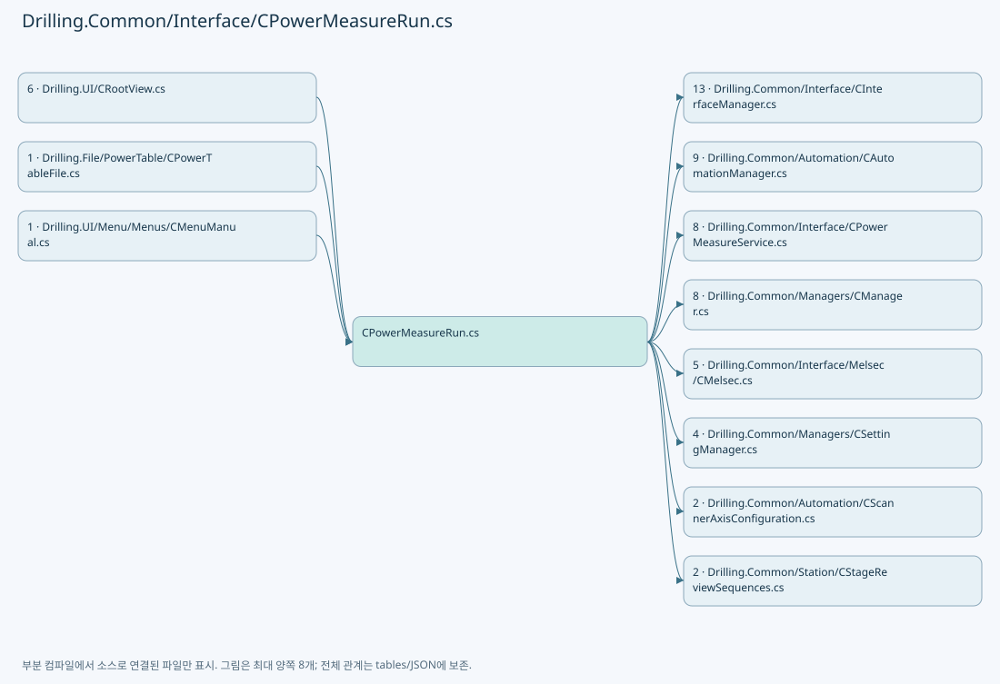

## 네임스페이스·타입·상속

| 타입 | 구분 | 원본 범위 | 선언/상속 |
| --- | --- | --- | --- |
| ST_POWER_MEASURE_REPORT | RecordDeclaration | 8–8 | ST_POWER_MEASURE_REPORT |
| CPowerMeasureRun | ClassDeclaration | 11–149 | CPowerMeasureRun: IAsyncDisposable, IPowerMeasureTable |
| CPowerMeasureDeviceSession | ClassDeclaration | 151–418 | CPowerMeasureDeviceSession: IPowerMeasureSession, IAsyncDisposable |
| Route | RecordDeclaration | 153–153 | Route |

## 멤버 빠른 목록

| 이름 | 종류 | 범위 | 서명 |
| --- | --- | --- | --- |
| _session | FieldDeclaration | L15–15 | Drilling.Common.Interface.CPowerMeasureDeviceSession Drilling.Common.Interface.CPowerMeasureRun._session |
| _started | FieldDeclaration | L16–16 | System.DateTimeOffset Drilling.Common.Interface.CPowerMeasureRun._started |
| _gate | FieldDeclaration | L17–17 | System.Threading.SemaphoreSlim Drilling.Common.Interface.CPowerMeasureRun._gate |
| _prepared | FieldDeclaration | L18–18 | bool Drilling.Common.Interface.CPowerMeasureRun._prepared |
| _measured | FieldDeclaration | L18–18 | bool Drilling.Common.Interface.CPowerMeasureRun._measured |
| _saved | FieldDeclaration | L18–18 | bool Drilling.Common.Interface.CPowerMeasureRun._saved |
| _reported | FieldDeclaration | L18–18 | bool Drilling.Common.Interface.CPowerMeasureRun._reported |
| _released | FieldDeclaration | L18–18 | bool Drilling.Common.Interface.CPowerMeasureRun._released |
| _result | FieldDeclaration | L19–19 | Drilling.Common.Interface.ST_POWER_MEASURE_SNAPSHOT? Drilling.Common.Interface.CPowerMeasureRun._result |
| AutoTargets | MethodDeclaration | L20–35 | System.Collections.Generic.IReadOnlyList<Drilling.Common.Interface.ST_POWER_MEASURE_TARGET> Drilling.Common.Interface.CPowerMeasureRun.AutoTargets(Drilling.Common.Managers.CSettingManager) |
| Number | MethodDeclaration | L36–41 | double Drilling.Common.Interface.CPowerMeasureRun.Number(Drilling.Common.Managers.CSettingManager, string, double) |
| Integer | MethodDeclaration | L42–46 | int Drilling.Common.Interface.CPowerMeasureRun.Integer(Drilling.Common.Managers.CSettingManager, string, int) |
| Prepare | MethodDeclaration | L47–59 | System.Threading.Tasks.Task Drilling.Common.Interface.CPowerMeasureRun.Prepare(System.Threading.CancellationToken) |
| Measure | MethodDeclaration | L60–108 | System.Threading.Tasks.Task Drilling.Common.Interface.CPowerMeasureRun.Measure(System.Threading.CancellationToken) |
| Save | MethodDeclaration | L109–121 | System.Threading.Tasks.Task Drilling.Common.Interface.CPowerMeasureRun.Save(System.Threading.CancellationToken) |
| Execute | MethodDeclaration | L122–126 | System.Threading.Tasks.Task Drilling.Common.Interface.CPowerMeasureRun.Execute(System.Threading.CancellationToken) |
| DisposeAsync | MethodDeclaration | L127–138 | System.Threading.Tasks.ValueTask Drilling.Common.Interface.CPowerMeasureRun.DisposeAsync() |
| Report | MethodDeclaration | L139–145 | void Drilling.Common.Interface.CPowerMeasureRun.Report() |
| Log | MethodDeclaration | L146–146 | void Drilling.Common.Interface.CPowerMeasureRun.Log(string, string) |
| FindStart | MethodDeclaration | L147–147 | Drilling.Common.Interface.ST_POWER_MEASURE_START Drilling.Common.Interface.CPowerMeasureRun.FindStart(int, double, System.Threading.CancellationToken) |
| SaveMeasurement | MethodDeclaration | L148–148 | void Drilling.Common.Interface.CPowerMeasureRun.SaveMeasurement(int, double, double, System.Threading.CancellationToken) |
| _routes | FieldDeclaration | L154–154 | System.Collections.Generic.Dictionary<int, Drilling.Common.Interface.CPowerMeasureDeviceSession.Route> Drilling.Common.Interface.CPowerMeasureDeviceSession._routes |
| _attenuators | FieldDeclaration | L155–155 | System.Collections.Generic.Dictionary<int, Drilling.Common.Interface.CAttenuatorPositioningService> Drilling.Common.Interface.CPowerMeasureDeviceSession._attenuators |
| _emissionGate | FieldDeclaration | L156–156 | System.Threading.SemaphoreSlim Drilling.Common.Interface.CPowerMeasureDeviceSession._emissionGate |
| _emitting | FieldDeclaration | L157–157 | System.Collections.Concurrent.ConcurrentDictionary<int, byte> Drilling.Common.Interface.CPowerMeasureDeviceSession._emitting |
| _flagMayBeOn | FieldDeclaration | L158–158 | bool Drilling.Common.Interface.CPowerMeasureDeviceSession._flagMayBeOn |
| _stage | FieldDeclaration | L159–159 | Drilling.Common.Station.CStageReviewSequences.Session? Drilling.Common.Interface.CPowerMeasureDeviceSession._stage |
| _stageDevice | FieldDeclaration | L160–160 | int Drilling.Common.Interface.CPowerMeasureDeviceSession._stageDevice |
| StageTolerance | PropertyDeclaration | L161–161 | double Drilling.Common.Interface.CPowerMeasureDeviceSession.StageTolerance |
| TimeoutMs | PropertyDeclaration | L162–162 | int Drilling.Common.Interface.CPowerMeasureDeviceSession.TimeoutMs |
| Interfaces | PropertyDeclaration | L163–163 | Drilling.Common.Interface.CInterfaceManager Drilling.Common.Interface.CPowerMeasureDeviceSession.Interfaces |
| Automation | PropertyDeclaration | L164–164 | Drilling.Common.Automation.CAutomationManager Drilling.Common.Interface.CPowerMeasureDeviceSession.Automation |
| StageFeedbackIds | FieldDeclaration | L165–165 | string[] Drilling.Common.Interface.CPowerMeasureDeviceSession.StageFeedbackIds |
| Sim | MethodDeclaration | L166–166 | bool Drilling.Common.Interface.CPowerMeasureDeviceSession.Sim(Drilling.Common.Interface.EN_EQP_MODULE, int) |
| IsSimulation | MethodDeclaration | L167–167 | bool Drilling.Common.Interface.CPowerMeasureDeviceSession.IsSimulation(int) |
| Connected | MethodDeclaration | L168–172 | void Drilling.Common.Interface.CPowerMeasureDeviceSession.Connected(Drilling.Common.Interface.EN_EQP_MODULE, int) |
| StageSnapshot | MethodDeclaration | L173–188 | (System.Collections.Generic.IReadOnlyDictionary<string, Drilling.Common.Interface.ST_MELSEC_CACHED_VALUE> Values, System.Collections.Generic.IReadOnlyList<Drilling.Common.Interface.ST_MELSEC_MAP_DATA> Map) Drilling.Common.Interface.CPowerMeasureDeviceSession.StageSnapshot() |
| StageEvidence | MethodDeclaration | L189–204 | string Drilling.Common.Interface.CPowerMeasureDeviceSession.StageEvidence(System.Collections.Generic.IReadOnlyDictionary<string, Drilling.Common.Interface.ST_MELSEC_CACHED_VALUE>?, System.Collections.Generic.IReadOnlyList<Drilling.Common.Interface.ST_MELSEC_MAP_DATA>?) |
| EnsureStageReady | MethodDeclaration | L206–217 | void Drilling.Common.Interface.CPowerMeasureDeviceSession.EnsureStageReady() |
| CheckStageReady | MethodDeclaration | L218–237 | System.Threading.Tasks.Task Drilling.Common.Interface.CPowerMeasureDeviceSession.CheckStageReady(System.Threading.CancellationToken) |
| MaintainStageFeedback | MethodDeclaration | L238–245 | System.Threading.Tasks.Task Drilling.Common.Interface.CPowerMeasureDeviceSession.MaintainStageFeedback(System.Threading.CancellationToken) |
| PrepareAll | MethodDeclaration | L246–308 | System.Threading.Tasks.Task Drilling.Common.Interface.CPowerMeasureDeviceSession.PrepareAll(System.Threading.CancellationToken) |
| WaitLaserReady | MethodDeclaration | L309–325 | System.Threading.Tasks.Task Drilling.Common.Interface.CPowerMeasureDeviceSession.WaitLaserReady(int, System.Threading.CancellationToken) |
| Prepare | MethodDeclaration | L326–326 | System.Threading.Tasks.Task Drilling.Common.Interface.CPowerMeasureDeviceSession.Prepare(Drilling.Common.Interface.ST_POWER_MEASURE_TARGET, System.Threading.CancellationToken) |
| GetAttenuatorPosition | MethodDeclaration | L327–342 | System.Threading.Tasks.Task<double> Drilling.Common.Interface.CPowerMeasureDeviceSession.GetAttenuatorPosition(Drilling.Common.Interface.ST_POWER_MEASURE_TARGET, System.Threading.CancellationToken) |
| MoveAttenuator | MethodDeclaration | L343–350 | System.Threading.Tasks.Task Drilling.Common.Interface.CPowerMeasureDeviceSession.MoveAttenuator(Drilling.Common.Interface.ST_POWER_MEASURE_TARGET, double, System.Threading.CancellationToken) |
| BeginMeasurement | MethodDeclaration | L351–369 | System.Threading.Tasks.Task Drilling.Common.Interface.CPowerMeasureDeviceSession.BeginMeasurement(Drilling.Common.Interface.ST_POWER_MEASURE_TARGET, System.Threading.CancellationToken) |
| EndMeasurement | MethodDeclaration | L370–388 | System.Threading.Tasks.Task Drilling.Common.Interface.CPowerMeasureDeviceSession.EndMeasurement(Drilling.Common.Interface.ST_POWER_MEASURE_TARGET) |
| ReadPower | MethodDeclaration | L389–399 | System.Threading.Tasks.Task<double> Drilling.Common.Interface.CPowerMeasureDeviceSession.ReadPower(Drilling.Common.Interface.ST_POWER_MEASURE_TARGET, System.Threading.CancellationToken) |
| Finish | MethodDeclaration | L400–411 | System.Threading.Tasks.Task Drilling.Common.Interface.CPowerMeasureDeviceSession.Finish(Drilling.Common.Interface.ST_POWER_MEASURE_TARGET) |
| DisposeAsync | MethodDeclaration | L412–417 | System.Threading.Tasks.ValueTask Drilling.Common.Interface.CPowerMeasureDeviceSession.DisposeAsync() |

## 멤버별 상세 계약·호출·처리 해설

### FieldDeclaration `_session` · L15–15

[Drilling.Common/Interface/CPowerMeasureRun.cs:15–15](https://github.com/kjuws10-rgb/A3Drilling/blob/5aee8e58439c9b455cae7c9593c9be986c3e682e/Drilling.Common/Interface/CPowerMeasureRun.cs#L15-L15)

| 항목 | 실제 추출 값 |
| --- | --- |
| 서명 | Drilling.Common.Interface.CPowerMeasureDeviceSession Drilling.Common.Interface.CPowerMeasureRun._session |
| 접근/수식자 | Private / private, readonly |
| 반환/값 타입 | Drilling.Common.Interface.CPowerMeasureDeviceSession |
| 소속 타입 | NamedType:Drilling.Common.Interface.CPowerMeasureRun |

현재 부분 분석에서 직접 연결된 호출자는 없습니다. XAML/이벤트/인터페이스·델리게이트·외부 진입을 추가 확인해야 하며, 미사용으로 판정한 것이 아닙니다.

호출하는 대상과 해석 범위:

| 원본 행 | 표현식 | 분석 상태 | 대상/소스 위치 |
| --- | --- | --- | --- |
| 15 | new | resolved | Drilling.Common.Interface.CPowerMeasureDeviceSession.CPowerMeasureDeviceSession(Drilling.Common.Managers.CManager, Drilling.Common.Managers.ST_RECIPE_DEFINITION, System.Collections.Generic.IReadOnlyList<Drilling.Common.Interface.ST_POWER_MEASURE_TARGET>) · Drilling.Common/Interface/CPowerMeasureRun.cs:151 |

본문의 실제 연산·분기·예외·반환 순서(원문 위치 순):

| 원본 행 | 종류 | 주석 해설 |
| --- | --- | --- |
| 15 | call | 함수·델리게이트 또는 객체 생성자를 호출합니다: new(manager, recipe, targets) |
| 15 | variable-initializer | 변수의 초기값을 지정합니다: _session = new(manager, recipe, targets) |

변경 전 점검: 입력/반환 타입, 위 호출자, 예외/취소 경로, 공유 상태와 저장·전송 소비자를 함께 확인합니다. 값의 단위나 물리 방향을 이름만으로 확정하지 않습니다.

### FieldDeclaration `_started` · L16–16

[Drilling.Common/Interface/CPowerMeasureRun.cs:16–16](https://github.com/kjuws10-rgb/A3Drilling/blob/5aee8e58439c9b455cae7c9593c9be986c3e682e/Drilling.Common/Interface/CPowerMeasureRun.cs#L16-L16)

| 항목 | 실제 추출 값 |
| --- | --- |
| 서명 | System.DateTimeOffset Drilling.Common.Interface.CPowerMeasureRun._started |
| 접근/수식자 | Private / private, readonly |
| 반환/값 타입 | System.DateTimeOffset |
| 소속 타입 | NamedType:Drilling.Common.Interface.CPowerMeasureRun |

현재 부분 분석에서 직접 연결된 호출자는 없습니다. XAML/이벤트/인터페이스·델리게이트·외부 진입을 추가 확인해야 하며, 미사용으로 판정한 것이 아닙니다.

본문의 실제 연산·분기·예외·반환 순서(원문 위치 순):

| 원본 행 | 종류 | 주석 해설 |
| --- | --- | --- |
| 16 | variable-initializer | 변수의 초기값을 지정합니다: _started = DateTimeOffset.Now |

변경 전 점검: 입력/반환 타입, 위 호출자, 예외/취소 경로, 공유 상태와 저장·전송 소비자를 함께 확인합니다. 값의 단위나 물리 방향을 이름만으로 확정하지 않습니다.

### FieldDeclaration `_gate` · L17–17

[Drilling.Common/Interface/CPowerMeasureRun.cs:17–17](https://github.com/kjuws10-rgb/A3Drilling/blob/5aee8e58439c9b455cae7c9593c9be986c3e682e/Drilling.Common/Interface/CPowerMeasureRun.cs#L17-L17)

| 항목 | 실제 추출 값 |
| --- | --- |
| 서명 | System.Threading.SemaphoreSlim Drilling.Common.Interface.CPowerMeasureRun._gate |
| 접근/수식자 | Private / private, readonly |
| 반환/값 타입 | System.Threading.SemaphoreSlim |
| 소속 타입 | NamedType:Drilling.Common.Interface.CPowerMeasureRun |

현재 부분 분석에서 직접 연결된 호출자는 없습니다. XAML/이벤트/인터페이스·델리게이트·외부 진입을 추가 확인해야 하며, 미사용으로 판정한 것이 아닙니다.

호출하는 대상과 해석 범위:

| 원본 행 | 표현식 | 분석 상태 | 대상/소스 위치 |
| --- | --- | --- | --- |
| 17 | new | resolved | System.Threading.SemaphoreSlim.SemaphoreSlim(int, int) |

본문의 실제 연산·분기·예외·반환 순서(원문 위치 순):

| 원본 행 | 종류 | 주석 해설 |
| --- | --- | --- |
| 17 | call | 함수·델리게이트 또는 객체 생성자를 호출합니다: new(1, 1) |
| 17 | variable-initializer | 변수의 초기값을 지정합니다: _gate = new(1, 1) |

변경 전 점검: 입력/반환 타입, 위 호출자, 예외/취소 경로, 공유 상태와 저장·전송 소비자를 함께 확인합니다. 값의 단위나 물리 방향을 이름만으로 확정하지 않습니다.

### FieldDeclaration `_prepared` · L18–18

[Drilling.Common/Interface/CPowerMeasureRun.cs:18–18](https://github.com/kjuws10-rgb/A3Drilling/blob/5aee8e58439c9b455cae7c9593c9be986c3e682e/Drilling.Common/Interface/CPowerMeasureRun.cs#L18-L18)

| 항목 | 실제 추출 값 |
| --- | --- |
| 서명 | bool Drilling.Common.Interface.CPowerMeasureRun._prepared |
| 접근/수식자 | Private / private |
| 반환/값 타입 | bool |
| 소속 타입 | NamedType:Drilling.Common.Interface.CPowerMeasureRun |

현재 부분 분석에서 직접 연결된 호출자는 없습니다. XAML/이벤트/인터페이스·델리게이트·외부 진입을 추가 확인해야 하며, 미사용으로 판정한 것이 아닙니다.

변경 전 점검: 입력/반환 타입, 위 호출자, 예외/취소 경로, 공유 상태와 저장·전송 소비자를 함께 확인합니다. 값의 단위나 물리 방향을 이름만으로 확정하지 않습니다.

### FieldDeclaration `_measured` · L18–18

[Drilling.Common/Interface/CPowerMeasureRun.cs:18–18](https://github.com/kjuws10-rgb/A3Drilling/blob/5aee8e58439c9b455cae7c9593c9be986c3e682e/Drilling.Common/Interface/CPowerMeasureRun.cs#L18-L18)

| 항목 | 실제 추출 값 |
| --- | --- |
| 서명 | bool Drilling.Common.Interface.CPowerMeasureRun._measured |
| 접근/수식자 | Private / private |
| 반환/값 타입 | bool |
| 소속 타입 | NamedType:Drilling.Common.Interface.CPowerMeasureRun |

현재 부분 분석에서 직접 연결된 호출자는 없습니다. XAML/이벤트/인터페이스·델리게이트·외부 진입을 추가 확인해야 하며, 미사용으로 판정한 것이 아닙니다.

변경 전 점검: 입력/반환 타입, 위 호출자, 예외/취소 경로, 공유 상태와 저장·전송 소비자를 함께 확인합니다. 값의 단위나 물리 방향을 이름만으로 확정하지 않습니다.

### FieldDeclaration `_saved` · L18–18

[Drilling.Common/Interface/CPowerMeasureRun.cs:18–18](https://github.com/kjuws10-rgb/A3Drilling/blob/5aee8e58439c9b455cae7c9593c9be986c3e682e/Drilling.Common/Interface/CPowerMeasureRun.cs#L18-L18)

| 항목 | 실제 추출 값 |
| --- | --- |
| 서명 | bool Drilling.Common.Interface.CPowerMeasureRun._saved |
| 접근/수식자 | Private / private |
| 반환/값 타입 | bool |
| 소속 타입 | NamedType:Drilling.Common.Interface.CPowerMeasureRun |

현재 부분 분석에서 직접 연결된 호출자는 없습니다. XAML/이벤트/인터페이스·델리게이트·외부 진입을 추가 확인해야 하며, 미사용으로 판정한 것이 아닙니다.

변경 전 점검: 입력/반환 타입, 위 호출자, 예외/취소 경로, 공유 상태와 저장·전송 소비자를 함께 확인합니다. 값의 단위나 물리 방향을 이름만으로 확정하지 않습니다.

### FieldDeclaration `_reported` · L18–18

[Drilling.Common/Interface/CPowerMeasureRun.cs:18–18](https://github.com/kjuws10-rgb/A3Drilling/blob/5aee8e58439c9b455cae7c9593c9be986c3e682e/Drilling.Common/Interface/CPowerMeasureRun.cs#L18-L18)

| 항목 | 실제 추출 값 |
| --- | --- |
| 서명 | bool Drilling.Common.Interface.CPowerMeasureRun._reported |
| 접근/수식자 | Private / private |
| 반환/값 타입 | bool |
| 소속 타입 | NamedType:Drilling.Common.Interface.CPowerMeasureRun |

현재 부분 분석에서 직접 연결된 호출자는 없습니다. XAML/이벤트/인터페이스·델리게이트·외부 진입을 추가 확인해야 하며, 미사용으로 판정한 것이 아닙니다.

변경 전 점검: 입력/반환 타입, 위 호출자, 예외/취소 경로, 공유 상태와 저장·전송 소비자를 함께 확인합니다. 값의 단위나 물리 방향을 이름만으로 확정하지 않습니다.

### FieldDeclaration `_released` · L18–18

[Drilling.Common/Interface/CPowerMeasureRun.cs:18–18](https://github.com/kjuws10-rgb/A3Drilling/blob/5aee8e58439c9b455cae7c9593c9be986c3e682e/Drilling.Common/Interface/CPowerMeasureRun.cs#L18-L18)

| 항목 | 실제 추출 값 |
| --- | --- |
| 서명 | bool Drilling.Common.Interface.CPowerMeasureRun._released |
| 접근/수식자 | Private / private |
| 반환/값 타입 | bool |
| 소속 타입 | NamedType:Drilling.Common.Interface.CPowerMeasureRun |

현재 부분 분석에서 직접 연결된 호출자는 없습니다. XAML/이벤트/인터페이스·델리게이트·외부 진입을 추가 확인해야 하며, 미사용으로 판정한 것이 아닙니다.

변경 전 점검: 입력/반환 타입, 위 호출자, 예외/취소 경로, 공유 상태와 저장·전송 소비자를 함께 확인합니다. 값의 단위나 물리 방향을 이름만으로 확정하지 않습니다.

### FieldDeclaration `_result` · L19–19

[Drilling.Common/Interface/CPowerMeasureRun.cs:19–19](https://github.com/kjuws10-rgb/A3Drilling/blob/5aee8e58439c9b455cae7c9593c9be986c3e682e/Drilling.Common/Interface/CPowerMeasureRun.cs#L19-L19)

| 항목 | 실제 추출 값 |
| --- | --- |
| 서명 | Drilling.Common.Interface.ST_POWER_MEASURE_SNAPSHOT? Drilling.Common.Interface.CPowerMeasureRun._result |
| 접근/수식자 | Private / private |
| 반환/값 타입 | Drilling.Common.Interface.ST_POWER_MEASURE_SNAPSHOT? |
| 소속 타입 | NamedType:Drilling.Common.Interface.CPowerMeasureRun |

현재 부분 분석에서 직접 연결된 호출자는 없습니다. XAML/이벤트/인터페이스·델리게이트·외부 진입을 추가 확인해야 하며, 미사용으로 판정한 것이 아닙니다.

변경 전 점검: 입력/반환 타입, 위 호출자, 예외/취소 경로, 공유 상태와 저장·전송 소비자를 함께 확인합니다. 값의 단위나 물리 방향을 이름만으로 확정하지 않습니다.

### MethodDeclaration `AutoTargets` · L20–35

[Drilling.Common/Interface/CPowerMeasureRun.cs:20–35](https://github.com/kjuws10-rgb/A3Drilling/blob/5aee8e58439c9b455cae7c9593c9be986c3e682e/Drilling.Common/Interface/CPowerMeasureRun.cs#L20-L35)

| 항목 | 실제 추출 값 |
| --- | --- |
| 서명 | System.Collections.Generic.IReadOnlyList<Drilling.Common.Interface.ST_POWER_MEASURE_TARGET> Drilling.Common.Interface.CPowerMeasureRun.AutoTargets(Drilling.Common.Managers.CSettingManager) |
| 접근/수식자 | Public / public, static |
| 반환/값 타입 | System.Collections.Generic.IReadOnlyList<Drilling.Common.Interface.ST_POWER_MEASURE_TARGET> |
| 소속 타입 | NamedType:Drilling.Common.Interface.CPowerMeasureRun |

입력 계약:

| 이름 | 타입 | 전달 | 선택/기본값 |
| --- | --- | --- | --- |
| settings | Drilling.Common.Managers.CSettingManager | None | False /  |

정적 호출자로 확인된 위치:

| 호출 파일/행 | 호출 표현식 | 런타임 분기 가능 |
| --- | --- | --- |
| [Drilling.UI/CRootView.cs:2783–2783](https://github.com/kjuws10-rgb/A3Drilling/blob/5aee8e58439c9b455cae7c9593c9be986c3e682e/Drilling.UI/CRootView.cs#L2783-L2783) | CPowerMeasureRun.AutoTargets | False |

호출하는 대상과 해석 범위:

| 원본 행 | 표현식 | 분석 상태 | 대상/소스 위치 |
| --- | --- | --- | --- |
| 20 | Enumerable.Range(1, 8).Select(head => { var toleranceKey = $"H{head:00}_TPM_TOLERANCE_W"; var attemptsKey = $"H{head:00}_TPM_MAX_ATTEMPTS"; // Older Setting documents use the common keys. Read that fallback only when a Head key is absent. var tolerance = string.IsNullOrWhiteSpace(settings.GetValue(EN_SETTING_TAB.Option, toleranceKey)) ? Number(sett… | resolved | Drilling.Common.Interface.ST_POWER_MEASURE_TARGET[] System.Collections.Generic.IEnumerable<Drilling.Common.Interface.ST_POWER_MEASURE_TARGET>.ToArray<Drilling.Common.Interface.ST_POWER_MEASURE_TARGET>() |
| 20 | Enumerable.Range(1, 8).Select | resolved | System.Collections.Generic.IEnumerable<Drilling.Common.Interface.ST_POWER_MEASURE_TARGET> System.Collections.Generic.IEnumerable<int>.Select<int, Drilling.Common.Interface.ST_POWER_MEASURE_TARGET>(System.Func<int, Drilling.Common.Interface.ST_POWER_MEASURE_TARGET>) |
| 20 | Enumerable.Range | resolved | System.Collections.Generic.IEnumerable<int> System.Linq.Enumerable.Range(int, int) |
| 25 | string.IsNullOrWhiteSpace | resolved | bool string.IsNullOrWhiteSpace(string?) |
| 25 | settings.GetValue | resolved | string Drilling.Common.Managers.CSettingManager.GetValue(Drilling.Common.Managers.EN_SETTING_TAB, string, string, System.Threading.CancellationToken) · Drilling.Common/Managers/CSettingManager.cs:59 |
| 26 | Number | resolved | double Drilling.Common.Interface.CPowerMeasureRun.Number(Drilling.Common.Managers.CSettingManager, string, double) · Drilling.Common/Interface/CPowerMeasureRun.cs:36 |
| 26 | Number | resolved | double Drilling.Common.Interface.CPowerMeasureRun.Number(Drilling.Common.Managers.CSettingManager, string, double) · Drilling.Common/Interface/CPowerMeasureRun.cs:36 |
| 27 | string.IsNullOrWhiteSpace | resolved | bool string.IsNullOrWhiteSpace(string?) |
| 27 | settings.GetValue | resolved | string Drilling.Common.Managers.CSettingManager.GetValue(Drilling.Common.Managers.EN_SETTING_TAB, string, string, System.Threading.CancellationToken) · Drilling.Common/Managers/CSettingManager.cs:59 |
| 28 | Integer | resolved | int Drilling.Common.Interface.CPowerMeasureRun.Integer(Drilling.Common.Managers.CSettingManager, string, int) · Drilling.Common/Interface/CPowerMeasureRun.cs:42 |
| 28 | Integer | resolved | int Drilling.Common.Interface.CPowerMeasureRun.Integer(Drilling.Common.Managers.CSettingManager, string, int) · Drilling.Common/Interface/CPowerMeasureRun.cs:42 |
| 29 | new ST_POWER_MEASURE_TARGET | resolved | Drilling.Common.Interface.ST_POWER_MEASURE_TARGET.ST_POWER_MEASURE_TARGET(int, int, double, Drilling.Common.Interface.ST_POWER_MEASURE_OPTIONS) · Drilling.Common/Interface/CPowerMeasureService.cs:267 |
| 29 | Number | resolved | double Drilling.Common.Interface.CPowerMeasureRun.Number(Drilling.Common.Managers.CSettingManager, string, double) · Drilling.Common/Interface/CPowerMeasureRun.cs:36 |
| 30 | new | resolved | Drilling.Common.Interface.ST_POWER_MEASURE_OPTIONS.ST_POWER_MEASURE_OPTIONS(string, int, int, int) · Drilling.Common/Interface/CPowerMeasureService.cs:268 |
| 30 | Integer | resolved | int Drilling.Common.Interface.CPowerMeasureRun.Integer(Drilling.Common.Managers.CSettingManager, string, int) · Drilling.Common/Interface/CPowerMeasureRun.cs:42 |
| 30 | Integer | resolved | int Drilling.Common.Interface.CPowerMeasureRun.Integer(Drilling.Common.Managers.CSettingManager, string, int) · Drilling.Common/Interface/CPowerMeasureRun.cs:42 |
| 30 | Integer | resolved | int Drilling.Common.Interface.CPowerMeasureRun.Integer(Drilling.Common.Managers.CSettingManager, string, int) · Drilling.Common/Interface/CPowerMeasureRun.cs:42 |
| 33 | Integer | resolved | int Drilling.Common.Interface.CPowerMeasureRun.Integer(Drilling.Common.Managers.CSettingManager, string, int) · Drilling.Common/Interface/CPowerMeasureRun.cs:42 |

본문의 실제 연산·분기·예외·반환 순서(원문 위치 순):

| 원본 행 | 종류 | 주석 해설 |
| --- | --- | --- |
| 20 | call | 함수·델리게이트 또는 객체 생성자를 호출합니다: Enumerable.Range(1, 8) |
| 20 | call | 함수·델리게이트 또는 객체 생성자를 호출합니다: Enumerable.Range(1, 8).Select(head => { var toleranceKey = $"H{head:00}_TPM_TOLERANCE_W"; var attemptsKey = $"H{head:00}_TPM_MAX_ATTEMPTS"; // Older Setting documents use the common keys. Read that fallback only when a H… |
| 20 | call | 함수·델리게이트 또는 객체 생성자를 호출합니다: Enumerable.Range(1, 8).Select(head => { var toleranceKey = $"H{head:00}_TPM_TOLERANCE_W"; var attemptsKey = $"H{head:00}_TPM_MAX_ATTEMPTS"; // Older Setting documents use the common keys. Read that fallback only when a H… |
| 22 | local-declaration | 지역 변수를 선언합니다: var toleranceKey = $"H{head:00}_TPM_TOLERANCE_W"; |
| 22 | variable-initializer | 변수의 초기값을 지정합니다: toleranceKey = $"H{head:00}_TPM_TOLERANCE_W" |
| 23 | local-declaration | 지역 변수를 선언합니다: var attemptsKey = $"H{head:00}_TPM_MAX_ATTEMPTS"; |
| 23 | variable-initializer | 변수의 초기값을 지정합니다: attemptsKey = $"H{head:00}_TPM_MAX_ATTEMPTS" |
| 25 | call | 함수·델리게이트 또는 객체 생성자를 호출합니다: string.IsNullOrWhiteSpace(settings.GetValue(EN_SETTING_TAB.Option, toleranceKey)) |
| 25 | call | 함수·델리게이트 또는 객체 생성자를 호출합니다: settings.GetValue(EN_SETTING_TAB.Option, toleranceKey) |
| 25 | conditional-expression | 조건에 따라 결과식을 선택합니다: string.IsNullOrWhiteSpace(settings.GetValue(EN_SETTING_TAB.Option, toleranceKey)) ? Number(settings, "TPM_TOLERANCE_W", .01) : Number(settings, toleranceKey, .01) |
| 25 | local-declaration | 지역 변수를 선언합니다: var tolerance = string.IsNullOrWhiteSpace(settings.GetValue(EN_SETTING_TAB.Option, toleranceKey)) ? Number(settings, "TPM_TOLERANCE_W", .01) : Number(settings, toleranceKey, .01); |
| 25 | variable-initializer | 변수의 초기값을 지정합니다: tolerance = string.IsNullOrWhiteSpace(settings.GetValue(EN_SETTING_TAB.Option, toleranceKey)) ? Number(settings, "TPM_TOLERANCE_W", .01) : Number(settings, toleranceKey, .01) |
| 26 | call | 함수·델리게이트 또는 객체 생성자를 호출합니다: Number(settings, "TPM_TOLERANCE_W", .01) |
| 26 | call | 함수·델리게이트 또는 객체 생성자를 호출합니다: Number(settings, toleranceKey, .01) |
| 27 | call | 함수·델리게이트 또는 객체 생성자를 호출합니다: string.IsNullOrWhiteSpace(settings.GetValue(EN_SETTING_TAB.Option, attemptsKey)) |
| 27 | call | 함수·델리게이트 또는 객체 생성자를 호출합니다: settings.GetValue(EN_SETTING_TAB.Option, attemptsKey) |
| 27 | conditional-expression | 조건에 따라 결과식을 선택합니다: string.IsNullOrWhiteSpace(settings.GetValue(EN_SETTING_TAB.Option, attemptsKey)) ? Integer(settings, "TPM_MAX_ATTEMPTS", 12) : Integer(settings, attemptsKey, 12) |
| 27 | local-declaration | 지역 변수를 선언합니다: var attempts = string.IsNullOrWhiteSpace(settings.GetValue(EN_SETTING_TAB.Option, attemptsKey)) ? Integer(settings, "TPM_MAX_ATTEMPTS", 12) : Integer(settings, attemptsKey, 12); |
| 27 | variable-initializer | 변수의 초기값을 지정합니다: attempts = string.IsNullOrWhiteSpace(settings.GetValue(EN_SETTING_TAB.Option, attemptsKey)) ? Integer(settings, "TPM_MAX_ATTEMPTS", 12) : Integer(settings, attemptsKey, 12) |
| 28 | call | 함수·델리게이트 또는 객체 생성자를 호출합니다: Integer(settings, "TPM_MAX_ATTEMPTS", 12) |
| 28 | call | 함수·델리게이트 또는 객체 생성자를 호출합니다: Integer(settings, attemptsKey, 12) |
| 29 | call | 함수·델리게이트 또는 객체 생성자를 호출합니다: Number(settings, $"H{head:00}_TPM_TARGET_POWER_W", 1.2) |
| 29 | call | 함수·델리게이트 또는 객체 생성자를 호출합니다: new ST_POWER_MEASURE_TARGET(head, head - 1, Number(settings, $"H{head:00}_TPM_TARGET_POWER_W", 1.2), new("FINE", Integer(settings, $"H{head:00}_TPM_SETTLE_TIME_MS", 300), Integer(settings, $"H{head:00}_TPM_MEASURE_COUNT"… |
| 29 | return | 호출자에게 값 또는 제어를 반환합니다: return new ST_POWER_MEASURE_TARGET(head, head - 1, Number(settings, $"H{head:00}_TPM_TARGET_POWER_W", 1.2), new("FINE", Integer(settings, $"H{head:00}_TPM_SETTLE_TIME_MS", 300), Integer(settings, $"H{head:00}_TPM_MEASURE_COUNT", 1 |
| 30 | call | 함수·델리게이트 또는 객체 생성자를 호출합니다: Integer(settings, $"H{head:00}_TPM_SETTLE_TIME_MS", 300) |
| 30 | call | 함수·델리게이트 또는 객체 생성자를 호출합니다: Integer(settings, $"H{head:00}_TPM_MEASURE_COUNT", 1) |
| 30 | call | 함수·델리게이트 또는 객체 생성자를 호출합니다: Integer(settings, $"H{head:00}_TPM_INTERVAL_MS", 100) |
| 30 | call | 함수·델리게이트 또는 객체 생성자를 호출합니다: new("FINE", Integer(settings, $"H{head:00}_TPM_SETTLE_TIME_MS", 300), Integer(settings, $"H{head:00}_TPM_MEASURE_COUNT", 1), Integer(settings, $"H{head:00}_TPM_INTERVAL_MS", 100)) { ToleranceW = tolerance, MaximumAttempt… |
| 32 | assignment | 값을 대상에 대입합니다: ToleranceW = tolerance |
| 32 | assignment | 값을 대상에 대입합니다: MaximumAttempts = attempts |
| 33 | assignment | 값을 대상에 대입합니다: CoolingTimeMs = Integer(settings, "TPM_COOLING_TIME_MS", 100) |
| 33 | call | 함수·델리게이트 또는 객체 생성자를 호출합니다: Integer(settings, "TPM_COOLING_TIME_MS", 100) |

변경 전 점검: 입력/반환 타입, 위 호출자, 예외/취소 경로, 공유 상태와 저장·전송 소비자를 함께 확인합니다. 값의 단위나 물리 방향을 이름만으로 확정하지 않습니다.

### MethodDeclaration `Number` · L36–41

[Drilling.Common/Interface/CPowerMeasureRun.cs:36–41](https://github.com/kjuws10-rgb/A3Drilling/blob/5aee8e58439c9b455cae7c9593c9be986c3e682e/Drilling.Common/Interface/CPowerMeasureRun.cs#L36-L41)

| 항목 | 실제 추출 값 |
| --- | --- |
| 서명 | double Drilling.Common.Interface.CPowerMeasureRun.Number(Drilling.Common.Managers.CSettingManager, string, double) |
| 접근/수식자 | Internal / internal, static |
| 반환/값 타입 | double |
| 소속 타입 | NamedType:Drilling.Common.Interface.CPowerMeasureRun |

입력 계약:

| 이름 | 타입 | 전달 | 선택/기본값 |
| --- | --- | --- | --- |
| settings | Drilling.Common.Managers.CSettingManager | None | False /  |
| key | string | None | False /  |
| fallback | double | None | False /  |

정적 호출자로 확인된 위치:

| 호출 파일/행 | 호출 표현식 | 런타임 분기 가능 |
| --- | --- | --- |
| [Drilling.Common/Interface/CPowerMeasureRun.cs:26–26](https://github.com/kjuws10-rgb/A3Drilling/blob/5aee8e58439c9b455cae7c9593c9be986c3e682e/Drilling.Common/Interface/CPowerMeasureRun.cs#L26-L26) | Number | False |
| [Drilling.Common/Interface/CPowerMeasureRun.cs:26–26](https://github.com/kjuws10-rgb/A3Drilling/blob/5aee8e58439c9b455cae7c9593c9be986c3e682e/Drilling.Common/Interface/CPowerMeasureRun.cs#L26-L26) | Number | False |
| [Drilling.Common/Interface/CPowerMeasureRun.cs:29–29](https://github.com/kjuws10-rgb/A3Drilling/blob/5aee8e58439c9b455cae7c9593c9be986c3e682e/Drilling.Common/Interface/CPowerMeasureRun.cs#L29-L29) | Number | False |
| [Drilling.Common/Interface/CPowerMeasureRun.cs:44–44](https://github.com/kjuws10-rgb/A3Drilling/blob/5aee8e58439c9b455cae7c9593c9be986c3e682e/Drilling.Common/Interface/CPowerMeasureRun.cs#L44-L44) | Number | False |
| [Drilling.Common/Interface/CPowerMeasureRun.cs:161–161](https://github.com/kjuws10-rgb/A3Drilling/blob/5aee8e58439c9b455cae7c9593c9be986c3e682e/Drilling.Common/Interface/CPowerMeasureRun.cs#L161-L161) | CPowerMeasureRun.Number | False |

호출하는 대상과 해석 범위:

| 원본 행 | 표현식 | 분석 상태 | 대상/소스 위치 |
| --- | --- | --- | --- |
| 38 | settings.GetValue | resolved | string Drilling.Common.Managers.CSettingManager.GetValue(Drilling.Common.Managers.EN_SETTING_TAB, string, string, System.Threading.CancellationToken) · Drilling.Common/Managers/CSettingManager.cs:59 |
| 38 | fallback.ToString | resolved | string double.ToString(string?, System.IFormatProvider?) |
| 39 | double.TryParse | resolved | bool double.TryParse(string?, System.Globalization.NumberStyles, System.IFormatProvider?, out double) |
| 39 | double.IsFinite | resolved | bool double.IsFinite(double) |
| 40 | new InvalidOperationException | resolved | System.InvalidOperationException.InvalidOperationException(string?) |

본문의 실제 연산·분기·예외·반환 순서(원문 위치 순):

| 원본 행 | 종류 | 주석 해설 |
| --- | --- | --- |
| 38 | call | 함수·델리게이트 또는 객체 생성자를 호출합니다: settings.GetValue(EN_SETTING_TAB.Option, key, fallback.ToString("R", CultureInfo.InvariantCulture)) |
| 38 | call | 함수·델리게이트 또는 객체 생성자를 호출합니다: fallback.ToString("R", CultureInfo.InvariantCulture) |
| 38 | local-declaration | 지역 변수를 선언합니다: var text = settings.GetValue(EN_SETTING_TAB.Option, key, fallback.ToString("R", CultureInfo.InvariantCulture)); |
| 38 | variable-initializer | 변수의 초기값을 지정합니다: text = settings.GetValue(EN_SETTING_TAB.Option, key, fallback.ToString("R", CultureInfo.InvariantCulture)) |
| 39 | call | 함수·델리게이트 또는 객체 생성자를 호출합니다: double.TryParse(text, NumberStyles.Float, CultureInfo.InvariantCulture, out var value) |
| 39 | call | 함수·델리게이트 또는 객체 생성자를 호출합니다: double.IsFinite(value) |
| 39 | conditional-expression | 조건에 따라 결과식을 선택합니다: double.TryParse(text, NumberStyles.Float, CultureInfo.InvariantCulture, out var value) && double.IsFinite(value) && value >= 0 ? value : throw new InvalidOperationException($"PowerMeter 설정 오류: {key}={text}") |
| 39 | return | 호출자에게 값 또는 제어를 반환합니다: return double.TryParse(text, NumberStyles.Float, CultureInfo.InvariantCulture, out var value) && double.IsFinite(value) && value >= 0 ? value : throw new InvalidOperationException($"PowerMeter 설정 오류: {key}={text}"); |
| 40 | call | 함수·델리게이트 또는 객체 생성자를 호출합니다: new InvalidOperationException($"PowerMeter 설정 오류: {key}={text}") |
| 40 | throw | 예외를 발생/전달합니다: throw new InvalidOperationException($"PowerMeter 설정 오류: {key}={text}") |

변경 전 점검: 입력/반환 타입, 위 호출자, 예외/취소 경로, 공유 상태와 저장·전송 소비자를 함께 확인합니다. 값의 단위나 물리 방향을 이름만으로 확정하지 않습니다.

### MethodDeclaration `Integer` · L42–46

[Drilling.Common/Interface/CPowerMeasureRun.cs:42–46](https://github.com/kjuws10-rgb/A3Drilling/blob/5aee8e58439c9b455cae7c9593c9be986c3e682e/Drilling.Common/Interface/CPowerMeasureRun.cs#L42-L46)

| 항목 | 실제 추출 값 |
| --- | --- |
| 서명 | int Drilling.Common.Interface.CPowerMeasureRun.Integer(Drilling.Common.Managers.CSettingManager, string, int) |
| 접근/수식자 | Internal / internal, static |
| 반환/값 타입 | int |
| 소속 타입 | NamedType:Drilling.Common.Interface.CPowerMeasureRun |

입력 계약:

| 이름 | 타입 | 전달 | 선택/기본값 |
| --- | --- | --- | --- |
| settings | Drilling.Common.Managers.CSettingManager | None | False /  |
| key | string | None | False /  |
| fallback | int | None | False /  |

정적 호출자로 확인된 위치:

| 호출 파일/행 | 호출 표현식 | 런타임 분기 가능 |
| --- | --- | --- |
| [Drilling.Common/Interface/CPowerMeasureRun.cs:28–28](https://github.com/kjuws10-rgb/A3Drilling/blob/5aee8e58439c9b455cae7c9593c9be986c3e682e/Drilling.Common/Interface/CPowerMeasureRun.cs#L28-L28) | Integer | False |
| [Drilling.Common/Interface/CPowerMeasureRun.cs:28–28](https://github.com/kjuws10-rgb/A3Drilling/blob/5aee8e58439c9b455cae7c9593c9be986c3e682e/Drilling.Common/Interface/CPowerMeasureRun.cs#L28-L28) | Integer | False |
| [Drilling.Common/Interface/CPowerMeasureRun.cs:30–30](https://github.com/kjuws10-rgb/A3Drilling/blob/5aee8e58439c9b455cae7c9593c9be986c3e682e/Drilling.Common/Interface/CPowerMeasureRun.cs#L30-L30) | Integer | False |
| [Drilling.Common/Interface/CPowerMeasureRun.cs:30–30](https://github.com/kjuws10-rgb/A3Drilling/blob/5aee8e58439c9b455cae7c9593c9be986c3e682e/Drilling.Common/Interface/CPowerMeasureRun.cs#L30-L30) | Integer | False |
| [Drilling.Common/Interface/CPowerMeasureRun.cs:30–30](https://github.com/kjuws10-rgb/A3Drilling/blob/5aee8e58439c9b455cae7c9593c9be986c3e682e/Drilling.Common/Interface/CPowerMeasureRun.cs#L30-L30) | Integer | False |
| [Drilling.Common/Interface/CPowerMeasureRun.cs:33–33](https://github.com/kjuws10-rgb/A3Drilling/blob/5aee8e58439c9b455cae7c9593c9be986c3e682e/Drilling.Common/Interface/CPowerMeasureRun.cs#L33-L33) | Integer | False |
| [Drilling.Common/Interface/CPowerMeasureRun.cs:162–162](https://github.com/kjuws10-rgb/A3Drilling/blob/5aee8e58439c9b455cae7c9593c9be986c3e682e/Drilling.Common/Interface/CPowerMeasureRun.cs#L162-L162) | CPowerMeasureRun.Integer | False |

호출하는 대상과 해석 범위:

| 원본 행 | 표현식 | 분석 상태 | 대상/소스 위치 |
| --- | --- | --- | --- |
| 44 | Number | resolved | double Drilling.Common.Interface.CPowerMeasureRun.Number(Drilling.Common.Managers.CSettingManager, string, double) · Drilling.Common/Interface/CPowerMeasureRun.cs:36 |
| 45 | Math.Truncate | resolved | double System.Math.Truncate(double) |
| 45 | new InvalidOperationException | resolved | System.InvalidOperationException.InvalidOperationException(string?) |

본문의 실제 연산·분기·예외·반환 순서(원문 위치 순):

| 원본 행 | 종류 | 주석 해설 |
| --- | --- | --- |
| 44 | call | 함수·델리게이트 또는 객체 생성자를 호출합니다: Number(settings, key, fallback) |
| 44 | local-declaration | 지역 변수를 선언합니다: var value = Number(settings, key, fallback); |
| 44 | variable-initializer | 변수의 초기값을 지정합니다: value = Number(settings, key, fallback) |
| 45 | call | 함수·델리게이트 또는 객체 생성자를 호출합니다: Math.Truncate(value) |
| 45 | call | 함수·델리게이트 또는 객체 생성자를 호출합니다: new InvalidOperationException($"정수 설정이 필요합니다: {key}") |
| 45 | conditional-expression | 조건에 따라 결과식을 선택합니다: value == Math.Truncate(value) && value <= int.MaxValue ? (int)value : throw new InvalidOperationException($"정수 설정이 필요합니다: {key}") |
| 45 | return | 호출자에게 값 또는 제어를 반환합니다: return value == Math.Truncate(value) && value <= int.MaxValue ? (int)value : throw new InvalidOperationException($"정수 설정이 필요합니다: {key}"); |
| 45 | throw | 예외를 발생/전달합니다: throw new InvalidOperationException($"정수 설정이 필요합니다: {key}") |

변경 전 점검: 입력/반환 타입, 위 호출자, 예외/취소 경로, 공유 상태와 저장·전송 소비자를 함께 확인합니다. 값의 단위나 물리 방향을 이름만으로 확정하지 않습니다.

### MethodDeclaration `Prepare` · L47–59

[Drilling.Common/Interface/CPowerMeasureRun.cs:47–59](https://github.com/kjuws10-rgb/A3Drilling/blob/5aee8e58439c9b455cae7c9593c9be986c3e682e/Drilling.Common/Interface/CPowerMeasureRun.cs#L47-L59)

| 항목 | 실제 추출 값 |
| --- | --- |
| 서명 | System.Threading.Tasks.Task Drilling.Common.Interface.CPowerMeasureRun.Prepare(System.Threading.CancellationToken) |
| 접근/수식자 | Public / public, async |
| 반환/값 타입 | System.Threading.Tasks.Task |
| 소속 타입 | NamedType:Drilling.Common.Interface.CPowerMeasureRun |

입력 계약:

| 이름 | 타입 | 전달 | 선택/기본값 |
| --- | --- | --- | --- |
| token | System.Threading.CancellationToken | None | False /  |

정적 호출자로 확인된 위치:

| 호출 파일/행 | 호출 표현식 | 런타임 분기 가능 |
| --- | --- | --- |
| [Drilling.Common/Interface/CPowerMeasureRun.cs:124–124](https://github.com/kjuws10-rgb/A3Drilling/blob/5aee8e58439c9b455cae7c9593c9be986c3e682e/Drilling.Common/Interface/CPowerMeasureRun.cs#L124-L124) | Prepare | False |
| [Drilling.UI/CRootView.cs:2784–2784](https://github.com/kjuws10-rgb/A3Drilling/blob/5aee8e58439c9b455cae7c9593c9be986c3e682e/Drilling.UI/CRootView.cs#L2784-L2784) | run.Prepare | False |

호출하는 대상과 해석 범위:

| 원본 행 | 표현식 | 분석 상태 | 대상/소스 위치 |
| --- | --- | --- | --- |
| 49 | _gate.WaitAsync(token).ConfigureAwait | resolved | System.Runtime.CompilerServices.ConfiguredTaskAwaitable System.Threading.Tasks.Task.ConfigureAwait(bool) |
| 49 | _gate.WaitAsync | resolved | System.Threading.Tasks.Task System.Threading.SemaphoreSlim.WaitAsync(System.Threading.CancellationToken) |
| 52 | new InvalidOperationException | resolved | System.InvalidOperationException.InvalidOperationException(string?) |
| 53 | CPowerMeasureService.ValidateTargets | resolved | void Drilling.Common.Interface.CPowerMeasureService.ValidateTargets(System.Collections.Generic.IReadOnlyList<Drilling.Common.Interface.ST_POWER_MEASURE_TARGET>) · Drilling.Common/Interface/CPowerMeasureService.cs:18 |
| 54 | _session.PrepareAll(token).ConfigureAwait | resolved | System.Runtime.CompilerServices.ConfiguredTaskAwaitable System.Threading.Tasks.Task.ConfigureAwait(bool) |
| 54 | _session.PrepareAll | resolved | System.Threading.Tasks.Task Drilling.Common.Interface.CPowerMeasureDeviceSession.PrepareAll(System.Threading.CancellationToken) · Drilling.Common/Interface/CPowerMeasureRun.cs:246 |
| 56 | Log | resolved | void Drilling.Common.Interface.CPowerMeasureRun.Log(string, string) · Drilling.Common/Interface/CPowerMeasureRun.cs:146 |
| 56 | string.Join | resolved | string string.Join<int>(char, System.Collections.Generic.IEnumerable<int>) |
| 56 | targets.Select | resolved | System.Collections.Generic.IEnumerable<int> System.Collections.Generic.IEnumerable<Drilling.Common.Interface.ST_POWER_MEASURE_TARGET>.Select<Drilling.Common.Interface.ST_POWER_MEASURE_TARGET, int>(System.Func<Drilling.Common.Interface.ST_POWER_MEASURE_TARGET, int>) |
| 58 | _gate.Release | resolved | int System.Threading.SemaphoreSlim.Release() |

본문의 실제 연산·분기·예외·반환 순서(원문 위치 순):

| 원본 행 | 종류 | 주석 해설 |
| --- | --- | --- |
| 49 | await | 비동기 완료를 기다립니다: await _gate.WaitAsync(token).ConfigureAwait(false) |
| 49 | call | 함수·델리게이트 또는 객체 생성자를 호출합니다: _gate.WaitAsync(token).ConfigureAwait(false) |
| 49 | call | 함수·델리게이트 또는 객체 생성자를 호출합니다: _gate.WaitAsync(token) |
| 50 | try | 예외 처리 범위입니다: try |
| 52 | call | 함수·델리게이트 또는 객체 생성자를 호출합니다: new InvalidOperationException("이미 준비되었거나 종료된 PowerMeasure입니다.") |
| 52 | if | 조건에 따라 분기합니다: if (_prepared &#124;&#124; _released) |
| 52 | throw | 예외를 발생/전달합니다: throw new InvalidOperationException("이미 준비되었거나 종료된 PowerMeasure입니다."); |
| 53 | call | 함수·델리게이트 또는 객체 생성자를 호출합니다: CPowerMeasureService.ValidateTargets(targets) |
| 54 | await | 비동기 완료를 기다립니다: await _session.PrepareAll(token).ConfigureAwait(false) |
| 54 | call | 함수·델리게이트 또는 객체 생성자를 호출합니다: _session.PrepareAll(token).ConfigureAwait(false) |
| 54 | call | 함수·델리게이트 또는 객체 생성자를 호출합니다: _session.PrepareAll(token) |
| 55 | assignment | 값을 대상에 대입합니다: _prepared = true |
| 56 | call | 함수·델리게이트 또는 객체 생성자를 호출합니다: Log("PREPARED", $"Recipe={recipe.Id}; Heads={string.Join(',', targets.Select(t => t.HeadNo))}; Stage Y=0; CENTER(0,0)") |
| 56 | call | 함수·델리게이트 또는 객체 생성자를 호출합니다: string.Join(',', targets.Select(t => t.HeadNo)) |
| 56 | call | 함수·델리게이트 또는 객체 생성자를 호출합니다: targets.Select(t => t.HeadNo) |
| 58 | call | 함수·델리게이트 또는 객체 생성자를 호출합니다: _gate.Release() |
| 58 | finally | 종료 정리 구간입니다: finally |

제어 구문의 포함 구조(실제 실행 순서/CFG가 아닌 구문 탐색 그림):

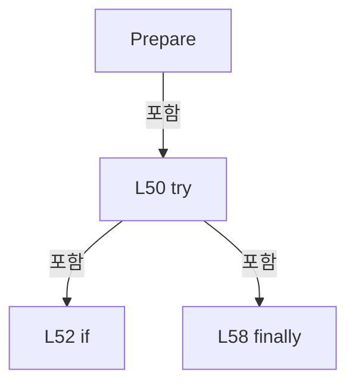

변경 전 점검: 입력/반환 타입, 위 호출자, 예외/취소 경로, 공유 상태와 저장·전송 소비자를 함께 확인합니다. 값의 단위나 물리 방향을 이름만으로 확정하지 않습니다.

### MethodDeclaration `Measure` · L60–108

[Drilling.Common/Interface/CPowerMeasureRun.cs:60–108](https://github.com/kjuws10-rgb/A3Drilling/blob/5aee8e58439c9b455cae7c9593c9be986c3e682e/Drilling.Common/Interface/CPowerMeasureRun.cs#L60-L108)

| 항목 | 실제 추출 값 |
| --- | --- |
| 서명 | System.Threading.Tasks.Task Drilling.Common.Interface.CPowerMeasureRun.Measure(System.Threading.CancellationToken) |
| 접근/수식자 | Public / public, async |
| 반환/값 타입 | System.Threading.Tasks.Task |
| 소속 타입 | NamedType:Drilling.Common.Interface.CPowerMeasureRun |

입력 계약:

| 이름 | 타입 | 전달 | 선택/기본값 |
| --- | --- | --- | --- |
| token | System.Threading.CancellationToken | None | False /  |

정적 호출자로 확인된 위치:

| 호출 파일/행 | 호출 표현식 | 런타임 분기 가능 |
| --- | --- | --- |
| [Drilling.Common/Interface/CPowerMeasureRun.cs:124–124](https://github.com/kjuws10-rgb/A3Drilling/blob/5aee8e58439c9b455cae7c9593c9be986c3e682e/Drilling.Common/Interface/CPowerMeasureRun.cs#L124-L124) | Measure | False |
| [Drilling.UI/CRootView.cs:2785–2785](https://github.com/kjuws10-rgb/A3Drilling/blob/5aee8e58439c9b455cae7c9593c9be986c3e682e/Drilling.UI/CRootView.cs#L2785-L2785) | (run ?? throw new InvalidOperationException("TPM 준비가 필요합니다.")).Measure | False |

호출하는 대상과 해석 범위:

| 원본 행 | 표현식 | 분석 상태 | 대상/소스 위치 |
| --- | --- | --- | --- |
| 62 | _gate.WaitAsync(token).ConfigureAwait | resolved | System.Runtime.CompilerServices.ConfiguredTaskAwaitable System.Threading.Tasks.Task.ConfigureAwait(bool) |
| 62 | _gate.WaitAsync | resolved | System.Threading.Tasks.Task System.Threading.SemaphoreSlim.WaitAsync(System.Threading.CancellationToken) |
| 65 | new InvalidOperationException | resolved | System.InvalidOperationException.InvalidOperationException(string?) |
| 66 | _session.CheckStageReady(token).ConfigureAwait | resolved | System.Runtime.CompilerServices.ConfiguredTaskAwaitable System.Threading.Tasks.Task.ConfigureAwait(bool) |
| 66 | _session.CheckStageReady | resolved | System.Threading.Tasks.Task Drilling.Common.Interface.CPowerMeasureDeviceSession.CheckStageReady(System.Threading.CancellationToken) · Drilling.Common/Interface/CPowerMeasureRun.cs:218 |
| 67 | CancellationTokenSource.CreateLinkedTokenSource | resolved | System.Threading.CancellationTokenSource System.Threading.CancellationTokenSource.CreateLinkedTokenSource(System.Threading.CancellationToken) |
| 69 | Task.Run | resolved | System.Threading.Tasks.Task System.Threading.Tasks.Task.Run(System.Func<System.Threading.Tasks.Task?>) |
| 71 | Task.Delay(100, guard.Token).ConfigureAwait | resolved | System.Runtime.CompilerServices.ConfiguredTaskAwaitable System.Threading.Tasks.Task.ConfigureAwait(bool) |
| 71 | Task.Delay | resolved | System.Threading.Tasks.Task System.Threading.Tasks.Task.Delay(int, System.Threading.CancellationToken) |
| 71 | _session.EnsureStageReady | resolved | void Drilling.Common.Interface.CPowerMeasureDeviceSession.EnsureStageReady() · Drilling.Common/Interface/CPowerMeasureRun.cs:206 |
| 73 | Interlocked.CompareExchange | resolved | System.Exception? System.Threading.Interlocked.CompareExchange<System.Exception?>(ref System.Exception?, System.Exception?, System.Exception?) |
| 73 | guard.Cancel | resolved | void System.Threading.CancellationTokenSource.Cancel() |
| 77 | Task.Run | resolved | System.Threading.Tasks.Task System.Threading.Tasks.Task.Run(System.Func<System.Threading.Tasks.Task?>) |
| 79 | _session.MaintainStageFeedback(guard.Token).ConfigureAwait | resolved | System.Runtime.CompilerServices.ConfiguredTaskAwaitable System.Threading.Tasks.Task.ConfigureAwait(bool) |
| 79 | _session.MaintainStageFeedback | resolved | System.Threading.Tasks.Task Drilling.Common.Interface.CPowerMeasureDeviceSession.MaintainStageFeedback(System.Threading.CancellationToken) · Drilling.Common/Interface/CPowerMeasureRun.cs:238 |
| 81 | Interlocked.CompareExchange | resolved | System.Exception? System.Threading.Interlocked.CompareExchange<System.Exception?>(ref System.Exception?, System.Exception?, System.Exception?) |
| 81 | guard.Cancel | resolved | void System.Threading.CancellationTokenSource.Cancel() |
| 86 | manager.PowerMeasure.Start | resolved | System.Threading.Tasks.Task Drilling.Common.Interface.CPowerMeasureService.Start(System.Collections.Generic.IReadOnlyList<Drilling.Common.Interface.ST_POWER_MEASURE_TARGET>, Drilling.Common.Interface.IPowerMeasureSession, Drilling.Common.Interface.IPowerMeasureTable?, System.Threading.CancellationToken, string) · Drilling.Common/Interface/CPowerMeasureService.cs:30 |
| 88 | operation.ConfigureAwait | resolved | System.Runtime.CompilerServices.ConfiguredTaskAwaitable System.Threading.Tasks.Task.ConfigureAwait(bool) |
| 96 | guard.Cancel | resolved | void System.Threading.CancellationTokenSource.Cancel() |
| 96 | Task.WhenAll(watching, refreshing).ConfigureAwait | resolved | System.Runtime.CompilerServices.ConfiguredTaskAwaitable System.Threading.Tasks.Task.ConfigureAwait(bool) |
| 96 | Task.WhenAll | resolved | System.Threading.Tasks.Task System.Threading.Tasks.Task.WhenAll(params System.ReadOnlySpan<System.Threading.Tasks.Task>) |
| 97 | manager.PowerMeasure.GetSnapshot | resolved | Drilling.Common.Interface.ST_POWER_MEASURE_SNAPSHOT Drilling.Common.Interface.CPowerMeasureService.GetSnapshot() · Drilling.Common/Interface/CPowerMeasureService.cs:12 |
| 97 | Report | resolved | void Drilling.Common.Interface.CPowerMeasureRun.Report() · Drilling.Common/Interface/CPowerMeasureRun.cs:139 |
| 100 | token.ThrowIfCancellationRequested | resolved | void System.Threading.CancellationToken.ThrowIfCancellationRequested() |
| 101 | _result!.Heads.Where(h => h.State != "OK").ToArray | resolved | Drilling.Common.Interface.ST_POWER_MEASURE_HEAD[] System.Collections.Generic.IEnumerable<Drilling.Common.Interface.ST_POWER_MEASURE_HEAD>.ToArray<Drilling.Common.Interface.ST_POWER_MEASURE_HEAD>() |
| 101 | _result!.Heads.Where | resolved | System.Collections.Generic.IEnumerable<Drilling.Common.Interface.ST_POWER_MEASURE_HEAD> System.Collections.Generic.IEnumerable<Drilling.Common.Interface.ST_POWER_MEASURE_HEAD>.Where<Drilling.Common.Interface.ST_POWER_MEASURE_HEAD>(System.Func<Drilling.Common.Interface.ST_POWER_MEASURE_HEAD, bool>) |
| 102 | new InvalidOperationException | resolved | System.InvalidOperationException.InvalidOperationException(string?) |
| 102 | string.Join | resolved | string string.Join(string?, System.Collections.Generic.IEnumerable<string?>) |
| 102 | failed.Select | resolved | System.Collections.Generic.IEnumerable<string> System.Collections.Generic.IEnumerable<Drilling.Common.Interface.ST_POWER_MEASURE_HEAD>.Select<Drilling.Common.Interface.ST_POWER_MEASURE_HEAD, string>(System.Func<Drilling.Common.Interface.ST_POWER_MEASURE_HEAD, string>) |
| 104 | Log | resolved | void Drilling.Common.Interface.CPowerMeasureRun.Log(string, string) · Drilling.Common/Interface/CPowerMeasureRun.cs:146 |
| 106 | Log | resolved | void Drilling.Common.Interface.CPowerMeasureRun.Log(string, string) · Drilling.Common/Interface/CPowerMeasureRun.cs:146 |
| 107 | _gate.Release | resolved | int System.Threading.SemaphoreSlim.Release() |

본문의 실제 연산·분기·예외·반환 순서(원문 위치 순):

| 원본 행 | 종류 | 주석 해설 |
| --- | --- | --- |
| 62 | await | 비동기 완료를 기다립니다: await _gate.WaitAsync(token).ConfigureAwait(false) |
| 62 | call | 함수·델리게이트 또는 객체 생성자를 호출합니다: _gate.WaitAsync(token).ConfigureAwait(false) |
| 62 | call | 함수·델리게이트 또는 객체 생성자를 호출합니다: _gate.WaitAsync(token) |
| 63 | try | 예외 처리 범위입니다: try |
| 65 | call | 함수·델리게이트 또는 객체 생성자를 호출합니다: new InvalidOperationException("PowerMeasure 준비 상태를 확인해 주세요.") |
| 65 | if | 조건에 따라 분기합니다: if (!_prepared &#124;&#124; _released &#124;&#124; _measured) |
| 65 | throw | 예외를 발생/전달합니다: throw new InvalidOperationException("PowerMeasure 준비 상태를 확인해 주세요."); |
| 66 | await | 비동기 완료를 기다립니다: await _session.CheckStageReady(token).ConfigureAwait(false) |
| 66 | call | 함수·델리게이트 또는 객체 생성자를 호출합니다: _session.CheckStageReady(token).ConfigureAwait(false) |
| 66 | call | 함수·델리게이트 또는 객체 생성자를 호출합니다: _session.CheckStageReady(token) |
| 67 | call | 함수·델리게이트 또는 객체 생성자를 호출합니다: CancellationTokenSource.CreateLinkedTokenSource(token) |
| 67 | using-declaration | 정리할 자원을 선언합니다: using var guard = CancellationTokenSource.CreateLinkedTokenSource(token); |
| 67 | variable-initializer | 변수의 초기값을 지정합니다: guard = CancellationTokenSource.CreateLinkedTokenSource(token) |
| 68 | local-declaration | 지역 변수를 선언합니다: Exception? stageError = null; |
| 68 | variable-initializer | 변수의 초기값을 지정합니다: stageError = null |
| 69 | call | 함수·델리게이트 또는 객체 생성자를 호출합니다: Task.Run(async () => { try { while (true) { await Task.Delay(100, guard.Token).ConfigureAwait(false); _session.EnsureStageReady(); } } catch (OperationCanceledException) when (guard.IsCancellationRequested) { } catch (Ex… |
| 69 | local-declaration | 지역 변수를 선언합니다: var watching = Task.Run(async () => { try { while (true) { await Task.Delay(100, guard.Token).ConfigureAwait(false); _session.EnsureStageReady(); } } catch (OperationCanceledException) when (guard.IsCancellationRequested) { } catc |
| 69 | variable-initializer | 변수의 초기값을 지정합니다: watching = Task.Run(async () => { try { while (true) { await Task.Delay(100, guard.Token).ConfigureAwait(false); _session.EnsureStageReady(); } } catch (OperationCanceledException) when (guard.IsCancellationRequested) { } catch (E |
| 71 | await | 비동기 완료를 기다립니다: await Task.Delay(100, guard.Token).ConfigureAwait(false) |
| 71 | call | 함수·델리게이트 또는 객체 생성자를 호출합니다: Task.Delay(100, guard.Token).ConfigureAwait(false) |
| 71 | call | 함수·델리게이트 또는 객체 생성자를 호출합니다: Task.Delay(100, guard.Token) |
| 71 | call | 함수·델리게이트 또는 객체 생성자를 호출합니다: _session.EnsureStageReady() |
| 71 | while | 조건을 먼저 확인하며 반복합니다: while (true) |
| 71 | try | 예외 처리 범위입니다: try |
| 72 | catch | 지정 예외를 처리합니다: catch (OperationCanceledException) when (guard.IsCancellationRequested) |
| 73 | call | 함수·델리게이트 또는 객체 생성자를 호출합니다: Interlocked.CompareExchange(ref stageError, error, null) |
| 73 | call | 함수·델리게이트 또는 객체 생성자를 호출합니다: guard.Cancel() |
| 73 | catch | 지정 예외를 처리합니다: catch (Exception error) |
| 77 | call | 함수·델리게이트 또는 객체 생성자를 호출합니다: Task.Run(async () => { try { await _session.MaintainStageFeedback(guard.Token).ConfigureAwait(false); } catch (OperationCanceledException) when (guard.IsCancellationRequested) { } catch (Exception error) { Interlocked.Co… |
| 77 | local-declaration | 지역 변수를 선언합니다: var refreshing = Task.Run(async () => { try { await _session.MaintainStageFeedback(guard.Token).ConfigureAwait(false); } catch (OperationCanceledException) when (guard.IsCancellationRequested) { } catch (Exception error) { Interlo |
| 77 | variable-initializer | 변수의 초기값을 지정합니다: refreshing = Task.Run(async () => { try { await _session.MaintainStageFeedback(guard.Token).ConfigureAwait(false); } catch (OperationCanceledException) when (guard.IsCancellationRequested) { } catch (Exception error) { Interlocked |
| 79 | await | 비동기 완료를 기다립니다: await _session.MaintainStageFeedback(guard.Token).ConfigureAwait(false) |
| 79 | call | 함수·델리게이트 또는 객체 생성자를 호출합니다: _session.MaintainStageFeedback(guard.Token).ConfigureAwait(false) |
| 79 | call | 함수·델리게이트 또는 객체 생성자를 호출합니다: _session.MaintainStageFeedback(guard.Token) |
| 79 | try | 예외 처리 범위입니다: try |
| 80 | catch | 지정 예외를 처리합니다: catch (OperationCanceledException) when (guard.IsCancellationRequested) |
| 81 | call | 함수·델리게이트 또는 객체 생성자를 호출합니다: Interlocked.CompareExchange(ref stageError, error, null) |
| 81 | call | 함수·델리게이트 또는 객체 생성자를 호출합니다: guard.Cancel() |
| 81 | catch | 지정 예외를 처리합니다: catch (Exception error) |
| 83 | local-declaration | 지역 변수를 선언합니다: var started = false; |
| 83 | variable-initializer | 변수의 초기값을 지정합니다: started = false |
| 84 | try | 예외 처리 범위입니다: try |
| 86 | call | 함수·델리게이트 또는 객체 생성자를 호출합니다: manager.PowerMeasure.Start(targets, _session, this, guard.Token, automatic ? "AUTO TPM" : "MANUAL") |
| 86 | conditional-expression | 조건에 따라 결과식을 선택합니다: automatic ? "AUTO TPM" : "MANUAL" |
| 86 | local-declaration | 지역 변수를 선언합니다: var operation = manager.PowerMeasure.Start(targets, _session, this, guard.Token, automatic ? "AUTO TPM" : "MANUAL"); |
| 86 | variable-initializer | 변수의 초기값을 지정합니다: operation = manager.PowerMeasure.Start(targets, _session, this, guard.Token, automatic ? "AUTO TPM" : "MANUAL") |
| 87 | assignment | 값을 대상에 대입합니다: started = true |
| 88 | await | 비동기 완료를 기다립니다: await operation.ConfigureAwait(false) |
| 88 | call | 함수·델리게이트 또는 객체 생성자를 호출합니다: operation.ConfigureAwait(false) |
| 90 | catch | 지정 예외를 처리합니다: catch (OperationCanceledException) when (stageError is not null && !token.IsCancellationRequested) |
| 92 | throw | 예외를 발생/전달합니다: throw stageError; |
| 94 | finally | 종료 정리 구간입니다: finally |
| 96 | await | 비동기 완료를 기다립니다: await Task.WhenAll(watching, refreshing).ConfigureAwait(false) |
| 96 | call | 함수·델리게이트 또는 객체 생성자를 호출합니다: guard.Cancel() |
| 96 | call | 함수·델리게이트 또는 객체 생성자를 호출합니다: Task.WhenAll(watching, refreshing).ConfigureAwait(false) |
| 96 | call | 함수·델리게이트 또는 객체 생성자를 호출합니다: Task.WhenAll(watching, refreshing) |
| 97 | assignment | 값을 대상에 대입합니다: _result = manager.PowerMeasure.GetSnapshot() |
| 97 | call | 함수·델리게이트 또는 객체 생성자를 호출합니다: manager.PowerMeasure.GetSnapshot() |
| 97 | call | 함수·델리게이트 또는 객체 생성자를 호출합니다: Report() |
| 97 | if | 조건에 따라 분기합니다: if (started) |
| 99 | if | 조건에 따라 분기합니다: if (stageError is not null) |
| 99 | throw | 예외를 발생/전달합니다: throw stageError; |
| 100 | call | 함수·델리게이트 또는 객체 생성자를 호출합니다: token.ThrowIfCancellationRequested() |
| 101 | call | 함수·델리게이트 또는 객체 생성자를 호출합니다: _result!.Heads.Where(h => h.State != "OK").ToArray() |
| 101 | call | 함수·델리게이트 또는 객체 생성자를 호출합니다: _result!.Heads.Where(h => h.State != "OK") |
| 101 | local-declaration | 지역 변수를 선언합니다: var failed = _result!.Heads.Where(h => h.State != "OK").ToArray(); |
| 101 | variable-initializer | 변수의 초기값을 지정합니다: failed = _result!.Heads.Where(h => h.State != "OK").ToArray() |
| 102 | call | 함수·델리게이트 또는 객체 생성자를 호출합니다: new InvalidOperationException(string.Join("\n", failed.Select(h => $"HEAD {h.Target.HeadNo:00}: {h.State} / {h.Message}"))) |
| 102 | call | 함수·델리게이트 또는 객체 생성자를 호출합니다: string.Join("\n", failed.Select(h => $"HEAD {h.Target.HeadNo:00}: {h.State} / {h.Message}")) |
| 102 | call | 함수·델리게이트 또는 객체 생성자를 호출합니다: failed.Select(h => $"HEAD {h.Target.HeadNo:00}: {h.State} / {h.Message}") |
| 102 | if | 조건에 따라 분기합니다: if (failed.Length > 0) |
| 102 | throw | 예외를 발생/전달합니다: throw new InvalidOperationException(string.Join("\n", failed.Select(h => $"HEAD {h.Target.HeadNo:00}: {h.State} / {h.Message}"))); |
| 103 | assignment | 값을 대상에 대입합니다: _measured = true |
| 104 | call | 함수·델리게이트 또는 객체 생성자를 호출합니다: Log("MEASURED", $"{_result.Heads.Count} Heads OK") |
| 106 | call | 함수·델리게이트 또는 객체 생성자를 호출합니다: Log("FAILED", error.Message) |
| 106 | catch | 지정 예외를 처리합니다: catch (Exception error) |
| 106 | if | 조건에 따라 분기합니다: if (error is not OperationCanceledException) |
| 106 | throw | 예외를 발생/전달합니다: throw; |
| 107 | call | 함수·델리게이트 또는 객체 생성자를 호출합니다: _gate.Release() |
| 107 | finally | 종료 정리 구간입니다: finally |

제어 구문의 포함 구조(실제 실행 순서/CFG가 아닌 구문 탐색 그림):

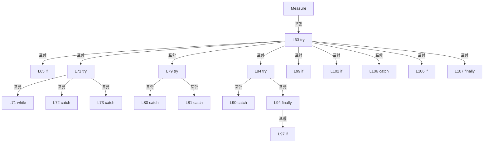

변경 전 점검: 입력/반환 타입, 위 호출자, 예외/취소 경로, 공유 상태와 저장·전송 소비자를 함께 확인합니다. 값의 단위나 물리 방향을 이름만으로 확정하지 않습니다.

### MethodDeclaration `Save` · L109–121

[Drilling.Common/Interface/CPowerMeasureRun.cs:109–121](https://github.com/kjuws10-rgb/A3Drilling/blob/5aee8e58439c9b455cae7c9593c9be986c3e682e/Drilling.Common/Interface/CPowerMeasureRun.cs#L109-L121)

| 항목 | 실제 추출 값 |
| --- | --- |
| 서명 | System.Threading.Tasks.Task Drilling.Common.Interface.CPowerMeasureRun.Save(System.Threading.CancellationToken) |
| 접근/수식자 | Public / public, async |
| 반환/값 타입 | System.Threading.Tasks.Task |
| 소속 타입 | NamedType:Drilling.Common.Interface.CPowerMeasureRun |

입력 계약:

| 이름 | 타입 | 전달 | 선택/기본값 |
| --- | --- | --- | --- |
| token | System.Threading.CancellationToken | None | False /  |

정적 호출자로 확인된 위치:

| 호출 파일/행 | 호출 표현식 | 런타임 분기 가능 |
| --- | --- | --- |
| [Drilling.Common/Interface/CPowerMeasureRun.cs:124–124](https://github.com/kjuws10-rgb/A3Drilling/blob/5aee8e58439c9b455cae7c9593c9be986c3e682e/Drilling.Common/Interface/CPowerMeasureRun.cs#L124-L124) | Save | False |
| [Drilling.UI/CRootView.cs:2786–2786](https://github.com/kjuws10-rgb/A3Drilling/blob/5aee8e58439c9b455cae7c9593c9be986c3e682e/Drilling.UI/CRootView.cs#L2786-L2786) | (run ?? throw new InvalidOperationException("TPM 측정이 필요합니다.")).Save | False |

호출하는 대상과 해석 범위:

| 원본 행 | 표현식 | 분석 상태 | 대상/소스 위치 |
| --- | --- | --- | --- |
| 111 | _gate.WaitAsync(token).ConfigureAwait | resolved | System.Runtime.CompilerServices.ConfiguredTaskAwaitable System.Threading.Tasks.Task.ConfigureAwait(bool) |
| 111 | _gate.WaitAsync | resolved | System.Threading.Tasks.Task System.Threading.SemaphoreSlim.WaitAsync(System.Threading.CancellationToken) |
| 115 | new InvalidOperationException | resolved | System.InvalidOperationException.InvalidOperationException(string?) |
| 116 | manager.Recipe().SavePowerMeasureAngles(recipe.Id, _result.Heads.ToDictionary(h => h.Target.HeadNo, h => h.Angle!.Value), token).ConfigureAwait | resolved | System.Runtime.CompilerServices.ConfiguredTaskAwaitable System.Threading.Tasks.Task.ConfigureAwait(bool) |
| 116 | manager.Recipe().SavePowerMeasureAngles | resolved | System.Threading.Tasks.Task Drilling.Common.Managers.CRecipeManager.SavePowerMeasureAngles(string, System.Collections.Generic.IReadOnlyDictionary<int, double>, System.Threading.CancellationToken) · Drilling.Common/Managers/CRecipeManager.cs:112 |
| 116 | manager.Recipe | resolved | Drilling.Common.Managers.CRecipeManager Drilling.Common.Managers.CManager.Recipe() · Drilling.Common/Managers/CManager.cs:327 |
| 116 | _result.Heads.ToDictionary | resolved | System.Collections.Generic.Dictionary<int, double> System.Collections.Generic.IEnumerable<Drilling.Common.Interface.ST_POWER_MEASURE_HEAD>.ToDictionary<Drilling.Common.Interface.ST_POWER_MEASURE_HEAD, int, double>(System.Func<Drilling.Common.Interface.ST_POWER_MEASURE_HEAD, int>, System.Func<Drilling.Common.Interface.ST_POWER_MEASURE_HEAD, double>) |
| 118 | Log | resolved | void Drilling.Common.Interface.CPowerMeasureRun.Log(string, string) · Drilling.Common/Interface/CPowerMeasureRun.cs:146 |
| 120 | _gate.Release | resolved | int System.Threading.SemaphoreSlim.Release() |

본문의 실제 연산·분기·예외·반환 순서(원문 위치 순):

| 원본 행 | 종류 | 주석 해설 |
| --- | --- | --- |
| 111 | await | 비동기 완료를 기다립니다: await _gate.WaitAsync(token).ConfigureAwait(false) |
| 111 | call | 함수·델리게이트 또는 객체 생성자를 호출합니다: _gate.WaitAsync(token).ConfigureAwait(false) |
| 111 | call | 함수·델리게이트 또는 객체 생성자를 호출합니다: _gate.WaitAsync(token) |
| 112 | try | 예외 처리 범위입니다: try |
| 114 | if | 조건에 따라 분기합니다: if (_saved) |
| 114 | return | 호출자에게 값 또는 제어를 반환합니다: return; |
| 115 | call | 함수·델리게이트 또는 객체 생성자를 호출합니다: new InvalidOperationException("정상 완료된 파워 측정 결과가 없습니다.") |
| 115 | if | 조건에 따라 분기합니다: if (!_measured &#124;&#124; _result is null) |
| 115 | throw | 예외를 발생/전달합니다: throw new InvalidOperationException("정상 완료된 파워 측정 결과가 없습니다."); |
| 116 | await | 비동기 완료를 기다립니다: await manager.Recipe().SavePowerMeasureAngles(recipe.Id, _result.Heads.ToDictionary(h => h.Target.HeadNo, h => h.Angle!.Value), token).ConfigureAwait(false) |
| 116 | call | 함수·델리게이트 또는 객체 생성자를 호출합니다: manager.Recipe().SavePowerMeasureAngles(recipe.Id, _result.Heads.ToDictionary(h => h.Target.HeadNo, h => h.Angle!.Value), token).ConfigureAwait(false) |
| 116 | call | 함수·델리게이트 또는 객체 생성자를 호출합니다: manager.Recipe().SavePowerMeasureAngles(recipe.Id, _result.Heads.ToDictionary(h => h.Target.HeadNo, h => h.Angle!.Value), token) |
| 116 | call | 함수·델리게이트 또는 객체 생성자를 호출합니다: manager.Recipe() |
| 116 | call | 함수·델리게이트 또는 객체 생성자를 호출합니다: _result.Heads.ToDictionary(h => h.Target.HeadNo, h => h.Angle!.Value) |
| 117 | assignment | 값을 대상에 대입합니다: _saved = true |
| 118 | call | 함수·델리게이트 또는 객체 생성자를 호출합니다: Log("SAVED", $"Recipe ATT 각도 저장 완료: {recipe.Id}") |
| 120 | call | 함수·델리게이트 또는 객체 생성자를 호출합니다: _gate.Release() |
| 120 | finally | 종료 정리 구간입니다: finally |

제어 구문의 포함 구조(실제 실행 순서/CFG가 아닌 구문 탐색 그림):

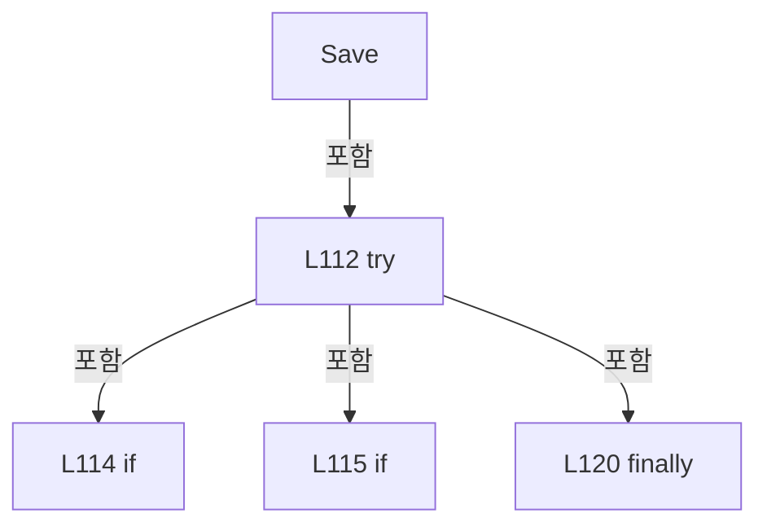

변경 전 점검: 입력/반환 타입, 위 호출자, 예외/취소 경로, 공유 상태와 저장·전송 소비자를 함께 확인합니다. 값의 단위나 물리 방향을 이름만으로 확정하지 않습니다.

### MethodDeclaration `Execute` · L122–126

[Drilling.Common/Interface/CPowerMeasureRun.cs:122–126](https://github.com/kjuws10-rgb/A3Drilling/blob/5aee8e58439c9b455cae7c9593c9be986c3e682e/Drilling.Common/Interface/CPowerMeasureRun.cs#L122-L126)

| 항목 | 실제 추출 값 |
| --- | --- |
| 서명 | System.Threading.Tasks.Task Drilling.Common.Interface.CPowerMeasureRun.Execute(System.Threading.CancellationToken) |
| 접근/수식자 | Public / public, async |
| 반환/값 타입 | System.Threading.Tasks.Task |
| 소속 타입 | NamedType:Drilling.Common.Interface.CPowerMeasureRun |

입력 계약:

| 이름 | 타입 | 전달 | 선택/기본값 |
| --- | --- | --- | --- |
| token | System.Threading.CancellationToken | None | False /  |

정적 호출자로 확인된 위치:

| 호출 파일/행 | 호출 표현식 | 런타임 분기 가능 |
| --- | --- | --- |
| [Drilling.UI/Menu/Menus/CMenuManual.cs:6307–6307](https://github.com/kjuws10-rgb/A3Drilling/blob/5aee8e58439c9b455cae7c9593c9be986c3e682e/Drilling.UI/Menu/Menus/CMenuManual.cs#L6307-L6307) | CPowerTableFile.CreateRun(_manager, recipe, targets, automatic: false).Execute | False |

호출하는 대상과 해석 범위:

| 원본 행 | 표현식 | 분석 상태 | 대상/소스 위치 |
| --- | --- | --- | --- |
| 124 | Prepare(token).ConfigureAwait | resolved | System.Runtime.CompilerServices.ConfiguredTaskAwaitable System.Threading.Tasks.Task.ConfigureAwait(bool) |
| 124 | Prepare | resolved | System.Threading.Tasks.Task Drilling.Common.Interface.CPowerMeasureRun.Prepare(System.Threading.CancellationToken) · Drilling.Common/Interface/CPowerMeasureRun.cs:47 |
| 124 | Measure(token).ConfigureAwait | resolved | System.Runtime.CompilerServices.ConfiguredTaskAwaitable System.Threading.Tasks.Task.ConfigureAwait(bool) |
| 124 | Measure | resolved | System.Threading.Tasks.Task Drilling.Common.Interface.CPowerMeasureRun.Measure(System.Threading.CancellationToken) · Drilling.Common/Interface/CPowerMeasureRun.cs:60 |
| 124 | Save(token).ConfigureAwait | resolved | System.Runtime.CompilerServices.ConfiguredTaskAwaitable System.Threading.Tasks.Task.ConfigureAwait(bool) |
| 124 | Save | resolved | System.Threading.Tasks.Task Drilling.Common.Interface.CPowerMeasureRun.Save(System.Threading.CancellationToken) · Drilling.Common/Interface/CPowerMeasureRun.cs:109 |
| 125 | DisposeAsync().ConfigureAwait | resolved | System.Runtime.CompilerServices.ConfiguredValueTaskAwaitable System.Threading.Tasks.ValueTask.ConfigureAwait(bool) |
| 125 | DisposeAsync | resolved | System.Threading.Tasks.ValueTask Drilling.Common.Interface.CPowerMeasureRun.DisposeAsync() · Drilling.Common/Interface/CPowerMeasureRun.cs:127 |

본문의 실제 연산·분기·예외·반환 순서(원문 위치 순):

| 원본 행 | 종류 | 주석 해설 |
| --- | --- | --- |
| 124 | await | 비동기 완료를 기다립니다: await Prepare(token).ConfigureAwait(false) |
| 124 | await | 비동기 완료를 기다립니다: await Measure(token).ConfigureAwait(false) |
| 124 | await | 비동기 완료를 기다립니다: await Save(token).ConfigureAwait(false) |
| 124 | call | 함수·델리게이트 또는 객체 생성자를 호출합니다: Prepare(token).ConfigureAwait(false) |
| 124 | call | 함수·델리게이트 또는 객체 생성자를 호출합니다: Prepare(token) |
| 124 | call | 함수·델리게이트 또는 객체 생성자를 호출합니다: Measure(token).ConfigureAwait(false) |
| 124 | call | 함수·델리게이트 또는 객체 생성자를 호출합니다: Measure(token) |
| 124 | call | 함수·델리게이트 또는 객체 생성자를 호출합니다: Save(token).ConfigureAwait(false) |
| 124 | call | 함수·델리게이트 또는 객체 생성자를 호출합니다: Save(token) |
| 124 | try | 예외 처리 범위입니다: try |
| 125 | await | 비동기 완료를 기다립니다: await DisposeAsync().ConfigureAwait(false) |
| 125 | call | 함수·델리게이트 또는 객체 생성자를 호출합니다: DisposeAsync().ConfigureAwait(false) |
| 125 | call | 함수·델리게이트 또는 객체 생성자를 호출합니다: DisposeAsync() |
| 125 | finally | 종료 정리 구간입니다: finally |

제어 구문의 포함 구조(실제 실행 순서/CFG가 아닌 구문 탐색 그림):

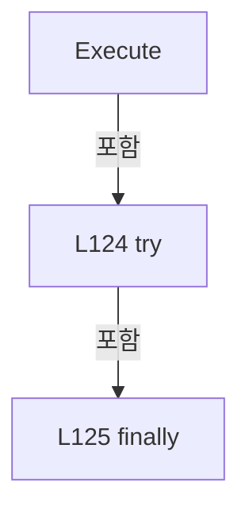

변경 전 점검: 입력/반환 타입, 위 호출자, 예외/취소 경로, 공유 상태와 저장·전송 소비자를 함께 확인합니다. 값의 단위나 물리 방향을 이름만으로 확정하지 않습니다.

### MethodDeclaration `DisposeAsync` · L127–138

[Drilling.Common/Interface/CPowerMeasureRun.cs:127–138](https://github.com/kjuws10-rgb/A3Drilling/blob/5aee8e58439c9b455cae7c9593c9be986c3e682e/Drilling.Common/Interface/CPowerMeasureRun.cs#L127-L138)

| 항목 | 실제 추출 값 |
| --- | --- |
| 서명 | System.Threading.Tasks.ValueTask Drilling.Common.Interface.CPowerMeasureRun.DisposeAsync() |
| 접근/수식자 | Public / public, async |
| 반환/값 타입 | System.Threading.Tasks.ValueTask |
| 소속 타입 | NamedType:Drilling.Common.Interface.CPowerMeasureRun |

정적 호출자로 확인된 위치:

| 호출 파일/행 | 호출 표현식 | 런타임 분기 가능 |
| --- | --- | --- |
| [Drilling.Common/Interface/CPowerMeasureRun.cs:125–125](https://github.com/kjuws10-rgb/A3Drilling/blob/5aee8e58439c9b455cae7c9593c9be986c3e682e/Drilling.Common/Interface/CPowerMeasureRun.cs#L125-L125) | DisposeAsync | False |
| [Drilling.UI/CRootView.cs:2781–2781](https://github.com/kjuws10-rgb/A3Drilling/blob/5aee8e58439c9b455cae7c9593c9be986c3e682e/Drilling.UI/CRootView.cs#L2781-L2781) | run.DisposeAsync | False |
| [Drilling.UI/CRootView.cs:2787–2787](https://github.com/kjuws10-rgb/A3Drilling/blob/5aee8e58439c9b455cae7c9593c9be986c3e682e/Drilling.UI/CRootView.cs#L2787-L2787) | run.DisposeAsync | False |

호출하는 대상과 해석 범위:

| 원본 행 | 표현식 | 분석 상태 | 대상/소스 위치 |
| --- | --- | --- | --- |
| 129 | _gate.WaitAsync().ConfigureAwait | resolved | System.Runtime.CompilerServices.ConfiguredTaskAwaitable System.Threading.Tasks.Task.ConfigureAwait(bool) |
| 129 | _gate.WaitAsync | resolved | System.Threading.Tasks.Task System.Threading.SemaphoreSlim.WaitAsync() |
| 133 | _session.DisposeAsync().ConfigureAwait | resolved | System.Runtime.CompilerServices.ConfiguredValueTaskAwaitable System.Threading.Tasks.ValueTask.ConfigureAwait(bool) |
| 133 | _session.DisposeAsync | resolved | System.Threading.Tasks.ValueTask Drilling.Common.Interface.CPowerMeasureDeviceSession.DisposeAsync() · Drilling.Common/Interface/CPowerMeasureRun.cs:412 |
| 135 | Report | resolved | void Drilling.Common.Interface.CPowerMeasureRun.Report() · Drilling.Common/Interface/CPowerMeasureRun.cs:139 |
| 137 | _gate.Release | resolved | int System.Threading.SemaphoreSlim.Release() |

본문의 실제 연산·분기·예외·반환 순서(원문 위치 순):

| 원본 행 | 종류 | 주석 해설 |
| --- | --- | --- |
| 129 | await | 비동기 완료를 기다립니다: await _gate.WaitAsync().ConfigureAwait(false) |
| 129 | call | 함수·델리게이트 또는 객체 생성자를 호출합니다: _gate.WaitAsync().ConfigureAwait(false) |
| 129 | call | 함수·델리게이트 또는 객체 생성자를 호출합니다: _gate.WaitAsync() |
| 130 | try | 예외 처리 범위입니다: try |
| 132 | if | 조건에 따라 분기합니다: if (_released) |
| 132 | return | 호출자에게 값 또는 제어를 반환합니다: return; |
| 133 | await | 비동기 완료를 기다립니다: await _session.DisposeAsync().ConfigureAwait(false) |
| 133 | call | 함수·델리게이트 또는 객체 생성자를 호출합니다: _session.DisposeAsync().ConfigureAwait(false) |
| 133 | call | 함수·델리게이트 또는 객체 생성자를 호출합니다: _session.DisposeAsync() |
| 134 | assignment | 값을 대상에 대입합니다: _released = true |
| 135 | call | 함수·델리게이트 또는 객체 생성자를 호출합니다: Report() |
| 135 | if | 조건에 따라 분기합니다: if (_result is not null && !_reported) |
| 137 | call | 함수·델리게이트 또는 객체 생성자를 호출합니다: _gate.Release() |
| 137 | finally | 종료 정리 구간입니다: finally |

제어 구문의 포함 구조(실제 실행 순서/CFG가 아닌 구문 탐색 그림):

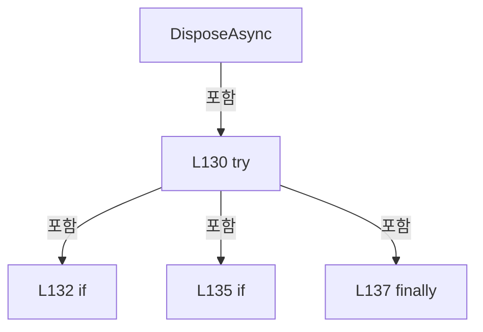

변경 전 점검: 입력/반환 타입, 위 호출자, 예외/취소 경로, 공유 상태와 저장·전송 소비자를 함께 확인합니다. 값의 단위나 물리 방향을 이름만으로 확정하지 않습니다.

### MethodDeclaration `Report` · L139–145

[Drilling.Common/Interface/CPowerMeasureRun.cs:139–145](https://github.com/kjuws10-rgb/A3Drilling/blob/5aee8e58439c9b455cae7c9593c9be986c3e682e/Drilling.Common/Interface/CPowerMeasureRun.cs#L139-L145)

| 항목 | 실제 추출 값 |
| --- | --- |
| 서명 | void Drilling.Common.Interface.CPowerMeasureRun.Report() |
| 접근/수식자 | Private / private |
| 반환/값 타입 | void |
| 소속 타입 | NamedType:Drilling.Common.Interface.CPowerMeasureRun |

정적 호출자로 확인된 위치:

| 호출 파일/행 | 호출 표현식 | 런타임 분기 가능 |
| --- | --- | --- |
| [Drilling.Common/Interface/CPowerMeasureRun.cs:97–97](https://github.com/kjuws10-rgb/A3Drilling/blob/5aee8e58439c9b455cae7c9593c9be986c3e682e/Drilling.Common/Interface/CPowerMeasureRun.cs#L97-L97) | Report | False |
| [Drilling.Common/Interface/CPowerMeasureRun.cs:135–135](https://github.com/kjuws10-rgb/A3Drilling/blob/5aee8e58439c9b455cae7c9593c9be986c3e682e/Drilling.Common/Interface/CPowerMeasureRun.cs#L135-L135) | Report | False |

호출하는 대상과 해석 범위:

| 원본 행 | 표현식 | 분석 상태 | 대상/소스 위치 |
| --- | --- | --- | --- |
| 142 | saveReport | resolved · 동적 구현 선택 가능 | void System.Action<Drilling.Common.Interface.ST_POWER_MEASURE_REPORT>.Invoke(Drilling.Common.Interface.ST_POWER_MEASURE_REPORT) |
| 142 | new | resolved | Drilling.Common.Interface.ST_POWER_MEASURE_REPORT.ST_POWER_MEASURE_REPORT(string, string, System.DateTimeOffset, System.DateTimeOffset, Drilling.Common.Interface.ST_POWER_MEASURE_SNAPSHOT, System.Collections.Generic.IReadOnlyDictionary<int, bool>) · Drilling.Common/Interface/CPowerMeasureRun.cs:8 |
| 143 | targets.ToDictionary | resolved | System.Collections.Generic.Dictionary<int, bool> System.Collections.Generic.IEnumerable<Drilling.Common.Interface.ST_POWER_MEASURE_TARGET>.ToDictionary<Drilling.Common.Interface.ST_POWER_MEASURE_TARGET, int, bool>(System.Func<Drilling.Common.Interface.ST_POWER_MEASURE_TARGET, int>, System.Func<Drilling.Common.Interface.ST_POWER_MEASURE_TARGET, bool>) |
| 143 | _session.IsSimulation | resolved | bool Drilling.Common.Interface.CPowerMeasureDeviceSession.IsSimulation(int) · Drilling.Common/Interface/CPowerMeasureRun.cs:167 |

본문의 실제 연산·분기·예외·반환 순서(원문 위치 순):

| 원본 행 | 종류 | 주석 해설 |
| --- | --- | --- |
| 141 | if | 조건에 따라 분기합니다: if (_reported &#124;&#124; _result is null) |
| 141 | return | 호출자에게 값 또는 제어를 반환합니다: return; |
| 142 | conditional-expression | 조건에 따라 결과식을 선택합니다: automatic ? "AUTO" : "MANUAL" |
| 142 | call | 함수·델리게이트 또는 객체 생성자를 호출합니다: saveReport(new(recipe.Id, automatic ? "AUTO" : "MANUAL", _started, DateTimeOffset.Now, _result, targets.ToDictionary(t => t.HeadNo, t => _session.IsSimulation(t.HeadNo)))) |
| 142 | call | 함수·델리게이트 또는 객체 생성자를 호출합니다: new(recipe.Id, automatic ? "AUTO" : "MANUAL", _started, DateTimeOffset.Now, _result, targets.ToDictionary(t => t.HeadNo, t => _session.IsSimulation(t.HeadNo))) |
| 143 | call | 함수·델리게이트 또는 객체 생성자를 호출합니다: targets.ToDictionary(t => t.HeadNo, t => _session.IsSimulation(t.HeadNo)) |
| 143 | call | 함수·델리게이트 또는 객체 생성자를 호출합니다: _session.IsSimulation(t.HeadNo) |
| 144 | assignment | 값을 대상에 대입합니다: _reported = true |

제어 구문의 포함 구조(실제 실행 순서/CFG가 아닌 구문 탐색 그림):

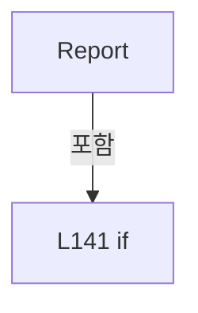

변경 전 점검: 입력/반환 타입, 위 호출자, 예외/취소 경로, 공유 상태와 저장·전송 소비자를 함께 확인합니다. 값의 단위나 물리 방향을 이름만으로 확정하지 않습니다.

### MethodDeclaration `Log` · L146–146

[Drilling.Common/Interface/CPowerMeasureRun.cs:146–146](https://github.com/kjuws10-rgb/A3Drilling/blob/5aee8e58439c9b455cae7c9593c9be986c3e682e/Drilling.Common/Interface/CPowerMeasureRun.cs#L146-L146)

| 항목 | 실제 추출 값 |
| --- | --- |
| 서명 | void Drilling.Common.Interface.CPowerMeasureRun.Log(string, string) |
| 접근/수식자 | Private / private |
| 반환/값 타입 | void |
| 소속 타입 | NamedType:Drilling.Common.Interface.CPowerMeasureRun |

입력 계약:

| 이름 | 타입 | 전달 | 선택/기본값 |
| --- | --- | --- | --- |
| state | string | None | False /  |
| message | string | None | False /  |

정적 호출자로 확인된 위치:

| 호출 파일/행 | 호출 표현식 | 런타임 분기 가능 |
| --- | --- | --- |
| [Drilling.Common/Interface/CPowerMeasureRun.cs:56–56](https://github.com/kjuws10-rgb/A3Drilling/blob/5aee8e58439c9b455cae7c9593c9be986c3e682e/Drilling.Common/Interface/CPowerMeasureRun.cs#L56-L56) | Log | False |
| [Drilling.Common/Interface/CPowerMeasureRun.cs:104–104](https://github.com/kjuws10-rgb/A3Drilling/blob/5aee8e58439c9b455cae7c9593c9be986c3e682e/Drilling.Common/Interface/CPowerMeasureRun.cs#L104-L104) | Log | False |
| [Drilling.Common/Interface/CPowerMeasureRun.cs:106–106](https://github.com/kjuws10-rgb/A3Drilling/blob/5aee8e58439c9b455cae7c9593c9be986c3e682e/Drilling.Common/Interface/CPowerMeasureRun.cs#L106-L106) | Log | False |
| [Drilling.Common/Interface/CPowerMeasureRun.cs:118–118](https://github.com/kjuws10-rgb/A3Drilling/blob/5aee8e58439c9b455cae7c9593c9be986c3e682e/Drilling.Common/Interface/CPowerMeasureRun.cs#L118-L118) | Log | False |

호출하는 대상과 해석 범위:

| 원본 행 | 표현식 | 분석 상태 | 대상/소스 위치 |
| --- | --- | --- | --- |
| 146 | manager.Log().WriteStationState | unresolved | None |
| 146 | manager.Log | resolved | CLogManager Drilling.Common.Managers.CManager.Log() · Drilling.Common/Managers/CManager.cs:380 |

본문의 실제 연산·분기·예외·반환 순서(원문 위치 순):

| 원본 행 | 종류 | 주석 해설 |
| --- | --- | --- |
| 146 | call | 함수·델리게이트 또는 객체 생성자를 호출합니다: manager.Log().WriteStationState("POWERMEASURE", state, "TPM", message) |
| 146 | call | 함수·델리게이트 또는 객체 생성자를 호출합니다: manager.Log() |
| 146 | catch | 지정 예외를 처리합니다: catch  |
| 146 | try | 예외 처리 범위입니다: try |

제어 구문의 포함 구조(실제 실행 순서/CFG가 아닌 구문 탐색 그림):

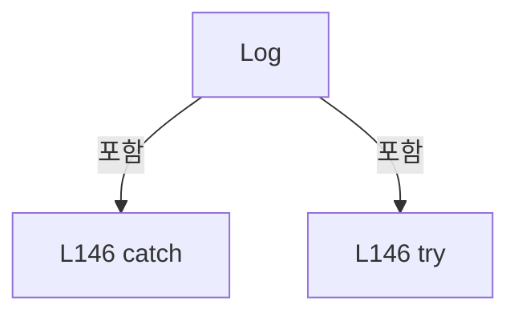

변경 전 점검: 입력/반환 타입, 위 호출자, 예외/취소 경로, 공유 상태와 저장·전송 소비자를 함께 확인합니다. 값의 단위나 물리 방향을 이름만으로 확정하지 않습니다.

### MethodDeclaration `FindStart` · L147–147

[Drilling.Common/Interface/CPowerMeasureRun.cs:147–147](https://github.com/kjuws10-rgb/A3Drilling/blob/5aee8e58439c9b455cae7c9593c9be986c3e682e/Drilling.Common/Interface/CPowerMeasureRun.cs#L147-L147)

| 항목 | 실제 추출 값 |
| --- | --- |
| 서명 | Drilling.Common.Interface.ST_POWER_MEASURE_START Drilling.Common.Interface.CPowerMeasureRun.FindStart(int, double, System.Threading.CancellationToken) |
| 접근/수식자 | Public / public |
| 반환/값 타입 | Drilling.Common.Interface.ST_POWER_MEASURE_START |
| 소속 타입 | NamedType:Drilling.Common.Interface.CPowerMeasureRun |

입력 계약:

| 이름 | 타입 | 전달 | 선택/기본값 |
| --- | --- | --- | --- |
| headNo | int | None | False /  |
| power | double | None | False /  |
| token | System.Threading.CancellationToken | None | False /  |

현재 부분 분석에서 직접 연결된 호출자는 없습니다. XAML/이벤트/인터페이스·델리게이트·외부 진입을 추가 확인해야 하며, 미사용으로 판정한 것이 아닙니다.

호출하는 대상과 해석 범위:

| 원본 행 | 표현식 | 분석 상태 | 대상/소스 위치 |
| --- | --- | --- | --- |
| 147 | tables(headNo, _session.IsSimulation(headNo)).FindStart | resolved · 동적 구현 선택 가능 | Drilling.Common.Interface.ST_POWER_MEASURE_START Drilling.Common.Interface.IPowerMeasureTable.FindStart(int, double, System.Threading.CancellationToken) · Drilling.Common/Interface/CPowerMeasureService.cs:346 |
| 147 | tables | resolved · 동적 구현 선택 가능 | Drilling.Common.Interface.IPowerMeasureTable System.Func<int, bool, Drilling.Common.Interface.IPowerMeasureTable>.Invoke(int, bool) |
| 147 | _session.IsSimulation | resolved | bool Drilling.Common.Interface.CPowerMeasureDeviceSession.IsSimulation(int) · Drilling.Common/Interface/CPowerMeasureRun.cs:167 |

본문의 실제 연산·분기·예외·반환 순서(원문 위치 순):

| 원본 행 | 종류 | 주석 해설 |
| --- | --- | --- |
| 147 | call | 함수·델리게이트 또는 객체 생성자를 호출합니다: tables(headNo, _session.IsSimulation(headNo)).FindStart(headNo, power, token) |
| 147 | call | 함수·델리게이트 또는 객체 생성자를 호출합니다: tables(headNo, _session.IsSimulation(headNo)) |
| 147 | call | 함수·델리게이트 또는 객체 생성자를 호출합니다: _session.IsSimulation(headNo) |

변경 전 점검: 입력/반환 타입, 위 호출자, 예외/취소 경로, 공유 상태와 저장·전송 소비자를 함께 확인합니다. 값의 단위나 물리 방향을 이름만으로 확정하지 않습니다.

### MethodDeclaration `SaveMeasurement` · L148–148

[Drilling.Common/Interface/CPowerMeasureRun.cs:148–148](https://github.com/kjuws10-rgb/A3Drilling/blob/5aee8e58439c9b455cae7c9593c9be986c3e682e/Drilling.Common/Interface/CPowerMeasureRun.cs#L148-L148)

| 항목 | 실제 추출 값 |
| --- | --- |
| 서명 | void Drilling.Common.Interface.CPowerMeasureRun.SaveMeasurement(int, double, double, System.Threading.CancellationToken) |
| 접근/수식자 | Public / public |
| 반환/값 타입 | void |
| 소속 타입 | NamedType:Drilling.Common.Interface.CPowerMeasureRun |

입력 계약:

| 이름 | 타입 | 전달 | 선택/기본값 |
| --- | --- | --- | --- |
| headNo | int | None | False /  |
| angle | double | None | False /  |
| measuredPower | double | None | False /  |
| token | System.Threading.CancellationToken | None | False /  |

현재 부분 분석에서 직접 연결된 호출자는 없습니다. XAML/이벤트/인터페이스·델리게이트·외부 진입을 추가 확인해야 하며, 미사용으로 판정한 것이 아닙니다.

호출하는 대상과 해석 범위:

| 원본 행 | 표현식 | 분석 상태 | 대상/소스 위치 |
| --- | --- | --- | --- |
| 148 | tables(headNo, _session.IsSimulation(headNo)).SaveMeasurement | resolved · 동적 구현 선택 가능 | void Drilling.Common.Interface.IPowerMeasureTable.SaveMeasurement(int, double, double, System.Threading.CancellationToken) · Drilling.Common/Interface/CPowerMeasureService.cs:347 |
| 148 | tables | resolved · 동적 구현 선택 가능 | Drilling.Common.Interface.IPowerMeasureTable System.Func<int, bool, Drilling.Common.Interface.IPowerMeasureTable>.Invoke(int, bool) |
| 148 | _session.IsSimulation | resolved | bool Drilling.Common.Interface.CPowerMeasureDeviceSession.IsSimulation(int) · Drilling.Common/Interface/CPowerMeasureRun.cs:167 |

본문의 실제 연산·분기·예외·반환 순서(원문 위치 순):

| 원본 행 | 종류 | 주석 해설 |
| --- | --- | --- |
| 148 | call | 함수·델리게이트 또는 객체 생성자를 호출합니다: tables(headNo, _session.IsSimulation(headNo)).SaveMeasurement(headNo, angle, measuredPower, token) |
| 148 | call | 함수·델리게이트 또는 객체 생성자를 호출합니다: tables(headNo, _session.IsSimulation(headNo)) |
| 148 | call | 함수·델리게이트 또는 객체 생성자를 호출합니다: _session.IsSimulation(headNo) |

변경 전 점검: 입력/반환 타입, 위 호출자, 예외/취소 경로, 공유 상태와 저장·전송 소비자를 함께 확인합니다. 값의 단위나 물리 방향을 이름만으로 확정하지 않습니다.

### FieldDeclaration `_routes` · L154–154

[Drilling.Common/Interface/CPowerMeasureRun.cs:154–154](https://github.com/kjuws10-rgb/A3Drilling/blob/5aee8e58439c9b455cae7c9593c9be986c3e682e/Drilling.Common/Interface/CPowerMeasureRun.cs#L154-L154)

| 항목 | 실제 추출 값 |
| --- | --- |
| 서명 | System.Collections.Generic.Dictionary<int, Drilling.Common.Interface.CPowerMeasureDeviceSession.Route> Drilling.Common.Interface.CPowerMeasureDeviceSession._routes |
| 접근/수식자 | Private / private, readonly |
| 반환/값 타입 | System.Collections.Generic.Dictionary<int, Drilling.Common.Interface.CPowerMeasureDeviceSession.Route> |
| 소속 타입 | NamedType:Drilling.Common.Interface.CPowerMeasureDeviceSession |

현재 부분 분석에서 직접 연결된 호출자는 없습니다. XAML/이벤트/인터페이스·델리게이트·외부 진입을 추가 확인해야 하며, 미사용으로 판정한 것이 아닙니다.

본문의 실제 연산·분기·예외·반환 순서(원문 위치 순):

| 원본 행 | 종류 | 주석 해설 |
| --- | --- | --- |
| 154 | variable-initializer | 변수의 초기값을 지정합니다: _routes = [] |

변경 전 점검: 입력/반환 타입, 위 호출자, 예외/취소 경로, 공유 상태와 저장·전송 소비자를 함께 확인합니다. 값의 단위나 물리 방향을 이름만으로 확정하지 않습니다.

### FieldDeclaration `_attenuators` · L155–155

[Drilling.Common/Interface/CPowerMeasureRun.cs:155–155](https://github.com/kjuws10-rgb/A3Drilling/blob/5aee8e58439c9b455cae7c9593c9be986c3e682e/Drilling.Common/Interface/CPowerMeasureRun.cs#L155-L155)

| 항목 | 실제 추출 값 |
| --- | --- |
| 서명 | System.Collections.Generic.Dictionary<int, Drilling.Common.Interface.CAttenuatorPositioningService> Drilling.Common.Interface.CPowerMeasureDeviceSession._attenuators |
| 접근/수식자 | Private / private, readonly |
| 반환/값 타입 | System.Collections.Generic.Dictionary<int, Drilling.Common.Interface.CAttenuatorPositioningService> |
| 소속 타입 | NamedType:Drilling.Common.Interface.CPowerMeasureDeviceSession |

현재 부분 분석에서 직접 연결된 호출자는 없습니다. XAML/이벤트/인터페이스·델리게이트·외부 진입을 추가 확인해야 하며, 미사용으로 판정한 것이 아닙니다.

본문의 실제 연산·분기·예외·반환 순서(원문 위치 순):

| 원본 행 | 종류 | 주석 해설 |
| --- | --- | --- |
| 155 | variable-initializer | 변수의 초기값을 지정합니다: _attenuators = [] |

변경 전 점검: 입력/반환 타입, 위 호출자, 예외/취소 경로, 공유 상태와 저장·전송 소비자를 함께 확인합니다. 값의 단위나 물리 방향을 이름만으로 확정하지 않습니다.

### FieldDeclaration `_emissionGate` · L156–156

[Drilling.Common/Interface/CPowerMeasureRun.cs:156–156](https://github.com/kjuws10-rgb/A3Drilling/blob/5aee8e58439c9b455cae7c9593c9be986c3e682e/Drilling.Common/Interface/CPowerMeasureRun.cs#L156-L156)

| 항목 | 실제 추출 값 |
| --- | --- |
| 서명 | System.Threading.SemaphoreSlim Drilling.Common.Interface.CPowerMeasureDeviceSession._emissionGate |
| 접근/수식자 | Private / private, readonly |
| 반환/값 타입 | System.Threading.SemaphoreSlim |
| 소속 타입 | NamedType:Drilling.Common.Interface.CPowerMeasureDeviceSession |

현재 부분 분석에서 직접 연결된 호출자는 없습니다. XAML/이벤트/인터페이스·델리게이트·외부 진입을 추가 확인해야 하며, 미사용으로 판정한 것이 아닙니다.

호출하는 대상과 해석 범위:

| 원본 행 | 표현식 | 분석 상태 | 대상/소스 위치 |
| --- | --- | --- | --- |
| 156 | new | resolved | System.Threading.SemaphoreSlim.SemaphoreSlim(int, int) |

본문의 실제 연산·분기·예외·반환 순서(원문 위치 순):

| 원본 행 | 종류 | 주석 해설 |
| --- | --- | --- |
| 156 | call | 함수·델리게이트 또는 객체 생성자를 호출합니다: new(1, 1) |
| 156 | variable-initializer | 변수의 초기값을 지정합니다: _emissionGate = new(1, 1) |

변경 전 점검: 입력/반환 타입, 위 호출자, 예외/취소 경로, 공유 상태와 저장·전송 소비자를 함께 확인합니다. 값의 단위나 물리 방향을 이름만으로 확정하지 않습니다.

### FieldDeclaration `_emitting` · L157–157

[Drilling.Common/Interface/CPowerMeasureRun.cs:157–157](https://github.com/kjuws10-rgb/A3Drilling/blob/5aee8e58439c9b455cae7c9593c9be986c3e682e/Drilling.Common/Interface/CPowerMeasureRun.cs#L157-L157)

| 항목 | 실제 추출 값 |
| --- | --- |
| 서명 | System.Collections.Concurrent.ConcurrentDictionary<int, byte> Drilling.Common.Interface.CPowerMeasureDeviceSession._emitting |
| 접근/수식자 | Private / private, readonly |
| 반환/값 타입 | System.Collections.Concurrent.ConcurrentDictionary<int, byte> |
| 소속 타입 | NamedType:Drilling.Common.Interface.CPowerMeasureDeviceSession |

현재 부분 분석에서 직접 연결된 호출자는 없습니다. XAML/이벤트/인터페이스·델리게이트·외부 진입을 추가 확인해야 하며, 미사용으로 판정한 것이 아닙니다.

호출하는 대상과 해석 범위:

| 원본 행 | 표현식 | 분석 상태 | 대상/소스 위치 |
| --- | --- | --- | --- |
| 157 | new | resolved | System.Collections.Concurrent.ConcurrentDictionary<int, byte>.ConcurrentDictionary() |

본문의 실제 연산·분기·예외·반환 순서(원문 위치 순):

| 원본 행 | 종류 | 주석 해설 |
| --- | --- | --- |
| 157 | call | 함수·델리게이트 또는 객체 생성자를 호출합니다: new() |
| 157 | variable-initializer | 변수의 초기값을 지정합니다: _emitting = new() |

변경 전 점검: 입력/반환 타입, 위 호출자, 예외/취소 경로, 공유 상태와 저장·전송 소비자를 함께 확인합니다. 값의 단위나 물리 방향을 이름만으로 확정하지 않습니다.

### FieldDeclaration `_flagMayBeOn` · L158–158

[Drilling.Common/Interface/CPowerMeasureRun.cs:158–158](https://github.com/kjuws10-rgb/A3Drilling/blob/5aee8e58439c9b455cae7c9593c9be986c3e682e/Drilling.Common/Interface/CPowerMeasureRun.cs#L158-L158)

| 항목 | 실제 추출 값 |
| --- | --- |
| 서명 | bool Drilling.Common.Interface.CPowerMeasureDeviceSession._flagMayBeOn |
| 접근/수식자 | Private / private |
| 반환/값 타입 | bool |
| 소속 타입 | NamedType:Drilling.Common.Interface.CPowerMeasureDeviceSession |

현재 부분 분석에서 직접 연결된 호출자는 없습니다. XAML/이벤트/인터페이스·델리게이트·외부 진입을 추가 확인해야 하며, 미사용으로 판정한 것이 아닙니다.

변경 전 점검: 입력/반환 타입, 위 호출자, 예외/취소 경로, 공유 상태와 저장·전송 소비자를 함께 확인합니다. 값의 단위나 물리 방향을 이름만으로 확정하지 않습니다.

### FieldDeclaration `_stage` · L159–159

[Drilling.Common/Interface/CPowerMeasureRun.cs:159–159](https://github.com/kjuws10-rgb/A3Drilling/blob/5aee8e58439c9b455cae7c9593c9be986c3e682e/Drilling.Common/Interface/CPowerMeasureRun.cs#L159-L159)

| 항목 | 실제 추출 값 |
| --- | --- |
| 서명 | Drilling.Common.Station.CStageReviewSequences.Session? Drilling.Common.Interface.CPowerMeasureDeviceSession._stage |
| 접근/수식자 | Private / private |
| 반환/값 타입 | Drilling.Common.Station.CStageReviewSequences.Session? |
| 소속 타입 | NamedType:Drilling.Common.Interface.CPowerMeasureDeviceSession |

현재 부분 분석에서 직접 연결된 호출자는 없습니다. XAML/이벤트/인터페이스·델리게이트·외부 진입을 추가 확인해야 하며, 미사용으로 판정한 것이 아닙니다.

변경 전 점검: 입력/반환 타입, 위 호출자, 예외/취소 경로, 공유 상태와 저장·전송 소비자를 함께 확인합니다. 값의 단위나 물리 방향을 이름만으로 확정하지 않습니다.

### FieldDeclaration `_stageDevice` · L160–160

[Drilling.Common/Interface/CPowerMeasureRun.cs:160–160](https://github.com/kjuws10-rgb/A3Drilling/blob/5aee8e58439c9b455cae7c9593c9be986c3e682e/Drilling.Common/Interface/CPowerMeasureRun.cs#L160-L160)

| 항목 | 실제 추출 값 |
| --- | --- |
| 서명 | int Drilling.Common.Interface.CPowerMeasureDeviceSession._stageDevice |
| 접근/수식자 | Private / private |
| 반환/값 타입 | int |
| 소속 타입 | NamedType:Drilling.Common.Interface.CPowerMeasureDeviceSession |

현재 부분 분석에서 직접 연결된 호출자는 없습니다. XAML/이벤트/인터페이스·델리게이트·외부 진입을 추가 확인해야 하며, 미사용으로 판정한 것이 아닙니다.

변경 전 점검: 입력/반환 타입, 위 호출자, 예외/취소 경로, 공유 상태와 저장·전송 소비자를 함께 확인합니다. 값의 단위나 물리 방향을 이름만으로 확정하지 않습니다.

### PropertyDeclaration `StageTolerance` · L161–161

[Drilling.Common/Interface/CPowerMeasureRun.cs:161–161](https://github.com/kjuws10-rgb/A3Drilling/blob/5aee8e58439c9b455cae7c9593c9be986c3e682e/Drilling.Common/Interface/CPowerMeasureRun.cs#L161-L161)

| 항목 | 실제 추출 값 |
| --- | --- |
| 서명 | double Drilling.Common.Interface.CPowerMeasureDeviceSession.StageTolerance |
| 접근/수식자 | Private / private |
| 반환/값 타입 | double |
| 소속 타입 | NamedType:Drilling.Common.Interface.CPowerMeasureDeviceSession |

현재 부분 분석에서 직접 연결된 호출자는 없습니다. XAML/이벤트/인터페이스·델리게이트·외부 진입을 추가 확인해야 하며, 미사용으로 판정한 것이 아닙니다.

호출하는 대상과 해석 범위:

| 원본 행 | 표현식 | 분석 상태 | 대상/소스 위치 |
| --- | --- | --- | --- |
| 161 | CPowerMeasureRun.Number | resolved | double Drilling.Common.Interface.CPowerMeasureRun.Number(Drilling.Common.Managers.CSettingManager, string, double) · Drilling.Common/Interface/CPowerMeasureRun.cs:36 |
| 161 | manager.Setting | resolved | Drilling.Common.Managers.CSettingManager Drilling.Common.Managers.CManager.Setting() · Drilling.Common/Managers/CManager.cs:332 |

본문의 실제 연산·분기·예외·반환 순서(원문 위치 순):

| 원본 행 | 종류 | 주석 해설 |
| --- | --- | --- |
| 161 | call | 함수·델리게이트 또는 객체 생성자를 호출합니다: CPowerMeasureRun.Number(manager.Setting(), "TPM_STAGE_Y_TOLERANCE_MM", .03) |
| 161 | call | 함수·델리게이트 또는 객체 생성자를 호출합니다: manager.Setting() |

변경 전 점검: 입력/반환 타입, 위 호출자, 예외/취소 경로, 공유 상태와 저장·전송 소비자를 함께 확인합니다. 값의 단위나 물리 방향을 이름만으로 확정하지 않습니다.

### PropertyDeclaration `TimeoutMs` · L162–162

[Drilling.Common/Interface/CPowerMeasureRun.cs:162–162](https://github.com/kjuws10-rgb/A3Drilling/blob/5aee8e58439c9b455cae7c9593c9be986c3e682e/Drilling.Common/Interface/CPowerMeasureRun.cs#L162-L162)

| 항목 | 실제 추출 값 |
| --- | --- |
| 서명 | int Drilling.Common.Interface.CPowerMeasureDeviceSession.TimeoutMs |
| 접근/수식자 | Private / private |
| 반환/값 타입 | int |
| 소속 타입 | NamedType:Drilling.Common.Interface.CPowerMeasureDeviceSession |

현재 부분 분석에서 직접 연결된 호출자는 없습니다. XAML/이벤트/인터페이스·델리게이트·외부 진입을 추가 확인해야 하며, 미사용으로 판정한 것이 아닙니다.

호출하는 대상과 해석 범위:

| 원본 행 | 표현식 | 분석 상태 | 대상/소스 위치 |
| --- | --- | --- | --- |
| 162 | Math.Clamp | resolved | int System.Math.Clamp(int, int, int) |
| 162 | CPowerMeasureRun.Integer | resolved | int Drilling.Common.Interface.CPowerMeasureRun.Integer(Drilling.Common.Managers.CSettingManager, string, int) · Drilling.Common/Interface/CPowerMeasureRun.cs:42 |
| 162 | manager.Setting | resolved | Drilling.Common.Managers.CSettingManager Drilling.Common.Managers.CManager.Setting() · Drilling.Common/Managers/CManager.cs:332 |

본문의 실제 연산·분기·예외·반환 순서(원문 위치 순):

| 원본 행 | 종류 | 주석 해설 |
| --- | --- | --- |
| 162 | call | 함수·델리게이트 또는 객체 생성자를 호출합니다: Math.Clamp(CPowerMeasureRun.Integer(manager.Setting(), "TPM_OPERATION_TIMEOUT_MS", 30000), 100, 120000) |
| 162 | call | 함수·델리게이트 또는 객체 생성자를 호출합니다: CPowerMeasureRun.Integer(manager.Setting(), "TPM_OPERATION_TIMEOUT_MS", 30000) |
| 162 | call | 함수·델리게이트 또는 객체 생성자를 호출합니다: manager.Setting() |

변경 전 점검: 입력/반환 타입, 위 호출자, 예외/취소 경로, 공유 상태와 저장·전송 소비자를 함께 확인합니다. 값의 단위나 물리 방향을 이름만으로 확정하지 않습니다.

### PropertyDeclaration `Interfaces` · L163–163

[Drilling.Common/Interface/CPowerMeasureRun.cs:163–163](https://github.com/kjuws10-rgb/A3Drilling/blob/5aee8e58439c9b455cae7c9593c9be986c3e682e/Drilling.Common/Interface/CPowerMeasureRun.cs#L163-L163)

| 항목 | 실제 추출 값 |
| --- | --- |
| 서명 | Drilling.Common.Interface.CInterfaceManager Drilling.Common.Interface.CPowerMeasureDeviceSession.Interfaces |
| 접근/수식자 | Private / private |
| 반환/값 타입 | Drilling.Common.Interface.CInterfaceManager |
| 소속 타입 | NamedType:Drilling.Common.Interface.CPowerMeasureDeviceSession |

현재 부분 분석에서 직접 연결된 호출자는 없습니다. XAML/이벤트/인터페이스·델리게이트·외부 진입을 추가 확인해야 하며, 미사용으로 판정한 것이 아닙니다.

호출하는 대상과 해석 범위:

| 원본 행 | 표현식 | 분석 상태 | 대상/소스 위치 |
| --- | --- | --- | --- |
| 163 | manager.Interface | resolved | Drilling.Common.Interface.CInterfaceManager Drilling.Common.Managers.CManager.Interface() · Drilling.Common/Managers/CManager.cs:347 |

본문의 실제 연산·분기·예외·반환 순서(원문 위치 순):

| 원본 행 | 종류 | 주석 해설 |
| --- | --- | --- |
| 163 | call | 함수·델리게이트 또는 객체 생성자를 호출합니다: manager.Interface() |

변경 전 점검: 입력/반환 타입, 위 호출자, 예외/취소 경로, 공유 상태와 저장·전송 소비자를 함께 확인합니다. 값의 단위나 물리 방향을 이름만으로 확정하지 않습니다.

### PropertyDeclaration `Automation` · L164–164

[Drilling.Common/Interface/CPowerMeasureRun.cs:164–164](https://github.com/kjuws10-rgb/A3Drilling/blob/5aee8e58439c9b455cae7c9593c9be986c3e682e/Drilling.Common/Interface/CPowerMeasureRun.cs#L164-L164)

| 항목 | 실제 추출 값 |
| --- | --- |
| 서명 | Drilling.Common.Automation.CAutomationManager Drilling.Common.Interface.CPowerMeasureDeviceSession.Automation |
| 접근/수식자 | Private / private |
| 반환/값 타입 | Drilling.Common.Automation.CAutomationManager |
| 소속 타입 | NamedType:Drilling.Common.Interface.CPowerMeasureDeviceSession |

현재 부분 분석에서 직접 연결된 호출자는 없습니다. XAML/이벤트/인터페이스·델리게이트·외부 진입을 추가 확인해야 하며, 미사용으로 판정한 것이 아닙니다.

호출하는 대상과 해석 범위:

| 원본 행 | 표현식 | 분석 상태 | 대상/소스 위치 |
| --- | --- | --- | --- |
| 164 | manager.Automation | resolved | Drilling.Common.Automation.CAutomationManager Drilling.Common.Managers.CManager.Automation() · Drilling.Common/Managers/CManager.cs:352 |

본문의 실제 연산·분기·예외·반환 순서(원문 위치 순):

| 원본 행 | 종류 | 주석 해설 |
| --- | --- | --- |
| 164 | call | 함수·델리게이트 또는 객체 생성자를 호출합니다: manager.Automation() |

변경 전 점검: 입력/반환 타입, 위 호출자, 예외/취소 경로, 공유 상태와 저장·전송 소비자를 함께 확인합니다. 값의 단위나 물리 방향을 이름만으로 확정하지 않습니다.

### FieldDeclaration `StageFeedbackIds` · L165–165

[Drilling.Common/Interface/CPowerMeasureRun.cs:165–165](https://github.com/kjuws10-rgb/A3Drilling/blob/5aee8e58439c9b455cae7c9593c9be986c3e682e/Drilling.Common/Interface/CPowerMeasureRun.cs#L165-L165)

| 항목 | 실제 추출 값 |
| --- | --- |
| 서명 | string[] Drilling.Common.Interface.CPowerMeasureDeviceSession.StageFeedbackIds |
| 접근/수식자 | Private / private, static, readonly |
| 반환/값 타입 | string[] |
| 소속 타입 | NamedType:Drilling.Common.Interface.CPowerMeasureDeviceSession |

현재 부분 분석에서 직접 연결된 호출자는 없습니다. XAML/이벤트/인터페이스·델리게이트·외부 진입을 추가 확인해야 하며, 미사용으로 판정한 것이 아닙니다.

본문의 실제 연산·분기·예외·반환 순서(원문 위치 순):

| 원본 행 | 종류 | 주석 해설 |
| --- | --- | --- |
| 165 | variable-initializer | 변수의 초기값을 지정합니다: StageFeedbackIds = ["MOTOR_STAGE_Y_CUR_POS", "MOTOR_STAGE_Y_BUSY"] |

변경 전 점검: 입력/반환 타입, 위 호출자, 예외/취소 경로, 공유 상태와 저장·전송 소비자를 함께 확인합니다. 값의 단위나 물리 방향을 이름만으로 확정하지 않습니다.

### MethodDeclaration `Sim` · L166–166

[Drilling.Common/Interface/CPowerMeasureRun.cs:166–166](https://github.com/kjuws10-rgb/A3Drilling/blob/5aee8e58439c9b455cae7c9593c9be986c3e682e/Drilling.Common/Interface/CPowerMeasureRun.cs#L166-L166)

| 항목 | 실제 추출 값 |
| --- | --- |
| 서명 | bool Drilling.Common.Interface.CPowerMeasureDeviceSession.Sim(Drilling.Common.Interface.EN_EQP_MODULE, int) |
| 접근/수식자 | Private / private |
| 반환/값 타입 | bool |
| 소속 타입 | NamedType:Drilling.Common.Interface.CPowerMeasureDeviceSession |

입력 계약:

| 이름 | 타입 | 전달 | 선택/기본값 |
| --- | --- | --- | --- |
| module | Drilling.Common.Interface.EN_EQP_MODULE | None | False /  |
| no | int | None | False /  |

정적 호출자로 확인된 위치:

| 호출 파일/행 | 호출 표현식 | 런타임 분기 가능 |
| --- | --- | --- |
| [Drilling.Common/Interface/CPowerMeasureRun.cs:167–167](https://github.com/kjuws10-rgb/A3Drilling/blob/5aee8e58439c9b455cae7c9593c9be986c3e682e/Drilling.Common/Interface/CPowerMeasureRun.cs#L167-L167) | Sim | False |
| [Drilling.Common/Interface/CPowerMeasureRun.cs:167–167](https://github.com/kjuws10-rgb/A3Drilling/blob/5aee8e58439c9b455cae7c9593c9be986c3e682e/Drilling.Common/Interface/CPowerMeasureRun.cs#L167-L167) | Sim | False |
| [Drilling.Common/Interface/CPowerMeasureRun.cs:394–394](https://github.com/kjuws10-rgb/A3Drilling/blob/5aee8e58439c9b455cae7c9593c9be986c3e682e/Drilling.Common/Interface/CPowerMeasureRun.cs#L394-L394) | Sim | False |

호출하는 대상과 해석 범위:

| 원본 행 | 표현식 | 분석 상태 | 대상/소스 위치 |
| --- | --- | --- | --- |
| 166 | Interfaces.GetInterfaceCommunicationList(module).Any | resolved | bool System.Collections.Generic.IEnumerable<Drilling.Common.Interface.ST_INTERFACE_COMM_STATUS>.Any<Drilling.Common.Interface.ST_INTERFACE_COMM_STATUS>(System.Func<Drilling.Common.Interface.ST_INTERFACE_COMM_STATUS, bool>) |
| 166 | Interfaces.GetInterfaceCommunicationList | resolved | System.Collections.Generic.IReadOnlyList<Drilling.Common.Interface.ST_INTERFACE_COMM_STATUS> Drilling.Common.Interface.CInterfaceManager.GetInterfaceCommunicationList(Drilling.Common.Interface.EN_EQP_MODULE?) · Drilling.Common/Interface/CInterfaceManager.cs:472 |

본문의 실제 연산·분기·예외·반환 순서(원문 위치 순):

| 원본 행 | 종류 | 주석 해설 |
| --- | --- | --- |
| 166 | call | 함수·델리게이트 또는 객체 생성자를 호출합니다: Interfaces.GetInterfaceCommunicationList(module).Any(d => d.Number == no && d.IsSimulation) |
| 166 | call | 함수·델리게이트 또는 객체 생성자를 호출합니다: Interfaces.GetInterfaceCommunicationList(module) |

변경 전 점검: 입력/반환 타입, 위 호출자, 예외/취소 경로, 공유 상태와 저장·전송 소비자를 함께 확인합니다. 값의 단위나 물리 방향을 이름만으로 확정하지 않습니다.

### MethodDeclaration `IsSimulation` · L167–167

[Drilling.Common/Interface/CPowerMeasureRun.cs:167–167](https://github.com/kjuws10-rgb/A3Drilling/blob/5aee8e58439c9b455cae7c9593c9be986c3e682e/Drilling.Common/Interface/CPowerMeasureRun.cs#L167-L167)

| 항목 | 실제 추출 값 |
| --- | --- |
| 서명 | bool Drilling.Common.Interface.CPowerMeasureDeviceSession.IsSimulation(int) |
| 접근/수식자 | Public / public |
| 반환/값 타입 | bool |
| 소속 타입 | NamedType:Drilling.Common.Interface.CPowerMeasureDeviceSession |

입력 계약:

| 이름 | 타입 | 전달 | 선택/기본값 |
| --- | --- | --- | --- |
| head | int | None | False /  |

정적 호출자로 확인된 위치:

| 호출 파일/행 | 호출 표현식 | 런타임 분기 가능 |
| --- | --- | --- |
| [Drilling.Common/Interface/CPowerMeasureRun.cs:143–143](https://github.com/kjuws10-rgb/A3Drilling/blob/5aee8e58439c9b455cae7c9593c9be986c3e682e/Drilling.Common/Interface/CPowerMeasureRun.cs#L143-L143) | _session.IsSimulation | False |
| [Drilling.Common/Interface/CPowerMeasureRun.cs:147–147](https://github.com/kjuws10-rgb/A3Drilling/blob/5aee8e58439c9b455cae7c9593c9be986c3e682e/Drilling.Common/Interface/CPowerMeasureRun.cs#L147-L147) | _session.IsSimulation | False |
| [Drilling.Common/Interface/CPowerMeasureRun.cs:148–148](https://github.com/kjuws10-rgb/A3Drilling/blob/5aee8e58439c9b455cae7c9593c9be986c3e682e/Drilling.Common/Interface/CPowerMeasureRun.cs#L148-L148) | _session.IsSimulation | False |

호출하는 대상과 해석 범위:

| 원본 행 | 표현식 | 분석 상태 | 대상/소스 위치 |
| --- | --- | --- | --- |
| 167 | Sim | resolved | bool Drilling.Common.Interface.CPowerMeasureDeviceSession.Sim(Drilling.Common.Interface.EN_EQP_MODULE, int) · Drilling.Common/Interface/CPowerMeasureRun.cs:166 |
| 167 | Sim | resolved | bool Drilling.Common.Interface.CPowerMeasureDeviceSession.Sim(Drilling.Common.Interface.EN_EQP_MODULE, int) · Drilling.Common/Interface/CPowerMeasureRun.cs:166 |
| 167 | Automation.IsSimul | resolved | bool Drilling.Common.Automation.CAutomationManager.IsSimul(int) · Drilling.Common/Automation/CAutomationManager.cs:63 |

본문의 실제 연산·분기·예외·반환 순서(원문 위치 순):

| 원본 행 | 종류 | 주석 해설 |
| --- | --- | --- |
| 167 | call | 함수·델리게이트 또는 객체 생성자를 호출합니다: Sim(EN_EQP_MODULE.PowerMeter, head - 1) |
| 167 | call | 함수·델리게이트 또는 객체 생성자를 호출합니다: Sim(EN_EQP_MODULE.Attenuator, head - 1) |
| 167 | call | 함수·델리게이트 또는 객체 생성자를 호출합니다: Automation.IsSimul(_routes[head].X.AutomationNo) |

변경 전 점검: 입력/반환 타입, 위 호출자, 예외/취소 경로, 공유 상태와 저장·전송 소비자를 함께 확인합니다. 값의 단위나 물리 방향을 이름만으로 확정하지 않습니다.

### MethodDeclaration `Connected` · L168–172

[Drilling.Common/Interface/CPowerMeasureRun.cs:168–172](https://github.com/kjuws10-rgb/A3Drilling/blob/5aee8e58439c9b455cae7c9593c9be986c3e682e/Drilling.Common/Interface/CPowerMeasureRun.cs#L168-L172)

| 항목 | 실제 추출 값 |
| --- | --- |
| 서명 | void Drilling.Common.Interface.CPowerMeasureDeviceSession.Connected(Drilling.Common.Interface.EN_EQP_MODULE, int) |
| 접근/수식자 | Private / private |
| 반환/값 타입 | void |
| 소속 타입 | NamedType:Drilling.Common.Interface.CPowerMeasureDeviceSession |

입력 계약:

| 이름 | 타입 | 전달 | 선택/기본값 |
| --- | --- | --- | --- |
| module | Drilling.Common.Interface.EN_EQP_MODULE | None | False /  |
| no | int | None | False /  |

정적 호출자로 확인된 위치:

| 호출 파일/행 | 호출 표현식 | 런타임 분기 가능 |
| --- | --- | --- |
| [Drilling.Common/Interface/CPowerMeasureRun.cs:183–183](https://github.com/kjuws10-rgb/A3Drilling/blob/5aee8e58439c9b455cae7c9593c9be986c3e682e/Drilling.Common/Interface/CPowerMeasureRun.cs#L183-L183) | Connected | False |
| [Drilling.Common/Interface/CPowerMeasureRun.cs:260–260](https://github.com/kjuws10-rgb/A3Drilling/blob/5aee8e58439c9b455cae7c9593c9be986c3e682e/Drilling.Common/Interface/CPowerMeasureRun.cs#L260-L260) | Connected | False |
| [Drilling.Common/Interface/CPowerMeasureRun.cs:260–260](https://github.com/kjuws10-rgb/A3Drilling/blob/5aee8e58439c9b455cae7c9593c9be986c3e682e/Drilling.Common/Interface/CPowerMeasureRun.cs#L260-L260) | Connected | False |
| [Drilling.Common/Interface/CPowerMeasureRun.cs:313–313](https://github.com/kjuws10-rgb/A3Drilling/blob/5aee8e58439c9b455cae7c9593c9be986c3e682e/Drilling.Common/Interface/CPowerMeasureRun.cs#L313-L313) | Connected | False |
| [Drilling.Common/Interface/CPowerMeasureRun.cs:335–335](https://github.com/kjuws10-rgb/A3Drilling/blob/5aee8e58439c9b455cae7c9593c9be986c3e682e/Drilling.Common/Interface/CPowerMeasureRun.cs#L335-L335) | Connected | False |
| [Drilling.Common/Interface/CPowerMeasureRun.cs:353–353](https://github.com/kjuws10-rgb/A3Drilling/blob/5aee8e58439c9b455cae7c9593c9be986c3e682e/Drilling.Common/Interface/CPowerMeasureRun.cs#L353-L353) | Connected | False |
| [Drilling.Common/Interface/CPowerMeasureRun.cs:391–391](https://github.com/kjuws10-rgb/A3Drilling/blob/5aee8e58439c9b455cae7c9593c9be986c3e682e/Drilling.Common/Interface/CPowerMeasureRun.cs#L391-L391) | Connected | False |

호출하는 대상과 해석 범위:

| 원본 행 | 표현식 | 분석 상태 | 대상/소스 위치 |
| --- | --- | --- | --- |
| 170 | Interfaces.GetInterfaceCommunicationList(module).FirstOrDefault | resolved | Drilling.Common.Interface.ST_INTERFACE_COMM_STATUS? System.Collections.Generic.IEnumerable<Drilling.Common.Interface.ST_INTERFACE_COMM_STATUS>.FirstOrDefault<Drilling.Common.Interface.ST_INTERFACE_COMM_STATUS>(System.Func<Drilling.Common.Interface.ST_INTERFACE_COMM_STATUS, bool>) |
| 170 | Interfaces.GetInterfaceCommunicationList | resolved | System.Collections.Generic.IReadOnlyList<Drilling.Common.Interface.ST_INTERFACE_COMM_STATUS> Drilling.Common.Interface.CInterfaceManager.GetInterfaceCommunicationList(Drilling.Common.Interface.EN_EQP_MODULE?) · Drilling.Common/Interface/CInterfaceManager.cs:472 |
| 171 | new InvalidOperationException | resolved | System.InvalidOperationException.InvalidOperationException(string?) |

본문의 실제 연산·분기·예외·반환 순서(원문 위치 순):

| 원본 행 | 종류 | 주석 해설 |
| --- | --- | --- |
| 170 | call | 함수·델리게이트 또는 객체 생성자를 호출합니다: Interfaces.GetInterfaceCommunicationList(module).FirstOrDefault(d => d.Number == no) |
| 170 | call | 함수·델리게이트 또는 객체 생성자를 호출합니다: Interfaces.GetInterfaceCommunicationList(module) |
| 170 | local-declaration | 지역 변수를 선언합니다: var device = Interfaces.GetInterfaceCommunicationList(module).FirstOrDefault(d => d.Number == no); |
| 170 | variable-initializer | 변수의 초기값을 지정합니다: device = Interfaces.GetInterfaceCommunicationList(module).FirstOrDefault(d => d.Number == no) |
| 171 | call | 함수·델리게이트 또는 객체 생성자를 호출합니다: new InvalidOperationException($"{module} {no}: 연결되어 있지 않습니다.") |
| 171 | if | 조건에 따라 분기합니다: if (device is null &#124;&#124; (!device.IsSimulation && device.ConnectionState != EN_COMM_STATE.Online)) |
| 171 | throw | 예외를 발생/전달합니다: throw new InvalidOperationException($"{module} {no}: 연결되어 있지 않습니다."); |

제어 구문의 포함 구조(실제 실행 순서/CFG가 아닌 구문 탐색 그림):

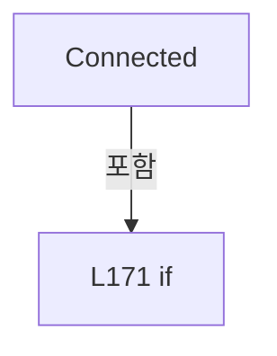

변경 전 점검: 입력/반환 타입, 위 호출자, 예외/취소 경로, 공유 상태와 저장·전송 소비자를 함께 확인합니다. 값의 단위나 물리 방향을 이름만으로 확정하지 않습니다.

### MethodDeclaration `StageSnapshot` · L173–188

[Drilling.Common/Interface/CPowerMeasureRun.cs:173–188](https://github.com/kjuws10-rgb/A3Drilling/blob/5aee8e58439c9b455cae7c9593c9be986c3e682e/Drilling.Common/Interface/CPowerMeasureRun.cs#L173-L188)

| 항목 | 실제 추출 값 |
| --- | --- |
| 서명 | (System.Collections.Generic.IReadOnlyDictionary<string, Drilling.Common.Interface.ST_MELSEC_CACHED_VALUE> Values, System.Collections.Generic.IReadOnlyList<Drilling.Common.Interface.ST_MELSEC_MAP_DATA> Map) Drilling.Common.Interface.CPowerMeasureDeviceSession.StageSnapshot() |
| 접근/수식자 | Private / private |
| 반환/값 타입 | (System.Collections.Generic.IReadOnlyDictionary<string, Drilling.Common.Interface.ST_MELSEC_CACHED_VALUE> Values, System.Collections.Generic.IReadOnlyList<Drilling.Common.Interface.ST_MELSEC_MAP_DATA> Map) |
| 소속 타입 | NamedType:Drilling.Common.Interface.CPowerMeasureDeviceSession |

정적 호출자로 확인된 위치:

| 호출 파일/행 | 호출 표현식 | 런타임 분기 가능 |
| --- | --- | --- |
| [Drilling.Common/Interface/CPowerMeasureRun.cs:208–208](https://github.com/kjuws10-rgb/A3Drilling/blob/5aee8e58439c9b455cae7c9593c9be986c3e682e/Drilling.Common/Interface/CPowerMeasureRun.cs#L208-L208) | StageSnapshot | False |
| [Drilling.Common/Interface/CPowerMeasureRun.cs:221–221](https://github.com/kjuws10-rgb/A3Drilling/blob/5aee8e58439c9b455cae7c9593c9be986c3e682e/Drilling.Common/Interface/CPowerMeasureRun.cs#L221-L221) | StageSnapshot | False |

호출하는 대상과 해석 범위:

| 원본 행 | 표현식 | 분석 상태 | 대상/소스 위치 |
| --- | --- | --- | --- |
| 175 | manager.Alarm().CurAlarm.Any | resolved | bool System.Collections.Generic.IEnumerable<Drilling.Common.Alarm.ST_ALARM_DATA>.Any<Drilling.Common.Alarm.ST_ALARM_DATA>(System.Func<Drilling.Common.Alarm.ST_ALARM_DATA, bool>) |
| 175 | manager.Alarm | resolved | Drilling.Common.Alarm.CAlarmManager Drilling.Common.Managers.CManager.Alarm() · Drilling.Common/Managers/CManager.cs:370 |
| 176 | new InvalidOperationException | resolved | System.InvalidOperationException.InvalidOperationException(string?) |
| 177 | Interfaces.Melsec.GetCachedSnapshot | resolved | System.Collections.Generic.IReadOnlyDictionary<string, Drilling.Common.Interface.ST_MELSEC_CACHED_VALUE> Drilling.Common.Interface.CMelsec.GetCachedSnapshot(System.Collections.Generic.IEnumerable<string>, out System.Collections.Generic.IReadOnlyList<Drilling.Common.Interface.ST_MELSEC_MAP_DATA>) · Drilling.Common/Interface/Melsec/CMelsec.cs:2550 |
| 180 | map.FirstOrDefault | resolved | Drilling.Common.Interface.ST_MELSEC_MAP_DATA? System.Collections.Generic.IEnumerable<Drilling.Common.Interface.ST_MELSEC_MAP_DATA>.FirstOrDefault<Drilling.Common.Interface.ST_MELSEC_MAP_DATA>(System.Func<Drilling.Common.Interface.ST_MELSEC_MAP_DATA, bool>) |
| 181 | string.IsNullOrWhiteSpace | resolved | bool string.IsNullOrWhiteSpace(string?) |
| 181 | r.Address.Equals | resolved | bool string.Equals(string?, System.StringComparison) |
| 182 | new InvalidOperationException | resolved | System.InvalidOperationException.InvalidOperationException(string?) |
| 183 | Connected | resolved | void Drilling.Common.Interface.CPowerMeasureDeviceSession.Connected(Drilling.Common.Interface.EN_EQP_MODULE, int) · Drilling.Common/Interface/CPowerMeasureRun.cs:168 |
| 184 | id.EndsWith | resolved | bool string.EndsWith(string) |
| 185 | new InvalidOperationException | resolved | System.InvalidOperationException.InvalidOperationException(string?) |

본문의 실제 연산·분기·예외·반환 순서(원문 위치 순):

| 원본 행 | 종류 | 주석 해설 |
| --- | --- | --- |
| 175 | call | 함수·델리게이트 또는 객체 생성자를 호출합니다: manager.Alarm().CurAlarm.Any(a => a.Severity == Drilling.Common.Alarm.EN_ALARM_LEVEL.Critical) |
| 175 | call | 함수·델리게이트 또는 객체 생성자를 호출합니다: manager.Alarm() |
| 175 | if | 조건에 따라 분기합니다: if (manager.Alarm().CurAlarm.Any(a => a.Severity == Drilling.Common.Alarm.EN_ALARM_LEVEL.Critical)) |
| 176 | call | 함수·델리게이트 또는 객체 생성자를 호출합니다: new InvalidOperationException("HEAVY 알람을 RESET한 후 파워 측정을 시작해 주세요.") |
| 176 | throw | 예외를 발생/전달합니다: throw new InvalidOperationException("HEAVY 알람을 RESET한 후 파워 측정을 시작해 주세요."); |
| 177 | call | 함수·델리게이트 또는 객체 생성자를 호출합니다: Interfaces.Melsec.GetCachedSnapshot(StageFeedbackIds, out var map) |
| 177 | local-declaration | 지역 변수를 선언합니다: var values = Interfaces.Melsec.GetCachedSnapshot(StageFeedbackIds, out var map); |
| 177 | variable-initializer | 변수의 초기값을 지정합니다: values = Interfaces.Melsec.GetCachedSnapshot(StageFeedbackIds, out var map) |
| 178 | foreach | 컬렉션 요소를 순회합니다: foreach (var id in StageFeedbackIds) |
| 180 | call | 함수·델리게이트 또는 객체 생성자를 호출합니다: map.FirstOrDefault(r => r.Use && r.Id == id && r.Direction == EN_MELSEC_DIRECTION.In && r.Access != EN_MELSEC_ACCESS.Write && !string.IsNullOrWhiteSpace(r.Address) && !r.Address.Equals("UNASSIGNED", StringComparison.Ordi… |
| 180 | local-declaration | 지역 변수를 선언합니다: var row = map.FirstOrDefault(r => r.Use && r.Id == id && r.Direction == EN_MELSEC_DIRECTION.In && r.Access != EN_MELSEC_ACCESS.Write && !string.IsNullOrWhiteSpace(r.Address) && !r.Address.Equals("UNASSIGNED", StringComparison.Ordi |
| 180 | variable-initializer | 변수의 초기값을 지정합니다: row = map.FirstOrDefault(r => r.Use && r.Id == id && r.Direction == EN_MELSEC_DIRECTION.In && r.Access != EN_MELSEC_ACCESS.Write && !string.IsNullOrWhiteSpace(r.Address) && !r.Address.Equals("UNASSIGNED", StringComparison.OrdinalI |
| 181 | call | 함수·델리게이트 또는 객체 생성자를 호출합니다: string.IsNullOrWhiteSpace(r.Address) |
| 181 | call | 함수·델리게이트 또는 객체 생성자를 호출합니다: r.Address.Equals("UNASSIGNED", StringComparison.OrdinalIgnoreCase) |
| 182 | call | 함수·델리게이트 또는 객체 생성자를 호출합니다: new InvalidOperationException($"Stage Y 입력 맵이 없습니다: {id}") |
| 182 | if | 조건에 따라 분기합니다: if (row is null) |
| 182 | throw | 예외를 발생/전달합니다: throw new InvalidOperationException($"Stage Y 입력 맵이 없습니다: {id}"); |
| 183 | call | 함수·델리게이트 또는 객체 생성자를 호출합니다: Connected(EN_EQP_MODULE.Melsec, row.DeviceNo) |
| 184 | assignment | 값을 대상에 대입합니다: _stageDevice = row.DeviceNo |
| 184 | call | 함수·델리게이트 또는 객체 생성자를 호출합니다: id.EndsWith("CUR_POS") |
| 184 | if | 조건에 따라 분기합니다: if (id.EndsWith("CUR_POS")) |
| 185 | call | 함수·델리게이트 또는 객체 생성자를 호출합니다: new InvalidOperationException("Stage Y 위치와 BUSY는 같은 MELSEC 장치의 입력이어야 합니다.") |
| 185 | else | 앞 조건이 거짓인 경로입니다: else |
| 185 | if | 조건에 따라 분기합니다: if (row.DeviceNo != _stageDevice) |
| 185 | throw | 예외를 발생/전달합니다: throw new InvalidOperationException("Stage Y 위치와 BUSY는 같은 MELSEC 장치의 입력이어야 합니다."); |
| 187 | return | 호출자에게 값 또는 제어를 반환합니다: return (values, map); |

제어 구문의 포함 구조(실제 실행 순서/CFG가 아닌 구문 탐색 그림):

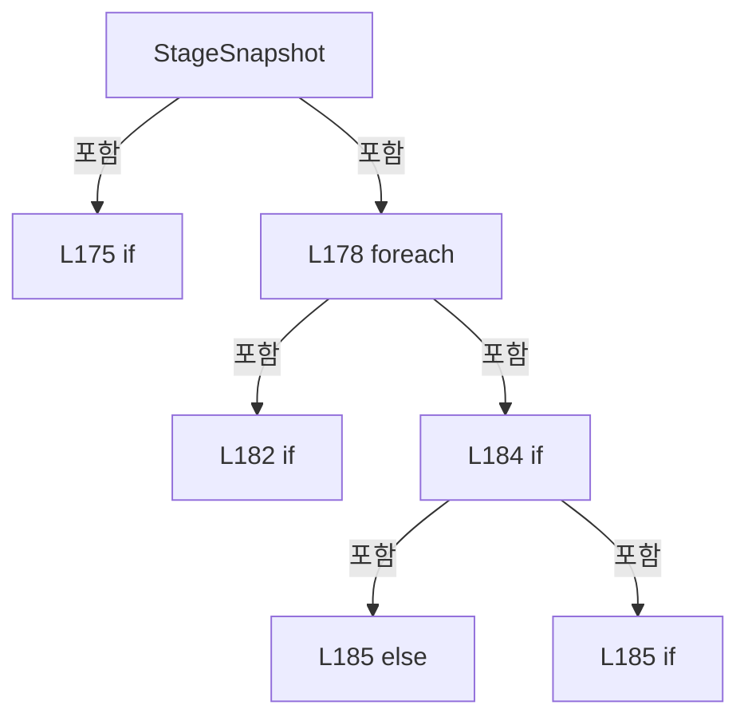

변경 전 점검: 입력/반환 타입, 위 호출자, 예외/취소 경로, 공유 상태와 저장·전송 소비자를 함께 확인합니다. 값의 단위나 물리 방향을 이름만으로 확정하지 않습니다.

### MethodDeclaration `StageEvidence` · L189–204

[Drilling.Common/Interface/CPowerMeasureRun.cs:189–204](https://github.com/kjuws10-rgb/A3Drilling/blob/5aee8e58439c9b455cae7c9593c9be986c3e682e/Drilling.Common/Interface/CPowerMeasureRun.cs#L189-L204)

| 항목 | 실제 추출 값 |
| --- | --- |
| 서명 | string Drilling.Common.Interface.CPowerMeasureDeviceSession.StageEvidence(System.Collections.Generic.IReadOnlyDictionary<string, Drilling.Common.Interface.ST_MELSEC_CACHED_VALUE>?, System.Collections.Generic.IReadOnlyList<Drilling.Common.Interface.ST_MELSEC_MAP_DATA>?) |
| 접근/수식자 | Private / private |
| 반환/값 타입 | string |
| 소속 타입 | NamedType:Drilling.Common.Interface.CPowerMeasureDeviceSession |

입력 계약:

| 이름 | 타입 | 전달 | 선택/기본값 |
| --- | --- | --- | --- |
| values | System.Collections.Generic.IReadOnlyDictionary<string, Drilling.Common.Interface.ST_MELSEC_CACHED_VALUE>? | None | True / null |
| map | System.Collections.Generic.IReadOnlyList<Drilling.Common.Interface.ST_MELSEC_MAP_DATA>? | None | True / null |

정적 호출자로 확인된 위치:

| 호출 파일/행 | 호출 표현식 | 런타임 분기 가능 |
| --- | --- | --- |
| [Drilling.Common/Interface/CPowerMeasureRun.cs:212–212](https://github.com/kjuws10-rgb/A3Drilling/blob/5aee8e58439c9b455cae7c9593c9be986c3e682e/Drilling.Common/Interface/CPowerMeasureRun.cs#L212-L212) | StageEvidence | False |
| [Drilling.Common/Interface/CPowerMeasureRun.cs:215–215](https://github.com/kjuws10-rgb/A3Drilling/blob/5aee8e58439c9b455cae7c9593c9be986c3e682e/Drilling.Common/Interface/CPowerMeasureRun.cs#L215-L215) | StageEvidence | False |
| [Drilling.Common/Interface/CPowerMeasureRun.cs:224–224](https://github.com/kjuws10-rgb/A3Drilling/blob/5aee8e58439c9b455cae7c9593c9be986c3e682e/Drilling.Common/Interface/CPowerMeasureRun.cs#L224-L224) | StageEvidence | False |
| [Drilling.Common/Interface/CPowerMeasureRun.cs:234–234](https://github.com/kjuws10-rgb/A3Drilling/blob/5aee8e58439c9b455cae7c9593c9be986c3e682e/Drilling.Common/Interface/CPowerMeasureRun.cs#L234-L234) | StageEvidence | False |
| [Drilling.Common/Interface/CPowerMeasureRun.cs:236–236](https://github.com/kjuws10-rgb/A3Drilling/blob/5aee8e58439c9b455cae7c9593c9be986c3e682e/Drilling.Common/Interface/CPowerMeasureRun.cs#L236-L236) | StageEvidence | False |

호출하는 대상과 해석 범위:

| 원본 행 | 표현식 | 분석 상태 | 대상/소스 위치 |
| --- | --- | --- | --- |
| 194 | Interfaces.Melsec.GetCachedSnapshot | resolved | System.Collections.Generic.IReadOnlyDictionary<string, Drilling.Common.Interface.ST_MELSEC_CACHED_VALUE> Drilling.Common.Interface.CMelsec.GetCachedSnapshot(System.Collections.Generic.IEnumerable<string>, out System.Collections.Generic.IReadOnlyList<Drilling.Common.Interface.ST_MELSEC_MAP_DATA>) · Drilling.Common/Interface/Melsec/CMelsec.cs:2550 |
| 196 | string.Join | resolved | string string.Join(string?, System.Collections.Generic.IEnumerable<string?>) |
| 196 | StageFeedbackIds.Select | resolved | System.Collections.Generic.IEnumerable<string> System.Collections.Generic.IEnumerable<string>.Select<string, string>(System.Func<string, string>) |
| 198 | map.FirstOrDefault | resolved | Drilling.Common.Interface.ST_MELSEC_MAP_DATA? System.Collections.Generic.IEnumerable<Drilling.Common.Interface.ST_MELSEC_MAP_DATA>.FirstOrDefault<Drilling.Common.Interface.ST_MELSEC_MAP_DATA>(System.Func<Drilling.Common.Interface.ST_MELSEC_MAP_DATA, bool>) |
| 199 | values.GetValueOrDefault | resolved | Drilling.Common.Interface.ST_MELSEC_CACHED_VALUE? System.Collections.Generic.IReadOnlyDictionary<string, Drilling.Common.Interface.ST_MELSEC_CACHED_VALUE>.GetValueOrDefault<string, Drilling.Common.Interface.ST_MELSEC_CACHED_VALUE>(string) |
| 200 | FormattableString.Invariant | resolved | string System.FormattableString.Invariant(System.FormattableString) |

본문의 실제 연산·분기·예외·반환 순서(원문 위치 순):

| 원본 행 | 종류 | 주석 해설 |
| --- | --- | --- |
| 191 | try | 예외 처리 범위입니다: try |
| 193 | if | 조건에 따라 분기합니다: if (values is null &#124;&#124; map is null) |
| 194 | assignment | 값을 대상에 대입합니다: values = Interfaces.Melsec.GetCachedSnapshot(StageFeedbackIds, out map) |
| 194 | call | 함수·델리게이트 또는 객체 생성자를 호출합니다: Interfaces.Melsec.GetCachedSnapshot(StageFeedbackIds, out map) |
| 195 | local-declaration | 지역 변수를 선언합니다: var now = DateTimeOffset.UtcNow; |
| 195 | variable-initializer | 변수의 초기값을 지정합니다: now = DateTimeOffset.UtcNow |
| 196 | call | 함수·델리게이트 또는 객체 생성자를 호출합니다: string.Join(" &#124; ", StageFeedbackIds.Select(id => { var row = map.FirstOrDefault(r => r.Id == id); var sample = values.GetValueOrDefault(id); return FormattableString.Invariant($"{id}; Address={row?.Address}; Value={sampl… |
| 196 | call | 함수·델리게이트 또는 객체 생성자를 호출합니다: StageFeedbackIds.Select(id => { var row = map.FirstOrDefault(r => r.Id == id); var sample = values.GetValueOrDefault(id); return FormattableString.Invariant($"{id}; Address={row?.Address}; Value={sample?.Value}; State={s… |
| 196 | return | 호출자에게 값 또는 제어를 반환합니다: return string.Join(" &#124; ", StageFeedbackIds.Select(id => { var row = map.FirstOrDefault(r => r.Id == id); var sample = values.GetValueOrDefault(id); return FormattableString.Invariant($"{id}; Address={row?.Address}; Value={sample?. |
| 198 | call | 함수·델리게이트 또는 객체 생성자를 호출합니다: map.FirstOrDefault(r => r.Id == id) |
| 198 | local-declaration | 지역 변수를 선언합니다: var row = map.FirstOrDefault(r => r.Id == id); |
| 198 | variable-initializer | 변수의 초기값을 지정합니다: row = map.FirstOrDefault(r => r.Id == id) |
| 199 | call | 함수·델리게이트 또는 객체 생성자를 호출합니다: values.GetValueOrDefault(id) |
| 199 | local-declaration | 지역 변수를 선언합니다: var sample = values.GetValueOrDefault(id); |
| 199 | variable-initializer | 변수의 초기값을 지정합니다: sample = values.GetValueOrDefault(id) |
| 200 | call | 함수·델리게이트 또는 객체 생성자를 호출합니다: FormattableString.Invariant($"{id}; Address={row?.Address}; Value={sample?.Value}; State={sample?.State}; SampleAt={sample?.UpdatedAt:O}; AgeMs={(sample?.UpdatedAt is { } at ? (now - at).TotalMilliseconds : (double?)null… |
| 200 | conditional-expression | 조건에 따라 결과식을 선택합니다: sample?.UpdatedAt is { } at ? (now - at).TotalMilliseconds : (double?)null |
| 200 | return | 호출자에게 값 또는 제어를 반환합니다: return FormattableString.Invariant($"{id}; Address={row?.Address}; Value={sample?.Value}; State={sample?.State}; SampleAt={sample?.UpdatedAt:O}; AgeMs={(sample?.UpdatedAt is { } at ? (now - at).TotalMilliseconds : (double?)null):F |
| 203 | catch | 지정 예외를 처리합니다: catch (Exception error) |
| 203 | return | 호출자에게 값 또는 제어를 반환합니다: return "Stage diagnostic unavailable: " + error.Message; |

제어 구문의 포함 구조(실제 실행 순서/CFG가 아닌 구문 탐색 그림):

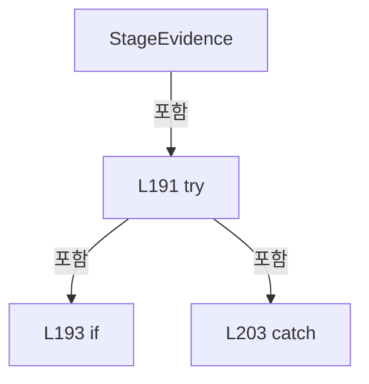

변경 전 점검: 입력/반환 타입, 위 호출자, 예외/취소 경로, 공유 상태와 저장·전송 소비자를 함께 확인합니다. 값의 단위나 물리 방향을 이름만으로 확정하지 않습니다.

### MethodDeclaration `EnsureStageReady` · L206–217

[Drilling.Common/Interface/CPowerMeasureRun.cs:206–217](https://github.com/kjuws10-rgb/A3Drilling/blob/5aee8e58439c9b455cae7c9593c9be986c3e682e/Drilling.Common/Interface/CPowerMeasureRun.cs#L206-L217)

| 항목 | 실제 추출 값 |
| --- | --- |
| 서명 | void Drilling.Common.Interface.CPowerMeasureDeviceSession.EnsureStageReady() |
| 접근/수식자 | Public / public |
| 반환/값 타입 | void |
| 소속 타입 | NamedType:Drilling.Common.Interface.CPowerMeasureDeviceSession |

정적 호출자로 확인된 위치:

| 호출 파일/행 | 호출 표현식 | 런타임 분기 가능 |
| --- | --- | --- |
| [Drilling.Common/Interface/CPowerMeasureRun.cs:71–71](https://github.com/kjuws10-rgb/A3Drilling/blob/5aee8e58439c9b455cae7c9593c9be986c3e682e/Drilling.Common/Interface/CPowerMeasureRun.cs#L71-L71) | _session.EnsureStageReady | False |
| [Drilling.Common/Interface/CPowerMeasureRun.cs:231–231](https://github.com/kjuws10-rgb/A3Drilling/blob/5aee8e58439c9b455cae7c9593c9be986c3e682e/Drilling.Common/Interface/CPowerMeasureRun.cs#L231-L231) | EnsureStageReady | False |
| [Drilling.Common/Interface/CPowerMeasureRun.cs:361–361](https://github.com/kjuws10-rgb/A3Drilling/blob/5aee8e58439c9b455cae7c9593c9be986c3e682e/Drilling.Common/Interface/CPowerMeasureRun.cs#L361-L361) | EnsureStageReady | False |
| [Drilling.Common/Interface/CPowerMeasureRun.cs:391–391](https://github.com/kjuws10-rgb/A3Drilling/blob/5aee8e58439c9b455cae7c9593c9be986c3e682e/Drilling.Common/Interface/CPowerMeasureRun.cs#L391-L391) | EnsureStageReady | False |

호출하는 대상과 해석 범위:

| 원본 행 | 표현식 | 분석 상태 | 대상/소스 위치 |
| --- | --- | --- | --- |
| 208 | StageSnapshot | resolved | (System.Collections.Generic.IReadOnlyDictionary<string, Drilling.Common.Interface.ST_MELSEC_CACHED_VALUE> Values, System.Collections.Generic.IReadOnlyList<Drilling.Common.Interface.ST_MELSEC_MAP_DATA> Map) Drilling.Common.Interface.CPowerMeasureDeviceSession.StageSnapshot() · Drilling.Common/Interface/CPowerMeasureRun.cs:173 |
| 211 | values.TryGetValue | resolved · 동적 구현 선택 가능 | bool System.Collections.Generic.IReadOnlyDictionary<string, Drilling.Common.Interface.ST_MELSEC_CACHED_VALUE>.TryGetValue(string, out Drilling.Common.Interface.ST_MELSEC_CACHED_VALUE) |
| 211 | TimeSpan.FromSeconds | resolved | System.TimeSpan System.TimeSpan.FromSeconds(long) |
| 212 | new InvalidOperationException | resolved | System.InvalidOperationException.InvalidOperationException(string?) |
| 212 | StageEvidence | resolved | string Drilling.Common.Interface.CPowerMeasureDeviceSession.StageEvidence(System.Collections.Generic.IReadOnlyDictionary<string, Drilling.Common.Interface.ST_MELSEC_CACHED_VALUE>?, System.Collections.Generic.IReadOnlyList<Drilling.Common.Interface.ST_MELSEC_MAP_DATA>?) · Drilling.Common/Interface/CPowerMeasureRun.cs:189 |
| 213 | Convert.ToDouble | resolved | double System.Convert.ToDouble(object?, System.IFormatProvider?) |
| 214 | double.IsFinite | resolved | bool double.IsFinite(double) |
| 214 | id.EndsWith | resolved | bool string.EndsWith(string) |
| 214 | Math.Abs | resolved | double System.Math.Abs(double) |
| 215 | new InvalidOperationException | resolved | System.InvalidOperationException.InvalidOperationException(string?) |
| 215 | StageEvidence | resolved | string Drilling.Common.Interface.CPowerMeasureDeviceSession.StageEvidence(System.Collections.Generic.IReadOnlyDictionary<string, Drilling.Common.Interface.ST_MELSEC_CACHED_VALUE>?, System.Collections.Generic.IReadOnlyList<Drilling.Common.Interface.ST_MELSEC_MAP_DATA>?) · Drilling.Common/Interface/CPowerMeasureRun.cs:189 |

본문의 실제 연산·분기·예외·반환 순서(원문 위치 순):

| 원본 행 | 종류 | 주석 해설 |
| --- | --- | --- |
| 208 | assignment | 값을 대상에 대입합니다: var (values, map) = StageSnapshot() |
| 208 | call | 함수·델리게이트 또는 객체 생성자를 호출합니다: StageSnapshot() |
| 209 | foreach | 컬렉션 요소를 순회합니다: foreach (var id in StageFeedbackIds) |
| 211 | call | 함수·델리게이트 또는 객체 생성자를 호출합니다: values.TryGetValue(id, out var sample) |
| 211 | call | 함수·델리게이트 또는 객체 생성자를 호출합니다: TimeSpan.FromSeconds(2) |
| 211 | if | 조건에 따라 분기합니다: if (!values.TryGetValue(id, out var sample) &#124;&#124; !sample.IsValid &#124;&#124; sample.Value is null &#124;&#124; sample.UpdatedAt is null &#124;&#124; DateTimeOffset.Now - sample.UpdatedAt > TimeSpan.FromSeconds(2)) |
| 212 | call | 함수·델리게이트 또는 객체 생성자를 호출합니다: new InvalidOperationException("Stage Y의 유효한 현재 위치/BUSY 스냅샷이 필요합니다. " + StageEvidence(values, map)) |
| 212 | call | 함수·델리게이트 또는 객체 생성자를 호출합니다: StageEvidence(values, map) |
| 212 | throw | 예외를 발생/전달합니다: throw new InvalidOperationException("Stage Y의 유효한 현재 위치/BUSY 스냅샷이 필요합니다. " + StageEvidence(values, map)); |
| 213 | call | 함수·델리게이트 또는 객체 생성자를 호출합니다: Convert.ToDouble(sample.Value, CultureInfo.InvariantCulture) |
| 213 | local-declaration | 지역 변수를 선언합니다: var number = Convert.ToDouble(sample.Value, CultureInfo.InvariantCulture); |
| 213 | variable-initializer | 변수의 초기값을 지정합니다: number = Convert.ToDouble(sample.Value, CultureInfo.InvariantCulture) |
| 214 | call | 함수·델리게이트 또는 객체 생성자를 호출합니다: double.IsFinite(number) |
| 214 | call | 함수·델리게이트 또는 객체 생성자를 호출합니다: id.EndsWith("BUSY") |
| 214 | call | 함수·델리게이트 또는 객체 생성자를 호출합니다: Math.Abs(number) |
| 214 | conditional-expression | 조건에 따라 결과식을 선택합니다: id.EndsWith("BUSY") ? number != 0 : Math.Abs(number) > StageTolerance |
| 214 | if | 조건에 따라 분기합니다: if (!double.IsFinite(number) &#124;&#124; (id.EndsWith("BUSY") ? number != 0 : Math.Abs(number) > StageTolerance)) |
| 215 | call | 함수·델리게이트 또는 객체 생성자를 호출합니다: new InvalidOperationException($"Stage Y가 0 mm에서 정지한 상태여야 합니다. {id}={number:0.####}; " + StageEvidence(values, map)) |
| 215 | call | 함수·델리게이트 또는 객체 생성자를 호출합니다: StageEvidence(values, map) |
| 215 | throw | 예외를 발생/전달합니다: throw new InvalidOperationException($"Stage Y가 0 mm에서 정지한 상태여야 합니다. {id}={number:0.####}; " + StageEvidence(values, map)); |

제어 구문의 포함 구조(실제 실행 순서/CFG가 아닌 구문 탐색 그림):

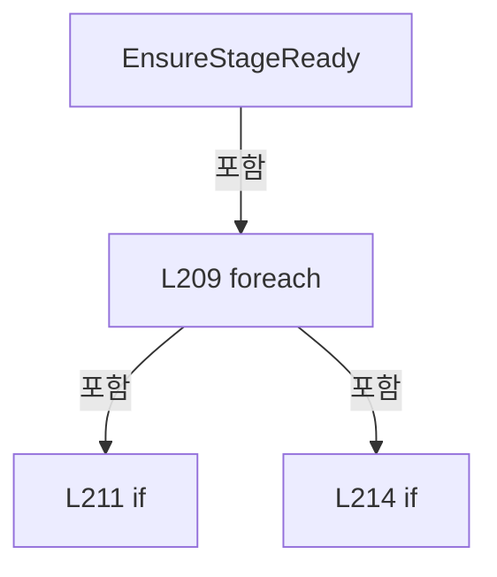

변경 전 점검: 입력/반환 타입, 위 호출자, 예외/취소 경로, 공유 상태와 저장·전송 소비자를 함께 확인합니다. 값의 단위나 물리 방향을 이름만으로 확정하지 않습니다.

### MethodDeclaration `CheckStageReady` · L218–237

[Drilling.Common/Interface/CPowerMeasureRun.cs:218–237](https://github.com/kjuws10-rgb/A3Drilling/blob/5aee8e58439c9b455cae7c9593c9be986c3e682e/Drilling.Common/Interface/CPowerMeasureRun.cs#L218-L237)

| 항목 | 실제 추출 값 |
| --- | --- |
| 서명 | System.Threading.Tasks.Task Drilling.Common.Interface.CPowerMeasureDeviceSession.CheckStageReady(System.Threading.CancellationToken) |
| 접근/수식자 | Public / public, async |
| 반환/값 타입 | System.Threading.Tasks.Task |
| 소속 타입 | NamedType:Drilling.Common.Interface.CPowerMeasureDeviceSession |

입력 계약:

| 이름 | 타입 | 전달 | 선택/기본값 |
| --- | --- | --- | --- |
| token | System.Threading.CancellationToken | None | False /  |

정적 호출자로 확인된 위치:

| 호출 파일/행 | 호출 표현식 | 런타임 분기 가능 |
| --- | --- | --- |
| [Drilling.Common/Interface/CPowerMeasureRun.cs:66–66](https://github.com/kjuws10-rgb/A3Drilling/blob/5aee8e58439c9b455cae7c9593c9be986c3e682e/Drilling.Common/Interface/CPowerMeasureRun.cs#L66-L66) | _session.CheckStageReady | False |
| [Drilling.Common/Interface/CPowerMeasureRun.cs:242–242](https://github.com/kjuws10-rgb/A3Drilling/blob/5aee8e58439c9b455cae7c9593c9be986c3e682e/Drilling.Common/Interface/CPowerMeasureRun.cs#L242-L242) | CheckStageReady | False |
| [Drilling.Common/Interface/CPowerMeasureRun.cs:248–248](https://github.com/kjuws10-rgb/A3Drilling/blob/5aee8e58439c9b455cae7c9593c9be986c3e682e/Drilling.Common/Interface/CPowerMeasureRun.cs#L248-L248) | CheckStageReady | False |
| [Drilling.Common/Interface/CPowerMeasureRun.cs:326–326](https://github.com/kjuws10-rgb/A3Drilling/blob/5aee8e58439c9b455cae7c9593c9be986c3e682e/Drilling.Common/Interface/CPowerMeasureRun.cs#L326-L326) | CheckStageReady | False |
| [Drilling.Common/Interface/CPowerMeasureRun.cs:346–346](https://github.com/kjuws10-rgb/A3Drilling/blob/5aee8e58439c9b455cae7c9593c9be986c3e682e/Drilling.Common/Interface/CPowerMeasureRun.cs#L346-L346) | CheckStageReady | False |
| [Drilling.Common/Interface/CPowerMeasureRun.cs:353–353](https://github.com/kjuws10-rgb/A3Drilling/blob/5aee8e58439c9b455cae7c9593c9be986c3e682e/Drilling.Common/Interface/CPowerMeasureRun.cs#L353-L353) | CheckStageReady | False |

호출하는 대상과 해석 범위:

| 원본 행 | 표현식 | 분석 상태 | 대상/소스 위치 |
| --- | --- | --- | --- |
| 220 | token.ThrowIfCancellationRequested | resolved | void System.Threading.CancellationToken.ThrowIfCancellationRequested() |
| 221 | StageSnapshot | resolved | (System.Collections.Generic.IReadOnlyDictionary<string, Drilling.Common.Interface.ST_MELSEC_CACHED_VALUE> Values, System.Collections.Generic.IReadOnlyList<Drilling.Common.Interface.ST_MELSEC_MAP_DATA> Map) Drilling.Common.Interface.CPowerMeasureDeviceSession.StageSnapshot() · Drilling.Common/Interface/CPowerMeasureRun.cs:173 |
| 223 | values.GetValueOrDefault | resolved | Drilling.Common.Interface.ST_MELSEC_CACHED_VALUE? System.Collections.Generic.IReadOnlyDictionary<string, Drilling.Common.Interface.ST_MELSEC_CACHED_VALUE>.GetValueOrDefault<string, Drilling.Common.Interface.ST_MELSEC_CACHED_VALUE>(string) |
| 224 | new IOException | resolved | System.IO.IOException.IOException(string?) |
| 224 | StageEvidence | resolved | string Drilling.Common.Interface.CPowerMeasureDeviceSession.StageEvidence(System.Collections.Generic.IReadOnlyDictionary<string, Drilling.Common.Interface.ST_MELSEC_CACHED_VALUE>?, System.Collections.Generic.IReadOnlyList<Drilling.Common.Interface.ST_MELSEC_MAP_DATA>?) · Drilling.Common/Interface/CPowerMeasureRun.cs:189 |
| 225 | CancellationTokenSource.CreateLinkedTokenSource | resolved | System.Threading.CancellationTokenSource System.Threading.CancellationTokenSource.CreateLinkedTokenSource(System.Threading.CancellationToken) |
| 226 | limit.CancelAfter | resolved | void System.Threading.CancellationTokenSource.CancelAfter(int) |
| 229 | Task.WhenAll(StageFeedbackIds.Select(id => Interfaces.Melsec.RefreshCachedValueAsync(id, limit.Token))).ConfigureAwait | resolved | System.Runtime.CompilerServices.ConfiguredTaskAwaitable<Drilling.Common.Interface.ST_MELSEC_CACHED_VALUE[]> System.Threading.Tasks.Task<Drilling.Common.Interface.ST_MELSEC_CACHED_VALUE[]>.ConfigureAwait(bool) |
| 229 | Task.WhenAll | resolved | System.Threading.Tasks.Task<Drilling.Common.Interface.ST_MELSEC_CACHED_VALUE[]> System.Threading.Tasks.Task.WhenAll<Drilling.Common.Interface.ST_MELSEC_CACHED_VALUE>(System.Collections.Generic.IEnumerable<System.Threading.Tasks.Task<Drilling.Common.Interface.ST_MELSEC_CACHED_VALUE>>) |
| 229 | StageFeedbackIds.Select | resolved | System.Collections.Generic.IEnumerable<System.Threading.Tasks.Task<Drilling.Common.Interface.ST_MELSEC_CACHED_VALUE>> System.Collections.Generic.IEnumerable<string>.Select<string, System.Threading.Tasks.Task<Drilling.Common.Interface.ST_MELSEC_CACHED_VALUE>>(System.Func<string, System.Threading.Tasks.Task<Drilling.Common.Interface.ST_MELSEC_CACHED_VALUE>>) |
| 229 | Interfaces.Melsec.RefreshCachedValueAsync | resolved | System.Threading.Tasks.Task<Drilling.Common.Interface.ST_MELSEC_CACHED_VALUE> Drilling.Common.Interface.CMelsec.RefreshCachedValueAsync(string, System.Threading.CancellationToken) · Drilling.Common/Interface/Melsec/CMelsec.cs:2577 |
| 230 | limit.Token.ThrowIfCancellationRequested | resolved | void System.Threading.CancellationToken.ThrowIfCancellationRequested() |
| 231 | EnsureStageReady | resolved | void Drilling.Common.Interface.CPowerMeasureDeviceSession.EnsureStageReady() · Drilling.Common/Interface/CPowerMeasureRun.cs:206 |
| 234 | new TimeoutException | resolved | System.TimeoutException.TimeoutException(string?, System.Exception?) |
| 234 | StageEvidence | resolved | string Drilling.Common.Interface.CPowerMeasureDeviceSession.StageEvidence(System.Collections.Generic.IReadOnlyDictionary<string, Drilling.Common.Interface.ST_MELSEC_CACHED_VALUE>?, System.Collections.Generic.IReadOnlyList<Drilling.Common.Interface.ST_MELSEC_MAP_DATA>?) · Drilling.Common/Interface/CPowerMeasureRun.cs:189 |
| 236 | new IOException | resolved | System.IO.IOException.IOException(string?, System.Exception?) |
| 236 | StageEvidence | resolved | string Drilling.Common.Interface.CPowerMeasureDeviceSession.StageEvidence(System.Collections.Generic.IReadOnlyDictionary<string, Drilling.Common.Interface.ST_MELSEC_CACHED_VALUE>?, System.Collections.Generic.IReadOnlyList<Drilling.Common.Interface.ST_MELSEC_MAP_DATA>?) · Drilling.Common/Interface/CPowerMeasureRun.cs:189 |

본문의 실제 연산·분기·예외·반환 순서(원문 위치 순):

| 원본 행 | 종류 | 주석 해설 |
| --- | --- | --- |
| 220 | call | 함수·델리게이트 또는 객체 생성자를 호출합니다: token.ThrowIfCancellationRequested() |
| 221 | assignment | 값을 대상에 대입합니다: var (values, map) = StageSnapshot() |
| 221 | call | 함수·델리게이트 또는 객체 생성자를 호출합니다: StageSnapshot() |
| 222 | foreach | 컬렉션 요소를 순회합니다: foreach (var id in StageFeedbackIds) |
| 223 | call | 함수·델리게이트 또는 객체 생성자를 호출합니다: values.GetValueOrDefault(id) |
| 223 | if | 조건에 따라 분기합니다: if (values.GetValueOrDefault(id)?.State is EN_MELSEC_CACHE_STATE.Error or EN_MELSEC_CACHE_STATE.Offline) |
| 224 | call | 함수·델리게이트 또는 객체 생성자를 호출합니다: new IOException("TPM Stage Y 입력 수신 오류: " + StageEvidence(values, map)) |
| 224 | call | 함수·델리게이트 또는 객체 생성자를 호출합니다: StageEvidence(values, map) |
| 224 | throw | 예외를 발생/전달합니다: throw new IOException("TPM Stage Y 입력 수신 오류: " + StageEvidence(values, map)); |
| 225 | call | 함수·델리게이트 또는 객체 생성자를 호출합니다: CancellationTokenSource.CreateLinkedTokenSource(token) |
| 225 | using-declaration | 정리할 자원을 선언합니다: using var limit = CancellationTokenSource.CreateLinkedTokenSource(token); |
| 225 | variable-initializer | 변수의 초기값을 지정합니다: limit = CancellationTokenSource.CreateLinkedTokenSource(token) |
| 226 | call | 함수·델리게이트 또는 객체 생성자를 호출합니다: limit.CancelAfter(TimeoutMs) |
| 227 | try | 예외 처리 범위입니다: try |
| 229 | await | 비동기 완료를 기다립니다: await Task.WhenAll(StageFeedbackIds.Select(id => Interfaces.Melsec.RefreshCachedValueAsync(id, limit.Token))).ConfigureAwait(false) |
| 229 | call | 함수·델리게이트 또는 객체 생성자를 호출합니다: Task.WhenAll(StageFeedbackIds.Select(id => Interfaces.Melsec.RefreshCachedValueAsync(id, limit.Token))).ConfigureAwait(false) |
| 229 | call | 함수·델리게이트 또는 객체 생성자를 호출합니다: Task.WhenAll(StageFeedbackIds.Select(id => Interfaces.Melsec.RefreshCachedValueAsync(id, limit.Token))) |
| 229 | call | 함수·델리게이트 또는 객체 생성자를 호출합니다: StageFeedbackIds.Select(id => Interfaces.Melsec.RefreshCachedValueAsync(id, limit.Token)) |
| 229 | call | 함수·델리게이트 또는 객체 생성자를 호출합니다: Interfaces.Melsec.RefreshCachedValueAsync(id, limit.Token) |
| 230 | call | 함수·델리게이트 또는 객체 생성자를 호출합니다: limit.Token.ThrowIfCancellationRequested() |
| 231 | call | 함수·델리게이트 또는 객체 생성자를 호출합니다: EnsureStageReady() |
| 233 | catch | 지정 예외를 처리합니다: catch (OperationCanceledException error) when (!token.IsCancellationRequested && limit.IsCancellationRequested) |
| 234 | call | 함수·델리게이트 또는 객체 생성자를 호출합니다: new TimeoutException("TPM Stage Y 최신 입력 확인 시간 초과: " + StageEvidence(), error) |
| 234 | call | 함수·델리게이트 또는 객체 생성자를 호출합니다: StageEvidence() |
| 234 | throw | 예외를 발생/전달합니다: throw new TimeoutException("TPM Stage Y 최신 입력 확인 시간 초과: " + StageEvidence(), error); |
| 235 | catch | 지정 예외를 처리합니다: catch (IOException error) |
| 236 | call | 함수·델리게이트 또는 객체 생성자를 호출합니다: new IOException("TPM Stage Y 최신 입력 확인 실패: " + StageEvidence(), error) |
| 236 | call | 함수·델리게이트 또는 객체 생성자를 호출합니다: StageEvidence() |
| 236 | throw | 예외를 발생/전달합니다: throw new IOException("TPM Stage Y 최신 입력 확인 실패: " + StageEvidence(), error); |

제어 구문의 포함 구조(실제 실행 순서/CFG가 아닌 구문 탐색 그림):

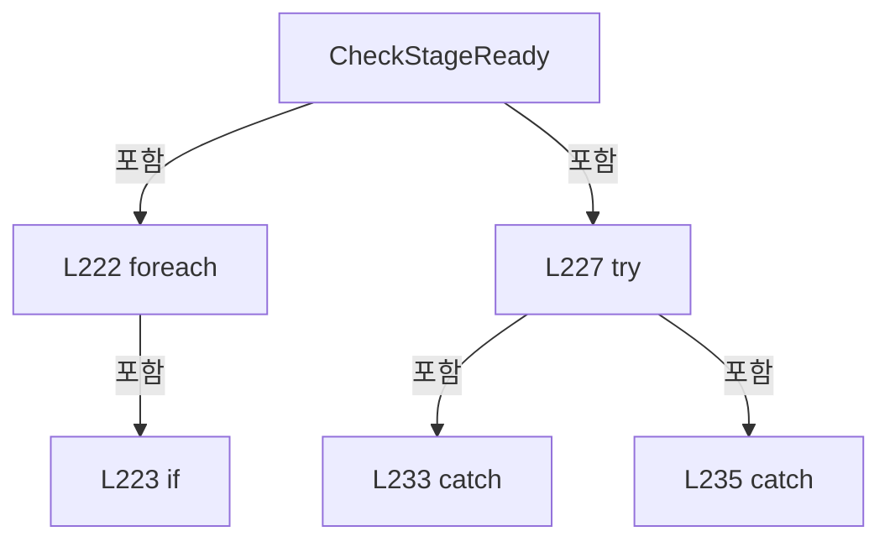

변경 전 점검: 입력/반환 타입, 위 호출자, 예외/취소 경로, 공유 상태와 저장·전송 소비자를 함께 확인합니다. 값의 단위나 물리 방향을 이름만으로 확정하지 않습니다.

### MethodDeclaration `MaintainStageFeedback` · L238–245

[Drilling.Common/Interface/CPowerMeasureRun.cs:238–245](https://github.com/kjuws10-rgb/A3Drilling/blob/5aee8e58439c9b455cae7c9593c9be986c3e682e/Drilling.Common/Interface/CPowerMeasureRun.cs#L238-L245)

| 항목 | 실제 추출 값 |
| --- | --- |
| 서명 | System.Threading.Tasks.Task Drilling.Common.Interface.CPowerMeasureDeviceSession.MaintainStageFeedback(System.Threading.CancellationToken) |
| 접근/수식자 | Internal / internal, async |
| 반환/값 타입 | System.Threading.Tasks.Task |
| 소속 타입 | NamedType:Drilling.Common.Interface.CPowerMeasureDeviceSession |

입력 계약:

| 이름 | 타입 | 전달 | 선택/기본값 |
| --- | --- | --- | --- |
| token | System.Threading.CancellationToken | None | False /  |

정적 호출자로 확인된 위치:

| 호출 파일/행 | 호출 표현식 | 런타임 분기 가능 |
| --- | --- | --- |
| [Drilling.Common/Interface/CPowerMeasureRun.cs:79–79](https://github.com/kjuws10-rgb/A3Drilling/blob/5aee8e58439c9b455cae7c9593c9be986c3e682e/Drilling.Common/Interface/CPowerMeasureRun.cs#L79-L79) | _session.MaintainStageFeedback | False |

호출하는 대상과 해석 범위:

| 원본 행 | 표현식 | 분석 상태 | 대상/소스 위치 |
| --- | --- | --- | --- |
| 242 | CheckStageReady(token).ConfigureAwait | resolved | System.Runtime.CompilerServices.ConfiguredTaskAwaitable System.Threading.Tasks.Task.ConfigureAwait(bool) |
| 242 | CheckStageReady | resolved | System.Threading.Tasks.Task Drilling.Common.Interface.CPowerMeasureDeviceSession.CheckStageReady(System.Threading.CancellationToken) · Drilling.Common/Interface/CPowerMeasureRun.cs:218 |
| 243 | Task.Delay(100, token).ConfigureAwait | resolved | System.Runtime.CompilerServices.ConfiguredTaskAwaitable System.Threading.Tasks.Task.ConfigureAwait(bool) |
| 243 | Task.Delay | resolved | System.Threading.Tasks.Task System.Threading.Tasks.Task.Delay(int, System.Threading.CancellationToken) |

본문의 실제 연산·분기·예외·반환 순서(원문 위치 순):

| 원본 행 | 종류 | 주석 해설 |
| --- | --- | --- |
| 240 | while | 조건을 먼저 확인하며 반복합니다: while (true) |
| 242 | await | 비동기 완료를 기다립니다: await CheckStageReady(token).ConfigureAwait(false) |
| 242 | call | 함수·델리게이트 또는 객체 생성자를 호출합니다: CheckStageReady(token).ConfigureAwait(false) |
| 242 | call | 함수·델리게이트 또는 객체 생성자를 호출합니다: CheckStageReady(token) |
| 243 | await | 비동기 완료를 기다립니다: await Task.Delay(100, token).ConfigureAwait(false) |
| 243 | call | 함수·델리게이트 또는 객체 생성자를 호출합니다: Task.Delay(100, token).ConfigureAwait(false) |
| 243 | call | 함수·델리게이트 또는 객체 생성자를 호출합니다: Task.Delay(100, token) |

제어 구문의 포함 구조(실제 실행 순서/CFG가 아닌 구문 탐색 그림):

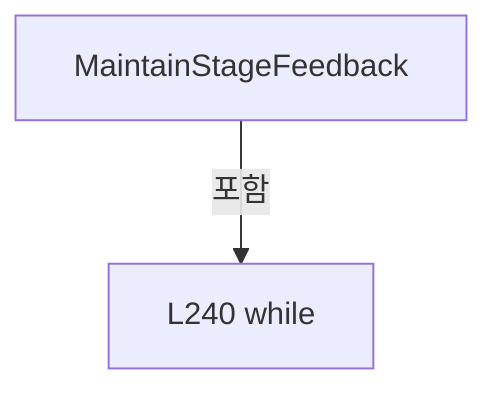

변경 전 점검: 입력/반환 타입, 위 호출자, 예외/취소 경로, 공유 상태와 저장·전송 소비자를 함께 확인합니다. 값의 단위나 물리 방향을 이름만으로 확정하지 않습니다.

### MethodDeclaration `PrepareAll` · L246–308

[Drilling.Common/Interface/CPowerMeasureRun.cs:246–308](https://github.com/kjuws10-rgb/A3Drilling/blob/5aee8e58439c9b455cae7c9593c9be986c3e682e/Drilling.Common/Interface/CPowerMeasureRun.cs#L246-L308)

| 항목 | 실제 추출 값 |
| --- | --- |
| 서명 | System.Threading.Tasks.Task Drilling.Common.Interface.CPowerMeasureDeviceSession.PrepareAll(System.Threading.CancellationToken) |
| 접근/수식자 | Public / public, async |
| 반환/값 타입 | System.Threading.Tasks.Task |
| 소속 타입 | NamedType:Drilling.Common.Interface.CPowerMeasureDeviceSession |

입력 계약:

| 이름 | 타입 | 전달 | 선택/기본값 |
| --- | --- | --- | --- |
| token | System.Threading.CancellationToken | None | False /  |

정적 호출자로 확인된 위치:

| 호출 파일/행 | 호출 표현식 | 런타임 분기 가능 |
| --- | --- | --- |
| [Drilling.Common/Interface/CPowerMeasureRun.cs:54–54](https://github.com/kjuws10-rgb/A3Drilling/blob/5aee8e58439c9b455cae7c9593c9be986c3e682e/Drilling.Common/Interface/CPowerMeasureRun.cs#L54-L54) | _session.PrepareAll | False |

호출하는 대상과 해석 범위:

| 원본 행 | 표현식 | 분석 상태 | 대상/소스 위치 |
| --- | --- | --- | --- |
| 248 | CheckStageReady(token).ConfigureAwait | resolved | System.Runtime.CompilerServices.ConfiguredTaskAwaitable System.Threading.Tasks.Task.ConfigureAwait(bool) |
| 248 | CheckStageReady | resolved | System.Threading.Tasks.Task Drilling.Common.Interface.CPowerMeasureDeviceSession.CheckStageReady(System.Threading.CancellationToken) · Drilling.Common/Interface/CPowerMeasureRun.cs:218 |
| 249 | manager.PowerMeasure.GetSnapshot | resolved | Drilling.Common.Interface.ST_POWER_MEASURE_SNAPSHOT Drilling.Common.Interface.CPowerMeasureService.GetSnapshot() · Drilling.Common/Interface/CPowerMeasureService.cs:12 |
| 249 | new InvalidOperationException | resolved | System.InvalidOperationException.InvalidOperationException(string?) |
| 250 | targets.Select(t => t.HeadNo).Distinct().Count | resolved | int System.Collections.Generic.IEnumerable<int>.Count<int>() |
| 250 | targets.Select(t => t.HeadNo).Distinct | resolved | System.Collections.Generic.IEnumerable<int> System.Collections.Generic.IEnumerable<int>.Distinct<int>() |
| 250 | targets.Select | resolved | System.Collections.Generic.IEnumerable<int> System.Collections.Generic.IEnumerable<Drilling.Common.Interface.ST_POWER_MEASURE_TARGET>.Select<Drilling.Common.Interface.ST_POWER_MEASURE_TARGET, int>(System.Func<Drilling.Common.Interface.ST_POWER_MEASURE_TARGET, int>) |
| 250 | targets.Select(t => t.PowerMeterNo).Distinct().Count | resolved | int System.Collections.Generic.IEnumerable<int>.Count<int>() |
| 250 | targets.Select(t => t.PowerMeterNo).Distinct | resolved | System.Collections.Generic.IEnumerable<int> System.Collections.Generic.IEnumerable<int>.Distinct<int>() |
| 250 | targets.Select | resolved | System.Collections.Generic.IEnumerable<int> System.Collections.Generic.IEnumerable<Drilling.Common.Interface.ST_POWER_MEASURE_TARGET>.Select<Drilling.Common.Interface.ST_POWER_MEASURE_TARGET, int>(System.Func<Drilling.Common.Interface.ST_POWER_MEASURE_TARGET, int>) |
| 251 | new InvalidOperationException | resolved | System.InvalidOperationException.InvalidOperationException(string?) |
| 252 | manager.Setting().LoadSection | resolved | System.Collections.Generic.IReadOnlyList<Drilling.Common.Managers.ST_SYSTEM_PARAMETER> Drilling.Common.Managers.CSettingManager.LoadSection(Drilling.Common.Managers.EN_SETTING_TAB, System.Threading.CancellationToken) · Drilling.Common/Managers/CSettingManager.cs:26 |
| 252 | manager.Setting | resolved | Drilling.Common.Managers.CSettingManager Drilling.Common.Managers.CManager.Setting() · Drilling.Common/Managers/CManager.cs:332 |
| 253 | recipe.Parameters.ToDictionary | resolved | System.Collections.Generic.Dictionary<string, string> System.Collections.Generic.IEnumerable<Drilling.Common.Managers.ST_RECIPE_PARAMETER>.ToDictionary<Drilling.Common.Managers.ST_RECIPE_PARAMETER, string, string>(System.Func<Drilling.Common.Managers.ST_RECIPE_PARAMETER, string>, System.Func<Drilling.Common.Managers.ST_RECIPE_PARAMETER, string>, System.Collections.Generic.IEqualityComparer<string>?) |
| 256 | double.IsFinite | resolved | bool double.IsFinite(double) |
| 257 | new InvalidOperationException | resolved | System.InvalidOperationException.InvalidOperationException(string?) |
| 259 | CScannerAxisConfiguration.IsHeadEnabled | resolved | bool Drilling.Common.Automation.CScannerAxisConfiguration.IsHeadEnabled(System.Collections.Generic.IReadOnlyList<Drilling.Common.Managers.ST_SYSTEM_PARAMETER>, int) · Drilling.Common/Automation/CScannerAxisConfiguration.cs:161 |
| 259 | new InvalidOperationException | resolved | System.InvalidOperationException.InvalidOperationException(string?) |
| 260 | Connected | resolved | void Drilling.Common.Interface.CPowerMeasureDeviceSession.Connected(Drilling.Common.Interface.EN_EQP_MODULE, int) · Drilling.Common/Interface/CPowerMeasureRun.cs:168 |
| 260 | Connected | resolved | void Drilling.Common.Interface.CPowerMeasureDeviceSession.Connected(Drilling.Common.Interface.EN_EQP_MODULE, int) · Drilling.Common/Interface/CPowerMeasureRun.cs:168 |
| 261 | CScannerAxisConfiguration.BuildAxisDefinitions | resolved | System.Collections.Generic.IReadOnlyList<Drilling.Common.Automation.ST_SCANNER_AXIS_SETTING> Drilling.Common.Automation.CScannerAxisConfiguration.BuildAxisDefinitions(System.Collections.Generic.IReadOnlyList<Drilling.Common.Managers.ST_SYSTEM_PARAMETER>, int) · Drilling.Common/Automation/CScannerAxisConfiguration.cs:8 |
| 262 | axes.FirstOrDefault | resolved | Drilling.Common.Automation.ST_SCANNER_AXIS_SETTING System.Collections.Generic.IEnumerable<Drilling.Common.Automation.ST_SCANNER_AXIS_SETTING>.FirstOrDefault<Drilling.Common.Automation.ST_SCANNER_AXIS_SETTING>(System.Func<Drilling.Common.Automation.ST_SCANNER_AXIS_SETTING, bool>) |
| 262 | axes.FirstOrDefault | resolved | Drilling.Common.Automation.ST_SCANNER_AXIS_SETTING System.Collections.Generic.IEnumerable<Drilling.Common.Automation.ST_SCANNER_AXIS_SETTING>.FirstOrDefault<Drilling.Common.Automation.ST_SCANNER_AXIS_SETTING>(System.Func<Drilling.Common.Automation.ST_SCANNER_AXIS_SETTING, bool>) |
| 263 | string.IsNullOrWhiteSpace | resolved | bool string.IsNullOrWhiteSpace(string?) |
| 263 | string.IsNullOrWhiteSpace | resolved | bool string.IsNullOrWhiteSpace(string?) |
| 264 | new InvalidOperationException | resolved | System.InvalidOperationException.InvalidOperationException(string?) |
| 265 | Automation.IsSimul | resolved | bool Drilling.Common.Automation.CAutomationManager.IsSimul(int) · Drilling.Common/Automation/CAutomationManager.cs:63 |
| 265 | Automation.IsConnect | resolved | bool Drilling.Common.Automation.CAutomationManager.IsConnect(int) · Drilling.Common/Automation/CAutomationManager.cs:58 |
| 265 | new InvalidOperationException | resolved | System.InvalidOperationException.InvalidOperationException(string?) |
| 266 | int.Parse | resolved | int int.Parse(string, System.IFormatProvider?) |
| 266 | settings.Single | resolved | Drilling.Common.Managers.ST_SYSTEM_PARAMETER System.Collections.Generic.IEnumerable<Drilling.Common.Managers.ST_SYSTEM_PARAMETER>.Single<Drilling.Common.Managers.ST_SYSTEM_PARAMETER>(System.Func<Drilling.Common.Managers.ST_SYSTEM_PARAMETER, bool>) |
| 267 | double.Parse | resolved | double double.Parse(string, System.IFormatProvider?) |
| 268 | double.IsFinite | resolved | bool double.IsFinite(double) |
| 268 | new InvalidOperationException | resolved | System.InvalidOperationException.InvalidOperationException(string?) |
| 270 | parameters.TryGetValue | resolved | bool System.Collections.Generic.Dictionary<string, string>.TryGetValue(string, out string) |
| 270 | double.Parse | resolved | double double.Parse(string, System.IFormatProvider?) |
| 271 | double.IsFinite | resolved | bool double.IsFinite(double) |
| 271 | new InvalidOperationException | resolved | System.InvalidOperationException.InvalidOperationException(string?) |
| 272 | _routes.Add | resolved | void System.Collections.Generic.Dictionary<int, Drilling.Common.Interface.CPowerMeasureDeviceSession.Route>.Add(int, Drilling.Common.Interface.CPowerMeasureDeviceSession.Route) |
| 272 | new | resolved | Drilling.Common.Interface.CPowerMeasureDeviceSession.Route.Route(Drilling.Common.Automation.ST_SCANNER_AXIS_SETTING, Drilling.Common.Automation.ST_SCANNER_AXIS_SETTING, int, double, double) · Drilling.Common/Interface/CPowerMeasureRun.cs:153 |
| 272 | _attenuators.Add | resolved | void System.Collections.Generic.Dictionary<int, Drilling.Common.Interface.CAttenuatorPositioningService>.Add(int, Drilling.Common.Interface.CAttenuatorPositioningService) |
| 272 | new | resolved | Drilling.Common.Interface.CAttenuatorPositioningService.CAttenuatorPositioningService(Drilling.Common.Interface.CInterfaceManager) · Drilling.Common/Interface/CInterfaceManager.cs:2203 |
| 273 | Interfaces.SetPowerMeterSimulationAttenuator | resolved | void Drilling.Common.Interface.CInterfaceManager.SetPowerMeterSimulationAttenuator(int, int) · Drilling.Common/Interface/CInterfaceManager.cs:1406 |
| 275 | _routes.Values.GroupBy(r => (r.X.AutomationNo, r.Task)).Any | resolved | bool System.Collections.Generic.IEnumerable<System.Linq.IGrouping<(int AutomationNo, int Task), Drilling.Common.Interface.CPowerMeasureDeviceSession.Route>>.Any<System.Linq.IGrouping<(int AutomationNo, int Task), Drilling.Common.Interface.CPowerMeasureDeviceSession.Route>>(System.Func<System.Linq.IGrouping<(int AutomationNo, int Task), Drilling.Common.Interface.CPowerMeasureDeviceSession.Route>, bool>) |
| 275 | _routes.Values.GroupBy | resolved | System.Collections.Generic.IEnumerable<System.Linq.IGrouping<(int AutomationNo, int Task), Drilling.Common.Interface.CPowerMeasureDeviceSession.Route>> System.Collections.Generic.IEnumerable<Drilling.Common.Interface.CPowerMeasureDeviceSession.Route>.GroupBy<Drilling.Common.Interface.CPowerMeasureDeviceSession.Route, (int AutomationNo, int Task)>(System.Func<Drilling.Common.Interface.CPowerMeasureDeviceSession.Route, (int AutomationNo, int Task)>) |
| 275 | g.Count | resolved | int System.Collections.Generic.IEnumerable<Drilling.Common.Interface.CPowerMeasureDeviceSession.Route>.Count<Drilling.Common.Interface.CPowerMeasureDeviceSession.Route>() |
| 275 | _routes.Values.SelectMany(r => new[] { r.X, r.Y }).GroupBy(a => (a.AutomationNo, a.AxisReference.ToUpperInvariant())).Any | resolved | bool System.Collections.Generic.IEnumerable<System.Linq.IGrouping<(int AutomationNo, string), Drilling.Common.Automation.ST_SCANNER_AXIS_SETTING>>.Any<System.Linq.IGrouping<(int AutomationNo, string), Drilling.Common.Automation.ST_SCANNER_AXIS_SETTING>>(System.Func<System.Linq.IGrouping<(int AutomationNo, string), Drilling.Common.Automation.ST_SCANNER_AXIS_SETTING>, bool>) |
| 275 | _routes.Values.SelectMany(r => new[] { r.X, r.Y }).GroupBy | resolved | System.Collections.Generic.IEnumerable<System.Linq.IGrouping<(int AutomationNo, string), Drilling.Common.Automation.ST_SCANNER_AXIS_SETTING>> System.Collections.Generic.IEnumerable<Drilling.Common.Automation.ST_SCANNER_AXIS_SETTING>.GroupBy<Drilling.Common.Automation.ST_SCANNER_AXIS_SETTING, (int AutomationNo, string)>(System.Func<Drilling.Common.Automation.ST_SCANNER_AXIS_SETTING, (int AutomationNo, string)>) |
| 275 | _routes.Values.SelectMany | resolved | System.Collections.Generic.IEnumerable<Drilling.Common.Automation.ST_SCANNER_AXIS_SETTING> System.Collections.Generic.IEnumerable<Drilling.Common.Interface.CPowerMeasureDeviceSession.Route>.SelectMany<Drilling.Common.Interface.CPowerMeasureDeviceSession.Route, Drilling.Common.Automation.ST_SCANNER_AXIS_SETTING>(System.Func<Drilling.Common.Interface.CPowerMeasureDeviceSession.Route, System.Collections.Generic.IEnumerable<Drilling.Common.Automation.ST_SCANNER_AXIS_SETTING>>) |
| 275 | a.AxisReference.ToUpperInvariant | resolved | string string.ToUpperInvariant() |
| 275 | g.Count | resolved | int System.Collections.Generic.IEnumerable<Drilling.Common.Automation.ST_SCANNER_AXIS_SETTING>.Count<Drilling.Common.Automation.ST_SCANNER_AXIS_SETTING>() |
| 276 | new InvalidOperationException | resolved | System.InvalidOperationException.InvalidOperationException(string?) |
| 277 | Interfaces.StageReviewSequences.Open | resolved | Drilling.Common.Station.CStageReviewSequences.Session Drilling.Common.Station.CStageReviewSequences.Open(int, System.Func<bool>?, bool, bool) · Drilling.Common/Station/CStageReviewSequences.cs:177 |
| 278 | CancellationTokenSource.CreateLinkedTokenSource | resolved | System.Threading.CancellationTokenSource System.Threading.CancellationTokenSource.CreateLinkedTokenSource(System.Threading.CancellationToken) |
| 278 | limit.CancelAfter | resolved | void System.Threading.CancellationTokenSource.CancelAfter(int) |
| 282 | Task.WhenAll(targets.Select(async target => { var route = _routes[target.HeadNo]; while (true) { limit.Token.ThrowIfCancellationRequested(); var status = Automation.StatusSnapshots.GetTask(route.Task, route.X.AutomationNo); if (status.IsFresh(TimeSpan.FromSeconds(2)) && status.Value is { } value) { var parts = value.Split(':'); if (parts.Length < 4… | resolved | System.Runtime.CompilerServices.ConfiguredTaskAwaitable System.Threading.Tasks.Task.ConfigureAwait(bool) |
| 282 | Task.WhenAll | resolved | System.Threading.Tasks.Task System.Threading.Tasks.Task.WhenAll(System.Collections.Generic.IEnumerable<System.Threading.Tasks.Task>) |
| 282 | targets.Select | resolved | System.Collections.Generic.IEnumerable<System.Threading.Tasks.Task> System.Collections.Generic.IEnumerable<Drilling.Common.Interface.ST_POWER_MEASURE_TARGET>.Select<Drilling.Common.Interface.ST_POWER_MEASURE_TARGET, System.Threading.Tasks.Task>(System.Func<Drilling.Common.Interface.ST_POWER_MEASURE_TARGET, System.Threading.Tasks.Task>) |
| 287 | limit.Token.ThrowIfCancellationRequested | resolved | void System.Threading.CancellationToken.ThrowIfCancellationRequested() |
| 288 | Automation.StatusSnapshots.GetTask | resolved | Drilling.Common.Automation.ST_AUTOMATION_STATUS_SNAPSHOT<string> Drilling.Common.Automation.CAutomationStatusSnapshotService.GetTask(int, int) · Drilling.Common/Automation/CAutomationStatusSnapshotService.cs:44 |
| 289 | status.IsFresh | resolved | bool Drilling.Common.Automation.ST_AUTOMATION_STATUS_SNAPSHOT<string>.IsFresh(System.TimeSpan) · Drilling.Common/Automation/CAutomationStatusSnapshotService.cs:399 |
| 289 | TimeSpan.FromSeconds | resolved | System.TimeSpan System.TimeSpan.FromSeconds(long) |
| 291 | value.Split | resolved | string[] string.Split(char, System.StringSplitOptions) |
| 292 | new InvalidOperationException | resolved | System.InvalidOperationException.InvalidOperationException(string?) |
| 295 | Task.Delay(50, limit.Token).ConfigureAwait | resolved | System.Runtime.CompilerServices.ConfiguredTaskAwaitable System.Threading.Tasks.Task.ConfigureAwait(bool) |
| 295 | Task.Delay | resolved | System.Threading.Tasks.Task System.Threading.Tasks.Task.Delay(int, System.Threading.CancellationToken) |
| 297 | GetAttenuatorPosition(target, limit.Token).ConfigureAwait | resolved | System.Runtime.CompilerServices.ConfiguredTaskAwaitable<double> System.Threading.Tasks.Task<double>.ConfigureAwait(bool) |
| 297 | GetAttenuatorPosition | resolved | System.Threading.Tasks.Task<double> Drilling.Common.Interface.CPowerMeasureDeviceSession.GetAttenuatorPosition(Drilling.Common.Interface.ST_POWER_MEASURE_TARGET, System.Threading.CancellationToken) · Drilling.Common/Interface/CPowerMeasureRun.cs:327 |
| 298 | WaitLaserReady(target.HeadNo, limit.Token).ConfigureAwait | resolved | System.Runtime.CompilerServices.ConfiguredTaskAwaitable System.Threading.Tasks.Task.ConfigureAwait(bool) |
| 298 | WaitLaserReady | resolved | System.Threading.Tasks.Task Drilling.Common.Interface.CPowerMeasureDeviceSession.WaitLaserReady(int, System.Threading.CancellationToken) · Drilling.Common/Interface/CPowerMeasureRun.cs:309 |
| 300 | Task.WhenAll(targets.Select(async target => { var r = _routes[target.HeadNo]; await Automation.ConfigurePowerMeasurement(r.X.AxisReference, r.Frequency, r.Task, r.X.AutomationNo, limit.Token).ConfigureAwait(false); await new CAutomationPositioningService(Automation).MoveAndWait(new[] { r.X, r.Y }.Select(a => new ST_AUTOMATION_ABSOLUTE_MOVE_TARGET($… | resolved | System.Runtime.CompilerServices.ConfiguredTaskAwaitable System.Threading.Tasks.Task.ConfigureAwait(bool) |
| 300 | Task.WhenAll | resolved | System.Threading.Tasks.Task System.Threading.Tasks.Task.WhenAll(System.Collections.Generic.IEnumerable<System.Threading.Tasks.Task>) |
| 300 | targets.Select | resolved | System.Collections.Generic.IEnumerable<System.Threading.Tasks.Task> System.Collections.Generic.IEnumerable<Drilling.Common.Interface.ST_POWER_MEASURE_TARGET>.Select<Drilling.Common.Interface.ST_POWER_MEASURE_TARGET, System.Threading.Tasks.Task>(System.Func<Drilling.Common.Interface.ST_POWER_MEASURE_TARGET, System.Threading.Tasks.Task>) |
| 303 | Automation.ConfigurePowerMeasurement(r.X.AxisReference, r.Frequency, r.Task, r.X.AutomationNo, limit.Token).ConfigureAwait | resolved | System.Runtime.CompilerServices.ConfiguredTaskAwaitable System.Threading.Tasks.Task.ConfigureAwait(bool) |
| 303 | Automation.ConfigurePowerMeasurement | resolved · 동적 구현 선택 가능 | System.Threading.Tasks.Task Drilling.Common.Automation.CAutomationManager.ConfigurePowerMeasurement(string, double, int, int, System.Threading.CancellationToken) · Drilling.Common/Automation/CAutomationManager.cs:565 |
| 304 | new CAutomationPositioningService(Automation).MoveAndWait(new[] { r.X, r.Y }.Select(a => new ST_AUTOMATION_ABSOLUTE_MOVE_TARGET($"HEAD {target.HeadNo:00} {a.AxisName}", a.AutomationNo, a.AxisReference, a.AioNo, a.ReadExtendedStatus, 0, r.Speed)).ToArray(), limit.Token).ConfigureAwait | resolved | System.Runtime.CompilerServices.ConfiguredTaskAwaitable System.Threading.Tasks.Task.ConfigureAwait(bool) |
| 304 | new CAutomationPositioningService(Automation).MoveAndWait | resolved | System.Threading.Tasks.Task Drilling.Common.Automation.CAutomationPositioningService.MoveAndWait(System.Collections.Generic.IReadOnlyList<Drilling.Common.Automation.ST_AUTOMATION_ABSOLUTE_MOVE_TARGET>, System.Threading.CancellationToken) · Drilling.Common/Automation/CAutomationManager.cs:1537 |
| 304 | new CAutomationPositioningService | resolved | Drilling.Common.Automation.CAutomationPositioningService.CAutomationPositioningService(Drilling.Common.Automation.CAutomationManager) · Drilling.Common/Automation/CAutomationManager.cs:1535 |
| 304 | new[] { r.X, r.Y }.Select(a => new ST_AUTOMATION_ABSOLUTE_MOVE_TARGET($"HEAD {target.HeadNo:00} {a.AxisName}", a.AutomationNo, a.AxisReference, a.AioNo, a.ReadExtendedStatus, 0, r.Speed)).ToArray | resolved | Drilling.Common.Automation.ST_AUTOMATION_ABSOLUTE_MOVE_TARGET[] System.Collections.Generic.IEnumerable<Drilling.Common.Automation.ST_AUTOMATION_ABSOLUTE_MOVE_TARGET>.ToArray<Drilling.Common.Automation.ST_AUTOMATION_ABSOLUTE_MOVE_TARGET>() |
| 304 | new[] { r.X, r.Y }.Select | resolved | System.Collections.Generic.IEnumerable<Drilling.Common.Automation.ST_AUTOMATION_ABSOLUTE_MOVE_TARGET> System.Collections.Generic.IEnumerable<Drilling.Common.Automation.ST_SCANNER_AXIS_SETTING>.Select<Drilling.Common.Automation.ST_SCANNER_AXIS_SETTING, Drilling.Common.Automation.ST_AUTOMATION_ABSOLUTE_MOVE_TARGET>(System.Func<Drilling.Common.Automation.ST_SCANNER_AXIS_SETTING, Drilling.Common.Automation.ST_AUTOMATION_ABSOLUTE_MOVE_TARGET>) |
| 304 | new ST_AUTOMATION_ABSOLUTE_MOVE_TARGET | resolved | Drilling.Common.Automation.ST_AUTOMATION_ABSOLUTE_MOVE_TARGET.ST_AUTOMATION_ABSOLUTE_MOVE_TARGET(string, int, string, int, bool, double, double) · Drilling.Common/Automation/CAutomationManager.cs:1533 |
| 307 | new TimeoutException | resolved | System.TimeoutException.TimeoutException(string?) |

본문의 실제 연산·분기·예외·반환 순서(원문 위치 순):

| 원본 행 | 종류 | 주석 해설 |
| --- | --- | --- |
| 248 | await | 비동기 완료를 기다립니다: await CheckStageReady(token).ConfigureAwait(false) |
| 248 | call | 함수·델리게이트 또는 객체 생성자를 호출합니다: CheckStageReady(token).ConfigureAwait(false) |
| 248 | call | 함수·델리게이트 또는 객체 생성자를 호출합니다: CheckStageReady(token) |
| 249 | call | 함수·델리게이트 또는 객체 생성자를 호출합니다: manager.PowerMeasure.GetSnapshot() |
| 249 | call | 함수·델리게이트 또는 객체 생성자를 호출합니다: new InvalidOperationException("PowerMeasure가 이미 실행 중입니다.") |
| 249 | if | 조건에 따라 분기합니다: if (manager.PowerMeasure.GetSnapshot().IsRunning) |
| 249 | throw | 예외를 발생/전달합니다: throw new InvalidOperationException("PowerMeasure가 이미 실행 중입니다."); |
| 250 | call | 함수·델리게이트 또는 객체 생성자를 호출합니다: targets.Select(t => t.HeadNo).Distinct().Count() |
| 250 | call | 함수·델리게이트 또는 객체 생성자를 호출합니다: targets.Select(t => t.HeadNo).Distinct() |
| 250 | call | 함수·델리게이트 또는 객체 생성자를 호출합니다: targets.Select(t => t.HeadNo) |
| 250 | call | 함수·델리게이트 또는 객체 생성자를 호출합니다: targets.Select(t => t.PowerMeterNo).Distinct().Count() |
| 250 | call | 함수·델리게이트 또는 객체 생성자를 호출합니다: targets.Select(t => t.PowerMeterNo).Distinct() |
| 250 | call | 함수·델리게이트 또는 객체 생성자를 호출합니다: targets.Select(t => t.PowerMeterNo) |
| 250 | if | 조건에 따라 분기합니다: if (targets.Count == 0 &#124;&#124; targets.Select(t => t.HeadNo).Distinct().Count() != targets.Count &#124;&#124; targets.Select(t => t.PowerMeterNo).Distinct().Count() != targets.Count) |
| 251 | call | 함수·델리게이트 또는 객체 생성자를 호출합니다: new InvalidOperationException("중복 없는 Head 및 전용 센서가 필요합니다.") |
| 251 | throw | 예외를 발생/전달합니다: throw new InvalidOperationException("중복 없는 Head 및 전용 센서가 필요합니다."); |
| 252 | call | 함수·델리게이트 또는 객체 생성자를 호출합니다: manager.Setting().LoadSection(EN_SETTING_TAB.Option) |
| 252 | call | 함수·델리게이트 또는 객체 생성자를 호출합니다: manager.Setting() |
| 252 | local-declaration | 지역 변수를 선언합니다: var settings = manager.Setting().LoadSection(EN_SETTING_TAB.Option); |
| 252 | variable-initializer | 변수의 초기값을 지정합니다: settings = manager.Setting().LoadSection(EN_SETTING_TAB.Option) |
| 253 | call | 함수·델리게이트 또는 객체 생성자를 호출합니다: recipe.Parameters.ToDictionary(p => p.Key, p => p.Value, StringComparer.OrdinalIgnoreCase) |
| 253 | local-declaration | 지역 변수를 선언합니다: var parameters = recipe.Parameters.ToDictionary(p => p.Key, p => p.Value, StringComparer.OrdinalIgnoreCase); |
| 253 | variable-initializer | 변수의 초기값을 지정합니다: parameters = recipe.Parameters.ToDictionary(p => p.Key, p => p.Value, StringComparer.OrdinalIgnoreCase) |
| 254 | foreach | 컬렉션 요소를 순회합니다: foreach (var target in targets) |
| 256 | call | 함수·델리게이트 또는 객체 생성자를 호출합니다: double.IsFinite(target.TargetPower) |
| 256 | if | 조건에 따라 분기합니다: if (target.HeadNo is < 1 or > 8 &#124;&#124; target.PowerMeterNo != target.HeadNo - 1 &#124;&#124; !double.IsFinite(target.TargetPower) &#124;&#124; target.TargetPower <= 0) |
| 257 | call | 함수·델리게이트 또는 객체 생성자를 호출합니다: new InvalidOperationException("Head별 전용 PowerMeter 및 목표 W를 확인해 주세요.") |
| 257 | throw | 예외를 발생/전달합니다: throw new InvalidOperationException("Head별 전용 PowerMeter 및 목표 W를 확인해 주세요."); |
| 258 | local-declaration | 지역 변수를 선언합니다: var head = target.HeadNo; |
| 258 | variable-initializer | 변수의 초기값을 지정합니다: head = target.HeadNo |
| 259 | call | 함수·델리게이트 또는 객체 생성자를 호출합니다: CScannerAxisConfiguration.IsHeadEnabled(settings, head) |
| 259 | call | 함수·델리게이트 또는 객체 생성자를 호출합니다: new InvalidOperationException($"HEAD {head:00}: Head USE가 필요합니다.") |
| 259 | if | 조건에 따라 분기합니다: if (!CScannerAxisConfiguration.IsHeadEnabled(settings, head)) |
| 259 | throw | 예외를 발생/전달합니다: throw new InvalidOperationException($"HEAD {head:00}: Head USE가 필요합니다."); |
| 260 | call | 함수·델리게이트 또는 객체 생성자를 호출합니다: Connected(EN_EQP_MODULE.PowerMeter, target.PowerMeterNo) |
| 260 | call | 함수·델리게이트 또는 객체 생성자를 호출합니다: Connected(EN_EQP_MODULE.Attenuator, head - 1) |
| 261 | call | 함수·델리게이트 또는 객체 생성자를 호출합니다: CScannerAxisConfiguration.BuildAxisDefinitions(settings, head) |
| 261 | local-declaration | 지역 변수를 선언합니다: var axes = CScannerAxisConfiguration.BuildAxisDefinitions(settings, head); |
| 261 | variable-initializer | 변수의 초기값을 지정합니다: axes = CScannerAxisConfiguration.BuildAxisDefinitions(settings, head) |
| 262 | call | 함수·델리게이트 또는 객체 생성자를 호출합니다: axes.FirstOrDefault(a => a.AxisName == "X") |
| 262 | call | 함수·델리게이트 또는 객체 생성자를 호출합니다: axes.FirstOrDefault(a => a.AxisName == "Y") |
| 262 | local-declaration | 지역 변수를 선언합니다: var x = axes.FirstOrDefault(a => a.AxisName == "X"); |
| 262 | local-declaration | 지역 변수를 선언합니다: var y = axes.FirstOrDefault(a => a.AxisName == "Y"); |
| 262 | variable-initializer | 변수의 초기값을 지정합니다: x = axes.FirstOrDefault(a => a.AxisName == "X") |
| 262 | variable-initializer | 변수의 초기값을 지정합니다: y = axes.FirstOrDefault(a => a.AxisName == "Y") |
| 263 | call | 함수·델리게이트 또는 객체 생성자를 호출합니다: string.IsNullOrWhiteSpace(x.AxisReference) |
| 263 | call | 함수·델리게이트 또는 객체 생성자를 호출합니다: string.IsNullOrWhiteSpace(y.AxisReference) |
| 263 | if | 조건에 따라 분기합니다: if (!x.IsUsed &#124;&#124; !y.IsUsed &#124;&#124; string.IsNullOrWhiteSpace(x.AxisReference) &#124;&#124; string.IsNullOrWhiteSpace(y.AxisReference) &#124;&#124; x.ConfigurationError.Length > 0 &#124;&#124; y.ConfigurationError.Length > 0) |
| 264 | call | 함수·델리게이트 또는 객체 생성자를 호출합니다: new InvalidOperationException($"HEAD {head:00}: Scanner X/Y 설정을 확인해 주세요.") |
| 264 | throw | 예외를 발생/전달합니다: throw new InvalidOperationException($"HEAD {head:00}: Scanner X/Y 설정을 확인해 주세요."); |
| 265 | call | 함수·델리게이트 또는 객체 생성자를 호출합니다: Automation.IsSimul(x.AutomationNo) |
| 265 | call | 함수·델리게이트 또는 객체 생성자를 호출합니다: Automation.IsConnect(x.AutomationNo) |
| 265 | call | 함수·델리게이트 또는 객체 생성자를 호출합니다: new InvalidOperationException($"Automation {x.AutomationNo}: OFFLINE") |
| 265 | if | 조건에 따라 분기합니다: if (!Automation.IsSimul(x.AutomationNo) && !Automation.IsConnect(x.AutomationNo)) |
| 265 | throw | 예외를 발생/전달합니다: throw new InvalidOperationException($"Automation {x.AutomationNo}: OFFLINE"); |
| 266 | call | 함수·델리게이트 또는 객체 생성자를 호출합니다: int.Parse(settings.Single(p => p.Key == $"H{head:00}_AUTOMATION_TASK_NO").Value, CultureInfo.InvariantCulture) |
| 266 | call | 함수·델리게이트 또는 객체 생성자를 호출합니다: settings.Single(p => p.Key == $"H{head:00}_AUTOMATION_TASK_NO") |
| 266 | local-declaration | 지역 변수를 선언합니다: int task = int.Parse(settings.Single(p => p.Key == $"H{head:00}_AUTOMATION_TASK_NO").Value, CultureInfo.InvariantCulture); |
| 266 | variable-initializer | 변수의 초기값을 지정합니다: task = int.Parse(settings.Single(p => p.Key == $"H{head:00}_AUTOMATION_TASK_NO").Value, CultureInfo.InvariantCulture) |
| 267 | call | 함수·델리게이트 또는 객체 생성자를 호출합니다: double.Parse(parameters[$"H{head:00}_LASER_FREQUENCY"], CultureInfo.InvariantCulture) |
| 267 | local-declaration | 지역 변수를 선언합니다: var freq = double.Parse(parameters[$"H{head:00}_LASER_FREQUENCY"], CultureInfo.InvariantCulture); |
| 267 | variable-initializer | 변수의 초기값을 지정합니다: freq = double.Parse(parameters[$"H{head:00}_LASER_FREQUENCY"], CultureInfo.InvariantCulture) |
| 268 | call | 함수·델리게이트 또는 객체 생성자를 호출합니다: double.IsFinite(freq) |
| 268 | call | 함수·델리게이트 또는 객체 생성자를 호출합니다: new InvalidOperationException($"HEAD {head:00}: Recipe Frequency 오류") |
| 268 | if | 조건에 따라 분기합니다: if (!double.IsFinite(freq) &#124;&#124; freq <= 0) |
| 268 | throw | 예외를 발생/전달합니다: throw new InvalidOperationException($"HEAD {head:00}: Recipe Frequency 오류"); |
| 270 | call | 함수·델리게이트 또는 객체 생성자를 호출합니다: parameters.TryGetValue($"H{head:00}_SCANNER_JUMP_SPEED", out var speedText) |
| 270 | call | 함수·델리게이트 또는 객체 생성자를 호출합니다: double.Parse(speedText, CultureInfo.InvariantCulture) |
| 270 | conditional-expression | 조건에 따라 결과식을 선택합니다: parameters.TryGetValue($"H{head:00}_SCANNER_JUMP_SPEED", out var speedText) ? double.Parse(speedText, CultureInfo.InvariantCulture) : 1500 |
| 270 | local-declaration | 지역 변수를 선언합니다: var speed = parameters.TryGetValue($"H{head:00}_SCANNER_JUMP_SPEED", out var speedText) ? double.Parse(speedText, CultureInfo.InvariantCulture) : 1500; |
| 270 | variable-initializer | 변수의 초기값을 지정합니다: speed = parameters.TryGetValue($"H{head:00}_SCANNER_JUMP_SPEED", out var speedText) ? double.Parse(speedText, CultureInfo.InvariantCulture) : 1500 |
| 271 | call | 함수·델리게이트 또는 객체 생성자를 호출합니다: double.IsFinite(speed) |
| 271 | call | 함수·델리게이트 또는 객체 생성자를 호출합니다: new InvalidOperationException($"HEAD {head:00}: Jump Speed 오류") |
| 271 | if | 조건에 따라 분기합니다: if (!double.IsFinite(speed) &#124;&#124; speed <= 0) |
| 271 | throw | 예외를 발생/전달합니다: throw new InvalidOperationException($"HEAD {head:00}: Jump Speed 오류"); |
| 272 | call | 함수·델리게이트 또는 객체 생성자를 호출합니다: _routes.Add(head, new(x, y, task, freq, speed)) |
| 272 | call | 함수·델리게이트 또는 객체 생성자를 호출합니다: new(x, y, task, freq, speed) |
| 272 | call | 함수·델리게이트 또는 객체 생성자를 호출합니다: _attenuators.Add(head, new(Interfaces)) |
| 272 | call | 함수·델리게이트 또는 객체 생성자를 호출합니다: new(Interfaces) |
| 273 | call | 함수·델리게이트 또는 객체 생성자를 호출합니다: Interfaces.SetPowerMeterSimulationAttenuator(target.PowerMeterNo, head - 1) |
| 275 | call | 함수·델리게이트 또는 객체 생성자를 호출합니다: _routes.Values.GroupBy(r => (r.X.AutomationNo, r.Task)).Any(g => g.Count() > 1) |
| 275 | call | 함수·델리게이트 또는 객체 생성자를 호출합니다: _routes.Values.GroupBy(r => (r.X.AutomationNo, r.Task)) |
| 275 | call | 함수·델리게이트 또는 객체 생성자를 호출합니다: g.Count() |
| 275 | call | 함수·델리게이트 또는 객체 생성자를 호출합니다: _routes.Values.SelectMany(r => new[] { r.X, r.Y }).GroupBy(a => (a.AutomationNo, a.AxisReference.ToUpperInvariant())).Any(g => g.Count() > 1) |
| 275 | call | 함수·델리게이트 또는 객체 생성자를 호출합니다: _routes.Values.SelectMany(r => new[] { r.X, r.Y }).GroupBy(a => (a.AutomationNo, a.AxisReference.ToUpperInvariant())) |
| 275 | call | 함수·델리게이트 또는 객체 생성자를 호출합니다: _routes.Values.SelectMany(r => new[] { r.X, r.Y }) |
| 275 | call | 함수·델리게이트 또는 객체 생성자를 호출합니다: a.AxisReference.ToUpperInvariant() |
| 275 | call | 함수·델리게이트 또는 객체 생성자를 호출합니다: g.Count() |
| 275 | if | 조건에 따라 분기합니다: if (_routes.Values.GroupBy(r => (r.X.AutomationNo, r.Task)).Any(g => g.Count() > 1) &#124;&#124; _routes.Values.SelectMany(r => new[] { r.X, r.Y }).GroupBy(a => (a.AutomationNo, a.AxisReference.ToUpperInvariant())).Any(g => g.Count() …) |
| 276 | call | 함수·델리게이트 또는 객체 생성자를 호출합니다: new InvalidOperationException("Head 간 Automation Task 또는 Scanner 축이 중복되었습니다.") |
| 276 | throw | 예외를 발생/전달합니다: throw new InvalidOperationException("Head 간 Automation Task 또는 Scanner 축이 중복되었습니다."); |
| 277 | assignment | 값을 대상에 대입합니다: _stage = Interfaces.StageReviewSequences.Open(_stageDevice) |
| 277 | call | 함수·델리게이트 또는 객체 생성자를 호출합니다: Interfaces.StageReviewSequences.Open(_stageDevice) |
| 278 | call | 함수·델리게이트 또는 객체 생성자를 호출합니다: CancellationTokenSource.CreateLinkedTokenSource(token) |
| 278 | call | 함수·델리게이트 또는 객체 생성자를 호출합니다: limit.CancelAfter(TimeoutMs) |
| 278 | using-declaration | 정리할 자원을 선언합니다: using var limit = CancellationTokenSource.CreateLinkedTokenSource(token); |
| 278 | variable-initializer | 변수의 초기값을 지정합니다: limit = CancellationTokenSource.CreateLinkedTokenSource(token) |
| 279 | try | 예외 처리 범위입니다: try |
| 282 | await | 비동기 완료를 기다립니다: await Task.WhenAll(targets.Select(async target => { var route = _routes[target.HeadNo]; while (true) { limit.Token.ThrowIfCancellationRequested(); var status = Automation.StatusSnapshots.GetTask(route.Task, route.X.AutomationNo);  |
| 282 | call | 함수·델리게이트 또는 객체 생성자를 호출합니다: Task.WhenAll(targets.Select(async target => { var route = _routes[target.HeadNo]; while (true) { limit.Token.ThrowIfCancellationRequested(); var status = Automation.StatusSnapshots.GetTask(route.Task, route.X.AutomationN… |
| 282 | call | 함수·델리게이트 또는 객체 생성자를 호출합니다: Task.WhenAll(targets.Select(async target => { var route = _routes[target.HeadNo]; while (true) { limit.Token.ThrowIfCancellationRequested(); var status = Automation.StatusSnapshots.GetTask(route.Task, route.X.AutomationN… |
| 282 | call | 함수·델리게이트 또는 객체 생성자를 호출합니다: targets.Select(async target => { var route = _routes[target.HeadNo]; while (true) { limit.Token.ThrowIfCancellationRequested(); var status = Automation.StatusSnapshots.GetTask(route.Task, route.X.AutomationNo); if (statu… |
| 284 | local-declaration | 지역 변수를 선언합니다: var route = _routes[target.HeadNo]; |
| 284 | variable-initializer | 변수의 초기값을 지정합니다: route = _routes[target.HeadNo] |
| 285 | while | 조건을 먼저 확인하며 반복합니다: while (true) |
| 287 | call | 함수·델리게이트 또는 객체 생성자를 호출합니다: limit.Token.ThrowIfCancellationRequested() |
| 288 | call | 함수·델리게이트 또는 객체 생성자를 호출합니다: Automation.StatusSnapshots.GetTask(route.Task, route.X.AutomationNo) |
| 288 | local-declaration | 지역 변수를 선언합니다: var status = Automation.StatusSnapshots.GetTask(route.Task, route.X.AutomationNo); |
| 288 | variable-initializer | 변수의 초기값을 지정합니다: status = Automation.StatusSnapshots.GetTask(route.Task, route.X.AutomationNo) |
| 289 | call | 함수·델리게이트 또는 객체 생성자를 호출합니다: status.IsFresh(TimeSpan.FromSeconds(2)) |
| 289 | call | 함수·델리게이트 또는 객체 생성자를 호출합니다: TimeSpan.FromSeconds(2) |
| 289 | if | 조건에 따라 분기합니다: if (status.IsFresh(TimeSpan.FromSeconds(2)) && status.Value is { } value) |
| 291 | call | 함수·델리게이트 또는 객체 생성자를 호출합니다: value.Split(':') |
| 291 | local-declaration | 지역 변수를 선언합니다: var parts = value.Split(':'); |
| 291 | variable-initializer | 변수의 초기값을 지정합니다: parts = value.Split(':') |
| 292 | call | 함수·델리게이트 또는 객체 생성자를 호출합니다: new InvalidOperationException($"HEAD {target.HeadNo:00}: Task 실행 중 또는 오류 ({value})") |
| 292 | if | 조건에 따라 분기합니다: if (parts.Length < 4 &#124;&#124; parts[0] != "OK" &#124;&#124; parts[3] is not ("Idle" or "Stopped" or "ProgramComplete" or "QueueComplete")) |
| 292 | throw | 예외를 발생/전달합니다: throw new InvalidOperationException($"HEAD {target.HeadNo:00}: Task 실행 중 또는 오류 ({value})"); |
| 293 | break | 해당 반복/분기 구간을 종료합니다: break; |
| 295 | await | 비동기 완료를 기다립니다: await Task.Delay(50, limit.Token).ConfigureAwait(false) |
| 295 | call | 함수·델리게이트 또는 객체 생성자를 호출합니다: Task.Delay(50, limit.Token).ConfigureAwait(false) |
| 295 | call | 함수·델리게이트 또는 객체 생성자를 호출합니다: Task.Delay(50, limit.Token) |
| 297 | await | 비동기 완료를 기다립니다: await GetAttenuatorPosition(target, limit.Token).ConfigureAwait(false) |
| 297 | call | 함수·델리게이트 또는 객체 생성자를 호출합니다: GetAttenuatorPosition(target, limit.Token).ConfigureAwait(false) |
| 297 | call | 함수·델리게이트 또는 객체 생성자를 호출합니다: GetAttenuatorPosition(target, limit.Token) |
| 298 | await | 비동기 완료를 기다립니다: await WaitLaserReady(target.HeadNo, limit.Token).ConfigureAwait(false) |
| 298 | call | 함수·델리게이트 또는 객체 생성자를 호출합니다: WaitLaserReady(target.HeadNo, limit.Token).ConfigureAwait(false) |
| 298 | call | 함수·델리게이트 또는 객체 생성자를 호출합니다: WaitLaserReady(target.HeadNo, limit.Token) |
| 300 | await | 비동기 완료를 기다립니다: await Task.WhenAll(targets.Select(async target => { var r = _routes[target.HeadNo]; await Automation.ConfigurePowerMeasurement(r.X.AxisReference, r.Frequency, r.Task, r.X.AutomationNo, limit.Token).ConfigureAwait(false); await new |
| 300 | call | 함수·델리게이트 또는 객체 생성자를 호출합니다: Task.WhenAll(targets.Select(async target => { var r = _routes[target.HeadNo]; await Automation.ConfigurePowerMeasurement(r.X.AxisReference, r.Frequency, r.Task, r.X.AutomationNo, limit.Token).ConfigureAwait(false); await… |
| 300 | call | 함수·델리게이트 또는 객체 생성자를 호출합니다: Task.WhenAll(targets.Select(async target => { var r = _routes[target.HeadNo]; await Automation.ConfigurePowerMeasurement(r.X.AxisReference, r.Frequency, r.Task, r.X.AutomationNo, limit.Token).ConfigureAwait(false); await… |
| 300 | call | 함수·델리게이트 또는 객체 생성자를 호출합니다: targets.Select(async target => { var r = _routes[target.HeadNo]; await Automation.ConfigurePowerMeasurement(r.X.AxisReference, r.Frequency, r.Task, r.X.AutomationNo, limit.Token).ConfigureAwait(false); await new CAutomat… |
| 302 | local-declaration | 지역 변수를 선언합니다: var r = _routes[target.HeadNo]; |
| 302 | variable-initializer | 변수의 초기값을 지정합니다: r = _routes[target.HeadNo] |
| 303 | await | 비동기 완료를 기다립니다: await Automation.ConfigurePowerMeasurement(r.X.AxisReference, r.Frequency, r.Task, r.X.AutomationNo, limit.Token).ConfigureAwait(false) |
| 303 | call | 함수·델리게이트 또는 객체 생성자를 호출합니다: Automation.ConfigurePowerMeasurement(r.X.AxisReference, r.Frequency, r.Task, r.X.AutomationNo, limit.Token).ConfigureAwait(false) |
| 303 | call | 함수·델리게이트 또는 객체 생성자를 호출합니다: Automation.ConfigurePowerMeasurement(r.X.AxisReference, r.Frequency, r.Task, r.X.AutomationNo, limit.Token) |
| 304 | await | 비동기 완료를 기다립니다: await new CAutomationPositioningService(Automation).MoveAndWait(new[] { r.X, r.Y }.Select(a => new ST_AUTOMATION_ABSOLUTE_MOVE_TARGET($"HEAD {target.HeadNo:00} {a.AxisName}", a.AutomationNo, a.AxisReference, a.AioNo, a.ReadExtende |
| 304 | call | 함수·델리게이트 또는 객체 생성자를 호출합니다: new CAutomationPositioningService(Automation).MoveAndWait(new[] { r.X, r.Y }.Select(a => new ST_AUTOMATION_ABSOLUTE_MOVE_TARGET($"HEAD {target.HeadNo:00} {a.AxisName}", a.AutomationNo, a.AxisReference, a.AioNo, a.ReadExt… |
| 304 | call | 함수·델리게이트 또는 객체 생성자를 호출합니다: new CAutomationPositioningService(Automation).MoveAndWait(new[] { r.X, r.Y }.Select(a => new ST_AUTOMATION_ABSOLUTE_MOVE_TARGET($"HEAD {target.HeadNo:00} {a.AxisName}", a.AutomationNo, a.AxisReference, a.AioNo, a.ReadExt… |
| 304 | call | 함수·델리게이트 또는 객체 생성자를 호출합니다: new CAutomationPositioningService(Automation) |
| 304 | call | 함수·델리게이트 또는 객체 생성자를 호출합니다: new[] { r.X, r.Y }.Select(a => new ST_AUTOMATION_ABSOLUTE_MOVE_TARGET($"HEAD {target.HeadNo:00} {a.AxisName}", a.AutomationNo, a.AxisReference, a.AioNo, a.ReadExtendedStatus, 0, r.Speed)).ToArray() |
| 304 | call | 함수·델리게이트 또는 객체 생성자를 호출합니다: new[] { r.X, r.Y }.Select(a => new ST_AUTOMATION_ABSOLUTE_MOVE_TARGET($"HEAD {target.HeadNo:00} {a.AxisName}", a.AutomationNo, a.AxisReference, a.AioNo, a.ReadExtendedStatus, 0, r.Speed)) |
| 304 | call | 함수·델리게이트 또는 객체 생성자를 호출합니다: new ST_AUTOMATION_ABSOLUTE_MOVE_TARGET($"HEAD {target.HeadNo:00} {a.AxisName}", a.AutomationNo, a.AxisReference, a.AioNo, a.ReadExtendedStatus, 0, r.Speed) |
| 307 | call | 함수·델리게이트 또는 객체 생성자를 호출합니다: new TimeoutException("PowerMeasure 장치 준비 시간 초과") |
| 307 | catch | 지정 예외를 처리합니다: catch (OperationCanceledException) when (!token.IsCancellationRequested) |
| 307 | throw | 예외를 발생/전달합니다: throw new TimeoutException("PowerMeasure 장치 준비 시간 초과"); |

제어 구문의 포함 구조(실제 실행 순서/CFG가 아닌 구문 탐색 그림):

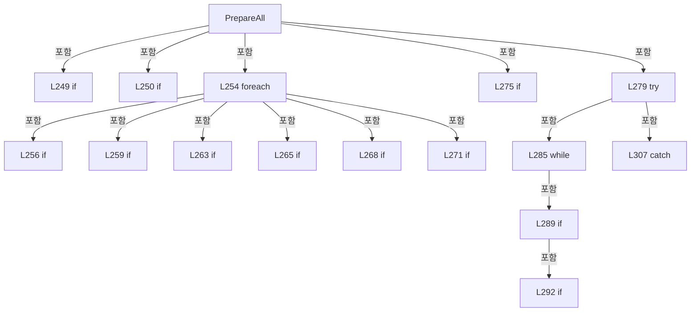

변경 전 점검: 입력/반환 타입, 위 호출자, 예외/취소 경로, 공유 상태와 저장·전송 소비자를 함께 확인합니다. 값의 단위나 물리 방향을 이름만으로 확정하지 않습니다.

### MethodDeclaration `WaitLaserReady` · L309–325

[Drilling.Common/Interface/CPowerMeasureRun.cs:309–325](https://github.com/kjuws10-rgb/A3Drilling/blob/5aee8e58439c9b455cae7c9593c9be986c3e682e/Drilling.Common/Interface/CPowerMeasureRun.cs#L309-L325)

| 항목 | 실제 추출 값 |
| --- | --- |
| 서명 | System.Threading.Tasks.Task Drilling.Common.Interface.CPowerMeasureDeviceSession.WaitLaserReady(int, System.Threading.CancellationToken) |
| 접근/수식자 | Private / private, async |
| 반환/값 타입 | System.Threading.Tasks.Task |
| 소속 타입 | NamedType:Drilling.Common.Interface.CPowerMeasureDeviceSession |

입력 계약:

| 이름 | 타입 | 전달 | 선택/기본값 |
| --- | --- | --- | --- |
| head | int | None | False /  |
| token | System.Threading.CancellationToken | None | False /  |

정적 호출자로 확인된 위치:

| 호출 파일/행 | 호출 표현식 | 런타임 분기 가능 |
| --- | --- | --- |
| [Drilling.Common/Interface/CPowerMeasureRun.cs:298–298](https://github.com/kjuws10-rgb/A3Drilling/blob/5aee8e58439c9b455cae7c9593c9be986c3e682e/Drilling.Common/Interface/CPowerMeasureRun.cs#L298-L298) | WaitLaserReady | False |
| [Drilling.Common/Interface/CPowerMeasureRun.cs:355–355](https://github.com/kjuws10-rgb/A3Drilling/blob/5aee8e58439c9b455cae7c9593c9be986c3e682e/Drilling.Common/Interface/CPowerMeasureRun.cs#L355-L355) | WaitLaserReady | False |

호출하는 대상과 해석 범위:

| 원본 행 | 표현식 | 분석 상태 | 대상/소스 위치 |
| --- | --- | --- | --- |
| 311 | Interfaces.GetInterfaceList | resolved | System.Collections.Generic.IReadOnlyList<Drilling.Common.Interface.ST_INTERFACE_DATA> Drilling.Common.Interface.CInterfaceManager.GetInterfaceList(Drilling.Common.Interface.EN_EQP_MODULE?) · Drilling.Common/Interface/CInterfaceManager.cs:442 |
| 312 | lasers.FirstOrDefault | resolved | Drilling.Common.Interface.ST_INTERFACE_DATA? System.Collections.Generic.IEnumerable<Drilling.Common.Interface.ST_INTERFACE_DATA>.FirstOrDefault<Drilling.Common.Interface.ST_INTERFACE_DATA>(System.Func<Drilling.Common.Interface.ST_INTERFACE_DATA, bool>) |
| 312 | new InvalidOperationException | resolved | System.InvalidOperationException.InvalidOperationException(string?) |
| 313 | Connected | resolved | void Drilling.Common.Interface.CPowerMeasureDeviceSession.Connected(Drilling.Common.Interface.EN_EQP_MODULE, int) · Drilling.Common/Interface/CPowerMeasureRun.cs:168 |
| 316 | token.ThrowIfCancellationRequested | resolved | void System.Threading.CancellationToken.ThrowIfCancellationRequested() |
| 317 | Interfaces.OpticSnapshots.GetLaser | resolved | Drilling.Common.Interface.ST_SHARED_DEVICE_SNAPSHOT<Drilling.Common.Interface.ST_LASER_STATUS> Drilling.Common.Interface.COpticStatusSnapshotService.GetLaser(int) · Drilling.Common/Interface/CInterfaceManager.cs:3377 |
| 318 | TimeSpan.FromSeconds | resolved | System.TimeSpan System.TimeSpan.FromSeconds(long) |
| 320 | new InvalidOperationException | resolved | System.InvalidOperationException.InvalidOperationException(string?) |
| 323 | Task.Delay(50, token).ConfigureAwait | resolved | System.Runtime.CompilerServices.ConfiguredTaskAwaitable System.Threading.Tasks.Task.ConfigureAwait(bool) |
| 323 | Task.Delay | resolved | System.Threading.Tasks.Task System.Threading.Tasks.Task.Delay(int, System.Threading.CancellationToken) |

본문의 실제 연산·분기·예외·반환 순서(원문 위치 순):

| 원본 행 | 종류 | 주석 해설 |
| --- | --- | --- |
| 311 | call | 함수·델리게이트 또는 객체 생성자를 호출합니다: Interfaces.GetInterfaceList(EN_EQP_MODULE.TalonLaser) |
| 311 | local-declaration | 지역 변수를 선언합니다: var lasers = Interfaces.GetInterfaceList(EN_EQP_MODULE.TalonLaser); |
| 311 | variable-initializer | 변수의 초기값을 지정합니다: lasers = Interfaces.GetInterfaceList(EN_EQP_MODULE.TalonLaser) |
| 312 | call | 함수·델리게이트 또는 객체 생성자를 호출합니다: lasers.FirstOrDefault(d => d.Number == head - 1) |
| 312 | call | 함수·델리게이트 또는 객체 생성자를 호출합니다: new InvalidOperationException($"HEAD {head:00}: Laser 설정이 없습니다.") |
| 312 | conditional-expression | 조건에 따라 결과식을 선택합니다: lasers.Count == 1 ? lasers[0] : null |
| 312 | local-declaration | 지역 변수를 선언합니다: var laser = lasers.FirstOrDefault(d => d.Number == head - 1) ?? (lasers.Count == 1 ? lasers[0] : null) ?? throw new InvalidOperationException($"HEAD {head:00}: Laser 설정이 없습니다."); |
| 312 | throw | 예외를 발생/전달합니다: throw new InvalidOperationException($"HEAD {head:00}: Laser 설정이 없습니다.") |
| 312 | variable-initializer | 변수의 초기값을 지정합니다: laser = lasers.FirstOrDefault(d => d.Number == head - 1) ?? (lasers.Count == 1 ? lasers[0] : null) ?? throw new InvalidOperationException($"HEAD {head:00}: Laser 설정이 없습니다.") |
| 313 | call | 함수·델리게이트 또는 객체 생성자를 호출합니다: Connected(EN_EQP_MODULE.TalonLaser, laser.Number) |
| 314 | while | 조건을 먼저 확인하며 반복합니다: while (true) |
| 316 | call | 함수·델리게이트 또는 객체 생성자를 호출합니다: token.ThrowIfCancellationRequested() |
| 317 | call | 함수·델리게이트 또는 객체 생성자를 호출합니다: Interfaces.OpticSnapshots.GetLaser(laser.Number) |
| 317 | local-declaration | 지역 변수를 선언합니다: var snapshot = Interfaces.OpticSnapshots.GetLaser(laser.Number); |
| 317 | variable-initializer | 변수의 초기값을 지정합니다: snapshot = Interfaces.OpticSnapshots.GetLaser(laser.Number) |
| 318 | call | 함수·델리게이트 또는 객체 생성자를 호출합니다: TimeSpan.FromSeconds(2) |
| 318 | if | 조건에 따라 분기합니다: if (snapshot.State == "OK" && snapshot.Value is { } value && DateTimeOffset.Now - snapshot.UpdatedAt <= TimeSpan.FromSeconds(2)) |
| 320 | call | 함수·델리게이트 또는 객체 생성자를 호출합니다: new InvalidOperationException($"HEAD {head:00}: Laser ON / Gate ON / Shutter OPEN이 필요합니다.") |
| 320 | if | 조건에 따라 분기합니다: if (!value.PowerOn &#124;&#124; !value.GateOn &#124;&#124; !value.ShutterOpen) |
| 320 | throw | 예외를 발생/전달합니다: throw new InvalidOperationException($"HEAD {head:00}: Laser ON / Gate ON / Shutter OPEN이 필요합니다."); |
| 321 | return | 호출자에게 값 또는 제어를 반환합니다: return; |
| 323 | await | 비동기 완료를 기다립니다: await Task.Delay(50, token).ConfigureAwait(false) |
| 323 | call | 함수·델리게이트 또는 객체 생성자를 호출합니다: Task.Delay(50, token).ConfigureAwait(false) |
| 323 | call | 함수·델리게이트 또는 객체 생성자를 호출합니다: Task.Delay(50, token) |

제어 구문의 포함 구조(실제 실행 순서/CFG가 아닌 구문 탐색 그림):

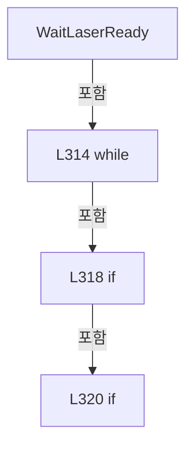

변경 전 점검: 입력/반환 타입, 위 호출자, 예외/취소 경로, 공유 상태와 저장·전송 소비자를 함께 확인합니다. 값의 단위나 물리 방향을 이름만으로 확정하지 않습니다.

### MethodDeclaration `Prepare` · L326–326

[Drilling.Common/Interface/CPowerMeasureRun.cs:326–326](https://github.com/kjuws10-rgb/A3Drilling/blob/5aee8e58439c9b455cae7c9593c9be986c3e682e/Drilling.Common/Interface/CPowerMeasureRun.cs#L326-L326)

| 항목 | 실제 추출 값 |
| --- | --- |
| 서명 | System.Threading.Tasks.Task Drilling.Common.Interface.CPowerMeasureDeviceSession.Prepare(Drilling.Common.Interface.ST_POWER_MEASURE_TARGET, System.Threading.CancellationToken) |
| 접근/수식자 | Public / public |
| 반환/값 타입 | System.Threading.Tasks.Task |
| 소속 타입 | NamedType:Drilling.Common.Interface.CPowerMeasureDeviceSession |

입력 계약:

| 이름 | 타입 | 전달 | 선택/기본값 |
| --- | --- | --- | --- |
| target | Drilling.Common.Interface.ST_POWER_MEASURE_TARGET | None | False /  |
| token | System.Threading.CancellationToken | None | False /  |

현재 부분 분석에서 직접 연결된 호출자는 없습니다. XAML/이벤트/인터페이스·델리게이트·외부 진입을 추가 확인해야 하며, 미사용으로 판정한 것이 아닙니다.

호출하는 대상과 해석 범위:

| 원본 행 | 표현식 | 분석 상태 | 대상/소스 위치 |
| --- | --- | --- | --- |
| 326 | CheckStageReady | resolved | System.Threading.Tasks.Task Drilling.Common.Interface.CPowerMeasureDeviceSession.CheckStageReady(System.Threading.CancellationToken) · Drilling.Common/Interface/CPowerMeasureRun.cs:218 |

본문의 실제 연산·분기·예외·반환 순서(원문 위치 순):

| 원본 행 | 종류 | 주석 해설 |
| --- | --- | --- |
| 326 | call | 함수·델리게이트 또는 객체 생성자를 호출합니다: CheckStageReady(token) |

변경 전 점검: 입력/반환 타입, 위 호출자, 예외/취소 경로, 공유 상태와 저장·전송 소비자를 함께 확인합니다. 값의 단위나 물리 방향을 이름만으로 확정하지 않습니다.

### MethodDeclaration `GetAttenuatorPosition` · L327–342

[Drilling.Common/Interface/CPowerMeasureRun.cs:327–342](https://github.com/kjuws10-rgb/A3Drilling/blob/5aee8e58439c9b455cae7c9593c9be986c3e682e/Drilling.Common/Interface/CPowerMeasureRun.cs#L327-L342)

| 항목 | 실제 추출 값 |
| --- | --- |
| 서명 | System.Threading.Tasks.Task<double> Drilling.Common.Interface.CPowerMeasureDeviceSession.GetAttenuatorPosition(Drilling.Common.Interface.ST_POWER_MEASURE_TARGET, System.Threading.CancellationToken) |
| 접근/수식자 | Public / public, async |
| 반환/값 타입 | System.Threading.Tasks.Task<double> |
| 소속 타입 | NamedType:Drilling.Common.Interface.CPowerMeasureDeviceSession |

입력 계약:

| 이름 | 타입 | 전달 | 선택/기본값 |
| --- | --- | --- | --- |
| target | Drilling.Common.Interface.ST_POWER_MEASURE_TARGET | None | False /  |
| token | System.Threading.CancellationToken | None | False /  |

정적 호출자로 확인된 위치:

| 호출 파일/행 | 호출 표현식 | 런타임 분기 가능 |
| --- | --- | --- |
| [Drilling.Common/Interface/CPowerMeasureRun.cs:297–297](https://github.com/kjuws10-rgb/A3Drilling/blob/5aee8e58439c9b455cae7c9593c9be986c3e682e/Drilling.Common/Interface/CPowerMeasureRun.cs#L297-L297) | GetAttenuatorPosition | False |

호출하는 대상과 해석 범위:

| 원본 행 | 표현식 | 분석 상태 | 대상/소스 위치 |
| --- | --- | --- | --- |
| 329 | CancellationTokenSource.CreateLinkedTokenSource | resolved | System.Threading.CancellationTokenSource System.Threading.CancellationTokenSource.CreateLinkedTokenSource(System.Threading.CancellationToken) |
| 330 | limit.CancelAfter | resolved | void System.Threading.CancellationTokenSource.CancelAfter(int) |
| 335 | limit.Token.ThrowIfCancellationRequested | resolved | void System.Threading.CancellationToken.ThrowIfCancellationRequested() |
| 335 | Connected | resolved | void Drilling.Common.Interface.CPowerMeasureDeviceSession.Connected(Drilling.Common.Interface.EN_EQP_MODULE, int) · Drilling.Common/Interface/CPowerMeasureRun.cs:168 |
| 336 | Interfaces.AttenuatorSnapshots.GetSnapshot | resolved | Drilling.Common.Interface.ST_ATTENUATOR_STATUS_SNAPSHOT Drilling.Common.Interface.CAttenuatorStatusSnapshotService.GetSnapshot(int) · Drilling.Common/Interface/CInterfaceManager.cs:2551 |
| 337 | snapshot.IsFresh | resolved | bool Drilling.Common.Interface.ST_ATTENUATOR_STATUS_SNAPSHOT.IsFresh(System.TimeSpan) · Drilling.Common/Interface/CInterfaceManager.cs:2495 |
| 337 | TimeSpan.FromSeconds | resolved | System.TimeSpan System.TimeSpan.FromSeconds(long) |
| 337 | double.IsFinite | resolved | bool double.IsFinite(double) |
| 338 | Task.Delay(50, limit.Token).ConfigureAwait | resolved | System.Runtime.CompilerServices.ConfiguredTaskAwaitable System.Threading.Tasks.Task.ConfigureAwait(bool) |
| 338 | Task.Delay | resolved | System.Threading.Tasks.Task System.Threading.Tasks.Task.Delay(int, System.Threading.CancellationToken) |
| 341 | new TimeoutException | resolved | System.TimeoutException.TimeoutException(string?) |

본문의 실제 연산·분기·예외·반환 순서(원문 위치 순):

| 원본 행 | 종류 | 주석 해설 |
| --- | --- | --- |
| 329 | call | 함수·델리게이트 또는 객체 생성자를 호출합니다: CancellationTokenSource.CreateLinkedTokenSource(token) |
| 329 | using-declaration | 정리할 자원을 선언합니다: using var limit = CancellationTokenSource.CreateLinkedTokenSource(token); |
| 329 | variable-initializer | 변수의 초기값을 지정합니다: limit = CancellationTokenSource.CreateLinkedTokenSource(token) |
| 330 | call | 함수·델리게이트 또는 객체 생성자를 호출합니다: limit.CancelAfter(TimeoutMs) |
| 331 | try | 예외 처리 범위입니다: try |
| 333 | while | 조건을 먼저 확인하며 반복합니다: while (true) |
| 335 | call | 함수·델리게이트 또는 객체 생성자를 호출합니다: limit.Token.ThrowIfCancellationRequested() |
| 335 | call | 함수·델리게이트 또는 객체 생성자를 호출합니다: Connected(EN_EQP_MODULE.Attenuator, target.HeadNo - 1) |
| 336 | call | 함수·델리게이트 또는 객체 생성자를 호출합니다: Interfaces.AttenuatorSnapshots.GetSnapshot(target.HeadNo - 1) |
| 336 | local-declaration | 지역 변수를 선언합니다: var snapshot = Interfaces.AttenuatorSnapshots.GetSnapshot(target.HeadNo - 1); |
| 336 | variable-initializer | 변수의 초기값을 지정합니다: snapshot = Interfaces.AttenuatorSnapshots.GetSnapshot(target.HeadNo - 1) |
| 337 | call | 함수·델리게이트 또는 객체 생성자를 호출합니다: snapshot.IsFresh(TimeSpan.FromSeconds(2)) |
| 337 | call | 함수·델리게이트 또는 객체 생성자를 호출합니다: TimeSpan.FromSeconds(2) |
| 337 | call | 함수·델리게이트 또는 객체 생성자를 호출합니다: double.IsFinite(value.CurrentPosition) |
| 337 | if | 조건에 따라 분기합니다: if (snapshot.IsFresh(TimeSpan.FromSeconds(2)) && snapshot.Value is { CommOk: true } value && snapshot.IsInPosition && double.IsFinite(value.CurrentPosition)) |
| 337 | return | 호출자에게 값 또는 제어를 반환합니다: return value.CurrentPosition; |
| 338 | await | 비동기 완료를 기다립니다: await Task.Delay(50, limit.Token).ConfigureAwait(false) |
| 338 | call | 함수·델리게이트 또는 객체 생성자를 호출합니다: Task.Delay(50, limit.Token).ConfigureAwait(false) |
| 338 | call | 함수·델리게이트 또는 객체 생성자를 호출합니다: Task.Delay(50, limit.Token) |
| 341 | call | 함수·델리게이트 또는 객체 생성자를 호출합니다: new TimeoutException($"HEAD {target.HeadNo:00}: ATT 현재 위치 스냅샷 확인 시간 초과") |
| 341 | catch | 지정 예외를 처리합니다: catch (OperationCanceledException) when (!token.IsCancellationRequested) |
| 341 | throw | 예외를 발생/전달합니다: throw new TimeoutException($"HEAD {target.HeadNo:00}: ATT 현재 위치 스냅샷 확인 시간 초과"); |

제어 구문의 포함 구조(실제 실행 순서/CFG가 아닌 구문 탐색 그림):

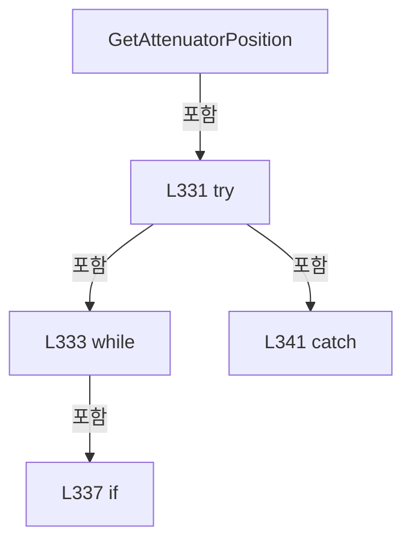

변경 전 점검: 입력/반환 타입, 위 호출자, 예외/취소 경로, 공유 상태와 저장·전송 소비자를 함께 확인합니다. 값의 단위나 물리 방향을 이름만으로 확정하지 않습니다.

### MethodDeclaration `MoveAttenuator` · L343–350

[Drilling.Common/Interface/CPowerMeasureRun.cs:343–350](https://github.com/kjuws10-rgb/A3Drilling/blob/5aee8e58439c9b455cae7c9593c9be986c3e682e/Drilling.Common/Interface/CPowerMeasureRun.cs#L343-L350)

| 항목 | 실제 추출 값 |
| --- | --- |
| 서명 | System.Threading.Tasks.Task Drilling.Common.Interface.CPowerMeasureDeviceSession.MoveAttenuator(Drilling.Common.Interface.ST_POWER_MEASURE_TARGET, double, System.Threading.CancellationToken) |
| 접근/수식자 | Public / public, async |
| 반환/값 타입 | System.Threading.Tasks.Task |
| 소속 타입 | NamedType:Drilling.Common.Interface.CPowerMeasureDeviceSession |

입력 계약:

| 이름 | 타입 | 전달 | 선택/기본값 |
| --- | --- | --- | --- |
| target | Drilling.Common.Interface.ST_POWER_MEASURE_TARGET | None | False /  |
| angle | double | None | False /  |
| token | System.Threading.CancellationToken | None | False /  |

현재 부분 분석에서 직접 연결된 호출자는 없습니다. XAML/이벤트/인터페이스·델리게이트·외부 진입을 추가 확인해야 하며, 미사용으로 판정한 것이 아닙니다.

호출하는 대상과 해석 범위:

| 원본 행 | 표현식 | 분석 상태 | 대상/소스 위치 |
| --- | --- | --- | --- |
| 345 | EndMeasurement(target).ConfigureAwait | resolved | System.Runtime.CompilerServices.ConfiguredTaskAwaitable System.Threading.Tasks.Task.ConfigureAwait(bool) |
| 345 | EndMeasurement | resolved | System.Threading.Tasks.Task Drilling.Common.Interface.CPowerMeasureDeviceSession.EndMeasurement(Drilling.Common.Interface.ST_POWER_MEASURE_TARGET) · Drilling.Common/Interface/CPowerMeasureRun.cs:370 |
| 346 | CheckStageReady(token).ConfigureAwait | resolved | System.Runtime.CompilerServices.ConfiguredTaskAwaitable System.Threading.Tasks.Task.ConfigureAwait(bool) |
| 346 | CheckStageReady | resolved | System.Threading.Tasks.Task Drilling.Common.Interface.CPowerMeasureDeviceSession.CheckStageReady(System.Threading.CancellationToken) · Drilling.Common/Interface/CPowerMeasureRun.cs:218 |
| 347 | CancellationTokenSource.CreateLinkedTokenSource | resolved | System.Threading.CancellationTokenSource System.Threading.CancellationTokenSource.CreateLinkedTokenSource(System.Threading.CancellationToken) |
| 347 | limit.CancelAfter | resolved | void System.Threading.CancellationTokenSource.CancelAfter(int) |
| 348 | _attenuators[target.HeadNo].MoveAndWaitAsync([new(target.HeadNo, angle)], limit.Token).ConfigureAwait | resolved | System.Runtime.CompilerServices.ConfiguredTaskAwaitable System.Threading.Tasks.Task.ConfigureAwait(bool) |
| 348 | _attenuators[target.HeadNo].MoveAndWaitAsync | resolved | System.Threading.Tasks.Task Drilling.Common.Interface.CAttenuatorPositioningService.MoveAndWaitAsync(System.Collections.Generic.IReadOnlyList<Drilling.Common.Interface.ST_ATTENUATOR_MOVE_TARGET>, System.Threading.CancellationToken) · Drilling.Common/Interface/CInterfaceManager.cs:2244 |
| 348 | new | resolved | Drilling.Common.Interface.ST_ATTENUATOR_MOVE_TARGET.ST_ATTENUATOR_MOVE_TARGET(int, double) · Drilling.Common/Interface/CInterfaceManager.cs:2188 |
| 349 | new TimeoutException | resolved | System.TimeoutException.TimeoutException(string?) |

본문의 실제 연산·분기·예외·반환 순서(원문 위치 순):

| 원본 행 | 종류 | 주석 해설 |
| --- | --- | --- |
| 345 | await | 비동기 완료를 기다립니다: await EndMeasurement(target).ConfigureAwait(false) |
| 345 | call | 함수·델리게이트 또는 객체 생성자를 호출합니다: EndMeasurement(target).ConfigureAwait(false) |
| 345 | call | 함수·델리게이트 또는 객체 생성자를 호출합니다: EndMeasurement(target) |
| 346 | await | 비동기 완료를 기다립니다: await CheckStageReady(token).ConfigureAwait(false) |
| 346 | call | 함수·델리게이트 또는 객체 생성자를 호출합니다: CheckStageReady(token).ConfigureAwait(false) |
| 346 | call | 함수·델리게이트 또는 객체 생성자를 호출합니다: CheckStageReady(token) |
| 347 | call | 함수·델리게이트 또는 객체 생성자를 호출합니다: CancellationTokenSource.CreateLinkedTokenSource(token) |
| 347 | call | 함수·델리게이트 또는 객체 생성자를 호출합니다: limit.CancelAfter(TimeoutMs) |
| 347 | using-declaration | 정리할 자원을 선언합니다: using var limit = CancellationTokenSource.CreateLinkedTokenSource(token); |
| 347 | variable-initializer | 변수의 초기값을 지정합니다: limit = CancellationTokenSource.CreateLinkedTokenSource(token) |
| 348 | await | 비동기 완료를 기다립니다: await _attenuators[target.HeadNo].MoveAndWaitAsync([new(target.HeadNo, angle)], limit.Token).ConfigureAwait(false) |
| 348 | call | 함수·델리게이트 또는 객체 생성자를 호출합니다: _attenuators[target.HeadNo].MoveAndWaitAsync([new(target.HeadNo, angle)], limit.Token).ConfigureAwait(false) |
| 348 | call | 함수·델리게이트 또는 객체 생성자를 호출합니다: _attenuators[target.HeadNo].MoveAndWaitAsync([new(target.HeadNo, angle)], limit.Token) |
| 348 | call | 함수·델리게이트 또는 객체 생성자를 호출합니다: new(target.HeadNo, angle) |
| 348 | try | 예외 처리 범위입니다: try |
| 349 | call | 함수·델리게이트 또는 객체 생성자를 호출합니다: new TimeoutException($"HEAD {target.HeadNo:00}: ATT 이동 시간 초과") |
| 349 | catch | 지정 예외를 처리합니다: catch (OperationCanceledException) when (!token.IsCancellationRequested) |
| 349 | throw | 예외를 발생/전달합니다: throw new TimeoutException($"HEAD {target.HeadNo:00}: ATT 이동 시간 초과"); |

제어 구문의 포함 구조(실제 실행 순서/CFG가 아닌 구문 탐색 그림):

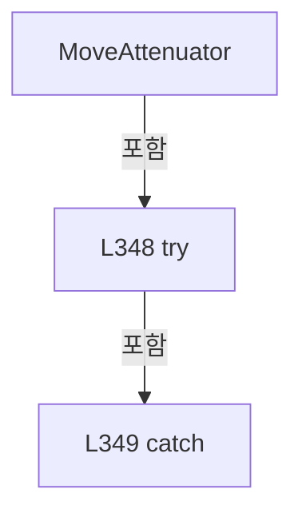

변경 전 점검: 입력/반환 타입, 위 호출자, 예외/취소 경로, 공유 상태와 저장·전송 소비자를 함께 확인합니다. 값의 단위나 물리 방향을 이름만으로 확정하지 않습니다.

### MethodDeclaration `BeginMeasurement` · L351–369

[Drilling.Common/Interface/CPowerMeasureRun.cs:351–369](https://github.com/kjuws10-rgb/A3Drilling/blob/5aee8e58439c9b455cae7c9593c9be986c3e682e/Drilling.Common/Interface/CPowerMeasureRun.cs#L351-L369)

| 항목 | 실제 추출 값 |
| --- | --- |
| 서명 | System.Threading.Tasks.Task Drilling.Common.Interface.CPowerMeasureDeviceSession.BeginMeasurement(Drilling.Common.Interface.ST_POWER_MEASURE_TARGET, System.Threading.CancellationToken) |
| 접근/수식자 | Public / public, async |
| 반환/값 타입 | System.Threading.Tasks.Task |
| 소속 타입 | NamedType:Drilling.Common.Interface.CPowerMeasureDeviceSession |

입력 계약:

| 이름 | 타입 | 전달 | 선택/기본값 |
| --- | --- | --- | --- |
| target | Drilling.Common.Interface.ST_POWER_MEASURE_TARGET | None | False /  |
| token | System.Threading.CancellationToken | None | False /  |

현재 부분 분석에서 직접 연결된 호출자는 없습니다. XAML/이벤트/인터페이스·델리게이트·외부 진입을 추가 확인해야 하며, 미사용으로 판정한 것이 아닙니다.

호출하는 대상과 해석 범위:

| 원본 행 | 표현식 | 분석 상태 | 대상/소스 위치 |
| --- | --- | --- | --- |
| 353 | CheckStageReady(token).ConfigureAwait | resolved | System.Runtime.CompilerServices.ConfiguredTaskAwaitable System.Threading.Tasks.Task.ConfigureAwait(bool) |
| 353 | CheckStageReady | resolved | System.Threading.Tasks.Task Drilling.Common.Interface.CPowerMeasureDeviceSession.CheckStageReady(System.Threading.CancellationToken) · Drilling.Common/Interface/CPowerMeasureRun.cs:218 |
| 353 | Connected | resolved | void Drilling.Common.Interface.CPowerMeasureDeviceSession.Connected(Drilling.Common.Interface.EN_EQP_MODULE, int) · Drilling.Common/Interface/CPowerMeasureRun.cs:168 |
| 354 | CancellationTokenSource.CreateLinkedTokenSource | resolved | System.Threading.CancellationTokenSource System.Threading.CancellationTokenSource.CreateLinkedTokenSource(System.Threading.CancellationToken) |
| 354 | limit.CancelAfter | resolved | void System.Threading.CancellationTokenSource.CancelAfter(int) |
| 355 | WaitLaserReady(target.HeadNo, limit.Token).ConfigureAwait | resolved | System.Runtime.CompilerServices.ConfiguredTaskAwaitable System.Threading.Tasks.Task.ConfigureAwait(bool) |
| 355 | WaitLaserReady | resolved | System.Threading.Tasks.Task Drilling.Common.Interface.CPowerMeasureDeviceSession.WaitLaserReady(int, System.Threading.CancellationToken) · Drilling.Common/Interface/CPowerMeasureRun.cs:309 |
| 357 | _emissionGate.WaitAsync(limit.Token).ConfigureAwait | resolved | System.Runtime.CompilerServices.ConfiguredTaskAwaitable System.Threading.Tasks.Task.ConfigureAwait(bool) |
| 357 | _emissionGate.WaitAsync | resolved | System.Threading.Tasks.Task System.Threading.SemaphoreSlim.WaitAsync(System.Threading.CancellationToken) |
| 361 | EnsureStageReady | resolved | void Drilling.Common.Interface.CPowerMeasureDeviceSession.EnsureStageReady() · Drilling.Common/Interface/CPowerMeasureRun.cs:206 |
| 363 | _emitting.TryAdd | resolved | bool System.Collections.Concurrent.ConcurrentDictionary<int, byte>.TryAdd(int, byte) |
| 364 | Automation.SetGalvoLaserOutput(r.X.AxisReference, true, r.Task, r.X.AutomationNo, limit.Token).ConfigureAwait | resolved | System.Runtime.CompilerServices.ConfiguredTaskAwaitable<string> System.Threading.Tasks.Task<string>.ConfigureAwait(bool) |
| 364 | Automation.SetGalvoLaserOutput | resolved · 동적 구현 선택 가능 | System.Threading.Tasks.Task<string> Drilling.Common.Automation.CAutomationManager.SetGalvoLaserOutput(string, bool, int, int, System.Threading.CancellationToken) · Drilling.Common/Automation/CAutomationManager.cs:554 |
| 366 | Task.Run(() => Interfaces.Melsec.WriteWord("PROCESS_SEQUENCE_TPM_LASER_ON", 1, limit.Token), limit.Token).ConfigureAwait | resolved | System.Runtime.CompilerServices.ConfiguredTaskAwaitable System.Threading.Tasks.Task.ConfigureAwait(bool) |
| 366 | Task.Run | resolved | System.Threading.Tasks.Task System.Threading.Tasks.Task.Run(System.Action, System.Threading.CancellationToken) |
| 366 | Interfaces.Melsec.WriteWord | resolved | void Drilling.Common.Interface.CMelsec.WriteWord(string, double, System.Threading.CancellationToken) · Drilling.Common/Interface/Melsec/CMelsec.cs:371 |
| 368 | _emissionGate.Release | resolved | int System.Threading.SemaphoreSlim.Release() |

본문의 실제 연산·분기·예외·반환 순서(원문 위치 순):

| 원본 행 | 종류 | 주석 해설 |
| --- | --- | --- |
| 353 | await | 비동기 완료를 기다립니다: await CheckStageReady(token).ConfigureAwait(false) |
| 353 | call | 함수·델리게이트 또는 객체 생성자를 호출합니다: CheckStageReady(token).ConfigureAwait(false) |
| 353 | call | 함수·델리게이트 또는 객체 생성자를 호출합니다: CheckStageReady(token) |
| 353 | call | 함수·델리게이트 또는 객체 생성자를 호출합니다: Connected(EN_EQP_MODULE.PowerMeter, target.PowerMeterNo) |
| 354 | call | 함수·델리게이트 또는 객체 생성자를 호출합니다: CancellationTokenSource.CreateLinkedTokenSource(token) |
| 354 | call | 함수·델리게이트 또는 객체 생성자를 호출합니다: limit.CancelAfter(TimeoutMs) |
| 354 | using-declaration | 정리할 자원을 선언합니다: using var limit = CancellationTokenSource.CreateLinkedTokenSource(token); |
| 354 | variable-initializer | 변수의 초기값을 지정합니다: limit = CancellationTokenSource.CreateLinkedTokenSource(token) |
| 355 | await | 비동기 완료를 기다립니다: await WaitLaserReady(target.HeadNo, limit.Token).ConfigureAwait(false) |
| 355 | call | 함수·델리게이트 또는 객체 생성자를 호출합니다: WaitLaserReady(target.HeadNo, limit.Token).ConfigureAwait(false) |
| 355 | call | 함수·델리게이트 또는 객체 생성자를 호출합니다: WaitLaserReady(target.HeadNo, limit.Token) |
| 356 | local-declaration | 지역 변수를 선언합니다: var r = _routes[target.HeadNo]; |
| 356 | variable-initializer | 변수의 초기값을 지정합니다: r = _routes[target.HeadNo] |
| 357 | await | 비동기 완료를 기다립니다: await _emissionGate.WaitAsync(limit.Token).ConfigureAwait(false) |
| 357 | call | 함수·델리게이트 또는 객체 생성자를 호출합니다: _emissionGate.WaitAsync(limit.Token).ConfigureAwait(false) |
| 357 | call | 함수·델리게이트 또는 객체 생성자를 호출합니다: _emissionGate.WaitAsync(limit.Token) |
| 358 | try | 예외 처리 범위입니다: try |
| 361 | call | 함수·델리게이트 또는 객체 생성자를 호출합니다: EnsureStageReady() |
| 363 | call | 함수·델리게이트 또는 객체 생성자를 호출합니다: _emitting.TryAdd(target.HeadNo, 0) |
| 364 | await | 비동기 완료를 기다립니다: await Automation.SetGalvoLaserOutput(r.X.AxisReference, true, r.Task, r.X.AutomationNo, limit.Token).ConfigureAwait(false) |
| 364 | call | 함수·델리게이트 또는 객체 생성자를 호출합니다: Automation.SetGalvoLaserOutput(r.X.AxisReference, true, r.Task, r.X.AutomationNo, limit.Token).ConfigureAwait(false) |
| 364 | call | 함수·델리게이트 또는 객체 생성자를 호출합니다: Automation.SetGalvoLaserOutput(r.X.AxisReference, true, r.Task, r.X.AutomationNo, limit.Token) |
| 365 | assignment | 값을 대상에 대입합니다: _flagMayBeOn = true |
| 366 | await | 비동기 완료를 기다립니다: await Task.Run(() => Interfaces.Melsec.WriteWord("PROCESS_SEQUENCE_TPM_LASER_ON", 1, limit.Token), limit.Token).ConfigureAwait(false) |
| 366 | call | 함수·델리게이트 또는 객체 생성자를 호출합니다: Task.Run(() => Interfaces.Melsec.WriteWord("PROCESS_SEQUENCE_TPM_LASER_ON", 1, limit.Token), limit.Token).ConfigureAwait(false) |
| 366 | call | 함수·델리게이트 또는 객체 생성자를 호출합니다: Task.Run(() => Interfaces.Melsec.WriteWord("PROCESS_SEQUENCE_TPM_LASER_ON", 1, limit.Token), limit.Token) |
| 366 | call | 함수·델리게이트 또는 객체 생성자를 호출합니다: Interfaces.Melsec.WriteWord("PROCESS_SEQUENCE_TPM_LASER_ON", 1, limit.Token) |
| 368 | call | 함수·델리게이트 또는 객체 생성자를 호출합니다: _emissionGate.Release() |
| 368 | finally | 종료 정리 구간입니다: finally |

제어 구문의 포함 구조(실제 실행 순서/CFG가 아닌 구문 탐색 그림):

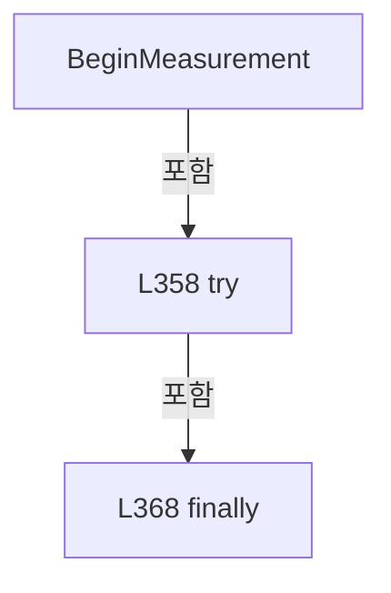

변경 전 점검: 입력/반환 타입, 위 호출자, 예외/취소 경로, 공유 상태와 저장·전송 소비자를 함께 확인합니다. 값의 단위나 물리 방향을 이름만으로 확정하지 않습니다.

### MethodDeclaration `EndMeasurement` · L370–388

[Drilling.Common/Interface/CPowerMeasureRun.cs:370–388](https://github.com/kjuws10-rgb/A3Drilling/blob/5aee8e58439c9b455cae7c9593c9be986c3e682e/Drilling.Common/Interface/CPowerMeasureRun.cs#L370-L388)

| 항목 | 실제 추출 값 |
| --- | --- |
| 서명 | System.Threading.Tasks.Task Drilling.Common.Interface.CPowerMeasureDeviceSession.EndMeasurement(Drilling.Common.Interface.ST_POWER_MEASURE_TARGET) |
| 접근/수식자 | Public / public, async |
| 반환/값 타입 | System.Threading.Tasks.Task |
| 소속 타입 | NamedType:Drilling.Common.Interface.CPowerMeasureDeviceSession |

입력 계약:

| 이름 | 타입 | 전달 | 선택/기본값 |
| --- | --- | --- | --- |
| target | Drilling.Common.Interface.ST_POWER_MEASURE_TARGET | None | False /  |

정적 호출자로 확인된 위치:

| 호출 파일/행 | 호출 표현식 | 런타임 분기 가능 |
| --- | --- | --- |
| [Drilling.Common/Interface/CPowerMeasureRun.cs:345–345](https://github.com/kjuws10-rgb/A3Drilling/blob/5aee8e58439c9b455cae7c9593c9be986c3e682e/Drilling.Common/Interface/CPowerMeasureRun.cs#L345-L345) | EndMeasurement | False |
| [Drilling.Common/Interface/CPowerMeasureRun.cs:403–403](https://github.com/kjuws10-rgb/A3Drilling/blob/5aee8e58439c9b455cae7c9593c9be986c3e682e/Drilling.Common/Interface/CPowerMeasureRun.cs#L403-L403) | EndMeasurement | False |

호출하는 대상과 해석 범위:

| 원본 행 | 표현식 | 분석 상태 | 대상/소스 위치 |
| --- | --- | --- | --- |
| 372 | _routes.TryGetValue | resolved | bool System.Collections.Generic.Dictionary<int, Drilling.Common.Interface.CPowerMeasureDeviceSession.Route>.TryGetValue(int, out Drilling.Common.Interface.CPowerMeasureDeviceSession.Route) |
| 373 | new CancellationTokenSource | resolved | System.Threading.CancellationTokenSource.CancellationTokenSource(System.TimeSpan) |
| 373 | TimeSpan.FromSeconds | resolved | System.TimeSpan System.TimeSpan.FromSeconds(long) |
| 375 | _emitting.ContainsKey | resolved | bool System.Collections.Concurrent.ConcurrentDictionary<int, byte>.ContainsKey(int) |
| 376 | Automation.SetGalvoLaserOutput(r.X.AxisReference, false, r.Task, r.X.AutomationNo, cleanup.Token).ConfigureAwait | resolved | System.Runtime.CompilerServices.ConfiguredTaskAwaitable<string> System.Threading.Tasks.Task<string>.ConfigureAwait(bool) |
| 376 | Automation.SetGalvoLaserOutput | resolved · 동적 구현 선택 가능 | System.Threading.Tasks.Task<string> Drilling.Common.Automation.CAutomationManager.SetGalvoLaserOutput(string, bool, int, int, System.Threading.CancellationToken) · Drilling.Common/Automation/CAutomationManager.cs:554 |
| 377 | _emissionGate.WaitAsync(cleanup.Token).ConfigureAwait | resolved | System.Runtime.CompilerServices.ConfiguredTaskAwaitable System.Threading.Tasks.Task.ConfigureAwait(bool) |
| 377 | _emissionGate.WaitAsync | resolved | System.Threading.Tasks.Task System.Threading.SemaphoreSlim.WaitAsync(System.Threading.CancellationToken) |
| 380 | _emitting.TryRemove | resolved | bool System.Collections.Concurrent.ConcurrentDictionary<int, byte>.TryRemove(int, out byte) |
| 383 | Task.Run(() => Interfaces.Melsec.WriteWord("PROCESS_SEQUENCE_TPM_LASER_ON", 0, cleanup.Token), cleanup.Token).ConfigureAwait | resolved | System.Runtime.CompilerServices.ConfiguredTaskAwaitable System.Threading.Tasks.Task.ConfigureAwait(bool) |
| 383 | Task.Run | resolved | System.Threading.Tasks.Task System.Threading.Tasks.Task.Run(System.Action, System.Threading.CancellationToken) |
| 383 | Interfaces.Melsec.WriteWord | resolved | void Drilling.Common.Interface.CMelsec.WriteWord(string, double, System.Threading.CancellationToken) · Drilling.Common/Interface/Melsec/CMelsec.cs:371 |
| 387 | _emissionGate.Release | resolved | int System.Threading.SemaphoreSlim.Release() |

본문의 실제 연산·분기·예외·반환 순서(원문 위치 순):

| 원본 행 | 종류 | 주석 해설 |
| --- | --- | --- |
| 372 | call | 함수·델리게이트 또는 객체 생성자를 호출합니다: _routes.TryGetValue(target.HeadNo, out var r) |
| 372 | if | 조건에 따라 분기합니다: if (!_routes.TryGetValue(target.HeadNo, out var r)) |
| 372 | return | 호출자에게 값 또는 제어를 반환합니다: return; |
| 373 | call | 함수·델리게이트 또는 객체 생성자를 호출합니다: new CancellationTokenSource(TimeSpan.FromSeconds(5)) |
| 373 | call | 함수·델리게이트 또는 객체 생성자를 호출합니다: TimeSpan.FromSeconds(5) |
| 373 | using-declaration | 정리할 자원을 선언합니다: using var cleanup = new CancellationTokenSource(TimeSpan.FromSeconds(5)); |
| 373 | variable-initializer | 변수의 초기값을 지정합니다: cleanup = new CancellationTokenSource(TimeSpan.FromSeconds(5)) |
| 375 | call | 함수·델리게이트 또는 객체 생성자를 호출합니다: _emitting.ContainsKey(target.HeadNo) |
| 375 | if | 조건에 따라 분기합니다: if (_emitting.ContainsKey(target.HeadNo)) |
| 376 | await | 비동기 완료를 기다립니다: await Automation.SetGalvoLaserOutput(r.X.AxisReference, false, r.Task, r.X.AutomationNo, cleanup.Token).ConfigureAwait(false) |
| 376 | call | 함수·델리게이트 또는 객체 생성자를 호출합니다: Automation.SetGalvoLaserOutput(r.X.AxisReference, false, r.Task, r.X.AutomationNo, cleanup.Token).ConfigureAwait(false) |
| 376 | call | 함수·델리게이트 또는 객체 생성자를 호출합니다: Automation.SetGalvoLaserOutput(r.X.AxisReference, false, r.Task, r.X.AutomationNo, cleanup.Token) |
| 377 | await | 비동기 완료를 기다립니다: await _emissionGate.WaitAsync(cleanup.Token).ConfigureAwait(false) |
| 377 | call | 함수·델리게이트 또는 객체 생성자를 호출합니다: _emissionGate.WaitAsync(cleanup.Token).ConfigureAwait(false) |
| 377 | call | 함수·델리게이트 또는 객체 생성자를 호출합니다: _emissionGate.WaitAsync(cleanup.Token) |
| 378 | try | 예외 처리 범위입니다: try |
| 380 | call | 함수·델리게이트 또는 객체 생성자를 호출합니다: _emitting.TryRemove(target.HeadNo, out _) |
| 381 | if | 조건에 따라 분기합니다: if (_emitting.Count == 0 && _flagMayBeOn) |
| 383 | await | 비동기 완료를 기다립니다: await Task.Run(() => Interfaces.Melsec.WriteWord("PROCESS_SEQUENCE_TPM_LASER_ON", 0, cleanup.Token), cleanup.Token).ConfigureAwait(false) |
| 383 | call | 함수·델리게이트 또는 객체 생성자를 호출합니다: Task.Run(() => Interfaces.Melsec.WriteWord("PROCESS_SEQUENCE_TPM_LASER_ON", 0, cleanup.Token), cleanup.Token).ConfigureAwait(false) |
| 383 | call | 함수·델리게이트 또는 객체 생성자를 호출합니다: Task.Run(() => Interfaces.Melsec.WriteWord("PROCESS_SEQUENCE_TPM_LASER_ON", 0, cleanup.Token), cleanup.Token) |
| 383 | call | 함수·델리게이트 또는 객체 생성자를 호출합니다: Interfaces.Melsec.WriteWord("PROCESS_SEQUENCE_TPM_LASER_ON", 0, cleanup.Token) |
| 384 | assignment | 값을 대상에 대입합니다: _flagMayBeOn = false |
| 387 | call | 함수·델리게이트 또는 객체 생성자를 호출합니다: _emissionGate.Release() |
| 387 | finally | 종료 정리 구간입니다: finally |

제어 구문의 포함 구조(실제 실행 순서/CFG가 아닌 구문 탐색 그림):

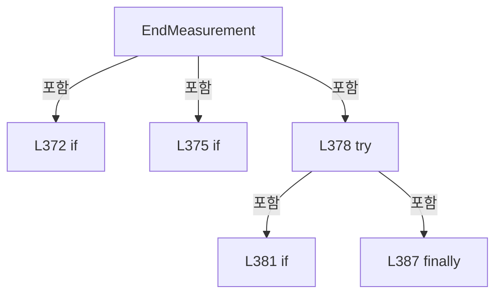

변경 전 점검: 입력/반환 타입, 위 호출자, 예외/취소 경로, 공유 상태와 저장·전송 소비자를 함께 확인합니다. 값의 단위나 물리 방향을 이름만으로 확정하지 않습니다.

### MethodDeclaration `ReadPower` · L389–399

[Drilling.Common/Interface/CPowerMeasureRun.cs:389–399](https://github.com/kjuws10-rgb/A3Drilling/blob/5aee8e58439c9b455cae7c9593c9be986c3e682e/Drilling.Common/Interface/CPowerMeasureRun.cs#L389-L399)

| 항목 | 실제 추출 값 |
| --- | --- |
| 서명 | System.Threading.Tasks.Task<double> Drilling.Common.Interface.CPowerMeasureDeviceSession.ReadPower(Drilling.Common.Interface.ST_POWER_MEASURE_TARGET, System.Threading.CancellationToken) |
| 접근/수식자 | Public / public, async |
| 반환/값 타입 | System.Threading.Tasks.Task<double> |
| 소속 타입 | NamedType:Drilling.Common.Interface.CPowerMeasureDeviceSession |

입력 계약:

| 이름 | 타입 | 전달 | 선택/기본값 |
| --- | --- | --- | --- |
| target | Drilling.Common.Interface.ST_POWER_MEASURE_TARGET | None | False /  |
| token | System.Threading.CancellationToken | None | False /  |

현재 부분 분석에서 직접 연결된 호출자는 없습니다. XAML/이벤트/인터페이스·델리게이트·외부 진입을 추가 확인해야 하며, 미사용으로 판정한 것이 아닙니다.

호출하는 대상과 해석 범위:

| 원본 행 | 표현식 | 분석 상태 | 대상/소스 위치 |
| --- | --- | --- | --- |
| 391 | EnsureStageReady | resolved | void Drilling.Common.Interface.CPowerMeasureDeviceSession.EnsureStageReady() · Drilling.Common/Interface/CPowerMeasureRun.cs:206 |
| 391 | Connected | resolved | void Drilling.Common.Interface.CPowerMeasureDeviceSession.Connected(Drilling.Common.Interface.EN_EQP_MODULE, int) · Drilling.Common/Interface/CPowerMeasureRun.cs:168 |
| 392 | Interfaces.ExecutePowerMeterCommand(target.PowerMeterNo, EN_POWER_METER_COMMAND.ReadPower, 0, token).ConfigureAwait | resolved | System.Runtime.CompilerServices.ConfiguredTaskAwaitable<Drilling.Common.Interface.ST_DEVICE_COMMAND_RESULT> System.Threading.Tasks.Task<Drilling.Common.Interface.ST_DEVICE_COMMAND_RESULT>.ConfigureAwait(bool) |
| 392 | Interfaces.ExecutePowerMeterCommand | resolved | System.Threading.Tasks.Task<Drilling.Common.Interface.ST_DEVICE_COMMAND_RESULT> Drilling.Common.Interface.CInterfaceManager.ExecutePowerMeterCommand(int, Drilling.Common.Interface.EN_POWER_METER_COMMAND, double, System.Threading.CancellationToken) · Drilling.Common/Interface/CInterfaceManager.cs:1422 |
| 393 | new InvalidOperationException | resolved | System.InvalidOperationException.InvalidOperationException(string?) |
| 394 | Sim | resolved | bool Drilling.Common.Interface.CPowerMeasureDeviceSession.Sim(Drilling.Common.Interface.EN_EQP_MODULE, int) · Drilling.Common/Interface/CPowerMeasureRun.cs:166 |
| 395 | CPowerMeter.TryReadPower | resolved | bool Drilling.Common.Interface.CPowerMeter.TryReadPower(string, out double) · Drilling.Common/Interface/Serial/CPowerMeter.cs:315 |
| 395 | new InvalidOperationException | resolved | System.InvalidOperationException.InvalidOperationException(string?) |
| 396 | Interfaces.GetPowerMeterStatus | resolved | Drilling.Common.Managers.ST_POWER_METER_STATUS Drilling.Common.Interface.CInterfaceManager.GetPowerMeterStatus(int, System.Threading.CancellationToken) · Drilling.Common/Interface/CInterfaceManager.cs:1401 |
| 397 | double.IsFinite | resolved | bool double.IsFinite(double) |
| 397 | new InvalidOperationException | resolved | System.InvalidOperationException.InvalidOperationException(string?) |

본문의 실제 연산·분기·예외·반환 순서(원문 위치 순):

| 원본 행 | 종류 | 주석 해설 |
| --- | --- | --- |
| 391 | call | 함수·델리게이트 또는 객체 생성자를 호출합니다: EnsureStageReady() |
| 391 | call | 함수·델리게이트 또는 객체 생성자를 호출합니다: Connected(EN_EQP_MODULE.PowerMeter, target.PowerMeterNo) |
| 392 | await | 비동기 완료를 기다립니다: await Interfaces.ExecutePowerMeterCommand(target.PowerMeterNo, EN_POWER_METER_COMMAND.ReadPower, 0, token).ConfigureAwait(false) |
| 392 | call | 함수·델리게이트 또는 객체 생성자를 호출합니다: Interfaces.ExecutePowerMeterCommand(target.PowerMeterNo, EN_POWER_METER_COMMAND.ReadPower, 0, token).ConfigureAwait(false) |
| 392 | call | 함수·델리게이트 또는 객체 생성자를 호출합니다: Interfaces.ExecutePowerMeterCommand(target.PowerMeterNo, EN_POWER_METER_COMMAND.ReadPower, 0, token) |
| 392 | local-declaration | 지역 변수를 선언합니다: var result = await Interfaces.ExecutePowerMeterCommand(target.PowerMeterNo, EN_POWER_METER_COMMAND.ReadPower, 0, token).ConfigureAwait(false); |
| 392 | variable-initializer | 변수의 초기값을 지정합니다: result = await Interfaces.ExecutePowerMeterCommand(target.PowerMeterNo, EN_POWER_METER_COMMAND.ReadPower, 0, token).ConfigureAwait(false) |
| 393 | call | 함수·델리게이트 또는 객체 생성자를 호출합니다: new InvalidOperationException(result.Message) |
| 393 | if | 조건에 따라 분기합니다: if (!result.IsSuccess) |
| 393 | throw | 예외를 발생/전달합니다: throw new InvalidOperationException(result.Message); |
| 394 | call | 함수·델리게이트 또는 객체 생성자를 호출합니다: Sim(EN_EQP_MODULE.PowerMeter, target.PowerMeterNo) |
| 394 | if | 조건에 따라 분기합니다: if (!Sim(EN_EQP_MODULE.PowerMeter, target.PowerMeterNo)) |
| 395 | call | 함수·델리게이트 또는 객체 생성자를 호출합니다: CPowerMeter.TryReadPower(result.Message, out var value) |
| 395 | call | 함수·델리게이트 또는 객체 생성자를 호출합니다: new InvalidOperationException("PowerMeter가 유효한 W 값을 응답하지 않았습니다.") |
| 395 | conditional-expression | 조건에 따라 결과식을 선택합니다: CPowerMeter.TryReadPower(result.Message, out var value) ? value : throw new InvalidOperationException("PowerMeter가 유효한 W 값을 응답하지 않았습니다.") |
| 395 | return | 호출자에게 값 또는 제어를 반환합니다: return CPowerMeter.TryReadPower(result.Message, out var value) ? value : throw new InvalidOperationException("PowerMeter가 유효한 W 값을 응답하지 않았습니다."); |
| 395 | throw | 예외를 발생/전달합니다: throw new InvalidOperationException("PowerMeter가 유효한 W 값을 응답하지 않았습니다.") |
| 396 | call | 함수·델리게이트 또는 객체 생성자를 호출합니다: Interfaces.GetPowerMeterStatus(target.PowerMeterNo, token) |
| 396 | local-declaration | 지역 변수를 선언합니다: var status = Interfaces.GetPowerMeterStatus(target.PowerMeterNo, token); |
| 396 | variable-initializer | 변수의 초기값을 지정합니다: status = Interfaces.GetPowerMeterStatus(target.PowerMeterNo, token) |
| 397 | call | 함수·델리게이트 또는 객체 생성자를 호출합니다: double.IsFinite(status.MeasuredPower) |
| 397 | call | 함수·델리게이트 또는 객체 생성자를 호출합니다: new InvalidOperationException("PowerMeter 측정값 오류") |
| 397 | if | 조건에 따라 분기합니다: if (status.LastError != EN_POWER_METER_ERROR.Ok &#124;&#124; !double.IsFinite(status.MeasuredPower)) |
| 397 | throw | 예외를 발생/전달합니다: throw new InvalidOperationException("PowerMeter 측정값 오류"); |
| 398 | return | 호출자에게 값 또는 제어를 반환합니다: return status.MeasuredPower; |

제어 구문의 포함 구조(실제 실행 순서/CFG가 아닌 구문 탐색 그림):

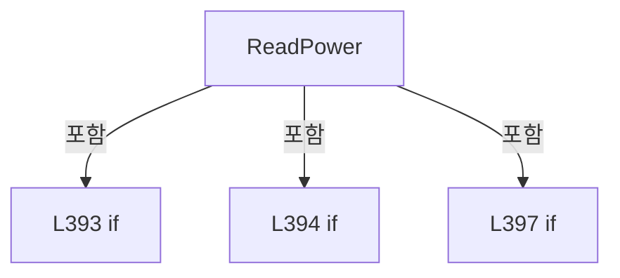

변경 전 점검: 입력/반환 타입, 위 호출자, 예외/취소 경로, 공유 상태와 저장·전송 소비자를 함께 확인합니다. 값의 단위나 물리 방향을 이름만으로 확정하지 않습니다.

### MethodDeclaration `Finish` · L400–411

[Drilling.Common/Interface/CPowerMeasureRun.cs:400–411](https://github.com/kjuws10-rgb/A3Drilling/blob/5aee8e58439c9b455cae7c9593c9be986c3e682e/Drilling.Common/Interface/CPowerMeasureRun.cs#L400-L411)

| 항목 | 실제 추출 값 |
| --- | --- |
| 서명 | System.Threading.Tasks.Task Drilling.Common.Interface.CPowerMeasureDeviceSession.Finish(Drilling.Common.Interface.ST_POWER_MEASURE_TARGET) |
| 접근/수식자 | Public / public, async |
| 반환/값 타입 | System.Threading.Tasks.Task |
| 소속 타입 | NamedType:Drilling.Common.Interface.CPowerMeasureDeviceSession |

입력 계약:

| 이름 | 타입 | 전달 | 선택/기본값 |
| --- | --- | --- | --- |
| target | Drilling.Common.Interface.ST_POWER_MEASURE_TARGET | None | False /  |

현재 부분 분석에서 직접 연결된 호출자는 없습니다. XAML/이벤트/인터페이스·델리게이트·외부 진입을 추가 확인해야 하며, 미사용으로 판정한 것이 아닙니다.

호출하는 대상과 해석 범위:

| 원본 행 | 표현식 | 분석 상태 | 대상/소스 위치 |
| --- | --- | --- | --- |
| 403 | EndMeasurement(target).ConfigureAwait | resolved | System.Runtime.CompilerServices.ConfiguredTaskAwaitable System.Threading.Tasks.Task.ConfigureAwait(bool) |
| 403 | EndMeasurement | resolved | System.Threading.Tasks.Task Drilling.Common.Interface.CPowerMeasureDeviceSession.EndMeasurement(Drilling.Common.Interface.ST_POWER_MEASURE_TARGET) · Drilling.Common/Interface/CPowerMeasureRun.cs:370 |
| 405 | _attenuators.TryGetValue | resolved | bool System.Collections.Generic.Dictionary<int, Drilling.Common.Interface.CAttenuatorPositioningService>.TryGetValue(int, out Drilling.Common.Interface.CAttenuatorPositioningService) |
| 407 | new CancellationTokenSource | resolved | System.Threading.CancellationTokenSource.CancellationTokenSource(System.TimeSpan) |
| 407 | TimeSpan.FromSeconds | resolved | System.TimeSpan System.TimeSpan.FromSeconds(long) |
| 407 | mover.StopPendingAsync(cleanup.Token).ConfigureAwait | resolved | System.Runtime.CompilerServices.ConfiguredTaskAwaitable System.Threading.Tasks.Task.ConfigureAwait(bool) |
| 407 | mover.StopPendingAsync | resolved | System.Threading.Tasks.Task Drilling.Common.Interface.CAttenuatorPositioningService.StopPendingAsync(System.Threading.CancellationToken) · Drilling.Common/Interface/CInterfaceManager.cs:2294 |
| 408 | new AggregateException | resolved | System.AggregateException.AggregateException(params System.Exception[]) |
| 410 | new InvalidOperationException | resolved | System.InvalidOperationException.InvalidOperationException(string?, System.Exception?) |

본문의 실제 연산·분기·예외·반환 순서(원문 위치 순):

| 원본 행 | 종류 | 주석 해설 |
| --- | --- | --- |
| 402 | local-declaration | 지역 변수를 선언합니다: Exception? failure = null; |
| 402 | variable-initializer | 변수의 초기값을 지정합니다: failure = null |
| 403 | await | 비동기 완료를 기다립니다: await EndMeasurement(target).ConfigureAwait(false) |
| 403 | call | 함수·델리게이트 또는 객체 생성자를 호출합니다: EndMeasurement(target).ConfigureAwait(false) |
| 403 | call | 함수·델리게이트 또는 객체 생성자를 호출합니다: EndMeasurement(target) |
| 403 | try | 예외 처리 범위입니다: try |
| 404 | assignment | 값을 대상에 대입합니다: failure = error |
| 404 | catch | 지정 예외를 처리합니다: catch (Exception error) |
| 405 | call | 함수·델리게이트 또는 객체 생성자를 호출합니다: _attenuators.TryGetValue(target.HeadNo, out var mover) |
| 405 | if | 조건에 따라 분기합니다: if (_attenuators.TryGetValue(target.HeadNo, out var mover) && mover.HasPendingStops) |
| 407 | await | 비동기 완료를 기다립니다: await mover.StopPendingAsync(cleanup.Token).ConfigureAwait(false) |
| 407 | call | 함수·델리게이트 또는 객체 생성자를 호출합니다: new CancellationTokenSource(TimeSpan.FromSeconds(5)) |
| 407 | call | 함수·델리게이트 또는 객체 생성자를 호출합니다: TimeSpan.FromSeconds(5) |
| 407 | call | 함수·델리게이트 또는 객체 생성자를 호출합니다: mover.StopPendingAsync(cleanup.Token).ConfigureAwait(false) |
| 407 | call | 함수·델리게이트 또는 객체 생성자를 호출합니다: mover.StopPendingAsync(cleanup.Token) |
| 407 | using-declaration | 정리할 자원을 선언합니다: using var cleanup = new CancellationTokenSource(TimeSpan.FromSeconds(5)); |
| 407 | variable-initializer | 변수의 초기값을 지정합니다: cleanup = new CancellationTokenSource(TimeSpan.FromSeconds(5)) |
| 407 | try | 예외 처리 범위입니다: try |
| 408 | assignment | 값을 대상에 대입합니다: failure = failure is null ? error : new AggregateException(failure, error) |
| 408 | call | 함수·델리게이트 또는 객체 생성자를 호출합니다: new AggregateException(failure, error) |
| 408 | catch | 지정 예외를 처리합니다: catch (Exception error) |
| 408 | conditional-expression | 조건에 따라 결과식을 선택합니다: failure is null ? error : new AggregateException(failure, error) |
| 410 | call | 함수·델리게이트 또는 객체 생성자를 호출합니다: new InvalidOperationException($"HEAD {target.HeadNo:00}: 종료 처리 실패 / {failure.Message}", failure) |
| 410 | if | 조건에 따라 분기합니다: if (failure is not null) |
| 410 | throw | 예외를 발생/전달합니다: throw new InvalidOperationException($"HEAD {target.HeadNo:00}: 종료 처리 실패 / {failure.Message}", failure); |

제어 구문의 포함 구조(실제 실행 순서/CFG가 아닌 구문 탐색 그림):

```mermaid
flowchart TD
 M["Finish"]
 N0["L403 try"]
 M -->|포함| N0
 N1["L404 catch"]
 N0 -->|포함| N1
 N2["L405 if"]
 M -->|포함| N2
 N3["L407 try"]
 N2 -->|포함| N3
 N4["L408 catch"]
 N3 -->|포함| N4
 N5["L410 if"]
 M -->|포함| N5
```

변경 전 점검: 입력/반환 타입, 위 호출자, 예외/취소 경로, 공유 상태와 저장·전송 소비자를 함께 확인합니다. 값의 단위나 물리 방향을 이름만으로 확정하지 않습니다.

### MethodDeclaration `DisposeAsync` · L412–417

[Drilling.Common/Interface/CPowerMeasureRun.cs:412–417](https://github.com/kjuws10-rgb/A3Drilling/blob/5aee8e58439c9b455cae7c9593c9be986c3e682e/Drilling.Common/Interface/CPowerMeasureRun.cs#L412-L417)

| 항목 | 실제 추출 값 |
| --- | --- |
| 서명 | System.Threading.Tasks.ValueTask Drilling.Common.Interface.CPowerMeasureDeviceSession.DisposeAsync() |
| 접근/수식자 | Public / public, async |
| 반환/값 타입 | System.Threading.Tasks.ValueTask |
| 소속 타입 | NamedType:Drilling.Common.Interface.CPowerMeasureDeviceSession |

정적 호출자로 확인된 위치:

| 호출 파일/행 | 호출 표현식 | 런타임 분기 가능 |
| --- | --- | --- |
| [Drilling.Common/Interface/CPowerMeasureRun.cs:133–133](https://github.com/kjuws10-rgb/A3Drilling/blob/5aee8e58439c9b455cae7c9593c9be986c3e682e/Drilling.Common/Interface/CPowerMeasureRun.cs#L133-L133) | _session.DisposeAsync | False |

호출하는 대상과 해석 범위:

| 원본 행 | 표현식 | 분석 상태 | 대상/소스 위치 |
| --- | --- | --- | --- |
| 415 | Task.WhenAll(targets.Select(Finish)).ConfigureAwait | resolved | System.Runtime.CompilerServices.ConfiguredTaskAwaitable System.Threading.Tasks.Task.ConfigureAwait(bool) |
| 415 | Task.WhenAll | resolved | System.Threading.Tasks.Task System.Threading.Tasks.Task.WhenAll(System.Collections.Generic.IEnumerable<System.Threading.Tasks.Task>) |
| 415 | targets.Select | resolved | System.Collections.Generic.IEnumerable<System.Threading.Tasks.Task> System.Collections.Generic.IEnumerable<Drilling.Common.Interface.ST_POWER_MEASURE_TARGET>.Select<Drilling.Common.Interface.ST_POWER_MEASURE_TARGET, System.Threading.Tasks.Task>(System.Func<Drilling.Common.Interface.ST_POWER_MEASURE_TARGET, System.Threading.Tasks.Task>) |
| 416 | .Dispose | resolved | void Drilling.Common.Station.CStageReviewSequences.Session.Dispose() · Drilling.Common/Station/CStageReviewSequences.cs:500 |

본문의 실제 연산·분기·예외·반환 순서(원문 위치 순):

| 원본 행 | 종류 | 주석 해설 |
| --- | --- | --- |
| 415 | await | 비동기 완료를 기다립니다: await Task.WhenAll(targets.Select(Finish)).ConfigureAwait(false) |
| 415 | call | 함수·델리게이트 또는 객체 생성자를 호출합니다: Task.WhenAll(targets.Select(Finish)).ConfigureAwait(false) |
| 415 | call | 함수·델리게이트 또는 객체 생성자를 호출합니다: Task.WhenAll(targets.Select(Finish)) |
| 415 | call | 함수·델리게이트 또는 객체 생성자를 호출합니다: targets.Select(Finish) |
| 416 | assignment | 값을 대상에 대입합니다: _stage = null |
| 416 | call | 함수·델리게이트 또는 객체 생성자를 호출합니다: .Dispose() |

변경 전 점검: 입력/반환 타입, 위 호출자, 예외/취소 경로, 공유 상태와 저장·전송 소비자를 함께 확인합니다. 값의 단위나 물리 방향을 이름만으로 확정하지 않습니다.

## 구문·바인딩 한계

전체 WPF/벤더 SDK/프로젝트별 빌드 조건을 로드한 정식 빌드가 아닙니다. `resolved`는 이 부분 컴파일에서의 심볼 연결이며 virtual/interface/delegate/이벤트/Reflection/XAML의 실제 런타임 구현을 확정하지 않습니다. `candidate`와 `unresolved`는 후속 확인 대상으로 남깁니다.

## 원문 전체 주석 해설본

[원본 모든 행과 행별 해설 보기](../../../annotated/Drilling.Common/Interface/CPowerMeasureRun.cs.annotated.txt)

원본을 빠뜨리거나 임의로 줄이지 않았습니다. `L000001 |` 표시는 원본 행 번호, `// 해설`은 별도 설명입니다. 실행용 소스가 아닌 문서입니다.

## 수정·재검증 체크

- 원본 Commit과 현재 작업 파일 SHA가 같은지 먼저 확인합니다. 다르면 이 문서를 과거 버전 자료로 취급합니다.
- 선언·직접 호출·이벤트/인터페이스 경계·설정 소비를 함께 확인합니다. 정적 연결의 빈 곳을 정상 경로로 추정하지 않습니다.
- 저장 형식/단위/식별자·재시도·취소·예외·롤백에 영향을 주는 변경은 상세 해설장과 호출자를 다시 검토합니다.
- 도구의 구문 추출과 별도 정적 추적 해설, 실제 빌드·시뮬레이션·실장비 검증 결과를 분리합니다.
