# Drilling.Common/Interface/CPowerMeasureService.cs

| 항목 | 내용 |
| --- | --- |
| 원본 저장소 | https://github.com/kjuws10-rgb/A3Drilling.git |
| 원본 Commit | 5aee8e58439c9b455cae7c9593c9be986c3e682e |
| 원본 SHA256 | fd1a44a492d7ace7af5cfcd31bd66022e4c8879bcfbd728537f55e48f8308ab0 |
| 파일 분류 | code |
| 원본 크기/행 | 18,436 bytes / 349 physical lines |
| 인코딩 | utf-8-sig |
| 검토 범위 | 구문/부분 의미 분석에서 추출한 사실. 동작·물리 단위·실장비 합격을 보증하지 않습니다. |
| 원본 링크 | [고정 Commit 원본](https://github.com/kjuws10-rgb/A3Drilling/blob/5aee8e58439c9b455cae7c9593c9be986c3e682e/Drilling.Common/Interface/CPowerMeasureService.cs) |

## 파일의 역할과 읽는 순서

외부 통신과 장치 인터페이스를 연결합니다. 요청 생성·전송·수신·장치 실행을 같은 의미로 합치지 않습니다.

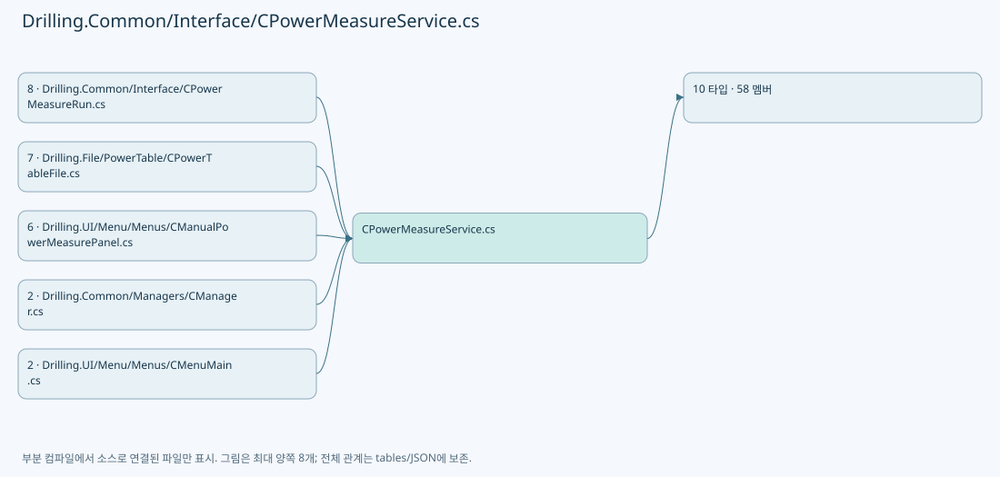

## 네임스페이스·타입·상속

| 타입 | 구분 | 원본 범위 | 선언/상속 |
| --- | --- | --- | --- |
| CPowerMeasureService | ClassDeclaration | 4–265 | CPowerMeasureService: IAsyncDisposable |
| ST_POWER_MEASURE_TARGET | RecordDeclaration | 267–267 | ST_POWER_MEASURE_TARGET |
| ST_POWER_MEASURE_OPTIONS | RecordDeclaration | 268–285 | ST_POWER_MEASURE_OPTIONS |
| ST_POWER_MEASURE_SAMPLE | RecordDeclaration | 287–287 | ST_POWER_MEASURE_SAMPLE |
| ST_POWER_MEASURE_HEAD | RecordDeclaration | 288–293 | ST_POWER_MEASURE_HEAD |
| ST_POWER_MEASURE_SNAPSHOT | RecordDeclaration | 295–298 | ST_POWER_MEASURE_SNAPSHOT |
| IPowerMeasureSession | InterfaceDeclaration | 300–311 | IPowerMeasureSession |
| CPowerMeasureSimulationSession | ClassDeclaration | 314–340 | CPowerMeasureSimulationSession: IPowerMeasureSession |
| ST_POWER_MEASURE_START | RecordDeclaration | 342–342 | ST_POWER_MEASURE_START |
| IPowerMeasureTable | InterfaceDeclaration | 344–348 | IPowerMeasureTable |

## 멤버 빠른 목록

| 이름 | 종류 | 범위 | 서명 |
| --- | --- | --- | --- |
| _sync | FieldDeclaration | L6–6 | object Drilling.Common.Interface.CPowerMeasureService._sync |
| _heads | FieldDeclaration | L7–7 | System.Collections.Generic.Dictionary<int, Drilling.Common.Interface.ST_POWER_MEASURE_HEAD> Drilling.Common.Interface.CPowerMeasureService._heads |
| _cancellation | FieldDeclaration | L8–8 | System.Threading.CancellationTokenSource? Drilling.Common.Interface.CPowerMeasureService._cancellation |
| _completion | FieldDeclaration | L9–9 | System.Threading.Tasks.Task Drilling.Common.Interface.CPowerMeasureService._completion |
| _stageState | FieldDeclaration | L10–10 | string Drilling.Common.Interface.CPowerMeasureService._stageState |
| _origin | FieldDeclaration | L11–11 | string Drilling.Common.Interface.CPowerMeasureService._origin |
| GetSnapshot | MethodDeclaration | L12–16 | Drilling.Common.Interface.ST_POWER_MEASURE_SNAPSHOT Drilling.Common.Interface.CPowerMeasureService.GetSnapshot() |
| ValidateTargets | MethodDeclaration | L18–29 | void Drilling.Common.Interface.CPowerMeasureService.ValidateTargets(System.Collections.Generic.IReadOnlyList<Drilling.Common.Interface.ST_POWER_MEASURE_TARGET>) |
| Start | MethodDeclaration | L30–47 | System.Threading.Tasks.Task Drilling.Common.Interface.CPowerMeasureService.Start(System.Collections.Generic.IReadOnlyList<Drilling.Common.Interface.ST_POWER_MEASURE_TARGET>, Drilling.Common.Interface.IPowerMeasureSession, Drilling.Common.Interface.IPowerMeasureTable?, System.Threading.CancellationToken, string) |
| Stop | MethodDeclaration | L49–56 | System.Threading.Tasks.Task Drilling.Common.Interface.CPowerMeasureService.Stop() |
| DisposeAsync | MethodDeclaration | L58–58 | System.Threading.Tasks.ValueTask Drilling.Common.Interface.CPowerMeasureService.DisposeAsync() |
| RunBatch | MethodDeclaration | L59–102 | System.Threading.Tasks.Task Drilling.Common.Interface.CPowerMeasureService.RunBatch(Drilling.Common.Interface.ST_POWER_MEASURE_TARGET[], Drilling.Common.Interface.IPowerMeasureSession, Drilling.Common.Interface.IPowerMeasureTable?, System.Threading.CancellationTokenSource) |
| RunHead | MethodDeclaration | L104–228 | System.Threading.Tasks.Task<bool> Drilling.Common.Interface.CPowerMeasureService.RunHead(Drilling.Common.Interface.ST_POWER_MEASURE_TARGET, Drilling.Common.Interface.IPowerMeasureSession, Drilling.Common.Interface.IPowerMeasureTable?, System.Threading.CancellationToken) |
| State | LocalFunctionStatement | L227–227 | void State(string, string) |
| NextAngle | MethodDeclaration | L230–258 | double Drilling.Common.Interface.CPowerMeasureService.NextAngle(System.Collections.Generic.List<Drilling.Common.Interface.ST_POWER_MEASURE_SAMPLE>, double) |
| Update | MethodDeclaration | L260–264 | void Drilling.Common.Interface.CPowerMeasureService.Update(int, System.Func<Drilling.Common.Interface.ST_POWER_MEASURE_HEAD, Drilling.Common.Interface.ST_POWER_MEASURE_HEAD>) |
| ToleranceW | PropertyDeclaration | L270–270 | double? Drilling.Common.Interface.ST_POWER_MEASURE_OPTIONS.ToleranceW |
| get_ToleranceW | GetAccessorDeclaration | L270–270 | double? Drilling.Common.Interface.ST_POWER_MEASURE_OPTIONS.ToleranceW.get |
| set_ToleranceW | InitAccessorDeclaration | L270–270 | void Drilling.Common.Interface.ST_POWER_MEASURE_OPTIONS.ToleranceW.init |
| MaximumAttempts | PropertyDeclaration | L271–271 | int? Drilling.Common.Interface.ST_POWER_MEASURE_OPTIONS.MaximumAttempts |
| get_MaximumAttempts | GetAccessorDeclaration | L271–271 | int? Drilling.Common.Interface.ST_POWER_MEASURE_OPTIONS.MaximumAttempts.get |
| set_MaximumAttempts | InitAccessorDeclaration | L271–271 | void Drilling.Common.Interface.ST_POWER_MEASURE_OPTIONS.MaximumAttempts.init |
| CoolingTimeMs | PropertyDeclaration | L272–272 | int Drilling.Common.Interface.ST_POWER_MEASURE_OPTIONS.CoolingTimeMs |
| get_CoolingTimeMs | GetAccessorDeclaration | L272–272 | int Drilling.Common.Interface.ST_POWER_MEASURE_OPTIONS.CoolingTimeMs.get |
| set_CoolingTimeMs | InitAccessorDeclaration | L272–272 | void Drilling.Common.Interface.ST_POWER_MEASURE_OPTIONS.CoolingTimeMs.init |
| Tolerance | PropertyDeclaration | L273–278 | double Drilling.Common.Interface.ST_POWER_MEASURE_OPTIONS.Tolerance |
| MaxAttempts | PropertyDeclaration | L279–284 | int Drilling.Common.Interface.ST_POWER_MEASURE_OPTIONS.MaxAttempts |
| InitialAngle | PropertyDeclaration | L290–290 | double? Drilling.Common.Interface.ST_POWER_MEASURE_HEAD.InitialAngle |
| get_InitialAngle | GetAccessorDeclaration | L290–290 | double? Drilling.Common.Interface.ST_POWER_MEASURE_HEAD.InitialAngle.get |
| set_InitialAngle | InitAccessorDeclaration | L290–290 | void Drilling.Common.Interface.ST_POWER_MEASURE_HEAD.InitialAngle.init |
| StartDetail | PropertyDeclaration | L291–291 | string Drilling.Common.Interface.ST_POWER_MEASURE_HEAD.StartDetail |
| get_StartDetail | GetAccessorDeclaration | L291–291 | string Drilling.Common.Interface.ST_POWER_MEASURE_HEAD.StartDetail.get |
| set_StartDetail | InitAccessorDeclaration | L291–291 | void Drilling.Common.Interface.ST_POWER_MEASURE_HEAD.StartDetail.init |
| TableState | PropertyDeclaration | L292–292 | string Drilling.Common.Interface.ST_POWER_MEASURE_HEAD.TableState |
| get_TableState | GetAccessorDeclaration | L292–292 | string Drilling.Common.Interface.ST_POWER_MEASURE_HEAD.TableState.get |
| set_TableState | InitAccessorDeclaration | L292–292 | void Drilling.Common.Interface.ST_POWER_MEASURE_HEAD.TableState.init |
| Origin | PropertyDeclaration | L297–297 | string Drilling.Common.Interface.ST_POWER_MEASURE_SNAPSHOT.Origin |
| get_Origin | GetAccessorDeclaration | L297–297 | string Drilling.Common.Interface.ST_POWER_MEASURE_SNAPSHOT.Origin.get |
| set_Origin | InitAccessorDeclaration | L297–297 | void Drilling.Common.Interface.ST_POWER_MEASURE_SNAPSHOT.Origin.init |
| CheckStageReady | MethodDeclaration | L302–302 | System.Threading.Tasks.Task Drilling.Common.Interface.IPowerMeasureSession.CheckStageReady(System.Threading.CancellationToken) |
| Prepare | MethodDeclaration | L303–303 | System.Threading.Tasks.Task Drilling.Common.Interface.IPowerMeasureSession.Prepare(Drilling.Common.Interface.ST_POWER_MEASURE_TARGET, System.Threading.CancellationToken) |
| GetAttenuatorPosition | MethodDeclaration | L305–305 | System.Threading.Tasks.Task<double> Drilling.Common.Interface.IPowerMeasureSession.GetAttenuatorPosition(Drilling.Common.Interface.ST_POWER_MEASURE_TARGET, System.Threading.CancellationToken) |
| MoveAttenuator | MethodDeclaration | L306–306 | System.Threading.Tasks.Task Drilling.Common.Interface.IPowerMeasureSession.MoveAttenuator(Drilling.Common.Interface.ST_POWER_MEASURE_TARGET, double, System.Threading.CancellationToken) |
| BeginMeasurement | MethodDeclaration | L307–307 | System.Threading.Tasks.Task Drilling.Common.Interface.IPowerMeasureSession.BeginMeasurement(Drilling.Common.Interface.ST_POWER_MEASURE_TARGET, System.Threading.CancellationToken) |
| EndMeasurement | MethodDeclaration | L308–308 | System.Threading.Tasks.Task Drilling.Common.Interface.IPowerMeasureSession.EndMeasurement(Drilling.Common.Interface.ST_POWER_MEASURE_TARGET) |
| ReadPower | MethodDeclaration | L309–309 | System.Threading.Tasks.Task<double> Drilling.Common.Interface.IPowerMeasureSession.ReadPower(Drilling.Common.Interface.ST_POWER_MEASURE_TARGET, System.Threading.CancellationToken) |
| Finish | MethodDeclaration | L310–310 | System.Threading.Tasks.Task Drilling.Common.Interface.IPowerMeasureSession.Finish(Drilling.Common.Interface.ST_POWER_MEASURE_TARGET) |
| _angles | FieldDeclaration | L316–316 | System.Collections.Concurrent.ConcurrentDictionary<int, double> Drilling.Common.Interface.CPowerMeasureSimulationSession._angles |
| CheckStageReady | MethodDeclaration | L317–317 | System.Threading.Tasks.Task Drilling.Common.Interface.CPowerMeasureSimulationSession.CheckStageReady(System.Threading.CancellationToken) |
| BeginMeasurement | MethodDeclaration | L318–318 | System.Threading.Tasks.Task Drilling.Common.Interface.CPowerMeasureSimulationSession.BeginMeasurement(Drilling.Common.Interface.ST_POWER_MEASURE_TARGET, System.Threading.CancellationToken) |
| EndMeasurement | MethodDeclaration | L319–319 | System.Threading.Tasks.Task Drilling.Common.Interface.CPowerMeasureSimulationSession.EndMeasurement(Drilling.Common.Interface.ST_POWER_MEASURE_TARGET) |
| Prepare | MethodDeclaration | L320–320 | System.Threading.Tasks.Task Drilling.Common.Interface.CPowerMeasureSimulationSession.Prepare(Drilling.Common.Interface.ST_POWER_MEASURE_TARGET, System.Threading.CancellationToken) |
| GetAttenuatorPosition | MethodDeclaration | L321–325 | System.Threading.Tasks.Task<double> Drilling.Common.Interface.CPowerMeasureSimulationSession.GetAttenuatorPosition(Drilling.Common.Interface.ST_POWER_MEASURE_TARGET, System.Threading.CancellationToken) |
| MoveAttenuator | MethodDeclaration | L327–331 | System.Threading.Tasks.Task Drilling.Common.Interface.CPowerMeasureSimulationSession.MoveAttenuator(Drilling.Common.Interface.ST_POWER_MEASURE_TARGET, double, System.Threading.CancellationToken) |
| ReadPower | MethodDeclaration | L333–337 | System.Threading.Tasks.Task<double> Drilling.Common.Interface.CPowerMeasureSimulationSession.ReadPower(Drilling.Common.Interface.ST_POWER_MEASURE_TARGET, System.Threading.CancellationToken) |
| Finish | MethodDeclaration | L339–339 | System.Threading.Tasks.Task Drilling.Common.Interface.CPowerMeasureSimulationSession.Finish(Drilling.Common.Interface.ST_POWER_MEASURE_TARGET) |
| FindStart | MethodDeclaration | L346–346 | Drilling.Common.Interface.ST_POWER_MEASURE_START Drilling.Common.Interface.IPowerMeasureTable.FindStart(int, double, System.Threading.CancellationToken) |
| SaveMeasurement | MethodDeclaration | L347–347 | void Drilling.Common.Interface.IPowerMeasureTable.SaveMeasurement(int, double, double, System.Threading.CancellationToken) |

## 멤버별 상세 계약·호출·처리 해설

### FieldDeclaration `_sync` · L6–6

[Drilling.Common/Interface/CPowerMeasureService.cs:6–6](https://github.com/kjuws10-rgb/A3Drilling/blob/5aee8e58439c9b455cae7c9593c9be986c3e682e/Drilling.Common/Interface/CPowerMeasureService.cs#L6-L6)

| 항목 | 실제 추출 값 |
| --- | --- |
| 서명 | object Drilling.Common.Interface.CPowerMeasureService._sync |
| 접근/수식자 | Private / private, readonly |
| 반환/값 타입 | object |
| 소속 타입 | NamedType:Drilling.Common.Interface.CPowerMeasureService |

현재 부분 분석에서 직접 연결된 호출자는 없습니다. XAML/이벤트/인터페이스·델리게이트·외부 진입을 추가 확인해야 하며, 미사용으로 판정한 것이 아닙니다.

호출하는 대상과 해석 범위:

| 원본 행 | 표현식 | 분석 상태 | 대상/소스 위치 |
| --- | --- | --- | --- |
| 6 | new | resolved | object.Object() |

본문의 실제 연산·분기·예외·반환 순서(원문 위치 순):

| 원본 행 | 종류 | 주석 해설 |
| --- | --- | --- |
| 6 | call | 함수·델리게이트 또는 객체 생성자를 호출합니다: new() |
| 6 | variable-initializer | 변수의 초기값을 지정합니다: _sync = new() |

변경 전 점검: 입력/반환 타입, 위 호출자, 예외/취소 경로, 공유 상태와 저장·전송 소비자를 함께 확인합니다. 값의 단위나 물리 방향을 이름만으로 확정하지 않습니다.

### FieldDeclaration `_heads` · L7–7

[Drilling.Common/Interface/CPowerMeasureService.cs:7–7](https://github.com/kjuws10-rgb/A3Drilling/blob/5aee8e58439c9b455cae7c9593c9be986c3e682e/Drilling.Common/Interface/CPowerMeasureService.cs#L7-L7)

| 항목 | 실제 추출 값 |
| --- | --- |
| 서명 | System.Collections.Generic.Dictionary<int, Drilling.Common.Interface.ST_POWER_MEASURE_HEAD> Drilling.Common.Interface.CPowerMeasureService._heads |
| 접근/수식자 | Private / private |
| 반환/값 타입 | System.Collections.Generic.Dictionary<int, Drilling.Common.Interface.ST_POWER_MEASURE_HEAD> |
| 소속 타입 | NamedType:Drilling.Common.Interface.CPowerMeasureService |

현재 부분 분석에서 직접 연결된 호출자는 없습니다. XAML/이벤트/인터페이스·델리게이트·외부 진입을 추가 확인해야 하며, 미사용으로 판정한 것이 아닙니다.

본문의 실제 연산·분기·예외·반환 순서(원문 위치 순):

| 원본 행 | 종류 | 주석 해설 |
| --- | --- | --- |
| 7 | variable-initializer | 변수의 초기값을 지정합니다: _heads = [] |

변경 전 점검: 입력/반환 타입, 위 호출자, 예외/취소 경로, 공유 상태와 저장·전송 소비자를 함께 확인합니다. 값의 단위나 물리 방향을 이름만으로 확정하지 않습니다.

### FieldDeclaration `_cancellation` · L8–8

[Drilling.Common/Interface/CPowerMeasureService.cs:8–8](https://github.com/kjuws10-rgb/A3Drilling/blob/5aee8e58439c9b455cae7c9593c9be986c3e682e/Drilling.Common/Interface/CPowerMeasureService.cs#L8-L8)

| 항목 | 실제 추출 값 |
| --- | --- |
| 서명 | System.Threading.CancellationTokenSource? Drilling.Common.Interface.CPowerMeasureService._cancellation |
| 접근/수식자 | Private / private |
| 반환/값 타입 | System.Threading.CancellationTokenSource? |
| 소속 타입 | NamedType:Drilling.Common.Interface.CPowerMeasureService |

현재 부분 분석에서 직접 연결된 호출자는 없습니다. XAML/이벤트/인터페이스·델리게이트·외부 진입을 추가 확인해야 하며, 미사용으로 판정한 것이 아닙니다.

변경 전 점검: 입력/반환 타입, 위 호출자, 예외/취소 경로, 공유 상태와 저장·전송 소비자를 함께 확인합니다. 값의 단위나 물리 방향을 이름만으로 확정하지 않습니다.

### FieldDeclaration `_completion` · L9–9

[Drilling.Common/Interface/CPowerMeasureService.cs:9–9](https://github.com/kjuws10-rgb/A3Drilling/blob/5aee8e58439c9b455cae7c9593c9be986c3e682e/Drilling.Common/Interface/CPowerMeasureService.cs#L9-L9)

| 항목 | 실제 추출 값 |
| --- | --- |
| 서명 | System.Threading.Tasks.Task Drilling.Common.Interface.CPowerMeasureService._completion |
| 접근/수식자 | Private / private |
| 반환/값 타입 | System.Threading.Tasks.Task |
| 소속 타입 | NamedType:Drilling.Common.Interface.CPowerMeasureService |

현재 부분 분석에서 직접 연결된 호출자는 없습니다. XAML/이벤트/인터페이스·델리게이트·외부 진입을 추가 확인해야 하며, 미사용으로 판정한 것이 아닙니다.

본문의 실제 연산·분기·예외·반환 순서(원문 위치 순):

| 원본 행 | 종류 | 주석 해설 |
| --- | --- | --- |
| 9 | variable-initializer | 변수의 초기값을 지정합니다: _completion = Task.CompletedTask |

변경 전 점검: 입력/반환 타입, 위 호출자, 예외/취소 경로, 공유 상태와 저장·전송 소비자를 함께 확인합니다. 값의 단위나 물리 방향을 이름만으로 확정하지 않습니다.

### FieldDeclaration `_stageState` · L10–10

[Drilling.Common/Interface/CPowerMeasureService.cs:10–10](https://github.com/kjuws10-rgb/A3Drilling/blob/5aee8e58439c9b455cae7c9593c9be986c3e682e/Drilling.Common/Interface/CPowerMeasureService.cs#L10-L10)

| 항목 | 실제 추출 값 |
| --- | --- |
| 서명 | string Drilling.Common.Interface.CPowerMeasureService._stageState |
| 접근/수식자 | Private / private |
| 반환/값 타입 | string |
| 소속 타입 | NamedType:Drilling.Common.Interface.CPowerMeasureService |

현재 부분 분석에서 직접 연결된 호출자는 없습니다. XAML/이벤트/인터페이스·델리게이트·외부 진입을 추가 확인해야 하며, 미사용으로 판정한 것이 아닙니다.

본문의 실제 연산·분기·예외·반환 순서(원문 위치 순):

| 원본 행 | 종류 | 주석 해설 |
| --- | --- | --- |
| 10 | variable-initializer | 변수의 초기값을 지정합니다: _stageState = "IDLE" |

변경 전 점검: 입력/반환 타입, 위 호출자, 예외/취소 경로, 공유 상태와 저장·전송 소비자를 함께 확인합니다. 값의 단위나 물리 방향을 이름만으로 확정하지 않습니다.

### FieldDeclaration `_origin` · L11–11

[Drilling.Common/Interface/CPowerMeasureService.cs:11–11](https://github.com/kjuws10-rgb/A3Drilling/blob/5aee8e58439c9b455cae7c9593c9be986c3e682e/Drilling.Common/Interface/CPowerMeasureService.cs#L11-L11)

| 항목 | 실제 추출 값 |
| --- | --- |
| 서명 | string Drilling.Common.Interface.CPowerMeasureService._origin |
| 접근/수식자 | Private / private |
| 반환/값 타입 | string |
| 소속 타입 | NamedType:Drilling.Common.Interface.CPowerMeasureService |

현재 부분 분석에서 직접 연결된 호출자는 없습니다. XAML/이벤트/인터페이스·델리게이트·외부 진입을 추가 확인해야 하며, 미사용으로 판정한 것이 아닙니다.

본문의 실제 연산·분기·예외·반환 순서(원문 위치 순):

| 원본 행 | 종류 | 주석 해설 |
| --- | --- | --- |
| 11 | variable-initializer | 변수의 초기값을 지정합니다: _origin = "" |

변경 전 점검: 입력/반환 타입, 위 호출자, 예외/취소 경로, 공유 상태와 저장·전송 소비자를 함께 확인합니다. 값의 단위나 물리 방향을 이름만으로 확정하지 않습니다.

### MethodDeclaration `GetSnapshot` · L12–16

[Drilling.Common/Interface/CPowerMeasureService.cs:12–16](https://github.com/kjuws10-rgb/A3Drilling/blob/5aee8e58439c9b455cae7c9593c9be986c3e682e/Drilling.Common/Interface/CPowerMeasureService.cs#L12-L16)

| 항목 | 실제 추출 값 |
| --- | --- |
| 서명 | Drilling.Common.Interface.ST_POWER_MEASURE_SNAPSHOT Drilling.Common.Interface.CPowerMeasureService.GetSnapshot() |
| 접근/수식자 | Public / public |
| 반환/값 타입 | Drilling.Common.Interface.ST_POWER_MEASURE_SNAPSHOT |
| 소속 타입 | NamedType:Drilling.Common.Interface.CPowerMeasureService |

정적 호출자로 확인된 위치:

| 호출 파일/행 | 호출 표현식 | 런타임 분기 가능 |
| --- | --- | --- |
| [Drilling.Common/Interface/CPowerMeasureRun.cs:97–97](https://github.com/kjuws10-rgb/A3Drilling/blob/5aee8e58439c9b455cae7c9593c9be986c3e682e/Drilling.Common/Interface/CPowerMeasureRun.cs#L97-L97) | manager.PowerMeasure.GetSnapshot | False |
| [Drilling.Common/Interface/CPowerMeasureRun.cs:249–249](https://github.com/kjuws10-rgb/A3Drilling/blob/5aee8e58439c9b455cae7c9593c9be986c3e682e/Drilling.Common/Interface/CPowerMeasureRun.cs#L249-L249) | manager.PowerMeasure.GetSnapshot | False |
| [Drilling.UI/Menu/Menus/CManualPowerMeasurePanel.cs:30–30](https://github.com/kjuws10-rgb/A3Drilling/blob/5aee8e58439c9b455cae7c9593c9be986c3e682e/Drilling.UI/Menu/Menus/CManualPowerMeasurePanel.cs#L30-L30) | _service.GetSnapshot | False |
| [Drilling.UI/Menu/Menus/CManualPowerMeasurePanel.cs:136–136](https://github.com/kjuws10-rgb/A3Drilling/blob/5aee8e58439c9b455cae7c9593c9be986c3e682e/Drilling.UI/Menu/Menus/CManualPowerMeasurePanel.cs#L136-L136) | _service.GetSnapshot | False |
| [Drilling.UI/Menu/Menus/CManualPowerMeasurePanel.cs:189–189](https://github.com/kjuws10-rgb/A3Drilling/blob/5aee8e58439c9b455cae7c9593c9be986c3e682e/Drilling.UI/Menu/Menus/CManualPowerMeasurePanel.cs#L189-L189) | _service.GetSnapshot | False |
| [Drilling.UI/Menu/Menus/CMenuMain.cs:727–727](https://github.com/kjuws10-rgb/A3Drilling/blob/5aee8e58439c9b455cae7c9593c9be986c3e682e/Drilling.UI/Menu/Menus/CMenuMain.cs#L727-L727) | .GetSnapshot | False |
| [Drilling.UI/Menu/Menus/CMenuMain.cs:843–843](https://github.com/kjuws10-rgb/A3Drilling/blob/5aee8e58439c9b455cae7c9593c9be986c3e682e/Drilling.UI/Menu/Menus/CMenuMain.cs#L843-L843) | .GetSnapshot | False |

호출하는 대상과 해석 범위:

| 원본 행 | 표현식 | 분석 상태 | 대상/소스 위치 |
| --- | --- | --- | --- |
| 15 | new | resolved | Drilling.Common.Interface.ST_POWER_MEASURE_SNAPSHOT.ST_POWER_MEASURE_SNAPSHOT(bool, System.Collections.Generic.IReadOnlyList<Drilling.Common.Interface.ST_POWER_MEASURE_HEAD>, string) · Drilling.Common/Interface/CPowerMeasureService.cs:295 |
| 15 | _heads.Values.OrderBy(h => h.Target.HeadNo).ToArray | resolved | Drilling.Common.Interface.ST_POWER_MEASURE_HEAD[] System.Collections.Generic.IEnumerable<Drilling.Common.Interface.ST_POWER_MEASURE_HEAD>.ToArray<Drilling.Common.Interface.ST_POWER_MEASURE_HEAD>() |
| 15 | _heads.Values.OrderBy | resolved | System.Linq.IOrderedEnumerable<Drilling.Common.Interface.ST_POWER_MEASURE_HEAD> System.Collections.Generic.IEnumerable<Drilling.Common.Interface.ST_POWER_MEASURE_HEAD>.OrderBy<Drilling.Common.Interface.ST_POWER_MEASURE_HEAD, int>(System.Func<Drilling.Common.Interface.ST_POWER_MEASURE_HEAD, int>) |

본문의 실제 연산·분기·예외·반환 순서(원문 위치 순):

| 원본 행 | 종류 | 주석 해설 |
| --- | --- | --- |
| 14 | lock | 공유 상태의 임계 구역에 진입합니다: lock (_sync) |
| 15 | assignment | 값을 대상에 대입합니다: Origin = _origin |
| 15 | call | 함수·델리게이트 또는 객체 생성자를 호출합니다: new(_cancellation is not null, _heads.Values.OrderBy(h => h.Target.HeadNo).ToArray(), _stageState) { Origin = _origin } |
| 15 | call | 함수·델리게이트 또는 객체 생성자를 호출합니다: _heads.Values.OrderBy(h => h.Target.HeadNo).ToArray() |
| 15 | call | 함수·델리게이트 또는 객체 생성자를 호출합니다: _heads.Values.OrderBy(h => h.Target.HeadNo) |
| 15 | return | 호출자에게 값 또는 제어를 반환합니다: return new(_cancellation is not null, _heads.Values.OrderBy(h => h.Target.HeadNo).ToArray(), _stageState) { Origin = _origin }; |

제어 구문의 포함 구조(실제 실행 순서/CFG가 아닌 구문 탐색 그림):

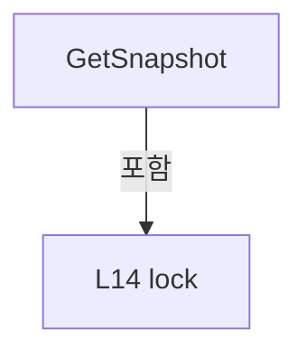

변경 전 점검: 입력/반환 타입, 위 호출자, 예외/취소 경로, 공유 상태와 저장·전송 소비자를 함께 확인합니다. 값의 단위나 물리 방향을 이름만으로 확정하지 않습니다.

### MethodDeclaration `ValidateTargets` · L18–29

[Drilling.Common/Interface/CPowerMeasureService.cs:18–29](https://github.com/kjuws10-rgb/A3Drilling/blob/5aee8e58439c9b455cae7c9593c9be986c3e682e/Drilling.Common/Interface/CPowerMeasureService.cs#L18-L29)

| 항목 | 실제 추출 값 |
| --- | --- |
| 서명 | void Drilling.Common.Interface.CPowerMeasureService.ValidateTargets(System.Collections.Generic.IReadOnlyList<Drilling.Common.Interface.ST_POWER_MEASURE_TARGET>) |
| 접근/수식자 | Public / public, static |
| 반환/값 타입 | void |
| 소속 타입 | NamedType:Drilling.Common.Interface.CPowerMeasureService |

입력 계약:

| 이름 | 타입 | 전달 | 선택/기본값 |
| --- | --- | --- | --- |
| targets | System.Collections.Generic.IReadOnlyList<Drilling.Common.Interface.ST_POWER_MEASURE_TARGET> | None | False /  |

정적 호출자로 확인된 위치:

| 호출 파일/행 | 호출 표현식 | 런타임 분기 가능 |
| --- | --- | --- |
| [Drilling.Common/Interface/CPowerMeasureRun.cs:53–53](https://github.com/kjuws10-rgb/A3Drilling/blob/5aee8e58439c9b455cae7c9593c9be986c3e682e/Drilling.Common/Interface/CPowerMeasureRun.cs#L53-L53) | CPowerMeasureService.ValidateTargets | False |
| [Drilling.Common/Interface/CPowerMeasureService.cs:32–32](https://github.com/kjuws10-rgb/A3Drilling/blob/5aee8e58439c9b455cae7c9593c9be986c3e682e/Drilling.Common/Interface/CPowerMeasureService.cs#L32-L32) | ValidateTargets | False |

호출하는 대상과 해석 범위:

| 원본 행 | 표현식 | 분석 상태 | 대상/소스 위치 |
| --- | --- | --- | --- |
| 20 | targets.OrderBy(h => h.HeadNo).ToArray | resolved | Drilling.Common.Interface.ST_POWER_MEASURE_TARGET[] System.Collections.Generic.IEnumerable<Drilling.Common.Interface.ST_POWER_MEASURE_TARGET>.ToArray<Drilling.Common.Interface.ST_POWER_MEASURE_TARGET>() |
| 20 | targets.OrderBy | resolved | System.Linq.IOrderedEnumerable<Drilling.Common.Interface.ST_POWER_MEASURE_TARGET> System.Collections.Generic.IEnumerable<Drilling.Common.Interface.ST_POWER_MEASURE_TARGET>.OrderBy<Drilling.Common.Interface.ST_POWER_MEASURE_TARGET, int>(System.Func<Drilling.Common.Interface.ST_POWER_MEASURE_TARGET, int>) |
| 21 | batch.Select(h => h.HeadNo).Distinct().Count | resolved | int System.Collections.Generic.IEnumerable<int>.Count<int>() |
| 21 | batch.Select(h => h.HeadNo).Distinct | resolved | System.Collections.Generic.IEnumerable<int> System.Collections.Generic.IEnumerable<int>.Distinct<int>() |
| 21 | batch.Select | resolved | System.Collections.Generic.IEnumerable<int> System.Collections.Generic.IEnumerable<Drilling.Common.Interface.ST_POWER_MEASURE_TARGET>.Select<Drilling.Common.Interface.ST_POWER_MEASURE_TARGET, int>(System.Func<Drilling.Common.Interface.ST_POWER_MEASURE_TARGET, int>) |
| 21 | batch.Any | resolved | bool System.Collections.Generic.IEnumerable<Drilling.Common.Interface.ST_POWER_MEASURE_TARGET>.Any<Drilling.Common.Interface.ST_POWER_MEASURE_TARGET>(System.Func<Drilling.Common.Interface.ST_POWER_MEASURE_TARGET, bool>) |
| 21 | double.IsFinite | resolved | bool double.IsFinite(double) |
| 22 | new ArgumentException | resolved | System.ArgumentException.ArgumentException(string?) |
| 23 | batch.Any | resolved | bool System.Collections.Generic.IEnumerable<Drilling.Common.Interface.ST_POWER_MEASURE_TARGET>.Any<Drilling.Common.Interface.ST_POWER_MEASURE_TARGET>(System.Func<Drilling.Common.Interface.ST_POWER_MEASURE_TARGET, bool>) |
| 24 | new ArgumentException | resolved | System.ArgumentException.ArgumentException(string?) |
| 25 | batch.Select(h => h.PowerMeterNo).Distinct().Count | resolved | int System.Collections.Generic.IEnumerable<int>.Count<int>() |
| 25 | batch.Select(h => h.PowerMeterNo).Distinct | resolved | System.Collections.Generic.IEnumerable<int> System.Collections.Generic.IEnumerable<int>.Distinct<int>() |
| 25 | batch.Select | resolved | System.Collections.Generic.IEnumerable<int> System.Collections.Generic.IEnumerable<Drilling.Common.Interface.ST_POWER_MEASURE_TARGET>.Select<Drilling.Common.Interface.ST_POWER_MEASURE_TARGET, int>(System.Func<Drilling.Common.Interface.ST_POWER_MEASURE_TARGET, int>) |
| 26 | new ArgumentException | resolved | System.ArgumentException.ArgumentException(string?) |
| 27 | batch.Any | resolved | bool System.Collections.Generic.IEnumerable<Drilling.Common.Interface.ST_POWER_MEASURE_TARGET>.Any<Drilling.Common.Interface.ST_POWER_MEASURE_TARGET>(System.Func<Drilling.Common.Interface.ST_POWER_MEASURE_TARGET, bool>) |
| 27 | double.IsFinite | resolved | bool double.IsFinite(double) |
| 28 | new ArgumentException | resolved | System.ArgumentException.ArgumentException(string?) |

본문의 실제 연산·분기·예외·반환 순서(원문 위치 순):

| 원본 행 | 종류 | 주석 해설 |
| --- | --- | --- |
| 20 | call | 함수·델리게이트 또는 객체 생성자를 호출합니다: targets.OrderBy(h => h.HeadNo).ToArray() |
| 20 | call | 함수·델리게이트 또는 객체 생성자를 호출합니다: targets.OrderBy(h => h.HeadNo) |
| 20 | local-declaration | 지역 변수를 선언합니다: var batch = targets.OrderBy(h => h.HeadNo).ToArray(); |
| 20 | variable-initializer | 변수의 초기값을 지정합니다: batch = targets.OrderBy(h => h.HeadNo).ToArray() |
| 21 | call | 함수·델리게이트 또는 객체 생성자를 호출합니다: batch.Select(h => h.HeadNo).Distinct().Count() |
| 21 | call | 함수·델리게이트 또는 객체 생성자를 호출합니다: batch.Select(h => h.HeadNo).Distinct() |
| 21 | call | 함수·델리게이트 또는 객체 생성자를 호출합니다: batch.Select(h => h.HeadNo) |
| 21 | call | 함수·델리게이트 또는 객체 생성자를 호출합니다: batch.Any(h => h.HeadNo is < 1 or > 8 &#124;&#124; h.PowerMeterNo < 0 &#124;&#124; !double.IsFinite(h.TargetPower) &#124;&#124; h.TargetPower <= 0) |
| 21 | call | 함수·델리게이트 또는 객체 생성자를 호출합니다: double.IsFinite(h.TargetPower) |
| 21 | if | 조건에 따라 분기합니다: if (batch.Length == 0 &#124;&#124; batch.Select(h => h.HeadNo).Distinct().Count() != batch.Length &#124;&#124; batch.Any(h => h.HeadNo is < 1 or > 8 &#124;&#124; h.PowerMeterNo < 0 &#124;&#124; !double.IsFinite(h.TargetPower) &#124;&#124; h.TargetPower <= 0)) |
| 22 | call | 함수·델리게이트 또는 객체 생성자를 호출합니다: new ArgumentException("Head, PowerMeter 및 0보다 큰 Target Power를 확인해 주세요.") |
| 22 | throw | 예외를 발생/전달합니다: throw new ArgumentException("Head, PowerMeter 및 0보다 큰 Target Power를 확인해 주세요."); |
| 23 | call | 함수·델리게이트 또는 객체 생성자를 호출합니다: batch.Any(h => h.Options is not { } options &#124;&#124; options.Mode is not ("ROUGH" or "FINE" or "DETAIL") &#124;&#124; options.SettleTimeMs is < 0 or > 60000 &#124;&#124; options.MeasureCount is < 1 or > 1000 &#124;&#124; options.MeasureIntervalMs is < 0 or… |
| 23 | if | 조건에 따라 분기합니다: if (batch.Any(h => h.Options is not { } options &#124;&#124; options.Mode is not ("ROUGH" or "FINE" or "DETAIL") &#124;&#124; options.SettleTimeMs is < 0 or > 60000 &#124;&#124; options.MeasureCount is < 1 or > 1000 &#124;&#124; options.MeasureIntervalMs is < 0 or…) |
| 24 | call | 함수·델리게이트 또는 객체 생성자를 호출합니다: new ArgumentException("측정 모드, 안정화 시간, 측정 횟수 및 간격을 확인해 주세요.") |
| 24 | throw | 예외를 발생/전달합니다: throw new ArgumentException("측정 모드, 안정화 시간, 측정 횟수 및 간격을 확인해 주세요."); |
| 25 | call | 함수·델리게이트 또는 객체 생성자를 호출합니다: batch.Select(h => h.PowerMeterNo).Distinct().Count() |
| 25 | call | 함수·델리게이트 또는 객체 생성자를 호출합니다: batch.Select(h => h.PowerMeterNo).Distinct() |
| 25 | call | 함수·델리게이트 또는 객체 생성자를 호출합니다: batch.Select(h => h.PowerMeterNo) |
| 25 | if | 조건에 따라 분기합니다: if (batch.Select(h => h.PowerMeterNo).Distinct().Count() != batch.Length) |
| 26 | call | 함수·델리게이트 또는 객체 생성자를 호출합니다: new ArgumentException("각 Head에는 서로 다른 전용 PowerMeter가 필요합니다.") |
| 26 | throw | 예외를 발생/전달합니다: throw new ArgumentException("각 Head에는 서로 다른 전용 PowerMeter가 필요합니다."); |
| 27 | call | 함수·델리게이트 또는 객체 생성자를 호출합니다: batch.Any(h => !double.IsFinite(h.Options.Tolerance) &#124;&#124; h.Options.Tolerance < 0 &#124;&#124; h.Options.MaxAttempts is < 1 or > 100 &#124;&#124; h.Options.CoolingTimeMs is < 0 or > 60000) |
| 27 | call | 함수·델리게이트 또는 객체 생성자를 호출합니다: double.IsFinite(h.Options.Tolerance) |
| 27 | if | 조건에 따라 분기합니다: if (batch.Any(h => !double.IsFinite(h.Options.Tolerance) &#124;&#124; h.Options.Tolerance < 0 &#124;&#124; h.Options.MaxAttempts is < 1 or > 100 &#124;&#124; h.Options.CoolingTimeMs is < 0 or > 60000)) |
| 28 | call | 함수·델리게이트 또는 객체 생성자를 호출합니다: new ArgumentException("허용오차, 최대 시도 횟수 및 냉각 시간을 확인해 주세요.") |
| 28 | throw | 예외를 발생/전달합니다: throw new ArgumentException("허용오차, 최대 시도 횟수 및 냉각 시간을 확인해 주세요."); |

제어 구문의 포함 구조(실제 실행 순서/CFG가 아닌 구문 탐색 그림):

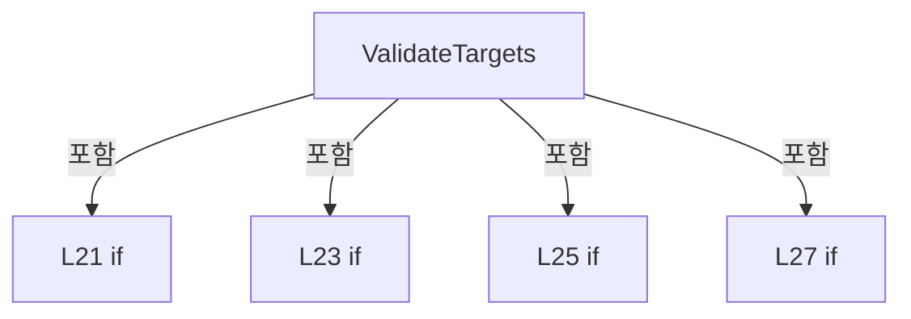

변경 전 점검: 입력/반환 타입, 위 호출자, 예외/취소 경로, 공유 상태와 저장·전송 소비자를 함께 확인합니다. 값의 단위나 물리 방향을 이름만으로 확정하지 않습니다.

### MethodDeclaration `Start` · L30–47

[Drilling.Common/Interface/CPowerMeasureService.cs:30–47](https://github.com/kjuws10-rgb/A3Drilling/blob/5aee8e58439c9b455cae7c9593c9be986c3e682e/Drilling.Common/Interface/CPowerMeasureService.cs#L30-L47)

| 항목 | 실제 추출 값 |
| --- | --- |
| 서명 | System.Threading.Tasks.Task Drilling.Common.Interface.CPowerMeasureService.Start(System.Collections.Generic.IReadOnlyList<Drilling.Common.Interface.ST_POWER_MEASURE_TARGET>, Drilling.Common.Interface.IPowerMeasureSession, Drilling.Common.Interface.IPowerMeasureTable?, System.Threading.CancellationToken, string) |
| 접근/수식자 | Public / public |
| 반환/값 타입 | System.Threading.Tasks.Task |
| 소속 타입 | NamedType:Drilling.Common.Interface.CPowerMeasureService |

입력 계약:

| 이름 | 타입 | 전달 | 선택/기본값 |
| --- | --- | --- | --- |
| targets | System.Collections.Generic.IReadOnlyList<Drilling.Common.Interface.ST_POWER_MEASURE_TARGET> | None | False /  |
| session | Drilling.Common.Interface.IPowerMeasureSession | None | False /  |
| table | Drilling.Common.Interface.IPowerMeasureTable? | None | True / null |
| token | System.Threading.CancellationToken | None | True / null |
| origin | string | None | True / "MANUAL" |

정적 호출자로 확인된 위치:

| 호출 파일/행 | 호출 표현식 | 런타임 분기 가능 |
| --- | --- | --- |
| [Drilling.Common/Interface/CPowerMeasureRun.cs:86–86](https://github.com/kjuws10-rgb/A3Drilling/blob/5aee8e58439c9b455cae7c9593c9be986c3e682e/Drilling.Common/Interface/CPowerMeasureRun.cs#L86-L86) | manager.PowerMeasure.Start | False |

호출하는 대상과 해석 범위:

| 원본 행 | 표현식 | 분석 상태 | 대상/소스 위치 |
| --- | --- | --- | --- |
| 32 | ValidateTargets | resolved | void Drilling.Common.Interface.CPowerMeasureService.ValidateTargets(System.Collections.Generic.IReadOnlyList<Drilling.Common.Interface.ST_POWER_MEASURE_TARGET>) · Drilling.Common/Interface/CPowerMeasureService.cs:18 |
| 33 | targets.OrderBy(h => h.HeadNo).ToArray | resolved | Drilling.Common.Interface.ST_POWER_MEASURE_TARGET[] System.Collections.Generic.IEnumerable<Drilling.Common.Interface.ST_POWER_MEASURE_TARGET>.ToArray<Drilling.Common.Interface.ST_POWER_MEASURE_TARGET>() |
| 33 | targets.OrderBy | resolved | System.Linq.IOrderedEnumerable<Drilling.Common.Interface.ST_POWER_MEASURE_TARGET> System.Collections.Generic.IEnumerable<Drilling.Common.Interface.ST_POWER_MEASURE_TARGET>.OrderBy<Drilling.Common.Interface.ST_POWER_MEASURE_TARGET, int>(System.Func<Drilling.Common.Interface.ST_POWER_MEASURE_TARGET, int>) |
| 34 | ArgumentNullException.ThrowIfNull | resolved | void System.ArgumentNullException.ThrowIfNull(object?, string?) |
| 38 | new InvalidOperationException | resolved | System.InvalidOperationException.InvalidOperationException(string?) |
| 39 | CancellationTokenSource.CreateLinkedTokenSource | resolved | System.Threading.CancellationTokenSource System.Threading.CancellationTokenSource.CreateLinkedTokenSource(System.Threading.CancellationToken) |
| 43 | batch.ToDictionary | resolved | System.Collections.Generic.Dictionary<int, Drilling.Common.Interface.ST_POWER_MEASURE_HEAD> System.Collections.Generic.IEnumerable<Drilling.Common.Interface.ST_POWER_MEASURE_TARGET>.ToDictionary<Drilling.Common.Interface.ST_POWER_MEASURE_TARGET, int, Drilling.Common.Interface.ST_POWER_MEASURE_HEAD>(System.Func<Drilling.Common.Interface.ST_POWER_MEASURE_TARGET, int>, System.Func<Drilling.Common.Interface.ST_POWER_MEASURE_TARGET, Drilling.Common.Interface.ST_POWER_MEASURE_HEAD>) |
| 43 | new ST_POWER_MEASURE_HEAD | resolved | Drilling.Common.Interface.ST_POWER_MEASURE_HEAD.ST_POWER_MEASURE_HEAD(Drilling.Common.Interface.ST_POWER_MEASURE_TARGET, string, double?, double?, string, System.Collections.Generic.IReadOnlyList<Drilling.Common.Interface.ST_POWER_MEASURE_SAMPLE>) · Drilling.Common/Interface/CPowerMeasureService.cs:288 |
| 44 | Task.Run | resolved | System.Threading.Tasks.Task System.Threading.Tasks.Task.Run(System.Func<System.Threading.Tasks.Task?>) |
| 44 | RunBatch | resolved | System.Threading.Tasks.Task Drilling.Common.Interface.CPowerMeasureService.RunBatch(Drilling.Common.Interface.ST_POWER_MEASURE_TARGET[], Drilling.Common.Interface.IPowerMeasureSession, Drilling.Common.Interface.IPowerMeasureTable?, System.Threading.CancellationTokenSource) · Drilling.Common/Interface/CPowerMeasureService.cs:59 |

본문의 실제 연산·분기·예외·반환 순서(원문 위치 순):

| 원본 행 | 종류 | 주석 해설 |
| --- | --- | --- |
| 32 | call | 함수·델리게이트 또는 객체 생성자를 호출합니다: ValidateTargets(targets) |
| 33 | call | 함수·델리게이트 또는 객체 생성자를 호출합니다: targets.OrderBy(h => h.HeadNo).ToArray() |
| 33 | call | 함수·델리게이트 또는 객체 생성자를 호출합니다: targets.OrderBy(h => h.HeadNo) |
| 33 | local-declaration | 지역 변수를 선언합니다: var batch = targets.OrderBy(h => h.HeadNo).ToArray(); |
| 33 | variable-initializer | 변수의 초기값을 지정합니다: batch = targets.OrderBy(h => h.HeadNo).ToArray() |
| 34 | call | 함수·델리게이트 또는 객체 생성자를 호출합니다: ArgumentNullException.ThrowIfNull(session) |
| 35 | lock | 공유 상태의 임계 구역에 진입합니다: lock (_sync) |
| 37 | if | 조건에 따라 분기합니다: if (_cancellation is not null) |
| 38 | call | 함수·델리게이트 또는 객체 생성자를 호출합니다: new InvalidOperationException("PowerMeasure가 이미 진행 중입니다.") |
| 38 | throw | 예외를 발생/전달합니다: throw new InvalidOperationException("PowerMeasure가 이미 진행 중입니다."); |
| 39 | call | 함수·델리게이트 또는 객체 생성자를 호출합니다: CancellationTokenSource.CreateLinkedTokenSource(token) |
| 39 | local-declaration | 지역 변수를 선언합니다: var cancellation = CancellationTokenSource.CreateLinkedTokenSource(token); |
| 39 | variable-initializer | 변수의 초기값을 지정합니다: cancellation = CancellationTokenSource.CreateLinkedTokenSource(token) |
| 40 | assignment | 값을 대상에 대입합니다: _cancellation = cancellation |
| 41 | assignment | 값을 대상에 대입합니다: _origin = origin |
| 42 | assignment | 값을 대상에 대입합니다: _stageState = "CHECKING" |
| 43 | assignment | 값을 대상에 대입합니다: _heads = batch.ToDictionary(h => h.HeadNo, h => new ST_POWER_MEASURE_HEAD(h, "WAITING", null, null, "측정 준비", [])) |
| 43 | call | 함수·델리게이트 또는 객체 생성자를 호출합니다: batch.ToDictionary(h => h.HeadNo, h => new ST_POWER_MEASURE_HEAD(h, "WAITING", null, null, "측정 준비", [])) |
| 43 | call | 함수·델리게이트 또는 객체 생성자를 호출합니다: new ST_POWER_MEASURE_HEAD(h, "WAITING", null, null, "측정 준비", []) |
| 44 | assignment | 값을 대상에 대입합니다: _completion = Task.Run(() => RunBatch(batch, session, table, cancellation)) |
| 44 | call | 함수·델리게이트 또는 객체 생성자를 호출합니다: Task.Run(() => RunBatch(batch, session, table, cancellation)) |
| 44 | call | 함수·델리게이트 또는 객체 생성자를 호출합니다: RunBatch(batch, session, table, cancellation) |
| 45 | return | 호출자에게 값 또는 제어를 반환합니다: return _completion; |

제어 구문의 포함 구조(실제 실행 순서/CFG가 아닌 구문 탐색 그림):

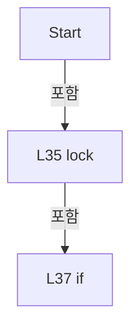

변경 전 점검: 입력/반환 타입, 위 호출자, 예외/취소 경로, 공유 상태와 저장·전송 소비자를 함께 확인합니다. 값의 단위나 물리 방향을 이름만으로 확정하지 않습니다.

### MethodDeclaration `Stop` · L49–56

[Drilling.Common/Interface/CPowerMeasureService.cs:49–56](https://github.com/kjuws10-rgb/A3Drilling/blob/5aee8e58439c9b455cae7c9593c9be986c3e682e/Drilling.Common/Interface/CPowerMeasureService.cs#L49-L56)

| 항목 | 실제 추출 값 |
| --- | --- |
| 서명 | System.Threading.Tasks.Task Drilling.Common.Interface.CPowerMeasureService.Stop() |
| 접근/수식자 | Public / public |
| 반환/값 타입 | System.Threading.Tasks.Task |
| 소속 타입 | NamedType:Drilling.Common.Interface.CPowerMeasureService |

정적 호출자로 확인된 위치:

| 호출 파일/행 | 호출 표현식 | 런타임 분기 가능 |
| --- | --- | --- |
| [Drilling.Common/Interface/CPowerMeasureService.cs:58–58](https://github.com/kjuws10-rgb/A3Drilling/blob/5aee8e58439c9b455cae7c9593c9be986c3e682e/Drilling.Common/Interface/CPowerMeasureService.cs#L58-L58) | Stop | False |
| [Drilling.UI/Menu/Menus/CManualPowerMeasurePanel.cs:201–201](https://github.com/kjuws10-rgb/A3Drilling/blob/5aee8e58439c9b455cae7c9593c9be986c3e682e/Drilling.UI/Menu/Menus/CManualPowerMeasurePanel.cs#L201-L201) | _service.Stop | False |

호출하는 대상과 해석 범위:

| 원본 행 | 표현식 | 분석 상태 | 대상/소스 위치 |
| --- | --- | --- | --- |
| 53 | .Cancel | resolved | void System.Threading.CancellationTokenSource.Cancel() |

본문의 실제 연산·분기·예외·반환 순서(원문 위치 순):

| 원본 행 | 종류 | 주석 해설 |
| --- | --- | --- |
| 51 | lock | 공유 상태의 임계 구역에 진입합니다: lock (_sync) |
| 53 | call | 함수·델리게이트 또는 객체 생성자를 호출합니다: .Cancel() |
| 54 | return | 호출자에게 값 또는 제어를 반환합니다: return _completion; |

제어 구문의 포함 구조(실제 실행 순서/CFG가 아닌 구문 탐색 그림):

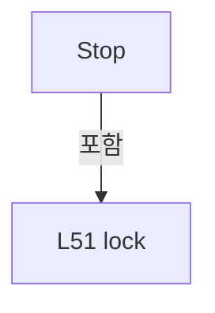

변경 전 점검: 입력/반환 타입, 위 호출자, 예외/취소 경로, 공유 상태와 저장·전송 소비자를 함께 확인합니다. 값의 단위나 물리 방향을 이름만으로 확정하지 않습니다.

### MethodDeclaration `DisposeAsync` · L58–58

[Drilling.Common/Interface/CPowerMeasureService.cs:58–58](https://github.com/kjuws10-rgb/A3Drilling/blob/5aee8e58439c9b455cae7c9593c9be986c3e682e/Drilling.Common/Interface/CPowerMeasureService.cs#L58-L58)

| 항목 | 실제 추출 값 |
| --- | --- |
| 서명 | System.Threading.Tasks.ValueTask Drilling.Common.Interface.CPowerMeasureService.DisposeAsync() |
| 접근/수식자 | Public / public, async |
| 반환/값 타입 | System.Threading.Tasks.ValueTask |
| 소속 타입 | NamedType:Drilling.Common.Interface.CPowerMeasureService |

정적 호출자로 확인된 위치:

| 호출 파일/행 | 호출 표현식 | 런타임 분기 가능 |
| --- | --- | --- |
| [Drilling.Common/Managers/CManager.cs:234–234](https://github.com/kjuws10-rgb/A3Drilling/blob/5aee8e58439c9b455cae7c9593c9be986c3e682e/Drilling.Common/Managers/CManager.cs#L234-L234) | PowerMeasure.DisposeAsync | False |

호출하는 대상과 해석 범위:

| 원본 행 | 표현식 | 분석 상태 | 대상/소스 위치 |
| --- | --- | --- | --- |
| 58 | Stop().ConfigureAwait | resolved | System.Runtime.CompilerServices.ConfiguredTaskAwaitable System.Threading.Tasks.Task.ConfigureAwait(bool) |
| 58 | Stop | resolved | System.Threading.Tasks.Task Drilling.Common.Interface.CPowerMeasureService.Stop() · Drilling.Common/Interface/CPowerMeasureService.cs:49 |

본문의 실제 연산·분기·예외·반환 순서(원문 위치 순):

| 원본 행 | 종류 | 주석 해설 |
| --- | --- | --- |
| 58 | await | 비동기 완료를 기다립니다: await Stop().ConfigureAwait(false) |
| 58 | call | 함수·델리게이트 또는 객체 생성자를 호출합니다: Stop().ConfigureAwait(false) |
| 58 | call | 함수·델리게이트 또는 객체 생성자를 호출합니다: Stop() |

변경 전 점검: 입력/반환 타입, 위 호출자, 예외/취소 경로, 공유 상태와 저장·전송 소비자를 함께 확인합니다. 값의 단위나 물리 방향을 이름만으로 확정하지 않습니다.

### MethodDeclaration `RunBatch` · L59–102

[Drilling.Common/Interface/CPowerMeasureService.cs:59–102](https://github.com/kjuws10-rgb/A3Drilling/blob/5aee8e58439c9b455cae7c9593c9be986c3e682e/Drilling.Common/Interface/CPowerMeasureService.cs#L59-L102)

| 항목 | 실제 추출 값 |
| --- | --- |
| 서명 | System.Threading.Tasks.Task Drilling.Common.Interface.CPowerMeasureService.RunBatch(Drilling.Common.Interface.ST_POWER_MEASURE_TARGET[], Drilling.Common.Interface.IPowerMeasureSession, Drilling.Common.Interface.IPowerMeasureTable?, System.Threading.CancellationTokenSource) |
| 접근/수식자 | Private / private, async |
| 반환/값 타입 | System.Threading.Tasks.Task |
| 소속 타입 | NamedType:Drilling.Common.Interface.CPowerMeasureService |

입력 계약:

| 이름 | 타입 | 전달 | 선택/기본값 |
| --- | --- | --- | --- |
| targets | Drilling.Common.Interface.ST_POWER_MEASURE_TARGET[] | None | False /  |
| session | Drilling.Common.Interface.IPowerMeasureSession | None | False /  |
| table | Drilling.Common.Interface.IPowerMeasureTable? | None | False /  |
| cancellation | System.Threading.CancellationTokenSource | None | False /  |

정적 호출자로 확인된 위치:

| 호출 파일/행 | 호출 표현식 | 런타임 분기 가능 |
| --- | --- | --- |
| [Drilling.Common/Interface/CPowerMeasureService.cs:44–44](https://github.com/kjuws10-rgb/A3Drilling/blob/5aee8e58439c9b455cae7c9593c9be986c3e682e/Drilling.Common/Interface/CPowerMeasureService.cs#L44-L44) | RunBatch | False |

호출하는 대상과 해석 범위:

| 원본 행 | 표현식 | 분석 상태 | 대상/소스 위치 |
| --- | --- | --- | --- |
| 63 | session.CheckStageReady(cancellation.Token).ConfigureAwait | resolved | System.Runtime.CompilerServices.ConfiguredTaskAwaitable System.Threading.Tasks.Task.ConfigureAwait(bool) |
| 63 | session.CheckStageReady | resolved · 동적 구현 선택 가능 | System.Threading.Tasks.Task Drilling.Common.Interface.IPowerMeasureSession.CheckStageReady(System.Threading.CancellationToken) · Drilling.Common/Interface/CPowerMeasureService.cs:302 |
| 64 | cancellation.Token.ThrowIfCancellationRequested | resolved | void System.Threading.CancellationToken.ThrowIfCancellationRequested() |
| 67 | Task.WhenAll(targets.Select(target => RunHead(target, session, table, cancellation.Token))).ConfigureAwait | resolved | System.Runtime.CompilerServices.ConfiguredTaskAwaitable<bool[]> System.Threading.Tasks.Task<bool[]>.ConfigureAwait(bool) |
| 67 | Task.WhenAll | resolved | System.Threading.Tasks.Task<bool[]> System.Threading.Tasks.Task.WhenAll<bool>(System.Collections.Generic.IEnumerable<System.Threading.Tasks.Task<bool>>) |
| 67 | targets.Select | resolved | System.Collections.Generic.IEnumerable<System.Threading.Tasks.Task<bool>> System.Collections.Generic.IEnumerable<Drilling.Common.Interface.ST_POWER_MEASURE_TARGET>.Select<Drilling.Common.Interface.ST_POWER_MEASURE_TARGET, System.Threading.Tasks.Task<bool>>(System.Func<Drilling.Common.Interface.ST_POWER_MEASURE_TARGET, System.Threading.Tasks.Task<bool>>) |
| 67 | RunHead | resolved | System.Threading.Tasks.Task<bool> Drilling.Common.Interface.CPowerMeasureService.RunHead(Drilling.Common.Interface.ST_POWER_MEASURE_TARGET, Drilling.Common.Interface.IPowerMeasureSession, Drilling.Common.Interface.IPowerMeasureTable?, System.Threading.CancellationToken) · Drilling.Common/Interface/CPowerMeasureService.cs:104 |
| 79 | _heads.ToArray | resolved | System.Collections.Generic.KeyValuePair<int, Drilling.Common.Interface.ST_POWER_MEASURE_HEAD>[] System.Collections.Generic.IEnumerable<System.Collections.Generic.KeyValuePair<int, Drilling.Common.Interface.ST_POWER_MEASURE_HEAD>>.ToArray<System.Collections.Generic.KeyValuePair<int, Drilling.Common.Interface.ST_POWER_MEASURE_HEAD>>() |
| 91 | _heads.ToArray | resolved | System.Collections.Generic.KeyValuePair<int, Drilling.Common.Interface.ST_POWER_MEASURE_HEAD>[] System.Collections.Generic.IEnumerable<System.Collections.Generic.KeyValuePair<int, Drilling.Common.Interface.ST_POWER_MEASURE_HEAD>>.ToArray<System.Collections.Generic.KeyValuePair<int, Drilling.Common.Interface.ST_POWER_MEASURE_HEAD>>() |
| 99 | cancellation.Dispose | resolved | void System.Threading.CancellationTokenSource.Dispose() |

본문의 실제 연산·분기·예외·반환 순서(원문 위치 순):

| 원본 행 | 종류 | 주석 해설 |
| --- | --- | --- |
| 61 | try | 예외 처리 범위입니다: try |
| 63 | await | 비동기 완료를 기다립니다: await session.CheckStageReady(cancellation.Token).ConfigureAwait(false) |
| 63 | call | 함수·델리게이트 또는 객체 생성자를 호출합니다: session.CheckStageReady(cancellation.Token).ConfigureAwait(false) |
| 63 | call | 함수·델리게이트 또는 객체 생성자를 호출합니다: session.CheckStageReady(cancellation.Token) |
| 64 | call | 함수·델리게이트 또는 객체 생성자를 호출합니다: cancellation.Token.ThrowIfCancellationRequested() |
| 65 | lock | 공유 상태의 임계 구역에 진입합니다: lock (_sync) |
| 66 | assignment | 값을 대상에 대입합니다: _stageState = "COMPLETE" |
| 67 | await | 비동기 완료를 기다립니다: await Task.WhenAll(targets.Select(target => RunHead(target, session, table, cancellation.Token))).ConfigureAwait(false) |
| 67 | call | 함수·델리게이트 또는 객체 생성자를 호출합니다: Task.WhenAll(targets.Select(target => RunHead(target, session, table, cancellation.Token))).ConfigureAwait(false) |
| 67 | call | 함수·델리게이트 또는 객체 생성자를 호출합니다: Task.WhenAll(targets.Select(target => RunHead(target, session, table, cancellation.Token))) |
| 67 | call | 함수·델리게이트 또는 객체 생성자를 호출합니다: targets.Select(target => RunHead(target, session, table, cancellation.Token)) |
| 67 | call | 함수·델리게이트 또는 객체 생성자를 호출합니다: RunHead(target, session, table, cancellation.Token) |
| 69 | catch | 지정 예외를 처리합니다: catch (OperationCanceledException) when (cancellation.IsCancellationRequested) |
| 71 | lock | 공유 상태의 임계 구역에 진입합니다: lock (_sync) |
| 72 | assignment | 값을 대상에 대입합니다: _stageState = "STOPPED" |
| 74 | catch | 지정 예외를 처리합니다: catch (Exception error) |
| 76 | lock | 공유 상태의 임계 구역에 진입합니다: lock (_sync) |
| 78 | assignment | 값을 대상에 대입합니다: _stageState = "ERROR" |
| 79 | call | 함수·델리게이트 또는 객체 생성자를 호출합니다: _heads.ToArray() |
| 79 | foreach | 컬렉션 요소를 순회합니다: foreach (var(head, state)in _heads.ToArray()) if (state.State == "WAITING") _heads[head] = state with { State = "ERROR", Message = $"측정 준비 실패: {error.Message}"}; |
| 80 | if | 조건에 따라 분기합니다: if (state.State == "WAITING") |
| 81 | assignment | 값을 대상에 대입합니다: _heads[head] = state with { State = "ERROR", Message = $"측정 준비 실패: {error.Message}"} |
| 83 | assignment | 값을 대상에 대입합니다: State = "ERROR" |
| 84 | assignment | 값을 대상에 대입합니다: Message = $"측정 준비 실패: {error.Message}" |
| 87 | finally | 종료 정리 구간입니다: finally |
| 89 | lock | 공유 상태의 임계 구역에 진입합니다: lock (_sync) |
| 91 | call | 함수·델리게이트 또는 객체 생성자를 호출합니다: _heads.ToArray() |
| 91 | foreach | 컬렉션 요소를 순회합니다: foreach (var(head, state)in _heads.ToArray()) if (state.State == "WAITING") _heads[head] = state with { State = "STOPPED", Message = "대기 작업 취소" }; |
| 92 | if | 조건에 따라 분기합니다: if (state.State == "WAITING") |
| 93 | assignment | 값을 대상에 대입합니다: _heads[head] = state with { State = "STOPPED", Message = "대기 작업 취소" } |
| 95 | assignment | 값을 대상에 대입합니다: State = "STOPPED" |
| 96 | assignment | 값을 대상에 대입합니다: Message = "대기 작업 취소" |
| 98 | assignment | 값을 대상에 대입합니다: _cancellation = null |
| 99 | call | 함수·델리게이트 또는 객체 생성자를 호출합니다: cancellation.Dispose() |

제어 구문의 포함 구조(실제 실행 순서/CFG가 아닌 구문 탐색 그림):

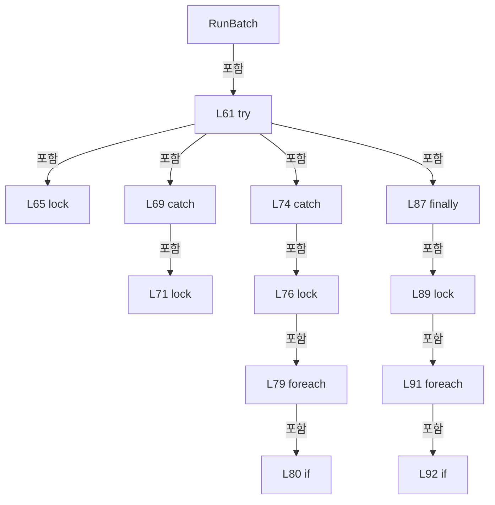

변경 전 점검: 입력/반환 타입, 위 호출자, 예외/취소 경로, 공유 상태와 저장·전송 소비자를 함께 확인합니다. 값의 단위나 물리 방향을 이름만으로 확정하지 않습니다.

### MethodDeclaration `RunHead` · L104–228

[Drilling.Common/Interface/CPowerMeasureService.cs:104–228](https://github.com/kjuws10-rgb/A3Drilling/blob/5aee8e58439c9b455cae7c9593c9be986c3e682e/Drilling.Common/Interface/CPowerMeasureService.cs#L104-L228)

| 항목 | 실제 추출 값 |
| --- | --- |
| 서명 | System.Threading.Tasks.Task<bool> Drilling.Common.Interface.CPowerMeasureService.RunHead(Drilling.Common.Interface.ST_POWER_MEASURE_TARGET, Drilling.Common.Interface.IPowerMeasureSession, Drilling.Common.Interface.IPowerMeasureTable?, System.Threading.CancellationToken) |
| 접근/수식자 | Private / private, async |
| 반환/값 타입 | System.Threading.Tasks.Task<bool> |
| 소속 타입 | NamedType:Drilling.Common.Interface.CPowerMeasureService |

입력 계약:

| 이름 | 타입 | 전달 | 선택/기본값 |
| --- | --- | --- | --- |
| target | Drilling.Common.Interface.ST_POWER_MEASURE_TARGET | None | False /  |
| session | Drilling.Common.Interface.IPowerMeasureSession | None | False /  |
| table | Drilling.Common.Interface.IPowerMeasureTable? | None | False /  |
| token | System.Threading.CancellationToken | None | False /  |

정적 호출자로 확인된 위치:

| 호출 파일/행 | 호출 표현식 | 런타임 분기 가능 |
| --- | --- | --- |
| [Drilling.Common/Interface/CPowerMeasureService.cs:67–67](https://github.com/kjuws10-rgb/A3Drilling/blob/5aee8e58439c9b455cae7c9593c9be986c3e682e/Drilling.Common/Interface/CPowerMeasureService.cs#L67-L67) | RunHead | False |

호출하는 대상과 해석 범위:

| 원본 행 | 표현식 | 분석 상태 | 대상/소스 위치 |
| --- | --- | --- | --- |
| 107 | new List<ST_POWER_MEASURE_SAMPLE> | resolved | System.Collections.Generic.List<Drilling.Common.Interface.ST_POWER_MEASURE_SAMPLE>.List() |
| 112 | token.ThrowIfCancellationRequested | resolved | void System.Threading.CancellationToken.ThrowIfCancellationRequested() |
| 113 | State | resolved | void State(string, string) · Drilling.Common/Interface/CPowerMeasureService.cs:227 |
| 114 | session.Prepare(target, token).ConfigureAwait | resolved | System.Runtime.CompilerServices.ConfiguredTaskAwaitable System.Threading.Tasks.Task.ConfigureAwait(bool) |
| 114 | session.Prepare | resolved · 동적 구현 선택 가능 | System.Threading.Tasks.Task Drilling.Common.Interface.IPowerMeasureSession.Prepare(Drilling.Common.Interface.ST_POWER_MEASURE_TARGET, System.Threading.CancellationToken) · Drilling.Common/Interface/CPowerMeasureService.cs:303 |
| 115 | .FindStart | resolved · 동적 구현 선택 가능 | Drilling.Common.Interface.ST_POWER_MEASURE_START Drilling.Common.Interface.IPowerMeasureTable.FindStart(int, double, System.Threading.CancellationToken) · Drilling.Common/Interface/CPowerMeasureService.cs:346 |
| 115 | new | resolved | Drilling.Common.Interface.ST_POWER_MEASURE_START.ST_POWER_MEASURE_START(double?, string) · Drilling.Common/Interface/CPowerMeasureService.cs:342 |
| 116 | session.GetAttenuatorPosition(target, token).ConfigureAwait | resolved | System.Runtime.CompilerServices.ConfiguredTaskAwaitable<double> System.Threading.Tasks.Task<double>.ConfigureAwait(bool) |
| 116 | session.GetAttenuatorPosition | resolved · 동적 구현 선택 가능 | System.Threading.Tasks.Task<double> Drilling.Common.Interface.IPowerMeasureSession.GetAttenuatorPosition(Drilling.Common.Interface.ST_POWER_MEASURE_TARGET, System.Threading.CancellationToken) · Drilling.Common/Interface/CPowerMeasureService.cs:305 |
| 117 | double.IsFinite | resolved | bool double.IsFinite(double) |
| 118 | new InvalidOperationException | resolved | System.InvalidOperationException.InvalidOperationException(string?) |
| 119 | Update | resolved | void Drilling.Common.Interface.CPowerMeasureService.Update(int, System.Func<Drilling.Common.Interface.ST_POWER_MEASURE_HEAD, Drilling.Common.Interface.ST_POWER_MEASURE_HEAD>) · Drilling.Common/Interface/CPowerMeasureService.cs:260 |
| 122 | token.ThrowIfCancellationRequested | resolved | void System.Threading.CancellationToken.ThrowIfCancellationRequested() |
| 126 | State | resolved | void State(string, string) · Drilling.Common/Interface/CPowerMeasureService.cs:227 |
| 127 | session.MoveAttenuator(target, angle, token).ConfigureAwait | resolved | System.Runtime.CompilerServices.ConfiguredTaskAwaitable System.Threading.Tasks.Task.ConfigureAwait(bool) |
| 127 | session.MoveAttenuator | resolved · 동적 구현 선택 가능 | System.Threading.Tasks.Task Drilling.Common.Interface.IPowerMeasureSession.MoveAttenuator(Drilling.Common.Interface.ST_POWER_MEASURE_TARGET, double, System.Threading.CancellationToken) · Drilling.Common/Interface/CPowerMeasureService.cs:306 |
| 128 | session.GetAttenuatorPosition(target, token).ConfigureAwait | resolved | System.Runtime.CompilerServices.ConfiguredTaskAwaitable<double> System.Threading.Tasks.Task<double>.ConfigureAwait(bool) |
| 128 | session.GetAttenuatorPosition | resolved · 동적 구현 선택 가능 | System.Threading.Tasks.Task<double> Drilling.Common.Interface.IPowerMeasureSession.GetAttenuatorPosition(Drilling.Common.Interface.ST_POWER_MEASURE_TARGET, System.Threading.CancellationToken) · Drilling.Common/Interface/CPowerMeasureService.cs:305 |
| 131 | Update | resolved | void Drilling.Common.Interface.CPowerMeasureService.Update(int, System.Func<Drilling.Common.Interface.ST_POWER_MEASURE_HEAD, Drilling.Common.Interface.ST_POWER_MEASURE_HEAD>) · Drilling.Common/Interface/CPowerMeasureService.cs:260 |
| 132 | new List<double> | resolved | System.Collections.Generic.List<double>.List() |
| 133 | session.BeginMeasurement(target, token).ConfigureAwait | resolved | System.Runtime.CompilerServices.ConfiguredTaskAwaitable System.Threading.Tasks.Task.ConfigureAwait(bool) |
| 133 | session.BeginMeasurement | resolved · 동적 구현 선택 가능 | System.Threading.Tasks.Task Drilling.Common.Interface.IPowerMeasureSession.BeginMeasurement(Drilling.Common.Interface.ST_POWER_MEASURE_TARGET, System.Threading.CancellationToken) · Drilling.Common/Interface/CPowerMeasureService.cs:307 |
| 136 | State | resolved | void State(string, string) · Drilling.Common/Interface/CPowerMeasureService.cs:227 |
| 137 | Task.Delay(options.SettleTimeMs, token).ConfigureAwait | resolved | System.Runtime.CompilerServices.ConfiguredTaskAwaitable System.Threading.Tasks.Task.ConfigureAwait(bool) |
| 137 | Task.Delay | resolved | System.Threading.Tasks.Task System.Threading.Tasks.Task.Delay(int, System.Threading.CancellationToken) |
| 140 | token.ThrowIfCancellationRequested | resolved | void System.Threading.CancellationToken.ThrowIfCancellationRequested() |
| 141 | State | resolved | void State(string, string) · Drilling.Common/Interface/CPowerMeasureService.cs:227 |
| 142 | session.ReadPower(target, token).ConfigureAwait | resolved | System.Runtime.CompilerServices.ConfiguredTaskAwaitable<double> System.Threading.Tasks.Task<double>.ConfigureAwait(bool) |
| 142 | session.ReadPower | resolved · 동적 구현 선택 가능 | System.Threading.Tasks.Task<double> Drilling.Common.Interface.IPowerMeasureSession.ReadPower(Drilling.Common.Interface.ST_POWER_MEASURE_TARGET, System.Threading.CancellationToken) · Drilling.Common/Interface/CPowerMeasureService.cs:309 |
| 143 | double.IsFinite | resolved | bool double.IsFinite(double) |
| 144 | new InvalidOperationException | resolved | System.InvalidOperationException.InvalidOperationException(string?) |
| 145 | values.Add | resolved | void System.Collections.Generic.List<double>.Add(double) |
| 147 | Task.Delay(options.MeasureIntervalMs, token).ConfigureAwait | resolved | System.Runtime.CompilerServices.ConfiguredTaskAwaitable System.Threading.Tasks.Task.ConfigureAwait(bool) |
| 147 | Task.Delay | resolved | System.Threading.Tasks.Task System.Threading.Tasks.Task.Delay(int, System.Threading.CancellationToken) |
| 151 | session.EndMeasurement(target).ConfigureAwait | resolved | System.Runtime.CompilerServices.ConfiguredTaskAwaitable System.Threading.Tasks.Task.ConfigureAwait(bool) |
| 151 | session.EndMeasurement | resolved · 동적 구현 선택 가능 | System.Threading.Tasks.Task Drilling.Common.Interface.IPowerMeasureSession.EndMeasurement(Drilling.Common.Interface.ST_POWER_MEASURE_TARGET) · Drilling.Common/Interface/CPowerMeasureService.cs:308 |
| 154 | State | resolved | void State(string, string) · Drilling.Common/Interface/CPowerMeasureService.cs:227 |
| 155 | Task.Delay(options.CoolingTimeMs, token).ConfigureAwait | resolved | System.Runtime.CompilerServices.ConfiguredTaskAwaitable System.Threading.Tasks.Task.ConfigureAwait(bool) |
| 155 | Task.Delay | resolved | System.Threading.Tasks.Task System.Threading.Tasks.Task.Delay(int, System.Threading.CancellationToken) |
| 157 | values.Average | resolved | double System.Collections.Generic.IEnumerable<double>.Average() |
| 159 | Math.Abs | resolved | double System.Math.Abs(double) |
| 160 | samples.Add | resolved | void System.Collections.Generic.List<Drilling.Common.Interface.ST_POWER_MEASURE_SAMPLE>.Add(Drilling.Common.Interface.ST_POWER_MEASURE_SAMPLE) |
| 160 | new | resolved | Drilling.Common.Interface.ST_POWER_MEASURE_SAMPLE.ST_POWER_MEASURE_SAMPLE(int, double, double, double, string) · Drilling.Common/Interface/CPowerMeasureService.cs:287 |
| 161 | Update | resolved | void Drilling.Common.Interface.CPowerMeasureService.Update(int, System.Func<Drilling.Common.Interface.ST_POWER_MEASURE_HEAD, Drilling.Common.Interface.ST_POWER_MEASURE_HEAD>) · Drilling.Common/Interface/CPowerMeasureService.cs:260 |
| 161 | Array.AsReadOnly | resolved | System.Collections.ObjectModel.ReadOnlyCollection<Drilling.Common.Interface.ST_POWER_MEASURE_SAMPLE> System.Array.AsReadOnly<Drilling.Common.Interface.ST_POWER_MEASURE_SAMPLE>(Drilling.Common.Interface.ST_POWER_MEASURE_SAMPLE[]) |
| 161 | samples.ToArray | resolved | Drilling.Common.Interface.ST_POWER_MEASURE_SAMPLE[] System.Collections.Generic.List<Drilling.Common.Interface.ST_POWER_MEASURE_SAMPLE>.ToArray() |
| 162 | token.ThrowIfCancellationRequested | resolved | void System.Threading.CancellationToken.ThrowIfCancellationRequested() |
| 166 | State | resolved | void State(string, string) · Drilling.Common/Interface/CPowerMeasureService.cs:227 |
| 172 | State | resolved | void State(string, string) · Drilling.Common/Interface/CPowerMeasureService.cs:227 |
| 176 | NextAngle | resolved | double Drilling.Common.Interface.CPowerMeasureService.NextAngle(System.Collections.Generic.List<Drilling.Common.Interface.ST_POWER_MEASURE_SAMPLE>, double) · Drilling.Common/Interface/CPowerMeasureService.cs:230 |
| 181 | State | resolved | void State(string, string) · Drilling.Common/Interface/CPowerMeasureService.cs:227 |
| 185 | State | resolved | void State(string, string) · Drilling.Common/Interface/CPowerMeasureService.cs:227 |
| 191 | session.Finish(target).ConfigureAwait | resolved | System.Runtime.CompilerServices.ConfiguredTaskAwaitable System.Threading.Tasks.Task.ConfigureAwait(bool) |
| 191 | session.Finish | resolved · 동적 구현 선택 가능 | System.Threading.Tasks.Task Drilling.Common.Interface.IPowerMeasureSession.Finish(Drilling.Common.Interface.ST_POWER_MEASURE_TARGET) · Drilling.Common/Interface/CPowerMeasureService.cs:310 |
| 195 | State | resolved | void State(string, string) · Drilling.Common/Interface/CPowerMeasureService.cs:227 |
| 204 | token.ThrowIfCancellationRequested | resolved | void System.Threading.CancellationToken.ThrowIfCancellationRequested() |
| 207 | State | resolved | void State(string, string) · Drilling.Common/Interface/CPowerMeasureService.cs:227 |
| 209 | table.SaveMeasurement | resolved · 동적 구현 선택 가능 | void Drilling.Common.Interface.IPowerMeasureTable.SaveMeasurement(int, double, double, System.Threading.CancellationToken) · Drilling.Common/Interface/CPowerMeasureService.cs:347 |
| 210 | Update | resolved | void Drilling.Common.Interface.CPowerMeasureService.Update(int, System.Func<Drilling.Common.Interface.ST_POWER_MEASURE_HEAD, Drilling.Common.Interface.ST_POWER_MEASURE_HEAD>) · Drilling.Common/Interface/CPowerMeasureService.cs:260 |
| 213 | State | resolved | void State(string, string) · Drilling.Common/Interface/CPowerMeasureService.cs:227 |
| 217 | State | resolved | void State(string, string) · Drilling.Common/Interface/CPowerMeasureService.cs:227 |
| 221 | Update | resolved | void Drilling.Common.Interface.CPowerMeasureService.Update(int, System.Func<Drilling.Common.Interface.ST_POWER_MEASURE_HEAD, Drilling.Common.Interface.ST_POWER_MEASURE_HEAD>) · Drilling.Common/Interface/CPowerMeasureService.cs:260 |
| 222 | State | resolved | void State(string, string) · Drilling.Common/Interface/CPowerMeasureService.cs:227 |

본문의 실제 연산·분기·예외·반환 순서(원문 위치 순):

| 원본 행 | 종류 | 주석 해설 |
| --- | --- | --- |
| 106 | local-declaration | 지역 변수를 선언합니다: var options = target.Options; |
| 106 | variable-initializer | 변수의 초기값을 지정합니다: options = target.Options |
| 107 | call | 함수·델리게이트 또는 객체 생성자를 호출합니다: new List<ST_POWER_MEASURE_SAMPLE>() |
| 107 | local-declaration | 지역 변수를 선언합니다: var samples = new List<ST_POWER_MEASURE_SAMPLE>(); |
| 107 | variable-initializer | 변수의 초기값을 지정합니다: samples = new List<ST_POWER_MEASURE_SAMPLE>() |
| 108 | local-declaration | 지역 변수를 선언합니다: var clean = true; |
| 108 | variable-initializer | 변수의 초기값을 지정합니다: clean = true |
| 109 | local-declaration | 지역 변수를 선언합니다: var reachedTarget = false; |
| 109 | variable-initializer | 변수의 초기값을 지정합니다: reachedTarget = false |
| 110 | try | 예외 처리 범위입니다: try |
| 112 | call | 함수·델리게이트 또는 객체 생성자를 호출합니다: token.ThrowIfCancellationRequested() |
| 113 | call | 함수·델리게이트 또는 객체 생성자를 호출합니다: State("POSITIONING", "Head 측정 위치 이동") |
| 114 | await | 비동기 완료를 기다립니다: await session.Prepare(target, token).ConfigureAwait(false) |
| 114 | call | 함수·델리게이트 또는 객체 생성자를 호출합니다: session.Prepare(target, token).ConfigureAwait(false) |
| 114 | call | 함수·델리게이트 또는 객체 생성자를 호출합니다: session.Prepare(target, token) |
| 115 | call | 함수·델리게이트 또는 객체 생성자를 호출합니다: .FindStart(target.HeadNo, target.TargetPower, token) |
| 115 | call | 함수·델리게이트 또는 객체 생성자를 호출합니다: new(null, "PowerTable 값 없음") |
| 115 | local-declaration | 지역 변수를 선언합니다: var start = table?.FindStart(target.HeadNo, target.TargetPower, token) ?? new(null, "PowerTable 값 없음"); |
| 115 | variable-initializer | 변수의 초기값을 지정합니다: start = table?.FindStart(target.HeadNo, target.TargetPower, token) ?? new(null, "PowerTable 값 없음") |
| 116 | await | 비동기 완료를 기다립니다: await session.GetAttenuatorPosition(target, token).ConfigureAwait(false) |
| 116 | call | 함수·델리게이트 또는 객체 생성자를 호출합니다: session.GetAttenuatorPosition(target, token).ConfigureAwait(false) |
| 116 | call | 함수·델리게이트 또는 객체 생성자를 호출합니다: session.GetAttenuatorPosition(target, token) |
| 116 | local-declaration | 지역 변수를 선언합니다: var angle = start.Angle ?? await session.GetAttenuatorPosition(target, token).ConfigureAwait(false); |
| 116 | variable-initializer | 변수의 초기값을 지정합니다: angle = start.Angle ?? await session.GetAttenuatorPosition(target, token).ConfigureAwait(false) |
| 117 | call | 함수·델리게이트 또는 객체 생성자를 호출합니다: double.IsFinite(angle) |
| 117 | if | 조건에 따라 분기합니다: if (!double.IsFinite(angle) &#124;&#124; angle is < 0 or > 360) |
| 118 | call | 함수·델리게이트 또는 객체 생성자를 호출합니다: new InvalidOperationException("유효한 현재 ATT 위치를 확인할 수 없습니다.") |
| 118 | throw | 예외를 발생/전달합니다: throw new InvalidOperationException("유효한 현재 ATT 위치를 확인할 수 없습니다."); |
| 119 | assignment | 값을 대상에 대입합니다: InitialAngle = angle |
| 119 | assignment | 값을 대상에 대입합니다: StartDetail = start.Angle.HasValue ? $"PowerTable 보간/조회 → {angle:0.####}°" : $"현재 ATT {angle:0.####}°에서 측정 ({start.Detail})" |
| 119 | call | 함수·델리게이트 또는 객체 생성자를 호출합니다: Update(target.HeadNo, h => h with { InitialAngle = angle, StartDetail = start.Angle.HasValue ? $"PowerTable 보간/조회 → {angle:0.####}°" : $"현재 ATT {angle:0.####}°에서 측정 ({start.Detail})" }) |
| 119 | conditional-expression | 조건에 따라 결과식을 선택합니다: start.Angle.HasValue ? $"PowerTable 보간/조회 → {angle:0.####}°" : $"현재 ATT {angle:0.####}°에서 측정 ({start.Detail})" |
| 120 | variable-initializer | 변수의 초기값을 지정합니다: attempt = 1 |
| 120 | for | 초기화·조건·증감이 있는 반복입니다: for (var attempt = 1; attempt <= options.MaxAttempts; attempt++) |
| 122 | call | 함수·델리게이트 또는 객체 생성자를 호출합니다: token.ThrowIfCancellationRequested() |
| 124 | if | 조건에 따라 분기합니다: if (attempt > 1 &#124;&#124; start.Angle.HasValue) |
| 126 | call | 함수·델리게이트 또는 객체 생성자를 호출합니다: State("MOVING", $"ATT {angle:0.####}° 이동") |
| 127 | await | 비동기 완료를 기다립니다: await session.MoveAttenuator(target, angle, token).ConfigureAwait(false) |
| 127 | call | 함수·델리게이트 또는 객체 생성자를 호출합니다: session.MoveAttenuator(target, angle, token).ConfigureAwait(false) |
| 127 | call | 함수·델리게이트 또는 객체 생성자를 호출합니다: session.MoveAttenuator(target, angle, token) |
| 128 | assignment | 값을 대상에 대입합니다: angle = await session.GetAttenuatorPosition(target, token).ConfigureAwait(false) |
| 128 | await | 비동기 완료를 기다립니다: await session.GetAttenuatorPosition(target, token).ConfigureAwait(false) |
| 128 | call | 함수·델리게이트 또는 객체 생성자를 호출합니다: session.GetAttenuatorPosition(target, token).ConfigureAwait(false) |
| 128 | call | 함수·델리게이트 또는 객체 생성자를 호출합니다: session.GetAttenuatorPosition(target, token) |
| 131 | assignment | 값을 대상에 대입합니다: Angle = angle |
| 131 | call | 함수·델리게이트 또는 객체 생성자를 호출합니다: Update(target.HeadNo, h => h with { Angle = angle }) |
| 132 | call | 함수·델리게이트 또는 객체 생성자를 호출합니다: new List<double>() |
| 132 | local-declaration | 지역 변수를 선언합니다: var values = new List<double>(); |
| 132 | variable-initializer | 변수의 초기값을 지정합니다: values = new List<double>() |
| 133 | await | 비동기 완료를 기다립니다: await session.BeginMeasurement(target, token).ConfigureAwait(false) |
| 133 | call | 함수·델리게이트 또는 객체 생성자를 호출합니다: session.BeginMeasurement(target, token).ConfigureAwait(false) |
| 133 | call | 함수·델리게이트 또는 객체 생성자를 호출합니다: session.BeginMeasurement(target, token) |
| 134 | try | 예외 처리 범위입니다: try |
| 136 | call | 함수·델리게이트 또는 객체 생성자를 호출합니다: State("SETTLING", "레이저 출사 · 안정화 대기") |
| 137 | await | 비동기 완료를 기다립니다: await Task.Delay(options.SettleTimeMs, token).ConfigureAwait(false) |
| 137 | call | 함수·델리게이트 또는 객체 생성자를 호출합니다: Task.Delay(options.SettleTimeMs, token).ConfigureAwait(false) |
| 137 | call | 함수·델리게이트 또는 객체 생성자를 호출합니다: Task.Delay(options.SettleTimeMs, token) |
| 138 | variable-initializer | 변수의 초기값을 지정합니다: i = 0 |
| 138 | for | 초기화·조건·증감이 있는 반복입니다: for (var i = 0; i < options.MeasureCount; i++) |
| 140 | call | 함수·델리게이트 또는 객체 생성자를 호출합니다: token.ThrowIfCancellationRequested() |
| 141 | call | 함수·델리게이트 또는 객체 생성자를 호출합니다: State("MEASURING", $"Attempt {attempt} · Sample {i + 1}/{options.MeasureCount}") |
| 142 | await | 비동기 완료를 기다립니다: await session.ReadPower(target, token).ConfigureAwait(false) |
| 142 | call | 함수·델리게이트 또는 객체 생성자를 호출합니다: session.ReadPower(target, token).ConfigureAwait(false) |
| 142 | call | 함수·델리게이트 또는 객체 생성자를 호출합니다: session.ReadPower(target, token) |
| 142 | local-declaration | 지역 변수를 선언합니다: var value = await session.ReadPower(target, token).ConfigureAwait(false); |
| 142 | variable-initializer | 변수의 초기값을 지정합니다: value = await session.ReadPower(target, token).ConfigureAwait(false) |
| 143 | call | 함수·델리게이트 또는 객체 생성자를 호출합니다: double.IsFinite(value) |
| 143 | if | 조건에 따라 분기합니다: if (!double.IsFinite(value) &#124;&#124; value < 0) |
| 144 | call | 함수·델리게이트 또는 객체 생성자를 호출합니다: new InvalidOperationException("유효하지 않은 파워 측정값입니다.") |
| 144 | throw | 예외를 발생/전달합니다: throw new InvalidOperationException("유효하지 않은 파워 측정값입니다."); |
| 145 | call | 함수·델리게이트 또는 객체 생성자를 호출합니다: values.Add(value) |
| 146 | if | 조건에 따라 분기합니다: if (i + 1 < options.MeasureCount) |
| 147 | await | 비동기 완료를 기다립니다: await Task.Delay(options.MeasureIntervalMs, token).ConfigureAwait(false) |
| 147 | call | 함수·델리게이트 또는 객체 생성자를 호출합니다: Task.Delay(options.MeasureIntervalMs, token).ConfigureAwait(false) |
| 147 | call | 함수·델리게이트 또는 객체 생성자를 호출합니다: Task.Delay(options.MeasureIntervalMs, token) |
| 151 | await | 비동기 완료를 기다립니다: await session.EndMeasurement(target).ConfigureAwait(false) |
| 151 | call | 함수·델리게이트 또는 객체 생성자를 호출합니다: session.EndMeasurement(target).ConfigureAwait(false) |
| 151 | call | 함수·델리게이트 또는 객체 생성자를 호출합니다: session.EndMeasurement(target) |
| 151 | finally | 종료 정리 구간입니다: finally |
| 152 | if | 조건에 따라 분기합니다: if (options.CoolingTimeMs > 0) |
| 154 | call | 함수·델리게이트 또는 객체 생성자를 호출합니다: State("COOLING", "레이저 OFF · 냉각 대기") |
| 155 | await | 비동기 완료를 기다립니다: await Task.Delay(options.CoolingTimeMs, token).ConfigureAwait(false) |
| 155 | call | 함수·델리게이트 또는 객체 생성자를 호출합니다: Task.Delay(options.CoolingTimeMs, token).ConfigureAwait(false) |
| 155 | call | 함수·델리게이트 또는 객체 생성자를 호출합니다: Task.Delay(options.CoolingTimeMs, token) |
| 157 | call | 함수·델리게이트 또는 객체 생성자를 호출합니다: values.Average() |
| 157 | local-declaration | 지역 변수를 선언합니다: var power = values.Average(); |
| 157 | variable-initializer | 변수의 초기값을 지정합니다: power = values.Average() |
| 158 | local-declaration | 지역 변수를 선언합니다: var error = power - target.TargetPower; |
| 158 | variable-initializer | 변수의 초기값을 지정합니다: error = power - target.TargetPower |
| 159 | call | 함수·델리게이트 또는 객체 생성자를 호출합니다: Math.Abs(error) |
| 159 | conditional-expression | 조건에 따라 결과식을 선택합니다: Math.Abs(error) <= options.Tolerance ? "OK" : error < 0 ? "LOW" : "HIGH" |
| 159 | conditional-expression | 조건에 따라 결과식을 선택합니다: error < 0 ? "LOW" : "HIGH" |
| 159 | local-declaration | 지역 변수를 선언합니다: var result = Math.Abs(error) <= options.Tolerance ? "OK" : error < 0 ? "LOW" : "HIGH"; |
| 159 | variable-initializer | 변수의 초기값을 지정합니다: result = Math.Abs(error) <= options.Tolerance ? "OK" : error < 0 ? "LOW" : "HIGH" |
| 160 | call | 함수·델리게이트 또는 객체 생성자를 호출합니다: samples.Add(new(attempt, angle, power, error, result)) |
| 160 | call | 함수·델리게이트 또는 객체 생성자를 호출합니다: new(attempt, angle, power, error, result) |
| 161 | assignment | 값을 대상에 대입합니다: Power = power |
| 161 | assignment | 값을 대상에 대입합니다: Samples = Array.AsReadOnly(samples.ToArray()) |
| 161 | call | 함수·델리게이트 또는 객체 생성자를 호출합니다: Update(target.HeadNo, h => h with { Power = power, Samples = Array.AsReadOnly(samples.ToArray()) }) |
| 161 | call | 함수·델리게이트 또는 객체 생성자를 호출합니다: Array.AsReadOnly(samples.ToArray()) |
| 161 | call | 함수·델리게이트 또는 객체 생성자를 호출합니다: samples.ToArray() |
| 162 | call | 함수·델리게이트 또는 객체 생성자를 호출합니다: token.ThrowIfCancellationRequested() |
| 163 | if | 조건에 따라 분기합니다: if (result == "OK") |
| 165 | assignment | 값을 대상에 대입합니다: reachedTarget = true |
| 166 | call | 함수·델리게이트 또는 객체 생성자를 호출합니다: State("FINISHING", "목표 출력 도달 · 종료 처리 중") |
| 167 | break | 해당 반복/분기 구간을 종료합니다: break; |
| 170 | if | 조건에 따라 분기합니다: if (attempt == options.MaxAttempts) |
| 172 | call | 함수·델리게이트 또는 객체 생성자를 호출합니다: State("NG", "최대 시도 횟수 내 목표 출력에 도달하지 못했습니다.") |
| 173 | break | 해당 반복/분기 구간을 종료합니다: break; |
| 176 | assignment | 값을 대상에 대입합니다: angle = NextAngle(samples, target.TargetPower) |
| 176 | call | 함수·델리게이트 또는 객체 생성자를 호출합니다: NextAngle(samples, target.TargetPower) |
| 179 | catch | 지정 예외를 처리합니다: catch (OperationCanceledException) when (token.IsCancellationRequested) |
| 181 | call | 함수·델리게이트 또는 객체 생성자를 호출합니다: State("STOPPED", "측정 중지") |
| 183 | catch | 지정 예외를 처리합니다: catch (Exception error) |
| 185 | call | 함수·델리게이트 또는 객체 생성자를 호출합니다: State("ERROR", error.Message) |
| 187 | finally | 종료 정리 구간입니다: finally |
| 189 | try | 예외 처리 범위입니다: try |
| 191 | await | 비동기 완료를 기다립니다: await session.Finish(target).ConfigureAwait(false) |
| 191 | call | 함수·델리게이트 또는 객체 생성자를 호출합니다: session.Finish(target).ConfigureAwait(false) |
| 191 | call | 함수·델리게이트 또는 객체 생성자를 호출합니다: session.Finish(target) |
| 193 | catch | 지정 예외를 처리합니다: catch (Exception error) |
| 195 | call | 함수·델리게이트 또는 객체 생성자를 호출합니다: State("ERROR", $"측정 종료 처리 실패: {error.Message}") |
| 196 | assignment | 값을 대상에 대입합니다: clean = false |
| 200 | if | 조건에 따라 분기합니다: if (reachedTarget && clean) |
| 202 | try | 예외 처리 범위입니다: try |
| 204 | call | 함수·델리게이트 또는 객체 생성자를 호출합니다: token.ThrowIfCancellationRequested() |
| 205 | if | 조건에 따라 분기합니다: if (table is not null) |
| 207 | call | 함수·델리게이트 또는 객체 생성자를 호출합니다: State("SAVING", "PowerTable 업데이트 중") |
| 208 | local-declaration | 지역 변수를 선언합니다: var sample = samples[^1]; |
| 208 | variable-initializer | 변수의 초기값을 지정합니다: sample = samples[^1] |
| 209 | call | 함수·델리게이트 또는 객체 생성자를 호출합니다: table.SaveMeasurement(target.HeadNo, sample.Angle, sample.Power, token) |
| 210 | assignment | 값을 대상에 대입합니다: TableState = "UPDATED" |
| 210 | call | 함수·델리게이트 또는 객체 생성자를 호출합니다: Update(target.HeadNo, h => h with { TableState = "UPDATED" }) |
| 213 | call | 함수·델리게이트 또는 객체 생성자를 호출합니다: State("OK", table is null ? "목표 출력 도달" : "목표 출력 도달 · PowerTable 업데이트 완료") |
| 213 | conditional-expression | 조건에 따라 결과식을 선택합니다: table is null ? "목표 출력 도달" : "목표 출력 도달 · PowerTable 업데이트 완료" |
| 215 | catch | 지정 예외를 처리합니다: catch (OperationCanceledException) when (token.IsCancellationRequested) |
| 217 | call | 함수·델리게이트 또는 객체 생성자를 호출합니다: State("STOPPED", "측정 중지 · PowerTable 저장 취소") |
| 219 | catch | 지정 예외를 처리합니다: catch (Exception error) |
| 221 | assignment | 값을 대상에 대입합니다: TableState = "ERROR" |
| 221 | call | 함수·델리게이트 또는 객체 생성자를 호출합니다: Update(target.HeadNo, h => h with { TableState = "ERROR" }) |
| 222 | call | 함수·델리게이트 또는 객체 생성자를 호출합니다: State("ERROR", $"목표 출력 도달 / PowerTable 저장 실패: {error.Message}") |
| 226 | return | 호출자에게 값 또는 제어를 반환합니다: return clean; |

제어 구문의 포함 구조(실제 실행 순서/CFG가 아닌 구문 탐색 그림):

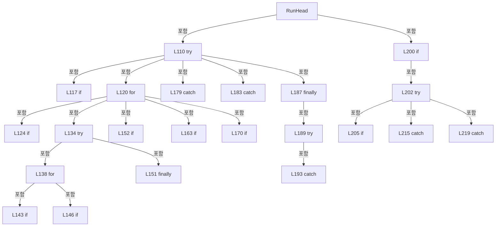

변경 전 점검: 입력/반환 타입, 위 호출자, 예외/취소 경로, 공유 상태와 저장·전송 소비자를 함께 확인합니다. 값의 단위나 물리 방향을 이름만으로 확정하지 않습니다.

### LocalFunctionStatement `State` · L227–227

[Drilling.Common/Interface/CPowerMeasureService.cs:227–227](https://github.com/kjuws10-rgb/A3Drilling/blob/5aee8e58439c9b455cae7c9593c9be986c3e682e/Drilling.Common/Interface/CPowerMeasureService.cs#L227-L227)

| 항목 | 실제 추출 값 |
| --- | --- |
| 서명 | void State(string, string) |
| 접근/수식자 | Private /  |
| 반환/값 타입 | void |
| 소속 타입 | NamedType:Drilling.Common.Interface.CPowerMeasureService |

입력 계약:

| 이름 | 타입 | 전달 | 선택/기본값 |
| --- | --- | --- | --- |
| state | string | None | False /  |
| message | string | None | False /  |

정적 호출자로 확인된 위치:

| 호출 파일/행 | 호출 표현식 | 런타임 분기 가능 |
| --- | --- | --- |
| [Drilling.Common/Interface/CPowerMeasureService.cs:113–113](https://github.com/kjuws10-rgb/A3Drilling/blob/5aee8e58439c9b455cae7c9593c9be986c3e682e/Drilling.Common/Interface/CPowerMeasureService.cs#L113-L113) | State | False |
| [Drilling.Common/Interface/CPowerMeasureService.cs:126–126](https://github.com/kjuws10-rgb/A3Drilling/blob/5aee8e58439c9b455cae7c9593c9be986c3e682e/Drilling.Common/Interface/CPowerMeasureService.cs#L126-L126) | State | False |
| [Drilling.Common/Interface/CPowerMeasureService.cs:136–136](https://github.com/kjuws10-rgb/A3Drilling/blob/5aee8e58439c9b455cae7c9593c9be986c3e682e/Drilling.Common/Interface/CPowerMeasureService.cs#L136-L136) | State | False |
| [Drilling.Common/Interface/CPowerMeasureService.cs:141–141](https://github.com/kjuws10-rgb/A3Drilling/blob/5aee8e58439c9b455cae7c9593c9be986c3e682e/Drilling.Common/Interface/CPowerMeasureService.cs#L141-L141) | State | False |
| [Drilling.Common/Interface/CPowerMeasureService.cs:154–154](https://github.com/kjuws10-rgb/A3Drilling/blob/5aee8e58439c9b455cae7c9593c9be986c3e682e/Drilling.Common/Interface/CPowerMeasureService.cs#L154-L154) | State | False |
| [Drilling.Common/Interface/CPowerMeasureService.cs:166–166](https://github.com/kjuws10-rgb/A3Drilling/blob/5aee8e58439c9b455cae7c9593c9be986c3e682e/Drilling.Common/Interface/CPowerMeasureService.cs#L166-L166) | State | False |
| [Drilling.Common/Interface/CPowerMeasureService.cs:172–172](https://github.com/kjuws10-rgb/A3Drilling/blob/5aee8e58439c9b455cae7c9593c9be986c3e682e/Drilling.Common/Interface/CPowerMeasureService.cs#L172-L172) | State | False |
| [Drilling.Common/Interface/CPowerMeasureService.cs:181–181](https://github.com/kjuws10-rgb/A3Drilling/blob/5aee8e58439c9b455cae7c9593c9be986c3e682e/Drilling.Common/Interface/CPowerMeasureService.cs#L181-L181) | State | False |
| [Drilling.Common/Interface/CPowerMeasureService.cs:185–185](https://github.com/kjuws10-rgb/A3Drilling/blob/5aee8e58439c9b455cae7c9593c9be986c3e682e/Drilling.Common/Interface/CPowerMeasureService.cs#L185-L185) | State | False |
| [Drilling.Common/Interface/CPowerMeasureService.cs:195–195](https://github.com/kjuws10-rgb/A3Drilling/blob/5aee8e58439c9b455cae7c9593c9be986c3e682e/Drilling.Common/Interface/CPowerMeasureService.cs#L195-L195) | State | False |
| [Drilling.Common/Interface/CPowerMeasureService.cs:207–207](https://github.com/kjuws10-rgb/A3Drilling/blob/5aee8e58439c9b455cae7c9593c9be986c3e682e/Drilling.Common/Interface/CPowerMeasureService.cs#L207-L207) | State | False |
| [Drilling.Common/Interface/CPowerMeasureService.cs:213–213](https://github.com/kjuws10-rgb/A3Drilling/blob/5aee8e58439c9b455cae7c9593c9be986c3e682e/Drilling.Common/Interface/CPowerMeasureService.cs#L213-L213) | State | False |
| [Drilling.Common/Interface/CPowerMeasureService.cs:217–217](https://github.com/kjuws10-rgb/A3Drilling/blob/5aee8e58439c9b455cae7c9593c9be986c3e682e/Drilling.Common/Interface/CPowerMeasureService.cs#L217-L217) | State | False |
| [Drilling.Common/Interface/CPowerMeasureService.cs:222–222](https://github.com/kjuws10-rgb/A3Drilling/blob/5aee8e58439c9b455cae7c9593c9be986c3e682e/Drilling.Common/Interface/CPowerMeasureService.cs#L222-L222) | State | False |

호출하는 대상과 해석 범위:

| 원본 행 | 표현식 | 분석 상태 | 대상/소스 위치 |
| --- | --- | --- | --- |
| 227 | Update | resolved | void Drilling.Common.Interface.CPowerMeasureService.Update(int, System.Func<Drilling.Common.Interface.ST_POWER_MEASURE_HEAD, Drilling.Common.Interface.ST_POWER_MEASURE_HEAD>) · Drilling.Common/Interface/CPowerMeasureService.cs:260 |

본문의 실제 연산·분기·예외·반환 순서(원문 위치 순):

| 원본 행 | 종류 | 주석 해설 |
| --- | --- | --- |
| 227 | assignment | 값을 대상에 대입합니다: State = state |
| 227 | assignment | 값을 대상에 대입합니다: Message = message |
| 227 | call | 함수·델리게이트 또는 객체 생성자를 호출합니다: Update(target.HeadNo, h => h with { State = state, Message = message }) |

변경 전 점검: 입력/반환 타입, 위 호출자, 예외/취소 경로, 공유 상태와 저장·전송 소비자를 함께 확인합니다. 값의 단위나 물리 방향을 이름만으로 확정하지 않습니다.

### MethodDeclaration `NextAngle` · L230–258

[Drilling.Common/Interface/CPowerMeasureService.cs:230–258](https://github.com/kjuws10-rgb/A3Drilling/blob/5aee8e58439c9b455cae7c9593c9be986c3e682e/Drilling.Common/Interface/CPowerMeasureService.cs#L230-L258)

| 항목 | 실제 추출 값 |
| --- | --- |
| 서명 | double Drilling.Common.Interface.CPowerMeasureService.NextAngle(System.Collections.Generic.List<Drilling.Common.Interface.ST_POWER_MEASURE_SAMPLE>, double) |
| 접근/수식자 | Private / private, static |
| 반환/값 타입 | double |
| 소속 타입 | NamedType:Drilling.Common.Interface.CPowerMeasureService |

입력 계약:

| 이름 | 타입 | 전달 | 선택/기본값 |
| --- | --- | --- | --- |
| samples | System.Collections.Generic.List<Drilling.Common.Interface.ST_POWER_MEASURE_SAMPLE> | None | False /  |
| target | double | None | False /  |

정적 호출자로 확인된 위치:

| 호출 파일/행 | 호출 표현식 | 런타임 분기 가능 |
| --- | --- | --- |
| [Drilling.Common/Interface/CPowerMeasureService.cs:176–176](https://github.com/kjuws10-rgb/A3Drilling/blob/5aee8e58439c9b455cae7c9593c9be986c3e682e/Drilling.Common/Interface/CPowerMeasureService.cs#L176-L176) | NextAngle | False |

호출하는 대상과 해석 범위:

| 원본 행 | 표현식 | 분석 상태 | 대상/소스 위치 |
| --- | --- | --- | --- |
| 232 | samples.Where(s => s.Power < target).OrderByDescending(s => s.Power).FirstOrDefault | resolved | Drilling.Common.Interface.ST_POWER_MEASURE_SAMPLE? System.Collections.Generic.IEnumerable<Drilling.Common.Interface.ST_POWER_MEASURE_SAMPLE>.FirstOrDefault<Drilling.Common.Interface.ST_POWER_MEASURE_SAMPLE>() |
| 232 | samples.Where(s => s.Power < target).OrderByDescending | resolved | System.Linq.IOrderedEnumerable<Drilling.Common.Interface.ST_POWER_MEASURE_SAMPLE> System.Collections.Generic.IEnumerable<Drilling.Common.Interface.ST_POWER_MEASURE_SAMPLE>.OrderByDescending<Drilling.Common.Interface.ST_POWER_MEASURE_SAMPLE, double>(System.Func<Drilling.Common.Interface.ST_POWER_MEASURE_SAMPLE, double>) |
| 232 | samples.Where | resolved | System.Collections.Generic.IEnumerable<Drilling.Common.Interface.ST_POWER_MEASURE_SAMPLE> System.Collections.Generic.IEnumerable<Drilling.Common.Interface.ST_POWER_MEASURE_SAMPLE>.Where<Drilling.Common.Interface.ST_POWER_MEASURE_SAMPLE>(System.Func<Drilling.Common.Interface.ST_POWER_MEASURE_SAMPLE, bool>) |
| 233 | samples.Where(s => s.Power > target).OrderBy(s => s.Power).FirstOrDefault | resolved | Drilling.Common.Interface.ST_POWER_MEASURE_SAMPLE? System.Collections.Generic.IEnumerable<Drilling.Common.Interface.ST_POWER_MEASURE_SAMPLE>.FirstOrDefault<Drilling.Common.Interface.ST_POWER_MEASURE_SAMPLE>() |
| 233 | samples.Where(s => s.Power > target).OrderBy | resolved | System.Linq.IOrderedEnumerable<Drilling.Common.Interface.ST_POWER_MEASURE_SAMPLE> System.Collections.Generic.IEnumerable<Drilling.Common.Interface.ST_POWER_MEASURE_SAMPLE>.OrderBy<Drilling.Common.Interface.ST_POWER_MEASURE_SAMPLE, double>(System.Func<Drilling.Common.Interface.ST_POWER_MEASURE_SAMPLE, double>) |
| 233 | samples.Where | resolved | System.Collections.Generic.IEnumerable<Drilling.Common.Interface.ST_POWER_MEASURE_SAMPLE> System.Collections.Generic.IEnumerable<Drilling.Common.Interface.ST_POWER_MEASURE_SAMPLE>.Where<Drilling.Common.Interface.ST_POWER_MEASURE_SAMPLE>(System.Func<Drilling.Common.Interface.ST_POWER_MEASURE_SAMPLE, bool>) |
| 235 | Math.Clamp | resolved | double System.Math.Clamp(double, double, double) |
| 236 | samples.MinBy | resolved | Drilling.Common.Interface.ST_POWER_MEASURE_SAMPLE? System.Collections.Generic.IEnumerable<Drilling.Common.Interface.ST_POWER_MEASURE_SAMPLE>.MinBy<Drilling.Common.Interface.ST_POWER_MEASURE_SAMPLE, double>(System.Func<Drilling.Common.Interface.ST_POWER_MEASURE_SAMPLE, double>) |
| 236 | Math.Abs | resolved | double System.Math.Abs(double) |
| 237 | samples.Where(s => s.Angle != best.Angle && Math.Abs(s.Power - best.Power) > 1e-9).MinBy | resolved | Drilling.Common.Interface.ST_POWER_MEASURE_SAMPLE? System.Collections.Generic.IEnumerable<Drilling.Common.Interface.ST_POWER_MEASURE_SAMPLE>.MinBy<Drilling.Common.Interface.ST_POWER_MEASURE_SAMPLE, double>(System.Func<Drilling.Common.Interface.ST_POWER_MEASURE_SAMPLE, double>) |
| 237 | samples.Where | resolved | System.Collections.Generic.IEnumerable<Drilling.Common.Interface.ST_POWER_MEASURE_SAMPLE> System.Collections.Generic.IEnumerable<Drilling.Common.Interface.ST_POWER_MEASURE_SAMPLE>.Where<Drilling.Common.Interface.ST_POWER_MEASURE_SAMPLE>(System.Func<Drilling.Common.Interface.ST_POWER_MEASURE_SAMPLE, bool>) |
| 237 | Math.Abs | resolved | double System.Math.Abs(double) |
| 237 | Math.Abs | resolved | double System.Math.Abs(double) |
| 241 | Math.Clamp | resolved | double System.Math.Clamp(double, double, double) |
| 242 | double.IsFinite | resolved | bool double.IsFinite(double) |
| 242 | samples.All | resolved | bool System.Collections.Generic.IEnumerable<Drilling.Common.Interface.ST_POWER_MEASURE_SAMPLE>.All<Drilling.Common.Interface.ST_POWER_MEASURE_SAMPLE>(System.Func<Drilling.Common.Interface.ST_POWER_MEASURE_SAMPLE, bool>) |
| 242 | Math.Abs | resolved | double System.Math.Abs(double) |
| 250 | Math.Clamp | resolved | double System.Math.Clamp(double, double, double) |
| 251 | Math.Clamp | resolved | double System.Math.Clamp(double, double, double) |
| 255 | samples.All | resolved | bool System.Collections.Generic.IEnumerable<Drilling.Common.Interface.ST_POWER_MEASURE_SAMPLE>.All<Drilling.Common.Interface.ST_POWER_MEASURE_SAMPLE>(System.Func<Drilling.Common.Interface.ST_POWER_MEASURE_SAMPLE, bool>) |
| 255 | Math.Abs | resolved | double System.Math.Abs(double) |

본문의 실제 연산·분기·예외·반환 순서(원문 위치 순):

| 원본 행 | 종류 | 주석 해설 |
| --- | --- | --- |
| 232 | call | 함수·델리게이트 또는 객체 생성자를 호출합니다: samples.Where(s => s.Power < target).OrderByDescending(s => s.Power).FirstOrDefault() |
| 232 | call | 함수·델리게이트 또는 객체 생성자를 호출합니다: samples.Where(s => s.Power < target).OrderByDescending(s => s.Power) |
| 232 | call | 함수·델리게이트 또는 객체 생성자를 호출합니다: samples.Where(s => s.Power < target) |
| 232 | local-declaration | 지역 변수를 선언합니다: var below = samples.Where(s => s.Power < target).OrderByDescending(s => s.Power).FirstOrDefault(); |
| 232 | variable-initializer | 변수의 초기값을 지정합니다: below = samples.Where(s => s.Power < target).OrderByDescending(s => s.Power).FirstOrDefault() |
| 233 | call | 함수·델리게이트 또는 객체 생성자를 호출합니다: samples.Where(s => s.Power > target).OrderBy(s => s.Power).FirstOrDefault() |
| 233 | call | 함수·델리게이트 또는 객체 생성자를 호출합니다: samples.Where(s => s.Power > target).OrderBy(s => s.Power) |
| 233 | call | 함수·델리게이트 또는 객체 생성자를 호출합니다: samples.Where(s => s.Power > target) |
| 233 | local-declaration | 지역 변수를 선언합니다: var above = samples.Where(s => s.Power > target).OrderBy(s => s.Power).FirstOrDefault(); |
| 233 | variable-initializer | 변수의 초기값을 지정합니다: above = samples.Where(s => s.Power > target).OrderBy(s => s.Power).FirstOrDefault() |
| 234 | if | 조건에 따라 분기합니다: if (below is not null && above is not null) |
| 235 | call | 함수·델리게이트 또는 객체 생성자를 호출합니다: Math.Clamp(below.Angle + (target - below.Power) * (above.Angle - below.Angle) / (above.Power - below.Power), 0, 360) |
| 235 | return | 호출자에게 값 또는 제어를 반환합니다: return Math.Clamp(below.Angle + (target - below.Power) * (above.Angle - below.Angle) / (above.Power - below.Power), 0, 360); |
| 236 | call | 함수·델리게이트 또는 객체 생성자를 호출합니다: samples.MinBy(s => Math.Abs(s.Error)) |
| 236 | call | 함수·델리게이트 또는 객체 생성자를 호출합니다: Math.Abs(s.Error) |
| 236 | local-declaration | 지역 변수를 선언합니다: var best = samples.MinBy(s => Math.Abs(s.Error))!; |
| 236 | variable-initializer | 변수의 초기값을 지정합니다: best = samples.MinBy(s => Math.Abs(s.Error))! |
| 237 | call | 함수·델리게이트 또는 객체 생성자를 호출합니다: samples.Where(s => s.Angle != best.Angle && Math.Abs(s.Power - best.Power) > 1e-9).MinBy(s => Math.Abs(s.Angle - best.Angle)) |
| 237 | call | 함수·델리게이트 또는 객체 생성자를 호출합니다: samples.Where(s => s.Angle != best.Angle && Math.Abs(s.Power - best.Power) > 1e-9) |
| 237 | call | 함수·델리게이트 또는 객체 생성자를 호출합니다: Math.Abs(s.Power - best.Power) |
| 237 | call | 함수·델리게이트 또는 객체 생성자를 호출합니다: Math.Abs(s.Angle - best.Angle) |
| 237 | local-declaration | 지역 변수를 선언합니다: var other = samples.Where(s => s.Angle != best.Angle && Math.Abs(s.Power - best.Power) > 1e-9).MinBy(s => Math.Abs(s.Angle - best.Angle)); |
| 237 | variable-initializer | 변수의 초기값을 지정합니다: other = samples.Where(s => s.Angle != best.Angle && Math.Abs(s.Power - best.Power) > 1e-9).MinBy(s => Math.Abs(s.Angle - best.Angle)) |
| 238 | if | 조건에 따라 분기합니다: if (other is not null) |
| 241 | call | 함수·델리게이트 또는 객체 생성자를 호출합니다: Math.Clamp(best.Angle + (target - best.Power) * (other.Angle - best.Angle) / (other.Power - best.Power), 0, 360) |
| 241 | local-declaration | 지역 변수를 선언합니다: var estimate = Math.Clamp(best.Angle + (target - best.Power) * (other.Angle - best.Angle) / (other.Power - best.Power), 0, 360); |
| 241 | variable-initializer | 변수의 초기값을 지정합니다: estimate = Math.Clamp(best.Angle + (target - best.Power) * (other.Angle - best.Angle) / (other.Power - best.Power), 0, 360) |
| 242 | call | 함수·델리게이트 또는 객체 생성자를 호출합니다: double.IsFinite(estimate) |
| 242 | call | 함수·델리게이트 또는 객체 생성자를 호출합니다: samples.All(s => Math.Abs(s.Angle - estimate) > 0.000001) |
| 242 | call | 함수·델리게이트 또는 객체 생성자를 호출합니다: Math.Abs(s.Angle - estimate) |
| 242 | if | 조건에 따라 분기합니다: if (double.IsFinite(estimate) && samples.All(s => Math.Abs(s.Angle - estimate) > 0.000001)) |
| 243 | return | 호출자에게 값 또는 제어를 반환합니다: return estimate; |
| 247 | assignment | 값을 대상에 대입합니다: step *= 2 |
| 247 | variable-initializer | 변수의 초기값을 지정합니다: step = 10.0 |
| 247 | for | 초기화·조건·증감이 있는 반복입니다: for (var step = 10.0; step <= 640; step *= 2) |
| 248 | foreach | 컬렉션 요소를 순회합니다: foreach (var candidate in new[] { Math.Clamp(best.Angle + step, 0, 360), Math.Clamp(best.Angle - step, 0, 360) }) |
| 250 | call | 함수·델리게이트 또는 객체 생성자를 호출합니다: Math.Clamp(best.Angle + step, 0, 360) |
| 251 | call | 함수·델리게이트 또는 객체 생성자를 호출합니다: Math.Clamp(best.Angle - step, 0, 360) |
| 255 | call | 함수·델리게이트 또는 객체 생성자를 호출합니다: samples.All(s => Math.Abs(s.Angle - candidate) > 0.000001) |
| 255 | call | 함수·델리게이트 또는 객체 생성자를 호출합니다: Math.Abs(s.Angle - candidate) |
| 255 | if | 조건에 따라 분기합니다: if (samples.All(s => Math.Abs(s.Angle - candidate) > 0.000001)) |
| 256 | return | 호출자에게 값 또는 제어를 반환합니다: return candidate; |
| 257 | return | 호출자에게 값 또는 제어를 반환합니다: return best.Angle; |

제어 구문의 포함 구조(실제 실행 순서/CFG가 아닌 구문 탐색 그림):

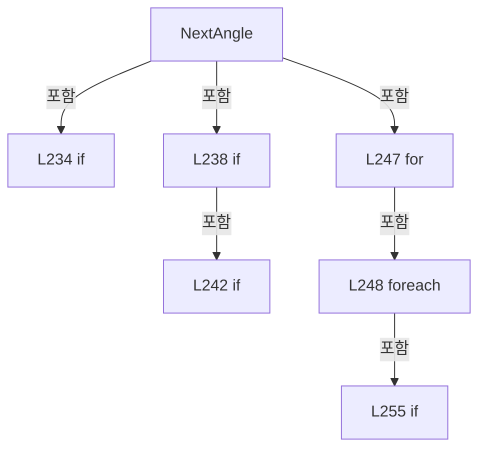

변경 전 점검: 입력/반환 타입, 위 호출자, 예외/취소 경로, 공유 상태와 저장·전송 소비자를 함께 확인합니다. 값의 단위나 물리 방향을 이름만으로 확정하지 않습니다.

### MethodDeclaration `Update` · L260–264

[Drilling.Common/Interface/CPowerMeasureService.cs:260–264](https://github.com/kjuws10-rgb/A3Drilling/blob/5aee8e58439c9b455cae7c9593c9be986c3e682e/Drilling.Common/Interface/CPowerMeasureService.cs#L260-L264)

| 항목 | 실제 추출 값 |
| --- | --- |
| 서명 | void Drilling.Common.Interface.CPowerMeasureService.Update(int, System.Func<Drilling.Common.Interface.ST_POWER_MEASURE_HEAD, Drilling.Common.Interface.ST_POWER_MEASURE_HEAD>) |
| 접근/수식자 | Private / private |
| 반환/값 타입 | void |
| 소속 타입 | NamedType:Drilling.Common.Interface.CPowerMeasureService |

입력 계약:

| 이름 | 타입 | 전달 | 선택/기본값 |
| --- | --- | --- | --- |
| headNo | int | None | False /  |
| update | System.Func<Drilling.Common.Interface.ST_POWER_MEASURE_HEAD, Drilling.Common.Interface.ST_POWER_MEASURE_HEAD> | None | False /  |

정적 호출자로 확인된 위치:

| 호출 파일/행 | 호출 표현식 | 런타임 분기 가능 |
| --- | --- | --- |
| [Drilling.Common/Interface/CPowerMeasureService.cs:119–119](https://github.com/kjuws10-rgb/A3Drilling/blob/5aee8e58439c9b455cae7c9593c9be986c3e682e/Drilling.Common/Interface/CPowerMeasureService.cs#L119-L119) | Update | False |
| [Drilling.Common/Interface/CPowerMeasureService.cs:131–131](https://github.com/kjuws10-rgb/A3Drilling/blob/5aee8e58439c9b455cae7c9593c9be986c3e682e/Drilling.Common/Interface/CPowerMeasureService.cs#L131-L131) | Update | False |
| [Drilling.Common/Interface/CPowerMeasureService.cs:161–161](https://github.com/kjuws10-rgb/A3Drilling/blob/5aee8e58439c9b455cae7c9593c9be986c3e682e/Drilling.Common/Interface/CPowerMeasureService.cs#L161-L161) | Update | False |
| [Drilling.Common/Interface/CPowerMeasureService.cs:210–210](https://github.com/kjuws10-rgb/A3Drilling/blob/5aee8e58439c9b455cae7c9593c9be986c3e682e/Drilling.Common/Interface/CPowerMeasureService.cs#L210-L210) | Update | False |
| [Drilling.Common/Interface/CPowerMeasureService.cs:221–221](https://github.com/kjuws10-rgb/A3Drilling/blob/5aee8e58439c9b455cae7c9593c9be986c3e682e/Drilling.Common/Interface/CPowerMeasureService.cs#L221-L221) | Update | False |
| [Drilling.Common/Interface/CPowerMeasureService.cs:227–227](https://github.com/kjuws10-rgb/A3Drilling/blob/5aee8e58439c9b455cae7c9593c9be986c3e682e/Drilling.Common/Interface/CPowerMeasureService.cs#L227-L227) | Update | False |

호출하는 대상과 해석 범위:

| 원본 행 | 표현식 | 분석 상태 | 대상/소스 위치 |
| --- | --- | --- | --- |
| 263 | update | resolved · 동적 구현 선택 가능 | Drilling.Common.Interface.ST_POWER_MEASURE_HEAD System.Func<Drilling.Common.Interface.ST_POWER_MEASURE_HEAD, Drilling.Common.Interface.ST_POWER_MEASURE_HEAD>.Invoke(Drilling.Common.Interface.ST_POWER_MEASURE_HEAD) |

본문의 실제 연산·분기·예외·반환 순서(원문 위치 순):

| 원본 행 | 종류 | 주석 해설 |
| --- | --- | --- |
| 262 | lock | 공유 상태의 임계 구역에 진입합니다: lock (_sync) |
| 263 | assignment | 값을 대상에 대입합니다: _heads[headNo] = update(_heads[headNo]) |
| 263 | call | 함수·델리게이트 또는 객체 생성자를 호출합니다: update(_heads[headNo]) |

제어 구문의 포함 구조(실제 실행 순서/CFG가 아닌 구문 탐색 그림):

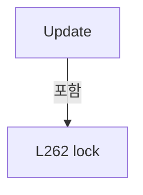

변경 전 점검: 입력/반환 타입, 위 호출자, 예외/취소 경로, 공유 상태와 저장·전송 소비자를 함께 확인합니다. 값의 단위나 물리 방향을 이름만으로 확정하지 않습니다.

### PropertyDeclaration `ToleranceW` · L270–270

[Drilling.Common/Interface/CPowerMeasureService.cs:270–270](https://github.com/kjuws10-rgb/A3Drilling/blob/5aee8e58439c9b455cae7c9593c9be986c3e682e/Drilling.Common/Interface/CPowerMeasureService.cs#L270-L270)

| 항목 | 실제 추출 값 |
| --- | --- |
| 서명 | double? Drilling.Common.Interface.ST_POWER_MEASURE_OPTIONS.ToleranceW |
| 접근/수식자 | Public / public |
| 반환/값 타입 | double? |
| 소속 타입 | NamedType:Drilling.Common.Interface.ST_POWER_MEASURE_OPTIONS |

현재 부분 분석에서 직접 연결된 호출자는 없습니다. XAML/이벤트/인터페이스·델리게이트·외부 진입을 추가 확인해야 하며, 미사용으로 판정한 것이 아닙니다.

변경 전 점검: 입력/반환 타입, 위 호출자, 예외/취소 경로, 공유 상태와 저장·전송 소비자를 함께 확인합니다. 값의 단위나 물리 방향을 이름만으로 확정하지 않습니다.

### GetAccessorDeclaration `get_ToleranceW` · L270–270

[Drilling.Common/Interface/CPowerMeasureService.cs:270–270](https://github.com/kjuws10-rgb/A3Drilling/blob/5aee8e58439c9b455cae7c9593c9be986c3e682e/Drilling.Common/Interface/CPowerMeasureService.cs#L270-L270)

| 항목 | 실제 추출 값 |
| --- | --- |
| 서명 | double? Drilling.Common.Interface.ST_POWER_MEASURE_OPTIONS.ToleranceW.get |
| 접근/수식자 | Public / get |
| 반환/값 타입 | double? |
| 소속 타입 | NamedType:Drilling.Common.Interface.ST_POWER_MEASURE_OPTIONS |

현재 부분 분석에서 직접 연결된 호출자는 없습니다. XAML/이벤트/인터페이스·델리게이트·외부 진입을 추가 확인해야 하며, 미사용으로 판정한 것이 아닙니다.

변경 전 점검: 입력/반환 타입, 위 호출자, 예외/취소 경로, 공유 상태와 저장·전송 소비자를 함께 확인합니다. 값의 단위나 물리 방향을 이름만으로 확정하지 않습니다.

### InitAccessorDeclaration `set_ToleranceW` · L270–270

[Drilling.Common/Interface/CPowerMeasureService.cs:270–270](https://github.com/kjuws10-rgb/A3Drilling/blob/5aee8e58439c9b455cae7c9593c9be986c3e682e/Drilling.Common/Interface/CPowerMeasureService.cs#L270-L270)

| 항목 | 실제 추출 값 |
| --- | --- |
| 서명 | void Drilling.Common.Interface.ST_POWER_MEASURE_OPTIONS.ToleranceW.init |
| 접근/수식자 | Public / init |
| 반환/값 타입 | void |
| 소속 타입 | NamedType:Drilling.Common.Interface.ST_POWER_MEASURE_OPTIONS |

입력 계약:

| 이름 | 타입 | 전달 | 선택/기본값 |
| --- | --- | --- | --- |
| value | double? | None | False /  |

현재 부분 분석에서 직접 연결된 호출자는 없습니다. XAML/이벤트/인터페이스·델리게이트·외부 진입을 추가 확인해야 하며, 미사용으로 판정한 것이 아닙니다.

변경 전 점검: 입력/반환 타입, 위 호출자, 예외/취소 경로, 공유 상태와 저장·전송 소비자를 함께 확인합니다. 값의 단위나 물리 방향을 이름만으로 확정하지 않습니다.

### PropertyDeclaration `MaximumAttempts` · L271–271

[Drilling.Common/Interface/CPowerMeasureService.cs:271–271](https://github.com/kjuws10-rgb/A3Drilling/blob/5aee8e58439c9b455cae7c9593c9be986c3e682e/Drilling.Common/Interface/CPowerMeasureService.cs#L271-L271)

| 항목 | 실제 추출 값 |
| --- | --- |
| 서명 | int? Drilling.Common.Interface.ST_POWER_MEASURE_OPTIONS.MaximumAttempts |
| 접근/수식자 | Public / public |
| 반환/값 타입 | int? |
| 소속 타입 | NamedType:Drilling.Common.Interface.ST_POWER_MEASURE_OPTIONS |

현재 부분 분석에서 직접 연결된 호출자는 없습니다. XAML/이벤트/인터페이스·델리게이트·외부 진입을 추가 확인해야 하며, 미사용으로 판정한 것이 아닙니다.

변경 전 점검: 입력/반환 타입, 위 호출자, 예외/취소 경로, 공유 상태와 저장·전송 소비자를 함께 확인합니다. 값의 단위나 물리 방향을 이름만으로 확정하지 않습니다.

### GetAccessorDeclaration `get_MaximumAttempts` · L271–271

[Drilling.Common/Interface/CPowerMeasureService.cs:271–271](https://github.com/kjuws10-rgb/A3Drilling/blob/5aee8e58439c9b455cae7c9593c9be986c3e682e/Drilling.Common/Interface/CPowerMeasureService.cs#L271-L271)

| 항목 | 실제 추출 값 |
| --- | --- |
| 서명 | int? Drilling.Common.Interface.ST_POWER_MEASURE_OPTIONS.MaximumAttempts.get |
| 접근/수식자 | Public / get |
| 반환/값 타입 | int? |
| 소속 타입 | NamedType:Drilling.Common.Interface.ST_POWER_MEASURE_OPTIONS |

현재 부분 분석에서 직접 연결된 호출자는 없습니다. XAML/이벤트/인터페이스·델리게이트·외부 진입을 추가 확인해야 하며, 미사용으로 판정한 것이 아닙니다.

변경 전 점검: 입력/반환 타입, 위 호출자, 예외/취소 경로, 공유 상태와 저장·전송 소비자를 함께 확인합니다. 값의 단위나 물리 방향을 이름만으로 확정하지 않습니다.

### InitAccessorDeclaration `set_MaximumAttempts` · L271–271

[Drilling.Common/Interface/CPowerMeasureService.cs:271–271](https://github.com/kjuws10-rgb/A3Drilling/blob/5aee8e58439c9b455cae7c9593c9be986c3e682e/Drilling.Common/Interface/CPowerMeasureService.cs#L271-L271)

| 항목 | 실제 추출 값 |
| --- | --- |
| 서명 | void Drilling.Common.Interface.ST_POWER_MEASURE_OPTIONS.MaximumAttempts.init |
| 접근/수식자 | Public / init |
| 반환/값 타입 | void |
| 소속 타입 | NamedType:Drilling.Common.Interface.ST_POWER_MEASURE_OPTIONS |

입력 계약:

| 이름 | 타입 | 전달 | 선택/기본값 |
| --- | --- | --- | --- |
| value | int? | None | False /  |

현재 부분 분석에서 직접 연결된 호출자는 없습니다. XAML/이벤트/인터페이스·델리게이트·외부 진입을 추가 확인해야 하며, 미사용으로 판정한 것이 아닙니다.

변경 전 점검: 입력/반환 타입, 위 호출자, 예외/취소 경로, 공유 상태와 저장·전송 소비자를 함께 확인합니다. 값의 단위나 물리 방향을 이름만으로 확정하지 않습니다.

### PropertyDeclaration `CoolingTimeMs` · L272–272

[Drilling.Common/Interface/CPowerMeasureService.cs:272–272](https://github.com/kjuws10-rgb/A3Drilling/blob/5aee8e58439c9b455cae7c9593c9be986c3e682e/Drilling.Common/Interface/CPowerMeasureService.cs#L272-L272)

| 항목 | 실제 추출 값 |
| --- | --- |
| 서명 | int Drilling.Common.Interface.ST_POWER_MEASURE_OPTIONS.CoolingTimeMs |
| 접근/수식자 | Public / public |
| 반환/값 타입 | int |
| 소속 타입 | NamedType:Drilling.Common.Interface.ST_POWER_MEASURE_OPTIONS |

현재 부분 분석에서 직접 연결된 호출자는 없습니다. XAML/이벤트/인터페이스·델리게이트·외부 진입을 추가 확인해야 하며, 미사용으로 판정한 것이 아닙니다.

변경 전 점검: 입력/반환 타입, 위 호출자, 예외/취소 경로, 공유 상태와 저장·전송 소비자를 함께 확인합니다. 값의 단위나 물리 방향을 이름만으로 확정하지 않습니다.

### GetAccessorDeclaration `get_CoolingTimeMs` · L272–272

[Drilling.Common/Interface/CPowerMeasureService.cs:272–272](https://github.com/kjuws10-rgb/A3Drilling/blob/5aee8e58439c9b455cae7c9593c9be986c3e682e/Drilling.Common/Interface/CPowerMeasureService.cs#L272-L272)

| 항목 | 실제 추출 값 |
| --- | --- |
| 서명 | int Drilling.Common.Interface.ST_POWER_MEASURE_OPTIONS.CoolingTimeMs.get |
| 접근/수식자 | Public / get |
| 반환/값 타입 | int |
| 소속 타입 | NamedType:Drilling.Common.Interface.ST_POWER_MEASURE_OPTIONS |

현재 부분 분석에서 직접 연결된 호출자는 없습니다. XAML/이벤트/인터페이스·델리게이트·외부 진입을 추가 확인해야 하며, 미사용으로 판정한 것이 아닙니다.

변경 전 점검: 입력/반환 타입, 위 호출자, 예외/취소 경로, 공유 상태와 저장·전송 소비자를 함께 확인합니다. 값의 단위나 물리 방향을 이름만으로 확정하지 않습니다.

### InitAccessorDeclaration `set_CoolingTimeMs` · L272–272

[Drilling.Common/Interface/CPowerMeasureService.cs:272–272](https://github.com/kjuws10-rgb/A3Drilling/blob/5aee8e58439c9b455cae7c9593c9be986c3e682e/Drilling.Common/Interface/CPowerMeasureService.cs#L272-L272)

| 항목 | 실제 추출 값 |
| --- | --- |
| 서명 | void Drilling.Common.Interface.ST_POWER_MEASURE_OPTIONS.CoolingTimeMs.init |
| 접근/수식자 | Public / init |
| 반환/값 타입 | void |
| 소속 타입 | NamedType:Drilling.Common.Interface.ST_POWER_MEASURE_OPTIONS |

입력 계약:

| 이름 | 타입 | 전달 | 선택/기본값 |
| --- | --- | --- | --- |
| value | int | None | False /  |

현재 부분 분석에서 직접 연결된 호출자는 없습니다. XAML/이벤트/인터페이스·델리게이트·외부 진입을 추가 확인해야 하며, 미사용으로 판정한 것이 아닙니다.

변경 전 점검: 입력/반환 타입, 위 호출자, 예외/취소 경로, 공유 상태와 저장·전송 소비자를 함께 확인합니다. 값의 단위나 물리 방향을 이름만으로 확정하지 않습니다.

### PropertyDeclaration `Tolerance` · L273–278

[Drilling.Common/Interface/CPowerMeasureService.cs:273–278](https://github.com/kjuws10-rgb/A3Drilling/blob/5aee8e58439c9b455cae7c9593c9be986c3e682e/Drilling.Common/Interface/CPowerMeasureService.cs#L273-L278)

| 항목 | 실제 추출 값 |
| --- | --- |
| 서명 | double Drilling.Common.Interface.ST_POWER_MEASURE_OPTIONS.Tolerance |
| 접근/수식자 | Public / public |
| 반환/값 타입 | double |
| 소속 타입 | NamedType:Drilling.Common.Interface.ST_POWER_MEASURE_OPTIONS |

현재 부분 분석에서 직접 연결된 호출자는 없습니다. XAML/이벤트/인터페이스·델리게이트·외부 진입을 추가 확인해야 하며, 미사용으로 판정한 것이 아닙니다.

본문의 실제 연산·분기·예외·반환 순서(원문 위치 순):

| 원본 행 | 종류 | 주석 해설 |
| --- | --- | --- |
| 273 | switch-expression | 값별 결과식을 선택합니다: Mode switch { "ROUGH" => 0.05, "DETAIL" => 0.003, _ => 0.01 } |

제어 구문의 포함 구조(실제 실행 순서/CFG가 아닌 구문 탐색 그림):

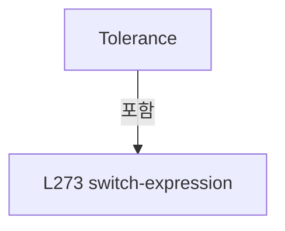

변경 전 점검: 입력/반환 타입, 위 호출자, 예외/취소 경로, 공유 상태와 저장·전송 소비자를 함께 확인합니다. 값의 단위나 물리 방향을 이름만으로 확정하지 않습니다.

### PropertyDeclaration `MaxAttempts` · L279–284

[Drilling.Common/Interface/CPowerMeasureService.cs:279–284](https://github.com/kjuws10-rgb/A3Drilling/blob/5aee8e58439c9b455cae7c9593c9be986c3e682e/Drilling.Common/Interface/CPowerMeasureService.cs#L279-L284)

| 항목 | 실제 추출 값 |
| --- | --- |
| 서명 | int Drilling.Common.Interface.ST_POWER_MEASURE_OPTIONS.MaxAttempts |
| 접근/수식자 | Public / public |
| 반환/값 타입 | int |
| 소속 타입 | NamedType:Drilling.Common.Interface.ST_POWER_MEASURE_OPTIONS |

현재 부분 분석에서 직접 연결된 호출자는 없습니다. XAML/이벤트/인터페이스·델리게이트·외부 진입을 추가 확인해야 하며, 미사용으로 판정한 것이 아닙니다.

본문의 실제 연산·분기·예외·반환 순서(원문 위치 순):

| 원본 행 | 종류 | 주석 해설 |
| --- | --- | --- |
| 279 | switch-expression | 값별 결과식을 선택합니다: Mode switch { "ROUGH" => 8, "DETAIL" => 18, _ => 12 } |

제어 구문의 포함 구조(실제 실행 순서/CFG가 아닌 구문 탐색 그림):

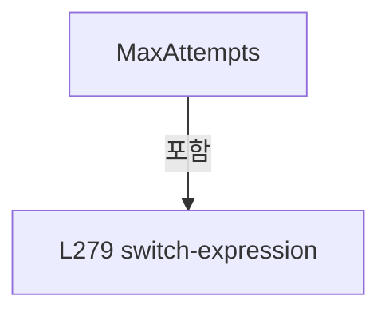

변경 전 점검: 입력/반환 타입, 위 호출자, 예외/취소 경로, 공유 상태와 저장·전송 소비자를 함께 확인합니다. 값의 단위나 물리 방향을 이름만으로 확정하지 않습니다.

### PropertyDeclaration `InitialAngle` · L290–290

[Drilling.Common/Interface/CPowerMeasureService.cs:290–290](https://github.com/kjuws10-rgb/A3Drilling/blob/5aee8e58439c9b455cae7c9593c9be986c3e682e/Drilling.Common/Interface/CPowerMeasureService.cs#L290-L290)

| 항목 | 실제 추출 값 |
| --- | --- |
| 서명 | double? Drilling.Common.Interface.ST_POWER_MEASURE_HEAD.InitialAngle |
| 접근/수식자 | Public / public |
| 반환/값 타입 | double? |
| 소속 타입 | NamedType:Drilling.Common.Interface.ST_POWER_MEASURE_HEAD |

현재 부분 분석에서 직접 연결된 호출자는 없습니다. XAML/이벤트/인터페이스·델리게이트·외부 진입을 추가 확인해야 하며, 미사용으로 판정한 것이 아닙니다.

변경 전 점검: 입력/반환 타입, 위 호출자, 예외/취소 경로, 공유 상태와 저장·전송 소비자를 함께 확인합니다. 값의 단위나 물리 방향을 이름만으로 확정하지 않습니다.

### GetAccessorDeclaration `get_InitialAngle` · L290–290

[Drilling.Common/Interface/CPowerMeasureService.cs:290–290](https://github.com/kjuws10-rgb/A3Drilling/blob/5aee8e58439c9b455cae7c9593c9be986c3e682e/Drilling.Common/Interface/CPowerMeasureService.cs#L290-L290)

| 항목 | 실제 추출 값 |
| --- | --- |
| 서명 | double? Drilling.Common.Interface.ST_POWER_MEASURE_HEAD.InitialAngle.get |
| 접근/수식자 | Public / get |
| 반환/값 타입 | double? |
| 소속 타입 | NamedType:Drilling.Common.Interface.ST_POWER_MEASURE_HEAD |

현재 부분 분석에서 직접 연결된 호출자는 없습니다. XAML/이벤트/인터페이스·델리게이트·외부 진입을 추가 확인해야 하며, 미사용으로 판정한 것이 아닙니다.

변경 전 점검: 입력/반환 타입, 위 호출자, 예외/취소 경로, 공유 상태와 저장·전송 소비자를 함께 확인합니다. 값의 단위나 물리 방향을 이름만으로 확정하지 않습니다.

### InitAccessorDeclaration `set_InitialAngle` · L290–290

[Drilling.Common/Interface/CPowerMeasureService.cs:290–290](https://github.com/kjuws10-rgb/A3Drilling/blob/5aee8e58439c9b455cae7c9593c9be986c3e682e/Drilling.Common/Interface/CPowerMeasureService.cs#L290-L290)

| 항목 | 실제 추출 값 |
| --- | --- |
| 서명 | void Drilling.Common.Interface.ST_POWER_MEASURE_HEAD.InitialAngle.init |
| 접근/수식자 | Public / init |
| 반환/값 타입 | void |
| 소속 타입 | NamedType:Drilling.Common.Interface.ST_POWER_MEASURE_HEAD |

입력 계약:

| 이름 | 타입 | 전달 | 선택/기본값 |
| --- | --- | --- | --- |
| value | double? | None | False /  |

현재 부분 분석에서 직접 연결된 호출자는 없습니다. XAML/이벤트/인터페이스·델리게이트·외부 진입을 추가 확인해야 하며, 미사용으로 판정한 것이 아닙니다.

변경 전 점검: 입력/반환 타입, 위 호출자, 예외/취소 경로, 공유 상태와 저장·전송 소비자를 함께 확인합니다. 값의 단위나 물리 방향을 이름만으로 확정하지 않습니다.

### PropertyDeclaration `StartDetail` · L291–291

[Drilling.Common/Interface/CPowerMeasureService.cs:291–291](https://github.com/kjuws10-rgb/A3Drilling/blob/5aee8e58439c9b455cae7c9593c9be986c3e682e/Drilling.Common/Interface/CPowerMeasureService.cs#L291-L291)

| 항목 | 실제 추출 값 |
| --- | --- |
| 서명 | string Drilling.Common.Interface.ST_POWER_MEASURE_HEAD.StartDetail |
| 접근/수식자 | Public / public |
| 반환/값 타입 | string |
| 소속 타입 | NamedType:Drilling.Common.Interface.ST_POWER_MEASURE_HEAD |

현재 부분 분석에서 직접 연결된 호출자는 없습니다. XAML/이벤트/인터페이스·델리게이트·외부 진입을 추가 확인해야 하며, 미사용으로 판정한 것이 아닙니다.

변경 전 점검: 입력/반환 타입, 위 호출자, 예외/취소 경로, 공유 상태와 저장·전송 소비자를 함께 확인합니다. 값의 단위나 물리 방향을 이름만으로 확정하지 않습니다.

### GetAccessorDeclaration `get_StartDetail` · L291–291

[Drilling.Common/Interface/CPowerMeasureService.cs:291–291](https://github.com/kjuws10-rgb/A3Drilling/blob/5aee8e58439c9b455cae7c9593c9be986c3e682e/Drilling.Common/Interface/CPowerMeasureService.cs#L291-L291)

| 항목 | 실제 추출 값 |
| --- | --- |
| 서명 | string Drilling.Common.Interface.ST_POWER_MEASURE_HEAD.StartDetail.get |
| 접근/수식자 | Public / get |
| 반환/값 타입 | string |
| 소속 타입 | NamedType:Drilling.Common.Interface.ST_POWER_MEASURE_HEAD |

현재 부분 분석에서 직접 연결된 호출자는 없습니다. XAML/이벤트/인터페이스·델리게이트·외부 진입을 추가 확인해야 하며, 미사용으로 판정한 것이 아닙니다.

변경 전 점검: 입력/반환 타입, 위 호출자, 예외/취소 경로, 공유 상태와 저장·전송 소비자를 함께 확인합니다. 값의 단위나 물리 방향을 이름만으로 확정하지 않습니다.

### InitAccessorDeclaration `set_StartDetail` · L291–291

[Drilling.Common/Interface/CPowerMeasureService.cs:291–291](https://github.com/kjuws10-rgb/A3Drilling/blob/5aee8e58439c9b455cae7c9593c9be986c3e682e/Drilling.Common/Interface/CPowerMeasureService.cs#L291-L291)

| 항목 | 실제 추출 값 |
| --- | --- |
| 서명 | void Drilling.Common.Interface.ST_POWER_MEASURE_HEAD.StartDetail.init |
| 접근/수식자 | Public / init |
| 반환/값 타입 | void |
| 소속 타입 | NamedType:Drilling.Common.Interface.ST_POWER_MEASURE_HEAD |

입력 계약:

| 이름 | 타입 | 전달 | 선택/기본값 |
| --- | --- | --- | --- |
| value | string | None | False /  |

현재 부분 분석에서 직접 연결된 호출자는 없습니다. XAML/이벤트/인터페이스·델리게이트·외부 진입을 추가 확인해야 하며, 미사용으로 판정한 것이 아닙니다.

변경 전 점검: 입력/반환 타입, 위 호출자, 예외/취소 경로, 공유 상태와 저장·전송 소비자를 함께 확인합니다. 값의 단위나 물리 방향을 이름만으로 확정하지 않습니다.

### PropertyDeclaration `TableState` · L292–292

[Drilling.Common/Interface/CPowerMeasureService.cs:292–292](https://github.com/kjuws10-rgb/A3Drilling/blob/5aee8e58439c9b455cae7c9593c9be986c3e682e/Drilling.Common/Interface/CPowerMeasureService.cs#L292-L292)

| 항목 | 실제 추출 값 |
| --- | --- |
| 서명 | string Drilling.Common.Interface.ST_POWER_MEASURE_HEAD.TableState |
| 접근/수식자 | Public / public |
| 반환/값 타입 | string |
| 소속 타입 | NamedType:Drilling.Common.Interface.ST_POWER_MEASURE_HEAD |

현재 부분 분석에서 직접 연결된 호출자는 없습니다. XAML/이벤트/인터페이스·델리게이트·외부 진입을 추가 확인해야 하며, 미사용으로 판정한 것이 아닙니다.

변경 전 점검: 입력/반환 타입, 위 호출자, 예외/취소 경로, 공유 상태와 저장·전송 소비자를 함께 확인합니다. 값의 단위나 물리 방향을 이름만으로 확정하지 않습니다.

### GetAccessorDeclaration `get_TableState` · L292–292

[Drilling.Common/Interface/CPowerMeasureService.cs:292–292](https://github.com/kjuws10-rgb/A3Drilling/blob/5aee8e58439c9b455cae7c9593c9be986c3e682e/Drilling.Common/Interface/CPowerMeasureService.cs#L292-L292)

| 항목 | 실제 추출 값 |
| --- | --- |
| 서명 | string Drilling.Common.Interface.ST_POWER_MEASURE_HEAD.TableState.get |
| 접근/수식자 | Public / get |
| 반환/값 타입 | string |
| 소속 타입 | NamedType:Drilling.Common.Interface.ST_POWER_MEASURE_HEAD |

현재 부분 분석에서 직접 연결된 호출자는 없습니다. XAML/이벤트/인터페이스·델리게이트·외부 진입을 추가 확인해야 하며, 미사용으로 판정한 것이 아닙니다.

변경 전 점검: 입력/반환 타입, 위 호출자, 예외/취소 경로, 공유 상태와 저장·전송 소비자를 함께 확인합니다. 값의 단위나 물리 방향을 이름만으로 확정하지 않습니다.

### InitAccessorDeclaration `set_TableState` · L292–292

[Drilling.Common/Interface/CPowerMeasureService.cs:292–292](https://github.com/kjuws10-rgb/A3Drilling/blob/5aee8e58439c9b455cae7c9593c9be986c3e682e/Drilling.Common/Interface/CPowerMeasureService.cs#L292-L292)

| 항목 | 실제 추출 값 |
| --- | --- |
| 서명 | void Drilling.Common.Interface.ST_POWER_MEASURE_HEAD.TableState.init |
| 접근/수식자 | Public / init |
| 반환/값 타입 | void |
| 소속 타입 | NamedType:Drilling.Common.Interface.ST_POWER_MEASURE_HEAD |

입력 계약:

| 이름 | 타입 | 전달 | 선택/기본값 |
| --- | --- | --- | --- |
| value | string | None | False /  |

현재 부분 분석에서 직접 연결된 호출자는 없습니다. XAML/이벤트/인터페이스·델리게이트·외부 진입을 추가 확인해야 하며, 미사용으로 판정한 것이 아닙니다.

변경 전 점검: 입력/반환 타입, 위 호출자, 예외/취소 경로, 공유 상태와 저장·전송 소비자를 함께 확인합니다. 값의 단위나 물리 방향을 이름만으로 확정하지 않습니다.

### PropertyDeclaration `Origin` · L297–297

[Drilling.Common/Interface/CPowerMeasureService.cs:297–297](https://github.com/kjuws10-rgb/A3Drilling/blob/5aee8e58439c9b455cae7c9593c9be986c3e682e/Drilling.Common/Interface/CPowerMeasureService.cs#L297-L297)

| 항목 | 실제 추출 값 |
| --- | --- |
| 서명 | string Drilling.Common.Interface.ST_POWER_MEASURE_SNAPSHOT.Origin |
| 접근/수식자 | Public / public |
| 반환/값 타입 | string |
| 소속 타입 | NamedType:Drilling.Common.Interface.ST_POWER_MEASURE_SNAPSHOT |

현재 부분 분석에서 직접 연결된 호출자는 없습니다. XAML/이벤트/인터페이스·델리게이트·외부 진입을 추가 확인해야 하며, 미사용으로 판정한 것이 아닙니다.

변경 전 점검: 입력/반환 타입, 위 호출자, 예외/취소 경로, 공유 상태와 저장·전송 소비자를 함께 확인합니다. 값의 단위나 물리 방향을 이름만으로 확정하지 않습니다.

### GetAccessorDeclaration `get_Origin` · L297–297

[Drilling.Common/Interface/CPowerMeasureService.cs:297–297](https://github.com/kjuws10-rgb/A3Drilling/blob/5aee8e58439c9b455cae7c9593c9be986c3e682e/Drilling.Common/Interface/CPowerMeasureService.cs#L297-L297)

| 항목 | 실제 추출 값 |
| --- | --- |
| 서명 | string Drilling.Common.Interface.ST_POWER_MEASURE_SNAPSHOT.Origin.get |
| 접근/수식자 | Public / get |
| 반환/값 타입 | string |
| 소속 타입 | NamedType:Drilling.Common.Interface.ST_POWER_MEASURE_SNAPSHOT |

현재 부분 분석에서 직접 연결된 호출자는 없습니다. XAML/이벤트/인터페이스·델리게이트·외부 진입을 추가 확인해야 하며, 미사용으로 판정한 것이 아닙니다.

변경 전 점검: 입력/반환 타입, 위 호출자, 예외/취소 경로, 공유 상태와 저장·전송 소비자를 함께 확인합니다. 값의 단위나 물리 방향을 이름만으로 확정하지 않습니다.

### InitAccessorDeclaration `set_Origin` · L297–297

[Drilling.Common/Interface/CPowerMeasureService.cs:297–297](https://github.com/kjuws10-rgb/A3Drilling/blob/5aee8e58439c9b455cae7c9593c9be986c3e682e/Drilling.Common/Interface/CPowerMeasureService.cs#L297-L297)

| 항목 | 실제 추출 값 |
| --- | --- |
| 서명 | void Drilling.Common.Interface.ST_POWER_MEASURE_SNAPSHOT.Origin.init |
| 접근/수식자 | Public / init |
| 반환/값 타입 | void |
| 소속 타입 | NamedType:Drilling.Common.Interface.ST_POWER_MEASURE_SNAPSHOT |

입력 계약:

| 이름 | 타입 | 전달 | 선택/기본값 |
| --- | --- | --- | --- |
| value | string | None | False /  |

현재 부분 분석에서 직접 연결된 호출자는 없습니다. XAML/이벤트/인터페이스·델리게이트·외부 진입을 추가 확인해야 하며, 미사용으로 판정한 것이 아닙니다.

변경 전 점검: 입력/반환 타입, 위 호출자, 예외/취소 경로, 공유 상태와 저장·전송 소비자를 함께 확인합니다. 값의 단위나 물리 방향을 이름만으로 확정하지 않습니다.

### MethodDeclaration `CheckStageReady` · L302–302

[Drilling.Common/Interface/CPowerMeasureService.cs:302–302](https://github.com/kjuws10-rgb/A3Drilling/blob/5aee8e58439c9b455cae7c9593c9be986c3e682e/Drilling.Common/Interface/CPowerMeasureService.cs#L302-L302)

| 항목 | 실제 추출 값 |
| --- | --- |
| 서명 | System.Threading.Tasks.Task Drilling.Common.Interface.IPowerMeasureSession.CheckStageReady(System.Threading.CancellationToken) |
| 접근/수식자 | Public /  |
| 반환/값 타입 | System.Threading.Tasks.Task |
| 소속 타입 | NamedType:Drilling.Common.Interface.IPowerMeasureSession |

입력 계약:

| 이름 | 타입 | 전달 | 선택/기본값 |
| --- | --- | --- | --- |
| token | System.Threading.CancellationToken | None | False /  |

정적 호출자로 확인된 위치:

| 호출 파일/행 | 호출 표현식 | 런타임 분기 가능 |
| --- | --- | --- |
| [Drilling.Common/Interface/CPowerMeasureService.cs:63–63](https://github.com/kjuws10-rgb/A3Drilling/blob/5aee8e58439c9b455cae7c9593c9be986c3e682e/Drilling.Common/Interface/CPowerMeasureService.cs#L63-L63) | session.CheckStageReady | True |

변경 전 점검: 입력/반환 타입, 위 호출자, 예외/취소 경로, 공유 상태와 저장·전송 소비자를 함께 확인합니다. 값의 단위나 물리 방향을 이름만으로 확정하지 않습니다.

### MethodDeclaration `Prepare` · L303–303

[Drilling.Common/Interface/CPowerMeasureService.cs:303–303](https://github.com/kjuws10-rgb/A3Drilling/blob/5aee8e58439c9b455cae7c9593c9be986c3e682e/Drilling.Common/Interface/CPowerMeasureService.cs#L303-L303)

| 항목 | 실제 추출 값 |
| --- | --- |
| 서명 | System.Threading.Tasks.Task Drilling.Common.Interface.IPowerMeasureSession.Prepare(Drilling.Common.Interface.ST_POWER_MEASURE_TARGET, System.Threading.CancellationToken) |
| 접근/수식자 | Public /  |
| 반환/값 타입 | System.Threading.Tasks.Task |
| 소속 타입 | NamedType:Drilling.Common.Interface.IPowerMeasureSession |

입력 계약:

| 이름 | 타입 | 전달 | 선택/기본값 |
| --- | --- | --- | --- |
| target | Drilling.Common.Interface.ST_POWER_MEASURE_TARGET | None | False /  |
| token | System.Threading.CancellationToken | None | False /  |

정적 호출자로 확인된 위치:

| 호출 파일/행 | 호출 표현식 | 런타임 분기 가능 |
| --- | --- | --- |
| [Drilling.Common/Interface/CPowerMeasureService.cs:114–114](https://github.com/kjuws10-rgb/A3Drilling/blob/5aee8e58439c9b455cae7c9593c9be986c3e682e/Drilling.Common/Interface/CPowerMeasureService.cs#L114-L114) | session.Prepare | True |

변경 전 점검: 입력/반환 타입, 위 호출자, 예외/취소 경로, 공유 상태와 저장·전송 소비자를 함께 확인합니다. 값의 단위나 물리 방향을 이름만으로 확정하지 않습니다.

### MethodDeclaration `GetAttenuatorPosition` · L305–305

[Drilling.Common/Interface/CPowerMeasureService.cs:305–305](https://github.com/kjuws10-rgb/A3Drilling/blob/5aee8e58439c9b455cae7c9593c9be986c3e682e/Drilling.Common/Interface/CPowerMeasureService.cs#L305-L305)

| 항목 | 실제 추출 값 |
| --- | --- |
| 서명 | System.Threading.Tasks.Task<double> Drilling.Common.Interface.IPowerMeasureSession.GetAttenuatorPosition(Drilling.Common.Interface.ST_POWER_MEASURE_TARGET, System.Threading.CancellationToken) |
| 접근/수식자 | Public /  |
| 반환/값 타입 | System.Threading.Tasks.Task<double> |
| 소속 타입 | NamedType:Drilling.Common.Interface.IPowerMeasureSession |

입력 계약:

| 이름 | 타입 | 전달 | 선택/기본값 |
| --- | --- | --- | --- |
| target | Drilling.Common.Interface.ST_POWER_MEASURE_TARGET | None | False /  |
| token | System.Threading.CancellationToken | None | False /  |

정적 호출자로 확인된 위치:

| 호출 파일/행 | 호출 표현식 | 런타임 분기 가능 |
| --- | --- | --- |
| [Drilling.Common/Interface/CPowerMeasureService.cs:116–116](https://github.com/kjuws10-rgb/A3Drilling/blob/5aee8e58439c9b455cae7c9593c9be986c3e682e/Drilling.Common/Interface/CPowerMeasureService.cs#L116-L116) | session.GetAttenuatorPosition | True |
| [Drilling.Common/Interface/CPowerMeasureService.cs:128–128](https://github.com/kjuws10-rgb/A3Drilling/blob/5aee8e58439c9b455cae7c9593c9be986c3e682e/Drilling.Common/Interface/CPowerMeasureService.cs#L128-L128) | session.GetAttenuatorPosition | True |

변경 전 점검: 입력/반환 타입, 위 호출자, 예외/취소 경로, 공유 상태와 저장·전송 소비자를 함께 확인합니다. 값의 단위나 물리 방향을 이름만으로 확정하지 않습니다.

### MethodDeclaration `MoveAttenuator` · L306–306

[Drilling.Common/Interface/CPowerMeasureService.cs:306–306](https://github.com/kjuws10-rgb/A3Drilling/blob/5aee8e58439c9b455cae7c9593c9be986c3e682e/Drilling.Common/Interface/CPowerMeasureService.cs#L306-L306)

| 항목 | 실제 추출 값 |
| --- | --- |
| 서명 | System.Threading.Tasks.Task Drilling.Common.Interface.IPowerMeasureSession.MoveAttenuator(Drilling.Common.Interface.ST_POWER_MEASURE_TARGET, double, System.Threading.CancellationToken) |
| 접근/수식자 | Public /  |
| 반환/값 타입 | System.Threading.Tasks.Task |
| 소속 타입 | NamedType:Drilling.Common.Interface.IPowerMeasureSession |

입력 계약:

| 이름 | 타입 | 전달 | 선택/기본값 |
| --- | --- | --- | --- |
| target | Drilling.Common.Interface.ST_POWER_MEASURE_TARGET | None | False /  |
| angle | double | None | False /  |
| token | System.Threading.CancellationToken | None | False /  |

정적 호출자로 확인된 위치:

| 호출 파일/행 | 호출 표현식 | 런타임 분기 가능 |
| --- | --- | --- |
| [Drilling.Common/Interface/CPowerMeasureService.cs:127–127](https://github.com/kjuws10-rgb/A3Drilling/blob/5aee8e58439c9b455cae7c9593c9be986c3e682e/Drilling.Common/Interface/CPowerMeasureService.cs#L127-L127) | session.MoveAttenuator | True |

변경 전 점검: 입력/반환 타입, 위 호출자, 예외/취소 경로, 공유 상태와 저장·전송 소비자를 함께 확인합니다. 값의 단위나 물리 방향을 이름만으로 확정하지 않습니다.

### MethodDeclaration `BeginMeasurement` · L307–307

[Drilling.Common/Interface/CPowerMeasureService.cs:307–307](https://github.com/kjuws10-rgb/A3Drilling/blob/5aee8e58439c9b455cae7c9593c9be986c3e682e/Drilling.Common/Interface/CPowerMeasureService.cs#L307-L307)

| 항목 | 실제 추출 값 |
| --- | --- |
| 서명 | System.Threading.Tasks.Task Drilling.Common.Interface.IPowerMeasureSession.BeginMeasurement(Drilling.Common.Interface.ST_POWER_MEASURE_TARGET, System.Threading.CancellationToken) |
| 접근/수식자 | Public /  |
| 반환/값 타입 | System.Threading.Tasks.Task |
| 소속 타입 | NamedType:Drilling.Common.Interface.IPowerMeasureSession |

입력 계약:

| 이름 | 타입 | 전달 | 선택/기본값 |
| --- | --- | --- | --- |
| target | Drilling.Common.Interface.ST_POWER_MEASURE_TARGET | None | False /  |
| token | System.Threading.CancellationToken | None | False /  |

정적 호출자로 확인된 위치:

| 호출 파일/행 | 호출 표현식 | 런타임 분기 가능 |
| --- | --- | --- |
| [Drilling.Common/Interface/CPowerMeasureService.cs:133–133](https://github.com/kjuws10-rgb/A3Drilling/blob/5aee8e58439c9b455cae7c9593c9be986c3e682e/Drilling.Common/Interface/CPowerMeasureService.cs#L133-L133) | session.BeginMeasurement | True |

변경 전 점검: 입력/반환 타입, 위 호출자, 예외/취소 경로, 공유 상태와 저장·전송 소비자를 함께 확인합니다. 값의 단위나 물리 방향을 이름만으로 확정하지 않습니다.

### MethodDeclaration `EndMeasurement` · L308–308

[Drilling.Common/Interface/CPowerMeasureService.cs:308–308](https://github.com/kjuws10-rgb/A3Drilling/blob/5aee8e58439c9b455cae7c9593c9be986c3e682e/Drilling.Common/Interface/CPowerMeasureService.cs#L308-L308)

| 항목 | 실제 추출 값 |
| --- | --- |
| 서명 | System.Threading.Tasks.Task Drilling.Common.Interface.IPowerMeasureSession.EndMeasurement(Drilling.Common.Interface.ST_POWER_MEASURE_TARGET) |
| 접근/수식자 | Public /  |
| 반환/값 타입 | System.Threading.Tasks.Task |
| 소속 타입 | NamedType:Drilling.Common.Interface.IPowerMeasureSession |

입력 계약:

| 이름 | 타입 | 전달 | 선택/기본값 |
| --- | --- | --- | --- |
| target | Drilling.Common.Interface.ST_POWER_MEASURE_TARGET | None | False /  |

정적 호출자로 확인된 위치:

| 호출 파일/행 | 호출 표현식 | 런타임 분기 가능 |
| --- | --- | --- |
| [Drilling.Common/Interface/CPowerMeasureService.cs:151–151](https://github.com/kjuws10-rgb/A3Drilling/blob/5aee8e58439c9b455cae7c9593c9be986c3e682e/Drilling.Common/Interface/CPowerMeasureService.cs#L151-L151) | session.EndMeasurement | True |

변경 전 점검: 입력/반환 타입, 위 호출자, 예외/취소 경로, 공유 상태와 저장·전송 소비자를 함께 확인합니다. 값의 단위나 물리 방향을 이름만으로 확정하지 않습니다.

### MethodDeclaration `ReadPower` · L309–309

[Drilling.Common/Interface/CPowerMeasureService.cs:309–309](https://github.com/kjuws10-rgb/A3Drilling/blob/5aee8e58439c9b455cae7c9593c9be986c3e682e/Drilling.Common/Interface/CPowerMeasureService.cs#L309-L309)

| 항목 | 실제 추출 값 |
| --- | --- |
| 서명 | System.Threading.Tasks.Task<double> Drilling.Common.Interface.IPowerMeasureSession.ReadPower(Drilling.Common.Interface.ST_POWER_MEASURE_TARGET, System.Threading.CancellationToken) |
| 접근/수식자 | Public /  |
| 반환/값 타입 | System.Threading.Tasks.Task<double> |
| 소속 타입 | NamedType:Drilling.Common.Interface.IPowerMeasureSession |

입력 계약:

| 이름 | 타입 | 전달 | 선택/기본값 |
| --- | --- | --- | --- |
| target | Drilling.Common.Interface.ST_POWER_MEASURE_TARGET | None | False /  |
| token | System.Threading.CancellationToken | None | False /  |

정적 호출자로 확인된 위치:

| 호출 파일/행 | 호출 표현식 | 런타임 분기 가능 |
| --- | --- | --- |
| [Drilling.Common/Interface/CPowerMeasureService.cs:142–142](https://github.com/kjuws10-rgb/A3Drilling/blob/5aee8e58439c9b455cae7c9593c9be986c3e682e/Drilling.Common/Interface/CPowerMeasureService.cs#L142-L142) | session.ReadPower | True |

변경 전 점검: 입력/반환 타입, 위 호출자, 예외/취소 경로, 공유 상태와 저장·전송 소비자를 함께 확인합니다. 값의 단위나 물리 방향을 이름만으로 확정하지 않습니다.

### MethodDeclaration `Finish` · L310–310

[Drilling.Common/Interface/CPowerMeasureService.cs:310–310](https://github.com/kjuws10-rgb/A3Drilling/blob/5aee8e58439c9b455cae7c9593c9be986c3e682e/Drilling.Common/Interface/CPowerMeasureService.cs#L310-L310)

| 항목 | 실제 추출 값 |
| --- | --- |
| 서명 | System.Threading.Tasks.Task Drilling.Common.Interface.IPowerMeasureSession.Finish(Drilling.Common.Interface.ST_POWER_MEASURE_TARGET) |
| 접근/수식자 | Public /  |
| 반환/값 타입 | System.Threading.Tasks.Task |
| 소속 타입 | NamedType:Drilling.Common.Interface.IPowerMeasureSession |

입력 계약:

| 이름 | 타입 | 전달 | 선택/기본값 |
| --- | --- | --- | --- |
| target | Drilling.Common.Interface.ST_POWER_MEASURE_TARGET | None | False /  |

정적 호출자로 확인된 위치:

| 호출 파일/행 | 호출 표현식 | 런타임 분기 가능 |
| --- | --- | --- |
| [Drilling.Common/Interface/CPowerMeasureService.cs:191–191](https://github.com/kjuws10-rgb/A3Drilling/blob/5aee8e58439c9b455cae7c9593c9be986c3e682e/Drilling.Common/Interface/CPowerMeasureService.cs#L191-L191) | session.Finish | True |

변경 전 점검: 입력/반환 타입, 위 호출자, 예외/취소 경로, 공유 상태와 저장·전송 소비자를 함께 확인합니다. 값의 단위나 물리 방향을 이름만으로 확정하지 않습니다.

### FieldDeclaration `_angles` · L316–316

[Drilling.Common/Interface/CPowerMeasureService.cs:316–316](https://github.com/kjuws10-rgb/A3Drilling/blob/5aee8e58439c9b455cae7c9593c9be986c3e682e/Drilling.Common/Interface/CPowerMeasureService.cs#L316-L316)

| 항목 | 실제 추출 값 |
| --- | --- |
| 서명 | System.Collections.Concurrent.ConcurrentDictionary<int, double> Drilling.Common.Interface.CPowerMeasureSimulationSession._angles |
| 접근/수식자 | Private / private, readonly |
| 반환/값 타입 | System.Collections.Concurrent.ConcurrentDictionary<int, double> |
| 소속 타입 | NamedType:Drilling.Common.Interface.CPowerMeasureSimulationSession |

현재 부분 분석에서 직접 연결된 호출자는 없습니다. XAML/이벤트/인터페이스·델리게이트·외부 진입을 추가 확인해야 하며, 미사용으로 판정한 것이 아닙니다.

호출하는 대상과 해석 범위:

| 원본 행 | 표현식 | 분석 상태 | 대상/소스 위치 |
| --- | --- | --- | --- |
| 316 | new | resolved | System.Collections.Concurrent.ConcurrentDictionary<int, double>.ConcurrentDictionary() |

본문의 실제 연산·분기·예외·반환 순서(원문 위치 순):

| 원본 행 | 종류 | 주석 해설 |
| --- | --- | --- |
| 316 | call | 함수·델리게이트 또는 객체 생성자를 호출합니다: new() |
| 316 | variable-initializer | 변수의 초기값을 지정합니다: _angles = new() |

변경 전 점검: 입력/반환 타입, 위 호출자, 예외/취소 경로, 공유 상태와 저장·전송 소비자를 함께 확인합니다. 값의 단위나 물리 방향을 이름만으로 확정하지 않습니다.

### MethodDeclaration `CheckStageReady` · L317–317

[Drilling.Common/Interface/CPowerMeasureService.cs:317–317](https://github.com/kjuws10-rgb/A3Drilling/blob/5aee8e58439c9b455cae7c9593c9be986c3e682e/Drilling.Common/Interface/CPowerMeasureService.cs#L317-L317)

| 항목 | 실제 추출 값 |
| --- | --- |
| 서명 | System.Threading.Tasks.Task Drilling.Common.Interface.CPowerMeasureSimulationSession.CheckStageReady(System.Threading.CancellationToken) |
| 접근/수식자 | Public / public |
| 반환/값 타입 | System.Threading.Tasks.Task |
| 소속 타입 | NamedType:Drilling.Common.Interface.CPowerMeasureSimulationSession |

입력 계약:

| 이름 | 타입 | 전달 | 선택/기본값 |
| --- | --- | --- | --- |
| token | System.Threading.CancellationToken | None | False /  |

현재 부분 분석에서 직접 연결된 호출자는 없습니다. XAML/이벤트/인터페이스·델리게이트·외부 진입을 추가 확인해야 하며, 미사용으로 판정한 것이 아닙니다.

호출하는 대상과 해석 범위:

| 원본 행 | 표현식 | 분석 상태 | 대상/소스 위치 |
| --- | --- | --- | --- |
| 317 | Task.Delay | resolved | System.Threading.Tasks.Task System.Threading.Tasks.Task.Delay(int, System.Threading.CancellationToken) |

본문의 실제 연산·분기·예외·반환 순서(원문 위치 순):

| 원본 행 | 종류 | 주석 해설 |
| --- | --- | --- |
| 317 | call | 함수·델리게이트 또는 객체 생성자를 호출합니다: Task.Delay(10, token) |

변경 전 점검: 입력/반환 타입, 위 호출자, 예외/취소 경로, 공유 상태와 저장·전송 소비자를 함께 확인합니다. 값의 단위나 물리 방향을 이름만으로 확정하지 않습니다.

### MethodDeclaration `BeginMeasurement` · L318–318

[Drilling.Common/Interface/CPowerMeasureService.cs:318–318](https://github.com/kjuws10-rgb/A3Drilling/blob/5aee8e58439c9b455cae7c9593c9be986c3e682e/Drilling.Common/Interface/CPowerMeasureService.cs#L318-L318)

| 항목 | 실제 추출 값 |
| --- | --- |
| 서명 | System.Threading.Tasks.Task Drilling.Common.Interface.CPowerMeasureSimulationSession.BeginMeasurement(Drilling.Common.Interface.ST_POWER_MEASURE_TARGET, System.Threading.CancellationToken) |
| 접근/수식자 | Public / public |
| 반환/값 타입 | System.Threading.Tasks.Task |
| 소속 타입 | NamedType:Drilling.Common.Interface.CPowerMeasureSimulationSession |

입력 계약:

| 이름 | 타입 | 전달 | 선택/기본값 |
| --- | --- | --- | --- |
| target | Drilling.Common.Interface.ST_POWER_MEASURE_TARGET | None | False /  |
| token | System.Threading.CancellationToken | None | False /  |

현재 부분 분석에서 직접 연결된 호출자는 없습니다. XAML/이벤트/인터페이스·델리게이트·외부 진입을 추가 확인해야 하며, 미사용으로 판정한 것이 아닙니다.

변경 전 점검: 입력/반환 타입, 위 호출자, 예외/취소 경로, 공유 상태와 저장·전송 소비자를 함께 확인합니다. 값의 단위나 물리 방향을 이름만으로 확정하지 않습니다.

### MethodDeclaration `EndMeasurement` · L319–319

[Drilling.Common/Interface/CPowerMeasureService.cs:319–319](https://github.com/kjuws10-rgb/A3Drilling/blob/5aee8e58439c9b455cae7c9593c9be986c3e682e/Drilling.Common/Interface/CPowerMeasureService.cs#L319-L319)

| 항목 | 실제 추출 값 |
| --- | --- |
| 서명 | System.Threading.Tasks.Task Drilling.Common.Interface.CPowerMeasureSimulationSession.EndMeasurement(Drilling.Common.Interface.ST_POWER_MEASURE_TARGET) |
| 접근/수식자 | Public / public |
| 반환/값 타입 | System.Threading.Tasks.Task |
| 소속 타입 | NamedType:Drilling.Common.Interface.CPowerMeasureSimulationSession |

입력 계약:

| 이름 | 타입 | 전달 | 선택/기본값 |
| --- | --- | --- | --- |
| target | Drilling.Common.Interface.ST_POWER_MEASURE_TARGET | None | False /  |

현재 부분 분석에서 직접 연결된 호출자는 없습니다. XAML/이벤트/인터페이스·델리게이트·외부 진입을 추가 확인해야 하며, 미사용으로 판정한 것이 아닙니다.

변경 전 점검: 입력/반환 타입, 위 호출자, 예외/취소 경로, 공유 상태와 저장·전송 소비자를 함께 확인합니다. 값의 단위나 물리 방향을 이름만으로 확정하지 않습니다.

### MethodDeclaration `Prepare` · L320–320

[Drilling.Common/Interface/CPowerMeasureService.cs:320–320](https://github.com/kjuws10-rgb/A3Drilling/blob/5aee8e58439c9b455cae7c9593c9be986c3e682e/Drilling.Common/Interface/CPowerMeasureService.cs#L320-L320)

| 항목 | 실제 추출 값 |
| --- | --- |
| 서명 | System.Threading.Tasks.Task Drilling.Common.Interface.CPowerMeasureSimulationSession.Prepare(Drilling.Common.Interface.ST_POWER_MEASURE_TARGET, System.Threading.CancellationToken) |
| 접근/수식자 | Public / public |
| 반환/값 타입 | System.Threading.Tasks.Task |
| 소속 타입 | NamedType:Drilling.Common.Interface.CPowerMeasureSimulationSession |

입력 계약:

| 이름 | 타입 | 전달 | 선택/기본값 |
| --- | --- | --- | --- |
| target | Drilling.Common.Interface.ST_POWER_MEASURE_TARGET | None | False /  |
| token | System.Threading.CancellationToken | None | False /  |

현재 부분 분석에서 직접 연결된 호출자는 없습니다. XAML/이벤트/인터페이스·델리게이트·외부 진입을 추가 확인해야 하며, 미사용으로 판정한 것이 아닙니다.

호출하는 대상과 해석 범위:

| 원본 행 | 표현식 | 분석 상태 | 대상/소스 위치 |
| --- | --- | --- | --- |
| 320 | Task.Delay | resolved | System.Threading.Tasks.Task System.Threading.Tasks.Task.Delay(int, System.Threading.CancellationToken) |

본문의 실제 연산·분기·예외·반환 순서(원문 위치 순):

| 원본 행 | 종류 | 주석 해설 |
| --- | --- | --- |
| 320 | call | 함수·델리게이트 또는 객체 생성자를 호출합니다: Task.Delay(150, token) |

변경 전 점검: 입력/반환 타입, 위 호출자, 예외/취소 경로, 공유 상태와 저장·전송 소비자를 함께 확인합니다. 값의 단위나 물리 방향을 이름만으로 확정하지 않습니다.

### MethodDeclaration `GetAttenuatorPosition` · L321–325

[Drilling.Common/Interface/CPowerMeasureService.cs:321–325](https://github.com/kjuws10-rgb/A3Drilling/blob/5aee8e58439c9b455cae7c9593c9be986c3e682e/Drilling.Common/Interface/CPowerMeasureService.cs#L321-L325)

| 항목 | 실제 추출 값 |
| --- | --- |
| 서명 | System.Threading.Tasks.Task<double> Drilling.Common.Interface.CPowerMeasureSimulationSession.GetAttenuatorPosition(Drilling.Common.Interface.ST_POWER_MEASURE_TARGET, System.Threading.CancellationToken) |
| 접근/수식자 | Public / public |
| 반환/값 타입 | System.Threading.Tasks.Task<double> |
| 소속 타입 | NamedType:Drilling.Common.Interface.CPowerMeasureSimulationSession |

입력 계약:

| 이름 | 타입 | 전달 | 선택/기본값 |
| --- | --- | --- | --- |
| target | Drilling.Common.Interface.ST_POWER_MEASURE_TARGET | None | False /  |
| token | System.Threading.CancellationToken | None | False /  |

현재 부분 분석에서 직접 연결된 호출자는 없습니다. XAML/이벤트/인터페이스·델리게이트·외부 진입을 추가 확인해야 하며, 미사용으로 판정한 것이 아닙니다.

호출하는 대상과 해석 범위:

| 원본 행 | 표현식 | 분석 상태 | 대상/소스 위치 |
| --- | --- | --- | --- |
| 323 | token.ThrowIfCancellationRequested | resolved | void System.Threading.CancellationToken.ThrowIfCancellationRequested() |
| 324 | Task.FromResult | resolved | System.Threading.Tasks.Task<double> System.Threading.Tasks.Task.FromResult<double>(double) |
| 324 | _angles.GetOrAdd | resolved | double System.Collections.Concurrent.ConcurrentDictionary<int, double>.GetOrAdd(int, double) |

본문의 실제 연산·분기·예외·반환 순서(원문 위치 순):

| 원본 행 | 종류 | 주석 해설 |
| --- | --- | --- |
| 323 | call | 함수·델리게이트 또는 객체 생성자를 호출합니다: token.ThrowIfCancellationRequested() |
| 324 | call | 함수·델리게이트 또는 객체 생성자를 호출합니다: Task.FromResult(_angles.GetOrAdd(target.HeadNo, 55.0)) |
| 324 | call | 함수·델리게이트 또는 객체 생성자를 호출합니다: _angles.GetOrAdd(target.HeadNo, 55.0) |
| 324 | return | 호출자에게 값 또는 제어를 반환합니다: return Task.FromResult(_angles.GetOrAdd(target.HeadNo, 55.0)); |

변경 전 점검: 입력/반환 타입, 위 호출자, 예외/취소 경로, 공유 상태와 저장·전송 소비자를 함께 확인합니다. 값의 단위나 물리 방향을 이름만으로 확정하지 않습니다.

### MethodDeclaration `MoveAttenuator` · L327–331

[Drilling.Common/Interface/CPowerMeasureService.cs:327–331](https://github.com/kjuws10-rgb/A3Drilling/blob/5aee8e58439c9b455cae7c9593c9be986c3e682e/Drilling.Common/Interface/CPowerMeasureService.cs#L327-L331)

| 항목 | 실제 추출 값 |
| --- | --- |
| 서명 | System.Threading.Tasks.Task Drilling.Common.Interface.CPowerMeasureSimulationSession.MoveAttenuator(Drilling.Common.Interface.ST_POWER_MEASURE_TARGET, double, System.Threading.CancellationToken) |
| 접근/수식자 | Public / public, async |
| 반환/값 타입 | System.Threading.Tasks.Task |
| 소속 타입 | NamedType:Drilling.Common.Interface.CPowerMeasureSimulationSession |

입력 계약:

| 이름 | 타입 | 전달 | 선택/기본값 |
| --- | --- | --- | --- |
| target | Drilling.Common.Interface.ST_POWER_MEASURE_TARGET | None | False /  |
| angle | double | None | False /  |
| token | System.Threading.CancellationToken | None | False /  |

현재 부분 분석에서 직접 연결된 호출자는 없습니다. XAML/이벤트/인터페이스·델리게이트·외부 진입을 추가 확인해야 하며, 미사용으로 판정한 것이 아닙니다.

호출하는 대상과 해석 범위:

| 원본 행 | 표현식 | 분석 상태 | 대상/소스 위치 |
| --- | --- | --- | --- |
| 329 | Task.Delay(220, token).ConfigureAwait | resolved | System.Runtime.CompilerServices.ConfiguredTaskAwaitable System.Threading.Tasks.Task.ConfigureAwait(bool) |
| 329 | Task.Delay | resolved | System.Threading.Tasks.Task System.Threading.Tasks.Task.Delay(int, System.Threading.CancellationToken) |

본문의 실제 연산·분기·예외·반환 순서(원문 위치 순):

| 원본 행 | 종류 | 주석 해설 |
| --- | --- | --- |
| 329 | await | 비동기 완료를 기다립니다: await Task.Delay(220, token).ConfigureAwait(false) |
| 329 | call | 함수·델리게이트 또는 객체 생성자를 호출합니다: Task.Delay(220, token).ConfigureAwait(false) |
| 329 | call | 함수·델리게이트 또는 객체 생성자를 호출합니다: Task.Delay(220, token) |
| 330 | assignment | 값을 대상에 대입합니다: _angles[target.HeadNo] = angle |

변경 전 점검: 입력/반환 타입, 위 호출자, 예외/취소 경로, 공유 상태와 저장·전송 소비자를 함께 확인합니다. 값의 단위나 물리 방향을 이름만으로 확정하지 않습니다.

### MethodDeclaration `ReadPower` · L333–337

[Drilling.Common/Interface/CPowerMeasureService.cs:333–337](https://github.com/kjuws10-rgb/A3Drilling/blob/5aee8e58439c9b455cae7c9593c9be986c3e682e/Drilling.Common/Interface/CPowerMeasureService.cs#L333-L337)

| 항목 | 실제 추출 값 |
| --- | --- |
| 서명 | System.Threading.Tasks.Task<double> Drilling.Common.Interface.CPowerMeasureSimulationSession.ReadPower(Drilling.Common.Interface.ST_POWER_MEASURE_TARGET, System.Threading.CancellationToken) |
| 접근/수식자 | Public / public, async |
| 반환/값 타입 | System.Threading.Tasks.Task<double> |
| 소속 타입 | NamedType:Drilling.Common.Interface.CPowerMeasureSimulationSession |

입력 계약:

| 이름 | 타입 | 전달 | 선택/기본값 |
| --- | --- | --- | --- |
| target | Drilling.Common.Interface.ST_POWER_MEASURE_TARGET | None | False /  |
| token | System.Threading.CancellationToken | None | False /  |

현재 부분 분석에서 직접 연결된 호출자는 없습니다. XAML/이벤트/인터페이스·델리게이트·외부 진입을 추가 확인해야 하며, 미사용으로 판정한 것이 아닙니다.

호출하는 대상과 해석 범위:

| 원본 행 | 표현식 | 분석 상태 | 대상/소스 위치 |
| --- | --- | --- | --- |
| 335 | Task.Delay(100, token).ConfigureAwait | resolved | System.Runtime.CompilerServices.ConfiguredTaskAwaitable System.Threading.Tasks.Task.ConfigureAwait(bool) |
| 335 | Task.Delay | resolved | System.Threading.Tasks.Task System.Threading.Tasks.Task.Delay(int, System.Threading.CancellationToken) |

본문의 실제 연산·분기·예외·반환 순서(원문 위치 순):

| 원본 행 | 종류 | 주석 해설 |
| --- | --- | --- |
| 335 | await | 비동기 완료를 기다립니다: await Task.Delay(100, token).ConfigureAwait(false) |
| 335 | call | 함수·델리게이트 또는 객체 생성자를 호출합니다: Task.Delay(100, token).ConfigureAwait(false) |
| 335 | call | 함수·델리게이트 또는 객체 생성자를 호출합니다: Task.Delay(100, token) |
| 336 | return | 호출자에게 값 또는 제어를 반환합니다: return _angles[target.HeadNo] / 360 * (3.0 + target.HeadNo * 0.12); |

변경 전 점검: 입력/반환 타입, 위 호출자, 예외/취소 경로, 공유 상태와 저장·전송 소비자를 함께 확인합니다. 값의 단위나 물리 방향을 이름만으로 확정하지 않습니다.

### MethodDeclaration `Finish` · L339–339

[Drilling.Common/Interface/CPowerMeasureService.cs:339–339](https://github.com/kjuws10-rgb/A3Drilling/blob/5aee8e58439c9b455cae7c9593c9be986c3e682e/Drilling.Common/Interface/CPowerMeasureService.cs#L339-L339)

| 항목 | 실제 추출 값 |
| --- | --- |
| 서명 | System.Threading.Tasks.Task Drilling.Common.Interface.CPowerMeasureSimulationSession.Finish(Drilling.Common.Interface.ST_POWER_MEASURE_TARGET) |
| 접근/수식자 | Public / public |
| 반환/값 타입 | System.Threading.Tasks.Task |
| 소속 타입 | NamedType:Drilling.Common.Interface.CPowerMeasureSimulationSession |

입력 계약:

| 이름 | 타입 | 전달 | 선택/기본값 |
| --- | --- | --- | --- |
| target | Drilling.Common.Interface.ST_POWER_MEASURE_TARGET | None | False /  |

현재 부분 분석에서 직접 연결된 호출자는 없습니다. XAML/이벤트/인터페이스·델리게이트·외부 진입을 추가 확인해야 하며, 미사용으로 판정한 것이 아닙니다.

변경 전 점검: 입력/반환 타입, 위 호출자, 예외/취소 경로, 공유 상태와 저장·전송 소비자를 함께 확인합니다. 값의 단위나 물리 방향을 이름만으로 확정하지 않습니다.

### MethodDeclaration `FindStart` · L346–346

[Drilling.Common/Interface/CPowerMeasureService.cs:346–346](https://github.com/kjuws10-rgb/A3Drilling/blob/5aee8e58439c9b455cae7c9593c9be986c3e682e/Drilling.Common/Interface/CPowerMeasureService.cs#L346-L346)

| 항목 | 실제 추출 값 |
| --- | --- |
| 서명 | Drilling.Common.Interface.ST_POWER_MEASURE_START Drilling.Common.Interface.IPowerMeasureTable.FindStart(int, double, System.Threading.CancellationToken) |
| 접근/수식자 | Public /  |
| 반환/값 타입 | Drilling.Common.Interface.ST_POWER_MEASURE_START |
| 소속 타입 | NamedType:Drilling.Common.Interface.IPowerMeasureTable |

입력 계약:

| 이름 | 타입 | 전달 | 선택/기본값 |
| --- | --- | --- | --- |
| headNo | int | None | False /  |
| targetPower | double | None | False /  |
| token | System.Threading.CancellationToken | None | False /  |

정적 호출자로 확인된 위치:

| 호출 파일/행 | 호출 표현식 | 런타임 분기 가능 |
| --- | --- | --- |
| [Drilling.Common/Interface/CPowerMeasureRun.cs:147–147](https://github.com/kjuws10-rgb/A3Drilling/blob/5aee8e58439c9b455cae7c9593c9be986c3e682e/Drilling.Common/Interface/CPowerMeasureRun.cs#L147-L147) | tables(headNo, _session.IsSimulation(headNo)).FindStart | True |
| [Drilling.Common/Interface/CPowerMeasureService.cs:115–115](https://github.com/kjuws10-rgb/A3Drilling/blob/5aee8e58439c9b455cae7c9593c9be986c3e682e/Drilling.Common/Interface/CPowerMeasureService.cs#L115-L115) | .FindStart | True |

변경 전 점검: 입력/반환 타입, 위 호출자, 예외/취소 경로, 공유 상태와 저장·전송 소비자를 함께 확인합니다. 값의 단위나 물리 방향을 이름만으로 확정하지 않습니다.

### MethodDeclaration `SaveMeasurement` · L347–347

[Drilling.Common/Interface/CPowerMeasureService.cs:347–347](https://github.com/kjuws10-rgb/A3Drilling/blob/5aee8e58439c9b455cae7c9593c9be986c3e682e/Drilling.Common/Interface/CPowerMeasureService.cs#L347-L347)

| 항목 | 실제 추출 값 |
| --- | --- |
| 서명 | void Drilling.Common.Interface.IPowerMeasureTable.SaveMeasurement(int, double, double, System.Threading.CancellationToken) |
| 접근/수식자 | Public /  |
| 반환/값 타입 | void |
| 소속 타입 | NamedType:Drilling.Common.Interface.IPowerMeasureTable |

입력 계약:

| 이름 | 타입 | 전달 | 선택/기본값 |
| --- | --- | --- | --- |
| headNo | int | None | False /  |
| angle | double | None | False /  |
| measuredPower | double | None | False /  |
| token | System.Threading.CancellationToken | None | False /  |

정적 호출자로 확인된 위치:

| 호출 파일/행 | 호출 표현식 | 런타임 분기 가능 |
| --- | --- | --- |
| [Drilling.Common/Interface/CPowerMeasureRun.cs:148–148](https://github.com/kjuws10-rgb/A3Drilling/blob/5aee8e58439c9b455cae7c9593c9be986c3e682e/Drilling.Common/Interface/CPowerMeasureRun.cs#L148-L148) | tables(headNo, _session.IsSimulation(headNo)).SaveMeasurement | True |
| [Drilling.Common/Interface/CPowerMeasureService.cs:209–209](https://github.com/kjuws10-rgb/A3Drilling/blob/5aee8e58439c9b455cae7c9593c9be986c3e682e/Drilling.Common/Interface/CPowerMeasureService.cs#L209-L209) | table.SaveMeasurement | True |

변경 전 점검: 입력/반환 타입, 위 호출자, 예외/취소 경로, 공유 상태와 저장·전송 소비자를 함께 확인합니다. 값의 단위나 물리 방향을 이름만으로 확정하지 않습니다.

## 구문·바인딩 한계

전체 WPF/벤더 SDK/프로젝트별 빌드 조건을 로드한 정식 빌드가 아닙니다. `resolved`는 이 부분 컴파일에서의 심볼 연결이며 virtual/interface/delegate/이벤트/Reflection/XAML의 실제 런타임 구현을 확정하지 않습니다. `candidate`와 `unresolved`는 후속 확인 대상으로 남깁니다.

## 원문 전체 주석 해설본

[원본 모든 행과 행별 해설 보기](../../../annotated/Drilling.Common/Interface/CPowerMeasureService.cs.annotated.txt)

원본을 빠뜨리거나 임의로 줄이지 않았습니다. `L000001 |` 표시는 원본 행 번호, `// 해설`은 별도 설명입니다. 실행용 소스가 아닌 문서입니다.

## 수정·재검증 체크

- 원본 Commit과 현재 작업 파일 SHA가 같은지 먼저 확인합니다. 다르면 이 문서를 과거 버전 자료로 취급합니다.
- 선언·직접 호출·이벤트/인터페이스 경계·설정 소비를 함께 확인합니다. 정적 연결의 빈 곳을 정상 경로로 추정하지 않습니다.
- 저장 형식/단위/식별자·재시도·취소·예외·롤백에 영향을 주는 변경은 상세 해설장과 호출자를 다시 검토합니다.
- 도구의 구문 추출과 별도 정적 추적 해설, 실제 빌드·시뮬레이션·실장비 검증 결과를 분리합니다.
