# Drilling.Common/Interface/Melsec/CMelsec.InterfaceLog.cs

| 항목 | 내용 |
| --- | --- |
| 원본 저장소 | https://github.com/kjuws10-rgb/A3Drilling.git |
| 원본 Commit | 5aee8e58439c9b455cae7c9593c9be986c3e682e |
| 원본 SHA256 | a0beca33de55d4620ea1348d73298aa74274add332d51cad6c7907e6e559a103 |
| 파일 분류 | code |
| 원본 크기/행 | 21,089 bytes / 336 physical lines |
| 인코딩 | utf-8-sig |
| 검토 범위 | 구문/부분 의미 분석에서 추출한 사실. 동작·물리 단위·실장비 합격을 보증하지 않습니다. |
| 원본 링크 | [고정 Commit 원본](https://github.com/kjuws10-rgb/A3Drilling/blob/5aee8e58439c9b455cae7c9593c9be986c3e682e/Drilling.Common/Interface/Melsec/CMelsec.InterfaceLog.cs) |

## 파일의 역할과 읽는 순서

외부 통신과 장치 인터페이스를 연결합니다. 요청 생성·전송·수신·장치 실행을 같은 의미로 합치지 않습니다.

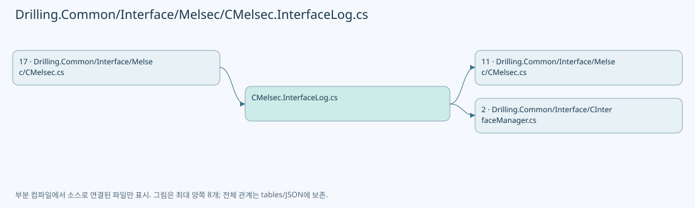

## 네임스페이스·타입·상속

| 타입 | 구분 | 원본 범위 | 선언/상속 |
| --- | --- | --- | --- |
| CMelsec | ClassDeclaration | 8–335 | CMelsec |
| MelsecLogSample | RecordDeclaration | 38–38 | MelsecLogSample |
| MelsecLogEntry | RecordDeclaration | 39–42 | MelsecLogEntry |

## 멤버 빠른 목록

| 이름 | 종류 | 범위 | 서명 |
| --- | --- | --- | --- |
| _pollLogSamples | FieldDeclaration | L12–12 | System.Collections.Generic.Dictionary<string, Drilling.Common.Interface.CMelsec.MelsecLogSample> Drilling.Common.Interface.CMelsec._pollLogSamples |
| _pendingMelsecLogs | FieldDeclaration | L13–13 | System.Collections.Generic.Queue<Drilling.Common.Interface.CMelsec.MelsecLogEntry> Drilling.Common.Interface.CMelsec._pendingMelsecLogs |
| _melsecTimingPeaks | FieldDeclaration | L16–16 | System.Collections.Generic.Dictionary<string, (double Milliseconds, string Id)> Drilling.Common.Interface.CMelsec._melsecTimingPeaks |
| _melsecTimingReportedAt | FieldDeclaration | L17–17 | long Drilling.Common.Interface.CMelsec._melsecTimingReportedAt |
| RecordMelsecTiming | MethodDeclaration | L19–25 | void Drilling.Common.Interface.CMelsec.RecordMelsecTiming(string, double, string) |
| PublishMelsecTimings | MethodDeclaration | L27–36 | void Drilling.Common.Interface.CMelsec.PublishMelsecTimings() |
| QueuePollReadLog | MethodDeclaration | L44–57 | void Drilling.Common.Interface.CMelsec.QueuePollReadLog(Drilling.Common.Interface.CMelsec.PollItem, ushort[], int, Drilling.Common.Interface.EN_MELSEC_CACHE_STATE, System.DateTimeOffset) |
| QueuePollQualityLog | MethodDeclaration | L59–71 | void Drilling.Common.Interface.CMelsec.QueuePollQualityLog(Drilling.Common.Interface.CMelsec.PollItem, Drilling.Common.Interface.EN_MELSEC_CACHE_STATE, string) |
| FlushMelsecLogs | MethodDeclaration | L73–85 | void Drilling.Common.Interface.CMelsec.FlushMelsecLogs() |
| WriteTransferLog | MethodDeclaration | L87–92 | void Drilling.Common.Interface.CMelsec.WriteTransferLog(Drilling.Common.Interface.ST_MELSEC_MAP_DATA, Drilling.Common.Interface.CMelsec.ST_MELSEC_ADDRESS, System.Collections.Generic.IReadOnlyList<ushort>, string, string, string) |
| WriteMelsecLog | MethodDeclaration | L94–136 | void Drilling.Common.Interface.CMelsec.WriteMelsecLog(Drilling.Common.Interface.CMelsec.MelsecLogEntry) |
| BuildMelsecLogHeader | MethodDeclaration | L138–139 | string Drilling.Common.Interface.CMelsec.BuildMelsecLogHeader(Drilling.Common.Interface.ST_MELSEC_MAP_DATA, string, Drilling.Common.Interface.CMelsec.ST_MELSEC_ADDRESS, int) |
| FormatMelsecLogHeader | MethodDeclaration | L141–148 | string Drilling.Common.Interface.CMelsec.FormatMelsecLogHeader(Drilling.Common.Interface.ST_MELSEC_MAP_DATA, string, Drilling.Common.Interface.CMelsec.ST_MELSEC_ADDRESS, int, string?) |
| DescribeMelsecLogType | MethodDeclaration | L150–156 | string Drilling.Common.Interface.CMelsec.DescribeMelsecLogType(Drilling.Common.Interface.EN_MELSEC_DATA_TYPE) |
| DescribeMelsecLogQuality | MethodDeclaration | L158–163 | string Drilling.Common.Interface.CMelsec.DescribeMelsecLogQuality(Drilling.Common.Interface.EN_MELSEC_CACHE_STATE) |
| DescribeMelsecLogSource | MethodDeclaration | L165–169 | string Drilling.Common.Interface.CMelsec.DescribeMelsecLogSource(string) |
| DescribeMelsecLogResult | MethodDeclaration | L171–178 | string Drilling.Common.Interface.CMelsec.DescribeMelsecLogResult(Drilling.Common.Interface.CMelsec.MelsecLogEntry) |
| DescribeMelsecLogDetail | MethodDeclaration | L180–187 | string Drilling.Common.Interface.CMelsec.DescribeMelsecLogDetail(string) |
| ResolveMelsecLogArea | MethodDeclaration | L189–211 | string Drilling.Common.Interface.CMelsec.ResolveMelsecLogArea(Drilling.Common.Interface.ST_MELSEC_MAP_DATA) |
| FormatMelsecLogWords | MethodDeclaration | L213–264 | string Drilling.Common.Interface.CMelsec.FormatMelsecLogWords(Drilling.Common.Interface.ST_MELSEC_MAP_DATA, Drilling.Common.Interface.CMelsec.ST_MELSEC_ADDRESS, ushort[], bool) |
| FormatMelsecLogSignalState | MethodDeclaration | L266–272 | string Drilling.Common.Interface.CMelsec.FormatMelsecLogSignalState(Drilling.Common.Interface.ST_MELSEC_MAP_DATA, double) |
| FormatMelsecLogNumber | MethodDeclaration | L274–281 | string Drilling.Common.Interface.CMelsec.FormatMelsecLogNumber(double) |
| BriefMelsecLogValue | MethodDeclaration | L283–309 | string Drilling.Common.Interface.CMelsec.BriefMelsecLogValue(Drilling.Common.Interface.ST_MELSEC_MAP_DATA, Drilling.Common.Interface.CMelsec.ST_MELSEC_ADDRESS, ushort[], bool) |
| FormatMelsecLogAddress | MethodDeclaration | L311–316 | string Drilling.Common.Interface.CMelsec.FormatMelsecLogAddress(Drilling.Common.Interface.CMelsec.ST_MELSEC_ADDRESS) |
| EscapeMelsecLogText | MethodDeclaration | L318–334 | string Drilling.Common.Interface.CMelsec.EscapeMelsecLogText(string) |

## 멤버별 상세 계약·호출·처리 해설

### FieldDeclaration `_pollLogSamples` · L12–12

[Drilling.Common/Interface/Melsec/CMelsec.InterfaceLog.cs:12–12](https://github.com/kjuws10-rgb/A3Drilling/blob/5aee8e58439c9b455cae7c9593c9be986c3e682e/Drilling.Common/Interface/Melsec/CMelsec.InterfaceLog.cs#L12-L12)

| 항목 | 실제 추출 값 |
| --- | --- |
| 서명 | System.Collections.Generic.Dictionary<string, Drilling.Common.Interface.CMelsec.MelsecLogSample> Drilling.Common.Interface.CMelsec._pollLogSamples |
| 접근/수식자 | Private / private, readonly |
| 반환/값 타입 | System.Collections.Generic.Dictionary<string, Drilling.Common.Interface.CMelsec.MelsecLogSample> |
| 소속 타입 | NamedType:Drilling.Common.Interface.CMelsec |

현재 부분 분석에서 직접 연결된 호출자는 없습니다. XAML/이벤트/인터페이스·델리게이트·외부 진입을 추가 확인해야 하며, 미사용으로 판정한 것이 아닙니다.

호출하는 대상과 해석 범위:

| 원본 행 | 표현식 | 분석 상태 | 대상/소스 위치 |
| --- | --- | --- | --- |
| 12 | new | resolved | System.Collections.Generic.Dictionary<string, Drilling.Common.Interface.CMelsec.MelsecLogSample>.Dictionary(System.Collections.Generic.IEqualityComparer<string>?) |

본문의 실제 연산·분기·예외·반환 순서(원문 위치 순):

| 원본 행 | 종류 | 주석 해설 |
| --- | --- | --- |
| 12 | call | 함수·델리게이트 또는 객체 생성자를 호출합니다: new(StringComparer.OrdinalIgnoreCase) |
| 12 | variable-initializer | 변수의 초기값을 지정합니다: _pollLogSamples = new(StringComparer.OrdinalIgnoreCase) |

변경 전 점검: 입력/반환 타입, 위 호출자, 예외/취소 경로, 공유 상태와 저장·전송 소비자를 함께 확인합니다. 값의 단위나 물리 방향을 이름만으로 확정하지 않습니다.

### FieldDeclaration `_pendingMelsecLogs` · L13–13

[Drilling.Common/Interface/Melsec/CMelsec.InterfaceLog.cs:13–13](https://github.com/kjuws10-rgb/A3Drilling/blob/5aee8e58439c9b455cae7c9593c9be986c3e682e/Drilling.Common/Interface/Melsec/CMelsec.InterfaceLog.cs#L13-L13)

| 항목 | 실제 추출 값 |
| --- | --- |
| 서명 | System.Collections.Generic.Queue<Drilling.Common.Interface.CMelsec.MelsecLogEntry> Drilling.Common.Interface.CMelsec._pendingMelsecLogs |
| 접근/수식자 | Private / private, readonly |
| 반환/값 타입 | System.Collections.Generic.Queue<Drilling.Common.Interface.CMelsec.MelsecLogEntry> |
| 소속 타입 | NamedType:Drilling.Common.Interface.CMelsec |

현재 부분 분석에서 직접 연결된 호출자는 없습니다. XAML/이벤트/인터페이스·델리게이트·외부 진입을 추가 확인해야 하며, 미사용으로 판정한 것이 아닙니다.

호출하는 대상과 해석 범위:

| 원본 행 | 표현식 | 분석 상태 | 대상/소스 위치 |
| --- | --- | --- | --- |
| 13 | new | resolved | System.Collections.Generic.Queue<Drilling.Common.Interface.CMelsec.MelsecLogEntry>.Queue() |

본문의 실제 연산·분기·예외·반환 순서(원문 위치 순):

| 원본 행 | 종류 | 주석 해설 |
| --- | --- | --- |
| 13 | call | 함수·델리게이트 또는 객체 생성자를 호출합니다: new() |
| 13 | variable-initializer | 변수의 초기값을 지정합니다: _pendingMelsecLogs = new() |

변경 전 점검: 입력/반환 타입, 위 호출자, 예외/취소 경로, 공유 상태와 저장·전송 소비자를 함께 확인합니다. 값의 단위나 물리 방향을 이름만으로 확정하지 않습니다.

### FieldDeclaration `_melsecTimingPeaks` · L16–16

[Drilling.Common/Interface/Melsec/CMelsec.InterfaceLog.cs:16–16](https://github.com/kjuws10-rgb/A3Drilling/blob/5aee8e58439c9b455cae7c9593c9be986c3e682e/Drilling.Common/Interface/Melsec/CMelsec.InterfaceLog.cs#L16-L16)

| 항목 | 실제 추출 값 |
| --- | --- |
| 서명 | System.Collections.Generic.Dictionary<string, (double Milliseconds, string Id)> Drilling.Common.Interface.CMelsec._melsecTimingPeaks |
| 접근/수식자 | Private / private, readonly |
| 반환/값 타입 | System.Collections.Generic.Dictionary<string, (double Milliseconds, string Id)> |
| 소속 타입 | NamedType:Drilling.Common.Interface.CMelsec |

현재 부분 분석에서 직접 연결된 호출자는 없습니다. XAML/이벤트/인터페이스·델리게이트·외부 진입을 추가 확인해야 하며, 미사용으로 판정한 것이 아닙니다.

호출하는 대상과 해석 범위:

| 원본 행 | 표현식 | 분석 상태 | 대상/소스 위치 |
| --- | --- | --- | --- |
| 16 | new | resolved | System.Collections.Generic.Dictionary<string, (double Milliseconds, string Id)>.Dictionary() |

본문의 실제 연산·분기·예외·반환 순서(원문 위치 순):

| 원본 행 | 종류 | 주석 해설 |
| --- | --- | --- |
| 16 | call | 함수·델리게이트 또는 객체 생성자를 호출합니다: new() |
| 16 | variable-initializer | 변수의 초기값을 지정합니다: _melsecTimingPeaks = new() |

변경 전 점검: 입력/반환 타입, 위 호출자, 예외/취소 경로, 공유 상태와 저장·전송 소비자를 함께 확인합니다. 값의 단위나 물리 방향을 이름만으로 확정하지 않습니다.

### FieldDeclaration `_melsecTimingReportedAt` · L17–17

[Drilling.Common/Interface/Melsec/CMelsec.InterfaceLog.cs:17–17](https://github.com/kjuws10-rgb/A3Drilling/blob/5aee8e58439c9b455cae7c9593c9be986c3e682e/Drilling.Common/Interface/Melsec/CMelsec.InterfaceLog.cs#L17-L17)

| 항목 | 실제 추출 값 |
| --- | --- |
| 서명 | long Drilling.Common.Interface.CMelsec._melsecTimingReportedAt |
| 접근/수식자 | Private / private |
| 반환/값 타입 | long |
| 소속 타입 | NamedType:Drilling.Common.Interface.CMelsec |

현재 부분 분석에서 직접 연결된 호출자는 없습니다. XAML/이벤트/인터페이스·델리게이트·외부 진입을 추가 확인해야 하며, 미사용으로 판정한 것이 아닙니다.

호출하는 대상과 해석 범위:

| 원본 행 | 표현식 | 분석 상태 | 대상/소스 위치 |
| --- | --- | --- | --- |
| 17 | Stopwatch.GetTimestamp | resolved | long System.Diagnostics.Stopwatch.GetTimestamp() |

본문의 실제 연산·분기·예외·반환 순서(원문 위치 순):

| 원본 행 | 종류 | 주석 해설 |
| --- | --- | --- |
| 17 | call | 함수·델리게이트 또는 객체 생성자를 호출합니다: Stopwatch.GetTimestamp() |
| 17 | variable-initializer | 변수의 초기값을 지정합니다: _melsecTimingReportedAt = Stopwatch.GetTimestamp() |

변경 전 점검: 입력/반환 타입, 위 호출자, 예외/취소 경로, 공유 상태와 저장·전송 소비자를 함께 확인합니다. 값의 단위나 물리 방향을 이름만으로 확정하지 않습니다.

### MethodDeclaration `RecordMelsecTiming` · L19–25

[Drilling.Common/Interface/Melsec/CMelsec.InterfaceLog.cs:19–25](https://github.com/kjuws10-rgb/A3Drilling/blob/5aee8e58439c9b455cae7c9593c9be986c3e682e/Drilling.Common/Interface/Melsec/CMelsec.InterfaceLog.cs#L19-L25)

| 항목 | 실제 추출 값 |
| --- | --- |
| 서명 | void Drilling.Common.Interface.CMelsec.RecordMelsecTiming(string, double, string) |
| 접근/수식자 | Private / private |
| 반환/값 타입 | void |
| 소속 타입 | NamedType:Drilling.Common.Interface.CMelsec |

입력 계약:

| 이름 | 타입 | 전달 | 선택/기본값 |
| --- | --- | --- | --- |
| kind | string | None | False /  |
| milliseconds | double | None | False /  |
| id | string | None | False /  |

정적 호출자로 확인된 위치:

| 호출 파일/행 | 호출 표현식 | 런타임 분기 가능 |
| --- | --- | --- |
| [Drilling.Common/Interface/Melsec/CMelsec.cs:659–659](https://github.com/kjuws10-rgb/A3Drilling/blob/5aee8e58439c9b455cae7c9593c9be986c3e682e/Drilling.Common/Interface/Melsec/CMelsec.cs#L659-L659) | RecordMelsecTiming | False |
| [Drilling.Common/Interface/Melsec/CMelsec.cs:1697–1697](https://github.com/kjuws10-rgb/A3Drilling/blob/5aee8e58439c9b455cae7c9593c9be986c3e682e/Drilling.Common/Interface/Melsec/CMelsec.cs#L1697-L1697) | RecordMelsecTiming | False |
| [Drilling.Common/Interface/Melsec/CMelsec.cs:1811–1811](https://github.com/kjuws10-rgb/A3Drilling/blob/5aee8e58439c9b455cae7c9593c9be986c3e682e/Drilling.Common/Interface/Melsec/CMelsec.cs#L1811-L1811) | RecordMelsecTiming | False |
| [Drilling.Common/Interface/Melsec/CMelsec.cs:2906–2906](https://github.com/kjuws10-rgb/A3Drilling/blob/5aee8e58439c9b455cae7c9593c9be986c3e682e/Drilling.Common/Interface/Melsec/CMelsec.cs#L2906-L2906) | RecordMelsecTiming | False |

호출하는 대상과 해석 범위:

| 원본 행 | 표현식 | 분석 상태 | 대상/소스 위치 |
| --- | --- | --- | --- |
| 23 | _melsecTimingPeaks.TryGetValue | resolved | bool System.Collections.Generic.Dictionary<string, (double Milliseconds, string Id)>.TryGetValue(string, out (double Milliseconds, string Id)) |

본문의 실제 연산·분기·예외·반환 순서(원문 위치 순):

| 원본 행 | 종류 | 주석 해설 |
| --- | --- | --- |
| 21 | conditional-expression | 조건에 따라 결과식을 선택합니다: kind == "CONTROL_POLL_GAP" ? 500 : kind == "REQUEST_QUEUE" ? 100 : 50 |
| 21 | conditional-expression | 조건에 따라 결과식을 선택합니다: kind == "REQUEST_QUEUE" ? 100 : 50 |
| 21 | if | 조건에 따라 분기합니다: if (_logManager is null &#124;&#124; milliseconds < (kind == "CONTROL_POLL_GAP" ? 500 : kind == "REQUEST_QUEUE" ? 100 : 50)) |
| 22 | return | 호출자에게 값 또는 제어를 반환합니다: return; |
| 23 | call | 함수·델리게이트 또는 객체 생성자를 호출합니다: _melsecTimingPeaks.TryGetValue(kind, out var old) |
| 23 | if | 조건에 따라 분기합니다: if (!_melsecTimingPeaks.TryGetValue(kind, out var old) &#124;&#124; milliseconds > old.Milliseconds) |
| 24 | assignment | 값을 대상에 대입합니다: _melsecTimingPeaks[kind] = (milliseconds, id) |

제어 구문의 포함 구조(실제 실행 순서/CFG가 아닌 구문 탐색 그림):

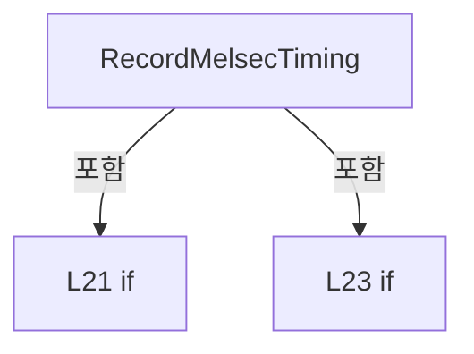

변경 전 점검: 입력/반환 타입, 위 호출자, 예외/취소 경로, 공유 상태와 저장·전송 소비자를 함께 확인합니다. 값의 단위나 물리 방향을 이름만으로 확정하지 않습니다.

### MethodDeclaration `PublishMelsecTimings` · L27–36

[Drilling.Common/Interface/Melsec/CMelsec.InterfaceLog.cs:27–36](https://github.com/kjuws10-rgb/A3Drilling/blob/5aee8e58439c9b455cae7c9593c9be986c3e682e/Drilling.Common/Interface/Melsec/CMelsec.InterfaceLog.cs#L27-L36)

| 항목 | 실제 추출 값 |
| --- | --- |
| 서명 | void Drilling.Common.Interface.CMelsec.PublishMelsecTimings() |
| 접근/수식자 | Private / private |
| 반환/값 타입 | void |
| 소속 타입 | NamedType:Drilling.Common.Interface.CMelsec |

정적 호출자로 확인된 위치:

| 호출 파일/행 | 호출 표현식 | 런타임 분기 가능 |
| --- | --- | --- |
| [Drilling.Common/Interface/Melsec/CMelsec.cs:228–228](https://github.com/kjuws10-rgb/A3Drilling/blob/5aee8e58439c9b455cae7c9593c9be986c3e682e/Drilling.Common/Interface/Melsec/CMelsec.cs#L228-L228) | PublishMelsecTimings | False |

호출하는 대상과 해석 범위:

| 원본 행 | 표현식 | 분석 상태 | 대상/소스 위치 |
| --- | --- | --- | --- |
| 29 | Stopwatch.GetElapsedTime | resolved | System.TimeSpan System.Diagnostics.Stopwatch.GetElapsedTime(long) |
| 31 | Stopwatch.GetTimestamp | resolved | long System.Diagnostics.Stopwatch.GetTimestamp() |
| 33 | _logManager.WriteInterfaceCommand | unresolved | None |
| 34 | FormattableString.Invariant | resolved | string System.FormattableString.Invariant(System.FormattableString) |
| 35 | _melsecTimingPeaks.Clear | resolved | void System.Collections.Generic.Dictionary<string, (double Milliseconds, string Id)>.Clear() |

본문의 실제 연산·분기·예외·반환 순서(원문 위치 순):

| 원본 행 | 종류 | 주석 해설 |
| --- | --- | --- |
| 29 | call | 함수·델리게이트 또는 객체 생성자를 호출합니다: Stopwatch.GetElapsedTime(_melsecTimingReportedAt) |
| 29 | if | 조건에 따라 분기합니다: if (_logManager is null &#124;&#124; Stopwatch.GetElapsedTime(_melsecTimingReportedAt).TotalSeconds < 5) |
| 30 | return | 호출자에게 값 또는 제어를 반환합니다: return; |
| 31 | assignment | 값을 대상에 대입합니다: _melsecTimingReportedAt = Stopwatch.GetTimestamp() |
| 31 | call | 함수·델리게이트 또는 객체 생성자를 호출합니다: Stopwatch.GetTimestamp() |
| 32 | foreach | 컬렉션 요소를 순회합니다: foreach (var pair in _melsecTimingPeaks) |
| 33 | call | 함수·델리게이트 또는 객체 생성자를 호출합니다: _logManager.WriteInterfaceCommand(EN_EQP_MODULE.Melsec, "MELSEC_CONTROL", "[MELSEC][지연 진단] " + pair.Key, FormattableString.Invariant($"최근 5초 최대={pair.Value.Milliseconds:0.0} ms &#124; ID={pair.Value.Id}")) |
| 34 | call | 함수·델리게이트 또는 객체 생성자를 호출합니다: FormattableString.Invariant($"최근 5초 최대={pair.Value.Milliseconds:0.0} ms &#124; ID={pair.Value.Id}") |
| 35 | call | 함수·델리게이트 또는 객체 생성자를 호출합니다: _melsecTimingPeaks.Clear() |

제어 구문의 포함 구조(실제 실행 순서/CFG가 아닌 구문 탐색 그림):

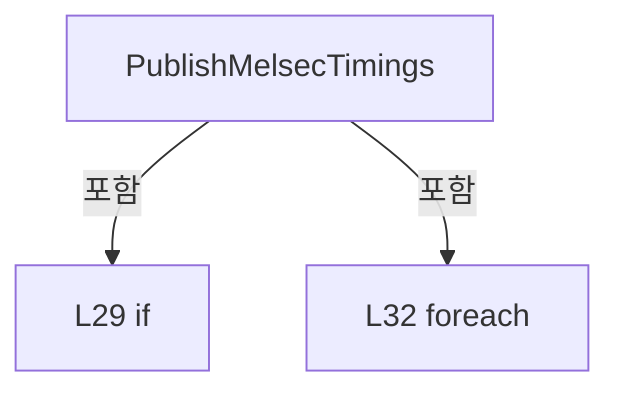

변경 전 점검: 입력/반환 타입, 위 호출자, 예외/취소 경로, 공유 상태와 저장·전송 소비자를 함께 확인합니다. 값의 단위나 물리 방향을 이름만으로 확정하지 않습니다.

### MethodDeclaration `QueuePollReadLog` · L44–57

[Drilling.Common/Interface/Melsec/CMelsec.InterfaceLog.cs:44–57](https://github.com/kjuws10-rgb/A3Drilling/blob/5aee8e58439c9b455cae7c9593c9be986c3e682e/Drilling.Common/Interface/Melsec/CMelsec.InterfaceLog.cs#L44-L57)

| 항목 | 실제 추출 값 |
| --- | --- |
| 서명 | void Drilling.Common.Interface.CMelsec.QueuePollReadLog(Drilling.Common.Interface.CMelsec.PollItem, ushort[], int, Drilling.Common.Interface.EN_MELSEC_CACHE_STATE, System.DateTimeOffset) |
| 접근/수식자 | Private / private |
| 반환/값 타입 | void |
| 소속 타입 | NamedType:Drilling.Common.Interface.CMelsec |

입력 계약:

| 이름 | 타입 | 전달 | 선택/기본값 |
| --- | --- | --- | --- |
| item | Drilling.Common.Interface.CMelsec.PollItem | None | False /  |
| blockWords | ushort[] | None | False /  |
| blockStart | int | None | False /  |
| previousQuality | Drilling.Common.Interface.EN_MELSEC_CACHE_STATE | None | False /  |
| observedAt | System.DateTimeOffset | None | False /  |

정적 호출자로 확인된 위치:

| 호출 파일/행 | 호출 표현식 | 런타임 분기 가능 |
| --- | --- | --- |
| [Drilling.Common/Interface/Melsec/CMelsec.cs:2941–2941](https://github.com/kjuws10-rgb/A3Drilling/blob/5aee8e58439c9b455cae7c9593c9be986c3e682e/Drilling.Common/Interface/Melsec/CMelsec.cs#L2941-L2941) | QueuePollReadLog | False |

호출하는 대상과 해석 범위:

| 원본 행 | 표현식 | 분석 상태 | 대상/소스 위치 |
| --- | --- | --- | --- |
| 48 | blockWords.AsSpan | resolved | System.Span<ushort> ushort[].AsSpan<ushort>(int, int) |
| 49 | NormalizeId | resolved | string Drilling.Common.Interface.CMelsec.NormalizeId(string) · Drilling.Common/Interface/Melsec/CMelsec.cs:2250 |
| 50 | _pollLogSamples.TryGetValue | resolved | bool System.Collections.Generic.Dictionary<string, Drilling.Common.Interface.CMelsec.MelsecLogSample>.TryGetValue(string, out Drilling.Common.Interface.CMelsec.MelsecLogSample) |
| 51 | raw.SequenceEqual | resolved | bool System.ReadOnlySpan<ushort>.SequenceEqual<ushort>(System.ReadOnlySpan<ushort>) |
| 53 | raw.ToArray | resolved | ushort[] System.Span<ushort>.ToArray() |
| 54 | new | resolved | Drilling.Common.Interface.CMelsec.MelsecLogSample.MelsecLogSample(ushort[]?, Drilling.Common.Interface.EN_MELSEC_CACHE_STATE, string) · Drilling.Common/Interface/Melsec/CMelsec.InterfaceLog.cs:38 |
| 55 | _pendingMelsecLogs.Enqueue | resolved | void System.Collections.Generic.Queue<Drilling.Common.Interface.CMelsec.MelsecLogEntry>.Enqueue(Drilling.Common.Interface.CMelsec.MelsecLogEntry) |
| 55 | new | resolved | Drilling.Common.Interface.CMelsec.MelsecLogEntry.MelsecLogEntry(Drilling.Common.Interface.ST_MELSEC_MAP_DATA, Drilling.Common.Interface.CMelsec.ST_MELSEC_ADDRESS, ushort[]?, string, string, string, Drilling.Common.Interface.EN_MELSEC_CACHE_STATE, System.DateTimeOffset, Drilling.Common.Interface.EN_MELSEC_CACHE_STATE?, string) · Drilling.Common/Interface/Melsec/CMelsec.InterfaceLog.cs:39 |

본문의 실제 연산·분기·예외·반환 순서(원문 위치 순):

| 원본 행 | 종류 | 주석 해설 |
| --- | --- | --- |
| 46 | if | 조건에 따라 분기합니다: if (_logManager is null) |
| 47 | return | 호출자에게 값 또는 제어를 반환합니다: return; |
| 48 | call | 함수·델리게이트 또는 객체 생성자를 호출합니다: blockWords.AsSpan(item.Address.Number - blockStart, item.WordCount) |
| 48 | local-declaration | 지역 변수를 선언합니다: var raw = blockWords.AsSpan(item.Address.Number - blockStart, item.WordCount); |
| 48 | variable-initializer | 변수의 초기값을 지정합니다: raw = blockWords.AsSpan(item.Address.Number - blockStart, item.WordCount) |
| 49 | call | 함수·델리게이트 또는 객체 생성자를 호출합니다: NormalizeId(item.Data.Id) |
| 49 | local-declaration | 지역 변수를 선언합니다: var id = NormalizeId(item.Data.Id); |
| 49 | variable-initializer | 변수의 초기값을 지정합니다: id = NormalizeId(item.Data.Id) |
| 50 | call | 함수·델리게이트 또는 객체 생성자를 호출합니다: _pollLogSamples.TryGetValue(id, out var previous) |
| 50 | if | 조건에 따라 분기합니다: if (_pollLogSamples.TryGetValue(id, out var previous) && previous.Quality == EN_MELSEC_CACHE_STATE.Valid && previousQuality == EN_MELSEC_CACHE_STATE.Valid && previous.Words is { } oldWords && raw.SequenceEqual(oldWords)) |
| 51 | call | 함수·델리게이트 또는 객체 생성자를 호출합니다: raw.SequenceEqual(oldWords) |
| 52 | return | 호출자에게 값 또는 제어를 반환합니다: return; |
| 53 | call | 함수·델리게이트 또는 객체 생성자를 호출합니다: raw.ToArray() |
| 53 | local-declaration | 지역 변수를 선언합니다: var words = raw.ToArray(); |
| 53 | variable-initializer | 변수의 초기값을 지정합니다: words = raw.ToArray() |
| 54 | assignment | 값을 대상에 대입합니다: _pollLogSamples[id] = new(words, EN_MELSEC_CACHE_STATE.Valid, "") |
| 54 | call | 함수·델리게이트 또는 객체 생성자를 호출합니다: new(words, EN_MELSEC_CACHE_STATE.Valid, "") |
| 55 | call | 함수·델리게이트 또는 객체 생성자를 호출합니다: _pendingMelsecLogs.Enqueue(new(item.Data, item.Address, words, "READ", "POLL", "RECEIVED", EN_MELSEC_CACHE_STATE.Valid, observedAt, previousQuality)) |
| 55 | call | 함수·델리게이트 또는 객체 생성자를 호출합니다: new(item.Data, item.Address, words, "READ", "POLL", "RECEIVED", EN_MELSEC_CACHE_STATE.Valid, observedAt, previousQuality) |

제어 구문의 포함 구조(실제 실행 순서/CFG가 아닌 구문 탐색 그림):

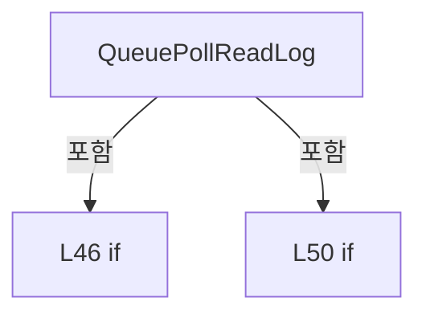

변경 전 점검: 입력/반환 타입, 위 호출자, 예외/취소 경로, 공유 상태와 저장·전송 소비자를 함께 확인합니다. 값의 단위나 물리 방향을 이름만으로 확정하지 않습니다.

### MethodDeclaration `QueuePollQualityLog` · L59–71

[Drilling.Common/Interface/Melsec/CMelsec.InterfaceLog.cs:59–71](https://github.com/kjuws10-rgb/A3Drilling/blob/5aee8e58439c9b455cae7c9593c9be986c3e682e/Drilling.Common/Interface/Melsec/CMelsec.InterfaceLog.cs#L59-L71)

| 항목 | 실제 추출 값 |
| --- | --- |
| 서명 | void Drilling.Common.Interface.CMelsec.QueuePollQualityLog(Drilling.Common.Interface.CMelsec.PollItem, Drilling.Common.Interface.EN_MELSEC_CACHE_STATE, string) |
| 접근/수식자 | Private / private |
| 반환/값 타입 | void |
| 소속 타입 | NamedType:Drilling.Common.Interface.CMelsec |

입력 계약:

| 이름 | 타입 | 전달 | 선택/기본값 |
| --- | --- | --- | --- |
| item | Drilling.Common.Interface.CMelsec.PollItem | None | False /  |
| quality | Drilling.Common.Interface.EN_MELSEC_CACHE_STATE | None | False /  |
| message | string | None | False /  |

정적 호출자로 확인된 위치:

| 호출 파일/행 | 호출 표현식 | 런타임 분기 가능 |
| --- | --- | --- |
| [Drilling.Common/Interface/Melsec/CMelsec.cs:2810–2810](https://github.com/kjuws10-rgb/A3Drilling/blob/5aee8e58439c9b455cae7c9593c9be986c3e682e/Drilling.Common/Interface/Melsec/CMelsec.cs#L2810-L2810) | QueuePollQualityLog | False |

호출하는 대상과 해석 범위:

| 원본 행 | 표현식 | 분석 상태 | 대상/소스 위치 |
| --- | --- | --- | --- |
| 63 | NormalizeId | resolved | string Drilling.Common.Interface.CMelsec.NormalizeId(string) · Drilling.Common/Interface/Melsec/CMelsec.cs:2250 |
| 64 | _pollLogSamples.TryGetValue | resolved | bool System.Collections.Generic.Dictionary<string, Drilling.Common.Interface.CMelsec.MelsecLogSample>.TryGetValue(string, out Drilling.Common.Interface.CMelsec.MelsecLogSample) |
| 67 | new | resolved | Drilling.Common.Interface.CMelsec.MelsecLogSample.MelsecLogSample(ushort[]?, Drilling.Common.Interface.EN_MELSEC_CACHE_STATE, string) · Drilling.Common/Interface/Melsec/CMelsec.InterfaceLog.cs:38 |
| 68 | _pendingMelsecLogs.Enqueue | resolved | void System.Collections.Generic.Queue<Drilling.Common.Interface.CMelsec.MelsecLogEntry>.Enqueue(Drilling.Common.Interface.CMelsec.MelsecLogEntry) |
| 68 | new | resolved | Drilling.Common.Interface.CMelsec.MelsecLogEntry.MelsecLogEntry(Drilling.Common.Interface.ST_MELSEC_MAP_DATA, Drilling.Common.Interface.CMelsec.ST_MELSEC_ADDRESS, ushort[]?, string, string, string, Drilling.Common.Interface.EN_MELSEC_CACHE_STATE, System.DateTimeOffset, Drilling.Common.Interface.EN_MELSEC_CACHE_STATE?, string) · Drilling.Common/Interface/Melsec/CMelsec.InterfaceLog.cs:39 |

본문의 실제 연산·분기·예외·반환 순서(원문 위치 순):

| 원본 행 | 종류 | 주석 해설 |
| --- | --- | --- |
| 61 | if | 조건에 따라 분기합니다: if (_logManager is null) |
| 62 | return | 호출자에게 값 또는 제어를 반환합니다: return; |
| 63 | call | 함수·델리게이트 또는 객체 생성자를 호출합니다: NormalizeId(item.Data.Id) |
| 63 | local-declaration | 지역 변수를 선언합니다: var id = NormalizeId(item.Data.Id); |
| 63 | variable-initializer | 변수의 초기값을 지정합니다: id = NormalizeId(item.Data.Id) |
| 64 | call | 함수·델리게이트 또는 객체 생성자를 호출합니다: _pollLogSamples.TryGetValue(id, out var previous) |
| 65 | if | 조건에 따라 분기합니다: if (previous is not null && previous.Quality == quality && previous.Error == message) |
| 66 | return | 호출자에게 값 또는 제어를 반환합니다: return; |
| 67 | assignment | 값을 대상에 대입합니다: _pollLogSamples[id] = new(null, quality, message) |
| 67 | call | 함수·델리게이트 또는 객체 생성자를 호출합니다: new(null, quality, message) |
| 68 | call | 함수·델리게이트 또는 객체 생성자를 호출합니다: _pendingMelsecLogs.Enqueue(new(item.Data, item.Address, null, "READ", "POLL", quality == EN_MELSEC_CACHE_STATE.Pending ? "WAITING_FOR_READ" : "UNAVAILABLE", quality, DateTimeOffset.UtcNow, previous?.Quality, message)) |
| 68 | call | 함수·델리게이트 또는 객체 생성자를 호출합니다: new(item.Data, item.Address, null, "READ", "POLL", quality == EN_MELSEC_CACHE_STATE.Pending ? "WAITING_FOR_READ" : "UNAVAILABLE", quality, DateTimeOffset.UtcNow, previous?.Quality, message) |
| 69 | conditional-expression | 조건에 따라 결과식을 선택합니다: quality == EN_MELSEC_CACHE_STATE.Pending ? "WAITING_FOR_READ" : "UNAVAILABLE" |

제어 구문의 포함 구조(실제 실행 순서/CFG가 아닌 구문 탐색 그림):

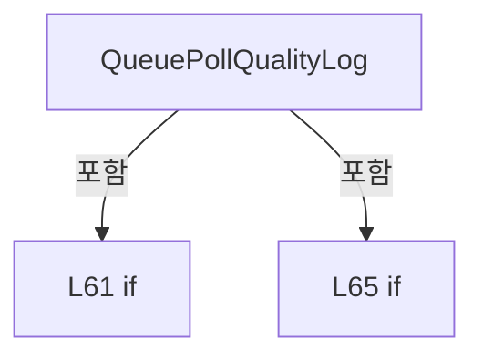

변경 전 점검: 입력/반환 타입, 위 호출자, 예외/취소 경로, 공유 상태와 저장·전송 소비자를 함께 확인합니다. 값의 단위나 물리 방향을 이름만으로 확정하지 않습니다.

### MethodDeclaration `FlushMelsecLogs` · L73–85

[Drilling.Common/Interface/Melsec/CMelsec.InterfaceLog.cs:73–85](https://github.com/kjuws10-rgb/A3Drilling/blob/5aee8e58439c9b455cae7c9593c9be986c3e682e/Drilling.Common/Interface/Melsec/CMelsec.InterfaceLog.cs#L73-L85)

| 항목 | 실제 추출 값 |
| --- | --- |
| 서명 | void Drilling.Common.Interface.CMelsec.FlushMelsecLogs() |
| 접근/수식자 | Private / private |
| 반환/값 타입 | void |
| 소속 타입 | NamedType:Drilling.Common.Interface.CMelsec |

정적 호출자로 확인된 위치:

| 호출 파일/행 | 호출 표현식 | 런타임 분기 가능 |
| --- | --- | --- |
| [Drilling.Common/Interface/Melsec/CMelsec.cs:164–164](https://github.com/kjuws10-rgb/A3Drilling/blob/5aee8e58439c9b455cae7c9593c9be986c3e682e/Drilling.Common/Interface/Melsec/CMelsec.cs#L164-L164) | FlushMelsecLogs | False |
| [Drilling.Common/Interface/Melsec/CMelsec.cs:227–227](https://github.com/kjuws10-rgb/A3Drilling/blob/5aee8e58439c9b455cae7c9593c9be986c3e682e/Drilling.Common/Interface/Melsec/CMelsec.cs#L227-L227) | FlushMelsecLogs | False |

호출하는 대상과 해석 범위:

| 원본 행 | 표현식 | 분석 상태 | 대상/소스 위치 |
| --- | --- | --- | --- |
| 80 | _pendingMelsecLogs.ToArray | resolved | Drilling.Common.Interface.CMelsec.MelsecLogEntry[] System.Collections.Generic.Queue<Drilling.Common.Interface.CMelsec.MelsecLogEntry>.ToArray() |
| 81 | _pendingMelsecLogs.Clear | resolved | void System.Collections.Generic.Queue<Drilling.Common.Interface.CMelsec.MelsecLogEntry>.Clear() |
| 84 | WriteMelsecLog | resolved | void Drilling.Common.Interface.CMelsec.WriteMelsecLog(Drilling.Common.Interface.CMelsec.MelsecLogEntry) · Drilling.Common/Interface/Melsec/CMelsec.InterfaceLog.cs:94 |

본문의 실제 연산·분기·예외·반환 순서(원문 위치 순):

| 원본 행 | 종류 | 주석 해설 |
| --- | --- | --- |
| 75 | local-declaration | 지역 변수를 선언합니다: MelsecLogEntry[] entries; |
| 76 | lock | 공유 상태의 임계 구역에 진입합니다: lock (_pollLock) |
| 78 | if | 조건에 따라 분기합니다: if (_pendingMelsecLogs.Count == 0) |
| 79 | return | 호출자에게 값 또는 제어를 반환합니다: return; |
| 80 | assignment | 값을 대상에 대입합니다: entries = _pendingMelsecLogs.ToArray() |
| 80 | call | 함수·델리게이트 또는 객체 생성자를 호출합니다: _pendingMelsecLogs.ToArray() |
| 81 | call | 함수·델리게이트 또는 객체 생성자를 호출합니다: _pendingMelsecLogs.Clear() |
| 83 | foreach | 컬렉션 요소를 순회합니다: foreach (var entry in entries) |
| 84 | call | 함수·델리게이트 또는 객체 생성자를 호출합니다: WriteMelsecLog(entry) |

제어 구문의 포함 구조(실제 실행 순서/CFG가 아닌 구문 탐색 그림):

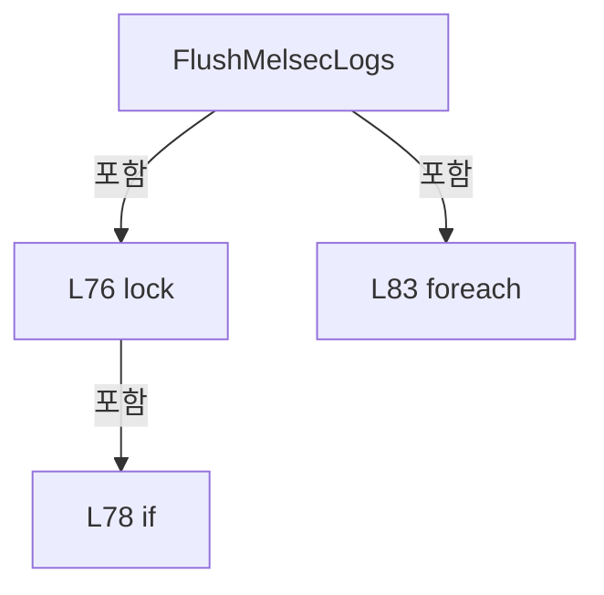

변경 전 점검: 입력/반환 타입, 위 호출자, 예외/취소 경로, 공유 상태와 저장·전송 소비자를 함께 확인합니다. 값의 단위나 물리 방향을 이름만으로 확정하지 않습니다.

### MethodDeclaration `WriteTransferLog` · L87–92

[Drilling.Common/Interface/Melsec/CMelsec.InterfaceLog.cs:87–92](https://github.com/kjuws10-rgb/A3Drilling/blob/5aee8e58439c9b455cae7c9593c9be986c3e682e/Drilling.Common/Interface/Melsec/CMelsec.InterfaceLog.cs#L87-L92)

| 항목 | 실제 추출 값 |
| --- | --- |
| 서명 | void Drilling.Common.Interface.CMelsec.WriteTransferLog(Drilling.Common.Interface.ST_MELSEC_MAP_DATA, Drilling.Common.Interface.CMelsec.ST_MELSEC_ADDRESS, System.Collections.Generic.IReadOnlyList<ushort>, string, string, string) |
| 접근/수식자 | Private / private |
| 반환/값 타입 | void |
| 소속 타입 | NamedType:Drilling.Common.Interface.CMelsec |

입력 계약:

| 이름 | 타입 | 전달 | 선택/기본값 |
| --- | --- | --- | --- |
| data | Drilling.Common.Interface.ST_MELSEC_MAP_DATA | None | False /  |
| address | Drilling.Common.Interface.CMelsec.ST_MELSEC_ADDRESS | None | False /  |
| words | System.Collections.Generic.IReadOnlyList<ushort> | None | False /  |
| operation | string | None | False /  |
| source | string | None | False /  |
| result | string | None | False /  |

정적 호출자로 확인된 위치:

| 호출 파일/행 | 호출 표현식 | 런타임 분기 가능 |
| --- | --- | --- |
| [Drilling.Common/Interface/Melsec/CMelsec.cs:1669–1669](https://github.com/kjuws10-rgb/A3Drilling/blob/5aee8e58439c9b455cae7c9593c9be986c3e682e/Drilling.Common/Interface/Melsec/CMelsec.cs#L1669-L1669) | WriteTransferLog | False |
| [Drilling.Common/Interface/Melsec/CMelsec.cs:1755–1755](https://github.com/kjuws10-rgb/A3Drilling/blob/5aee8e58439c9b455cae7c9593c9be986c3e682e/Drilling.Common/Interface/Melsec/CMelsec.cs#L1755-L1755) | WriteTransferLog | False |
| [Drilling.Common/Interface/Melsec/CMelsec.cs:1780–1780](https://github.com/kjuws10-rgb/A3Drilling/blob/5aee8e58439c9b455cae7c9593c9be986c3e682e/Drilling.Common/Interface/Melsec/CMelsec.cs#L1780-L1780) | WriteTransferLog | False |
| [Drilling.Common/Interface/Melsec/CMelsec.cs:1834–1834](https://github.com/kjuws10-rgb/A3Drilling/blob/5aee8e58439c9b455cae7c9593c9be986c3e682e/Drilling.Common/Interface/Melsec/CMelsec.cs#L1834-L1834) | WriteTransferLog | False |

호출하는 대상과 해석 범위:

| 원본 행 | 표현식 | 분석 상태 | 대상/소스 위치 |
| --- | --- | --- | --- |
| 91 | WriteMelsecLog | resolved | void Drilling.Common.Interface.CMelsec.WriteMelsecLog(Drilling.Common.Interface.CMelsec.MelsecLogEntry) · Drilling.Common/Interface/Melsec/CMelsec.InterfaceLog.cs:94 |
| 91 | new | resolved | Drilling.Common.Interface.CMelsec.MelsecLogEntry.MelsecLogEntry(Drilling.Common.Interface.ST_MELSEC_MAP_DATA, Drilling.Common.Interface.CMelsec.ST_MELSEC_ADDRESS, ushort[]?, string, string, string, Drilling.Common.Interface.EN_MELSEC_CACHE_STATE, System.DateTimeOffset, Drilling.Common.Interface.EN_MELSEC_CACHE_STATE?, string) · Drilling.Common/Interface/Melsec/CMelsec.InterfaceLog.cs:39 |
| 91 | words.ToArray | resolved | ushort[] System.Collections.Generic.IEnumerable<ushort>.ToArray<ushort>() |

본문의 실제 연산·분기·예외·반환 순서(원문 위치 순):

| 원본 행 | 종류 | 주석 해설 |
| --- | --- | --- |
| 90 | if | 조건에 따라 분기합니다: if (_logManager is not null) |
| 91 | call | 함수·델리게이트 또는 객체 생성자를 호출합니다: WriteMelsecLog(new(data, address, words.ToArray(), operation, source, result, EN_MELSEC_CACHE_STATE.Valid, DateTimeOffset.UtcNow)) |
| 91 | call | 함수·델리게이트 또는 객체 생성자를 호출합니다: new(data, address, words.ToArray(), operation, source, result, EN_MELSEC_CACHE_STATE.Valid, DateTimeOffset.UtcNow) |
| 91 | call | 함수·델리게이트 또는 객체 생성자를 호출합니다: words.ToArray() |

제어 구문의 포함 구조(실제 실행 순서/CFG가 아닌 구문 탐색 그림):

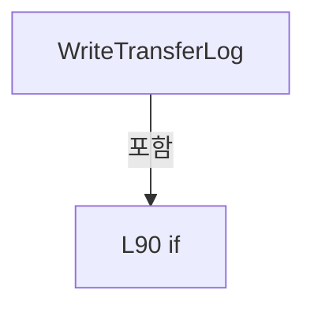

변경 전 점검: 입력/반환 타입, 위 호출자, 예외/취소 경로, 공유 상태와 저장·전송 소비자를 함께 확인합니다. 값의 단위나 물리 방향을 이름만으로 확정하지 않습니다.

### MethodDeclaration `WriteMelsecLog` · L94–136

[Drilling.Common/Interface/Melsec/CMelsec.InterfaceLog.cs:94–136](https://github.com/kjuws10-rgb/A3Drilling/blob/5aee8e58439c9b455cae7c9593c9be986c3e682e/Drilling.Common/Interface/Melsec/CMelsec.InterfaceLog.cs#L94-L136)

| 항목 | 실제 추출 값 |
| --- | --- |
| 서명 | void Drilling.Common.Interface.CMelsec.WriteMelsecLog(Drilling.Common.Interface.CMelsec.MelsecLogEntry) |
| 접근/수식자 | Private / private |
| 반환/값 타입 | void |
| 소속 타입 | NamedType:Drilling.Common.Interface.CMelsec |

입력 계약:

| 이름 | 타입 | 전달 | 선택/기본값 |
| --- | --- | --- | --- |
| entry | Drilling.Common.Interface.CMelsec.MelsecLogEntry | None | False /  |

정적 호출자로 확인된 위치:

| 호출 파일/행 | 호출 표현식 | 런타임 분기 가능 |
| --- | --- | --- |
| [Drilling.Common/Interface/Melsec/CMelsec.InterfaceLog.cs:84–84](https://github.com/kjuws10-rgb/A3Drilling/blob/5aee8e58439c9b455cae7c9593c9be986c3e682e/Drilling.Common/Interface/Melsec/CMelsec.InterfaceLog.cs#L84-L84) | WriteMelsecLog | False |
| [Drilling.Common/Interface/Melsec/CMelsec.InterfaceLog.cs:91–91](https://github.com/kjuws10-rgb/A3Drilling/blob/5aee8e58439c9b455cae7c9593c9be986c3e682e/Drilling.Common/Interface/Melsec/CMelsec.InterfaceLog.cs#L91-L91) | WriteMelsecLog | False |

호출하는 대상과 해석 범위:

| 원본 행 | 표현식 | 분석 상태 | 대상/소스 위치 |
| --- | --- | --- | --- |
| 100 | _interfaceManager.GetInterfaceData | resolved | Drilling.Common.Interface.ST_INTERFACE_DATA? Drilling.Common.Interface.CInterfaceManager.GetInterfaceData(Drilling.Common.Interface.EN_EQP_MODULE, int) · Drilling.Common/Interface/CInterfaceManager.cs:348 |
| 101 | entry.Data.DeviceNo.ToString | resolved | string int.ToString(System.IFormatProvider?) |
| 104 | FormatMelsecLogHeader | resolved | string Drilling.Common.Interface.CMelsec.FormatMelsecLogHeader(Drilling.Common.Interface.ST_MELSEC_MAP_DATA, string, Drilling.Common.Interface.CMelsec.ST_MELSEC_ADDRESS, int, string?) · Drilling.Common/Interface/Melsec/CMelsec.InterfaceLog.cs:141 |
| 105 | BriefMelsecLogValue | resolved | string Drilling.Common.Interface.CMelsec.BriefMelsecLogValue(Drilling.Common.Interface.ST_MELSEC_MAP_DATA, Drilling.Common.Interface.CMelsec.ST_MELSEC_ADDRESS, ushort[], bool) · Drilling.Common/Interface/Melsec/CMelsec.InterfaceLog.cs:283 |
| 106 | DescribeMelsecLogResult | resolved | string Drilling.Common.Interface.CMelsec.DescribeMelsecLogResult(Drilling.Common.Interface.CMelsec.MelsecLogEntry) · Drilling.Common/Interface/Melsec/CMelsec.InterfaceLog.cs:171 |
| 107 | DescribeMelsecLogQuality | resolved | string Drilling.Common.Interface.CMelsec.DescribeMelsecLogQuality(Drilling.Common.Interface.EN_MELSEC_CACHE_STATE) · Drilling.Common/Interface/Melsec/CMelsec.InterfaceLog.cs:158 |
| 109 | DescribeMelsecLogQuality | resolved | string Drilling.Common.Interface.CMelsec.DescribeMelsecLogQuality(Drilling.Common.Interface.EN_MELSEC_CACHE_STATE) · Drilling.Common/Interface/Melsec/CMelsec.InterfaceLog.cs:158 |
| 110 | entry.ObservedAt.ToLocalTime().ToString | resolved | string System.DateTimeOffset.ToString(string?, System.IFormatProvider?) |
| 110 | entry.ObservedAt.ToLocalTime | resolved | System.DateTimeOffset System.DateTimeOffset.ToLocalTime() |
| 111 | entry.ObservedAt.ToLocalTime().ToString | resolved | string System.DateTimeOffset.ToString(string?, System.IFormatProvider?) |
| 111 | entry.ObservedAt.ToLocalTime | resolved | System.DateTimeOffset System.DateTimeOffset.ToLocalTime() |
| 112 | entry.ObservedAt.ToLocalTime().ToString | resolved | string System.DateTimeOffset.ToString(string?, System.IFormatProvider?) |
| 112 | entry.ObservedAt.ToLocalTime | resolved | System.DateTimeOffset System.DateTimeOffset.ToLocalTime() |
| 113 | DescribeMelsecLogType | resolved | string Drilling.Common.Interface.CMelsec.DescribeMelsecLogType(Drilling.Common.Interface.EN_MELSEC_DATA_TYPE) · Drilling.Common/Interface/Melsec/CMelsec.InterfaceLog.cs:150 |
| 114 | entry.Data.DataType.ToString().ToUpperInvariant | resolved | string string.ToUpperInvariant() |
| 114 | entry.Data.DataType.ToString | resolved · 동적 구현 선택 가능 | string System.Enum.ToString() |
| 115 | wordCount.ToString | resolved | string int.ToString(System.IFormatProvider?) |
| 116 | (wordCount * sizeof(short)).ToString | resolved | string int.ToString(System.IFormatProvider?) |
| 117 | DescribeMelsecLogSource | resolved | string Drilling.Common.Interface.CMelsec.DescribeMelsecLogSource(string) · Drilling.Common/Interface/Melsec/CMelsec.InterfaceLog.cs:165 |
| 118 | _interfaceManager.IsSimul | resolved | bool Drilling.Common.Interface.CInterfaceManager.IsSimul(Drilling.Common.Interface.EN_EQP_MODULE, int) · Drilling.Common/Interface/CInterfaceManager.cs:343 |
| 120 | entry.Data.WriteScale.ToString | resolved | string double.ToString(string?, System.IFormatProvider?) |
| 123 | FormatMelsecLogWords | resolved | string Drilling.Common.Interface.CMelsec.FormatMelsecLogWords(Drilling.Common.Interface.ST_MELSEC_MAP_DATA, Drilling.Common.Interface.CMelsec.ST_MELSEC_ADDRESS, ushort[], bool) · Drilling.Common/Interface/Melsec/CMelsec.InterfaceLog.cs:213 |
| 126 | DescribeMelsecLogDetail | resolved | string Drilling.Common.Interface.CMelsec.DescribeMelsecLogDetail(string) · Drilling.Common/Interface/Melsec/CMelsec.InterfaceLog.cs:180 |
| 128 | EscapeMelsecLogText | resolved | string Drilling.Common.Interface.CMelsec.EscapeMelsecLogText(string) · Drilling.Common/Interface/Melsec/CMelsec.InterfaceLog.cs:318 |
| 129 | _logManager.WriteInterfaceCommand | unresolved | None |
| 134 | System.Diagnostics.Debug.WriteLine | resolved | void System.Diagnostics.Debug.WriteLine(string?) |

본문의 실제 연산·분기·예외·반환 순서(원문 위치 순):

| 원본 행 | 종류 | 주석 해설 |
| --- | --- | --- |
| 96 | if | 조건에 따라 분기합니다: if (_logManager is null) |
| 97 | return | 호출자에게 값 또는 제어를 반환합니다: return; |
| 98 | try | 예외 처리 범위입니다: try |
| 100 | call | 함수·델리게이트 또는 객체 생성자를 호출합니다: _interfaceManager.GetInterfaceData(EN_EQP_MODULE.Melsec, entry.Data.DeviceNo) |
| 100 | local-declaration | 지역 변수를 선언합니다: var nickname = _interfaceManager.GetInterfaceData(EN_EQP_MODULE.Melsec, entry.Data.DeviceNo)?.NickName ?? "MELSEC_" + entry.Data.DeviceNo.ToString(CultureInfo.InvariantCulture); |
| 100 | variable-initializer | 변수의 초기값을 지정합니다: nickname = _interfaceManager.GetInterfaceData(EN_EQP_MODULE.Melsec, entry.Data.DeviceNo)?.NickName ?? "MELSEC_" + entry.Data.DeviceNo.ToString(CultureInfo.InvariantCulture) |
| 101 | call | 함수·델리게이트 또는 객체 생성자를 호출합니다: entry.Data.DeviceNo.ToString(CultureInfo.InvariantCulture) |
| 102 | conditional-expression | 조건에 따라 결과식을 선택합니다: entry.Data.DataType is EN_MELSEC_DATA_TYPE.Bit or EN_MELSEC_DATA_TYPE.Word ? 1 : entry.Data.Length |
| 102 | local-declaration | 지역 변수를 선언합니다: var wordCount = entry.Words?.Length ?? (entry.Data.DataType is EN_MELSEC_DATA_TYPE.Bit or EN_MELSEC_DATA_TYPE.Word ? 1 : entry.Data.Length); |
| 102 | variable-initializer | 변수의 초기값을 지정합니다: wordCount = entry.Words?.Length ?? (entry.Data.DataType is EN_MELSEC_DATA_TYPE.Bit or EN_MELSEC_DATA_TYPE.Word ? 1 : entry.Data.Length) |
| 103 | local-declaration | 지역 변수를 선언합니다: var array = entry.Source == "ARRAY"; |
| 103 | variable-initializer | 변수의 초기값을 지정합니다: array = entry.Source == "ARRAY" |
| 104 | call | 함수·델리게이트 또는 객체 생성자를 호출합니다: FormatMelsecLogHeader(entry.Data, entry.Operation, entry.Address, wordCount, entry.Words is { } raw ? BriefMelsecLogValue(entry.Data, entry.Address, raw, array) : "미수신") |
| 104 | local-declaration | 지역 변수를 선언합니다: var header = FormatMelsecLogHeader(entry.Data, entry.Operation, entry.Address, wordCount, entry.Words is { } raw ? BriefMelsecLogValue(entry.Data, entry.Address, raw, array) : "미수신"); |
| 104 | variable-initializer | 변수의 초기값을 지정합니다: header = FormatMelsecLogHeader(entry.Data, entry.Operation, entry.Address, wordCount, entry.Words is { } raw ? BriefMelsecLogValue(entry.Data, entry.Address, raw, array) : "미수신") |
| 105 | call | 함수·델리게이트 또는 객체 생성자를 호출합니다: BriefMelsecLogValue(entry.Data, entry.Address, raw, array) |
| 105 | conditional-expression | 조건에 따라 결과식을 선택합니다: entry.Words is { } raw ? BriefMelsecLogValue(entry.Data, entry.Address, raw, array) : "미수신" |
| 106 | call | 함수·델리게이트 또는 객체 생성자를 호출합니다: DescribeMelsecLogResult(entry) |
| 106 | local-declaration | 지역 변수를 선언합니다: var detail = DescribeMelsecLogResult(entry) + " &#124; 품질=" + (entry.Operation == "WRITE" ? "수신판정 아님(쓰기)" : DescribeMelsecLogQuality(entry.Quality)); |
| 106 | variable-initializer | 변수의 초기값을 지정합니다: detail = DescribeMelsecLogResult(entry) + " &#124; 품질=" + (entry.Operation == "WRITE" ? "수신판정 아님(쓰기)" : DescribeMelsecLogQuality(entry.Quality)) |
| 107 | call | 함수·델리게이트 또는 객체 생성자를 호출합니다: DescribeMelsecLogQuality(entry.Quality) |
| 107 | conditional-expression | 조건에 따라 결과식을 선택합니다: entry.Operation == "WRITE" ? "수신판정 아님(쓰기)" : DescribeMelsecLogQuality(entry.Quality) |
| 108 | if | 조건에 따라 분기합니다: if (entry.PreviousQuality is { } previous && previous != entry.Quality) |
| 109 | call | 함수·델리게이트 또는 객체 생성자를 호출합니다: DescribeMelsecLogQuality(previous) |
| 109 | compound-assignment-or-event-subscription | 복합 대입 또는 이벤트 구독/해지 표현입니다: detail += " &#124; 직전 품질=" + DescribeMelsecLogQuality(previous) |
| 110 | call | 함수·델리게이트 또는 객체 생성자를 호출합니다: entry.ObservedAt.ToLocalTime().ToString("O", CultureInfo.InvariantCulture) |
| 110 | call | 함수·델리게이트 또는 객체 생성자를 호출합니다: entry.ObservedAt.ToLocalTime() |
| 110 | compound-assignment-or-event-subscription | 복합 대입 또는 이벤트 구독/해지 표현입니다: detail += entry.Operation == "WRITE" ? " &#124; 전송시각=" + entry.ObservedAt.ToLocalTime().ToString("O", CultureInfo.InvariantCulture) : entry.Words is not null ? " &#124; 수신시각=" + entry.ObservedAt.ToLocalTime().ToString("O", CultureInfo.Invar |
| 110 | conditional-expression | 조건에 따라 결과식을 선택합니다: entry.Operation == "WRITE" ? " &#124; 전송시각=" + entry.ObservedAt.ToLocalTime().ToString("O", CultureInfo.InvariantCulture) : entry.Words is not null ? " &#124; 수신시각=" + entry.ObservedAt.ToLocalTime().ToString("O", CultureInfo.InvariantCultur |
| 111 | call | 함수·델리게이트 또는 객체 생성자를 호출합니다: entry.ObservedAt.ToLocalTime().ToString("O", CultureInfo.InvariantCulture) |
| 111 | call | 함수·델리게이트 또는 객체 생성자를 호출합니다: entry.ObservedAt.ToLocalTime() |
| 111 | conditional-expression | 조건에 따라 결과식을 선택합니다: entry.Words is not null ? " &#124; 수신시각=" + entry.ObservedAt.ToLocalTime().ToString("O", CultureInfo.InvariantCulture) : " &#124; 수신시각=없음 &#124; 관측시각=" + entry.ObservedAt.ToLocalTime().ToString("O", CultureInfo.InvariantCulture) |
| 112 | call | 함수·델리게이트 또는 객체 생성자를 호출합니다: entry.ObservedAt.ToLocalTime().ToString("O", CultureInfo.InvariantCulture) |
| 112 | call | 함수·델리게이트 또는 객체 생성자를 호출합니다: entry.ObservedAt.ToLocalTime() |
| 113 | call | 함수·델리게이트 또는 객체 생성자를 호출합니다: DescribeMelsecLogType(entry.Data.DataType) |
| 113 | compound-assignment-or-event-subscription | 복합 대입 또는 이벤트 구독/해지 표현입니다: detail += Environment.NewLine + " 자료형=" + DescribeMelsecLogType(entry.Data.DataType) + " &#124; 맵=" + entry.Data.DataType.ToString().ToUpperInvariant() + " &#124; 크기=" + wordCount.ToString(CultureInfo.InvariantCulture) + "WORD/" + (wordCoun |
| 114 | call | 함수·델리게이트 또는 객체 생성자를 호출합니다: entry.Data.DataType.ToString().ToUpperInvariant() |
| 114 | call | 함수·델리게이트 또는 객체 생성자를 호출합니다: entry.Data.DataType.ToString() |
| 115 | call | 함수·델리게이트 또는 객체 생성자를 호출합니다: wordCount.ToString(CultureInfo.InvariantCulture) |
| 116 | call | 함수·델리게이트 또는 객체 생성자를 호출합니다: (wordCount * sizeof(short)).ToString(CultureInfo.InvariantCulture) |
| 117 | call | 함수·델리게이트 또는 객체 생성자를 호출합니다: DescribeMelsecLogSource(entry.Source) |
| 118 | call | 함수·델리게이트 또는 객체 생성자를 호출합니다: _interfaceManager.IsSimul(EN_EQP_MODULE.Melsec, entry.Data.DeviceNo) |
| 118 | conditional-expression | 조건에 따라 결과식을 선택합니다: _interfaceManager.IsSimul(EN_EQP_MODULE.Melsec, entry.Data.DeviceNo) ? "시뮬레이션(SIMULATION)" : "실장비(REAL)" |
| 119 | if | 조건에 따라 분기합니다: if (entry.Operation == "WRITE") |
| 120 | call | 함수·델리게이트 또는 객체 생성자를 호출합니다: entry.Data.WriteScale.ToString("R", CultureInfo.InvariantCulture) |
| 120 | compound-assignment-or-event-subscription | 복합 대입 또는 이벤트 구독/해지 표현입니다: detail += " &#124; 쓰기계수=" + entry.Data.WriteScale.ToString("R", CultureInfo.InvariantCulture) |
| 121 | compound-assignment-or-event-subscription | 복합 대입 또는 이벤트 구독/해지 표현입니다: detail += Environment.NewLine + " " |
| 122 | if | 조건에 따라 분기합니다: if (entry.Words is { } words) |
| 123 | call | 함수·델리게이트 또는 객체 생성자를 호출합니다: FormatMelsecLogWords(entry.Data, entry.Address, words, array) |
| 123 | compound-assignment-or-event-subscription | 복합 대입 또는 이벤트 구독/해지 표현입니다: detail += FormatMelsecLogWords(entry.Data, entry.Address, words, array) |
| 124 | else | 앞 조건이 거짓인 경로입니다: else |
| 125 | compound-assignment-or-event-subscription | 복합 대입 또는 이벤트 구독/해지 표현입니다: detail += "RAW=N/A &#124; 값=미수신" |
| 126 | call | 함수·델리게이트 또는 객체 생성자를 호출합니다: DescribeMelsecLogDetail(entry.Detail) |
| 126 | local-declaration | 지역 변수를 선언합니다: var cause = DescribeMelsecLogDetail(entry.Detail); |
| 126 | variable-initializer | 변수의 초기값을 지정합니다: cause = DescribeMelsecLogDetail(entry.Detail) |
| 127 | if | 조건에 따라 분기합니다: if (cause.Length > 0) |
| 128 | call | 함수·델리게이트 또는 객체 생성자를 호출합니다: EscapeMelsecLogText(cause) |
| 128 | compound-assignment-or-event-subscription | 복합 대입 또는 이벤트 구독/해지 표현입니다: detail += Environment.NewLine + " 원인=" + EscapeMelsecLogText(cause) |
| 129 | call | 함수·델리게이트 또는 객체 생성자를 호출합니다: _logManager.WriteInterfaceCommand(EN_EQP_MODULE.Melsec, nickname, header, detail, "") |
| 131 | catch | 지정 예외를 처리합니다: catch (Exception exception) |
| 134 | call | 함수·델리게이트 또는 객체 생성자를 호출합니다: System.Diagnostics.Debug.WriteLine("MELSEC diagnostic log failed: " + exception.Message) |

제어 구문의 포함 구조(실제 실행 순서/CFG가 아닌 구문 탐색 그림):

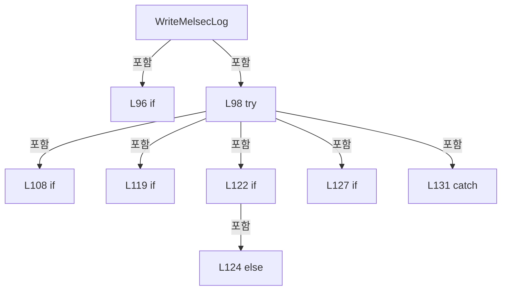

변경 전 점검: 입력/반환 타입, 위 호출자, 예외/취소 경로, 공유 상태와 저장·전송 소비자를 함께 확인합니다. 값의 단위나 물리 방향을 이름만으로 확정하지 않습니다.

### MethodDeclaration `BuildMelsecLogHeader` · L138–139

[Drilling.Common/Interface/Melsec/CMelsec.InterfaceLog.cs:138–139](https://github.com/kjuws10-rgb/A3Drilling/blob/5aee8e58439c9b455cae7c9593c9be986c3e682e/Drilling.Common/Interface/Melsec/CMelsec.InterfaceLog.cs#L138-L139)

| 항목 | 실제 추출 값 |
| --- | --- |
| 서명 | string Drilling.Common.Interface.CMelsec.BuildMelsecLogHeader(Drilling.Common.Interface.ST_MELSEC_MAP_DATA, string, Drilling.Common.Interface.CMelsec.ST_MELSEC_ADDRESS, int) |
| 접근/수식자 | Private / private, static |
| 반환/값 타입 | string |
| 소속 타입 | NamedType:Drilling.Common.Interface.CMelsec |

입력 계약:

| 이름 | 타입 | 전달 | 선택/기본값 |
| --- | --- | --- | --- |
| data | Drilling.Common.Interface.ST_MELSEC_MAP_DATA | None | False /  |
| operation | string | None | False /  |
| address | Drilling.Common.Interface.CMelsec.ST_MELSEC_ADDRESS | None | False /  |
| wordCount | int | None | False /  |

정적 호출자로 확인된 위치:

| 호출 파일/행 | 호출 표현식 | 런타임 분기 가능 |
| --- | --- | --- |
| [Drilling.Common/Interface/Melsec/CMelsec.cs:1662–1662](https://github.com/kjuws10-rgb/A3Drilling/blob/5aee8e58439c9b455cae7c9593c9be986c3e682e/Drilling.Common/Interface/Melsec/CMelsec.cs#L1662-L1662) | BuildMelsecLogHeader | False |
| [Drilling.Common/Interface/Melsec/CMelsec.cs:1773–1773](https://github.com/kjuws10-rgb/A3Drilling/blob/5aee8e58439c9b455cae7c9593c9be986c3e682e/Drilling.Common/Interface/Melsec/CMelsec.cs#L1773-L1773) | BuildMelsecLogHeader | False |

호출하는 대상과 해석 범위:

| 원본 행 | 표현식 | 분석 상태 | 대상/소스 위치 |
| --- | --- | --- | --- |
| 139 | FormatMelsecLogHeader | resolved | string Drilling.Common.Interface.CMelsec.FormatMelsecLogHeader(Drilling.Common.Interface.ST_MELSEC_MAP_DATA, string, Drilling.Common.Interface.CMelsec.ST_MELSEC_ADDRESS, int, string?) · Drilling.Common/Interface/Melsec/CMelsec.InterfaceLog.cs:141 |

본문의 실제 연산·분기·예외·반환 순서(원문 위치 순):

| 원본 행 | 종류 | 주석 해설 |
| --- | --- | --- |
| 139 | call | 함수·델리게이트 또는 객체 생성자를 호출합니다: FormatMelsecLogHeader(data, operation, address, wordCount, null) |

변경 전 점검: 입력/반환 타입, 위 호출자, 예외/취소 경로, 공유 상태와 저장·전송 소비자를 함께 확인합니다. 값의 단위나 물리 방향을 이름만으로 확정하지 않습니다.

### MethodDeclaration `FormatMelsecLogHeader` · L141–148

[Drilling.Common/Interface/Melsec/CMelsec.InterfaceLog.cs:141–148](https://github.com/kjuws10-rgb/A3Drilling/blob/5aee8e58439c9b455cae7c9593c9be986c3e682e/Drilling.Common/Interface/Melsec/CMelsec.InterfaceLog.cs#L141-L148)

| 항목 | 실제 추출 값 |
| --- | --- |
| 서명 | string Drilling.Common.Interface.CMelsec.FormatMelsecLogHeader(Drilling.Common.Interface.ST_MELSEC_MAP_DATA, string, Drilling.Common.Interface.CMelsec.ST_MELSEC_ADDRESS, int, string?) |
| 접근/수식자 | Private / private, static |
| 반환/값 타입 | string |
| 소속 타입 | NamedType:Drilling.Common.Interface.CMelsec |

입력 계약:

| 이름 | 타입 | 전달 | 선택/기본값 |
| --- | --- | --- | --- |
| data | Drilling.Common.Interface.ST_MELSEC_MAP_DATA | None | False /  |
| operation | string | None | False /  |
| address | Drilling.Common.Interface.CMelsec.ST_MELSEC_ADDRESS | None | False /  |
| wordCount | int | None | False /  |
| value | string? | None | False /  |

정적 호출자로 확인된 위치:

| 호출 파일/행 | 호출 표현식 | 런타임 분기 가능 |
| --- | --- | --- |
| [Drilling.Common/Interface/Melsec/CMelsec.InterfaceLog.cs:104–105](https://github.com/kjuws10-rgb/A3Drilling/blob/5aee8e58439c9b455cae7c9593c9be986c3e682e/Drilling.Common/Interface/Melsec/CMelsec.InterfaceLog.cs#L104-L105) | FormatMelsecLogHeader | False |
| [Drilling.Common/Interface/Melsec/CMelsec.InterfaceLog.cs:139–139](https://github.com/kjuws10-rgb/A3Drilling/blob/5aee8e58439c9b455cae7c9593c9be986c3e682e/Drilling.Common/Interface/Melsec/CMelsec.InterfaceLog.cs#L139-L139) | FormatMelsecLogHeader | False |

호출하는 대상과 해석 범위:

| 원본 행 | 표현식 | 분석 상태 | 대상/소스 위치 |
| --- | --- | --- | --- |
| 142 | ResolveMelsecLogArea | resolved | string Drilling.Common.Interface.CMelsec.ResolveMelsecLogArea(Drilling.Common.Interface.ST_MELSEC_MAP_DATA) · Drilling.Common/Interface/Melsec/CMelsec.InterfaceLog.cs:189 |
| 147 | FormatMelsecLogAddress | resolved | string Drilling.Common.Interface.CMelsec.FormatMelsecLogAddress(Drilling.Common.Interface.CMelsec.ST_MELSEC_ADDRESS) · Drilling.Common/Interface/Melsec/CMelsec.InterfaceLog.cs:311 |
| 148 | wordCount.ToString | resolved | string int.ToString(System.IFormatProvider?) |

본문의 실제 연산·분기·예외·반환 순서(원문 위치 순):

| 원본 행 | 종류 | 주석 해설 |
| --- | --- | --- |
| 142 | call | 함수·델리게이트 또는 객체 생성자를 호출합니다: ResolveMelsecLogArea(data) |
| 142 | switch-expression | 값별 결과식을 선택합니다: ResolveMelsecLogArea(data) switch { "PROCESS" => "가공(PROCESS)", "STAGE" => "Stage(물류)", "VISION" => "Vision(비전)", "OPTIC" => "광학(OPTIC)", _ => "미분류(UNKNOWN)" } |
| 146 | switch-expression | 값별 결과식을 선택합니다: operation switch { "WRITE" => "쓰기", "READBACK" => "쓰기 후 읽기", "READ" => "읽기", _ => operation } |
| 147 | call | 함수·델리게이트 또는 객체 생성자를 호출합니다: FormatMelsecLogAddress(address) |
| 147 | conditional-expression | 조건에 따라 결과식을 선택합니다: value is null ? "" : " &#124; 값=" + value |
| 148 | call | 함수·델리게이트 또는 객체 생성자를 호출합니다: wordCount.ToString(CultureInfo.InvariantCulture) |

제어 구문의 포함 구조(실제 실행 순서/CFG가 아닌 구문 탐색 그림):

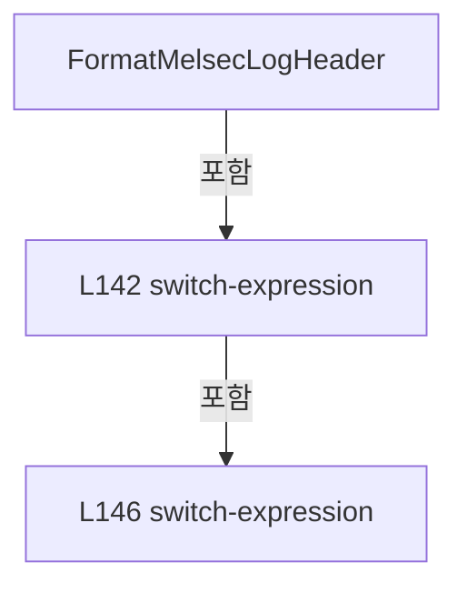

변경 전 점검: 입력/반환 타입, 위 호출자, 예외/취소 경로, 공유 상태와 저장·전송 소비자를 함께 확인합니다. 값의 단위나 물리 방향을 이름만으로 확정하지 않습니다.

### MethodDeclaration `DescribeMelsecLogType` · L150–156

[Drilling.Common/Interface/Melsec/CMelsec.InterfaceLog.cs:150–156](https://github.com/kjuws10-rgb/A3Drilling/blob/5aee8e58439c9b455cae7c9593c9be986c3e682e/Drilling.Common/Interface/Melsec/CMelsec.InterfaceLog.cs#L150-L156)

| 항목 | 실제 추출 값 |
| --- | --- |
| 서명 | string Drilling.Common.Interface.CMelsec.DescribeMelsecLogType(Drilling.Common.Interface.EN_MELSEC_DATA_TYPE) |
| 접근/수식자 | Private / private, static |
| 반환/값 타입 | string |
| 소속 타입 | NamedType:Drilling.Common.Interface.CMelsec |

입력 계약:

| 이름 | 타입 | 전달 | 선택/기본값 |
| --- | --- | --- | --- |
| type | Drilling.Common.Interface.EN_MELSEC_DATA_TYPE | None | False /  |

정적 호출자로 확인된 위치:

| 호출 파일/행 | 호출 표현식 | 런타임 분기 가능 |
| --- | --- | --- |
| [Drilling.Common/Interface/Melsec/CMelsec.InterfaceLog.cs:113–113](https://github.com/kjuws10-rgb/A3Drilling/blob/5aee8e58439c9b455cae7c9593c9be986c3e682e/Drilling.Common/Interface/Melsec/CMelsec.InterfaceLog.cs#L113-L113) | DescribeMelsecLogType | False |

본문의 실제 연산·분기·예외·반환 순서(원문 위치 순):

| 원본 행 | 종류 | 주석 해설 |
| --- | --- | --- |
| 150 | switch-expression | 값별 결과식을 선택합니다: type switch { EN_MELSEC_DATA_TYPE.DWord or EN_MELSEC_DATA_TYPE.Double => "S32(부호 있는 32비트, 2WORD씩)", EN_MELSEC_DATA_TYPE.Word => "U16(부호 없는 16비트, 1WORD)", EN_MELSEC_DATA_TYPE.Float => "F32(실수, 2WORD씩)", EN_MELSEC_DATA_TYPE.Bit => " |

제어 구문의 포함 구조(실제 실행 순서/CFG가 아닌 구문 탐색 그림):

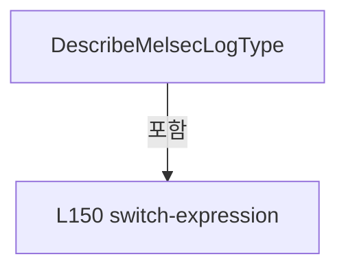

변경 전 점검: 입력/반환 타입, 위 호출자, 예외/취소 경로, 공유 상태와 저장·전송 소비자를 함께 확인합니다. 값의 단위나 물리 방향을 이름만으로 확정하지 않습니다.

### MethodDeclaration `DescribeMelsecLogQuality` · L158–163

[Drilling.Common/Interface/Melsec/CMelsec.InterfaceLog.cs:158–163](https://github.com/kjuws10-rgb/A3Drilling/blob/5aee8e58439c9b455cae7c9593c9be986c3e682e/Drilling.Common/Interface/Melsec/CMelsec.InterfaceLog.cs#L158-L163)

| 항목 | 실제 추출 값 |
| --- | --- |
| 서명 | string Drilling.Common.Interface.CMelsec.DescribeMelsecLogQuality(Drilling.Common.Interface.EN_MELSEC_CACHE_STATE) |
| 접근/수식자 | Private / private, static |
| 반환/값 타입 | string |
| 소속 타입 | NamedType:Drilling.Common.Interface.CMelsec |

입력 계약:

| 이름 | 타입 | 전달 | 선택/기본값 |
| --- | --- | --- | --- |
| quality | Drilling.Common.Interface.EN_MELSEC_CACHE_STATE | None | False /  |

정적 호출자로 확인된 위치:

| 호출 파일/행 | 호출 표현식 | 런타임 분기 가능 |
| --- | --- | --- |
| [Drilling.Common/Interface/Melsec/CMelsec.InterfaceLog.cs:107–107](https://github.com/kjuws10-rgb/A3Drilling/blob/5aee8e58439c9b455cae7c9593c9be986c3e682e/Drilling.Common/Interface/Melsec/CMelsec.InterfaceLog.cs#L107-L107) | DescribeMelsecLogQuality | False |
| [Drilling.Common/Interface/Melsec/CMelsec.InterfaceLog.cs:109–109](https://github.com/kjuws10-rgb/A3Drilling/blob/5aee8e58439c9b455cae7c9593c9be986c3e682e/Drilling.Common/Interface/Melsec/CMelsec.InterfaceLog.cs#L109-L109) | DescribeMelsecLogQuality | False |

호출하는 대상과 해석 범위:

| 원본 행 | 표현식 | 분석 상태 | 대상/소스 위치 |
| --- | --- | --- | --- |
| 162 | quality.ToString | resolved · 동적 구현 선택 가능 | string System.Enum.ToString() |

본문의 실제 연산·분기·예외·반환 순서(원문 위치 순):

| 원본 행 | 종류 | 주석 해설 |
| --- | --- | --- |
| 158 | switch-expression | 값별 결과식을 선택합니다: quality switch { EN_MELSEC_CACHE_STATE.Valid => "정상(VALID)", EN_MELSEC_CACHE_STATE.Pending => "읽기 대기(PENDING)", EN_MELSEC_CACHE_STATE.Stale => "최근 수신 없음(STALE)", EN_MELSEC_CACHE_STATE.Error => "수신 오류(ERROR)", EN_MELSEC_CACHE_STATE |
| 162 | call | 함수·델리게이트 또는 객체 생성자를 호출합니다: quality.ToString() |

제어 구문의 포함 구조(실제 실행 순서/CFG가 아닌 구문 탐색 그림):

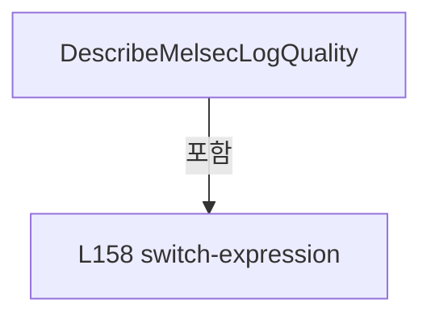

변경 전 점검: 입력/반환 타입, 위 호출자, 예외/취소 경로, 공유 상태와 저장·전송 소비자를 함께 확인합니다. 값의 단위나 물리 방향을 이름만으로 확정하지 않습니다.

### MethodDeclaration `DescribeMelsecLogSource` · L165–169

[Drilling.Common/Interface/Melsec/CMelsec.InterfaceLog.cs:165–169](https://github.com/kjuws10-rgb/A3Drilling/blob/5aee8e58439c9b455cae7c9593c9be986c3e682e/Drilling.Common/Interface/Melsec/CMelsec.InterfaceLog.cs#L165-L169)

| 항목 | 실제 추출 값 |
| --- | --- |
| 서명 | string Drilling.Common.Interface.CMelsec.DescribeMelsecLogSource(string) |
| 접근/수식자 | Private / private, static |
| 반환/값 타입 | string |
| 소속 타입 | NamedType:Drilling.Common.Interface.CMelsec |

입력 계약:

| 이름 | 타입 | 전달 | 선택/기본값 |
| --- | --- | --- | --- |
| source | string | None | False /  |

정적 호출자로 확인된 위치:

| 호출 파일/행 | 호출 표현식 | 런타임 분기 가능 |
| --- | --- | --- |
| [Drilling.Common/Interface/Melsec/CMelsec.InterfaceLog.cs:117–117](https://github.com/kjuws10-rgb/A3Drilling/blob/5aee8e58439c9b455cae7c9593c9be986c3e682e/Drilling.Common/Interface/Melsec/CMelsec.InterfaceLog.cs#L117-L117) | DescribeMelsecLogSource | False |

본문의 실제 연산·분기·예외·반환 순서(원문 위치 순):

| 원본 행 | 종류 | 주석 해설 |
| --- | --- | --- |
| 165 | switch-expression | 값별 결과식을 선택합니다: source switch { "POLL" => "중앙 폴링(POLL)", "DIRECT" => "일반 요청(DIRECT)", "WRITE_CONFIRM" => "쓰기 후 확인(WRITE_CONFIRM)", "ARRAY" => "배열 처리(ARRAY)", _ => source } |

제어 구문의 포함 구조(실제 실행 순서/CFG가 아닌 구문 탐색 그림):

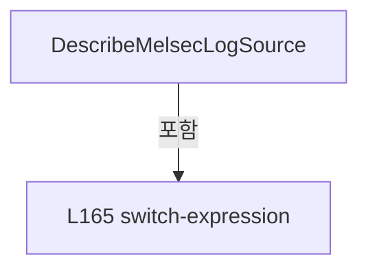

변경 전 점검: 입력/반환 타입, 위 호출자, 예외/취소 경로, 공유 상태와 저장·전송 소비자를 함께 확인합니다. 값의 단위나 물리 방향을 이름만으로 확정하지 않습니다.

### MethodDeclaration `DescribeMelsecLogResult` · L171–178

[Drilling.Common/Interface/Melsec/CMelsec.InterfaceLog.cs:171–178](https://github.com/kjuws10-rgb/A3Drilling/blob/5aee8e58439c9b455cae7c9593c9be986c3e682e/Drilling.Common/Interface/Melsec/CMelsec.InterfaceLog.cs#L171-L178)

| 항목 | 실제 추출 값 |
| --- | --- |
| 서명 | string Drilling.Common.Interface.CMelsec.DescribeMelsecLogResult(Drilling.Common.Interface.CMelsec.MelsecLogEntry) |
| 접근/수식자 | Private / private, static |
| 반환/값 타입 | string |
| 소속 타입 | NamedType:Drilling.Common.Interface.CMelsec |

입력 계약:

| 이름 | 타입 | 전달 | 선택/기본값 |
| --- | --- | --- | --- |
| entry | Drilling.Common.Interface.CMelsec.MelsecLogEntry | None | False /  |

정적 호출자로 확인된 위치:

| 호출 파일/행 | 호출 표현식 | 런타임 분기 가능 |
| --- | --- | --- |
| [Drilling.Common/Interface/Melsec/CMelsec.InterfaceLog.cs:106–106](https://github.com/kjuws10-rgb/A3Drilling/blob/5aee8e58439c9b455cae7c9593c9be986c3e682e/Drilling.Common/Interface/Melsec/CMelsec.InterfaceLog.cs#L106-L106) | DescribeMelsecLogResult | False |

본문의 실제 연산·분기·예외·반환 순서(원문 위치 순):

| 원본 행 | 종류 | 주석 해설 |
| --- | --- | --- |
| 171 | switch-expression | 값별 결과식을 선택합니다: entry.Result switch { "WRITE_ACCEPTED" => "쓰기 전송 완료(상대 동작 완료 아님)", "READBACK_RECEIVED" => "쓰기 후 값 수신(일치 여부는 별도 확인)", "RECEIVED" => "값 수신 완료", "WAITING_FOR_READ" when entry.Detail == "Waiting for feedback after write." => "쓰기 후 읽기  |

제어 구문의 포함 구조(실제 실행 순서/CFG가 아닌 구문 탐색 그림):

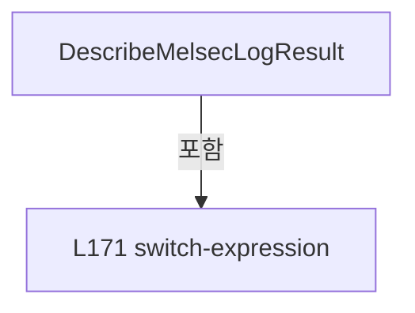

변경 전 점검: 입력/반환 타입, 위 호출자, 예외/취소 경로, 공유 상태와 저장·전송 소비자를 함께 확인합니다. 값의 단위나 물리 방향을 이름만으로 확정하지 않습니다.

### MethodDeclaration `DescribeMelsecLogDetail` · L180–187

[Drilling.Common/Interface/Melsec/CMelsec.InterfaceLog.cs:180–187](https://github.com/kjuws10-rgb/A3Drilling/blob/5aee8e58439c9b455cae7c9593c9be986c3e682e/Drilling.Common/Interface/Melsec/CMelsec.InterfaceLog.cs#L180-L187)

| 항목 | 실제 추출 값 |
| --- | --- |
| 서명 | string Drilling.Common.Interface.CMelsec.DescribeMelsecLogDetail(string) |
| 접근/수식자 | Private / private, static |
| 반환/값 타입 | string |
| 소속 타입 | NamedType:Drilling.Common.Interface.CMelsec |

입력 계약:

| 이름 | 타입 | 전달 | 선택/기본값 |
| --- | --- | --- | --- |
| detail | string | None | False /  |

정적 호출자로 확인된 위치:

| 호출 파일/행 | 호출 표현식 | 런타임 분기 가능 |
| --- | --- | --- |
| [Drilling.Common/Interface/Melsec/CMelsec.InterfaceLog.cs:126–126](https://github.com/kjuws10-rgb/A3Drilling/blob/5aee8e58439c9b455cae7c9593c9be986c3e682e/Drilling.Common/Interface/Melsec/CMelsec.InterfaceLog.cs#L126-L126) | DescribeMelsecLogDetail | False |

본문의 실제 연산·분기·예외·반환 순서(원문 위치 순):

| 원본 행 | 종류 | 주석 해설 |
| --- | --- | --- |
| 180 | switch-expression | 값별 결과식을 선택합니다: detail switch { "Waiting for feedback after write." or "Waiting for MELSEC feedback." => "", "MELSEC communication is stopped." => "MELSEC 통신이 중지되었습니다.", "MELSEC communication line is not open." => "MELSEC 통신 채널이 열리지 않았습니다.", "MEL |

제어 구문의 포함 구조(실제 실행 순서/CFG가 아닌 구문 탐색 그림):

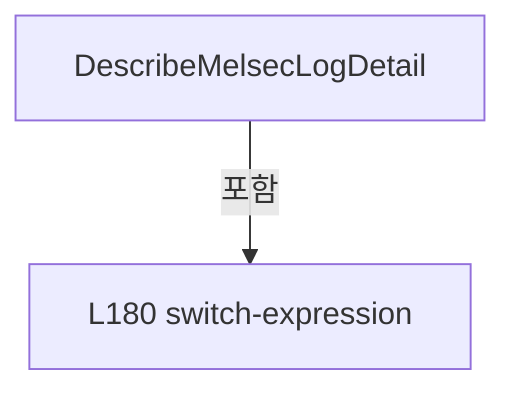

변경 전 점검: 입력/반환 타입, 위 호출자, 예외/취소 경로, 공유 상태와 저장·전송 소비자를 함께 확인합니다. 값의 단위나 물리 방향을 이름만으로 확정하지 않습니다.

### MethodDeclaration `ResolveMelsecLogArea` · L189–211

[Drilling.Common/Interface/Melsec/CMelsec.InterfaceLog.cs:189–211](https://github.com/kjuws10-rgb/A3Drilling/blob/5aee8e58439c9b455cae7c9593c9be986c3e682e/Drilling.Common/Interface/Melsec/CMelsec.InterfaceLog.cs#L189-L211)

| 항목 | 실제 추출 값 |
| --- | --- |
| 서명 | string Drilling.Common.Interface.CMelsec.ResolveMelsecLogArea(Drilling.Common.Interface.ST_MELSEC_MAP_DATA) |
| 접근/수식자 | Private / private, static |
| 반환/값 타입 | string |
| 소속 타입 | NamedType:Drilling.Common.Interface.CMelsec |

입력 계약:

| 이름 | 타입 | 전달 | 선택/기본값 |
| --- | --- | --- | --- |
| data | Drilling.Common.Interface.ST_MELSEC_MAP_DATA | None | False /  |

정적 호출자로 확인된 위치:

| 호출 파일/행 | 호출 표현식 | 런타임 분기 가능 |
| --- | --- | --- |
| [Drilling.Common/Interface/Melsec/CMelsec.InterfaceLog.cs:142–142](https://github.com/kjuws10-rgb/A3Drilling/blob/5aee8e58439c9b455cae7c9593c9be986c3e682e/Drilling.Common/Interface/Melsec/CMelsec.InterfaceLog.cs#L142-L142) | ResolveMelsecLogArea | False |

호출하는 대상과 해석 범위:

| 원본 행 | 표현식 | 분석 상태 | 대상/소스 위치 |
| --- | --- | --- | --- |
| 193 | Regex.Match | resolved | System.Text.RegularExpressions.Match System.Text.RegularExpressions.Regex.Match(string, string, System.Text.RegularExpressions.RegexOptions) |
| 195 | section.Groups["owner"].Value.ToUpperInvariant | resolved | string string.ToUpperInvariant() |
| 204 | data.Id.StartsWith | resolved | bool string.StartsWith(string, System.StringComparison) |
| 205 | data.Id.Equals | resolved | bool string.Equals(string?, System.StringComparison) |
| 207 | data.Id.StartsWith | resolved | bool string.StartsWith(string, System.StringComparison) |
| 208 | data.Id.Equals | resolved | bool string.Equals(string?, System.StringComparison) |

본문의 실제 연산·분기·예외·반환 순서(원문 위치 순):

| 원본 행 | 종류 | 주석 해설 |
| --- | --- | --- |
| 193 | call | 함수·델리게이트 또는 객체 생성자를 호출합니다: Regex.Match(data.Description ?? "", @"^Spec\s+[0-9.]+\s+(?:legacy;.*?Spec\s+[0-9.]+\s+)?(?:Config_Map\s+Word\s+Detail\s*\((?<owner>가공&#124;물류&#124;비전&#124;광학&#124;Optic)\)&#124;(?<owner>가공&#124;물류&#124;비전&#124;광학&#124;Optic)(?:\s&#124;$))", RegexOptions.IgnoreCase &#124; Reg… |
| 193 | local-declaration | 지역 변수를 선언합니다: var section = Regex.Match(data.Description ?? "", @"^Spec\s+[0-9.]+\s+(?:legacy;.*?Spec\s+[0-9.]+\s+)?(?:Config_Map\s+Word\s+Detail\s*\((?<owner>가공&#124;물류&#124;비전&#124;광학&#124;Optic)\)&#124;(?<owner>가공&#124;물류&#124;비전&#124;광학&#124;Optic)(?:\s&#124;$))", RegexOptions.IgnoreCase &#124; |
| 193 | variable-initializer | 변수의 초기값을 지정합니다: section = Regex.Match(data.Description ?? "", @"^Spec\s+[0-9.]+\s+(?:legacy;.*?Spec\s+[0-9.]+\s+)?(?:Config_Map\s+Word\s+Detail\s*\((?<owner>가공&#124;물류&#124;비전&#124;광학&#124;Optic)\)&#124;(?<owner>가공&#124;물류&#124;비전&#124;광학&#124;Optic)(?:\s&#124;$))", RegexOptions.IgnoreCase &#124; Reg |
| 194 | if | 조건에 따라 분기합니다: if (section.Success) |
| 195 | call | 함수·델리게이트 또는 객체 생성자를 호출합니다: section.Groups["owner"].Value.ToUpperInvariant() |
| 195 | return | 호출자에게 값 또는 제어를 반환합니다: return section.Groups["owner"].Value.ToUpperInvariant() switch { "가공" => "PROCESS", "물류" => "STAGE", "비전" => "VISION", "광학" or "OPTIC" => "OPTIC", _ => "UNKNOWN" }; |
| 195 | switch-expression | 값별 결과식을 선택합니다: section.Groups["owner"].Value.ToUpperInvariant() switch { "가공" => "PROCESS", "물류" => "STAGE", "비전" => "VISION", "광학" or "OPTIC" => "OPTIC", _ => "UNKNOWN" } |
| 204 | call | 함수·델리게이트 또는 객체 생성자를 호출합니다: data.Id.StartsWith("HANDSHAKE_PRC_", StringComparison.OrdinalIgnoreCase) |
| 204 | if | 조건에 따라 분기합니다: if (data.Id.StartsWith("HANDSHAKE_PRC_", StringComparison.OrdinalIgnoreCase) &#124;&#124; data.Id.Equals("SDC_REVIEW_RETRY_REQUEST", StringComparison.OrdinalIgnoreCase)) |
| 205 | call | 함수·델리게이트 또는 객체 생성자를 호출합니다: data.Id.Equals("SDC_REVIEW_RETRY_REQUEST", StringComparison.OrdinalIgnoreCase) |
| 206 | return | 호출자에게 값 또는 제어를 반환합니다: return "PROCESS"; |
| 207 | call | 함수·델리게이트 또는 객체 생성자를 호출합니다: data.Id.StartsWith("HANDSHAKE_STG_", StringComparison.OrdinalIgnoreCase) |
| 207 | if | 조건에 따라 분기합니다: if (data.Id.StartsWith("HANDSHAKE_STG_", StringComparison.OrdinalIgnoreCase) &#124;&#124; data.Id.Equals(StageAlignBusyWordId, StringComparison.OrdinalIgnoreCase)) |
| 208 | call | 함수·델리게이트 또는 객체 생성자를 호출합니다: data.Id.Equals(StageAlignBusyWordId, StringComparison.OrdinalIgnoreCase) |
| 209 | return | 호출자에게 값 또는 제어를 반환합니다: return "STAGE"; |
| 210 | return | 호출자에게 값 또는 제어를 반환합니다: return "UNKNOWN"; |

제어 구문의 포함 구조(실제 실행 순서/CFG가 아닌 구문 탐색 그림):

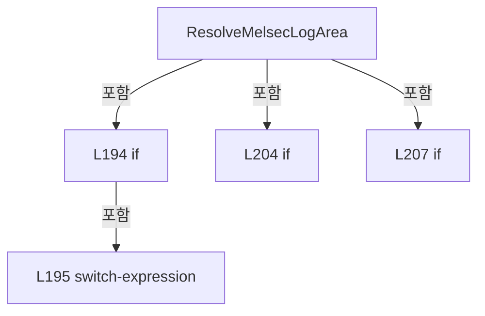

변경 전 점검: 입력/반환 타입, 위 호출자, 예외/취소 경로, 공유 상태와 저장·전송 소비자를 함께 확인합니다. 값의 단위나 물리 방향을 이름만으로 확정하지 않습니다.

### MethodDeclaration `FormatMelsecLogWords` · L213–264

[Drilling.Common/Interface/Melsec/CMelsec.InterfaceLog.cs:213–264](https://github.com/kjuws10-rgb/A3Drilling/blob/5aee8e58439c9b455cae7c9593c9be986c3e682e/Drilling.Common/Interface/Melsec/CMelsec.InterfaceLog.cs#L213-L264)

| 항목 | 실제 추출 값 |
| --- | --- |
| 서명 | string Drilling.Common.Interface.CMelsec.FormatMelsecLogWords(Drilling.Common.Interface.ST_MELSEC_MAP_DATA, Drilling.Common.Interface.CMelsec.ST_MELSEC_ADDRESS, ushort[], bool) |
| 접근/수식자 | Private / private, static |
| 반환/값 타입 | string |
| 소속 타입 | NamedType:Drilling.Common.Interface.CMelsec |

입력 계약:

| 이름 | 타입 | 전달 | 선택/기본값 |
| --- | --- | --- | --- |
| data | Drilling.Common.Interface.ST_MELSEC_MAP_DATA | None | False /  |
| address | Drilling.Common.Interface.CMelsec.ST_MELSEC_ADDRESS | None | False /  |
| words | ushort[] | None | False /  |
| array | bool | None | False /  |

정적 호출자로 확인된 위치:

| 호출 파일/행 | 호출 표현식 | 런타임 분기 가능 |
| --- | --- | --- |
| [Drilling.Common/Interface/Melsec/CMelsec.InterfaceLog.cs:123–123](https://github.com/kjuws10-rgb/A3Drilling/blob/5aee8e58439c9b455cae7c9593c9be986c3e682e/Drilling.Common/Interface/Melsec/CMelsec.InterfaceLog.cs#L123-L123) | FormatMelsecLogWords | False |

호출하는 대상과 해석 범위:

| 원본 행 | 표현식 | 분석 상태 | 대상/소스 위치 |
| --- | --- | --- | --- |
| 217 | data.ReadScale.ToString | resolved | string double.ToString(string?, System.IFormatProvider?) |
| 226 | EscapeMelsecLogText | resolved | string Drilling.Common.Interface.CMelsec.EscapeMelsecLogText(string) · Drilling.Common/Interface/Melsec/CMelsec.InterfaceLog.cs:318 |
| 226 | Encoding.ASCII.GetString(bytes).TrimEnd | resolved | string string.TrimEnd(params System.ReadOnlySpan<char>) |
| 226 | Encoding.ASCII.GetString | resolved · 동적 구현 선택 가능 | string System.Text.Encoding.GetString(byte[]) |
| 227 | string.Join | resolved | string string.Join(string?, System.Collections.Generic.IEnumerable<string?>) |
| 227 | words.Select | resolved | System.Collections.Generic.IEnumerable<string> System.Collections.Generic.IEnumerable<ushort>.Select<ushort, string>(System.Func<ushort, string>) |
| 227 | word.ToString | resolved | string ushort.ToString(System.IFormatProvider?) |
| 233 | words[0].ToString | resolved | string ushort.ToString(System.IFormatProvider?) |
| 233 | bit.ToString | resolved | string int.ToString(System.IFormatProvider?) |
| 236 | FormatMelsecLogNumber | resolved | string Drilling.Common.Interface.CMelsec.FormatMelsecLogNumber(double) · Drilling.Common/Interface/Melsec/CMelsec.InterfaceLog.cs:274 |
| 237 | FormatMelsecLogSignalState | resolved | string Drilling.Common.Interface.CMelsec.FormatMelsecLogSignalState(Drilling.Common.Interface.ST_MELSEC_MAP_DATA, double) · Drilling.Common/Interface/Melsec/CMelsec.InterfaceLog.cs:266 |
| 237 | words[0].ToString | resolved | string ushort.ToString(System.IFormatProvider?) |
| 242 | FormatMelsecLogNumber | resolved | string Drilling.Common.Interface.CMelsec.FormatMelsecLogNumber(double) · Drilling.Common/Interface/Melsec/CMelsec.InterfaceLog.cs:274 |
| 242 | WordsToFloat | resolved | float Drilling.Common.Interface.CMelsec.WordsToFloat(System.Collections.Generic.IReadOnlyList<ushort>) · Drilling.Common/Interface/Melsec/CMelsec.cs:2111 |
| 243 | WordsToInt32(words).ToString | resolved | string int.ToString(System.IFormatProvider?) |
| 243 | WordsToInt32 | resolved | int Drilling.Common.Interface.CMelsec.WordsToInt32(System.Collections.Generic.IReadOnlyList<ushort>) · Drilling.Common/Interface/Melsec/CMelsec.cs:2089 |
| 244 | WordsToFloat(words).ToString | resolved | string float.ToString(string?, System.IFormatProvider?) |
| 244 | WordsToFloat | resolved | float Drilling.Common.Interface.CMelsec.WordsToFloat(System.Collections.Generic.IReadOnlyList<ushort>) · Drilling.Common/Interface/Melsec/CMelsec.cs:2111 |
| 246 | FormatMelsecLogNumber | resolved | string Drilling.Common.Interface.CMelsec.FormatMelsecLogNumber(double) · Drilling.Common/Interface/Melsec/CMelsec.InterfaceLog.cs:274 |
| 246 | WordsToInt32 | resolved | int Drilling.Common.Interface.CMelsec.WordsToInt32(System.Collections.Generic.IReadOnlyList<ushort>) · Drilling.Common/Interface/Melsec/CMelsec.cs:2089 |
| 247 | FormatMelsecLogSignalState | resolved | string Drilling.Common.Interface.CMelsec.FormatMelsecLogSignalState(Drilling.Common.Interface.ST_MELSEC_MAP_DATA, double) · Drilling.Common/Interface/Melsec/CMelsec.InterfaceLog.cs:266 |
| 247 | WordsToInt32 | resolved | int Drilling.Common.Interface.CMelsec.WordsToInt32(System.Collections.Generic.IReadOnlyList<ushort>) · Drilling.Common/Interface/Melsec/CMelsec.cs:2089 |
| 248 | WordsToInt32(words).ToString | resolved | string int.ToString(System.IFormatProvider?) |
| 248 | WordsToInt32 | resolved | int Drilling.Common.Interface.CMelsec.WordsToInt32(System.Collections.Generic.IReadOnlyList<ushort>) · Drilling.Common/Interface/Melsec/CMelsec.cs:2089 |
| 249 | string.Join | resolved | string string.Join(string?, System.Collections.Generic.IEnumerable<string?>) |
| 249 | words.Skip(2).Select | resolved | System.Collections.Generic.IEnumerable<string> System.Collections.Generic.IEnumerable<ushort>.Select<ushort, string>(System.Func<ushort, string>) |
| 249 | words.Skip | resolved | System.Collections.Generic.IEnumerable<ushort> System.Collections.Generic.IEnumerable<ushort>.Skip<ushort>(int) |
| 249 | word.ToString | resolved | string ushort.ToString(System.IFormatProvider?) |
| 251 | new StringBuilder("개수=").Append((words.Length / 2).ToString(CultureInfo.InvariantCulture)) .Append(" &#124; 읽기계수=").Append(scale).Append | resolved | System.Text.StringBuilder System.Text.StringBuilder.Append(string?) |
| 251 | new StringBuilder("개수=").Append((words.Length / 2).ToString(CultureInfo.InvariantCulture)) .Append(" &#124; 읽기계수=").Append | resolved | System.Text.StringBuilder System.Text.StringBuilder.Append(string?) |
| 251 | new StringBuilder("개수=").Append((words.Length / 2).ToString(CultureInfo.InvariantCulture)) .Append | resolved | System.Text.StringBuilder System.Text.StringBuilder.Append(string?) |
| 251 | new StringBuilder("개수=").Append | resolved | System.Text.StringBuilder System.Text.StringBuilder.Append(string?) |
| 251 | new StringBuilder | resolved | System.Text.StringBuilder.StringBuilder(string?) |
| 251 | (words.Length / 2).ToString | resolved | string int.ToString(System.IFormatProvider?) |
| 253 | ParseAddress | resolved | Drilling.Common.Interface.CMelsec.ST_MELSEC_ADDRESS Drilling.Common.Interface.CMelsec.ParseAddress(string) · Drilling.Common/Interface/Melsec/CMelsec.cs:1980 |
| 256 | result.Append(Environment.NewLine).Append | resolved | System.Text.StringBuilder System.Text.StringBuilder.Append(string?) |
| 256 | result.Append | resolved | System.Text.StringBuilder System.Text.StringBuilder.Append(string?) |
| 258 | result.Append('[').Append((firstIndex + offset / 2).ToString(CultureInfo.InvariantCulture)).Append("] ") .Append(FormatMelsecLogAddress(address with { Number = address.Number + offset })) .Append(" &#124; 값=").Append(FormatMelsecLogNumber(raw * data.ReadScale)) .Append(" &#124; RAW=").Append(raw.ToString(CultureInfo.InvariantCulture)).Append | resolved | System.Text.StringBuilder System.Text.StringBuilder.Append(string?) |
| 258 | result.Append('[').Append((firstIndex + offset / 2).ToString(CultureInfo.InvariantCulture)).Append("] ") .Append(FormatMelsecLogAddress(address with { Number = address.Number + offset })) .Append(" &#124; 값=").Append(FormatMelsecLogNumber(raw * data.ReadScale)) .Append(" &#124; RAW=").Append | resolved | System.Text.StringBuilder System.Text.StringBuilder.Append(string?) |
| 258 | result.Append('[').Append((firstIndex + offset / 2).ToString(CultureInfo.InvariantCulture)).Append("] ") .Append(FormatMelsecLogAddress(address with { Number = address.Number + offset })) .Append(" &#124; 값=").Append(FormatMelsecLogNumber(raw * data.ReadScale)) .Append | resolved | System.Text.StringBuilder System.Text.StringBuilder.Append(string?) |
| 258 | result.Append('[').Append((firstIndex + offset / 2).ToString(CultureInfo.InvariantCulture)).Append("] ") .Append(FormatMelsecLogAddress(address with { Number = address.Number + offset })) .Append(" &#124; 값=").Append | resolved | System.Text.StringBuilder System.Text.StringBuilder.Append(string?) |
| 258 | result.Append('[').Append((firstIndex + offset / 2).ToString(CultureInfo.InvariantCulture)).Append("] ") .Append(FormatMelsecLogAddress(address with { Number = address.Number + offset })) .Append | resolved | System.Text.StringBuilder System.Text.StringBuilder.Append(string?) |
| 258 | result.Append('[').Append((firstIndex + offset / 2).ToString(CultureInfo.InvariantCulture)).Append("] ") .Append | resolved | System.Text.StringBuilder System.Text.StringBuilder.Append(string?) |
| 258 | result.Append('[').Append((firstIndex + offset / 2).ToString(CultureInfo.InvariantCulture)).Append | resolved | System.Text.StringBuilder System.Text.StringBuilder.Append(string?) |
| 258 | result.Append('[').Append | resolved | System.Text.StringBuilder System.Text.StringBuilder.Append(string?) |
| 258 | result.Append | resolved | System.Text.StringBuilder System.Text.StringBuilder.Append(char) |
| 258 | (firstIndex + offset / 2).ToString | resolved | string int.ToString(System.IFormatProvider?) |
| 259 | FormatMelsecLogAddress | resolved | string Drilling.Common.Interface.CMelsec.FormatMelsecLogAddress(Drilling.Common.Interface.CMelsec.ST_MELSEC_ADDRESS) · Drilling.Common/Interface/Melsec/CMelsec.InterfaceLog.cs:311 |
| 260 | FormatMelsecLogNumber | resolved | string Drilling.Common.Interface.CMelsec.FormatMelsecLogNumber(double) · Drilling.Common/Interface/Melsec/CMelsec.InterfaceLog.cs:274 |
| 261 | raw.ToString | resolved | string int.ToString(System.IFormatProvider?) |
| 263 | result.ToString | resolved · 동적 구현 선택 가능 | string System.Text.StringBuilder.ToString() |

본문의 실제 연산·분기·예외·반환 순서(원문 위치 순):

| 원본 행 | 종류 | 주석 해설 |
| --- | --- | --- |
| 215 | if | 조건에 따라 분기합니다: if (words.Length == 0) |
| 216 | return | 호출자에게 값 또는 제어를 반환합니다: return "RAW=N/A &#124; 값=미수신"; |
| 217 | call | 함수·델리게이트 또는 객체 생성자를 호출합니다: data.ReadScale.ToString("R", CultureInfo.InvariantCulture) |
| 217 | local-declaration | 지역 변수를 선언합니다: var scale = data.ReadScale.ToString("R", CultureInfo.InvariantCulture); |
| 217 | variable-initializer | 변수의 초기값을 지정합니다: scale = data.ReadScale.ToString("R", CultureInfo.InvariantCulture) |
| 218 | if | 조건에 따라 분기합니다: if (data.DataType == EN_MELSEC_DATA_TYPE.String) |
| 220 | local-declaration | 지역 변수를 선언합니다: var bytes = new byte[words.Length * 2]; |
| 220 | variable-initializer | 변수의 초기값을 지정합니다: bytes = new byte[words.Length * 2] |
| 221 | variable-initializer | 변수의 초기값을 지정합니다: index = 0 |
| 221 | for | 초기화·조건·증감이 있는 반복입니다: for (var index = 0; index < words.Length; index++) |
| 223 | assignment | 값을 대상에 대입합니다: bytes[index * 2] = (byte)words[index] |
| 224 | assignment | 값을 대상에 대입합니다: bytes[index * 2 + 1] = (byte)(words[index] >> 8) |
| 226 | call | 함수·델리게이트 또는 객체 생성자를 호출합니다: EscapeMelsecLogText(Encoding.ASCII.GetString(bytes).TrimEnd('\0', ' ')) |
| 226 | call | 함수·델리게이트 또는 객체 생성자를 호출합니다: Encoding.ASCII.GetString(bytes).TrimEnd('\0', ' ') |
| 226 | call | 함수·델리게이트 또는 객체 생성자를 호출합니다: Encoding.ASCII.GetString(bytes) |
| 226 | return | 호출자에게 값 또는 제어를 반환합니다: return "값=\"" + EscapeMelsecLogText(Encoding.ASCII.GetString(bytes).TrimEnd('\0', ' ')) + "\" &#124; RAW(U16)=[" + string.Join(",", words.Select(word => word.ToString(CultureInfo.InvariantCulture))) + "] &#124; 인코딩=ASCII"; |
| 227 | call | 함수·델리게이트 또는 객체 생성자를 호출합니다: string.Join(",", words.Select(word => word.ToString(CultureInfo.InvariantCulture))) |
| 227 | call | 함수·델리게이트 또는 객체 생성자를 호출합니다: words.Select(word => word.ToString(CultureInfo.InvariantCulture)) |
| 227 | call | 함수·델리게이트 또는 객체 생성자를 호출합니다: word.ToString(CultureInfo.InvariantCulture) |
| 229 | if | 조건에 따라 분기합니다: if (data.DataType == EN_MELSEC_DATA_TYPE.Bit) |
| 231 | local-declaration | 지역 변수를 선언합니다: var bit = address.BitIndex!.Value; |
| 231 | variable-initializer | 변수의 초기값을 지정합니다: bit = address.BitIndex!.Value |
| 232 | conditional-expression | 조건에 따라 결과식을 선택합니다: (words[0] & (1 << bit)) != 0 ? "1(ON)" : "0(OFF)" |
| 232 | return | 호출자에게 값 또는 제어를 반환합니다: return "값=" + ((words[0] & (1 << bit)) != 0 ? "1(ON)" : "0(OFF)") + " &#124; RAW=" + words[0].ToString(CultureInfo.InvariantCulture) + "(U16) &#124; BIT=" + bit.ToString(CultureInfo.InvariantCulture); |
| 233 | call | 함수·델리게이트 또는 객체 생성자를 호출합니다: words[0].ToString(CultureInfo.InvariantCulture) |
| 233 | call | 함수·델리게이트 또는 객체 생성자를 호출합니다: bit.ToString(CultureInfo.InvariantCulture) |
| 235 | if | 조건에 따라 분기합니다: if (data.DataType == EN_MELSEC_DATA_TYPE.Word) |
| 236 | call | 함수·델리게이트 또는 객체 생성자를 호출합니다: FormatMelsecLogNumber(words[0] * data.ReadScale) |
| 236 | return | 호출자에게 값 또는 제어를 반환합니다: return "값=" + FormatMelsecLogNumber(words[0] * data.ReadScale) + FormatMelsecLogSignalState(data, words[0] * data.ReadScale) + " &#124; RAW=" + words[0].ToString(CultureInfo.InvariantCulture) + "(U16) &#124; 읽기계수=" + scale; |
| 237 | call | 함수·델리게이트 또는 객체 생성자를 호출합니다: FormatMelsecLogSignalState(data, words[0] * data.ReadScale) |
| 237 | call | 함수·델리게이트 또는 객체 생성자를 호출합니다: words[0].ToString(CultureInfo.InvariantCulture) |
| 239 | if | 조건에 따라 분기합니다: if (words.Length < 2) |
| 240 | return | 호출자에게 값 또는 제어를 반환합니다: return "RAW=N/A &#124; 값=미수신 &#124; 원인=2WORD 수신값이 완성되지 않음"; |
| 241 | if | 조건에 따라 분기합니다: if (data.DataType == EN_MELSEC_DATA_TYPE.Float) |
| 242 | call | 함수·델리게이트 또는 객체 생성자를 호출합니다: FormatMelsecLogNumber(WordsToFloat(words) * data.ReadScale) |
| 242 | call | 함수·델리게이트 또는 객체 생성자를 호출합니다: WordsToFloat(words) |
| 242 | return | 호출자에게 값 또는 제어를 반환합니다: return "값=" + FormatMelsecLogNumber(WordsToFloat(words) * data.ReadScale) + " &#124; RAW=" + WordsToInt32(words).ToString(CultureInfo.InvariantCulture) + "(S32 비트) &#124; 실수원본=" + WordsToFloat(words).ToString("G9", CultureInfo.InvariantCult |
| 243 | call | 함수·델리게이트 또는 객체 생성자를 호출합니다: WordsToInt32(words).ToString(CultureInfo.InvariantCulture) |
| 243 | call | 함수·델리게이트 또는 객체 생성자를 호출합니다: WordsToInt32(words) |
| 244 | call | 함수·델리게이트 또는 객체 생성자를 호출합니다: WordsToFloat(words).ToString("G9", CultureInfo.InvariantCulture) |
| 244 | call | 함수·델리게이트 또는 객체 생성자를 호출합니다: WordsToFloat(words) |
| 245 | if | 조건에 따라 분기합니다: if (!array) |
| 246 | call | 함수·델리게이트 또는 객체 생성자를 호출합니다: FormatMelsecLogNumber(WordsToInt32(words) * data.ReadScale) |
| 246 | call | 함수·델리게이트 또는 객체 생성자를 호출합니다: WordsToInt32(words) |
| 246 | return | 호출자에게 값 또는 제어를 반환합니다: return "값=" + FormatMelsecLogNumber(WordsToInt32(words) * data.ReadScale) + FormatMelsecLogSignalState(data, WordsToInt32(words) * data.ReadScale) + " &#124; RAW=" + WordsToInt32(words).ToString(CultureInfo.InvariantCulture) + "(S32) &#124; |
| 247 | call | 함수·델리게이트 또는 객체 생성자를 호출합니다: FormatMelsecLogSignalState(data, WordsToInt32(words) * data.ReadScale) |
| 247 | call | 함수·델리게이트 또는 객체 생성자를 호출합니다: WordsToInt32(words) |
| 248 | call | 함수·델리게이트 또는 객체 생성자를 호출합니다: WordsToInt32(words).ToString(CultureInfo.InvariantCulture) |
| 248 | call | 함수·델리게이트 또는 객체 생성자를 호출합니다: WordsToInt32(words) |
| 249 | call | 함수·델리게이트 또는 객체 생성자를 호출합니다: string.Join(",", words.Skip(2).Select(word => word.ToString(CultureInfo.InvariantCulture))) |
| 249 | call | 함수·델리게이트 또는 객체 생성자를 호출합니다: words.Skip(2).Select(word => word.ToString(CultureInfo.InvariantCulture)) |
| 249 | call | 함수·델리게이트 또는 객체 생성자를 호출합니다: words.Skip(2) |
| 249 | call | 함수·델리게이트 또는 객체 생성자를 호출합니다: word.ToString(CultureInfo.InvariantCulture) |
| 249 | conditional-expression | 조건에 따라 결과식을 선택합니다: words.Length > 2 ? " &#124; 추가 RAW(U16)=[" + string.Join(",", words.Skip(2).Select(word => word.ToString(CultureInfo.InvariantCulture))) + "]" : "" |
| 251 | call | 함수·델리게이트 또는 객체 생성자를 호출합니다: new StringBuilder("개수=").Append((words.Length / 2).ToString(CultureInfo.InvariantCulture)) |
| 251 | call | 함수·델리게이트 또는 객체 생성자를 호출합니다: new StringBuilder("개수=") |
| 251 | call | 함수·델리게이트 또는 객체 생성자를 호출합니다: (words.Length / 2).ToString(CultureInfo.InvariantCulture) |
| 251 | call | 함수·델리게이트 또는 객체 생성자를 호출합니다: new StringBuilder("개수=").Append((words.Length / 2).ToString(CultureInfo.InvariantCulture)) .Append(" &#124; 읽기계수=").Append(scale).Append(" &#124; 각 RAW는 S32/2WORD") |
| 251 | call | 함수·델리게이트 또는 객체 생성자를 호출합니다: new StringBuilder("개수=").Append((words.Length / 2).ToString(CultureInfo.InvariantCulture)) .Append(" &#124; 읽기계수=").Append(scale) |
| 251 | call | 함수·델리게이트 또는 객체 생성자를 호출합니다: new StringBuilder("개수=").Append((words.Length / 2).ToString(CultureInfo.InvariantCulture)) .Append(" &#124; 읽기계수=") |
| 251 | local-declaration | 지역 변수를 선언합니다: var result = new StringBuilder("개수=").Append((words.Length / 2).ToString(CultureInfo.InvariantCulture)) .Append(" &#124; 읽기계수=").Append(scale).Append(" &#124; 각 RAW는 S32/2WORD"); |
| 251 | variable-initializer | 변수의 초기값을 지정합니다: result = new StringBuilder("개수=").Append((words.Length / 2).ToString(CultureInfo.InvariantCulture)) .Append(" &#124; 읽기계수=").Append(scale).Append(" &#124; 각 RAW는 S32/2WORD") |
| 253 | call | 함수·델리게이트 또는 객체 생성자를 호출합니다: ParseAddress(data.Address) |
| 253 | local-declaration | 지역 변수를 선언합니다: var firstIndex = (address.Number - ParseAddress(data.Address).Number) / 2 + 1; |
| 253 | variable-initializer | 변수의 초기값을 지정합니다: firstIndex = (address.Number - ParseAddress(data.Address).Number) / 2 + 1 |
| 254 | compound-assignment-or-event-subscription | 복합 대입 또는 이벤트 구독/해지 표현입니다: offset += 2 |
| 254 | variable-initializer | 변수의 초기값을 지정합니다: offset = 0 |
| 254 | for | 초기화·조건·증감이 있는 반복입니다: for (var offset = 0; offset + 1 < words.Length; offset += 2) |
| 256 | call | 함수·델리게이트 또는 객체 생성자를 호출합니다: result.Append(Environment.NewLine).Append(" ") |
| 256 | call | 함수·델리게이트 또는 객체 생성자를 호출합니다: result.Append(Environment.NewLine) |
| 257 | local-declaration | 지역 변수를 선언합니다: var raw = unchecked((int)(words[offset] &#124; ((uint)words[offset + 1] << 16))); |
| 257 | variable-initializer | 변수의 초기값을 지정합니다: raw = unchecked((int)(words[offset] &#124; ((uint)words[offset + 1] << 16))) |
| 258 | call | 함수·델리게이트 또는 객체 생성자를 호출합니다: result.Append('[').Append((firstIndex + offset / 2).ToString(CultureInfo.InvariantCulture)).Append("] ") |
| 258 | call | 함수·델리게이트 또는 객체 생성자를 호출합니다: result.Append('[').Append((firstIndex + offset / 2).ToString(CultureInfo.InvariantCulture)) |
| 258 | call | 함수·델리게이트 또는 객체 생성자를 호출합니다: result.Append('[') |
| 258 | call | 함수·델리게이트 또는 객체 생성자를 호출합니다: (firstIndex + offset / 2).ToString(CultureInfo.InvariantCulture) |
| 258 | call | 함수·델리게이트 또는 객체 생성자를 호출합니다: result.Append('[').Append((firstIndex + offset / 2).ToString(CultureInfo.InvariantCulture)).Append("] ") .Append(FormatMelsecLogAddress(address with { Number = address.Number + offset })) |
| 258 | call | 함수·델리게이트 또는 객체 생성자를 호출합니다: result.Append('[').Append((firstIndex + offset / 2).ToString(CultureInfo.InvariantCulture)).Append("] ") .Append(FormatMelsecLogAddress(address with { Number = address.Number + offset })) .Append(" &#124; 값=").Append(FormatMe… |
| 258 | call | 함수·델리게이트 또는 객체 생성자를 호출합니다: result.Append('[').Append((firstIndex + offset / 2).ToString(CultureInfo.InvariantCulture)).Append("] ") .Append(FormatMelsecLogAddress(address with { Number = address.Number + offset })) .Append(" &#124; 값=") |
| 258 | call | 함수·델리게이트 또는 객체 생성자를 호출합니다: result.Append('[').Append((firstIndex + offset / 2).ToString(CultureInfo.InvariantCulture)).Append("] ") .Append(FormatMelsecLogAddress(address with { Number = address.Number + offset })) .Append(" &#124; 값=").Append(FormatMe… |
| 258 | call | 함수·델리게이트 또는 객체 생성자를 호출합니다: result.Append('[').Append((firstIndex + offset / 2).ToString(CultureInfo.InvariantCulture)).Append("] ") .Append(FormatMelsecLogAddress(address with { Number = address.Number + offset })) .Append(" &#124; 값=").Append(FormatMe… |
| 258 | call | 함수·델리게이트 또는 객체 생성자를 호출합니다: result.Append('[').Append((firstIndex + offset / 2).ToString(CultureInfo.InvariantCulture)).Append("] ") .Append(FormatMelsecLogAddress(address with { Number = address.Number + offset })) .Append(" &#124; 값=").Append(FormatMe… |
| 259 | assignment | 값을 대상에 대입합니다: Number = address.Number + offset |
| 259 | call | 함수·델리게이트 또는 객체 생성자를 호출합니다: FormatMelsecLogAddress(address with { Number = address.Number + offset }) |
| 260 | call | 함수·델리게이트 또는 객체 생성자를 호출합니다: FormatMelsecLogNumber(raw * data.ReadScale) |
| 261 | call | 함수·델리게이트 또는 객체 생성자를 호출합니다: raw.ToString(CultureInfo.InvariantCulture) |
| 263 | call | 함수·델리게이트 또는 객체 생성자를 호출합니다: result.ToString() |
| 263 | return | 호출자에게 값 또는 제어를 반환합니다: return result.ToString(); |

제어 구문의 포함 구조(실제 실행 순서/CFG가 아닌 구문 탐색 그림):

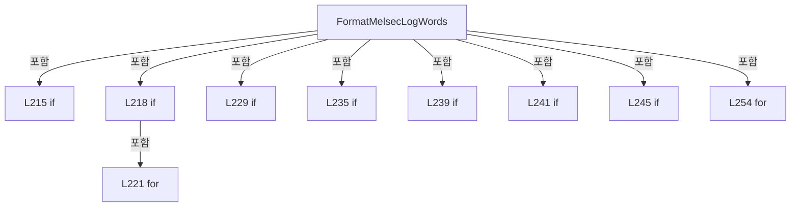

변경 전 점검: 입력/반환 타입, 위 호출자, 예외/취소 경로, 공유 상태와 저장·전송 소비자를 함께 확인합니다. 값의 단위나 물리 방향을 이름만으로 확정하지 않습니다.

### MethodDeclaration `FormatMelsecLogSignalState` · L266–272

[Drilling.Common/Interface/Melsec/CMelsec.InterfaceLog.cs:266–272](https://github.com/kjuws10-rgb/A3Drilling/blob/5aee8e58439c9b455cae7c9593c9be986c3e682e/Drilling.Common/Interface/Melsec/CMelsec.InterfaceLog.cs#L266-L272)

| 항목 | 실제 추출 값 |
| --- | --- |
| 서명 | string Drilling.Common.Interface.CMelsec.FormatMelsecLogSignalState(Drilling.Common.Interface.ST_MELSEC_MAP_DATA, double) |
| 접근/수식자 | Private / private, static |
| 반환/값 타입 | string |
| 소속 타입 | NamedType:Drilling.Common.Interface.CMelsec |

입력 계약:

| 이름 | 타입 | 전달 | 선택/기본값 |
| --- | --- | --- | --- |
| data | Drilling.Common.Interface.ST_MELSEC_MAP_DATA | None | False /  |
| value | double | None | False /  |

정적 호출자로 확인된 위치:

| 호출 파일/행 | 호출 표현식 | 런타임 분기 가능 |
| --- | --- | --- |
| [Drilling.Common/Interface/Melsec/CMelsec.InterfaceLog.cs:237–237](https://github.com/kjuws10-rgb/A3Drilling/blob/5aee8e58439c9b455cae7c9593c9be986c3e682e/Drilling.Common/Interface/Melsec/CMelsec.InterfaceLog.cs#L237-L237) | FormatMelsecLogSignalState | False |
| [Drilling.Common/Interface/Melsec/CMelsec.InterfaceLog.cs:247–247](https://github.com/kjuws10-rgb/A3Drilling/blob/5aee8e58439c9b455cae7c9593c9be986c3e682e/Drilling.Common/Interface/Melsec/CMelsec.InterfaceLog.cs#L247-L247) | FormatMelsecLogSignalState | False |
| [Drilling.Common/Interface/Melsec/CMelsec.InterfaceLog.cs:301–301](https://github.com/kjuws10-rgb/A3Drilling/blob/5aee8e58439c9b455cae7c9593c9be986c3e682e/Drilling.Common/Interface/Melsec/CMelsec.InterfaceLog.cs#L301-L301) | FormatMelsecLogSignalState | False |
| [Drilling.Common/Interface/Melsec/CMelsec.InterfaceLog.cs:306–306](https://github.com/kjuws10-rgb/A3Drilling/blob/5aee8e58439c9b455cae7c9593c9be986c3e682e/Drilling.Common/Interface/Melsec/CMelsec.InterfaceLog.cs#L306-L306) | FormatMelsecLogSignalState | False |

호출하는 대상과 해석 범위:

| 원본 행 | 표현식 | 분석 상태 | 대상/소스 위치 |
| --- | --- | --- | --- |
| 268 | data.Id.StartsWith | resolved | bool string.StartsWith(string, System.StringComparison) |
| 269 | data.Id.StartsWith | resolved | bool string.StartsWith(string, System.StringComparison) |
| 270 | data.Id.Equals | resolved | bool string.Equals(string?, System.StringComparison) |

본문의 실제 연산·분기·예외·반환 순서(원문 위치 순):

| 원본 행 | 종류 | 주석 해설 |
| --- | --- | --- |
| 268 | call | 함수·델리게이트 또는 객체 생성자를 호출합니다: data.Id.StartsWith("HANDSHAKE_PRC_", StringComparison.OrdinalIgnoreCase) |
| 268 | local-declaration | 지역 변수를 선언합니다: var onOffSignal = data.Id.StartsWith("HANDSHAKE_PRC_", StringComparison.OrdinalIgnoreCase) &#124;&#124; data.Id.StartsWith("HANDSHAKE_STG_", StringComparison.OrdinalIgnoreCase) &#124;&#124; data.Id.Equals("SDC_REVIEW_RETRY_REQUEST", StringComparison. |
| 268 | variable-initializer | 변수의 초기값을 지정합니다: onOffSignal = data.Id.StartsWith("HANDSHAKE_PRC_", StringComparison.OrdinalIgnoreCase) &#124;&#124; data.Id.StartsWith("HANDSHAKE_STG_", StringComparison.OrdinalIgnoreCase) &#124;&#124; data.Id.Equals("SDC_REVIEW_RETRY_REQUEST", StringComparison.Ordi |
| 269 | call | 함수·델리게이트 또는 객체 생성자를 호출합니다: data.Id.StartsWith("HANDSHAKE_STG_", StringComparison.OrdinalIgnoreCase) |
| 270 | call | 함수·델리게이트 또는 객체 생성자를 호출합니다: data.Id.Equals("SDC_REVIEW_RETRY_REQUEST", StringComparison.OrdinalIgnoreCase) |
| 271 | conditional-expression | 조건에 따라 결과식을 선택합니다: onOffSignal && value is 0 or 1 ? (value == 1 ? "(ON)" : "(OFF)") : "" |
| 271 | conditional-expression | 조건에 따라 결과식을 선택합니다: value == 1 ? "(ON)" : "(OFF)" |
| 271 | return | 호출자에게 값 또는 제어를 반환합니다: return onOffSignal && value is 0 or 1 ? (value == 1 ? "(ON)" : "(OFF)") : ""; |

변경 전 점검: 입력/반환 타입, 위 호출자, 예외/취소 경로, 공유 상태와 저장·전송 소비자를 함께 확인합니다. 값의 단위나 물리 방향을 이름만으로 확정하지 않습니다.

### MethodDeclaration `FormatMelsecLogNumber` · L274–281

[Drilling.Common/Interface/Melsec/CMelsec.InterfaceLog.cs:274–281](https://github.com/kjuws10-rgb/A3Drilling/blob/5aee8e58439c9b455cae7c9593c9be986c3e682e/Drilling.Common/Interface/Melsec/CMelsec.InterfaceLog.cs#L274-L281)

| 항목 | 실제 추출 값 |
| --- | --- |
| 서명 | string Drilling.Common.Interface.CMelsec.FormatMelsecLogNumber(double) |
| 접근/수식자 | Private / private, static |
| 반환/값 타입 | string |
| 소속 타입 | NamedType:Drilling.Common.Interface.CMelsec |

입력 계약:

| 이름 | 타입 | 전달 | 선택/기본값 |
| --- | --- | --- | --- |
| value | double | None | False /  |

정적 호출자로 확인된 위치:

| 호출 파일/행 | 호출 표현식 | 런타임 분기 가능 |
| --- | --- | --- |
| [Drilling.Common/Interface/Melsec/CMelsec.InterfaceLog.cs:236–236](https://github.com/kjuws10-rgb/A3Drilling/blob/5aee8e58439c9b455cae7c9593c9be986c3e682e/Drilling.Common/Interface/Melsec/CMelsec.InterfaceLog.cs#L236-L236) | FormatMelsecLogNumber | False |
| [Drilling.Common/Interface/Melsec/CMelsec.InterfaceLog.cs:242–242](https://github.com/kjuws10-rgb/A3Drilling/blob/5aee8e58439c9b455cae7c9593c9be986c3e682e/Drilling.Common/Interface/Melsec/CMelsec.InterfaceLog.cs#L242-L242) | FormatMelsecLogNumber | False |
| [Drilling.Common/Interface/Melsec/CMelsec.InterfaceLog.cs:246–246](https://github.com/kjuws10-rgb/A3Drilling/blob/5aee8e58439c9b455cae7c9593c9be986c3e682e/Drilling.Common/Interface/Melsec/CMelsec.InterfaceLog.cs#L246-L246) | FormatMelsecLogNumber | False |
| [Drilling.Common/Interface/Melsec/CMelsec.InterfaceLog.cs:260–260](https://github.com/kjuws10-rgb/A3Drilling/blob/5aee8e58439c9b455cae7c9593c9be986c3e682e/Drilling.Common/Interface/Melsec/CMelsec.InterfaceLog.cs#L260-L260) | FormatMelsecLogNumber | False |
| [Drilling.Common/Interface/Melsec/CMelsec.InterfaceLog.cs:301–301](https://github.com/kjuws10-rgb/A3Drilling/blob/5aee8e58439c9b455cae7c9593c9be986c3e682e/Drilling.Common/Interface/Melsec/CMelsec.InterfaceLog.cs#L301-L301) | FormatMelsecLogNumber | False |
| [Drilling.Common/Interface/Melsec/CMelsec.InterfaceLog.cs:306–306](https://github.com/kjuws10-rgb/A3Drilling/blob/5aee8e58439c9b455cae7c9593c9be986c3e682e/Drilling.Common/Interface/Melsec/CMelsec.InterfaceLog.cs#L306-L306) | FormatMelsecLogNumber | False |
| [Drilling.Common/Interface/Melsec/CMelsec.InterfaceLog.cs:308–308](https://github.com/kjuws10-rgb/A3Drilling/blob/5aee8e58439c9b455cae7c9593c9be986c3e682e/Drilling.Common/Interface/Melsec/CMelsec.InterfaceLog.cs#L308-L308) | FormatMelsecLogNumber | False |
| [Drilling.Common/Interface/Melsec/CMelsec.InterfaceLog.cs:308–308](https://github.com/kjuws10-rgb/A3Drilling/blob/5aee8e58439c9b455cae7c9593c9be986c3e682e/Drilling.Common/Interface/Melsec/CMelsec.InterfaceLog.cs#L308-L308) | FormatMelsecLogNumber | False |

호출하는 대상과 해석 범위:

| 원본 행 | 표현식 | 분석 상태 | 대상/소스 위치 |
| --- | --- | --- | --- |
| 278 | value.ToString | resolved | string double.ToString(string?, System.IFormatProvider?) |
| 279 | double.IsFinite | resolved | bool double.IsFinite(double) |
| 279 | double.TryParse | resolved | bool double.TryParse(string?, System.Globalization.NumberStyles, System.IFormatProvider?, out double) |
| 279 | double.IsFinite | resolved | bool double.IsFinite(double) |
| 280 | value.ToString | resolved | string double.ToString(string?, System.IFormatProvider?) |

본문의 실제 연산·분기·예외·반환 순서(원문 위치 순):

| 원본 행 | 종류 | 주석 해설 |
| --- | --- | --- |
| 278 | call | 함수·델리게이트 또는 객체 생성자를 호출합니다: value.ToString("G15", CultureInfo.InvariantCulture) |
| 278 | local-declaration | 지역 변수를 선언합니다: var compact = value.ToString("G15", CultureInfo.InvariantCulture); |
| 278 | variable-initializer | 변수의 초기값을 지정합니다: compact = value.ToString("G15", CultureInfo.InvariantCulture) |
| 279 | call | 함수·델리게이트 또는 객체 생성자를 호출합니다: double.IsFinite(value) |
| 279 | call | 함수·델리게이트 또는 객체 생성자를 호출합니다: double.TryParse(compact, NumberStyles.Float, CultureInfo.InvariantCulture, out var shown) |
| 279 | call | 함수·델리게이트 또는 객체 생성자를 호출합니다: double.IsFinite(shown) |
| 279 | conditional-expression | 조건에 따라 결과식을 선택합니다: double.IsFinite(value) && (!double.TryParse(compact, NumberStyles.Float, CultureInfo.InvariantCulture, out var shown) &#124;&#124; !double.IsFinite(shown)) ? value.ToString("R", CultureInfo.InvariantCulture) : compact |
| 279 | return | 호출자에게 값 또는 제어를 반환합니다: return double.IsFinite(value) && (!double.TryParse(compact, NumberStyles.Float, CultureInfo.InvariantCulture, out var shown) &#124;&#124; !double.IsFinite(shown)) ? value.ToString("R", CultureInfo.InvariantCulture) : compact; |
| 280 | call | 함수·델리게이트 또는 객체 생성자를 호출합니다: value.ToString("R", CultureInfo.InvariantCulture) |

변경 전 점검: 입력/반환 타입, 위 호출자, 예외/취소 경로, 공유 상태와 저장·전송 소비자를 함께 확인합니다. 값의 단위나 물리 방향을 이름만으로 확정하지 않습니다.

### MethodDeclaration `BriefMelsecLogValue` · L283–309

[Drilling.Common/Interface/Melsec/CMelsec.InterfaceLog.cs:283–309](https://github.com/kjuws10-rgb/A3Drilling/blob/5aee8e58439c9b455cae7c9593c9be986c3e682e/Drilling.Common/Interface/Melsec/CMelsec.InterfaceLog.cs#L283-L309)

| 항목 | 실제 추출 값 |
| --- | --- |
| 서명 | string Drilling.Common.Interface.CMelsec.BriefMelsecLogValue(Drilling.Common.Interface.ST_MELSEC_MAP_DATA, Drilling.Common.Interface.CMelsec.ST_MELSEC_ADDRESS, ushort[], bool) |
| 접근/수식자 | Private / private, static |
| 반환/값 타입 | string |
| 소속 타입 | NamedType:Drilling.Common.Interface.CMelsec |

입력 계약:

| 이름 | 타입 | 전달 | 선택/기본값 |
| --- | --- | --- | --- |
| data | Drilling.Common.Interface.ST_MELSEC_MAP_DATA | None | False /  |
| address | Drilling.Common.Interface.CMelsec.ST_MELSEC_ADDRESS | None | False /  |
| words | ushort[] | None | False /  |
| array | bool | None | False /  |

정적 호출자로 확인된 위치:

| 호출 파일/행 | 호출 표현식 | 런타임 분기 가능 |
| --- | --- | --- |
| [Drilling.Common/Interface/Melsec/CMelsec.InterfaceLog.cs:105–105](https://github.com/kjuws10-rgb/A3Drilling/blob/5aee8e58439c9b455cae7c9593c9be986c3e682e/Drilling.Common/Interface/Melsec/CMelsec.InterfaceLog.cs#L105-L105) | BriefMelsecLogValue | False |

호출하는 대상과 해석 범위:

| 원본 행 | 표현식 | 분석 상태 | 대상/소스 위치 |
| --- | --- | --- | --- |
| 295 | EscapeMelsecLogText | resolved | string Drilling.Common.Interface.CMelsec.EscapeMelsecLogText(string) · Drilling.Common/Interface/Melsec/CMelsec.InterfaceLog.cs:318 |
| 295 | Encoding.ASCII.GetString(bytes).TrimEnd | resolved | string string.TrimEnd(params System.ReadOnlySpan<char>) |
| 295 | Encoding.ASCII.GetString | resolved · 동적 구현 선택 가능 | string System.Text.Encoding.GetString(byte[]) |
| 301 | FormatMelsecLogNumber | resolved | string Drilling.Common.Interface.CMelsec.FormatMelsecLogNumber(double) · Drilling.Common/Interface/Melsec/CMelsec.InterfaceLog.cs:274 |
| 301 | FormatMelsecLogSignalState | resolved | string Drilling.Common.Interface.CMelsec.FormatMelsecLogSignalState(Drilling.Common.Interface.ST_MELSEC_MAP_DATA, double) · Drilling.Common/Interface/Melsec/CMelsec.InterfaceLog.cs:266 |
| 304 | WordsToFloat | resolved | float Drilling.Common.Interface.CMelsec.WordsToFloat(System.Collections.Generic.IReadOnlyList<ushort>) · Drilling.Common/Interface/Melsec/CMelsec.cs:2111 |
| 304 | WordsToInt32 | resolved | int Drilling.Common.Interface.CMelsec.WordsToInt32(System.Collections.Generic.IReadOnlyList<ushort>) · Drilling.Common/Interface/Melsec/CMelsec.cs:2089 |
| 306 | FormatMelsecLogNumber | resolved | string Drilling.Common.Interface.CMelsec.FormatMelsecLogNumber(double) · Drilling.Common/Interface/Melsec/CMelsec.InterfaceLog.cs:274 |
| 306 | FormatMelsecLogSignalState | resolved | string Drilling.Common.Interface.CMelsec.FormatMelsecLogSignalState(Drilling.Common.Interface.ST_MELSEC_MAP_DATA, double) · Drilling.Common/Interface/Melsec/CMelsec.InterfaceLog.cs:266 |
| 308 | (words.Length / 2).ToString | resolved | string int.ToString(System.IFormatProvider?) |
| 308 | FormatMelsecLogNumber | resolved | string Drilling.Common.Interface.CMelsec.FormatMelsecLogNumber(double) · Drilling.Common/Interface/Melsec/CMelsec.InterfaceLog.cs:274 |
| 308 | FormatMelsecLogNumber | resolved | string Drilling.Common.Interface.CMelsec.FormatMelsecLogNumber(double) · Drilling.Common/Interface/Melsec/CMelsec.InterfaceLog.cs:274 |

본문의 실제 연산·분기·예외·반환 순서(원문 위치 순):

| 원본 행 | 종류 | 주석 해설 |
| --- | --- | --- |
| 285 | if | 조건에 따라 분기합니다: if (words.Length == 0) |
| 286 | return | 호출자에게 값 또는 제어를 반환합니다: return "미수신"; |
| 287 | if | 조건에 따라 분기합니다: if (data.DataType == EN_MELSEC_DATA_TYPE.String) |
| 289 | local-declaration | 지역 변수를 선언합니다: var bytes = new byte[words.Length * 2]; |
| 289 | variable-initializer | 변수의 초기값을 지정합니다: bytes = new byte[words.Length * 2] |
| 290 | variable-initializer | 변수의 초기값을 지정합니다: index = 0 |
| 290 | for | 초기화·조건·증감이 있는 반복입니다: for (var index = 0; index < words.Length; index++) |
| 292 | assignment | 값을 대상에 대입합니다: bytes[index * 2] = (byte)words[index] |
| 293 | assignment | 값을 대상에 대입합니다: bytes[index * 2 + 1] = (byte)(words[index] >> 8) |
| 295 | call | 함수·델리게이트 또는 객체 생성자를 호출합니다: EscapeMelsecLogText(Encoding.ASCII.GetString(bytes).TrimEnd('\0', ' ')) |
| 295 | call | 함수·델리게이트 또는 객체 생성자를 호출합니다: Encoding.ASCII.GetString(bytes).TrimEnd('\0', ' ') |
| 295 | call | 함수·델리게이트 또는 객체 생성자를 호출합니다: Encoding.ASCII.GetString(bytes) |
| 295 | local-declaration | 지역 변수를 선언합니다: var text = EscapeMelsecLogText(Encoding.ASCII.GetString(bytes).TrimEnd('\0', ' ')); |
| 295 | variable-initializer | 변수의 초기값을 지정합니다: text = EscapeMelsecLogText(Encoding.ASCII.GetString(bytes).TrimEnd('\0', ' ')) |
| 296 | conditional-expression | 조건에 따라 결과식을 선택합니다: text.Length > 64 ? text[..64] + "…(전체 값은 아래)" : text |
| 296 | return | 호출자에게 값 또는 제어를 반환합니다: return "\"" + (text.Length > 64 ? text[..64] + "…(전체 값은 아래)" : text) + "\""; |
| 298 | if | 조건에 따라 분기합니다: if (data.DataType == EN_MELSEC_DATA_TYPE.Bit) |
| 299 | conditional-expression | 조건에 따라 결과식을 선택합니다: (words[0] & (1 << address.BitIndex!.Value)) != 0 ? "1(ON)" : "0(OFF)" |
| 299 | return | 호출자에게 값 또는 제어를 반환합니다: return (words[0] & (1 << address.BitIndex!.Value)) != 0 ? "1(ON)" : "0(OFF)"; |
| 300 | if | 조건에 따라 분기합니다: if (data.DataType == EN_MELSEC_DATA_TYPE.Word) |
| 301 | call | 함수·델리게이트 또는 객체 생성자를 호출합니다: FormatMelsecLogNumber(words[0] * data.ReadScale) |
| 301 | call | 함수·델리게이트 또는 객체 생성자를 호출합니다: FormatMelsecLogSignalState(data, words[0] * data.ReadScale) |
| 301 | return | 호출자에게 값 또는 제어를 반환합니다: return FormatMelsecLogNumber(words[0] * data.ReadScale) + FormatMelsecLogSignalState(data, words[0] * data.ReadScale); |
| 302 | if | 조건에 따라 분기합니다: if (words.Length < 2) |
| 303 | return | 호출자에게 값 또는 제어를 반환합니다: return "미수신"; |
| 304 | call | 함수·델리게이트 또는 객체 생성자를 호출합니다: WordsToFloat(words) |
| 304 | call | 함수·델리게이트 또는 객체 생성자를 호출합니다: WordsToInt32(words) |
| 304 | conditional-expression | 조건에 따라 결과식을 선택합니다: data.DataType == EN_MELSEC_DATA_TYPE.Float ? WordsToFloat(words) * data.ReadScale : WordsToInt32(words) * data.ReadScale |
| 304 | local-declaration | 지역 변수를 선언합니다: var first = data.DataType == EN_MELSEC_DATA_TYPE.Float ? WordsToFloat(words) * data.ReadScale : WordsToInt32(words) * data.ReadScale; |
| 304 | variable-initializer | 변수의 초기값을 지정합니다: first = data.DataType == EN_MELSEC_DATA_TYPE.Float ? WordsToFloat(words) * data.ReadScale : WordsToInt32(words) * data.ReadScale |
| 305 | if | 조건에 따라 분기합니다: if (!array) |
| 306 | call | 함수·델리게이트 또는 객체 생성자를 호출합니다: FormatMelsecLogNumber(first) |
| 306 | call | 함수·델리게이트 또는 객체 생성자를 호출합니다: FormatMelsecLogSignalState(data, first) |
| 306 | return | 호출자에게 값 또는 제어를 반환합니다: return FormatMelsecLogNumber(first) + FormatMelsecLogSignalState(data, first); |
| 307 | local-declaration | 지역 변수를 선언합니다: var last = unchecked((int)(words[^2] &#124; ((uint)words[^1] << 16))) * data.ReadScale; |
| 307 | variable-initializer | 변수의 초기값을 지정합니다: last = unchecked((int)(words[^2] &#124; ((uint)words[^1] << 16))) * data.ReadScale |
| 308 | call | 함수·델리게이트 또는 객체 생성자를 호출합니다: (words.Length / 2).ToString(CultureInfo.InvariantCulture) |
| 308 | call | 함수·델리게이트 또는 객체 생성자를 호출합니다: FormatMelsecLogNumber(first) |
| 308 | call | 함수·델리게이트 또는 객체 생성자를 호출합니다: FormatMelsecLogNumber(last) |
| 308 | return | 호출자에게 값 또는 제어를 반환합니다: return (words.Length / 2).ToString(CultureInfo.InvariantCulture) + "개(" + FormatMelsecLogNumber(first) + " → " + FormatMelsecLogNumber(last) + ")"; |

제어 구문의 포함 구조(실제 실행 순서/CFG가 아닌 구문 탐색 그림):

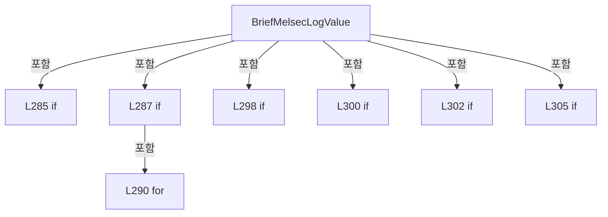

변경 전 점검: 입력/반환 타입, 위 호출자, 예외/취소 경로, 공유 상태와 저장·전송 소비자를 함께 확인합니다. 값의 단위나 물리 방향을 이름만으로 확정하지 않습니다.

### MethodDeclaration `FormatMelsecLogAddress` · L311–316

[Drilling.Common/Interface/Melsec/CMelsec.InterfaceLog.cs:311–316](https://github.com/kjuws10-rgb/A3Drilling/blob/5aee8e58439c9b455cae7c9593c9be986c3e682e/Drilling.Common/Interface/Melsec/CMelsec.InterfaceLog.cs#L311-L316)

| 항목 | 실제 추출 값 |
| --- | --- |
| 서명 | string Drilling.Common.Interface.CMelsec.FormatMelsecLogAddress(Drilling.Common.Interface.CMelsec.ST_MELSEC_ADDRESS) |
| 접근/수식자 | Private / private, static |
| 반환/값 타입 | string |
| 소속 타입 | NamedType:Drilling.Common.Interface.CMelsec |

입력 계약:

| 이름 | 타입 | 전달 | 선택/기본값 |
| --- | --- | --- | --- |
| address | Drilling.Common.Interface.CMelsec.ST_MELSEC_ADDRESS | None | False /  |

정적 호출자로 확인된 위치:

| 호출 파일/행 | 호출 표현식 | 런타임 분기 가능 |
| --- | --- | --- |
| [Drilling.Common/Interface/Melsec/CMelsec.InterfaceLog.cs:147–147](https://github.com/kjuws10-rgb/A3Drilling/blob/5aee8e58439c9b455cae7c9593c9be986c3e682e/Drilling.Common/Interface/Melsec/CMelsec.InterfaceLog.cs#L147-L147) | FormatMelsecLogAddress | False |
| [Drilling.Common/Interface/Melsec/CMelsec.InterfaceLog.cs:259–259](https://github.com/kjuws10-rgb/A3Drilling/blob/5aee8e58439c9b455cae7c9593c9be986c3e682e/Drilling.Common/Interface/Melsec/CMelsec.InterfaceLog.cs#L259-L259) | FormatMelsecLogAddress | False |
| [Drilling.Common/Interface/Melsec/CMelsec.cs:1697–1697](https://github.com/kjuws10-rgb/A3Drilling/blob/5aee8e58439c9b455cae7c9593c9be986c3e682e/Drilling.Common/Interface/Melsec/CMelsec.cs#L1697-L1697) | FormatMelsecLogAddress | False |
| [Drilling.Common/Interface/Melsec/CMelsec.cs:1811–1811](https://github.com/kjuws10-rgb/A3Drilling/blob/5aee8e58439c9b455cae7c9593c9be986c3e682e/Drilling.Common/Interface/Melsec/CMelsec.cs#L1811-L1811) | FormatMelsecLogAddress | False |

호출하는 대상과 해석 범위:

| 원본 행 | 표현식 | 분석 상태 | 대상/소스 위치 |
| --- | --- | --- | --- |
| 314 | address.Number.ToString | resolved | string int.ToString(string?, System.IFormatProvider?) |
| 315 | bit.ToString | resolved | string int.ToString(string?, System.IFormatProvider?) |

본문의 실제 연산·분기·예외·반환 순서(원문 위치 순):

| 원본 행 | 종류 | 주석 해설 |
| --- | --- | --- |
| 313 | local-declaration | 지역 변수를 선언합니다: var hexadecimal = address.Device is "W" or "SW" or "B" or "SB" or "X" or "Y"; |
| 313 | variable-initializer | 변수의 초기값을 지정합니다: hexadecimal = address.Device is "W" or "SW" or "B" or "SB" or "X" or "Y" |
| 314 | call | 함수·델리게이트 또는 객체 생성자를 호출합니다: address.Number.ToString(hexadecimal ? "X" : "D", CultureInfo.InvariantCulture) |
| 314 | conditional-expression | 조건에 따라 결과식을 선택합니다: hexadecimal ? "X" : "D" |
| 314 | return | 호출자에게 값 또는 제어를 반환합니다: return address.Device + address.Number.ToString(hexadecimal ? "X" : "D", CultureInfo.InvariantCulture) + (address.BitIndex is { } bit ? "." + bit.ToString("X", CultureInfo.InvariantCulture) : ""); |
| 315 | call | 함수·델리게이트 또는 객체 생성자를 호출합니다: bit.ToString("X", CultureInfo.InvariantCulture) |
| 315 | conditional-expression | 조건에 따라 결과식을 선택합니다: address.BitIndex is { } bit ? "." + bit.ToString("X", CultureInfo.InvariantCulture) : "" |

변경 전 점검: 입력/반환 타입, 위 호출자, 예외/취소 경로, 공유 상태와 저장·전송 소비자를 함께 확인합니다. 값의 단위나 물리 방향을 이름만으로 확정하지 않습니다.

### MethodDeclaration `EscapeMelsecLogText` · L318–334

[Drilling.Common/Interface/Melsec/CMelsec.InterfaceLog.cs:318–334](https://github.com/kjuws10-rgb/A3Drilling/blob/5aee8e58439c9b455cae7c9593c9be986c3e682e/Drilling.Common/Interface/Melsec/CMelsec.InterfaceLog.cs#L318-L334)

| 항목 | 실제 추출 값 |
| --- | --- |
| 서명 | string Drilling.Common.Interface.CMelsec.EscapeMelsecLogText(string) |
| 접근/수식자 | Private / private, static |
| 반환/값 타입 | string |
| 소속 타입 | NamedType:Drilling.Common.Interface.CMelsec |

입력 계약:

| 이름 | 타입 | 전달 | 선택/기본값 |
| --- | --- | --- | --- |
| text | string | None | False /  |

정적 호출자로 확인된 위치:

| 호출 파일/행 | 호출 표현식 | 런타임 분기 가능 |
| --- | --- | --- |
| [Drilling.Common/Interface/Melsec/CMelsec.InterfaceLog.cs:128–128](https://github.com/kjuws10-rgb/A3Drilling/blob/5aee8e58439c9b455cae7c9593c9be986c3e682e/Drilling.Common/Interface/Melsec/CMelsec.InterfaceLog.cs#L128-L128) | EscapeMelsecLogText | False |
| [Drilling.Common/Interface/Melsec/CMelsec.InterfaceLog.cs:226–226](https://github.com/kjuws10-rgb/A3Drilling/blob/5aee8e58439c9b455cae7c9593c9be986c3e682e/Drilling.Common/Interface/Melsec/CMelsec.InterfaceLog.cs#L226-L226) | EscapeMelsecLogText | False |
| [Drilling.Common/Interface/Melsec/CMelsec.InterfaceLog.cs:295–295](https://github.com/kjuws10-rgb/A3Drilling/blob/5aee8e58439c9b455cae7c9593c9be986c3e682e/Drilling.Common/Interface/Melsec/CMelsec.InterfaceLog.cs#L295-L295) | EscapeMelsecLogText | False |

호출하는 대상과 해석 범위:

| 원본 행 | 표현식 | 분석 상태 | 대상/소스 위치 |
| --- | --- | --- | --- |
| 320 | new StringBuilder | resolved | System.Text.StringBuilder.StringBuilder(int) |
| 322 | result.Append | resolved | System.Text.StringBuilder System.Text.StringBuilder.Append(string?) |
| 330 | char.IsControl | resolved | bool char.IsControl(char) |
| 330 | ((int)value).ToString | resolved | string int.ToString(string?, System.IFormatProvider?) |
| 331 | value.ToString | resolved · 동적 구현 선택 가능 | string char.ToString() |
| 333 | result.ToString | resolved · 동적 구현 선택 가능 | string System.Text.StringBuilder.ToString() |

본문의 실제 연산·분기·예외·반환 순서(원문 위치 순):

| 원본 행 | 종류 | 주석 해설 |
| --- | --- | --- |
| 320 | call | 함수·델리게이트 또는 객체 생성자를 호출합니다: new StringBuilder(text.Length) |
| 320 | local-declaration | 지역 변수를 선언합니다: var result = new StringBuilder(text.Length); |
| 320 | variable-initializer | 변수의 초기값을 지정합니다: result = new StringBuilder(text.Length) |
| 321 | foreach | 컬렉션 요소를 순회합니다: foreach (var value in text) |
| 322 | call | 함수·델리게이트 또는 객체 생성자를 호출합니다: result.Append(value switch { '\\' => "\\\\", '"' => "\\\"", '\r' => "\\r", '\n' => "\\n", '\t' => "\\t", '\0' => "\\0", _ when char.IsControl(value) => "\\u" + ((int)value).ToString("X4", CultureInfo.InvariantCulture), _… |
| 322 | switch-expression | 값별 결과식을 선택합니다: value switch { '\\' => "\\\\", '"' => "\\\"", '\r' => "\\r", '\n' => "\\n", '\t' => "\\t", '\0' => "\\0", _ when char.IsControl(value) => "\\u" + ((int)value).ToString("X4", CultureInfo.InvariantCulture), _ => value.ToString() } |
| 330 | call | 함수·델리게이트 또는 객체 생성자를 호출합니다: char.IsControl(value) |
| 330 | call | 함수·델리게이트 또는 객체 생성자를 호출합니다: ((int)value).ToString("X4", CultureInfo.InvariantCulture) |
| 331 | call | 함수·델리게이트 또는 객체 생성자를 호출합니다: value.ToString() |
| 333 | call | 함수·델리게이트 또는 객체 생성자를 호출합니다: result.ToString() |
| 333 | return | 호출자에게 값 또는 제어를 반환합니다: return result.ToString(); |

제어 구문의 포함 구조(실제 실행 순서/CFG가 아닌 구문 탐색 그림):

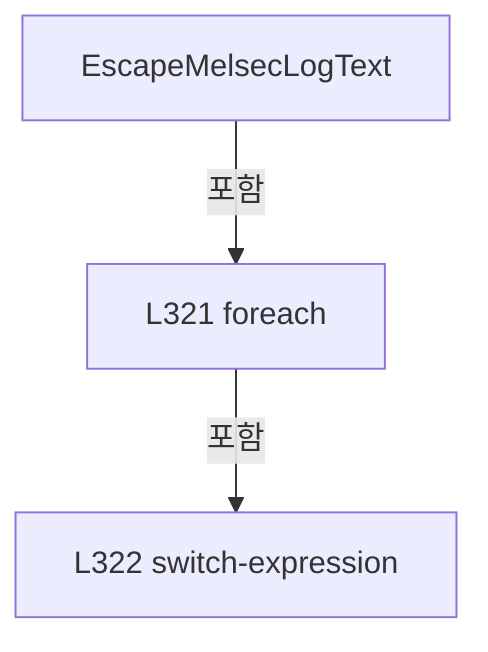

변경 전 점검: 입력/반환 타입, 위 호출자, 예외/취소 경로, 공유 상태와 저장·전송 소비자를 함께 확인합니다. 값의 단위나 물리 방향을 이름만으로 확정하지 않습니다.

## 구문·바인딩 한계

전체 WPF/벤더 SDK/프로젝트별 빌드 조건을 로드한 정식 빌드가 아닙니다. `resolved`는 이 부분 컴파일에서의 심볼 연결이며 virtual/interface/delegate/이벤트/Reflection/XAML의 실제 런타임 구현을 확정하지 않습니다. `candidate`와 `unresolved`는 후속 확인 대상으로 남깁니다.

## 원문 전체 주석 해설본

[원본 모든 행과 행별 해설 보기](../../../../annotated/Drilling.Common/Interface/Melsec/CMelsec.InterfaceLog.cs.annotated.txt)

원본을 빠뜨리거나 임의로 줄이지 않았습니다. `L000001 |` 표시는 원본 행 번호, `// 해설`은 별도 설명입니다. 실행용 소스가 아닌 문서입니다.

## 수정·재검증 체크

- 원본 Commit과 현재 작업 파일 SHA가 같은지 먼저 확인합니다. 다르면 이 문서를 과거 버전 자료로 취급합니다.
- 선언·직접 호출·이벤트/인터페이스 경계·설정 소비를 함께 확인합니다. 정적 연결의 빈 곳을 정상 경로로 추정하지 않습니다.
- 저장 형식/단위/식별자·재시도·취소·예외·롤백에 영향을 주는 변경은 상세 해설장과 호출자를 다시 검토합니다.
- 도구의 구문 추출과 별도 정적 추적 해설, 실제 빌드·시뮬레이션·실장비 검증 결과를 분리합니다.
