# Drilling.Common/Interface/Melsec/CMelsec.cs

| 항목 | 내용 |
| --- | --- |
| 원본 저장소 | https://github.com/kjuws10-rgb/A3Drilling.git |
| 원본 Commit | 28764c91d521777b8ee068dd7aaf2d3902ce9fe2 |
| 원본 SHA256 | af222cf9ca1c7c8ce0f4893d34885139a992b16821c0943f3e644f107d83a145 |
| 파일 분류 | code |
| 원본 크기/행 | 152,870 bytes / 3,312 physical lines |
| 인코딩 | utf-8-sig |
| 검토 범위 | 구문/부분 의미 분석에서 추출한 사실. 동작·물리 단위·실장비 합격을 보증하지 않습니다. |
| 원본 링크 | [고정 Commit 원본](https://github.com/kjuws10-rgb/A3Drilling/blob/28764c91d521777b8ee068dd7aaf2d3902ce9fe2/Drilling.Common/Interface/Melsec/CMelsec.cs) |

## 파일의 역할과 읽는 순서

외부 통신과 장치 인터페이스를 연결합니다. 요청 생성·전송·수신·장치 실행을 같은 의미로 합치지 않습니다.

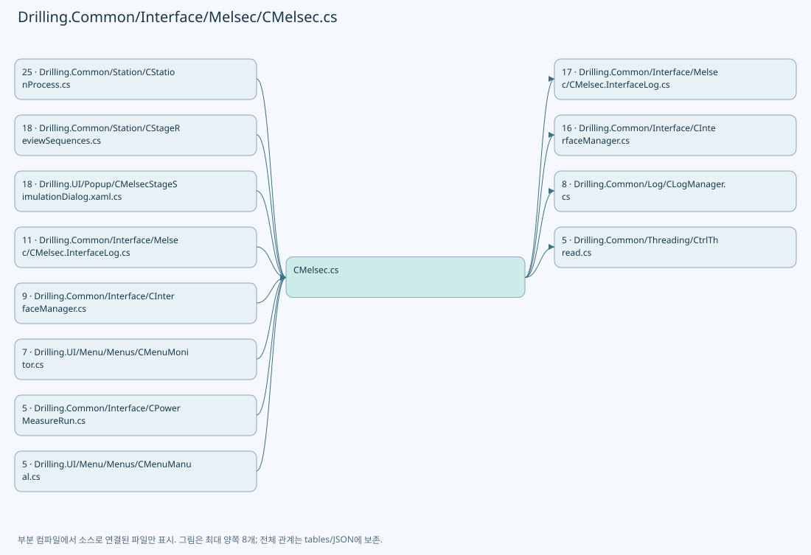

## 네임스페이스·타입·상속

| 타입 | 구분 | 원본 범위 | 선언/상속 |
| --- | --- | --- | --- |
| CMelsec | ClassDeclaration | 12–3165 | CMelsec: CtrlThread, IDisposable |
| EN_MELSEC_THREAD_COMMAND | EnumDeclaration | 2256–2270 | EN_MELSEC_THREAD_COMMAND |
| CMelsecThreadRequest | ClassDeclaration | 2272–2292 | CMelsecThreadRequest |
| CMelsecWriteCommand | ClassDeclaration | 2294–2343 | CMelsecWriteCommand |
| CMelsecReadSnapshot | RecordDeclaration | 2345–2345 | CMelsecReadSnapshot |
| ST_MELSEC_ADDRESS | RecordDeclaration | 2346–2346 | ST_MELSEC_ADDRESS |
| ST_MELSEC_NET_OPTION | RecordDeclaration | 2347–2347 | ST_MELSEC_NET_OPTION |
| PollItem | RecordDeclaration | 3008–3008 | PollItem |
| PollBlock | ClassDeclaration | 3014–3031 | PollBlock |
| EN_MELSEC_DATA_TYPE | EnumDeclaration | 3167–3177 | EN_MELSEC_DATA_TYPE |
| EN_MELSEC_DIRECTION | EnumDeclaration | 3179–3184 | EN_MELSEC_DIRECTION |
| EN_MELSEC_ACCESS | EnumDeclaration | 3186–3191 | EN_MELSEC_ACCESS |
| EN_MELSEC_PROCESS | EnumDeclaration | 3193–3202 | EN_MELSEC_PROCESS |
| EN_MELSEC_WRITE_RESULT | EnumDeclaration | 3204–3216 | EN_MELSEC_WRITE_RESULT |
| EN_MELSEC_SIMULATION_READBACK | EnumDeclaration | 3218–3224 | EN_MELSEC_SIMULATION_READBACK |
| ST_MELSEC_WRITE_STATUS | RecordDeclaration | 3226–3240 | ST_MELSEC_WRITE_STATUS |
| ST_MELSEC_MAP_DATA | RecordDeclaration | 3241–3256 | ST_MELSEC_MAP_DATA |
| CMelsecMapFileBase | ClassDeclaration | 3257–3260 | CMelsecMapFileBase |
| EN_MELSEC_CACHE_STATE | EnumDeclaration | 3262–3269 | EN_MELSEC_CACHE_STATE |
| ST_MELSEC_CACHED_VALUE | RecordDeclaration | 3271–3274 | ST_MELSEC_CACHED_VALUE |
| CMelsecNetApi | ClassDeclaration | 3276–3299 | CMelsecNetApi |
| CMelsecNetNativeMethods | ClassDeclaration | 3301–3311 | CMelsecNetNativeMethods |

## 멤버 빠른 목록

| 이름 | 종류 | 범위 | 서명 |
| --- | --- | --- | --- |
| DefaultWriteTimeoutMs | FieldDeclaration | L15–15 | int Drilling.Common.Interface.CMelsec.DefaultWriteTimeoutMs |
| MelsecThreadDelayMs | FieldDeclaration | L16–16 | int Drilling.Common.Interface.CMelsec.MelsecThreadDelayMs |
| MelsecNetMaximumTransferBytes | FieldDeclaration | L17–17 | int Drilling.Common.Interface.CMelsec.MelsecNetMaximumTransferBytes |
| MaximumStoredWriteStatusCount | FieldDeclaration | L18–18 | int Drilling.Common.Interface.CMelsec.MaximumStoredWriteStatusCount |
| MaximumWriteQueueCount | FieldDeclaration | L19–19 | int Drilling.Common.Interface.CMelsec.MaximumWriteQueueCount |
| _interfaceManager | FieldDeclaration | L20–20 | Drilling.Common.Interface.CInterfaceManager Drilling.Common.Interface.CMelsec._interfaceManager |
| _logManager | FieldDeclaration | L21–21 | CLogManager? Drilling.Common.Interface.CMelsec._logManager |
| _melsecNetApi | FieldDeclaration | L22–22 | Drilling.Common.Interface.CMelsecNetApi Drilling.Common.Interface.CMelsec._melsecNetApi |
| _ioLock | FieldDeclaration | L23–23 | object Drilling.Common.Interface.CMelsec._ioLock |
| _mapLock | FieldDeclaration | L24–24 | object Drilling.Common.Interface.CMelsec._mapLock |
| _requestLock | FieldDeclaration | L25–25 | object Drilling.Common.Interface.CMelsec._requestLock |
| _writeLock | FieldDeclaration | L26–26 | object Drilling.Common.Interface.CMelsec._writeLock |
| _readStateLock | FieldDeclaration | L27–27 | object Drilling.Common.Interface.CMelsec._readStateLock |
| _simulationLock | FieldDeclaration | L28–28 | object Drilling.Common.Interface.CMelsec._simulationLock |
| _simulationWords | FieldDeclaration | L29–29 | System.Collections.Generic.Dictionary<string, ushort> Drilling.Common.Interface.CMelsec._simulationWords |
| _requestQueue | FieldDeclaration | L30–30 | System.Collections.Generic.Queue<Drilling.Common.Interface.CMelsec.CMelsecThreadRequest> Drilling.Common.Interface.CMelsec._requestQueue |
| _writeQueue | FieldDeclaration | L31–31 | System.Collections.Generic.Queue<Drilling.Common.Interface.CMelsec.CMelsecWriteCommand> Drilling.Common.Interface.CMelsec._writeQueue |
| _writeStatus | FieldDeclaration | L32–32 | System.Collections.Generic.Dictionary<int, Drilling.Common.Interface.CMelsec.CMelsecWriteCommand> Drilling.Common.Interface.CMelsec._writeStatus |
| _readSnapshots | FieldDeclaration | L33–33 | System.Collections.Generic.Dictionary<string, Drilling.Common.Interface.CMelsec.CMelsecReadSnapshot> Drilling.Common.Interface.CMelsec._readSnapshots |
| _melsecNetPaths | FieldDeclaration | L34–34 | System.Collections.Generic.Dictionary<int, int> Drilling.Common.Interface.CMelsec._melsecNetPaths |
| _map | FieldDeclaration | L35–35 | System.Collections.Generic.Dictionary<string, Drilling.Common.Interface.ST_MELSEC_MAP_DATA> Drilling.Common.Interface.CMelsec._map |
| _mapSnapshot | FieldDeclaration | L36–36 | System.Collections.Generic.IReadOnlyList<Drilling.Common.Interface.ST_MELSEC_MAP_DATA> Drilling.Common.Interface.CMelsec._mapSnapshot |
| _acceptRequests | FieldDeclaration | L37–37 | bool Drilling.Common.Interface.CMelsec._acceptRequests |
| _nextRequestNo | FieldDeclaration | L38–38 | int Drilling.Common.Interface.CMelsec._nextRequestNo |
| _activeWriteCommand | FieldDeclaration | L39–39 | Drilling.Common.Interface.CMelsec.CMelsecWriteCommand? Drilling.Common.Interface.CMelsec._activeWriteCommand |
| _process | FieldDeclaration | L40–40 | Drilling.Common.Interface.EN_MELSEC_PROCESS Drilling.Common.Interface.CMelsec._process |
| _simulationReadback | FieldDeclaration | L41–41 | Drilling.Common.Interface.EN_MELSEC_SIMULATION_READBACK Drilling.Common.Interface.CMelsec._simulationReadback |
| _readCycleNo | FieldDeclaration | L42–42 | long Drilling.Common.Interface.CMelsec._readCycleNo |
| _lastSuccessfulReadAt | FieldDeclaration | L43–43 | System.DateTimeOffset? Drilling.Common.Interface.CMelsec._lastSuccessfulReadAt |
| _lastReadReturnCode | FieldDeclaration | L44–44 | int Drilling.Common.Interface.CMelsec._lastReadReturnCode |
| _consecutiveReadFailureCount | FieldDeclaration | L45–45 | int Drilling.Common.Interface.CMelsec._consecutiveReadFailureCount |
| _communicationAvailable | FieldDeclaration | L46–46 | bool Drilling.Common.Interface.CMelsec._communicationAvailable |
| DefaultPollingIntervalMs | FieldDeclaration | L47–47 | int Drilling.Common.Interface.CMelsec.DefaultPollingIntervalMs |
| PollingFailureBackoffMs | FieldDeclaration | L48–48 | int Drilling.Common.Interface.CMelsec.PollingFailureBackoffMs |
| _pollLock | FieldDeclaration | L49–49 | object Drilling.Common.Interface.CMelsec._pollLock |
| _cachedValues | FieldDeclaration | L50–50 | System.Collections.Generic.Dictionary<string, Drilling.Common.Interface.ST_MELSEC_CACHED_VALUE> Drilling.Common.Interface.CMelsec._cachedValues |
| _pollBlockById | FieldDeclaration | L51–51 | System.Collections.Generic.Dictionary<string, Drilling.Common.Interface.CMelsec.PollBlock> Drilling.Common.Interface.CMelsec._pollBlockById |
| _pollDeviceBackoff | FieldDeclaration | L52–52 | System.Collections.Generic.Dictionary<int, System.DateTimeOffset> Drilling.Common.Interface.CMelsec._pollDeviceBackoff |
| _pollBlocks | FieldDeclaration | L53–53 | System.Collections.Generic.List<Drilling.Common.Interface.CMelsec.PollBlock> Drilling.Common.Interface.CMelsec._pollBlocks |
| _requestedPollBlocks | FieldDeclaration | L54–54 | System.Collections.Generic.Queue<Drilling.Common.Interface.CMelsec.PollBlock> Drilling.Common.Interface.CMelsec._requestedPollBlocks |
| _requestedPollBlockSet | FieldDeclaration | L55–55 | System.Collections.Generic.HashSet<Drilling.Common.Interface.CMelsec.PollBlock> Drilling.Common.Interface.CMelsec._requestedPollBlockSet |
| _serveRequestedPoll | FieldDeclaration | L56–56 | bool Drilling.Common.Interface.CMelsec._serveRequestedPoll |
| _controlPollStreak | FieldDeclaration | L57–57 | int Drilling.Common.Interface.CMelsec._controlPollStreak |
| _pollGeneration | FieldDeclaration | L58–58 | int Drilling.Common.Interface.CMelsec._pollGeneration |
| _nextPollBlock | FieldDeclaration | L59–59 | int Drilling.Common.Interface.CMelsec._nextPollBlock |
| StageAlignBusyWordId | FieldDeclaration | L60–60 | string Drilling.Common.Interface.CMelsec.StageAlignBusyWordId |
| StageProtectWindowCountId | FieldDeclaration | L61–61 | string Drilling.Common.Interface.CMelsec.StageProtectWindowCountId |
| StageProtectWindowCompleteId | FieldDeclaration | L62–62 | string Drilling.Common.Interface.CMelsec.StageProtectWindowCompleteId |
| .ctor | ConstructorDeclaration | L65–71 | Drilling.Common.Interface.CMelsec.CMelsec(Drilling.Common.Interface.CInterfaceManager, CLogManager?, System.Collections.Generic.IReadOnlyList<Drilling.Common.Interface.ST_MELSEC_MAP_DATA>?, Drilling.Common.Interface.CMelsecNetApi?) |
| Process | PropertyDeclaration | L75–84 | Drilling.Common.Interface.EN_MELSEC_PROCESS Drilling.Common.Interface.CMelsec.Process |
| get_Process | GetAccessorDeclaration | L77–83 | Drilling.Common.Interface.EN_MELSEC_PROCESS Drilling.Common.Interface.CMelsec.Process.get |
| ReadCycleNo | PropertyDeclaration | L86–95 | long Drilling.Common.Interface.CMelsec.ReadCycleNo |
| get_ReadCycleNo | GetAccessorDeclaration | L88–94 | long Drilling.Common.Interface.CMelsec.ReadCycleNo.get |
| LastSuccessfulReadAt | PropertyDeclaration | L97–106 | System.DateTimeOffset? Drilling.Common.Interface.CMelsec.LastSuccessfulReadAt |
| get_LastSuccessfulReadAt | GetAccessorDeclaration | L99–105 | System.DateTimeOffset? Drilling.Common.Interface.CMelsec.LastSuccessfulReadAt.get |
| LastReadReturnCode | PropertyDeclaration | L108–117 | int Drilling.Common.Interface.CMelsec.LastReadReturnCode |
| get_LastReadReturnCode | GetAccessorDeclaration | L110–116 | int Drilling.Common.Interface.CMelsec.LastReadReturnCode.get |
| ConsecutiveReadFailureCount | PropertyDeclaration | L119–128 | int Drilling.Common.Interface.CMelsec.ConsecutiveReadFailureCount |
| get_ConsecutiveReadFailureCount | GetAccessorDeclaration | L121–127 | int Drilling.Common.Interface.CMelsec.ConsecutiveReadFailureCount.get |
| IsCommunicationAvailable | PropertyDeclaration | L130–139 | bool Drilling.Common.Interface.CMelsec.IsCommunicationAvailable |
| get_IsCommunicationAvailable | GetAccessorDeclaration | L132–138 | bool Drilling.Common.Interface.CMelsec.IsCommunicationAvailable.get |
| Initialize | MethodDeclaration | L141–154 | void Drilling.Common.Interface.CMelsec.Initialize() |
| DeInitialize | MethodDeclaration | L156–195 | void Drilling.Common.Interface.CMelsec.DeInitialize() |
| Run | MethodDeclaration | L197–230 | void Drilling.Common.Interface.CMelsec.Run() |
| OnThreadError | MethodDeclaration | L232–236 | void Drilling.Common.Interface.CMelsec.OnThreadError(System.Exception) |
| Map | PropertyDeclaration | L238–243 | System.Collections.Generic.IReadOnlyList<Drilling.Common.Interface.ST_MELSEC_MAP_DATA> Drilling.Common.Interface.CMelsec.Map |
| get_Map | GetAccessorDeclaration | L242–242 | System.Collections.Generic.IReadOnlyList<Drilling.Common.Interface.ST_MELSEC_MAP_DATA> Drilling.Common.Interface.CMelsec.Map.get |
| ValidateMapData | MethodDeclaration | L245–271 | void Drilling.Common.Interface.CMelsec.ValidateMapData(Drilling.Common.Interface.ST_MELSEC_MAP_DATA) |
| ReloadMap | MethodDeclaration | L273–296 | void Drilling.Common.Interface.CMelsec.ReloadMap(System.Collections.Generic.IReadOnlyList<Drilling.Common.Interface.ST_MELSEC_MAP_DATA>) |
| FilterData4 | LocalFunctionStatement | L275–278 | bool FilterData4(Drilling.Common.Interface.ST_MELSEC_MAP_DATA) |
| HandleMap5 | LocalFunctionStatement | L280–283 | string HandleMap5(Drilling.Common.Interface.ST_MELSEC_MAP_DATA) |
| GetMapList | MethodDeclaration | L298–307 | System.Collections.Generic.IReadOnlyList<Drilling.Common.Interface.ST_MELSEC_MAP_DATA> Drilling.Common.Interface.CMelsec.GetMapList(string) |
| FilterData6 | LocalFunctionStatement | L301–304 | bool FilterData6(Drilling.Common.Interface.ST_MELSEC_MAP_DATA) |
| GetMapData | MethodDeclaration | L309–329 | Drilling.Common.Interface.ST_MELSEC_MAP_DATA Drilling.Common.Interface.CMelsec.GetMapData(string) |
| GetKeySortKey7 | LocalFunctionStatement | L323–326 | string GetKeySortKey7(string) |
| ReadBit | MethodDeclaration | L331–336 | bool Drilling.Common.Interface.CMelsec.ReadBit(string, System.Threading.CancellationToken) |
| ReadBitNoLog | MethodDeclaration | L338–343 | bool Drilling.Common.Interface.CMelsec.ReadBitNoLog(string, System.Threading.CancellationToken) |
| Open | MethodDeclaration | L345–349 | void Drilling.Common.Interface.CMelsec.Open(int, System.Threading.CancellationToken) |
| WriteBit | MethodDeclaration | L351–355 | void Drilling.Common.Interface.CMelsec.WriteBit(string, bool, System.Threading.CancellationToken) |
| ReadWord | MethodDeclaration | L357–362 | double Drilling.Common.Interface.CMelsec.ReadWord(string, System.Threading.CancellationToken) |
| ReadWordNoLog | MethodDeclaration | L364–369 | double Drilling.Common.Interface.CMelsec.ReadWordNoLog(string, System.Threading.CancellationToken) |
| WriteWord | MethodDeclaration | L371–375 | void Drilling.Common.Interface.CMelsec.WriteWord(string, double, System.Threading.CancellationToken) |
| ReadDouble | MethodDeclaration | L377–382 | double Drilling.Common.Interface.CMelsec.ReadDouble(string, System.Threading.CancellationToken) |
| ReadDoubleNoLog | MethodDeclaration | L384–389 | double Drilling.Common.Interface.CMelsec.ReadDoubleNoLog(string, System.Threading.CancellationToken) |
| WriteDouble | MethodDeclaration | L391–395 | void Drilling.Common.Interface.CMelsec.WriteDouble(string, double, System.Threading.CancellationToken) |
| ReadString | MethodDeclaration | L397–402 | string Drilling.Common.Interface.CMelsec.ReadString(string, System.Threading.CancellationToken) |
| ReadStringNoLog | MethodDeclaration | L404–409 | string Drilling.Common.Interface.CMelsec.ReadStringNoLog(string, System.Threading.CancellationToken) |
| WriteString | MethodDeclaration | L411–415 | void Drilling.Common.Interface.CMelsec.WriteString(string, string, System.Threading.CancellationToken) |
| QueueWriteBit | MethodDeclaration | L417–420 | int Drilling.Common.Interface.CMelsec.QueueWriteBit(string, bool, string, int, int) |
| QueueWriteWord | MethodDeclaration | L422–425 | int Drilling.Common.Interface.CMelsec.QueueWriteWord(string, double, string, int, int) |
| QueueWriteDouble | MethodDeclaration | L427–430 | int Drilling.Common.Interface.CMelsec.QueueWriteDouble(string, double, string, int, int) |
| QueueWriteString | MethodDeclaration | L432–435 | int Drilling.Common.Interface.CMelsec.QueueWriteString(string, string, string, int, int) |
| GetWriteResult | MethodDeclaration | L437–441 | Drilling.Common.Interface.EN_MELSEC_WRITE_RESULT Drilling.Common.Interface.CMelsec.GetWriteResult(int) |
| GetWriteStatus | MethodDeclaration | L443–454 | Drilling.Common.Interface.ST_MELSEC_WRITE_STATUS? Drilling.Common.Interface.CMelsec.GetWriteStatus(int) |
| TryGetReadSnapshot | MethodDeclaration | L456–471 | bool Drilling.Common.Interface.CMelsec.TryGetReadSnapshot(string, out object?, out long) |
| SetSimulationReadbackMode | MethodDeclaration | L473–479 | void Drilling.Common.Interface.CMelsec.SetSimulationReadbackMode(Drilling.Common.Interface.EN_MELSEC_SIMULATION_READBACK) |
| Dispose | MethodDeclaration | L481–485 | void Drilling.Common.Interface.CMelsec.Dispose() |
| ReadBitCore | MethodDeclaration | L487–496 | bool Drilling.Common.Interface.CMelsec.ReadBitCore(string, System.Threading.CancellationToken, bool, string) |
| WriteBitCore | MethodDeclaration | L498–515 | void Drilling.Common.Interface.CMelsec.WriteBitCore(string, bool, System.Threading.CancellationToken) |
| ReadWordCore | MethodDeclaration | L517–526 | double Drilling.Common.Interface.CMelsec.ReadWordCore(string, System.Threading.CancellationToken, bool, string) |
| WriteWordCore | MethodDeclaration | L528–535 | void Drilling.Common.Interface.CMelsec.WriteWordCore(string, double, System.Threading.CancellationToken) |
| EncodeIntegerValue | MethodDeclaration | L537–543 | int Drilling.Common.Interface.CMelsec.EncodeIntegerValue(Drilling.Common.Interface.ST_MELSEC_MAP_DATA, double) |
| ReadDoubleCore | MethodDeclaration | L545–564 | double Drilling.Common.Interface.CMelsec.ReadDoubleCore(string, System.Threading.CancellationToken, bool, string) |
| WriteDoubleCore | MethodDeclaration | L566–580 | void Drilling.Common.Interface.CMelsec.WriteDoubleCore(string, double, System.Threading.CancellationToken) |
| ReadStringCore | MethodDeclaration | L582–596 | string Drilling.Common.Interface.CMelsec.ReadStringCore(string, System.Threading.CancellationToken, bool, string) |
| WriteStringCore | MethodDeclaration | L598–612 | void Drilling.Common.Interface.CMelsec.WriteStringCore(string, string, System.Threading.CancellationToken) |
| ExecuteThreadRequest | MethodDeclaration | L614–643 | void Drilling.Common.Interface.CMelsec.ExecuteThreadRequest(Drilling.Common.Interface.CMelsec.CMelsecThreadRequest) |
| GetThreadRequest | MethodDeclaration | L645–656 | Drilling.Common.Interface.CMelsec.CMelsecThreadRequest? Drilling.Common.Interface.CMelsec.GetThreadRequest() |
| ProcessThreadRequest | MethodDeclaration | L658–715 | void Drilling.Common.Interface.CMelsec.ProcessThreadRequest(Drilling.Common.Interface.CMelsec.CMelsecThreadRequest) |
| OpenCore | MethodDeclaration | L717–769 | void Drilling.Common.Interface.CMelsec.OpenCore(int, System.Threading.CancellationToken) |
| CloseMelsecNetChannels | MethodDeclaration | L771–794 | void Drilling.Common.Interface.CMelsec.CloseMelsecNetChannels() |
| CloseMelsecNetChannelsCore | MethodDeclaration | L796–816 | void Drilling.Common.Interface.CMelsec.CloseMelsecNetChannelsCore() |
| CloseMelsecNetChannelCore | MethodDeclaration | L818–847 | void Drilling.Common.Interface.CMelsec.CloseMelsecNetChannelCore(int, Drilling.Common.Interface.ST_INTERFACE_DATA, Drilling.Common.Interface.CMelsec.ST_MELSEC_NET_OPTION) |
| ProbeDeviceRead | MethodDeclaration | L849–880 | void Drilling.Common.Interface.CMelsec.ProbeDeviceRead(int, System.Threading.CancellationToken) |
| CancelQueuedRequests | MethodDeclaration | L882–893 | void Drilling.Common.Interface.CMelsec.CancelQueuedRequests(string) |
| QueueWriteCommand | MethodDeclaration | L895–972 | int Drilling.Common.Interface.CMelsec.QueueWriteCommand(Drilling.Common.Interface.EN_MELSEC_DATA_TYPE, string, string, object, int, int) |
| FindPendingDuplicateRequest | MethodDeclaration | L974–990 | int Drilling.Common.Interface.CMelsec.FindPendingDuplicateRequest(Drilling.Common.Interface.CMelsec.CMelsecWriteCommand) |
| IsSameWriteRequest | MethodDeclaration | L992–995 | bool Drilling.Common.Interface.CMelsec.IsSameWriteRequest(Drilling.Common.Interface.CMelsec.CMelsecWriteCommand, Drilling.Common.Interface.CMelsec.CMelsecWriteCommand) |
| PrepareQueuedWriteCommand | MethodDeclaration | L997–1021 | void Drilling.Common.Interface.CMelsec.PrepareQueuedWriteCommand(Drilling.Common.Interface.CMelsec.CMelsecWriteCommand, int, int) |
| ResolveReadbackId | MethodDeclaration | L1023–1047 | string Drilling.Common.Interface.CMelsec.ResolveReadbackId(Drilling.Common.Interface.ST_MELSEC_MAP_DATA) |
| GetAcceptedDataTypes | MethodDeclaration | L1049–1060 | System.Collections.Generic.IReadOnlyList<Drilling.Common.Interface.EN_MELSEC_DATA_TYPE> Drilling.Common.Interface.CMelsec.GetAcceptedDataTypes(Drilling.Common.Interface.EN_MELSEC_DATA_TYPE) |
| ValidateRequestedDataType | MethodDeclaration | L1062–1072 | void Drilling.Common.Interface.CMelsec.ValidateRequestedDataType(Drilling.Common.Interface.ST_MELSEC_MAP_DATA, Drilling.Common.Interface.EN_MELSEC_DATA_TYPE, bool) |
| StoreWriteStatus | MethodDeclaration | L1074–1081 | void Drilling.Common.Interface.CMelsec.StoreWriteStatus(Drilling.Common.Interface.CMelsec.CMelsecWriteCommand) |
| GetActiveWriteCommand | MethodDeclaration | L1083–1089 | Drilling.Common.Interface.CMelsec.CMelsecWriteCommand? Drilling.Common.Interface.CMelsec.GetActiveWriteCommand() |
| GetQueuedWriteCommand | MethodDeclaration | L1091–1102 | Drilling.Common.Interface.CMelsec.CMelsecWriteCommand? Drilling.Common.Interface.CMelsec.GetQueuedWriteCommand() |
| ActivateWriteCommand | MethodDeclaration | L1104–1119 | void Drilling.Common.Interface.CMelsec.ActivateWriteCommand(Drilling.Common.Interface.CMelsec.CMelsecWriteCommand) |
| ProcessWriteCommand | MethodDeclaration | L1121–1156 | void Drilling.Common.Interface.CMelsec.ProcessWriteCommand(Drilling.Common.Interface.CMelsec.CMelsecWriteCommand) |
| PrepareActiveWrite | MethodDeclaration | L1158–1177 | void Drilling.Common.Interface.CMelsec.PrepareActiveWrite(Drilling.Common.Interface.CMelsec.CMelsecWriteCommand) |
| ExecuteActiveWrite | MethodDeclaration | L1179–1218 | void Drilling.Common.Interface.CMelsec.ExecuteActiveWrite(Drilling.Common.Interface.CMelsec.CMelsecWriteCommand) |
| CheckActiveWriteReadback | MethodDeclaration | L1220–1283 | void Drilling.Common.Interface.CMelsec.CheckActiveWriteReadback(Drilling.Common.Interface.CMelsec.CMelsecWriteCommand) |
| BeginRetryWrite | MethodDeclaration | L1285–1292 | void Drilling.Common.Interface.CMelsec.BeginRetryWrite(Drilling.Common.Interface.CMelsec.CMelsecWriteCommand) |
| RetryOrCompleteTimeout | MethodDeclaration | L1294–1309 | void Drilling.Common.Interface.CMelsec.RetryOrCompleteTimeout(Drilling.Common.Interface.CMelsec.CMelsecWriteCommand) |
| RetryOrCompleteCommunicationError | MethodDeclaration | L1311–1319 | void Drilling.Common.Interface.CMelsec.RetryOrCompleteCommunicationError(Drilling.Common.Interface.CMelsec.CMelsecWriteCommand, string) |
| TryScheduleRetry | MethodDeclaration | L1321–1338 | bool Drilling.Common.Interface.CMelsec.TryScheduleRetry(Drilling.Common.Interface.CMelsec.CMelsecWriteCommand, string) |
| IsWriteAttemptTimedOut | MethodDeclaration | L1340–1346 | bool Drilling.Common.Interface.CMelsec.IsWriteAttemptTimedOut(Drilling.Common.Interface.CMelsec.CMelsecWriteCommand, System.DateTimeOffset) |
| CompleteCommunicationError | MethodDeclaration | L1348–1351 | void Drilling.Common.Interface.CMelsec.CompleteCommunicationError(Drilling.Common.Interface.CMelsec.CMelsecWriteCommand) |
| CompleteCommunicationError | MethodDeclaration | L1353–1364 | void Drilling.Common.Interface.CMelsec.CompleteCommunicationError(Drilling.Common.Interface.CMelsec.CMelsecWriteCommand, string) |
| CompleteInvalidWrite | MethodDeclaration | L1366–1376 | void Drilling.Common.Interface.CMelsec.CompleteInvalidWrite(Drilling.Common.Interface.CMelsec.CMelsecWriteCommand, string) |
| CompleteCancelledWrite | MethodDeclaration | L1378–1390 | void Drilling.Common.Interface.CMelsec.CompleteCancelledWrite(Drilling.Common.Interface.CMelsec.CMelsecWriteCommand) |
| CompleteActiveWrite | MethodDeclaration | L1392–1404 | void Drilling.Common.Interface.CMelsec.CompleteActiveWrite(Drilling.Common.Interface.CMelsec.CMelsecWriteCommand) |
| CancelQueuedWrites | MethodDeclaration | L1406–1426 | void Drilling.Common.Interface.CMelsec.CancelQueuedWrites(string) |
| TrimWriteStatus | MethodDeclaration | L1428–1448 | void Drilling.Common.Interface.CMelsec.TrimWriteStatus() |
| IsTerminalWriteResult | MethodDeclaration | L1450–1453 | bool Drilling.Common.Interface.CMelsec.IsTerminalWriteResult(Drilling.Common.Interface.EN_MELSEC_WRITE_RESULT) |
| WriteCommandValue | MethodDeclaration | L1455–1474 | void Drilling.Common.Interface.CMelsec.WriteCommandValue(Drilling.Common.Interface.CMelsec.CMelsecWriteCommand) |
| ReadCommandValue | MethodDeclaration | L1476–1491 | object Drilling.Common.Interface.CMelsec.ReadCommandValue(Drilling.Common.Interface.CMelsec.CMelsecWriteCommand) |
| IsExpectedValue | MethodDeclaration | L1493–1511 | bool Drilling.Common.Interface.CMelsec.IsExpectedValue(Drilling.Common.Interface.CMelsec.CMelsecWriteCommand, object) |
| ApplySimulationReadback | MethodDeclaration | L1513–1531 | void Drilling.Common.Interface.CMelsec.ApplySimulationReadback(Drilling.Common.Interface.CMelsec.CMelsecWriteCommand) |
| GetSimulationReadbackMode | MethodDeclaration | L1533–1539 | Drilling.Common.Interface.EN_MELSEC_SIMULATION_READBACK Drilling.Common.Interface.CMelsec.GetSimulationReadbackMode() |
| WriteSimulationValue | MethodDeclaration | L1541–1580 | void Drilling.Common.Interface.CMelsec.WriteSimulationValue(Drilling.Common.Interface.ST_MELSEC_MAP_DATA, object) |
| WriteSimulationString | MethodDeclaration | L1582–1595 | void Drilling.Common.Interface.CMelsec.WriteSimulationString(Drilling.Common.Interface.ST_MELSEC_MAP_DATA, Drilling.Common.Interface.CMelsec.ST_MELSEC_ADDRESS, string) |
| SaveReadSnapshot | MethodDeclaration | L1597–1612 | void Drilling.Common.Interface.CMelsec.SaveReadSnapshot(string, object) |
| RegisterReadSuccess | MethodDeclaration | L1614–1624 | void Drilling.Common.Interface.CMelsec.RegisterReadSuccess() |
| RegisterReadFailure | MethodDeclaration | L1626–1634 | void Drilling.Common.Interface.CMelsec.RegisterReadFailure(int) |
| RegisterCommunicationFailure | MethodDeclaration | L1636–1642 | void Drilling.Common.Interface.CMelsec.RegisterCommunicationFailure() |
| RegisterCommunicationSuccess | MethodDeclaration | L1644–1650 | void Drilling.Common.Interface.CMelsec.RegisterCommunicationSuccess() |
| ReadWords | MethodDeclaration | L1652–1762 | ushort[] Drilling.Common.Interface.CMelsec.ReadWords(Drilling.Common.Interface.ST_MELSEC_MAP_DATA, Drilling.Common.Interface.CMelsec.ST_MELSEC_ADDRESS, int, System.Threading.CancellationToken, bool, string) |
| WriteWords | MethodDeclaration | L1764–1838 | void Drilling.Common.Interface.CMelsec.WriteWords(Drilling.Common.Interface.ST_MELSEC_MAP_DATA, Drilling.Common.Interface.CMelsec.ST_MELSEC_ADDRESS, System.Collections.Generic.IReadOnlyList<ushort>, System.Threading.CancellationToken, string) |
| GetInterfaceData | MethodDeclaration | L1840–1843 | Drilling.Common.Interface.ST_INTERFACE_DATA Drilling.Common.Interface.CMelsec.GetInterfaceData(Drilling.Common.Interface.ST_MELSEC_MAP_DATA) |
| IsSimulation | MethodDeclaration | L1845–1848 | bool Drilling.Common.Interface.CMelsec.IsSimulation(Drilling.Common.Interface.ST_INTERFACE_DATA) |
| ReadSimulationWords | MethodDeclaration | L1850–1860 | ushort[] Drilling.Common.Interface.CMelsec.ReadSimulationWords(int, Drilling.Common.Interface.CMelsec.ST_MELSEC_ADDRESS, int) |
| WriteSimulationWords | MethodDeclaration | L1862–1869 | void Drilling.Common.Interface.CMelsec.WriteSimulationWords(int, Drilling.Common.Interface.CMelsec.ST_MELSEC_ADDRESS, System.Collections.Generic.IReadOnlyList<ushort>) |
| CreateSimulationKey | MethodDeclaration | L1871–1874 | string Drilling.Common.Interface.CMelsec.CreateSimulationKey(int, Drilling.Common.Interface.CMelsec.ST_MELSEC_ADDRESS, int) |
| GetMelsecNetPath | MethodDeclaration | L1876–1887 | int Drilling.Common.Interface.CMelsec.GetMelsecNetPath(int) |
| RegisterMelsecNetCommunicationError | MethodDeclaration | L1889–1895 | void Drilling.Common.Interface.CMelsec.RegisterMelsecNetCommunicationError(Drilling.Common.Interface.ST_MELSEC_MAP_DATA, Drilling.Common.Interface.ST_INTERFACE_DATA, Drilling.Common.Interface.CMelsec.ST_MELSEC_NET_OPTION, int, int, string, string) |
| WriteMelsecNetOpenLog | MethodDeclaration | L1897–1900 | void Drilling.Common.Interface.CMelsec.WriteMelsecNetOpenLog(Drilling.Common.Interface.ST_INTERFACE_DATA, Drilling.Common.Interface.CMelsec.ST_MELSEC_NET_OPTION, int) |
| FormatMelsecNetContext | MethodDeclaration | L1902–1917 | string Drilling.Common.Interface.CMelsec.FormatMelsecNetContext(Drilling.Common.Interface.CMelsec.ST_MELSEC_NET_OPTION, int, int, int) |
| CreateMelsecNetReturnCodeException | MethodDeclaration | L1919–1923 | System.IO.IOException Drilling.Common.Interface.CMelsec.CreateMelsecNetReturnCodeException(string, int, Drilling.Common.Interface.ST_INTERFACE_DATA, Drilling.Common.Interface.CMelsec.ST_MELSEC_NET_OPTION, int, int) |
| IsMelsecNetRuntimeException | MethodDeclaration | L1925–1928 | bool Drilling.Common.Interface.CMelsec.IsMelsecNetRuntimeException(System.Exception) |
| CreateMelsecNetRuntimeException | MethodDeclaration | L1930–1933 | System.InvalidOperationException Drilling.Common.Interface.CMelsec.CreateMelsecNetRuntimeException(string, System.Exception) |
| PrepareRead | MethodDeclaration | L1935–1938 | Drilling.Common.Interface.ST_MELSEC_MAP_DATA Drilling.Common.Interface.CMelsec.PrepareRead(string, Drilling.Common.Interface.EN_MELSEC_DATA_TYPE, System.Threading.CancellationToken) |
| PrepareRead | MethodDeclaration | L1940–1951 | Drilling.Common.Interface.ST_MELSEC_MAP_DATA Drilling.Common.Interface.CMelsec.PrepareRead(string, System.Collections.Generic.IReadOnlyList<Drilling.Common.Interface.EN_MELSEC_DATA_TYPE>, System.Threading.CancellationToken) |
| PrepareWrite | MethodDeclaration | L1953–1956 | Drilling.Common.Interface.ST_MELSEC_MAP_DATA Drilling.Common.Interface.CMelsec.PrepareWrite(string, Drilling.Common.Interface.EN_MELSEC_DATA_TYPE, System.Threading.CancellationToken) |
| PrepareWrite | MethodDeclaration | L1958–1969 | Drilling.Common.Interface.ST_MELSEC_MAP_DATA Drilling.Common.Interface.CMelsec.PrepareWrite(string, System.Collections.Generic.IReadOnlyList<Drilling.Common.Interface.EN_MELSEC_DATA_TYPE>, System.Threading.CancellationToken) |
| EnsureDataType | MethodDeclaration | L1971–1979 | void Drilling.Common.Interface.CMelsec.EnsureDataType(Drilling.Common.Interface.ST_MELSEC_MAP_DATA, System.Collections.Generic.IReadOnlyList<Drilling.Common.Interface.EN_MELSEC_DATA_TYPE>) |
| ParseAddress | MethodDeclaration | L1981–2012 | Drilling.Common.Interface.CMelsec.ST_MELSEC_ADDRESS Drilling.Common.Interface.CMelsec.ParseAddress(string) |
| ParseDeviceNumber | MethodDeclaration | L2014–2028 | int Drilling.Common.Interface.CMelsec.ParseDeviceNumber(string, string) |
| IsHexDevice | MethodDeclaration | L2030–2033 | bool Drilling.Common.Interface.CMelsec.IsHexDevice(string) |
| GetMelsecNetDeviceType | MethodDeclaration | L2035–2078 | int Drilling.Common.Interface.CMelsec.GetMelsecNetDeviceType(string) |
| EvaluateDeviceSwitch1 | LocalFunctionStatement | L2037–2075 | int EvaluateDeviceSwitch1() |
| RequireWordBit | MethodDeclaration | L2080–2088 | int Drilling.Common.Interface.CMelsec.RequireWordBit(Drilling.Common.Interface.CMelsec.ST_MELSEC_ADDRESS, Drilling.Common.Interface.ST_MELSEC_MAP_DATA) |
| WordsToInt32 | MethodDeclaration | L2090–2098 | int Drilling.Common.Interface.CMelsec.WordsToInt32(System.Collections.Generic.IReadOnlyList<ushort>) |
| Int32ToWords | MethodDeclaration | L2100–2110 | ushort[] Drilling.Common.Interface.CMelsec.Int32ToWords(int, int) |
| WordsToFloat | MethodDeclaration | L2112–2118 | float Drilling.Common.Interface.CMelsec.WordsToFloat(System.Collections.Generic.IReadOnlyList<ushort>) |
| FloatToWords | MethodDeclaration | L2120–2131 | ushort[] Drilling.Common.Interface.CMelsec.FloatToWords(float, int) |
| ReadMelsecNetOption | MethodDeclaration | L2133–2150 | Drilling.Common.Interface.CMelsec.ST_MELSEC_NET_OPTION Drilling.Common.Interface.CMelsec.ReadMelsecNetOption(Drilling.Common.Interface.ST_INTERFACE_DATA) |
| ReadMelsecNetShortArgument | MethodDeclaration | L2152–2161 | short Drilling.Common.Interface.CMelsec.ReadMelsecNetShortArgument(Drilling.Common.Interface.ST_INTERFACE_DATA, int, string) |
| ReadMelsecNetIntArgument | MethodDeclaration | L2163–2171 | int Drilling.Common.Interface.CMelsec.ReadMelsecNetIntArgument(Drilling.Common.Interface.ST_INTERFACE_DATA, int, string) |
| WriteHandshakeLog | MethodDeclaration | L2173–2180 | void Drilling.Common.Interface.CMelsec.WriteHandshakeLog(Drilling.Common.Interface.CMelsec.CMelsecWriteCommand, string, string) |
| WriteHandshakeError | MethodDeclaration | L2182–2189 | void Drilling.Common.Interface.CMelsec.WriteHandshakeError(Drilling.Common.Interface.CMelsec.CMelsecWriteCommand, string, string) |
| GetHandshakeInterfaceData | MethodDeclaration | L2191–2199 | Drilling.Common.Interface.ST_INTERFACE_DATA? Drilling.Common.Interface.CMelsec.GetHandshakeInterfaceData(Drilling.Common.Interface.CMelsec.CMelsecWriteCommand) |
| FormatWriteCommand | MethodDeclaration | L2201–2204 | string Drilling.Common.Interface.CMelsec.FormatWriteCommand(Drilling.Common.Interface.CMelsec.CMelsecWriteCommand) |
| FormatWriteStatus | MethodDeclaration | L2206–2209 | string Drilling.Common.Interface.CMelsec.FormatWriteStatus(Drilling.Common.Interface.CMelsec.CMelsecWriteCommand) |
| FormatCommandValue | MethodDeclaration | L2211–2239 | string Drilling.Common.Interface.CMelsec.FormatCommandValue(object?) |
| WriteErrorLog | MethodDeclaration | L2241–2244 | void Drilling.Common.Interface.CMelsec.WriteErrorLog(Drilling.Common.Interface.ST_MELSEC_MAP_DATA, Drilling.Common.Interface.ST_INTERFACE_DATA, string, string) |
| FormatMap | MethodDeclaration | L2246–2249 | string Drilling.Common.Interface.CMelsec.FormatMap(Drilling.Common.Interface.ST_MELSEC_MAP_DATA) |
| NormalizeId | MethodDeclaration | L2251–2254 | string Drilling.Common.Interface.CMelsec.NormalizeId(string) |
| Open | EnumMemberDeclaration | L2258–2258 | Drilling.Common.Interface.CMelsec.EN_MELSEC_THREAD_COMMAND.Open |
| Close | EnumMemberDeclaration | L2259–2259 | Drilling.Common.Interface.CMelsec.EN_MELSEC_THREAD_COMMAND.Close |
| ReadBit | EnumMemberDeclaration | L2260–2260 | Drilling.Common.Interface.CMelsec.EN_MELSEC_THREAD_COMMAND.ReadBit |
| WriteBit | EnumMemberDeclaration | L2261–2261 | Drilling.Common.Interface.CMelsec.EN_MELSEC_THREAD_COMMAND.WriteBit |
| ReadWord | EnumMemberDeclaration | L2262–2262 | Drilling.Common.Interface.CMelsec.EN_MELSEC_THREAD_COMMAND.ReadWord |
| WriteWord | EnumMemberDeclaration | L2263–2263 | Drilling.Common.Interface.CMelsec.EN_MELSEC_THREAD_COMMAND.WriteWord |
| ReadDouble | EnumMemberDeclaration | L2264–2264 | Drilling.Common.Interface.CMelsec.EN_MELSEC_THREAD_COMMAND.ReadDouble |
| WriteDouble | EnumMemberDeclaration | L2265–2265 | Drilling.Common.Interface.CMelsec.EN_MELSEC_THREAD_COMMAND.WriteDouble |
| WriteDoubleArray | EnumMemberDeclaration | L2266–2266 | Drilling.Common.Interface.CMelsec.EN_MELSEC_THREAD_COMMAND.WriteDoubleArray |
| ReadDoubleArray | EnumMemberDeclaration | L2267–2267 | Drilling.Common.Interface.CMelsec.EN_MELSEC_THREAD_COMMAND.ReadDoubleArray |
| ReadString | EnumMemberDeclaration | L2268–2268 | Drilling.Common.Interface.CMelsec.EN_MELSEC_THREAD_COMMAND.ReadString |
| WriteString | EnumMemberDeclaration | L2269–2269 | Drilling.Common.Interface.CMelsec.EN_MELSEC_THREAD_COMMAND.WriteString |
| .ctor | ConstructorDeclaration | L2274–2281 | Drilling.Common.Interface.CMelsec.CMelsecThreadRequest.CMelsecThreadRequest(Drilling.Common.Interface.CMelsec.EN_MELSEC_THREAD_COMMAND, string, object?, System.Threading.CancellationToken, bool) |
| Command | PropertyDeclaration | L2283–2283 | Drilling.Common.Interface.CMelsec.EN_MELSEC_THREAD_COMMAND Drilling.Common.Interface.CMelsec.CMelsecThreadRequest.Command |
| get_Command | GetAccessorDeclaration | L2283–2283 | Drilling.Common.Interface.CMelsec.EN_MELSEC_THREAD_COMMAND Drilling.Common.Interface.CMelsec.CMelsecThreadRequest.Command.get |
| QueuedTimestamp | PropertyDeclaration | L2284–2284 | long Drilling.Common.Interface.CMelsec.CMelsecThreadRequest.QueuedTimestamp |
| get_QueuedTimestamp | GetAccessorDeclaration | L2284–2284 | long Drilling.Common.Interface.CMelsec.CMelsecThreadRequest.QueuedTimestamp.get |
| set_QueuedTimestamp | SetAccessorDeclaration | L2284–2284 | void Drilling.Common.Interface.CMelsec.CMelsecThreadRequest.QueuedTimestamp.set |
| Id | PropertyDeclaration | L2285–2285 | string Drilling.Common.Interface.CMelsec.CMelsecThreadRequest.Id |
| get_Id | GetAccessorDeclaration | L2285–2285 | string Drilling.Common.Interface.CMelsec.CMelsecThreadRequest.Id.get |
| Value | PropertyDeclaration | L2286–2286 | object? Drilling.Common.Interface.CMelsec.CMelsecThreadRequest.Value |
| get_Value | GetAccessorDeclaration | L2286–2286 | object? Drilling.Common.Interface.CMelsec.CMelsecThreadRequest.Value.get |
| CancellationToken | PropertyDeclaration | L2287–2287 | System.Threading.CancellationToken Drilling.Common.Interface.CMelsec.CMelsecThreadRequest.CancellationToken |
| get_CancellationToken | GetAccessorDeclaration | L2287–2287 | System.Threading.CancellationToken Drilling.Common.Interface.CMelsec.CMelsecThreadRequest.CancellationToken.get |
| SuppressLog | PropertyDeclaration | L2288–2288 | bool Drilling.Common.Interface.CMelsec.CMelsecThreadRequest.SuppressLog |
| get_SuppressLog | GetAccessorDeclaration | L2288–2288 | bool Drilling.Common.Interface.CMelsec.CMelsecThreadRequest.SuppressLog.get |
| Completed | PropertyDeclaration | L2289–2289 | System.Threading.ManualResetEvent Drilling.Common.Interface.CMelsec.CMelsecThreadRequest.Completed |
| get_Completed | GetAccessorDeclaration | L2289–2289 | System.Threading.ManualResetEvent Drilling.Common.Interface.CMelsec.CMelsecThreadRequest.Completed.get |
| Result | PropertyDeclaration | L2290–2290 | object? Drilling.Common.Interface.CMelsec.CMelsecThreadRequest.Result |
| get_Result | GetAccessorDeclaration | L2290–2290 | object? Drilling.Common.Interface.CMelsec.CMelsecThreadRequest.Result.get |
| set_Result | SetAccessorDeclaration | L2290–2290 | void Drilling.Common.Interface.CMelsec.CMelsecThreadRequest.Result.set |
| Error | PropertyDeclaration | L2291–2291 | System.Exception? Drilling.Common.Interface.CMelsec.CMelsecThreadRequest.Error |
| get_Error | GetAccessorDeclaration | L2291–2291 | System.Exception? Drilling.Common.Interface.CMelsec.CMelsecThreadRequest.Error.get |
| set_Error | SetAccessorDeclaration | L2291–2291 | void Drilling.Common.Interface.CMelsec.CMelsecThreadRequest.Error.set |
| .ctor | ConstructorDeclaration | L2296–2303 | Drilling.Common.Interface.CMelsec.CMelsecWriteCommand.CMelsecWriteCommand(int, string, string, Drilling.Common.Interface.EN_MELSEC_DATA_TYPE, object) |
| RequestNo | PropertyDeclaration | L2305–2305 | int Drilling.Common.Interface.CMelsec.CMelsecWriteCommand.RequestNo |
| get_RequestNo | GetAccessorDeclaration | L2305–2305 | int Drilling.Common.Interface.CMelsec.CMelsecWriteCommand.RequestNo.get |
| WriteId | PropertyDeclaration | L2306–2306 | string Drilling.Common.Interface.CMelsec.CMelsecWriteCommand.WriteId |
| get_WriteId | GetAccessorDeclaration | L2306–2306 | string Drilling.Common.Interface.CMelsec.CMelsecWriteCommand.WriteId.get |
| ReadbackId | PropertyDeclaration | L2307–2307 | string Drilling.Common.Interface.CMelsec.CMelsecWriteCommand.ReadbackId |
| get_ReadbackId | GetAccessorDeclaration | L2307–2307 | string Drilling.Common.Interface.CMelsec.CMelsecWriteCommand.ReadbackId.get |
| set_ReadbackId | SetAccessorDeclaration | L2307–2307 | void Drilling.Common.Interface.CMelsec.CMelsecWriteCommand.ReadbackId.set |
| RequestedDataType | PropertyDeclaration | L2308–2308 | Drilling.Common.Interface.EN_MELSEC_DATA_TYPE Drilling.Common.Interface.CMelsec.CMelsecWriteCommand.RequestedDataType |
| get_RequestedDataType | GetAccessorDeclaration | L2308–2308 | Drilling.Common.Interface.EN_MELSEC_DATA_TYPE Drilling.Common.Interface.CMelsec.CMelsecWriteCommand.RequestedDataType.get |
| ExpectedValue | PropertyDeclaration | L2309–2309 | object Drilling.Common.Interface.CMelsec.CMelsecWriteCommand.ExpectedValue |
| get_ExpectedValue | GetAccessorDeclaration | L2309–2309 | object Drilling.Common.Interface.CMelsec.CMelsecWriteCommand.ExpectedValue.get |
| ActualValue | PropertyDeclaration | L2310–2310 | string Drilling.Common.Interface.CMelsec.CMelsecWriteCommand.ActualValue |
| get_ActualValue | GetAccessorDeclaration | L2310–2310 | string Drilling.Common.Interface.CMelsec.CMelsecWriteCommand.ActualValue.get |
| set_ActualValue | SetAccessorDeclaration | L2310–2310 | void Drilling.Common.Interface.CMelsec.CMelsecWriteCommand.ActualValue.set |
| Result | PropertyDeclaration | L2311–2311 | Drilling.Common.Interface.EN_MELSEC_WRITE_RESULT Drilling.Common.Interface.CMelsec.CMelsecWriteCommand.Result |
| get_Result | GetAccessorDeclaration | L2311–2311 | Drilling.Common.Interface.EN_MELSEC_WRITE_RESULT Drilling.Common.Interface.CMelsec.CMelsecWriteCommand.Result.get |
| set_Result | SetAccessorDeclaration | L2311–2311 | void Drilling.Common.Interface.CMelsec.CMelsecWriteCommand.Result.set |
| CurrentRetryCount | PropertyDeclaration | L2312–2312 | int Drilling.Common.Interface.CMelsec.CMelsecWriteCommand.CurrentRetryCount |
| get_CurrentRetryCount | GetAccessorDeclaration | L2312–2312 | int Drilling.Common.Interface.CMelsec.CMelsecWriteCommand.CurrentRetryCount.get |
| set_CurrentRetryCount | SetAccessorDeclaration | L2312–2312 | void Drilling.Common.Interface.CMelsec.CMelsecWriteCommand.CurrentRetryCount.set |
| RetryCount | PropertyDeclaration | L2313–2313 | int Drilling.Common.Interface.CMelsec.CMelsecWriteCommand.RetryCount |
| get_RetryCount | GetAccessorDeclaration | L2313–2313 | int Drilling.Common.Interface.CMelsec.CMelsecWriteCommand.RetryCount.get |
| set_RetryCount | SetAccessorDeclaration | L2313–2313 | void Drilling.Common.Interface.CMelsec.CMelsecWriteCommand.RetryCount.set |
| TimeoutMs | PropertyDeclaration | L2314–2314 | int Drilling.Common.Interface.CMelsec.CMelsecWriteCommand.TimeoutMs |
| get_TimeoutMs | GetAccessorDeclaration | L2314–2314 | int Drilling.Common.Interface.CMelsec.CMelsecWriteCommand.TimeoutMs.get |
| set_TimeoutMs | SetAccessorDeclaration | L2314–2314 | void Drilling.Common.Interface.CMelsec.CMelsecWriteCommand.TimeoutMs.set |
| WriteBeforeReadCycle | PropertyDeclaration | L2315–2315 | long Drilling.Common.Interface.CMelsec.CMelsecWriteCommand.WriteBeforeReadCycle |
| get_WriteBeforeReadCycle | GetAccessorDeclaration | L2315–2315 | long Drilling.Common.Interface.CMelsec.CMelsecWriteCommand.WriteBeforeReadCycle.get |
| set_WriteBeforeReadCycle | SetAccessorDeclaration | L2315–2315 | void Drilling.Common.Interface.CMelsec.CMelsecWriteCommand.WriteBeforeReadCycle.set |
| MinimumReadCycle | PropertyDeclaration | L2316–2316 | long Drilling.Common.Interface.CMelsec.CMelsecWriteCommand.MinimumReadCycle |
| get_MinimumReadCycle | GetAccessorDeclaration | L2316–2316 | long Drilling.Common.Interface.CMelsec.CMelsecWriteCommand.MinimumReadCycle.get |
| set_MinimumReadCycle | SetAccessorDeclaration | L2316–2316 | void Drilling.Common.Interface.CMelsec.CMelsecWriteCommand.MinimumReadCycle.set |
| ConfirmReadCycle | PropertyDeclaration | L2317–2317 | long Drilling.Common.Interface.CMelsec.CMelsecWriteCommand.ConfirmReadCycle |
| get_ConfirmReadCycle | GetAccessorDeclaration | L2317–2317 | long Drilling.Common.Interface.CMelsec.CMelsecWriteCommand.ConfirmReadCycle.get |
| set_ConfirmReadCycle | SetAccessorDeclaration | L2317–2317 | void Drilling.Common.Interface.CMelsec.CMelsecWriteCommand.ConfirmReadCycle.set |
| ErrorMessage | PropertyDeclaration | L2318–2318 | string Drilling.Common.Interface.CMelsec.CMelsecWriteCommand.ErrorMessage |
| get_ErrorMessage | GetAccessorDeclaration | L2318–2318 | string Drilling.Common.Interface.CMelsec.CMelsecWriteCommand.ErrorMessage.get |
| set_ErrorMessage | SetAccessorDeclaration | L2318–2318 | void Drilling.Common.Interface.CMelsec.CMelsecWriteCommand.ErrorMessage.set |
| AttemptStartedAt | PropertyDeclaration | L2319–2319 | System.DateTimeOffset Drilling.Common.Interface.CMelsec.CMelsecWriteCommand.AttemptStartedAt |
| get_AttemptStartedAt | GetAccessorDeclaration | L2319–2319 | System.DateTimeOffset Drilling.Common.Interface.CMelsec.CMelsecWriteCommand.AttemptStartedAt.get |
| set_AttemptStartedAt | SetAccessorDeclaration | L2319–2319 | void Drilling.Common.Interface.CMelsec.CMelsecWriteCommand.AttemptStartedAt.set |
| NextReadAt | PropertyDeclaration | L2320–2320 | System.DateTimeOffset Drilling.Common.Interface.CMelsec.CMelsecWriteCommand.NextReadAt |
| get_NextReadAt | GetAccessorDeclaration | L2320–2320 | System.DateTimeOffset Drilling.Common.Interface.CMelsec.CMelsecWriteCommand.NextReadAt.get |
| set_NextReadAt | SetAccessorDeclaration | L2320–2320 | void Drilling.Common.Interface.CMelsec.CMelsecWriteCommand.NextReadAt.set |
| WriteData | PropertyDeclaration | L2321–2321 | Drilling.Common.Interface.ST_MELSEC_MAP_DATA? Drilling.Common.Interface.CMelsec.CMelsecWriteCommand.WriteData |
| get_WriteData | GetAccessorDeclaration | L2321–2321 | Drilling.Common.Interface.ST_MELSEC_MAP_DATA? Drilling.Common.Interface.CMelsec.CMelsecWriteCommand.WriteData.get |
| set_WriteData | SetAccessorDeclaration | L2321–2321 | void Drilling.Common.Interface.CMelsec.CMelsecWriteCommand.WriteData.set |
| ReadbackData | PropertyDeclaration | L2322–2322 | Drilling.Common.Interface.ST_MELSEC_MAP_DATA? Drilling.Common.Interface.CMelsec.CMelsecWriteCommand.ReadbackData |
| get_ReadbackData | GetAccessorDeclaration | L2322–2322 | Drilling.Common.Interface.ST_MELSEC_MAP_DATA? Drilling.Common.Interface.CMelsec.CMelsecWriteCommand.ReadbackData.get |
| set_ReadbackData | SetAccessorDeclaration | L2322–2322 | void Drilling.Common.Interface.CMelsec.CMelsecWriteCommand.ReadbackData.set |
| CancelRequested | FieldDeclaration | L2324–2324 | bool Drilling.Common.Interface.CMelsec.CMelsecWriteCommand.CancelRequested |
| CreateStatus | MethodDeclaration | L2325–2342 | Drilling.Common.Interface.ST_MELSEC_WRITE_STATUS Drilling.Common.Interface.CMelsec.CMelsecWriteCommand.CreateStatus() |
| CloseDevice | MethodDeclaration | L2351–2388 | void Drilling.Common.Interface.CMelsec.CloseDevice(int, System.Threading.CancellationToken) |
| CloseDeviceCore | MethodDeclaration | L2390–2410 | void Drilling.Common.Interface.CMelsec.CloseDeviceCore(int) |
| IsIofPositionId | MethodDeclaration | L2414–2415 | bool Drilling.Common.Interface.CMelsec.IsIofPositionId(string) |
| IsOnDemandValueId | MethodDeclaration | L2417–2423 | bool Drilling.Common.Interface.CMelsec.IsOnDemandValueId(string) |
| GetDoubleArrayCapacity | MethodDeclaration | L2426–2426 | int Drilling.Common.Interface.CMelsec.GetDoubleArrayCapacity(string) |
| ResolveDoubleArrayData | MethodDeclaration | L2428–2454 | Drilling.Common.Interface.ST_MELSEC_MAP_DATA Drilling.Common.Interface.CMelsec.ResolveDoubleArrayData(Drilling.Common.Interface.ST_MELSEC_MAP_DATA) |
| WriteDoubleArray | MethodDeclaration | L2457–2461 | void Drilling.Common.Interface.CMelsec.WriteDoubleArray(string, System.Collections.Generic.IReadOnlyList<double>, System.Threading.CancellationToken) |
| ReadDoubleArray | MethodDeclaration | L2463–2468 | System.Collections.Generic.IReadOnlyList<double> Drilling.Common.Interface.CMelsec.ReadDoubleArray(string, int, System.Threading.CancellationToken) |
| WriteDoubleArrayCore | MethodDeclaration | L2470–2500 | void Drilling.Common.Interface.CMelsec.WriteDoubleArrayCore(string, double[], System.Threading.CancellationToken) |
| ReadDoubleArrayCore | MethodDeclaration | L2502–2524 | double[] Drilling.Common.Interface.CMelsec.ReadDoubleArrayCore(string, int, System.Threading.CancellationToken) |
| ValidateArrayAddress | MethodDeclaration | L2526–2530 | void Drilling.Common.Interface.CMelsec.ValidateArrayAddress(Drilling.Common.Interface.CMelsec.ST_MELSEC_ADDRESS) |
| GetCachedSnapshot | MethodDeclaration | L2536–2536 | System.Collections.Generic.IReadOnlyDictionary<string, Drilling.Common.Interface.ST_MELSEC_CACHED_VALUE> Drilling.Common.Interface.CMelsec.GetCachedSnapshot() |
| GetCachedSnapshot | MethodDeclaration | L2539–2547 | System.Collections.Generic.IReadOnlyDictionary<string, Drilling.Common.Interface.ST_MELSEC_CACHED_VALUE> Drilling.Common.Interface.CMelsec.GetCachedSnapshot(out System.Collections.Generic.IReadOnlyList<Drilling.Common.Interface.ST_MELSEC_MAP_DATA>) |
| GetCachedSnapshot | MethodDeclaration | L2551–2567 | System.Collections.Generic.IReadOnlyDictionary<string, Drilling.Common.Interface.ST_MELSEC_CACHED_VALUE> Drilling.Common.Interface.CMelsec.GetCachedSnapshot(System.Collections.Generic.IEnumerable<string>, out System.Collections.Generic.IReadOnlyList<Drilling.Common.Interface.ST_MELSEC_MAP_DATA>) |
| GetCachedValue | MethodDeclaration | L2569–2574 | Drilling.Common.Interface.ST_MELSEC_CACHED_VALUE? Drilling.Common.Interface.CMelsec.GetCachedValue(string) |
| RefreshCachedValueAsync | MethodDeclaration | L2578–2638 | System.Threading.Tasks.Task<Drilling.Common.Interface.ST_MELSEC_CACHED_VALUE> Drilling.Common.Interface.CMelsec.RefreshCachedValueAsync(string, System.Threading.CancellationToken) |
| WithCacheFreshness | MethodDeclaration | L2640–2653 | Drilling.Common.Interface.ST_MELSEC_CACHED_VALUE Drilling.Common.Interface.CMelsec.WithCacheFreshness(string, Drilling.Common.Interface.ST_MELSEC_CACHED_VALUE, System.DateTimeOffset) |
| RebuildPollingMap | MethodDeclaration | L2655–2748 | void Drilling.Common.Interface.CMelsec.RebuildPollingMap(System.Collections.Generic.Dictionary<string, Drilling.Common.Interface.ST_MELSEC_MAP_DATA>) |
| RestartPollingSchedule | MethodDeclaration | L2750–2761 | void Drilling.Common.Interface.CMelsec.RestartPollingSchedule() |
| RestartPollingDevice | MethodDeclaration | L2763–2774 | void Drilling.Common.Interface.CMelsec.RestartPollingDevice(int) |
| InvalidatePollingCache | MethodDeclaration | L2776–2783 | void Drilling.Common.Interface.CMelsec.InvalidatePollingCache(Drilling.Common.Interface.EN_MELSEC_CACHE_STATE, string) |
| InvalidateWrittenCache | MethodDeclaration | L2785–2800 | void Drilling.Common.Interface.CMelsec.InvalidateWrittenCache(int, Drilling.Common.Interface.CMelsec.ST_MELSEC_ADDRESS, int) |
| SetBlockState | MethodDeclaration | L2802–2806 | void Drilling.Common.Interface.CMelsec.SetBlockState(Drilling.Common.Interface.CMelsec.PollBlock, Drilling.Common.Interface.EN_MELSEC_CACHE_STATE, string) |
| SetItemState | MethodDeclaration | L2808–2814 | void Drilling.Common.Interface.CMelsec.SetItemState(Drilling.Common.Interface.CMelsec.PollItem, Drilling.Common.Interface.EN_MELSEC_CACHE_STATE, string) |
| RequestPollingBlock | MethodDeclaration | L2817–2824 | void Drilling.Common.Interface.CMelsec.RequestPollingBlock(Drilling.Common.Interface.CMelsec.PollBlock) |
| PollNextCacheBlock | MethodDeclaration | L2826–2848 | void Drilling.Common.Interface.CMelsec.PollNextCacheBlock() |
| PollDue | MethodDeclaration | L2851–2852 | bool Drilling.Common.Interface.CMelsec.PollDue(Drilling.Common.Interface.CMelsec.PollBlock, System.DateTimeOffset) |
| TryPollNextCacheBlock | MethodDeclaration | L2854–2961 | bool Drilling.Common.Interface.CMelsec.TryPollNextCacheBlock() |
| CompletePollingFailure | MethodDeclaration | L2963–2976 | void Drilling.Common.Interface.CMelsec.CompletePollingFailure(Drilling.Common.Interface.CMelsec.PollBlock, int, Drilling.Common.Interface.EN_MELSEC_CACHE_STATE, string) |
| DecodePollingValue | MethodDeclaration | L2978–3005 | object Drilling.Common.Interface.CMelsec.DecodePollingValue(Drilling.Common.Interface.CMelsec.PollItem, ushort[], int) |
| ScaleInteger | MethodDeclaration | L3007–3007 | object Drilling.Common.Interface.CMelsec.ScaleInteger(int, double) |
| IsControlPollItem | MethodDeclaration | L3009–3013 | bool Drilling.Common.Interface.CMelsec.IsControlPollItem(Drilling.Common.Interface.CMelsec.PollItem) |
| Items | PropertyDeclaration | L3016–3016 | System.Collections.Generic.List<Drilling.Common.Interface.CMelsec.PollItem> Drilling.Common.Interface.CMelsec.PollBlock.Items |
| get_Items | GetAccessorDeclaration | L3016–3016 | System.Collections.Generic.List<Drilling.Common.Interface.CMelsec.PollItem> Drilling.Common.Interface.CMelsec.PollBlock.Items.get |
| DeviceNo | PropertyDeclaration | L3017–3017 | int Drilling.Common.Interface.CMelsec.PollBlock.DeviceNo |
| Address | PropertyDeclaration | L3018–3021 | Drilling.Common.Interface.CMelsec.ST_MELSEC_ADDRESS Drilling.Common.Interface.CMelsec.PollBlock.Address |
| Start | PropertyDeclaration | L3022–3022 | int Drilling.Common.Interface.CMelsec.PollBlock.Start |
| End | PropertyDeclaration | L3023–3023 | int Drilling.Common.Interface.CMelsec.PollBlock.End |
| get_End | GetAccessorDeclaration | L3023–3023 | int Drilling.Common.Interface.CMelsec.PollBlock.End.get |
| set_End | SetAccessorDeclaration | L3023–3023 | void Drilling.Common.Interface.CMelsec.PollBlock.End.set |
| WordCount | PropertyDeclaration | L3024–3024 | int Drilling.Common.Interface.CMelsec.PollBlock.WordCount |
| IntervalMs | PropertyDeclaration | L3025–3025 | int Drilling.Common.Interface.CMelsec.PollBlock.IntervalMs |
| get_IntervalMs | GetAccessorDeclaration | L3025–3025 | int Drilling.Common.Interface.CMelsec.PollBlock.IntervalMs.get |
| set_IntervalMs | SetAccessorDeclaration | L3025–3025 | void Drilling.Common.Interface.CMelsec.PollBlock.IntervalMs.set |
| NextReadAt | PropertyDeclaration | L3026–3026 | System.DateTimeOffset Drilling.Common.Interface.CMelsec.PollBlock.NextReadAt |
| get_NextReadAt | GetAccessorDeclaration | L3026–3026 | System.DateTimeOffset Drilling.Common.Interface.CMelsec.PollBlock.NextReadAt.get |
| set_NextReadAt | SetAccessorDeclaration | L3026–3026 | void Drilling.Common.Interface.CMelsec.PollBlock.NextReadAt.set |
| AttemptNo | PropertyDeclaration | L3027–3027 | long Drilling.Common.Interface.CMelsec.PollBlock.AttemptNo |
| get_AttemptNo | GetAccessorDeclaration | L3027–3027 | long Drilling.Common.Interface.CMelsec.PollBlock.AttemptNo.get |
| set_AttemptNo | SetAccessorDeclaration | L3027–3027 | void Drilling.Common.Interface.CMelsec.PollBlock.AttemptNo.set |
| IsReading | PropertyDeclaration | L3028–3028 | bool Drilling.Common.Interface.CMelsec.PollBlock.IsReading |
| get_IsReading | GetAccessorDeclaration | L3028–3028 | bool Drilling.Common.Interface.CMelsec.PollBlock.IsReading.get |
| set_IsReading | SetAccessorDeclaration | L3028–3028 | void Drilling.Common.Interface.CMelsec.PollBlock.IsReading.set |
| LastReadAt | PropertyDeclaration | L3029–3029 | System.DateTimeOffset? Drilling.Common.Interface.CMelsec.PollBlock.LastReadAt |
| get_LastReadAt | GetAccessorDeclaration | L3029–3029 | System.DateTimeOffset? Drilling.Common.Interface.CMelsec.PollBlock.LastReadAt.get |
| set_LastReadAt | SetAccessorDeclaration | L3029–3029 | void Drilling.Common.Interface.CMelsec.PollBlock.LastReadAt.set |
| IsControl | PropertyDeclaration | L3030–3030 | bool Drilling.Common.Interface.CMelsec.PollBlock.IsControl |
| get_IsControl | GetAccessorDeclaration | L3030–3030 | bool Drilling.Common.Interface.CMelsec.PollBlock.IsControl.get |
| set_IsControl | SetAccessorDeclaration | L3030–3030 | void Drilling.Common.Interface.CMelsec.PollBlock.IsControl.set |
| UpdateStageMotionSimulationWords | MethodDeclaration | L3037–3050 | void Drilling.Common.Interface.CMelsec.UpdateStageMotionSimulationWords(int, Drilling.Common.Interface.CMelsec.ST_MELSEC_ADDRESS, int) |
| IsSimulationOnlyRoute | MethodDeclaration | L3054–3054 | bool Drilling.Common.Interface.CMelsec.IsSimulationOnlyRoute(Drilling.Common.Interface.ST_MELSEC_MAP_DATA) |
| DistortionMeasurementIds | FieldDeclaration | L3055–3057 | System.Collections.Generic.HashSet<string> Drilling.Common.Interface.CMelsec.DistortionMeasurementIds |
| IsDistortionMeasurementSimulationValue | MethodDeclaration | L3058–3059 | bool Drilling.Common.Interface.CMelsec.IsDistortionMeasurementSimulationValue(Drilling.Common.Interface.ST_MELSEC_MAP_DATA) |
| SetDistortionMeasurementSimulationValue | MethodDeclaration | L3060–3060 | void Drilling.Common.Interface.CMelsec.SetDistortionMeasurementSimulationValue(string, double) |
| SetDistortionMeasurementSimulationValues | MethodDeclaration | L3061–3081 | void Drilling.Common.Interface.CMelsec.SetDistortionMeasurementSimulationValues(System.Collections.Generic.IReadOnlyDictionary<string, double>) |
| PublishSimulationInput | MethodDeclaration | L3082–3088 | void Drilling.Common.Interface.CMelsec.PublishSimulationInput(Drilling.Common.Interface.ST_MELSEC_MAP_DATA) |
| IsStageFlowSimulationSignal | MethodDeclaration | L3090–3090 | bool Drilling.Common.Interface.CMelsec.IsStageFlowSimulationSignal(Drilling.Common.Interface.ST_MELSEC_MAP_DATA) |
| SetStageFlowSimulationValue | MethodDeclaration | L3091–3105 | void Drilling.Common.Interface.CMelsec.SetStageFlowSimulationValue(string, int) |
| IsStageProtectWindowSimulationSignal | MethodDeclaration | L3107–3107 | bool Drilling.Common.Interface.CMelsec.IsStageProtectWindowSimulationSignal(Drilling.Common.Interface.ST_MELSEC_MAP_DATA) |
| SetStageProtectWindowSimulationValue | MethodDeclaration | L3109–3125 | void Drilling.Common.Interface.CMelsec.SetStageProtectWindowSimulationValue(string, int) |
| IsStageSimulationSignal | MethodDeclaration | L3127–3127 | bool Drilling.Common.Interface.CMelsec.IsStageSimulationSignal(Drilling.Common.Interface.ST_MELSEC_MAP_DATA) |
| IsStageAlignSimulationSignal | MethodDeclaration | L3128–3128 | bool Drilling.Common.Interface.CMelsec.IsStageAlignSimulationSignal(Drilling.Common.Interface.ST_MELSEC_MAP_DATA) |
| SetStageAlignSimulationValue | MethodDeclaration | L3130–3145 | void Drilling.Common.Interface.CMelsec.SetStageAlignSimulationValue(string, int) |
| SetStageSimulationSignal | MethodDeclaration | L3148–3163 | void Drilling.Common.Interface.CMelsec.SetStageSimulationSignal(string, bool) |
| Bit | EnumMemberDeclaration | L3169–3169 | Drilling.Common.Interface.EN_MELSEC_DATA_TYPE.Bit |
| Word | EnumMemberDeclaration | L3170–3170 | Drilling.Common.Interface.EN_MELSEC_DATA_TYPE.Word |
| DWord | EnumMemberDeclaration | L3171–3171 | Drilling.Common.Interface.EN_MELSEC_DATA_TYPE.DWord |
| Double | EnumMemberDeclaration | L3174–3174 | Drilling.Common.Interface.EN_MELSEC_DATA_TYPE.Double |
| Float | EnumMemberDeclaration | L3175–3175 | Drilling.Common.Interface.EN_MELSEC_DATA_TYPE.Float |
| String | EnumMemberDeclaration | L3176–3176 | Drilling.Common.Interface.EN_MELSEC_DATA_TYPE.String |
| In | EnumMemberDeclaration | L3181–3181 | Drilling.Common.Interface.EN_MELSEC_DIRECTION.In |
| Out | EnumMemberDeclaration | L3182–3182 | Drilling.Common.Interface.EN_MELSEC_DIRECTION.Out |
| InOut | EnumMemberDeclaration | L3183–3183 | Drilling.Common.Interface.EN_MELSEC_DIRECTION.InOut |
| Read | EnumMemberDeclaration | L3188–3188 | Drilling.Common.Interface.EN_MELSEC_ACCESS.Read |
| Write | EnumMemberDeclaration | L3189–3189 | Drilling.Common.Interface.EN_MELSEC_ACCESS.Write |
| ReadWrite | EnumMemberDeclaration | L3190–3190 | Drilling.Common.Interface.EN_MELSEC_ACCESS.ReadWrite |
| Ready | EnumMemberDeclaration | L3195–3195 | Drilling.Common.Interface.EN_MELSEC_PROCESS.Ready |
| PrepareWrite | EnumMemberDeclaration | L3196–3196 | Drilling.Common.Interface.EN_MELSEC_PROCESS.PrepareWrite |
| Write | EnumMemberDeclaration | L3197–3197 | Drilling.Common.Interface.EN_MELSEC_PROCESS.Write |
| WaitReadback | EnumMemberDeclaration | L3198–3198 | Drilling.Common.Interface.EN_MELSEC_PROCESS.WaitReadback |
| RetryWrite | EnumMemberDeclaration | L3199–3199 | Drilling.Common.Interface.EN_MELSEC_PROCESS.RetryWrite |
| CommunicationError | EnumMemberDeclaration | L3200–3200 | Drilling.Common.Interface.EN_MELSEC_PROCESS.CommunicationError |
| Close | EnumMemberDeclaration | L3201–3201 | Drilling.Common.Interface.EN_MELSEC_PROCESS.Close |
| None | EnumMemberDeclaration | L3206–3206 | Drilling.Common.Interface.EN_MELSEC_WRITE_RESULT.None |
| Queued | EnumMemberDeclaration | L3207–3207 | Drilling.Common.Interface.EN_MELSEC_WRITE_RESULT.Queued |
| Writing | EnumMemberDeclaration | L3208–3208 | Drilling.Common.Interface.EN_MELSEC_WRITE_RESULT.Writing |
| WriteSuccess | EnumMemberDeclaration | L3209–3209 | Drilling.Common.Interface.EN_MELSEC_WRITE_RESULT.WriteSuccess |
| WaitReadback | EnumMemberDeclaration | L3210–3210 | Drilling.Common.Interface.EN_MELSEC_WRITE_RESULT.WaitReadback |
| Confirmed | EnumMemberDeclaration | L3211–3211 | Drilling.Common.Interface.EN_MELSEC_WRITE_RESULT.Confirmed |
| Timeout | EnumMemberDeclaration | L3212–3212 | Drilling.Common.Interface.EN_MELSEC_WRITE_RESULT.Timeout |
| CommunicationError | EnumMemberDeclaration | L3213–3213 | Drilling.Common.Interface.EN_MELSEC_WRITE_RESULT.CommunicationError |
| InvalidParameter | EnumMemberDeclaration | L3214–3214 | Drilling.Common.Interface.EN_MELSEC_WRITE_RESULT.InvalidParameter |
| Cancelled | EnumMemberDeclaration | L3215–3215 | Drilling.Common.Interface.EN_MELSEC_WRITE_RESULT.Cancelled |
| AutoEcho | EnumMemberDeclaration | L3220–3220 | Drilling.Common.Interface.EN_MELSEC_SIMULATION_READBACK.AutoEcho |
| HoldValue | EnumMemberDeclaration | L3221–3221 | Drilling.Common.Interface.EN_MELSEC_SIMULATION_READBACK.HoldValue |
| FailFirstAttempt | EnumMemberDeclaration | L3222–3222 | Drilling.Common.Interface.EN_MELSEC_SIMULATION_READBACK.FailFirstAttempt |
| CommunicationError | EnumMemberDeclaration | L3223–3223 | Drilling.Common.Interface.EN_MELSEC_SIMULATION_READBACK.CommunicationError |
| LoadAll | MethodDeclaration | L3259–3259 | System.Collections.Generic.IReadOnlyList<Drilling.Common.Interface.ST_MELSEC_MAP_DATA> Drilling.Common.Interface.CMelsecMapFileBase.LoadAll(System.Threading.CancellationToken) |
| Pending | EnumMemberDeclaration | L3264–3264 | Drilling.Common.Interface.EN_MELSEC_CACHE_STATE.Pending |
| Valid | EnumMemberDeclaration | L3265–3265 | Drilling.Common.Interface.EN_MELSEC_CACHE_STATE.Valid |
| Stale | EnumMemberDeclaration | L3266–3266 | Drilling.Common.Interface.EN_MELSEC_CACHE_STATE.Stale |
| Error | EnumMemberDeclaration | L3267–3267 | Drilling.Common.Interface.EN_MELSEC_CACHE_STATE.Error |
| Offline | EnumMemberDeclaration | L3268–3268 | Drilling.Common.Interface.EN_MELSEC_CACHE_STATE.Offline |
| IsValid | PropertyDeclaration | L3273–3273 | bool Drilling.Common.Interface.ST_MELSEC_CACHED_VALUE.IsValid |
| OpenMode | FieldDeclaration | L3278–3278 | short Drilling.Common.Interface.CMelsecNetApi.OpenMode |
| NativeLibraryName | FieldDeclaration | L3279–3279 | string Drilling.Common.Interface.CMelsecNetApi.NativeLibraryName |
| Open | MethodDeclaration | L3280–3283 | int Drilling.Common.Interface.CMelsecNetApi.Open(short, out int) |
| Close | MethodDeclaration | L3285–3288 | int Drilling.Common.Interface.CMelsecNetApi.Close(int) |
| SendEx | MethodDeclaration | L3290–3293 | int Drilling.Common.Interface.CMelsecNetApi.SendEx(int, int, int, int, int, ref int, short[]) |
| ReceiveEx | MethodDeclaration | L3295–3298 | int Drilling.Common.Interface.CMelsecNetApi.ReceiveEx(int, int, int, int, int, ref int, short[]) |
| mdOpen | MethodDeclaration | L3303–3304 | short Drilling.Common.Interface.CMelsecNetNativeMethods.mdOpen(short, short, out int) |
| mdClose | MethodDeclaration | L3305–3306 | short Drilling.Common.Interface.CMelsecNetNativeMethods.mdClose(int) |
| mdSendEx | MethodDeclaration | L3307–3308 | int Drilling.Common.Interface.CMelsecNetNativeMethods.mdSendEx(int, int, int, int, int, ref int, short[]) |
| mdReceiveEx | MethodDeclaration | L3309–3310 | int Drilling.Common.Interface.CMelsecNetNativeMethods.mdReceiveEx(int, int, int, int, int, ref int, short[]) |

## 멤버별 상세 계약·호출·처리 해설

### FieldDeclaration `DefaultWriteTimeoutMs` · L15–15

[Drilling.Common/Interface/Melsec/CMelsec.cs:15–15](https://github.com/kjuws10-rgb/A3Drilling/blob/28764c91d521777b8ee068dd7aaf2d3902ce9fe2/Drilling.Common/Interface/Melsec/CMelsec.cs#L15-L15)

| 항목 | 실제 추출 값 |
| --- | --- |
| 서명 | int Drilling.Common.Interface.CMelsec.DefaultWriteTimeoutMs |
| 접근/수식자 | Private / private, const |
| 반환/값 타입 | int |
| 소속 타입 | NamedType:Drilling.Common.Interface.CMelsec |

현재 부분 분석에서 직접 연결된 호출자는 없습니다. XAML/이벤트/인터페이스·델리게이트·외부 진입을 추가 확인해야 하며, 미사용으로 판정한 것이 아닙니다.

본문의 실제 연산·분기·예외·반환 순서(원문 위치 순):

| 원본 행 | 종류 | 주석 해설 |
| --- | --- | --- |
| 15 | variable-initializer | 변수의 초기값을 지정합니다: DefaultWriteTimeoutMs = 3000 |

변경 전 점검: 입력/반환 타입, 위 호출자, 예외/취소 경로, 공유 상태와 저장·전송 소비자를 함께 확인합니다. 값의 단위나 물리 방향을 이름만으로 확정하지 않습니다.

### FieldDeclaration `MelsecThreadDelayMs` · L16–16

[Drilling.Common/Interface/Melsec/CMelsec.cs:16–16](https://github.com/kjuws10-rgb/A3Drilling/blob/28764c91d521777b8ee068dd7aaf2d3902ce9fe2/Drilling.Common/Interface/Melsec/CMelsec.cs#L16-L16)

| 항목 | 실제 추출 값 |
| --- | --- |
| 서명 | int Drilling.Common.Interface.CMelsec.MelsecThreadDelayMs |
| 접근/수식자 | Private / private, const |
| 반환/값 타입 | int |
| 소속 타입 | NamedType:Drilling.Common.Interface.CMelsec |

현재 부분 분석에서 직접 연결된 호출자는 없습니다. XAML/이벤트/인터페이스·델리게이트·외부 진입을 추가 확인해야 하며, 미사용으로 판정한 것이 아닙니다.

본문의 실제 연산·분기·예외·반환 순서(원문 위치 순):

| 원본 행 | 종류 | 주석 해설 |
| --- | --- | --- |
| 16 | variable-initializer | 변수의 초기값을 지정합니다: MelsecThreadDelayMs = 2 |

변경 전 점검: 입력/반환 타입, 위 호출자, 예외/취소 경로, 공유 상태와 저장·전송 소비자를 함께 확인합니다. 값의 단위나 물리 방향을 이름만으로 확정하지 않습니다.

### FieldDeclaration `MelsecNetMaximumTransferBytes` · L17–17

[Drilling.Common/Interface/Melsec/CMelsec.cs:17–17](https://github.com/kjuws10-rgb/A3Drilling/blob/28764c91d521777b8ee068dd7aaf2d3902ce9fe2/Drilling.Common/Interface/Melsec/CMelsec.cs#L17-L17)

| 항목 | 실제 추출 값 |
| --- | --- |
| 서명 | int Drilling.Common.Interface.CMelsec.MelsecNetMaximumTransferBytes |
| 접근/수식자 | Private / private, const |
| 반환/값 타입 | int |
| 소속 타입 | NamedType:Drilling.Common.Interface.CMelsec |

현재 부분 분석에서 직접 연결된 호출자는 없습니다. XAML/이벤트/인터페이스·델리게이트·외부 진입을 추가 확인해야 하며, 미사용으로 판정한 것이 아닙니다.

본문의 실제 연산·분기·예외·반환 순서(원문 위치 순):

| 원본 행 | 종류 | 주석 해설 |
| --- | --- | --- |
| 17 | variable-initializer | 변수의 초기값을 지정합니다: MelsecNetMaximumTransferBytes = 1920 |

변경 전 점검: 입력/반환 타입, 위 호출자, 예외/취소 경로, 공유 상태와 저장·전송 소비자를 함께 확인합니다. 값의 단위나 물리 방향을 이름만으로 확정하지 않습니다.

### FieldDeclaration `MaximumStoredWriteStatusCount` · L18–18

[Drilling.Common/Interface/Melsec/CMelsec.cs:18–18](https://github.com/kjuws10-rgb/A3Drilling/blob/28764c91d521777b8ee068dd7aaf2d3902ce9fe2/Drilling.Common/Interface/Melsec/CMelsec.cs#L18-L18)

| 항목 | 실제 추출 값 |
| --- | --- |
| 서명 | int Drilling.Common.Interface.CMelsec.MaximumStoredWriteStatusCount |
| 접근/수식자 | Private / private, const |
| 반환/값 타입 | int |
| 소속 타입 | NamedType:Drilling.Common.Interface.CMelsec |

현재 부분 분석에서 직접 연결된 호출자는 없습니다. XAML/이벤트/인터페이스·델리게이트·외부 진입을 추가 확인해야 하며, 미사용으로 판정한 것이 아닙니다.

본문의 실제 연산·분기·예외·반환 순서(원문 위치 순):

| 원본 행 | 종류 | 주석 해설 |
| --- | --- | --- |
| 18 | variable-initializer | 변수의 초기값을 지정합니다: MaximumStoredWriteStatusCount = 256 |

변경 전 점검: 입력/반환 타입, 위 호출자, 예외/취소 경로, 공유 상태와 저장·전송 소비자를 함께 확인합니다. 값의 단위나 물리 방향을 이름만으로 확정하지 않습니다.

### FieldDeclaration `MaximumWriteQueueCount` · L19–19

[Drilling.Common/Interface/Melsec/CMelsec.cs:19–19](https://github.com/kjuws10-rgb/A3Drilling/blob/28764c91d521777b8ee068dd7aaf2d3902ce9fe2/Drilling.Common/Interface/Melsec/CMelsec.cs#L19-L19)

| 항목 | 실제 추출 값 |
| --- | --- |
| 서명 | int Drilling.Common.Interface.CMelsec.MaximumWriteQueueCount |
| 접근/수식자 | Private / private, const |
| 반환/값 타입 | int |
| 소속 타입 | NamedType:Drilling.Common.Interface.CMelsec |

현재 부분 분석에서 직접 연결된 호출자는 없습니다. XAML/이벤트/인터페이스·델리게이트·외부 진입을 추가 확인해야 하며, 미사용으로 판정한 것이 아닙니다.

본문의 실제 연산·분기·예외·반환 순서(원문 위치 순):

| 원본 행 | 종류 | 주석 해설 |
| --- | --- | --- |
| 19 | variable-initializer | 변수의 초기값을 지정합니다: MaximumWriteQueueCount = 128 |

변경 전 점검: 입력/반환 타입, 위 호출자, 예외/취소 경로, 공유 상태와 저장·전송 소비자를 함께 확인합니다. 값의 단위나 물리 방향을 이름만으로 확정하지 않습니다.

### FieldDeclaration `_interfaceManager` · L20–20

[Drilling.Common/Interface/Melsec/CMelsec.cs:20–20](https://github.com/kjuws10-rgb/A3Drilling/blob/28764c91d521777b8ee068dd7aaf2d3902ce9fe2/Drilling.Common/Interface/Melsec/CMelsec.cs#L20-L20)

| 항목 | 실제 추출 값 |
| --- | --- |
| 서명 | Drilling.Common.Interface.CInterfaceManager Drilling.Common.Interface.CMelsec._interfaceManager |
| 접근/수식자 | Private / private, readonly |
| 반환/값 타입 | Drilling.Common.Interface.CInterfaceManager |
| 소속 타입 | NamedType:Drilling.Common.Interface.CMelsec |

현재 부분 분석에서 직접 연결된 호출자는 없습니다. XAML/이벤트/인터페이스·델리게이트·외부 진입을 추가 확인해야 하며, 미사용으로 판정한 것이 아닙니다.

변경 전 점검: 입력/반환 타입, 위 호출자, 예외/취소 경로, 공유 상태와 저장·전송 소비자를 함께 확인합니다. 값의 단위나 물리 방향을 이름만으로 확정하지 않습니다.

### FieldDeclaration `_logManager` · L21–21

[Drilling.Common/Interface/Melsec/CMelsec.cs:21–21](https://github.com/kjuws10-rgb/A3Drilling/blob/28764c91d521777b8ee068dd7aaf2d3902ce9fe2/Drilling.Common/Interface/Melsec/CMelsec.cs#L21-L21)

| 항목 | 실제 추출 값 |
| --- | --- |
| 서명 | CLogManager? Drilling.Common.Interface.CMelsec._logManager |
| 접근/수식자 | Private / private, readonly |
| 반환/값 타입 | CLogManager? |
| 소속 타입 | NamedType:Drilling.Common.Interface.CMelsec |

현재 부분 분석에서 직접 연결된 호출자는 없습니다. XAML/이벤트/인터페이스·델리게이트·외부 진입을 추가 확인해야 하며, 미사용으로 판정한 것이 아닙니다.

변경 전 점검: 입력/반환 타입, 위 호출자, 예외/취소 경로, 공유 상태와 저장·전송 소비자를 함께 확인합니다. 값의 단위나 물리 방향을 이름만으로 확정하지 않습니다.

### FieldDeclaration `_melsecNetApi` · L22–22

[Drilling.Common/Interface/Melsec/CMelsec.cs:22–22](https://github.com/kjuws10-rgb/A3Drilling/blob/28764c91d521777b8ee068dd7aaf2d3902ce9fe2/Drilling.Common/Interface/Melsec/CMelsec.cs#L22-L22)

| 항목 | 실제 추출 값 |
| --- | --- |
| 서명 | Drilling.Common.Interface.CMelsecNetApi Drilling.Common.Interface.CMelsec._melsecNetApi |
| 접근/수식자 | Private / private, readonly |
| 반환/값 타입 | Drilling.Common.Interface.CMelsecNetApi |
| 소속 타입 | NamedType:Drilling.Common.Interface.CMelsec |

현재 부분 분석에서 직접 연결된 호출자는 없습니다. XAML/이벤트/인터페이스·델리게이트·외부 진입을 추가 확인해야 하며, 미사용으로 판정한 것이 아닙니다.

변경 전 점검: 입력/반환 타입, 위 호출자, 예외/취소 경로, 공유 상태와 저장·전송 소비자를 함께 확인합니다. 값의 단위나 물리 방향을 이름만으로 확정하지 않습니다.

### FieldDeclaration `_ioLock` · L23–23

[Drilling.Common/Interface/Melsec/CMelsec.cs:23–23](https://github.com/kjuws10-rgb/A3Drilling/blob/28764c91d521777b8ee068dd7aaf2d3902ce9fe2/Drilling.Common/Interface/Melsec/CMelsec.cs#L23-L23)

| 항목 | 실제 추출 값 |
| --- | --- |
| 서명 | object Drilling.Common.Interface.CMelsec._ioLock |
| 접근/수식자 | Private / private, readonly |
| 반환/값 타입 | object |
| 소속 타입 | NamedType:Drilling.Common.Interface.CMelsec |

현재 부분 분석에서 직접 연결된 호출자는 없습니다. XAML/이벤트/인터페이스·델리게이트·외부 진입을 추가 확인해야 하며, 미사용으로 판정한 것이 아닙니다.

호출하는 대상과 해석 범위:

| 원본 행 | 표현식 | 분석 상태 | 대상/소스 위치 |
| --- | --- | --- | --- |
| 23 | new object | resolved | object.Object() |

본문의 실제 연산·분기·예외·반환 순서(원문 위치 순):

| 원본 행 | 종류 | 주석 해설 |
| --- | --- | --- |
| 23 | call | 함수·델리게이트 또는 객체 생성자를 호출합니다: new object () |
| 23 | variable-initializer | 변수의 초기값을 지정합니다: _ioLock = new object () |

변경 전 점검: 입력/반환 타입, 위 호출자, 예외/취소 경로, 공유 상태와 저장·전송 소비자를 함께 확인합니다. 값의 단위나 물리 방향을 이름만으로 확정하지 않습니다.

### FieldDeclaration `_mapLock` · L24–24

[Drilling.Common/Interface/Melsec/CMelsec.cs:24–24](https://github.com/kjuws10-rgb/A3Drilling/blob/28764c91d521777b8ee068dd7aaf2d3902ce9fe2/Drilling.Common/Interface/Melsec/CMelsec.cs#L24-L24)

| 항목 | 실제 추출 값 |
| --- | --- |
| 서명 | object Drilling.Common.Interface.CMelsec._mapLock |
| 접근/수식자 | Private / private, readonly |
| 반환/값 타입 | object |
| 소속 타입 | NamedType:Drilling.Common.Interface.CMelsec |

현재 부분 분석에서 직접 연결된 호출자는 없습니다. XAML/이벤트/인터페이스·델리게이트·외부 진입을 추가 확인해야 하며, 미사용으로 판정한 것이 아닙니다.

호출하는 대상과 해석 범위:

| 원본 행 | 표현식 | 분석 상태 | 대상/소스 위치 |
| --- | --- | --- | --- |
| 24 | new object | resolved | object.Object() |

본문의 실제 연산·분기·예외·반환 순서(원문 위치 순):

| 원본 행 | 종류 | 주석 해설 |
| --- | --- | --- |
| 24 | call | 함수·델리게이트 또는 객체 생성자를 호출합니다: new object () |
| 24 | variable-initializer | 변수의 초기값을 지정합니다: _mapLock = new object () |

변경 전 점검: 입력/반환 타입, 위 호출자, 예외/취소 경로, 공유 상태와 저장·전송 소비자를 함께 확인합니다. 값의 단위나 물리 방향을 이름만으로 확정하지 않습니다.

### FieldDeclaration `_requestLock` · L25–25

[Drilling.Common/Interface/Melsec/CMelsec.cs:25–25](https://github.com/kjuws10-rgb/A3Drilling/blob/28764c91d521777b8ee068dd7aaf2d3902ce9fe2/Drilling.Common/Interface/Melsec/CMelsec.cs#L25-L25)

| 항목 | 실제 추출 값 |
| --- | --- |
| 서명 | object Drilling.Common.Interface.CMelsec._requestLock |
| 접근/수식자 | Private / private, readonly |
| 반환/값 타입 | object |
| 소속 타입 | NamedType:Drilling.Common.Interface.CMelsec |

현재 부분 분석에서 직접 연결된 호출자는 없습니다. XAML/이벤트/인터페이스·델리게이트·외부 진입을 추가 확인해야 하며, 미사용으로 판정한 것이 아닙니다.

호출하는 대상과 해석 범위:

| 원본 행 | 표현식 | 분석 상태 | 대상/소스 위치 |
| --- | --- | --- | --- |
| 25 | new object | resolved | object.Object() |

본문의 실제 연산·분기·예외·반환 순서(원문 위치 순):

| 원본 행 | 종류 | 주석 해설 |
| --- | --- | --- |
| 25 | call | 함수·델리게이트 또는 객체 생성자를 호출합니다: new object () |
| 25 | variable-initializer | 변수의 초기값을 지정합니다: _requestLock = new object () |

변경 전 점검: 입력/반환 타입, 위 호출자, 예외/취소 경로, 공유 상태와 저장·전송 소비자를 함께 확인합니다. 값의 단위나 물리 방향을 이름만으로 확정하지 않습니다.

### FieldDeclaration `_writeLock` · L26–26

[Drilling.Common/Interface/Melsec/CMelsec.cs:26–26](https://github.com/kjuws10-rgb/A3Drilling/blob/28764c91d521777b8ee068dd7aaf2d3902ce9fe2/Drilling.Common/Interface/Melsec/CMelsec.cs#L26-L26)

| 항목 | 실제 추출 값 |
| --- | --- |
| 서명 | object Drilling.Common.Interface.CMelsec._writeLock |
| 접근/수식자 | Private / private, readonly |
| 반환/값 타입 | object |
| 소속 타입 | NamedType:Drilling.Common.Interface.CMelsec |

현재 부분 분석에서 직접 연결된 호출자는 없습니다. XAML/이벤트/인터페이스·델리게이트·외부 진입을 추가 확인해야 하며, 미사용으로 판정한 것이 아닙니다.

호출하는 대상과 해석 범위:

| 원본 행 | 표현식 | 분석 상태 | 대상/소스 위치 |
| --- | --- | --- | --- |
| 26 | new object | resolved | object.Object() |

본문의 실제 연산·분기·예외·반환 순서(원문 위치 순):

| 원본 행 | 종류 | 주석 해설 |
| --- | --- | --- |
| 26 | call | 함수·델리게이트 또는 객체 생성자를 호출합니다: new object () |
| 26 | variable-initializer | 변수의 초기값을 지정합니다: _writeLock = new object () |

변경 전 점검: 입력/반환 타입, 위 호출자, 예외/취소 경로, 공유 상태와 저장·전송 소비자를 함께 확인합니다. 값의 단위나 물리 방향을 이름만으로 확정하지 않습니다.

### FieldDeclaration `_readStateLock` · L27–27

[Drilling.Common/Interface/Melsec/CMelsec.cs:27–27](https://github.com/kjuws10-rgb/A3Drilling/blob/28764c91d521777b8ee068dd7aaf2d3902ce9fe2/Drilling.Common/Interface/Melsec/CMelsec.cs#L27-L27)

| 항목 | 실제 추출 값 |
| --- | --- |
| 서명 | object Drilling.Common.Interface.CMelsec._readStateLock |
| 접근/수식자 | Private / private, readonly |
| 반환/값 타입 | object |
| 소속 타입 | NamedType:Drilling.Common.Interface.CMelsec |

현재 부분 분석에서 직접 연결된 호출자는 없습니다. XAML/이벤트/인터페이스·델리게이트·외부 진입을 추가 확인해야 하며, 미사용으로 판정한 것이 아닙니다.

호출하는 대상과 해석 범위:

| 원본 행 | 표현식 | 분석 상태 | 대상/소스 위치 |
| --- | --- | --- | --- |
| 27 | new object | resolved | object.Object() |

본문의 실제 연산·분기·예외·반환 순서(원문 위치 순):

| 원본 행 | 종류 | 주석 해설 |
| --- | --- | --- |
| 27 | call | 함수·델리게이트 또는 객체 생성자를 호출합니다: new object () |
| 27 | variable-initializer | 변수의 초기값을 지정합니다: _readStateLock = new object () |

변경 전 점검: 입력/반환 타입, 위 호출자, 예외/취소 경로, 공유 상태와 저장·전송 소비자를 함께 확인합니다. 값의 단위나 물리 방향을 이름만으로 확정하지 않습니다.

### FieldDeclaration `_simulationLock` · L28–28

[Drilling.Common/Interface/Melsec/CMelsec.cs:28–28](https://github.com/kjuws10-rgb/A3Drilling/blob/28764c91d521777b8ee068dd7aaf2d3902ce9fe2/Drilling.Common/Interface/Melsec/CMelsec.cs#L28-L28)

| 항목 | 실제 추출 값 |
| --- | --- |
| 서명 | object Drilling.Common.Interface.CMelsec._simulationLock |
| 접근/수식자 | Private / private, readonly |
| 반환/값 타입 | object |
| 소속 타입 | NamedType:Drilling.Common.Interface.CMelsec |

현재 부분 분석에서 직접 연결된 호출자는 없습니다. XAML/이벤트/인터페이스·델리게이트·외부 진입을 추가 확인해야 하며, 미사용으로 판정한 것이 아닙니다.

호출하는 대상과 해석 범위:

| 원본 행 | 표현식 | 분석 상태 | 대상/소스 위치 |
| --- | --- | --- | --- |
| 28 | new object | resolved | object.Object() |

본문의 실제 연산·분기·예외·반환 순서(원문 위치 순):

| 원본 행 | 종류 | 주석 해설 |
| --- | --- | --- |
| 28 | call | 함수·델리게이트 또는 객체 생성자를 호출합니다: new object () |
| 28 | variable-initializer | 변수의 초기값을 지정합니다: _simulationLock = new object () |

변경 전 점검: 입력/반환 타입, 위 호출자, 예외/취소 경로, 공유 상태와 저장·전송 소비자를 함께 확인합니다. 값의 단위나 물리 방향을 이름만으로 확정하지 않습니다.

### FieldDeclaration `_simulationWords` · L29–29

[Drilling.Common/Interface/Melsec/CMelsec.cs:29–29](https://github.com/kjuws10-rgb/A3Drilling/blob/28764c91d521777b8ee068dd7aaf2d3902ce9fe2/Drilling.Common/Interface/Melsec/CMelsec.cs#L29-L29)

| 항목 | 실제 추출 값 |
| --- | --- |
| 서명 | System.Collections.Generic.Dictionary<string, ushort> Drilling.Common.Interface.CMelsec._simulationWords |
| 접근/수식자 | Private / private, readonly |
| 반환/값 타입 | System.Collections.Generic.Dictionary<string, ushort> |
| 소속 타입 | NamedType:Drilling.Common.Interface.CMelsec |

현재 부분 분석에서 직접 연결된 호출자는 없습니다. XAML/이벤트/인터페이스·델리게이트·외부 진입을 추가 확인해야 하며, 미사용으로 판정한 것이 아닙니다.

호출하는 대상과 해석 범위:

| 원본 행 | 표현식 | 분석 상태 | 대상/소스 위치 |
| --- | --- | --- | --- |
| 29 | new | resolved | System.Collections.Generic.Dictionary<string, ushort>.Dictionary(System.Collections.Generic.IEqualityComparer<string>?) |

본문의 실제 연산·분기·예외·반환 순서(원문 위치 순):

| 원본 행 | 종류 | 주석 해설 |
| --- | --- | --- |
| 29 | call | 함수·델리게이트 또는 객체 생성자를 호출합니다: new(StringComparer.OrdinalIgnoreCase) |
| 29 | variable-initializer | 변수의 초기값을 지정합니다: _simulationWords = new(StringComparer.OrdinalIgnoreCase) |

변경 전 점검: 입력/반환 타입, 위 호출자, 예외/취소 경로, 공유 상태와 저장·전송 소비자를 함께 확인합니다. 값의 단위나 물리 방향을 이름만으로 확정하지 않습니다.

### FieldDeclaration `_requestQueue` · L30–30

[Drilling.Common/Interface/Melsec/CMelsec.cs:30–30](https://github.com/kjuws10-rgb/A3Drilling/blob/28764c91d521777b8ee068dd7aaf2d3902ce9fe2/Drilling.Common/Interface/Melsec/CMelsec.cs#L30-L30)

| 항목 | 실제 추출 값 |
| --- | --- |
| 서명 | System.Collections.Generic.Queue<Drilling.Common.Interface.CMelsec.CMelsecThreadRequest> Drilling.Common.Interface.CMelsec._requestQueue |
| 접근/수식자 | Private / private, readonly |
| 반환/값 타입 | System.Collections.Generic.Queue<Drilling.Common.Interface.CMelsec.CMelsecThreadRequest> |
| 소속 타입 | NamedType:Drilling.Common.Interface.CMelsec |

현재 부분 분석에서 직접 연결된 호출자는 없습니다. XAML/이벤트/인터페이스·델리게이트·외부 진입을 추가 확인해야 하며, 미사용으로 판정한 것이 아닙니다.

호출하는 대상과 해석 범위:

| 원본 행 | 표현식 | 분석 상태 | 대상/소스 위치 |
| --- | --- | --- | --- |
| 30 | new Queue<CMelsecThreadRequest> | resolved | System.Collections.Generic.Queue<Drilling.Common.Interface.CMelsec.CMelsecThreadRequest>.Queue() |

본문의 실제 연산·분기·예외·반환 순서(원문 위치 순):

| 원본 행 | 종류 | 주석 해설 |
| --- | --- | --- |
| 30 | call | 함수·델리게이트 또는 객체 생성자를 호출합니다: new Queue<CMelsecThreadRequest>() |
| 30 | variable-initializer | 변수의 초기값을 지정합니다: _requestQueue = new Queue<CMelsecThreadRequest>() |

변경 전 점검: 입력/반환 타입, 위 호출자, 예외/취소 경로, 공유 상태와 저장·전송 소비자를 함께 확인합니다. 값의 단위나 물리 방향을 이름만으로 확정하지 않습니다.

### FieldDeclaration `_writeQueue` · L31–31

[Drilling.Common/Interface/Melsec/CMelsec.cs:31–31](https://github.com/kjuws10-rgb/A3Drilling/blob/28764c91d521777b8ee068dd7aaf2d3902ce9fe2/Drilling.Common/Interface/Melsec/CMelsec.cs#L31-L31)

| 항목 | 실제 추출 값 |
| --- | --- |
| 서명 | System.Collections.Generic.Queue<Drilling.Common.Interface.CMelsec.CMelsecWriteCommand> Drilling.Common.Interface.CMelsec._writeQueue |
| 접근/수식자 | Private / private, readonly |
| 반환/값 타입 | System.Collections.Generic.Queue<Drilling.Common.Interface.CMelsec.CMelsecWriteCommand> |
| 소속 타입 | NamedType:Drilling.Common.Interface.CMelsec |

현재 부분 분석에서 직접 연결된 호출자는 없습니다. XAML/이벤트/인터페이스·델리게이트·외부 진입을 추가 확인해야 하며, 미사용으로 판정한 것이 아닙니다.

호출하는 대상과 해석 범위:

| 원본 행 | 표현식 | 분석 상태 | 대상/소스 위치 |
| --- | --- | --- | --- |
| 31 | new Queue<CMelsecWriteCommand> | resolved | System.Collections.Generic.Queue<Drilling.Common.Interface.CMelsec.CMelsecWriteCommand>.Queue() |

본문의 실제 연산·분기·예외·반환 순서(원문 위치 순):

| 원본 행 | 종류 | 주석 해설 |
| --- | --- | --- |
| 31 | call | 함수·델리게이트 또는 객체 생성자를 호출합니다: new Queue<CMelsecWriteCommand>() |
| 31 | variable-initializer | 변수의 초기값을 지정합니다: _writeQueue = new Queue<CMelsecWriteCommand>() |

변경 전 점검: 입력/반환 타입, 위 호출자, 예외/취소 경로, 공유 상태와 저장·전송 소비자를 함께 확인합니다. 값의 단위나 물리 방향을 이름만으로 확정하지 않습니다.

### FieldDeclaration `_writeStatus` · L32–32

[Drilling.Common/Interface/Melsec/CMelsec.cs:32–32](https://github.com/kjuws10-rgb/A3Drilling/blob/28764c91d521777b8ee068dd7aaf2d3902ce9fe2/Drilling.Common/Interface/Melsec/CMelsec.cs#L32-L32)

| 항목 | 실제 추출 값 |
| --- | --- |
| 서명 | System.Collections.Generic.Dictionary<int, Drilling.Common.Interface.CMelsec.CMelsecWriteCommand> Drilling.Common.Interface.CMelsec._writeStatus |
| 접근/수식자 | Private / private, readonly |
| 반환/값 타입 | System.Collections.Generic.Dictionary<int, Drilling.Common.Interface.CMelsec.CMelsecWriteCommand> |
| 소속 타입 | NamedType:Drilling.Common.Interface.CMelsec |

현재 부분 분석에서 직접 연결된 호출자는 없습니다. XAML/이벤트/인터페이스·델리게이트·외부 진입을 추가 확인해야 하며, 미사용으로 판정한 것이 아닙니다.

호출하는 대상과 해석 범위:

| 원본 행 | 표현식 | 분석 상태 | 대상/소스 위치 |
| --- | --- | --- | --- |
| 32 | new Dictionary<int, CMelsecWriteCommand> | resolved | System.Collections.Generic.Dictionary<int, Drilling.Common.Interface.CMelsec.CMelsecWriteCommand>.Dictionary() |

본문의 실제 연산·분기·예외·반환 순서(원문 위치 순):

| 원본 행 | 종류 | 주석 해설 |
| --- | --- | --- |
| 32 | call | 함수·델리게이트 또는 객체 생성자를 호출합니다: new Dictionary<int, CMelsecWriteCommand>() |
| 32 | variable-initializer | 변수의 초기값을 지정합니다: _writeStatus = new Dictionary<int, CMelsecWriteCommand>() |

변경 전 점검: 입력/반환 타입, 위 호출자, 예외/취소 경로, 공유 상태와 저장·전송 소비자를 함께 확인합니다. 값의 단위나 물리 방향을 이름만으로 확정하지 않습니다.

### FieldDeclaration `_readSnapshots` · L33–33

[Drilling.Common/Interface/Melsec/CMelsec.cs:33–33](https://github.com/kjuws10-rgb/A3Drilling/blob/28764c91d521777b8ee068dd7aaf2d3902ce9fe2/Drilling.Common/Interface/Melsec/CMelsec.cs#L33-L33)

| 항목 | 실제 추출 값 |
| --- | --- |
| 서명 | System.Collections.Generic.Dictionary<string, Drilling.Common.Interface.CMelsec.CMelsecReadSnapshot> Drilling.Common.Interface.CMelsec._readSnapshots |
| 접근/수식자 | Private / private, readonly |
| 반환/값 타입 | System.Collections.Generic.Dictionary<string, Drilling.Common.Interface.CMelsec.CMelsecReadSnapshot> |
| 소속 타입 | NamedType:Drilling.Common.Interface.CMelsec |

현재 부분 분석에서 직접 연결된 호출자는 없습니다. XAML/이벤트/인터페이스·델리게이트·외부 진입을 추가 확인해야 하며, 미사용으로 판정한 것이 아닙니다.

호출하는 대상과 해석 범위:

| 원본 행 | 표현식 | 분석 상태 | 대상/소스 위치 |
| --- | --- | --- | --- |
| 33 | new Dictionary<string, CMelsecReadSnapshot> | resolved | System.Collections.Generic.Dictionary<string, Drilling.Common.Interface.CMelsec.CMelsecReadSnapshot>.Dictionary(System.Collections.Generic.IEqualityComparer<string>?) |

본문의 실제 연산·분기·예외·반환 순서(원문 위치 순):

| 원본 행 | 종류 | 주석 해설 |
| --- | --- | --- |
| 33 | call | 함수·델리게이트 또는 객체 생성자를 호출합니다: new Dictionary<string, CMelsecReadSnapshot>(StringComparer.OrdinalIgnoreCase) |
| 33 | variable-initializer | 변수의 초기값을 지정합니다: _readSnapshots = new Dictionary<string, CMelsecReadSnapshot>(StringComparer.OrdinalIgnoreCase) |

변경 전 점검: 입력/반환 타입, 위 호출자, 예외/취소 경로, 공유 상태와 저장·전송 소비자를 함께 확인합니다. 값의 단위나 물리 방향을 이름만으로 확정하지 않습니다.

### FieldDeclaration `_melsecNetPaths` · L34–34

[Drilling.Common/Interface/Melsec/CMelsec.cs:34–34](https://github.com/kjuws10-rgb/A3Drilling/blob/28764c91d521777b8ee068dd7aaf2d3902ce9fe2/Drilling.Common/Interface/Melsec/CMelsec.cs#L34-L34)

| 항목 | 실제 추출 값 |
| --- | --- |
| 서명 | System.Collections.Generic.Dictionary<int, int> Drilling.Common.Interface.CMelsec._melsecNetPaths |
| 접근/수식자 | Private / private, readonly |
| 반환/값 타입 | System.Collections.Generic.Dictionary<int, int> |
| 소속 타입 | NamedType:Drilling.Common.Interface.CMelsec |

현재 부분 분석에서 직접 연결된 호출자는 없습니다. XAML/이벤트/인터페이스·델리게이트·외부 진입을 추가 확인해야 하며, 미사용으로 판정한 것이 아닙니다.

호출하는 대상과 해석 범위:

| 원본 행 | 표현식 | 분석 상태 | 대상/소스 위치 |
| --- | --- | --- | --- |
| 34 | new Dictionary<int, int> | resolved | System.Collections.Generic.Dictionary<int, int>.Dictionary() |

본문의 실제 연산·분기·예외·반환 순서(원문 위치 순):

| 원본 행 | 종류 | 주석 해설 |
| --- | --- | --- |
| 34 | call | 함수·델리게이트 또는 객체 생성자를 호출합니다: new Dictionary<int, int>() |
| 34 | variable-initializer | 변수의 초기값을 지정합니다: _melsecNetPaths = new Dictionary<int, int>() |

변경 전 점검: 입력/반환 타입, 위 호출자, 예외/취소 경로, 공유 상태와 저장·전송 소비자를 함께 확인합니다. 값의 단위나 물리 방향을 이름만으로 확정하지 않습니다.

### FieldDeclaration `_map` · L35–35

[Drilling.Common/Interface/Melsec/CMelsec.cs:35–35](https://github.com/kjuws10-rgb/A3Drilling/blob/28764c91d521777b8ee068dd7aaf2d3902ce9fe2/Drilling.Common/Interface/Melsec/CMelsec.cs#L35-L35)

| 항목 | 실제 추출 값 |
| --- | --- |
| 서명 | System.Collections.Generic.Dictionary<string, Drilling.Common.Interface.ST_MELSEC_MAP_DATA> Drilling.Common.Interface.CMelsec._map |
| 접근/수식자 | Private / private |
| 반환/값 타입 | System.Collections.Generic.Dictionary<string, Drilling.Common.Interface.ST_MELSEC_MAP_DATA> |
| 소속 타입 | NamedType:Drilling.Common.Interface.CMelsec |

현재 부분 분석에서 직접 연결된 호출자는 없습니다. XAML/이벤트/인터페이스·델리게이트·외부 진입을 추가 확인해야 하며, 미사용으로 판정한 것이 아닙니다.

호출하는 대상과 해석 범위:

| 원본 행 | 표현식 | 분석 상태 | 대상/소스 위치 |
| --- | --- | --- | --- |
| 35 | new | resolved | System.Collections.Generic.Dictionary<string, Drilling.Common.Interface.ST_MELSEC_MAP_DATA>.Dictionary(System.Collections.Generic.IEqualityComparer<string>?) |

본문의 실제 연산·분기·예외·반환 순서(원문 위치 순):

| 원본 행 | 종류 | 주석 해설 |
| --- | --- | --- |
| 35 | call | 함수·델리게이트 또는 객체 생성자를 호출합니다: new(StringComparer.OrdinalIgnoreCase) |
| 35 | variable-initializer | 변수의 초기값을 지정합니다: _map = new(StringComparer.OrdinalIgnoreCase) |

변경 전 점검: 입력/반환 타입, 위 호출자, 예외/취소 경로, 공유 상태와 저장·전송 소비자를 함께 확인합니다. 값의 단위나 물리 방향을 이름만으로 확정하지 않습니다.

### FieldDeclaration `_mapSnapshot` · L36–36

[Drilling.Common/Interface/Melsec/CMelsec.cs:36–36](https://github.com/kjuws10-rgb/A3Drilling/blob/28764c91d521777b8ee068dd7aaf2d3902ce9fe2/Drilling.Common/Interface/Melsec/CMelsec.cs#L36-L36)

| 항목 | 실제 추출 값 |
| --- | --- |
| 서명 | System.Collections.Generic.IReadOnlyList<Drilling.Common.Interface.ST_MELSEC_MAP_DATA> Drilling.Common.Interface.CMelsec._mapSnapshot |
| 접근/수식자 | Private / private |
| 반환/값 타입 | System.Collections.Generic.IReadOnlyList<Drilling.Common.Interface.ST_MELSEC_MAP_DATA> |
| 소속 타입 | NamedType:Drilling.Common.Interface.CMelsec |

현재 부분 분석에서 직접 연결된 호출자는 없습니다. XAML/이벤트/인터페이스·델리게이트·외부 진입을 추가 확인해야 하며, 미사용으로 판정한 것이 아닙니다.

호출하는 대상과 해석 범위:

| 원본 행 | 표현식 | 분석 상태 | 대상/소스 위치 |
| --- | --- | --- | --- |
| 36 | Array.AsReadOnly | resolved | System.Collections.ObjectModel.ReadOnlyCollection<Drilling.Common.Interface.ST_MELSEC_MAP_DATA> System.Array.AsReadOnly<Drilling.Common.Interface.ST_MELSEC_MAP_DATA>(Drilling.Common.Interface.ST_MELSEC_MAP_DATA[]) |
| 36 | Array.Empty<ST_MELSEC_MAP_DATA> | resolved | Drilling.Common.Interface.ST_MELSEC_MAP_DATA[] System.Array.Empty<Drilling.Common.Interface.ST_MELSEC_MAP_DATA>() |

본문의 실제 연산·분기·예외·반환 순서(원문 위치 순):

| 원본 행 | 종류 | 주석 해설 |
| --- | --- | --- |
| 36 | call | 함수·델리게이트 또는 객체 생성자를 호출합니다: Array.AsReadOnly(Array.Empty<ST_MELSEC_MAP_DATA>()) |
| 36 | call | 함수·델리게이트 또는 객체 생성자를 호출합니다: Array.Empty<ST_MELSEC_MAP_DATA>() |
| 36 | variable-initializer | 변수의 초기값을 지정합니다: _mapSnapshot = Array.AsReadOnly(Array.Empty<ST_MELSEC_MAP_DATA>()) |

변경 전 점검: 입력/반환 타입, 위 호출자, 예외/취소 경로, 공유 상태와 저장·전송 소비자를 함께 확인합니다. 값의 단위나 물리 방향을 이름만으로 확정하지 않습니다.

### FieldDeclaration `_acceptRequests` · L37–37

[Drilling.Common/Interface/Melsec/CMelsec.cs:37–37](https://github.com/kjuws10-rgb/A3Drilling/blob/28764c91d521777b8ee068dd7aaf2d3902ce9fe2/Drilling.Common/Interface/Melsec/CMelsec.cs#L37-L37)

| 항목 | 실제 추출 값 |
| --- | --- |
| 서명 | bool Drilling.Common.Interface.CMelsec._acceptRequests |
| 접근/수식자 | Private / private, volatile |
| 반환/값 타입 | bool |
| 소속 타입 | NamedType:Drilling.Common.Interface.CMelsec |

현재 부분 분석에서 직접 연결된 호출자는 없습니다. XAML/이벤트/인터페이스·델리게이트·외부 진입을 추가 확인해야 하며, 미사용으로 판정한 것이 아닙니다.

본문의 실제 연산·분기·예외·반환 순서(원문 위치 순):

| 원본 행 | 종류 | 주석 해설 |
| --- | --- | --- |
| 37 | variable-initializer | 변수의 초기값을 지정합니다: _acceptRequests = true |

변경 전 점검: 입력/반환 타입, 위 호출자, 예외/취소 경로, 공유 상태와 저장·전송 소비자를 함께 확인합니다. 값의 단위나 물리 방향을 이름만으로 확정하지 않습니다.

### FieldDeclaration `_nextRequestNo` · L38–38

[Drilling.Common/Interface/Melsec/CMelsec.cs:38–38](https://github.com/kjuws10-rgb/A3Drilling/blob/28764c91d521777b8ee068dd7aaf2d3902ce9fe2/Drilling.Common/Interface/Melsec/CMelsec.cs#L38-L38)

| 항목 | 실제 추출 값 |
| --- | --- |
| 서명 | int Drilling.Common.Interface.CMelsec._nextRequestNo |
| 접근/수식자 | Private / private |
| 반환/값 타입 | int |
| 소속 타입 | NamedType:Drilling.Common.Interface.CMelsec |

현재 부분 분석에서 직접 연결된 호출자는 없습니다. XAML/이벤트/인터페이스·델리게이트·외부 진입을 추가 확인해야 하며, 미사용으로 판정한 것이 아닙니다.

변경 전 점검: 입력/반환 타입, 위 호출자, 예외/취소 경로, 공유 상태와 저장·전송 소비자를 함께 확인합니다. 값의 단위나 물리 방향을 이름만으로 확정하지 않습니다.

### FieldDeclaration `_activeWriteCommand` · L39–39

[Drilling.Common/Interface/Melsec/CMelsec.cs:39–39](https://github.com/kjuws10-rgb/A3Drilling/blob/28764c91d521777b8ee068dd7aaf2d3902ce9fe2/Drilling.Common/Interface/Melsec/CMelsec.cs#L39-L39)

| 항목 | 실제 추출 값 |
| --- | --- |
| 서명 | Drilling.Common.Interface.CMelsec.CMelsecWriteCommand? Drilling.Common.Interface.CMelsec._activeWriteCommand |
| 접근/수식자 | Private / private |
| 반환/값 타입 | Drilling.Common.Interface.CMelsec.CMelsecWriteCommand? |
| 소속 타입 | NamedType:Drilling.Common.Interface.CMelsec |

현재 부분 분석에서 직접 연결된 호출자는 없습니다. XAML/이벤트/인터페이스·델리게이트·외부 진입을 추가 확인해야 하며, 미사용으로 판정한 것이 아닙니다.

변경 전 점검: 입력/반환 타입, 위 호출자, 예외/취소 경로, 공유 상태와 저장·전송 소비자를 함께 확인합니다. 값의 단위나 물리 방향을 이름만으로 확정하지 않습니다.

### FieldDeclaration `_process` · L40–40

[Drilling.Common/Interface/Melsec/CMelsec.cs:40–40](https://github.com/kjuws10-rgb/A3Drilling/blob/28764c91d521777b8ee068dd7aaf2d3902ce9fe2/Drilling.Common/Interface/Melsec/CMelsec.cs#L40-L40)

| 항목 | 실제 추출 값 |
| --- | --- |
| 서명 | Drilling.Common.Interface.EN_MELSEC_PROCESS Drilling.Common.Interface.CMelsec._process |
| 접근/수식자 | Private / private |
| 반환/값 타입 | Drilling.Common.Interface.EN_MELSEC_PROCESS |
| 소속 타입 | NamedType:Drilling.Common.Interface.CMelsec |

현재 부분 분석에서 직접 연결된 호출자는 없습니다. XAML/이벤트/인터페이스·델리게이트·외부 진입을 추가 확인해야 하며, 미사용으로 판정한 것이 아닙니다.

본문의 실제 연산·분기·예외·반환 순서(원문 위치 순):

| 원본 행 | 종류 | 주석 해설 |
| --- | --- | --- |
| 40 | variable-initializer | 변수의 초기값을 지정합니다: _process = EN_MELSEC_PROCESS.Ready |

변경 전 점검: 입력/반환 타입, 위 호출자, 예외/취소 경로, 공유 상태와 저장·전송 소비자를 함께 확인합니다. 값의 단위나 물리 방향을 이름만으로 확정하지 않습니다.

### FieldDeclaration `_simulationReadback` · L41–41

[Drilling.Common/Interface/Melsec/CMelsec.cs:41–41](https://github.com/kjuws10-rgb/A3Drilling/blob/28764c91d521777b8ee068dd7aaf2d3902ce9fe2/Drilling.Common/Interface/Melsec/CMelsec.cs#L41-L41)

| 항목 | 실제 추출 값 |
| --- | --- |
| 서명 | Drilling.Common.Interface.EN_MELSEC_SIMULATION_READBACK Drilling.Common.Interface.CMelsec._simulationReadback |
| 접근/수식자 | Private / private |
| 반환/값 타입 | Drilling.Common.Interface.EN_MELSEC_SIMULATION_READBACK |
| 소속 타입 | NamedType:Drilling.Common.Interface.CMelsec |

현재 부분 분석에서 직접 연결된 호출자는 없습니다. XAML/이벤트/인터페이스·델리게이트·외부 진입을 추가 확인해야 하며, 미사용으로 판정한 것이 아닙니다.

본문의 실제 연산·분기·예외·반환 순서(원문 위치 순):

| 원본 행 | 종류 | 주석 해설 |
| --- | --- | --- |
| 41 | variable-initializer | 변수의 초기값을 지정합니다: _simulationReadback = EN_MELSEC_SIMULATION_READBACK.AutoEcho |

변경 전 점검: 입력/반환 타입, 위 호출자, 예외/취소 경로, 공유 상태와 저장·전송 소비자를 함께 확인합니다. 값의 단위나 물리 방향을 이름만으로 확정하지 않습니다.

### FieldDeclaration `_readCycleNo` · L42–42

[Drilling.Common/Interface/Melsec/CMelsec.cs:42–42](https://github.com/kjuws10-rgb/A3Drilling/blob/28764c91d521777b8ee068dd7aaf2d3902ce9fe2/Drilling.Common/Interface/Melsec/CMelsec.cs#L42-L42)

| 항목 | 실제 추출 값 |
| --- | --- |
| 서명 | long Drilling.Common.Interface.CMelsec._readCycleNo |
| 접근/수식자 | Private / private |
| 반환/값 타입 | long |
| 소속 타입 | NamedType:Drilling.Common.Interface.CMelsec |

현재 부분 분석에서 직접 연결된 호출자는 없습니다. XAML/이벤트/인터페이스·델리게이트·외부 진입을 추가 확인해야 하며, 미사용으로 판정한 것이 아닙니다.

변경 전 점검: 입력/반환 타입, 위 호출자, 예외/취소 경로, 공유 상태와 저장·전송 소비자를 함께 확인합니다. 값의 단위나 물리 방향을 이름만으로 확정하지 않습니다.

### FieldDeclaration `_lastSuccessfulReadAt` · L43–43

[Drilling.Common/Interface/Melsec/CMelsec.cs:43–43](https://github.com/kjuws10-rgb/A3Drilling/blob/28764c91d521777b8ee068dd7aaf2d3902ce9fe2/Drilling.Common/Interface/Melsec/CMelsec.cs#L43-L43)

| 항목 | 실제 추출 값 |
| --- | --- |
| 서명 | System.DateTimeOffset? Drilling.Common.Interface.CMelsec._lastSuccessfulReadAt |
| 접근/수식자 | Private / private |
| 반환/값 타입 | System.DateTimeOffset? |
| 소속 타입 | NamedType:Drilling.Common.Interface.CMelsec |

현재 부분 분석에서 직접 연결된 호출자는 없습니다. XAML/이벤트/인터페이스·델리게이트·외부 진입을 추가 확인해야 하며, 미사용으로 판정한 것이 아닙니다.

변경 전 점검: 입력/반환 타입, 위 호출자, 예외/취소 경로, 공유 상태와 저장·전송 소비자를 함께 확인합니다. 값의 단위나 물리 방향을 이름만으로 확정하지 않습니다.

### FieldDeclaration `_lastReadReturnCode` · L44–44

[Drilling.Common/Interface/Melsec/CMelsec.cs:44–44](https://github.com/kjuws10-rgb/A3Drilling/blob/28764c91d521777b8ee068dd7aaf2d3902ce9fe2/Drilling.Common/Interface/Melsec/CMelsec.cs#L44-L44)

| 항목 | 실제 추출 값 |
| --- | --- |
| 서명 | int Drilling.Common.Interface.CMelsec._lastReadReturnCode |
| 접근/수식자 | Private / private |
| 반환/값 타입 | int |
| 소속 타입 | NamedType:Drilling.Common.Interface.CMelsec |

현재 부분 분석에서 직접 연결된 호출자는 없습니다. XAML/이벤트/인터페이스·델리게이트·외부 진입을 추가 확인해야 하며, 미사용으로 판정한 것이 아닙니다.

변경 전 점검: 입력/반환 타입, 위 호출자, 예외/취소 경로, 공유 상태와 저장·전송 소비자를 함께 확인합니다. 값의 단위나 물리 방향을 이름만으로 확정하지 않습니다.

### FieldDeclaration `_consecutiveReadFailureCount` · L45–45

[Drilling.Common/Interface/Melsec/CMelsec.cs:45–45](https://github.com/kjuws10-rgb/A3Drilling/blob/28764c91d521777b8ee068dd7aaf2d3902ce9fe2/Drilling.Common/Interface/Melsec/CMelsec.cs#L45-L45)

| 항목 | 실제 추출 값 |
| --- | --- |
| 서명 | int Drilling.Common.Interface.CMelsec._consecutiveReadFailureCount |
| 접근/수식자 | Private / private |
| 반환/값 타입 | int |
| 소속 타입 | NamedType:Drilling.Common.Interface.CMelsec |

현재 부분 분석에서 직접 연결된 호출자는 없습니다. XAML/이벤트/인터페이스·델리게이트·외부 진입을 추가 확인해야 하며, 미사용으로 판정한 것이 아닙니다.

변경 전 점검: 입력/반환 타입, 위 호출자, 예외/취소 경로, 공유 상태와 저장·전송 소비자를 함께 확인합니다. 값의 단위나 물리 방향을 이름만으로 확정하지 않습니다.

### FieldDeclaration `_communicationAvailable` · L46–46

[Drilling.Common/Interface/Melsec/CMelsec.cs:46–46](https://github.com/kjuws10-rgb/A3Drilling/blob/28764c91d521777b8ee068dd7aaf2d3902ce9fe2/Drilling.Common/Interface/Melsec/CMelsec.cs#L46-L46)

| 항목 | 실제 추출 값 |
| --- | --- |
| 서명 | bool Drilling.Common.Interface.CMelsec._communicationAvailable |
| 접근/수식자 | Private / private |
| 반환/값 타입 | bool |
| 소속 타입 | NamedType:Drilling.Common.Interface.CMelsec |

현재 부분 분석에서 직접 연결된 호출자는 없습니다. XAML/이벤트/인터페이스·델리게이트·외부 진입을 추가 확인해야 하며, 미사용으로 판정한 것이 아닙니다.

변경 전 점검: 입력/반환 타입, 위 호출자, 예외/취소 경로, 공유 상태와 저장·전송 소비자를 함께 확인합니다. 값의 단위나 물리 방향을 이름만으로 확정하지 않습니다.

### FieldDeclaration `DefaultPollingIntervalMs` · L47–47

[Drilling.Common/Interface/Melsec/CMelsec.cs:47–47](https://github.com/kjuws10-rgb/A3Drilling/blob/28764c91d521777b8ee068dd7aaf2d3902ce9fe2/Drilling.Common/Interface/Melsec/CMelsec.cs#L47-L47)

| 항목 | 실제 추출 값 |
| --- | --- |
| 서명 | int Drilling.Common.Interface.CMelsec.DefaultPollingIntervalMs |
| 접근/수식자 | Private / private, const |
| 반환/값 타입 | int |
| 소속 타입 | NamedType:Drilling.Common.Interface.CMelsec |

현재 부분 분석에서 직접 연결된 호출자는 없습니다. XAML/이벤트/인터페이스·델리게이트·외부 진입을 추가 확인해야 하며, 미사용으로 판정한 것이 아닙니다.

본문의 실제 연산·분기·예외·반환 순서(원문 위치 순):

| 원본 행 | 종류 | 주석 해설 |
| --- | --- | --- |
| 47 | variable-initializer | 변수의 초기값을 지정합니다: DefaultPollingIntervalMs = 1000 |

변경 전 점검: 입력/반환 타입, 위 호출자, 예외/취소 경로, 공유 상태와 저장·전송 소비자를 함께 확인합니다. 값의 단위나 물리 방향을 이름만으로 확정하지 않습니다.

### FieldDeclaration `PollingFailureBackoffMs` · L48–48

[Drilling.Common/Interface/Melsec/CMelsec.cs:48–48](https://github.com/kjuws10-rgb/A3Drilling/blob/28764c91d521777b8ee068dd7aaf2d3902ce9fe2/Drilling.Common/Interface/Melsec/CMelsec.cs#L48-L48)

| 항목 | 실제 추출 값 |
| --- | --- |
| 서명 | int Drilling.Common.Interface.CMelsec.PollingFailureBackoffMs |
| 접근/수식자 | Private / private, const |
| 반환/값 타입 | int |
| 소속 타입 | NamedType:Drilling.Common.Interface.CMelsec |

현재 부분 분석에서 직접 연결된 호출자는 없습니다. XAML/이벤트/인터페이스·델리게이트·외부 진입을 추가 확인해야 하며, 미사용으로 판정한 것이 아닙니다.

본문의 실제 연산·분기·예외·반환 순서(원문 위치 순):

| 원본 행 | 종류 | 주석 해설 |
| --- | --- | --- |
| 48 | variable-initializer | 변수의 초기값을 지정합니다: PollingFailureBackoffMs = 2000 |

변경 전 점검: 입력/반환 타입, 위 호출자, 예외/취소 경로, 공유 상태와 저장·전송 소비자를 함께 확인합니다. 값의 단위나 물리 방향을 이름만으로 확정하지 않습니다.

### FieldDeclaration `_pollLock` · L49–49

[Drilling.Common/Interface/Melsec/CMelsec.cs:49–49](https://github.com/kjuws10-rgb/A3Drilling/blob/28764c91d521777b8ee068dd7aaf2d3902ce9fe2/Drilling.Common/Interface/Melsec/CMelsec.cs#L49-L49)

| 항목 | 실제 추출 값 |
| --- | --- |
| 서명 | object Drilling.Common.Interface.CMelsec._pollLock |
| 접근/수식자 | Private / private, readonly |
| 반환/값 타입 | object |
| 소속 타입 | NamedType:Drilling.Common.Interface.CMelsec |

현재 부분 분석에서 직접 연결된 호출자는 없습니다. XAML/이벤트/인터페이스·델리게이트·외부 진입을 추가 확인해야 하며, 미사용으로 판정한 것이 아닙니다.

호출하는 대상과 해석 범위:

| 원본 행 | 표현식 | 분석 상태 | 대상/소스 위치 |
| --- | --- | --- | --- |
| 49 | new | resolved | object.Object() |

본문의 실제 연산·분기·예외·반환 순서(원문 위치 순):

| 원본 행 | 종류 | 주석 해설 |
| --- | --- | --- |
| 49 | call | 함수·델리게이트 또는 객체 생성자를 호출합니다: new() |
| 49 | variable-initializer | 변수의 초기값을 지정합니다: _pollLock = new() |

변경 전 점검: 입력/반환 타입, 위 호출자, 예외/취소 경로, 공유 상태와 저장·전송 소비자를 함께 확인합니다. 값의 단위나 물리 방향을 이름만으로 확정하지 않습니다.

### FieldDeclaration `_cachedValues` · L50–50

[Drilling.Common/Interface/Melsec/CMelsec.cs:50–50](https://github.com/kjuws10-rgb/A3Drilling/blob/28764c91d521777b8ee068dd7aaf2d3902ce9fe2/Drilling.Common/Interface/Melsec/CMelsec.cs#L50-L50)

| 항목 | 실제 추출 값 |
| --- | --- |
| 서명 | System.Collections.Generic.Dictionary<string, Drilling.Common.Interface.ST_MELSEC_CACHED_VALUE> Drilling.Common.Interface.CMelsec._cachedValues |
| 접근/수식자 | Private / private, readonly |
| 반환/값 타입 | System.Collections.Generic.Dictionary<string, Drilling.Common.Interface.ST_MELSEC_CACHED_VALUE> |
| 소속 타입 | NamedType:Drilling.Common.Interface.CMelsec |

현재 부분 분석에서 직접 연결된 호출자는 없습니다. XAML/이벤트/인터페이스·델리게이트·외부 진입을 추가 확인해야 하며, 미사용으로 판정한 것이 아닙니다.

호출하는 대상과 해석 범위:

| 원본 행 | 표현식 | 분석 상태 | 대상/소스 위치 |
| --- | --- | --- | --- |
| 50 | new | resolved | System.Collections.Generic.Dictionary<string, Drilling.Common.Interface.ST_MELSEC_CACHED_VALUE>.Dictionary(System.Collections.Generic.IEqualityComparer<string>?) |

본문의 실제 연산·분기·예외·반환 순서(원문 위치 순):

| 원본 행 | 종류 | 주석 해설 |
| --- | --- | --- |
| 50 | call | 함수·델리게이트 또는 객체 생성자를 호출합니다: new(StringComparer.OrdinalIgnoreCase) |
| 50 | variable-initializer | 변수의 초기값을 지정합니다: _cachedValues = new(StringComparer.OrdinalIgnoreCase) |

변경 전 점검: 입력/반환 타입, 위 호출자, 예외/취소 경로, 공유 상태와 저장·전송 소비자를 함께 확인합니다. 값의 단위나 물리 방향을 이름만으로 확정하지 않습니다.

### FieldDeclaration `_pollBlockById` · L51–51

[Drilling.Common/Interface/Melsec/CMelsec.cs:51–51](https://github.com/kjuws10-rgb/A3Drilling/blob/28764c91d521777b8ee068dd7aaf2d3902ce9fe2/Drilling.Common/Interface/Melsec/CMelsec.cs#L51-L51)

| 항목 | 실제 추출 값 |
| --- | --- |
| 서명 | System.Collections.Generic.Dictionary<string, Drilling.Common.Interface.CMelsec.PollBlock> Drilling.Common.Interface.CMelsec._pollBlockById |
| 접근/수식자 | Private / private, readonly |
| 반환/값 타입 | System.Collections.Generic.Dictionary<string, Drilling.Common.Interface.CMelsec.PollBlock> |
| 소속 타입 | NamedType:Drilling.Common.Interface.CMelsec |

현재 부분 분석에서 직접 연결된 호출자는 없습니다. XAML/이벤트/인터페이스·델리게이트·외부 진입을 추가 확인해야 하며, 미사용으로 판정한 것이 아닙니다.

호출하는 대상과 해석 범위:

| 원본 행 | 표현식 | 분석 상태 | 대상/소스 위치 |
| --- | --- | --- | --- |
| 51 | new | resolved | System.Collections.Generic.Dictionary<string, Drilling.Common.Interface.CMelsec.PollBlock>.Dictionary(System.Collections.Generic.IEqualityComparer<string>?) |

본문의 실제 연산·분기·예외·반환 순서(원문 위치 순):

| 원본 행 | 종류 | 주석 해설 |
| --- | --- | --- |
| 51 | call | 함수·델리게이트 또는 객체 생성자를 호출합니다: new(StringComparer.OrdinalIgnoreCase) |
| 51 | variable-initializer | 변수의 초기값을 지정합니다: _pollBlockById = new(StringComparer.OrdinalIgnoreCase) |

변경 전 점검: 입력/반환 타입, 위 호출자, 예외/취소 경로, 공유 상태와 저장·전송 소비자를 함께 확인합니다. 값의 단위나 물리 방향을 이름만으로 확정하지 않습니다.

### FieldDeclaration `_pollDeviceBackoff` · L52–52

[Drilling.Common/Interface/Melsec/CMelsec.cs:52–52](https://github.com/kjuws10-rgb/A3Drilling/blob/28764c91d521777b8ee068dd7aaf2d3902ce9fe2/Drilling.Common/Interface/Melsec/CMelsec.cs#L52-L52)

| 항목 | 실제 추출 값 |
| --- | --- |
| 서명 | System.Collections.Generic.Dictionary<int, System.DateTimeOffset> Drilling.Common.Interface.CMelsec._pollDeviceBackoff |
| 접근/수식자 | Private / private, readonly |
| 반환/값 타입 | System.Collections.Generic.Dictionary<int, System.DateTimeOffset> |
| 소속 타입 | NamedType:Drilling.Common.Interface.CMelsec |

현재 부분 분석에서 직접 연결된 호출자는 없습니다. XAML/이벤트/인터페이스·델리게이트·외부 진입을 추가 확인해야 하며, 미사용으로 판정한 것이 아닙니다.

호출하는 대상과 해석 범위:

| 원본 행 | 표현식 | 분석 상태 | 대상/소스 위치 |
| --- | --- | --- | --- |
| 52 | new | resolved | System.Collections.Generic.Dictionary<int, System.DateTimeOffset>.Dictionary() |

본문의 실제 연산·분기·예외·반환 순서(원문 위치 순):

| 원본 행 | 종류 | 주석 해설 |
| --- | --- | --- |
| 52 | call | 함수·델리게이트 또는 객체 생성자를 호출합니다: new() |
| 52 | variable-initializer | 변수의 초기값을 지정합니다: _pollDeviceBackoff = new() |

변경 전 점검: 입력/반환 타입, 위 호출자, 예외/취소 경로, 공유 상태와 저장·전송 소비자를 함께 확인합니다. 값의 단위나 물리 방향을 이름만으로 확정하지 않습니다.

### FieldDeclaration `_pollBlocks` · L53–53

[Drilling.Common/Interface/Melsec/CMelsec.cs:53–53](https://github.com/kjuws10-rgb/A3Drilling/blob/28764c91d521777b8ee068dd7aaf2d3902ce9fe2/Drilling.Common/Interface/Melsec/CMelsec.cs#L53-L53)

| 항목 | 실제 추출 값 |
| --- | --- |
| 서명 | System.Collections.Generic.List<Drilling.Common.Interface.CMelsec.PollBlock> Drilling.Common.Interface.CMelsec._pollBlocks |
| 접근/수식자 | Private / private |
| 반환/값 타입 | System.Collections.Generic.List<Drilling.Common.Interface.CMelsec.PollBlock> |
| 소속 타입 | NamedType:Drilling.Common.Interface.CMelsec |

현재 부분 분석에서 직접 연결된 호출자는 없습니다. XAML/이벤트/인터페이스·델리게이트·외부 진입을 추가 확인해야 하며, 미사용으로 판정한 것이 아닙니다.

본문의 실제 연산·분기·예외·반환 순서(원문 위치 순):

| 원본 행 | 종류 | 주석 해설 |
| --- | --- | --- |
| 53 | variable-initializer | 변수의 초기값을 지정합니다: _pollBlocks = [] |

변경 전 점검: 입력/반환 타입, 위 호출자, 예외/취소 경로, 공유 상태와 저장·전송 소비자를 함께 확인합니다. 값의 단위나 물리 방향을 이름만으로 확정하지 않습니다.

### FieldDeclaration `_requestedPollBlocks` · L54–54

[Drilling.Common/Interface/Melsec/CMelsec.cs:54–54](https://github.com/kjuws10-rgb/A3Drilling/blob/28764c91d521777b8ee068dd7aaf2d3902ce9fe2/Drilling.Common/Interface/Melsec/CMelsec.cs#L54-L54)

| 항목 | 실제 추출 값 |
| --- | --- |
| 서명 | System.Collections.Generic.Queue<Drilling.Common.Interface.CMelsec.PollBlock> Drilling.Common.Interface.CMelsec._requestedPollBlocks |
| 접근/수식자 | Private / private, readonly |
| 반환/값 타입 | System.Collections.Generic.Queue<Drilling.Common.Interface.CMelsec.PollBlock> |
| 소속 타입 | NamedType:Drilling.Common.Interface.CMelsec |

현재 부분 분석에서 직접 연결된 호출자는 없습니다. XAML/이벤트/인터페이스·델리게이트·외부 진입을 추가 확인해야 하며, 미사용으로 판정한 것이 아닙니다.

호출하는 대상과 해석 범위:

| 원본 행 | 표현식 | 분석 상태 | 대상/소스 위치 |
| --- | --- | --- | --- |
| 54 | new | resolved | System.Collections.Generic.Queue<Drilling.Common.Interface.CMelsec.PollBlock>.Queue() |

본문의 실제 연산·분기·예외·반환 순서(원문 위치 순):

| 원본 행 | 종류 | 주석 해설 |
| --- | --- | --- |
| 54 | call | 함수·델리게이트 또는 객체 생성자를 호출합니다: new() |
| 54 | variable-initializer | 변수의 초기값을 지정합니다: _requestedPollBlocks = new() |

변경 전 점검: 입력/반환 타입, 위 호출자, 예외/취소 경로, 공유 상태와 저장·전송 소비자를 함께 확인합니다. 값의 단위나 물리 방향을 이름만으로 확정하지 않습니다.

### FieldDeclaration `_requestedPollBlockSet` · L55–55

[Drilling.Common/Interface/Melsec/CMelsec.cs:55–55](https://github.com/kjuws10-rgb/A3Drilling/blob/28764c91d521777b8ee068dd7aaf2d3902ce9fe2/Drilling.Common/Interface/Melsec/CMelsec.cs#L55-L55)

| 항목 | 실제 추출 값 |
| --- | --- |
| 서명 | System.Collections.Generic.HashSet<Drilling.Common.Interface.CMelsec.PollBlock> Drilling.Common.Interface.CMelsec._requestedPollBlockSet |
| 접근/수식자 | Private / private, readonly |
| 반환/값 타입 | System.Collections.Generic.HashSet<Drilling.Common.Interface.CMelsec.PollBlock> |
| 소속 타입 | NamedType:Drilling.Common.Interface.CMelsec |

현재 부분 분석에서 직접 연결된 호출자는 없습니다. XAML/이벤트/인터페이스·델리게이트·외부 진입을 추가 확인해야 하며, 미사용으로 판정한 것이 아닙니다.

호출하는 대상과 해석 범위:

| 원본 행 | 표현식 | 분석 상태 | 대상/소스 위치 |
| --- | --- | --- | --- |
| 55 | new | resolved | System.Collections.Generic.HashSet<Drilling.Common.Interface.CMelsec.PollBlock>.HashSet() |

본문의 실제 연산·분기·예외·반환 순서(원문 위치 순):

| 원본 행 | 종류 | 주석 해설 |
| --- | --- | --- |
| 55 | call | 함수·델리게이트 또는 객체 생성자를 호출합니다: new() |
| 55 | variable-initializer | 변수의 초기값을 지정합니다: _requestedPollBlockSet = new() |

변경 전 점검: 입력/반환 타입, 위 호출자, 예외/취소 경로, 공유 상태와 저장·전송 소비자를 함께 확인합니다. 값의 단위나 물리 방향을 이름만으로 확정하지 않습니다.

### FieldDeclaration `_serveRequestedPoll` · L56–56

[Drilling.Common/Interface/Melsec/CMelsec.cs:56–56](https://github.com/kjuws10-rgb/A3Drilling/blob/28764c91d521777b8ee068dd7aaf2d3902ce9fe2/Drilling.Common/Interface/Melsec/CMelsec.cs#L56-L56)

| 항목 | 실제 추출 값 |
| --- | --- |
| 서명 | bool Drilling.Common.Interface.CMelsec._serveRequestedPoll |
| 접근/수식자 | Private / private |
| 반환/값 타입 | bool |
| 소속 타입 | NamedType:Drilling.Common.Interface.CMelsec |

현재 부분 분석에서 직접 연결된 호출자는 없습니다. XAML/이벤트/인터페이스·델리게이트·외부 진입을 추가 확인해야 하며, 미사용으로 판정한 것이 아닙니다.

본문의 실제 연산·분기·예외·반환 순서(원문 위치 순):

| 원본 행 | 종류 | 주석 해설 |
| --- | --- | --- |
| 56 | variable-initializer | 변수의 초기값을 지정합니다: _serveRequestedPoll = true |

변경 전 점검: 입력/반환 타입, 위 호출자, 예외/취소 경로, 공유 상태와 저장·전송 소비자를 함께 확인합니다. 값의 단위나 물리 방향을 이름만으로 확정하지 않습니다.

### FieldDeclaration `_controlPollStreak` · L57–57

[Drilling.Common/Interface/Melsec/CMelsec.cs:57–57](https://github.com/kjuws10-rgb/A3Drilling/blob/28764c91d521777b8ee068dd7aaf2d3902ce9fe2/Drilling.Common/Interface/Melsec/CMelsec.cs#L57-L57)

| 항목 | 실제 추출 값 |
| --- | --- |
| 서명 | int Drilling.Common.Interface.CMelsec._controlPollStreak |
| 접근/수식자 | Private / private |
| 반환/값 타입 | int |
| 소속 타입 | NamedType:Drilling.Common.Interface.CMelsec |

현재 부분 분석에서 직접 연결된 호출자는 없습니다. XAML/이벤트/인터페이스·델리게이트·외부 진입을 추가 확인해야 하며, 미사용으로 판정한 것이 아닙니다.

변경 전 점검: 입력/반환 타입, 위 호출자, 예외/취소 경로, 공유 상태와 저장·전송 소비자를 함께 확인합니다. 값의 단위나 물리 방향을 이름만으로 확정하지 않습니다.

### FieldDeclaration `_pollGeneration` · L58–58

[Drilling.Common/Interface/Melsec/CMelsec.cs:58–58](https://github.com/kjuws10-rgb/A3Drilling/blob/28764c91d521777b8ee068dd7aaf2d3902ce9fe2/Drilling.Common/Interface/Melsec/CMelsec.cs#L58-L58)

| 항목 | 실제 추출 값 |
| --- | --- |
| 서명 | int Drilling.Common.Interface.CMelsec._pollGeneration |
| 접근/수식자 | Private / private |
| 반환/값 타입 | int |
| 소속 타입 | NamedType:Drilling.Common.Interface.CMelsec |

현재 부분 분석에서 직접 연결된 호출자는 없습니다. XAML/이벤트/인터페이스·델리게이트·외부 진입을 추가 확인해야 하며, 미사용으로 판정한 것이 아닙니다.

변경 전 점검: 입력/반환 타입, 위 호출자, 예외/취소 경로, 공유 상태와 저장·전송 소비자를 함께 확인합니다. 값의 단위나 물리 방향을 이름만으로 확정하지 않습니다.

### FieldDeclaration `_nextPollBlock` · L59–59

[Drilling.Common/Interface/Melsec/CMelsec.cs:59–59](https://github.com/kjuws10-rgb/A3Drilling/blob/28764c91d521777b8ee068dd7aaf2d3902ce9fe2/Drilling.Common/Interface/Melsec/CMelsec.cs#L59-L59)

| 항목 | 실제 추출 값 |
| --- | --- |
| 서명 | int Drilling.Common.Interface.CMelsec._nextPollBlock |
| 접근/수식자 | Private / private |
| 반환/값 타입 | int |
| 소속 타입 | NamedType:Drilling.Common.Interface.CMelsec |

현재 부분 분석에서 직접 연결된 호출자는 없습니다. XAML/이벤트/인터페이스·델리게이트·외부 진입을 추가 확인해야 하며, 미사용으로 판정한 것이 아닙니다.

변경 전 점검: 입력/반환 타입, 위 호출자, 예외/취소 경로, 공유 상태와 저장·전송 소비자를 함께 확인합니다. 값의 단위나 물리 방향을 이름만으로 확정하지 않습니다.

### FieldDeclaration `StageAlignBusyWordId` · L60–60

[Drilling.Common/Interface/Melsec/CMelsec.cs:60–60](https://github.com/kjuws10-rgb/A3Drilling/blob/28764c91d521777b8ee068dd7aaf2d3902ce9fe2/Drilling.Common/Interface/Melsec/CMelsec.cs#L60-L60)

| 항목 | 실제 추출 값 |
| --- | --- |
| 서명 | string Drilling.Common.Interface.CMelsec.StageAlignBusyWordId |
| 접근/수식자 | Public / public, const |
| 반환/값 타입 | string |
| 소속 타입 | NamedType:Drilling.Common.Interface.CMelsec |

현재 부분 분석에서 직접 연결된 호출자는 없습니다. XAML/이벤트/인터페이스·델리게이트·외부 진입을 추가 확인해야 하며, 미사용으로 판정한 것이 아닙니다.

본문의 실제 연산·분기·예외·반환 순서(원문 위치 순):

| 원본 행 | 종류 | 주석 해설 |
| --- | --- | --- |
| 60 | variable-initializer | 변수의 초기값을 지정합니다: StageAlignBusyWordId = "STAGE_MCC_BUSY_FLAGS" |

변경 전 점검: 입력/반환 타입, 위 호출자, 예외/취소 경로, 공유 상태와 저장·전송 소비자를 함께 확인합니다. 값의 단위나 물리 방향을 이름만으로 확정하지 않습니다.

### FieldDeclaration `StageProtectWindowCountId` · L61–61

[Drilling.Common/Interface/Melsec/CMelsec.cs:61–61](https://github.com/kjuws10-rgb/A3Drilling/blob/28764c91d521777b8ee068dd7aaf2d3902ce9fe2/Drilling.Common/Interface/Melsec/CMelsec.cs#L61-L61)

| 항목 | 실제 추출 값 |
| --- | --- |
| 서명 | string Drilling.Common.Interface.CMelsec.StageProtectWindowCountId |
| 접근/수식자 | Public / public, const |
| 반환/값 타입 | string |
| 소속 타입 | NamedType:Drilling.Common.Interface.CMelsec |

현재 부분 분석에서 직접 연결된 호출자는 없습니다. XAML/이벤트/인터페이스·델리게이트·외부 진입을 추가 확인해야 하며, 미사용으로 판정한 것이 아닙니다.

본문의 실제 연산·분기·예외·반환 순서(원문 위치 순):

| 원본 행 | 종류 | 주석 해설 |
| --- | --- | --- |
| 61 | variable-initializer | 변수의 초기값을 지정합니다: StageProtectWindowCountId = "PTW_TRAY_COUNT" |

변경 전 점검: 입력/반환 타입, 위 호출자, 예외/취소 경로, 공유 상태와 저장·전송 소비자를 함께 확인합니다. 값의 단위나 물리 방향을 이름만으로 확정하지 않습니다.

### FieldDeclaration `StageProtectWindowCompleteId` · L62–62

[Drilling.Common/Interface/Melsec/CMelsec.cs:62–62](https://github.com/kjuws10-rgb/A3Drilling/blob/28764c91d521777b8ee068dd7aaf2d3902ce9fe2/Drilling.Common/Interface/Melsec/CMelsec.cs#L62-L62)

| 항목 | 실제 추출 값 |
| --- | --- |
| 서명 | string Drilling.Common.Interface.CMelsec.StageProtectWindowCompleteId |
| 접근/수식자 | Public / public, const |
| 반환/값 타입 | string |
| 소속 타입 | NamedType:Drilling.Common.Interface.CMelsec |

현재 부분 분석에서 직접 연결된 호출자는 없습니다. XAML/이벤트/인터페이스·델리게이트·외부 진입을 추가 확인해야 하며, 미사용으로 판정한 것이 아닙니다.

본문의 실제 연산·분기·예외·반환 순서(원문 위치 순):

| 원본 행 | 종류 | 주석 해설 |
| --- | --- | --- |
| 62 | variable-initializer | 변수의 초기값을 지정합니다: StageProtectWindowCompleteId = "PTW_EXCHANGE_SEQ_COMPLETE" |

변경 전 점검: 입력/반환 타입, 위 호출자, 예외/취소 경로, 공유 상태와 저장·전송 소비자를 함께 확인합니다. 값의 단위나 물리 방향을 이름만으로 확정하지 않습니다.

### ConstructorDeclaration `.ctor` · L65–71

[Drilling.Common/Interface/Melsec/CMelsec.cs:65–71](https://github.com/kjuws10-rgb/A3Drilling/blob/28764c91d521777b8ee068dd7aaf2d3902ce9fe2/Drilling.Common/Interface/Melsec/CMelsec.cs#L65-L71)

| 항목 | 실제 추출 값 |
| --- | --- |
| 서명 | Drilling.Common.Interface.CMelsec.CMelsec(Drilling.Common.Interface.CInterfaceManager, CLogManager?, System.Collections.Generic.IReadOnlyList<Drilling.Common.Interface.ST_MELSEC_MAP_DATA>?, Drilling.Common.Interface.CMelsecNetApi?) |
| 접근/수식자 | Public / public |
| 반환/값 타입 | void |
| 소속 타입 | NamedType:Drilling.Common.Interface.CMelsec |

입력 계약:

| 이름 | 타입 | 전달 | 선택/기본값 |
| --- | --- | --- | --- |
| interfaceManager | Drilling.Common.Interface.CInterfaceManager | None | False /  |
| logManager | CLogManager? | None | True / null |
| map | System.Collections.Generic.IReadOnlyList<Drilling.Common.Interface.ST_MELSEC_MAP_DATA>? | None | True / null |
| melsecNetApi | Drilling.Common.Interface.CMelsecNetApi? | None | True / null |

정적 호출자로 확인된 위치:

| 호출 파일/행 | 호출 표현식 | 런타임 분기 가능 |
| --- | --- | --- |
| [Drilling.Common/Interface/CInterfaceManager.cs:54–54](https://github.com/kjuws10-rgb/A3Drilling/blob/28764c91d521777b8ee068dd7aaf2d3902ce9fe2/Drilling.Common/Interface/CInterfaceManager.cs#L54-L54) | new CMelsec | False |

호출하는 대상과 해석 범위:

| 원본 행 | 표현식 | 분석 상태 | 대상/소스 위치 |
| --- | --- | --- | --- |
| 69 | new CMelsecNetApi | resolved | Drilling.Common.Interface.CMelsecNetApi.CMelsecNetApi() · Drilling.Common/Interface/Melsec/CMelsec.cs:3276 |
| 70 | ReloadMap | resolved | void Drilling.Common.Interface.CMelsec.ReloadMap(System.Collections.Generic.IReadOnlyList<Drilling.Common.Interface.ST_MELSEC_MAP_DATA>) · Drilling.Common/Interface/Melsec/CMelsec.cs:273 |

본문의 실제 연산·분기·예외·반환 순서(원문 위치 순):

| 원본 행 | 종류 | 주석 해설 |
| --- | --- | --- |
| 67 | assignment | 값을 대상에 대입합니다: _interfaceManager = interfaceManager |
| 68 | assignment | 값을 대상에 대입합니다: _logManager = logManager |
| 69 | assignment | 값을 대상에 대입합니다: _melsecNetApi = melsecNetApi ?? new CMelsecNetApi() |
| 69 | call | 함수·델리게이트 또는 객체 생성자를 호출합니다: new CMelsecNetApi() |
| 70 | call | 함수·델리게이트 또는 객체 생성자를 호출합니다: ReloadMap(map ?? []) |

변경 전 점검: 입력/반환 타입, 위 호출자, 예외/취소 경로, 공유 상태와 저장·전송 소비자를 함께 확인합니다. 값의 단위나 물리 방향을 이름만으로 확정하지 않습니다.

### PropertyDeclaration `Process` · L75–84

[Drilling.Common/Interface/Melsec/CMelsec.cs:75–84](https://github.com/kjuws10-rgb/A3Drilling/blob/28764c91d521777b8ee068dd7aaf2d3902ce9fe2/Drilling.Common/Interface/Melsec/CMelsec.cs#L75-L84)

| 항목 | 실제 추출 값 |
| --- | --- |
| 서명 | Drilling.Common.Interface.EN_MELSEC_PROCESS Drilling.Common.Interface.CMelsec.Process |
| 접근/수식자 | Public / public |
| 반환/값 타입 | Drilling.Common.Interface.EN_MELSEC_PROCESS |
| 소속 타입 | NamedType:Drilling.Common.Interface.CMelsec |

현재 부분 분석에서 직접 연결된 호출자는 없습니다. XAML/이벤트/인터페이스·델리게이트·외부 진입을 추가 확인해야 하며, 미사용으로 판정한 것이 아닙니다.

변경 전 점검: 입력/반환 타입, 위 호출자, 예외/취소 경로, 공유 상태와 저장·전송 소비자를 함께 확인합니다. 값의 단위나 물리 방향을 이름만으로 확정하지 않습니다.

### GetAccessorDeclaration `get_Process` · L77–83

[Drilling.Common/Interface/Melsec/CMelsec.cs:77–83](https://github.com/kjuws10-rgb/A3Drilling/blob/28764c91d521777b8ee068dd7aaf2d3902ce9fe2/Drilling.Common/Interface/Melsec/CMelsec.cs#L77-L83)

| 항목 | 실제 추출 값 |
| --- | --- |
| 서명 | Drilling.Common.Interface.EN_MELSEC_PROCESS Drilling.Common.Interface.CMelsec.Process.get |
| 접근/수식자 | Public / get |
| 반환/값 타입 | Drilling.Common.Interface.EN_MELSEC_PROCESS |
| 소속 타입 | NamedType:Drilling.Common.Interface.CMelsec |

현재 부분 분석에서 직접 연결된 호출자는 없습니다. XAML/이벤트/인터페이스·델리게이트·외부 진입을 추가 확인해야 하며, 미사용으로 판정한 것이 아닙니다.

본문의 실제 연산·분기·예외·반환 순서(원문 위치 순):

| 원본 행 | 종류 | 주석 해설 |
| --- | --- | --- |
| 79 | lock | 공유 상태의 임계 구역에 진입합니다: lock (_writeLock) |
| 81 | return | 호출자에게 값 또는 제어를 반환합니다: return _process; |

제어 구문의 포함 구조(실제 실행 순서/CFG가 아닌 구문 탐색 그림):

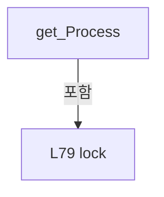

변경 전 점검: 입력/반환 타입, 위 호출자, 예외/취소 경로, 공유 상태와 저장·전송 소비자를 함께 확인합니다. 값의 단위나 물리 방향을 이름만으로 확정하지 않습니다.

### PropertyDeclaration `ReadCycleNo` · L86–95

[Drilling.Common/Interface/Melsec/CMelsec.cs:86–95](https://github.com/kjuws10-rgb/A3Drilling/blob/28764c91d521777b8ee068dd7aaf2d3902ce9fe2/Drilling.Common/Interface/Melsec/CMelsec.cs#L86-L95)

| 항목 | 실제 추출 값 |
| --- | --- |
| 서명 | long Drilling.Common.Interface.CMelsec.ReadCycleNo |
| 접근/수식자 | Public / public |
| 반환/값 타입 | long |
| 소속 타입 | NamedType:Drilling.Common.Interface.CMelsec |

현재 부분 분석에서 직접 연결된 호출자는 없습니다. XAML/이벤트/인터페이스·델리게이트·외부 진입을 추가 확인해야 하며, 미사용으로 판정한 것이 아닙니다.

변경 전 점검: 입력/반환 타입, 위 호출자, 예외/취소 경로, 공유 상태와 저장·전송 소비자를 함께 확인합니다. 값의 단위나 물리 방향을 이름만으로 확정하지 않습니다.

### GetAccessorDeclaration `get_ReadCycleNo` · L88–94

[Drilling.Common/Interface/Melsec/CMelsec.cs:88–94](https://github.com/kjuws10-rgb/A3Drilling/blob/28764c91d521777b8ee068dd7aaf2d3902ce9fe2/Drilling.Common/Interface/Melsec/CMelsec.cs#L88-L94)

| 항목 | 실제 추출 값 |
| --- | --- |
| 서명 | long Drilling.Common.Interface.CMelsec.ReadCycleNo.get |
| 접근/수식자 | Public / get |
| 반환/값 타입 | long |
| 소속 타입 | NamedType:Drilling.Common.Interface.CMelsec |

현재 부분 분석에서 직접 연결된 호출자는 없습니다. XAML/이벤트/인터페이스·델리게이트·외부 진입을 추가 확인해야 하며, 미사용으로 판정한 것이 아닙니다.

본문의 실제 연산·분기·예외·반환 순서(원문 위치 순):

| 원본 행 | 종류 | 주석 해설 |
| --- | --- | --- |
| 90 | lock | 공유 상태의 임계 구역에 진입합니다: lock (_readStateLock) |
| 92 | return | 호출자에게 값 또는 제어를 반환합니다: return _readCycleNo; |

제어 구문의 포함 구조(실제 실행 순서/CFG가 아닌 구문 탐색 그림):

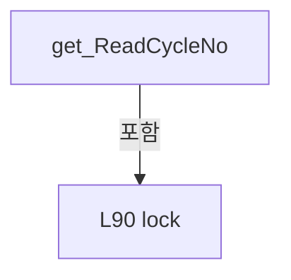

변경 전 점검: 입력/반환 타입, 위 호출자, 예외/취소 경로, 공유 상태와 저장·전송 소비자를 함께 확인합니다. 값의 단위나 물리 방향을 이름만으로 확정하지 않습니다.

### PropertyDeclaration `LastSuccessfulReadAt` · L97–106

[Drilling.Common/Interface/Melsec/CMelsec.cs:97–106](https://github.com/kjuws10-rgb/A3Drilling/blob/28764c91d521777b8ee068dd7aaf2d3902ce9fe2/Drilling.Common/Interface/Melsec/CMelsec.cs#L97-L106)

| 항목 | 실제 추출 값 |
| --- | --- |
| 서명 | System.DateTimeOffset? Drilling.Common.Interface.CMelsec.LastSuccessfulReadAt |
| 접근/수식자 | Public / public |
| 반환/값 타입 | System.DateTimeOffset? |
| 소속 타입 | NamedType:Drilling.Common.Interface.CMelsec |

현재 부분 분석에서 직접 연결된 호출자는 없습니다. XAML/이벤트/인터페이스·델리게이트·외부 진입을 추가 확인해야 하며, 미사용으로 판정한 것이 아닙니다.

변경 전 점검: 입력/반환 타입, 위 호출자, 예외/취소 경로, 공유 상태와 저장·전송 소비자를 함께 확인합니다. 값의 단위나 물리 방향을 이름만으로 확정하지 않습니다.

### GetAccessorDeclaration `get_LastSuccessfulReadAt` · L99–105

[Drilling.Common/Interface/Melsec/CMelsec.cs:99–105](https://github.com/kjuws10-rgb/A3Drilling/blob/28764c91d521777b8ee068dd7aaf2d3902ce9fe2/Drilling.Common/Interface/Melsec/CMelsec.cs#L99-L105)

| 항목 | 실제 추출 값 |
| --- | --- |
| 서명 | System.DateTimeOffset? Drilling.Common.Interface.CMelsec.LastSuccessfulReadAt.get |
| 접근/수식자 | Public / get |
| 반환/값 타입 | System.DateTimeOffset? |
| 소속 타입 | NamedType:Drilling.Common.Interface.CMelsec |

현재 부분 분석에서 직접 연결된 호출자는 없습니다. XAML/이벤트/인터페이스·델리게이트·외부 진입을 추가 확인해야 하며, 미사용으로 판정한 것이 아닙니다.

본문의 실제 연산·분기·예외·반환 순서(원문 위치 순):

| 원본 행 | 종류 | 주석 해설 |
| --- | --- | --- |
| 101 | lock | 공유 상태의 임계 구역에 진입합니다: lock (_readStateLock) |
| 103 | return | 호출자에게 값 또는 제어를 반환합니다: return _lastSuccessfulReadAt; |

제어 구문의 포함 구조(실제 실행 순서/CFG가 아닌 구문 탐색 그림):

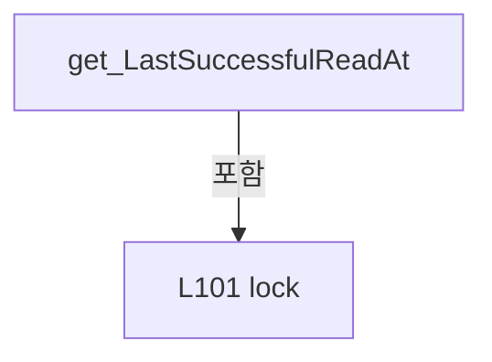

변경 전 점검: 입력/반환 타입, 위 호출자, 예외/취소 경로, 공유 상태와 저장·전송 소비자를 함께 확인합니다. 값의 단위나 물리 방향을 이름만으로 확정하지 않습니다.

### PropertyDeclaration `LastReadReturnCode` · L108–117

[Drilling.Common/Interface/Melsec/CMelsec.cs:108–117](https://github.com/kjuws10-rgb/A3Drilling/blob/28764c91d521777b8ee068dd7aaf2d3902ce9fe2/Drilling.Common/Interface/Melsec/CMelsec.cs#L108-L117)

| 항목 | 실제 추출 값 |
| --- | --- |
| 서명 | int Drilling.Common.Interface.CMelsec.LastReadReturnCode |
| 접근/수식자 | Public / public |
| 반환/값 타입 | int |
| 소속 타입 | NamedType:Drilling.Common.Interface.CMelsec |

현재 부분 분석에서 직접 연결된 호출자는 없습니다. XAML/이벤트/인터페이스·델리게이트·외부 진입을 추가 확인해야 하며, 미사용으로 판정한 것이 아닙니다.

변경 전 점검: 입력/반환 타입, 위 호출자, 예외/취소 경로, 공유 상태와 저장·전송 소비자를 함께 확인합니다. 값의 단위나 물리 방향을 이름만으로 확정하지 않습니다.

### GetAccessorDeclaration `get_LastReadReturnCode` · L110–116

[Drilling.Common/Interface/Melsec/CMelsec.cs:110–116](https://github.com/kjuws10-rgb/A3Drilling/blob/28764c91d521777b8ee068dd7aaf2d3902ce9fe2/Drilling.Common/Interface/Melsec/CMelsec.cs#L110-L116)

| 항목 | 실제 추출 값 |
| --- | --- |
| 서명 | int Drilling.Common.Interface.CMelsec.LastReadReturnCode.get |
| 접근/수식자 | Public / get |
| 반환/값 타입 | int |
| 소속 타입 | NamedType:Drilling.Common.Interface.CMelsec |

현재 부분 분석에서 직접 연결된 호출자는 없습니다. XAML/이벤트/인터페이스·델리게이트·외부 진입을 추가 확인해야 하며, 미사용으로 판정한 것이 아닙니다.

본문의 실제 연산·분기·예외·반환 순서(원문 위치 순):

| 원본 행 | 종류 | 주석 해설 |
| --- | --- | --- |
| 112 | lock | 공유 상태의 임계 구역에 진입합니다: lock (_readStateLock) |
| 114 | return | 호출자에게 값 또는 제어를 반환합니다: return _lastReadReturnCode; |

제어 구문의 포함 구조(실제 실행 순서/CFG가 아닌 구문 탐색 그림):

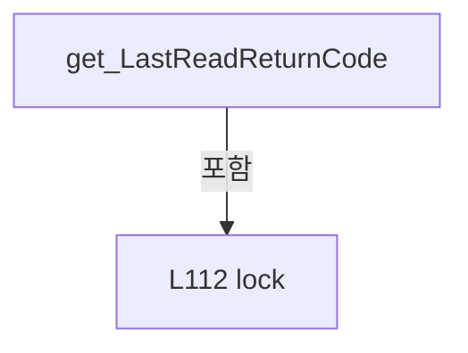

변경 전 점검: 입력/반환 타입, 위 호출자, 예외/취소 경로, 공유 상태와 저장·전송 소비자를 함께 확인합니다. 값의 단위나 물리 방향을 이름만으로 확정하지 않습니다.

### PropertyDeclaration `ConsecutiveReadFailureCount` · L119–128

[Drilling.Common/Interface/Melsec/CMelsec.cs:119–128](https://github.com/kjuws10-rgb/A3Drilling/blob/28764c91d521777b8ee068dd7aaf2d3902ce9fe2/Drilling.Common/Interface/Melsec/CMelsec.cs#L119-L128)

| 항목 | 실제 추출 값 |
| --- | --- |
| 서명 | int Drilling.Common.Interface.CMelsec.ConsecutiveReadFailureCount |
| 접근/수식자 | Public / public |
| 반환/값 타입 | int |
| 소속 타입 | NamedType:Drilling.Common.Interface.CMelsec |

현재 부분 분석에서 직접 연결된 호출자는 없습니다. XAML/이벤트/인터페이스·델리게이트·외부 진입을 추가 확인해야 하며, 미사용으로 판정한 것이 아닙니다.

변경 전 점검: 입력/반환 타입, 위 호출자, 예외/취소 경로, 공유 상태와 저장·전송 소비자를 함께 확인합니다. 값의 단위나 물리 방향을 이름만으로 확정하지 않습니다.

### GetAccessorDeclaration `get_ConsecutiveReadFailureCount` · L121–127

[Drilling.Common/Interface/Melsec/CMelsec.cs:121–127](https://github.com/kjuws10-rgb/A3Drilling/blob/28764c91d521777b8ee068dd7aaf2d3902ce9fe2/Drilling.Common/Interface/Melsec/CMelsec.cs#L121-L127)

| 항목 | 실제 추출 값 |
| --- | --- |
| 서명 | int Drilling.Common.Interface.CMelsec.ConsecutiveReadFailureCount.get |
| 접근/수식자 | Public / get |
| 반환/값 타입 | int |
| 소속 타입 | NamedType:Drilling.Common.Interface.CMelsec |

현재 부분 분석에서 직접 연결된 호출자는 없습니다. XAML/이벤트/인터페이스·델리게이트·외부 진입을 추가 확인해야 하며, 미사용으로 판정한 것이 아닙니다.

본문의 실제 연산·분기·예외·반환 순서(원문 위치 순):

| 원본 행 | 종류 | 주석 해설 |
| --- | --- | --- |
| 123 | lock | 공유 상태의 임계 구역에 진입합니다: lock (_readStateLock) |
| 125 | return | 호출자에게 값 또는 제어를 반환합니다: return _consecutiveReadFailureCount; |

제어 구문의 포함 구조(실제 실행 순서/CFG가 아닌 구문 탐색 그림):

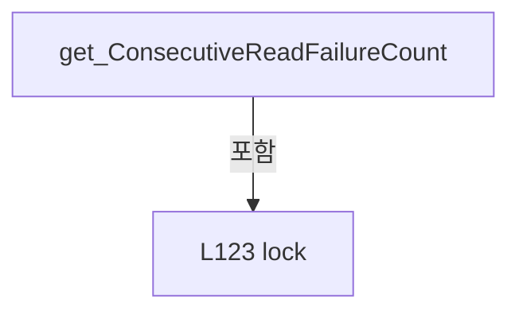

변경 전 점검: 입력/반환 타입, 위 호출자, 예외/취소 경로, 공유 상태와 저장·전송 소비자를 함께 확인합니다. 값의 단위나 물리 방향을 이름만으로 확정하지 않습니다.

### PropertyDeclaration `IsCommunicationAvailable` · L130–139

[Drilling.Common/Interface/Melsec/CMelsec.cs:130–139](https://github.com/kjuws10-rgb/A3Drilling/blob/28764c91d521777b8ee068dd7aaf2d3902ce9fe2/Drilling.Common/Interface/Melsec/CMelsec.cs#L130-L139)

| 항목 | 실제 추출 값 |
| --- | --- |
| 서명 | bool Drilling.Common.Interface.CMelsec.IsCommunicationAvailable |
| 접근/수식자 | Public / public |
| 반환/값 타입 | bool |
| 소속 타입 | NamedType:Drilling.Common.Interface.CMelsec |

현재 부분 분석에서 직접 연결된 호출자는 없습니다. XAML/이벤트/인터페이스·델리게이트·외부 진입을 추가 확인해야 하며, 미사용으로 판정한 것이 아닙니다.

변경 전 점검: 입력/반환 타입, 위 호출자, 예외/취소 경로, 공유 상태와 저장·전송 소비자를 함께 확인합니다. 값의 단위나 물리 방향을 이름만으로 확정하지 않습니다.

### GetAccessorDeclaration `get_IsCommunicationAvailable` · L132–138

[Drilling.Common/Interface/Melsec/CMelsec.cs:132–138](https://github.com/kjuws10-rgb/A3Drilling/blob/28764c91d521777b8ee068dd7aaf2d3902ce9fe2/Drilling.Common/Interface/Melsec/CMelsec.cs#L132-L138)

| 항목 | 실제 추출 값 |
| --- | --- |
| 서명 | bool Drilling.Common.Interface.CMelsec.IsCommunicationAvailable.get |
| 접근/수식자 | Public / get |
| 반환/값 타입 | bool |
| 소속 타입 | NamedType:Drilling.Common.Interface.CMelsec |

현재 부분 분석에서 직접 연결된 호출자는 없습니다. XAML/이벤트/인터페이스·델리게이트·외부 진입을 추가 확인해야 하며, 미사용으로 판정한 것이 아닙니다.

본문의 실제 연산·분기·예외·반환 순서(원문 위치 순):

| 원본 행 | 종류 | 주석 해설 |
| --- | --- | --- |
| 134 | lock | 공유 상태의 임계 구역에 진입합니다: lock (_readStateLock) |
| 136 | return | 호출자에게 값 또는 제어를 반환합니다: return _communicationAvailable; |

제어 구문의 포함 구조(실제 실행 순서/CFG가 아닌 구문 탐색 그림):

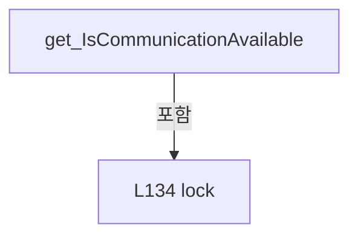

변경 전 점검: 입력/반환 타입, 위 호출자, 예외/취소 경로, 공유 상태와 저장·전송 소비자를 함께 확인합니다. 값의 단위나 물리 방향을 이름만으로 확정하지 않습니다.

### MethodDeclaration `Initialize` · L141–154

[Drilling.Common/Interface/Melsec/CMelsec.cs:141–154](https://github.com/kjuws10-rgb/A3Drilling/blob/28764c91d521777b8ee068dd7aaf2d3902ce9fe2/Drilling.Common/Interface/Melsec/CMelsec.cs#L141-L154)

| 항목 | 실제 추출 값 |
| --- | --- |
| 서명 | void Drilling.Common.Interface.CMelsec.Initialize() |
| 접근/수식자 | Public / public |
| 반환/값 타입 | void |
| 소속 타입 | NamedType:Drilling.Common.Interface.CMelsec |

정적 호출자로 확인된 위치:

| 호출 파일/행 | 호출 표현식 | 런타임 분기 가능 |
| --- | --- | --- |
| [Drilling.Common/Interface/CInterfaceManager.cs:150–150](https://github.com/kjuws10-rgb/A3Drilling/blob/28764c91d521777b8ee068dd7aaf2d3902ce9fe2/Drilling.Common/Interface/CInterfaceManager.cs#L150-L150) | _melsec.Initialize | False |
| [Drilling.Common/Interface/CInterfaceManager.cs:603–603](https://github.com/kjuws10-rgb/A3Drilling/blob/28764c91d521777b8ee068dd7aaf2d3902ce9fe2/Drilling.Common/Interface/CInterfaceManager.cs#L603-L603) | _melsec.Initialize | False |
| [Drilling.Common/Interface/Melsec/CMelsec.cs:629–629](https://github.com/kjuws10-rgb/A3Drilling/blob/28764c91d521777b8ee068dd7aaf2d3902ce9fe2/Drilling.Common/Interface/Melsec/CMelsec.cs#L629-L629) | Initialize | False |
| [Drilling.Common/Interface/Melsec/CMelsec.cs:969–969](https://github.com/kjuws10-rgb/A3Drilling/blob/28764c91d521777b8ee068dd7aaf2d3902ce9fe2/Drilling.Common/Interface/Melsec/CMelsec.cs#L969-L969) | Initialize | False |

호출하는 대상과 해석 범위:

| 원본 행 | 표현식 | 분석 상태 | 대상/소스 위치 |
| --- | --- | --- | --- |
| 145 | RestartPollingSchedule | resolved | void Drilling.Common.Interface.CMelsec.RestartPollingSchedule() · Drilling.Common/Interface/Melsec/CMelsec.cs:2750 |
| 153 | Start | resolved | void Drilling.Common.Threading.CtrlThread.Start(int, string) · Drilling.Common/Threading/CtrlThread.cs:60 |

본문의 실제 연산·분기·예외·반환 순서(원문 위치 순):

| 원본 행 | 종류 | 주석 해설 |
| --- | --- | --- |
| 143 | if | 조건에 따라 분기합니다: if (!IsRunning) |
| 145 | call | 함수·델리게이트 또는 객체 생성자를 호출합니다: RestartPollingSchedule() |
| 148 | lock | 공유 상태의 임계 구역에 진입합니다: lock (_requestLock) |
| 150 | assignment | 값을 대상에 대입합니다: _acceptRequests = true |
| 153 | call | 함수·델리게이트 또는 객체 생성자를 호출합니다: Start(MelsecThreadDelayMs, "MELSEC_CONTROL") |

제어 구문의 포함 구조(실제 실행 순서/CFG가 아닌 구문 탐색 그림):

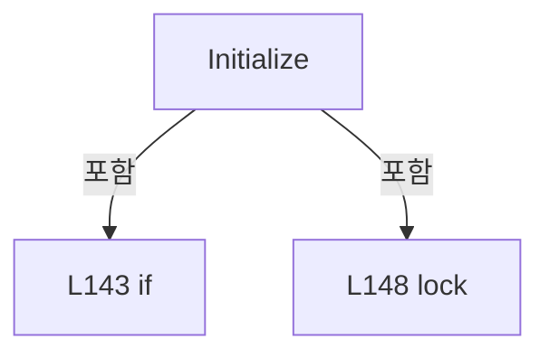

변경 전 점검: 입력/반환 타입, 위 호출자, 예외/취소 경로, 공유 상태와 저장·전송 소비자를 함께 확인합니다. 값의 단위나 물리 방향을 이름만으로 확정하지 않습니다.

### MethodDeclaration `DeInitialize` · L156–195

[Drilling.Common/Interface/Melsec/CMelsec.cs:156–195](https://github.com/kjuws10-rgb/A3Drilling/blob/28764c91d521777b8ee068dd7aaf2d3902ce9fe2/Drilling.Common/Interface/Melsec/CMelsec.cs#L156-L195)

| 항목 | 실제 추출 값 |
| --- | --- |
| 서명 | void Drilling.Common.Interface.CMelsec.DeInitialize() |
| 접근/수식자 | Public / public |
| 반환/값 타입 | void |
| 소속 타입 | NamedType:Drilling.Common.Interface.CMelsec |

정적 호출자로 확인된 위치:

| 호출 파일/행 | 호출 표현식 | 런타임 분기 가능 |
| --- | --- | --- |
| [Drilling.Common/Interface/CInterfaceManager.cs:138–138](https://github.com/kjuws10-rgb/A3Drilling/blob/28764c91d521777b8ee068dd7aaf2d3902ce9fe2/Drilling.Common/Interface/CInterfaceManager.cs#L138-L138) | _melsec.DeInitialize | False |
| [Drilling.Common/Interface/CInterfaceManager.cs:257–257](https://github.com/kjuws10-rgb/A3Drilling/blob/28764c91d521777b8ee068dd7aaf2d3902ce9fe2/Drilling.Common/Interface/CInterfaceManager.cs#L257-L257) | _melsec.DeInitialize | False |
| [Drilling.Common/Interface/CInterfaceManager.cs:625–625](https://github.com/kjuws10-rgb/A3Drilling/blob/28764c91d521777b8ee068dd7aaf2d3902ce9fe2/Drilling.Common/Interface/CInterfaceManager.cs#L625-L625) | _melsec.DeInitialize | False |
| [Drilling.Common/Interface/Melsec/CMelsec.cs:483–483](https://github.com/kjuws10-rgb/A3Drilling/blob/28764c91d521777b8ee068dd7aaf2d3902ce9fe2/Drilling.Common/Interface/Melsec/CMelsec.cs#L483-L483) | DeInitialize | False |

호출하는 대상과 해석 범위:

| 원본 행 | 표현식 | 분석 상태 | 대상/소스 위치 |
| --- | --- | --- | --- |
| 163 | InvalidatePollingCache | resolved | void Drilling.Common.Interface.CMelsec.InvalidatePollingCache(Drilling.Common.Interface.EN_MELSEC_CACHE_STATE, string) · Drilling.Common/Interface/Melsec/CMelsec.cs:2776 |
| 164 | FlushMelsecLogs | resolved | void Drilling.Common.Interface.CMelsec.FlushMelsecLogs() · Drilling.Common/Interface/Melsec/CMelsec.InterfaceLog.cs:73 |
| 165 | CancelQueuedRequests | resolved | void Drilling.Common.Interface.CMelsec.CancelQueuedRequests(string) · Drilling.Common/Interface/Melsec/CMelsec.cs:882 |
| 166 | CancelQueuedWrites | resolved | void Drilling.Common.Interface.CMelsec.CancelQueuedWrites(string) · Drilling.Common/Interface/Melsec/CMelsec.cs:1406 |
| 167 | CloseMelsecNetChannels | resolved | void Drilling.Common.Interface.CMelsec.CloseMelsecNetChannels() · Drilling.Common/Interface/Melsec/CMelsec.cs:771 |
| 168 | Stop | resolved | void Drilling.Common.Threading.CtrlThread.Stop() · Drilling.Common/Threading/CtrlThread.cs:128 |
| 171 | Stop | resolved | void Drilling.Common.Threading.CtrlThread.Stop() · Drilling.Common/Threading/CtrlThread.cs:128 |
| 176 | _simulationWords.Clear | resolved | void System.Collections.Generic.Dictionary<string, ushort>.Clear() |
| 182 | _readSnapshots.Clear | resolved | void System.Collections.Generic.Dictionary<string, Drilling.Common.Interface.CMelsec.CMelsecReadSnapshot>.Clear() |

본문의 실제 연산·분기·예외·반환 순서(원문 위치 순):

| 원본 행 | 종류 | 주석 해설 |
| --- | --- | --- |
| 158 | lock | 공유 상태의 임계 구역에 진입합니다: lock (_requestLock) |
| 160 | assignment | 값을 대상에 대입합니다: _acceptRequests = false |
| 163 | call | 함수·델리게이트 또는 객체 생성자를 호출합니다: InvalidatePollingCache(EN_MELSEC_CACHE_STATE.Offline, "MELSEC communication is stopped.") |
| 164 | call | 함수·델리게이트 또는 객체 생성자를 호출합니다: FlushMelsecLogs() |
| 165 | call | 함수·델리게이트 또는 객체 생성자를 호출합니다: CancelQueuedRequests("MELSEC control is stopping.") |
| 166 | call | 함수·델리게이트 또는 객체 생성자를 호출합니다: CancelQueuedWrites("MELSEC control is stopping.") |
| 167 | call | 함수·델리게이트 또는 객체 생성자를 호출합니다: CloseMelsecNetChannels() |
| 168 | call | 함수·델리게이트 또는 객체 생성자를 호출합니다: Stop() |
| 169 | if | 조건에 따라 분기합니다: if (IsRunning) |
| 171 | call | 함수·델리게이트 또는 객체 생성자를 호출합니다: Stop() |
| 174 | lock | 공유 상태의 임계 구역에 진입합니다: lock (_simulationLock) |
| 176 | call | 함수·델리게이트 또는 객체 생성자를 호출합니다: _simulationWords.Clear() |
| 177 | assignment | 값을 대상에 대입합니다: _simulationReadback = EN_MELSEC_SIMULATION_READBACK.AutoEcho |
| 180 | lock | 공유 상태의 임계 구역에 진입합니다: lock (_readStateLock) |
| 182 | call | 함수·델리게이트 또는 객체 생성자를 호출합니다: _readSnapshots.Clear() |
| 183 | assignment | 값을 대상에 대입합니다: _readCycleNo = 0 |
| 184 | assignment | 값을 대상에 대입합니다: _lastSuccessfulReadAt = null |
| 185 | assignment | 값을 대상에 대입합니다: _lastReadReturnCode = 0 |
| 186 | assignment | 값을 대상에 대입합니다: _consecutiveReadFailureCount = 0 |
| 187 | assignment | 값을 대상에 대입합니다: _communicationAvailable = false |
| 190 | lock | 공유 상태의 임계 구역에 진입합니다: lock (_writeLock) |
| 192 | assignment | 값을 대상에 대입합니다: _activeWriteCommand = null |
| 193 | assignment | 값을 대상에 대입합니다: _process = EN_MELSEC_PROCESS.Ready |

제어 구문의 포함 구조(실제 실행 순서/CFG가 아닌 구문 탐색 그림):

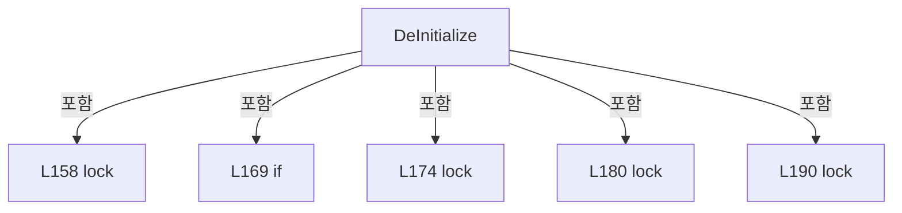

변경 전 점검: 입력/반환 타입, 위 호출자, 예외/취소 경로, 공유 상태와 저장·전송 소비자를 함께 확인합니다. 값의 단위나 물리 방향을 이름만으로 확정하지 않습니다.

### MethodDeclaration `Run` · L197–230

[Drilling.Common/Interface/Melsec/CMelsec.cs:197–230](https://github.com/kjuws10-rgb/A3Drilling/blob/28764c91d521777b8ee068dd7aaf2d3902ce9fe2/Drilling.Common/Interface/Melsec/CMelsec.cs#L197-L230)

| 항목 | 실제 추출 값 |
| --- | --- |
| 서명 | void Drilling.Common.Interface.CMelsec.Run() |
| 접근/수식자 | Public / public, override |
| 반환/값 타입 | void |
| 소속 타입 | NamedType:Drilling.Common.Interface.CMelsec |

현재 부분 분석에서 직접 연결된 호출자는 없습니다. XAML/이벤트/인터페이스·델리게이트·외부 진입을 추가 확인해야 하며, 미사용으로 판정한 것이 아닙니다.

호출하는 대상과 해석 범위:

| 원본 행 | 표현식 | 분석 상태 | 대상/소스 위치 |
| --- | --- | --- | --- |
| 201 | GetActiveWriteCommand | resolved | Drilling.Common.Interface.CMelsec.CMelsecWriteCommand? Drilling.Common.Interface.CMelsec.GetActiveWriteCommand() · Drilling.Common/Interface/Melsec/CMelsec.cs:1083 |
| 204 | ProcessWriteCommand | resolved | void Drilling.Common.Interface.CMelsec.ProcessWriteCommand(Drilling.Common.Interface.CMelsec.CMelsecWriteCommand) · Drilling.Common/Interface/Melsec/CMelsec.cs:1121 |
| 205 | PollNextCacheBlock | resolved | void Drilling.Common.Interface.CMelsec.PollNextCacheBlock() · Drilling.Common/Interface/Melsec/CMelsec.cs:2826 |
| 209 | GetThreadRequest | resolved | Drilling.Common.Interface.CMelsec.CMelsecThreadRequest? Drilling.Common.Interface.CMelsec.GetThreadRequest() · Drilling.Common/Interface/Melsec/CMelsec.cs:645 |
| 212 | ProcessThreadRequest | resolved | void Drilling.Common.Interface.CMelsec.ProcessThreadRequest(Drilling.Common.Interface.CMelsec.CMelsecThreadRequest) · Drilling.Common/Interface/Melsec/CMelsec.cs:658 |
| 213 | PollNextCacheBlock | resolved | void Drilling.Common.Interface.CMelsec.PollNextCacheBlock() · Drilling.Common/Interface/Melsec/CMelsec.cs:2826 |
| 217 | GetQueuedWriteCommand | resolved | Drilling.Common.Interface.CMelsec.CMelsecWriteCommand? Drilling.Common.Interface.CMelsec.GetQueuedWriteCommand() · Drilling.Common/Interface/Melsec/CMelsec.cs:1091 |
| 220 | ActivateWriteCommand | resolved | void Drilling.Common.Interface.CMelsec.ActivateWriteCommand(Drilling.Common.Interface.CMelsec.CMelsecWriteCommand) · Drilling.Common/Interface/Melsec/CMelsec.cs:1104 |
| 223 | PollNextCacheBlock | resolved | void Drilling.Common.Interface.CMelsec.PollNextCacheBlock() · Drilling.Common/Interface/Melsec/CMelsec.cs:2826 |
| 227 | FlushMelsecLogs | resolved | void Drilling.Common.Interface.CMelsec.FlushMelsecLogs() · Drilling.Common/Interface/Melsec/CMelsec.InterfaceLog.cs:73 |
| 228 | PublishMelsecTimings | resolved | void Drilling.Common.Interface.CMelsec.PublishMelsecTimings() · Drilling.Common/Interface/Melsec/CMelsec.InterfaceLog.cs:27 |

본문의 실제 연산·분기·예외·반환 순서(원문 위치 순):

| 원본 행 | 종류 | 주석 해설 |
| --- | --- | --- |
| 199 | try | 예외 처리 범위입니다: try |
| 201 | call | 함수·델리게이트 또는 객체 생성자를 호출합니다: GetActiveWriteCommand() |
| 201 | local-declaration | 지역 변수를 선언합니다: CMelsecWriteCommand? activeCommand = GetActiveWriteCommand(); |
| 201 | variable-initializer | 변수의 초기값을 지정합니다: activeCommand = GetActiveWriteCommand() |
| 202 | if | 조건에 따라 분기합니다: if (activeCommand != null) |
| 204 | call | 함수·델리게이트 또는 객체 생성자를 호출합니다: ProcessWriteCommand(activeCommand) |
| 205 | call | 함수·델리게이트 또는 객체 생성자를 호출합니다: PollNextCacheBlock() |
| 206 | return | 호출자에게 값 또는 제어를 반환합니다: return; |
| 209 | call | 함수·델리게이트 또는 객체 생성자를 호출합니다: GetThreadRequest() |
| 209 | local-declaration | 지역 변수를 선언합니다: CMelsecThreadRequest? request = GetThreadRequest(); |
| 209 | variable-initializer | 변수의 초기값을 지정합니다: request = GetThreadRequest() |
| 210 | if | 조건에 따라 분기합니다: if (request != null) |
| 212 | call | 함수·델리게이트 또는 객체 생성자를 호출합니다: ProcessThreadRequest(request) |
| 213 | call | 함수·델리게이트 또는 객체 생성자를 호출합니다: PollNextCacheBlock() |
| 214 | return | 호출자에게 값 또는 제어를 반환합니다: return; |
| 217 | call | 함수·델리게이트 또는 객체 생성자를 호출합니다: GetQueuedWriteCommand() |
| 217 | local-declaration | 지역 변수를 선언합니다: CMelsecWriteCommand? writeCommand = GetQueuedWriteCommand(); |
| 217 | variable-initializer | 변수의 초기값을 지정합니다: writeCommand = GetQueuedWriteCommand() |
| 218 | if | 조건에 따라 분기합니다: if (writeCommand != null) |
| 220 | call | 함수·델리게이트 또는 객체 생성자를 호출합니다: ActivateWriteCommand(writeCommand) |
| 223 | call | 함수·델리게이트 또는 객체 생성자를 호출합니다: PollNextCacheBlock() |
| 225 | finally | 종료 정리 구간입니다: finally |
| 227 | call | 함수·델리게이트 또는 객체 생성자를 호출합니다: FlushMelsecLogs() |
| 228 | call | 함수·델리게이트 또는 객체 생성자를 호출합니다: PublishMelsecTimings() |

제어 구문의 포함 구조(실제 실행 순서/CFG가 아닌 구문 탐색 그림):

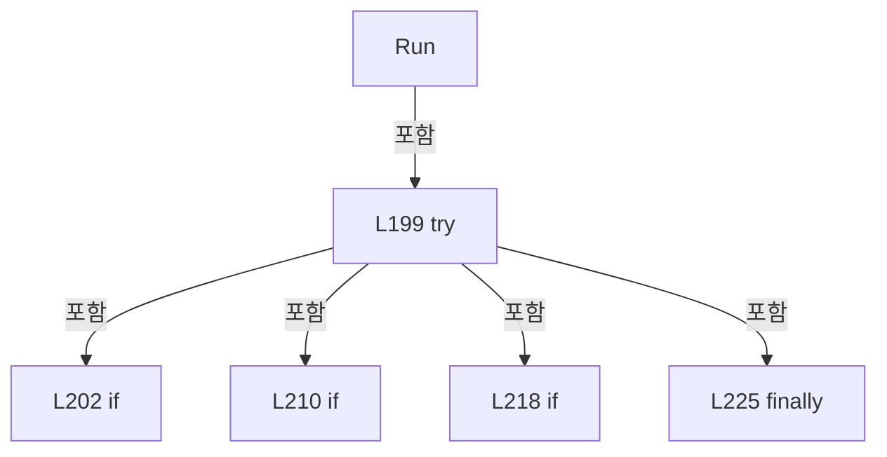

변경 전 점검: 입력/반환 타입, 위 호출자, 예외/취소 경로, 공유 상태와 저장·전송 소비자를 함께 확인합니다. 값의 단위나 물리 방향을 이름만으로 확정하지 않습니다.

### MethodDeclaration `OnThreadError` · L232–236

[Drilling.Common/Interface/Melsec/CMelsec.cs:232–236](https://github.com/kjuws10-rgb/A3Drilling/blob/28764c91d521777b8ee068dd7aaf2d3902ce9fe2/Drilling.Common/Interface/Melsec/CMelsec.cs#L232-L236)

| 항목 | 실제 추출 값 |
| --- | --- |
| 서명 | void Drilling.Common.Interface.CMelsec.OnThreadError(System.Exception) |
| 접근/수식자 | Protected / protected, override |
| 반환/값 타입 | void |
| 소속 타입 | NamedType:Drilling.Common.Interface.CMelsec |

입력 계약:

| 이름 | 타입 | 전달 | 선택/기본값 |
| --- | --- | --- | --- |
| exception | System.Exception | None | False /  |

현재 부분 분석에서 직접 연결된 호출자는 없습니다. XAML/이벤트/인터페이스·델리게이트·외부 진입을 추가 확인해야 하며, 미사용으로 판정한 것이 아닙니다.

호출하는 대상과 해석 범위:

| 원본 행 | 표현식 | 분석 상태 | 대상/소스 위치 |
| --- | --- | --- | --- |
| 234 | .WriteInterfaceError | unresolved | None |
| 235 | base.OnThreadError | resolved · 동적 구현 선택 가능 | void Drilling.Common.Threading.CtrlThread.OnThreadError(System.Exception) · Drilling.Common/Threading/CtrlThread.cs:219 |

본문의 실제 연산·분기·예외·반환 순서(원문 위치 순):

| 원본 행 | 종류 | 주석 해설 |
| --- | --- | --- |
| 234 | call | 함수·델리게이트 또는 객체 생성자를 호출합니다: .WriteInterfaceError(EN_EQP_MODULE.Melsec, "MELSEC_CONTROL", "[I/F][COMM_ERROR] THREAD", exception.Message) |
| 235 | call | 함수·델리게이트 또는 객체 생성자를 호출합니다: base.OnThreadError(exception) |

변경 전 점검: 입력/반환 타입, 위 호출자, 예외/취소 경로, 공유 상태와 저장·전송 소비자를 함께 확인합니다. 값의 단위나 물리 방향을 이름만으로 확정하지 않습니다.

### PropertyDeclaration `Map` · L238–243

[Drilling.Common/Interface/Melsec/CMelsec.cs:238–243](https://github.com/kjuws10-rgb/A3Drilling/blob/28764c91d521777b8ee068dd7aaf2d3902ce9fe2/Drilling.Common/Interface/Melsec/CMelsec.cs#L238-L243)

| 항목 | 실제 추출 값 |
| --- | --- |
| 서명 | System.Collections.Generic.IReadOnlyList<Drilling.Common.Interface.ST_MELSEC_MAP_DATA> Drilling.Common.Interface.CMelsec.Map |
| 접근/수식자 | Public / public |
| 반환/값 타입 | System.Collections.Generic.IReadOnlyList<Drilling.Common.Interface.ST_MELSEC_MAP_DATA> |
| 소속 타입 | NamedType:Drilling.Common.Interface.CMelsec |

현재 부분 분석에서 직접 연결된 호출자는 없습니다. XAML/이벤트/인터페이스·델리게이트·외부 진입을 추가 확인해야 하며, 미사용으로 판정한 것이 아닙니다.

변경 전 점검: 입력/반환 타입, 위 호출자, 예외/취소 경로, 공유 상태와 저장·전송 소비자를 함께 확인합니다. 값의 단위나 물리 방향을 이름만으로 확정하지 않습니다.

### GetAccessorDeclaration `get_Map` · L242–242

[Drilling.Common/Interface/Melsec/CMelsec.cs:242–242](https://github.com/kjuws10-rgb/A3Drilling/blob/28764c91d521777b8ee068dd7aaf2d3902ce9fe2/Drilling.Common/Interface/Melsec/CMelsec.cs#L242-L242)

| 항목 | 실제 추출 값 |
| --- | --- |
| 서명 | System.Collections.Generic.IReadOnlyList<Drilling.Common.Interface.ST_MELSEC_MAP_DATA> Drilling.Common.Interface.CMelsec.Map.get |
| 접근/수식자 | Public / get |
| 반환/값 타입 | System.Collections.Generic.IReadOnlyList<Drilling.Common.Interface.ST_MELSEC_MAP_DATA> |
| 소속 타입 | NamedType:Drilling.Common.Interface.CMelsec |

현재 부분 분석에서 직접 연결된 호출자는 없습니다. XAML/이벤트/인터페이스·델리게이트·외부 진입을 추가 확인해야 하며, 미사용으로 판정한 것이 아닙니다.

호출하는 대상과 해석 범위:

| 원본 행 | 표현식 | 분석 상태 | 대상/소스 위치 |
| --- | --- | --- | --- |
| 242 | Volatile.Read | resolved | System.Collections.Generic.IReadOnlyList<Drilling.Common.Interface.ST_MELSEC_MAP_DATA> System.Threading.Volatile.Read<System.Collections.Generic.IReadOnlyList<Drilling.Common.Interface.ST_MELSEC_MAP_DATA>>(ref readonly System.Collections.Generic.IReadOnlyList<Drilling.Common.Interface.ST_MELSEC_MAP_DATA>) |

본문의 실제 연산·분기·예외·반환 순서(원문 위치 순):

| 원본 행 | 종류 | 주석 해설 |
| --- | --- | --- |
| 242 | call | 함수·델리게이트 또는 객체 생성자를 호출합니다: Volatile.Read(ref _mapSnapshot) |

변경 전 점검: 입력/반환 타입, 위 호출자, 예외/취소 경로, 공유 상태와 저장·전송 소비자를 함께 확인합니다. 값의 단위나 물리 방향을 이름만으로 확정하지 않습니다.

### MethodDeclaration `ValidateMapData` · L245–271

[Drilling.Common/Interface/Melsec/CMelsec.cs:245–271](https://github.com/kjuws10-rgb/A3Drilling/blob/28764c91d521777b8ee068dd7aaf2d3902ce9fe2/Drilling.Common/Interface/Melsec/CMelsec.cs#L245-L271)

| 항목 | 실제 추출 값 |
| --- | --- |
| 서명 | void Drilling.Common.Interface.CMelsec.ValidateMapData(Drilling.Common.Interface.ST_MELSEC_MAP_DATA) |
| 접근/수식자 | Public / public, static |
| 반환/값 타입 | void |
| 소속 타입 | NamedType:Drilling.Common.Interface.CMelsec |

입력 계약:

| 이름 | 타입 | 전달 | 선택/기본값 |
| --- | --- | --- | --- |
| data | Drilling.Common.Interface.ST_MELSEC_MAP_DATA | None | False /  |

정적 호출자로 확인된 위치:

| 호출 파일/행 | 호출 표현식 | 런타임 분기 가능 |
| --- | --- | --- |
| [Drilling.Common/Correction/CAlignInterpolation.cs:418–418](https://github.com/kjuws10-rgb/A3Drilling/blob/28764c91d521777b8ee068dd7aaf2d3902ce9fe2/Drilling.Common/Correction/CAlignInterpolation.cs#L418-L418) | CMelsec.ValidateMapData | False |
| [Drilling.Common/Interface/Melsec/CMelsec.cs:548–548](https://github.com/kjuws10-rgb/A3Drilling/blob/28764c91d521777b8ee068dd7aaf2d3902ce9fe2/Drilling.Common/Interface/Melsec/CMelsec.cs#L548-L548) | ValidateMapData | False |
| [Drilling.Common/Interface/Melsec/CMelsec.cs:569–569](https://github.com/kjuws10-rgb/A3Drilling/blob/28764c91d521777b8ee068dd7aaf2d3902ce9fe2/Drilling.Common/Interface/Melsec/CMelsec.cs#L569-L569) | ValidateMapData | False |
| [Drilling.Common/Interface/Melsec/CMelsec.cs:2430–2430](https://github.com/kjuws10-rgb/A3Drilling/blob/28764c91d521777b8ee068dd7aaf2d3902ce9fe2/Drilling.Common/Interface/Melsec/CMelsec.cs#L2430-L2430) | ValidateMapData | False |
| [Drilling.Common/Interface/Melsec/CMelsec.cs:2473–2473](https://github.com/kjuws10-rgb/A3Drilling/blob/28764c91d521777b8ee068dd7aaf2d3902ce9fe2/Drilling.Common/Interface/Melsec/CMelsec.cs#L2473-L2473) | ValidateMapData | False |
| [Drilling.Common/Interface/Melsec/CMelsec.cs:2505–2505](https://github.com/kjuws10-rgb/A3Drilling/blob/28764c91d521777b8ee068dd7aaf2d3902ce9fe2/Drilling.Common/Interface/Melsec/CMelsec.cs#L2505-L2505) | ValidateMapData | False |
| [Drilling.Common/Interface/Melsec/CMelsec.cs:2666–2666](https://github.com/kjuws10-rgb/A3Drilling/blob/28764c91d521777b8ee068dd7aaf2d3902ce9fe2/Drilling.Common/Interface/Melsec/CMelsec.cs#L2666-L2666) | ValidateMapData | False |
| [Drilling.UI/Menu/Menus/CMenuCorrection.cs:5706–5706](https://github.com/kjuws10-rgb/A3Drilling/blob/28764c91d521777b8ee068dd7aaf2d3902ce9fe2/Drilling.UI/Menu/Menus/CMenuCorrection.cs#L5706-L5706) | CMelsec.ValidateMapData | False |

호출하는 대상과 해석 범위:

| 원본 행 | 표현식 | 분석 상태 | 대상/소스 위치 |
| --- | --- | --- | --- |
| 247 | double.IsFinite | resolved | bool double.IsFinite(double) |
| 247 | double.IsFinite | resolved | bool double.IsFinite(double) |
| 249 | new InvalidDataException | resolved | System.IO.InvalidDataException.InvalidDataException(string?) |
| 249 | FormatMap | resolved | string Drilling.Common.Interface.CMelsec.FormatMap(Drilling.Common.Interface.ST_MELSEC_MAP_DATA) · Drilling.Common/Interface/Melsec/CMelsec.cs:2246 |
| 252 | ParseAddress | resolved | Drilling.Common.Interface.CMelsec.ST_MELSEC_ADDRESS Drilling.Common.Interface.CMelsec.ParseAddress(string) · Drilling.Common/Interface/Melsec/CMelsec.cs:1981 |
| 255 | new InvalidDataException | resolved | System.IO.InvalidDataException.InvalidDataException(string?) |
| 255 | FormatMap | resolved | string Drilling.Common.Interface.CMelsec.FormatMap(Drilling.Common.Interface.ST_MELSEC_MAP_DATA) · Drilling.Common/Interface/Melsec/CMelsec.cs:2246 |
| 260 | RequireWordBit | resolved | int Drilling.Common.Interface.CMelsec.RequireWordBit(Drilling.Common.Interface.CMelsec.ST_MELSEC_ADDRESS, Drilling.Common.Interface.ST_MELSEC_MAP_DATA) · Drilling.Common/Interface/Melsec/CMelsec.cs:2080 |
| 264 | new InvalidDataException | resolved | System.IO.InvalidDataException.InvalidDataException(string?) |
| 264 | FormatMap | resolved | string Drilling.Common.Interface.CMelsec.FormatMap(Drilling.Common.Interface.ST_MELSEC_MAP_DATA) · Drilling.Common/Interface/Melsec/CMelsec.cs:2246 |
| 269 | new InvalidDataException | resolved | System.IO.InvalidDataException.InvalidDataException(string?) |
| 269 | FormatMap | resolved | string Drilling.Common.Interface.CMelsec.FormatMap(Drilling.Common.Interface.ST_MELSEC_MAP_DATA) · Drilling.Common/Interface/Melsec/CMelsec.cs:2246 |

본문의 실제 연산·분기·예외·반환 순서(원문 위치 순):

| 원본 행 | 종류 | 주석 해설 |
| --- | --- | --- |
| 247 | call | 함수·델리게이트 또는 객체 생성자를 호출합니다: double.IsFinite(data.ReadScale) |
| 247 | call | 함수·델리게이트 또는 객체 생성자를 호출합니다: double.IsFinite(data.WriteScale) |
| 247 | if | 조건에 따라 분기합니다: if (!double.IsFinite(data.ReadScale) &#124;&#124; data.ReadScale == 0 &#124;&#124; !double.IsFinite(data.WriteScale) &#124;&#124; data.WriteScale == 0) |
| 249 | call | 함수·델리게이트 또는 객체 생성자를 호출합니다: new InvalidDataException("MELSEC READ_SCALE and WRITE_SCALE must be finite and nonzero: " + FormatMap(data)) |
| 249 | call | 함수·델리게이트 또는 객체 생성자를 호출합니다: FormatMap(data) |
| 249 | throw | 예외를 발생/전달합니다: throw new InvalidDataException("MELSEC READ_SCALE and WRITE_SCALE must be finite and nonzero: " + FormatMap(data)); |
| 252 | call | 함수·델리게이트 또는 객체 생성자를 호출합니다: ParseAddress(data.Address) |
| 252 | local-declaration | 지역 변수를 선언합니다: ST_MELSEC_ADDRESS address = ParseAddress(data.Address); |
| 252 | variable-initializer | 변수의 초기값을 지정합니다: address = ParseAddress(data.Address) |
| 253 | if | 조건에 따라 분기합니다: if (address.Number < 0) |
| 255 | call | 함수·델리게이트 또는 객체 생성자를 호출합니다: new InvalidDataException("MELSECNET device number cannot be negative: " + FormatMap(data)) |
| 255 | call | 함수·델리게이트 또는 객체 생성자를 호출합니다: FormatMap(data) |
| 255 | throw | 예외를 발생/전달합니다: throw new InvalidDataException("MELSECNET device number cannot be negative: " + FormatMap(data)); |
| 258 | if | 조건에 따라 분기합니다: if (data.DataType == EN_MELSEC_DATA_TYPE.Bit) |
| 260 | call | 함수·델리게이트 또는 객체 생성자를 호출합니다: RequireWordBit(address, data) |
| 262 | else | 앞 조건이 거짓인 경로입니다: else |
| 262 | if | 조건에 따라 분기합니다: if (address.BitIndex != null) |
| 264 | call | 함수·델리게이트 또는 객체 생성자를 호출합니다: new InvalidDataException("MELSEC non-BIT address cannot include a bit index: " + FormatMap(data)) |
| 264 | call | 함수·델리게이트 또는 객체 생성자를 호출합니다: FormatMap(data) |
| 264 | throw | 예외를 발생/전달합니다: throw new InvalidDataException("MELSEC non-BIT address cannot include a bit index: " + FormatMap(data)); |
| 267 | if | 조건에 따라 분기합니다: if ((data.DataType == EN_MELSEC_DATA_TYPE.DWord &#124;&#124; data.DataType == EN_MELSEC_DATA_TYPE.Double &#124;&#124; data.DataType == EN_MELSEC_DATA_TYPE.Float) && data.Length < 2) |
| 269 | call | 함수·델리게이트 또는 객체 생성자를 호출합니다: new InvalidDataException("MELSEC 2-word data LENGTH must be at least 2: " + FormatMap(data)) |
| 269 | call | 함수·델리게이트 또는 객체 생성자를 호출합니다: FormatMap(data) |
| 269 | throw | 예외를 발생/전달합니다: throw new InvalidDataException("MELSEC 2-word data LENGTH must be at least 2: " + FormatMap(data)); |

제어 구문의 포함 구조(실제 실행 순서/CFG가 아닌 구문 탐색 그림):

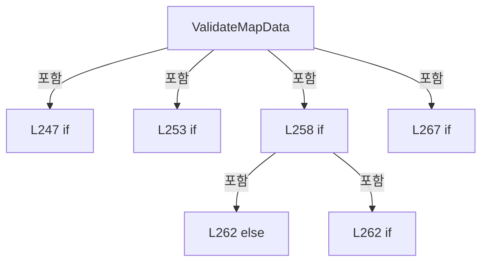

변경 전 점검: 입력/반환 타입, 위 호출자, 예외/취소 경로, 공유 상태와 저장·전송 소비자를 함께 확인합니다. 값의 단위나 물리 방향을 이름만으로 확정하지 않습니다.

### MethodDeclaration `ReloadMap` · L273–296

[Drilling.Common/Interface/Melsec/CMelsec.cs:273–296](https://github.com/kjuws10-rgb/A3Drilling/blob/28764c91d521777b8ee068dd7aaf2d3902ce9fe2/Drilling.Common/Interface/Melsec/CMelsec.cs#L273-L296)

| 항목 | 실제 추출 값 |
| --- | --- |
| 서명 | void Drilling.Common.Interface.CMelsec.ReloadMap(System.Collections.Generic.IReadOnlyList<Drilling.Common.Interface.ST_MELSEC_MAP_DATA>) |
| 접근/수식자 | Public / public |
| 반환/값 타입 | void |
| 소속 타입 | NamedType:Drilling.Common.Interface.CMelsec |

입력 계약:

| 이름 | 타입 | 전달 | 선택/기본값 |
| --- | --- | --- | --- |
| map | System.Collections.Generic.IReadOnlyList<Drilling.Common.Interface.ST_MELSEC_MAP_DATA> | None | False /  |

정적 호출자로 확인된 위치:

| 호출 파일/행 | 호출 표현식 | 런타임 분기 가능 |
| --- | --- | --- |
| [Drilling.Common/Interface/Melsec/CMelsec.cs:70–70](https://github.com/kjuws10-rgb/A3Drilling/blob/28764c91d521777b8ee068dd7aaf2d3902ce9fe2/Drilling.Common/Interface/Melsec/CMelsec.cs#L70-L70) | ReloadMap | False |
| [Drilling.Common/Managers/CManager.cs:110–110](https://github.com/kjuws10-rgb/A3Drilling/blob/28764c91d521777b8ee068dd7aaf2d3902ce9fe2/Drilling.Common/Managers/CManager.cs#L110-L110) | _interfaceManager.Melsec.ReloadMap | False |

호출하는 대상과 해석 범위:

| 원본 행 | 표현식 | 분석 상태 | 대상/소스 위치 |
| --- | --- | --- | --- |
| 285 | map.Where(FilterData4).ToDictionary | resolved | System.Collections.Generic.Dictionary<string, Drilling.Common.Interface.ST_MELSEC_MAP_DATA> System.Collections.Generic.IEnumerable<Drilling.Common.Interface.ST_MELSEC_MAP_DATA>.ToDictionary<Drilling.Common.Interface.ST_MELSEC_MAP_DATA, string>(System.Func<Drilling.Common.Interface.ST_MELSEC_MAP_DATA, string>, System.Collections.Generic.IEqualityComparer<string>?) |
| 285 | map.Where | resolved | System.Collections.Generic.IEnumerable<Drilling.Common.Interface.ST_MELSEC_MAP_DATA> System.Collections.Generic.IEnumerable<Drilling.Common.Interface.ST_MELSEC_MAP_DATA>.Where<Drilling.Common.Interface.ST_MELSEC_MAP_DATA>(System.Func<Drilling.Common.Interface.ST_MELSEC_MAP_DATA, bool>) |
| 290 | map.FirstOrDefault | resolved | Drilling.Common.Interface.ST_MELSEC_MAP_DATA? System.Collections.Generic.IEnumerable<Drilling.Common.Interface.ST_MELSEC_MAP_DATA>.FirstOrDefault<Drilling.Common.Interface.ST_MELSEC_MAP_DATA>(System.Func<Drilling.Common.Interface.ST_MELSEC_MAP_DATA, bool>) |
| 290 | row.Id.Equals | resolved | bool string.Equals(string?, System.StringComparison) |
| 291 | original.Address.Equals | resolved | bool string.Equals(string?, System.StringComparison) |
| 295 | RebuildPollingMap | resolved | void Drilling.Common.Interface.CMelsec.RebuildPollingMap(System.Collections.Generic.Dictionary<string, Drilling.Common.Interface.ST_MELSEC_MAP_DATA>) · Drilling.Common/Interface/Melsec/CMelsec.cs:2655 |

본문의 실제 연산·분기·예외·반환 순서(원문 위치 순):

| 원본 행 | 종류 | 주석 해설 |
| --- | --- | --- |
| 285 | call | 함수·델리게이트 또는 객체 생성자를 호출합니다: map.Where(FilterData4).ToDictionary(HandleMap5, StringComparer.OrdinalIgnoreCase) |
| 285 | call | 함수·델리게이트 또는 객체 생성자를 호출합니다: map.Where(FilterData4) |
| 285 | local-declaration | 지역 변수를 선언합니다: Dictionary<string, ST_MELSEC_MAP_DATA> loadedMap = map.Where(FilterData4).ToDictionary(HandleMap5, StringComparer.OrdinalIgnoreCase); |
| 285 | variable-initializer | 변수의 초기값을 지정합니다: loadedMap = map.Where(FilterData4).ToDictionary(HandleMap5, StringComparer.OrdinalIgnoreCase) |
| 287 | foreach | 컬렉션 요소를 순회합니다: foreach (var signal in new[] { "ABLE", "COMPLETE" }) |
| 289 | local-declaration | 지역 변수를 선언합니다: var id = "HANDSHAKE_STG_DISTORTION_" + signal; |
| 289 | variable-initializer | 변수의 초기값을 지정합니다: id = "HANDSHAKE_STG_DISTORTION_" + signal |
| 290 | call | 함수·델리게이트 또는 객체 생성자를 호출합니다: map.FirstOrDefault(row => row.Id.Equals(id, StringComparison.OrdinalIgnoreCase)) |
| 290 | call | 함수·델리게이트 또는 객체 생성자를 호출합니다: row.Id.Equals(id, StringComparison.OrdinalIgnoreCase) |
| 290 | local-declaration | 지역 변수를 선언합니다: var original = map.FirstOrDefault(row => row.Id.Equals(id, StringComparison.OrdinalIgnoreCase)); |
| 290 | variable-initializer | 변수의 초기값을 지정합니다: original = map.FirstOrDefault(row => row.Id.Equals(id, StringComparison.OrdinalIgnoreCase)) |
| 291 | call | 함수·델리게이트 또는 객체 생성자를 호출합니다: original.Address.Equals("UNASSIGNED", StringComparison.OrdinalIgnoreCase) |
| 291 | if | 조건에 따라 분기합니다: if (original is not null && !original.Use && original.Address.Equals("UNASSIGNED", StringComparison.OrdinalIgnoreCase)) |
| 292 | assignment | 값을 대상에 대입합니다: Use = true |
| 292 | assignment | 값을 대상에 대입합니다: Address = "SIM_DISTORTION_" + signal |
| 292 | assignment | 값을 대상에 대입합니다: PollMs = 0 |
| 292 | assignment | 값을 대상에 대입합니다: loadedMap[id] = original with { Use = true, Address = "SIM_DISTORTION_" + signal, PollMs = 0, Description = original.Description + "; SIMULATION 전용 가상 입력; 실통신에서는 사용하지 않음" } |
| 293 | assignment | 값을 대상에 대입합니다: Description = original.Description + "; SIMULATION 전용 가상 입력; 실통신에서는 사용하지 않음" |
| 295 | call | 함수·델리게이트 또는 객체 생성자를 호출합니다: RebuildPollingMap(loadedMap) |

제어 구문의 포함 구조(실제 실행 순서/CFG가 아닌 구문 탐색 그림):

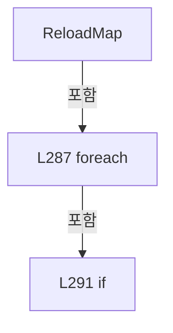

변경 전 점검: 입력/반환 타입, 위 호출자, 예외/취소 경로, 공유 상태와 저장·전송 소비자를 함께 확인합니다. 값의 단위나 물리 방향을 이름만으로 확정하지 않습니다.

### LocalFunctionStatement `FilterData4` · L275–278

[Drilling.Common/Interface/Melsec/CMelsec.cs:275–278](https://github.com/kjuws10-rgb/A3Drilling/blob/28764c91d521777b8ee068dd7aaf2d3902ce9fe2/Drilling.Common/Interface/Melsec/CMelsec.cs#L275-L278)

| 항목 | 실제 추출 값 |
| --- | --- |
| 서명 | bool FilterData4(Drilling.Common.Interface.ST_MELSEC_MAP_DATA) |
| 접근/수식자 | Private /  |
| 반환/값 타입 | bool |
| 소속 타입 | NamedType:Drilling.Common.Interface.CMelsec |

입력 계약:

| 이름 | 타입 | 전달 | 선택/기본값 |
| --- | --- | --- | --- |
| data | Drilling.Common.Interface.ST_MELSEC_MAP_DATA | None | False /  |

현재 부분 분석에서 직접 연결된 호출자는 없습니다. XAML/이벤트/인터페이스·델리게이트·외부 진입을 추가 확인해야 하며, 미사용으로 판정한 것이 아닙니다.

본문의 실제 연산·분기·예외·반환 순서(원문 위치 순):

| 원본 행 | 종류 | 주석 해설 |
| --- | --- | --- |
| 277 | return | 호출자에게 값 또는 제어를 반환합니다: return data.Use; |

변경 전 점검: 입력/반환 타입, 위 호출자, 예외/취소 경로, 공유 상태와 저장·전송 소비자를 함께 확인합니다. 값의 단위나 물리 방향을 이름만으로 확정하지 않습니다.

### LocalFunctionStatement `HandleMap5` · L280–283

[Drilling.Common/Interface/Melsec/CMelsec.cs:280–283](https://github.com/kjuws10-rgb/A3Drilling/blob/28764c91d521777b8ee068dd7aaf2d3902ce9fe2/Drilling.Common/Interface/Melsec/CMelsec.cs#L280-L283)

| 항목 | 실제 추출 값 |
| --- | --- |
| 서명 | string HandleMap5(Drilling.Common.Interface.ST_MELSEC_MAP_DATA) |
| 접근/수식자 | Private /  |
| 반환/값 타입 | string |
| 소속 타입 | NamedType:Drilling.Common.Interface.CMelsec |

입력 계약:

| 이름 | 타입 | 전달 | 선택/기본값 |
| --- | --- | --- | --- |
| data | Drilling.Common.Interface.ST_MELSEC_MAP_DATA | None | False /  |

현재 부분 분석에서 직접 연결된 호출자는 없습니다. XAML/이벤트/인터페이스·델리게이트·외부 진입을 추가 확인해야 하며, 미사용으로 판정한 것이 아닙니다.

호출하는 대상과 해석 범위:

| 원본 행 | 표현식 | 분석 상태 | 대상/소스 위치 |
| --- | --- | --- | --- |
| 282 | NormalizeId | resolved | string Drilling.Common.Interface.CMelsec.NormalizeId(string) · Drilling.Common/Interface/Melsec/CMelsec.cs:2251 |

본문의 실제 연산·분기·예외·반환 순서(원문 위치 순):

| 원본 행 | 종류 | 주석 해설 |
| --- | --- | --- |
| 282 | call | 함수·델리게이트 또는 객체 생성자를 호출합니다: NormalizeId(data.Id) |
| 282 | return | 호출자에게 값 또는 제어를 반환합니다: return NormalizeId(data.Id); |

변경 전 점검: 입력/반환 타입, 위 호출자, 예외/취소 경로, 공유 상태와 저장·전송 소비자를 함께 확인합니다. 값의 단위나 물리 방향을 이름만으로 확정하지 않습니다.

### MethodDeclaration `GetMapList` · L298–307

[Drilling.Common/Interface/Melsec/CMelsec.cs:298–307](https://github.com/kjuws10-rgb/A3Drilling/blob/28764c91d521777b8ee068dd7aaf2d3902ce9fe2/Drilling.Common/Interface/Melsec/CMelsec.cs#L298-L307)

| 항목 | 실제 추출 값 |
| --- | --- |
| 서명 | System.Collections.Generic.IReadOnlyList<Drilling.Common.Interface.ST_MELSEC_MAP_DATA> Drilling.Common.Interface.CMelsec.GetMapList(string) |
| 접근/수식자 | Public / public |
| 반환/값 타입 | System.Collections.Generic.IReadOnlyList<Drilling.Common.Interface.ST_MELSEC_MAP_DATA> |
| 소속 타입 | NamedType:Drilling.Common.Interface.CMelsec |

입력 계약:

| 이름 | 타입 | 전달 | 선택/기본값 |
| --- | --- | --- | --- |
| group | string | None | True / "" |

정적 호출자로 확인된 위치:

| 호출 파일/행 | 호출 표현식 | 런타임 분기 가능 |
| --- | --- | --- |
| [Drilling.Common/Correction/CAlignInterpolation.cs:398–398](https://github.com/kjuws10-rgb/A3Drilling/blob/28764c91d521777b8ee068dd7aaf2d3902ce9fe2/Drilling.Common/Correction/CAlignInterpolation.cs#L398-L398) | .Melsec.GetMapList | False |
| [Drilling.Common/Interface/Melsec/CMelsec.cs:2354–2354](https://github.com/kjuws10-rgb/A3Drilling/blob/28764c91d521777b8ee068dd7aaf2d3902ce9fe2/Drilling.Common/Interface/Melsec/CMelsec.cs#L2354-L2354) | GetMapList | False |
| [Drilling.UI/Menu/Menus/CMenuCorrection.cs:5650–5650](https://github.com/kjuws10-rgb/A3Drilling/blob/28764c91d521777b8ee068dd7aaf2d3902ce9fe2/Drilling.UI/Menu/Menus/CMenuCorrection.cs#L5650-L5650) | .Melsec.GetMapList | False |
| [Drilling.UI/Menu/Menus/CMenuMain.cs:4165–4165](https://github.com/kjuws10-rgb/A3Drilling/blob/28764c91d521777b8ee068dd7aaf2d3902ce9fe2/Drilling.UI/Menu/Menus/CMenuMain.cs#L4165-L4165) | interfaceManager.Melsec.GetMapList | False |
| [Drilling.UI/Menu/Menus/CMenuMonitor.cs:4265–4265](https://github.com/kjuws10-rgb/A3Drilling/blob/28764c91d521777b8ee068dd7aaf2d3902ce9fe2/Drilling.UI/Menu/Menus/CMenuMonitor.cs#L4265-L4265) | _interfaceManager.Melsec.GetMapList | False |
| [Drilling.UI/Menu/Menus/CMenuMonitor.cs:4281–4281](https://github.com/kjuws10-rgb/A3Drilling/blob/28764c91d521777b8ee068dd7aaf2d3902ce9fe2/Drilling.UI/Menu/Menus/CMenuMonitor.cs#L4281-L4281) | _interfaceManager.Melsec.GetMapList | False |

호출하는 대상과 해석 범위:

| 원본 행 | 표현식 | 분석 상태 | 대상/소스 위치 |
| --- | --- | --- | --- |
| 300 | group.Trim | resolved | string string.Trim() |
| 306 | Map.Where(FilterData6).ToArray | resolved | Drilling.Common.Interface.ST_MELSEC_MAP_DATA[] System.Collections.Generic.IEnumerable<Drilling.Common.Interface.ST_MELSEC_MAP_DATA>.ToArray<Drilling.Common.Interface.ST_MELSEC_MAP_DATA>() |
| 306 | Map.Where | resolved | System.Collections.Generic.IEnumerable<Drilling.Common.Interface.ST_MELSEC_MAP_DATA> System.Collections.Generic.IEnumerable<Drilling.Common.Interface.ST_MELSEC_MAP_DATA>.Where<Drilling.Common.Interface.ST_MELSEC_MAP_DATA>(System.Func<Drilling.Common.Interface.ST_MELSEC_MAP_DATA, bool>) |

본문의 실제 연산·분기·예외·반환 순서(원문 위치 순):

| 원본 행 | 종류 | 주석 해설 |
| --- | --- | --- |
| 300 | call | 함수·델리게이트 또는 객체 생성자를 호출합니다: group.Trim() |
| 300 | local-declaration | 지역 변수를 선언합니다: var normalizedGroup = group.Trim(); |
| 300 | variable-initializer | 변수의 초기값을 지정합니다: normalizedGroup = group.Trim() |
| 306 | call | 함수·델리게이트 또는 객체 생성자를 호출합니다: Map.Where(FilterData6).ToArray() |
| 306 | call | 함수·델리게이트 또는 객체 생성자를 호출합니다: Map.Where(FilterData6) |
| 306 | return | 호출자에게 값 또는 제어를 반환합니다: return Map.Where(FilterData6).ToArray(); |

변경 전 점검: 입력/반환 타입, 위 호출자, 예외/취소 경로, 공유 상태와 저장·전송 소비자를 함께 확인합니다. 값의 단위나 물리 방향을 이름만으로 확정하지 않습니다.

### LocalFunctionStatement `FilterData6` · L301–304

[Drilling.Common/Interface/Melsec/CMelsec.cs:301–304](https://github.com/kjuws10-rgb/A3Drilling/blob/28764c91d521777b8ee068dd7aaf2d3902ce9fe2/Drilling.Common/Interface/Melsec/CMelsec.cs#L301-L304)

| 항목 | 실제 추출 값 |
| --- | --- |
| 서명 | bool FilterData6(Drilling.Common.Interface.ST_MELSEC_MAP_DATA) |
| 접근/수식자 | Private /  |
| 반환/값 타입 | bool |
| 소속 타입 | NamedType:Drilling.Common.Interface.CMelsec |

입력 계약:

| 이름 | 타입 | 전달 | 선택/기본값 |
| --- | --- | --- | --- |
| data | Drilling.Common.Interface.ST_MELSEC_MAP_DATA | None | False /  |

현재 부분 분석에서 직접 연결된 호출자는 없습니다. XAML/이벤트/인터페이스·델리게이트·외부 진입을 추가 확인해야 하며, 미사용으로 판정한 것이 아닙니다.

호출하는 대상과 해석 범위:

| 원본 행 | 표현식 | 분석 상태 | 대상/소스 위치 |
| --- | --- | --- | --- |
| 303 | string.IsNullOrWhiteSpace | resolved | bool string.IsNullOrWhiteSpace(string?) |
| 303 | data.Group.Equals | resolved | bool string.Equals(string?, System.StringComparison) |

본문의 실제 연산·분기·예외·반환 순서(원문 위치 순):

| 원본 행 | 종류 | 주석 해설 |
| --- | --- | --- |
| 303 | call | 함수·델리게이트 또는 객체 생성자를 호출합니다: string.IsNullOrWhiteSpace(normalizedGroup) |
| 303 | call | 함수·델리게이트 또는 객체 생성자를 호출합니다: data.Group.Equals(normalizedGroup, StringComparison.OrdinalIgnoreCase) |
| 303 | return | 호출자에게 값 또는 제어를 반환합니다: return string.IsNullOrWhiteSpace(normalizedGroup) &#124;&#124; data.Group.Equals(normalizedGroup, StringComparison.OrdinalIgnoreCase); |

변경 전 점검: 입력/반환 타입, 위 호출자, 예외/취소 경로, 공유 상태와 저장·전송 소비자를 함께 확인합니다. 값의 단위나 물리 방향을 이름만으로 확정하지 않습니다.

### MethodDeclaration `GetMapData` · L309–329

[Drilling.Common/Interface/Melsec/CMelsec.cs:309–329](https://github.com/kjuws10-rgb/A3Drilling/blob/28764c91d521777b8ee068dd7aaf2d3902ce9fe2/Drilling.Common/Interface/Melsec/CMelsec.cs#L309-L329)

| 항목 | 실제 추출 값 |
| --- | --- |
| 서명 | Drilling.Common.Interface.ST_MELSEC_MAP_DATA Drilling.Common.Interface.CMelsec.GetMapData(string) |
| 접근/수식자 | Public / public |
| 반환/값 타입 | Drilling.Common.Interface.ST_MELSEC_MAP_DATA |
| 소속 타입 | NamedType:Drilling.Common.Interface.CMelsec |

입력 계약:

| 이름 | 타입 | 전달 | 선택/기본값 |
| --- | --- | --- | --- |
| id | string | None | False /  |

정적 호출자로 확인된 위치:

| 호출 파일/행 | 호출 표현식 | 런타임 분기 가능 |
| --- | --- | --- |
| [Drilling.Common/Interface/Melsec/CMelsec.cs:999–999](https://github.com/kjuws10-rgb/A3Drilling/blob/28764c91d521777b8ee068dd7aaf2d3902ce9fe2/Drilling.Common/Interface/Melsec/CMelsec.cs#L999-L999) | GetMapData | False |
| [Drilling.Common/Interface/Melsec/CMelsec.cs:1007–1007](https://github.com/kjuws10-rgb/A3Drilling/blob/28764c91d521777b8ee068dd7aaf2d3902ce9fe2/Drilling.Common/Interface/Melsec/CMelsec.cs#L1007-L1007) | GetMapData | False |
| [Drilling.Common/Interface/Melsec/CMelsec.cs:1943–1943](https://github.com/kjuws10-rgb/A3Drilling/blob/28764c91d521777b8ee068dd7aaf2d3902ce9fe2/Drilling.Common/Interface/Melsec/CMelsec.cs#L1943-L1943) | GetMapData | False |
| [Drilling.Common/Interface/Melsec/CMelsec.cs:1961–1961](https://github.com/kjuws10-rgb/A3Drilling/blob/28764c91d521777b8ee068dd7aaf2d3902ce9fe2/Drilling.Common/Interface/Melsec/CMelsec.cs#L1961-L1961) | GetMapData | False |
| [Drilling.Common/Interface/Melsec/CMelsec.cs:2426–2426](https://github.com/kjuws10-rgb/A3Drilling/blob/28764c91d521777b8ee068dd7aaf2d3902ce9fe2/Drilling.Common/Interface/Melsec/CMelsec.cs#L2426-L2426) | GetMapData | False |
| [Drilling.Common/Interface/Melsec/CMelsec.cs:2582–2582](https://github.com/kjuws10-rgb/A3Drilling/blob/28764c91d521777b8ee068dd7aaf2d3902ce9fe2/Drilling.Common/Interface/Melsec/CMelsec.cs#L2582-L2582) | GetMapData | False |
| [Drilling.Common/Interface/Melsec/CMelsec.cs:2584–2584](https://github.com/kjuws10-rgb/A3Drilling/blob/28764c91d521777b8ee068dd7aaf2d3902ce9fe2/Drilling.Common/Interface/Melsec/CMelsec.cs#L2584-L2584) | GetMapData | False |
| [Drilling.Common/Interface/Melsec/CMelsec.cs:3066–3066](https://github.com/kjuws10-rgb/A3Drilling/blob/28764c91d521777b8ee068dd7aaf2d3902ce9fe2/Drilling.Common/Interface/Melsec/CMelsec.cs#L3066-L3066) | GetMapData | False |
| [Drilling.Common/Interface/Melsec/CMelsec.cs:3095–3095](https://github.com/kjuws10-rgb/A3Drilling/blob/28764c91d521777b8ee068dd7aaf2d3902ce9fe2/Drilling.Common/Interface/Melsec/CMelsec.cs#L3095-L3095) | GetMapData | False |
| [Drilling.Common/Interface/Melsec/CMelsec.cs:3113–3113](https://github.com/kjuws10-rgb/A3Drilling/blob/28764c91d521777b8ee068dd7aaf2d3902ce9fe2/Drilling.Common/Interface/Melsec/CMelsec.cs#L3113-L3113) | GetMapData | False |
| [Drilling.Common/Interface/Melsec/CMelsec.cs:3136–3136](https://github.com/kjuws10-rgb/A3Drilling/blob/28764c91d521777b8ee068dd7aaf2d3902ce9fe2/Drilling.Common/Interface/Melsec/CMelsec.cs#L3136-L3136) | GetMapData | False |
| [Drilling.Common/Interface/Melsec/CMelsec.cs:3153–3153](https://github.com/kjuws10-rgb/A3Drilling/blob/28764c91d521777b8ee068dd7aaf2d3902ce9fe2/Drilling.Common/Interface/Melsec/CMelsec.cs#L3153-L3153) | GetMapData | False |
| [Drilling.Common/Station/CStageReviewSequences.cs:275–275](https://github.com/kjuws10-rgb/A3Drilling/blob/28764c91d521777b8ee068dd7aaf2d3902ce9fe2/Drilling.Common/Station/CStageReviewSequences.cs#L275-L275) | _interfaces.Melsec.GetMapData | False |

호출하는 대상과 해석 범위:

| 원본 행 | 표현식 | 분석 상태 | 대상/소스 위치 |
| --- | --- | --- | --- |
| 311 | NormalizeId | resolved | string Drilling.Common.Interface.CMelsec.NormalizeId(string) · Drilling.Common/Interface/Melsec/CMelsec.cs:2251 |
| 315 | _map.TryGetValue | resolved | bool System.Collections.Generic.Dictionary<string, Drilling.Common.Interface.ST_MELSEC_MAP_DATA>.TryGetValue(string, out Drilling.Common.Interface.ST_MELSEC_MAP_DATA) |
| 320 | _map.Keys.ToArray | resolved | string[] System.Collections.Generic.IEnumerable<string>.ToArray<string>() |
| 328 | new InvalidOperationException | resolved | System.InvalidOperationException.InvalidOperationException(string?) |
| 328 | string.Join | resolved | string string.Join(string?, System.Collections.Generic.IEnumerable<string?>) |
| 328 | availableKeys.OrderBy | resolved | System.Linq.IOrderedEnumerable<string> System.Collections.Generic.IEnumerable<string>.OrderBy<string, string>(System.Func<string, string>, System.Collections.Generic.IComparer<string>?) |

본문의 실제 연산·분기·예외·반환 순서(원문 위치 순):

| 원본 행 | 종류 | 주석 해설 |
| --- | --- | --- |
| 311 | call | 함수·델리게이트 또는 객체 생성자를 호출합니다: NormalizeId(id) |
| 311 | local-declaration | 지역 변수를 선언합니다: var normalizedId = NormalizeId(id); |
| 311 | variable-initializer | 변수의 초기값을 지정합니다: normalizedId = NormalizeId(id) |
| 312 | local-declaration | 지역 변수를 선언합니다: string[] availableKeys; |
| 313 | lock | 공유 상태의 임계 구역에 진입합니다: lock (_mapLock) |
| 315 | call | 함수·델리게이트 또는 객체 생성자를 호출합니다: _map.TryGetValue(normalizedId, out var data) |
| 315 | if | 조건에 따라 분기합니다: if (_map.TryGetValue(normalizedId, out var data)) |
| 317 | return | 호출자에게 값 또는 제어를 반환합니다: return data; |
| 320 | assignment | 값을 대상에 대입합니다: availableKeys = _map.Keys.ToArray() |
| 320 | call | 함수·델리게이트 또는 객체 생성자를 호출합니다: _map.Keys.ToArray() |
| 328 | call | 함수·델리게이트 또는 객체 생성자를 호출합니다: new InvalidOperationException($"MELSEC map was not registered: {id}. Available={string.Join(", ", availableKeys.OrderBy(GetKeySortKey7, StringComparer.OrdinalIgnoreCase))}") |
| 328 | call | 함수·델리게이트 또는 객체 생성자를 호출합니다: string.Join(", ", availableKeys.OrderBy(GetKeySortKey7, StringComparer.OrdinalIgnoreCase)) |
| 328 | call | 함수·델리게이트 또는 객체 생성자를 호출합니다: availableKeys.OrderBy(GetKeySortKey7, StringComparer.OrdinalIgnoreCase) |
| 328 | throw | 예외를 발생/전달합니다: throw new InvalidOperationException($"MELSEC map was not registered: {id}. Available={string.Join(", ", availableKeys.OrderBy(GetKeySortKey7, StringComparer.OrdinalIgnoreCase))}"); |

제어 구문의 포함 구조(실제 실행 순서/CFG가 아닌 구문 탐색 그림):

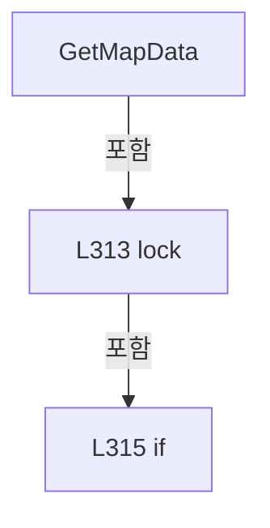

변경 전 점검: 입력/반환 타입, 위 호출자, 예외/취소 경로, 공유 상태와 저장·전송 소비자를 함께 확인합니다. 값의 단위나 물리 방향을 이름만으로 확정하지 않습니다.

### LocalFunctionStatement `GetKeySortKey7` · L323–326

[Drilling.Common/Interface/Melsec/CMelsec.cs:323–326](https://github.com/kjuws10-rgb/A3Drilling/blob/28764c91d521777b8ee068dd7aaf2d3902ce9fe2/Drilling.Common/Interface/Melsec/CMelsec.cs#L323-L326)

| 항목 | 실제 추출 값 |
| --- | --- |
| 서명 | string GetKeySortKey7(string) |
| 접근/수식자 | Private /  |
| 반환/값 타입 | string |
| 소속 타입 | NamedType:Drilling.Common.Interface.CMelsec |

입력 계약:

| 이름 | 타입 | 전달 | 선택/기본값 |
| --- | --- | --- | --- |
| key | string | None | False /  |

현재 부분 분석에서 직접 연결된 호출자는 없습니다. XAML/이벤트/인터페이스·델리게이트·외부 진입을 추가 확인해야 하며, 미사용으로 판정한 것이 아닙니다.

본문의 실제 연산·분기·예외·반환 순서(원문 위치 순):

| 원본 행 | 종류 | 주석 해설 |
| --- | --- | --- |
| 325 | return | 호출자에게 값 또는 제어를 반환합니다: return key; |

변경 전 점검: 입력/반환 타입, 위 호출자, 예외/취소 경로, 공유 상태와 저장·전송 소비자를 함께 확인합니다. 값의 단위나 물리 방향을 이름만으로 확정하지 않습니다.

### MethodDeclaration `ReadBit` · L331–336

[Drilling.Common/Interface/Melsec/CMelsec.cs:331–336](https://github.com/kjuws10-rgb/A3Drilling/blob/28764c91d521777b8ee068dd7aaf2d3902ce9fe2/Drilling.Common/Interface/Melsec/CMelsec.cs#L331-L336)

| 항목 | 실제 추출 값 |
| --- | --- |
| 서명 | bool Drilling.Common.Interface.CMelsec.ReadBit(string, System.Threading.CancellationToken) |
| 접근/수식자 | Public / public |
| 반환/값 타입 | bool |
| 소속 타입 | NamedType:Drilling.Common.Interface.CMelsec |

입력 계약:

| 이름 | 타입 | 전달 | 선택/기본값 |
| --- | --- | --- | --- |
| id | string | None | False /  |
| cancellationToken | System.Threading.CancellationToken | None | True / null |

현재 부분 분석에서 직접 연결된 호출자는 없습니다. XAML/이벤트/인터페이스·델리게이트·외부 진입을 추가 확인해야 하며, 미사용으로 판정한 것이 아닙니다.

호출하는 대상과 해석 범위:

| 원본 행 | 표현식 | 분석 상태 | 대상/소스 위치 |
| --- | --- | --- | --- |
| 333 | new CMelsecThreadRequest | resolved | Drilling.Common.Interface.CMelsec.CMelsecThreadRequest.CMelsecThreadRequest(Drilling.Common.Interface.CMelsec.EN_MELSEC_THREAD_COMMAND, string, object?, System.Threading.CancellationToken, bool) · Drilling.Common/Interface/Melsec/CMelsec.cs:2274 |
| 334 | ExecuteThreadRequest | resolved | void Drilling.Common.Interface.CMelsec.ExecuteThreadRequest(Drilling.Common.Interface.CMelsec.CMelsecThreadRequest) · Drilling.Common/Interface/Melsec/CMelsec.cs:614 |

본문의 실제 연산·분기·예외·반환 순서(원문 위치 순):

| 원본 행 | 종류 | 주석 해설 |
| --- | --- | --- |
| 333 | call | 함수·델리게이트 또는 객체 생성자를 호출합니다: new CMelsecThreadRequest(EN_MELSEC_THREAD_COMMAND.ReadBit, id, null, cancellationToken) |
| 333 | local-declaration | 지역 변수를 선언합니다: CMelsecThreadRequest request = new CMelsecThreadRequest(EN_MELSEC_THREAD_COMMAND.ReadBit, id, null, cancellationToken); |
| 333 | variable-initializer | 변수의 초기값을 지정합니다: request = new CMelsecThreadRequest(EN_MELSEC_THREAD_COMMAND.ReadBit, id, null, cancellationToken) |
| 334 | call | 함수·델리게이트 또는 객체 생성자를 호출합니다: ExecuteThreadRequest(request) |
| 335 | return | 호출자에게 값 또는 제어를 반환합니다: return request.Result is bool result && result; |

변경 전 점검: 입력/반환 타입, 위 호출자, 예외/취소 경로, 공유 상태와 저장·전송 소비자를 함께 확인합니다. 값의 단위나 물리 방향을 이름만으로 확정하지 않습니다.

### MethodDeclaration `ReadBitNoLog` · L338–343

[Drilling.Common/Interface/Melsec/CMelsec.cs:338–343](https://github.com/kjuws10-rgb/A3Drilling/blob/28764c91d521777b8ee068dd7aaf2d3902ce9fe2/Drilling.Common/Interface/Melsec/CMelsec.cs#L338-L343)

| 항목 | 실제 추출 값 |
| --- | --- |
| 서명 | bool Drilling.Common.Interface.CMelsec.ReadBitNoLog(string, System.Threading.CancellationToken) |
| 접근/수식자 | Public / public |
| 반환/값 타입 | bool |
| 소속 타입 | NamedType:Drilling.Common.Interface.CMelsec |

입력 계약:

| 이름 | 타입 | 전달 | 선택/기본값 |
| --- | --- | --- | --- |
| id | string | None | False /  |
| cancellationToken | System.Threading.CancellationToken | None | True / null |

현재 부분 분석에서 직접 연결된 호출자는 없습니다. XAML/이벤트/인터페이스·델리게이트·외부 진입을 추가 확인해야 하며, 미사용으로 판정한 것이 아닙니다.

호출하는 대상과 해석 범위:

| 원본 행 | 표현식 | 분석 상태 | 대상/소스 위치 |
| --- | --- | --- | --- |
| 340 | new CMelsecThreadRequest | resolved | Drilling.Common.Interface.CMelsec.CMelsecThreadRequest.CMelsecThreadRequest(Drilling.Common.Interface.CMelsec.EN_MELSEC_THREAD_COMMAND, string, object?, System.Threading.CancellationToken, bool) · Drilling.Common/Interface/Melsec/CMelsec.cs:2274 |
| 341 | ExecuteThreadRequest | resolved | void Drilling.Common.Interface.CMelsec.ExecuteThreadRequest(Drilling.Common.Interface.CMelsec.CMelsecThreadRequest) · Drilling.Common/Interface/Melsec/CMelsec.cs:614 |

본문의 실제 연산·분기·예외·반환 순서(원문 위치 순):

| 원본 행 | 종류 | 주석 해설 |
| --- | --- | --- |
| 340 | call | 함수·델리게이트 또는 객체 생성자를 호출합니다: new CMelsecThreadRequest(EN_MELSEC_THREAD_COMMAND.ReadBit, id, null, cancellationToken, suppressLog: true) |
| 340 | local-declaration | 지역 변수를 선언합니다: CMelsecThreadRequest request = new CMelsecThreadRequest(EN_MELSEC_THREAD_COMMAND.ReadBit, id, null, cancellationToken, suppressLog: true); |
| 340 | variable-initializer | 변수의 초기값을 지정합니다: request = new CMelsecThreadRequest(EN_MELSEC_THREAD_COMMAND.ReadBit, id, null, cancellationToken, suppressLog: true) |
| 341 | call | 함수·델리게이트 또는 객체 생성자를 호출합니다: ExecuteThreadRequest(request) |
| 342 | return | 호출자에게 값 또는 제어를 반환합니다: return request.Result is bool result && result; |

변경 전 점검: 입력/반환 타입, 위 호출자, 예외/취소 경로, 공유 상태와 저장·전송 소비자를 함께 확인합니다. 값의 단위나 물리 방향을 이름만으로 확정하지 않습니다.

### MethodDeclaration `Open` · L345–349

[Drilling.Common/Interface/Melsec/CMelsec.cs:345–349](https://github.com/kjuws10-rgb/A3Drilling/blob/28764c91d521777b8ee068dd7aaf2d3902ce9fe2/Drilling.Common/Interface/Melsec/CMelsec.cs#L345-L349)

| 항목 | 실제 추출 값 |
| --- | --- |
| 서명 | void Drilling.Common.Interface.CMelsec.Open(int, System.Threading.CancellationToken) |
| 접근/수식자 | Public / public |
| 반환/값 타입 | void |
| 소속 타입 | NamedType:Drilling.Common.Interface.CMelsec |

입력 계약:

| 이름 | 타입 | 전달 | 선택/기본값 |
| --- | --- | --- | --- |
| deviceNo | int | None | True / 0 |
| cancellationToken | System.Threading.CancellationToken | None | True / null |

정적 호출자로 확인된 위치:

| 호출 파일/행 | 호출 표현식 | 런타임 분기 가능 |
| --- | --- | --- |
| [Drilling.Common/Interface/CInterfaceManager.cs:606–606](https://github.com/kjuws10-rgb/A3Drilling/blob/28764c91d521777b8ee068dd7aaf2d3902ce9fe2/Drilling.Common/Interface/CInterfaceManager.cs#L606-L606) | _melsec.Open | False |
| [Drilling.Common/Interface/CInterfaceManager.cs:613–613](https://github.com/kjuws10-rgb/A3Drilling/blob/28764c91d521777b8ee068dd7aaf2d3902ce9fe2/Drilling.Common/Interface/CInterfaceManager.cs#L613-L613) | _melsec.Open | False |

호출하는 대상과 해석 범위:

| 원본 행 | 표현식 | 분석 상태 | 대상/소스 위치 |
| --- | --- | --- | --- |
| 347 | new CMelsecThreadRequest | resolved | Drilling.Common.Interface.CMelsec.CMelsecThreadRequest.CMelsecThreadRequest(Drilling.Common.Interface.CMelsec.EN_MELSEC_THREAD_COMMAND, string, object?, System.Threading.CancellationToken, bool) · Drilling.Common/Interface/Melsec/CMelsec.cs:2274 |
| 347 | deviceNo.ToString | resolved | string int.ToString(System.IFormatProvider?) |
| 348 | ExecuteThreadRequest | resolved | void Drilling.Common.Interface.CMelsec.ExecuteThreadRequest(Drilling.Common.Interface.CMelsec.CMelsecThreadRequest) · Drilling.Common/Interface/Melsec/CMelsec.cs:614 |

본문의 실제 연산·분기·예외·반환 순서(원문 위치 순):

| 원본 행 | 종류 | 주석 해설 |
| --- | --- | --- |
| 347 | call | 함수·델리게이트 또는 객체 생성자를 호출합니다: new CMelsecThreadRequest(EN_MELSEC_THREAD_COMMAND.Open, "MELSEC_" + deviceNo.ToString(CultureInfo.InvariantCulture), deviceNo, cancellationToken) |
| 347 | call | 함수·델리게이트 또는 객체 생성자를 호출합니다: deviceNo.ToString(CultureInfo.InvariantCulture) |
| 347 | local-declaration | 지역 변수를 선언합니다: CMelsecThreadRequest request = new CMelsecThreadRequest(EN_MELSEC_THREAD_COMMAND.Open, "MELSEC_" + deviceNo.ToString(CultureInfo.InvariantCulture), deviceNo, cancellationToken); |
| 347 | variable-initializer | 변수의 초기값을 지정합니다: request = new CMelsecThreadRequest(EN_MELSEC_THREAD_COMMAND.Open, "MELSEC_" + deviceNo.ToString(CultureInfo.InvariantCulture), deviceNo, cancellationToken) |
| 348 | call | 함수·델리게이트 또는 객체 생성자를 호출합니다: ExecuteThreadRequest(request) |

변경 전 점검: 입력/반환 타입, 위 호출자, 예외/취소 경로, 공유 상태와 저장·전송 소비자를 함께 확인합니다. 값의 단위나 물리 방향을 이름만으로 확정하지 않습니다.

### MethodDeclaration `WriteBit` · L351–355

[Drilling.Common/Interface/Melsec/CMelsec.cs:351–355](https://github.com/kjuws10-rgb/A3Drilling/blob/28764c91d521777b8ee068dd7aaf2d3902ce9fe2/Drilling.Common/Interface/Melsec/CMelsec.cs#L351-L355)

| 항목 | 실제 추출 값 |
| --- | --- |
| 서명 | void Drilling.Common.Interface.CMelsec.WriteBit(string, bool, System.Threading.CancellationToken) |
| 접근/수식자 | Public / public |
| 반환/값 타입 | void |
| 소속 타입 | NamedType:Drilling.Common.Interface.CMelsec |

입력 계약:

| 이름 | 타입 | 전달 | 선택/기본값 |
| --- | --- | --- | --- |
| id | string | None | False /  |
| value | bool | None | False /  |
| cancellationToken | System.Threading.CancellationToken | None | True / null |

정적 호출자로 확인된 위치:

| 호출 파일/행 | 호출 표현식 | 런타임 분기 가능 |
| --- | --- | --- |
| [Drilling.UI/Menu/Menus/CMenuMonitor.cs:3041–3041](https://github.com/kjuws10-rgb/A3Drilling/blob/28764c91d521777b8ee068dd7aaf2d3902ce9fe2/Drilling.UI/Menu/Menus/CMenuMonitor.cs#L3041-L3041) | _interfaceManager.Melsec.WriteBit | False |

호출하는 대상과 해석 범위:

| 원본 행 | 표현식 | 분석 상태 | 대상/소스 위치 |
| --- | --- | --- | --- |
| 353 | new CMelsecThreadRequest | resolved | Drilling.Common.Interface.CMelsec.CMelsecThreadRequest.CMelsecThreadRequest(Drilling.Common.Interface.CMelsec.EN_MELSEC_THREAD_COMMAND, string, object?, System.Threading.CancellationToken, bool) · Drilling.Common/Interface/Melsec/CMelsec.cs:2274 |
| 354 | ExecuteThreadRequest | resolved | void Drilling.Common.Interface.CMelsec.ExecuteThreadRequest(Drilling.Common.Interface.CMelsec.CMelsecThreadRequest) · Drilling.Common/Interface/Melsec/CMelsec.cs:614 |

본문의 실제 연산·분기·예외·반환 순서(원문 위치 순):

| 원본 행 | 종류 | 주석 해설 |
| --- | --- | --- |
| 353 | call | 함수·델리게이트 또는 객체 생성자를 호출합니다: new CMelsecThreadRequest(EN_MELSEC_THREAD_COMMAND.WriteBit, id, value, cancellationToken) |
| 353 | local-declaration | 지역 변수를 선언합니다: CMelsecThreadRequest request = new CMelsecThreadRequest(EN_MELSEC_THREAD_COMMAND.WriteBit, id, value, cancellationToken); |
| 353 | variable-initializer | 변수의 초기값을 지정합니다: request = new CMelsecThreadRequest(EN_MELSEC_THREAD_COMMAND.WriteBit, id, value, cancellationToken) |
| 354 | call | 함수·델리게이트 또는 객체 생성자를 호출합니다: ExecuteThreadRequest(request) |

변경 전 점검: 입력/반환 타입, 위 호출자, 예외/취소 경로, 공유 상태와 저장·전송 소비자를 함께 확인합니다. 값의 단위나 물리 방향을 이름만으로 확정하지 않습니다.

### MethodDeclaration `ReadWord` · L357–362

[Drilling.Common/Interface/Melsec/CMelsec.cs:357–362](https://github.com/kjuws10-rgb/A3Drilling/blob/28764c91d521777b8ee068dd7aaf2d3902ce9fe2/Drilling.Common/Interface/Melsec/CMelsec.cs#L357-L362)

| 항목 | 실제 추출 값 |
| --- | --- |
| 서명 | double Drilling.Common.Interface.CMelsec.ReadWord(string, System.Threading.CancellationToken) |
| 접근/수식자 | Public / public |
| 반환/값 타입 | double |
| 소속 타입 | NamedType:Drilling.Common.Interface.CMelsec |

입력 계약:

| 이름 | 타입 | 전달 | 선택/기본값 |
| --- | --- | --- | --- |
| id | string | None | False /  |
| cancellationToken | System.Threading.CancellationToken | None | True / null |

현재 부분 분석에서 직접 연결된 호출자는 없습니다. XAML/이벤트/인터페이스·델리게이트·외부 진입을 추가 확인해야 하며, 미사용으로 판정한 것이 아닙니다.

호출하는 대상과 해석 범위:

| 원본 행 | 표현식 | 분석 상태 | 대상/소스 위치 |
| --- | --- | --- | --- |
| 359 | new CMelsecThreadRequest | resolved | Drilling.Common.Interface.CMelsec.CMelsecThreadRequest.CMelsecThreadRequest(Drilling.Common.Interface.CMelsec.EN_MELSEC_THREAD_COMMAND, string, object?, System.Threading.CancellationToken, bool) · Drilling.Common/Interface/Melsec/CMelsec.cs:2274 |
| 360 | ExecuteThreadRequest | resolved | void Drilling.Common.Interface.CMelsec.ExecuteThreadRequest(Drilling.Common.Interface.CMelsec.CMelsecThreadRequest) · Drilling.Common/Interface/Melsec/CMelsec.cs:614 |

본문의 실제 연산·분기·예외·반환 순서(원문 위치 순):

| 원본 행 | 종류 | 주석 해설 |
| --- | --- | --- |
| 359 | call | 함수·델리게이트 또는 객체 생성자를 호출합니다: new CMelsecThreadRequest(EN_MELSEC_THREAD_COMMAND.ReadWord, id, null, cancellationToken) |
| 359 | local-declaration | 지역 변수를 선언합니다: CMelsecThreadRequest request = new CMelsecThreadRequest(EN_MELSEC_THREAD_COMMAND.ReadWord, id, null, cancellationToken); |
| 359 | variable-initializer | 변수의 초기값을 지정합니다: request = new CMelsecThreadRequest(EN_MELSEC_THREAD_COMMAND.ReadWord, id, null, cancellationToken) |
| 360 | call | 함수·델리게이트 또는 객체 생성자를 호출합니다: ExecuteThreadRequest(request) |
| 361 | return | 호출자에게 값 또는 제어를 반환합니다: return (double)request.Result!; |

변경 전 점검: 입력/반환 타입, 위 호출자, 예외/취소 경로, 공유 상태와 저장·전송 소비자를 함께 확인합니다. 값의 단위나 물리 방향을 이름만으로 확정하지 않습니다.

### MethodDeclaration `ReadWordNoLog` · L364–369

[Drilling.Common/Interface/Melsec/CMelsec.cs:364–369](https://github.com/kjuws10-rgb/A3Drilling/blob/28764c91d521777b8ee068dd7aaf2d3902ce9fe2/Drilling.Common/Interface/Melsec/CMelsec.cs#L364-L369)

| 항목 | 실제 추출 값 |
| --- | --- |
| 서명 | double Drilling.Common.Interface.CMelsec.ReadWordNoLog(string, System.Threading.CancellationToken) |
| 접근/수식자 | Public / public |
| 반환/값 타입 | double |
| 소속 타입 | NamedType:Drilling.Common.Interface.CMelsec |

입력 계약:

| 이름 | 타입 | 전달 | 선택/기본값 |
| --- | --- | --- | --- |
| id | string | None | False /  |
| cancellationToken | System.Threading.CancellationToken | None | True / null |

정적 호출자로 확인된 위치:

| 호출 파일/행 | 호출 표현식 | 런타임 분기 가능 |
| --- | --- | --- |
| [Drilling.Common/Interface/Melsec/CMelsec.cs:2586–2586](https://github.com/kjuws10-rgb/A3Drilling/blob/28764c91d521777b8ee068dd7aaf2d3902ce9fe2/Drilling.Common/Interface/Melsec/CMelsec.cs#L2586-L2586) | ReadWordNoLog | False |

호출하는 대상과 해석 범위:

| 원본 행 | 표현식 | 분석 상태 | 대상/소스 위치 |
| --- | --- | --- | --- |
| 366 | new CMelsecThreadRequest | resolved | Drilling.Common.Interface.CMelsec.CMelsecThreadRequest.CMelsecThreadRequest(Drilling.Common.Interface.CMelsec.EN_MELSEC_THREAD_COMMAND, string, object?, System.Threading.CancellationToken, bool) · Drilling.Common/Interface/Melsec/CMelsec.cs:2274 |
| 367 | ExecuteThreadRequest | resolved | void Drilling.Common.Interface.CMelsec.ExecuteThreadRequest(Drilling.Common.Interface.CMelsec.CMelsecThreadRequest) · Drilling.Common/Interface/Melsec/CMelsec.cs:614 |

본문의 실제 연산·분기·예외·반환 순서(원문 위치 순):

| 원본 행 | 종류 | 주석 해설 |
| --- | --- | --- |
| 366 | call | 함수·델리게이트 또는 객체 생성자를 호출합니다: new CMelsecThreadRequest(EN_MELSEC_THREAD_COMMAND.ReadWord, id, null, cancellationToken, suppressLog: true) |
| 366 | local-declaration | 지역 변수를 선언합니다: CMelsecThreadRequest request = new CMelsecThreadRequest(EN_MELSEC_THREAD_COMMAND.ReadWord, id, null, cancellationToken, suppressLog: true); |
| 366 | variable-initializer | 변수의 초기값을 지정합니다: request = new CMelsecThreadRequest(EN_MELSEC_THREAD_COMMAND.ReadWord, id, null, cancellationToken, suppressLog: true) |
| 367 | call | 함수·델리게이트 또는 객체 생성자를 호출합니다: ExecuteThreadRequest(request) |
| 368 | return | 호출자에게 값 또는 제어를 반환합니다: return (double)request.Result!; |

변경 전 점검: 입력/반환 타입, 위 호출자, 예외/취소 경로, 공유 상태와 저장·전송 소비자를 함께 확인합니다. 값의 단위나 물리 방향을 이름만으로 확정하지 않습니다.

### MethodDeclaration `WriteWord` · L371–375

[Drilling.Common/Interface/Melsec/CMelsec.cs:371–375](https://github.com/kjuws10-rgb/A3Drilling/blob/28764c91d521777b8ee068dd7aaf2d3902ce9fe2/Drilling.Common/Interface/Melsec/CMelsec.cs#L371-L375)

| 항목 | 실제 추출 값 |
| --- | --- |
| 서명 | void Drilling.Common.Interface.CMelsec.WriteWord(string, double, System.Threading.CancellationToken) |
| 접근/수식자 | Public / public |
| 반환/값 타입 | void |
| 소속 타입 | NamedType:Drilling.Common.Interface.CMelsec |

입력 계약:

| 이름 | 타입 | 전달 | 선택/기본값 |
| --- | --- | --- | --- |
| id | string | None | False /  |
| value | double | None | False /  |
| cancellationToken | System.Threading.CancellationToken | None | True / null |

정적 호출자로 확인된 위치:

| 호출 파일/행 | 호출 표현식 | 런타임 분기 가능 |
| --- | --- | --- |
| [Drilling.Common/Interface/CPowerMeasureRun.cs:366–366](https://github.com/kjuws10-rgb/A3Drilling/blob/28764c91d521777b8ee068dd7aaf2d3902ce9fe2/Drilling.Common/Interface/CPowerMeasureRun.cs#L366-L366) | Interfaces.Melsec.WriteWord | False |
| [Drilling.Common/Interface/CPowerMeasureRun.cs:383–383](https://github.com/kjuws10-rgb/A3Drilling/blob/28764c91d521777b8ee068dd7aaf2d3902ce9fe2/Drilling.Common/Interface/CPowerMeasureRun.cs#L383-L383) | Interfaces.Melsec.WriteWord | False |
| [Drilling.Common/Station/CStageReviewSequences.cs:346–346](https://github.com/kjuws10-rgb/A3Drilling/blob/28764c91d521777b8ee068dd7aaf2d3902ce9fe2/Drilling.Common/Station/CStageReviewSequences.cs#L346-L346) | _interfaces.Melsec.WriteWord | False |
| [Drilling.Common/Station/CStationProcess.cs:3972–3972](https://github.com/kjuws10-rgb/A3Drilling/blob/28764c91d521777b8ee068dd7aaf2d3902ce9fe2/Drilling.Common/Station/CStationProcess.cs#L3972-L3972) | _interfaceManager.Melsec.WriteWord | False |
| [Drilling.Common/Station/CStationProcess.cs:4370–4370](https://github.com/kjuws10-rgb/A3Drilling/blob/28764c91d521777b8ee068dd7aaf2d3902ce9fe2/Drilling.Common/Station/CStationProcess.cs#L4370-L4370) | interfaces.Melsec.WriteWord | False |
| [Drilling.Common/Station/CStationProcess.cs:4490–4490](https://github.com/kjuws10-rgb/A3Drilling/blob/28764c91d521777b8ee068dd7aaf2d3902ce9fe2/Drilling.Common/Station/CStationProcess.cs#L4490-L4490) | interfaces.Melsec.WriteWord | False |
| [Drilling.Common/Station/CStationProcess.cs:4876–4876](https://github.com/kjuws10-rgb/A3Drilling/blob/28764c91d521777b8ee068dd7aaf2d3902ce9fe2/Drilling.Common/Station/CStationProcess.cs#L4876-L4876) | interfaces.Melsec.WriteWord | False |
| [Drilling.Common/Station/CStationProcess.cs:6603–6603](https://github.com/kjuws10-rgb/A3Drilling/blob/28764c91d521777b8ee068dd7aaf2d3902ce9fe2/Drilling.Common/Station/CStationProcess.cs#L6603-L6603) | interfaces.Melsec.WriteWord | False |
| [Drilling.UI/Menu/Menus/CMenuManual.cs:6948–6948](https://github.com/kjuws10-rgb/A3Drilling/blob/28764c91d521777b8ee068dd7aaf2d3902ce9fe2/Drilling.UI/Menu/Menus/CMenuManual.cs#L6948-L6948) | _melsec.WriteWord | False |
| [Drilling.UI/Menu/Menus/CMenuManual.cs:6973–6973](https://github.com/kjuws10-rgb/A3Drilling/blob/28764c91d521777b8ee068dd7aaf2d3902ce9fe2/Drilling.UI/Menu/Menus/CMenuManual.cs#L6973-L6973) | _melsec.WriteWord | False |
| [Drilling.UI/Menu/Menus/CMenuMonitor.cs:3045–3045](https://github.com/kjuws10-rgb/A3Drilling/blob/28764c91d521777b8ee068dd7aaf2d3902ce9fe2/Drilling.UI/Menu/Menus/CMenuMonitor.cs#L3045-L3045) | _interfaceManager.Melsec.WriteWord | False |

호출하는 대상과 해석 범위:

| 원본 행 | 표현식 | 분석 상태 | 대상/소스 위치 |
| --- | --- | --- | --- |
| 373 | new CMelsecThreadRequest | resolved | Drilling.Common.Interface.CMelsec.CMelsecThreadRequest.CMelsecThreadRequest(Drilling.Common.Interface.CMelsec.EN_MELSEC_THREAD_COMMAND, string, object?, System.Threading.CancellationToken, bool) · Drilling.Common/Interface/Melsec/CMelsec.cs:2274 |
| 374 | ExecuteThreadRequest | resolved | void Drilling.Common.Interface.CMelsec.ExecuteThreadRequest(Drilling.Common.Interface.CMelsec.CMelsecThreadRequest) · Drilling.Common/Interface/Melsec/CMelsec.cs:614 |

본문의 실제 연산·분기·예외·반환 순서(원문 위치 순):

| 원본 행 | 종류 | 주석 해설 |
| --- | --- | --- |
| 373 | call | 함수·델리게이트 또는 객체 생성자를 호출합니다: new CMelsecThreadRequest(EN_MELSEC_THREAD_COMMAND.WriteWord, id, value, cancellationToken) |
| 373 | local-declaration | 지역 변수를 선언합니다: CMelsecThreadRequest request = new CMelsecThreadRequest(EN_MELSEC_THREAD_COMMAND.WriteWord, id, value, cancellationToken); |
| 373 | variable-initializer | 변수의 초기값을 지정합니다: request = new CMelsecThreadRequest(EN_MELSEC_THREAD_COMMAND.WriteWord, id, value, cancellationToken) |
| 374 | call | 함수·델리게이트 또는 객체 생성자를 호출합니다: ExecuteThreadRequest(request) |

변경 전 점검: 입력/반환 타입, 위 호출자, 예외/취소 경로, 공유 상태와 저장·전송 소비자를 함께 확인합니다. 값의 단위나 물리 방향을 이름만으로 확정하지 않습니다.

### MethodDeclaration `ReadDouble` · L377–382

[Drilling.Common/Interface/Melsec/CMelsec.cs:377–382](https://github.com/kjuws10-rgb/A3Drilling/blob/28764c91d521777b8ee068dd7aaf2d3902ce9fe2/Drilling.Common/Interface/Melsec/CMelsec.cs#L377-L382)

| 항목 | 실제 추출 값 |
| --- | --- |
| 서명 | double Drilling.Common.Interface.CMelsec.ReadDouble(string, System.Threading.CancellationToken) |
| 접근/수식자 | Public / public |
| 반환/값 타입 | double |
| 소속 타입 | NamedType:Drilling.Common.Interface.CMelsec |

입력 계약:

| 이름 | 타입 | 전달 | 선택/기본값 |
| --- | --- | --- | --- |
| id | string | None | False /  |
| cancellationToken | System.Threading.CancellationToken | None | True / null |

정적 호출자로 확인된 위치:

| 호출 파일/행 | 호출 표현식 | 런타임 분기 가능 |
| --- | --- | --- |
| [Drilling.Common/Interface/Melsec/CMelsec.cs:2586–2586](https://github.com/kjuws10-rgb/A3Drilling/blob/28764c91d521777b8ee068dd7aaf2d3902ce9fe2/Drilling.Common/Interface/Melsec/CMelsec.cs#L2586-L2586) | ReadDouble | False |
| [Drilling.UI/Menu/Menus/CMenuMonitor.cs:3052–3052](https://github.com/kjuws10-rgb/A3Drilling/blob/28764c91d521777b8ee068dd7aaf2d3902ce9fe2/Drilling.UI/Menu/Menus/CMenuMonitor.cs#L3052-L3052) | _interfaceManager.Melsec.ReadDouble | False |

호출하는 대상과 해석 범위:

| 원본 행 | 표현식 | 분석 상태 | 대상/소스 위치 |
| --- | --- | --- | --- |
| 379 | new CMelsecThreadRequest | resolved | Drilling.Common.Interface.CMelsec.CMelsecThreadRequest.CMelsecThreadRequest(Drilling.Common.Interface.CMelsec.EN_MELSEC_THREAD_COMMAND, string, object?, System.Threading.CancellationToken, bool) · Drilling.Common/Interface/Melsec/CMelsec.cs:2274 |
| 380 | ExecuteThreadRequest | resolved | void Drilling.Common.Interface.CMelsec.ExecuteThreadRequest(Drilling.Common.Interface.CMelsec.CMelsecThreadRequest) · Drilling.Common/Interface/Melsec/CMelsec.cs:614 |

본문의 실제 연산·분기·예외·반환 순서(원문 위치 순):

| 원본 행 | 종류 | 주석 해설 |
| --- | --- | --- |
| 379 | call | 함수·델리게이트 또는 객체 생성자를 호출합니다: new CMelsecThreadRequest(EN_MELSEC_THREAD_COMMAND.ReadDouble, id, null, cancellationToken) |
| 379 | local-declaration | 지역 변수를 선언합니다: CMelsecThreadRequest request = new CMelsecThreadRequest(EN_MELSEC_THREAD_COMMAND.ReadDouble, id, null, cancellationToken); |
| 379 | variable-initializer | 변수의 초기값을 지정합니다: request = new CMelsecThreadRequest(EN_MELSEC_THREAD_COMMAND.ReadDouble, id, null, cancellationToken) |
| 380 | call | 함수·델리게이트 또는 객체 생성자를 호출합니다: ExecuteThreadRequest(request) |
| 381 | conditional-expression | 조건에 따라 결과식을 선택합니다: request.Result is double result ? result : 0.0 |
| 381 | return | 호출자에게 값 또는 제어를 반환합니다: return request.Result is double result ? result : 0.0; |

변경 전 점검: 입력/반환 타입, 위 호출자, 예외/취소 경로, 공유 상태와 저장·전송 소비자를 함께 확인합니다. 값의 단위나 물리 방향을 이름만으로 확정하지 않습니다.

### MethodDeclaration `ReadDoubleNoLog` · L384–389

[Drilling.Common/Interface/Melsec/CMelsec.cs:384–389](https://github.com/kjuws10-rgb/A3Drilling/blob/28764c91d521777b8ee068dd7aaf2d3902ce9fe2/Drilling.Common/Interface/Melsec/CMelsec.cs#L384-L389)

| 항목 | 실제 추출 값 |
| --- | --- |
| 서명 | double Drilling.Common.Interface.CMelsec.ReadDoubleNoLog(string, System.Threading.CancellationToken) |
| 접근/수식자 | Public / public |
| 반환/값 타입 | double |
| 소속 타입 | NamedType:Drilling.Common.Interface.CMelsec |

입력 계약:

| 이름 | 타입 | 전달 | 선택/기본값 |
| --- | --- | --- | --- |
| id | string | None | False /  |
| cancellationToken | System.Threading.CancellationToken | None | True / null |

정적 호출자로 확인된 위치:

| 호출 파일/행 | 호출 표현식 | 런타임 분기 가능 |
| --- | --- | --- |
| [Drilling.Common/Correction/CAlignInterpolation.cs:400–400](https://github.com/kjuws10-rgb/A3Drilling/blob/28764c91d521777b8ee068dd7aaf2d3902ce9fe2/Drilling.Common/Correction/CAlignInterpolation.cs#L400-L400) | .Melsec.ReadDoubleNoLog | False |
| [Drilling.UI/Menu/Menus/CMenuCorrection.cs:5650–5650](https://github.com/kjuws10-rgb/A3Drilling/blob/28764c91d521777b8ee068dd7aaf2d3902ce9fe2/Drilling.UI/Menu/Menus/CMenuCorrection.cs#L5650-L5650) | .Melsec.ReadDoubleNoLog | False |

호출하는 대상과 해석 범위:

| 원본 행 | 표현식 | 분석 상태 | 대상/소스 위치 |
| --- | --- | --- | --- |
| 386 | new CMelsecThreadRequest | resolved | Drilling.Common.Interface.CMelsec.CMelsecThreadRequest.CMelsecThreadRequest(Drilling.Common.Interface.CMelsec.EN_MELSEC_THREAD_COMMAND, string, object?, System.Threading.CancellationToken, bool) · Drilling.Common/Interface/Melsec/CMelsec.cs:2274 |
| 387 | ExecuteThreadRequest | resolved | void Drilling.Common.Interface.CMelsec.ExecuteThreadRequest(Drilling.Common.Interface.CMelsec.CMelsecThreadRequest) · Drilling.Common/Interface/Melsec/CMelsec.cs:614 |

본문의 실제 연산·분기·예외·반환 순서(원문 위치 순):

| 원본 행 | 종류 | 주석 해설 |
| --- | --- | --- |
| 386 | call | 함수·델리게이트 또는 객체 생성자를 호출합니다: new CMelsecThreadRequest(EN_MELSEC_THREAD_COMMAND.ReadDouble, id, null, cancellationToken, suppressLog: true) |
| 386 | local-declaration | 지역 변수를 선언합니다: CMelsecThreadRequest request = new CMelsecThreadRequest(EN_MELSEC_THREAD_COMMAND.ReadDouble, id, null, cancellationToken, suppressLog: true); |
| 386 | variable-initializer | 변수의 초기값을 지정합니다: request = new CMelsecThreadRequest(EN_MELSEC_THREAD_COMMAND.ReadDouble, id, null, cancellationToken, suppressLog: true) |
| 387 | call | 함수·델리게이트 또는 객체 생성자를 호출합니다: ExecuteThreadRequest(request) |
| 388 | conditional-expression | 조건에 따라 결과식을 선택합니다: request.Result is double result ? result : 0.0 |
| 388 | return | 호출자에게 값 또는 제어를 반환합니다: return request.Result is double result ? result : 0.0; |

변경 전 점검: 입력/반환 타입, 위 호출자, 예외/취소 경로, 공유 상태와 저장·전송 소비자를 함께 확인합니다. 값의 단위나 물리 방향을 이름만으로 확정하지 않습니다.

### MethodDeclaration `WriteDouble` · L391–395

[Drilling.Common/Interface/Melsec/CMelsec.cs:391–395](https://github.com/kjuws10-rgb/A3Drilling/blob/28764c91d521777b8ee068dd7aaf2d3902ce9fe2/Drilling.Common/Interface/Melsec/CMelsec.cs#L391-L395)

| 항목 | 실제 추출 값 |
| --- | --- |
| 서명 | void Drilling.Common.Interface.CMelsec.WriteDouble(string, double, System.Threading.CancellationToken) |
| 접근/수식자 | Public / public |
| 반환/값 타입 | void |
| 소속 타입 | NamedType:Drilling.Common.Interface.CMelsec |

입력 계약:

| 이름 | 타입 | 전달 | 선택/기본값 |
| --- | --- | --- | --- |
| id | string | None | False /  |
| value | double | None | False /  |
| cancellationToken | System.Threading.CancellationToken | None | True / null |

정적 호출자로 확인된 위치:

| 호출 파일/행 | 호출 표현식 | 런타임 분기 가능 |
| --- | --- | --- |
| [Drilling.Common/Correction/CAlignInterpolation.cs:401–401](https://github.com/kjuws10-rgb/A3Drilling/blob/28764c91d521777b8ee068dd7aaf2d3902ce9fe2/Drilling.Common/Correction/CAlignInterpolation.cs#L401-L401) | manager.Melsec.WriteDouble | False |
| [Drilling.Common/Station/CStageReviewSequences.cs:344–344](https://github.com/kjuws10-rgb/A3Drilling/blob/28764c91d521777b8ee068dd7aaf2d3902ce9fe2/Drilling.Common/Station/CStageReviewSequences.cs#L344-L344) | _interfaces.Melsec.WriteDouble | False |
| [Drilling.Common/Station/CStationProcess.cs:4874–4874](https://github.com/kjuws10-rgb/A3Drilling/blob/28764c91d521777b8ee068dd7aaf2d3902ce9fe2/Drilling.Common/Station/CStationProcess.cs#L4874-L4874) | interfaces.Melsec.WriteDouble | False |
| [Drilling.UI/Menu/Menus/CMenuMonitor.cs:3049–3049](https://github.com/kjuws10-rgb/A3Drilling/blob/28764c91d521777b8ee068dd7aaf2d3902ce9fe2/Drilling.UI/Menu/Menus/CMenuMonitor.cs#L3049-L3049) | _interfaceManager.Melsec.WriteDouble | False |

호출하는 대상과 해석 범위:

| 원본 행 | 표현식 | 분석 상태 | 대상/소스 위치 |
| --- | --- | --- | --- |
| 393 | new CMelsecThreadRequest | resolved | Drilling.Common.Interface.CMelsec.CMelsecThreadRequest.CMelsecThreadRequest(Drilling.Common.Interface.CMelsec.EN_MELSEC_THREAD_COMMAND, string, object?, System.Threading.CancellationToken, bool) · Drilling.Common/Interface/Melsec/CMelsec.cs:2274 |
| 394 | ExecuteThreadRequest | resolved | void Drilling.Common.Interface.CMelsec.ExecuteThreadRequest(Drilling.Common.Interface.CMelsec.CMelsecThreadRequest) · Drilling.Common/Interface/Melsec/CMelsec.cs:614 |

본문의 실제 연산·분기·예외·반환 순서(원문 위치 순):

| 원본 행 | 종류 | 주석 해설 |
| --- | --- | --- |
| 393 | call | 함수·델리게이트 또는 객체 생성자를 호출합니다: new CMelsecThreadRequest(EN_MELSEC_THREAD_COMMAND.WriteDouble, id, value, cancellationToken) |
| 393 | local-declaration | 지역 변수를 선언합니다: CMelsecThreadRequest request = new CMelsecThreadRequest(EN_MELSEC_THREAD_COMMAND.WriteDouble, id, value, cancellationToken); |
| 393 | variable-initializer | 변수의 초기값을 지정합니다: request = new CMelsecThreadRequest(EN_MELSEC_THREAD_COMMAND.WriteDouble, id, value, cancellationToken) |
| 394 | call | 함수·델리게이트 또는 객체 생성자를 호출합니다: ExecuteThreadRequest(request) |

변경 전 점검: 입력/반환 타입, 위 호출자, 예외/취소 경로, 공유 상태와 저장·전송 소비자를 함께 확인합니다. 값의 단위나 물리 방향을 이름만으로 확정하지 않습니다.

### MethodDeclaration `ReadString` · L397–402

[Drilling.Common/Interface/Melsec/CMelsec.cs:397–402](https://github.com/kjuws10-rgb/A3Drilling/blob/28764c91d521777b8ee068dd7aaf2d3902ce9fe2/Drilling.Common/Interface/Melsec/CMelsec.cs#L397-L402)

| 항목 | 실제 추출 값 |
| --- | --- |
| 서명 | string Drilling.Common.Interface.CMelsec.ReadString(string, System.Threading.CancellationToken) |
| 접근/수식자 | Public / public |
| 반환/값 타입 | string |
| 소속 타입 | NamedType:Drilling.Common.Interface.CMelsec |

입력 계약:

| 이름 | 타입 | 전달 | 선택/기본값 |
| --- | --- | --- | --- |
| id | string | None | False /  |
| cancellationToken | System.Threading.CancellationToken | None | True / null |

현재 부분 분석에서 직접 연결된 호출자는 없습니다. XAML/이벤트/인터페이스·델리게이트·외부 진입을 추가 확인해야 하며, 미사용으로 판정한 것이 아닙니다.

호출하는 대상과 해석 범위:

| 원본 행 | 표현식 | 분석 상태 | 대상/소스 위치 |
| --- | --- | --- | --- |
| 399 | new CMelsecThreadRequest | resolved | Drilling.Common.Interface.CMelsec.CMelsecThreadRequest.CMelsecThreadRequest(Drilling.Common.Interface.CMelsec.EN_MELSEC_THREAD_COMMAND, string, object?, System.Threading.CancellationToken, bool) · Drilling.Common/Interface/Melsec/CMelsec.cs:2274 |
| 400 | ExecuteThreadRequest | resolved | void Drilling.Common.Interface.CMelsec.ExecuteThreadRequest(Drilling.Common.Interface.CMelsec.CMelsecThreadRequest) · Drilling.Common/Interface/Melsec/CMelsec.cs:614 |

본문의 실제 연산·분기·예외·반환 순서(원문 위치 순):

| 원본 행 | 종류 | 주석 해설 |
| --- | --- | --- |
| 399 | call | 함수·델리게이트 또는 객체 생성자를 호출합니다: new CMelsecThreadRequest(EN_MELSEC_THREAD_COMMAND.ReadString, id, null, cancellationToken) |
| 399 | local-declaration | 지역 변수를 선언합니다: CMelsecThreadRequest request = new CMelsecThreadRequest(EN_MELSEC_THREAD_COMMAND.ReadString, id, null, cancellationToken); |
| 399 | variable-initializer | 변수의 초기값을 지정합니다: request = new CMelsecThreadRequest(EN_MELSEC_THREAD_COMMAND.ReadString, id, null, cancellationToken) |
| 400 | call | 함수·델리게이트 또는 객체 생성자를 호출합니다: ExecuteThreadRequest(request) |
| 401 | return | 호출자에게 값 또는 제어를 반환합니다: return request.Result as string ?? ""; |

변경 전 점검: 입력/반환 타입, 위 호출자, 예외/취소 경로, 공유 상태와 저장·전송 소비자를 함께 확인합니다. 값의 단위나 물리 방향을 이름만으로 확정하지 않습니다.

### MethodDeclaration `ReadStringNoLog` · L404–409

[Drilling.Common/Interface/Melsec/CMelsec.cs:404–409](https://github.com/kjuws10-rgb/A3Drilling/blob/28764c91d521777b8ee068dd7aaf2d3902ce9fe2/Drilling.Common/Interface/Melsec/CMelsec.cs#L404-L409)

| 항목 | 실제 추출 값 |
| --- | --- |
| 서명 | string Drilling.Common.Interface.CMelsec.ReadStringNoLog(string, System.Threading.CancellationToken) |
| 접근/수식자 | Public / public |
| 반환/값 타입 | string |
| 소속 타입 | NamedType:Drilling.Common.Interface.CMelsec |

입력 계약:

| 이름 | 타입 | 전달 | 선택/기본값 |
| --- | --- | --- | --- |
| id | string | None | False /  |
| cancellationToken | System.Threading.CancellationToken | None | True / null |

현재 부분 분석에서 직접 연결된 호출자는 없습니다. XAML/이벤트/인터페이스·델리게이트·외부 진입을 추가 확인해야 하며, 미사용으로 판정한 것이 아닙니다.

호출하는 대상과 해석 범위:

| 원본 행 | 표현식 | 분석 상태 | 대상/소스 위치 |
| --- | --- | --- | --- |
| 406 | new CMelsecThreadRequest | resolved | Drilling.Common.Interface.CMelsec.CMelsecThreadRequest.CMelsecThreadRequest(Drilling.Common.Interface.CMelsec.EN_MELSEC_THREAD_COMMAND, string, object?, System.Threading.CancellationToken, bool) · Drilling.Common/Interface/Melsec/CMelsec.cs:2274 |
| 407 | ExecuteThreadRequest | resolved | void Drilling.Common.Interface.CMelsec.ExecuteThreadRequest(Drilling.Common.Interface.CMelsec.CMelsecThreadRequest) · Drilling.Common/Interface/Melsec/CMelsec.cs:614 |

본문의 실제 연산·분기·예외·반환 순서(원문 위치 순):

| 원본 행 | 종류 | 주석 해설 |
| --- | --- | --- |
| 406 | call | 함수·델리게이트 또는 객체 생성자를 호출합니다: new CMelsecThreadRequest(EN_MELSEC_THREAD_COMMAND.ReadString, id, null, cancellationToken, suppressLog: true) |
| 406 | local-declaration | 지역 변수를 선언합니다: CMelsecThreadRequest request = new CMelsecThreadRequest(EN_MELSEC_THREAD_COMMAND.ReadString, id, null, cancellationToken, suppressLog: true); |
| 406 | variable-initializer | 변수의 초기값을 지정합니다: request = new CMelsecThreadRequest(EN_MELSEC_THREAD_COMMAND.ReadString, id, null, cancellationToken, suppressLog: true) |
| 407 | call | 함수·델리게이트 또는 객체 생성자를 호출합니다: ExecuteThreadRequest(request) |
| 408 | return | 호출자에게 값 또는 제어를 반환합니다: return request.Result as string ?? ""; |

변경 전 점검: 입력/반환 타입, 위 호출자, 예외/취소 경로, 공유 상태와 저장·전송 소비자를 함께 확인합니다. 값의 단위나 물리 방향을 이름만으로 확정하지 않습니다.

### MethodDeclaration `WriteString` · L411–415

[Drilling.Common/Interface/Melsec/CMelsec.cs:411–415](https://github.com/kjuws10-rgb/A3Drilling/blob/28764c91d521777b8ee068dd7aaf2d3902ce9fe2/Drilling.Common/Interface/Melsec/CMelsec.cs#L411-L415)

| 항목 | 실제 추출 값 |
| --- | --- |
| 서명 | void Drilling.Common.Interface.CMelsec.WriteString(string, string, System.Threading.CancellationToken) |
| 접근/수식자 | Public / public |
| 반환/값 타입 | void |
| 소속 타입 | NamedType:Drilling.Common.Interface.CMelsec |

입력 계약:

| 이름 | 타입 | 전달 | 선택/기본값 |
| --- | --- | --- | --- |
| id | string | None | False /  |
| value | string | None | False /  |
| cancellationToken | System.Threading.CancellationToken | None | True / null |

정적 호출자로 확인된 위치:

| 호출 파일/행 | 호출 표현식 | 런타임 분기 가능 |
| --- | --- | --- |
| [Drilling.UI/Menu/Menus/CMenuMonitor.cs:3055–3055](https://github.com/kjuws10-rgb/A3Drilling/blob/28764c91d521777b8ee068dd7aaf2d3902ce9fe2/Drilling.UI/Menu/Menus/CMenuMonitor.cs#L3055-L3055) | _interfaceManager.Melsec.WriteString | False |

호출하는 대상과 해석 범위:

| 원본 행 | 표현식 | 분석 상태 | 대상/소스 위치 |
| --- | --- | --- | --- |
| 413 | new CMelsecThreadRequest | resolved | Drilling.Common.Interface.CMelsec.CMelsecThreadRequest.CMelsecThreadRequest(Drilling.Common.Interface.CMelsec.EN_MELSEC_THREAD_COMMAND, string, object?, System.Threading.CancellationToken, bool) · Drilling.Common/Interface/Melsec/CMelsec.cs:2274 |
| 414 | ExecuteThreadRequest | resolved | void Drilling.Common.Interface.CMelsec.ExecuteThreadRequest(Drilling.Common.Interface.CMelsec.CMelsecThreadRequest) · Drilling.Common/Interface/Melsec/CMelsec.cs:614 |

본문의 실제 연산·분기·예외·반환 순서(원문 위치 순):

| 원본 행 | 종류 | 주석 해설 |
| --- | --- | --- |
| 413 | call | 함수·델리게이트 또는 객체 생성자를 호출합니다: new CMelsecThreadRequest(EN_MELSEC_THREAD_COMMAND.WriteString, id, value, cancellationToken) |
| 413 | local-declaration | 지역 변수를 선언합니다: CMelsecThreadRequest request = new CMelsecThreadRequest(EN_MELSEC_THREAD_COMMAND.WriteString, id, value, cancellationToken); |
| 413 | variable-initializer | 변수의 초기값을 지정합니다: request = new CMelsecThreadRequest(EN_MELSEC_THREAD_COMMAND.WriteString, id, value, cancellationToken) |
| 414 | call | 함수·델리게이트 또는 객체 생성자를 호출합니다: ExecuteThreadRequest(request) |

변경 전 점검: 입력/반환 타입, 위 호출자, 예외/취소 경로, 공유 상태와 저장·전송 소비자를 함께 확인합니다. 값의 단위나 물리 방향을 이름만으로 확정하지 않습니다.

### MethodDeclaration `QueueWriteBit` · L417–420

[Drilling.Common/Interface/Melsec/CMelsec.cs:417–420](https://github.com/kjuws10-rgb/A3Drilling/blob/28764c91d521777b8ee068dd7aaf2d3902ce9fe2/Drilling.Common/Interface/Melsec/CMelsec.cs#L417-L420)

| 항목 | 실제 추출 값 |
| --- | --- |
| 서명 | int Drilling.Common.Interface.CMelsec.QueueWriteBit(string, bool, string, int, int) |
| 접근/수식자 | Public / public |
| 반환/값 타입 | int |
| 소속 타입 | NamedType:Drilling.Common.Interface.CMelsec |

입력 계약:

| 이름 | 타입 | 전달 | 선택/기본값 |
| --- | --- | --- | --- |
| writeId | string | None | False /  |
| value | bool | None | False /  |
| readbackId | string | None | True / "" |
| timeoutMs | int | None | True / 0 |
| retryCount | int | None | True / -1 |

현재 부분 분석에서 직접 연결된 호출자는 없습니다. XAML/이벤트/인터페이스·델리게이트·외부 진입을 추가 확인해야 하며, 미사용으로 판정한 것이 아닙니다.

호출하는 대상과 해석 범위:

| 원본 행 | 표현식 | 분석 상태 | 대상/소스 위치 |
| --- | --- | --- | --- |
| 419 | QueueWriteCommand | resolved | int Drilling.Common.Interface.CMelsec.QueueWriteCommand(Drilling.Common.Interface.EN_MELSEC_DATA_TYPE, string, string, object, int, int) · Drilling.Common/Interface/Melsec/CMelsec.cs:895 |

본문의 실제 연산·분기·예외·반환 순서(원문 위치 순):

| 원본 행 | 종류 | 주석 해설 |
| --- | --- | --- |
| 419 | call | 함수·델리게이트 또는 객체 생성자를 호출합니다: QueueWriteCommand(EN_MELSEC_DATA_TYPE.Bit, writeId, readbackId, value, timeoutMs, retryCount) |
| 419 | return | 호출자에게 값 또는 제어를 반환합니다: return QueueWriteCommand(EN_MELSEC_DATA_TYPE.Bit, writeId, readbackId, value, timeoutMs, retryCount); |

변경 전 점검: 입력/반환 타입, 위 호출자, 예외/취소 경로, 공유 상태와 저장·전송 소비자를 함께 확인합니다. 값의 단위나 물리 방향을 이름만으로 확정하지 않습니다.

### MethodDeclaration `QueueWriteWord` · L422–425

[Drilling.Common/Interface/Melsec/CMelsec.cs:422–425](https://github.com/kjuws10-rgb/A3Drilling/blob/28764c91d521777b8ee068dd7aaf2d3902ce9fe2/Drilling.Common/Interface/Melsec/CMelsec.cs#L422-L425)

| 항목 | 실제 추출 값 |
| --- | --- |
| 서명 | int Drilling.Common.Interface.CMelsec.QueueWriteWord(string, double, string, int, int) |
| 접근/수식자 | Public / public |
| 반환/값 타입 | int |
| 소속 타입 | NamedType:Drilling.Common.Interface.CMelsec |

입력 계약:

| 이름 | 타입 | 전달 | 선택/기본값 |
| --- | --- | --- | --- |
| writeId | string | None | False /  |
| value | double | None | False /  |
| readbackId | string | None | True / "" |
| timeoutMs | int | None | True / 0 |
| retryCount | int | None | True / -1 |

현재 부분 분석에서 직접 연결된 호출자는 없습니다. XAML/이벤트/인터페이스·델리게이트·외부 진입을 추가 확인해야 하며, 미사용으로 판정한 것이 아닙니다.

호출하는 대상과 해석 범위:

| 원본 행 | 표현식 | 분석 상태 | 대상/소스 위치 |
| --- | --- | --- | --- |
| 424 | QueueWriteCommand | resolved | int Drilling.Common.Interface.CMelsec.QueueWriteCommand(Drilling.Common.Interface.EN_MELSEC_DATA_TYPE, string, string, object, int, int) · Drilling.Common/Interface/Melsec/CMelsec.cs:895 |

본문의 실제 연산·분기·예외·반환 순서(원문 위치 순):

| 원본 행 | 종류 | 주석 해설 |
| --- | --- | --- |
| 424 | call | 함수·델리게이트 또는 객체 생성자를 호출합니다: QueueWriteCommand(EN_MELSEC_DATA_TYPE.Word, writeId, readbackId, value, timeoutMs, retryCount) |
| 424 | return | 호출자에게 값 또는 제어를 반환합니다: return QueueWriteCommand(EN_MELSEC_DATA_TYPE.Word, writeId, readbackId, value, timeoutMs, retryCount); |

변경 전 점검: 입력/반환 타입, 위 호출자, 예외/취소 경로, 공유 상태와 저장·전송 소비자를 함께 확인합니다. 값의 단위나 물리 방향을 이름만으로 확정하지 않습니다.

### MethodDeclaration `QueueWriteDouble` · L427–430

[Drilling.Common/Interface/Melsec/CMelsec.cs:427–430](https://github.com/kjuws10-rgb/A3Drilling/blob/28764c91d521777b8ee068dd7aaf2d3902ce9fe2/Drilling.Common/Interface/Melsec/CMelsec.cs#L427-L430)

| 항목 | 실제 추출 값 |
| --- | --- |
| 서명 | int Drilling.Common.Interface.CMelsec.QueueWriteDouble(string, double, string, int, int) |
| 접근/수식자 | Public / public |
| 반환/값 타입 | int |
| 소속 타입 | NamedType:Drilling.Common.Interface.CMelsec |

입력 계약:

| 이름 | 타입 | 전달 | 선택/기본값 |
| --- | --- | --- | --- |
| writeId | string | None | False /  |
| value | double | None | False /  |
| readbackId | string | None | True / "" |
| timeoutMs | int | None | True / 0 |
| retryCount | int | None | True / -1 |

현재 부분 분석에서 직접 연결된 호출자는 없습니다. XAML/이벤트/인터페이스·델리게이트·외부 진입을 추가 확인해야 하며, 미사용으로 판정한 것이 아닙니다.

호출하는 대상과 해석 범위:

| 원본 행 | 표현식 | 분석 상태 | 대상/소스 위치 |
| --- | --- | --- | --- |
| 429 | QueueWriteCommand | resolved | int Drilling.Common.Interface.CMelsec.QueueWriteCommand(Drilling.Common.Interface.EN_MELSEC_DATA_TYPE, string, string, object, int, int) · Drilling.Common/Interface/Melsec/CMelsec.cs:895 |

본문의 실제 연산·분기·예외·반환 순서(원문 위치 순):

| 원본 행 | 종류 | 주석 해설 |
| --- | --- | --- |
| 429 | call | 함수·델리게이트 또는 객체 생성자를 호출합니다: QueueWriteCommand(EN_MELSEC_DATA_TYPE.Double, writeId, readbackId, value, timeoutMs, retryCount) |
| 429 | return | 호출자에게 값 또는 제어를 반환합니다: return QueueWriteCommand(EN_MELSEC_DATA_TYPE.Double, writeId, readbackId, value, timeoutMs, retryCount); |

변경 전 점검: 입력/반환 타입, 위 호출자, 예외/취소 경로, 공유 상태와 저장·전송 소비자를 함께 확인합니다. 값의 단위나 물리 방향을 이름만으로 확정하지 않습니다.

### MethodDeclaration `QueueWriteString` · L432–435

[Drilling.Common/Interface/Melsec/CMelsec.cs:432–435](https://github.com/kjuws10-rgb/A3Drilling/blob/28764c91d521777b8ee068dd7aaf2d3902ce9fe2/Drilling.Common/Interface/Melsec/CMelsec.cs#L432-L435)

| 항목 | 실제 추출 값 |
| --- | --- |
| 서명 | int Drilling.Common.Interface.CMelsec.QueueWriteString(string, string, string, int, int) |
| 접근/수식자 | Public / public |
| 반환/값 타입 | int |
| 소속 타입 | NamedType:Drilling.Common.Interface.CMelsec |

입력 계약:

| 이름 | 타입 | 전달 | 선택/기본값 |
| --- | --- | --- | --- |
| writeId | string | None | False /  |
| value | string | None | False /  |
| readbackId | string | None | True / "" |
| timeoutMs | int | None | True / 0 |
| retryCount | int | None | True / -1 |

현재 부분 분석에서 직접 연결된 호출자는 없습니다. XAML/이벤트/인터페이스·델리게이트·외부 진입을 추가 확인해야 하며, 미사용으로 판정한 것이 아닙니다.

호출하는 대상과 해석 범위:

| 원본 행 | 표현식 | 분석 상태 | 대상/소스 위치 |
| --- | --- | --- | --- |
| 434 | QueueWriteCommand | resolved | int Drilling.Common.Interface.CMelsec.QueueWriteCommand(Drilling.Common.Interface.EN_MELSEC_DATA_TYPE, string, string, object, int, int) · Drilling.Common/Interface/Melsec/CMelsec.cs:895 |

본문의 실제 연산·분기·예외·반환 순서(원문 위치 순):

| 원본 행 | 종류 | 주석 해설 |
| --- | --- | --- |
| 434 | call | 함수·델리게이트 또는 객체 생성자를 호출합니다: QueueWriteCommand(EN_MELSEC_DATA_TYPE.String, writeId, readbackId, value, timeoutMs, retryCount) |
| 434 | return | 호출자에게 값 또는 제어를 반환합니다: return QueueWriteCommand(EN_MELSEC_DATA_TYPE.String, writeId, readbackId, value, timeoutMs, retryCount); |

변경 전 점검: 입력/반환 타입, 위 호출자, 예외/취소 경로, 공유 상태와 저장·전송 소비자를 함께 확인합니다. 값의 단위나 물리 방향을 이름만으로 확정하지 않습니다.

### MethodDeclaration `GetWriteResult` · L437–441

[Drilling.Common/Interface/Melsec/CMelsec.cs:437–441](https://github.com/kjuws10-rgb/A3Drilling/blob/28764c91d521777b8ee068dd7aaf2d3902ce9fe2/Drilling.Common/Interface/Melsec/CMelsec.cs#L437-L441)

| 항목 | 실제 추출 값 |
| --- | --- |
| 서명 | Drilling.Common.Interface.EN_MELSEC_WRITE_RESULT Drilling.Common.Interface.CMelsec.GetWriteResult(int) |
| 접근/수식자 | Public / public |
| 반환/값 타입 | Drilling.Common.Interface.EN_MELSEC_WRITE_RESULT |
| 소속 타입 | NamedType:Drilling.Common.Interface.CMelsec |

입력 계약:

| 이름 | 타입 | 전달 | 선택/기본값 |
| --- | --- | --- | --- |
| requestNo | int | None | False /  |

현재 부분 분석에서 직접 연결된 호출자는 없습니다. XAML/이벤트/인터페이스·델리게이트·외부 진입을 추가 확인해야 하며, 미사용으로 판정한 것이 아닙니다.

호출하는 대상과 해석 범위:

| 원본 행 | 표현식 | 분석 상태 | 대상/소스 위치 |
| --- | --- | --- | --- |
| 439 | GetWriteStatus | resolved | Drilling.Common.Interface.ST_MELSEC_WRITE_STATUS? Drilling.Common.Interface.CMelsec.GetWriteStatus(int) · Drilling.Common/Interface/Melsec/CMelsec.cs:443 |

본문의 실제 연산·분기·예외·반환 순서(원문 위치 순):

| 원본 행 | 종류 | 주석 해설 |
| --- | --- | --- |
| 439 | call | 함수·델리게이트 또는 객체 생성자를 호출합니다: GetWriteStatus(requestNo) |
| 439 | local-declaration | 지역 변수를 선언합니다: ST_MELSEC_WRITE_STATUS? status = GetWriteStatus(requestNo); |
| 439 | variable-initializer | 변수의 초기값을 지정합니다: status = GetWriteStatus(requestNo) |
| 440 | conditional-expression | 조건에 따라 결과식을 선택합니다: status == null ? EN_MELSEC_WRITE_RESULT.InvalidParameter : status.Result |
| 440 | return | 호출자에게 값 또는 제어를 반환합니다: return status == null ? EN_MELSEC_WRITE_RESULT.InvalidParameter : status.Result; |

변경 전 점검: 입력/반환 타입, 위 호출자, 예외/취소 경로, 공유 상태와 저장·전송 소비자를 함께 확인합니다. 값의 단위나 물리 방향을 이름만으로 확정하지 않습니다.

### MethodDeclaration `GetWriteStatus` · L443–454

[Drilling.Common/Interface/Melsec/CMelsec.cs:443–454](https://github.com/kjuws10-rgb/A3Drilling/blob/28764c91d521777b8ee068dd7aaf2d3902ce9fe2/Drilling.Common/Interface/Melsec/CMelsec.cs#L443-L454)

| 항목 | 실제 추출 값 |
| --- | --- |
| 서명 | Drilling.Common.Interface.ST_MELSEC_WRITE_STATUS? Drilling.Common.Interface.CMelsec.GetWriteStatus(int) |
| 접근/수식자 | Public / public |
| 반환/값 타입 | Drilling.Common.Interface.ST_MELSEC_WRITE_STATUS? |
| 소속 타입 | NamedType:Drilling.Common.Interface.CMelsec |

입력 계약:

| 이름 | 타입 | 전달 | 선택/기본값 |
| --- | --- | --- | --- |
| requestNo | int | None | False /  |

정적 호출자로 확인된 위치:

| 호출 파일/행 | 호출 표현식 | 런타임 분기 가능 |
| --- | --- | --- |
| [Drilling.Common/Interface/Melsec/CMelsec.cs:439–439](https://github.com/kjuws10-rgb/A3Drilling/blob/28764c91d521777b8ee068dd7aaf2d3902ce9fe2/Drilling.Common/Interface/Melsec/CMelsec.cs#L439-L439) | GetWriteStatus | False |

호출하는 대상과 해석 범위:

| 원본 행 | 표현식 | 분석 상태 | 대상/소스 위치 |
| --- | --- | --- | --- |
| 447 | _writeStatus.TryGetValue | resolved | bool System.Collections.Generic.Dictionary<int, Drilling.Common.Interface.CMelsec.CMelsecWriteCommand>.TryGetValue(int, out Drilling.Common.Interface.CMelsec.CMelsecWriteCommand) |
| 452 | command.CreateStatus | resolved | Drilling.Common.Interface.ST_MELSEC_WRITE_STATUS Drilling.Common.Interface.CMelsec.CMelsecWriteCommand.CreateStatus() · Drilling.Common/Interface/Melsec/CMelsec.cs:2325 |

본문의 실제 연산·분기·예외·반환 순서(원문 위치 순):

| 원본 행 | 종류 | 주석 해설 |
| --- | --- | --- |
| 445 | lock | 공유 상태의 임계 구역에 진입합니다: lock (_writeLock) |
| 447 | call | 함수·델리게이트 또는 객체 생성자를 호출합니다: _writeStatus.TryGetValue(requestNo, out CMelsecWriteCommand? command) |
| 447 | if | 조건에 따라 분기합니다: if (!_writeStatus.TryGetValue(requestNo, out CMelsecWriteCommand? command)) |
| 449 | return | 호출자에게 값 또는 제어를 반환합니다: return null; |
| 452 | call | 함수·델리게이트 또는 객체 생성자를 호출합니다: command.CreateStatus() |
| 452 | return | 호출자에게 값 또는 제어를 반환합니다: return command.CreateStatus(); |

제어 구문의 포함 구조(실제 실행 순서/CFG가 아닌 구문 탐색 그림):

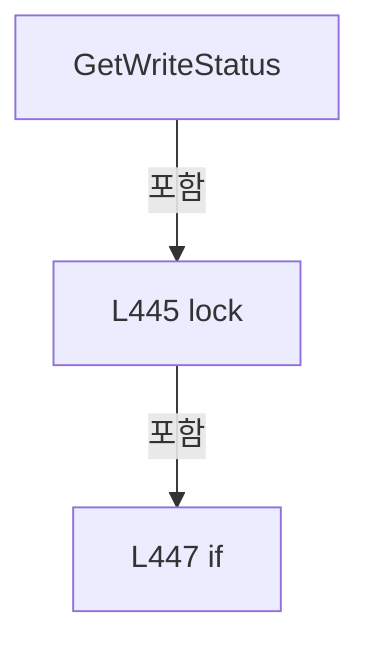

변경 전 점검: 입력/반환 타입, 위 호출자, 예외/취소 경로, 공유 상태와 저장·전송 소비자를 함께 확인합니다. 값의 단위나 물리 방향을 이름만으로 확정하지 않습니다.

### MethodDeclaration `TryGetReadSnapshot` · L456–471

[Drilling.Common/Interface/Melsec/CMelsec.cs:456–471](https://github.com/kjuws10-rgb/A3Drilling/blob/28764c91d521777b8ee068dd7aaf2d3902ce9fe2/Drilling.Common/Interface/Melsec/CMelsec.cs#L456-L471)

| 항목 | 실제 추출 값 |
| --- | --- |
| 서명 | bool Drilling.Common.Interface.CMelsec.TryGetReadSnapshot(string, out object?, out long) |
| 접근/수식자 | Public / public |
| 반환/값 타입 | bool |
| 소속 타입 | NamedType:Drilling.Common.Interface.CMelsec |

입력 계약:

| 이름 | 타입 | 전달 | 선택/기본값 |
| --- | --- | --- | --- |
| id | string | None | False /  |
| value | object? | Out | False /  |
| readCycleNo | long | Out | False /  |

현재 부분 분석에서 직접 연결된 호출자는 없습니다. XAML/이벤트/인터페이스·델리게이트·외부 진입을 추가 확인해야 하며, 미사용으로 판정한 것이 아닙니다.

호출하는 대상과 해석 범위:

| 원본 행 | 표현식 | 분석 상태 | 대상/소스 위치 |
| --- | --- | --- | --- |
| 460 | _readSnapshots.TryGetValue | resolved | bool System.Collections.Generic.Dictionary<string, Drilling.Common.Interface.CMelsec.CMelsecReadSnapshot>.TryGetValue(string, out Drilling.Common.Interface.CMelsec.CMelsecReadSnapshot) |
| 460 | NormalizeId | resolved | string Drilling.Common.Interface.CMelsec.NormalizeId(string) · Drilling.Common/Interface/Melsec/CMelsec.cs:2251 |

본문의 실제 연산·분기·예외·반환 순서(원문 위치 순):

| 원본 행 | 종류 | 주석 해설 |
| --- | --- | --- |
| 458 | lock | 공유 상태의 임계 구역에 진입합니다: lock (_readStateLock) |
| 460 | call | 함수·델리게이트 또는 객체 생성자를 호출합니다: _readSnapshots.TryGetValue(NormalizeId(id), out CMelsecReadSnapshot? snapshot) |
| 460 | call | 함수·델리게이트 또는 객체 생성자를 호출합니다: NormalizeId(id) |
| 460 | if | 조건에 따라 분기합니다: if (_readSnapshots.TryGetValue(NormalizeId(id), out CMelsecReadSnapshot? snapshot)) |
| 462 | assignment | 값을 대상에 대입합니다: value = snapshot.Value |
| 463 | assignment | 값을 대상에 대입합니다: readCycleNo = snapshot.ReadCycleNo |
| 464 | return | 호출자에게 값 또는 제어를 반환합니다: return true; |
| 468 | assignment | 값을 대상에 대입합니다: value = null |
| 469 | assignment | 값을 대상에 대입합니다: readCycleNo = 0 |
| 470 | return | 호출자에게 값 또는 제어를 반환합니다: return false; |

제어 구문의 포함 구조(실제 실행 순서/CFG가 아닌 구문 탐색 그림):

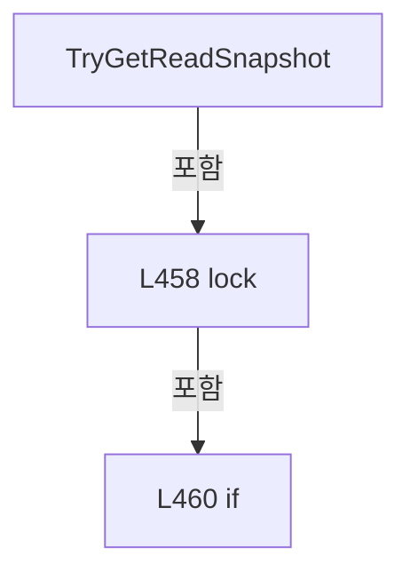

변경 전 점검: 입력/반환 타입, 위 호출자, 예외/취소 경로, 공유 상태와 저장·전송 소비자를 함께 확인합니다. 값의 단위나 물리 방향을 이름만으로 확정하지 않습니다.

### MethodDeclaration `SetSimulationReadbackMode` · L473–479

[Drilling.Common/Interface/Melsec/CMelsec.cs:473–479](https://github.com/kjuws10-rgb/A3Drilling/blob/28764c91d521777b8ee068dd7aaf2d3902ce9fe2/Drilling.Common/Interface/Melsec/CMelsec.cs#L473-L479)

| 항목 | 실제 추출 값 |
| --- | --- |
| 서명 | void Drilling.Common.Interface.CMelsec.SetSimulationReadbackMode(Drilling.Common.Interface.EN_MELSEC_SIMULATION_READBACK) |
| 접근/수식자 | Public / public |
| 반환/값 타입 | void |
| 소속 타입 | NamedType:Drilling.Common.Interface.CMelsec |

입력 계약:

| 이름 | 타입 | 전달 | 선택/기본값 |
| --- | --- | --- | --- |
| mode | Drilling.Common.Interface.EN_MELSEC_SIMULATION_READBACK | None | False /  |

현재 부분 분석에서 직접 연결된 호출자는 없습니다. XAML/이벤트/인터페이스·델리게이트·외부 진입을 추가 확인해야 하며, 미사용으로 판정한 것이 아닙니다.

본문의 실제 연산·분기·예외·반환 순서(원문 위치 순):

| 원본 행 | 종류 | 주석 해설 |
| --- | --- | --- |
| 475 | lock | 공유 상태의 임계 구역에 진입합니다: lock (_simulationLock) |
| 477 | assignment | 값을 대상에 대입합니다: _simulationReadback = mode |

제어 구문의 포함 구조(실제 실행 순서/CFG가 아닌 구문 탐색 그림):

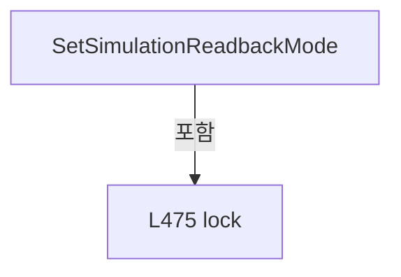

변경 전 점검: 입력/반환 타입, 위 호출자, 예외/취소 경로, 공유 상태와 저장·전송 소비자를 함께 확인합니다. 값의 단위나 물리 방향을 이름만으로 확정하지 않습니다.

### MethodDeclaration `Dispose` · L481–485

[Drilling.Common/Interface/Melsec/CMelsec.cs:481–485](https://github.com/kjuws10-rgb/A3Drilling/blob/28764c91d521777b8ee068dd7aaf2d3902ce9fe2/Drilling.Common/Interface/Melsec/CMelsec.cs#L481-L485)

| 항목 | 실제 추출 값 |
| --- | --- |
| 서명 | void Drilling.Common.Interface.CMelsec.Dispose() |
| 접근/수식자 | Public / public, new |
| 반환/값 타입 | void |
| 소속 타입 | NamedType:Drilling.Common.Interface.CMelsec |

현재 부분 분석에서 직접 연결된 호출자는 없습니다. XAML/이벤트/인터페이스·델리게이트·외부 진입을 추가 확인해야 하며, 미사용으로 판정한 것이 아닙니다.

호출하는 대상과 해석 범위:

| 원본 행 | 표현식 | 분석 상태 | 대상/소스 위치 |
| --- | --- | --- | --- |
| 483 | DeInitialize | resolved | void Drilling.Common.Interface.CMelsec.DeInitialize() · Drilling.Common/Interface/Melsec/CMelsec.cs:156 |
| 484 | base.Dispose | resolved | void Drilling.Common.Threading.CtrlThread.Dispose() · Drilling.Common/Threading/CtrlThread.cs:190 |

본문의 실제 연산·분기·예외·반환 순서(원문 위치 순):

| 원본 행 | 종류 | 주석 해설 |
| --- | --- | --- |
| 483 | call | 함수·델리게이트 또는 객체 생성자를 호출합니다: DeInitialize() |
| 484 | call | 함수·델리게이트 또는 객체 생성자를 호출합니다: base.Dispose() |

변경 전 점검: 입력/반환 타입, 위 호출자, 예외/취소 경로, 공유 상태와 저장·전송 소비자를 함께 확인합니다. 값의 단위나 물리 방향을 이름만으로 확정하지 않습니다.

### MethodDeclaration `ReadBitCore` · L487–496

[Drilling.Common/Interface/Melsec/CMelsec.cs:487–496](https://github.com/kjuws10-rgb/A3Drilling/blob/28764c91d521777b8ee068dd7aaf2d3902ce9fe2/Drilling.Common/Interface/Melsec/CMelsec.cs#L487-L496)

| 항목 | 실제 추출 값 |
| --- | --- |
| 서명 | bool Drilling.Common.Interface.CMelsec.ReadBitCore(string, System.Threading.CancellationToken, bool, string) |
| 접근/수식자 | Private / private |
| 반환/값 타입 | bool |
| 소속 타입 | NamedType:Drilling.Common.Interface.CMelsec |

입력 계약:

| 이름 | 타입 | 전달 | 선택/기본값 |
| --- | --- | --- | --- |
| id | string | None | False /  |
| cancellationToken | System.Threading.CancellationToken | None | False /  |
| suppressLog | bool | None | True / false |
| logSource | string | None | True / "DIRECT" |

정적 호출자로 확인된 위치:

| 호출 파일/행 | 호출 표현식 | 런타임 분기 가능 |
| --- | --- | --- |
| [Drilling.Common/Interface/Melsec/CMelsec.cs:676–676](https://github.com/kjuws10-rgb/A3Drilling/blob/28764c91d521777b8ee068dd7aaf2d3902ce9fe2/Drilling.Common/Interface/Melsec/CMelsec.cs#L676-L676) | ReadBitCore | False |
| [Drilling.Common/Interface/Melsec/CMelsec.cs:863–863](https://github.com/kjuws10-rgb/A3Drilling/blob/28764c91d521777b8ee068dd7aaf2d3902ce9fe2/Drilling.Common/Interface/Melsec/CMelsec.cs#L863-L863) | ReadBitCore | False |
| [Drilling.Common/Interface/Melsec/CMelsec.cs:1481–1481](https://github.com/kjuws10-rgb/A3Drilling/blob/28764c91d521777b8ee068dd7aaf2d3902ce9fe2/Drilling.Common/Interface/Melsec/CMelsec.cs#L1481-L1481) | ReadBitCore | False |

호출하는 대상과 해석 범위:

| 원본 행 | 표현식 | 분석 상태 | 대상/소스 위치 |
| --- | --- | --- | --- |
| 489 | PrepareRead | resolved | Drilling.Common.Interface.ST_MELSEC_MAP_DATA Drilling.Common.Interface.CMelsec.PrepareRead(string, Drilling.Common.Interface.EN_MELSEC_DATA_TYPE, System.Threading.CancellationToken) · Drilling.Common/Interface/Melsec/CMelsec.cs:1935 |
| 490 | ParseAddress | resolved | Drilling.Common.Interface.CMelsec.ST_MELSEC_ADDRESS Drilling.Common.Interface.CMelsec.ParseAddress(string) · Drilling.Common/Interface/Melsec/CMelsec.cs:1981 |
| 491 | RequireWordBit | resolved | int Drilling.Common.Interface.CMelsec.RequireWordBit(Drilling.Common.Interface.CMelsec.ST_MELSEC_ADDRESS, Drilling.Common.Interface.ST_MELSEC_MAP_DATA) · Drilling.Common/Interface/Melsec/CMelsec.cs:2080 |
| 492 | ReadWords | resolved | ushort[] Drilling.Common.Interface.CMelsec.ReadWords(Drilling.Common.Interface.ST_MELSEC_MAP_DATA, Drilling.Common.Interface.CMelsec.ST_MELSEC_ADDRESS, int, System.Threading.CancellationToken, bool, string) · Drilling.Common/Interface/Melsec/CMelsec.cs:1652 |
| 494 | SaveReadSnapshot | resolved | void Drilling.Common.Interface.CMelsec.SaveReadSnapshot(string, object) · Drilling.Common/Interface/Melsec/CMelsec.cs:1597 |

본문의 실제 연산·분기·예외·반환 순서(원문 위치 순):

| 원본 행 | 종류 | 주석 해설 |
| --- | --- | --- |
| 489 | call | 함수·델리게이트 또는 객체 생성자를 호출합니다: PrepareRead(id, EN_MELSEC_DATA_TYPE.Bit, cancellationToken) |
| 489 | local-declaration | 지역 변수를 선언합니다: ST_MELSEC_MAP_DATA data = PrepareRead(id, EN_MELSEC_DATA_TYPE.Bit, cancellationToken); |
| 489 | variable-initializer | 변수의 초기값을 지정합니다: data = PrepareRead(id, EN_MELSEC_DATA_TYPE.Bit, cancellationToken) |
| 490 | call | 함수·델리게이트 또는 객체 생성자를 호출합니다: ParseAddress(data.Address) |
| 490 | local-declaration | 지역 변수를 선언합니다: ST_MELSEC_ADDRESS address = ParseAddress(data.Address); |
| 490 | variable-initializer | 변수의 초기값을 지정합니다: address = ParseAddress(data.Address) |
| 491 | call | 함수·델리게이트 또는 객체 생성자를 호출합니다: RequireWordBit(address, data) |
| 491 | local-declaration | 지역 변수를 선언합니다: int bitIndex = RequireWordBit(address, data); |
| 491 | variable-initializer | 변수의 초기값을 지정합니다: bitIndex = RequireWordBit(address, data) |
| 492 | call | 함수·델리게이트 또는 객체 생성자를 호출합니다: ReadWords(data, address, 1, cancellationToken, suppressLog, logSource) |
| 492 | local-declaration | 지역 변수를 선언합니다: ushort[] words = ReadWords(data, address, 1, cancellationToken, suppressLog, logSource); |
| 492 | variable-initializer | 변수의 초기값을 지정합니다: words = ReadWords(data, address, 1, cancellationToken, suppressLog, logSource) |
| 493 | local-declaration | 지역 변수를 선언합니다: bool value = (words[0] & (1 << bitIndex)) != 0; |
| 493 | variable-initializer | 변수의 초기값을 지정합니다: value = (words[0] & (1 << bitIndex)) != 0 |
| 494 | call | 함수·델리게이트 또는 객체 생성자를 호출합니다: SaveReadSnapshot(data.Id, value) |
| 495 | return | 호출자에게 값 또는 제어를 반환합니다: return value; |

변경 전 점검: 입력/반환 타입, 위 호출자, 예외/취소 경로, 공유 상태와 저장·전송 소비자를 함께 확인합니다. 값의 단위나 물리 방향을 이름만으로 확정하지 않습니다.

### MethodDeclaration `WriteBitCore` · L498–515

[Drilling.Common/Interface/Melsec/CMelsec.cs:498–515](https://github.com/kjuws10-rgb/A3Drilling/blob/28764c91d521777b8ee068dd7aaf2d3902ce9fe2/Drilling.Common/Interface/Melsec/CMelsec.cs#L498-L515)

| 항목 | 실제 추출 값 |
| --- | --- |
| 서명 | void Drilling.Common.Interface.CMelsec.WriteBitCore(string, bool, System.Threading.CancellationToken) |
| 접근/수식자 | Private / private |
| 반환/값 타입 | void |
| 소속 타입 | NamedType:Drilling.Common.Interface.CMelsec |

입력 계약:

| 이름 | 타입 | 전달 | 선택/기본값 |
| --- | --- | --- | --- |
| id | string | None | False /  |
| value | bool | None | False /  |
| cancellationToken | System.Threading.CancellationToken | None | False /  |

정적 호출자로 확인된 위치:

| 호출 파일/행 | 호출 표현식 | 런타임 분기 가능 |
| --- | --- | --- |
| [Drilling.Common/Interface/Melsec/CMelsec.cs:679–679](https://github.com/kjuws10-rgb/A3Drilling/blob/28764c91d521777b8ee068dd7aaf2d3902ce9fe2/Drilling.Common/Interface/Melsec/CMelsec.cs#L679-L679) | WriteBitCore | False |
| [Drilling.Common/Interface/Melsec/CMelsec.cs:1460–1460](https://github.com/kjuws10-rgb/A3Drilling/blob/28764c91d521777b8ee068dd7aaf2d3902ce9fe2/Drilling.Common/Interface/Melsec/CMelsec.cs#L1460-L1460) | WriteBitCore | False |

호출하는 대상과 해석 범위:

| 원본 행 | 표현식 | 분석 상태 | 대상/소스 위치 |
| --- | --- | --- | --- |
| 500 | PrepareWrite | resolved | Drilling.Common.Interface.ST_MELSEC_MAP_DATA Drilling.Common.Interface.CMelsec.PrepareWrite(string, Drilling.Common.Interface.EN_MELSEC_DATA_TYPE, System.Threading.CancellationToken) · Drilling.Common/Interface/Melsec/CMelsec.cs:1953 |
| 501 | ParseAddress | resolved | Drilling.Common.Interface.CMelsec.ST_MELSEC_ADDRESS Drilling.Common.Interface.CMelsec.ParseAddress(string) · Drilling.Common/Interface/Melsec/CMelsec.cs:1981 |
| 502 | RequireWordBit | resolved | int Drilling.Common.Interface.CMelsec.RequireWordBit(Drilling.Common.Interface.CMelsec.ST_MELSEC_ADDRESS, Drilling.Common.Interface.ST_MELSEC_MAP_DATA) · Drilling.Common/Interface/Melsec/CMelsec.cs:2080 |
| 503 | ReadWords | resolved | ushort[] Drilling.Common.Interface.CMelsec.ReadWords(Drilling.Common.Interface.ST_MELSEC_MAP_DATA, Drilling.Common.Interface.CMelsec.ST_MELSEC_ADDRESS, int, System.Threading.CancellationToken, bool, string) · Drilling.Common/Interface/Melsec/CMelsec.cs:1652 |
| 514 | WriteWords | resolved | void Drilling.Common.Interface.CMelsec.WriteWords(Drilling.Common.Interface.ST_MELSEC_MAP_DATA, Drilling.Common.Interface.CMelsec.ST_MELSEC_ADDRESS, System.Collections.Generic.IReadOnlyList<ushort>, System.Threading.CancellationToken, string) · Drilling.Common/Interface/Melsec/CMelsec.cs:1764 |

본문의 실제 연산·분기·예외·반환 순서(원문 위치 순):

| 원본 행 | 종류 | 주석 해설 |
| --- | --- | --- |
| 500 | call | 함수·델리게이트 또는 객체 생성자를 호출합니다: PrepareWrite(id, EN_MELSEC_DATA_TYPE.Bit, cancellationToken) |
| 500 | local-declaration | 지역 변수를 선언합니다: ST_MELSEC_MAP_DATA data = PrepareWrite(id, EN_MELSEC_DATA_TYPE.Bit, cancellationToken); |
| 500 | variable-initializer | 변수의 초기값을 지정합니다: data = PrepareWrite(id, EN_MELSEC_DATA_TYPE.Bit, cancellationToken) |
| 501 | call | 함수·델리게이트 또는 객체 생성자를 호출합니다: ParseAddress(data.Address) |
| 501 | local-declaration | 지역 변수를 선언합니다: ST_MELSEC_ADDRESS address = ParseAddress(data.Address); |
| 501 | variable-initializer | 변수의 초기값을 지정합니다: address = ParseAddress(data.Address) |
| 502 | call | 함수·델리게이트 또는 객체 생성자를 호출합니다: RequireWordBit(address, data) |
| 502 | local-declaration | 지역 변수를 선언합니다: int bitIndex = RequireWordBit(address, data); |
| 502 | variable-initializer | 변수의 초기값을 지정합니다: bitIndex = RequireWordBit(address, data) |
| 503 | call | 함수·델리게이트 또는 객체 생성자를 호출합니다: ReadWords(data, address, 1, cancellationToken) |
| 503 | local-declaration | 지역 변수를 선언합니다: ushort[] words = ReadWords(data, address, 1, cancellationToken); |
| 503 | variable-initializer | 변수의 초기값을 지정합니다: words = ReadWords(data, address, 1, cancellationToken) |
| 504 | local-declaration | 지역 변수를 선언합니다: ushort mask = (ushort)(1 << bitIndex); |
| 504 | variable-initializer | 변수의 초기값을 지정합니다: mask = (ushort)(1 << bitIndex) |
| 505 | if | 조건에 따라 분기합니다: if (value) |
| 507 | assignment | 값을 대상에 대입합니다: words[0] = (ushort)(words[0] &#124; mask) |
| 509 | else | 앞 조건이 거짓인 경로입니다: else |
| 511 | assignment | 값을 대상에 대입합니다: words[0] = (ushort)(words[0] & ~mask) |
| 514 | call | 함수·델리게이트 또는 객체 생성자를 호출합니다: WriteWords(data, address, words, cancellationToken) |

제어 구문의 포함 구조(실제 실행 순서/CFG가 아닌 구문 탐색 그림):

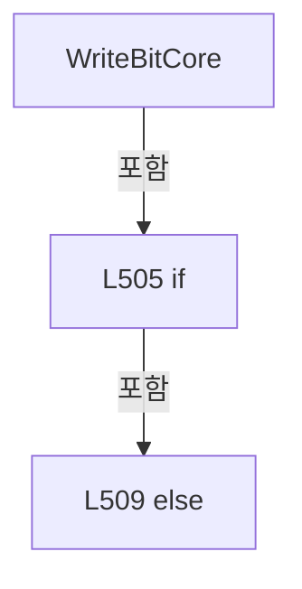

변경 전 점검: 입력/반환 타입, 위 호출자, 예외/취소 경로, 공유 상태와 저장·전송 소비자를 함께 확인합니다. 값의 단위나 물리 방향을 이름만으로 확정하지 않습니다.

### MethodDeclaration `ReadWordCore` · L517–526

[Drilling.Common/Interface/Melsec/CMelsec.cs:517–526](https://github.com/kjuws10-rgb/A3Drilling/blob/28764c91d521777b8ee068dd7aaf2d3902ce9fe2/Drilling.Common/Interface/Melsec/CMelsec.cs#L517-L526)

| 항목 | 실제 추출 값 |
| --- | --- |
| 서명 | double Drilling.Common.Interface.CMelsec.ReadWordCore(string, System.Threading.CancellationToken, bool, string) |
| 접근/수식자 | Private / private |
| 반환/값 타입 | double |
| 소속 타입 | NamedType:Drilling.Common.Interface.CMelsec |

입력 계약:

| 이름 | 타입 | 전달 | 선택/기본값 |
| --- | --- | --- | --- |
| id | string | None | False /  |
| cancellationToken | System.Threading.CancellationToken | None | False /  |
| suppressLog | bool | None | True / false |
| logSource | string | None | True / "DIRECT" |

정적 호출자로 확인된 위치:

| 호출 파일/행 | 호출 표현식 | 런타임 분기 가능 |
| --- | --- | --- |
| [Drilling.Common/Interface/Melsec/CMelsec.cs:682–682](https://github.com/kjuws10-rgb/A3Drilling/blob/28764c91d521777b8ee068dd7aaf2d3902ce9fe2/Drilling.Common/Interface/Melsec/CMelsec.cs#L682-L682) | ReadWordCore | False |
| [Drilling.Common/Interface/Melsec/CMelsec.cs:867–867](https://github.com/kjuws10-rgb/A3Drilling/blob/28764c91d521777b8ee068dd7aaf2d3902ce9fe2/Drilling.Common/Interface/Melsec/CMelsec.cs#L867-L867) | ReadWordCore | False |
| [Drilling.Common/Interface/Melsec/CMelsec.cs:1483–1483](https://github.com/kjuws10-rgb/A3Drilling/blob/28764c91d521777b8ee068dd7aaf2d3902ce9fe2/Drilling.Common/Interface/Melsec/CMelsec.cs#L1483-L1483) | ReadWordCore | False |

호출하는 대상과 해석 범위:

| 원본 행 | 표현식 | 분석 상태 | 대상/소스 위치 |
| --- | --- | --- | --- |
| 519 | PrepareRead | resolved | Drilling.Common.Interface.ST_MELSEC_MAP_DATA Drilling.Common.Interface.CMelsec.PrepareRead(string, System.Collections.Generic.IReadOnlyList<Drilling.Common.Interface.EN_MELSEC_DATA_TYPE>, System.Threading.CancellationToken) · Drilling.Common/Interface/Melsec/CMelsec.cs:1940 |
| 520 | Math.Max | resolved | int System.Math.Max(int, int) |
| 521 | ReadWords | resolved | ushort[] Drilling.Common.Interface.CMelsec.ReadWords(Drilling.Common.Interface.ST_MELSEC_MAP_DATA, Drilling.Common.Interface.CMelsec.ST_MELSEC_ADDRESS, int, System.Threading.CancellationToken, bool, string) · Drilling.Common/Interface/Melsec/CMelsec.cs:1652 |
| 521 | ParseAddress | resolved | Drilling.Common.Interface.CMelsec.ST_MELSEC_ADDRESS Drilling.Common.Interface.CMelsec.ParseAddress(string) · Drilling.Common/Interface/Melsec/CMelsec.cs:1981 |
| 522 | WordsToInt32 | resolved | int Drilling.Common.Interface.CMelsec.WordsToInt32(System.Collections.Generic.IReadOnlyList<ushort>) · Drilling.Common/Interface/Melsec/CMelsec.cs:2090 |
| 524 | SaveReadSnapshot | resolved | void Drilling.Common.Interface.CMelsec.SaveReadSnapshot(string, object) · Drilling.Common/Interface/Melsec/CMelsec.cs:1597 |

본문의 실제 연산·분기·예외·반환 순서(원문 위치 순):

| 원본 행 | 종류 | 주석 해설 |
| --- | --- | --- |
| 519 | call | 함수·델리게이트 또는 객체 생성자를 호출합니다: PrepareRead(id, [EN_MELSEC_DATA_TYPE.Word, EN_MELSEC_DATA_TYPE.DWord], cancellationToken) |
| 519 | local-declaration | 지역 변수를 선언합니다: ST_MELSEC_MAP_DATA data = PrepareRead(id, [EN_MELSEC_DATA_TYPE.Word, EN_MELSEC_DATA_TYPE.DWord], cancellationToken); |
| 519 | variable-initializer | 변수의 초기값을 지정합니다: data = PrepareRead(id, [EN_MELSEC_DATA_TYPE.Word, EN_MELSEC_DATA_TYPE.DWord], cancellationToken) |
| 520 | call | 함수·델리게이트 또는 객체 생성자를 호출합니다: Math.Max(2, data.Length) |
| 520 | conditional-expression | 조건에 따라 결과식을 선택합니다: data.DataType == EN_MELSEC_DATA_TYPE.DWord ? Math.Max(2, data.Length) : 1 |
| 520 | local-declaration | 지역 변수를 선언합니다: int wordCount = data.DataType == EN_MELSEC_DATA_TYPE.DWord ? Math.Max(2, data.Length) : 1; |
| 520 | variable-initializer | 변수의 초기값을 지정합니다: wordCount = data.DataType == EN_MELSEC_DATA_TYPE.DWord ? Math.Max(2, data.Length) : 1 |
| 521 | call | 함수·델리게이트 또는 객체 생성자를 호출합니다: ReadWords(data, ParseAddress(data.Address), wordCount, cancellationToken, suppressLog, logSource) |
| 521 | call | 함수·델리게이트 또는 객체 생성자를 호출합니다: ParseAddress(data.Address) |
| 521 | local-declaration | 지역 변수를 선언합니다: ushort[] words = ReadWords(data, ParseAddress(data.Address), wordCount, cancellationToken, suppressLog, logSource); |
| 521 | variable-initializer | 변수의 초기값을 지정합니다: words = ReadWords(data, ParseAddress(data.Address), wordCount, cancellationToken, suppressLog, logSource) |
| 522 | call | 함수·델리게이트 또는 객체 생성자를 호출합니다: WordsToInt32(words) |
| 522 | conditional-expression | 조건에 따라 결과식을 선택합니다: data.DataType == EN_MELSEC_DATA_TYPE.DWord ? WordsToInt32(words) : words[0] |
| 522 | local-declaration | 지역 변수를 선언합니다: int rawValue = data.DataType == EN_MELSEC_DATA_TYPE.DWord ? WordsToInt32(words) : words[0]; |
| 522 | variable-initializer | 변수의 초기값을 지정합니다: rawValue = data.DataType == EN_MELSEC_DATA_TYPE.DWord ? WordsToInt32(words) : words[0] |
| 523 | local-declaration | 지역 변수를 선언합니다: double value = rawValue * data.ReadScale; |
| 523 | variable-initializer | 변수의 초기값을 지정합니다: value = rawValue * data.ReadScale |
| 524 | call | 함수·델리게이트 또는 객체 생성자를 호출합니다: SaveReadSnapshot(data.Id, value) |
| 525 | return | 호출자에게 값 또는 제어를 반환합니다: return value; |

변경 전 점검: 입력/반환 타입, 위 호출자, 예외/취소 경로, 공유 상태와 저장·전송 소비자를 함께 확인합니다. 값의 단위나 물리 방향을 이름만으로 확정하지 않습니다.

### MethodDeclaration `WriteWordCore` · L528–535

[Drilling.Common/Interface/Melsec/CMelsec.cs:528–535](https://github.com/kjuws10-rgb/A3Drilling/blob/28764c91d521777b8ee068dd7aaf2d3902ce9fe2/Drilling.Common/Interface/Melsec/CMelsec.cs#L528-L535)

| 항목 | 실제 추출 값 |
| --- | --- |
| 서명 | void Drilling.Common.Interface.CMelsec.WriteWordCore(string, double, System.Threading.CancellationToken) |
| 접근/수식자 | Private / private |
| 반환/값 타입 | void |
| 소속 타입 | NamedType:Drilling.Common.Interface.CMelsec |

입력 계약:

| 이름 | 타입 | 전달 | 선택/기본값 |
| --- | --- | --- | --- |
| id | string | None | False /  |
| value | double | None | False /  |
| cancellationToken | System.Threading.CancellationToken | None | False /  |

정적 호출자로 확인된 위치:

| 호출 파일/행 | 호출 표현식 | 런타임 분기 가능 |
| --- | --- | --- |
| [Drilling.Common/Interface/Melsec/CMelsec.cs:685–685](https://github.com/kjuws10-rgb/A3Drilling/blob/28764c91d521777b8ee068dd7aaf2d3902ce9fe2/Drilling.Common/Interface/Melsec/CMelsec.cs#L685-L685) | WriteWordCore | False |
| [Drilling.Common/Interface/Melsec/CMelsec.cs:1463–1463](https://github.com/kjuws10-rgb/A3Drilling/blob/28764c91d521777b8ee068dd7aaf2d3902ce9fe2/Drilling.Common/Interface/Melsec/CMelsec.cs#L1463-L1463) | WriteWordCore | False |

호출하는 대상과 해석 범위:

| 원본 행 | 표현식 | 분석 상태 | 대상/소스 위치 |
| --- | --- | --- | --- |
| 530 | PrepareWrite | resolved | Drilling.Common.Interface.ST_MELSEC_MAP_DATA Drilling.Common.Interface.CMelsec.PrepareWrite(string, System.Collections.Generic.IReadOnlyList<Drilling.Common.Interface.EN_MELSEC_DATA_TYPE>, System.Threading.CancellationToken) · Drilling.Common/Interface/Melsec/CMelsec.cs:1958 |
| 531 | Math.Max | resolved | int System.Math.Max(int, int) |
| 532 | EncodeIntegerValue | resolved | int Drilling.Common.Interface.CMelsec.EncodeIntegerValue(Drilling.Common.Interface.ST_MELSEC_MAP_DATA, double) · Drilling.Common/Interface/Melsec/CMelsec.cs:537 |
| 533 | Int32ToWords | resolved | ushort[] Drilling.Common.Interface.CMelsec.Int32ToWords(int, int) · Drilling.Common/Interface/Melsec/CMelsec.cs:2100 |
| 534 | WriteWords | resolved | void Drilling.Common.Interface.CMelsec.WriteWords(Drilling.Common.Interface.ST_MELSEC_MAP_DATA, Drilling.Common.Interface.CMelsec.ST_MELSEC_ADDRESS, System.Collections.Generic.IReadOnlyList<ushort>, System.Threading.CancellationToken, string) · Drilling.Common/Interface/Melsec/CMelsec.cs:1764 |
| 534 | ParseAddress | resolved | Drilling.Common.Interface.CMelsec.ST_MELSEC_ADDRESS Drilling.Common.Interface.CMelsec.ParseAddress(string) · Drilling.Common/Interface/Melsec/CMelsec.cs:1981 |

본문의 실제 연산·분기·예외·반환 순서(원문 위치 순):

| 원본 행 | 종류 | 주석 해설 |
| --- | --- | --- |
| 530 | call | 함수·델리게이트 또는 객체 생성자를 호출합니다: PrepareWrite(id, [EN_MELSEC_DATA_TYPE.Word, EN_MELSEC_DATA_TYPE.DWord], cancellationToken) |
| 530 | local-declaration | 지역 변수를 선언합니다: ST_MELSEC_MAP_DATA data = PrepareWrite(id, [EN_MELSEC_DATA_TYPE.Word, EN_MELSEC_DATA_TYPE.DWord], cancellationToken); |
| 530 | variable-initializer | 변수의 초기값을 지정합니다: data = PrepareWrite(id, [EN_MELSEC_DATA_TYPE.Word, EN_MELSEC_DATA_TYPE.DWord], cancellationToken) |
| 531 | call | 함수·델리게이트 또는 객체 생성자를 호출합니다: Math.Max(2, data.Length) |
| 531 | conditional-expression | 조건에 따라 결과식을 선택합니다: data.DataType == EN_MELSEC_DATA_TYPE.DWord ? Math.Max(2, data.Length) : 1 |
| 531 | local-declaration | 지역 변수를 선언합니다: int wordCount = data.DataType == EN_MELSEC_DATA_TYPE.DWord ? Math.Max(2, data.Length) : 1; |
| 531 | variable-initializer | 변수의 초기값을 지정합니다: wordCount = data.DataType == EN_MELSEC_DATA_TYPE.DWord ? Math.Max(2, data.Length) : 1 |
| 532 | call | 함수·델리게이트 또는 객체 생성자를 호출합니다: EncodeIntegerValue(data, value * data.WriteScale) |
| 532 | local-declaration | 지역 변수를 선언합니다: int rawValue = EncodeIntegerValue(data, value * data.WriteScale); |
| 532 | variable-initializer | 변수의 초기값을 지정합니다: rawValue = EncodeIntegerValue(data, value * data.WriteScale) |
| 533 | call | 함수·델리게이트 또는 객체 생성자를 호출합니다: Int32ToWords(rawValue, wordCount) |
| 533 | conditional-expression | 조건에 따라 결과식을 선택합니다: data.DataType == EN_MELSEC_DATA_TYPE.DWord ? Int32ToWords(rawValue, wordCount) : [(ushort)rawValue] |
| 533 | local-declaration | 지역 변수를 선언합니다: ushort[] words = data.DataType == EN_MELSEC_DATA_TYPE.DWord ? Int32ToWords(rawValue, wordCount) : [(ushort)rawValue]; |
| 533 | variable-initializer | 변수의 초기값을 지정합니다: words = data.DataType == EN_MELSEC_DATA_TYPE.DWord ? Int32ToWords(rawValue, wordCount) : [(ushort)rawValue] |
| 534 | call | 함수·델리게이트 또는 객체 생성자를 호출합니다: WriteWords(data, ParseAddress(data.Address), words, cancellationToken) |
| 534 | call | 함수·델리게이트 또는 객체 생성자를 호출합니다: ParseAddress(data.Address) |

변경 전 점검: 입력/반환 타입, 위 호출자, 예외/취소 경로, 공유 상태와 저장·전송 소비자를 함께 확인합니다. 값의 단위나 물리 방향을 이름만으로 확정하지 않습니다.

### MethodDeclaration `EncodeIntegerValue` · L537–543

[Drilling.Common/Interface/Melsec/CMelsec.cs:537–543](https://github.com/kjuws10-rgb/A3Drilling/blob/28764c91d521777b8ee068dd7aaf2d3902ce9fe2/Drilling.Common/Interface/Melsec/CMelsec.cs#L537-L543)

| 항목 | 실제 추출 값 |
| --- | --- |
| 서명 | int Drilling.Common.Interface.CMelsec.EncodeIntegerValue(Drilling.Common.Interface.ST_MELSEC_MAP_DATA, double) |
| 접근/수식자 | Private / private, static |
| 반환/값 타입 | int |
| 소속 타입 | NamedType:Drilling.Common.Interface.CMelsec |

입력 계약:

| 이름 | 타입 | 전달 | 선택/기본값 |
| --- | --- | --- | --- |
| data | Drilling.Common.Interface.ST_MELSEC_MAP_DATA | None | False /  |
| rawValue | double | None | False /  |

정적 호출자로 확인된 위치:

| 호출 파일/행 | 호출 표현식 | 런타임 분기 가능 |
| --- | --- | --- |
| [Drilling.Common/Interface/Melsec/CMelsec.cs:532–532](https://github.com/kjuws10-rgb/A3Drilling/blob/28764c91d521777b8ee068dd7aaf2d3902ce9fe2/Drilling.Common/Interface/Melsec/CMelsec.cs#L532-L532) | EncodeIntegerValue | False |
| [Drilling.Common/Interface/Melsec/CMelsec.cs:1562–1562](https://github.com/kjuws10-rgb/A3Drilling/blob/28764c91d521777b8ee068dd7aaf2d3902ce9fe2/Drilling.Common/Interface/Melsec/CMelsec.cs#L1562-L1562) | EncodeIntegerValue | False |
| [Drilling.Common/Interface/Melsec/CMelsec.cs:1565–1565](https://github.com/kjuws10-rgb/A3Drilling/blob/28764c91d521777b8ee068dd7aaf2d3902ce9fe2/Drilling.Common/Interface/Melsec/CMelsec.cs#L1565-L1565) | EncodeIntegerValue | False |
| [Drilling.Common/Interface/Melsec/CMelsec.cs:1570–1570](https://github.com/kjuws10-rgb/A3Drilling/blob/28764c91d521777b8ee068dd7aaf2d3902ce9fe2/Drilling.Common/Interface/Melsec/CMelsec.cs#L1570-L1570) | EncodeIntegerValue | False |
| [Drilling.Common/Interface/Melsec/CMelsec.cs:3073–3073](https://github.com/kjuws10-rgb/A3Drilling/blob/28764c91d521777b8ee068dd7aaf2d3902ce9fe2/Drilling.Common/Interface/Melsec/CMelsec.cs#L3073-L3073) | EncodeIntegerValue | False |

호출하는 대상과 해석 범위:

| 원본 행 | 표현식 | 분석 상태 | 대상/소스 위치 |
| --- | --- | --- | --- |
| 539 | Math.Round | resolved | double System.Math.Round(double, System.MidpointRounding) |
| 540 | double.IsFinite | resolved | bool double.IsFinite(double) |
| 541 | new ArgumentOutOfRangeException | resolved | System.ArgumentOutOfRangeException.ArgumentOutOfRangeException(string?, string?) |
| 541 | nameof | unresolved | None |

본문의 실제 연산·분기·예외·반환 순서(원문 위치 순):

| 원본 행 | 종류 | 주석 해설 |
| --- | --- | --- |
| 539 | call | 함수·델리게이트 또는 객체 생성자를 호출합니다: Math.Round(rawValue, MidpointRounding.AwayFromZero) |
| 539 | local-declaration | 지역 변수를 선언합니다: var rounded = Math.Round(rawValue, MidpointRounding.AwayFromZero); |
| 539 | variable-initializer | 변수의 초기값을 지정합니다: rounded = Math.Round(rawValue, MidpointRounding.AwayFromZero) |
| 540 | call | 함수·델리게이트 또는 객체 생성자를 호출합니다: double.IsFinite(rounded) |
| 540 | conditional-expression | 조건에 따라 결과식을 선택합니다: data.DataType == EN_MELSEC_DATA_TYPE.Word ? 0 : int.MinValue |
| 540 | conditional-expression | 조건에 따라 결과식을 선택합니다: data.DataType == EN_MELSEC_DATA_TYPE.Word ? ushort.MaxValue : int.MaxValue |
| 540 | if | 조건에 따라 분기합니다: if (!double.IsFinite(rounded) &#124;&#124; rounded < (data.DataType == EN_MELSEC_DATA_TYPE.Word ? 0 : int.MinValue) &#124;&#124; rounded > (data.DataType == EN_MELSEC_DATA_TYPE.Word ? ushort.MaxValue : int.MaxValue)) |
| 541 | call | 함수·델리게이트 또는 객체 생성자를 호출합니다: new ArgumentOutOfRangeException(nameof(rawValue), "Scaled MELSEC value must fit the configured integer type.") |
| 541 | call | 함수·델리게이트 또는 객체 생성자를 호출합니다: nameof(rawValue) |
| 541 | throw | 예외를 발생/전달합니다: throw new ArgumentOutOfRangeException(nameof(rawValue), "Scaled MELSEC value must fit the configured integer type."); |
| 542 | return | 호출자에게 값 또는 제어를 반환합니다: return (int)rounded; |

제어 구문의 포함 구조(실제 실행 순서/CFG가 아닌 구문 탐색 그림):

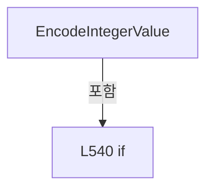

변경 전 점검: 입력/반환 타입, 위 호출자, 예외/취소 경로, 공유 상태와 저장·전송 소비자를 함께 확인합니다. 값의 단위나 물리 방향을 이름만으로 확정하지 않습니다.

### MethodDeclaration `ReadDoubleCore` · L545–564

[Drilling.Common/Interface/Melsec/CMelsec.cs:545–564](https://github.com/kjuws10-rgb/A3Drilling/blob/28764c91d521777b8ee068dd7aaf2d3902ce9fe2/Drilling.Common/Interface/Melsec/CMelsec.cs#L545-L564)

| 항목 | 실제 추출 값 |
| --- | --- |
| 서명 | double Drilling.Common.Interface.CMelsec.ReadDoubleCore(string, System.Threading.CancellationToken, bool, string) |
| 접근/수식자 | Private / private |
| 반환/값 타입 | double |
| 소속 타입 | NamedType:Drilling.Common.Interface.CMelsec |

입력 계약:

| 이름 | 타입 | 전달 | 선택/기본값 |
| --- | --- | --- | --- |
| id | string | None | False /  |
| cancellationToken | System.Threading.CancellationToken | None | False /  |
| suppressLog | bool | None | True / false |
| logSource | string | None | True / "DIRECT" |

정적 호출자로 확인된 위치:

| 호출 파일/행 | 호출 표현식 | 런타임 분기 가능 |
| --- | --- | --- |
| [Drilling.Common/Interface/Melsec/CMelsec.cs:688–688](https://github.com/kjuws10-rgb/A3Drilling/blob/28764c91d521777b8ee068dd7aaf2d3902ce9fe2/Drilling.Common/Interface/Melsec/CMelsec.cs#L688-L688) | ReadDoubleCore | False |
| [Drilling.Common/Interface/Melsec/CMelsec.cs:871–871](https://github.com/kjuws10-rgb/A3Drilling/blob/28764c91d521777b8ee068dd7aaf2d3902ce9fe2/Drilling.Common/Interface/Melsec/CMelsec.cs#L871-L871) | ReadDoubleCore | False |
| [Drilling.Common/Interface/Melsec/CMelsec.cs:1485–1485](https://github.com/kjuws10-rgb/A3Drilling/blob/28764c91d521777b8ee068dd7aaf2d3902ce9fe2/Drilling.Common/Interface/Melsec/CMelsec.cs#L1485-L1485) | ReadDoubleCore | False |

호출하는 대상과 해석 범위:

| 원본 행 | 표현식 | 분석 상태 | 대상/소스 위치 |
| --- | --- | --- | --- |
| 547 | PrepareRead | resolved | Drilling.Common.Interface.ST_MELSEC_MAP_DATA Drilling.Common.Interface.CMelsec.PrepareRead(string, System.Collections.Generic.IReadOnlyList<Drilling.Common.Interface.EN_MELSEC_DATA_TYPE>, System.Threading.CancellationToken) · Drilling.Common/Interface/Melsec/CMelsec.cs:1940 |
| 548 | ValidateMapData | resolved | void Drilling.Common.Interface.CMelsec.ValidateMapData(Drilling.Common.Interface.ST_MELSEC_MAP_DATA) · Drilling.Common/Interface/Melsec/CMelsec.cs:245 |
| 551 | ReadWords | resolved | ushort[] Drilling.Common.Interface.CMelsec.ReadWords(Drilling.Common.Interface.ST_MELSEC_MAP_DATA, Drilling.Common.Interface.CMelsec.ST_MELSEC_ADDRESS, int, System.Threading.CancellationToken, bool, string) · Drilling.Common/Interface/Melsec/CMelsec.cs:1652 |
| 551 | ParseAddress | resolved | Drilling.Common.Interface.CMelsec.ST_MELSEC_ADDRESS Drilling.Common.Interface.CMelsec.ParseAddress(string) · Drilling.Common/Interface/Melsec/CMelsec.cs:1981 |
| 555 | WordsToFloat | resolved | float Drilling.Common.Interface.CMelsec.WordsToFloat(System.Collections.Generic.IReadOnlyList<ushort>) · Drilling.Common/Interface/Melsec/CMelsec.cs:2112 |
| 559 | WordsToInt32 | resolved | int Drilling.Common.Interface.CMelsec.WordsToInt32(System.Collections.Generic.IReadOnlyList<ushort>) · Drilling.Common/Interface/Melsec/CMelsec.cs:2090 |
| 562 | SaveReadSnapshot | resolved | void Drilling.Common.Interface.CMelsec.SaveReadSnapshot(string, object) · Drilling.Common/Interface/Melsec/CMelsec.cs:1597 |

본문의 실제 연산·분기·예외·반환 순서(원문 위치 순):

| 원본 행 | 종류 | 주석 해설 |
| --- | --- | --- |
| 547 | call | 함수·델리게이트 또는 객체 생성자를 호출합니다: PrepareRead(id, [EN_MELSEC_DATA_TYPE.Double, EN_MELSEC_DATA_TYPE.Float], cancellationToken) |
| 547 | local-declaration | 지역 변수를 선언합니다: ST_MELSEC_MAP_DATA data = PrepareRead(id, [EN_MELSEC_DATA_TYPE.Double, EN_MELSEC_DATA_TYPE.Float], cancellationToken); |
| 547 | variable-initializer | 변수의 초기값을 지정합니다: data = PrepareRead(id, [EN_MELSEC_DATA_TYPE.Double, EN_MELSEC_DATA_TYPE.Float], cancellationToken) |
| 548 | call | 함수·델리게이트 또는 객체 생성자를 호출합니다: ValidateMapData(data) |
| 550 | local-declaration | 지역 변수를 선언합니다: int wordCount = 2; |
| 550 | variable-initializer | 변수의 초기값을 지정합니다: wordCount = 2 |
| 551 | call | 함수·델리게이트 또는 객체 생성자를 호출합니다: ReadWords(data, ParseAddress(data.Address), wordCount, cancellationToken, suppressLog, logSource) |
| 551 | call | 함수·델리게이트 또는 객체 생성자를 호출합니다: ParseAddress(data.Address) |
| 551 | local-declaration | 지역 변수를 선언합니다: ushort[] words = ReadWords(data, ParseAddress(data.Address), wordCount, cancellationToken, suppressLog, logSource); |
| 551 | variable-initializer | 변수의 초기값을 지정합니다: words = ReadWords(data, ParseAddress(data.Address), wordCount, cancellationToken, suppressLog, logSource) |
| 552 | local-declaration | 지역 변수를 선언합니다: double value; |
| 553 | if | 조건에 따라 분기합니다: if (data.DataType == EN_MELSEC_DATA_TYPE.Float) |
| 555 | assignment | 값을 대상에 대입합니다: value = WordsToFloat(words) * data.ReadScale |
| 555 | call | 함수·델리게이트 또는 객체 생성자를 호출합니다: WordsToFloat(words) |
| 557 | else | 앞 조건이 거짓인 경로입니다: else |
| 559 | assignment | 값을 대상에 대입합니다: value = WordsToInt32(words) * data.ReadScale |
| 559 | call | 함수·델리게이트 또는 객체 생성자를 호출합니다: WordsToInt32(words) |
| 562 | call | 함수·델리게이트 또는 객체 생성자를 호출합니다: SaveReadSnapshot(data.Id, value) |
| 563 | return | 호출자에게 값 또는 제어를 반환합니다: return value; |

제어 구문의 포함 구조(실제 실행 순서/CFG가 아닌 구문 탐색 그림):

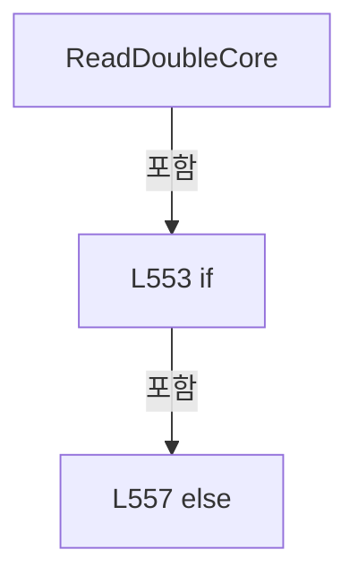

변경 전 점검: 입력/반환 타입, 위 호출자, 예외/취소 경로, 공유 상태와 저장·전송 소비자를 함께 확인합니다. 값의 단위나 물리 방향을 이름만으로 확정하지 않습니다.

### MethodDeclaration `WriteDoubleCore` · L566–580

[Drilling.Common/Interface/Melsec/CMelsec.cs:566–580](https://github.com/kjuws10-rgb/A3Drilling/blob/28764c91d521777b8ee068dd7aaf2d3902ce9fe2/Drilling.Common/Interface/Melsec/CMelsec.cs#L566-L580)

| 항목 | 실제 추출 값 |
| --- | --- |
| 서명 | void Drilling.Common.Interface.CMelsec.WriteDoubleCore(string, double, System.Threading.CancellationToken) |
| 접근/수식자 | Private / private |
| 반환/값 타입 | void |
| 소속 타입 | NamedType:Drilling.Common.Interface.CMelsec |

입력 계약:

| 이름 | 타입 | 전달 | 선택/기본값 |
| --- | --- | --- | --- |
| id | string | None | False /  |
| value | double | None | False /  |
| cancellationToken | System.Threading.CancellationToken | None | False /  |

정적 호출자로 확인된 위치:

| 호출 파일/행 | 호출 표현식 | 런타임 분기 가능 |
| --- | --- | --- |
| [Drilling.Common/Interface/Melsec/CMelsec.cs:691–691](https://github.com/kjuws10-rgb/A3Drilling/blob/28764c91d521777b8ee068dd7aaf2d3902ce9fe2/Drilling.Common/Interface/Melsec/CMelsec.cs#L691-L691) | WriteDoubleCore | False |
| [Drilling.Common/Interface/Melsec/CMelsec.cs:1466–1466](https://github.com/kjuws10-rgb/A3Drilling/blob/28764c91d521777b8ee068dd7aaf2d3902ce9fe2/Drilling.Common/Interface/Melsec/CMelsec.cs#L1466-L1466) | WriteDoubleCore | False |

호출하는 대상과 해석 범위:

| 원본 행 | 표현식 | 분석 상태 | 대상/소스 위치 |
| --- | --- | --- | --- |
| 568 | PrepareWrite | resolved | Drilling.Common.Interface.ST_MELSEC_MAP_DATA Drilling.Common.Interface.CMelsec.PrepareWrite(string, System.Collections.Generic.IReadOnlyList<Drilling.Common.Interface.EN_MELSEC_DATA_TYPE>, System.Threading.CancellationToken) · Drilling.Common/Interface/Melsec/CMelsec.cs:1958 |
| 569 | ValidateMapData | resolved | void Drilling.Common.Interface.CMelsec.ValidateMapData(Drilling.Common.Interface.ST_MELSEC_MAP_DATA) · Drilling.Common/Interface/Melsec/CMelsec.cs:245 |
| 573 | double.IsFinite | resolved | bool double.IsFinite(double) |
| 573 | Math.Abs | resolved | double System.Math.Abs(double) |
| 575 | new ArgumentOutOfRangeException | resolved | System.ArgumentOutOfRangeException.ArgumentOutOfRangeException(string?, string?) |
| 575 | nameof | unresolved | None |
| 578 | FloatToWords | resolved | ushort[] Drilling.Common.Interface.CMelsec.FloatToWords(float, int) · Drilling.Common/Interface/Melsec/CMelsec.cs:2120 |
| 578 | Int32ToWords | resolved | ushort[] Drilling.Common.Interface.CMelsec.Int32ToWords(int, int) · Drilling.Common/Interface/Melsec/CMelsec.cs:2100 |
| 578 | Math.Round | resolved | double System.Math.Round(double, System.MidpointRounding) |
| 579 | WriteWords | resolved | void Drilling.Common.Interface.CMelsec.WriteWords(Drilling.Common.Interface.ST_MELSEC_MAP_DATA, Drilling.Common.Interface.CMelsec.ST_MELSEC_ADDRESS, System.Collections.Generic.IReadOnlyList<ushort>, System.Threading.CancellationToken, string) · Drilling.Common/Interface/Melsec/CMelsec.cs:1764 |
| 579 | ParseAddress | resolved | Drilling.Common.Interface.CMelsec.ST_MELSEC_ADDRESS Drilling.Common.Interface.CMelsec.ParseAddress(string) · Drilling.Common/Interface/Melsec/CMelsec.cs:1981 |

본문의 실제 연산·분기·예외·반환 순서(원문 위치 순):

| 원본 행 | 종류 | 주석 해설 |
| --- | --- | --- |
| 568 | call | 함수·델리게이트 또는 객체 생성자를 호출합니다: PrepareWrite(id, [EN_MELSEC_DATA_TYPE.Double, EN_MELSEC_DATA_TYPE.Float], cancellationToken) |
| 568 | local-declaration | 지역 변수를 선언합니다: ST_MELSEC_MAP_DATA data = PrepareWrite(id, [EN_MELSEC_DATA_TYPE.Double, EN_MELSEC_DATA_TYPE.Float], cancellationToken); |
| 568 | variable-initializer | 변수의 초기값을 지정합니다: data = PrepareWrite(id, [EN_MELSEC_DATA_TYPE.Double, EN_MELSEC_DATA_TYPE.Float], cancellationToken) |
| 569 | call | 함수·델리게이트 또는 객체 생성자를 호출합니다: ValidateMapData(data) |
| 571 | local-declaration | 지역 변수를 선언합니다: int wordCount = 2; |
| 571 | variable-initializer | 변수의 초기값을 지정합니다: wordCount = 2 |
| 572 | local-declaration | 지역 변수를 선언합니다: double rawValue = value * data.WriteScale; |
| 572 | variable-initializer | 변수의 초기값을 지정합니다: rawValue = value * data.WriteScale |
| 573 | call | 함수·델리게이트 또는 객체 생성자를 호출합니다: double.IsFinite(rawValue) |
| 573 | call | 함수·델리게이트 또는 객체 생성자를 호출합니다: Math.Abs(rawValue) |
| 573 | if | 조건에 따라 분기합니다: if (!double.IsFinite(rawValue) &#124;&#124; (data.DataType == EN_MELSEC_DATA_TYPE.Float && Math.Abs(rawValue) > float.MaxValue)) |
| 575 | call | 함수·델리게이트 또는 객체 생성자를 호출합니다: new ArgumentOutOfRangeException(nameof(value), "Scaled MELSEC value must fit the configured numeric type.") |
| 575 | call | 함수·델리게이트 또는 객체 생성자를 호출합니다: nameof(value) |
| 575 | throw | 예외를 발생/전달합니다: throw new ArgumentOutOfRangeException(nameof(value), "Scaled MELSEC value must fit the configured numeric type."); |
| 578 | call | 함수·델리게이트 또는 객체 생성자를 호출합니다: FloatToWords((float)rawValue, wordCount) |
| 578 | call | 함수·델리게이트 또는 객체 생성자를 호출합니다: Int32ToWords(checked((int)Math.Round(rawValue, MidpointRounding.AwayFromZero)), wordCount) |
| 578 | call | 함수·델리게이트 또는 객체 생성자를 호출합니다: Math.Round(rawValue, MidpointRounding.AwayFromZero) |
| 578 | conditional-expression | 조건에 따라 결과식을 선택합니다: data.DataType == EN_MELSEC_DATA_TYPE.Float ? FloatToWords((float)rawValue, wordCount) : Int32ToWords(checked((int)Math.Round(rawValue, MidpointRounding.AwayFromZero)), wordCount) |
| 578 | local-declaration | 지역 변수를 선언합니다: ushort[] words = data.DataType == EN_MELSEC_DATA_TYPE.Float ? FloatToWords((float)rawValue, wordCount) : Int32ToWords(checked((int)Math.Round(rawValue, MidpointRounding.AwayFromZero)), wordCount); |
| 578 | variable-initializer | 변수의 초기값을 지정합니다: words = data.DataType == EN_MELSEC_DATA_TYPE.Float ? FloatToWords((float)rawValue, wordCount) : Int32ToWords(checked((int)Math.Round(rawValue, MidpointRounding.AwayFromZero)), wordCount) |
| 579 | call | 함수·델리게이트 또는 객체 생성자를 호출합니다: WriteWords(data, ParseAddress(data.Address), words, cancellationToken) |
| 579 | call | 함수·델리게이트 또는 객체 생성자를 호출합니다: ParseAddress(data.Address) |

제어 구문의 포함 구조(실제 실행 순서/CFG가 아닌 구문 탐색 그림):

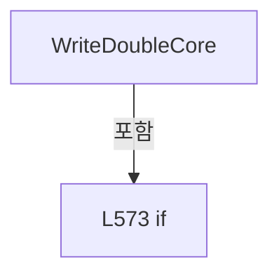

변경 전 점검: 입력/반환 타입, 위 호출자, 예외/취소 경로, 공유 상태와 저장·전송 소비자를 함께 확인합니다. 값의 단위나 물리 방향을 이름만으로 확정하지 않습니다.

### MethodDeclaration `ReadStringCore` · L582–596

[Drilling.Common/Interface/Melsec/CMelsec.cs:582–596](https://github.com/kjuws10-rgb/A3Drilling/blob/28764c91d521777b8ee068dd7aaf2d3902ce9fe2/Drilling.Common/Interface/Melsec/CMelsec.cs#L582-L596)

| 항목 | 실제 추출 값 |
| --- | --- |
| 서명 | string Drilling.Common.Interface.CMelsec.ReadStringCore(string, System.Threading.CancellationToken, bool, string) |
| 접근/수식자 | Private / private |
| 반환/값 타입 | string |
| 소속 타입 | NamedType:Drilling.Common.Interface.CMelsec |

입력 계약:

| 이름 | 타입 | 전달 | 선택/기본값 |
| --- | --- | --- | --- |
| id | string | None | False /  |
| cancellationToken | System.Threading.CancellationToken | None | False /  |
| suppressLog | bool | None | True / false |
| logSource | string | None | True / "DIRECT" |

정적 호출자로 확인된 위치:

| 호출 파일/행 | 호출 표현식 | 런타임 분기 가능 |
| --- | --- | --- |
| [Drilling.Common/Interface/Melsec/CMelsec.cs:700–700](https://github.com/kjuws10-rgb/A3Drilling/blob/28764c91d521777b8ee068dd7aaf2d3902ce9fe2/Drilling.Common/Interface/Melsec/CMelsec.cs#L700-L700) | ReadStringCore | False |
| [Drilling.Common/Interface/Melsec/CMelsec.cs:874–874](https://github.com/kjuws10-rgb/A3Drilling/blob/28764c91d521777b8ee068dd7aaf2d3902ce9fe2/Drilling.Common/Interface/Melsec/CMelsec.cs#L874-L874) | ReadStringCore | False |
| [Drilling.Common/Interface/Melsec/CMelsec.cs:1487–1487](https://github.com/kjuws10-rgb/A3Drilling/blob/28764c91d521777b8ee068dd7aaf2d3902ce9fe2/Drilling.Common/Interface/Melsec/CMelsec.cs#L1487-L1487) | ReadStringCore | False |

호출하는 대상과 해석 범위:

| 원본 행 | 표현식 | 분석 상태 | 대상/소스 위치 |
| --- | --- | --- | --- |
| 584 | PrepareRead | resolved | Drilling.Common.Interface.ST_MELSEC_MAP_DATA Drilling.Common.Interface.CMelsec.PrepareRead(string, Drilling.Common.Interface.EN_MELSEC_DATA_TYPE, System.Threading.CancellationToken) · Drilling.Common/Interface/Melsec/CMelsec.cs:1935 |
| 585 | ReadWords | resolved | ushort[] Drilling.Common.Interface.CMelsec.ReadWords(Drilling.Common.Interface.ST_MELSEC_MAP_DATA, Drilling.Common.Interface.CMelsec.ST_MELSEC_ADDRESS, int, System.Threading.CancellationToken, bool, string) · Drilling.Common/Interface/Melsec/CMelsec.cs:1652 |
| 585 | ParseAddress | resolved | Drilling.Common.Interface.CMelsec.ST_MELSEC_ADDRESS Drilling.Common.Interface.CMelsec.ParseAddress(string) · Drilling.Common/Interface/Melsec/CMelsec.cs:1981 |
| 593 | Encoding.ASCII.GetString(bytes).TrimEnd | resolved | string string.TrimEnd(params System.ReadOnlySpan<char>) |
| 593 | Encoding.ASCII.GetString | resolved · 동적 구현 선택 가능 | string System.Text.Encoding.GetString(byte[]) |
| 594 | SaveReadSnapshot | resolved | void Drilling.Common.Interface.CMelsec.SaveReadSnapshot(string, object) · Drilling.Common/Interface/Melsec/CMelsec.cs:1597 |

본문의 실제 연산·분기·예외·반환 순서(원문 위치 순):

| 원본 행 | 종류 | 주석 해설 |
| --- | --- | --- |
| 584 | call | 함수·델리게이트 또는 객체 생성자를 호출합니다: PrepareRead(id, EN_MELSEC_DATA_TYPE.String, cancellationToken) |
| 584 | local-declaration | 지역 변수를 선언합니다: ST_MELSEC_MAP_DATA data = PrepareRead(id, EN_MELSEC_DATA_TYPE.String, cancellationToken); |
| 584 | variable-initializer | 변수의 초기값을 지정합니다: data = PrepareRead(id, EN_MELSEC_DATA_TYPE.String, cancellationToken) |
| 585 | call | 함수·델리게이트 또는 객체 생성자를 호출합니다: ReadWords(data, ParseAddress(data.Address), data.Length, cancellationToken, suppressLog, logSource) |
| 585 | call | 함수·델리게이트 또는 객체 생성자를 호출합니다: ParseAddress(data.Address) |
| 585 | local-declaration | 지역 변수를 선언합니다: ushort[] words = ReadWords(data, ParseAddress(data.Address), data.Length, cancellationToken, suppressLog, logSource); |
| 585 | variable-initializer | 변수의 초기값을 지정합니다: words = ReadWords(data, ParseAddress(data.Address), data.Length, cancellationToken, suppressLog, logSource) |
| 586 | local-declaration | 지역 변수를 선언합니다: byte[] bytes = new byte[words.Length * 2]; |
| 586 | variable-initializer | 변수의 초기값을 지정합니다: bytes = new byte[words.Length * 2] |
| 587 | variable-initializer | 변수의 초기값을 지정합니다: index = 0 |
| 587 | for | 초기화·조건·증감이 있는 반복입니다: for (int index = 0; index < words.Length; index++) |
| 589 | assignment | 값을 대상에 대입합니다: bytes[index * 2] = (byte)(words[index] & 0xFF) |
| 590 | assignment | 값을 대상에 대입합니다: bytes[index * 2 + 1] = (byte)(words[index] >> 8) |
| 593 | call | 함수·델리게이트 또는 객체 생성자를 호출합니다: Encoding.ASCII.GetString(bytes).TrimEnd('\0', ' ') |
| 593 | call | 함수·델리게이트 또는 객체 생성자를 호출합니다: Encoding.ASCII.GetString(bytes) |
| 593 | local-declaration | 지역 변수를 선언합니다: string value = Encoding.ASCII.GetString(bytes).TrimEnd('\0', ' '); |
| 593 | variable-initializer | 변수의 초기값을 지정합니다: value = Encoding.ASCII.GetString(bytes).TrimEnd('\0', ' ') |
| 594 | call | 함수·델리게이트 또는 객체 생성자를 호출합니다: SaveReadSnapshot(data.Id, value) |
| 595 | return | 호출자에게 값 또는 제어를 반환합니다: return value; |

제어 구문의 포함 구조(실제 실행 순서/CFG가 아닌 구문 탐색 그림):

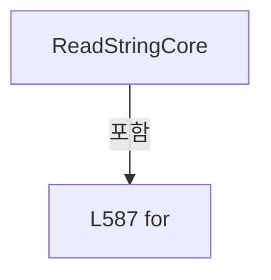

변경 전 점검: 입력/반환 타입, 위 호출자, 예외/취소 경로, 공유 상태와 저장·전송 소비자를 함께 확인합니다. 값의 단위나 물리 방향을 이름만으로 확정하지 않습니다.

### MethodDeclaration `WriteStringCore` · L598–612

[Drilling.Common/Interface/Melsec/CMelsec.cs:598–612](https://github.com/kjuws10-rgb/A3Drilling/blob/28764c91d521777b8ee068dd7aaf2d3902ce9fe2/Drilling.Common/Interface/Melsec/CMelsec.cs#L598-L612)

| 항목 | 실제 추출 값 |
| --- | --- |
| 서명 | void Drilling.Common.Interface.CMelsec.WriteStringCore(string, string, System.Threading.CancellationToken) |
| 접근/수식자 | Private / private |
| 반환/값 타입 | void |
| 소속 타입 | NamedType:Drilling.Common.Interface.CMelsec |

입력 계약:

| 이름 | 타입 | 전달 | 선택/기본값 |
| --- | --- | --- | --- |
| id | string | None | False /  |
| value | string | None | False /  |
| cancellationToken | System.Threading.CancellationToken | None | False /  |

정적 호출자로 확인된 위치:

| 호출 파일/행 | 호출 표현식 | 런타임 분기 가능 |
| --- | --- | --- |
| [Drilling.Common/Interface/Melsec/CMelsec.cs:703–703](https://github.com/kjuws10-rgb/A3Drilling/blob/28764c91d521777b8ee068dd7aaf2d3902ce9fe2/Drilling.Common/Interface/Melsec/CMelsec.cs#L703-L703) | WriteStringCore | False |
| [Drilling.Common/Interface/Melsec/CMelsec.cs:1469–1469](https://github.com/kjuws10-rgb/A3Drilling/blob/28764c91d521777b8ee068dd7aaf2d3902ce9fe2/Drilling.Common/Interface/Melsec/CMelsec.cs#L1469-L1469) | WriteStringCore | False |

호출하는 대상과 해석 범위:

| 원본 행 | 표현식 | 분석 상태 | 대상/소스 위치 |
| --- | --- | --- | --- |
| 600 | PrepareWrite | resolved | Drilling.Common.Interface.ST_MELSEC_MAP_DATA Drilling.Common.Interface.CMelsec.PrepareWrite(string, Drilling.Common.Interface.EN_MELSEC_DATA_TYPE, System.Threading.CancellationToken) · Drilling.Common/Interface/Melsec/CMelsec.cs:1953 |
| 602 | Encoding.ASCII.GetBytes | resolved · 동적 구현 선택 가능 | byte[] System.Text.Encoding.GetBytes(string) |
| 603 | Enumerable.Repeat((byte)' ', byteLength).ToArray | resolved | byte[] System.Collections.Generic.IEnumerable<byte>.ToArray<byte>() |
| 603 | Enumerable.Repeat | resolved | System.Collections.Generic.IEnumerable<byte> System.Linq.Enumerable.Repeat<byte>(byte, int) |
| 604 | Array.Copy | resolved | void System.Array.Copy(System.Array, System.Array, int) |
| 604 | Math.Min | resolved | int System.Math.Min(int, int) |
| 611 | WriteWords | resolved | void Drilling.Common.Interface.CMelsec.WriteWords(Drilling.Common.Interface.ST_MELSEC_MAP_DATA, Drilling.Common.Interface.CMelsec.ST_MELSEC_ADDRESS, System.Collections.Generic.IReadOnlyList<ushort>, System.Threading.CancellationToken, string) · Drilling.Common/Interface/Melsec/CMelsec.cs:1764 |
| 611 | ParseAddress | resolved | Drilling.Common.Interface.CMelsec.ST_MELSEC_ADDRESS Drilling.Common.Interface.CMelsec.ParseAddress(string) · Drilling.Common/Interface/Melsec/CMelsec.cs:1981 |

본문의 실제 연산·분기·예외·반환 순서(원문 위치 순):

| 원본 행 | 종류 | 주석 해설 |
| --- | --- | --- |
| 600 | call | 함수·델리게이트 또는 객체 생성자를 호출합니다: PrepareWrite(id, EN_MELSEC_DATA_TYPE.String, cancellationToken) |
| 600 | local-declaration | 지역 변수를 선언합니다: ST_MELSEC_MAP_DATA data = PrepareWrite(id, EN_MELSEC_DATA_TYPE.String, cancellationToken); |
| 600 | variable-initializer | 변수의 초기값을 지정합니다: data = PrepareWrite(id, EN_MELSEC_DATA_TYPE.String, cancellationToken) |
| 601 | local-declaration | 지역 변수를 선언합니다: int byteLength = data.Length * 2; |
| 601 | variable-initializer | 변수의 초기값을 지정합니다: byteLength = data.Length * 2 |
| 602 | call | 함수·델리게이트 또는 객체 생성자를 호출합니다: Encoding.ASCII.GetBytes(value) |
| 602 | local-declaration | 지역 변수를 선언합니다: byte[] sourceBytes = Encoding.ASCII.GetBytes(value); |
| 602 | variable-initializer | 변수의 초기값을 지정합니다: sourceBytes = Encoding.ASCII.GetBytes(value) |
| 603 | call | 함수·델리게이트 또는 객체 생성자를 호출합니다: Enumerable.Repeat((byte)' ', byteLength).ToArray() |
| 603 | call | 함수·델리게이트 또는 객체 생성자를 호출합니다: Enumerable.Repeat((byte)' ', byteLength) |
| 603 | local-declaration | 지역 변수를 선언합니다: byte[] bytes = Enumerable.Repeat((byte)' ', byteLength).ToArray(); |
| 603 | variable-initializer | 변수의 초기값을 지정합니다: bytes = Enumerable.Repeat((byte)' ', byteLength).ToArray() |
| 604 | call | 함수·델리게이트 또는 객체 생성자를 호출합니다: Array.Copy(sourceBytes, bytes, Math.Min(sourceBytes.Length, bytes.Length)) |
| 604 | call | 함수·델리게이트 또는 객체 생성자를 호출합니다: Math.Min(sourceBytes.Length, bytes.Length) |
| 605 | local-declaration | 지역 변수를 선언합니다: ushort[] words = new ushort[data.Length]; |
| 605 | variable-initializer | 변수의 초기값을 지정합니다: words = new ushort[data.Length] |
| 606 | variable-initializer | 변수의 초기값을 지정합니다: index = 0 |
| 606 | for | 초기화·조건·증감이 있는 반복입니다: for (int index = 0; index < words.Length; index++) |
| 608 | assignment | 값을 대상에 대입합니다: words[index] = (ushort)(bytes[index * 2] &#124; (bytes[index * 2 + 1] << 8)) |
| 611 | call | 함수·델리게이트 또는 객체 생성자를 호출합니다: WriteWords(data, ParseAddress(data.Address), words, cancellationToken) |
| 611 | call | 함수·델리게이트 또는 객체 생성자를 호출합니다: ParseAddress(data.Address) |

제어 구문의 포함 구조(실제 실행 순서/CFG가 아닌 구문 탐색 그림):

```mermaid
flowchart TD
 M["WriteStringCore"]
 N0["L606 for"]
 M -->|포함| N0
```

변경 전 점검: 입력/반환 타입, 위 호출자, 예외/취소 경로, 공유 상태와 저장·전송 소비자를 함께 확인합니다. 값의 단위나 물리 방향을 이름만으로 확정하지 않습니다.

### MethodDeclaration `ExecuteThreadRequest` · L614–643

[Drilling.Common/Interface/Melsec/CMelsec.cs:614–643](https://github.com/kjuws10-rgb/A3Drilling/blob/28764c91d521777b8ee068dd7aaf2d3902ce9fe2/Drilling.Common/Interface/Melsec/CMelsec.cs#L614-L643)

| 항목 | 실제 추출 값 |
| --- | --- |
| 서명 | void Drilling.Common.Interface.CMelsec.ExecuteThreadRequest(Drilling.Common.Interface.CMelsec.CMelsecThreadRequest) |
| 접근/수식자 | Private / private |
| 반환/값 타입 | void |
| 소속 타입 | NamedType:Drilling.Common.Interface.CMelsec |

입력 계약:

| 이름 | 타입 | 전달 | 선택/기본값 |
| --- | --- | --- | --- |
| request | Drilling.Common.Interface.CMelsec.CMelsecThreadRequest | None | False /  |

정적 호출자로 확인된 위치:

| 호출 파일/행 | 호출 표현식 | 런타임 분기 가능 |
| --- | --- | --- |
| [Drilling.Common/Interface/Melsec/CMelsec.cs:334–334](https://github.com/kjuws10-rgb/A3Drilling/blob/28764c91d521777b8ee068dd7aaf2d3902ce9fe2/Drilling.Common/Interface/Melsec/CMelsec.cs#L334-L334) | ExecuteThreadRequest | False |
| [Drilling.Common/Interface/Melsec/CMelsec.cs:341–341](https://github.com/kjuws10-rgb/A3Drilling/blob/28764c91d521777b8ee068dd7aaf2d3902ce9fe2/Drilling.Common/Interface/Melsec/CMelsec.cs#L341-L341) | ExecuteThreadRequest | False |
| [Drilling.Common/Interface/Melsec/CMelsec.cs:348–348](https://github.com/kjuws10-rgb/A3Drilling/blob/28764c91d521777b8ee068dd7aaf2d3902ce9fe2/Drilling.Common/Interface/Melsec/CMelsec.cs#L348-L348) | ExecuteThreadRequest | False |
| [Drilling.Common/Interface/Melsec/CMelsec.cs:354–354](https://github.com/kjuws10-rgb/A3Drilling/blob/28764c91d521777b8ee068dd7aaf2d3902ce9fe2/Drilling.Common/Interface/Melsec/CMelsec.cs#L354-L354) | ExecuteThreadRequest | False |
| [Drilling.Common/Interface/Melsec/CMelsec.cs:360–360](https://github.com/kjuws10-rgb/A3Drilling/blob/28764c91d521777b8ee068dd7aaf2d3902ce9fe2/Drilling.Common/Interface/Melsec/CMelsec.cs#L360-L360) | ExecuteThreadRequest | False |
| [Drilling.Common/Interface/Melsec/CMelsec.cs:367–367](https://github.com/kjuws10-rgb/A3Drilling/blob/28764c91d521777b8ee068dd7aaf2d3902ce9fe2/Drilling.Common/Interface/Melsec/CMelsec.cs#L367-L367) | ExecuteThreadRequest | False |
| [Drilling.Common/Interface/Melsec/CMelsec.cs:374–374](https://github.com/kjuws10-rgb/A3Drilling/blob/28764c91d521777b8ee068dd7aaf2d3902ce9fe2/Drilling.Common/Interface/Melsec/CMelsec.cs#L374-L374) | ExecuteThreadRequest | False |
| [Drilling.Common/Interface/Melsec/CMelsec.cs:380–380](https://github.com/kjuws10-rgb/A3Drilling/blob/28764c91d521777b8ee068dd7aaf2d3902ce9fe2/Drilling.Common/Interface/Melsec/CMelsec.cs#L380-L380) | ExecuteThreadRequest | False |
| [Drilling.Common/Interface/Melsec/CMelsec.cs:387–387](https://github.com/kjuws10-rgb/A3Drilling/blob/28764c91d521777b8ee068dd7aaf2d3902ce9fe2/Drilling.Common/Interface/Melsec/CMelsec.cs#L387-L387) | ExecuteThreadRequest | False |
| [Drilling.Common/Interface/Melsec/CMelsec.cs:394–394](https://github.com/kjuws10-rgb/A3Drilling/blob/28764c91d521777b8ee068dd7aaf2d3902ce9fe2/Drilling.Common/Interface/Melsec/CMelsec.cs#L394-L394) | ExecuteThreadRequest | False |
| [Drilling.Common/Interface/Melsec/CMelsec.cs:400–400](https://github.com/kjuws10-rgb/A3Drilling/blob/28764c91d521777b8ee068dd7aaf2d3902ce9fe2/Drilling.Common/Interface/Melsec/CMelsec.cs#L400-L400) | ExecuteThreadRequest | False |
| [Drilling.Common/Interface/Melsec/CMelsec.cs:407–407](https://github.com/kjuws10-rgb/A3Drilling/blob/28764c91d521777b8ee068dd7aaf2d3902ce9fe2/Drilling.Common/Interface/Melsec/CMelsec.cs#L407-L407) | ExecuteThreadRequest | False |
| [Drilling.Common/Interface/Melsec/CMelsec.cs:414–414](https://github.com/kjuws10-rgb/A3Drilling/blob/28764c91d521777b8ee068dd7aaf2d3902ce9fe2/Drilling.Common/Interface/Melsec/CMelsec.cs#L414-L414) | ExecuteThreadRequest | False |
| [Drilling.Common/Interface/Melsec/CMelsec.cs:2385–2385](https://github.com/kjuws10-rgb/A3Drilling/blob/28764c91d521777b8ee068dd7aaf2d3902ce9fe2/Drilling.Common/Interface/Melsec/CMelsec.cs#L2385-L2385) | ExecuteThreadRequest | False |
| [Drilling.Common/Interface/Melsec/CMelsec.cs:2460–2460](https://github.com/kjuws10-rgb/A3Drilling/blob/28764c91d521777b8ee068dd7aaf2d3902ce9fe2/Drilling.Common/Interface/Melsec/CMelsec.cs#L2460-L2460) | ExecuteThreadRequest | False |
| [Drilling.Common/Interface/Melsec/CMelsec.cs:2466–2466](https://github.com/kjuws10-rgb/A3Drilling/blob/28764c91d521777b8ee068dd7aaf2d3902ce9fe2/Drilling.Common/Interface/Melsec/CMelsec.cs#L2466-L2466) | ExecuteThreadRequest | False |

호출하는 대상과 해석 범위:

| 원본 행 | 표현식 | 분석 상태 | 대상/소스 위치 |
| --- | --- | --- | --- |
| 617 | request.CancellationToken.ThrowIfCancellationRequested | resolved | void System.Threading.CancellationToken.ThrowIfCancellationRequested() |
| 622 | new InvalidOperationException | resolved | System.InvalidOperationException.InvalidOperationException(string?) |
| 625 | Stopwatch.GetTimestamp | resolved | long System.Diagnostics.Stopwatch.GetTimestamp() |
| 626 | _requestQueue.Enqueue | resolved | void System.Collections.Generic.Queue<Drilling.Common.Interface.CMelsec.CMelsecThreadRequest>.Enqueue(Drilling.Common.Interface.CMelsec.CMelsecThreadRequest) |
| 629 | Initialize | resolved | void Drilling.Common.Interface.CMelsec.Initialize() · Drilling.Common/Interface/Melsec/CMelsec.cs:141 |
| 630 | request.Completed.WaitOne | resolved · 동적 구현 선택 가능 | bool System.Threading.WaitHandle.WaitOne(int) |
| 632 | request.CancellationToken.ThrowIfCancellationRequested | resolved | void System.Threading.CancellationToken.ThrowIfCancellationRequested() |
| 635 | new InvalidOperationException | resolved | System.InvalidOperationException.InvalidOperationException(string?) |
| 641 | ExceptionDispatchInfo.Capture(request.Error).Throw | resolved | void System.Runtime.ExceptionServices.ExceptionDispatchInfo.Throw() |
| 641 | ExceptionDispatchInfo.Capture | resolved | System.Runtime.ExceptionServices.ExceptionDispatchInfo System.Runtime.ExceptionServices.ExceptionDispatchInfo.Capture(System.Exception) |

본문의 실제 연산·분기·예외·반환 순서(원문 위치 순):

| 원본 행 | 종류 | 주석 해설 |
| --- | --- | --- |
| 617 | call | 함수·델리게이트 또는 객체 생성자를 호출합니다: request.CancellationToken.ThrowIfCancellationRequested() |
| 618 | lock | 공유 상태의 임계 구역에 진입합니다: lock (_requestLock) |
| 620 | if | 조건에 따라 분기합니다: if (!_acceptRequests) |
| 622 | call | 함수·델리게이트 또는 객체 생성자를 호출합니다: new InvalidOperationException("MELSEC control is not accepting requests.") |
| 622 | throw | 예외를 발생/전달합니다: throw new InvalidOperationException("MELSEC control is not accepting requests."); |
| 625 | assignment | 값을 대상에 대입합니다: request.QueuedTimestamp = Stopwatch.GetTimestamp() |
| 625 | call | 함수·델리게이트 또는 객체 생성자를 호출합니다: Stopwatch.GetTimestamp() |
| 626 | call | 함수·델리게이트 또는 객체 생성자를 호출합니다: _requestQueue.Enqueue(request) |
| 629 | call | 함수·델리게이트 또는 객체 생성자를 호출합니다: Initialize() |
| 630 | call | 함수·델리게이트 또는 객체 생성자를 호출합니다: request.Completed.WaitOne(20) |
| 630 | while | 조건을 먼저 확인하며 반복합니다: while (!request.Completed.WaitOne(20)) |
| 632 | call | 함수·델리게이트 또는 객체 생성자를 호출합니다: request.CancellationToken.ThrowIfCancellationRequested() |
| 633 | if | 조건에 따라 분기합니다: if (!IsRunning) |
| 635 | call | 함수·델리게이트 또는 객체 생성자를 호출합니다: new InvalidOperationException("MELSEC control thread stopped before request completion: " + request.Id) |
| 635 | throw | 예외를 발생/전달합니다: throw new InvalidOperationException("MELSEC control thread stopped before request completion: " + request.Id); |
| 639 | if | 조건에 따라 분기합니다: if (request.Error != null) |
| 641 | call | 함수·델리게이트 또는 객체 생성자를 호출합니다: ExceptionDispatchInfo.Capture(request.Error).Throw() |
| 641 | call | 함수·델리게이트 또는 객체 생성자를 호출합니다: ExceptionDispatchInfo.Capture(request.Error) |

제어 구문의 포함 구조(실제 실행 순서/CFG가 아닌 구문 탐색 그림):

```mermaid
flowchart TD
 M["ExecuteThreadRequest"]
 N0["L618 lock"]
 M -->|포함| N0
 N1["L620 if"]
 N0 -->|포함| N1
 N2["L630 while"]
 M -->|포함| N2
 N3["L633 if"]
 N2 -->|포함| N3
 N4["L639 if"]
 M -->|포함| N4
```

변경 전 점검: 입력/반환 타입, 위 호출자, 예외/취소 경로, 공유 상태와 저장·전송 소비자를 함께 확인합니다. 값의 단위나 물리 방향을 이름만으로 확정하지 않습니다.

### MethodDeclaration `GetThreadRequest` · L645–656

[Drilling.Common/Interface/Melsec/CMelsec.cs:645–656](https://github.com/kjuws10-rgb/A3Drilling/blob/28764c91d521777b8ee068dd7aaf2d3902ce9fe2/Drilling.Common/Interface/Melsec/CMelsec.cs#L645-L656)

| 항목 | 실제 추출 값 |
| --- | --- |
| 서명 | Drilling.Common.Interface.CMelsec.CMelsecThreadRequest? Drilling.Common.Interface.CMelsec.GetThreadRequest() |
| 접근/수식자 | Private / private |
| 반환/값 타입 | Drilling.Common.Interface.CMelsec.CMelsecThreadRequest? |
| 소속 타입 | NamedType:Drilling.Common.Interface.CMelsec |

정적 호출자로 확인된 위치:

| 호출 파일/행 | 호출 표현식 | 런타임 분기 가능 |
| --- | --- | --- |
| [Drilling.Common/Interface/Melsec/CMelsec.cs:209–209](https://github.com/kjuws10-rgb/A3Drilling/blob/28764c91d521777b8ee068dd7aaf2d3902ce9fe2/Drilling.Common/Interface/Melsec/CMelsec.cs#L209-L209) | GetThreadRequest | False |

호출하는 대상과 해석 범위:

| 원본 행 | 표현식 | 분석 상태 | 대상/소스 위치 |
| --- | --- | --- | --- |
| 654 | _requestQueue.Dequeue | resolved | Drilling.Common.Interface.CMelsec.CMelsecThreadRequest System.Collections.Generic.Queue<Drilling.Common.Interface.CMelsec.CMelsecThreadRequest>.Dequeue() |

본문의 실제 연산·분기·예외·반환 순서(원문 위치 순):

| 원본 행 | 종류 | 주석 해설 |
| --- | --- | --- |
| 647 | lock | 공유 상태의 임계 구역에 진입합니다: lock (_requestLock) |
| 649 | if | 조건에 따라 분기합니다: if (_requestQueue.Count == 0) |
| 651 | return | 호출자에게 값 또는 제어를 반환합니다: return null; |
| 654 | call | 함수·델리게이트 또는 객체 생성자를 호출합니다: _requestQueue.Dequeue() |
| 654 | return | 호출자에게 값 또는 제어를 반환합니다: return _requestQueue.Dequeue(); |

제어 구문의 포함 구조(실제 실행 순서/CFG가 아닌 구문 탐색 그림):

```mermaid
flowchart TD
 M["GetThreadRequest"]
 N0["L647 lock"]
 M -->|포함| N0
 N1["L649 if"]
 N0 -->|포함| N1
```

변경 전 점검: 입력/반환 타입, 위 호출자, 예외/취소 경로, 공유 상태와 저장·전송 소비자를 함께 확인합니다. 값의 단위나 물리 방향을 이름만으로 확정하지 않습니다.

### MethodDeclaration `ProcessThreadRequest` · L658–715

[Drilling.Common/Interface/Melsec/CMelsec.cs:658–715](https://github.com/kjuws10-rgb/A3Drilling/blob/28764c91d521777b8ee068dd7aaf2d3902ce9fe2/Drilling.Common/Interface/Melsec/CMelsec.cs#L658-L715)

| 항목 | 실제 추출 값 |
| --- | --- |
| 서명 | void Drilling.Common.Interface.CMelsec.ProcessThreadRequest(Drilling.Common.Interface.CMelsec.CMelsecThreadRequest) |
| 접근/수식자 | Private / private |
| 반환/값 타입 | void |
| 소속 타입 | NamedType:Drilling.Common.Interface.CMelsec |

입력 계약:

| 이름 | 타입 | 전달 | 선택/기본값 |
| --- | --- | --- | --- |
| request | Drilling.Common.Interface.CMelsec.CMelsecThreadRequest | None | False /  |

정적 호출자로 확인된 위치:

| 호출 파일/행 | 호출 표현식 | 런타임 분기 가능 |
| --- | --- | --- |
| [Drilling.Common/Interface/Melsec/CMelsec.cs:212–212](https://github.com/kjuws10-rgb/A3Drilling/blob/28764c91d521777b8ee068dd7aaf2d3902ce9fe2/Drilling.Common/Interface/Melsec/CMelsec.cs#L212-L212) | ProcessThreadRequest | False |

호출하는 대상과 해석 범위:

| 원본 행 | 표현식 | 분석 상태 | 대상/소스 위치 |
| --- | --- | --- | --- |
| 660 | RecordMelsecTiming | resolved | void Drilling.Common.Interface.CMelsec.RecordMelsecTiming(string, double, string) · Drilling.Common/Interface/Melsec/CMelsec.InterfaceLog.cs:19 |
| 660 | Stopwatch.GetElapsedTime | resolved | System.TimeSpan System.Diagnostics.Stopwatch.GetElapsedTime(long) |
| 663 | request.CancellationToken.ThrowIfCancellationRequested | resolved | void System.Threading.CancellationToken.ThrowIfCancellationRequested() |
| 667 | OpenCore | resolved | void Drilling.Common.Interface.CMelsec.OpenCore(int, System.Threading.CancellationToken) · Drilling.Common/Interface/Melsec/CMelsec.cs:717 |
| 671 | CloseDeviceCore | resolved | void Drilling.Common.Interface.CMelsec.CloseDeviceCore(int) · Drilling.Common/Interface/Melsec/CMelsec.cs:2390 |
| 673 | CloseMelsecNetChannelsCore | resolved | void Drilling.Common.Interface.CMelsec.CloseMelsecNetChannelsCore() · Drilling.Common/Interface/Melsec/CMelsec.cs:796 |
| 676 | ReadBitCore | resolved | bool Drilling.Common.Interface.CMelsec.ReadBitCore(string, System.Threading.CancellationToken, bool, string) · Drilling.Common/Interface/Melsec/CMelsec.cs:487 |
| 679 | WriteBitCore | resolved | void Drilling.Common.Interface.CMelsec.WriteBitCore(string, bool, System.Threading.CancellationToken) · Drilling.Common/Interface/Melsec/CMelsec.cs:498 |
| 682 | ReadWordCore | resolved | double Drilling.Common.Interface.CMelsec.ReadWordCore(string, System.Threading.CancellationToken, bool, string) · Drilling.Common/Interface/Melsec/CMelsec.cs:517 |
| 685 | WriteWordCore | resolved | void Drilling.Common.Interface.CMelsec.WriteWordCore(string, double, System.Threading.CancellationToken) · Drilling.Common/Interface/Melsec/CMelsec.cs:528 |
| 688 | ReadDoubleCore | resolved | double Drilling.Common.Interface.CMelsec.ReadDoubleCore(string, System.Threading.CancellationToken, bool, string) · Drilling.Common/Interface/Melsec/CMelsec.cs:545 |
| 691 | WriteDoubleCore | resolved | void Drilling.Common.Interface.CMelsec.WriteDoubleCore(string, double, System.Threading.CancellationToken) · Drilling.Common/Interface/Melsec/CMelsec.cs:566 |
| 694 | WriteDoubleArrayCore | resolved | void Drilling.Common.Interface.CMelsec.WriteDoubleArrayCore(string, double[], System.Threading.CancellationToken) · Drilling.Common/Interface/Melsec/CMelsec.cs:2470 |
| 697 | ReadDoubleArrayCore | resolved | double[] Drilling.Common.Interface.CMelsec.ReadDoubleArrayCore(string, int, System.Threading.CancellationToken) · Drilling.Common/Interface/Melsec/CMelsec.cs:2502 |
| 700 | ReadStringCore | resolved | string Drilling.Common.Interface.CMelsec.ReadStringCore(string, System.Threading.CancellationToken, bool, string) · Drilling.Common/Interface/Melsec/CMelsec.cs:582 |
| 703 | WriteStringCore | resolved | void Drilling.Common.Interface.CMelsec.WriteStringCore(string, string, System.Threading.CancellationToken) · Drilling.Common/Interface/Melsec/CMelsec.cs:598 |
| 713 | request.Completed.Set | resolved | bool System.Threading.EventWaitHandle.Set() |

본문의 실제 연산·분기·예외·반환 순서(원문 위치 순):

| 원본 행 | 종류 | 주석 해설 |
| --- | --- | --- |
| 660 | call | 함수·델리게이트 또는 객체 생성자를 호출합니다: RecordMelsecTiming("REQUEST_QUEUE", Stopwatch.GetElapsedTime(request.QueuedTimestamp).TotalMilliseconds, request.Id) |
| 660 | call | 함수·델리게이트 또는 객체 생성자를 호출합니다: Stopwatch.GetElapsedTime(request.QueuedTimestamp) |
| 661 | try | 예외 처리 범위입니다: try |
| 663 | call | 함수·델리게이트 또는 객체 생성자를 호출합니다: request.CancellationToken.ThrowIfCancellationRequested() |
| 664 | switch | 값에 따라 분기합니다: switch (request.Command) |
| 666 | case | 분기값/패턴의 구간입니다: case EN_MELSEC_THREAD_COMMAND.Open: |
| 667 | call | 함수·델리게이트 또는 객체 생성자를 호출합니다: OpenCore((int)request.Value!, request.CancellationToken) |
| 668 | break | 해당 반복/분기 구간을 종료합니다: break; |
| 669 | case | 분기값/패턴의 구간입니다: case EN_MELSEC_THREAD_COMMAND.Close: |
| 670 | if | 조건에 따라 분기합니다: if (request.Value is int deviceNo) |
| 671 | call | 함수·델리게이트 또는 객체 생성자를 호출합니다: CloseDeviceCore(deviceNo) |
| 672 | else | 앞 조건이 거짓인 경로입니다: else |
| 673 | call | 함수·델리게이트 또는 객체 생성자를 호출합니다: CloseMelsecNetChannelsCore() |
| 674 | break | 해당 반복/분기 구간을 종료합니다: break; |
| 675 | case | 분기값/패턴의 구간입니다: case EN_MELSEC_THREAD_COMMAND.ReadBit: |
| 676 | assignment | 값을 대상에 대입합니다: request.Result = ReadBitCore(request.Id, request.CancellationToken, request.SuppressLog) |
| 676 | call | 함수·델리게이트 또는 객체 생성자를 호출합니다: ReadBitCore(request.Id, request.CancellationToken, request.SuppressLog) |
| 677 | break | 해당 반복/분기 구간을 종료합니다: break; |
| 678 | case | 분기값/패턴의 구간입니다: case EN_MELSEC_THREAD_COMMAND.WriteBit: |
| 679 | call | 함수·델리게이트 또는 객체 생성자를 호출합니다: WriteBitCore(request.Id, (bool)request.Value!, request.CancellationToken) |
| 680 | break | 해당 반복/분기 구간을 종료합니다: break; |
| 681 | case | 분기값/패턴의 구간입니다: case EN_MELSEC_THREAD_COMMAND.ReadWord: |
| 682 | assignment | 값을 대상에 대입합니다: request.Result = ReadWordCore(request.Id, request.CancellationToken, request.SuppressLog) |
| 682 | call | 함수·델리게이트 또는 객체 생성자를 호출합니다: ReadWordCore(request.Id, request.CancellationToken, request.SuppressLog) |
| 683 | break | 해당 반복/분기 구간을 종료합니다: break; |
| 684 | case | 분기값/패턴의 구간입니다: case EN_MELSEC_THREAD_COMMAND.WriteWord: |
| 685 | call | 함수·델리게이트 또는 객체 생성자를 호출합니다: WriteWordCore(request.Id, (double)request.Value!, request.CancellationToken) |
| 686 | break | 해당 반복/분기 구간을 종료합니다: break; |
| 687 | case | 분기값/패턴의 구간입니다: case EN_MELSEC_THREAD_COMMAND.ReadDouble: |
| 688 | assignment | 값을 대상에 대입합니다: request.Result = ReadDoubleCore(request.Id, request.CancellationToken, request.SuppressLog) |
| 688 | call | 함수·델리게이트 또는 객체 생성자를 호출합니다: ReadDoubleCore(request.Id, request.CancellationToken, request.SuppressLog) |
| 689 | break | 해당 반복/분기 구간을 종료합니다: break; |
| 690 | case | 분기값/패턴의 구간입니다: case EN_MELSEC_THREAD_COMMAND.WriteDouble: |
| 691 | call | 함수·델리게이트 또는 객체 생성자를 호출합니다: WriteDoubleCore(request.Id, (double)request.Value!, request.CancellationToken) |
| 692 | break | 해당 반복/분기 구간을 종료합니다: break; |
| 693 | case | 분기값/패턴의 구간입니다: case EN_MELSEC_THREAD_COMMAND.WriteDoubleArray: |
| 694 | call | 함수·델리게이트 또는 객체 생성자를 호출합니다: WriteDoubleArrayCore(request.Id, (double[])request.Value!, request.CancellationToken) |
| 695 | break | 해당 반복/분기 구간을 종료합니다: break; |
| 696 | case | 분기값/패턴의 구간입니다: case EN_MELSEC_THREAD_COMMAND.ReadDoubleArray: |
| 697 | assignment | 값을 대상에 대입합니다: request.Result = ReadDoubleArrayCore(request.Id, (int)request.Value!, request.CancellationToken) |
| 697 | call | 함수·델리게이트 또는 객체 생성자를 호출합니다: ReadDoubleArrayCore(request.Id, (int)request.Value!, request.CancellationToken) |
| 698 | break | 해당 반복/분기 구간을 종료합니다: break; |
| 699 | case | 분기값/패턴의 구간입니다: case EN_MELSEC_THREAD_COMMAND.ReadString: |
| 700 | assignment | 값을 대상에 대입합니다: request.Result = ReadStringCore(request.Id, request.CancellationToken, request.SuppressLog) |
| 700 | call | 함수·델리게이트 또는 객체 생성자를 호출합니다: ReadStringCore(request.Id, request.CancellationToken, request.SuppressLog) |
| 701 | break | 해당 반복/분기 구간을 종료합니다: break; |
| 702 | case | 분기값/패턴의 구간입니다: case EN_MELSEC_THREAD_COMMAND.WriteString: |
| 703 | call | 함수·델리게이트 또는 객체 생성자를 호출합니다: WriteStringCore(request.Id, (string)request.Value!, request.CancellationToken) |
| 704 | break | 해당 반복/분기 구간을 종료합니다: break; |
| 707 | catch | 지정 예외를 처리합니다: catch (Exception exception) |
| 709 | assignment | 값을 대상에 대입합니다: request.Error = exception |
| 711 | finally | 종료 정리 구간입니다: finally |
| 713 | call | 함수·델리게이트 또는 객체 생성자를 호출합니다: request.Completed.Set() |

제어 구문의 포함 구조(실제 실행 순서/CFG가 아닌 구문 탐색 그림):

```mermaid
flowchart TD
 M["ProcessThreadRequest"]
 N0["L661 try"]
 M -->|포함| N0
 N1["L664 switch"]
 N0 -->|포함| N1
 N2["L670 if"]
 N1 -->|포함| N2
 N3["L672 else"]
 N2 -->|포함| N3
 N4["L707 catch"]
 N0 -->|포함| N4
 N5["L711 finally"]
 N0 -->|포함| N5
```

변경 전 점검: 입력/반환 타입, 위 호출자, 예외/취소 경로, 공유 상태와 저장·전송 소비자를 함께 확인합니다. 값의 단위나 물리 방향을 이름만으로 확정하지 않습니다.

### MethodDeclaration `OpenCore` · L717–769

[Drilling.Common/Interface/Melsec/CMelsec.cs:717–769](https://github.com/kjuws10-rgb/A3Drilling/blob/28764c91d521777b8ee068dd7aaf2d3902ce9fe2/Drilling.Common/Interface/Melsec/CMelsec.cs#L717-L769)

| 항목 | 실제 추출 값 |
| --- | --- |
| 서명 | void Drilling.Common.Interface.CMelsec.OpenCore(int, System.Threading.CancellationToken) |
| 접근/수식자 | Private / private |
| 반환/값 타입 | void |
| 소속 타입 | NamedType:Drilling.Common.Interface.CMelsec |

입력 계약:

| 이름 | 타입 | 전달 | 선택/기본값 |
| --- | --- | --- | --- |
| deviceNo | int | None | False /  |
| cancellationToken | System.Threading.CancellationToken | None | False /  |

정적 호출자로 확인된 위치:

| 호출 파일/행 | 호출 표현식 | 런타임 분기 가능 |
| --- | --- | --- |
| [Drilling.Common/Interface/Melsec/CMelsec.cs:667–667](https://github.com/kjuws10-rgb/A3Drilling/blob/28764c91d521777b8ee068dd7aaf2d3902ce9fe2/Drilling.Common/Interface/Melsec/CMelsec.cs#L667-L667) | OpenCore | False |

호출하는 대상과 해석 범위:

| 원본 행 | 표현식 | 분석 상태 | 대상/소스 위치 |
| --- | --- | --- | --- |
| 719 | _interfaceManager.GetInterfaceData | resolved | Drilling.Common.Interface.ST_INTERFACE_DATA? Drilling.Common.Interface.CInterfaceManager.GetInterfaceData(Drilling.Common.Interface.EN_EQP_MODULE, int) · Drilling.Common/Interface/CInterfaceManager.cs:348 |
| 719 | new InvalidOperationException | resolved | System.InvalidOperationException.InvalidOperationException(string?) |
| 719 | deviceNo.ToString | resolved | string int.ToString(System.IFormatProvider?) |
| 720 | IsSimulation | resolved | bool Drilling.Common.Interface.CMelsec.IsSimulation(Drilling.Common.Interface.ST_INTERFACE_DATA) · Drilling.Common/Interface/Melsec/CMelsec.cs:1845 |
| 722 | cancellationToken.ThrowIfCancellationRequested | resolved | void System.Threading.CancellationToken.ThrowIfCancellationRequested() |
| 723 | RegisterCommunicationSuccess | resolved | void Drilling.Common.Interface.CMelsec.RegisterCommunicationSuccess() · Drilling.Common/Interface/Melsec/CMelsec.cs:1644 |
| 724 | RestartPollingDevice | resolved | void Drilling.Common.Interface.CMelsec.RestartPollingDevice(int) · Drilling.Common/Interface/Melsec/CMelsec.cs:2763 |
| 726 | Map.Where | resolved | System.Collections.Generic.IEnumerable<Drilling.Common.Interface.ST_MELSEC_MAP_DATA> System.Collections.Generic.IEnumerable<Drilling.Common.Interface.ST_MELSEC_MAP_DATA>.Where<Drilling.Common.Interface.ST_MELSEC_MAP_DATA>(System.Func<Drilling.Common.Interface.ST_MELSEC_MAP_DATA, bool>) |
| 726 | IsSimulationOnlyRoute | resolved | bool Drilling.Common.Interface.CMelsec.IsSimulationOnlyRoute(Drilling.Common.Interface.ST_MELSEC_MAP_DATA) · Drilling.Common/Interface/Melsec/CMelsec.cs:3054 |
| 727 | PublishSimulationInput | resolved | void Drilling.Common.Interface.CMelsec.PublishSimulationInput(Drilling.Common.Interface.ST_MELSEC_MAP_DATA) · Drilling.Common/Interface/Melsec/CMelsec.cs:3082 |
| 731 | ReadMelsecNetOption | resolved | Drilling.Common.Interface.CMelsec.ST_MELSEC_NET_OPTION Drilling.Common.Interface.CMelsec.ReadMelsecNetOption(Drilling.Common.Interface.ST_INTERFACE_DATA) · Drilling.Common/Interface/Melsec/CMelsec.cs:2133 |
| 734 | _melsecNetPaths.ContainsKey | resolved | bool System.Collections.Generic.Dictionary<int, int>.ContainsKey(int) |
| 736 | cancellationToken.ThrowIfCancellationRequested | resolved | void System.Threading.CancellationToken.ThrowIfCancellationRequested() |
| 741 | _melsecNetApi.Open | resolved · 동적 구현 선택 가능 | int Drilling.Common.Interface.CMelsecNetApi.Open(short, out int) · Drilling.Common/Interface/Melsec/CMelsec.cs:3280 |
| 743 | IsMelsecNetRuntimeException | resolved | bool Drilling.Common.Interface.CMelsec.IsMelsecNetRuntimeException(System.Exception) · Drilling.Common/Interface/Melsec/CMelsec.cs:1925 |
| 745 | CreateMelsecNetRuntimeException | resolved | System.InvalidOperationException Drilling.Common.Interface.CMelsec.CreateMelsecNetRuntimeException(string, System.Exception) · Drilling.Common/Interface/Melsec/CMelsec.cs:1930 |
| 750 | CreateMelsecNetReturnCodeException | resolved | System.IO.IOException Drilling.Common.Interface.CMelsec.CreateMelsecNetReturnCodeException(string, int, Drilling.Common.Interface.ST_INTERFACE_DATA, Drilling.Common.Interface.CMelsec.ST_MELSEC_NET_OPTION, int, int) · Drilling.Common/Interface/Melsec/CMelsec.cs:1919 |
| 754 | WriteMelsecNetOpenLog | resolved | void Drilling.Common.Interface.CMelsec.WriteMelsecNetOpenLog(Drilling.Common.Interface.ST_INTERFACE_DATA, Drilling.Common.Interface.CMelsec.ST_MELSEC_NET_OPTION, int) · Drilling.Common/Interface/Melsec/CMelsec.cs:1897 |
| 760 | ProbeDeviceRead | resolved | void Drilling.Common.Interface.CMelsec.ProbeDeviceRead(int, System.Threading.CancellationToken) · Drilling.Common/Interface/Melsec/CMelsec.cs:849 |
| 761 | RegisterCommunicationSuccess | resolved | void Drilling.Common.Interface.CMelsec.RegisterCommunicationSuccess() · Drilling.Common/Interface/Melsec/CMelsec.cs:1644 |
| 762 | RestartPollingDevice | resolved | void Drilling.Common.Interface.CMelsec.RestartPollingDevice(int) · Drilling.Common/Interface/Melsec/CMelsec.cs:2763 |
| 766 | CloseMelsecNetChannelCore | resolved | void Drilling.Common.Interface.CMelsec.CloseMelsecNetChannelCore(int, Drilling.Common.Interface.ST_INTERFACE_DATA, Drilling.Common.Interface.CMelsec.ST_MELSEC_NET_OPTION) · Drilling.Common/Interface/Melsec/CMelsec.cs:818 |

본문의 실제 연산·분기·예외·반환 순서(원문 위치 순):

| 원본 행 | 종류 | 주석 해설 |
| --- | --- | --- |
| 719 | call | 함수·델리게이트 또는 객체 생성자를 호출합니다: _interfaceManager.GetInterfaceData(EN_EQP_MODULE.Melsec, deviceNo) |
| 719 | call | 함수·델리게이트 또는 객체 생성자를 호출합니다: new InvalidOperationException("MELSEC interface is not configured: MELSEC_" + deviceNo.ToString(CultureInfo.InvariantCulture)) |
| 719 | call | 함수·델리게이트 또는 객체 생성자를 호출합니다: deviceNo.ToString(CultureInfo.InvariantCulture) |
| 719 | local-declaration | 지역 변수를 선언합니다: ST_INTERFACE_DATA interfaceData = _interfaceManager.GetInterfaceData(EN_EQP_MODULE.Melsec, deviceNo) ?? throw new InvalidOperationException("MELSEC interface is not configured: MELSEC_" + deviceNo.ToString(CultureInfo.InvariantCul |
| 719 | throw | 예외를 발생/전달합니다: throw new InvalidOperationException("MELSEC interface is not configured: MELSEC_" + deviceNo.ToString(CultureInfo.InvariantCulture)) |
| 719 | variable-initializer | 변수의 초기값을 지정합니다: interfaceData = _interfaceManager.GetInterfaceData(EN_EQP_MODULE.Melsec, deviceNo) ?? throw new InvalidOperationException("MELSEC interface is not configured: MELSEC_" + deviceNo.ToString(CultureInfo.InvariantCulture)) |
| 720 | call | 함수·델리게이트 또는 객체 생성자를 호출합니다: IsSimulation(interfaceData) |
| 720 | if | 조건에 따라 분기합니다: if (IsSimulation(interfaceData)) |
| 722 | call | 함수·델리게이트 또는 객체 생성자를 호출합니다: cancellationToken.ThrowIfCancellationRequested() |
| 723 | call | 함수·델리게이트 또는 객체 생성자를 호출합니다: RegisterCommunicationSuccess() |
| 724 | call | 함수·델리게이트 또는 객체 생성자를 호출합니다: RestartPollingDevice(deviceNo) |
| 725 | lock | 공유 상태의 임계 구역에 진입합니다: lock (_pollLock) |
| 726 | call | 함수·델리게이트 또는 객체 생성자를 호출합니다: Map.Where(row => row.DeviceNo == deviceNo && IsSimulationOnlyRoute(row)) |
| 726 | call | 함수·델리게이트 또는 객체 생성자를 호출합니다: IsSimulationOnlyRoute(row) |
| 726 | foreach | 컬렉션 요소를 순회합니다: foreach (var row in Map.Where(row => row.DeviceNo == deviceNo && IsSimulationOnlyRoute(row))) |
| 727 | call | 함수·델리게이트 또는 객체 생성자를 호출합니다: PublishSimulationInput(row) |
| 728 | return | 호출자에게 값 또는 제어를 반환합니다: return; |
| 731 | call | 함수·델리게이트 또는 객체 생성자를 호출합니다: ReadMelsecNetOption(interfaceData) |
| 731 | local-declaration | 지역 변수를 선언합니다: ST_MELSEC_NET_OPTION option = ReadMelsecNetOption(interfaceData); |
| 731 | variable-initializer | 변수의 초기값을 지정합니다: option = ReadMelsecNetOption(interfaceData) |
| 732 | lock | 공유 상태의 임계 구역에 진입합니다: lock (_ioLock) |
| 734 | call | 함수·델리게이트 또는 객체 생성자를 호출합니다: _melsecNetPaths.ContainsKey(deviceNo) |
| 734 | if | 조건에 따라 분기합니다: if (!_melsecNetPaths.ContainsKey(deviceNo)) |
| 736 | call | 함수·델리게이트 또는 객체 생성자를 호출합니다: cancellationToken.ThrowIfCancellationRequested() |
| 737 | local-declaration | 지역 변수를 선언합니다: int path; |
| 738 | local-declaration | 지역 변수를 선언합니다: int returnCode; |
| 739 | try | 예외 처리 범위입니다: try |
| 741 | assignment | 값을 대상에 대입합니다: returnCode = _melsecNetApi.Open(option.ChannelNo, out path) |
| 741 | call | 함수·델리게이트 또는 객체 생성자를 호출합니다: _melsecNetApi.Open(option.ChannelNo, out path) |
| 743 | call | 함수·델리게이트 또는 객체 생성자를 호출합니다: IsMelsecNetRuntimeException(exception) |
| 743 | catch | 지정 예외를 처리합니다: catch (Exception exception) when (IsMelsecNetRuntimeException(exception)) |
| 745 | call | 함수·델리게이트 또는 객체 생성자를 호출합니다: CreateMelsecNetRuntimeException("mdOpen", exception) |
| 745 | throw | 예외를 발생/전달합니다: throw CreateMelsecNetRuntimeException("mdOpen", exception); |
| 748 | if | 조건에 따라 분기합니다: if (returnCode != 0) |
| 750 | call | 함수·델리게이트 또는 객체 생성자를 호출합니다: CreateMelsecNetReturnCodeException("mdOpen", returnCode, interfaceData, option, 0, 0) |
| 750 | throw | 예외를 발생/전달합니다: throw CreateMelsecNetReturnCodeException("mdOpen", returnCode, interfaceData, option, 0, 0); |
| 753 | assignment | 값을 대상에 대입합니다: _melsecNetPaths[deviceNo] = path |
| 754 | call | 함수·델리게이트 또는 객체 생성자를 호출합니다: WriteMelsecNetOpenLog(interfaceData, option, path) |
| 758 | try | 예외 처리 범위입니다: try |
| 760 | call | 함수·델리게이트 또는 객체 생성자를 호출합니다: ProbeDeviceRead(deviceNo, cancellationToken) |
| 761 | call | 함수·델리게이트 또는 객체 생성자를 호출합니다: RegisterCommunicationSuccess() |
| 762 | call | 함수·델리게이트 또는 객체 생성자를 호출합니다: RestartPollingDevice(deviceNo) |
| 764 | catch | 지정 예외를 처리합니다: catch  |
| 766 | call | 함수·델리게이트 또는 객체 생성자를 호출합니다: CloseMelsecNetChannelCore(deviceNo, interfaceData, option) |
| 767 | throw | 예외를 발생/전달합니다: throw; |

제어 구문의 포함 구조(실제 실행 순서/CFG가 아닌 구문 탐색 그림):

```mermaid
flowchart TD
 M["OpenCore"]
 N0["L720 if"]
 M -->|포함| N0
 N1["L725 lock"]
 N0 -->|포함| N1
 N2["L726 foreach"]
 N1 -->|포함| N2
 N3["L732 lock"]
 M -->|포함| N3
 N4["L734 if"]
 N3 -->|포함| N4
 N5["L739 try"]
 N4 -->|포함| N5
 N6["L743 catch"]
 N5 -->|포함| N6
 N7["L748 if"]
 N4 -->|포함| N7
 N8["L758 try"]
 M -->|포함| N8
 N9["L764 catch"]
 N8 -->|포함| N9
```

변경 전 점검: 입력/반환 타입, 위 호출자, 예외/취소 경로, 공유 상태와 저장·전송 소비자를 함께 확인합니다. 값의 단위나 물리 방향을 이름만으로 확정하지 않습니다.

### MethodDeclaration `CloseMelsecNetChannels` · L771–794

[Drilling.Common/Interface/Melsec/CMelsec.cs:771–794](https://github.com/kjuws10-rgb/A3Drilling/blob/28764c91d521777b8ee068dd7aaf2d3902ce9fe2/Drilling.Common/Interface/Melsec/CMelsec.cs#L771-L794)

| 항목 | 실제 추출 값 |
| --- | --- |
| 서명 | void Drilling.Common.Interface.CMelsec.CloseMelsecNetChannels() |
| 접근/수식자 | Private / private |
| 반환/값 타입 | void |
| 소속 타입 | NamedType:Drilling.Common.Interface.CMelsec |

정적 호출자로 확인된 위치:

| 호출 파일/행 | 호출 표현식 | 런타임 분기 가능 |
| --- | --- | --- |
| [Drilling.Common/Interface/Melsec/CMelsec.cs:167–167](https://github.com/kjuws10-rgb/A3Drilling/blob/28764c91d521777b8ee068dd7aaf2d3902ce9fe2/Drilling.Common/Interface/Melsec/CMelsec.cs#L167-L167) | CloseMelsecNetChannels | False |

호출하는 대상과 해석 범위:

| 원본 행 | 표현식 | 분석 상태 | 대상/소스 위치 |
| --- | --- | --- | --- |
| 778 | new CMelsecThreadRequest | resolved | Drilling.Common.Interface.CMelsec.CMelsecThreadRequest.CMelsecThreadRequest(Drilling.Common.Interface.CMelsec.EN_MELSEC_THREAD_COMMAND, string, object?, System.Threading.CancellationToken, bool) · Drilling.Common/Interface/Melsec/CMelsec.cs:2274 |
| 781 | _requestQueue.Enqueue | resolved | void System.Collections.Generic.Queue<Drilling.Common.Interface.CMelsec.CMelsecThreadRequest>.Enqueue(Drilling.Common.Interface.CMelsec.CMelsecThreadRequest) |
| 784 | request.Completed.WaitOne | resolved · 동적 구현 선택 가능 | bool System.Threading.WaitHandle.WaitOne(int) |
| 786 | .WriteInterfaceError | unresolved | None |
| 792 | .WriteInterfaceError | unresolved | None |

본문의 실제 연산·분기·예외·반환 순서(원문 위치 순):

| 원본 행 | 종류 | 주석 해설 |
| --- | --- | --- |
| 773 | if | 조건에 따라 분기합니다: if (!IsRunning) |
| 775 | return | 호출자에게 값 또는 제어를 반환합니다: return; |
| 778 | call | 함수·델리게이트 또는 객체 생성자를 호출합니다: new CMelsecThreadRequest(EN_MELSEC_THREAD_COMMAND.Close, "", null, CancellationToken.None) |
| 778 | local-declaration | 지역 변수를 선언합니다: CMelsecThreadRequest request = new CMelsecThreadRequest(EN_MELSEC_THREAD_COMMAND.Close, "", null, CancellationToken.None); |
| 778 | variable-initializer | 변수의 초기값을 지정합니다: request = new CMelsecThreadRequest(EN_MELSEC_THREAD_COMMAND.Close, "", null, CancellationToken.None) |
| 779 | lock | 공유 상태의 임계 구역에 진입합니다: lock (_requestLock) |
| 781 | call | 함수·델리게이트 또는 객체 생성자를 호출합니다: _requestQueue.Enqueue(request) |
| 784 | call | 함수·델리게이트 또는 객체 생성자를 호출합니다: request.Completed.WaitOne(3000) |
| 784 | if | 조건에 따라 분기합니다: if (!request.Completed.WaitOne(3000)) |
| 786 | call | 함수·델리게이트 또는 객체 생성자를 호출합니다: .WriteInterfaceError(EN_EQP_MODULE.Melsec, "MELSEC_CONTROL", "[I/F][COMM_ERROR] mdClose", "MELSECNET close request did not complete within 3000 ms.") |
| 787 | return | 호출자에게 값 또는 제어를 반환합니다: return; |
| 790 | if | 조건에 따라 분기합니다: if (request.Error != null) |
| 792 | call | 함수·델리게이트 또는 객체 생성자를 호출합니다: .WriteInterfaceError(EN_EQP_MODULE.Melsec, "MELSEC_CONTROL", "[I/F][COMM_ERROR] mdClose", request.Error.Message) |

제어 구문의 포함 구조(실제 실행 순서/CFG가 아닌 구문 탐색 그림):

```mermaid
flowchart TD
 M["CloseMelsecNetChannels"]
 N0["L773 if"]
 M -->|포함| N0
 N1["L779 lock"]
 M -->|포함| N1
 N2["L784 if"]
 M -->|포함| N2
 N3["L790 if"]
 M -->|포함| N3
```

변경 전 점검: 입력/반환 타입, 위 호출자, 예외/취소 경로, 공유 상태와 저장·전송 소비자를 함께 확인합니다. 값의 단위나 물리 방향을 이름만으로 확정하지 않습니다.

### MethodDeclaration `CloseMelsecNetChannelsCore` · L796–816

[Drilling.Common/Interface/Melsec/CMelsec.cs:796–816](https://github.com/kjuws10-rgb/A3Drilling/blob/28764c91d521777b8ee068dd7aaf2d3902ce9fe2/Drilling.Common/Interface/Melsec/CMelsec.cs#L796-L816)

| 항목 | 실제 추출 값 |
| --- | --- |
| 서명 | void Drilling.Common.Interface.CMelsec.CloseMelsecNetChannelsCore() |
| 접근/수식자 | Private / private |
| 반환/값 타입 | void |
| 소속 타입 | NamedType:Drilling.Common.Interface.CMelsec |

정적 호출자로 확인된 위치:

| 호출 파일/행 | 호출 표현식 | 런타임 분기 가능 |
| --- | --- | --- |
| [Drilling.Common/Interface/Melsec/CMelsec.cs:673–673](https://github.com/kjuws10-rgb/A3Drilling/blob/28764c91d521777b8ee068dd7aaf2d3902ce9fe2/Drilling.Common/Interface/Melsec/CMelsec.cs#L673-L673) | CloseMelsecNetChannelsCore | False |

호출하는 대상과 해석 범위:

| 원본 행 | 표현식 | 분석 상태 | 대상/소스 위치 |
| --- | --- | --- | --- |
| 801 | _melsecNetPaths.ToArray | resolved | System.Collections.Generic.KeyValuePair<int, int>[] System.Collections.Generic.IEnumerable<System.Collections.Generic.KeyValuePair<int, int>>.ToArray<System.Collections.Generic.KeyValuePair<int, int>>() |
| 807 | _interfaceManager.GetInterfaceData | resolved | Drilling.Common.Interface.ST_INTERFACE_DATA? Drilling.Common.Interface.CInterfaceManager.GetInterfaceData(Drilling.Common.Interface.EN_EQP_MODULE, int) · Drilling.Common/Interface/CInterfaceManager.cs:348 |
| 813 | ReadMelsecNetOption | resolved | Drilling.Common.Interface.CMelsec.ST_MELSEC_NET_OPTION Drilling.Common.Interface.CMelsec.ReadMelsecNetOption(Drilling.Common.Interface.ST_INTERFACE_DATA) · Drilling.Common/Interface/Melsec/CMelsec.cs:2133 |
| 814 | CloseMelsecNetChannelCore | resolved | void Drilling.Common.Interface.CMelsec.CloseMelsecNetChannelCore(int, Drilling.Common.Interface.ST_INTERFACE_DATA, Drilling.Common.Interface.CMelsec.ST_MELSEC_NET_OPTION) · Drilling.Common/Interface/Melsec/CMelsec.cs:818 |

본문의 실제 연산·분기·예외·반환 순서(원문 위치 순):

| 원본 행 | 종류 | 주석 해설 |
| --- | --- | --- |
| 798 | local-declaration | 지역 변수를 선언합니다: KeyValuePair<int, int>[] paths; |
| 799 | lock | 공유 상태의 임계 구역에 진입합니다: lock (_ioLock) |
| 801 | assignment | 값을 대상에 대입합니다: paths = _melsecNetPaths.ToArray() |
| 801 | call | 함수·델리게이트 또는 객체 생성자를 호출합니다: _melsecNetPaths.ToArray() |
| 804 | variable-initializer | 변수의 초기값을 지정합니다: index = 0 |
| 804 | for | 초기화·조건·증감이 있는 반복입니다: for (int index = 0; index < paths.Length; index++) |
| 806 | local-declaration | 지역 변수를 선언합니다: int deviceNo = paths[index].Key; |
| 806 | variable-initializer | 변수의 초기값을 지정합니다: deviceNo = paths[index].Key |
| 807 | call | 함수·델리게이트 또는 객체 생성자를 호출합니다: _interfaceManager.GetInterfaceData(EN_EQP_MODULE.Melsec, deviceNo) |
| 807 | local-declaration | 지역 변수를 선언합니다: ST_INTERFACE_DATA? interfaceData = _interfaceManager.GetInterfaceData(EN_EQP_MODULE.Melsec, deviceNo); |
| 807 | variable-initializer | 변수의 초기값을 지정합니다: interfaceData = _interfaceManager.GetInterfaceData(EN_EQP_MODULE.Melsec, deviceNo) |
| 808 | if | 조건에 따라 분기합니다: if (interfaceData == null) |
| 810 | continue | 다음 반복으로 진행합니다: continue; |
| 813 | call | 함수·델리게이트 또는 객체 생성자를 호출합니다: ReadMelsecNetOption(interfaceData) |
| 813 | local-declaration | 지역 변수를 선언합니다: ST_MELSEC_NET_OPTION option = ReadMelsecNetOption(interfaceData); |
| 813 | variable-initializer | 변수의 초기값을 지정합니다: option = ReadMelsecNetOption(interfaceData) |
| 814 | call | 함수·델리게이트 또는 객체 생성자를 호출합니다: CloseMelsecNetChannelCore(deviceNo, interfaceData, option) |

제어 구문의 포함 구조(실제 실행 순서/CFG가 아닌 구문 탐색 그림):

```mermaid
flowchart TD
 M["CloseMelsecNetChannelsCore"]
 N0["L799 lock"]
 M -->|포함| N0
 N1["L804 for"]
 M -->|포함| N1
 N2["L808 if"]
 N1 -->|포함| N2
```

변경 전 점검: 입력/반환 타입, 위 호출자, 예외/취소 경로, 공유 상태와 저장·전송 소비자를 함께 확인합니다. 값의 단위나 물리 방향을 이름만으로 확정하지 않습니다.

### MethodDeclaration `CloseMelsecNetChannelCore` · L818–847

[Drilling.Common/Interface/Melsec/CMelsec.cs:818–847](https://github.com/kjuws10-rgb/A3Drilling/blob/28764c91d521777b8ee068dd7aaf2d3902ce9fe2/Drilling.Common/Interface/Melsec/CMelsec.cs#L818-L847)

| 항목 | 실제 추출 값 |
| --- | --- |
| 서명 | void Drilling.Common.Interface.CMelsec.CloseMelsecNetChannelCore(int, Drilling.Common.Interface.ST_INTERFACE_DATA, Drilling.Common.Interface.CMelsec.ST_MELSEC_NET_OPTION) |
| 접근/수식자 | Private / private |
| 반환/값 타입 | void |
| 소속 타입 | NamedType:Drilling.Common.Interface.CMelsec |

입력 계약:

| 이름 | 타입 | 전달 | 선택/기본값 |
| --- | --- | --- | --- |
| deviceNo | int | None | False /  |
| interfaceData | Drilling.Common.Interface.ST_INTERFACE_DATA | None | False /  |
| option | Drilling.Common.Interface.CMelsec.ST_MELSEC_NET_OPTION | None | False /  |

정적 호출자로 확인된 위치:

| 호출 파일/행 | 호출 표현식 | 런타임 분기 가능 |
| --- | --- | --- |
| [Drilling.Common/Interface/Melsec/CMelsec.cs:766–766](https://github.com/kjuws10-rgb/A3Drilling/blob/28764c91d521777b8ee068dd7aaf2d3902ce9fe2/Drilling.Common/Interface/Melsec/CMelsec.cs#L766-L766) | CloseMelsecNetChannelCore | False |
| [Drilling.Common/Interface/Melsec/CMelsec.cs:814–814](https://github.com/kjuws10-rgb/A3Drilling/blob/28764c91d521777b8ee068dd7aaf2d3902ce9fe2/Drilling.Common/Interface/Melsec/CMelsec.cs#L814-L814) | CloseMelsecNetChannelCore | False |
| [Drilling.Common/Interface/Melsec/CMelsec.cs:2397–2397](https://github.com/kjuws10-rgb/A3Drilling/blob/28764c91d521777b8ee068dd7aaf2d3902ce9fe2/Drilling.Common/Interface/Melsec/CMelsec.cs#L2397-L2397) | CloseMelsecNetChannelCore | False |

호출하는 대상과 해석 범위:

| 원본 행 | 표현식 | 분석 상태 | 대상/소스 위치 |
| --- | --- | --- | --- |
| 823 | _melsecNetPaths.TryGetValue | resolved | bool System.Collections.Generic.Dictionary<int, int>.TryGetValue(int, out int) |
| 828 | _melsecNetPaths.Remove | resolved | bool System.Collections.Generic.Dictionary<int, int>.Remove(int) |
| 834 | _melsecNetApi.Close | resolved · 동적 구현 선택 가능 | int Drilling.Common.Interface.CMelsecNetApi.Close(int) · Drilling.Common/Interface/Melsec/CMelsec.cs:3285 |
| 836 | IsMelsecNetRuntimeException | resolved | bool Drilling.Common.Interface.CMelsec.IsMelsecNetRuntimeException(System.Exception) · Drilling.Common/Interface/Melsec/CMelsec.cs:1925 |
| 838 | CreateMelsecNetRuntimeException | resolved | System.InvalidOperationException Drilling.Common.Interface.CMelsec.CreateMelsecNetRuntimeException(string, System.Exception) · Drilling.Common/Interface/Melsec/CMelsec.cs:1930 |
| 843 | CreateMelsecNetReturnCodeException | resolved | System.IO.IOException Drilling.Common.Interface.CMelsec.CreateMelsecNetReturnCodeException(string, int, Drilling.Common.Interface.ST_INTERFACE_DATA, Drilling.Common.Interface.CMelsec.ST_MELSEC_NET_OPTION, int, int) · Drilling.Common/Interface/Melsec/CMelsec.cs:1919 |
| 846 | .WriteInterfaceCommand | unresolved | None |
| 846 | FormatMelsecNetContext | resolved | string Drilling.Common.Interface.CMelsec.FormatMelsecNetContext(Drilling.Common.Interface.CMelsec.ST_MELSEC_NET_OPTION, int, int, int) · Drilling.Common/Interface/Melsec/CMelsec.cs:1902 |

본문의 실제 연산·분기·예외·반환 순서(원문 위치 순):

| 원본 행 | 종류 | 주석 해설 |
| --- | --- | --- |
| 820 | local-declaration | 지역 변수를 선언합니다: int path; |
| 821 | lock | 공유 상태의 임계 구역에 진입합니다: lock (_ioLock) |
| 823 | call | 함수·델리게이트 또는 객체 생성자를 호출합니다: _melsecNetPaths.TryGetValue(deviceNo, out path) |
| 823 | if | 조건에 따라 분기합니다: if (!_melsecNetPaths.TryGetValue(deviceNo, out path)) |
| 825 | return | 호출자에게 값 또는 제어를 반환합니다: return; |
| 828 | call | 함수·델리게이트 또는 객체 생성자를 호출합니다: _melsecNetPaths.Remove(deviceNo) |
| 831 | local-declaration | 지역 변수를 선언합니다: int returnCode; |
| 832 | try | 예외 처리 범위입니다: try |
| 834 | assignment | 값을 대상에 대입합니다: returnCode = _melsecNetApi.Close(path) |
| 834 | call | 함수·델리게이트 또는 객체 생성자를 호출합니다: _melsecNetApi.Close(path) |
| 836 | call | 함수·델리게이트 또는 객체 생성자를 호출합니다: IsMelsecNetRuntimeException(exception) |
| 836 | catch | 지정 예외를 처리합니다: catch (Exception exception) when (IsMelsecNetRuntimeException(exception)) |
| 838 | call | 함수·델리게이트 또는 객체 생성자를 호출합니다: CreateMelsecNetRuntimeException("mdClose", exception) |
| 838 | throw | 예외를 발생/전달합니다: throw CreateMelsecNetRuntimeException("mdClose", exception); |
| 841 | if | 조건에 따라 분기합니다: if (returnCode != 0) |
| 843 | call | 함수·델리게이트 또는 객체 생성자를 호출합니다: CreateMelsecNetReturnCodeException("mdClose", returnCode, interfaceData, option, path, 0) |
| 843 | throw | 예외를 발생/전달합니다: throw CreateMelsecNetReturnCodeException("mdClose", returnCode, interfaceData, option, path, 0); |
| 846 | call | 함수·델리게이트 또는 객체 생성자를 호출합니다: .WriteInterfaceCommand(EN_EQP_MODULE.Melsec, interfaceData.NickName, "MELSECNET:mdClose", "OK", FormatMelsecNetContext(option, path, 0, 0)) |
| 846 | call | 함수·델리게이트 또는 객체 생성자를 호출합니다: FormatMelsecNetContext(option, path, 0, 0) |

제어 구문의 포함 구조(실제 실행 순서/CFG가 아닌 구문 탐색 그림):

```mermaid
flowchart TD
 M["CloseMelsecNetChannelCore"]
 N0["L821 lock"]
 M -->|포함| N0
 N1["L823 if"]
 N0 -->|포함| N1
 N2["L832 try"]
 M -->|포함| N2
 N3["L836 catch"]
 N2 -->|포함| N3
 N4["L841 if"]
 M -->|포함| N4
```

변경 전 점검: 입력/반환 타입, 위 호출자, 예외/취소 경로, 공유 상태와 저장·전송 소비자를 함께 확인합니다. 값의 단위나 물리 방향을 이름만으로 확정하지 않습니다.

### MethodDeclaration `ProbeDeviceRead` · L849–880

[Drilling.Common/Interface/Melsec/CMelsec.cs:849–880](https://github.com/kjuws10-rgb/A3Drilling/blob/28764c91d521777b8ee068dd7aaf2d3902ce9fe2/Drilling.Common/Interface/Melsec/CMelsec.cs#L849-L880)

| 항목 | 실제 추출 값 |
| --- | --- |
| 서명 | void Drilling.Common.Interface.CMelsec.ProbeDeviceRead(int, System.Threading.CancellationToken) |
| 접근/수식자 | Private / private |
| 반환/값 타입 | void |
| 소속 타입 | NamedType:Drilling.Common.Interface.CMelsec |

입력 계약:

| 이름 | 타입 | 전달 | 선택/기본값 |
| --- | --- | --- | --- |
| deviceNo | int | None | False /  |
| cancellationToken | System.Threading.CancellationToken | None | False /  |

정적 호출자로 확인된 위치:

| 호출 파일/행 | 호출 표현식 | 런타임 분기 가능 |
| --- | --- | --- |
| [Drilling.Common/Interface/Melsec/CMelsec.cs:760–760](https://github.com/kjuws10-rgb/A3Drilling/blob/28764c91d521777b8ee068dd7aaf2d3902ce9fe2/Drilling.Common/Interface/Melsec/CMelsec.cs#L760-L760) | ProbeDeviceRead | False |

호출하는 대상과 해석 범위:

| 원본 행 | 표현식 | 분석 상태 | 대상/소스 위치 |
| --- | --- | --- | --- |
| 855 | IsSimulationOnlyRoute | resolved | bool Drilling.Common.Interface.CMelsec.IsSimulationOnlyRoute(Drilling.Common.Interface.ST_MELSEC_MAP_DATA) · Drilling.Common/Interface/Melsec/CMelsec.cs:3054 |
| 863 | ReadBitCore | resolved | bool Drilling.Common.Interface.CMelsec.ReadBitCore(string, System.Threading.CancellationToken, bool, string) · Drilling.Common/Interface/Melsec/CMelsec.cs:487 |
| 867 | ReadWordCore | resolved | double Drilling.Common.Interface.CMelsec.ReadWordCore(string, System.Threading.CancellationToken, bool, string) · Drilling.Common/Interface/Melsec/CMelsec.cs:517 |
| 871 | ReadDoubleCore | resolved | double Drilling.Common.Interface.CMelsec.ReadDoubleCore(string, System.Threading.CancellationToken, bool, string) · Drilling.Common/Interface/Melsec/CMelsec.cs:545 |
| 874 | ReadStringCore | resolved | string Drilling.Common.Interface.CMelsec.ReadStringCore(string, System.Threading.CancellationToken, bool, string) · Drilling.Common/Interface/Melsec/CMelsec.cs:582 |
| 879 | new InvalidOperationException | resolved | System.InvalidOperationException.InvalidOperationException(string?) |
| 879 | deviceNo.ToString | resolved | string int.ToString(System.IFormatProvider?) |

본문의 실제 연산·분기·예외·반환 순서(원문 위치 순):

| 원본 행 | 종류 | 주석 해설 |
| --- | --- | --- |
| 851 | local-declaration | 지역 변수를 선언합니다: IReadOnlyList<ST_MELSEC_MAP_DATA> map = Map; |
| 851 | variable-initializer | 변수의 초기값을 지정합니다: map = Map |
| 852 | variable-initializer | 변수의 초기값을 지정합니다: index = 0 |
| 852 | for | 초기화·조건·증감이 있는 반복입니다: for (int index = 0; index < map.Count; index++) |
| 854 | local-declaration | 지역 변수를 선언합니다: ST_MELSEC_MAP_DATA data = map[index]; |
| 854 | variable-initializer | 변수의 초기값을 지정합니다: data = map[index] |
| 855 | call | 함수·델리게이트 또는 객체 생성자를 호출합니다: IsSimulationOnlyRoute(data) |
| 855 | if | 조건에 따라 분기합니다: if (data.DeviceNo != deviceNo &#124;&#124; data.Access == EN_MELSEC_ACCESS.Write &#124;&#124; IsSimulationOnlyRoute(data)) |
| 857 | continue | 다음 반복으로 진행합니다: continue; |
| 860 | switch | 값에 따라 분기합니다: switch (data.DataType) |
| 862 | case | 분기값/패턴의 구간입니다: case EN_MELSEC_DATA_TYPE.Bit: |
| 863 | call | 함수·델리게이트 또는 객체 생성자를 호출합니다: ReadBitCore(data.Id, cancellationToken) |
| 864 | return | 호출자에게 값 또는 제어를 반환합니다: return; |
| 865 | case | 분기값/패턴의 구간입니다: case EN_MELSEC_DATA_TYPE.Word: |
| 866 | case | 분기값/패턴의 구간입니다: case EN_MELSEC_DATA_TYPE.DWord: |
| 867 | call | 함수·델리게이트 또는 객체 생성자를 호출합니다: ReadWordCore(data.Id, cancellationToken) |
| 868 | return | 호출자에게 값 또는 제어를 반환합니다: return; |
| 869 | case | 분기값/패턴의 구간입니다: case EN_MELSEC_DATA_TYPE.Double: |
| 870 | case | 분기값/패턴의 구간입니다: case EN_MELSEC_DATA_TYPE.Float: |
| 871 | call | 함수·델리게이트 또는 객체 생성자를 호출합니다: ReadDoubleCore(data.Id, cancellationToken) |
| 872 | return | 호출자에게 값 또는 제어를 반환합니다: return; |
| 873 | case | 분기값/패턴의 구간입니다: case EN_MELSEC_DATA_TYPE.String: |
| 874 | call | 함수·델리게이트 또는 객체 생성자를 호출합니다: ReadStringCore(data.Id, cancellationToken) |
| 875 | return | 호출자에게 값 또는 제어를 반환합니다: return; |
| 879 | call | 함수·델리게이트 또는 객체 생성자를 호출합니다: new InvalidOperationException("MELSEC initial read map is not configured for device " + deviceNo.ToString(CultureInfo.InvariantCulture) + ".") |
| 879 | call | 함수·델리게이트 또는 객체 생성자를 호출합니다: deviceNo.ToString(CultureInfo.InvariantCulture) |
| 879 | throw | 예외를 발생/전달합니다: throw new InvalidOperationException("MELSEC initial read map is not configured for device " + deviceNo.ToString(CultureInfo.InvariantCulture) + "."); |

제어 구문의 포함 구조(실제 실행 순서/CFG가 아닌 구문 탐색 그림):

```mermaid
flowchart TD
 M["ProbeDeviceRead"]
 N0["L852 for"]
 M -->|포함| N0
 N1["L855 if"]
 N0 -->|포함| N1
 N2["L860 switch"]
 N0 -->|포함| N2
```

변경 전 점검: 입력/반환 타입, 위 호출자, 예외/취소 경로, 공유 상태와 저장·전송 소비자를 함께 확인합니다. 값의 단위나 물리 방향을 이름만으로 확정하지 않습니다.

### MethodDeclaration `CancelQueuedRequests` · L882–893

[Drilling.Common/Interface/Melsec/CMelsec.cs:882–893](https://github.com/kjuws10-rgb/A3Drilling/blob/28764c91d521777b8ee068dd7aaf2d3902ce9fe2/Drilling.Common/Interface/Melsec/CMelsec.cs#L882-L893)

| 항목 | 실제 추출 값 |
| --- | --- |
| 서명 | void Drilling.Common.Interface.CMelsec.CancelQueuedRequests(string) |
| 접근/수식자 | Private / private |
| 반환/값 타입 | void |
| 소속 타입 | NamedType:Drilling.Common.Interface.CMelsec |

입력 계약:

| 이름 | 타입 | 전달 | 선택/기본값 |
| --- | --- | --- | --- |
| message | string | None | False /  |

정적 호출자로 확인된 위치:

| 호출 파일/행 | 호출 표현식 | 런타임 분기 가능 |
| --- | --- | --- |
| [Drilling.Common/Interface/Melsec/CMelsec.cs:165–165](https://github.com/kjuws10-rgb/A3Drilling/blob/28764c91d521777b8ee068dd7aaf2d3902ce9fe2/Drilling.Common/Interface/Melsec/CMelsec.cs#L165-L165) | CancelQueuedRequests | False |

호출하는 대상과 해석 범위:

| 원본 행 | 표현식 | 분석 상태 | 대상/소스 위치 |
| --- | --- | --- | --- |
| 888 | _requestQueue.Dequeue | resolved | Drilling.Common.Interface.CMelsec.CMelsecThreadRequest System.Collections.Generic.Queue<Drilling.Common.Interface.CMelsec.CMelsecThreadRequest>.Dequeue() |
| 889 | new OperationCanceledException | resolved | System.OperationCanceledException.OperationCanceledException(string?) |
| 890 | request.Completed.Set | resolved | bool System.Threading.EventWaitHandle.Set() |

본문의 실제 연산·분기·예외·반환 순서(원문 위치 순):

| 원본 행 | 종류 | 주석 해설 |
| --- | --- | --- |
| 884 | lock | 공유 상태의 임계 구역에 진입합니다: lock (_requestLock) |
| 886 | while | 조건을 먼저 확인하며 반복합니다: while (_requestQueue.Count > 0) |
| 888 | call | 함수·델리게이트 또는 객체 생성자를 호출합니다: _requestQueue.Dequeue() |
| 888 | local-declaration | 지역 변수를 선언합니다: CMelsecThreadRequest request = _requestQueue.Dequeue(); |
| 888 | variable-initializer | 변수의 초기값을 지정합니다: request = _requestQueue.Dequeue() |
| 889 | assignment | 값을 대상에 대입합니다: request.Error = new OperationCanceledException(message) |
| 889 | call | 함수·델리게이트 또는 객체 생성자를 호출합니다: new OperationCanceledException(message) |
| 890 | call | 함수·델리게이트 또는 객체 생성자를 호출합니다: request.Completed.Set() |

제어 구문의 포함 구조(실제 실행 순서/CFG가 아닌 구문 탐색 그림):

```mermaid
flowchart TD
 M["CancelQueuedRequests"]
 N0["L884 lock"]
 M -->|포함| N0
 N1["L886 while"]
 N0 -->|포함| N1
```

변경 전 점검: 입력/반환 타입, 위 호출자, 예외/취소 경로, 공유 상태와 저장·전송 소비자를 함께 확인합니다. 값의 단위나 물리 방향을 이름만으로 확정하지 않습니다.

### MethodDeclaration `QueueWriteCommand` · L895–972

[Drilling.Common/Interface/Melsec/CMelsec.cs:895–972](https://github.com/kjuws10-rgb/A3Drilling/blob/28764c91d521777b8ee068dd7aaf2d3902ce9fe2/Drilling.Common/Interface/Melsec/CMelsec.cs#L895-L972)

| 항목 | 실제 추출 값 |
| --- | --- |
| 서명 | int Drilling.Common.Interface.CMelsec.QueueWriteCommand(Drilling.Common.Interface.EN_MELSEC_DATA_TYPE, string, string, object, int, int) |
| 접근/수식자 | Private / private |
| 반환/값 타입 | int |
| 소속 타입 | NamedType:Drilling.Common.Interface.CMelsec |

입력 계약:

| 이름 | 타입 | 전달 | 선택/기본값 |
| --- | --- | --- | --- |
| requestedDataType | Drilling.Common.Interface.EN_MELSEC_DATA_TYPE | None | False /  |
| writeId | string | None | False /  |
| readbackId | string | None | False /  |
| expectedValue | object | None | False /  |
| timeoutMs | int | None | False /  |
| retryCount | int | None | False /  |

정적 호출자로 확인된 위치:

| 호출 파일/행 | 호출 표현식 | 런타임 분기 가능 |
| --- | --- | --- |
| [Drilling.Common/Interface/Melsec/CMelsec.cs:419–419](https://github.com/kjuws10-rgb/A3Drilling/blob/28764c91d521777b8ee068dd7aaf2d3902ce9fe2/Drilling.Common/Interface/Melsec/CMelsec.cs#L419-L419) | QueueWriteCommand | False |
| [Drilling.Common/Interface/Melsec/CMelsec.cs:424–424](https://github.com/kjuws10-rgb/A3Drilling/blob/28764c91d521777b8ee068dd7aaf2d3902ce9fe2/Drilling.Common/Interface/Melsec/CMelsec.cs#L424-L424) | QueueWriteCommand | False |
| [Drilling.Common/Interface/Melsec/CMelsec.cs:429–429](https://github.com/kjuws10-rgb/A3Drilling/blob/28764c91d521777b8ee068dd7aaf2d3902ce9fe2/Drilling.Common/Interface/Melsec/CMelsec.cs#L429-L429) | QueueWriteCommand | False |
| [Drilling.Common/Interface/Melsec/CMelsec.cs:434–434](https://github.com/kjuws10-rgb/A3Drilling/blob/28764c91d521777b8ee068dd7aaf2d3902ce9fe2/Drilling.Common/Interface/Melsec/CMelsec.cs#L434-L434) | QueueWriteCommand | False |

호출하는 대상과 해석 범위:

| 원본 행 | 표현식 | 분석 상태 | 대상/소스 위치 |
| --- | --- | --- | --- |
| 909 | new CMelsecWriteCommand | resolved | Drilling.Common.Interface.CMelsec.CMelsecWriteCommand.CMelsecWriteCommand(int, string, string, Drilling.Common.Interface.EN_MELSEC_DATA_TYPE, object) · Drilling.Common/Interface/Melsec/CMelsec.cs:2296 |
| 909 | NormalizeId | resolved | string Drilling.Common.Interface.CMelsec.NormalizeId(string) · Drilling.Common/Interface/Melsec/CMelsec.cs:2251 |
| 909 | NormalizeId | resolved | string Drilling.Common.Interface.CMelsec.NormalizeId(string) · Drilling.Common/Interface/Melsec/CMelsec.cs:2251 |
| 912 | PrepareQueuedWriteCommand | resolved | void Drilling.Common.Interface.CMelsec.PrepareQueuedWriteCommand(Drilling.Common.Interface.CMelsec.CMelsecWriteCommand, int, int) · Drilling.Common/Interface/Melsec/CMelsec.cs:997 |
| 918 | StoreWriteStatus | resolved | void Drilling.Common.Interface.CMelsec.StoreWriteStatus(Drilling.Common.Interface.CMelsec.CMelsecWriteCommand) · Drilling.Common/Interface/Melsec/CMelsec.cs:1074 |
| 919 | WriteHandshakeError | resolved | void Drilling.Common.Interface.CMelsec.WriteHandshakeError(Drilling.Common.Interface.CMelsec.CMelsecWriteCommand, string, string) · Drilling.Common/Interface/Melsec/CMelsec.cs:2182 |
| 929 | StoreWriteStatus | resolved | void Drilling.Common.Interface.CMelsec.StoreWriteStatus(Drilling.Common.Interface.CMelsec.CMelsecWriteCommand) · Drilling.Common/Interface/Melsec/CMelsec.cs:1074 |
| 936 | GetInterfaceData | resolved | Drilling.Common.Interface.ST_INTERFACE_DATA Drilling.Common.Interface.CMelsec.GetInterfaceData(Drilling.Common.Interface.ST_MELSEC_MAP_DATA) · Drilling.Common/Interface/Melsec/CMelsec.cs:1840 |
| 937 | IsSimulation | resolved | bool Drilling.Common.Interface.CMelsec.IsSimulation(Drilling.Common.Interface.ST_INTERFACE_DATA) · Drilling.Common/Interface/Melsec/CMelsec.cs:1845 |
| 937 | _interfaceManager.IsConnect | resolved | bool Drilling.Common.Interface.CInterfaceManager.IsConnect(Drilling.Common.Interface.EN_EQP_MODULE, int) · Drilling.Common/Interface/CInterfaceManager.cs:338 |
| 941 | StoreWriteStatus | resolved | void Drilling.Common.Interface.CMelsec.StoreWriteStatus(Drilling.Common.Interface.CMelsec.CMelsecWriteCommand) · Drilling.Common/Interface/Melsec/CMelsec.cs:1074 |
| 942 | WriteHandshakeError | resolved | void Drilling.Common.Interface.CMelsec.WriteHandshakeError(Drilling.Common.Interface.CMelsec.CMelsecWriteCommand, string, string) · Drilling.Common/Interface/Melsec/CMelsec.cs:2182 |
| 949 | FindPendingDuplicateRequest | resolved | int Drilling.Common.Interface.CMelsec.FindPendingDuplicateRequest(Drilling.Common.Interface.CMelsec.CMelsecWriteCommand) · Drilling.Common/Interface/Melsec/CMelsec.cs:974 |
| 960 | WriteHandshakeError | resolved | void Drilling.Common.Interface.CMelsec.WriteHandshakeError(Drilling.Common.Interface.CMelsec.CMelsecWriteCommand, string, string) · Drilling.Common/Interface/Melsec/CMelsec.cs:2182 |
| 966 | _writeQueue.Enqueue | resolved | void System.Collections.Generic.Queue<Drilling.Common.Interface.CMelsec.CMelsecWriteCommand>.Enqueue(Drilling.Common.Interface.CMelsec.CMelsecWriteCommand) |
| 969 | Initialize | resolved | void Drilling.Common.Interface.CMelsec.Initialize() · Drilling.Common/Interface/Melsec/CMelsec.cs:141 |
| 970 | WriteHandshakeLog | resolved | void Drilling.Common.Interface.CMelsec.WriteHandshakeLog(Drilling.Common.Interface.CMelsec.CMelsecWriteCommand, string, string) · Drilling.Common/Interface/Melsec/CMelsec.cs:2173 |

본문의 실제 연산·분기·예외·반환 순서(원문 위치 순):

| 원본 행 | 종류 | 주석 해설 |
| --- | --- | --- |
| 897 | local-declaration | 지역 변수를 선언합니다: int requestNo; |
| 898 | lock | 공유 상태의 임계 구역에 진입합니다: lock (_writeLock) |
| 901 | if | 조건에 따라 분기합니다: if (_nextRequestNo <= 0) |
| 903 | assignment | 값을 대상에 대입합니다: _nextRequestNo = 1 |
| 906 | assignment | 값을 대상에 대입합니다: requestNo = _nextRequestNo |
| 909 | call | 함수·델리게이트 또는 객체 생성자를 호출합니다: new CMelsecWriteCommand(requestNo, NormalizeId(writeId), NormalizeId(readbackId), requestedDataType, expectedValue) |
| 909 | call | 함수·델리게이트 또는 객체 생성자를 호출합니다: NormalizeId(writeId) |
| 909 | call | 함수·델리게이트 또는 객체 생성자를 호출합니다: NormalizeId(readbackId) |
| 909 | local-declaration | 지역 변수를 선언합니다: CMelsecWriteCommand command = new CMelsecWriteCommand(requestNo, NormalizeId(writeId), NormalizeId(readbackId), requestedDataType, expectedValue); |
| 909 | variable-initializer | 변수의 초기값을 지정합니다: command = new CMelsecWriteCommand(requestNo, NormalizeId(writeId), NormalizeId(readbackId), requestedDataType, expectedValue) |
| 910 | try | 예외 처리 범위입니다: try |
| 912 | call | 함수·델리게이트 또는 객체 생성자를 호출합니다: PrepareQueuedWriteCommand(command, timeoutMs, retryCount) |
| 914 | catch | 지정 예외를 처리합니다: catch (Exception exception) |
| 916 | assignment | 값을 대상에 대입합니다: command.Result = EN_MELSEC_WRITE_RESULT.InvalidParameter |
| 917 | assignment | 값을 대상에 대입합니다: command.ErrorMessage = exception.Message |
| 918 | call | 함수·델리게이트 또는 객체 생성자를 호출합니다: StoreWriteStatus(command) |
| 919 | call | 함수·델리게이트 또는 객체 생성자를 호출합니다: WriteHandshakeError(command, "[I/F][COMM_ERROR]", exception.Message) |
| 920 | return | 호출자에게 값 또는 제어를 반환합니다: return requestNo; |
| 923 | lock | 공유 상태의 임계 구역에 진입합니다: lock (_requestLock) |
| 925 | if | 조건에 따라 분기합니다: if (!_acceptRequests) |
| 927 | assignment | 값을 대상에 대입합니다: command.Result = EN_MELSEC_WRITE_RESULT.Cancelled |
| 928 | assignment | 값을 대상에 대입합니다: command.ErrorMessage = "MELSEC control is not accepting requests." |
| 929 | call | 함수·델리게이트 또는 객체 생성자를 호출합니다: StoreWriteStatus(command) |
| 930 | return | 호출자에게 값 또는 제어를 반환합니다: return requestNo; |
| 934 | if | 조건에 따라 분기합니다: if (command.WriteData != null) |
| 936 | call | 함수·델리게이트 또는 객체 생성자를 호출합니다: GetInterfaceData(command.WriteData) |
| 936 | local-declaration | 지역 변수를 선언합니다: ST_INTERFACE_DATA interfaceData = GetInterfaceData(command.WriteData); |
| 936 | variable-initializer | 변수의 초기값을 지정합니다: interfaceData = GetInterfaceData(command.WriteData) |
| 937 | call | 함수·델리게이트 또는 객체 생성자를 호출합니다: IsSimulation(interfaceData) |
| 937 | call | 함수·델리게이트 또는 객체 생성자를 호출합니다: _interfaceManager.IsConnect(EN_EQP_MODULE.Melsec, interfaceData.Number) |
| 937 | if | 조건에 따라 분기합니다: if (!IsSimulation(interfaceData) && !_interfaceManager.IsConnect(EN_EQP_MODULE.Melsec, interfaceData.Number)) |
| 939 | assignment | 값을 대상에 대입합니다: command.Result = EN_MELSEC_WRITE_RESULT.CommunicationError |
| 940 | assignment | 값을 대상에 대입합니다: command.ErrorMessage = "MELSEC communication is offline." |
| 941 | call | 함수·델리게이트 또는 객체 생성자를 호출합니다: StoreWriteStatus(command) |
| 942 | call | 함수·델리게이트 또는 객체 생성자를 호출합니다: WriteHandshakeError(command, "[I/F][COMM_ERROR]", command.ErrorMessage) |
| 943 | return | 호출자에게 값 또는 제어를 반환합니다: return requestNo; |
| 947 | lock | 공유 상태의 임계 구역에 진입합니다: lock (_writeLock) |
| 949 | call | 함수·델리게이트 또는 객체 생성자를 호출합니다: FindPendingDuplicateRequest(command) |
| 949 | local-declaration | 지역 변수를 선언합니다: int duplicateRequestNo = FindPendingDuplicateRequest(command); |
| 949 | variable-initializer | 변수의 초기값을 지정합니다: duplicateRequestNo = FindPendingDuplicateRequest(command) |
| 950 | if | 조건에 따라 분기합니다: if (duplicateRequestNo > 0) |
| 952 | return | 호출자에게 값 또는 제어를 반환합니다: return duplicateRequestNo; |
| 955 | if | 조건에 따라 분기합니다: if (_writeQueue.Count >= MaximumWriteQueueCount) |
| 957 | assignment | 값을 대상에 대입합니다: command.Result = EN_MELSEC_WRITE_RESULT.CommunicationError |
| 958 | assignment | 값을 대상에 대입합니다: command.ErrorMessage = "MELSEC write queue reached its limit." |
| 959 | assignment | 값을 대상에 대입합니다: _writeStatus[requestNo] = command |
| 960 | call | 함수·델리게이트 또는 객체 생성자를 호출합니다: WriteHandshakeError(command, "[I/F][COMM_ERROR]", command.ErrorMessage) |
| 961 | return | 호출자에게 값 또는 제어를 반환합니다: return requestNo; |
| 964 | assignment | 값을 대상에 대입합니다: command.Result = EN_MELSEC_WRITE_RESULT.Queued |
| 965 | assignment | 값을 대상에 대입합니다: _writeStatus[requestNo] = command |
| 966 | call | 함수·델리게이트 또는 객체 생성자를 호출합니다: _writeQueue.Enqueue(command) |
| 969 | call | 함수·델리게이트 또는 객체 생성자를 호출합니다: Initialize() |
| 970 | call | 함수·델리게이트 또는 객체 생성자를 호출합니다: WriteHandshakeLog(command, "[I/F][SEND]", "Write request queued.") |
| 971 | return | 호출자에게 값 또는 제어를 반환합니다: return requestNo; |

제어 구문의 포함 구조(실제 실행 순서/CFG가 아닌 구문 탐색 그림):

```mermaid
flowchart TD
 M["QueueWriteCommand"]
 N0["L898 lock"]
 M -->|포함| N0
 N1["L901 if"]
 N0 -->|포함| N1
 N2["L910 try"]
 M -->|포함| N2
 N3["L914 catch"]
 N2 -->|포함| N3
 N4["L923 lock"]
 M -->|포함| N4
 N5["L925 if"]
 N4 -->|포함| N5
 N6["L934 if"]
 M -->|포함| N6
 N7["L937 if"]
 N6 -->|포함| N7
 N8["L947 lock"]
 M -->|포함| N8
 N9["L950 if"]
 N8 -->|포함| N9
 N10["L955 if"]
 N8 -->|포함| N10
```

변경 전 점검: 입력/반환 타입, 위 호출자, 예외/취소 경로, 공유 상태와 저장·전송 소비자를 함께 확인합니다. 값의 단위나 물리 방향을 이름만으로 확정하지 않습니다.

### MethodDeclaration `FindPendingDuplicateRequest` · L974–990

[Drilling.Common/Interface/Melsec/CMelsec.cs:974–990](https://github.com/kjuws10-rgb/A3Drilling/blob/28764c91d521777b8ee068dd7aaf2d3902ce9fe2/Drilling.Common/Interface/Melsec/CMelsec.cs#L974-L990)

| 항목 | 실제 추출 값 |
| --- | --- |
| 서명 | int Drilling.Common.Interface.CMelsec.FindPendingDuplicateRequest(Drilling.Common.Interface.CMelsec.CMelsecWriteCommand) |
| 접근/수식자 | Private / private |
| 반환/값 타입 | int |
| 소속 타입 | NamedType:Drilling.Common.Interface.CMelsec |

입력 계약:

| 이름 | 타입 | 전달 | 선택/기본값 |
| --- | --- | --- | --- |
| command | Drilling.Common.Interface.CMelsec.CMelsecWriteCommand | None | False /  |

정적 호출자로 확인된 위치:

| 호출 파일/행 | 호출 표현식 | 런타임 분기 가능 |
| --- | --- | --- |
| [Drilling.Common/Interface/Melsec/CMelsec.cs:949–949](https://github.com/kjuws10-rgb/A3Drilling/blob/28764c91d521777b8ee068dd7aaf2d3902ce9fe2/Drilling.Common/Interface/Melsec/CMelsec.cs#L949-L949) | FindPendingDuplicateRequest | False |

호출하는 대상과 해석 범위:

| 원본 행 | 표현식 | 분석 상태 | 대상/소스 위치 |
| --- | --- | --- | --- |
| 976 | IsSameWriteRequest | resolved | bool Drilling.Common.Interface.CMelsec.IsSameWriteRequest(Drilling.Common.Interface.CMelsec.CMelsecWriteCommand, Drilling.Common.Interface.CMelsec.CMelsecWriteCommand) · Drilling.Common/Interface/Melsec/CMelsec.cs:992 |
| 983 | IsSameWriteRequest | resolved | bool Drilling.Common.Interface.CMelsec.IsSameWriteRequest(Drilling.Common.Interface.CMelsec.CMelsecWriteCommand, Drilling.Common.Interface.CMelsec.CMelsecWriteCommand) · Drilling.Common/Interface/Melsec/CMelsec.cs:992 |

본문의 실제 연산·분기·예외·반환 순서(원문 위치 순):

| 원본 행 | 종류 | 주석 해설 |
| --- | --- | --- |
| 976 | call | 함수·델리게이트 또는 객체 생성자를 호출합니다: IsSameWriteRequest(_activeWriteCommand, command) |
| 976 | if | 조건에 따라 분기합니다: if (_activeWriteCommand != null && IsSameWriteRequest(_activeWriteCommand, command)) |
| 978 | return | 호출자에게 값 또는 제어를 반환합니다: return _activeWriteCommand.RequestNo; |
| 981 | foreach | 컬렉션 요소를 순회합니다: foreach (CMelsecWriteCommand queuedCommand in _writeQueue) |
| 983 | call | 함수·델리게이트 또는 객체 생성자를 호출합니다: IsSameWriteRequest(queuedCommand, command) |
| 983 | if | 조건에 따라 분기합니다: if (IsSameWriteRequest(queuedCommand, command)) |
| 985 | return | 호출자에게 값 또는 제어를 반환합니다: return queuedCommand.RequestNo; |
| 989 | return | 호출자에게 값 또는 제어를 반환합니다: return 0; |

제어 구문의 포함 구조(실제 실행 순서/CFG가 아닌 구문 탐색 그림):

```mermaid
flowchart TD
 M["FindPendingDuplicateRequest"]
 N0["L976 if"]
 M -->|포함| N0
 N1["L981 foreach"]
 M -->|포함| N1
 N2["L983 if"]
 N1 -->|포함| N2
```

변경 전 점검: 입력/반환 타입, 위 호출자, 예외/취소 경로, 공유 상태와 저장·전송 소비자를 함께 확인합니다. 값의 단위나 물리 방향을 이름만으로 확정하지 않습니다.

### MethodDeclaration `IsSameWriteRequest` · L992–995

[Drilling.Common/Interface/Melsec/CMelsec.cs:992–995](https://github.com/kjuws10-rgb/A3Drilling/blob/28764c91d521777b8ee068dd7aaf2d3902ce9fe2/Drilling.Common/Interface/Melsec/CMelsec.cs#L992-L995)

| 항목 | 실제 추출 값 |
| --- | --- |
| 서명 | bool Drilling.Common.Interface.CMelsec.IsSameWriteRequest(Drilling.Common.Interface.CMelsec.CMelsecWriteCommand, Drilling.Common.Interface.CMelsec.CMelsecWriteCommand) |
| 접근/수식자 | Private / private, static |
| 반환/값 타입 | bool |
| 소속 타입 | NamedType:Drilling.Common.Interface.CMelsec |

입력 계약:

| 이름 | 타입 | 전달 | 선택/기본값 |
| --- | --- | --- | --- |
| left | Drilling.Common.Interface.CMelsec.CMelsecWriteCommand | None | False /  |
| right | Drilling.Common.Interface.CMelsec.CMelsecWriteCommand | None | False /  |

정적 호출자로 확인된 위치:

| 호출 파일/행 | 호출 표현식 | 런타임 분기 가능 |
| --- | --- | --- |
| [Drilling.Common/Interface/Melsec/CMelsec.cs:976–976](https://github.com/kjuws10-rgb/A3Drilling/blob/28764c91d521777b8ee068dd7aaf2d3902ce9fe2/Drilling.Common/Interface/Melsec/CMelsec.cs#L976-L976) | IsSameWriteRequest | False |
| [Drilling.Common/Interface/Melsec/CMelsec.cs:983–983](https://github.com/kjuws10-rgb/A3Drilling/blob/28764c91d521777b8ee068dd7aaf2d3902ce9fe2/Drilling.Common/Interface/Melsec/CMelsec.cs#L983-L983) | IsSameWriteRequest | False |

호출하는 대상과 해석 범위:

| 원본 행 | 표현식 | 분석 상태 | 대상/소스 위치 |
| --- | --- | --- | --- |
| 994 | left.WriteId.Equals | resolved | bool string.Equals(string?, System.StringComparison) |
| 994 | left.ReadbackId.Equals | resolved | bool string.Equals(string?, System.StringComparison) |
| 994 | FormatCommandValue(left.ExpectedValue).Equals | resolved | bool string.Equals(string?, System.StringComparison) |
| 994 | FormatCommandValue | resolved | string Drilling.Common.Interface.CMelsec.FormatCommandValue(object?) · Drilling.Common/Interface/Melsec/CMelsec.cs:2211 |
| 994 | FormatCommandValue | resolved | string Drilling.Common.Interface.CMelsec.FormatCommandValue(object?) · Drilling.Common/Interface/Melsec/CMelsec.cs:2211 |

본문의 실제 연산·분기·예외·반환 순서(원문 위치 순):

| 원본 행 | 종류 | 주석 해설 |
| --- | --- | --- |
| 994 | call | 함수·델리게이트 또는 객체 생성자를 호출합니다: left.WriteId.Equals(right.WriteId, StringComparison.OrdinalIgnoreCase) |
| 994 | call | 함수·델리게이트 또는 객체 생성자를 호출합니다: left.ReadbackId.Equals(right.ReadbackId, StringComparison.OrdinalIgnoreCase) |
| 994 | call | 함수·델리게이트 또는 객체 생성자를 호출합니다: FormatCommandValue(left.ExpectedValue).Equals(FormatCommandValue(right.ExpectedValue), StringComparison.Ordinal) |
| 994 | call | 함수·델리게이트 또는 객체 생성자를 호출합니다: FormatCommandValue(left.ExpectedValue) |
| 994 | call | 함수·델리게이트 또는 객체 생성자를 호출합니다: FormatCommandValue(right.ExpectedValue) |
| 994 | return | 호출자에게 값 또는 제어를 반환합니다: return left.WriteId.Equals(right.WriteId, StringComparison.OrdinalIgnoreCase) && left.ReadbackId.Equals(right.ReadbackId, StringComparison.OrdinalIgnoreCase) && left.RequestedDataType == right.RequestedDataType && FormatCommandVal |

변경 전 점검: 입력/반환 타입, 위 호출자, 예외/취소 경로, 공유 상태와 저장·전송 소비자를 함께 확인합니다. 값의 단위나 물리 방향을 이름만으로 확정하지 않습니다.

### MethodDeclaration `PrepareQueuedWriteCommand` · L997–1021

[Drilling.Common/Interface/Melsec/CMelsec.cs:997–1021](https://github.com/kjuws10-rgb/A3Drilling/blob/28764c91d521777b8ee068dd7aaf2d3902ce9fe2/Drilling.Common/Interface/Melsec/CMelsec.cs#L997-L1021)

| 항목 | 실제 추출 값 |
| --- | --- |
| 서명 | void Drilling.Common.Interface.CMelsec.PrepareQueuedWriteCommand(Drilling.Common.Interface.CMelsec.CMelsecWriteCommand, int, int) |
| 접근/수식자 | Private / private |
| 반환/값 타입 | void |
| 소속 타입 | NamedType:Drilling.Common.Interface.CMelsec |

입력 계약:

| 이름 | 타입 | 전달 | 선택/기본값 |
| --- | --- | --- | --- |
| command | Drilling.Common.Interface.CMelsec.CMelsecWriteCommand | None | False /  |
| timeoutMs | int | None | False /  |
| retryCount | int | None | False /  |

정적 호출자로 확인된 위치:

| 호출 파일/행 | 호출 표현식 | 런타임 분기 가능 |
| --- | --- | --- |
| [Drilling.Common/Interface/Melsec/CMelsec.cs:912–912](https://github.com/kjuws10-rgb/A3Drilling/blob/28764c91d521777b8ee068dd7aaf2d3902ce9fe2/Drilling.Common/Interface/Melsec/CMelsec.cs#L912-L912) | PrepareQueuedWriteCommand | False |

호출하는 대상과 해석 범위:

| 원본 행 | 표현식 | 분석 상태 | 대상/소스 위치 |
| --- | --- | --- | --- |
| 999 | GetMapData | resolved | Drilling.Common.Interface.ST_MELSEC_MAP_DATA Drilling.Common.Interface.CMelsec.GetMapData(string) · Drilling.Common/Interface/Melsec/CMelsec.cs:309 |
| 1000 | ValidateRequestedDataType | resolved | void Drilling.Common.Interface.CMelsec.ValidateRequestedDataType(Drilling.Common.Interface.ST_MELSEC_MAP_DATA, Drilling.Common.Interface.EN_MELSEC_DATA_TYPE, bool) · Drilling.Common/Interface/Melsec/CMelsec.cs:1062 |
| 1001 | PrepareWrite | resolved | Drilling.Common.Interface.ST_MELSEC_MAP_DATA Drilling.Common.Interface.CMelsec.PrepareWrite(string, System.Collections.Generic.IReadOnlyList<Drilling.Common.Interface.EN_MELSEC_DATA_TYPE>, System.Threading.CancellationToken) · Drilling.Common/Interface/Melsec/CMelsec.cs:1958 |
| 1001 | GetAcceptedDataTypes | resolved | System.Collections.Generic.IReadOnlyList<Drilling.Common.Interface.EN_MELSEC_DATA_TYPE> Drilling.Common.Interface.CMelsec.GetAcceptedDataTypes(Drilling.Common.Interface.EN_MELSEC_DATA_TYPE) · Drilling.Common/Interface/Melsec/CMelsec.cs:1049 |
| 1002 | string.IsNullOrWhiteSpace | resolved | bool string.IsNullOrWhiteSpace(string?) |
| 1004 | ResolveReadbackId | resolved | string Drilling.Common.Interface.CMelsec.ResolveReadbackId(Drilling.Common.Interface.ST_MELSEC_MAP_DATA) · Drilling.Common/Interface/Melsec/CMelsec.cs:1023 |
| 1007 | GetMapData | resolved | Drilling.Common.Interface.ST_MELSEC_MAP_DATA Drilling.Common.Interface.CMelsec.GetMapData(string) · Drilling.Common/Interface/Melsec/CMelsec.cs:309 |
| 1008 | ValidateRequestedDataType | resolved | void Drilling.Common.Interface.CMelsec.ValidateRequestedDataType(Drilling.Common.Interface.ST_MELSEC_MAP_DATA, Drilling.Common.Interface.EN_MELSEC_DATA_TYPE, bool) · Drilling.Common/Interface/Melsec/CMelsec.cs:1062 |
| 1009 | PrepareRead | resolved | Drilling.Common.Interface.ST_MELSEC_MAP_DATA Drilling.Common.Interface.CMelsec.PrepareRead(string, System.Collections.Generic.IReadOnlyList<Drilling.Common.Interface.EN_MELSEC_DATA_TYPE>, System.Threading.CancellationToken) · Drilling.Common/Interface/Melsec/CMelsec.cs:1940 |
| 1009 | GetAcceptedDataTypes | resolved | System.Collections.Generic.IReadOnlyList<Drilling.Common.Interface.EN_MELSEC_DATA_TYPE> Drilling.Common.Interface.CMelsec.GetAcceptedDataTypes(Drilling.Common.Interface.EN_MELSEC_DATA_TYPE) · Drilling.Common/Interface/Melsec/CMelsec.cs:1049 |
| 1012 | new InvalidOperationException | resolved | System.InvalidOperationException.InvalidOperationException(string?) |
| 1015 | GetInterfaceData | resolved | Drilling.Common.Interface.ST_INTERFACE_DATA Drilling.Common.Interface.CMelsec.GetInterfaceData(Drilling.Common.Interface.ST_MELSEC_MAP_DATA) · Drilling.Common/Interface/Melsec/CMelsec.cs:1840 |
| 1016 | CInterfaceConnectOption.Parse | resolved | Drilling.Common.Interface.ST_INTERFACE_CONNECT_OPTION Drilling.Common.Interface.CInterfaceConnectOption.Parse(Drilling.Common.Interface.ST_INTERFACE_DATA) · Drilling.Common/Interface/CInterfaceManager.cs:3217 |
| 1017 | Math.Max | resolved | int System.Math.Max(int, int) |
| 1018 | Math.Max | resolved | int System.Math.Max(int, int) |

본문의 실제 연산·분기·예외·반환 순서(원문 위치 순):

| 원본 행 | 종류 | 주석 해설 |
| --- | --- | --- |
| 999 | call | 함수·델리게이트 또는 객체 생성자를 호출합니다: GetMapData(command.WriteId) |
| 999 | local-declaration | 지역 변수를 선언합니다: ST_MELSEC_MAP_DATA writeData = GetMapData(command.WriteId); |
| 999 | variable-initializer | 변수의 초기값을 지정합니다: writeData = GetMapData(command.WriteId) |
| 1000 | call | 함수·델리게이트 또는 객체 생성자를 호출합니다: ValidateRequestedDataType(writeData, command.RequestedDataType, true) |
| 1001 | call | 함수·델리게이트 또는 객체 생성자를 호출합니다: PrepareWrite(writeData.Id, GetAcceptedDataTypes(command.RequestedDataType), CancellationToken.None) |
| 1001 | call | 함수·델리게이트 또는 객체 생성자를 호출합니다: GetAcceptedDataTypes(command.RequestedDataType) |
| 1002 | call | 함수·델리게이트 또는 객체 생성자를 호출합니다: string.IsNullOrWhiteSpace(command.ReadbackId) |
| 1002 | if | 조건에 따라 분기합니다: if (string.IsNullOrWhiteSpace(command.ReadbackId)) |
| 1004 | assignment | 값을 대상에 대입합니다: command.ReadbackId = ResolveReadbackId(writeData) |
| 1004 | call | 함수·델리게이트 또는 객체 생성자를 호출합니다: ResolveReadbackId(writeData) |
| 1007 | call | 함수·델리게이트 또는 객체 생성자를 호출합니다: GetMapData(command.ReadbackId) |
| 1007 | local-declaration | 지역 변수를 선언합니다: ST_MELSEC_MAP_DATA readbackData = GetMapData(command.ReadbackId); |
| 1007 | variable-initializer | 변수의 초기값을 지정합니다: readbackData = GetMapData(command.ReadbackId) |
| 1008 | call | 함수·델리게이트 또는 객체 생성자를 호출합니다: ValidateRequestedDataType(readbackData, command.RequestedDataType, false) |
| 1009 | call | 함수·델리게이트 또는 객체 생성자를 호출합니다: PrepareRead(readbackData.Id, GetAcceptedDataTypes(command.RequestedDataType), CancellationToken.None) |
| 1009 | call | 함수·델리게이트 또는 객체 생성자를 호출합니다: GetAcceptedDataTypes(command.RequestedDataType) |
| 1010 | if | 조건에 따라 분기합니다: if (writeData.DeviceNo != readbackData.DeviceNo) |
| 1012 | call | 함수·델리게이트 또는 객체 생성자를 호출합니다: new InvalidOperationException("MELSEC write/readback DEVICE NO does not match: " + writeData.Id + " / " + readbackData.Id) |
| 1012 | throw | 예외를 발생/전달합니다: throw new InvalidOperationException("MELSEC write/readback DEVICE NO does not match: " + writeData.Id + " / " + readbackData.Id); |
| 1015 | call | 함수·델리게이트 또는 객체 생성자를 호출합니다: GetInterfaceData(writeData) |
| 1015 | local-declaration | 지역 변수를 선언합니다: ST_INTERFACE_DATA interfaceData = GetInterfaceData(writeData); |
| 1015 | variable-initializer | 변수의 초기값을 지정합니다: interfaceData = GetInterfaceData(writeData) |
| 1016 | call | 함수·델리게이트 또는 객체 생성자를 호출합니다: CInterfaceConnectOption.Parse(interfaceData) |
| 1016 | local-declaration | 지역 변수를 선언합니다: ST_INTERFACE_CONNECT_OPTION option = CInterfaceConnectOption.Parse(interfaceData); |
| 1016 | variable-initializer | 변수의 초기값을 지정합니다: option = CInterfaceConnectOption.Parse(interfaceData) |
| 1017 | assignment | 값을 대상에 대입합니다: command.TimeoutMs = timeoutMs > 0 ? timeoutMs : Math.Max(1, option.TimeoutMs > 0 ? option.TimeoutMs : DefaultWriteTimeoutMs) |
| 1017 | call | 함수·델리게이트 또는 객체 생성자를 호출합니다: Math.Max(1, option.TimeoutMs > 0 ? option.TimeoutMs : DefaultWriteTimeoutMs) |
| 1017 | conditional-expression | 조건에 따라 결과식을 선택합니다: timeoutMs > 0 ? timeoutMs : Math.Max(1, option.TimeoutMs > 0 ? option.TimeoutMs : DefaultWriteTimeoutMs) |
| 1017 | conditional-expression | 조건에 따라 결과식을 선택합니다: option.TimeoutMs > 0 ? option.TimeoutMs : DefaultWriteTimeoutMs |
| 1018 | assignment | 값을 대상에 대입합니다: command.RetryCount = retryCount >= 0 ? retryCount : Math.Max(0, option.RetryCount) |
| 1018 | call | 함수·델리게이트 또는 객체 생성자를 호출합니다: Math.Max(0, option.RetryCount) |
| 1018 | conditional-expression | 조건에 따라 결과식을 선택합니다: retryCount >= 0 ? retryCount : Math.Max(0, option.RetryCount) |
| 1019 | assignment | 값을 대상에 대입합니다: command.WriteData = writeData |
| 1020 | assignment | 값을 대상에 대입합니다: command.ReadbackData = readbackData |

제어 구문의 포함 구조(실제 실행 순서/CFG가 아닌 구문 탐색 그림):

```mermaid
flowchart TD
 M["PrepareQueuedWriteCommand"]
 N0["L1002 if"]
 M -->|포함| N0
 N1["L1010 if"]
 M -->|포함| N1
```

변경 전 점검: 입력/반환 타입, 위 호출자, 예외/취소 경로, 공유 상태와 저장·전송 소비자를 함께 확인합니다. 값의 단위나 물리 방향을 이름만으로 확정하지 않습니다.

### MethodDeclaration `ResolveReadbackId` · L1023–1047

[Drilling.Common/Interface/Melsec/CMelsec.cs:1023–1047](https://github.com/kjuws10-rgb/A3Drilling/blob/28764c91d521777b8ee068dd7aaf2d3902ce9fe2/Drilling.Common/Interface/Melsec/CMelsec.cs#L1023-L1047)

| 항목 | 실제 추출 값 |
| --- | --- |
| 서명 | string Drilling.Common.Interface.CMelsec.ResolveReadbackId(Drilling.Common.Interface.ST_MELSEC_MAP_DATA) |
| 접근/수식자 | Private / private |
| 반환/값 타입 | string |
| 소속 타입 | NamedType:Drilling.Common.Interface.CMelsec |

입력 계약:

| 이름 | 타입 | 전달 | 선택/기본값 |
| --- | --- | --- | --- |
| writeData | Drilling.Common.Interface.ST_MELSEC_MAP_DATA | None | False /  |

정적 호출자로 확인된 위치:

| 호출 파일/행 | 호출 표현식 | 런타임 분기 가능 |
| --- | --- | --- |
| [Drilling.Common/Interface/Melsec/CMelsec.cs:1004–1004](https://github.com/kjuws10-rgb/A3Drilling/blob/28764c91d521777b8ee068dd7aaf2d3902ce9fe2/Drilling.Common/Interface/Melsec/CMelsec.cs#L1004-L1004) | ResolveReadbackId | False |

호출하는 대상과 해석 범위:

| 원본 행 | 표현식 | 분석 상태 | 대상/소스 위치 |
| --- | --- | --- | --- |
| 1026 | writeData.Id.EndsWith | resolved | bool string.EndsWith(string, System.StringComparison) |
| 1032 | _map.ContainsKey | resolved | bool System.Collections.Generic.Dictionary<string, Drilling.Common.Interface.ST_MELSEC_MAP_DATA>.ContainsKey(string) |
| 1046 | new InvalidOperationException | resolved | System.InvalidOperationException.InvalidOperationException(string?) |

본문의 실제 연산·분기·예외·반환 순서(원문 위치 순):

| 원본 행 | 종류 | 주석 해설 |
| --- | --- | --- |
| 1025 | local-declaration | 지역 변수를 선언합니다: const string writeSuffix = "_WRITE"; |
| 1025 | variable-initializer | 변수의 초기값을 지정합니다: writeSuffix = "_WRITE" |
| 1026 | call | 함수·델리게이트 또는 객체 생성자를 호출합니다: writeData.Id.EndsWith(writeSuffix, StringComparison.OrdinalIgnoreCase) |
| 1026 | if | 조건에 따라 분기합니다: if (writeData.Id.EndsWith(writeSuffix, StringComparison.OrdinalIgnoreCase)) |
| 1028 | local-declaration | 지역 변수를 선언합니다: string candidate = writeData.Id[..^writeSuffix.Length] + "_READ"; |
| 1028 | variable-initializer | 변수의 초기값을 지정합니다: candidate = writeData.Id[..^writeSuffix.Length] + "_READ" |
| 1029 | local-declaration | 지역 변수를 선언합니다: bool containsReadback; |
| 1030 | lock | 공유 상태의 임계 구역에 진입합니다: lock (_mapLock) |
| 1032 | assignment | 값을 대상에 대입합니다: containsReadback = _map.ContainsKey(candidate) |
| 1032 | call | 함수·델리게이트 또는 객체 생성자를 호출합니다: _map.ContainsKey(candidate) |
| 1035 | if | 조건에 따라 분기합니다: if (containsReadback) |
| 1037 | return | 호출자에게 값 또는 제어를 반환합니다: return candidate; |
| 1041 | if | 조건에 따라 분기합니다: if (writeData.Access == EN_MELSEC_ACCESS.ReadWrite) |
| 1043 | return | 호출자에게 값 또는 제어를 반환합니다: return writeData.Id; |
| 1046 | call | 함수·델리게이트 또는 객체 생성자를 호출합니다: new InvalidOperationException("MELSEC readback ID is not defined for write ID: " + writeData.Id) |
| 1046 | throw | 예외를 발생/전달합니다: throw new InvalidOperationException("MELSEC readback ID is not defined for write ID: " + writeData.Id); |

제어 구문의 포함 구조(실제 실행 순서/CFG가 아닌 구문 탐색 그림):

```mermaid
flowchart TD
 M["ResolveReadbackId"]
 N0["L1026 if"]
 M -->|포함| N0
 N1["L1030 lock"]
 N0 -->|포함| N1
 N2["L1035 if"]
 N0 -->|포함| N2
 N3["L1041 if"]
 M -->|포함| N3
```

변경 전 점검: 입력/반환 타입, 위 호출자, 예외/취소 경로, 공유 상태와 저장·전송 소비자를 함께 확인합니다. 값의 단위나 물리 방향을 이름만으로 확정하지 않습니다.

### MethodDeclaration `GetAcceptedDataTypes` · L1049–1060

[Drilling.Common/Interface/Melsec/CMelsec.cs:1049–1060](https://github.com/kjuws10-rgb/A3Drilling/blob/28764c91d521777b8ee068dd7aaf2d3902ce9fe2/Drilling.Common/Interface/Melsec/CMelsec.cs#L1049-L1060)

| 항목 | 실제 추출 값 |
| --- | --- |
| 서명 | System.Collections.Generic.IReadOnlyList<Drilling.Common.Interface.EN_MELSEC_DATA_TYPE> Drilling.Common.Interface.CMelsec.GetAcceptedDataTypes(Drilling.Common.Interface.EN_MELSEC_DATA_TYPE) |
| 접근/수식자 | Private / private, static |
| 반환/값 타입 | System.Collections.Generic.IReadOnlyList<Drilling.Common.Interface.EN_MELSEC_DATA_TYPE> |
| 소속 타입 | NamedType:Drilling.Common.Interface.CMelsec |

입력 계약:

| 이름 | 타입 | 전달 | 선택/기본값 |
| --- | --- | --- | --- |
| requestedDataType | Drilling.Common.Interface.EN_MELSEC_DATA_TYPE | None | False /  |

정적 호출자로 확인된 위치:

| 호출 파일/행 | 호출 표현식 | 런타임 분기 가능 |
| --- | --- | --- |
| [Drilling.Common/Interface/Melsec/CMelsec.cs:1001–1001](https://github.com/kjuws10-rgb/A3Drilling/blob/28764c91d521777b8ee068dd7aaf2d3902ce9fe2/Drilling.Common/Interface/Melsec/CMelsec.cs#L1001-L1001) | GetAcceptedDataTypes | False |
| [Drilling.Common/Interface/Melsec/CMelsec.cs:1009–1009](https://github.com/kjuws10-rgb/A3Drilling/blob/28764c91d521777b8ee068dd7aaf2d3902ce9fe2/Drilling.Common/Interface/Melsec/CMelsec.cs#L1009-L1009) | GetAcceptedDataTypes | False |
| [Drilling.Common/Interface/Melsec/CMelsec.cs:1064–1064](https://github.com/kjuws10-rgb/A3Drilling/blob/28764c91d521777b8ee068dd7aaf2d3902ce9fe2/Drilling.Common/Interface/Melsec/CMelsec.cs#L1064-L1064) | GetAcceptedDataTypes | False |

본문의 실제 연산·분기·예외·반환 순서(원문 위치 순):

| 원본 행 | 종류 | 주석 해설 |
| --- | --- | --- |
| 1051 | switch | 값에 따라 분기합니다: switch (requestedDataType) |
| 1053 | case | 분기값/패턴의 구간입니다: case EN_MELSEC_DATA_TYPE.Word: |
| 1054 | return | 호출자에게 값 또는 제어를 반환합니다: return[EN_MELSEC_DATA_TYPE.Word, EN_MELSEC_DATA_TYPE.DWord]; |
| 1055 | case | 분기값/패턴의 구간입니다: case EN_MELSEC_DATA_TYPE.Double: |
| 1056 | return | 호출자에게 값 또는 제어를 반환합니다: return[EN_MELSEC_DATA_TYPE.Double, EN_MELSEC_DATA_TYPE.Float]; |
| 1057 | case | 분기값/패턴의 구간입니다: default: |
| 1058 | return | 호출자에게 값 또는 제어를 반환합니다: return[requestedDataType]; |

제어 구문의 포함 구조(실제 실행 순서/CFG가 아닌 구문 탐색 그림):

```mermaid
flowchart TD
 M["GetAcceptedDataTypes"]
 N0["L1051 switch"]
 M -->|포함| N0
```

변경 전 점검: 입력/반환 타입, 위 호출자, 예외/취소 경로, 공유 상태와 저장·전송 소비자를 함께 확인합니다. 값의 단위나 물리 방향을 이름만으로 확정하지 않습니다.

### MethodDeclaration `ValidateRequestedDataType` · L1062–1072

[Drilling.Common/Interface/Melsec/CMelsec.cs:1062–1072](https://github.com/kjuws10-rgb/A3Drilling/blob/28764c91d521777b8ee068dd7aaf2d3902ce9fe2/Drilling.Common/Interface/Melsec/CMelsec.cs#L1062-L1072)

| 항목 | 실제 추출 값 |
| --- | --- |
| 서명 | void Drilling.Common.Interface.CMelsec.ValidateRequestedDataType(Drilling.Common.Interface.ST_MELSEC_MAP_DATA, Drilling.Common.Interface.EN_MELSEC_DATA_TYPE, bool) |
| 접근/수식자 | Private / private, static |
| 반환/값 타입 | void |
| 소속 타입 | NamedType:Drilling.Common.Interface.CMelsec |

입력 계약:

| 이름 | 타입 | 전달 | 선택/기본값 |
| --- | --- | --- | --- |
| data | Drilling.Common.Interface.ST_MELSEC_MAP_DATA | None | False /  |
| requestedDataType | Drilling.Common.Interface.EN_MELSEC_DATA_TYPE | None | False /  |
| isWrite | bool | None | False /  |

정적 호출자로 확인된 위치:

| 호출 파일/행 | 호출 표현식 | 런타임 분기 가능 |
| --- | --- | --- |
| [Drilling.Common/Interface/Melsec/CMelsec.cs:1000–1000](https://github.com/kjuws10-rgb/A3Drilling/blob/28764c91d521777b8ee068dd7aaf2d3902ce9fe2/Drilling.Common/Interface/Melsec/CMelsec.cs#L1000-L1000) | ValidateRequestedDataType | False |
| [Drilling.Common/Interface/Melsec/CMelsec.cs:1008–1008](https://github.com/kjuws10-rgb/A3Drilling/blob/28764c91d521777b8ee068dd7aaf2d3902ce9fe2/Drilling.Common/Interface/Melsec/CMelsec.cs#L1008-L1008) | ValidateRequestedDataType | False |

호출하는 대상과 해석 범위:

| 원본 행 | 표현식 | 분석 상태 | 대상/소스 위치 |
| --- | --- | --- | --- |
| 1064 | GetAcceptedDataTypes | resolved | System.Collections.Generic.IReadOnlyList<Drilling.Common.Interface.EN_MELSEC_DATA_TYPE> Drilling.Common.Interface.CMelsec.GetAcceptedDataTypes(Drilling.Common.Interface.EN_MELSEC_DATA_TYPE) · Drilling.Common/Interface/Melsec/CMelsec.cs:1049 |
| 1065 | acceptedDataTypes.Contains | resolved | bool System.Collections.Generic.IEnumerable<Drilling.Common.Interface.EN_MELSEC_DATA_TYPE>.Contains<Drilling.Common.Interface.EN_MELSEC_DATA_TYPE>(Drilling.Common.Interface.EN_MELSEC_DATA_TYPE) |
| 1071 | new InvalidOperationException | resolved | System.InvalidOperationException.InvalidOperationException(string?) |
| 1071 | FormatMap | resolved | string Drilling.Common.Interface.CMelsec.FormatMap(Drilling.Common.Interface.ST_MELSEC_MAP_DATA) · Drilling.Common/Interface/Melsec/CMelsec.cs:2246 |

본문의 실제 연산·분기·예외·반환 순서(원문 위치 순):

| 원본 행 | 종류 | 주석 해설 |
| --- | --- | --- |
| 1064 | call | 함수·델리게이트 또는 객체 생성자를 호출합니다: GetAcceptedDataTypes(requestedDataType) |
| 1064 | local-declaration | 지역 변수를 선언합니다: IReadOnlyList<EN_MELSEC_DATA_TYPE> acceptedDataTypes = GetAcceptedDataTypes(requestedDataType); |
| 1064 | variable-initializer | 변수의 초기값을 지정합니다: acceptedDataTypes = GetAcceptedDataTypes(requestedDataType) |
| 1065 | call | 함수·델리게이트 또는 객체 생성자를 호출합니다: acceptedDataTypes.Contains(data.DataType) |
| 1065 | if | 조건에 따라 분기합니다: if (acceptedDataTypes.Contains(data.DataType)) |
| 1067 | return | 호출자에게 값 또는 제어를 반환합니다: return; |
| 1070 | conditional-expression | 조건에 따라 결과식을 선택합니다: isWrite ? "write" : "readback" |
| 1070 | local-declaration | 지역 변수를 선언합니다: string operation = isWrite ? "write" : "readback"; |
| 1070 | variable-initializer | 변수의 초기값을 지정합니다: operation = isWrite ? "write" : "readback" |
| 1071 | call | 함수·델리게이트 또는 객체 생성자를 호출합니다: new InvalidOperationException("MELSEC " + operation + " data type mismatch: " + FormatMap(data) + ", Requested=" + requestedDataType) |
| 1071 | call | 함수·델리게이트 또는 객체 생성자를 호출합니다: FormatMap(data) |
| 1071 | throw | 예외를 발생/전달합니다: throw new InvalidOperationException("MELSEC " + operation + " data type mismatch: " + FormatMap(data) + ", Requested=" + requestedDataType); |

제어 구문의 포함 구조(실제 실행 순서/CFG가 아닌 구문 탐색 그림):

```mermaid
flowchart TD
 M["ValidateRequestedDataType"]
 N0["L1065 if"]
 M -->|포함| N0
```

변경 전 점검: 입력/반환 타입, 위 호출자, 예외/취소 경로, 공유 상태와 저장·전송 소비자를 함께 확인합니다. 값의 단위나 물리 방향을 이름만으로 확정하지 않습니다.

### MethodDeclaration `StoreWriteStatus` · L1074–1081

[Drilling.Common/Interface/Melsec/CMelsec.cs:1074–1081](https://github.com/kjuws10-rgb/A3Drilling/blob/28764c91d521777b8ee068dd7aaf2d3902ce9fe2/Drilling.Common/Interface/Melsec/CMelsec.cs#L1074-L1081)

| 항목 | 실제 추출 값 |
| --- | --- |
| 서명 | void Drilling.Common.Interface.CMelsec.StoreWriteStatus(Drilling.Common.Interface.CMelsec.CMelsecWriteCommand) |
| 접근/수식자 | Private / private |
| 반환/값 타입 | void |
| 소속 타입 | NamedType:Drilling.Common.Interface.CMelsec |

입력 계약:

| 이름 | 타입 | 전달 | 선택/기본값 |
| --- | --- | --- | --- |
| command | Drilling.Common.Interface.CMelsec.CMelsecWriteCommand | None | False /  |

정적 호출자로 확인된 위치:

| 호출 파일/행 | 호출 표현식 | 런타임 분기 가능 |
| --- | --- | --- |
| [Drilling.Common/Interface/Melsec/CMelsec.cs:918–918](https://github.com/kjuws10-rgb/A3Drilling/blob/28764c91d521777b8ee068dd7aaf2d3902ce9fe2/Drilling.Common/Interface/Melsec/CMelsec.cs#L918-L918) | StoreWriteStatus | False |
| [Drilling.Common/Interface/Melsec/CMelsec.cs:929–929](https://github.com/kjuws10-rgb/A3Drilling/blob/28764c91d521777b8ee068dd7aaf2d3902ce9fe2/Drilling.Common/Interface/Melsec/CMelsec.cs#L929-L929) | StoreWriteStatus | False |
| [Drilling.Common/Interface/Melsec/CMelsec.cs:941–941](https://github.com/kjuws10-rgb/A3Drilling/blob/28764c91d521777b8ee068dd7aaf2d3902ce9fe2/Drilling.Common/Interface/Melsec/CMelsec.cs#L941-L941) | StoreWriteStatus | False |

호출하는 대상과 해석 범위:

| 원본 행 | 표현식 | 분석 상태 | 대상/소스 위치 |
| --- | --- | --- | --- |
| 1079 | TrimWriteStatus | resolved | void Drilling.Common.Interface.CMelsec.TrimWriteStatus() · Drilling.Common/Interface/Melsec/CMelsec.cs:1428 |

본문의 실제 연산·분기·예외·반환 순서(원문 위치 순):

| 원본 행 | 종류 | 주석 해설 |
| --- | --- | --- |
| 1076 | lock | 공유 상태의 임계 구역에 진입합니다: lock (_writeLock) |
| 1078 | assignment | 값을 대상에 대입합니다: _writeStatus[command.RequestNo] = command |
| 1079 | call | 함수·델리게이트 또는 객체 생성자를 호출합니다: TrimWriteStatus() |

제어 구문의 포함 구조(실제 실행 순서/CFG가 아닌 구문 탐색 그림):

```mermaid
flowchart TD
 M["StoreWriteStatus"]
 N0["L1076 lock"]
 M -->|포함| N0
```

변경 전 점검: 입력/반환 타입, 위 호출자, 예외/취소 경로, 공유 상태와 저장·전송 소비자를 함께 확인합니다. 값의 단위나 물리 방향을 이름만으로 확정하지 않습니다.

### MethodDeclaration `GetActiveWriteCommand` · L1083–1089

[Drilling.Common/Interface/Melsec/CMelsec.cs:1083–1089](https://github.com/kjuws10-rgb/A3Drilling/blob/28764c91d521777b8ee068dd7aaf2d3902ce9fe2/Drilling.Common/Interface/Melsec/CMelsec.cs#L1083-L1089)

| 항목 | 실제 추출 값 |
| --- | --- |
| 서명 | Drilling.Common.Interface.CMelsec.CMelsecWriteCommand? Drilling.Common.Interface.CMelsec.GetActiveWriteCommand() |
| 접근/수식자 | Private / private |
| 반환/값 타입 | Drilling.Common.Interface.CMelsec.CMelsecWriteCommand? |
| 소속 타입 | NamedType:Drilling.Common.Interface.CMelsec |

정적 호출자로 확인된 위치:

| 호출 파일/행 | 호출 표현식 | 런타임 분기 가능 |
| --- | --- | --- |
| [Drilling.Common/Interface/Melsec/CMelsec.cs:201–201](https://github.com/kjuws10-rgb/A3Drilling/blob/28764c91d521777b8ee068dd7aaf2d3902ce9fe2/Drilling.Common/Interface/Melsec/CMelsec.cs#L201-L201) | GetActiveWriteCommand | False |

본문의 실제 연산·분기·예외·반환 순서(원문 위치 순):

| 원본 행 | 종류 | 주석 해설 |
| --- | --- | --- |
| 1085 | lock | 공유 상태의 임계 구역에 진입합니다: lock (_writeLock) |
| 1087 | return | 호출자에게 값 또는 제어를 반환합니다: return _activeWriteCommand; |

제어 구문의 포함 구조(실제 실행 순서/CFG가 아닌 구문 탐색 그림):

```mermaid
flowchart TD
 M["GetActiveWriteCommand"]
 N0["L1085 lock"]
 M -->|포함| N0
```

변경 전 점검: 입력/반환 타입, 위 호출자, 예외/취소 경로, 공유 상태와 저장·전송 소비자를 함께 확인합니다. 값의 단위나 물리 방향을 이름만으로 확정하지 않습니다.

### MethodDeclaration `GetQueuedWriteCommand` · L1091–1102

[Drilling.Common/Interface/Melsec/CMelsec.cs:1091–1102](https://github.com/kjuws10-rgb/A3Drilling/blob/28764c91d521777b8ee068dd7aaf2d3902ce9fe2/Drilling.Common/Interface/Melsec/CMelsec.cs#L1091-L1102)

| 항목 | 실제 추출 값 |
| --- | --- |
| 서명 | Drilling.Common.Interface.CMelsec.CMelsecWriteCommand? Drilling.Common.Interface.CMelsec.GetQueuedWriteCommand() |
| 접근/수식자 | Private / private |
| 반환/값 타입 | Drilling.Common.Interface.CMelsec.CMelsecWriteCommand? |
| 소속 타입 | NamedType:Drilling.Common.Interface.CMelsec |

정적 호출자로 확인된 위치:

| 호출 파일/행 | 호출 표현식 | 런타임 분기 가능 |
| --- | --- | --- |
| [Drilling.Common/Interface/Melsec/CMelsec.cs:217–217](https://github.com/kjuws10-rgb/A3Drilling/blob/28764c91d521777b8ee068dd7aaf2d3902ce9fe2/Drilling.Common/Interface/Melsec/CMelsec.cs#L217-L217) | GetQueuedWriteCommand | False |

호출하는 대상과 해석 범위:

| 원본 행 | 표현식 | 분석 상태 | 대상/소스 위치 |
| --- | --- | --- | --- |
| 1100 | _writeQueue.Dequeue | resolved | Drilling.Common.Interface.CMelsec.CMelsecWriteCommand System.Collections.Generic.Queue<Drilling.Common.Interface.CMelsec.CMelsecWriteCommand>.Dequeue() |

본문의 실제 연산·분기·예외·반환 순서(원문 위치 순):

| 원본 행 | 종류 | 주석 해설 |
| --- | --- | --- |
| 1093 | lock | 공유 상태의 임계 구역에 진입합니다: lock (_writeLock) |
| 1095 | if | 조건에 따라 분기합니다: if (_writeQueue.Count == 0) |
| 1097 | return | 호출자에게 값 또는 제어를 반환합니다: return null; |
| 1100 | call | 함수·델리게이트 또는 객체 생성자를 호출합니다: _writeQueue.Dequeue() |
| 1100 | return | 호출자에게 값 또는 제어를 반환합니다: return _writeQueue.Dequeue(); |

제어 구문의 포함 구조(실제 실행 순서/CFG가 아닌 구문 탐색 그림):

```mermaid
flowchart TD
 M["GetQueuedWriteCommand"]
 N0["L1093 lock"]
 M -->|포함| N0
 N1["L1095 if"]
 N0 -->|포함| N1
```

변경 전 점검: 입력/반환 타입, 위 호출자, 예외/취소 경로, 공유 상태와 저장·전송 소비자를 함께 확인합니다. 값의 단위나 물리 방향을 이름만으로 확정하지 않습니다.

### MethodDeclaration `ActivateWriteCommand` · L1104–1119

[Drilling.Common/Interface/Melsec/CMelsec.cs:1104–1119](https://github.com/kjuws10-rgb/A3Drilling/blob/28764c91d521777b8ee068dd7aaf2d3902ce9fe2/Drilling.Common/Interface/Melsec/CMelsec.cs#L1104-L1119)

| 항목 | 실제 추출 값 |
| --- | --- |
| 서명 | void Drilling.Common.Interface.CMelsec.ActivateWriteCommand(Drilling.Common.Interface.CMelsec.CMelsecWriteCommand) |
| 접근/수식자 | Private / private |
| 반환/값 타입 | void |
| 소속 타입 | NamedType:Drilling.Common.Interface.CMelsec |

입력 계약:

| 이름 | 타입 | 전달 | 선택/기본값 |
| --- | --- | --- | --- |
| command | Drilling.Common.Interface.CMelsec.CMelsecWriteCommand | None | False /  |

정적 호출자로 확인된 위치:

| 호출 파일/행 | 호출 표현식 | 런타임 분기 가능 |
| --- | --- | --- |
| [Drilling.Common/Interface/Melsec/CMelsec.cs:220–220](https://github.com/kjuws10-rgb/A3Drilling/blob/28764c91d521777b8ee068dd7aaf2d3902ce9fe2/Drilling.Common/Interface/Melsec/CMelsec.cs#L220-L220) | ActivateWriteCommand | False |

본문의 실제 연산·분기·예외·반환 순서(원문 위치 순):

| 원본 행 | 종류 | 주석 해설 |
| --- | --- | --- |
| 1106 | lock | 공유 상태의 임계 구역에 진입합니다: lock (_writeLock) |
| 1108 | if | 조건에 따라 분기합니다: if (command.CancelRequested) |
| 1110 | assignment | 값을 대상에 대입합니다: command.Result = EN_MELSEC_WRITE_RESULT.Cancelled |
| 1111 | return | 호출자에게 값 또는 제어를 반환합니다: return; |
| 1114 | assignment | 값을 대상에 대입합니다: command.WriteBeforeReadCycle = ReadCycleNo |
| 1115 | assignment | 값을 대상에 대입합니다: command.Result = EN_MELSEC_WRITE_RESULT.Writing |
| 1116 | assignment | 값을 대상에 대입합니다: _activeWriteCommand = command |
| 1117 | assignment | 값을 대상에 대입합니다: _process = EN_MELSEC_PROCESS.PrepareWrite |

제어 구문의 포함 구조(실제 실행 순서/CFG가 아닌 구문 탐색 그림):

```mermaid
flowchart TD
 M["ActivateWriteCommand"]
 N0["L1106 lock"]
 M -->|포함| N0
 N1["L1108 if"]
 N0 -->|포함| N1
```

변경 전 점검: 입력/반환 타입, 위 호출자, 예외/취소 경로, 공유 상태와 저장·전송 소비자를 함께 확인합니다. 값의 단위나 물리 방향을 이름만으로 확정하지 않습니다.

### MethodDeclaration `ProcessWriteCommand` · L1121–1156

[Drilling.Common/Interface/Melsec/CMelsec.cs:1121–1156](https://github.com/kjuws10-rgb/A3Drilling/blob/28764c91d521777b8ee068dd7aaf2d3902ce9fe2/Drilling.Common/Interface/Melsec/CMelsec.cs#L1121-L1156)

| 항목 | 실제 추출 값 |
| --- | --- |
| 서명 | void Drilling.Common.Interface.CMelsec.ProcessWriteCommand(Drilling.Common.Interface.CMelsec.CMelsecWriteCommand) |
| 접근/수식자 | Private / private |
| 반환/값 타입 | void |
| 소속 타입 | NamedType:Drilling.Common.Interface.CMelsec |

입력 계약:

| 이름 | 타입 | 전달 | 선택/기본값 |
| --- | --- | --- | --- |
| command | Drilling.Common.Interface.CMelsec.CMelsecWriteCommand | None | False /  |

정적 호출자로 확인된 위치:

| 호출 파일/행 | 호출 표현식 | 런타임 분기 가능 |
| --- | --- | --- |
| [Drilling.Common/Interface/Melsec/CMelsec.cs:204–204](https://github.com/kjuws10-rgb/A3Drilling/blob/28764c91d521777b8ee068dd7aaf2d3902ce9fe2/Drilling.Common/Interface/Melsec/CMelsec.cs#L204-L204) | ProcessWriteCommand | False |

호출하는 대상과 해석 범위:

| 원본 행 | 표현식 | 분석 상태 | 대상/소스 위치 |
| --- | --- | --- | --- |
| 1128 | CompleteCancelledWrite | resolved | void Drilling.Common.Interface.CMelsec.CompleteCancelledWrite(Drilling.Common.Interface.CMelsec.CMelsecWriteCommand) · Drilling.Common/Interface/Melsec/CMelsec.cs:1378 |
| 1138 | PrepareActiveWrite | resolved | void Drilling.Common.Interface.CMelsec.PrepareActiveWrite(Drilling.Common.Interface.CMelsec.CMelsecWriteCommand) · Drilling.Common/Interface/Melsec/CMelsec.cs:1158 |
| 1141 | ExecuteActiveWrite | resolved | void Drilling.Common.Interface.CMelsec.ExecuteActiveWrite(Drilling.Common.Interface.CMelsec.CMelsecWriteCommand) · Drilling.Common/Interface/Melsec/CMelsec.cs:1179 |
| 1144 | CheckActiveWriteReadback | resolved | void Drilling.Common.Interface.CMelsec.CheckActiveWriteReadback(Drilling.Common.Interface.CMelsec.CMelsecWriteCommand) · Drilling.Common/Interface/Melsec/CMelsec.cs:1220 |
| 1147 | BeginRetryWrite | resolved | void Drilling.Common.Interface.CMelsec.BeginRetryWrite(Drilling.Common.Interface.CMelsec.CMelsecWriteCommand) · Drilling.Common/Interface/Melsec/CMelsec.cs:1285 |
| 1150 | CompleteCommunicationError | resolved | void Drilling.Common.Interface.CMelsec.CompleteCommunicationError(Drilling.Common.Interface.CMelsec.CMelsecWriteCommand) · Drilling.Common/Interface/Melsec/CMelsec.cs:1348 |
| 1153 | CompleteCancelledWrite | resolved | void Drilling.Common.Interface.CMelsec.CompleteCancelledWrite(Drilling.Common.Interface.CMelsec.CMelsecWriteCommand) · Drilling.Common/Interface/Melsec/CMelsec.cs:1378 |

본문의 실제 연산·분기·예외·반환 순서(원문 위치 순):

| 원본 행 | 종류 | 주석 해설 |
| --- | --- | --- |
| 1123 | local-declaration | 지역 변수를 선언합니다: EN_MELSEC_PROCESS process; |
| 1124 | lock | 공유 상태의 임계 구역에 진입합니다: lock (_writeLock) |
| 1126 | if | 조건에 따라 분기합니다: if (command.CancelRequested) |
| 1128 | call | 함수·델리게이트 또는 객체 생성자를 호출합니다: CompleteCancelledWrite(command) |
| 1129 | return | 호출자에게 값 또는 제어를 반환합니다: return; |
| 1132 | assignment | 값을 대상에 대입합니다: process = _process |
| 1135 | switch | 값에 따라 분기합니다: switch (process) |
| 1137 | case | 분기값/패턴의 구간입니다: case EN_MELSEC_PROCESS.PrepareWrite: |
| 1138 | call | 함수·델리게이트 또는 객체 생성자를 호출합니다: PrepareActiveWrite(command) |
| 1139 | break | 해당 반복/분기 구간을 종료합니다: break; |
| 1140 | case | 분기값/패턴의 구간입니다: case EN_MELSEC_PROCESS.Write: |
| 1141 | call | 함수·델리게이트 또는 객체 생성자를 호출합니다: ExecuteActiveWrite(command) |
| 1142 | break | 해당 반복/분기 구간을 종료합니다: break; |
| 1143 | case | 분기값/패턴의 구간입니다: case EN_MELSEC_PROCESS.WaitReadback: |
| 1144 | call | 함수·델리게이트 또는 객체 생성자를 호출합니다: CheckActiveWriteReadback(command) |
| 1145 | break | 해당 반복/분기 구간을 종료합니다: break; |
| 1146 | case | 분기값/패턴의 구간입니다: case EN_MELSEC_PROCESS.RetryWrite: |
| 1147 | call | 함수·델리게이트 또는 객체 생성자를 호출합니다: BeginRetryWrite(command) |
| 1148 | break | 해당 반복/분기 구간을 종료합니다: break; |
| 1149 | case | 분기값/패턴의 구간입니다: case EN_MELSEC_PROCESS.CommunicationError: |
| 1150 | call | 함수·델리게이트 또는 객체 생성자를 호출합니다: CompleteCommunicationError(command) |
| 1151 | break | 해당 반복/분기 구간을 종료합니다: break; |
| 1152 | case | 분기값/패턴의 구간입니다: case EN_MELSEC_PROCESS.Close: |
| 1153 | call | 함수·델리게이트 또는 객체 생성자를 호출합니다: CompleteCancelledWrite(command) |
| 1154 | break | 해당 반복/분기 구간을 종료합니다: break; |

제어 구문의 포함 구조(실제 실행 순서/CFG가 아닌 구문 탐색 그림):

```mermaid
flowchart TD
 M["ProcessWriteCommand"]
 N0["L1124 lock"]
 M -->|포함| N0
 N1["L1126 if"]
 N0 -->|포함| N1
 N2["L1135 switch"]
 M -->|포함| N2
```

변경 전 점검: 입력/반환 타입, 위 호출자, 예외/취소 경로, 공유 상태와 저장·전송 소비자를 함께 확인합니다. 값의 단위나 물리 방향을 이름만으로 확정하지 않습니다.

### MethodDeclaration `PrepareActiveWrite` · L1158–1177

[Drilling.Common/Interface/Melsec/CMelsec.cs:1158–1177](https://github.com/kjuws10-rgb/A3Drilling/blob/28764c91d521777b8ee068dd7aaf2d3902ce9fe2/Drilling.Common/Interface/Melsec/CMelsec.cs#L1158-L1177)

| 항목 | 실제 추출 값 |
| --- | --- |
| 서명 | void Drilling.Common.Interface.CMelsec.PrepareActiveWrite(Drilling.Common.Interface.CMelsec.CMelsecWriteCommand) |
| 접근/수식자 | Private / private |
| 반환/값 타입 | void |
| 소속 타입 | NamedType:Drilling.Common.Interface.CMelsec |

입력 계약:

| 이름 | 타입 | 전달 | 선택/기본값 |
| --- | --- | --- | --- |
| command | Drilling.Common.Interface.CMelsec.CMelsecWriteCommand | None | False /  |

정적 호출자로 확인된 위치:

| 호출 파일/행 | 호출 표현식 | 런타임 분기 가능 |
| --- | --- | --- |
| [Drilling.Common/Interface/Melsec/CMelsec.cs:1138–1138](https://github.com/kjuws10-rgb/A3Drilling/blob/28764c91d521777b8ee068dd7aaf2d3902ce9fe2/Drilling.Common/Interface/Melsec/CMelsec.cs#L1138-L1138) | PrepareActiveWrite | False |

호출하는 대상과 해석 범위:

| 원본 행 | 표현식 | 분석 상태 | 대상/소스 위치 |
| --- | --- | --- | --- |
| 1162 | CompleteInvalidWrite | resolved | void Drilling.Common.Interface.CMelsec.CompleteInvalidWrite(Drilling.Common.Interface.CMelsec.CMelsecWriteCommand, string) · Drilling.Common/Interface/Melsec/CMelsec.cs:1366 |
| 1166 | GetInterfaceData | resolved | Drilling.Common.Interface.ST_INTERFACE_DATA Drilling.Common.Interface.CMelsec.GetInterfaceData(Drilling.Common.Interface.ST_MELSEC_MAP_DATA) · Drilling.Common/Interface/Melsec/CMelsec.cs:1840 |
| 1167 | IsSimulation | resolved | bool Drilling.Common.Interface.CMelsec.IsSimulation(Drilling.Common.Interface.ST_INTERFACE_DATA) · Drilling.Common/Interface/Melsec/CMelsec.cs:1845 |
| 1167 | _interfaceManager.IsConnect | resolved | bool Drilling.Common.Interface.CInterfaceManager.IsConnect(Drilling.Common.Interface.EN_EQP_MODULE, int) · Drilling.Common/Interface/CInterfaceManager.cs:338 |
| 1169 | CompleteCommunicationError | resolved | void Drilling.Common.Interface.CMelsec.CompleteCommunicationError(Drilling.Common.Interface.CMelsec.CMelsecWriteCommand, string) · Drilling.Common/Interface/Melsec/CMelsec.cs:1353 |

본문의 실제 연산·분기·예외·반환 순서(원문 위치 순):

| 원본 행 | 종류 | 주석 해설 |
| --- | --- | --- |
| 1160 | if | 조건에 따라 분기합니다: if (command.WriteData == null) |
| 1162 | call | 함수·델리게이트 또는 객체 생성자를 호출합니다: CompleteInvalidWrite(command, "MELSEC write map is not available.") |
| 1163 | return | 호출자에게 값 또는 제어를 반환합니다: return; |
| 1166 | call | 함수·델리게이트 또는 객체 생성자를 호출합니다: GetInterfaceData(command.WriteData) |
| 1166 | local-declaration | 지역 변수를 선언합니다: ST_INTERFACE_DATA interfaceData = GetInterfaceData(command.WriteData); |
| 1166 | variable-initializer | 변수의 초기값을 지정합니다: interfaceData = GetInterfaceData(command.WriteData) |
| 1167 | call | 함수·델리게이트 또는 객체 생성자를 호출합니다: IsSimulation(interfaceData) |
| 1167 | call | 함수·델리게이트 또는 객체 생성자를 호출합니다: _interfaceManager.IsConnect(EN_EQP_MODULE.Melsec, interfaceData.Number) |
| 1167 | if | 조건에 따라 분기합니다: if (!IsSimulation(interfaceData) && !_interfaceManager.IsConnect(EN_EQP_MODULE.Melsec, interfaceData.Number)) |
| 1169 | call | 함수·델리게이트 또는 객체 생성자를 호출합니다: CompleteCommunicationError(command, "MELSEC communication is offline.") |
| 1170 | return | 호출자에게 값 또는 제어를 반환합니다: return; |
| 1173 | lock | 공유 상태의 임계 구역에 진입합니다: lock (_writeLock) |
| 1175 | assignment | 값을 대상에 대입합니다: _process = EN_MELSEC_PROCESS.Write |

제어 구문의 포함 구조(실제 실행 순서/CFG가 아닌 구문 탐색 그림):

```mermaid
flowchart TD
 M["PrepareActiveWrite"]
 N0["L1160 if"]
 M -->|포함| N0
 N1["L1167 if"]
 M -->|포함| N1
 N2["L1173 lock"]
 M -->|포함| N2
```

변경 전 점검: 입력/반환 타입, 위 호출자, 예외/취소 경로, 공유 상태와 저장·전송 소비자를 함께 확인합니다. 값의 단위나 물리 방향을 이름만으로 확정하지 않습니다.

### MethodDeclaration `ExecuteActiveWrite` · L1179–1218

[Drilling.Common/Interface/Melsec/CMelsec.cs:1179–1218](https://github.com/kjuws10-rgb/A3Drilling/blob/28764c91d521777b8ee068dd7aaf2d3902ce9fe2/Drilling.Common/Interface/Melsec/CMelsec.cs#L1179-L1218)

| 항목 | 실제 추출 값 |
| --- | --- |
| 서명 | void Drilling.Common.Interface.CMelsec.ExecuteActiveWrite(Drilling.Common.Interface.CMelsec.CMelsecWriteCommand) |
| 접근/수식자 | Private / private |
| 반환/값 타입 | void |
| 소속 타입 | NamedType:Drilling.Common.Interface.CMelsec |

입력 계약:

| 이름 | 타입 | 전달 | 선택/기본값 |
| --- | --- | --- | --- |
| command | Drilling.Common.Interface.CMelsec.CMelsecWriteCommand | None | False /  |

정적 호출자로 확인된 위치:

| 호출 파일/행 | 호출 표현식 | 런타임 분기 가능 |
| --- | --- | --- |
| [Drilling.Common/Interface/Melsec/CMelsec.cs:1141–1141](https://github.com/kjuws10-rgb/A3Drilling/blob/28764c91d521777b8ee068dd7aaf2d3902ce9fe2/Drilling.Common/Interface/Melsec/CMelsec.cs#L1141-L1141) | ExecuteActiveWrite | False |

호출하는 대상과 해석 범위:

| 원본 행 | 표현식 | 분석 상태 | 대상/소스 위치 |
| --- | --- | --- | --- |
| 1183 | WriteCommandValue | resolved | void Drilling.Common.Interface.CMelsec.WriteCommandValue(Drilling.Common.Interface.CMelsec.CMelsecWriteCommand) · Drilling.Common/Interface/Melsec/CMelsec.cs:1455 |
| 1186 | CompleteCancelledWrite | resolved | void Drilling.Common.Interface.CMelsec.CompleteCancelledWrite(Drilling.Common.Interface.CMelsec.CMelsecWriteCommand) · Drilling.Common/Interface/Melsec/CMelsec.cs:1378 |
| 1199 | ApplySimulationReadback | resolved | void Drilling.Common.Interface.CMelsec.ApplySimulationReadback(Drilling.Common.Interface.CMelsec.CMelsecWriteCommand) · Drilling.Common/Interface/Melsec/CMelsec.cs:1513 |
| 1200 | WriteHandshakeLog | resolved | void Drilling.Common.Interface.CMelsec.WriteHandshakeLog(Drilling.Common.Interface.CMelsec.CMelsecWriteCommand, string, string) · Drilling.Common/Interface/Melsec/CMelsec.cs:2173 |
| 1211 | CompleteCancelledWrite | resolved | void Drilling.Common.Interface.CMelsec.CompleteCancelledWrite(Drilling.Common.Interface.CMelsec.CMelsecWriteCommand) · Drilling.Common/Interface/Melsec/CMelsec.cs:1378 |
| 1215 | RegisterCommunicationFailure | resolved | void Drilling.Common.Interface.CMelsec.RegisterCommunicationFailure() · Drilling.Common/Interface/Melsec/CMelsec.cs:1636 |
| 1216 | RetryOrCompleteCommunicationError | resolved | void Drilling.Common.Interface.CMelsec.RetryOrCompleteCommunicationError(Drilling.Common.Interface.CMelsec.CMelsecWriteCommand, string) · Drilling.Common/Interface/Melsec/CMelsec.cs:1311 |

본문의 실제 연산·분기·예외·반환 순서(원문 위치 순):

| 원본 행 | 종류 | 주석 해설 |
| --- | --- | --- |
| 1181 | try | 예외 처리 범위입니다: try |
| 1183 | call | 함수·델리게이트 또는 객체 생성자를 호출합니다: WriteCommandValue(command) |
| 1184 | if | 조건에 따라 분기합니다: if (command.CancelRequested) |
| 1186 | call | 함수·델리게이트 또는 객체 생성자를 호출합니다: CompleteCancelledWrite(command) |
| 1187 | return | 호출자에게 값 또는 제어를 반환합니다: return; |
| 1190 | local-declaration | 지역 변수를 선언합니다: long minimumReadCycle = ReadCycleNo + 1; |
| 1190 | variable-initializer | 변수의 초기값을 지정합니다: minimumReadCycle = ReadCycleNo + 1 |
| 1191 | lock | 공유 상태의 임계 구역에 진입합니다: lock (_writeLock) |
| 1193 | assignment | 값을 대상에 대입합니다: command.Result = EN_MELSEC_WRITE_RESULT.WriteSuccess |
| 1194 | assignment | 값을 대상에 대입합니다: command.MinimumReadCycle = minimumReadCycle |
| 1195 | assignment | 값을 대상에 대입합니다: command.AttemptStartedAt = DateTimeOffset.UtcNow |
| 1196 | assignment | 값을 대상에 대입합니다: command.NextReadAt = DateTimeOffset.UtcNow |
| 1199 | call | 함수·델리게이트 또는 객체 생성자를 호출합니다: ApplySimulationReadback(command) |
| 1200 | call | 함수·델리게이트 또는 객체 생성자를 호출합니다: WriteHandshakeLog(command, "[I/F][WRITE_OK]", "PLC write response completed.") |
| 1201 | lock | 공유 상태의 임계 구역에 진입합니다: lock (_writeLock) |
| 1203 | assignment | 값을 대상에 대입합니다: command.Result = EN_MELSEC_WRITE_RESULT.WaitReadback |
| 1204 | assignment | 값을 대상에 대입합니다: _process = EN_MELSEC_PROCESS.WaitReadback |
| 1207 | catch | 지정 예외를 처리합니다: catch (Exception exception) when (exception is not OperationCanceledException) |
| 1209 | if | 조건에 따라 분기합니다: if (command.CancelRequested) |
| 1211 | call | 함수·델리게이트 또는 객체 생성자를 호출합니다: CompleteCancelledWrite(command) |
| 1212 | return | 호출자에게 값 또는 제어를 반환합니다: return; |
| 1215 | call | 함수·델리게이트 또는 객체 생성자를 호출합니다: RegisterCommunicationFailure() |
| 1216 | call | 함수·델리게이트 또는 객체 생성자를 호출합니다: RetryOrCompleteCommunicationError(command, exception.Message) |

제어 구문의 포함 구조(실제 실행 순서/CFG가 아닌 구문 탐색 그림):

```mermaid
flowchart TD
 M["ExecuteActiveWrite"]
 N0["L1181 try"]
 M -->|포함| N0
 N1["L1184 if"]
 N0 -->|포함| N1
 N2["L1191 lock"]
 N0 -->|포함| N2
 N3["L1201 lock"]
 N0 -->|포함| N3
 N4["L1207 catch"]
 N0 -->|포함| N4
 N5["L1209 if"]
 N4 -->|포함| N5
```

변경 전 점검: 입력/반환 타입, 위 호출자, 예외/취소 경로, 공유 상태와 저장·전송 소비자를 함께 확인합니다. 값의 단위나 물리 방향을 이름만으로 확정하지 않습니다.

### MethodDeclaration `CheckActiveWriteReadback` · L1220–1283

[Drilling.Common/Interface/Melsec/CMelsec.cs:1220–1283](https://github.com/kjuws10-rgb/A3Drilling/blob/28764c91d521777b8ee068dd7aaf2d3902ce9fe2/Drilling.Common/Interface/Melsec/CMelsec.cs#L1220-L1283)

| 항목 | 실제 추출 값 |
| --- | --- |
| 서명 | void Drilling.Common.Interface.CMelsec.CheckActiveWriteReadback(Drilling.Common.Interface.CMelsec.CMelsecWriteCommand) |
| 접근/수식자 | Private / private |
| 반환/값 타입 | void |
| 소속 타입 | NamedType:Drilling.Common.Interface.CMelsec |

입력 계약:

| 이름 | 타입 | 전달 | 선택/기본값 |
| --- | --- | --- | --- |
| command | Drilling.Common.Interface.CMelsec.CMelsecWriteCommand | None | False /  |

정적 호출자로 확인된 위치:

| 호출 파일/행 | 호출 표현식 | 런타임 분기 가능 |
| --- | --- | --- |
| [Drilling.Common/Interface/Melsec/CMelsec.cs:1144–1144](https://github.com/kjuws10-rgb/A3Drilling/blob/28764c91d521777b8ee068dd7aaf2d3902ce9fe2/Drilling.Common/Interface/Melsec/CMelsec.cs#L1144-L1144) | CheckActiveWriteReadback | False |

호출하는 대상과 해석 범위:

| 원본 행 | 표현식 | 분석 상태 | 대상/소스 위치 |
| --- | --- | --- | --- |
| 1233 | GetSimulationReadbackMode | resolved | Drilling.Common.Interface.EN_MELSEC_SIMULATION_READBACK Drilling.Common.Interface.CMelsec.GetSimulationReadbackMode() · Drilling.Common/Interface/Melsec/CMelsec.cs:1533 |
| 1233 | IsSimulation | resolved | bool Drilling.Common.Interface.CMelsec.IsSimulation(Drilling.Common.Interface.ST_INTERFACE_DATA) · Drilling.Common/Interface/Melsec/CMelsec.cs:1845 |
| 1233 | GetInterfaceData | resolved | Drilling.Common.Interface.ST_INTERFACE_DATA Drilling.Common.Interface.CMelsec.GetInterfaceData(Drilling.Common.Interface.ST_MELSEC_MAP_DATA) · Drilling.Common/Interface/Melsec/CMelsec.cs:1840 |
| 1235 | RegisterReadFailure | resolved | void Drilling.Common.Interface.CMelsec.RegisterReadFailure(int) · Drilling.Common/Interface/Melsec/CMelsec.cs:1626 |
| 1236 | new IOException | resolved | System.IO.IOException.IOException(string?) |
| 1239 | ReadCommandValue | resolved | object Drilling.Common.Interface.CMelsec.ReadCommandValue(Drilling.Common.Interface.CMelsec.CMelsecWriteCommand) · Drilling.Common/Interface/Melsec/CMelsec.cs:1476 |
| 1241 | FormatCommandValue | resolved | string Drilling.Common.Interface.CMelsec.FormatCommandValue(object?) · Drilling.Common/Interface/Melsec/CMelsec.cs:2211 |
| 1248 | IsExpectedValue | resolved | bool Drilling.Common.Interface.CMelsec.IsExpectedValue(Drilling.Common.Interface.CMelsec.CMelsecWriteCommand, object) · Drilling.Common/Interface/Melsec/CMelsec.cs:1493 |
| 1256 | WriteHandshakeLog | resolved | void Drilling.Common.Interface.CMelsec.WriteHandshakeLog(Drilling.Common.Interface.CMelsec.CMelsecWriteCommand, string, string) · Drilling.Common/Interface/Melsec/CMelsec.cs:2173 |
| 1256 | confirmReadCycle.ToString | resolved | string long.ToString(System.IFormatProvider?) |
| 1257 | WriteHandshakeLog | resolved | void Drilling.Common.Interface.CMelsec.WriteHandshakeLog(Drilling.Common.Interface.CMelsec.CMelsecWriteCommand, string, string) · Drilling.Common/Interface/Melsec/CMelsec.cs:2173 |
| 1258 | CompleteActiveWrite | resolved | void Drilling.Common.Interface.CMelsec.CompleteActiveWrite(Drilling.Common.Interface.CMelsec.CMelsecWriteCommand) · Drilling.Common/Interface/Melsec/CMelsec.cs:1392 |
| 1262 | Math.Max | resolved | int System.Math.Max(int, int) |
| 1265 | now.AddMilliseconds | resolved | System.DateTimeOffset System.DateTimeOffset.AddMilliseconds(double) |
| 1268 | IsWriteAttemptTimedOut | resolved | bool Drilling.Common.Interface.CMelsec.IsWriteAttemptTimedOut(Drilling.Common.Interface.CMelsec.CMelsecWriteCommand, System.DateTimeOffset) · Drilling.Common/Interface/Melsec/CMelsec.cs:1340 |
| 1270 | RetryOrCompleteTimeout | resolved | void Drilling.Common.Interface.CMelsec.RetryOrCompleteTimeout(Drilling.Common.Interface.CMelsec.CMelsecWriteCommand) · Drilling.Common/Interface/Melsec/CMelsec.cs:1294 |
| 1277 | CompleteCancelledWrite | resolved | void Drilling.Common.Interface.CMelsec.CompleteCancelledWrite(Drilling.Common.Interface.CMelsec.CMelsecWriteCommand) · Drilling.Common/Interface/Melsec/CMelsec.cs:1378 |
| 1281 | RetryOrCompleteCommunicationError | resolved | void Drilling.Common.Interface.CMelsec.RetryOrCompleteCommunicationError(Drilling.Common.Interface.CMelsec.CMelsecWriteCommand, string) · Drilling.Common/Interface/Melsec/CMelsec.cs:1311 |

본문의 실제 연산·분기·예외·반환 순서(원문 위치 순):

| 원본 행 | 종류 | 주석 해설 |
| --- | --- | --- |
| 1222 | local-declaration | 지역 변수를 선언합니다: DateTimeOffset now = DateTimeOffset.UtcNow; |
| 1222 | variable-initializer | 변수의 초기값을 지정합니다: now = DateTimeOffset.UtcNow |
| 1223 | lock | 공유 상태의 임계 구역에 진입합니다: lock (_writeLock) |
| 1225 | if | 조건에 따라 분기합니다: if (now < command.NextReadAt) |
| 1227 | return | 호출자에게 값 또는 제어를 반환합니다: return; |
| 1231 | try | 예외 처리 범위입니다: try |
| 1233 | call | 함수·델리게이트 또는 객체 생성자를 호출합니다: GetSimulationReadbackMode() |
| 1233 | call | 함수·델리게이트 또는 객체 생성자를 호출합니다: IsSimulation(GetInterfaceData(command.WriteData)) |
| 1233 | call | 함수·델리게이트 또는 객체 생성자를 호출합니다: GetInterfaceData(command.WriteData) |
| 1233 | if | 조건에 따라 분기합니다: if (GetSimulationReadbackMode() == EN_MELSEC_SIMULATION_READBACK.CommunicationError && command.WriteData != null && IsSimulation(GetInterfaceData(command.WriteData))) |
| 1235 | call | 함수·델리게이트 또는 객체 생성자를 호출합니다: RegisterReadFailure(-1) |
| 1236 | call | 함수·델리게이트 또는 객체 생성자를 호출합니다: new IOException("[SIMULATION] MELSEC readback communication error.") |
| 1236 | throw | 예외를 발생/전달합니다: throw new IOException("[SIMULATION] MELSEC readback communication error."); |
| 1239 | call | 함수·델리게이트 또는 객체 생성자를 호출합니다: ReadCommandValue(command) |
| 1239 | local-declaration | 지역 변수를 선언합니다: object actualValue = ReadCommandValue(command); |
| 1239 | variable-initializer | 변수의 초기값을 지정합니다: actualValue = ReadCommandValue(command) |
| 1240 | local-declaration | 지역 변수를 선언합니다: long confirmReadCycle = ReadCycleNo; |
| 1240 | variable-initializer | 변수의 초기값을 지정합니다: confirmReadCycle = ReadCycleNo |
| 1241 | call | 함수·델리게이트 또는 객체 생성자를 호출합니다: FormatCommandValue(actualValue) |
| 1241 | local-declaration | 지역 변수를 선언합니다: string actualText = FormatCommandValue(actualValue); |
| 1241 | variable-initializer | 변수의 초기값을 지정합니다: actualText = FormatCommandValue(actualValue) |
| 1242 | lock | 공유 상태의 임계 구역에 진입합니다: lock (_writeLock) |
| 1244 | assignment | 값을 대상에 대입합니다: command.ActualValue = actualText |
| 1245 | assignment | 값을 대상에 대입합니다: command.ConfirmReadCycle = confirmReadCycle |
| 1248 | call | 함수·델리게이트 또는 객체 생성자를 호출합니다: IsExpectedValue(command, actualValue) |
| 1248 | if | 조건에 따라 분기합니다: if (confirmReadCycle >= command.MinimumReadCycle && IsExpectedValue(command, actualValue)) |
| 1250 | lock | 공유 상태의 임계 구역에 진입합니다: lock (_writeLock) |
| 1252 | assignment | 값을 대상에 대입합니다: command.Result = EN_MELSEC_WRITE_RESULT.Confirmed |
| 1253 | assignment | 값을 대상에 대입합니다: command.ErrorMessage = "" |
| 1256 | call | 함수·델리게이트 또는 객체 생성자를 호출합니다: WriteHandshakeLog(command, "[I/F][CONFIRM]", "Readback matched after new read cycle " + confirmReadCycle.ToString(CultureInfo.InvariantCulture) + ".") |
| 1256 | call | 함수·델리게이트 또는 객체 생성자를 호출합니다: confirmReadCycle.ToString(CultureInfo.InvariantCulture) |
| 1257 | call | 함수·델리게이트 또는 객체 생성자를 호출합니다: WriteHandshakeLog(command, "[I/F][COMPLETE]", "Write-confirm completed.") |
| 1258 | call | 함수·델리게이트 또는 객체 생성자를 호출합니다: CompleteActiveWrite(command) |
| 1259 | return | 호출자에게 값 또는 제어를 반환합니다: return; |
| 1262 | call | 함수·델리게이트 또는 객체 생성자를 호출합니다: Math.Max(MelsecThreadDelayMs, command.ReadbackData.PollMs) |
| 1262 | conditional-expression | 조건에 따라 결과식을 선택합니다: command.ReadbackData == null ? MelsecThreadDelayMs : Math.Max(MelsecThreadDelayMs, command.ReadbackData.PollMs) |
| 1262 | local-declaration | 지역 변수를 선언합니다: int pollMs = command.ReadbackData == null ? MelsecThreadDelayMs : Math.Max(MelsecThreadDelayMs, command.ReadbackData.PollMs); |
| 1262 | variable-initializer | 변수의 초기값을 지정합니다: pollMs = command.ReadbackData == null ? MelsecThreadDelayMs : Math.Max(MelsecThreadDelayMs, command.ReadbackData.PollMs) |
| 1263 | lock | 공유 상태의 임계 구역에 진입합니다: lock (_writeLock) |
| 1265 | assignment | 값을 대상에 대입합니다: command.NextReadAt = now.AddMilliseconds(pollMs) |
| 1265 | call | 함수·델리게이트 또는 객체 생성자를 호출합니다: now.AddMilliseconds(pollMs) |
| 1268 | call | 함수·델리게이트 또는 객체 생성자를 호출합니다: IsWriteAttemptTimedOut(command, now) |
| 1268 | if | 조건에 따라 분기합니다: if (IsWriteAttemptTimedOut(command, now)) |
| 1270 | call | 함수·델리게이트 또는 객체 생성자를 호출합니다: RetryOrCompleteTimeout(command) |
| 1273 | catch | 지정 예외를 처리합니다: catch (Exception exception) when (exception is not OperationCanceledException) |
| 1275 | if | 조건에 따라 분기합니다: if (command.CancelRequested) |
| 1277 | call | 함수·델리게이트 또는 객체 생성자를 호출합니다: CompleteCancelledWrite(command) |
| 1278 | return | 호출자에게 값 또는 제어를 반환합니다: return; |
| 1281 | call | 함수·델리게이트 또는 객체 생성자를 호출합니다: RetryOrCompleteCommunicationError(command, exception.Message) |

제어 구문의 포함 구조(실제 실행 순서/CFG가 아닌 구문 탐색 그림):

```mermaid
flowchart TD
 M["CheckActiveWriteReadback"]
 N0["L1223 lock"]
 M -->|포함| N0
 N1["L1225 if"]
 N0 -->|포함| N1
 N2["L1231 try"]
 M -->|포함| N2
 N3["L1233 if"]
 N2 -->|포함| N3
 N4["L1242 lock"]
 N2 -->|포함| N4
 N5["L1248 if"]
 N2 -->|포함| N5
 N6["L1250 lock"]
 N5 -->|포함| N6
 N7["L1263 lock"]
 N2 -->|포함| N7
 N8["L1268 if"]
 N2 -->|포함| N8
 N9["L1273 catch"]
 N2 -->|포함| N9
 N10["L1275 if"]
 N9 -->|포함| N10
```

변경 전 점검: 입력/반환 타입, 위 호출자, 예외/취소 경로, 공유 상태와 저장·전송 소비자를 함께 확인합니다. 값의 단위나 물리 방향을 이름만으로 확정하지 않습니다.

### MethodDeclaration `BeginRetryWrite` · L1285–1292

[Drilling.Common/Interface/Melsec/CMelsec.cs:1285–1292](https://github.com/kjuws10-rgb/A3Drilling/blob/28764c91d521777b8ee068dd7aaf2d3902ce9fe2/Drilling.Common/Interface/Melsec/CMelsec.cs#L1285-L1292)

| 항목 | 실제 추출 값 |
| --- | --- |
| 서명 | void Drilling.Common.Interface.CMelsec.BeginRetryWrite(Drilling.Common.Interface.CMelsec.CMelsecWriteCommand) |
| 접근/수식자 | Private / private |
| 반환/값 타입 | void |
| 소속 타입 | NamedType:Drilling.Common.Interface.CMelsec |

입력 계약:

| 이름 | 타입 | 전달 | 선택/기본값 |
| --- | --- | --- | --- |
| command | Drilling.Common.Interface.CMelsec.CMelsecWriteCommand | None | False /  |

정적 호출자로 확인된 위치:

| 호출 파일/행 | 호출 표현식 | 런타임 분기 가능 |
| --- | --- | --- |
| [Drilling.Common/Interface/Melsec/CMelsec.cs:1147–1147](https://github.com/kjuws10-rgb/A3Drilling/blob/28764c91d521777b8ee068dd7aaf2d3902ce9fe2/Drilling.Common/Interface/Melsec/CMelsec.cs#L1147-L1147) | BeginRetryWrite | False |

본문의 실제 연산·분기·예외·반환 순서(원문 위치 순):

| 원본 행 | 종류 | 주석 해설 |
| --- | --- | --- |
| 1287 | lock | 공유 상태의 임계 구역에 진입합니다: lock (_writeLock) |
| 1289 | assignment | 값을 대상에 대입합니다: command.Result = EN_MELSEC_WRITE_RESULT.Writing |
| 1290 | assignment | 값을 대상에 대입합니다: _process = EN_MELSEC_PROCESS.Write |

제어 구문의 포함 구조(실제 실행 순서/CFG가 아닌 구문 탐색 그림):

```mermaid
flowchart TD
 M["BeginRetryWrite"]
 N0["L1287 lock"]
 M -->|포함| N0
```

변경 전 점검: 입력/반환 타입, 위 호출자, 예외/취소 경로, 공유 상태와 저장·전송 소비자를 함께 확인합니다. 값의 단위나 물리 방향을 이름만으로 확정하지 않습니다.

### MethodDeclaration `RetryOrCompleteTimeout` · L1294–1309

[Drilling.Common/Interface/Melsec/CMelsec.cs:1294–1309](https://github.com/kjuws10-rgb/A3Drilling/blob/28764c91d521777b8ee068dd7aaf2d3902ce9fe2/Drilling.Common/Interface/Melsec/CMelsec.cs#L1294-L1309)

| 항목 | 실제 추출 값 |
| --- | --- |
| 서명 | void Drilling.Common.Interface.CMelsec.RetryOrCompleteTimeout(Drilling.Common.Interface.CMelsec.CMelsecWriteCommand) |
| 접근/수식자 | Private / private |
| 반환/값 타입 | void |
| 소속 타입 | NamedType:Drilling.Common.Interface.CMelsec |

입력 계약:

| 이름 | 타입 | 전달 | 선택/기본값 |
| --- | --- | --- | --- |
| command | Drilling.Common.Interface.CMelsec.CMelsecWriteCommand | None | False /  |

정적 호출자로 확인된 위치:

| 호출 파일/행 | 호출 표현식 | 런타임 분기 가능 |
| --- | --- | --- |
| [Drilling.Common/Interface/Melsec/CMelsec.cs:1270–1270](https://github.com/kjuws10-rgb/A3Drilling/blob/28764c91d521777b8ee068dd7aaf2d3902ce9fe2/Drilling.Common/Interface/Melsec/CMelsec.cs#L1270-L1270) | RetryOrCompleteTimeout | False |

호출하는 대상과 해석 범위:

| 원본 행 | 표현식 | 분석 상태 | 대상/소스 위치 |
| --- | --- | --- | --- |
| 1296 | TryScheduleRetry | resolved | bool Drilling.Common.Interface.CMelsec.TryScheduleRetry(Drilling.Common.Interface.CMelsec.CMelsecWriteCommand, string) · Drilling.Common/Interface/Melsec/CMelsec.cs:1321 |
| 1307 | WriteHandshakeError | resolved | void Drilling.Common.Interface.CMelsec.WriteHandshakeError(Drilling.Common.Interface.CMelsec.CMelsecWriteCommand, string, string) · Drilling.Common/Interface/Melsec/CMelsec.cs:2182 |
| 1307 | command.TimeoutMs.ToString | resolved | string int.ToString(System.IFormatProvider?) |
| 1308 | CompleteActiveWrite | resolved | void Drilling.Common.Interface.CMelsec.CompleteActiveWrite(Drilling.Common.Interface.CMelsec.CMelsecWriteCommand) · Drilling.Common/Interface/Melsec/CMelsec.cs:1392 |

본문의 실제 연산·분기·예외·반환 순서(원문 위치 순):

| 원본 행 | 종류 | 주석 해설 |
| --- | --- | --- |
| 1296 | call | 함수·델리게이트 또는 객체 생성자를 호출합니다: TryScheduleRetry(command, "Readback did not match before timeout.") |
| 1296 | if | 조건에 따라 분기합니다: if (TryScheduleRetry(command, "Readback did not match before timeout.")) |
| 1298 | return | 호출자에게 값 또는 제어를 반환합니다: return; |
| 1301 | lock | 공유 상태의 임계 구역에 진입합니다: lock (_writeLock) |
| 1303 | assignment | 값을 대상에 대입합니다: command.Result = EN_MELSEC_WRITE_RESULT.Timeout |
| 1304 | assignment | 값을 대상에 대입합니다: command.ErrorMessage = "MELSEC readback timeout." |
| 1307 | call | 함수·델리게이트 또는 객체 생성자를 호출합니다: WriteHandshakeError(command, "[I/F][TIMEOUT]", "Readback mismatch. TimeoutMs=" + command.TimeoutMs.ToString(CultureInfo.InvariantCulture)) |
| 1307 | call | 함수·델리게이트 또는 객체 생성자를 호출합니다: command.TimeoutMs.ToString(CultureInfo.InvariantCulture) |
| 1308 | call | 함수·델리게이트 또는 객체 생성자를 호출합니다: CompleteActiveWrite(command) |

제어 구문의 포함 구조(실제 실행 순서/CFG가 아닌 구문 탐색 그림):

```mermaid
flowchart TD
 M["RetryOrCompleteTimeout"]
 N0["L1296 if"]
 M -->|포함| N0
 N1["L1301 lock"]
 M -->|포함| N1
```

변경 전 점검: 입력/반환 타입, 위 호출자, 예외/취소 경로, 공유 상태와 저장·전송 소비자를 함께 확인합니다. 값의 단위나 물리 방향을 이름만으로 확정하지 않습니다.

### MethodDeclaration `RetryOrCompleteCommunicationError` · L1311–1319

[Drilling.Common/Interface/Melsec/CMelsec.cs:1311–1319](https://github.com/kjuws10-rgb/A3Drilling/blob/28764c91d521777b8ee068dd7aaf2d3902ce9fe2/Drilling.Common/Interface/Melsec/CMelsec.cs#L1311-L1319)

| 항목 | 실제 추출 값 |
| --- | --- |
| 서명 | void Drilling.Common.Interface.CMelsec.RetryOrCompleteCommunicationError(Drilling.Common.Interface.CMelsec.CMelsecWriteCommand, string) |
| 접근/수식자 | Private / private |
| 반환/값 타입 | void |
| 소속 타입 | NamedType:Drilling.Common.Interface.CMelsec |

입력 계약:

| 이름 | 타입 | 전달 | 선택/기본값 |
| --- | --- | --- | --- |
| command | Drilling.Common.Interface.CMelsec.CMelsecWriteCommand | None | False /  |
| errorMessage | string | None | False /  |

정적 호출자로 확인된 위치:

| 호출 파일/행 | 호출 표현식 | 런타임 분기 가능 |
| --- | --- | --- |
| [Drilling.Common/Interface/Melsec/CMelsec.cs:1216–1216](https://github.com/kjuws10-rgb/A3Drilling/blob/28764c91d521777b8ee068dd7aaf2d3902ce9fe2/Drilling.Common/Interface/Melsec/CMelsec.cs#L1216-L1216) | RetryOrCompleteCommunicationError | False |
| [Drilling.Common/Interface/Melsec/CMelsec.cs:1281–1281](https://github.com/kjuws10-rgb/A3Drilling/blob/28764c91d521777b8ee068dd7aaf2d3902ce9fe2/Drilling.Common/Interface/Melsec/CMelsec.cs#L1281-L1281) | RetryOrCompleteCommunicationError | False |

호출하는 대상과 해석 범위:

| 원본 행 | 표현식 | 분석 상태 | 대상/소스 위치 |
| --- | --- | --- | --- |
| 1313 | TryScheduleRetry | resolved | bool Drilling.Common.Interface.CMelsec.TryScheduleRetry(Drilling.Common.Interface.CMelsec.CMelsecWriteCommand, string) · Drilling.Common/Interface/Melsec/CMelsec.cs:1321 |
| 1318 | CompleteCommunicationError | resolved | void Drilling.Common.Interface.CMelsec.CompleteCommunicationError(Drilling.Common.Interface.CMelsec.CMelsecWriteCommand, string) · Drilling.Common/Interface/Melsec/CMelsec.cs:1353 |

본문의 실제 연산·분기·예외·반환 순서(원문 위치 순):

| 원본 행 | 종류 | 주석 해설 |
| --- | --- | --- |
| 1313 | call | 함수·델리게이트 또는 객체 생성자를 호출합니다: TryScheduleRetry(command, errorMessage) |
| 1313 | if | 조건에 따라 분기합니다: if (TryScheduleRetry(command, errorMessage)) |
| 1315 | return | 호출자에게 값 또는 제어를 반환합니다: return; |
| 1318 | call | 함수·델리게이트 또는 객체 생성자를 호출합니다: CompleteCommunicationError(command, errorMessage) |

제어 구문의 포함 구조(실제 실행 순서/CFG가 아닌 구문 탐색 그림):

```mermaid
flowchart TD
 M["RetryOrCompleteCommunicationError"]
 N0["L1313 if"]
 M -->|포함| N0
```

변경 전 점검: 입력/반환 타입, 위 호출자, 예외/취소 경로, 공유 상태와 저장·전송 소비자를 함께 확인합니다. 값의 단위나 물리 방향을 이름만으로 확정하지 않습니다.

### MethodDeclaration `TryScheduleRetry` · L1321–1338

[Drilling.Common/Interface/Melsec/CMelsec.cs:1321–1338](https://github.com/kjuws10-rgb/A3Drilling/blob/28764c91d521777b8ee068dd7aaf2d3902ce9fe2/Drilling.Common/Interface/Melsec/CMelsec.cs#L1321-L1338)

| 항목 | 실제 추출 값 |
| --- | --- |
| 서명 | bool Drilling.Common.Interface.CMelsec.TryScheduleRetry(Drilling.Common.Interface.CMelsec.CMelsecWriteCommand, string) |
| 접근/수식자 | Private / private |
| 반환/값 타입 | bool |
| 소속 타입 | NamedType:Drilling.Common.Interface.CMelsec |

입력 계약:

| 이름 | 타입 | 전달 | 선택/기본값 |
| --- | --- | --- | --- |
| command | Drilling.Common.Interface.CMelsec.CMelsecWriteCommand | None | False /  |
| reason | string | None | False /  |

정적 호출자로 확인된 위치:

| 호출 파일/행 | 호출 표현식 | 런타임 분기 가능 |
| --- | --- | --- |
| [Drilling.Common/Interface/Melsec/CMelsec.cs:1296–1296](https://github.com/kjuws10-rgb/A3Drilling/blob/28764c91d521777b8ee068dd7aaf2d3902ce9fe2/Drilling.Common/Interface/Melsec/CMelsec.cs#L1296-L1296) | TryScheduleRetry | False |
| [Drilling.Common/Interface/Melsec/CMelsec.cs:1313–1313](https://github.com/kjuws10-rgb/A3Drilling/blob/28764c91d521777b8ee068dd7aaf2d3902ce9fe2/Drilling.Common/Interface/Melsec/CMelsec.cs#L1313-L1313) | TryScheduleRetry | False |

호출하는 대상과 해석 범위:

| 원본 행 | 표현식 | 분석 상태 | 대상/소스 위치 |
| --- | --- | --- | --- |
| 1336 | WriteHandshakeLog | resolved | void Drilling.Common.Interface.CMelsec.WriteHandshakeLog(Drilling.Common.Interface.CMelsec.CMelsecWriteCommand, string, string) · Drilling.Common/Interface/Melsec/CMelsec.cs:2173 |
| 1336 | command.CurrentRetryCount.ToString | resolved | string int.ToString(System.IFormatProvider?) |
| 1336 | command.RetryCount.ToString | resolved | string int.ToString(System.IFormatProvider?) |

본문의 실제 연산·분기·예외·반환 순서(원문 위치 순):

| 원본 행 | 종류 | 주석 해설 |
| --- | --- | --- |
| 1323 | lock | 공유 상태의 임계 구역에 진입합니다: lock (_writeLock) |
| 1325 | if | 조건에 따라 분기합니다: if (command.CurrentRetryCount >= command.RetryCount) |
| 1327 | return | 호출자에게 값 또는 제어를 반환합니다: return false; |
| 1331 | assignment | 값을 대상에 대입합니다: command.ErrorMessage = reason |
| 1332 | assignment | 값을 대상에 대입합니다: command.Result = EN_MELSEC_WRITE_RESULT.Queued |
| 1333 | assignment | 값을 대상에 대입합니다: _process = EN_MELSEC_PROCESS.RetryWrite |
| 1336 | call | 함수·델리게이트 또는 객체 생성자를 호출합니다: WriteHandshakeLog(command, "[I/F][RETRY]", reason + " Retry=" + command.CurrentRetryCount.ToString(CultureInfo.InvariantCulture) + "/" + command.RetryCount.ToString(CultureInfo.InvariantCulture)) |
| 1336 | call | 함수·델리게이트 또는 객체 생성자를 호출합니다: command.CurrentRetryCount.ToString(CultureInfo.InvariantCulture) |
| 1336 | call | 함수·델리게이트 또는 객체 생성자를 호출합니다: command.RetryCount.ToString(CultureInfo.InvariantCulture) |
| 1337 | return | 호출자에게 값 또는 제어를 반환합니다: return true; |

제어 구문의 포함 구조(실제 실행 순서/CFG가 아닌 구문 탐색 그림):

```mermaid
flowchart TD
 M["TryScheduleRetry"]
 N0["L1323 lock"]
 M -->|포함| N0
 N1["L1325 if"]
 N0 -->|포함| N1
```

변경 전 점검: 입력/반환 타입, 위 호출자, 예외/취소 경로, 공유 상태와 저장·전송 소비자를 함께 확인합니다. 값의 단위나 물리 방향을 이름만으로 확정하지 않습니다.

### MethodDeclaration `IsWriteAttemptTimedOut` · L1340–1346

[Drilling.Common/Interface/Melsec/CMelsec.cs:1340–1346](https://github.com/kjuws10-rgb/A3Drilling/blob/28764c91d521777b8ee068dd7aaf2d3902ce9fe2/Drilling.Common/Interface/Melsec/CMelsec.cs#L1340-L1346)

| 항목 | 실제 추출 값 |
| --- | --- |
| 서명 | bool Drilling.Common.Interface.CMelsec.IsWriteAttemptTimedOut(Drilling.Common.Interface.CMelsec.CMelsecWriteCommand, System.DateTimeOffset) |
| 접근/수식자 | Private / private |
| 반환/값 타입 | bool |
| 소속 타입 | NamedType:Drilling.Common.Interface.CMelsec |

입력 계약:

| 이름 | 타입 | 전달 | 선택/기본값 |
| --- | --- | --- | --- |
| command | Drilling.Common.Interface.CMelsec.CMelsecWriteCommand | None | False /  |
| now | System.DateTimeOffset | None | False /  |

정적 호출자로 확인된 위치:

| 호출 파일/행 | 호출 표현식 | 런타임 분기 가능 |
| --- | --- | --- |
| [Drilling.Common/Interface/Melsec/CMelsec.cs:1268–1268](https://github.com/kjuws10-rgb/A3Drilling/blob/28764c91d521777b8ee068dd7aaf2d3902ce9fe2/Drilling.Common/Interface/Melsec/CMelsec.cs#L1268-L1268) | IsWriteAttemptTimedOut | False |

호출하는 대상과 해석 범위:

| 원본 행 | 표현식 | 분석 상태 | 대상/소스 위치 |
| --- | --- | --- | --- |
| 1344 | TimeSpan.FromMilliseconds | resolved | System.TimeSpan System.TimeSpan.FromMilliseconds(long) |

본문의 실제 연산·분기·예외·반환 순서(원문 위치 순):

| 원본 행 | 종류 | 주석 해설 |
| --- | --- | --- |
| 1342 | lock | 공유 상태의 임계 구역에 진입합니다: lock (_writeLock) |
| 1344 | call | 함수·델리게이트 또는 객체 생성자를 호출합니다: TimeSpan.FromMilliseconds(command.TimeoutMs) |
| 1344 | return | 호출자에게 값 또는 제어를 반환합니다: return now - command.AttemptStartedAt >= TimeSpan.FromMilliseconds(command.TimeoutMs); |

제어 구문의 포함 구조(실제 실행 순서/CFG가 아닌 구문 탐색 그림):

```mermaid
flowchart TD
 M["IsWriteAttemptTimedOut"]
 N0["L1342 lock"]
 M -->|포함| N0
```

변경 전 점검: 입력/반환 타입, 위 호출자, 예외/취소 경로, 공유 상태와 저장·전송 소비자를 함께 확인합니다. 값의 단위나 물리 방향을 이름만으로 확정하지 않습니다.

### MethodDeclaration `CompleteCommunicationError` · L1348–1351

[Drilling.Common/Interface/Melsec/CMelsec.cs:1348–1351](https://github.com/kjuws10-rgb/A3Drilling/blob/28764c91d521777b8ee068dd7aaf2d3902ce9fe2/Drilling.Common/Interface/Melsec/CMelsec.cs#L1348-L1351)

| 항목 | 실제 추출 값 |
| --- | --- |
| 서명 | void Drilling.Common.Interface.CMelsec.CompleteCommunicationError(Drilling.Common.Interface.CMelsec.CMelsecWriteCommand) |
| 접근/수식자 | Private / private |
| 반환/값 타입 | void |
| 소속 타입 | NamedType:Drilling.Common.Interface.CMelsec |

입력 계약:

| 이름 | 타입 | 전달 | 선택/기본값 |
| --- | --- | --- | --- |
| command | Drilling.Common.Interface.CMelsec.CMelsecWriteCommand | None | False /  |

정적 호출자로 확인된 위치:

| 호출 파일/행 | 호출 표현식 | 런타임 분기 가능 |
| --- | --- | --- |
| [Drilling.Common/Interface/Melsec/CMelsec.cs:1150–1150](https://github.com/kjuws10-rgb/A3Drilling/blob/28764c91d521777b8ee068dd7aaf2d3902ce9fe2/Drilling.Common/Interface/Melsec/CMelsec.cs#L1150-L1150) | CompleteCommunicationError | False |

호출하는 대상과 해석 범위:

| 원본 행 | 표현식 | 분석 상태 | 대상/소스 위치 |
| --- | --- | --- | --- |
| 1350 | CompleteCommunicationError | resolved | void Drilling.Common.Interface.CMelsec.CompleteCommunicationError(Drilling.Common.Interface.CMelsec.CMelsecWriteCommand, string) · Drilling.Common/Interface/Melsec/CMelsec.cs:1353 |

본문의 실제 연산·분기·예외·반환 순서(원문 위치 순):

| 원본 행 | 종류 | 주석 해설 |
| --- | --- | --- |
| 1350 | call | 함수·델리게이트 또는 객체 생성자를 호출합니다: CompleteCommunicationError(command, command.ErrorMessage) |

변경 전 점검: 입력/반환 타입, 위 호출자, 예외/취소 경로, 공유 상태와 저장·전송 소비자를 함께 확인합니다. 값의 단위나 물리 방향을 이름만으로 확정하지 않습니다.

### MethodDeclaration `CompleteCommunicationError` · L1353–1364

[Drilling.Common/Interface/Melsec/CMelsec.cs:1353–1364](https://github.com/kjuws10-rgb/A3Drilling/blob/28764c91d521777b8ee068dd7aaf2d3902ce9fe2/Drilling.Common/Interface/Melsec/CMelsec.cs#L1353-L1364)

| 항목 | 실제 추출 값 |
| --- | --- |
| 서명 | void Drilling.Common.Interface.CMelsec.CompleteCommunicationError(Drilling.Common.Interface.CMelsec.CMelsecWriteCommand, string) |
| 접근/수식자 | Private / private |
| 반환/값 타입 | void |
| 소속 타입 | NamedType:Drilling.Common.Interface.CMelsec |

입력 계약:

| 이름 | 타입 | 전달 | 선택/기본값 |
| --- | --- | --- | --- |
| command | Drilling.Common.Interface.CMelsec.CMelsecWriteCommand | None | False /  |
| message | string | None | False /  |

정적 호출자로 확인된 위치:

| 호출 파일/행 | 호출 표현식 | 런타임 분기 가능 |
| --- | --- | --- |
| [Drilling.Common/Interface/Melsec/CMelsec.cs:1169–1169](https://github.com/kjuws10-rgb/A3Drilling/blob/28764c91d521777b8ee068dd7aaf2d3902ce9fe2/Drilling.Common/Interface/Melsec/CMelsec.cs#L1169-L1169) | CompleteCommunicationError | False |
| [Drilling.Common/Interface/Melsec/CMelsec.cs:1318–1318](https://github.com/kjuws10-rgb/A3Drilling/blob/28764c91d521777b8ee068dd7aaf2d3902ce9fe2/Drilling.Common/Interface/Melsec/CMelsec.cs#L1318-L1318) | CompleteCommunicationError | False |
| [Drilling.Common/Interface/Melsec/CMelsec.cs:1350–1350](https://github.com/kjuws10-rgb/A3Drilling/blob/28764c91d521777b8ee068dd7aaf2d3902ce9fe2/Drilling.Common/Interface/Melsec/CMelsec.cs#L1350-L1350) | CompleteCommunicationError | False |

호출하는 대상과 해석 범위:

| 원본 행 | 표현식 | 분석 상태 | 대상/소스 위치 |
| --- | --- | --- | --- |
| 1362 | WriteHandshakeError | resolved | void Drilling.Common.Interface.CMelsec.WriteHandshakeError(Drilling.Common.Interface.CMelsec.CMelsecWriteCommand, string, string) · Drilling.Common/Interface/Melsec/CMelsec.cs:2182 |
| 1363 | CompleteActiveWrite | resolved | void Drilling.Common.Interface.CMelsec.CompleteActiveWrite(Drilling.Common.Interface.CMelsec.CMelsecWriteCommand) · Drilling.Common/Interface/Melsec/CMelsec.cs:1392 |

본문의 실제 연산·분기·예외·반환 순서(원문 위치 순):

| 원본 행 | 종류 | 주석 해설 |
| --- | --- | --- |
| 1355 | lock | 공유 상태의 임계 구역에 진입합니다: lock (_writeLock) |
| 1357 | assignment | 값을 대상에 대입합니다: command.Result = EN_MELSEC_WRITE_RESULT.CommunicationError |
| 1358 | assignment | 값을 대상에 대입합니다: command.ErrorMessage = message |
| 1359 | assignment | 값을 대상에 대입합니다: _process = EN_MELSEC_PROCESS.CommunicationError |
| 1362 | call | 함수·델리게이트 또는 객체 생성자를 호출합니다: WriteHandshakeError(command, "[I/F][COMM_ERROR]", message) |
| 1363 | call | 함수·델리게이트 또는 객체 생성자를 호출합니다: CompleteActiveWrite(command) |

제어 구문의 포함 구조(실제 실행 순서/CFG가 아닌 구문 탐색 그림):

```mermaid
flowchart TD
 M["CompleteCommunicationError"]
 N0["L1355 lock"]
 M -->|포함| N0
```

변경 전 점검: 입력/반환 타입, 위 호출자, 예외/취소 경로, 공유 상태와 저장·전송 소비자를 함께 확인합니다. 값의 단위나 물리 방향을 이름만으로 확정하지 않습니다.

### MethodDeclaration `CompleteInvalidWrite` · L1366–1376

[Drilling.Common/Interface/Melsec/CMelsec.cs:1366–1376](https://github.com/kjuws10-rgb/A3Drilling/blob/28764c91d521777b8ee068dd7aaf2d3902ce9fe2/Drilling.Common/Interface/Melsec/CMelsec.cs#L1366-L1376)

| 항목 | 실제 추출 값 |
| --- | --- |
| 서명 | void Drilling.Common.Interface.CMelsec.CompleteInvalidWrite(Drilling.Common.Interface.CMelsec.CMelsecWriteCommand, string) |
| 접근/수식자 | Private / private |
| 반환/값 타입 | void |
| 소속 타입 | NamedType:Drilling.Common.Interface.CMelsec |

입력 계약:

| 이름 | 타입 | 전달 | 선택/기본값 |
| --- | --- | --- | --- |
| command | Drilling.Common.Interface.CMelsec.CMelsecWriteCommand | None | False /  |
| message | string | None | False /  |

정적 호출자로 확인된 위치:

| 호출 파일/행 | 호출 표현식 | 런타임 분기 가능 |
| --- | --- | --- |
| [Drilling.Common/Interface/Melsec/CMelsec.cs:1162–1162](https://github.com/kjuws10-rgb/A3Drilling/blob/28764c91d521777b8ee068dd7aaf2d3902ce9fe2/Drilling.Common/Interface/Melsec/CMelsec.cs#L1162-L1162) | CompleteInvalidWrite | False |

호출하는 대상과 해석 범위:

| 원본 행 | 표현식 | 분석 상태 | 대상/소스 위치 |
| --- | --- | --- | --- |
| 1374 | WriteHandshakeError | resolved | void Drilling.Common.Interface.CMelsec.WriteHandshakeError(Drilling.Common.Interface.CMelsec.CMelsecWriteCommand, string, string) · Drilling.Common/Interface/Melsec/CMelsec.cs:2182 |
| 1375 | CompleteActiveWrite | resolved | void Drilling.Common.Interface.CMelsec.CompleteActiveWrite(Drilling.Common.Interface.CMelsec.CMelsecWriteCommand) · Drilling.Common/Interface/Melsec/CMelsec.cs:1392 |

본문의 실제 연산·분기·예외·반환 순서(원문 위치 순):

| 원본 행 | 종류 | 주석 해설 |
| --- | --- | --- |
| 1368 | lock | 공유 상태의 임계 구역에 진입합니다: lock (_writeLock) |
| 1370 | assignment | 값을 대상에 대입합니다: command.Result = EN_MELSEC_WRITE_RESULT.InvalidParameter |
| 1371 | assignment | 값을 대상에 대입합니다: command.ErrorMessage = message |
| 1374 | call | 함수·델리게이트 또는 객체 생성자를 호출합니다: WriteHandshakeError(command, "[I/F][COMM_ERROR]", message) |
| 1375 | call | 함수·델리게이트 또는 객체 생성자를 호출합니다: CompleteActiveWrite(command) |

제어 구문의 포함 구조(실제 실행 순서/CFG가 아닌 구문 탐색 그림):

```mermaid
flowchart TD
 M["CompleteInvalidWrite"]
 N0["L1368 lock"]
 M -->|포함| N0
```

변경 전 점검: 입력/반환 타입, 위 호출자, 예외/취소 경로, 공유 상태와 저장·전송 소비자를 함께 확인합니다. 값의 단위나 물리 방향을 이름만으로 확정하지 않습니다.

### MethodDeclaration `CompleteCancelledWrite` · L1378–1390

[Drilling.Common/Interface/Melsec/CMelsec.cs:1378–1390](https://github.com/kjuws10-rgb/A3Drilling/blob/28764c91d521777b8ee068dd7aaf2d3902ce9fe2/Drilling.Common/Interface/Melsec/CMelsec.cs#L1378-L1390)

| 항목 | 실제 추출 값 |
| --- | --- |
| 서명 | void Drilling.Common.Interface.CMelsec.CompleteCancelledWrite(Drilling.Common.Interface.CMelsec.CMelsecWriteCommand) |
| 접근/수식자 | Private / private |
| 반환/값 타입 | void |
| 소속 타입 | NamedType:Drilling.Common.Interface.CMelsec |

입력 계약:

| 이름 | 타입 | 전달 | 선택/기본값 |
| --- | --- | --- | --- |
| command | Drilling.Common.Interface.CMelsec.CMelsecWriteCommand | None | False /  |

정적 호출자로 확인된 위치:

| 호출 파일/행 | 호출 표현식 | 런타임 분기 가능 |
| --- | --- | --- |
| [Drilling.Common/Interface/Melsec/CMelsec.cs:1128–1128](https://github.com/kjuws10-rgb/A3Drilling/blob/28764c91d521777b8ee068dd7aaf2d3902ce9fe2/Drilling.Common/Interface/Melsec/CMelsec.cs#L1128-L1128) | CompleteCancelledWrite | False |
| [Drilling.Common/Interface/Melsec/CMelsec.cs:1153–1153](https://github.com/kjuws10-rgb/A3Drilling/blob/28764c91d521777b8ee068dd7aaf2d3902ce9fe2/Drilling.Common/Interface/Melsec/CMelsec.cs#L1153-L1153) | CompleteCancelledWrite | False |
| [Drilling.Common/Interface/Melsec/CMelsec.cs:1186–1186](https://github.com/kjuws10-rgb/A3Drilling/blob/28764c91d521777b8ee068dd7aaf2d3902ce9fe2/Drilling.Common/Interface/Melsec/CMelsec.cs#L1186-L1186) | CompleteCancelledWrite | False |
| [Drilling.Common/Interface/Melsec/CMelsec.cs:1211–1211](https://github.com/kjuws10-rgb/A3Drilling/blob/28764c91d521777b8ee068dd7aaf2d3902ce9fe2/Drilling.Common/Interface/Melsec/CMelsec.cs#L1211-L1211) | CompleteCancelledWrite | False |
| [Drilling.Common/Interface/Melsec/CMelsec.cs:1277–1277](https://github.com/kjuws10-rgb/A3Drilling/blob/28764c91d521777b8ee068dd7aaf2d3902ce9fe2/Drilling.Common/Interface/Melsec/CMelsec.cs#L1277-L1277) | CompleteCancelledWrite | False |

호출하는 대상과 해석 범위:

| 원본 행 | 표현식 | 분석 상태 | 대상/소스 위치 |
| --- | --- | --- | --- |
| 1383 | string.IsNullOrWhiteSpace | resolved | bool string.IsNullOrWhiteSpace(string?) |
| 1389 | CompleteActiveWrite | resolved | void Drilling.Common.Interface.CMelsec.CompleteActiveWrite(Drilling.Common.Interface.CMelsec.CMelsecWriteCommand) · Drilling.Common/Interface/Melsec/CMelsec.cs:1392 |

본문의 실제 연산·분기·예외·반환 순서(원문 위치 순):

| 원본 행 | 종류 | 주석 해설 |
| --- | --- | --- |
| 1380 | lock | 공유 상태의 임계 구역에 진입합니다: lock (_writeLock) |
| 1382 | assignment | 값을 대상에 대입합니다: command.Result = EN_MELSEC_WRITE_RESULT.Cancelled |
| 1383 | call | 함수·델리게이트 또는 객체 생성자를 호출합니다: string.IsNullOrWhiteSpace(command.ErrorMessage) |
| 1383 | if | 조건에 따라 분기합니다: if (string.IsNullOrWhiteSpace(command.ErrorMessage)) |
| 1385 | assignment | 값을 대상에 대입합니다: command.ErrorMessage = "MELSEC write was cancelled." |
| 1389 | call | 함수·델리게이트 또는 객체 생성자를 호출합니다: CompleteActiveWrite(command) |

제어 구문의 포함 구조(실제 실행 순서/CFG가 아닌 구문 탐색 그림):

```mermaid
flowchart TD
 M["CompleteCancelledWrite"]
 N0["L1380 lock"]
 M -->|포함| N0
 N1["L1383 if"]
 N0 -->|포함| N1
```

변경 전 점검: 입력/반환 타입, 위 호출자, 예외/취소 경로, 공유 상태와 저장·전송 소비자를 함께 확인합니다. 값의 단위나 물리 방향을 이름만으로 확정하지 않습니다.

### MethodDeclaration `CompleteActiveWrite` · L1392–1404

[Drilling.Common/Interface/Melsec/CMelsec.cs:1392–1404](https://github.com/kjuws10-rgb/A3Drilling/blob/28764c91d521777b8ee068dd7aaf2d3902ce9fe2/Drilling.Common/Interface/Melsec/CMelsec.cs#L1392-L1404)

| 항목 | 실제 추출 값 |
| --- | --- |
| 서명 | void Drilling.Common.Interface.CMelsec.CompleteActiveWrite(Drilling.Common.Interface.CMelsec.CMelsecWriteCommand) |
| 접근/수식자 | Private / private |
| 반환/값 타입 | void |
| 소속 타입 | NamedType:Drilling.Common.Interface.CMelsec |

입력 계약:

| 이름 | 타입 | 전달 | 선택/기본값 |
| --- | --- | --- | --- |
| command | Drilling.Common.Interface.CMelsec.CMelsecWriteCommand | None | False /  |

정적 호출자로 확인된 위치:

| 호출 파일/행 | 호출 표현식 | 런타임 분기 가능 |
| --- | --- | --- |
| [Drilling.Common/Interface/Melsec/CMelsec.cs:1258–1258](https://github.com/kjuws10-rgb/A3Drilling/blob/28764c91d521777b8ee068dd7aaf2d3902ce9fe2/Drilling.Common/Interface/Melsec/CMelsec.cs#L1258-L1258) | CompleteActiveWrite | False |
| [Drilling.Common/Interface/Melsec/CMelsec.cs:1308–1308](https://github.com/kjuws10-rgb/A3Drilling/blob/28764c91d521777b8ee068dd7aaf2d3902ce9fe2/Drilling.Common/Interface/Melsec/CMelsec.cs#L1308-L1308) | CompleteActiveWrite | False |
| [Drilling.Common/Interface/Melsec/CMelsec.cs:1363–1363](https://github.com/kjuws10-rgb/A3Drilling/blob/28764c91d521777b8ee068dd7aaf2d3902ce9fe2/Drilling.Common/Interface/Melsec/CMelsec.cs#L1363-L1363) | CompleteActiveWrite | False |
| [Drilling.Common/Interface/Melsec/CMelsec.cs:1375–1375](https://github.com/kjuws10-rgb/A3Drilling/blob/28764c91d521777b8ee068dd7aaf2d3902ce9fe2/Drilling.Common/Interface/Melsec/CMelsec.cs#L1375-L1375) | CompleteActiveWrite | False |
| [Drilling.Common/Interface/Melsec/CMelsec.cs:1389–1389](https://github.com/kjuws10-rgb/A3Drilling/blob/28764c91d521777b8ee068dd7aaf2d3902ce9fe2/Drilling.Common/Interface/Melsec/CMelsec.cs#L1389-L1389) | CompleteActiveWrite | False |

호출하는 대상과 해석 범위:

| 원본 행 | 표현식 | 분석 상태 | 대상/소스 위치 |
| --- | --- | --- | --- |
| 1402 | TrimWriteStatus | resolved | void Drilling.Common.Interface.CMelsec.TrimWriteStatus() · Drilling.Common/Interface/Melsec/CMelsec.cs:1428 |

본문의 실제 연산·분기·예외·반환 순서(원문 위치 순):

| 원본 행 | 종류 | 주석 해설 |
| --- | --- | --- |
| 1394 | lock | 공유 상태의 임계 구역에 진입합니다: lock (_writeLock) |
| 1396 | if | 조건에 따라 분기합니다: if (_activeWriteCommand == command) |
| 1398 | assignment | 값을 대상에 대입합니다: _activeWriteCommand = null |
| 1401 | assignment | 값을 대상에 대입합니다: _process = EN_MELSEC_PROCESS.Ready |
| 1402 | call | 함수·델리게이트 또는 객체 생성자를 호출합니다: TrimWriteStatus() |

제어 구문의 포함 구조(실제 실행 순서/CFG가 아닌 구문 탐색 그림):

```mermaid
flowchart TD
 M["CompleteActiveWrite"]
 N0["L1394 lock"]
 M -->|포함| N0
 N1["L1396 if"]
 N0 -->|포함| N1
```

변경 전 점검: 입력/반환 타입, 위 호출자, 예외/취소 경로, 공유 상태와 저장·전송 소비자를 함께 확인합니다. 값의 단위나 물리 방향을 이름만으로 확정하지 않습니다.

### MethodDeclaration `CancelQueuedWrites` · L1406–1426

[Drilling.Common/Interface/Melsec/CMelsec.cs:1406–1426](https://github.com/kjuws10-rgb/A3Drilling/blob/28764c91d521777b8ee068dd7aaf2d3902ce9fe2/Drilling.Common/Interface/Melsec/CMelsec.cs#L1406-L1426)

| 항목 | 실제 추출 값 |
| --- | --- |
| 서명 | void Drilling.Common.Interface.CMelsec.CancelQueuedWrites(string) |
| 접근/수식자 | Private / private |
| 반환/값 타입 | void |
| 소속 타입 | NamedType:Drilling.Common.Interface.CMelsec |

입력 계약:

| 이름 | 타입 | 전달 | 선택/기본값 |
| --- | --- | --- | --- |
| message | string | None | False /  |

정적 호출자로 확인된 위치:

| 호출 파일/행 | 호출 표현식 | 런타임 분기 가능 |
| --- | --- | --- |
| [Drilling.Common/Interface/Melsec/CMelsec.cs:166–166](https://github.com/kjuws10-rgb/A3Drilling/blob/28764c91d521777b8ee068dd7aaf2d3902ce9fe2/Drilling.Common/Interface/Melsec/CMelsec.cs#L166-L166) | CancelQueuedWrites | False |

호출하는 대상과 해석 범위:

| 원본 행 | 표현식 | 분석 상태 | 대상/소스 위치 |
| --- | --- | --- | --- |
| 1412 | _writeQueue.Dequeue | resolved | Drilling.Common.Interface.CMelsec.CMelsecWriteCommand System.Collections.Generic.Queue<Drilling.Common.Interface.CMelsec.CMelsecWriteCommand>.Dequeue() |

본문의 실제 연산·분기·예외·반환 순서(원문 위치 순):

| 원본 행 | 종류 | 주석 해설 |
| --- | --- | --- |
| 1408 | lock | 공유 상태의 임계 구역에 진입합니다: lock (_writeLock) |
| 1410 | while | 조건을 먼저 확인하며 반복합니다: while (_writeQueue.Count > 0) |
| 1412 | call | 함수·델리게이트 또는 객체 생성자를 호출합니다: _writeQueue.Dequeue() |
| 1412 | local-declaration | 지역 변수를 선언합니다: CMelsecWriteCommand command = _writeQueue.Dequeue(); |
| 1412 | variable-initializer | 변수의 초기값을 지정합니다: command = _writeQueue.Dequeue() |
| 1413 | assignment | 값을 대상에 대입합니다: command.CancelRequested = true |
| 1414 | assignment | 값을 대상에 대입합니다: command.Result = EN_MELSEC_WRITE_RESULT.Cancelled |
| 1415 | assignment | 값을 대상에 대입합니다: command.ErrorMessage = message |
| 1418 | if | 조건에 따라 분기합니다: if (_activeWriteCommand != null) |
| 1420 | assignment | 값을 대상에 대입합니다: _activeWriteCommand.CancelRequested = true |
| 1421 | assignment | 값을 대상에 대입합니다: _activeWriteCommand.ErrorMessage = message |
| 1422 | assignment | 값을 대상에 대입합니다: _activeWriteCommand.Result = EN_MELSEC_WRITE_RESULT.Cancelled |
| 1423 | assignment | 값을 대상에 대입합니다: _process = EN_MELSEC_PROCESS.Close |

제어 구문의 포함 구조(실제 실행 순서/CFG가 아닌 구문 탐색 그림):

```mermaid
flowchart TD
 M["CancelQueuedWrites"]
 N0["L1408 lock"]
 M -->|포함| N0
 N1["L1410 while"]
 N0 -->|포함| N1
 N2["L1418 if"]
 N0 -->|포함| N2
```

변경 전 점검: 입력/반환 타입, 위 호출자, 예외/취소 경로, 공유 상태와 저장·전송 소비자를 함께 확인합니다. 값의 단위나 물리 방향을 이름만으로 확정하지 않습니다.

### MethodDeclaration `TrimWriteStatus` · L1428–1448

[Drilling.Common/Interface/Melsec/CMelsec.cs:1428–1448](https://github.com/kjuws10-rgb/A3Drilling/blob/28764c91d521777b8ee068dd7aaf2d3902ce9fe2/Drilling.Common/Interface/Melsec/CMelsec.cs#L1428-L1448)

| 항목 | 실제 추출 값 |
| --- | --- |
| 서명 | void Drilling.Common.Interface.CMelsec.TrimWriteStatus() |
| 접근/수식자 | Private / private |
| 반환/값 타입 | void |
| 소속 타입 | NamedType:Drilling.Common.Interface.CMelsec |

정적 호출자로 확인된 위치:

| 호출 파일/행 | 호출 표현식 | 런타임 분기 가능 |
| --- | --- | --- |
| [Drilling.Common/Interface/Melsec/CMelsec.cs:1079–1079](https://github.com/kjuws10-rgb/A3Drilling/blob/28764c91d521777b8ee068dd7aaf2d3902ce9fe2/Drilling.Common/Interface/Melsec/CMelsec.cs#L1079-L1079) | TrimWriteStatus | False |
| [Drilling.Common/Interface/Melsec/CMelsec.cs:1402–1402](https://github.com/kjuws10-rgb/A3Drilling/blob/28764c91d521777b8ee068dd7aaf2d3902ce9fe2/Drilling.Common/Interface/Melsec/CMelsec.cs#L1402-L1402) | TrimWriteStatus | False |

호출하는 대상과 해석 범위:

| 원본 행 | 표현식 | 분석 상태 | 대상/소스 위치 |
| --- | --- | --- | --- |
| 1435 | IsTerminalWriteResult | resolved | bool Drilling.Common.Interface.CMelsec.IsTerminalWriteResult(Drilling.Common.Interface.EN_MELSEC_WRITE_RESULT) · Drilling.Common/Interface/Melsec/CMelsec.cs:1450 |
| 1446 | _writeStatus.Remove | resolved | bool System.Collections.Generic.Dictionary<int, Drilling.Common.Interface.CMelsec.CMelsecWriteCommand>.Remove(int) |

본문의 실제 연산·분기·예외·반환 순서(원문 위치 순):

| 원본 행 | 종류 | 주석 해설 |
| --- | --- | --- |
| 1430 | while | 조건을 먼저 확인하며 반복합니다: while (_writeStatus.Count > MaximumStoredWriteStatusCount) |
| 1432 | local-declaration | 지역 변수를 선언합니다: int oldestRequestNo = int.MaxValue; |
| 1432 | variable-initializer | 변수의 초기값을 지정합니다: oldestRequestNo = int.MaxValue |
| 1433 | foreach | 컬렉션 요소를 순회합니다: foreach (KeyValuePair<int, CMelsecWriteCommand> pair in _writeStatus) |
| 1435 | call | 함수·델리게이트 또는 객체 생성자를 호출합니다: IsTerminalWriteResult(pair.Value.Result) |
| 1435 | if | 조건에 따라 분기합니다: if (pair.Key < oldestRequestNo && IsTerminalWriteResult(pair.Value.Result)) |
| 1437 | assignment | 값을 대상에 대입합니다: oldestRequestNo = pair.Key |
| 1441 | if | 조건에 따라 분기합니다: if (oldestRequestNo == int.MaxValue) |
| 1443 | return | 호출자에게 값 또는 제어를 반환합니다: return; |
| 1446 | call | 함수·델리게이트 또는 객체 생성자를 호출합니다: _writeStatus.Remove(oldestRequestNo) |

제어 구문의 포함 구조(실제 실행 순서/CFG가 아닌 구문 탐색 그림):

```mermaid
flowchart TD
 M["TrimWriteStatus"]
 N0["L1430 while"]
 M -->|포함| N0
 N1["L1433 foreach"]
 N0 -->|포함| N1
 N2["L1435 if"]
 N1 -->|포함| N2
 N3["L1441 if"]
 N0 -->|포함| N3
```

변경 전 점검: 입력/반환 타입, 위 호출자, 예외/취소 경로, 공유 상태와 저장·전송 소비자를 함께 확인합니다. 값의 단위나 물리 방향을 이름만으로 확정하지 않습니다.

### MethodDeclaration `IsTerminalWriteResult` · L1450–1453

[Drilling.Common/Interface/Melsec/CMelsec.cs:1450–1453](https://github.com/kjuws10-rgb/A3Drilling/blob/28764c91d521777b8ee068dd7aaf2d3902ce9fe2/Drilling.Common/Interface/Melsec/CMelsec.cs#L1450-L1453)

| 항목 | 실제 추출 값 |
| --- | --- |
| 서명 | bool Drilling.Common.Interface.CMelsec.IsTerminalWriteResult(Drilling.Common.Interface.EN_MELSEC_WRITE_RESULT) |
| 접근/수식자 | Private / private, static |
| 반환/값 타입 | bool |
| 소속 타입 | NamedType:Drilling.Common.Interface.CMelsec |

입력 계약:

| 이름 | 타입 | 전달 | 선택/기본값 |
| --- | --- | --- | --- |
| result | Drilling.Common.Interface.EN_MELSEC_WRITE_RESULT | None | False /  |

정적 호출자로 확인된 위치:

| 호출 파일/행 | 호출 표현식 | 런타임 분기 가능 |
| --- | --- | --- |
| [Drilling.Common/Interface/Melsec/CMelsec.cs:1435–1435](https://github.com/kjuws10-rgb/A3Drilling/blob/28764c91d521777b8ee068dd7aaf2d3902ce9fe2/Drilling.Common/Interface/Melsec/CMelsec.cs#L1435-L1435) | IsTerminalWriteResult | False |

본문의 실제 연산·분기·예외·반환 순서(원문 위치 순):

| 원본 행 | 종류 | 주석 해설 |
| --- | --- | --- |
| 1452 | return | 호출자에게 값 또는 제어를 반환합니다: return result == EN_MELSEC_WRITE_RESULT.Confirmed &#124;&#124; result == EN_MELSEC_WRITE_RESULT.Timeout &#124;&#124; result == EN_MELSEC_WRITE_RESULT.CommunicationError &#124;&#124; result == EN_MELSEC_WRITE_RESULT.InvalidParameter &#124;&#124; result == EN_MELSEC_WRITE |

변경 전 점검: 입력/반환 타입, 위 호출자, 예외/취소 경로, 공유 상태와 저장·전송 소비자를 함께 확인합니다. 값의 단위나 물리 방향을 이름만으로 확정하지 않습니다.

### MethodDeclaration `WriteCommandValue` · L1455–1474

[Drilling.Common/Interface/Melsec/CMelsec.cs:1455–1474](https://github.com/kjuws10-rgb/A3Drilling/blob/28764c91d521777b8ee068dd7aaf2d3902ce9fe2/Drilling.Common/Interface/Melsec/CMelsec.cs#L1455-L1474)

| 항목 | 실제 추출 값 |
| --- | --- |
| 서명 | void Drilling.Common.Interface.CMelsec.WriteCommandValue(Drilling.Common.Interface.CMelsec.CMelsecWriteCommand) |
| 접근/수식자 | Private / private |
| 반환/값 타입 | void |
| 소속 타입 | NamedType:Drilling.Common.Interface.CMelsec |

입력 계약:

| 이름 | 타입 | 전달 | 선택/기본값 |
| --- | --- | --- | --- |
| command | Drilling.Common.Interface.CMelsec.CMelsecWriteCommand | None | False /  |

정적 호출자로 확인된 위치:

| 호출 파일/행 | 호출 표현식 | 런타임 분기 가능 |
| --- | --- | --- |
| [Drilling.Common/Interface/Melsec/CMelsec.cs:1183–1183](https://github.com/kjuws10-rgb/A3Drilling/blob/28764c91d521777b8ee068dd7aaf2d3902ce9fe2/Drilling.Common/Interface/Melsec/CMelsec.cs#L1183-L1183) | WriteCommandValue | False |

호출하는 대상과 해석 범위:

| 원본 행 | 표현식 | 분석 상태 | 대상/소스 위치 |
| --- | --- | --- | --- |
| 1460 | WriteBitCore | resolved | void Drilling.Common.Interface.CMelsec.WriteBitCore(string, bool, System.Threading.CancellationToken) · Drilling.Common/Interface/Melsec/CMelsec.cs:498 |
| 1463 | WriteWordCore | resolved | void Drilling.Common.Interface.CMelsec.WriteWordCore(string, double, System.Threading.CancellationToken) · Drilling.Common/Interface/Melsec/CMelsec.cs:528 |
| 1466 | WriteDoubleCore | resolved | void Drilling.Common.Interface.CMelsec.WriteDoubleCore(string, double, System.Threading.CancellationToken) · Drilling.Common/Interface/Melsec/CMelsec.cs:566 |
| 1469 | WriteStringCore | resolved | void Drilling.Common.Interface.CMelsec.WriteStringCore(string, string, System.Threading.CancellationToken) · Drilling.Common/Interface/Melsec/CMelsec.cs:598 |
| 1472 | new InvalidOperationException | resolved | System.InvalidOperationException.InvalidOperationException(string?) |

본문의 실제 연산·분기·예외·반환 순서(원문 위치 순):

| 원본 행 | 종류 | 주석 해설 |
| --- | --- | --- |
| 1457 | switch | 값에 따라 분기합니다: switch (command.RequestedDataType) |
| 1459 | case | 분기값/패턴의 구간입니다: case EN_MELSEC_DATA_TYPE.Bit: |
| 1460 | call | 함수·델리게이트 또는 객체 생성자를 호출합니다: WriteBitCore(command.WriteId, (bool)command.ExpectedValue, CancellationToken.None) |
| 1461 | break | 해당 반복/분기 구간을 종료합니다: break; |
| 1462 | case | 분기값/패턴의 구간입니다: case EN_MELSEC_DATA_TYPE.Word: |
| 1463 | call | 함수·델리게이트 또는 객체 생성자를 호출합니다: WriteWordCore(command.WriteId, (double)command.ExpectedValue, CancellationToken.None) |
| 1464 | break | 해당 반복/분기 구간을 종료합니다: break; |
| 1465 | case | 분기값/패턴의 구간입니다: case EN_MELSEC_DATA_TYPE.Double: |
| 1466 | call | 함수·델리게이트 또는 객체 생성자를 호출합니다: WriteDoubleCore(command.WriteId, (double)command.ExpectedValue, CancellationToken.None) |
| 1467 | break | 해당 반복/분기 구간을 종료합니다: break; |
| 1468 | case | 분기값/패턴의 구간입니다: case EN_MELSEC_DATA_TYPE.String: |
| 1469 | call | 함수·델리게이트 또는 객체 생성자를 호출합니다: WriteStringCore(command.WriteId, (string)command.ExpectedValue, CancellationToken.None) |
| 1470 | break | 해당 반복/분기 구간을 종료합니다: break; |
| 1471 | case | 분기값/패턴의 구간입니다: default: |
| 1472 | call | 함수·델리게이트 또는 객체 생성자를 호출합니다: new InvalidOperationException("MELSEC confirmed write data type is not supported: " + command.RequestedDataType) |
| 1472 | throw | 예외를 발생/전달합니다: throw new InvalidOperationException("MELSEC confirmed write data type is not supported: " + command.RequestedDataType); |

제어 구문의 포함 구조(실제 실행 순서/CFG가 아닌 구문 탐색 그림):

```mermaid
flowchart TD
 M["WriteCommandValue"]
 N0["L1457 switch"]
 M -->|포함| N0
```

변경 전 점검: 입력/반환 타입, 위 호출자, 예외/취소 경로, 공유 상태와 저장·전송 소비자를 함께 확인합니다. 값의 단위나 물리 방향을 이름만으로 확정하지 않습니다.

### MethodDeclaration `ReadCommandValue` · L1476–1491

[Drilling.Common/Interface/Melsec/CMelsec.cs:1476–1491](https://github.com/kjuws10-rgb/A3Drilling/blob/28764c91d521777b8ee068dd7aaf2d3902ce9fe2/Drilling.Common/Interface/Melsec/CMelsec.cs#L1476-L1491)

| 항목 | 실제 추출 값 |
| --- | --- |
| 서명 | object Drilling.Common.Interface.CMelsec.ReadCommandValue(Drilling.Common.Interface.CMelsec.CMelsecWriteCommand) |
| 접근/수식자 | Private / private |
| 반환/값 타입 | object |
| 소속 타입 | NamedType:Drilling.Common.Interface.CMelsec |

입력 계약:

| 이름 | 타입 | 전달 | 선택/기본값 |
| --- | --- | --- | --- |
| command | Drilling.Common.Interface.CMelsec.CMelsecWriteCommand | None | False /  |

정적 호출자로 확인된 위치:

| 호출 파일/행 | 호출 표현식 | 런타임 분기 가능 |
| --- | --- | --- |
| [Drilling.Common/Interface/Melsec/CMelsec.cs:1239–1239](https://github.com/kjuws10-rgb/A3Drilling/blob/28764c91d521777b8ee068dd7aaf2d3902ce9fe2/Drilling.Common/Interface/Melsec/CMelsec.cs#L1239-L1239) | ReadCommandValue | False |

호출하는 대상과 해석 범위:

| 원본 행 | 표현식 | 분석 상태 | 대상/소스 위치 |
| --- | --- | --- | --- |
| 1481 | ReadBitCore | resolved | bool Drilling.Common.Interface.CMelsec.ReadBitCore(string, System.Threading.CancellationToken, bool, string) · Drilling.Common/Interface/Melsec/CMelsec.cs:487 |
| 1483 | ReadWordCore | resolved | double Drilling.Common.Interface.CMelsec.ReadWordCore(string, System.Threading.CancellationToken, bool, string) · Drilling.Common/Interface/Melsec/CMelsec.cs:517 |
| 1485 | ReadDoubleCore | resolved | double Drilling.Common.Interface.CMelsec.ReadDoubleCore(string, System.Threading.CancellationToken, bool, string) · Drilling.Common/Interface/Melsec/CMelsec.cs:545 |
| 1487 | ReadStringCore | resolved | string Drilling.Common.Interface.CMelsec.ReadStringCore(string, System.Threading.CancellationToken, bool, string) · Drilling.Common/Interface/Melsec/CMelsec.cs:582 |
| 1489 | new InvalidOperationException | resolved | System.InvalidOperationException.InvalidOperationException(string?) |

본문의 실제 연산·분기·예외·반환 순서(원문 위치 순):

| 원본 행 | 종류 | 주석 해설 |
| --- | --- | --- |
| 1478 | switch | 값에 따라 분기합니다: switch (command.RequestedDataType) |
| 1480 | case | 분기값/패턴의 구간입니다: case EN_MELSEC_DATA_TYPE.Bit: |
| 1481 | call | 함수·델리게이트 또는 객체 생성자를 호출합니다: ReadBitCore(command.ReadbackId, CancellationToken.None, logSource: "WRITE_CONFIRM") |
| 1481 | return | 호출자에게 값 또는 제어를 반환합니다: return ReadBitCore(command.ReadbackId, CancellationToken.None, logSource: "WRITE_CONFIRM"); |
| 1482 | case | 분기값/패턴의 구간입니다: case EN_MELSEC_DATA_TYPE.Word: |
| 1483 | call | 함수·델리게이트 또는 객체 생성자를 호출합니다: ReadWordCore(command.ReadbackId, CancellationToken.None, logSource: "WRITE_CONFIRM") |
| 1483 | return | 호출자에게 값 또는 제어를 반환합니다: return ReadWordCore(command.ReadbackId, CancellationToken.None, logSource: "WRITE_CONFIRM"); |
| 1484 | case | 분기값/패턴의 구간입니다: case EN_MELSEC_DATA_TYPE.Double: |
| 1485 | call | 함수·델리게이트 또는 객체 생성자를 호출합니다: ReadDoubleCore(command.ReadbackId, CancellationToken.None, logSource: "WRITE_CONFIRM") |
| 1485 | return | 호출자에게 값 또는 제어를 반환합니다: return ReadDoubleCore(command.ReadbackId, CancellationToken.None, logSource: "WRITE_CONFIRM"); |
| 1486 | case | 분기값/패턴의 구간입니다: case EN_MELSEC_DATA_TYPE.String: |
| 1487 | call | 함수·델리게이트 또는 객체 생성자를 호출합니다: ReadStringCore(command.ReadbackId, CancellationToken.None, logSource: "WRITE_CONFIRM") |
| 1487 | return | 호출자에게 값 또는 제어를 반환합니다: return ReadStringCore(command.ReadbackId, CancellationToken.None, logSource: "WRITE_CONFIRM"); |
| 1488 | case | 분기값/패턴의 구간입니다: default: |
| 1489 | call | 함수·델리게이트 또는 객체 생성자를 호출합니다: new InvalidOperationException("MELSEC readback data type is not supported: " + command.RequestedDataType) |
| 1489 | throw | 예외를 발생/전달합니다: throw new InvalidOperationException("MELSEC readback data type is not supported: " + command.RequestedDataType); |

제어 구문의 포함 구조(실제 실행 순서/CFG가 아닌 구문 탐색 그림):

```mermaid
flowchart TD
 M["ReadCommandValue"]
 N0["L1478 switch"]
 M -->|포함| N0
```

변경 전 점검: 입력/반환 타입, 위 호출자, 예외/취소 경로, 공유 상태와 저장·전송 소비자를 함께 확인합니다. 값의 단위나 물리 방향을 이름만으로 확정하지 않습니다.

### MethodDeclaration `IsExpectedValue` · L1493–1511

[Drilling.Common/Interface/Melsec/CMelsec.cs:1493–1511](https://github.com/kjuws10-rgb/A3Drilling/blob/28764c91d521777b8ee068dd7aaf2d3902ce9fe2/Drilling.Common/Interface/Melsec/CMelsec.cs#L1493-L1511)

| 항목 | 실제 추출 값 |
| --- | --- |
| 서명 | bool Drilling.Common.Interface.CMelsec.IsExpectedValue(Drilling.Common.Interface.CMelsec.CMelsecWriteCommand, object) |
| 접근/수식자 | Private / private, static |
| 반환/값 타입 | bool |
| 소속 타입 | NamedType:Drilling.Common.Interface.CMelsec |

입력 계약:

| 이름 | 타입 | 전달 | 선택/기본값 |
| --- | --- | --- | --- |
| command | Drilling.Common.Interface.CMelsec.CMelsecWriteCommand | None | False /  |
| actualValue | object | None | False /  |

정적 호출자로 확인된 위치:

| 호출 파일/행 | 호출 표현식 | 런타임 분기 가능 |
| --- | --- | --- |
| [Drilling.Common/Interface/Melsec/CMelsec.cs:1248–1248](https://github.com/kjuws10-rgb/A3Drilling/blob/28764c91d521777b8ee068dd7aaf2d3902ce9fe2/Drilling.Common/Interface/Melsec/CMelsec.cs#L1248-L1248) | IsExpectedValue | False |

호출하는 대상과 해석 범위:

| 원본 행 | 표현식 | 분석 상태 | 대상/소스 위치 |
| --- | --- | --- | --- |
| 1503 | Math.Abs | resolved | double System.Math.Abs(double) |
| 1504 | Math.Max | resolved | double System.Math.Max(double, double) |
| 1505 | Math.Abs | resolved | double System.Math.Abs(double) |
| 1507 | string.Equals | resolved | bool string.Equals(string?, string?, System.StringComparison) |

본문의 실제 연산·분기·예외·반환 순서(원문 위치 순):

| 원본 행 | 종류 | 주석 해설 |
| --- | --- | --- |
| 1495 | switch | 값에 따라 분기합니다: switch (command.RequestedDataType) |
| 1497 | case | 분기값/패턴의 구간입니다: case EN_MELSEC_DATA_TYPE.Bit: |
| 1498 | return | 호출자에게 값 또는 제어를 반환합니다: return (bool)command.ExpectedValue == (bool)actualValue; |
| 1499 | case | 분기값/패턴의 구간입니다: case EN_MELSEC_DATA_TYPE.Word: |
| 1500 | case | 분기값/패턴의 구간입니다: case EN_MELSEC_DATA_TYPE.Double: |
| 1501 | local-declaration | 지역 변수를 선언합니다: double expected = (double)command.ExpectedValue; |
| 1501 | variable-initializer | 변수의 초기값을 지정합니다: expected = (double)command.ExpectedValue |
| 1502 | local-declaration | 지역 변수를 선언합니다: double actual = (double)actualValue; |
| 1502 | variable-initializer | 변수의 초기값을 지정합니다: actual = (double)actualValue |
| 1503 | call | 함수·델리게이트 또는 객체 생성자를 호출합니다: Math.Abs(command.ReadbackData.ReadScale) |
| 1503 | conditional-expression | 조건에 따라 결과식을 선택합니다: command.ReadbackData == null ? 1.0 : Math.Abs(command.ReadbackData.ReadScale) |
| 1503 | local-declaration | 지역 변수를 선언합니다: double scale = command.ReadbackData == null ? 1.0 : Math.Abs(command.ReadbackData.ReadScale); |
| 1503 | variable-initializer | 변수의 초기값을 지정합니다: scale = command.ReadbackData == null ? 1.0 : Math.Abs(command.ReadbackData.ReadScale) |
| 1504 | call | 함수·델리게이트 또는 객체 생성자를 호출합니다: Math.Max(double.Epsilon, scale / 2.0) |
| 1504 | local-declaration | 지역 변수를 선언합니다: double tolerance = Math.Max(double.Epsilon, scale / 2.0); |
| 1504 | variable-initializer | 변수의 초기값을 지정합니다: tolerance = Math.Max(double.Epsilon, scale / 2.0) |
| 1505 | call | 함수·델리게이트 또는 객체 생성자를 호출합니다: Math.Abs(expected - actual) |
| 1505 | return | 호출자에게 값 또는 제어를 반환합니다: return Math.Abs(expected - actual) <= tolerance; |
| 1506 | case | 분기값/패턴의 구간입니다: case EN_MELSEC_DATA_TYPE.String: |
| 1507 | call | 함수·델리게이트 또는 객체 생성자를 호출합니다: string.Equals((string)command.ExpectedValue, (string)actualValue, StringComparison.Ordinal) |
| 1507 | return | 호출자에게 값 또는 제어를 반환합니다: return string.Equals((string)command.ExpectedValue, (string)actualValue, StringComparison.Ordinal); |
| 1508 | case | 분기값/패턴의 구간입니다: default: |
| 1509 | return | 호출자에게 값 또는 제어를 반환합니다: return false; |

제어 구문의 포함 구조(실제 실행 순서/CFG가 아닌 구문 탐색 그림):

```mermaid
flowchart TD
 M["IsExpectedValue"]
 N0["L1495 switch"]
 M -->|포함| N0
```

변경 전 점검: 입력/반환 타입, 위 호출자, 예외/취소 경로, 공유 상태와 저장·전송 소비자를 함께 확인합니다. 값의 단위나 물리 방향을 이름만으로 확정하지 않습니다.

### MethodDeclaration `ApplySimulationReadback` · L1513–1531

[Drilling.Common/Interface/Melsec/CMelsec.cs:1513–1531](https://github.com/kjuws10-rgb/A3Drilling/blob/28764c91d521777b8ee068dd7aaf2d3902ce9fe2/Drilling.Common/Interface/Melsec/CMelsec.cs#L1513-L1531)

| 항목 | 실제 추출 값 |
| --- | --- |
| 서명 | void Drilling.Common.Interface.CMelsec.ApplySimulationReadback(Drilling.Common.Interface.CMelsec.CMelsecWriteCommand) |
| 접근/수식자 | Private / private |
| 반환/값 타입 | void |
| 소속 타입 | NamedType:Drilling.Common.Interface.CMelsec |

입력 계약:

| 이름 | 타입 | 전달 | 선택/기본값 |
| --- | --- | --- | --- |
| command | Drilling.Common.Interface.CMelsec.CMelsecWriteCommand | None | False /  |

정적 호출자로 확인된 위치:

| 호출 파일/행 | 호출 표현식 | 런타임 분기 가능 |
| --- | --- | --- |
| [Drilling.Common/Interface/Melsec/CMelsec.cs:1199–1199](https://github.com/kjuws10-rgb/A3Drilling/blob/28764c91d521777b8ee068dd7aaf2d3902ce9fe2/Drilling.Common/Interface/Melsec/CMelsec.cs#L1199-L1199) | ApplySimulationReadback | False |

호출하는 대상과 해석 범위:

| 원본 행 | 표현식 | 분석 상태 | 대상/소스 위치 |
| --- | --- | --- | --- |
| 1520 | GetInterfaceData | resolved | Drilling.Common.Interface.ST_INTERFACE_DATA Drilling.Common.Interface.CMelsec.GetInterfaceData(Drilling.Common.Interface.ST_MELSEC_MAP_DATA) · Drilling.Common/Interface/Melsec/CMelsec.cs:1840 |
| 1521 | IsSimulation | resolved | bool Drilling.Common.Interface.CMelsec.IsSimulation(Drilling.Common.Interface.ST_INTERFACE_DATA) · Drilling.Common/Interface/Melsec/CMelsec.cs:1845 |
| 1526 | GetSimulationReadbackMode | resolved | Drilling.Common.Interface.EN_MELSEC_SIMULATION_READBACK Drilling.Common.Interface.CMelsec.GetSimulationReadbackMode() · Drilling.Common/Interface/Melsec/CMelsec.cs:1533 |
| 1529 | WriteSimulationValue | resolved | void Drilling.Common.Interface.CMelsec.WriteSimulationValue(Drilling.Common.Interface.ST_MELSEC_MAP_DATA, object) · Drilling.Common/Interface/Melsec/CMelsec.cs:1541 |

본문의 실제 연산·분기·예외·반환 순서(원문 위치 순):

| 원본 행 | 종류 | 주석 해설 |
| --- | --- | --- |
| 1515 | if | 조건에 따라 분기합니다: if (command.WriteData == null &#124;&#124; command.ReadbackData == null) |
| 1517 | return | 호출자에게 값 또는 제어를 반환합니다: return; |
| 1520 | call | 함수·델리게이트 또는 객체 생성자를 호출합니다: GetInterfaceData(command.WriteData) |
| 1520 | local-declaration | 지역 변수를 선언합니다: ST_INTERFACE_DATA interfaceData = GetInterfaceData(command.WriteData); |
| 1520 | variable-initializer | 변수의 초기값을 지정합니다: interfaceData = GetInterfaceData(command.WriteData) |
| 1521 | call | 함수·델리게이트 또는 객체 생성자를 호출합니다: IsSimulation(interfaceData) |
| 1521 | if | 조건에 따라 분기합니다: if (!IsSimulation(interfaceData)) |
| 1523 | return | 호출자에게 값 또는 제어를 반환합니다: return; |
| 1526 | call | 함수·델리게이트 또는 객체 생성자를 호출합니다: GetSimulationReadbackMode() |
| 1526 | local-declaration | 지역 변수를 선언합니다: EN_MELSEC_SIMULATION_READBACK mode = GetSimulationReadbackMode(); |
| 1526 | variable-initializer | 변수의 초기값을 지정합니다: mode = GetSimulationReadbackMode() |
| 1527 | if | 조건에 따라 분기합니다: if (mode == EN_MELSEC_SIMULATION_READBACK.AutoEcho &#124;&#124; (mode == EN_MELSEC_SIMULATION_READBACK.FailFirstAttempt && command.CurrentRetryCount > 0)) |
| 1529 | call | 함수·델리게이트 또는 객체 생성자를 호출합니다: WriteSimulationValue(command.ReadbackData, command.ExpectedValue) |

제어 구문의 포함 구조(실제 실행 순서/CFG가 아닌 구문 탐색 그림):

```mermaid
flowchart TD
 M["ApplySimulationReadback"]
 N0["L1515 if"]
 M -->|포함| N0
 N1["L1521 if"]
 M -->|포함| N1
 N2["L1527 if"]
 M -->|포함| N2
```

변경 전 점검: 입력/반환 타입, 위 호출자, 예외/취소 경로, 공유 상태와 저장·전송 소비자를 함께 확인합니다. 값의 단위나 물리 방향을 이름만으로 확정하지 않습니다.

### MethodDeclaration `GetSimulationReadbackMode` · L1533–1539

[Drilling.Common/Interface/Melsec/CMelsec.cs:1533–1539](https://github.com/kjuws10-rgb/A3Drilling/blob/28764c91d521777b8ee068dd7aaf2d3902ce9fe2/Drilling.Common/Interface/Melsec/CMelsec.cs#L1533-L1539)

| 항목 | 실제 추출 값 |
| --- | --- |
| 서명 | Drilling.Common.Interface.EN_MELSEC_SIMULATION_READBACK Drilling.Common.Interface.CMelsec.GetSimulationReadbackMode() |
| 접근/수식자 | Private / private |
| 반환/값 타입 | Drilling.Common.Interface.EN_MELSEC_SIMULATION_READBACK |
| 소속 타입 | NamedType:Drilling.Common.Interface.CMelsec |

정적 호출자로 확인된 위치:

| 호출 파일/행 | 호출 표현식 | 런타임 분기 가능 |
| --- | --- | --- |
| [Drilling.Common/Interface/Melsec/CMelsec.cs:1233–1233](https://github.com/kjuws10-rgb/A3Drilling/blob/28764c91d521777b8ee068dd7aaf2d3902ce9fe2/Drilling.Common/Interface/Melsec/CMelsec.cs#L1233-L1233) | GetSimulationReadbackMode | False |
| [Drilling.Common/Interface/Melsec/CMelsec.cs:1526–1526](https://github.com/kjuws10-rgb/A3Drilling/blob/28764c91d521777b8ee068dd7aaf2d3902ce9fe2/Drilling.Common/Interface/Melsec/CMelsec.cs#L1526-L1526) | GetSimulationReadbackMode | False |

본문의 실제 연산·분기·예외·반환 순서(원문 위치 순):

| 원본 행 | 종류 | 주석 해설 |
| --- | --- | --- |
| 1535 | lock | 공유 상태의 임계 구역에 진입합니다: lock (_simulationLock) |
| 1537 | return | 호출자에게 값 또는 제어를 반환합니다: return _simulationReadback; |

제어 구문의 포함 구조(실제 실행 순서/CFG가 아닌 구문 탐색 그림):

```mermaid
flowchart TD
 M["GetSimulationReadbackMode"]
 N0["L1535 lock"]
 M -->|포함| N0
```

변경 전 점검: 입력/반환 타입, 위 호출자, 예외/취소 경로, 공유 상태와 저장·전송 소비자를 함께 확인합니다. 값의 단위나 물리 방향을 이름만으로 확정하지 않습니다.

### MethodDeclaration `WriteSimulationValue` · L1541–1580

[Drilling.Common/Interface/Melsec/CMelsec.cs:1541–1580](https://github.com/kjuws10-rgb/A3Drilling/blob/28764c91d521777b8ee068dd7aaf2d3902ce9fe2/Drilling.Common/Interface/Melsec/CMelsec.cs#L1541-L1580)

| 항목 | 실제 추출 값 |
| --- | --- |
| 서명 | void Drilling.Common.Interface.CMelsec.WriteSimulationValue(Drilling.Common.Interface.ST_MELSEC_MAP_DATA, object) |
| 접근/수식자 | Private / private |
| 반환/값 타입 | void |
| 소속 타입 | NamedType:Drilling.Common.Interface.CMelsec |

입력 계약:

| 이름 | 타입 | 전달 | 선택/기본값 |
| --- | --- | --- | --- |
| data | Drilling.Common.Interface.ST_MELSEC_MAP_DATA | None | False /  |
| value | object | None | False /  |

정적 호출자로 확인된 위치:

| 호출 파일/행 | 호출 표현식 | 런타임 분기 가능 |
| --- | --- | --- |
| [Drilling.Common/Interface/Melsec/CMelsec.cs:1529–1529](https://github.com/kjuws10-rgb/A3Drilling/blob/28764c91d521777b8ee068dd7aaf2d3902ce9fe2/Drilling.Common/Interface/Melsec/CMelsec.cs#L1529-L1529) | WriteSimulationValue | False |
| [Drilling.Common/Interface/Melsec/CMelsec.cs:3048–3048](https://github.com/kjuws10-rgb/A3Drilling/blob/28764c91d521777b8ee068dd7aaf2d3902ce9fe2/Drilling.Common/Interface/Melsec/CMelsec.cs#L3048-L3048) | WriteSimulationValue | False |
| [Drilling.Common/Interface/Melsec/CMelsec.cs:3077–3077](https://github.com/kjuws10-rgb/A3Drilling/blob/28764c91d521777b8ee068dd7aaf2d3902ce9fe2/Drilling.Common/Interface/Melsec/CMelsec.cs#L3077-L3077) | WriteSimulationValue | False |
| [Drilling.Common/Interface/Melsec/CMelsec.cs:3100–3100](https://github.com/kjuws10-rgb/A3Drilling/blob/28764c91d521777b8ee068dd7aaf2d3902ce9fe2/Drilling.Common/Interface/Melsec/CMelsec.cs#L3100-L3100) | WriteSimulationValue | False |
| [Drilling.Common/Interface/Melsec/CMelsec.cs:3121–3121](https://github.com/kjuws10-rgb/A3Drilling/blob/28764c91d521777b8ee068dd7aaf2d3902ce9fe2/Drilling.Common/Interface/Melsec/CMelsec.cs#L3121-L3121) | WriteSimulationValue | False |
| [Drilling.Common/Interface/Melsec/CMelsec.cs:3141–3141](https://github.com/kjuws10-rgb/A3Drilling/blob/28764c91d521777b8ee068dd7aaf2d3902ce9fe2/Drilling.Common/Interface/Melsec/CMelsec.cs#L3141-L3141) | WriteSimulationValue | False |
| [Drilling.Common/Interface/Melsec/CMelsec.cs:3158–3158](https://github.com/kjuws10-rgb/A3Drilling/blob/28764c91d521777b8ee068dd7aaf2d3902ce9fe2/Drilling.Common/Interface/Melsec/CMelsec.cs#L3158-L3158) | WriteSimulationValue | False |

호출하는 대상과 해석 범위:

| 원본 행 | 표현식 | 분석 상태 | 대상/소스 위치 |
| --- | --- | --- | --- |
| 1543 | ParseAddress | resolved | Drilling.Common.Interface.CMelsec.ST_MELSEC_ADDRESS Drilling.Common.Interface.CMelsec.ParseAddress(string) · Drilling.Common/Interface/Melsec/CMelsec.cs:1981 |
| 1547 | RequireWordBit | resolved | int Drilling.Common.Interface.CMelsec.RequireWordBit(Drilling.Common.Interface.CMelsec.ST_MELSEC_ADDRESS, Drilling.Common.Interface.ST_MELSEC_MAP_DATA) · Drilling.Common/Interface/Melsec/CMelsec.cs:2080 |
| 1548 | ReadSimulationWords | resolved | ushort[] Drilling.Common.Interface.CMelsec.ReadSimulationWords(int, Drilling.Common.Interface.CMelsec.ST_MELSEC_ADDRESS, int) · Drilling.Common/Interface/Melsec/CMelsec.cs:1850 |
| 1559 | WriteSimulationWords | resolved | void Drilling.Common.Interface.CMelsec.WriteSimulationWords(int, Drilling.Common.Interface.CMelsec.ST_MELSEC_ADDRESS, System.Collections.Generic.IReadOnlyList<ushort>) · Drilling.Common/Interface/Melsec/CMelsec.cs:1862 |
| 1562 | WriteSimulationWords | resolved | void Drilling.Common.Interface.CMelsec.WriteSimulationWords(int, Drilling.Common.Interface.CMelsec.ST_MELSEC_ADDRESS, System.Collections.Generic.IReadOnlyList<ushort>) · Drilling.Common/Interface/Melsec/CMelsec.cs:1862 |
| 1562 | EncodeIntegerValue | resolved | int Drilling.Common.Interface.CMelsec.EncodeIntegerValue(Drilling.Common.Interface.ST_MELSEC_MAP_DATA, double) · Drilling.Common/Interface/Melsec/CMelsec.cs:537 |
| 1562 | Convert.ToDouble | resolved | double System.Convert.ToDouble(object?, System.IFormatProvider?) |
| 1565 | WriteSimulationWords | resolved | void Drilling.Common.Interface.CMelsec.WriteSimulationWords(int, Drilling.Common.Interface.CMelsec.ST_MELSEC_ADDRESS, System.Collections.Generic.IReadOnlyList<ushort>) · Drilling.Common/Interface/Melsec/CMelsec.cs:1862 |
| 1565 | Int32ToWords | resolved | ushort[] Drilling.Common.Interface.CMelsec.Int32ToWords(int, int) · Drilling.Common/Interface/Melsec/CMelsec.cs:2100 |
| 1565 | EncodeIntegerValue | resolved | int Drilling.Common.Interface.CMelsec.EncodeIntegerValue(Drilling.Common.Interface.ST_MELSEC_MAP_DATA, double) · Drilling.Common/Interface/Melsec/CMelsec.cs:537 |
| 1565 | Convert.ToDouble | resolved | double System.Convert.ToDouble(object?, System.IFormatProvider?) |
| 1565 | Math.Max | resolved | int System.Math.Max(int, int) |
| 1570 | WriteSimulationWords | resolved | void Drilling.Common.Interface.CMelsec.WriteSimulationWords(int, Drilling.Common.Interface.CMelsec.ST_MELSEC_ADDRESS, System.Collections.Generic.IReadOnlyList<ushort>) · Drilling.Common/Interface/Melsec/CMelsec.cs:1862 |
| 1570 | Int32ToWords | resolved | ushort[] Drilling.Common.Interface.CMelsec.Int32ToWords(int, int) · Drilling.Common/Interface/Melsec/CMelsec.cs:2100 |
| 1570 | EncodeIntegerValue | resolved | int Drilling.Common.Interface.CMelsec.EncodeIntegerValue(Drilling.Common.Interface.ST_MELSEC_MAP_DATA, double) · Drilling.Common/Interface/Melsec/CMelsec.cs:537 |
| 1574 | WriteSimulationWords | resolved | void Drilling.Common.Interface.CMelsec.WriteSimulationWords(int, Drilling.Common.Interface.CMelsec.ST_MELSEC_ADDRESS, System.Collections.Generic.IReadOnlyList<ushort>) · Drilling.Common/Interface/Melsec/CMelsec.cs:1862 |
| 1574 | FloatToWords | resolved | ushort[] Drilling.Common.Interface.CMelsec.FloatToWords(float, int) · Drilling.Common/Interface/Melsec/CMelsec.cs:2120 |
| 1574 | Math.Max | resolved | int System.Math.Max(int, int) |
| 1577 | WriteSimulationString | resolved | void Drilling.Common.Interface.CMelsec.WriteSimulationString(Drilling.Common.Interface.ST_MELSEC_MAP_DATA, Drilling.Common.Interface.CMelsec.ST_MELSEC_ADDRESS, string) · Drilling.Common/Interface/Melsec/CMelsec.cs:1582 |

본문의 실제 연산·분기·예외·반환 순서(원문 위치 순):

| 원본 행 | 종류 | 주석 해설 |
| --- | --- | --- |
| 1543 | call | 함수·델리게이트 또는 객체 생성자를 호출합니다: ParseAddress(data.Address) |
| 1543 | local-declaration | 지역 변수를 선언합니다: ST_MELSEC_ADDRESS address = ParseAddress(data.Address); |
| 1543 | variable-initializer | 변수의 초기값을 지정합니다: address = ParseAddress(data.Address) |
| 1544 | switch | 값에 따라 분기합니다: switch (data.DataType) |
| 1546 | case | 분기값/패턴의 구간입니다: case EN_MELSEC_DATA_TYPE.Bit: |
| 1547 | call | 함수·델리게이트 또는 객체 생성자를 호출합니다: RequireWordBit(address, data) |
| 1547 | local-declaration | 지역 변수를 선언합니다: int bitIndex = RequireWordBit(address, data); |
| 1547 | variable-initializer | 변수의 초기값을 지정합니다: bitIndex = RequireWordBit(address, data) |
| 1548 | call | 함수·델리게이트 또는 객체 생성자를 호출합니다: ReadSimulationWords(data.DeviceNo, address, 1) |
| 1548 | local-declaration | 지역 변수를 선언합니다: ushort[] bitWords = ReadSimulationWords(data.DeviceNo, address, 1); |
| 1548 | variable-initializer | 변수의 초기값을 지정합니다: bitWords = ReadSimulationWords(data.DeviceNo, address, 1) |
| 1549 | local-declaration | 지역 변수를 선언합니다: ushort mask = (ushort)(1 << bitIndex); |
| 1549 | variable-initializer | 변수의 초기값을 지정합니다: mask = (ushort)(1 << bitIndex) |
| 1550 | if | 조건에 따라 분기합니다: if ((bool)value) |
| 1552 | assignment | 값을 대상에 대입합니다: bitWords[0] = (ushort)(bitWords[0] &#124; mask) |
| 1554 | else | 앞 조건이 거짓인 경로입니다: else |
| 1556 | assignment | 값을 대상에 대입합니다: bitWords[0] = (ushort)(bitWords[0] & ~mask) |
| 1559 | call | 함수·델리게이트 또는 객체 생성자를 호출합니다: WriteSimulationWords(data.DeviceNo, address, bitWords) |
| 1560 | break | 해당 반복/분기 구간을 종료합니다: break; |
| 1561 | case | 분기값/패턴의 구간입니다: case EN_MELSEC_DATA_TYPE.Word: |
| 1562 | call | 함수·델리게이트 또는 객체 생성자를 호출합니다: WriteSimulationWords(data.DeviceNo, address, [(ushort)EncodeIntegerValue(data, Convert.ToDouble(value, CultureInfo.InvariantCulture) / data.ReadScale)]) |
| 1562 | call | 함수·델리게이트 또는 객체 생성자를 호출합니다: EncodeIntegerValue(data, Convert.ToDouble(value, CultureInfo.InvariantCulture) / data.ReadScale) |
| 1562 | call | 함수·델리게이트 또는 객체 생성자를 호출합니다: Convert.ToDouble(value, CultureInfo.InvariantCulture) |
| 1563 | break | 해당 반복/분기 구간을 종료합니다: break; |
| 1564 | case | 분기값/패턴의 구간입니다: case EN_MELSEC_DATA_TYPE.DWord: |
| 1565 | call | 함수·델리게이트 또는 객체 생성자를 호출합니다: WriteSimulationWords(data.DeviceNo, address, Int32ToWords(EncodeIntegerValue(data, Convert.ToDouble(value, CultureInfo.InvariantCulture) / data.ReadScale), Math.Max(2, data.Length))) |
| 1565 | call | 함수·델리게이트 또는 객체 생성자를 호출합니다: Int32ToWords(EncodeIntegerValue(data, Convert.ToDouble(value, CultureInfo.InvariantCulture) / data.ReadScale), Math.Max(2, data.Length)) |
| 1565 | call | 함수·델리게이트 또는 객체 생성자를 호출합니다: EncodeIntegerValue(data, Convert.ToDouble(value, CultureInfo.InvariantCulture) / data.ReadScale) |
| 1565 | call | 함수·델리게이트 또는 객체 생성자를 호출합니다: Convert.ToDouble(value, CultureInfo.InvariantCulture) |
| 1565 | call | 함수·델리게이트 또는 객체 생성자를 호출합니다: Math.Max(2, data.Length) |
| 1566 | break | 해당 반복/분기 구간을 종료합니다: break; |
| 1567 | case | 분기값/패턴의 구간입니다: case EN_MELSEC_DATA_TYPE.Double: |
| 1569 | local-declaration | 지역 변수를 선언합니다: double doubleRawValue = (double)value / data.ReadScale; |
| 1569 | variable-initializer | 변수의 초기값을 지정합니다: doubleRawValue = (double)value / data.ReadScale |
| 1570 | call | 함수·델리게이트 또는 객체 생성자를 호출합니다: WriteSimulationWords(data.DeviceNo, address, Int32ToWords(EncodeIntegerValue(data, doubleRawValue), 2)) |
| 1570 | call | 함수·델리게이트 또는 객체 생성자를 호출합니다: Int32ToWords(EncodeIntegerValue(data, doubleRawValue), 2) |
| 1570 | call | 함수·델리게이트 또는 객체 생성자를 호출합니다: EncodeIntegerValue(data, doubleRawValue) |
| 1571 | break | 해당 반복/분기 구간을 종료합니다: break; |
| 1572 | case | 분기값/패턴의 구간입니다: case EN_MELSEC_DATA_TYPE.Float: |
| 1573 | local-declaration | 지역 변수를 선언합니다: double floatRawValue = (double)value / data.ReadScale; |
| 1573 | variable-initializer | 변수의 초기값을 지정합니다: floatRawValue = (double)value / data.ReadScale |
| 1574 | call | 함수·델리게이트 또는 객체 생성자를 호출합니다: WriteSimulationWords(data.DeviceNo, address, FloatToWords((float)floatRawValue, Math.Max(2, data.Length))) |
| 1574 | call | 함수·델리게이트 또는 객체 생성자를 호출합니다: FloatToWords((float)floatRawValue, Math.Max(2, data.Length)) |
| 1574 | call | 함수·델리게이트 또는 객체 생성자를 호출합니다: Math.Max(2, data.Length) |
| 1575 | break | 해당 반복/분기 구간을 종료합니다: break; |
| 1576 | case | 분기값/패턴의 구간입니다: case EN_MELSEC_DATA_TYPE.String: |
| 1577 | call | 함수·델리게이트 또는 객체 생성자를 호출합니다: WriteSimulationString(data, address, (string)value) |
| 1578 | break | 해당 반복/분기 구간을 종료합니다: break; |

제어 구문의 포함 구조(실제 실행 순서/CFG가 아닌 구문 탐색 그림):

```mermaid
flowchart TD
 M["WriteSimulationValue"]
 N0["L1544 switch"]
 M -->|포함| N0
 N1["L1550 if"]
 N0 -->|포함| N1
 N2["L1554 else"]
 N1 -->|포함| N2
```

변경 전 점검: 입력/반환 타입, 위 호출자, 예외/취소 경로, 공유 상태와 저장·전송 소비자를 함께 확인합니다. 값의 단위나 물리 방향을 이름만으로 확정하지 않습니다.

### MethodDeclaration `WriteSimulationString` · L1582–1595

[Drilling.Common/Interface/Melsec/CMelsec.cs:1582–1595](https://github.com/kjuws10-rgb/A3Drilling/blob/28764c91d521777b8ee068dd7aaf2d3902ce9fe2/Drilling.Common/Interface/Melsec/CMelsec.cs#L1582-L1595)

| 항목 | 실제 추출 값 |
| --- | --- |
| 서명 | void Drilling.Common.Interface.CMelsec.WriteSimulationString(Drilling.Common.Interface.ST_MELSEC_MAP_DATA, Drilling.Common.Interface.CMelsec.ST_MELSEC_ADDRESS, string) |
| 접근/수식자 | Private / private |
| 반환/값 타입 | void |
| 소속 타입 | NamedType:Drilling.Common.Interface.CMelsec |

입력 계약:

| 이름 | 타입 | 전달 | 선택/기본값 |
| --- | --- | --- | --- |
| data | Drilling.Common.Interface.ST_MELSEC_MAP_DATA | None | False /  |
| address | Drilling.Common.Interface.CMelsec.ST_MELSEC_ADDRESS | None | False /  |
| value | string | None | False /  |

정적 호출자로 확인된 위치:

| 호출 파일/행 | 호출 표현식 | 런타임 분기 가능 |
| --- | --- | --- |
| [Drilling.Common/Interface/Melsec/CMelsec.cs:1577–1577](https://github.com/kjuws10-rgb/A3Drilling/blob/28764c91d521777b8ee068dd7aaf2d3902ce9fe2/Drilling.Common/Interface/Melsec/CMelsec.cs#L1577-L1577) | WriteSimulationString | False |

호출하는 대상과 해석 범위:

| 원본 행 | 표현식 | 분석 상태 | 대상/소스 위치 |
| --- | --- | --- | --- |
| 1585 | Encoding.ASCII.GetBytes | resolved · 동적 구현 선택 가능 | byte[] System.Text.Encoding.GetBytes(string) |
| 1586 | Enumerable.Repeat((byte)' ', byteLength).ToArray | resolved | byte[] System.Collections.Generic.IEnumerable<byte>.ToArray<byte>() |
| 1586 | Enumerable.Repeat | resolved | System.Collections.Generic.IEnumerable<byte> System.Linq.Enumerable.Repeat<byte>(byte, int) |
| 1587 | Array.Copy | resolved | void System.Array.Copy(System.Array, System.Array, int) |
| 1587 | Math.Min | resolved | int System.Math.Min(int, int) |
| 1594 | WriteSimulationWords | resolved | void Drilling.Common.Interface.CMelsec.WriteSimulationWords(int, Drilling.Common.Interface.CMelsec.ST_MELSEC_ADDRESS, System.Collections.Generic.IReadOnlyList<ushort>) · Drilling.Common/Interface/Melsec/CMelsec.cs:1862 |

본문의 실제 연산·분기·예외·반환 순서(원문 위치 순):

| 원본 행 | 종류 | 주석 해설 |
| --- | --- | --- |
| 1584 | local-declaration | 지역 변수를 선언합니다: int byteLength = data.Length * 2; |
| 1584 | variable-initializer | 변수의 초기값을 지정합니다: byteLength = data.Length * 2 |
| 1585 | call | 함수·델리게이트 또는 객체 생성자를 호출합니다: Encoding.ASCII.GetBytes(value) |
| 1585 | local-declaration | 지역 변수를 선언합니다: byte[] sourceBytes = Encoding.ASCII.GetBytes(value); |
| 1585 | variable-initializer | 변수의 초기값을 지정합니다: sourceBytes = Encoding.ASCII.GetBytes(value) |
| 1586 | call | 함수·델리게이트 또는 객체 생성자를 호출합니다: Enumerable.Repeat((byte)' ', byteLength).ToArray() |
| 1586 | call | 함수·델리게이트 또는 객체 생성자를 호출합니다: Enumerable.Repeat((byte)' ', byteLength) |
| 1586 | local-declaration | 지역 변수를 선언합니다: byte[] bytes = Enumerable.Repeat((byte)' ', byteLength).ToArray(); |
| 1586 | variable-initializer | 변수의 초기값을 지정합니다: bytes = Enumerable.Repeat((byte)' ', byteLength).ToArray() |
| 1587 | call | 함수·델리게이트 또는 객체 생성자를 호출합니다: Array.Copy(sourceBytes, bytes, Math.Min(sourceBytes.Length, bytes.Length)) |
| 1587 | call | 함수·델리게이트 또는 객체 생성자를 호출합니다: Math.Min(sourceBytes.Length, bytes.Length) |
| 1588 | local-declaration | 지역 변수를 선언합니다: ushort[] words = new ushort[data.Length]; |
| 1588 | variable-initializer | 변수의 초기값을 지정합니다: words = new ushort[data.Length] |
| 1589 | variable-initializer | 변수의 초기값을 지정합니다: index = 0 |
| 1589 | for | 초기화·조건·증감이 있는 반복입니다: for (int index = 0; index < words.Length; index++) |
| 1591 | assignment | 값을 대상에 대입합니다: words[index] = (ushort)(bytes[index * 2] &#124; (bytes[index * 2 + 1] << 8)) |
| 1594 | call | 함수·델리게이트 또는 객체 생성자를 호출합니다: WriteSimulationWords(data.DeviceNo, address, words) |

제어 구문의 포함 구조(실제 실행 순서/CFG가 아닌 구문 탐색 그림):

```mermaid
flowchart TD
 M["WriteSimulationString"]
 N0["L1589 for"]
 M -->|포함| N0
```

변경 전 점검: 입력/반환 타입, 위 호출자, 예외/취소 경로, 공유 상태와 저장·전송 소비자를 함께 확인합니다. 값의 단위나 물리 방향을 이름만으로 확정하지 않습니다.

### MethodDeclaration `SaveReadSnapshot` · L1597–1612

[Drilling.Common/Interface/Melsec/CMelsec.cs:1597–1612](https://github.com/kjuws10-rgb/A3Drilling/blob/28764c91d521777b8ee068dd7aaf2d3902ce9fe2/Drilling.Common/Interface/Melsec/CMelsec.cs#L1597-L1612)

| 항목 | 실제 추출 값 |
| --- | --- |
| 서명 | void Drilling.Common.Interface.CMelsec.SaveReadSnapshot(string, object) |
| 접근/수식자 | Private / private |
| 반환/값 타입 | void |
| 소속 타입 | NamedType:Drilling.Common.Interface.CMelsec |

입력 계약:

| 이름 | 타입 | 전달 | 선택/기본값 |
| --- | --- | --- | --- |
| id | string | None | False /  |
| value | object | None | False /  |

정적 호출자로 확인된 위치:

| 호출 파일/행 | 호출 표현식 | 런타임 분기 가능 |
| --- | --- | --- |
| [Drilling.Common/Interface/Melsec/CMelsec.cs:494–494](https://github.com/kjuws10-rgb/A3Drilling/blob/28764c91d521777b8ee068dd7aaf2d3902ce9fe2/Drilling.Common/Interface/Melsec/CMelsec.cs#L494-L494) | SaveReadSnapshot | False |
| [Drilling.Common/Interface/Melsec/CMelsec.cs:524–524](https://github.com/kjuws10-rgb/A3Drilling/blob/28764c91d521777b8ee068dd7aaf2d3902ce9fe2/Drilling.Common/Interface/Melsec/CMelsec.cs#L524-L524) | SaveReadSnapshot | False |
| [Drilling.Common/Interface/Melsec/CMelsec.cs:562–562](https://github.com/kjuws10-rgb/A3Drilling/blob/28764c91d521777b8ee068dd7aaf2d3902ce9fe2/Drilling.Common/Interface/Melsec/CMelsec.cs#L562-L562) | SaveReadSnapshot | False |
| [Drilling.Common/Interface/Melsec/CMelsec.cs:594–594](https://github.com/kjuws10-rgb/A3Drilling/blob/28764c91d521777b8ee068dd7aaf2d3902ce9fe2/Drilling.Common/Interface/Melsec/CMelsec.cs#L594-L594) | SaveReadSnapshot | False |
| [Drilling.Common/Interface/Melsec/CMelsec.cs:2522–2522](https://github.com/kjuws10-rgb/A3Drilling/blob/28764c91d521777b8ee068dd7aaf2d3902ce9fe2/Drilling.Common/Interface/Melsec/CMelsec.cs#L2522-L2522) | SaveReadSnapshot | False |
| [Drilling.Common/Interface/Melsec/CMelsec.cs:2942–2942](https://github.com/kjuws10-rgb/A3Drilling/blob/28764c91d521777b8ee068dd7aaf2d3902ce9fe2/Drilling.Common/Interface/Melsec/CMelsec.cs#L2942-L2942) | SaveReadSnapshot | False |

호출하는 대상과 해석 범위:

| 원본 행 | 표현식 | 분석 상태 | 대상/소스 위치 |
| --- | --- | --- | --- |
| 1599 | NormalizeId | resolved | string Drilling.Common.Interface.CMelsec.NormalizeId(string) · Drilling.Common/Interface/Melsec/CMelsec.cs:2251 |
| 1603 | new CMelsecReadSnapshot | resolved | Drilling.Common.Interface.CMelsec.CMelsecReadSnapshot.CMelsecReadSnapshot(long, System.DateTimeOffset, object) · Drilling.Common/Interface/Melsec/CMelsec.cs:2345 |
| 1608 | IsOnDemandValueId | resolved | bool Drilling.Common.Interface.CMelsec.IsOnDemandValueId(string) · Drilling.Common/Interface/Melsec/CMelsec.cs:2417 |
| 1610 | _cachedValues.ContainsKey | resolved | bool System.Collections.Generic.Dictionary<string, Drilling.Common.Interface.ST_MELSEC_CACHED_VALUE>.ContainsKey(string) |
| 1610 | _pollBlockById.ContainsKey | resolved | bool System.Collections.Generic.Dictionary<string, Drilling.Common.Interface.CMelsec.PollBlock>.ContainsKey(string) |
| 1611 | new | resolved | Drilling.Common.Interface.ST_MELSEC_CACHED_VALUE.ST_MELSEC_CACHED_VALUE(string, object?, Drilling.Common.Interface.EN_MELSEC_CACHE_STATE, System.DateTimeOffset?, long, string) · Drilling.Common/Interface/Melsec/CMelsec.cs:3271 |

본문의 실제 연산·분기·예외·반환 순서(원문 위치 순):

| 원본 행 | 종류 | 주석 해설 |
| --- | --- | --- |
| 1599 | call | 함수·델리게이트 또는 객체 생성자를 호출합니다: NormalizeId(id) |
| 1599 | local-declaration | 지역 변수를 선언합니다: var key = NormalizeId(id); |
| 1599 | variable-initializer | 변수의 초기값을 지정합니다: key = NormalizeId(id) |
| 1600 | local-declaration | 지역 변수를 선언합니다: CMelsecReadSnapshot snapshot; |
| 1601 | lock | 공유 상태의 임계 구역에 진입합니다: lock (_readStateLock) |
| 1603 | assignment | 값을 대상에 대입합니다: snapshot = new CMelsecReadSnapshot(_readCycleNo, DateTimeOffset.UtcNow, value) |
| 1603 | call | 함수·델리게이트 또는 객체 생성자를 호출합니다: new CMelsecReadSnapshot(_readCycleNo, DateTimeOffset.UtcNow, value) |
| 1604 | assignment | 값을 대상에 대입합니다: _readSnapshots[key] = snapshot |
| 1608 | call | 함수·델리게이트 또는 객체 생성자를 호출합니다: IsOnDemandValueId(key) |
| 1608 | if | 조건에 따라 분기합니다: if (IsOnDemandValueId(key)) |
| 1609 | lock | 공유 상태의 임계 구역에 진입합니다: lock (_pollLock) |
| 1610 | call | 함수·델리게이트 또는 객체 생성자를 호출합니다: _cachedValues.ContainsKey(key) |
| 1610 | call | 함수·델리게이트 또는 객체 생성자를 호출합니다: _pollBlockById.ContainsKey(key) |
| 1610 | if | 조건에 따라 분기합니다: if (_cachedValues.ContainsKey(key) && !_pollBlockById.ContainsKey(key)) |
| 1611 | assignment | 값을 대상에 대입합니다: _cachedValues[key] = new(key, value, EN_MELSEC_CACHE_STATE.Valid, snapshot.ReadAt, snapshot.ReadCycleNo, "") |
| 1611 | call | 함수·델리게이트 또는 객체 생성자를 호출합니다: new(key, value, EN_MELSEC_CACHE_STATE.Valid, snapshot.ReadAt, snapshot.ReadCycleNo, "") |

제어 구문의 포함 구조(실제 실행 순서/CFG가 아닌 구문 탐색 그림):

```mermaid
flowchart TD
 M["SaveReadSnapshot"]
 N0["L1601 lock"]
 M -->|포함| N0
 N1["L1608 if"]
 M -->|포함| N1
 N2["L1609 lock"]
 N1 -->|포함| N2
 N3["L1610 if"]
 N2 -->|포함| N3
```

변경 전 점검: 입력/반환 타입, 위 호출자, 예외/취소 경로, 공유 상태와 저장·전송 소비자를 함께 확인합니다. 값의 단위나 물리 방향을 이름만으로 확정하지 않습니다.

### MethodDeclaration `RegisterReadSuccess` · L1614–1624

[Drilling.Common/Interface/Melsec/CMelsec.cs:1614–1624](https://github.com/kjuws10-rgb/A3Drilling/blob/28764c91d521777b8ee068dd7aaf2d3902ce9fe2/Drilling.Common/Interface/Melsec/CMelsec.cs#L1614-L1624)

| 항목 | 실제 추출 값 |
| --- | --- |
| 서명 | void Drilling.Common.Interface.CMelsec.RegisterReadSuccess() |
| 접근/수식자 | Private / private |
| 반환/값 타입 | void |
| 소속 타입 | NamedType:Drilling.Common.Interface.CMelsec |

정적 호출자로 확인된 위치:

| 호출 파일/행 | 호출 표현식 | 런타임 분기 가능 |
| --- | --- | --- |
| [Drilling.Common/Interface/Melsec/CMelsec.cs:1673–1673](https://github.com/kjuws10-rgb/A3Drilling/blob/28764c91d521777b8ee068dd7aaf2d3902ce9fe2/Drilling.Common/Interface/Melsec/CMelsec.cs#L1673-L1673) | RegisterReadSuccess | False |
| [Drilling.Common/Interface/Melsec/CMelsec.cs:1760–1760](https://github.com/kjuws10-rgb/A3Drilling/blob/28764c91d521777b8ee068dd7aaf2d3902ce9fe2/Drilling.Common/Interface/Melsec/CMelsec.cs#L1760-L1760) | RegisterReadSuccess | False |

본문의 실제 연산·분기·예외·반환 순서(원문 위치 순):

| 원본 행 | 종류 | 주석 해설 |
| --- | --- | --- |
| 1616 | lock | 공유 상태의 임계 구역에 진입합니다: lock (_readStateLock) |
| 1619 | assignment | 값을 대상에 대입합니다: _lastSuccessfulReadAt = DateTimeOffset.UtcNow |
| 1620 | assignment | 값을 대상에 대입합니다: _lastReadReturnCode = 0 |
| 1621 | assignment | 값을 대상에 대입합니다: _consecutiveReadFailureCount = 0 |
| 1622 | assignment | 값을 대상에 대입합니다: _communicationAvailable = true |

제어 구문의 포함 구조(실제 실행 순서/CFG가 아닌 구문 탐색 그림):

```mermaid
flowchart TD
 M["RegisterReadSuccess"]
 N0["L1616 lock"]
 M -->|포함| N0
```

변경 전 점검: 입력/반환 타입, 위 호출자, 예외/취소 경로, 공유 상태와 저장·전송 소비자를 함께 확인합니다. 값의 단위나 물리 방향을 이름만으로 확정하지 않습니다.

### MethodDeclaration `RegisterReadFailure` · L1626–1634

[Drilling.Common/Interface/Melsec/CMelsec.cs:1626–1634](https://github.com/kjuws10-rgb/A3Drilling/blob/28764c91d521777b8ee068dd7aaf2d3902ce9fe2/Drilling.Common/Interface/Melsec/CMelsec.cs#L1626-L1634)

| 항목 | 실제 추출 값 |
| --- | --- |
| 서명 | void Drilling.Common.Interface.CMelsec.RegisterReadFailure(int) |
| 접근/수식자 | Private / private |
| 반환/값 타입 | void |
| 소속 타입 | NamedType:Drilling.Common.Interface.CMelsec |

입력 계약:

| 이름 | 타입 | 전달 | 선택/기본값 |
| --- | --- | --- | --- |
| returnCode | int | None | False /  |

정적 호출자로 확인된 위치:

| 호출 파일/행 | 호출 표현식 | 런타임 분기 가능 |
| --- | --- | --- |
| [Drilling.Common/Interface/Melsec/CMelsec.cs:1235–1235](https://github.com/kjuws10-rgb/A3Drilling/blob/28764c91d521777b8ee068dd7aaf2d3902ce9fe2/Drilling.Common/Interface/Melsec/CMelsec.cs#L1235-L1235) | RegisterReadFailure | False |
| [Drilling.Common/Interface/Melsec/CMelsec.cs:1703–1703](https://github.com/kjuws10-rgb/A3Drilling/blob/28764c91d521777b8ee068dd7aaf2d3902ce9fe2/Drilling.Common/Interface/Melsec/CMelsec.cs#L1703-L1703) | RegisterReadFailure | False |
| [Drilling.Common/Interface/Melsec/CMelsec.cs:1718–1718](https://github.com/kjuws10-rgb/A3Drilling/blob/28764c91d521777b8ee068dd7aaf2d3902ce9fe2/Drilling.Common/Interface/Melsec/CMelsec.cs#L1718-L1718) | RegisterReadFailure | False |
| [Drilling.Common/Interface/Melsec/CMelsec.cs:1734–1734](https://github.com/kjuws10-rgb/A3Drilling/blob/28764c91d521777b8ee068dd7aaf2d3902ce9fe2/Drilling.Common/Interface/Melsec/CMelsec.cs#L1734-L1734) | RegisterReadFailure | False |

본문의 실제 연산·분기·예외·반환 순서(원문 위치 순):

| 원본 행 | 종류 | 주석 해설 |
| --- | --- | --- |
| 1628 | lock | 공유 상태의 임계 구역에 진입합니다: lock (_readStateLock) |
| 1630 | assignment | 값을 대상에 대입합니다: _lastReadReturnCode = returnCode |
| 1632 | assignment | 값을 대상에 대입합니다: _communicationAvailable = false |

제어 구문의 포함 구조(실제 실행 순서/CFG가 아닌 구문 탐색 그림):

```mermaid
flowchart TD
 M["RegisterReadFailure"]
 N0["L1628 lock"]
 M -->|포함| N0
```

변경 전 점검: 입력/반환 타입, 위 호출자, 예외/취소 경로, 공유 상태와 저장·전송 소비자를 함께 확인합니다. 값의 단위나 물리 방향을 이름만으로 확정하지 않습니다.

### MethodDeclaration `RegisterCommunicationFailure` · L1636–1642

[Drilling.Common/Interface/Melsec/CMelsec.cs:1636–1642](https://github.com/kjuws10-rgb/A3Drilling/blob/28764c91d521777b8ee068dd7aaf2d3902ce9fe2/Drilling.Common/Interface/Melsec/CMelsec.cs#L1636-L1642)

| 항목 | 실제 추출 값 |
| --- | --- |
| 서명 | void Drilling.Common.Interface.CMelsec.RegisterCommunicationFailure() |
| 접근/수식자 | Private / private |
| 반환/값 타입 | void |
| 소속 타입 | NamedType:Drilling.Common.Interface.CMelsec |

정적 호출자로 확인된 위치:

| 호출 파일/행 | 호출 표현식 | 런타임 분기 가능 |
| --- | --- | --- |
| [Drilling.Common/Interface/Melsec/CMelsec.cs:1215–1215](https://github.com/kjuws10-rgb/A3Drilling/blob/28764c91d521777b8ee068dd7aaf2d3902ce9fe2/Drilling.Common/Interface/Melsec/CMelsec.cs#L1215-L1215) | RegisterCommunicationFailure | False |
| [Drilling.Common/Interface/Melsec/CMelsec.cs:1891–1891](https://github.com/kjuws10-rgb/A3Drilling/blob/28764c91d521777b8ee068dd7aaf2d3902ce9fe2/Drilling.Common/Interface/Melsec/CMelsec.cs#L1891-L1891) | RegisterCommunicationFailure | False |

본문의 실제 연산·분기·예외·반환 순서(원문 위치 순):

| 원본 행 | 종류 | 주석 해설 |
| --- | --- | --- |
| 1638 | lock | 공유 상태의 임계 구역에 진입합니다: lock (_readStateLock) |
| 1640 | assignment | 값을 대상에 대입합니다: _communicationAvailable = false |

제어 구문의 포함 구조(실제 실행 순서/CFG가 아닌 구문 탐색 그림):

```mermaid
flowchart TD
 M["RegisterCommunicationFailure"]
 N0["L1638 lock"]
 M -->|포함| N0
```

변경 전 점검: 입력/반환 타입, 위 호출자, 예외/취소 경로, 공유 상태와 저장·전송 소비자를 함께 확인합니다. 값의 단위나 물리 방향을 이름만으로 확정하지 않습니다.

### MethodDeclaration `RegisterCommunicationSuccess` · L1644–1650

[Drilling.Common/Interface/Melsec/CMelsec.cs:1644–1650](https://github.com/kjuws10-rgb/A3Drilling/blob/28764c91d521777b8ee068dd7aaf2d3902ce9fe2/Drilling.Common/Interface/Melsec/CMelsec.cs#L1644-L1650)

| 항목 | 실제 추출 값 |
| --- | --- |
| 서명 | void Drilling.Common.Interface.CMelsec.RegisterCommunicationSuccess() |
| 접근/수식자 | Private / private |
| 반환/값 타입 | void |
| 소속 타입 | NamedType:Drilling.Common.Interface.CMelsec |

정적 호출자로 확인된 위치:

| 호출 파일/행 | 호출 표현식 | 런타임 분기 가능 |
| --- | --- | --- |
| [Drilling.Common/Interface/Melsec/CMelsec.cs:723–723](https://github.com/kjuws10-rgb/A3Drilling/blob/28764c91d521777b8ee068dd7aaf2d3902ce9fe2/Drilling.Common/Interface/Melsec/CMelsec.cs#L723-L723) | RegisterCommunicationSuccess | False |
| [Drilling.Common/Interface/Melsec/CMelsec.cs:761–761](https://github.com/kjuws10-rgb/A3Drilling/blob/28764c91d521777b8ee068dd7aaf2d3902ce9fe2/Drilling.Common/Interface/Melsec/CMelsec.cs#L761-L761) | RegisterCommunicationSuccess | False |
| [Drilling.Common/Interface/Melsec/CMelsec.cs:1782–1782](https://github.com/kjuws10-rgb/A3Drilling/blob/28764c91d521777b8ee068dd7aaf2d3902ce9fe2/Drilling.Common/Interface/Melsec/CMelsec.cs#L1782-L1782) | RegisterCommunicationSuccess | False |
| [Drilling.Common/Interface/Melsec/CMelsec.cs:1837–1837](https://github.com/kjuws10-rgb/A3Drilling/blob/28764c91d521777b8ee068dd7aaf2d3902ce9fe2/Drilling.Common/Interface/Melsec/CMelsec.cs#L1837-L1837) | RegisterCommunicationSuccess | False |

본문의 실제 연산·분기·예외·반환 순서(원문 위치 순):

| 원본 행 | 종류 | 주석 해설 |
| --- | --- | --- |
| 1646 | lock | 공유 상태의 임계 구역에 진입합니다: lock (_readStateLock) |
| 1648 | assignment | 값을 대상에 대입합니다: _communicationAvailable = true |

제어 구문의 포함 구조(실제 실행 순서/CFG가 아닌 구문 탐색 그림):

```mermaid
flowchart TD
 M["RegisterCommunicationSuccess"]
 N0["L1646 lock"]
 M -->|포함| N0
```

변경 전 점검: 입력/반환 타입, 위 호출자, 예외/취소 경로, 공유 상태와 저장·전송 소비자를 함께 확인합니다. 값의 단위나 물리 방향을 이름만으로 확정하지 않습니다.

### MethodDeclaration `ReadWords` · L1652–1762

[Drilling.Common/Interface/Melsec/CMelsec.cs:1652–1762](https://github.com/kjuws10-rgb/A3Drilling/blob/28764c91d521777b8ee068dd7aaf2d3902ce9fe2/Drilling.Common/Interface/Melsec/CMelsec.cs#L1652-L1762)

| 항목 | 실제 추출 값 |
| --- | --- |
| 서명 | ushort[] Drilling.Common.Interface.CMelsec.ReadWords(Drilling.Common.Interface.ST_MELSEC_MAP_DATA, Drilling.Common.Interface.CMelsec.ST_MELSEC_ADDRESS, int, System.Threading.CancellationToken, bool, string) |
| 접근/수식자 | Private / private |
| 반환/값 타입 | ushort[] |
| 소속 타입 | NamedType:Drilling.Common.Interface.CMelsec |

입력 계약:

| 이름 | 타입 | 전달 | 선택/기본값 |
| --- | --- | --- | --- |
| data | Drilling.Common.Interface.ST_MELSEC_MAP_DATA | None | False /  |
| address | Drilling.Common.Interface.CMelsec.ST_MELSEC_ADDRESS | None | False /  |
| wordCount | int | None | False /  |
| cancellationToken | System.Threading.CancellationToken | None | False /  |
| suppressLog | bool | None | True / false |
| logSource | string | None | True / "DIRECT" |

정적 호출자로 확인된 위치:

| 호출 파일/행 | 호출 표현식 | 런타임 분기 가능 |
| --- | --- | --- |
| [Drilling.Common/Interface/Melsec/CMelsec.cs:492–492](https://github.com/kjuws10-rgb/A3Drilling/blob/28764c91d521777b8ee068dd7aaf2d3902ce9fe2/Drilling.Common/Interface/Melsec/CMelsec.cs#L492-L492) | ReadWords | False |
| [Drilling.Common/Interface/Melsec/CMelsec.cs:503–503](https://github.com/kjuws10-rgb/A3Drilling/blob/28764c91d521777b8ee068dd7aaf2d3902ce9fe2/Drilling.Common/Interface/Melsec/CMelsec.cs#L503-L503) | ReadWords | False |
| [Drilling.Common/Interface/Melsec/CMelsec.cs:521–521](https://github.com/kjuws10-rgb/A3Drilling/blob/28764c91d521777b8ee068dd7aaf2d3902ce9fe2/Drilling.Common/Interface/Melsec/CMelsec.cs#L521-L521) | ReadWords | False |
| [Drilling.Common/Interface/Melsec/CMelsec.cs:551–551](https://github.com/kjuws10-rgb/A3Drilling/blob/28764c91d521777b8ee068dd7aaf2d3902ce9fe2/Drilling.Common/Interface/Melsec/CMelsec.cs#L551-L551) | ReadWords | False |
| [Drilling.Common/Interface/Melsec/CMelsec.cs:585–585](https://github.com/kjuws10-rgb/A3Drilling/blob/28764c91d521777b8ee068dd7aaf2d3902ce9fe2/Drilling.Common/Interface/Melsec/CMelsec.cs#L585-L585) | ReadWords | False |
| [Drilling.Common/Interface/Melsec/CMelsec.cs:2516–2516](https://github.com/kjuws10-rgb/A3Drilling/blob/28764c91d521777b8ee068dd7aaf2d3902ce9fe2/Drilling.Common/Interface/Melsec/CMelsec.cs#L2516-L2516) | ReadWords | False |
| [Drilling.Common/Interface/Melsec/CMelsec.cs:2927–2927](https://github.com/kjuws10-rgb/A3Drilling/blob/28764c91d521777b8ee068dd7aaf2d3902ce9fe2/Drilling.Common/Interface/Melsec/CMelsec.cs#L2927-L2927) | ReadWords | False |

호출하는 대상과 해석 범위:

| 원본 행 | 표현식 | 분석 상태 | 대상/소스 위치 |
| --- | --- | --- | --- |
| 1656 | new InvalidOperationException | resolved | System.InvalidOperationException.InvalidOperationException(string?) |
| 1656 | FormatMap | resolved | string Drilling.Common.Interface.CMelsec.FormatMap(Drilling.Common.Interface.ST_MELSEC_MAP_DATA) · Drilling.Common/Interface/Melsec/CMelsec.cs:2246 |
| 1659 | GetInterfaceData | resolved | Drilling.Common.Interface.ST_INTERFACE_DATA Drilling.Common.Interface.CMelsec.GetInterfaceData(Drilling.Common.Interface.ST_MELSEC_MAP_DATA) · Drilling.Common/Interface/Melsec/CMelsec.cs:1840 |
| 1660 | IsSimulationOnlyRoute | resolved | bool Drilling.Common.Interface.CMelsec.IsSimulationOnlyRoute(Drilling.Common.Interface.ST_MELSEC_MAP_DATA) · Drilling.Common/Interface/Melsec/CMelsec.cs:3054 |
| 1660 | IsSimulation | resolved | bool Drilling.Common.Interface.CMelsec.IsSimulation(Drilling.Common.Interface.ST_INTERFACE_DATA) · Drilling.Common/Interface/Melsec/CMelsec.cs:1845 |
| 1661 | new InvalidOperationException | resolved | System.InvalidOperationException.InvalidOperationException(string?) |
| 1663 | BuildMelsecLogHeader | resolved | string Drilling.Common.Interface.CMelsec.BuildMelsecLogHeader(Drilling.Common.Interface.ST_MELSEC_MAP_DATA, string, Drilling.Common.Interface.CMelsec.ST_MELSEC_ADDRESS, int) · Drilling.Common/Interface/Melsec/CMelsec.InterfaceLog.cs:138 |
| 1664 | IsSimulation | resolved | bool Drilling.Common.Interface.CMelsec.IsSimulation(Drilling.Common.Interface.ST_INTERFACE_DATA) · Drilling.Common/Interface/Melsec/CMelsec.cs:1845 |
| 1666 | UpdateStageMotionSimulationWords | resolved | void Drilling.Common.Interface.CMelsec.UpdateStageMotionSimulationWords(int, Drilling.Common.Interface.CMelsec.ST_MELSEC_ADDRESS, int) · Drilling.Common/Interface/Melsec/CMelsec.cs:3037 |
| 1667 | ReadSimulationWords | resolved | ushort[] Drilling.Common.Interface.CMelsec.ReadSimulationWords(int, Drilling.Common.Interface.CMelsec.ST_MELSEC_ADDRESS, int) · Drilling.Common/Interface/Melsec/CMelsec.cs:1850 |
| 1670 | WriteTransferLog | resolved | void Drilling.Common.Interface.CMelsec.WriteTransferLog(Drilling.Common.Interface.ST_MELSEC_MAP_DATA, Drilling.Common.Interface.CMelsec.ST_MELSEC_ADDRESS, System.Collections.Generic.IReadOnlyList<ushort>, string, string, string) · Drilling.Common/Interface/Melsec/CMelsec.InterfaceLog.cs:87 |
| 1673 | RegisterReadSuccess | resolved | void Drilling.Common.Interface.CMelsec.RegisterReadSuccess() · Drilling.Common/Interface/Melsec/CMelsec.cs:1614 |
| 1677 | ReadMelsecNetOption | resolved | Drilling.Common.Interface.CMelsec.ST_MELSEC_NET_OPTION Drilling.Common.Interface.CMelsec.ReadMelsecNetOption(Drilling.Common.Interface.ST_INTERFACE_DATA) · Drilling.Common/Interface/Melsec/CMelsec.cs:2133 |
| 1678 | GetMelsecNetPath | resolved | int Drilling.Common.Interface.CMelsec.GetMelsecNetPath(int) · Drilling.Common/Interface/Melsec/CMelsec.cs:1876 |
| 1682 | new InvalidOperationException | resolved | System.InvalidOperationException.InvalidOperationException(string?) |
| 1682 | FormatMap | resolved | string Drilling.Common.Interface.CMelsec.FormatMap(Drilling.Common.Interface.ST_MELSEC_MAP_DATA) · Drilling.Common/Interface/Melsec/CMelsec.cs:2246 |
| 1682 | requestedSize.ToString | resolved | string int.ToString(System.IFormatProvider?) |
| 1690 | cancellationToken.ThrowIfCancellationRequested | resolved | void System.Threading.CancellationToken.ThrowIfCancellationRequested() |
| 1691 | Stopwatch.GetTimestamp | resolved | long System.Diagnostics.Stopwatch.GetTimestamp() |
| 1694 | _melsecNetApi.ReceiveEx | resolved · 동적 구현 선택 가능 | int Drilling.Common.Interface.CMelsecNetApi.ReceiveEx(int, int, int, int, int, ref int, short[]) · Drilling.Common/Interface/Melsec/CMelsec.cs:3295 |
| 1698 | RecordMelsecTiming | resolved | void Drilling.Common.Interface.CMelsec.RecordMelsecTiming(string, double, string) · Drilling.Common/Interface/Melsec/CMelsec.InterfaceLog.cs:19 |
| 1698 | Stopwatch.GetElapsedTime | resolved | System.TimeSpan System.Diagnostics.Stopwatch.GetElapsedTime(long) |
| 1698 | FormatMelsecLogAddress | resolved | string Drilling.Common.Interface.CMelsec.FormatMelsecLogAddress(Drilling.Common.Interface.CMelsec.ST_MELSEC_ADDRESS) · Drilling.Common/Interface/Melsec/CMelsec.InterfaceLog.cs:311 |
| 1701 | IsMelsecNetRuntimeException | resolved | bool Drilling.Common.Interface.CMelsec.IsMelsecNetRuntimeException(System.Exception) · Drilling.Common/Interface/Melsec/CMelsec.cs:1925 |
| 1703 | RegisterReadFailure | resolved | void Drilling.Common.Interface.CMelsec.RegisterReadFailure(int) · Drilling.Common/Interface/Melsec/CMelsec.cs:1626 |
| 1706 | _interfaceManager.UpdateMelsecCommunicationState | resolved | void Drilling.Common.Interface.CInterfaceManager.UpdateMelsecCommunicationState(int, bool, string, string, string) · Drilling.Common/Interface/CInterfaceManager.cs:353 |
| 1710 | RegisterMelsecNetCommunicationError | resolved | void Drilling.Common.Interface.CMelsec.RegisterMelsecNetCommunicationError(Drilling.Common.Interface.ST_MELSEC_MAP_DATA, Drilling.Common.Interface.ST_INTERFACE_DATA, Drilling.Common.Interface.CMelsec.ST_MELSEC_NET_OPTION, int, int, string, string) · Drilling.Common/Interface/Melsec/CMelsec.cs:1889 |
| 1713 | CreateMelsecNetRuntimeException | resolved | System.InvalidOperationException Drilling.Common.Interface.CMelsec.CreateMelsecNetRuntimeException(string, System.Exception) · Drilling.Common/Interface/Melsec/CMelsec.cs:1930 |
| 1718 | RegisterReadFailure | resolved | void Drilling.Common.Interface.CMelsec.RegisterReadFailure(int) · Drilling.Common/Interface/Melsec/CMelsec.cs:1626 |
| 1719 | CreateMelsecNetReturnCodeException | resolved | System.IO.IOException Drilling.Common.Interface.CMelsec.CreateMelsecNetReturnCodeException(string, int, Drilling.Common.Interface.ST_INTERFACE_DATA, Drilling.Common.Interface.CMelsec.ST_MELSEC_NET_OPTION, int, int) · Drilling.Common/Interface/Melsec/CMelsec.cs:1919 |
| 1722 | _interfaceManager.UpdateMelsecCommunicationState | resolved | void Drilling.Common.Interface.CInterfaceManager.UpdateMelsecCommunicationState(int, bool, string, string, string) · Drilling.Common/Interface/CInterfaceManager.cs:353 |
| 1726 | RegisterMelsecNetCommunicationError | resolved | void Drilling.Common.Interface.CMelsec.RegisterMelsecNetCommunicationError(Drilling.Common.Interface.ST_MELSEC_MAP_DATA, Drilling.Common.Interface.ST_INTERFACE_DATA, Drilling.Common.Interface.CMelsec.ST_MELSEC_NET_OPTION, int, int, string, string) · Drilling.Common/Interface/Melsec/CMelsec.cs:1889 |
| 1734 | RegisterReadFailure | resolved | void Drilling.Common.Interface.CMelsec.RegisterReadFailure(int) · Drilling.Common/Interface/Melsec/CMelsec.cs:1626 |
| 1735 | requestedSize.ToString | resolved | string int.ToString(System.IFormatProvider?) |
| 1735 | actualSize.ToString | resolved | string int.ToString(System.IFormatProvider?) |
| 1738 | _interfaceManager.UpdateMelsecCommunicationState | resolved | void Drilling.Common.Interface.CInterfaceManager.UpdateMelsecCommunicationState(int, bool, string, string, string) · Drilling.Common/Interface/CInterfaceManager.cs:353 |
| 1742 | RegisterMelsecNetCommunicationError | resolved | void Drilling.Common.Interface.CMelsec.RegisterMelsecNetCommunicationError(Drilling.Common.Interface.ST_MELSEC_MAP_DATA, Drilling.Common.Interface.ST_INTERFACE_DATA, Drilling.Common.Interface.CMelsec.ST_MELSEC_NET_OPTION, int, int, string, string) · Drilling.Common/Interface/Melsec/CMelsec.cs:1889 |
| 1745 | new IOException | resolved | System.IO.IOException.IOException(string?) |
| 1745 | FormatMap | resolved | string Drilling.Common.Interface.CMelsec.FormatMap(Drilling.Common.Interface.ST_MELSEC_MAP_DATA) · Drilling.Common/Interface/Melsec/CMelsec.cs:2246 |
| 1756 | WriteTransferLog | resolved | void Drilling.Common.Interface.CMelsec.WriteTransferLog(Drilling.Common.Interface.ST_MELSEC_MAP_DATA, Drilling.Common.Interface.CMelsec.ST_MELSEC_ADDRESS, System.Collections.Generic.IReadOnlyList<ushort>, string, string, string) · Drilling.Common/Interface/Melsec/CMelsec.InterfaceLog.cs:87 |
| 1759 | _interfaceManager.UpdateMelsecCommunicationState | resolved | void Drilling.Common.Interface.CInterfaceManager.UpdateMelsecCommunicationState(int, bool, string, string, string) · Drilling.Common/Interface/CInterfaceManager.cs:353 |
| 1760 | RegisterReadSuccess | resolved | void Drilling.Common.Interface.CMelsec.RegisterReadSuccess() · Drilling.Common/Interface/Melsec/CMelsec.cs:1614 |

본문의 실제 연산·분기·예외·반환 순서(원문 위치 순):

| 원본 행 | 종류 | 주석 해설 |
| --- | --- | --- |
| 1654 | if | 조건에 따라 분기합니다: if (wordCount <= 0 &#124;&#124; wordCount > ushort.MaxValue) |
| 1656 | call | 함수·델리게이트 또는 객체 생성자를 호출합니다: new InvalidOperationException($"MELSEC word count is invalid: {FormatMap(data)}, Count={wordCount}") |
| 1656 | call | 함수·델리게이트 또는 객체 생성자를 호출합니다: FormatMap(data) |
| 1656 | throw | 예외를 발생/전달합니다: throw new InvalidOperationException($"MELSEC word count is invalid: {FormatMap(data)}, Count={wordCount}"); |
| 1659 | call | 함수·델리게이트 또는 객체 생성자를 호출합니다: GetInterfaceData(data) |
| 1659 | local-declaration | 지역 변수를 선언합니다: var interfaceData = GetInterfaceData(data); |
| 1659 | variable-initializer | 변수의 초기값을 지정합니다: interfaceData = GetInterfaceData(data) |
| 1660 | call | 함수·델리게이트 또는 객체 생성자를 호출합니다: IsSimulationOnlyRoute(data) |
| 1660 | call | 함수·델리게이트 또는 객체 생성자를 호출합니다: IsSimulation(interfaceData) |
| 1660 | if | 조건에 따라 분기합니다: if (IsSimulationOnlyRoute(data) && !IsSimulation(interfaceData)) |
| 1661 | call | 함수·델리게이트 또는 객체 생성자를 호출합니다: new InvalidOperationException("Distortion Stage 수신 주소가 미정입니다. SIMULATION 전용 입력은 실통신에서 읽을 수 없습니다: " + data.Id) |
| 1661 | throw | 예외를 발생/전달합니다: throw new InvalidOperationException("Distortion Stage 수신 주소가 미정입니다. SIMULATION 전용 입력은 실통신에서 읽을 수 없습니다: " + data.Id); |
| 1662 | conditional-expression | 조건에 따라 결과식을 선택합니다: logSource == "WRITE_CONFIRM" ? "READBACK" : "READ" |
| 1662 | local-declaration | 지역 변수를 선언합니다: var operation = logSource == "WRITE_CONFIRM" ? "READBACK" : "READ"; |
| 1662 | variable-initializer | 변수의 초기값을 지정합니다: operation = logSource == "WRITE_CONFIRM" ? "READBACK" : "READ" |
| 1663 | call | 함수·델리게이트 또는 객체 생성자를 호출합니다: BuildMelsecLogHeader(data, operation, address, wordCount) |
| 1663 | local-declaration | 지역 변수를 선언합니다: var command = BuildMelsecLogHeader(data, operation, address, wordCount); |
| 1663 | variable-initializer | 변수의 초기값을 지정합니다: command = BuildMelsecLogHeader(data, operation, address, wordCount) |
| 1664 | call | 함수·델리게이트 또는 객체 생성자를 호출합니다: IsSimulation(interfaceData) |
| 1664 | if | 조건에 따라 분기합니다: if (IsSimulation(interfaceData)) |
| 1666 | call | 함수·델리게이트 또는 객체 생성자를 호출합니다: UpdateStageMotionSimulationWords(data.DeviceNo, address, wordCount) |
| 1667 | call | 함수·델리게이트 또는 객체 생성자를 호출합니다: ReadSimulationWords(data.DeviceNo, address, wordCount) |
| 1667 | local-declaration | 지역 변수를 선언합니다: var simulationWords = ReadSimulationWords(data.DeviceNo, address, wordCount); |
| 1667 | variable-initializer | 변수의 초기값을 지정합니다: simulationWords = ReadSimulationWords(data.DeviceNo, address, wordCount) |
| 1668 | if | 조건에 따라 분기합니다: if (!suppressLog) |
| 1670 | call | 함수·델리게이트 또는 객체 생성자를 호출합니다: WriteTransferLog(data, address, simulationWords, operation, logSource, operation == "READBACK" ? "READBACK_RECEIVED" : "RECEIVED") |
| 1670 | conditional-expression | 조건에 따라 결과식을 선택합니다: operation == "READBACK" ? "READBACK_RECEIVED" : "RECEIVED" |
| 1673 | call | 함수·델리게이트 또는 객체 생성자를 호출합니다: RegisterReadSuccess() |
| 1674 | return | 호출자에게 값 또는 제어를 반환합니다: return simulationWords; |
| 1677 | call | 함수·델리게이트 또는 객체 생성자를 호출합니다: ReadMelsecNetOption(interfaceData) |
| 1677 | local-declaration | 지역 변수를 선언합니다: ST_MELSEC_NET_OPTION option = ReadMelsecNetOption(interfaceData); |
| 1677 | variable-initializer | 변수의 초기값을 지정합니다: option = ReadMelsecNetOption(interfaceData) |
| 1678 | call | 함수·델리게이트 또는 객체 생성자를 호출합니다: GetMelsecNetPath(data.DeviceNo) |
| 1678 | local-declaration | 지역 변수를 선언합니다: int path = GetMelsecNetPath(data.DeviceNo); |
| 1678 | variable-initializer | 변수의 초기값을 지정합니다: path = GetMelsecNetPath(data.DeviceNo) |
| 1679 | local-declaration | 지역 변수를 선언합니다: int requestedSize = checked(wordCount * sizeof(short)); |
| 1679 | variable-initializer | 변수의 초기값을 지정합니다: requestedSize = checked(wordCount * sizeof(short)) |
| 1680 | if | 조건에 따라 분기합니다: if (requestedSize > MelsecNetMaximumTransferBytes) |
| 1682 | call | 함수·델리게이트 또는 객체 생성자를 호출합니다: new InvalidOperationException("MELSECNET read size exceeds 1920 bytes: " + FormatMap(data) + ", Size=" + requestedSize.ToString(CultureInfo.InvariantCulture)) |
| 1682 | call | 함수·델리게이트 또는 객체 생성자를 호출합니다: FormatMap(data) |
| 1682 | call | 함수·델리게이트 또는 객체 생성자를 호출합니다: requestedSize.ToString(CultureInfo.InvariantCulture) |
| 1682 | throw | 예외를 발생/전달합니다: throw new InvalidOperationException("MELSECNET read size exceeds 1920 bytes: " + FormatMap(data) + ", Size=" + requestedSize.ToString(CultureInfo.InvariantCulture)); |
| 1685 | local-declaration | 지역 변수를 선언합니다: int actualSize = requestedSize; |
| 1685 | variable-initializer | 변수의 초기값을 지정합니다: actualSize = requestedSize |
| 1686 | local-declaration | 지역 변수를 선언합니다: short[] receiveData = new short[wordCount]; |
| 1686 | variable-initializer | 변수의 초기값을 지정합니다: receiveData = new short[wordCount] |
| 1687 | local-declaration | 지역 변수를 선언합니다: int returnCode; |
| 1688 | try | 예외 처리 범위입니다: try |
| 1690 | call | 함수·델리게이트 또는 객체 생성자를 호출합니다: cancellationToken.ThrowIfCancellationRequested() |
| 1691 | call | 함수·델리게이트 또는 객체 생성자를 호출합니다: Stopwatch.GetTimestamp() |
| 1691 | local-declaration | 지역 변수를 선언합니다: var nativeStarted = Stopwatch.GetTimestamp(); |
| 1691 | variable-initializer | 변수의 초기값을 지정합니다: nativeStarted = Stopwatch.GetTimestamp() |
| 1692 | try | 예외 처리 범위입니다: try |
| 1694 | assignment | 값을 대상에 대입합니다: returnCode = _melsecNetApi.ReceiveEx(path, option.NetworkNo, option.StationNo, address.DeviceType, address.Number, ref actualSize, receiveData) |
| 1694 | call | 함수·델리게이트 또는 객체 생성자를 호출합니다: _melsecNetApi.ReceiveEx(path, option.NetworkNo, option.StationNo, address.DeviceType, address.Number, ref actualSize, receiveData) |
| 1696 | finally | 종료 정리 구간입니다: finally |
| 1698 | call | 함수·델리게이트 또는 객체 생성자를 호출합니다: RecordMelsecTiming("mdReceiveEx", Stopwatch.GetElapsedTime(nativeStarted).TotalMilliseconds, data.Id + "@" + FormatMelsecLogAddress(address)) |
| 1698 | call | 함수·델리게이트 또는 객체 생성자를 호출합니다: Stopwatch.GetElapsedTime(nativeStarted) |
| 1698 | call | 함수·델리게이트 또는 객체 생성자를 호출합니다: FormatMelsecLogAddress(address) |
| 1701 | call | 함수·델리게이트 또는 객체 생성자를 호출합니다: IsMelsecNetRuntimeException(exception) |
| 1701 | catch | 지정 예외를 처리합니다: catch (Exception exception) when (IsMelsecNetRuntimeException(exception)) |
| 1703 | call | 함수·델리게이트 또는 객체 생성자를 호출합니다: RegisterReadFailure(-1) |
| 1704 | if | 조건에 따라 분기합니다: if (suppressLog) |
| 1706 | call | 함수·델리게이트 또는 객체 생성자를 호출합니다: _interfaceManager.UpdateMelsecCommunicationState(interfaceData.Number, false, "mdReceiveEx", "", exception.Message) |
| 1708 | else | 앞 조건이 거짓인 경로입니다: else |
| 1710 | call | 함수·델리게이트 또는 객체 생성자를 호출합니다: RegisterMelsecNetCommunicationError(data, interfaceData, option, path, requestedSize, "mdReceiveEx", exception.Message) |
| 1713 | call | 함수·델리게이트 또는 객체 생성자를 호출합니다: CreateMelsecNetRuntimeException("mdReceiveEx", exception) |
| 1713 | throw | 예외를 발생/전달합니다: throw CreateMelsecNetRuntimeException("mdReceiveEx", exception); |
| 1716 | if | 조건에 따라 분기합니다: if (returnCode != 0) |
| 1718 | call | 함수·델리게이트 또는 객체 생성자를 호출합니다: RegisterReadFailure(returnCode) |
| 1719 | call | 함수·델리게이트 또는 객체 생성자를 호출합니다: CreateMelsecNetReturnCodeException("mdReceiveEx", returnCode, interfaceData, option, path, requestedSize) |
| 1719 | local-declaration | 지역 변수를 선언합니다: IOException exception = CreateMelsecNetReturnCodeException("mdReceiveEx", returnCode, interfaceData, option, path, requestedSize); |
| 1719 | variable-initializer | 변수의 초기값을 지정합니다: exception = CreateMelsecNetReturnCodeException("mdReceiveEx", returnCode, interfaceData, option, path, requestedSize) |
| 1720 | if | 조건에 따라 분기합니다: if (suppressLog) |
| 1722 | call | 함수·델리게이트 또는 객체 생성자를 호출합니다: _interfaceManager.UpdateMelsecCommunicationState(interfaceData.Number, false, "mdReceiveEx", "", exception.Message) |
| 1724 | else | 앞 조건이 거짓인 경로입니다: else |
| 1726 | call | 함수·델리게이트 또는 객체 생성자를 호출합니다: RegisterMelsecNetCommunicationError(data, interfaceData, option, path, requestedSize, "mdReceiveEx", exception.Message) |
| 1729 | throw | 예외를 발생/전달합니다: throw exception; |
| 1732 | if | 조건에 따라 분기합니다: if (actualSize != requestedSize) |
| 1734 | call | 함수·델리게이트 또는 객체 생성자를 호출합니다: RegisterReadFailure(-5) |
| 1735 | call | 함수·델리게이트 또는 객체 생성자를 호출합니다: requestedSize.ToString(CultureInfo.InvariantCulture) |
| 1735 | call | 함수·델리게이트 또는 객체 생성자를 호출합니다: actualSize.ToString(CultureInfo.InvariantCulture) |
| 1735 | local-declaration | 지역 변수를 선언합니다: string message = "mdReceiveEx size mismatch. RequestedSize=" + requestedSize.ToString(CultureInfo.InvariantCulture) + ", ActualSize=" + actualSize.ToString(CultureInfo.InvariantCulture); |
| 1735 | variable-initializer | 변수의 초기값을 지정합니다: message = "mdReceiveEx size mismatch. RequestedSize=" + requestedSize.ToString(CultureInfo.InvariantCulture) + ", ActualSize=" + actualSize.ToString(CultureInfo.InvariantCulture) |
| 1736 | if | 조건에 따라 분기합니다: if (suppressLog) |
| 1738 | call | 함수·델리게이트 또는 객체 생성자를 호출합니다: _interfaceManager.UpdateMelsecCommunicationState(interfaceData.Number, false, "mdReceiveEx", "", message) |
| 1740 | else | 앞 조건이 거짓인 경로입니다: else |
| 1742 | call | 함수·델리게이트 또는 객체 생성자를 호출합니다: RegisterMelsecNetCommunicationError(data, interfaceData, option, path, requestedSize, "mdReceiveEx", message) |
| 1745 | call | 함수·델리게이트 또는 객체 생성자를 호출합니다: new IOException(message + " / " + FormatMap(data)) |
| 1745 | call | 함수·델리게이트 또는 객체 생성자를 호출합니다: FormatMap(data) |
| 1745 | throw | 예외를 발생/전달합니다: throw new IOException(message + " / " + FormatMap(data)); |
| 1748 | local-declaration | 지역 변수를 선언합니다: ushort[] words = new ushort[wordCount]; |
| 1748 | variable-initializer | 변수의 초기값을 지정합니다: words = new ushort[wordCount] |
| 1749 | variable-initializer | 변수의 초기값을 지정합니다: index = 0 |
| 1749 | for | 초기화·조건·증감이 있는 반복입니다: for (int index = 0; index < words.Length; index++) |
| 1751 | assignment | 값을 대상에 대입합니다: words[index] = unchecked((ushort)receiveData[index]) |
| 1754 | if | 조건에 따라 분기합니다: if (!suppressLog) |
| 1756 | call | 함수·델리게이트 또는 객체 생성자를 호출합니다: WriteTransferLog(data, address, words, operation, logSource, operation == "READBACK" ? "READBACK_RECEIVED" : "RECEIVED") |
| 1756 | conditional-expression | 조건에 따라 결과식을 선택합니다: operation == "READBACK" ? "READBACK_RECEIVED" : "RECEIVED" |
| 1759 | call | 함수·델리게이트 또는 객체 생성자를 호출합니다: _interfaceManager.UpdateMelsecCommunicationState(interfaceData.Number, true, command, "mdReceiveEx OK", "") |
| 1760 | call | 함수·델리게이트 또는 객체 생성자를 호출합니다: RegisterReadSuccess() |
| 1761 | return | 호출자에게 값 또는 제어를 반환합니다: return words; |

제어 구문의 포함 구조(실제 실행 순서/CFG가 아닌 구문 탐색 그림):

```mermaid
flowchart TD
 M["ReadWords"]
 N0["L1654 if"]
 M -->|포함| N0
 N1["L1660 if"]
 M -->|포함| N1
 N2["L1664 if"]
 M -->|포함| N2
 N3["L1668 if"]
 N2 -->|포함| N3
 N4["L1680 if"]
 M -->|포함| N4
 N5["L1688 try"]
 M -->|포함| N5
 N6["L1692 try"]
 N5 -->|포함| N6
 N7["L1696 finally"]
 N6 -->|포함| N7
 N8["L1701 catch"]
 N5 -->|포함| N8
 N9["L1704 if"]
 N8 -->|포함| N9
 N10["L1708 else"]
 N9 -->|포함| N10
 N11["L1716 if"]
 M -->|포함| N11
 N12["L1720 if"]
 N11 -->|포함| N12
 N13["L1724 else"]
 N12 -->|포함| N13
 N14["L1732 if"]
 M -->|포함| N14
 N15["L1736 if"]
 N14 -->|포함| N15
 N16["L1740 else"]
 N15 -->|포함| N16
 N17["L1749 for"]
 M -->|포함| N17
 N18["L1754 if"]
 M -->|포함| N18
```

변경 전 점검: 입력/반환 타입, 위 호출자, 예외/취소 경로, 공유 상태와 저장·전송 소비자를 함께 확인합니다. 값의 단위나 물리 방향을 이름만으로 확정하지 않습니다.

### MethodDeclaration `WriteWords` · L1764–1838

[Drilling.Common/Interface/Melsec/CMelsec.cs:1764–1838](https://github.com/kjuws10-rgb/A3Drilling/blob/28764c91d521777b8ee068dd7aaf2d3902ce9fe2/Drilling.Common/Interface/Melsec/CMelsec.cs#L1764-L1838)

| 항목 | 실제 추출 값 |
| --- | --- |
| 서명 | void Drilling.Common.Interface.CMelsec.WriteWords(Drilling.Common.Interface.ST_MELSEC_MAP_DATA, Drilling.Common.Interface.CMelsec.ST_MELSEC_ADDRESS, System.Collections.Generic.IReadOnlyList<ushort>, System.Threading.CancellationToken, string) |
| 접근/수식자 | Private / private |
| 반환/값 타입 | void |
| 소속 타입 | NamedType:Drilling.Common.Interface.CMelsec |

입력 계약:

| 이름 | 타입 | 전달 | 선택/기본값 |
| --- | --- | --- | --- |
| data | Drilling.Common.Interface.ST_MELSEC_MAP_DATA | None | False /  |
| address | Drilling.Common.Interface.CMelsec.ST_MELSEC_ADDRESS | None | False /  |
| words | System.Collections.Generic.IReadOnlyList<ushort> | None | False /  |
| cancellationToken | System.Threading.CancellationToken | None | False /  |
| logSource | string | None | True / "DIRECT" |

정적 호출자로 확인된 위치:

| 호출 파일/행 | 호출 표현식 | 런타임 분기 가능 |
| --- | --- | --- |
| [Drilling.Common/Interface/Melsec/CMelsec.cs:514–514](https://github.com/kjuws10-rgb/A3Drilling/blob/28764c91d521777b8ee068dd7aaf2d3902ce9fe2/Drilling.Common/Interface/Melsec/CMelsec.cs#L514-L514) | WriteWords | False |
| [Drilling.Common/Interface/Melsec/CMelsec.cs:534–534](https://github.com/kjuws10-rgb/A3Drilling/blob/28764c91d521777b8ee068dd7aaf2d3902ce9fe2/Drilling.Common/Interface/Melsec/CMelsec.cs#L534-L534) | WriteWords | False |
| [Drilling.Common/Interface/Melsec/CMelsec.cs:579–579](https://github.com/kjuws10-rgb/A3Drilling/blob/28764c91d521777b8ee068dd7aaf2d3902ce9fe2/Drilling.Common/Interface/Melsec/CMelsec.cs#L579-L579) | WriteWords | False |
| [Drilling.Common/Interface/Melsec/CMelsec.cs:611–611](https://github.com/kjuws10-rgb/A3Drilling/blob/28764c91d521777b8ee068dd7aaf2d3902ce9fe2/Drilling.Common/Interface/Melsec/CMelsec.cs#L611-L611) | WriteWords | False |
| [Drilling.Common/Interface/Melsec/CMelsec.cs:2498–2498](https://github.com/kjuws10-rgb/A3Drilling/blob/28764c91d521777b8ee068dd7aaf2d3902ce9fe2/Drilling.Common/Interface/Melsec/CMelsec.cs#L2498-L2498) | WriteWords | False |

호출하는 대상과 해석 범위:

| 원본 행 | 표현식 | 분석 상태 | 대상/소스 위치 |
| --- | --- | --- | --- |
| 1768 | new InvalidOperationException | resolved | System.InvalidOperationException.InvalidOperationException(string?) |
| 1768 | FormatMap | resolved | string Drilling.Common.Interface.CMelsec.FormatMap(Drilling.Common.Interface.ST_MELSEC_MAP_DATA) · Drilling.Common/Interface/Melsec/CMelsec.cs:2246 |
| 1771 | GetInterfaceData | resolved | Drilling.Common.Interface.ST_INTERFACE_DATA Drilling.Common.Interface.CMelsec.GetInterfaceData(Drilling.Common.Interface.ST_MELSEC_MAP_DATA) · Drilling.Common/Interface/Melsec/CMelsec.cs:1840 |
| 1772 | IsSimulationOnlyRoute | resolved | bool Drilling.Common.Interface.CMelsec.IsSimulationOnlyRoute(Drilling.Common.Interface.ST_MELSEC_MAP_DATA) · Drilling.Common/Interface/Melsec/CMelsec.cs:3054 |
| 1772 | IsSimulation | resolved | bool Drilling.Common.Interface.CMelsec.IsSimulation(Drilling.Common.Interface.ST_INTERFACE_DATA) · Drilling.Common/Interface/Melsec/CMelsec.cs:1845 |
| 1773 | new InvalidOperationException | resolved | System.InvalidOperationException.InvalidOperationException(string?) |
| 1774 | BuildMelsecLogHeader | resolved | string Drilling.Common.Interface.CMelsec.BuildMelsecLogHeader(Drilling.Common.Interface.ST_MELSEC_MAP_DATA, string, Drilling.Common.Interface.CMelsec.ST_MELSEC_ADDRESS, int) · Drilling.Common/Interface/Melsec/CMelsec.InterfaceLog.cs:138 |
| 1777 | InvalidateWrittenCache | resolved | void Drilling.Common.Interface.CMelsec.InvalidateWrittenCache(int, Drilling.Common.Interface.CMelsec.ST_MELSEC_ADDRESS, int) · Drilling.Common/Interface/Melsec/CMelsec.cs:2785 |
| 1778 | IsSimulation | resolved | bool Drilling.Common.Interface.CMelsec.IsSimulation(Drilling.Common.Interface.ST_INTERFACE_DATA) · Drilling.Common/Interface/Melsec/CMelsec.cs:1845 |
| 1780 | WriteSimulationWords | resolved | void Drilling.Common.Interface.CMelsec.WriteSimulationWords(int, Drilling.Common.Interface.CMelsec.ST_MELSEC_ADDRESS, System.Collections.Generic.IReadOnlyList<ushort>) · Drilling.Common/Interface/Melsec/CMelsec.cs:1862 |
| 1781 | WriteTransferLog | resolved | void Drilling.Common.Interface.CMelsec.WriteTransferLog(Drilling.Common.Interface.ST_MELSEC_MAP_DATA, Drilling.Common.Interface.CMelsec.ST_MELSEC_ADDRESS, System.Collections.Generic.IReadOnlyList<ushort>, string, string, string) · Drilling.Common/Interface/Melsec/CMelsec.InterfaceLog.cs:87 |
| 1782 | RegisterCommunicationSuccess | resolved | void Drilling.Common.Interface.CMelsec.RegisterCommunicationSuccess() · Drilling.Common/Interface/Melsec/CMelsec.cs:1644 |
| 1786 | ReadMelsecNetOption | resolved | Drilling.Common.Interface.CMelsec.ST_MELSEC_NET_OPTION Drilling.Common.Interface.CMelsec.ReadMelsecNetOption(Drilling.Common.Interface.ST_INTERFACE_DATA) · Drilling.Common/Interface/Melsec/CMelsec.cs:2133 |
| 1787 | GetMelsecNetPath | resolved | int Drilling.Common.Interface.CMelsec.GetMelsecNetPath(int) · Drilling.Common/Interface/Melsec/CMelsec.cs:1876 |
| 1791 | new InvalidOperationException | resolved | System.InvalidOperationException.InvalidOperationException(string?) |
| 1791 | FormatMap | resolved | string Drilling.Common.Interface.CMelsec.FormatMap(Drilling.Common.Interface.ST_MELSEC_MAP_DATA) · Drilling.Common/Interface/Melsec/CMelsec.cs:2246 |
| 1791 | requestedSize.ToString | resolved | string int.ToString(System.IFormatProvider?) |
| 1804 | cancellationToken.ThrowIfCancellationRequested | resolved | void System.Threading.CancellationToken.ThrowIfCancellationRequested() |
| 1805 | Stopwatch.GetTimestamp | resolved | long System.Diagnostics.Stopwatch.GetTimestamp() |
| 1808 | _melsecNetApi.SendEx | resolved · 동적 구현 선택 가능 | int Drilling.Common.Interface.CMelsecNetApi.SendEx(int, int, int, int, int, ref int, short[]) · Drilling.Common/Interface/Melsec/CMelsec.cs:3290 |
| 1812 | RecordMelsecTiming | resolved | void Drilling.Common.Interface.CMelsec.RecordMelsecTiming(string, double, string) · Drilling.Common/Interface/Melsec/CMelsec.InterfaceLog.cs:19 |
| 1812 | Stopwatch.GetElapsedTime | resolved | System.TimeSpan System.Diagnostics.Stopwatch.GetElapsedTime(long) |
| 1812 | FormatMelsecLogAddress | resolved | string Drilling.Common.Interface.CMelsec.FormatMelsecLogAddress(Drilling.Common.Interface.CMelsec.ST_MELSEC_ADDRESS) · Drilling.Common/Interface/Melsec/CMelsec.InterfaceLog.cs:311 |
| 1815 | IsMelsecNetRuntimeException | resolved | bool Drilling.Common.Interface.CMelsec.IsMelsecNetRuntimeException(System.Exception) · Drilling.Common/Interface/Melsec/CMelsec.cs:1925 |
| 1817 | RegisterMelsecNetCommunicationError | resolved | void Drilling.Common.Interface.CMelsec.RegisterMelsecNetCommunicationError(Drilling.Common.Interface.ST_MELSEC_MAP_DATA, Drilling.Common.Interface.ST_INTERFACE_DATA, Drilling.Common.Interface.CMelsec.ST_MELSEC_NET_OPTION, int, int, string, string) · Drilling.Common/Interface/Melsec/CMelsec.cs:1889 |
| 1818 | CreateMelsecNetRuntimeException | resolved | System.InvalidOperationException Drilling.Common.Interface.CMelsec.CreateMelsecNetRuntimeException(string, System.Exception) · Drilling.Common/Interface/Melsec/CMelsec.cs:1930 |
| 1823 | CreateMelsecNetReturnCodeException | resolved | System.IO.IOException Drilling.Common.Interface.CMelsec.CreateMelsecNetReturnCodeException(string, int, Drilling.Common.Interface.ST_INTERFACE_DATA, Drilling.Common.Interface.CMelsec.ST_MELSEC_NET_OPTION, int, int) · Drilling.Common/Interface/Melsec/CMelsec.cs:1919 |
| 1824 | RegisterMelsecNetCommunicationError | resolved | void Drilling.Common.Interface.CMelsec.RegisterMelsecNetCommunicationError(Drilling.Common.Interface.ST_MELSEC_MAP_DATA, Drilling.Common.Interface.ST_INTERFACE_DATA, Drilling.Common.Interface.CMelsec.ST_MELSEC_NET_OPTION, int, int, string, string) · Drilling.Common/Interface/Melsec/CMelsec.cs:1889 |
| 1830 | requestedSize.ToString | resolved | string int.ToString(System.IFormatProvider?) |
| 1830 | actualSize.ToString | resolved | string int.ToString(System.IFormatProvider?) |
| 1831 | RegisterMelsecNetCommunicationError | resolved | void Drilling.Common.Interface.CMelsec.RegisterMelsecNetCommunicationError(Drilling.Common.Interface.ST_MELSEC_MAP_DATA, Drilling.Common.Interface.ST_INTERFACE_DATA, Drilling.Common.Interface.CMelsec.ST_MELSEC_NET_OPTION, int, int, string, string) · Drilling.Common/Interface/Melsec/CMelsec.cs:1889 |
| 1832 | new IOException | resolved | System.IO.IOException.IOException(string?) |
| 1832 | FormatMap | resolved | string Drilling.Common.Interface.CMelsec.FormatMap(Drilling.Common.Interface.ST_MELSEC_MAP_DATA) · Drilling.Common/Interface/Melsec/CMelsec.cs:2246 |
| 1835 | WriteTransferLog | resolved | void Drilling.Common.Interface.CMelsec.WriteTransferLog(Drilling.Common.Interface.ST_MELSEC_MAP_DATA, Drilling.Common.Interface.CMelsec.ST_MELSEC_ADDRESS, System.Collections.Generic.IReadOnlyList<ushort>, string, string, string) · Drilling.Common/Interface/Melsec/CMelsec.InterfaceLog.cs:87 |
| 1836 | _interfaceManager.UpdateMelsecCommunicationState | resolved | void Drilling.Common.Interface.CInterfaceManager.UpdateMelsecCommunicationState(int, bool, string, string, string) · Drilling.Common/Interface/CInterfaceManager.cs:353 |
| 1837 | RegisterCommunicationSuccess | resolved | void Drilling.Common.Interface.CMelsec.RegisterCommunicationSuccess() · Drilling.Common/Interface/Melsec/CMelsec.cs:1644 |

본문의 실제 연산·분기·예외·반환 순서(원문 위치 순):

| 원본 행 | 종류 | 주석 해설 |
| --- | --- | --- |
| 1766 | if | 조건에 따라 분기합니다: if (words.Count <= 0 &#124;&#124; words.Count > ushort.MaxValue) |
| 1768 | call | 함수·델리게이트 또는 객체 생성자를 호출합니다: new InvalidOperationException($"MELSEC word count is invalid: {FormatMap(data)}, Count={words.Count}") |
| 1768 | call | 함수·델리게이트 또는 객체 생성자를 호출합니다: FormatMap(data) |
| 1768 | throw | 예외를 발생/전달합니다: throw new InvalidOperationException($"MELSEC word count is invalid: {FormatMap(data)}, Count={words.Count}"); |
| 1771 | call | 함수·델리게이트 또는 객체 생성자를 호출합니다: GetInterfaceData(data) |
| 1771 | local-declaration | 지역 변수를 선언합니다: var interfaceData = GetInterfaceData(data); |
| 1771 | variable-initializer | 변수의 초기값을 지정합니다: interfaceData = GetInterfaceData(data) |
| 1772 | call | 함수·델리게이트 또는 객체 생성자를 호출합니다: IsSimulationOnlyRoute(data) |
| 1772 | call | 함수·델리게이트 또는 객체 생성자를 호출합니다: IsSimulation(interfaceData) |
| 1772 | if | 조건에 따라 분기합니다: if (IsSimulationOnlyRoute(data) && !IsSimulation(interfaceData)) |
| 1773 | call | 함수·델리게이트 또는 객체 생성자를 호출합니다: new InvalidOperationException("SIMULATION 전용 주소는 실제 MELSEC으로 쓸 수 없습니다: " + data.Id) |
| 1773 | throw | 예외를 발생/전달합니다: throw new InvalidOperationException("SIMULATION 전용 주소는 실제 MELSEC으로 쓸 수 없습니다: " + data.Id); |
| 1774 | call | 함수·델리게이트 또는 객체 생성자를 호출합니다: BuildMelsecLogHeader(data, "WRITE", address, words.Count) |
| 1774 | local-declaration | 지역 변수를 선언합니다: var command = BuildMelsecLogHeader(data, "WRITE", address, words.Count); |
| 1774 | variable-initializer | 변수의 초기값을 지정합니다: command = BuildMelsecLogHeader(data, "WRITE", address, words.Count) |
| 1777 | call | 함수·델리게이트 또는 객체 생성자를 호출합니다: InvalidateWrittenCache(data.DeviceNo, address, words.Count) |
| 1778 | call | 함수·델리게이트 또는 객체 생성자를 호출합니다: IsSimulation(interfaceData) |
| 1778 | if | 조건에 따라 분기합니다: if (IsSimulation(interfaceData)) |
| 1780 | call | 함수·델리게이트 또는 객체 생성자를 호출합니다: WriteSimulationWords(data.DeviceNo, address, words) |
| 1781 | call | 함수·델리게이트 또는 객체 생성자를 호출합니다: WriteTransferLog(data, address, words, "WRITE", logSource, "WRITE_ACCEPTED") |
| 1782 | call | 함수·델리게이트 또는 객체 생성자를 호출합니다: RegisterCommunicationSuccess() |
| 1783 | return | 호출자에게 값 또는 제어를 반환합니다: return; |
| 1786 | call | 함수·델리게이트 또는 객체 생성자를 호출합니다: ReadMelsecNetOption(interfaceData) |
| 1786 | local-declaration | 지역 변수를 선언합니다: ST_MELSEC_NET_OPTION option = ReadMelsecNetOption(interfaceData); |
| 1786 | variable-initializer | 변수의 초기값을 지정합니다: option = ReadMelsecNetOption(interfaceData) |
| 1787 | call | 함수·델리게이트 또는 객체 생성자를 호출합니다: GetMelsecNetPath(data.DeviceNo) |
| 1787 | local-declaration | 지역 변수를 선언합니다: int path = GetMelsecNetPath(data.DeviceNo); |
| 1787 | variable-initializer | 변수의 초기값을 지정합니다: path = GetMelsecNetPath(data.DeviceNo) |
| 1788 | local-declaration | 지역 변수를 선언합니다: int requestedSize = checked(words.Count * sizeof(short)); |
| 1788 | variable-initializer | 변수의 초기값을 지정합니다: requestedSize = checked(words.Count * sizeof(short)) |
| 1789 | if | 조건에 따라 분기합니다: if (requestedSize > MelsecNetMaximumTransferBytes) |
| 1791 | call | 함수·델리게이트 또는 객체 생성자를 호출합니다: new InvalidOperationException("MELSECNET write size exceeds 1920 bytes: " + FormatMap(data) + ", Size=" + requestedSize.ToString(CultureInfo.InvariantCulture)) |
| 1791 | call | 함수·델리게이트 또는 객체 생성자를 호출합니다: FormatMap(data) |
| 1791 | call | 함수·델리게이트 또는 객체 생성자를 호출합니다: requestedSize.ToString(CultureInfo.InvariantCulture) |
| 1791 | throw | 예외를 발생/전달합니다: throw new InvalidOperationException("MELSECNET write size exceeds 1920 bytes: " + FormatMap(data) + ", Size=" + requestedSize.ToString(CultureInfo.InvariantCulture)); |
| 1794 | local-declaration | 지역 변수를 선언합니다: short[] sendData = new short[words.Count]; |
| 1794 | variable-initializer | 변수의 초기값을 지정합니다: sendData = new short[words.Count] |
| 1795 | variable-initializer | 변수의 초기값을 지정합니다: index = 0 |
| 1795 | for | 초기화·조건·증감이 있는 반복입니다: for (int index = 0; index < words.Count; index++) |
| 1797 | assignment | 값을 대상에 대입합니다: sendData[index] = unchecked((short)words[index]) |
| 1800 | local-declaration | 지역 변수를 선언합니다: int actualSize = requestedSize; |
| 1800 | variable-initializer | 변수의 초기값을 지정합니다: actualSize = requestedSize |
| 1801 | local-declaration | 지역 변수를 선언합니다: int returnCode; |
| 1802 | try | 예외 처리 범위입니다: try |
| 1804 | call | 함수·델리게이트 또는 객체 생성자를 호출합니다: cancellationToken.ThrowIfCancellationRequested() |
| 1805 | call | 함수·델리게이트 또는 객체 생성자를 호출합니다: Stopwatch.GetTimestamp() |
| 1805 | local-declaration | 지역 변수를 선언합니다: var nativeStarted = Stopwatch.GetTimestamp(); |
| 1805 | variable-initializer | 변수의 초기값을 지정합니다: nativeStarted = Stopwatch.GetTimestamp() |
| 1806 | try | 예외 처리 범위입니다: try |
| 1808 | assignment | 값을 대상에 대입합니다: returnCode = _melsecNetApi.SendEx(path, option.NetworkNo, option.StationNo, address.DeviceType, address.Number, ref actualSize, sendData) |
| 1808 | call | 함수·델리게이트 또는 객체 생성자를 호출합니다: _melsecNetApi.SendEx(path, option.NetworkNo, option.StationNo, address.DeviceType, address.Number, ref actualSize, sendData) |
| 1810 | finally | 종료 정리 구간입니다: finally |
| 1812 | call | 함수·델리게이트 또는 객체 생성자를 호출합니다: RecordMelsecTiming("mdSendEx", Stopwatch.GetElapsedTime(nativeStarted).TotalMilliseconds, data.Id + "@" + FormatMelsecLogAddress(address)) |
| 1812 | call | 함수·델리게이트 또는 객체 생성자를 호출합니다: Stopwatch.GetElapsedTime(nativeStarted) |
| 1812 | call | 함수·델리게이트 또는 객체 생성자를 호출합니다: FormatMelsecLogAddress(address) |
| 1815 | call | 함수·델리게이트 또는 객체 생성자를 호출합니다: IsMelsecNetRuntimeException(exception) |
| 1815 | catch | 지정 예외를 처리합니다: catch (Exception exception) when (IsMelsecNetRuntimeException(exception)) |
| 1817 | call | 함수·델리게이트 또는 객체 생성자를 호출합니다: RegisterMelsecNetCommunicationError(data, interfaceData, option, path, requestedSize, "mdSendEx", exception.Message) |
| 1818 | call | 함수·델리게이트 또는 객체 생성자를 호출합니다: CreateMelsecNetRuntimeException("mdSendEx", exception) |
| 1818 | throw | 예외를 발생/전달합니다: throw CreateMelsecNetRuntimeException("mdSendEx", exception); |
| 1821 | if | 조건에 따라 분기합니다: if (returnCode != 0) |
| 1823 | call | 함수·델리게이트 또는 객체 생성자를 호출합니다: CreateMelsecNetReturnCodeException("mdSendEx", returnCode, interfaceData, option, path, requestedSize) |
| 1823 | local-declaration | 지역 변수를 선언합니다: IOException exception = CreateMelsecNetReturnCodeException("mdSendEx", returnCode, interfaceData, option, path, requestedSize); |
| 1823 | variable-initializer | 변수의 초기값을 지정합니다: exception = CreateMelsecNetReturnCodeException("mdSendEx", returnCode, interfaceData, option, path, requestedSize) |
| 1824 | call | 함수·델리게이트 또는 객체 생성자를 호출합니다: RegisterMelsecNetCommunicationError(data, interfaceData, option, path, requestedSize, "mdSendEx", exception.Message) |
| 1825 | throw | 예외를 발생/전달합니다: throw exception; |
| 1828 | if | 조건에 따라 분기합니다: if (actualSize != requestedSize) |
| 1830 | call | 함수·델리게이트 또는 객체 생성자를 호출합니다: requestedSize.ToString(CultureInfo.InvariantCulture) |
| 1830 | call | 함수·델리게이트 또는 객체 생성자를 호출합니다: actualSize.ToString(CultureInfo.InvariantCulture) |
| 1830 | local-declaration | 지역 변수를 선언합니다: string message = "mdSendEx size mismatch. RequestedSize=" + requestedSize.ToString(CultureInfo.InvariantCulture) + ", ActualSize=" + actualSize.ToString(CultureInfo.InvariantCulture); |
| 1830 | variable-initializer | 변수의 초기값을 지정합니다: message = "mdSendEx size mismatch. RequestedSize=" + requestedSize.ToString(CultureInfo.InvariantCulture) + ", ActualSize=" + actualSize.ToString(CultureInfo.InvariantCulture) |
| 1831 | call | 함수·델리게이트 또는 객체 생성자를 호출합니다: RegisterMelsecNetCommunicationError(data, interfaceData, option, path, requestedSize, "mdSendEx", message) |
| 1832 | call | 함수·델리게이트 또는 객체 생성자를 호출합니다: new IOException(message + " / " + FormatMap(data)) |
| 1832 | call | 함수·델리게이트 또는 객체 생성자를 호출합니다: FormatMap(data) |
| 1832 | throw | 예외를 발생/전달합니다: throw new IOException(message + " / " + FormatMap(data)); |
| 1835 | call | 함수·델리게이트 또는 객체 생성자를 호출합니다: WriteTransferLog(data, address, words, "WRITE", logSource, "WRITE_ACCEPTED") |
| 1836 | call | 함수·델리게이트 또는 객체 생성자를 호출합니다: _interfaceManager.UpdateMelsecCommunicationState(interfaceData.Number, true, command, "mdSendEx OK", "") |
| 1837 | call | 함수·델리게이트 또는 객체 생성자를 호출합니다: RegisterCommunicationSuccess() |

제어 구문의 포함 구조(실제 실행 순서/CFG가 아닌 구문 탐색 그림):

```mermaid
flowchart TD
 M["WriteWords"]
 N0["L1766 if"]
 M -->|포함| N0
 N1["L1772 if"]
 M -->|포함| N1
 N2["L1778 if"]
 M -->|포함| N2
 N3["L1789 if"]
 M -->|포함| N3
 N4["L1795 for"]
 M -->|포함| N4
 N5["L1802 try"]
 M -->|포함| N5
 N6["L1806 try"]
 N5 -->|포함| N6
 N7["L1810 finally"]
 N6 -->|포함| N7
 N8["L1815 catch"]
 N5 -->|포함| N8
 N9["L1821 if"]
 M -->|포함| N9
 N10["L1828 if"]
 M -->|포함| N10
```

변경 전 점검: 입력/반환 타입, 위 호출자, 예외/취소 경로, 공유 상태와 저장·전송 소비자를 함께 확인합니다. 값의 단위나 물리 방향을 이름만으로 확정하지 않습니다.

### MethodDeclaration `GetInterfaceData` · L1840–1843

[Drilling.Common/Interface/Melsec/CMelsec.cs:1840–1843](https://github.com/kjuws10-rgb/A3Drilling/blob/28764c91d521777b8ee068dd7aaf2d3902ce9fe2/Drilling.Common/Interface/Melsec/CMelsec.cs#L1840-L1843)

| 항목 | 실제 추출 값 |
| --- | --- |
| 서명 | Drilling.Common.Interface.ST_INTERFACE_DATA Drilling.Common.Interface.CMelsec.GetInterfaceData(Drilling.Common.Interface.ST_MELSEC_MAP_DATA) |
| 접근/수식자 | Private / private |
| 반환/값 타입 | Drilling.Common.Interface.ST_INTERFACE_DATA |
| 소속 타입 | NamedType:Drilling.Common.Interface.CMelsec |

입력 계약:

| 이름 | 타입 | 전달 | 선택/기본값 |
| --- | --- | --- | --- |
| data | Drilling.Common.Interface.ST_MELSEC_MAP_DATA | None | False /  |

정적 호출자로 확인된 위치:

| 호출 파일/행 | 호출 표현식 | 런타임 분기 가능 |
| --- | --- | --- |
| [Drilling.Common/Interface/Melsec/CMelsec.cs:936–936](https://github.com/kjuws10-rgb/A3Drilling/blob/28764c91d521777b8ee068dd7aaf2d3902ce9fe2/Drilling.Common/Interface/Melsec/CMelsec.cs#L936-L936) | GetInterfaceData | False |
| [Drilling.Common/Interface/Melsec/CMelsec.cs:1015–1015](https://github.com/kjuws10-rgb/A3Drilling/blob/28764c91d521777b8ee068dd7aaf2d3902ce9fe2/Drilling.Common/Interface/Melsec/CMelsec.cs#L1015-L1015) | GetInterfaceData | False |
| [Drilling.Common/Interface/Melsec/CMelsec.cs:1166–1166](https://github.com/kjuws10-rgb/A3Drilling/blob/28764c91d521777b8ee068dd7aaf2d3902ce9fe2/Drilling.Common/Interface/Melsec/CMelsec.cs#L1166-L1166) | GetInterfaceData | False |
| [Drilling.Common/Interface/Melsec/CMelsec.cs:1233–1233](https://github.com/kjuws10-rgb/A3Drilling/blob/28764c91d521777b8ee068dd7aaf2d3902ce9fe2/Drilling.Common/Interface/Melsec/CMelsec.cs#L1233-L1233) | GetInterfaceData | False |
| [Drilling.Common/Interface/Melsec/CMelsec.cs:1520–1520](https://github.com/kjuws10-rgb/A3Drilling/blob/28764c91d521777b8ee068dd7aaf2d3902ce9fe2/Drilling.Common/Interface/Melsec/CMelsec.cs#L1520-L1520) | GetInterfaceData | False |
| [Drilling.Common/Interface/Melsec/CMelsec.cs:1659–1659](https://github.com/kjuws10-rgb/A3Drilling/blob/28764c91d521777b8ee068dd7aaf2d3902ce9fe2/Drilling.Common/Interface/Melsec/CMelsec.cs#L1659-L1659) | GetInterfaceData | False |
| [Drilling.Common/Interface/Melsec/CMelsec.cs:1771–1771](https://github.com/kjuws10-rgb/A3Drilling/blob/28764c91d521777b8ee068dd7aaf2d3902ce9fe2/Drilling.Common/Interface/Melsec/CMelsec.cs#L1771-L1771) | GetInterfaceData | False |
| [Drilling.Common/Interface/Melsec/CMelsec.cs:2914–2914](https://github.com/kjuws10-rgb/A3Drilling/blob/28764c91d521777b8ee068dd7aaf2d3902ce9fe2/Drilling.Common/Interface/Melsec/CMelsec.cs#L2914-L2914) | GetInterfaceData | False |
| [Drilling.Common/Interface/Melsec/CMelsec.cs:3070–3070](https://github.com/kjuws10-rgb/A3Drilling/blob/28764c91d521777b8ee068dd7aaf2d3902ce9fe2/Drilling.Common/Interface/Melsec/CMelsec.cs#L3070-L3070) | GetInterfaceData | False |
| [Drilling.Common/Interface/Melsec/CMelsec.cs:3096–3096](https://github.com/kjuws10-rgb/A3Drilling/blob/28764c91d521777b8ee068dd7aaf2d3902ce9fe2/Drilling.Common/Interface/Melsec/CMelsec.cs#L3096-L3096) | GetInterfaceData | False |
| [Drilling.Common/Interface/Melsec/CMelsec.cs:3119–3119](https://github.com/kjuws10-rgb/A3Drilling/blob/28764c91d521777b8ee068dd7aaf2d3902ce9fe2/Drilling.Common/Interface/Melsec/CMelsec.cs#L3119-L3119) | GetInterfaceData | False |
| [Drilling.Common/Interface/Melsec/CMelsec.cs:3139–3139](https://github.com/kjuws10-rgb/A3Drilling/blob/28764c91d521777b8ee068dd7aaf2d3902ce9fe2/Drilling.Common/Interface/Melsec/CMelsec.cs#L3139-L3139) | GetInterfaceData | False |
| [Drilling.Common/Interface/Melsec/CMelsec.cs:3156–3156](https://github.com/kjuws10-rgb/A3Drilling/blob/28764c91d521777b8ee068dd7aaf2d3902ce9fe2/Drilling.Common/Interface/Melsec/CMelsec.cs#L3156-L3156) | GetInterfaceData | False |

호출하는 대상과 해석 범위:

| 원본 행 | 표현식 | 분석 상태 | 대상/소스 위치 |
| --- | --- | --- | --- |
| 1842 | _interfaceManager.GetInterfaceData | resolved | Drilling.Common.Interface.ST_INTERFACE_DATA? Drilling.Common.Interface.CInterfaceManager.GetInterfaceData(Drilling.Common.Interface.EN_EQP_MODULE, int) · Drilling.Common/Interface/CInterfaceManager.cs:348 |
| 1842 | new InvalidOperationException | resolved | System.InvalidOperationException.InvalidOperationException(string?) |

본문의 실제 연산·분기·예외·반환 순서(원문 위치 순):

| 원본 행 | 종류 | 주석 해설 |
| --- | --- | --- |
| 1842 | call | 함수·델리게이트 또는 객체 생성자를 호출합니다: _interfaceManager.GetInterfaceData(EN_EQP_MODULE.Melsec, data.DeviceNo) |
| 1842 | call | 함수·델리게이트 또는 객체 생성자를 호출합니다: new InvalidOperationException($"MELSEC interface is not configured: MELSEC_{data.DeviceNo}") |
| 1842 | return | 호출자에게 값 또는 제어를 반환합니다: return _interfaceManager.GetInterfaceData(EN_EQP_MODULE.Melsec, data.DeviceNo) ?? throw new InvalidOperationException($"MELSEC interface is not configured: MELSEC_{data.DeviceNo}"); |
| 1842 | throw | 예외를 발생/전달합니다: throw new InvalidOperationException($"MELSEC interface is not configured: MELSEC_{data.DeviceNo}") |

변경 전 점검: 입력/반환 타입, 위 호출자, 예외/취소 경로, 공유 상태와 저장·전송 소비자를 함께 확인합니다. 값의 단위나 물리 방향을 이름만으로 확정하지 않습니다.

### MethodDeclaration `IsSimulation` · L1845–1848

[Drilling.Common/Interface/Melsec/CMelsec.cs:1845–1848](https://github.com/kjuws10-rgb/A3Drilling/blob/28764c91d521777b8ee068dd7aaf2d3902ce9fe2/Drilling.Common/Interface/Melsec/CMelsec.cs#L1845-L1848)

| 항목 | 실제 추출 값 |
| --- | --- |
| 서명 | bool Drilling.Common.Interface.CMelsec.IsSimulation(Drilling.Common.Interface.ST_INTERFACE_DATA) |
| 접근/수식자 | Private / private |
| 반환/값 타입 | bool |
| 소속 타입 | NamedType:Drilling.Common.Interface.CMelsec |

입력 계약:

| 이름 | 타입 | 전달 | 선택/기본값 |
| --- | --- | --- | --- |
| data | Drilling.Common.Interface.ST_INTERFACE_DATA | None | False /  |

정적 호출자로 확인된 위치:

| 호출 파일/행 | 호출 표현식 | 런타임 분기 가능 |
| --- | --- | --- |
| [Drilling.Common/Interface/Melsec/CMelsec.cs:720–720](https://github.com/kjuws10-rgb/A3Drilling/blob/28764c91d521777b8ee068dd7aaf2d3902ce9fe2/Drilling.Common/Interface/Melsec/CMelsec.cs#L720-L720) | IsSimulation | False |
| [Drilling.Common/Interface/Melsec/CMelsec.cs:937–937](https://github.com/kjuws10-rgb/A3Drilling/blob/28764c91d521777b8ee068dd7aaf2d3902ce9fe2/Drilling.Common/Interface/Melsec/CMelsec.cs#L937-L937) | IsSimulation | False |
| [Drilling.Common/Interface/Melsec/CMelsec.cs:1167–1167](https://github.com/kjuws10-rgb/A3Drilling/blob/28764c91d521777b8ee068dd7aaf2d3902ce9fe2/Drilling.Common/Interface/Melsec/CMelsec.cs#L1167-L1167) | IsSimulation | False |
| [Drilling.Common/Interface/Melsec/CMelsec.cs:1233–1233](https://github.com/kjuws10-rgb/A3Drilling/blob/28764c91d521777b8ee068dd7aaf2d3902ce9fe2/Drilling.Common/Interface/Melsec/CMelsec.cs#L1233-L1233) | IsSimulation | False |
| [Drilling.Common/Interface/Melsec/CMelsec.cs:1521–1521](https://github.com/kjuws10-rgb/A3Drilling/blob/28764c91d521777b8ee068dd7aaf2d3902ce9fe2/Drilling.Common/Interface/Melsec/CMelsec.cs#L1521-L1521) | IsSimulation | False |
| [Drilling.Common/Interface/Melsec/CMelsec.cs:1660–1660](https://github.com/kjuws10-rgb/A3Drilling/blob/28764c91d521777b8ee068dd7aaf2d3902ce9fe2/Drilling.Common/Interface/Melsec/CMelsec.cs#L1660-L1660) | IsSimulation | False |
| [Drilling.Common/Interface/Melsec/CMelsec.cs:1664–1664](https://github.com/kjuws10-rgb/A3Drilling/blob/28764c91d521777b8ee068dd7aaf2d3902ce9fe2/Drilling.Common/Interface/Melsec/CMelsec.cs#L1664-L1664) | IsSimulation | False |
| [Drilling.Common/Interface/Melsec/CMelsec.cs:1772–1772](https://github.com/kjuws10-rgb/A3Drilling/blob/28764c91d521777b8ee068dd7aaf2d3902ce9fe2/Drilling.Common/Interface/Melsec/CMelsec.cs#L1772-L1772) | IsSimulation | False |
| [Drilling.Common/Interface/Melsec/CMelsec.cs:1778–1778](https://github.com/kjuws10-rgb/A3Drilling/blob/28764c91d521777b8ee068dd7aaf2d3902ce9fe2/Drilling.Common/Interface/Melsec/CMelsec.cs#L1778-L1778) | IsSimulation | False |
| [Drilling.Common/Interface/Melsec/CMelsec.cs:2176–2176](https://github.com/kjuws10-rgb/A3Drilling/blob/28764c91d521777b8ee068dd7aaf2d3902ce9fe2/Drilling.Common/Interface/Melsec/CMelsec.cs#L2176-L2176) | IsSimulation | False |
| [Drilling.Common/Interface/Melsec/CMelsec.cs:2185–2185](https://github.com/kjuws10-rgb/A3Drilling/blob/28764c91d521777b8ee068dd7aaf2d3902ce9fe2/Drilling.Common/Interface/Melsec/CMelsec.cs#L2185-L2185) | IsSimulation | False |
| [Drilling.Common/Interface/Melsec/CMelsec.cs:2915–2915](https://github.com/kjuws10-rgb/A3Drilling/blob/28764c91d521777b8ee068dd7aaf2d3902ce9fe2/Drilling.Common/Interface/Melsec/CMelsec.cs#L2915-L2915) | IsSimulation | False |
| [Drilling.Common/Interface/Melsec/CMelsec.cs:3070–3070](https://github.com/kjuws10-rgb/A3Drilling/blob/28764c91d521777b8ee068dd7aaf2d3902ce9fe2/Drilling.Common/Interface/Melsec/CMelsec.cs#L3070-L3070) | IsSimulation | False |
| [Drilling.Common/Interface/Melsec/CMelsec.cs:3096–3096](https://github.com/kjuws10-rgb/A3Drilling/blob/28764c91d521777b8ee068dd7aaf2d3902ce9fe2/Drilling.Common/Interface/Melsec/CMelsec.cs#L3096-L3096) | IsSimulation | False |
| [Drilling.Common/Interface/Melsec/CMelsec.cs:3119–3119](https://github.com/kjuws10-rgb/A3Drilling/blob/28764c91d521777b8ee068dd7aaf2d3902ce9fe2/Drilling.Common/Interface/Melsec/CMelsec.cs#L3119-L3119) | IsSimulation | False |
| [Drilling.Common/Interface/Melsec/CMelsec.cs:3139–3139](https://github.com/kjuws10-rgb/A3Drilling/blob/28764c91d521777b8ee068dd7aaf2d3902ce9fe2/Drilling.Common/Interface/Melsec/CMelsec.cs#L3139-L3139) | IsSimulation | False |
| [Drilling.Common/Interface/Melsec/CMelsec.cs:3156–3156](https://github.com/kjuws10-rgb/A3Drilling/blob/28764c91d521777b8ee068dd7aaf2d3902ce9fe2/Drilling.Common/Interface/Melsec/CMelsec.cs#L3156-L3156) | IsSimulation | False |

호출하는 대상과 해석 범위:

| 원본 행 | 표현식 | 분석 상태 | 대상/소스 위치 |
| --- | --- | --- | --- |
| 1847 | _interfaceManager.IsSimul | resolved | bool Drilling.Common.Interface.CInterfaceManager.IsSimul(Drilling.Common.Interface.EN_EQP_MODULE, int) · Drilling.Common/Interface/CInterfaceManager.cs:343 |

본문의 실제 연산·분기·예외·반환 순서(원문 위치 순):

| 원본 행 | 종류 | 주석 해설 |
| --- | --- | --- |
| 1847 | call | 함수·델리게이트 또는 객체 생성자를 호출합니다: _interfaceManager.IsSimul(EN_EQP_MODULE.Melsec, data.Number) |
| 1847 | return | 호출자에게 값 또는 제어를 반환합니다: return _interfaceManager.IsSimul(EN_EQP_MODULE.Melsec, data.Number); |

변경 전 점검: 입력/반환 타입, 위 호출자, 예외/취소 경로, 공유 상태와 저장·전송 소비자를 함께 확인합니다. 값의 단위나 물리 방향을 이름만으로 확정하지 않습니다.

### MethodDeclaration `ReadSimulationWords` · L1850–1860

[Drilling.Common/Interface/Melsec/CMelsec.cs:1850–1860](https://github.com/kjuws10-rgb/A3Drilling/blob/28764c91d521777b8ee068dd7aaf2d3902ce9fe2/Drilling.Common/Interface/Melsec/CMelsec.cs#L1850-L1860)

| 항목 | 실제 추출 값 |
| --- | --- |
| 서명 | ushort[] Drilling.Common.Interface.CMelsec.ReadSimulationWords(int, Drilling.Common.Interface.CMelsec.ST_MELSEC_ADDRESS, int) |
| 접근/수식자 | Private / private |
| 반환/값 타입 | ushort[] |
| 소속 타입 | NamedType:Drilling.Common.Interface.CMelsec |

입력 계약:

| 이름 | 타입 | 전달 | 선택/기본값 |
| --- | --- | --- | --- |
| deviceNo | int | None | False /  |
| address | Drilling.Common.Interface.CMelsec.ST_MELSEC_ADDRESS | None | False /  |
| wordCount | int | None | False /  |

정적 호출자로 확인된 위치:

| 호출 파일/행 | 호출 표현식 | 런타임 분기 가능 |
| --- | --- | --- |
| [Drilling.Common/Interface/Melsec/CMelsec.cs:1548–1548](https://github.com/kjuws10-rgb/A3Drilling/blob/28764c91d521777b8ee068dd7aaf2d3902ce9fe2/Drilling.Common/Interface/Melsec/CMelsec.cs#L1548-L1548) | ReadSimulationWords | False |
| [Drilling.Common/Interface/Melsec/CMelsec.cs:1667–1667](https://github.com/kjuws10-rgb/A3Drilling/blob/28764c91d521777b8ee068dd7aaf2d3902ce9fe2/Drilling.Common/Interface/Melsec/CMelsec.cs#L1667-L1667) | ReadSimulationWords | False |
| [Drilling.Common/Interface/Melsec/CMelsec.cs:3085–3085](https://github.com/kjuws10-rgb/A3Drilling/blob/28764c91d521777b8ee068dd7aaf2d3902ce9fe2/Drilling.Common/Interface/Melsec/CMelsec.cs#L3085-L3085) | ReadSimulationWords | False |

호출하는 대상과 해석 범위:

| 원본 행 | 표현식 | 분석 상태 | 대상/소스 위치 |
| --- | --- | --- | --- |
| 1856 | _simulationWords.TryGetValue | resolved | bool System.Collections.Generic.Dictionary<string, ushort>.TryGetValue(string, out ushort) |
| 1856 | CreateSimulationKey | resolved | string Drilling.Common.Interface.CMelsec.CreateSimulationKey(int, Drilling.Common.Interface.CMelsec.ST_MELSEC_ADDRESS, int) · Drilling.Common/Interface/Melsec/CMelsec.cs:1871 |

본문의 실제 연산·분기·예외·반환 순서(원문 위치 순):

| 원본 행 | 종류 | 주석 해설 |
| --- | --- | --- |
| 1852 | local-declaration | 지역 변수를 선언합니다: var words = new ushort[wordCount]; |
| 1852 | variable-initializer | 변수의 초기값을 지정합니다: words = new ushort[wordCount] |
| 1853 | lock | 공유 상태의 임계 구역에 진입합니다: lock (_simulationLock) |
| 1855 | variable-initializer | 변수의 초기값을 지정합니다: i = 0 |
| 1855 | for | 초기화·조건·증감이 있는 반복입니다: for (var i = 0; i < words.Length; i++) |
| 1856 | call | 함수·델리게이트 또는 객체 생성자를 호출합니다: _simulationWords.TryGetValue(CreateSimulationKey(deviceNo, address, i), out words[i]) |
| 1856 | call | 함수·델리게이트 또는 객체 생성자를 호출합니다: CreateSimulationKey(deviceNo, address, i) |
| 1859 | return | 호출자에게 값 또는 제어를 반환합니다: return words; |

제어 구문의 포함 구조(실제 실행 순서/CFG가 아닌 구문 탐색 그림):

```mermaid
flowchart TD
 M["ReadSimulationWords"]
 N0["L1853 lock"]
 M -->|포함| N0
 N1["L1855 for"]
 N0 -->|포함| N1
```

변경 전 점검: 입력/반환 타입, 위 호출자, 예외/취소 경로, 공유 상태와 저장·전송 소비자를 함께 확인합니다. 값의 단위나 물리 방향을 이름만으로 확정하지 않습니다.

### MethodDeclaration `WriteSimulationWords` · L1862–1869

[Drilling.Common/Interface/Melsec/CMelsec.cs:1862–1869](https://github.com/kjuws10-rgb/A3Drilling/blob/28764c91d521777b8ee068dd7aaf2d3902ce9fe2/Drilling.Common/Interface/Melsec/CMelsec.cs#L1862-L1869)

| 항목 | 실제 추출 값 |
| --- | --- |
| 서명 | void Drilling.Common.Interface.CMelsec.WriteSimulationWords(int, Drilling.Common.Interface.CMelsec.ST_MELSEC_ADDRESS, System.Collections.Generic.IReadOnlyList<ushort>) |
| 접근/수식자 | Private / private |
| 반환/값 타입 | void |
| 소속 타입 | NamedType:Drilling.Common.Interface.CMelsec |

입력 계약:

| 이름 | 타입 | 전달 | 선택/기본값 |
| --- | --- | --- | --- |
| deviceNo | int | None | False /  |
| address | Drilling.Common.Interface.CMelsec.ST_MELSEC_ADDRESS | None | False /  |
| words | System.Collections.Generic.IReadOnlyList<ushort> | None | False /  |

정적 호출자로 확인된 위치:

| 호출 파일/행 | 호출 표현식 | 런타임 분기 가능 |
| --- | --- | --- |
| [Drilling.Common/Interface/Melsec/CMelsec.cs:1559–1559](https://github.com/kjuws10-rgb/A3Drilling/blob/28764c91d521777b8ee068dd7aaf2d3902ce9fe2/Drilling.Common/Interface/Melsec/CMelsec.cs#L1559-L1559) | WriteSimulationWords | False |
| [Drilling.Common/Interface/Melsec/CMelsec.cs:1562–1562](https://github.com/kjuws10-rgb/A3Drilling/blob/28764c91d521777b8ee068dd7aaf2d3902ce9fe2/Drilling.Common/Interface/Melsec/CMelsec.cs#L1562-L1562) | WriteSimulationWords | False |
| [Drilling.Common/Interface/Melsec/CMelsec.cs:1565–1565](https://github.com/kjuws10-rgb/A3Drilling/blob/28764c91d521777b8ee068dd7aaf2d3902ce9fe2/Drilling.Common/Interface/Melsec/CMelsec.cs#L1565-L1565) | WriteSimulationWords | False |
| [Drilling.Common/Interface/Melsec/CMelsec.cs:1570–1570](https://github.com/kjuws10-rgb/A3Drilling/blob/28764c91d521777b8ee068dd7aaf2d3902ce9fe2/Drilling.Common/Interface/Melsec/CMelsec.cs#L1570-L1570) | WriteSimulationWords | False |
| [Drilling.Common/Interface/Melsec/CMelsec.cs:1574–1574](https://github.com/kjuws10-rgb/A3Drilling/blob/28764c91d521777b8ee068dd7aaf2d3902ce9fe2/Drilling.Common/Interface/Melsec/CMelsec.cs#L1574-L1574) | WriteSimulationWords | False |
| [Drilling.Common/Interface/Melsec/CMelsec.cs:1594–1594](https://github.com/kjuws10-rgb/A3Drilling/blob/28764c91d521777b8ee068dd7aaf2d3902ce9fe2/Drilling.Common/Interface/Melsec/CMelsec.cs#L1594-L1594) | WriteSimulationWords | False |
| [Drilling.Common/Interface/Melsec/CMelsec.cs:1780–1780](https://github.com/kjuws10-rgb/A3Drilling/blob/28764c91d521777b8ee068dd7aaf2d3902ce9fe2/Drilling.Common/Interface/Melsec/CMelsec.cs#L1780-L1780) | WriteSimulationWords | False |

호출하는 대상과 해석 범위:

| 원본 행 | 표현식 | 분석 상태 | 대상/소스 위치 |
| --- | --- | --- | --- |
| 1867 | CreateSimulationKey | resolved | string Drilling.Common.Interface.CMelsec.CreateSimulationKey(int, Drilling.Common.Interface.CMelsec.ST_MELSEC_ADDRESS, int) · Drilling.Common/Interface/Melsec/CMelsec.cs:1871 |

본문의 실제 연산·분기·예외·반환 순서(원문 위치 순):

| 원본 행 | 종류 | 주석 해설 |
| --- | --- | --- |
| 1864 | lock | 공유 상태의 임계 구역에 진입합니다: lock (_simulationLock) |
| 1866 | variable-initializer | 변수의 초기값을 지정합니다: i = 0 |
| 1866 | for | 초기화·조건·증감이 있는 반복입니다: for (var i = 0; i < words.Count; i++) |
| 1867 | assignment | 값을 대상에 대입합니다: _simulationWords[CreateSimulationKey(deviceNo, address, i)] = words[i] |
| 1867 | call | 함수·델리게이트 또는 객체 생성자를 호출합니다: CreateSimulationKey(deviceNo, address, i) |

제어 구문의 포함 구조(실제 실행 순서/CFG가 아닌 구문 탐색 그림):

```mermaid
flowchart TD
 M["WriteSimulationWords"]
 N0["L1864 lock"]
 M -->|포함| N0
 N1["L1866 for"]
 N0 -->|포함| N1
```

변경 전 점검: 입력/반환 타입, 위 호출자, 예외/취소 경로, 공유 상태와 저장·전송 소비자를 함께 확인합니다. 값의 단위나 물리 방향을 이름만으로 확정하지 않습니다.

### MethodDeclaration `CreateSimulationKey` · L1871–1874

[Drilling.Common/Interface/Melsec/CMelsec.cs:1871–1874](https://github.com/kjuws10-rgb/A3Drilling/blob/28764c91d521777b8ee068dd7aaf2d3902ce9fe2/Drilling.Common/Interface/Melsec/CMelsec.cs#L1871-L1874)

| 항목 | 실제 추출 값 |
| --- | --- |
| 서명 | string Drilling.Common.Interface.CMelsec.CreateSimulationKey(int, Drilling.Common.Interface.CMelsec.ST_MELSEC_ADDRESS, int) |
| 접근/수식자 | Private / private, static |
| 반환/값 타입 | string |
| 소속 타입 | NamedType:Drilling.Common.Interface.CMelsec |

입력 계약:

| 이름 | 타입 | 전달 | 선택/기본값 |
| --- | --- | --- | --- |
| deviceNo | int | None | False /  |
| address | Drilling.Common.Interface.CMelsec.ST_MELSEC_ADDRESS | None | False /  |
| wordOffset | int | None | False /  |

정적 호출자로 확인된 위치:

| 호출 파일/행 | 호출 표현식 | 런타임 분기 가능 |
| --- | --- | --- |
| [Drilling.Common/Interface/Melsec/CMelsec.cs:1856–1856](https://github.com/kjuws10-rgb/A3Drilling/blob/28764c91d521777b8ee068dd7aaf2d3902ce9fe2/Drilling.Common/Interface/Melsec/CMelsec.cs#L1856-L1856) | CreateSimulationKey | False |
| [Drilling.Common/Interface/Melsec/CMelsec.cs:1867–1867](https://github.com/kjuws10-rgb/A3Drilling/blob/28764c91d521777b8ee068dd7aaf2d3902ce9fe2/Drilling.Common/Interface/Melsec/CMelsec.cs#L1867-L1867) | CreateSimulationKey | False |

본문의 실제 연산·분기·예외·반환 순서(원문 위치 순):

| 원본 행 | 종류 | 주석 해설 |
| --- | --- | --- |
| 1873 | return | 호출자에게 값 또는 제어를 반환합니다: return $"{deviceNo}:{address.Device}:{address.Number + wordOffset:X}"; |

변경 전 점검: 입력/반환 타입, 위 호출자, 예외/취소 경로, 공유 상태와 저장·전송 소비자를 함께 확인합니다. 값의 단위나 물리 방향을 이름만으로 확정하지 않습니다.

### MethodDeclaration `GetMelsecNetPath` · L1876–1887

[Drilling.Common/Interface/Melsec/CMelsec.cs:1876–1887](https://github.com/kjuws10-rgb/A3Drilling/blob/28764c91d521777b8ee068dd7aaf2d3902ce9fe2/Drilling.Common/Interface/Melsec/CMelsec.cs#L1876-L1887)

| 항목 | 실제 추출 값 |
| --- | --- |
| 서명 | int Drilling.Common.Interface.CMelsec.GetMelsecNetPath(int) |
| 접근/수식자 | Private / private |
| 반환/값 타입 | int |
| 소속 타입 | NamedType:Drilling.Common.Interface.CMelsec |

입력 계약:

| 이름 | 타입 | 전달 | 선택/기본값 |
| --- | --- | --- | --- |
| deviceNo | int | None | False /  |

정적 호출자로 확인된 위치:

| 호출 파일/행 | 호출 표현식 | 런타임 분기 가능 |
| --- | --- | --- |
| [Drilling.Common/Interface/Melsec/CMelsec.cs:1678–1678](https://github.com/kjuws10-rgb/A3Drilling/blob/28764c91d521777b8ee068dd7aaf2d3902ce9fe2/Drilling.Common/Interface/Melsec/CMelsec.cs#L1678-L1678) | GetMelsecNetPath | False |
| [Drilling.Common/Interface/Melsec/CMelsec.cs:1787–1787](https://github.com/kjuws10-rgb/A3Drilling/blob/28764c91d521777b8ee068dd7aaf2d3902ce9fe2/Drilling.Common/Interface/Melsec/CMelsec.cs#L1787-L1787) | GetMelsecNetPath | False |

호출하는 대상과 해석 범위:

| 원본 행 | 표현식 | 분석 상태 | 대상/소스 위치 |
| --- | --- | --- | --- |
| 1880 | _melsecNetPaths.TryGetValue | resolved | bool System.Collections.Generic.Dictionary<int, int>.TryGetValue(int, out int) |
| 1886 | new InvalidOperationException | resolved | System.InvalidOperationException.InvalidOperationException(string?) |
| 1886 | deviceNo.ToString | resolved | string int.ToString(System.IFormatProvider?) |

본문의 실제 연산·분기·예외·반환 순서(원문 위치 순):

| 원본 행 | 종류 | 주석 해설 |
| --- | --- | --- |
| 1878 | lock | 공유 상태의 임계 구역에 진입합니다: lock (_ioLock) |
| 1880 | call | 함수·델리게이트 또는 객체 생성자를 호출합니다: _melsecNetPaths.TryGetValue(deviceNo, out int path) |
| 1880 | if | 조건에 따라 분기합니다: if (_melsecNetPaths.TryGetValue(deviceNo, out int path)) |
| 1882 | return | 호출자에게 값 또는 제어를 반환합니다: return path; |
| 1886 | call | 함수·델리게이트 또는 객체 생성자를 호출합니다: new InvalidOperationException("MELSECNET communication line is not open: MELSEC_" + deviceNo.ToString(CultureInfo.InvariantCulture)) |
| 1886 | call | 함수·델리게이트 또는 객체 생성자를 호출합니다: deviceNo.ToString(CultureInfo.InvariantCulture) |
| 1886 | throw | 예외를 발생/전달합니다: throw new InvalidOperationException("MELSECNET communication line is not open: MELSEC_" + deviceNo.ToString(CultureInfo.InvariantCulture)); |

제어 구문의 포함 구조(실제 실행 순서/CFG가 아닌 구문 탐색 그림):

```mermaid
flowchart TD
 M["GetMelsecNetPath"]
 N0["L1878 lock"]
 M -->|포함| N0
 N1["L1880 if"]
 N0 -->|포함| N1
```

변경 전 점검: 입력/반환 타입, 위 호출자, 예외/취소 경로, 공유 상태와 저장·전송 소비자를 함께 확인합니다. 값의 단위나 물리 방향을 이름만으로 확정하지 않습니다.

### MethodDeclaration `RegisterMelsecNetCommunicationError` · L1889–1895

[Drilling.Common/Interface/Melsec/CMelsec.cs:1889–1895](https://github.com/kjuws10-rgb/A3Drilling/blob/28764c91d521777b8ee068dd7aaf2d3902ce9fe2/Drilling.Common/Interface/Melsec/CMelsec.cs#L1889-L1895)

| 항목 | 실제 추출 값 |
| --- | --- |
| 서명 | void Drilling.Common.Interface.CMelsec.RegisterMelsecNetCommunicationError(Drilling.Common.Interface.ST_MELSEC_MAP_DATA, Drilling.Common.Interface.ST_INTERFACE_DATA, Drilling.Common.Interface.CMelsec.ST_MELSEC_NET_OPTION, int, int, string, string) |
| 접근/수식자 | Private / private |
| 반환/값 타입 | void |
| 소속 타입 | NamedType:Drilling.Common.Interface.CMelsec |

입력 계약:

| 이름 | 타입 | 전달 | 선택/기본값 |
| --- | --- | --- | --- |
| data | Drilling.Common.Interface.ST_MELSEC_MAP_DATA | None | False /  |
| interfaceData | Drilling.Common.Interface.ST_INTERFACE_DATA | None | False /  |
| option | Drilling.Common.Interface.CMelsec.ST_MELSEC_NET_OPTION | None | False /  |
| path | int | None | False /  |
| dataSize | int | None | False /  |
| functionName | string | None | False /  |
| detail | string | None | False /  |

정적 호출자로 확인된 위치:

| 호출 파일/행 | 호출 표현식 | 런타임 분기 가능 |
| --- | --- | --- |
| [Drilling.Common/Interface/Melsec/CMelsec.cs:1710–1710](https://github.com/kjuws10-rgb/A3Drilling/blob/28764c91d521777b8ee068dd7aaf2d3902ce9fe2/Drilling.Common/Interface/Melsec/CMelsec.cs#L1710-L1710) | RegisterMelsecNetCommunicationError | False |
| [Drilling.Common/Interface/Melsec/CMelsec.cs:1726–1726](https://github.com/kjuws10-rgb/A3Drilling/blob/28764c91d521777b8ee068dd7aaf2d3902ce9fe2/Drilling.Common/Interface/Melsec/CMelsec.cs#L1726-L1726) | RegisterMelsecNetCommunicationError | False |
| [Drilling.Common/Interface/Melsec/CMelsec.cs:1742–1742](https://github.com/kjuws10-rgb/A3Drilling/blob/28764c91d521777b8ee068dd7aaf2d3902ce9fe2/Drilling.Common/Interface/Melsec/CMelsec.cs#L1742-L1742) | RegisterMelsecNetCommunicationError | False |
| [Drilling.Common/Interface/Melsec/CMelsec.cs:1817–1817](https://github.com/kjuws10-rgb/A3Drilling/blob/28764c91d521777b8ee068dd7aaf2d3902ce9fe2/Drilling.Common/Interface/Melsec/CMelsec.cs#L1817-L1817) | RegisterMelsecNetCommunicationError | False |
| [Drilling.Common/Interface/Melsec/CMelsec.cs:1824–1824](https://github.com/kjuws10-rgb/A3Drilling/blob/28764c91d521777b8ee068dd7aaf2d3902ce9fe2/Drilling.Common/Interface/Melsec/CMelsec.cs#L1824-L1824) | RegisterMelsecNetCommunicationError | False |
| [Drilling.Common/Interface/Melsec/CMelsec.cs:1831–1831](https://github.com/kjuws10-rgb/A3Drilling/blob/28764c91d521777b8ee068dd7aaf2d3902ce9fe2/Drilling.Common/Interface/Melsec/CMelsec.cs#L1831-L1831) | RegisterMelsecNetCommunicationError | False |

호출하는 대상과 해석 범위:

| 원본 행 | 표현식 | 분석 상태 | 대상/소스 위치 |
| --- | --- | --- | --- |
| 1891 | RegisterCommunicationFailure | resolved | void Drilling.Common.Interface.CMelsec.RegisterCommunicationFailure() · Drilling.Common/Interface/Melsec/CMelsec.cs:1636 |
| 1892 | FormatMelsecNetContext | resolved | string Drilling.Common.Interface.CMelsec.FormatMelsecNetContext(Drilling.Common.Interface.CMelsec.ST_MELSEC_NET_OPTION, int, int, int) · Drilling.Common/Interface/Melsec/CMelsec.cs:1902 |
| 1893 | WriteErrorLog | resolved | void Drilling.Common.Interface.CMelsec.WriteErrorLog(Drilling.Common.Interface.ST_MELSEC_MAP_DATA, Drilling.Common.Interface.ST_INTERFACE_DATA, string, string) · Drilling.Common/Interface/Melsec/CMelsec.cs:2241 |
| 1894 | _interfaceManager.UpdateMelsecCommunicationState | resolved | void Drilling.Common.Interface.CInterfaceManager.UpdateMelsecCommunicationState(int, bool, string, string, string) · Drilling.Common/Interface/CInterfaceManager.cs:353 |

본문의 실제 연산·분기·예외·반환 순서(원문 위치 순):

| 원본 행 | 종류 | 주석 해설 |
| --- | --- | --- |
| 1891 | call | 함수·델리게이트 또는 객체 생성자를 호출합니다: RegisterCommunicationFailure() |
| 1892 | call | 함수·델리게이트 또는 객체 생성자를 호출합니다: FormatMelsecNetContext(option, path, dataSize, 0) |
| 1892 | local-declaration | 지역 변수를 선언합니다: string message = "[I/F][COMM_ERROR] " + functionName + " / " + detail + " / " + FormatMelsecNetContext(option, path, dataSize, 0); |
| 1892 | variable-initializer | 변수의 초기값을 지정합니다: message = "[I/F][COMM_ERROR] " + functionName + " / " + detail + " / " + FormatMelsecNetContext(option, path, dataSize, 0) |
| 1893 | call | 함수·델리게이트 또는 객체 생성자를 호출합니다: WriteErrorLog(data, interfaceData, functionName, message) |
| 1894 | call | 함수·델리게이트 또는 객체 생성자를 호출합니다: _interfaceManager.UpdateMelsecCommunicationState(interfaceData.Number, false, functionName, "", message) |

변경 전 점검: 입력/반환 타입, 위 호출자, 예외/취소 경로, 공유 상태와 저장·전송 소비자를 함께 확인합니다. 값의 단위나 물리 방향을 이름만으로 확정하지 않습니다.

### MethodDeclaration `WriteMelsecNetOpenLog` · L1897–1900

[Drilling.Common/Interface/Melsec/CMelsec.cs:1897–1900](https://github.com/kjuws10-rgb/A3Drilling/blob/28764c91d521777b8ee068dd7aaf2d3902ce9fe2/Drilling.Common/Interface/Melsec/CMelsec.cs#L1897-L1900)

| 항목 | 실제 추출 값 |
| --- | --- |
| 서명 | void Drilling.Common.Interface.CMelsec.WriteMelsecNetOpenLog(Drilling.Common.Interface.ST_INTERFACE_DATA, Drilling.Common.Interface.CMelsec.ST_MELSEC_NET_OPTION, int) |
| 접근/수식자 | Private / private |
| 반환/값 타입 | void |
| 소속 타입 | NamedType:Drilling.Common.Interface.CMelsec |

입력 계약:

| 이름 | 타입 | 전달 | 선택/기본값 |
| --- | --- | --- | --- |
| interfaceData | Drilling.Common.Interface.ST_INTERFACE_DATA | None | False /  |
| option | Drilling.Common.Interface.CMelsec.ST_MELSEC_NET_OPTION | None | False /  |
| path | int | None | False /  |

정적 호출자로 확인된 위치:

| 호출 파일/행 | 호출 표현식 | 런타임 분기 가능 |
| --- | --- | --- |
| [Drilling.Common/Interface/Melsec/CMelsec.cs:754–754](https://github.com/kjuws10-rgb/A3Drilling/blob/28764c91d521777b8ee068dd7aaf2d3902ce9fe2/Drilling.Common/Interface/Melsec/CMelsec.cs#L754-L754) | WriteMelsecNetOpenLog | False |

호출하는 대상과 해석 범위:

| 원본 행 | 표현식 | 분석 상태 | 대상/소스 위치 |
| --- | --- | --- | --- |
| 1899 | .WriteInterfaceCommand | unresolved | None |
| 1899 | FormatMelsecNetContext | resolved | string Drilling.Common.Interface.CMelsec.FormatMelsecNetContext(Drilling.Common.Interface.CMelsec.ST_MELSEC_NET_OPTION, int, int, int) · Drilling.Common/Interface/Melsec/CMelsec.cs:1902 |

본문의 실제 연산·분기·예외·반환 순서(원문 위치 순):

| 원본 행 | 종류 | 주석 해설 |
| --- | --- | --- |
| 1899 | call | 함수·델리게이트 또는 객체 생성자를 호출합니다: .WriteInterfaceCommand(EN_EQP_MODULE.Melsec, interfaceData.NickName, "MELSECNET:mdOpen", "OK", FormatMelsecNetContext(option, path, 0, 0)) |
| 1899 | call | 함수·델리게이트 또는 객체 생성자를 호출합니다: FormatMelsecNetContext(option, path, 0, 0) |

변경 전 점검: 입력/반환 타입, 위 호출자, 예외/취소 경로, 공유 상태와 저장·전송 소비자를 함께 확인합니다. 값의 단위나 물리 방향을 이름만으로 확정하지 않습니다.

### MethodDeclaration `FormatMelsecNetContext` · L1902–1917

[Drilling.Common/Interface/Melsec/CMelsec.cs:1902–1917](https://github.com/kjuws10-rgb/A3Drilling/blob/28764c91d521777b8ee068dd7aaf2d3902ce9fe2/Drilling.Common/Interface/Melsec/CMelsec.cs#L1902-L1917)

| 항목 | 실제 추출 값 |
| --- | --- |
| 서명 | string Drilling.Common.Interface.CMelsec.FormatMelsecNetContext(Drilling.Common.Interface.CMelsec.ST_MELSEC_NET_OPTION, int, int, int) |
| 접근/수식자 | Private / private |
| 반환/값 타입 | string |
| 소속 타입 | NamedType:Drilling.Common.Interface.CMelsec |

입력 계약:

| 이름 | 타입 | 전달 | 선택/기본값 |
| --- | --- | --- | --- |
| option | Drilling.Common.Interface.CMelsec.ST_MELSEC_NET_OPTION | None | False /  |
| path | int | None | False /  |
| dataSize | int | None | False /  |
| returnCode | int | None | False /  |

정적 호출자로 확인된 위치:

| 호출 파일/행 | 호출 표현식 | 런타임 분기 가능 |
| --- | --- | --- |
| [Drilling.Common/Interface/Melsec/CMelsec.cs:846–846](https://github.com/kjuws10-rgb/A3Drilling/blob/28764c91d521777b8ee068dd7aaf2d3902ce9fe2/Drilling.Common/Interface/Melsec/CMelsec.cs#L846-L846) | FormatMelsecNetContext | False |
| [Drilling.Common/Interface/Melsec/CMelsec.cs:1892–1892](https://github.com/kjuws10-rgb/A3Drilling/blob/28764c91d521777b8ee068dd7aaf2d3902ce9fe2/Drilling.Common/Interface/Melsec/CMelsec.cs#L1892-L1892) | FormatMelsecNetContext | False |
| [Drilling.Common/Interface/Melsec/CMelsec.cs:1899–1899](https://github.com/kjuws10-rgb/A3Drilling/blob/28764c91d521777b8ee068dd7aaf2d3902ce9fe2/Drilling.Common/Interface/Melsec/CMelsec.cs#L1899-L1899) | FormatMelsecNetContext | False |
| [Drilling.Common/Interface/Melsec/CMelsec.cs:1921–1921](https://github.com/kjuws10-rgb/A3Drilling/blob/28764c91d521777b8ee068dd7aaf2d3902ce9fe2/Drilling.Common/Interface/Melsec/CMelsec.cs#L1921-L1921) | FormatMelsecNetContext | False |

호출하는 대상과 해석 범위:

| 원본 행 | 표현식 | 분석 상태 | 대상/소스 위치 |
| --- | --- | --- | --- |
| 1916 | option.ChannelNo.ToString | resolved | string short.ToString(System.IFormatProvider?) |
| 1916 | option.NetworkNo.ToString | resolved | string int.ToString(System.IFormatProvider?) |
| 1916 | option.StationNo.ToString | resolved | string int.ToString(System.IFormatProvider?) |
| 1916 | path.ToString | resolved | string int.ToString(System.IFormatProvider?) |
| 1916 | dataSize.ToString | resolved | string int.ToString(System.IFormatProvider?) |
| 1916 | returnCode.ToString | resolved | string int.ToString(System.IFormatProvider?) |
| 1916 | requestNo.ToString | resolved | string int.ToString(System.IFormatProvider?) |

본문의 실제 연산·분기·예외·반환 순서(원문 위치 순):

| 원본 행 | 종류 | 주석 해설 |
| --- | --- | --- |
| 1904 | local-declaration | 지역 변수를 선언합니다: int requestNo = 0; |
| 1904 | variable-initializer | 변수의 초기값을 지정합니다: requestNo = 0 |
| 1905 | local-declaration | 지역 변수를 선언합니다: EN_MELSEC_PROCESS process; |
| 1906 | lock | 공유 상태의 임계 구역에 진입합니다: lock (_writeLock) |
| 1908 | if | 조건에 따라 분기합니다: if (_activeWriteCommand != null) |
| 1910 | assignment | 값을 대상에 대입합니다: requestNo = _activeWriteCommand.RequestNo |
| 1913 | assignment | 값을 대상에 대입합니다: process = _process |
| 1916 | call | 함수·델리게이트 또는 객체 생성자를 호출합니다: option.ChannelNo.ToString(CultureInfo.InvariantCulture) |
| 1916 | call | 함수·델리게이트 또는 객체 생성자를 호출합니다: option.NetworkNo.ToString(CultureInfo.InvariantCulture) |
| 1916 | call | 함수·델리게이트 또는 객체 생성자를 호출합니다: option.StationNo.ToString(CultureInfo.InvariantCulture) |
| 1916 | call | 함수·델리게이트 또는 객체 생성자를 호출합니다: path.ToString(CultureInfo.InvariantCulture) |
| 1916 | call | 함수·델리게이트 또는 객체 생성자를 호출합니다: dataSize.ToString(CultureInfo.InvariantCulture) |
| 1916 | call | 함수·델리게이트 또는 객체 생성자를 호출합니다: returnCode.ToString(CultureInfo.InvariantCulture) |
| 1916 | call | 함수·델리게이트 또는 객체 생성자를 호출합니다: requestNo.ToString(CultureInfo.InvariantCulture) |
| 1916 | return | 호출자에게 값 또는 제어를 반환합니다: return "ChannelNo=" + option.ChannelNo.ToString(CultureInfo.InvariantCulture) + ", NetworkNo=" + option.NetworkNo.ToString(CultureInfo.InvariantCulture) + ", StationNo=" + option.StationNo.ToString(CultureInfo.InvariantCulture) +  |

제어 구문의 포함 구조(실제 실행 순서/CFG가 아닌 구문 탐색 그림):

```mermaid
flowchart TD
 M["FormatMelsecNetContext"]
 N0["L1906 lock"]
 M -->|포함| N0
 N1["L1908 if"]
 N0 -->|포함| N1
```

변경 전 점검: 입력/반환 타입, 위 호출자, 예외/취소 경로, 공유 상태와 저장·전송 소비자를 함께 확인합니다. 값의 단위나 물리 방향을 이름만으로 확정하지 않습니다.

### MethodDeclaration `CreateMelsecNetReturnCodeException` · L1919–1923

[Drilling.Common/Interface/Melsec/CMelsec.cs:1919–1923](https://github.com/kjuws10-rgb/A3Drilling/blob/28764c91d521777b8ee068dd7aaf2d3902ce9fe2/Drilling.Common/Interface/Melsec/CMelsec.cs#L1919-L1923)

| 항목 | 실제 추출 값 |
| --- | --- |
| 서명 | System.IO.IOException Drilling.Common.Interface.CMelsec.CreateMelsecNetReturnCodeException(string, int, Drilling.Common.Interface.ST_INTERFACE_DATA, Drilling.Common.Interface.CMelsec.ST_MELSEC_NET_OPTION, int, int) |
| 접근/수식자 | Private / private |
| 반환/값 타입 | System.IO.IOException |
| 소속 타입 | NamedType:Drilling.Common.Interface.CMelsec |

입력 계약:

| 이름 | 타입 | 전달 | 선택/기본값 |
| --- | --- | --- | --- |
| functionName | string | None | False /  |
| returnCode | int | None | False /  |
| interfaceData | Drilling.Common.Interface.ST_INTERFACE_DATA | None | False /  |
| option | Drilling.Common.Interface.CMelsec.ST_MELSEC_NET_OPTION | None | False /  |
| path | int | None | False /  |
| dataSize | int | None | False /  |

정적 호출자로 확인된 위치:

| 호출 파일/행 | 호출 표현식 | 런타임 분기 가능 |
| --- | --- | --- |
| [Drilling.Common/Interface/Melsec/CMelsec.cs:750–750](https://github.com/kjuws10-rgb/A3Drilling/blob/28764c91d521777b8ee068dd7aaf2d3902ce9fe2/Drilling.Common/Interface/Melsec/CMelsec.cs#L750-L750) | CreateMelsecNetReturnCodeException | False |
| [Drilling.Common/Interface/Melsec/CMelsec.cs:843–843](https://github.com/kjuws10-rgb/A3Drilling/blob/28764c91d521777b8ee068dd7aaf2d3902ce9fe2/Drilling.Common/Interface/Melsec/CMelsec.cs#L843-L843) | CreateMelsecNetReturnCodeException | False |
| [Drilling.Common/Interface/Melsec/CMelsec.cs:1719–1719](https://github.com/kjuws10-rgb/A3Drilling/blob/28764c91d521777b8ee068dd7aaf2d3902ce9fe2/Drilling.Common/Interface/Melsec/CMelsec.cs#L1719-L1719) | CreateMelsecNetReturnCodeException | False |
| [Drilling.Common/Interface/Melsec/CMelsec.cs:1823–1823](https://github.com/kjuws10-rgb/A3Drilling/blob/28764c91d521777b8ee068dd7aaf2d3902ce9fe2/Drilling.Common/Interface/Melsec/CMelsec.cs#L1823-L1823) | CreateMelsecNetReturnCodeException | False |

호출하는 대상과 해석 범위:

| 원본 행 | 표현식 | 분석 상태 | 대상/소스 위치 |
| --- | --- | --- | --- |
| 1921 | FormatMelsecNetContext | resolved | string Drilling.Common.Interface.CMelsec.FormatMelsecNetContext(Drilling.Common.Interface.CMelsec.ST_MELSEC_NET_OPTION, int, int, int) · Drilling.Common/Interface/Melsec/CMelsec.cs:1902 |
| 1922 | new IOException | resolved | System.IO.IOException.IOException(string?) |

본문의 실제 연산·분기·예외·반환 순서(원문 위치 순):

| 원본 행 | 종류 | 주석 해설 |
| --- | --- | --- |
| 1921 | call | 함수·델리게이트 또는 객체 생성자를 호출합니다: FormatMelsecNetContext(option, path, dataSize, returnCode) |
| 1921 | local-declaration | 지역 변수를 선언합니다: string message = functionName + " failed. " + FormatMelsecNetContext(option, path, dataSize, returnCode) + ", NickName=" + interfaceData.NickName; |
| 1921 | variable-initializer | 변수의 초기값을 지정합니다: message = functionName + " failed. " + FormatMelsecNetContext(option, path, dataSize, returnCode) + ", NickName=" + interfaceData.NickName |
| 1922 | call | 함수·델리게이트 또는 객체 생성자를 호출합니다: new IOException(message) |
| 1922 | return | 호출자에게 값 또는 제어를 반환합니다: return new IOException(message); |

변경 전 점검: 입력/반환 타입, 위 호출자, 예외/취소 경로, 공유 상태와 저장·전송 소비자를 함께 확인합니다. 값의 단위나 물리 방향을 이름만으로 확정하지 않습니다.

### MethodDeclaration `IsMelsecNetRuntimeException` · L1925–1928

[Drilling.Common/Interface/Melsec/CMelsec.cs:1925–1928](https://github.com/kjuws10-rgb/A3Drilling/blob/28764c91d521777b8ee068dd7aaf2d3902ce9fe2/Drilling.Common/Interface/Melsec/CMelsec.cs#L1925-L1928)

| 항목 | 실제 추출 값 |
| --- | --- |
| 서명 | bool Drilling.Common.Interface.CMelsec.IsMelsecNetRuntimeException(System.Exception) |
| 접근/수식자 | Private / private, static |
| 반환/값 타입 | bool |
| 소속 타입 | NamedType:Drilling.Common.Interface.CMelsec |

입력 계약:

| 이름 | 타입 | 전달 | 선택/기본값 |
| --- | --- | --- | --- |
| exception | System.Exception | None | False /  |

정적 호출자로 확인된 위치:

| 호출 파일/행 | 호출 표현식 | 런타임 분기 가능 |
| --- | --- | --- |
| [Drilling.Common/Interface/Melsec/CMelsec.cs:743–743](https://github.com/kjuws10-rgb/A3Drilling/blob/28764c91d521777b8ee068dd7aaf2d3902ce9fe2/Drilling.Common/Interface/Melsec/CMelsec.cs#L743-L743) | IsMelsecNetRuntimeException | False |
| [Drilling.Common/Interface/Melsec/CMelsec.cs:836–836](https://github.com/kjuws10-rgb/A3Drilling/blob/28764c91d521777b8ee068dd7aaf2d3902ce9fe2/Drilling.Common/Interface/Melsec/CMelsec.cs#L836-L836) | IsMelsecNetRuntimeException | False |
| [Drilling.Common/Interface/Melsec/CMelsec.cs:1701–1701](https://github.com/kjuws10-rgb/A3Drilling/blob/28764c91d521777b8ee068dd7aaf2d3902ce9fe2/Drilling.Common/Interface/Melsec/CMelsec.cs#L1701-L1701) | IsMelsecNetRuntimeException | False |
| [Drilling.Common/Interface/Melsec/CMelsec.cs:1815–1815](https://github.com/kjuws10-rgb/A3Drilling/blob/28764c91d521777b8ee068dd7aaf2d3902ce9fe2/Drilling.Common/Interface/Melsec/CMelsec.cs#L1815-L1815) | IsMelsecNetRuntimeException | False |

본문의 실제 연산·분기·예외·반환 순서(원문 위치 순):

| 원본 행 | 종류 | 주석 해설 |
| --- | --- | --- |
| 1927 | return | 호출자에게 값 또는 제어를 반환합니다: return exception is DllNotFoundException or EntryPointNotFoundException or BadImageFormatException; |

변경 전 점검: 입력/반환 타입, 위 호출자, 예외/취소 경로, 공유 상태와 저장·전송 소비자를 함께 확인합니다. 값의 단위나 물리 방향을 이름만으로 확정하지 않습니다.

### MethodDeclaration `CreateMelsecNetRuntimeException` · L1930–1933

[Drilling.Common/Interface/Melsec/CMelsec.cs:1930–1933](https://github.com/kjuws10-rgb/A3Drilling/blob/28764c91d521777b8ee068dd7aaf2d3902ce9fe2/Drilling.Common/Interface/Melsec/CMelsec.cs#L1930-L1933)

| 항목 | 실제 추출 값 |
| --- | --- |
| 서명 | System.InvalidOperationException Drilling.Common.Interface.CMelsec.CreateMelsecNetRuntimeException(string, System.Exception) |
| 접근/수식자 | Private / private, static |
| 반환/값 타입 | System.InvalidOperationException |
| 소속 타입 | NamedType:Drilling.Common.Interface.CMelsec |

입력 계약:

| 이름 | 타입 | 전달 | 선택/기본값 |
| --- | --- | --- | --- |
| functionName | string | None | False /  |
| exception | System.Exception | None | False /  |

정적 호출자로 확인된 위치:

| 호출 파일/행 | 호출 표현식 | 런타임 분기 가능 |
| --- | --- | --- |
| [Drilling.Common/Interface/Melsec/CMelsec.cs:745–745](https://github.com/kjuws10-rgb/A3Drilling/blob/28764c91d521777b8ee068dd7aaf2d3902ce9fe2/Drilling.Common/Interface/Melsec/CMelsec.cs#L745-L745) | CreateMelsecNetRuntimeException | False |
| [Drilling.Common/Interface/Melsec/CMelsec.cs:838–838](https://github.com/kjuws10-rgb/A3Drilling/blob/28764c91d521777b8ee068dd7aaf2d3902ce9fe2/Drilling.Common/Interface/Melsec/CMelsec.cs#L838-L838) | CreateMelsecNetRuntimeException | False |
| [Drilling.Common/Interface/Melsec/CMelsec.cs:1713–1713](https://github.com/kjuws10-rgb/A3Drilling/blob/28764c91d521777b8ee068dd7aaf2d3902ce9fe2/Drilling.Common/Interface/Melsec/CMelsec.cs#L1713-L1713) | CreateMelsecNetRuntimeException | False |
| [Drilling.Common/Interface/Melsec/CMelsec.cs:1818–1818](https://github.com/kjuws10-rgb/A3Drilling/blob/28764c91d521777b8ee068dd7aaf2d3902ce9fe2/Drilling.Common/Interface/Melsec/CMelsec.cs#L1818-L1818) | CreateMelsecNetRuntimeException | False |

호출하는 대상과 해석 범위:

| 원본 행 | 표현식 | 분석 상태 | 대상/소스 위치 |
| --- | --- | --- | --- |
| 1932 | new InvalidOperationException | resolved | System.InvalidOperationException.InvalidOperationException(string?, System.Exception?) |

본문의 실제 연산·분기·예외·반환 순서(원문 위치 순):

| 원본 행 | 종류 | 주석 해설 |
| --- | --- | --- |
| 1932 | call | 함수·델리게이트 또는 객체 생성자를 호출합니다: new InvalidOperationException(functionName + " cannot use the MELSEC Data Link Library. " + "Install the MELSECNET/H board software with the matching application architecture and " + CMelsecNetApi.NativeLibraryName + ". … |
| 1932 | return | 호출자에게 값 또는 제어를 반환합니다: return new InvalidOperationException(functionName + " cannot use the MELSEC Data Link Library. " + "Install the MELSECNET/H board software with the matching application architecture and " + CMelsecNetApi.NativeLibraryName + ". " + |

변경 전 점검: 입력/반환 타입, 위 호출자, 예외/취소 경로, 공유 상태와 저장·전송 소비자를 함께 확인합니다. 값의 단위나 물리 방향을 이름만으로 확정하지 않습니다.

### MethodDeclaration `PrepareRead` · L1935–1938

[Drilling.Common/Interface/Melsec/CMelsec.cs:1935–1938](https://github.com/kjuws10-rgb/A3Drilling/blob/28764c91d521777b8ee068dd7aaf2d3902ce9fe2/Drilling.Common/Interface/Melsec/CMelsec.cs#L1935-L1938)

| 항목 | 실제 추출 값 |
| --- | --- |
| 서명 | Drilling.Common.Interface.ST_MELSEC_MAP_DATA Drilling.Common.Interface.CMelsec.PrepareRead(string, Drilling.Common.Interface.EN_MELSEC_DATA_TYPE, System.Threading.CancellationToken) |
| 접근/수식자 | Private / private |
| 반환/값 타입 | Drilling.Common.Interface.ST_MELSEC_MAP_DATA |
| 소속 타입 | NamedType:Drilling.Common.Interface.CMelsec |

입력 계약:

| 이름 | 타입 | 전달 | 선택/기본값 |
| --- | --- | --- | --- |
| id | string | None | False /  |
| dataType | Drilling.Common.Interface.EN_MELSEC_DATA_TYPE | None | False /  |
| cancellationToken | System.Threading.CancellationToken | None | False /  |

정적 호출자로 확인된 위치:

| 호출 파일/행 | 호출 표현식 | 런타임 분기 가능 |
| --- | --- | --- |
| [Drilling.Common/Interface/Melsec/CMelsec.cs:489–489](https://github.com/kjuws10-rgb/A3Drilling/blob/28764c91d521777b8ee068dd7aaf2d3902ce9fe2/Drilling.Common/Interface/Melsec/CMelsec.cs#L489-L489) | PrepareRead | False |
| [Drilling.Common/Interface/Melsec/CMelsec.cs:584–584](https://github.com/kjuws10-rgb/A3Drilling/blob/28764c91d521777b8ee068dd7aaf2d3902ce9fe2/Drilling.Common/Interface/Melsec/CMelsec.cs#L584-L584) | PrepareRead | False |

호출하는 대상과 해석 범위:

| 원본 행 | 표현식 | 분석 상태 | 대상/소스 위치 |
| --- | --- | --- | --- |
| 1937 | PrepareRead | resolved | Drilling.Common.Interface.ST_MELSEC_MAP_DATA Drilling.Common.Interface.CMelsec.PrepareRead(string, System.Collections.Generic.IReadOnlyList<Drilling.Common.Interface.EN_MELSEC_DATA_TYPE>, System.Threading.CancellationToken) · Drilling.Common/Interface/Melsec/CMelsec.cs:1940 |

본문의 실제 연산·분기·예외·반환 순서(원문 위치 순):

| 원본 행 | 종류 | 주석 해설 |
| --- | --- | --- |
| 1937 | call | 함수·델리게이트 또는 객체 생성자를 호출합니다: PrepareRead(id, [dataType], cancellationToken) |
| 1937 | return | 호출자에게 값 또는 제어를 반환합니다: return PrepareRead(id, [dataType], cancellationToken); |

변경 전 점검: 입력/반환 타입, 위 호출자, 예외/취소 경로, 공유 상태와 저장·전송 소비자를 함께 확인합니다. 값의 단위나 물리 방향을 이름만으로 확정하지 않습니다.

### MethodDeclaration `PrepareRead` · L1940–1951

[Drilling.Common/Interface/Melsec/CMelsec.cs:1940–1951](https://github.com/kjuws10-rgb/A3Drilling/blob/28764c91d521777b8ee068dd7aaf2d3902ce9fe2/Drilling.Common/Interface/Melsec/CMelsec.cs#L1940-L1951)

| 항목 | 실제 추출 값 |
| --- | --- |
| 서명 | Drilling.Common.Interface.ST_MELSEC_MAP_DATA Drilling.Common.Interface.CMelsec.PrepareRead(string, System.Collections.Generic.IReadOnlyList<Drilling.Common.Interface.EN_MELSEC_DATA_TYPE>, System.Threading.CancellationToken) |
| 접근/수식자 | Private / private |
| 반환/값 타입 | Drilling.Common.Interface.ST_MELSEC_MAP_DATA |
| 소속 타입 | NamedType:Drilling.Common.Interface.CMelsec |

입력 계약:

| 이름 | 타입 | 전달 | 선택/기본값 |
| --- | --- | --- | --- |
| id | string | None | False /  |
| dataTypes | System.Collections.Generic.IReadOnlyList<Drilling.Common.Interface.EN_MELSEC_DATA_TYPE> | None | False /  |
| cancellationToken | System.Threading.CancellationToken | None | False /  |

정적 호출자로 확인된 위치:

| 호출 파일/행 | 호출 표현식 | 런타임 분기 가능 |
| --- | --- | --- |
| [Drilling.Common/Interface/Melsec/CMelsec.cs:519–519](https://github.com/kjuws10-rgb/A3Drilling/blob/28764c91d521777b8ee068dd7aaf2d3902ce9fe2/Drilling.Common/Interface/Melsec/CMelsec.cs#L519-L519) | PrepareRead | False |
| [Drilling.Common/Interface/Melsec/CMelsec.cs:547–547](https://github.com/kjuws10-rgb/A3Drilling/blob/28764c91d521777b8ee068dd7aaf2d3902ce9fe2/Drilling.Common/Interface/Melsec/CMelsec.cs#L547-L547) | PrepareRead | False |
| [Drilling.Common/Interface/Melsec/CMelsec.cs:1009–1009](https://github.com/kjuws10-rgb/A3Drilling/blob/28764c91d521777b8ee068dd7aaf2d3902ce9fe2/Drilling.Common/Interface/Melsec/CMelsec.cs#L1009-L1009) | PrepareRead | False |
| [Drilling.Common/Interface/Melsec/CMelsec.cs:1937–1937](https://github.com/kjuws10-rgb/A3Drilling/blob/28764c91d521777b8ee068dd7aaf2d3902ce9fe2/Drilling.Common/Interface/Melsec/CMelsec.cs#L1937-L1937) | PrepareRead | False |
| [Drilling.Common/Interface/Melsec/CMelsec.cs:2504–2504](https://github.com/kjuws10-rgb/A3Drilling/blob/28764c91d521777b8ee068dd7aaf2d3902ce9fe2/Drilling.Common/Interface/Melsec/CMelsec.cs#L2504-L2504) | PrepareRead | False |

호출하는 대상과 해석 범위:

| 원본 행 | 표현식 | 분석 상태 | 대상/소스 위치 |
| --- | --- | --- | --- |
| 1942 | cancellationToken.ThrowIfCancellationRequested | resolved | void System.Threading.CancellationToken.ThrowIfCancellationRequested() |
| 1943 | GetMapData | resolved | Drilling.Common.Interface.ST_MELSEC_MAP_DATA Drilling.Common.Interface.CMelsec.GetMapData(string) · Drilling.Common/Interface/Melsec/CMelsec.cs:309 |
| 1944 | EnsureDataType | resolved | void Drilling.Common.Interface.CMelsec.EnsureDataType(Drilling.Common.Interface.ST_MELSEC_MAP_DATA, System.Collections.Generic.IReadOnlyList<Drilling.Common.Interface.EN_MELSEC_DATA_TYPE>) · Drilling.Common/Interface/Melsec/CMelsec.cs:1971 |
| 1947 | new InvalidOperationException | resolved | System.InvalidOperationException.InvalidOperationException(string?) |
| 1947 | FormatMap | resolved | string Drilling.Common.Interface.CMelsec.FormatMap(Drilling.Common.Interface.ST_MELSEC_MAP_DATA) · Drilling.Common/Interface/Melsec/CMelsec.cs:2246 |

본문의 실제 연산·분기·예외·반환 순서(원문 위치 순):

| 원본 행 | 종류 | 주석 해설 |
| --- | --- | --- |
| 1942 | call | 함수·델리게이트 또는 객체 생성자를 호출합니다: cancellationToken.ThrowIfCancellationRequested() |
| 1943 | call | 함수·델리게이트 또는 객체 생성자를 호출합니다: GetMapData(id) |
| 1943 | local-declaration | 지역 변수를 선언합니다: var data = GetMapData(id); |
| 1943 | variable-initializer | 변수의 초기값을 지정합니다: data = GetMapData(id) |
| 1944 | call | 함수·델리게이트 또는 객체 생성자를 호출합니다: EnsureDataType(data, dataTypes) |
| 1945 | if | 조건에 따라 분기합니다: if (data.Access == EN_MELSEC_ACCESS.Write) |
| 1947 | call | 함수·델리게이트 또는 객체 생성자를 호출합니다: new InvalidOperationException($"MELSEC map is write only: {FormatMap(data)}") |
| 1947 | call | 함수·델리게이트 또는 객체 생성자를 호출합니다: FormatMap(data) |
| 1947 | throw | 예외를 발생/전달합니다: throw new InvalidOperationException($"MELSEC map is write only: {FormatMap(data)}"); |
| 1950 | return | 호출자에게 값 또는 제어를 반환합니다: return data; |

제어 구문의 포함 구조(실제 실행 순서/CFG가 아닌 구문 탐색 그림):

```mermaid
flowchart TD
 M["PrepareRead"]
 N0["L1945 if"]
 M -->|포함| N0
```

변경 전 점검: 입력/반환 타입, 위 호출자, 예외/취소 경로, 공유 상태와 저장·전송 소비자를 함께 확인합니다. 값의 단위나 물리 방향을 이름만으로 확정하지 않습니다.

### MethodDeclaration `PrepareWrite` · L1953–1956

[Drilling.Common/Interface/Melsec/CMelsec.cs:1953–1956](https://github.com/kjuws10-rgb/A3Drilling/blob/28764c91d521777b8ee068dd7aaf2d3902ce9fe2/Drilling.Common/Interface/Melsec/CMelsec.cs#L1953-L1956)

| 항목 | 실제 추출 값 |
| --- | --- |
| 서명 | Drilling.Common.Interface.ST_MELSEC_MAP_DATA Drilling.Common.Interface.CMelsec.PrepareWrite(string, Drilling.Common.Interface.EN_MELSEC_DATA_TYPE, System.Threading.CancellationToken) |
| 접근/수식자 | Private / private |
| 반환/값 타입 | Drilling.Common.Interface.ST_MELSEC_MAP_DATA |
| 소속 타입 | NamedType:Drilling.Common.Interface.CMelsec |

입력 계약:

| 이름 | 타입 | 전달 | 선택/기본값 |
| --- | --- | --- | --- |
| id | string | None | False /  |
| dataType | Drilling.Common.Interface.EN_MELSEC_DATA_TYPE | None | False /  |
| cancellationToken | System.Threading.CancellationToken | None | False /  |

정적 호출자로 확인된 위치:

| 호출 파일/행 | 호출 표현식 | 런타임 분기 가능 |
| --- | --- | --- |
| [Drilling.Common/Interface/Melsec/CMelsec.cs:500–500](https://github.com/kjuws10-rgb/A3Drilling/blob/28764c91d521777b8ee068dd7aaf2d3902ce9fe2/Drilling.Common/Interface/Melsec/CMelsec.cs#L500-L500) | PrepareWrite | False |
| [Drilling.Common/Interface/Melsec/CMelsec.cs:600–600](https://github.com/kjuws10-rgb/A3Drilling/blob/28764c91d521777b8ee068dd7aaf2d3902ce9fe2/Drilling.Common/Interface/Melsec/CMelsec.cs#L600-L600) | PrepareWrite | False |

호출하는 대상과 해석 범위:

| 원본 행 | 표현식 | 분석 상태 | 대상/소스 위치 |
| --- | --- | --- | --- |
| 1955 | PrepareWrite | resolved | Drilling.Common.Interface.ST_MELSEC_MAP_DATA Drilling.Common.Interface.CMelsec.PrepareWrite(string, System.Collections.Generic.IReadOnlyList<Drilling.Common.Interface.EN_MELSEC_DATA_TYPE>, System.Threading.CancellationToken) · Drilling.Common/Interface/Melsec/CMelsec.cs:1958 |

본문의 실제 연산·분기·예외·반환 순서(원문 위치 순):

| 원본 행 | 종류 | 주석 해설 |
| --- | --- | --- |
| 1955 | call | 함수·델리게이트 또는 객체 생성자를 호출합니다: PrepareWrite(id, [dataType], cancellationToken) |
| 1955 | return | 호출자에게 값 또는 제어를 반환합니다: return PrepareWrite(id, [dataType], cancellationToken); |

변경 전 점검: 입력/반환 타입, 위 호출자, 예외/취소 경로, 공유 상태와 저장·전송 소비자를 함께 확인합니다. 값의 단위나 물리 방향을 이름만으로 확정하지 않습니다.

### MethodDeclaration `PrepareWrite` · L1958–1969

[Drilling.Common/Interface/Melsec/CMelsec.cs:1958–1969](https://github.com/kjuws10-rgb/A3Drilling/blob/28764c91d521777b8ee068dd7aaf2d3902ce9fe2/Drilling.Common/Interface/Melsec/CMelsec.cs#L1958-L1969)

| 항목 | 실제 추출 값 |
| --- | --- |
| 서명 | Drilling.Common.Interface.ST_MELSEC_MAP_DATA Drilling.Common.Interface.CMelsec.PrepareWrite(string, System.Collections.Generic.IReadOnlyList<Drilling.Common.Interface.EN_MELSEC_DATA_TYPE>, System.Threading.CancellationToken) |
| 접근/수식자 | Private / private |
| 반환/값 타입 | Drilling.Common.Interface.ST_MELSEC_MAP_DATA |
| 소속 타입 | NamedType:Drilling.Common.Interface.CMelsec |

입력 계약:

| 이름 | 타입 | 전달 | 선택/기본값 |
| --- | --- | --- | --- |
| id | string | None | False /  |
| dataTypes | System.Collections.Generic.IReadOnlyList<Drilling.Common.Interface.EN_MELSEC_DATA_TYPE> | None | False /  |
| cancellationToken | System.Threading.CancellationToken | None | False /  |

정적 호출자로 확인된 위치:

| 호출 파일/행 | 호출 표현식 | 런타임 분기 가능 |
| --- | --- | --- |
| [Drilling.Common/Interface/Melsec/CMelsec.cs:530–530](https://github.com/kjuws10-rgb/A3Drilling/blob/28764c91d521777b8ee068dd7aaf2d3902ce9fe2/Drilling.Common/Interface/Melsec/CMelsec.cs#L530-L530) | PrepareWrite | False |
| [Drilling.Common/Interface/Melsec/CMelsec.cs:568–568](https://github.com/kjuws10-rgb/A3Drilling/blob/28764c91d521777b8ee068dd7aaf2d3902ce9fe2/Drilling.Common/Interface/Melsec/CMelsec.cs#L568-L568) | PrepareWrite | False |
| [Drilling.Common/Interface/Melsec/CMelsec.cs:1001–1001](https://github.com/kjuws10-rgb/A3Drilling/blob/28764c91d521777b8ee068dd7aaf2d3902ce9fe2/Drilling.Common/Interface/Melsec/CMelsec.cs#L1001-L1001) | PrepareWrite | False |
| [Drilling.Common/Interface/Melsec/CMelsec.cs:1955–1955](https://github.com/kjuws10-rgb/A3Drilling/blob/28764c91d521777b8ee068dd7aaf2d3902ce9fe2/Drilling.Common/Interface/Melsec/CMelsec.cs#L1955-L1955) | PrepareWrite | False |
| [Drilling.Common/Interface/Melsec/CMelsec.cs:2472–2472](https://github.com/kjuws10-rgb/A3Drilling/blob/28764c91d521777b8ee068dd7aaf2d3902ce9fe2/Drilling.Common/Interface/Melsec/CMelsec.cs#L2472-L2472) | PrepareWrite | False |

호출하는 대상과 해석 범위:

| 원본 행 | 표현식 | 분석 상태 | 대상/소스 위치 |
| --- | --- | --- | --- |
| 1960 | cancellationToken.ThrowIfCancellationRequested | resolved | void System.Threading.CancellationToken.ThrowIfCancellationRequested() |
| 1961 | GetMapData | resolved | Drilling.Common.Interface.ST_MELSEC_MAP_DATA Drilling.Common.Interface.CMelsec.GetMapData(string) · Drilling.Common/Interface/Melsec/CMelsec.cs:309 |
| 1962 | EnsureDataType | resolved | void Drilling.Common.Interface.CMelsec.EnsureDataType(Drilling.Common.Interface.ST_MELSEC_MAP_DATA, System.Collections.Generic.IReadOnlyList<Drilling.Common.Interface.EN_MELSEC_DATA_TYPE>) · Drilling.Common/Interface/Melsec/CMelsec.cs:1971 |
| 1965 | new InvalidOperationException | resolved | System.InvalidOperationException.InvalidOperationException(string?) |
| 1965 | FormatMap | resolved | string Drilling.Common.Interface.CMelsec.FormatMap(Drilling.Common.Interface.ST_MELSEC_MAP_DATA) · Drilling.Common/Interface/Melsec/CMelsec.cs:2246 |

본문의 실제 연산·분기·예외·반환 순서(원문 위치 순):

| 원본 행 | 종류 | 주석 해설 |
| --- | --- | --- |
| 1960 | call | 함수·델리게이트 또는 객체 생성자를 호출합니다: cancellationToken.ThrowIfCancellationRequested() |
| 1961 | call | 함수·델리게이트 또는 객체 생성자를 호출합니다: GetMapData(id) |
| 1961 | local-declaration | 지역 변수를 선언합니다: var data = GetMapData(id); |
| 1961 | variable-initializer | 변수의 초기값을 지정합니다: data = GetMapData(id) |
| 1962 | call | 함수·델리게이트 또는 객체 생성자를 호출합니다: EnsureDataType(data, dataTypes) |
| 1963 | if | 조건에 따라 분기합니다: if (data.Access == EN_MELSEC_ACCESS.Read) |
| 1965 | call | 함수·델리게이트 또는 객체 생성자를 호출합니다: new InvalidOperationException($"MELSEC map is read only: {FormatMap(data)}") |
| 1965 | call | 함수·델리게이트 또는 객체 생성자를 호출합니다: FormatMap(data) |
| 1965 | throw | 예외를 발생/전달합니다: throw new InvalidOperationException($"MELSEC map is read only: {FormatMap(data)}"); |
| 1968 | return | 호출자에게 값 또는 제어를 반환합니다: return data; |

제어 구문의 포함 구조(실제 실행 순서/CFG가 아닌 구문 탐색 그림):

```mermaid
flowchart TD
 M["PrepareWrite"]
 N0["L1963 if"]
 M -->|포함| N0
```

변경 전 점검: 입력/반환 타입, 위 호출자, 예외/취소 경로, 공유 상태와 저장·전송 소비자를 함께 확인합니다. 값의 단위나 물리 방향을 이름만으로 확정하지 않습니다.

### MethodDeclaration `EnsureDataType` · L1971–1979

[Drilling.Common/Interface/Melsec/CMelsec.cs:1971–1979](https://github.com/kjuws10-rgb/A3Drilling/blob/28764c91d521777b8ee068dd7aaf2d3902ce9fe2/Drilling.Common/Interface/Melsec/CMelsec.cs#L1971-L1979)

| 항목 | 실제 추출 값 |
| --- | --- |
| 서명 | void Drilling.Common.Interface.CMelsec.EnsureDataType(Drilling.Common.Interface.ST_MELSEC_MAP_DATA, System.Collections.Generic.IReadOnlyList<Drilling.Common.Interface.EN_MELSEC_DATA_TYPE>) |
| 접근/수식자 | Private / private, static |
| 반환/값 타입 | void |
| 소속 타입 | NamedType:Drilling.Common.Interface.CMelsec |

입력 계약:

| 이름 | 타입 | 전달 | 선택/기본값 |
| --- | --- | --- | --- |
| data | Drilling.Common.Interface.ST_MELSEC_MAP_DATA | None | False /  |
| dataTypes | System.Collections.Generic.IReadOnlyList<Drilling.Common.Interface.EN_MELSEC_DATA_TYPE> | None | False /  |

정적 호출자로 확인된 위치:

| 호출 파일/행 | 호출 표현식 | 런타임 분기 가능 |
| --- | --- | --- |
| [Drilling.Common/Interface/Melsec/CMelsec.cs:1944–1944](https://github.com/kjuws10-rgb/A3Drilling/blob/28764c91d521777b8ee068dd7aaf2d3902ce9fe2/Drilling.Common/Interface/Melsec/CMelsec.cs#L1944-L1944) | EnsureDataType | False |
| [Drilling.Common/Interface/Melsec/CMelsec.cs:1962–1962](https://github.com/kjuws10-rgb/A3Drilling/blob/28764c91d521777b8ee068dd7aaf2d3902ce9fe2/Drilling.Common/Interface/Melsec/CMelsec.cs#L1962-L1962) | EnsureDataType | False |

호출하는 대상과 해석 범위:

| 원본 행 | 표현식 | 분석 상태 | 대상/소스 위치 |
| --- | --- | --- | --- |
| 1973 | dataTypes.Contains | resolved | bool System.Collections.Generic.IEnumerable<Drilling.Common.Interface.EN_MELSEC_DATA_TYPE>.Contains<Drilling.Common.Interface.EN_MELSEC_DATA_TYPE>(Drilling.Common.Interface.EN_MELSEC_DATA_TYPE) |
| 1978 | new InvalidOperationException | resolved | System.InvalidOperationException.InvalidOperationException(string?) |
| 1978 | FormatMap | resolved | string Drilling.Common.Interface.CMelsec.FormatMap(Drilling.Common.Interface.ST_MELSEC_MAP_DATA) · Drilling.Common/Interface/Melsec/CMelsec.cs:2246 |
| 1978 | string.Join | resolved | string string.Join<Drilling.Common.Interface.EN_MELSEC_DATA_TYPE>(string?, System.Collections.Generic.IEnumerable<Drilling.Common.Interface.EN_MELSEC_DATA_TYPE>) |

본문의 실제 연산·분기·예외·반환 순서(원문 위치 순):

| 원본 행 | 종류 | 주석 해설 |
| --- | --- | --- |
| 1973 | call | 함수·델리게이트 또는 객체 생성자를 호출합니다: dataTypes.Contains(data.DataType) |
| 1973 | if | 조건에 따라 분기합니다: if (dataTypes.Contains(data.DataType)) |
| 1975 | return | 호출자에게 값 또는 제어를 반환합니다: return; |
| 1978 | call | 함수·델리게이트 또는 객체 생성자를 호출합니다: new InvalidOperationException($"MELSEC map data type mismatch: {FormatMap(data)}. Expected={string.Join("/", dataTypes)}") |
| 1978 | call | 함수·델리게이트 또는 객체 생성자를 호출합니다: FormatMap(data) |
| 1978 | call | 함수·델리게이트 또는 객체 생성자를 호출합니다: string.Join("/", dataTypes) |
| 1978 | throw | 예외를 발생/전달합니다: throw new InvalidOperationException($"MELSEC map data type mismatch: {FormatMap(data)}. Expected={string.Join("/", dataTypes)}"); |

제어 구문의 포함 구조(실제 실행 순서/CFG가 아닌 구문 탐색 그림):

```mermaid
flowchart TD
 M["EnsureDataType"]
 N0["L1973 if"]
 M -->|포함| N0
```

변경 전 점검: 입력/반환 타입, 위 호출자, 예외/취소 경로, 공유 상태와 저장·전송 소비자를 함께 확인합니다. 값의 단위나 물리 방향을 이름만으로 확정하지 않습니다.

### MethodDeclaration `ParseAddress` · L1981–2012

[Drilling.Common/Interface/Melsec/CMelsec.cs:1981–2012](https://github.com/kjuws10-rgb/A3Drilling/blob/28764c91d521777b8ee068dd7aaf2d3902ce9fe2/Drilling.Common/Interface/Melsec/CMelsec.cs#L1981-L2012)

| 항목 | 실제 추출 값 |
| --- | --- |
| 서명 | Drilling.Common.Interface.CMelsec.ST_MELSEC_ADDRESS Drilling.Common.Interface.CMelsec.ParseAddress(string) |
| 접근/수식자 | Private / private, static |
| 반환/값 타입 | Drilling.Common.Interface.CMelsec.ST_MELSEC_ADDRESS |
| 소속 타입 | NamedType:Drilling.Common.Interface.CMelsec |

입력 계약:

| 이름 | 타입 | 전달 | 선택/기본값 |
| --- | --- | --- | --- |
| value | string | None | False /  |

정적 호출자로 확인된 위치:

| 호출 파일/행 | 호출 표현식 | 런타임 분기 가능 |
| --- | --- | --- |
| [Drilling.Common/Interface/Melsec/CMelsec.InterfaceLog.cs:253–253](https://github.com/kjuws10-rgb/A3Drilling/blob/28764c91d521777b8ee068dd7aaf2d3902ce9fe2/Drilling.Common/Interface/Melsec/CMelsec.InterfaceLog.cs#L253-L253) | ParseAddress | False |
| [Drilling.Common/Interface/Melsec/CMelsec.cs:252–252](https://github.com/kjuws10-rgb/A3Drilling/blob/28764c91d521777b8ee068dd7aaf2d3902ce9fe2/Drilling.Common/Interface/Melsec/CMelsec.cs#L252-L252) | ParseAddress | False |
| [Drilling.Common/Interface/Melsec/CMelsec.cs:490–490](https://github.com/kjuws10-rgb/A3Drilling/blob/28764c91d521777b8ee068dd7aaf2d3902ce9fe2/Drilling.Common/Interface/Melsec/CMelsec.cs#L490-L490) | ParseAddress | False |
| [Drilling.Common/Interface/Melsec/CMelsec.cs:501–501](https://github.com/kjuws10-rgb/A3Drilling/blob/28764c91d521777b8ee068dd7aaf2d3902ce9fe2/Drilling.Common/Interface/Melsec/CMelsec.cs#L501-L501) | ParseAddress | False |
| [Drilling.Common/Interface/Melsec/CMelsec.cs:521–521](https://github.com/kjuws10-rgb/A3Drilling/blob/28764c91d521777b8ee068dd7aaf2d3902ce9fe2/Drilling.Common/Interface/Melsec/CMelsec.cs#L521-L521) | ParseAddress | False |
| [Drilling.Common/Interface/Melsec/CMelsec.cs:534–534](https://github.com/kjuws10-rgb/A3Drilling/blob/28764c91d521777b8ee068dd7aaf2d3902ce9fe2/Drilling.Common/Interface/Melsec/CMelsec.cs#L534-L534) | ParseAddress | False |
| [Drilling.Common/Interface/Melsec/CMelsec.cs:551–551](https://github.com/kjuws10-rgb/A3Drilling/blob/28764c91d521777b8ee068dd7aaf2d3902ce9fe2/Drilling.Common/Interface/Melsec/CMelsec.cs#L551-L551) | ParseAddress | False |
| [Drilling.Common/Interface/Melsec/CMelsec.cs:579–579](https://github.com/kjuws10-rgb/A3Drilling/blob/28764c91d521777b8ee068dd7aaf2d3902ce9fe2/Drilling.Common/Interface/Melsec/CMelsec.cs#L579-L579) | ParseAddress | False |
| [Drilling.Common/Interface/Melsec/CMelsec.cs:585–585](https://github.com/kjuws10-rgb/A3Drilling/blob/28764c91d521777b8ee068dd7aaf2d3902ce9fe2/Drilling.Common/Interface/Melsec/CMelsec.cs#L585-L585) | ParseAddress | False |
| [Drilling.Common/Interface/Melsec/CMelsec.cs:611–611](https://github.com/kjuws10-rgb/A3Drilling/blob/28764c91d521777b8ee068dd7aaf2d3902ce9fe2/Drilling.Common/Interface/Melsec/CMelsec.cs#L611-L611) | ParseAddress | False |
| [Drilling.Common/Interface/Melsec/CMelsec.cs:1543–1543](https://github.com/kjuws10-rgb/A3Drilling/blob/28764c91d521777b8ee068dd7aaf2d3902ce9fe2/Drilling.Common/Interface/Melsec/CMelsec.cs#L1543-L1543) | ParseAddress | False |
| [Drilling.Common/Interface/Melsec/CMelsec.cs:2439–2439](https://github.com/kjuws10-rgb/A3Drilling/blob/28764c91d521777b8ee068dd7aaf2d3902ce9fe2/Drilling.Common/Interface/Melsec/CMelsec.cs#L2439-L2439) | ParseAddress | False |
| [Drilling.Common/Interface/Melsec/CMelsec.cs:2449–2449](https://github.com/kjuws10-rgb/A3Drilling/blob/28764c91d521777b8ee068dd7aaf2d3902ce9fe2/Drilling.Common/Interface/Melsec/CMelsec.cs#L2449-L2449) | ParseAddress | False |
| [Drilling.Common/Interface/Melsec/CMelsec.cs:2489–2489](https://github.com/kjuws10-rgb/A3Drilling/blob/28764c91d521777b8ee068dd7aaf2d3902ce9fe2/Drilling.Common/Interface/Melsec/CMelsec.cs#L2489-L2489) | ParseAddress | False |
| [Drilling.Common/Interface/Melsec/CMelsec.cs:2508–2508](https://github.com/kjuws10-rgb/A3Drilling/blob/28764c91d521777b8ee068dd7aaf2d3902ce9fe2/Drilling.Common/Interface/Melsec/CMelsec.cs#L2508-L2508) | ParseAddress | False |
| [Drilling.Common/Interface/Melsec/CMelsec.cs:2682–2682](https://github.com/kjuws10-rgb/A3Drilling/blob/28764c91d521777b8ee068dd7aaf2d3902ce9fe2/Drilling.Common/Interface/Melsec/CMelsec.cs#L2682-L2682) | ParseAddress | False |
| [Drilling.Common/Interface/Melsec/CMelsec.cs:3043–3043](https://github.com/kjuws10-rgb/A3Drilling/blob/28764c91d521777b8ee068dd7aaf2d3902ce9fe2/Drilling.Common/Interface/Melsec/CMelsec.cs#L3043-L3043) | ParseAddress | False |
| [Drilling.Common/Interface/Melsec/CMelsec.cs:3085–3085](https://github.com/kjuws10-rgb/A3Drilling/blob/28764c91d521777b8ee068dd7aaf2d3902ce9fe2/Drilling.Common/Interface/Melsec/CMelsec.cs#L3085-L3085) | ParseAddress | False |

호출하는 대상과 해석 범위:

| 원본 행 | 표현식 | 분석 상태 | 대상/소스 위치 |
| --- | --- | --- | --- |
| 1983 | value.Trim().ToUpperInvariant | resolved | string string.ToUpperInvariant() |
| 1983 | value.Trim | resolved | string string.Trim() |
| 1985 | new ST_MELSEC_ADDRESS | resolved | Drilling.Common.Interface.CMelsec.ST_MELSEC_ADDRESS.ST_MELSEC_ADDRESS(string, int, int?, int) · Drilling.Common/Interface/Melsec/CMelsec.cs:2346 |
| 1985 | text.EndsWith | resolved | bool string.EndsWith(string, System.StringComparison) |
| 1987 | text.IndexOf | resolved | int string.IndexOf(char, System.StringComparison) |
| 1991 | string.IsNullOrWhiteSpace | resolved | bool string.IsNullOrWhiteSpace(string?) |
| 1991 | int.TryParse | resolved | bool int.TryParse(string?, System.Globalization.NumberStyles, System.IFormatProvider?, out int) |
| 1993 | new FormatException | resolved | System.FormatException.FormatException(string?) |
| 2003 | devices.FirstOrDefault | resolved | string? System.Collections.Generic.IEnumerable<string>.FirstOrDefault<string>(System.Func<string, bool>) |
| 2003 | text.StartsWith | resolved | bool string.StartsWith(string, System.StringComparison) |
| 2006 | new FormatException | resolved | System.FormatException.FormatException(string?) |
| 2010 | ParseDeviceNumber | resolved | int Drilling.Common.Interface.CMelsec.ParseDeviceNumber(string, string) · Drilling.Common/Interface/Melsec/CMelsec.cs:2014 |
| 2011 | new ST_MELSEC_ADDRESS | resolved | Drilling.Common.Interface.CMelsec.ST_MELSEC_ADDRESS.ST_MELSEC_ADDRESS(string, int, int?, int) · Drilling.Common/Interface/Melsec/CMelsec.cs:2346 |
| 2011 | GetMelsecNetDeviceType | resolved | int Drilling.Common.Interface.CMelsec.GetMelsecNetDeviceType(string) · Drilling.Common/Interface/Melsec/CMelsec.cs:2035 |

본문의 실제 연산·분기·예외·반환 순서(원문 위치 순):

| 원본 행 | 종류 | 주석 해설 |
| --- | --- | --- |
| 1983 | call | 함수·델리게이트 또는 객체 생성자를 호출합니다: value.Trim().ToUpperInvariant() |
| 1983 | call | 함수·델리게이트 또는 객체 생성자를 호출합니다: value.Trim() |
| 1983 | local-declaration | 지역 변수를 선언합니다: var text = value.Trim().ToUpperInvariant(); |
| 1983 | variable-initializer | 변수의 초기값을 지정합니다: text = value.Trim().ToUpperInvariant() |
| 1984 | if | 조건에 따라 분기합니다: if (text is "SIM_DISTORTION_ABLE" or "SIM_DISTORTION_COMPLETE") |
| 1985 | call | 함수·델리게이트 또는 객체 생성자를 호출합니다: new ST_MELSEC_ADDRESS("SIM_DISTORTION", text.EndsWith("ABLE", StringComparison.Ordinal) ? 0 : 2, null, 0) |
| 1985 | call | 함수·델리게이트 또는 객체 생성자를 호출합니다: text.EndsWith("ABLE", StringComparison.Ordinal) |
| 1985 | conditional-expression | 조건에 따라 결과식을 선택합니다: text.EndsWith("ABLE", StringComparison.Ordinal) ? 0 : 2 |
| 1985 | return | 호출자에게 값 또는 제어를 반환합니다: return new ST_MELSEC_ADDRESS("SIM_DISTORTION", text.EndsWith("ABLE", StringComparison.Ordinal) ? 0 : 2, null, 0); |
| 1986 | local-declaration | 지역 변수를 선언합니다: var bitIndex = (int? )null; |
| 1986 | variable-initializer | 변수의 초기값을 지정합니다: bitIndex = (int? )null |
| 1987 | call | 함수·델리게이트 또는 객체 생성자를 호출합니다: text.IndexOf('.', StringComparison.Ordinal) |
| 1987 | local-declaration | 지역 변수를 선언합니다: var bitSeparatorIndex = text.IndexOf('.', StringComparison.Ordinal); |
| 1987 | variable-initializer | 변수의 초기값을 지정합니다: bitSeparatorIndex = text.IndexOf('.', StringComparison.Ordinal) |
| 1988 | if | 조건에 따라 분기합니다: if (bitSeparatorIndex >= 0) |
| 1990 | local-declaration | 지역 변수를 선언합니다: var bitText = text[(bitSeparatorIndex + 1)..]; |
| 1990 | variable-initializer | 변수의 초기값을 지정합니다: bitText = text[(bitSeparatorIndex + 1)..] |
| 1991 | call | 함수·델리게이트 또는 객체 생성자를 호출합니다: string.IsNullOrWhiteSpace(bitText) |
| 1991 | call | 함수·델리게이트 또는 객체 생성자를 호출합니다: int.TryParse(bitText, NumberStyles.HexNumber, CultureInfo.InvariantCulture, out var parsedBit) |
| 1991 | if | 조건에 따라 분기합니다: if (string.IsNullOrWhiteSpace(bitText) &#124;&#124; !int.TryParse(bitText, NumberStyles.HexNumber, CultureInfo.InvariantCulture, out var parsedBit) &#124;&#124; parsedBit < 0 &#124;&#124; parsedBit > 15) |
| 1993 | call | 함수·델리게이트 또는 객체 생성자를 호출합니다: new FormatException($"MELSEC bit index is invalid: {value}") |
| 1993 | throw | 예외를 발생/전달합니다: throw new FormatException($"MELSEC bit index is invalid: {value}"); |
| 1996 | assignment | 값을 대상에 대입합니다: bitIndex = parsedBit |
| 1997 | assignment | 값을 대상에 대입합니다: text = text[..bitSeparatorIndex] |
| 2002 | local-declaration | 지역 변수를 선언합니다: string[] devices = ["SM", "SD", "SB", "SW", "ZR", "X", "Y", "L", "M", "F", "D", "V", "R", "B", "W"]; |
| 2002 | variable-initializer | 변수의 초기값을 지정합니다: devices = ["SM", "SD", "SB", "SW", "ZR", "X", "Y", "L", "M", "F", "D", "V", "R", "B", "W"] |
| 2003 | call | 함수·델리게이트 또는 객체 생성자를 호출합니다: devices.FirstOrDefault(prefix => text.StartsWith(prefix, StringComparison.Ordinal)) |
| 2003 | call | 함수·델리게이트 또는 객체 생성자를 호출합니다: text.StartsWith(prefix, StringComparison.Ordinal) |
| 2003 | local-declaration | 지역 변수를 선언합니다: var device = devices.FirstOrDefault(prefix => text.StartsWith(prefix, StringComparison.Ordinal)); |
| 2003 | variable-initializer | 변수의 초기값을 지정합니다: device = devices.FirstOrDefault(prefix => text.StartsWith(prefix, StringComparison.Ordinal)) |
| 2004 | if | 조건에 따라 분기합니다: if (device is null &#124;&#124; device.Length >= text.Length) |
| 2006 | call | 함수·델리게이트 또는 객체 생성자를 호출합니다: new FormatException($"MELSEC address is invalid: {value}") |
| 2006 | throw | 예외를 발생/전달합니다: throw new FormatException($"MELSEC address is invalid: {value}"); |
| 2009 | local-declaration | 지역 변수를 선언합니다: var numberText = text[device.Length..]; |
| 2009 | variable-initializer | 변수의 초기값을 지정합니다: numberText = text[device.Length..] |
| 2010 | call | 함수·델리게이트 또는 객체 생성자를 호출합니다: ParseDeviceNumber(device, numberText) |
| 2010 | local-declaration | 지역 변수를 선언합니다: var number = ParseDeviceNumber(device, numberText); |
| 2010 | variable-initializer | 변수의 초기값을 지정합니다: number = ParseDeviceNumber(device, numberText) |
| 2011 | call | 함수·델리게이트 또는 객체 생성자를 호출합니다: new ST_MELSEC_ADDRESS(device, number, bitIndex, GetMelsecNetDeviceType(device)) |
| 2011 | call | 함수·델리게이트 또는 객체 생성자를 호출합니다: GetMelsecNetDeviceType(device) |
| 2011 | return | 호출자에게 값 또는 제어를 반환합니다: return new ST_MELSEC_ADDRESS(device, number, bitIndex, GetMelsecNetDeviceType(device)); |

제어 구문의 포함 구조(실제 실행 순서/CFG가 아닌 구문 탐색 그림):

```mermaid
flowchart TD
 M["ParseAddress"]
 N0["L1984 if"]
 M -->|포함| N0
 N1["L1988 if"]
 M -->|포함| N1
 N2["L1991 if"]
 N1 -->|포함| N2
 N3["L2004 if"]
 M -->|포함| N3
```

변경 전 점검: 입력/반환 타입, 위 호출자, 예외/취소 경로, 공유 상태와 저장·전송 소비자를 함께 확인합니다. 값의 단위나 물리 방향을 이름만으로 확정하지 않습니다.

### MethodDeclaration `ParseDeviceNumber` · L2014–2028

[Drilling.Common/Interface/Melsec/CMelsec.cs:2014–2028](https://github.com/kjuws10-rgb/A3Drilling/blob/28764c91d521777b8ee068dd7aaf2d3902ce9fe2/Drilling.Common/Interface/Melsec/CMelsec.cs#L2014-L2028)

| 항목 | 실제 추출 값 |
| --- | --- |
| 서명 | int Drilling.Common.Interface.CMelsec.ParseDeviceNumber(string, string) |
| 접근/수식자 | Private / private, static |
| 반환/값 타입 | int |
| 소속 타입 | NamedType:Drilling.Common.Interface.CMelsec |

입력 계약:

| 이름 | 타입 | 전달 | 선택/기본값 |
| --- | --- | --- | --- |
| device | string | None | False /  |
| value | string | None | False /  |

정적 호출자로 확인된 위치:

| 호출 파일/행 | 호출 표현식 | 런타임 분기 가능 |
| --- | --- | --- |
| [Drilling.Common/Interface/Melsec/CMelsec.cs:2010–2010](https://github.com/kjuws10-rgb/A3Drilling/blob/28764c91d521777b8ee068dd7aaf2d3902ce9fe2/Drilling.Common/Interface/Melsec/CMelsec.cs#L2010-L2010) | ParseDeviceNumber | False |

호출하는 대상과 해석 범위:

| 원본 행 | 표현식 | 분석 상태 | 대상/소스 위치 |
| --- | --- | --- | --- |
| 2016 | value.StartsWith | resolved | bool string.StartsWith(string, System.StringComparison) |
| 2018 | int.Parse | resolved | int int.Parse(string, System.Globalization.NumberStyles, System.IFormatProvider?) |
| 2021 | value.EndsWith | resolved | bool string.EndsWith(string, System.StringComparison) |
| 2023 | int.Parse | resolved | int int.Parse(string, System.Globalization.NumberStyles, System.IFormatProvider?) |
| 2026 | IsHexDevice | resolved | bool Drilling.Common.Interface.CMelsec.IsHexDevice(string) · Drilling.Common/Interface/Melsec/CMelsec.cs:2030 |
| 2027 | int.Parse | resolved | int int.Parse(string, System.Globalization.NumberStyles, System.IFormatProvider?) |

본문의 실제 연산·분기·예외·반환 순서(원문 위치 순):

| 원본 행 | 종류 | 주석 해설 |
| --- | --- | --- |
| 2016 | call | 함수·델리게이트 또는 객체 생성자를 호출합니다: value.StartsWith("0X", StringComparison.OrdinalIgnoreCase) |
| 2016 | if | 조건에 따라 분기합니다: if (value.StartsWith("0X", StringComparison.OrdinalIgnoreCase)) |
| 2018 | call | 함수·델리게이트 또는 객체 생성자를 호출합니다: int.Parse(value[2..], NumberStyles.HexNumber, CultureInfo.InvariantCulture) |
| 2018 | return | 호출자에게 값 또는 제어를 반환합니다: return int.Parse(value[2..], NumberStyles.HexNumber, CultureInfo.InvariantCulture); |
| 2021 | call | 함수·델리게이트 또는 객체 생성자를 호출합니다: value.EndsWith("H", StringComparison.OrdinalIgnoreCase) |
| 2021 | if | 조건에 따라 분기합니다: if (value.EndsWith("H", StringComparison.OrdinalIgnoreCase)) |
| 2023 | call | 함수·델리게이트 또는 객체 생성자를 호출합니다: int.Parse(value[..^1], NumberStyles.HexNumber, CultureInfo.InvariantCulture) |
| 2023 | return | 호출자에게 값 또는 제어를 반환합니다: return int.Parse(value[..^1], NumberStyles.HexNumber, CultureInfo.InvariantCulture); |
| 2026 | call | 함수·델리게이트 또는 객체 생성자를 호출합니다: IsHexDevice(device) |
| 2026 | conditional-expression | 조건에 따라 결과식을 선택합니다: IsHexDevice(device) ? NumberStyles.HexNumber : NumberStyles.Integer |
| 2026 | local-declaration | 지역 변수를 선언합니다: var style = IsHexDevice(device) ? NumberStyles.HexNumber : NumberStyles.Integer; |
| 2026 | variable-initializer | 변수의 초기값을 지정합니다: style = IsHexDevice(device) ? NumberStyles.HexNumber : NumberStyles.Integer |
| 2027 | call | 함수·델리게이트 또는 객체 생성자를 호출합니다: int.Parse(value, style, CultureInfo.InvariantCulture) |
| 2027 | return | 호출자에게 값 또는 제어를 반환합니다: return int.Parse(value, style, CultureInfo.InvariantCulture); |

제어 구문의 포함 구조(실제 실행 순서/CFG가 아닌 구문 탐색 그림):

```mermaid
flowchart TD
 M["ParseDeviceNumber"]
 N0["L2016 if"]
 M -->|포함| N0
 N1["L2021 if"]
 M -->|포함| N1
```

변경 전 점검: 입력/반환 타입, 위 호출자, 예외/취소 경로, 공유 상태와 저장·전송 소비자를 함께 확인합니다. 값의 단위나 물리 방향을 이름만으로 확정하지 않습니다.

### MethodDeclaration `IsHexDevice` · L2030–2033

[Drilling.Common/Interface/Melsec/CMelsec.cs:2030–2033](https://github.com/kjuws10-rgb/A3Drilling/blob/28764c91d521777b8ee068dd7aaf2d3902ce9fe2/Drilling.Common/Interface/Melsec/CMelsec.cs#L2030-L2033)

| 항목 | 실제 추출 값 |
| --- | --- |
| 서명 | bool Drilling.Common.Interface.CMelsec.IsHexDevice(string) |
| 접근/수식자 | Private / private, static |
| 반환/값 타입 | bool |
| 소속 타입 | NamedType:Drilling.Common.Interface.CMelsec |

입력 계약:

| 이름 | 타입 | 전달 | 선택/기본값 |
| --- | --- | --- | --- |
| device | string | None | False /  |

정적 호출자로 확인된 위치:

| 호출 파일/행 | 호출 표현식 | 런타임 분기 가능 |
| --- | --- | --- |
| [Drilling.Common/Interface/Melsec/CMelsec.cs:2026–2026](https://github.com/kjuws10-rgb/A3Drilling/blob/28764c91d521777b8ee068dd7aaf2d3902ce9fe2/Drilling.Common/Interface/Melsec/CMelsec.cs#L2026-L2026) | IsHexDevice | False |

본문의 실제 연산·분기·예외·반환 순서(원문 위치 순):

| 원본 행 | 종류 | 주석 해설 |
| --- | --- | --- |
| 2032 | return | 호출자에게 값 또는 제어를 반환합니다: return device is "X" or "Y" or "B" or "W" or "SB" or "SW"; |

변경 전 점검: 입력/반환 타입, 위 호출자, 예외/취소 경로, 공유 상태와 저장·전송 소비자를 함께 확인합니다. 값의 단위나 물리 방향을 이름만으로 확정하지 않습니다.

### MethodDeclaration `GetMelsecNetDeviceType` · L2035–2078

[Drilling.Common/Interface/Melsec/CMelsec.cs:2035–2078](https://github.com/kjuws10-rgb/A3Drilling/blob/28764c91d521777b8ee068dd7aaf2d3902ce9fe2/Drilling.Common/Interface/Melsec/CMelsec.cs#L2035-L2078)

| 항목 | 실제 추출 값 |
| --- | --- |
| 서명 | int Drilling.Common.Interface.CMelsec.GetMelsecNetDeviceType(string) |
| 접근/수식자 | Private / private, static |
| 반환/값 타입 | int |
| 소속 타입 | NamedType:Drilling.Common.Interface.CMelsec |

입력 계약:

| 이름 | 타입 | 전달 | 선택/기본값 |
| --- | --- | --- | --- |
| device | string | None | False /  |

정적 호출자로 확인된 위치:

| 호출 파일/행 | 호출 표현식 | 런타임 분기 가능 |
| --- | --- | --- |
| [Drilling.Common/Interface/Melsec/CMelsec.cs:2011–2011](https://github.com/kjuws10-rgb/A3Drilling/blob/28764c91d521777b8ee068dd7aaf2d3902ce9fe2/Drilling.Common/Interface/Melsec/CMelsec.cs#L2011-L2011) | GetMelsecNetDeviceType | False |

호출하는 대상과 해석 범위:

| 원본 행 | 표현식 | 분석 상태 | 대상/소스 위치 |
| --- | --- | --- | --- |
| 2077 | EvaluateDeviceSwitch1 | resolved | int EvaluateDeviceSwitch1() · Drilling.Common/Interface/Melsec/CMelsec.cs:2037 |

본문의 실제 연산·분기·예외·반환 순서(원문 위치 순):

| 원본 행 | 종류 | 주석 해설 |
| --- | --- | --- |
| 2077 | call | 함수·델리게이트 또는 객체 생성자를 호출합니다: EvaluateDeviceSwitch1() |
| 2077 | return | 호출자에게 값 또는 제어를 반환합니다: return EvaluateDeviceSwitch1(); |

변경 전 점검: 입력/반환 타입, 위 호출자, 예외/취소 경로, 공유 상태와 저장·전송 소비자를 함께 확인합니다. 값의 단위나 물리 방향을 이름만으로 확정하지 않습니다.

### LocalFunctionStatement `EvaluateDeviceSwitch1` · L2037–2075

[Drilling.Common/Interface/Melsec/CMelsec.cs:2037–2075](https://github.com/kjuws10-rgb/A3Drilling/blob/28764c91d521777b8ee068dd7aaf2d3902ce9fe2/Drilling.Common/Interface/Melsec/CMelsec.cs#L2037-L2075)

| 항목 | 실제 추출 값 |
| --- | --- |
| 서명 | int EvaluateDeviceSwitch1() |
| 접근/수식자 | Private /  |
| 반환/값 타입 | int |
| 소속 타입 | NamedType:Drilling.Common.Interface.CMelsec |

정적 호출자로 확인된 위치:

| 호출 파일/행 | 호출 표현식 | 런타임 분기 가능 |
| --- | --- | --- |
| [Drilling.Common/Interface/Melsec/CMelsec.cs:2077–2077](https://github.com/kjuws10-rgb/A3Drilling/blob/28764c91d521777b8ee068dd7aaf2d3902ce9fe2/Drilling.Common/Interface/Melsec/CMelsec.cs#L2077-L2077) | EvaluateDeviceSwitch1 | False |

호출하는 대상과 해석 범위:

| 원본 행 | 표현식 | 분석 상태 | 대상/소스 위치 |
| --- | --- | --- | --- |
| 2073 | new NotSupportedException | resolved | System.NotSupportedException.NotSupportedException(string?) |

본문의 실제 연산·분기·예외·반환 순서(원문 위치 순):

| 원본 행 | 종류 | 주석 해설 |
| --- | --- | --- |
| 2039 | local-declaration | 지역 변수를 선언합니다: var switchValue = device; |
| 2039 | variable-initializer | 변수의 초기값을 지정합니다: switchValue = device |
| 2040 | switch | 값에 따라 분기합니다: switch (switchValue) |
| 2042 | case | 분기값/패턴의 구간입니다: case "X": |
| 2043 | return | 호출자에게 값 또는 제어를 반환합니다: return 1; |
| 2044 | case | 분기값/패턴의 구간입니다: case "Y": |
| 2045 | return | 호출자에게 값 또는 제어를 반환합니다: return 2; |
| 2046 | case | 분기값/패턴의 구간입니다: case "L": |
| 2047 | return | 호출자에게 값 또는 제어를 반환합니다: return 3; |
| 2048 | case | 분기값/패턴의 구간입니다: case "M": |
| 2049 | return | 호출자에게 값 또는 제어를 반환합니다: return 4; |
| 2050 | case | 분기값/패턴의 구간입니다: case "SM": |
| 2051 | return | 호출자에게 값 또는 제어를 반환합니다: return 5; |
| 2052 | case | 분기값/패턴의 구간입니다: case "F": |
| 2053 | return | 호출자에게 값 또는 제어를 반환합니다: return 6; |
| 2054 | case | 분기값/패턴의 구간입니다: case "D": |
| 2055 | return | 호출자에게 값 또는 제어를 반환합니다: return 13; |
| 2056 | case | 분기값/패턴의 구간입니다: case "SD": |
| 2057 | return | 호출자에게 값 또는 제어를 반환합니다: return 14; |
| 2058 | case | 분기값/패턴의 구간입니다: case "V": |
| 2059 | return | 호출자에게 값 또는 제어를 반환합니다: return 30; |
| 2060 | case | 분기값/패턴의 구간입니다: case "R": |
| 2061 | return | 호출자에게 값 또는 제어를 반환합니다: return 22; |
| 2062 | case | 분기값/패턴의 구간입니다: case "B": |
| 2063 | return | 호출자에게 값 또는 제어를 반환합니다: return 23; |
| 2064 | case | 분기값/패턴의 구간입니다: case "W": |
| 2065 | return | 호출자에게 값 또는 제어를 반환합니다: return 24; |
| 2066 | case | 분기값/패턴의 구간입니다: case "SB": |
| 2067 | return | 호출자에게 값 또는 제어를 반환합니다: return 25; |
| 2068 | case | 분기값/패턴의 구간입니다: case "SW": |
| 2069 | return | 호출자에게 값 또는 제어를 반환합니다: return 28; |
| 2070 | case | 분기값/패턴의 구간입니다: case "ZR": |
| 2071 | return | 호출자에게 값 또는 제어를 반환합니다: return 220; |
| 2072 | case | 분기값/패턴의 구간입니다: default: |
| 2073 | call | 함수·델리게이트 또는 객체 생성자를 호출합니다: new NotSupportedException($"MELSEC device is not supported: {device}") |
| 2073 | throw | 예외를 발생/전달합니다: throw new NotSupportedException($"MELSEC device is not supported: {device}"); |

제어 구문의 포함 구조(실제 실행 순서/CFG가 아닌 구문 탐색 그림):

```mermaid
flowchart TD
 M["EvaluateDeviceSwitch1"]
 N0["L2040 switch"]
 M -->|포함| N0
```

변경 전 점검: 입력/반환 타입, 위 호출자, 예외/취소 경로, 공유 상태와 저장·전송 소비자를 함께 확인합니다. 값의 단위나 물리 방향을 이름만으로 확정하지 않습니다.

### MethodDeclaration `RequireWordBit` · L2080–2088

[Drilling.Common/Interface/Melsec/CMelsec.cs:2080–2088](https://github.com/kjuws10-rgb/A3Drilling/blob/28764c91d521777b8ee068dd7aaf2d3902ce9fe2/Drilling.Common/Interface/Melsec/CMelsec.cs#L2080-L2088)

| 항목 | 실제 추출 값 |
| --- | --- |
| 서명 | int Drilling.Common.Interface.CMelsec.RequireWordBit(Drilling.Common.Interface.CMelsec.ST_MELSEC_ADDRESS, Drilling.Common.Interface.ST_MELSEC_MAP_DATA) |
| 접근/수식자 | Private / private, static |
| 반환/값 타입 | int |
| 소속 타입 | NamedType:Drilling.Common.Interface.CMelsec |

입력 계약:

| 이름 | 타입 | 전달 | 선택/기본값 |
| --- | --- | --- | --- |
| address | Drilling.Common.Interface.CMelsec.ST_MELSEC_ADDRESS | None | False /  |
| data | Drilling.Common.Interface.ST_MELSEC_MAP_DATA | None | False /  |

정적 호출자로 확인된 위치:

| 호출 파일/행 | 호출 표현식 | 런타임 분기 가능 |
| --- | --- | --- |
| [Drilling.Common/Interface/Melsec/CMelsec.cs:260–260](https://github.com/kjuws10-rgb/A3Drilling/blob/28764c91d521777b8ee068dd7aaf2d3902ce9fe2/Drilling.Common/Interface/Melsec/CMelsec.cs#L260-L260) | RequireWordBit | False |
| [Drilling.Common/Interface/Melsec/CMelsec.cs:491–491](https://github.com/kjuws10-rgb/A3Drilling/blob/28764c91d521777b8ee068dd7aaf2d3902ce9fe2/Drilling.Common/Interface/Melsec/CMelsec.cs#L491-L491) | RequireWordBit | False |
| [Drilling.Common/Interface/Melsec/CMelsec.cs:502–502](https://github.com/kjuws10-rgb/A3Drilling/blob/28764c91d521777b8ee068dd7aaf2d3902ce9fe2/Drilling.Common/Interface/Melsec/CMelsec.cs#L502-L502) | RequireWordBit | False |
| [Drilling.Common/Interface/Melsec/CMelsec.cs:1547–1547](https://github.com/kjuws10-rgb/A3Drilling/blob/28764c91d521777b8ee068dd7aaf2d3902ce9fe2/Drilling.Common/Interface/Melsec/CMelsec.cs#L1547-L1547) | RequireWordBit | False |

호출하는 대상과 해석 범위:

| 원본 행 | 표현식 | 분석 상태 | 대상/소스 위치 |
| --- | --- | --- | --- |
| 2087 | new InvalidOperationException | resolved | System.InvalidOperationException.InvalidOperationException(string?) |
| 2087 | FormatMap | resolved | string Drilling.Common.Interface.CMelsec.FormatMap(Drilling.Common.Interface.ST_MELSEC_MAP_DATA) · Drilling.Common/Interface/Melsec/CMelsec.cs:2246 |

본문의 실제 연산·분기·예외·반환 순서(원문 위치 순):

| 원본 행 | 종류 | 주석 해설 |
| --- | --- | --- |
| 2082 | if | 조건에 따라 분기합니다: if (address.BitIndex is { } bitIndex) |
| 2084 | return | 호출자에게 값 또는 제어를 반환합니다: return bitIndex; |
| 2087 | call | 함수·델리게이트 또는 객체 생성자를 호출합니다: new InvalidOperationException($"MELSEC BIT address must include bit index such as W23458.0: {FormatMap(data)}") |
| 2087 | call | 함수·델리게이트 또는 객체 생성자를 호출합니다: FormatMap(data) |
| 2087 | throw | 예외를 발생/전달합니다: throw new InvalidOperationException($"MELSEC BIT address must include bit index such as W23458.0: {FormatMap(data)}"); |

제어 구문의 포함 구조(실제 실행 순서/CFG가 아닌 구문 탐색 그림):

```mermaid
flowchart TD
 M["RequireWordBit"]
 N0["L2082 if"]
 M -->|포함| N0
```

변경 전 점검: 입력/반환 타입, 위 호출자, 예외/취소 경로, 공유 상태와 저장·전송 소비자를 함께 확인합니다. 값의 단위나 물리 방향을 이름만으로 확정하지 않습니다.

### MethodDeclaration `WordsToInt32` · L2090–2098

[Drilling.Common/Interface/Melsec/CMelsec.cs:2090–2098](https://github.com/kjuws10-rgb/A3Drilling/blob/28764c91d521777b8ee068dd7aaf2d3902ce9fe2/Drilling.Common/Interface/Melsec/CMelsec.cs#L2090-L2098)

| 항목 | 실제 추출 값 |
| --- | --- |
| 서명 | int Drilling.Common.Interface.CMelsec.WordsToInt32(System.Collections.Generic.IReadOnlyList<ushort>) |
| 접근/수식자 | Private / private, static |
| 반환/값 타입 | int |
| 소속 타입 | NamedType:Drilling.Common.Interface.CMelsec |

입력 계약:

| 이름 | 타입 | 전달 | 선택/기본값 |
| --- | --- | --- | --- |
| words | System.Collections.Generic.IReadOnlyList<ushort> | None | False /  |

정적 호출자로 확인된 위치:

| 호출 파일/행 | 호출 표현식 | 런타임 분기 가능 |
| --- | --- | --- |
| [Drilling.Common/Interface/Melsec/CMelsec.InterfaceLog.cs:243–243](https://github.com/kjuws10-rgb/A3Drilling/blob/28764c91d521777b8ee068dd7aaf2d3902ce9fe2/Drilling.Common/Interface/Melsec/CMelsec.InterfaceLog.cs#L243-L243) | WordsToInt32 | False |
| [Drilling.Common/Interface/Melsec/CMelsec.InterfaceLog.cs:246–246](https://github.com/kjuws10-rgb/A3Drilling/blob/28764c91d521777b8ee068dd7aaf2d3902ce9fe2/Drilling.Common/Interface/Melsec/CMelsec.InterfaceLog.cs#L246-L246) | WordsToInt32 | False |
| [Drilling.Common/Interface/Melsec/CMelsec.InterfaceLog.cs:247–247](https://github.com/kjuws10-rgb/A3Drilling/blob/28764c91d521777b8ee068dd7aaf2d3902ce9fe2/Drilling.Common/Interface/Melsec/CMelsec.InterfaceLog.cs#L247-L247) | WordsToInt32 | False |
| [Drilling.Common/Interface/Melsec/CMelsec.InterfaceLog.cs:248–248](https://github.com/kjuws10-rgb/A3Drilling/blob/28764c91d521777b8ee068dd7aaf2d3902ce9fe2/Drilling.Common/Interface/Melsec/CMelsec.InterfaceLog.cs#L248-L248) | WordsToInt32 | False |
| [Drilling.Common/Interface/Melsec/CMelsec.InterfaceLog.cs:304–304](https://github.com/kjuws10-rgb/A3Drilling/blob/28764c91d521777b8ee068dd7aaf2d3902ce9fe2/Drilling.Common/Interface/Melsec/CMelsec.InterfaceLog.cs#L304-L304) | WordsToInt32 | False |
| [Drilling.Common/Interface/Melsec/CMelsec.cs:522–522](https://github.com/kjuws10-rgb/A3Drilling/blob/28764c91d521777b8ee068dd7aaf2d3902ce9fe2/Drilling.Common/Interface/Melsec/CMelsec.cs#L522-L522) | WordsToInt32 | False |
| [Drilling.Common/Interface/Melsec/CMelsec.cs:559–559](https://github.com/kjuws10-rgb/A3Drilling/blob/28764c91d521777b8ee068dd7aaf2d3902ce9fe2/Drilling.Common/Interface/Melsec/CMelsec.cs#L559-L559) | WordsToInt32 | False |
| [Drilling.Common/Interface/Melsec/CMelsec.cs:2519–2519](https://github.com/kjuws10-rgb/A3Drilling/blob/28764c91d521777b8ee068dd7aaf2d3902ce9fe2/Drilling.Common/Interface/Melsec/CMelsec.cs#L2519-L2519) | WordsToInt32 | False |
| [Drilling.Common/Interface/Melsec/CMelsec.cs:2988–2988](https://github.com/kjuws10-rgb/A3Drilling/blob/28764c91d521777b8ee068dd7aaf2d3902ce9fe2/Drilling.Common/Interface/Melsec/CMelsec.cs#L2988-L2988) | WordsToInt32 | False |
| [Drilling.Common/Interface/Melsec/CMelsec.cs:2990–2990](https://github.com/kjuws10-rgb/A3Drilling/blob/28764c91d521777b8ee068dd7aaf2d3902ce9fe2/Drilling.Common/Interface/Melsec/CMelsec.cs#L2990-L2990) | WordsToInt32 | False |
| [Drilling.Common/Interface/Melsec/CMelsec.cs:3085–3085](https://github.com/kjuws10-rgb/A3Drilling/blob/28764c91d521777b8ee068dd7aaf2d3902ce9fe2/Drilling.Common/Interface/Melsec/CMelsec.cs#L3085-L3085) | WordsToInt32 | False |

본문의 실제 연산·분기·예외·반환 순서(원문 위치 순):

| 원본 행 | 종류 | 주석 해설 |
| --- | --- | --- |
| 2092 | if | 조건에 따라 분기합니다: if (words.Count <= 1) |
| 2094 | conditional-expression | 조건에 따라 결과식을 선택합니다: words.Count == 0 ? 0 : words[0] |
| 2094 | return | 호출자에게 값 또는 제어를 반환합니다: return words.Count == 0 ? 0 : words[0]; |
| 2097 | return | 호출자에게 값 또는 제어를 반환합니다: return unchecked((int)(words[0] &#124; ((uint)words[1] << 16))); |

제어 구문의 포함 구조(실제 실행 순서/CFG가 아닌 구문 탐색 그림):

```mermaid
flowchart TD
 M["WordsToInt32"]
 N0["L2092 if"]
 M -->|포함| N0
```

변경 전 점검: 입력/반환 타입, 위 호출자, 예외/취소 경로, 공유 상태와 저장·전송 소비자를 함께 확인합니다. 값의 단위나 물리 방향을 이름만으로 확정하지 않습니다.

### MethodDeclaration `Int32ToWords` · L2100–2110

[Drilling.Common/Interface/Melsec/CMelsec.cs:2100–2110](https://github.com/kjuws10-rgb/A3Drilling/blob/28764c91d521777b8ee068dd7aaf2d3902ce9fe2/Drilling.Common/Interface/Melsec/CMelsec.cs#L2100-L2110)

| 항목 | 실제 추출 값 |
| --- | --- |
| 서명 | ushort[] Drilling.Common.Interface.CMelsec.Int32ToWords(int, int) |
| 접근/수식자 | Private / private, static |
| 반환/값 타입 | ushort[] |
| 소속 타입 | NamedType:Drilling.Common.Interface.CMelsec |

입력 계약:

| 이름 | 타입 | 전달 | 선택/기본값 |
| --- | --- | --- | --- |
| value | int | None | False /  |
| wordCount | int | None | False /  |

정적 호출자로 확인된 위치:

| 호출 파일/행 | 호출 표현식 | 런타임 분기 가능 |
| --- | --- | --- |
| [Drilling.Common/Interface/Melsec/CMelsec.cs:533–533](https://github.com/kjuws10-rgb/A3Drilling/blob/28764c91d521777b8ee068dd7aaf2d3902ce9fe2/Drilling.Common/Interface/Melsec/CMelsec.cs#L533-L533) | Int32ToWords | False |
| [Drilling.Common/Interface/Melsec/CMelsec.cs:578–578](https://github.com/kjuws10-rgb/A3Drilling/blob/28764c91d521777b8ee068dd7aaf2d3902ce9fe2/Drilling.Common/Interface/Melsec/CMelsec.cs#L578-L578) | Int32ToWords | False |
| [Drilling.Common/Interface/Melsec/CMelsec.cs:1565–1565](https://github.com/kjuws10-rgb/A3Drilling/blob/28764c91d521777b8ee068dd7aaf2d3902ce9fe2/Drilling.Common/Interface/Melsec/CMelsec.cs#L1565-L1565) | Int32ToWords | False |
| [Drilling.Common/Interface/Melsec/CMelsec.cs:1570–1570](https://github.com/kjuws10-rgb/A3Drilling/blob/28764c91d521777b8ee068dd7aaf2d3902ce9fe2/Drilling.Common/Interface/Melsec/CMelsec.cs#L1570-L1570) | Int32ToWords | False |
| [Drilling.Common/Interface/Melsec/CMelsec.cs:2484–2484](https://github.com/kjuws10-rgb/A3Drilling/blob/28764c91d521777b8ee068dd7aaf2d3902ce9fe2/Drilling.Common/Interface/Melsec/CMelsec.cs#L2484-L2484) | Int32ToWords | False |

본문의 실제 연산·분기·예외·반환 순서(원문 위치 순):

| 원본 행 | 종류 | 주석 해설 |
| --- | --- | --- |
| 2102 | local-declaration | 지역 변수를 선언합니다: var words = new ushort[wordCount]; |
| 2102 | variable-initializer | 변수의 초기값을 지정합니다: words = new ushort[wordCount] |
| 2103 | assignment | 값을 대상에 대입합니다: words[0] = (ushort)(value & 0xFFFF) |
| 2104 | if | 조건에 따라 분기합니다: if (wordCount > 1) |
| 2106 | assignment | 값을 대상에 대입합니다: words[1] = (ushort)((value >> 16) & 0xFFFF) |
| 2109 | return | 호출자에게 값 또는 제어를 반환합니다: return words; |

제어 구문의 포함 구조(실제 실행 순서/CFG가 아닌 구문 탐색 그림):

```mermaid
flowchart TD
 M["Int32ToWords"]
 N0["L2104 if"]
 M -->|포함| N0
```

변경 전 점검: 입력/반환 타입, 위 호출자, 예외/취소 경로, 공유 상태와 저장·전송 소비자를 함께 확인합니다. 값의 단위나 물리 방향을 이름만으로 확정하지 않습니다.

### MethodDeclaration `WordsToFloat` · L2112–2118

[Drilling.Common/Interface/Melsec/CMelsec.cs:2112–2118](https://github.com/kjuws10-rgb/A3Drilling/blob/28764c91d521777b8ee068dd7aaf2d3902ce9fe2/Drilling.Common/Interface/Melsec/CMelsec.cs#L2112-L2118)

| 항목 | 실제 추출 값 |
| --- | --- |
| 서명 | float Drilling.Common.Interface.CMelsec.WordsToFloat(System.Collections.Generic.IReadOnlyList<ushort>) |
| 접근/수식자 | Private / private, static |
| 반환/값 타입 | float |
| 소속 타입 | NamedType:Drilling.Common.Interface.CMelsec |

입력 계약:

| 이름 | 타입 | 전달 | 선택/기본값 |
| --- | --- | --- | --- |
| words | System.Collections.Generic.IReadOnlyList<ushort> | None | False /  |

정적 호출자로 확인된 위치:

| 호출 파일/행 | 호출 표현식 | 런타임 분기 가능 |
| --- | --- | --- |
| [Drilling.Common/Interface/Melsec/CMelsec.InterfaceLog.cs:242–242](https://github.com/kjuws10-rgb/A3Drilling/blob/28764c91d521777b8ee068dd7aaf2d3902ce9fe2/Drilling.Common/Interface/Melsec/CMelsec.InterfaceLog.cs#L242-L242) | WordsToFloat | False |
| [Drilling.Common/Interface/Melsec/CMelsec.InterfaceLog.cs:244–244](https://github.com/kjuws10-rgb/A3Drilling/blob/28764c91d521777b8ee068dd7aaf2d3902ce9fe2/Drilling.Common/Interface/Melsec/CMelsec.InterfaceLog.cs#L244-L244) | WordsToFloat | False |
| [Drilling.Common/Interface/Melsec/CMelsec.InterfaceLog.cs:304–304](https://github.com/kjuws10-rgb/A3Drilling/blob/28764c91d521777b8ee068dd7aaf2d3902ce9fe2/Drilling.Common/Interface/Melsec/CMelsec.InterfaceLog.cs#L304-L304) | WordsToFloat | False |
| [Drilling.Common/Interface/Melsec/CMelsec.cs:555–555](https://github.com/kjuws10-rgb/A3Drilling/blob/28764c91d521777b8ee068dd7aaf2d3902ce9fe2/Drilling.Common/Interface/Melsec/CMelsec.cs#L555-L555) | WordsToFloat | False |
| [Drilling.Common/Interface/Melsec/CMelsec.cs:2992–2992](https://github.com/kjuws10-rgb/A3Drilling/blob/28764c91d521777b8ee068dd7aaf2d3902ce9fe2/Drilling.Common/Interface/Melsec/CMelsec.cs#L2992-L2992) | WordsToFloat | False |

호출하는 대상과 해석 범위:

| 원본 행 | 표현식 | 분석 상태 | 대상/소스 위치 |
| --- | --- | --- | --- |
| 2115 | BinaryPrimitives.WriteUInt16LittleEndian | resolved | void System.Buffers.Binary.BinaryPrimitives.WriteUInt16LittleEndian(System.Span<byte>, ushort) |
| 2115 | bytes.AsSpan | resolved | System.Span<byte> byte[].AsSpan<byte>(int, int) |
| 2116 | BinaryPrimitives.WriteUInt16LittleEndian | resolved | void System.Buffers.Binary.BinaryPrimitives.WriteUInt16LittleEndian(System.Span<byte>, ushort) |
| 2116 | bytes.AsSpan | resolved | System.Span<byte> byte[].AsSpan<byte>(int, int) |
| 2117 | BitConverter.ToSingle | resolved | float System.BitConverter.ToSingle(byte[], int) |

본문의 실제 연산·분기·예외·반환 순서(원문 위치 순):

| 원본 행 | 종류 | 주석 해설 |
| --- | --- | --- |
| 2114 | local-declaration | 지역 변수를 선언합니다: var bytes = new byte[4]; |
| 2114 | variable-initializer | 변수의 초기값을 지정합니다: bytes = new byte[4] |
| 2115 | call | 함수·델리게이트 또는 객체 생성자를 호출합니다: BinaryPrimitives.WriteUInt16LittleEndian(bytes.AsSpan(0, 2), words.Count > 0 ? words[0] : (ushort)0) |
| 2115 | call | 함수·델리게이트 또는 객체 생성자를 호출합니다: bytes.AsSpan(0, 2) |
| 2115 | conditional-expression | 조건에 따라 결과식을 선택합니다: words.Count > 0 ? words[0] : (ushort)0 |
| 2116 | call | 함수·델리게이트 또는 객체 생성자를 호출합니다: BinaryPrimitives.WriteUInt16LittleEndian(bytes.AsSpan(2, 2), words.Count > 1 ? words[1] : (ushort)0) |
| 2116 | call | 함수·델리게이트 또는 객체 생성자를 호출합니다: bytes.AsSpan(2, 2) |
| 2116 | conditional-expression | 조건에 따라 결과식을 선택합니다: words.Count > 1 ? words[1] : (ushort)0 |
| 2117 | call | 함수·델리게이트 또는 객체 생성자를 호출합니다: BitConverter.ToSingle(bytes, 0) |
| 2117 | return | 호출자에게 값 또는 제어를 반환합니다: return BitConverter.ToSingle(bytes, 0); |

변경 전 점검: 입력/반환 타입, 위 호출자, 예외/취소 경로, 공유 상태와 저장·전송 소비자를 함께 확인합니다. 값의 단위나 물리 방향을 이름만으로 확정하지 않습니다.

### MethodDeclaration `FloatToWords` · L2120–2131

[Drilling.Common/Interface/Melsec/CMelsec.cs:2120–2131](https://github.com/kjuws10-rgb/A3Drilling/blob/28764c91d521777b8ee068dd7aaf2d3902ce9fe2/Drilling.Common/Interface/Melsec/CMelsec.cs#L2120-L2131)

| 항목 | 실제 추출 값 |
| --- | --- |
| 서명 | ushort[] Drilling.Common.Interface.CMelsec.FloatToWords(float, int) |
| 접근/수식자 | Private / private, static |
| 반환/값 타입 | ushort[] |
| 소속 타입 | NamedType:Drilling.Common.Interface.CMelsec |

입력 계약:

| 이름 | 타입 | 전달 | 선택/기본값 |
| --- | --- | --- | --- |
| value | float | None | False /  |
| wordCount | int | None | False /  |

정적 호출자로 확인된 위치:

| 호출 파일/행 | 호출 표현식 | 런타임 분기 가능 |
| --- | --- | --- |
| [Drilling.Common/Interface/Melsec/CMelsec.cs:578–578](https://github.com/kjuws10-rgb/A3Drilling/blob/28764c91d521777b8ee068dd7aaf2d3902ce9fe2/Drilling.Common/Interface/Melsec/CMelsec.cs#L578-L578) | FloatToWords | False |
| [Drilling.Common/Interface/Melsec/CMelsec.cs:1574–1574](https://github.com/kjuws10-rgb/A3Drilling/blob/28764c91d521777b8ee068dd7aaf2d3902ce9fe2/Drilling.Common/Interface/Melsec/CMelsec.cs#L1574-L1574) | FloatToWords | False |

호출하는 대상과 해석 범위:

| 원본 행 | 표현식 | 분석 상태 | 대상/소스 위치 |
| --- | --- | --- | --- |
| 2122 | BitConverter.GetBytes | resolved | byte[] System.BitConverter.GetBytes(float) |
| 2124 | BinaryPrimitives.ReadUInt16LittleEndian | resolved | ushort System.Buffers.Binary.BinaryPrimitives.ReadUInt16LittleEndian(System.ReadOnlySpan<byte>) |
| 2124 | bytes.AsSpan | resolved | System.Span<byte> byte[].AsSpan<byte>(int, int) |
| 2127 | BinaryPrimitives.ReadUInt16LittleEndian | resolved | ushort System.Buffers.Binary.BinaryPrimitives.ReadUInt16LittleEndian(System.ReadOnlySpan<byte>) |
| 2127 | bytes.AsSpan | resolved | System.Span<byte> byte[].AsSpan<byte>(int, int) |

본문의 실제 연산·분기·예외·반환 순서(원문 위치 순):

| 원본 행 | 종류 | 주석 해설 |
| --- | --- | --- |
| 2122 | call | 함수·델리게이트 또는 객체 생성자를 호출합니다: BitConverter.GetBytes(value) |
| 2122 | local-declaration | 지역 변수를 선언합니다: var bytes = BitConverter.GetBytes(value); |
| 2122 | variable-initializer | 변수의 초기값을 지정합니다: bytes = BitConverter.GetBytes(value) |
| 2123 | local-declaration | 지역 변수를 선언합니다: var words = new ushort[wordCount]; |
| 2123 | variable-initializer | 변수의 초기값을 지정합니다: words = new ushort[wordCount] |
| 2124 | assignment | 값을 대상에 대입합니다: words[0] = BinaryPrimitives.ReadUInt16LittleEndian(bytes.AsSpan(0, 2)) |
| 2124 | call | 함수·델리게이트 또는 객체 생성자를 호출합니다: BinaryPrimitives.ReadUInt16LittleEndian(bytes.AsSpan(0, 2)) |
| 2124 | call | 함수·델리게이트 또는 객체 생성자를 호출합니다: bytes.AsSpan(0, 2) |
| 2125 | if | 조건에 따라 분기합니다: if (wordCount > 1) |
| 2127 | assignment | 값을 대상에 대입합니다: words[1] = BinaryPrimitives.ReadUInt16LittleEndian(bytes.AsSpan(2, 2)) |
| 2127 | call | 함수·델리게이트 또는 객체 생성자를 호출합니다: BinaryPrimitives.ReadUInt16LittleEndian(bytes.AsSpan(2, 2)) |
| 2127 | call | 함수·델리게이트 또는 객체 생성자를 호출합니다: bytes.AsSpan(2, 2) |
| 2130 | return | 호출자에게 값 또는 제어를 반환합니다: return words; |

제어 구문의 포함 구조(실제 실행 순서/CFG가 아닌 구문 탐색 그림):

```mermaid
flowchart TD
 M["FloatToWords"]
 N0["L2125 if"]
 M -->|포함| N0
```

변경 전 점검: 입력/반환 타입, 위 호출자, 예외/취소 경로, 공유 상태와 저장·전송 소비자를 함께 확인합니다. 값의 단위나 물리 방향을 이름만으로 확정하지 않습니다.

### MethodDeclaration `ReadMelsecNetOption` · L2133–2150

[Drilling.Common/Interface/Melsec/CMelsec.cs:2133–2150](https://github.com/kjuws10-rgb/A3Drilling/blob/28764c91d521777b8ee068dd7aaf2d3902ce9fe2/Drilling.Common/Interface/Melsec/CMelsec.cs#L2133-L2150)

| 항목 | 실제 추출 값 |
| --- | --- |
| 서명 | Drilling.Common.Interface.CMelsec.ST_MELSEC_NET_OPTION Drilling.Common.Interface.CMelsec.ReadMelsecNetOption(Drilling.Common.Interface.ST_INTERFACE_DATA) |
| 접근/수식자 | Private / private, static |
| 반환/값 타입 | Drilling.Common.Interface.CMelsec.ST_MELSEC_NET_OPTION |
| 소속 타입 | NamedType:Drilling.Common.Interface.CMelsec |

입력 계약:

| 이름 | 타입 | 전달 | 선택/기본값 |
| --- | --- | --- | --- |
| data | Drilling.Common.Interface.ST_INTERFACE_DATA | None | False /  |

정적 호출자로 확인된 위치:

| 호출 파일/행 | 호출 표현식 | 런타임 분기 가능 |
| --- | --- | --- |
| [Drilling.Common/Interface/Melsec/CMelsec.cs:731–731](https://github.com/kjuws10-rgb/A3Drilling/blob/28764c91d521777b8ee068dd7aaf2d3902ce9fe2/Drilling.Common/Interface/Melsec/CMelsec.cs#L731-L731) | ReadMelsecNetOption | False |
| [Drilling.Common/Interface/Melsec/CMelsec.cs:813–813](https://github.com/kjuws10-rgb/A3Drilling/blob/28764c91d521777b8ee068dd7aaf2d3902ce9fe2/Drilling.Common/Interface/Melsec/CMelsec.cs#L813-L813) | ReadMelsecNetOption | False |
| [Drilling.Common/Interface/Melsec/CMelsec.cs:1677–1677](https://github.com/kjuws10-rgb/A3Drilling/blob/28764c91d521777b8ee068dd7aaf2d3902ce9fe2/Drilling.Common/Interface/Melsec/CMelsec.cs#L1677-L1677) | ReadMelsecNetOption | False |
| [Drilling.Common/Interface/Melsec/CMelsec.cs:1786–1786](https://github.com/kjuws10-rgb/A3Drilling/blob/28764c91d521777b8ee068dd7aaf2d3902ce9fe2/Drilling.Common/Interface/Melsec/CMelsec.cs#L1786-L1786) | ReadMelsecNetOption | False |
| [Drilling.Common/Interface/Melsec/CMelsec.cs:2397–2397](https://github.com/kjuws10-rgb/A3Drilling/blob/28764c91d521777b8ee068dd7aaf2d3902ce9fe2/Drilling.Common/Interface/Melsec/CMelsec.cs#L2397-L2397) | ReadMelsecNetOption | False |

호출하는 대상과 해석 범위:

| 원본 행 | 표현식 | 분석 상태 | 대상/소스 위치 |
| --- | --- | --- | --- |
| 2137 | new InvalidOperationException | resolved | System.InvalidOperationException.InvalidOperationException(string?) |
| 2142 | new InvalidOperationException | resolved | System.InvalidOperationException.InvalidOperationException(string?) |
| 2145 | ReadMelsecNetShortArgument | resolved | short Drilling.Common.Interface.CMelsec.ReadMelsecNetShortArgument(Drilling.Common.Interface.ST_INTERFACE_DATA, int, string) · Drilling.Common/Interface/Melsec/CMelsec.cs:2152 |
| 2146 | ReadMelsecNetIntArgument | resolved | int Drilling.Common.Interface.CMelsec.ReadMelsecNetIntArgument(Drilling.Common.Interface.ST_INTERFACE_DATA, int, string) · Drilling.Common/Interface/Melsec/CMelsec.cs:2163 |
| 2147 | ReadMelsecNetIntArgument | resolved | int Drilling.Common.Interface.CMelsec.ReadMelsecNetIntArgument(Drilling.Common.Interface.ST_INTERFACE_DATA, int, string) · Drilling.Common/Interface/Melsec/CMelsec.cs:2163 |
| 2149 | new ST_MELSEC_NET_OPTION | resolved | Drilling.Common.Interface.CMelsec.ST_MELSEC_NET_OPTION.ST_MELSEC_NET_OPTION(short, int, int) · Drilling.Common/Interface/Melsec/CMelsec.cs:2347 |

본문의 실제 연산·분기·예외·반환 순서(원문 위치 순):

| 원본 행 | 종류 | 주석 해설 |
| --- | --- | --- |
| 2135 | if | 조건에 따라 분기합니다: if (data.InterfaceType != EN_INTERFACE_TYPE.MelsecNet) |
| 2137 | call | 함수·델리게이트 또는 객체 생성자를 호출합니다: new InvalidOperationException("MELSEC requires the MELSEC_NET interface type.") |
| 2137 | throw | 예외를 발생/전달합니다: throw new InvalidOperationException("MELSEC requires the MELSEC_NET interface type."); |
| 2140 | if | 조건에 따라 분기합니다: if (data.Arguments.Count < 3) |
| 2142 | call | 함수·델리게이트 또는 객체 생성자를 호출합니다: new InvalidOperationException("MELSEC_NET requires ARG1 channel, ARG2 network number, and ARG3 station number: " + data.NickName) |
| 2142 | throw | 예외를 발생/전달합니다: throw new InvalidOperationException("MELSEC_NET requires ARG1 channel, ARG2 network number, and ARG3 station number: " + data.NickName); |
| 2145 | call | 함수·델리게이트 또는 객체 생성자를 호출합니다: ReadMelsecNetShortArgument(data, 0, "ARG1/CHANNEL_NO") |
| 2145 | local-declaration | 지역 변수를 선언합니다: short channelNo = ReadMelsecNetShortArgument(data, 0, "ARG1/CHANNEL_NO"); |
| 2145 | variable-initializer | 변수의 초기값을 지정합니다: channelNo = ReadMelsecNetShortArgument(data, 0, "ARG1/CHANNEL_NO") |
| 2146 | call | 함수·델리게이트 또는 객체 생성자를 호출합니다: ReadMelsecNetIntArgument(data, 1, "ARG2/NETWORK_NO") |
| 2146 | local-declaration | 지역 변수를 선언합니다: int networkNo = ReadMelsecNetIntArgument(data, 1, "ARG2/NETWORK_NO"); |
| 2146 | variable-initializer | 변수의 초기값을 지정합니다: networkNo = ReadMelsecNetIntArgument(data, 1, "ARG2/NETWORK_NO") |
| 2147 | call | 함수·델리게이트 또는 객체 생성자를 호출합니다: ReadMelsecNetIntArgument(data, 2, "ARG3/STATION_NO") |
| 2147 | local-declaration | 지역 변수를 선언합니다: int stationNo = ReadMelsecNetIntArgument(data, 2, "ARG3/STATION_NO"); |
| 2147 | variable-initializer | 변수의 초기값을 지정합니다: stationNo = ReadMelsecNetIntArgument(data, 2, "ARG3/STATION_NO") |
| 2149 | call | 함수·델리게이트 또는 객체 생성자를 호출합니다: new ST_MELSEC_NET_OPTION(channelNo, networkNo, stationNo) |
| 2149 | return | 호출자에게 값 또는 제어를 반환합니다: return new ST_MELSEC_NET_OPTION(channelNo, networkNo, stationNo); |

제어 구문의 포함 구조(실제 실행 순서/CFG가 아닌 구문 탐색 그림):

```mermaid
flowchart TD
 M["ReadMelsecNetOption"]
 N0["L2135 if"]
 M -->|포함| N0
 N1["L2140 if"]
 M -->|포함| N1
```

변경 전 점검: 입력/반환 타입, 위 호출자, 예외/취소 경로, 공유 상태와 저장·전송 소비자를 함께 확인합니다. 값의 단위나 물리 방향을 이름만으로 확정하지 않습니다.

### MethodDeclaration `ReadMelsecNetShortArgument` · L2152–2161

[Drilling.Common/Interface/Melsec/CMelsec.cs:2152–2161](https://github.com/kjuws10-rgb/A3Drilling/blob/28764c91d521777b8ee068dd7aaf2d3902ce9fe2/Drilling.Common/Interface/Melsec/CMelsec.cs#L2152-L2161)

| 항목 | 실제 추출 값 |
| --- | --- |
| 서명 | short Drilling.Common.Interface.CMelsec.ReadMelsecNetShortArgument(Drilling.Common.Interface.ST_INTERFACE_DATA, int, string) |
| 접근/수식자 | Private / private, static |
| 반환/값 타입 | short |
| 소속 타입 | NamedType:Drilling.Common.Interface.CMelsec |

입력 계약:

| 이름 | 타입 | 전달 | 선택/기본값 |
| --- | --- | --- | --- |
| data | Drilling.Common.Interface.ST_INTERFACE_DATA | None | False /  |
| argumentIndex | int | None | False /  |
| argumentName | string | None | False /  |

정적 호출자로 확인된 위치:

| 호출 파일/행 | 호출 표현식 | 런타임 분기 가능 |
| --- | --- | --- |
| [Drilling.Common/Interface/Melsec/CMelsec.cs:2145–2145](https://github.com/kjuws10-rgb/A3Drilling/blob/28764c91d521777b8ee068dd7aaf2d3902ce9fe2/Drilling.Common/Interface/Melsec/CMelsec.cs#L2145-L2145) | ReadMelsecNetShortArgument | False |

호출하는 대상과 해석 범위:

| 원본 행 | 표현식 | 분석 상태 | 대상/소스 위치 |
| --- | --- | --- | --- |
| 2154 | ReadMelsecNetIntArgument | resolved | int Drilling.Common.Interface.CMelsec.ReadMelsecNetIntArgument(Drilling.Common.Interface.ST_INTERFACE_DATA, int, string) · Drilling.Common/Interface/Melsec/CMelsec.cs:2163 |
| 2157 | new InvalidOperationException | resolved | System.InvalidOperationException.InvalidOperationException(string?) |
| 2157 | value.ToString | resolved | string int.ToString(System.IFormatProvider?) |

본문의 실제 연산·분기·예외·반환 순서(원문 위치 순):

| 원본 행 | 종류 | 주석 해설 |
| --- | --- | --- |
| 2154 | call | 함수·델리게이트 또는 객체 생성자를 호출합니다: ReadMelsecNetIntArgument(data, argumentIndex, argumentName) |
| 2154 | local-declaration | 지역 변수를 선언합니다: int value = ReadMelsecNetIntArgument(data, argumentIndex, argumentName); |
| 2154 | variable-initializer | 변수의 초기값을 지정합니다: value = ReadMelsecNetIntArgument(data, argumentIndex, argumentName) |
| 2155 | if | 조건에 따라 분기합니다: if (value < short.MinValue &#124;&#124; value > short.MaxValue) |
| 2157 | call | 함수·델리게이트 또는 객체 생성자를 호출합니다: new InvalidOperationException("MELSEC_NET " + argumentName + " is outside the Int16 range: " + value.ToString(CultureInfo.InvariantCulture)) |
| 2157 | call | 함수·델리게이트 또는 객체 생성자를 호출합니다: value.ToString(CultureInfo.InvariantCulture) |
| 2157 | throw | 예외를 발생/전달합니다: throw new InvalidOperationException("MELSEC_NET " + argumentName + " is outside the Int16 range: " + value.ToString(CultureInfo.InvariantCulture)); |
| 2160 | return | 호출자에게 값 또는 제어를 반환합니다: return (short)value; |

제어 구문의 포함 구조(실제 실행 순서/CFG가 아닌 구문 탐색 그림):

```mermaid
flowchart TD
 M["ReadMelsecNetShortArgument"]
 N0["L2155 if"]
 M -->|포함| N0
```

변경 전 점검: 입력/반환 타입, 위 호출자, 예외/취소 경로, 공유 상태와 저장·전송 소비자를 함께 확인합니다. 값의 단위나 물리 방향을 이름만으로 확정하지 않습니다.

### MethodDeclaration `ReadMelsecNetIntArgument` · L2163–2171

[Drilling.Common/Interface/Melsec/CMelsec.cs:2163–2171](https://github.com/kjuws10-rgb/A3Drilling/blob/28764c91d521777b8ee068dd7aaf2d3902ce9fe2/Drilling.Common/Interface/Melsec/CMelsec.cs#L2163-L2171)

| 항목 | 실제 추출 값 |
| --- | --- |
| 서명 | int Drilling.Common.Interface.CMelsec.ReadMelsecNetIntArgument(Drilling.Common.Interface.ST_INTERFACE_DATA, int, string) |
| 접근/수식자 | Private / private, static |
| 반환/값 타입 | int |
| 소속 타입 | NamedType:Drilling.Common.Interface.CMelsec |

입력 계약:

| 이름 | 타입 | 전달 | 선택/기본값 |
| --- | --- | --- | --- |
| data | Drilling.Common.Interface.ST_INTERFACE_DATA | None | False /  |
| argumentIndex | int | None | False /  |
| argumentName | string | None | False /  |

정적 호출자로 확인된 위치:

| 호출 파일/행 | 호출 표현식 | 런타임 분기 가능 |
| --- | --- | --- |
| [Drilling.Common/Interface/Melsec/CMelsec.cs:2146–2146](https://github.com/kjuws10-rgb/A3Drilling/blob/28764c91d521777b8ee068dd7aaf2d3902ce9fe2/Drilling.Common/Interface/Melsec/CMelsec.cs#L2146-L2146) | ReadMelsecNetIntArgument | False |
| [Drilling.Common/Interface/Melsec/CMelsec.cs:2147–2147](https://github.com/kjuws10-rgb/A3Drilling/blob/28764c91d521777b8ee068dd7aaf2d3902ce9fe2/Drilling.Common/Interface/Melsec/CMelsec.cs#L2147-L2147) | ReadMelsecNetIntArgument | False |
| [Drilling.Common/Interface/Melsec/CMelsec.cs:2154–2154](https://github.com/kjuws10-rgb/A3Drilling/blob/28764c91d521777b8ee068dd7aaf2d3902ce9fe2/Drilling.Common/Interface/Melsec/CMelsec.cs#L2154-L2154) | ReadMelsecNetIntArgument | False |

호출하는 대상과 해석 범위:

| 원본 행 | 표현식 | 분석 상태 | 대상/소스 위치 |
| --- | --- | --- | --- |
| 2165 | int.TryParse | resolved | bool int.TryParse(string?, System.Globalization.NumberStyles, System.IFormatProvider?, out int) |
| 2167 | new InvalidOperationException | resolved | System.InvalidOperationException.InvalidOperationException(string?) |

본문의 실제 연산·분기·예외·반환 순서(원문 위치 순):

| 원본 행 | 종류 | 주석 해설 |
| --- | --- | --- |
| 2165 | call | 함수·델리게이트 또는 객체 생성자를 호출합니다: int.TryParse(data.Arguments[argumentIndex], NumberStyles.Integer, CultureInfo.InvariantCulture, out int value) |
| 2165 | if | 조건에 따라 분기합니다: if (argumentIndex >= data.Arguments.Count &#124;&#124; !int.TryParse(data.Arguments[argumentIndex], NumberStyles.Integer, CultureInfo.InvariantCulture, out int value)) |
| 2167 | call | 함수·델리게이트 또는 객체 생성자를 호출합니다: new InvalidOperationException("MELSEC_NET " + argumentName + " is invalid: " + data.NickName) |
| 2167 | throw | 예외를 발생/전달합니다: throw new InvalidOperationException("MELSEC_NET " + argumentName + " is invalid: " + data.NickName); |
| 2170 | return | 호출자에게 값 또는 제어를 반환합니다: return value; |

제어 구문의 포함 구조(실제 실행 순서/CFG가 아닌 구문 탐색 그림):

```mermaid
flowchart TD
 M["ReadMelsecNetIntArgument"]
 N0["L2165 if"]
 M -->|포함| N0
```

변경 전 점검: 입력/반환 타입, 위 호출자, 예외/취소 경로, 공유 상태와 저장·전송 소비자를 함께 확인합니다. 값의 단위나 물리 방향을 이름만으로 확정하지 않습니다.

### MethodDeclaration `WriteHandshakeLog` · L2173–2180

[Drilling.Common/Interface/Melsec/CMelsec.cs:2173–2180](https://github.com/kjuws10-rgb/A3Drilling/blob/28764c91d521777b8ee068dd7aaf2d3902ce9fe2/Drilling.Common/Interface/Melsec/CMelsec.cs#L2173-L2180)

| 항목 | 실제 추출 값 |
| --- | --- |
| 서명 | void Drilling.Common.Interface.CMelsec.WriteHandshakeLog(Drilling.Common.Interface.CMelsec.CMelsecWriteCommand, string, string) |
| 접근/수식자 | Private / private |
| 반환/값 타입 | void |
| 소속 타입 | NamedType:Drilling.Common.Interface.CMelsec |

입력 계약:

| 이름 | 타입 | 전달 | 선택/기본값 |
| --- | --- | --- | --- |
| command | Drilling.Common.Interface.CMelsec.CMelsecWriteCommand | None | False /  |
| category | string | None | False /  |
| detail | string | None | False /  |

정적 호출자로 확인된 위치:

| 호출 파일/행 | 호출 표현식 | 런타임 분기 가능 |
| --- | --- | --- |
| [Drilling.Common/Interface/Melsec/CMelsec.cs:970–970](https://github.com/kjuws10-rgb/A3Drilling/blob/28764c91d521777b8ee068dd7aaf2d3902ce9fe2/Drilling.Common/Interface/Melsec/CMelsec.cs#L970-L970) | WriteHandshakeLog | False |
| [Drilling.Common/Interface/Melsec/CMelsec.cs:1200–1200](https://github.com/kjuws10-rgb/A3Drilling/blob/28764c91d521777b8ee068dd7aaf2d3902ce9fe2/Drilling.Common/Interface/Melsec/CMelsec.cs#L1200-L1200) | WriteHandshakeLog | False |
| [Drilling.Common/Interface/Melsec/CMelsec.cs:1256–1256](https://github.com/kjuws10-rgb/A3Drilling/blob/28764c91d521777b8ee068dd7aaf2d3902ce9fe2/Drilling.Common/Interface/Melsec/CMelsec.cs#L1256-L1256) | WriteHandshakeLog | False |
| [Drilling.Common/Interface/Melsec/CMelsec.cs:1257–1257](https://github.com/kjuws10-rgb/A3Drilling/blob/28764c91d521777b8ee068dd7aaf2d3902ce9fe2/Drilling.Common/Interface/Melsec/CMelsec.cs#L1257-L1257) | WriteHandshakeLog | False |
| [Drilling.Common/Interface/Melsec/CMelsec.cs:1336–1336](https://github.com/kjuws10-rgb/A3Drilling/blob/28764c91d521777b8ee068dd7aaf2d3902ce9fe2/Drilling.Common/Interface/Melsec/CMelsec.cs#L1336-L1336) | WriteHandshakeLog | False |

호출하는 대상과 해석 범위:

| 원본 행 | 표현식 | 분석 상태 | 대상/소스 위치 |
| --- | --- | --- | --- |
| 2175 | GetHandshakeInterfaceData | resolved | Drilling.Common.Interface.ST_INTERFACE_DATA? Drilling.Common.Interface.CMelsec.GetHandshakeInterfaceData(Drilling.Common.Interface.CMelsec.CMelsecWriteCommand) · Drilling.Common/Interface/Melsec/CMelsec.cs:2191 |
| 2176 | IsSimulation | resolved | bool Drilling.Common.Interface.CMelsec.IsSimulation(Drilling.Common.Interface.ST_INTERFACE_DATA) · Drilling.Common/Interface/Melsec/CMelsec.cs:1845 |
| 2179 | .WriteInterfaceCommand | unresolved | None |
| 2179 | FormatWriteCommand | resolved | string Drilling.Common.Interface.CMelsec.FormatWriteCommand(Drilling.Common.Interface.CMelsec.CMelsecWriteCommand) · Drilling.Common/Interface/Melsec/CMelsec.cs:2201 |
| 2179 | FormatWriteStatus | resolved | string Drilling.Common.Interface.CMelsec.FormatWriteStatus(Drilling.Common.Interface.CMelsec.CMelsecWriteCommand) · Drilling.Common/Interface/Melsec/CMelsec.cs:2206 |

본문의 실제 연산·분기·예외·반환 순서(원문 위치 순):

| 원본 행 | 종류 | 주석 해설 |
| --- | --- | --- |
| 2175 | call | 함수·델리게이트 또는 객체 생성자를 호출합니다: GetHandshakeInterfaceData(command) |
| 2175 | local-declaration | 지역 변수를 선언합니다: ST_INTERFACE_DATA? interfaceData = GetHandshakeInterfaceData(command); |
| 2175 | variable-initializer | 변수의 초기값을 지정합니다: interfaceData = GetHandshakeInterfaceData(command) |
| 2176 | call | 함수·델리게이트 또는 객체 생성자를 호출합니다: IsSimulation(interfaceData) |
| 2176 | local-declaration | 지역 변수를 선언합니다: bool simulation = interfaceData != null && IsSimulation(interfaceData); |
| 2176 | variable-initializer | 변수의 초기값을 지정합니다: simulation = interfaceData != null && IsSimulation(interfaceData) |
| 2177 | conditional-expression | 조건에 따라 결과식을 선택합니다: simulation ? "[SIMULATION] " : "" |
| 2177 | local-declaration | 지역 변수를 선언합니다: string prefix = simulation ? "[SIMULATION] " : ""; |
| 2177 | variable-initializer | 변수의 초기값을 지정합니다: prefix = simulation ? "[SIMULATION] " : "" |
| 2178 | conditional-expression | 조건에 따라 결과식을 선택합니다: interfaceData == null ? "MELSEC" : interfaceData.NickName |
| 2178 | local-declaration | 지역 변수를 선언합니다: string nickName = interfaceData == null ? "MELSEC" : interfaceData.NickName; |
| 2178 | variable-initializer | 변수의 초기값을 지정합니다: nickName = interfaceData == null ? "MELSEC" : interfaceData.NickName |
| 2179 | call | 함수·델리게이트 또는 객체 생성자를 호출합니다: .WriteInterfaceCommand(EN_EQP_MODULE.Melsec, nickName, prefix + category + " " + FormatWriteCommand(command), detail, FormatWriteStatus(command)) |
| 2179 | call | 함수·델리게이트 또는 객체 생성자를 호출합니다: FormatWriteCommand(command) |
| 2179 | call | 함수·델리게이트 또는 객체 생성자를 호출합니다: FormatWriteStatus(command) |

변경 전 점검: 입력/반환 타입, 위 호출자, 예외/취소 경로, 공유 상태와 저장·전송 소비자를 함께 확인합니다. 값의 단위나 물리 방향을 이름만으로 확정하지 않습니다.

### MethodDeclaration `WriteHandshakeError` · L2182–2189

[Drilling.Common/Interface/Melsec/CMelsec.cs:2182–2189](https://github.com/kjuws10-rgb/A3Drilling/blob/28764c91d521777b8ee068dd7aaf2d3902ce9fe2/Drilling.Common/Interface/Melsec/CMelsec.cs#L2182-L2189)

| 항목 | 실제 추출 값 |
| --- | --- |
| 서명 | void Drilling.Common.Interface.CMelsec.WriteHandshakeError(Drilling.Common.Interface.CMelsec.CMelsecWriteCommand, string, string) |
| 접근/수식자 | Private / private |
| 반환/값 타입 | void |
| 소속 타입 | NamedType:Drilling.Common.Interface.CMelsec |

입력 계약:

| 이름 | 타입 | 전달 | 선택/기본값 |
| --- | --- | --- | --- |
| command | Drilling.Common.Interface.CMelsec.CMelsecWriteCommand | None | False /  |
| category | string | None | False /  |
| detail | string | None | False /  |

정적 호출자로 확인된 위치:

| 호출 파일/행 | 호출 표현식 | 런타임 분기 가능 |
| --- | --- | --- |
| [Drilling.Common/Interface/Melsec/CMelsec.cs:919–919](https://github.com/kjuws10-rgb/A3Drilling/blob/28764c91d521777b8ee068dd7aaf2d3902ce9fe2/Drilling.Common/Interface/Melsec/CMelsec.cs#L919-L919) | WriteHandshakeError | False |
| [Drilling.Common/Interface/Melsec/CMelsec.cs:942–942](https://github.com/kjuws10-rgb/A3Drilling/blob/28764c91d521777b8ee068dd7aaf2d3902ce9fe2/Drilling.Common/Interface/Melsec/CMelsec.cs#L942-L942) | WriteHandshakeError | False |
| [Drilling.Common/Interface/Melsec/CMelsec.cs:960–960](https://github.com/kjuws10-rgb/A3Drilling/blob/28764c91d521777b8ee068dd7aaf2d3902ce9fe2/Drilling.Common/Interface/Melsec/CMelsec.cs#L960-L960) | WriteHandshakeError | False |
| [Drilling.Common/Interface/Melsec/CMelsec.cs:1307–1307](https://github.com/kjuws10-rgb/A3Drilling/blob/28764c91d521777b8ee068dd7aaf2d3902ce9fe2/Drilling.Common/Interface/Melsec/CMelsec.cs#L1307-L1307) | WriteHandshakeError | False |
| [Drilling.Common/Interface/Melsec/CMelsec.cs:1362–1362](https://github.com/kjuws10-rgb/A3Drilling/blob/28764c91d521777b8ee068dd7aaf2d3902ce9fe2/Drilling.Common/Interface/Melsec/CMelsec.cs#L1362-L1362) | WriteHandshakeError | False |
| [Drilling.Common/Interface/Melsec/CMelsec.cs:1374–1374](https://github.com/kjuws10-rgb/A3Drilling/blob/28764c91d521777b8ee068dd7aaf2d3902ce9fe2/Drilling.Common/Interface/Melsec/CMelsec.cs#L1374-L1374) | WriteHandshakeError | False |

호출하는 대상과 해석 범위:

| 원본 행 | 표현식 | 분석 상태 | 대상/소스 위치 |
| --- | --- | --- | --- |
| 2184 | GetHandshakeInterfaceData | resolved | Drilling.Common.Interface.ST_INTERFACE_DATA? Drilling.Common.Interface.CMelsec.GetHandshakeInterfaceData(Drilling.Common.Interface.CMelsec.CMelsecWriteCommand) · Drilling.Common/Interface/Melsec/CMelsec.cs:2191 |
| 2185 | IsSimulation | resolved | bool Drilling.Common.Interface.CMelsec.IsSimulation(Drilling.Common.Interface.ST_INTERFACE_DATA) · Drilling.Common/Interface/Melsec/CMelsec.cs:1845 |
| 2188 | .WriteInterfaceError | unresolved | None |
| 2188 | FormatWriteCommand | resolved | string Drilling.Common.Interface.CMelsec.FormatWriteCommand(Drilling.Common.Interface.CMelsec.CMelsecWriteCommand) · Drilling.Common/Interface/Melsec/CMelsec.cs:2201 |
| 2188 | FormatWriteStatus | resolved | string Drilling.Common.Interface.CMelsec.FormatWriteStatus(Drilling.Common.Interface.CMelsec.CMelsecWriteCommand) · Drilling.Common/Interface/Melsec/CMelsec.cs:2206 |

본문의 실제 연산·분기·예외·반환 순서(원문 위치 순):

| 원본 행 | 종류 | 주석 해설 |
| --- | --- | --- |
| 2184 | call | 함수·델리게이트 또는 객체 생성자를 호출합니다: GetHandshakeInterfaceData(command) |
| 2184 | local-declaration | 지역 변수를 선언합니다: ST_INTERFACE_DATA? interfaceData = GetHandshakeInterfaceData(command); |
| 2184 | variable-initializer | 변수의 초기값을 지정합니다: interfaceData = GetHandshakeInterfaceData(command) |
| 2185 | call | 함수·델리게이트 또는 객체 생성자를 호출합니다: IsSimulation(interfaceData) |
| 2185 | local-declaration | 지역 변수를 선언합니다: bool simulation = interfaceData != null && IsSimulation(interfaceData); |
| 2185 | variable-initializer | 변수의 초기값을 지정합니다: simulation = interfaceData != null && IsSimulation(interfaceData) |
| 2186 | conditional-expression | 조건에 따라 결과식을 선택합니다: simulation ? "[SIMULATION] " : "" |
| 2186 | local-declaration | 지역 변수를 선언합니다: string prefix = simulation ? "[SIMULATION] " : ""; |
| 2186 | variable-initializer | 변수의 초기값을 지정합니다: prefix = simulation ? "[SIMULATION] " : "" |
| 2187 | conditional-expression | 조건에 따라 결과식을 선택합니다: interfaceData == null ? "MELSEC" : interfaceData.NickName |
| 2187 | local-declaration | 지역 변수를 선언합니다: string nickName = interfaceData == null ? "MELSEC" : interfaceData.NickName; |
| 2187 | variable-initializer | 변수의 초기값을 지정합니다: nickName = interfaceData == null ? "MELSEC" : interfaceData.NickName |
| 2188 | call | 함수·델리게이트 또는 객체 생성자를 호출합니다: .WriteInterfaceError(EN_EQP_MODULE.Melsec, nickName, prefix + category + " " + FormatWriteCommand(command), FormatWriteStatus(command) + " / " + detail) |
| 2188 | call | 함수·델리게이트 또는 객체 생성자를 호출합니다: FormatWriteCommand(command) |
| 2188 | call | 함수·델리게이트 또는 객체 생성자를 호출합니다: FormatWriteStatus(command) |

변경 전 점검: 입력/반환 타입, 위 호출자, 예외/취소 경로, 공유 상태와 저장·전송 소비자를 함께 확인합니다. 값의 단위나 물리 방향을 이름만으로 확정하지 않습니다.

### MethodDeclaration `GetHandshakeInterfaceData` · L2191–2199

[Drilling.Common/Interface/Melsec/CMelsec.cs:2191–2199](https://github.com/kjuws10-rgb/A3Drilling/blob/28764c91d521777b8ee068dd7aaf2d3902ce9fe2/Drilling.Common/Interface/Melsec/CMelsec.cs#L2191-L2199)

| 항목 | 실제 추출 값 |
| --- | --- |
| 서명 | Drilling.Common.Interface.ST_INTERFACE_DATA? Drilling.Common.Interface.CMelsec.GetHandshakeInterfaceData(Drilling.Common.Interface.CMelsec.CMelsecWriteCommand) |
| 접근/수식자 | Private / private |
| 반환/값 타입 | Drilling.Common.Interface.ST_INTERFACE_DATA? |
| 소속 타입 | NamedType:Drilling.Common.Interface.CMelsec |

입력 계약:

| 이름 | 타입 | 전달 | 선택/기본값 |
| --- | --- | --- | --- |
| command | Drilling.Common.Interface.CMelsec.CMelsecWriteCommand | None | False /  |

정적 호출자로 확인된 위치:

| 호출 파일/행 | 호출 표현식 | 런타임 분기 가능 |
| --- | --- | --- |
| [Drilling.Common/Interface/Melsec/CMelsec.cs:2175–2175](https://github.com/kjuws10-rgb/A3Drilling/blob/28764c91d521777b8ee068dd7aaf2d3902ce9fe2/Drilling.Common/Interface/Melsec/CMelsec.cs#L2175-L2175) | GetHandshakeInterfaceData | False |
| [Drilling.Common/Interface/Melsec/CMelsec.cs:2184–2184](https://github.com/kjuws10-rgb/A3Drilling/blob/28764c91d521777b8ee068dd7aaf2d3902ce9fe2/Drilling.Common/Interface/Melsec/CMelsec.cs#L2184-L2184) | GetHandshakeInterfaceData | False |

호출하는 대상과 해석 범위:

| 원본 행 | 표현식 | 분석 상태 | 대상/소스 위치 |
| --- | --- | --- | --- |
| 2198 | _interfaceManager.GetInterfaceData | resolved | Drilling.Common.Interface.ST_INTERFACE_DATA? Drilling.Common.Interface.CInterfaceManager.GetInterfaceData(Drilling.Common.Interface.EN_EQP_MODULE, int) · Drilling.Common/Interface/CInterfaceManager.cs:348 |

본문의 실제 연산·분기·예외·반환 순서(원문 위치 순):

| 원본 행 | 종류 | 주석 해설 |
| --- | --- | --- |
| 2193 | if | 조건에 따라 분기합니다: if (command.WriteData == null) |
| 2195 | return | 호출자에게 값 또는 제어를 반환합니다: return null; |
| 2198 | call | 함수·델리게이트 또는 객체 생성자를 호출합니다: _interfaceManager.GetInterfaceData(EN_EQP_MODULE.Melsec, command.WriteData.DeviceNo) |
| 2198 | return | 호출자에게 값 또는 제어를 반환합니다: return _interfaceManager.GetInterfaceData(EN_EQP_MODULE.Melsec, command.WriteData.DeviceNo); |

제어 구문의 포함 구조(실제 실행 순서/CFG가 아닌 구문 탐색 그림):

```mermaid
flowchart TD
 M["GetHandshakeInterfaceData"]
 N0["L2193 if"]
 M -->|포함| N0
```

변경 전 점검: 입력/반환 타입, 위 호출자, 예외/취소 경로, 공유 상태와 저장·전송 소비자를 함께 확인합니다. 값의 단위나 물리 방향을 이름만으로 확정하지 않습니다.

### MethodDeclaration `FormatWriteCommand` · L2201–2204

[Drilling.Common/Interface/Melsec/CMelsec.cs:2201–2204](https://github.com/kjuws10-rgb/A3Drilling/blob/28764c91d521777b8ee068dd7aaf2d3902ce9fe2/Drilling.Common/Interface/Melsec/CMelsec.cs#L2201-L2204)

| 항목 | 실제 추출 값 |
| --- | --- |
| 서명 | string Drilling.Common.Interface.CMelsec.FormatWriteCommand(Drilling.Common.Interface.CMelsec.CMelsecWriteCommand) |
| 접근/수식자 | Private / private, static |
| 반환/값 타입 | string |
| 소속 타입 | NamedType:Drilling.Common.Interface.CMelsec |

입력 계약:

| 이름 | 타입 | 전달 | 선택/기본값 |
| --- | --- | --- | --- |
| command | Drilling.Common.Interface.CMelsec.CMelsecWriteCommand | None | False /  |

정적 호출자로 확인된 위치:

| 호출 파일/행 | 호출 표현식 | 런타임 분기 가능 |
| --- | --- | --- |
| [Drilling.Common/Interface/Melsec/CMelsec.cs:2179–2179](https://github.com/kjuws10-rgb/A3Drilling/blob/28764c91d521777b8ee068dd7aaf2d3902ce9fe2/Drilling.Common/Interface/Melsec/CMelsec.cs#L2179-L2179) | FormatWriteCommand | False |
| [Drilling.Common/Interface/Melsec/CMelsec.cs:2188–2188](https://github.com/kjuws10-rgb/A3Drilling/blob/28764c91d521777b8ee068dd7aaf2d3902ce9fe2/Drilling.Common/Interface/Melsec/CMelsec.cs#L2188-L2188) | FormatWriteCommand | False |

호출하는 대상과 해석 범위:

| 원본 행 | 표현식 | 분석 상태 | 대상/소스 위치 |
| --- | --- | --- | --- |
| 2203 | command.RequestNo.ToString | resolved | string int.ToString(System.IFormatProvider?) |
| 2203 | FormatCommandValue | resolved | string Drilling.Common.Interface.CMelsec.FormatCommandValue(object?) · Drilling.Common/Interface/Melsec/CMelsec.cs:2211 |

본문의 실제 연산·분기·예외·반환 순서(원문 위치 순):

| 원본 행 | 종류 | 주석 해설 |
| --- | --- | --- |
| 2203 | call | 함수·델리게이트 또는 객체 생성자를 호출합니다: command.RequestNo.ToString(CultureInfo.InvariantCulture) |
| 2203 | call | 함수·델리게이트 또는 객체 생성자를 호출합니다: FormatCommandValue(command.ExpectedValue) |
| 2203 | return | 호출자에게 값 또는 제어를 반환합니다: return "RequestNo=" + command.RequestNo.ToString(CultureInfo.InvariantCulture) + ", WriteId=" + command.WriteId + ", ReadbackId=" + command.ReadbackId + ", Expected=" + FormatCommandValue(command.ExpectedValue); |

변경 전 점검: 입력/반환 타입, 위 호출자, 예외/취소 경로, 공유 상태와 저장·전송 소비자를 함께 확인합니다. 값의 단위나 물리 방향을 이름만으로 확정하지 않습니다.

### MethodDeclaration `FormatWriteStatus` · L2206–2209

[Drilling.Common/Interface/Melsec/CMelsec.cs:2206–2209](https://github.com/kjuws10-rgb/A3Drilling/blob/28764c91d521777b8ee068dd7aaf2d3902ce9fe2/Drilling.Common/Interface/Melsec/CMelsec.cs#L2206-L2209)

| 항목 | 실제 추출 값 |
| --- | --- |
| 서명 | string Drilling.Common.Interface.CMelsec.FormatWriteStatus(Drilling.Common.Interface.CMelsec.CMelsecWriteCommand) |
| 접근/수식자 | Private / private, static |
| 반환/값 타입 | string |
| 소속 타입 | NamedType:Drilling.Common.Interface.CMelsec |

입력 계약:

| 이름 | 타입 | 전달 | 선택/기본값 |
| --- | --- | --- | --- |
| command | Drilling.Common.Interface.CMelsec.CMelsecWriteCommand | None | False /  |

정적 호출자로 확인된 위치:

| 호출 파일/행 | 호출 표현식 | 런타임 분기 가능 |
| --- | --- | --- |
| [Drilling.Common/Interface/Melsec/CMelsec.cs:2179–2179](https://github.com/kjuws10-rgb/A3Drilling/blob/28764c91d521777b8ee068dd7aaf2d3902ce9fe2/Drilling.Common/Interface/Melsec/CMelsec.cs#L2179-L2179) | FormatWriteStatus | False |
| [Drilling.Common/Interface/Melsec/CMelsec.cs:2188–2188](https://github.com/kjuws10-rgb/A3Drilling/blob/28764c91d521777b8ee068dd7aaf2d3902ce9fe2/Drilling.Common/Interface/Melsec/CMelsec.cs#L2188-L2188) | FormatWriteStatus | False |

호출하는 대상과 해석 범위:

| 원본 행 | 표현식 | 분석 상태 | 대상/소스 위치 |
| --- | --- | --- | --- |
| 2208 | command.TimeoutMs.ToString | resolved | string int.ToString(System.IFormatProvider?) |
| 2208 | command.CurrentRetryCount.ToString | resolved | string int.ToString(System.IFormatProvider?) |
| 2208 | command.RetryCount.ToString | resolved | string int.ToString(System.IFormatProvider?) |
| 2208 | command.ConfirmReadCycle.ToString | resolved | string long.ToString(System.IFormatProvider?) |
| 2208 | command.MinimumReadCycle.ToString | resolved | string long.ToString(System.IFormatProvider?) |

본문의 실제 연산·분기·예외·반환 순서(원문 위치 순):

| 원본 행 | 종류 | 주석 해설 |
| --- | --- | --- |
| 2208 | call | 함수·델리게이트 또는 객체 생성자를 호출합니다: command.TimeoutMs.ToString(CultureInfo.InvariantCulture) |
| 2208 | call | 함수·델리게이트 또는 객체 생성자를 호출합니다: command.CurrentRetryCount.ToString(CultureInfo.InvariantCulture) |
| 2208 | call | 함수·델리게이트 또는 객체 생성자를 호출합니다: command.RetryCount.ToString(CultureInfo.InvariantCulture) |
| 2208 | call | 함수·델리게이트 또는 객체 생성자를 호출합니다: command.ConfirmReadCycle.ToString(CultureInfo.InvariantCulture) |
| 2208 | call | 함수·델리게이트 또는 객체 생성자를 호출합니다: command.MinimumReadCycle.ToString(CultureInfo.InvariantCulture) |
| 2208 | return | 호출자에게 값 또는 제어를 반환합니다: return "Result=" + command.Result + ", Actual=" + command.ActualValue + ", TimeoutMs=" + command.TimeoutMs.ToString(CultureInfo.InvariantCulture) + ", Retry=" + command.CurrentRetryCount.ToString(CultureInfo.InvariantCulture) + "/ |

변경 전 점검: 입력/반환 타입, 위 호출자, 예외/취소 경로, 공유 상태와 저장·전송 소비자를 함께 확인합니다. 값의 단위나 물리 방향을 이름만으로 확정하지 않습니다.

### MethodDeclaration `FormatCommandValue` · L2211–2239

[Drilling.Common/Interface/Melsec/CMelsec.cs:2211–2239](https://github.com/kjuws10-rgb/A3Drilling/blob/28764c91d521777b8ee068dd7aaf2d3902ce9fe2/Drilling.Common/Interface/Melsec/CMelsec.cs#L2211-L2239)

| 항목 | 실제 추출 값 |
| --- | --- |
| 서명 | string Drilling.Common.Interface.CMelsec.FormatCommandValue(object?) |
| 접근/수식자 | Private / private, static |
| 반환/값 타입 | string |
| 소속 타입 | NamedType:Drilling.Common.Interface.CMelsec |

입력 계약:

| 이름 | 타입 | 전달 | 선택/기본값 |
| --- | --- | --- | --- |
| value | object? | None | False /  |

정적 호출자로 확인된 위치:

| 호출 파일/행 | 호출 표현식 | 런타임 분기 가능 |
| --- | --- | --- |
| [Drilling.Common/Interface/Melsec/CMelsec.cs:994–994](https://github.com/kjuws10-rgb/A3Drilling/blob/28764c91d521777b8ee068dd7aaf2d3902ce9fe2/Drilling.Common/Interface/Melsec/CMelsec.cs#L994-L994) | FormatCommandValue | False |
| [Drilling.Common/Interface/Melsec/CMelsec.cs:994–994](https://github.com/kjuws10-rgb/A3Drilling/blob/28764c91d521777b8ee068dd7aaf2d3902ce9fe2/Drilling.Common/Interface/Melsec/CMelsec.cs#L994-L994) | FormatCommandValue | False |
| [Drilling.Common/Interface/Melsec/CMelsec.cs:1241–1241](https://github.com/kjuws10-rgb/A3Drilling/blob/28764c91d521777b8ee068dd7aaf2d3902ce9fe2/Drilling.Common/Interface/Melsec/CMelsec.cs#L1241-L1241) | FormatCommandValue | False |
| [Drilling.Common/Interface/Melsec/CMelsec.cs:2203–2203](https://github.com/kjuws10-rgb/A3Drilling/blob/28764c91d521777b8ee068dd7aaf2d3902ce9fe2/Drilling.Common/Interface/Melsec/CMelsec.cs#L2203-L2203) | FormatCommandValue | False |
| [Drilling.Common/Interface/Melsec/CMelsec.cs:2331–2331](https://github.com/kjuws10-rgb/A3Drilling/blob/28764c91d521777b8ee068dd7aaf2d3902ce9fe2/Drilling.Common/Interface/Melsec/CMelsec.cs#L2331-L2331) | FormatCommandValue | False |

호출하는 대상과 해석 범위:

| 원본 행 | 표현식 | 분석 상태 | 대상/소스 위치 |
| --- | --- | --- | --- |
| 2225 | doubleValue.ToString | resolved | string double.ToString(string?, System.IFormatProvider?) |
| 2230 | floatValue.ToString | resolved | string float.ToString(string?, System.IFormatProvider?) |
| 2235 | formattable.ToString | resolved · 동적 구현 선택 가능 | string System.IFormattable.ToString(string?, System.IFormatProvider?) |
| 2238 | value.ToString | resolved · 동적 구현 선택 가능 | string? object.ToString() |

본문의 실제 연산·분기·예외·반환 순서(원문 위치 순):

| 원본 행 | 종류 | 주석 해설 |
| --- | --- | --- |
| 2213 | if | 조건에 따라 분기합니다: if (value == null) |
| 2215 | return | 호출자에게 값 또는 제어를 반환합니다: return ""; |
| 2218 | if | 조건에 따라 분기합니다: if (value is bool boolValue) |
| 2220 | conditional-expression | 조건에 따라 결과식을 선택합니다: boolValue ? "1" : "0" |
| 2220 | return | 호출자에게 값 또는 제어를 반환합니다: return boolValue ? "1" : "0"; |
| 2223 | if | 조건에 따라 분기합니다: if (value is double doubleValue) |
| 2225 | call | 함수·델리게이트 또는 객체 생성자를 호출합니다: doubleValue.ToString("R", CultureInfo.InvariantCulture) |
| 2225 | return | 호출자에게 값 또는 제어를 반환합니다: return doubleValue.ToString("R", CultureInfo.InvariantCulture); |
| 2228 | if | 조건에 따라 분기합니다: if (value is float floatValue) |
| 2230 | call | 함수·델리게이트 또는 객체 생성자를 호출합니다: floatValue.ToString("R", CultureInfo.InvariantCulture) |
| 2230 | return | 호출자에게 값 또는 제어를 반환합니다: return floatValue.ToString("R", CultureInfo.InvariantCulture); |
| 2233 | if | 조건에 따라 분기합니다: if (value is IFormattable formattable) |
| 2235 | call | 함수·델리게이트 또는 객체 생성자를 호출합니다: formattable.ToString(null, CultureInfo.InvariantCulture) |
| 2235 | return | 호출자에게 값 또는 제어를 반환합니다: return formattable.ToString(null, CultureInfo.InvariantCulture) ?? ""; |
| 2238 | call | 함수·델리게이트 또는 객체 생성자를 호출합니다: value.ToString() |
| 2238 | return | 호출자에게 값 또는 제어를 반환합니다: return value.ToString() ?? ""; |

제어 구문의 포함 구조(실제 실행 순서/CFG가 아닌 구문 탐색 그림):

```mermaid
flowchart TD
 M["FormatCommandValue"]
 N0["L2213 if"]
 M -->|포함| N0
 N1["L2218 if"]
 M -->|포함| N1
 N2["L2223 if"]
 M -->|포함| N2
 N3["L2228 if"]
 M -->|포함| N3
 N4["L2233 if"]
 M -->|포함| N4
```

변경 전 점검: 입력/반환 타입, 위 호출자, 예외/취소 경로, 공유 상태와 저장·전송 소비자를 함께 확인합니다. 값의 단위나 물리 방향을 이름만으로 확정하지 않습니다.

### MethodDeclaration `WriteErrorLog` · L2241–2244

[Drilling.Common/Interface/Melsec/CMelsec.cs:2241–2244](https://github.com/kjuws10-rgb/A3Drilling/blob/28764c91d521777b8ee068dd7aaf2d3902ce9fe2/Drilling.Common/Interface/Melsec/CMelsec.cs#L2241-L2244)

| 항목 | 실제 추출 값 |
| --- | --- |
| 서명 | void Drilling.Common.Interface.CMelsec.WriteErrorLog(Drilling.Common.Interface.ST_MELSEC_MAP_DATA, Drilling.Common.Interface.ST_INTERFACE_DATA, string, string) |
| 접근/수식자 | Private / private |
| 반환/값 타입 | void |
| 소속 타입 | NamedType:Drilling.Common.Interface.CMelsec |

입력 계약:

| 이름 | 타입 | 전달 | 선택/기본값 |
| --- | --- | --- | --- |
| data | Drilling.Common.Interface.ST_MELSEC_MAP_DATA | None | False /  |
| interfaceData | Drilling.Common.Interface.ST_INTERFACE_DATA | None | False /  |
| command | string | None | False /  |
| detail | string | None | False /  |

정적 호출자로 확인된 위치:

| 호출 파일/행 | 호출 표현식 | 런타임 분기 가능 |
| --- | --- | --- |
| [Drilling.Common/Interface/Melsec/CMelsec.cs:1893–1893](https://github.com/kjuws10-rgb/A3Drilling/blob/28764c91d521777b8ee068dd7aaf2d3902ce9fe2/Drilling.Common/Interface/Melsec/CMelsec.cs#L1893-L1893) | WriteErrorLog | False |

호출하는 대상과 해석 범위:

| 원본 행 | 표현식 | 분석 상태 | 대상/소스 위치 |
| --- | --- | --- | --- |
| 2243 | .WriteInterfaceError | unresolved | None |
| 2243 | FormatMap | resolved | string Drilling.Common.Interface.CMelsec.FormatMap(Drilling.Common.Interface.ST_MELSEC_MAP_DATA) · Drilling.Common/Interface/Melsec/CMelsec.cs:2246 |

본문의 실제 연산·분기·예외·반환 순서(원문 위치 순):

| 원본 행 | 종류 | 주석 해설 |
| --- | --- | --- |
| 2243 | call | 함수·델리게이트 또는 객체 생성자를 호출합니다: .WriteInterfaceError(EN_EQP_MODULE.Melsec, interfaceData.NickName, command, $"{FormatMap(data)} / RAW=N/A &#124; VALUE=N/A &#124; RESULT=IO_ERROR / {detail}") |
| 2243 | call | 함수·델리게이트 또는 객체 생성자를 호출합니다: FormatMap(data) |

변경 전 점검: 입력/반환 타입, 위 호출자, 예외/취소 경로, 공유 상태와 저장·전송 소비자를 함께 확인합니다. 값의 단위나 물리 방향을 이름만으로 확정하지 않습니다.

### MethodDeclaration `FormatMap` · L2246–2249

[Drilling.Common/Interface/Melsec/CMelsec.cs:2246–2249](https://github.com/kjuws10-rgb/A3Drilling/blob/28764c91d521777b8ee068dd7aaf2d3902ce9fe2/Drilling.Common/Interface/Melsec/CMelsec.cs#L2246-L2249)

| 항목 | 실제 추출 값 |
| --- | --- |
| 서명 | string Drilling.Common.Interface.CMelsec.FormatMap(Drilling.Common.Interface.ST_MELSEC_MAP_DATA) |
| 접근/수식자 | Private / private, static |
| 반환/값 타입 | string |
| 소속 타입 | NamedType:Drilling.Common.Interface.CMelsec |

입력 계약:

| 이름 | 타입 | 전달 | 선택/기본값 |
| --- | --- | --- | --- |
| data | Drilling.Common.Interface.ST_MELSEC_MAP_DATA | None | False /  |

정적 호출자로 확인된 위치:

| 호출 파일/행 | 호출 표현식 | 런타임 분기 가능 |
| --- | --- | --- |
| [Drilling.Common/Interface/Melsec/CMelsec.cs:249–249](https://github.com/kjuws10-rgb/A3Drilling/blob/28764c91d521777b8ee068dd7aaf2d3902ce9fe2/Drilling.Common/Interface/Melsec/CMelsec.cs#L249-L249) | FormatMap | False |
| [Drilling.Common/Interface/Melsec/CMelsec.cs:255–255](https://github.com/kjuws10-rgb/A3Drilling/blob/28764c91d521777b8ee068dd7aaf2d3902ce9fe2/Drilling.Common/Interface/Melsec/CMelsec.cs#L255-L255) | FormatMap | False |
| [Drilling.Common/Interface/Melsec/CMelsec.cs:264–264](https://github.com/kjuws10-rgb/A3Drilling/blob/28764c91d521777b8ee068dd7aaf2d3902ce9fe2/Drilling.Common/Interface/Melsec/CMelsec.cs#L264-L264) | FormatMap | False |
| [Drilling.Common/Interface/Melsec/CMelsec.cs:269–269](https://github.com/kjuws10-rgb/A3Drilling/blob/28764c91d521777b8ee068dd7aaf2d3902ce9fe2/Drilling.Common/Interface/Melsec/CMelsec.cs#L269-L269) | FormatMap | False |
| [Drilling.Common/Interface/Melsec/CMelsec.cs:1071–1071](https://github.com/kjuws10-rgb/A3Drilling/blob/28764c91d521777b8ee068dd7aaf2d3902ce9fe2/Drilling.Common/Interface/Melsec/CMelsec.cs#L1071-L1071) | FormatMap | False |
| [Drilling.Common/Interface/Melsec/CMelsec.cs:1656–1656](https://github.com/kjuws10-rgb/A3Drilling/blob/28764c91d521777b8ee068dd7aaf2d3902ce9fe2/Drilling.Common/Interface/Melsec/CMelsec.cs#L1656-L1656) | FormatMap | False |
| [Drilling.Common/Interface/Melsec/CMelsec.cs:1682–1682](https://github.com/kjuws10-rgb/A3Drilling/blob/28764c91d521777b8ee068dd7aaf2d3902ce9fe2/Drilling.Common/Interface/Melsec/CMelsec.cs#L1682-L1682) | FormatMap | False |
| [Drilling.Common/Interface/Melsec/CMelsec.cs:1745–1745](https://github.com/kjuws10-rgb/A3Drilling/blob/28764c91d521777b8ee068dd7aaf2d3902ce9fe2/Drilling.Common/Interface/Melsec/CMelsec.cs#L1745-L1745) | FormatMap | False |
| [Drilling.Common/Interface/Melsec/CMelsec.cs:1768–1768](https://github.com/kjuws10-rgb/A3Drilling/blob/28764c91d521777b8ee068dd7aaf2d3902ce9fe2/Drilling.Common/Interface/Melsec/CMelsec.cs#L1768-L1768) | FormatMap | False |
| [Drilling.Common/Interface/Melsec/CMelsec.cs:1791–1791](https://github.com/kjuws10-rgb/A3Drilling/blob/28764c91d521777b8ee068dd7aaf2d3902ce9fe2/Drilling.Common/Interface/Melsec/CMelsec.cs#L1791-L1791) | FormatMap | False |
| [Drilling.Common/Interface/Melsec/CMelsec.cs:1832–1832](https://github.com/kjuws10-rgb/A3Drilling/blob/28764c91d521777b8ee068dd7aaf2d3902ce9fe2/Drilling.Common/Interface/Melsec/CMelsec.cs#L1832-L1832) | FormatMap | False |
| [Drilling.Common/Interface/Melsec/CMelsec.cs:1947–1947](https://github.com/kjuws10-rgb/A3Drilling/blob/28764c91d521777b8ee068dd7aaf2d3902ce9fe2/Drilling.Common/Interface/Melsec/CMelsec.cs#L1947-L1947) | FormatMap | False |
| [Drilling.Common/Interface/Melsec/CMelsec.cs:1965–1965](https://github.com/kjuws10-rgb/A3Drilling/blob/28764c91d521777b8ee068dd7aaf2d3902ce9fe2/Drilling.Common/Interface/Melsec/CMelsec.cs#L1965-L1965) | FormatMap | False |
| [Drilling.Common/Interface/Melsec/CMelsec.cs:1978–1978](https://github.com/kjuws10-rgb/A3Drilling/blob/28764c91d521777b8ee068dd7aaf2d3902ce9fe2/Drilling.Common/Interface/Melsec/CMelsec.cs#L1978-L1978) | FormatMap | False |
| [Drilling.Common/Interface/Melsec/CMelsec.cs:2087–2087](https://github.com/kjuws10-rgb/A3Drilling/blob/28764c91d521777b8ee068dd7aaf2d3902ce9fe2/Drilling.Common/Interface/Melsec/CMelsec.cs#L2087-L2087) | FormatMap | False |
| [Drilling.Common/Interface/Melsec/CMelsec.cs:2243–2243](https://github.com/kjuws10-rgb/A3Drilling/blob/28764c91d521777b8ee068dd7aaf2d3902ce9fe2/Drilling.Common/Interface/Melsec/CMelsec.cs#L2243-L2243) | FormatMap | False |

본문의 실제 연산·분기·예외·반환 순서(원문 위치 순):

| 원본 행 | 종류 | 주석 해설 |
| --- | --- | --- |
| 2248 | return | 호출자에게 값 또는 제어를 반환합니다: return $"{data.Id}({data.Address}, {data.DataType}, MELSEC_{data.DeviceNo})"; |

변경 전 점검: 입력/반환 타입, 위 호출자, 예외/취소 경로, 공유 상태와 저장·전송 소비자를 함께 확인합니다. 값의 단위나 물리 방향을 이름만으로 확정하지 않습니다.

### MethodDeclaration `NormalizeId` · L2251–2254

[Drilling.Common/Interface/Melsec/CMelsec.cs:2251–2254](https://github.com/kjuws10-rgb/A3Drilling/blob/28764c91d521777b8ee068dd7aaf2d3902ce9fe2/Drilling.Common/Interface/Melsec/CMelsec.cs#L2251-L2254)

| 항목 | 실제 추출 값 |
| --- | --- |
| 서명 | string Drilling.Common.Interface.CMelsec.NormalizeId(string) |
| 접근/수식자 | Private / private, static |
| 반환/값 타입 | string |
| 소속 타입 | NamedType:Drilling.Common.Interface.CMelsec |

입력 계약:

| 이름 | 타입 | 전달 | 선택/기본값 |
| --- | --- | --- | --- |
| id | string | None | False /  |

정적 호출자로 확인된 위치:

| 호출 파일/행 | 호출 표현식 | 런타임 분기 가능 |
| --- | --- | --- |
| [Drilling.Common/Interface/Melsec/CMelsec.InterfaceLog.cs:49–49](https://github.com/kjuws10-rgb/A3Drilling/blob/28764c91d521777b8ee068dd7aaf2d3902ce9fe2/Drilling.Common/Interface/Melsec/CMelsec.InterfaceLog.cs#L49-L49) | NormalizeId | False |
| [Drilling.Common/Interface/Melsec/CMelsec.InterfaceLog.cs:63–63](https://github.com/kjuws10-rgb/A3Drilling/blob/28764c91d521777b8ee068dd7aaf2d3902ce9fe2/Drilling.Common/Interface/Melsec/CMelsec.InterfaceLog.cs#L63-L63) | NormalizeId | False |
| [Drilling.Common/Interface/Melsec/CMelsec.cs:282–282](https://github.com/kjuws10-rgb/A3Drilling/blob/28764c91d521777b8ee068dd7aaf2d3902ce9fe2/Drilling.Common/Interface/Melsec/CMelsec.cs#L282-L282) | NormalizeId | False |
| [Drilling.Common/Interface/Melsec/CMelsec.cs:311–311](https://github.com/kjuws10-rgb/A3Drilling/blob/28764c91d521777b8ee068dd7aaf2d3902ce9fe2/Drilling.Common/Interface/Melsec/CMelsec.cs#L311-L311) | NormalizeId | False |
| [Drilling.Common/Interface/Melsec/CMelsec.cs:460–460](https://github.com/kjuws10-rgb/A3Drilling/blob/28764c91d521777b8ee068dd7aaf2d3902ce9fe2/Drilling.Common/Interface/Melsec/CMelsec.cs#L460-L460) | NormalizeId | False |
| [Drilling.Common/Interface/Melsec/CMelsec.cs:909–909](https://github.com/kjuws10-rgb/A3Drilling/blob/28764c91d521777b8ee068dd7aaf2d3902ce9fe2/Drilling.Common/Interface/Melsec/CMelsec.cs#L909-L909) | NormalizeId | False |
| [Drilling.Common/Interface/Melsec/CMelsec.cs:909–909](https://github.com/kjuws10-rgb/A3Drilling/blob/28764c91d521777b8ee068dd7aaf2d3902ce9fe2/Drilling.Common/Interface/Melsec/CMelsec.cs#L909-L909) | NormalizeId | False |
| [Drilling.Common/Interface/Melsec/CMelsec.cs:1599–1599](https://github.com/kjuws10-rgb/A3Drilling/blob/28764c91d521777b8ee068dd7aaf2d3902ce9fe2/Drilling.Common/Interface/Melsec/CMelsec.cs#L1599-L1599) | NormalizeId | False |
| [Drilling.Common/Interface/Melsec/CMelsec.cs:2354–2354](https://github.com/kjuws10-rgb/A3Drilling/blob/28764c91d521777b8ee068dd7aaf2d3902ce9fe2/Drilling.Common/Interface/Melsec/CMelsec.cs#L2354-L2354) | NormalizeId | False |
| [Drilling.Common/Interface/Melsec/CMelsec.cs:2407–2407](https://github.com/kjuws10-rgb/A3Drilling/blob/28764c91d521777b8ee068dd7aaf2d3902ce9fe2/Drilling.Common/Interface/Melsec/CMelsec.cs#L2407-L2407) | NormalizeId | False |
| [Drilling.Common/Interface/Melsec/CMelsec.cs:2561–2561](https://github.com/kjuws10-rgb/A3Drilling/blob/28764c91d521777b8ee068dd7aaf2d3902ce9fe2/Drilling.Common/Interface/Melsec/CMelsec.cs#L2561-L2561) | NormalizeId | False |
| [Drilling.Common/Interface/Melsec/CMelsec.cs:2571–2571](https://github.com/kjuws10-rgb/A3Drilling/blob/28764c91d521777b8ee068dd7aaf2d3902ce9fe2/Drilling.Common/Interface/Melsec/CMelsec.cs#L2571-L2571) | NormalizeId | False |
| [Drilling.Common/Interface/Melsec/CMelsec.cs:2581–2581](https://github.com/kjuws10-rgb/A3Drilling/blob/28764c91d521777b8ee068dd7aaf2d3902ce9fe2/Drilling.Common/Interface/Melsec/CMelsec.cs#L2581-L2581) | NormalizeId | False |
| [Drilling.Common/Interface/Melsec/CMelsec.cs:2663–2663](https://github.com/kjuws10-rgb/A3Drilling/blob/28764c91d521777b8ee068dd7aaf2d3902ce9fe2/Drilling.Common/Interface/Melsec/CMelsec.cs#L2663-L2663) | NormalizeId | False |
| [Drilling.Common/Interface/Melsec/CMelsec.cs:2744–2744](https://github.com/kjuws10-rgb/A3Drilling/blob/28764c91d521777b8ee068dd7aaf2d3902ce9fe2/Drilling.Common/Interface/Melsec/CMelsec.cs#L2744-L2744) | NormalizeId | False |
| [Drilling.Common/Interface/Melsec/CMelsec.cs:2810–2810](https://github.com/kjuws10-rgb/A3Drilling/blob/28764c91d521777b8ee068dd7aaf2d3902ce9fe2/Drilling.Common/Interface/Melsec/CMelsec.cs#L2810-L2810) | NormalizeId | False |
| [Drilling.Common/Interface/Melsec/CMelsec.cs:2937–2937](https://github.com/kjuws10-rgb/A3Drilling/blob/28764c91d521777b8ee068dd7aaf2d3902ce9fe2/Drilling.Common/Interface/Melsec/CMelsec.cs#L2937-L2937) | NormalizeId | False |
| [Drilling.Common/Interface/Melsec/CMelsec.cs:3086–3086](https://github.com/kjuws10-rgb/A3Drilling/blob/28764c91d521777b8ee068dd7aaf2d3902ce9fe2/Drilling.Common/Interface/Melsec/CMelsec.cs#L3086-L3086) | NormalizeId | False |
| [Drilling.Common/Interface/Melsec/CMelsec.cs:3102–3102](https://github.com/kjuws10-rgb/A3Drilling/blob/28764c91d521777b8ee068dd7aaf2d3902ce9fe2/Drilling.Common/Interface/Melsec/CMelsec.cs#L3102-L3102) | NormalizeId | False |
| [Drilling.Common/Interface/Melsec/CMelsec.cs:3122–3122](https://github.com/kjuws10-rgb/A3Drilling/blob/28764c91d521777b8ee068dd7aaf2d3902ce9fe2/Drilling.Common/Interface/Melsec/CMelsec.cs#L3122-L3122) | NormalizeId | False |
| [Drilling.Common/Interface/Melsec/CMelsec.cs:3142–3142](https://github.com/kjuws10-rgb/A3Drilling/blob/28764c91d521777b8ee068dd7aaf2d3902ce9fe2/Drilling.Common/Interface/Melsec/CMelsec.cs#L3142-L3142) | NormalizeId | False |
| [Drilling.Common/Interface/Melsec/CMelsec.cs:3160–3160](https://github.com/kjuws10-rgb/A3Drilling/blob/28764c91d521777b8ee068dd7aaf2d3902ce9fe2/Drilling.Common/Interface/Melsec/CMelsec.cs#L3160-L3160) | NormalizeId | False |

호출하는 대상과 해석 범위:

| 원본 행 | 표현식 | 분석 상태 | 대상/소스 위치 |
| --- | --- | --- | --- |
| 2253 | id.Trim().ToUpperInvariant | resolved | string string.ToUpperInvariant() |
| 2253 | id.Trim | resolved | string string.Trim() |

본문의 실제 연산·분기·예외·반환 순서(원문 위치 순):

| 원본 행 | 종류 | 주석 해설 |
| --- | --- | --- |
| 2253 | call | 함수·델리게이트 또는 객체 생성자를 호출합니다: id.Trim().ToUpperInvariant() |
| 2253 | call | 함수·델리게이트 또는 객체 생성자를 호출합니다: id.Trim() |
| 2253 | return | 호출자에게 값 또는 제어를 반환합니다: return id.Trim().ToUpperInvariant(); |

변경 전 점검: 입력/반환 타입, 위 호출자, 예외/취소 경로, 공유 상태와 저장·전송 소비자를 함께 확인합니다. 값의 단위나 물리 방향을 이름만으로 확정하지 않습니다.

### EnumMemberDeclaration `Open` · L2258–2258

[Drilling.Common/Interface/Melsec/CMelsec.cs:2258–2258](https://github.com/kjuws10-rgb/A3Drilling/blob/28764c91d521777b8ee068dd7aaf2d3902ce9fe2/Drilling.Common/Interface/Melsec/CMelsec.cs#L2258-L2258)

| 항목 | 실제 추출 값 |
| --- | --- |
| 서명 | Drilling.Common.Interface.CMelsec.EN_MELSEC_THREAD_COMMAND.Open |
| 접근/수식자 | Public /  |
| 반환/값 타입 | Drilling.Common.Interface.CMelsec.EN_MELSEC_THREAD_COMMAND |
| 소속 타입 | NamedType:Drilling.Common.Interface.CMelsec.EN_MELSEC_THREAD_COMMAND |

현재 부분 분석에서 직접 연결된 호출자는 없습니다. XAML/이벤트/인터페이스·델리게이트·외부 진입을 추가 확인해야 하며, 미사용으로 판정한 것이 아닙니다.

변경 전 점검: 입력/반환 타입, 위 호출자, 예외/취소 경로, 공유 상태와 저장·전송 소비자를 함께 확인합니다. 값의 단위나 물리 방향을 이름만으로 확정하지 않습니다.

### EnumMemberDeclaration `Close` · L2259–2259

[Drilling.Common/Interface/Melsec/CMelsec.cs:2259–2259](https://github.com/kjuws10-rgb/A3Drilling/blob/28764c91d521777b8ee068dd7aaf2d3902ce9fe2/Drilling.Common/Interface/Melsec/CMelsec.cs#L2259-L2259)

| 항목 | 실제 추출 값 |
| --- | --- |
| 서명 | Drilling.Common.Interface.CMelsec.EN_MELSEC_THREAD_COMMAND.Close |
| 접근/수식자 | Public /  |
| 반환/값 타입 | Drilling.Common.Interface.CMelsec.EN_MELSEC_THREAD_COMMAND |
| 소속 타입 | NamedType:Drilling.Common.Interface.CMelsec.EN_MELSEC_THREAD_COMMAND |

현재 부분 분석에서 직접 연결된 호출자는 없습니다. XAML/이벤트/인터페이스·델리게이트·외부 진입을 추가 확인해야 하며, 미사용으로 판정한 것이 아닙니다.

변경 전 점검: 입력/반환 타입, 위 호출자, 예외/취소 경로, 공유 상태와 저장·전송 소비자를 함께 확인합니다. 값의 단위나 물리 방향을 이름만으로 확정하지 않습니다.

### EnumMemberDeclaration `ReadBit` · L2260–2260

[Drilling.Common/Interface/Melsec/CMelsec.cs:2260–2260](https://github.com/kjuws10-rgb/A3Drilling/blob/28764c91d521777b8ee068dd7aaf2d3902ce9fe2/Drilling.Common/Interface/Melsec/CMelsec.cs#L2260-L2260)

| 항목 | 실제 추출 값 |
| --- | --- |
| 서명 | Drilling.Common.Interface.CMelsec.EN_MELSEC_THREAD_COMMAND.ReadBit |
| 접근/수식자 | Public /  |
| 반환/값 타입 | Drilling.Common.Interface.CMelsec.EN_MELSEC_THREAD_COMMAND |
| 소속 타입 | NamedType:Drilling.Common.Interface.CMelsec.EN_MELSEC_THREAD_COMMAND |

현재 부분 분석에서 직접 연결된 호출자는 없습니다. XAML/이벤트/인터페이스·델리게이트·외부 진입을 추가 확인해야 하며, 미사용으로 판정한 것이 아닙니다.

변경 전 점검: 입력/반환 타입, 위 호출자, 예외/취소 경로, 공유 상태와 저장·전송 소비자를 함께 확인합니다. 값의 단위나 물리 방향을 이름만으로 확정하지 않습니다.

### EnumMemberDeclaration `WriteBit` · L2261–2261

[Drilling.Common/Interface/Melsec/CMelsec.cs:2261–2261](https://github.com/kjuws10-rgb/A3Drilling/blob/28764c91d521777b8ee068dd7aaf2d3902ce9fe2/Drilling.Common/Interface/Melsec/CMelsec.cs#L2261-L2261)

| 항목 | 실제 추출 값 |
| --- | --- |
| 서명 | Drilling.Common.Interface.CMelsec.EN_MELSEC_THREAD_COMMAND.WriteBit |
| 접근/수식자 | Public /  |
| 반환/값 타입 | Drilling.Common.Interface.CMelsec.EN_MELSEC_THREAD_COMMAND |
| 소속 타입 | NamedType:Drilling.Common.Interface.CMelsec.EN_MELSEC_THREAD_COMMAND |

현재 부분 분석에서 직접 연결된 호출자는 없습니다. XAML/이벤트/인터페이스·델리게이트·외부 진입을 추가 확인해야 하며, 미사용으로 판정한 것이 아닙니다.

변경 전 점검: 입력/반환 타입, 위 호출자, 예외/취소 경로, 공유 상태와 저장·전송 소비자를 함께 확인합니다. 값의 단위나 물리 방향을 이름만으로 확정하지 않습니다.

### EnumMemberDeclaration `ReadWord` · L2262–2262

[Drilling.Common/Interface/Melsec/CMelsec.cs:2262–2262](https://github.com/kjuws10-rgb/A3Drilling/blob/28764c91d521777b8ee068dd7aaf2d3902ce9fe2/Drilling.Common/Interface/Melsec/CMelsec.cs#L2262-L2262)

| 항목 | 실제 추출 값 |
| --- | --- |
| 서명 | Drilling.Common.Interface.CMelsec.EN_MELSEC_THREAD_COMMAND.ReadWord |
| 접근/수식자 | Public /  |
| 반환/값 타입 | Drilling.Common.Interface.CMelsec.EN_MELSEC_THREAD_COMMAND |
| 소속 타입 | NamedType:Drilling.Common.Interface.CMelsec.EN_MELSEC_THREAD_COMMAND |

현재 부분 분석에서 직접 연결된 호출자는 없습니다. XAML/이벤트/인터페이스·델리게이트·외부 진입을 추가 확인해야 하며, 미사용으로 판정한 것이 아닙니다.

변경 전 점검: 입력/반환 타입, 위 호출자, 예외/취소 경로, 공유 상태와 저장·전송 소비자를 함께 확인합니다. 값의 단위나 물리 방향을 이름만으로 확정하지 않습니다.

### EnumMemberDeclaration `WriteWord` · L2263–2263

[Drilling.Common/Interface/Melsec/CMelsec.cs:2263–2263](https://github.com/kjuws10-rgb/A3Drilling/blob/28764c91d521777b8ee068dd7aaf2d3902ce9fe2/Drilling.Common/Interface/Melsec/CMelsec.cs#L2263-L2263)

| 항목 | 실제 추출 값 |
| --- | --- |
| 서명 | Drilling.Common.Interface.CMelsec.EN_MELSEC_THREAD_COMMAND.WriteWord |
| 접근/수식자 | Public /  |
| 반환/값 타입 | Drilling.Common.Interface.CMelsec.EN_MELSEC_THREAD_COMMAND |
| 소속 타입 | NamedType:Drilling.Common.Interface.CMelsec.EN_MELSEC_THREAD_COMMAND |

현재 부분 분석에서 직접 연결된 호출자는 없습니다. XAML/이벤트/인터페이스·델리게이트·외부 진입을 추가 확인해야 하며, 미사용으로 판정한 것이 아닙니다.

변경 전 점검: 입력/반환 타입, 위 호출자, 예외/취소 경로, 공유 상태와 저장·전송 소비자를 함께 확인합니다. 값의 단위나 물리 방향을 이름만으로 확정하지 않습니다.

### EnumMemberDeclaration `ReadDouble` · L2264–2264

[Drilling.Common/Interface/Melsec/CMelsec.cs:2264–2264](https://github.com/kjuws10-rgb/A3Drilling/blob/28764c91d521777b8ee068dd7aaf2d3902ce9fe2/Drilling.Common/Interface/Melsec/CMelsec.cs#L2264-L2264)

| 항목 | 실제 추출 값 |
| --- | --- |
| 서명 | Drilling.Common.Interface.CMelsec.EN_MELSEC_THREAD_COMMAND.ReadDouble |
| 접근/수식자 | Public /  |
| 반환/값 타입 | Drilling.Common.Interface.CMelsec.EN_MELSEC_THREAD_COMMAND |
| 소속 타입 | NamedType:Drilling.Common.Interface.CMelsec.EN_MELSEC_THREAD_COMMAND |

현재 부분 분석에서 직접 연결된 호출자는 없습니다. XAML/이벤트/인터페이스·델리게이트·외부 진입을 추가 확인해야 하며, 미사용으로 판정한 것이 아닙니다.

변경 전 점검: 입력/반환 타입, 위 호출자, 예외/취소 경로, 공유 상태와 저장·전송 소비자를 함께 확인합니다. 값의 단위나 물리 방향을 이름만으로 확정하지 않습니다.

### EnumMemberDeclaration `WriteDouble` · L2265–2265

[Drilling.Common/Interface/Melsec/CMelsec.cs:2265–2265](https://github.com/kjuws10-rgb/A3Drilling/blob/28764c91d521777b8ee068dd7aaf2d3902ce9fe2/Drilling.Common/Interface/Melsec/CMelsec.cs#L2265-L2265)

| 항목 | 실제 추출 값 |
| --- | --- |
| 서명 | Drilling.Common.Interface.CMelsec.EN_MELSEC_THREAD_COMMAND.WriteDouble |
| 접근/수식자 | Public /  |
| 반환/값 타입 | Drilling.Common.Interface.CMelsec.EN_MELSEC_THREAD_COMMAND |
| 소속 타입 | NamedType:Drilling.Common.Interface.CMelsec.EN_MELSEC_THREAD_COMMAND |

현재 부분 분석에서 직접 연결된 호출자는 없습니다. XAML/이벤트/인터페이스·델리게이트·외부 진입을 추가 확인해야 하며, 미사용으로 판정한 것이 아닙니다.

변경 전 점검: 입력/반환 타입, 위 호출자, 예외/취소 경로, 공유 상태와 저장·전송 소비자를 함께 확인합니다. 값의 단위나 물리 방향을 이름만으로 확정하지 않습니다.

### EnumMemberDeclaration `WriteDoubleArray` · L2266–2266

[Drilling.Common/Interface/Melsec/CMelsec.cs:2266–2266](https://github.com/kjuws10-rgb/A3Drilling/blob/28764c91d521777b8ee068dd7aaf2d3902ce9fe2/Drilling.Common/Interface/Melsec/CMelsec.cs#L2266-L2266)

| 항목 | 실제 추출 값 |
| --- | --- |
| 서명 | Drilling.Common.Interface.CMelsec.EN_MELSEC_THREAD_COMMAND.WriteDoubleArray |
| 접근/수식자 | Public /  |
| 반환/값 타입 | Drilling.Common.Interface.CMelsec.EN_MELSEC_THREAD_COMMAND |
| 소속 타입 | NamedType:Drilling.Common.Interface.CMelsec.EN_MELSEC_THREAD_COMMAND |

현재 부분 분석에서 직접 연결된 호출자는 없습니다. XAML/이벤트/인터페이스·델리게이트·외부 진입을 추가 확인해야 하며, 미사용으로 판정한 것이 아닙니다.

변경 전 점검: 입력/반환 타입, 위 호출자, 예외/취소 경로, 공유 상태와 저장·전송 소비자를 함께 확인합니다. 값의 단위나 물리 방향을 이름만으로 확정하지 않습니다.

### EnumMemberDeclaration `ReadDoubleArray` · L2267–2267

[Drilling.Common/Interface/Melsec/CMelsec.cs:2267–2267](https://github.com/kjuws10-rgb/A3Drilling/blob/28764c91d521777b8ee068dd7aaf2d3902ce9fe2/Drilling.Common/Interface/Melsec/CMelsec.cs#L2267-L2267)

| 항목 | 실제 추출 값 |
| --- | --- |
| 서명 | Drilling.Common.Interface.CMelsec.EN_MELSEC_THREAD_COMMAND.ReadDoubleArray |
| 접근/수식자 | Public /  |
| 반환/값 타입 | Drilling.Common.Interface.CMelsec.EN_MELSEC_THREAD_COMMAND |
| 소속 타입 | NamedType:Drilling.Common.Interface.CMelsec.EN_MELSEC_THREAD_COMMAND |

현재 부분 분석에서 직접 연결된 호출자는 없습니다. XAML/이벤트/인터페이스·델리게이트·외부 진입을 추가 확인해야 하며, 미사용으로 판정한 것이 아닙니다.

변경 전 점검: 입력/반환 타입, 위 호출자, 예외/취소 경로, 공유 상태와 저장·전송 소비자를 함께 확인합니다. 값의 단위나 물리 방향을 이름만으로 확정하지 않습니다.

### EnumMemberDeclaration `ReadString` · L2268–2268

[Drilling.Common/Interface/Melsec/CMelsec.cs:2268–2268](https://github.com/kjuws10-rgb/A3Drilling/blob/28764c91d521777b8ee068dd7aaf2d3902ce9fe2/Drilling.Common/Interface/Melsec/CMelsec.cs#L2268-L2268)

| 항목 | 실제 추출 값 |
| --- | --- |
| 서명 | Drilling.Common.Interface.CMelsec.EN_MELSEC_THREAD_COMMAND.ReadString |
| 접근/수식자 | Public /  |
| 반환/값 타입 | Drilling.Common.Interface.CMelsec.EN_MELSEC_THREAD_COMMAND |
| 소속 타입 | NamedType:Drilling.Common.Interface.CMelsec.EN_MELSEC_THREAD_COMMAND |

현재 부분 분석에서 직접 연결된 호출자는 없습니다. XAML/이벤트/인터페이스·델리게이트·외부 진입을 추가 확인해야 하며, 미사용으로 판정한 것이 아닙니다.

변경 전 점검: 입력/반환 타입, 위 호출자, 예외/취소 경로, 공유 상태와 저장·전송 소비자를 함께 확인합니다. 값의 단위나 물리 방향을 이름만으로 확정하지 않습니다.

### EnumMemberDeclaration `WriteString` · L2269–2269

[Drilling.Common/Interface/Melsec/CMelsec.cs:2269–2269](https://github.com/kjuws10-rgb/A3Drilling/blob/28764c91d521777b8ee068dd7aaf2d3902ce9fe2/Drilling.Common/Interface/Melsec/CMelsec.cs#L2269-L2269)

| 항목 | 실제 추출 값 |
| --- | --- |
| 서명 | Drilling.Common.Interface.CMelsec.EN_MELSEC_THREAD_COMMAND.WriteString |
| 접근/수식자 | Public /  |
| 반환/값 타입 | Drilling.Common.Interface.CMelsec.EN_MELSEC_THREAD_COMMAND |
| 소속 타입 | NamedType:Drilling.Common.Interface.CMelsec.EN_MELSEC_THREAD_COMMAND |

현재 부분 분석에서 직접 연결된 호출자는 없습니다. XAML/이벤트/인터페이스·델리게이트·외부 진입을 추가 확인해야 하며, 미사용으로 판정한 것이 아닙니다.

변경 전 점검: 입력/반환 타입, 위 호출자, 예외/취소 경로, 공유 상태와 저장·전송 소비자를 함께 확인합니다. 값의 단위나 물리 방향을 이름만으로 확정하지 않습니다.

### ConstructorDeclaration `.ctor` · L2274–2281

[Drilling.Common/Interface/Melsec/CMelsec.cs:2274–2281](https://github.com/kjuws10-rgb/A3Drilling/blob/28764c91d521777b8ee068dd7aaf2d3902ce9fe2/Drilling.Common/Interface/Melsec/CMelsec.cs#L2274-L2281)

| 항목 | 실제 추출 값 |
| --- | --- |
| 서명 | Drilling.Common.Interface.CMelsec.CMelsecThreadRequest.CMelsecThreadRequest(Drilling.Common.Interface.CMelsec.EN_MELSEC_THREAD_COMMAND, string, object?, System.Threading.CancellationToken, bool) |
| 접근/수식자 | Public / public |
| 반환/값 타입 | void |
| 소속 타입 | NamedType:Drilling.Common.Interface.CMelsec.CMelsecThreadRequest |

입력 계약:

| 이름 | 타입 | 전달 | 선택/기본값 |
| --- | --- | --- | --- |
| command | Drilling.Common.Interface.CMelsec.EN_MELSEC_THREAD_COMMAND | None | False /  |
| id | string | None | False /  |
| value | object? | None | False /  |
| cancellationToken | System.Threading.CancellationToken | None | False /  |
| suppressLog | bool | None | True / false |

정적 호출자로 확인된 위치:

| 호출 파일/행 | 호출 표현식 | 런타임 분기 가능 |
| --- | --- | --- |
| [Drilling.Common/Interface/Melsec/CMelsec.cs:333–333](https://github.com/kjuws10-rgb/A3Drilling/blob/28764c91d521777b8ee068dd7aaf2d3902ce9fe2/Drilling.Common/Interface/Melsec/CMelsec.cs#L333-L333) | new CMelsecThreadRequest | False |
| [Drilling.Common/Interface/Melsec/CMelsec.cs:340–340](https://github.com/kjuws10-rgb/A3Drilling/blob/28764c91d521777b8ee068dd7aaf2d3902ce9fe2/Drilling.Common/Interface/Melsec/CMelsec.cs#L340-L340) | new CMelsecThreadRequest | False |
| [Drilling.Common/Interface/Melsec/CMelsec.cs:347–347](https://github.com/kjuws10-rgb/A3Drilling/blob/28764c91d521777b8ee068dd7aaf2d3902ce9fe2/Drilling.Common/Interface/Melsec/CMelsec.cs#L347-L347) | new CMelsecThreadRequest | False |
| [Drilling.Common/Interface/Melsec/CMelsec.cs:353–353](https://github.com/kjuws10-rgb/A3Drilling/blob/28764c91d521777b8ee068dd7aaf2d3902ce9fe2/Drilling.Common/Interface/Melsec/CMelsec.cs#L353-L353) | new CMelsecThreadRequest | False |
| [Drilling.Common/Interface/Melsec/CMelsec.cs:359–359](https://github.com/kjuws10-rgb/A3Drilling/blob/28764c91d521777b8ee068dd7aaf2d3902ce9fe2/Drilling.Common/Interface/Melsec/CMelsec.cs#L359-L359) | new CMelsecThreadRequest | False |
| [Drilling.Common/Interface/Melsec/CMelsec.cs:366–366](https://github.com/kjuws10-rgb/A3Drilling/blob/28764c91d521777b8ee068dd7aaf2d3902ce9fe2/Drilling.Common/Interface/Melsec/CMelsec.cs#L366-L366) | new CMelsecThreadRequest | False |
| [Drilling.Common/Interface/Melsec/CMelsec.cs:373–373](https://github.com/kjuws10-rgb/A3Drilling/blob/28764c91d521777b8ee068dd7aaf2d3902ce9fe2/Drilling.Common/Interface/Melsec/CMelsec.cs#L373-L373) | new CMelsecThreadRequest | False |
| [Drilling.Common/Interface/Melsec/CMelsec.cs:379–379](https://github.com/kjuws10-rgb/A3Drilling/blob/28764c91d521777b8ee068dd7aaf2d3902ce9fe2/Drilling.Common/Interface/Melsec/CMelsec.cs#L379-L379) | new CMelsecThreadRequest | False |
| [Drilling.Common/Interface/Melsec/CMelsec.cs:386–386](https://github.com/kjuws10-rgb/A3Drilling/blob/28764c91d521777b8ee068dd7aaf2d3902ce9fe2/Drilling.Common/Interface/Melsec/CMelsec.cs#L386-L386) | new CMelsecThreadRequest | False |
| [Drilling.Common/Interface/Melsec/CMelsec.cs:393–393](https://github.com/kjuws10-rgb/A3Drilling/blob/28764c91d521777b8ee068dd7aaf2d3902ce9fe2/Drilling.Common/Interface/Melsec/CMelsec.cs#L393-L393) | new CMelsecThreadRequest | False |
| [Drilling.Common/Interface/Melsec/CMelsec.cs:399–399](https://github.com/kjuws10-rgb/A3Drilling/blob/28764c91d521777b8ee068dd7aaf2d3902ce9fe2/Drilling.Common/Interface/Melsec/CMelsec.cs#L399-L399) | new CMelsecThreadRequest | False |
| [Drilling.Common/Interface/Melsec/CMelsec.cs:406–406](https://github.com/kjuws10-rgb/A3Drilling/blob/28764c91d521777b8ee068dd7aaf2d3902ce9fe2/Drilling.Common/Interface/Melsec/CMelsec.cs#L406-L406) | new CMelsecThreadRequest | False |
| [Drilling.Common/Interface/Melsec/CMelsec.cs:413–413](https://github.com/kjuws10-rgb/A3Drilling/blob/28764c91d521777b8ee068dd7aaf2d3902ce9fe2/Drilling.Common/Interface/Melsec/CMelsec.cs#L413-L413) | new CMelsecThreadRequest | False |
| [Drilling.Common/Interface/Melsec/CMelsec.cs:778–778](https://github.com/kjuws10-rgb/A3Drilling/blob/28764c91d521777b8ee068dd7aaf2d3902ce9fe2/Drilling.Common/Interface/Melsec/CMelsec.cs#L778-L778) | new CMelsecThreadRequest | False |
| [Drilling.Common/Interface/Melsec/CMelsec.cs:2385–2385](https://github.com/kjuws10-rgb/A3Drilling/blob/28764c91d521777b8ee068dd7aaf2d3902ce9fe2/Drilling.Common/Interface/Melsec/CMelsec.cs#L2385-L2385) | new CMelsecThreadRequest | False |
| [Drilling.Common/Interface/Melsec/CMelsec.cs:2459–2459](https://github.com/kjuws10-rgb/A3Drilling/blob/28764c91d521777b8ee068dd7aaf2d3902ce9fe2/Drilling.Common/Interface/Melsec/CMelsec.cs#L2459-L2459) | new CMelsecThreadRequest | False |
| [Drilling.Common/Interface/Melsec/CMelsec.cs:2465–2465](https://github.com/kjuws10-rgb/A3Drilling/blob/28764c91d521777b8ee068dd7aaf2d3902ce9fe2/Drilling.Common/Interface/Melsec/CMelsec.cs#L2465-L2465) | new CMelsecThreadRequest | False |

본문의 실제 연산·분기·예외·반환 순서(원문 위치 순):

| 원본 행 | 종류 | 주석 해설 |
| --- | --- | --- |
| 2276 | assignment | 값을 대상에 대입합니다: Command = command |
| 2277 | assignment | 값을 대상에 대입합니다: Id = id |
| 2278 | assignment | 값을 대상에 대입합니다: Value = value |
| 2279 | assignment | 값을 대상에 대입합니다: CancellationToken = cancellationToken |
| 2280 | assignment | 값을 대상에 대입합니다: SuppressLog = suppressLog |

변경 전 점검: 입력/반환 타입, 위 호출자, 예외/취소 경로, 공유 상태와 저장·전송 소비자를 함께 확인합니다. 값의 단위나 물리 방향을 이름만으로 확정하지 않습니다.

### PropertyDeclaration `Command` · L2283–2283

[Drilling.Common/Interface/Melsec/CMelsec.cs:2283–2283](https://github.com/kjuws10-rgb/A3Drilling/blob/28764c91d521777b8ee068dd7aaf2d3902ce9fe2/Drilling.Common/Interface/Melsec/CMelsec.cs#L2283-L2283)

| 항목 | 실제 추출 값 |
| --- | --- |
| 서명 | Drilling.Common.Interface.CMelsec.EN_MELSEC_THREAD_COMMAND Drilling.Common.Interface.CMelsec.CMelsecThreadRequest.Command |
| 접근/수식자 | Public / public |
| 반환/값 타입 | Drilling.Common.Interface.CMelsec.EN_MELSEC_THREAD_COMMAND |
| 소속 타입 | NamedType:Drilling.Common.Interface.CMelsec.CMelsecThreadRequest |

현재 부분 분석에서 직접 연결된 호출자는 없습니다. XAML/이벤트/인터페이스·델리게이트·외부 진입을 추가 확인해야 하며, 미사용으로 판정한 것이 아닙니다.

변경 전 점검: 입력/반환 타입, 위 호출자, 예외/취소 경로, 공유 상태와 저장·전송 소비자를 함께 확인합니다. 값의 단위나 물리 방향을 이름만으로 확정하지 않습니다.

### GetAccessorDeclaration `get_Command` · L2283–2283

[Drilling.Common/Interface/Melsec/CMelsec.cs:2283–2283](https://github.com/kjuws10-rgb/A3Drilling/blob/28764c91d521777b8ee068dd7aaf2d3902ce9fe2/Drilling.Common/Interface/Melsec/CMelsec.cs#L2283-L2283)

| 항목 | 실제 추출 값 |
| --- | --- |
| 서명 | Drilling.Common.Interface.CMelsec.EN_MELSEC_THREAD_COMMAND Drilling.Common.Interface.CMelsec.CMelsecThreadRequest.Command.get |
| 접근/수식자 | Public / get |
| 반환/값 타입 | Drilling.Common.Interface.CMelsec.EN_MELSEC_THREAD_COMMAND |
| 소속 타입 | NamedType:Drilling.Common.Interface.CMelsec.CMelsecThreadRequest |

현재 부분 분석에서 직접 연결된 호출자는 없습니다. XAML/이벤트/인터페이스·델리게이트·외부 진입을 추가 확인해야 하며, 미사용으로 판정한 것이 아닙니다.

변경 전 점검: 입력/반환 타입, 위 호출자, 예외/취소 경로, 공유 상태와 저장·전송 소비자를 함께 확인합니다. 값의 단위나 물리 방향을 이름만으로 확정하지 않습니다.

### PropertyDeclaration `QueuedTimestamp` · L2284–2284

[Drilling.Common/Interface/Melsec/CMelsec.cs:2284–2284](https://github.com/kjuws10-rgb/A3Drilling/blob/28764c91d521777b8ee068dd7aaf2d3902ce9fe2/Drilling.Common/Interface/Melsec/CMelsec.cs#L2284-L2284)

| 항목 | 실제 추출 값 |
| --- | --- |
| 서명 | long Drilling.Common.Interface.CMelsec.CMelsecThreadRequest.QueuedTimestamp |
| 접근/수식자 | Public / public |
| 반환/값 타입 | long |
| 소속 타입 | NamedType:Drilling.Common.Interface.CMelsec.CMelsecThreadRequest |

현재 부분 분석에서 직접 연결된 호출자는 없습니다. XAML/이벤트/인터페이스·델리게이트·외부 진입을 추가 확인해야 하며, 미사용으로 판정한 것이 아닙니다.

변경 전 점검: 입력/반환 타입, 위 호출자, 예외/취소 경로, 공유 상태와 저장·전송 소비자를 함께 확인합니다. 값의 단위나 물리 방향을 이름만으로 확정하지 않습니다.

### GetAccessorDeclaration `get_QueuedTimestamp` · L2284–2284

[Drilling.Common/Interface/Melsec/CMelsec.cs:2284–2284](https://github.com/kjuws10-rgb/A3Drilling/blob/28764c91d521777b8ee068dd7aaf2d3902ce9fe2/Drilling.Common/Interface/Melsec/CMelsec.cs#L2284-L2284)

| 항목 | 실제 추출 값 |
| --- | --- |
| 서명 | long Drilling.Common.Interface.CMelsec.CMelsecThreadRequest.QueuedTimestamp.get |
| 접근/수식자 | Public / get |
| 반환/값 타입 | long |
| 소속 타입 | NamedType:Drilling.Common.Interface.CMelsec.CMelsecThreadRequest |

현재 부분 분석에서 직접 연결된 호출자는 없습니다. XAML/이벤트/인터페이스·델리게이트·외부 진입을 추가 확인해야 하며, 미사용으로 판정한 것이 아닙니다.

변경 전 점검: 입력/반환 타입, 위 호출자, 예외/취소 경로, 공유 상태와 저장·전송 소비자를 함께 확인합니다. 값의 단위나 물리 방향을 이름만으로 확정하지 않습니다.

### SetAccessorDeclaration `set_QueuedTimestamp` · L2284–2284

[Drilling.Common/Interface/Melsec/CMelsec.cs:2284–2284](https://github.com/kjuws10-rgb/A3Drilling/blob/28764c91d521777b8ee068dd7aaf2d3902ce9fe2/Drilling.Common/Interface/Melsec/CMelsec.cs#L2284-L2284)

| 항목 | 실제 추출 값 |
| --- | --- |
| 서명 | void Drilling.Common.Interface.CMelsec.CMelsecThreadRequest.QueuedTimestamp.set |
| 접근/수식자 | Public / set |
| 반환/값 타입 | void |
| 소속 타입 | NamedType:Drilling.Common.Interface.CMelsec.CMelsecThreadRequest |

입력 계약:

| 이름 | 타입 | 전달 | 선택/기본값 |
| --- | --- | --- | --- |
| value | long | None | False /  |

현재 부분 분석에서 직접 연결된 호출자는 없습니다. XAML/이벤트/인터페이스·델리게이트·외부 진입을 추가 확인해야 하며, 미사용으로 판정한 것이 아닙니다.

변경 전 점검: 입력/반환 타입, 위 호출자, 예외/취소 경로, 공유 상태와 저장·전송 소비자를 함께 확인합니다. 값의 단위나 물리 방향을 이름만으로 확정하지 않습니다.

### PropertyDeclaration `Id` · L2285–2285

[Drilling.Common/Interface/Melsec/CMelsec.cs:2285–2285](https://github.com/kjuws10-rgb/A3Drilling/blob/28764c91d521777b8ee068dd7aaf2d3902ce9fe2/Drilling.Common/Interface/Melsec/CMelsec.cs#L2285-L2285)

| 항목 | 실제 추출 값 |
| --- | --- |
| 서명 | string Drilling.Common.Interface.CMelsec.CMelsecThreadRequest.Id |
| 접근/수식자 | Public / public |
| 반환/값 타입 | string |
| 소속 타입 | NamedType:Drilling.Common.Interface.CMelsec.CMelsecThreadRequest |

현재 부분 분석에서 직접 연결된 호출자는 없습니다. XAML/이벤트/인터페이스·델리게이트·외부 진입을 추가 확인해야 하며, 미사용으로 판정한 것이 아닙니다.

변경 전 점검: 입력/반환 타입, 위 호출자, 예외/취소 경로, 공유 상태와 저장·전송 소비자를 함께 확인합니다. 값의 단위나 물리 방향을 이름만으로 확정하지 않습니다.

### GetAccessorDeclaration `get_Id` · L2285–2285

[Drilling.Common/Interface/Melsec/CMelsec.cs:2285–2285](https://github.com/kjuws10-rgb/A3Drilling/blob/28764c91d521777b8ee068dd7aaf2d3902ce9fe2/Drilling.Common/Interface/Melsec/CMelsec.cs#L2285-L2285)

| 항목 | 실제 추출 값 |
| --- | --- |
| 서명 | string Drilling.Common.Interface.CMelsec.CMelsecThreadRequest.Id.get |
| 접근/수식자 | Public / get |
| 반환/값 타입 | string |
| 소속 타입 | NamedType:Drilling.Common.Interface.CMelsec.CMelsecThreadRequest |

현재 부분 분석에서 직접 연결된 호출자는 없습니다. XAML/이벤트/인터페이스·델리게이트·외부 진입을 추가 확인해야 하며, 미사용으로 판정한 것이 아닙니다.

변경 전 점검: 입력/반환 타입, 위 호출자, 예외/취소 경로, 공유 상태와 저장·전송 소비자를 함께 확인합니다. 값의 단위나 물리 방향을 이름만으로 확정하지 않습니다.

### PropertyDeclaration `Value` · L2286–2286

[Drilling.Common/Interface/Melsec/CMelsec.cs:2286–2286](https://github.com/kjuws10-rgb/A3Drilling/blob/28764c91d521777b8ee068dd7aaf2d3902ce9fe2/Drilling.Common/Interface/Melsec/CMelsec.cs#L2286-L2286)

| 항목 | 실제 추출 값 |
| --- | --- |
| 서명 | object? Drilling.Common.Interface.CMelsec.CMelsecThreadRequest.Value |
| 접근/수식자 | Public / public |
| 반환/값 타입 | object? |
| 소속 타입 | NamedType:Drilling.Common.Interface.CMelsec.CMelsecThreadRequest |

현재 부분 분석에서 직접 연결된 호출자는 없습니다. XAML/이벤트/인터페이스·델리게이트·외부 진입을 추가 확인해야 하며, 미사용으로 판정한 것이 아닙니다.

변경 전 점검: 입력/반환 타입, 위 호출자, 예외/취소 경로, 공유 상태와 저장·전송 소비자를 함께 확인합니다. 값의 단위나 물리 방향을 이름만으로 확정하지 않습니다.

### GetAccessorDeclaration `get_Value` · L2286–2286

[Drilling.Common/Interface/Melsec/CMelsec.cs:2286–2286](https://github.com/kjuws10-rgb/A3Drilling/blob/28764c91d521777b8ee068dd7aaf2d3902ce9fe2/Drilling.Common/Interface/Melsec/CMelsec.cs#L2286-L2286)

| 항목 | 실제 추출 값 |
| --- | --- |
| 서명 | object? Drilling.Common.Interface.CMelsec.CMelsecThreadRequest.Value.get |
| 접근/수식자 | Public / get |
| 반환/값 타입 | object? |
| 소속 타입 | NamedType:Drilling.Common.Interface.CMelsec.CMelsecThreadRequest |

현재 부분 분석에서 직접 연결된 호출자는 없습니다. XAML/이벤트/인터페이스·델리게이트·외부 진입을 추가 확인해야 하며, 미사용으로 판정한 것이 아닙니다.

변경 전 점검: 입력/반환 타입, 위 호출자, 예외/취소 경로, 공유 상태와 저장·전송 소비자를 함께 확인합니다. 값의 단위나 물리 방향을 이름만으로 확정하지 않습니다.

### PropertyDeclaration `CancellationToken` · L2287–2287

[Drilling.Common/Interface/Melsec/CMelsec.cs:2287–2287](https://github.com/kjuws10-rgb/A3Drilling/blob/28764c91d521777b8ee068dd7aaf2d3902ce9fe2/Drilling.Common/Interface/Melsec/CMelsec.cs#L2287-L2287)

| 항목 | 실제 추출 값 |
| --- | --- |
| 서명 | System.Threading.CancellationToken Drilling.Common.Interface.CMelsec.CMelsecThreadRequest.CancellationToken |
| 접근/수식자 | Public / public |
| 반환/값 타입 | System.Threading.CancellationToken |
| 소속 타입 | NamedType:Drilling.Common.Interface.CMelsec.CMelsecThreadRequest |

현재 부분 분석에서 직접 연결된 호출자는 없습니다. XAML/이벤트/인터페이스·델리게이트·외부 진입을 추가 확인해야 하며, 미사용으로 판정한 것이 아닙니다.

변경 전 점검: 입력/반환 타입, 위 호출자, 예외/취소 경로, 공유 상태와 저장·전송 소비자를 함께 확인합니다. 값의 단위나 물리 방향을 이름만으로 확정하지 않습니다.

### GetAccessorDeclaration `get_CancellationToken` · L2287–2287

[Drilling.Common/Interface/Melsec/CMelsec.cs:2287–2287](https://github.com/kjuws10-rgb/A3Drilling/blob/28764c91d521777b8ee068dd7aaf2d3902ce9fe2/Drilling.Common/Interface/Melsec/CMelsec.cs#L2287-L2287)

| 항목 | 실제 추출 값 |
| --- | --- |
| 서명 | System.Threading.CancellationToken Drilling.Common.Interface.CMelsec.CMelsecThreadRequest.CancellationToken.get |
| 접근/수식자 | Public / get |
| 반환/값 타입 | System.Threading.CancellationToken |
| 소속 타입 | NamedType:Drilling.Common.Interface.CMelsec.CMelsecThreadRequest |

현재 부분 분석에서 직접 연결된 호출자는 없습니다. XAML/이벤트/인터페이스·델리게이트·외부 진입을 추가 확인해야 하며, 미사용으로 판정한 것이 아닙니다.

변경 전 점검: 입력/반환 타입, 위 호출자, 예외/취소 경로, 공유 상태와 저장·전송 소비자를 함께 확인합니다. 값의 단위나 물리 방향을 이름만으로 확정하지 않습니다.

### PropertyDeclaration `SuppressLog` · L2288–2288

[Drilling.Common/Interface/Melsec/CMelsec.cs:2288–2288](https://github.com/kjuws10-rgb/A3Drilling/blob/28764c91d521777b8ee068dd7aaf2d3902ce9fe2/Drilling.Common/Interface/Melsec/CMelsec.cs#L2288-L2288)

| 항목 | 실제 추출 값 |
| --- | --- |
| 서명 | bool Drilling.Common.Interface.CMelsec.CMelsecThreadRequest.SuppressLog |
| 접근/수식자 | Public / public |
| 반환/값 타입 | bool |
| 소속 타입 | NamedType:Drilling.Common.Interface.CMelsec.CMelsecThreadRequest |

현재 부분 분석에서 직접 연결된 호출자는 없습니다. XAML/이벤트/인터페이스·델리게이트·외부 진입을 추가 확인해야 하며, 미사용으로 판정한 것이 아닙니다.

변경 전 점검: 입력/반환 타입, 위 호출자, 예외/취소 경로, 공유 상태와 저장·전송 소비자를 함께 확인합니다. 값의 단위나 물리 방향을 이름만으로 확정하지 않습니다.

### GetAccessorDeclaration `get_SuppressLog` · L2288–2288

[Drilling.Common/Interface/Melsec/CMelsec.cs:2288–2288](https://github.com/kjuws10-rgb/A3Drilling/blob/28764c91d521777b8ee068dd7aaf2d3902ce9fe2/Drilling.Common/Interface/Melsec/CMelsec.cs#L2288-L2288)

| 항목 | 실제 추출 값 |
| --- | --- |
| 서명 | bool Drilling.Common.Interface.CMelsec.CMelsecThreadRequest.SuppressLog.get |
| 접근/수식자 | Public / get |
| 반환/값 타입 | bool |
| 소속 타입 | NamedType:Drilling.Common.Interface.CMelsec.CMelsecThreadRequest |

현재 부분 분석에서 직접 연결된 호출자는 없습니다. XAML/이벤트/인터페이스·델리게이트·외부 진입을 추가 확인해야 하며, 미사용으로 판정한 것이 아닙니다.

변경 전 점검: 입력/반환 타입, 위 호출자, 예외/취소 경로, 공유 상태와 저장·전송 소비자를 함께 확인합니다. 값의 단위나 물리 방향을 이름만으로 확정하지 않습니다.

### PropertyDeclaration `Completed` · L2289–2289

[Drilling.Common/Interface/Melsec/CMelsec.cs:2289–2289](https://github.com/kjuws10-rgb/A3Drilling/blob/28764c91d521777b8ee068dd7aaf2d3902ce9fe2/Drilling.Common/Interface/Melsec/CMelsec.cs#L2289-L2289)

| 항목 | 실제 추출 값 |
| --- | --- |
| 서명 | System.Threading.ManualResetEvent Drilling.Common.Interface.CMelsec.CMelsecThreadRequest.Completed |
| 접근/수식자 | Public / public |
| 반환/값 타입 | System.Threading.ManualResetEvent |
| 소속 타입 | NamedType:Drilling.Common.Interface.CMelsec.CMelsecThreadRequest |

현재 부분 분석에서 직접 연결된 호출자는 없습니다. XAML/이벤트/인터페이스·델리게이트·외부 진입을 추가 확인해야 하며, 미사용으로 판정한 것이 아닙니다.

호출하는 대상과 해석 범위:

| 원본 행 | 표현식 | 분석 상태 | 대상/소스 위치 |
| --- | --- | --- | --- |
| 2289 | new ManualResetEvent | resolved | System.Threading.ManualResetEvent.ManualResetEvent(bool) |

본문의 실제 연산·분기·예외·반환 순서(원문 위치 순):

| 원본 행 | 종류 | 주석 해설 |
| --- | --- | --- |
| 2289 | call | 함수·델리게이트 또는 객체 생성자를 호출합니다: new ManualResetEvent(false) |

변경 전 점검: 입력/반환 타입, 위 호출자, 예외/취소 경로, 공유 상태와 저장·전송 소비자를 함께 확인합니다. 값의 단위나 물리 방향을 이름만으로 확정하지 않습니다.

### GetAccessorDeclaration `get_Completed` · L2289–2289

[Drilling.Common/Interface/Melsec/CMelsec.cs:2289–2289](https://github.com/kjuws10-rgb/A3Drilling/blob/28764c91d521777b8ee068dd7aaf2d3902ce9fe2/Drilling.Common/Interface/Melsec/CMelsec.cs#L2289-L2289)

| 항목 | 실제 추출 값 |
| --- | --- |
| 서명 | System.Threading.ManualResetEvent Drilling.Common.Interface.CMelsec.CMelsecThreadRequest.Completed.get |
| 접근/수식자 | Public / get |
| 반환/값 타입 | System.Threading.ManualResetEvent |
| 소속 타입 | NamedType:Drilling.Common.Interface.CMelsec.CMelsecThreadRequest |

현재 부분 분석에서 직접 연결된 호출자는 없습니다. XAML/이벤트/인터페이스·델리게이트·외부 진입을 추가 확인해야 하며, 미사용으로 판정한 것이 아닙니다.

변경 전 점검: 입력/반환 타입, 위 호출자, 예외/취소 경로, 공유 상태와 저장·전송 소비자를 함께 확인합니다. 값의 단위나 물리 방향을 이름만으로 확정하지 않습니다.

### PropertyDeclaration `Result` · L2290–2290

[Drilling.Common/Interface/Melsec/CMelsec.cs:2290–2290](https://github.com/kjuws10-rgb/A3Drilling/blob/28764c91d521777b8ee068dd7aaf2d3902ce9fe2/Drilling.Common/Interface/Melsec/CMelsec.cs#L2290-L2290)

| 항목 | 실제 추출 값 |
| --- | --- |
| 서명 | object? Drilling.Common.Interface.CMelsec.CMelsecThreadRequest.Result |
| 접근/수식자 | Public / public |
| 반환/값 타입 | object? |
| 소속 타입 | NamedType:Drilling.Common.Interface.CMelsec.CMelsecThreadRequest |

현재 부분 분석에서 직접 연결된 호출자는 없습니다. XAML/이벤트/인터페이스·델리게이트·외부 진입을 추가 확인해야 하며, 미사용으로 판정한 것이 아닙니다.

변경 전 점검: 입력/반환 타입, 위 호출자, 예외/취소 경로, 공유 상태와 저장·전송 소비자를 함께 확인합니다. 값의 단위나 물리 방향을 이름만으로 확정하지 않습니다.

### GetAccessorDeclaration `get_Result` · L2290–2290

[Drilling.Common/Interface/Melsec/CMelsec.cs:2290–2290](https://github.com/kjuws10-rgb/A3Drilling/blob/28764c91d521777b8ee068dd7aaf2d3902ce9fe2/Drilling.Common/Interface/Melsec/CMelsec.cs#L2290-L2290)

| 항목 | 실제 추출 값 |
| --- | --- |
| 서명 | object? Drilling.Common.Interface.CMelsec.CMelsecThreadRequest.Result.get |
| 접근/수식자 | Public / get |
| 반환/값 타입 | object? |
| 소속 타입 | NamedType:Drilling.Common.Interface.CMelsec.CMelsecThreadRequest |

현재 부분 분석에서 직접 연결된 호출자는 없습니다. XAML/이벤트/인터페이스·델리게이트·외부 진입을 추가 확인해야 하며, 미사용으로 판정한 것이 아닙니다.

변경 전 점검: 입력/반환 타입, 위 호출자, 예외/취소 경로, 공유 상태와 저장·전송 소비자를 함께 확인합니다. 값의 단위나 물리 방향을 이름만으로 확정하지 않습니다.

### SetAccessorDeclaration `set_Result` · L2290–2290

[Drilling.Common/Interface/Melsec/CMelsec.cs:2290–2290](https://github.com/kjuws10-rgb/A3Drilling/blob/28764c91d521777b8ee068dd7aaf2d3902ce9fe2/Drilling.Common/Interface/Melsec/CMelsec.cs#L2290-L2290)

| 항목 | 실제 추출 값 |
| --- | --- |
| 서명 | void Drilling.Common.Interface.CMelsec.CMelsecThreadRequest.Result.set |
| 접근/수식자 | Public / set |
| 반환/값 타입 | void |
| 소속 타입 | NamedType:Drilling.Common.Interface.CMelsec.CMelsecThreadRequest |

입력 계약:

| 이름 | 타입 | 전달 | 선택/기본값 |
| --- | --- | --- | --- |
| value | object? | None | False /  |

현재 부분 분석에서 직접 연결된 호출자는 없습니다. XAML/이벤트/인터페이스·델리게이트·외부 진입을 추가 확인해야 하며, 미사용으로 판정한 것이 아닙니다.

변경 전 점검: 입력/반환 타입, 위 호출자, 예외/취소 경로, 공유 상태와 저장·전송 소비자를 함께 확인합니다. 값의 단위나 물리 방향을 이름만으로 확정하지 않습니다.

### PropertyDeclaration `Error` · L2291–2291

[Drilling.Common/Interface/Melsec/CMelsec.cs:2291–2291](https://github.com/kjuws10-rgb/A3Drilling/blob/28764c91d521777b8ee068dd7aaf2d3902ce9fe2/Drilling.Common/Interface/Melsec/CMelsec.cs#L2291-L2291)

| 항목 | 실제 추출 값 |
| --- | --- |
| 서명 | System.Exception? Drilling.Common.Interface.CMelsec.CMelsecThreadRequest.Error |
| 접근/수식자 | Public / public |
| 반환/값 타입 | System.Exception? |
| 소속 타입 | NamedType:Drilling.Common.Interface.CMelsec.CMelsecThreadRequest |

현재 부분 분석에서 직접 연결된 호출자는 없습니다. XAML/이벤트/인터페이스·델리게이트·외부 진입을 추가 확인해야 하며, 미사용으로 판정한 것이 아닙니다.

변경 전 점검: 입력/반환 타입, 위 호출자, 예외/취소 경로, 공유 상태와 저장·전송 소비자를 함께 확인합니다. 값의 단위나 물리 방향을 이름만으로 확정하지 않습니다.

### GetAccessorDeclaration `get_Error` · L2291–2291

[Drilling.Common/Interface/Melsec/CMelsec.cs:2291–2291](https://github.com/kjuws10-rgb/A3Drilling/blob/28764c91d521777b8ee068dd7aaf2d3902ce9fe2/Drilling.Common/Interface/Melsec/CMelsec.cs#L2291-L2291)

| 항목 | 실제 추출 값 |
| --- | --- |
| 서명 | System.Exception? Drilling.Common.Interface.CMelsec.CMelsecThreadRequest.Error.get |
| 접근/수식자 | Public / get |
| 반환/값 타입 | System.Exception? |
| 소속 타입 | NamedType:Drilling.Common.Interface.CMelsec.CMelsecThreadRequest |

현재 부분 분석에서 직접 연결된 호출자는 없습니다. XAML/이벤트/인터페이스·델리게이트·외부 진입을 추가 확인해야 하며, 미사용으로 판정한 것이 아닙니다.

변경 전 점검: 입력/반환 타입, 위 호출자, 예외/취소 경로, 공유 상태와 저장·전송 소비자를 함께 확인합니다. 값의 단위나 물리 방향을 이름만으로 확정하지 않습니다.

### SetAccessorDeclaration `set_Error` · L2291–2291

[Drilling.Common/Interface/Melsec/CMelsec.cs:2291–2291](https://github.com/kjuws10-rgb/A3Drilling/blob/28764c91d521777b8ee068dd7aaf2d3902ce9fe2/Drilling.Common/Interface/Melsec/CMelsec.cs#L2291-L2291)

| 항목 | 실제 추출 값 |
| --- | --- |
| 서명 | void Drilling.Common.Interface.CMelsec.CMelsecThreadRequest.Error.set |
| 접근/수식자 | Public / set |
| 반환/값 타입 | void |
| 소속 타입 | NamedType:Drilling.Common.Interface.CMelsec.CMelsecThreadRequest |

입력 계약:

| 이름 | 타입 | 전달 | 선택/기본값 |
| --- | --- | --- | --- |
| value | System.Exception? | None | False /  |

현재 부분 분석에서 직접 연결된 호출자는 없습니다. XAML/이벤트/인터페이스·델리게이트·외부 진입을 추가 확인해야 하며, 미사용으로 판정한 것이 아닙니다.

변경 전 점검: 입력/반환 타입, 위 호출자, 예외/취소 경로, 공유 상태와 저장·전송 소비자를 함께 확인합니다. 값의 단위나 물리 방향을 이름만으로 확정하지 않습니다.

### ConstructorDeclaration `.ctor` · L2296–2303

[Drilling.Common/Interface/Melsec/CMelsec.cs:2296–2303](https://github.com/kjuws10-rgb/A3Drilling/blob/28764c91d521777b8ee068dd7aaf2d3902ce9fe2/Drilling.Common/Interface/Melsec/CMelsec.cs#L2296-L2303)

| 항목 | 실제 추출 값 |
| --- | --- |
| 서명 | Drilling.Common.Interface.CMelsec.CMelsecWriteCommand.CMelsecWriteCommand(int, string, string, Drilling.Common.Interface.EN_MELSEC_DATA_TYPE, object) |
| 접근/수식자 | Public / public |
| 반환/값 타입 | void |
| 소속 타입 | NamedType:Drilling.Common.Interface.CMelsec.CMelsecWriteCommand |

입력 계약:

| 이름 | 타입 | 전달 | 선택/기본값 |
| --- | --- | --- | --- |
| requestNo | int | None | False /  |
| writeId | string | None | False /  |
| readbackId | string | None | False /  |
| requestedDataType | Drilling.Common.Interface.EN_MELSEC_DATA_TYPE | None | False /  |
| expectedValue | object | None | False /  |

정적 호출자로 확인된 위치:

| 호출 파일/행 | 호출 표현식 | 런타임 분기 가능 |
| --- | --- | --- |
| [Drilling.Common/Interface/Melsec/CMelsec.cs:909–909](https://github.com/kjuws10-rgb/A3Drilling/blob/28764c91d521777b8ee068dd7aaf2d3902ce9fe2/Drilling.Common/Interface/Melsec/CMelsec.cs#L909-L909) | new CMelsecWriteCommand | False |

본문의 실제 연산·분기·예외·반환 순서(원문 위치 순):

| 원본 행 | 종류 | 주석 해설 |
| --- | --- | --- |
| 2298 | assignment | 값을 대상에 대입합니다: RequestNo = requestNo |
| 2299 | assignment | 값을 대상에 대입합니다: WriteId = writeId |
| 2300 | assignment | 값을 대상에 대입합니다: ReadbackId = readbackId |
| 2301 | assignment | 값을 대상에 대입합니다: RequestedDataType = requestedDataType |
| 2302 | assignment | 값을 대상에 대입합니다: ExpectedValue = expectedValue |

변경 전 점검: 입력/반환 타입, 위 호출자, 예외/취소 경로, 공유 상태와 저장·전송 소비자를 함께 확인합니다. 값의 단위나 물리 방향을 이름만으로 확정하지 않습니다.

### PropertyDeclaration `RequestNo` · L2305–2305

[Drilling.Common/Interface/Melsec/CMelsec.cs:2305–2305](https://github.com/kjuws10-rgb/A3Drilling/blob/28764c91d521777b8ee068dd7aaf2d3902ce9fe2/Drilling.Common/Interface/Melsec/CMelsec.cs#L2305-L2305)

| 항목 | 실제 추출 값 |
| --- | --- |
| 서명 | int Drilling.Common.Interface.CMelsec.CMelsecWriteCommand.RequestNo |
| 접근/수식자 | Public / public |
| 반환/값 타입 | int |
| 소속 타입 | NamedType:Drilling.Common.Interface.CMelsec.CMelsecWriteCommand |

현재 부분 분석에서 직접 연결된 호출자는 없습니다. XAML/이벤트/인터페이스·델리게이트·외부 진입을 추가 확인해야 하며, 미사용으로 판정한 것이 아닙니다.

변경 전 점검: 입력/반환 타입, 위 호출자, 예외/취소 경로, 공유 상태와 저장·전송 소비자를 함께 확인합니다. 값의 단위나 물리 방향을 이름만으로 확정하지 않습니다.

### GetAccessorDeclaration `get_RequestNo` · L2305–2305

[Drilling.Common/Interface/Melsec/CMelsec.cs:2305–2305](https://github.com/kjuws10-rgb/A3Drilling/blob/28764c91d521777b8ee068dd7aaf2d3902ce9fe2/Drilling.Common/Interface/Melsec/CMelsec.cs#L2305-L2305)

| 항목 | 실제 추출 값 |
| --- | --- |
| 서명 | int Drilling.Common.Interface.CMelsec.CMelsecWriteCommand.RequestNo.get |
| 접근/수식자 | Public / get |
| 반환/값 타입 | int |
| 소속 타입 | NamedType:Drilling.Common.Interface.CMelsec.CMelsecWriteCommand |

현재 부분 분석에서 직접 연결된 호출자는 없습니다. XAML/이벤트/인터페이스·델리게이트·외부 진입을 추가 확인해야 하며, 미사용으로 판정한 것이 아닙니다.

변경 전 점검: 입력/반환 타입, 위 호출자, 예외/취소 경로, 공유 상태와 저장·전송 소비자를 함께 확인합니다. 값의 단위나 물리 방향을 이름만으로 확정하지 않습니다.

### PropertyDeclaration `WriteId` · L2306–2306

[Drilling.Common/Interface/Melsec/CMelsec.cs:2306–2306](https://github.com/kjuws10-rgb/A3Drilling/blob/28764c91d521777b8ee068dd7aaf2d3902ce9fe2/Drilling.Common/Interface/Melsec/CMelsec.cs#L2306-L2306)

| 항목 | 실제 추출 값 |
| --- | --- |
| 서명 | string Drilling.Common.Interface.CMelsec.CMelsecWriteCommand.WriteId |
| 접근/수식자 | Public / public |
| 반환/값 타입 | string |
| 소속 타입 | NamedType:Drilling.Common.Interface.CMelsec.CMelsecWriteCommand |

현재 부분 분석에서 직접 연결된 호출자는 없습니다. XAML/이벤트/인터페이스·델리게이트·외부 진입을 추가 확인해야 하며, 미사용으로 판정한 것이 아닙니다.

변경 전 점검: 입력/반환 타입, 위 호출자, 예외/취소 경로, 공유 상태와 저장·전송 소비자를 함께 확인합니다. 값의 단위나 물리 방향을 이름만으로 확정하지 않습니다.

### GetAccessorDeclaration `get_WriteId` · L2306–2306

[Drilling.Common/Interface/Melsec/CMelsec.cs:2306–2306](https://github.com/kjuws10-rgb/A3Drilling/blob/28764c91d521777b8ee068dd7aaf2d3902ce9fe2/Drilling.Common/Interface/Melsec/CMelsec.cs#L2306-L2306)

| 항목 | 실제 추출 값 |
| --- | --- |
| 서명 | string Drilling.Common.Interface.CMelsec.CMelsecWriteCommand.WriteId.get |
| 접근/수식자 | Public / get |
| 반환/값 타입 | string |
| 소속 타입 | NamedType:Drilling.Common.Interface.CMelsec.CMelsecWriteCommand |

현재 부분 분석에서 직접 연결된 호출자는 없습니다. XAML/이벤트/인터페이스·델리게이트·외부 진입을 추가 확인해야 하며, 미사용으로 판정한 것이 아닙니다.

변경 전 점검: 입력/반환 타입, 위 호출자, 예외/취소 경로, 공유 상태와 저장·전송 소비자를 함께 확인합니다. 값의 단위나 물리 방향을 이름만으로 확정하지 않습니다.

### PropertyDeclaration `ReadbackId` · L2307–2307

[Drilling.Common/Interface/Melsec/CMelsec.cs:2307–2307](https://github.com/kjuws10-rgb/A3Drilling/blob/28764c91d521777b8ee068dd7aaf2d3902ce9fe2/Drilling.Common/Interface/Melsec/CMelsec.cs#L2307-L2307)

| 항목 | 실제 추출 값 |
| --- | --- |
| 서명 | string Drilling.Common.Interface.CMelsec.CMelsecWriteCommand.ReadbackId |
| 접근/수식자 | Public / public |
| 반환/값 타입 | string |
| 소속 타입 | NamedType:Drilling.Common.Interface.CMelsec.CMelsecWriteCommand |

현재 부분 분석에서 직접 연결된 호출자는 없습니다. XAML/이벤트/인터페이스·델리게이트·외부 진입을 추가 확인해야 하며, 미사용으로 판정한 것이 아닙니다.

변경 전 점검: 입력/반환 타입, 위 호출자, 예외/취소 경로, 공유 상태와 저장·전송 소비자를 함께 확인합니다. 값의 단위나 물리 방향을 이름만으로 확정하지 않습니다.

### GetAccessorDeclaration `get_ReadbackId` · L2307–2307

[Drilling.Common/Interface/Melsec/CMelsec.cs:2307–2307](https://github.com/kjuws10-rgb/A3Drilling/blob/28764c91d521777b8ee068dd7aaf2d3902ce9fe2/Drilling.Common/Interface/Melsec/CMelsec.cs#L2307-L2307)

| 항목 | 실제 추출 값 |
| --- | --- |
| 서명 | string Drilling.Common.Interface.CMelsec.CMelsecWriteCommand.ReadbackId.get |
| 접근/수식자 | Public / get |
| 반환/값 타입 | string |
| 소속 타입 | NamedType:Drilling.Common.Interface.CMelsec.CMelsecWriteCommand |

현재 부분 분석에서 직접 연결된 호출자는 없습니다. XAML/이벤트/인터페이스·델리게이트·외부 진입을 추가 확인해야 하며, 미사용으로 판정한 것이 아닙니다.

변경 전 점검: 입력/반환 타입, 위 호출자, 예외/취소 경로, 공유 상태와 저장·전송 소비자를 함께 확인합니다. 값의 단위나 물리 방향을 이름만으로 확정하지 않습니다.

### SetAccessorDeclaration `set_ReadbackId` · L2307–2307

[Drilling.Common/Interface/Melsec/CMelsec.cs:2307–2307](https://github.com/kjuws10-rgb/A3Drilling/blob/28764c91d521777b8ee068dd7aaf2d3902ce9fe2/Drilling.Common/Interface/Melsec/CMelsec.cs#L2307-L2307)

| 항목 | 실제 추출 값 |
| --- | --- |
| 서명 | void Drilling.Common.Interface.CMelsec.CMelsecWriteCommand.ReadbackId.set |
| 접근/수식자 | Public / set |
| 반환/값 타입 | void |
| 소속 타입 | NamedType:Drilling.Common.Interface.CMelsec.CMelsecWriteCommand |

입력 계약:

| 이름 | 타입 | 전달 | 선택/기본값 |
| --- | --- | --- | --- |
| value | string | None | False /  |

현재 부분 분석에서 직접 연결된 호출자는 없습니다. XAML/이벤트/인터페이스·델리게이트·외부 진입을 추가 확인해야 하며, 미사용으로 판정한 것이 아닙니다.

변경 전 점검: 입력/반환 타입, 위 호출자, 예외/취소 경로, 공유 상태와 저장·전송 소비자를 함께 확인합니다. 값의 단위나 물리 방향을 이름만으로 확정하지 않습니다.

### PropertyDeclaration `RequestedDataType` · L2308–2308

[Drilling.Common/Interface/Melsec/CMelsec.cs:2308–2308](https://github.com/kjuws10-rgb/A3Drilling/blob/28764c91d521777b8ee068dd7aaf2d3902ce9fe2/Drilling.Common/Interface/Melsec/CMelsec.cs#L2308-L2308)

| 항목 | 실제 추출 값 |
| --- | --- |
| 서명 | Drilling.Common.Interface.EN_MELSEC_DATA_TYPE Drilling.Common.Interface.CMelsec.CMelsecWriteCommand.RequestedDataType |
| 접근/수식자 | Public / public |
| 반환/값 타입 | Drilling.Common.Interface.EN_MELSEC_DATA_TYPE |
| 소속 타입 | NamedType:Drilling.Common.Interface.CMelsec.CMelsecWriteCommand |

현재 부분 분석에서 직접 연결된 호출자는 없습니다. XAML/이벤트/인터페이스·델리게이트·외부 진입을 추가 확인해야 하며, 미사용으로 판정한 것이 아닙니다.

변경 전 점검: 입력/반환 타입, 위 호출자, 예외/취소 경로, 공유 상태와 저장·전송 소비자를 함께 확인합니다. 값의 단위나 물리 방향을 이름만으로 확정하지 않습니다.

### GetAccessorDeclaration `get_RequestedDataType` · L2308–2308

[Drilling.Common/Interface/Melsec/CMelsec.cs:2308–2308](https://github.com/kjuws10-rgb/A3Drilling/blob/28764c91d521777b8ee068dd7aaf2d3902ce9fe2/Drilling.Common/Interface/Melsec/CMelsec.cs#L2308-L2308)

| 항목 | 실제 추출 값 |
| --- | --- |
| 서명 | Drilling.Common.Interface.EN_MELSEC_DATA_TYPE Drilling.Common.Interface.CMelsec.CMelsecWriteCommand.RequestedDataType.get |
| 접근/수식자 | Public / get |
| 반환/값 타입 | Drilling.Common.Interface.EN_MELSEC_DATA_TYPE |
| 소속 타입 | NamedType:Drilling.Common.Interface.CMelsec.CMelsecWriteCommand |

현재 부분 분석에서 직접 연결된 호출자는 없습니다. XAML/이벤트/인터페이스·델리게이트·외부 진입을 추가 확인해야 하며, 미사용으로 판정한 것이 아닙니다.

변경 전 점검: 입력/반환 타입, 위 호출자, 예외/취소 경로, 공유 상태와 저장·전송 소비자를 함께 확인합니다. 값의 단위나 물리 방향을 이름만으로 확정하지 않습니다.

### PropertyDeclaration `ExpectedValue` · L2309–2309

[Drilling.Common/Interface/Melsec/CMelsec.cs:2309–2309](https://github.com/kjuws10-rgb/A3Drilling/blob/28764c91d521777b8ee068dd7aaf2d3902ce9fe2/Drilling.Common/Interface/Melsec/CMelsec.cs#L2309-L2309)

| 항목 | 실제 추출 값 |
| --- | --- |
| 서명 | object Drilling.Common.Interface.CMelsec.CMelsecWriteCommand.ExpectedValue |
| 접근/수식자 | Public / public |
| 반환/값 타입 | object |
| 소속 타입 | NamedType:Drilling.Common.Interface.CMelsec.CMelsecWriteCommand |

현재 부분 분석에서 직접 연결된 호출자는 없습니다. XAML/이벤트/인터페이스·델리게이트·외부 진입을 추가 확인해야 하며, 미사용으로 판정한 것이 아닙니다.

변경 전 점검: 입력/반환 타입, 위 호출자, 예외/취소 경로, 공유 상태와 저장·전송 소비자를 함께 확인합니다. 값의 단위나 물리 방향을 이름만으로 확정하지 않습니다.

### GetAccessorDeclaration `get_ExpectedValue` · L2309–2309

[Drilling.Common/Interface/Melsec/CMelsec.cs:2309–2309](https://github.com/kjuws10-rgb/A3Drilling/blob/28764c91d521777b8ee068dd7aaf2d3902ce9fe2/Drilling.Common/Interface/Melsec/CMelsec.cs#L2309-L2309)

| 항목 | 실제 추출 값 |
| --- | --- |
| 서명 | object Drilling.Common.Interface.CMelsec.CMelsecWriteCommand.ExpectedValue.get |
| 접근/수식자 | Public / get |
| 반환/값 타입 | object |
| 소속 타입 | NamedType:Drilling.Common.Interface.CMelsec.CMelsecWriteCommand |

현재 부분 분석에서 직접 연결된 호출자는 없습니다. XAML/이벤트/인터페이스·델리게이트·외부 진입을 추가 확인해야 하며, 미사용으로 판정한 것이 아닙니다.

변경 전 점검: 입력/반환 타입, 위 호출자, 예외/취소 경로, 공유 상태와 저장·전송 소비자를 함께 확인합니다. 값의 단위나 물리 방향을 이름만으로 확정하지 않습니다.

### PropertyDeclaration `ActualValue` · L2310–2310

[Drilling.Common/Interface/Melsec/CMelsec.cs:2310–2310](https://github.com/kjuws10-rgb/A3Drilling/blob/28764c91d521777b8ee068dd7aaf2d3902ce9fe2/Drilling.Common/Interface/Melsec/CMelsec.cs#L2310-L2310)

| 항목 | 실제 추출 값 |
| --- | --- |
| 서명 | string Drilling.Common.Interface.CMelsec.CMelsecWriteCommand.ActualValue |
| 접근/수식자 | Public / public |
| 반환/값 타입 | string |
| 소속 타입 | NamedType:Drilling.Common.Interface.CMelsec.CMelsecWriteCommand |

현재 부분 분석에서 직접 연결된 호출자는 없습니다. XAML/이벤트/인터페이스·델리게이트·외부 진입을 추가 확인해야 하며, 미사용으로 판정한 것이 아닙니다.

변경 전 점검: 입력/반환 타입, 위 호출자, 예외/취소 경로, 공유 상태와 저장·전송 소비자를 함께 확인합니다. 값의 단위나 물리 방향을 이름만으로 확정하지 않습니다.

### GetAccessorDeclaration `get_ActualValue` · L2310–2310

[Drilling.Common/Interface/Melsec/CMelsec.cs:2310–2310](https://github.com/kjuws10-rgb/A3Drilling/blob/28764c91d521777b8ee068dd7aaf2d3902ce9fe2/Drilling.Common/Interface/Melsec/CMelsec.cs#L2310-L2310)

| 항목 | 실제 추출 값 |
| --- | --- |
| 서명 | string Drilling.Common.Interface.CMelsec.CMelsecWriteCommand.ActualValue.get |
| 접근/수식자 | Public / get |
| 반환/값 타입 | string |
| 소속 타입 | NamedType:Drilling.Common.Interface.CMelsec.CMelsecWriteCommand |

현재 부분 분석에서 직접 연결된 호출자는 없습니다. XAML/이벤트/인터페이스·델리게이트·외부 진입을 추가 확인해야 하며, 미사용으로 판정한 것이 아닙니다.

변경 전 점검: 입력/반환 타입, 위 호출자, 예외/취소 경로, 공유 상태와 저장·전송 소비자를 함께 확인합니다. 값의 단위나 물리 방향을 이름만으로 확정하지 않습니다.

### SetAccessorDeclaration `set_ActualValue` · L2310–2310

[Drilling.Common/Interface/Melsec/CMelsec.cs:2310–2310](https://github.com/kjuws10-rgb/A3Drilling/blob/28764c91d521777b8ee068dd7aaf2d3902ce9fe2/Drilling.Common/Interface/Melsec/CMelsec.cs#L2310-L2310)

| 항목 | 실제 추출 값 |
| --- | --- |
| 서명 | void Drilling.Common.Interface.CMelsec.CMelsecWriteCommand.ActualValue.set |
| 접근/수식자 | Public / set |
| 반환/값 타입 | void |
| 소속 타입 | NamedType:Drilling.Common.Interface.CMelsec.CMelsecWriteCommand |

입력 계약:

| 이름 | 타입 | 전달 | 선택/기본값 |
| --- | --- | --- | --- |
| value | string | None | False /  |

현재 부분 분석에서 직접 연결된 호출자는 없습니다. XAML/이벤트/인터페이스·델리게이트·외부 진입을 추가 확인해야 하며, 미사용으로 판정한 것이 아닙니다.

변경 전 점검: 입력/반환 타입, 위 호출자, 예외/취소 경로, 공유 상태와 저장·전송 소비자를 함께 확인합니다. 값의 단위나 물리 방향을 이름만으로 확정하지 않습니다.

### PropertyDeclaration `Result` · L2311–2311

[Drilling.Common/Interface/Melsec/CMelsec.cs:2311–2311](https://github.com/kjuws10-rgb/A3Drilling/blob/28764c91d521777b8ee068dd7aaf2d3902ce9fe2/Drilling.Common/Interface/Melsec/CMelsec.cs#L2311-L2311)

| 항목 | 실제 추출 값 |
| --- | --- |
| 서명 | Drilling.Common.Interface.EN_MELSEC_WRITE_RESULT Drilling.Common.Interface.CMelsec.CMelsecWriteCommand.Result |
| 접근/수식자 | Public / public |
| 반환/값 타입 | Drilling.Common.Interface.EN_MELSEC_WRITE_RESULT |
| 소속 타입 | NamedType:Drilling.Common.Interface.CMelsec.CMelsecWriteCommand |

현재 부분 분석에서 직접 연결된 호출자는 없습니다. XAML/이벤트/인터페이스·델리게이트·외부 진입을 추가 확인해야 하며, 미사용으로 판정한 것이 아닙니다.

변경 전 점검: 입력/반환 타입, 위 호출자, 예외/취소 경로, 공유 상태와 저장·전송 소비자를 함께 확인합니다. 값의 단위나 물리 방향을 이름만으로 확정하지 않습니다.

### GetAccessorDeclaration `get_Result` · L2311–2311

[Drilling.Common/Interface/Melsec/CMelsec.cs:2311–2311](https://github.com/kjuws10-rgb/A3Drilling/blob/28764c91d521777b8ee068dd7aaf2d3902ce9fe2/Drilling.Common/Interface/Melsec/CMelsec.cs#L2311-L2311)

| 항목 | 실제 추출 값 |
| --- | --- |
| 서명 | Drilling.Common.Interface.EN_MELSEC_WRITE_RESULT Drilling.Common.Interface.CMelsec.CMelsecWriteCommand.Result.get |
| 접근/수식자 | Public / get |
| 반환/값 타입 | Drilling.Common.Interface.EN_MELSEC_WRITE_RESULT |
| 소속 타입 | NamedType:Drilling.Common.Interface.CMelsec.CMelsecWriteCommand |

현재 부분 분석에서 직접 연결된 호출자는 없습니다. XAML/이벤트/인터페이스·델리게이트·외부 진입을 추가 확인해야 하며, 미사용으로 판정한 것이 아닙니다.

변경 전 점검: 입력/반환 타입, 위 호출자, 예외/취소 경로, 공유 상태와 저장·전송 소비자를 함께 확인합니다. 값의 단위나 물리 방향을 이름만으로 확정하지 않습니다.

### SetAccessorDeclaration `set_Result` · L2311–2311

[Drilling.Common/Interface/Melsec/CMelsec.cs:2311–2311](https://github.com/kjuws10-rgb/A3Drilling/blob/28764c91d521777b8ee068dd7aaf2d3902ce9fe2/Drilling.Common/Interface/Melsec/CMelsec.cs#L2311-L2311)

| 항목 | 실제 추출 값 |
| --- | --- |
| 서명 | void Drilling.Common.Interface.CMelsec.CMelsecWriteCommand.Result.set |
| 접근/수식자 | Public / set |
| 반환/값 타입 | void |
| 소속 타입 | NamedType:Drilling.Common.Interface.CMelsec.CMelsecWriteCommand |

입력 계약:

| 이름 | 타입 | 전달 | 선택/기본값 |
| --- | --- | --- | --- |
| value | Drilling.Common.Interface.EN_MELSEC_WRITE_RESULT | None | False /  |

현재 부분 분석에서 직접 연결된 호출자는 없습니다. XAML/이벤트/인터페이스·델리게이트·외부 진입을 추가 확인해야 하며, 미사용으로 판정한 것이 아닙니다.

변경 전 점검: 입력/반환 타입, 위 호출자, 예외/취소 경로, 공유 상태와 저장·전송 소비자를 함께 확인합니다. 값의 단위나 물리 방향을 이름만으로 확정하지 않습니다.

### PropertyDeclaration `CurrentRetryCount` · L2312–2312

[Drilling.Common/Interface/Melsec/CMelsec.cs:2312–2312](https://github.com/kjuws10-rgb/A3Drilling/blob/28764c91d521777b8ee068dd7aaf2d3902ce9fe2/Drilling.Common/Interface/Melsec/CMelsec.cs#L2312-L2312)

| 항목 | 실제 추출 값 |
| --- | --- |
| 서명 | int Drilling.Common.Interface.CMelsec.CMelsecWriteCommand.CurrentRetryCount |
| 접근/수식자 | Public / public |
| 반환/값 타입 | int |
| 소속 타입 | NamedType:Drilling.Common.Interface.CMelsec.CMelsecWriteCommand |

현재 부분 분석에서 직접 연결된 호출자는 없습니다. XAML/이벤트/인터페이스·델리게이트·외부 진입을 추가 확인해야 하며, 미사용으로 판정한 것이 아닙니다.

변경 전 점검: 입력/반환 타입, 위 호출자, 예외/취소 경로, 공유 상태와 저장·전송 소비자를 함께 확인합니다. 값의 단위나 물리 방향을 이름만으로 확정하지 않습니다.

### GetAccessorDeclaration `get_CurrentRetryCount` · L2312–2312

[Drilling.Common/Interface/Melsec/CMelsec.cs:2312–2312](https://github.com/kjuws10-rgb/A3Drilling/blob/28764c91d521777b8ee068dd7aaf2d3902ce9fe2/Drilling.Common/Interface/Melsec/CMelsec.cs#L2312-L2312)

| 항목 | 실제 추출 값 |
| --- | --- |
| 서명 | int Drilling.Common.Interface.CMelsec.CMelsecWriteCommand.CurrentRetryCount.get |
| 접근/수식자 | Public / get |
| 반환/값 타입 | int |
| 소속 타입 | NamedType:Drilling.Common.Interface.CMelsec.CMelsecWriteCommand |

현재 부분 분석에서 직접 연결된 호출자는 없습니다. XAML/이벤트/인터페이스·델리게이트·외부 진입을 추가 확인해야 하며, 미사용으로 판정한 것이 아닙니다.

변경 전 점검: 입력/반환 타입, 위 호출자, 예외/취소 경로, 공유 상태와 저장·전송 소비자를 함께 확인합니다. 값의 단위나 물리 방향을 이름만으로 확정하지 않습니다.

### SetAccessorDeclaration `set_CurrentRetryCount` · L2312–2312

[Drilling.Common/Interface/Melsec/CMelsec.cs:2312–2312](https://github.com/kjuws10-rgb/A3Drilling/blob/28764c91d521777b8ee068dd7aaf2d3902ce9fe2/Drilling.Common/Interface/Melsec/CMelsec.cs#L2312-L2312)

| 항목 | 실제 추출 값 |
| --- | --- |
| 서명 | void Drilling.Common.Interface.CMelsec.CMelsecWriteCommand.CurrentRetryCount.set |
| 접근/수식자 | Public / set |
| 반환/값 타입 | void |
| 소속 타입 | NamedType:Drilling.Common.Interface.CMelsec.CMelsecWriteCommand |

입력 계약:

| 이름 | 타입 | 전달 | 선택/기본값 |
| --- | --- | --- | --- |
| value | int | None | False /  |

현재 부분 분석에서 직접 연결된 호출자는 없습니다. XAML/이벤트/인터페이스·델리게이트·외부 진입을 추가 확인해야 하며, 미사용으로 판정한 것이 아닙니다.

변경 전 점검: 입력/반환 타입, 위 호출자, 예외/취소 경로, 공유 상태와 저장·전송 소비자를 함께 확인합니다. 값의 단위나 물리 방향을 이름만으로 확정하지 않습니다.

### PropertyDeclaration `RetryCount` · L2313–2313

[Drilling.Common/Interface/Melsec/CMelsec.cs:2313–2313](https://github.com/kjuws10-rgb/A3Drilling/blob/28764c91d521777b8ee068dd7aaf2d3902ce9fe2/Drilling.Common/Interface/Melsec/CMelsec.cs#L2313-L2313)

| 항목 | 실제 추출 값 |
| --- | --- |
| 서명 | int Drilling.Common.Interface.CMelsec.CMelsecWriteCommand.RetryCount |
| 접근/수식자 | Public / public |
| 반환/값 타입 | int |
| 소속 타입 | NamedType:Drilling.Common.Interface.CMelsec.CMelsecWriteCommand |

현재 부분 분석에서 직접 연결된 호출자는 없습니다. XAML/이벤트/인터페이스·델리게이트·외부 진입을 추가 확인해야 하며, 미사용으로 판정한 것이 아닙니다.

변경 전 점검: 입력/반환 타입, 위 호출자, 예외/취소 경로, 공유 상태와 저장·전송 소비자를 함께 확인합니다. 값의 단위나 물리 방향을 이름만으로 확정하지 않습니다.

### GetAccessorDeclaration `get_RetryCount` · L2313–2313

[Drilling.Common/Interface/Melsec/CMelsec.cs:2313–2313](https://github.com/kjuws10-rgb/A3Drilling/blob/28764c91d521777b8ee068dd7aaf2d3902ce9fe2/Drilling.Common/Interface/Melsec/CMelsec.cs#L2313-L2313)

| 항목 | 실제 추출 값 |
| --- | --- |
| 서명 | int Drilling.Common.Interface.CMelsec.CMelsecWriteCommand.RetryCount.get |
| 접근/수식자 | Public / get |
| 반환/값 타입 | int |
| 소속 타입 | NamedType:Drilling.Common.Interface.CMelsec.CMelsecWriteCommand |

현재 부분 분석에서 직접 연결된 호출자는 없습니다. XAML/이벤트/인터페이스·델리게이트·외부 진입을 추가 확인해야 하며, 미사용으로 판정한 것이 아닙니다.

변경 전 점검: 입력/반환 타입, 위 호출자, 예외/취소 경로, 공유 상태와 저장·전송 소비자를 함께 확인합니다. 값의 단위나 물리 방향을 이름만으로 확정하지 않습니다.

### SetAccessorDeclaration `set_RetryCount` · L2313–2313

[Drilling.Common/Interface/Melsec/CMelsec.cs:2313–2313](https://github.com/kjuws10-rgb/A3Drilling/blob/28764c91d521777b8ee068dd7aaf2d3902ce9fe2/Drilling.Common/Interface/Melsec/CMelsec.cs#L2313-L2313)

| 항목 | 실제 추출 값 |
| --- | --- |
| 서명 | void Drilling.Common.Interface.CMelsec.CMelsecWriteCommand.RetryCount.set |
| 접근/수식자 | Public / set |
| 반환/값 타입 | void |
| 소속 타입 | NamedType:Drilling.Common.Interface.CMelsec.CMelsecWriteCommand |

입력 계약:

| 이름 | 타입 | 전달 | 선택/기본값 |
| --- | --- | --- | --- |
| value | int | None | False /  |

현재 부분 분석에서 직접 연결된 호출자는 없습니다. XAML/이벤트/인터페이스·델리게이트·외부 진입을 추가 확인해야 하며, 미사용으로 판정한 것이 아닙니다.

변경 전 점검: 입력/반환 타입, 위 호출자, 예외/취소 경로, 공유 상태와 저장·전송 소비자를 함께 확인합니다. 값의 단위나 물리 방향을 이름만으로 확정하지 않습니다.

### PropertyDeclaration `TimeoutMs` · L2314–2314

[Drilling.Common/Interface/Melsec/CMelsec.cs:2314–2314](https://github.com/kjuws10-rgb/A3Drilling/blob/28764c91d521777b8ee068dd7aaf2d3902ce9fe2/Drilling.Common/Interface/Melsec/CMelsec.cs#L2314-L2314)

| 항목 | 실제 추출 값 |
| --- | --- |
| 서명 | int Drilling.Common.Interface.CMelsec.CMelsecWriteCommand.TimeoutMs |
| 접근/수식자 | Public / public |
| 반환/값 타입 | int |
| 소속 타입 | NamedType:Drilling.Common.Interface.CMelsec.CMelsecWriteCommand |

현재 부분 분석에서 직접 연결된 호출자는 없습니다. XAML/이벤트/인터페이스·델리게이트·외부 진입을 추가 확인해야 하며, 미사용으로 판정한 것이 아닙니다.

변경 전 점검: 입력/반환 타입, 위 호출자, 예외/취소 경로, 공유 상태와 저장·전송 소비자를 함께 확인합니다. 값의 단위나 물리 방향을 이름만으로 확정하지 않습니다.

### GetAccessorDeclaration `get_TimeoutMs` · L2314–2314

[Drilling.Common/Interface/Melsec/CMelsec.cs:2314–2314](https://github.com/kjuws10-rgb/A3Drilling/blob/28764c91d521777b8ee068dd7aaf2d3902ce9fe2/Drilling.Common/Interface/Melsec/CMelsec.cs#L2314-L2314)

| 항목 | 실제 추출 값 |
| --- | --- |
| 서명 | int Drilling.Common.Interface.CMelsec.CMelsecWriteCommand.TimeoutMs.get |
| 접근/수식자 | Public / get |
| 반환/값 타입 | int |
| 소속 타입 | NamedType:Drilling.Common.Interface.CMelsec.CMelsecWriteCommand |

현재 부분 분석에서 직접 연결된 호출자는 없습니다. XAML/이벤트/인터페이스·델리게이트·외부 진입을 추가 확인해야 하며, 미사용으로 판정한 것이 아닙니다.

변경 전 점검: 입력/반환 타입, 위 호출자, 예외/취소 경로, 공유 상태와 저장·전송 소비자를 함께 확인합니다. 값의 단위나 물리 방향을 이름만으로 확정하지 않습니다.

### SetAccessorDeclaration `set_TimeoutMs` · L2314–2314

[Drilling.Common/Interface/Melsec/CMelsec.cs:2314–2314](https://github.com/kjuws10-rgb/A3Drilling/blob/28764c91d521777b8ee068dd7aaf2d3902ce9fe2/Drilling.Common/Interface/Melsec/CMelsec.cs#L2314-L2314)

| 항목 | 실제 추출 값 |
| --- | --- |
| 서명 | void Drilling.Common.Interface.CMelsec.CMelsecWriteCommand.TimeoutMs.set |
| 접근/수식자 | Public / set |
| 반환/값 타입 | void |
| 소속 타입 | NamedType:Drilling.Common.Interface.CMelsec.CMelsecWriteCommand |

입력 계약:

| 이름 | 타입 | 전달 | 선택/기본값 |
| --- | --- | --- | --- |
| value | int | None | False /  |

현재 부분 분석에서 직접 연결된 호출자는 없습니다. XAML/이벤트/인터페이스·델리게이트·외부 진입을 추가 확인해야 하며, 미사용으로 판정한 것이 아닙니다.

변경 전 점검: 입력/반환 타입, 위 호출자, 예외/취소 경로, 공유 상태와 저장·전송 소비자를 함께 확인합니다. 값의 단위나 물리 방향을 이름만으로 확정하지 않습니다.

### PropertyDeclaration `WriteBeforeReadCycle` · L2315–2315

[Drilling.Common/Interface/Melsec/CMelsec.cs:2315–2315](https://github.com/kjuws10-rgb/A3Drilling/blob/28764c91d521777b8ee068dd7aaf2d3902ce9fe2/Drilling.Common/Interface/Melsec/CMelsec.cs#L2315-L2315)

| 항목 | 실제 추출 값 |
| --- | --- |
| 서명 | long Drilling.Common.Interface.CMelsec.CMelsecWriteCommand.WriteBeforeReadCycle |
| 접근/수식자 | Public / public |
| 반환/값 타입 | long |
| 소속 타입 | NamedType:Drilling.Common.Interface.CMelsec.CMelsecWriteCommand |

현재 부분 분석에서 직접 연결된 호출자는 없습니다. XAML/이벤트/인터페이스·델리게이트·외부 진입을 추가 확인해야 하며, 미사용으로 판정한 것이 아닙니다.

변경 전 점검: 입력/반환 타입, 위 호출자, 예외/취소 경로, 공유 상태와 저장·전송 소비자를 함께 확인합니다. 값의 단위나 물리 방향을 이름만으로 확정하지 않습니다.

### GetAccessorDeclaration `get_WriteBeforeReadCycle` · L2315–2315

[Drilling.Common/Interface/Melsec/CMelsec.cs:2315–2315](https://github.com/kjuws10-rgb/A3Drilling/blob/28764c91d521777b8ee068dd7aaf2d3902ce9fe2/Drilling.Common/Interface/Melsec/CMelsec.cs#L2315-L2315)

| 항목 | 실제 추출 값 |
| --- | --- |
| 서명 | long Drilling.Common.Interface.CMelsec.CMelsecWriteCommand.WriteBeforeReadCycle.get |
| 접근/수식자 | Public / get |
| 반환/값 타입 | long |
| 소속 타입 | NamedType:Drilling.Common.Interface.CMelsec.CMelsecWriteCommand |

현재 부분 분석에서 직접 연결된 호출자는 없습니다. XAML/이벤트/인터페이스·델리게이트·외부 진입을 추가 확인해야 하며, 미사용으로 판정한 것이 아닙니다.

변경 전 점검: 입력/반환 타입, 위 호출자, 예외/취소 경로, 공유 상태와 저장·전송 소비자를 함께 확인합니다. 값의 단위나 물리 방향을 이름만으로 확정하지 않습니다.

### SetAccessorDeclaration `set_WriteBeforeReadCycle` · L2315–2315

[Drilling.Common/Interface/Melsec/CMelsec.cs:2315–2315](https://github.com/kjuws10-rgb/A3Drilling/blob/28764c91d521777b8ee068dd7aaf2d3902ce9fe2/Drilling.Common/Interface/Melsec/CMelsec.cs#L2315-L2315)

| 항목 | 실제 추출 값 |
| --- | --- |
| 서명 | void Drilling.Common.Interface.CMelsec.CMelsecWriteCommand.WriteBeforeReadCycle.set |
| 접근/수식자 | Public / set |
| 반환/값 타입 | void |
| 소속 타입 | NamedType:Drilling.Common.Interface.CMelsec.CMelsecWriteCommand |

입력 계약:

| 이름 | 타입 | 전달 | 선택/기본값 |
| --- | --- | --- | --- |
| value | long | None | False /  |

현재 부분 분석에서 직접 연결된 호출자는 없습니다. XAML/이벤트/인터페이스·델리게이트·외부 진입을 추가 확인해야 하며, 미사용으로 판정한 것이 아닙니다.

변경 전 점검: 입력/반환 타입, 위 호출자, 예외/취소 경로, 공유 상태와 저장·전송 소비자를 함께 확인합니다. 값의 단위나 물리 방향을 이름만으로 확정하지 않습니다.

### PropertyDeclaration `MinimumReadCycle` · L2316–2316

[Drilling.Common/Interface/Melsec/CMelsec.cs:2316–2316](https://github.com/kjuws10-rgb/A3Drilling/blob/28764c91d521777b8ee068dd7aaf2d3902ce9fe2/Drilling.Common/Interface/Melsec/CMelsec.cs#L2316-L2316)

| 항목 | 실제 추출 값 |
| --- | --- |
| 서명 | long Drilling.Common.Interface.CMelsec.CMelsecWriteCommand.MinimumReadCycle |
| 접근/수식자 | Public / public |
| 반환/값 타입 | long |
| 소속 타입 | NamedType:Drilling.Common.Interface.CMelsec.CMelsecWriteCommand |

현재 부분 분석에서 직접 연결된 호출자는 없습니다. XAML/이벤트/인터페이스·델리게이트·외부 진입을 추가 확인해야 하며, 미사용으로 판정한 것이 아닙니다.

변경 전 점검: 입력/반환 타입, 위 호출자, 예외/취소 경로, 공유 상태와 저장·전송 소비자를 함께 확인합니다. 값의 단위나 물리 방향을 이름만으로 확정하지 않습니다.

### GetAccessorDeclaration `get_MinimumReadCycle` · L2316–2316

[Drilling.Common/Interface/Melsec/CMelsec.cs:2316–2316](https://github.com/kjuws10-rgb/A3Drilling/blob/28764c91d521777b8ee068dd7aaf2d3902ce9fe2/Drilling.Common/Interface/Melsec/CMelsec.cs#L2316-L2316)

| 항목 | 실제 추출 값 |
| --- | --- |
| 서명 | long Drilling.Common.Interface.CMelsec.CMelsecWriteCommand.MinimumReadCycle.get |
| 접근/수식자 | Public / get |
| 반환/값 타입 | long |
| 소속 타입 | NamedType:Drilling.Common.Interface.CMelsec.CMelsecWriteCommand |

현재 부분 분석에서 직접 연결된 호출자는 없습니다. XAML/이벤트/인터페이스·델리게이트·외부 진입을 추가 확인해야 하며, 미사용으로 판정한 것이 아닙니다.

변경 전 점검: 입력/반환 타입, 위 호출자, 예외/취소 경로, 공유 상태와 저장·전송 소비자를 함께 확인합니다. 값의 단위나 물리 방향을 이름만으로 확정하지 않습니다.

### SetAccessorDeclaration `set_MinimumReadCycle` · L2316–2316

[Drilling.Common/Interface/Melsec/CMelsec.cs:2316–2316](https://github.com/kjuws10-rgb/A3Drilling/blob/28764c91d521777b8ee068dd7aaf2d3902ce9fe2/Drilling.Common/Interface/Melsec/CMelsec.cs#L2316-L2316)

| 항목 | 실제 추출 값 |
| --- | --- |
| 서명 | void Drilling.Common.Interface.CMelsec.CMelsecWriteCommand.MinimumReadCycle.set |
| 접근/수식자 | Public / set |
| 반환/값 타입 | void |
| 소속 타입 | NamedType:Drilling.Common.Interface.CMelsec.CMelsecWriteCommand |

입력 계약:

| 이름 | 타입 | 전달 | 선택/기본값 |
| --- | --- | --- | --- |
| value | long | None | False /  |

현재 부분 분석에서 직접 연결된 호출자는 없습니다. XAML/이벤트/인터페이스·델리게이트·외부 진입을 추가 확인해야 하며, 미사용으로 판정한 것이 아닙니다.

변경 전 점검: 입력/반환 타입, 위 호출자, 예외/취소 경로, 공유 상태와 저장·전송 소비자를 함께 확인합니다. 값의 단위나 물리 방향을 이름만으로 확정하지 않습니다.

### PropertyDeclaration `ConfirmReadCycle` · L2317–2317

[Drilling.Common/Interface/Melsec/CMelsec.cs:2317–2317](https://github.com/kjuws10-rgb/A3Drilling/blob/28764c91d521777b8ee068dd7aaf2d3902ce9fe2/Drilling.Common/Interface/Melsec/CMelsec.cs#L2317-L2317)

| 항목 | 실제 추출 값 |
| --- | --- |
| 서명 | long Drilling.Common.Interface.CMelsec.CMelsecWriteCommand.ConfirmReadCycle |
| 접근/수식자 | Public / public |
| 반환/값 타입 | long |
| 소속 타입 | NamedType:Drilling.Common.Interface.CMelsec.CMelsecWriteCommand |

현재 부분 분석에서 직접 연결된 호출자는 없습니다. XAML/이벤트/인터페이스·델리게이트·외부 진입을 추가 확인해야 하며, 미사용으로 판정한 것이 아닙니다.

변경 전 점검: 입력/반환 타입, 위 호출자, 예외/취소 경로, 공유 상태와 저장·전송 소비자를 함께 확인합니다. 값의 단위나 물리 방향을 이름만으로 확정하지 않습니다.

### GetAccessorDeclaration `get_ConfirmReadCycle` · L2317–2317

[Drilling.Common/Interface/Melsec/CMelsec.cs:2317–2317](https://github.com/kjuws10-rgb/A3Drilling/blob/28764c91d521777b8ee068dd7aaf2d3902ce9fe2/Drilling.Common/Interface/Melsec/CMelsec.cs#L2317-L2317)

| 항목 | 실제 추출 값 |
| --- | --- |
| 서명 | long Drilling.Common.Interface.CMelsec.CMelsecWriteCommand.ConfirmReadCycle.get |
| 접근/수식자 | Public / get |
| 반환/값 타입 | long |
| 소속 타입 | NamedType:Drilling.Common.Interface.CMelsec.CMelsecWriteCommand |

현재 부분 분석에서 직접 연결된 호출자는 없습니다. XAML/이벤트/인터페이스·델리게이트·외부 진입을 추가 확인해야 하며, 미사용으로 판정한 것이 아닙니다.

변경 전 점검: 입력/반환 타입, 위 호출자, 예외/취소 경로, 공유 상태와 저장·전송 소비자를 함께 확인합니다. 값의 단위나 물리 방향을 이름만으로 확정하지 않습니다.

### SetAccessorDeclaration `set_ConfirmReadCycle` · L2317–2317

[Drilling.Common/Interface/Melsec/CMelsec.cs:2317–2317](https://github.com/kjuws10-rgb/A3Drilling/blob/28764c91d521777b8ee068dd7aaf2d3902ce9fe2/Drilling.Common/Interface/Melsec/CMelsec.cs#L2317-L2317)

| 항목 | 실제 추출 값 |
| --- | --- |
| 서명 | void Drilling.Common.Interface.CMelsec.CMelsecWriteCommand.ConfirmReadCycle.set |
| 접근/수식자 | Public / set |
| 반환/값 타입 | void |
| 소속 타입 | NamedType:Drilling.Common.Interface.CMelsec.CMelsecWriteCommand |

입력 계약:

| 이름 | 타입 | 전달 | 선택/기본값 |
| --- | --- | --- | --- |
| value | long | None | False /  |

현재 부분 분석에서 직접 연결된 호출자는 없습니다. XAML/이벤트/인터페이스·델리게이트·외부 진입을 추가 확인해야 하며, 미사용으로 판정한 것이 아닙니다.

변경 전 점검: 입력/반환 타입, 위 호출자, 예외/취소 경로, 공유 상태와 저장·전송 소비자를 함께 확인합니다. 값의 단위나 물리 방향을 이름만으로 확정하지 않습니다.

### PropertyDeclaration `ErrorMessage` · L2318–2318

[Drilling.Common/Interface/Melsec/CMelsec.cs:2318–2318](https://github.com/kjuws10-rgb/A3Drilling/blob/28764c91d521777b8ee068dd7aaf2d3902ce9fe2/Drilling.Common/Interface/Melsec/CMelsec.cs#L2318-L2318)

| 항목 | 실제 추출 값 |
| --- | --- |
| 서명 | string Drilling.Common.Interface.CMelsec.CMelsecWriteCommand.ErrorMessage |
| 접근/수식자 | Public / public |
| 반환/값 타입 | string |
| 소속 타입 | NamedType:Drilling.Common.Interface.CMelsec.CMelsecWriteCommand |

현재 부분 분석에서 직접 연결된 호출자는 없습니다. XAML/이벤트/인터페이스·델리게이트·외부 진입을 추가 확인해야 하며, 미사용으로 판정한 것이 아닙니다.

변경 전 점검: 입력/반환 타입, 위 호출자, 예외/취소 경로, 공유 상태와 저장·전송 소비자를 함께 확인합니다. 값의 단위나 물리 방향을 이름만으로 확정하지 않습니다.

### GetAccessorDeclaration `get_ErrorMessage` · L2318–2318

[Drilling.Common/Interface/Melsec/CMelsec.cs:2318–2318](https://github.com/kjuws10-rgb/A3Drilling/blob/28764c91d521777b8ee068dd7aaf2d3902ce9fe2/Drilling.Common/Interface/Melsec/CMelsec.cs#L2318-L2318)

| 항목 | 실제 추출 값 |
| --- | --- |
| 서명 | string Drilling.Common.Interface.CMelsec.CMelsecWriteCommand.ErrorMessage.get |
| 접근/수식자 | Public / get |
| 반환/값 타입 | string |
| 소속 타입 | NamedType:Drilling.Common.Interface.CMelsec.CMelsecWriteCommand |

현재 부분 분석에서 직접 연결된 호출자는 없습니다. XAML/이벤트/인터페이스·델리게이트·외부 진입을 추가 확인해야 하며, 미사용으로 판정한 것이 아닙니다.

변경 전 점검: 입력/반환 타입, 위 호출자, 예외/취소 경로, 공유 상태와 저장·전송 소비자를 함께 확인합니다. 값의 단위나 물리 방향을 이름만으로 확정하지 않습니다.

### SetAccessorDeclaration `set_ErrorMessage` · L2318–2318

[Drilling.Common/Interface/Melsec/CMelsec.cs:2318–2318](https://github.com/kjuws10-rgb/A3Drilling/blob/28764c91d521777b8ee068dd7aaf2d3902ce9fe2/Drilling.Common/Interface/Melsec/CMelsec.cs#L2318-L2318)

| 항목 | 실제 추출 값 |
| --- | --- |
| 서명 | void Drilling.Common.Interface.CMelsec.CMelsecWriteCommand.ErrorMessage.set |
| 접근/수식자 | Public / set |
| 반환/값 타입 | void |
| 소속 타입 | NamedType:Drilling.Common.Interface.CMelsec.CMelsecWriteCommand |

입력 계약:

| 이름 | 타입 | 전달 | 선택/기본값 |
| --- | --- | --- | --- |
| value | string | None | False /  |

현재 부분 분석에서 직접 연결된 호출자는 없습니다. XAML/이벤트/인터페이스·델리게이트·외부 진입을 추가 확인해야 하며, 미사용으로 판정한 것이 아닙니다.

변경 전 점검: 입력/반환 타입, 위 호출자, 예외/취소 경로, 공유 상태와 저장·전송 소비자를 함께 확인합니다. 값의 단위나 물리 방향을 이름만으로 확정하지 않습니다.

### PropertyDeclaration `AttemptStartedAt` · L2319–2319

[Drilling.Common/Interface/Melsec/CMelsec.cs:2319–2319](https://github.com/kjuws10-rgb/A3Drilling/blob/28764c91d521777b8ee068dd7aaf2d3902ce9fe2/Drilling.Common/Interface/Melsec/CMelsec.cs#L2319-L2319)

| 항목 | 실제 추출 값 |
| --- | --- |
| 서명 | System.DateTimeOffset Drilling.Common.Interface.CMelsec.CMelsecWriteCommand.AttemptStartedAt |
| 접근/수식자 | Public / public |
| 반환/값 타입 | System.DateTimeOffset |
| 소속 타입 | NamedType:Drilling.Common.Interface.CMelsec.CMelsecWriteCommand |

현재 부분 분석에서 직접 연결된 호출자는 없습니다. XAML/이벤트/인터페이스·델리게이트·외부 진입을 추가 확인해야 하며, 미사용으로 판정한 것이 아닙니다.

변경 전 점검: 입력/반환 타입, 위 호출자, 예외/취소 경로, 공유 상태와 저장·전송 소비자를 함께 확인합니다. 값의 단위나 물리 방향을 이름만으로 확정하지 않습니다.

### GetAccessorDeclaration `get_AttemptStartedAt` · L2319–2319

[Drilling.Common/Interface/Melsec/CMelsec.cs:2319–2319](https://github.com/kjuws10-rgb/A3Drilling/blob/28764c91d521777b8ee068dd7aaf2d3902ce9fe2/Drilling.Common/Interface/Melsec/CMelsec.cs#L2319-L2319)

| 항목 | 실제 추출 값 |
| --- | --- |
| 서명 | System.DateTimeOffset Drilling.Common.Interface.CMelsec.CMelsecWriteCommand.AttemptStartedAt.get |
| 접근/수식자 | Public / get |
| 반환/값 타입 | System.DateTimeOffset |
| 소속 타입 | NamedType:Drilling.Common.Interface.CMelsec.CMelsecWriteCommand |

현재 부분 분석에서 직접 연결된 호출자는 없습니다. XAML/이벤트/인터페이스·델리게이트·외부 진입을 추가 확인해야 하며, 미사용으로 판정한 것이 아닙니다.

변경 전 점검: 입력/반환 타입, 위 호출자, 예외/취소 경로, 공유 상태와 저장·전송 소비자를 함께 확인합니다. 값의 단위나 물리 방향을 이름만으로 확정하지 않습니다.

### SetAccessorDeclaration `set_AttemptStartedAt` · L2319–2319

[Drilling.Common/Interface/Melsec/CMelsec.cs:2319–2319](https://github.com/kjuws10-rgb/A3Drilling/blob/28764c91d521777b8ee068dd7aaf2d3902ce9fe2/Drilling.Common/Interface/Melsec/CMelsec.cs#L2319-L2319)

| 항목 | 실제 추출 값 |
| --- | --- |
| 서명 | void Drilling.Common.Interface.CMelsec.CMelsecWriteCommand.AttemptStartedAt.set |
| 접근/수식자 | Public / set |
| 반환/값 타입 | void |
| 소속 타입 | NamedType:Drilling.Common.Interface.CMelsec.CMelsecWriteCommand |

입력 계약:

| 이름 | 타입 | 전달 | 선택/기본값 |
| --- | --- | --- | --- |
| value | System.DateTimeOffset | None | False /  |

현재 부분 분석에서 직접 연결된 호출자는 없습니다. XAML/이벤트/인터페이스·델리게이트·외부 진입을 추가 확인해야 하며, 미사용으로 판정한 것이 아닙니다.

변경 전 점검: 입력/반환 타입, 위 호출자, 예외/취소 경로, 공유 상태와 저장·전송 소비자를 함께 확인합니다. 값의 단위나 물리 방향을 이름만으로 확정하지 않습니다.

### PropertyDeclaration `NextReadAt` · L2320–2320

[Drilling.Common/Interface/Melsec/CMelsec.cs:2320–2320](https://github.com/kjuws10-rgb/A3Drilling/blob/28764c91d521777b8ee068dd7aaf2d3902ce9fe2/Drilling.Common/Interface/Melsec/CMelsec.cs#L2320-L2320)

| 항목 | 실제 추출 값 |
| --- | --- |
| 서명 | System.DateTimeOffset Drilling.Common.Interface.CMelsec.CMelsecWriteCommand.NextReadAt |
| 접근/수식자 | Public / public |
| 반환/값 타입 | System.DateTimeOffset |
| 소속 타입 | NamedType:Drilling.Common.Interface.CMelsec.CMelsecWriteCommand |

현재 부분 분석에서 직접 연결된 호출자는 없습니다. XAML/이벤트/인터페이스·델리게이트·외부 진입을 추가 확인해야 하며, 미사용으로 판정한 것이 아닙니다.

변경 전 점검: 입력/반환 타입, 위 호출자, 예외/취소 경로, 공유 상태와 저장·전송 소비자를 함께 확인합니다. 값의 단위나 물리 방향을 이름만으로 확정하지 않습니다.

### GetAccessorDeclaration `get_NextReadAt` · L2320–2320

[Drilling.Common/Interface/Melsec/CMelsec.cs:2320–2320](https://github.com/kjuws10-rgb/A3Drilling/blob/28764c91d521777b8ee068dd7aaf2d3902ce9fe2/Drilling.Common/Interface/Melsec/CMelsec.cs#L2320-L2320)

| 항목 | 실제 추출 값 |
| --- | --- |
| 서명 | System.DateTimeOffset Drilling.Common.Interface.CMelsec.CMelsecWriteCommand.NextReadAt.get |
| 접근/수식자 | Public / get |
| 반환/값 타입 | System.DateTimeOffset |
| 소속 타입 | NamedType:Drilling.Common.Interface.CMelsec.CMelsecWriteCommand |

현재 부분 분석에서 직접 연결된 호출자는 없습니다. XAML/이벤트/인터페이스·델리게이트·외부 진입을 추가 확인해야 하며, 미사용으로 판정한 것이 아닙니다.

변경 전 점검: 입력/반환 타입, 위 호출자, 예외/취소 경로, 공유 상태와 저장·전송 소비자를 함께 확인합니다. 값의 단위나 물리 방향을 이름만으로 확정하지 않습니다.

### SetAccessorDeclaration `set_NextReadAt` · L2320–2320

[Drilling.Common/Interface/Melsec/CMelsec.cs:2320–2320](https://github.com/kjuws10-rgb/A3Drilling/blob/28764c91d521777b8ee068dd7aaf2d3902ce9fe2/Drilling.Common/Interface/Melsec/CMelsec.cs#L2320-L2320)

| 항목 | 실제 추출 값 |
| --- | --- |
| 서명 | void Drilling.Common.Interface.CMelsec.CMelsecWriteCommand.NextReadAt.set |
| 접근/수식자 | Public / set |
| 반환/값 타입 | void |
| 소속 타입 | NamedType:Drilling.Common.Interface.CMelsec.CMelsecWriteCommand |

입력 계약:

| 이름 | 타입 | 전달 | 선택/기본값 |
| --- | --- | --- | --- |
| value | System.DateTimeOffset | None | False /  |

현재 부분 분석에서 직접 연결된 호출자는 없습니다. XAML/이벤트/인터페이스·델리게이트·외부 진입을 추가 확인해야 하며, 미사용으로 판정한 것이 아닙니다.

변경 전 점검: 입력/반환 타입, 위 호출자, 예외/취소 경로, 공유 상태와 저장·전송 소비자를 함께 확인합니다. 값의 단위나 물리 방향을 이름만으로 확정하지 않습니다.

### PropertyDeclaration `WriteData` · L2321–2321

[Drilling.Common/Interface/Melsec/CMelsec.cs:2321–2321](https://github.com/kjuws10-rgb/A3Drilling/blob/28764c91d521777b8ee068dd7aaf2d3902ce9fe2/Drilling.Common/Interface/Melsec/CMelsec.cs#L2321-L2321)

| 항목 | 실제 추출 값 |
| --- | --- |
| 서명 | Drilling.Common.Interface.ST_MELSEC_MAP_DATA? Drilling.Common.Interface.CMelsec.CMelsecWriteCommand.WriteData |
| 접근/수식자 | Public / public |
| 반환/값 타입 | Drilling.Common.Interface.ST_MELSEC_MAP_DATA? |
| 소속 타입 | NamedType:Drilling.Common.Interface.CMelsec.CMelsecWriteCommand |

현재 부분 분석에서 직접 연결된 호출자는 없습니다. XAML/이벤트/인터페이스·델리게이트·외부 진입을 추가 확인해야 하며, 미사용으로 판정한 것이 아닙니다.

변경 전 점검: 입력/반환 타입, 위 호출자, 예외/취소 경로, 공유 상태와 저장·전송 소비자를 함께 확인합니다. 값의 단위나 물리 방향을 이름만으로 확정하지 않습니다.

### GetAccessorDeclaration `get_WriteData` · L2321–2321

[Drilling.Common/Interface/Melsec/CMelsec.cs:2321–2321](https://github.com/kjuws10-rgb/A3Drilling/blob/28764c91d521777b8ee068dd7aaf2d3902ce9fe2/Drilling.Common/Interface/Melsec/CMelsec.cs#L2321-L2321)

| 항목 | 실제 추출 값 |
| --- | --- |
| 서명 | Drilling.Common.Interface.ST_MELSEC_MAP_DATA? Drilling.Common.Interface.CMelsec.CMelsecWriteCommand.WriteData.get |
| 접근/수식자 | Public / get |
| 반환/값 타입 | Drilling.Common.Interface.ST_MELSEC_MAP_DATA? |
| 소속 타입 | NamedType:Drilling.Common.Interface.CMelsec.CMelsecWriteCommand |

현재 부분 분석에서 직접 연결된 호출자는 없습니다. XAML/이벤트/인터페이스·델리게이트·외부 진입을 추가 확인해야 하며, 미사용으로 판정한 것이 아닙니다.

변경 전 점검: 입력/반환 타입, 위 호출자, 예외/취소 경로, 공유 상태와 저장·전송 소비자를 함께 확인합니다. 값의 단위나 물리 방향을 이름만으로 확정하지 않습니다.

### SetAccessorDeclaration `set_WriteData` · L2321–2321

[Drilling.Common/Interface/Melsec/CMelsec.cs:2321–2321](https://github.com/kjuws10-rgb/A3Drilling/blob/28764c91d521777b8ee068dd7aaf2d3902ce9fe2/Drilling.Common/Interface/Melsec/CMelsec.cs#L2321-L2321)

| 항목 | 실제 추출 값 |
| --- | --- |
| 서명 | void Drilling.Common.Interface.CMelsec.CMelsecWriteCommand.WriteData.set |
| 접근/수식자 | Public / set |
| 반환/값 타입 | void |
| 소속 타입 | NamedType:Drilling.Common.Interface.CMelsec.CMelsecWriteCommand |

입력 계약:

| 이름 | 타입 | 전달 | 선택/기본값 |
| --- | --- | --- | --- |
| value | Drilling.Common.Interface.ST_MELSEC_MAP_DATA? | None | False /  |

현재 부분 분석에서 직접 연결된 호출자는 없습니다. XAML/이벤트/인터페이스·델리게이트·외부 진입을 추가 확인해야 하며, 미사용으로 판정한 것이 아닙니다.

변경 전 점검: 입력/반환 타입, 위 호출자, 예외/취소 경로, 공유 상태와 저장·전송 소비자를 함께 확인합니다. 값의 단위나 물리 방향을 이름만으로 확정하지 않습니다.

### PropertyDeclaration `ReadbackData` · L2322–2322

[Drilling.Common/Interface/Melsec/CMelsec.cs:2322–2322](https://github.com/kjuws10-rgb/A3Drilling/blob/28764c91d521777b8ee068dd7aaf2d3902ce9fe2/Drilling.Common/Interface/Melsec/CMelsec.cs#L2322-L2322)

| 항목 | 실제 추출 값 |
| --- | --- |
| 서명 | Drilling.Common.Interface.ST_MELSEC_MAP_DATA? Drilling.Common.Interface.CMelsec.CMelsecWriteCommand.ReadbackData |
| 접근/수식자 | Public / public |
| 반환/값 타입 | Drilling.Common.Interface.ST_MELSEC_MAP_DATA? |
| 소속 타입 | NamedType:Drilling.Common.Interface.CMelsec.CMelsecWriteCommand |

현재 부분 분석에서 직접 연결된 호출자는 없습니다. XAML/이벤트/인터페이스·델리게이트·외부 진입을 추가 확인해야 하며, 미사용으로 판정한 것이 아닙니다.

변경 전 점검: 입력/반환 타입, 위 호출자, 예외/취소 경로, 공유 상태와 저장·전송 소비자를 함께 확인합니다. 값의 단위나 물리 방향을 이름만으로 확정하지 않습니다.

### GetAccessorDeclaration `get_ReadbackData` · L2322–2322

[Drilling.Common/Interface/Melsec/CMelsec.cs:2322–2322](https://github.com/kjuws10-rgb/A3Drilling/blob/28764c91d521777b8ee068dd7aaf2d3902ce9fe2/Drilling.Common/Interface/Melsec/CMelsec.cs#L2322-L2322)

| 항목 | 실제 추출 값 |
| --- | --- |
| 서명 | Drilling.Common.Interface.ST_MELSEC_MAP_DATA? Drilling.Common.Interface.CMelsec.CMelsecWriteCommand.ReadbackData.get |
| 접근/수식자 | Public / get |
| 반환/값 타입 | Drilling.Common.Interface.ST_MELSEC_MAP_DATA? |
| 소속 타입 | NamedType:Drilling.Common.Interface.CMelsec.CMelsecWriteCommand |

현재 부분 분석에서 직접 연결된 호출자는 없습니다. XAML/이벤트/인터페이스·델리게이트·외부 진입을 추가 확인해야 하며, 미사용으로 판정한 것이 아닙니다.

변경 전 점검: 입력/반환 타입, 위 호출자, 예외/취소 경로, 공유 상태와 저장·전송 소비자를 함께 확인합니다. 값의 단위나 물리 방향을 이름만으로 확정하지 않습니다.

### SetAccessorDeclaration `set_ReadbackData` · L2322–2322

[Drilling.Common/Interface/Melsec/CMelsec.cs:2322–2322](https://github.com/kjuws10-rgb/A3Drilling/blob/28764c91d521777b8ee068dd7aaf2d3902ce9fe2/Drilling.Common/Interface/Melsec/CMelsec.cs#L2322-L2322)

| 항목 | 실제 추출 값 |
| --- | --- |
| 서명 | void Drilling.Common.Interface.CMelsec.CMelsecWriteCommand.ReadbackData.set |
| 접근/수식자 | Public / set |
| 반환/값 타입 | void |
| 소속 타입 | NamedType:Drilling.Common.Interface.CMelsec.CMelsecWriteCommand |

입력 계약:

| 이름 | 타입 | 전달 | 선택/기본값 |
| --- | --- | --- | --- |
| value | Drilling.Common.Interface.ST_MELSEC_MAP_DATA? | None | False /  |

현재 부분 분석에서 직접 연결된 호출자는 없습니다. XAML/이벤트/인터페이스·델리게이트·외부 진입을 추가 확인해야 하며, 미사용으로 판정한 것이 아닙니다.

변경 전 점검: 입력/반환 타입, 위 호출자, 예외/취소 경로, 공유 상태와 저장·전송 소비자를 함께 확인합니다. 값의 단위나 물리 방향을 이름만으로 확정하지 않습니다.

### FieldDeclaration `CancelRequested` · L2324–2324

[Drilling.Common/Interface/Melsec/CMelsec.cs:2324–2324](https://github.com/kjuws10-rgb/A3Drilling/blob/28764c91d521777b8ee068dd7aaf2d3902ce9fe2/Drilling.Common/Interface/Melsec/CMelsec.cs#L2324-L2324)

| 항목 | 실제 추출 값 |
| --- | --- |
| 서명 | bool Drilling.Common.Interface.CMelsec.CMelsecWriteCommand.CancelRequested |
| 접근/수식자 | Public / public, volatile |
| 반환/값 타입 | bool |
| 소속 타입 | NamedType:Drilling.Common.Interface.CMelsec.CMelsecWriteCommand |

현재 부분 분석에서 직접 연결된 호출자는 없습니다. XAML/이벤트/인터페이스·델리게이트·외부 진입을 추가 확인해야 하며, 미사용으로 판정한 것이 아닙니다.

변경 전 점검: 입력/반환 타입, 위 호출자, 예외/취소 경로, 공유 상태와 저장·전송 소비자를 함께 확인합니다. 값의 단위나 물리 방향을 이름만으로 확정하지 않습니다.

### MethodDeclaration `CreateStatus` · L2325–2342

[Drilling.Common/Interface/Melsec/CMelsec.cs:2325–2342](https://github.com/kjuws10-rgb/A3Drilling/blob/28764c91d521777b8ee068dd7aaf2d3902ce9fe2/Drilling.Common/Interface/Melsec/CMelsec.cs#L2325-L2342)

| 항목 | 실제 추출 값 |
| --- | --- |
| 서명 | Drilling.Common.Interface.ST_MELSEC_WRITE_STATUS Drilling.Common.Interface.CMelsec.CMelsecWriteCommand.CreateStatus() |
| 접근/수식자 | Public / public |
| 반환/값 타입 | Drilling.Common.Interface.ST_MELSEC_WRITE_STATUS |
| 소속 타입 | NamedType:Drilling.Common.Interface.CMelsec.CMelsecWriteCommand |

정적 호출자로 확인된 위치:

| 호출 파일/행 | 호출 표현식 | 런타임 분기 가능 |
| --- | --- | --- |
| [Drilling.Common/Interface/Melsec/CMelsec.cs:452–452](https://github.com/kjuws10-rgb/A3Drilling/blob/28764c91d521777b8ee068dd7aaf2d3902ce9fe2/Drilling.Common/Interface/Melsec/CMelsec.cs#L452-L452) | command.CreateStatus | False |

호출하는 대상과 해석 범위:

| 원본 행 | 표현식 | 분석 상태 | 대상/소스 위치 |
| --- | --- | --- | --- |
| 2327 | new ST_MELSEC_WRITE_STATUS | resolved | Drilling.Common.Interface.ST_MELSEC_WRITE_STATUS.ST_MELSEC_WRITE_STATUS(int, string, string, string, string, Drilling.Common.Interface.EN_MELSEC_WRITE_RESULT, int, int, int, long, long, long, string) · Drilling.Common/Interface/Melsec/CMelsec.cs:3226 |
| 2331 | FormatCommandValue | resolved | string Drilling.Common.Interface.CMelsec.FormatCommandValue(object?) · Drilling.Common/Interface/Melsec/CMelsec.cs:2211 |

본문의 실제 연산·분기·예외·반환 순서(원문 위치 순):

| 원본 행 | 종류 | 주석 해설 |
| --- | --- | --- |
| 2327 | call | 함수·델리게이트 또는 객체 생성자를 호출합니다: new ST_MELSEC_WRITE_STATUS( RequestNo, WriteId, ReadbackId, FormatCommandValue(ExpectedValue), ActualValue, Result, CurrentRetryCount, RetryCount, TimeoutMs, WriteBeforeReadCycle, MinimumReadCycle, ConfirmReadCycle, Erro… |
| 2327 | return | 호출자에게 값 또는 제어를 반환합니다: return new ST_MELSEC_WRITE_STATUS( RequestNo, WriteId, ReadbackId, FormatCommandValue(ExpectedValue), ActualValue, Result, CurrentRetryCount, RetryCount, TimeoutMs, WriteBeforeReadCycle, MinimumReadCycle, ConfirmReadCycle, ErrorMe |
| 2331 | call | 함수·델리게이트 또는 객체 생성자를 호출합니다: FormatCommandValue(ExpectedValue) |

변경 전 점검: 입력/반환 타입, 위 호출자, 예외/취소 경로, 공유 상태와 저장·전송 소비자를 함께 확인합니다. 값의 단위나 물리 방향을 이름만으로 확정하지 않습니다.

### MethodDeclaration `CloseDevice` · L2351–2388

[Drilling.Common/Interface/Melsec/CMelsec.cs:2351–2388](https://github.com/kjuws10-rgb/A3Drilling/blob/28764c91d521777b8ee068dd7aaf2d3902ce9fe2/Drilling.Common/Interface/Melsec/CMelsec.cs#L2351-L2388)

| 항목 | 실제 추출 값 |
| --- | --- |
| 서명 | void Drilling.Common.Interface.CMelsec.CloseDevice(int, System.Threading.CancellationToken) |
| 접근/수식자 | Internal / internal |
| 반환/값 타입 | void |
| 소속 타입 | NamedType:Drilling.Common.Interface.CMelsec |

입력 계약:

| 이름 | 타입 | 전달 | 선택/기본값 |
| --- | --- | --- | --- |
| deviceNo | int | None | False /  |
| cancellationToken | System.Threading.CancellationToken | None | False /  |

정적 호출자로 확인된 위치:

| 호출 파일/행 | 호출 표현식 | 런타임 분기 가능 |
| --- | --- | --- |
| [Drilling.Common/Interface/CInterfaceManager.cs:2088–2088](https://github.com/kjuws10-rgb/A3Drilling/blob/28764c91d521777b8ee068dd7aaf2d3902ce9fe2/Drilling.Common/Interface/CInterfaceManager.cs#L2088-L2088) | _melsec.CloseDevice | False |

호출하는 대상과 해석 범위:

| 원본 행 | 표현식 | 분석 상태 | 대상/소스 위치 |
| --- | --- | --- | --- |
| 2353 | cancellationToken.ThrowIfCancellationRequested | resolved | void System.Threading.CancellationToken.ThrowIfCancellationRequested() |
| 2354 | GetMapList().Where(row => row.DeviceNo == deviceNo).Select(row => NormalizeId(row.Id)).ToHashSet | resolved | System.Collections.Generic.HashSet<string> System.Collections.Generic.IEnumerable<string>.ToHashSet<string>(System.Collections.Generic.IEqualityComparer<string>?) |
| 2354 | GetMapList().Where(row => row.DeviceNo == deviceNo).Select | resolved | System.Collections.Generic.IEnumerable<string> System.Collections.Generic.IEnumerable<Drilling.Common.Interface.ST_MELSEC_MAP_DATA>.Select<Drilling.Common.Interface.ST_MELSEC_MAP_DATA, string>(System.Func<Drilling.Common.Interface.ST_MELSEC_MAP_DATA, string>) |
| 2354 | GetMapList().Where | resolved | System.Collections.Generic.IEnumerable<Drilling.Common.Interface.ST_MELSEC_MAP_DATA> System.Collections.Generic.IEnumerable<Drilling.Common.Interface.ST_MELSEC_MAP_DATA>.Where<Drilling.Common.Interface.ST_MELSEC_MAP_DATA>(System.Func<Drilling.Common.Interface.ST_MELSEC_MAP_DATA, bool>) |
| 2354 | GetMapList | resolved | System.Collections.Generic.IReadOnlyList<Drilling.Common.Interface.ST_MELSEC_MAP_DATA> Drilling.Common.Interface.CMelsec.GetMapList(string) · Drilling.Common/Interface/Melsec/CMelsec.cs:298 |
| 2354 | NormalizeId | resolved | string Drilling.Common.Interface.CMelsec.NormalizeId(string) · Drilling.Common/Interface/Melsec/CMelsec.cs:2251 |
| 2361 | _requestQueue.Dequeue | resolved | Drilling.Common.Interface.CMelsec.CMelsecThreadRequest System.Collections.Generic.Queue<Drilling.Common.Interface.CMelsec.CMelsecThreadRequest>.Dequeue() |
| 2362 | ids.Contains | resolved | bool System.Collections.Generic.HashSet<string>.Contains(string) |
| 2362 | Equals | resolved | bool object.Equals(object?, object?) |
| 2364 | new OperationCanceledException | resolved | System.OperationCanceledException.OperationCanceledException(string?) |
| 2365 | pending.Completed.Set | resolved | bool System.Threading.EventWaitHandle.Set() |
| 2368 | _requestQueue.Enqueue | resolved | void System.Collections.Generic.Queue<Drilling.Common.Interface.CMelsec.CMelsecThreadRequest>.Enqueue(Drilling.Common.Interface.CMelsec.CMelsecThreadRequest) |
| 2374 | _writeQueue.Concat | resolved | System.Collections.Generic.IEnumerable<Drilling.Common.Interface.CMelsec.CMelsecWriteCommand> System.Collections.Generic.IEnumerable<Drilling.Common.Interface.CMelsec.CMelsecWriteCommand>.Concat<Drilling.Common.Interface.CMelsec.CMelsecWriteCommand>(System.Collections.Generic.IEnumerable<Drilling.Common.Interface.CMelsec.CMelsecWriteCommand>) |
| 2376 | ids.Contains | resolved | bool System.Collections.Generic.HashSet<string>.Contains(string) |
| 2376 | ids.Contains | resolved | bool System.Collections.Generic.HashSet<string>.Contains(string) |
| 2385 | ExecuteThreadRequest | resolved | void Drilling.Common.Interface.CMelsec.ExecuteThreadRequest(Drilling.Common.Interface.CMelsec.CMelsecThreadRequest) · Drilling.Common/Interface/Melsec/CMelsec.cs:614 |
| 2385 | new CMelsecThreadRequest | resolved | Drilling.Common.Interface.CMelsec.CMelsecThreadRequest.CMelsecThreadRequest(Drilling.Common.Interface.CMelsec.EN_MELSEC_THREAD_COMMAND, string, object?, System.Threading.CancellationToken, bool) · Drilling.Common/Interface/Melsec/CMelsec.cs:2274 |
| 2385 | deviceNo.ToString | resolved | string int.ToString(System.IFormatProvider?) |
| 2387 | CloseDeviceCore | resolved | void Drilling.Common.Interface.CMelsec.CloseDeviceCore(int) · Drilling.Common/Interface/Melsec/CMelsec.cs:2390 |

본문의 실제 연산·분기·예외·반환 순서(원문 위치 순):

| 원본 행 | 종류 | 주석 해설 |
| --- | --- | --- |
| 2353 | call | 함수·델리게이트 또는 객체 생성자를 호출합니다: cancellationToken.ThrowIfCancellationRequested() |
| 2354 | call | 함수·델리게이트 또는 객체 생성자를 호출합니다: GetMapList().Where(row => row.DeviceNo == deviceNo).Select(row => NormalizeId(row.Id)).ToHashSet(StringComparer.OrdinalIgnoreCase) |
| 2354 | call | 함수·델리게이트 또는 객체 생성자를 호출합니다: GetMapList().Where(row => row.DeviceNo == deviceNo).Select(row => NormalizeId(row.Id)) |
| 2354 | call | 함수·델리게이트 또는 객체 생성자를 호출합니다: GetMapList().Where(row => row.DeviceNo == deviceNo) |
| 2354 | call | 함수·델리게이트 또는 객체 생성자를 호출합니다: GetMapList() |
| 2354 | call | 함수·델리게이트 또는 객체 생성자를 호출합니다: NormalizeId(row.Id) |
| 2354 | local-declaration | 지역 변수를 선언합니다: var ids = GetMapList().Where(row => row.DeviceNo == deviceNo).Select(row => NormalizeId(row.Id)).ToHashSet(StringComparer.OrdinalIgnoreCase); |
| 2354 | variable-initializer | 변수의 초기값을 지정합니다: ids = GetMapList().Where(row => row.DeviceNo == deviceNo).Select(row => NormalizeId(row.Id)).ToHashSet(StringComparer.OrdinalIgnoreCase) |
| 2355 | local-declaration | 지역 변수를 선언합니다: const string message = "MELSEC interface settings changed."; |
| 2355 | variable-initializer | 변수의 초기값을 지정합니다: message = "MELSEC interface settings changed." |
| 2356 | lock | 공유 상태의 임계 구역에 진입합니다: lock (_requestLock) |
| 2358 | local-declaration | 지역 변수를 선언합니다: var count = _requestQueue.Count; |
| 2358 | variable-initializer | 변수의 초기값을 지정합니다: count = _requestQueue.Count |
| 2359 | variable-initializer | 변수의 초기값을 지정합니다: index = 0 |
| 2359 | for | 초기화·조건·증감이 있는 반복입니다: for (var index = 0; index < count; index++) |
| 2361 | call | 함수·델리게이트 또는 객체 생성자를 호출합니다: _requestQueue.Dequeue() |
| 2361 | local-declaration | 지역 변수를 선언합니다: var pending = _requestQueue.Dequeue(); |
| 2361 | variable-initializer | 변수의 초기값을 지정합니다: pending = _requestQueue.Dequeue() |
| 2362 | call | 함수·델리게이트 또는 객체 생성자를 호출합니다: ids.Contains(pending.Id) |
| 2362 | call | 함수·델리게이트 또는 객체 생성자를 호출합니다: Equals(pending.Value, deviceNo) |
| 2362 | if | 조건에 따라 분기합니다: if (ids.Contains(pending.Id) &#124;&#124; (pending.Command == EN_MELSEC_THREAD_COMMAND.Open && Equals(pending.Value, deviceNo))) |
| 2364 | assignment | 값을 대상에 대입합니다: pending.Error = new OperationCanceledException(message) |
| 2364 | call | 함수·델리게이트 또는 객체 생성자를 호출합니다: new OperationCanceledException(message) |
| 2365 | call | 함수·델리게이트 또는 객체 생성자를 호출합니다: pending.Completed.Set() |
| 2367 | else | 앞 조건이 거짓인 경로입니다: else |
| 2368 | call | 함수·델리게이트 또는 객체 생성자를 호출합니다: _requestQueue.Enqueue(pending) |
| 2372 | lock | 공유 상태의 임계 구역에 진입합니다: lock (_writeLock) |
| 2374 | call | 함수·델리게이트 또는 객체 생성자를 호출합니다: _writeQueue.Concat(_activeWriteCommand is null ? [] : new[] { _activeWriteCommand }) |
| 2374 | conditional-expression | 조건에 따라 결과식을 선택합니다: _activeWriteCommand is null ? [] : new[] { _activeWriteCommand } |
| 2374 | foreach | 컬렉션 요소를 순회합니다: foreach (var pending in _writeQueue.Concat(_activeWriteCommand is null ? [] : new[] { _activeWriteCommand })) |
| 2376 | call | 함수·델리게이트 또는 객체 생성자를 호출합니다: ids.Contains(pending.WriteId) |
| 2376 | call | 함수·델리게이트 또는 객체 생성자를 호출합니다: ids.Contains(pending.ReadbackId) |
| 2376 | if | 조건에 따라 분기합니다: if (!ids.Contains(pending.WriteId) && !ids.Contains(pending.ReadbackId)) |
| 2377 | continue | 다음 반복으로 진행합니다: continue; |
| 2378 | assignment | 값을 대상에 대입합니다: pending.CancelRequested = true |
| 2379 | assignment | 값을 대상에 대입합니다: pending.Result = EN_MELSEC_WRITE_RESULT.Cancelled |
| 2380 | assignment | 값을 대상에 대입합니다: pending.ErrorMessage = message |
| 2384 | if | 조건에 따라 분기합니다: if (IsRunning) |
| 2385 | call | 함수·델리게이트 또는 객체 생성자를 호출합니다: ExecuteThreadRequest(new CMelsecThreadRequest(EN_MELSEC_THREAD_COMMAND.Close, "MELSEC_" + deviceNo.ToString(CultureInfo.InvariantCulture), deviceNo, cancellationToken)) |
| 2385 | call | 함수·델리게이트 또는 객체 생성자를 호출합니다: new CMelsecThreadRequest(EN_MELSEC_THREAD_COMMAND.Close, "MELSEC_" + deviceNo.ToString(CultureInfo.InvariantCulture), deviceNo, cancellationToken) |
| 2385 | call | 함수·델리게이트 또는 객체 생성자를 호출합니다: deviceNo.ToString(CultureInfo.InvariantCulture) |
| 2386 | else | 앞 조건이 거짓인 경로입니다: else |
| 2387 | call | 함수·델리게이트 또는 객체 생성자를 호출합니다: CloseDeviceCore(deviceNo) |

제어 구문의 포함 구조(실제 실행 순서/CFG가 아닌 구문 탐색 그림):

```mermaid
flowchart TD
 M["CloseDevice"]
 N0["L2356 lock"]
 M -->|포함| N0
 N1["L2359 for"]
 N0 -->|포함| N1
 N2["L2362 if"]
 N1 -->|포함| N2
 N3["L2367 else"]
 N2 -->|포함| N3
 N4["L2372 lock"]
 M -->|포함| N4
 N5["L2374 foreach"]
 N4 -->|포함| N5
 N6["L2376 if"]
 N5 -->|포함| N6
 N7["L2384 if"]
 M -->|포함| N7
 N8["L2386 else"]
 N7 -->|포함| N8
```

변경 전 점검: 입력/반환 타입, 위 호출자, 예외/취소 경로, 공유 상태와 저장·전송 소비자를 함께 확인합니다. 값의 단위나 물리 방향을 이름만으로 확정하지 않습니다.

### MethodDeclaration `CloseDeviceCore` · L2390–2410

[Drilling.Common/Interface/Melsec/CMelsec.cs:2390–2410](https://github.com/kjuws10-rgb/A3Drilling/blob/28764c91d521777b8ee068dd7aaf2d3902ce9fe2/Drilling.Common/Interface/Melsec/CMelsec.cs#L2390-L2410)

| 항목 | 실제 추출 값 |
| --- | --- |
| 서명 | void Drilling.Common.Interface.CMelsec.CloseDeviceCore(int) |
| 접근/수식자 | Private / private |
| 반환/값 타입 | void |
| 소속 타입 | NamedType:Drilling.Common.Interface.CMelsec |

입력 계약:

| 이름 | 타입 | 전달 | 선택/기본값 |
| --- | --- | --- | --- |
| deviceNo | int | None | False /  |

정적 호출자로 확인된 위치:

| 호출 파일/행 | 호출 표현식 | 런타임 분기 가능 |
| --- | --- | --- |
| [Drilling.Common/Interface/Melsec/CMelsec.cs:671–671](https://github.com/kjuws10-rgb/A3Drilling/blob/28764c91d521777b8ee068dd7aaf2d3902ce9fe2/Drilling.Common/Interface/Melsec/CMelsec.cs#L671-L671) | CloseDeviceCore | False |
| [Drilling.Common/Interface/Melsec/CMelsec.cs:2387–2387](https://github.com/kjuws10-rgb/A3Drilling/blob/28764c91d521777b8ee068dd7aaf2d3902ce9fe2/Drilling.Common/Interface/Melsec/CMelsec.cs#L2387-L2387) | CloseDeviceCore | False |

호출하는 대상과 해석 범위:

| 원본 행 | 표현식 | 분석 상태 | 대상/소스 위치 |
| --- | --- | --- | --- |
| 2392 | _interfaceManager.GetInterfaceData | resolved | Drilling.Common.Interface.ST_INTERFACE_DATA? Drilling.Common.Interface.CInterfaceManager.GetInterfaceData(Drilling.Common.Interface.EN_EQP_MODULE, int) · Drilling.Common/Interface/CInterfaceManager.cs:348 |
| 2395 | _melsecNetPaths.ContainsKey | resolved | bool System.Collections.Generic.Dictionary<int, int>.ContainsKey(int) |
| 2397 | CloseMelsecNetChannelCore | resolved | void Drilling.Common.Interface.CMelsec.CloseMelsecNetChannelCore(int, Drilling.Common.Interface.ST_INTERFACE_DATA, Drilling.Common.Interface.CMelsec.ST_MELSEC_NET_OPTION) · Drilling.Common/Interface/Melsec/CMelsec.cs:818 |
| 2397 | ReadMelsecNetOption | resolved | Drilling.Common.Interface.CMelsec.ST_MELSEC_NET_OPTION Drilling.Common.Interface.CMelsec.ReadMelsecNetOption(Drilling.Common.Interface.ST_INTERFACE_DATA) · Drilling.Common/Interface/Melsec/CMelsec.cs:2133 |
| 2400 | _pollDeviceBackoff.Remove | resolved | bool System.Collections.Generic.Dictionary<int, System.DateTimeOffset>.Remove(int) |
| 2401 | _pollBlocks.Where | resolved | System.Collections.Generic.IEnumerable<Drilling.Common.Interface.CMelsec.PollBlock> System.Collections.Generic.IEnumerable<Drilling.Common.Interface.CMelsec.PollBlock>.Where<Drilling.Common.Interface.CMelsec.PollBlock>(System.Func<Drilling.Common.Interface.CMelsec.PollBlock, bool>) |
| 2404 | SetBlockState | resolved | void Drilling.Common.Interface.CMelsec.SetBlockState(Drilling.Common.Interface.CMelsec.PollBlock, Drilling.Common.Interface.EN_MELSEC_CACHE_STATE, string) · Drilling.Common/Interface/Melsec/CMelsec.cs:2802 |
| 2407 | _readSnapshots.Remove | resolved | bool System.Collections.Generic.Dictionary<string, Drilling.Common.Interface.CMelsec.CMelsecReadSnapshot>.Remove(string) |
| 2407 | NormalizeId | resolved | string Drilling.Common.Interface.CMelsec.NormalizeId(string) · Drilling.Common/Interface/Melsec/CMelsec.cs:2251 |

본문의 실제 연산·분기·예외·반환 순서(원문 위치 순):

| 원본 행 | 종류 | 주석 해설 |
| --- | --- | --- |
| 2392 | call | 함수·델리게이트 또는 객체 생성자를 호출합니다: _interfaceManager.GetInterfaceData(EN_EQP_MODULE.Melsec, deviceNo) |
| 2392 | local-declaration | 지역 변수를 선언합니다: var data = _interfaceManager.GetInterfaceData(EN_EQP_MODULE.Melsec, deviceNo); |
| 2392 | variable-initializer | 변수의 초기값을 지정합니다: data = _interfaceManager.GetInterfaceData(EN_EQP_MODULE.Melsec, deviceNo) |
| 2393 | local-declaration | 지역 변수를 선언합니다: bool hasPath; |
| 2394 | lock | 공유 상태의 임계 구역에 진입합니다: lock (_ioLock) |
| 2395 | assignment | 값을 대상에 대입합니다: hasPath = _melsecNetPaths.ContainsKey(deviceNo) |
| 2395 | call | 함수·델리게이트 또는 객체 생성자를 호출합니다: _melsecNetPaths.ContainsKey(deviceNo) |
| 2396 | if | 조건에 따라 분기합니다: if (hasPath && data is not null) |
| 2397 | call | 함수·델리게이트 또는 객체 생성자를 호출합니다: CloseMelsecNetChannelCore(deviceNo, data, ReadMelsecNetOption(data)) |
| 2397 | call | 함수·델리게이트 또는 객체 생성자를 호출합니다: ReadMelsecNetOption(data) |
| 2398 | lock | 공유 상태의 임계 구역에 진입합니다: lock (_pollLock) |
| 2400 | call | 함수·델리게이트 또는 객체 생성자를 호출합니다: _pollDeviceBackoff.Remove(deviceNo) |
| 2401 | call | 함수·델리게이트 또는 객체 생성자를 호출합니다: _pollBlocks.Where(block => block.DeviceNo == deviceNo) |
| 2401 | foreach | 컬렉션 요소를 순회합니다: foreach (var block in _pollBlocks.Where(block => block.DeviceNo == deviceNo)) |
| 2403 | assignment | 값을 대상에 대입합니다: block.NextReadAt = DateTimeOffset.MinValue |
| 2404 | call | 함수·델리게이트 또는 객체 생성자를 호출합니다: SetBlockState(block, EN_MELSEC_CACHE_STATE.Offline, "MELSEC interface settings changed.") |
| 2405 | lock | 공유 상태의 임계 구역에 진입합니다: lock (_readStateLock) |
| 2406 | foreach | 컬렉션 요소를 순회합니다: foreach (var item in block.Items) |
| 2407 | call | 함수·델리게이트 또는 객체 생성자를 호출합니다: _readSnapshots.Remove(NormalizeId(item.Data.Id)) |
| 2407 | call | 함수·델리게이트 또는 객체 생성자를 호출합니다: NormalizeId(item.Data.Id) |

제어 구문의 포함 구조(실제 실행 순서/CFG가 아닌 구문 탐색 그림):

```mermaid
flowchart TD
 M["CloseDeviceCore"]
 N0["L2394 lock"]
 M -->|포함| N0
 N1["L2396 if"]
 M -->|포함| N1
 N2["L2398 lock"]
 M -->|포함| N2
 N3["L2401 foreach"]
 N2 -->|포함| N3
 N4["L2405 lock"]
 N3 -->|포함| N4
 N5["L2406 foreach"]
 N4 -->|포함| N5
```

변경 전 점검: 입력/반환 타입, 위 호출자, 예외/취소 경로, 공유 상태와 저장·전송 소비자를 함께 확인합니다. 값의 단위나 물리 방향을 이름만으로 확정하지 않습니다.

### MethodDeclaration `IsIofPositionId` · L2414–2415

[Drilling.Common/Interface/Melsec/CMelsec.cs:2414–2415](https://github.com/kjuws10-rgb/A3Drilling/blob/28764c91d521777b8ee068dd7aaf2d3902ce9fe2/Drilling.Common/Interface/Melsec/CMelsec.cs#L2414-L2415)

| 항목 | 실제 추출 값 |
| --- | --- |
| 서명 | bool Drilling.Common.Interface.CMelsec.IsIofPositionId(string) |
| 접근/수식자 | Private / private, static |
| 반환/값 타입 | bool |
| 소속 타입 | NamedType:Drilling.Common.Interface.CMelsec |

입력 계약:

| 이름 | 타입 | 전달 | 선택/기본값 |
| --- | --- | --- | --- |
| id | string | None | False /  |

정적 호출자로 확인된 위치:

| 호출 파일/행 | 호출 표현식 | 런타임 분기 가능 |
| --- | --- | --- |
| [Drilling.Common/Interface/Melsec/CMelsec.cs:2417–2417](https://github.com/kjuws10-rgb/A3Drilling/blob/28764c91d521777b8ee068dd7aaf2d3902ce9fe2/Drilling.Common/Interface/Melsec/CMelsec.cs#L2417-L2417) | IsIofPositionId | False |

호출하는 대상과 해석 범위:

| 원본 행 | 표현식 | 분석 상태 | 대상/소스 위치 |
| --- | --- | --- | --- |
| 2414 | id.StartsWith | resolved | bool string.StartsWith(string, System.StringComparison) |
| 2415 | int.TryParse | resolved | bool int.TryParse(string?, System.Globalization.NumberStyles, System.IFormatProvider?, out int) |

본문의 실제 연산·분기·예외·반환 순서(원문 위치 순):

| 원본 행 | 종류 | 주석 해설 |
| --- | --- | --- |
| 2414 | call | 함수·델리게이트 또는 객체 생성자를 호출합니다: id.StartsWith("IOF_POS_ARRAY_", StringComparison.OrdinalIgnoreCase) |
| 2415 | call | 함수·델리게이트 또는 객체 생성자를 호출합니다: int.TryParse(id[14..], NumberStyles.None, CultureInfo.InvariantCulture, out var index) |

변경 전 점검: 입력/반환 타입, 위 호출자, 예외/취소 경로, 공유 상태와 저장·전송 소비자를 함께 확인합니다. 값의 단위나 물리 방향을 이름만으로 확정하지 않습니다.

### MethodDeclaration `IsOnDemandValueId` · L2417–2423

[Drilling.Common/Interface/Melsec/CMelsec.cs:2417–2423](https://github.com/kjuws10-rgb/A3Drilling/blob/28764c91d521777b8ee068dd7aaf2d3902ce9fe2/Drilling.Common/Interface/Melsec/CMelsec.cs#L2417-L2423)

| 항목 | 실제 추출 값 |
| --- | --- |
| 서명 | bool Drilling.Common.Interface.CMelsec.IsOnDemandValueId(string) |
| 접근/수식자 | Private / private, static |
| 반환/값 타입 | bool |
| 소속 타입 | NamedType:Drilling.Common.Interface.CMelsec |

입력 계약:

| 이름 | 타입 | 전달 | 선택/기본값 |
| --- | --- | --- | --- |
| id | string | None | False /  |

정적 호출자로 확인된 위치:

| 호출 파일/행 | 호출 표현식 | 런타임 분기 가능 |
| --- | --- | --- |
| [Drilling.Common/Interface/Melsec/CMelsec.cs:1608–1608](https://github.com/kjuws10-rgb/A3Drilling/blob/28764c91d521777b8ee068dd7aaf2d3902ce9fe2/Drilling.Common/Interface/Melsec/CMelsec.cs#L1608-L1608) | IsOnDemandValueId | False |
| [Drilling.Common/Interface/Melsec/CMelsec.cs:2582–2582](https://github.com/kjuws10-rgb/A3Drilling/blob/28764c91d521777b8ee068dd7aaf2d3902ce9fe2/Drilling.Common/Interface/Melsec/CMelsec.cs#L2582-L2582) | IsOnDemandValueId | False |
| [Drilling.Common/Interface/Melsec/CMelsec.cs:2642–2642](https://github.com/kjuws10-rgb/A3Drilling/blob/28764c91d521777b8ee068dd7aaf2d3902ce9fe2/Drilling.Common/Interface/Melsec/CMelsec.cs#L2642-L2642) | IsOnDemandValueId | False |
| [Drilling.Common/Interface/Melsec/CMelsec.cs:2667–2667](https://github.com/kjuws10-rgb/A3Drilling/blob/28764c91d521777b8ee068dd7aaf2d3902ce9fe2/Drilling.Common/Interface/Melsec/CMelsec.cs#L2667-L2667) | IsOnDemandValueId | False |

호출하는 대상과 해석 범위:

| 원본 행 | 표현식 | 분석 상태 | 대상/소스 위치 |
| --- | --- | --- | --- |
| 2417 | IsIofPositionId | resolved | bool Drilling.Common.Interface.CMelsec.IsIofPositionId(string) · Drilling.Common/Interface/Melsec/CMelsec.cs:2414 |
| 2419 | id.StartsWith | resolved | bool string.StartsWith(string, System.StringComparison) |
| 2420 | id.StartsWith | resolved | bool string.StartsWith(string, System.StringComparison) |
| 2421 | id.StartsWith | resolved | bool string.StartsWith(string, System.StringComparison) |
| 2422 | id.StartsWith | resolved | bool string.StartsWith(string, System.StringComparison) |
| 2423 | id.EndsWith | resolved | bool string.EndsWith(string, System.StringComparison) |
| 2423 | id.EndsWith | resolved | bool string.EndsWith(string, System.StringComparison) |

본문의 실제 연산·분기·예외·반환 순서(원문 위치 순):

| 원본 행 | 종류 | 주석 해설 |
| --- | --- | --- |
| 2417 | call | 함수·델리게이트 또는 객체 생성자를 호출합니다: IsIofPositionId(id) |
| 2419 | call | 함수·델리게이트 또는 객체 생성자를 호출합니다: id.StartsWith("PROCESS_WAPAGE_ALIGNBASE_", StringComparison.OrdinalIgnoreCase) |
| 2420 | call | 함수·델리게이트 또는 객체 생성자를 호출합니다: id.StartsWith("PROCESS_DISTORTION_", StringComparison.OrdinalIgnoreCase) |
| 2421 | call | 함수·델리게이트 또는 객체 생성자를 호출합니다: id.StartsWith("DISTORTION_POS", StringComparison.OrdinalIgnoreCase) |
| 2422 | call | 함수·델리게이트 또는 객체 생성자를 호출합니다: id.StartsWith("SVID_FINEALN_CAM", StringComparison.OrdinalIgnoreCase) |
| 2423 | call | 함수·델리게이트 또는 객체 생성자를 호출합니다: id.EndsWith("_GLS_RESULT_X", StringComparison.OrdinalIgnoreCase) |
| 2423 | call | 함수·델리게이트 또는 객체 생성자를 호출합니다: id.EndsWith("_GLS_RESULT_Y", StringComparison.OrdinalIgnoreCase) |

변경 전 점검: 입력/반환 타입, 위 호출자, 예외/취소 경로, 공유 상태와 저장·전송 소비자를 함께 확인합니다. 값의 단위나 물리 방향을 이름만으로 확정하지 않습니다.

### MethodDeclaration `GetDoubleArrayCapacity` · L2426–2426

[Drilling.Common/Interface/Melsec/CMelsec.cs:2426–2426](https://github.com/kjuws10-rgb/A3Drilling/blob/28764c91d521777b8ee068dd7aaf2d3902ce9fe2/Drilling.Common/Interface/Melsec/CMelsec.cs#L2426-L2426)

| 항목 | 실제 추출 값 |
| --- | --- |
| 서명 | int Drilling.Common.Interface.CMelsec.GetDoubleArrayCapacity(string) |
| 접근/수식자 | Public / public |
| 반환/값 타입 | int |
| 소속 타입 | NamedType:Drilling.Common.Interface.CMelsec |

원본 XML 주석:

````xml
/// <summary>Array capacity from map metadata only; does not perform device I/O.</summary>
````

입력 계약:

| 이름 | 타입 | 전달 | 선택/기본값 |
| --- | --- | --- | --- |
| id | string | None | False /  |

정적 호출자로 확인된 위치:

| 호출 파일/행 | 호출 표현식 | 런타임 분기 가능 |
| --- | --- | --- |
| [Drilling.Common/Station/CStageReviewSequences.cs:159–159](https://github.com/kjuws10-rgb/A3Drilling/blob/28764c91d521777b8ee068dd7aaf2d3902ce9fe2/Drilling.Common/Station/CStageReviewSequences.cs#L159-L159) | interfaces.Melsec.GetDoubleArrayCapacity | False |
| [Drilling.Common/Station/CStageReviewSequences.cs:779–779](https://github.com/kjuws10-rgb/A3Drilling/blob/28764c91d521777b8ee068dd7aaf2d3902ce9fe2/Drilling.Common/Station/CStageReviewSequences.cs#L779-L779) | _interfaces.Melsec.GetDoubleArrayCapacity | False |

호출하는 대상과 해석 범위:

| 원본 행 | 표현식 | 분석 상태 | 대상/소스 위치 |
| --- | --- | --- | --- |
| 2426 | ResolveDoubleArrayData | resolved | Drilling.Common.Interface.ST_MELSEC_MAP_DATA Drilling.Common.Interface.CMelsec.ResolveDoubleArrayData(Drilling.Common.Interface.ST_MELSEC_MAP_DATA) · Drilling.Common/Interface/Melsec/CMelsec.cs:2428 |
| 2426 | GetMapData | resolved | Drilling.Common.Interface.ST_MELSEC_MAP_DATA Drilling.Common.Interface.CMelsec.GetMapData(string) · Drilling.Common/Interface/Melsec/CMelsec.cs:309 |

본문의 실제 연산·분기·예외·반환 순서(원문 위치 순):

| 원본 행 | 종류 | 주석 해설 |
| --- | --- | --- |
| 2426 | call | 함수·델리게이트 또는 객체 생성자를 호출합니다: ResolveDoubleArrayData(GetMapData(id)) |
| 2426 | call | 함수·델리게이트 또는 객체 생성자를 호출합니다: GetMapData(id) |

변경 전 점검: 입력/반환 타입, 위 호출자, 예외/취소 경로, 공유 상태와 저장·전송 소비자를 함께 확인합니다. 값의 단위나 물리 방향을 이름만으로 확정하지 않습니다.

### MethodDeclaration `ResolveDoubleArrayData` · L2428–2454

[Drilling.Common/Interface/Melsec/CMelsec.cs:2428–2454](https://github.com/kjuws10-rgb/A3Drilling/blob/28764c91d521777b8ee068dd7aaf2d3902ce9fe2/Drilling.Common/Interface/Melsec/CMelsec.cs#L2428-L2454)

| 항목 | 실제 추출 값 |
| --- | --- |
| 서명 | Drilling.Common.Interface.ST_MELSEC_MAP_DATA Drilling.Common.Interface.CMelsec.ResolveDoubleArrayData(Drilling.Common.Interface.ST_MELSEC_MAP_DATA) |
| 접근/수식자 | Private / private |
| 반환/값 타입 | Drilling.Common.Interface.ST_MELSEC_MAP_DATA |
| 소속 타입 | NamedType:Drilling.Common.Interface.CMelsec |

입력 계약:

| 이름 | 타입 | 전달 | 선택/기본값 |
| --- | --- | --- | --- |
| row | Drilling.Common.Interface.ST_MELSEC_MAP_DATA | None | False /  |

정적 호출자로 확인된 위치:

| 호출 파일/행 | 호출 표현식 | 런타임 분기 가능 |
| --- | --- | --- |
| [Drilling.Common/Interface/Melsec/CMelsec.cs:2426–2426](https://github.com/kjuws10-rgb/A3Drilling/blob/28764c91d521777b8ee068dd7aaf2d3902ce9fe2/Drilling.Common/Interface/Melsec/CMelsec.cs#L2426-L2426) | ResolveDoubleArrayData | False |
| [Drilling.Common/Interface/Melsec/CMelsec.cs:2472–2472](https://github.com/kjuws10-rgb/A3Drilling/blob/28764c91d521777b8ee068dd7aaf2d3902ce9fe2/Drilling.Common/Interface/Melsec/CMelsec.cs#L2472-L2472) | ResolveDoubleArrayData | False |
| [Drilling.Common/Interface/Melsec/CMelsec.cs:2504–2504](https://github.com/kjuws10-rgb/A3Drilling/blob/28764c91d521777b8ee068dd7aaf2d3902ce9fe2/Drilling.Common/Interface/Melsec/CMelsec.cs#L2504-L2504) | ResolveDoubleArrayData | False |

호출하는 대상과 해석 범위:

| 원본 행 | 표현식 | 분석 상태 | 대상/소스 위치 |
| --- | --- | --- | --- |
| 2430 | ValidateMapData | resolved | void Drilling.Common.Interface.CMelsec.ValidateMapData(Drilling.Common.Interface.ST_MELSEC_MAP_DATA) · Drilling.Common/Interface/Melsec/CMelsec.cs:245 |
| 2432 | new InvalidDataException | resolved | System.IO.InvalidDataException.InvalidDataException(string?) |
| 2437 | row.Id.Equals | resolved | bool string.Equals(string?, System.StringComparison) |
| 2439 | ParseAddress | resolved | Drilling.Common.Interface.CMelsec.ST_MELSEC_ADDRESS Drilling.Common.Interface.CMelsec.ParseAddress(string) · Drilling.Common/Interface/Melsec/CMelsec.cs:1981 |
| 2440 | ValidateArrayAddress | resolved | void Drilling.Common.Interface.CMelsec.ValidateArrayAddress(Drilling.Common.Interface.CMelsec.ST_MELSEC_ADDRESS) · Drilling.Common/Interface/Melsec/CMelsec.cs:2526 |
| 2445 | index.ToString | resolved | string int.ToString(System.IFormatProvider?) |
| 2446 | _map.TryGetValue | resolved | bool System.Collections.Generic.Dictionary<string, Drilling.Common.Interface.ST_MELSEC_MAP_DATA>.TryGetValue(string, out Drilling.Common.Interface.ST_MELSEC_MAP_DATA) |
| 2449 | ParseAddress | resolved | Drilling.Common.Interface.CMelsec.ST_MELSEC_ADDRESS Drilling.Common.Interface.CMelsec.ParseAddress(string) · Drilling.Common/Interface/Melsec/CMelsec.cs:1981 |
| 2450 | new InvalidDataException | resolved | System.IO.InvalidDataException.InvalidDataException(string?) |

본문의 실제 연산·분기·예외·반환 순서(원문 위치 순):

| 원본 행 | 종류 | 주석 해설 |
| --- | --- | --- |
| 2430 | call | 함수·델리게이트 또는 객체 생성자를 호출합니다: ValidateMapData(row) |
| 2431 | if | 조건에 따라 분기합니다: if (row.DataType != EN_MELSEC_DATA_TYPE.Double &#124;&#124; row.Length % 2 != 0) |
| 2432 | call | 함수·델리게이트 또는 객체 생성자를 호출합니다: new InvalidDataException("MELSEC 배열은 DOUBLE / 짝수 Word LENGTH여야 합니다: " + row.Id) |
| 2432 | throw | 예외를 발생/전달합니다: throw new InvalidDataException("MELSEC 배열은 DOUBLE / 짝수 Word LENGTH여야 합니다: " + row.Id); |
| 2437 | call | 함수·델리게이트 또는 객체 생성자를 호출합니다: row.Id.Equals("IOF_POS_ARRAY_1", StringComparison.OrdinalIgnoreCase) |
| 2437 | if | 조건에 따라 분기합니다: if (!row.Id.Equals("IOF_POS_ARRAY_1", StringComparison.OrdinalIgnoreCase) &#124;&#124; row.Length != 2) |
| 2438 | return | 호출자에게 값 또는 제어를 반환합니다: return row; |
| 2439 | call | 함수·델리게이트 또는 객체 생성자를 호출합니다: ParseAddress(row.Address) |
| 2439 | local-declaration | 지역 변수를 선언합니다: var start = ParseAddress(row.Address); |
| 2439 | variable-initializer | 변수의 초기값을 지정합니다: start = ParseAddress(row.Address) |
| 2440 | call | 함수·델리게이트 또는 객체 생성자를 호출합니다: ValidateArrayAddress(start) |
| 2441 | lock | 공유 상태의 임계 구역에 진입합니다: lock (_mapLock) |
| 2443 | variable-initializer | 변수의 초기값을 지정합니다: index = 1 |
| 2443 | for | 초기화·조건·증감이 있는 반복입니다: for (var index = 1; index <= 500; index++) |
| 2445 | call | 함수·델리게이트 또는 객체 생성자를 호출합니다: index.ToString(CultureInfo.InvariantCulture) |
| 2445 | local-declaration | 지역 변수를 선언합니다: var id = "IOF_POS_ARRAY_" + index.ToString(CultureInfo.InvariantCulture); |
| 2445 | variable-initializer | 변수의 초기값을 지정합니다: id = "IOF_POS_ARRAY_" + index.ToString(CultureInfo.InvariantCulture) |
| 2446 | call | 함수·델리게이트 또는 객체 생성자를 호출합니다: _map.TryGetValue(id, out var item) |
| 2446 | if | 조건에 따라 분기합니다: if (!_map.TryGetValue(id, out var item) &#124;&#124; !item.Use &#124;&#124; item.DataType != EN_MELSEC_DATA_TYPE.Double &#124;&#124; item.Length != 2 &#124;&#124; item.DeviceNo != row.DeviceNo &#124;&#124; item.Direction != row.Direction &#124;&#124; item.Access != row.Access &#124;&#124; item…) |
| 2449 | assignment | 값을 대상에 대입합니다: Number = checked(start.Number + (index - 1) * 2) |
| 2449 | call | 함수·델리게이트 또는 객체 생성자를 호출합니다: ParseAddress(item.Address) |
| 2450 | call | 함수·델리게이트 또는 객체 생성자를 호출합니다: new InvalidDataException("IOF 좌표 1~500의 연속 주소·2 Word·장치·입출력·스케일을 확인해 주세요: " + id) |
| 2450 | throw | 예외를 발생/전달합니다: throw new InvalidDataException("IOF 좌표 1~500의 연속 주소·2 Word·장치·입출력·스케일을 확인해 주세요: " + id); |
| 2453 | assignment | 값을 대상에 대입합니다: Length = 1000 |
| 2453 | return | 호출자에게 값 또는 제어를 반환합니다: return row with { Length = 1000 }; |

제어 구문의 포함 구조(실제 실행 순서/CFG가 아닌 구문 탐색 그림):

```mermaid
flowchart TD
 M["ResolveDoubleArrayData"]
 N0["L2431 if"]
 M -->|포함| N0
 N1["L2437 if"]
 M -->|포함| N1
 N2["L2441 lock"]
 M -->|포함| N2
 N3["L2443 for"]
 N2 -->|포함| N3
 N4["L2446 if"]
 N3 -->|포함| N4
```

변경 전 점검: 입력/반환 타입, 위 호출자, 예외/취소 경로, 공유 상태와 저장·전송 소비자를 함께 확인합니다. 값의 단위나 물리 방향을 이름만으로 확정하지 않습니다.

### MethodDeclaration `WriteDoubleArray` · L2457–2461

[Drilling.Common/Interface/Melsec/CMelsec.cs:2457–2461](https://github.com/kjuws10-rgb/A3Drilling/blob/28764c91d521777b8ee068dd7aaf2d3902ce9fe2/Drilling.Common/Interface/Melsec/CMelsec.cs#L2457-L2461)

| 항목 | 실제 추출 값 |
| --- | --- |
| 서명 | void Drilling.Common.Interface.CMelsec.WriteDoubleArray(string, System.Collections.Generic.IReadOnlyList<double>, System.Threading.CancellationToken) |
| 접근/수식자 | Public / public |
| 반환/값 타입 | void |
| 소속 타입 | NamedType:Drilling.Common.Interface.CMelsec |

원본 XML 주석:

````xml
/// <summary>Logical values, each encoded as a signed 32-bit pair using the map's scale. Single communication owner.</summary>
````

입력 계약:

| 이름 | 타입 | 전달 | 선택/기본값 |
| --- | --- | --- | --- |
| id | string | None | False /  |
| values | System.Collections.Generic.IReadOnlyList<double> | None | False /  |
| token | System.Threading.CancellationToken | None | True / null |

정적 호출자로 확인된 위치:

| 호출 파일/행 | 호출 표현식 | 런타임 분기 가능 |
| --- | --- | --- |
| [Drilling.Common/Station/CStageReviewSequences.cs:781–781](https://github.com/kjuws10-rgb/A3Drilling/blob/28764c91d521777b8ee068dd7aaf2d3902ce9fe2/Drilling.Common/Station/CStageReviewSequences.cs#L781-L781) | _interfaces.Melsec.WriteDoubleArray | False |

호출하는 대상과 해석 범위:

| 원본 행 | 표현식 | 분석 상태 | 대상/소스 위치 |
| --- | --- | --- | --- |
| 2459 | new CMelsecThreadRequest | resolved | Drilling.Common.Interface.CMelsec.CMelsecThreadRequest.CMelsecThreadRequest(Drilling.Common.Interface.CMelsec.EN_MELSEC_THREAD_COMMAND, string, object?, System.Threading.CancellationToken, bool) · Drilling.Common/Interface/Melsec/CMelsec.cs:2274 |
| 2459 | values.ToArray | resolved | double[] System.Collections.Generic.IEnumerable<double>.ToArray<double>() |
| 2460 | ExecuteThreadRequest | resolved | void Drilling.Common.Interface.CMelsec.ExecuteThreadRequest(Drilling.Common.Interface.CMelsec.CMelsecThreadRequest) · Drilling.Common/Interface/Melsec/CMelsec.cs:614 |

본문의 실제 연산·분기·예외·반환 순서(원문 위치 순):

| 원본 행 | 종류 | 주석 해설 |
| --- | --- | --- |
| 2459 | call | 함수·델리게이트 또는 객체 생성자를 호출합니다: new CMelsecThreadRequest(EN_MELSEC_THREAD_COMMAND.WriteDoubleArray, id, values.ToArray(), token) |
| 2459 | call | 함수·델리게이트 또는 객체 생성자를 호출합니다: values.ToArray() |
| 2459 | local-declaration | 지역 변수를 선언합니다: var request = new CMelsecThreadRequest(EN_MELSEC_THREAD_COMMAND.WriteDoubleArray, id, values.ToArray(), token); |
| 2459 | variable-initializer | 변수의 초기값을 지정합니다: request = new CMelsecThreadRequest(EN_MELSEC_THREAD_COMMAND.WriteDoubleArray, id, values.ToArray(), token) |
| 2460 | call | 함수·델리게이트 또는 객체 생성자를 호출합니다: ExecuteThreadRequest(request) |

변경 전 점검: 입력/반환 타입, 위 호출자, 예외/취소 경로, 공유 상태와 저장·전송 소비자를 함께 확인합니다. 값의 단위나 물리 방향을 이름만으로 확정하지 않습니다.

### MethodDeclaration `ReadDoubleArray` · L2463–2468

[Drilling.Common/Interface/Melsec/CMelsec.cs:2463–2468](https://github.com/kjuws10-rgb/A3Drilling/blob/28764c91d521777b8ee068dd7aaf2d3902ce9fe2/Drilling.Common/Interface/Melsec/CMelsec.cs#L2463-L2468)

| 항목 | 실제 추출 값 |
| --- | --- |
| 서명 | System.Collections.Generic.IReadOnlyList<double> Drilling.Common.Interface.CMelsec.ReadDoubleArray(string, int, System.Threading.CancellationToken) |
| 접근/수식자 | Public / public |
| 반환/값 타입 | System.Collections.Generic.IReadOnlyList<double> |
| 소속 타입 | NamedType:Drilling.Common.Interface.CMelsec |

입력 계약:

| 이름 | 타입 | 전달 | 선택/기본값 |
| --- | --- | --- | --- |
| id | string | None | False /  |
| count | int | None | False /  |
| token | System.Threading.CancellationToken | None | True / null |

정적 호출자로 확인된 위치:

| 호출 파일/행 | 호출 표현식 | 런타임 분기 가능 |
| --- | --- | --- |
| [Drilling.Common/Station/CStageReviewSequences.cs:782–782](https://github.com/kjuws10-rgb/A3Drilling/blob/28764c91d521777b8ee068dd7aaf2d3902ce9fe2/Drilling.Common/Station/CStageReviewSequences.cs#L782-L782) | _interfaces.Melsec.ReadDoubleArray | False |

호출하는 대상과 해석 범위:

| 원본 행 | 표현식 | 분석 상태 | 대상/소스 위치 |
| --- | --- | --- | --- |
| 2465 | new CMelsecThreadRequest | resolved | Drilling.Common.Interface.CMelsec.CMelsecThreadRequest.CMelsecThreadRequest(Drilling.Common.Interface.CMelsec.EN_MELSEC_THREAD_COMMAND, string, object?, System.Threading.CancellationToken, bool) · Drilling.Common/Interface/Melsec/CMelsec.cs:2274 |
| 2466 | ExecuteThreadRequest | resolved | void Drilling.Common.Interface.CMelsec.ExecuteThreadRequest(Drilling.Common.Interface.CMelsec.CMelsecThreadRequest) · Drilling.Common/Interface/Melsec/CMelsec.cs:614 |

본문의 실제 연산·분기·예외·반환 순서(원문 위치 순):

| 원본 행 | 종류 | 주석 해설 |
| --- | --- | --- |
| 2465 | call | 함수·델리게이트 또는 객체 생성자를 호출합니다: new CMelsecThreadRequest(EN_MELSEC_THREAD_COMMAND.ReadDoubleArray, id, count, token, suppressLog: true) |
| 2465 | local-declaration | 지역 변수를 선언합니다: var request = new CMelsecThreadRequest(EN_MELSEC_THREAD_COMMAND.ReadDoubleArray, id, count, token, suppressLog: true); |
| 2465 | variable-initializer | 변수의 초기값을 지정합니다: request = new CMelsecThreadRequest(EN_MELSEC_THREAD_COMMAND.ReadDoubleArray, id, count, token, suppressLog: true) |
| 2466 | call | 함수·델리게이트 또는 객체 생성자를 호출합니다: ExecuteThreadRequest(request) |
| 2467 | return | 호출자에게 값 또는 제어를 반환합니다: return (double[])request.Result!; |

변경 전 점검: 입력/반환 타입, 위 호출자, 예외/취소 경로, 공유 상태와 저장·전송 소비자를 함께 확인합니다. 값의 단위나 물리 방향을 이름만으로 확정하지 않습니다.

### MethodDeclaration `WriteDoubleArrayCore` · L2470–2500

[Drilling.Common/Interface/Melsec/CMelsec.cs:2470–2500](https://github.com/kjuws10-rgb/A3Drilling/blob/28764c91d521777b8ee068dd7aaf2d3902ce9fe2/Drilling.Common/Interface/Melsec/CMelsec.cs#L2470-L2500)

| 항목 | 실제 추출 값 |
| --- | --- |
| 서명 | void Drilling.Common.Interface.CMelsec.WriteDoubleArrayCore(string, double[], System.Threading.CancellationToken) |
| 접근/수식자 | Private / private |
| 반환/값 타입 | void |
| 소속 타입 | NamedType:Drilling.Common.Interface.CMelsec |

입력 계약:

| 이름 | 타입 | 전달 | 선택/기본값 |
| --- | --- | --- | --- |
| id | string | None | False /  |
| values | double[] | None | False /  |
| token | System.Threading.CancellationToken | None | False /  |

정적 호출자로 확인된 위치:

| 호출 파일/행 | 호출 표현식 | 런타임 분기 가능 |
| --- | --- | --- |
| [Drilling.Common/Interface/Melsec/CMelsec.cs:694–694](https://github.com/kjuws10-rgb/A3Drilling/blob/28764c91d521777b8ee068dd7aaf2d3902ce9fe2/Drilling.Common/Interface/Melsec/CMelsec.cs#L694-L694) | WriteDoubleArrayCore | False |

호출하는 대상과 해석 범위:

| 원본 행 | 표현식 | 분석 상태 | 대상/소스 위치 |
| --- | --- | --- | --- |
| 2472 | ResolveDoubleArrayData | resolved | Drilling.Common.Interface.ST_MELSEC_MAP_DATA Drilling.Common.Interface.CMelsec.ResolveDoubleArrayData(Drilling.Common.Interface.ST_MELSEC_MAP_DATA) · Drilling.Common/Interface/Melsec/CMelsec.cs:2428 |
| 2472 | PrepareWrite | resolved | Drilling.Common.Interface.ST_MELSEC_MAP_DATA Drilling.Common.Interface.CMelsec.PrepareWrite(string, System.Collections.Generic.IReadOnlyList<Drilling.Common.Interface.EN_MELSEC_DATA_TYPE>, System.Threading.CancellationToken) · Drilling.Common/Interface/Melsec/CMelsec.cs:1958 |
| 2473 | ValidateMapData | resolved | void Drilling.Common.Interface.CMelsec.ValidateMapData(Drilling.Common.Interface.ST_MELSEC_MAP_DATA) · Drilling.Common/Interface/Melsec/CMelsec.cs:245 |
| 2475 | new ArgumentException | resolved | System.ArgumentException.ArgumentException(string?) |
| 2482 | double.IsFinite | resolved | bool double.IsFinite(double) |
| 2483 | new ArgumentOutOfRangeException | resolved | System.ArgumentOutOfRangeException.ArgumentOutOfRangeException(string?) |
| 2483 | nameof | unresolved | None |
| 2484 | Int32ToWords | resolved | ushort[] Drilling.Common.Interface.CMelsec.Int32ToWords(int, int) · Drilling.Common/Interface/Melsec/CMelsec.cs:2100 |
| 2484 | Math.Round | resolved | double System.Math.Round(double, System.MidpointRounding) |
| 2489 | ParseAddress | resolved | Drilling.Common.Interface.CMelsec.ST_MELSEC_ADDRESS Drilling.Common.Interface.CMelsec.ParseAddress(string) · Drilling.Common/Interface/Melsec/CMelsec.cs:1981 |
| 2490 | ValidateArrayAddress | resolved | void Drilling.Common.Interface.CMelsec.ValidateArrayAddress(Drilling.Common.Interface.CMelsec.ST_MELSEC_ADDRESS) · Drilling.Common/Interface/Melsec/CMelsec.cs:2526 |
| 2496 | token.ThrowIfCancellationRequested | resolved | void System.Threading.CancellationToken.ThrowIfCancellationRequested() |
| 2497 | Math.Min | resolved | int System.Math.Min(int, int) |
| 2498 | WriteWords | resolved | void Drilling.Common.Interface.CMelsec.WriteWords(Drilling.Common.Interface.ST_MELSEC_MAP_DATA, Drilling.Common.Interface.CMelsec.ST_MELSEC_ADDRESS, System.Collections.Generic.IReadOnlyList<ushort>, System.Threading.CancellationToken, string) · Drilling.Common/Interface/Melsec/CMelsec.cs:1764 |
| 2498 | words.AsSpan(offset, count).ToArray | resolved | ushort[] System.Span<ushort>.ToArray() |
| 2498 | words.AsSpan | resolved | System.Span<ushort> ushort[].AsSpan<ushort>(int, int) |

본문의 실제 연산·분기·예외·반환 순서(원문 위치 순):

| 원본 행 | 종류 | 주석 해설 |
| --- | --- | --- |
| 2472 | call | 함수·델리게이트 또는 객체 생성자를 호출합니다: ResolveDoubleArrayData(PrepareWrite(id, [EN_MELSEC_DATA_TYPE.Double], token)) |
| 2472 | call | 함수·델리게이트 또는 객체 생성자를 호출합니다: PrepareWrite(id, [EN_MELSEC_DATA_TYPE.Double], token) |
| 2472 | local-declaration | 지역 변수를 선언합니다: var row = ResolveDoubleArrayData(PrepareWrite(id, [EN_MELSEC_DATA_TYPE.Double], token)); |
| 2472 | variable-initializer | 변수의 초기값을 지정합니다: row = ResolveDoubleArrayData(PrepareWrite(id, [EN_MELSEC_DATA_TYPE.Double], token)) |
| 2473 | call | 함수·델리게이트 또는 객체 생성자를 호출합니다: ValidateMapData(row) |
| 2474 | if | 조건에 따라 분기합니다: if (row.Length % 2 != 0 &#124;&#124; values.Length == 0 &#124;&#124; values.Length * 2 > row.Length) |
| 2475 | call | 함수·델리게이트 또는 객체 생성자를 호출합니다: new ArgumentException("MELSEC 배열 길이가 맵의 2-Word 저장 영역을 벗어납니다.") |
| 2475 | throw | 예외를 발생/전달합니다: throw new ArgumentException("MELSEC 배열 길이가 맵의 2-Word 저장 영역을 벗어납니다."); |
| 2478 | local-declaration | 지역 변수를 선언합니다: var words = new ushort[values.Length * 2]; |
| 2478 | variable-initializer | 변수의 초기값을 지정합니다: words = new ushort[values.Length * 2] |
| 2479 | variable-initializer | 변수의 초기값을 지정합니다: i = 0 |
| 2479 | for | 초기화·조건·증감이 있는 반복입니다: for (var i = 0; i < values.Length; i++) |
| 2481 | local-declaration | 지역 변수를 선언합니다: var raw = values[i] * row.WriteScale; |
| 2481 | variable-initializer | 변수의 초기값을 지정합니다: raw = values[i] * row.WriteScale |
| 2482 | call | 함수·델리게이트 또는 객체 생성자를 호출합니다: double.IsFinite(raw) |
| 2482 | if | 조건에 따라 분기합니다: if (!double.IsFinite(raw)) |
| 2483 | call | 함수·델리게이트 또는 객체 생성자를 호출합니다: new ArgumentOutOfRangeException(nameof(values)) |
| 2483 | call | 함수·델리게이트 또는 객체 생성자를 호출합니다: nameof(values) |
| 2483 | throw | 예외를 발생/전달합니다: throw new ArgumentOutOfRangeException(nameof(values)); |
| 2484 | call | 함수·델리게이트 또는 객체 생성자를 호출합니다: Int32ToWords(checked((int)Math.Round(raw, MidpointRounding.AwayFromZero)), 2) |
| 2484 | call | 함수·델리게이트 또는 객체 생성자를 호출합니다: Math.Round(raw, MidpointRounding.AwayFromZero) |
| 2484 | local-declaration | 지역 변수를 선언합니다: var pair = Int32ToWords(checked((int)Math.Round(raw, MidpointRounding.AwayFromZero)), 2); |
| 2484 | variable-initializer | 변수의 초기값을 지정합니다: pair = Int32ToWords(checked((int)Math.Round(raw, MidpointRounding.AwayFromZero)), 2) |
| 2485 | assignment | 값을 대상에 대입합니다: words[i * 2] = pair[0] |
| 2486 | assignment | 값을 대상에 대입합니다: words[i * 2 + 1] = pair[1] |
| 2489 | call | 함수·델리게이트 또는 객체 생성자를 호출합니다: ParseAddress(row.Address) |
| 2489 | local-declaration | 지역 변수를 선언합니다: var address = ParseAddress(row.Address); |
| 2489 | variable-initializer | 변수의 초기값을 지정합니다: address = ParseAddress(row.Address) |
| 2490 | call | 함수·델리게이트 또는 객체 생성자를 호출합니다: ValidateArrayAddress(address) |
| 2493 | local-declaration | 지역 변수를 선언합니다: var chunkWords = MelsecNetMaximumTransferBytes / sizeof(short); |
| 2493 | variable-initializer | 변수의 초기값을 지정합니다: chunkWords = MelsecNetMaximumTransferBytes / sizeof(short) |
| 2494 | compound-assignment-or-event-subscription | 복합 대입 또는 이벤트 구독/해지 표현입니다: offset += chunkWords |
| 2494 | variable-initializer | 변수의 초기값을 지정합니다: offset = 0 |
| 2494 | for | 초기화·조건·증감이 있는 반복입니다: for (var offset = 0; offset < words.Length; offset += chunkWords) |
| 2496 | call | 함수·델리게이트 또는 객체 생성자를 호출합니다: token.ThrowIfCancellationRequested() |
| 2497 | call | 함수·델리게이트 또는 객체 생성자를 호출합니다: Math.Min(chunkWords, words.Length - offset) |
| 2497 | local-declaration | 지역 변수를 선언합니다: var count = Math.Min(chunkWords, words.Length - offset); |
| 2497 | variable-initializer | 변수의 초기값을 지정합니다: count = Math.Min(chunkWords, words.Length - offset) |
| 2498 | assignment | 값을 대상에 대입합니다: Number = checked(address.Number + offset) |
| 2498 | call | 함수·델리게이트 또는 객체 생성자를 호출합니다: WriteWords(row, address with { Number = checked(address.Number + offset) }, words.AsSpan(offset, count).ToArray(), token, logSource: "ARRAY") |
| 2498 | call | 함수·델리게이트 또는 객체 생성자를 호출합니다: words.AsSpan(offset, count).ToArray() |
| 2498 | call | 함수·델리게이트 또는 객체 생성자를 호출합니다: words.AsSpan(offset, count) |

제어 구문의 포함 구조(실제 실행 순서/CFG가 아닌 구문 탐색 그림):

```mermaid
flowchart TD
 M["WriteDoubleArrayCore"]
 N0["L2474 if"]
 M -->|포함| N0
 N1["L2479 for"]
 M -->|포함| N1
 N2["L2482 if"]
 N1 -->|포함| N2
 N3["L2494 for"]
 M -->|포함| N3
```

변경 전 점검: 입력/반환 타입, 위 호출자, 예외/취소 경로, 공유 상태와 저장·전송 소비자를 함께 확인합니다. 값의 단위나 물리 방향을 이름만으로 확정하지 않습니다.

### MethodDeclaration `ReadDoubleArrayCore` · L2502–2524

[Drilling.Common/Interface/Melsec/CMelsec.cs:2502–2524](https://github.com/kjuws10-rgb/A3Drilling/blob/28764c91d521777b8ee068dd7aaf2d3902ce9fe2/Drilling.Common/Interface/Melsec/CMelsec.cs#L2502-L2524)

| 항목 | 실제 추출 값 |
| --- | --- |
| 서명 | double[] Drilling.Common.Interface.CMelsec.ReadDoubleArrayCore(string, int, System.Threading.CancellationToken) |
| 접근/수식자 | Private / private |
| 반환/값 타입 | double[] |
| 소속 타입 | NamedType:Drilling.Common.Interface.CMelsec |

입력 계약:

| 이름 | 타입 | 전달 | 선택/기본값 |
| --- | --- | --- | --- |
| id | string | None | False /  |
| pointCount | int | None | False /  |
| token | System.Threading.CancellationToken | None | False /  |

정적 호출자로 확인된 위치:

| 호출 파일/행 | 호출 표현식 | 런타임 분기 가능 |
| --- | --- | --- |
| [Drilling.Common/Interface/Melsec/CMelsec.cs:697–697](https://github.com/kjuws10-rgb/A3Drilling/blob/28764c91d521777b8ee068dd7aaf2d3902ce9fe2/Drilling.Common/Interface/Melsec/CMelsec.cs#L697-L697) | ReadDoubleArrayCore | False |

호출하는 대상과 해석 범위:

| 원본 행 | 표현식 | 분석 상태 | 대상/소스 위치 |
| --- | --- | --- | --- |
| 2504 | ResolveDoubleArrayData | resolved | Drilling.Common.Interface.ST_MELSEC_MAP_DATA Drilling.Common.Interface.CMelsec.ResolveDoubleArrayData(Drilling.Common.Interface.ST_MELSEC_MAP_DATA) · Drilling.Common/Interface/Melsec/CMelsec.cs:2428 |
| 2504 | PrepareRead | resolved | Drilling.Common.Interface.ST_MELSEC_MAP_DATA Drilling.Common.Interface.CMelsec.PrepareRead(string, System.Collections.Generic.IReadOnlyList<Drilling.Common.Interface.EN_MELSEC_DATA_TYPE>, System.Threading.CancellationToken) · Drilling.Common/Interface/Melsec/CMelsec.cs:1940 |
| 2505 | ValidateMapData | resolved | void Drilling.Common.Interface.CMelsec.ValidateMapData(Drilling.Common.Interface.ST_MELSEC_MAP_DATA) · Drilling.Common/Interface/Melsec/CMelsec.cs:245 |
| 2507 | new ArgumentOutOfRangeException | resolved | System.ArgumentOutOfRangeException.ArgumentOutOfRangeException(string?, string?) |
| 2507 | nameof | unresolved | None |
| 2508 | ParseAddress | resolved | Drilling.Common.Interface.CMelsec.ST_MELSEC_ADDRESS Drilling.Common.Interface.CMelsec.ParseAddress(string) · Drilling.Common/Interface/Melsec/CMelsec.cs:1981 |
| 2509 | ValidateArrayAddress | resolved | void Drilling.Common.Interface.CMelsec.ValidateArrayAddress(Drilling.Common.Interface.CMelsec.ST_MELSEC_ADDRESS) · Drilling.Common/Interface/Melsec/CMelsec.cs:2526 |
| 2514 | token.ThrowIfCancellationRequested | resolved | void System.Threading.CancellationToken.ThrowIfCancellationRequested() |
| 2515 | Math.Min | resolved | int System.Math.Min(int, int) |
| 2516 | ReadWords | resolved | ushort[] Drilling.Common.Interface.CMelsec.ReadWords(Drilling.Common.Interface.ST_MELSEC_MAP_DATA, Drilling.Common.Interface.CMelsec.ST_MELSEC_ADDRESS, int, System.Threading.CancellationToken, bool, string) · Drilling.Common/Interface/Melsec/CMelsec.cs:1652 |
| 2517 | Array.Copy | resolved | void System.Array.Copy(System.Array, int, System.Array, int, int) |
| 2519 | Enumerable.Range(0, pointCount).Select(i => WordsToInt32([words[2 * i], words[2 * i + 1]]) * row.ReadScale).ToArray | resolved | double[] System.Collections.Generic.IEnumerable<double>.ToArray<double>() |
| 2519 | Enumerable.Range(0, pointCount).Select | resolved | System.Collections.Generic.IEnumerable<double> System.Collections.Generic.IEnumerable<int>.Select<int, double>(System.Func<int, double>) |
| 2519 | Enumerable.Range | resolved | System.Collections.Generic.IEnumerable<int> System.Linq.Enumerable.Range(int, int) |
| 2519 | WordsToInt32 | resolved | int Drilling.Common.Interface.CMelsec.WordsToInt32(System.Collections.Generic.IReadOnlyList<ushort>) · Drilling.Common/Interface/Melsec/CMelsec.cs:2090 |
| 2520 | id.Equals | resolved | bool string.Equals(string?, System.StringComparison) |
| 2522 | SaveReadSnapshot | resolved | void Drilling.Common.Interface.CMelsec.SaveReadSnapshot(string, object) · Drilling.Common/Interface/Melsec/CMelsec.cs:1597 |
| 2522 | (index + 1).ToString | resolved | string int.ToString(System.IFormatProvider?) |

본문의 실제 연산·분기·예외·반환 순서(원문 위치 순):

| 원본 행 | 종류 | 주석 해설 |
| --- | --- | --- |
| 2504 | call | 함수·델리게이트 또는 객체 생성자를 호출합니다: ResolveDoubleArrayData(PrepareRead(id, [EN_MELSEC_DATA_TYPE.Double], token)) |
| 2504 | call | 함수·델리게이트 또는 객체 생성자를 호출합니다: PrepareRead(id, [EN_MELSEC_DATA_TYPE.Double], token) |
| 2504 | local-declaration | 지역 변수를 선언합니다: var row = ResolveDoubleArrayData(PrepareRead(id, [EN_MELSEC_DATA_TYPE.Double], token)); |
| 2504 | variable-initializer | 변수의 초기값을 지정합니다: row = ResolveDoubleArrayData(PrepareRead(id, [EN_MELSEC_DATA_TYPE.Double], token)) |
| 2505 | call | 함수·델리게이트 또는 객체 생성자를 호출합니다: ValidateMapData(row) |
| 2506 | if | 조건에 따라 분기합니다: if (pointCount < 1 &#124;&#124; pointCount > row.Length / 2) |
| 2507 | call | 함수·델리게이트 또는 객체 생성자를 호출합니다: new ArgumentOutOfRangeException(nameof(pointCount), "MELSEC 배열 읽기 개수가 맵의 저장 범위를 벗어납니다.") |
| 2507 | call | 함수·델리게이트 또는 객체 생성자를 호출합니다: nameof(pointCount) |
| 2507 | throw | 예외를 발생/전달합니다: throw new ArgumentOutOfRangeException(nameof(pointCount), "MELSEC 배열 읽기 개수가 맵의 저장 범위를 벗어납니다."); |
| 2508 | call | 함수·델리게이트 또는 객체 생성자를 호출합니다: ParseAddress(row.Address) |
| 2508 | local-declaration | 지역 변수를 선언합니다: var address = ParseAddress(row.Address); |
| 2508 | variable-initializer | 변수의 초기값을 지정합니다: address = ParseAddress(row.Address) |
| 2509 | call | 함수·델리게이트 또는 객체 생성자를 호출합니다: ValidateArrayAddress(address) |
| 2510 | local-declaration | 지역 변수를 선언합니다: var words = new ushort[pointCount * 2]; |
| 2510 | variable-initializer | 변수의 초기값을 지정합니다: words = new ushort[pointCount * 2] |
| 2511 | local-declaration | 지역 변수를 선언합니다: var chunkWords = MelsecNetMaximumTransferBytes / sizeof(short); |
| 2511 | variable-initializer | 변수의 초기값을 지정합니다: chunkWords = MelsecNetMaximumTransferBytes / sizeof(short) |
| 2512 | compound-assignment-or-event-subscription | 복합 대입 또는 이벤트 구독/해지 표현입니다: offset += chunkWords |
| 2512 | variable-initializer | 변수의 초기값을 지정합니다: offset = 0 |
| 2512 | for | 초기화·조건·증감이 있는 반복입니다: for (var offset = 0; offset < words.Length; offset += chunkWords) |
| 2514 | call | 함수·델리게이트 또는 객체 생성자를 호출합니다: token.ThrowIfCancellationRequested() |
| 2515 | call | 함수·델리게이트 또는 객체 생성자를 호출합니다: Math.Min(chunkWords, words.Length - offset) |
| 2515 | local-declaration | 지역 변수를 선언합니다: var count = Math.Min(chunkWords, words.Length - offset); |
| 2515 | variable-initializer | 변수의 초기값을 지정합니다: count = Math.Min(chunkWords, words.Length - offset) |
| 2516 | assignment | 값을 대상에 대입합니다: Number = checked(address.Number + offset) |
| 2516 | call | 함수·델리게이트 또는 객체 생성자를 호출합니다: ReadWords(row, address with { Number = checked(address.Number + offset) }, count, token, logSource: "ARRAY") |
| 2516 | local-declaration | 지역 변수를 선언합니다: var part = ReadWords(row, address with { Number = checked(address.Number + offset) }, count, token, logSource: "ARRAY"); |
| 2516 | variable-initializer | 변수의 초기값을 지정합니다: part = ReadWords(row, address with { Number = checked(address.Number + offset) }, count, token, logSource: "ARRAY") |
| 2517 | call | 함수·델리게이트 또는 객체 생성자를 호출합니다: Array.Copy(part, 0, words, offset, count) |
| 2519 | call | 함수·델리게이트 또는 객체 생성자를 호출합니다: Enumerable.Range(0, pointCount).Select(i => WordsToInt32([words[2 * i], words[2 * i + 1]]) * row.ReadScale).ToArray() |
| 2519 | call | 함수·델리게이트 또는 객체 생성자를 호출합니다: Enumerable.Range(0, pointCount).Select(i => WordsToInt32([words[2 * i], words[2 * i + 1]]) * row.ReadScale) |
| 2519 | call | 함수·델리게이트 또는 객체 생성자를 호출합니다: Enumerable.Range(0, pointCount) |
| 2519 | call | 함수·델리게이트 또는 객체 생성자를 호출합니다: WordsToInt32([words[2 * i], words[2 * i + 1]]) |
| 2519 | local-declaration | 지역 변수를 선언합니다: var result = Enumerable.Range(0, pointCount).Select(i => WordsToInt32([words[2 * i], words[2 * i + 1]]) * row.ReadScale).ToArray(); |
| 2519 | variable-initializer | 변수의 초기값을 지정합니다: result = Enumerable.Range(0, pointCount).Select(i => WordsToInt32([words[2 * i], words[2 * i + 1]]) * row.ReadScale).ToArray() |
| 2520 | call | 함수·델리게이트 또는 객체 생성자를 호출합니다: id.Equals("IOF_POS_ARRAY_1", StringComparison.OrdinalIgnoreCase) |
| 2520 | if | 조건에 따라 분기합니다: if (id.Equals("IOF_POS_ARRAY_1", StringComparison.OrdinalIgnoreCase)) |
| 2521 | variable-initializer | 변수의 초기값을 지정합니다: index = 0 |
| 2521 | for | 초기화·조건·증감이 있는 반복입니다: for (var index = 0; index < result.Length; index++) |
| 2522 | call | 함수·델리게이트 또는 객체 생성자를 호출합니다: SaveReadSnapshot("IOF_POS_ARRAY_" + (index + 1).ToString(CultureInfo.InvariantCulture), result[index]) |
| 2522 | call | 함수·델리게이트 또는 객체 생성자를 호출합니다: (index + 1).ToString(CultureInfo.InvariantCulture) |
| 2523 | return | 호출자에게 값 또는 제어를 반환합니다: return result; |

제어 구문의 포함 구조(실제 실행 순서/CFG가 아닌 구문 탐색 그림):

```mermaid
flowchart TD
 M["ReadDoubleArrayCore"]
 N0["L2506 if"]
 M -->|포함| N0
 N1["L2512 for"]
 M -->|포함| N1
 N2["L2520 if"]
 M -->|포함| N2
 N3["L2521 for"]
 N2 -->|포함| N3
```

변경 전 점검: 입력/반환 타입, 위 호출자, 예외/취소 경로, 공유 상태와 저장·전송 소비자를 함께 확인합니다. 값의 단위나 물리 방향을 이름만으로 확정하지 않습니다.

### MethodDeclaration `ValidateArrayAddress` · L2526–2530

[Drilling.Common/Interface/Melsec/CMelsec.cs:2526–2530](https://github.com/kjuws10-rgb/A3Drilling/blob/28764c91d521777b8ee068dd7aaf2d3902ce9fe2/Drilling.Common/Interface/Melsec/CMelsec.cs#L2526-L2530)

| 항목 | 실제 추출 값 |
| --- | --- |
| 서명 | void Drilling.Common.Interface.CMelsec.ValidateArrayAddress(Drilling.Common.Interface.CMelsec.ST_MELSEC_ADDRESS) |
| 접근/수식자 | Private / private, static |
| 반환/값 타입 | void |
| 소속 타입 | NamedType:Drilling.Common.Interface.CMelsec |

입력 계약:

| 이름 | 타입 | 전달 | 선택/기본값 |
| --- | --- | --- | --- |
| address | Drilling.Common.Interface.CMelsec.ST_MELSEC_ADDRESS | None | False /  |

정적 호출자로 확인된 위치:

| 호출 파일/행 | 호출 표현식 | 런타임 분기 가능 |
| --- | --- | --- |
| [Drilling.Common/Interface/Melsec/CMelsec.cs:2440–2440](https://github.com/kjuws10-rgb/A3Drilling/blob/28764c91d521777b8ee068dd7aaf2d3902ce9fe2/Drilling.Common/Interface/Melsec/CMelsec.cs#L2440-L2440) | ValidateArrayAddress | False |
| [Drilling.Common/Interface/Melsec/CMelsec.cs:2490–2490](https://github.com/kjuws10-rgb/A3Drilling/blob/28764c91d521777b8ee068dd7aaf2d3902ce9fe2/Drilling.Common/Interface/Melsec/CMelsec.cs#L2490-L2490) | ValidateArrayAddress | False |
| [Drilling.Common/Interface/Melsec/CMelsec.cs:2509–2509](https://github.com/kjuws10-rgb/A3Drilling/blob/28764c91d521777b8ee068dd7aaf2d3902ce9fe2/Drilling.Common/Interface/Melsec/CMelsec.cs#L2509-L2509) | ValidateArrayAddress | False |

호출하는 대상과 해석 범위:

| 원본 행 | 표현식 | 분석 상태 | 대상/소스 위치 |
| --- | --- | --- | --- |
| 2529 | new InvalidDataException | resolved | System.IO.InvalidDataException.InvalidDataException(string?) |

본문의 실제 연산·분기·예외·반환 순서(원문 위치 순):

| 원본 행 | 종류 | 주석 해설 |
| --- | --- | --- |
| 2528 | if | 조건에 따라 분기합니다: if (address.BitIndex is not null &#124;&#124; address.Device is not ("W" or "SW" or "D" or "SD" or "R" or "ZR")) |
| 2529 | call | 함수·델리게이트 또는 객체 생성자를 호출합니다: new InvalidDataException("MELSEC 배열에는 Word 단위 연속 주소가 필요합니다.") |
| 2529 | throw | 예외를 발생/전달합니다: throw new InvalidDataException("MELSEC 배열에는 Word 단위 연속 주소가 필요합니다."); |

제어 구문의 포함 구조(실제 실행 순서/CFG가 아닌 구문 탐색 그림):

```mermaid
flowchart TD
 M["ValidateArrayAddress"]
 N0["L2528 if"]
 M -->|포함| N0
```

변경 전 점검: 입력/반환 타입, 위 호출자, 예외/취소 경로, 공유 상태와 저장·전송 소비자를 함께 확인합니다. 값의 단위나 물리 방향을 이름만으로 확정하지 않습니다.

### MethodDeclaration `GetCachedSnapshot` · L2536–2536

[Drilling.Common/Interface/Melsec/CMelsec.cs:2536–2536](https://github.com/kjuws10-rgb/A3Drilling/blob/28764c91d521777b8ee068dd7aaf2d3902ce9fe2/Drilling.Common/Interface/Melsec/CMelsec.cs#L2536-L2536)

| 항목 | 실제 추출 값 |
| --- | --- |
| 서명 | System.Collections.Generic.IReadOnlyDictionary<string, Drilling.Common.Interface.ST_MELSEC_CACHED_VALUE> Drilling.Common.Interface.CMelsec.GetCachedSnapshot() |
| 접근/수식자 | Public / public |
| 반환/값 타입 | System.Collections.Generic.IReadOnlyDictionary<string, Drilling.Common.Interface.ST_MELSEC_CACHED_VALUE> |
| 소속 타입 | NamedType:Drilling.Common.Interface.CMelsec |

정적 호출자로 확인된 위치:

| 호출 파일/행 | 호출 표현식 | 런타임 분기 가능 |
| --- | --- | --- |
| [Drilling.Common/Station/CStationProcess.cs:4447–4447](https://github.com/kjuws10-rgb/A3Drilling/blob/28764c91d521777b8ee068dd7aaf2d3902ce9fe2/Drilling.Common/Station/CStationProcess.cs#L4447-L4447) | interfaces.Melsec.GetCachedSnapshot | False |
| [Drilling.UI/Menu/Menus/CMenuCorrection.cs:3633–3633](https://github.com/kjuws10-rgb/A3Drilling/blob/28764c91d521777b8ee068dd7aaf2d3902ce9fe2/Drilling.UI/Menu/Menus/CMenuCorrection.cs#L3633-L3633) | manager.Interface().Melsec.GetCachedSnapshot | False |

호출하는 대상과 해석 범위:

| 원본 행 | 표현식 | 분석 상태 | 대상/소스 위치 |
| --- | --- | --- | --- |
| 2536 | GetCachedSnapshot | resolved | System.Collections.Generic.IReadOnlyDictionary<string, Drilling.Common.Interface.ST_MELSEC_CACHED_VALUE> Drilling.Common.Interface.CMelsec.GetCachedSnapshot(out System.Collections.Generic.IReadOnlyList<Drilling.Common.Interface.ST_MELSEC_MAP_DATA>) · Drilling.Common/Interface/Melsec/CMelsec.cs:2539 |

본문의 실제 연산·분기·예외·반환 순서(원문 위치 순):

| 원본 행 | 종류 | 주석 해설 |
| --- | --- | --- |
| 2536 | call | 함수·델리게이트 또는 객체 생성자를 호출합니다: GetCachedSnapshot(out _) |

변경 전 점검: 입력/반환 타입, 위 호출자, 예외/취소 경로, 공유 상태와 저장·전송 소비자를 함께 확인합니다. 값의 단위나 물리 방향을 이름만으로 확정하지 않습니다.

### MethodDeclaration `GetCachedSnapshot` · L2539–2547

[Drilling.Common/Interface/Melsec/CMelsec.cs:2539–2547](https://github.com/kjuws10-rgb/A3Drilling/blob/28764c91d521777b8ee068dd7aaf2d3902ce9fe2/Drilling.Common/Interface/Melsec/CMelsec.cs#L2539-L2547)

| 항목 | 실제 추출 값 |
| --- | --- |
| 서명 | System.Collections.Generic.IReadOnlyDictionary<string, Drilling.Common.Interface.ST_MELSEC_CACHED_VALUE> Drilling.Common.Interface.CMelsec.GetCachedSnapshot(out System.Collections.Generic.IReadOnlyList<Drilling.Common.Interface.ST_MELSEC_MAP_DATA>) |
| 접근/수식자 | Public / public |
| 반환/값 타입 | System.Collections.Generic.IReadOnlyDictionary<string, Drilling.Common.Interface.ST_MELSEC_CACHED_VALUE> |
| 소속 타입 | NamedType:Drilling.Common.Interface.CMelsec |

입력 계약:

| 이름 | 타입 | 전달 | 선택/기본값 |
| --- | --- | --- | --- |
| map | System.Collections.Generic.IReadOnlyList<Drilling.Common.Interface.ST_MELSEC_MAP_DATA> | Out | False /  |

정적 호출자로 확인된 위치:

| 호출 파일/행 | 호출 표현식 | 런타임 분기 가능 |
| --- | --- | --- |
| [Drilling.Common/Interface/Melsec/CMelsec.cs:2536–2536](https://github.com/kjuws10-rgb/A3Drilling/blob/28764c91d521777b8ee068dd7aaf2d3902ce9fe2/Drilling.Common/Interface/Melsec/CMelsec.cs#L2536-L2536) | GetCachedSnapshot | False |
| [Drilling.Common/Station/CStationProcess.cs:4854–4854](https://github.com/kjuws10-rgb/A3Drilling/blob/28764c91d521777b8ee068dd7aaf2d3902ce9fe2/Drilling.Common/Station/CStationProcess.cs#L4854-L4854) | interfaces.Melsec.GetCachedSnapshot | False |
| [Drilling.Common/Station/CStationProcess.cs:4882–4882](https://github.com/kjuws10-rgb/A3Drilling/blob/28764c91d521777b8ee068dd7aaf2d3902ce9fe2/Drilling.Common/Station/CStationProcess.cs#L4882-L4882) | interfaces.Melsec.GetCachedSnapshot | False |
| [Drilling.UI/Menu/Menus/CMenuMain.cs:140–140](https://github.com/kjuws10-rgb/A3Drilling/blob/28764c91d521777b8ee068dd7aaf2d3902ce9fe2/Drilling.UI/Menu/Menus/CMenuMain.cs#L140-L140) | interfaceManager.Melsec.GetCachedSnapshot | False |
| [Drilling.UI/Menu/Menus/CMenuManual.cs:3320–3320](https://github.com/kjuws10-rgb/A3Drilling/blob/28764c91d521777b8ee068dd7aaf2d3902ce9fe2/Drilling.UI/Menu/Menus/CMenuManual.cs#L3320-L3320) | _manager.Interface().Melsec.GetCachedSnapshot | False |
| [Drilling.UI/Menu/Menus/CMenuManual.cs:6999–6999](https://github.com/kjuws10-rgb/A3Drilling/blob/28764c91d521777b8ee068dd7aaf2d3902ce9fe2/Drilling.UI/Menu/Menus/CMenuManual.cs#L6999-L6999) | _melsec.GetCachedSnapshot | False |
| [Drilling.UI/Menu/Menus/CMonitorStatusPollingService.cs:291–291](https://github.com/kjuws10-rgb/A3Drilling/blob/28764c91d521777b8ee068dd7aaf2d3902ce9fe2/Drilling.UI/Menu/Menus/CMonitorStatusPollingService.cs#L291-L291) | interfaceManager.Melsec.GetCachedSnapshot | False |
| [Drilling.UI/Popup/CMelsecStageSimulationDialog.xaml.cs:158–158](https://github.com/kjuws10-rgb/A3Drilling/blob/28764c91d521777b8ee068dd7aaf2d3902ce9fe2/Drilling.UI/Popup/CMelsecStageSimulationDialog.xaml.cs#L158-L158) | interfaces.Melsec.GetCachedSnapshot | False |

호출하는 대상과 해석 범위:

| 원본 행 | 표현식 | 분석 상태 | 대상/소스 위치 |
| --- | --- | --- | --- |
| 2545 | _cachedValues.ToDictionary | resolved | System.Collections.Generic.Dictionary<string, Drilling.Common.Interface.ST_MELSEC_CACHED_VALUE> System.Collections.Generic.IEnumerable<System.Collections.Generic.KeyValuePair<string, Drilling.Common.Interface.ST_MELSEC_CACHED_VALUE>>.ToDictionary<System.Collections.Generic.KeyValuePair<string, Drilling.Common.Interface.ST_MELSEC_CACHED_VALUE>, string, Drilling.Common.Interface.ST_MELSEC_CACHED_VALUE>(System.Func<System.Collections.Generic.KeyValuePair<string, Drilling.Common.Interface.ST_MELSEC_CACHED_VALUE>, string>, System.Func<System.Collections.Generic.KeyValuePair<string, Drilling.Common.Interface.ST_MELSEC_CACHED_VALUE>, Drilling.Common.Interface.ST_MELSEC_CACHED_VALUE>, System.Collections.Generic.IEqualityComparer<string>?) |
| 2545 | WithCacheFreshness | resolved | Drilling.Common.Interface.ST_MELSEC_CACHED_VALUE Drilling.Common.Interface.CMelsec.WithCacheFreshness(string, Drilling.Common.Interface.ST_MELSEC_CACHED_VALUE, System.DateTimeOffset) · Drilling.Common/Interface/Melsec/CMelsec.cs:2640 |

본문의 실제 연산·분기·예외·반환 순서(원문 위치 순):

| 원본 행 | 종류 | 주석 해설 |
| --- | --- | --- |
| 2541 | local-declaration | 지역 변수를 선언합니다: var now = DateTimeOffset.UtcNow; |
| 2541 | variable-initializer | 변수의 초기값을 지정합니다: now = DateTimeOffset.UtcNow |
| 2542 | lock | 공유 상태의 임계 구역에 진입합니다: lock (_pollLock) |
| 2544 | assignment | 값을 대상에 대입합니다: map = Map |
| 2545 | call | 함수·델리게이트 또는 객체 생성자를 호출합니다: _cachedValues.ToDictionary(pair => pair.Key, pair => WithCacheFreshness(pair.Key, pair.Value, now), StringComparer.OrdinalIgnoreCase) |
| 2545 | call | 함수·델리게이트 또는 객체 생성자를 호출합니다: WithCacheFreshness(pair.Key, pair.Value, now) |
| 2545 | return | 호출자에게 값 또는 제어를 반환합니다: return _cachedValues.ToDictionary(pair => pair.Key, pair => WithCacheFreshness(pair.Key, pair.Value, now), StringComparer.OrdinalIgnoreCase); |

제어 구문의 포함 구조(실제 실행 순서/CFG가 아닌 구문 탐색 그림):

```mermaid
flowchart TD
 M["GetCachedSnapshot"]
 N0["L2542 lock"]
 M -->|포함| N0
```

변경 전 점검: 입력/반환 타입, 위 호출자, 예외/취소 경로, 공유 상태와 저장·전송 소비자를 함께 확인합니다. 값의 단위나 물리 방향을 이름만으로 확정하지 않습니다.

### MethodDeclaration `GetCachedSnapshot` · L2551–2567

[Drilling.Common/Interface/Melsec/CMelsec.cs:2551–2567](https://github.com/kjuws10-rgb/A3Drilling/blob/28764c91d521777b8ee068dd7aaf2d3902ce9fe2/Drilling.Common/Interface/Melsec/CMelsec.cs#L2551-L2567)

| 항목 | 실제 추출 값 |
| --- | --- |
| 서명 | System.Collections.Generic.IReadOnlyDictionary<string, Drilling.Common.Interface.ST_MELSEC_CACHED_VALUE> Drilling.Common.Interface.CMelsec.GetCachedSnapshot(System.Collections.Generic.IEnumerable<string>, out System.Collections.Generic.IReadOnlyList<Drilling.Common.Interface.ST_MELSEC_MAP_DATA>) |
| 접근/수식자 | Public / public |
| 반환/값 타입 | System.Collections.Generic.IReadOnlyDictionary<string, Drilling.Common.Interface.ST_MELSEC_CACHED_VALUE> |
| 소속 타입 | NamedType:Drilling.Common.Interface.CMelsec |

입력 계약:

| 이름 | 타입 | 전달 | 선택/기본값 |
| --- | --- | --- | --- |
| ids | System.Collections.Generic.IEnumerable<string> | None | False /  |
| map | System.Collections.Generic.IReadOnlyList<Drilling.Common.Interface.ST_MELSEC_MAP_DATA> | Out | False /  |

정적 호출자로 확인된 위치:

| 호출 파일/행 | 호출 표현식 | 런타임 분기 가능 |
| --- | --- | --- |
| [Drilling.Common/Interface/CPowerMeasureRun.cs:177–177](https://github.com/kjuws10-rgb/A3Drilling/blob/28764c91d521777b8ee068dd7aaf2d3902ce9fe2/Drilling.Common/Interface/CPowerMeasureRun.cs#L177-L177) | Interfaces.Melsec.GetCachedSnapshot | False |
| [Drilling.Common/Interface/CPowerMeasureRun.cs:194–194](https://github.com/kjuws10-rgb/A3Drilling/blob/28764c91d521777b8ee068dd7aaf2d3902ce9fe2/Drilling.Common/Interface/CPowerMeasureRun.cs#L194-L194) | Interfaces.Melsec.GetCachedSnapshot | False |
| [Drilling.Common/Station/CStageReviewSequences.cs:386–386](https://github.com/kjuws10-rgb/A3Drilling/blob/28764c91d521777b8ee068dd7aaf2d3902ce9fe2/Drilling.Common/Station/CStageReviewSequences.cs#L386-L386) | _interfaces.Melsec.GetCachedSnapshot | False |
| [Drilling.Common/Station/CStageReviewSequences.cs:885–885](https://github.com/kjuws10-rgb/A3Drilling/blob/28764c91d521777b8ee068dd7aaf2d3902ce9fe2/Drilling.Common/Station/CStageReviewSequences.cs#L885-L885) | _interfaces.Melsec.GetCachedSnapshot | False |
| [Drilling.Common/Station/CStationProcess.cs:3965–3965](https://github.com/kjuws10-rgb/A3Drilling/blob/28764c91d521777b8ee068dd7aaf2d3902ce9fe2/Drilling.Common/Station/CStationProcess.cs#L3965-L3965) | melsec.GetCachedSnapshot | False |
| [Drilling.Common/Station/CStationProcess.cs:4471–4471](https://github.com/kjuws10-rgb/A3Drilling/blob/28764c91d521777b8ee068dd7aaf2d3902ce9fe2/Drilling.Common/Station/CStationProcess.cs#L4471-L4471) | interfaces.Melsec.GetCachedSnapshot | False |
| [Drilling.Common/Station/CStationProcess.cs:4496–4496](https://github.com/kjuws10-rgb/A3Drilling/blob/28764c91d521777b8ee068dd7aaf2d3902ce9fe2/Drilling.Common/Station/CStationProcess.cs#L4496-L4496) | interfaces.Melsec.GetCachedSnapshot | False |
| [Drilling.Common/Station/CStationProcess.cs:4644–4644](https://github.com/kjuws10-rgb/A3Drilling/blob/28764c91d521777b8ee068dd7aaf2d3902ce9fe2/Drilling.Common/Station/CStationProcess.cs#L4644-L4644) | interfaces.Melsec.GetCachedSnapshot | False |
| [Drilling.Common/Station/CStationProcess.cs:4959–4959](https://github.com/kjuws10-rgb/A3Drilling/blob/28764c91d521777b8ee068dd7aaf2d3902ce9fe2/Drilling.Common/Station/CStationProcess.cs#L4959-L4959) | interfaces.Melsec.GetCachedSnapshot | False |
| [Drilling.Common/Station/CStationProcess.cs:6100–6100](https://github.com/kjuws10-rgb/A3Drilling/blob/28764c91d521777b8ee068dd7aaf2d3902ce9fe2/Drilling.Common/Station/CStationProcess.cs#L6100-L6100) | interfaces.Melsec.GetCachedSnapshot | False |
| [Drilling.Common/Station/CStationProcess.cs:6211–6211](https://github.com/kjuws10-rgb/A3Drilling/blob/28764c91d521777b8ee068dd7aaf2d3902ce9fe2/Drilling.Common/Station/CStationProcess.cs#L6211-L6211) | interfaces.Melsec.GetCachedSnapshot | False |
| [Drilling.Common/Station/CStationProcess.cs:6302–6302](https://github.com/kjuws10-rgb/A3Drilling/blob/28764c91d521777b8ee068dd7aaf2d3902ce9fe2/Drilling.Common/Station/CStationProcess.cs#L6302-L6302) | interfaces.Melsec.GetCachedSnapshot | False |
| [Drilling.Common/Station/CStationProcess.cs:6336–6336](https://github.com/kjuws10-rgb/A3Drilling/blob/28764c91d521777b8ee068dd7aaf2d3902ce9fe2/Drilling.Common/Station/CStationProcess.cs#L6336-L6336) | interfaces.Melsec.GetCachedSnapshot | False |
| [Drilling.UI/Menu/Menus/CMenuMain.cs:4119–4119](https://github.com/kjuws10-rgb/A3Drilling/blob/28764c91d521777b8ee068dd7aaf2d3902ce9fe2/Drilling.UI/Menu/Menus/CMenuMain.cs#L4119-L4119) | interfaceManager.Melsec.GetCachedSnapshot | False |
| [Drilling.UI/Menu/Menus/CMenuManual.cs:7831–7831](https://github.com/kjuws10-rgb/A3Drilling/blob/28764c91d521777b8ee068dd7aaf2d3902ce9fe2/Drilling.UI/Menu/Menus/CMenuManual.cs#L7831-L7831) | melsec.GetCachedSnapshot | False |
| [Drilling.UI/Popup/CProtectWindowRequestDialog.xaml.cs:64–64](https://github.com/kjuws10-rgb/A3Drilling/blob/28764c91d521777b8ee068dd7aaf2d3902ce9fe2/Drilling.UI/Popup/CProtectWindowRequestDialog.xaml.cs#L64-L64) | _interfaces.Melsec.GetCachedSnapshot | False |

호출하는 대상과 해석 범위:

| 원본 행 | 표현식 | 분석 상태 | 대상/소스 위치 |
| --- | --- | --- | --- |
| 2553 | ArgumentNullException.ThrowIfNull | resolved | void System.ArgumentNullException.ThrowIfNull(object?, string?) |
| 2555 | new Dictionary<string, ST_MELSEC_CACHED_VALUE> | resolved | System.Collections.Generic.Dictionary<string, Drilling.Common.Interface.ST_MELSEC_CACHED_VALUE>.Dictionary(System.Collections.Generic.IEqualityComparer<string>?) |
| 2561 | NormalizeId | resolved | string Drilling.Common.Interface.CMelsec.NormalizeId(string) · Drilling.Common/Interface/Melsec/CMelsec.cs:2251 |
| 2562 | _cachedValues.TryGetValue | resolved | bool System.Collections.Generic.Dictionary<string, Drilling.Common.Interface.ST_MELSEC_CACHED_VALUE>.TryGetValue(string, out Drilling.Common.Interface.ST_MELSEC_CACHED_VALUE) |
| 2563 | WithCacheFreshness | resolved | Drilling.Common.Interface.ST_MELSEC_CACHED_VALUE Drilling.Common.Interface.CMelsec.WithCacheFreshness(string, Drilling.Common.Interface.ST_MELSEC_CACHED_VALUE, System.DateTimeOffset) · Drilling.Common/Interface/Melsec/CMelsec.cs:2640 |

본문의 실제 연산·분기·예외·반환 순서(원문 위치 순):

| 원본 행 | 종류 | 주석 해설 |
| --- | --- | --- |
| 2553 | call | 함수·델리게이트 또는 객체 생성자를 호출합니다: ArgumentNullException.ThrowIfNull(ids) |
| 2554 | local-declaration | 지역 변수를 선언합니다: var now = DateTimeOffset.UtcNow; |
| 2554 | variable-initializer | 변수의 초기값을 지정합니다: now = DateTimeOffset.UtcNow |
| 2555 | call | 함수·델리게이트 또는 객체 생성자를 호출합니다: new Dictionary<string, ST_MELSEC_CACHED_VALUE>(StringComparer.OrdinalIgnoreCase) |
| 2555 | local-declaration | 지역 변수를 선언합니다: var result = new Dictionary<string, ST_MELSEC_CACHED_VALUE>(StringComparer.OrdinalIgnoreCase); |
| 2555 | variable-initializer | 변수의 초기값을 지정합니다: result = new Dictionary<string, ST_MELSEC_CACHED_VALUE>(StringComparer.OrdinalIgnoreCase) |
| 2556 | lock | 공유 상태의 임계 구역에 진입합니다: lock (_pollLock) |
| 2558 | assignment | 값을 대상에 대입합니다: map = Map |
| 2559 | foreach | 컬렉션 요소를 순회합니다: foreach (var id in ids) |
| 2561 | call | 함수·델리게이트 또는 객체 생성자를 호출합니다: NormalizeId(id) |
| 2561 | local-declaration | 지역 변수를 선언합니다: var key = NormalizeId(id); |
| 2561 | variable-initializer | 변수의 초기값을 지정합니다: key = NormalizeId(id) |
| 2562 | call | 함수·델리게이트 또는 객체 생성자를 호출합니다: _cachedValues.TryGetValue(key, out var sample) |
| 2562 | if | 조건에 따라 분기합니다: if (_cachedValues.TryGetValue(key, out var sample)) |
| 2563 | assignment | 값을 대상에 대입합니다: result[key] = WithCacheFreshness(key, sample, now) |
| 2563 | call | 함수·델리게이트 또는 객체 생성자를 호출합니다: WithCacheFreshness(key, sample, now) |
| 2566 | return | 호출자에게 값 또는 제어를 반환합니다: return result; |

제어 구문의 포함 구조(실제 실행 순서/CFG가 아닌 구문 탐색 그림):

```mermaid
flowchart TD
 M["GetCachedSnapshot"]
 N0["L2556 lock"]
 M -->|포함| N0
 N1["L2559 foreach"]
 N0 -->|포함| N1
 N2["L2562 if"]
 N1 -->|포함| N2
```

변경 전 점검: 입력/반환 타입, 위 호출자, 예외/취소 경로, 공유 상태와 저장·전송 소비자를 함께 확인합니다. 값의 단위나 물리 방향을 이름만으로 확정하지 않습니다.

### MethodDeclaration `GetCachedValue` · L2569–2574

[Drilling.Common/Interface/Melsec/CMelsec.cs:2569–2574](https://github.com/kjuws10-rgb/A3Drilling/blob/28764c91d521777b8ee068dd7aaf2d3902ce9fe2/Drilling.Common/Interface/Melsec/CMelsec.cs#L2569-L2574)

| 항목 | 실제 추출 값 |
| --- | --- |
| 서명 | Drilling.Common.Interface.ST_MELSEC_CACHED_VALUE? Drilling.Common.Interface.CMelsec.GetCachedValue(string) |
| 접근/수식자 | Public / public |
| 반환/값 타입 | Drilling.Common.Interface.ST_MELSEC_CACHED_VALUE? |
| 소속 타입 | NamedType:Drilling.Common.Interface.CMelsec |

입력 계약:

| 이름 | 타입 | 전달 | 선택/기본값 |
| --- | --- | --- | --- |
| id | string | None | False /  |

정적 호출자로 확인된 위치:

| 호출 파일/행 | 호출 표현식 | 런타임 분기 가능 |
| --- | --- | --- |
| [Drilling.Common/Managers/CSettingManager.cs:146–146](https://github.com/kjuws10-rgb/A3Drilling/blob/28764c91d521777b8ee068dd7aaf2d3902ce9fe2/Drilling.Common/Managers/CSettingManager.cs#L146-L146) | .Melsec.GetCachedValue | False |
| [Drilling.Common/Station/CStageReviewSequences.cs:284–284](https://github.com/kjuws10-rgb/A3Drilling/blob/28764c91d521777b8ee068dd7aaf2d3902ce9fe2/Drilling.Common/Station/CStageReviewSequences.cs#L284-L284) | _interfaces.Melsec.GetCachedValue | False |
| [Drilling.Common/Station/CStageReviewSequences.cs:298–298](https://github.com/kjuws10-rgb/A3Drilling/blob/28764c91d521777b8ee068dd7aaf2d3902ce9fe2/Drilling.Common/Station/CStageReviewSequences.cs#L298-L298) | _interfaces.Melsec.GetCachedValue | False |
| [Drilling.Common/Station/CStageReviewSequences.cs:309–309](https://github.com/kjuws10-rgb/A3Drilling/blob/28764c91d521777b8ee068dd7aaf2d3902ce9fe2/Drilling.Common/Station/CStageReviewSequences.cs#L309-L309) | _interfaces.Melsec.GetCachedValue | False |
| [Drilling.Common/Station/CStageReviewSequences.cs:915–915](https://github.com/kjuws10-rgb/A3Drilling/blob/28764c91d521777b8ee068dd7aaf2d3902ce9fe2/Drilling.Common/Station/CStageReviewSequences.cs#L915-L915) | _interfaces.Melsec.GetCachedValue | False |
| [Drilling.Common/Station/CStationProcess.cs:6082–6082](https://github.com/kjuws10-rgb/A3Drilling/blob/28764c91d521777b8ee068dd7aaf2d3902ce9fe2/Drilling.Common/Station/CStationProcess.cs#L6082-L6082) | interfaces.Melsec.GetCachedValue | False |
| [Drilling.UI/Menu/Menus/CMenuMain.cs:51–51](https://github.com/kjuws10-rgb/A3Drilling/blob/28764c91d521777b8ee068dd7aaf2d3902ce9fe2/Drilling.UI/Menu/Menus/CMenuMain.cs#L51-L51) | .Melsec.GetCachedValue | False |

호출하는 대상과 해석 범위:

| 원본 행 | 표현식 | 분석 상태 | 대상/소스 위치 |
| --- | --- | --- | --- |
| 2571 | NormalizeId | resolved | string Drilling.Common.Interface.CMelsec.NormalizeId(string) · Drilling.Common/Interface/Melsec/CMelsec.cs:2251 |
| 2573 | _cachedValues.TryGetValue | resolved | bool System.Collections.Generic.Dictionary<string, Drilling.Common.Interface.ST_MELSEC_CACHED_VALUE>.TryGetValue(string, out Drilling.Common.Interface.ST_MELSEC_CACHED_VALUE) |
| 2573 | WithCacheFreshness | resolved | Drilling.Common.Interface.ST_MELSEC_CACHED_VALUE Drilling.Common.Interface.CMelsec.WithCacheFreshness(string, Drilling.Common.Interface.ST_MELSEC_CACHED_VALUE, System.DateTimeOffset) · Drilling.Common/Interface/Melsec/CMelsec.cs:2640 |

본문의 실제 연산·분기·예외·반환 순서(원문 위치 순):

| 원본 행 | 종류 | 주석 해설 |
| --- | --- | --- |
| 2571 | call | 함수·델리게이트 또는 객체 생성자를 호출합니다: NormalizeId(id) |
| 2571 | local-declaration | 지역 변수를 선언합니다: var key = NormalizeId(id); |
| 2571 | variable-initializer | 변수의 초기값을 지정합니다: key = NormalizeId(id) |
| 2572 | lock | 공유 상태의 임계 구역에 진입합니다: lock (_pollLock) |
| 2573 | call | 함수·델리게이트 또는 객체 생성자를 호출합니다: _cachedValues.TryGetValue(key, out var sample) |
| 2573 | call | 함수·델리게이트 또는 객체 생성자를 호출합니다: WithCacheFreshness(key, sample, DateTimeOffset.UtcNow) |
| 2573 | conditional-expression | 조건에 따라 결과식을 선택합니다: _cachedValues.TryGetValue(key, out var sample) ? WithCacheFreshness(key, sample, DateTimeOffset.UtcNow) : null |
| 2573 | return | 호출자에게 값 또는 제어를 반환합니다: return _cachedValues.TryGetValue(key, out var sample) ? WithCacheFreshness(key, sample, DateTimeOffset.UtcNow) : null; |

제어 구문의 포함 구조(실제 실행 순서/CFG가 아닌 구문 탐색 그림):

```mermaid
flowchart TD
 M["GetCachedValue"]
 N0["L2572 lock"]
 M -->|포함| N0
```

변경 전 점검: 입력/반환 타입, 위 호출자, 예외/취소 경로, 공유 상태와 저장·전송 소비자를 함께 확인합니다. 값의 단위나 물리 방향을 이름만으로 확정하지 않습니다.

### MethodDeclaration `RefreshCachedValueAsync` · L2578–2638

[Drilling.Common/Interface/Melsec/CMelsec.cs:2578–2638](https://github.com/kjuws10-rgb/A3Drilling/blob/28764c91d521777b8ee068dd7aaf2d3902ce9fe2/Drilling.Common/Interface/Melsec/CMelsec.cs#L2578-L2638)

| 항목 | 실제 추출 값 |
| --- | --- |
| 서명 | System.Threading.Tasks.Task<Drilling.Common.Interface.ST_MELSEC_CACHED_VALUE> Drilling.Common.Interface.CMelsec.RefreshCachedValueAsync(string, System.Threading.CancellationToken) |
| 접근/수식자 | Public / public, async |
| 반환/값 타입 | System.Threading.Tasks.Task<Drilling.Common.Interface.ST_MELSEC_CACHED_VALUE> |
| 소속 타입 | NamedType:Drilling.Common.Interface.CMelsec |

입력 계약:

| 이름 | 타입 | 전달 | 선택/기본값 |
| --- | --- | --- | --- |
| id | string | None | False /  |
| cancellationToken | System.Threading.CancellationToken | None | True / null |

정적 호출자로 확인된 위치:

| 호출 파일/행 | 호출 표현식 | 런타임 분기 가능 |
| --- | --- | --- |
| [Drilling.Common/Interface/CPowerMeasureRun.cs:229–229](https://github.com/kjuws10-rgb/A3Drilling/blob/28764c91d521777b8ee068dd7aaf2d3902ce9fe2/Drilling.Common/Interface/CPowerMeasureRun.cs#L229-L229) | Interfaces.Melsec.RefreshCachedValueAsync | False |
| [Drilling.Common/Station/CStageReviewSequences.cs:316–316](https://github.com/kjuws10-rgb/A3Drilling/blob/28764c91d521777b8ee068dd7aaf2d3902ce9fe2/Drilling.Common/Station/CStageReviewSequences.cs#L316-L316) | _interfaces.Melsec.RefreshCachedValueAsync | False |
| [Drilling.Common/Station/CStageReviewSequences.cs:349–349](https://github.com/kjuws10-rgb/A3Drilling/blob/28764c91d521777b8ee068dd7aaf2d3902ce9fe2/Drilling.Common/Station/CStageReviewSequences.cs#L349-L349) | _interfaces.Melsec.RefreshCachedValueAsync | False |
| [Drilling.Common/Station/CStageReviewSequences.cs:376–376](https://github.com/kjuws10-rgb/A3Drilling/blob/28764c91d521777b8ee068dd7aaf2d3902ce9fe2/Drilling.Common/Station/CStageReviewSequences.cs#L376-L376) | _interfaces.Melsec.RefreshCachedValueAsync | False |
| [Drilling.Common/Station/CStageReviewSequences.cs:488–488](https://github.com/kjuws10-rgb/A3Drilling/blob/28764c91d521777b8ee068dd7aaf2d3902ce9fe2/Drilling.Common/Station/CStageReviewSequences.cs#L488-L488) | _interfaces.Melsec.RefreshCachedValueAsync | False |
| [Drilling.Common/Station/CStationProcess.cs:3985–3985](https://github.com/kjuws10-rgb/A3Drilling/blob/28764c91d521777b8ee068dd7aaf2d3902ce9fe2/Drilling.Common/Station/CStationProcess.cs#L3985-L3985) | _interfaceManager.Melsec.RefreshCachedValueAsync | False |
| [Drilling.Common/Station/CStationProcess.cs:4371–4371](https://github.com/kjuws10-rgb/A3Drilling/blob/28764c91d521777b8ee068dd7aaf2d3902ce9fe2/Drilling.Common/Station/CStationProcess.cs#L4371-L4371) | interfaces.Melsec.RefreshCachedValueAsync | False |
| [Drilling.Common/Station/CStationProcess.cs:4811–4811](https://github.com/kjuws10-rgb/A3Drilling/blob/28764c91d521777b8ee068dd7aaf2d3902ce9fe2/Drilling.Common/Station/CStationProcess.cs#L4811-L4811) | interfaces.Melsec.RefreshCachedValueAsync | False |
| [Drilling.Common/Station/CStationProcess.cs:6059–6059](https://github.com/kjuws10-rgb/A3Drilling/blob/28764c91d521777b8ee068dd7aaf2d3902ce9fe2/Drilling.Common/Station/CStationProcess.cs#L6059-L6059) | interfaces.Melsec.RefreshCachedValueAsync | False |
| [Drilling.Common/Station/CStationProcess.cs:6604–6604](https://github.com/kjuws10-rgb/A3Drilling/blob/28764c91d521777b8ee068dd7aaf2d3902ce9fe2/Drilling.Common/Station/CStationProcess.cs#L6604-L6604) | interfaces.Melsec.RefreshCachedValueAsync | False |

호출하는 대상과 해석 범위:

| 원본 행 | 표현식 | 분석 상태 | 대상/소스 위치 |
| --- | --- | --- | --- |
| 2580 | cancellationToken.ThrowIfCancellationRequested | resolved | void System.Threading.CancellationToken.ThrowIfCancellationRequested() |
| 2581 | NormalizeId | resolved | string Drilling.Common.Interface.CMelsec.NormalizeId(string) · Drilling.Common/Interface/Melsec/CMelsec.cs:2251 |
| 2582 | IsOnDemandValueId | resolved | bool Drilling.Common.Interface.CMelsec.IsOnDemandValueId(string) · Drilling.Common/Interface/Melsec/CMelsec.cs:2417 |
| 2582 | GetMapData | resolved | Drilling.Common.Interface.ST_MELSEC_MAP_DATA Drilling.Common.Interface.CMelsec.GetMapData(string) · Drilling.Common/Interface/Melsec/CMelsec.cs:309 |
| 2584 | GetMapData | resolved | Drilling.Common.Interface.ST_MELSEC_MAP_DATA Drilling.Common.Interface.CMelsec.GetMapData(string) · Drilling.Common/Interface/Melsec/CMelsec.cs:309 |
| 2585 | Task.Run(() => data.DataType is EN_MELSEC_DATA_TYPE.Word or EN_MELSEC_DATA_TYPE.DWord ? ReadWordNoLog(key, cancellationToken) : ReadDouble(key, cancellationToken), cancellationToken).ConfigureAwait | resolved | System.Runtime.CompilerServices.ConfiguredTaskAwaitable<double> System.Threading.Tasks.Task<double>.ConfigureAwait(bool) |
| 2585 | Task.Run | resolved | System.Threading.Tasks.Task<double> System.Threading.Tasks.Task.Run<double>(System.Func<double>, System.Threading.CancellationToken) |
| 2586 | ReadWordNoLog | resolved | double Drilling.Common.Interface.CMelsec.ReadWordNoLog(string, System.Threading.CancellationToken) · Drilling.Common/Interface/Melsec/CMelsec.cs:364 |
| 2586 | ReadDouble | resolved | double Drilling.Common.Interface.CMelsec.ReadDouble(string, System.Threading.CancellationToken) · Drilling.Common/Interface/Melsec/CMelsec.cs:377 |
| 2595 | _pollBlockById.TryGetValue | resolved | bool System.Collections.Generic.Dictionary<string, Drilling.Common.Interface.CMelsec.PollBlock>.TryGetValue(string, out Drilling.Common.Interface.CMelsec.PollBlock) |
| 2597 | _cachedValues.TryGetValue | resolved | bool System.Collections.Generic.Dictionary<string, Drilling.Common.Interface.ST_MELSEC_CACHED_VALUE>.TryGetValue(string, out Drilling.Common.Interface.ST_MELSEC_CACHED_VALUE) |
| 2598 | new InvalidOperationException | resolved | System.InvalidOperationException.InvalidOperationException(string?) |
| 2603 | RequestPollingBlock | resolved | void Drilling.Common.Interface.CMelsec.RequestPollingBlock(Drilling.Common.Interface.CMelsec.PollBlock) · Drilling.Common/Interface/Melsec/CMelsec.cs:2817 |
| 2604 | _pollDeviceBackoff.Remove | resolved | bool System.Collections.Generic.Dictionary<int, System.DateTimeOffset>.Remove(int) |
| 2607 | Stopwatch.StartNew | resolved | System.Diagnostics.Stopwatch System.Diagnostics.Stopwatch.StartNew() |
| 2610 | cancellationToken.ThrowIfCancellationRequested | resolved | void System.Threading.CancellationToken.ThrowIfCancellationRequested() |
| 2612 | new InvalidOperationException | resolved | System.InvalidOperationException.InvalidOperationException(string?) |
| 2616 | new InvalidOperationException | resolved | System.InvalidOperationException.InvalidOperationException(string?) |
| 2617 | _cachedValues.TryGetValue | resolved | bool System.Collections.Generic.Dictionary<string, Drilling.Common.Interface.ST_MELSEC_CACHED_VALUE>.TryGetValue(string, out Drilling.Common.Interface.ST_MELSEC_CACHED_VALUE) |
| 2619 | WithCacheFreshness | resolved | Drilling.Common.Interface.ST_MELSEC_CACHED_VALUE Drilling.Common.Interface.CMelsec.WithCacheFreshness(string, Drilling.Common.Interface.ST_MELSEC_CACHED_VALUE, System.DateTimeOffset) · Drilling.Common/Interface/Melsec/CMelsec.cs:2640 |
| 2627 | RequestPollingBlock | resolved | void Drilling.Common.Interface.CMelsec.RequestPollingBlock(Drilling.Common.Interface.CMelsec.PollBlock) · Drilling.Common/Interface/Melsec/CMelsec.cs:2817 |
| 2630 | new IOException | resolved | System.IO.IOException.IOException(string?) |
| 2634 | Task.Delay(10, cancellationToken).ConfigureAwait | resolved | System.Runtime.CompilerServices.ConfiguredTaskAwaitable System.Threading.Tasks.Task.ConfigureAwait(bool) |
| 2634 | Task.Delay | resolved | System.Threading.Tasks.Task System.Threading.Tasks.Task.Delay(int, System.Threading.CancellationToken) |
| 2637 | new TimeoutException | resolved | System.TimeoutException.TimeoutException(string?) |

본문의 실제 연산·분기·예외·반환 순서(원문 위치 순):

| 원본 행 | 종류 | 주석 해설 |
| --- | --- | --- |
| 2580 | call | 함수·델리게이트 또는 객체 생성자를 호출합니다: cancellationToken.ThrowIfCancellationRequested() |
| 2581 | call | 함수·델리게이트 또는 객체 생성자를 호출합니다: NormalizeId(id) |
| 2581 | local-declaration | 지역 변수를 선언합니다: var key = NormalizeId(id); |
| 2581 | variable-initializer | 변수의 초기값을 지정합니다: key = NormalizeId(id) |
| 2582 | call | 함수·델리게이트 또는 객체 생성자를 호출합니다: IsOnDemandValueId(key) |
| 2582 | call | 함수·델리게이트 또는 객체 생성자를 호출합니다: GetMapData(key) |
| 2582 | if | 조건에 따라 분기합니다: if (IsOnDemandValueId(key) && GetMapData(key).PollMs == 0) |
| 2584 | call | 함수·델리게이트 또는 객체 생성자를 호출합니다: GetMapData(key) |
| 2584 | local-declaration | 지역 변수를 선언합니다: var data = GetMapData(key); |
| 2584 | variable-initializer | 변수의 초기값을 지정합니다: data = GetMapData(key) |
| 2585 | await | 비동기 완료를 기다립니다: await Task.Run(() => data.DataType is EN_MELSEC_DATA_TYPE.Word or EN_MELSEC_DATA_TYPE.DWord ? ReadWordNoLog(key, cancellationToken) : ReadDouble(key, cancellationToken), cancellationToken).ConfigureAwait(false) |
| 2585 | call | 함수·델리게이트 또는 객체 생성자를 호출합니다: Task.Run(() => data.DataType is EN_MELSEC_DATA_TYPE.Word or EN_MELSEC_DATA_TYPE.DWord ? ReadWordNoLog(key, cancellationToken) : ReadDouble(key, cancellationToken), cancellationToken).ConfigureAwait(false) |
| 2585 | call | 함수·델리게이트 또는 객체 생성자를 호출합니다: Task.Run(() => data.DataType is EN_MELSEC_DATA_TYPE.Word or EN_MELSEC_DATA_TYPE.DWord ? ReadWordNoLog(key, cancellationToken) : ReadDouble(key, cancellationToken), cancellationToken) |
| 2585 | conditional-expression | 조건에 따라 결과식을 선택합니다: data.DataType is EN_MELSEC_DATA_TYPE.Word or EN_MELSEC_DATA_TYPE.DWord ? ReadWordNoLog(key, cancellationToken) : ReadDouble(key, cancellationToken) |
| 2586 | call | 함수·델리게이트 또는 객체 생성자를 호출합니다: ReadWordNoLog(key, cancellationToken) |
| 2586 | call | 함수·델리게이트 또는 객체 생성자를 호출합니다: ReadDouble(key, cancellationToken) |
| 2587 | lock | 공유 상태의 임계 구역에 진입합니다: lock (_pollLock) |
| 2588 | return | 호출자에게 값 또는 제어를 반환합니다: return _cachedValues[key]; |
| 2590 | local-declaration | 지역 변수를 선언합니다: PollBlock block; |
| 2591 | local-declaration | 지역 변수를 선언합니다: long previousAttempt; |
| 2592 | local-declaration | 지역 변수를 선언합니다: int generation; |
| 2593 | lock | 공유 상태의 임계 구역에 진입합니다: lock (_pollLock) |
| 2595 | call | 함수·델리게이트 또는 객체 생성자를 호출합니다: _pollBlockById.TryGetValue(key, out block!) |
| 2595 | if | 조건에 따라 분기합니다: if (!_pollBlockById.TryGetValue(key, out block!)) |
| 2597 | call | 함수·델리게이트 또는 객체 생성자를 호출합니다: _cachedValues.TryGetValue(key, out var entry) |
| 2597 | conditional-expression | 조건에 따라 결과식을 선택합니다: _cachedValues.TryGetValue(key, out var entry) ? entry.ErrorMessage : "No readable enabled map entry." |
| 2597 | local-declaration | 지역 변수를 선언합니다: var reason = _cachedValues.TryGetValue(key, out var entry) ? entry.ErrorMessage : "No readable enabled map entry."; |
| 2597 | variable-initializer | 변수의 초기값을 지정합니다: reason = _cachedValues.TryGetValue(key, out var entry) ? entry.ErrorMessage : "No readable enabled map entry." |
| 2598 | call | 함수·델리게이트 또는 객체 생성자를 호출합니다: new InvalidOperationException($"MELSEC cache cannot refresh {id}: {reason}") |
| 2598 | throw | 예외를 발생/전달합니다: throw new InvalidOperationException($"MELSEC cache cannot refresh {id}: {reason}"); |
| 2601 | assignment | 값을 대상에 대입합니다: generation = _pollGeneration |
| 2602 | assignment | 값을 대상에 대입합니다: previousAttempt = block.AttemptNo |
| 2603 | call | 함수·델리게이트 또는 객체 생성자를 호출합니다: RequestPollingBlock(block) |
| 2604 | call | 함수·델리게이트 또는 객체 생성자를 호출합니다: _pollDeviceBackoff.Remove(block.DeviceNo) |
| 2607 | call | 함수·델리게이트 또는 객체 생성자를 호출합니다: Stopwatch.StartNew() |
| 2607 | local-declaration | 지역 변수를 선언합니다: var elapsed = Stopwatch.StartNew(); |
| 2607 | variable-initializer | 변수의 초기값을 지정합니다: elapsed = Stopwatch.StartNew() |
| 2608 | while | 조건을 먼저 확인하며 반복합니다: while (elapsed.ElapsedMilliseconds < DefaultWriteTimeoutMs) |
| 2610 | call | 함수·델리게이트 또는 객체 생성자를 호출합니다: cancellationToken.ThrowIfCancellationRequested() |
| 2611 | if | 조건에 따라 분기합니다: if (!_acceptRequests &#124;&#124; !IsRunning) |
| 2612 | call | 함수·델리게이트 또는 객체 생성자를 호출합니다: new InvalidOperationException("MELSEC communication is not running.") |
| 2612 | throw | 예외를 발생/전달합니다: throw new InvalidOperationException("MELSEC communication is not running."); |
| 2613 | lock | 공유 상태의 임계 구역에 진입합니다: lock (_pollLock) |
| 2615 | if | 조건에 따라 분기합니다: if (generation != _pollGeneration) |
| 2616 | call | 함수·델리게이트 또는 객체 생성자를 호출합니다: new InvalidOperationException("MELSEC map changed while waiting for feedback.") |
| 2616 | throw | 예외를 발생/전달합니다: throw new InvalidOperationException("MELSEC map changed while waiting for feedback."); |
| 2617 | call | 함수·델리게이트 또는 객체 생성자를 호출합니다: _cachedValues.TryGetValue(key, out var sample) |
| 2617 | if | 조건에 따라 분기합니다: if (block.AttemptNo > previousAttempt && _cachedValues.TryGetValue(key, out var sample)) |
| 2619 | assignment | 값을 대상에 대입합니다: sample = WithCacheFreshness(key, sample, DateTimeOffset.UtcNow) |
| 2619 | call | 함수·델리게이트 또는 객체 생성자를 호출합니다: WithCacheFreshness(key, sample, DateTimeOffset.UtcNow) |
| 2620 | if | 조건에 따라 분기합니다: if (sample.IsValid) |
| 2621 | return | 호출자에게 값 또는 제어를 반환합니다: return sample; |
| 2622 | if | 조건에 따라 분기합니다: if (sample.State is EN_MELSEC_CACHE_STATE.Pending or EN_MELSEC_CACHE_STATE.Stale) |
| 2626 | assignment | 값을 대상에 대입합니다: previousAttempt = block.AttemptNo |
| 2627 | call | 함수·델리게이트 또는 객체 생성자를 호출합니다: RequestPollingBlock(block) |
| 2629 | else | 앞 조건이 거짓인 경로입니다: else |
| 2630 | call | 함수·델리게이트 또는 객체 생성자를 호출합니다: new IOException($"MELSEC feedback is unavailable: {id}. {sample.ErrorMessage}") |
| 2630 | throw | 예외를 발생/전달합니다: throw new IOException($"MELSEC feedback is unavailable: {id}. {sample.ErrorMessage}"); |
| 2634 | await | 비동기 완료를 기다립니다: await Task.Delay(10, cancellationToken).ConfigureAwait(false) |
| 2634 | call | 함수·델리게이트 또는 객체 생성자를 호출합니다: Task.Delay(10, cancellationToken).ConfigureAwait(false) |
| 2634 | call | 함수·델리게이트 또는 객체 생성자를 호출합니다: Task.Delay(10, cancellationToken) |
| 2637 | call | 함수·델리게이트 또는 객체 생성자를 호출합니다: new TimeoutException($"MELSEC fresh feedback timed out: {id}.") |
| 2637 | throw | 예외를 발생/전달합니다: throw new TimeoutException($"MELSEC fresh feedback timed out: {id}."); |

제어 구문의 포함 구조(실제 실행 순서/CFG가 아닌 구문 탐색 그림):

```mermaid
flowchart TD
 M["RefreshCachedValueAsync"]
 N0["L2582 if"]
 M -->|포함| N0
 N1["L2587 lock"]
 N0 -->|포함| N1
 N2["L2593 lock"]
 M -->|포함| N2
 N3["L2595 if"]
 N2 -->|포함| N3
 N4["L2608 while"]
 M -->|포함| N4
 N5["L2611 if"]
 N4 -->|포함| N5
 N6["L2613 lock"]
 N4 -->|포함| N6
 N7["L2615 if"]
 N6 -->|포함| N7
 N8["L2617 if"]
 N6 -->|포함| N8
 N9["L2620 if"]
 N8 -->|포함| N9
 N10["L2622 if"]
 N8 -->|포함| N10
 N11["L2629 else"]
 N10 -->|포함| N11
```

변경 전 점검: 입력/반환 타입, 위 호출자, 예외/취소 경로, 공유 상태와 저장·전송 소비자를 함께 확인합니다. 값의 단위나 물리 방향을 이름만으로 확정하지 않습니다.

### MethodDeclaration `WithCacheFreshness` · L2640–2653

[Drilling.Common/Interface/Melsec/CMelsec.cs:2640–2653](https://github.com/kjuws10-rgb/A3Drilling/blob/28764c91d521777b8ee068dd7aaf2d3902ce9fe2/Drilling.Common/Interface/Melsec/CMelsec.cs#L2640-L2653)

| 항목 | 실제 추출 값 |
| --- | --- |
| 서명 | Drilling.Common.Interface.ST_MELSEC_CACHED_VALUE Drilling.Common.Interface.CMelsec.WithCacheFreshness(string, Drilling.Common.Interface.ST_MELSEC_CACHED_VALUE, System.DateTimeOffset) |
| 접근/수식자 | Private / private |
| 반환/값 타입 | Drilling.Common.Interface.ST_MELSEC_CACHED_VALUE |
| 소속 타입 | NamedType:Drilling.Common.Interface.CMelsec |

입력 계약:

| 이름 | 타입 | 전달 | 선택/기본값 |
| --- | --- | --- | --- |
| id | string | None | False /  |
| sample | Drilling.Common.Interface.ST_MELSEC_CACHED_VALUE | None | False /  |
| now | System.DateTimeOffset | None | False /  |

정적 호출자로 확인된 위치:

| 호출 파일/행 | 호출 표현식 | 런타임 분기 가능 |
| --- | --- | --- |
| [Drilling.Common/Interface/Melsec/CMelsec.cs:2545–2545](https://github.com/kjuws10-rgb/A3Drilling/blob/28764c91d521777b8ee068dd7aaf2d3902ce9fe2/Drilling.Common/Interface/Melsec/CMelsec.cs#L2545-L2545) | WithCacheFreshness | False |
| [Drilling.Common/Interface/Melsec/CMelsec.cs:2563–2563](https://github.com/kjuws10-rgb/A3Drilling/blob/28764c91d521777b8ee068dd7aaf2d3902ce9fe2/Drilling.Common/Interface/Melsec/CMelsec.cs#L2563-L2563) | WithCacheFreshness | False |
| [Drilling.Common/Interface/Melsec/CMelsec.cs:2573–2573](https://github.com/kjuws10-rgb/A3Drilling/blob/28764c91d521777b8ee068dd7aaf2d3902ce9fe2/Drilling.Common/Interface/Melsec/CMelsec.cs#L2573-L2573) | WithCacheFreshness | False |
| [Drilling.Common/Interface/Melsec/CMelsec.cs:2619–2619](https://github.com/kjuws10-rgb/A3Drilling/blob/28764c91d521777b8ee068dd7aaf2d3902ce9fe2/Drilling.Common/Interface/Melsec/CMelsec.cs#L2619-L2619) | WithCacheFreshness | False |
| [Drilling.Common/Interface/Melsec/CMelsec.cs:2939–2939](https://github.com/kjuws10-rgb/A3Drilling/blob/28764c91d521777b8ee068dd7aaf2d3902ce9fe2/Drilling.Common/Interface/Melsec/CMelsec.cs#L2939-L2939) | WithCacheFreshness | False |

호출하는 대상과 해석 범위:

| 원본 행 | 표현식 | 분석 상태 | 대상/소스 위치 |
| --- | --- | --- | --- |
| 2642 | IsOnDemandValueId | resolved | bool Drilling.Common.Interface.CMelsec.IsOnDemandValueId(string) · Drilling.Common/Interface/Melsec/CMelsec.cs:2417 |
| 2642 | _pollBlockById.ContainsKey | resolved | bool System.Collections.Generic.Dictionary<string, Drilling.Common.Interface.CMelsec.PollBlock>.ContainsKey(string) |
| 2644 | _pollBlockById.TryGetValue | resolved | bool System.Collections.Generic.Dictionary<string, Drilling.Common.Interface.CMelsec.PollBlock>.TryGetValue(string, out Drilling.Common.Interface.CMelsec.PollBlock) |
| 2645 | TimeSpan.FromMilliseconds | resolved | System.TimeSpan System.TimeSpan.FromMilliseconds(long) |
| 2645 | Math.Max | resolved | long System.Math.Max(long, long) |

본문의 실제 연산·분기·예외·반환 순서(원문 위치 순):

| 원본 행 | 종류 | 주석 해설 |
| --- | --- | --- |
| 2642 | call | 함수·델리게이트 또는 객체 생성자를 호출합니다: IsOnDemandValueId(id) |
| 2642 | call | 함수·델리게이트 또는 객체 생성자를 호출합니다: _pollBlockById.ContainsKey(id) |
| 2642 | if | 조건에 따라 분기합니다: if (IsOnDemandValueId(id) && !_pollBlockById.ContainsKey(id)) |
| 2643 | return | 호출자에게 값 또는 제어를 반환합니다: return sample; |
| 2644 | call | 함수·델리게이트 또는 객체 생성자를 호출합니다: _pollBlockById.TryGetValue(id, out var block) |
| 2644 | conditional-expression | 조건에 따라 결과식을 선택합니다: _pollBlockById.TryGetValue(id, out var block) ? block.IntervalMs : DefaultPollingIntervalMs |
| 2644 | local-declaration | 지역 변수를 선언합니다: var interval = _pollBlockById.TryGetValue(id, out var block) ? block.IntervalMs : DefaultPollingIntervalMs; |
| 2644 | variable-initializer | 변수의 초기값을 지정합니다: interval = _pollBlockById.TryGetValue(id, out var block) ? block.IntervalMs : DefaultPollingIntervalMs |
| 2645 | call | 함수·델리게이트 또는 객체 생성자를 호출합니다: TimeSpan.FromMilliseconds(Math.Max(1000L, (long)interval * 3)) |
| 2645 | call | 함수·델리게이트 또는 객체 생성자를 호출합니다: Math.Max(1000L, (long)interval * 3) |
| 2645 | if | 조건에 따라 분기합니다: if (sample.IsValid && sample.UpdatedAt is { } updated && now - updated > TimeSpan.FromMilliseconds(Math.Max(1000L, (long)interval * 3))) |
| 2646 | return | 호출자에게 값 또는 제어를 반환합니다: return sample with { Value = null, State = EN_MELSEC_CACHE_STATE.Stale, ErrorMessage = "MELSEC feedback has not been updated within its polling interval." }; |
| 2648 | assignment | 값을 대상에 대입합니다: Value = null |
| 2649 | assignment | 값을 대상에 대입합니다: State = EN_MELSEC_CACHE_STATE.Stale |
| 2650 | assignment | 값을 대상에 대입합니다: ErrorMessage = "MELSEC feedback has not been updated within its polling interval." |
| 2652 | return | 호출자에게 값 또는 제어를 반환합니다: return sample; |

제어 구문의 포함 구조(실제 실행 순서/CFG가 아닌 구문 탐색 그림):

```mermaid
flowchart TD
 M["WithCacheFreshness"]
 N0["L2642 if"]
 M -->|포함| N0
 N1["L2645 if"]
 M -->|포함| N1
```

변경 전 점검: 입력/반환 타입, 위 호출자, 예외/취소 경로, 공유 상태와 저장·전송 소비자를 함께 확인합니다. 값의 단위나 물리 방향을 이름만으로 확정하지 않습니다.

### MethodDeclaration `RebuildPollingMap` · L2655–2748

[Drilling.Common/Interface/Melsec/CMelsec.cs:2655–2748](https://github.com/kjuws10-rgb/A3Drilling/blob/28764c91d521777b8ee068dd7aaf2d3902ce9fe2/Drilling.Common/Interface/Melsec/CMelsec.cs#L2655-L2748)

| 항목 | 실제 추출 값 |
| --- | --- |
| 서명 | void Drilling.Common.Interface.CMelsec.RebuildPollingMap(System.Collections.Generic.Dictionary<string, Drilling.Common.Interface.ST_MELSEC_MAP_DATA>) |
| 접근/수식자 | Private / private |
| 반환/값 타입 | void |
| 소속 타입 | NamedType:Drilling.Common.Interface.CMelsec |

입력 계약:

| 이름 | 타입 | 전달 | 선택/기본값 |
| --- | --- | --- | --- |
| map | System.Collections.Generic.Dictionary<string, Drilling.Common.Interface.ST_MELSEC_MAP_DATA> | None | False /  |

정적 호출자로 확인된 위치:

| 호출 파일/행 | 호출 표현식 | 런타임 분기 가능 |
| --- | --- | --- |
| [Drilling.Common/Interface/Melsec/CMelsec.cs:295–295](https://github.com/kjuws10-rgb/A3Drilling/blob/28764c91d521777b8ee068dd7aaf2d3902ce9fe2/Drilling.Common/Interface/Melsec/CMelsec.cs#L295-L295) | RebuildPollingMap | False |

호출하는 대상과 해석 범위:

| 원본 행 | 표현식 | 분석 상태 | 대상/소스 위치 |
| --- | --- | --- | --- |
| 2657 | Array.AsReadOnly | resolved | System.Collections.ObjectModel.ReadOnlyCollection<Drilling.Common.Interface.ST_MELSEC_MAP_DATA> System.Array.AsReadOnly<Drilling.Common.Interface.ST_MELSEC_MAP_DATA>(Drilling.Common.Interface.ST_MELSEC_MAP_DATA[]) |
| 2657 | map.Values.OrderBy(row => row.Group, StringComparer.OrdinalIgnoreCase) .ThenBy(row => row.DeviceNo).ThenBy(row => row.Id, StringComparer.OrdinalIgnoreCase).ToArray | resolved | Drilling.Common.Interface.ST_MELSEC_MAP_DATA[] System.Collections.Generic.IEnumerable<Drilling.Common.Interface.ST_MELSEC_MAP_DATA>.ToArray<Drilling.Common.Interface.ST_MELSEC_MAP_DATA>() |
| 2657 | map.Values.OrderBy(row => row.Group, StringComparer.OrdinalIgnoreCase) .ThenBy(row => row.DeviceNo).ThenBy | resolved | System.Linq.IOrderedEnumerable<Drilling.Common.Interface.ST_MELSEC_MAP_DATA> System.Linq.IOrderedEnumerable<Drilling.Common.Interface.ST_MELSEC_MAP_DATA>.ThenBy<Drilling.Common.Interface.ST_MELSEC_MAP_DATA, string>(System.Func<Drilling.Common.Interface.ST_MELSEC_MAP_DATA, string>, System.Collections.Generic.IComparer<string>?) |
| 2657 | map.Values.OrderBy(row => row.Group, StringComparer.OrdinalIgnoreCase) .ThenBy | resolved | System.Linq.IOrderedEnumerable<Drilling.Common.Interface.ST_MELSEC_MAP_DATA> System.Linq.IOrderedEnumerable<Drilling.Common.Interface.ST_MELSEC_MAP_DATA>.ThenBy<Drilling.Common.Interface.ST_MELSEC_MAP_DATA, int>(System.Func<Drilling.Common.Interface.ST_MELSEC_MAP_DATA, int>) |
| 2657 | map.Values.OrderBy | resolved | System.Linq.IOrderedEnumerable<Drilling.Common.Interface.ST_MELSEC_MAP_DATA> System.Collections.Generic.IEnumerable<Drilling.Common.Interface.ST_MELSEC_MAP_DATA>.OrderBy<Drilling.Common.Interface.ST_MELSEC_MAP_DATA, string>(System.Func<Drilling.Common.Interface.ST_MELSEC_MAP_DATA, string>, System.Collections.Generic.IComparer<string>?) |
| 2659 | new List<PollItem> | resolved | System.Collections.Generic.List<Drilling.Common.Interface.CMelsec.PollItem>.List() |
| 2660 | new Dictionary<string, ST_MELSEC_CACHED_VALUE> | resolved | System.Collections.Generic.Dictionary<string, Drilling.Common.Interface.ST_MELSEC_CACHED_VALUE>.Dictionary(System.Collections.Generic.IEqualityComparer<string>?) |
| 2661 | map.Values.Where | resolved | System.Collections.Generic.IEnumerable<Drilling.Common.Interface.ST_MELSEC_MAP_DATA> System.Collections.Generic.IEnumerable<Drilling.Common.Interface.ST_MELSEC_MAP_DATA>.Where<Drilling.Common.Interface.ST_MELSEC_MAP_DATA>(System.Func<Drilling.Common.Interface.ST_MELSEC_MAP_DATA, bool>) |
| 2663 | NormalizeId | resolved | string Drilling.Common.Interface.CMelsec.NormalizeId(string) · Drilling.Common/Interface/Melsec/CMelsec.cs:2251 |
| 2666 | ValidateMapData | resolved | void Drilling.Common.Interface.CMelsec.ValidateMapData(Drilling.Common.Interface.ST_MELSEC_MAP_DATA) · Drilling.Common/Interface/Melsec/CMelsec.cs:245 |
| 2667 | IsOnDemandValueId | resolved | bool Drilling.Common.Interface.CMelsec.IsOnDemandValueId(string) · Drilling.Common/Interface/Melsec/CMelsec.cs:2417 |
| 2669 | new | resolved | Drilling.Common.Interface.ST_MELSEC_CACHED_VALUE.ST_MELSEC_CACHED_VALUE(string, object?, Drilling.Common.Interface.EN_MELSEC_CACHE_STATE, System.DateTimeOffset?, long, string) · Drilling.Common/Interface/Melsec/CMelsec.cs:3271 |
| 2679 | Math.Max | resolved | int System.Math.Max(int, int) |
| 2681 | new InvalidDataException | resolved | System.IO.InvalidDataException.InvalidDataException(string?) |
| 2682 | ParseAddress | resolved | Drilling.Common.Interface.CMelsec.ST_MELSEC_ADDRESS Drilling.Common.Interface.CMelsec.ParseAddress(string) · Drilling.Common/Interface/Melsec/CMelsec.cs:1981 |
| 2684 | items.Add | resolved | void System.Collections.Generic.List<Drilling.Common.Interface.CMelsec.PollItem>.Add(Drilling.Common.Interface.CMelsec.PollItem) |
| 2684 | new PollItem | resolved | Drilling.Common.Interface.CMelsec.PollItem.PollItem(Drilling.Common.Interface.ST_MELSEC_MAP_DATA, Drilling.Common.Interface.CMelsec.ST_MELSEC_ADDRESS, int, int) · Drilling.Common/Interface/Melsec/CMelsec.cs:3008 |
| 2685 | new | resolved | Drilling.Common.Interface.ST_MELSEC_CACHED_VALUE.ST_MELSEC_CACHED_VALUE(string, object?, Drilling.Common.Interface.EN_MELSEC_CACHE_STATE, System.DateTimeOffset?, long, string) · Drilling.Common/Interface/Melsec/CMelsec.cs:3271 |
| 2689 | new | resolved | Drilling.Common.Interface.ST_MELSEC_CACHED_VALUE.ST_MELSEC_CACHED_VALUE(string, object?, Drilling.Common.Interface.EN_MELSEC_CACHE_STATE, System.DateTimeOffset?, long, string) · Drilling.Common/Interface/Melsec/CMelsec.cs:3271 |
| 2693 | new List<PollBlock> | resolved | System.Collections.Generic.List<Drilling.Common.Interface.CMelsec.PollBlock>.List() |
| 2694 | items.GroupBy | resolved | System.Collections.Generic.IEnumerable<System.Linq.IGrouping<(int DeviceNo, string Device), Drilling.Common.Interface.CMelsec.PollItem>> System.Collections.Generic.IEnumerable<Drilling.Common.Interface.CMelsec.PollItem>.GroupBy<Drilling.Common.Interface.CMelsec.PollItem, (int DeviceNo, string Device)>(System.Func<Drilling.Common.Interface.CMelsec.PollItem, (int DeviceNo, string Device)>) |
| 2697 | group.OrderBy(item => item.Address.Number).ThenBy | resolved | System.Linq.IOrderedEnumerable<Drilling.Common.Interface.CMelsec.PollItem> System.Linq.IOrderedEnumerable<Drilling.Common.Interface.CMelsec.PollItem>.ThenBy<Drilling.Common.Interface.CMelsec.PollItem, int>(System.Func<Drilling.Common.Interface.CMelsec.PollItem, int>) |
| 2697 | group.OrderBy | resolved | System.Linq.IOrderedEnumerable<Drilling.Common.Interface.CMelsec.PollItem> System.Collections.Generic.IEnumerable<Drilling.Common.Interface.CMelsec.PollItem>.OrderBy<Drilling.Common.Interface.CMelsec.PollItem, int>(System.Func<Drilling.Common.Interface.CMelsec.PollItem, int>) |
| 2705 | Math.Max | resolved | int System.Math.Max(int, int) |
| 2708 | new PollBlock | resolved | Drilling.Common.Interface.CMelsec.PollBlock.PollBlock(Drilling.Common.Interface.CMelsec.PollItem) · Drilling.Common/Interface/Melsec/CMelsec.cs:3014 |
| 2709 | blocks.Add | resolved | void System.Collections.Generic.List<Drilling.Common.Interface.CMelsec.PollBlock>.Add(Drilling.Common.Interface.CMelsec.PollBlock) |
| 2713 | current!.Items.Add | resolved | void System.Collections.Generic.List<Drilling.Common.Interface.CMelsec.PollItem>.Add(Drilling.Common.Interface.CMelsec.PollItem) |
| 2714 | IsControlPollItem | resolved | bool Drilling.Common.Interface.CMelsec.IsControlPollItem(Drilling.Common.Interface.CMelsec.PollItem) · Drilling.Common/Interface/Melsec/CMelsec.cs:3009 |
| 2715 | Math.Max | resolved | int System.Math.Max(int, int) |
| 2716 | Math.Min | resolved | int System.Math.Min(int, int) |
| 2726 | Volatile.Write | resolved | void System.Threading.Volatile.Write<System.Collections.Generic.IReadOnlyList<Drilling.Common.Interface.ST_MELSEC_MAP_DATA>>(ref System.Collections.Generic.IReadOnlyList<Drilling.Common.Interface.ST_MELSEC_MAP_DATA>, System.Collections.Generic.IReadOnlyList<Drilling.Common.Interface.ST_MELSEC_MAP_DATA>) |
| 2730 | _requestedPollBlocks.Clear | resolved | void System.Collections.Generic.Queue<Drilling.Common.Interface.CMelsec.PollBlock>.Clear() |
| 2731 | _requestedPollBlockSet.Clear | resolved | void System.Collections.Generic.HashSet<Drilling.Common.Interface.CMelsec.PollBlock>.Clear() |
| 2735 | _pollDeviceBackoff.Clear | resolved | void System.Collections.Generic.Dictionary<int, System.DateTimeOffset>.Clear() |
| 2736 | _pollBlockById.Clear | resolved | void System.Collections.Generic.Dictionary<string, Drilling.Common.Interface.CMelsec.PollBlock>.Clear() |
| 2737 | _cachedValues.Clear | resolved | void System.Collections.Generic.Dictionary<string, Drilling.Common.Interface.ST_MELSEC_CACHED_VALUE>.Clear() |
| 2738 | _pollLogSamples.Clear | resolved | void System.Collections.Generic.Dictionary<string, Drilling.Common.Interface.CMelsec.MelsecLogSample>.Clear() |
| 2739 | _pendingMelsecLogs.Clear | resolved | void System.Collections.Generic.Queue<Drilling.Common.Interface.CMelsec.MelsecLogEntry>.Clear() |
| 2744 | NormalizeId | resolved | string Drilling.Common.Interface.CMelsec.NormalizeId(string) · Drilling.Common/Interface/Melsec/CMelsec.cs:2251 |
| 2746 | _readSnapshots.Clear | resolved | void System.Collections.Generic.Dictionary<string, Drilling.Common.Interface.CMelsec.CMelsecReadSnapshot>.Clear() |

본문의 실제 연산·분기·예외·반환 순서(원문 위치 순):

| 원본 행 | 종류 | 주석 해설 |
| --- | --- | --- |
| 2657 | call | 함수·델리게이트 또는 객체 생성자를 호출합니다: map.Values.OrderBy(row => row.Group, StringComparer.OrdinalIgnoreCase) |
| 2657 | call | 함수·델리게이트 또는 객체 생성자를 호출합니다: Array.AsReadOnly(map.Values.OrderBy(row => row.Group, StringComparer.OrdinalIgnoreCase) .ThenBy(row => row.DeviceNo).ThenBy(row => row.Id, StringComparer.OrdinalIgnoreCase).ToArray()) |
| 2657 | call | 함수·델리게이트 또는 객체 생성자를 호출합니다: map.Values.OrderBy(row => row.Group, StringComparer.OrdinalIgnoreCase) .ThenBy(row => row.DeviceNo).ThenBy(row => row.Id, StringComparer.OrdinalIgnoreCase).ToArray() |
| 2657 | call | 함수·델리게이트 또는 객체 생성자를 호출합니다: map.Values.OrderBy(row => row.Group, StringComparer.OrdinalIgnoreCase) .ThenBy(row => row.DeviceNo).ThenBy(row => row.Id, StringComparer.OrdinalIgnoreCase) |
| 2657 | call | 함수·델리게이트 또는 객체 생성자를 호출합니다: map.Values.OrderBy(row => row.Group, StringComparer.OrdinalIgnoreCase) .ThenBy(row => row.DeviceNo) |
| 2657 | local-declaration | 지역 변수를 선언합니다: var sortedMap = Array.AsReadOnly(map.Values.OrderBy(row => row.Group, StringComparer.OrdinalIgnoreCase) .ThenBy(row => row.DeviceNo).ThenBy(row => row.Id, StringComparer.OrdinalIgnoreCase).ToArray()); |
| 2657 | variable-initializer | 변수의 초기값을 지정합니다: sortedMap = Array.AsReadOnly(map.Values.OrderBy(row => row.Group, StringComparer.OrdinalIgnoreCase) .ThenBy(row => row.DeviceNo).ThenBy(row => row.Id, StringComparer.OrdinalIgnoreCase).ToArray()) |
| 2659 | call | 함수·델리게이트 또는 객체 생성자를 호출합니다: new List<PollItem>() |
| 2659 | local-declaration | 지역 변수를 선언합니다: var items = new List<PollItem>(); |
| 2659 | variable-initializer | 변수의 초기값을 지정합니다: items = new List<PollItem>() |
| 2660 | call | 함수·델리게이트 또는 객체 생성자를 호출합니다: new Dictionary<string, ST_MELSEC_CACHED_VALUE>(StringComparer.OrdinalIgnoreCase) |
| 2660 | local-declaration | 지역 변수를 선언합니다: var entries = new Dictionary<string, ST_MELSEC_CACHED_VALUE>(StringComparer.OrdinalIgnoreCase); |
| 2660 | variable-initializer | 변수의 초기값을 지정합니다: entries = new Dictionary<string, ST_MELSEC_CACHED_VALUE>(StringComparer.OrdinalIgnoreCase) |
| 2661 | call | 함수·델리게이트 또는 객체 생성자를 호출합니다: map.Values.Where(row => row.Use && row.Access != EN_MELSEC_ACCESS.Write) |
| 2661 | foreach | 컬렉션 요소를 순회합니다: foreach (var row in map.Values.Where(row => row.Use && row.Access != EN_MELSEC_ACCESS.Write)) |
| 2663 | call | 함수·델리게이트 또는 객체 생성자를 호출합니다: NormalizeId(row.Id) |
| 2663 | local-declaration | 지역 변수를 선언합니다: var id = NormalizeId(row.Id); |
| 2663 | variable-initializer | 변수의 초기값을 지정합니다: id = NormalizeId(row.Id) |
| 2664 | try | 예외 처리 범위입니다: try |
| 2666 | call | 함수·델리게이트 또는 객체 생성자를 호출합니다: ValidateMapData(row) |
| 2667 | call | 함수·델리게이트 또는 객체 생성자를 호출합니다: IsOnDemandValueId(id) |
| 2667 | if | 조건에 따라 분기합니다: if (IsOnDemandValueId(id) && row.PollMs == 0) |
| 2669 | assignment | 값을 대상에 대입합니다: entries[id] = new(id, null, EN_MELSEC_CACHE_STATE.Pending, null, 0, "Read on demand: waiting for an explicit read.") |
| 2669 | call | 함수·델리게이트 또는 객체 생성자를 호출합니다: new(id, null, EN_MELSEC_CACHE_STATE.Pending, null, 0, "Read on demand: waiting for an explicit read.") |
| 2670 | continue | 다음 반복으로 진행합니다: continue; |
| 2672 | local-declaration | 지역 변수를 선언합니다: var count = row.DataType switch { EN_MELSEC_DATA_TYPE.Bit or EN_MELSEC_DATA_TYPE.Word => 1, // The cache stores one scalar, not the IOF coordinate array. // Its full LENGTH is read explicitly when preparing IOF. EN_MELSEC_DATA_TYP |
| 2672 | switch-expression | 값별 결과식을 선택합니다: row.DataType switch { EN_MELSEC_DATA_TYPE.Bit or EN_MELSEC_DATA_TYPE.Word => 1, // The cache stores one scalar, not the IOF coordinate array. // Its full LENGTH is read explicitly when preparing IOF. EN_MELSEC_DATA_TYPE.Double =>  |
| 2672 | variable-initializer | 변수의 초기값을 지정합니다: count = row.DataType switch { EN_MELSEC_DATA_TYPE.Bit or EN_MELSEC_DATA_TYPE.Word => 1, // The cache stores one scalar, not the IOF coordinate array. // Its full LENGTH is read explicitly when preparing IOF. EN_MELSEC_DATA_TYPE.Do |
| 2679 | call | 함수·델리게이트 또는 객체 생성자를 호출합니다: Math.Max(2, row.Length) |
| 2680 | if | 조건에 따라 분기합니다: if (count < 1 &#124;&#124; count > MelsecNetMaximumTransferBytes / sizeof(short)) |
| 2681 | call | 함수·델리게이트 또는 객체 생성자를 호출합니다: new InvalidDataException($"MELSEC polling length is invalid: {row.Id}, {count} words.") |
| 2681 | throw | 예외를 발생/전달합니다: throw new InvalidDataException($"MELSEC polling length is invalid: {row.Id}, {count} words."); |
| 2682 | call | 함수·델리게이트 또는 객체 생성자를 호출합니다: ParseAddress(row.Address) |
| 2682 | local-declaration | 지역 변수를 선언합니다: var address = ParseAddress(row.Address); |
| 2682 | variable-initializer | 변수의 초기값을 지정합니다: address = ParseAddress(row.Address) |
| 2683 | assignment | 값을 대상에 대입합니다: _ = checked(address.Number + count - 1) |
| 2684 | call | 함수·델리게이트 또는 객체 생성자를 호출합니다: items.Add(new PollItem(row, address, count, row.PollMs > 0 ? row.PollMs : DefaultPollingIntervalMs)) |
| 2684 | call | 함수·델리게이트 또는 객체 생성자를 호출합니다: new PollItem(row, address, count, row.PollMs > 0 ? row.PollMs : DefaultPollingIntervalMs) |
| 2684 | conditional-expression | 조건에 따라 결과식을 선택합니다: row.PollMs > 0 ? row.PollMs : DefaultPollingIntervalMs |
| 2685 | assignment | 값을 대상에 대입합니다: entries[id] = new(id, null, EN_MELSEC_CACHE_STATE.Pending, null, 0, "Waiting for MELSEC feedback.") |
| 2685 | call | 함수·델리게이트 또는 객체 생성자를 호출합니다: new(id, null, EN_MELSEC_CACHE_STATE.Pending, null, 0, "Waiting for MELSEC feedback.") |
| 2687 | catch | 지정 예외를 처리합니다: catch (Exception exception) when (exception is FormatException or InvalidDataException or InvalidOperationException or NotSupportedException or OverflowException) |
| 2689 | assignment | 값을 대상에 대입합니다: entries[id] = new(id, null, EN_MELSEC_CACHE_STATE.Error, null, 0, exception.Message) |
| 2689 | call | 함수·델리게이트 또는 객체 생성자를 호출합니다: new(id, null, EN_MELSEC_CACHE_STATE.Error, null, 0, exception.Message) |
| 2693 | call | 함수·델리게이트 또는 객체 생성자를 호출합니다: new List<PollBlock>() |
| 2693 | local-declaration | 지역 변수를 선언합니다: var blocks = new List<PollBlock>(); |
| 2693 | variable-initializer | 변수의 초기값을 지정합니다: blocks = new List<PollBlock>() |
| 2694 | call | 함수·델리게이트 또는 객체 생성자를 호출합니다: items.GroupBy(item => (item.Data.DeviceNo, item.Address.Device)) |
| 2694 | foreach | 컬렉션 요소를 순회합니다: foreach (var group in items.GroupBy(item => (item.Data.DeviceNo, item.Address.Device))) |
| 2696 | local-declaration | 지역 변수를 선언합니다: PollBlock? current = null; |
| 2696 | variable-initializer | 변수의 초기값을 지정합니다: current = null |
| 2697 | call | 함수·델리게이트 또는 객체 생성자를 호출합니다: group.OrderBy(item => item.Address.Number).ThenBy(item => item.WordCount) |
| 2697 | call | 함수·델리게이트 또는 객체 생성자를 호출합니다: group.OrderBy(item => item.Address.Number) |
| 2697 | foreach | 컬렉션 요소를 순회합니다: foreach (var item in group.OrderBy(item => item.Address.Number).ThenBy(item => item.WordCount)) |
| 2699 | local-declaration | 지역 변수를 선언합니다: var end = checked(item.Address.Number + item.WordCount - 1); |
| 2699 | variable-initializer | 변수의 초기값을 지정합니다: end = checked(item.Address.Number + item.WordCount - 1) |
| 2702 | local-declaration | 지역 변수를 선언합니다: var wordAddressed = item.Address.Device is "W" or "SW" or "D" or "SD" or "R" or "ZR"; |
| 2702 | variable-initializer | 변수의 초기값을 지정합니다: wordAddressed = item.Address.Device is "W" or "SW" or "D" or "SD" or "R" or "ZR" |
| 2703 | local-declaration | 지역 변수를 선언합니다: var overlaps = current != null && item.Address.Number <= current.End; |
| 2703 | variable-initializer | 변수의 초기값을 지정합니다: overlaps = current != null && item.Address.Number <= current.End |
| 2704 | local-declaration | 지역 변수를 선언합니다: var adjacent = current != null && (long)item.Address.Number == (long)current.End + 1 && item.IntervalMs == current.IntervalMs; |
| 2704 | variable-initializer | 변수의 초기값을 지정합니다: adjacent = current != null && (long)item.Address.Number == (long)current.End + 1 && item.IntervalMs == current.IntervalMs |
| 2705 | call | 함수·델리게이트 또는 객체 생성자를 호출합니다: Math.Max(end, current.End) |
| 2705 | conditional-expression | 조건에 따라 결과식을 선택합니다: wordAddressed ? overlaps &#124;&#124; adjacent : item.Address.Number == current.Start && item.WordCount == current.WordCount |
| 2705 | local-declaration | 지역 변수를 선언합니다: var canMerge = current != null && (wordAddressed ? overlaps &#124;&#124; adjacent : item.Address.Number == current.Start && item.WordCount == current.WordCount) && (long)Math.Max(end, current.End) - current.Start + 1 <= MelsecNetMaximumTran |
| 2705 | variable-initializer | 변수의 초기값을 지정합니다: canMerge = current != null && (wordAddressed ? overlaps &#124;&#124; adjacent : item.Address.Number == current.Start && item.WordCount == current.WordCount) && (long)Math.Max(end, current.End) - current.Start + 1 <= MelsecNetMaximumTransfer |
| 2706 | if | 조건에 따라 분기합니다: if (!canMerge) |
| 2708 | assignment | 값을 대상에 대입합니다: current = new PollBlock(item) |
| 2708 | call | 함수·델리게이트 또는 객체 생성자를 호출합니다: new PollBlock(item) |
| 2709 | call | 함수·델리게이트 또는 객체 생성자를 호출합니다: blocks.Add(current) |
| 2711 | else | 앞 조건이 거짓인 경로입니다: else |
| 2713 | call | 함수·델리게이트 또는 객체 생성자를 호출합니다: current!.Items.Add(item) |
| 2714 | assignment | 값을 대상에 대입합니다: current.IsControl &#124;= IsControlPollItem(item) |
| 2714 | call | 함수·델리게이트 또는 객체 생성자를 호출합니다: IsControlPollItem(item) |
| 2715 | assignment | 값을 대상에 대입합니다: current.End = Math.Max(current.End, end) |
| 2715 | call | 함수·델리게이트 또는 객체 생성자를 호출합니다: Math.Max(current.End, end) |
| 2716 | assignment | 값을 대상에 대입합니다: current.IntervalMs = Math.Min(current.IntervalMs, item.IntervalMs) |
| 2716 | call | 함수·델리게이트 또는 객체 생성자를 호출합니다: Math.Min(current.IntervalMs, item.IntervalMs) |
| 2721 | lock | 공유 상태의 임계 구역에 진입합니다: lock (_pollLock) |
| 2723 | lock | 공유 상태의 임계 구역에 진입합니다: lock (_mapLock) |
| 2725 | assignment | 값을 대상에 대입합니다: _map = map |
| 2726 | call | 함수·델리게이트 또는 객체 생성자를 호출합니다: Volatile.Write(ref _mapSnapshot, sortedMap) |
| 2729 | assignment | 값을 대상에 대입합니다: _pollBlocks = blocks |
| 2730 | call | 함수·델리게이트 또는 객체 생성자를 호출합니다: _requestedPollBlocks.Clear() |
| 2731 | call | 함수·델리게이트 또는 객체 생성자를 호출합니다: _requestedPollBlockSet.Clear() |
| 2732 | assignment | 값을 대상에 대입합니다: _serveRequestedPoll = true |
| 2733 | assignment | 값을 대상에 대입합니다: _controlPollStreak = 0 |
| 2734 | assignment | 값을 대상에 대입합니다: _nextPollBlock = 0 |
| 2735 | call | 함수·델리게이트 또는 객체 생성자를 호출합니다: _pollDeviceBackoff.Clear() |
| 2736 | call | 함수·델리게이트 또는 객체 생성자를 호출합니다: _pollBlockById.Clear() |
| 2737 | call | 함수·델리게이트 또는 객체 생성자를 호출합니다: _cachedValues.Clear() |
| 2738 | call | 함수·델리게이트 또는 객체 생성자를 호출합니다: _pollLogSamples.Clear() |
| 2739 | call | 함수·델리게이트 또는 객체 생성자를 호출합니다: _pendingMelsecLogs.Clear() |
| 2740 | foreach | 컬렉션 요소를 순회합니다: foreach (var pair in entries) |
| 2741 | assignment | 값을 대상에 대입합니다: _cachedValues[pair.Key] = pair.Value |
| 2742 | foreach | 컬렉션 요소를 순회합니다: foreach (var block in blocks) |
| 2743 | foreach | 컬렉션 요소를 순회합니다: foreach (var item in block.Items) |
| 2744 | assignment | 값을 대상에 대입합니다: _pollBlockById[NormalizeId(item.Data.Id)] = block |
| 2744 | call | 함수·델리게이트 또는 객체 생성자를 호출합니다: NormalizeId(item.Data.Id) |
| 2745 | lock | 공유 상태의 임계 구역에 진입합니다: lock (_readStateLock) |
| 2746 | call | 함수·델리게이트 또는 객체 생성자를 호출합니다: _readSnapshots.Clear() |

제어 구문의 포함 구조(실제 실행 순서/CFG가 아닌 구문 탐색 그림):

```mermaid
flowchart TD
 M["RebuildPollingMap"]
 N0["L2661 foreach"]
 M -->|포함| N0
 N1["L2664 try"]
 N0 -->|포함| N1
 N2["L2667 if"]
 N1 -->|포함| N2
 N3["L2672 switch-expression"]
 N1 -->|포함| N3
 N4["L2680 if"]
 N1 -->|포함| N4
 N5["L2687 catch"]
 N1 -->|포함| N5
 N6["L2694 foreach"]
 M -->|포함| N6
 N7["L2697 foreach"]
 N6 -->|포함| N7
 N8["L2706 if"]
 N7 -->|포함| N8
 N9["L2711 else"]
 N8 -->|포함| N9
 N10["L2721 lock"]
 M -->|포함| N10
 N11["L2723 lock"]
 N10 -->|포함| N11
 N12["L2740 foreach"]
 N10 -->|포함| N12
 N13["L2742 foreach"]
 N10 -->|포함| N13
 N14["L2743 foreach"]
 N13 -->|포함| N14
 N15["L2745 lock"]
 N10 -->|포함| N15
```

변경 전 점검: 입력/반환 타입, 위 호출자, 예외/취소 경로, 공유 상태와 저장·전송 소비자를 함께 확인합니다. 값의 단위나 물리 방향을 이름만으로 확정하지 않습니다.

### MethodDeclaration `RestartPollingSchedule` · L2750–2761

[Drilling.Common/Interface/Melsec/CMelsec.cs:2750–2761](https://github.com/kjuws10-rgb/A3Drilling/blob/28764c91d521777b8ee068dd7aaf2d3902ce9fe2/Drilling.Common/Interface/Melsec/CMelsec.cs#L2750-L2761)

| 항목 | 실제 추출 값 |
| --- | --- |
| 서명 | void Drilling.Common.Interface.CMelsec.RestartPollingSchedule() |
| 접근/수식자 | Private / private |
| 반환/값 타입 | void |
| 소속 타입 | NamedType:Drilling.Common.Interface.CMelsec |

정적 호출자로 확인된 위치:

| 호출 파일/행 | 호출 표현식 | 런타임 분기 가능 |
| --- | --- | --- |
| [Drilling.Common/Interface/Melsec/CMelsec.cs:145–145](https://github.com/kjuws10-rgb/A3Drilling/blob/28764c91d521777b8ee068dd7aaf2d3902ce9fe2/Drilling.Common/Interface/Melsec/CMelsec.cs#L145-L145) | RestartPollingSchedule | False |

호출하는 대상과 해석 범위:

| 원본 행 | 표현식 | 분석 상태 | 대상/소스 위치 |
| --- | --- | --- | --- |
| 2754 | _pollDeviceBackoff.Clear | resolved | void System.Collections.Generic.Dictionary<int, System.DateTimeOffset>.Clear() |
| 2758 | SetBlockState | resolved | void Drilling.Common.Interface.CMelsec.SetBlockState(Drilling.Common.Interface.CMelsec.PollBlock, Drilling.Common.Interface.EN_MELSEC_CACHE_STATE, string) · Drilling.Common/Interface/Melsec/CMelsec.cs:2802 |

본문의 실제 연산·분기·예외·반환 순서(원문 위치 순):

| 원본 행 | 종류 | 주석 해설 |
| --- | --- | --- |
| 2752 | lock | 공유 상태의 임계 구역에 진입합니다: lock (_pollLock) |
| 2754 | call | 함수·델리게이트 또는 객체 생성자를 호출합니다: _pollDeviceBackoff.Clear() |
| 2755 | foreach | 컬렉션 요소를 순회합니다: foreach (var block in _pollBlocks) |
| 2757 | assignment | 값을 대상에 대입합니다: block.NextReadAt = DateTimeOffset.MinValue |
| 2758 | call | 함수·델리게이트 또는 객체 생성자를 호출합니다: SetBlockState(block, EN_MELSEC_CACHE_STATE.Pending, "Waiting for MELSEC feedback.") |

제어 구문의 포함 구조(실제 실행 순서/CFG가 아닌 구문 탐색 그림):

```mermaid
flowchart TD
 M["RestartPollingSchedule"]
 N0["L2752 lock"]
 M -->|포함| N0
 N1["L2755 foreach"]
 N0 -->|포함| N1
```

변경 전 점검: 입력/반환 타입, 위 호출자, 예외/취소 경로, 공유 상태와 저장·전송 소비자를 함께 확인합니다. 값의 단위나 물리 방향을 이름만으로 확정하지 않습니다.

### MethodDeclaration `RestartPollingDevice` · L2763–2774

[Drilling.Common/Interface/Melsec/CMelsec.cs:2763–2774](https://github.com/kjuws10-rgb/A3Drilling/blob/28764c91d521777b8ee068dd7aaf2d3902ce9fe2/Drilling.Common/Interface/Melsec/CMelsec.cs#L2763-L2774)

| 항목 | 실제 추출 값 |
| --- | --- |
| 서명 | void Drilling.Common.Interface.CMelsec.RestartPollingDevice(int) |
| 접근/수식자 | Private / private |
| 반환/값 타입 | void |
| 소속 타입 | NamedType:Drilling.Common.Interface.CMelsec |

입력 계약:

| 이름 | 타입 | 전달 | 선택/기본값 |
| --- | --- | --- | --- |
| deviceNo | int | None | False /  |

정적 호출자로 확인된 위치:

| 호출 파일/행 | 호출 표현식 | 런타임 분기 가능 |
| --- | --- | --- |
| [Drilling.Common/Interface/Melsec/CMelsec.cs:724–724](https://github.com/kjuws10-rgb/A3Drilling/blob/28764c91d521777b8ee068dd7aaf2d3902ce9fe2/Drilling.Common/Interface/Melsec/CMelsec.cs#L724-L724) | RestartPollingDevice | False |
| [Drilling.Common/Interface/Melsec/CMelsec.cs:762–762](https://github.com/kjuws10-rgb/A3Drilling/blob/28764c91d521777b8ee068dd7aaf2d3902ce9fe2/Drilling.Common/Interface/Melsec/CMelsec.cs#L762-L762) | RestartPollingDevice | False |

호출하는 대상과 해석 범위:

| 원본 행 | 표현식 | 분석 상태 | 대상/소스 위치 |
| --- | --- | --- | --- |
| 2767 | _pollDeviceBackoff.Remove | resolved | bool System.Collections.Generic.Dictionary<int, System.DateTimeOffset>.Remove(int) |
| 2768 | _pollBlocks.Where | resolved | System.Collections.Generic.IEnumerable<Drilling.Common.Interface.CMelsec.PollBlock> System.Collections.Generic.IEnumerable<Drilling.Common.Interface.CMelsec.PollBlock>.Where<Drilling.Common.Interface.CMelsec.PollBlock>(System.Func<Drilling.Common.Interface.CMelsec.PollBlock, bool>) |
| 2771 | SetBlockState | resolved | void Drilling.Common.Interface.CMelsec.SetBlockState(Drilling.Common.Interface.CMelsec.PollBlock, Drilling.Common.Interface.EN_MELSEC_CACHE_STATE, string) · Drilling.Common/Interface/Melsec/CMelsec.cs:2802 |

본문의 실제 연산·분기·예외·반환 순서(원문 위치 순):

| 원본 행 | 종류 | 주석 해설 |
| --- | --- | --- |
| 2765 | lock | 공유 상태의 임계 구역에 진입합니다: lock (_pollLock) |
| 2767 | call | 함수·델리게이트 또는 객체 생성자를 호출합니다: _pollDeviceBackoff.Remove(deviceNo) |
| 2768 | call | 함수·델리게이트 또는 객체 생성자를 호출합니다: _pollBlocks.Where(block => block.DeviceNo == deviceNo) |
| 2768 | foreach | 컬렉션 요소를 순회합니다: foreach (var block in _pollBlocks.Where(block => block.DeviceNo == deviceNo)) |
| 2770 | assignment | 값을 대상에 대입합니다: block.NextReadAt = DateTimeOffset.MinValue |
| 2771 | call | 함수·델리게이트 또는 객체 생성자를 호출합니다: SetBlockState(block, EN_MELSEC_CACHE_STATE.Pending, "Waiting for MELSEC feedback.") |

제어 구문의 포함 구조(실제 실행 순서/CFG가 아닌 구문 탐색 그림):

```mermaid
flowchart TD
 M["RestartPollingDevice"]
 N0["L2765 lock"]
 M -->|포함| N0
 N1["L2768 foreach"]
 N0 -->|포함| N1
```

변경 전 점검: 입력/반환 타입, 위 호출자, 예외/취소 경로, 공유 상태와 저장·전송 소비자를 함께 확인합니다. 값의 단위나 물리 방향을 이름만으로 확정하지 않습니다.

### MethodDeclaration `InvalidatePollingCache` · L2776–2783

[Drilling.Common/Interface/Melsec/CMelsec.cs:2776–2783](https://github.com/kjuws10-rgb/A3Drilling/blob/28764c91d521777b8ee068dd7aaf2d3902ce9fe2/Drilling.Common/Interface/Melsec/CMelsec.cs#L2776-L2783)

| 항목 | 실제 추출 값 |
| --- | --- |
| 서명 | void Drilling.Common.Interface.CMelsec.InvalidatePollingCache(Drilling.Common.Interface.EN_MELSEC_CACHE_STATE, string) |
| 접근/수식자 | Private / private |
| 반환/값 타입 | void |
| 소속 타입 | NamedType:Drilling.Common.Interface.CMelsec |

입력 계약:

| 이름 | 타입 | 전달 | 선택/기본값 |
| --- | --- | --- | --- |
| state | Drilling.Common.Interface.EN_MELSEC_CACHE_STATE | None | False /  |
| message | string | None | False /  |

정적 호출자로 확인된 위치:

| 호출 파일/행 | 호출 표현식 | 런타임 분기 가능 |
| --- | --- | --- |
| [Drilling.Common/Interface/Melsec/CMelsec.cs:163–163](https://github.com/kjuws10-rgb/A3Drilling/blob/28764c91d521777b8ee068dd7aaf2d3902ce9fe2/Drilling.Common/Interface/Melsec/CMelsec.cs#L163-L163) | InvalidatePollingCache | False |

호출하는 대상과 해석 범위:

| 원본 행 | 표현식 | 분석 상태 | 대상/소스 위치 |
| --- | --- | --- | --- |
| 2781 | SetBlockState | resolved | void Drilling.Common.Interface.CMelsec.SetBlockState(Drilling.Common.Interface.CMelsec.PollBlock, Drilling.Common.Interface.EN_MELSEC_CACHE_STATE, string) · Drilling.Common/Interface/Melsec/CMelsec.cs:2802 |

본문의 실제 연산·분기·예외·반환 순서(원문 위치 순):

| 원본 행 | 종류 | 주석 해설 |
| --- | --- | --- |
| 2778 | lock | 공유 상태의 임계 구역에 진입합니다: lock (_pollLock) |
| 2780 | foreach | 컬렉션 요소를 순회합니다: foreach (var block in _pollBlocks) |
| 2781 | call | 함수·델리게이트 또는 객체 생성자를 호출합니다: SetBlockState(block, state, message) |

제어 구문의 포함 구조(실제 실행 순서/CFG가 아닌 구문 탐색 그림):

```mermaid
flowchart TD
 M["InvalidatePollingCache"]
 N0["L2778 lock"]
 M -->|포함| N0
 N1["L2780 foreach"]
 N0 -->|포함| N1
```

변경 전 점검: 입력/반환 타입, 위 호출자, 예외/취소 경로, 공유 상태와 저장·전송 소비자를 함께 확인합니다. 값의 단위나 물리 방향을 이름만으로 확정하지 않습니다.

### MethodDeclaration `InvalidateWrittenCache` · L2785–2800

[Drilling.Common/Interface/Melsec/CMelsec.cs:2785–2800](https://github.com/kjuws10-rgb/A3Drilling/blob/28764c91d521777b8ee068dd7aaf2d3902ce9fe2/Drilling.Common/Interface/Melsec/CMelsec.cs#L2785-L2800)

| 항목 | 실제 추출 값 |
| --- | --- |
| 서명 | void Drilling.Common.Interface.CMelsec.InvalidateWrittenCache(int, Drilling.Common.Interface.CMelsec.ST_MELSEC_ADDRESS, int) |
| 접근/수식자 | Private / private |
| 반환/값 타입 | void |
| 소속 타입 | NamedType:Drilling.Common.Interface.CMelsec |

입력 계약:

| 이름 | 타입 | 전달 | 선택/기본값 |
| --- | --- | --- | --- |
| deviceNo | int | None | False /  |
| address | Drilling.Common.Interface.CMelsec.ST_MELSEC_ADDRESS | None | False /  |
| count | int | None | False /  |

정적 호출자로 확인된 위치:

| 호출 파일/행 | 호출 표현식 | 런타임 분기 가능 |
| --- | --- | --- |
| [Drilling.Common/Interface/Melsec/CMelsec.cs:1777–1777](https://github.com/kjuws10-rgb/A3Drilling/blob/28764c91d521777b8ee068dd7aaf2d3902ce9fe2/Drilling.Common/Interface/Melsec/CMelsec.cs#L1777-L1777) | InvalidateWrittenCache | False |

호출하는 대상과 해석 범위:

| 원본 행 | 표현식 | 분석 상태 | 대상/소스 위치 |
| --- | --- | --- | --- |
| 2789 | _pollBlocks.Where | resolved | System.Collections.Generic.IEnumerable<Drilling.Common.Interface.CMelsec.PollBlock> System.Collections.Generic.IEnumerable<Drilling.Common.Interface.CMelsec.PollBlock>.Where<Drilling.Common.Interface.CMelsec.PollBlock>(System.Func<Drilling.Common.Interface.CMelsec.PollBlock, bool>) |
| 2796 | SetItemState | resolved | void Drilling.Common.Interface.CMelsec.SetItemState(Drilling.Common.Interface.CMelsec.PollItem, Drilling.Common.Interface.EN_MELSEC_CACHE_STATE, string) · Drilling.Common/Interface/Melsec/CMelsec.cs:2808 |
| 2797 | RequestPollingBlock | resolved | void Drilling.Common.Interface.CMelsec.RequestPollingBlock(Drilling.Common.Interface.CMelsec.PollBlock) · Drilling.Common/Interface/Melsec/CMelsec.cs:2817 |

본문의 실제 연산·분기·예외·반환 순서(원문 위치 순):

| 원본 행 | 종류 | 주석 해설 |
| --- | --- | --- |
| 2787 | lock | 공유 상태의 임계 구역에 진입합니다: lock (_pollLock) |
| 2789 | call | 함수·델리게이트 또는 객체 생성자를 호출합니다: _pollBlocks.Where(block => block.DeviceNo == deviceNo && block.Address.Device == address.Device && (long)block.Start < (long)address.Number + count && block.End >= address.Number) |
| 2789 | foreach | 컬렉션 요소를 순회합니다: foreach (var block in _pollBlocks.Where(block => block.DeviceNo == deviceNo && block.Address.Device == address.Device && (long)block.Start < (long)address.Number + count && block.End >= address.Number)) |
| 2793 | foreach | 컬렉션 요소를 순회합니다: foreach (var item in block.Items) |
| 2794 | if | 조건에 따라 분기합니다: if ((long)item.Address.Number < (long)address.Number + count && (long)item.Address.Number + item.WordCount > address.Number) |
| 2796 | call | 함수·델리게이트 또는 객체 생성자를 호출합니다: SetItemState(item, EN_MELSEC_CACHE_STATE.Pending, "Waiting for feedback after write.") |
| 2797 | call | 함수·델리게이트 또는 객체 생성자를 호출합니다: RequestPollingBlock(block) |

제어 구문의 포함 구조(실제 실행 순서/CFG가 아닌 구문 탐색 그림):

```mermaid
flowchart TD
 M["InvalidateWrittenCache"]
 N0["L2787 lock"]
 M -->|포함| N0
 N1["L2789 foreach"]
 N0 -->|포함| N1
 N2["L2793 foreach"]
 N1 -->|포함| N2
 N3["L2794 if"]
 N2 -->|포함| N3
```

변경 전 점검: 입력/반환 타입, 위 호출자, 예외/취소 경로, 공유 상태와 저장·전송 소비자를 함께 확인합니다. 값의 단위나 물리 방향을 이름만으로 확정하지 않습니다.

### MethodDeclaration `SetBlockState` · L2802–2806

[Drilling.Common/Interface/Melsec/CMelsec.cs:2802–2806](https://github.com/kjuws10-rgb/A3Drilling/blob/28764c91d521777b8ee068dd7aaf2d3902ce9fe2/Drilling.Common/Interface/Melsec/CMelsec.cs#L2802-L2806)

| 항목 | 실제 추출 값 |
| --- | --- |
| 서명 | void Drilling.Common.Interface.CMelsec.SetBlockState(Drilling.Common.Interface.CMelsec.PollBlock, Drilling.Common.Interface.EN_MELSEC_CACHE_STATE, string) |
| 접근/수식자 | Private / private |
| 반환/값 타입 | void |
| 소속 타입 | NamedType:Drilling.Common.Interface.CMelsec |

입력 계약:

| 이름 | 타입 | 전달 | 선택/기본값 |
| --- | --- | --- | --- |
| block | Drilling.Common.Interface.CMelsec.PollBlock | None | False /  |
| state | Drilling.Common.Interface.EN_MELSEC_CACHE_STATE | None | False /  |
| message | string | None | False /  |

정적 호출자로 확인된 위치:

| 호출 파일/행 | 호출 표현식 | 런타임 분기 가능 |
| --- | --- | --- |
| [Drilling.Common/Interface/Melsec/CMelsec.cs:2404–2404](https://github.com/kjuws10-rgb/A3Drilling/blob/28764c91d521777b8ee068dd7aaf2d3902ce9fe2/Drilling.Common/Interface/Melsec/CMelsec.cs#L2404-L2404) | SetBlockState | False |
| [Drilling.Common/Interface/Melsec/CMelsec.cs:2758–2758](https://github.com/kjuws10-rgb/A3Drilling/blob/28764c91d521777b8ee068dd7aaf2d3902ce9fe2/Drilling.Common/Interface/Melsec/CMelsec.cs#L2758-L2758) | SetBlockState | False |
| [Drilling.Common/Interface/Melsec/CMelsec.cs:2771–2771](https://github.com/kjuws10-rgb/A3Drilling/blob/28764c91d521777b8ee068dd7aaf2d3902ce9fe2/Drilling.Common/Interface/Melsec/CMelsec.cs#L2771-L2771) | SetBlockState | False |
| [Drilling.Common/Interface/Melsec/CMelsec.cs:2781–2781](https://github.com/kjuws10-rgb/A3Drilling/blob/28764c91d521777b8ee068dd7aaf2d3902ce9fe2/Drilling.Common/Interface/Melsec/CMelsec.cs#L2781-L2781) | SetBlockState | False |
| [Drilling.Common/Interface/Melsec/CMelsec.cs:2974–2974](https://github.com/kjuws10-rgb/A3Drilling/blob/28764c91d521777b8ee068dd7aaf2d3902ce9fe2/Drilling.Common/Interface/Melsec/CMelsec.cs#L2974-L2974) | SetBlockState | False |

호출하는 대상과 해석 범위:

| 원본 행 | 표현식 | 분석 상태 | 대상/소스 위치 |
| --- | --- | --- | --- |
| 2805 | SetItemState | resolved | void Drilling.Common.Interface.CMelsec.SetItemState(Drilling.Common.Interface.CMelsec.PollItem, Drilling.Common.Interface.EN_MELSEC_CACHE_STATE, string) · Drilling.Common/Interface/Melsec/CMelsec.cs:2808 |

본문의 실제 연산·분기·예외·반환 순서(원문 위치 순):

| 원본 행 | 종류 | 주석 해설 |
| --- | --- | --- |
| 2804 | foreach | 컬렉션 요소를 순회합니다: foreach (var item in block.Items) |
| 2805 | call | 함수·델리게이트 또는 객체 생성자를 호출합니다: SetItemState(item, state, message) |

제어 구문의 포함 구조(실제 실행 순서/CFG가 아닌 구문 탐색 그림):

```mermaid
flowchart TD
 M["SetBlockState"]
 N0["L2804 foreach"]
 M -->|포함| N0
```

변경 전 점검: 입력/반환 타입, 위 호출자, 예외/취소 경로, 공유 상태와 저장·전송 소비자를 함께 확인합니다. 값의 단위나 물리 방향을 이름만으로 확정하지 않습니다.

### MethodDeclaration `SetItemState` · L2808–2814

[Drilling.Common/Interface/Melsec/CMelsec.cs:2808–2814](https://github.com/kjuws10-rgb/A3Drilling/blob/28764c91d521777b8ee068dd7aaf2d3902ce9fe2/Drilling.Common/Interface/Melsec/CMelsec.cs#L2808-L2814)

| 항목 | 실제 추출 값 |
| --- | --- |
| 서명 | void Drilling.Common.Interface.CMelsec.SetItemState(Drilling.Common.Interface.CMelsec.PollItem, Drilling.Common.Interface.EN_MELSEC_CACHE_STATE, string) |
| 접근/수식자 | Private / private |
| 반환/값 타입 | void |
| 소속 타입 | NamedType:Drilling.Common.Interface.CMelsec |

입력 계약:

| 이름 | 타입 | 전달 | 선택/기본값 |
| --- | --- | --- | --- |
| item | Drilling.Common.Interface.CMelsec.PollItem | None | False /  |
| state | Drilling.Common.Interface.EN_MELSEC_CACHE_STATE | None | False /  |
| message | string | None | False /  |

정적 호출자로 확인된 위치:

| 호출 파일/행 | 호출 표현식 | 런타임 분기 가능 |
| --- | --- | --- |
| [Drilling.Common/Interface/Melsec/CMelsec.cs:2796–2796](https://github.com/kjuws10-rgb/A3Drilling/blob/28764c91d521777b8ee068dd7aaf2d3902ce9fe2/Drilling.Common/Interface/Melsec/CMelsec.cs#L2796-L2796) | SetItemState | False |
| [Drilling.Common/Interface/Melsec/CMelsec.cs:2805–2805](https://github.com/kjuws10-rgb/A3Drilling/blob/28764c91d521777b8ee068dd7aaf2d3902ce9fe2/Drilling.Common/Interface/Melsec/CMelsec.cs#L2805-L2805) | SetItemState | False |

호출하는 대상과 해석 범위:

| 원본 행 | 표현식 | 분석 상태 | 대상/소스 위치 |
| --- | --- | --- | --- |
| 2810 | NormalizeId | resolved | string Drilling.Common.Interface.CMelsec.NormalizeId(string) · Drilling.Common/Interface/Melsec/CMelsec.cs:2251 |
| 2811 | QueuePollQualityLog | resolved | void Drilling.Common.Interface.CMelsec.QueuePollQualityLog(Drilling.Common.Interface.CMelsec.PollItem, Drilling.Common.Interface.EN_MELSEC_CACHE_STATE, string) · Drilling.Common/Interface/Melsec/CMelsec.InterfaceLog.cs:59 |
| 2812 | _cachedValues.TryGetValue | resolved | bool System.Collections.Generic.Dictionary<string, Drilling.Common.Interface.ST_MELSEC_CACHED_VALUE>.TryGetValue(string, out Drilling.Common.Interface.ST_MELSEC_CACHED_VALUE) |

본문의 실제 연산·분기·예외·반환 순서(원문 위치 순):

| 원본 행 | 종류 | 주석 해설 |
| --- | --- | --- |
| 2810 | call | 함수·델리게이트 또는 객체 생성자를 호출합니다: NormalizeId(item.Data.Id) |
| 2810 | local-declaration | 지역 변수를 선언합니다: var id = NormalizeId(item.Data.Id); |
| 2810 | variable-initializer | 변수의 초기값을 지정합니다: id = NormalizeId(item.Data.Id) |
| 2811 | call | 함수·델리게이트 또는 객체 생성자를 호출합니다: QueuePollQualityLog(item, state, message) |
| 2812 | call | 함수·델리게이트 또는 객체 생성자를 호출합니다: _cachedValues.TryGetValue(id, out var previous) |
| 2812 | if | 조건에 따라 분기합니다: if (_cachedValues.TryGetValue(id, out var previous)) |
| 2813 | assignment | 값을 대상에 대입합니다: _cachedValues[id] = previous with { Value = null, State = state, ErrorMessage = message } |
| 2813 | assignment | 값을 대상에 대입합니다: Value = null |
| 2813 | assignment | 값을 대상에 대입합니다: State = state |
| 2813 | assignment | 값을 대상에 대입합니다: ErrorMessage = message |

제어 구문의 포함 구조(실제 실행 순서/CFG가 아닌 구문 탐색 그림):

```mermaid
flowchart TD
 M["SetItemState"]
 N0["L2812 if"]
 M -->|포함| N0
```

변경 전 점검: 입력/반환 타입, 위 호출자, 예외/취소 경로, 공유 상태와 저장·전송 소비자를 함께 확인합니다. 값의 단위나 물리 방향을 이름만으로 확정하지 않습니다.

### MethodDeclaration `RequestPollingBlock` · L2817–2824

[Drilling.Common/Interface/Melsec/CMelsec.cs:2817–2824](https://github.com/kjuws10-rgb/A3Drilling/blob/28764c91d521777b8ee068dd7aaf2d3902ce9fe2/Drilling.Common/Interface/Melsec/CMelsec.cs#L2817-L2824)

| 항목 | 실제 추출 값 |
| --- | --- |
| 서명 | void Drilling.Common.Interface.CMelsec.RequestPollingBlock(Drilling.Common.Interface.CMelsec.PollBlock) |
| 접근/수식자 | Private / private |
| 반환/값 타입 | void |
| 소속 타입 | NamedType:Drilling.Common.Interface.CMelsec |

입력 계약:

| 이름 | 타입 | 전달 | 선택/기본값 |
| --- | --- | --- | --- |
| block | Drilling.Common.Interface.CMelsec.PollBlock | None | False /  |

정적 호출자로 확인된 위치:

| 호출 파일/행 | 호출 표현식 | 런타임 분기 가능 |
| --- | --- | --- |
| [Drilling.Common/Interface/Melsec/CMelsec.cs:2603–2603](https://github.com/kjuws10-rgb/A3Drilling/blob/28764c91d521777b8ee068dd7aaf2d3902ce9fe2/Drilling.Common/Interface/Melsec/CMelsec.cs#L2603-L2603) | RequestPollingBlock | False |
| [Drilling.Common/Interface/Melsec/CMelsec.cs:2627–2627](https://github.com/kjuws10-rgb/A3Drilling/blob/28764c91d521777b8ee068dd7aaf2d3902ce9fe2/Drilling.Common/Interface/Melsec/CMelsec.cs#L2627-L2627) | RequestPollingBlock | False |
| [Drilling.Common/Interface/Melsec/CMelsec.cs:2797–2797](https://github.com/kjuws10-rgb/A3Drilling/blob/28764c91d521777b8ee068dd7aaf2d3902ce9fe2/Drilling.Common/Interface/Melsec/CMelsec.cs#L2797-L2797) | RequestPollingBlock | False |

호출하는 대상과 해석 범위:

| 원본 행 | 표현식 | 분석 상태 | 대상/소스 위치 |
| --- | --- | --- | --- |
| 2822 | _requestedPollBlockSet.Add | resolved | bool System.Collections.Generic.HashSet<Drilling.Common.Interface.CMelsec.PollBlock>.Add(Drilling.Common.Interface.CMelsec.PollBlock) |
| 2823 | _requestedPollBlocks.Enqueue | resolved | void System.Collections.Generic.Queue<Drilling.Common.Interface.CMelsec.PollBlock>.Enqueue(Drilling.Common.Interface.CMelsec.PollBlock) |

본문의 실제 연산·분기·예외·반환 순서(원문 위치 순):

| 원본 행 | 종류 | 주석 해설 |
| --- | --- | --- |
| 2819 | if | 조건에 따라 분기합니다: if (block.IsReading) |
| 2820 | return | 호출자에게 값 또는 제어를 반환합니다: return; |
| 2821 | assignment | 값을 대상에 대입합니다: block.NextReadAt = DateTimeOffset.MinValue |
| 2822 | call | 함수·델리게이트 또는 객체 생성자를 호출합니다: _requestedPollBlockSet.Add(block) |
| 2822 | if | 조건에 따라 분기합니다: if (_requestedPollBlockSet.Add(block)) |
| 2823 | call | 함수·델리게이트 또는 객체 생성자를 호출합니다: _requestedPollBlocks.Enqueue(block) |

제어 구문의 포함 구조(실제 실행 순서/CFG가 아닌 구문 탐색 그림):

```mermaid
flowchart TD
 M["RequestPollingBlock"]
 N0["L2819 if"]
 M -->|포함| N0
 N1["L2822 if"]
 M -->|포함| N1
```

변경 전 점검: 입력/반환 타입, 위 호출자, 예외/취소 경로, 공유 상태와 저장·전송 소비자를 함께 확인합니다. 값의 단위나 물리 방향을 이름만으로 확정하지 않습니다.

### MethodDeclaration `PollNextCacheBlock` · L2826–2848

[Drilling.Common/Interface/Melsec/CMelsec.cs:2826–2848](https://github.com/kjuws10-rgb/A3Drilling/blob/28764c91d521777b8ee068dd7aaf2d3902ce9fe2/Drilling.Common/Interface/Melsec/CMelsec.cs#L2826-L2848)

| 항목 | 실제 추출 값 |
| --- | --- |
| 서명 | void Drilling.Common.Interface.CMelsec.PollNextCacheBlock() |
| 접근/수식자 | Private / private |
| 반환/값 타입 | void |
| 소속 타입 | NamedType:Drilling.Common.Interface.CMelsec |

정적 호출자로 확인된 위치:

| 호출 파일/행 | 호출 표현식 | 런타임 분기 가능 |
| --- | --- | --- |
| [Drilling.Common/Interface/Melsec/CMelsec.cs:205–205](https://github.com/kjuws10-rgb/A3Drilling/blob/28764c91d521777b8ee068dd7aaf2d3902ce9fe2/Drilling.Common/Interface/Melsec/CMelsec.cs#L205-L205) | PollNextCacheBlock | False |
| [Drilling.Common/Interface/Melsec/CMelsec.cs:213–213](https://github.com/kjuws10-rgb/A3Drilling/blob/28764c91d521777b8ee068dd7aaf2d3902ce9fe2/Drilling.Common/Interface/Melsec/CMelsec.cs#L213-L213) | PollNextCacheBlock | False |
| [Drilling.Common/Interface/Melsec/CMelsec.cs:223–223](https://github.com/kjuws10-rgb/A3Drilling/blob/28764c91d521777b8ee068dd7aaf2d3902ce9fe2/Drilling.Common/Interface/Melsec/CMelsec.cs#L223-L223) | PollNextCacheBlock | False |

호출하는 대상과 해석 범위:

| 원본 행 | 표현식 | 분석 상태 | 대상/소스 위치 |
| --- | --- | --- | --- |
| 2830 | Stopwatch.StartNew | resolved | System.Diagnostics.Stopwatch System.Diagnostics.Stopwatch.StartNew() |
| 2845 | TryPollNextCacheBlock | resolved | bool Drilling.Common.Interface.CMelsec.TryPollNextCacheBlock() · Drilling.Common/Interface/Melsec/CMelsec.cs:2854 |

본문의 실제 연산·분기·예외·반환 순서(원문 위치 순):

| 원본 행 | 종류 | 주석 해설 |
| --- | --- | --- |
| 2830 | call | 함수·델리게이트 또는 객체 생성자를 호출합니다: Stopwatch.StartNew() |
| 2830 | local-declaration | 지역 변수를 선언합니다: var elapsed = Stopwatch.StartNew(); |
| 2830 | variable-initializer | 변수의 초기값을 지정합니다: elapsed = Stopwatch.StartNew() |
| 2831 | variable-initializer | 변수의 초기값을 지정합니다: attempt = 0 |
| 2831 | for | 초기화·조건·증감이 있는 반복입니다: for (var attempt = 0; attempt < 4; attempt++) |
| 2833 | if | 조건에 따라 분기합니다: if (attempt > 0) |
| 2835 | if | 조건에 따라 분기합니다: if (elapsed.ElapsedMilliseconds >= 8) |
| 2836 | break | 해당 반복/분기 구간을 종료합니다: break; |
| 2838 | lock | 공유 상태의 임계 구역에 진입합니다: lock (_requestLock) |
| 2839 | if | 조건에 따라 분기합니다: if (_requestQueue.Count > 0 &#124;&#124; !_acceptRequests) |
| 2840 | break | 해당 반복/분기 구간을 종료합니다: break; |
| 2841 | lock | 공유 상태의 임계 구역에 진입합니다: lock (_writeLock) |
| 2842 | if | 조건에 따라 분기합니다: if (_activeWriteCommand is not null &#124;&#124; _writeQueue.Count > 0) |
| 2843 | break | 해당 반복/분기 구간을 종료합니다: break; |
| 2845 | call | 함수·델리게이트 또는 객체 생성자를 호출합니다: TryPollNextCacheBlock() |
| 2845 | if | 조건에 따라 분기합니다: if (!TryPollNextCacheBlock()) |
| 2846 | break | 해당 반복/분기 구간을 종료합니다: break; |

제어 구문의 포함 구조(실제 실행 순서/CFG가 아닌 구문 탐색 그림):

```mermaid
flowchart TD
 M["PollNextCacheBlock"]
 N0["L2831 for"]
 M -->|포함| N0
 N1["L2833 if"]
 N0 -->|포함| N1
 N2["L2835 if"]
 N1 -->|포함| N2
 N3["L2838 lock"]
 N1 -->|포함| N3
 N4["L2839 if"]
 N3 -->|포함| N4
 N5["L2841 lock"]
 N1 -->|포함| N5
 N6["L2842 if"]
 N5 -->|포함| N6
 N7["L2845 if"]
 N0 -->|포함| N7
```

변경 전 점검: 입력/반환 타입, 위 호출자, 예외/취소 경로, 공유 상태와 저장·전송 소비자를 함께 확인합니다. 값의 단위나 물리 방향을 이름만으로 확정하지 않습니다.

### MethodDeclaration `PollDue` · L2851–2852

[Drilling.Common/Interface/Melsec/CMelsec.cs:2851–2852](https://github.com/kjuws10-rgb/A3Drilling/blob/28764c91d521777b8ee068dd7aaf2d3902ce9fe2/Drilling.Common/Interface/Melsec/CMelsec.cs#L2851-L2852)

| 항목 | 실제 추출 값 |
| --- | --- |
| 서명 | bool Drilling.Common.Interface.CMelsec.PollDue(Drilling.Common.Interface.CMelsec.PollBlock, System.DateTimeOffset) |
| 접근/수식자 | Private / private |
| 반환/값 타입 | bool |
| 소속 타입 | NamedType:Drilling.Common.Interface.CMelsec |

입력 계약:

| 이름 | 타입 | 전달 | 선택/기본값 |
| --- | --- | --- | --- |
| block | Drilling.Common.Interface.CMelsec.PollBlock | None | False /  |
| now | System.DateTimeOffset | None | False /  |

정적 호출자로 확인된 위치:

| 호출 파일/행 | 호출 표현식 | 런타임 분기 가능 |
| --- | --- | --- |
| [Drilling.Common/Interface/Melsec/CMelsec.cs:2881–2881](https://github.com/kjuws10-rgb/A3Drilling/blob/28764c91d521777b8ee068dd7aaf2d3902ce9fe2/Drilling.Common/Interface/Melsec/CMelsec.cs#L2881-L2881) | PollDue | False |
| [Drilling.Common/Interface/Melsec/CMelsec.cs:2890–2890](https://github.com/kjuws10-rgb/A3Drilling/blob/28764c91d521777b8ee068dd7aaf2d3902ce9fe2/Drilling.Common/Interface/Melsec/CMelsec.cs#L2890-L2890) | PollDue | False |
| [Drilling.Common/Interface/Melsec/CMelsec.cs:2896–2896](https://github.com/kjuws10-rgb/A3Drilling/blob/28764c91d521777b8ee068dd7aaf2d3902ce9fe2/Drilling.Common/Interface/Melsec/CMelsec.cs#L2896-L2896) | PollDue | False |

호출하는 대상과 해석 범위:

| 원본 행 | 표현식 | 분석 상태 | 대상/소스 위치 |
| --- | --- | --- | --- |
| 2852 | _pollDeviceBackoff.TryGetValue | resolved | bool System.Collections.Generic.Dictionary<int, System.DateTimeOffset>.TryGetValue(int, out System.DateTimeOffset) |

본문의 실제 연산·분기·예외·반환 순서(원문 위치 순):

| 원본 행 | 종류 | 주석 해설 |
| --- | --- | --- |
| 2852 | call | 함수·델리게이트 또는 객체 생성자를 호출합니다: _pollDeviceBackoff.TryGetValue(block.DeviceNo, out var retryAt) |

변경 전 점검: 입력/반환 타입, 위 호출자, 예외/취소 경로, 공유 상태와 저장·전송 소비자를 함께 확인합니다. 값의 단위나 물리 방향을 이름만으로 확정하지 않습니다.

### MethodDeclaration `TryPollNextCacheBlock` · L2854–2961

[Drilling.Common/Interface/Melsec/CMelsec.cs:2854–2961](https://github.com/kjuws10-rgb/A3Drilling/blob/28764c91d521777b8ee068dd7aaf2d3902ce9fe2/Drilling.Common/Interface/Melsec/CMelsec.cs#L2854-L2961)

| 항목 | 실제 추출 값 |
| --- | --- |
| 서명 | bool Drilling.Common.Interface.CMelsec.TryPollNextCacheBlock() |
| 접근/수식자 | Private / private |
| 반환/값 타입 | bool |
| 소속 타입 | NamedType:Drilling.Common.Interface.CMelsec |

정적 호출자로 확인된 위치:

| 호출 파일/행 | 호출 표현식 | 런타임 분기 가능 |
| --- | --- | --- |
| [Drilling.Common/Interface/Melsec/CMelsec.cs:2845–2845](https://github.com/kjuws10-rgb/A3Drilling/blob/28764c91d521777b8ee068dd7aaf2d3902ce9fe2/Drilling.Common/Interface/Melsec/CMelsec.cs#L2845-L2845) | TryPollNextCacheBlock | False |

호출하는 대상과 해석 범위:

| 원본 행 | 표현식 | 분석 상태 | 대상/소스 위치 |
| --- | --- | --- | --- |
| 2868 | _requestedPollBlocks.TryDequeue | resolved | bool System.Collections.Generic.Queue<Drilling.Common.Interface.CMelsec.PollBlock>.TryDequeue(out Drilling.Common.Interface.CMelsec.PollBlock) |
| 2870 | _requestedPollBlockSet.Remove | resolved | bool System.Collections.Generic.HashSet<Drilling.Common.Interface.CMelsec.PollBlock>.Remove(Drilling.Common.Interface.CMelsec.PollBlock) |
| 2872 | _pollDeviceBackoff.TryGetValue | resolved | bool System.Collections.Generic.Dictionary<int, System.DateTimeOffset>.TryGetValue(int, out System.DateTimeOffset) |
| 2881 | PollDue | resolved | bool Drilling.Common.Interface.CMelsec.PollDue(Drilling.Common.Interface.CMelsec.PollBlock, System.DateTimeOffset) · Drilling.Common/Interface/Melsec/CMelsec.cs:2851 |
| 2890 | PollDue | resolved | bool Drilling.Common.Interface.CMelsec.PollDue(Drilling.Common.Interface.CMelsec.PollBlock, System.DateTimeOffset) · Drilling.Common/Interface/Melsec/CMelsec.cs:2851 |
| 2896 | PollDue | resolved | bool Drilling.Common.Interface.CMelsec.PollDue(Drilling.Common.Interface.CMelsec.PollBlock, System.DateTimeOffset) · Drilling.Common/Interface/Melsec/CMelsec.cs:2851 |
| 2903 | Math.Min | resolved | int System.Math.Min(int, int) |
| 2905 | RecordMelsecTiming | resolved | void Drilling.Common.Interface.CMelsec.RecordMelsecTiming(string, double, string) · Drilling.Common/Interface/Melsec/CMelsec.InterfaceLog.cs:19 |
| 2914 | GetInterfaceData | resolved | Drilling.Common.Interface.ST_INTERFACE_DATA Drilling.Common.Interface.CMelsec.GetInterfaceData(Drilling.Common.Interface.ST_MELSEC_MAP_DATA) · Drilling.Common/Interface/Melsec/CMelsec.cs:1840 |
| 2915 | IsSimulation | resolved | bool Drilling.Common.Interface.CMelsec.IsSimulation(Drilling.Common.Interface.ST_INTERFACE_DATA) · Drilling.Common/Interface/Melsec/CMelsec.cs:1845 |
| 2919 | _melsecNetPaths.ContainsKey | resolved | bool System.Collections.Generic.Dictionary<int, int>.ContainsKey(int) |
| 2922 | CompletePollingFailure | resolved | void Drilling.Common.Interface.CMelsec.CompletePollingFailure(Drilling.Common.Interface.CMelsec.PollBlock, int, Drilling.Common.Interface.EN_MELSEC_CACHE_STATE, string) · Drilling.Common/Interface/Melsec/CMelsec.cs:2963 |
| 2927 | ReadWords | resolved | ushort[] Drilling.Common.Interface.CMelsec.ReadWords(Drilling.Common.Interface.ST_MELSEC_MAP_DATA, Drilling.Common.Interface.CMelsec.ST_MELSEC_ADDRESS, int, System.Threading.CancellationToken, bool, string) · Drilling.Common/Interface/Melsec/CMelsec.cs:1652 |
| 2930 | selected.Items.Select(item => (Item: item, Value: DecodePollingValue(item, words, selected.Start))).ToArray | resolved | (Drilling.Common.Interface.CMelsec.PollItem Item, object Value)[] System.Collections.Generic.IEnumerable<(Drilling.Common.Interface.CMelsec.PollItem Item, object Value)>.ToArray<(Drilling.Common.Interface.CMelsec.PollItem Item, object Value)>() |
| 2930 | selected.Items.Select | resolved | System.Collections.Generic.IEnumerable<(Drilling.Common.Interface.CMelsec.PollItem Item, object Value)> System.Collections.Generic.IEnumerable<Drilling.Common.Interface.CMelsec.PollItem>.Select<Drilling.Common.Interface.CMelsec.PollItem, (Drilling.Common.Interface.CMelsec.PollItem Item, object Value)>(System.Func<Drilling.Common.Interface.CMelsec.PollItem, (Drilling.Common.Interface.CMelsec.PollItem Item, object Value)>) |
| 2930 | DecodePollingValue | resolved | object Drilling.Common.Interface.CMelsec.DecodePollingValue(Drilling.Common.Interface.CMelsec.PollItem, ushort[], int) · Drilling.Common/Interface/Melsec/CMelsec.cs:2978 |
| 2937 | NormalizeId | resolved | string Drilling.Common.Interface.CMelsec.NormalizeId(string) · Drilling.Common/Interface/Melsec/CMelsec.cs:2251 |
| 2938 | _cachedValues.TryGetValue | resolved | bool System.Collections.Generic.Dictionary<string, Drilling.Common.Interface.ST_MELSEC_CACHED_VALUE>.TryGetValue(string, out Drilling.Common.Interface.ST_MELSEC_CACHED_VALUE) |
| 2939 | WithCacheFreshness | resolved | Drilling.Common.Interface.ST_MELSEC_CACHED_VALUE Drilling.Common.Interface.CMelsec.WithCacheFreshness(string, Drilling.Common.Interface.ST_MELSEC_CACHED_VALUE, System.DateTimeOffset) · Drilling.Common/Interface/Melsec/CMelsec.cs:2640 |
| 2940 | QueuePollReadLog | resolved | void Drilling.Common.Interface.CMelsec.QueuePollReadLog(Drilling.Common.Interface.CMelsec.PollItem, ushort[], int, Drilling.Common.Interface.EN_MELSEC_CACHE_STATE, System.DateTimeOffset) · Drilling.Common/Interface/Melsec/CMelsec.InterfaceLog.cs:44 |
| 2941 | new | resolved | Drilling.Common.Interface.ST_MELSEC_CACHED_VALUE.ST_MELSEC_CACHED_VALUE(string, object?, Drilling.Common.Interface.EN_MELSEC_CACHE_STATE, System.DateTimeOffset?, long, string) · Drilling.Common/Interface/Melsec/CMelsec.cs:3271 |
| 2942 | SaveReadSnapshot | resolved | void Drilling.Common.Interface.CMelsec.SaveReadSnapshot(string, object) · Drilling.Common/Interface/Melsec/CMelsec.cs:1597 |
| 2947 | updatedAt.AddMilliseconds | resolved | System.DateTimeOffset System.DateTimeOffset.AddMilliseconds(double) |
| 2948 | _pollDeviceBackoff.Remove | resolved | bool System.Collections.Generic.Dictionary<int, System.DateTimeOffset>.Remove(int) |
| 2953 | CompletePollingFailure | resolved | void Drilling.Common.Interface.CMelsec.CompletePollingFailure(Drilling.Common.Interface.CMelsec.PollBlock, int, Drilling.Common.Interface.EN_MELSEC_CACHE_STATE, string) · Drilling.Common/Interface/Melsec/CMelsec.cs:2963 |

본문의 실제 연산·분기·예외·반환 순서(원문 위치 순):

| 원본 행 | 종류 | 주석 해설 |
| --- | --- | --- |
| 2856 | if | 조건에 따라 분기합니다: if (!_acceptRequests) |
| 2857 | return | 호출자에게 값 또는 제어를 반환합니다: return false; |
| 2858 | local-declaration | 지역 변수를 선언합니다: PollBlock? selected = null; |
| 2858 | variable-initializer | 변수의 초기값을 지정합니다: selected = null |
| 2859 | local-declaration | 지역 변수를 선언합니다: int generation; |
| 2860 | local-declaration | 지역 변수를 선언합니다: var now = DateTimeOffset.UtcNow; |
| 2860 | variable-initializer | 변수의 초기값을 지정합니다: now = DateTimeOffset.UtcNow |
| 2861 | lock | 공유 상태의 임계 구역에 진입합니다: lock (_pollLock) |
| 2863 | assignment | 값을 대상에 대입합니다: generation = _pollGeneration |
| 2865 | local-declaration | 지역 변수를 선언합니다: var requested = false; |
| 2865 | variable-initializer | 변수의 초기값을 지정합니다: requested = false |
| 2866 | if | 조건에 따라 분기합니다: if (_serveRequestedPoll) |
| 2868 | call | 함수·델리게이트 또는 객체 생성자를 호출합니다: _requestedPollBlocks.TryDequeue(out var block) |
| 2868 | while | 조건을 먼저 확인하며 반복합니다: while (_requestedPollBlocks.TryDequeue(out var block)) |
| 2870 | call | 함수·델리게이트 또는 객체 생성자를 호출합니다: _requestedPollBlockSet.Remove(block) |
| 2871 | if | 조건에 따라 분기합니다: if (block.IsReading &#124;&#124; block.NextReadAt > now &#124;&#124; (_pollDeviceBackoff.TryGetValue(block.DeviceNo, out var retryAt) && retryAt > now)) |
| 2872 | call | 함수·델리게이트 또는 객체 생성자를 호출합니다: _pollDeviceBackoff.TryGetValue(block.DeviceNo, out var retryAt) |
| 2873 | continue | 다음 반복으로 진행합니다: continue; |
| 2874 | assignment | 값을 대상에 대입합니다: selected = block |
| 2875 | assignment | 값을 대상에 대입합니다: requested = true |
| 2876 | break | 해당 반복/분기 구간을 종료합니다: break; |
| 2879 | if | 조건에 따라 분기합니다: if (selected is null && _controlPollStreak < 3) |
| 2880 | foreach | 컬렉션 요소를 순회합니다: foreach (var block in _pollBlocks) |
| 2881 | call | 함수·델리게이트 또는 객체 생성자를 호출합니다: PollDue(block, now) |
| 2881 | if | 조건에 따라 분기합니다: if (block.IsControl && PollDue(block, now) && (selected is null &#124;&#124; block.NextReadAt < selected.NextReadAt)) |
| 2883 | assignment | 값을 대상에 대입합니다: selected = block |
| 2884 | variable-initializer | 변수의 초기값을 지정합니다: scanned = 0 |
| 2884 | for | 초기화·조건·증감이 있는 반복입니다: for (var scanned = 0; selected is null && scanned < _pollBlocks.Count; scanned++) |
| 2886 | local-declaration | 지역 변수를 선언합니다: var index = _nextPollBlock++ % _pollBlocks.Count; |
| 2886 | variable-initializer | 변수의 초기값을 지정합니다: index = _nextPollBlock++ % _pollBlocks.Count |
| 2887 | if | 조건에 따라 분기합니다: if (_nextPollBlock >= _pollBlocks.Count) |
| 2888 | assignment | 값을 대상에 대입합니다: _nextPollBlock = 0 |
| 2889 | local-declaration | 지역 변수를 선언합니다: var block = _pollBlocks[index]; |
| 2889 | variable-initializer | 변수의 초기값을 지정합니다: block = _pollBlocks[index] |
| 2890 | call | 함수·델리게이트 또는 객체 생성자를 호출합니다: PollDue(block, now) |
| 2890 | if | 조건에 따라 분기합니다: if (!PollDue(block, now) &#124;&#124; block.IsControl && _controlPollStreak >= 3) |
| 2891 | continue | 다음 반복으로 진행합니다: continue; |
| 2892 | assignment | 값을 대상에 대입합니다: selected = block |
| 2894 | if | 조건에 따라 분기합니다: if (selected is null) |
| 2895 | foreach | 컬렉션 요소를 순회합니다: foreach (var block in _pollBlocks) |
| 2896 | call | 함수·델리게이트 또는 객체 생성자를 호출합니다: PollDue(block, now) |
| 2896 | if | 조건에 따라 분기합니다: if (PollDue(block, now) && (selected is null &#124;&#124; block.NextReadAt < selected.NextReadAt)) |
| 2897 | assignment | 값을 대상에 대입합니다: selected = block |
| 2898 | if | 조건에 따라 분기합니다: if (selected is not null) |
| 2900 | assignment | 값을 대상에 대입합니다: selected.IsReading = true |
| 2901 | assignment | 값을 대상에 대입합니다: _serveRequestedPoll = !requested |
| 2902 | if | 조건에 따라 분기합니다: if (!requested) |
| 2903 | assignment | 값을 대상에 대입합니다: _controlPollStreak = selected.IsControl ? Math.Min(3, _controlPollStreak + 1) : 0 |
| 2903 | call | 함수·델리게이트 또는 객체 생성자를 호출합니다: Math.Min(3, _controlPollStreak + 1) |
| 2903 | conditional-expression | 조건에 따라 결과식을 선택합니다: selected.IsControl ? Math.Min(3, _controlPollStreak + 1) : 0 |
| 2904 | if | 조건에 따라 분기합니다: if (selected.IsControl && selected.LastReadAt is { } lastRead) |
| 2905 | call | 함수·델리게이트 또는 객체 생성자를 호출합니다: RecordMelsecTiming("CONTROL_POLL_GAP", (now - lastRead).TotalMilliseconds, selected.Items[0].Data.Id) |
| 2909 | if | 조건에 따라 분기합니다: if (selected == null) |
| 2910 | return | 호출자에게 값 또는 제어를 반환합니다: return false; |
| 2911 | try | 예외 처리 범위입니다: try |
| 2913 | local-declaration | 지역 변수를 선언합니다: var first = selected.Items[0].Data; |
| 2913 | variable-initializer | 변수의 초기값을 지정합니다: first = selected.Items[0].Data |
| 2914 | call | 함수·델리게이트 또는 객체 생성자를 호출합니다: GetInterfaceData(first) |
| 2914 | local-declaration | 지역 변수를 선언합니다: var connection = GetInterfaceData(first); |
| 2914 | variable-initializer | 변수의 초기값을 지정합니다: connection = GetInterfaceData(first) |
| 2915 | call | 함수·델리게이트 또는 객체 생성자를 호출합니다: IsSimulation(connection) |
| 2915 | if | 조건에 따라 분기합니다: if (!IsSimulation(connection)) |
| 2917 | local-declaration | 지역 변수를 선언합니다: bool open; |
| 2918 | lock | 공유 상태의 임계 구역에 진입합니다: lock (_ioLock) |
| 2919 | assignment | 값을 대상에 대입합니다: open = _melsecNetPaths.ContainsKey(selected.DeviceNo) |
| 2919 | call | 함수·델리게이트 또는 객체 생성자를 호출합니다: _melsecNetPaths.ContainsKey(selected.DeviceNo) |
| 2920 | if | 조건에 따라 분기합니다: if (!open) |
| 2922 | call | 함수·델리게이트 또는 객체 생성자를 호출합니다: CompletePollingFailure(selected, generation, EN_MELSEC_CACHE_STATE.Offline, "MELSEC communication line is not open.") |
| 2923 | return | 호출자에게 값 또는 제어를 반환합니다: return true; |
| 2927 | call | 함수·델리게이트 또는 객체 생성자를 호출합니다: ReadWords(first, selected.Address, selected.WordCount, CancellationToken.None, suppressLog: true) |
| 2927 | local-declaration | 지역 변수를 선언합니다: var words = ReadWords(first, selected.Address, selected.WordCount, CancellationToken.None, suppressLog: true); |
| 2927 | variable-initializer | 변수의 초기값을 지정합니다: words = ReadWords(first, selected.Address, selected.WordCount, CancellationToken.None, suppressLog: true) |
| 2928 | local-declaration | 지역 변수를 선언합니다: var updatedAt = DateTimeOffset.UtcNow; |
| 2928 | variable-initializer | 변수의 초기값을 지정합니다: updatedAt = DateTimeOffset.UtcNow |
| 2929 | local-declaration | 지역 변수를 선언합니다: var cycle = ReadCycleNo; |
| 2929 | variable-initializer | 변수의 초기값을 지정합니다: cycle = ReadCycleNo |
| 2930 | call | 함수·델리게이트 또는 객체 생성자를 호출합니다: selected.Items.Select(item => (Item: item, Value: DecodePollingValue(item, words, selected.Start))).ToArray() |
| 2930 | call | 함수·델리게이트 또는 객체 생성자를 호출합니다: selected.Items.Select(item => (Item: item, Value: DecodePollingValue(item, words, selected.Start))) |
| 2930 | call | 함수·델리게이트 또는 객체 생성자를 호출합니다: DecodePollingValue(item, words, selected.Start) |
| 2930 | local-declaration | 지역 변수를 선언합니다: var values = selected.Items.Select(item => (Item: item, Value: DecodePollingValue(item, words, selected.Start))).ToArray(); |
| 2930 | variable-initializer | 변수의 초기값을 지정합니다: values = selected.Items.Select(item => (Item: item, Value: DecodePollingValue(item, words, selected.Start))).ToArray() |
| 2931 | lock | 공유 상태의 임계 구역에 진입합니다: lock (_pollLock) |
| 2933 | if | 조건에 따라 분기합니다: if (generation != _pollGeneration &#124;&#124; !_acceptRequests) |
| 2934 | return | 호출자에게 값 또는 제어를 반환합니다: return true; |
| 2935 | foreach | 컬렉션 요소를 순회합니다: foreach (var pair in values) |
| 2937 | call | 함수·델리게이트 또는 객체 생성자를 호출합니다: NormalizeId(pair.Item.Data.Id) |
| 2937 | local-declaration | 지역 변수를 선언합니다: var id = NormalizeId(pair.Item.Data.Id); |
| 2937 | variable-initializer | 변수의 초기값을 지정합니다: id = NormalizeId(pair.Item.Data.Id) |
| 2938 | call | 함수·델리게이트 또는 객체 생성자를 호출합니다: _cachedValues.TryGetValue(id, out var previous) |
| 2938 | conditional-expression | 조건에 따라 결과식을 선택합니다: _cachedValues.TryGetValue(id, out var previous) ? WithCacheFreshness(id, previous, updatedAt).State : EN_MELSEC_CACHE_STATE.Pending |
| 2938 | local-declaration | 지역 변수를 선언합니다: var previousQuality = _cachedValues.TryGetValue(id, out var previous) ? WithCacheFreshness(id, previous, updatedAt).State : EN_MELSEC_CACHE_STATE.Pending; |
| 2938 | variable-initializer | 변수의 초기값을 지정합니다: previousQuality = _cachedValues.TryGetValue(id, out var previous) ? WithCacheFreshness(id, previous, updatedAt).State : EN_MELSEC_CACHE_STATE.Pending |
| 2939 | call | 함수·델리게이트 또는 객체 생성자를 호출합니다: WithCacheFreshness(id, previous, updatedAt) |
| 2940 | call | 함수·델리게이트 또는 객체 생성자를 호출합니다: QueuePollReadLog(pair.Item, words, selected.Start, previousQuality, updatedAt) |
| 2941 | assignment | 값을 대상에 대입합니다: _cachedValues[id] = new(id, pair.Value, EN_MELSEC_CACHE_STATE.Valid, updatedAt, cycle, "") |
| 2941 | call | 함수·델리게이트 또는 객체 생성자를 호출합니다: new(id, pair.Value, EN_MELSEC_CACHE_STATE.Valid, updatedAt, cycle, "") |
| 2942 | call | 함수·델리게이트 또는 객체 생성자를 호출합니다: SaveReadSnapshot(id, pair.Value) |
| 2946 | assignment | 값을 대상에 대입합니다: selected.LastReadAt = updatedAt |
| 2947 | assignment | 값을 대상에 대입합니다: selected.NextReadAt = updatedAt.AddMilliseconds(selected.IntervalMs) |
| 2947 | call | 함수·델리게이트 또는 객체 생성자를 호출합니다: updatedAt.AddMilliseconds(selected.IntervalMs) |
| 2948 | call | 함수·델리게이트 또는 객체 생성자를 호출합니다: _pollDeviceBackoff.Remove(selected.DeviceNo) |
| 2951 | catch | 지정 예외를 처리합니다: catch (Exception exception) |
| 2953 | call | 함수·델리게이트 또는 객체 생성자를 호출합니다: CompletePollingFailure(selected, generation, EN_MELSEC_CACHE_STATE.Error, exception.Message) |
| 2955 | finally | 종료 정리 구간입니다: finally |
| 2957 | lock | 공유 상태의 임계 구역에 진입합니다: lock (_pollLock) |
| 2958 | assignment | 값을 대상에 대입합니다: selected.IsReading = false |
| 2960 | return | 호출자에게 값 또는 제어를 반환합니다: return true; |

제어 구문의 포함 구조(실제 실행 순서/CFG가 아닌 구문 탐색 그림):

```mermaid
flowchart TD
 M["TryPollNextCacheBlock"]
 N0["L2856 if"]
 M -->|포함| N0
 N1["L2861 lock"]
 M -->|포함| N1
 N2["L2866 if"]
 N1 -->|포함| N2
 N3["L2868 while"]
 N2 -->|포함| N3
 N4["L2871 if"]
 N3 -->|포함| N4
 N5["L2879 if"]
 N1 -->|포함| N5
 N6["L2880 foreach"]
 N5 -->|포함| N6
 N7["L2881 if"]
 N6 -->|포함| N7
 N8["L2884 for"]
 N1 -->|포함| N8
 N9["L2887 if"]
 N8 -->|포함| N9
 N10["L2890 if"]
 N8 -->|포함| N10
 N11["L2894 if"]
 N1 -->|포함| N11
 N12["L2895 foreach"]
 N11 -->|포함| N12
 N13["L2896 if"]
 N12 -->|포함| N13
 N14["L2898 if"]
 N1 -->|포함| N14
 N15["L2902 if"]
 N14 -->|포함| N15
 N16["L2904 if"]
 N14 -->|포함| N16
 N17["L2909 if"]
 M -->|포함| N17
 N18["L2911 try"]
 M -->|포함| N18
 N19["L2915 if"]
 N18 -->|포함| N19
 N20["L2918 lock"]
 N19 -->|포함| N20
 N21["L2920 if"]
 N19 -->|포함| N21
 N22["L2931 lock"]
 N18 -->|포함| N22
 N23["L2933 if"]
 N22 -->|포함| N23
 N24["L2935 foreach"]
 N22 -->|포함| N24
 N25["L2951 catch"]
 N18 -->|포함| N25
 N26["L2955 finally"]
 N18 -->|포함| N26
 N27["L2957 lock"]
 N26 -->|포함| N27
```

변경 전 점검: 입력/반환 타입, 위 호출자, 예외/취소 경로, 공유 상태와 저장·전송 소비자를 함께 확인합니다. 값의 단위나 물리 방향을 이름만으로 확정하지 않습니다.

### MethodDeclaration `CompletePollingFailure` · L2963–2976

[Drilling.Common/Interface/Melsec/CMelsec.cs:2963–2976](https://github.com/kjuws10-rgb/A3Drilling/blob/28764c91d521777b8ee068dd7aaf2d3902ce9fe2/Drilling.Common/Interface/Melsec/CMelsec.cs#L2963-L2976)

| 항목 | 실제 추출 값 |
| --- | --- |
| 서명 | void Drilling.Common.Interface.CMelsec.CompletePollingFailure(Drilling.Common.Interface.CMelsec.PollBlock, int, Drilling.Common.Interface.EN_MELSEC_CACHE_STATE, string) |
| 접근/수식자 | Private / private |
| 반환/값 타입 | void |
| 소속 타입 | NamedType:Drilling.Common.Interface.CMelsec |

입력 계약:

| 이름 | 타입 | 전달 | 선택/기본값 |
| --- | --- | --- | --- |
| block | Drilling.Common.Interface.CMelsec.PollBlock | None | False /  |
| generation | int | None | False /  |
| state | Drilling.Common.Interface.EN_MELSEC_CACHE_STATE | None | False /  |
| message | string | None | False /  |

정적 호출자로 확인된 위치:

| 호출 파일/행 | 호출 표현식 | 런타임 분기 가능 |
| --- | --- | --- |
| [Drilling.Common/Interface/Melsec/CMelsec.cs:2922–2922](https://github.com/kjuws10-rgb/A3Drilling/blob/28764c91d521777b8ee068dd7aaf2d3902ce9fe2/Drilling.Common/Interface/Melsec/CMelsec.cs#L2922-L2922) | CompletePollingFailure | False |
| [Drilling.Common/Interface/Melsec/CMelsec.cs:2953–2953](https://github.com/kjuws10-rgb/A3Drilling/blob/28764c91d521777b8ee068dd7aaf2d3902ce9fe2/Drilling.Common/Interface/Melsec/CMelsec.cs#L2953-L2953) | CompletePollingFailure | False |

호출하는 대상과 해석 범위:

| 원본 행 | 표현식 | 분석 상태 | 대상/소스 위치 |
| --- | --- | --- | --- |
| 2970 | DateTimeOffset.UtcNow.AddMilliseconds | resolved | System.DateTimeOffset System.DateTimeOffset.AddMilliseconds(double) |
| 2973 | _pollBlocks.Where | resolved | System.Collections.Generic.IEnumerable<Drilling.Common.Interface.CMelsec.PollBlock> System.Collections.Generic.IEnumerable<Drilling.Common.Interface.CMelsec.PollBlock>.Where<Drilling.Common.Interface.CMelsec.PollBlock>(System.Func<Drilling.Common.Interface.CMelsec.PollBlock, bool>) |
| 2974 | SetBlockState | resolved | void Drilling.Common.Interface.CMelsec.SetBlockState(Drilling.Common.Interface.CMelsec.PollBlock, Drilling.Common.Interface.EN_MELSEC_CACHE_STATE, string) · Drilling.Common/Interface/Melsec/CMelsec.cs:2802 |

본문의 실제 연산·분기·예외·반환 순서(원문 위치 순):

| 원본 행 | 종류 | 주석 해설 |
| --- | --- | --- |
| 2965 | lock | 공유 상태의 임계 구역에 진입합니다: lock (_pollLock) |
| 2967 | if | 조건에 따라 분기합니다: if (generation != _pollGeneration &#124;&#124; !_acceptRequests) |
| 2968 | return | 호출자에게 값 또는 제어를 반환합니다: return; |
| 2970 | call | 함수·델리게이트 또는 객체 생성자를 호출합니다: DateTimeOffset.UtcNow.AddMilliseconds(PollingFailureBackoffMs) |
| 2970 | local-declaration | 지역 변수를 선언합니다: var retryAt = DateTimeOffset.UtcNow.AddMilliseconds(PollingFailureBackoffMs); |
| 2970 | variable-initializer | 변수의 초기값을 지정합니다: retryAt = DateTimeOffset.UtcNow.AddMilliseconds(PollingFailureBackoffMs) |
| 2971 | assignment | 값을 대상에 대입합니다: block.NextReadAt = retryAt |
| 2972 | assignment | 값을 대상에 대입합니다: _pollDeviceBackoff[block.DeviceNo] = retryAt |
| 2973 | call | 함수·델리게이트 또는 객체 생성자를 호출합니다: _pollBlocks.Where(candidate => candidate.DeviceNo == block.DeviceNo) |
| 2973 | foreach | 컬렉션 요소를 순회합니다: foreach (var affected in _pollBlocks.Where(candidate => candidate.DeviceNo == block.DeviceNo)) |
| 2974 | call | 함수·델리게이트 또는 객체 생성자를 호출합니다: SetBlockState(affected, state, message) |

제어 구문의 포함 구조(실제 실행 순서/CFG가 아닌 구문 탐색 그림):

```mermaid
flowchart TD
 M["CompletePollingFailure"]
 N0["L2965 lock"]
 M -->|포함| N0
 N1["L2967 if"]
 N0 -->|포함| N1
 N2["L2973 foreach"]
 N0 -->|포함| N2
```

변경 전 점검: 입력/반환 타입, 위 호출자, 예외/취소 경로, 공유 상태와 저장·전송 소비자를 함께 확인합니다. 값의 단위나 물리 방향을 이름만으로 확정하지 않습니다.

### MethodDeclaration `DecodePollingValue` · L2978–3005

[Drilling.Common/Interface/Melsec/CMelsec.cs:2978–3005](https://github.com/kjuws10-rgb/A3Drilling/blob/28764c91d521777b8ee068dd7aaf2d3902ce9fe2/Drilling.Common/Interface/Melsec/CMelsec.cs#L2978-L3005)

| 항목 | 실제 추출 값 |
| --- | --- |
| 서명 | object Drilling.Common.Interface.CMelsec.DecodePollingValue(Drilling.Common.Interface.CMelsec.PollItem, ushort[], int) |
| 접근/수식자 | Private / private, static |
| 반환/값 타입 | object |
| 소속 타입 | NamedType:Drilling.Common.Interface.CMelsec |

입력 계약:

| 이름 | 타입 | 전달 | 선택/기본값 |
| --- | --- | --- | --- |
| item | Drilling.Common.Interface.CMelsec.PollItem | None | False /  |
| blockWords | ushort[] | None | False /  |
| start | int | None | False /  |

정적 호출자로 확인된 위치:

| 호출 파일/행 | 호출 표현식 | 런타임 분기 가능 |
| --- | --- | --- |
| [Drilling.Common/Interface/Melsec/CMelsec.cs:2930–2930](https://github.com/kjuws10-rgb/A3Drilling/blob/28764c91d521777b8ee068dd7aaf2d3902ce9fe2/Drilling.Common/Interface/Melsec/CMelsec.cs#L2930-L2930) | DecodePollingValue | False |

호출하는 대상과 해석 범위:

| 원본 행 | 표현식 | 분석 상태 | 대상/소스 위치 |
| --- | --- | --- | --- |
| 2980 | blockWords.AsSpan(item.Address.Number - start, item.WordCount).ToArray | resolved | ushort[] System.Span<ushort>.ToArray() |
| 2980 | blockWords.AsSpan | resolved | System.Span<ushort> ushort[].AsSpan<ushort>(int, int) |
| 2986 | ScaleInteger | resolved | object Drilling.Common.Interface.CMelsec.ScaleInteger(int, double) · Drilling.Common/Interface/Melsec/CMelsec.cs:3007 |
| 2988 | ScaleInteger | resolved | object Drilling.Common.Interface.CMelsec.ScaleInteger(int, double) · Drilling.Common/Interface/Melsec/CMelsec.cs:3007 |
| 2988 | WordsToInt32 | resolved | int Drilling.Common.Interface.CMelsec.WordsToInt32(System.Collections.Generic.IReadOnlyList<ushort>) · Drilling.Common/Interface/Melsec/CMelsec.cs:2090 |
| 2990 | WordsToInt32 | resolved | int Drilling.Common.Interface.CMelsec.WordsToInt32(System.Collections.Generic.IReadOnlyList<ushort>) · Drilling.Common/Interface/Melsec/CMelsec.cs:2090 |
| 2992 | WordsToFloat | resolved | float Drilling.Common.Interface.CMelsec.WordsToFloat(System.Collections.Generic.IReadOnlyList<ushort>) · Drilling.Common/Interface/Melsec/CMelsec.cs:2112 |
| 3001 | Encoding.ASCII.GetString(bytes).TrimEnd | resolved | string string.TrimEnd(params System.ReadOnlySpan<char>) |
| 3001 | Encoding.ASCII.GetString | resolved · 동적 구현 선택 가능 | string System.Text.Encoding.GetString(byte[]) |
| 3003 | new InvalidDataException | resolved | System.IO.InvalidDataException.InvalidDataException(string?) |

본문의 실제 연산·분기·예외·반환 순서(원문 위치 순):

| 원본 행 | 종류 | 주석 해설 |
| --- | --- | --- |
| 2980 | call | 함수·델리게이트 또는 객체 생성자를 호출합니다: blockWords.AsSpan(item.Address.Number - start, item.WordCount).ToArray() |
| 2980 | call | 함수·델리게이트 또는 객체 생성자를 호출합니다: blockWords.AsSpan(item.Address.Number - start, item.WordCount) |
| 2980 | local-declaration | 지역 변수를 선언합니다: var words = blockWords.AsSpan(item.Address.Number - start, item.WordCount).ToArray(); |
| 2980 | variable-initializer | 변수의 초기값을 지정합니다: words = blockWords.AsSpan(item.Address.Number - start, item.WordCount).ToArray() |
| 2981 | switch | 값에 따라 분기합니다: switch (item.Data.DataType) |
| 2983 | case | 분기값/패턴의 구간입니다: case EN_MELSEC_DATA_TYPE.Bit: |
| 2984 | return | 호출자에게 값 또는 제어를 반환합니다: return (words[0] & (1 << item.Address.BitIndex!.Value)) != 0; |
| 2985 | case | 분기값/패턴의 구간입니다: case EN_MELSEC_DATA_TYPE.Word: |
| 2986 | call | 함수·델리게이트 또는 객체 생성자를 호출합니다: ScaleInteger(words[0], item.Data.ReadScale) |
| 2986 | return | 호출자에게 값 또는 제어를 반환합니다: return ScaleInteger(words[0], item.Data.ReadScale); |
| 2987 | case | 분기값/패턴의 구간입니다: case EN_MELSEC_DATA_TYPE.DWord: |
| 2988 | call | 함수·델리게이트 또는 객체 생성자를 호출합니다: ScaleInteger(WordsToInt32(words), item.Data.ReadScale) |
| 2988 | call | 함수·델리게이트 또는 객체 생성자를 호출합니다: WordsToInt32(words) |
| 2988 | return | 호출자에게 값 또는 제어를 반환합니다: return ScaleInteger(WordsToInt32(words), item.Data.ReadScale); |
| 2989 | case | 분기값/패턴의 구간입니다: case EN_MELSEC_DATA_TYPE.Double: |
| 2990 | call | 함수·델리게이트 또는 객체 생성자를 호출합니다: WordsToInt32(words) |
| 2990 | return | 호출자에게 값 또는 제어를 반환합니다: return WordsToInt32(words) * item.Data.ReadScale; |
| 2991 | case | 분기값/패턴의 구간입니다: case EN_MELSEC_DATA_TYPE.Float: |
| 2992 | call | 함수·델리게이트 또는 객체 생성자를 호출합니다: WordsToFloat(words) |
| 2992 | return | 호출자에게 값 또는 제어를 반환합니다: return WordsToFloat(words) * item.Data.ReadScale; |
| 2993 | case | 분기값/패턴의 구간입니다: case EN_MELSEC_DATA_TYPE.String: |
| 2994 | local-declaration | 지역 변수를 선언합니다: var bytes = new byte[words.Length * 2]; |
| 2994 | variable-initializer | 변수의 초기값을 지정합니다: bytes = new byte[words.Length * 2] |
| 2995 | variable-initializer | 변수의 초기값을 지정합니다: index = 0 |
| 2995 | for | 초기화·조건·증감이 있는 반복입니다: for (var index = 0; index < words.Length; index++) |
| 2997 | assignment | 값을 대상에 대입합니다: bytes[index * 2] = (byte)words[index] |
| 2998 | assignment | 값을 대상에 대입합니다: bytes[index * 2 + 1] = (byte)(words[index] >> 8) |
| 3001 | call | 함수·델리게이트 또는 객체 생성자를 호출합니다: Encoding.ASCII.GetString(bytes).TrimEnd('\0', ' ') |
| 3001 | call | 함수·델리게이트 또는 객체 생성자를 호출합니다: Encoding.ASCII.GetString(bytes) |
| 3001 | return | 호출자에게 값 또는 제어를 반환합니다: return Encoding.ASCII.GetString(bytes).TrimEnd('\0', ' '); |
| 3002 | case | 분기값/패턴의 구간입니다: default: |
| 3003 | call | 함수·델리게이트 또는 객체 생성자를 호출합니다: new InvalidDataException($"Unsupported MELSEC cache type: {item.Data.DataType}.") |
| 3003 | throw | 예외를 발생/전달합니다: throw new InvalidDataException($"Unsupported MELSEC cache type: {item.Data.DataType}."); |

제어 구문의 포함 구조(실제 실행 순서/CFG가 아닌 구문 탐색 그림):

```mermaid
flowchart TD
 M["DecodePollingValue"]
 N0["L2981 switch"]
 M -->|포함| N0
 N1["L2995 for"]
 N0 -->|포함| N1
```

변경 전 점검: 입력/반환 타입, 위 호출자, 예외/취소 경로, 공유 상태와 저장·전송 소비자를 함께 확인합니다. 값의 단위나 물리 방향을 이름만으로 확정하지 않습니다.

### MethodDeclaration `ScaleInteger` · L3007–3007

[Drilling.Common/Interface/Melsec/CMelsec.cs:3007–3007](https://github.com/kjuws10-rgb/A3Drilling/blob/28764c91d521777b8ee068dd7aaf2d3902ce9fe2/Drilling.Common/Interface/Melsec/CMelsec.cs#L3007-L3007)

| 항목 | 실제 추출 값 |
| --- | --- |
| 서명 | object Drilling.Common.Interface.CMelsec.ScaleInteger(int, double) |
| 접근/수식자 | Private / private, static |
| 반환/값 타입 | object |
| 소속 타입 | NamedType:Drilling.Common.Interface.CMelsec |

입력 계약:

| 이름 | 타입 | 전달 | 선택/기본값 |
| --- | --- | --- | --- |
| rawValue | int | None | False /  |
| readScale | double | None | False /  |

정적 호출자로 확인된 위치:

| 호출 파일/행 | 호출 표현식 | 런타임 분기 가능 |
| --- | --- | --- |
| [Drilling.Common/Interface/Melsec/CMelsec.cs:2986–2986](https://github.com/kjuws10-rgb/A3Drilling/blob/28764c91d521777b8ee068dd7aaf2d3902ce9fe2/Drilling.Common/Interface/Melsec/CMelsec.cs#L2986-L2986) | ScaleInteger | False |
| [Drilling.Common/Interface/Melsec/CMelsec.cs:2988–2988](https://github.com/kjuws10-rgb/A3Drilling/blob/28764c91d521777b8ee068dd7aaf2d3902ce9fe2/Drilling.Common/Interface/Melsec/CMelsec.cs#L2988-L2988) | ScaleInteger | False |

본문의 실제 연산·분기·예외·반환 순서(원문 위치 순):

| 원본 행 | 종류 | 주석 해설 |
| --- | --- | --- |
| 3007 | conditional-expression | 조건에 따라 결과식을 선택합니다: readScale == 1 ? (object)rawValue : rawValue * readScale |

변경 전 점검: 입력/반환 타입, 위 호출자, 예외/취소 경로, 공유 상태와 저장·전송 소비자를 함께 확인합니다. 값의 단위나 물리 방향을 이름만으로 확정하지 않습니다.

### MethodDeclaration `IsControlPollItem` · L3009–3013

[Drilling.Common/Interface/Melsec/CMelsec.cs:3009–3013](https://github.com/kjuws10-rgb/A3Drilling/blob/28764c91d521777b8ee068dd7aaf2d3902ce9fe2/Drilling.Common/Interface/Melsec/CMelsec.cs#L3009-L3013)

| 항목 | 실제 추출 값 |
| --- | --- |
| 서명 | bool Drilling.Common.Interface.CMelsec.IsControlPollItem(Drilling.Common.Interface.CMelsec.PollItem) |
| 접근/수식자 | Private / private, static |
| 반환/값 타입 | bool |
| 소속 타입 | NamedType:Drilling.Common.Interface.CMelsec |

입력 계약:

| 이름 | 타입 | 전달 | 선택/기본값 |
| --- | --- | --- | --- |
| item | Drilling.Common.Interface.CMelsec.PollItem | None | False /  |

정적 호출자로 확인된 위치:

| 호출 파일/행 | 호출 표현식 | 런타임 분기 가능 |
| --- | --- | --- |
| [Drilling.Common/Interface/Melsec/CMelsec.cs:2714–2714](https://github.com/kjuws10-rgb/A3Drilling/blob/28764c91d521777b8ee068dd7aaf2d3902ce9fe2/Drilling.Common/Interface/Melsec/CMelsec.cs#L2714-L2714) | IsControlPollItem | False |
| [Drilling.Common/Interface/Melsec/CMelsec.cs:3030–3030](https://github.com/kjuws10-rgb/A3Drilling/blob/28764c91d521777b8ee068dd7aaf2d3902ce9fe2/Drilling.Common/Interface/Melsec/CMelsec.cs#L3030-L3030) | IsControlPollItem | False |

호출하는 대상과 해석 범위:

| 원본 행 | 표현식 | 분석 상태 | 대상/소스 위치 |
| --- | --- | --- | --- |
| 3009 | item.Data.Id.StartsWith | resolved | bool string.StartsWith(string, System.StringComparison) |
| 3010 | item.Data.Id.StartsWith | resolved | bool string.StartsWith(string, System.StringComparison) |
| 3011 | item.Data.Id.StartsWith | resolved | bool string.StartsWith(string, System.StringComparison) |
| 3012 | item.Data.Id.Equals | resolved | bool string.Equals(string?, System.StringComparison) |
| 3013 | item.Data.Id.Equals | resolved | bool string.Equals(string?, System.StringComparison) |

본문의 실제 연산·분기·예외·반환 순서(원문 위치 순):

| 원본 행 | 종류 | 주석 해설 |
| --- | --- | --- |
| 3009 | call | 함수·델리게이트 또는 객체 생성자를 호출합니다: item.Data.Id.StartsWith("HANDSHAKE_", StringComparison.OrdinalIgnoreCase) |
| 3010 | call | 함수·델리게이트 또는 객체 생성자를 호출합니다: item.Data.Id.StartsWith("MOTOR_STAGE_", StringComparison.OrdinalIgnoreCase) |
| 3011 | call | 함수·델리게이트 또는 객체 생성자를 호출합니다: item.Data.Id.StartsWith("MOTOR_CAMERA_", StringComparison.OrdinalIgnoreCase) |
| 3012 | call | 함수·델리게이트 또는 객체 생성자를 호출합니다: item.Data.Id.Equals(StageAlignBusyWordId, StringComparison.OrdinalIgnoreCase) |
| 3013 | call | 함수·델리게이트 또는 객체 생성자를 호출합니다: item.Data.Id.Equals(StageProtectWindowCompleteId, StringComparison.OrdinalIgnoreCase) |

변경 전 점검: 입력/반환 타입, 위 호출자, 예외/취소 경로, 공유 상태와 저장·전송 소비자를 함께 확인합니다. 값의 단위나 물리 방향을 이름만으로 확정하지 않습니다.

### PropertyDeclaration `Items` · L3016–3016

[Drilling.Common/Interface/Melsec/CMelsec.cs:3016–3016](https://github.com/kjuws10-rgb/A3Drilling/blob/28764c91d521777b8ee068dd7aaf2d3902ce9fe2/Drilling.Common/Interface/Melsec/CMelsec.cs#L3016-L3016)

| 항목 | 실제 추출 값 |
| --- | --- |
| 서명 | System.Collections.Generic.List<Drilling.Common.Interface.CMelsec.PollItem> Drilling.Common.Interface.CMelsec.PollBlock.Items |
| 접근/수식자 | Public / public |
| 반환/값 타입 | System.Collections.Generic.List<Drilling.Common.Interface.CMelsec.PollItem> |
| 소속 타입 | NamedType:Drilling.Common.Interface.CMelsec.PollBlock |

현재 부분 분석에서 직접 연결된 호출자는 없습니다. XAML/이벤트/인터페이스·델리게이트·외부 진입을 추가 확인해야 하며, 미사용으로 판정한 것이 아닙니다.

변경 전 점검: 입력/반환 타입, 위 호출자, 예외/취소 경로, 공유 상태와 저장·전송 소비자를 함께 확인합니다. 값의 단위나 물리 방향을 이름만으로 확정하지 않습니다.

### GetAccessorDeclaration `get_Items` · L3016–3016

[Drilling.Common/Interface/Melsec/CMelsec.cs:3016–3016](https://github.com/kjuws10-rgb/A3Drilling/blob/28764c91d521777b8ee068dd7aaf2d3902ce9fe2/Drilling.Common/Interface/Melsec/CMelsec.cs#L3016-L3016)

| 항목 | 실제 추출 값 |
| --- | --- |
| 서명 | System.Collections.Generic.List<Drilling.Common.Interface.CMelsec.PollItem> Drilling.Common.Interface.CMelsec.PollBlock.Items.get |
| 접근/수식자 | Public / get |
| 반환/값 타입 | System.Collections.Generic.List<Drilling.Common.Interface.CMelsec.PollItem> |
| 소속 타입 | NamedType:Drilling.Common.Interface.CMelsec.PollBlock |

현재 부분 분석에서 직접 연결된 호출자는 없습니다. XAML/이벤트/인터페이스·델리게이트·외부 진입을 추가 확인해야 하며, 미사용으로 판정한 것이 아닙니다.

변경 전 점검: 입력/반환 타입, 위 호출자, 예외/취소 경로, 공유 상태와 저장·전송 소비자를 함께 확인합니다. 값의 단위나 물리 방향을 이름만으로 확정하지 않습니다.

### PropertyDeclaration `DeviceNo` · L3017–3017

[Drilling.Common/Interface/Melsec/CMelsec.cs:3017–3017](https://github.com/kjuws10-rgb/A3Drilling/blob/28764c91d521777b8ee068dd7aaf2d3902ce9fe2/Drilling.Common/Interface/Melsec/CMelsec.cs#L3017-L3017)

| 항목 | 실제 추출 값 |
| --- | --- |
| 서명 | int Drilling.Common.Interface.CMelsec.PollBlock.DeviceNo |
| 접근/수식자 | Public / public |
| 반환/값 타입 | int |
| 소속 타입 | NamedType:Drilling.Common.Interface.CMelsec.PollBlock |

현재 부분 분석에서 직접 연결된 호출자는 없습니다. XAML/이벤트/인터페이스·델리게이트·외부 진입을 추가 확인해야 하며, 미사용으로 판정한 것이 아닙니다.

변경 전 점검: 입력/반환 타입, 위 호출자, 예외/취소 경로, 공유 상태와 저장·전송 소비자를 함께 확인합니다. 값의 단위나 물리 방향을 이름만으로 확정하지 않습니다.

### PropertyDeclaration `Address` · L3018–3021

[Drilling.Common/Interface/Melsec/CMelsec.cs:3018–3021](https://github.com/kjuws10-rgb/A3Drilling/blob/28764c91d521777b8ee068dd7aaf2d3902ce9fe2/Drilling.Common/Interface/Melsec/CMelsec.cs#L3018-L3021)

| 항목 | 실제 추출 값 |
| --- | --- |
| 서명 | Drilling.Common.Interface.CMelsec.ST_MELSEC_ADDRESS Drilling.Common.Interface.CMelsec.PollBlock.Address |
| 접근/수식자 | Public / public |
| 반환/값 타입 | Drilling.Common.Interface.CMelsec.ST_MELSEC_ADDRESS |
| 소속 타입 | NamedType:Drilling.Common.Interface.CMelsec.PollBlock |

현재 부분 분석에서 직접 연결된 호출자는 없습니다. XAML/이벤트/인터페이스·델리게이트·외부 진입을 추가 확인해야 하며, 미사용으로 판정한 것이 아닙니다.

본문의 실제 연산·분기·예외·반환 순서(원문 위치 순):

| 원본 행 | 종류 | 주석 해설 |
| --- | --- | --- |
| 3020 | assignment | 값을 대상에 대입합니다: BitIndex = null |

변경 전 점검: 입력/반환 타입, 위 호출자, 예외/취소 경로, 공유 상태와 저장·전송 소비자를 함께 확인합니다. 값의 단위나 물리 방향을 이름만으로 확정하지 않습니다.

### PropertyDeclaration `Start` · L3022–3022

[Drilling.Common/Interface/Melsec/CMelsec.cs:3022–3022](https://github.com/kjuws10-rgb/A3Drilling/blob/28764c91d521777b8ee068dd7aaf2d3902ce9fe2/Drilling.Common/Interface/Melsec/CMelsec.cs#L3022-L3022)

| 항목 | 실제 추출 값 |
| --- | --- |
| 서명 | int Drilling.Common.Interface.CMelsec.PollBlock.Start |
| 접근/수식자 | Public / public |
| 반환/값 타입 | int |
| 소속 타입 | NamedType:Drilling.Common.Interface.CMelsec.PollBlock |

현재 부분 분석에서 직접 연결된 호출자는 없습니다. XAML/이벤트/인터페이스·델리게이트·외부 진입을 추가 확인해야 하며, 미사용으로 판정한 것이 아닙니다.

변경 전 점검: 입력/반환 타입, 위 호출자, 예외/취소 경로, 공유 상태와 저장·전송 소비자를 함께 확인합니다. 값의 단위나 물리 방향을 이름만으로 확정하지 않습니다.

### PropertyDeclaration `End` · L3023–3023

[Drilling.Common/Interface/Melsec/CMelsec.cs:3023–3023](https://github.com/kjuws10-rgb/A3Drilling/blob/28764c91d521777b8ee068dd7aaf2d3902ce9fe2/Drilling.Common/Interface/Melsec/CMelsec.cs#L3023-L3023)

| 항목 | 실제 추출 값 |
| --- | --- |
| 서명 | int Drilling.Common.Interface.CMelsec.PollBlock.End |
| 접근/수식자 | Public / public |
| 반환/값 타입 | int |
| 소속 타입 | NamedType:Drilling.Common.Interface.CMelsec.PollBlock |

현재 부분 분석에서 직접 연결된 호출자는 없습니다. XAML/이벤트/인터페이스·델리게이트·외부 진입을 추가 확인해야 하며, 미사용으로 판정한 것이 아닙니다.

변경 전 점검: 입력/반환 타입, 위 호출자, 예외/취소 경로, 공유 상태와 저장·전송 소비자를 함께 확인합니다. 값의 단위나 물리 방향을 이름만으로 확정하지 않습니다.

### GetAccessorDeclaration `get_End` · L3023–3023

[Drilling.Common/Interface/Melsec/CMelsec.cs:3023–3023](https://github.com/kjuws10-rgb/A3Drilling/blob/28764c91d521777b8ee068dd7aaf2d3902ce9fe2/Drilling.Common/Interface/Melsec/CMelsec.cs#L3023-L3023)

| 항목 | 실제 추출 값 |
| --- | --- |
| 서명 | int Drilling.Common.Interface.CMelsec.PollBlock.End.get |
| 접근/수식자 | Public / get |
| 반환/값 타입 | int |
| 소속 타입 | NamedType:Drilling.Common.Interface.CMelsec.PollBlock |

현재 부분 분석에서 직접 연결된 호출자는 없습니다. XAML/이벤트/인터페이스·델리게이트·외부 진입을 추가 확인해야 하며, 미사용으로 판정한 것이 아닙니다.

변경 전 점검: 입력/반환 타입, 위 호출자, 예외/취소 경로, 공유 상태와 저장·전송 소비자를 함께 확인합니다. 값의 단위나 물리 방향을 이름만으로 확정하지 않습니다.

### SetAccessorDeclaration `set_End` · L3023–3023

[Drilling.Common/Interface/Melsec/CMelsec.cs:3023–3023](https://github.com/kjuws10-rgb/A3Drilling/blob/28764c91d521777b8ee068dd7aaf2d3902ce9fe2/Drilling.Common/Interface/Melsec/CMelsec.cs#L3023-L3023)

| 항목 | 실제 추출 값 |
| --- | --- |
| 서명 | void Drilling.Common.Interface.CMelsec.PollBlock.End.set |
| 접근/수식자 | Public / set |
| 반환/값 타입 | void |
| 소속 타입 | NamedType:Drilling.Common.Interface.CMelsec.PollBlock |

입력 계약:

| 이름 | 타입 | 전달 | 선택/기본값 |
| --- | --- | --- | --- |
| value | int | None | False /  |

현재 부분 분석에서 직접 연결된 호출자는 없습니다. XAML/이벤트/인터페이스·델리게이트·외부 진입을 추가 확인해야 하며, 미사용으로 판정한 것이 아닙니다.

변경 전 점검: 입력/반환 타입, 위 호출자, 예외/취소 경로, 공유 상태와 저장·전송 소비자를 함께 확인합니다. 값의 단위나 물리 방향을 이름만으로 확정하지 않습니다.

### PropertyDeclaration `WordCount` · L3024–3024

[Drilling.Common/Interface/Melsec/CMelsec.cs:3024–3024](https://github.com/kjuws10-rgb/A3Drilling/blob/28764c91d521777b8ee068dd7aaf2d3902ce9fe2/Drilling.Common/Interface/Melsec/CMelsec.cs#L3024-L3024)

| 항목 | 실제 추출 값 |
| --- | --- |
| 서명 | int Drilling.Common.Interface.CMelsec.PollBlock.WordCount |
| 접근/수식자 | Public / public |
| 반환/값 타입 | int |
| 소속 타입 | NamedType:Drilling.Common.Interface.CMelsec.PollBlock |

현재 부분 분석에서 직접 연결된 호출자는 없습니다. XAML/이벤트/인터페이스·델리게이트·외부 진입을 추가 확인해야 하며, 미사용으로 판정한 것이 아닙니다.

변경 전 점검: 입력/반환 타입, 위 호출자, 예외/취소 경로, 공유 상태와 저장·전송 소비자를 함께 확인합니다. 값의 단위나 물리 방향을 이름만으로 확정하지 않습니다.

### PropertyDeclaration `IntervalMs` · L3025–3025

[Drilling.Common/Interface/Melsec/CMelsec.cs:3025–3025](https://github.com/kjuws10-rgb/A3Drilling/blob/28764c91d521777b8ee068dd7aaf2d3902ce9fe2/Drilling.Common/Interface/Melsec/CMelsec.cs#L3025-L3025)

| 항목 | 실제 추출 값 |
| --- | --- |
| 서명 | int Drilling.Common.Interface.CMelsec.PollBlock.IntervalMs |
| 접근/수식자 | Public / public |
| 반환/값 타입 | int |
| 소속 타입 | NamedType:Drilling.Common.Interface.CMelsec.PollBlock |

현재 부분 분석에서 직접 연결된 호출자는 없습니다. XAML/이벤트/인터페이스·델리게이트·외부 진입을 추가 확인해야 하며, 미사용으로 판정한 것이 아닙니다.

변경 전 점검: 입력/반환 타입, 위 호출자, 예외/취소 경로, 공유 상태와 저장·전송 소비자를 함께 확인합니다. 값의 단위나 물리 방향을 이름만으로 확정하지 않습니다.

### GetAccessorDeclaration `get_IntervalMs` · L3025–3025

[Drilling.Common/Interface/Melsec/CMelsec.cs:3025–3025](https://github.com/kjuws10-rgb/A3Drilling/blob/28764c91d521777b8ee068dd7aaf2d3902ce9fe2/Drilling.Common/Interface/Melsec/CMelsec.cs#L3025-L3025)

| 항목 | 실제 추출 값 |
| --- | --- |
| 서명 | int Drilling.Common.Interface.CMelsec.PollBlock.IntervalMs.get |
| 접근/수식자 | Public / get |
| 반환/값 타입 | int |
| 소속 타입 | NamedType:Drilling.Common.Interface.CMelsec.PollBlock |

현재 부분 분석에서 직접 연결된 호출자는 없습니다. XAML/이벤트/인터페이스·델리게이트·외부 진입을 추가 확인해야 하며, 미사용으로 판정한 것이 아닙니다.

변경 전 점검: 입력/반환 타입, 위 호출자, 예외/취소 경로, 공유 상태와 저장·전송 소비자를 함께 확인합니다. 값의 단위나 물리 방향을 이름만으로 확정하지 않습니다.

### SetAccessorDeclaration `set_IntervalMs` · L3025–3025

[Drilling.Common/Interface/Melsec/CMelsec.cs:3025–3025](https://github.com/kjuws10-rgb/A3Drilling/blob/28764c91d521777b8ee068dd7aaf2d3902ce9fe2/Drilling.Common/Interface/Melsec/CMelsec.cs#L3025-L3025)

| 항목 | 실제 추출 값 |
| --- | --- |
| 서명 | void Drilling.Common.Interface.CMelsec.PollBlock.IntervalMs.set |
| 접근/수식자 | Public / set |
| 반환/값 타입 | void |
| 소속 타입 | NamedType:Drilling.Common.Interface.CMelsec.PollBlock |

입력 계약:

| 이름 | 타입 | 전달 | 선택/기본값 |
| --- | --- | --- | --- |
| value | int | None | False /  |

현재 부분 분석에서 직접 연결된 호출자는 없습니다. XAML/이벤트/인터페이스·델리게이트·외부 진입을 추가 확인해야 하며, 미사용으로 판정한 것이 아닙니다.

변경 전 점검: 입력/반환 타입, 위 호출자, 예외/취소 경로, 공유 상태와 저장·전송 소비자를 함께 확인합니다. 값의 단위나 물리 방향을 이름만으로 확정하지 않습니다.

### PropertyDeclaration `NextReadAt` · L3026–3026

[Drilling.Common/Interface/Melsec/CMelsec.cs:3026–3026](https://github.com/kjuws10-rgb/A3Drilling/blob/28764c91d521777b8ee068dd7aaf2d3902ce9fe2/Drilling.Common/Interface/Melsec/CMelsec.cs#L3026-L3026)

| 항목 | 실제 추출 값 |
| --- | --- |
| 서명 | System.DateTimeOffset Drilling.Common.Interface.CMelsec.PollBlock.NextReadAt |
| 접근/수식자 | Public / public |
| 반환/값 타입 | System.DateTimeOffset |
| 소속 타입 | NamedType:Drilling.Common.Interface.CMelsec.PollBlock |

현재 부분 분석에서 직접 연결된 호출자는 없습니다. XAML/이벤트/인터페이스·델리게이트·외부 진입을 추가 확인해야 하며, 미사용으로 판정한 것이 아닙니다.

변경 전 점검: 입력/반환 타입, 위 호출자, 예외/취소 경로, 공유 상태와 저장·전송 소비자를 함께 확인합니다. 값의 단위나 물리 방향을 이름만으로 확정하지 않습니다.

### GetAccessorDeclaration `get_NextReadAt` · L3026–3026

[Drilling.Common/Interface/Melsec/CMelsec.cs:3026–3026](https://github.com/kjuws10-rgb/A3Drilling/blob/28764c91d521777b8ee068dd7aaf2d3902ce9fe2/Drilling.Common/Interface/Melsec/CMelsec.cs#L3026-L3026)

| 항목 | 실제 추출 값 |
| --- | --- |
| 서명 | System.DateTimeOffset Drilling.Common.Interface.CMelsec.PollBlock.NextReadAt.get |
| 접근/수식자 | Public / get |
| 반환/값 타입 | System.DateTimeOffset |
| 소속 타입 | NamedType:Drilling.Common.Interface.CMelsec.PollBlock |

현재 부분 분석에서 직접 연결된 호출자는 없습니다. XAML/이벤트/인터페이스·델리게이트·외부 진입을 추가 확인해야 하며, 미사용으로 판정한 것이 아닙니다.

변경 전 점검: 입력/반환 타입, 위 호출자, 예외/취소 경로, 공유 상태와 저장·전송 소비자를 함께 확인합니다. 값의 단위나 물리 방향을 이름만으로 확정하지 않습니다.

### SetAccessorDeclaration `set_NextReadAt` · L3026–3026

[Drilling.Common/Interface/Melsec/CMelsec.cs:3026–3026](https://github.com/kjuws10-rgb/A3Drilling/blob/28764c91d521777b8ee068dd7aaf2d3902ce9fe2/Drilling.Common/Interface/Melsec/CMelsec.cs#L3026-L3026)

| 항목 | 실제 추출 값 |
| --- | --- |
| 서명 | void Drilling.Common.Interface.CMelsec.PollBlock.NextReadAt.set |
| 접근/수식자 | Public / set |
| 반환/값 타입 | void |
| 소속 타입 | NamedType:Drilling.Common.Interface.CMelsec.PollBlock |

입력 계약:

| 이름 | 타입 | 전달 | 선택/기본값 |
| --- | --- | --- | --- |
| value | System.DateTimeOffset | None | False /  |

현재 부분 분석에서 직접 연결된 호출자는 없습니다. XAML/이벤트/인터페이스·델리게이트·외부 진입을 추가 확인해야 하며, 미사용으로 판정한 것이 아닙니다.

변경 전 점검: 입력/반환 타입, 위 호출자, 예외/취소 경로, 공유 상태와 저장·전송 소비자를 함께 확인합니다. 값의 단위나 물리 방향을 이름만으로 확정하지 않습니다.

### PropertyDeclaration `AttemptNo` · L3027–3027

[Drilling.Common/Interface/Melsec/CMelsec.cs:3027–3027](https://github.com/kjuws10-rgb/A3Drilling/blob/28764c91d521777b8ee068dd7aaf2d3902ce9fe2/Drilling.Common/Interface/Melsec/CMelsec.cs#L3027-L3027)

| 항목 | 실제 추출 값 |
| --- | --- |
| 서명 | long Drilling.Common.Interface.CMelsec.PollBlock.AttemptNo |
| 접근/수식자 | Public / public |
| 반환/값 타입 | long |
| 소속 타입 | NamedType:Drilling.Common.Interface.CMelsec.PollBlock |

현재 부분 분석에서 직접 연결된 호출자는 없습니다. XAML/이벤트/인터페이스·델리게이트·외부 진입을 추가 확인해야 하며, 미사용으로 판정한 것이 아닙니다.

변경 전 점검: 입력/반환 타입, 위 호출자, 예외/취소 경로, 공유 상태와 저장·전송 소비자를 함께 확인합니다. 값의 단위나 물리 방향을 이름만으로 확정하지 않습니다.

### GetAccessorDeclaration `get_AttemptNo` · L3027–3027

[Drilling.Common/Interface/Melsec/CMelsec.cs:3027–3027](https://github.com/kjuws10-rgb/A3Drilling/blob/28764c91d521777b8ee068dd7aaf2d3902ce9fe2/Drilling.Common/Interface/Melsec/CMelsec.cs#L3027-L3027)

| 항목 | 실제 추출 값 |
| --- | --- |
| 서명 | long Drilling.Common.Interface.CMelsec.PollBlock.AttemptNo.get |
| 접근/수식자 | Public / get |
| 반환/값 타입 | long |
| 소속 타입 | NamedType:Drilling.Common.Interface.CMelsec.PollBlock |

현재 부분 분석에서 직접 연결된 호출자는 없습니다. XAML/이벤트/인터페이스·델리게이트·외부 진입을 추가 확인해야 하며, 미사용으로 판정한 것이 아닙니다.

변경 전 점검: 입력/반환 타입, 위 호출자, 예외/취소 경로, 공유 상태와 저장·전송 소비자를 함께 확인합니다. 값의 단위나 물리 방향을 이름만으로 확정하지 않습니다.

### SetAccessorDeclaration `set_AttemptNo` · L3027–3027

[Drilling.Common/Interface/Melsec/CMelsec.cs:3027–3027](https://github.com/kjuws10-rgb/A3Drilling/blob/28764c91d521777b8ee068dd7aaf2d3902ce9fe2/Drilling.Common/Interface/Melsec/CMelsec.cs#L3027-L3027)

| 항목 | 실제 추출 값 |
| --- | --- |
| 서명 | void Drilling.Common.Interface.CMelsec.PollBlock.AttemptNo.set |
| 접근/수식자 | Public / set |
| 반환/값 타입 | void |
| 소속 타입 | NamedType:Drilling.Common.Interface.CMelsec.PollBlock |

입력 계약:

| 이름 | 타입 | 전달 | 선택/기본값 |
| --- | --- | --- | --- |
| value | long | None | False /  |

현재 부분 분석에서 직접 연결된 호출자는 없습니다. XAML/이벤트/인터페이스·델리게이트·외부 진입을 추가 확인해야 하며, 미사용으로 판정한 것이 아닙니다.

변경 전 점검: 입력/반환 타입, 위 호출자, 예외/취소 경로, 공유 상태와 저장·전송 소비자를 함께 확인합니다. 값의 단위나 물리 방향을 이름만으로 확정하지 않습니다.

### PropertyDeclaration `IsReading` · L3028–3028

[Drilling.Common/Interface/Melsec/CMelsec.cs:3028–3028](https://github.com/kjuws10-rgb/A3Drilling/blob/28764c91d521777b8ee068dd7aaf2d3902ce9fe2/Drilling.Common/Interface/Melsec/CMelsec.cs#L3028-L3028)

| 항목 | 실제 추출 값 |
| --- | --- |
| 서명 | bool Drilling.Common.Interface.CMelsec.PollBlock.IsReading |
| 접근/수식자 | Public / public |
| 반환/값 타입 | bool |
| 소속 타입 | NamedType:Drilling.Common.Interface.CMelsec.PollBlock |

현재 부분 분석에서 직접 연결된 호출자는 없습니다. XAML/이벤트/인터페이스·델리게이트·외부 진입을 추가 확인해야 하며, 미사용으로 판정한 것이 아닙니다.

변경 전 점검: 입력/반환 타입, 위 호출자, 예외/취소 경로, 공유 상태와 저장·전송 소비자를 함께 확인합니다. 값의 단위나 물리 방향을 이름만으로 확정하지 않습니다.

### GetAccessorDeclaration `get_IsReading` · L3028–3028

[Drilling.Common/Interface/Melsec/CMelsec.cs:3028–3028](https://github.com/kjuws10-rgb/A3Drilling/blob/28764c91d521777b8ee068dd7aaf2d3902ce9fe2/Drilling.Common/Interface/Melsec/CMelsec.cs#L3028-L3028)

| 항목 | 실제 추출 값 |
| --- | --- |
| 서명 | bool Drilling.Common.Interface.CMelsec.PollBlock.IsReading.get |
| 접근/수식자 | Public / get |
| 반환/값 타입 | bool |
| 소속 타입 | NamedType:Drilling.Common.Interface.CMelsec.PollBlock |

현재 부분 분석에서 직접 연결된 호출자는 없습니다. XAML/이벤트/인터페이스·델리게이트·외부 진입을 추가 확인해야 하며, 미사용으로 판정한 것이 아닙니다.

변경 전 점검: 입력/반환 타입, 위 호출자, 예외/취소 경로, 공유 상태와 저장·전송 소비자를 함께 확인합니다. 값의 단위나 물리 방향을 이름만으로 확정하지 않습니다.

### SetAccessorDeclaration `set_IsReading` · L3028–3028

[Drilling.Common/Interface/Melsec/CMelsec.cs:3028–3028](https://github.com/kjuws10-rgb/A3Drilling/blob/28764c91d521777b8ee068dd7aaf2d3902ce9fe2/Drilling.Common/Interface/Melsec/CMelsec.cs#L3028-L3028)

| 항목 | 실제 추출 값 |
| --- | --- |
| 서명 | void Drilling.Common.Interface.CMelsec.PollBlock.IsReading.set |
| 접근/수식자 | Public / set |
| 반환/값 타입 | void |
| 소속 타입 | NamedType:Drilling.Common.Interface.CMelsec.PollBlock |

입력 계약:

| 이름 | 타입 | 전달 | 선택/기본값 |
| --- | --- | --- | --- |
| value | bool | None | False /  |

현재 부분 분석에서 직접 연결된 호출자는 없습니다. XAML/이벤트/인터페이스·델리게이트·외부 진입을 추가 확인해야 하며, 미사용으로 판정한 것이 아닙니다.

변경 전 점검: 입력/반환 타입, 위 호출자, 예외/취소 경로, 공유 상태와 저장·전송 소비자를 함께 확인합니다. 값의 단위나 물리 방향을 이름만으로 확정하지 않습니다.

### PropertyDeclaration `LastReadAt` · L3029–3029

[Drilling.Common/Interface/Melsec/CMelsec.cs:3029–3029](https://github.com/kjuws10-rgb/A3Drilling/blob/28764c91d521777b8ee068dd7aaf2d3902ce9fe2/Drilling.Common/Interface/Melsec/CMelsec.cs#L3029-L3029)

| 항목 | 실제 추출 값 |
| --- | --- |
| 서명 | System.DateTimeOffset? Drilling.Common.Interface.CMelsec.PollBlock.LastReadAt |
| 접근/수식자 | Public / public |
| 반환/값 타입 | System.DateTimeOffset? |
| 소속 타입 | NamedType:Drilling.Common.Interface.CMelsec.PollBlock |

현재 부분 분석에서 직접 연결된 호출자는 없습니다. XAML/이벤트/인터페이스·델리게이트·외부 진입을 추가 확인해야 하며, 미사용으로 판정한 것이 아닙니다.

변경 전 점검: 입력/반환 타입, 위 호출자, 예외/취소 경로, 공유 상태와 저장·전송 소비자를 함께 확인합니다. 값의 단위나 물리 방향을 이름만으로 확정하지 않습니다.

### GetAccessorDeclaration `get_LastReadAt` · L3029–3029

[Drilling.Common/Interface/Melsec/CMelsec.cs:3029–3029](https://github.com/kjuws10-rgb/A3Drilling/blob/28764c91d521777b8ee068dd7aaf2d3902ce9fe2/Drilling.Common/Interface/Melsec/CMelsec.cs#L3029-L3029)

| 항목 | 실제 추출 값 |
| --- | --- |
| 서명 | System.DateTimeOffset? Drilling.Common.Interface.CMelsec.PollBlock.LastReadAt.get |
| 접근/수식자 | Public / get |
| 반환/값 타입 | System.DateTimeOffset? |
| 소속 타입 | NamedType:Drilling.Common.Interface.CMelsec.PollBlock |

현재 부분 분석에서 직접 연결된 호출자는 없습니다. XAML/이벤트/인터페이스·델리게이트·외부 진입을 추가 확인해야 하며, 미사용으로 판정한 것이 아닙니다.

변경 전 점검: 입력/반환 타입, 위 호출자, 예외/취소 경로, 공유 상태와 저장·전송 소비자를 함께 확인합니다. 값의 단위나 물리 방향을 이름만으로 확정하지 않습니다.

### SetAccessorDeclaration `set_LastReadAt` · L3029–3029

[Drilling.Common/Interface/Melsec/CMelsec.cs:3029–3029](https://github.com/kjuws10-rgb/A3Drilling/blob/28764c91d521777b8ee068dd7aaf2d3902ce9fe2/Drilling.Common/Interface/Melsec/CMelsec.cs#L3029-L3029)

| 항목 | 실제 추출 값 |
| --- | --- |
| 서명 | void Drilling.Common.Interface.CMelsec.PollBlock.LastReadAt.set |
| 접근/수식자 | Public / set |
| 반환/값 타입 | void |
| 소속 타입 | NamedType:Drilling.Common.Interface.CMelsec.PollBlock |

입력 계약:

| 이름 | 타입 | 전달 | 선택/기본값 |
| --- | --- | --- | --- |
| value | System.DateTimeOffset? | None | False /  |

현재 부분 분석에서 직접 연결된 호출자는 없습니다. XAML/이벤트/인터페이스·델리게이트·외부 진입을 추가 확인해야 하며, 미사용으로 판정한 것이 아닙니다.

변경 전 점검: 입력/반환 타입, 위 호출자, 예외/취소 경로, 공유 상태와 저장·전송 소비자를 함께 확인합니다. 값의 단위나 물리 방향을 이름만으로 확정하지 않습니다.

### PropertyDeclaration `IsControl` · L3030–3030

[Drilling.Common/Interface/Melsec/CMelsec.cs:3030–3030](https://github.com/kjuws10-rgb/A3Drilling/blob/28764c91d521777b8ee068dd7aaf2d3902ce9fe2/Drilling.Common/Interface/Melsec/CMelsec.cs#L3030-L3030)

| 항목 | 실제 추출 값 |
| --- | --- |
| 서명 | bool Drilling.Common.Interface.CMelsec.PollBlock.IsControl |
| 접근/수식자 | Public / public |
| 반환/값 타입 | bool |
| 소속 타입 | NamedType:Drilling.Common.Interface.CMelsec.PollBlock |

현재 부분 분석에서 직접 연결된 호출자는 없습니다. XAML/이벤트/인터페이스·델리게이트·외부 진입을 추가 확인해야 하며, 미사용으로 판정한 것이 아닙니다.

호출하는 대상과 해석 범위:

| 원본 행 | 표현식 | 분석 상태 | 대상/소스 위치 |
| --- | --- | --- | --- |
| 3030 | IsControlPollItem | resolved | bool Drilling.Common.Interface.CMelsec.IsControlPollItem(Drilling.Common.Interface.CMelsec.PollItem) · Drilling.Common/Interface/Melsec/CMelsec.cs:3009 |

본문의 실제 연산·분기·예외·반환 순서(원문 위치 순):

| 원본 행 | 종류 | 주석 해설 |
| --- | --- | --- |
| 3030 | call | 함수·델리게이트 또는 객체 생성자를 호출합니다: IsControlPollItem(first) |

변경 전 점검: 입력/반환 타입, 위 호출자, 예외/취소 경로, 공유 상태와 저장·전송 소비자를 함께 확인합니다. 값의 단위나 물리 방향을 이름만으로 확정하지 않습니다.

### GetAccessorDeclaration `get_IsControl` · L3030–3030

[Drilling.Common/Interface/Melsec/CMelsec.cs:3030–3030](https://github.com/kjuws10-rgb/A3Drilling/blob/28764c91d521777b8ee068dd7aaf2d3902ce9fe2/Drilling.Common/Interface/Melsec/CMelsec.cs#L3030-L3030)

| 항목 | 실제 추출 값 |
| --- | --- |
| 서명 | bool Drilling.Common.Interface.CMelsec.PollBlock.IsControl.get |
| 접근/수식자 | Public / get |
| 반환/값 타입 | bool |
| 소속 타입 | NamedType:Drilling.Common.Interface.CMelsec.PollBlock |

현재 부분 분석에서 직접 연결된 호출자는 없습니다. XAML/이벤트/인터페이스·델리게이트·외부 진입을 추가 확인해야 하며, 미사용으로 판정한 것이 아닙니다.

변경 전 점검: 입력/반환 타입, 위 호출자, 예외/취소 경로, 공유 상태와 저장·전송 소비자를 함께 확인합니다. 값의 단위나 물리 방향을 이름만으로 확정하지 않습니다.

### SetAccessorDeclaration `set_IsControl` · L3030–3030

[Drilling.Common/Interface/Melsec/CMelsec.cs:3030–3030](https://github.com/kjuws10-rgb/A3Drilling/blob/28764c91d521777b8ee068dd7aaf2d3902ce9fe2/Drilling.Common/Interface/Melsec/CMelsec.cs#L3030-L3030)

| 항목 | 실제 추출 값 |
| --- | --- |
| 서명 | void Drilling.Common.Interface.CMelsec.PollBlock.IsControl.set |
| 접근/수식자 | Public / set |
| 반환/값 타입 | void |
| 소속 타입 | NamedType:Drilling.Common.Interface.CMelsec.PollBlock |

입력 계약:

| 이름 | 타입 | 전달 | 선택/기본값 |
| --- | --- | --- | --- |
| value | bool | None | False /  |

현재 부분 분석에서 직접 연결된 호출자는 없습니다. XAML/이벤트/인터페이스·델리게이트·외부 진입을 추가 확인해야 하며, 미사용으로 판정한 것이 아닙니다.

변경 전 점검: 입력/반환 타입, 위 호출자, 예외/취소 경로, 공유 상태와 저장·전송 소비자를 함께 확인합니다. 값의 단위나 물리 방향을 이름만으로 확정하지 않습니다.

### MethodDeclaration `UpdateStageMotionSimulationWords` · L3037–3050

[Drilling.Common/Interface/Melsec/CMelsec.cs:3037–3050](https://github.com/kjuws10-rgb/A3Drilling/blob/28764c91d521777b8ee068dd7aaf2d3902ce9fe2/Drilling.Common/Interface/Melsec/CMelsec.cs#L3037-L3050)

| 항목 | 실제 추출 값 |
| --- | --- |
| 서명 | void Drilling.Common.Interface.CMelsec.UpdateStageMotionSimulationWords(int, Drilling.Common.Interface.CMelsec.ST_MELSEC_ADDRESS, int) |
| 접근/수식자 | Private / private |
| 반환/값 타입 | void |
| 소속 타입 | NamedType:Drilling.Common.Interface.CMelsec |

입력 계약:

| 이름 | 타입 | 전달 | 선택/기본값 |
| --- | --- | --- | --- |
| deviceNo | int | None | False /  |
| start | Drilling.Common.Interface.CMelsec.ST_MELSEC_ADDRESS | None | False /  |
| wordCount | int | None | False /  |

정적 호출자로 확인된 위치:

| 호출 파일/행 | 호출 표현식 | 런타임 분기 가능 |
| --- | --- | --- |
| [Drilling.Common/Interface/Melsec/CMelsec.cs:1666–1666](https://github.com/kjuws10-rgb/A3Drilling/blob/28764c91d521777b8ee068dd7aaf2d3902ce9fe2/Drilling.Common/Interface/Melsec/CMelsec.cs#L1666-L1666) | UpdateStageMotionSimulationWords | False |

호출하는 대상과 해석 범위:

| 원본 행 | 표현식 | 분석 상태 | 대상/소스 위치 |
| --- | --- | --- | --- |
| 3039 | _interfaceManager.GetStageMotionSimulationFeedback | resolved | System.Collections.Generic.IReadOnlyDictionary<string, double> Drilling.Common.Interface.CInterfaceManager.GetStageMotionSimulationFeedback(int?) · Drilling.Common/Interface/CInterfaceManager.cs:2171 |
| 3040 | Map.Where(row => row.DeviceNo == deviceNo && row.Access == EN_MELSEC_ACCESS.Read && feedback.ContainsKey(row.Id)).ToArray | resolved | Drilling.Common.Interface.ST_MELSEC_MAP_DATA[] System.Collections.Generic.IEnumerable<Drilling.Common.Interface.ST_MELSEC_MAP_DATA>.ToArray<Drilling.Common.Interface.ST_MELSEC_MAP_DATA>() |
| 3040 | Map.Where | resolved | System.Collections.Generic.IEnumerable<Drilling.Common.Interface.ST_MELSEC_MAP_DATA> System.Collections.Generic.IEnumerable<Drilling.Common.Interface.ST_MELSEC_MAP_DATA>.Where<Drilling.Common.Interface.ST_MELSEC_MAP_DATA>(System.Func<Drilling.Common.Interface.ST_MELSEC_MAP_DATA, bool>) |
| 3040 | feedback.ContainsKey | resolved · 동적 구현 선택 가능 | bool System.Collections.Generic.IReadOnlyDictionary<string, double>.ContainsKey(string) |
| 3043 | ParseAddress | resolved | Drilling.Common.Interface.CMelsec.ST_MELSEC_ADDRESS Drilling.Common.Interface.CMelsec.ParseAddress(string) · Drilling.Common/Interface/Melsec/CMelsec.cs:1981 |
| 3048 | WriteSimulationValue | resolved | void Drilling.Common.Interface.CMelsec.WriteSimulationValue(Drilling.Common.Interface.ST_MELSEC_MAP_DATA, object) · Drilling.Common/Interface/Melsec/CMelsec.cs:1541 |

본문의 실제 연산·분기·예외·반환 순서(원문 위치 순):

| 원본 행 | 종류 | 주석 해설 |
| --- | --- | --- |
| 3039 | call | 함수·델리게이트 또는 객체 생성자를 호출합니다: _interfaceManager.GetStageMotionSimulationFeedback(deviceNo) |
| 3039 | local-declaration | 지역 변수를 선언합니다: var feedback = _interfaceManager.GetStageMotionSimulationFeedback(deviceNo); |
| 3039 | variable-initializer | 변수의 초기값을 지정합니다: feedback = _interfaceManager.GetStageMotionSimulationFeedback(deviceNo) |
| 3040 | call | 함수·델리게이트 또는 객체 생성자를 호출합니다: Map.Where(row => row.DeviceNo == deviceNo && row.Access == EN_MELSEC_ACCESS.Read && feedback.ContainsKey(row.Id)).ToArray() |
| 3040 | call | 함수·델리게이트 또는 객체 생성자를 호출합니다: Map.Where(row => row.DeviceNo == deviceNo && row.Access == EN_MELSEC_ACCESS.Read && feedback.ContainsKey(row.Id)) |
| 3040 | call | 함수·델리게이트 또는 객체 생성자를 호출합니다: feedback.ContainsKey(row.Id) |
| 3040 | local-declaration | 지역 변수를 선언합니다: var rows = Map.Where(row => row.DeviceNo == deviceNo && row.Access == EN_MELSEC_ACCESS.Read && feedback.ContainsKey(row.Id)).ToArray(); |
| 3040 | variable-initializer | 변수의 초기값을 지정합니다: rows = Map.Where(row => row.DeviceNo == deviceNo && row.Access == EN_MELSEC_ACCESS.Read && feedback.ContainsKey(row.Id)).ToArray() |
| 3041 | foreach | 컬렉션 요소를 순회합니다: foreach (var row in rows) |
| 3043 | call | 함수·델리게이트 또는 객체 생성자를 호출합니다: ParseAddress(row.Address) |
| 3043 | local-declaration | 지역 변수를 선언합니다: var address = ParseAddress(row.Address); |
| 3043 | variable-initializer | 변수의 초기값을 지정합니다: address = ParseAddress(row.Address) |
| 3044 | if | 조건에 따라 분기합니다: if (address.Device != start.Device &#124;&#124; address.Number < start.Number &#124;&#124; (long)address.Number + row.Length > (long)start.Number + wordCount) |
| 3045 | continue | 다음 반복으로 진행합니다: continue; |
| 3046 | local-declaration | 지역 변수를 선언합니다: var value = feedback[row.Id]; |
| 3046 | variable-initializer | 변수의 초기값을 지정합니다: value = feedback[row.Id] |
| 3047 | if | 조건에 따라 분기합니다: if (row.DataType is EN_MELSEC_DATA_TYPE.Word or EN_MELSEC_DATA_TYPE.DWord or EN_MELSEC_DATA_TYPE.Double or EN_MELSEC_DATA_TYPE.Float) |
| 3048 | call | 함수·델리게이트 또는 객체 생성자를 호출합니다: WriteSimulationValue(row, value) |

제어 구문의 포함 구조(실제 실행 순서/CFG가 아닌 구문 탐색 그림):

```mermaid
flowchart TD
 M["UpdateStageMotionSimulationWords"]
 N0["L3041 foreach"]
 M -->|포함| N0
 N1["L3044 if"]
 N0 -->|포함| N1
 N2["L3047 if"]
 N0 -->|포함| N2
```

변경 전 점검: 입력/반환 타입, 위 호출자, 예외/취소 경로, 공유 상태와 저장·전송 소비자를 함께 확인합니다. 값의 단위나 물리 방향을 이름만으로 확정하지 않습니다.

### MethodDeclaration `IsSimulationOnlyRoute` · L3054–3054

[Drilling.Common/Interface/Melsec/CMelsec.cs:3054–3054](https://github.com/kjuws10-rgb/A3Drilling/blob/28764c91d521777b8ee068dd7aaf2d3902ce9fe2/Drilling.Common/Interface/Melsec/CMelsec.cs#L3054-L3054)

| 항목 | 실제 추출 값 |
| --- | --- |
| 서명 | bool Drilling.Common.Interface.CMelsec.IsSimulationOnlyRoute(Drilling.Common.Interface.ST_MELSEC_MAP_DATA) |
| 접근/수식자 | Public / public, static |
| 반환/값 타입 | bool |
| 소속 타입 | NamedType:Drilling.Common.Interface.CMelsec |

입력 계약:

| 이름 | 타입 | 전달 | 선택/기본값 |
| --- | --- | --- | --- |
| row | Drilling.Common.Interface.ST_MELSEC_MAP_DATA | None | False /  |

정적 호출자로 확인된 위치:

| 호출 파일/행 | 호출 표현식 | 런타임 분기 가능 |
| --- | --- | --- |
| [Drilling.Common/Interface/Melsec/CMelsec.cs:726–726](https://github.com/kjuws10-rgb/A3Drilling/blob/28764c91d521777b8ee068dd7aaf2d3902ce9fe2/Drilling.Common/Interface/Melsec/CMelsec.cs#L726-L726) | IsSimulationOnlyRoute | False |
| [Drilling.Common/Interface/Melsec/CMelsec.cs:855–855](https://github.com/kjuws10-rgb/A3Drilling/blob/28764c91d521777b8ee068dd7aaf2d3902ce9fe2/Drilling.Common/Interface/Melsec/CMelsec.cs#L855-L855) | IsSimulationOnlyRoute | False |
| [Drilling.Common/Interface/Melsec/CMelsec.cs:1660–1660](https://github.com/kjuws10-rgb/A3Drilling/blob/28764c91d521777b8ee068dd7aaf2d3902ce9fe2/Drilling.Common/Interface/Melsec/CMelsec.cs#L1660-L1660) | IsSimulationOnlyRoute | False |
| [Drilling.Common/Interface/Melsec/CMelsec.cs:1772–1772](https://github.com/kjuws10-rgb/A3Drilling/blob/28764c91d521777b8ee068dd7aaf2d3902ce9fe2/Drilling.Common/Interface/Melsec/CMelsec.cs#L1772-L1772) | IsSimulationOnlyRoute | False |
| [Drilling.Common/Interface/Melsec/CMelsec.cs:3101–3101](https://github.com/kjuws10-rgb/A3Drilling/blob/28764c91d521777b8ee068dd7aaf2d3902ce9fe2/Drilling.Common/Interface/Melsec/CMelsec.cs#L3101-L3101) | IsSimulationOnlyRoute | False |
| [Drilling.Common/Interface/Melsec/CMelsec.cs:3159–3159](https://github.com/kjuws10-rgb/A3Drilling/blob/28764c91d521777b8ee068dd7aaf2d3902ce9fe2/Drilling.Common/Interface/Melsec/CMelsec.cs#L3159-L3159) | IsSimulationOnlyRoute | False |
| [Drilling.Common/Station/CStationProcess.cs:3968–3968](https://github.com/kjuws10-rgb/A3Drilling/blob/28764c91d521777b8ee068dd7aaf2d3902ce9fe2/Drilling.Common/Station/CStationProcess.cs#L3968-L3968) | CMelsec.IsSimulationOnlyRoute | False |
| [Drilling.UI/Popup/CMelsecStageSimulationDialog.xaml.cs:311–311](https://github.com/kjuws10-rgb/A3Drilling/blob/28764c91d521777b8ee068dd7aaf2d3902ce9fe2/Drilling.UI/Popup/CMelsecStageSimulationDialog.xaml.cs#L311-L311) | CMelsec.IsSimulationOnlyRoute | False |

호출하는 대상과 해석 범위:

| 원본 행 | 표현식 | 분석 상태 | 대상/소스 위치 |
| --- | --- | --- | --- |
| 3054 | row.Address.StartsWith | resolved | bool string.StartsWith(string, System.StringComparison) |

본문의 실제 연산·분기·예외·반환 순서(원문 위치 순):

| 원본 행 | 종류 | 주석 해설 |
| --- | --- | --- |
| 3054 | call | 함수·델리게이트 또는 객체 생성자를 호출합니다: row.Address.StartsWith("SIM_DISTORTION_", StringComparison.OrdinalIgnoreCase) |

변경 전 점검: 입력/반환 타입, 위 호출자, 예외/취소 경로, 공유 상태와 저장·전송 소비자를 함께 확인합니다. 값의 단위나 물리 방향을 이름만으로 확정하지 않습니다.

### FieldDeclaration `DistortionMeasurementIds` · L3055–3057

[Drilling.Common/Interface/Melsec/CMelsec.cs:3055–3057](https://github.com/kjuws10-rgb/A3Drilling/blob/28764c91d521777b8ee068dd7aaf2d3902ce9fe2/Drilling.Common/Interface/Melsec/CMelsec.cs#L3055-L3057)

| 항목 | 실제 추출 값 |
| --- | --- |
| 서명 | System.Collections.Generic.HashSet<string> Drilling.Common.Interface.CMelsec.DistortionMeasurementIds |
| 접근/수식자 | Private / private, static, readonly |
| 반환/값 타입 | System.Collections.Generic.HashSet<string> |
| 소속 타입 | NamedType:Drilling.Common.Interface.CMelsec |

현재 부분 분석에서 직접 연결된 호출자는 없습니다. XAML/이벤트/인터페이스·델리게이트·외부 진입을 추가 확인해야 하며, 미사용으로 판정한 것이 아닙니다.

호출하는 대상과 해석 범위:

| 원본 행 | 표현식 | 분석 상태 | 대상/소스 위치 |
| --- | --- | --- | --- |
| 3055 | Enumerable.Range(1, 4) .SelectMany(camera => new[] { $"DISTORTION_POS0_CAM{camera}X", $"DISTORTION_POS0_CAM{camera}Y" }) .Concat(Enumerable.Range(1, 3).SelectMany(position => new[] { $"DISTORTION_POS{position}_CAM2X", $"DISTORTION_POS{position}_CAM2Y", $"DISTORTION_POS{position}_CAM4X", $"DISTORTION_POS{position}_CAM4Y" })).ToHashSet | resolved | System.Collections.Generic.HashSet<string> System.Collections.Generic.IEnumerable<string>.ToHashSet<string>(System.Collections.Generic.IEqualityComparer<string>?) |
| 3055 | Enumerable.Range(1, 4) .SelectMany(camera => new[] { $"DISTORTION_POS0_CAM{camera}X", $"DISTORTION_POS0_CAM{camera}Y" }) .Concat | resolved | System.Collections.Generic.IEnumerable<string> System.Collections.Generic.IEnumerable<string>.Concat<string>(System.Collections.Generic.IEnumerable<string>) |
| 3055 | Enumerable.Range(1, 4) .SelectMany | resolved | System.Collections.Generic.IEnumerable<string> System.Collections.Generic.IEnumerable<int>.SelectMany<int, string>(System.Func<int, System.Collections.Generic.IEnumerable<string>>) |
| 3055 | Enumerable.Range | resolved | System.Collections.Generic.IEnumerable<int> System.Linq.Enumerable.Range(int, int) |
| 3057 | Enumerable.Range(1, 3).SelectMany | resolved | System.Collections.Generic.IEnumerable<string> System.Collections.Generic.IEnumerable<int>.SelectMany<int, string>(System.Func<int, System.Collections.Generic.IEnumerable<string>>) |
| 3057 | Enumerable.Range | resolved | System.Collections.Generic.IEnumerable<int> System.Linq.Enumerable.Range(int, int) |

본문의 실제 연산·분기·예외·반환 순서(원문 위치 순):

| 원본 행 | 종류 | 주석 해설 |
| --- | --- | --- |
| 3055 | call | 함수·델리게이트 또는 객체 생성자를 호출합니다: Enumerable.Range(1, 4) |
| 3055 | call | 함수·델리게이트 또는 객체 생성자를 호출합니다: Enumerable.Range(1, 4) .SelectMany(camera => new[] { $"DISTORTION_POS0_CAM{camera}X", $"DISTORTION_POS0_CAM{camera}Y" }) |
| 3055 | call | 함수·델리게이트 또는 객체 생성자를 호출합니다: Enumerable.Range(1, 4) .SelectMany(camera => new[] { $"DISTORTION_POS0_CAM{camera}X", $"DISTORTION_POS0_CAM{camera}Y" }) .Concat(Enumerable.Range(1, 3).SelectMany(position => new[] { $"DISTORTION_POS{position}_CAM2X", $"… |
| 3055 | call | 함수·델리게이트 또는 객체 생성자를 호출합니다: Enumerable.Range(1, 4) .SelectMany(camera => new[] { $"DISTORTION_POS0_CAM{camera}X", $"DISTORTION_POS0_CAM{camera}Y" }) .Concat(Enumerable.Range(1, 3).SelectMany(position => new[] { $"DISTORTION_POS{position}_CAM2X", $"… |
| 3055 | variable-initializer | 변수의 초기값을 지정합니다: DistortionMeasurementIds = Enumerable.Range(1, 4) .SelectMany(camera => new[] { $"DISTORTION_POS0_CAM{camera}X", $"DISTORTION_POS0_CAM{camera}Y" }) .Concat(Enumerable.Range(1, 3).SelectMany(position => new[] { $"DISTORTION_POS{pos |
| 3057 | call | 함수·델리게이트 또는 객체 생성자를 호출합니다: Enumerable.Range(1, 3).SelectMany(position => new[] { $"DISTORTION_POS{position}_CAM2X", $"DISTORTION_POS{position}_CAM2Y", $"DISTORTION_POS{position}_CAM4X", $"DISTORTION_POS{position}_CAM4Y" }) |
| 3057 | call | 함수·델리게이트 또는 객체 생성자를 호출합니다: Enumerable.Range(1, 3) |

변경 전 점검: 입력/반환 타입, 위 호출자, 예외/취소 경로, 공유 상태와 저장·전송 소비자를 함께 확인합니다. 값의 단위나 물리 방향을 이름만으로 확정하지 않습니다.

### MethodDeclaration `IsDistortionMeasurementSimulationValue` · L3058–3059

[Drilling.Common/Interface/Melsec/CMelsec.cs:3058–3059](https://github.com/kjuws10-rgb/A3Drilling/blob/28764c91d521777b8ee068dd7aaf2d3902ce9fe2/Drilling.Common/Interface/Melsec/CMelsec.cs#L3058-L3059)

| 항목 | 실제 추출 값 |
| --- | --- |
| 서명 | bool Drilling.Common.Interface.CMelsec.IsDistortionMeasurementSimulationValue(Drilling.Common.Interface.ST_MELSEC_MAP_DATA) |
| 접근/수식자 | Public / public, static |
| 반환/값 타입 | bool |
| 소속 타입 | NamedType:Drilling.Common.Interface.CMelsec |

입력 계약:

| 이름 | 타입 | 전달 | 선택/기본값 |
| --- | --- | --- | --- |
| row | Drilling.Common.Interface.ST_MELSEC_MAP_DATA | None | False /  |

정적 호출자로 확인된 위치:

| 호출 파일/행 | 호출 표현식 | 런타임 분기 가능 |
| --- | --- | --- |
| [Drilling.Common/Interface/Melsec/CMelsec.cs:3070–3070](https://github.com/kjuws10-rgb/A3Drilling/blob/28764c91d521777b8ee068dd7aaf2d3902ce9fe2/Drilling.Common/Interface/Melsec/CMelsec.cs#L3070-L3070) | IsDistortionMeasurementSimulationValue | False |
| [Drilling.UI/Popup/CMelsecStageSimulationDialog.xaml.cs:159–159](https://github.com/kjuws10-rgb/A3Drilling/blob/28764c91d521777b8ee068dd7aaf2d3902ce9fe2/Drilling.UI/Popup/CMelsecStageSimulationDialog.xaml.cs#L159-L159) | CMelsec.IsDistortionMeasurementSimulationValue | False |
| [Drilling.UI/Popup/CMelsecStageSimulationDialog.xaml.cs:276–276](https://github.com/kjuws10-rgb/A3Drilling/blob/28764c91d521777b8ee068dd7aaf2d3902ce9fe2/Drilling.UI/Popup/CMelsecStageSimulationDialog.xaml.cs#L276-L276) | CMelsec.IsDistortionMeasurementSimulationValue | False |

호출하는 대상과 해석 범위:

| 원본 행 | 표현식 | 분석 상태 | 대상/소스 위치 |
| --- | --- | --- | --- |
| 3058 | DistortionMeasurementIds.Contains | resolved | bool System.Collections.Generic.HashSet<string>.Contains(string) |

본문의 실제 연산·분기·예외·반환 순서(원문 위치 순):

| 원본 행 | 종류 | 주석 해설 |
| --- | --- | --- |
| 3058 | call | 함수·델리게이트 또는 객체 생성자를 호출합니다: DistortionMeasurementIds.Contains(row.Id) |

변경 전 점검: 입력/반환 타입, 위 호출자, 예외/취소 경로, 공유 상태와 저장·전송 소비자를 함께 확인합니다. 값의 단위나 물리 방향을 이름만으로 확정하지 않습니다.

### MethodDeclaration `SetDistortionMeasurementSimulationValue` · L3060–3060

[Drilling.Common/Interface/Melsec/CMelsec.cs:3060–3060](https://github.com/kjuws10-rgb/A3Drilling/blob/28764c91d521777b8ee068dd7aaf2d3902ce9fe2/Drilling.Common/Interface/Melsec/CMelsec.cs#L3060-L3060)

| 항목 | 실제 추출 값 |
| --- | --- |
| 서명 | void Drilling.Common.Interface.CMelsec.SetDistortionMeasurementSimulationValue(string, double) |
| 접근/수식자 | Public / public |
| 반환/값 타입 | void |
| 소속 타입 | NamedType:Drilling.Common.Interface.CMelsec |

입력 계약:

| 이름 | 타입 | 전달 | 선택/기본값 |
| --- | --- | --- | --- |
| id | string | None | False /  |
| mm | double | None | False /  |

정적 호출자로 확인된 위치:

| 호출 파일/행 | 호출 표현식 | 런타임 분기 가능 |
| --- | --- | --- |
| [Drilling.UI/Popup/CMelsecStageSimulationDialog.xaml.cs:175–175](https://github.com/kjuws10-rgb/A3Drilling/blob/28764c91d521777b8ee068dd7aaf2d3902ce9fe2/Drilling.UI/Popup/CMelsecStageSimulationDialog.xaml.cs#L175-L175) | interfaces.Melsec.SetDistortionMeasurementSimulationValue | False |

호출하는 대상과 해석 범위:

| 원본 행 | 표현식 | 분석 상태 | 대상/소스 위치 |
| --- | --- | --- | --- |
| 3060 | SetDistortionMeasurementSimulationValues | resolved | void Drilling.Common.Interface.CMelsec.SetDistortionMeasurementSimulationValues(System.Collections.Generic.IReadOnlyDictionary<string, double>) · Drilling.Common/Interface/Melsec/CMelsec.cs:3061 |
| 3060 | new Dictionary<string, double> | resolved | System.Collections.Generic.Dictionary<string, double>.Dictionary() |

본문의 실제 연산·분기·예외·반환 순서(원문 위치 순):

| 원본 행 | 종류 | 주석 해설 |
| --- | --- | --- |
| 3060 | assignment | 값을 대상에 대입합니다: [id] = mm |
| 3060 | call | 함수·델리게이트 또는 객체 생성자를 호출합니다: SetDistortionMeasurementSimulationValues(new Dictionary<string, double> { [id] = mm }) |
| 3060 | call | 함수·델리게이트 또는 객체 생성자를 호출합니다: new Dictionary<string, double> { [id] = mm } |

변경 전 점검: 입력/반환 타입, 위 호출자, 예외/취소 경로, 공유 상태와 저장·전송 소비자를 함께 확인합니다. 값의 단위나 물리 방향을 이름만으로 확정하지 않습니다.

### MethodDeclaration `SetDistortionMeasurementSimulationValues` · L3061–3081

[Drilling.Common/Interface/Melsec/CMelsec.cs:3061–3081](https://github.com/kjuws10-rgb/A3Drilling/blob/28764c91d521777b8ee068dd7aaf2d3902ce9fe2/Drilling.Common/Interface/Melsec/CMelsec.cs#L3061-L3081)

| 항목 | 실제 추출 값 |
| --- | --- |
| 서명 | void Drilling.Common.Interface.CMelsec.SetDistortionMeasurementSimulationValues(System.Collections.Generic.IReadOnlyDictionary<string, double>) |
| 접근/수식자 | Public / public |
| 반환/값 타입 | void |
| 소속 타입 | NamedType:Drilling.Common.Interface.CMelsec |

입력 계약:

| 이름 | 타입 | 전달 | 선택/기본값 |
| --- | --- | --- | --- |
| values | System.Collections.Generic.IReadOnlyDictionary<string, double> | None | False /  |

정적 호출자로 확인된 위치:

| 호출 파일/행 | 호출 표현식 | 런타임 분기 가능 |
| --- | --- | --- |
| [Drilling.Common/Interface/Melsec/CMelsec.cs:3060–3060](https://github.com/kjuws10-rgb/A3Drilling/blob/28764c91d521777b8ee068dd7aaf2d3902ce9fe2/Drilling.Common/Interface/Melsec/CMelsec.cs#L3060-L3060) | SetDistortionMeasurementSimulationValues | False |
| [Drilling.UI/Popup/CMelsecStageSimulationDialog.xaml.cs:79–79](https://github.com/kjuws10-rgb/A3Drilling/blob/28764c91d521777b8ee068dd7aaf2d3902ce9fe2/Drilling.UI/Popup/CMelsecStageSimulationDialog.xaml.cs#L79-L79) | interfaces.Melsec.SetDistortionMeasurementSimulationValues | False |

호출하는 대상과 해석 범위:

| 원본 행 | 표현식 | 분석 상태 | 대상/소스 위치 |
| --- | --- | --- | --- |
| 3063 | new ArgumentException | resolved | System.ArgumentException.ArgumentException(string?) |
| 3066 | values.Select(item => (Row: GetMapData(item.Key), item.Value)).ToArray | resolved | (Drilling.Common.Interface.ST_MELSEC_MAP_DATA Row, double Value)[] System.Collections.Generic.IEnumerable<(Drilling.Common.Interface.ST_MELSEC_MAP_DATA Row, double Value)>.ToArray<(Drilling.Common.Interface.ST_MELSEC_MAP_DATA Row, double Value)>() |
| 3066 | values.Select | resolved | System.Collections.Generic.IEnumerable<(Drilling.Common.Interface.ST_MELSEC_MAP_DATA Row, double Value)> System.Collections.Generic.IEnumerable<System.Collections.Generic.KeyValuePair<string, double>>.Select<System.Collections.Generic.KeyValuePair<string, double>, (Drilling.Common.Interface.ST_MELSEC_MAP_DATA Row, double Value)>(System.Func<System.Collections.Generic.KeyValuePair<string, double>, (Drilling.Common.Interface.ST_MELSEC_MAP_DATA Row, double Value)>) |
| 3066 | GetMapData | resolved | Drilling.Common.Interface.ST_MELSEC_MAP_DATA Drilling.Common.Interface.CMelsec.GetMapData(string) · Drilling.Common/Interface/Melsec/CMelsec.cs:309 |
| 3070 | IsDistortionMeasurementSimulationValue | resolved | bool Drilling.Common.Interface.CMelsec.IsDistortionMeasurementSimulationValue(Drilling.Common.Interface.ST_MELSEC_MAP_DATA) · Drilling.Common/Interface/Melsec/CMelsec.cs:3058 |
| 3070 | IsSimulation | resolved | bool Drilling.Common.Interface.CMelsec.IsSimulation(Drilling.Common.Interface.ST_INTERFACE_DATA) · Drilling.Common/Interface/Melsec/CMelsec.cs:1845 |
| 3070 | GetInterfaceData | resolved | Drilling.Common.Interface.ST_INTERFACE_DATA Drilling.Common.Interface.CMelsec.GetInterfaceData(Drilling.Common.Interface.ST_MELSEC_MAP_DATA) · Drilling.Common/Interface/Melsec/CMelsec.cs:1840 |
| 3071 | new InvalidOperationException | resolved | System.InvalidOperationException.InvalidOperationException(string?) |
| 3072 | double.IsFinite | resolved | bool double.IsFinite(double) |
| 3072 | new ArgumentOutOfRangeException | resolved | System.ArgumentOutOfRangeException.ArgumentOutOfRangeException(string?, string?) |
| 3072 | nameof | unresolved | None |
| 3073 | EncodeIntegerValue | resolved | int Drilling.Common.Interface.CMelsec.EncodeIntegerValue(Drilling.Common.Interface.ST_MELSEC_MAP_DATA, double) · Drilling.Common/Interface/Melsec/CMelsec.cs:537 |
| 3077 | WriteSimulationValue | resolved | void Drilling.Common.Interface.CMelsec.WriteSimulationValue(Drilling.Common.Interface.ST_MELSEC_MAP_DATA, object) · Drilling.Common/Interface/Melsec/CMelsec.cs:1541 |
| 3078 | PublishSimulationInput | resolved | void Drilling.Common.Interface.CMelsec.PublishSimulationInput(Drilling.Common.Interface.ST_MELSEC_MAP_DATA) · Drilling.Common/Interface/Melsec/CMelsec.cs:3082 |

본문의 실제 연산·분기·예외·반환 순서(원문 위치 순):

| 원본 행 | 종류 | 주석 해설 |
| --- | --- | --- |
| 3063 | call | 함수·델리게이트 또는 객체 생성자를 호출합니다: new ArgumentException("입력할 Distortion 측정값이 없습니다.") |
| 3063 | if | 조건에 따라 분기합니다: if (values.Count == 0) |
| 3063 | throw | 예외를 발생/전달합니다: throw new ArgumentException("입력할 Distortion 측정값이 없습니다."); |
| 3064 | lock | 공유 상태의 임계 구역에 진입합니다: lock (_pollLock) |
| 3066 | call | 함수·델리게이트 또는 객체 생성자를 호출합니다: values.Select(item => (Row: GetMapData(item.Key), item.Value)).ToArray() |
| 3066 | call | 함수·델리게이트 또는 객체 생성자를 호출합니다: values.Select(item => (Row: GetMapData(item.Key), item.Value)) |
| 3066 | call | 함수·델리게이트 또는 객체 생성자를 호출합니다: GetMapData(item.Key) |
| 3066 | local-declaration | 지역 변수를 선언합니다: var rows = values.Select(item => (Row: GetMapData(item.Key), item.Value)).ToArray(); |
| 3066 | variable-initializer | 변수의 초기값을 지정합니다: rows = values.Select(item => (Row: GetMapData(item.Key), item.Value)).ToArray() |
| 3068 | foreach | 컬렉션 요소를 순회합니다: foreach (var item in rows) |
| 3070 | call | 함수·델리게이트 또는 객체 생성자를 호출합니다: IsDistortionMeasurementSimulationValue(item.Row) |
| 3070 | call | 함수·델리게이트 또는 객체 생성자를 호출합니다: IsSimulation(GetInterfaceData(item.Row)) |
| 3070 | call | 함수·델리게이트 또는 객체 생성자를 호출합니다: GetInterfaceData(item.Row) |
| 3070 | if | 조건에 따라 분기합니다: if (!IsDistortionMeasurementSimulationValue(item.Row) &#124;&#124; !IsSimulation(GetInterfaceData(item.Row))) |
| 3071 | call | 함수·델리게이트 또는 객체 생성자를 호출합니다: new InvalidOperationException("MELSEC SIMULATION의 Distortion 측정값만 변경할 수 있습니다: " + item.Row.Id) |
| 3071 | throw | 예외를 발생/전달합니다: throw new InvalidOperationException("MELSEC SIMULATION의 Distortion 측정값만 변경할 수 있습니다: " + item.Row.Id); |
| 3072 | call | 함수·델리게이트 또는 객체 생성자를 호출합니다: double.IsFinite(item.Value) |
| 3072 | call | 함수·델리게이트 또는 객체 생성자를 호출합니다: new ArgumentOutOfRangeException(nameof(values), "유효한 mm 숫자를 입력하세요.") |
| 3072 | call | 함수·델리게이트 또는 객체 생성자를 호출합니다: nameof(values) |
| 3072 | if | 조건에 따라 분기합니다: if (!double.IsFinite(item.Value)) |
| 3072 | throw | 예외를 발생/전달합니다: throw new ArgumentOutOfRangeException(nameof(values), "유효한 mm 숫자를 입력하세요."); |
| 3073 | assignment | 값을 대상에 대입합니다: _ = EncodeIntegerValue(item.Row, item.Value / item.Row.ReadScale) |
| 3073 | call | 함수·델리게이트 또는 객체 생성자를 호출합니다: EncodeIntegerValue(item.Row, item.Value / item.Row.ReadScale) |
| 3075 | foreach | 컬렉션 요소를 순회합니다: foreach (var item in rows) |
| 3077 | call | 함수·델리게이트 또는 객체 생성자를 호출합니다: WriteSimulationValue(item.Row, item.Value) |
| 3078 | call | 함수·델리게이트 또는 객체 생성자를 호출합니다: PublishSimulationInput(item.Row) |

제어 구문의 포함 구조(실제 실행 순서/CFG가 아닌 구문 탐색 그림):

```mermaid
flowchart TD
 M["SetDistortionMeasurementSimulationValues"]
 N0["L3063 if"]
 M -->|포함| N0
 N1["L3064 lock"]
 M -->|포함| N1
 N2["L3068 foreach"]
 N1 -->|포함| N2
 N3["L3070 if"]
 N2 -->|포함| N3
 N4["L3072 if"]
 N2 -->|포함| N4
 N5["L3075 foreach"]
 N1 -->|포함| N5
```

변경 전 점검: 입력/반환 타입, 위 호출자, 예외/취소 경로, 공유 상태와 저장·전송 소비자를 함께 확인합니다. 값의 단위나 물리 방향을 이름만으로 확정하지 않습니다.

### MethodDeclaration `PublishSimulationInput` · L3082–3088

[Drilling.Common/Interface/Melsec/CMelsec.cs:3082–3088](https://github.com/kjuws10-rgb/A3Drilling/blob/28764c91d521777b8ee068dd7aaf2d3902ce9fe2/Drilling.Common/Interface/Melsec/CMelsec.cs#L3082-L3088)

| 항목 | 실제 추출 값 |
| --- | --- |
| 서명 | void Drilling.Common.Interface.CMelsec.PublishSimulationInput(Drilling.Common.Interface.ST_MELSEC_MAP_DATA) |
| 접근/수식자 | Private / private |
| 반환/값 타입 | void |
| 소속 타입 | NamedType:Drilling.Common.Interface.CMelsec |

입력 계약:

| 이름 | 타입 | 전달 | 선택/기본값 |
| --- | --- | --- | --- |
| row | Drilling.Common.Interface.ST_MELSEC_MAP_DATA | None | False /  |

정적 호출자로 확인된 위치:

| 호출 파일/행 | 호출 표현식 | 런타임 분기 가능 |
| --- | --- | --- |
| [Drilling.Common/Interface/Melsec/CMelsec.cs:727–727](https://github.com/kjuws10-rgb/A3Drilling/blob/28764c91d521777b8ee068dd7aaf2d3902ce9fe2/Drilling.Common/Interface/Melsec/CMelsec.cs#L727-L727) | PublishSimulationInput | False |
| [Drilling.Common/Interface/Melsec/CMelsec.cs:3078–3078](https://github.com/kjuws10-rgb/A3Drilling/blob/28764c91d521777b8ee068dd7aaf2d3902ce9fe2/Drilling.Common/Interface/Melsec/CMelsec.cs#L3078-L3078) | PublishSimulationInput | False |
| [Drilling.Common/Interface/Melsec/CMelsec.cs:3101–3101](https://github.com/kjuws10-rgb/A3Drilling/blob/28764c91d521777b8ee068dd7aaf2d3902ce9fe2/Drilling.Common/Interface/Melsec/CMelsec.cs#L3101-L3101) | PublishSimulationInput | False |
| [Drilling.Common/Interface/Melsec/CMelsec.cs:3159–3159](https://github.com/kjuws10-rgb/A3Drilling/blob/28764c91d521777b8ee068dd7aaf2d3902ce9fe2/Drilling.Common/Interface/Melsec/CMelsec.cs#L3159-L3159) | PublishSimulationInput | False |

호출하는 대상과 해석 범위:

| 원본 행 | 표현식 | 분석 상태 | 대상/소스 위치 |
| --- | --- | --- | --- |
| 3085 | WordsToInt32 | resolved | int Drilling.Common.Interface.CMelsec.WordsToInt32(System.Collections.Generic.IReadOnlyList<ushort>) · Drilling.Common/Interface/Melsec/CMelsec.cs:2090 |
| 3085 | ReadSimulationWords | resolved | ushort[] Drilling.Common.Interface.CMelsec.ReadSimulationWords(int, Drilling.Common.Interface.CMelsec.ST_MELSEC_ADDRESS, int) · Drilling.Common/Interface/Melsec/CMelsec.cs:1850 |
| 3085 | ParseAddress | resolved | Drilling.Common.Interface.CMelsec.ST_MELSEC_ADDRESS Drilling.Common.Interface.CMelsec.ParseAddress(string) · Drilling.Common/Interface/Melsec/CMelsec.cs:1981 |
| 3086 | NormalizeId | resolved | string Drilling.Common.Interface.CMelsec.NormalizeId(string) · Drilling.Common/Interface/Melsec/CMelsec.cs:2251 |
| 3087 | new | resolved | Drilling.Common.Interface.ST_MELSEC_CACHED_VALUE.ST_MELSEC_CACHED_VALUE(string, object?, Drilling.Common.Interface.EN_MELSEC_CACHE_STATE, System.DateTimeOffset?, long, string) · Drilling.Common/Interface/Melsec/CMelsec.cs:3271 |

본문의 실제 연산·분기·예외·반환 순서(원문 위치 순):

| 원본 행 | 종류 | 주석 해설 |
| --- | --- | --- |
| 3085 | call | 함수·델리게이트 또는 객체 생성자를 호출합니다: WordsToInt32(ReadSimulationWords(row.DeviceNo, ParseAddress(row.Address), 2)) |
| 3085 | call | 함수·델리게이트 또는 객체 생성자를 호출합니다: ReadSimulationWords(row.DeviceNo, ParseAddress(row.Address), 2) |
| 3085 | call | 함수·델리게이트 또는 객체 생성자를 호출합니다: ParseAddress(row.Address) |
| 3085 | local-declaration | 지역 변수를 선언합니다: var raw = WordsToInt32(ReadSimulationWords(row.DeviceNo, ParseAddress(row.Address), 2)); |
| 3085 | variable-initializer | 변수의 초기값을 지정합니다: raw = WordsToInt32(ReadSimulationWords(row.DeviceNo, ParseAddress(row.Address), 2)) |
| 3086 | call | 함수·델리게이트 또는 객체 생성자를 호출합니다: NormalizeId(row.Id) |
| 3086 | local-declaration | 지역 변수를 선언합니다: var key = NormalizeId(row.Id); |
| 3086 | variable-initializer | 변수의 초기값을 지정합니다: key = NormalizeId(row.Id) |
| 3087 | assignment | 값을 대상에 대입합니다: _cachedValues[key] = new(key, raw * row.ReadScale, EN_MELSEC_CACHE_STATE.Valid, DateTimeOffset.UtcNow, 0, "") |
| 3087 | call | 함수·델리게이트 또는 객체 생성자를 호출합니다: new(key, raw * row.ReadScale, EN_MELSEC_CACHE_STATE.Valid, DateTimeOffset.UtcNow, 0, "") |

변경 전 점검: 입력/반환 타입, 위 호출자, 예외/취소 경로, 공유 상태와 저장·전송 소비자를 함께 확인합니다. 값의 단위나 물리 방향을 이름만으로 확정하지 않습니다.

### MethodDeclaration `IsStageFlowSimulationSignal` · L3090–3090

[Drilling.Common/Interface/Melsec/CMelsec.cs:3090–3090](https://github.com/kjuws10-rgb/A3Drilling/blob/28764c91d521777b8ee068dd7aaf2d3902ce9fe2/Drilling.Common/Interface/Melsec/CMelsec.cs#L3090-L3090)

| 항목 | 실제 추출 값 |
| --- | --- |
| 서명 | bool Drilling.Common.Interface.CMelsec.IsStageFlowSimulationSignal(Drilling.Common.Interface.ST_MELSEC_MAP_DATA) |
| 접근/수식자 | Public / public, static |
| 반환/값 타입 | bool |
| 소속 타입 | NamedType:Drilling.Common.Interface.CMelsec |

입력 계약:

| 이름 | 타입 | 전달 | 선택/기본값 |
| --- | --- | --- | --- |
| data | Drilling.Common.Interface.ST_MELSEC_MAP_DATA | None | False /  |

정적 호출자로 확인된 위치:

| 호출 파일/행 | 호출 표현식 | 런타임 분기 가능 |
| --- | --- | --- |
| [Drilling.Common/Interface/Melsec/CMelsec.cs:3096–3096](https://github.com/kjuws10-rgb/A3Drilling/blob/28764c91d521777b8ee068dd7aaf2d3902ce9fe2/Drilling.Common/Interface/Melsec/CMelsec.cs#L3096-L3096) | IsStageFlowSimulationSignal | False |
| [Drilling.UI/Popup/CMelsecStageSimulationDialog.xaml.cs:159–159](https://github.com/kjuws10-rgb/A3Drilling/blob/28764c91d521777b8ee068dd7aaf2d3902ce9fe2/Drilling.UI/Popup/CMelsecStageSimulationDialog.xaml.cs#L159-L159) | CMelsec.IsStageFlowSimulationSignal | False |
| [Drilling.UI/Popup/CMelsecStageSimulationDialog.xaml.cs:171–171](https://github.com/kjuws10-rgb/A3Drilling/blob/28764c91d521777b8ee068dd7aaf2d3902ce9fe2/Drilling.UI/Popup/CMelsecStageSimulationDialog.xaml.cs#L171-L171) | CMelsec.IsStageFlowSimulationSignal | False |

호출하는 대상과 해석 범위:

| 원본 행 | 표현식 | 분석 상태 | 대상/소스 위치 |
| --- | --- | --- | --- |
| 3090 | IsStageSimulationSignal | resolved | bool Drilling.Common.Interface.CMelsec.IsStageSimulationSignal(Drilling.Common.Interface.ST_MELSEC_MAP_DATA) · Drilling.Common/Interface/Melsec/CMelsec.cs:3127 |

본문의 실제 연산·분기·예외·반환 순서(원문 위치 순):

| 원본 행 | 종류 | 주석 해설 |
| --- | --- | --- |
| 3090 | call | 함수·델리게이트 또는 객체 생성자를 호출합니다: IsStageSimulationSignal(data) |

변경 전 점검: 입력/반환 타입, 위 호출자, 예외/취소 경로, 공유 상태와 저장·전송 소비자를 함께 확인합니다. 값의 단위나 물리 방향을 이름만으로 확정하지 않습니다.

### MethodDeclaration `SetStageFlowSimulationValue` · L3091–3105

[Drilling.Common/Interface/Melsec/CMelsec.cs:3091–3105](https://github.com/kjuws10-rgb/A3Drilling/blob/28764c91d521777b8ee068dd7aaf2d3902ce9fe2/Drilling.Common/Interface/Melsec/CMelsec.cs#L3091-L3105)

| 항목 | 실제 추출 값 |
| --- | --- |
| 서명 | void Drilling.Common.Interface.CMelsec.SetStageFlowSimulationValue(string, int) |
| 접근/수식자 | Public / public |
| 반환/값 타입 | void |
| 소속 타입 | NamedType:Drilling.Common.Interface.CMelsec |

입력 계약:

| 이름 | 타입 | 전달 | 선택/기본값 |
| --- | --- | --- | --- |
| id | string | None | False /  |
| value | int | None | False /  |

정적 호출자로 확인된 위치:

| 호출 파일/행 | 호출 표현식 | 런타임 분기 가능 |
| --- | --- | --- |
| [Drilling.Common/Station/CStageReviewSequences.cs:375–375](https://github.com/kjuws10-rgb/A3Drilling/blob/28764c91d521777b8ee068dd7aaf2d3902ce9fe2/Drilling.Common/Station/CStageReviewSequences.cs#L375-L375) | _interfaces.Melsec.SetStageFlowSimulationValue | False |
| [Drilling.UI/Popup/CMelsecStageSimulationDialog.xaml.cs:172–172](https://github.com/kjuws10-rgb/A3Drilling/blob/28764c91d521777b8ee068dd7aaf2d3902ce9fe2/Drilling.UI/Popup/CMelsecStageSimulationDialog.xaml.cs#L172-L172) | interfaces.Melsec.SetStageFlowSimulationValue | False |

호출하는 대상과 해석 범위:

| 원본 행 | 표현식 | 분석 상태 | 대상/소스 위치 |
| --- | --- | --- | --- |
| 3095 | GetMapData | resolved | Drilling.Common.Interface.ST_MELSEC_MAP_DATA Drilling.Common.Interface.CMelsec.GetMapData(string) · Drilling.Common/Interface/Melsec/CMelsec.cs:309 |
| 3096 | IsStageFlowSimulationSignal | resolved | bool Drilling.Common.Interface.CMelsec.IsStageFlowSimulationSignal(Drilling.Common.Interface.ST_MELSEC_MAP_DATA) · Drilling.Common/Interface/Melsec/CMelsec.cs:3090 |
| 3096 | IsSimulation | resolved | bool Drilling.Common.Interface.CMelsec.IsSimulation(Drilling.Common.Interface.ST_INTERFACE_DATA) · Drilling.Common/Interface/Melsec/CMelsec.cs:1845 |
| 3096 | GetInterfaceData | resolved | Drilling.Common.Interface.ST_INTERFACE_DATA Drilling.Common.Interface.CMelsec.GetInterfaceData(Drilling.Common.Interface.ST_MELSEC_MAP_DATA) · Drilling.Common/Interface/Melsec/CMelsec.cs:1840 |
| 3097 | new InvalidOperationException | resolved | System.InvalidOperationException.InvalidOperationException(string?) |
| 3099 | new ArgumentOutOfRangeException | resolved | System.ArgumentOutOfRangeException.ArgumentOutOfRangeException(string?) |
| 3099 | nameof | unresolved | None |
| 3100 | WriteSimulationValue | resolved | void Drilling.Common.Interface.CMelsec.WriteSimulationValue(Drilling.Common.Interface.ST_MELSEC_MAP_DATA, object) · Drilling.Common/Interface/Melsec/CMelsec.cs:1541 |
| 3101 | IsSimulationOnlyRoute | resolved | bool Drilling.Common.Interface.CMelsec.IsSimulationOnlyRoute(Drilling.Common.Interface.ST_MELSEC_MAP_DATA) · Drilling.Common/Interface/Melsec/CMelsec.cs:3054 |
| 3101 | PublishSimulationInput | resolved | void Drilling.Common.Interface.CMelsec.PublishSimulationInput(Drilling.Common.Interface.ST_MELSEC_MAP_DATA) · Drilling.Common/Interface/Melsec/CMelsec.cs:3082 |
| 3102 | _pollBlockById.TryGetValue | resolved | bool System.Collections.Generic.Dictionary<string, Drilling.Common.Interface.CMelsec.PollBlock>.TryGetValue(string, out Drilling.Common.Interface.CMelsec.PollBlock) |
| 3102 | NormalizeId | resolved | string Drilling.Common.Interface.CMelsec.NormalizeId(string) · Drilling.Common/Interface/Melsec/CMelsec.cs:2251 |

본문의 실제 연산·분기·예외·반환 순서(원문 위치 순):

| 원본 행 | 종류 | 주석 해설 |
| --- | --- | --- |
| 3093 | lock | 공유 상태의 임계 구역에 진입합니다: lock (_pollLock) |
| 3095 | call | 함수·델리게이트 또는 객체 생성자를 호출합니다: GetMapData(id) |
| 3095 | local-declaration | 지역 변수를 선언합니다: var data = GetMapData(id); |
| 3095 | variable-initializer | 변수의 초기값을 지정합니다: data = GetMapData(id) |
| 3096 | call | 함수·델리게이트 또는 객체 생성자를 호출합니다: IsStageFlowSimulationSignal(data) |
| 3096 | call | 함수·델리게이트 또는 객체 생성자를 호출합니다: IsSimulation(GetInterfaceData(data)) |
| 3096 | call | 함수·델리게이트 또는 객체 생성자를 호출합니다: GetInterfaceData(data) |
| 3096 | if | 조건에 따라 분기합니다: if (!IsStageFlowSimulationSignal(data) &#124;&#124; !IsSimulation(GetInterfaceData(data))) |
| 3097 | call | 함수·델리게이트 또는 객체 생성자를 호출합니다: new InvalidOperationException("MELSEC Simulation의 Stage Move / IOF 수신 항목만 변경할 수 있습니다: " + id) |
| 3097 | throw | 예외를 발생/전달합니다: throw new InvalidOperationException("MELSEC Simulation의 Stage Move / IOF 수신 항목만 변경할 수 있습니다: " + id); |
| 3098 | if | 조건에 따라 분기합니다: if (value is not (0 or 1)) |
| 3099 | call | 함수·델리게이트 또는 객체 생성자를 호출합니다: new ArgumentOutOfRangeException(nameof(value)) |
| 3099 | call | 함수·델리게이트 또는 객체 생성자를 호출합니다: nameof(value) |
| 3099 | throw | 예외를 발생/전달합니다: throw new ArgumentOutOfRangeException(nameof(value)); |
| 3100 | call | 함수·델리게이트 또는 객체 생성자를 호출합니다: WriteSimulationValue(data, value) |
| 3101 | call | 함수·델리게이트 또는 객체 생성자를 호출합니다: IsSimulationOnlyRoute(data) |
| 3101 | call | 함수·델리게이트 또는 객체 생성자를 호출합니다: PublishSimulationInput(data) |
| 3101 | if | 조건에 따라 분기합니다: if (IsSimulationOnlyRoute(data)) |
| 3102 | call | 함수·델리게이트 또는 객체 생성자를 호출합니다: _pollBlockById.TryGetValue(NormalizeId(id), out var block) |
| 3102 | call | 함수·델리게이트 또는 객체 생성자를 호출합니다: NormalizeId(id) |
| 3102 | if | 조건에 따라 분기합니다: if (_pollBlockById.TryGetValue(NormalizeId(id), out var block)) |
| 3103 | assignment | 값을 대상에 대입합니다: block.NextReadAt = DateTimeOffset.MinValue |

제어 구문의 포함 구조(실제 실행 순서/CFG가 아닌 구문 탐색 그림):

```mermaid
flowchart TD
 M["SetStageFlowSimulationValue"]
 N0["L3093 lock"]
 M -->|포함| N0
 N1["L3096 if"]
 N0 -->|포함| N1
 N2["L3098 if"]
 N0 -->|포함| N2
 N3["L3101 if"]
 N0 -->|포함| N3
 N4["L3102 if"]
 N0 -->|포함| N4
```

변경 전 점검: 입력/반환 타입, 위 호출자, 예외/취소 경로, 공유 상태와 저장·전송 소비자를 함께 확인합니다. 값의 단위나 물리 방향을 이름만으로 확정하지 않습니다.

### MethodDeclaration `IsStageProtectWindowSimulationSignal` · L3107–3107

[Drilling.Common/Interface/Melsec/CMelsec.cs:3107–3107](https://github.com/kjuws10-rgb/A3Drilling/blob/28764c91d521777b8ee068dd7aaf2d3902ce9fe2/Drilling.Common/Interface/Melsec/CMelsec.cs#L3107-L3107)

| 항목 | 실제 추출 값 |
| --- | --- |
| 서명 | bool Drilling.Common.Interface.CMelsec.IsStageProtectWindowSimulationSignal(Drilling.Common.Interface.ST_MELSEC_MAP_DATA) |
| 접근/수식자 | Public / public, static |
| 반환/값 타입 | bool |
| 소속 타입 | NamedType:Drilling.Common.Interface.CMelsec |

입력 계약:

| 이름 | 타입 | 전달 | 선택/기본값 |
| --- | --- | --- | --- |
| data | Drilling.Common.Interface.ST_MELSEC_MAP_DATA | None | False /  |

정적 호출자로 확인된 위치:

| 호출 파일/행 | 호출 표현식 | 런타임 분기 가능 |
| --- | --- | --- |
| [Drilling.Common/Interface/Melsec/CMelsec.cs:3114–3114](https://github.com/kjuws10-rgb/A3Drilling/blob/28764c91d521777b8ee068dd7aaf2d3902ce9fe2/Drilling.Common/Interface/Melsec/CMelsec.cs#L3114-L3114) | IsStageProtectWindowSimulationSignal | False |
| [Drilling.UI/Popup/CMelsecStageSimulationDialog.xaml.cs:159–159](https://github.com/kjuws10-rgb/A3Drilling/blob/28764c91d521777b8ee068dd7aaf2d3902ce9fe2/Drilling.UI/Popup/CMelsecStageSimulationDialog.xaml.cs#L159-L159) | CMelsec.IsStageProtectWindowSimulationSignal | False |
| [Drilling.UI/Popup/CMelsecStageSimulationDialog.xaml.cs:169–169](https://github.com/kjuws10-rgb/A3Drilling/blob/28764c91d521777b8ee068dd7aaf2d3902ce9fe2/Drilling.UI/Popup/CMelsecStageSimulationDialog.xaml.cs#L169-L169) | CMelsec.IsStageProtectWindowSimulationSignal | False |

호출하는 대상과 해석 범위:

| 원본 행 | 표현식 | 분석 상태 | 대상/소스 위치 |
| --- | --- | --- | --- |
| 3107 | double.IsFinite | resolved | bool double.IsFinite(double) |
| 3107 | data.Id.Equals | resolved | bool string.Equals(string?, System.StringComparison) |
| 3107 | data.Id.Equals | resolved | bool string.Equals(string?, System.StringComparison) |

본문의 실제 연산·분기·예외·반환 순서(원문 위치 순):

| 원본 행 | 종류 | 주석 해설 |
| --- | --- | --- |
| 3107 | call | 함수·델리게이트 또는 객체 생성자를 호출합니다: double.IsFinite(data.ReadScale) |
| 3107 | call | 함수·델리게이트 또는 객체 생성자를 호출합니다: data.Id.Equals(StageProtectWindowCountId, StringComparison.OrdinalIgnoreCase) |
| 3107 | call | 함수·델리게이트 또는 객체 생성자를 호출합니다: data.Id.Equals(StageProtectWindowCompleteId, StringComparison.OrdinalIgnoreCase) |

변경 전 점검: 입력/반환 타입, 위 호출자, 예외/취소 경로, 공유 상태와 저장·전송 소비자를 함께 확인합니다. 값의 단위나 물리 방향을 이름만으로 확정하지 않습니다.

### MethodDeclaration `SetStageProtectWindowSimulationValue` · L3109–3125

[Drilling.Common/Interface/Melsec/CMelsec.cs:3109–3125](https://github.com/kjuws10-rgb/A3Drilling/blob/28764c91d521777b8ee068dd7aaf2d3902ce9fe2/Drilling.Common/Interface/Melsec/CMelsec.cs#L3109-L3125)

| 항목 | 실제 추출 값 |
| --- | --- |
| 서명 | void Drilling.Common.Interface.CMelsec.SetStageProtectWindowSimulationValue(string, int) |
| 접근/수식자 | Public / public |
| 반환/값 타입 | void |
| 소속 타입 | NamedType:Drilling.Common.Interface.CMelsec |

원본 XML 주석:

````xml
/// <summary>Stage-owned Tray Count / completion input in simulation memory only.</summary>
````

입력 계약:

| 이름 | 타입 | 전달 | 선택/기본값 |
| --- | --- | --- | --- |
| id | string | None | False /  |
| value | int | None | False /  |

정적 호출자로 확인된 위치:

| 호출 파일/행 | 호출 표현식 | 런타임 분기 가능 |
| --- | --- | --- |
| [Drilling.UI/Popup/CMelsecStageSimulationDialog.xaml.cs:170–170](https://github.com/kjuws10-rgb/A3Drilling/blob/28764c91d521777b8ee068dd7aaf2d3902ce9fe2/Drilling.UI/Popup/CMelsecStageSimulationDialog.xaml.cs#L170-L170) | interfaces.Melsec.SetStageProtectWindowSimulationValue | False |

호출하는 대상과 해석 범위:

| 원본 행 | 표현식 | 분석 상태 | 대상/소스 위치 |
| --- | --- | --- | --- |
| 3113 | GetMapData | resolved | Drilling.Common.Interface.ST_MELSEC_MAP_DATA Drilling.Common.Interface.CMelsec.GetMapData(string) · Drilling.Common/Interface/Melsec/CMelsec.cs:309 |
| 3114 | IsStageProtectWindowSimulationSignal | resolved | bool Drilling.Common.Interface.CMelsec.IsStageProtectWindowSimulationSignal(Drilling.Common.Interface.ST_MELSEC_MAP_DATA) · Drilling.Common/Interface/Melsec/CMelsec.cs:3107 |
| 3115 | new InvalidOperationException | resolved | System.InvalidOperationException.InvalidOperationException(string?) |
| 3116 | data.Id.Equals | resolved | bool string.Equals(string?, System.StringComparison) |
| 3118 | new ArgumentOutOfRangeException | resolved | System.ArgumentOutOfRangeException.ArgumentOutOfRangeException(string?, string?) |
| 3118 | nameof | unresolved | None |
| 3119 | IsSimulation | resolved | bool Drilling.Common.Interface.CMelsec.IsSimulation(Drilling.Common.Interface.ST_INTERFACE_DATA) · Drilling.Common/Interface/Melsec/CMelsec.cs:1845 |
| 3119 | GetInterfaceData | resolved | Drilling.Common.Interface.ST_INTERFACE_DATA Drilling.Common.Interface.CMelsec.GetInterfaceData(Drilling.Common.Interface.ST_MELSEC_MAP_DATA) · Drilling.Common/Interface/Melsec/CMelsec.cs:1840 |
| 3120 | new InvalidOperationException | resolved | System.InvalidOperationException.InvalidOperationException(string?) |
| 3121 | WriteSimulationValue | resolved | void Drilling.Common.Interface.CMelsec.WriteSimulationValue(Drilling.Common.Interface.ST_MELSEC_MAP_DATA, object) · Drilling.Common/Interface/Melsec/CMelsec.cs:1541 |
| 3122 | _pollBlockById.TryGetValue | resolved | bool System.Collections.Generic.Dictionary<string, Drilling.Common.Interface.CMelsec.PollBlock>.TryGetValue(string, out Drilling.Common.Interface.CMelsec.PollBlock) |
| 3122 | NormalizeId | resolved | string Drilling.Common.Interface.CMelsec.NormalizeId(string) · Drilling.Common/Interface/Melsec/CMelsec.cs:2251 |

본문의 실제 연산·분기·예외·반환 순서(원문 위치 순):

| 원본 행 | 종류 | 주석 해설 |
| --- | --- | --- |
| 3111 | lock | 공유 상태의 임계 구역에 진입합니다: lock (_pollLock) |
| 3113 | call | 함수·델리게이트 또는 객체 생성자를 호출합니다: GetMapData(id) |
| 3113 | local-declaration | 지역 변수를 선언합니다: var data = GetMapData(id); |
| 3113 | variable-initializer | 변수의 초기값을 지정합니다: data = GetMapData(id) |
| 3114 | call | 함수·델리게이트 또는 객체 생성자를 호출합니다: IsStageProtectWindowSimulationSignal(data) |
| 3114 | if | 조건에 따라 분기합니다: if (!IsStageProtectWindowSimulationSignal(data)) |
| 3115 | call | 함수·델리게이트 또는 객체 생성자를 호출합니다: new InvalidOperationException($"Stage 수신용 Protect Window 항목이 아닙니다: {id}") |
| 3115 | throw | 예외를 발생/전달합니다: throw new InvalidOperationException($"Stage 수신용 Protect Window 항목이 아닙니다: {id}"); |
| 3116 | call | 함수·델리게이트 또는 객체 생성자를 호출합니다: data.Id.Equals(StageProtectWindowCountId, StringComparison.OrdinalIgnoreCase) |
| 3116 | local-declaration | 지역 변수를 선언합니다: var isCount = data.Id.Equals(StageProtectWindowCountId, StringComparison.OrdinalIgnoreCase); |
| 3116 | variable-initializer | 변수의 초기값을 지정합니다: isCount = data.Id.Equals(StageProtectWindowCountId, StringComparison.OrdinalIgnoreCase) |
| 3117 | conditional-expression | 조건에 따라 결과식을 선택합니다: isCount ? value is < 0 or > ushort.MaxValue : value is not (0 or 1) |
| 3117 | if | 조건에 따라 분기합니다: if (isCount ? value is < 0 or > ushort.MaxValue : value is not (0 or 1)) |
| 3118 | call | 함수·델리게이트 또는 객체 생성자를 호출합니다: new ArgumentOutOfRangeException(nameof(value), isCount ? "Tray Count 원시값은 0~65535의 정수여야 합니다." : "교체완료 신호는 0 또는 1이어야 합니다.") |
| 3118 | call | 함수·델리게이트 또는 객체 생성자를 호출합니다: nameof(value) |
| 3118 | conditional-expression | 조건에 따라 결과식을 선택합니다: isCount ? "Tray Count 원시값은 0~65535의 정수여야 합니다." : "교체완료 신호는 0 또는 1이어야 합니다." |
| 3118 | throw | 예외를 발생/전달합니다: throw new ArgumentOutOfRangeException(nameof(value), isCount ? "Tray Count 원시값은 0~65535의 정수여야 합니다." : "교체완료 신호는 0 또는 1이어야 합니다."); |
| 3119 | call | 함수·델리게이트 또는 객체 생성자를 호출합니다: IsSimulation(GetInterfaceData(data)) |
| 3119 | call | 함수·델리게이트 또는 객체 생성자를 호출합니다: GetInterfaceData(data) |
| 3119 | if | 조건에 따라 분기합니다: if (!IsSimulation(GetInterfaceData(data))) |
| 3120 | call | 함수·델리게이트 또는 객체 생성자를 호출합니다: new InvalidOperationException($"MELSEC_{data.DeviceNo}가 SIMULATION 상태일 때만 변경할 수 있습니다.") |
| 3120 | throw | 예외를 발생/전달합니다: throw new InvalidOperationException($"MELSEC_{data.DeviceNo}가 SIMULATION 상태일 때만 변경할 수 있습니다."); |
| 3121 | call | 함수·델리게이트 또는 객체 생성자를 호출합니다: WriteSimulationValue(data, isCount ? value * data.ReadScale : value) |
| 3121 | conditional-expression | 조건에 따라 결과식을 선택합니다: isCount ? value * data.ReadScale : value |
| 3122 | call | 함수·델리게이트 또는 객체 생성자를 호출합니다: _pollBlockById.TryGetValue(NormalizeId(id), out var block) |
| 3122 | call | 함수·델리게이트 또는 객체 생성자를 호출합니다: NormalizeId(id) |
| 3122 | if | 조건에 따라 분기합니다: if (_pollBlockById.TryGetValue(NormalizeId(id), out var block)) |
| 3123 | assignment | 값을 대상에 대입합니다: block.NextReadAt = DateTimeOffset.MinValue |

제어 구문의 포함 구조(실제 실행 순서/CFG가 아닌 구문 탐색 그림):

```mermaid
flowchart TD
 M["SetStageProtectWindowSimulationValue"]
 N0["L3111 lock"]
 M -->|포함| N0
 N1["L3114 if"]
 N0 -->|포함| N1
 N2["L3117 if"]
 N0 -->|포함| N2
 N3["L3119 if"]
 N0 -->|포함| N3
 N4["L3122 if"]
 N0 -->|포함| N4
```

변경 전 점검: 입력/반환 타입, 위 호출자, 예외/취소 경로, 공유 상태와 저장·전송 소비자를 함께 확인합니다. 값의 단위나 물리 방향을 이름만으로 확정하지 않습니다.

### MethodDeclaration `IsStageSimulationSignal` · L3127–3127

[Drilling.Common/Interface/Melsec/CMelsec.cs:3127–3127](https://github.com/kjuws10-rgb/A3Drilling/blob/28764c91d521777b8ee068dd7aaf2d3902ce9fe2/Drilling.Common/Interface/Melsec/CMelsec.cs#L3127-L3127)

| 항목 | 실제 추출 값 |
| --- | --- |
| 서명 | bool Drilling.Common.Interface.CMelsec.IsStageSimulationSignal(Drilling.Common.Interface.ST_MELSEC_MAP_DATA) |
| 접근/수식자 | Public / public, static |
| 반환/값 타입 | bool |
| 소속 타입 | NamedType:Drilling.Common.Interface.CMelsec |

입력 계약:

| 이름 | 타입 | 전달 | 선택/기본값 |
| --- | --- | --- | --- |
| data | Drilling.Common.Interface.ST_MELSEC_MAP_DATA | None | False /  |

정적 호출자로 확인된 위치:

| 호출 파일/행 | 호출 표현식 | 런타임 분기 가능 |
| --- | --- | --- |
| [Drilling.Common/Interface/Melsec/CMelsec.cs:3090–3090](https://github.com/kjuws10-rgb/A3Drilling/blob/28764c91d521777b8ee068dd7aaf2d3902ce9fe2/Drilling.Common/Interface/Melsec/CMelsec.cs#L3090-L3090) | IsStageSimulationSignal | False |
| [Drilling.Common/Interface/Melsec/CMelsec.cs:3154–3154](https://github.com/kjuws10-rgb/A3Drilling/blob/28764c91d521777b8ee068dd7aaf2d3902ce9fe2/Drilling.Common/Interface/Melsec/CMelsec.cs#L3154-L3154) | IsStageSimulationSignal | False |
| [Drilling.UI/Popup/CMelsecStageSimulationDialog.xaml.cs:159–159](https://github.com/kjuws10-rgb/A3Drilling/blob/28764c91d521777b8ee068dd7aaf2d3902ce9fe2/Drilling.UI/Popup/CMelsecStageSimulationDialog.xaml.cs#L159-L159) | CMelsec.IsStageSimulationSignal | False |

호출하는 대상과 해석 범위:

| 원본 행 | 표현식 | 분석 상태 | 대상/소스 위치 |
| --- | --- | --- | --- |
| 3127 | data.Id.StartsWith | resolved | bool string.StartsWith(string, System.StringComparison) |
| 3127 | double.IsFinite | resolved | bool double.IsFinite(double) |

본문의 실제 연산·분기·예외·반환 순서(원문 위치 순):

| 원본 행 | 종류 | 주석 해설 |
| --- | --- | --- |
| 3127 | call | 함수·델리게이트 또는 객체 생성자를 호출합니다: data.Id.StartsWith("HANDSHAKE_STG_", StringComparison.OrdinalIgnoreCase) |
| 3127 | call | 함수·델리게이트 또는 객체 생성자를 호출합니다: double.IsFinite(data.ReadScale) |

변경 전 점검: 입력/반환 타입, 위 호출자, 예외/취소 경로, 공유 상태와 저장·전송 소비자를 함께 확인합니다. 값의 단위나 물리 방향을 이름만으로 확정하지 않습니다.

### MethodDeclaration `IsStageAlignSimulationSignal` · L3128–3128

[Drilling.Common/Interface/Melsec/CMelsec.cs:3128–3128](https://github.com/kjuws10-rgb/A3Drilling/blob/28764c91d521777b8ee068dd7aaf2d3902ce9fe2/Drilling.Common/Interface/Melsec/CMelsec.cs#L3128-L3128)

| 항목 | 실제 추출 값 |
| --- | --- |
| 서명 | bool Drilling.Common.Interface.CMelsec.IsStageAlignSimulationSignal(Drilling.Common.Interface.ST_MELSEC_MAP_DATA) |
| 접근/수식자 | Public / public, static |
| 반환/값 타입 | bool |
| 소속 타입 | NamedType:Drilling.Common.Interface.CMelsec |

입력 계약:

| 이름 | 타입 | 전달 | 선택/기본값 |
| --- | --- | --- | --- |
| data | Drilling.Common.Interface.ST_MELSEC_MAP_DATA | None | False /  |

정적 호출자로 확인된 위치:

| 호출 파일/행 | 호출 표현식 | 런타임 분기 가능 |
| --- | --- | --- |
| [Drilling.Common/Interface/Melsec/CMelsec.cs:3137–3137](https://github.com/kjuws10-rgb/A3Drilling/blob/28764c91d521777b8ee068dd7aaf2d3902ce9fe2/Drilling.Common/Interface/Melsec/CMelsec.cs#L3137-L3137) | IsStageAlignSimulationSignal | False |
| [Drilling.UI/Popup/CMelsecStageSimulationDialog.xaml.cs:159–159](https://github.com/kjuws10-rgb/A3Drilling/blob/28764c91d521777b8ee068dd7aaf2d3902ce9fe2/Drilling.UI/Popup/CMelsecStageSimulationDialog.xaml.cs#L159-L159) | CMelsec.IsStageAlignSimulationSignal | False |
| [Drilling.UI/Popup/CMelsecStageSimulationDialog.xaml.cs:167–167](https://github.com/kjuws10-rgb/A3Drilling/blob/28764c91d521777b8ee068dd7aaf2d3902ce9fe2/Drilling.UI/Popup/CMelsecStageSimulationDialog.xaml.cs#L167-L167) | CMelsec.IsStageAlignSimulationSignal | False |
| [Drilling.UI/Popup/CMelsecStageSimulationDialog.xaml.cs:313–313](https://github.com/kjuws10-rgb/A3Drilling/blob/28764c91d521777b8ee068dd7aaf2d3902ce9fe2/Drilling.UI/Popup/CMelsecStageSimulationDialog.xaml.cs#L313-L313) | CMelsec.IsStageAlignSimulationSignal | False |

호출하는 대상과 해석 범위:

| 원본 행 | 표현식 | 분석 상태 | 대상/소스 위치 |
| --- | --- | --- | --- |
| 3128 | data.Id.Equals | resolved | bool string.Equals(string?, System.StringComparison) |
| 3128 | data.Id.Equals | resolved | bool string.Equals(string?, System.StringComparison) |
| 3128 | data.Id.Equals | resolved | bool string.Equals(string?, System.StringComparison) |

본문의 실제 연산·분기·예외·반환 순서(원문 위치 순):

| 원본 행 | 종류 | 주석 해설 |
| --- | --- | --- |
| 3128 | call | 함수·델리게이트 또는 객체 생성자를 호출합니다: data.Id.Equals("SDC_DO_ALIGN_STATUS", StringComparison.OrdinalIgnoreCase) |
| 3128 | call | 함수·델리게이트 또는 객체 생성자를 호출합니다: data.Id.Equals("SDC_DO_ALIGN_COMPLETE", StringComparison.OrdinalIgnoreCase) |
| 3128 | call | 함수·델리게이트 또는 객체 생성자를 호출합니다: data.Id.Equals(StageAlignBusyWordId, StringComparison.OrdinalIgnoreCase) |

변경 전 점검: 입력/반환 타입, 위 호출자, 예외/취소 경로, 공유 상태와 저장·전송 소비자를 함께 확인합니다. 값의 단위나 물리 방향을 이름만으로 확정하지 않습니다.

### MethodDeclaration `SetStageAlignSimulationValue` · L3130–3145

[Drilling.Common/Interface/Melsec/CMelsec.cs:3130–3145](https://github.com/kjuws10-rgb/A3Drilling/blob/28764c91d521777b8ee068dd7aaf2d3902ce9fe2/Drilling.Common/Interface/Melsec/CMelsec.cs#L3130-L3145)

| 항목 | 실제 추출 값 |
| --- | --- |
| 서명 | void Drilling.Common.Interface.CMelsec.SetStageAlignSimulationValue(string, int) |
| 접근/수식자 | Public / public |
| 반환/값 타입 | void |
| 소속 타입 | NamedType:Drilling.Common.Interface.CMelsec |

원본 XML 주석:

````xml
/// <summary>Writes a Stage-owned Align raw Word into simulation memory, never to a PLC.</summary>
````

입력 계약:

| 이름 | 타입 | 전달 | 선택/기본값 |
| --- | --- | --- | --- |
| id | string | None | False /  |
| rawValue | int | None | False /  |

정적 호출자로 확인된 위치:

| 호출 파일/행 | 호출 표현식 | 런타임 분기 가능 |
| --- | --- | --- |
| [Drilling.UI/Popup/CMelsecStageSimulationDialog.xaml.cs:168–168](https://github.com/kjuws10-rgb/A3Drilling/blob/28764c91d521777b8ee068dd7aaf2d3902ce9fe2/Drilling.UI/Popup/CMelsecStageSimulationDialog.xaml.cs#L168-L168) | interfaces.Melsec.SetStageAlignSimulationValue | False |

호출하는 대상과 해석 범위:

| 원본 행 | 표현식 | 분석 상태 | 대상/소스 위치 |
| --- | --- | --- | --- |
| 3133 | new ArgumentOutOfRangeException | resolved | System.ArgumentOutOfRangeException.ArgumentOutOfRangeException(string?, string?) |
| 3133 | nameof | unresolved | None |
| 3136 | GetMapData | resolved | Drilling.Common.Interface.ST_MELSEC_MAP_DATA Drilling.Common.Interface.CMelsec.GetMapData(string) · Drilling.Common/Interface/Melsec/CMelsec.cs:309 |
| 3137 | IsStageAlignSimulationSignal | resolved | bool Drilling.Common.Interface.CMelsec.IsStageAlignSimulationSignal(Drilling.Common.Interface.ST_MELSEC_MAP_DATA) · Drilling.Common/Interface/Melsec/CMelsec.cs:3128 |
| 3138 | new InvalidOperationException | resolved | System.InvalidOperationException.InvalidOperationException(string?) |
| 3139 | IsSimulation | resolved | bool Drilling.Common.Interface.CMelsec.IsSimulation(Drilling.Common.Interface.ST_INTERFACE_DATA) · Drilling.Common/Interface/Melsec/CMelsec.cs:1845 |
| 3139 | GetInterfaceData | resolved | Drilling.Common.Interface.ST_INTERFACE_DATA Drilling.Common.Interface.CMelsec.GetInterfaceData(Drilling.Common.Interface.ST_MELSEC_MAP_DATA) · Drilling.Common/Interface/Melsec/CMelsec.cs:1840 |
| 3140 | new InvalidOperationException | resolved | System.InvalidOperationException.InvalidOperationException(string?) |
| 3141 | WriteSimulationValue | resolved | void Drilling.Common.Interface.CMelsec.WriteSimulationValue(Drilling.Common.Interface.ST_MELSEC_MAP_DATA, object) · Drilling.Common/Interface/Melsec/CMelsec.cs:1541 |
| 3142 | _pollBlockById.TryGetValue | resolved | bool System.Collections.Generic.Dictionary<string, Drilling.Common.Interface.CMelsec.PollBlock>.TryGetValue(string, out Drilling.Common.Interface.CMelsec.PollBlock) |
| 3142 | NormalizeId | resolved | string Drilling.Common.Interface.CMelsec.NormalizeId(string) · Drilling.Common/Interface/Melsec/CMelsec.cs:2251 |

본문의 실제 연산·분기·예외·반환 순서(원문 위치 순):

| 원본 행 | 종류 | 주석 해설 |
| --- | --- | --- |
| 3132 | if | 조건에 따라 분기합니다: if (rawValue is < 0 or > ushort.MaxValue) |
| 3133 | call | 함수·델리게이트 또는 객체 생성자를 호출합니다: new ArgumentOutOfRangeException(nameof(rawValue), "1 WORD 원시값은 0~65535의 정수여야 합니다.") |
| 3133 | call | 함수·델리게이트 또는 객체 생성자를 호출합니다: nameof(rawValue) |
| 3133 | throw | 예외를 발생/전달합니다: throw new ArgumentOutOfRangeException(nameof(rawValue), "1 WORD 원시값은 0~65535의 정수여야 합니다."); |
| 3134 | lock | 공유 상태의 임계 구역에 진입합니다: lock (_pollLock) |
| 3136 | call | 함수·델리게이트 또는 객체 생성자를 호출합니다: GetMapData(id) |
| 3136 | local-declaration | 지역 변수를 선언합니다: var data = GetMapData(id); |
| 3136 | variable-initializer | 변수의 초기값을 지정합니다: data = GetMapData(id) |
| 3137 | call | 함수·델리게이트 또는 객체 생성자를 호출합니다: IsStageAlignSimulationSignal(data) |
| 3137 | if | 조건에 따라 분기합니다: if (!IsStageAlignSimulationSignal(data)) |
| 3138 | call | 함수·델리게이트 또는 객체 생성자를 호출합니다: new InvalidOperationException($"Stage 수신용 ALIGN 신호가 아닙니다: {id}") |
| 3138 | throw | 예외를 발생/전달합니다: throw new InvalidOperationException($"Stage 수신용 ALIGN 신호가 아닙니다: {id}"); |
| 3139 | call | 함수·델리게이트 또는 객체 생성자를 호출합니다: IsSimulation(GetInterfaceData(data)) |
| 3139 | call | 함수·델리게이트 또는 객체 생성자를 호출합니다: GetInterfaceData(data) |
| 3139 | if | 조건에 따라 분기합니다: if (!IsSimulation(GetInterfaceData(data))) |
| 3140 | call | 함수·델리게이트 또는 객체 생성자를 호출합니다: new InvalidOperationException($"MELSEC_{data.DeviceNo}가 SIMULATION 상태일 때만 변경할 수 있습니다.") |
| 3140 | throw | 예외를 발생/전달합니다: throw new InvalidOperationException($"MELSEC_{data.DeviceNo}가 SIMULATION 상태일 때만 변경할 수 있습니다."); |
| 3141 | call | 함수·델리게이트 또는 객체 생성자를 호출합니다: WriteSimulationValue(data, rawValue * data.ReadScale) |
| 3142 | call | 함수·델리게이트 또는 객체 생성자를 호출합니다: _pollBlockById.TryGetValue(NormalizeId(id), out var block) |
| 3142 | call | 함수·델리게이트 또는 객체 생성자를 호출합니다: NormalizeId(id) |
| 3142 | if | 조건에 따라 분기합니다: if (_pollBlockById.TryGetValue(NormalizeId(id), out var block)) |
| 3143 | assignment | 값을 대상에 대입합니다: block.NextReadAt = DateTimeOffset.MinValue |

제어 구문의 포함 구조(실제 실행 순서/CFG가 아닌 구문 탐색 그림):

```mermaid
flowchart TD
 M["SetStageAlignSimulationValue"]
 N0["L3132 if"]
 M -->|포함| N0
 N1["L3134 lock"]
 M -->|포함| N1
 N2["L3137 if"]
 N1 -->|포함| N2
 N3["L3139 if"]
 N1 -->|포함| N3
 N4["L3142 if"]
 N1 -->|포함| N4
```

변경 전 점검: 입력/반환 타입, 위 호출자, 예외/취소 경로, 공유 상태와 저장·전송 소비자를 함께 확인합니다. 값의 단위나 물리 방향을 이름만으로 확정하지 않습니다.

### MethodDeclaration `SetStageSimulationSignal` · L3148–3163

[Drilling.Common/Interface/Melsec/CMelsec.cs:3148–3163](https://github.com/kjuws10-rgb/A3Drilling/blob/28764c91d521777b8ee068dd7aaf2d3902ce9fe2/Drilling.Common/Interface/Melsec/CMelsec.cs#L3148-L3163)

| 항목 | 실제 추출 값 |
| --- | --- |
| 서명 | void Drilling.Common.Interface.CMelsec.SetStageSimulationSignal(string, bool) |
| 접근/수식자 | Public / public |
| 반환/값 타입 | void |
| 소속 타입 | NamedType:Drilling.Common.Interface.CMelsec |

원본 XML 주석:

````xml
/// <summary>Stage 소유 입력을 Simulation 메모리에만 주입한다.</summary>
````

입력 계약:

| 이름 | 타입 | 전달 | 선택/기본값 |
| --- | --- | --- | --- |
| id | string | None | False /  |
| on | bool | None | False /  |

정적 호출자로 확인된 위치:

| 호출 파일/행 | 호출 표현식 | 런타임 분기 가능 |
| --- | --- | --- |
| [Drilling.UI/Popup/CMelsecStageSimulationDialog.xaml.cs:174–174](https://github.com/kjuws10-rgb/A3Drilling/blob/28764c91d521777b8ee068dd7aaf2d3902ce9fe2/Drilling.UI/Popup/CMelsecStageSimulationDialog.xaml.cs#L174-L174) | interfaces.Melsec.SetStageSimulationSignal | False |

호출하는 대상과 해석 범위:

| 원본 행 | 표현식 | 분석 상태 | 대상/소스 위치 |
| --- | --- | --- | --- |
| 3153 | GetMapData | resolved | Drilling.Common.Interface.ST_MELSEC_MAP_DATA Drilling.Common.Interface.CMelsec.GetMapData(string) · Drilling.Common/Interface/Melsec/CMelsec.cs:309 |
| 3154 | IsStageSimulationSignal | resolved | bool Drilling.Common.Interface.CMelsec.IsStageSimulationSignal(Drilling.Common.Interface.ST_MELSEC_MAP_DATA) · Drilling.Common/Interface/Melsec/CMelsec.cs:3127 |
| 3155 | new InvalidOperationException | resolved | System.InvalidOperationException.InvalidOperationException(string?) |
| 3156 | IsSimulation | resolved | bool Drilling.Common.Interface.CMelsec.IsSimulation(Drilling.Common.Interface.ST_INTERFACE_DATA) · Drilling.Common/Interface/Melsec/CMelsec.cs:1845 |
| 3156 | GetInterfaceData | resolved | Drilling.Common.Interface.ST_INTERFACE_DATA Drilling.Common.Interface.CMelsec.GetInterfaceData(Drilling.Common.Interface.ST_MELSEC_MAP_DATA) · Drilling.Common/Interface/Melsec/CMelsec.cs:1840 |
| 3157 | new InvalidOperationException | resolved | System.InvalidOperationException.InvalidOperationException(string?) |
| 3158 | WriteSimulationValue | resolved | void Drilling.Common.Interface.CMelsec.WriteSimulationValue(Drilling.Common.Interface.ST_MELSEC_MAP_DATA, object) · Drilling.Common/Interface/Melsec/CMelsec.cs:1541 |
| 3159 | IsSimulationOnlyRoute | resolved | bool Drilling.Common.Interface.CMelsec.IsSimulationOnlyRoute(Drilling.Common.Interface.ST_MELSEC_MAP_DATA) · Drilling.Common/Interface/Melsec/CMelsec.cs:3054 |
| 3159 | PublishSimulationInput | resolved | void Drilling.Common.Interface.CMelsec.PublishSimulationInput(Drilling.Common.Interface.ST_MELSEC_MAP_DATA) · Drilling.Common/Interface/Melsec/CMelsec.cs:3082 |
| 3160 | _pollBlockById.TryGetValue | resolved | bool System.Collections.Generic.Dictionary<string, Drilling.Common.Interface.CMelsec.PollBlock>.TryGetValue(string, out Drilling.Common.Interface.CMelsec.PollBlock) |
| 3160 | NormalizeId | resolved | string Drilling.Common.Interface.CMelsec.NormalizeId(string) · Drilling.Common/Interface/Melsec/CMelsec.cs:2251 |

본문의 실제 연산·분기·예외·반환 순서(원문 위치 순):

| 원본 행 | 종류 | 주석 해설 |
| --- | --- | --- |
| 3151 | lock | 공유 상태의 임계 구역에 진입합니다: lock (_pollLock) |
| 3153 | call | 함수·델리게이트 또는 객체 생성자를 호출합니다: GetMapData(id) |
| 3153 | local-declaration | 지역 변수를 선언합니다: var data = GetMapData(id); |
| 3153 | variable-initializer | 변수의 초기값을 지정합니다: data = GetMapData(id) |
| 3154 | call | 함수·델리게이트 또는 객체 생성자를 호출합니다: IsStageSimulationSignal(data) |
| 3154 | if | 조건에 따라 분기합니다: if (!IsStageSimulationSignal(data)) |
| 3155 | call | 함수·델리게이트 또는 객체 생성자를 호출합니다: new InvalidOperationException($"Stage 수신용 핸드셰이크 신호가 아닙니다: {id}") |
| 3155 | throw | 예외를 발생/전달합니다: throw new InvalidOperationException($"Stage 수신용 핸드셰이크 신호가 아닙니다: {id}"); |
| 3156 | call | 함수·델리게이트 또는 객체 생성자를 호출합니다: IsSimulation(GetInterfaceData(data)) |
| 3156 | call | 함수·델리게이트 또는 객체 생성자를 호출합니다: GetInterfaceData(data) |
| 3156 | if | 조건에 따라 분기합니다: if (!IsSimulation(GetInterfaceData(data))) |
| 3157 | call | 함수·델리게이트 또는 객체 생성자를 호출합니다: new InvalidOperationException($"MELSEC_{data.DeviceNo}가 SIMULATION 상태일 때만 변경할 수 있습니다.") |
| 3157 | throw | 예외를 발생/전달합니다: throw new InvalidOperationException($"MELSEC_{data.DeviceNo}가 SIMULATION 상태일 때만 변경할 수 있습니다."); |
| 3158 | call | 함수·델리게이트 또는 객체 생성자를 호출합니다: WriteSimulationValue(data, on ? 1 : 0) |
| 3158 | conditional-expression | 조건에 따라 결과식을 선택합니다: on ? 1 : 0 |
| 3159 | call | 함수·델리게이트 또는 객체 생성자를 호출합니다: IsSimulationOnlyRoute(data) |
| 3159 | call | 함수·델리게이트 또는 객체 생성자를 호출합니다: PublishSimulationInput(data) |
| 3159 | if | 조건에 따라 분기합니다: if (IsSimulationOnlyRoute(data)) |
| 3160 | call | 함수·델리게이트 또는 객체 생성자를 호출합니다: _pollBlockById.TryGetValue(NormalizeId(id), out var block) |
| 3160 | call | 함수·델리게이트 또는 객체 생성자를 호출합니다: NormalizeId(id) |
| 3160 | if | 조건에 따라 분기합니다: if (_pollBlockById.TryGetValue(NormalizeId(id), out var block)) |
| 3161 | assignment | 값을 대상에 대입합니다: block.NextReadAt = DateTimeOffset.MinValue |

제어 구문의 포함 구조(실제 실행 순서/CFG가 아닌 구문 탐색 그림):

```mermaid
flowchart TD
 M["SetStageSimulationSignal"]
 N0["L3151 lock"]
 M -->|포함| N0
 N1["L3154 if"]
 N0 -->|포함| N1
 N2["L3156 if"]
 N0 -->|포함| N2
 N3["L3159 if"]
 N0 -->|포함| N3
 N4["L3160 if"]
 N0 -->|포함| N4
```

변경 전 점검: 입력/반환 타입, 위 호출자, 예외/취소 경로, 공유 상태와 저장·전송 소비자를 함께 확인합니다. 값의 단위나 물리 방향을 이름만으로 확정하지 않습니다.

### EnumMemberDeclaration `Bit` · L3169–3169

[Drilling.Common/Interface/Melsec/CMelsec.cs:3169–3169](https://github.com/kjuws10-rgb/A3Drilling/blob/28764c91d521777b8ee068dd7aaf2d3902ce9fe2/Drilling.Common/Interface/Melsec/CMelsec.cs#L3169-L3169)

| 항목 | 실제 추출 값 |
| --- | --- |
| 서명 | Drilling.Common.Interface.EN_MELSEC_DATA_TYPE.Bit |
| 접근/수식자 | Public /  |
| 반환/값 타입 | Drilling.Common.Interface.EN_MELSEC_DATA_TYPE |
| 소속 타입 | NamedType:Drilling.Common.Interface.EN_MELSEC_DATA_TYPE |

현재 부분 분석에서 직접 연결된 호출자는 없습니다. XAML/이벤트/인터페이스·델리게이트·외부 진입을 추가 확인해야 하며, 미사용으로 판정한 것이 아닙니다.

변경 전 점검: 입력/반환 타입, 위 호출자, 예외/취소 경로, 공유 상태와 저장·전송 소비자를 함께 확인합니다. 값의 단위나 물리 방향을 이름만으로 확정하지 않습니다.

### EnumMemberDeclaration `Word` · L3170–3170

[Drilling.Common/Interface/Melsec/CMelsec.cs:3170–3170](https://github.com/kjuws10-rgb/A3Drilling/blob/28764c91d521777b8ee068dd7aaf2d3902ce9fe2/Drilling.Common/Interface/Melsec/CMelsec.cs#L3170-L3170)

| 항목 | 실제 추출 값 |
| --- | --- |
| 서명 | Drilling.Common.Interface.EN_MELSEC_DATA_TYPE.Word |
| 접근/수식자 | Public /  |
| 반환/값 타입 | Drilling.Common.Interface.EN_MELSEC_DATA_TYPE |
| 소속 타입 | NamedType:Drilling.Common.Interface.EN_MELSEC_DATA_TYPE |

현재 부분 분석에서 직접 연결된 호출자는 없습니다. XAML/이벤트/인터페이스·델리게이트·외부 진입을 추가 확인해야 하며, 미사용으로 판정한 것이 아닙니다.

변경 전 점검: 입력/반환 타입, 위 호출자, 예외/취소 경로, 공유 상태와 저장·전송 소비자를 함께 확인합니다. 값의 단위나 물리 방향을 이름만으로 확정하지 않습니다.

### EnumMemberDeclaration `DWord` · L3171–3171

[Drilling.Common/Interface/Melsec/CMelsec.cs:3171–3171](https://github.com/kjuws10-rgb/A3Drilling/blob/28764c91d521777b8ee068dd7aaf2d3902ce9fe2/Drilling.Common/Interface/Melsec/CMelsec.cs#L3171-L3171)

| 항목 | 실제 추출 값 |
| --- | --- |
| 서명 | Drilling.Common.Interface.EN_MELSEC_DATA_TYPE.DWord |
| 접근/수식자 | Public /  |
| 반환/값 타입 | Drilling.Common.Interface.EN_MELSEC_DATA_TYPE |
| 소속 타입 | NamedType:Drilling.Common.Interface.EN_MELSEC_DATA_TYPE |

현재 부분 분석에서 직접 연결된 호출자는 없습니다. XAML/이벤트/인터페이스·델리게이트·외부 진입을 추가 확인해야 하며, 미사용으로 판정한 것이 아닙니다.

변경 전 점검: 입력/반환 타입, 위 호출자, 예외/취소 경로, 공유 상태와 저장·전송 소비자를 함께 확인합니다. 값의 단위나 물리 방향을 이름만으로 확정하지 않습니다.

### EnumMemberDeclaration `Double` · L3174–3174

[Drilling.Common/Interface/Melsec/CMelsec.cs:3174–3174](https://github.com/kjuws10-rgb/A3Drilling/blob/28764c91d521777b8ee068dd7aaf2d3902ce9fe2/Drilling.Common/Interface/Melsec/CMelsec.cs#L3174-L3174)

| 항목 | 실제 추출 값 |
| --- | --- |
| 서명 | Drilling.Common.Interface.EN_MELSEC_DATA_TYPE.Double |
| 접근/수식자 | Public /  |
| 반환/값 타입 | Drilling.Common.Interface.EN_MELSEC_DATA_TYPE |
| 소속 타입 | NamedType:Drilling.Common.Interface.EN_MELSEC_DATA_TYPE |

현재 부분 분석에서 직접 연결된 호출자는 없습니다. XAML/이벤트/인터페이스·델리게이트·외부 진입을 추가 확인해야 하며, 미사용으로 판정한 것이 아닙니다.

변경 전 점검: 입력/반환 타입, 위 호출자, 예외/취소 경로, 공유 상태와 저장·전송 소비자를 함께 확인합니다. 값의 단위나 물리 방향을 이름만으로 확정하지 않습니다.

### EnumMemberDeclaration `Float` · L3175–3175

[Drilling.Common/Interface/Melsec/CMelsec.cs:3175–3175](https://github.com/kjuws10-rgb/A3Drilling/blob/28764c91d521777b8ee068dd7aaf2d3902ce9fe2/Drilling.Common/Interface/Melsec/CMelsec.cs#L3175-L3175)

| 항목 | 실제 추출 값 |
| --- | --- |
| 서명 | Drilling.Common.Interface.EN_MELSEC_DATA_TYPE.Float |
| 접근/수식자 | Public /  |
| 반환/값 타입 | Drilling.Common.Interface.EN_MELSEC_DATA_TYPE |
| 소속 타입 | NamedType:Drilling.Common.Interface.EN_MELSEC_DATA_TYPE |

현재 부분 분석에서 직접 연결된 호출자는 없습니다. XAML/이벤트/인터페이스·델리게이트·외부 진입을 추가 확인해야 하며, 미사용으로 판정한 것이 아닙니다.

변경 전 점검: 입력/반환 타입, 위 호출자, 예외/취소 경로, 공유 상태와 저장·전송 소비자를 함께 확인합니다. 값의 단위나 물리 방향을 이름만으로 확정하지 않습니다.

### EnumMemberDeclaration `String` · L3176–3176

[Drilling.Common/Interface/Melsec/CMelsec.cs:3176–3176](https://github.com/kjuws10-rgb/A3Drilling/blob/28764c91d521777b8ee068dd7aaf2d3902ce9fe2/Drilling.Common/Interface/Melsec/CMelsec.cs#L3176-L3176)

| 항목 | 실제 추출 값 |
| --- | --- |
| 서명 | Drilling.Common.Interface.EN_MELSEC_DATA_TYPE.String |
| 접근/수식자 | Public /  |
| 반환/값 타입 | Drilling.Common.Interface.EN_MELSEC_DATA_TYPE |
| 소속 타입 | NamedType:Drilling.Common.Interface.EN_MELSEC_DATA_TYPE |

현재 부분 분석에서 직접 연결된 호출자는 없습니다. XAML/이벤트/인터페이스·델리게이트·외부 진입을 추가 확인해야 하며, 미사용으로 판정한 것이 아닙니다.

변경 전 점검: 입력/반환 타입, 위 호출자, 예외/취소 경로, 공유 상태와 저장·전송 소비자를 함께 확인합니다. 값의 단위나 물리 방향을 이름만으로 확정하지 않습니다.

### EnumMemberDeclaration `In` · L3181–3181

[Drilling.Common/Interface/Melsec/CMelsec.cs:3181–3181](https://github.com/kjuws10-rgb/A3Drilling/blob/28764c91d521777b8ee068dd7aaf2d3902ce9fe2/Drilling.Common/Interface/Melsec/CMelsec.cs#L3181-L3181)

| 항목 | 실제 추출 값 |
| --- | --- |
| 서명 | Drilling.Common.Interface.EN_MELSEC_DIRECTION.In |
| 접근/수식자 | Public /  |
| 반환/값 타입 | Drilling.Common.Interface.EN_MELSEC_DIRECTION |
| 소속 타입 | NamedType:Drilling.Common.Interface.EN_MELSEC_DIRECTION |

현재 부분 분석에서 직접 연결된 호출자는 없습니다. XAML/이벤트/인터페이스·델리게이트·외부 진입을 추가 확인해야 하며, 미사용으로 판정한 것이 아닙니다.

변경 전 점검: 입력/반환 타입, 위 호출자, 예외/취소 경로, 공유 상태와 저장·전송 소비자를 함께 확인합니다. 값의 단위나 물리 방향을 이름만으로 확정하지 않습니다.

### EnumMemberDeclaration `Out` · L3182–3182

[Drilling.Common/Interface/Melsec/CMelsec.cs:3182–3182](https://github.com/kjuws10-rgb/A3Drilling/blob/28764c91d521777b8ee068dd7aaf2d3902ce9fe2/Drilling.Common/Interface/Melsec/CMelsec.cs#L3182-L3182)

| 항목 | 실제 추출 값 |
| --- | --- |
| 서명 | Drilling.Common.Interface.EN_MELSEC_DIRECTION.Out |
| 접근/수식자 | Public /  |
| 반환/값 타입 | Drilling.Common.Interface.EN_MELSEC_DIRECTION |
| 소속 타입 | NamedType:Drilling.Common.Interface.EN_MELSEC_DIRECTION |

현재 부분 분석에서 직접 연결된 호출자는 없습니다. XAML/이벤트/인터페이스·델리게이트·외부 진입을 추가 확인해야 하며, 미사용으로 판정한 것이 아닙니다.

변경 전 점검: 입력/반환 타입, 위 호출자, 예외/취소 경로, 공유 상태와 저장·전송 소비자를 함께 확인합니다. 값의 단위나 물리 방향을 이름만으로 확정하지 않습니다.

### EnumMemberDeclaration `InOut` · L3183–3183

[Drilling.Common/Interface/Melsec/CMelsec.cs:3183–3183](https://github.com/kjuws10-rgb/A3Drilling/blob/28764c91d521777b8ee068dd7aaf2d3902ce9fe2/Drilling.Common/Interface/Melsec/CMelsec.cs#L3183-L3183)

| 항목 | 실제 추출 값 |
| --- | --- |
| 서명 | Drilling.Common.Interface.EN_MELSEC_DIRECTION.InOut |
| 접근/수식자 | Public /  |
| 반환/값 타입 | Drilling.Common.Interface.EN_MELSEC_DIRECTION |
| 소속 타입 | NamedType:Drilling.Common.Interface.EN_MELSEC_DIRECTION |

현재 부분 분석에서 직접 연결된 호출자는 없습니다. XAML/이벤트/인터페이스·델리게이트·외부 진입을 추가 확인해야 하며, 미사용으로 판정한 것이 아닙니다.

변경 전 점검: 입력/반환 타입, 위 호출자, 예외/취소 경로, 공유 상태와 저장·전송 소비자를 함께 확인합니다. 값의 단위나 물리 방향을 이름만으로 확정하지 않습니다.

### EnumMemberDeclaration `Read` · L3188–3188

[Drilling.Common/Interface/Melsec/CMelsec.cs:3188–3188](https://github.com/kjuws10-rgb/A3Drilling/blob/28764c91d521777b8ee068dd7aaf2d3902ce9fe2/Drilling.Common/Interface/Melsec/CMelsec.cs#L3188-L3188)

| 항목 | 실제 추출 값 |
| --- | --- |
| 서명 | Drilling.Common.Interface.EN_MELSEC_ACCESS.Read |
| 접근/수식자 | Public /  |
| 반환/값 타입 | Drilling.Common.Interface.EN_MELSEC_ACCESS |
| 소속 타입 | NamedType:Drilling.Common.Interface.EN_MELSEC_ACCESS |

현재 부분 분석에서 직접 연결된 호출자는 없습니다. XAML/이벤트/인터페이스·델리게이트·외부 진입을 추가 확인해야 하며, 미사용으로 판정한 것이 아닙니다.

변경 전 점검: 입력/반환 타입, 위 호출자, 예외/취소 경로, 공유 상태와 저장·전송 소비자를 함께 확인합니다. 값의 단위나 물리 방향을 이름만으로 확정하지 않습니다.

### EnumMemberDeclaration `Write` · L3189–3189

[Drilling.Common/Interface/Melsec/CMelsec.cs:3189–3189](https://github.com/kjuws10-rgb/A3Drilling/blob/28764c91d521777b8ee068dd7aaf2d3902ce9fe2/Drilling.Common/Interface/Melsec/CMelsec.cs#L3189-L3189)

| 항목 | 실제 추출 값 |
| --- | --- |
| 서명 | Drilling.Common.Interface.EN_MELSEC_ACCESS.Write |
| 접근/수식자 | Public /  |
| 반환/값 타입 | Drilling.Common.Interface.EN_MELSEC_ACCESS |
| 소속 타입 | NamedType:Drilling.Common.Interface.EN_MELSEC_ACCESS |

현재 부분 분석에서 직접 연결된 호출자는 없습니다. XAML/이벤트/인터페이스·델리게이트·외부 진입을 추가 확인해야 하며, 미사용으로 판정한 것이 아닙니다.

변경 전 점검: 입력/반환 타입, 위 호출자, 예외/취소 경로, 공유 상태와 저장·전송 소비자를 함께 확인합니다. 값의 단위나 물리 방향을 이름만으로 확정하지 않습니다.

### EnumMemberDeclaration `ReadWrite` · L3190–3190

[Drilling.Common/Interface/Melsec/CMelsec.cs:3190–3190](https://github.com/kjuws10-rgb/A3Drilling/blob/28764c91d521777b8ee068dd7aaf2d3902ce9fe2/Drilling.Common/Interface/Melsec/CMelsec.cs#L3190-L3190)

| 항목 | 실제 추출 값 |
| --- | --- |
| 서명 | Drilling.Common.Interface.EN_MELSEC_ACCESS.ReadWrite |
| 접근/수식자 | Public /  |
| 반환/값 타입 | Drilling.Common.Interface.EN_MELSEC_ACCESS |
| 소속 타입 | NamedType:Drilling.Common.Interface.EN_MELSEC_ACCESS |

현재 부분 분석에서 직접 연결된 호출자는 없습니다. XAML/이벤트/인터페이스·델리게이트·외부 진입을 추가 확인해야 하며, 미사용으로 판정한 것이 아닙니다.

변경 전 점검: 입력/반환 타입, 위 호출자, 예외/취소 경로, 공유 상태와 저장·전송 소비자를 함께 확인합니다. 값의 단위나 물리 방향을 이름만으로 확정하지 않습니다.

### EnumMemberDeclaration `Ready` · L3195–3195

[Drilling.Common/Interface/Melsec/CMelsec.cs:3195–3195](https://github.com/kjuws10-rgb/A3Drilling/blob/28764c91d521777b8ee068dd7aaf2d3902ce9fe2/Drilling.Common/Interface/Melsec/CMelsec.cs#L3195-L3195)

| 항목 | 실제 추출 값 |
| --- | --- |
| 서명 | Drilling.Common.Interface.EN_MELSEC_PROCESS.Ready |
| 접근/수식자 | Public /  |
| 반환/값 타입 | Drilling.Common.Interface.EN_MELSEC_PROCESS |
| 소속 타입 | NamedType:Drilling.Common.Interface.EN_MELSEC_PROCESS |

현재 부분 분석에서 직접 연결된 호출자는 없습니다. XAML/이벤트/인터페이스·델리게이트·외부 진입을 추가 확인해야 하며, 미사용으로 판정한 것이 아닙니다.

변경 전 점검: 입력/반환 타입, 위 호출자, 예외/취소 경로, 공유 상태와 저장·전송 소비자를 함께 확인합니다. 값의 단위나 물리 방향을 이름만으로 확정하지 않습니다.

### EnumMemberDeclaration `PrepareWrite` · L3196–3196

[Drilling.Common/Interface/Melsec/CMelsec.cs:3196–3196](https://github.com/kjuws10-rgb/A3Drilling/blob/28764c91d521777b8ee068dd7aaf2d3902ce9fe2/Drilling.Common/Interface/Melsec/CMelsec.cs#L3196-L3196)

| 항목 | 실제 추출 값 |
| --- | --- |
| 서명 | Drilling.Common.Interface.EN_MELSEC_PROCESS.PrepareWrite |
| 접근/수식자 | Public /  |
| 반환/값 타입 | Drilling.Common.Interface.EN_MELSEC_PROCESS |
| 소속 타입 | NamedType:Drilling.Common.Interface.EN_MELSEC_PROCESS |

현재 부분 분석에서 직접 연결된 호출자는 없습니다. XAML/이벤트/인터페이스·델리게이트·외부 진입을 추가 확인해야 하며, 미사용으로 판정한 것이 아닙니다.

변경 전 점검: 입력/반환 타입, 위 호출자, 예외/취소 경로, 공유 상태와 저장·전송 소비자를 함께 확인합니다. 값의 단위나 물리 방향을 이름만으로 확정하지 않습니다.

### EnumMemberDeclaration `Write` · L3197–3197

[Drilling.Common/Interface/Melsec/CMelsec.cs:3197–3197](https://github.com/kjuws10-rgb/A3Drilling/blob/28764c91d521777b8ee068dd7aaf2d3902ce9fe2/Drilling.Common/Interface/Melsec/CMelsec.cs#L3197-L3197)

| 항목 | 실제 추출 값 |
| --- | --- |
| 서명 | Drilling.Common.Interface.EN_MELSEC_PROCESS.Write |
| 접근/수식자 | Public /  |
| 반환/값 타입 | Drilling.Common.Interface.EN_MELSEC_PROCESS |
| 소속 타입 | NamedType:Drilling.Common.Interface.EN_MELSEC_PROCESS |

현재 부분 분석에서 직접 연결된 호출자는 없습니다. XAML/이벤트/인터페이스·델리게이트·외부 진입을 추가 확인해야 하며, 미사용으로 판정한 것이 아닙니다.

변경 전 점검: 입력/반환 타입, 위 호출자, 예외/취소 경로, 공유 상태와 저장·전송 소비자를 함께 확인합니다. 값의 단위나 물리 방향을 이름만으로 확정하지 않습니다.

### EnumMemberDeclaration `WaitReadback` · L3198–3198

[Drilling.Common/Interface/Melsec/CMelsec.cs:3198–3198](https://github.com/kjuws10-rgb/A3Drilling/blob/28764c91d521777b8ee068dd7aaf2d3902ce9fe2/Drilling.Common/Interface/Melsec/CMelsec.cs#L3198-L3198)

| 항목 | 실제 추출 값 |
| --- | --- |
| 서명 | Drilling.Common.Interface.EN_MELSEC_PROCESS.WaitReadback |
| 접근/수식자 | Public /  |
| 반환/값 타입 | Drilling.Common.Interface.EN_MELSEC_PROCESS |
| 소속 타입 | NamedType:Drilling.Common.Interface.EN_MELSEC_PROCESS |

현재 부분 분석에서 직접 연결된 호출자는 없습니다. XAML/이벤트/인터페이스·델리게이트·외부 진입을 추가 확인해야 하며, 미사용으로 판정한 것이 아닙니다.

변경 전 점검: 입력/반환 타입, 위 호출자, 예외/취소 경로, 공유 상태와 저장·전송 소비자를 함께 확인합니다. 값의 단위나 물리 방향을 이름만으로 확정하지 않습니다.

### EnumMemberDeclaration `RetryWrite` · L3199–3199

[Drilling.Common/Interface/Melsec/CMelsec.cs:3199–3199](https://github.com/kjuws10-rgb/A3Drilling/blob/28764c91d521777b8ee068dd7aaf2d3902ce9fe2/Drilling.Common/Interface/Melsec/CMelsec.cs#L3199-L3199)

| 항목 | 실제 추출 값 |
| --- | --- |
| 서명 | Drilling.Common.Interface.EN_MELSEC_PROCESS.RetryWrite |
| 접근/수식자 | Public /  |
| 반환/값 타입 | Drilling.Common.Interface.EN_MELSEC_PROCESS |
| 소속 타입 | NamedType:Drilling.Common.Interface.EN_MELSEC_PROCESS |

현재 부분 분석에서 직접 연결된 호출자는 없습니다. XAML/이벤트/인터페이스·델리게이트·외부 진입을 추가 확인해야 하며, 미사용으로 판정한 것이 아닙니다.

변경 전 점검: 입력/반환 타입, 위 호출자, 예외/취소 경로, 공유 상태와 저장·전송 소비자를 함께 확인합니다. 값의 단위나 물리 방향을 이름만으로 확정하지 않습니다.

### EnumMemberDeclaration `CommunicationError` · L3200–3200

[Drilling.Common/Interface/Melsec/CMelsec.cs:3200–3200](https://github.com/kjuws10-rgb/A3Drilling/blob/28764c91d521777b8ee068dd7aaf2d3902ce9fe2/Drilling.Common/Interface/Melsec/CMelsec.cs#L3200-L3200)

| 항목 | 실제 추출 값 |
| --- | --- |
| 서명 | Drilling.Common.Interface.EN_MELSEC_PROCESS.CommunicationError |
| 접근/수식자 | Public /  |
| 반환/값 타입 | Drilling.Common.Interface.EN_MELSEC_PROCESS |
| 소속 타입 | NamedType:Drilling.Common.Interface.EN_MELSEC_PROCESS |

현재 부분 분석에서 직접 연결된 호출자는 없습니다. XAML/이벤트/인터페이스·델리게이트·외부 진입을 추가 확인해야 하며, 미사용으로 판정한 것이 아닙니다.

변경 전 점검: 입력/반환 타입, 위 호출자, 예외/취소 경로, 공유 상태와 저장·전송 소비자를 함께 확인합니다. 값의 단위나 물리 방향을 이름만으로 확정하지 않습니다.

### EnumMemberDeclaration `Close` · L3201–3201

[Drilling.Common/Interface/Melsec/CMelsec.cs:3201–3201](https://github.com/kjuws10-rgb/A3Drilling/blob/28764c91d521777b8ee068dd7aaf2d3902ce9fe2/Drilling.Common/Interface/Melsec/CMelsec.cs#L3201-L3201)

| 항목 | 실제 추출 값 |
| --- | --- |
| 서명 | Drilling.Common.Interface.EN_MELSEC_PROCESS.Close |
| 접근/수식자 | Public /  |
| 반환/값 타입 | Drilling.Common.Interface.EN_MELSEC_PROCESS |
| 소속 타입 | NamedType:Drilling.Common.Interface.EN_MELSEC_PROCESS |

현재 부분 분석에서 직접 연결된 호출자는 없습니다. XAML/이벤트/인터페이스·델리게이트·외부 진입을 추가 확인해야 하며, 미사용으로 판정한 것이 아닙니다.

변경 전 점검: 입력/반환 타입, 위 호출자, 예외/취소 경로, 공유 상태와 저장·전송 소비자를 함께 확인합니다. 값의 단위나 물리 방향을 이름만으로 확정하지 않습니다.

### EnumMemberDeclaration `None` · L3206–3206

[Drilling.Common/Interface/Melsec/CMelsec.cs:3206–3206](https://github.com/kjuws10-rgb/A3Drilling/blob/28764c91d521777b8ee068dd7aaf2d3902ce9fe2/Drilling.Common/Interface/Melsec/CMelsec.cs#L3206-L3206)

| 항목 | 실제 추출 값 |
| --- | --- |
| 서명 | Drilling.Common.Interface.EN_MELSEC_WRITE_RESULT.None |
| 접근/수식자 | Public /  |
| 반환/값 타입 | Drilling.Common.Interface.EN_MELSEC_WRITE_RESULT |
| 소속 타입 | NamedType:Drilling.Common.Interface.EN_MELSEC_WRITE_RESULT |

현재 부분 분석에서 직접 연결된 호출자는 없습니다. XAML/이벤트/인터페이스·델리게이트·외부 진입을 추가 확인해야 하며, 미사용으로 판정한 것이 아닙니다.

변경 전 점검: 입력/반환 타입, 위 호출자, 예외/취소 경로, 공유 상태와 저장·전송 소비자를 함께 확인합니다. 값의 단위나 물리 방향을 이름만으로 확정하지 않습니다.

### EnumMemberDeclaration `Queued` · L3207–3207

[Drilling.Common/Interface/Melsec/CMelsec.cs:3207–3207](https://github.com/kjuws10-rgb/A3Drilling/blob/28764c91d521777b8ee068dd7aaf2d3902ce9fe2/Drilling.Common/Interface/Melsec/CMelsec.cs#L3207-L3207)

| 항목 | 실제 추출 값 |
| --- | --- |
| 서명 | Drilling.Common.Interface.EN_MELSEC_WRITE_RESULT.Queued |
| 접근/수식자 | Public /  |
| 반환/값 타입 | Drilling.Common.Interface.EN_MELSEC_WRITE_RESULT |
| 소속 타입 | NamedType:Drilling.Common.Interface.EN_MELSEC_WRITE_RESULT |

현재 부분 분석에서 직접 연결된 호출자는 없습니다. XAML/이벤트/인터페이스·델리게이트·외부 진입을 추가 확인해야 하며, 미사용으로 판정한 것이 아닙니다.

변경 전 점검: 입력/반환 타입, 위 호출자, 예외/취소 경로, 공유 상태와 저장·전송 소비자를 함께 확인합니다. 값의 단위나 물리 방향을 이름만으로 확정하지 않습니다.

### EnumMemberDeclaration `Writing` · L3208–3208

[Drilling.Common/Interface/Melsec/CMelsec.cs:3208–3208](https://github.com/kjuws10-rgb/A3Drilling/blob/28764c91d521777b8ee068dd7aaf2d3902ce9fe2/Drilling.Common/Interface/Melsec/CMelsec.cs#L3208-L3208)

| 항목 | 실제 추출 값 |
| --- | --- |
| 서명 | Drilling.Common.Interface.EN_MELSEC_WRITE_RESULT.Writing |
| 접근/수식자 | Public /  |
| 반환/값 타입 | Drilling.Common.Interface.EN_MELSEC_WRITE_RESULT |
| 소속 타입 | NamedType:Drilling.Common.Interface.EN_MELSEC_WRITE_RESULT |

현재 부분 분석에서 직접 연결된 호출자는 없습니다. XAML/이벤트/인터페이스·델리게이트·외부 진입을 추가 확인해야 하며, 미사용으로 판정한 것이 아닙니다.

변경 전 점검: 입력/반환 타입, 위 호출자, 예외/취소 경로, 공유 상태와 저장·전송 소비자를 함께 확인합니다. 값의 단위나 물리 방향을 이름만으로 확정하지 않습니다.

### EnumMemberDeclaration `WriteSuccess` · L3209–3209

[Drilling.Common/Interface/Melsec/CMelsec.cs:3209–3209](https://github.com/kjuws10-rgb/A3Drilling/blob/28764c91d521777b8ee068dd7aaf2d3902ce9fe2/Drilling.Common/Interface/Melsec/CMelsec.cs#L3209-L3209)

| 항목 | 실제 추출 값 |
| --- | --- |
| 서명 | Drilling.Common.Interface.EN_MELSEC_WRITE_RESULT.WriteSuccess |
| 접근/수식자 | Public /  |
| 반환/값 타입 | Drilling.Common.Interface.EN_MELSEC_WRITE_RESULT |
| 소속 타입 | NamedType:Drilling.Common.Interface.EN_MELSEC_WRITE_RESULT |

현재 부분 분석에서 직접 연결된 호출자는 없습니다. XAML/이벤트/인터페이스·델리게이트·외부 진입을 추가 확인해야 하며, 미사용으로 판정한 것이 아닙니다.

변경 전 점검: 입력/반환 타입, 위 호출자, 예외/취소 경로, 공유 상태와 저장·전송 소비자를 함께 확인합니다. 값의 단위나 물리 방향을 이름만으로 확정하지 않습니다.

### EnumMemberDeclaration `WaitReadback` · L3210–3210

[Drilling.Common/Interface/Melsec/CMelsec.cs:3210–3210](https://github.com/kjuws10-rgb/A3Drilling/blob/28764c91d521777b8ee068dd7aaf2d3902ce9fe2/Drilling.Common/Interface/Melsec/CMelsec.cs#L3210-L3210)

| 항목 | 실제 추출 값 |
| --- | --- |
| 서명 | Drilling.Common.Interface.EN_MELSEC_WRITE_RESULT.WaitReadback |
| 접근/수식자 | Public /  |
| 반환/값 타입 | Drilling.Common.Interface.EN_MELSEC_WRITE_RESULT |
| 소속 타입 | NamedType:Drilling.Common.Interface.EN_MELSEC_WRITE_RESULT |

현재 부분 분석에서 직접 연결된 호출자는 없습니다. XAML/이벤트/인터페이스·델리게이트·외부 진입을 추가 확인해야 하며, 미사용으로 판정한 것이 아닙니다.

변경 전 점검: 입력/반환 타입, 위 호출자, 예외/취소 경로, 공유 상태와 저장·전송 소비자를 함께 확인합니다. 값의 단위나 물리 방향을 이름만으로 확정하지 않습니다.

### EnumMemberDeclaration `Confirmed` · L3211–3211

[Drilling.Common/Interface/Melsec/CMelsec.cs:3211–3211](https://github.com/kjuws10-rgb/A3Drilling/blob/28764c91d521777b8ee068dd7aaf2d3902ce9fe2/Drilling.Common/Interface/Melsec/CMelsec.cs#L3211-L3211)

| 항목 | 실제 추출 값 |
| --- | --- |
| 서명 | Drilling.Common.Interface.EN_MELSEC_WRITE_RESULT.Confirmed |
| 접근/수식자 | Public /  |
| 반환/값 타입 | Drilling.Common.Interface.EN_MELSEC_WRITE_RESULT |
| 소속 타입 | NamedType:Drilling.Common.Interface.EN_MELSEC_WRITE_RESULT |

현재 부분 분석에서 직접 연결된 호출자는 없습니다. XAML/이벤트/인터페이스·델리게이트·외부 진입을 추가 확인해야 하며, 미사용으로 판정한 것이 아닙니다.

변경 전 점검: 입력/반환 타입, 위 호출자, 예외/취소 경로, 공유 상태와 저장·전송 소비자를 함께 확인합니다. 값의 단위나 물리 방향을 이름만으로 확정하지 않습니다.

### EnumMemberDeclaration `Timeout` · L3212–3212

[Drilling.Common/Interface/Melsec/CMelsec.cs:3212–3212](https://github.com/kjuws10-rgb/A3Drilling/blob/28764c91d521777b8ee068dd7aaf2d3902ce9fe2/Drilling.Common/Interface/Melsec/CMelsec.cs#L3212-L3212)

| 항목 | 실제 추출 값 |
| --- | --- |
| 서명 | Drilling.Common.Interface.EN_MELSEC_WRITE_RESULT.Timeout |
| 접근/수식자 | Public /  |
| 반환/값 타입 | Drilling.Common.Interface.EN_MELSEC_WRITE_RESULT |
| 소속 타입 | NamedType:Drilling.Common.Interface.EN_MELSEC_WRITE_RESULT |

현재 부분 분석에서 직접 연결된 호출자는 없습니다. XAML/이벤트/인터페이스·델리게이트·외부 진입을 추가 확인해야 하며, 미사용으로 판정한 것이 아닙니다.

변경 전 점검: 입력/반환 타입, 위 호출자, 예외/취소 경로, 공유 상태와 저장·전송 소비자를 함께 확인합니다. 값의 단위나 물리 방향을 이름만으로 확정하지 않습니다.

### EnumMemberDeclaration `CommunicationError` · L3213–3213

[Drilling.Common/Interface/Melsec/CMelsec.cs:3213–3213](https://github.com/kjuws10-rgb/A3Drilling/blob/28764c91d521777b8ee068dd7aaf2d3902ce9fe2/Drilling.Common/Interface/Melsec/CMelsec.cs#L3213-L3213)

| 항목 | 실제 추출 값 |
| --- | --- |
| 서명 | Drilling.Common.Interface.EN_MELSEC_WRITE_RESULT.CommunicationError |
| 접근/수식자 | Public /  |
| 반환/값 타입 | Drilling.Common.Interface.EN_MELSEC_WRITE_RESULT |
| 소속 타입 | NamedType:Drilling.Common.Interface.EN_MELSEC_WRITE_RESULT |

현재 부분 분석에서 직접 연결된 호출자는 없습니다. XAML/이벤트/인터페이스·델리게이트·외부 진입을 추가 확인해야 하며, 미사용으로 판정한 것이 아닙니다.

변경 전 점검: 입력/반환 타입, 위 호출자, 예외/취소 경로, 공유 상태와 저장·전송 소비자를 함께 확인합니다. 값의 단위나 물리 방향을 이름만으로 확정하지 않습니다.

### EnumMemberDeclaration `InvalidParameter` · L3214–3214

[Drilling.Common/Interface/Melsec/CMelsec.cs:3214–3214](https://github.com/kjuws10-rgb/A3Drilling/blob/28764c91d521777b8ee068dd7aaf2d3902ce9fe2/Drilling.Common/Interface/Melsec/CMelsec.cs#L3214-L3214)

| 항목 | 실제 추출 값 |
| --- | --- |
| 서명 | Drilling.Common.Interface.EN_MELSEC_WRITE_RESULT.InvalidParameter |
| 접근/수식자 | Public /  |
| 반환/값 타입 | Drilling.Common.Interface.EN_MELSEC_WRITE_RESULT |
| 소속 타입 | NamedType:Drilling.Common.Interface.EN_MELSEC_WRITE_RESULT |

현재 부분 분석에서 직접 연결된 호출자는 없습니다. XAML/이벤트/인터페이스·델리게이트·외부 진입을 추가 확인해야 하며, 미사용으로 판정한 것이 아닙니다.

변경 전 점검: 입력/반환 타입, 위 호출자, 예외/취소 경로, 공유 상태와 저장·전송 소비자를 함께 확인합니다. 값의 단위나 물리 방향을 이름만으로 확정하지 않습니다.

### EnumMemberDeclaration `Cancelled` · L3215–3215

[Drilling.Common/Interface/Melsec/CMelsec.cs:3215–3215](https://github.com/kjuws10-rgb/A3Drilling/blob/28764c91d521777b8ee068dd7aaf2d3902ce9fe2/Drilling.Common/Interface/Melsec/CMelsec.cs#L3215-L3215)

| 항목 | 실제 추출 값 |
| --- | --- |
| 서명 | Drilling.Common.Interface.EN_MELSEC_WRITE_RESULT.Cancelled |
| 접근/수식자 | Public /  |
| 반환/값 타입 | Drilling.Common.Interface.EN_MELSEC_WRITE_RESULT |
| 소속 타입 | NamedType:Drilling.Common.Interface.EN_MELSEC_WRITE_RESULT |

현재 부분 분석에서 직접 연결된 호출자는 없습니다. XAML/이벤트/인터페이스·델리게이트·외부 진입을 추가 확인해야 하며, 미사용으로 판정한 것이 아닙니다.

변경 전 점검: 입력/반환 타입, 위 호출자, 예외/취소 경로, 공유 상태와 저장·전송 소비자를 함께 확인합니다. 값의 단위나 물리 방향을 이름만으로 확정하지 않습니다.

### EnumMemberDeclaration `AutoEcho` · L3220–3220

[Drilling.Common/Interface/Melsec/CMelsec.cs:3220–3220](https://github.com/kjuws10-rgb/A3Drilling/blob/28764c91d521777b8ee068dd7aaf2d3902ce9fe2/Drilling.Common/Interface/Melsec/CMelsec.cs#L3220-L3220)

| 항목 | 실제 추출 값 |
| --- | --- |
| 서명 | Drilling.Common.Interface.EN_MELSEC_SIMULATION_READBACK.AutoEcho |
| 접근/수식자 | Public /  |
| 반환/값 타입 | Drilling.Common.Interface.EN_MELSEC_SIMULATION_READBACK |
| 소속 타입 | NamedType:Drilling.Common.Interface.EN_MELSEC_SIMULATION_READBACK |

현재 부분 분석에서 직접 연결된 호출자는 없습니다. XAML/이벤트/인터페이스·델리게이트·외부 진입을 추가 확인해야 하며, 미사용으로 판정한 것이 아닙니다.

변경 전 점검: 입력/반환 타입, 위 호출자, 예외/취소 경로, 공유 상태와 저장·전송 소비자를 함께 확인합니다. 값의 단위나 물리 방향을 이름만으로 확정하지 않습니다.

### EnumMemberDeclaration `HoldValue` · L3221–3221

[Drilling.Common/Interface/Melsec/CMelsec.cs:3221–3221](https://github.com/kjuws10-rgb/A3Drilling/blob/28764c91d521777b8ee068dd7aaf2d3902ce9fe2/Drilling.Common/Interface/Melsec/CMelsec.cs#L3221-L3221)

| 항목 | 실제 추출 값 |
| --- | --- |
| 서명 | Drilling.Common.Interface.EN_MELSEC_SIMULATION_READBACK.HoldValue |
| 접근/수식자 | Public /  |
| 반환/값 타입 | Drilling.Common.Interface.EN_MELSEC_SIMULATION_READBACK |
| 소속 타입 | NamedType:Drilling.Common.Interface.EN_MELSEC_SIMULATION_READBACK |

현재 부분 분석에서 직접 연결된 호출자는 없습니다. XAML/이벤트/인터페이스·델리게이트·외부 진입을 추가 확인해야 하며, 미사용으로 판정한 것이 아닙니다.

변경 전 점검: 입력/반환 타입, 위 호출자, 예외/취소 경로, 공유 상태와 저장·전송 소비자를 함께 확인합니다. 값의 단위나 물리 방향을 이름만으로 확정하지 않습니다.

### EnumMemberDeclaration `FailFirstAttempt` · L3222–3222

[Drilling.Common/Interface/Melsec/CMelsec.cs:3222–3222](https://github.com/kjuws10-rgb/A3Drilling/blob/28764c91d521777b8ee068dd7aaf2d3902ce9fe2/Drilling.Common/Interface/Melsec/CMelsec.cs#L3222-L3222)

| 항목 | 실제 추출 값 |
| --- | --- |
| 서명 | Drilling.Common.Interface.EN_MELSEC_SIMULATION_READBACK.FailFirstAttempt |
| 접근/수식자 | Public /  |
| 반환/값 타입 | Drilling.Common.Interface.EN_MELSEC_SIMULATION_READBACK |
| 소속 타입 | NamedType:Drilling.Common.Interface.EN_MELSEC_SIMULATION_READBACK |

현재 부분 분석에서 직접 연결된 호출자는 없습니다. XAML/이벤트/인터페이스·델리게이트·외부 진입을 추가 확인해야 하며, 미사용으로 판정한 것이 아닙니다.

변경 전 점검: 입력/반환 타입, 위 호출자, 예외/취소 경로, 공유 상태와 저장·전송 소비자를 함께 확인합니다. 값의 단위나 물리 방향을 이름만으로 확정하지 않습니다.

### EnumMemberDeclaration `CommunicationError` · L3223–3223

[Drilling.Common/Interface/Melsec/CMelsec.cs:3223–3223](https://github.com/kjuws10-rgb/A3Drilling/blob/28764c91d521777b8ee068dd7aaf2d3902ce9fe2/Drilling.Common/Interface/Melsec/CMelsec.cs#L3223-L3223)

| 항목 | 실제 추출 값 |
| --- | --- |
| 서명 | Drilling.Common.Interface.EN_MELSEC_SIMULATION_READBACK.CommunicationError |
| 접근/수식자 | Public /  |
| 반환/값 타입 | Drilling.Common.Interface.EN_MELSEC_SIMULATION_READBACK |
| 소속 타입 | NamedType:Drilling.Common.Interface.EN_MELSEC_SIMULATION_READBACK |

현재 부분 분석에서 직접 연결된 호출자는 없습니다. XAML/이벤트/인터페이스·델리게이트·외부 진입을 추가 확인해야 하며, 미사용으로 판정한 것이 아닙니다.

변경 전 점검: 입력/반환 타입, 위 호출자, 예외/취소 경로, 공유 상태와 저장·전송 소비자를 함께 확인합니다. 값의 단위나 물리 방향을 이름만으로 확정하지 않습니다.

### MethodDeclaration `LoadAll` · L3259–3259

[Drilling.Common/Interface/Melsec/CMelsec.cs:3259–3259](https://github.com/kjuws10-rgb/A3Drilling/blob/28764c91d521777b8ee068dd7aaf2d3902ce9fe2/Drilling.Common/Interface/Melsec/CMelsec.cs#L3259-L3259)

| 항목 | 실제 추출 값 |
| --- | --- |
| 서명 | System.Collections.Generic.IReadOnlyList<Drilling.Common.Interface.ST_MELSEC_MAP_DATA> Drilling.Common.Interface.CMelsecMapFileBase.LoadAll(System.Threading.CancellationToken) |
| 접근/수식자 | Public / public, abstract |
| 반환/값 타입 | System.Collections.Generic.IReadOnlyList<Drilling.Common.Interface.ST_MELSEC_MAP_DATA> |
| 소속 타입 | NamedType:Drilling.Common.Interface.CMelsecMapFileBase |

입력 계약:

| 이름 | 타입 | 전달 | 선택/기본값 |
| --- | --- | --- | --- |
| cancellationToken | System.Threading.CancellationToken | None | True / null |

정적 호출자로 확인된 위치:

| 호출 파일/행 | 호출 표현식 | 런타임 분기 가능 |
| --- | --- | --- |
| [Drilling.Common/Managers/CManager.cs:531–531](https://github.com/kjuws10-rgb/A3Drilling/blob/28764c91d521777b8ee068dd7aaf2d3902ce9fe2/Drilling.Common/Managers/CManager.cs#L531-L531) | _melsecMapFile.LoadAll | False |

변경 전 점검: 입력/반환 타입, 위 호출자, 예외/취소 경로, 공유 상태와 저장·전송 소비자를 함께 확인합니다. 값의 단위나 물리 방향을 이름만으로 확정하지 않습니다.

### EnumMemberDeclaration `Pending` · L3264–3264

[Drilling.Common/Interface/Melsec/CMelsec.cs:3264–3264](https://github.com/kjuws10-rgb/A3Drilling/blob/28764c91d521777b8ee068dd7aaf2d3902ce9fe2/Drilling.Common/Interface/Melsec/CMelsec.cs#L3264-L3264)

| 항목 | 실제 추출 값 |
| --- | --- |
| 서명 | Drilling.Common.Interface.EN_MELSEC_CACHE_STATE.Pending |
| 접근/수식자 | Public /  |
| 반환/값 타입 | Drilling.Common.Interface.EN_MELSEC_CACHE_STATE |
| 소속 타입 | NamedType:Drilling.Common.Interface.EN_MELSEC_CACHE_STATE |

현재 부분 분석에서 직접 연결된 호출자는 없습니다. XAML/이벤트/인터페이스·델리게이트·외부 진입을 추가 확인해야 하며, 미사용으로 판정한 것이 아닙니다.

변경 전 점검: 입력/반환 타입, 위 호출자, 예외/취소 경로, 공유 상태와 저장·전송 소비자를 함께 확인합니다. 값의 단위나 물리 방향을 이름만으로 확정하지 않습니다.

### EnumMemberDeclaration `Valid` · L3265–3265

[Drilling.Common/Interface/Melsec/CMelsec.cs:3265–3265](https://github.com/kjuws10-rgb/A3Drilling/blob/28764c91d521777b8ee068dd7aaf2d3902ce9fe2/Drilling.Common/Interface/Melsec/CMelsec.cs#L3265-L3265)

| 항목 | 실제 추출 값 |
| --- | --- |
| 서명 | Drilling.Common.Interface.EN_MELSEC_CACHE_STATE.Valid |
| 접근/수식자 | Public /  |
| 반환/값 타입 | Drilling.Common.Interface.EN_MELSEC_CACHE_STATE |
| 소속 타입 | NamedType:Drilling.Common.Interface.EN_MELSEC_CACHE_STATE |

현재 부분 분석에서 직접 연결된 호출자는 없습니다. XAML/이벤트/인터페이스·델리게이트·외부 진입을 추가 확인해야 하며, 미사용으로 판정한 것이 아닙니다.

변경 전 점검: 입력/반환 타입, 위 호출자, 예외/취소 경로, 공유 상태와 저장·전송 소비자를 함께 확인합니다. 값의 단위나 물리 방향을 이름만으로 확정하지 않습니다.

### EnumMemberDeclaration `Stale` · L3266–3266

[Drilling.Common/Interface/Melsec/CMelsec.cs:3266–3266](https://github.com/kjuws10-rgb/A3Drilling/blob/28764c91d521777b8ee068dd7aaf2d3902ce9fe2/Drilling.Common/Interface/Melsec/CMelsec.cs#L3266-L3266)

| 항목 | 실제 추출 값 |
| --- | --- |
| 서명 | Drilling.Common.Interface.EN_MELSEC_CACHE_STATE.Stale |
| 접근/수식자 | Public /  |
| 반환/값 타입 | Drilling.Common.Interface.EN_MELSEC_CACHE_STATE |
| 소속 타입 | NamedType:Drilling.Common.Interface.EN_MELSEC_CACHE_STATE |

현재 부분 분석에서 직접 연결된 호출자는 없습니다. XAML/이벤트/인터페이스·델리게이트·외부 진입을 추가 확인해야 하며, 미사용으로 판정한 것이 아닙니다.

변경 전 점검: 입력/반환 타입, 위 호출자, 예외/취소 경로, 공유 상태와 저장·전송 소비자를 함께 확인합니다. 값의 단위나 물리 방향을 이름만으로 확정하지 않습니다.

### EnumMemberDeclaration `Error` · L3267–3267

[Drilling.Common/Interface/Melsec/CMelsec.cs:3267–3267](https://github.com/kjuws10-rgb/A3Drilling/blob/28764c91d521777b8ee068dd7aaf2d3902ce9fe2/Drilling.Common/Interface/Melsec/CMelsec.cs#L3267-L3267)

| 항목 | 실제 추출 값 |
| --- | --- |
| 서명 | Drilling.Common.Interface.EN_MELSEC_CACHE_STATE.Error |
| 접근/수식자 | Public /  |
| 반환/값 타입 | Drilling.Common.Interface.EN_MELSEC_CACHE_STATE |
| 소속 타입 | NamedType:Drilling.Common.Interface.EN_MELSEC_CACHE_STATE |

현재 부분 분석에서 직접 연결된 호출자는 없습니다. XAML/이벤트/인터페이스·델리게이트·외부 진입을 추가 확인해야 하며, 미사용으로 판정한 것이 아닙니다.

변경 전 점검: 입력/반환 타입, 위 호출자, 예외/취소 경로, 공유 상태와 저장·전송 소비자를 함께 확인합니다. 값의 단위나 물리 방향을 이름만으로 확정하지 않습니다.

### EnumMemberDeclaration `Offline` · L3268–3268

[Drilling.Common/Interface/Melsec/CMelsec.cs:3268–3268](https://github.com/kjuws10-rgb/A3Drilling/blob/28764c91d521777b8ee068dd7aaf2d3902ce9fe2/Drilling.Common/Interface/Melsec/CMelsec.cs#L3268-L3268)

| 항목 | 실제 추출 값 |
| --- | --- |
| 서명 | Drilling.Common.Interface.EN_MELSEC_CACHE_STATE.Offline |
| 접근/수식자 | Public /  |
| 반환/값 타입 | Drilling.Common.Interface.EN_MELSEC_CACHE_STATE |
| 소속 타입 | NamedType:Drilling.Common.Interface.EN_MELSEC_CACHE_STATE |

현재 부분 분석에서 직접 연결된 호출자는 없습니다. XAML/이벤트/인터페이스·델리게이트·외부 진입을 추가 확인해야 하며, 미사용으로 판정한 것이 아닙니다.

변경 전 점검: 입력/반환 타입, 위 호출자, 예외/취소 경로, 공유 상태와 저장·전송 소비자를 함께 확인합니다. 값의 단위나 물리 방향을 이름만으로 확정하지 않습니다.

### PropertyDeclaration `IsValid` · L3273–3273

[Drilling.Common/Interface/Melsec/CMelsec.cs:3273–3273](https://github.com/kjuws10-rgb/A3Drilling/blob/28764c91d521777b8ee068dd7aaf2d3902ce9fe2/Drilling.Common/Interface/Melsec/CMelsec.cs#L3273-L3273)

| 항목 | 실제 추출 값 |
| --- | --- |
| 서명 | bool Drilling.Common.Interface.ST_MELSEC_CACHED_VALUE.IsValid |
| 접근/수식자 | Public / public |
| 반환/값 타입 | bool |
| 소속 타입 | NamedType:Drilling.Common.Interface.ST_MELSEC_CACHED_VALUE |

현재 부분 분석에서 직접 연결된 호출자는 없습니다. XAML/이벤트/인터페이스·델리게이트·외부 진입을 추가 확인해야 하며, 미사용으로 판정한 것이 아닙니다.

변경 전 점검: 입력/반환 타입, 위 호출자, 예외/취소 경로, 공유 상태와 저장·전송 소비자를 함께 확인합니다. 값의 단위나 물리 방향을 이름만으로 확정하지 않습니다.

### FieldDeclaration `OpenMode` · L3278–3278

[Drilling.Common/Interface/Melsec/CMelsec.cs:3278–3278](https://github.com/kjuws10-rgb/A3Drilling/blob/28764c91d521777b8ee068dd7aaf2d3902ce9fe2/Drilling.Common/Interface/Melsec/CMelsec.cs#L3278-L3278)

| 항목 | 실제 추출 값 |
| --- | --- |
| 서명 | short Drilling.Common.Interface.CMelsecNetApi.OpenMode |
| 접근/수식자 | Public / public, const |
| 반환/값 타입 | short |
| 소속 타입 | NamedType:Drilling.Common.Interface.CMelsecNetApi |

현재 부분 분석에서 직접 연결된 호출자는 없습니다. XAML/이벤트/인터페이스·델리게이트·외부 진입을 추가 확인해야 하며, 미사용으로 판정한 것이 아닙니다.

본문의 실제 연산·분기·예외·반환 순서(원문 위치 순):

| 원본 행 | 종류 | 주석 해설 |
| --- | --- | --- |
| 3278 | variable-initializer | 변수의 초기값을 지정합니다: OpenMode = -1 |

변경 전 점검: 입력/반환 타입, 위 호출자, 예외/취소 경로, 공유 상태와 저장·전송 소비자를 함께 확인합니다. 값의 단위나 물리 방향을 이름만으로 확정하지 않습니다.

### FieldDeclaration `NativeLibraryName` · L3279–3279

[Drilling.Common/Interface/Melsec/CMelsec.cs:3279–3279](https://github.com/kjuws10-rgb/A3Drilling/blob/28764c91d521777b8ee068dd7aaf2d3902ce9fe2/Drilling.Common/Interface/Melsec/CMelsec.cs#L3279-L3279)

| 항목 | 실제 추출 값 |
| --- | --- |
| 서명 | string Drilling.Common.Interface.CMelsecNetApi.NativeLibraryName |
| 접근/수식자 | Public / public, const |
| 반환/값 타입 | string |
| 소속 타입 | NamedType:Drilling.Common.Interface.CMelsecNetApi |

현재 부분 분석에서 직접 연결된 호출자는 없습니다. XAML/이벤트/인터페이스·델리게이트·외부 진입을 추가 확인해야 하며, 미사용으로 판정한 것이 아닙니다.

본문의 실제 연산·분기·예외·반환 순서(원문 위치 순):

| 원본 행 | 종류 | 주석 해설 |
| --- | --- | --- |
| 3279 | variable-initializer | 변수의 초기값을 지정합니다: NativeLibraryName = "MDFUNC32.dll" |

변경 전 점검: 입력/반환 타입, 위 호출자, 예외/취소 경로, 공유 상태와 저장·전송 소비자를 함께 확인합니다. 값의 단위나 물리 방향을 이름만으로 확정하지 않습니다.

### MethodDeclaration `Open` · L3280–3283

[Drilling.Common/Interface/Melsec/CMelsec.cs:3280–3283](https://github.com/kjuws10-rgb/A3Drilling/blob/28764c91d521777b8ee068dd7aaf2d3902ce9fe2/Drilling.Common/Interface/Melsec/CMelsec.cs#L3280-L3283)

| 항목 | 실제 추출 값 |
| --- | --- |
| 서명 | int Drilling.Common.Interface.CMelsecNetApi.Open(short, out int) |
| 접근/수식자 | Public / public, virtual |
| 반환/값 타입 | int |
| 소속 타입 | NamedType:Drilling.Common.Interface.CMelsecNetApi |

입력 계약:

| 이름 | 타입 | 전달 | 선택/기본값 |
| --- | --- | --- | --- |
| channelNo | short | None | False /  |
| path | int | Out | False /  |

정적 호출자로 확인된 위치:

| 호출 파일/행 | 호출 표현식 | 런타임 분기 가능 |
| --- | --- | --- |
| [Drilling.Common/Interface/Melsec/CMelsec.cs:741–741](https://github.com/kjuws10-rgb/A3Drilling/blob/28764c91d521777b8ee068dd7aaf2d3902ce9fe2/Drilling.Common/Interface/Melsec/CMelsec.cs#L741-L741) | _melsecNetApi.Open | True |

호출하는 대상과 해석 범위:

| 원본 행 | 표현식 | 분석 상태 | 대상/소스 위치 |
| --- | --- | --- | --- |
| 3282 | CMelsecNetNativeMethods.mdOpen | resolved | short Drilling.Common.Interface.CMelsecNetNativeMethods.mdOpen(short, short, out int) · Drilling.Common/Interface/Melsec/CMelsec.cs:3304 |

본문의 실제 연산·분기·예외·반환 순서(원문 위치 순):

| 원본 행 | 종류 | 주석 해설 |
| --- | --- | --- |
| 3282 | call | 함수·델리게이트 또는 객체 생성자를 호출합니다: CMelsecNetNativeMethods.mdOpen(channelNo, OpenMode, out path) |
| 3282 | return | 호출자에게 값 또는 제어를 반환합니다: return CMelsecNetNativeMethods.mdOpen(channelNo, OpenMode, out path); |

변경 전 점검: 입력/반환 타입, 위 호출자, 예외/취소 경로, 공유 상태와 저장·전송 소비자를 함께 확인합니다. 값의 단위나 물리 방향을 이름만으로 확정하지 않습니다.

### MethodDeclaration `Close` · L3285–3288

[Drilling.Common/Interface/Melsec/CMelsec.cs:3285–3288](https://github.com/kjuws10-rgb/A3Drilling/blob/28764c91d521777b8ee068dd7aaf2d3902ce9fe2/Drilling.Common/Interface/Melsec/CMelsec.cs#L3285-L3288)

| 항목 | 실제 추출 값 |
| --- | --- |
| 서명 | int Drilling.Common.Interface.CMelsecNetApi.Close(int) |
| 접근/수식자 | Public / public, virtual |
| 반환/값 타입 | int |
| 소속 타입 | NamedType:Drilling.Common.Interface.CMelsecNetApi |

입력 계약:

| 이름 | 타입 | 전달 | 선택/기본값 |
| --- | --- | --- | --- |
| path | int | None | False /  |

정적 호출자로 확인된 위치:

| 호출 파일/행 | 호출 표현식 | 런타임 분기 가능 |
| --- | --- | --- |
| [Drilling.Common/Interface/Melsec/CMelsec.cs:834–834](https://github.com/kjuws10-rgb/A3Drilling/blob/28764c91d521777b8ee068dd7aaf2d3902ce9fe2/Drilling.Common/Interface/Melsec/CMelsec.cs#L834-L834) | _melsecNetApi.Close | True |

호출하는 대상과 해석 범위:

| 원본 행 | 표현식 | 분석 상태 | 대상/소스 위치 |
| --- | --- | --- | --- |
| 3287 | CMelsecNetNativeMethods.mdClose | resolved | short Drilling.Common.Interface.CMelsecNetNativeMethods.mdClose(int) · Drilling.Common/Interface/Melsec/CMelsec.cs:3306 |

본문의 실제 연산·분기·예외·반환 순서(원문 위치 순):

| 원본 행 | 종류 | 주석 해설 |
| --- | --- | --- |
| 3287 | call | 함수·델리게이트 또는 객체 생성자를 호출합니다: CMelsecNetNativeMethods.mdClose(path) |
| 3287 | return | 호출자에게 값 또는 제어를 반환합니다: return CMelsecNetNativeMethods.mdClose(path); |

변경 전 점검: 입력/반환 타입, 위 호출자, 예외/취소 경로, 공유 상태와 저장·전송 소비자를 함께 확인합니다. 값의 단위나 물리 방향을 이름만으로 확정하지 않습니다.

### MethodDeclaration `SendEx` · L3290–3293

[Drilling.Common/Interface/Melsec/CMelsec.cs:3290–3293](https://github.com/kjuws10-rgb/A3Drilling/blob/28764c91d521777b8ee068dd7aaf2d3902ce9fe2/Drilling.Common/Interface/Melsec/CMelsec.cs#L3290-L3293)

| 항목 | 실제 추출 값 |
| --- | --- |
| 서명 | int Drilling.Common.Interface.CMelsecNetApi.SendEx(int, int, int, int, int, ref int, short[]) |
| 접근/수식자 | Public / public, virtual |
| 반환/값 타입 | int |
| 소속 타입 | NamedType:Drilling.Common.Interface.CMelsecNetApi |

입력 계약:

| 이름 | 타입 | 전달 | 선택/기본값 |
| --- | --- | --- | --- |
| path | int | None | False /  |
| networkNo | int | None | False /  |
| stationNo | int | None | False /  |
| deviceType | int | None | False /  |
| deviceNo | int | None | False /  |
| size | int | Ref | False /  |
| data | short[] | None | False /  |

정적 호출자로 확인된 위치:

| 호출 파일/행 | 호출 표현식 | 런타임 분기 가능 |
| --- | --- | --- |
| [Drilling.Common/Interface/Melsec/CMelsec.cs:1808–1808](https://github.com/kjuws10-rgb/A3Drilling/blob/28764c91d521777b8ee068dd7aaf2d3902ce9fe2/Drilling.Common/Interface/Melsec/CMelsec.cs#L1808-L1808) | _melsecNetApi.SendEx | True |

호출하는 대상과 해석 범위:

| 원본 행 | 표현식 | 분석 상태 | 대상/소스 위치 |
| --- | --- | --- | --- |
| 3292 | CMelsecNetNativeMethods.mdSendEx | resolved | int Drilling.Common.Interface.CMelsecNetNativeMethods.mdSendEx(int, int, int, int, int, ref int, short[]) · Drilling.Common/Interface/Melsec/CMelsec.cs:3308 |

본문의 실제 연산·분기·예외·반환 순서(원문 위치 순):

| 원본 행 | 종류 | 주석 해설 |
| --- | --- | --- |
| 3292 | call | 함수·델리게이트 또는 객체 생성자를 호출합니다: CMelsecNetNativeMethods.mdSendEx(path, networkNo, stationNo, deviceType, deviceNo, ref size, data) |
| 3292 | return | 호출자에게 값 또는 제어를 반환합니다: return CMelsecNetNativeMethods.mdSendEx(path, networkNo, stationNo, deviceType, deviceNo, ref size, data); |

변경 전 점검: 입력/반환 타입, 위 호출자, 예외/취소 경로, 공유 상태와 저장·전송 소비자를 함께 확인합니다. 값의 단위나 물리 방향을 이름만으로 확정하지 않습니다.

### MethodDeclaration `ReceiveEx` · L3295–3298

[Drilling.Common/Interface/Melsec/CMelsec.cs:3295–3298](https://github.com/kjuws10-rgb/A3Drilling/blob/28764c91d521777b8ee068dd7aaf2d3902ce9fe2/Drilling.Common/Interface/Melsec/CMelsec.cs#L3295-L3298)

| 항목 | 실제 추출 값 |
| --- | --- |
| 서명 | int Drilling.Common.Interface.CMelsecNetApi.ReceiveEx(int, int, int, int, int, ref int, short[]) |
| 접근/수식자 | Public / public, virtual |
| 반환/값 타입 | int |
| 소속 타입 | NamedType:Drilling.Common.Interface.CMelsecNetApi |

입력 계약:

| 이름 | 타입 | 전달 | 선택/기본값 |
| --- | --- | --- | --- |
| path | int | None | False /  |
| networkNo | int | None | False /  |
| stationNo | int | None | False /  |
| deviceType | int | None | False /  |
| deviceNo | int | None | False /  |
| size | int | Ref | False /  |
| data | short[] | None | False /  |

정적 호출자로 확인된 위치:

| 호출 파일/행 | 호출 표현식 | 런타임 분기 가능 |
| --- | --- | --- |
| [Drilling.Common/Interface/Melsec/CMelsec.cs:1694–1694](https://github.com/kjuws10-rgb/A3Drilling/blob/28764c91d521777b8ee068dd7aaf2d3902ce9fe2/Drilling.Common/Interface/Melsec/CMelsec.cs#L1694-L1694) | _melsecNetApi.ReceiveEx | True |

호출하는 대상과 해석 범위:

| 원본 행 | 표현식 | 분석 상태 | 대상/소스 위치 |
| --- | --- | --- | --- |
| 3297 | CMelsecNetNativeMethods.mdReceiveEx | resolved | int Drilling.Common.Interface.CMelsecNetNativeMethods.mdReceiveEx(int, int, int, int, int, ref int, short[]) · Drilling.Common/Interface/Melsec/CMelsec.cs:3310 |

본문의 실제 연산·분기·예외·반환 순서(원문 위치 순):

| 원본 행 | 종류 | 주석 해설 |
| --- | --- | --- |
| 3297 | call | 함수·델리게이트 또는 객체 생성자를 호출합니다: CMelsecNetNativeMethods.mdReceiveEx(path, networkNo, stationNo, deviceType, deviceNo, ref size, data) |
| 3297 | return | 호출자에게 값 또는 제어를 반환합니다: return CMelsecNetNativeMethods.mdReceiveEx(path, networkNo, stationNo, deviceType, deviceNo, ref size, data); |

변경 전 점검: 입력/반환 타입, 위 호출자, 예외/취소 경로, 공유 상태와 저장·전송 소비자를 함께 확인합니다. 값의 단위나 물리 방향을 이름만으로 확정하지 않습니다.

### MethodDeclaration `mdOpen` · L3303–3304

[Drilling.Common/Interface/Melsec/CMelsec.cs:3303–3304](https://github.com/kjuws10-rgb/A3Drilling/blob/28764c91d521777b8ee068dd7aaf2d3902ce9fe2/Drilling.Common/Interface/Melsec/CMelsec.cs#L3303-L3304)

| 항목 | 실제 추출 값 |
| --- | --- |
| 서명 | short Drilling.Common.Interface.CMelsecNetNativeMethods.mdOpen(short, short, out int) |
| 접근/수식자 | Internal / internal, static, extern |
| 반환/값 타입 | short |
| 소속 타입 | NamedType:Drilling.Common.Interface.CMelsecNetNativeMethods |

입력 계약:

| 이름 | 타입 | 전달 | 선택/기본값 |
| --- | --- | --- | --- |
| channelNo | short | None | False /  |
| mode | short | None | False /  |
| path | int | Out | False /  |

정적 호출자로 확인된 위치:

| 호출 파일/행 | 호출 표현식 | 런타임 분기 가능 |
| --- | --- | --- |
| [Drilling.Common/Interface/Melsec/CMelsec.cs:3282–3282](https://github.com/kjuws10-rgb/A3Drilling/blob/28764c91d521777b8ee068dd7aaf2d3902ce9fe2/Drilling.Common/Interface/Melsec/CMelsec.cs#L3282-L3282) | CMelsecNetNativeMethods.mdOpen | False |

변경 전 점검: 입력/반환 타입, 위 호출자, 예외/취소 경로, 공유 상태와 저장·전송 소비자를 함께 확인합니다. 값의 단위나 물리 방향을 이름만으로 확정하지 않습니다.

### MethodDeclaration `mdClose` · L3305–3306

[Drilling.Common/Interface/Melsec/CMelsec.cs:3305–3306](https://github.com/kjuws10-rgb/A3Drilling/blob/28764c91d521777b8ee068dd7aaf2d3902ce9fe2/Drilling.Common/Interface/Melsec/CMelsec.cs#L3305-L3306)

| 항목 | 실제 추출 값 |
| --- | --- |
| 서명 | short Drilling.Common.Interface.CMelsecNetNativeMethods.mdClose(int) |
| 접근/수식자 | Internal / internal, static, extern |
| 반환/값 타입 | short |
| 소속 타입 | NamedType:Drilling.Common.Interface.CMelsecNetNativeMethods |

입력 계약:

| 이름 | 타입 | 전달 | 선택/기본값 |
| --- | --- | --- | --- |
| path | int | None | False /  |

정적 호출자로 확인된 위치:

| 호출 파일/행 | 호출 표현식 | 런타임 분기 가능 |
| --- | --- | --- |
| [Drilling.Common/Interface/Melsec/CMelsec.cs:3287–3287](https://github.com/kjuws10-rgb/A3Drilling/blob/28764c91d521777b8ee068dd7aaf2d3902ce9fe2/Drilling.Common/Interface/Melsec/CMelsec.cs#L3287-L3287) | CMelsecNetNativeMethods.mdClose | False |

변경 전 점검: 입력/반환 타입, 위 호출자, 예외/취소 경로, 공유 상태와 저장·전송 소비자를 함께 확인합니다. 값의 단위나 물리 방향을 이름만으로 확정하지 않습니다.

### MethodDeclaration `mdSendEx` · L3307–3308

[Drilling.Common/Interface/Melsec/CMelsec.cs:3307–3308](https://github.com/kjuws10-rgb/A3Drilling/blob/28764c91d521777b8ee068dd7aaf2d3902ce9fe2/Drilling.Common/Interface/Melsec/CMelsec.cs#L3307-L3308)

| 항목 | 실제 추출 값 |
| --- | --- |
| 서명 | int Drilling.Common.Interface.CMelsecNetNativeMethods.mdSendEx(int, int, int, int, int, ref int, short[]) |
| 접근/수식자 | Internal / internal, static, extern |
| 반환/값 타입 | int |
| 소속 타입 | NamedType:Drilling.Common.Interface.CMelsecNetNativeMethods |

입력 계약:

| 이름 | 타입 | 전달 | 선택/기본값 |
| --- | --- | --- | --- |
| path | int | None | False /  |
| networkNo | int | None | False /  |
| stationNo | int | None | False /  |
| deviceType | int | None | False /  |
| deviceNo | int | None | False /  |
| size | int | Ref | False /  |
| data | short[] | None | False /  |

정적 호출자로 확인된 위치:

| 호출 파일/행 | 호출 표현식 | 런타임 분기 가능 |
| --- | --- | --- |
| [Drilling.Common/Interface/Melsec/CMelsec.cs:3292–3292](https://github.com/kjuws10-rgb/A3Drilling/blob/28764c91d521777b8ee068dd7aaf2d3902ce9fe2/Drilling.Common/Interface/Melsec/CMelsec.cs#L3292-L3292) | CMelsecNetNativeMethods.mdSendEx | False |

변경 전 점검: 입력/반환 타입, 위 호출자, 예외/취소 경로, 공유 상태와 저장·전송 소비자를 함께 확인합니다. 값의 단위나 물리 방향을 이름만으로 확정하지 않습니다.

### MethodDeclaration `mdReceiveEx` · L3309–3310

[Drilling.Common/Interface/Melsec/CMelsec.cs:3309–3310](https://github.com/kjuws10-rgb/A3Drilling/blob/28764c91d521777b8ee068dd7aaf2d3902ce9fe2/Drilling.Common/Interface/Melsec/CMelsec.cs#L3309-L3310)

| 항목 | 실제 추출 값 |
| --- | --- |
| 서명 | int Drilling.Common.Interface.CMelsecNetNativeMethods.mdReceiveEx(int, int, int, int, int, ref int, short[]) |
| 접근/수식자 | Internal / internal, static, extern |
| 반환/값 타입 | int |
| 소속 타입 | NamedType:Drilling.Common.Interface.CMelsecNetNativeMethods |

입력 계약:

| 이름 | 타입 | 전달 | 선택/기본값 |
| --- | --- | --- | --- |
| path | int | None | False /  |
| networkNo | int | None | False /  |
| stationNo | int | None | False /  |
| deviceType | int | None | False /  |
| deviceNo | int | None | False /  |
| size | int | Ref | False /  |
| data | short[] | None | False /  |

정적 호출자로 확인된 위치:

| 호출 파일/행 | 호출 표현식 | 런타임 분기 가능 |
| --- | --- | --- |
| [Drilling.Common/Interface/Melsec/CMelsec.cs:3297–3297](https://github.com/kjuws10-rgb/A3Drilling/blob/28764c91d521777b8ee068dd7aaf2d3902ce9fe2/Drilling.Common/Interface/Melsec/CMelsec.cs#L3297-L3297) | CMelsecNetNativeMethods.mdReceiveEx | False |

변경 전 점검: 입력/반환 타입, 위 호출자, 예외/취소 경로, 공유 상태와 저장·전송 소비자를 함께 확인합니다. 값의 단위나 물리 방향을 이름만으로 확정하지 않습니다.

## 구문·바인딩 한계

전체 WPF/벤더 SDK/프로젝트별 빌드 조건을 로드한 정식 빌드가 아닙니다. `resolved`는 이 부분 컴파일에서의 심볼 연결이며 virtual/interface/delegate/이벤트/Reflection/XAML의 실제 런타임 구현을 확정하지 않습니다. `candidate`와 `unresolved`는 후속 확인 대상으로 남깁니다.

## 원문 전체 주석 해설본

[원본 모든 행과 행별 해설 보기](../../../../annotated/Drilling.Common/Interface/Melsec/CMelsec.cs.annotated.txt)

원본을 빠뜨리거나 임의로 줄이지 않았습니다. `L000001 |` 표시는 원본 행 번호, `// 해설`은 별도 설명입니다. 실행용 소스가 아닌 문서입니다.

## 수정·재검증 체크

- 원본 Commit과 현재 작업 파일 SHA가 같은지 먼저 확인합니다. 다르면 이 문서를 과거 버전 자료로 취급합니다.
- 선언·직접 호출·이벤트/인터페이스 경계·설정 소비를 함께 확인합니다. 정적 연결의 빈 곳을 정상 경로로 추정하지 않습니다.
- 저장 형식/단위/식별자·재시도·취소·예외·롤백에 영향을 주는 변경은 상세 해설장과 호출자를 다시 검토합니다.
- 도구의 구문 추출과 별도 정적 추적 해설, 실제 빌드·시뮬레이션·실장비 검증 결과를 분리합니다.
