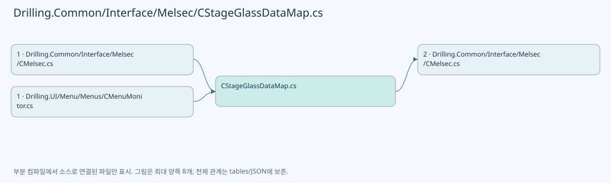
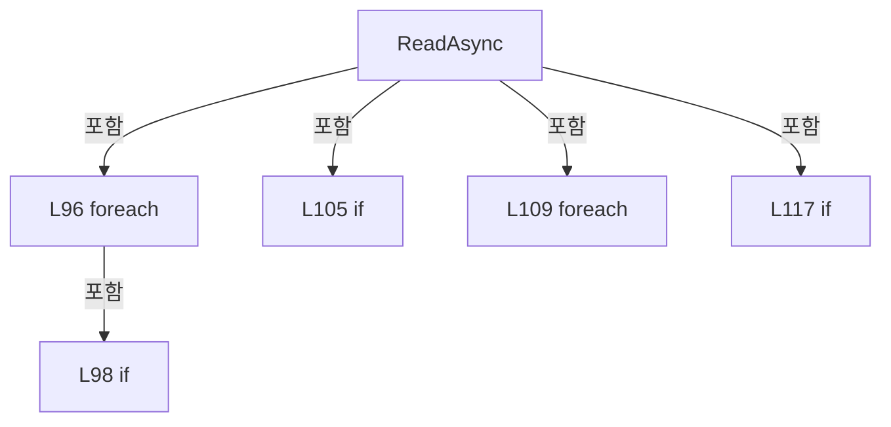
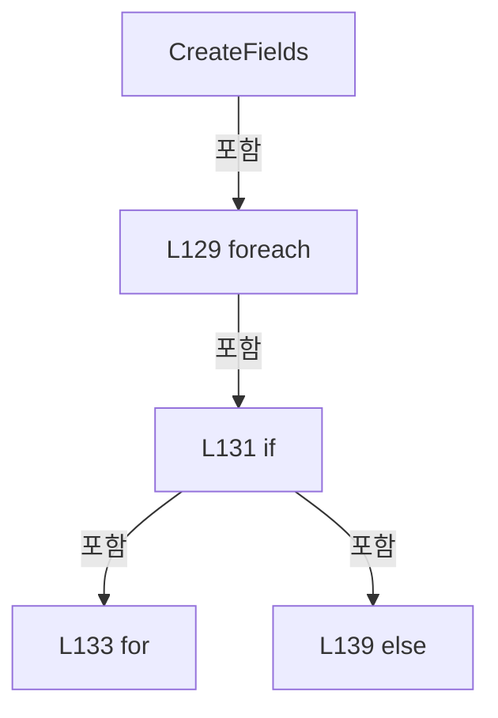
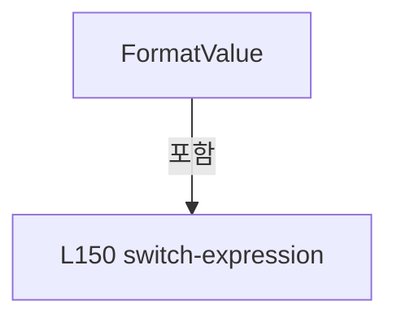

# Drilling.Common/Interface/Melsec/CStageGlassDataMap.cs

| 항목 | 내용 |
| --- | --- |
| 원본 저장소 | https://github.com/kjuws10-rgb/A3Drilling.git |
| 원본 Commit | 0219666f9053b907d96d7e0aa7d0c6c1be3a73d4 |
| 원본 SHA256 | ae42e0681f9e8510476ad367eb29714feae95abc2dc1b4fb9e1af2129fc01eb3 |
| 파일 분류 | code |
| 원본 크기/행 | 7,456 bytes / 157 physical lines |
| 인코딩 | utf-8-sig |
| 검토 범위 | 구문/부분 의미 분석에서 추출한 사실. 동작·물리 단위·실장비 합격을 보증하지 않습니다. |
| 원본 링크 | [고정 Commit 원본](https://github.com/kjuws10-rgb/A3Drilling/blob/0219666f9053b907d96d7e0aa7d0c6c1be3a73d4/Drilling.Common/Interface/Melsec/CStageGlassDataMap.cs) |

## 파일의 역할과 읽는 순서

외부 통신과 장치 인터페이스를 연결합니다. 요청 생성·전송·수신·장치 실행을 같은 의미로 합치지 않습니다.

## 네임스페이스·타입·상속

| 타입 | 구분 | 원본 범위 | 선언/상속 |
| --- | --- | --- | --- |
| ST_STAGE_GLASS_DATA_MAP_FIELD | RecordDeclaration | 5–15 | ST_STAGE_GLASS_DATA_MAP_FIELD |
| ST_STAGE_GLASS_DATA_SNAPSHOT | RecordDeclaration | 17–24 | ST_STAGE_GLASS_DATA_SNAPSHOT |
| CStageGlassDataMap | ClassDeclaration | 27–157 | CStageGlassDataMap |
| ST_FIELD_SPEC | RecordDeclaration | 32–32 | ST_FIELD_SPEC |

## 멤버 빠른 목록

| 이름 | 종류 | 범위 | 서명 |
| --- | --- | --- | --- |
| Address | PropertyDeclaration | L14–14 | string Drilling.Common.Interface.ST_STAGE_GLASS_DATA_MAP_FIELD.Address |
| GlassId | PropertyDeclaration | L21–21 | string Drilling.Common.Interface.ST_STAGE_GLASS_DATA_SNAPSHOT.GlassId |
| LotId | PropertyDeclaration | L22–22 | string Drilling.Common.Interface.ST_STAGE_GLASS_DATA_SNAPSHOT.LotId |
| Ppid | PropertyDeclaration | L23–23 | string Drilling.Common.Interface.ST_STAGE_GLASS_DATA_SNAPSHOT.Ppid |
| BaseWordAddress | FieldDeclaration | L29–29 | int Drilling.Common.Interface.CStageGlassDataMap.BaseWordAddress |
| MapIdPrefix | FieldDeclaration | L30–30 | string Drilling.Common.Interface.CStageGlassDataMap.MapIdPrefix |
| Specs | FieldDeclaration | L34–79 | System.Collections.Generic.IReadOnlyList<Drilling.Common.Interface.CStageGlassDataMap.ST_FIELD_SPEC> Drilling.Common.Interface.CStageGlassDataMap.Specs |
| ProductFieldNames | PropertyDeclaration | L81–81 | System.Collections.Generic.IReadOnlyList<string> Drilling.Common.Interface.CStageGlassDataMap.ProductFieldNames |
| get_ProductFieldNames | GetAccessorDeclaration | L81–81 | System.Collections.Generic.IReadOnlyList<string> Drilling.Common.Interface.CStageGlassDataMap.ProductFieldNames.get |
| Fields | PropertyDeclaration | L82–82 | System.Collections.Generic.IReadOnlyList<Drilling.Common.Interface.ST_STAGE_GLASS_DATA_MAP_FIELD> Drilling.Common.Interface.CStageGlassDataMap.Fields |
| get_Fields | GetAccessorDeclaration | L82–82 | System.Collections.Generic.IReadOnlyList<Drilling.Common.Interface.ST_STAGE_GLASS_DATA_MAP_FIELD> Drilling.Common.Interface.CStageGlassDataMap.Fields.get |
| MapIds | PropertyDeclaration | L83–83 | System.Collections.Generic.IReadOnlyList<string> Drilling.Common.Interface.CStageGlassDataMap.MapIds |
| get_MapIds | GetAccessorDeclaration | L83–83 | System.Collections.Generic.IReadOnlyList<string> Drilling.Common.Interface.CStageGlassDataMap.MapIds.get |
| IsMapRow | MethodDeclaration | L85–85 | bool Drilling.Common.Interface.CStageGlassDataMap.IsMapRow(Drilling.Common.Interface.ST_MELSEC_MAP_DATA) |
| ReadAsync | MethodDeclaration | L87–123 | System.Threading.Tasks.Task<Drilling.Common.Interface.ST_STAGE_GLASS_DATA_SNAPSHOT> Drilling.Common.Interface.CStageGlassDataMap.ReadAsync(Drilling.Common.Interface.CMelsec, System.Threading.CancellationToken) |
| CreateFields | MethodDeclaration | L125–148 | System.Collections.Generic.IReadOnlyList<Drilling.Common.Interface.ST_STAGE_GLASS_DATA_MAP_FIELD> Drilling.Common.Interface.CStageGlassDataMap.CreateFields() |
| FormatValue | MethodDeclaration | L150–156 | string Drilling.Common.Interface.CStageGlassDataMap.FormatValue(object?) |

## 멤버별 상세 계약·호출·처리 해설

### PropertyDeclaration `Address` · L14–14

[Drilling.Common/Interface/Melsec/CStageGlassDataMap.cs:14–14](https://github.com/kjuws10-rgb/A3Drilling/blob/0219666f9053b907d96d7e0aa7d0c6c1be3a73d4/Drilling.Common/Interface/Melsec/CStageGlassDataMap.cs#L14-L14)

| 항목 | 실제 추출 값 |
| --- | --- |
| 서명 | string Drilling.Common.Interface.ST_STAGE_GLASS_DATA_MAP_FIELD.Address |
| 접근/수식자 | Public / public |
| 반환/값 타입 | string |
| 소속 타입 | NamedType:Drilling.Common.Interface.ST_STAGE_GLASS_DATA_MAP_FIELD |

현재 부분 분석에서 직접 연결된 호출자는 없습니다. XAML/이벤트/인터페이스·델리게이트·외부 진입을 추가 확인해야 하며, 미사용으로 판정한 것이 아닙니다.

호출하는 대상과 해석 범위:

| 원본 행 | 표현식 | 분석 상태 | 대상/소스 위치 |
| --- | --- | --- | --- |
| 14 | WordAddress.ToString | resolved | string int.ToString(string?, System.IFormatProvider?) |

본문의 실제 연산·분기·예외·반환 순서(원문 위치 순):

| 원본 행 | 종류 | 주석 해설 |
| --- | --- | --- |
| 14 | call | 함수·델리게이트 또는 객체 생성자를 호출합니다: WordAddress.ToString("X", CultureInfo.InvariantCulture) |

변경 전 점검: 입력/반환 타입, 위 호출자, 예외/취소 경로, 공유 상태와 저장·전송 소비자를 함께 확인합니다. 값의 단위나 물리 방향을 이름만으로 확정하지 않습니다.

### PropertyDeclaration `GlassId` · L21–21

[Drilling.Common/Interface/Melsec/CStageGlassDataMap.cs:21–21](https://github.com/kjuws10-rgb/A3Drilling/blob/0219666f9053b907d96d7e0aa7d0c6c1be3a73d4/Drilling.Common/Interface/Melsec/CStageGlassDataMap.cs#L21-L21)

| 항목 | 실제 추출 값 |
| --- | --- |
| 서명 | string Drilling.Common.Interface.ST_STAGE_GLASS_DATA_SNAPSHOT.GlassId |
| 접근/수식자 | Public / public |
| 반환/값 타입 | string |
| 소속 타입 | NamedType:Drilling.Common.Interface.ST_STAGE_GLASS_DATA_SNAPSHOT |

현재 부분 분석에서 직접 연결된 호출자는 없습니다. XAML/이벤트/인터페이스·델리게이트·외부 진입을 추가 확인해야 하며, 미사용으로 판정한 것이 아닙니다.

호출하는 대상과 해석 범위:

| 원본 행 | 표현식 | 분석 상태 | 대상/소스 위치 |
| --- | --- | --- | --- |
| 21 | Values.GetValueOrDefault | resolved | string System.Collections.Generic.IReadOnlyDictionary<string, string>.GetValueOrDefault<string, string>(string, string) |

본문의 실제 연산·분기·예외·반환 순서(원문 위치 순):

| 원본 행 | 종류 | 주석 해설 |
| --- | --- | --- |
| 21 | call | 함수·델리게이트 또는 객체 생성자를 호출합니다: Values.GetValueOrDefault("H_GLASSID", "") |

변경 전 점검: 입력/반환 타입, 위 호출자, 예외/취소 경로, 공유 상태와 저장·전송 소비자를 함께 확인합니다. 값의 단위나 물리 방향을 이름만으로 확정하지 않습니다.

### PropertyDeclaration `LotId` · L22–22

[Drilling.Common/Interface/Melsec/CStageGlassDataMap.cs:22–22](https://github.com/kjuws10-rgb/A3Drilling/blob/0219666f9053b907d96d7e0aa7d0c6c1be3a73d4/Drilling.Common/Interface/Melsec/CStageGlassDataMap.cs#L22-L22)

| 항목 | 실제 추출 값 |
| --- | --- |
| 서명 | string Drilling.Common.Interface.ST_STAGE_GLASS_DATA_SNAPSHOT.LotId |
| 접근/수식자 | Public / public |
| 반환/값 타입 | string |
| 소속 타입 | NamedType:Drilling.Common.Interface.ST_STAGE_GLASS_DATA_SNAPSHOT |

현재 부분 분석에서 직접 연결된 호출자는 없습니다. XAML/이벤트/인터페이스·델리게이트·외부 진입을 추가 확인해야 하며, 미사용으로 판정한 것이 아닙니다.

호출하는 대상과 해석 범위:

| 원본 행 | 표현식 | 분석 상태 | 대상/소스 위치 |
| --- | --- | --- | --- |
| 22 | Values.GetValueOrDefault | resolved | string System.Collections.Generic.IReadOnlyDictionary<string, string>.GetValueOrDefault<string, string>(string, string) |

본문의 실제 연산·분기·예외·반환 순서(원문 위치 순):

| 원본 행 | 종류 | 주석 해설 |
| --- | --- | --- |
| 22 | call | 함수·델리게이트 또는 객체 생성자를 호출합니다: Values.GetValueOrDefault("LOTID", "") |

변경 전 점검: 입력/반환 타입, 위 호출자, 예외/취소 경로, 공유 상태와 저장·전송 소비자를 함께 확인합니다. 값의 단위나 물리 방향을 이름만으로 확정하지 않습니다.

### PropertyDeclaration `Ppid` · L23–23

[Drilling.Common/Interface/Melsec/CStageGlassDataMap.cs:23–23](https://github.com/kjuws10-rgb/A3Drilling/blob/0219666f9053b907d96d7e0aa7d0c6c1be3a73d4/Drilling.Common/Interface/Melsec/CStageGlassDataMap.cs#L23-L23)

| 항목 | 실제 추출 값 |
| --- | --- |
| 서명 | string Drilling.Common.Interface.ST_STAGE_GLASS_DATA_SNAPSHOT.Ppid |
| 접근/수식자 | Public / public |
| 반환/값 타입 | string |
| 소속 타입 | NamedType:Drilling.Common.Interface.ST_STAGE_GLASS_DATA_SNAPSHOT |

현재 부분 분석에서 직접 연결된 호출자는 없습니다. XAML/이벤트/인터페이스·델리게이트·외부 진입을 추가 확인해야 하며, 미사용으로 판정한 것이 아닙니다.

호출하는 대상과 해석 범위:

| 원본 행 | 표현식 | 분석 상태 | 대상/소스 위치 |
| --- | --- | --- | --- |
| 23 | Values.GetValueOrDefault | resolved | string System.Collections.Generic.IReadOnlyDictionary<string, string>.GetValueOrDefault<string, string>(string, string) |

본문의 실제 연산·분기·예외·반환 순서(원문 위치 순):

| 원본 행 | 종류 | 주석 해설 |
| --- | --- | --- |
| 23 | call | 함수·델리게이트 또는 객체 생성자를 호출합니다: Values.GetValueOrDefault("PPID", "") |

변경 전 점검: 입력/반환 타입, 위 호출자, 예외/취소 경로, 공유 상태와 저장·전송 소비자를 함께 확인합니다. 값의 단위나 물리 방향을 이름만으로 확정하지 않습니다.

### FieldDeclaration `BaseWordAddress` · L29–29

[Drilling.Common/Interface/Melsec/CStageGlassDataMap.cs:29–29](https://github.com/kjuws10-rgb/A3Drilling/blob/0219666f9053b907d96d7e0aa7d0c6c1be3a73d4/Drilling.Common/Interface/Melsec/CStageGlassDataMap.cs#L29-L29)

| 항목 | 실제 추출 값 |
| --- | --- |
| 서명 | int Drilling.Common.Interface.CStageGlassDataMap.BaseWordAddress |
| 접근/수식자 | Private / private, const |
| 반환/값 타입 | int |
| 소속 타입 | NamedType:Drilling.Common.Interface.CStageGlassDataMap |

현재 부분 분석에서 직접 연결된 호출자는 없습니다. XAML/이벤트/인터페이스·델리게이트·외부 진입을 추가 확인해야 하며, 미사용으로 판정한 것이 아닙니다.

본문의 실제 연산·분기·예외·반환 순서(원문 위치 순):

| 원본 행 | 종류 | 주석 해설 |
| --- | --- | --- |
| 29 | variable-initializer | 변수의 초기값을 지정합니다: BaseWordAddress = 0xF600 |

변경 전 점검: 입력/반환 타입, 위 호출자, 예외/취소 경로, 공유 상태와 저장·전송 소비자를 함께 확인합니다. 값의 단위나 물리 방향을 이름만으로 확정하지 않습니다.

### FieldDeclaration `MapIdPrefix` · L30–30

[Drilling.Common/Interface/Melsec/CStageGlassDataMap.cs:30–30](https://github.com/kjuws10-rgb/A3Drilling/blob/0219666f9053b907d96d7e0aa7d0c6c1be3a73d4/Drilling.Common/Interface/Melsec/CStageGlassDataMap.cs#L30-L30)

| 항목 | 실제 추출 값 |
| --- | --- |
| 서명 | string Drilling.Common.Interface.CStageGlassDataMap.MapIdPrefix |
| 접근/수식자 | Private / private, const |
| 반환/값 타입 | string |
| 소속 타입 | NamedType:Drilling.Common.Interface.CStageGlassDataMap |

현재 부분 분석에서 직접 연결된 호출자는 없습니다. XAML/이벤트/인터페이스·델리게이트·외부 진입을 추가 확인해야 하며, 미사용으로 판정한 것이 아닙니다.

본문의 실제 연산·분기·예외·반환 순서(원문 위치 순):

| 원본 행 | 종류 | 주석 해설 |
| --- | --- | --- |
| 30 | variable-initializer | 변수의 초기값을 지정합니다: MapIdPrefix = "STAGE_GLASS_" |

변경 전 점검: 입력/반환 타입, 위 호출자, 예외/취소 경로, 공유 상태와 저장·전송 소비자를 함께 확인합니다. 값의 단위나 물리 방향을 이름만으로 확정하지 않습니다.

### FieldDeclaration `Specs` · L34–79

[Drilling.Common/Interface/Melsec/CStageGlassDataMap.cs:34–79](https://github.com/kjuws10-rgb/A3Drilling/blob/0219666f9053b907d96d7e0aa7d0c6c1be3a73d4/Drilling.Common/Interface/Melsec/CStageGlassDataMap.cs#L34-L79)

| 항목 | 실제 추출 값 |
| --- | --- |
| 서명 | System.Collections.Generic.IReadOnlyList<Drilling.Common.Interface.CStageGlassDataMap.ST_FIELD_SPEC> Drilling.Common.Interface.CStageGlassDataMap.Specs |
| 접근/수식자 | Private / private, static, readonly |
| 반환/값 타입 | System.Collections.Generic.IReadOnlyList<Drilling.Common.Interface.CStageGlassDataMap.ST_FIELD_SPEC> |
| 소속 타입 | NamedType:Drilling.Common.Interface.CStageGlassDataMap |

현재 부분 분석에서 직접 연결된 호출자는 없습니다. XAML/이벤트/인터페이스·델리게이트·외부 진입을 추가 확인해야 하며, 미사용으로 판정한 것이 아닙니다.

호출하는 대상과 해석 범위:

| 원본 행 | 표현식 | 분석 상태 | 대상/소스 위치 |
| --- | --- | --- | --- |
| 36 | new | resolved | Drilling.Common.Interface.CStageGlassDataMap.ST_FIELD_SPEC.ST_FIELD_SPEC(string, Drilling.Common.Interface.EN_MELSEC_DATA_TYPE, int, bool) · Drilling.Common/Interface/Melsec/CStageGlassDataMap.cs:32 |
| 37 | new | resolved | Drilling.Common.Interface.CStageGlassDataMap.ST_FIELD_SPEC.ST_FIELD_SPEC(string, Drilling.Common.Interface.EN_MELSEC_DATA_TYPE, int, bool) · Drilling.Common/Interface/Melsec/CStageGlassDataMap.cs:32 |
| 38 | new | resolved | Drilling.Common.Interface.CStageGlassDataMap.ST_FIELD_SPEC.ST_FIELD_SPEC(string, Drilling.Common.Interface.EN_MELSEC_DATA_TYPE, int, bool) · Drilling.Common/Interface/Melsec/CStageGlassDataMap.cs:32 |
| 39 | new | resolved | Drilling.Common.Interface.CStageGlassDataMap.ST_FIELD_SPEC.ST_FIELD_SPEC(string, Drilling.Common.Interface.EN_MELSEC_DATA_TYPE, int, bool) · Drilling.Common/Interface/Melsec/CStageGlassDataMap.cs:32 |
| 40 | new | resolved | Drilling.Common.Interface.CStageGlassDataMap.ST_FIELD_SPEC.ST_FIELD_SPEC(string, Drilling.Common.Interface.EN_MELSEC_DATA_TYPE, int, bool) · Drilling.Common/Interface/Melsec/CStageGlassDataMap.cs:32 |
| 41 | new | resolved | Drilling.Common.Interface.CStageGlassDataMap.ST_FIELD_SPEC.ST_FIELD_SPEC(string, Drilling.Common.Interface.EN_MELSEC_DATA_TYPE, int, bool) · Drilling.Common/Interface/Melsec/CStageGlassDataMap.cs:32 |
| 42 | new | resolved | Drilling.Common.Interface.CStageGlassDataMap.ST_FIELD_SPEC.ST_FIELD_SPEC(string, Drilling.Common.Interface.EN_MELSEC_DATA_TYPE, int, bool) · Drilling.Common/Interface/Melsec/CStageGlassDataMap.cs:32 |
| 43 | new | resolved | Drilling.Common.Interface.CStageGlassDataMap.ST_FIELD_SPEC.ST_FIELD_SPEC(string, Drilling.Common.Interface.EN_MELSEC_DATA_TYPE, int, bool) · Drilling.Common/Interface/Melsec/CStageGlassDataMap.cs:32 |
| 44 | new | resolved | Drilling.Common.Interface.CStageGlassDataMap.ST_FIELD_SPEC.ST_FIELD_SPEC(string, Drilling.Common.Interface.EN_MELSEC_DATA_TYPE, int, bool) · Drilling.Common/Interface/Melsec/CStageGlassDataMap.cs:32 |
| 45 | new | resolved | Drilling.Common.Interface.CStageGlassDataMap.ST_FIELD_SPEC.ST_FIELD_SPEC(string, Drilling.Common.Interface.EN_MELSEC_DATA_TYPE, int, bool) · Drilling.Common/Interface/Melsec/CStageGlassDataMap.cs:32 |
| 46 | new | resolved | Drilling.Common.Interface.CStageGlassDataMap.ST_FIELD_SPEC.ST_FIELD_SPEC(string, Drilling.Common.Interface.EN_MELSEC_DATA_TYPE, int, bool) · Drilling.Common/Interface/Melsec/CStageGlassDataMap.cs:32 |
| 47 | new | resolved | Drilling.Common.Interface.CStageGlassDataMap.ST_FIELD_SPEC.ST_FIELD_SPEC(string, Drilling.Common.Interface.EN_MELSEC_DATA_TYPE, int, bool) · Drilling.Common/Interface/Melsec/CStageGlassDataMap.cs:32 |
| 48 | new | resolved | Drilling.Common.Interface.CStageGlassDataMap.ST_FIELD_SPEC.ST_FIELD_SPEC(string, Drilling.Common.Interface.EN_MELSEC_DATA_TYPE, int, bool) · Drilling.Common/Interface/Melsec/CStageGlassDataMap.cs:32 |
| 49 | new | resolved | Drilling.Common.Interface.CStageGlassDataMap.ST_FIELD_SPEC.ST_FIELD_SPEC(string, Drilling.Common.Interface.EN_MELSEC_DATA_TYPE, int, bool) · Drilling.Common/Interface/Melsec/CStageGlassDataMap.cs:32 |
| 50 | new | resolved | Drilling.Common.Interface.CStageGlassDataMap.ST_FIELD_SPEC.ST_FIELD_SPEC(string, Drilling.Common.Interface.EN_MELSEC_DATA_TYPE, int, bool) · Drilling.Common/Interface/Melsec/CStageGlassDataMap.cs:32 |
| 51 | new | resolved | Drilling.Common.Interface.CStageGlassDataMap.ST_FIELD_SPEC.ST_FIELD_SPEC(string, Drilling.Common.Interface.EN_MELSEC_DATA_TYPE, int, bool) · Drilling.Common/Interface/Melsec/CStageGlassDataMap.cs:32 |
| 52 | new | resolved | Drilling.Common.Interface.CStageGlassDataMap.ST_FIELD_SPEC.ST_FIELD_SPEC(string, Drilling.Common.Interface.EN_MELSEC_DATA_TYPE, int, bool) · Drilling.Common/Interface/Melsec/CStageGlassDataMap.cs:32 |
| 53 | new | resolved | Drilling.Common.Interface.CStageGlassDataMap.ST_FIELD_SPEC.ST_FIELD_SPEC(string, Drilling.Common.Interface.EN_MELSEC_DATA_TYPE, int, bool) · Drilling.Common/Interface/Melsec/CStageGlassDataMap.cs:32 |
| 54 | new | resolved | Drilling.Common.Interface.CStageGlassDataMap.ST_FIELD_SPEC.ST_FIELD_SPEC(string, Drilling.Common.Interface.EN_MELSEC_DATA_TYPE, int, bool) · Drilling.Common/Interface/Melsec/CStageGlassDataMap.cs:32 |
| 55 | new | resolved | Drilling.Common.Interface.CStageGlassDataMap.ST_FIELD_SPEC.ST_FIELD_SPEC(string, Drilling.Common.Interface.EN_MELSEC_DATA_TYPE, int, bool) · Drilling.Common/Interface/Melsec/CStageGlassDataMap.cs:32 |
| 56 | new | resolved | Drilling.Common.Interface.CStageGlassDataMap.ST_FIELD_SPEC.ST_FIELD_SPEC(string, Drilling.Common.Interface.EN_MELSEC_DATA_TYPE, int, bool) · Drilling.Common/Interface/Melsec/CStageGlassDataMap.cs:32 |
| 57 | new | resolved | Drilling.Common.Interface.CStageGlassDataMap.ST_FIELD_SPEC.ST_FIELD_SPEC(string, Drilling.Common.Interface.EN_MELSEC_DATA_TYPE, int, bool) · Drilling.Common/Interface/Melsec/CStageGlassDataMap.cs:32 |
| 58 | new | resolved | Drilling.Common.Interface.CStageGlassDataMap.ST_FIELD_SPEC.ST_FIELD_SPEC(string, Drilling.Common.Interface.EN_MELSEC_DATA_TYPE, int, bool) · Drilling.Common/Interface/Melsec/CStageGlassDataMap.cs:32 |
| 59 | new | resolved | Drilling.Common.Interface.CStageGlassDataMap.ST_FIELD_SPEC.ST_FIELD_SPEC(string, Drilling.Common.Interface.EN_MELSEC_DATA_TYPE, int, bool) · Drilling.Common/Interface/Melsec/CStageGlassDataMap.cs:32 |
| 60 | new | resolved | Drilling.Common.Interface.CStageGlassDataMap.ST_FIELD_SPEC.ST_FIELD_SPEC(string, Drilling.Common.Interface.EN_MELSEC_DATA_TYPE, int, bool) · Drilling.Common/Interface/Melsec/CStageGlassDataMap.cs:32 |
| 61 | new | resolved | Drilling.Common.Interface.CStageGlassDataMap.ST_FIELD_SPEC.ST_FIELD_SPEC(string, Drilling.Common.Interface.EN_MELSEC_DATA_TYPE, int, bool) · Drilling.Common/Interface/Melsec/CStageGlassDataMap.cs:32 |
| 62 | new | resolved | Drilling.Common.Interface.CStageGlassDataMap.ST_FIELD_SPEC.ST_FIELD_SPEC(string, Drilling.Common.Interface.EN_MELSEC_DATA_TYPE, int, bool) · Drilling.Common/Interface/Melsec/CStageGlassDataMap.cs:32 |
| 63 | new | resolved | Drilling.Common.Interface.CStageGlassDataMap.ST_FIELD_SPEC.ST_FIELD_SPEC(string, Drilling.Common.Interface.EN_MELSEC_DATA_TYPE, int, bool) · Drilling.Common/Interface/Melsec/CStageGlassDataMap.cs:32 |
| 64 | new | resolved | Drilling.Common.Interface.CStageGlassDataMap.ST_FIELD_SPEC.ST_FIELD_SPEC(string, Drilling.Common.Interface.EN_MELSEC_DATA_TYPE, int, bool) · Drilling.Common/Interface/Melsec/CStageGlassDataMap.cs:32 |
| 65 | new | resolved | Drilling.Common.Interface.CStageGlassDataMap.ST_FIELD_SPEC.ST_FIELD_SPEC(string, Drilling.Common.Interface.EN_MELSEC_DATA_TYPE, int, bool) · Drilling.Common/Interface/Melsec/CStageGlassDataMap.cs:32 |
| 66 | new | resolved | Drilling.Common.Interface.CStageGlassDataMap.ST_FIELD_SPEC.ST_FIELD_SPEC(string, Drilling.Common.Interface.EN_MELSEC_DATA_TYPE, int, bool) · Drilling.Common/Interface/Melsec/CStageGlassDataMap.cs:32 |
| 67 | new | resolved | Drilling.Common.Interface.CStageGlassDataMap.ST_FIELD_SPEC.ST_FIELD_SPEC(string, Drilling.Common.Interface.EN_MELSEC_DATA_TYPE, int, bool) · Drilling.Common/Interface/Melsec/CStageGlassDataMap.cs:32 |
| 68 | new | resolved | Drilling.Common.Interface.CStageGlassDataMap.ST_FIELD_SPEC.ST_FIELD_SPEC(string, Drilling.Common.Interface.EN_MELSEC_DATA_TYPE, int, bool) · Drilling.Common/Interface/Melsec/CStageGlassDataMap.cs:32 |
| 69 | new | resolved | Drilling.Common.Interface.CStageGlassDataMap.ST_FIELD_SPEC.ST_FIELD_SPEC(string, Drilling.Common.Interface.EN_MELSEC_DATA_TYPE, int, bool) · Drilling.Common/Interface/Melsec/CStageGlassDataMap.cs:32 |
| 70 | new | resolved | Drilling.Common.Interface.CStageGlassDataMap.ST_FIELD_SPEC.ST_FIELD_SPEC(string, Drilling.Common.Interface.EN_MELSEC_DATA_TYPE, int, bool) · Drilling.Common/Interface/Melsec/CStageGlassDataMap.cs:32 |
| 71 | new | resolved | Drilling.Common.Interface.CStageGlassDataMap.ST_FIELD_SPEC.ST_FIELD_SPEC(string, Drilling.Common.Interface.EN_MELSEC_DATA_TYPE, int, bool) · Drilling.Common/Interface/Melsec/CStageGlassDataMap.cs:32 |
| 72 | new | resolved | Drilling.Common.Interface.CStageGlassDataMap.ST_FIELD_SPEC.ST_FIELD_SPEC(string, Drilling.Common.Interface.EN_MELSEC_DATA_TYPE, int, bool) · Drilling.Common/Interface/Melsec/CStageGlassDataMap.cs:32 |
| 73 | new | resolved | Drilling.Common.Interface.CStageGlassDataMap.ST_FIELD_SPEC.ST_FIELD_SPEC(string, Drilling.Common.Interface.EN_MELSEC_DATA_TYPE, int, bool) · Drilling.Common/Interface/Melsec/CStageGlassDataMap.cs:32 |
| 74 | new | resolved | Drilling.Common.Interface.CStageGlassDataMap.ST_FIELD_SPEC.ST_FIELD_SPEC(string, Drilling.Common.Interface.EN_MELSEC_DATA_TYPE, int, bool) · Drilling.Common/Interface/Melsec/CStageGlassDataMap.cs:32 |
| 75 | new | resolved | Drilling.Common.Interface.CStageGlassDataMap.ST_FIELD_SPEC.ST_FIELD_SPEC(string, Drilling.Common.Interface.EN_MELSEC_DATA_TYPE, int, bool) · Drilling.Common/Interface/Melsec/CStageGlassDataMap.cs:32 |
| 76 | new | resolved | Drilling.Common.Interface.CStageGlassDataMap.ST_FIELD_SPEC.ST_FIELD_SPEC(string, Drilling.Common.Interface.EN_MELSEC_DATA_TYPE, int, bool) · Drilling.Common/Interface/Melsec/CStageGlassDataMap.cs:32 |
| 77 | new | resolved | Drilling.Common.Interface.CStageGlassDataMap.ST_FIELD_SPEC.ST_FIELD_SPEC(string, Drilling.Common.Interface.EN_MELSEC_DATA_TYPE, int, bool) · Drilling.Common/Interface/Melsec/CStageGlassDataMap.cs:32 |
| 78 | new | resolved | Drilling.Common.Interface.CStageGlassDataMap.ST_FIELD_SPEC.ST_FIELD_SPEC(string, Drilling.Common.Interface.EN_MELSEC_DATA_TYPE, int, bool) · Drilling.Common/Interface/Melsec/CStageGlassDataMap.cs:32 |

본문의 실제 연산·분기·예외·반환 순서(원문 위치 순):

| 원본 행 | 종류 | 주석 해설 |
| --- | --- | --- |
| 34 | variable-initializer | 변수의 초기값을 지정합니다: Specs = [ new("H_GLASSID", EN_MELSEC_DATA_TYPE.String, 8), new("E_GLASSID", EN_MELSEC_DATA_TYPE.String, 8), new("LOTID", EN_MELSEC_DATA_TYPE.String, 8), new("BATCHID", EN_MELSEC_DATA_TYPE.String, 8), new("JOBID", EN_MELSEC_DATA_TY |
| 36 | call | 함수·델리게이트 또는 객체 생성자를 호출합니다: new("H_GLASSID", EN_MELSEC_DATA_TYPE.String, 8) |
| 37 | call | 함수·델리게이트 또는 객체 생성자를 호출합니다: new("E_GLASSID", EN_MELSEC_DATA_TYPE.String, 8) |
| 38 | call | 함수·델리게이트 또는 객체 생성자를 호출합니다: new("LOTID", EN_MELSEC_DATA_TYPE.String, 8) |
| 39 | call | 함수·델리게이트 또는 객체 생성자를 호출합니다: new("BATCHID", EN_MELSEC_DATA_TYPE.String, 8) |
| 40 | call | 함수·델리게이트 또는 객체 생성자를 호출합니다: new("JOBID", EN_MELSEC_DATA_TYPE.String, 8) |
| 41 | call | 함수·델리게이트 또는 객체 생성자를 호출합니다: new("PORTID", EN_MELSEC_DATA_TYPE.String, 2) |
| 42 | call | 함수·델리게이트 또는 객체 생성자를 호출합니다: new("SLOTNO", EN_MELSEC_DATA_TYPE.String, 1) |
| 43 | call | 함수·델리게이트 또는 객체 생성자를 호출합니다: new("PRODUCT_TYPE", EN_MELSEC_DATA_TYPE.String, 2) |
| 44 | call | 함수·델리게이트 또는 객체 생성자를 호출합니다: new("PRODUCT_KIND", EN_MELSEC_DATA_TYPE.String, 2) |
| 45 | call | 함수·델리게이트 또는 객체 생성자를 호출합니다: new("PRODUCTID", EN_MELSEC_DATA_TYPE.String, 8) |
| 46 | call | 함수·델리게이트 또는 객체 생성자를 호출합니다: new("RUNSPECID", EN_MELSEC_DATA_TYPE.String, 8) |
| 47 | call | 함수·델리게이트 또는 객체 생성자를 호출합니다: new("LAYERID", EN_MELSEC_DATA_TYPE.String, 4) |
| 48 | call | 함수·델리게이트 또는 객체 생성자를 호출합니다: new("STEPID", EN_MELSEC_DATA_TYPE.String, 4) |
| 49 | call | 함수·델리게이트 또는 객체 생성자를 호출합니다: new("PPID", EN_MELSEC_DATA_TYPE.String, 10) |
| 50 | call | 함수·델리게이트 또는 객체 생성자를 호출합니다: new("FLOWID", EN_MELSEC_DATA_TYPE.String, 10) |
| 51 | call | 함수·델리게이트 또는 객체 생성자를 호출합니다: new("GLASS_SIZE", EN_MELSEC_DATA_TYPE.Word, 2, SplitWords: true) |
| 52 | call | 함수·델리게이트 또는 객체 생성자를 호출합니다: new("GLASS_THICKNESS", EN_MELSEC_DATA_TYPE.Word, 1) |
| 53 | call | 함수·델리게이트 또는 객체 생성자를 호출합니다: new("GLASS_STATE", EN_MELSEC_DATA_TYPE.Word, 1) |
| 54 | call | 함수·델리게이트 또는 객체 생성자를 호출합니다: new("GLASS_ORDER", EN_MELSEC_DATA_TYPE.String, 2) |
| 55 | call | 함수·델리게이트 또는 객체 생성자를 호출합니다: new("COMMENT", EN_MELSEC_DATA_TYPE.String, 8) |
| 56 | call | 함수·델리게이트 또는 객체 생성자를 호출합니다: new("USE_COUNT", EN_MELSEC_DATA_TYPE.String, 2) |
| 57 | call | 함수·델리게이트 또는 객체 생성자를 호출합니다: new("JUDGEMENT", EN_MELSEC_DATA_TYPE.String, 2) |
| 58 | call | 함수·델리게이트 또는 객체 생성자를 호출합니다: new("REASON_CODE", EN_MELSEC_DATA_TYPE.String, 2) |
| 59 | call | 함수·델리게이트 또는 객체 생성자를 호출합니다: new("INS_FLAG", EN_MELSEC_DATA_TYPE.String, 1) |
| 60 | call | 함수·델리게이트 또는 객체 생성자를 호출합니다: new("ENC_FLAG", EN_MELSEC_DATA_TYPE.String, 1) |
| 61 | call | 함수·델리게이트 또는 객체 생성자를 호출합니다: new("PRERUN_FLAG", EN_MELSEC_DATA_TYPE.String, 1) |
| 62 | call | 함수·델리게이트 또는 객체 생성자를 호출합니다: new("TURN_DIR", EN_MELSEC_DATA_TYPE.String, 1) |
| 63 | call | 함수·델리게이트 또는 객체 생성자를 호출합니다: new("FLIP_STATE", EN_MELSEC_DATA_TYPE.String, 1) |
| 64 | call | 함수·델리게이트 또는 객체 생성자를 호출합니다: new("WORK_STATE", EN_MELSEC_DATA_TYPE.String, 2) |
| 65 | call | 함수·델리게이트 또는 객체 생성자를 호출합니다: new("MULTI_USE", EN_MELSEC_DATA_TYPE.String, 8) |
| 66 | call | 함수·델리게이트 또는 객체 생성자를 호출합니다: new("PAIR_GLASSID", EN_MELSEC_DATA_TYPE.String, 8) |
| 67 | call | 함수·델리게이트 또는 객체 생성자를 호출합니다: new("PAIR_PPID", EN_MELSEC_DATA_TYPE.String, 10) |
| 68 | call | 함수·델리게이트 또는 객체 생성자를 호출합니다: new("OPTIONNAME1", EN_MELSEC_DATA_TYPE.String, 20) |
| 69 | call | 함수·델리게이트 또는 객체 생성자를 호출합니다: new("OPTIONVALUE1", EN_MELSEC_DATA_TYPE.String, 20) |
| 70 | call | 함수·델리게이트 또는 객체 생성자를 호출합니다: new("OPTIONNAME2", EN_MELSEC_DATA_TYPE.String, 20) |
| 71 | call | 함수·델리게이트 또는 객체 생성자를 호출합니다: new("OPTIONVALUE2", EN_MELSEC_DATA_TYPE.String, 20) |
| 72 | call | 함수·델리게이트 또는 객체 생성자를 호출합니다: new("OPTIONNAME3", EN_MELSEC_DATA_TYPE.String, 20) |
| 73 | call | 함수·델리게이트 또는 객체 생성자를 호출합니다: new("OPTIONVALUE3", EN_MELSEC_DATA_TYPE.String, 20) |
| 74 | call | 함수·델리게이트 또는 객체 생성자를 호출합니다: new("OPTIONNAME4", EN_MELSEC_DATA_TYPE.String, 20) |
| 75 | call | 함수·델리게이트 또는 객체 생성자를 호출합니다: new("OPTIONVALUE4", EN_MELSEC_DATA_TYPE.String, 20) |
| 76 | call | 함수·델리게이트 또는 객체 생성자를 호출합니다: new("OPTIONNAME5", EN_MELSEC_DATA_TYPE.String, 20) |
| 77 | call | 함수·델리게이트 또는 객체 생성자를 호출합니다: new("OPTIONVALUE5", EN_MELSEC_DATA_TYPE.String, 20) |
| 78 | call | 함수·델리게이트 또는 객체 생성자를 호출합니다: new("ETC", EN_MELSEC_DATA_TYPE.String, 16) |

변경 전 점검: 입력/반환 타입, 위 호출자, 예외/취소 경로, 공유 상태와 저장·전송 소비자를 함께 확인합니다. 값의 단위나 물리 방향을 이름만으로 확정하지 않습니다.

### PropertyDeclaration `ProductFieldNames` · L81–81

[Drilling.Common/Interface/Melsec/CStageGlassDataMap.cs:81–81](https://github.com/kjuws10-rgb/A3Drilling/blob/0219666f9053b907d96d7e0aa7d0c6c1be3a73d4/Drilling.Common/Interface/Melsec/CStageGlassDataMap.cs#L81-L81)

| 항목 | 실제 추출 값 |
| --- | --- |
| 서명 | System.Collections.Generic.IReadOnlyList<string> Drilling.Common.Interface.CStageGlassDataMap.ProductFieldNames |
| 접근/수식자 | Public / public, static |
| 반환/값 타입 | System.Collections.Generic.IReadOnlyList<string> |
| 소속 타입 | NamedType:Drilling.Common.Interface.CStageGlassDataMap |

현재 부분 분석에서 직접 연결된 호출자는 없습니다. XAML/이벤트/인터페이스·델리게이트·외부 진입을 추가 확인해야 하며, 미사용으로 판정한 것이 아닙니다.

호출하는 대상과 해석 범위:

| 원본 행 | 표현식 | 분석 상태 | 대상/소스 위치 |
| --- | --- | --- | --- |
| 81 | Array.AsReadOnly | resolved | System.Collections.ObjectModel.ReadOnlyCollection<string> System.Array.AsReadOnly<string>(string[]) |
| 81 | Specs.Select(field => field.Name).ToArray | resolved | string[] System.Collections.Generic.IEnumerable<string>.ToArray<string>() |
| 81 | Specs.Select | resolved | System.Collections.Generic.IEnumerable<string> System.Collections.Generic.IEnumerable<Drilling.Common.Interface.CStageGlassDataMap.ST_FIELD_SPEC>.Select<Drilling.Common.Interface.CStageGlassDataMap.ST_FIELD_SPEC, string>(System.Func<Drilling.Common.Interface.CStageGlassDataMap.ST_FIELD_SPEC, string>) |

본문의 실제 연산·분기·예외·반환 순서(원문 위치 순):

| 원본 행 | 종류 | 주석 해설 |
| --- | --- | --- |
| 81 | call | 함수·델리게이트 또는 객체 생성자를 호출합니다: Array.AsReadOnly(Specs.Select(field => field.Name).ToArray()) |
| 81 | call | 함수·델리게이트 또는 객체 생성자를 호출합니다: Specs.Select(field => field.Name).ToArray() |
| 81 | call | 함수·델리게이트 또는 객체 생성자를 호출합니다: Specs.Select(field => field.Name) |

변경 전 점검: 입력/반환 타입, 위 호출자, 예외/취소 경로, 공유 상태와 저장·전송 소비자를 함께 확인합니다. 값의 단위나 물리 방향을 이름만으로 확정하지 않습니다.

### GetAccessorDeclaration `get_ProductFieldNames` · L81–81

[Drilling.Common/Interface/Melsec/CStageGlassDataMap.cs:81–81](https://github.com/kjuws10-rgb/A3Drilling/blob/0219666f9053b907d96d7e0aa7d0c6c1be3a73d4/Drilling.Common/Interface/Melsec/CStageGlassDataMap.cs#L81-L81)

| 항목 | 실제 추출 값 |
| --- | --- |
| 서명 | System.Collections.Generic.IReadOnlyList<string> Drilling.Common.Interface.CStageGlassDataMap.ProductFieldNames.get |
| 접근/수식자 | Public / get |
| 반환/값 타입 | System.Collections.Generic.IReadOnlyList<string> |
| 소속 타입 | NamedType:Drilling.Common.Interface.CStageGlassDataMap |

현재 부분 분석에서 직접 연결된 호출자는 없습니다. XAML/이벤트/인터페이스·델리게이트·외부 진입을 추가 확인해야 하며, 미사용으로 판정한 것이 아닙니다.

변경 전 점검: 입력/반환 타입, 위 호출자, 예외/취소 경로, 공유 상태와 저장·전송 소비자를 함께 확인합니다. 값의 단위나 물리 방향을 이름만으로 확정하지 않습니다.

### PropertyDeclaration `Fields` · L82–82

[Drilling.Common/Interface/Melsec/CStageGlassDataMap.cs:82–82](https://github.com/kjuws10-rgb/A3Drilling/blob/0219666f9053b907d96d7e0aa7d0c6c1be3a73d4/Drilling.Common/Interface/Melsec/CStageGlassDataMap.cs#L82-L82)

| 항목 | 실제 추출 값 |
| --- | --- |
| 서명 | System.Collections.Generic.IReadOnlyList<Drilling.Common.Interface.ST_STAGE_GLASS_DATA_MAP_FIELD> Drilling.Common.Interface.CStageGlassDataMap.Fields |
| 접근/수식자 | Public / public, static |
| 반환/값 타입 | System.Collections.Generic.IReadOnlyList<Drilling.Common.Interface.ST_STAGE_GLASS_DATA_MAP_FIELD> |
| 소속 타입 | NamedType:Drilling.Common.Interface.CStageGlassDataMap |

현재 부분 분석에서 직접 연결된 호출자는 없습니다. XAML/이벤트/인터페이스·델리게이트·외부 진입을 추가 확인해야 하며, 미사용으로 판정한 것이 아닙니다.

호출하는 대상과 해석 범위:

| 원본 행 | 표현식 | 분석 상태 | 대상/소스 위치 |
| --- | --- | --- | --- |
| 82 | CreateFields | resolved | System.Collections.Generic.IReadOnlyList<Drilling.Common.Interface.ST_STAGE_GLASS_DATA_MAP_FIELD> Drilling.Common.Interface.CStageGlassDataMap.CreateFields() · Drilling.Common/Interface/Melsec/CStageGlassDataMap.cs:125 |

본문의 실제 연산·분기·예외·반환 순서(원문 위치 순):

| 원본 행 | 종류 | 주석 해설 |
| --- | --- | --- |
| 82 | call | 함수·델리게이트 또는 객체 생성자를 호출합니다: CreateFields() |

변경 전 점검: 입력/반환 타입, 위 호출자, 예외/취소 경로, 공유 상태와 저장·전송 소비자를 함께 확인합니다. 값의 단위나 물리 방향을 이름만으로 확정하지 않습니다.

### GetAccessorDeclaration `get_Fields` · L82–82

[Drilling.Common/Interface/Melsec/CStageGlassDataMap.cs:82–82](https://github.com/kjuws10-rgb/A3Drilling/blob/0219666f9053b907d96d7e0aa7d0c6c1be3a73d4/Drilling.Common/Interface/Melsec/CStageGlassDataMap.cs#L82-L82)

| 항목 | 실제 추출 값 |
| --- | --- |
| 서명 | System.Collections.Generic.IReadOnlyList<Drilling.Common.Interface.ST_STAGE_GLASS_DATA_MAP_FIELD> Drilling.Common.Interface.CStageGlassDataMap.Fields.get |
| 접근/수식자 | Public / get |
| 반환/값 타입 | System.Collections.Generic.IReadOnlyList<Drilling.Common.Interface.ST_STAGE_GLASS_DATA_MAP_FIELD> |
| 소속 타입 | NamedType:Drilling.Common.Interface.CStageGlassDataMap |

현재 부분 분석에서 직접 연결된 호출자는 없습니다. XAML/이벤트/인터페이스·델리게이트·외부 진입을 추가 확인해야 하며, 미사용으로 판정한 것이 아닙니다.

변경 전 점검: 입력/반환 타입, 위 호출자, 예외/취소 경로, 공유 상태와 저장·전송 소비자를 함께 확인합니다. 값의 단위나 물리 방향을 이름만으로 확정하지 않습니다.

### PropertyDeclaration `MapIds` · L83–83

[Drilling.Common/Interface/Melsec/CStageGlassDataMap.cs:83–83](https://github.com/kjuws10-rgb/A3Drilling/blob/0219666f9053b907d96d7e0aa7d0c6c1be3a73d4/Drilling.Common/Interface/Melsec/CStageGlassDataMap.cs#L83-L83)

| 항목 | 실제 추출 값 |
| --- | --- |
| 서명 | System.Collections.Generic.IReadOnlyList<string> Drilling.Common.Interface.CStageGlassDataMap.MapIds |
| 접근/수식자 | Public / public, static |
| 반환/값 타입 | System.Collections.Generic.IReadOnlyList<string> |
| 소속 타입 | NamedType:Drilling.Common.Interface.CStageGlassDataMap |

현재 부분 분석에서 직접 연결된 호출자는 없습니다. XAML/이벤트/인터페이스·델리게이트·외부 진입을 추가 확인해야 하며, 미사용으로 판정한 것이 아닙니다.

호출하는 대상과 해석 범위:

| 원본 행 | 표현식 | 분석 상태 | 대상/소스 위치 |
| --- | --- | --- | --- |
| 83 | Array.AsReadOnly | resolved | System.Collections.ObjectModel.ReadOnlyCollection<string> System.Array.AsReadOnly<string>(string[]) |
| 83 | Fields.Select(field => field.Id).ToArray | resolved | string[] System.Collections.Generic.IEnumerable<string>.ToArray<string>() |
| 83 | Fields.Select | resolved | System.Collections.Generic.IEnumerable<string> System.Collections.Generic.IEnumerable<Drilling.Common.Interface.ST_STAGE_GLASS_DATA_MAP_FIELD>.Select<Drilling.Common.Interface.ST_STAGE_GLASS_DATA_MAP_FIELD, string>(System.Func<Drilling.Common.Interface.ST_STAGE_GLASS_DATA_MAP_FIELD, string>) |

본문의 실제 연산·분기·예외·반환 순서(원문 위치 순):

| 원본 행 | 종류 | 주석 해설 |
| --- | --- | --- |
| 83 | call | 함수·델리게이트 또는 객체 생성자를 호출합니다: Array.AsReadOnly(Fields.Select(field => field.Id).ToArray()) |
| 83 | call | 함수·델리게이트 또는 객체 생성자를 호출합니다: Fields.Select(field => field.Id).ToArray() |
| 83 | call | 함수·델리게이트 또는 객체 생성자를 호출합니다: Fields.Select(field => field.Id) |

변경 전 점검: 입력/반환 타입, 위 호출자, 예외/취소 경로, 공유 상태와 저장·전송 소비자를 함께 확인합니다. 값의 단위나 물리 방향을 이름만으로 확정하지 않습니다.

### GetAccessorDeclaration `get_MapIds` · L83–83

[Drilling.Common/Interface/Melsec/CStageGlassDataMap.cs:83–83](https://github.com/kjuws10-rgb/A3Drilling/blob/0219666f9053b907d96d7e0aa7d0c6c1be3a73d4/Drilling.Common/Interface/Melsec/CStageGlassDataMap.cs#L83-L83)

| 항목 | 실제 추출 값 |
| --- | --- |
| 서명 | System.Collections.Generic.IReadOnlyList<string> Drilling.Common.Interface.CStageGlassDataMap.MapIds.get |
| 접근/수식자 | Public / get |
| 반환/값 타입 | System.Collections.Generic.IReadOnlyList<string> |
| 소속 타입 | NamedType:Drilling.Common.Interface.CStageGlassDataMap |

현재 부분 분석에서 직접 연결된 호출자는 없습니다. XAML/이벤트/인터페이스·델리게이트·외부 진입을 추가 확인해야 하며, 미사용으로 판정한 것이 아닙니다.

변경 전 점검: 입력/반환 타입, 위 호출자, 예외/취소 경로, 공유 상태와 저장·전송 소비자를 함께 확인합니다. 값의 단위나 물리 방향을 이름만으로 확정하지 않습니다.

### MethodDeclaration `IsMapRow` · L85–85

[Drilling.Common/Interface/Melsec/CStageGlassDataMap.cs:85–85](https://github.com/kjuws10-rgb/A3Drilling/blob/0219666f9053b907d96d7e0aa7d0c6c1be3a73d4/Drilling.Common/Interface/Melsec/CStageGlassDataMap.cs#L85-L85)

| 항목 | 실제 추출 값 |
| --- | --- |
| 서명 | bool Drilling.Common.Interface.CStageGlassDataMap.IsMapRow(Drilling.Common.Interface.ST_MELSEC_MAP_DATA) |
| 접근/수식자 | Public / public, static |
| 반환/값 타입 | bool |
| 소속 타입 | NamedType:Drilling.Common.Interface.CStageGlassDataMap |

입력 계약:

| 이름 | 타입 | 전달 | 선택/기본값 |
| --- | --- | --- | --- |
| row | Drilling.Common.Interface.ST_MELSEC_MAP_DATA | None | False /  |

정적 호출자로 확인된 위치:

| 호출 파일/행 | 호출 표현식 | 런타임 분기 가능 |
| --- | --- | --- |
| [Drilling.Common/Interface/Melsec/CMelsec.cs:3061–3061](https://github.com/kjuws10-rgb/A3Drilling/blob/0219666f9053b907d96d7e0aa7d0c6c1be3a73d4/Drilling.Common/Interface/Melsec/CMelsec.cs#L3061-L3061) | CStageGlassDataMap.IsMapRow | False |

호출하는 대상과 해석 범위:

| 원본 행 | 표현식 | 분석 상태 | 대상/소스 위치 |
| --- | --- | --- | --- |
| 85 | row.Id.StartsWith | resolved | bool string.StartsWith(string, System.StringComparison) |

본문의 실제 연산·분기·예외·반환 순서(원문 위치 순):

| 원본 행 | 종류 | 주석 해설 |
| --- | --- | --- |
| 85 | call | 함수·델리게이트 또는 객체 생성자를 호출합니다: row.Id.StartsWith(MapIdPrefix, StringComparison.OrdinalIgnoreCase) |

변경 전 점검: 입력/반환 타입, 위 호출자, 예외/취소 경로, 공유 상태와 저장·전송 소비자를 함께 확인합니다. 값의 단위나 물리 방향을 이름만으로 확정하지 않습니다.

### MethodDeclaration `ReadAsync` · L87–123

[Drilling.Common/Interface/Melsec/CStageGlassDataMap.cs:87–123](https://github.com/kjuws10-rgb/A3Drilling/blob/0219666f9053b907d96d7e0aa7d0c6c1be3a73d4/Drilling.Common/Interface/Melsec/CStageGlassDataMap.cs#L87-L123)

| 항목 | 실제 추출 값 |
| --- | --- |
| 서명 | System.Threading.Tasks.Task<Drilling.Common.Interface.ST_STAGE_GLASS_DATA_SNAPSHOT> Drilling.Common.Interface.CStageGlassDataMap.ReadAsync(Drilling.Common.Interface.CMelsec, System.Threading.CancellationToken) |
| 접근/수식자 | Public / public, static, async |
| 반환/값 타입 | System.Threading.Tasks.Task<Drilling.Common.Interface.ST_STAGE_GLASS_DATA_SNAPSHOT> |
| 소속 타입 | NamedType:Drilling.Common.Interface.CStageGlassDataMap |

입력 계약:

| 이름 | 타입 | 전달 | 선택/기본값 |
| --- | --- | --- | --- |
| melsec | Drilling.Common.Interface.CMelsec | None | False /  |
| cancellationToken | System.Threading.CancellationToken | None | True / null |

정적 호출자로 확인된 위치:

| 호출 파일/행 | 호출 표현식 | 런타임 분기 가능 |
| --- | --- | --- |
| [Drilling.UI/Menu/Menus/CMenuMonitor.cs:4462–4462](https://github.com/kjuws10-rgb/A3Drilling/blob/0219666f9053b907d96d7e0aa7d0c6c1be3a73d4/Drilling.UI/Menu/Menus/CMenuMonitor.cs#L4462-L4462) | CStageGlassDataMap.ReadAsync | False |

호출하는 대상과 해석 범위:

| 원본 행 | 표현식 | 분석 상태 | 대상/소스 위치 |
| --- | --- | --- | --- |
| 89 | ArgumentNullException.ThrowIfNull | resolved | void System.ArgumentNullException.ThrowIfNull(object?, string?) |
| 90 | cancellationToken.ThrowIfCancellationRequested | resolved | void System.Threading.CancellationToken.ThrowIfCancellationRequested() |
| 93 | melsec.RefreshCachedValueAsync(Fields[0].Id, cancellationToken).ConfigureAwait | resolved | System.Runtime.CompilerServices.ConfiguredTaskAwaitable<Drilling.Common.Interface.ST_MELSEC_CACHED_VALUE> System.Threading.Tasks.Task<Drilling.Common.Interface.ST_MELSEC_CACHED_VALUE>.ConfigureAwait(bool) |
| 93 | melsec.RefreshCachedValueAsync | resolved | System.Threading.Tasks.Task<Drilling.Common.Interface.ST_MELSEC_CACHED_VALUE> Drilling.Common.Interface.CMelsec.RefreshCachedValueAsync(string, System.Threading.CancellationToken) · Drilling.Common/Interface/Melsec/CMelsec.cs:2578 |
| 94 | melsec.GetCachedSnapshot | resolved | System.Collections.Generic.IReadOnlyDictionary<string, Drilling.Common.Interface.ST_MELSEC_CACHED_VALUE> Drilling.Common.Interface.CMelsec.GetCachedSnapshot(System.Collections.Generic.IEnumerable<string>, out System.Collections.Generic.IReadOnlyList<Drilling.Common.Interface.ST_MELSEC_MAP_DATA>) · Drilling.Common/Interface/Melsec/CMelsec.cs:2551 |
| 95 | new List<string> | resolved | System.Collections.Generic.List<string>.List() |
| 98 | samples.TryGetValue | resolved · 동적 구현 선택 가능 | bool System.Collections.Generic.IReadOnlyDictionary<string, Drilling.Common.Interface.ST_MELSEC_CACHED_VALUE>.TryGetValue(string, out Drilling.Common.Interface.ST_MELSEC_CACHED_VALUE) |
| 101 | errors.Add | resolved | void System.Collections.Generic.List<string>.Add(string) |
| 101 | string.IsNullOrWhiteSpace | resolved | bool string.IsNullOrWhiteSpace(string?) |
| 106 | new InvalidOperationException | resolved | System.InvalidOperationException.InvalidOperationException(string?) |
| 106 | string.Join | resolved | string string.Join(string?, System.Collections.Generic.IEnumerable<string?>) |
| 106 | errors.Take | resolved | System.Collections.Generic.IEnumerable<string> System.Collections.Generic.IEnumerable<string>.Take<string>(int) |
| 108 | new Dictionary<string, string> | resolved | System.Collections.Generic.Dictionary<string, string>.Dictionary(System.Collections.Generic.IEqualityComparer<string>?) |
| 111 | Fields.Where(field => field.ProductField.Equals(spec.Name, StringComparison.OrdinalIgnoreCase)) .OrderBy(field => field.ComponentIndex).ToArray | resolved | Drilling.Common.Interface.ST_STAGE_GLASS_DATA_MAP_FIELD[] System.Collections.Generic.IEnumerable<Drilling.Common.Interface.ST_STAGE_GLASS_DATA_MAP_FIELD>.ToArray<Drilling.Common.Interface.ST_STAGE_GLASS_DATA_MAP_FIELD>() |
| 111 | Fields.Where(field => field.ProductField.Equals(spec.Name, StringComparison.OrdinalIgnoreCase)) .OrderBy | resolved | System.Linq.IOrderedEnumerable<Drilling.Common.Interface.ST_STAGE_GLASS_DATA_MAP_FIELD> System.Collections.Generic.IEnumerable<Drilling.Common.Interface.ST_STAGE_GLASS_DATA_MAP_FIELD>.OrderBy<Drilling.Common.Interface.ST_STAGE_GLASS_DATA_MAP_FIELD, int>(System.Func<Drilling.Common.Interface.ST_STAGE_GLASS_DATA_MAP_FIELD, int>) |
| 111 | Fields.Where | resolved | System.Collections.Generic.IEnumerable<Drilling.Common.Interface.ST_STAGE_GLASS_DATA_MAP_FIELD> System.Collections.Generic.IEnumerable<Drilling.Common.Interface.ST_STAGE_GLASS_DATA_MAP_FIELD>.Where<Drilling.Common.Interface.ST_STAGE_GLASS_DATA_MAP_FIELD>(System.Func<Drilling.Common.Interface.ST_STAGE_GLASS_DATA_MAP_FIELD, bool>) |
| 111 | field.ProductField.Equals | resolved | bool string.Equals(string?, System.StringComparison) |
| 113 | string.Join | resolved | string string.Join(string?, System.Collections.Generic.IEnumerable<string?>) |
| 113 | fields.Select | resolved | System.Collections.Generic.IEnumerable<string> System.Collections.Generic.IEnumerable<Drilling.Common.Interface.ST_STAGE_GLASS_DATA_MAP_FIELD>.Select<Drilling.Common.Interface.ST_STAGE_GLASS_DATA_MAP_FIELD, string>(System.Func<Drilling.Common.Interface.ST_STAGE_GLASS_DATA_MAP_FIELD, string>) |
| 113 | FormatValue | resolved | string Drilling.Common.Interface.CStageGlassDataMap.FormatValue(object?) · Drilling.Common/Interface/Melsec/CStageGlassDataMap.cs:150 |
| 116 | values["H_GLASSID"].Trim | resolved | string string.Trim() |
| 117 | string.IsNullOrWhiteSpace | resolved | bool string.IsNullOrWhiteSpace(string?) |
| 118 | new InvalidOperationException | resolved | System.InvalidOperationException.InvalidOperationException(string?) |
| 120 | Fields.Select(field => samples[field.Id].UpdatedAt).Where(value => value.HasValue) .Select(value => value!.Value).DefaultIfEmpty(DateTimeOffset.UtcNow).Max | resolved | System.DateTimeOffset System.Collections.Generic.IEnumerable<System.DateTimeOffset>.Max<System.DateTimeOffset>() |
| 120 | Fields.Select(field => samples[field.Id].UpdatedAt).Where(value => value.HasValue) .Select(value => value!.Value).DefaultIfEmpty | resolved | System.Collections.Generic.IEnumerable<System.DateTimeOffset> System.Collections.Generic.IEnumerable<System.DateTimeOffset>.DefaultIfEmpty<System.DateTimeOffset>(System.DateTimeOffset) |
| 120 | Fields.Select(field => samples[field.Id].UpdatedAt).Where(value => value.HasValue) .Select | resolved | System.Collections.Generic.IEnumerable<System.DateTimeOffset> System.Collections.Generic.IEnumerable<System.DateTimeOffset?>.Select<System.DateTimeOffset?, System.DateTimeOffset>(System.Func<System.DateTimeOffset?, System.DateTimeOffset>) |
| 120 | Fields.Select(field => samples[field.Id].UpdatedAt).Where | resolved | System.Collections.Generic.IEnumerable<System.DateTimeOffset?> System.Collections.Generic.IEnumerable<System.DateTimeOffset?>.Where<System.DateTimeOffset?>(System.Func<System.DateTimeOffset?, bool>) |
| 120 | Fields.Select | resolved | System.Collections.Generic.IEnumerable<System.DateTimeOffset?> System.Collections.Generic.IEnumerable<Drilling.Common.Interface.ST_STAGE_GLASS_DATA_MAP_FIELD>.Select<Drilling.Common.Interface.ST_STAGE_GLASS_DATA_MAP_FIELD, System.DateTimeOffset?>(System.Func<Drilling.Common.Interface.ST_STAGE_GLASS_DATA_MAP_FIELD, System.DateTimeOffset?>) |
| 122 | new | resolved | Drilling.Common.Interface.ST_STAGE_GLASS_DATA_SNAPSHOT.ST_STAGE_GLASS_DATA_SNAPSHOT(System.Collections.Generic.IReadOnlyDictionary<string, string>, System.DateTimeOffset) · Drilling.Common/Interface/Melsec/CStageGlassDataMap.cs:17 |

본문의 실제 연산·분기·예외·반환 순서(원문 위치 순):

| 원본 행 | 종류 | 주석 해설 |
| --- | --- | --- |
| 89 | call | 함수·델리게이트 또는 객체 생성자를 호출합니다: ArgumentNullException.ThrowIfNull(melsec) |
| 90 | call | 함수·델리게이트 또는 객체 생성자를 호출합니다: cancellationToken.ThrowIfCancellationRequested() |
| 93 | await | 비동기 완료를 기다립니다: await melsec.RefreshCachedValueAsync(Fields[0].Id, cancellationToken).ConfigureAwait(false) |
| 93 | call | 함수·델리게이트 또는 객체 생성자를 호출합니다: melsec.RefreshCachedValueAsync(Fields[0].Id, cancellationToken).ConfigureAwait(false) |
| 93 | call | 함수·델리게이트 또는 객체 생성자를 호출합니다: melsec.RefreshCachedValueAsync(Fields[0].Id, cancellationToken) |
| 94 | call | 함수·델리게이트 또는 객체 생성자를 호출합니다: melsec.GetCachedSnapshot(MapIds, out _) |
| 94 | local-declaration | 지역 변수를 선언합니다: var samples = melsec.GetCachedSnapshot(MapIds, out _); |
| 94 | variable-initializer | 변수의 초기값을 지정합니다: samples = melsec.GetCachedSnapshot(MapIds, out _) |
| 95 | call | 함수·델리게이트 또는 객체 생성자를 호출합니다: new List<string>() |
| 95 | local-declaration | 지역 변수를 선언합니다: var errors = new List<string>(); |
| 95 | variable-initializer | 변수의 초기값을 지정합니다: errors = new List<string>() |
| 96 | foreach | 컬렉션 요소를 순회합니다: foreach (var field in Fields) |
| 98 | call | 함수·델리게이트 또는 객체 생성자를 호출합니다: samples.TryGetValue(field.Id, out var sample) |
| 98 | if | 조건에 따라 분기합니다: if (!samples.TryGetValue(field.Id, out var sample) &#124;&#124; !sample.IsValid &#124;&#124; sample.Value is null) |
| 100 | local-declaration | 지역 변수를 선언합니다: var reason = sample?.ErrorMessage; |
| 100 | variable-initializer | 변수의 초기값을 지정합니다: reason = sample?.ErrorMessage |
| 101 | call | 함수·델리게이트 또는 객체 생성자를 호출합니다: errors.Add(field.Name + (string.IsNullOrWhiteSpace(reason) ? " 데이터 없음" : $" · {reason}")) |
| 101 | call | 함수·델리게이트 또는 객체 생성자를 호출합니다: string.IsNullOrWhiteSpace(reason) |
| 101 | conditional-expression | 조건에 따라 결과식을 선택합니다: string.IsNullOrWhiteSpace(reason) ? " 데이터 없음" : $" · {reason}" |
| 105 | if | 조건에 따라 분기합니다: if (errors.Count > 0) |
| 106 | call | 함수·델리게이트 또는 객체 생성자를 호출합니다: new InvalidOperationException("STAGE PC Glass Data를 읽지 못했습니다.\n" + string.Join("\n", errors.Take(5))) |
| 106 | call | 함수·델리게이트 또는 객체 생성자를 호출합니다: string.Join("\n", errors.Take(5)) |
| 106 | call | 함수·델리게이트 또는 객체 생성자를 호출합니다: errors.Take(5) |
| 106 | throw | 예외를 발생/전달합니다: throw new InvalidOperationException("STAGE PC Glass Data를 읽지 못했습니다.\n" + string.Join("\n", errors.Take(5))); |
| 108 | call | 함수·델리게이트 또는 객체 생성자를 호출합니다: new Dictionary<string, string>(StringComparer.OrdinalIgnoreCase) |
| 108 | local-declaration | 지역 변수를 선언합니다: var values = new Dictionary<string, string>(StringComparer.OrdinalIgnoreCase); |
| 108 | variable-initializer | 변수의 초기값을 지정합니다: values = new Dictionary<string, string>(StringComparer.OrdinalIgnoreCase) |
| 109 | foreach | 컬렉션 요소를 순회합니다: foreach (var spec in Specs) |
| 111 | call | 함수·델리게이트 또는 객체 생성자를 호출합니다: Fields.Where(field => field.ProductField.Equals(spec.Name, StringComparison.OrdinalIgnoreCase)) |
| 111 | call | 함수·델리게이트 또는 객체 생성자를 호출합니다: field.ProductField.Equals(spec.Name, StringComparison.OrdinalIgnoreCase) |
| 111 | call | 함수·델리게이트 또는 객체 생성자를 호출합니다: Fields.Where(field => field.ProductField.Equals(spec.Name, StringComparison.OrdinalIgnoreCase)) .OrderBy(field => field.ComponentIndex).ToArray() |
| 111 | call | 함수·델리게이트 또는 객체 생성자를 호출합니다: Fields.Where(field => field.ProductField.Equals(spec.Name, StringComparison.OrdinalIgnoreCase)) .OrderBy(field => field.ComponentIndex) |
| 111 | local-declaration | 지역 변수를 선언합니다: var fields = Fields.Where(field => field.ProductField.Equals(spec.Name, StringComparison.OrdinalIgnoreCase)) .OrderBy(field => field.ComponentIndex).ToArray(); |
| 111 | variable-initializer | 변수의 초기값을 지정합니다: fields = Fields.Where(field => field.ProductField.Equals(spec.Name, StringComparison.OrdinalIgnoreCase)) .OrderBy(field => field.ComponentIndex).ToArray() |
| 113 | assignment | 값을 대상에 대입합니다: values[spec.Name] = string.Join(",", fields.Select(field => FormatValue(samples[field.Id].Value))) |
| 113 | call | 함수·델리게이트 또는 객체 생성자를 호출합니다: string.Join(",", fields.Select(field => FormatValue(samples[field.Id].Value))) |
| 113 | call | 함수·델리게이트 또는 객체 생성자를 호출합니다: fields.Select(field => FormatValue(samples[field.Id].Value)) |
| 113 | call | 함수·델리게이트 또는 객체 생성자를 호출합니다: FormatValue(samples[field.Id].Value) |
| 116 | assignment | 값을 대상에 대입합니다: values["H_GLASSID"] = values["H_GLASSID"].Trim() |
| 116 | call | 함수·델리게이트 또는 객체 생성자를 호출합니다: values["H_GLASSID"].Trim() |
| 117 | call | 함수·델리게이트 또는 객체 생성자를 호출합니다: string.IsNullOrWhiteSpace(values["H_GLASSID"]) |
| 117 | if | 조건에 따라 분기합니다: if (string.IsNullOrWhiteSpace(values["H_GLASSID"])) |
| 118 | call | 함수·델리게이트 또는 객체 생성자를 호출합니다: new InvalidOperationException("STAGE PC Glass Data의 H_GLASSID가 비어 있습니다.") |
| 118 | throw | 예외를 발생/전달합니다: throw new InvalidOperationException("STAGE PC Glass Data의 H_GLASSID가 비어 있습니다."); |
| 120 | call | 함수·델리게이트 또는 객체 생성자를 호출합니다: Fields.Select(field => samples[field.Id].UpdatedAt).Where(value => value.HasValue) |
| 120 | call | 함수·델리게이트 또는 객체 생성자를 호출합니다: Fields.Select(field => samples[field.Id].UpdatedAt) |
| 120 | call | 함수·델리게이트 또는 객체 생성자를 호출합니다: Fields.Select(field => samples[field.Id].UpdatedAt).Where(value => value.HasValue) .Select(value => value!.Value).DefaultIfEmpty(DateTimeOffset.UtcNow).Max() |
| 120 | call | 함수·델리게이트 또는 객체 생성자를 호출합니다: Fields.Select(field => samples[field.Id].UpdatedAt).Where(value => value.HasValue) .Select(value => value!.Value).DefaultIfEmpty(DateTimeOffset.UtcNow) |
| 120 | call | 함수·델리게이트 또는 객체 생성자를 호출합니다: Fields.Select(field => samples[field.Id].UpdatedAt).Where(value => value.HasValue) .Select(value => value!.Value) |
| 120 | local-declaration | 지역 변수를 선언합니다: var readAt = Fields.Select(field => samples[field.Id].UpdatedAt).Where(value => value.HasValue) .Select(value => value!.Value).DefaultIfEmpty(DateTimeOffset.UtcNow).Max(); |
| 120 | variable-initializer | 변수의 초기값을 지정합니다: readAt = Fields.Select(field => samples[field.Id].UpdatedAt).Where(value => value.HasValue) .Select(value => value!.Value).DefaultIfEmpty(DateTimeOffset.UtcNow).Max() |
| 122 | call | 함수·델리게이트 또는 객체 생성자를 호출합니다: new(values, readAt) |
| 122 | return | 호출자에게 값 또는 제어를 반환합니다: return new(values, readAt); |

제어 구문의 포함 구조(실제 실행 순서/CFG가 아닌 구문 탐색 그림):

변경 전 점검: 입력/반환 타입, 위 호출자, 예외/취소 경로, 공유 상태와 저장·전송 소비자를 함께 확인합니다. 값의 단위나 물리 방향을 이름만으로 확정하지 않습니다.

### MethodDeclaration `CreateFields` · L125–148

[Drilling.Common/Interface/Melsec/CStageGlassDataMap.cs:125–148](https://github.com/kjuws10-rgb/A3Drilling/blob/0219666f9053b907d96d7e0aa7d0c6c1be3a73d4/Drilling.Common/Interface/Melsec/CStageGlassDataMap.cs#L125-L148)

| 항목 | 실제 추출 값 |
| --- | --- |
| 서명 | System.Collections.Generic.IReadOnlyList<Drilling.Common.Interface.ST_STAGE_GLASS_DATA_MAP_FIELD> Drilling.Common.Interface.CStageGlassDataMap.CreateFields() |
| 접근/수식자 | Private / private, static |
| 반환/값 타입 | System.Collections.Generic.IReadOnlyList<Drilling.Common.Interface.ST_STAGE_GLASS_DATA_MAP_FIELD> |
| 소속 타입 | NamedType:Drilling.Common.Interface.CStageGlassDataMap |

정적 호출자로 확인된 위치:

| 호출 파일/행 | 호출 표현식 | 런타임 분기 가능 |
| --- | --- | --- |
| [Drilling.Common/Interface/Melsec/CStageGlassDataMap.cs:82–82](https://github.com/kjuws10-rgb/A3Drilling/blob/0219666f9053b907d96d7e0aa7d0c6c1be3a73d4/Drilling.Common/Interface/Melsec/CStageGlassDataMap.cs#L82-L82) | CreateFields | False |

호출하는 대상과 해석 범위:

| 원본 행 | 표현식 | 분석 상태 | 대상/소스 위치 |
| --- | --- | --- | --- |
| 127 | new List<ST_STAGE_GLASS_DATA_MAP_FIELD> | resolved | System.Collections.Generic.List<Drilling.Common.Interface.ST_STAGE_GLASS_DATA_MAP_FIELD>.List() |
| 135 | result.Add | resolved | void System.Collections.Generic.List<Drilling.Common.Interface.ST_STAGE_GLASS_DATA_MAP_FIELD>.Add(Drilling.Common.Interface.ST_STAGE_GLASS_DATA_MAP_FIELD) |
| 135 | new | resolved | Drilling.Common.Interface.ST_STAGE_GLASS_DATA_MAP_FIELD.ST_STAGE_GLASS_DATA_MAP_FIELD(string, string, string, int, Drilling.Common.Interface.EN_MELSEC_DATA_TYPE, int, int) · Drilling.Common/Interface/Melsec/CStageGlassDataMap.cs:5 |
| 141 | result.Add | resolved | void System.Collections.Generic.List<Drilling.Common.Interface.ST_STAGE_GLASS_DATA_MAP_FIELD>.Add(Drilling.Common.Interface.ST_STAGE_GLASS_DATA_MAP_FIELD) |
| 141 | new | resolved | Drilling.Common.Interface.ST_STAGE_GLASS_DATA_MAP_FIELD.ST_STAGE_GLASS_DATA_MAP_FIELD(string, string, string, int, Drilling.Common.Interface.EN_MELSEC_DATA_TYPE, int, int) · Drilling.Common/Interface/Melsec/CStageGlassDataMap.cs:5 |
| 147 | Array.AsReadOnly | resolved | System.Collections.ObjectModel.ReadOnlyCollection<Drilling.Common.Interface.ST_STAGE_GLASS_DATA_MAP_FIELD> System.Array.AsReadOnly<Drilling.Common.Interface.ST_STAGE_GLASS_DATA_MAP_FIELD>(Drilling.Common.Interface.ST_STAGE_GLASS_DATA_MAP_FIELD[]) |
| 147 | result.ToArray | resolved | Drilling.Common.Interface.ST_STAGE_GLASS_DATA_MAP_FIELD[] System.Collections.Generic.List<Drilling.Common.Interface.ST_STAGE_GLASS_DATA_MAP_FIELD>.ToArray() |

본문의 실제 연산·분기·예외·반환 순서(원문 위치 순):

| 원본 행 | 종류 | 주석 해설 |
| --- | --- | --- |
| 127 | call | 함수·델리게이트 또는 객체 생성자를 호출합니다: new List<ST_STAGE_GLASS_DATA_MAP_FIELD>() |
| 127 | local-declaration | 지역 변수를 선언합니다: var result = new List<ST_STAGE_GLASS_DATA_MAP_FIELD>(); |
| 127 | variable-initializer | 변수의 초기값을 지정합니다: result = new List<ST_STAGE_GLASS_DATA_MAP_FIELD>() |
| 128 | local-declaration | 지역 변수를 선언합니다: var address = BaseWordAddress; |
| 128 | variable-initializer | 변수의 초기값을 지정합니다: address = BaseWordAddress |
| 129 | foreach | 컬렉션 요소를 순회합니다: foreach (var spec in Specs) |
| 131 | if | 조건에 따라 분기합니다: if (spec.SplitWords) |
| 133 | variable-initializer | 변수의 초기값을 지정합니다: index = 0 |
| 133 | for | 초기화·조건·증감이 있는 반복입니다: for (var index = 0; index < spec.WordLength; index++) |
| 135 | call | 함수·델리게이트 또는 객체 생성자를 호출합니다: result.Add(new(spec.Name, $"{MapIdPrefix}{spec.Name}_{index + 1}", $"{spec.Name}[{index + 1}]", address + index, EN_MELSEC_DATA_TYPE.Word, 1, index)) |
| 135 | call | 함수·델리게이트 또는 객체 생성자를 호출합니다: new(spec.Name, $"{MapIdPrefix}{spec.Name}_{index + 1}", $"{spec.Name}[{index + 1}]", address + index, EN_MELSEC_DATA_TYPE.Word, 1, index) |
| 139 | else | 앞 조건이 거짓인 경로입니다: else |
| 141 | call | 함수·델리게이트 또는 객체 생성자를 호출합니다: result.Add(new(spec.Name, MapIdPrefix + spec.Name, spec.Name, address, spec.DataType, spec.WordLength)) |
| 141 | call | 함수·델리게이트 또는 객체 생성자를 호출합니다: new(spec.Name, MapIdPrefix + spec.Name, spec.Name, address, spec.DataType, spec.WordLength) |
| 144 | compound-assignment-or-event-subscription | 복합 대입 또는 이벤트 구독/해지 표현입니다: address += spec.WordLength |
| 147 | call | 함수·델리게이트 또는 객체 생성자를 호출합니다: Array.AsReadOnly(result.ToArray()) |
| 147 | call | 함수·델리게이트 또는 객체 생성자를 호출합니다: result.ToArray() |
| 147 | return | 호출자에게 값 또는 제어를 반환합니다: return Array.AsReadOnly(result.ToArray()); |

제어 구문의 포함 구조(실제 실행 순서/CFG가 아닌 구문 탐색 그림):

변경 전 점검: 입력/반환 타입, 위 호출자, 예외/취소 경로, 공유 상태와 저장·전송 소비자를 함께 확인합니다. 값의 단위나 물리 방향을 이름만으로 확정하지 않습니다.

### MethodDeclaration `FormatValue` · L150–156

[Drilling.Common/Interface/Melsec/CStageGlassDataMap.cs:150–156](https://github.com/kjuws10-rgb/A3Drilling/blob/0219666f9053b907d96d7e0aa7d0c6c1be3a73d4/Drilling.Common/Interface/Melsec/CStageGlassDataMap.cs#L150-L156)

| 항목 | 실제 추출 값 |
| --- | --- |
| 서명 | string Drilling.Common.Interface.CStageGlassDataMap.FormatValue(object?) |
| 접근/수식자 | Private / private, static |
| 반환/값 타입 | string |
| 소속 타입 | NamedType:Drilling.Common.Interface.CStageGlassDataMap |

입력 계약:

| 이름 | 타입 | 전달 | 선택/기본값 |
| --- | --- | --- | --- |
| value | object? | None | False /  |

정적 호출자로 확인된 위치:

| 호출 파일/행 | 호출 표현식 | 런타임 분기 가능 |
| --- | --- | --- |
| [Drilling.Common/Interface/Melsec/CStageGlassDataMap.cs:113–113](https://github.com/kjuws10-rgb/A3Drilling/blob/0219666f9053b907d96d7e0aa7d0c6c1be3a73d4/Drilling.Common/Interface/Melsec/CStageGlassDataMap.cs#L113-L113) | FormatValue | False |

호출하는 대상과 해석 범위:

| 원본 행 | 표현식 | 분석 상태 | 대상/소스 위치 |
| --- | --- | --- | --- |
| 153 | text.Trim | resolved | string string.Trim() |
| 154 | formattable.ToString | resolved · 동적 구현 선택 가능 | string System.IFormattable.ToString(string?, System.IFormatProvider?) |
| 155 | value.ToString | resolved · 동적 구현 선택 가능 | string? object.ToString() |

본문의 실제 연산·분기·예외·반환 순서(원문 위치 순):

| 원본 행 | 종류 | 주석 해설 |
| --- | --- | --- |
| 150 | switch-expression | 값별 결과식을 선택합니다: value switch { null => "", string text => text.Trim(), IFormattable formattable => formattable.ToString(null, CultureInfo.InvariantCulture), _ => value.ToString() ?? "" } |
| 153 | call | 함수·델리게이트 또는 객체 생성자를 호출합니다: text.Trim() |
| 154 | call | 함수·델리게이트 또는 객체 생성자를 호출합니다: formattable.ToString(null, CultureInfo.InvariantCulture) |
| 155 | call | 함수·델리게이트 또는 객체 생성자를 호출합니다: value.ToString() |

제어 구문의 포함 구조(실제 실행 순서/CFG가 아닌 구문 탐색 그림):

변경 전 점검: 입력/반환 타입, 위 호출자, 예외/취소 경로, 공유 상태와 저장·전송 소비자를 함께 확인합니다. 값의 단위나 물리 방향을 이름만으로 확정하지 않습니다.

## 구문·바인딩 한계

전체 WPF/벤더 SDK/프로젝트별 빌드 조건을 로드한 정식 빌드가 아닙니다. `resolved`는 이 부분 컴파일에서의 심볼 연결이며 virtual/interface/delegate/이벤트/Reflection/XAML의 실제 런타임 구현을 확정하지 않습니다. `candidate`와 `unresolved`는 후속 확인 대상으로 남깁니다.

## 원문 전체 주석 해설본

[원본 모든 행과 행별 해설 보기](../../../../annotated/Drilling.Common/Interface/Melsec/CStageGlassDataMap.cs.annotated.txt)

원본을 빠뜨리거나 임의로 줄이지 않았습니다. `L000001 |` 표시는 원본 행 번호, `// 해설`은 별도 설명입니다. 실행용 소스가 아닌 문서입니다.

## 수정·재검증 체크

- 원본 Commit과 현재 작업 파일 SHA가 같은지 먼저 확인합니다. 다르면 이 문서를 과거 버전 자료로 취급합니다.
- 선언·직접 호출·이벤트/인터페이스 경계·설정 소비를 함께 확인합니다. 정적 연결의 빈 곳을 정상 경로로 추정하지 않습니다.
- 저장 형식/단위/식별자·재시도·취소·예외·롤백에 영향을 주는 변경은 상세 해설장과 호출자를 다시 검토합니다.
- 도구의 구문 추출과 별도 정적 추적 해설, 실제 빌드·시뮬레이션·실장비 검증 결과를 분리합니다.
