# Drilling.Common/Interface/PicoMotor/CPicoMotor.cs

| 항목 | 내용 |
| --- | --- |
| 원본 저장소 | https://github.com/kjuws10-rgb/A3Drilling.git |
| 원본 Commit | 5aee8e58439c9b455cae7c9593c9be986c3e682e |
| 원본 SHA256 | 1ed2d4e75aff571327da9adc26627362304999b597201fd3d93de4d4f818fa93 |
| 파일 분류 | code |
| 원본 크기/행 | 39,764 bytes / 1,018 physical lines |
| 인코딩 | utf-8-sig |
| 검토 범위 | 구문/부분 의미 분석에서 추출한 사실. 동작·물리 단위·실장비 합격을 보증하지 않습니다. |
| 원본 링크 | [고정 Commit 원본](https://github.com/kjuws10-rgb/A3Drilling/blob/5aee8e58439c9b455cae7c9593c9be986c3e682e/Drilling.Common/Interface/PicoMotor/CPicoMotor.cs) |

## 파일의 역할과 읽는 순서

외부 통신과 장치 인터페이스를 연결합니다. 요청 생성·전송·수신·장치 실행을 같은 의미로 합치지 않습니다.

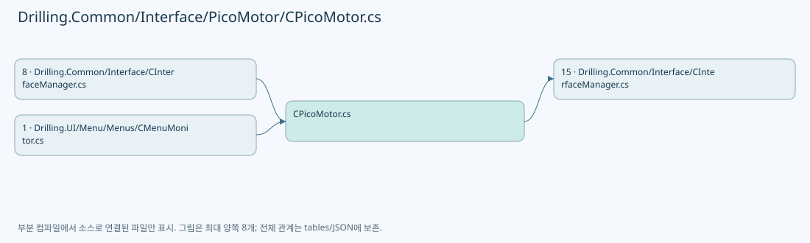

## 네임스페이스·타입·상속

| 타입 | 구분 | 원본 범위 | 선언/상속 |
| --- | --- | --- | --- |
| CPicoMotor | ClassDeclaration | 6–60 | CPicoMotor |
| EN_PICO_MOTOR_COMMAND | EnumDeclaration | 62–79 | EN_PICO_MOTOR_COMMAND |
| EN_PICO_MOTOR_ERROR | EnumDeclaration | 81–100 | EN_PICO_MOTOR_ERROR |
| ST_PICO_MOTOR_STATUS | RecordDeclaration | 102–124 | ST_PICO_MOTOR_STATUS |
| CPicoMotorCommandSession | ClassDeclaration | 126–406 | CPicoMotorCommandSession |
| CPicoMotorService | ClassDeclaration | 408–1017 | CPicoMotorService |

## 멤버 빠른 목록

| 이름 | 종류 | 범위 | 서명 |
| --- | --- | --- | --- |
| StepPerMillimeter | FieldDeclaration | L8–8 | int Drilling.Common.Interface.CPicoMotor.StepPerMillimeter |
| BuildAxisCommand | MethodDeclaration | L9–18 | string Drilling.Common.Interface.CPicoMotor.BuildAxisCommand(int, string, long?, bool) |
| BuildAxisCommand | MethodDeclaration | L20–24 | string Drilling.Common.Interface.CPicoMotor.BuildAxisCommand(int, string, string) |
| BuildGlobalCommand | MethodDeclaration | L26–29 | string Drilling.Common.Interface.CPicoMotor.BuildGlobalCommand(string, bool) |
| MillimeterToStep | MethodDeclaration | L31–34 | long Drilling.Common.Interface.CPicoMotor.MillimeterToStep(double) |
| StepToMillimeter | MethodDeclaration | L36–39 | double Drilling.Common.Interface.CPicoMotor.StepToMillimeter(long) |
| TryParseLong | MethodDeclaration | L41–44 | bool Drilling.Common.Interface.CPicoMotor.TryParseLong(string, out long) |
| TryParseInt | MethodDeclaration | L46–49 | bool Drilling.Common.Interface.CPicoMotor.TryParseInt(string, out int) |
| NormalizeResponse | MethodDeclaration | L51–54 | string Drilling.Common.Interface.CPicoMotor.NormalizeResponse(string) |
| ToError | MethodDeclaration | L56–59 | Drilling.Common.Interface.EN_PICO_MOTOR_ERROR Drilling.Common.Interface.CPicoMotor.ToError(int) |
| Connect | EnumMemberDeclaration | L64–64 | Drilling.Common.Interface.EN_PICO_MOTOR_COMMAND.Connect |
| Disconnect | EnumMemberDeclaration | L65–65 | Drilling.Common.Interface.EN_PICO_MOTOR_COMMAND.Disconnect |
| SelectMotor | EnumMemberDeclaration | L66–66 | Drilling.Common.Interface.EN_PICO_MOTOR_COMMAND.SelectMotor |
| SetVelocity | EnumMemberDeclaration | L67–67 | Drilling.Common.Interface.EN_PICO_MOTOR_COMMAND.SetVelocity |
| SetAcceleration | EnumMemberDeclaration | L68–68 | Drilling.Common.Interface.EN_PICO_MOTOR_COMMAND.SetAcceleration |
| StopMotion | EnumMemberDeclaration | L69–69 | Drilling.Common.Interface.EN_PICO_MOTOR_COMMAND.StopMotion |
| Home | EnumMemberDeclaration | L70–70 | Drilling.Common.Interface.EN_PICO_MOTOR_COMMAND.Home |
| JogNegative | EnumMemberDeclaration | L71–71 | Drilling.Common.Interface.EN_PICO_MOTOR_COMMAND.JogNegative |
| JogPositive | EnumMemberDeclaration | L72–72 | Drilling.Common.Interface.EN_PICO_MOTOR_COMMAND.JogPositive |
| MoveRelativeNegative | EnumMemberDeclaration | L73–73 | Drilling.Common.Interface.EN_PICO_MOTOR_COMMAND.MoveRelativeNegative |
| MoveRelativePositive | EnumMemberDeclaration | L74–74 | Drilling.Common.Interface.EN_PICO_MOTOR_COMMAND.MoveRelativePositive |
| MoveAbsolute | EnumMemberDeclaration | L75–75 | Drilling.Common.Interface.EN_PICO_MOTOR_COMMAND.MoveAbsolute |
| AllMotorStart | EnumMemberDeclaration | L76–76 | Drilling.Common.Interface.EN_PICO_MOTOR_COMMAND.AllMotorStart |
| AllMotorStop | EnumMemberDeclaration | L77–77 | Drilling.Common.Interface.EN_PICO_MOTOR_COMMAND.AllMotorStop |
| Refresh | EnumMemberDeclaration | L78–78 | Drilling.Common.Interface.EN_PICO_MOTOR_COMMAND.Refresh |
| Ok | EnumMemberDeclaration | L83–83 | Drilling.Common.Interface.EN_PICO_MOTOR_ERROR.Ok |
| Error | EnumMemberDeclaration | L84–84 | Drilling.Common.Interface.EN_PICO_MOTOR_ERROR.Error |
| OverTemp | EnumMemberDeclaration | L85–85 | Drilling.Common.Interface.EN_PICO_MOTOR_ERROR.OverTemp |
| CommandNotExist | EnumMemberDeclaration | L86–86 | Drilling.Common.Interface.EN_PICO_MOTOR_ERROR.CommandNotExist |
| ParameterOutOfRange | EnumMemberDeclaration | L87–87 | Drilling.Common.Interface.EN_PICO_MOTOR_ERROR.ParameterOutOfRange |
| AxisNoOutOfRange | EnumMemberDeclaration | L88–88 | Drilling.Common.Interface.EN_PICO_MOTOR_ERROR.AxisNoOutOfRange |
| EepromWriteFail | EnumMemberDeclaration | L89–89 | Drilling.Common.Interface.EN_PICO_MOTOR_ERROR.EepromWriteFail |
| EepromReadFail | EnumMemberDeclaration | L90–90 | Drilling.Common.Interface.EN_PICO_MOTOR_ERROR.EepromReadFail |
| AxisNoMissing | EnumMemberDeclaration | L91–91 | Drilling.Common.Interface.EN_PICO_MOTOR_ERROR.AxisNoMissing |
| CommandParameterMissing | EnumMemberDeclaration | L92–92 | Drilling.Common.Interface.EN_PICO_MOTOR_ERROR.CommandParameterMissing |
| Rs485ExtFault | EnumMemberDeclaration | L93–93 | Drilling.Common.Interface.EN_PICO_MOTOR_ERROR.Rs485ExtFault |
| Rs485CrcFault | EnumMemberDeclaration | L94–94 | Drilling.Common.Interface.EN_PICO_MOTOR_ERROR.Rs485CrcFault |
| ControllerNoOutOfRange | EnumMemberDeclaration | L95–95 | Drilling.Common.Interface.EN_PICO_MOTOR_ERROR.ControllerNoOutOfRange |
| ScanInProgress | EnumMemberDeclaration | L96–96 | Drilling.Common.Interface.EN_PICO_MOTOR_ERROR.ScanInProgress |
| Timeout | EnumMemberDeclaration | L97–97 | Drilling.Common.Interface.EN_PICO_MOTOR_ERROR.Timeout |
| InvalidResponse | EnumMemberDeclaration | L98–98 | Drilling.Common.Interface.EN_PICO_MOTOR_ERROR.InvalidResponse |
| NotSupported | EnumMemberDeclaration | L99–99 | Drilling.Common.Interface.EN_PICO_MOTOR_ERROR.NotSupported |
| Empty | PropertyDeclaration | L123–123 | Drilling.Common.Interface.ST_PICO_MOTOR_STATUS Drilling.Common.Interface.ST_PICO_MOTOR_STATUS.Empty |
| get_Empty | GetAccessorDeclaration | L123–123 | Drilling.Common.Interface.ST_PICO_MOTOR_STATUS Drilling.Common.Interface.ST_PICO_MOTOR_STATUS.Empty.get |
| _syncRoot | FieldDeclaration | L128–128 | object Drilling.Common.Interface.CPicoMotorCommandSession._syncRoot |
| _cmdLib | FieldDeclaration | L129–129 | CmdLib8742? Drilling.Common.Interface.CPicoMotorCommandSession._cmdLib |
| _deviceKey | FieldDeclaration | L130–130 | string Drilling.Common.Interface.CPicoMotorCommandSession._deviceKey |
| IsConnected | PropertyDeclaration | L131–137 | bool Drilling.Common.Interface.CPicoMotorCommandSession.IsConnected |
| get_IsConnected | GetAccessorDeclaration | L133–136 | bool Drilling.Common.Interface.CPicoMotorCommandSession.IsConnected.get |
| DeviceKey | PropertyDeclaration | L139–145 | string Drilling.Common.Interface.CPicoMotorCommandSession.DeviceKey |
| get_DeviceKey | GetAccessorDeclaration | L141–144 | string Drilling.Common.Interface.CPicoMotorCommandSession.DeviceKey.get |
| Connect | MethodDeclaration | L147–174 | bool Drilling.Common.Interface.CPicoMotorCommandSession.Connect(int) |
| Disconnect | MethodDeclaration | L176–195 | void Drilling.Common.Interface.CPicoMotorCommandSession.Disconnect() |
| GetIdentification | MethodDeclaration | L197–206 | string Drilling.Common.Interface.CPicoMotorCommandSession.GetIdentification() |
| MatchesCmdlib8742 | LocalFunctionStatement | L200–203 | bool MatchesCmdlib8742(CmdLib8742) |
| GetPositionStep | MethodDeclaration | L208–218 | int Drilling.Common.Interface.CPicoMotorCommandSession.GetPositionStep(int) |
| MatchesCmdlib8742 | LocalFunctionStatement | L211–214 | bool MatchesCmdlib8742(CmdLib8742) |
| GetVelocityStep | MethodDeclaration | L220–230 | int Drilling.Common.Interface.CPicoMotorCommandSession.GetVelocityStep(int) |
| MatchesCmdlib8742 | LocalFunctionStatement | L223–226 | bool MatchesCmdlib8742(CmdLib8742) |
| GetAccelerationStep | MethodDeclaration | L232–242 | int Drilling.Common.Interface.CPicoMotorCommandSession.GetAccelerationStep(int) |
| MatchesCmdlib8742 | LocalFunctionStatement | L235–238 | bool MatchesCmdlib8742(CmdLib8742) |
| GetMotionDone | MethodDeclaration | L244–254 | bool Drilling.Common.Interface.CPicoMotorCommandSession.GetMotionDone(int) |
| MatchesCmdlib8742 | LocalFunctionStatement | L247–250 | bool MatchesCmdlib8742(CmdLib8742) |
| GetErrorCode | MethodDeclaration | L256–266 | int Drilling.Common.Interface.CPicoMotorCommandSession.GetErrorCode() |
| MatchesCmdlib8742 | LocalFunctionStatement | L259–262 | bool MatchesCmdlib8742(CmdLib8742) |
| GetHomePositionStep | MethodDeclaration | L268–278 | long Drilling.Common.Interface.CPicoMotorCommandSession.GetHomePositionStep(int) |
| MatchesCmdlib8742 | LocalFunctionStatement | L271–274 | bool MatchesCmdlib8742(CmdLib8742) |
| SetVelocity | MethodDeclaration | L280–288 | void Drilling.Common.Interface.CPicoMotorCommandSession.SetVelocity(int, int) |
| MatchesCmdlib8742 | LocalFunctionStatement | L282–285 | bool MatchesCmdlib8742(CmdLib8742) |
| SetAcceleration | MethodDeclaration | L290–298 | void Drilling.Common.Interface.CPicoMotorCommandSession.SetAcceleration(int, int) |
| MatchesCmdlib8742 | LocalFunctionStatement | L292–295 | bool MatchesCmdlib8742(CmdLib8742) |
| StopMotion | MethodDeclaration | L300–308 | void Drilling.Common.Interface.CPicoMotorCommandSession.StopMotion(int) |
| MatchesCmdlib8742 | LocalFunctionStatement | L302–305 | bool MatchesCmdlib8742(CmdLib8742) |
| AbortMotion | MethodDeclaration | L310–318 | void Drilling.Common.Interface.CPicoMotorCommandSession.AbortMotion() |
| MatchesCmdlib8742 | LocalFunctionStatement | L312–315 | bool MatchesCmdlib8742(CmdLib8742) |
| MoveHome | MethodDeclaration | L320–324 | void Drilling.Common.Interface.CPicoMotorCommandSession.MoveHome(int) |
| JogNegative | MethodDeclaration | L326–334 | void Drilling.Common.Interface.CPicoMotorCommandSession.JogNegative(int) |
| MatchesCmdlib8742 | LocalFunctionStatement | L328–331 | bool MatchesCmdlib8742(CmdLib8742) |
| JogPositive | MethodDeclaration | L336–344 | void Drilling.Common.Interface.CPicoMotorCommandSession.JogPositive(int) |
| MatchesCmdlib8742 | LocalFunctionStatement | L338–341 | bool MatchesCmdlib8742(CmdLib8742) |
| RelativeMove | MethodDeclaration | L346–354 | void Drilling.Common.Interface.CPicoMotorCommandSession.RelativeMove(int, long) |
| MatchesCmdlib8742 | LocalFunctionStatement | L348–351 | bool MatchesCmdlib8742(CmdLib8742) |
| AbsoluteMove | MethodDeclaration | L356–364 | void Drilling.Common.Interface.CPicoMotorCommandSession.AbsoluteMove(int, long) |
| MatchesCmdlib8742 | LocalFunctionStatement | L358–361 | bool MatchesCmdlib8742(CmdLib8742) |
| Dispose | MethodDeclaration | L366–369 | void Drilling.Common.Interface.CPicoMotorCommandSession.Dispose() |
| Execute | MethodDeclaration | L371–382 | bool Drilling.Common.Interface.CPicoMotorCommandSession.Execute(System.Func<CmdLib8742, bool>) |
| ExecuteOrThrow | MethodDeclaration | L384–390 | void Drilling.Common.Interface.CPicoMotorCommandSession.ExecuteOrThrow(System.Func<CmdLib8742, bool>, string) |
| ClampMotorNo | MethodDeclaration | L392–395 | int Drilling.Common.Interface.CPicoMotorCommandSession.ClampMotorNo(int) |
| ToInt32Step | MethodDeclaration | L397–405 | int Drilling.Common.Interface.CPicoMotorCommandSession.ToInt32Step(long) |
| _syncRoot | FieldDeclaration | L410–410 | object Drilling.Common.Interface.CPicoMotorService._syncRoot |
| _sessions | FieldDeclaration | L411–411 | System.Collections.Generic.Dictionary<int, Drilling.Common.Interface.CPicoMotorCommandSession> Drilling.Common.Interface.CPicoMotorService._sessions |
| _statuses | FieldDeclaration | L412–412 | System.Collections.Generic.Dictionary<int, Drilling.Common.Interface.ST_PICO_MOTOR_STATUS> Drilling.Common.Interface.CPicoMotorService._statuses |
| _allMoveTokens | FieldDeclaration | L413–413 | System.Collections.Generic.Dictionary<int, System.Threading.CancellationTokenSource> Drilling.Common.Interface.CPicoMotorService._allMoveTokens |
| _motionTokens | FieldDeclaration | L414–414 | System.Collections.Generic.Dictionary<int, System.Threading.CancellationTokenSource> Drilling.Common.Interface.CPicoMotorService._motionTokens |
| SimulationIntervalMs | FieldDeclaration | L415–415 | int Drilling.Common.Interface.CPicoMotorService.SimulationIntervalMs |
| GetStatus | MethodDeclaration | L416–422 | Drilling.Common.Interface.ST_PICO_MOTOR_STATUS Drilling.Common.Interface.CPicoMotorService.GetStatus(int) |
| Refresh | MethodDeclaration | L424–465 | System.Threading.Tasks.Task<Drilling.Common.Interface.ST_PICO_MOTOR_STATUS> Drilling.Common.Interface.CPicoMotorService.Refresh(int, bool, System.Threading.CancellationToken) |
| SelectStatus | LocalFunctionStatement | L435–462 | Drilling.Common.Interface.ST_PICO_MOTOR_STATUS SelectStatus() |
| Execute | MethodDeclaration | L467–527 | System.Threading.Tasks.Task<Drilling.Common.Interface.ST_DEVICE_COMMAND_RESULT> Drilling.Common.Interface.CPicoMotorService.Execute(int, bool, Drilling.Common.Interface.EN_PICO_MOTOR_COMMAND, int, double, System.Threading.CancellationToken) |
| ExecuteLiveCallback | LocalFunctionStatement | L470–473 | void ExecuteLiveCallback() |
| ExecuteAllMove | MethodDeclaration | L529–625 | System.Threading.Tasks.Task<Drilling.Common.Interface.ST_DEVICE_COMMAND_RESULT> Drilling.Common.Interface.CPicoMotorService.ExecuteAllMove(int, bool, System.Collections.Generic.IReadOnlyCollection<int>, double, int, System.Threading.CancellationToken) |
| ShouldIncludeItem | LocalFunctionStatement | L531–534 | bool ShouldIncludeItem(int) |
| SelectValue | LocalFunctionStatement | L536–539 | int SelectValue(int) |
| GeneratedMoveCallback | LocalFunctionStatement | L585–592 | void GeneratedMoveCallback() |
| CancelAllMove | MethodDeclaration | L627–634 | void Drilling.Common.Interface.CPicoMotorService.CancelAllMove(int) |
| CancelMotion | MethodDeclaration | L636–645 | void Drilling.Common.Interface.CPicoMotorService.CancelMotion(int) |
| IsMoveCommand | MethodDeclaration | L647–650 | bool Drilling.Common.Interface.CPicoMotorService.IsMoveCommand(Drilling.Common.Interface.EN_PICO_MOTOR_COMMAND) |
| ValidateSimulationMove | MethodDeclaration | L652–675 | bool Drilling.Common.Interface.CPicoMotorService.ValidateSimulationMove(int, out Drilling.Common.Interface.ST_DEVICE_COMMAND_RESULT) |
| SimulateAllMotorMoveByDelta | MethodDeclaration | L677–721 | System.Threading.Tasks.Task Drilling.Common.Interface.CPicoMotorService.SimulateAllMotorMoveByDelta(int, System.Collections.Generic.IReadOnlyList<int>, double, System.Threading.CancellationToken) |
| SelectMotorNo | LocalFunctionStatement | L680–683 | int SelectMotorNo(int) |
| SelectValue | LocalFunctionStatement | L685–688 | double SelectValue(int) |
| WaitAllMotorsDone | MethodDeclaration | L723–747 | System.Threading.Tasks.Task Drilling.Common.Interface.CPicoMotorService.WaitAllMotorsDone(Drilling.Common.Interface.CPicoMotorCommandSession, System.Collections.Generic.IReadOnlyList<int>, System.Threading.CancellationToken) |
| Matches | LocalFunctionStatement | L726–729 | bool Matches() |
| GetSimulationStepDistance | MethodDeclaration | L749–752 | double Drilling.Common.Interface.CPicoMotorService.GetSimulationStepDistance(Drilling.Common.Interface.ST_PICO_MOTOR_STATUS) |
| Disconnect | MethodDeclaration | L754–766 | void Drilling.Common.Interface.CPicoMotorService.Disconnect(int) |
| DisconnectAll | MethodDeclaration | L768–783 | void Drilling.Common.Interface.CPicoMotorService.DisconnectAll() |
| Dispose | MethodDeclaration | L785–788 | void Drilling.Common.Interface.CPicoMotorService.Dispose() |
| ExecuteLive | MethodDeclaration | L790–860 | void Drilling.Common.Interface.CPicoMotorService.ExecuteLive(int, Drilling.Common.Interface.EN_PICO_MOTOR_COMMAND, int, double) |
| ExecuteSimulation | MethodDeclaration | L862–899 | void Drilling.Common.Interface.CPicoMotorService.ExecuteSimulation(int, Drilling.Common.Interface.EN_PICO_MOTOR_COMMAND, int, double) |
| ExecuteSimulationPositionMove | MethodDeclaration | L901–960 | System.Threading.Tasks.Task Drilling.Common.Interface.CPicoMotorService.ExecuteSimulationPositionMove(int, Drilling.Common.Interface.EN_PICO_MOTOR_COMMAND, int, double, System.Threading.CancellationToken) |
| GetSession | MethodDeclaration | L962–976 | Drilling.Common.Interface.CPicoMotorCommandSession Drilling.Common.Interface.CPicoMotorService.GetSession(int, bool) |
| SetStatus | MethodDeclaration | L978–982 | void Drilling.Common.Interface.CPicoMotorService.SetStatus(int, Drilling.Common.Interface.ST_PICO_MOTOR_STATUS) |
| GetPosition | MethodDeclaration | L984–993 | double Drilling.Common.Interface.CPicoMotorService.GetPosition(Drilling.Common.Interface.ST_PICO_MOTOR_STATUS, int) |
| SetPosition | MethodDeclaration | L995–1016 | Drilling.Common.Interface.ST_PICO_MOTOR_STATUS Drilling.Common.Interface.CPicoMotorService.SetPosition(Drilling.Common.Interface.ST_PICO_MOTOR_STATUS, int, double) |

## 멤버별 상세 계약·호출·처리 해설

### FieldDeclaration `StepPerMillimeter` · L8–8

[Drilling.Common/Interface/PicoMotor/CPicoMotor.cs:8–8](https://github.com/kjuws10-rgb/A3Drilling/blob/5aee8e58439c9b455cae7c9593c9be986c3e682e/Drilling.Common/Interface/PicoMotor/CPicoMotor.cs#L8-L8)

| 항목 | 실제 추출 값 |
| --- | --- |
| 서명 | int Drilling.Common.Interface.CPicoMotor.StepPerMillimeter |
| 접근/수식자 | Public / public, const |
| 반환/값 타입 | int |
| 소속 타입 | NamedType:Drilling.Common.Interface.CPicoMotor |

현재 부분 분석에서 직접 연결된 호출자는 없습니다. XAML/이벤트/인터페이스·델리게이트·외부 진입을 추가 확인해야 하며, 미사용으로 판정한 것이 아닙니다.

본문의 실제 연산·분기·예외·반환 순서(원문 위치 순):

| 원본 행 | 종류 | 주석 해설 |
| --- | --- | --- |
| 8 | variable-initializer | 변수의 초기값을 지정합니다: StepPerMillimeter = 50000 |

변경 전 점검: 입력/반환 타입, 위 호출자, 예외/취소 경로, 공유 상태와 저장·전송 소비자를 함께 확인합니다. 값의 단위나 물리 방향을 이름만으로 확정하지 않습니다.

### MethodDeclaration `BuildAxisCommand` · L9–18

[Drilling.Common/Interface/PicoMotor/CPicoMotor.cs:9–18](https://github.com/kjuws10-rgb/A3Drilling/blob/5aee8e58439c9b455cae7c9593c9be986c3e682e/Drilling.Common/Interface/PicoMotor/CPicoMotor.cs#L9-L18)

| 항목 | 실제 추출 값 |
| --- | --- |
| 서명 | string Drilling.Common.Interface.CPicoMotor.BuildAxisCommand(int, string, long?, bool) |
| 접근/수식자 | Public / public, static |
| 반환/값 타입 | string |
| 소속 타입 | NamedType:Drilling.Common.Interface.CPicoMotor |

입력 계약:

| 이름 | 타입 | 전달 | 선택/기본값 |
| --- | --- | --- | --- |
| motorNo | int | None | False /  |
| command | string | None | False /  |
| value | long? | None | True / null |
| isQuery | bool | None | True / false |

현재 부분 분석에서 직접 연결된 호출자는 없습니다. XAML/이벤트/인터페이스·델리게이트·외부 진입을 추가 확인해야 하며, 미사용으로 판정한 것이 아닙니다.

호출하는 대상과 해석 범위:

| 원본 행 | 표현식 | 분석 상태 | 대상/소스 위치 |
| --- | --- | --- | --- |
| 11 | Math.Clamp | resolved | int System.Math.Clamp(int, int, int) |
| 17 | value.Value.ToString | resolved | string long.ToString(System.IFormatProvider?) |

본문의 실제 연산·분기·예외·반환 순서(원문 위치 순):

| 원본 행 | 종류 | 주석 해설 |
| --- | --- | --- |
| 11 | call | 함수·델리게이트 또는 객체 생성자를 호출합니다: Math.Clamp(motorNo, 1, 4) |
| 11 | local-declaration | 지역 변수를 선언합니다: var axis = Math.Clamp(motorNo, 1, 4); |
| 11 | variable-initializer | 변수의 초기값을 지정합니다: axis = Math.Clamp(motorNo, 1, 4) |
| 12 | if | 조건에 따라 분기합니다: if (isQuery) |
| 14 | return | 호출자에게 값 또는 제어를 반환합니다: return $"{axis}{command}?\n"; |
| 17 | call | 함수·델리게이트 또는 객체 생성자를 호출합니다: value.Value.ToString(CultureInfo.InvariantCulture) |
| 17 | conditional-expression | 조건에 따라 결과식을 선택합니다: value is null ? $"{axis}{command}\n" : $"{axis}{command}{value.Value.ToString(CultureInfo.InvariantCulture)}\n" |
| 17 | return | 호출자에게 값 또는 제어를 반환합니다: return value is null ? $"{axis}{command}\n" : $"{axis}{command}{value.Value.ToString(CultureInfo.InvariantCulture)}\n"; |

제어 구문의 포함 구조(실제 실행 순서/CFG가 아닌 구문 탐색 그림):

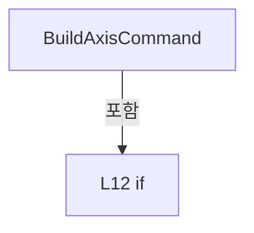

변경 전 점검: 입력/반환 타입, 위 호출자, 예외/취소 경로, 공유 상태와 저장·전송 소비자를 함께 확인합니다. 값의 단위나 물리 방향을 이름만으로 확정하지 않습니다.

### MethodDeclaration `BuildAxisCommand` · L20–24

[Drilling.Common/Interface/PicoMotor/CPicoMotor.cs:20–24](https://github.com/kjuws10-rgb/A3Drilling/blob/5aee8e58439c9b455cae7c9593c9be986c3e682e/Drilling.Common/Interface/PicoMotor/CPicoMotor.cs#L20-L24)

| 항목 | 실제 추출 값 |
| --- | --- |
| 서명 | string Drilling.Common.Interface.CPicoMotor.BuildAxisCommand(int, string, string) |
| 접근/수식자 | Public / public, static |
| 반환/값 타입 | string |
| 소속 타입 | NamedType:Drilling.Common.Interface.CPicoMotor |

입력 계약:

| 이름 | 타입 | 전달 | 선택/기본값 |
| --- | --- | --- | --- |
| motorNo | int | None | False /  |
| command | string | None | False /  |
| value | string | None | False /  |

현재 부분 분석에서 직접 연결된 호출자는 없습니다. XAML/이벤트/인터페이스·델리게이트·외부 진입을 추가 확인해야 하며, 미사용으로 판정한 것이 아닙니다.

호출하는 대상과 해석 범위:

| 원본 행 | 표현식 | 분석 상태 | 대상/소스 위치 |
| --- | --- | --- | --- |
| 22 | Math.Clamp | resolved | int System.Math.Clamp(int, int, int) |

본문의 실제 연산·분기·예외·반환 순서(원문 위치 순):

| 원본 행 | 종류 | 주석 해설 |
| --- | --- | --- |
| 22 | call | 함수·델리게이트 또는 객체 생성자를 호출합니다: Math.Clamp(motorNo, 1, 4) |
| 22 | local-declaration | 지역 변수를 선언합니다: var axis = Math.Clamp(motorNo, 1, 4); |
| 22 | variable-initializer | 변수의 초기값을 지정합니다: axis = Math.Clamp(motorNo, 1, 4) |
| 23 | return | 호출자에게 값 또는 제어를 반환합니다: return $"{axis}{command}{value}\n"; |

변경 전 점검: 입력/반환 타입, 위 호출자, 예외/취소 경로, 공유 상태와 저장·전송 소비자를 함께 확인합니다. 값의 단위나 물리 방향을 이름만으로 확정하지 않습니다.

### MethodDeclaration `BuildGlobalCommand` · L26–29

[Drilling.Common/Interface/PicoMotor/CPicoMotor.cs:26–29](https://github.com/kjuws10-rgb/A3Drilling/blob/5aee8e58439c9b455cae7c9593c9be986c3e682e/Drilling.Common/Interface/PicoMotor/CPicoMotor.cs#L26-L29)

| 항목 | 실제 추출 값 |
| --- | --- |
| 서명 | string Drilling.Common.Interface.CPicoMotor.BuildGlobalCommand(string, bool) |
| 접근/수식자 | Public / public, static |
| 반환/값 타입 | string |
| 소속 타입 | NamedType:Drilling.Common.Interface.CPicoMotor |

입력 계약:

| 이름 | 타입 | 전달 | 선택/기본값 |
| --- | --- | --- | --- |
| command | string | None | False /  |
| isQuery | bool | None | True / false |

현재 부분 분석에서 직접 연결된 호출자는 없습니다. XAML/이벤트/인터페이스·델리게이트·외부 진입을 추가 확인해야 하며, 미사용으로 판정한 것이 아닙니다.

본문의 실제 연산·분기·예외·반환 순서(원문 위치 순):

| 원본 행 | 종류 | 주석 해설 |
| --- | --- | --- |
| 28 | conditional-expression | 조건에 따라 결과식을 선택합니다: isQuery ? $"{command}?\n" : $"{command}\n" |
| 28 | return | 호출자에게 값 또는 제어를 반환합니다: return isQuery ? $"{command}?\n" : $"{command}\n"; |

변경 전 점검: 입력/반환 타입, 위 호출자, 예외/취소 경로, 공유 상태와 저장·전송 소비자를 함께 확인합니다. 값의 단위나 물리 방향을 이름만으로 확정하지 않습니다.

### MethodDeclaration `MillimeterToStep` · L31–34

[Drilling.Common/Interface/PicoMotor/CPicoMotor.cs:31–34](https://github.com/kjuws10-rgb/A3Drilling/blob/5aee8e58439c9b455cae7c9593c9be986c3e682e/Drilling.Common/Interface/PicoMotor/CPicoMotor.cs#L31-L34)

| 항목 | 실제 추출 값 |
| --- | --- |
| 서명 | long Drilling.Common.Interface.CPicoMotor.MillimeterToStep(double) |
| 접근/수식자 | Public / public, static |
| 반환/값 타입 | long |
| 소속 타입 | NamedType:Drilling.Common.Interface.CPicoMotor |

입력 계약:

| 이름 | 타입 | 전달 | 선택/기본값 |
| --- | --- | --- | --- |
| value | double | None | False /  |

정적 호출자로 확인된 위치:

| 호출 파일/행 | 호출 표현식 | 런타임 분기 가능 |
| --- | --- | --- |
| [Drilling.Common/Interface/PicoMotor/CPicoMotor.cs:479–479](https://github.com/kjuws10-rgb/A3Drilling/blob/5aee8e58439c9b455cae7c9593c9be986c3e682e/Drilling.Common/Interface/PicoMotor/CPicoMotor.cs#L479-L479) | CPicoMotor.MillimeterToStep | False |
| [Drilling.Common/Interface/PicoMotor/CPicoMotor.cs:584–584](https://github.com/kjuws10-rgb/A3Drilling/blob/5aee8e58439c9b455cae7c9593c9be986c3e682e/Drilling.Common/Interface/PicoMotor/CPicoMotor.cs#L584-L584) | CPicoMotor.MillimeterToStep | False |
| [Drilling.Common/Interface/PicoMotor/CPicoMotor.cs:815–815](https://github.com/kjuws10-rgb/A3Drilling/blob/5aee8e58439c9b455cae7c9593c9be986c3e682e/Drilling.Common/Interface/PicoMotor/CPicoMotor.cs#L815-L815) | CPicoMotor.MillimeterToStep | False |
| [Drilling.Common/Interface/PicoMotor/CPicoMotor.cs:818–818](https://github.com/kjuws10-rgb/A3Drilling/blob/5aee8e58439c9b455cae7c9593c9be986c3e682e/Drilling.Common/Interface/PicoMotor/CPicoMotor.cs#L818-L818) | CPicoMotor.MillimeterToStep | False |
| [Drilling.Common/Interface/PicoMotor/CPicoMotor.cs:837–837](https://github.com/kjuws10-rgb/A3Drilling/blob/5aee8e58439c9b455cae7c9593c9be986c3e682e/Drilling.Common/Interface/PicoMotor/CPicoMotor.cs#L837-L837) | CPicoMotor.MillimeterToStep | False |
| [Drilling.Common/Interface/PicoMotor/CPicoMotor.cs:840–840](https://github.com/kjuws10-rgb/A3Drilling/blob/5aee8e58439c9b455cae7c9593c9be986c3e682e/Drilling.Common/Interface/PicoMotor/CPicoMotor.cs#L840-L840) | CPicoMotor.MillimeterToStep | False |
| [Drilling.Common/Interface/PicoMotor/CPicoMotor.cs:843–843](https://github.com/kjuws10-rgb/A3Drilling/blob/5aee8e58439c9b455cae7c9593c9be986c3e682e/Drilling.Common/Interface/PicoMotor/CPicoMotor.cs#L843-L843) | CPicoMotor.MillimeterToStep | False |

호출하는 대상과 해석 범위:

| 원본 행 | 표현식 | 분석 상태 | 대상/소스 위치 |
| --- | --- | --- | --- |
| 33 | Convert.ToInt64 | resolved | long System.Convert.ToInt64(double) |
| 33 | Math.Round | resolved | double System.Math.Round(double, System.MidpointRounding) |

본문의 실제 연산·분기·예외·반환 순서(원문 위치 순):

| 원본 행 | 종류 | 주석 해설 |
| --- | --- | --- |
| 33 | call | 함수·델리게이트 또는 객체 생성자를 호출합니다: Convert.ToInt64(Math.Round(value * StepPerMillimeter, MidpointRounding.AwayFromZero)) |
| 33 | call | 함수·델리게이트 또는 객체 생성자를 호출합니다: Math.Round(value * StepPerMillimeter, MidpointRounding.AwayFromZero) |
| 33 | return | 호출자에게 값 또는 제어를 반환합니다: return Convert.ToInt64(Math.Round(value * StepPerMillimeter, MidpointRounding.AwayFromZero)); |

변경 전 점검: 입력/반환 타입, 위 호출자, 예외/취소 경로, 공유 상태와 저장·전송 소비자를 함께 확인합니다. 값의 단위나 물리 방향을 이름만으로 확정하지 않습니다.

### MethodDeclaration `StepToMillimeter` · L36–39

[Drilling.Common/Interface/PicoMotor/CPicoMotor.cs:36–39](https://github.com/kjuws10-rgb/A3Drilling/blob/5aee8e58439c9b455cae7c9593c9be986c3e682e/Drilling.Common/Interface/PicoMotor/CPicoMotor.cs#L36-L39)

| 항목 | 실제 추출 값 |
| --- | --- |
| 서명 | double Drilling.Common.Interface.CPicoMotor.StepToMillimeter(long) |
| 접근/수식자 | Public / public, static |
| 반환/값 타입 | double |
| 소속 타입 | NamedType:Drilling.Common.Interface.CPicoMotor |

입력 계약:

| 이름 | 타입 | 전달 | 선택/기본값 |
| --- | --- | --- | --- |
| value | long | None | False /  |

정적 호출자로 확인된 위치:

| 호출 파일/행 | 호출 표현식 | 런타임 분기 가능 |
| --- | --- | --- |
| [Drilling.Common/Interface/PicoMotor/CPicoMotor.cs:447–447](https://github.com/kjuws10-rgb/A3Drilling/blob/5aee8e58439c9b455cae7c9593c9be986c3e682e/Drilling.Common/Interface/PicoMotor/CPicoMotor.cs#L447-L447) | CPicoMotor.StepToMillimeter | False |
| [Drilling.Common/Interface/PicoMotor/CPicoMotor.cs:448–448](https://github.com/kjuws10-rgb/A3Drilling/blob/5aee8e58439c9b455cae7c9593c9be986c3e682e/Drilling.Common/Interface/PicoMotor/CPicoMotor.cs#L448-L448) | CPicoMotor.StepToMillimeter | False |
| [Drilling.Common/Interface/PicoMotor/CPicoMotor.cs:449–449](https://github.com/kjuws10-rgb/A3Drilling/blob/5aee8e58439c9b455cae7c9593c9be986c3e682e/Drilling.Common/Interface/PicoMotor/CPicoMotor.cs#L449-L449) | CPicoMotor.StepToMillimeter | False |
| [Drilling.Common/Interface/PicoMotor/CPicoMotor.cs:450–450](https://github.com/kjuws10-rgb/A3Drilling/blob/5aee8e58439c9b455cae7c9593c9be986c3e682e/Drilling.Common/Interface/PicoMotor/CPicoMotor.cs#L450-L450) | CPicoMotor.StepToMillimeter | False |
| [Drilling.Common/Interface/PicoMotor/CPicoMotor.cs:452–452](https://github.com/kjuws10-rgb/A3Drilling/blob/5aee8e58439c9b455cae7c9593c9be986c3e682e/Drilling.Common/Interface/PicoMotor/CPicoMotor.cs#L452-L452) | CPicoMotor.StepToMillimeter | False |
| [Drilling.Common/Interface/PicoMotor/CPicoMotor.cs:453–453](https://github.com/kjuws10-rgb/A3Drilling/blob/5aee8e58439c9b455cae7c9593c9be986c3e682e/Drilling.Common/Interface/PicoMotor/CPicoMotor.cs#L453-L453) | CPicoMotor.StepToMillimeter | False |
| [Drilling.Common/Interface/PicoMotor/CPicoMotor.cs:884–884](https://github.com/kjuws10-rgb/A3Drilling/blob/5aee8e58439c9b455cae7c9593c9be986c3e682e/Drilling.Common/Interface/PicoMotor/CPicoMotor.cs#L884-L884) | CPicoMotor.StepToMillimeter | False |
| [Drilling.Common/Interface/PicoMotor/CPicoMotor.cs:916–916](https://github.com/kjuws10-rgb/A3Drilling/blob/5aee8e58439c9b455cae7c9593c9be986c3e682e/Drilling.Common/Interface/PicoMotor/CPicoMotor.cs#L916-L916) | CPicoMotor.StepToMillimeter | False |
| [Drilling.UI/Menu/Menus/CMenuMonitor.cs:5849–5849](https://github.com/kjuws10-rgb/A3Drilling/blob/5aee8e58439c9b455cae7c9593c9be986c3e682e/Drilling.UI/Menu/Menus/CMenuMonitor.cs#L5849-L5849) | CPicoMotor.StepToMillimeter | False |

본문의 실제 연산·분기·예외·반환 순서(원문 위치 순):

| 원본 행 | 종류 | 주석 해설 |
| --- | --- | --- |
| 38 | return | 호출자에게 값 또는 제어를 반환합니다: return value / (double)StepPerMillimeter; |

변경 전 점검: 입력/반환 타입, 위 호출자, 예외/취소 경로, 공유 상태와 저장·전송 소비자를 함께 확인합니다. 값의 단위나 물리 방향을 이름만으로 확정하지 않습니다.

### MethodDeclaration `TryParseLong` · L41–44

[Drilling.Common/Interface/PicoMotor/CPicoMotor.cs:41–44](https://github.com/kjuws10-rgb/A3Drilling/blob/5aee8e58439c9b455cae7c9593c9be986c3e682e/Drilling.Common/Interface/PicoMotor/CPicoMotor.cs#L41-L44)

| 항목 | 실제 추출 값 |
| --- | --- |
| 서명 | bool Drilling.Common.Interface.CPicoMotor.TryParseLong(string, out long) |
| 접근/수식자 | Public / public, static |
| 반환/값 타입 | bool |
| 소속 타입 | NamedType:Drilling.Common.Interface.CPicoMotor |

입력 계약:

| 이름 | 타입 | 전달 | 선택/기본값 |
| --- | --- | --- | --- |
| response | string | None | False /  |
| value | long | Out | False /  |

현재 부분 분석에서 직접 연결된 호출자는 없습니다. XAML/이벤트/인터페이스·델리게이트·외부 진입을 추가 확인해야 하며, 미사용으로 판정한 것이 아닙니다.

호출하는 대상과 해석 범위:

| 원본 행 | 표현식 | 분석 상태 | 대상/소스 위치 |
| --- | --- | --- | --- |
| 43 | long.TryParse | resolved | bool long.TryParse(string?, System.Globalization.NumberStyles, System.IFormatProvider?, out long) |
| 43 | NormalizeResponse | resolved | string Drilling.Common.Interface.CPicoMotor.NormalizeResponse(string) · Drilling.Common/Interface/PicoMotor/CPicoMotor.cs:51 |

본문의 실제 연산·분기·예외·반환 순서(원문 위치 순):

| 원본 행 | 종류 | 주석 해설 |
| --- | --- | --- |
| 43 | call | 함수·델리게이트 또는 객체 생성자를 호출합니다: long.TryParse(NormalizeResponse(response), NumberStyles.Integer, CultureInfo.InvariantCulture, out value) |
| 43 | call | 함수·델리게이트 또는 객체 생성자를 호출합니다: NormalizeResponse(response) |
| 43 | return | 호출자에게 값 또는 제어를 반환합니다: return long.TryParse(NormalizeResponse(response), NumberStyles.Integer, CultureInfo.InvariantCulture, out value); |

변경 전 점검: 입력/반환 타입, 위 호출자, 예외/취소 경로, 공유 상태와 저장·전송 소비자를 함께 확인합니다. 값의 단위나 물리 방향을 이름만으로 확정하지 않습니다.

### MethodDeclaration `TryParseInt` · L46–49

[Drilling.Common/Interface/PicoMotor/CPicoMotor.cs:46–49](https://github.com/kjuws10-rgb/A3Drilling/blob/5aee8e58439c9b455cae7c9593c9be986c3e682e/Drilling.Common/Interface/PicoMotor/CPicoMotor.cs#L46-L49)

| 항목 | 실제 추출 값 |
| --- | --- |
| 서명 | bool Drilling.Common.Interface.CPicoMotor.TryParseInt(string, out int) |
| 접근/수식자 | Public / public, static |
| 반환/값 타입 | bool |
| 소속 타입 | NamedType:Drilling.Common.Interface.CPicoMotor |

입력 계약:

| 이름 | 타입 | 전달 | 선택/기본값 |
| --- | --- | --- | --- |
| response | string | None | False /  |
| value | int | Out | False /  |

현재 부분 분석에서 직접 연결된 호출자는 없습니다. XAML/이벤트/인터페이스·델리게이트·외부 진입을 추가 확인해야 하며, 미사용으로 판정한 것이 아닙니다.

호출하는 대상과 해석 범위:

| 원본 행 | 표현식 | 분석 상태 | 대상/소스 위치 |
| --- | --- | --- | --- |
| 48 | int.TryParse | resolved | bool int.TryParse(string?, System.Globalization.NumberStyles, System.IFormatProvider?, out int) |
| 48 | NormalizeResponse | resolved | string Drilling.Common.Interface.CPicoMotor.NormalizeResponse(string) · Drilling.Common/Interface/PicoMotor/CPicoMotor.cs:51 |

본문의 실제 연산·분기·예외·반환 순서(원문 위치 순):

| 원본 행 | 종류 | 주석 해설 |
| --- | --- | --- |
| 48 | call | 함수·델리게이트 또는 객체 생성자를 호출합니다: int.TryParse(NormalizeResponse(response), NumberStyles.Integer, CultureInfo.InvariantCulture, out value) |
| 48 | call | 함수·델리게이트 또는 객체 생성자를 호출합니다: NormalizeResponse(response) |
| 48 | return | 호출자에게 값 또는 제어를 반환합니다: return int.TryParse(NormalizeResponse(response), NumberStyles.Integer, CultureInfo.InvariantCulture, out value); |

변경 전 점검: 입력/반환 타입, 위 호출자, 예외/취소 경로, 공유 상태와 저장·전송 소비자를 함께 확인합니다. 값의 단위나 물리 방향을 이름만으로 확정하지 않습니다.

### MethodDeclaration `NormalizeResponse` · L51–54

[Drilling.Common/Interface/PicoMotor/CPicoMotor.cs:51–54](https://github.com/kjuws10-rgb/A3Drilling/blob/5aee8e58439c9b455cae7c9593c9be986c3e682e/Drilling.Common/Interface/PicoMotor/CPicoMotor.cs#L51-L54)

| 항목 | 실제 추출 값 |
| --- | --- |
| 서명 | string Drilling.Common.Interface.CPicoMotor.NormalizeResponse(string) |
| 접근/수식자 | Public / public, static |
| 반환/값 타입 | string |
| 소속 타입 | NamedType:Drilling.Common.Interface.CPicoMotor |

입력 계약:

| 이름 | 타입 | 전달 | 선택/기본값 |
| --- | --- | --- | --- |
| response | string | None | False /  |

정적 호출자로 확인된 위치:

| 호출 파일/행 | 호출 표현식 | 런타임 분기 가능 |
| --- | --- | --- |
| [Drilling.Common/Interface/PicoMotor/CPicoMotor.cs:43–43](https://github.com/kjuws10-rgb/A3Drilling/blob/5aee8e58439c9b455cae7c9593c9be986c3e682e/Drilling.Common/Interface/PicoMotor/CPicoMotor.cs#L43-L43) | NormalizeResponse | False |
| [Drilling.Common/Interface/PicoMotor/CPicoMotor.cs:48–48](https://github.com/kjuws10-rgb/A3Drilling/blob/5aee8e58439c9b455cae7c9593c9be986c3e682e/Drilling.Common/Interface/PicoMotor/CPicoMotor.cs#L48-L48) | NormalizeResponse | False |
| [Drilling.Common/Interface/PicoMotor/CPicoMotor.cs:265–265](https://github.com/kjuws10-rgb/A3Drilling/blob/5aee8e58439c9b455cae7c9593c9be986c3e682e/Drilling.Common/Interface/PicoMotor/CPicoMotor.cs#L265-L265) | CPicoMotor.NormalizeResponse | False |
| [Drilling.Common/Interface/PicoMotor/CPicoMotor.cs:277–277](https://github.com/kjuws10-rgb/A3Drilling/blob/5aee8e58439c9b455cae7c9593c9be986c3e682e/Drilling.Common/Interface/PicoMotor/CPicoMotor.cs#L277-L277) | CPicoMotor.NormalizeResponse | False |

호출하는 대상과 해석 범위:

| 원본 행 | 표현식 | 분석 상태 | 대상/소스 위치 |
| --- | --- | --- | --- |
| 53 | response.Trim().TrimEnd('\0').Trim | resolved | string string.Trim() |
| 53 | response.Trim().TrimEnd | resolved | string string.TrimEnd(char) |
| 53 | response.Trim | resolved | string string.Trim() |

본문의 실제 연산·분기·예외·반환 순서(원문 위치 순):

| 원본 행 | 종류 | 주석 해설 |
| --- | --- | --- |
| 53 | call | 함수·델리게이트 또는 객체 생성자를 호출합니다: response.Trim().TrimEnd('\0').Trim() |
| 53 | call | 함수·델리게이트 또는 객체 생성자를 호출합니다: response.Trim().TrimEnd('\0') |
| 53 | call | 함수·델리게이트 또는 객체 생성자를 호출합니다: response.Trim() |
| 53 | return | 호출자에게 값 또는 제어를 반환합니다: return response.Trim().TrimEnd('\0').Trim(); |

변경 전 점검: 입력/반환 타입, 위 호출자, 예외/취소 경로, 공유 상태와 저장·전송 소비자를 함께 확인합니다. 값의 단위나 물리 방향을 이름만으로 확정하지 않습니다.

### MethodDeclaration `ToError` · L56–59

[Drilling.Common/Interface/PicoMotor/CPicoMotor.cs:56–59](https://github.com/kjuws10-rgb/A3Drilling/blob/5aee8e58439c9b455cae7c9593c9be986c3e682e/Drilling.Common/Interface/PicoMotor/CPicoMotor.cs#L56-L59)

| 항목 | 실제 추출 값 |
| --- | --- |
| 서명 | Drilling.Common.Interface.EN_PICO_MOTOR_ERROR Drilling.Common.Interface.CPicoMotor.ToError(int) |
| 접근/수식자 | Public / public, static |
| 반환/값 타입 | Drilling.Common.Interface.EN_PICO_MOTOR_ERROR |
| 소속 타입 | NamedType:Drilling.Common.Interface.CPicoMotor |

입력 계약:

| 이름 | 타입 | 전달 | 선택/기본값 |
| --- | --- | --- | --- |
| errorCode | int | None | False /  |

정적 호출자로 확인된 위치:

| 호출 파일/행 | 호출 표현식 | 런타임 분기 가능 |
| --- | --- | --- |
| [Drilling.Common/Interface/PicoMotor/CPicoMotor.cs:457–457](https://github.com/kjuws10-rgb/A3Drilling/blob/5aee8e58439c9b455cae7c9593c9be986c3e682e/Drilling.Common/Interface/PicoMotor/CPicoMotor.cs#L457-L457) | CPicoMotor.ToError | False |

호출하는 대상과 해석 범위:

| 원본 행 | 표현식 | 분석 상태 | 대상/소스 위치 |
| --- | --- | --- | --- |
| 58 | Enum.IsDefined | resolved | bool System.Enum.IsDefined(System.Type, object) |

본문의 실제 연산·분기·예외·반환 순서(원문 위치 순):

| 원본 행 | 종류 | 주석 해설 |
| --- | --- | --- |
| 58 | call | 함수·델리게이트 또는 객체 생성자를 호출합니다: Enum.IsDefined(typeof(EN_PICO_MOTOR_ERROR), errorCode) |
| 58 | conditional-expression | 조건에 따라 결과식을 선택합니다: Enum.IsDefined(typeof(EN_PICO_MOTOR_ERROR), errorCode) ? (EN_PICO_MOTOR_ERROR)errorCode : EN_PICO_MOTOR_ERROR.Error |
| 58 | return | 호출자에게 값 또는 제어를 반환합니다: return Enum.IsDefined(typeof(EN_PICO_MOTOR_ERROR), errorCode) ? (EN_PICO_MOTOR_ERROR)errorCode : EN_PICO_MOTOR_ERROR.Error; |

변경 전 점검: 입력/반환 타입, 위 호출자, 예외/취소 경로, 공유 상태와 저장·전송 소비자를 함께 확인합니다. 값의 단위나 물리 방향을 이름만으로 확정하지 않습니다.

### EnumMemberDeclaration `Connect` · L64–64

[Drilling.Common/Interface/PicoMotor/CPicoMotor.cs:64–64](https://github.com/kjuws10-rgb/A3Drilling/blob/5aee8e58439c9b455cae7c9593c9be986c3e682e/Drilling.Common/Interface/PicoMotor/CPicoMotor.cs#L64-L64)

| 항목 | 실제 추출 값 |
| --- | --- |
| 서명 | Drilling.Common.Interface.EN_PICO_MOTOR_COMMAND.Connect |
| 접근/수식자 | Public /  |
| 반환/값 타입 | Drilling.Common.Interface.EN_PICO_MOTOR_COMMAND |
| 소속 타입 | NamedType:Drilling.Common.Interface.EN_PICO_MOTOR_COMMAND |

현재 부분 분석에서 직접 연결된 호출자는 없습니다. XAML/이벤트/인터페이스·델리게이트·외부 진입을 추가 확인해야 하며, 미사용으로 판정한 것이 아닙니다.

변경 전 점검: 입력/반환 타입, 위 호출자, 예외/취소 경로, 공유 상태와 저장·전송 소비자를 함께 확인합니다. 값의 단위나 물리 방향을 이름만으로 확정하지 않습니다.

### EnumMemberDeclaration `Disconnect` · L65–65

[Drilling.Common/Interface/PicoMotor/CPicoMotor.cs:65–65](https://github.com/kjuws10-rgb/A3Drilling/blob/5aee8e58439c9b455cae7c9593c9be986c3e682e/Drilling.Common/Interface/PicoMotor/CPicoMotor.cs#L65-L65)

| 항목 | 실제 추출 값 |
| --- | --- |
| 서명 | Drilling.Common.Interface.EN_PICO_MOTOR_COMMAND.Disconnect |
| 접근/수식자 | Public /  |
| 반환/값 타입 | Drilling.Common.Interface.EN_PICO_MOTOR_COMMAND |
| 소속 타입 | NamedType:Drilling.Common.Interface.EN_PICO_MOTOR_COMMAND |

현재 부분 분석에서 직접 연결된 호출자는 없습니다. XAML/이벤트/인터페이스·델리게이트·외부 진입을 추가 확인해야 하며, 미사용으로 판정한 것이 아닙니다.

변경 전 점검: 입력/반환 타입, 위 호출자, 예외/취소 경로, 공유 상태와 저장·전송 소비자를 함께 확인합니다. 값의 단위나 물리 방향을 이름만으로 확정하지 않습니다.

### EnumMemberDeclaration `SelectMotor` · L66–66

[Drilling.Common/Interface/PicoMotor/CPicoMotor.cs:66–66](https://github.com/kjuws10-rgb/A3Drilling/blob/5aee8e58439c9b455cae7c9593c9be986c3e682e/Drilling.Common/Interface/PicoMotor/CPicoMotor.cs#L66-L66)

| 항목 | 실제 추출 값 |
| --- | --- |
| 서명 | Drilling.Common.Interface.EN_PICO_MOTOR_COMMAND.SelectMotor |
| 접근/수식자 | Public /  |
| 반환/값 타입 | Drilling.Common.Interface.EN_PICO_MOTOR_COMMAND |
| 소속 타입 | NamedType:Drilling.Common.Interface.EN_PICO_MOTOR_COMMAND |

현재 부분 분석에서 직접 연결된 호출자는 없습니다. XAML/이벤트/인터페이스·델리게이트·외부 진입을 추가 확인해야 하며, 미사용으로 판정한 것이 아닙니다.

변경 전 점검: 입력/반환 타입, 위 호출자, 예외/취소 경로, 공유 상태와 저장·전송 소비자를 함께 확인합니다. 값의 단위나 물리 방향을 이름만으로 확정하지 않습니다.

### EnumMemberDeclaration `SetVelocity` · L67–67

[Drilling.Common/Interface/PicoMotor/CPicoMotor.cs:67–67](https://github.com/kjuws10-rgb/A3Drilling/blob/5aee8e58439c9b455cae7c9593c9be986c3e682e/Drilling.Common/Interface/PicoMotor/CPicoMotor.cs#L67-L67)

| 항목 | 실제 추출 값 |
| --- | --- |
| 서명 | Drilling.Common.Interface.EN_PICO_MOTOR_COMMAND.SetVelocity |
| 접근/수식자 | Public /  |
| 반환/값 타입 | Drilling.Common.Interface.EN_PICO_MOTOR_COMMAND |
| 소속 타입 | NamedType:Drilling.Common.Interface.EN_PICO_MOTOR_COMMAND |

현재 부분 분석에서 직접 연결된 호출자는 없습니다. XAML/이벤트/인터페이스·델리게이트·외부 진입을 추가 확인해야 하며, 미사용으로 판정한 것이 아닙니다.

변경 전 점검: 입력/반환 타입, 위 호출자, 예외/취소 경로, 공유 상태와 저장·전송 소비자를 함께 확인합니다. 값의 단위나 물리 방향을 이름만으로 확정하지 않습니다.

### EnumMemberDeclaration `SetAcceleration` · L68–68

[Drilling.Common/Interface/PicoMotor/CPicoMotor.cs:68–68](https://github.com/kjuws10-rgb/A3Drilling/blob/5aee8e58439c9b455cae7c9593c9be986c3e682e/Drilling.Common/Interface/PicoMotor/CPicoMotor.cs#L68-L68)

| 항목 | 실제 추출 값 |
| --- | --- |
| 서명 | Drilling.Common.Interface.EN_PICO_MOTOR_COMMAND.SetAcceleration |
| 접근/수식자 | Public /  |
| 반환/값 타입 | Drilling.Common.Interface.EN_PICO_MOTOR_COMMAND |
| 소속 타입 | NamedType:Drilling.Common.Interface.EN_PICO_MOTOR_COMMAND |

현재 부분 분석에서 직접 연결된 호출자는 없습니다. XAML/이벤트/인터페이스·델리게이트·외부 진입을 추가 확인해야 하며, 미사용으로 판정한 것이 아닙니다.

변경 전 점검: 입력/반환 타입, 위 호출자, 예외/취소 경로, 공유 상태와 저장·전송 소비자를 함께 확인합니다. 값의 단위나 물리 방향을 이름만으로 확정하지 않습니다.

### EnumMemberDeclaration `StopMotion` · L69–69

[Drilling.Common/Interface/PicoMotor/CPicoMotor.cs:69–69](https://github.com/kjuws10-rgb/A3Drilling/blob/5aee8e58439c9b455cae7c9593c9be986c3e682e/Drilling.Common/Interface/PicoMotor/CPicoMotor.cs#L69-L69)

| 항목 | 실제 추출 값 |
| --- | --- |
| 서명 | Drilling.Common.Interface.EN_PICO_MOTOR_COMMAND.StopMotion |
| 접근/수식자 | Public /  |
| 반환/값 타입 | Drilling.Common.Interface.EN_PICO_MOTOR_COMMAND |
| 소속 타입 | NamedType:Drilling.Common.Interface.EN_PICO_MOTOR_COMMAND |

현재 부분 분석에서 직접 연결된 호출자는 없습니다. XAML/이벤트/인터페이스·델리게이트·외부 진입을 추가 확인해야 하며, 미사용으로 판정한 것이 아닙니다.

변경 전 점검: 입력/반환 타입, 위 호출자, 예외/취소 경로, 공유 상태와 저장·전송 소비자를 함께 확인합니다. 값의 단위나 물리 방향을 이름만으로 확정하지 않습니다.

### EnumMemberDeclaration `Home` · L70–70

[Drilling.Common/Interface/PicoMotor/CPicoMotor.cs:70–70](https://github.com/kjuws10-rgb/A3Drilling/blob/5aee8e58439c9b455cae7c9593c9be986c3e682e/Drilling.Common/Interface/PicoMotor/CPicoMotor.cs#L70-L70)

| 항목 | 실제 추출 값 |
| --- | --- |
| 서명 | Drilling.Common.Interface.EN_PICO_MOTOR_COMMAND.Home |
| 접근/수식자 | Public /  |
| 반환/값 타입 | Drilling.Common.Interface.EN_PICO_MOTOR_COMMAND |
| 소속 타입 | NamedType:Drilling.Common.Interface.EN_PICO_MOTOR_COMMAND |

현재 부분 분석에서 직접 연결된 호출자는 없습니다. XAML/이벤트/인터페이스·델리게이트·외부 진입을 추가 확인해야 하며, 미사용으로 판정한 것이 아닙니다.

변경 전 점검: 입력/반환 타입, 위 호출자, 예외/취소 경로, 공유 상태와 저장·전송 소비자를 함께 확인합니다. 값의 단위나 물리 방향을 이름만으로 확정하지 않습니다.

### EnumMemberDeclaration `JogNegative` · L71–71

[Drilling.Common/Interface/PicoMotor/CPicoMotor.cs:71–71](https://github.com/kjuws10-rgb/A3Drilling/blob/5aee8e58439c9b455cae7c9593c9be986c3e682e/Drilling.Common/Interface/PicoMotor/CPicoMotor.cs#L71-L71)

| 항목 | 실제 추출 값 |
| --- | --- |
| 서명 | Drilling.Common.Interface.EN_PICO_MOTOR_COMMAND.JogNegative |
| 접근/수식자 | Public /  |
| 반환/값 타입 | Drilling.Common.Interface.EN_PICO_MOTOR_COMMAND |
| 소속 타입 | NamedType:Drilling.Common.Interface.EN_PICO_MOTOR_COMMAND |

현재 부분 분석에서 직접 연결된 호출자는 없습니다. XAML/이벤트/인터페이스·델리게이트·외부 진입을 추가 확인해야 하며, 미사용으로 판정한 것이 아닙니다.

변경 전 점검: 입력/반환 타입, 위 호출자, 예외/취소 경로, 공유 상태와 저장·전송 소비자를 함께 확인합니다. 값의 단위나 물리 방향을 이름만으로 확정하지 않습니다.

### EnumMemberDeclaration `JogPositive` · L72–72

[Drilling.Common/Interface/PicoMotor/CPicoMotor.cs:72–72](https://github.com/kjuws10-rgb/A3Drilling/blob/5aee8e58439c9b455cae7c9593c9be986c3e682e/Drilling.Common/Interface/PicoMotor/CPicoMotor.cs#L72-L72)

| 항목 | 실제 추출 값 |
| --- | --- |
| 서명 | Drilling.Common.Interface.EN_PICO_MOTOR_COMMAND.JogPositive |
| 접근/수식자 | Public /  |
| 반환/값 타입 | Drilling.Common.Interface.EN_PICO_MOTOR_COMMAND |
| 소속 타입 | NamedType:Drilling.Common.Interface.EN_PICO_MOTOR_COMMAND |

현재 부분 분석에서 직접 연결된 호출자는 없습니다. XAML/이벤트/인터페이스·델리게이트·외부 진입을 추가 확인해야 하며, 미사용으로 판정한 것이 아닙니다.

변경 전 점검: 입력/반환 타입, 위 호출자, 예외/취소 경로, 공유 상태와 저장·전송 소비자를 함께 확인합니다. 값의 단위나 물리 방향을 이름만으로 확정하지 않습니다.

### EnumMemberDeclaration `MoveRelativeNegative` · L73–73

[Drilling.Common/Interface/PicoMotor/CPicoMotor.cs:73–73](https://github.com/kjuws10-rgb/A3Drilling/blob/5aee8e58439c9b455cae7c9593c9be986c3e682e/Drilling.Common/Interface/PicoMotor/CPicoMotor.cs#L73-L73)

| 항목 | 실제 추출 값 |
| --- | --- |
| 서명 | Drilling.Common.Interface.EN_PICO_MOTOR_COMMAND.MoveRelativeNegative |
| 접근/수식자 | Public /  |
| 반환/값 타입 | Drilling.Common.Interface.EN_PICO_MOTOR_COMMAND |
| 소속 타입 | NamedType:Drilling.Common.Interface.EN_PICO_MOTOR_COMMAND |

현재 부분 분석에서 직접 연결된 호출자는 없습니다. XAML/이벤트/인터페이스·델리게이트·외부 진입을 추가 확인해야 하며, 미사용으로 판정한 것이 아닙니다.

변경 전 점검: 입력/반환 타입, 위 호출자, 예외/취소 경로, 공유 상태와 저장·전송 소비자를 함께 확인합니다. 값의 단위나 물리 방향을 이름만으로 확정하지 않습니다.

### EnumMemberDeclaration `MoveRelativePositive` · L74–74

[Drilling.Common/Interface/PicoMotor/CPicoMotor.cs:74–74](https://github.com/kjuws10-rgb/A3Drilling/blob/5aee8e58439c9b455cae7c9593c9be986c3e682e/Drilling.Common/Interface/PicoMotor/CPicoMotor.cs#L74-L74)

| 항목 | 실제 추출 값 |
| --- | --- |
| 서명 | Drilling.Common.Interface.EN_PICO_MOTOR_COMMAND.MoveRelativePositive |
| 접근/수식자 | Public /  |
| 반환/값 타입 | Drilling.Common.Interface.EN_PICO_MOTOR_COMMAND |
| 소속 타입 | NamedType:Drilling.Common.Interface.EN_PICO_MOTOR_COMMAND |

현재 부분 분석에서 직접 연결된 호출자는 없습니다. XAML/이벤트/인터페이스·델리게이트·외부 진입을 추가 확인해야 하며, 미사용으로 판정한 것이 아닙니다.

변경 전 점검: 입력/반환 타입, 위 호출자, 예외/취소 경로, 공유 상태와 저장·전송 소비자를 함께 확인합니다. 값의 단위나 물리 방향을 이름만으로 확정하지 않습니다.

### EnumMemberDeclaration `MoveAbsolute` · L75–75

[Drilling.Common/Interface/PicoMotor/CPicoMotor.cs:75–75](https://github.com/kjuws10-rgb/A3Drilling/blob/5aee8e58439c9b455cae7c9593c9be986c3e682e/Drilling.Common/Interface/PicoMotor/CPicoMotor.cs#L75-L75)

| 항목 | 실제 추출 값 |
| --- | --- |
| 서명 | Drilling.Common.Interface.EN_PICO_MOTOR_COMMAND.MoveAbsolute |
| 접근/수식자 | Public /  |
| 반환/값 타입 | Drilling.Common.Interface.EN_PICO_MOTOR_COMMAND |
| 소속 타입 | NamedType:Drilling.Common.Interface.EN_PICO_MOTOR_COMMAND |

현재 부분 분석에서 직접 연결된 호출자는 없습니다. XAML/이벤트/인터페이스·델리게이트·외부 진입을 추가 확인해야 하며, 미사용으로 판정한 것이 아닙니다.

변경 전 점검: 입력/반환 타입, 위 호출자, 예외/취소 경로, 공유 상태와 저장·전송 소비자를 함께 확인합니다. 값의 단위나 물리 방향을 이름만으로 확정하지 않습니다.

### EnumMemberDeclaration `AllMotorStart` · L76–76

[Drilling.Common/Interface/PicoMotor/CPicoMotor.cs:76–76](https://github.com/kjuws10-rgb/A3Drilling/blob/5aee8e58439c9b455cae7c9593c9be986c3e682e/Drilling.Common/Interface/PicoMotor/CPicoMotor.cs#L76-L76)

| 항목 | 실제 추출 값 |
| --- | --- |
| 서명 | Drilling.Common.Interface.EN_PICO_MOTOR_COMMAND.AllMotorStart |
| 접근/수식자 | Public /  |
| 반환/값 타입 | Drilling.Common.Interface.EN_PICO_MOTOR_COMMAND |
| 소속 타입 | NamedType:Drilling.Common.Interface.EN_PICO_MOTOR_COMMAND |

현재 부분 분석에서 직접 연결된 호출자는 없습니다. XAML/이벤트/인터페이스·델리게이트·외부 진입을 추가 확인해야 하며, 미사용으로 판정한 것이 아닙니다.

변경 전 점검: 입력/반환 타입, 위 호출자, 예외/취소 경로, 공유 상태와 저장·전송 소비자를 함께 확인합니다. 값의 단위나 물리 방향을 이름만으로 확정하지 않습니다.

### EnumMemberDeclaration `AllMotorStop` · L77–77

[Drilling.Common/Interface/PicoMotor/CPicoMotor.cs:77–77](https://github.com/kjuws10-rgb/A3Drilling/blob/5aee8e58439c9b455cae7c9593c9be986c3e682e/Drilling.Common/Interface/PicoMotor/CPicoMotor.cs#L77-L77)

| 항목 | 실제 추출 값 |
| --- | --- |
| 서명 | Drilling.Common.Interface.EN_PICO_MOTOR_COMMAND.AllMotorStop |
| 접근/수식자 | Public /  |
| 반환/값 타입 | Drilling.Common.Interface.EN_PICO_MOTOR_COMMAND |
| 소속 타입 | NamedType:Drilling.Common.Interface.EN_PICO_MOTOR_COMMAND |

현재 부분 분석에서 직접 연결된 호출자는 없습니다. XAML/이벤트/인터페이스·델리게이트·외부 진입을 추가 확인해야 하며, 미사용으로 판정한 것이 아닙니다.

변경 전 점검: 입력/반환 타입, 위 호출자, 예외/취소 경로, 공유 상태와 저장·전송 소비자를 함께 확인합니다. 값의 단위나 물리 방향을 이름만으로 확정하지 않습니다.

### EnumMemberDeclaration `Refresh` · L78–78

[Drilling.Common/Interface/PicoMotor/CPicoMotor.cs:78–78](https://github.com/kjuws10-rgb/A3Drilling/blob/5aee8e58439c9b455cae7c9593c9be986c3e682e/Drilling.Common/Interface/PicoMotor/CPicoMotor.cs#L78-L78)

| 항목 | 실제 추출 값 |
| --- | --- |
| 서명 | Drilling.Common.Interface.EN_PICO_MOTOR_COMMAND.Refresh |
| 접근/수식자 | Public /  |
| 반환/값 타입 | Drilling.Common.Interface.EN_PICO_MOTOR_COMMAND |
| 소속 타입 | NamedType:Drilling.Common.Interface.EN_PICO_MOTOR_COMMAND |

현재 부분 분석에서 직접 연결된 호출자는 없습니다. XAML/이벤트/인터페이스·델리게이트·외부 진입을 추가 확인해야 하며, 미사용으로 판정한 것이 아닙니다.

변경 전 점검: 입력/반환 타입, 위 호출자, 예외/취소 경로, 공유 상태와 저장·전송 소비자를 함께 확인합니다. 값의 단위나 물리 방향을 이름만으로 확정하지 않습니다.

### EnumMemberDeclaration `Ok` · L83–83

[Drilling.Common/Interface/PicoMotor/CPicoMotor.cs:83–83](https://github.com/kjuws10-rgb/A3Drilling/blob/5aee8e58439c9b455cae7c9593c9be986c3e682e/Drilling.Common/Interface/PicoMotor/CPicoMotor.cs#L83-L83)

| 항목 | 실제 추출 값 |
| --- | --- |
| 서명 | Drilling.Common.Interface.EN_PICO_MOTOR_ERROR.Ok |
| 접근/수식자 | Public /  |
| 반환/값 타입 | Drilling.Common.Interface.EN_PICO_MOTOR_ERROR |
| 소속 타입 | NamedType:Drilling.Common.Interface.EN_PICO_MOTOR_ERROR |

현재 부분 분석에서 직접 연결된 호출자는 없습니다. XAML/이벤트/인터페이스·델리게이트·외부 진입을 추가 확인해야 하며, 미사용으로 판정한 것이 아닙니다.

변경 전 점검: 입력/반환 타입, 위 호출자, 예외/취소 경로, 공유 상태와 저장·전송 소비자를 함께 확인합니다. 값의 단위나 물리 방향을 이름만으로 확정하지 않습니다.

### EnumMemberDeclaration `Error` · L84–84

[Drilling.Common/Interface/PicoMotor/CPicoMotor.cs:84–84](https://github.com/kjuws10-rgb/A3Drilling/blob/5aee8e58439c9b455cae7c9593c9be986c3e682e/Drilling.Common/Interface/PicoMotor/CPicoMotor.cs#L84-L84)

| 항목 | 실제 추출 값 |
| --- | --- |
| 서명 | Drilling.Common.Interface.EN_PICO_MOTOR_ERROR.Error |
| 접근/수식자 | Public /  |
| 반환/값 타입 | Drilling.Common.Interface.EN_PICO_MOTOR_ERROR |
| 소속 타입 | NamedType:Drilling.Common.Interface.EN_PICO_MOTOR_ERROR |

현재 부분 분석에서 직접 연결된 호출자는 없습니다. XAML/이벤트/인터페이스·델리게이트·외부 진입을 추가 확인해야 하며, 미사용으로 판정한 것이 아닙니다.

변경 전 점검: 입력/반환 타입, 위 호출자, 예외/취소 경로, 공유 상태와 저장·전송 소비자를 함께 확인합니다. 값의 단위나 물리 방향을 이름만으로 확정하지 않습니다.

### EnumMemberDeclaration `OverTemp` · L85–85

[Drilling.Common/Interface/PicoMotor/CPicoMotor.cs:85–85](https://github.com/kjuws10-rgb/A3Drilling/blob/5aee8e58439c9b455cae7c9593c9be986c3e682e/Drilling.Common/Interface/PicoMotor/CPicoMotor.cs#L85-L85)

| 항목 | 실제 추출 값 |
| --- | --- |
| 서명 | Drilling.Common.Interface.EN_PICO_MOTOR_ERROR.OverTemp |
| 접근/수식자 | Public /  |
| 반환/값 타입 | Drilling.Common.Interface.EN_PICO_MOTOR_ERROR |
| 소속 타입 | NamedType:Drilling.Common.Interface.EN_PICO_MOTOR_ERROR |

현재 부분 분석에서 직접 연결된 호출자는 없습니다. XAML/이벤트/인터페이스·델리게이트·외부 진입을 추가 확인해야 하며, 미사용으로 판정한 것이 아닙니다.

변경 전 점검: 입력/반환 타입, 위 호출자, 예외/취소 경로, 공유 상태와 저장·전송 소비자를 함께 확인합니다. 값의 단위나 물리 방향을 이름만으로 확정하지 않습니다.

### EnumMemberDeclaration `CommandNotExist` · L86–86

[Drilling.Common/Interface/PicoMotor/CPicoMotor.cs:86–86](https://github.com/kjuws10-rgb/A3Drilling/blob/5aee8e58439c9b455cae7c9593c9be986c3e682e/Drilling.Common/Interface/PicoMotor/CPicoMotor.cs#L86-L86)

| 항목 | 실제 추출 값 |
| --- | --- |
| 서명 | Drilling.Common.Interface.EN_PICO_MOTOR_ERROR.CommandNotExist |
| 접근/수식자 | Public /  |
| 반환/값 타입 | Drilling.Common.Interface.EN_PICO_MOTOR_ERROR |
| 소속 타입 | NamedType:Drilling.Common.Interface.EN_PICO_MOTOR_ERROR |

현재 부분 분석에서 직접 연결된 호출자는 없습니다. XAML/이벤트/인터페이스·델리게이트·외부 진입을 추가 확인해야 하며, 미사용으로 판정한 것이 아닙니다.

변경 전 점검: 입력/반환 타입, 위 호출자, 예외/취소 경로, 공유 상태와 저장·전송 소비자를 함께 확인합니다. 값의 단위나 물리 방향을 이름만으로 확정하지 않습니다.

### EnumMemberDeclaration `ParameterOutOfRange` · L87–87

[Drilling.Common/Interface/PicoMotor/CPicoMotor.cs:87–87](https://github.com/kjuws10-rgb/A3Drilling/blob/5aee8e58439c9b455cae7c9593c9be986c3e682e/Drilling.Common/Interface/PicoMotor/CPicoMotor.cs#L87-L87)

| 항목 | 실제 추출 값 |
| --- | --- |
| 서명 | Drilling.Common.Interface.EN_PICO_MOTOR_ERROR.ParameterOutOfRange |
| 접근/수식자 | Public /  |
| 반환/값 타입 | Drilling.Common.Interface.EN_PICO_MOTOR_ERROR |
| 소속 타입 | NamedType:Drilling.Common.Interface.EN_PICO_MOTOR_ERROR |

현재 부분 분석에서 직접 연결된 호출자는 없습니다. XAML/이벤트/인터페이스·델리게이트·외부 진입을 추가 확인해야 하며, 미사용으로 판정한 것이 아닙니다.

변경 전 점검: 입력/반환 타입, 위 호출자, 예외/취소 경로, 공유 상태와 저장·전송 소비자를 함께 확인합니다. 값의 단위나 물리 방향을 이름만으로 확정하지 않습니다.

### EnumMemberDeclaration `AxisNoOutOfRange` · L88–88

[Drilling.Common/Interface/PicoMotor/CPicoMotor.cs:88–88](https://github.com/kjuws10-rgb/A3Drilling/blob/5aee8e58439c9b455cae7c9593c9be986c3e682e/Drilling.Common/Interface/PicoMotor/CPicoMotor.cs#L88-L88)

| 항목 | 실제 추출 값 |
| --- | --- |
| 서명 | Drilling.Common.Interface.EN_PICO_MOTOR_ERROR.AxisNoOutOfRange |
| 접근/수식자 | Public /  |
| 반환/값 타입 | Drilling.Common.Interface.EN_PICO_MOTOR_ERROR |
| 소속 타입 | NamedType:Drilling.Common.Interface.EN_PICO_MOTOR_ERROR |

현재 부분 분석에서 직접 연결된 호출자는 없습니다. XAML/이벤트/인터페이스·델리게이트·외부 진입을 추가 확인해야 하며, 미사용으로 판정한 것이 아닙니다.

변경 전 점검: 입력/반환 타입, 위 호출자, 예외/취소 경로, 공유 상태와 저장·전송 소비자를 함께 확인합니다. 값의 단위나 물리 방향을 이름만으로 확정하지 않습니다.

### EnumMemberDeclaration `EepromWriteFail` · L89–89

[Drilling.Common/Interface/PicoMotor/CPicoMotor.cs:89–89](https://github.com/kjuws10-rgb/A3Drilling/blob/5aee8e58439c9b455cae7c9593c9be986c3e682e/Drilling.Common/Interface/PicoMotor/CPicoMotor.cs#L89-L89)

| 항목 | 실제 추출 값 |
| --- | --- |
| 서명 | Drilling.Common.Interface.EN_PICO_MOTOR_ERROR.EepromWriteFail |
| 접근/수식자 | Public /  |
| 반환/값 타입 | Drilling.Common.Interface.EN_PICO_MOTOR_ERROR |
| 소속 타입 | NamedType:Drilling.Common.Interface.EN_PICO_MOTOR_ERROR |

현재 부분 분석에서 직접 연결된 호출자는 없습니다. XAML/이벤트/인터페이스·델리게이트·외부 진입을 추가 확인해야 하며, 미사용으로 판정한 것이 아닙니다.

변경 전 점검: 입력/반환 타입, 위 호출자, 예외/취소 경로, 공유 상태와 저장·전송 소비자를 함께 확인합니다. 값의 단위나 물리 방향을 이름만으로 확정하지 않습니다.

### EnumMemberDeclaration `EepromReadFail` · L90–90

[Drilling.Common/Interface/PicoMotor/CPicoMotor.cs:90–90](https://github.com/kjuws10-rgb/A3Drilling/blob/5aee8e58439c9b455cae7c9593c9be986c3e682e/Drilling.Common/Interface/PicoMotor/CPicoMotor.cs#L90-L90)

| 항목 | 실제 추출 값 |
| --- | --- |
| 서명 | Drilling.Common.Interface.EN_PICO_MOTOR_ERROR.EepromReadFail |
| 접근/수식자 | Public /  |
| 반환/값 타입 | Drilling.Common.Interface.EN_PICO_MOTOR_ERROR |
| 소속 타입 | NamedType:Drilling.Common.Interface.EN_PICO_MOTOR_ERROR |

현재 부분 분석에서 직접 연결된 호출자는 없습니다. XAML/이벤트/인터페이스·델리게이트·외부 진입을 추가 확인해야 하며, 미사용으로 판정한 것이 아닙니다.

변경 전 점검: 입력/반환 타입, 위 호출자, 예외/취소 경로, 공유 상태와 저장·전송 소비자를 함께 확인합니다. 값의 단위나 물리 방향을 이름만으로 확정하지 않습니다.

### EnumMemberDeclaration `AxisNoMissing` · L91–91

[Drilling.Common/Interface/PicoMotor/CPicoMotor.cs:91–91](https://github.com/kjuws10-rgb/A3Drilling/blob/5aee8e58439c9b455cae7c9593c9be986c3e682e/Drilling.Common/Interface/PicoMotor/CPicoMotor.cs#L91-L91)

| 항목 | 실제 추출 값 |
| --- | --- |
| 서명 | Drilling.Common.Interface.EN_PICO_MOTOR_ERROR.AxisNoMissing |
| 접근/수식자 | Public /  |
| 반환/값 타입 | Drilling.Common.Interface.EN_PICO_MOTOR_ERROR |
| 소속 타입 | NamedType:Drilling.Common.Interface.EN_PICO_MOTOR_ERROR |

현재 부분 분석에서 직접 연결된 호출자는 없습니다. XAML/이벤트/인터페이스·델리게이트·외부 진입을 추가 확인해야 하며, 미사용으로 판정한 것이 아닙니다.

변경 전 점검: 입력/반환 타입, 위 호출자, 예외/취소 경로, 공유 상태와 저장·전송 소비자를 함께 확인합니다. 값의 단위나 물리 방향을 이름만으로 확정하지 않습니다.

### EnumMemberDeclaration `CommandParameterMissing` · L92–92

[Drilling.Common/Interface/PicoMotor/CPicoMotor.cs:92–92](https://github.com/kjuws10-rgb/A3Drilling/blob/5aee8e58439c9b455cae7c9593c9be986c3e682e/Drilling.Common/Interface/PicoMotor/CPicoMotor.cs#L92-L92)

| 항목 | 실제 추출 값 |
| --- | --- |
| 서명 | Drilling.Common.Interface.EN_PICO_MOTOR_ERROR.CommandParameterMissing |
| 접근/수식자 | Public /  |
| 반환/값 타입 | Drilling.Common.Interface.EN_PICO_MOTOR_ERROR |
| 소속 타입 | NamedType:Drilling.Common.Interface.EN_PICO_MOTOR_ERROR |

현재 부분 분석에서 직접 연결된 호출자는 없습니다. XAML/이벤트/인터페이스·델리게이트·외부 진입을 추가 확인해야 하며, 미사용으로 판정한 것이 아닙니다.

변경 전 점검: 입력/반환 타입, 위 호출자, 예외/취소 경로, 공유 상태와 저장·전송 소비자를 함께 확인합니다. 값의 단위나 물리 방향을 이름만으로 확정하지 않습니다.

### EnumMemberDeclaration `Rs485ExtFault` · L93–93

[Drilling.Common/Interface/PicoMotor/CPicoMotor.cs:93–93](https://github.com/kjuws10-rgb/A3Drilling/blob/5aee8e58439c9b455cae7c9593c9be986c3e682e/Drilling.Common/Interface/PicoMotor/CPicoMotor.cs#L93-L93)

| 항목 | 실제 추출 값 |
| --- | --- |
| 서명 | Drilling.Common.Interface.EN_PICO_MOTOR_ERROR.Rs485ExtFault |
| 접근/수식자 | Public /  |
| 반환/값 타입 | Drilling.Common.Interface.EN_PICO_MOTOR_ERROR |
| 소속 타입 | NamedType:Drilling.Common.Interface.EN_PICO_MOTOR_ERROR |

현재 부분 분석에서 직접 연결된 호출자는 없습니다. XAML/이벤트/인터페이스·델리게이트·외부 진입을 추가 확인해야 하며, 미사용으로 판정한 것이 아닙니다.

변경 전 점검: 입력/반환 타입, 위 호출자, 예외/취소 경로, 공유 상태와 저장·전송 소비자를 함께 확인합니다. 값의 단위나 물리 방향을 이름만으로 확정하지 않습니다.

### EnumMemberDeclaration `Rs485CrcFault` · L94–94

[Drilling.Common/Interface/PicoMotor/CPicoMotor.cs:94–94](https://github.com/kjuws10-rgb/A3Drilling/blob/5aee8e58439c9b455cae7c9593c9be986c3e682e/Drilling.Common/Interface/PicoMotor/CPicoMotor.cs#L94-L94)

| 항목 | 실제 추출 값 |
| --- | --- |
| 서명 | Drilling.Common.Interface.EN_PICO_MOTOR_ERROR.Rs485CrcFault |
| 접근/수식자 | Public /  |
| 반환/값 타입 | Drilling.Common.Interface.EN_PICO_MOTOR_ERROR |
| 소속 타입 | NamedType:Drilling.Common.Interface.EN_PICO_MOTOR_ERROR |

현재 부분 분석에서 직접 연결된 호출자는 없습니다. XAML/이벤트/인터페이스·델리게이트·외부 진입을 추가 확인해야 하며, 미사용으로 판정한 것이 아닙니다.

변경 전 점검: 입력/반환 타입, 위 호출자, 예외/취소 경로, 공유 상태와 저장·전송 소비자를 함께 확인합니다. 값의 단위나 물리 방향을 이름만으로 확정하지 않습니다.

### EnumMemberDeclaration `ControllerNoOutOfRange` · L95–95

[Drilling.Common/Interface/PicoMotor/CPicoMotor.cs:95–95](https://github.com/kjuws10-rgb/A3Drilling/blob/5aee8e58439c9b455cae7c9593c9be986c3e682e/Drilling.Common/Interface/PicoMotor/CPicoMotor.cs#L95-L95)

| 항목 | 실제 추출 값 |
| --- | --- |
| 서명 | Drilling.Common.Interface.EN_PICO_MOTOR_ERROR.ControllerNoOutOfRange |
| 접근/수식자 | Public /  |
| 반환/값 타입 | Drilling.Common.Interface.EN_PICO_MOTOR_ERROR |
| 소속 타입 | NamedType:Drilling.Common.Interface.EN_PICO_MOTOR_ERROR |

현재 부분 분석에서 직접 연결된 호출자는 없습니다. XAML/이벤트/인터페이스·델리게이트·외부 진입을 추가 확인해야 하며, 미사용으로 판정한 것이 아닙니다.

변경 전 점검: 입력/반환 타입, 위 호출자, 예외/취소 경로, 공유 상태와 저장·전송 소비자를 함께 확인합니다. 값의 단위나 물리 방향을 이름만으로 확정하지 않습니다.

### EnumMemberDeclaration `ScanInProgress` · L96–96

[Drilling.Common/Interface/PicoMotor/CPicoMotor.cs:96–96](https://github.com/kjuws10-rgb/A3Drilling/blob/5aee8e58439c9b455cae7c9593c9be986c3e682e/Drilling.Common/Interface/PicoMotor/CPicoMotor.cs#L96-L96)

| 항목 | 실제 추출 값 |
| --- | --- |
| 서명 | Drilling.Common.Interface.EN_PICO_MOTOR_ERROR.ScanInProgress |
| 접근/수식자 | Public /  |
| 반환/값 타입 | Drilling.Common.Interface.EN_PICO_MOTOR_ERROR |
| 소속 타입 | NamedType:Drilling.Common.Interface.EN_PICO_MOTOR_ERROR |

현재 부분 분석에서 직접 연결된 호출자는 없습니다. XAML/이벤트/인터페이스·델리게이트·외부 진입을 추가 확인해야 하며, 미사용으로 판정한 것이 아닙니다.

변경 전 점검: 입력/반환 타입, 위 호출자, 예외/취소 경로, 공유 상태와 저장·전송 소비자를 함께 확인합니다. 값의 단위나 물리 방향을 이름만으로 확정하지 않습니다.

### EnumMemberDeclaration `Timeout` · L97–97

[Drilling.Common/Interface/PicoMotor/CPicoMotor.cs:97–97](https://github.com/kjuws10-rgb/A3Drilling/blob/5aee8e58439c9b455cae7c9593c9be986c3e682e/Drilling.Common/Interface/PicoMotor/CPicoMotor.cs#L97-L97)

| 항목 | 실제 추출 값 |
| --- | --- |
| 서명 | Drilling.Common.Interface.EN_PICO_MOTOR_ERROR.Timeout |
| 접근/수식자 | Public /  |
| 반환/값 타입 | Drilling.Common.Interface.EN_PICO_MOTOR_ERROR |
| 소속 타입 | NamedType:Drilling.Common.Interface.EN_PICO_MOTOR_ERROR |

현재 부분 분석에서 직접 연결된 호출자는 없습니다. XAML/이벤트/인터페이스·델리게이트·외부 진입을 추가 확인해야 하며, 미사용으로 판정한 것이 아닙니다.

변경 전 점검: 입력/반환 타입, 위 호출자, 예외/취소 경로, 공유 상태와 저장·전송 소비자를 함께 확인합니다. 값의 단위나 물리 방향을 이름만으로 확정하지 않습니다.

### EnumMemberDeclaration `InvalidResponse` · L98–98

[Drilling.Common/Interface/PicoMotor/CPicoMotor.cs:98–98](https://github.com/kjuws10-rgb/A3Drilling/blob/5aee8e58439c9b455cae7c9593c9be986c3e682e/Drilling.Common/Interface/PicoMotor/CPicoMotor.cs#L98-L98)

| 항목 | 실제 추출 값 |
| --- | --- |
| 서명 | Drilling.Common.Interface.EN_PICO_MOTOR_ERROR.InvalidResponse |
| 접근/수식자 | Public /  |
| 반환/값 타입 | Drilling.Common.Interface.EN_PICO_MOTOR_ERROR |
| 소속 타입 | NamedType:Drilling.Common.Interface.EN_PICO_MOTOR_ERROR |

현재 부분 분석에서 직접 연결된 호출자는 없습니다. XAML/이벤트/인터페이스·델리게이트·외부 진입을 추가 확인해야 하며, 미사용으로 판정한 것이 아닙니다.

변경 전 점검: 입력/반환 타입, 위 호출자, 예외/취소 경로, 공유 상태와 저장·전송 소비자를 함께 확인합니다. 값의 단위나 물리 방향을 이름만으로 확정하지 않습니다.

### EnumMemberDeclaration `NotSupported` · L99–99

[Drilling.Common/Interface/PicoMotor/CPicoMotor.cs:99–99](https://github.com/kjuws10-rgb/A3Drilling/blob/5aee8e58439c9b455cae7c9593c9be986c3e682e/Drilling.Common/Interface/PicoMotor/CPicoMotor.cs#L99-L99)

| 항목 | 실제 추출 값 |
| --- | --- |
| 서명 | Drilling.Common.Interface.EN_PICO_MOTOR_ERROR.NotSupported |
| 접근/수식자 | Public /  |
| 반환/값 타입 | Drilling.Common.Interface.EN_PICO_MOTOR_ERROR |
| 소속 타입 | NamedType:Drilling.Common.Interface.EN_PICO_MOTOR_ERROR |

현재 부분 분석에서 직접 연결된 호출자는 없습니다. XAML/이벤트/인터페이스·델리게이트·외부 진입을 추가 확인해야 하며, 미사용으로 판정한 것이 아닙니다.

변경 전 점검: 입력/반환 타입, 위 호출자, 예외/취소 경로, 공유 상태와 저장·전송 소비자를 함께 확인합니다. 값의 단위나 물리 방향을 이름만으로 확정하지 않습니다.

### PropertyDeclaration `Empty` · L123–123

[Drilling.Common/Interface/PicoMotor/CPicoMotor.cs:123–123](https://github.com/kjuws10-rgb/A3Drilling/blob/5aee8e58439c9b455cae7c9593c9be986c3e682e/Drilling.Common/Interface/PicoMotor/CPicoMotor.cs#L123-L123)

| 항목 | 실제 추출 값 |
| --- | --- |
| 서명 | Drilling.Common.Interface.ST_PICO_MOTOR_STATUS Drilling.Common.Interface.ST_PICO_MOTOR_STATUS.Empty |
| 접근/수식자 | Public / public, static |
| 반환/값 타입 | Drilling.Common.Interface.ST_PICO_MOTOR_STATUS |
| 소속 타입 | NamedType:Drilling.Common.Interface.ST_PICO_MOTOR_STATUS |

현재 부분 분석에서 직접 연결된 호출자는 없습니다. XAML/이벤트/인터페이스·델리게이트·외부 진입을 추가 확인해야 하며, 미사용으로 판정한 것이 아닙니다.

호출하는 대상과 해석 범위:

| 원본 행 | 표현식 | 분석 상태 | 대상/소스 위치 |
| --- | --- | --- | --- |
| 123 | new | resolved | Drilling.Common.Interface.ST_PICO_MOTOR_STATUS.ST_PICO_MOTOR_STATUS(bool, string, int, double, double, double, double, long, double, double, string, int, int, int, double, bool, Drilling.Common.Interface.EN_PICO_MOTOR_ERROR, System.DateTimeOffset?) · Drilling.Common/Interface/PicoMotor/CPicoMotor.cs:102 |

본문의 실제 연산·분기·예외·반환 순서(원문 위치 순):

| 원본 행 | 종류 | 주석 해설 |
| --- | --- | --- |
| 123 | call | 함수·델리게이트 또는 객체 생성자를 호출합니다: new(false, "8742", 1, 0.0, 0.0, 0.0, 0.0, 0, 0.0, 0.0, "IDLE", 0, 0, 0, 0.0, true, EN_PICO_MOTOR_ERROR.Ok, null) |

변경 전 점검: 입력/반환 타입, 위 호출자, 예외/취소 경로, 공유 상태와 저장·전송 소비자를 함께 확인합니다. 값의 단위나 물리 방향을 이름만으로 확정하지 않습니다.

### GetAccessorDeclaration `get_Empty` · L123–123

[Drilling.Common/Interface/PicoMotor/CPicoMotor.cs:123–123](https://github.com/kjuws10-rgb/A3Drilling/blob/5aee8e58439c9b455cae7c9593c9be986c3e682e/Drilling.Common/Interface/PicoMotor/CPicoMotor.cs#L123-L123)

| 항목 | 실제 추출 값 |
| --- | --- |
| 서명 | Drilling.Common.Interface.ST_PICO_MOTOR_STATUS Drilling.Common.Interface.ST_PICO_MOTOR_STATUS.Empty.get |
| 접근/수식자 | Public / get |
| 반환/값 타입 | Drilling.Common.Interface.ST_PICO_MOTOR_STATUS |
| 소속 타입 | NamedType:Drilling.Common.Interface.ST_PICO_MOTOR_STATUS |

현재 부분 분석에서 직접 연결된 호출자는 없습니다. XAML/이벤트/인터페이스·델리게이트·외부 진입을 추가 확인해야 하며, 미사용으로 판정한 것이 아닙니다.

변경 전 점검: 입력/반환 타입, 위 호출자, 예외/취소 경로, 공유 상태와 저장·전송 소비자를 함께 확인합니다. 값의 단위나 물리 방향을 이름만으로 확정하지 않습니다.

### FieldDeclaration `_syncRoot` · L128–128

[Drilling.Common/Interface/PicoMotor/CPicoMotor.cs:128–128](https://github.com/kjuws10-rgb/A3Drilling/blob/5aee8e58439c9b455cae7c9593c9be986c3e682e/Drilling.Common/Interface/PicoMotor/CPicoMotor.cs#L128-L128)

| 항목 | 실제 추출 값 |
| --- | --- |
| 서명 | object Drilling.Common.Interface.CPicoMotorCommandSession._syncRoot |
| 접근/수식자 | Private / private, readonly |
| 반환/값 타입 | object |
| 소속 타입 | NamedType:Drilling.Common.Interface.CPicoMotorCommandSession |

현재 부분 분석에서 직접 연결된 호출자는 없습니다. XAML/이벤트/인터페이스·델리게이트·외부 진입을 추가 확인해야 하며, 미사용으로 판정한 것이 아닙니다.

호출하는 대상과 해석 범위:

| 원본 행 | 표현식 | 분석 상태 | 대상/소스 위치 |
| --- | --- | --- | --- |
| 128 | new | resolved | object.Object() |

본문의 실제 연산·분기·예외·반환 순서(원문 위치 순):

| 원본 행 | 종류 | 주석 해설 |
| --- | --- | --- |
| 128 | call | 함수·델리게이트 또는 객체 생성자를 호출합니다: new() |
| 128 | variable-initializer | 변수의 초기값을 지정합니다: _syncRoot = new() |

변경 전 점검: 입력/반환 타입, 위 호출자, 예외/취소 경로, 공유 상태와 저장·전송 소비자를 함께 확인합니다. 값의 단위나 물리 방향을 이름만으로 확정하지 않습니다.

### FieldDeclaration `_cmdLib` · L129–129

[Drilling.Common/Interface/PicoMotor/CPicoMotor.cs:129–129](https://github.com/kjuws10-rgb/A3Drilling/blob/5aee8e58439c9b455cae7c9593c9be986c3e682e/Drilling.Common/Interface/PicoMotor/CPicoMotor.cs#L129-L129)

| 항목 | 실제 추출 값 |
| --- | --- |
| 서명 | CmdLib8742? Drilling.Common.Interface.CPicoMotorCommandSession._cmdLib |
| 접근/수식자 | Private / private |
| 반환/값 타입 | CmdLib8742? |
| 소속 타입 | NamedType:Drilling.Common.Interface.CPicoMotorCommandSession |

현재 부분 분석에서 직접 연결된 호출자는 없습니다. XAML/이벤트/인터페이스·델리게이트·외부 진입을 추가 확인해야 하며, 미사용으로 판정한 것이 아닙니다.

변경 전 점검: 입력/반환 타입, 위 호출자, 예외/취소 경로, 공유 상태와 저장·전송 소비자를 함께 확인합니다. 값의 단위나 물리 방향을 이름만으로 확정하지 않습니다.

### FieldDeclaration `_deviceKey` · L130–130

[Drilling.Common/Interface/PicoMotor/CPicoMotor.cs:130–130](https://github.com/kjuws10-rgb/A3Drilling/blob/5aee8e58439c9b455cae7c9593c9be986c3e682e/Drilling.Common/Interface/PicoMotor/CPicoMotor.cs#L130-L130)

| 항목 | 실제 추출 값 |
| --- | --- |
| 서명 | string Drilling.Common.Interface.CPicoMotorCommandSession._deviceKey |
| 접근/수식자 | Private / private |
| 반환/값 타입 | string |
| 소속 타입 | NamedType:Drilling.Common.Interface.CPicoMotorCommandSession |

현재 부분 분석에서 직접 연결된 호출자는 없습니다. XAML/이벤트/인터페이스·델리게이트·외부 진입을 추가 확인해야 하며, 미사용으로 판정한 것이 아닙니다.

본문의 실제 연산·분기·예외·반환 순서(원문 위치 순):

| 원본 행 | 종류 | 주석 해설 |
| --- | --- | --- |
| 130 | variable-initializer | 변수의 초기값을 지정합니다: _deviceKey = string.Empty |

변경 전 점검: 입력/반환 타입, 위 호출자, 예외/취소 경로, 공유 상태와 저장·전송 소비자를 함께 확인합니다. 값의 단위나 물리 방향을 이름만으로 확정하지 않습니다.

### PropertyDeclaration `IsConnected` · L131–137

[Drilling.Common/Interface/PicoMotor/CPicoMotor.cs:131–137](https://github.com/kjuws10-rgb/A3Drilling/blob/5aee8e58439c9b455cae7c9593c9be986c3e682e/Drilling.Common/Interface/PicoMotor/CPicoMotor.cs#L131-L137)

| 항목 | 실제 추출 값 |
| --- | --- |
| 서명 | bool Drilling.Common.Interface.CPicoMotorCommandSession.IsConnected |
| 접근/수식자 | Public / public |
| 반환/값 타입 | bool |
| 소속 타입 | NamedType:Drilling.Common.Interface.CPicoMotorCommandSession |

현재 부분 분석에서 직접 연결된 호출자는 없습니다. XAML/이벤트/인터페이스·델리게이트·외부 진입을 추가 확인해야 하며, 미사용으로 판정한 것이 아닙니다.

변경 전 점검: 입력/반환 타입, 위 호출자, 예외/취소 경로, 공유 상태와 저장·전송 소비자를 함께 확인합니다. 값의 단위나 물리 방향을 이름만으로 확정하지 않습니다.

### GetAccessorDeclaration `get_IsConnected` · L133–136

[Drilling.Common/Interface/PicoMotor/CPicoMotor.cs:133–136](https://github.com/kjuws10-rgb/A3Drilling/blob/5aee8e58439c9b455cae7c9593c9be986c3e682e/Drilling.Common/Interface/PicoMotor/CPicoMotor.cs#L133-L136)

| 항목 | 실제 추출 값 |
| --- | --- |
| 서명 | bool Drilling.Common.Interface.CPicoMotorCommandSession.IsConnected.get |
| 접근/수식자 | Public / get |
| 반환/값 타입 | bool |
| 소속 타입 | NamedType:Drilling.Common.Interface.CPicoMotorCommandSession |

현재 부분 분석에서 직접 연결된 호출자는 없습니다. XAML/이벤트/인터페이스·델리게이트·외부 진입을 추가 확인해야 하며, 미사용으로 판정한 것이 아닙니다.

호출하는 대상과 해석 범위:

| 원본 행 | 표현식 | 분석 상태 | 대상/소스 위치 |
| --- | --- | --- | --- |
| 135 | string.IsNullOrWhiteSpace | resolved | bool string.IsNullOrWhiteSpace(string?) |

본문의 실제 연산·분기·예외·반환 순서(원문 위치 순):

| 원본 행 | 종류 | 주석 해설 |
| --- | --- | --- |
| 135 | call | 함수·델리게이트 또는 객체 생성자를 호출합니다: string.IsNullOrWhiteSpace(_deviceKey) |
| 135 | return | 호출자에게 값 또는 제어를 반환합니다: return _cmdLib is not null && !string.IsNullOrWhiteSpace(_deviceKey); |

변경 전 점검: 입력/반환 타입, 위 호출자, 예외/취소 경로, 공유 상태와 저장·전송 소비자를 함께 확인합니다. 값의 단위나 물리 방향을 이름만으로 확정하지 않습니다.

### PropertyDeclaration `DeviceKey` · L139–145

[Drilling.Common/Interface/PicoMotor/CPicoMotor.cs:139–145](https://github.com/kjuws10-rgb/A3Drilling/blob/5aee8e58439c9b455cae7c9593c9be986c3e682e/Drilling.Common/Interface/PicoMotor/CPicoMotor.cs#L139-L145)

| 항목 | 실제 추출 값 |
| --- | --- |
| 서명 | string Drilling.Common.Interface.CPicoMotorCommandSession.DeviceKey |
| 접근/수식자 | Public / public |
| 반환/값 타입 | string |
| 소속 타입 | NamedType:Drilling.Common.Interface.CPicoMotorCommandSession |

현재 부분 분석에서 직접 연결된 호출자는 없습니다. XAML/이벤트/인터페이스·델리게이트·외부 진입을 추가 확인해야 하며, 미사용으로 판정한 것이 아닙니다.

변경 전 점검: 입력/반환 타입, 위 호출자, 예외/취소 경로, 공유 상태와 저장·전송 소비자를 함께 확인합니다. 값의 단위나 물리 방향을 이름만으로 확정하지 않습니다.

### GetAccessorDeclaration `get_DeviceKey` · L141–144

[Drilling.Common/Interface/PicoMotor/CPicoMotor.cs:141–144](https://github.com/kjuws10-rgb/A3Drilling/blob/5aee8e58439c9b455cae7c9593c9be986c3e682e/Drilling.Common/Interface/PicoMotor/CPicoMotor.cs#L141-L144)

| 항목 | 실제 추출 값 |
| --- | --- |
| 서명 | string Drilling.Common.Interface.CPicoMotorCommandSession.DeviceKey.get |
| 접근/수식자 | Public / get |
| 반환/값 타입 | string |
| 소속 타입 | NamedType:Drilling.Common.Interface.CPicoMotorCommandSession |

현재 부분 분석에서 직접 연결된 호출자는 없습니다. XAML/이벤트/인터페이스·델리게이트·외부 진입을 추가 확인해야 하며, 미사용으로 판정한 것이 아닙니다.

본문의 실제 연산·분기·예외·반환 순서(원문 위치 순):

| 원본 행 | 종류 | 주석 해설 |
| --- | --- | --- |
| 143 | return | 호출자에게 값 또는 제어를 반환합니다: return _deviceKey; |

변경 전 점검: 입력/반환 타입, 위 호출자, 예외/취소 경로, 공유 상태와 저장·전송 소비자를 함께 확인합니다. 값의 단위나 물리 방향을 이름만으로 확정하지 않습니다.

### MethodDeclaration `Connect` · L147–174

[Drilling.Common/Interface/PicoMotor/CPicoMotor.cs:147–174](https://github.com/kjuws10-rgb/A3Drilling/blob/5aee8e58439c9b455cae7c9593c9be986c3e682e/Drilling.Common/Interface/PicoMotor/CPicoMotor.cs#L147-L174)

| 항목 | 실제 추출 값 |
| --- | --- |
| 서명 | bool Drilling.Common.Interface.CPicoMotorCommandSession.Connect(int) |
| 접근/수식자 | Public / public |
| 반환/값 타입 | bool |
| 소속 타입 | NamedType:Drilling.Common.Interface.CPicoMotorCommandSession |

입력 계약:

| 이름 | 타입 | 전달 | 선택/기본값 |
| --- | --- | --- | --- |
| discoveryDelayMs | int | None | True / 5000 |

정적 호출자로 확인된 위치:

| 호출 파일/행 | 호출 표현식 | 런타임 분기 가능 |
| --- | --- | --- |
| [Drilling.Common/Interface/PicoMotor/CPicoMotor.cs:795–795](https://github.com/kjuws10-rgb/A3Drilling/blob/5aee8e58439c9b455cae7c9593c9be986c3e682e/Drilling.Common/Interface/PicoMotor/CPicoMotor.cs#L795-L795) | session.Connect | False |

호출하는 대상과 해석 범위:

| 원본 행 | 표현식 | 분석 상태 | 대상/소스 위치 |
| --- | --- | --- | --- |
| 157 | new CmdLib8742 | unresolved | None |
| 158 | string.IsNullOrWhiteSpace | resolved | bool string.IsNullOrWhiteSpace(string?) |
| 160 | cmdLib.Shutdown | unresolved | None |
| 164 | cmdLib.Open | unresolved | None |
| 166 | cmdLib.Shutdown | unresolved | None |

본문의 실제 연산·분기·예외·반환 순서(원문 위치 순):

| 원본 행 | 종류 | 주석 해설 |
| --- | --- | --- |
| 149 | lock | 공유 상태의 임계 구역에 진입합니다: lock (_syncRoot) |
| 151 | if | 조건에 따라 분기합니다: if (IsConnected) |
| 153 | return | 호출자에게 값 또는 제어를 반환합니다: return true; |
| 156 | local-declaration | 지역 변수를 선언합니다: var deviceKey = string.Empty; |
| 156 | variable-initializer | 변수의 초기값을 지정합니다: deviceKey = string.Empty |
| 157 | call | 함수·델리게이트 또는 객체 생성자를 호출합니다: new CmdLib8742(false, discoveryDelayMs, ref deviceKey) |
| 157 | local-declaration | 지역 변수를 선언합니다: var cmdLib = new CmdLib8742(false, discoveryDelayMs, ref deviceKey); |
| 157 | variable-initializer | 변수의 초기값을 지정합니다: cmdLib = new CmdLib8742(false, discoveryDelayMs, ref deviceKey) |
| 158 | call | 함수·델리게이트 또는 객체 생성자를 호출합니다: string.IsNullOrWhiteSpace(deviceKey) |
| 158 | if | 조건에 따라 분기합니다: if (string.IsNullOrWhiteSpace(deviceKey)) |
| 160 | call | 함수·델리게이트 또는 객체 생성자를 호출합니다: cmdLib.Shutdown() |
| 161 | return | 호출자에게 값 또는 제어를 반환합니다: return false; |
| 164 | call | 함수·델리게이트 또는 객체 생성자를 호출합니다: cmdLib.Open(deviceKey) |
| 164 | if | 조건에 따라 분기합니다: if (!cmdLib.Open(deviceKey)) |
| 166 | call | 함수·델리게이트 또는 객체 생성자를 호출합니다: cmdLib.Shutdown() |
| 167 | return | 호출자에게 값 또는 제어를 반환합니다: return false; |
| 170 | assignment | 값을 대상에 대입합니다: _cmdLib = cmdLib |
| 171 | assignment | 값을 대상에 대입합니다: _deviceKey = deviceKey |
| 172 | return | 호출자에게 값 또는 제어를 반환합니다: return true; |

제어 구문의 포함 구조(실제 실행 순서/CFG가 아닌 구문 탐색 그림):

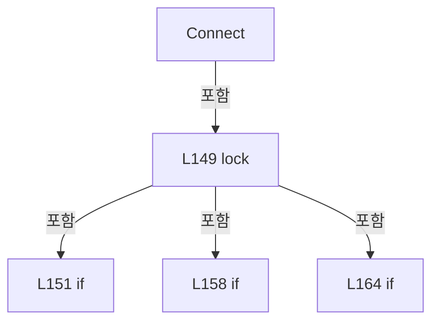

변경 전 점검: 입력/반환 타입, 위 호출자, 예외/취소 경로, 공유 상태와 저장·전송 소비자를 함께 확인합니다. 값의 단위나 물리 방향을 이름만으로 확정하지 않습니다.

### MethodDeclaration `Disconnect` · L176–195

[Drilling.Common/Interface/PicoMotor/CPicoMotor.cs:176–195](https://github.com/kjuws10-rgb/A3Drilling/blob/5aee8e58439c9b455cae7c9593c9be986c3e682e/Drilling.Common/Interface/PicoMotor/CPicoMotor.cs#L176-L195)

| 항목 | 실제 추출 값 |
| --- | --- |
| 서명 | void Drilling.Common.Interface.CPicoMotorCommandSession.Disconnect() |
| 접근/수식자 | Public / public |
| 반환/값 타입 | void |
| 소속 타입 | NamedType:Drilling.Common.Interface.CPicoMotorCommandSession |

정적 호출자로 확인된 위치:

| 호출 파일/행 | 호출 표현식 | 런타임 분기 가능 |
| --- | --- | --- |
| [Drilling.Common/Interface/PicoMotor/CPicoMotor.cs:368–368](https://github.com/kjuws10-rgb/A3Drilling/blob/5aee8e58439c9b455cae7c9593c9be986c3e682e/Drilling.Common/Interface/PicoMotor/CPicoMotor.cs#L368-L368) | Disconnect | False |
| [Drilling.Common/Interface/PicoMotor/CPicoMotor.cs:804–804](https://github.com/kjuws10-rgb/A3Drilling/blob/5aee8e58439c9b455cae7c9593c9be986c3e682e/Drilling.Common/Interface/PicoMotor/CPicoMotor.cs#L804-L804) | session.Disconnect | False |

호출하는 대상과 해석 범위:

| 원본 행 | 표현식 | 분석 상태 | 대상/소스 위치 |
| --- | --- | --- | --- |
| 186 | string.IsNullOrWhiteSpace | resolved | bool string.IsNullOrWhiteSpace(string?) |
| 188 | _cmdLib.Close | unresolved | None |
| 191 | _cmdLib.Shutdown | unresolved | None |

본문의 실제 연산·분기·예외·반환 순서(원문 위치 순):

| 원본 행 | 종류 | 주석 해설 |
| --- | --- | --- |
| 178 | lock | 공유 상태의 임계 구역에 진입합니다: lock (_syncRoot) |
| 180 | if | 조건에 따라 분기합니다: if (_cmdLib is null) |
| 182 | assignment | 값을 대상에 대입합니다: _deviceKey = string.Empty |
| 183 | return | 호출자에게 값 또는 제어를 반환합니다: return; |
| 186 | call | 함수·델리게이트 또는 객체 생성자를 호출합니다: string.IsNullOrWhiteSpace(_deviceKey) |
| 186 | if | 조건에 따라 분기합니다: if (!string.IsNullOrWhiteSpace(_deviceKey)) |
| 188 | call | 함수·델리게이트 또는 객체 생성자를 호출합니다: _cmdLib.Close(_deviceKey) |
| 191 | call | 함수·델리게이트 또는 객체 생성자를 호출합니다: _cmdLib.Shutdown() |
| 192 | assignment | 값을 대상에 대입합니다: _cmdLib = null |
| 193 | assignment | 값을 대상에 대입합니다: _deviceKey = string.Empty |

제어 구문의 포함 구조(실제 실행 순서/CFG가 아닌 구문 탐색 그림):

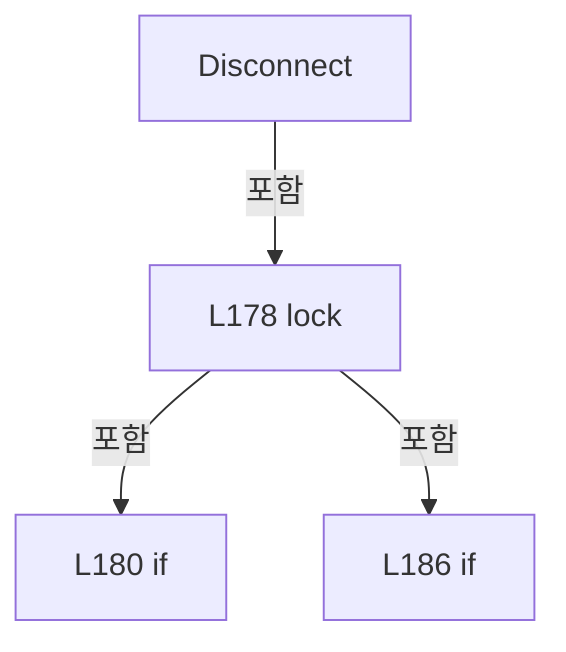

변경 전 점검: 입력/반환 타입, 위 호출자, 예외/취소 경로, 공유 상태와 저장·전송 소비자를 함께 확인합니다. 값의 단위나 물리 방향을 이름만으로 확정하지 않습니다.

### MethodDeclaration `GetIdentification` · L197–206

[Drilling.Common/Interface/PicoMotor/CPicoMotor.cs:197–206](https://github.com/kjuws10-rgb/A3Drilling/blob/5aee8e58439c9b455cae7c9593c9be986c3e682e/Drilling.Common/Interface/PicoMotor/CPicoMotor.cs#L197-L206)

| 항목 | 실제 추출 값 |
| --- | --- |
| 서명 | string Drilling.Common.Interface.CPicoMotorCommandSession.GetIdentification() |
| 접근/수식자 | Public / public |
| 반환/값 타입 | string |
| 소속 타입 | NamedType:Drilling.Common.Interface.CPicoMotorCommandSession |

정적 호출자로 확인된 위치:

| 호출 파일/행 | 호출 표현식 | 런타임 분기 가능 |
| --- | --- | --- |
| [Drilling.Common/Interface/PicoMotor/CPicoMotor.cs:441–441](https://github.com/kjuws10-rgb/A3Drilling/blob/5aee8e58439c9b455cae7c9593c9be986c3e682e/Drilling.Common/Interface/PicoMotor/CPicoMotor.cs#L441-L441) | session.GetIdentification | False |

호출하는 대상과 해석 범위:

| 원본 행 | 표현식 | 분석 상태 | 대상/소스 위치 |
| --- | --- | --- | --- |
| 205 | Execute | resolved | bool Drilling.Common.Interface.CPicoMotorCommandSession.Execute(System.Func<CmdLib8742, bool>) · Drilling.Common/Interface/PicoMotor/CPicoMotor.cs:371 |

본문의 실제 연산·분기·예외·반환 순서(원문 위치 순):

| 원본 행 | 종류 | 주석 해설 |
| --- | --- | --- |
| 199 | local-declaration | 지역 변수를 선언합니다: var id = string.Empty; |
| 199 | variable-initializer | 변수의 초기값을 지정합니다: id = string.Empty |
| 205 | call | 함수·델리게이트 또는 객체 생성자를 호출합니다: Execute(MatchesCmdlib8742) |
| 205 | conditional-expression | 조건에 따라 결과식을 선택합니다: Execute(MatchesCmdlib8742) ? id : string.Empty |
| 205 | return | 호출자에게 값 또는 제어를 반환합니다: return Execute(MatchesCmdlib8742) ? id : string.Empty; |

변경 전 점검: 입력/반환 타입, 위 호출자, 예외/취소 경로, 공유 상태와 저장·전송 소비자를 함께 확인합니다. 값의 단위나 물리 방향을 이름만으로 확정하지 않습니다.

### LocalFunctionStatement `MatchesCmdlib8742` · L200–203

[Drilling.Common/Interface/PicoMotor/CPicoMotor.cs:200–203](https://github.com/kjuws10-rgb/A3Drilling/blob/5aee8e58439c9b455cae7c9593c9be986c3e682e/Drilling.Common/Interface/PicoMotor/CPicoMotor.cs#L200-L203)

| 항목 | 실제 추출 값 |
| --- | --- |
| 서명 | bool MatchesCmdlib8742(CmdLib8742) |
| 접근/수식자 | Private /  |
| 반환/값 타입 | bool |
| 소속 타입 | NamedType:Drilling.Common.Interface.CPicoMotorCommandSession |

입력 계약:

| 이름 | 타입 | 전달 | 선택/기본값 |
| --- | --- | --- | --- |
| command | CmdLib8742 | None | False /  |

현재 부분 분석에서 직접 연결된 호출자는 없습니다. XAML/이벤트/인터페이스·델리게이트·외부 진입을 추가 확인해야 하며, 미사용으로 판정한 것이 아닙니다.

호출하는 대상과 해석 범위:

| 원본 행 | 표현식 | 분석 상태 | 대상/소스 위치 |
| --- | --- | --- | --- |
| 202 | command.GetIdentification | unresolved | None |

본문의 실제 연산·분기·예외·반환 순서(원문 위치 순):

| 원본 행 | 종류 | 주석 해설 |
| --- | --- | --- |
| 202 | call | 함수·델리게이트 또는 객체 생성자를 호출합니다: command.GetIdentification(_deviceKey, ref id) |
| 202 | return | 호출자에게 값 또는 제어를 반환합니다: return command.GetIdentification(_deviceKey, ref id); |

변경 전 점검: 입력/반환 타입, 위 호출자, 예외/취소 경로, 공유 상태와 저장·전송 소비자를 함께 확인합니다. 값의 단위나 물리 방향을 이름만으로 확정하지 않습니다.

### MethodDeclaration `GetPositionStep` · L208–218

[Drilling.Common/Interface/PicoMotor/CPicoMotor.cs:208–218](https://github.com/kjuws10-rgb/A3Drilling/blob/5aee8e58439c9b455cae7c9593c9be986c3e682e/Drilling.Common/Interface/PicoMotor/CPicoMotor.cs#L208-L218)

| 항목 | 실제 추출 값 |
| --- | --- |
| 서명 | int Drilling.Common.Interface.CPicoMotorCommandSession.GetPositionStep(int) |
| 접근/수식자 | Public / public |
| 반환/값 타입 | int |
| 소속 타입 | NamedType:Drilling.Common.Interface.CPicoMotorCommandSession |

입력 계약:

| 이름 | 타입 | 전달 | 선택/기본값 |
| --- | --- | --- | --- |
| motorNo | int | None | False /  |

정적 호출자로 확인된 위치:

| 호출 파일/행 | 호출 표현식 | 런타임 분기 가능 |
| --- | --- | --- |
| [Drilling.Common/Interface/PicoMotor/CPicoMotor.cs:447–447](https://github.com/kjuws10-rgb/A3Drilling/blob/5aee8e58439c9b455cae7c9593c9be986c3e682e/Drilling.Common/Interface/PicoMotor/CPicoMotor.cs#L447-L447) | session.GetPositionStep | False |
| [Drilling.Common/Interface/PicoMotor/CPicoMotor.cs:448–448](https://github.com/kjuws10-rgb/A3Drilling/blob/5aee8e58439c9b455cae7c9593c9be986c3e682e/Drilling.Common/Interface/PicoMotor/CPicoMotor.cs#L448-L448) | session.GetPositionStep | False |
| [Drilling.Common/Interface/PicoMotor/CPicoMotor.cs:449–449](https://github.com/kjuws10-rgb/A3Drilling/blob/5aee8e58439c9b455cae7c9593c9be986c3e682e/Drilling.Common/Interface/PicoMotor/CPicoMotor.cs#L449-L449) | session.GetPositionStep | False |
| [Drilling.Common/Interface/PicoMotor/CPicoMotor.cs:450–450](https://github.com/kjuws10-rgb/A3Drilling/blob/5aee8e58439c9b455cae7c9593c9be986c3e682e/Drilling.Common/Interface/PicoMotor/CPicoMotor.cs#L450-L450) | session.GetPositionStep | False |

호출하는 대상과 해석 범위:

| 원본 행 | 표현식 | 분석 상태 | 대상/소스 위치 |
| --- | --- | --- | --- |
| 216 | ExecuteOrThrow | resolved | void Drilling.Common.Interface.CPicoMotorCommandSession.ExecuteOrThrow(System.Func<CmdLib8742, bool>, string) · Drilling.Common/Interface/PicoMotor/CPicoMotor.cs:384 |

본문의 실제 연산·분기·예외·반환 순서(원문 위치 순):

| 원본 행 | 종류 | 주석 해설 |
| --- | --- | --- |
| 210 | local-declaration | 지역 변수를 선언합니다: var position = 0; |
| 210 | variable-initializer | 변수의 초기값을 지정합니다: position = 0 |
| 216 | call | 함수·델리게이트 또는 객체 생성자를 호출합니다: ExecuteOrThrow(MatchesCmdlib8742, "GetPosition") |
| 217 | return | 호출자에게 값 또는 제어를 반환합니다: return position; |

변경 전 점검: 입력/반환 타입, 위 호출자, 예외/취소 경로, 공유 상태와 저장·전송 소비자를 함께 확인합니다. 값의 단위나 물리 방향을 이름만으로 확정하지 않습니다.

### LocalFunctionStatement `MatchesCmdlib8742` · L211–214

[Drilling.Common/Interface/PicoMotor/CPicoMotor.cs:211–214](https://github.com/kjuws10-rgb/A3Drilling/blob/5aee8e58439c9b455cae7c9593c9be986c3e682e/Drilling.Common/Interface/PicoMotor/CPicoMotor.cs#L211-L214)

| 항목 | 실제 추출 값 |
| --- | --- |
| 서명 | bool MatchesCmdlib8742(CmdLib8742) |
| 접근/수식자 | Private /  |
| 반환/값 타입 | bool |
| 소속 타입 | NamedType:Drilling.Common.Interface.CPicoMotorCommandSession |

입력 계약:

| 이름 | 타입 | 전달 | 선택/기본값 |
| --- | --- | --- | --- |
| command | CmdLib8742 | None | False /  |

현재 부분 분석에서 직접 연결된 호출자는 없습니다. XAML/이벤트/인터페이스·델리게이트·외부 진입을 추가 확인해야 하며, 미사용으로 판정한 것이 아닙니다.

호출하는 대상과 해석 범위:

| 원본 행 | 표현식 | 분석 상태 | 대상/소스 위치 |
| --- | --- | --- | --- |
| 213 | command.GetPosition | unresolved | None |
| 213 | ClampMotorNo | resolved | int Drilling.Common.Interface.CPicoMotorCommandSession.ClampMotorNo(int) · Drilling.Common/Interface/PicoMotor/CPicoMotor.cs:392 |

본문의 실제 연산·분기·예외·반환 순서(원문 위치 순):

| 원본 행 | 종류 | 주석 해설 |
| --- | --- | --- |
| 213 | call | 함수·델리게이트 또는 객체 생성자를 호출합니다: command.GetPosition(_deviceKey, ClampMotorNo(motorNo), ref position) |
| 213 | call | 함수·델리게이트 또는 객체 생성자를 호출합니다: ClampMotorNo(motorNo) |
| 213 | return | 호출자에게 값 또는 제어를 반환합니다: return command.GetPosition(_deviceKey, ClampMotorNo(motorNo), ref position); |

변경 전 점검: 입력/반환 타입, 위 호출자, 예외/취소 경로, 공유 상태와 저장·전송 소비자를 함께 확인합니다. 값의 단위나 물리 방향을 이름만으로 확정하지 않습니다.

### MethodDeclaration `GetVelocityStep` · L220–230

[Drilling.Common/Interface/PicoMotor/CPicoMotor.cs:220–230](https://github.com/kjuws10-rgb/A3Drilling/blob/5aee8e58439c9b455cae7c9593c9be986c3e682e/Drilling.Common/Interface/PicoMotor/CPicoMotor.cs#L220-L230)

| 항목 | 실제 추출 값 |
| --- | --- |
| 서명 | int Drilling.Common.Interface.CPicoMotorCommandSession.GetVelocityStep(int) |
| 접근/수식자 | Public / public |
| 반환/값 타입 | int |
| 소속 타입 | NamedType:Drilling.Common.Interface.CPicoMotorCommandSession |

입력 계약:

| 이름 | 타입 | 전달 | 선택/기본값 |
| --- | --- | --- | --- |
| motorNo | int | None | False /  |

정적 호출자로 확인된 위치:

| 호출 파일/행 | 호출 표현식 | 런타임 분기 가능 |
| --- | --- | --- |
| [Drilling.Common/Interface/PicoMotor/CPicoMotor.cs:452–452](https://github.com/kjuws10-rgb/A3Drilling/blob/5aee8e58439c9b455cae7c9593c9be986c3e682e/Drilling.Common/Interface/PicoMotor/CPicoMotor.cs#L452-L452) | session.GetVelocityStep | False |

호출하는 대상과 해석 범위:

| 원본 행 | 표현식 | 분석 상태 | 대상/소스 위치 |
| --- | --- | --- | --- |
| 228 | ExecuteOrThrow | resolved | void Drilling.Common.Interface.CPicoMotorCommandSession.ExecuteOrThrow(System.Func<CmdLib8742, bool>, string) · Drilling.Common/Interface/PicoMotor/CPicoMotor.cs:384 |

본문의 실제 연산·분기·예외·반환 순서(원문 위치 순):

| 원본 행 | 종류 | 주석 해설 |
| --- | --- | --- |
| 222 | local-declaration | 지역 변수를 선언합니다: var velocity = 0; |
| 222 | variable-initializer | 변수의 초기값을 지정합니다: velocity = 0 |
| 228 | call | 함수·델리게이트 또는 객체 생성자를 호출합니다: ExecuteOrThrow(MatchesCmdlib8742, "GetVelocity") |
| 229 | return | 호출자에게 값 또는 제어를 반환합니다: return velocity; |

변경 전 점검: 입력/반환 타입, 위 호출자, 예외/취소 경로, 공유 상태와 저장·전송 소비자를 함께 확인합니다. 값의 단위나 물리 방향을 이름만으로 확정하지 않습니다.

### LocalFunctionStatement `MatchesCmdlib8742` · L223–226

[Drilling.Common/Interface/PicoMotor/CPicoMotor.cs:223–226](https://github.com/kjuws10-rgb/A3Drilling/blob/5aee8e58439c9b455cae7c9593c9be986c3e682e/Drilling.Common/Interface/PicoMotor/CPicoMotor.cs#L223-L226)

| 항목 | 실제 추출 값 |
| --- | --- |
| 서명 | bool MatchesCmdlib8742(CmdLib8742) |
| 접근/수식자 | Private /  |
| 반환/값 타입 | bool |
| 소속 타입 | NamedType:Drilling.Common.Interface.CPicoMotorCommandSession |

입력 계약:

| 이름 | 타입 | 전달 | 선택/기본값 |
| --- | --- | --- | --- |
| command | CmdLib8742 | None | False /  |

현재 부분 분석에서 직접 연결된 호출자는 없습니다. XAML/이벤트/인터페이스·델리게이트·외부 진입을 추가 확인해야 하며, 미사용으로 판정한 것이 아닙니다.

호출하는 대상과 해석 범위:

| 원본 행 | 표현식 | 분석 상태 | 대상/소스 위치 |
| --- | --- | --- | --- |
| 225 | command.GetVelocity | unresolved | None |
| 225 | ClampMotorNo | resolved | int Drilling.Common.Interface.CPicoMotorCommandSession.ClampMotorNo(int) · Drilling.Common/Interface/PicoMotor/CPicoMotor.cs:392 |

본문의 실제 연산·분기·예외·반환 순서(원문 위치 순):

| 원본 행 | 종류 | 주석 해설 |
| --- | --- | --- |
| 225 | call | 함수·델리게이트 또는 객체 생성자를 호출합니다: command.GetVelocity(_deviceKey, ClampMotorNo(motorNo), ref velocity) |
| 225 | call | 함수·델리게이트 또는 객체 생성자를 호출합니다: ClampMotorNo(motorNo) |
| 225 | return | 호출자에게 값 또는 제어를 반환합니다: return command.GetVelocity(_deviceKey, ClampMotorNo(motorNo), ref velocity); |

변경 전 점검: 입력/반환 타입, 위 호출자, 예외/취소 경로, 공유 상태와 저장·전송 소비자를 함께 확인합니다. 값의 단위나 물리 방향을 이름만으로 확정하지 않습니다.

### MethodDeclaration `GetAccelerationStep` · L232–242

[Drilling.Common/Interface/PicoMotor/CPicoMotor.cs:232–242](https://github.com/kjuws10-rgb/A3Drilling/blob/5aee8e58439c9b455cae7c9593c9be986c3e682e/Drilling.Common/Interface/PicoMotor/CPicoMotor.cs#L232-L242)

| 항목 | 실제 추출 값 |
| --- | --- |
| 서명 | int Drilling.Common.Interface.CPicoMotorCommandSession.GetAccelerationStep(int) |
| 접근/수식자 | Public / public |
| 반환/값 타입 | int |
| 소속 타입 | NamedType:Drilling.Common.Interface.CPicoMotorCommandSession |

입력 계약:

| 이름 | 타입 | 전달 | 선택/기본값 |
| --- | --- | --- | --- |
| motorNo | int | None | False /  |

정적 호출자로 확인된 위치:

| 호출 파일/행 | 호출 표현식 | 런타임 분기 가능 |
| --- | --- | --- |
| [Drilling.Common/Interface/PicoMotor/CPicoMotor.cs:453–453](https://github.com/kjuws10-rgb/A3Drilling/blob/5aee8e58439c9b455cae7c9593c9be986c3e682e/Drilling.Common/Interface/PicoMotor/CPicoMotor.cs#L453-L453) | session.GetAccelerationStep | False |

호출하는 대상과 해석 범위:

| 원본 행 | 표현식 | 분석 상태 | 대상/소스 위치 |
| --- | --- | --- | --- |
| 240 | ExecuteOrThrow | resolved | void Drilling.Common.Interface.CPicoMotorCommandSession.ExecuteOrThrow(System.Func<CmdLib8742, bool>, string) · Drilling.Common/Interface/PicoMotor/CPicoMotor.cs:384 |

본문의 실제 연산·분기·예외·반환 순서(원문 위치 순):

| 원본 행 | 종류 | 주석 해설 |
| --- | --- | --- |
| 234 | local-declaration | 지역 변수를 선언합니다: var acceleration = 0; |
| 234 | variable-initializer | 변수의 초기값을 지정합니다: acceleration = 0 |
| 240 | call | 함수·델리게이트 또는 객체 생성자를 호출합니다: ExecuteOrThrow(MatchesCmdlib8742, "GetAcceleration") |
| 241 | return | 호출자에게 값 또는 제어를 반환합니다: return acceleration; |

변경 전 점검: 입력/반환 타입, 위 호출자, 예외/취소 경로, 공유 상태와 저장·전송 소비자를 함께 확인합니다. 값의 단위나 물리 방향을 이름만으로 확정하지 않습니다.

### LocalFunctionStatement `MatchesCmdlib8742` · L235–238

[Drilling.Common/Interface/PicoMotor/CPicoMotor.cs:235–238](https://github.com/kjuws10-rgb/A3Drilling/blob/5aee8e58439c9b455cae7c9593c9be986c3e682e/Drilling.Common/Interface/PicoMotor/CPicoMotor.cs#L235-L238)

| 항목 | 실제 추출 값 |
| --- | --- |
| 서명 | bool MatchesCmdlib8742(CmdLib8742) |
| 접근/수식자 | Private /  |
| 반환/값 타입 | bool |
| 소속 타입 | NamedType:Drilling.Common.Interface.CPicoMotorCommandSession |

입력 계약:

| 이름 | 타입 | 전달 | 선택/기본값 |
| --- | --- | --- | --- |
| command | CmdLib8742 | None | False /  |

현재 부분 분석에서 직접 연결된 호출자는 없습니다. XAML/이벤트/인터페이스·델리게이트·외부 진입을 추가 확인해야 하며, 미사용으로 판정한 것이 아닙니다.

호출하는 대상과 해석 범위:

| 원본 행 | 표현식 | 분석 상태 | 대상/소스 위치 |
| --- | --- | --- | --- |
| 237 | command.GetAcceleration | unresolved | None |
| 237 | ClampMotorNo | resolved | int Drilling.Common.Interface.CPicoMotorCommandSession.ClampMotorNo(int) · Drilling.Common/Interface/PicoMotor/CPicoMotor.cs:392 |

본문의 실제 연산·분기·예외·반환 순서(원문 위치 순):

| 원본 행 | 종류 | 주석 해설 |
| --- | --- | --- |
| 237 | call | 함수·델리게이트 또는 객체 생성자를 호출합니다: command.GetAcceleration(_deviceKey, ClampMotorNo(motorNo), ref acceleration) |
| 237 | call | 함수·델리게이트 또는 객체 생성자를 호출합니다: ClampMotorNo(motorNo) |
| 237 | return | 호출자에게 값 또는 제어를 반환합니다: return command.GetAcceleration(_deviceKey, ClampMotorNo(motorNo), ref acceleration); |

변경 전 점검: 입력/반환 타입, 위 호출자, 예외/취소 경로, 공유 상태와 저장·전송 소비자를 함께 확인합니다. 값의 단위나 물리 방향을 이름만으로 확정하지 않습니다.

### MethodDeclaration `GetMotionDone` · L244–254

[Drilling.Common/Interface/PicoMotor/CPicoMotor.cs:244–254](https://github.com/kjuws10-rgb/A3Drilling/blob/5aee8e58439c9b455cae7c9593c9be986c3e682e/Drilling.Common/Interface/PicoMotor/CPicoMotor.cs#L244-L254)

| 항목 | 실제 추출 값 |
| --- | --- |
| 서명 | bool Drilling.Common.Interface.CPicoMotorCommandSession.GetMotionDone(int) |
| 접근/수식자 | Public / public |
| 반환/값 타입 | bool |
| 소속 타입 | NamedType:Drilling.Common.Interface.CPicoMotorCommandSession |

입력 계약:

| 이름 | 타입 | 전달 | 선택/기본값 |
| --- | --- | --- | --- |
| motorNo | int | None | False /  |

정적 호출자로 확인된 위치:

| 호출 파일/행 | 호출 표현식 | 런타임 분기 가능 |
| --- | --- | --- |
| [Drilling.Common/Interface/PicoMotor/CPicoMotor.cs:454–454](https://github.com/kjuws10-rgb/A3Drilling/blob/5aee8e58439c9b455cae7c9593c9be986c3e682e/Drilling.Common/Interface/PicoMotor/CPicoMotor.cs#L454-L454) | session.GetMotionDone | False |

호출하는 대상과 해석 범위:

| 원본 행 | 표현식 | 분석 상태 | 대상/소스 위치 |
| --- | --- | --- | --- |
| 252 | ExecuteOrThrow | resolved | void Drilling.Common.Interface.CPicoMotorCommandSession.ExecuteOrThrow(System.Func<CmdLib8742, bool>, string) · Drilling.Common/Interface/PicoMotor/CPicoMotor.cs:384 |

본문의 실제 연산·분기·예외·반환 순서(원문 위치 순):

| 원본 행 | 종류 | 주석 해설 |
| --- | --- | --- |
| 246 | local-declaration | 지역 변수를 선언합니다: var isDone = false; |
| 246 | variable-initializer | 변수의 초기값을 지정합니다: isDone = false |
| 252 | call | 함수·델리게이트 또는 객체 생성자를 호출합니다: ExecuteOrThrow(MatchesCmdlib8742, "GetMotionDone") |
| 253 | return | 호출자에게 값 또는 제어를 반환합니다: return isDone; |

변경 전 점검: 입력/반환 타입, 위 호출자, 예외/취소 경로, 공유 상태와 저장·전송 소비자를 함께 확인합니다. 값의 단위나 물리 방향을 이름만으로 확정하지 않습니다.

### LocalFunctionStatement `MatchesCmdlib8742` · L247–250

[Drilling.Common/Interface/PicoMotor/CPicoMotor.cs:247–250](https://github.com/kjuws10-rgb/A3Drilling/blob/5aee8e58439c9b455cae7c9593c9be986c3e682e/Drilling.Common/Interface/PicoMotor/CPicoMotor.cs#L247-L250)

| 항목 | 실제 추출 값 |
| --- | --- |
| 서명 | bool MatchesCmdlib8742(CmdLib8742) |
| 접근/수식자 | Private /  |
| 반환/값 타입 | bool |
| 소속 타입 | NamedType:Drilling.Common.Interface.CPicoMotorCommandSession |

입력 계약:

| 이름 | 타입 | 전달 | 선택/기본값 |
| --- | --- | --- | --- |
| command | CmdLib8742 | None | False /  |

현재 부분 분석에서 직접 연결된 호출자는 없습니다. XAML/이벤트/인터페이스·델리게이트·외부 진입을 추가 확인해야 하며, 미사용으로 판정한 것이 아닙니다.

호출하는 대상과 해석 범위:

| 원본 행 | 표현식 | 분석 상태 | 대상/소스 위치 |
| --- | --- | --- | --- |
| 249 | command.GetMotionDone | unresolved | None |
| 249 | ClampMotorNo | resolved | int Drilling.Common.Interface.CPicoMotorCommandSession.ClampMotorNo(int) · Drilling.Common/Interface/PicoMotor/CPicoMotor.cs:392 |

본문의 실제 연산·분기·예외·반환 순서(원문 위치 순):

| 원본 행 | 종류 | 주석 해설 |
| --- | --- | --- |
| 249 | call | 함수·델리게이트 또는 객체 생성자를 호출합니다: command.GetMotionDone(_deviceKey, ClampMotorNo(motorNo), ref isDone) |
| 249 | call | 함수·델리게이트 또는 객체 생성자를 호출합니다: ClampMotorNo(motorNo) |
| 249 | return | 호출자에게 값 또는 제어를 반환합니다: return command.GetMotionDone(_deviceKey, ClampMotorNo(motorNo), ref isDone); |

변경 전 점검: 입력/반환 타입, 위 호출자, 예외/취소 경로, 공유 상태와 저장·전송 소비자를 함께 확인합니다. 값의 단위나 물리 방향을 이름만으로 확정하지 않습니다.

### MethodDeclaration `GetErrorCode` · L256–266

[Drilling.Common/Interface/PicoMotor/CPicoMotor.cs:256–266](https://github.com/kjuws10-rgb/A3Drilling/blob/5aee8e58439c9b455cae7c9593c9be986c3e682e/Drilling.Common/Interface/PicoMotor/CPicoMotor.cs#L256-L266)

| 항목 | 실제 추출 값 |
| --- | --- |
| 서명 | int Drilling.Common.Interface.CPicoMotorCommandSession.GetErrorCode() |
| 접근/수식자 | Public / public |
| 반환/값 타입 | int |
| 소속 타입 | NamedType:Drilling.Common.Interface.CPicoMotorCommandSession |

정적 호출자로 확인된 위치:

| 호출 파일/행 | 호출 표현식 | 런타임 분기 가능 |
| --- | --- | --- |
| [Drilling.Common/Interface/PicoMotor/CPicoMotor.cs:442–442](https://github.com/kjuws10-rgb/A3Drilling/blob/5aee8e58439c9b455cae7c9593c9be986c3e682e/Drilling.Common/Interface/PicoMotor/CPicoMotor.cs#L442-L442) | session.GetErrorCode | False |

호출하는 대상과 해석 범위:

| 원본 행 | 표현식 | 분석 상태 | 대상/소스 위치 |
| --- | --- | --- | --- |
| 264 | ExecuteOrThrow | resolved | void Drilling.Common.Interface.CPicoMotorCommandSession.ExecuteOrThrow(System.Func<CmdLib8742, bool>, string) · Drilling.Common/Interface/PicoMotor/CPicoMotor.cs:384 |
| 265 | int.TryParse | resolved | bool int.TryParse(string?, System.Globalization.NumberStyles, System.IFormatProvider?, out int) |
| 265 | CPicoMotor.NormalizeResponse | resolved | string Drilling.Common.Interface.CPicoMotor.NormalizeResponse(string) · Drilling.Common/Interface/PicoMotor/CPicoMotor.cs:51 |

본문의 실제 연산·분기·예외·반환 순서(원문 위치 순):

| 원본 행 | 종류 | 주석 해설 |
| --- | --- | --- |
| 258 | local-declaration | 지역 변수를 선언합니다: var error = string.Empty; |
| 258 | variable-initializer | 변수의 초기값을 지정합니다: error = string.Empty |
| 264 | call | 함수·델리게이트 또는 객체 생성자를 호출합니다: ExecuteOrThrow(MatchesCmdlib8742, "GetErrorNum") |
| 265 | call | 함수·델리게이트 또는 객체 생성자를 호출합니다: int.TryParse(CPicoMotor.NormalizeResponse(error), NumberStyles.Integer, CultureInfo.InvariantCulture, out var errorCode) |
| 265 | call | 함수·델리게이트 또는 객체 생성자를 호출합니다: CPicoMotor.NormalizeResponse(error) |
| 265 | conditional-expression | 조건에 따라 결과식을 선택합니다: int.TryParse(CPicoMotor.NormalizeResponse(error), NumberStyles.Integer, CultureInfo.InvariantCulture, out var errorCode) ? errorCode : (int)EN_PICO_MOTOR_ERROR.InvalidResponse |
| 265 | return | 호출자에게 값 또는 제어를 반환합니다: return int.TryParse(CPicoMotor.NormalizeResponse(error), NumberStyles.Integer, CultureInfo.InvariantCulture, out var errorCode) ? errorCode : (int)EN_PICO_MOTOR_ERROR.InvalidResponse; |

변경 전 점검: 입력/반환 타입, 위 호출자, 예외/취소 경로, 공유 상태와 저장·전송 소비자를 함께 확인합니다. 값의 단위나 물리 방향을 이름만으로 확정하지 않습니다.

### LocalFunctionStatement `MatchesCmdlib8742` · L259–262

[Drilling.Common/Interface/PicoMotor/CPicoMotor.cs:259–262](https://github.com/kjuws10-rgb/A3Drilling/blob/5aee8e58439c9b455cae7c9593c9be986c3e682e/Drilling.Common/Interface/PicoMotor/CPicoMotor.cs#L259-L262)

| 항목 | 실제 추출 값 |
| --- | --- |
| 서명 | bool MatchesCmdlib8742(CmdLib8742) |
| 접근/수식자 | Private /  |
| 반환/값 타입 | bool |
| 소속 타입 | NamedType:Drilling.Common.Interface.CPicoMotorCommandSession |

입력 계약:

| 이름 | 타입 | 전달 | 선택/기본값 |
| --- | --- | --- | --- |
| command | CmdLib8742 | None | False /  |

현재 부분 분석에서 직접 연결된 호출자는 없습니다. XAML/이벤트/인터페이스·델리게이트·외부 진입을 추가 확인해야 하며, 미사용으로 판정한 것이 아닙니다.

호출하는 대상과 해석 범위:

| 원본 행 | 표현식 | 분석 상태 | 대상/소스 위치 |
| --- | --- | --- | --- |
| 261 | command.GetErrorNum | unresolved | None |

본문의 실제 연산·분기·예외·반환 순서(원문 위치 순):

| 원본 행 | 종류 | 주석 해설 |
| --- | --- | --- |
| 261 | call | 함수·델리게이트 또는 객체 생성자를 호출합니다: command.GetErrorNum(_deviceKey, ref error) |
| 261 | return | 호출자에게 값 또는 제어를 반환합니다: return command.GetErrorNum(_deviceKey, ref error); |

변경 전 점검: 입력/반환 타입, 위 호출자, 예외/취소 경로, 공유 상태와 저장·전송 소비자를 함께 확인합니다. 값의 단위나 물리 방향을 이름만으로 확정하지 않습니다.

### MethodDeclaration `GetHomePositionStep` · L268–278

[Drilling.Common/Interface/PicoMotor/CPicoMotor.cs:268–278](https://github.com/kjuws10-rgb/A3Drilling/blob/5aee8e58439c9b455cae7c9593c9be986c3e682e/Drilling.Common/Interface/PicoMotor/CPicoMotor.cs#L268-L278)

| 항목 | 실제 추출 값 |
| --- | --- |
| 서명 | long Drilling.Common.Interface.CPicoMotorCommandSession.GetHomePositionStep(int) |
| 접근/수식자 | Public / public |
| 반환/값 타입 | long |
| 소속 타입 | NamedType:Drilling.Common.Interface.CPicoMotorCommandSession |

입력 계약:

| 이름 | 타입 | 전달 | 선택/기본값 |
| --- | --- | --- | --- |
| motorNo | int | None | False /  |

정적 호출자로 확인된 위치:

| 호출 파일/행 | 호출 표현식 | 런타임 분기 가능 |
| --- | --- | --- |
| [Drilling.Common/Interface/PicoMotor/CPicoMotor.cs:322–322](https://github.com/kjuws10-rgb/A3Drilling/blob/5aee8e58439c9b455cae7c9593c9be986c3e682e/Drilling.Common/Interface/PicoMotor/CPicoMotor.cs#L322-L322) | GetHomePositionStep | False |
| [Drilling.Common/Interface/PicoMotor/CPicoMotor.cs:451–451](https://github.com/kjuws10-rgb/A3Drilling/blob/5aee8e58439c9b455cae7c9593c9be986c3e682e/Drilling.Common/Interface/PicoMotor/CPicoMotor.cs#L451-L451) | session.GetHomePositionStep | False |

호출하는 대상과 해석 범위:

| 원본 행 | 표현식 | 분석 상태 | 대상/소스 위치 |
| --- | --- | --- | --- |
| 276 | ExecuteOrThrow | resolved | void Drilling.Common.Interface.CPicoMotorCommandSession.ExecuteOrThrow(System.Func<CmdLib8742, bool>, string) · Drilling.Common/Interface/PicoMotor/CPicoMotor.cs:384 |
| 277 | long.TryParse | resolved | bool long.TryParse(string?, System.Globalization.NumberStyles, System.IFormatProvider?, out long) |
| 277 | CPicoMotor.NormalizeResponse | resolved | string Drilling.Common.Interface.CPicoMotor.NormalizeResponse(string) · Drilling.Common/Interface/PicoMotor/CPicoMotor.cs:51 |

본문의 실제 연산·분기·예외·반환 순서(원문 위치 순):

| 원본 행 | 종류 | 주석 해설 |
| --- | --- | --- |
| 270 | local-declaration | 지역 변수를 선언합니다: var home = string.Empty; |
| 270 | variable-initializer | 변수의 초기값을 지정합니다: home = string.Empty |
| 276 | call | 함수·델리게이트 또는 객체 생성자를 호출합니다: ExecuteOrThrow(MatchesCmdlib8742, "GetHomePosition") |
| 277 | call | 함수·델리게이트 또는 객체 생성자를 호출합니다: long.TryParse(CPicoMotor.NormalizeResponse(home), NumberStyles.Integer, CultureInfo.InvariantCulture, out var homeStep) |
| 277 | call | 함수·델리게이트 또는 객체 생성자를 호출합니다: CPicoMotor.NormalizeResponse(home) |
| 277 | conditional-expression | 조건에 따라 결과식을 선택합니다: long.TryParse(CPicoMotor.NormalizeResponse(home), NumberStyles.Integer, CultureInfo.InvariantCulture, out var homeStep) ? homeStep : 0L |
| 277 | return | 호출자에게 값 또는 제어를 반환합니다: return long.TryParse(CPicoMotor.NormalizeResponse(home), NumberStyles.Integer, CultureInfo.InvariantCulture, out var homeStep) ? homeStep : 0L; |

변경 전 점검: 입력/반환 타입, 위 호출자, 예외/취소 경로, 공유 상태와 저장·전송 소비자를 함께 확인합니다. 값의 단위나 물리 방향을 이름만으로 확정하지 않습니다.

### LocalFunctionStatement `MatchesCmdlib8742` · L271–274

[Drilling.Common/Interface/PicoMotor/CPicoMotor.cs:271–274](https://github.com/kjuws10-rgb/A3Drilling/blob/5aee8e58439c9b455cae7c9593c9be986c3e682e/Drilling.Common/Interface/PicoMotor/CPicoMotor.cs#L271-L274)

| 항목 | 실제 추출 값 |
| --- | --- |
| 서명 | bool MatchesCmdlib8742(CmdLib8742) |
| 접근/수식자 | Private /  |
| 반환/값 타입 | bool |
| 소속 타입 | NamedType:Drilling.Common.Interface.CPicoMotorCommandSession |

입력 계약:

| 이름 | 타입 | 전달 | 선택/기본값 |
| --- | --- | --- | --- |
| command | CmdLib8742 | None | False /  |

현재 부분 분석에서 직접 연결된 호출자는 없습니다. XAML/이벤트/인터페이스·델리게이트·외부 진입을 추가 확인해야 하며, 미사용으로 판정한 것이 아닙니다.

호출하는 대상과 해석 범위:

| 원본 행 | 표현식 | 분석 상태 | 대상/소스 위치 |
| --- | --- | --- | --- |
| 273 | command.Query | unresolved | None |
| 273 | ClampMotorNo | resolved | int Drilling.Common.Interface.CPicoMotorCommandSession.ClampMotorNo(int) · Drilling.Common/Interface/PicoMotor/CPicoMotor.cs:392 |

본문의 실제 연산·분기·예외·반환 순서(원문 위치 순):

| 원본 행 | 종류 | 주석 해설 |
| --- | --- | --- |
| 273 | call | 함수·델리게이트 또는 객체 생성자를 호출합니다: command.Query(_deviceKey, $"{ClampMotorNo(motorNo)}DH?", ref home) |
| 273 | call | 함수·델리게이트 또는 객체 생성자를 호출합니다: ClampMotorNo(motorNo) |
| 273 | return | 호출자에게 값 또는 제어를 반환합니다: return command.Query(_deviceKey, $"{ClampMotorNo(motorNo)}DH?", ref home); |

변경 전 점검: 입력/반환 타입, 위 호출자, 예외/취소 경로, 공유 상태와 저장·전송 소비자를 함께 확인합니다. 값의 단위나 물리 방향을 이름만으로 확정하지 않습니다.

### MethodDeclaration `SetVelocity` · L280–288

[Drilling.Common/Interface/PicoMotor/CPicoMotor.cs:280–288](https://github.com/kjuws10-rgb/A3Drilling/blob/5aee8e58439c9b455cae7c9593c9be986c3e682e/Drilling.Common/Interface/PicoMotor/CPicoMotor.cs#L280-L288)

| 항목 | 실제 추출 값 |
| --- | --- |
| 서명 | void Drilling.Common.Interface.CPicoMotorCommandSession.SetVelocity(int, int) |
| 접근/수식자 | Public / public |
| 반환/값 타입 | void |
| 소속 타입 | NamedType:Drilling.Common.Interface.CPicoMotorCommandSession |

입력 계약:

| 이름 | 타입 | 전달 | 선택/기본값 |
| --- | --- | --- | --- |
| motorNo | int | None | False /  |
| velocityStep | int | None | False /  |

정적 호출자로 확인된 위치:

| 호출 파일/행 | 호출 표현식 | 런타임 분기 가능 |
| --- | --- | --- |
| [Drilling.Common/Interface/PicoMotor/CPicoMotor.cs:815–815](https://github.com/kjuws10-rgb/A3Drilling/blob/5aee8e58439c9b455cae7c9593c9be986c3e682e/Drilling.Common/Interface/PicoMotor/CPicoMotor.cs#L815-L815) | live.SetVelocity | False |

호출하는 대상과 해석 범위:

| 원본 행 | 표현식 | 분석 상태 | 대상/소스 위치 |
| --- | --- | --- | --- |
| 287 | ExecuteOrThrow | resolved | void Drilling.Common.Interface.CPicoMotorCommandSession.ExecuteOrThrow(System.Func<CmdLib8742, bool>, string) · Drilling.Common/Interface/PicoMotor/CPicoMotor.cs:384 |

본문의 실제 연산·분기·예외·반환 순서(원문 위치 순):

| 원본 행 | 종류 | 주석 해설 |
| --- | --- | --- |
| 287 | call | 함수·델리게이트 또는 객체 생성자를 호출합니다: ExecuteOrThrow(MatchesCmdlib8742, "SetVelocity") |

변경 전 점검: 입력/반환 타입, 위 호출자, 예외/취소 경로, 공유 상태와 저장·전송 소비자를 함께 확인합니다. 값의 단위나 물리 방향을 이름만으로 확정하지 않습니다.

### LocalFunctionStatement `MatchesCmdlib8742` · L282–285

[Drilling.Common/Interface/PicoMotor/CPicoMotor.cs:282–285](https://github.com/kjuws10-rgb/A3Drilling/blob/5aee8e58439c9b455cae7c9593c9be986c3e682e/Drilling.Common/Interface/PicoMotor/CPicoMotor.cs#L282-L285)

| 항목 | 실제 추출 값 |
| --- | --- |
| 서명 | bool MatchesCmdlib8742(CmdLib8742) |
| 접근/수식자 | Private /  |
| 반환/값 타입 | bool |
| 소속 타입 | NamedType:Drilling.Common.Interface.CPicoMotorCommandSession |

입력 계약:

| 이름 | 타입 | 전달 | 선택/기본값 |
| --- | --- | --- | --- |
| command | CmdLib8742 | None | False /  |

현재 부분 분석에서 직접 연결된 호출자는 없습니다. XAML/이벤트/인터페이스·델리게이트·외부 진입을 추가 확인해야 하며, 미사용으로 판정한 것이 아닙니다.

호출하는 대상과 해석 범위:

| 원본 행 | 표현식 | 분석 상태 | 대상/소스 위치 |
| --- | --- | --- | --- |
| 284 | command.SetVelocity | unresolved | None |
| 284 | ClampMotorNo | resolved | int Drilling.Common.Interface.CPicoMotorCommandSession.ClampMotorNo(int) · Drilling.Common/Interface/PicoMotor/CPicoMotor.cs:392 |

본문의 실제 연산·분기·예외·반환 순서(원문 위치 순):

| 원본 행 | 종류 | 주석 해설 |
| --- | --- | --- |
| 284 | call | 함수·델리게이트 또는 객체 생성자를 호출합니다: command.SetVelocity(_deviceKey, ClampMotorNo(motorNo), velocityStep) |
| 284 | call | 함수·델리게이트 또는 객체 생성자를 호출합니다: ClampMotorNo(motorNo) |
| 284 | return | 호출자에게 값 또는 제어를 반환합니다: return command.SetVelocity(_deviceKey, ClampMotorNo(motorNo), velocityStep); |

변경 전 점검: 입력/반환 타입, 위 호출자, 예외/취소 경로, 공유 상태와 저장·전송 소비자를 함께 확인합니다. 값의 단위나 물리 방향을 이름만으로 확정하지 않습니다.

### MethodDeclaration `SetAcceleration` · L290–298

[Drilling.Common/Interface/PicoMotor/CPicoMotor.cs:290–298](https://github.com/kjuws10-rgb/A3Drilling/blob/5aee8e58439c9b455cae7c9593c9be986c3e682e/Drilling.Common/Interface/PicoMotor/CPicoMotor.cs#L290-L298)

| 항목 | 실제 추출 값 |
| --- | --- |
| 서명 | void Drilling.Common.Interface.CPicoMotorCommandSession.SetAcceleration(int, int) |
| 접근/수식자 | Public / public |
| 반환/값 타입 | void |
| 소속 타입 | NamedType:Drilling.Common.Interface.CPicoMotorCommandSession |

입력 계약:

| 이름 | 타입 | 전달 | 선택/기본값 |
| --- | --- | --- | --- |
| motorNo | int | None | False /  |
| accelerationStep | int | None | False /  |

정적 호출자로 확인된 위치:

| 호출 파일/행 | 호출 표현식 | 런타임 분기 가능 |
| --- | --- | --- |
| [Drilling.Common/Interface/PicoMotor/CPicoMotor.cs:818–818](https://github.com/kjuws10-rgb/A3Drilling/blob/5aee8e58439c9b455cae7c9593c9be986c3e682e/Drilling.Common/Interface/PicoMotor/CPicoMotor.cs#L818-L818) | live.SetAcceleration | False |

호출하는 대상과 해석 범위:

| 원본 행 | 표현식 | 분석 상태 | 대상/소스 위치 |
| --- | --- | --- | --- |
| 297 | ExecuteOrThrow | resolved | void Drilling.Common.Interface.CPicoMotorCommandSession.ExecuteOrThrow(System.Func<CmdLib8742, bool>, string) · Drilling.Common/Interface/PicoMotor/CPicoMotor.cs:384 |

본문의 실제 연산·분기·예외·반환 순서(원문 위치 순):

| 원본 행 | 종류 | 주석 해설 |
| --- | --- | --- |
| 297 | call | 함수·델리게이트 또는 객체 생성자를 호출합니다: ExecuteOrThrow(MatchesCmdlib8742, "SetAcceleration") |

변경 전 점검: 입력/반환 타입, 위 호출자, 예외/취소 경로, 공유 상태와 저장·전송 소비자를 함께 확인합니다. 값의 단위나 물리 방향을 이름만으로 확정하지 않습니다.

### LocalFunctionStatement `MatchesCmdlib8742` · L292–295

[Drilling.Common/Interface/PicoMotor/CPicoMotor.cs:292–295](https://github.com/kjuws10-rgb/A3Drilling/blob/5aee8e58439c9b455cae7c9593c9be986c3e682e/Drilling.Common/Interface/PicoMotor/CPicoMotor.cs#L292-L295)

| 항목 | 실제 추출 값 |
| --- | --- |
| 서명 | bool MatchesCmdlib8742(CmdLib8742) |
| 접근/수식자 | Private /  |
| 반환/값 타입 | bool |
| 소속 타입 | NamedType:Drilling.Common.Interface.CPicoMotorCommandSession |

입력 계약:

| 이름 | 타입 | 전달 | 선택/기본값 |
| --- | --- | --- | --- |
| command | CmdLib8742 | None | False /  |

현재 부분 분석에서 직접 연결된 호출자는 없습니다. XAML/이벤트/인터페이스·델리게이트·외부 진입을 추가 확인해야 하며, 미사용으로 판정한 것이 아닙니다.

호출하는 대상과 해석 범위:

| 원본 행 | 표현식 | 분석 상태 | 대상/소스 위치 |
| --- | --- | --- | --- |
| 294 | command.SetAcceleration | unresolved | None |
| 294 | ClampMotorNo | resolved | int Drilling.Common.Interface.CPicoMotorCommandSession.ClampMotorNo(int) · Drilling.Common/Interface/PicoMotor/CPicoMotor.cs:392 |

본문의 실제 연산·분기·예외·반환 순서(원문 위치 순):

| 원본 행 | 종류 | 주석 해설 |
| --- | --- | --- |
| 294 | call | 함수·델리게이트 또는 객체 생성자를 호출합니다: command.SetAcceleration(_deviceKey, ClampMotorNo(motorNo), accelerationStep) |
| 294 | call | 함수·델리게이트 또는 객체 생성자를 호출합니다: ClampMotorNo(motorNo) |
| 294 | return | 호출자에게 값 또는 제어를 반환합니다: return command.SetAcceleration(_deviceKey, ClampMotorNo(motorNo), accelerationStep); |

변경 전 점검: 입력/반환 타입, 위 호출자, 예외/취소 경로, 공유 상태와 저장·전송 소비자를 함께 확인합니다. 값의 단위나 물리 방향을 이름만으로 확정하지 않습니다.

### MethodDeclaration `StopMotion` · L300–308

[Drilling.Common/Interface/PicoMotor/CPicoMotor.cs:300–308](https://github.com/kjuws10-rgb/A3Drilling/blob/5aee8e58439c9b455cae7c9593c9be986c3e682e/Drilling.Common/Interface/PicoMotor/CPicoMotor.cs#L300-L308)

| 항목 | 실제 추출 값 |
| --- | --- |
| 서명 | void Drilling.Common.Interface.CPicoMotorCommandSession.StopMotion(int) |
| 접근/수식자 | Public / public |
| 반환/값 타입 | void |
| 소속 타입 | NamedType:Drilling.Common.Interface.CPicoMotorCommandSession |

입력 계약:

| 이름 | 타입 | 전달 | 선택/기본값 |
| --- | --- | --- | --- |
| motorNo | int | None | False /  |

정적 호출자로 확인된 위치:

| 호출 파일/행 | 호출 표현식 | 런타임 분기 가능 |
| --- | --- | --- |
| [Drilling.Common/Interface/PicoMotor/CPicoMotor.cs:821–821](https://github.com/kjuws10-rgb/A3Drilling/blob/5aee8e58439c9b455cae7c9593c9be986c3e682e/Drilling.Common/Interface/PicoMotor/CPicoMotor.cs#L821-L821) | live.StopMotion | False |

호출하는 대상과 해석 범위:

| 원본 행 | 표현식 | 분석 상태 | 대상/소스 위치 |
| --- | --- | --- | --- |
| 307 | ExecuteOrThrow | resolved | void Drilling.Common.Interface.CPicoMotorCommandSession.ExecuteOrThrow(System.Func<CmdLib8742, bool>, string) · Drilling.Common/Interface/PicoMotor/CPicoMotor.cs:384 |

본문의 실제 연산·분기·예외·반환 순서(원문 위치 순):

| 원본 행 | 종류 | 주석 해설 |
| --- | --- | --- |
| 307 | call | 함수·델리게이트 또는 객체 생성자를 호출합니다: ExecuteOrThrow(MatchesCmdlib8742, "StopMotion") |

변경 전 점검: 입력/반환 타입, 위 호출자, 예외/취소 경로, 공유 상태와 저장·전송 소비자를 함께 확인합니다. 값의 단위나 물리 방향을 이름만으로 확정하지 않습니다.

### LocalFunctionStatement `MatchesCmdlib8742` · L302–305

[Drilling.Common/Interface/PicoMotor/CPicoMotor.cs:302–305](https://github.com/kjuws10-rgb/A3Drilling/blob/5aee8e58439c9b455cae7c9593c9be986c3e682e/Drilling.Common/Interface/PicoMotor/CPicoMotor.cs#L302-L305)

| 항목 | 실제 추출 값 |
| --- | --- |
| 서명 | bool MatchesCmdlib8742(CmdLib8742) |
| 접근/수식자 | Private /  |
| 반환/값 타입 | bool |
| 소속 타입 | NamedType:Drilling.Common.Interface.CPicoMotorCommandSession |

입력 계약:

| 이름 | 타입 | 전달 | 선택/기본값 |
| --- | --- | --- | --- |
| command | CmdLib8742 | None | False /  |

현재 부분 분석에서 직접 연결된 호출자는 없습니다. XAML/이벤트/인터페이스·델리게이트·외부 진입을 추가 확인해야 하며, 미사용으로 판정한 것이 아닙니다.

호출하는 대상과 해석 범위:

| 원본 행 | 표현식 | 분석 상태 | 대상/소스 위치 |
| --- | --- | --- | --- |
| 304 | command.StopMotion | unresolved | None |
| 304 | ClampMotorNo | resolved | int Drilling.Common.Interface.CPicoMotorCommandSession.ClampMotorNo(int) · Drilling.Common/Interface/PicoMotor/CPicoMotor.cs:392 |

본문의 실제 연산·분기·예외·반환 순서(원문 위치 순):

| 원본 행 | 종류 | 주석 해설 |
| --- | --- | --- |
| 304 | call | 함수·델리게이트 또는 객체 생성자를 호출합니다: command.StopMotion(_deviceKey, ClampMotorNo(motorNo)) |
| 304 | call | 함수·델리게이트 또는 객체 생성자를 호출합니다: ClampMotorNo(motorNo) |
| 304 | return | 호출자에게 값 또는 제어를 반환합니다: return command.StopMotion(_deviceKey, ClampMotorNo(motorNo)); |

변경 전 점검: 입력/반환 타입, 위 호출자, 예외/취소 경로, 공유 상태와 저장·전송 소비자를 함께 확인합니다. 값의 단위나 물리 방향을 이름만으로 확정하지 않습니다.

### MethodDeclaration `AbortMotion` · L310–318

[Drilling.Common/Interface/PicoMotor/CPicoMotor.cs:310–318](https://github.com/kjuws10-rgb/A3Drilling/blob/5aee8e58439c9b455cae7c9593c9be986c3e682e/Drilling.Common/Interface/PicoMotor/CPicoMotor.cs#L310-L318)

| 항목 | 실제 추출 값 |
| --- | --- |
| 서명 | void Drilling.Common.Interface.CPicoMotorCommandSession.AbortMotion() |
| 접근/수식자 | Public / public |
| 반환/값 타입 | void |
| 소속 타입 | NamedType:Drilling.Common.Interface.CPicoMotorCommandSession |

정적 호출자로 확인된 위치:

| 호출 파일/행 | 호출 표현식 | 런타임 분기 가능 |
| --- | --- | --- |
| [Drilling.Common/Interface/PicoMotor/CPicoMotor.cs:824–824](https://github.com/kjuws10-rgb/A3Drilling/blob/5aee8e58439c9b455cae7c9593c9be986c3e682e/Drilling.Common/Interface/PicoMotor/CPicoMotor.cs#L824-L824) | live.AbortMotion | False |

호출하는 대상과 해석 범위:

| 원본 행 | 표현식 | 분석 상태 | 대상/소스 위치 |
| --- | --- | --- | --- |
| 317 | ExecuteOrThrow | resolved | void Drilling.Common.Interface.CPicoMotorCommandSession.ExecuteOrThrow(System.Func<CmdLib8742, bool>, string) · Drilling.Common/Interface/PicoMotor/CPicoMotor.cs:384 |

본문의 실제 연산·분기·예외·반환 순서(원문 위치 순):

| 원본 행 | 종류 | 주석 해설 |
| --- | --- | --- |
| 317 | call | 함수·델리게이트 또는 객체 생성자를 호출합니다: ExecuteOrThrow(MatchesCmdlib8742, "AbortMotion") |

변경 전 점검: 입력/반환 타입, 위 호출자, 예외/취소 경로, 공유 상태와 저장·전송 소비자를 함께 확인합니다. 값의 단위나 물리 방향을 이름만으로 확정하지 않습니다.

### LocalFunctionStatement `MatchesCmdlib8742` · L312–315

[Drilling.Common/Interface/PicoMotor/CPicoMotor.cs:312–315](https://github.com/kjuws10-rgb/A3Drilling/blob/5aee8e58439c9b455cae7c9593c9be986c3e682e/Drilling.Common/Interface/PicoMotor/CPicoMotor.cs#L312-L315)

| 항목 | 실제 추출 값 |
| --- | --- |
| 서명 | bool MatchesCmdlib8742(CmdLib8742) |
| 접근/수식자 | Private /  |
| 반환/값 타입 | bool |
| 소속 타입 | NamedType:Drilling.Common.Interface.CPicoMotorCommandSession |

입력 계약:

| 이름 | 타입 | 전달 | 선택/기본값 |
| --- | --- | --- | --- |
| command | CmdLib8742 | None | False /  |

현재 부분 분석에서 직접 연결된 호출자는 없습니다. XAML/이벤트/인터페이스·델리게이트·외부 진입을 추가 확인해야 하며, 미사용으로 판정한 것이 아닙니다.

호출하는 대상과 해석 범위:

| 원본 행 | 표현식 | 분석 상태 | 대상/소스 위치 |
| --- | --- | --- | --- |
| 314 | command.AbortMotion | unresolved | None |

본문의 실제 연산·분기·예외·반환 순서(원문 위치 순):

| 원본 행 | 종류 | 주석 해설 |
| --- | --- | --- |
| 314 | call | 함수·델리게이트 또는 객체 생성자를 호출합니다: command.AbortMotion(_deviceKey) |
| 314 | return | 호출자에게 값 또는 제어를 반환합니다: return command.AbortMotion(_deviceKey); |

변경 전 점검: 입력/반환 타입, 위 호출자, 예외/취소 경로, 공유 상태와 저장·전송 소비자를 함께 확인합니다. 값의 단위나 물리 방향을 이름만으로 확정하지 않습니다.

### MethodDeclaration `MoveHome` · L320–324

[Drilling.Common/Interface/PicoMotor/CPicoMotor.cs:320–324](https://github.com/kjuws10-rgb/A3Drilling/blob/5aee8e58439c9b455cae7c9593c9be986c3e682e/Drilling.Common/Interface/PicoMotor/CPicoMotor.cs#L320-L324)

| 항목 | 실제 추출 값 |
| --- | --- |
| 서명 | void Drilling.Common.Interface.CPicoMotorCommandSession.MoveHome(int) |
| 접근/수식자 | Public / public |
| 반환/값 타입 | void |
| 소속 타입 | NamedType:Drilling.Common.Interface.CPicoMotorCommandSession |

입력 계약:

| 이름 | 타입 | 전달 | 선택/기본값 |
| --- | --- | --- | --- |
| motorNo | int | None | False /  |

정적 호출자로 확인된 위치:

| 호출 파일/행 | 호출 표현식 | 런타임 분기 가능 |
| --- | --- | --- |
| [Drilling.Common/Interface/PicoMotor/CPicoMotor.cs:828–828](https://github.com/kjuws10-rgb/A3Drilling/blob/5aee8e58439c9b455cae7c9593c9be986c3e682e/Drilling.Common/Interface/PicoMotor/CPicoMotor.cs#L828-L828) | live.MoveHome | False |

호출하는 대상과 해석 범위:

| 원본 행 | 표현식 | 분석 상태 | 대상/소스 위치 |
| --- | --- | --- | --- |
| 322 | GetHomePositionStep | resolved | long Drilling.Common.Interface.CPicoMotorCommandSession.GetHomePositionStep(int) · Drilling.Common/Interface/PicoMotor/CPicoMotor.cs:268 |
| 323 | AbsoluteMove | resolved | void Drilling.Common.Interface.CPicoMotorCommandSession.AbsoluteMove(int, long) · Drilling.Common/Interface/PicoMotor/CPicoMotor.cs:356 |

본문의 실제 연산·분기·예외·반환 순서(원문 위치 순):

| 원본 행 | 종류 | 주석 해설 |
| --- | --- | --- |
| 322 | call | 함수·델리게이트 또는 객체 생성자를 호출합니다: GetHomePositionStep(motorNo) |
| 322 | local-declaration | 지역 변수를 선언합니다: var homeStep = GetHomePositionStep(motorNo); |
| 322 | variable-initializer | 변수의 초기값을 지정합니다: homeStep = GetHomePositionStep(motorNo) |
| 323 | call | 함수·델리게이트 또는 객체 생성자를 호출합니다: AbsoluteMove(motorNo, homeStep) |

변경 전 점검: 입력/반환 타입, 위 호출자, 예외/취소 경로, 공유 상태와 저장·전송 소비자를 함께 확인합니다. 값의 단위나 물리 방향을 이름만으로 확정하지 않습니다.

### MethodDeclaration `JogNegative` · L326–334

[Drilling.Common/Interface/PicoMotor/CPicoMotor.cs:326–334](https://github.com/kjuws10-rgb/A3Drilling/blob/5aee8e58439c9b455cae7c9593c9be986c3e682e/Drilling.Common/Interface/PicoMotor/CPicoMotor.cs#L326-L334)

| 항목 | 실제 추출 값 |
| --- | --- |
| 서명 | void Drilling.Common.Interface.CPicoMotorCommandSession.JogNegative(int) |
| 접근/수식자 | Public / public |
| 반환/값 타입 | void |
| 소속 타입 | NamedType:Drilling.Common.Interface.CPicoMotorCommandSession |

입력 계약:

| 이름 | 타입 | 전달 | 선택/기본값 |
| --- | --- | --- | --- |
| motorNo | int | None | False /  |

정적 호출자로 확인된 위치:

| 호출 파일/행 | 호출 표현식 | 런타임 분기 가능 |
| --- | --- | --- |
| [Drilling.Common/Interface/PicoMotor/CPicoMotor.cs:831–831](https://github.com/kjuws10-rgb/A3Drilling/blob/5aee8e58439c9b455cae7c9593c9be986c3e682e/Drilling.Common/Interface/PicoMotor/CPicoMotor.cs#L831-L831) | live.JogNegative | False |

호출하는 대상과 해석 범위:

| 원본 행 | 표현식 | 분석 상태 | 대상/소스 위치 |
| --- | --- | --- | --- |
| 333 | ExecuteOrThrow | resolved | void Drilling.Common.Interface.CPicoMotorCommandSession.ExecuteOrThrow(System.Func<CmdLib8742, bool>, string) · Drilling.Common/Interface/PicoMotor/CPicoMotor.cs:384 |

본문의 실제 연산·분기·예외·반환 순서(원문 위치 순):

| 원본 행 | 종류 | 주석 해설 |
| --- | --- | --- |
| 333 | call | 함수·델리게이트 또는 객체 생성자를 호출합니다: ExecuteOrThrow(MatchesCmdlib8742, "JogNegative") |

변경 전 점검: 입력/반환 타입, 위 호출자, 예외/취소 경로, 공유 상태와 저장·전송 소비자를 함께 확인합니다. 값의 단위나 물리 방향을 이름만으로 확정하지 않습니다.

### LocalFunctionStatement `MatchesCmdlib8742` · L328–331

[Drilling.Common/Interface/PicoMotor/CPicoMotor.cs:328–331](https://github.com/kjuws10-rgb/A3Drilling/blob/5aee8e58439c9b455cae7c9593c9be986c3e682e/Drilling.Common/Interface/PicoMotor/CPicoMotor.cs#L328-L331)

| 항목 | 실제 추출 값 |
| --- | --- |
| 서명 | bool MatchesCmdlib8742(CmdLib8742) |
| 접근/수식자 | Private /  |
| 반환/값 타입 | bool |
| 소속 타입 | NamedType:Drilling.Common.Interface.CPicoMotorCommandSession |

입력 계약:

| 이름 | 타입 | 전달 | 선택/기본값 |
| --- | --- | --- | --- |
| command | CmdLib8742 | None | False /  |

현재 부분 분석에서 직접 연결된 호출자는 없습니다. XAML/이벤트/인터페이스·델리게이트·외부 진입을 추가 확인해야 하며, 미사용으로 판정한 것이 아닙니다.

호출하는 대상과 해석 범위:

| 원본 행 | 표현식 | 분석 상태 | 대상/소스 위치 |
| --- | --- | --- | --- |
| 330 | command.JogNegative | unresolved | None |
| 330 | ClampMotorNo | resolved | int Drilling.Common.Interface.CPicoMotorCommandSession.ClampMotorNo(int) · Drilling.Common/Interface/PicoMotor/CPicoMotor.cs:392 |

본문의 실제 연산·분기·예외·반환 순서(원문 위치 순):

| 원본 행 | 종류 | 주석 해설 |
| --- | --- | --- |
| 330 | call | 함수·델리게이트 또는 객체 생성자를 호출합니다: command.JogNegative(_deviceKey, ClampMotorNo(motorNo)) |
| 330 | call | 함수·델리게이트 또는 객체 생성자를 호출합니다: ClampMotorNo(motorNo) |
| 330 | return | 호출자에게 값 또는 제어를 반환합니다: return command.JogNegative(_deviceKey, ClampMotorNo(motorNo)); |

변경 전 점검: 입력/반환 타입, 위 호출자, 예외/취소 경로, 공유 상태와 저장·전송 소비자를 함께 확인합니다. 값의 단위나 물리 방향을 이름만으로 확정하지 않습니다.

### MethodDeclaration `JogPositive` · L336–344

[Drilling.Common/Interface/PicoMotor/CPicoMotor.cs:336–344](https://github.com/kjuws10-rgb/A3Drilling/blob/5aee8e58439c9b455cae7c9593c9be986c3e682e/Drilling.Common/Interface/PicoMotor/CPicoMotor.cs#L336-L344)

| 항목 | 실제 추출 값 |
| --- | --- |
| 서명 | void Drilling.Common.Interface.CPicoMotorCommandSession.JogPositive(int) |
| 접근/수식자 | Public / public |
| 반환/값 타입 | void |
| 소속 타입 | NamedType:Drilling.Common.Interface.CPicoMotorCommandSession |

입력 계약:

| 이름 | 타입 | 전달 | 선택/기본값 |
| --- | --- | --- | --- |
| motorNo | int | None | False /  |

정적 호출자로 확인된 위치:

| 호출 파일/행 | 호출 표현식 | 런타임 분기 가능 |
| --- | --- | --- |
| [Drilling.Common/Interface/PicoMotor/CPicoMotor.cs:834–834](https://github.com/kjuws10-rgb/A3Drilling/blob/5aee8e58439c9b455cae7c9593c9be986c3e682e/Drilling.Common/Interface/PicoMotor/CPicoMotor.cs#L834-L834) | live.JogPositive | False |

호출하는 대상과 해석 범위:

| 원본 행 | 표현식 | 분석 상태 | 대상/소스 위치 |
| --- | --- | --- | --- |
| 343 | ExecuteOrThrow | resolved | void Drilling.Common.Interface.CPicoMotorCommandSession.ExecuteOrThrow(System.Func<CmdLib8742, bool>, string) · Drilling.Common/Interface/PicoMotor/CPicoMotor.cs:384 |

본문의 실제 연산·분기·예외·반환 순서(원문 위치 순):

| 원본 행 | 종류 | 주석 해설 |
| --- | --- | --- |
| 343 | call | 함수·델리게이트 또는 객체 생성자를 호출합니다: ExecuteOrThrow(MatchesCmdlib8742, "JogPositive") |

변경 전 점검: 입력/반환 타입, 위 호출자, 예외/취소 경로, 공유 상태와 저장·전송 소비자를 함께 확인합니다. 값의 단위나 물리 방향을 이름만으로 확정하지 않습니다.

### LocalFunctionStatement `MatchesCmdlib8742` · L338–341

[Drilling.Common/Interface/PicoMotor/CPicoMotor.cs:338–341](https://github.com/kjuws10-rgb/A3Drilling/blob/5aee8e58439c9b455cae7c9593c9be986c3e682e/Drilling.Common/Interface/PicoMotor/CPicoMotor.cs#L338-L341)

| 항목 | 실제 추출 값 |
| --- | --- |
| 서명 | bool MatchesCmdlib8742(CmdLib8742) |
| 접근/수식자 | Private /  |
| 반환/값 타입 | bool |
| 소속 타입 | NamedType:Drilling.Common.Interface.CPicoMotorCommandSession |

입력 계약:

| 이름 | 타입 | 전달 | 선택/기본값 |
| --- | --- | --- | --- |
| command | CmdLib8742 | None | False /  |

현재 부분 분석에서 직접 연결된 호출자는 없습니다. XAML/이벤트/인터페이스·델리게이트·외부 진입을 추가 확인해야 하며, 미사용으로 판정한 것이 아닙니다.

호출하는 대상과 해석 범위:

| 원본 행 | 표현식 | 분석 상태 | 대상/소스 위치 |
| --- | --- | --- | --- |
| 340 | command.JogPositive | unresolved | None |
| 340 | ClampMotorNo | resolved | int Drilling.Common.Interface.CPicoMotorCommandSession.ClampMotorNo(int) · Drilling.Common/Interface/PicoMotor/CPicoMotor.cs:392 |

본문의 실제 연산·분기·예외·반환 순서(원문 위치 순):

| 원본 행 | 종류 | 주석 해설 |
| --- | --- | --- |
| 340 | call | 함수·델리게이트 또는 객체 생성자를 호출합니다: command.JogPositive(_deviceKey, ClampMotorNo(motorNo)) |
| 340 | call | 함수·델리게이트 또는 객체 생성자를 호출합니다: ClampMotorNo(motorNo) |
| 340 | return | 호출자에게 값 또는 제어를 반환합니다: return command.JogPositive(_deviceKey, ClampMotorNo(motorNo)); |

변경 전 점검: 입력/반환 타입, 위 호출자, 예외/취소 경로, 공유 상태와 저장·전송 소비자를 함께 확인합니다. 값의 단위나 물리 방향을 이름만으로 확정하지 않습니다.

### MethodDeclaration `RelativeMove` · L346–354

[Drilling.Common/Interface/PicoMotor/CPicoMotor.cs:346–354](https://github.com/kjuws10-rgb/A3Drilling/blob/5aee8e58439c9b455cae7c9593c9be986c3e682e/Drilling.Common/Interface/PicoMotor/CPicoMotor.cs#L346-L354)

| 항목 | 실제 추출 값 |
| --- | --- |
| 서명 | void Drilling.Common.Interface.CPicoMotorCommandSession.RelativeMove(int, long) |
| 접근/수식자 | Public / public |
| 반환/값 타입 | void |
| 소속 타입 | NamedType:Drilling.Common.Interface.CPicoMotorCommandSession |

입력 계약:

| 이름 | 타입 | 전달 | 선택/기본값 |
| --- | --- | --- | --- |
| motorNo | int | None | False /  |
| step | long | None | False /  |

정적 호출자로 확인된 위치:

| 호출 파일/행 | 호출 표현식 | 런타임 분기 가능 |
| --- | --- | --- |
| [Drilling.Common/Interface/PicoMotor/CPicoMotor.cs:590–590](https://github.com/kjuws10-rgb/A3Drilling/blob/5aee8e58439c9b455cae7c9593c9be986c3e682e/Drilling.Common/Interface/PicoMotor/CPicoMotor.cs#L590-L590) | session.RelativeMove | False |
| [Drilling.Common/Interface/PicoMotor/CPicoMotor.cs:837–837](https://github.com/kjuws10-rgb/A3Drilling/blob/5aee8e58439c9b455cae7c9593c9be986c3e682e/Drilling.Common/Interface/PicoMotor/CPicoMotor.cs#L837-L837) | live.RelativeMove | False |
| [Drilling.Common/Interface/PicoMotor/CPicoMotor.cs:840–840](https://github.com/kjuws10-rgb/A3Drilling/blob/5aee8e58439c9b455cae7c9593c9be986c3e682e/Drilling.Common/Interface/PicoMotor/CPicoMotor.cs#L840-L840) | live.RelativeMove | False |

호출하는 대상과 해석 범위:

| 원본 행 | 표현식 | 분석 상태 | 대상/소스 위치 |
| --- | --- | --- | --- |
| 353 | ExecuteOrThrow | resolved | void Drilling.Common.Interface.CPicoMotorCommandSession.ExecuteOrThrow(System.Func<CmdLib8742, bool>, string) · Drilling.Common/Interface/PicoMotor/CPicoMotor.cs:384 |

본문의 실제 연산·분기·예외·반환 순서(원문 위치 순):

| 원본 행 | 종류 | 주석 해설 |
| --- | --- | --- |
| 353 | call | 함수·델리게이트 또는 객체 생성자를 호출합니다: ExecuteOrThrow(MatchesCmdlib8742, "RelativeMove") |

변경 전 점검: 입력/반환 타입, 위 호출자, 예외/취소 경로, 공유 상태와 저장·전송 소비자를 함께 확인합니다. 값의 단위나 물리 방향을 이름만으로 확정하지 않습니다.

### LocalFunctionStatement `MatchesCmdlib8742` · L348–351

[Drilling.Common/Interface/PicoMotor/CPicoMotor.cs:348–351](https://github.com/kjuws10-rgb/A3Drilling/blob/5aee8e58439c9b455cae7c9593c9be986c3e682e/Drilling.Common/Interface/PicoMotor/CPicoMotor.cs#L348-L351)

| 항목 | 실제 추출 값 |
| --- | --- |
| 서명 | bool MatchesCmdlib8742(CmdLib8742) |
| 접근/수식자 | Private /  |
| 반환/값 타입 | bool |
| 소속 타입 | NamedType:Drilling.Common.Interface.CPicoMotorCommandSession |

입력 계약:

| 이름 | 타입 | 전달 | 선택/기본값 |
| --- | --- | --- | --- |
| command | CmdLib8742 | None | False /  |

현재 부분 분석에서 직접 연결된 호출자는 없습니다. XAML/이벤트/인터페이스·델리게이트·외부 진입을 추가 확인해야 하며, 미사용으로 판정한 것이 아닙니다.

호출하는 대상과 해석 범위:

| 원본 행 | 표현식 | 분석 상태 | 대상/소스 위치 |
| --- | --- | --- | --- |
| 350 | command.RelativeMove | unresolved | None |
| 350 | ClampMotorNo | resolved | int Drilling.Common.Interface.CPicoMotorCommandSession.ClampMotorNo(int) · Drilling.Common/Interface/PicoMotor/CPicoMotor.cs:392 |
| 350 | ToInt32Step | resolved | int Drilling.Common.Interface.CPicoMotorCommandSession.ToInt32Step(long) · Drilling.Common/Interface/PicoMotor/CPicoMotor.cs:397 |

본문의 실제 연산·분기·예외·반환 순서(원문 위치 순):

| 원본 행 | 종류 | 주석 해설 |
| --- | --- | --- |
| 350 | call | 함수·델리게이트 또는 객체 생성자를 호출합니다: command.RelativeMove(_deviceKey, ClampMotorNo(motorNo), ToInt32Step(step)) |
| 350 | call | 함수·델리게이트 또는 객체 생성자를 호출합니다: ClampMotorNo(motorNo) |
| 350 | call | 함수·델리게이트 또는 객체 생성자를 호출합니다: ToInt32Step(step) |
| 350 | return | 호출자에게 값 또는 제어를 반환합니다: return command.RelativeMove(_deviceKey, ClampMotorNo(motorNo), ToInt32Step(step)); |

변경 전 점검: 입력/반환 타입, 위 호출자, 예외/취소 경로, 공유 상태와 저장·전송 소비자를 함께 확인합니다. 값의 단위나 물리 방향을 이름만으로 확정하지 않습니다.

### MethodDeclaration `AbsoluteMove` · L356–364

[Drilling.Common/Interface/PicoMotor/CPicoMotor.cs:356–364](https://github.com/kjuws10-rgb/A3Drilling/blob/5aee8e58439c9b455cae7c9593c9be986c3e682e/Drilling.Common/Interface/PicoMotor/CPicoMotor.cs#L356-L364)

| 항목 | 실제 추출 값 |
| --- | --- |
| 서명 | void Drilling.Common.Interface.CPicoMotorCommandSession.AbsoluteMove(int, long) |
| 접근/수식자 | Public / public |
| 반환/값 타입 | void |
| 소속 타입 | NamedType:Drilling.Common.Interface.CPicoMotorCommandSession |

입력 계약:

| 이름 | 타입 | 전달 | 선택/기본값 |
| --- | --- | --- | --- |
| motorNo | int | None | False /  |
| step | long | None | False /  |

정적 호출자로 확인된 위치:

| 호출 파일/행 | 호출 표현식 | 런타임 분기 가능 |
| --- | --- | --- |
| [Drilling.Common/Interface/PicoMotor/CPicoMotor.cs:323–323](https://github.com/kjuws10-rgb/A3Drilling/blob/5aee8e58439c9b455cae7c9593c9be986c3e682e/Drilling.Common/Interface/PicoMotor/CPicoMotor.cs#L323-L323) | AbsoluteMove | False |
| [Drilling.Common/Interface/PicoMotor/CPicoMotor.cs:843–843](https://github.com/kjuws10-rgb/A3Drilling/blob/5aee8e58439c9b455cae7c9593c9be986c3e682e/Drilling.Common/Interface/PicoMotor/CPicoMotor.cs#L843-L843) | live.AbsoluteMove | False |

호출하는 대상과 해석 범위:

| 원본 행 | 표현식 | 분석 상태 | 대상/소스 위치 |
| --- | --- | --- | --- |
| 363 | ExecuteOrThrow | resolved | void Drilling.Common.Interface.CPicoMotorCommandSession.ExecuteOrThrow(System.Func<CmdLib8742, bool>, string) · Drilling.Common/Interface/PicoMotor/CPicoMotor.cs:384 |

본문의 실제 연산·분기·예외·반환 순서(원문 위치 순):

| 원본 행 | 종류 | 주석 해설 |
| --- | --- | --- |
| 363 | call | 함수·델리게이트 또는 객체 생성자를 호출합니다: ExecuteOrThrow(MatchesCmdlib8742, "AbsoluteMove") |

변경 전 점검: 입력/반환 타입, 위 호출자, 예외/취소 경로, 공유 상태와 저장·전송 소비자를 함께 확인합니다. 값의 단위나 물리 방향을 이름만으로 확정하지 않습니다.

### LocalFunctionStatement `MatchesCmdlib8742` · L358–361

[Drilling.Common/Interface/PicoMotor/CPicoMotor.cs:358–361](https://github.com/kjuws10-rgb/A3Drilling/blob/5aee8e58439c9b455cae7c9593c9be986c3e682e/Drilling.Common/Interface/PicoMotor/CPicoMotor.cs#L358-L361)

| 항목 | 실제 추출 값 |
| --- | --- |
| 서명 | bool MatchesCmdlib8742(CmdLib8742) |
| 접근/수식자 | Private /  |
| 반환/값 타입 | bool |
| 소속 타입 | NamedType:Drilling.Common.Interface.CPicoMotorCommandSession |

입력 계약:

| 이름 | 타입 | 전달 | 선택/기본값 |
| --- | --- | --- | --- |
| command | CmdLib8742 | None | False /  |

현재 부분 분석에서 직접 연결된 호출자는 없습니다. XAML/이벤트/인터페이스·델리게이트·외부 진입을 추가 확인해야 하며, 미사용으로 판정한 것이 아닙니다.

호출하는 대상과 해석 범위:

| 원본 행 | 표현식 | 분석 상태 | 대상/소스 위치 |
| --- | --- | --- | --- |
| 360 | command.AbsoluteMove | unresolved | None |
| 360 | ClampMotorNo | resolved | int Drilling.Common.Interface.CPicoMotorCommandSession.ClampMotorNo(int) · Drilling.Common/Interface/PicoMotor/CPicoMotor.cs:392 |
| 360 | ToInt32Step | resolved | int Drilling.Common.Interface.CPicoMotorCommandSession.ToInt32Step(long) · Drilling.Common/Interface/PicoMotor/CPicoMotor.cs:397 |

본문의 실제 연산·분기·예외·반환 순서(원문 위치 순):

| 원본 행 | 종류 | 주석 해설 |
| --- | --- | --- |
| 360 | call | 함수·델리게이트 또는 객체 생성자를 호출합니다: command.AbsoluteMove(_deviceKey, ClampMotorNo(motorNo), ToInt32Step(step)) |
| 360 | call | 함수·델리게이트 또는 객체 생성자를 호출합니다: ClampMotorNo(motorNo) |
| 360 | call | 함수·델리게이트 또는 객체 생성자를 호출합니다: ToInt32Step(step) |
| 360 | return | 호출자에게 값 또는 제어를 반환합니다: return command.AbsoluteMove(_deviceKey, ClampMotorNo(motorNo), ToInt32Step(step)); |

변경 전 점검: 입력/반환 타입, 위 호출자, 예외/취소 경로, 공유 상태와 저장·전송 소비자를 함께 확인합니다. 값의 단위나 물리 방향을 이름만으로 확정하지 않습니다.

### MethodDeclaration `Dispose` · L366–369

[Drilling.Common/Interface/PicoMotor/CPicoMotor.cs:366–369](https://github.com/kjuws10-rgb/A3Drilling/blob/5aee8e58439c9b455cae7c9593c9be986c3e682e/Drilling.Common/Interface/PicoMotor/CPicoMotor.cs#L366-L369)

| 항목 | 실제 추출 값 |
| --- | --- |
| 서명 | void Drilling.Common.Interface.CPicoMotorCommandSession.Dispose() |
| 접근/수식자 | Public / public |
| 반환/값 타입 | void |
| 소속 타입 | NamedType:Drilling.Common.Interface.CPicoMotorCommandSession |

정적 호출자로 확인된 위치:

| 호출 파일/행 | 호출 표현식 | 런타임 분기 가능 |
| --- | --- | --- |
| [Drilling.Common/Interface/PicoMotor/CPicoMotor.cs:763–763](https://github.com/kjuws10-rgb/A3Drilling/blob/5aee8e58439c9b455cae7c9593c9be986c3e682e/Drilling.Common/Interface/PicoMotor/CPicoMotor.cs#L763-L763) | session.Dispose | False |
| [Drilling.Common/Interface/PicoMotor/CPicoMotor.cs:777–777](https://github.com/kjuws10-rgb/A3Drilling/blob/5aee8e58439c9b455cae7c9593c9be986c3e682e/Drilling.Common/Interface/PicoMotor/CPicoMotor.cs#L777-L777) | session.Dispose | False |

호출하는 대상과 해석 범위:

| 원본 행 | 표현식 | 분석 상태 | 대상/소스 위치 |
| --- | --- | --- | --- |
| 368 | Disconnect | resolved | void Drilling.Common.Interface.CPicoMotorCommandSession.Disconnect() · Drilling.Common/Interface/PicoMotor/CPicoMotor.cs:176 |

본문의 실제 연산·분기·예외·반환 순서(원문 위치 순):

| 원본 행 | 종류 | 주석 해설 |
| --- | --- | --- |
| 368 | call | 함수·델리게이트 또는 객체 생성자를 호출합니다: Disconnect() |

변경 전 점검: 입력/반환 타입, 위 호출자, 예외/취소 경로, 공유 상태와 저장·전송 소비자를 함께 확인합니다. 값의 단위나 물리 방향을 이름만으로 확정하지 않습니다.

### MethodDeclaration `Execute` · L371–382

[Drilling.Common/Interface/PicoMotor/CPicoMotor.cs:371–382](https://github.com/kjuws10-rgb/A3Drilling/blob/5aee8e58439c9b455cae7c9593c9be986c3e682e/Drilling.Common/Interface/PicoMotor/CPicoMotor.cs#L371-L382)

| 항목 | 실제 추출 값 |
| --- | --- |
| 서명 | bool Drilling.Common.Interface.CPicoMotorCommandSession.Execute(System.Func<CmdLib8742, bool>) |
| 접근/수식자 | Private / private |
| 반환/값 타입 | bool |
| 소속 타입 | NamedType:Drilling.Common.Interface.CPicoMotorCommandSession |

입력 계약:

| 이름 | 타입 | 전달 | 선택/기본값 |
| --- | --- | --- | --- |
| action | System.Func<CmdLib8742, bool> | None | False /  |

정적 호출자로 확인된 위치:

| 호출 파일/행 | 호출 표현식 | 런타임 분기 가능 |
| --- | --- | --- |
| [Drilling.Common/Interface/PicoMotor/CPicoMotor.cs:205–205](https://github.com/kjuws10-rgb/A3Drilling/blob/5aee8e58439c9b455cae7c9593c9be986c3e682e/Drilling.Common/Interface/PicoMotor/CPicoMotor.cs#L205-L205) | Execute | False |
| [Drilling.Common/Interface/PicoMotor/CPicoMotor.cs:386–386](https://github.com/kjuws10-rgb/A3Drilling/blob/5aee8e58439c9b455cae7c9593c9be986c3e682e/Drilling.Common/Interface/PicoMotor/CPicoMotor.cs#L386-L386) | Execute | False |

호출하는 대상과 해석 범위:

| 원본 행 | 표현식 | 분석 상태 | 대상/소스 위치 |
| --- | --- | --- | --- |
| 375 | string.IsNullOrWhiteSpace | resolved | bool string.IsNullOrWhiteSpace(string?) |
| 380 | action | candidate | OverloadResolutionFailure |

본문의 실제 연산·분기·예외·반환 순서(원문 위치 순):

| 원본 행 | 종류 | 주석 해설 |
| --- | --- | --- |
| 373 | lock | 공유 상태의 임계 구역에 진입합니다: lock (_syncRoot) |
| 375 | call | 함수·델리게이트 또는 객체 생성자를 호출합니다: string.IsNullOrWhiteSpace(_deviceKey) |
| 375 | if | 조건에 따라 분기합니다: if (_cmdLib is null &#124;&#124; string.IsNullOrWhiteSpace(_deviceKey)) |
| 377 | return | 호출자에게 값 또는 제어를 반환합니다: return false; |
| 380 | call | 함수·델리게이트 또는 객체 생성자를 호출합니다: action(_cmdLib) |
| 380 | return | 호출자에게 값 또는 제어를 반환합니다: return action(_cmdLib); |

제어 구문의 포함 구조(실제 실행 순서/CFG가 아닌 구문 탐색 그림):

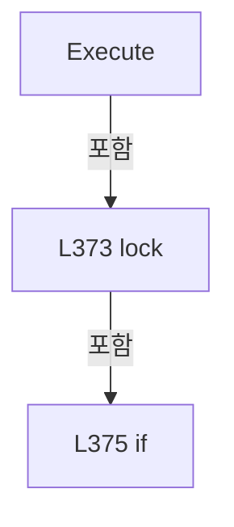

변경 전 점검: 입력/반환 타입, 위 호출자, 예외/취소 경로, 공유 상태와 저장·전송 소비자를 함께 확인합니다. 값의 단위나 물리 방향을 이름만으로 확정하지 않습니다.

### MethodDeclaration `ExecuteOrThrow` · L384–390

[Drilling.Common/Interface/PicoMotor/CPicoMotor.cs:384–390](https://github.com/kjuws10-rgb/A3Drilling/blob/5aee8e58439c9b455cae7c9593c9be986c3e682e/Drilling.Common/Interface/PicoMotor/CPicoMotor.cs#L384-L390)

| 항목 | 실제 추출 값 |
| --- | --- |
| 서명 | void Drilling.Common.Interface.CPicoMotorCommandSession.ExecuteOrThrow(System.Func<CmdLib8742, bool>, string) |
| 접근/수식자 | Private / private |
| 반환/값 타입 | void |
| 소속 타입 | NamedType:Drilling.Common.Interface.CPicoMotorCommandSession |

입력 계약:

| 이름 | 타입 | 전달 | 선택/기본값 |
| --- | --- | --- | --- |
| action | System.Func<CmdLib8742, bool> | None | False /  |
| commandName | string | None | False /  |

정적 호출자로 확인된 위치:

| 호출 파일/행 | 호출 표현식 | 런타임 분기 가능 |
| --- | --- | --- |
| [Drilling.Common/Interface/PicoMotor/CPicoMotor.cs:216–216](https://github.com/kjuws10-rgb/A3Drilling/blob/5aee8e58439c9b455cae7c9593c9be986c3e682e/Drilling.Common/Interface/PicoMotor/CPicoMotor.cs#L216-L216) | ExecuteOrThrow | False |
| [Drilling.Common/Interface/PicoMotor/CPicoMotor.cs:228–228](https://github.com/kjuws10-rgb/A3Drilling/blob/5aee8e58439c9b455cae7c9593c9be986c3e682e/Drilling.Common/Interface/PicoMotor/CPicoMotor.cs#L228-L228) | ExecuteOrThrow | False |
| [Drilling.Common/Interface/PicoMotor/CPicoMotor.cs:240–240](https://github.com/kjuws10-rgb/A3Drilling/blob/5aee8e58439c9b455cae7c9593c9be986c3e682e/Drilling.Common/Interface/PicoMotor/CPicoMotor.cs#L240-L240) | ExecuteOrThrow | False |
| [Drilling.Common/Interface/PicoMotor/CPicoMotor.cs:252–252](https://github.com/kjuws10-rgb/A3Drilling/blob/5aee8e58439c9b455cae7c9593c9be986c3e682e/Drilling.Common/Interface/PicoMotor/CPicoMotor.cs#L252-L252) | ExecuteOrThrow | False |
| [Drilling.Common/Interface/PicoMotor/CPicoMotor.cs:264–264](https://github.com/kjuws10-rgb/A3Drilling/blob/5aee8e58439c9b455cae7c9593c9be986c3e682e/Drilling.Common/Interface/PicoMotor/CPicoMotor.cs#L264-L264) | ExecuteOrThrow | False |
| [Drilling.Common/Interface/PicoMotor/CPicoMotor.cs:276–276](https://github.com/kjuws10-rgb/A3Drilling/blob/5aee8e58439c9b455cae7c9593c9be986c3e682e/Drilling.Common/Interface/PicoMotor/CPicoMotor.cs#L276-L276) | ExecuteOrThrow | False |
| [Drilling.Common/Interface/PicoMotor/CPicoMotor.cs:287–287](https://github.com/kjuws10-rgb/A3Drilling/blob/5aee8e58439c9b455cae7c9593c9be986c3e682e/Drilling.Common/Interface/PicoMotor/CPicoMotor.cs#L287-L287) | ExecuteOrThrow | False |
| [Drilling.Common/Interface/PicoMotor/CPicoMotor.cs:297–297](https://github.com/kjuws10-rgb/A3Drilling/blob/5aee8e58439c9b455cae7c9593c9be986c3e682e/Drilling.Common/Interface/PicoMotor/CPicoMotor.cs#L297-L297) | ExecuteOrThrow | False |
| [Drilling.Common/Interface/PicoMotor/CPicoMotor.cs:307–307](https://github.com/kjuws10-rgb/A3Drilling/blob/5aee8e58439c9b455cae7c9593c9be986c3e682e/Drilling.Common/Interface/PicoMotor/CPicoMotor.cs#L307-L307) | ExecuteOrThrow | False |
| [Drilling.Common/Interface/PicoMotor/CPicoMotor.cs:317–317](https://github.com/kjuws10-rgb/A3Drilling/blob/5aee8e58439c9b455cae7c9593c9be986c3e682e/Drilling.Common/Interface/PicoMotor/CPicoMotor.cs#L317-L317) | ExecuteOrThrow | False |
| [Drilling.Common/Interface/PicoMotor/CPicoMotor.cs:333–333](https://github.com/kjuws10-rgb/A3Drilling/blob/5aee8e58439c9b455cae7c9593c9be986c3e682e/Drilling.Common/Interface/PicoMotor/CPicoMotor.cs#L333-L333) | ExecuteOrThrow | False |
| [Drilling.Common/Interface/PicoMotor/CPicoMotor.cs:343–343](https://github.com/kjuws10-rgb/A3Drilling/blob/5aee8e58439c9b455cae7c9593c9be986c3e682e/Drilling.Common/Interface/PicoMotor/CPicoMotor.cs#L343-L343) | ExecuteOrThrow | False |
| [Drilling.Common/Interface/PicoMotor/CPicoMotor.cs:353–353](https://github.com/kjuws10-rgb/A3Drilling/blob/5aee8e58439c9b455cae7c9593c9be986c3e682e/Drilling.Common/Interface/PicoMotor/CPicoMotor.cs#L353-L353) | ExecuteOrThrow | False |
| [Drilling.Common/Interface/PicoMotor/CPicoMotor.cs:363–363](https://github.com/kjuws10-rgb/A3Drilling/blob/5aee8e58439c9b455cae7c9593c9be986c3e682e/Drilling.Common/Interface/PicoMotor/CPicoMotor.cs#L363-L363) | ExecuteOrThrow | False |

호출하는 대상과 해석 범위:

| 원본 행 | 표현식 | 분석 상태 | 대상/소스 위치 |
| --- | --- | --- | --- |
| 386 | Execute | resolved | bool Drilling.Common.Interface.CPicoMotorCommandSession.Execute(System.Func<CmdLib8742, bool>) · Drilling.Common/Interface/PicoMotor/CPicoMotor.cs:371 |
| 388 | new InvalidOperationException | resolved | System.InvalidOperationException.InvalidOperationException(string?) |

본문의 실제 연산·분기·예외·반환 순서(원문 위치 순):

| 원본 행 | 종류 | 주석 해설 |
| --- | --- | --- |
| 386 | call | 함수·델리게이트 또는 객체 생성자를 호출합니다: Execute(action) |
| 386 | if | 조건에 따라 분기합니다: if (!Execute(action)) |
| 388 | call | 함수·델리게이트 또는 객체 생성자를 호출합니다: new InvalidOperationException($"PicoMotor CmdLib command failed. Command={commandName}") |
| 388 | throw | 예외를 발생/전달합니다: throw new InvalidOperationException($"PicoMotor CmdLib command failed. Command={commandName}"); |

제어 구문의 포함 구조(실제 실행 순서/CFG가 아닌 구문 탐색 그림):

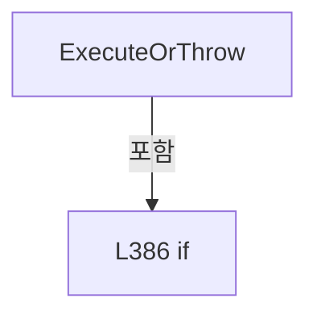

변경 전 점검: 입력/반환 타입, 위 호출자, 예외/취소 경로, 공유 상태와 저장·전송 소비자를 함께 확인합니다. 값의 단위나 물리 방향을 이름만으로 확정하지 않습니다.

### MethodDeclaration `ClampMotorNo` · L392–395

[Drilling.Common/Interface/PicoMotor/CPicoMotor.cs:392–395](https://github.com/kjuws10-rgb/A3Drilling/blob/5aee8e58439c9b455cae7c9593c9be986c3e682e/Drilling.Common/Interface/PicoMotor/CPicoMotor.cs#L392-L395)

| 항목 | 실제 추출 값 |
| --- | --- |
| 서명 | int Drilling.Common.Interface.CPicoMotorCommandSession.ClampMotorNo(int) |
| 접근/수식자 | Private / private, static |
| 반환/값 타입 | int |
| 소속 타입 | NamedType:Drilling.Common.Interface.CPicoMotorCommandSession |

입력 계약:

| 이름 | 타입 | 전달 | 선택/기본값 |
| --- | --- | --- | --- |
| motorNo | int | None | False /  |

정적 호출자로 확인된 위치:

| 호출 파일/행 | 호출 표현식 | 런타임 분기 가능 |
| --- | --- | --- |
| [Drilling.Common/Interface/PicoMotor/CPicoMotor.cs:213–213](https://github.com/kjuws10-rgb/A3Drilling/blob/5aee8e58439c9b455cae7c9593c9be986c3e682e/Drilling.Common/Interface/PicoMotor/CPicoMotor.cs#L213-L213) | ClampMotorNo | False |
| [Drilling.Common/Interface/PicoMotor/CPicoMotor.cs:225–225](https://github.com/kjuws10-rgb/A3Drilling/blob/5aee8e58439c9b455cae7c9593c9be986c3e682e/Drilling.Common/Interface/PicoMotor/CPicoMotor.cs#L225-L225) | ClampMotorNo | False |
| [Drilling.Common/Interface/PicoMotor/CPicoMotor.cs:237–237](https://github.com/kjuws10-rgb/A3Drilling/blob/5aee8e58439c9b455cae7c9593c9be986c3e682e/Drilling.Common/Interface/PicoMotor/CPicoMotor.cs#L237-L237) | ClampMotorNo | False |
| [Drilling.Common/Interface/PicoMotor/CPicoMotor.cs:249–249](https://github.com/kjuws10-rgb/A3Drilling/blob/5aee8e58439c9b455cae7c9593c9be986c3e682e/Drilling.Common/Interface/PicoMotor/CPicoMotor.cs#L249-L249) | ClampMotorNo | False |
| [Drilling.Common/Interface/PicoMotor/CPicoMotor.cs:273–273](https://github.com/kjuws10-rgb/A3Drilling/blob/5aee8e58439c9b455cae7c9593c9be986c3e682e/Drilling.Common/Interface/PicoMotor/CPicoMotor.cs#L273-L273) | ClampMotorNo | False |
| [Drilling.Common/Interface/PicoMotor/CPicoMotor.cs:284–284](https://github.com/kjuws10-rgb/A3Drilling/blob/5aee8e58439c9b455cae7c9593c9be986c3e682e/Drilling.Common/Interface/PicoMotor/CPicoMotor.cs#L284-L284) | ClampMotorNo | False |
| [Drilling.Common/Interface/PicoMotor/CPicoMotor.cs:294–294](https://github.com/kjuws10-rgb/A3Drilling/blob/5aee8e58439c9b455cae7c9593c9be986c3e682e/Drilling.Common/Interface/PicoMotor/CPicoMotor.cs#L294-L294) | ClampMotorNo | False |
| [Drilling.Common/Interface/PicoMotor/CPicoMotor.cs:304–304](https://github.com/kjuws10-rgb/A3Drilling/blob/5aee8e58439c9b455cae7c9593c9be986c3e682e/Drilling.Common/Interface/PicoMotor/CPicoMotor.cs#L304-L304) | ClampMotorNo | False |
| [Drilling.Common/Interface/PicoMotor/CPicoMotor.cs:330–330](https://github.com/kjuws10-rgb/A3Drilling/blob/5aee8e58439c9b455cae7c9593c9be986c3e682e/Drilling.Common/Interface/PicoMotor/CPicoMotor.cs#L330-L330) | ClampMotorNo | False |
| [Drilling.Common/Interface/PicoMotor/CPicoMotor.cs:340–340](https://github.com/kjuws10-rgb/A3Drilling/blob/5aee8e58439c9b455cae7c9593c9be986c3e682e/Drilling.Common/Interface/PicoMotor/CPicoMotor.cs#L340-L340) | ClampMotorNo | False |
| [Drilling.Common/Interface/PicoMotor/CPicoMotor.cs:350–350](https://github.com/kjuws10-rgb/A3Drilling/blob/5aee8e58439c9b455cae7c9593c9be986c3e682e/Drilling.Common/Interface/PicoMotor/CPicoMotor.cs#L350-L350) | ClampMotorNo | False |
| [Drilling.Common/Interface/PicoMotor/CPicoMotor.cs:360–360](https://github.com/kjuws10-rgb/A3Drilling/blob/5aee8e58439c9b455cae7c9593c9be986c3e682e/Drilling.Common/Interface/PicoMotor/CPicoMotor.cs#L360-L360) | ClampMotorNo | False |

호출하는 대상과 해석 범위:

| 원본 행 | 표현식 | 분석 상태 | 대상/소스 위치 |
| --- | --- | --- | --- |
| 394 | Math.Clamp | resolved | int System.Math.Clamp(int, int, int) |

본문의 실제 연산·분기·예외·반환 순서(원문 위치 순):

| 원본 행 | 종류 | 주석 해설 |
| --- | --- | --- |
| 394 | call | 함수·델리게이트 또는 객체 생성자를 호출합니다: Math.Clamp(motorNo, 1, 4) |
| 394 | return | 호출자에게 값 또는 제어를 반환합니다: return Math.Clamp(motorNo, 1, 4); |

변경 전 점검: 입력/반환 타입, 위 호출자, 예외/취소 경로, 공유 상태와 저장·전송 소비자를 함께 확인합니다. 값의 단위나 물리 방향을 이름만으로 확정하지 않습니다.

### MethodDeclaration `ToInt32Step` · L397–405

[Drilling.Common/Interface/PicoMotor/CPicoMotor.cs:397–405](https://github.com/kjuws10-rgb/A3Drilling/blob/5aee8e58439c9b455cae7c9593c9be986c3e682e/Drilling.Common/Interface/PicoMotor/CPicoMotor.cs#L397-L405)

| 항목 | 실제 추출 값 |
| --- | --- |
| 서명 | int Drilling.Common.Interface.CPicoMotorCommandSession.ToInt32Step(long) |
| 접근/수식자 | Private / private, static |
| 반환/값 타입 | int |
| 소속 타입 | NamedType:Drilling.Common.Interface.CPicoMotorCommandSession |

입력 계약:

| 이름 | 타입 | 전달 | 선택/기본값 |
| --- | --- | --- | --- |
| step | long | None | False /  |

정적 호출자로 확인된 위치:

| 호출 파일/행 | 호출 표현식 | 런타임 분기 가능 |
| --- | --- | --- |
| [Drilling.Common/Interface/PicoMotor/CPicoMotor.cs:350–350](https://github.com/kjuws10-rgb/A3Drilling/blob/5aee8e58439c9b455cae7c9593c9be986c3e682e/Drilling.Common/Interface/PicoMotor/CPicoMotor.cs#L350-L350) | ToInt32Step | False |
| [Drilling.Common/Interface/PicoMotor/CPicoMotor.cs:360–360](https://github.com/kjuws10-rgb/A3Drilling/blob/5aee8e58439c9b455cae7c9593c9be986c3e682e/Drilling.Common/Interface/PicoMotor/CPicoMotor.cs#L360-L360) | ToInt32Step | False |

본문의 실제 연산·분기·예외·반환 순서(원문 위치 순):

| 원본 행 | 종류 | 주석 해설 |
| --- | --- | --- |
| 399 | return | 호출자에게 값 또는 제어를 반환합니다: return step switch { > int.MaxValue => int.MaxValue, < int.MinValue => int.MinValue, _ => (int)step }; |
| 399 | switch-expression | 값별 결과식을 선택합니다: step switch { > int.MaxValue => int.MaxValue, < int.MinValue => int.MinValue, _ => (int)step } |

제어 구문의 포함 구조(실제 실행 순서/CFG가 아닌 구문 탐색 그림):

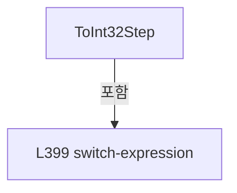

변경 전 점검: 입력/반환 타입, 위 호출자, 예외/취소 경로, 공유 상태와 저장·전송 소비자를 함께 확인합니다. 값의 단위나 물리 방향을 이름만으로 확정하지 않습니다.

### FieldDeclaration `_syncRoot` · L410–410

[Drilling.Common/Interface/PicoMotor/CPicoMotor.cs:410–410](https://github.com/kjuws10-rgb/A3Drilling/blob/5aee8e58439c9b455cae7c9593c9be986c3e682e/Drilling.Common/Interface/PicoMotor/CPicoMotor.cs#L410-L410)

| 항목 | 실제 추출 값 |
| --- | --- |
| 서명 | object Drilling.Common.Interface.CPicoMotorService._syncRoot |
| 접근/수식자 | Private / private, readonly |
| 반환/값 타입 | object |
| 소속 타입 | NamedType:Drilling.Common.Interface.CPicoMotorService |

현재 부분 분석에서 직접 연결된 호출자는 없습니다. XAML/이벤트/인터페이스·델리게이트·외부 진입을 추가 확인해야 하며, 미사용으로 판정한 것이 아닙니다.

호출하는 대상과 해석 범위:

| 원본 행 | 표현식 | 분석 상태 | 대상/소스 위치 |
| --- | --- | --- | --- |
| 410 | new | resolved | object.Object() |

본문의 실제 연산·분기·예외·반환 순서(원문 위치 순):

| 원본 행 | 종류 | 주석 해설 |
| --- | --- | --- |
| 410 | call | 함수·델리게이트 또는 객체 생성자를 호출합니다: new() |
| 410 | variable-initializer | 변수의 초기값을 지정합니다: _syncRoot = new() |

변경 전 점검: 입력/반환 타입, 위 호출자, 예외/취소 경로, 공유 상태와 저장·전송 소비자를 함께 확인합니다. 값의 단위나 물리 방향을 이름만으로 확정하지 않습니다.

### FieldDeclaration `_sessions` · L411–411

[Drilling.Common/Interface/PicoMotor/CPicoMotor.cs:411–411](https://github.com/kjuws10-rgb/A3Drilling/blob/5aee8e58439c9b455cae7c9593c9be986c3e682e/Drilling.Common/Interface/PicoMotor/CPicoMotor.cs#L411-L411)

| 항목 | 실제 추출 값 |
| --- | --- |
| 서명 | System.Collections.Generic.Dictionary<int, Drilling.Common.Interface.CPicoMotorCommandSession> Drilling.Common.Interface.CPicoMotorService._sessions |
| 접근/수식자 | Private / private, readonly |
| 반환/값 타입 | System.Collections.Generic.Dictionary<int, Drilling.Common.Interface.CPicoMotorCommandSession> |
| 소속 타입 | NamedType:Drilling.Common.Interface.CPicoMotorService |

현재 부분 분석에서 직접 연결된 호출자는 없습니다. XAML/이벤트/인터페이스·델리게이트·외부 진입을 추가 확인해야 하며, 미사용으로 판정한 것이 아닙니다.

본문의 실제 연산·분기·예외·반환 순서(원문 위치 순):

| 원본 행 | 종류 | 주석 해설 |
| --- | --- | --- |
| 411 | variable-initializer | 변수의 초기값을 지정합니다: _sessions = [] |

변경 전 점검: 입력/반환 타입, 위 호출자, 예외/취소 경로, 공유 상태와 저장·전송 소비자를 함께 확인합니다. 값의 단위나 물리 방향을 이름만으로 확정하지 않습니다.

### FieldDeclaration `_statuses` · L412–412

[Drilling.Common/Interface/PicoMotor/CPicoMotor.cs:412–412](https://github.com/kjuws10-rgb/A3Drilling/blob/5aee8e58439c9b455cae7c9593c9be986c3e682e/Drilling.Common/Interface/PicoMotor/CPicoMotor.cs#L412-L412)

| 항목 | 실제 추출 값 |
| --- | --- |
| 서명 | System.Collections.Generic.Dictionary<int, Drilling.Common.Interface.ST_PICO_MOTOR_STATUS> Drilling.Common.Interface.CPicoMotorService._statuses |
| 접근/수식자 | Private / private, readonly |
| 반환/값 타입 | System.Collections.Generic.Dictionary<int, Drilling.Common.Interface.ST_PICO_MOTOR_STATUS> |
| 소속 타입 | NamedType:Drilling.Common.Interface.CPicoMotorService |

현재 부분 분석에서 직접 연결된 호출자는 없습니다. XAML/이벤트/인터페이스·델리게이트·외부 진입을 추가 확인해야 하며, 미사용으로 판정한 것이 아닙니다.

본문의 실제 연산·분기·예외·반환 순서(원문 위치 순):

| 원본 행 | 종류 | 주석 해설 |
| --- | --- | --- |
| 412 | variable-initializer | 변수의 초기값을 지정합니다: _statuses = [] |

변경 전 점검: 입력/반환 타입, 위 호출자, 예외/취소 경로, 공유 상태와 저장·전송 소비자를 함께 확인합니다. 값의 단위나 물리 방향을 이름만으로 확정하지 않습니다.

### FieldDeclaration `_allMoveTokens` · L413–413

[Drilling.Common/Interface/PicoMotor/CPicoMotor.cs:413–413](https://github.com/kjuws10-rgb/A3Drilling/blob/5aee8e58439c9b455cae7c9593c9be986c3e682e/Drilling.Common/Interface/PicoMotor/CPicoMotor.cs#L413-L413)

| 항목 | 실제 추출 값 |
| --- | --- |
| 서명 | System.Collections.Generic.Dictionary<int, System.Threading.CancellationTokenSource> Drilling.Common.Interface.CPicoMotorService._allMoveTokens |
| 접근/수식자 | Private / private, readonly |
| 반환/값 타입 | System.Collections.Generic.Dictionary<int, System.Threading.CancellationTokenSource> |
| 소속 타입 | NamedType:Drilling.Common.Interface.CPicoMotorService |

현재 부분 분석에서 직접 연결된 호출자는 없습니다. XAML/이벤트/인터페이스·델리게이트·외부 진입을 추가 확인해야 하며, 미사용으로 판정한 것이 아닙니다.

본문의 실제 연산·분기·예외·반환 순서(원문 위치 순):

| 원본 행 | 종류 | 주석 해설 |
| --- | --- | --- |
| 413 | variable-initializer | 변수의 초기값을 지정합니다: _allMoveTokens = [] |

변경 전 점검: 입력/반환 타입, 위 호출자, 예외/취소 경로, 공유 상태와 저장·전송 소비자를 함께 확인합니다. 값의 단위나 물리 방향을 이름만으로 확정하지 않습니다.

### FieldDeclaration `_motionTokens` · L414–414

[Drilling.Common/Interface/PicoMotor/CPicoMotor.cs:414–414](https://github.com/kjuws10-rgb/A3Drilling/blob/5aee8e58439c9b455cae7c9593c9be986c3e682e/Drilling.Common/Interface/PicoMotor/CPicoMotor.cs#L414-L414)

| 항목 | 실제 추출 값 |
| --- | --- |
| 서명 | System.Collections.Generic.Dictionary<int, System.Threading.CancellationTokenSource> Drilling.Common.Interface.CPicoMotorService._motionTokens |
| 접근/수식자 | Private / private, readonly |
| 반환/값 타입 | System.Collections.Generic.Dictionary<int, System.Threading.CancellationTokenSource> |
| 소속 타입 | NamedType:Drilling.Common.Interface.CPicoMotorService |

현재 부분 분석에서 직접 연결된 호출자는 없습니다. XAML/이벤트/인터페이스·델리게이트·외부 진입을 추가 확인해야 하며, 미사용으로 판정한 것이 아닙니다.

본문의 실제 연산·분기·예외·반환 순서(원문 위치 순):

| 원본 행 | 종류 | 주석 해설 |
| --- | --- | --- |
| 414 | variable-initializer | 변수의 초기값을 지정합니다: _motionTokens = [] |

변경 전 점검: 입력/반환 타입, 위 호출자, 예외/취소 경로, 공유 상태와 저장·전송 소비자를 함께 확인합니다. 값의 단위나 물리 방향을 이름만으로 확정하지 않습니다.

### FieldDeclaration `SimulationIntervalMs` · L415–415

[Drilling.Common/Interface/PicoMotor/CPicoMotor.cs:415–415](https://github.com/kjuws10-rgb/A3Drilling/blob/5aee8e58439c9b455cae7c9593c9be986c3e682e/Drilling.Common/Interface/PicoMotor/CPicoMotor.cs#L415-L415)

| 항목 | 실제 추출 값 |
| --- | --- |
| 서명 | int Drilling.Common.Interface.CPicoMotorService.SimulationIntervalMs |
| 접근/수식자 | Private / private, const |
| 반환/값 타입 | int |
| 소속 타입 | NamedType:Drilling.Common.Interface.CPicoMotorService |

현재 부분 분석에서 직접 연결된 호출자는 없습니다. XAML/이벤트/인터페이스·델리게이트·외부 진입을 추가 확인해야 하며, 미사용으로 판정한 것이 아닙니다.

본문의 실제 연산·분기·예외·반환 순서(원문 위치 순):

| 원본 행 | 종류 | 주석 해설 |
| --- | --- | --- |
| 415 | variable-initializer | 변수의 초기값을 지정합니다: SimulationIntervalMs = 100 |

변경 전 점검: 입력/반환 타입, 위 호출자, 예외/취소 경로, 공유 상태와 저장·전송 소비자를 함께 확인합니다. 값의 단위나 물리 방향을 이름만으로 확정하지 않습니다.

### MethodDeclaration `GetStatus` · L416–422

[Drilling.Common/Interface/PicoMotor/CPicoMotor.cs:416–422](https://github.com/kjuws10-rgb/A3Drilling/blob/5aee8e58439c9b455cae7c9593c9be986c3e682e/Drilling.Common/Interface/PicoMotor/CPicoMotor.cs#L416-L422)

| 항목 | 실제 추출 값 |
| --- | --- |
| 서명 | Drilling.Common.Interface.ST_PICO_MOTOR_STATUS Drilling.Common.Interface.CPicoMotorService.GetStatus(int) |
| 접근/수식자 | Public / public |
| 반환/값 타입 | Drilling.Common.Interface.ST_PICO_MOTOR_STATUS |
| 소속 타입 | NamedType:Drilling.Common.Interface.CPicoMotorService |

입력 계약:

| 이름 | 타입 | 전달 | 선택/기본값 |
| --- | --- | --- | --- |
| number | int | None | False /  |

정적 호출자로 확인된 위치:

| 호출 파일/행 | 호출 표현식 | 런타임 분기 가능 |
| --- | --- | --- |
| [Drilling.Common/Interface/CInterfaceManager.cs:1527–1527](https://github.com/kjuws10-rgb/A3Drilling/blob/5aee8e58439c9b455cae7c9593c9be986c3e682e/Drilling.Common/Interface/CInterfaceManager.cs#L1527-L1527) | _picoMotorService.GetStatus | False |
| [Drilling.Common/Interface/PicoMotor/CPicoMotor.cs:428–428](https://github.com/kjuws10-rgb/A3Drilling/blob/5aee8e58439c9b455cae7c9593c9be986c3e682e/Drilling.Common/Interface/PicoMotor/CPicoMotor.cs#L428-L428) | GetStatus | False |
| [Drilling.Common/Interface/PicoMotor/CPicoMotor.cs:439–439](https://github.com/kjuws10-rgb/A3Drilling/blob/5aee8e58439c9b455cae7c9593c9be986c3e682e/Drilling.Common/Interface/PicoMotor/CPicoMotor.cs#L439-L439) | GetStatus | False |
| [Drilling.Common/Interface/PicoMotor/CPicoMotor.cs:524–524](https://github.com/kjuws10-rgb/A3Drilling/blob/5aee8e58439c9b455cae7c9593c9be986c3e682e/Drilling.Common/Interface/PicoMotor/CPicoMotor.cs#L524-L524) | GetStatus | False |
| [Drilling.Common/Interface/PicoMotor/CPicoMotor.cs:552–552](https://github.com/kjuws10-rgb/A3Drilling/blob/5aee8e58439c9b455cae7c9593c9be986c3e682e/Drilling.Common/Interface/PicoMotor/CPicoMotor.cs#L552-L552) | GetStatus | False |
| [Drilling.Common/Interface/PicoMotor/CPicoMotor.cs:599–599](https://github.com/kjuws10-rgb/A3Drilling/blob/5aee8e58439c9b455cae7c9593c9be986c3e682e/Drilling.Common/Interface/PicoMotor/CPicoMotor.cs#L599-L599) | GetStatus | False |
| [Drilling.Common/Interface/PicoMotor/CPicoMotor.cs:606–606](https://github.com/kjuws10-rgb/A3Drilling/blob/5aee8e58439c9b455cae7c9593c9be986c3e682e/Drilling.Common/Interface/PicoMotor/CPicoMotor.cs#L606-L606) | GetStatus | False |
| [Drilling.Common/Interface/PicoMotor/CPicoMotor.cs:611–611](https://github.com/kjuws10-rgb/A3Drilling/blob/5aee8e58439c9b455cae7c9593c9be986c3e682e/Drilling.Common/Interface/PicoMotor/CPicoMotor.cs#L611-L611) | GetStatus | False |
| [Drilling.Common/Interface/PicoMotor/CPicoMotor.cs:654–654](https://github.com/kjuws10-rgb/A3Drilling/blob/5aee8e58439c9b455cae7c9593c9be986c3e682e/Drilling.Common/Interface/PicoMotor/CPicoMotor.cs#L654-L654) | GetStatus | False |
| [Drilling.Common/Interface/PicoMotor/CPicoMotor.cs:679–679](https://github.com/kjuws10-rgb/A3Drilling/blob/5aee8e58439c9b455cae7c9593c9be986c3e682e/Drilling.Common/Interface/PicoMotor/CPicoMotor.cs#L679-L679) | GetStatus | False |
| [Drilling.Common/Interface/PicoMotor/CPicoMotor.cs:694–694](https://github.com/kjuws10-rgb/A3Drilling/blob/5aee8e58439c9b455cae7c9593c9be986c3e682e/Drilling.Common/Interface/PicoMotor/CPicoMotor.cs#L694-L694) | GetStatus | False |
| [Drilling.Common/Interface/PicoMotor/CPicoMotor.cs:797–797](https://github.com/kjuws10-rgb/A3Drilling/blob/5aee8e58439c9b455cae7c9593c9be986c3e682e/Drilling.Common/Interface/PicoMotor/CPicoMotor.cs#L797-L797) | GetStatus | False |
| [Drilling.Common/Interface/PicoMotor/CPicoMotor.cs:805–805](https://github.com/kjuws10-rgb/A3Drilling/blob/5aee8e58439c9b455cae7c9593c9be986c3e682e/Drilling.Common/Interface/PicoMotor/CPicoMotor.cs#L805-L805) | GetStatus | False |
| [Drilling.Common/Interface/PicoMotor/CPicoMotor.cs:850–850](https://github.com/kjuws10-rgb/A3Drilling/blob/5aee8e58439c9b455cae7c9593c9be986c3e682e/Drilling.Common/Interface/PicoMotor/CPicoMotor.cs#L850-L850) | GetStatus | False |
| [Drilling.Common/Interface/PicoMotor/CPicoMotor.cs:864–864](https://github.com/kjuws10-rgb/A3Drilling/blob/5aee8e58439c9b455cae7c9593c9be986c3e682e/Drilling.Common/Interface/PicoMotor/CPicoMotor.cs#L864-L864) | GetStatus | False |
| [Drilling.Common/Interface/PicoMotor/CPicoMotor.cs:912–912](https://github.com/kjuws10-rgb/A3Drilling/blob/5aee8e58439c9b455cae7c9593c9be986c3e682e/Drilling.Common/Interface/PicoMotor/CPicoMotor.cs#L912-L912) | GetStatus | False |
| [Drilling.Common/Interface/PicoMotor/CPicoMotor.cs:930–930](https://github.com/kjuws10-rgb/A3Drilling/blob/5aee8e58439c9b455cae7c9593c9be986c3e682e/Drilling.Common/Interface/PicoMotor/CPicoMotor.cs#L930-L930) | GetStatus | False |
| [Drilling.Common/Interface/PicoMotor/CPicoMotor.cs:947–947](https://github.com/kjuws10-rgb/A3Drilling/blob/5aee8e58439c9b455cae7c9593c9be986c3e682e/Drilling.Common/Interface/PicoMotor/CPicoMotor.cs#L947-L947) | GetStatus | False |

호출하는 대상과 해석 범위:

| 원본 행 | 표현식 | 분석 상태 | 대상/소스 위치 |
| --- | --- | --- | --- |
| 420 | _statuses.TryGetValue | resolved | bool System.Collections.Generic.Dictionary<int, Drilling.Common.Interface.ST_PICO_MOTOR_STATUS>.TryGetValue(int, out Drilling.Common.Interface.ST_PICO_MOTOR_STATUS) |

본문의 실제 연산·분기·예외·반환 순서(원문 위치 순):

| 원본 행 | 종류 | 주석 해설 |
| --- | --- | --- |
| 418 | lock | 공유 상태의 임계 구역에 진입합니다: lock (_syncRoot) |
| 420 | call | 함수·델리게이트 또는 객체 생성자를 호출합니다: _statuses.TryGetValue(number, out var status) |
| 420 | conditional-expression | 조건에 따라 결과식을 선택합니다: _statuses.TryGetValue(number, out var status) ? status : ST_PICO_MOTOR_STATUS.Empty |
| 420 | return | 호출자에게 값 또는 제어를 반환합니다: return _statuses.TryGetValue(number, out var status) ? status : ST_PICO_MOTOR_STATUS.Empty; |

제어 구문의 포함 구조(실제 실행 순서/CFG가 아닌 구문 탐색 그림):

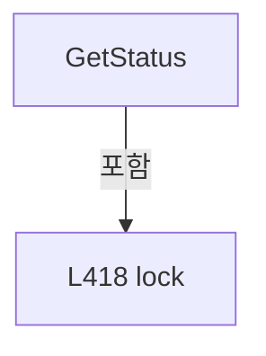

변경 전 점검: 입력/반환 타입, 위 호출자, 예외/취소 경로, 공유 상태와 저장·전송 소비자를 함께 확인합니다. 값의 단위나 물리 방향을 이름만으로 확정하지 않습니다.

### MethodDeclaration `Refresh` · L424–465

[Drilling.Common/Interface/PicoMotor/CPicoMotor.cs:424–465](https://github.com/kjuws10-rgb/A3Drilling/blob/5aee8e58439c9b455cae7c9593c9be986c3e682e/Drilling.Common/Interface/PicoMotor/CPicoMotor.cs#L424-L465)

| 항목 | 실제 추출 값 |
| --- | --- |
| 서명 | System.Threading.Tasks.Task<Drilling.Common.Interface.ST_PICO_MOTOR_STATUS> Drilling.Common.Interface.CPicoMotorService.Refresh(int, bool, System.Threading.CancellationToken) |
| 접근/수식자 | Public / public, async |
| 반환/값 타입 | System.Threading.Tasks.Task<Drilling.Common.Interface.ST_PICO_MOTOR_STATUS> |
| 소속 타입 | NamedType:Drilling.Common.Interface.CPicoMotorService |

입력 계약:

| 이름 | 타입 | 전달 | 선택/기본값 |
| --- | --- | --- | --- |
| number | int | None | False /  |
| simulation | bool | None | False /  |
| cancellationToken | System.Threading.CancellationToken | None | True / null |

정적 호출자로 확인된 위치:

| 호출 파일/행 | 호출 표현식 | 런타임 분기 가능 |
| --- | --- | --- |
| [Drilling.Common/Interface/CInterfaceManager.cs:1523–1523](https://github.com/kjuws10-rgb/A3Drilling/blob/5aee8e58439c9b455cae7c9593c9be986c3e682e/Drilling.Common/Interface/CInterfaceManager.cs#L1523-L1523) | _picoMotorService.Refresh | False |
| [Drilling.Common/Interface/PicoMotor/CPicoMotor.cs:596–596](https://github.com/kjuws10-rgb/A3Drilling/blob/5aee8e58439c9b455cae7c9593c9be986c3e682e/Drilling.Common/Interface/PicoMotor/CPicoMotor.cs#L596-L596) | Refresh | False |
| [Drilling.Common/Interface/PicoMotor/CPicoMotor.cs:846–846](https://github.com/kjuws10-rgb/A3Drilling/blob/5aee8e58439c9b455cae7c9593c9be986c3e682e/Drilling.Common/Interface/PicoMotor/CPicoMotor.cs#L846-L846) | Refresh | False |

호출하는 대상과 해석 범위:

| 원본 행 | 표현식 | 분석 상태 | 대상/소스 위치 |
| --- | --- | --- | --- |
| 428 | GetStatus | resolved | Drilling.Common.Interface.ST_PICO_MOTOR_STATUS Drilling.Common.Interface.CPicoMotorService.GetStatus(int) · Drilling.Common/Interface/PicoMotor/CPicoMotor.cs:416 |
| 464 | Task.Run | resolved | System.Threading.Tasks.Task<Drilling.Common.Interface.ST_PICO_MOTOR_STATUS> System.Threading.Tasks.Task.Run<Drilling.Common.Interface.ST_PICO_MOTOR_STATUS>(System.Func<Drilling.Common.Interface.ST_PICO_MOTOR_STATUS>, System.Threading.CancellationToken) |

본문의 실제 연산·분기·예외·반환 순서(원문 위치 순):

| 원본 행 | 종류 | 주석 해설 |
| --- | --- | --- |
| 426 | if | 조건에 따라 분기합니다: if (simulation) |
| 428 | call | 함수·델리게이트 또는 객체 생성자를 호출합니다: GetStatus(number) |
| 428 | return | 호출자에게 값 또는 제어를 반환합니다: return GetStatus(number)with { CommOk = true, UpdatedAt = DateTimeOffset.Now }; |
| 430 | assignment | 값을 대상에 대입합니다: CommOk = true |
| 431 | assignment | 값을 대상에 대입합니다: UpdatedAt = DateTimeOffset.Now |
| 464 | await | 비동기 완료를 기다립니다: await Task.Run(SelectStatus, cancellationToken) |
| 464 | call | 함수·델리게이트 또는 객체 생성자를 호출합니다: Task.Run(SelectStatus, cancellationToken) |
| 464 | return | 호출자에게 값 또는 제어를 반환합니다: return await Task.Run(SelectStatus, cancellationToken); |

제어 구문의 포함 구조(실제 실행 순서/CFG가 아닌 구문 탐색 그림):

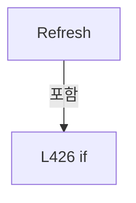

변경 전 점검: 입력/반환 타입, 위 호출자, 예외/취소 경로, 공유 상태와 저장·전송 소비자를 함께 확인합니다. 값의 단위나 물리 방향을 이름만으로 확정하지 않습니다.

### LocalFunctionStatement `SelectStatus` · L435–462

[Drilling.Common/Interface/PicoMotor/CPicoMotor.cs:435–462](https://github.com/kjuws10-rgb/A3Drilling/blob/5aee8e58439c9b455cae7c9593c9be986c3e682e/Drilling.Common/Interface/PicoMotor/CPicoMotor.cs#L435-L462)

| 항목 | 실제 추출 값 |
| --- | --- |
| 서명 | Drilling.Common.Interface.ST_PICO_MOTOR_STATUS SelectStatus() |
| 접근/수식자 | Private /  |
| 반환/값 타입 | Drilling.Common.Interface.ST_PICO_MOTOR_STATUS |
| 소속 타입 | NamedType:Drilling.Common.Interface.CPicoMotorService |

현재 부분 분석에서 직접 연결된 호출자는 없습니다. XAML/이벤트/인터페이스·델리게이트·외부 진입을 추가 확인해야 하며, 미사용으로 판정한 것이 아닙니다.

호출하는 대상과 해석 범위:

| 원본 행 | 표현식 | 분석 상태 | 대상/소스 위치 |
| --- | --- | --- | --- |
| 437 | cancellationToken.ThrowIfCancellationRequested | resolved | void System.Threading.CancellationToken.ThrowIfCancellationRequested() |
| 438 | GetSession | resolved | Drilling.Common.Interface.CPicoMotorCommandSession Drilling.Common.Interface.CPicoMotorService.GetSession(int, bool) · Drilling.Common/Interface/PicoMotor/CPicoMotor.cs:962 |
| 439 | GetStatus | resolved | Drilling.Common.Interface.ST_PICO_MOTOR_STATUS Drilling.Common.Interface.CPicoMotorService.GetStatus(int) · Drilling.Common/Interface/PicoMotor/CPicoMotor.cs:416 |
| 440 | Math.Clamp | resolved | int System.Math.Clamp(int, int, int) |
| 441 | session.GetIdentification | resolved | string Drilling.Common.Interface.CPicoMotorCommandSession.GetIdentification() · Drilling.Common/Interface/PicoMotor/CPicoMotor.cs:197 |
| 442 | session.GetErrorCode | resolved | int Drilling.Common.Interface.CPicoMotorCommandSession.GetErrorCode() · Drilling.Common/Interface/PicoMotor/CPicoMotor.cs:256 |
| 446 | string.IsNullOrWhiteSpace | resolved | bool string.IsNullOrWhiteSpace(string?) |
| 447 | CPicoMotor.StepToMillimeter | resolved | double Drilling.Common.Interface.CPicoMotor.StepToMillimeter(long) · Drilling.Common/Interface/PicoMotor/CPicoMotor.cs:36 |
| 447 | session.GetPositionStep | resolved | int Drilling.Common.Interface.CPicoMotorCommandSession.GetPositionStep(int) · Drilling.Common/Interface/PicoMotor/CPicoMotor.cs:208 |
| 448 | CPicoMotor.StepToMillimeter | resolved | double Drilling.Common.Interface.CPicoMotor.StepToMillimeter(long) · Drilling.Common/Interface/PicoMotor/CPicoMotor.cs:36 |
| 448 | session.GetPositionStep | resolved | int Drilling.Common.Interface.CPicoMotorCommandSession.GetPositionStep(int) · Drilling.Common/Interface/PicoMotor/CPicoMotor.cs:208 |
| 449 | CPicoMotor.StepToMillimeter | resolved | double Drilling.Common.Interface.CPicoMotor.StepToMillimeter(long) · Drilling.Common/Interface/PicoMotor/CPicoMotor.cs:36 |
| 449 | session.GetPositionStep | resolved | int Drilling.Common.Interface.CPicoMotorCommandSession.GetPositionStep(int) · Drilling.Common/Interface/PicoMotor/CPicoMotor.cs:208 |
| 450 | CPicoMotor.StepToMillimeter | resolved | double Drilling.Common.Interface.CPicoMotor.StepToMillimeter(long) · Drilling.Common/Interface/PicoMotor/CPicoMotor.cs:36 |
| 450 | session.GetPositionStep | resolved | int Drilling.Common.Interface.CPicoMotorCommandSession.GetPositionStep(int) · Drilling.Common/Interface/PicoMotor/CPicoMotor.cs:208 |
| 451 | session.GetHomePositionStep | resolved | long Drilling.Common.Interface.CPicoMotorCommandSession.GetHomePositionStep(int) · Drilling.Common/Interface/PicoMotor/CPicoMotor.cs:268 |
| 452 | CPicoMotor.StepToMillimeter | resolved | double Drilling.Common.Interface.CPicoMotor.StepToMillimeter(long) · Drilling.Common/Interface/PicoMotor/CPicoMotor.cs:36 |
| 452 | session.GetVelocityStep | resolved | int Drilling.Common.Interface.CPicoMotorCommandSession.GetVelocityStep(int) · Drilling.Common/Interface/PicoMotor/CPicoMotor.cs:220 |
| 453 | CPicoMotor.StepToMillimeter | resolved | double Drilling.Common.Interface.CPicoMotor.StepToMillimeter(long) · Drilling.Common/Interface/PicoMotor/CPicoMotor.cs:36 |
| 453 | session.GetAccelerationStep | resolved | int Drilling.Common.Interface.CPicoMotorCommandSession.GetAccelerationStep(int) · Drilling.Common/Interface/PicoMotor/CPicoMotor.cs:232 |
| 454 | session.GetMotionDone | resolved | bool Drilling.Common.Interface.CPicoMotorCommandSession.GetMotionDone(int) · Drilling.Common/Interface/PicoMotor/CPicoMotor.cs:244 |
| 457 | CPicoMotor.ToError | resolved | Drilling.Common.Interface.EN_PICO_MOTOR_ERROR Drilling.Common.Interface.CPicoMotor.ToError(int) · Drilling.Common/Interface/PicoMotor/CPicoMotor.cs:56 |
| 460 | SetStatus | resolved | void Drilling.Common.Interface.CPicoMotorService.SetStatus(int, Drilling.Common.Interface.ST_PICO_MOTOR_STATUS) · Drilling.Common/Interface/PicoMotor/CPicoMotor.cs:978 |

본문의 실제 연산·분기·예외·반환 순서(원문 위치 순):

| 원본 행 | 종류 | 주석 해설 |
| --- | --- | --- |
| 437 | call | 함수·델리게이트 또는 객체 생성자를 호출합니다: cancellationToken.ThrowIfCancellationRequested() |
| 438 | call | 함수·델리게이트 또는 객체 생성자를 호출합니다: GetSession(number, requireConnected: true) |
| 438 | local-declaration | 지역 변수를 선언합니다: var session = GetSession(number, requireConnected: true); |
| 438 | variable-initializer | 변수의 초기값을 지정합니다: session = GetSession(number, requireConnected: true) |
| 439 | call | 함수·델리게이트 또는 객체 생성자를 호출합니다: GetStatus(number) |
| 439 | local-declaration | 지역 변수를 선언합니다: var before = GetStatus(number); |
| 439 | variable-initializer | 변수의 초기값을 지정합니다: before = GetStatus(number) |
| 440 | call | 함수·델리게이트 또는 객체 생성자를 호출합니다: Math.Clamp(before.SelectedMotorNo, 1, 4) |
| 440 | local-declaration | 지역 변수를 선언합니다: var motorNo = Math.Clamp(before.SelectedMotorNo, 1, 4); |
| 440 | variable-initializer | 변수의 초기값을 지정합니다: motorNo = Math.Clamp(before.SelectedMotorNo, 1, 4) |
| 441 | call | 함수·델리게이트 또는 객체 생성자를 호출합니다: session.GetIdentification() |
| 441 | local-declaration | 지역 변수를 선언합니다: var identification = session.GetIdentification(); |
| 441 | variable-initializer | 변수의 초기값을 지정합니다: identification = session.GetIdentification() |
| 442 | call | 함수·델리게이트 또는 객체 생성자를 호출합니다: session.GetErrorCode() |
| 442 | local-declaration | 지역 변수를 선언합니다: var errorCode = session.GetErrorCode(); |
| 442 | variable-initializer | 변수의 초기값을 지정합니다: errorCode = session.GetErrorCode() |
| 443 | local-declaration | 지역 변수를 선언합니다: var status = before with { IsConnected = true, Controller = string.IsNullOrWhiteSpace(identification) ? "8742" : identification, Motor1Position = CPicoMotor.StepToMillimeter(session.GetPositionStep(1)), Motor2Position = CPicoMotor |
| 443 | variable-initializer | 변수의 초기값을 지정합니다: status = before with { IsConnected = true, Controller = string.IsNullOrWhiteSpace(identification) ? "8742" : identification, Motor1Position = CPicoMotor.StepToMillimeter(session.GetPositionStep(1)), Motor2Position = CPicoMotor.Ste |
| 445 | assignment | 값을 대상에 대입합니다: IsConnected = true |
| 446 | assignment | 값을 대상에 대입합니다: Controller = string.IsNullOrWhiteSpace(identification) ? "8742" : identification |
| 446 | call | 함수·델리게이트 또는 객체 생성자를 호출합니다: string.IsNullOrWhiteSpace(identification) |
| 446 | conditional-expression | 조건에 따라 결과식을 선택합니다: string.IsNullOrWhiteSpace(identification) ? "8742" : identification |
| 447 | assignment | 값을 대상에 대입합니다: Motor1Position = CPicoMotor.StepToMillimeter(session.GetPositionStep(1)) |
| 447 | call | 함수·델리게이트 또는 객체 생성자를 호출합니다: CPicoMotor.StepToMillimeter(session.GetPositionStep(1)) |
| 447 | call | 함수·델리게이트 또는 객체 생성자를 호출합니다: session.GetPositionStep(1) |
| 448 | assignment | 값을 대상에 대입합니다: Motor2Position = CPicoMotor.StepToMillimeter(session.GetPositionStep(2)) |
| 448 | call | 함수·델리게이트 또는 객체 생성자를 호출합니다: CPicoMotor.StepToMillimeter(session.GetPositionStep(2)) |
| 448 | call | 함수·델리게이트 또는 객체 생성자를 호출합니다: session.GetPositionStep(2) |
| 449 | assignment | 값을 대상에 대입합니다: Motor3Position = CPicoMotor.StepToMillimeter(session.GetPositionStep(3)) |
| 449 | call | 함수·델리게이트 또는 객체 생성자를 호출합니다: CPicoMotor.StepToMillimeter(session.GetPositionStep(3)) |
| 449 | call | 함수·델리게이트 또는 객체 생성자를 호출합니다: session.GetPositionStep(3) |
| 450 | assignment | 값을 대상에 대입합니다: Motor4Position = CPicoMotor.StepToMillimeter(session.GetPositionStep(4)) |
| 450 | call | 함수·델리게이트 또는 객체 생성자를 호출합니다: CPicoMotor.StepToMillimeter(session.GetPositionStep(4)) |
| 450 | call | 함수·델리게이트 또는 객체 생성자를 호출합니다: session.GetPositionStep(4) |
| 451 | assignment | 값을 대상에 대입합니다: HomePosition = session.GetHomePositionStep(motorNo) |
| 451 | call | 함수·델리게이트 또는 객체 생성자를 호출합니다: session.GetHomePositionStep(motorNo) |
| 452 | assignment | 값을 대상에 대입합니다: CurrentVelocity = CPicoMotor.StepToMillimeter(session.GetVelocityStep(motorNo)) |
| 452 | call | 함수·델리게이트 또는 객체 생성자를 호출합니다: CPicoMotor.StepToMillimeter(session.GetVelocityStep(motorNo)) |
| 452 | call | 함수·델리게이트 또는 객체 생성자를 호출합니다: session.GetVelocityStep(motorNo) |
| 453 | assignment | 값을 대상에 대입합니다: CurrentAcceleration = CPicoMotor.StepToMillimeter(session.GetAccelerationStep(motorNo)) |
| 453 | call | 함수·델리게이트 또는 객체 생성자를 호출합니다: CPicoMotor.StepToMillimeter(session.GetAccelerationStep(motorNo)) |
| 453 | call | 함수·델리게이트 또는 객체 생성자를 호출합니다: session.GetAccelerationStep(motorNo) |
| 454 | assignment | 값을 대상에 대입합니다: MotionState = session.GetMotionDone(motorNo) ? "IDLE" : "MOVING" |
| 454 | call | 함수·델리게이트 또는 객체 생성자를 호출합니다: session.GetMotionDone(motorNo) |
| 454 | conditional-expression | 조건에 따라 결과식을 선택합니다: session.GetMotionDone(motorNo) ? "IDLE" : "MOVING" |
| 455 | assignment | 값을 대상에 대입합니다: ErrorCode = errorCode |
| 456 | assignment | 값을 대상에 대입합니다: CommOk = true |
| 457 | assignment | 값을 대상에 대입합니다: LastError = CPicoMotor.ToError(errorCode) |
| 457 | call | 함수·델리게이트 또는 객체 생성자를 호출합니다: CPicoMotor.ToError(errorCode) |
| 458 | assignment | 값을 대상에 대입합니다: UpdatedAt = DateTimeOffset.Now |
| 460 | call | 함수·델리게이트 또는 객체 생성자를 호출합니다: SetStatus(number, status) |
| 461 | return | 호출자에게 값 또는 제어를 반환합니다: return status; |

변경 전 점검: 입력/반환 타입, 위 호출자, 예외/취소 경로, 공유 상태와 저장·전송 소비자를 함께 확인합니다. 값의 단위나 물리 방향을 이름만으로 확정하지 않습니다.

### MethodDeclaration `Execute` · L467–527

[Drilling.Common/Interface/PicoMotor/CPicoMotor.cs:467–527](https://github.com/kjuws10-rgb/A3Drilling/blob/5aee8e58439c9b455cae7c9593c9be986c3e682e/Drilling.Common/Interface/PicoMotor/CPicoMotor.cs#L467-L527)

| 항목 | 실제 추출 값 |
| --- | --- |
| 서명 | System.Threading.Tasks.Task<Drilling.Common.Interface.ST_DEVICE_COMMAND_RESULT> Drilling.Common.Interface.CPicoMotorService.Execute(int, bool, Drilling.Common.Interface.EN_PICO_MOTOR_COMMAND, int, double, System.Threading.CancellationToken) |
| 접근/수식자 | Public / public, async |
| 반환/값 타입 | System.Threading.Tasks.Task<Drilling.Common.Interface.ST_DEVICE_COMMAND_RESULT> |
| 소속 타입 | NamedType:Drilling.Common.Interface.CPicoMotorService |

입력 계약:

| 이름 | 타입 | 전달 | 선택/기본값 |
| --- | --- | --- | --- |
| number | int | None | False /  |
| simulation | bool | None | False /  |
| command | Drilling.Common.Interface.EN_PICO_MOTOR_COMMAND | None | False /  |
| motorNo | int | None | False /  |
| parameter | double | None | False /  |
| cancellationToken | System.Threading.CancellationToken | None | True / null |

정적 호출자로 확인된 위치:

| 호출 파일/행 | 호출 표현식 | 런타임 분기 가능 |
| --- | --- | --- |
| [Drilling.Common/Interface/CInterfaceManager.cs:1575–1575](https://github.com/kjuws10-rgb/A3Drilling/blob/5aee8e58439c9b455cae7c9593c9be986c3e682e/Drilling.Common/Interface/CInterfaceManager.cs#L1575-L1575) | _picoMotorService.Execute | False |

호출하는 대상과 해석 범위:

| 원본 행 | 표현식 | 분석 상태 | 대상/소스 위치 |
| --- | --- | --- | --- |
| 469 | Math.Clamp | resolved | int System.Math.Clamp(int, int, int) |
| 479 | CPicoMotor.MillimeterToStep | resolved | long Drilling.Common.Interface.CPicoMotor.MillimeterToStep(double) · Drilling.Common/Interface/PicoMotor/CPicoMotor.cs:31 |
| 482 | new ST_DEVICE_COMMAND_RESULT | resolved | Drilling.Common.Interface.ST_DEVICE_COMMAND_RESULT.ST_DEVICE_COMMAND_RESULT(bool, string) · Drilling.Common/Interface/CInterfaceManager.cs:2961 |
| 488 | CancelAllMove | resolved | void Drilling.Common.Interface.CPicoMotorService.CancelAllMove(int) · Drilling.Common/Interface/PicoMotor/CPicoMotor.cs:627 |
| 489 | CancelMotion | resolved | void Drilling.Common.Interface.CPicoMotorService.CancelMotion(int) · Drilling.Common/Interface/PicoMotor/CPicoMotor.cs:636 |
| 493 | CancelMotion | resolved | void Drilling.Common.Interface.CPicoMotorService.CancelMotion(int) · Drilling.Common/Interface/PicoMotor/CPicoMotor.cs:636 |
| 498 | IsMoveCommand | resolved | bool Drilling.Common.Interface.CPicoMotorService.IsMoveCommand(Drilling.Common.Interface.EN_PICO_MOTOR_COMMAND) · Drilling.Common/Interface/PicoMotor/CPicoMotor.cs:647 |
| 498 | ValidateSimulationMove | resolved | bool Drilling.Common.Interface.CPicoMotorService.ValidateSimulationMove(int, out Drilling.Common.Interface.ST_DEVICE_COMMAND_RESULT) · Drilling.Common/Interface/PicoMotor/CPicoMotor.cs:652 |
| 505 | ExecuteSimulationPositionMove | resolved | System.Threading.Tasks.Task Drilling.Common.Interface.CPicoMotorService.ExecuteSimulationPositionMove(int, Drilling.Common.Interface.EN_PICO_MOTOR_COMMAND, int, double, System.Threading.CancellationToken) · Drilling.Common/Interface/PicoMotor/CPicoMotor.cs:901 |
| 509 | ExecuteSimulation | resolved | void Drilling.Common.Interface.CPicoMotorService.ExecuteSimulation(int, Drilling.Common.Interface.EN_PICO_MOTOR_COMMAND, int, double) · Drilling.Common/Interface/PicoMotor/CPicoMotor.cs:862 |
| 512 | new ST_DEVICE_COMMAND_RESULT | resolved | Drilling.Common.Interface.ST_DEVICE_COMMAND_RESULT.ST_DEVICE_COMMAND_RESULT(bool, string) · Drilling.Common/Interface/CInterfaceManager.cs:2961 |
| 515 | Task.Run | resolved | System.Threading.Tasks.Task System.Threading.Tasks.Task.Run(System.Action, System.Threading.CancellationToken) |
| 516 | new ST_DEVICE_COMMAND_RESULT | resolved | Drilling.Common.Interface.ST_DEVICE_COMMAND_RESULT.ST_DEVICE_COMMAND_RESULT(bool, string) · Drilling.Common/Interface/CInterfaceManager.cs:2961 |
| 520 | new ST_DEVICE_COMMAND_RESULT | resolved | Drilling.Common.Interface.ST_DEVICE_COMMAND_RESULT.ST_DEVICE_COMMAND_RESULT(bool, string) · Drilling.Common/Interface/CInterfaceManager.cs:2961 |
| 524 | SetStatus | resolved | void Drilling.Common.Interface.CPicoMotorService.SetStatus(int, Drilling.Common.Interface.ST_PICO_MOTOR_STATUS) · Drilling.Common/Interface/PicoMotor/CPicoMotor.cs:978 |
| 524 | GetStatus | resolved | Drilling.Common.Interface.ST_PICO_MOTOR_STATUS Drilling.Common.Interface.CPicoMotorService.GetStatus(int) · Drilling.Common/Interface/PicoMotor/CPicoMotor.cs:416 |
| 525 | new ST_DEVICE_COMMAND_RESULT | resolved | Drilling.Common.Interface.ST_DEVICE_COMMAND_RESULT.ST_DEVICE_COMMAND_RESULT(bool, string) · Drilling.Common/Interface/CInterfaceManager.cs:2961 |

본문의 실제 연산·분기·예외·반환 순서(원문 위치 순):

| 원본 행 | 종류 | 주석 해설 |
| --- | --- | --- |
| 469 | assignment | 값을 대상에 대입합니다: motorNo = Math.Clamp(motorNo, 1, 4) |
| 469 | call | 함수·델리게이트 또는 객체 생성자를 호출합니다: Math.Clamp(motorNo, 1, 4) |
| 475 | try | 예외 처리 범위입니다: try |
| 477 | if | 조건에 따라 분기합니다: if (command is EN_PICO_MOTOR_COMMAND.SetVelocity or EN_PICO_MOTOR_COMMAND.SetAcceleration) |
| 479 | call | 함수·델리게이트 또는 객체 생성자를 호출합니다: CPicoMotor.MillimeterToStep(parameter) |
| 479 | local-declaration | 지역 변수를 선언합니다: var stepValue = CPicoMotor.MillimeterToStep(parameter); |
| 479 | variable-initializer | 변수의 초기값을 지정합니다: stepValue = CPicoMotor.MillimeterToStep(parameter) |
| 480 | if | 조건에 따라 분기합니다: if (parameter < 0.0 &#124;&#124; stepValue > int.MaxValue) |
| 482 | call | 함수·델리게이트 또는 객체 생성자를 호출합니다: new ST_DEVICE_COMMAND_RESULT(false, $"PICO_MOTOR {command} value is out of range.") |
| 482 | return | 호출자에게 값 또는 제어를 반환합니다: return new ST_DEVICE_COMMAND_RESULT(false, $"PICO_MOTOR {command} value is out of range."); |
| 486 | if | 조건에 따라 분기합니다: if (command == EN_PICO_MOTOR_COMMAND.AllMotorStop) |
| 488 | call | 함수·델리게이트 또는 객체 생성자를 호출합니다: CancelAllMove(number) |
| 489 | call | 함수·델리게이트 또는 객체 생성자를 호출합니다: CancelMotion(number) |
| 491 | else | 앞 조건이 거짓인 경로입니다: else |
| 491 | if | 조건에 따라 분기합니다: if (command == EN_PICO_MOTOR_COMMAND.StopMotion) |
| 493 | call | 함수·델리게이트 또는 객체 생성자를 호출합니다: CancelMotion(number) |
| 496 | if | 조건에 따라 분기합니다: if (simulation) |
| 498 | call | 함수·델리게이트 또는 객체 생성자를 호출합니다: IsMoveCommand(command) |
| 498 | call | 함수·델리게이트 또는 객체 생성자를 호출합니다: ValidateSimulationMove(number, out var validationError) |
| 498 | if | 조건에 따라 분기합니다: if (IsMoveCommand(command) && !ValidateSimulationMove(number, out var validationError)) |
| 500 | return | 호출자에게 값 또는 제어를 반환합니다: return validationError; |
| 503 | if | 조건에 따라 분기합니다: if (command is EN_PICO_MOTOR_COMMAND.Home or EN_PICO_MOTOR_COMMAND.MoveRelativeNegative or EN_PICO_MOTOR_COMMAND.MoveRelativePositive or EN_PICO_MOTOR_COMMAND.MoveAbsolute) |
| 505 | await | 비동기 완료를 기다립니다: await ExecuteSimulationPositionMove(number, command, motorNo, parameter, cancellationToken) |
| 505 | call | 함수·델리게이트 또는 객체 생성자를 호출합니다: ExecuteSimulationPositionMove(number, command, motorNo, parameter, cancellationToken) |
| 507 | else | 앞 조건이 거짓인 경로입니다: else |
| 509 | call | 함수·델리게이트 또는 객체 생성자를 호출합니다: ExecuteSimulation(number, command, motorNo, parameter) |
| 512 | call | 함수·델리게이트 또는 객체 생성자를 호출합니다: new ST_DEVICE_COMMAND_RESULT(true, $"SIM:PICO_MOTOR:{command}:MOTOR={motorNo}:VALUE={parameter:0.###}") |
| 512 | return | 호출자에게 값 또는 제어를 반환합니다: return new ST_DEVICE_COMMAND_RESULT(true, $"SIM:PICO_MOTOR:{command}:MOTOR={motorNo}:VALUE={parameter:0.###}"); |
| 515 | await | 비동기 완료를 기다립니다: await Task.Run(ExecuteLiveCallback, cancellationToken) |
| 515 | call | 함수·델리게이트 또는 객체 생성자를 호출합니다: Task.Run(ExecuteLiveCallback, cancellationToken) |
| 516 | call | 함수·델리게이트 또는 객체 생성자를 호출합니다: new ST_DEVICE_COMMAND_RESULT(true, $"PICO_MOTOR {command} OK. MOTOR={motorNo}") |
| 516 | return | 호출자에게 값 또는 제어를 반환합니다: return new ST_DEVICE_COMMAND_RESULT(true, $"PICO_MOTOR {command} OK. MOTOR={motorNo}"); |
| 518 | catch | 지정 예외를 처리합니다: catch (OperationCanceledException) |
| 520 | call | 함수·델리게이트 또는 객체 생성자를 호출합니다: new ST_DEVICE_COMMAND_RESULT(false, "PICO_MOTOR command canceled.") |
| 520 | return | 호출자에게 값 또는 제어를 반환합니다: return new ST_DEVICE_COMMAND_RESULT(false, "PICO_MOTOR command canceled."); |
| 522 | catch | 지정 예외를 처리합니다: catch (Exception ex) |
| 524 | assignment | 값을 대상에 대입합니다: CommOk = false |
| 524 | assignment | 값을 대상에 대입합니다: LastError = EN_PICO_MOTOR_ERROR.Error |
| 524 | assignment | 값을 대상에 대입합니다: UpdatedAt = DateTimeOffset.Now |
| 524 | call | 함수·델리게이트 또는 객체 생성자를 호출합니다: SetStatus(number, GetStatus(number)with { CommOk = false, LastError = EN_PICO_MOTOR_ERROR.Error, UpdatedAt = DateTimeOffset.Now }) |
| 524 | call | 함수·델리게이트 또는 객체 생성자를 호출합니다: GetStatus(number) |
| 525 | call | 함수·델리게이트 또는 객체 생성자를 호출합니다: new ST_DEVICE_COMMAND_RESULT(false, $"PICO_MOTOR {command} failed: {ex.Message}") |
| 525 | return | 호출자에게 값 또는 제어를 반환합니다: return new ST_DEVICE_COMMAND_RESULT(false, $"PICO_MOTOR {command} failed: {ex.Message}"); |

제어 구문의 포함 구조(실제 실행 순서/CFG가 아닌 구문 탐색 그림):

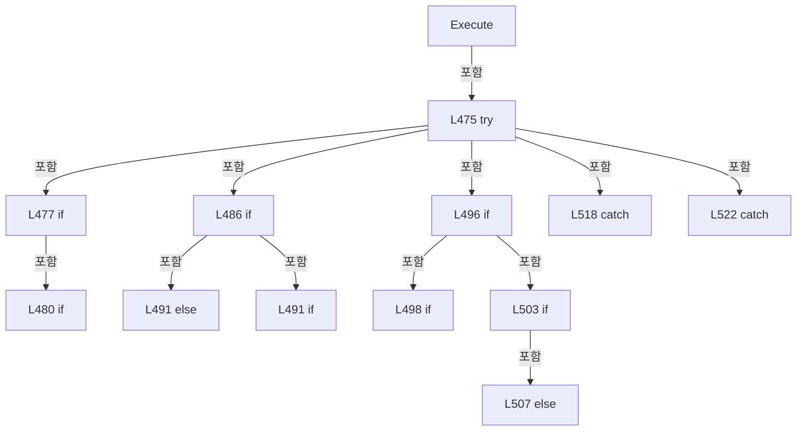

변경 전 점검: 입력/반환 타입, 위 호출자, 예외/취소 경로, 공유 상태와 저장·전송 소비자를 함께 확인합니다. 값의 단위나 물리 방향을 이름만으로 확정하지 않습니다.

### LocalFunctionStatement `ExecuteLiveCallback` · L470–473

[Drilling.Common/Interface/PicoMotor/CPicoMotor.cs:470–473](https://github.com/kjuws10-rgb/A3Drilling/blob/5aee8e58439c9b455cae7c9593c9be986c3e682e/Drilling.Common/Interface/PicoMotor/CPicoMotor.cs#L470-L473)

| 항목 | 실제 추출 값 |
| --- | --- |
| 서명 | void ExecuteLiveCallback() |
| 접근/수식자 | Private /  |
| 반환/값 타입 | void |
| 소속 타입 | NamedType:Drilling.Common.Interface.CPicoMotorService |

현재 부분 분석에서 직접 연결된 호출자는 없습니다. XAML/이벤트/인터페이스·델리게이트·외부 진입을 추가 확인해야 하며, 미사용으로 판정한 것이 아닙니다.

호출하는 대상과 해석 범위:

| 원본 행 | 표현식 | 분석 상태 | 대상/소스 위치 |
| --- | --- | --- | --- |
| 472 | ExecuteLive | resolved | void Drilling.Common.Interface.CPicoMotorService.ExecuteLive(int, Drilling.Common.Interface.EN_PICO_MOTOR_COMMAND, int, double) · Drilling.Common/Interface/PicoMotor/CPicoMotor.cs:790 |

본문의 실제 연산·분기·예외·반환 순서(원문 위치 순):

| 원본 행 | 종류 | 주석 해설 |
| --- | --- | --- |
| 472 | call | 함수·델리게이트 또는 객체 생성자를 호출합니다: ExecuteLive(number, command, motorNo, parameter) |

변경 전 점검: 입력/반환 타입, 위 호출자, 예외/취소 경로, 공유 상태와 저장·전송 소비자를 함께 확인합니다. 값의 단위나 물리 방향을 이름만으로 확정하지 않습니다.

### MethodDeclaration `ExecuteAllMove` · L529–625

[Drilling.Common/Interface/PicoMotor/CPicoMotor.cs:529–625](https://github.com/kjuws10-rgb/A3Drilling/blob/5aee8e58439c9b455cae7c9593c9be986c3e682e/Drilling.Common/Interface/PicoMotor/CPicoMotor.cs#L529-L625)

| 항목 | 실제 추출 값 |
| --- | --- |
| 서명 | System.Threading.Tasks.Task<Drilling.Common.Interface.ST_DEVICE_COMMAND_RESULT> Drilling.Common.Interface.CPicoMotorService.ExecuteAllMove(int, bool, System.Collections.Generic.IReadOnlyCollection<int>, double, int, System.Threading.CancellationToken) |
| 접근/수식자 | Public / public, async |
| 반환/값 타입 | System.Threading.Tasks.Task<Drilling.Common.Interface.ST_DEVICE_COMMAND_RESULT> |
| 소속 타입 | NamedType:Drilling.Common.Interface.CPicoMotorService |

입력 계약:

| 이름 | 타입 | 전달 | 선택/기본값 |
| --- | --- | --- | --- |
| number | int | None | False /  |
| simulation | bool | None | False /  |
| motorNos | System.Collections.Generic.IReadOnlyCollection<int> | None | False /  |
| positionMm | double | None | False /  |
| count | int | None | False /  |
| cancellationToken | System.Threading.CancellationToken | None | True / null |

정적 호출자로 확인된 위치:

| 호출 파일/행 | 호출 표현식 | 런타임 분기 가능 |
| --- | --- | --- |
| [Drilling.Common/Interface/CInterfaceManager.cs:1618–1618](https://github.com/kjuws10-rgb/A3Drilling/blob/5aee8e58439c9b455cae7c9593c9be986c3e682e/Drilling.Common/Interface/CInterfaceManager.cs#L1618-L1618) | _picoMotorService.ExecuteAllMove | False |

호출하는 대상과 해석 범위:

| 원본 행 | 표현식 | 분석 상태 | 대상/소스 위치 |
| --- | --- | --- | --- |
| 541 | motorNos.Where(ShouldIncludeItem).Distinct().OrderBy(SelectValue).ToArray | resolved | int[] System.Collections.Generic.IEnumerable<int>.ToArray<int>() |
| 541 | motorNos.Where(ShouldIncludeItem).Distinct().OrderBy | resolved | System.Linq.IOrderedEnumerable<int> System.Collections.Generic.IEnumerable<int>.OrderBy<int, int>(System.Func<int, int>) |
| 541 | motorNos.Where(ShouldIncludeItem).Distinct | resolved | System.Collections.Generic.IEnumerable<int> System.Collections.Generic.IEnumerable<int>.Distinct<int>() |
| 541 | motorNos.Where | resolved | System.Collections.Generic.IEnumerable<int> System.Collections.Generic.IEnumerable<int>.Where<int>(System.Func<int, bool>) |
| 544 | new ST_DEVICE_COMMAND_RESULT | resolved | Drilling.Common.Interface.ST_DEVICE_COMMAND_RESULT.ST_DEVICE_COMMAND_RESULT(bool, string) · Drilling.Common/Interface/CInterfaceManager.cs:2961 |
| 549 | new ST_DEVICE_COMMAND_RESULT | resolved | Drilling.Common.Interface.ST_DEVICE_COMMAND_RESULT.ST_DEVICE_COMMAND_RESULT(bool, string) · Drilling.Common/Interface/CInterfaceManager.cs:2961 |
| 552 | GetStatus | resolved | Drilling.Common.Interface.ST_PICO_MOTOR_STATUS Drilling.Common.Interface.CPicoMotorService.GetStatus(int) · Drilling.Common/Interface/PicoMotor/CPicoMotor.cs:416 |
| 555 | new ST_DEVICE_COMMAND_RESULT | resolved | Drilling.Common.Interface.ST_DEVICE_COMMAND_RESULT.ST_DEVICE_COMMAND_RESULT(bool, string) · Drilling.Common/Interface/CInterfaceManager.cs:2961 |
| 558 | ValidateSimulationMove | resolved | bool Drilling.Common.Interface.CPicoMotorService.ValidateSimulationMove(int, out Drilling.Common.Interface.ST_DEVICE_COMMAND_RESULT) · Drilling.Common/Interface/PicoMotor/CPicoMotor.cs:652 |
| 563 | CancelAllMove | resolved | void Drilling.Common.Interface.CPicoMotorService.CancelAllMove(int) · Drilling.Common/Interface/PicoMotor/CPicoMotor.cs:627 |
| 564 | CancellationTokenSource.CreateLinkedTokenSource | resolved | System.Threading.CancellationTokenSource System.Threading.CancellationTokenSource.CreateLinkedTokenSource(System.Threading.CancellationToken) |
| 570 | Math.Clamp | resolved | int System.Math.Clamp(int, int, int) |
| 571 | SetStatus | resolved | void Drilling.Common.Interface.CPicoMotorService.SetStatus(int, Drilling.Common.Interface.ST_PICO_MOTOR_STATUS) · Drilling.Common/Interface/PicoMotor/CPicoMotor.cs:978 |
| 576 | linked.Token.ThrowIfCancellationRequested | resolved | void System.Threading.CancellationToken.ThrowIfCancellationRequested() |
| 579 | SimulateAllMotorMoveByDelta | resolved | System.Threading.Tasks.Task Drilling.Common.Interface.CPicoMotorService.SimulateAllMotorMoveByDelta(int, System.Collections.Generic.IReadOnlyList<int>, double, System.Threading.CancellationToken) · Drilling.Common/Interface/PicoMotor/CPicoMotor.cs:677 |
| 583 | GetSession | resolved | Drilling.Common.Interface.CPicoMotorCommandSession Drilling.Common.Interface.CPicoMotorService.GetSession(int, bool) · Drilling.Common/Interface/PicoMotor/CPicoMotor.cs:962 |
| 584 | CPicoMotor.MillimeterToStep | resolved | long Drilling.Common.Interface.CPicoMotor.MillimeterToStep(double) · Drilling.Common/Interface/PicoMotor/CPicoMotor.cs:31 |
| 594 | Task.Run | resolved | System.Threading.Tasks.Task System.Threading.Tasks.Task.Run(System.Action, System.Threading.CancellationToken) |
| 595 | WaitAllMotorsDone | resolved | System.Threading.Tasks.Task Drilling.Common.Interface.CPicoMotorService.WaitAllMotorsDone(Drilling.Common.Interface.CPicoMotorCommandSession, System.Collections.Generic.IReadOnlyList<int>, System.Threading.CancellationToken) · Drilling.Common/Interface/PicoMotor/CPicoMotor.cs:723 |
| 596 | Refresh | resolved | System.Threading.Tasks.Task<Drilling.Common.Interface.ST_PICO_MOTOR_STATUS> Drilling.Common.Interface.CPicoMotorService.Refresh(int, bool, System.Threading.CancellationToken) · Drilling.Common/Interface/PicoMotor/CPicoMotor.cs:424 |
| 599 | SetStatus | resolved | void Drilling.Common.Interface.CPicoMotorService.SetStatus(int, Drilling.Common.Interface.ST_PICO_MOTOR_STATUS) · Drilling.Common/Interface/PicoMotor/CPicoMotor.cs:978 |
| 599 | GetStatus | resolved | Drilling.Common.Interface.ST_PICO_MOTOR_STATUS Drilling.Common.Interface.CPicoMotorService.GetStatus(int) · Drilling.Common/Interface/PicoMotor/CPicoMotor.cs:416 |
| 602 | new ST_DEVICE_COMMAND_RESULT | resolved | Drilling.Common.Interface.ST_DEVICE_COMMAND_RESULT.ST_DEVICE_COMMAND_RESULT(bool, string) · Drilling.Common/Interface/CInterfaceManager.cs:2961 |
| 606 | SetStatus | resolved | void Drilling.Common.Interface.CPicoMotorService.SetStatus(int, Drilling.Common.Interface.ST_PICO_MOTOR_STATUS) · Drilling.Common/Interface/PicoMotor/CPicoMotor.cs:978 |
| 606 | GetStatus | resolved | Drilling.Common.Interface.ST_PICO_MOTOR_STATUS Drilling.Common.Interface.CPicoMotorService.GetStatus(int) · Drilling.Common/Interface/PicoMotor/CPicoMotor.cs:416 |
| 607 | new ST_DEVICE_COMMAND_RESULT | resolved | Drilling.Common.Interface.ST_DEVICE_COMMAND_RESULT.ST_DEVICE_COMMAND_RESULT(bool, string) · Drilling.Common/Interface/CInterfaceManager.cs:2961 |
| 611 | SetStatus | resolved | void Drilling.Common.Interface.CPicoMotorService.SetStatus(int, Drilling.Common.Interface.ST_PICO_MOTOR_STATUS) · Drilling.Common/Interface/PicoMotor/CPicoMotor.cs:978 |
| 611 | GetStatus | resolved | Drilling.Common.Interface.ST_PICO_MOTOR_STATUS Drilling.Common.Interface.CPicoMotorService.GetStatus(int) · Drilling.Common/Interface/PicoMotor/CPicoMotor.cs:416 |
| 612 | new ST_DEVICE_COMMAND_RESULT | resolved | Drilling.Common.Interface.ST_DEVICE_COMMAND_RESULT.ST_DEVICE_COMMAND_RESULT(bool, string) · Drilling.Common/Interface/CInterfaceManager.cs:2961 |
| 618 | _allMoveTokens.TryGetValue | resolved | bool System.Collections.Generic.Dictionary<int, System.Threading.CancellationTokenSource>.TryGetValue(int, out System.Threading.CancellationTokenSource) |
| 618 | ReferenceEquals | resolved | bool object.ReferenceEquals(object?, object?) |
| 620 | _allMoveTokens.Remove | resolved | bool System.Collections.Generic.Dictionary<int, System.Threading.CancellationTokenSource>.Remove(int) |
| 621 | token.Dispose | resolved | void System.Threading.CancellationTokenSource.Dispose() |

본문의 실제 연산·분기·예외·반환 순서(원문 위치 순):

| 원본 행 | 종류 | 주석 해설 |
| --- | --- | --- |
| 541 | call | 함수·델리게이트 또는 객체 생성자를 호출합니다: motorNos.Where(ShouldIncludeItem).Distinct().OrderBy(SelectValue).ToArray() |
| 541 | call | 함수·델리게이트 또는 객체 생성자를 호출합니다: motorNos.Where(ShouldIncludeItem).Distinct().OrderBy(SelectValue) |
| 541 | call | 함수·델리게이트 또는 객체 생성자를 호출합니다: motorNos.Where(ShouldIncludeItem).Distinct() |
| 541 | call | 함수·델리게이트 또는 객체 생성자를 호출합니다: motorNos.Where(ShouldIncludeItem) |
| 541 | local-declaration | 지역 변수를 선언합니다: var motors = motorNos.Where(ShouldIncludeItem).Distinct().OrderBy(SelectValue).ToArray(); |
| 541 | variable-initializer | 변수의 초기값을 지정합니다: motors = motorNos.Where(ShouldIncludeItem).Distinct().OrderBy(SelectValue).ToArray() |
| 542 | if | 조건에 따라 분기합니다: if (motors.Length == 0) |
| 544 | call | 함수·델리게이트 또는 객체 생성자를 호출합니다: new ST_DEVICE_COMMAND_RESULT(false, "PICO_MOTOR all move requires at least one selected motor.") |
| 544 | return | 호출자에게 값 또는 제어를 반환합니다: return new ST_DEVICE_COMMAND_RESULT(false, "PICO_MOTOR all move requires at least one selected motor."); |
| 547 | if | 조건에 따라 분기합니다: if (count <= 0) |
| 549 | call | 함수·델리게이트 또는 객체 생성자를 호출합니다: new ST_DEVICE_COMMAND_RESULT(false, "PICO_MOTOR all move count must be greater than zero.") |
| 549 | return | 호출자에게 값 또는 제어를 반환합니다: return new ST_DEVICE_COMMAND_RESULT(false, "PICO_MOTOR all move count must be greater than zero."); |
| 552 | call | 함수·델리게이트 또는 객체 생성자를 호출합니다: GetStatus(number) |
| 552 | local-declaration | 지역 변수를 선언합니다: var before = GetStatus(number); |
| 552 | variable-initializer | 변수의 초기값을 지정합니다: before = GetStatus(number) |
| 553 | if | 조건에 따라 분기합니다: if (!before.IsConnected) |
| 555 | call | 함수·델리게이트 또는 객체 생성자를 호출합니다: new ST_DEVICE_COMMAND_RESULT(false, "PICO_MOTOR is disconnected. Connect first.") |
| 555 | return | 호출자에게 값 또는 제어를 반환합니다: return new ST_DEVICE_COMMAND_RESULT(false, "PICO_MOTOR is disconnected. Connect first."); |
| 558 | call | 함수·델리게이트 또는 객체 생성자를 호출합니다: ValidateSimulationMove(number, out var validationError) |
| 558 | if | 조건에 따라 분기합니다: if (simulation && !ValidateSimulationMove(number, out var validationError)) |
| 560 | return | 호출자에게 값 또는 제어를 반환합니다: return validationError; |
| 563 | call | 함수·델리게이트 또는 객체 생성자를 호출합니다: CancelAllMove(number) |
| 564 | call | 함수·델리게이트 또는 객체 생성자를 호출합니다: CancellationTokenSource.CreateLinkedTokenSource(cancellationToken) |
| 564 | local-declaration | 지역 변수를 선언합니다: var linked = CancellationTokenSource.CreateLinkedTokenSource(cancellationToken); |
| 564 | variable-initializer | 변수의 초기값을 지정합니다: linked = CancellationTokenSource.CreateLinkedTokenSource(cancellationToken) |
| 565 | lock | 공유 상태의 임계 구역에 진입합니다: lock (_syncRoot) |
| 567 | assignment | 값을 대상에 대입합니다: _allMoveTokens[number] = linked |
| 570 | call | 함수·델리게이트 또는 객체 생성자를 호출합니다: Math.Clamp(before.SelectedMotorNo, 1, 4) |
| 570 | local-declaration | 지역 변수를 선언합니다: var selectedMotorNo = Math.Clamp(before.SelectedMotorNo, 1, 4); |
| 570 | variable-initializer | 변수의 초기값을 지정합니다: selectedMotorNo = Math.Clamp(before.SelectedMotorNo, 1, 4) |
| 571 | assignment | 값을 대상에 대입합니다: SelectedMotorNo = selectedMotorNo |
| 571 | assignment | 값을 대상에 대입합니다: MotionState = "ALL MOVE" |
| 571 | assignment | 값을 대상에 대입합니다: AllMoveCurrentCount = 0 |
| 571 | assignment | 값을 대상에 대입합니다: AllMoveSetCount = count |
| 571 | assignment | 값을 대상에 대입합니다: AllMovePosition = positionMm |
| 571 | assignment | 값을 대상에 대입합니다: CommOk = true |
| 571 | assignment | 값을 대상에 대입합니다: LastError = EN_PICO_MOTOR_ERROR.Ok |
| 571 | assignment | 값을 대상에 대입합니다: UpdatedAt = DateTimeOffset.Now |
| 571 | call | 함수·델리게이트 또는 객체 생성자를 호출합니다: SetStatus(number, before with { SelectedMotorNo = selectedMotorNo, MotionState = "ALL MOVE", AllMoveCurrentCount = 0, AllMoveSetCount = count, AllMovePosition = positionMm, CommOk = true, LastError = EN_PICO_MOTOR_ERROR.… |
| 572 | try | 예외 처리 범위입니다: try |
| 574 | variable-initializer | 변수의 초기값을 지정합니다: current = 1 |
| 574 | for | 초기화·조건·증감이 있는 반복입니다: for (var current = 1; current <= count; current++) |
| 576 | call | 함수·델리게이트 또는 객체 생성자를 호출합니다: linked.Token.ThrowIfCancellationRequested() |
| 577 | if | 조건에 따라 분기합니다: if (simulation) |
| 579 | await | 비동기 완료를 기다립니다: await SimulateAllMotorMoveByDelta(number, motors, positionMm, linked.Token) |
| 579 | call | 함수·델리게이트 또는 객체 생성자를 호출합니다: SimulateAllMotorMoveByDelta(number, motors, positionMm, linked.Token) |
| 581 | else | 앞 조건이 거짓인 경로입니다: else |
| 583 | call | 함수·델리게이트 또는 객체 생성자를 호출합니다: GetSession(number, requireConnected: true) |
| 583 | local-declaration | 지역 변수를 선언합니다: var session = GetSession(number, requireConnected: true); |
| 583 | variable-initializer | 변수의 초기값을 지정합니다: session = GetSession(number, requireConnected: true) |
| 584 | call | 함수·델리게이트 또는 객체 생성자를 호출합니다: CPicoMotor.MillimeterToStep(positionMm) |
| 584 | local-declaration | 지역 변수를 선언합니다: var moveStep = CPicoMotor.MillimeterToStep(positionMm); |
| 584 | variable-initializer | 변수의 초기값을 지정합니다: moveStep = CPicoMotor.MillimeterToStep(positionMm) |
| 594 | await | 비동기 완료를 기다립니다: await Task.Run(GeneratedMoveCallback, linked.Token) |
| 594 | call | 함수·델리게이트 또는 객체 생성자를 호출합니다: Task.Run(GeneratedMoveCallback, linked.Token) |
| 595 | await | 비동기 완료를 기다립니다: await WaitAllMotorsDone(session, motors, linked.Token) |
| 595 | call | 함수·델리게이트 또는 객체 생성자를 호출합니다: WaitAllMotorsDone(session, motors, linked.Token) |
| 596 | await | 비동기 완료를 기다립니다: await Refresh(number, false, linked.Token) |
| 596 | call | 함수·델리게이트 또는 객체 생성자를 호출합니다: Refresh(number, false, linked.Token) |
| 599 | assignment | 값을 대상에 대입합니다: SelectedMotorNo = selectedMotorNo |
| 599 | assignment | 값을 대상에 대입합니다: MotionState = current == count ? "IDLE" : "ALL MOVE" |
| 599 | assignment | 값을 대상에 대입합니다: AllMoveCurrentCount = current |
| 599 | assignment | 값을 대상에 대입합니다: AllMoveSetCount = count |
| 599 | assignment | 값을 대상에 대입합니다: AllMovePosition = positionMm |
| 599 | assignment | 값을 대상에 대입합니다: UpdatedAt = DateTimeOffset.Now |
| 599 | call | 함수·델리게이트 또는 객체 생성자를 호출합니다: SetStatus(number, GetStatus(number)with { SelectedMotorNo = selectedMotorNo, MotionState = current == count ? "IDLE" : "ALL MOVE", AllMoveCurrentCount = current, AllMoveSetCount = count, AllMovePosition = positionMm, Upd… |
| 599 | call | 함수·델리게이트 또는 객체 생성자를 호출합니다: GetStatus(number) |
| 599 | conditional-expression | 조건에 따라 결과식을 선택합니다: current == count ? "IDLE" : "ALL MOVE" |
| 602 | call | 함수·델리게이트 또는 객체 생성자를 호출합니다: new ST_DEVICE_COMMAND_RESULT(true, "PICO_MOTOR all move completed.") |
| 602 | return | 호출자에게 값 또는 제어를 반환합니다: return new ST_DEVICE_COMMAND_RESULT(true, "PICO_MOTOR all move completed."); |
| 604 | catch | 지정 예외를 처리합니다: catch (OperationCanceledException) |
| 606 | assignment | 값을 대상에 대입합니다: SelectedMotorNo = selectedMotorNo |
| 606 | assignment | 값을 대상에 대입합니다: MotionState = "IDLE" |
| 606 | assignment | 값을 대상에 대입합니다: UpdatedAt = DateTimeOffset.Now |
| 606 | call | 함수·델리게이트 또는 객체 생성자를 호출합니다: SetStatus(number, GetStatus(number)with { SelectedMotorNo = selectedMotorNo, MotionState = "IDLE", UpdatedAt = DateTimeOffset.Now }) |
| 606 | call | 함수·델리게이트 또는 객체 생성자를 호출합니다: GetStatus(number) |
| 607 | call | 함수·델리게이트 또는 객체 생성자를 호출합니다: new ST_DEVICE_COMMAND_RESULT(true, "PICO_MOTOR all move stopped.") |
| 607 | return | 호출자에게 값 또는 제어를 반환합니다: return new ST_DEVICE_COMMAND_RESULT(true, "PICO_MOTOR all move stopped."); |
| 609 | catch | 지정 예외를 처리합니다: catch (TimeoutException ex) |
| 611 | assignment | 값을 대상에 대입합니다: SelectedMotorNo = selectedMotorNo |
| 611 | assignment | 값을 대상에 대입합니다: MotionState = "IDLE" |
| 611 | assignment | 값을 대상에 대입합니다: CommOk = false |
| 611 | assignment | 값을 대상에 대입합니다: LastError = EN_PICO_MOTOR_ERROR.Timeout |
| 611 | assignment | 값을 대상에 대입합니다: UpdatedAt = DateTimeOffset.Now |
| 611 | call | 함수·델리게이트 또는 객체 생성자를 호출합니다: SetStatus(number, GetStatus(number)with { SelectedMotorNo = selectedMotorNo, MotionState = "IDLE", CommOk = false, LastError = EN_PICO_MOTOR_ERROR.Timeout, UpdatedAt = DateTimeOffset.Now }) |
| 611 | call | 함수·델리게이트 또는 객체 생성자를 호출합니다: GetStatus(number) |
| 612 | call | 함수·델리게이트 또는 객체 생성자를 호출합니다: new ST_DEVICE_COMMAND_RESULT(false, ex.Message) |
| 612 | return | 호출자에게 값 또는 제어를 반환합니다: return new ST_DEVICE_COMMAND_RESULT(false, ex.Message); |
| 614 | finally | 종료 정리 구간입니다: finally |
| 616 | lock | 공유 상태의 임계 구역에 진입합니다: lock (_syncRoot) |
| 618 | call | 함수·델리게이트 또는 객체 생성자를 호출합니다: _allMoveTokens.TryGetValue(number, out var token) |
| 618 | call | 함수·델리게이트 또는 객체 생성자를 호출합니다: ReferenceEquals(token, linked) |
| 618 | if | 조건에 따라 분기합니다: if (_allMoveTokens.TryGetValue(number, out var token) && ReferenceEquals(token, linked)) |
| 620 | call | 함수·델리게이트 또는 객체 생성자를 호출합니다: _allMoveTokens.Remove(number) |
| 621 | call | 함수·델리게이트 또는 객체 생성자를 호출합니다: token.Dispose() |

제어 구문의 포함 구조(실제 실행 순서/CFG가 아닌 구문 탐색 그림):

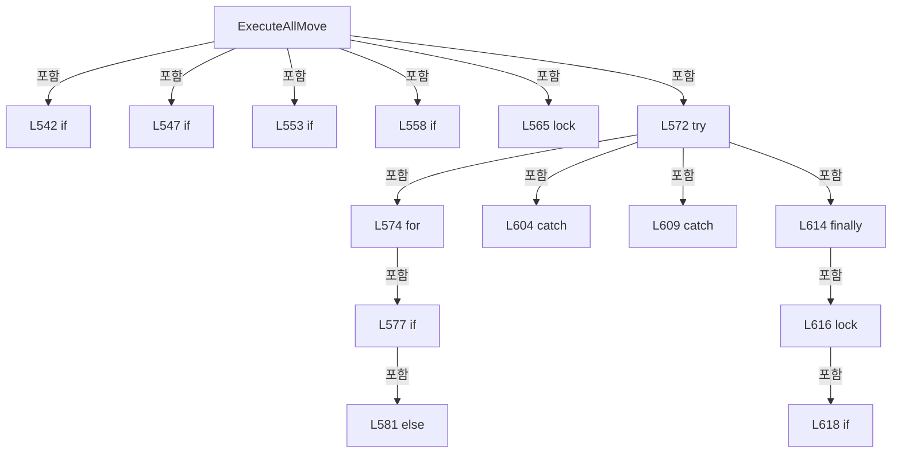

변경 전 점검: 입력/반환 타입, 위 호출자, 예외/취소 경로, 공유 상태와 저장·전송 소비자를 함께 확인합니다. 값의 단위나 물리 방향을 이름만으로 확정하지 않습니다.

### LocalFunctionStatement `ShouldIncludeItem` · L531–534

[Drilling.Common/Interface/PicoMotor/CPicoMotor.cs:531–534](https://github.com/kjuws10-rgb/A3Drilling/blob/5aee8e58439c9b455cae7c9593c9be986c3e682e/Drilling.Common/Interface/PicoMotor/CPicoMotor.cs#L531-L534)

| 항목 | 실제 추출 값 |
| --- | --- |
| 서명 | bool ShouldIncludeItem(int) |
| 접근/수식자 | Private /  |
| 반환/값 타입 | bool |
| 소속 타입 | NamedType:Drilling.Common.Interface.CPicoMotorService |

입력 계약:

| 이름 | 타입 | 전달 | 선택/기본값 |
| --- | --- | --- | --- |
| value | int | None | False /  |

현재 부분 분석에서 직접 연결된 호출자는 없습니다. XAML/이벤트/인터페이스·델리게이트·외부 진입을 추가 확인해야 하며, 미사용으로 판정한 것이 아닙니다.

본문의 실제 연산·분기·예외·반환 순서(원문 위치 순):

| 원본 행 | 종류 | 주석 해설 |
| --- | --- | --- |
| 533 | return | 호출자에게 값 또는 제어를 반환합니다: return value is >= 1 and <= 4; |

변경 전 점검: 입력/반환 타입, 위 호출자, 예외/취소 경로, 공유 상태와 저장·전송 소비자를 함께 확인합니다. 값의 단위나 물리 방향을 이름만으로 확정하지 않습니다.

### LocalFunctionStatement `SelectValue` · L536–539

[Drilling.Common/Interface/PicoMotor/CPicoMotor.cs:536–539](https://github.com/kjuws10-rgb/A3Drilling/blob/5aee8e58439c9b455cae7c9593c9be986c3e682e/Drilling.Common/Interface/PicoMotor/CPicoMotor.cs#L536-L539)

| 항목 | 실제 추출 값 |
| --- | --- |
| 서명 | int SelectValue(int) |
| 접근/수식자 | Private /  |
| 반환/값 타입 | int |
| 소속 타입 | NamedType:Drilling.Common.Interface.CPicoMotorService |

입력 계약:

| 이름 | 타입 | 전달 | 선택/기본값 |
| --- | --- | --- | --- |
| value | int | None | False /  |

현재 부분 분석에서 직접 연결된 호출자는 없습니다. XAML/이벤트/인터페이스·델리게이트·외부 진입을 추가 확인해야 하며, 미사용으로 판정한 것이 아닙니다.

본문의 실제 연산·분기·예외·반환 순서(원문 위치 순):

| 원본 행 | 종류 | 주석 해설 |
| --- | --- | --- |
| 538 | return | 호출자에게 값 또는 제어를 반환합니다: return value; |

변경 전 점검: 입력/반환 타입, 위 호출자, 예외/취소 경로, 공유 상태와 저장·전송 소비자를 함께 확인합니다. 값의 단위나 물리 방향을 이름만으로 확정하지 않습니다.

### LocalFunctionStatement `GeneratedMoveCallback` · L585–592

[Drilling.Common/Interface/PicoMotor/CPicoMotor.cs:585–592](https://github.com/kjuws10-rgb/A3Drilling/blob/5aee8e58439c9b455cae7c9593c9be986c3e682e/Drilling.Common/Interface/PicoMotor/CPicoMotor.cs#L585-L592)

| 항목 | 실제 추출 값 |
| --- | --- |
| 서명 | void GeneratedMoveCallback() |
| 접근/수식자 | Private /  |
| 반환/값 타입 | void |
| 소속 타입 | NamedType:Drilling.Common.Interface.CPicoMotorService |

현재 부분 분석에서 직접 연결된 호출자는 없습니다. XAML/이벤트/인터페이스·델리게이트·외부 진입을 추가 확인해야 하며, 미사용으로 판정한 것이 아닙니다.

호출하는 대상과 해석 범위:

| 원본 행 | 표현식 | 분석 상태 | 대상/소스 위치 |
| --- | --- | --- | --- |
| 589 | linked.Token.ThrowIfCancellationRequested | resolved | void System.Threading.CancellationToken.ThrowIfCancellationRequested() |
| 590 | session.RelativeMove | resolved | void Drilling.Common.Interface.CPicoMotorCommandSession.RelativeMove(int, long) · Drilling.Common/Interface/PicoMotor/CPicoMotor.cs:346 |

본문의 실제 연산·분기·예외·반환 순서(원문 위치 순):

| 원본 행 | 종류 | 주석 해설 |
| --- | --- | --- |
| 587 | foreach | 컬렉션 요소를 순회합니다: foreach (var motorNo in motors) |
| 589 | call | 함수·델리게이트 또는 객체 생성자를 호출합니다: linked.Token.ThrowIfCancellationRequested() |
| 590 | call | 함수·델리게이트 또는 객체 생성자를 호출합니다: session.RelativeMove(motorNo, moveStep) |

제어 구문의 포함 구조(실제 실행 순서/CFG가 아닌 구문 탐색 그림):

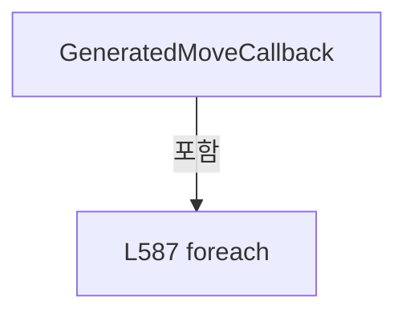

변경 전 점검: 입력/반환 타입, 위 호출자, 예외/취소 경로, 공유 상태와 저장·전송 소비자를 함께 확인합니다. 값의 단위나 물리 방향을 이름만으로 확정하지 않습니다.

### MethodDeclaration `CancelAllMove` · L627–634

[Drilling.Common/Interface/PicoMotor/CPicoMotor.cs:627–634](https://github.com/kjuws10-rgb/A3Drilling/blob/5aee8e58439c9b455cae7c9593c9be986c3e682e/Drilling.Common/Interface/PicoMotor/CPicoMotor.cs#L627-L634)

| 항목 | 실제 추출 값 |
| --- | --- |
| 서명 | void Drilling.Common.Interface.CPicoMotorService.CancelAllMove(int) |
| 접근/수식자 | Public / public |
| 반환/값 타입 | void |
| 소속 타입 | NamedType:Drilling.Common.Interface.CPicoMotorService |

입력 계약:

| 이름 | 타입 | 전달 | 선택/기본값 |
| --- | --- | --- | --- |
| number | int | None | False /  |

정적 호출자로 확인된 위치:

| 호출 파일/행 | 호출 표현식 | 런타임 분기 가능 |
| --- | --- | --- |
| [Drilling.Common/Interface/PicoMotor/CPicoMotor.cs:488–488](https://github.com/kjuws10-rgb/A3Drilling/blob/5aee8e58439c9b455cae7c9593c9be986c3e682e/Drilling.Common/Interface/PicoMotor/CPicoMotor.cs#L488-L488) | CancelAllMove | False |
| [Drilling.Common/Interface/PicoMotor/CPicoMotor.cs:563–563](https://github.com/kjuws10-rgb/A3Drilling/blob/5aee8e58439c9b455cae7c9593c9be986c3e682e/Drilling.Common/Interface/PicoMotor/CPicoMotor.cs#L563-L563) | CancelAllMove | False |
| [Drilling.Common/Interface/PicoMotor/CPicoMotor.cs:825–825](https://github.com/kjuws10-rgb/A3Drilling/blob/5aee8e58439c9b455cae7c9593c9be986c3e682e/Drilling.Common/Interface/PicoMotor/CPicoMotor.cs#L825-L825) | CancelAllMove | False |

호출하는 대상과 해석 범위:

| 원본 행 | 표현식 | 분석 상태 | 대상/소스 위치 |
| --- | --- | --- | --- |
| 631 | _allMoveTokens.TryGetValue | resolved | bool System.Collections.Generic.Dictionary<int, System.Threading.CancellationTokenSource>.TryGetValue(int, out System.Threading.CancellationTokenSource) |
| 632 | token.Cancel | resolved | void System.Threading.CancellationTokenSource.Cancel() |

본문의 실제 연산·분기·예외·반환 순서(원문 위치 순):

| 원본 행 | 종류 | 주석 해설 |
| --- | --- | --- |
| 629 | lock | 공유 상태의 임계 구역에 진입합니다: lock (_syncRoot) |
| 631 | call | 함수·델리게이트 또는 객체 생성자를 호출합니다: _allMoveTokens.TryGetValue(number, out var token) |
| 631 | if | 조건에 따라 분기합니다: if (_allMoveTokens.TryGetValue(number, out var token)) |
| 632 | call | 함수·델리게이트 또는 객체 생성자를 호출합니다: token.Cancel() |

제어 구문의 포함 구조(실제 실행 순서/CFG가 아닌 구문 탐색 그림):

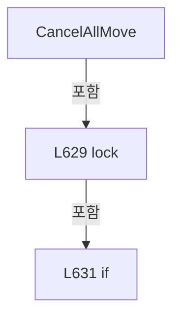

변경 전 점검: 입력/반환 타입, 위 호출자, 예외/취소 경로, 공유 상태와 저장·전송 소비자를 함께 확인합니다. 값의 단위나 물리 방향을 이름만으로 확정하지 않습니다.

### MethodDeclaration `CancelMotion` · L636–645

[Drilling.Common/Interface/PicoMotor/CPicoMotor.cs:636–645](https://github.com/kjuws10-rgb/A3Drilling/blob/5aee8e58439c9b455cae7c9593c9be986c3e682e/Drilling.Common/Interface/PicoMotor/CPicoMotor.cs#L636-L645)

| 항목 | 실제 추출 값 |
| --- | --- |
| 서명 | void Drilling.Common.Interface.CPicoMotorService.CancelMotion(int) |
| 접근/수식자 | Private / private |
| 반환/값 타입 | void |
| 소속 타입 | NamedType:Drilling.Common.Interface.CPicoMotorService |

입력 계약:

| 이름 | 타입 | 전달 | 선택/기본값 |
| --- | --- | --- | --- |
| number | int | None | False /  |

정적 호출자로 확인된 위치:

| 호출 파일/행 | 호출 표현식 | 런타임 분기 가능 |
| --- | --- | --- |
| [Drilling.Common/Interface/PicoMotor/CPicoMotor.cs:489–489](https://github.com/kjuws10-rgb/A3Drilling/blob/5aee8e58439c9b455cae7c9593c9be986c3e682e/Drilling.Common/Interface/PicoMotor/CPicoMotor.cs#L489-L489) | CancelMotion | False |
| [Drilling.Common/Interface/PicoMotor/CPicoMotor.cs:493–493](https://github.com/kjuws10-rgb/A3Drilling/blob/5aee8e58439c9b455cae7c9593c9be986c3e682e/Drilling.Common/Interface/PicoMotor/CPicoMotor.cs#L493-L493) | CancelMotion | False |
| [Drilling.Common/Interface/PicoMotor/CPicoMotor.cs:903–903](https://github.com/kjuws10-rgb/A3Drilling/blob/5aee8e58439c9b455cae7c9593c9be986c3e682e/Drilling.Common/Interface/PicoMotor/CPicoMotor.cs#L903-L903) | CancelMotion | False |

호출하는 대상과 해석 범위:

| 원본 행 | 표현식 | 분석 상태 | 대상/소스 위치 |
| --- | --- | --- | --- |
| 640 | _motionTokens.TryGetValue | resolved | bool System.Collections.Generic.Dictionary<int, System.Threading.CancellationTokenSource>.TryGetValue(int, out System.Threading.CancellationTokenSource) |
| 642 | token.Cancel | resolved | void System.Threading.CancellationTokenSource.Cancel() |

본문의 실제 연산·분기·예외·반환 순서(원문 위치 순):

| 원본 행 | 종류 | 주석 해설 |
| --- | --- | --- |
| 638 | lock | 공유 상태의 임계 구역에 진입합니다: lock (_syncRoot) |
| 640 | call | 함수·델리게이트 또는 객체 생성자를 호출합니다: _motionTokens.TryGetValue(number, out var token) |
| 640 | if | 조건에 따라 분기합니다: if (_motionTokens.TryGetValue(number, out var token)) |
| 642 | call | 함수·델리게이트 또는 객체 생성자를 호출합니다: token.Cancel() |

제어 구문의 포함 구조(실제 실행 순서/CFG가 아닌 구문 탐색 그림):

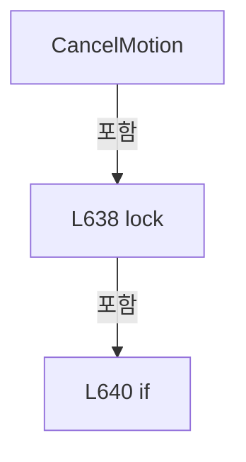

변경 전 점검: 입력/반환 타입, 위 호출자, 예외/취소 경로, 공유 상태와 저장·전송 소비자를 함께 확인합니다. 값의 단위나 물리 방향을 이름만으로 확정하지 않습니다.

### MethodDeclaration `IsMoveCommand` · L647–650

[Drilling.Common/Interface/PicoMotor/CPicoMotor.cs:647–650](https://github.com/kjuws10-rgb/A3Drilling/blob/5aee8e58439c9b455cae7c9593c9be986c3e682e/Drilling.Common/Interface/PicoMotor/CPicoMotor.cs#L647-L650)

| 항목 | 실제 추출 값 |
| --- | --- |
| 서명 | bool Drilling.Common.Interface.CPicoMotorService.IsMoveCommand(Drilling.Common.Interface.EN_PICO_MOTOR_COMMAND) |
| 접근/수식자 | Private / private, static |
| 반환/값 타입 | bool |
| 소속 타입 | NamedType:Drilling.Common.Interface.CPicoMotorService |

입력 계약:

| 이름 | 타입 | 전달 | 선택/기본값 |
| --- | --- | --- | --- |
| command | Drilling.Common.Interface.EN_PICO_MOTOR_COMMAND | None | False /  |

정적 호출자로 확인된 위치:

| 호출 파일/행 | 호출 표현식 | 런타임 분기 가능 |
| --- | --- | --- |
| [Drilling.Common/Interface/PicoMotor/CPicoMotor.cs:498–498](https://github.com/kjuws10-rgb/A3Drilling/blob/5aee8e58439c9b455cae7c9593c9be986c3e682e/Drilling.Common/Interface/PicoMotor/CPicoMotor.cs#L498-L498) | IsMoveCommand | False |

본문의 실제 연산·분기·예외·반환 순서(원문 위치 순):

| 원본 행 | 종류 | 주석 해설 |
| --- | --- | --- |
| 649 | return | 호출자에게 값 또는 제어를 반환합니다: return command is EN_PICO_MOTOR_COMMAND.Home or EN_PICO_MOTOR_COMMAND.JogNegative or EN_PICO_MOTOR_COMMAND.JogPositive or EN_PICO_MOTOR_COMMAND.MoveRelativeNegative or EN_PICO_MOTOR_COMMAND.MoveRelativePositive or EN_PICO_MOTOR_CO |

변경 전 점검: 입력/반환 타입, 위 호출자, 예외/취소 경로, 공유 상태와 저장·전송 소비자를 함께 확인합니다. 값의 단위나 물리 방향을 이름만으로 확정하지 않습니다.

### MethodDeclaration `ValidateSimulationMove` · L652–675

[Drilling.Common/Interface/PicoMotor/CPicoMotor.cs:652–675](https://github.com/kjuws10-rgb/A3Drilling/blob/5aee8e58439c9b455cae7c9593c9be986c3e682e/Drilling.Common/Interface/PicoMotor/CPicoMotor.cs#L652-L675)

| 항목 | 실제 추출 값 |
| --- | --- |
| 서명 | bool Drilling.Common.Interface.CPicoMotorService.ValidateSimulationMove(int, out Drilling.Common.Interface.ST_DEVICE_COMMAND_RESULT) |
| 접근/수식자 | Private / private |
| 반환/값 타입 | bool |
| 소속 타입 | NamedType:Drilling.Common.Interface.CPicoMotorService |

입력 계약:

| 이름 | 타입 | 전달 | 선택/기본값 |
| --- | --- | --- | --- |
| number | int | None | False /  |
| error | Drilling.Common.Interface.ST_DEVICE_COMMAND_RESULT | Out | False /  |

정적 호출자로 확인된 위치:

| 호출 파일/행 | 호출 표현식 | 런타임 분기 가능 |
| --- | --- | --- |
| [Drilling.Common/Interface/PicoMotor/CPicoMotor.cs:498–498](https://github.com/kjuws10-rgb/A3Drilling/blob/5aee8e58439c9b455cae7c9593c9be986c3e682e/Drilling.Common/Interface/PicoMotor/CPicoMotor.cs#L498-L498) | ValidateSimulationMove | False |
| [Drilling.Common/Interface/PicoMotor/CPicoMotor.cs:558–558](https://github.com/kjuws10-rgb/A3Drilling/blob/5aee8e58439c9b455cae7c9593c9be986c3e682e/Drilling.Common/Interface/PicoMotor/CPicoMotor.cs#L558-L558) | ValidateSimulationMove | False |

호출하는 대상과 해석 범위:

| 원본 행 | 표현식 | 분석 상태 | 대상/소스 위치 |
| --- | --- | --- | --- |
| 654 | GetStatus | resolved | Drilling.Common.Interface.ST_PICO_MOTOR_STATUS Drilling.Common.Interface.CPicoMotorService.GetStatus(int) · Drilling.Common/Interface/PicoMotor/CPicoMotor.cs:416 |
| 657 | new ST_DEVICE_COMMAND_RESULT | resolved | Drilling.Common.Interface.ST_DEVICE_COMMAND_RESULT.ST_DEVICE_COMMAND_RESULT(bool, string) · Drilling.Common/Interface/CInterfaceManager.cs:2961 |
| 663 | new ST_DEVICE_COMMAND_RESULT | resolved | Drilling.Common.Interface.ST_DEVICE_COMMAND_RESULT.ST_DEVICE_COMMAND_RESULT(bool, string) · Drilling.Common/Interface/CInterfaceManager.cs:2961 |
| 669 | new ST_DEVICE_COMMAND_RESULT | resolved | Drilling.Common.Interface.ST_DEVICE_COMMAND_RESULT.ST_DEVICE_COMMAND_RESULT(bool, string) · Drilling.Common/Interface/CInterfaceManager.cs:2961 |
| 673 | new ST_DEVICE_COMMAND_RESULT | resolved | Drilling.Common.Interface.ST_DEVICE_COMMAND_RESULT.ST_DEVICE_COMMAND_RESULT(bool, string) · Drilling.Common/Interface/CInterfaceManager.cs:2961 |

본문의 실제 연산·분기·예외·반환 순서(원문 위치 순):

| 원본 행 | 종류 | 주석 해설 |
| --- | --- | --- |
| 654 | call | 함수·델리게이트 또는 객체 생성자를 호출합니다: GetStatus(number) |
| 654 | local-declaration | 지역 변수를 선언합니다: var status = GetStatus(number); |
| 654 | variable-initializer | 변수의 초기값을 지정합니다: status = GetStatus(number) |
| 655 | if | 조건에 따라 분기합니다: if (!status.IsConnected) |
| 657 | assignment | 값을 대상에 대입합니다: error = new ST_DEVICE_COMMAND_RESULT(false, "PICO_MOTOR is disconnected. Connect first.") |
| 657 | call | 함수·델리게이트 또는 객체 생성자를 호출합니다: new ST_DEVICE_COMMAND_RESULT(false, "PICO_MOTOR is disconnected. Connect first.") |
| 658 | return | 호출자에게 값 또는 제어를 반환합니다: return false; |
| 661 | if | 조건에 따라 분기합니다: if (status.CurrentVelocity <= 0.0) |
| 663 | assignment | 값을 대상에 대입합니다: error = new ST_DEVICE_COMMAND_RESULT(false, "PICO_MOTOR velocity must be greater than 0 before move.") |
| 663 | call | 함수·델리게이트 또는 객체 생성자를 호출합니다: new ST_DEVICE_COMMAND_RESULT(false, "PICO_MOTOR velocity must be greater than 0 before move.") |
| 664 | return | 호출자에게 값 또는 제어를 반환합니다: return false; |
| 667 | if | 조건에 따라 분기합니다: if (status.CurrentAcceleration <= 0.0) |
| 669 | assignment | 값을 대상에 대입합니다: error = new ST_DEVICE_COMMAND_RESULT(false, "PICO_MOTOR acceleration must be greater than 0 before move.") |
| 669 | call | 함수·델리게이트 또는 객체 생성자를 호출합니다: new ST_DEVICE_COMMAND_RESULT(false, "PICO_MOTOR acceleration must be greater than 0 before move.") |
| 670 | return | 호출자에게 값 또는 제어를 반환합니다: return false; |
| 673 | assignment | 값을 대상에 대입합니다: error = new ST_DEVICE_COMMAND_RESULT(true, string.Empty) |
| 673 | call | 함수·델리게이트 또는 객체 생성자를 호출합니다: new ST_DEVICE_COMMAND_RESULT(true, string.Empty) |
| 674 | return | 호출자에게 값 또는 제어를 반환합니다: return true; |

제어 구문의 포함 구조(실제 실행 순서/CFG가 아닌 구문 탐색 그림):

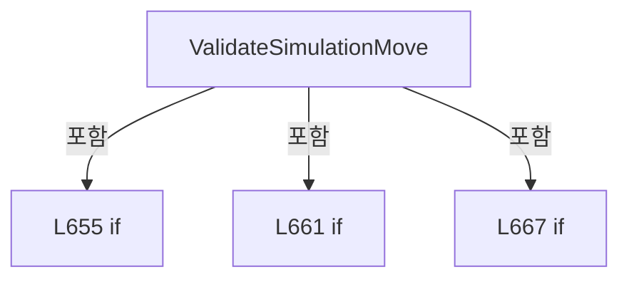

변경 전 점검: 입력/반환 타입, 위 호출자, 예외/취소 경로, 공유 상태와 저장·전송 소비자를 함께 확인합니다. 값의 단위나 물리 방향을 이름만으로 확정하지 않습니다.

### MethodDeclaration `SimulateAllMotorMoveByDelta` · L677–721

[Drilling.Common/Interface/PicoMotor/CPicoMotor.cs:677–721](https://github.com/kjuws10-rgb/A3Drilling/blob/5aee8e58439c9b455cae7c9593c9be986c3e682e/Drilling.Common/Interface/PicoMotor/CPicoMotor.cs#L677-L721)

| 항목 | 실제 추출 값 |
| --- | --- |
| 서명 | System.Threading.Tasks.Task Drilling.Common.Interface.CPicoMotorService.SimulateAllMotorMoveByDelta(int, System.Collections.Generic.IReadOnlyList<int>, double, System.Threading.CancellationToken) |
| 접근/수식자 | Private / private, async |
| 반환/값 타입 | System.Threading.Tasks.Task |
| 소속 타입 | NamedType:Drilling.Common.Interface.CPicoMotorService |

입력 계약:

| 이름 | 타입 | 전달 | 선택/기본값 |
| --- | --- | --- | --- |
| number | int | None | False /  |
| motorNos | System.Collections.Generic.IReadOnlyList<int> | None | False /  |
| deltaPosition | double | None | False /  |
| cancellationToken | System.Threading.CancellationToken | None | False /  |

정적 호출자로 확인된 위치:

| 호출 파일/행 | 호출 표현식 | 런타임 분기 가능 |
| --- | --- | --- |
| [Drilling.Common/Interface/PicoMotor/CPicoMotor.cs:579–579](https://github.com/kjuws10-rgb/A3Drilling/blob/5aee8e58439c9b455cae7c9593c9be986c3e682e/Drilling.Common/Interface/PicoMotor/CPicoMotor.cs#L579-L579) | SimulateAllMotorMoveByDelta | False |

호출하는 대상과 해석 범위:

| 원본 행 | 표현식 | 분석 상태 | 대상/소스 위치 |
| --- | --- | --- | --- |
| 679 | GetStatus | resolved | Drilling.Common.Interface.ST_PICO_MOTOR_STATUS Drilling.Common.Interface.CPicoMotorService.GetStatus(int) · Drilling.Common/Interface/PicoMotor/CPicoMotor.cs:416 |
| 690 | motorNos.ToDictionary | resolved | System.Collections.Generic.Dictionary<int, double> System.Collections.Generic.IEnumerable<int>.ToDictionary<int, int, double>(System.Func<int, int>, System.Func<int, double>) |
| 693 | cancellationToken.ThrowIfCancellationRequested | resolved | void System.Threading.CancellationToken.ThrowIfCancellationRequested() |
| 694 | GetStatus | resolved | Drilling.Common.Interface.ST_PICO_MOTOR_STATUS Drilling.Common.Interface.CPicoMotorService.GetStatus(int) · Drilling.Common/Interface/PicoMotor/CPicoMotor.cs:416 |
| 697 | GetSimulationStepDistance | resolved | double Drilling.Common.Interface.CPicoMotorService.GetSimulationStepDistance(Drilling.Common.Interface.ST_PICO_MOTOR_STATUS) · Drilling.Common/Interface/PicoMotor/CPicoMotor.cs:749 |
| 700 | GetPosition | resolved | double Drilling.Common.Interface.CPicoMotorService.GetPosition(Drilling.Common.Interface.ST_PICO_MOTOR_STATUS, int) · Drilling.Common/Interface/PicoMotor/CPicoMotor.cs:984 |
| 702 | Math.Abs | resolved | double System.Math.Abs(double) |
| 704 | SetPosition | resolved | Drilling.Common.Interface.ST_PICO_MOTOR_STATUS Drilling.Common.Interface.CPicoMotorService.SetPosition(Drilling.Common.Interface.ST_PICO_MOTOR_STATUS, int, double) · Drilling.Common/Interface/PicoMotor/CPicoMotor.cs:995 |
| 709 | Math.Abs | resolved | double System.Math.Abs(double) |
| 709 | Math.Sign | resolved | int System.Math.Sign(double) |
| 710 | SetPosition | resolved | Drilling.Common.Interface.ST_PICO_MOTOR_STATUS Drilling.Common.Interface.CPicoMotorService.SetPosition(Drilling.Common.Interface.ST_PICO_MOTOR_STATUS, int, double) · Drilling.Common/Interface/PicoMotor/CPicoMotor.cs:995 |
| 713 | SetStatus | resolved | void Drilling.Common.Interface.CPicoMotorService.SetStatus(int, Drilling.Common.Interface.ST_PICO_MOTOR_STATUS) · Drilling.Common/Interface/PicoMotor/CPicoMotor.cs:978 |
| 719 | Task.Delay | resolved | System.Threading.Tasks.Task System.Threading.Tasks.Task.Delay(int, System.Threading.CancellationToken) |

본문의 실제 연산·분기·예외·반환 순서(원문 위치 순):

| 원본 행 | 종류 | 주석 해설 |
| --- | --- | --- |
| 679 | call | 함수·델리게이트 또는 객체 생성자를 호출합니다: GetStatus(number) |
| 679 | local-declaration | 지역 변수를 선언합니다: var start = GetStatus(number); |
| 679 | variable-initializer | 변수의 초기값을 지정합니다: start = GetStatus(number) |
| 690 | call | 함수·델리게이트 또는 객체 생성자를 호출합니다: motorNos.ToDictionary(SelectMotorNo, SelectValue) |
| 690 | local-declaration | 지역 변수를 선언합니다: var targets = motorNos.ToDictionary(SelectMotorNo, SelectValue); |
| 690 | variable-initializer | 변수의 초기값을 지정합니다: targets = motorNos.ToDictionary(SelectMotorNo, SelectValue) |
| 691 | while | 조건을 먼저 확인하며 반복합니다: while (true) |
| 693 | call | 함수·델리게이트 또는 객체 생성자를 호출합니다: cancellationToken.ThrowIfCancellationRequested() |
| 694 | call | 함수·델리게이트 또는 객체 생성자를 호출합니다: GetStatus(number) |
| 694 | local-declaration | 지역 변수를 선언합니다: var status = GetStatus(number); |
| 694 | variable-initializer | 변수의 초기값을 지정합니다: status = GetStatus(number) |
| 695 | local-declaration | 지역 변수를 선언합니다: var next = status; |
| 695 | variable-initializer | 변수의 초기값을 지정합니다: next = status |
| 696 | local-declaration | 지역 변수를 선언합니다: var completed = true; |
| 696 | variable-initializer | 변수의 초기값을 지정합니다: completed = true |
| 697 | call | 함수·델리게이트 또는 객체 생성자를 호출합니다: GetSimulationStepDistance(status) |
| 697 | local-declaration | 지역 변수를 선언합니다: var stepDistance = GetSimulationStepDistance(status); |
| 697 | variable-initializer | 변수의 초기값을 지정합니다: stepDistance = GetSimulationStepDistance(status) |
| 698 | foreach | 컬렉션 요소를 순회합니다: foreach (var motorNo in motorNos) |
| 700 | call | 함수·델리게이트 또는 객체 생성자를 호출합니다: GetPosition(next, motorNo) |
| 700 | local-declaration | 지역 변수를 선언합니다: var current = GetPosition(next, motorNo); |
| 700 | variable-initializer | 변수의 초기값을 지정합니다: current = GetPosition(next, motorNo) |
| 701 | local-declaration | 지역 변수를 선언합니다: var distance = targets[motorNo] - current; |
| 701 | variable-initializer | 변수의 초기값을 지정합니다: distance = targets[motorNo] - current |
| 702 | call | 함수·델리게이트 또는 객체 생성자를 호출합니다: Math.Abs(distance) |
| 702 | if | 조건에 따라 분기합니다: if (Math.Abs(distance) <= 0.000001) |
| 704 | assignment | 값을 대상에 대입합니다: next = SetPosition(next, motorNo, targets[motorNo]) |
| 704 | call | 함수·델리게이트 또는 객체 생성자를 호출합니다: SetPosition(next, motorNo, targets[motorNo]) |
| 705 | continue | 다음 반복으로 진행합니다: continue; |
| 708 | assignment | 값을 대상에 대입합니다: completed = false |
| 709 | call | 함수·델리게이트 또는 객체 생성자를 호출합니다: Math.Abs(distance) |
| 709 | call | 함수·델리게이트 또는 객체 생성자를 호출합니다: Math.Sign(distance) |
| 709 | conditional-expression | 조건에 따라 결과식을 선택합니다: Math.Abs(distance) <= stepDistance ? targets[motorNo] : current + (Math.Sign(distance) * stepDistance) |
| 709 | local-declaration | 지역 변수를 선언합니다: var position = Math.Abs(distance) <= stepDistance ? targets[motorNo] : current + (Math.Sign(distance) * stepDistance); |
| 709 | variable-initializer | 변수의 초기값을 지정합니다: position = Math.Abs(distance) <= stepDistance ? targets[motorNo] : current + (Math.Sign(distance) * stepDistance) |
| 710 | assignment | 값을 대상에 대입합니다: next = SetPosition(next, motorNo, position) |
| 710 | call | 함수·델리게이트 또는 객체 생성자를 호출합니다: SetPosition(next, motorNo, position) |
| 713 | assignment | 값을 대상에 대입합니다: MotionState = completed ? "IDLE" : "ALL MOVE" |
| 713 | assignment | 값을 대상에 대입합니다: UpdatedAt = DateTimeOffset.Now |
| 713 | call | 함수·델리게이트 또는 객체 생성자를 호출합니다: SetStatus(number, next with { MotionState = completed ? "IDLE" : "ALL MOVE", UpdatedAt = DateTimeOffset.Now }) |
| 713 | conditional-expression | 조건에 따라 결과식을 선택합니다: completed ? "IDLE" : "ALL MOVE" |
| 714 | if | 조건에 따라 분기합니다: if (completed) |
| 716 | return | 호출자에게 값 또는 제어를 반환합니다: return; |
| 719 | await | 비동기 완료를 기다립니다: await Task.Delay(SimulationIntervalMs, cancellationToken) |
| 719 | call | 함수·델리게이트 또는 객체 생성자를 호출합니다: Task.Delay(SimulationIntervalMs, cancellationToken) |

제어 구문의 포함 구조(실제 실행 순서/CFG가 아닌 구문 탐색 그림):

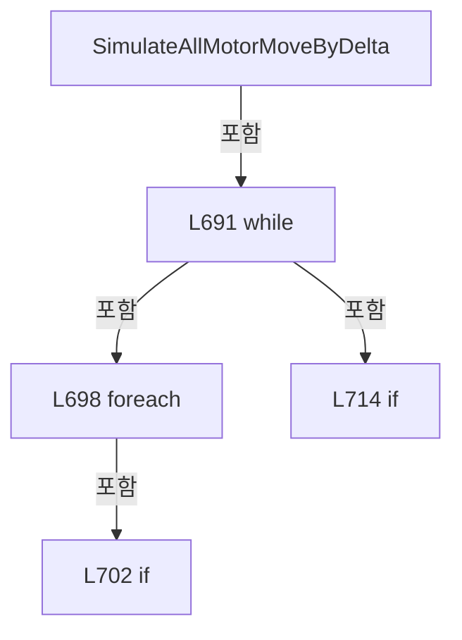

변경 전 점검: 입력/반환 타입, 위 호출자, 예외/취소 경로, 공유 상태와 저장·전송 소비자를 함께 확인합니다. 값의 단위나 물리 방향을 이름만으로 확정하지 않습니다.

### LocalFunctionStatement `SelectMotorNo` · L680–683

[Drilling.Common/Interface/PicoMotor/CPicoMotor.cs:680–683](https://github.com/kjuws10-rgb/A3Drilling/blob/5aee8e58439c9b455cae7c9593c9be986c3e682e/Drilling.Common/Interface/PicoMotor/CPicoMotor.cs#L680-L683)

| 항목 | 실제 추출 값 |
| --- | --- |
| 서명 | int SelectMotorNo(int) |
| 접근/수식자 | Private /  |
| 반환/값 타입 | int |
| 소속 타입 | NamedType:Drilling.Common.Interface.CPicoMotorService |

입력 계약:

| 이름 | 타입 | 전달 | 선택/기본값 |
| --- | --- | --- | --- |
| motorNo | int | None | False /  |

현재 부분 분석에서 직접 연결된 호출자는 없습니다. XAML/이벤트/인터페이스·델리게이트·외부 진입을 추가 확인해야 하며, 미사용으로 판정한 것이 아닙니다.

본문의 실제 연산·분기·예외·반환 순서(원문 위치 순):

| 원본 행 | 종류 | 주석 해설 |
| --- | --- | --- |
| 682 | return | 호출자에게 값 또는 제어를 반환합니다: return motorNo; |

변경 전 점검: 입력/반환 타입, 위 호출자, 예외/취소 경로, 공유 상태와 저장·전송 소비자를 함께 확인합니다. 값의 단위나 물리 방향을 이름만으로 확정하지 않습니다.

### LocalFunctionStatement `SelectValue` · L685–688

[Drilling.Common/Interface/PicoMotor/CPicoMotor.cs:685–688](https://github.com/kjuws10-rgb/A3Drilling/blob/5aee8e58439c9b455cae7c9593c9be986c3e682e/Drilling.Common/Interface/PicoMotor/CPicoMotor.cs#L685-L688)

| 항목 | 실제 추출 값 |
| --- | --- |
| 서명 | double SelectValue(int) |
| 접근/수식자 | Private /  |
| 반환/값 타입 | double |
| 소속 타입 | NamedType:Drilling.Common.Interface.CPicoMotorService |

입력 계약:

| 이름 | 타입 | 전달 | 선택/기본값 |
| --- | --- | --- | --- |
| motorNo | int | None | False /  |

현재 부분 분석에서 직접 연결된 호출자는 없습니다. XAML/이벤트/인터페이스·델리게이트·외부 진입을 추가 확인해야 하며, 미사용으로 판정한 것이 아닙니다.

호출하는 대상과 해석 범위:

| 원본 행 | 표현식 | 분석 상태 | 대상/소스 위치 |
| --- | --- | --- | --- |
| 687 | GetPosition | resolved | double Drilling.Common.Interface.CPicoMotorService.GetPosition(Drilling.Common.Interface.ST_PICO_MOTOR_STATUS, int) · Drilling.Common/Interface/PicoMotor/CPicoMotor.cs:984 |

본문의 실제 연산·분기·예외·반환 순서(원문 위치 순):

| 원본 행 | 종류 | 주석 해설 |
| --- | --- | --- |
| 687 | call | 함수·델리게이트 또는 객체 생성자를 호출합니다: GetPosition(start, motorNo) |
| 687 | return | 호출자에게 값 또는 제어를 반환합니다: return GetPosition(start, motorNo) + deltaPosition; |

변경 전 점검: 입력/반환 타입, 위 호출자, 예외/취소 경로, 공유 상태와 저장·전송 소비자를 함께 확인합니다. 값의 단위나 물리 방향을 이름만으로 확정하지 않습니다.

### MethodDeclaration `WaitAllMotorsDone` · L723–747

[Drilling.Common/Interface/PicoMotor/CPicoMotor.cs:723–747](https://github.com/kjuws10-rgb/A3Drilling/blob/5aee8e58439c9b455cae7c9593c9be986c3e682e/Drilling.Common/Interface/PicoMotor/CPicoMotor.cs#L723-L747)

| 항목 | 실제 추출 값 |
| --- | --- |
| 서명 | System.Threading.Tasks.Task Drilling.Common.Interface.CPicoMotorService.WaitAllMotorsDone(Drilling.Common.Interface.CPicoMotorCommandSession, System.Collections.Generic.IReadOnlyList<int>, System.Threading.CancellationToken) |
| 접근/수식자 | Private / private, static, async |
| 반환/값 타입 | System.Threading.Tasks.Task |
| 소속 타입 | NamedType:Drilling.Common.Interface.CPicoMotorService |

입력 계약:

| 이름 | 타입 | 전달 | 선택/기본값 |
| --- | --- | --- | --- |
| session | Drilling.Common.Interface.CPicoMotorCommandSession | None | False /  |
| motorNos | System.Collections.Generic.IReadOnlyList<int> | None | False /  |
| cancellationToken | System.Threading.CancellationToken | None | False /  |

정적 호출자로 확인된 위치:

| 호출 파일/행 | 호출 표현식 | 런타임 분기 가능 |
| --- | --- | --- |
| [Drilling.Common/Interface/PicoMotor/CPicoMotor.cs:595–595](https://github.com/kjuws10-rgb/A3Drilling/blob/5aee8e58439c9b455cae7c9593c9be986c3e682e/Drilling.Common/Interface/PicoMotor/CPicoMotor.cs#L595-L595) | WaitAllMotorsDone | False |

호출하는 대상과 해석 범위:

| 원본 행 | 표현식 | 분석 상태 | 대상/소스 위치 |
| --- | --- | --- | --- |
| 725 | DateTimeOffset.UtcNow.AddSeconds | resolved | System.DateTimeOffset System.DateTimeOffset.AddSeconds(double) |
| 733 | cancellationToken.ThrowIfCancellationRequested | resolved | void System.Threading.CancellationToken.ThrowIfCancellationRequested() |
| 734 | Task.Run | resolved | System.Threading.Tasks.Task<bool> System.Threading.Tasks.Task.Run<bool>(System.Func<bool>, System.Threading.CancellationToken) |
| 742 | new TimeoutException | resolved | System.TimeoutException.TimeoutException(string?) |
| 745 | Task.Delay | resolved | System.Threading.Tasks.Task System.Threading.Tasks.Task.Delay(int, System.Threading.CancellationToken) |

본문의 실제 연산·분기·예외·반환 순서(원문 위치 순):

| 원본 행 | 종류 | 주석 해설 |
| --- | --- | --- |
| 725 | call | 함수·델리게이트 또는 객체 생성자를 호출합니다: DateTimeOffset.UtcNow.AddSeconds(120) |
| 725 | local-declaration | 지역 변수를 선언합니다: var timeoutAt = DateTimeOffset.UtcNow.AddSeconds(120); |
| 725 | variable-initializer | 변수의 초기값을 지정합니다: timeoutAt = DateTimeOffset.UtcNow.AddSeconds(120) |
| 731 | while | 조건을 먼저 확인하며 반복합니다: while (true) |
| 733 | call | 함수·델리게이트 또는 객체 생성자를 호출합니다: cancellationToken.ThrowIfCancellationRequested() |
| 734 | await | 비동기 완료를 기다립니다: await Task.Run(Matches, cancellationToken) |
| 734 | call | 함수·델리게이트 또는 객체 생성자를 호출합니다: Task.Run(Matches, cancellationToken) |
| 734 | local-declaration | 지역 변수를 선언합니다: var completed = await Task.Run(Matches, cancellationToken); |
| 734 | variable-initializer | 변수의 초기값을 지정합니다: completed = await Task.Run(Matches, cancellationToken) |
| 735 | if | 조건에 따라 분기합니다: if (completed) |
| 737 | return | 호출자에게 값 또는 제어를 반환합니다: return; |
| 740 | if | 조건에 따라 분기합니다: if (DateTimeOffset.UtcNow >= timeoutAt) |
| 742 | call | 함수·델리게이트 또는 객체 생성자를 호출합니다: new TimeoutException("PICO_MOTOR all move completion timeout.") |
| 742 | throw | 예외를 발생/전달합니다: throw new TimeoutException("PICO_MOTOR all move completion timeout."); |
| 745 | await | 비동기 완료를 기다립니다: await Task.Delay(50, cancellationToken) |
| 745 | call | 함수·델리게이트 또는 객체 생성자를 호출합니다: Task.Delay(50, cancellationToken) |

제어 구문의 포함 구조(실제 실행 순서/CFG가 아닌 구문 탐색 그림):

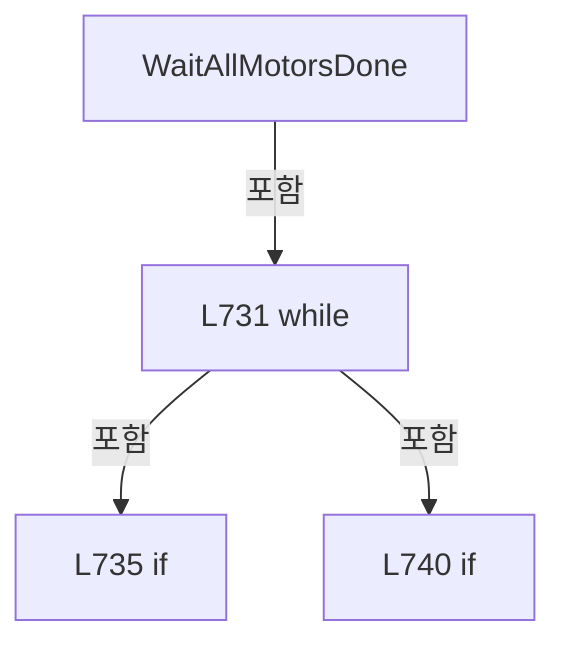

변경 전 점검: 입력/반환 타입, 위 호출자, 예외/취소 경로, 공유 상태와 저장·전송 소비자를 함께 확인합니다. 값의 단위나 물리 방향을 이름만으로 확정하지 않습니다.

### LocalFunctionStatement `Matches` · L726–729

[Drilling.Common/Interface/PicoMotor/CPicoMotor.cs:726–729](https://github.com/kjuws10-rgb/A3Drilling/blob/5aee8e58439c9b455cae7c9593c9be986c3e682e/Drilling.Common/Interface/PicoMotor/CPicoMotor.cs#L726-L729)

| 항목 | 실제 추출 값 |
| --- | --- |
| 서명 | bool Matches() |
| 접근/수식자 | Private /  |
| 반환/값 타입 | bool |
| 소속 타입 | NamedType:Drilling.Common.Interface.CPicoMotorService |

현재 부분 분석에서 직접 연결된 호출자는 없습니다. XAML/이벤트/인터페이스·델리게이트·외부 진입을 추가 확인해야 하며, 미사용으로 판정한 것이 아닙니다.

호출하는 대상과 해석 범위:

| 원본 행 | 표현식 | 분석 상태 | 대상/소스 위치 |
| --- | --- | --- | --- |
| 728 | motorNos.All | resolved | bool System.Collections.Generic.IEnumerable<int>.All<int>(System.Func<int, bool>) |

본문의 실제 연산·분기·예외·반환 순서(원문 위치 순):

| 원본 행 | 종류 | 주석 해설 |
| --- | --- | --- |
| 728 | call | 함수·델리게이트 또는 객체 생성자를 호출합니다: motorNos.All(session.GetMotionDone) |
| 728 | return | 호출자에게 값 또는 제어를 반환합니다: return motorNos.All(session.GetMotionDone); |

변경 전 점검: 입력/반환 타입, 위 호출자, 예외/취소 경로, 공유 상태와 저장·전송 소비자를 함께 확인합니다. 값의 단위나 물리 방향을 이름만으로 확정하지 않습니다.

### MethodDeclaration `GetSimulationStepDistance` · L749–752

[Drilling.Common/Interface/PicoMotor/CPicoMotor.cs:749–752](https://github.com/kjuws10-rgb/A3Drilling/blob/5aee8e58439c9b455cae7c9593c9be986c3e682e/Drilling.Common/Interface/PicoMotor/CPicoMotor.cs#L749-L752)

| 항목 | 실제 추출 값 |
| --- | --- |
| 서명 | double Drilling.Common.Interface.CPicoMotorService.GetSimulationStepDistance(Drilling.Common.Interface.ST_PICO_MOTOR_STATUS) |
| 접근/수식자 | Private / private, static |
| 반환/값 타입 | double |
| 소속 타입 | NamedType:Drilling.Common.Interface.CPicoMotorService |

입력 계약:

| 이름 | 타입 | 전달 | 선택/기본값 |
| --- | --- | --- | --- |
| status | Drilling.Common.Interface.ST_PICO_MOTOR_STATUS | None | False /  |

정적 호출자로 확인된 위치:

| 호출 파일/행 | 호출 표현식 | 런타임 분기 가능 |
| --- | --- | --- |
| [Drilling.Common/Interface/PicoMotor/CPicoMotor.cs:697–697](https://github.com/kjuws10-rgb/A3Drilling/blob/5aee8e58439c9b455cae7c9593c9be986c3e682e/Drilling.Common/Interface/PicoMotor/CPicoMotor.cs#L697-L697) | GetSimulationStepDistance | False |
| [Drilling.Common/Interface/PicoMotor/CPicoMotor.cs:888–888](https://github.com/kjuws10-rgb/A3Drilling/blob/5aee8e58439c9b455cae7c9593c9be986c3e682e/Drilling.Common/Interface/PicoMotor/CPicoMotor.cs#L888-L888) | GetSimulationStepDistance | False |
| [Drilling.Common/Interface/PicoMotor/CPicoMotor.cs:889–889](https://github.com/kjuws10-rgb/A3Drilling/blob/5aee8e58439c9b455cae7c9593c9be986c3e682e/Drilling.Common/Interface/PicoMotor/CPicoMotor.cs#L889-L889) | GetSimulationStepDistance | False |
| [Drilling.Common/Interface/PicoMotor/CPicoMotor.cs:939–939](https://github.com/kjuws10-rgb/A3Drilling/blob/5aee8e58439c9b455cae7c9593c9be986c3e682e/Drilling.Common/Interface/PicoMotor/CPicoMotor.cs#L939-L939) | GetSimulationStepDistance | False |

호출하는 대상과 해석 범위:

| 원본 행 | 표현식 | 분석 상태 | 대상/소스 위치 |
| --- | --- | --- | --- |
| 751 | Math.Max | resolved | double System.Math.Max(double, double) |

본문의 실제 연산·분기·예외·반환 순서(원문 위치 순):

| 원본 행 | 종류 | 주석 해설 |
| --- | --- | --- |
| 751 | call | 함수·델리게이트 또는 객체 생성자를 호출합니다: Math.Max(0.000001, status.CurrentVelocity * SimulationIntervalMs / 1000.0) |
| 751 | return | 호출자에게 값 또는 제어를 반환합니다: return Math.Max(0.000001, status.CurrentVelocity * SimulationIntervalMs / 1000.0); |

변경 전 점검: 입력/반환 타입, 위 호출자, 예외/취소 경로, 공유 상태와 저장·전송 소비자를 함께 확인합니다. 값의 단위나 물리 방향을 이름만으로 확정하지 않습니다.

### MethodDeclaration `Disconnect` · L754–766

[Drilling.Common/Interface/PicoMotor/CPicoMotor.cs:754–766](https://github.com/kjuws10-rgb/A3Drilling/blob/5aee8e58439c9b455cae7c9593c9be986c3e682e/Drilling.Common/Interface/PicoMotor/CPicoMotor.cs#L754-L766)

| 항목 | 실제 추출 값 |
| --- | --- |
| 서명 | void Drilling.Common.Interface.CPicoMotorService.Disconnect(int) |
| 접근/수식자 | Public / public |
| 반환/값 타입 | void |
| 소속 타입 | NamedType:Drilling.Common.Interface.CPicoMotorService |

입력 계약:

| 이름 | 타입 | 전달 | 선택/기본값 |
| --- | --- | --- | --- |
| number | int | None | False /  |

정적 호출자로 확인된 위치:

| 호출 파일/행 | 호출 표현식 | 런타임 분기 가능 |
| --- | --- | --- |
| [Drilling.Common/Interface/CInterfaceManager.cs:2095–2095](https://github.com/kjuws10-rgb/A3Drilling/blob/5aee8e58439c9b455cae7c9593c9be986c3e682e/Drilling.Common/Interface/CInterfaceManager.cs#L2095-L2095) | _picoMotorService.Disconnect | False |

호출하는 대상과 해석 범위:

| 원본 행 | 표현식 | 분석 상태 | 대상/소스 위치 |
| --- | --- | --- | --- |
| 758 | _allMoveTokens.Remove | resolved | bool System.Collections.Generic.Dictionary<int, System.Threading.CancellationTokenSource>.Remove(int, out System.Threading.CancellationTokenSource) |
| 759 | allMove.Cancel | resolved | void System.Threading.CancellationTokenSource.Cancel() |
| 760 | _motionTokens.Remove | resolved | bool System.Collections.Generic.Dictionary<int, System.Threading.CancellationTokenSource>.Remove(int, out System.Threading.CancellationTokenSource) |
| 761 | motion.Cancel | resolved | void System.Threading.CancellationTokenSource.Cancel() |
| 762 | _sessions.Remove | resolved | bool System.Collections.Generic.Dictionary<int, Drilling.Common.Interface.CPicoMotorCommandSession>.Remove(int, out Drilling.Common.Interface.CPicoMotorCommandSession) |
| 763 | session.Dispose | resolved | void Drilling.Common.Interface.CPicoMotorCommandSession.Dispose() · Drilling.Common/Interface/PicoMotor/CPicoMotor.cs:366 |
| 764 | _statuses.Remove | resolved | bool System.Collections.Generic.Dictionary<int, Drilling.Common.Interface.ST_PICO_MOTOR_STATUS>.Remove(int) |

본문의 실제 연산·분기·예외·반환 순서(원문 위치 순):

| 원본 행 | 종류 | 주석 해설 |
| --- | --- | --- |
| 756 | lock | 공유 상태의 임계 구역에 진입합니다: lock (_syncRoot) |
| 758 | call | 함수·델리게이트 또는 객체 생성자를 호출합니다: _allMoveTokens.Remove(number, out var allMove) |
| 758 | if | 조건에 따라 분기합니다: if (_allMoveTokens.Remove(number, out var allMove)) |
| 759 | call | 함수·델리게이트 또는 객체 생성자를 호출합니다: allMove.Cancel() |
| 760 | call | 함수·델리게이트 또는 객체 생성자를 호출합니다: _motionTokens.Remove(number, out var motion) |
| 760 | if | 조건에 따라 분기합니다: if (_motionTokens.Remove(number, out var motion)) |
| 761 | call | 함수·델리게이트 또는 객체 생성자를 호출합니다: motion.Cancel() |
| 762 | call | 함수·델리게이트 또는 객체 생성자를 호출합니다: _sessions.Remove(number, out var session) |
| 762 | if | 조건에 따라 분기합니다: if (_sessions.Remove(number, out var session)) |
| 763 | call | 함수·델리게이트 또는 객체 생성자를 호출합니다: session.Dispose() |
| 764 | call | 함수·델리게이트 또는 객체 생성자를 호출합니다: _statuses.Remove(number) |

제어 구문의 포함 구조(실제 실행 순서/CFG가 아닌 구문 탐색 그림):

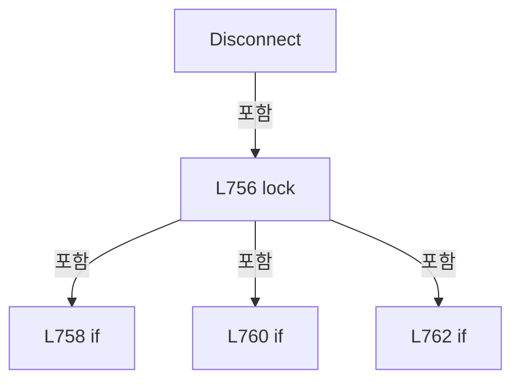

변경 전 점검: 입력/반환 타입, 위 호출자, 예외/취소 경로, 공유 상태와 저장·전송 소비자를 함께 확인합니다. 값의 단위나 물리 방향을 이름만으로 확정하지 않습니다.

### MethodDeclaration `DisconnectAll` · L768–783

[Drilling.Common/Interface/PicoMotor/CPicoMotor.cs:768–783](https://github.com/kjuws10-rgb/A3Drilling/blob/5aee8e58439c9b455cae7c9593c9be986c3e682e/Drilling.Common/Interface/PicoMotor/CPicoMotor.cs#L768-L783)

| 항목 | 실제 추출 값 |
| --- | --- |
| 서명 | void Drilling.Common.Interface.CPicoMotorService.DisconnectAll() |
| 접근/수식자 | Public / public |
| 반환/값 타입 | void |
| 소속 타입 | NamedType:Drilling.Common.Interface.CPicoMotorService |

정적 호출자로 확인된 위치:

| 호출 파일/행 | 호출 표현식 | 런타임 분기 가능 |
| --- | --- | --- |
| [Drilling.Common/Interface/CInterfaceManager.cs:193–193](https://github.com/kjuws10-rgb/A3Drilling/blob/5aee8e58439c9b455cae7c9593c9be986c3e682e/Drilling.Common/Interface/CInterfaceManager.cs#L193-L193) | _picoMotorService.DisconnectAll | False |
| [Drilling.Common/Interface/CInterfaceManager.cs:258–258](https://github.com/kjuws10-rgb/A3Drilling/blob/5aee8e58439c9b455cae7c9593c9be986c3e682e/Drilling.Common/Interface/CInterfaceManager.cs#L258-L258) | _picoMotorService.DisconnectAll | False |
| [Drilling.Common/Interface/PicoMotor/CPicoMotor.cs:787–787](https://github.com/kjuws10-rgb/A3Drilling/blob/5aee8e58439c9b455cae7c9593c9be986c3e682e/Drilling.Common/Interface/PicoMotor/CPicoMotor.cs#L787-L787) | DisconnectAll | False |

호출하는 대상과 해석 범위:

| 원본 행 | 표현식 | 분석 상태 | 대상/소스 위치 |
| --- | --- | --- | --- |
| 773 | token.Cancel | resolved | void System.Threading.CancellationTokenSource.Cancel() |
| 775 | token.Cancel | resolved | void System.Threading.CancellationTokenSource.Cancel() |
| 777 | session.Dispose | resolved | void Drilling.Common.Interface.CPicoMotorCommandSession.Dispose() · Drilling.Common/Interface/PicoMotor/CPicoMotor.cs:366 |
| 778 | _allMoveTokens.Clear | resolved | void System.Collections.Generic.Dictionary<int, System.Threading.CancellationTokenSource>.Clear() |
| 779 | _motionTokens.Clear | resolved | void System.Collections.Generic.Dictionary<int, System.Threading.CancellationTokenSource>.Clear() |
| 780 | _sessions.Clear | resolved | void System.Collections.Generic.Dictionary<int, Drilling.Common.Interface.CPicoMotorCommandSession>.Clear() |
| 781 | _statuses.Clear | resolved | void System.Collections.Generic.Dictionary<int, Drilling.Common.Interface.ST_PICO_MOTOR_STATUS>.Clear() |

본문의 실제 연산·분기·예외·반환 순서(원문 위치 순):

| 원본 행 | 종류 | 주석 해설 |
| --- | --- | --- |
| 770 | lock | 공유 상태의 임계 구역에 진입합니다: lock (_syncRoot) |
| 772 | foreach | 컬렉션 요소를 순회합니다: foreach (var token in _allMoveTokens.Values) |
| 773 | call | 함수·델리게이트 또는 객체 생성자를 호출합니다: token.Cancel() |
| 774 | foreach | 컬렉션 요소를 순회합니다: foreach (var token in _motionTokens.Values) |
| 775 | call | 함수·델리게이트 또는 객체 생성자를 호출합니다: token.Cancel() |
| 776 | foreach | 컬렉션 요소를 순회합니다: foreach (var session in _sessions.Values) |
| 777 | call | 함수·델리게이트 또는 객체 생성자를 호출합니다: session.Dispose() |
| 778 | call | 함수·델리게이트 또는 객체 생성자를 호출합니다: _allMoveTokens.Clear() |
| 779 | call | 함수·델리게이트 또는 객체 생성자를 호출합니다: _motionTokens.Clear() |
| 780 | call | 함수·델리게이트 또는 객체 생성자를 호출합니다: _sessions.Clear() |
| 781 | call | 함수·델리게이트 또는 객체 생성자를 호출합니다: _statuses.Clear() |

제어 구문의 포함 구조(실제 실행 순서/CFG가 아닌 구문 탐색 그림):

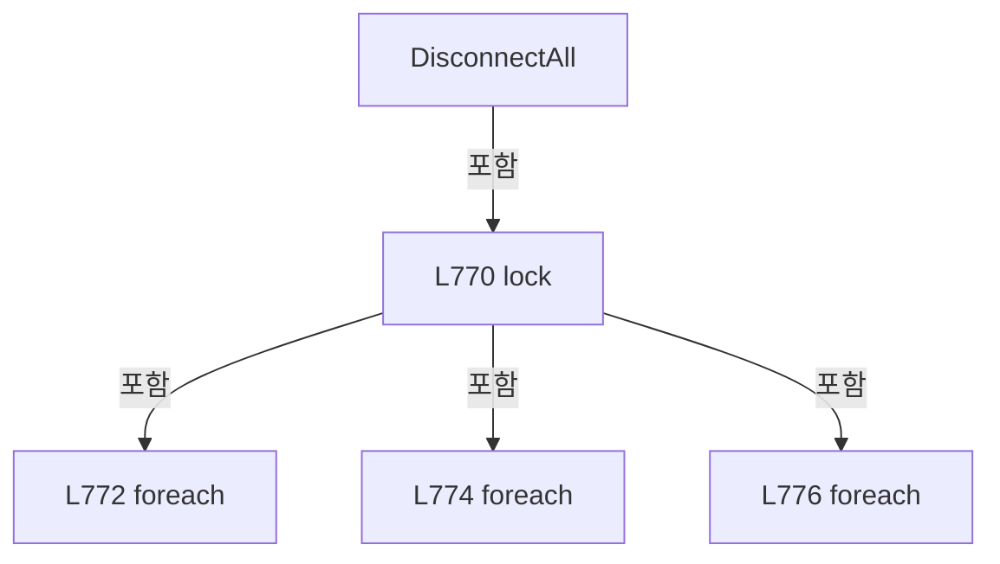

변경 전 점검: 입력/반환 타입, 위 호출자, 예외/취소 경로, 공유 상태와 저장·전송 소비자를 함께 확인합니다. 값의 단위나 물리 방향을 이름만으로 확정하지 않습니다.

### MethodDeclaration `Dispose` · L785–788

[Drilling.Common/Interface/PicoMotor/CPicoMotor.cs:785–788](https://github.com/kjuws10-rgb/A3Drilling/blob/5aee8e58439c9b455cae7c9593c9be986c3e682e/Drilling.Common/Interface/PicoMotor/CPicoMotor.cs#L785-L788)

| 항목 | 실제 추출 값 |
| --- | --- |
| 서명 | void Drilling.Common.Interface.CPicoMotorService.Dispose() |
| 접근/수식자 | Public / public |
| 반환/값 타입 | void |
| 소속 타입 | NamedType:Drilling.Common.Interface.CPicoMotorService |

현재 부분 분석에서 직접 연결된 호출자는 없습니다. XAML/이벤트/인터페이스·델리게이트·외부 진입을 추가 확인해야 하며, 미사용으로 판정한 것이 아닙니다.

호출하는 대상과 해석 범위:

| 원본 행 | 표현식 | 분석 상태 | 대상/소스 위치 |
| --- | --- | --- | --- |
| 787 | DisconnectAll | resolved | void Drilling.Common.Interface.CPicoMotorService.DisconnectAll() · Drilling.Common/Interface/PicoMotor/CPicoMotor.cs:768 |

본문의 실제 연산·분기·예외·반환 순서(원문 위치 순):

| 원본 행 | 종류 | 주석 해설 |
| --- | --- | --- |
| 787 | call | 함수·델리게이트 또는 객체 생성자를 호출합니다: DisconnectAll() |

변경 전 점검: 입력/반환 타입, 위 호출자, 예외/취소 경로, 공유 상태와 저장·전송 소비자를 함께 확인합니다. 값의 단위나 물리 방향을 이름만으로 확정하지 않습니다.

### MethodDeclaration `ExecuteLive` · L790–860

[Drilling.Common/Interface/PicoMotor/CPicoMotor.cs:790–860](https://github.com/kjuws10-rgb/A3Drilling/blob/5aee8e58439c9b455cae7c9593c9be986c3e682e/Drilling.Common/Interface/PicoMotor/CPicoMotor.cs#L790-L860)

| 항목 | 실제 추출 값 |
| --- | --- |
| 서명 | void Drilling.Common.Interface.CPicoMotorService.ExecuteLive(int, Drilling.Common.Interface.EN_PICO_MOTOR_COMMAND, int, double) |
| 접근/수식자 | Private / private |
| 반환/값 타입 | void |
| 소속 타입 | NamedType:Drilling.Common.Interface.CPicoMotorService |

입력 계약:

| 이름 | 타입 | 전달 | 선택/기본값 |
| --- | --- | --- | --- |
| number | int | None | False /  |
| command | Drilling.Common.Interface.EN_PICO_MOTOR_COMMAND | None | False /  |
| motorNo | int | None | False /  |
| parameter | double | None | False /  |

정적 호출자로 확인된 위치:

| 호출 파일/행 | 호출 표현식 | 런타임 분기 가능 |
| --- | --- | --- |
| [Drilling.Common/Interface/PicoMotor/CPicoMotor.cs:472–472](https://github.com/kjuws10-rgb/A3Drilling/blob/5aee8e58439c9b455cae7c9593c9be986c3e682e/Drilling.Common/Interface/PicoMotor/CPicoMotor.cs#L472-L472) | ExecuteLive | False |

호출하는 대상과 해석 범위:

| 원본 행 | 표현식 | 분석 상태 | 대상/소스 위치 |
| --- | --- | --- | --- |
| 794 | GetSession | resolved | Drilling.Common.Interface.CPicoMotorCommandSession Drilling.Common.Interface.CPicoMotorService.GetSession(int, bool) · Drilling.Common/Interface/PicoMotor/CPicoMotor.cs:962 |
| 795 | session.Connect | resolved | bool Drilling.Common.Interface.CPicoMotorCommandSession.Connect(int) · Drilling.Common/Interface/PicoMotor/CPicoMotor.cs:147 |
| 796 | new InvalidOperationException | resolved | System.InvalidOperationException.InvalidOperationException(string?) |
| 797 | SetStatus | resolved | void Drilling.Common.Interface.CPicoMotorService.SetStatus(int, Drilling.Common.Interface.ST_PICO_MOTOR_STATUS) · Drilling.Common/Interface/PicoMotor/CPicoMotor.cs:978 |
| 797 | GetStatus | resolved | Drilling.Common.Interface.ST_PICO_MOTOR_STATUS Drilling.Common.Interface.CPicoMotorService.GetStatus(int) · Drilling.Common/Interface/PicoMotor/CPicoMotor.cs:416 |
| 803 | _sessions.TryGetValue | resolved | bool System.Collections.Generic.Dictionary<int, Drilling.Common.Interface.CPicoMotorCommandSession>.TryGetValue(int, out Drilling.Common.Interface.CPicoMotorCommandSession) |
| 804 | session.Disconnect | resolved | void Drilling.Common.Interface.CPicoMotorCommandSession.Disconnect() · Drilling.Common/Interface/PicoMotor/CPicoMotor.cs:176 |
| 805 | SetStatus | resolved | void Drilling.Common.Interface.CPicoMotorService.SetStatus(int, Drilling.Common.Interface.ST_PICO_MOTOR_STATUS) · Drilling.Common/Interface/PicoMotor/CPicoMotor.cs:978 |
| 805 | GetStatus | resolved | Drilling.Common.Interface.ST_PICO_MOTOR_STATUS Drilling.Common.Interface.CPicoMotorService.GetStatus(int) · Drilling.Common/Interface/PicoMotor/CPicoMotor.cs:416 |
| 809 | GetSession | resolved | Drilling.Common.Interface.CPicoMotorCommandSession Drilling.Common.Interface.CPicoMotorService.GetSession(int, bool) · Drilling.Common/Interface/PicoMotor/CPicoMotor.cs:962 |
| 815 | live.SetVelocity | resolved | void Drilling.Common.Interface.CPicoMotorCommandSession.SetVelocity(int, int) · Drilling.Common/Interface/PicoMotor/CPicoMotor.cs:280 |
| 815 | CPicoMotor.MillimeterToStep | resolved | long Drilling.Common.Interface.CPicoMotor.MillimeterToStep(double) · Drilling.Common/Interface/PicoMotor/CPicoMotor.cs:31 |
| 818 | live.SetAcceleration | resolved | void Drilling.Common.Interface.CPicoMotorCommandSession.SetAcceleration(int, int) · Drilling.Common/Interface/PicoMotor/CPicoMotor.cs:290 |
| 818 | CPicoMotor.MillimeterToStep | resolved | long Drilling.Common.Interface.CPicoMotor.MillimeterToStep(double) · Drilling.Common/Interface/PicoMotor/CPicoMotor.cs:31 |
| 821 | live.StopMotion | resolved | void Drilling.Common.Interface.CPicoMotorCommandSession.StopMotion(int) · Drilling.Common/Interface/PicoMotor/CPicoMotor.cs:300 |
| 824 | live.AbortMotion | resolved | void Drilling.Common.Interface.CPicoMotorCommandSession.AbortMotion() · Drilling.Common/Interface/PicoMotor/CPicoMotor.cs:310 |
| 825 | CancelAllMove | resolved | void Drilling.Common.Interface.CPicoMotorService.CancelAllMove(int) · Drilling.Common/Interface/PicoMotor/CPicoMotor.cs:627 |
| 828 | live.MoveHome | resolved | void Drilling.Common.Interface.CPicoMotorCommandSession.MoveHome(int) · Drilling.Common/Interface/PicoMotor/CPicoMotor.cs:320 |
| 831 | live.JogNegative | resolved | void Drilling.Common.Interface.CPicoMotorCommandSession.JogNegative(int) · Drilling.Common/Interface/PicoMotor/CPicoMotor.cs:326 |
| 834 | live.JogPositive | resolved | void Drilling.Common.Interface.CPicoMotorCommandSession.JogPositive(int) · Drilling.Common/Interface/PicoMotor/CPicoMotor.cs:336 |
| 837 | live.RelativeMove | resolved | void Drilling.Common.Interface.CPicoMotorCommandSession.RelativeMove(int, long) · Drilling.Common/Interface/PicoMotor/CPicoMotor.cs:346 |
| 837 | CPicoMotor.MillimeterToStep | resolved | long Drilling.Common.Interface.CPicoMotor.MillimeterToStep(double) · Drilling.Common/Interface/PicoMotor/CPicoMotor.cs:31 |
| 840 | live.RelativeMove | resolved | void Drilling.Common.Interface.CPicoMotorCommandSession.RelativeMove(int, long) · Drilling.Common/Interface/PicoMotor/CPicoMotor.cs:346 |
| 840 | CPicoMotor.MillimeterToStep | resolved | long Drilling.Common.Interface.CPicoMotor.MillimeterToStep(double) · Drilling.Common/Interface/PicoMotor/CPicoMotor.cs:31 |
| 843 | live.AbsoluteMove | resolved | void Drilling.Common.Interface.CPicoMotorCommandSession.AbsoluteMove(int, long) · Drilling.Common/Interface/PicoMotor/CPicoMotor.cs:356 |
| 843 | CPicoMotor.MillimeterToStep | resolved | long Drilling.Common.Interface.CPicoMotor.MillimeterToStep(double) · Drilling.Common/Interface/PicoMotor/CPicoMotor.cs:31 |
| 846 | Refresh(number, false).GetAwaiter().GetResult | resolved | Drilling.Common.Interface.ST_PICO_MOTOR_STATUS System.Runtime.CompilerServices.TaskAwaiter<Drilling.Common.Interface.ST_PICO_MOTOR_STATUS>.GetResult() |
| 846 | Refresh(number, false).GetAwaiter | resolved | System.Runtime.CompilerServices.TaskAwaiter<Drilling.Common.Interface.ST_PICO_MOTOR_STATUS> System.Threading.Tasks.Task<Drilling.Common.Interface.ST_PICO_MOTOR_STATUS>.GetAwaiter() |
| 846 | Refresh | resolved | System.Threading.Tasks.Task<Drilling.Common.Interface.ST_PICO_MOTOR_STATUS> Drilling.Common.Interface.CPicoMotorService.Refresh(int, bool, System.Threading.CancellationToken) · Drilling.Common/Interface/PicoMotor/CPicoMotor.cs:424 |
| 850 | GetStatus | resolved | Drilling.Common.Interface.ST_PICO_MOTOR_STATUS Drilling.Common.Interface.CPicoMotorService.GetStatus(int) · Drilling.Common/Interface/PicoMotor/CPicoMotor.cs:416 |
| 851 | SetStatus | resolved | void Drilling.Common.Interface.CPicoMotorService.SetStatus(int, Drilling.Common.Interface.ST_PICO_MOTOR_STATUS) · Drilling.Common/Interface/PicoMotor/CPicoMotor.cs:978 |

본문의 실제 연산·분기·예외·반환 순서(원문 위치 순):

| 원본 행 | 종류 | 주석 해설 |
| --- | --- | --- |
| 792 | if | 조건에 따라 분기합니다: if (command == EN_PICO_MOTOR_COMMAND.Connect) |
| 794 | call | 함수·델리게이트 또는 객체 생성자를 호출합니다: GetSession(number, requireConnected: false) |
| 794 | local-declaration | 지역 변수를 선언합니다: var session = GetSession(number, requireConnected: false); |
| 794 | variable-initializer | 변수의 초기값을 지정합니다: session = GetSession(number, requireConnected: false) |
| 795 | call | 함수·델리게이트 또는 객체 생성자를 호출합니다: session.Connect() |
| 795 | if | 조건에 따라 분기합니다: if (!session.Connect()) |
| 796 | call | 함수·델리게이트 또는 객체 생성자를 호출합니다: new InvalidOperationException("CmdLib device discovery/open failed.") |
| 796 | throw | 예외를 발생/전달합니다: throw new InvalidOperationException("CmdLib device discovery/open failed."); |
| 797 | assignment | 값을 대상에 대입합니다: IsConnected = true |
| 797 | assignment | 값을 대상에 대입합니다: CommOk = true |
| 797 | assignment | 값을 대상에 대입합니다: UpdatedAt = DateTimeOffset.Now |
| 797 | call | 함수·델리게이트 또는 객체 생성자를 호출합니다: SetStatus(number, GetStatus(number)with { IsConnected = true, CommOk = true, UpdatedAt = DateTimeOffset.Now }) |
| 797 | call | 함수·델리게이트 또는 객체 생성자를 호출합니다: GetStatus(number) |
| 798 | return | 호출자에게 값 또는 제어를 반환합니다: return; |
| 801 | if | 조건에 따라 분기합니다: if (command == EN_PICO_MOTOR_COMMAND.Disconnect) |
| 803 | call | 함수·델리게이트 또는 객체 생성자를 호출합니다: _sessions.TryGetValue(number, out var session) |
| 803 | if | 조건에 따라 분기합니다: if (_sessions.TryGetValue(number, out var session)) |
| 804 | call | 함수·델리게이트 또는 객체 생성자를 호출합니다: session.Disconnect() |
| 805 | assignment | 값을 대상에 대입합니다: IsConnected = false |
| 805 | assignment | 값을 대상에 대입합니다: MotionState = "IDLE" |
| 805 | assignment | 값을 대상에 대입합니다: UpdatedAt = DateTimeOffset.Now |
| 805 | call | 함수·델리게이트 또는 객체 생성자를 호출합니다: SetStatus(number, GetStatus(number)with { IsConnected = false, MotionState = "IDLE", UpdatedAt = DateTimeOffset.Now }) |
| 805 | call | 함수·델리게이트 또는 객체 생성자를 호출합니다: GetStatus(number) |
| 806 | return | 호출자에게 값 또는 제어를 반환합니다: return; |
| 809 | call | 함수·델리게이트 또는 객체 생성자를 호출합니다: GetSession(number, requireConnected: true) |
| 809 | local-declaration | 지역 변수를 선언합니다: var live = GetSession(number, requireConnected: true); |
| 809 | variable-initializer | 변수의 초기값을 지정합니다: live = GetSession(number, requireConnected: true) |
| 810 | switch | 값에 따라 분기합니다: switch (command) |
| 812 | case | 분기값/패턴의 구간입니다: case EN_PICO_MOTOR_COMMAND.SelectMotor: |
| 813 | break | 해당 반복/분기 구간을 종료합니다: break; |
| 814 | case | 분기값/패턴의 구간입니다: case EN_PICO_MOTOR_COMMAND.SetVelocity: |
| 815 | call | 함수·델리게이트 또는 객체 생성자를 호출합니다: live.SetVelocity(motorNo, checked((int)CPicoMotor.MillimeterToStep(parameter))) |
| 815 | call | 함수·델리게이트 또는 객체 생성자를 호출합니다: CPicoMotor.MillimeterToStep(parameter) |
| 816 | break | 해당 반복/분기 구간을 종료합니다: break; |
| 817 | case | 분기값/패턴의 구간입니다: case EN_PICO_MOTOR_COMMAND.SetAcceleration: |
| 818 | call | 함수·델리게이트 또는 객체 생성자를 호출합니다: live.SetAcceleration(motorNo, checked((int)CPicoMotor.MillimeterToStep(parameter))) |
| 818 | call | 함수·델리게이트 또는 객체 생성자를 호출합니다: CPicoMotor.MillimeterToStep(parameter) |
| 819 | break | 해당 반복/분기 구간을 종료합니다: break; |
| 820 | case | 분기값/패턴의 구간입니다: case EN_PICO_MOTOR_COMMAND.StopMotion: |
| 821 | call | 함수·델리게이트 또는 객체 생성자를 호출합니다: live.StopMotion(motorNo) |
| 822 | break | 해당 반복/분기 구간을 종료합니다: break; |
| 823 | case | 분기값/패턴의 구간입니다: case EN_PICO_MOTOR_COMMAND.AllMotorStop: |
| 824 | call | 함수·델리게이트 또는 객체 생성자를 호출합니다: live.AbortMotion() |
| 825 | call | 함수·델리게이트 또는 객체 생성자를 호출합니다: CancelAllMove(number) |
| 826 | break | 해당 반복/분기 구간을 종료합니다: break; |
| 827 | case | 분기값/패턴의 구간입니다: case EN_PICO_MOTOR_COMMAND.Home: |
| 828 | call | 함수·델리게이트 또는 객체 생성자를 호출합니다: live.MoveHome(motorNo) |
| 829 | break | 해당 반복/분기 구간을 종료합니다: break; |
| 830 | case | 분기값/패턴의 구간입니다: case EN_PICO_MOTOR_COMMAND.JogNegative: |
| 831 | call | 함수·델리게이트 또는 객체 생성자를 호출합니다: live.JogNegative(motorNo) |
| 832 | break | 해당 반복/분기 구간을 종료합니다: break; |
| 833 | case | 분기값/패턴의 구간입니다: case EN_PICO_MOTOR_COMMAND.JogPositive: |
| 834 | call | 함수·델리게이트 또는 객체 생성자를 호출합니다: live.JogPositive(motorNo) |
| 835 | break | 해당 반복/분기 구간을 종료합니다: break; |
| 836 | case | 분기값/패턴의 구간입니다: case EN_PICO_MOTOR_COMMAND.MoveRelativeNegative: |
| 837 | call | 함수·델리게이트 또는 객체 생성자를 호출합니다: live.RelativeMove(motorNo, -CPicoMotor.MillimeterToStep(parameter)) |
| 837 | call | 함수·델리게이트 또는 객체 생성자를 호출합니다: CPicoMotor.MillimeterToStep(parameter) |
| 838 | break | 해당 반복/분기 구간을 종료합니다: break; |
| 839 | case | 분기값/패턴의 구간입니다: case EN_PICO_MOTOR_COMMAND.MoveRelativePositive: |
| 840 | call | 함수·델리게이트 또는 객체 생성자를 호출합니다: live.RelativeMove(motorNo, CPicoMotor.MillimeterToStep(parameter)) |
| 840 | call | 함수·델리게이트 또는 객체 생성자를 호출합니다: CPicoMotor.MillimeterToStep(parameter) |
| 841 | break | 해당 반복/분기 구간을 종료합니다: break; |
| 842 | case | 분기값/패턴의 구간입니다: case EN_PICO_MOTOR_COMMAND.MoveAbsolute: |
| 843 | call | 함수·델리게이트 또는 객체 생성자를 호출합니다: live.AbsoluteMove(motorNo, CPicoMotor.MillimeterToStep(parameter)) |
| 843 | call | 함수·델리게이트 또는 객체 생성자를 호출합니다: CPicoMotor.MillimeterToStep(parameter) |
| 844 | break | 해당 반복/분기 구간을 종료합니다: break; |
| 845 | case | 분기값/패턴의 구간입니다: case EN_PICO_MOTOR_COMMAND.Refresh: |
| 846 | call | 함수·델리게이트 또는 객체 생성자를 호출합니다: Refresh(number, false).GetAwaiter().GetResult() |
| 846 | call | 함수·델리게이트 또는 객체 생성자를 호출합니다: Refresh(number, false).GetAwaiter() |
| 846 | call | 함수·델리게이트 또는 객체 생성자를 호출합니다: Refresh(number, false) |
| 847 | return | 호출자에게 값 또는 제어를 반환합니다: return; |
| 850 | call | 함수·델리게이트 또는 객체 생성자를 호출합니다: GetStatus(number) |
| 850 | local-declaration | 지역 변수를 선언합니다: var status = GetStatus(number); |
| 850 | variable-initializer | 변수의 초기값을 지정합니다: status = GetStatus(number) |
| 851 | assignment | 값을 대상에 대입합니다: SelectedMotorNo = motorNo |
| 851 | assignment | 값을 대상에 대입합니다: CurrentVelocity = command == EN_PICO_MOTOR_COMMAND.SetVelocity ? parameter : status.CurrentVelocity |
| 851 | assignment | 값을 대상에 대입합니다: CurrentAcceleration = command == EN_PICO_MOTOR_COMMAND.SetAcceleration ? parameter : status.CurrentAcceleration |
| 851 | conditional-expression | 조건에 따라 결과식을 선택합니다: command == EN_PICO_MOTOR_COMMAND.SetVelocity ? parameter : status.CurrentVelocity |
| 851 | conditional-expression | 조건에 따라 결과식을 선택합니다: command == EN_PICO_MOTOR_COMMAND.SetAcceleration ? parameter : status.CurrentAcceleration |
| 851 | assignment | 값을 대상에 대입합니다: MotionState = command switch { EN_PICO_MOTOR_COMMAND.StopMotion or EN_PICO_MOTOR_COMMAND.AllMotorStop => "IDLE", EN_PICO_MOTOR_COMMAND.Home => "HOME", EN_PICO_MOTOR_COMMAND.JogNegative or EN_PICO_MOTOR_COMMAND.JogPositive => "JOG" |
| 851 | call | 함수·델리게이트 또는 객체 생성자를 호출합니다: SetStatus(number, status with { SelectedMotorNo = motorNo, CurrentVelocity = command == EN_PICO_MOTOR_COMMAND.SetVelocity ? parameter : status.CurrentVelocity, CurrentAcceleration = command == EN_PICO_MOTOR_COMMAND.SetAc… |
| 851 | switch-expression | 값별 결과식을 선택합니다: command switch { EN_PICO_MOTOR_COMMAND.StopMotion or EN_PICO_MOTOR_COMMAND.AllMotorStop => "IDLE", EN_PICO_MOTOR_COMMAND.Home => "HOME", EN_PICO_MOTOR_COMMAND.JogNegative or EN_PICO_MOTOR_COMMAND.JogPositive => "JOG", EN_PICO_MOTO |
| 859 | assignment | 값을 대상에 대입합니다: CommOk = true |
| 859 | assignment | 값을 대상에 대입합니다: LastError = EN_PICO_MOTOR_ERROR.Ok |
| 859 | assignment | 값을 대상에 대입합니다: UpdatedAt = DateTimeOffset.Now |

제어 구문의 포함 구조(실제 실행 순서/CFG가 아닌 구문 탐색 그림):

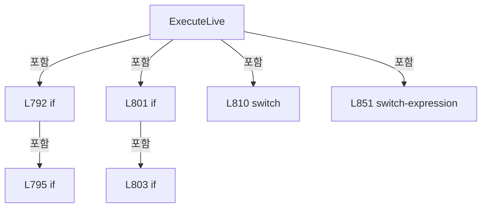

변경 전 점검: 입력/반환 타입, 위 호출자, 예외/취소 경로, 공유 상태와 저장·전송 소비자를 함께 확인합니다. 값의 단위나 물리 방향을 이름만으로 확정하지 않습니다.

### MethodDeclaration `ExecuteSimulation` · L862–899

[Drilling.Common/Interface/PicoMotor/CPicoMotor.cs:862–899](https://github.com/kjuws10-rgb/A3Drilling/blob/5aee8e58439c9b455cae7c9593c9be986c3e682e/Drilling.Common/Interface/PicoMotor/CPicoMotor.cs#L862-L899)

| 항목 | 실제 추출 값 |
| --- | --- |
| 서명 | void Drilling.Common.Interface.CPicoMotorService.ExecuteSimulation(int, Drilling.Common.Interface.EN_PICO_MOTOR_COMMAND, int, double) |
| 접근/수식자 | Private / private |
| 반환/값 타입 | void |
| 소속 타입 | NamedType:Drilling.Common.Interface.CPicoMotorService |

입력 계약:

| 이름 | 타입 | 전달 | 선택/기본값 |
| --- | --- | --- | --- |
| number | int | None | False /  |
| command | Drilling.Common.Interface.EN_PICO_MOTOR_COMMAND | None | False /  |
| motorNo | int | None | False /  |
| parameter | double | None | False /  |

정적 호출자로 확인된 위치:

| 호출 파일/행 | 호출 표현식 | 런타임 분기 가능 |
| --- | --- | --- |
| [Drilling.Common/Interface/PicoMotor/CPicoMotor.cs:509–509](https://github.com/kjuws10-rgb/A3Drilling/blob/5aee8e58439c9b455cae7c9593c9be986c3e682e/Drilling.Common/Interface/PicoMotor/CPicoMotor.cs#L509-L509) | ExecuteSimulation | False |

호출하는 대상과 해석 범위:

| 원본 행 | 표현식 | 분석 상태 | 대상/소스 위치 |
| --- | --- | --- | --- |
| 864 | GetStatus | resolved | Drilling.Common.Interface.ST_PICO_MOTOR_STATUS Drilling.Common.Interface.CPicoMotorService.GetStatus(int) · Drilling.Common/Interface/PicoMotor/CPicoMotor.cs:416 |
| 865 | GetPosition | resolved | double Drilling.Common.Interface.CPicoMotorService.GetPosition(Drilling.Common.Interface.ST_PICO_MOTOR_STATUS, int) · Drilling.Common/Interface/PicoMotor/CPicoMotor.cs:984 |
| 884 | SetPosition | resolved | Drilling.Common.Interface.ST_PICO_MOTOR_STATUS Drilling.Common.Interface.CPicoMotorService.SetPosition(Drilling.Common.Interface.ST_PICO_MOTOR_STATUS, int, double) · Drilling.Common/Interface/PicoMotor/CPicoMotor.cs:995 |
| 884 | CPicoMotor.StepToMillimeter | resolved | double Drilling.Common.Interface.CPicoMotor.StepToMillimeter(long) · Drilling.Common/Interface/PicoMotor/CPicoMotor.cs:36 |
| 885 | SetPosition | resolved | Drilling.Common.Interface.ST_PICO_MOTOR_STATUS Drilling.Common.Interface.CPicoMotorService.SetPosition(Drilling.Common.Interface.ST_PICO_MOTOR_STATUS, int, double) · Drilling.Common/Interface/PicoMotor/CPicoMotor.cs:995 |
| 886 | SetPosition | resolved | Drilling.Common.Interface.ST_PICO_MOTOR_STATUS Drilling.Common.Interface.CPicoMotorService.SetPosition(Drilling.Common.Interface.ST_PICO_MOTOR_STATUS, int, double) · Drilling.Common/Interface/PicoMotor/CPicoMotor.cs:995 |
| 887 | SetPosition | resolved | Drilling.Common.Interface.ST_PICO_MOTOR_STATUS Drilling.Common.Interface.CPicoMotorService.SetPosition(Drilling.Common.Interface.ST_PICO_MOTOR_STATUS, int, double) · Drilling.Common/Interface/PicoMotor/CPicoMotor.cs:995 |
| 888 | SetPosition | resolved | Drilling.Common.Interface.ST_PICO_MOTOR_STATUS Drilling.Common.Interface.CPicoMotorService.SetPosition(Drilling.Common.Interface.ST_PICO_MOTOR_STATUS, int, double) · Drilling.Common/Interface/PicoMotor/CPicoMotor.cs:995 |
| 888 | GetSimulationStepDistance | resolved | double Drilling.Common.Interface.CPicoMotorService.GetSimulationStepDistance(Drilling.Common.Interface.ST_PICO_MOTOR_STATUS) · Drilling.Common/Interface/PicoMotor/CPicoMotor.cs:749 |
| 889 | SetPosition | resolved | Drilling.Common.Interface.ST_PICO_MOTOR_STATUS Drilling.Common.Interface.CPicoMotorService.SetPosition(Drilling.Common.Interface.ST_PICO_MOTOR_STATUS, int, double) · Drilling.Common/Interface/PicoMotor/CPicoMotor.cs:995 |
| 889 | GetSimulationStepDistance | resolved | double Drilling.Common.Interface.CPicoMotorService.GetSimulationStepDistance(Drilling.Common.Interface.ST_PICO_MOTOR_STATUS) · Drilling.Common/Interface/PicoMotor/CPicoMotor.cs:749 |
| 898 | SetStatus | resolved | void Drilling.Common.Interface.CPicoMotorService.SetStatus(int, Drilling.Common.Interface.ST_PICO_MOTOR_STATUS) · Drilling.Common/Interface/PicoMotor/CPicoMotor.cs:978 |

본문의 실제 연산·분기·예외·반환 순서(원문 위치 순):

| 원본 행 | 종류 | 주석 해설 |
| --- | --- | --- |
| 864 | call | 함수·델리게이트 또는 객체 생성자를 호출합니다: GetStatus(number) |
| 864 | local-declaration | 지역 변수를 선언합니다: var status = GetStatus(number); |
| 864 | variable-initializer | 변수의 초기값을 지정합니다: status = GetStatus(number) |
| 865 | call | 함수·델리게이트 또는 객체 생성자를 호출합니다: GetPosition(status, motorNo) |
| 865 | local-declaration | 지역 변수를 선언합니다: var position = GetPosition(status, motorNo); |
| 865 | variable-initializer | 변수의 초기값을 지정합니다: position = GetPosition(status, motorNo) |
| 866 | assignment | 값을 대상에 대입합니다: status = command switch { EN_PICO_MOTOR_COMMAND.Connect => status with { IsConnected = true }, EN_PICO_MOTOR_COMMAND.Disconnect => status with { IsConnected = false }, EN_PICO_MOTOR_COMMAND.SetVelocity => status with { CurrentVelo |
| 866 | switch-expression | 값별 결과식을 선택합니다: command switch { EN_PICO_MOTOR_COMMAND.Connect => status with { IsConnected = true }, EN_PICO_MOTOR_COMMAND.Disconnect => status with { IsConnected = false }, EN_PICO_MOTOR_COMMAND.SetVelocity => status with { CurrentVelocity = pa |
| 870 | assignment | 값을 대상에 대입합니다: IsConnected = true |
| 874 | assignment | 값을 대상에 대입합니다: IsConnected = false |
| 878 | assignment | 값을 대상에 대입합니다: CurrentVelocity = parameter |
| 882 | assignment | 값을 대상에 대입합니다: CurrentAcceleration = parameter |
| 884 | call | 함수·델리게이트 또는 객체 생성자를 호출합니다: SetPosition(status, motorNo, CPicoMotor.StepToMillimeter(status.HomePosition)) |
| 884 | call | 함수·델리게이트 또는 객체 생성자를 호출합니다: CPicoMotor.StepToMillimeter(status.HomePosition) |
| 885 | call | 함수·델리게이트 또는 객체 생성자를 호출합니다: SetPosition(status, motorNo, position - parameter) |
| 886 | call | 함수·델리게이트 또는 객체 생성자를 호출합니다: SetPosition(status, motorNo, position + parameter) |
| 887 | call | 함수·델리게이트 또는 객체 생성자를 호출합니다: SetPosition(status, motorNo, parameter) |
| 888 | call | 함수·델리게이트 또는 객체 생성자를 호출합니다: SetPosition(status, motorNo, position - GetSimulationStepDistance(status)) |
| 888 | call | 함수·델리게이트 또는 객체 생성자를 호출합니다: GetSimulationStepDistance(status) |
| 889 | call | 함수·델리게이트 또는 객체 생성자를 호출합니다: SetPosition(status, motorNo, position + GetSimulationStepDistance(status)) |
| 889 | call | 함수·델리게이트 또는 객체 생성자를 호출합니다: GetSimulationStepDistance(status) |
| 892 | local-declaration | 지역 변수를 선언합니다: var motionState = command switch { EN_PICO_MOTOR_COMMAND.JogNegative or EN_PICO_MOTOR_COMMAND.JogPositive => "JOG", EN_PICO_MOTOR_COMMAND.StopMotion or EN_PICO_MOTOR_COMMAND.AllMotorStop or EN_PICO_MOTOR_COMMAND.Disconnect => "IDL |
| 892 | switch-expression | 값별 결과식을 선택합니다: command switch { EN_PICO_MOTOR_COMMAND.JogNegative or EN_PICO_MOTOR_COMMAND.JogPositive => "JOG", EN_PICO_MOTOR_COMMAND.StopMotion or EN_PICO_MOTOR_COMMAND.AllMotorStop or EN_PICO_MOTOR_COMMAND.Disconnect => "IDLE", _ => status.Mo |
| 892 | variable-initializer | 변수의 초기값을 지정합니다: motionState = command switch { EN_PICO_MOTOR_COMMAND.JogNegative or EN_PICO_MOTOR_COMMAND.JogPositive => "JOG", EN_PICO_MOTOR_COMMAND.StopMotion or EN_PICO_MOTOR_COMMAND.AllMotorStop or EN_PICO_MOTOR_COMMAND.Disconnect => "IDLE",  |
| 898 | assignment | 값을 대상에 대입합니다: SelectedMotorNo = motorNo |
| 898 | assignment | 값을 대상에 대입합니다: MotionState = motionState |
| 898 | assignment | 값을 대상에 대입합니다: CommOk = true |
| 898 | assignment | 값을 대상에 대입합니다: LastError = EN_PICO_MOTOR_ERROR.Ok |
| 898 | assignment | 값을 대상에 대입합니다: UpdatedAt = DateTimeOffset.Now |
| 898 | call | 함수·델리게이트 또는 객체 생성자를 호출합니다: SetStatus(number, status with { SelectedMotorNo = motorNo, MotionState = motionState, CommOk = true, LastError = EN_PICO_MOTOR_ERROR.Ok, UpdatedAt = DateTimeOffset.Now }) |

제어 구문의 포함 구조(실제 실행 순서/CFG가 아닌 구문 탐색 그림):

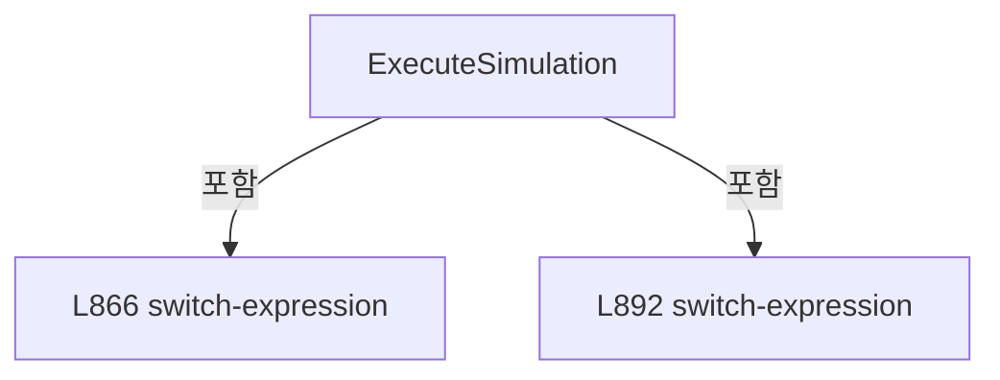

변경 전 점검: 입력/반환 타입, 위 호출자, 예외/취소 경로, 공유 상태와 저장·전송 소비자를 함께 확인합니다. 값의 단위나 물리 방향을 이름만으로 확정하지 않습니다.

### MethodDeclaration `ExecuteSimulationPositionMove` · L901–960

[Drilling.Common/Interface/PicoMotor/CPicoMotor.cs:901–960](https://github.com/kjuws10-rgb/A3Drilling/blob/5aee8e58439c9b455cae7c9593c9be986c3e682e/Drilling.Common/Interface/PicoMotor/CPicoMotor.cs#L901-L960)

| 항목 | 실제 추출 값 |
| --- | --- |
| 서명 | System.Threading.Tasks.Task Drilling.Common.Interface.CPicoMotorService.ExecuteSimulationPositionMove(int, Drilling.Common.Interface.EN_PICO_MOTOR_COMMAND, int, double, System.Threading.CancellationToken) |
| 접근/수식자 | Private / private, async |
| 반환/값 타입 | System.Threading.Tasks.Task |
| 소속 타입 | NamedType:Drilling.Common.Interface.CPicoMotorService |

입력 계약:

| 이름 | 타입 | 전달 | 선택/기본값 |
| --- | --- | --- | --- |
| number | int | None | False /  |
| command | Drilling.Common.Interface.EN_PICO_MOTOR_COMMAND | None | False /  |
| motorNo | int | None | False /  |
| parameter | double | None | False /  |
| cancellationToken | System.Threading.CancellationToken | None | False /  |

정적 호출자로 확인된 위치:

| 호출 파일/행 | 호출 표현식 | 런타임 분기 가능 |
| --- | --- | --- |
| [Drilling.Common/Interface/PicoMotor/CPicoMotor.cs:505–505](https://github.com/kjuws10-rgb/A3Drilling/blob/5aee8e58439c9b455cae7c9593c9be986c3e682e/Drilling.Common/Interface/PicoMotor/CPicoMotor.cs#L505-L505) | ExecuteSimulationPositionMove | False |

호출하는 대상과 해석 범위:

| 원본 행 | 표현식 | 분석 상태 | 대상/소스 위치 |
| --- | --- | --- | --- |
| 903 | CancelMotion | resolved | void Drilling.Common.Interface.CPicoMotorService.CancelMotion(int) · Drilling.Common/Interface/PicoMotor/CPicoMotor.cs:636 |
| 904 | CancellationTokenSource.CreateLinkedTokenSource | resolved | System.Threading.CancellationTokenSource System.Threading.CancellationTokenSource.CreateLinkedTokenSource(System.Threading.CancellationToken) |
| 912 | GetStatus | resolved | Drilling.Common.Interface.ST_PICO_MOTOR_STATUS Drilling.Common.Interface.CPicoMotorService.GetStatus(int) · Drilling.Common/Interface/PicoMotor/CPicoMotor.cs:416 |
| 913 | GetPosition | resolved | double Drilling.Common.Interface.CPicoMotorService.GetPosition(Drilling.Common.Interface.ST_PICO_MOTOR_STATUS, int) · Drilling.Common/Interface/PicoMotor/CPicoMotor.cs:984 |
| 916 | CPicoMotor.StepToMillimeter | resolved | double Drilling.Common.Interface.CPicoMotor.StepToMillimeter(long) · Drilling.Common/Interface/PicoMotor/CPicoMotor.cs:36 |
| 917 | Math.Abs | resolved | double System.Math.Abs(double) |
| 918 | Math.Abs | resolved | double System.Math.Abs(double) |
| 929 | linked.Token.ThrowIfCancellationRequested | resolved | void System.Threading.CancellationToken.ThrowIfCancellationRequested() |
| 930 | GetStatus | resolved | Drilling.Common.Interface.ST_PICO_MOTOR_STATUS Drilling.Common.Interface.CPicoMotorService.GetStatus(int) · Drilling.Common/Interface/PicoMotor/CPicoMotor.cs:416 |
| 931 | GetPosition | resolved | double Drilling.Common.Interface.CPicoMotorService.GetPosition(Drilling.Common.Interface.ST_PICO_MOTOR_STATUS, int) · Drilling.Common/Interface/PicoMotor/CPicoMotor.cs:984 |
| 933 | Math.Abs | resolved | double System.Math.Abs(double) |
| 935 | SetStatus | resolved | void Drilling.Common.Interface.CPicoMotorService.SetStatus(int, Drilling.Common.Interface.ST_PICO_MOTOR_STATUS) · Drilling.Common/Interface/PicoMotor/CPicoMotor.cs:978 |
| 935 | SetPosition | resolved | Drilling.Common.Interface.ST_PICO_MOTOR_STATUS Drilling.Common.Interface.CPicoMotorService.SetPosition(Drilling.Common.Interface.ST_PICO_MOTOR_STATUS, int, double) · Drilling.Common/Interface/PicoMotor/CPicoMotor.cs:995 |
| 939 | GetSimulationStepDistance | resolved | double Drilling.Common.Interface.CPicoMotorService.GetSimulationStepDistance(Drilling.Common.Interface.ST_PICO_MOTOR_STATUS) · Drilling.Common/Interface/PicoMotor/CPicoMotor.cs:749 |
| 940 | Math.Abs | resolved | double System.Math.Abs(double) |
| 940 | Math.Sign | resolved | int System.Math.Sign(double) |
| 941 | SetStatus | resolved | void Drilling.Common.Interface.CPicoMotorService.SetStatus(int, Drilling.Common.Interface.ST_PICO_MOTOR_STATUS) · Drilling.Common/Interface/PicoMotor/CPicoMotor.cs:978 |
| 941 | SetPosition | resolved | Drilling.Common.Interface.ST_PICO_MOTOR_STATUS Drilling.Common.Interface.CPicoMotorService.SetPosition(Drilling.Common.Interface.ST_PICO_MOTOR_STATUS, int, double) · Drilling.Common/Interface/PicoMotor/CPicoMotor.cs:995 |
| 942 | Task.Delay | resolved | System.Threading.Tasks.Task System.Threading.Tasks.Task.Delay(int, System.Threading.CancellationToken) |
| 947 | SetStatus | resolved | void Drilling.Common.Interface.CPicoMotorService.SetStatus(int, Drilling.Common.Interface.ST_PICO_MOTOR_STATUS) · Drilling.Common/Interface/PicoMotor/CPicoMotor.cs:978 |
| 947 | GetStatus | resolved | Drilling.Common.Interface.ST_PICO_MOTOR_STATUS Drilling.Common.Interface.CPicoMotorService.GetStatus(int) · Drilling.Common/Interface/PicoMotor/CPicoMotor.cs:416 |
| 953 | _motionTokens.TryGetValue | resolved | bool System.Collections.Generic.Dictionary<int, System.Threading.CancellationTokenSource>.TryGetValue(int, out System.Threading.CancellationTokenSource) |
| 953 | ReferenceEquals | resolved | bool object.ReferenceEquals(object?, object?) |
| 955 | _motionTokens.Remove | resolved | bool System.Collections.Generic.Dictionary<int, System.Threading.CancellationTokenSource>.Remove(int) |
| 956 | token.Dispose | resolved | void System.Threading.CancellationTokenSource.Dispose() |

본문의 실제 연산·분기·예외·반환 순서(원문 위치 순):

| 원본 행 | 종류 | 주석 해설 |
| --- | --- | --- |
| 903 | call | 함수·델리게이트 또는 객체 생성자를 호출합니다: CancelMotion(number) |
| 904 | call | 함수·델리게이트 또는 객체 생성자를 호출합니다: CancellationTokenSource.CreateLinkedTokenSource(cancellationToken) |
| 904 | local-declaration | 지역 변수를 선언합니다: var linked = CancellationTokenSource.CreateLinkedTokenSource(cancellationToken); |
| 904 | variable-initializer | 변수의 초기값을 지정합니다: linked = CancellationTokenSource.CreateLinkedTokenSource(cancellationToken) |
| 905 | lock | 공유 상태의 임계 구역에 진입합니다: lock (_syncRoot) |
| 907 | assignment | 값을 대상에 대입합니다: _motionTokens[number] = linked |
| 910 | try | 예외 처리 범위입니다: try |
| 912 | call | 함수·델리게이트 또는 객체 생성자를 호출합니다: GetStatus(number) |
| 912 | local-declaration | 지역 변수를 선언합니다: var status = GetStatus(number); |
| 912 | variable-initializer | 변수의 초기값을 지정합니다: status = GetStatus(number) |
| 913 | call | 함수·델리게이트 또는 객체 생성자를 호출합니다: GetPosition(status, motorNo) |
| 913 | local-declaration | 지역 변수를 선언합니다: var start = GetPosition(status, motorNo); |
| 913 | variable-initializer | 변수의 초기값을 지정합니다: start = GetPosition(status, motorNo) |
| 914 | local-declaration | 지역 변수를 선언합니다: var target = command switch { EN_PICO_MOTOR_COMMAND.Home => CPicoMotor.StepToMillimeter(status.HomePosition), EN_PICO_MOTOR_COMMAND.MoveRelativeNegative => start - Math.Abs(parameter), EN_PICO_MOTOR_COMMAND.MoveRelativePositive => |
| 914 | switch-expression | 값별 결과식을 선택합니다: command switch { EN_PICO_MOTOR_COMMAND.Home => CPicoMotor.StepToMillimeter(status.HomePosition), EN_PICO_MOTOR_COMMAND.MoveRelativeNegative => start - Math.Abs(parameter), EN_PICO_MOTOR_COMMAND.MoveRelativePositive => start + Math |
| 914 | variable-initializer | 변수의 초기값을 지정합니다: target = command switch { EN_PICO_MOTOR_COMMAND.Home => CPicoMotor.StepToMillimeter(status.HomePosition), EN_PICO_MOTOR_COMMAND.MoveRelativeNegative => start - Math.Abs(parameter), EN_PICO_MOTOR_COMMAND.MoveRelativePositive => sta |
| 916 | call | 함수·델리게이트 또는 객체 생성자를 호출합니다: CPicoMotor.StepToMillimeter(status.HomePosition) |
| 917 | call | 함수·델리게이트 또는 객체 생성자를 호출합니다: Math.Abs(parameter) |
| 918 | call | 함수·델리게이트 또는 객체 생성자를 호출합니다: Math.Abs(parameter) |
| 921 | local-declaration | 지역 변수를 선언합니다: var motionState = command switch { EN_PICO_MOTOR_COMMAND.Home => "HOME", EN_PICO_MOTOR_COMMAND.MoveAbsolute => "ABS MOVE", _ => "REL MOVE" }; |
| 921 | switch-expression | 값별 결과식을 선택합니다: command switch { EN_PICO_MOTOR_COMMAND.Home => "HOME", EN_PICO_MOTOR_COMMAND.MoveAbsolute => "ABS MOVE", _ => "REL MOVE" } |
| 921 | variable-initializer | 변수의 초기값을 지정합니다: motionState = command switch { EN_PICO_MOTOR_COMMAND.Home => "HOME", EN_PICO_MOTOR_COMMAND.MoveAbsolute => "ABS MOVE", _ => "REL MOVE" } |
| 927 | while | 조건을 먼저 확인하며 반복합니다: while (true) |
| 929 | call | 함수·델리게이트 또는 객체 생성자를 호출합니다: linked.Token.ThrowIfCancellationRequested() |
| 930 | assignment | 값을 대상에 대입합니다: status = GetStatus(number) |
| 930 | call | 함수·델리게이트 또는 객체 생성자를 호출합니다: GetStatus(number) |
| 931 | call | 함수·델리게이트 또는 객체 생성자를 호출합니다: GetPosition(status, motorNo) |
| 931 | local-declaration | 지역 변수를 선언합니다: var current = GetPosition(status, motorNo); |
| 931 | variable-initializer | 변수의 초기값을 지정합니다: current = GetPosition(status, motorNo) |
| 932 | local-declaration | 지역 변수를 선언합니다: var distance = target - current; |
| 932 | variable-initializer | 변수의 초기값을 지정합니다: distance = target - current |
| 933 | call | 함수·델리게이트 또는 객체 생성자를 호출합니다: Math.Abs(distance) |
| 933 | if | 조건에 따라 분기합니다: if (Math.Abs(distance) <= 0.000001) |
| 935 | assignment | 값을 대상에 대입합니다: SelectedMotorNo = motorNo |
| 935 | assignment | 값을 대상에 대입합니다: MotionState = "IDLE" |
| 935 | assignment | 값을 대상에 대입합니다: UpdatedAt = DateTimeOffset.Now |
| 935 | call | 함수·델리게이트 또는 객체 생성자를 호출합니다: SetStatus(number, SetPosition(status, motorNo, target)with { SelectedMotorNo = motorNo, MotionState = "IDLE", UpdatedAt = DateTimeOffset.Now }) |
| 935 | call | 함수·델리게이트 또는 객체 생성자를 호출합니다: SetPosition(status, motorNo, target) |
| 936 | return | 호출자에게 값 또는 제어를 반환합니다: return; |
| 939 | call | 함수·델리게이트 또는 객체 생성자를 호출합니다: GetSimulationStepDistance(status) |
| 939 | local-declaration | 지역 변수를 선언합니다: var stepDistance = GetSimulationStepDistance(status); |
| 939 | variable-initializer | 변수의 초기값을 지정합니다: stepDistance = GetSimulationStepDistance(status) |
| 940 | call | 함수·델리게이트 또는 객체 생성자를 호출합니다: Math.Abs(distance) |
| 940 | call | 함수·델리게이트 또는 객체 생성자를 호출합니다: Math.Sign(distance) |
| 940 | conditional-expression | 조건에 따라 결과식을 선택합니다: Math.Abs(distance) <= stepDistance ? target : current + (Math.Sign(distance) * stepDistance) |
| 940 | local-declaration | 지역 변수를 선언합니다: var position = Math.Abs(distance) <= stepDistance ? target : current + (Math.Sign(distance) * stepDistance); |
| 940 | variable-initializer | 변수의 초기값을 지정합니다: position = Math.Abs(distance) <= stepDistance ? target : current + (Math.Sign(distance) * stepDistance) |
| 941 | assignment | 값을 대상에 대입합니다: SelectedMotorNo = motorNo |
| 941 | assignment | 값을 대상에 대입합니다: MotionState = motionState |
| 941 | assignment | 값을 대상에 대입합니다: CommOk = true |
| 941 | assignment | 값을 대상에 대입합니다: UpdatedAt = DateTimeOffset.Now |
| 941 | call | 함수·델리게이트 또는 객체 생성자를 호출합니다: SetStatus(number, SetPosition(status, motorNo, position)with { SelectedMotorNo = motorNo, MotionState = motionState, CommOk = true, UpdatedAt = DateTimeOffset.Now }) |
| 941 | call | 함수·델리게이트 또는 객체 생성자를 호출합니다: SetPosition(status, motorNo, position) |
| 942 | await | 비동기 완료를 기다립니다: await Task.Delay(SimulationIntervalMs, linked.Token) |
| 942 | call | 함수·델리게이트 또는 객체 생성자를 호출합니다: Task.Delay(SimulationIntervalMs, linked.Token) |
| 945 | catch | 지정 예외를 처리합니다: catch (OperationCanceledException) when (!cancellationToken.IsCancellationRequested) |
| 947 | assignment | 값을 대상에 대입합니다: MotionState = "IDLE" |
| 947 | assignment | 값을 대상에 대입합니다: UpdatedAt = DateTimeOffset.Now |
| 947 | call | 함수·델리게이트 또는 객체 생성자를 호출합니다: SetStatus(number, GetStatus(number)with { MotionState = "IDLE", UpdatedAt = DateTimeOffset.Now }) |
| 947 | call | 함수·델리게이트 또는 객체 생성자를 호출합니다: GetStatus(number) |
| 949 | finally | 종료 정리 구간입니다: finally |
| 951 | lock | 공유 상태의 임계 구역에 진입합니다: lock (_syncRoot) |
| 953 | call | 함수·델리게이트 또는 객체 생성자를 호출합니다: _motionTokens.TryGetValue(number, out var token) |
| 953 | call | 함수·델리게이트 또는 객체 생성자를 호출합니다: ReferenceEquals(token, linked) |
| 953 | if | 조건에 따라 분기합니다: if (_motionTokens.TryGetValue(number, out var token) && ReferenceEquals(token, linked)) |
| 955 | call | 함수·델리게이트 또는 객체 생성자를 호출합니다: _motionTokens.Remove(number) |
| 956 | call | 함수·델리게이트 또는 객체 생성자를 호출합니다: token.Dispose() |

제어 구문의 포함 구조(실제 실행 순서/CFG가 아닌 구문 탐색 그림):

```mermaid
flowchart TD
 M["ExecuteSimulationPositionMove"]
 N0["L905 lock"]
 M -->|포함| N0
 N1["L910 try"]
 M -->|포함| N1
 N2["L914 switch-expression"]
 N1 -->|포함| N2
 N3["L921 switch-expression"]
 N1 -->|포함| N3
 N4["L927 while"]
 N1 -->|포함| N4
 N5["L933 if"]
 N4 -->|포함| N5
 N6["L945 catch"]
 N1 -->|포함| N6
 N7["L949 finally"]
 N1 -->|포함| N7
 N8["L951 lock"]
 N7 -->|포함| N8
 N9["L953 if"]
 N8 -->|포함| N9
```

변경 전 점검: 입력/반환 타입, 위 호출자, 예외/취소 경로, 공유 상태와 저장·전송 소비자를 함께 확인합니다. 값의 단위나 물리 방향을 이름만으로 확정하지 않습니다.

### MethodDeclaration `GetSession` · L962–976

[Drilling.Common/Interface/PicoMotor/CPicoMotor.cs:962–976](https://github.com/kjuws10-rgb/A3Drilling/blob/5aee8e58439c9b455cae7c9593c9be986c3e682e/Drilling.Common/Interface/PicoMotor/CPicoMotor.cs#L962-L976)

| 항목 | 실제 추출 값 |
| --- | --- |
| 서명 | Drilling.Common.Interface.CPicoMotorCommandSession Drilling.Common.Interface.CPicoMotorService.GetSession(int, bool) |
| 접근/수식자 | Private / private |
| 반환/값 타입 | Drilling.Common.Interface.CPicoMotorCommandSession |
| 소속 타입 | NamedType:Drilling.Common.Interface.CPicoMotorService |

입력 계약:

| 이름 | 타입 | 전달 | 선택/기본값 |
| --- | --- | --- | --- |
| number | int | None | False /  |
| requireConnected | bool | None | False /  |

정적 호출자로 확인된 위치:

| 호출 파일/행 | 호출 표현식 | 런타임 분기 가능 |
| --- | --- | --- |
| [Drilling.Common/Interface/PicoMotor/CPicoMotor.cs:438–438](https://github.com/kjuws10-rgb/A3Drilling/blob/5aee8e58439c9b455cae7c9593c9be986c3e682e/Drilling.Common/Interface/PicoMotor/CPicoMotor.cs#L438-L438) | GetSession | False |
| [Drilling.Common/Interface/PicoMotor/CPicoMotor.cs:583–583](https://github.com/kjuws10-rgb/A3Drilling/blob/5aee8e58439c9b455cae7c9593c9be986c3e682e/Drilling.Common/Interface/PicoMotor/CPicoMotor.cs#L583-L583) | GetSession | False |
| [Drilling.Common/Interface/PicoMotor/CPicoMotor.cs:794–794](https://github.com/kjuws10-rgb/A3Drilling/blob/5aee8e58439c9b455cae7c9593c9be986c3e682e/Drilling.Common/Interface/PicoMotor/CPicoMotor.cs#L794-L794) | GetSession | False |
| [Drilling.Common/Interface/PicoMotor/CPicoMotor.cs:809–809](https://github.com/kjuws10-rgb/A3Drilling/blob/5aee8e58439c9b455cae7c9593c9be986c3e682e/Drilling.Common/Interface/PicoMotor/CPicoMotor.cs#L809-L809) | GetSession | False |

호출하는 대상과 해석 범위:

| 원본 행 | 표현식 | 분석 상태 | 대상/소스 위치 |
| --- | --- | --- | --- |
| 966 | _sessions.TryGetValue | resolved | bool System.Collections.Generic.Dictionary<int, Drilling.Common.Interface.CPicoMotorCommandSession>.TryGetValue(int, out Drilling.Common.Interface.CPicoMotorCommandSession) |
| 968 | new CPicoMotorCommandSession | resolved | Drilling.Common.Interface.CPicoMotorCommandSession.CPicoMotorCommandSession() · Drilling.Common/Interface/PicoMotor/CPicoMotor.cs:126 |
| 973 | new InvalidOperationException | resolved | System.InvalidOperationException.InvalidOperationException(string?) |

본문의 실제 연산·분기·예외·반환 순서(원문 위치 순):

| 원본 행 | 종류 | 주석 해설 |
| --- | --- | --- |
| 964 | lock | 공유 상태의 임계 구역에 진입합니다: lock (_syncRoot) |
| 966 | call | 함수·델리게이트 또는 객체 생성자를 호출합니다: _sessions.TryGetValue(number, out var session) |
| 966 | if | 조건에 따라 분기합니다: if (!_sessions.TryGetValue(number, out var session)) |
| 968 | assignment | 값을 대상에 대입합니다: session = new CPicoMotorCommandSession() |
| 968 | call | 함수·델리게이트 또는 객체 생성자를 호출합니다: new CPicoMotorCommandSession() |
| 969 | assignment | 값을 대상에 대입합니다: _sessions[number] = session |
| 972 | if | 조건에 따라 분기합니다: if (requireConnected && !session.IsConnected) |
| 973 | call | 함수·델리게이트 또는 객체 생성자를 호출합니다: new InvalidOperationException("PicoMotor is not connected.") |
| 973 | throw | 예외를 발생/전달합니다: throw new InvalidOperationException("PicoMotor is not connected."); |
| 974 | return | 호출자에게 값 또는 제어를 반환합니다: return session; |

제어 구문의 포함 구조(실제 실행 순서/CFG가 아닌 구문 탐색 그림):

```mermaid
flowchart TD
 M["GetSession"]
 N0["L964 lock"]
 M -->|포함| N0
 N1["L966 if"]
 N0 -->|포함| N1
 N2["L972 if"]
 N0 -->|포함| N2
```

변경 전 점검: 입력/반환 타입, 위 호출자, 예외/취소 경로, 공유 상태와 저장·전송 소비자를 함께 확인합니다. 값의 단위나 물리 방향을 이름만으로 확정하지 않습니다.

### MethodDeclaration `SetStatus` · L978–982

[Drilling.Common/Interface/PicoMotor/CPicoMotor.cs:978–982](https://github.com/kjuws10-rgb/A3Drilling/blob/5aee8e58439c9b455cae7c9593c9be986c3e682e/Drilling.Common/Interface/PicoMotor/CPicoMotor.cs#L978-L982)

| 항목 | 실제 추출 값 |
| --- | --- |
| 서명 | void Drilling.Common.Interface.CPicoMotorService.SetStatus(int, Drilling.Common.Interface.ST_PICO_MOTOR_STATUS) |
| 접근/수식자 | Private / private |
| 반환/값 타입 | void |
| 소속 타입 | NamedType:Drilling.Common.Interface.CPicoMotorService |

입력 계약:

| 이름 | 타입 | 전달 | 선택/기본값 |
| --- | --- | --- | --- |
| number | int | None | False /  |
| status | Drilling.Common.Interface.ST_PICO_MOTOR_STATUS | None | False /  |

정적 호출자로 확인된 위치:

| 호출 파일/행 | 호출 표현식 | 런타임 분기 가능 |
| --- | --- | --- |
| [Drilling.Common/Interface/PicoMotor/CPicoMotor.cs:460–460](https://github.com/kjuws10-rgb/A3Drilling/blob/5aee8e58439c9b455cae7c9593c9be986c3e682e/Drilling.Common/Interface/PicoMotor/CPicoMotor.cs#L460-L460) | SetStatus | False |
| [Drilling.Common/Interface/PicoMotor/CPicoMotor.cs:524–524](https://github.com/kjuws10-rgb/A3Drilling/blob/5aee8e58439c9b455cae7c9593c9be986c3e682e/Drilling.Common/Interface/PicoMotor/CPicoMotor.cs#L524-L524) | SetStatus | False |
| [Drilling.Common/Interface/PicoMotor/CPicoMotor.cs:571–571](https://github.com/kjuws10-rgb/A3Drilling/blob/5aee8e58439c9b455cae7c9593c9be986c3e682e/Drilling.Common/Interface/PicoMotor/CPicoMotor.cs#L571-L571) | SetStatus | False |
| [Drilling.Common/Interface/PicoMotor/CPicoMotor.cs:599–599](https://github.com/kjuws10-rgb/A3Drilling/blob/5aee8e58439c9b455cae7c9593c9be986c3e682e/Drilling.Common/Interface/PicoMotor/CPicoMotor.cs#L599-L599) | SetStatus | False |
| [Drilling.Common/Interface/PicoMotor/CPicoMotor.cs:606–606](https://github.com/kjuws10-rgb/A3Drilling/blob/5aee8e58439c9b455cae7c9593c9be986c3e682e/Drilling.Common/Interface/PicoMotor/CPicoMotor.cs#L606-L606) | SetStatus | False |
| [Drilling.Common/Interface/PicoMotor/CPicoMotor.cs:611–611](https://github.com/kjuws10-rgb/A3Drilling/blob/5aee8e58439c9b455cae7c9593c9be986c3e682e/Drilling.Common/Interface/PicoMotor/CPicoMotor.cs#L611-L611) | SetStatus | False |
| [Drilling.Common/Interface/PicoMotor/CPicoMotor.cs:713–713](https://github.com/kjuws10-rgb/A3Drilling/blob/5aee8e58439c9b455cae7c9593c9be986c3e682e/Drilling.Common/Interface/PicoMotor/CPicoMotor.cs#L713-L713) | SetStatus | False |
| [Drilling.Common/Interface/PicoMotor/CPicoMotor.cs:797–797](https://github.com/kjuws10-rgb/A3Drilling/blob/5aee8e58439c9b455cae7c9593c9be986c3e682e/Drilling.Common/Interface/PicoMotor/CPicoMotor.cs#L797-L797) | SetStatus | False |
| [Drilling.Common/Interface/PicoMotor/CPicoMotor.cs:805–805](https://github.com/kjuws10-rgb/A3Drilling/blob/5aee8e58439c9b455cae7c9593c9be986c3e682e/Drilling.Common/Interface/PicoMotor/CPicoMotor.cs#L805-L805) | SetStatus | False |
| [Drilling.Common/Interface/PicoMotor/CPicoMotor.cs:851–859](https://github.com/kjuws10-rgb/A3Drilling/blob/5aee8e58439c9b455cae7c9593c9be986c3e682e/Drilling.Common/Interface/PicoMotor/CPicoMotor.cs#L851-L859) | SetStatus | False |
| [Drilling.Common/Interface/PicoMotor/CPicoMotor.cs:898–898](https://github.com/kjuws10-rgb/A3Drilling/blob/5aee8e58439c9b455cae7c9593c9be986c3e682e/Drilling.Common/Interface/PicoMotor/CPicoMotor.cs#L898-L898) | SetStatus | False |
| [Drilling.Common/Interface/PicoMotor/CPicoMotor.cs:935–935](https://github.com/kjuws10-rgb/A3Drilling/blob/5aee8e58439c9b455cae7c9593c9be986c3e682e/Drilling.Common/Interface/PicoMotor/CPicoMotor.cs#L935-L935) | SetStatus | False |
| [Drilling.Common/Interface/PicoMotor/CPicoMotor.cs:941–941](https://github.com/kjuws10-rgb/A3Drilling/blob/5aee8e58439c9b455cae7c9593c9be986c3e682e/Drilling.Common/Interface/PicoMotor/CPicoMotor.cs#L941-L941) | SetStatus | False |
| [Drilling.Common/Interface/PicoMotor/CPicoMotor.cs:947–947](https://github.com/kjuws10-rgb/A3Drilling/blob/5aee8e58439c9b455cae7c9593c9be986c3e682e/Drilling.Common/Interface/PicoMotor/CPicoMotor.cs#L947-L947) | SetStatus | False |

본문의 실제 연산·분기·예외·반환 순서(원문 위치 순):

| 원본 행 | 종류 | 주석 해설 |
| --- | --- | --- |
| 980 | lock | 공유 상태의 임계 구역에 진입합니다: lock (_syncRoot) |
| 981 | assignment | 값을 대상에 대입합니다: _statuses[number] = status |

제어 구문의 포함 구조(실제 실행 순서/CFG가 아닌 구문 탐색 그림):

```mermaid
flowchart TD
 M["SetStatus"]
 N0["L980 lock"]
 M -->|포함| N0
```

변경 전 점검: 입력/반환 타입, 위 호출자, 예외/취소 경로, 공유 상태와 저장·전송 소비자를 함께 확인합니다. 값의 단위나 물리 방향을 이름만으로 확정하지 않습니다.

### MethodDeclaration `GetPosition` · L984–993

[Drilling.Common/Interface/PicoMotor/CPicoMotor.cs:984–993](https://github.com/kjuws10-rgb/A3Drilling/blob/5aee8e58439c9b455cae7c9593c9be986c3e682e/Drilling.Common/Interface/PicoMotor/CPicoMotor.cs#L984-L993)

| 항목 | 실제 추출 값 |
| --- | --- |
| 서명 | double Drilling.Common.Interface.CPicoMotorService.GetPosition(Drilling.Common.Interface.ST_PICO_MOTOR_STATUS, int) |
| 접근/수식자 | Private / private, static |
| 반환/값 타입 | double |
| 소속 타입 | NamedType:Drilling.Common.Interface.CPicoMotorService |

입력 계약:

| 이름 | 타입 | 전달 | 선택/기본값 |
| --- | --- | --- | --- |
| status | Drilling.Common.Interface.ST_PICO_MOTOR_STATUS | None | False /  |
| motorNo | int | None | False /  |

정적 호출자로 확인된 위치:

| 호출 파일/행 | 호출 표현식 | 런타임 분기 가능 |
| --- | --- | --- |
| [Drilling.Common/Interface/PicoMotor/CPicoMotor.cs:687–687](https://github.com/kjuws10-rgb/A3Drilling/blob/5aee8e58439c9b455cae7c9593c9be986c3e682e/Drilling.Common/Interface/PicoMotor/CPicoMotor.cs#L687-L687) | GetPosition | False |
| [Drilling.Common/Interface/PicoMotor/CPicoMotor.cs:700–700](https://github.com/kjuws10-rgb/A3Drilling/blob/5aee8e58439c9b455cae7c9593c9be986c3e682e/Drilling.Common/Interface/PicoMotor/CPicoMotor.cs#L700-L700) | GetPosition | False |
| [Drilling.Common/Interface/PicoMotor/CPicoMotor.cs:865–865](https://github.com/kjuws10-rgb/A3Drilling/blob/5aee8e58439c9b455cae7c9593c9be986c3e682e/Drilling.Common/Interface/PicoMotor/CPicoMotor.cs#L865-L865) | GetPosition | False |
| [Drilling.Common/Interface/PicoMotor/CPicoMotor.cs:913–913](https://github.com/kjuws10-rgb/A3Drilling/blob/5aee8e58439c9b455cae7c9593c9be986c3e682e/Drilling.Common/Interface/PicoMotor/CPicoMotor.cs#L913-L913) | GetPosition | False |
| [Drilling.Common/Interface/PicoMotor/CPicoMotor.cs:931–931](https://github.com/kjuws10-rgb/A3Drilling/blob/5aee8e58439c9b455cae7c9593c9be986c3e682e/Drilling.Common/Interface/PicoMotor/CPicoMotor.cs#L931-L931) | GetPosition | False |

본문의 실제 연산·분기·예외·반환 순서(원문 위치 순):

| 원본 행 | 종류 | 주석 해설 |
| --- | --- | --- |
| 986 | return | 호출자에게 값 또는 제어를 반환합니다: return motorNo switch { 1 => status.Motor1Position, 2 => status.Motor2Position, 3 => status.Motor3Position, _ => status.Motor4Position }; |
| 986 | switch-expression | 값별 결과식을 선택합니다: motorNo switch { 1 => status.Motor1Position, 2 => status.Motor2Position, 3 => status.Motor3Position, _ => status.Motor4Position } |

제어 구문의 포함 구조(실제 실행 순서/CFG가 아닌 구문 탐색 그림):

```mermaid
flowchart TD
 M["GetPosition"]
 N0["L986 switch-expression"]
 M -->|포함| N0
```

변경 전 점검: 입력/반환 타입, 위 호출자, 예외/취소 경로, 공유 상태와 저장·전송 소비자를 함께 확인합니다. 값의 단위나 물리 방향을 이름만으로 확정하지 않습니다.

### MethodDeclaration `SetPosition` · L995–1016

[Drilling.Common/Interface/PicoMotor/CPicoMotor.cs:995–1016](https://github.com/kjuws10-rgb/A3Drilling/blob/5aee8e58439c9b455cae7c9593c9be986c3e682e/Drilling.Common/Interface/PicoMotor/CPicoMotor.cs#L995-L1016)

| 항목 | 실제 추출 값 |
| --- | --- |
| 서명 | Drilling.Common.Interface.ST_PICO_MOTOR_STATUS Drilling.Common.Interface.CPicoMotorService.SetPosition(Drilling.Common.Interface.ST_PICO_MOTOR_STATUS, int, double) |
| 접근/수식자 | Private / private, static |
| 반환/값 타입 | Drilling.Common.Interface.ST_PICO_MOTOR_STATUS |
| 소속 타입 | NamedType:Drilling.Common.Interface.CPicoMotorService |

입력 계약:

| 이름 | 타입 | 전달 | 선택/기본값 |
| --- | --- | --- | --- |
| status | Drilling.Common.Interface.ST_PICO_MOTOR_STATUS | None | False /  |
| motorNo | int | None | False /  |
| value | double | None | False /  |

정적 호출자로 확인된 위치:

| 호출 파일/행 | 호출 표현식 | 런타임 분기 가능 |
| --- | --- | --- |
| [Drilling.Common/Interface/PicoMotor/CPicoMotor.cs:704–704](https://github.com/kjuws10-rgb/A3Drilling/blob/5aee8e58439c9b455cae7c9593c9be986c3e682e/Drilling.Common/Interface/PicoMotor/CPicoMotor.cs#L704-L704) | SetPosition | False |
| [Drilling.Common/Interface/PicoMotor/CPicoMotor.cs:710–710](https://github.com/kjuws10-rgb/A3Drilling/blob/5aee8e58439c9b455cae7c9593c9be986c3e682e/Drilling.Common/Interface/PicoMotor/CPicoMotor.cs#L710-L710) | SetPosition | False |
| [Drilling.Common/Interface/PicoMotor/CPicoMotor.cs:884–884](https://github.com/kjuws10-rgb/A3Drilling/blob/5aee8e58439c9b455cae7c9593c9be986c3e682e/Drilling.Common/Interface/PicoMotor/CPicoMotor.cs#L884-L884) | SetPosition | False |
| [Drilling.Common/Interface/PicoMotor/CPicoMotor.cs:885–885](https://github.com/kjuws10-rgb/A3Drilling/blob/5aee8e58439c9b455cae7c9593c9be986c3e682e/Drilling.Common/Interface/PicoMotor/CPicoMotor.cs#L885-L885) | SetPosition | False |
| [Drilling.Common/Interface/PicoMotor/CPicoMotor.cs:886–886](https://github.com/kjuws10-rgb/A3Drilling/blob/5aee8e58439c9b455cae7c9593c9be986c3e682e/Drilling.Common/Interface/PicoMotor/CPicoMotor.cs#L886-L886) | SetPosition | False |
| [Drilling.Common/Interface/PicoMotor/CPicoMotor.cs:887–887](https://github.com/kjuws10-rgb/A3Drilling/blob/5aee8e58439c9b455cae7c9593c9be986c3e682e/Drilling.Common/Interface/PicoMotor/CPicoMotor.cs#L887-L887) | SetPosition | False |
| [Drilling.Common/Interface/PicoMotor/CPicoMotor.cs:888–888](https://github.com/kjuws10-rgb/A3Drilling/blob/5aee8e58439c9b455cae7c9593c9be986c3e682e/Drilling.Common/Interface/PicoMotor/CPicoMotor.cs#L888-L888) | SetPosition | False |
| [Drilling.Common/Interface/PicoMotor/CPicoMotor.cs:889–889](https://github.com/kjuws10-rgb/A3Drilling/blob/5aee8e58439c9b455cae7c9593c9be986c3e682e/Drilling.Common/Interface/PicoMotor/CPicoMotor.cs#L889-L889) | SetPosition | False |
| [Drilling.Common/Interface/PicoMotor/CPicoMotor.cs:935–935](https://github.com/kjuws10-rgb/A3Drilling/blob/5aee8e58439c9b455cae7c9593c9be986c3e682e/Drilling.Common/Interface/PicoMotor/CPicoMotor.cs#L935-L935) | SetPosition | False |
| [Drilling.Common/Interface/PicoMotor/CPicoMotor.cs:941–941](https://github.com/kjuws10-rgb/A3Drilling/blob/5aee8e58439c9b455cae7c9593c9be986c3e682e/Drilling.Common/Interface/PicoMotor/CPicoMotor.cs#L941-L941) | SetPosition | False |

본문의 실제 연산·분기·예외·반환 순서(원문 위치 순):

| 원본 행 | 종류 | 주석 해설 |
| --- | --- | --- |
| 997 | return | 호출자에게 값 또는 제어를 반환합니다: return motorNo switch { 1 => status with { Motor1Position = value }, 2 => status with { Motor2Position = value }, 3 => status with { Motor3Position = value }, _ => status with { Motor4Position = value } }; |
| 997 | switch-expression | 값별 결과식을 선택합니다: motorNo switch { 1 => status with { Motor1Position = value }, 2 => status with { Motor2Position = value }, 3 => status with { Motor3Position = value }, _ => status with { Motor4Position = value } } |
| 1001 | assignment | 값을 대상에 대입합니다: Motor1Position = value |
| 1005 | assignment | 값을 대상에 대입합니다: Motor2Position = value |
| 1009 | assignment | 값을 대상에 대입합니다: Motor3Position = value |
| 1013 | assignment | 값을 대상에 대입합니다: Motor4Position = value |

제어 구문의 포함 구조(실제 실행 순서/CFG가 아닌 구문 탐색 그림):

```mermaid
flowchart TD
 M["SetPosition"]
 N0["L997 switch-expression"]
 M -->|포함| N0
```

변경 전 점검: 입력/반환 타입, 위 호출자, 예외/취소 경로, 공유 상태와 저장·전송 소비자를 함께 확인합니다. 값의 단위나 물리 방향을 이름만으로 확정하지 않습니다.

## 구문·바인딩 한계

전체 WPF/벤더 SDK/프로젝트별 빌드 조건을 로드한 정식 빌드가 아닙니다. `resolved`는 이 부분 컴파일에서의 심볼 연결이며 virtual/interface/delegate/이벤트/Reflection/XAML의 실제 런타임 구현을 확정하지 않습니다. `candidate`와 `unresolved`는 후속 확인 대상으로 남깁니다.

## 원문 전체 주석 해설본

[원본 모든 행과 행별 해설 보기](../../../../annotated/Drilling.Common/Interface/PicoMotor/CPicoMotor.cs.annotated.txt)

원본을 빠뜨리거나 임의로 줄이지 않았습니다. `L000001 |` 표시는 원본 행 번호, `// 해설`은 별도 설명입니다. 실행용 소스가 아닌 문서입니다.

## 수정·재검증 체크

- 원본 Commit과 현재 작업 파일 SHA가 같은지 먼저 확인합니다. 다르면 이 문서를 과거 버전 자료로 취급합니다.
- 선언·직접 호출·이벤트/인터페이스 경계·설정 소비를 함께 확인합니다. 정적 연결의 빈 곳을 정상 경로로 추정하지 않습니다.
- 저장 형식/단위/식별자·재시도·취소·예외·롤백에 영향을 주는 변경은 상세 해설장과 호출자를 다시 검토합니다.
- 도구의 구문 추출과 별도 정적 추적 해설, 실제 빌드·시뮬레이션·실장비 검증 결과를 분리합니다.
