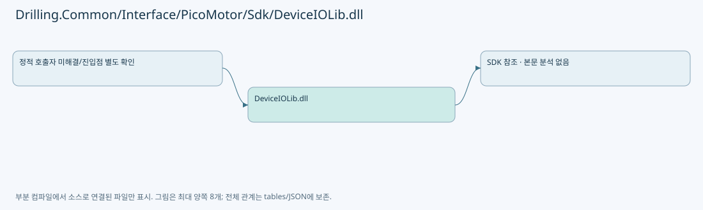

# Drilling.Common/Interface/PicoMotor/Sdk/DeviceIOLib.dll

| 항목 | 내용 |
| --- | --- |
| 원본 저장소 | https://github.com/kjuws10-rgb/A3Drilling.git |
| 원본 Commit | 5aee8e58439c9b455cae7c9593c9be986c3e682e |
| 원본 SHA256 | 72df5040237bf68c369fad26620f288dec9d6591fb77811f83faccc152d6ce8f |
| 파일 분류 | binary_reference |
| 원본 크기/행 | 79,872 bytes / 0 physical lines |
| 인코딩 | binary |
| 검토 범위 | 구문/부분 의미 분석에서 추출한 사실. 동작·물리 단위·실장비 합격을 보증하지 않습니다. |
| 원본 링크 | [고정 Commit 원본](https://github.com/kjuws10-rgb/A3Drilling/blob/5aee8e58439c9b455cae7c9593c9be986c3e682e/Drilling.Common/Interface/PicoMotor/Sdk/DeviceIOLib.dll) |

## 파일의 역할과 읽는 순서

외부 통신과 장치 인터페이스를 연결합니다. 요청 생성·전송·수신·장치 실행을 같은 의미로 합치지 않습니다.

## 바이너리 참조 범위

SDK DLL은 파일명·Git 경로·크기·해시만 기록합니다. 본문을 텍스트 색인·실행·역컴파일하지 않았고 API 계약은 호출하는 C# 래퍼나 공급사 문서에서 확인해야 합니다. DLL이 있다는 사실과 드라이버 연결·동작 성공은 별개입니다.

## 수정·재검증 체크

- 원본 Commit과 현재 작업 파일 SHA가 같은지 먼저 확인합니다. 다르면 이 문서를 과거 버전 자료로 취급합니다.
- 선언·직접 호출·이벤트/인터페이스 경계·설정 소비를 함께 확인합니다. 정적 연결의 빈 곳을 정상 경로로 추정하지 않습니다.
- 저장 형식/단위/식별자·재시도·취소·예외·롤백에 영향을 주는 변경은 상세 해설장과 호출자를 다시 검토합니다.
- 도구의 구문 추출과 별도 정적 추적 해설, 실제 빌드·시뮬레이션·실장비 검증 결과를 분리합니다.
