# Drilling.Common/Interface/Serial/CBeamExpander.cs

| 항목 | 내용 |
| --- | --- |
| 원본 저장소 | https://github.com/kjuws10-rgb/A3Drilling.git |
| 원본 Commit | 5aee8e58439c9b455cae7c9593c9be986c3e682e |
| 원본 SHA256 | 03863c21ee7090c376d28f5692562f60e13eaf9efa617f9f5964a87158246346 |
| 파일 분류 | code |
| 원본 크기/행 | 16,548 bytes / 475 physical lines |
| 인코딩 | utf-8-sig |
| 검토 범위 | 구문/부분 의미 분석에서 추출한 사실. 동작·물리 단위·실장비 합격을 보증하지 않습니다. |
| 원본 링크 | [고정 Commit 원본](https://github.com/kjuws10-rgb/A3Drilling/blob/5aee8e58439c9b455cae7c9593c9be986c3e682e/Drilling.Common/Interface/Serial/CBeamExpander.cs) |

## 파일의 역할과 읽는 순서

외부 통신과 장치 인터페이스를 연결합니다. 요청 생성·전송·수신·장치 실행을 같은 의미로 합치지 않습니다.

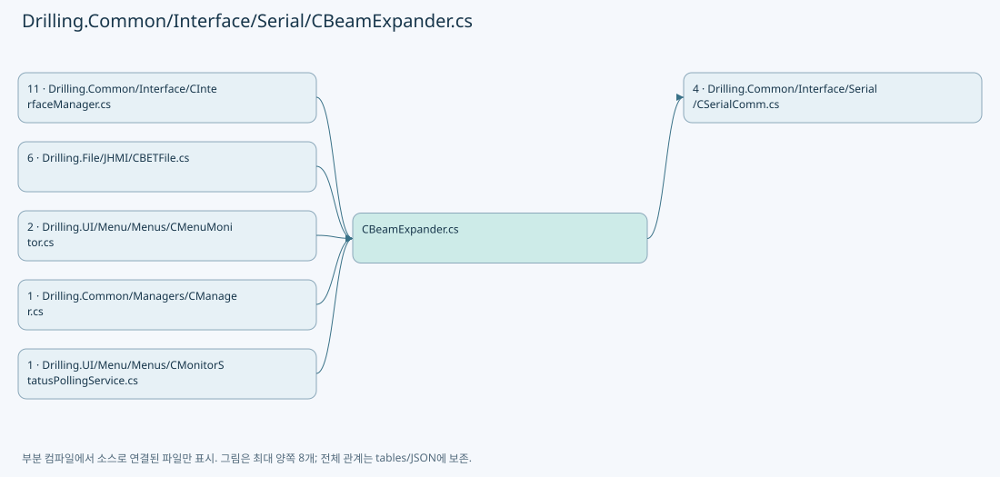

## 네임스페이스·타입·상속

| 타입 | 구분 | 원본 범위 | 선언/상속 |
| --- | --- | --- | --- |
| CBeamExpander | ClassDeclaration | 12–424 | CBeamExpander: CSerialComm(data, option) |
| EN_BET_COMMAND | EnumDeclaration | 426–438 | EN_BET_COMMAND |
| EN_BET_ERROR | EnumDeclaration | 440–447 | EN_BET_ERROR |
| ST_BET_STATUS | RecordDeclaration | 449–464 | ST_BET_STATUS |
| ST_BET_TABLE_DATA | RecordDeclaration | 465–475 | ST_BET_TABLE_DATA |

## 멤버 빠른 목록

| 이름 | 종류 | 범위 | 서명 |
| --- | --- | --- | --- |
| ResponseQuietTimeoutMs | FieldDeclaration | L16–16 | int Drilling.Common.Interface.CBeamExpander.ResponseQuietTimeoutMs |
| ResponsePollIntervalMs | FieldDeclaration | L17–17 | int Drilling.Common.Interface.CBeamExpander.ResponsePollIntervalMs |
| MaxResponseLength | FieldDeclaration | L18–18 | int Drilling.Common.Interface.CBeamExpander.MaxResponseLength |
| Build | MethodDeclaration | L19–33 | string Drilling.Common.Interface.CBeamExpander.Build(Drilling.Common.Interface.EN_BET_COMMAND, double, double) |
| BuildLogText | MethodDeclaration | L35–43 | string Drilling.Common.Interface.CBeamExpander.BuildLogText(Drilling.Common.Interface.EN_BET_COMMAND, double, double) |
| IsSuccessResponse | MethodDeclaration | L45–48 | bool Drilling.Common.Interface.CBeamExpander.IsSuccessResponse(string) |
| Apply | MethodDeclaration | L50–129 | Drilling.Common.Interface.ST_BET_STATUS Drilling.Common.Interface.CBeamExpander.Apply(Drilling.Common.Interface.EN_BET_COMMAND, double, double, string, Drilling.Common.Interface.ST_BET_STATUS, bool) |
| Execute | MethodDeclaration | L131–142 | System.Threading.Tasks.Task<string> Drilling.Common.Interface.CBeamExpander.Execute(string, System.Threading.CancellationToken) |
| ExecuteBeamExpander | MethodDeclaration | L144–175 | System.Threading.Tasks.Task<string> Drilling.Common.Interface.CBeamExpander.ExecuteBeamExpander(string, System.Threading.CancellationToken) |
| SelectValue | LocalFunctionStatement | L157–160 | string SelectValue() |
| ExecuteBeamExpander | MethodDeclaration | L177–201 | string Drilling.Common.Interface.CBeamExpander.ExecuteBeamExpander(string) |
| SendMove | MethodDeclaration | L203–221 | string Drilling.Common.Interface.CBeamExpander.SendMove(double, double) |
| SendSelecting | MethodDeclaration | L223–228 | string Drilling.Common.Interface.CBeamExpander.SendSelecting(string) |
| SendPolling | MethodDeclaration | L230–261 | string Drilling.Common.Interface.CBeamExpander.SendPolling(string) |
| SendAndWaitAck | MethodDeclaration | L263–267 | bool Drilling.Common.Interface.CBeamExpander.SendAndWaitAck(string) |
| NormalizeAckWriteCommand | MethodDeclaration | L269–273 | string Drilling.Common.Interface.CBeamExpander.NormalizeAckWriteCommand(string) |
| NormalizePollingWriteCommand | MethodDeclaration | L275–283 | string Drilling.Common.Interface.CBeamExpander.NormalizePollingWriteCommand(string) |
| IsPollingCommand | MethodDeclaration | L285–289 | bool Drilling.Common.Interface.CBeamExpander.IsPollingCommand(string) |
| NormalizePollingCommand | MethodDeclaration | L291–305 | string Drilling.Common.Interface.CBeamExpander.NormalizePollingCommand(string) |
| ReadDeviceResponse | MethodDeclaration | L307–342 | string Drilling.Common.Interface.CBeamExpander.ReadDeviceResponse() |
| WaitForNextResponseByte | MethodDeclaration | L344–362 | bool Drilling.Common.Interface.CBeamExpander.WaitForNextResponseByte() |
| ToMotorStep | MethodDeclaration | L364–367 | int Drilling.Common.Interface.CBeamExpander.ToMotorStep(double) |
| CreateSimulationResponse | MethodDeclaration | L369–378 | string Drilling.Common.Interface.CBeamExpander.CreateSimulationResponse(Drilling.Common.Interface.EN_BET_COMMAND, double, double, Drilling.Common.Interface.ST_BET_STATUS) |
| ReadError | MethodDeclaration | L380–395 | Drilling.Common.Interface.EN_BET_ERROR Drilling.Common.Interface.CBeamExpander.ReadError(string) |
| ReadTaggedDouble | MethodDeclaration | L397–402 | double Drilling.Common.Interface.CBeamExpander.ReadTaggedDouble(string, string, double) |
| TryReadBeamPosition | MethodDeclaration | L404–423 | bool Drilling.Common.Interface.CBeamExpander.TryReadBeamPosition(string, out double) |
| MatchesChar | LocalFunctionStatement | L409–412 | bool MatchesChar(char) |
| InitMotor | EnumMemberDeclaration | L428–428 | Drilling.Common.Interface.EN_BET_COMMAND.InitMotor |
| MoveManual | EnumMemberDeclaration | L429–429 | Drilling.Common.Interface.EN_BET_COMMAND.MoveManual |
| MoveMagnification | EnumMemberDeclaration | L430–430 | Drilling.Common.Interface.EN_BET_COMMAND.MoveMagnification |
| MoveDivergence | EnumMemberDeclaration | L431–431 | Drilling.Common.Interface.EN_BET_COMMAND.MoveDivergence |
| MoveTable | EnumMemberDeclaration | L432–432 | Drilling.Common.Interface.EN_BET_COMMAND.MoveTable |
| Stop | EnumMemberDeclaration | L433–433 | Drilling.Common.Interface.EN_BET_COMMAND.Stop |
| ResetAlarm | EnumMemberDeclaration | L434–434 | Drilling.Common.Interface.EN_BET_COMMAND.ResetAlarm |
| Refresh | EnumMemberDeclaration | L435–435 | Drilling.Common.Interface.EN_BET_COMMAND.Refresh |
| PollMagnificationPosition | EnumMemberDeclaration | L436–436 | Drilling.Common.Interface.EN_BET_COMMAND.PollMagnificationPosition |
| PollDivergencePosition | EnumMemberDeclaration | L437–437 | Drilling.Common.Interface.EN_BET_COMMAND.PollDivergencePosition |
| Ok | EnumMemberDeclaration | L442–442 | Drilling.Common.Interface.EN_BET_ERROR.Ok |
| Error | EnumMemberDeclaration | L443–443 | Drilling.Common.Interface.EN_BET_ERROR.Error |
| Timeout | EnumMemberDeclaration | L444–444 | Drilling.Common.Interface.EN_BET_ERROR.Timeout |
| InvalidResponse | EnumMemberDeclaration | L445–445 | Drilling.Common.Interface.EN_BET_ERROR.InvalidResponse |
| NotSupported | EnumMemberDeclaration | L446–446 | Drilling.Common.Interface.EN_BET_ERROR.NotSupported |
| DefaultRowBeamSize | FieldDeclaration | L467–467 | double Drilling.Common.Interface.ST_BET_TABLE_DATA.DefaultRowBeamSize |
| SpotSize | PropertyDeclaration | L468–474 | double Drilling.Common.Interface.ST_BET_TABLE_DATA.SpotSize |
| get_SpotSize | GetAccessorDeclaration | L470–473 | double Drilling.Common.Interface.ST_BET_TABLE_DATA.SpotSize.get |

## 멤버별 상세 계약·호출·처리 해설

### FieldDeclaration `ResponseQuietTimeoutMs` · L16–16

[Drilling.Common/Interface/Serial/CBeamExpander.cs:16–16](https://github.com/kjuws10-rgb/A3Drilling/blob/5aee8e58439c9b455cae7c9593c9be986c3e682e/Drilling.Common/Interface/Serial/CBeamExpander.cs#L16-L16)

| 항목 | 실제 추출 값 |
| --- | --- |
| 서명 | int Drilling.Common.Interface.CBeamExpander.ResponseQuietTimeoutMs |
| 접근/수식자 | Private / private, const |
| 반환/값 타입 | int |
| 소속 타입 | NamedType:Drilling.Common.Interface.CBeamExpander |

현재 부분 분석에서 직접 연결된 호출자는 없습니다. XAML/이벤트/인터페이스·델리게이트·외부 진입을 추가 확인해야 하며, 미사용으로 판정한 것이 아닙니다.

본문의 실제 연산·분기·예외·반환 순서(원문 위치 순):

| 원본 행 | 종류 | 주석 해설 |
| --- | --- | --- |
| 16 | variable-initializer | 변수의 초기값을 지정합니다: ResponseQuietTimeoutMs = 50 |

변경 전 점검: 입력/반환 타입, 위 호출자, 예외/취소 경로, 공유 상태와 저장·전송 소비자를 함께 확인합니다. 값의 단위나 물리 방향을 이름만으로 확정하지 않습니다.

### FieldDeclaration `ResponsePollIntervalMs` · L17–17

[Drilling.Common/Interface/Serial/CBeamExpander.cs:17–17](https://github.com/kjuws10-rgb/A3Drilling/blob/5aee8e58439c9b455cae7c9593c9be986c3e682e/Drilling.Common/Interface/Serial/CBeamExpander.cs#L17-L17)

| 항목 | 실제 추출 값 |
| --- | --- |
| 서명 | int Drilling.Common.Interface.CBeamExpander.ResponsePollIntervalMs |
| 접근/수식자 | Private / private, const |
| 반환/값 타입 | int |
| 소속 타입 | NamedType:Drilling.Common.Interface.CBeamExpander |

현재 부분 분석에서 직접 연결된 호출자는 없습니다. XAML/이벤트/인터페이스·델리게이트·외부 진입을 추가 확인해야 하며, 미사용으로 판정한 것이 아닙니다.

본문의 실제 연산·분기·예외·반환 순서(원문 위치 순):

| 원본 행 | 종류 | 주석 해설 |
| --- | --- | --- |
| 17 | variable-initializer | 변수의 초기값을 지정합니다: ResponsePollIntervalMs = 5 |

변경 전 점검: 입력/반환 타입, 위 호출자, 예외/취소 경로, 공유 상태와 저장·전송 소비자를 함께 확인합니다. 값의 단위나 물리 방향을 이름만으로 확정하지 않습니다.

### FieldDeclaration `MaxResponseLength` · L18–18

[Drilling.Common/Interface/Serial/CBeamExpander.cs:18–18](https://github.com/kjuws10-rgb/A3Drilling/blob/5aee8e58439c9b455cae7c9593c9be986c3e682e/Drilling.Common/Interface/Serial/CBeamExpander.cs#L18-L18)

| 항목 | 실제 추출 값 |
| --- | --- |
| 서명 | int Drilling.Common.Interface.CBeamExpander.MaxResponseLength |
| 접근/수식자 | Private / private, const |
| 반환/값 타입 | int |
| 소속 타입 | NamedType:Drilling.Common.Interface.CBeamExpander |

현재 부분 분석에서 직접 연결된 호출자는 없습니다. XAML/이벤트/인터페이스·델리게이트·외부 진입을 추가 확인해야 하며, 미사용으로 판정한 것이 아닙니다.

본문의 실제 연산·분기·예외·반환 순서(원문 위치 순):

| 원본 행 | 종류 | 주석 해설 |
| --- | --- | --- |
| 18 | variable-initializer | 변수의 초기값을 지정합니다: MaxResponseLength = 128 |

변경 전 점검: 입력/반환 타입, 위 호출자, 예외/취소 경로, 공유 상태와 저장·전송 소비자를 함께 확인합니다. 값의 단위나 물리 방향을 이름만으로 확정하지 않습니다.

### MethodDeclaration `Build` · L19–33

[Drilling.Common/Interface/Serial/CBeamExpander.cs:19–33](https://github.com/kjuws10-rgb/A3Drilling/blob/5aee8e58439c9b455cae7c9593c9be986c3e682e/Drilling.Common/Interface/Serial/CBeamExpander.cs#L19-L33)

| 항목 | 실제 추출 값 |
| --- | --- |
| 서명 | string Drilling.Common.Interface.CBeamExpander.Build(Drilling.Common.Interface.EN_BET_COMMAND, double, double) |
| 접근/수식자 | Public / public, static |
| 반환/값 타입 | string |
| 소속 타입 | NamedType:Drilling.Common.Interface.CBeamExpander |

입력 계약:

| 이름 | 타입 | 전달 | 선택/기본값 |
| --- | --- | --- | --- |
| command | Drilling.Common.Interface.EN_BET_COMMAND | None | False /  |
| magnification | double | None | True / 0 |
| divergence | double | None | True / 0 |

정적 호출자로 확인된 위치:

| 호출 파일/행 | 호출 표현식 | 런타임 분기 가능 |
| --- | --- | --- |
| [Drilling.Common/Interface/CInterfaceManager.cs:1304–1304](https://github.com/kjuws10-rgb/A3Drilling/blob/5aee8e58439c9b455cae7c9593c9be986c3e682e/Drilling.Common/Interface/CInterfaceManager.cs#L1304-L1304) | CBeamExpander.Build | False |
| [Drilling.Common/Interface/Serial/CBeamExpander.cs:42–42](https://github.com/kjuws10-rgb/A3Drilling/blob/5aee8e58439c9b455cae7c9593c9be986c3e682e/Drilling.Common/Interface/Serial/CBeamExpander.cs#L42-L42) | Build | False |

호출하는 대상과 해석 범위:

| 원본 행 | 표현식 | 분석 상태 | 대상/소스 위치 |
| --- | --- | --- | --- |
| 24 | string.Join | resolved | string string.Join(string?, params System.ReadOnlySpan<string?>) |
| 24 | magnification.ToString | resolved | string double.ToString(string?, System.IFormatProvider?) |
| 24 | divergence.ToString | resolved | string double.ToString(string?, System.IFormatProvider?) |
| 25 | ToMotorStep(magnification).ToString | resolved | string int.ToString(System.IFormatProvider?) |
| 25 | ToMotorStep | resolved | int Drilling.Common.Interface.CBeamExpander.ToMotorStep(double) · Drilling.Common/Interface/Serial/CBeamExpander.cs:364 |
| 26 | ToMotorStep(divergence).ToString | resolved | string int.ToString(System.IFormatProvider?) |
| 26 | ToMotorStep | resolved | int Drilling.Common.Interface.CBeamExpander.ToMotorStep(double) · Drilling.Common/Interface/Serial/CBeamExpander.cs:364 |

본문의 실제 연산·분기·예외·반환 순서(원문 위치 순):

| 원본 행 | 종류 | 주석 해설 |
| --- | --- | --- |
| 21 | return | 호출자에게 값 또는 제어를 반환합니다: return command switch { EN_BET_COMMAND.InitMotor => "#I:", EN_BET_COMMAND.MoveManual => string.Join(":", "MOVE", magnification.ToString("F3", CultureInfo.InvariantCulture), divergence.ToString("F3", CultureInfo.InvariantCulture)), |
| 21 | switch-expression | 값별 결과식을 선택합니다: command switch { EN_BET_COMMAND.InitMotor => "#I:", EN_BET_COMMAND.MoveManual => string.Join(":", "MOVE", magnification.ToString("F3", CultureInfo.InvariantCulture), divergence.ToString("F3", CultureInfo.InvariantCulture)), EN_BET |
| 24 | call | 함수·델리게이트 또는 객체 생성자를 호출합니다: string.Join(":", "MOVE", magnification.ToString("F3", CultureInfo.InvariantCulture), divergence.ToString("F3", CultureInfo.InvariantCulture)) |
| 24 | call | 함수·델리게이트 또는 객체 생성자를 호출합니다: magnification.ToString("F3", CultureInfo.InvariantCulture) |
| 24 | call | 함수·델리게이트 또는 객체 생성자를 호출합니다: divergence.ToString("F3", CultureInfo.InvariantCulture) |
| 25 | call | 함수·델리게이트 또는 객체 생성자를 호출합니다: ToMotorStep(magnification).ToString(CultureInfo.InvariantCulture) |
| 25 | call | 함수·델리게이트 또는 객체 생성자를 호출합니다: ToMotorStep(magnification) |
| 26 | call | 함수·델리게이트 또는 객체 생성자를 호출합니다: ToMotorStep(divergence).ToString(CultureInfo.InvariantCulture) |
| 26 | call | 함수·델리게이트 또는 객체 생성자를 호출합니다: ToMotorStep(divergence) |

제어 구문의 포함 구조(실제 실행 순서/CFG가 아닌 구문 탐색 그림):

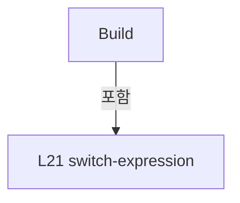

변경 전 점검: 입력/반환 타입, 위 호출자, 예외/취소 경로, 공유 상태와 저장·전송 소비자를 함께 확인합니다. 값의 단위나 물리 방향을 이름만으로 확정하지 않습니다.

### MethodDeclaration `BuildLogText` · L35–43

[Drilling.Common/Interface/Serial/CBeamExpander.cs:35–43](https://github.com/kjuws10-rgb/A3Drilling/blob/5aee8e58439c9b455cae7c9593c9be986c3e682e/Drilling.Common/Interface/Serial/CBeamExpander.cs#L35-L43)

| 항목 | 실제 추출 값 |
| --- | --- |
| 서명 | string Drilling.Common.Interface.CBeamExpander.BuildLogText(Drilling.Common.Interface.EN_BET_COMMAND, double, double) |
| 접근/수식자 | Public / public, static |
| 반환/값 타입 | string |
| 소속 타입 | NamedType:Drilling.Common.Interface.CBeamExpander |

입력 계약:

| 이름 | 타입 | 전달 | 선택/기본값 |
| --- | --- | --- | --- |
| command | Drilling.Common.Interface.EN_BET_COMMAND | None | False /  |
| magnification | double | None | True / 0 |
| divergence | double | None | True / 0 |

정적 호출자로 확인된 위치:

| 호출 파일/행 | 호출 표현식 | 런타임 분기 가능 |
| --- | --- | --- |
| [Drilling.Common/Interface/CInterfaceManager.cs:1305–1305](https://github.com/kjuws10-rgb/A3Drilling/blob/5aee8e58439c9b455cae7c9593c9be986c3e682e/Drilling.Common/Interface/CInterfaceManager.cs#L1305-L1305) | CBeamExpander.BuildLogText | False |

호출하는 대상과 해석 범위:

| 원본 행 | 표현식 | 분석 상태 | 대상/소스 위치 |
| --- | --- | --- | --- |
| 39 | string.Join | resolved | string string.Join(string?, params System.ReadOnlySpan<string?>) |
| 39 | ToMotorStep(divergence).ToString | resolved | string int.ToString(System.IFormatProvider?) |
| 39 | ToMotorStep | resolved | int Drilling.Common.Interface.CBeamExpander.ToMotorStep(double) · Drilling.Common/Interface/Serial/CBeamExpander.cs:364 |
| 39 | ToMotorStep(magnification).ToString | resolved | string int.ToString(System.IFormatProvider?) |
| 39 | ToMotorStep | resolved | int Drilling.Common.Interface.CBeamExpander.ToMotorStep(double) · Drilling.Common/Interface/Serial/CBeamExpander.cs:364 |
| 40 | ToMotorStep(magnification).ToString | resolved | string int.ToString(System.IFormatProvider?) |
| 40 | ToMotorStep | resolved | int Drilling.Common.Interface.CBeamExpander.ToMotorStep(double) · Drilling.Common/Interface/Serial/CBeamExpander.cs:364 |
| 41 | ToMotorStep(divergence).ToString | resolved | string int.ToString(System.IFormatProvider?) |
| 41 | ToMotorStep | resolved | int Drilling.Common.Interface.CBeamExpander.ToMotorStep(double) · Drilling.Common/Interface/Serial/CBeamExpander.cs:364 |
| 42 | Build | resolved | string Drilling.Common.Interface.CBeamExpander.Build(Drilling.Common.Interface.EN_BET_COMMAND, double, double) · Drilling.Common/Interface/Serial/CBeamExpander.cs:19 |

본문의 실제 연산·분기·예외·반환 순서(원문 위치 순):

| 원본 행 | 종류 | 주석 해설 |
| --- | --- | --- |
| 37 | return | 호출자에게 값 또는 제어를 반환합니다: return command switch { EN_BET_COMMAND.MoveManual => string.Join(" / ", $"#1:{ToMotorStep(divergence).ToString(CultureInfo.InvariantCulture)}", $"#2:{ToMotorStep(magnification).ToString(CultureInfo.InvariantCulture)}"), EN_BET_COM |
| 37 | switch-expression | 값별 결과식을 선택합니다: command switch { EN_BET_COMMAND.MoveManual => string.Join(" / ", $"#1:{ToMotorStep(divergence).ToString(CultureInfo.InvariantCulture)}", $"#2:{ToMotorStep(magnification).ToString(CultureInfo.InvariantCulture)}"), EN_BET_COMMAND.Mo |
| 39 | call | 함수·델리게이트 또는 객체 생성자를 호출합니다: string.Join(" / ", $"#1:{ToMotorStep(divergence).ToString(CultureInfo.InvariantCulture)}", $"#2:{ToMotorStep(magnification).ToString(CultureInfo.InvariantCulture)}") |
| 39 | call | 함수·델리게이트 또는 객체 생성자를 호출합니다: ToMotorStep(divergence).ToString(CultureInfo.InvariantCulture) |
| 39 | call | 함수·델리게이트 또는 객체 생성자를 호출합니다: ToMotorStep(divergence) |
| 39 | call | 함수·델리게이트 또는 객체 생성자를 호출합니다: ToMotorStep(magnification).ToString(CultureInfo.InvariantCulture) |
| 39 | call | 함수·델리게이트 또는 객체 생성자를 호출합니다: ToMotorStep(magnification) |
| 40 | call | 함수·델리게이트 또는 객체 생성자를 호출합니다: ToMotorStep(magnification).ToString(CultureInfo.InvariantCulture) |
| 40 | call | 함수·델리게이트 또는 객체 생성자를 호출합니다: ToMotorStep(magnification) |
| 41 | call | 함수·델리게이트 또는 객체 생성자를 호출합니다: ToMotorStep(divergence).ToString(CultureInfo.InvariantCulture) |
| 41 | call | 함수·델리게이트 또는 객체 생성자를 호출합니다: ToMotorStep(divergence) |
| 42 | call | 함수·델리게이트 또는 객체 생성자를 호출합니다: Build(command, magnification, divergence) |

제어 구문의 포함 구조(실제 실행 순서/CFG가 아닌 구문 탐색 그림):

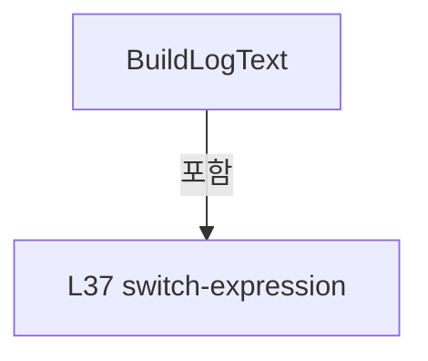

변경 전 점검: 입력/반환 타입, 위 호출자, 예외/취소 경로, 공유 상태와 저장·전송 소비자를 함께 확인합니다. 값의 단위나 물리 방향을 이름만으로 확정하지 않습니다.

### MethodDeclaration `IsSuccessResponse` · L45–48

[Drilling.Common/Interface/Serial/CBeamExpander.cs:45–48](https://github.com/kjuws10-rgb/A3Drilling/blob/5aee8e58439c9b455cae7c9593c9be986c3e682e/Drilling.Common/Interface/Serial/CBeamExpander.cs#L45-L48)

| 항목 | 실제 추출 값 |
| --- | --- |
| 서명 | bool Drilling.Common.Interface.CBeamExpander.IsSuccessResponse(string) |
| 접근/수식자 | Public / public, static |
| 반환/값 타입 | bool |
| 소속 타입 | NamedType:Drilling.Common.Interface.CBeamExpander |

입력 계약:

| 이름 | 타입 | 전달 | 선택/기본값 |
| --- | --- | --- | --- |
| response | string | None | False /  |

정적 호출자로 확인된 위치:

| 호출 파일/행 | 호출 표현식 | 런타임 분기 가능 |
| --- | --- | --- |
| [Drilling.Common/Interface/CInterfaceManager.cs:1349–1349](https://github.com/kjuws10-rgb/A3Drilling/blob/5aee8e58439c9b455cae7c9593c9be986c3e682e/Drilling.Common/Interface/CInterfaceManager.cs#L1349-L1349) | CBeamExpander.IsSuccessResponse | False |
| [Drilling.Common/Interface/Serial/CBeamExpander.cs:53–53](https://github.com/kjuws10-rgb/A3Drilling/blob/5aee8e58439c9b455cae7c9593c9be986c3e682e/Drilling.Common/Interface/Serial/CBeamExpander.cs#L53-L53) | IsSuccessResponse | False |

호출하는 대상과 해석 범위:

| 원본 행 | 표현식 | 분석 상태 | 대상/소스 위치 |
| --- | --- | --- | --- |
| 47 | string.IsNullOrWhiteSpace | resolved | bool string.IsNullOrWhiteSpace(string?) |
| 47 | response.StartsWith | resolved | bool string.StartsWith(string, System.StringComparison) |

본문의 실제 연산·분기·예외·반환 순서(원문 위치 순):

| 원본 행 | 종류 | 주석 해설 |
| --- | --- | --- |
| 47 | call | 함수·델리게이트 또는 객체 생성자를 호출합니다: string.IsNullOrWhiteSpace(response) |
| 47 | call | 함수·델리게이트 또는 객체 생성자를 호출합니다: response.StartsWith("ERR:", StringComparison.OrdinalIgnoreCase) |
| 47 | return | 호출자에게 값 또는 제어를 반환합니다: return !string.IsNullOrWhiteSpace(response) && !response.StartsWith("ERR:", StringComparison.OrdinalIgnoreCase); |

변경 전 점검: 입력/반환 타입, 위 호출자, 예외/취소 경로, 공유 상태와 저장·전송 소비자를 함께 확인합니다. 값의 단위나 물리 방향을 이름만으로 확정하지 않습니다.

### MethodDeclaration `Apply` · L50–129

[Drilling.Common/Interface/Serial/CBeamExpander.cs:50–129](https://github.com/kjuws10-rgb/A3Drilling/blob/5aee8e58439c9b455cae7c9593c9be986c3e682e/Drilling.Common/Interface/Serial/CBeamExpander.cs#L50-L129)

| 항목 | 실제 추출 값 |
| --- | --- |
| 서명 | Drilling.Common.Interface.ST_BET_STATUS Drilling.Common.Interface.CBeamExpander.Apply(Drilling.Common.Interface.EN_BET_COMMAND, double, double, string, Drilling.Common.Interface.ST_BET_STATUS, bool) |
| 접근/수식자 | Public / public, static |
| 반환/값 타입 | Drilling.Common.Interface.ST_BET_STATUS |
| 소속 타입 | NamedType:Drilling.Common.Interface.CBeamExpander |

입력 계약:

| 이름 | 타입 | 전달 | 선택/기본값 |
| --- | --- | --- | --- |
| command | Drilling.Common.Interface.EN_BET_COMMAND | None | False /  |
| magnification | double | None | False /  |
| divergence | double | None | False /  |
| response | string | None | False /  |
| current | Drilling.Common.Interface.ST_BET_STATUS | None | False /  |
| simulation | bool | None | False /  |

정적 호출자로 확인된 위치:

| 호출 파일/행 | 호출 표현식 | 런타임 분기 가능 |
| --- | --- | --- |
| [Drilling.Common/Interface/CInterfaceManager.cs:1319–1319](https://github.com/kjuws10-rgb/A3Drilling/blob/5aee8e58439c9b455cae7c9593c9be986c3e682e/Drilling.Common/Interface/CInterfaceManager.cs#L1319-L1319) | CBeamExpander.Apply | False |
| [Drilling.Common/Interface/CInterfaceManager.cs:1346–1346](https://github.com/kjuws10-rgb/A3Drilling/blob/5aee8e58439c9b455cae7c9593c9be986c3e682e/Drilling.Common/Interface/CInterfaceManager.cs#L1346-L1346) | CBeamExpander.Apply | False |

호출하는 대상과 해석 범위:

| 원본 행 | 표현식 | 분석 상태 | 대상/소스 위치 |
| --- | --- | --- | --- |
| 52 | CreateSimulationResponse | resolved | string Drilling.Common.Interface.CBeamExpander.CreateSimulationResponse(Drilling.Common.Interface.EN_BET_COMMAND, double, double, Drilling.Common.Interface.ST_BET_STATUS) · Drilling.Common/Interface/Serial/CBeamExpander.cs:369 |
| 52 | response.Trim | resolved | string string.Trim() |
| 53 | IsSuccessResponse | resolved | bool Drilling.Common.Interface.CBeamExpander.IsSuccessResponse(string) · Drilling.Common/Interface/Serial/CBeamExpander.cs:45 |
| 58 | ReadError | resolved | Drilling.Common.Interface.EN_BET_ERROR Drilling.Common.Interface.CBeamExpander.ReadError(string) · Drilling.Common/Interface/Serial/CBeamExpander.cs:380 |
| 117 | ReadTaggedDouble | resolved | double Drilling.Common.Interface.CBeamExpander.ReadTaggedDouble(string, string, double) · Drilling.Common/Interface/Serial/CBeamExpander.cs:397 |
| 118 | ReadTaggedDouble | resolved | double Drilling.Common.Interface.CBeamExpander.ReadTaggedDouble(string, string, double) · Drilling.Common/Interface/Serial/CBeamExpander.cs:397 |
| 123 | ReadTaggedDouble | resolved | double Drilling.Common.Interface.CBeamExpander.ReadTaggedDouble(string, string, double) · Drilling.Common/Interface/Serial/CBeamExpander.cs:397 |
| 124 | ReadTaggedDouble | resolved | double Drilling.Common.Interface.CBeamExpander.ReadTaggedDouble(string, string, double) · Drilling.Common/Interface/Serial/CBeamExpander.cs:397 |

본문의 실제 연산·분기·예외·반환 순서(원문 위치 순):

| 원본 행 | 종류 | 주석 해설 |
| --- | --- | --- |
| 52 | call | 함수·델리게이트 또는 객체 생성자를 호출합니다: CreateSimulationResponse(command, magnification, divergence, current) |
| 52 | call | 함수·델리게이트 또는 객체 생성자를 호출합니다: response.Trim() |
| 52 | conditional-expression | 조건에 따라 결과식을 선택합니다: simulation ? CreateSimulationResponse(command, magnification, divergence, current) : response.Trim() |
| 52 | local-declaration | 지역 변수를 선언합니다: var value = simulation ? CreateSimulationResponse(command, magnification, divergence, current) : response.Trim(); |
| 52 | variable-initializer | 변수의 초기값을 지정합니다: value = simulation ? CreateSimulationResponse(command, magnification, divergence, current) : response.Trim() |
| 53 | call | 함수·델리게이트 또는 객체 생성자를 호출합니다: IsSuccessResponse(value) |
| 53 | if | 조건에 따라 분기합니다: if (!simulation && !IsSuccessResponse(value)) |
| 55 | return | 호출자에게 값 또는 제어를 반환합니다: return current with { CommOk = false, LastError = ReadError(value), UpdatedAt = DateTimeOffset.Now }; |
| 57 | assignment | 값을 대상에 대입합니다: CommOk = false |
| 58 | assignment | 값을 대상에 대입합니다: LastError = ReadError(value) |
| 58 | call | 함수·델리게이트 또는 객체 생성자를 호출합니다: ReadError(value) |
| 59 | assignment | 값을 대상에 대입합니다: UpdatedAt = DateTimeOffset.Now |
| 63 | local-declaration | 지역 변수를 선언합니다: var ok = current with { CommOk = true, LastError = EN_BET_ERROR.Ok, UpdatedAt = DateTimeOffset.Now }; |
| 63 | variable-initializer | 변수의 초기값을 지정합니다: ok = current with { CommOk = true, LastError = EN_BET_ERROR.Ok, UpdatedAt = DateTimeOffset.Now } |
| 65 | assignment | 값을 대상에 대입합니다: CommOk = true |
| 66 | assignment | 값을 대상에 대입합니다: LastError = EN_BET_ERROR.Ok |
| 67 | assignment | 값을 대상에 대입합니다: UpdatedAt = DateTimeOffset.Now |
| 69 | return | 호출자에게 값 또는 제어를 반환합니다: return command switch { EN_BET_COMMAND.InitMotor => ok with { IsMoving = false, MagHomeCompleted = true, DivHomeCompleted = true, LastCommand = "INIT" }, EN_BET_COMMAND.MoveManual => ok with { CurrentMagnification = simulation ? m |
| 69 | switch-expression | 값별 결과식을 선택합니다: command switch { EN_BET_COMMAND.InitMotor => ok with { IsMoving = false, MagHomeCompleted = true, DivHomeCompleted = true, LastCommand = "INIT" }, EN_BET_COMMAND.MoveManual => ok with { CurrentMagnification = simulation ? magnific |
| 73 | assignment | 값을 대상에 대입합니다: IsMoving = false |
| 74 | assignment | 값을 대상에 대입합니다: MagHomeCompleted = true |
| 75 | assignment | 값을 대상에 대입합니다: DivHomeCompleted = true |
| 76 | assignment | 값을 대상에 대입합니다: LastCommand = "INIT" |
| 80 | assignment | 값을 대상에 대입합니다: CurrentMagnification = simulation ? magnification : ok.CurrentMagnification |
| 80 | conditional-expression | 조건에 따라 결과식을 선택합니다: simulation ? magnification : ok.CurrentMagnification |
| 81 | assignment | 값을 대상에 대입합니다: TargetMagnification = magnification |
| 82 | assignment | 값을 대상에 대입합니다: CurrentDivergence = simulation ? divergence : ok.CurrentDivergence |
| 82 | conditional-expression | 조건에 따라 결과식을 선택합니다: simulation ? divergence : ok.CurrentDivergence |
| 83 | assignment | 값을 대상에 대입합니다: TargetDivergence = divergence |
| 84 | assignment | 값을 대상에 대입합니다: MagnificationAxisPosition = simulation ? magnification : ok.MagnificationAxisPosition |
| 84 | conditional-expression | 조건에 따라 결과식을 선택합니다: simulation ? magnification : ok.MagnificationAxisPosition |
| 85 | assignment | 값을 대상에 대입합니다: DivergenceAxisPosition = simulation ? divergence : ok.DivergenceAxisPosition |
| 85 | conditional-expression | 조건에 따라 결과식을 선택합니다: simulation ? divergence : ok.DivergenceAxisPosition |
| 86 | assignment | 값을 대상에 대입합니다: IsMoving = !simulation |
| 87 | assignment | 값을 대상에 대입합니다: LastCommand = "MOVE" |
| 91 | assignment | 값을 대상에 대입합니다: CurrentMagnification = simulation ? magnification : ok.CurrentMagnification |
| 91 | conditional-expression | 조건에 따라 결과식을 선택합니다: simulation ? magnification : ok.CurrentMagnification |
| 92 | assignment | 값을 대상에 대입합니다: TargetMagnification = magnification |
| 93 | assignment | 값을 대상에 대입합니다: MagnificationAxisPosition = simulation ? magnification : ok.MagnificationAxisPosition |
| 93 | conditional-expression | 조건에 따라 결과식을 선택합니다: simulation ? magnification : ok.MagnificationAxisPosition |
| 94 | assignment | 값을 대상에 대입합니다: IsMoving = !simulation |
| 95 | assignment | 값을 대상에 대입합니다: LastCommand = "MOVE MAG" |
| 99 | assignment | 값을 대상에 대입합니다: CurrentDivergence = simulation ? divergence : ok.CurrentDivergence |
| 99 | conditional-expression | 조건에 따라 결과식을 선택합니다: simulation ? divergence : ok.CurrentDivergence |
| 100 | assignment | 값을 대상에 대입합니다: TargetDivergence = divergence |
| 101 | assignment | 값을 대상에 대입합니다: DivergenceAxisPosition = simulation ? divergence : ok.DivergenceAxisPosition |
| 101 | conditional-expression | 조건에 따라 결과식을 선택합니다: simulation ? divergence : ok.DivergenceAxisPosition |
| 102 | assignment | 값을 대상에 대입합니다: IsMoving = !simulation |
| 103 | assignment | 값을 대상에 대입합니다: LastCommand = "MOVE DIV" |
| 107 | assignment | 값을 대상에 대입합니다: IsMoving = false |
| 108 | assignment | 값을 대상에 대입합니다: LastCommand = "STOP" |
| 112 | assignment | 값을 대상에 대입합니다: AlarmOn = false |
| 113 | assignment | 값을 대상에 대입합니다: LastCommand = "RESET" |
| 117 | assignment | 값을 대상에 대입합니다: CurrentMagnification = ReadTaggedDouble(value, "M2", ok.CurrentMagnification) |
| 117 | call | 함수·델리게이트 또는 객체 생성자를 호출합니다: ReadTaggedDouble(value, "M2", ok.CurrentMagnification) |
| 118 | assignment | 값을 대상에 대입합니다: MagnificationAxisPosition = ReadTaggedDouble(value, "M2", ok.MagnificationAxisPosition) |
| 118 | call | 함수·델리게이트 또는 객체 생성자를 호출합니다: ReadTaggedDouble(value, "M2", ok.MagnificationAxisPosition) |
| 119 | assignment | 값을 대상에 대입합니다: IsMoving = false |
| 123 | assignment | 값을 대상에 대입합니다: CurrentDivergence = ReadTaggedDouble(value, "M1", ok.CurrentDivergence) |
| 123 | call | 함수·델리게이트 또는 객체 생성자를 호출합니다: ReadTaggedDouble(value, "M1", ok.CurrentDivergence) |
| 124 | assignment | 값을 대상에 대입합니다: DivergenceAxisPosition = ReadTaggedDouble(value, "M1", ok.DivergenceAxisPosition) |
| 124 | call | 함수·델리게이트 또는 객체 생성자를 호출합니다: ReadTaggedDouble(value, "M1", ok.DivergenceAxisPosition) |
| 125 | assignment | 값을 대상에 대입합니다: IsMoving = false |

제어 구문의 포함 구조(실제 실행 순서/CFG가 아닌 구문 탐색 그림):

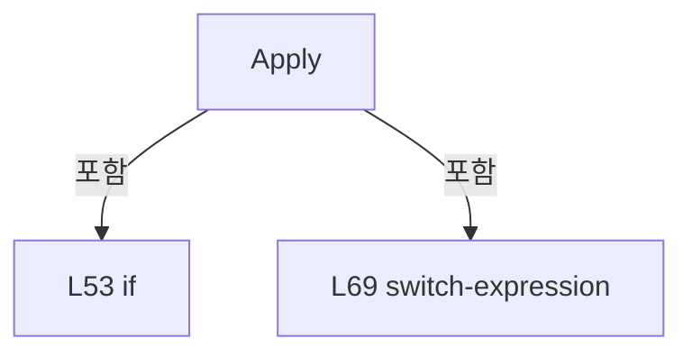

변경 전 점검: 입력/반환 타입, 위 호출자, 예외/취소 경로, 공유 상태와 저장·전송 소비자를 함께 확인합니다. 값의 단위나 물리 방향을 이름만으로 확정하지 않습니다.

### MethodDeclaration `Execute` · L131–142

[Drilling.Common/Interface/Serial/CBeamExpander.cs:131–142](https://github.com/kjuws10-rgb/A3Drilling/blob/5aee8e58439c9b455cae7c9593c9be986c3e682e/Drilling.Common/Interface/Serial/CBeamExpander.cs#L131-L142)

| 항목 | 실제 추출 값 |
| --- | --- |
| 서명 | System.Threading.Tasks.Task<string> Drilling.Common.Interface.CBeamExpander.Execute(string, System.Threading.CancellationToken) |
| 접근/수식자 | Public / public, override, async |
| 반환/값 타입 | System.Threading.Tasks.Task<string> |
| 소속 타입 | NamedType:Drilling.Common.Interface.CBeamExpander |

입력 계약:

| 이름 | 타입 | 전달 | 선택/기본값 |
| --- | --- | --- | --- |
| function | string | None | False /  |
| cancellationToken | System.Threading.CancellationToken | None | True / null |

현재 부분 분석에서 직접 연결된 호출자는 없습니다. XAML/이벤트/인터페이스·델리게이트·외부 진입을 추가 확인해야 하며, 미사용으로 판정한 것이 아닙니다.

호출하는 대상과 해석 범위:

| 원본 행 | 표현식 | 분석 상태 | 대상/소스 위치 |
| --- | --- | --- | --- |
| 133 | SerialLock.WaitAsync | resolved | System.Threading.Tasks.Task System.Threading.SemaphoreSlim.WaitAsync(System.Threading.CancellationToken) |
| 136 | ExecuteBeamExpander | resolved | System.Threading.Tasks.Task<string> Drilling.Common.Interface.CBeamExpander.ExecuteBeamExpander(string, System.Threading.CancellationToken) · Drilling.Common/Interface/Serial/CBeamExpander.cs:144 |
| 140 | SerialLock.Release | resolved | int System.Threading.SemaphoreSlim.Release() |

본문의 실제 연산·분기·예외·반환 순서(원문 위치 순):

| 원본 행 | 종류 | 주석 해설 |
| --- | --- | --- |
| 133 | await | 비동기 완료를 기다립니다: await SerialLock.WaitAsync(cancellationToken) |
| 133 | call | 함수·델리게이트 또는 객체 생성자를 호출합니다: SerialLock.WaitAsync(cancellationToken) |
| 134 | try | 예외 처리 범위입니다: try |
| 136 | await | 비동기 완료를 기다립니다: await ExecuteBeamExpander(function, cancellationToken) |
| 136 | call | 함수·델리게이트 또는 객체 생성자를 호출합니다: ExecuteBeamExpander(function, cancellationToken) |
| 136 | return | 호출자에게 값 또는 제어를 반환합니다: return await ExecuteBeamExpander(function, cancellationToken); |
| 138 | finally | 종료 정리 구간입니다: finally |
| 140 | call | 함수·델리게이트 또는 객체 생성자를 호출합니다: SerialLock.Release() |

제어 구문의 포함 구조(실제 실행 순서/CFG가 아닌 구문 탐색 그림):

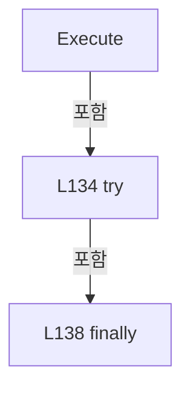

변경 전 점검: 입력/반환 타입, 위 호출자, 예외/취소 경로, 공유 상태와 저장·전송 소비자를 함께 확인합니다. 값의 단위나 물리 방향을 이름만으로 확정하지 않습니다.

### MethodDeclaration `ExecuteBeamExpander` · L144–175

[Drilling.Common/Interface/Serial/CBeamExpander.cs:144–175](https://github.com/kjuws10-rgb/A3Drilling/blob/5aee8e58439c9b455cae7c9593c9be986c3e682e/Drilling.Common/Interface/Serial/CBeamExpander.cs#L144-L175)

| 항목 | 실제 추출 값 |
| --- | --- |
| 서명 | System.Threading.Tasks.Task<string> Drilling.Common.Interface.CBeamExpander.ExecuteBeamExpander(string, System.Threading.CancellationToken) |
| 접근/수식자 | Private / private, async |
| 반환/값 타입 | System.Threading.Tasks.Task<string> |
| 소속 타입 | NamedType:Drilling.Common.Interface.CBeamExpander |

입력 계약:

| 이름 | 타입 | 전달 | 선택/기본값 |
| --- | --- | --- | --- |
| function | string | None | False /  |
| cancellationToken | System.Threading.CancellationToken | None | False /  |

정적 호출자로 확인된 위치:

| 호출 파일/행 | 호출 표현식 | 런타임 분기 가능 |
| --- | --- | --- |
| [Drilling.Common/Interface/Serial/CBeamExpander.cs:136–136](https://github.com/kjuws10-rgb/A3Drilling/blob/5aee8e58439c9b455cae7c9593c9be986c3e682e/Drilling.Common/Interface/Serial/CBeamExpander.cs#L136-L136) | ExecuteBeamExpander | False |

호출하는 대상과 해석 범위:

| 원본 행 | 표현식 | 분석 상태 | 대상/소스 위치 |
| --- | --- | --- | --- |
| 148 | Connect | resolved · 동적 구현 선택 가능 | System.Threading.Tasks.Task Drilling.Common.Interface.CSerialComm.Connect(System.Threading.CancellationToken) · Drilling.Common/Interface/Serial/CSerialComm.cs:32 |
| 164 | Task.Run | resolved | System.Threading.Tasks.Task<string> System.Threading.Tasks.Task.Run<string>(System.Func<string>, System.Threading.CancellationToken) |
| 165 | LastReceived.StartsWith | resolved | bool string.StartsWith(string, System.StringComparison) |
| 166 | SetResponseState | resolved | void Drilling.Common.Interface.CSerialComm.SetResponseState(string) · Drilling.Common/Interface/Serial/CSerialComm.cs:206 |
| 171 | CloseSerialPort | resolved | void Drilling.Common.Interface.CSerialComm.CloseSerialPort() · Drilling.Common/Interface/Serial/CSerialComm.cs:363 |
| 172 | SetError | resolved | void Drilling.Common.Interface.CSerialComm.SetError(System.Exception) · Drilling.Common/Interface/Serial/CSerialComm.cs:192 |

본문의 실제 연산·분기·예외·반환 순서(원문 위치 순):

| 원본 행 | 종류 | 주석 해설 |
| --- | --- | --- |
| 146 | if | 조건에 따라 분기합니다: if (SerialPort is null &#124;&#124; !SerialPort.IsOpen) |
| 148 | await | 비동기 완료를 기다립니다: await Connect(cancellationToken) |
| 148 | call | 함수·델리게이트 또는 객체 생성자를 호출합니다: Connect(cancellationToken) |
| 151 | if | 조건에 따라 분기합니다: if (SerialPort is null &#124;&#124; !SerialPort.IsOpen) |
| 153 | return | 호출자에게 값 또는 제어를 반환합니다: return ""; |
| 156 | assignment | 값을 대상에 대입합니다: LastSent = function |
| 162 | try | 예외 처리 범위입니다: try |
| 164 | assignment | 값을 대상에 대입합니다: LastReceived = await Task.Run(SelectValue, cancellationToken) |
| 164 | await | 비동기 완료를 기다립니다: await Task.Run(SelectValue, cancellationToken) |
| 164 | call | 함수·델리게이트 또는 객체 생성자를 호출합니다: Task.Run(SelectValue, cancellationToken) |
| 165 | assignment | 값을 대상에 대입합니다: LastError = LastReceived.StartsWith("ERR:", StringComparison.OrdinalIgnoreCase) ? LastReceived : "" |
| 165 | call | 함수·델리게이트 또는 객체 생성자를 호출합니다: LastReceived.StartsWith("ERR:", StringComparison.OrdinalIgnoreCase) |
| 165 | conditional-expression | 조건에 따라 결과식을 선택합니다: LastReceived.StartsWith("ERR:", StringComparison.OrdinalIgnoreCase) ? LastReceived : "" |
| 166 | call | 함수·델리게이트 또는 객체 생성자를 호출합니다: SetResponseState(LastReceived) |
| 167 | return | 호출자에게 값 또는 제어를 반환합니다: return LastReceived; |
| 169 | catch | 지정 예외를 처리합니다: catch (Exception ex) when (ex is IOException or InvalidOperationException or TimeoutException or UnauthorizedAccessException or ObjectDisposedException) |
| 171 | call | 함수·델리게이트 또는 객체 생성자를 호출합니다: CloseSerialPort() |
| 172 | call | 함수·델리게이트 또는 객체 생성자를 호출합니다: SetError(ex) |
| 173 | return | 호출자에게 값 또는 제어를 반환합니다: return ""; |

제어 구문의 포함 구조(실제 실행 순서/CFG가 아닌 구문 탐색 그림):

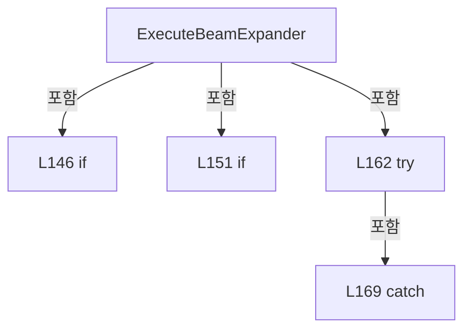

변경 전 점검: 입력/반환 타입, 위 호출자, 예외/취소 경로, 공유 상태와 저장·전송 소비자를 함께 확인합니다. 값의 단위나 물리 방향을 이름만으로 확정하지 않습니다.

### LocalFunctionStatement `SelectValue` · L157–160

[Drilling.Common/Interface/Serial/CBeamExpander.cs:157–160](https://github.com/kjuws10-rgb/A3Drilling/blob/5aee8e58439c9b455cae7c9593c9be986c3e682e/Drilling.Common/Interface/Serial/CBeamExpander.cs#L157-L160)

| 항목 | 실제 추출 값 |
| --- | --- |
| 서명 | string SelectValue() |
| 접근/수식자 | Private /  |
| 반환/값 타입 | string |
| 소속 타입 | NamedType:Drilling.Common.Interface.CBeamExpander |

현재 부분 분석에서 직접 연결된 호출자는 없습니다. XAML/이벤트/인터페이스·델리게이트·외부 진입을 추가 확인해야 하며, 미사용으로 판정한 것이 아닙니다.

호출하는 대상과 해석 범위:

| 원본 행 | 표현식 | 분석 상태 | 대상/소스 위치 |
| --- | --- | --- | --- |
| 159 | ExecuteBeamExpander | resolved | string Drilling.Common.Interface.CBeamExpander.ExecuteBeamExpander(string) · Drilling.Common/Interface/Serial/CBeamExpander.cs:177 |

본문의 실제 연산·분기·예외·반환 순서(원문 위치 순):

| 원본 행 | 종류 | 주석 해설 |
| --- | --- | --- |
| 159 | call | 함수·델리게이트 또는 객체 생성자를 호출합니다: ExecuteBeamExpander(function) |
| 159 | return | 호출자에게 값 또는 제어를 반환합니다: return ExecuteBeamExpander(function); |

변경 전 점검: 입력/반환 타입, 위 호출자, 예외/취소 경로, 공유 상태와 저장·전송 소비자를 함께 확인합니다. 값의 단위나 물리 방향을 이름만으로 확정하지 않습니다.

### MethodDeclaration `ExecuteBeamExpander` · L177–201

[Drilling.Common/Interface/Serial/CBeamExpander.cs:177–201](https://github.com/kjuws10-rgb/A3Drilling/blob/5aee8e58439c9b455cae7c9593c9be986c3e682e/Drilling.Common/Interface/Serial/CBeamExpander.cs#L177-L201)

| 항목 | 실제 추출 값 |
| --- | --- |
| 서명 | string Drilling.Common.Interface.CBeamExpander.ExecuteBeamExpander(string) |
| 접근/수식자 | Private / private |
| 반환/값 타입 | string |
| 소속 타입 | NamedType:Drilling.Common.Interface.CBeamExpander |

입력 계약:

| 이름 | 타입 | 전달 | 선택/기본값 |
| --- | --- | --- | --- |
| function | string | None | False /  |

정적 호출자로 확인된 위치:

| 호출 파일/행 | 호출 표현식 | 런타임 분기 가능 |
| --- | --- | --- |
| [Drilling.Common/Interface/Serial/CBeamExpander.cs:159–159](https://github.com/kjuws10-rgb/A3Drilling/blob/5aee8e58439c9b455cae7c9593c9be986c3e682e/Drilling.Common/Interface/Serial/CBeamExpander.cs#L159-L159) | ExecuteBeamExpander | False |

호출하는 대상과 해석 범위:

| 원본 행 | 표현식 | 분석 상태 | 대상/소스 위치 |
| --- | --- | --- | --- |
| 179 | function.Split | resolved | string[] string.Split(char, System.StringSplitOptions) |
| 180 | function.Trim().ToUpperInvariant | resolved | string string.ToUpperInvariant() |
| 180 | function.Trim | resolved | string string.Trim() |
| 183 | SendSelecting | resolved | string Drilling.Common.Interface.CBeamExpander.SendSelecting(string) · Drilling.Common/Interface/Serial/CBeamExpander.cs:223 |
| 186 | text.StartsWith | resolved | bool string.StartsWith(string, System.StringComparison) |
| 186 | text.StartsWith | resolved | bool string.StartsWith(string, System.StringComparison) |
| 188 | SendSelecting | resolved | string Drilling.Common.Interface.CBeamExpander.SendSelecting(string) · Drilling.Common/Interface/Serial/CBeamExpander.cs:223 |
| 191 | IsPollingCommand | resolved | bool Drilling.Common.Interface.CBeamExpander.IsPollingCommand(string) · Drilling.Common/Interface/Serial/CBeamExpander.cs:285 |
| 193 | SendPolling | resolved | string Drilling.Common.Interface.CBeamExpander.SendPolling(string) · Drilling.Common/Interface/Serial/CBeamExpander.cs:230 |
| 196 | parts[0].ToUpperInvariant | resolved | string string.ToUpperInvariant() |
| 198 | double.TryParse | resolved | bool double.TryParse(string?, System.Globalization.NumberStyles, System.IFormatProvider?, out double) |
| 198 | double.TryParse | resolved | bool double.TryParse(string?, System.Globalization.NumberStyles, System.IFormatProvider?, out double) |
| 198 | SendMove | resolved | string Drilling.Common.Interface.CBeamExpander.SendMove(double, double) · Drilling.Common/Interface/Serial/CBeamExpander.cs:203 |

본문의 실제 연산·분기·예외·반환 순서(원문 위치 순):

| 원본 행 | 종류 | 주석 해설 |
| --- | --- | --- |
| 179 | call | 함수·델리게이트 또는 객체 생성자를 호출합니다: function.Split(':', StringSplitOptions.RemoveEmptyEntries &#124; StringSplitOptions.TrimEntries) |
| 179 | local-declaration | 지역 변수를 선언합니다: var parts = function.Split(':', StringSplitOptions.RemoveEmptyEntries &#124; StringSplitOptions.TrimEntries); |
| 179 | variable-initializer | 변수의 초기값을 지정합니다: parts = function.Split(':', StringSplitOptions.RemoveEmptyEntries &#124; StringSplitOptions.TrimEntries) |
| 180 | call | 함수·델리게이트 또는 객체 생성자를 호출합니다: function.Trim().ToUpperInvariant() |
| 180 | call | 함수·델리게이트 또는 객체 생성자를 호출합니다: function.Trim() |
| 180 | local-declaration | 지역 변수를 선언합니다: var text = function.Trim().ToUpperInvariant(); |
| 180 | variable-initializer | 변수의 초기값을 지정합니다: text = function.Trim().ToUpperInvariant() |
| 181 | if | 조건에 따라 분기합니다: if (text is "#I:" or "#I:!" or "#0:" or "#0:!") |
| 183 | call | 함수·델리게이트 또는 객체 생성자를 호출합니다: SendSelecting(text) |
| 183 | return | 호출자에게 값 또는 제어를 반환합니다: return SendSelecting(text); |
| 186 | call | 함수·델리게이트 또는 객체 생성자를 호출합니다: text.StartsWith("#1:", StringComparison.Ordinal) |
| 186 | call | 함수·델리게이트 또는 객체 생성자를 호출합니다: text.StartsWith("#2:", StringComparison.Ordinal) |
| 186 | if | 조건에 따라 분기합니다: if (text.StartsWith("#1:", StringComparison.Ordinal) &#124;&#124; text.StartsWith("#2:", StringComparison.Ordinal)) |
| 188 | call | 함수·델리게이트 또는 객체 생성자를 호출합니다: SendSelecting(text) |
| 188 | return | 호출자에게 값 또는 제어를 반환합니다: return SendSelecting(text); |
| 191 | call | 함수·델리게이트 또는 객체 생성자를 호출합니다: IsPollingCommand(text) |
| 191 | if | 조건에 따라 분기합니다: if (IsPollingCommand(text)) |
| 193 | call | 함수·델리게이트 또는 객체 생성자를 호출합니다: SendPolling(text) |
| 193 | return | 호출자에게 값 또는 제어를 반환합니다: return SendPolling(text); |
| 196 | call | 함수·델리게이트 또는 객체 생성자를 호출합니다: parts[0].ToUpperInvariant() |
| 196 | conditional-expression | 조건에 따라 결과식을 선택합니다: parts.Length > 0 ? parts[0].ToUpperInvariant() switch { "MOVE" when parts.Length >= 3 && double.TryParse(parts[1], NumberStyles.Float, CultureInfo.InvariantCulture, out var mag) && double.TryParse(parts[2], NumberStyles.Float, Cul |
| 196 | return | 호출자에게 값 또는 제어를 반환합니다: return parts.Length > 0 ? parts[0].ToUpperInvariant() switch { "MOVE" when parts.Length >= 3 && double.TryParse(parts[1], NumberStyles.Float, CultureInfo.InvariantCulture, out var mag) && double.TryParse(parts[2], NumberStyles.Flo |
| 196 | switch-expression | 값별 결과식을 선택합니다: parts[0].ToUpperInvariant() switch { "MOVE" when parts.Length >= 3 && double.TryParse(parts[1], NumberStyles.Float, CultureInfo.InvariantCulture, out var mag) && double.TryParse(parts[2], NumberStyles.Float, CultureInfo.InvariantC |
| 198 | call | 함수·델리게이트 또는 객체 생성자를 호출합니다: double.TryParse(parts[1], NumberStyles.Float, CultureInfo.InvariantCulture, out var mag) |
| 198 | call | 함수·델리게이트 또는 객체 생성자를 호출합니다: double.TryParse(parts[2], NumberStyles.Float, CultureInfo.InvariantCulture, out var div) |
| 198 | call | 함수·델리게이트 또는 객체 생성자를 호출합니다: SendMove(mag, div) |

제어 구문의 포함 구조(실제 실행 순서/CFG가 아닌 구문 탐색 그림):

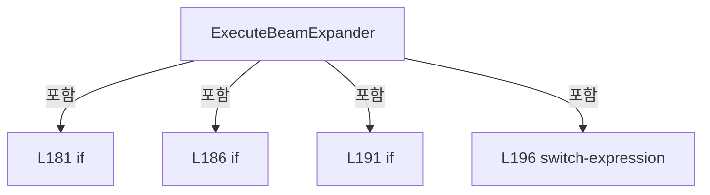

변경 전 점검: 입력/반환 타입, 위 호출자, 예외/취소 경로, 공유 상태와 저장·전송 소비자를 함께 확인합니다. 값의 단위나 물리 방향을 이름만으로 확정하지 않습니다.

### MethodDeclaration `SendMove` · L203–221

[Drilling.Common/Interface/Serial/CBeamExpander.cs:203–221](https://github.com/kjuws10-rgb/A3Drilling/blob/5aee8e58439c9b455cae7c9593c9be986c3e682e/Drilling.Common/Interface/Serial/CBeamExpander.cs#L203-L221)

| 항목 | 실제 추출 값 |
| --- | --- |
| 서명 | string Drilling.Common.Interface.CBeamExpander.SendMove(double, double) |
| 접근/수식자 | Private / private |
| 반환/값 타입 | string |
| 소속 타입 | NamedType:Drilling.Common.Interface.CBeamExpander |

입력 계약:

| 이름 | 타입 | 전달 | 선택/기본값 |
| --- | --- | --- | --- |
| magnification | double | None | False /  |
| divergence | double | None | False /  |

정적 호출자로 확인된 위치:

| 호출 파일/행 | 호출 표현식 | 런타임 분기 가능 |
| --- | --- | --- |
| [Drilling.Common/Interface/Serial/CBeamExpander.cs:198–198](https://github.com/kjuws10-rgb/A3Drilling/blob/5aee8e58439c9b455cae7c9593c9be986c3e682e/Drilling.Common/Interface/Serial/CBeamExpander.cs#L198-L198) | SendMove | False |

호출하는 대상과 해석 범위:

| 원본 행 | 표현식 | 분석 상태 | 대상/소스 위치 |
| --- | --- | --- | --- |
| 205 | SerialPort!.DiscardInBuffer | unresolved | None |
| 206 | SerialPort.DiscardOutBuffer | unresolved | None |
| 207 | ToMotorStep(divergence).ToString | resolved | string int.ToString(System.IFormatProvider?) |
| 207 | ToMotorStep | resolved | int Drilling.Common.Interface.CBeamExpander.ToMotorStep(double) · Drilling.Common/Interface/Serial/CBeamExpander.cs:364 |
| 208 | ToMotorStep(magnification).ToString | resolved | string int.ToString(System.IFormatProvider?) |
| 208 | ToMotorStep | resolved | int Drilling.Common.Interface.CBeamExpander.ToMotorStep(double) · Drilling.Common/Interface/Serial/CBeamExpander.cs:364 |
| 210 | SendAndWaitAck | resolved | bool Drilling.Common.Interface.CBeamExpander.SendAndWaitAck(string) · Drilling.Common/Interface/Serial/CBeamExpander.cs:263 |
| 215 | SendAndWaitAck | resolved | bool Drilling.Common.Interface.CBeamExpander.SendAndWaitAck(string) · Drilling.Common/Interface/Serial/CBeamExpander.cs:263 |

본문의 실제 연산·분기·예외·반환 순서(원문 위치 순):

| 원본 행 | 종류 | 주석 해설 |
| --- | --- | --- |
| 205 | call | 함수·델리게이트 또는 객체 생성자를 호출합니다: SerialPort!.DiscardInBuffer() |
| 206 | call | 함수·델리게이트 또는 객체 생성자를 호출합니다: SerialPort.DiscardOutBuffer() |
| 207 | call | 함수·델리게이트 또는 객체 생성자를 호출합니다: ToMotorStep(divergence).ToString(CultureInfo.InvariantCulture) |
| 207 | call | 함수·델리게이트 또는 객체 생성자를 호출합니다: ToMotorStep(divergence) |
| 207 | local-declaration | 지역 변수를 선언합니다: var divCommand = $"#1:{ToMotorStep(divergence).ToString(CultureInfo.InvariantCulture)}"; |
| 207 | variable-initializer | 변수의 초기값을 지정합니다: divCommand = $"#1:{ToMotorStep(divergence).ToString(CultureInfo.InvariantCulture)}" |
| 208 | call | 함수·델리게이트 또는 객체 생성자를 호출합니다: ToMotorStep(magnification).ToString(CultureInfo.InvariantCulture) |
| 208 | call | 함수·델리게이트 또는 객체 생성자를 호출합니다: ToMotorStep(magnification) |
| 208 | local-declaration | 지역 변수를 선언합니다: var magCommand = $"#2:{ToMotorStep(magnification).ToString(CultureInfo.InvariantCulture)}"; |
| 208 | variable-initializer | 변수의 초기값을 지정합니다: magCommand = $"#2:{ToMotorStep(magnification).ToString(CultureInfo.InvariantCulture)}" |
| 209 | assignment | 값을 대상에 대입합니다: LastSent = $"{divCommand} / {magCommand}" |
| 210 | call | 함수·델리게이트 또는 객체 생성자를 호출합니다: SendAndWaitAck(divCommand) |
| 210 | if | 조건에 따라 분기합니다: if (!SendAndWaitAck(divCommand)) |
| 212 | return | 호출자에게 값 또는 제어를 반환합니다: return "ERR:-2"; |
| 215 | call | 함수·델리게이트 또는 객체 생성자를 호출합니다: SendAndWaitAck(magCommand) |
| 215 | if | 조건에 따라 분기합니다: if (!SendAndWaitAck(magCommand)) |
| 217 | return | 호출자에게 값 또는 제어를 반환합니다: return "ERR:-2"; |
| 220 | return | 호출자에게 값 또는 제어를 반환합니다: return "OK"; |

제어 구문의 포함 구조(실제 실행 순서/CFG가 아닌 구문 탐색 그림):

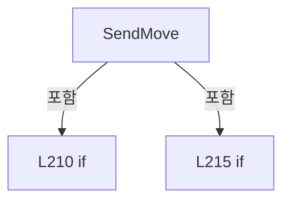

변경 전 점검: 입력/반환 타입, 위 호출자, 예외/취소 경로, 공유 상태와 저장·전송 소비자를 함께 확인합니다. 값의 단위나 물리 방향을 이름만으로 확정하지 않습니다.

### MethodDeclaration `SendSelecting` · L223–228

[Drilling.Common/Interface/Serial/CBeamExpander.cs:223–228](https://github.com/kjuws10-rgb/A3Drilling/blob/5aee8e58439c9b455cae7c9593c9be986c3e682e/Drilling.Common/Interface/Serial/CBeamExpander.cs#L223-L228)

| 항목 | 실제 추출 값 |
| --- | --- |
| 서명 | string Drilling.Common.Interface.CBeamExpander.SendSelecting(string) |
| 접근/수식자 | Private / private |
| 반환/값 타입 | string |
| 소속 타입 | NamedType:Drilling.Common.Interface.CBeamExpander |

입력 계약:

| 이름 | 타입 | 전달 | 선택/기본값 |
| --- | --- | --- | --- |
| command | string | None | False /  |

정적 호출자로 확인된 위치:

| 호출 파일/행 | 호출 표현식 | 런타임 분기 가능 |
| --- | --- | --- |
| [Drilling.Common/Interface/Serial/CBeamExpander.cs:183–183](https://github.com/kjuws10-rgb/A3Drilling/blob/5aee8e58439c9b455cae7c9593c9be986c3e682e/Drilling.Common/Interface/Serial/CBeamExpander.cs#L183-L183) | SendSelecting | False |
| [Drilling.Common/Interface/Serial/CBeamExpander.cs:188–188](https://github.com/kjuws10-rgb/A3Drilling/blob/5aee8e58439c9b455cae7c9593c9be986c3e682e/Drilling.Common/Interface/Serial/CBeamExpander.cs#L188-L188) | SendSelecting | False |

호출하는 대상과 해석 범위:

| 원본 행 | 표현식 | 분석 상태 | 대상/소스 위치 |
| --- | --- | --- | --- |
| 225 | SerialPort!.DiscardInBuffer | unresolved | None |
| 226 | SerialPort.DiscardOutBuffer | unresolved | None |
| 227 | SendAndWaitAck | resolved | bool Drilling.Common.Interface.CBeamExpander.SendAndWaitAck(string) · Drilling.Common/Interface/Serial/CBeamExpander.cs:263 |

본문의 실제 연산·분기·예외·반환 순서(원문 위치 순):

| 원본 행 | 종류 | 주석 해설 |
| --- | --- | --- |
| 225 | call | 함수·델리게이트 또는 객체 생성자를 호출합니다: SerialPort!.DiscardInBuffer() |
| 226 | call | 함수·델리게이트 또는 객체 생성자를 호출합니다: SerialPort.DiscardOutBuffer() |
| 227 | call | 함수·델리게이트 또는 객체 생성자를 호출합니다: SendAndWaitAck(command) |
| 227 | conditional-expression | 조건에 따라 결과식을 선택합니다: SendAndWaitAck(command) ? "OK" : "ERR:-2" |
| 227 | return | 호출자에게 값 또는 제어를 반환합니다: return SendAndWaitAck(command) ? "OK" : "ERR:-2"; |

변경 전 점검: 입력/반환 타입, 위 호출자, 예외/취소 경로, 공유 상태와 저장·전송 소비자를 함께 확인합니다. 값의 단위나 물리 방향을 이름만으로 확정하지 않습니다.

### MethodDeclaration `SendPolling` · L230–261

[Drilling.Common/Interface/Serial/CBeamExpander.cs:230–261](https://github.com/kjuws10-rgb/A3Drilling/blob/5aee8e58439c9b455cae7c9593c9be986c3e682e/Drilling.Common/Interface/Serial/CBeamExpander.cs#L230-L261)

| 항목 | 실제 추출 값 |
| --- | --- |
| 서명 | string Drilling.Common.Interface.CBeamExpander.SendPolling(string) |
| 접근/수식자 | Private / private |
| 반환/값 타입 | string |
| 소속 타입 | NamedType:Drilling.Common.Interface.CBeamExpander |

입력 계약:

| 이름 | 타입 | 전달 | 선택/기본값 |
| --- | --- | --- | --- |
| command | string | None | False /  |

정적 호출자로 확인된 위치:

| 호출 파일/행 | 호출 표현식 | 런타임 분기 가능 |
| --- | --- | --- |
| [Drilling.Common/Interface/Serial/CBeamExpander.cs:193–193](https://github.com/kjuws10-rgb/A3Drilling/blob/5aee8e58439c9b455cae7c9593c9be986c3e682e/Drilling.Common/Interface/Serial/CBeamExpander.cs#L193-L193) | SendPolling | False |

호출하는 대상과 해석 범위:

| 원본 행 | 표현식 | 분석 상태 | 대상/소스 위치 |
| --- | --- | --- | --- |
| 232 | NormalizePollingCommand | resolved | string Drilling.Common.Interface.CBeamExpander.NormalizePollingCommand(string) · Drilling.Common/Interface/Serial/CBeamExpander.cs:291 |
| 238 | string.IsNullOrWhiteSpace | resolved | bool string.IsNullOrWhiteSpace(string?) |
| 243 | SerialPort!.DiscardInBuffer | unresolved | None |
| 244 | SerialPort.DiscardOutBuffer | unresolved | None |
| 245 | SerialPort.Write | unresolved | None |
| 245 | NormalizePollingWriteCommand | resolved | string Drilling.Common.Interface.CBeamExpander.NormalizePollingWriteCommand(string) · Drilling.Common/Interface/Serial/CBeamExpander.cs:275 |
| 248 | ReadDeviceResponse | resolved | string Drilling.Common.Interface.CBeamExpander.ReadDeviceResponse() · Drilling.Common/Interface/Serial/CBeamExpander.cs:307 |
| 249 | TryReadBeamPosition | resolved | bool Drilling.Common.Interface.CBeamExpander.TryReadBeamPosition(string, out double) · Drilling.Common/Interface/Serial/CBeamExpander.cs:404 |
| 249 | position.ToString | resolved | string double.ToString(string?, System.IFormatProvider?) |
| 253 | SerialPort.ReadExisting | unresolved | None |
| 254 | string.IsNullOrWhiteSpace | candidate | OverloadResolutionFailure |
| 259 | TryReadBeamPosition | candidate | OverloadResolutionFailure |
| 259 | position.ToString | resolved | string double.ToString(string?, System.IFormatProvider?) |

본문의 실제 연산·분기·예외·반환 순서(원문 위치 순):

| 원본 행 | 종류 | 주석 해설 |
| --- | --- | --- |
| 232 | call | 함수·델리게이트 또는 객체 생성자를 호출합니다: NormalizePollingCommand(command) |
| 232 | local-declaration | 지역 변수를 선언합니다: var normalized = NormalizePollingCommand(command) switch { "7" => "M1", "8" => "M2", _ => "" }; |
| 232 | switch-expression | 값별 결과식을 선택합니다: NormalizePollingCommand(command) switch { "7" => "M1", "8" => "M2", _ => "" } |
| 232 | variable-initializer | 변수의 초기값을 지정합니다: normalized = NormalizePollingCommand(command) switch { "7" => "M1", "8" => "M2", _ => "" } |
| 238 | call | 함수·델리게이트 또는 객체 생성자를 호출합니다: string.IsNullOrWhiteSpace(normalized) |
| 238 | if | 조건에 따라 분기합니다: if (string.IsNullOrWhiteSpace(normalized)) |
| 240 | return | 호출자에게 값 또는 제어를 반환합니다: return "ERR:-2"; |
| 243 | call | 함수·델리게이트 또는 객체 생성자를 호출합니다: SerialPort!.DiscardInBuffer() |
| 244 | call | 함수·델리게이트 또는 객체 생성자를 호출합니다: SerialPort.DiscardOutBuffer() |
| 245 | call | 함수·델리게이트 또는 객체 생성자를 호출합니다: SerialPort.Write(NormalizePollingWriteCommand(command)) |
| 245 | call | 함수·델리게이트 또는 객체 생성자를 호출합니다: NormalizePollingWriteCommand(command) |
| 246 | try | 예외 처리 범위입니다: try |
| 248 | call | 함수·델리게이트 또는 객체 생성자를 호출합니다: ReadDeviceResponse() |
| 248 | local-declaration | 지역 변수를 선언합니다: var response = ReadDeviceResponse(); |
| 248 | variable-initializer | 변수의 초기값을 지정합니다: response = ReadDeviceResponse() |
| 249 | call | 함수·델리게이트 또는 객체 생성자를 호출합니다: TryReadBeamPosition(response, out var position) |
| 249 | call | 함수·델리게이트 또는 객체 생성자를 호출합니다: position.ToString("F3", CultureInfo.InvariantCulture) |
| 249 | conditional-expression | 조건에 따라 결과식을 선택합니다: TryReadBeamPosition(response, out var position) ? $"{normalized}:{position.ToString("F3", CultureInfo.InvariantCulture)}" : "ERR:-2" |
| 249 | return | 호출자에게 값 또는 제어를 반환합니다: return TryReadBeamPosition(response, out var position) ? $"{normalized}:{position.ToString("F3", CultureInfo.InvariantCulture)}" : "ERR:-2"; |
| 251 | catch | 지정 예외를 처리합니다: catch (TimeoutException) |
| 253 | call | 함수·델리게이트 또는 객체 생성자를 호출합니다: SerialPort.ReadExisting() |
| 253 | local-declaration | 지역 변수를 선언합니다: var response = SerialPort.ReadExisting(); |
| 253 | variable-initializer | 변수의 초기값을 지정합니다: response = SerialPort.ReadExisting() |
| 254 | call | 함수·델리게이트 또는 객체 생성자를 호출합니다: string.IsNullOrWhiteSpace(response) |
| 254 | if | 조건에 따라 분기합니다: if (string.IsNullOrWhiteSpace(response)) |
| 256 | return | 호출자에게 값 또는 제어를 반환합니다: return "ERR:-1"; |
| 259 | call | 함수·델리게이트 또는 객체 생성자를 호출합니다: TryReadBeamPosition(response, out var position) |
| 259 | call | 함수·델리게이트 또는 객체 생성자를 호출합니다: position.ToString("F3", CultureInfo.InvariantCulture) |
| 259 | conditional-expression | 조건에 따라 결과식을 선택합니다: TryReadBeamPosition(response, out var position) ? $"{normalized}:{position.ToString("F3", CultureInfo.InvariantCulture)}" : "ERR:-2" |
| 259 | return | 호출자에게 값 또는 제어를 반환합니다: return TryReadBeamPosition(response, out var position) ? $"{normalized}:{position.ToString("F3", CultureInfo.InvariantCulture)}" : "ERR:-2"; |

제어 구문의 포함 구조(실제 실행 순서/CFG가 아닌 구문 탐색 그림):

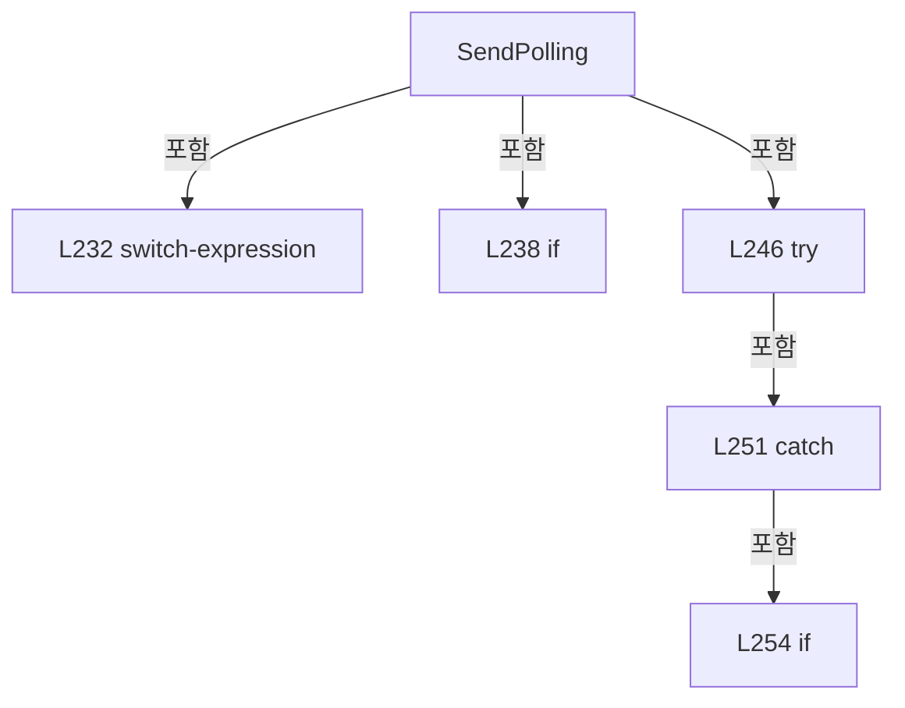

변경 전 점검: 입력/반환 타입, 위 호출자, 예외/취소 경로, 공유 상태와 저장·전송 소비자를 함께 확인합니다. 값의 단위나 물리 방향을 이름만으로 확정하지 않습니다.

### MethodDeclaration `SendAndWaitAck` · L263–267

[Drilling.Common/Interface/Serial/CBeamExpander.cs:263–267](https://github.com/kjuws10-rgb/A3Drilling/blob/5aee8e58439c9b455cae7c9593c9be986c3e682e/Drilling.Common/Interface/Serial/CBeamExpander.cs#L263-L267)

| 항목 | 실제 추출 값 |
| --- | --- |
| 서명 | bool Drilling.Common.Interface.CBeamExpander.SendAndWaitAck(string) |
| 접근/수식자 | Private / private |
| 반환/값 타입 | bool |
| 소속 타입 | NamedType:Drilling.Common.Interface.CBeamExpander |

입력 계약:

| 이름 | 타입 | 전달 | 선택/기본값 |
| --- | --- | --- | --- |
| command | string | None | False /  |

정적 호출자로 확인된 위치:

| 호출 파일/행 | 호출 표현식 | 런타임 분기 가능 |
| --- | --- | --- |
| [Drilling.Common/Interface/Serial/CBeamExpander.cs:210–210](https://github.com/kjuws10-rgb/A3Drilling/blob/5aee8e58439c9b455cae7c9593c9be986c3e682e/Drilling.Common/Interface/Serial/CBeamExpander.cs#L210-L210) | SendAndWaitAck | False |
| [Drilling.Common/Interface/Serial/CBeamExpander.cs:215–215](https://github.com/kjuws10-rgb/A3Drilling/blob/5aee8e58439c9b455cae7c9593c9be986c3e682e/Drilling.Common/Interface/Serial/CBeamExpander.cs#L215-L215) | SendAndWaitAck | False |
| [Drilling.Common/Interface/Serial/CBeamExpander.cs:227–227](https://github.com/kjuws10-rgb/A3Drilling/blob/5aee8e58439c9b455cae7c9593c9be986c3e682e/Drilling.Common/Interface/Serial/CBeamExpander.cs#L227-L227) | SendAndWaitAck | False |

호출하는 대상과 해석 범위:

| 원본 행 | 표현식 | 분석 상태 | 대상/소스 위치 |
| --- | --- | --- | --- |
| 265 | SerialPort!.Write | unresolved | None |
| 265 | NormalizeAckWriteCommand | resolved | string Drilling.Common.Interface.CBeamExpander.NormalizeAckWriteCommand(string) · Drilling.Common/Interface/Serial/CBeamExpander.cs:269 |

본문의 실제 연산·분기·예외·반환 순서(원문 위치 순):

| 원본 행 | 종류 | 주석 해설 |
| --- | --- | --- |
| 265 | call | 함수·델리게이트 또는 객체 생성자를 호출합니다: SerialPort!.Write(NormalizeAckWriteCommand(command)) |
| 265 | call | 함수·델리게이트 또는 객체 생성자를 호출합니다: NormalizeAckWriteCommand(command) |
| 266 | return | 호출자에게 값 또는 제어를 반환합니다: return true; |

변경 전 점검: 입력/반환 타입, 위 호출자, 예외/취소 경로, 공유 상태와 저장·전송 소비자를 함께 확인합니다. 값의 단위나 물리 방향을 이름만으로 확정하지 않습니다.

### MethodDeclaration `NormalizeAckWriteCommand` · L269–273

[Drilling.Common/Interface/Serial/CBeamExpander.cs:269–273](https://github.com/kjuws10-rgb/A3Drilling/blob/5aee8e58439c9b455cae7c9593c9be986c3e682e/Drilling.Common/Interface/Serial/CBeamExpander.cs#L269-L273)

| 항목 | 실제 추출 값 |
| --- | --- |
| 서명 | string Drilling.Common.Interface.CBeamExpander.NormalizeAckWriteCommand(string) |
| 접근/수식자 | Private / private, static |
| 반환/값 타입 | string |
| 소속 타입 | NamedType:Drilling.Common.Interface.CBeamExpander |

입력 계약:

| 이름 | 타입 | 전달 | 선택/기본값 |
| --- | --- | --- | --- |
| command | string | None | False /  |

정적 호출자로 확인된 위치:

| 호출 파일/행 | 호출 표현식 | 런타임 분기 가능 |
| --- | --- | --- |
| [Drilling.Common/Interface/Serial/CBeamExpander.cs:265–265](https://github.com/kjuws10-rgb/A3Drilling/blob/5aee8e58439c9b455cae7c9593c9be986c3e682e/Drilling.Common/Interface/Serial/CBeamExpander.cs#L265-L265) | NormalizeAckWriteCommand | False |

호출하는 대상과 해석 범위:

| 원본 행 | 표현식 | 분석 상태 | 대상/소스 위치 |
| --- | --- | --- | --- |
| 271 | command.Trim | resolved | string string.Trim() |
| 272 | text.EndsWith | resolved | bool string.EndsWith(char) |

본문의 실제 연산·분기·예외·반환 순서(원문 위치 순):

| 원본 행 | 종류 | 주석 해설 |
| --- | --- | --- |
| 271 | call | 함수·델리게이트 또는 객체 생성자를 호출합니다: command.Trim() |
| 271 | local-declaration | 지역 변수를 선언합니다: var text = command.Trim(); |
| 271 | variable-initializer | 변수의 초기값을 지정합니다: text = command.Trim() |
| 272 | call | 함수·델리게이트 또는 객체 생성자를 호출합니다: text.EndsWith('!') |
| 272 | conditional-expression | 조건에 따라 결과식을 선택합니다: text.EndsWith('!') ? text[..^1] : text |
| 272 | return | 호출자에게 값 또는 제어를 반환합니다: return text.EndsWith('!') ? text[..^1] : text; |

변경 전 점검: 입력/반환 타입, 위 호출자, 예외/취소 경로, 공유 상태와 저장·전송 소비자를 함께 확인합니다. 값의 단위나 물리 방향을 이름만으로 확정하지 않습니다.

### MethodDeclaration `NormalizePollingWriteCommand` · L275–283

[Drilling.Common/Interface/Serial/CBeamExpander.cs:275–283](https://github.com/kjuws10-rgb/A3Drilling/blob/5aee8e58439c9b455cae7c9593c9be986c3e682e/Drilling.Common/Interface/Serial/CBeamExpander.cs#L275-L283)

| 항목 | 실제 추출 값 |
| --- | --- |
| 서명 | string Drilling.Common.Interface.CBeamExpander.NormalizePollingWriteCommand(string) |
| 접근/수식자 | Private / private, static |
| 반환/값 타입 | string |
| 소속 타입 | NamedType:Drilling.Common.Interface.CBeamExpander |

입력 계약:

| 이름 | 타입 | 전달 | 선택/기본값 |
| --- | --- | --- | --- |
| command | string | None | False /  |

정적 호출자로 확인된 위치:

| 호출 파일/행 | 호출 표현식 | 런타임 분기 가능 |
| --- | --- | --- |
| [Drilling.Common/Interface/Serial/CBeamExpander.cs:245–245](https://github.com/kjuws10-rgb/A3Drilling/blob/5aee8e58439c9b455cae7c9593c9be986c3e682e/Drilling.Common/Interface/Serial/CBeamExpander.cs#L245-L245) | NormalizePollingWriteCommand | False |

호출하는 대상과 해석 범위:

| 원본 행 | 표현식 | 분석 상태 | 대상/소스 위치 |
| --- | --- | --- | --- |
| 277 | NormalizePollingCommand | resolved | string Drilling.Common.Interface.CBeamExpander.NormalizePollingCommand(string) · Drilling.Common/Interface/Serial/CBeamExpander.cs:291 |

본문의 실제 연산·분기·예외·반환 순서(원문 위치 순):

| 원본 행 | 종류 | 주석 해설 |
| --- | --- | --- |
| 277 | call | 함수·델리게이트 또는 객체 생성자를 호출합니다: NormalizePollingCommand(command) |
| 277 | return | 호출자에게 값 또는 제어를 반환합니다: return NormalizePollingCommand(command) switch { "7" => "#7:", "8" => "#8:", _ => command }; |
| 277 | switch-expression | 값별 결과식을 선택합니다: NormalizePollingCommand(command) switch { "7" => "#7:", "8" => "#8:", _ => command } |

제어 구문의 포함 구조(실제 실행 순서/CFG가 아닌 구문 탐색 그림):

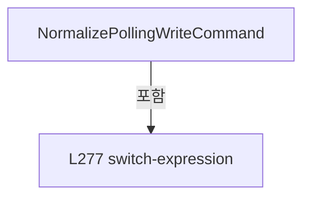

변경 전 점검: 입력/반환 타입, 위 호출자, 예외/취소 경로, 공유 상태와 저장·전송 소비자를 함께 확인합니다. 값의 단위나 물리 방향을 이름만으로 확정하지 않습니다.

### MethodDeclaration `IsPollingCommand` · L285–289

[Drilling.Common/Interface/Serial/CBeamExpander.cs:285–289](https://github.com/kjuws10-rgb/A3Drilling/blob/5aee8e58439c9b455cae7c9593c9be986c3e682e/Drilling.Common/Interface/Serial/CBeamExpander.cs#L285-L289)

| 항목 | 실제 추출 값 |
| --- | --- |
| 서명 | bool Drilling.Common.Interface.CBeamExpander.IsPollingCommand(string) |
| 접근/수식자 | Private / private, static |
| 반환/값 타입 | bool |
| 소속 타입 | NamedType:Drilling.Common.Interface.CBeamExpander |

입력 계약:

| 이름 | 타입 | 전달 | 선택/기본값 |
| --- | --- | --- | --- |
| command | string | None | False /  |

정적 호출자로 확인된 위치:

| 호출 파일/행 | 호출 표현식 | 런타임 분기 가능 |
| --- | --- | --- |
| [Drilling.Common/Interface/Serial/CBeamExpander.cs:191–191](https://github.com/kjuws10-rgb/A3Drilling/blob/5aee8e58439c9b455cae7c9593c9be986c3e682e/Drilling.Common/Interface/Serial/CBeamExpander.cs#L191-L191) | IsPollingCommand | False |

호출하는 대상과 해석 범위:

| 원본 행 | 표현식 | 분석 상태 | 대상/소스 위치 |
| --- | --- | --- | --- |
| 287 | NormalizePollingCommand | resolved | string Drilling.Common.Interface.CBeamExpander.NormalizePollingCommand(string) · Drilling.Common/Interface/Serial/CBeamExpander.cs:291 |

본문의 실제 연산·분기·예외·반환 순서(원문 위치 순):

| 원본 행 | 종류 | 주석 해설 |
| --- | --- | --- |
| 287 | call | 함수·델리게이트 또는 객체 생성자를 호출합니다: NormalizePollingCommand(command) |
| 287 | local-declaration | 지역 변수를 선언합니다: var normalized = NormalizePollingCommand(command); |
| 287 | variable-initializer | 변수의 초기값을 지정합니다: normalized = NormalizePollingCommand(command) |
| 288 | return | 호출자에게 값 또는 제어를 반환합니다: return normalized is "7" or "8"; |

변경 전 점검: 입력/반환 타입, 위 호출자, 예외/취소 경로, 공유 상태와 저장·전송 소비자를 함께 확인합니다. 값의 단위나 물리 방향을 이름만으로 확정하지 않습니다.

### MethodDeclaration `NormalizePollingCommand` · L291–305

[Drilling.Common/Interface/Serial/CBeamExpander.cs:291–305](https://github.com/kjuws10-rgb/A3Drilling/blob/5aee8e58439c9b455cae7c9593c9be986c3e682e/Drilling.Common/Interface/Serial/CBeamExpander.cs#L291-L305)

| 항목 | 실제 추출 값 |
| --- | --- |
| 서명 | string Drilling.Common.Interface.CBeamExpander.NormalizePollingCommand(string) |
| 접근/수식자 | Private / private, static |
| 반환/값 타입 | string |
| 소속 타입 | NamedType:Drilling.Common.Interface.CBeamExpander |

입력 계약:

| 이름 | 타입 | 전달 | 선택/기본값 |
| --- | --- | --- | --- |
| command | string | None | False /  |

정적 호출자로 확인된 위치:

| 호출 파일/행 | 호출 표현식 | 런타임 분기 가능 |
| --- | --- | --- |
| [Drilling.Common/Interface/Serial/CBeamExpander.cs:232–232](https://github.com/kjuws10-rgb/A3Drilling/blob/5aee8e58439c9b455cae7c9593c9be986c3e682e/Drilling.Common/Interface/Serial/CBeamExpander.cs#L232-L232) | NormalizePollingCommand | False |
| [Drilling.Common/Interface/Serial/CBeamExpander.cs:277–277](https://github.com/kjuws10-rgb/A3Drilling/blob/5aee8e58439c9b455cae7c9593c9be986c3e682e/Drilling.Common/Interface/Serial/CBeamExpander.cs#L277-L277) | NormalizePollingCommand | False |
| [Drilling.Common/Interface/Serial/CBeamExpander.cs:287–287](https://github.com/kjuws10-rgb/A3Drilling/blob/5aee8e58439c9b455cae7c9593c9be986c3e682e/Drilling.Common/Interface/Serial/CBeamExpander.cs#L287-L287) | NormalizePollingCommand | False |

호출하는 대상과 해석 범위:

| 원본 행 | 표현식 | 분석 상태 | 대상/소스 위치 |
| --- | --- | --- | --- |
| 293 | command.Trim().ToUpperInvariant | resolved | string string.ToUpperInvariant() |
| 293 | command.Trim | resolved | string string.Trim() |
| 294 | text.StartsWith | resolved | bool string.StartsWith(string, System.StringComparison) |
| 299 | text.StartsWith | resolved | bool string.StartsWith(string, System.StringComparison) |

본문의 실제 연산·분기·예외·반환 순서(원문 위치 순):

| 원본 행 | 종류 | 주석 해설 |
| --- | --- | --- |
| 293 | call | 함수·델리게이트 또는 객체 생성자를 호출합니다: command.Trim().ToUpperInvariant() |
| 293 | call | 함수·델리게이트 또는 객체 생성자를 호출합니다: command.Trim() |
| 293 | local-declaration | 지역 변수를 선언합니다: var text = command.Trim().ToUpperInvariant(); |
| 293 | variable-initializer | 변수의 초기값을 지정합니다: text = command.Trim().ToUpperInvariant() |
| 294 | call | 함수·델리게이트 또는 객체 생성자를 호출합니다: text.StartsWith("#7:", StringComparison.Ordinal) |
| 294 | if | 조건에 따라 분기합니다: if (text.StartsWith("#7:", StringComparison.Ordinal)) |
| 296 | return | 호출자에게 값 또는 제어를 반환합니다: return "7"; |
| 299 | call | 함수·델리게이트 또는 객체 생성자를 호출합니다: text.StartsWith("#8:", StringComparison.Ordinal) |
| 299 | if | 조건에 따라 분기합니다: if (text.StartsWith("#8:", StringComparison.Ordinal)) |
| 301 | return | 호출자에게 값 또는 제어를 반환합니다: return "8"; |
| 304 | return | 호출자에게 값 또는 제어를 반환합니다: return ""; |

제어 구문의 포함 구조(실제 실행 순서/CFG가 아닌 구문 탐색 그림):

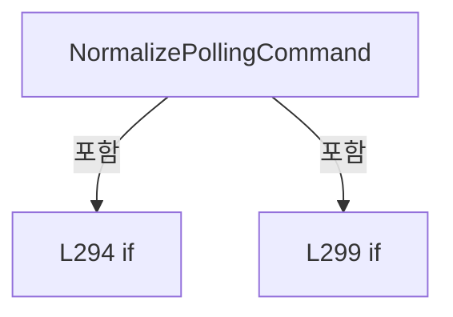

변경 전 점검: 입력/반환 타입, 위 호출자, 예외/취소 경로, 공유 상태와 저장·전송 소비자를 함께 확인합니다. 값의 단위나 물리 방향을 이름만으로 확정하지 않습니다.

### MethodDeclaration `ReadDeviceResponse` · L307–342

[Drilling.Common/Interface/Serial/CBeamExpander.cs:307–342](https://github.com/kjuws10-rgb/A3Drilling/blob/5aee8e58439c9b455cae7c9593c9be986c3e682e/Drilling.Common/Interface/Serial/CBeamExpander.cs#L307-L342)

| 항목 | 실제 추출 값 |
| --- | --- |
| 서명 | string Drilling.Common.Interface.CBeamExpander.ReadDeviceResponse() |
| 접근/수식자 | Private / private |
| 반환/값 타입 | string |
| 소속 타입 | NamedType:Drilling.Common.Interface.CBeamExpander |

정적 호출자로 확인된 위치:

| 호출 파일/행 | 호출 표현식 | 런타임 분기 가능 |
| --- | --- | --- |
| [Drilling.Common/Interface/Serial/CBeamExpander.cs:248–248](https://github.com/kjuws10-rgb/A3Drilling/blob/5aee8e58439c9b455cae7c9593c9be986c3e682e/Drilling.Common/Interface/Serial/CBeamExpander.cs#L248-L248) | ReadDeviceResponse | False |

호출하는 대상과 해석 범위:

| 원본 행 | 표현식 | 분석 상태 | 대상/소스 위치 |
| --- | --- | --- | --- |
| 309 | new StringBuilder | resolved | System.Text.StringBuilder.StringBuilder() |
| 312 | WaitForNextResponseByte | resolved | bool Drilling.Common.Interface.CBeamExpander.WaitForNextResponseByte() · Drilling.Common/Interface/Serial/CBeamExpander.cs:344 |
| 317 | SerialPort!.ReadChar | unresolved | None |
| 334 | builder.Append | resolved | System.Text.StringBuilder System.Text.StringBuilder.Append(char) |
| 341 | builder.ToString | resolved · 동적 구현 선택 가능 | string System.Text.StringBuilder.ToString() |

본문의 실제 연산·분기·예외·반환 순서(원문 위치 순):

| 원본 행 | 종류 | 주석 해설 |
| --- | --- | --- |
| 309 | call | 함수·델리게이트 또는 객체 생성자를 호출합니다: new StringBuilder() |
| 309 | local-declaration | 지역 변수를 선언합니다: var builder = new StringBuilder(); |
| 309 | variable-initializer | 변수의 초기값을 지정합니다: builder = new StringBuilder() |
| 310 | while | 조건을 먼저 확인하며 반복합니다: while (builder.Length < MaxResponseLength) |
| 312 | call | 함수·델리게이트 또는 객체 생성자를 호출합니다: WaitForNextResponseByte() |
| 312 | if | 조건에 따라 분기합니다: if (builder.Length > 0 && !WaitForNextResponseByte()) |
| 314 | break | 해당 반복/분기 구간을 종료합니다: break; |
| 317 | call | 함수·델리게이트 또는 객체 생성자를 호출합니다: SerialPort!.ReadChar() |
| 317 | local-declaration | 지역 변수를 선언합니다: var value = SerialPort!.ReadChar(); |
| 317 | variable-initializer | 변수의 초기값을 지정합니다: value = SerialPort!.ReadChar() |
| 318 | if | 조건에 따라 분기합니다: if (value < 0) |
| 320 | break | 해당 반복/분기 구간을 종료합니다: break; |
| 323 | local-declaration | 지역 변수를 선언합니다: var character = (char)value; |
| 323 | variable-initializer | 변수의 초기값을 지정합니다: character = (char)value |
| 324 | if | 조건에 따라 분기합니다: if (character is '\r' or '\n') |
| 326 | if | 조건에 따라 분기합니다: if (builder.Length > 0) |
| 328 | break | 해당 반복/분기 구간을 종료합니다: break; |
| 331 | continue | 다음 반복으로 진행합니다: continue; |
| 334 | call | 함수·델리게이트 또는 객체 생성자를 호출합니다: builder.Append(character) |
| 335 | if | 조건에 따라 분기합니다: if (character == '!') |
| 337 | break | 해당 반복/분기 구간을 종료합니다: break; |
| 341 | call | 함수·델리게이트 또는 객체 생성자를 호출합니다: builder.ToString() |
| 341 | return | 호출자에게 값 또는 제어를 반환합니다: return builder.ToString(); |

제어 구문의 포함 구조(실제 실행 순서/CFG가 아닌 구문 탐색 그림):

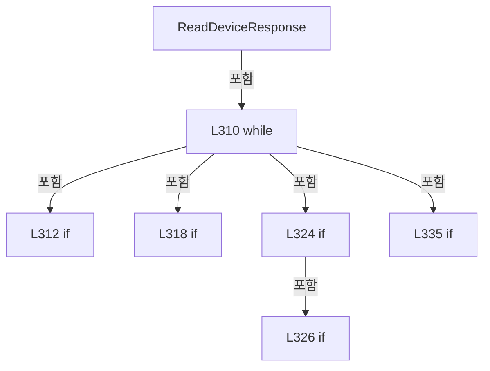

변경 전 점검: 입력/반환 타입, 위 호출자, 예외/취소 경로, 공유 상태와 저장·전송 소비자를 함께 확인합니다. 값의 단위나 물리 방향을 이름만으로 확정하지 않습니다.

### MethodDeclaration `WaitForNextResponseByte` · L344–362

[Drilling.Common/Interface/Serial/CBeamExpander.cs:344–362](https://github.com/kjuws10-rgb/A3Drilling/blob/5aee8e58439c9b455cae7c9593c9be986c3e682e/Drilling.Common/Interface/Serial/CBeamExpander.cs#L344-L362)

| 항목 | 실제 추출 값 |
| --- | --- |
| 서명 | bool Drilling.Common.Interface.CBeamExpander.WaitForNextResponseByte() |
| 접근/수식자 | Private / private |
| 반환/값 타입 | bool |
| 소속 타입 | NamedType:Drilling.Common.Interface.CBeamExpander |

정적 호출자로 확인된 위치:

| 호출 파일/행 | 호출 표현식 | 런타임 분기 가능 |
| --- | --- | --- |
| [Drilling.Common/Interface/Serial/CBeamExpander.cs:312–312](https://github.com/kjuws10-rgb/A3Drilling/blob/5aee8e58439c9b455cae7c9593c9be986c3e682e/Drilling.Common/Interface/Serial/CBeamExpander.cs#L312-L312) | WaitForNextResponseByte | False |

호출하는 대상과 해석 범위:

| 원본 행 | 표현식 | 분석 상태 | 대상/소스 위치 |
| --- | --- | --- | --- |
| 354 | Thread.Sleep | resolved | void System.Threading.Thread.Sleep(int) |

본문의 실제 연산·분기·예외·반환 순서(원문 위치 순):

| 원본 행 | 종류 | 주석 해설 |
| --- | --- | --- |
| 346 | if | 조건에 따라 분기합니다: if (SerialPort!.BytesToRead > 0) |
| 348 | return | 호출자에게 값 또는 제어를 반환합니다: return true; |
| 351 | local-declaration | 지역 변수를 선언합니다: var expiresAt = Environment.TickCount64 + ResponseQuietTimeoutMs; |
| 351 | variable-initializer | 변수의 초기값을 지정합니다: expiresAt = Environment.TickCount64 + ResponseQuietTimeoutMs |
| 352 | while | 조건을 먼저 확인하며 반복합니다: while (Environment.TickCount64 < expiresAt) |
| 354 | call | 함수·델리게이트 또는 객체 생성자를 호출합니다: Thread.Sleep(ResponsePollIntervalMs) |
| 355 | if | 조건에 따라 분기합니다: if (SerialPort.BytesToRead > 0) |
| 357 | return | 호출자에게 값 또는 제어를 반환합니다: return true; |
| 361 | return | 호출자에게 값 또는 제어를 반환합니다: return false; |

제어 구문의 포함 구조(실제 실행 순서/CFG가 아닌 구문 탐색 그림):

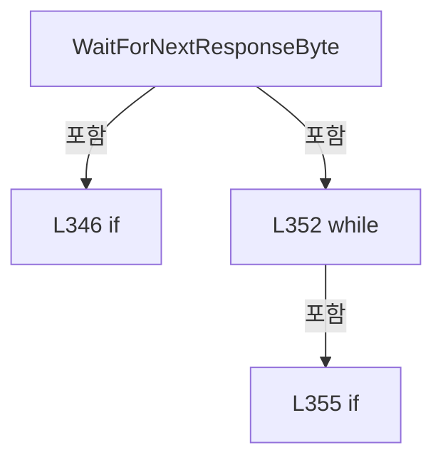

변경 전 점검: 입력/반환 타입, 위 호출자, 예외/취소 경로, 공유 상태와 저장·전송 소비자를 함께 확인합니다. 값의 단위나 물리 방향을 이름만으로 확정하지 않습니다.

### MethodDeclaration `ToMotorStep` · L364–367

[Drilling.Common/Interface/Serial/CBeamExpander.cs:364–367](https://github.com/kjuws10-rgb/A3Drilling/blob/5aee8e58439c9b455cae7c9593c9be986c3e682e/Drilling.Common/Interface/Serial/CBeamExpander.cs#L364-L367)

| 항목 | 실제 추출 값 |
| --- | --- |
| 서명 | int Drilling.Common.Interface.CBeamExpander.ToMotorStep(double) |
| 접근/수식자 | Private / private, static |
| 반환/값 타입 | int |
| 소속 타입 | NamedType:Drilling.Common.Interface.CBeamExpander |

입력 계약:

| 이름 | 타입 | 전달 | 선택/기본값 |
| --- | --- | --- | --- |
| value | double | None | False /  |

정적 호출자로 확인된 위치:

| 호출 파일/행 | 호출 표현식 | 런타임 분기 가능 |
| --- | --- | --- |
| [Drilling.Common/Interface/Serial/CBeamExpander.cs:25–25](https://github.com/kjuws10-rgb/A3Drilling/blob/5aee8e58439c9b455cae7c9593c9be986c3e682e/Drilling.Common/Interface/Serial/CBeamExpander.cs#L25-L25) | ToMotorStep | False |
| [Drilling.Common/Interface/Serial/CBeamExpander.cs:26–26](https://github.com/kjuws10-rgb/A3Drilling/blob/5aee8e58439c9b455cae7c9593c9be986c3e682e/Drilling.Common/Interface/Serial/CBeamExpander.cs#L26-L26) | ToMotorStep | False |
| [Drilling.Common/Interface/Serial/CBeamExpander.cs:39–39](https://github.com/kjuws10-rgb/A3Drilling/blob/5aee8e58439c9b455cae7c9593c9be986c3e682e/Drilling.Common/Interface/Serial/CBeamExpander.cs#L39-L39) | ToMotorStep | False |
| [Drilling.Common/Interface/Serial/CBeamExpander.cs:39–39](https://github.com/kjuws10-rgb/A3Drilling/blob/5aee8e58439c9b455cae7c9593c9be986c3e682e/Drilling.Common/Interface/Serial/CBeamExpander.cs#L39-L39) | ToMotorStep | False |
| [Drilling.Common/Interface/Serial/CBeamExpander.cs:40–40](https://github.com/kjuws10-rgb/A3Drilling/blob/5aee8e58439c9b455cae7c9593c9be986c3e682e/Drilling.Common/Interface/Serial/CBeamExpander.cs#L40-L40) | ToMotorStep | False |
| [Drilling.Common/Interface/Serial/CBeamExpander.cs:41–41](https://github.com/kjuws10-rgb/A3Drilling/blob/5aee8e58439c9b455cae7c9593c9be986c3e682e/Drilling.Common/Interface/Serial/CBeamExpander.cs#L41-L41) | ToMotorStep | False |
| [Drilling.Common/Interface/Serial/CBeamExpander.cs:207–207](https://github.com/kjuws10-rgb/A3Drilling/blob/5aee8e58439c9b455cae7c9593c9be986c3e682e/Drilling.Common/Interface/Serial/CBeamExpander.cs#L207-L207) | ToMotorStep | False |
| [Drilling.Common/Interface/Serial/CBeamExpander.cs:208–208](https://github.com/kjuws10-rgb/A3Drilling/blob/5aee8e58439c9b455cae7c9593c9be986c3e682e/Drilling.Common/Interface/Serial/CBeamExpander.cs#L208-L208) | ToMotorStep | False |

호출하는 대상과 해석 범위:

| 원본 행 | 표현식 | 분석 상태 | 대상/소스 위치 |
| --- | --- | --- | --- |
| 366 | Math.Clamp | resolved | int System.Math.Clamp(int, int, int) |
| 366 | Math.Round | resolved | double System.Math.Round(double) |

본문의 실제 연산·분기·예외·반환 순서(원문 위치 순):

| 원본 행 | 종류 | 주석 해설 |
| --- | --- | --- |
| 366 | call | 함수·델리게이트 또는 객체 생성자를 호출합니다: Math.Clamp((int)Math.Round(value), 0, 4500) |
| 366 | call | 함수·델리게이트 또는 객체 생성자를 호출합니다: Math.Round(value) |
| 366 | return | 호출자에게 값 또는 제어를 반환합니다: return Math.Clamp((int)Math.Round(value), 0, 4500); |

변경 전 점검: 입력/반환 타입, 위 호출자, 예외/취소 경로, 공유 상태와 저장·전송 소비자를 함께 확인합니다. 값의 단위나 물리 방향을 이름만으로 확정하지 않습니다.

### MethodDeclaration `CreateSimulationResponse` · L369–378

[Drilling.Common/Interface/Serial/CBeamExpander.cs:369–378](https://github.com/kjuws10-rgb/A3Drilling/blob/5aee8e58439c9b455cae7c9593c9be986c3e682e/Drilling.Common/Interface/Serial/CBeamExpander.cs#L369-L378)

| 항목 | 실제 추출 값 |
| --- | --- |
| 서명 | string Drilling.Common.Interface.CBeamExpander.CreateSimulationResponse(Drilling.Common.Interface.EN_BET_COMMAND, double, double, Drilling.Common.Interface.ST_BET_STATUS) |
| 접근/수식자 | Private / private, static |
| 반환/값 타입 | string |
| 소속 타입 | NamedType:Drilling.Common.Interface.CBeamExpander |

입력 계약:

| 이름 | 타입 | 전달 | 선택/기본값 |
| --- | --- | --- | --- |
| command | Drilling.Common.Interface.EN_BET_COMMAND | None | False /  |
| magnification | double | None | False /  |
| divergence | double | None | False /  |
| current | Drilling.Common.Interface.ST_BET_STATUS | None | False /  |

정적 호출자로 확인된 위치:

| 호출 파일/행 | 호출 표현식 | 런타임 분기 가능 |
| --- | --- | --- |
| [Drilling.Common/Interface/Serial/CBeamExpander.cs:52–52](https://github.com/kjuws10-rgb/A3Drilling/blob/5aee8e58439c9b455cae7c9593c9be986c3e682e/Drilling.Common/Interface/Serial/CBeamExpander.cs#L52-L52) | CreateSimulationResponse | False |

호출하는 대상과 해석 범위:

| 원본 행 | 표현식 | 분석 상태 | 대상/소스 위치 |
| --- | --- | --- | --- |
| 373 | current.CurrentMagnification.ToString | resolved | string double.ToString(string?, System.IFormatProvider?) |
| 374 | current.CurrentDivergence.ToString | resolved | string double.ToString(string?, System.IFormatProvider?) |
| 375 | magnification.ToString | resolved | string double.ToString(string?, System.IFormatProvider?) |
| 375 | divergence.ToString | resolved | string double.ToString(string?, System.IFormatProvider?) |

본문의 실제 연산·분기·예외·반환 순서(원문 위치 순):

| 원본 행 | 종류 | 주석 해설 |
| --- | --- | --- |
| 371 | return | 호출자에게 값 또는 제어를 반환합니다: return command switch { EN_BET_COMMAND.PollMagnificationPosition or EN_BET_COMMAND.Refresh => $"M2:{current.CurrentMagnification.ToString("F3", CultureInfo.InvariantCulture)}", EN_BET_COMMAND.PollDivergencePosition => $"M1:{curren |
| 371 | switch-expression | 값별 결과식을 선택합니다: command switch { EN_BET_COMMAND.PollMagnificationPosition or EN_BET_COMMAND.Refresh => $"M2:{current.CurrentMagnification.ToString("F3", CultureInfo.InvariantCulture)}", EN_BET_COMMAND.PollDivergencePosition => $"M1:{current.Curre |
| 373 | call | 함수·델리게이트 또는 객체 생성자를 호출합니다: current.CurrentMagnification.ToString("F3", CultureInfo.InvariantCulture) |
| 374 | call | 함수·델리게이트 또는 객체 생성자를 호출합니다: current.CurrentDivergence.ToString("F3", CultureInfo.InvariantCulture) |
| 375 | call | 함수·델리게이트 또는 객체 생성자를 호출합니다: magnification.ToString("F3", CultureInfo.InvariantCulture) |
| 375 | call | 함수·델리게이트 또는 객체 생성자를 호출합니다: divergence.ToString("F3", CultureInfo.InvariantCulture) |

제어 구문의 포함 구조(실제 실행 순서/CFG가 아닌 구문 탐색 그림):

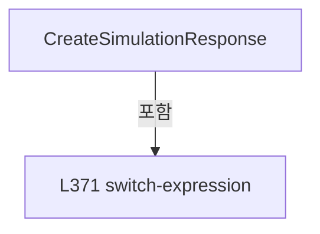

변경 전 점검: 입력/반환 타입, 위 호출자, 예외/취소 경로, 공유 상태와 저장·전송 소비자를 함께 확인합니다. 값의 단위나 물리 방향을 이름만으로 확정하지 않습니다.

### MethodDeclaration `ReadError` · L380–395

[Drilling.Common/Interface/Serial/CBeamExpander.cs:380–395](https://github.com/kjuws10-rgb/A3Drilling/blob/5aee8e58439c9b455cae7c9593c9be986c3e682e/Drilling.Common/Interface/Serial/CBeamExpander.cs#L380-L395)

| 항목 | 실제 추출 값 |
| --- | --- |
| 서명 | Drilling.Common.Interface.EN_BET_ERROR Drilling.Common.Interface.CBeamExpander.ReadError(string) |
| 접근/수식자 | Private / private, static |
| 반환/값 타입 | Drilling.Common.Interface.EN_BET_ERROR |
| 소속 타입 | NamedType:Drilling.Common.Interface.CBeamExpander |

입력 계약:

| 이름 | 타입 | 전달 | 선택/기본값 |
| --- | --- | --- | --- |
| response | string | None | False /  |

정적 호출자로 확인된 위치:

| 호출 파일/행 | 호출 표현식 | 런타임 분기 가능 |
| --- | --- | --- |
| [Drilling.Common/Interface/Serial/CBeamExpander.cs:58–58](https://github.com/kjuws10-rgb/A3Drilling/blob/5aee8e58439c9b455cae7c9593c9be986c3e682e/Drilling.Common/Interface/Serial/CBeamExpander.cs#L58-L58) | ReadError | False |

호출하는 대상과 해석 범위:

| 원본 행 | 표현식 | 분석 상태 | 대상/소스 위치 |
| --- | --- | --- | --- |
| 382 | response.StartsWith | resolved | bool string.StartsWith(string, System.StringComparison) |
| 383 | int.TryParse | resolved | bool int.TryParse(string?, System.Globalization.NumberStyles, System.IFormatProvider?, out int) |

본문의 실제 연산·분기·예외·반환 순서(원문 위치 순):

| 원본 행 | 종류 | 주석 해설 |
| --- | --- | --- |
| 382 | call | 함수·델리게이트 또는 객체 생성자를 호출합니다: response.StartsWith("ERR:", StringComparison.OrdinalIgnoreCase) |
| 382 | conditional-expression | 조건에 따라 결과식을 선택합니다: response.StartsWith("ERR:", StringComparison.OrdinalIgnoreCase) ? response[4..] : "" |
| 382 | local-declaration | 지역 변수를 선언합니다: var value = response.StartsWith("ERR:", StringComparison.OrdinalIgnoreCase) ? response[4..] : ""; |
| 382 | variable-initializer | 변수의 초기값을 지정합니다: value = response.StartsWith("ERR:", StringComparison.OrdinalIgnoreCase) ? response[4..] : "" |
| 383 | call | 함수·델리게이트 또는 객체 생성자를 호출합니다: int.TryParse(value, NumberStyles.Integer, CultureInfo.InvariantCulture, out var code) |
| 383 | if | 조건에 따라 분기합니다: if (!int.TryParse(value, NumberStyles.Integer, CultureInfo.InvariantCulture, out var code)) |
| 385 | return | 호출자에게 값 또는 제어를 반환합니다: return EN_BET_ERROR.Error; |
| 388 | return | 호출자에게 값 또는 제어를 반환합니다: return code switch { -99 => EN_BET_ERROR.NotSupported, -2 => EN_BET_ERROR.InvalidResponse, -1 => EN_BET_ERROR.Timeout, _ => EN_BET_ERROR.Error }; |
| 388 | switch-expression | 값별 결과식을 선택합니다: code switch { -99 => EN_BET_ERROR.NotSupported, -2 => EN_BET_ERROR.InvalidResponse, -1 => EN_BET_ERROR.Timeout, _ => EN_BET_ERROR.Error } |

제어 구문의 포함 구조(실제 실행 순서/CFG가 아닌 구문 탐색 그림):

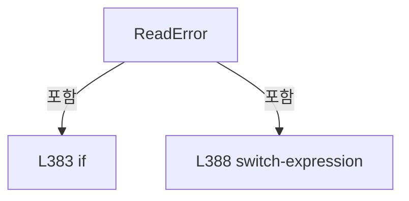

변경 전 점검: 입력/반환 타입, 위 호출자, 예외/취소 경로, 공유 상태와 저장·전송 소비자를 함께 확인합니다. 값의 단위나 물리 방향을 이름만으로 확정하지 않습니다.

### MethodDeclaration `ReadTaggedDouble` · L397–402

[Drilling.Common/Interface/Serial/CBeamExpander.cs:397–402](https://github.com/kjuws10-rgb/A3Drilling/blob/5aee8e58439c9b455cae7c9593c9be986c3e682e/Drilling.Common/Interface/Serial/CBeamExpander.cs#L397-L402)

| 항목 | 실제 추출 값 |
| --- | --- |
| 서명 | double Drilling.Common.Interface.CBeamExpander.ReadTaggedDouble(string, string, double) |
| 접근/수식자 | Private / private, static |
| 반환/값 타입 | double |
| 소속 타입 | NamedType:Drilling.Common.Interface.CBeamExpander |

입력 계약:

| 이름 | 타입 | 전달 | 선택/기본값 |
| --- | --- | --- | --- |
| response | string | None | False /  |
| tag | string | None | False /  |
| defaultValue | double | None | False /  |

정적 호출자로 확인된 위치:

| 호출 파일/행 | 호출 표현식 | 런타임 분기 가능 |
| --- | --- | --- |
| [Drilling.Common/Interface/Serial/CBeamExpander.cs:117–117](https://github.com/kjuws10-rgb/A3Drilling/blob/5aee8e58439c9b455cae7c9593c9be986c3e682e/Drilling.Common/Interface/Serial/CBeamExpander.cs#L117-L117) | ReadTaggedDouble | False |
| [Drilling.Common/Interface/Serial/CBeamExpander.cs:118–118](https://github.com/kjuws10-rgb/A3Drilling/blob/5aee8e58439c9b455cae7c9593c9be986c3e682e/Drilling.Common/Interface/Serial/CBeamExpander.cs#L118-L118) | ReadTaggedDouble | False |
| [Drilling.Common/Interface/Serial/CBeamExpander.cs:123–123](https://github.com/kjuws10-rgb/A3Drilling/blob/5aee8e58439c9b455cae7c9593c9be986c3e682e/Drilling.Common/Interface/Serial/CBeamExpander.cs#L123-L123) | ReadTaggedDouble | False |
| [Drilling.Common/Interface/Serial/CBeamExpander.cs:124–124](https://github.com/kjuws10-rgb/A3Drilling/blob/5aee8e58439c9b455cae7c9593c9be986c3e682e/Drilling.Common/Interface/Serial/CBeamExpander.cs#L124-L124) | ReadTaggedDouble | False |

호출하는 대상과 해석 범위:

| 원본 행 | 표현식 | 분석 상태 | 대상/소스 위치 |
| --- | --- | --- | --- |
| 400 | response.StartsWith | resolved | bool string.StartsWith(string, System.StringComparison) |
| 401 | double.TryParse | resolved | bool double.TryParse(string?, System.Globalization.NumberStyles, System.IFormatProvider?, out double) |

본문의 실제 연산·분기·예외·반환 순서(원문 위치 순):

| 원본 행 | 종류 | 주석 해설 |
| --- | --- | --- |
| 399 | local-declaration | 지역 변수를 선언합니다: var prefix = $"{tag}:"; |
| 399 | variable-initializer | 변수의 초기값을 지정합니다: prefix = $"{tag}:" |
| 400 | call | 함수·델리게이트 또는 객체 생성자를 호출합니다: response.StartsWith(prefix, StringComparison.OrdinalIgnoreCase) |
| 400 | conditional-expression | 조건에 따라 결과식을 선택합니다: response.StartsWith(prefix, StringComparison.OrdinalIgnoreCase) ? response[prefix.Length..] : response |
| 400 | local-declaration | 지역 변수를 선언합니다: var value = response.StartsWith(prefix, StringComparison.OrdinalIgnoreCase) ? response[prefix.Length..] : response; |
| 400 | variable-initializer | 변수의 초기값을 지정합니다: value = response.StartsWith(prefix, StringComparison.OrdinalIgnoreCase) ? response[prefix.Length..] : response |
| 401 | call | 함수·델리게이트 또는 객체 생성자를 호출합니다: double.TryParse(value, NumberStyles.Float, CultureInfo.InvariantCulture, out var result) |
| 401 | conditional-expression | 조건에 따라 결과식을 선택합니다: double.TryParse(value, NumberStyles.Float, CultureInfo.InvariantCulture, out var result) ? result : defaultValue |
| 401 | return | 호출자에게 값 또는 제어를 반환합니다: return double.TryParse(value, NumberStyles.Float, CultureInfo.InvariantCulture, out var result) ? result : defaultValue; |

변경 전 점검: 입력/반환 타입, 위 호출자, 예외/취소 경로, 공유 상태와 저장·전송 소비자를 함께 확인합니다. 값의 단위나 물리 방향을 이름만으로 확정하지 않습니다.

### MethodDeclaration `TryReadBeamPosition` · L404–423

[Drilling.Common/Interface/Serial/CBeamExpander.cs:404–423](https://github.com/kjuws10-rgb/A3Drilling/blob/5aee8e58439c9b455cae7c9593c9be986c3e682e/Drilling.Common/Interface/Serial/CBeamExpander.cs#L404-L423)

| 항목 | 실제 추출 값 |
| --- | --- |
| 서명 | bool Drilling.Common.Interface.CBeamExpander.TryReadBeamPosition(string, out double) |
| 접근/수식자 | Private / private, static |
| 반환/값 타입 | bool |
| 소속 타입 | NamedType:Drilling.Common.Interface.CBeamExpander |

입력 계약:

| 이름 | 타입 | 전달 | 선택/기본값 |
| --- | --- | --- | --- |
| response | string | None | False /  |
| position | double | Out | False /  |

정적 호출자로 확인된 위치:

| 호출 파일/행 | 호출 표현식 | 런타임 분기 가능 |
| --- | --- | --- |
| [Drilling.Common/Interface/Serial/CBeamExpander.cs:249–249](https://github.com/kjuws10-rgb/A3Drilling/blob/5aee8e58439c9b455cae7c9593c9be986c3e682e/Drilling.Common/Interface/Serial/CBeamExpander.cs#L249-L249) | TryReadBeamPosition | False |

호출하는 대상과 해석 범위:

| 원본 행 | 표현식 | 분석 상태 | 대상/소스 위치 |
| --- | --- | --- | --- |
| 406 | response.Trim | resolved | string string.Trim() |
| 407 | text.IndexOf | resolved | int string.IndexOf(char, System.StringComparison) |
| 414 | new string | resolved | string.String(char[]?) |
| 414 | value.TakeWhile(MatchesChar).ToArray | resolved | char[] System.Collections.Generic.IEnumerable<char>.ToArray<char>() |
| 414 | value.TakeWhile | resolved | System.Collections.Generic.IEnumerable<char> System.Collections.Generic.IEnumerable<char>.TakeWhile<char>(System.Func<char, bool>) |
| 415 | double.TryParse | resolved | bool double.TryParse(string?, System.Globalization.NumberStyles, System.IFormatProvider?, out double) |
| 415 | double.IsFinite | resolved | bool double.IsFinite(double) |

본문의 실제 연산·분기·예외·반환 순서(원문 위치 순):

| 원본 행 | 종류 | 주석 해설 |
| --- | --- | --- |
| 406 | call | 함수·델리게이트 또는 객체 생성자를 호출합니다: response.Trim() |
| 406 | local-declaration | 지역 변수를 선언합니다: var text = response.Trim(); |
| 406 | variable-initializer | 변수의 초기값을 지정합니다: text = response.Trim() |
| 407 | call | 함수·델리게이트 또는 객체 생성자를 호출합니다: text.IndexOf(':', StringComparison.Ordinal) |
| 407 | local-declaration | 지역 변수를 선언합니다: var colonIndex = text.IndexOf(':', StringComparison.Ordinal); |
| 407 | variable-initializer | 변수의 초기값을 지정합니다: colonIndex = text.IndexOf(':', StringComparison.Ordinal) |
| 408 | conditional-expression | 조건에 따라 결과식을 선택합니다: colonIndex >= 0 ? text[(colonIndex + 1)..] : text |
| 408 | local-declaration | 지역 변수를 선언합니다: var value = colonIndex >= 0 ? text[(colonIndex + 1)..] : text; |
| 408 | variable-initializer | 변수의 초기값을 지정합니다: value = colonIndex >= 0 ? text[(colonIndex + 1)..] : text |
| 414 | assignment | 값을 대상에 대입합니다: value = new string (value.TakeWhile(MatchesChar).ToArray()) |
| 414 | call | 함수·델리게이트 또는 객체 생성자를 호출합니다: new string (value.TakeWhile(MatchesChar).ToArray()) |
| 414 | call | 함수·델리게이트 또는 객체 생성자를 호출합니다: value.TakeWhile(MatchesChar).ToArray() |
| 414 | call | 함수·델리게이트 또는 객체 생성자를 호출합니다: value.TakeWhile(MatchesChar) |
| 415 | call | 함수·델리게이트 또는 객체 생성자를 호출합니다: double.TryParse(value, NumberStyles.Float, CultureInfo.InvariantCulture, out var step) |
| 415 | call | 함수·델리게이트 또는 객체 생성자를 호출합니다: double.IsFinite(step) |
| 415 | if | 조건에 따라 분기합니다: if (!double.TryParse(value, NumberStyles.Float, CultureInfo.InvariantCulture, out var step) &#124;&#124; !double.IsFinite(step)) |
| 417 | assignment | 값을 대상에 대입합니다: position = 0.0 |
| 418 | return | 호출자에게 값 또는 제어를 반환합니다: return false; |
| 421 | assignment | 값을 대상에 대입합니다: position = step |
| 422 | return | 호출자에게 값 또는 제어를 반환합니다: return true; |

제어 구문의 포함 구조(실제 실행 순서/CFG가 아닌 구문 탐색 그림):

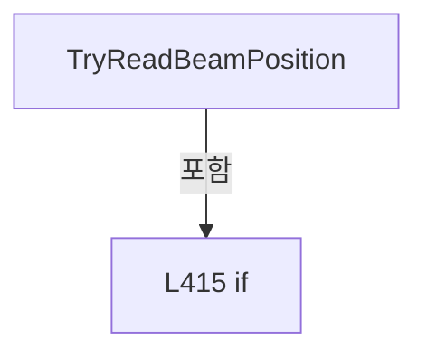

변경 전 점검: 입력/반환 타입, 위 호출자, 예외/취소 경로, 공유 상태와 저장·전송 소비자를 함께 확인합니다. 값의 단위나 물리 방향을 이름만으로 확정하지 않습니다.

### LocalFunctionStatement `MatchesChar` · L409–412

[Drilling.Common/Interface/Serial/CBeamExpander.cs:409–412](https://github.com/kjuws10-rgb/A3Drilling/blob/5aee8e58439c9b455cae7c9593c9be986c3e682e/Drilling.Common/Interface/Serial/CBeamExpander.cs#L409-L412)

| 항목 | 실제 추출 값 |
| --- | --- |
| 서명 | bool MatchesChar(char) |
| 접근/수식자 | Private /  |
| 반환/값 타입 | bool |
| 소속 타입 | NamedType:Drilling.Common.Interface.CBeamExpander |

입력 계약:

| 이름 | 타입 | 전달 | 선택/기본값 |
| --- | --- | --- | --- |
| character | char | None | False /  |

현재 부분 분석에서 직접 연결된 호출자는 없습니다. XAML/이벤트/인터페이스·델리게이트·외부 진입을 추가 확인해야 하며, 미사용으로 판정한 것이 아닙니다.

호출하는 대상과 해석 범위:

| 원본 행 | 표현식 | 분석 상태 | 대상/소스 위치 |
| --- | --- | --- | --- |
| 411 | char.IsDigit | resolved | bool char.IsDigit(char) |

본문의 실제 연산·분기·예외·반환 순서(원문 위치 순):

| 원본 행 | 종류 | 주석 해설 |
| --- | --- | --- |
| 411 | call | 함수·델리게이트 또는 객체 생성자를 호출합니다: char.IsDigit(character) |
| 411 | return | 호출자에게 값 또는 제어를 반환합니다: return char.IsDigit(character) &#124;&#124; character == '-' &#124;&#124; character == '+' &#124;&#124; character == '.'; |

변경 전 점검: 입력/반환 타입, 위 호출자, 예외/취소 경로, 공유 상태와 저장·전송 소비자를 함께 확인합니다. 값의 단위나 물리 방향을 이름만으로 확정하지 않습니다.

### EnumMemberDeclaration `InitMotor` · L428–428

[Drilling.Common/Interface/Serial/CBeamExpander.cs:428–428](https://github.com/kjuws10-rgb/A3Drilling/blob/5aee8e58439c9b455cae7c9593c9be986c3e682e/Drilling.Common/Interface/Serial/CBeamExpander.cs#L428-L428)

| 항목 | 실제 추출 값 |
| --- | --- |
| 서명 | Drilling.Common.Interface.EN_BET_COMMAND.InitMotor |
| 접근/수식자 | Public /  |
| 반환/값 타입 | Drilling.Common.Interface.EN_BET_COMMAND |
| 소속 타입 | NamedType:Drilling.Common.Interface.EN_BET_COMMAND |

현재 부분 분석에서 직접 연결된 호출자는 없습니다. XAML/이벤트/인터페이스·델리게이트·외부 진입을 추가 확인해야 하며, 미사용으로 판정한 것이 아닙니다.

변경 전 점검: 입력/반환 타입, 위 호출자, 예외/취소 경로, 공유 상태와 저장·전송 소비자를 함께 확인합니다. 값의 단위나 물리 방향을 이름만으로 확정하지 않습니다.

### EnumMemberDeclaration `MoveManual` · L429–429

[Drilling.Common/Interface/Serial/CBeamExpander.cs:429–429](https://github.com/kjuws10-rgb/A3Drilling/blob/5aee8e58439c9b455cae7c9593c9be986c3e682e/Drilling.Common/Interface/Serial/CBeamExpander.cs#L429-L429)

| 항목 | 실제 추출 값 |
| --- | --- |
| 서명 | Drilling.Common.Interface.EN_BET_COMMAND.MoveManual |
| 접근/수식자 | Public /  |
| 반환/값 타입 | Drilling.Common.Interface.EN_BET_COMMAND |
| 소속 타입 | NamedType:Drilling.Common.Interface.EN_BET_COMMAND |

현재 부분 분석에서 직접 연결된 호출자는 없습니다. XAML/이벤트/인터페이스·델리게이트·외부 진입을 추가 확인해야 하며, 미사용으로 판정한 것이 아닙니다.

변경 전 점검: 입력/반환 타입, 위 호출자, 예외/취소 경로, 공유 상태와 저장·전송 소비자를 함께 확인합니다. 값의 단위나 물리 방향을 이름만으로 확정하지 않습니다.

### EnumMemberDeclaration `MoveMagnification` · L430–430

[Drilling.Common/Interface/Serial/CBeamExpander.cs:430–430](https://github.com/kjuws10-rgb/A3Drilling/blob/5aee8e58439c9b455cae7c9593c9be986c3e682e/Drilling.Common/Interface/Serial/CBeamExpander.cs#L430-L430)

| 항목 | 실제 추출 값 |
| --- | --- |
| 서명 | Drilling.Common.Interface.EN_BET_COMMAND.MoveMagnification |
| 접근/수식자 | Public /  |
| 반환/값 타입 | Drilling.Common.Interface.EN_BET_COMMAND |
| 소속 타입 | NamedType:Drilling.Common.Interface.EN_BET_COMMAND |

현재 부분 분석에서 직접 연결된 호출자는 없습니다. XAML/이벤트/인터페이스·델리게이트·외부 진입을 추가 확인해야 하며, 미사용으로 판정한 것이 아닙니다.

변경 전 점검: 입력/반환 타입, 위 호출자, 예외/취소 경로, 공유 상태와 저장·전송 소비자를 함께 확인합니다. 값의 단위나 물리 방향을 이름만으로 확정하지 않습니다.

### EnumMemberDeclaration `MoveDivergence` · L431–431

[Drilling.Common/Interface/Serial/CBeamExpander.cs:431–431](https://github.com/kjuws10-rgb/A3Drilling/blob/5aee8e58439c9b455cae7c9593c9be986c3e682e/Drilling.Common/Interface/Serial/CBeamExpander.cs#L431-L431)

| 항목 | 실제 추출 값 |
| --- | --- |
| 서명 | Drilling.Common.Interface.EN_BET_COMMAND.MoveDivergence |
| 접근/수식자 | Public /  |
| 반환/값 타입 | Drilling.Common.Interface.EN_BET_COMMAND |
| 소속 타입 | NamedType:Drilling.Common.Interface.EN_BET_COMMAND |

현재 부분 분석에서 직접 연결된 호출자는 없습니다. XAML/이벤트/인터페이스·델리게이트·외부 진입을 추가 확인해야 하며, 미사용으로 판정한 것이 아닙니다.

변경 전 점검: 입력/반환 타입, 위 호출자, 예외/취소 경로, 공유 상태와 저장·전송 소비자를 함께 확인합니다. 값의 단위나 물리 방향을 이름만으로 확정하지 않습니다.

### EnumMemberDeclaration `MoveTable` · L432–432

[Drilling.Common/Interface/Serial/CBeamExpander.cs:432–432](https://github.com/kjuws10-rgb/A3Drilling/blob/5aee8e58439c9b455cae7c9593c9be986c3e682e/Drilling.Common/Interface/Serial/CBeamExpander.cs#L432-L432)

| 항목 | 실제 추출 값 |
| --- | --- |
| 서명 | Drilling.Common.Interface.EN_BET_COMMAND.MoveTable |
| 접근/수식자 | Public /  |
| 반환/값 타입 | Drilling.Common.Interface.EN_BET_COMMAND |
| 소속 타입 | NamedType:Drilling.Common.Interface.EN_BET_COMMAND |

현재 부분 분석에서 직접 연결된 호출자는 없습니다. XAML/이벤트/인터페이스·델리게이트·외부 진입을 추가 확인해야 하며, 미사용으로 판정한 것이 아닙니다.

변경 전 점검: 입력/반환 타입, 위 호출자, 예외/취소 경로, 공유 상태와 저장·전송 소비자를 함께 확인합니다. 값의 단위나 물리 방향을 이름만으로 확정하지 않습니다.

### EnumMemberDeclaration `Stop` · L433–433

[Drilling.Common/Interface/Serial/CBeamExpander.cs:433–433](https://github.com/kjuws10-rgb/A3Drilling/blob/5aee8e58439c9b455cae7c9593c9be986c3e682e/Drilling.Common/Interface/Serial/CBeamExpander.cs#L433-L433)

| 항목 | 실제 추출 값 |
| --- | --- |
| 서명 | Drilling.Common.Interface.EN_BET_COMMAND.Stop |
| 접근/수식자 | Public /  |
| 반환/값 타입 | Drilling.Common.Interface.EN_BET_COMMAND |
| 소속 타입 | NamedType:Drilling.Common.Interface.EN_BET_COMMAND |

현재 부분 분석에서 직접 연결된 호출자는 없습니다. XAML/이벤트/인터페이스·델리게이트·외부 진입을 추가 확인해야 하며, 미사용으로 판정한 것이 아닙니다.

변경 전 점검: 입력/반환 타입, 위 호출자, 예외/취소 경로, 공유 상태와 저장·전송 소비자를 함께 확인합니다. 값의 단위나 물리 방향을 이름만으로 확정하지 않습니다.

### EnumMemberDeclaration `ResetAlarm` · L434–434

[Drilling.Common/Interface/Serial/CBeamExpander.cs:434–434](https://github.com/kjuws10-rgb/A3Drilling/blob/5aee8e58439c9b455cae7c9593c9be986c3e682e/Drilling.Common/Interface/Serial/CBeamExpander.cs#L434-L434)

| 항목 | 실제 추출 값 |
| --- | --- |
| 서명 | Drilling.Common.Interface.EN_BET_COMMAND.ResetAlarm |
| 접근/수식자 | Public /  |
| 반환/값 타입 | Drilling.Common.Interface.EN_BET_COMMAND |
| 소속 타입 | NamedType:Drilling.Common.Interface.EN_BET_COMMAND |

현재 부분 분석에서 직접 연결된 호출자는 없습니다. XAML/이벤트/인터페이스·델리게이트·외부 진입을 추가 확인해야 하며, 미사용으로 판정한 것이 아닙니다.

변경 전 점검: 입력/반환 타입, 위 호출자, 예외/취소 경로, 공유 상태와 저장·전송 소비자를 함께 확인합니다. 값의 단위나 물리 방향을 이름만으로 확정하지 않습니다.

### EnumMemberDeclaration `Refresh` · L435–435

[Drilling.Common/Interface/Serial/CBeamExpander.cs:435–435](https://github.com/kjuws10-rgb/A3Drilling/blob/5aee8e58439c9b455cae7c9593c9be986c3e682e/Drilling.Common/Interface/Serial/CBeamExpander.cs#L435-L435)

| 항목 | 실제 추출 값 |
| --- | --- |
| 서명 | Drilling.Common.Interface.EN_BET_COMMAND.Refresh |
| 접근/수식자 | Public /  |
| 반환/값 타입 | Drilling.Common.Interface.EN_BET_COMMAND |
| 소속 타입 | NamedType:Drilling.Common.Interface.EN_BET_COMMAND |

현재 부분 분석에서 직접 연결된 호출자는 없습니다. XAML/이벤트/인터페이스·델리게이트·외부 진입을 추가 확인해야 하며, 미사용으로 판정한 것이 아닙니다.

변경 전 점검: 입력/반환 타입, 위 호출자, 예외/취소 경로, 공유 상태와 저장·전송 소비자를 함께 확인합니다. 값의 단위나 물리 방향을 이름만으로 확정하지 않습니다.

### EnumMemberDeclaration `PollMagnificationPosition` · L436–436

[Drilling.Common/Interface/Serial/CBeamExpander.cs:436–436](https://github.com/kjuws10-rgb/A3Drilling/blob/5aee8e58439c9b455cae7c9593c9be986c3e682e/Drilling.Common/Interface/Serial/CBeamExpander.cs#L436-L436)

| 항목 | 실제 추출 값 |
| --- | --- |
| 서명 | Drilling.Common.Interface.EN_BET_COMMAND.PollMagnificationPosition |
| 접근/수식자 | Public /  |
| 반환/값 타입 | Drilling.Common.Interface.EN_BET_COMMAND |
| 소속 타입 | NamedType:Drilling.Common.Interface.EN_BET_COMMAND |

현재 부분 분석에서 직접 연결된 호출자는 없습니다. XAML/이벤트/인터페이스·델리게이트·외부 진입을 추가 확인해야 하며, 미사용으로 판정한 것이 아닙니다.

변경 전 점검: 입력/반환 타입, 위 호출자, 예외/취소 경로, 공유 상태와 저장·전송 소비자를 함께 확인합니다. 값의 단위나 물리 방향을 이름만으로 확정하지 않습니다.

### EnumMemberDeclaration `PollDivergencePosition` · L437–437

[Drilling.Common/Interface/Serial/CBeamExpander.cs:437–437](https://github.com/kjuws10-rgb/A3Drilling/blob/5aee8e58439c9b455cae7c9593c9be986c3e682e/Drilling.Common/Interface/Serial/CBeamExpander.cs#L437-L437)

| 항목 | 실제 추출 값 |
| --- | --- |
| 서명 | Drilling.Common.Interface.EN_BET_COMMAND.PollDivergencePosition |
| 접근/수식자 | Public /  |
| 반환/값 타입 | Drilling.Common.Interface.EN_BET_COMMAND |
| 소속 타입 | NamedType:Drilling.Common.Interface.EN_BET_COMMAND |

현재 부분 분석에서 직접 연결된 호출자는 없습니다. XAML/이벤트/인터페이스·델리게이트·외부 진입을 추가 확인해야 하며, 미사용으로 판정한 것이 아닙니다.

변경 전 점검: 입력/반환 타입, 위 호출자, 예외/취소 경로, 공유 상태와 저장·전송 소비자를 함께 확인합니다. 값의 단위나 물리 방향을 이름만으로 확정하지 않습니다.

### EnumMemberDeclaration `Ok` · L442–442

[Drilling.Common/Interface/Serial/CBeamExpander.cs:442–442](https://github.com/kjuws10-rgb/A3Drilling/blob/5aee8e58439c9b455cae7c9593c9be986c3e682e/Drilling.Common/Interface/Serial/CBeamExpander.cs#L442-L442)

| 항목 | 실제 추출 값 |
| --- | --- |
| 서명 | Drilling.Common.Interface.EN_BET_ERROR.Ok |
| 접근/수식자 | Public /  |
| 반환/값 타입 | Drilling.Common.Interface.EN_BET_ERROR |
| 소속 타입 | NamedType:Drilling.Common.Interface.EN_BET_ERROR |

현재 부분 분석에서 직접 연결된 호출자는 없습니다. XAML/이벤트/인터페이스·델리게이트·외부 진입을 추가 확인해야 하며, 미사용으로 판정한 것이 아닙니다.

변경 전 점검: 입력/반환 타입, 위 호출자, 예외/취소 경로, 공유 상태와 저장·전송 소비자를 함께 확인합니다. 값의 단위나 물리 방향을 이름만으로 확정하지 않습니다.

### EnumMemberDeclaration `Error` · L443–443

[Drilling.Common/Interface/Serial/CBeamExpander.cs:443–443](https://github.com/kjuws10-rgb/A3Drilling/blob/5aee8e58439c9b455cae7c9593c9be986c3e682e/Drilling.Common/Interface/Serial/CBeamExpander.cs#L443-L443)

| 항목 | 실제 추출 값 |
| --- | --- |
| 서명 | Drilling.Common.Interface.EN_BET_ERROR.Error |
| 접근/수식자 | Public /  |
| 반환/값 타입 | Drilling.Common.Interface.EN_BET_ERROR |
| 소속 타입 | NamedType:Drilling.Common.Interface.EN_BET_ERROR |

현재 부분 분석에서 직접 연결된 호출자는 없습니다. XAML/이벤트/인터페이스·델리게이트·외부 진입을 추가 확인해야 하며, 미사용으로 판정한 것이 아닙니다.

변경 전 점검: 입력/반환 타입, 위 호출자, 예외/취소 경로, 공유 상태와 저장·전송 소비자를 함께 확인합니다. 값의 단위나 물리 방향을 이름만으로 확정하지 않습니다.

### EnumMemberDeclaration `Timeout` · L444–444

[Drilling.Common/Interface/Serial/CBeamExpander.cs:444–444](https://github.com/kjuws10-rgb/A3Drilling/blob/5aee8e58439c9b455cae7c9593c9be986c3e682e/Drilling.Common/Interface/Serial/CBeamExpander.cs#L444-L444)

| 항목 | 실제 추출 값 |
| --- | --- |
| 서명 | Drilling.Common.Interface.EN_BET_ERROR.Timeout |
| 접근/수식자 | Public /  |
| 반환/값 타입 | Drilling.Common.Interface.EN_BET_ERROR |
| 소속 타입 | NamedType:Drilling.Common.Interface.EN_BET_ERROR |

현재 부분 분석에서 직접 연결된 호출자는 없습니다. XAML/이벤트/인터페이스·델리게이트·외부 진입을 추가 확인해야 하며, 미사용으로 판정한 것이 아닙니다.

변경 전 점검: 입력/반환 타입, 위 호출자, 예외/취소 경로, 공유 상태와 저장·전송 소비자를 함께 확인합니다. 값의 단위나 물리 방향을 이름만으로 확정하지 않습니다.

### EnumMemberDeclaration `InvalidResponse` · L445–445

[Drilling.Common/Interface/Serial/CBeamExpander.cs:445–445](https://github.com/kjuws10-rgb/A3Drilling/blob/5aee8e58439c9b455cae7c9593c9be986c3e682e/Drilling.Common/Interface/Serial/CBeamExpander.cs#L445-L445)

| 항목 | 실제 추출 값 |
| --- | --- |
| 서명 | Drilling.Common.Interface.EN_BET_ERROR.InvalidResponse |
| 접근/수식자 | Public /  |
| 반환/값 타입 | Drilling.Common.Interface.EN_BET_ERROR |
| 소속 타입 | NamedType:Drilling.Common.Interface.EN_BET_ERROR |

현재 부분 분석에서 직접 연결된 호출자는 없습니다. XAML/이벤트/인터페이스·델리게이트·외부 진입을 추가 확인해야 하며, 미사용으로 판정한 것이 아닙니다.

변경 전 점검: 입력/반환 타입, 위 호출자, 예외/취소 경로, 공유 상태와 저장·전송 소비자를 함께 확인합니다. 값의 단위나 물리 방향을 이름만으로 확정하지 않습니다.

### EnumMemberDeclaration `NotSupported` · L446–446

[Drilling.Common/Interface/Serial/CBeamExpander.cs:446–446](https://github.com/kjuws10-rgb/A3Drilling/blob/5aee8e58439c9b455cae7c9593c9be986c3e682e/Drilling.Common/Interface/Serial/CBeamExpander.cs#L446-L446)

| 항목 | 실제 추출 값 |
| --- | --- |
| 서명 | Drilling.Common.Interface.EN_BET_ERROR.NotSupported |
| 접근/수식자 | Public /  |
| 반환/값 타입 | Drilling.Common.Interface.EN_BET_ERROR |
| 소속 타입 | NamedType:Drilling.Common.Interface.EN_BET_ERROR |

현재 부분 분석에서 직접 연결된 호출자는 없습니다. XAML/이벤트/인터페이스·델리게이트·외부 진입을 추가 확인해야 하며, 미사용으로 판정한 것이 아닙니다.

변경 전 점검: 입력/반환 타입, 위 호출자, 예외/취소 경로, 공유 상태와 저장·전송 소비자를 함께 확인합니다. 값의 단위나 물리 방향을 이름만으로 확정하지 않습니다.

### FieldDeclaration `DefaultRowBeamSize` · L467–467

[Drilling.Common/Interface/Serial/CBeamExpander.cs:467–467](https://github.com/kjuws10-rgb/A3Drilling/blob/5aee8e58439c9b455cae7c9593c9be986c3e682e/Drilling.Common/Interface/Serial/CBeamExpander.cs#L467-L467)

| 항목 | 실제 추출 값 |
| --- | --- |
| 서명 | double Drilling.Common.Interface.ST_BET_TABLE_DATA.DefaultRowBeamSize |
| 접근/수식자 | Private / private, const |
| 반환/값 타입 | double |
| 소속 타입 | NamedType:Drilling.Common.Interface.ST_BET_TABLE_DATA |

현재 부분 분석에서 직접 연결된 호출자는 없습니다. XAML/이벤트/인터페이스·델리게이트·외부 진입을 추가 확인해야 하며, 미사용으로 판정한 것이 아닙니다.

본문의 실제 연산·분기·예외·반환 순서(원문 위치 순):

| 원본 행 | 종류 | 주석 해설 |
| --- | --- | --- |
| 467 | variable-initializer | 변수의 초기값을 지정합니다: DefaultRowBeamSize = 32.64 |

변경 전 점검: 입력/반환 타입, 위 호출자, 예외/취소 경로, 공유 상태와 저장·전송 소비자를 함께 확인합니다. 값의 단위나 물리 방향을 이름만으로 확정하지 않습니다.

### PropertyDeclaration `SpotSize` · L468–474

[Drilling.Common/Interface/Serial/CBeamExpander.cs:468–474](https://github.com/kjuws10-rgb/A3Drilling/blob/5aee8e58439c9b455cae7c9593c9be986c3e682e/Drilling.Common/Interface/Serial/CBeamExpander.cs#L468-L474)

| 항목 | 실제 추출 값 |
| --- | --- |
| 서명 | double Drilling.Common.Interface.ST_BET_TABLE_DATA.SpotSize |
| 접근/수식자 | Public / public |
| 반환/값 타입 | double |
| 소속 타입 | NamedType:Drilling.Common.Interface.ST_BET_TABLE_DATA |

현재 부분 분석에서 직접 연결된 호출자는 없습니다. XAML/이벤트/인터페이스·델리게이트·외부 진입을 추가 확인해야 하며, 미사용으로 판정한 것이 아닙니다.

변경 전 점검: 입력/반환 타입, 위 호출자, 예외/취소 경로, 공유 상태와 저장·전송 소비자를 함께 확인합니다. 값의 단위나 물리 방향을 이름만으로 확정하지 않습니다.

### GetAccessorDeclaration `get_SpotSize` · L470–473

[Drilling.Common/Interface/Serial/CBeamExpander.cs:470–473](https://github.com/kjuws10-rgb/A3Drilling/blob/5aee8e58439c9b455cae7c9593c9be986c3e682e/Drilling.Common/Interface/Serial/CBeamExpander.cs#L470-L473)

| 항목 | 실제 추출 값 |
| --- | --- |
| 서명 | double Drilling.Common.Interface.ST_BET_TABLE_DATA.SpotSize.get |
| 접근/수식자 | Public / get |
| 반환/값 타입 | double |
| 소속 타입 | NamedType:Drilling.Common.Interface.ST_BET_TABLE_DATA |

현재 부분 분석에서 직접 연결된 호출자는 없습니다. XAML/이벤트/인터페이스·델리게이트·외부 진입을 추가 확인해야 하며, 미사용으로 판정한 것이 아닙니다.

본문의 실제 연산·분기·예외·반환 순서(원문 위치 순):

| 원본 행 | 종류 | 주석 해설 |
| --- | --- | --- |
| 472 | conditional-expression | 조건에 따라 결과식을 선택합니다: Magnification == 0.0 ? 0.001 : (DefaultRowBeamSize / Magnification) / 1000.0 |
| 472 | return | 호출자에게 값 또는 제어를 반환합니다: return Magnification == 0.0 ? 0.001 : (DefaultRowBeamSize / Magnification) / 1000.0; |

변경 전 점검: 입력/반환 타입, 위 호출자, 예외/취소 경로, 공유 상태와 저장·전송 소비자를 함께 확인합니다. 값의 단위나 물리 방향을 이름만으로 확정하지 않습니다.

## 구문·바인딩 한계

전체 WPF/벤더 SDK/프로젝트별 빌드 조건을 로드한 정식 빌드가 아닙니다. `resolved`는 이 부분 컴파일에서의 심볼 연결이며 virtual/interface/delegate/이벤트/Reflection/XAML의 실제 런타임 구현을 확정하지 않습니다. `candidate`와 `unresolved`는 후속 확인 대상으로 남깁니다.

## 원문 전체 주석 해설본

[원본 모든 행과 행별 해설 보기](../../../../annotated/Drilling.Common/Interface/Serial/CBeamExpander.cs.annotated.txt)

원본을 빠뜨리거나 임의로 줄이지 않았습니다. `L000001 |` 표시는 원본 행 번호, `// 해설`은 별도 설명입니다. 실행용 소스가 아닌 문서입니다.

## 수정·재검증 체크

- 원본 Commit과 현재 작업 파일 SHA가 같은지 먼저 확인합니다. 다르면 이 문서를 과거 버전 자료로 취급합니다.
- 선언·직접 호출·이벤트/인터페이스 경계·설정 소비를 함께 확인합니다. 정적 연결의 빈 곳을 정상 경로로 추정하지 않습니다.
- 저장 형식/단위/식별자·재시도·취소·예외·롤백에 영향을 주는 변경은 상세 해설장과 호출자를 다시 검토합니다.
- 도구의 구문 추출과 별도 정적 추적 해설, 실제 빌드·시뮬레이션·실장비 검증 결과를 분리합니다.
