# Drilling.Common/Interface/Serial/CConex_AGP.cs

| 항목 | 내용 |
| --- | --- |
| 원본 저장소 | https://github.com/kjuws10-rgb/A3Drilling.git |
| 원본 Commit | 5aee8e58439c9b455cae7c9593c9be986c3e682e |
| 원본 SHA256 | 045680b42136d9b770c33450031297751351d54ddbafad8efd8955080cb13c37 |
| 파일 분류 | code |
| 원본 크기/행 | 22,383 bytes / 562 physical lines |
| 인코딩 | utf-8-sig |
| 검토 범위 | 구문/부분 의미 분석에서 추출한 사실. 동작·물리 단위·실장비 합격을 보증하지 않습니다. |
| 원본 링크 | [고정 Commit 원본](https://github.com/kjuws10-rgb/A3Drilling/blob/5aee8e58439c9b455cae7c9593c9be986c3e682e/Drilling.Common/Interface/Serial/CConex_AGP.cs) |

## 파일의 역할과 읽는 순서

외부 통신과 장치 인터페이스를 연결합니다. 요청 생성·전송·수신·장치 실행을 같은 의미로 합치지 않습니다.

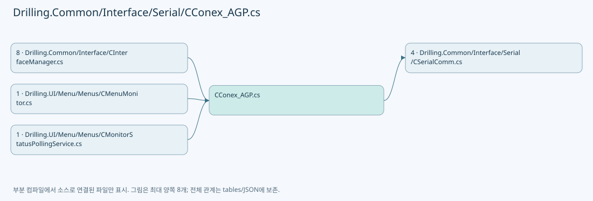

## 네임스페이스·타입·상속

| 타입 | 구분 | 원본 범위 | 선언/상속 |
| --- | --- | --- | --- |
| CConex_AGP | ClassDeclaration | 11–510 | CConex_AGP: CSerialComm(data, option) |
| EN_ATTENUATOR_COMMAND | EnumDeclaration | 512–535 | EN_ATTENUATOR_COMMAND |
| EN_CONEX_AGP_ERROR | EnumDeclaration | 537–544 | EN_CONEX_AGP_ERROR |
| ST_ATTENUATOR_STATUS | RecordDeclaration | 549–562 | ST_ATTENUATOR_STATUS |

## 멤버 빠른 목록

| 이름 | 종류 | 범위 | 서명 |
| --- | --- | --- | --- |
| Build | MethodDeclaration | L15–42 | string Drilling.Common.Interface.CConex_AGP.Build(Drilling.Common.Interface.EN_ATTENUATOR_COMMAND, double) |
| IsSuccessResponse | MethodDeclaration | L44–47 | bool Drilling.Common.Interface.CConex_AGP.IsSuccessResponse(string) |
| Apply | MethodDeclaration | L49–159 | Drilling.Common.Interface.ST_ATTENUATOR_STATUS Drilling.Common.Interface.CConex_AGP.Apply(Drilling.Common.Interface.EN_ATTENUATOR_COMMAND, double, string, Drilling.Common.Interface.ST_ATTENUATOR_STATUS, bool) |
| Execute | MethodDeclaration | L161–172 | System.Threading.Tasks.Task<string> Drilling.Common.Interface.CConex_AGP.Execute(string, System.Threading.CancellationToken) |
| ExecuteConex | MethodDeclaration | L174–205 | System.Threading.Tasks.Task<string> Drilling.Common.Interface.CConex_AGP.ExecuteConex(string, System.Threading.CancellationToken) |
| SelectValue | LocalFunctionStatement | L187–190 | string SelectValue() |
| ExecuteConex | MethodDeclaration | L207–238 | string Drilling.Common.Interface.CConex_AGP.ExecuteConex(string) |
| IsNoValueCommand | MethodDeclaration | L240–243 | bool Drilling.Common.Interface.CConex_AGP.IsNoValueCommand(string[]) |
| IsSingleValueCommand | MethodDeclaration | L245–248 | bool Drilling.Common.Interface.CConex_AGP.IsSingleValueCommand(string[]) |
| SendSelecting | MethodDeclaration | L250–280 | string Drilling.Common.Interface.CConex_AGP.SendSelecting(string, string) |
| SendPolling | MethodDeclaration | L282–304 | string Drilling.Common.Interface.CConex_AGP.SendPolling(string) |
| FormatDeviceCommand | MethodDeclaration | L306–310 | string Drilling.Common.Interface.CConex_AGP.FormatDeviceCommand(string, string) |
| IsPollingCommand | MethodDeclaration | L312–315 | bool Drilling.Common.Interface.CConex_AGP.IsPollingCommand(string) |
| IsParameterQueryCommand | MethodDeclaration | L317–320 | bool Drilling.Common.Interface.CConex_AGP.IsParameterQueryCommand(string) |
| ReadControllerAddress | MethodDeclaration | L322–343 | int Drilling.Common.Interface.CConex_AGP.ReadControllerAddress() |
| TryParseResponse | MethodDeclaration | L345–366 | bool Drilling.Common.Interface.CConex_AGP.TryParseResponse(string, out int, out string, out string) |
| CreateSimulationResponse | MethodDeclaration | L368–383 | string Drilling.Common.Interface.CConex_AGP.CreateSimulationResponse(Drilling.Common.Interface.EN_ATTENUATOR_COMMAND, double, Drilling.Common.Interface.ST_ATTENUATOR_STATUS) |
| ReadError | MethodDeclaration | L385–400 | Drilling.Common.Interface.EN_CONEX_AGP_ERROR Drilling.Common.Interface.CConex_AGP.ReadError(string) |
| ReadTaggedDouble | MethodDeclaration | L402–405 | double Drilling.Common.Interface.CConex_AGP.ReadTaggedDouble(string, string, double) |
| ReadTaggedNullableDouble | MethodDeclaration | L407–417 | double? Drilling.Common.Interface.CConex_AGP.ReadTaggedNullableDouble(string, string, double?) |
| ReadTaggedInt | MethodDeclaration | L419–424 | int? Drilling.Common.Interface.CConex_AGP.ReadTaggedInt(string, string, int?) |
| FormatCommandParameter | MethodDeclaration | L426–429 | string Drilling.Common.Interface.CConex_AGP.FormatCommandParameter(double) |
| NormalizeStoredCommandParameter | MethodDeclaration | L431–434 | double Drilling.Common.Interface.CConex_AGP.NormalizeStoredCommandParameter(double) |
| FormatPositionParameter | MethodDeclaration | L436–439 | string Drilling.Common.Interface.CConex_AGP.FormatPositionParameter(double) |
| FormatIntegerCommandParameter | MethodDeclaration | L441–444 | string Drilling.Common.Interface.CConex_AGP.FormatIntegerCommandParameter(double) |
| ValidateFiniteCommandParameter | MethodDeclaration | L446–454 | double Drilling.Common.Interface.CConex_AGP.ValidateFiniteCommandParameter(double) |
| ValidateInt32CommandParameter | MethodDeclaration | L456–465 | int Drilling.Common.Interface.CConex_AGP.ValidateInt32CommandParameter(double) |
| ReadControllerState | MethodDeclaration | L467–476 | string Drilling.Common.Interface.CConex_AGP.ReadControllerState(string, string) |
| NormalizeControllerState | MethodDeclaration | L478–494 | string Drilling.Common.Interface.CConex_AGP.NormalizeControllerState(string) |
| IsMovingState | MethodDeclaration | L496–499 | bool Drilling.Common.Interface.CConex_AGP.IsMovingState(string) |
| ReadTsError | MethodDeclaration | L501–504 | string Drilling.Common.Interface.CConex_AGP.ReadTsError(string) |
| ReadTsState | MethodDeclaration | L506–509 | string Drilling.Common.Interface.CConex_AGP.ReadTsState(string) |
| MoveAbs | EnumMemberDeclaration | L514–514 | Drilling.Common.Interface.EN_ATTENUATOR_COMMAND.MoveAbs |
| MoveRel | EnumMemberDeclaration | L515–515 | Drilling.Common.Interface.EN_ATTENUATOR_COMMAND.MoveRel |
| Home | EnumMemberDeclaration | L516–516 | Drilling.Common.Interface.EN_ATTENUATOR_COMMAND.Home |
| Stop | EnumMemberDeclaration | L517–517 | Drilling.Common.Interface.EN_ATTENUATOR_COMMAND.Stop |
| ResetController | EnumMemberDeclaration | L518–518 | Drilling.Common.Interface.EN_ATTENUATOR_COMMAND.ResetController |
| Refresh | EnumMemberDeclaration | L519–519 | Drilling.Common.Interface.EN_ATTENUATOR_COMMAND.Refresh |
| PollCurrentPosition | EnumMemberDeclaration | L520–520 | Drilling.Common.Interface.EN_ATTENUATOR_COMMAND.PollCurrentPosition |
| PollTargetPosition | EnumMemberDeclaration | L521–521 | Drilling.Common.Interface.EN_ATTENUATOR_COMMAND.PollTargetPosition |
| PollState | EnumMemberDeclaration | L522–522 | Drilling.Common.Interface.EN_ATTENUATOR_COMMAND.PollState |
| GetHomeType | EnumMemberDeclaration | L523–523 | Drilling.Common.Interface.EN_ATTENUATOR_COMMAND.GetHomeType |
| SetHomeType | EnumMemberDeclaration | L524–524 | Drilling.Common.Interface.EN_ATTENUATOR_COMMAND.SetHomeType |
| GetNegativeSoftwareLimit | EnumMemberDeclaration | L525–525 | Drilling.Common.Interface.EN_ATTENUATOR_COMMAND.GetNegativeSoftwareLimit |
| SetNegativeSoftwareLimit | EnumMemberDeclaration | L526–526 | Drilling.Common.Interface.EN_ATTENUATOR_COMMAND.SetNegativeSoftwareLimit |
| GetPositiveSoftwareLimit | EnumMemberDeclaration | L527–527 | Drilling.Common.Interface.EN_ATTENUATOR_COMMAND.GetPositiveSoftwareLimit |
| SetPositiveSoftwareLimit | EnumMemberDeclaration | L528–528 | Drilling.Common.Interface.EN_ATTENUATOR_COMMAND.SetPositiveSoftwareLimit |
| GetIGain | EnumMemberDeclaration | L529–529 | Drilling.Common.Interface.EN_ATTENUATOR_COMMAND.GetIGain |
| SetIGain | EnumMemberDeclaration | L530–530 | Drilling.Common.Interface.EN_ATTENUATOR_COMMAND.SetIGain |
| GetPGain | EnumMemberDeclaration | L531–531 | Drilling.Common.Interface.EN_ATTENUATOR_COMMAND.GetPGain |
| SetPGain | EnumMemberDeclaration | L532–532 | Drilling.Common.Interface.EN_ATTENUATOR_COMMAND.SetPGain |
| GetInterpolationFactor | EnumMemberDeclaration | L533–533 | Drilling.Common.Interface.EN_ATTENUATOR_COMMAND.GetInterpolationFactor |
| SetInterpolationFactor | EnumMemberDeclaration | L534–534 | Drilling.Common.Interface.EN_ATTENUATOR_COMMAND.SetInterpolationFactor |
| Ok | EnumMemberDeclaration | L539–539 | Drilling.Common.Interface.EN_CONEX_AGP_ERROR.Ok |
| Error | EnumMemberDeclaration | L540–540 | Drilling.Common.Interface.EN_CONEX_AGP_ERROR.Error |
| Timeout | EnumMemberDeclaration | L541–541 | Drilling.Common.Interface.EN_CONEX_AGP_ERROR.Timeout |
| InvalidResponse | EnumMemberDeclaration | L542–542 | Drilling.Common.Interface.EN_CONEX_AGP_ERROR.InvalidResponse |
| NotSupported | EnumMemberDeclaration | L543–543 | Drilling.Common.Interface.EN_CONEX_AGP_ERROR.NotSupported |

## 멤버별 상세 계약·호출·처리 해설

### MethodDeclaration `Build` · L15–42

[Drilling.Common/Interface/Serial/CConex_AGP.cs:15–42](https://github.com/kjuws10-rgb/A3Drilling/blob/5aee8e58439c9b455cae7c9593c9be986c3e682e/Drilling.Common/Interface/Serial/CConex_AGP.cs#L15-L42)

| 항목 | 실제 추출 값 |
| --- | --- |
| 서명 | string Drilling.Common.Interface.CConex_AGP.Build(Drilling.Common.Interface.EN_ATTENUATOR_COMMAND, double) |
| 접근/수식자 | Public / public, static |
| 반환/값 타입 | string |
| 소속 타입 | NamedType:Drilling.Common.Interface.CConex_AGP |

입력 계약:

| 이름 | 타입 | 전달 | 선택/기본값 |
| --- | --- | --- | --- |
| command | Drilling.Common.Interface.EN_ATTENUATOR_COMMAND | None | False /  |
| parameter | double | None | True / 0 |

정적 호출자로 확인된 위치:

| 호출 파일/행 | 호출 표현식 | 런타임 분기 가능 |
| --- | --- | --- |
| [Drilling.Common/Interface/CInterfaceManager.cs:1068–1068](https://github.com/kjuws10-rgb/A3Drilling/blob/5aee8e58439c9b455cae7c9593c9be986c3e682e/Drilling.Common/Interface/CInterfaceManager.cs#L1068-L1068) | CConex_AGP.Build | False |

호출하는 대상과 해석 범위:

| 원본 행 | 표현식 | 분석 상태 | 대상/소스 위치 |
| --- | --- | --- | --- |
| 19 | FormatPositionParameter | resolved | string Drilling.Common.Interface.CConex_AGP.FormatPositionParameter(double) · Drilling.Common/Interface/Serial/CConex_AGP.cs:436 |
| 20 | FormatPositionParameter | resolved | string Drilling.Common.Interface.CConex_AGP.FormatPositionParameter(double) · Drilling.Common/Interface/Serial/CConex_AGP.cs:436 |
| 29 | FormatIntegerCommandParameter | resolved | string Drilling.Common.Interface.CConex_AGP.FormatIntegerCommandParameter(double) · Drilling.Common/Interface/Serial/CConex_AGP.cs:441 |
| 31 | FormatCommandParameter | resolved | string Drilling.Common.Interface.CConex_AGP.FormatCommandParameter(double) · Drilling.Common/Interface/Serial/CConex_AGP.cs:426 |
| 33 | FormatCommandParameter | resolved | string Drilling.Common.Interface.CConex_AGP.FormatCommandParameter(double) · Drilling.Common/Interface/Serial/CConex_AGP.cs:426 |
| 35 | FormatCommandParameter | resolved | string Drilling.Common.Interface.CConex_AGP.FormatCommandParameter(double) · Drilling.Common/Interface/Serial/CConex_AGP.cs:426 |
| 37 | FormatCommandParameter | resolved | string Drilling.Common.Interface.CConex_AGP.FormatCommandParameter(double) · Drilling.Common/Interface/Serial/CConex_AGP.cs:426 |
| 39 | FormatCommandParameter | resolved | string Drilling.Common.Interface.CConex_AGP.FormatCommandParameter(double) · Drilling.Common/Interface/Serial/CConex_AGP.cs:426 |

본문의 실제 연산·분기·예외·반환 순서(원문 위치 순):

| 원본 행 | 종류 | 주석 해설 |
| --- | --- | --- |
| 17 | return | 호출자에게 값 또는 제어를 반환합니다: return command switch { EN_ATTENUATOR_COMMAND.MoveAbs => $"PA:{FormatPositionParameter(parameter)}", EN_ATTENUATOR_COMMAND.MoveRel => $"PR:{FormatPositionParameter(parameter)}", EN_ATTENUATOR_COMMAND.Home => "OR", EN_ATTENUATOR_CO |
| 17 | switch-expression | 값별 결과식을 선택합니다: command switch { EN_ATTENUATOR_COMMAND.MoveAbs => $"PA:{FormatPositionParameter(parameter)}", EN_ATTENUATOR_COMMAND.MoveRel => $"PR:{FormatPositionParameter(parameter)}", EN_ATTENUATOR_COMMAND.Home => "OR", EN_ATTENUATOR_COMMAND.S |
| 19 | call | 함수·델리게이트 또는 객체 생성자를 호출합니다: FormatPositionParameter(parameter) |
| 20 | call | 함수·델리게이트 또는 객체 생성자를 호출합니다: FormatPositionParameter(parameter) |
| 29 | call | 함수·델리게이트 또는 객체 생성자를 호출합니다: FormatIntegerCommandParameter(parameter) |
| 31 | call | 함수·델리게이트 또는 객체 생성자를 호출합니다: FormatCommandParameter(parameter) |
| 33 | call | 함수·델리게이트 또는 객체 생성자를 호출합니다: FormatCommandParameter(parameter) |
| 35 | call | 함수·델리게이트 또는 객체 생성자를 호출합니다: FormatCommandParameter(parameter) |
| 37 | call | 함수·델리게이트 또는 객체 생성자를 호출합니다: FormatCommandParameter(parameter) |
| 39 | call | 함수·델리게이트 또는 객체 생성자를 호출합니다: FormatCommandParameter(parameter) |

제어 구문의 포함 구조(실제 실행 순서/CFG가 아닌 구문 탐색 그림):

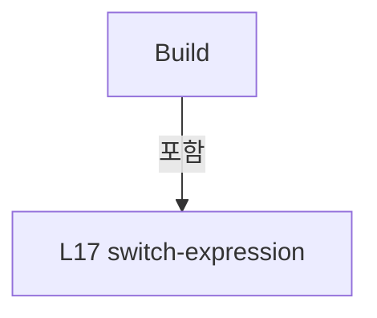

변경 전 점검: 입력/반환 타입, 위 호출자, 예외/취소 경로, 공유 상태와 저장·전송 소비자를 함께 확인합니다. 값의 단위나 물리 방향을 이름만으로 확정하지 않습니다.

### MethodDeclaration `IsSuccessResponse` · L44–47

[Drilling.Common/Interface/Serial/CConex_AGP.cs:44–47](https://github.com/kjuws10-rgb/A3Drilling/blob/5aee8e58439c9b455cae7c9593c9be986c3e682e/Drilling.Common/Interface/Serial/CConex_AGP.cs#L44-L47)

| 항목 | 실제 추출 값 |
| --- | --- |
| 서명 | bool Drilling.Common.Interface.CConex_AGP.IsSuccessResponse(string) |
| 접근/수식자 | Public / public, static |
| 반환/값 타입 | bool |
| 소속 타입 | NamedType:Drilling.Common.Interface.CConex_AGP |

입력 계약:

| 이름 | 타입 | 전달 | 선택/기본값 |
| --- | --- | --- | --- |
| response | string | None | False /  |

정적 호출자로 확인된 위치:

| 호출 파일/행 | 호출 표현식 | 런타임 분기 가능 |
| --- | --- | --- |
| [Drilling.Common/Interface/CInterfaceManager.cs:1128–1128](https://github.com/kjuws10-rgb/A3Drilling/blob/5aee8e58439c9b455cae7c9593c9be986c3e682e/Drilling.Common/Interface/CInterfaceManager.cs#L1128-L1128) | CConex_AGP.IsSuccessResponse | False |
| [Drilling.Common/Interface/Serial/CConex_AGP.cs:52–52](https://github.com/kjuws10-rgb/A3Drilling/blob/5aee8e58439c9b455cae7c9593c9be986c3e682e/Drilling.Common/Interface/Serial/CConex_AGP.cs#L52-L52) | IsSuccessResponse | False |

호출하는 대상과 해석 범위:

| 원본 행 | 표현식 | 분석 상태 | 대상/소스 위치 |
| --- | --- | --- | --- |
| 46 | string.IsNullOrWhiteSpace | resolved | bool string.IsNullOrWhiteSpace(string?) |
| 46 | response.StartsWith | resolved | bool string.StartsWith(string, System.StringComparison) |

본문의 실제 연산·분기·예외·반환 순서(원문 위치 순):

| 원본 행 | 종류 | 주석 해설 |
| --- | --- | --- |
| 46 | call | 함수·델리게이트 또는 객체 생성자를 호출합니다: string.IsNullOrWhiteSpace(response) |
| 46 | call | 함수·델리게이트 또는 객체 생성자를 호출합니다: response.StartsWith("ERR:", StringComparison.OrdinalIgnoreCase) |
| 46 | return | 호출자에게 값 또는 제어를 반환합니다: return !string.IsNullOrWhiteSpace(response) && !response.StartsWith("ERR:", StringComparison.OrdinalIgnoreCase); |

변경 전 점검: 입력/반환 타입, 위 호출자, 예외/취소 경로, 공유 상태와 저장·전송 소비자를 함께 확인합니다. 값의 단위나 물리 방향을 이름만으로 확정하지 않습니다.

### MethodDeclaration `Apply` · L49–159

[Drilling.Common/Interface/Serial/CConex_AGP.cs:49–159](https://github.com/kjuws10-rgb/A3Drilling/blob/5aee8e58439c9b455cae7c9593c9be986c3e682e/Drilling.Common/Interface/Serial/CConex_AGP.cs#L49-L159)

| 항목 | 실제 추출 값 |
| --- | --- |
| 서명 | Drilling.Common.Interface.ST_ATTENUATOR_STATUS Drilling.Common.Interface.CConex_AGP.Apply(Drilling.Common.Interface.EN_ATTENUATOR_COMMAND, double, string, Drilling.Common.Interface.ST_ATTENUATOR_STATUS, bool) |
| 접근/수식자 | Public / public, static |
| 반환/값 타입 | Drilling.Common.Interface.ST_ATTENUATOR_STATUS |
| 소속 타입 | NamedType:Drilling.Common.Interface.CConex_AGP |

입력 계약:

| 이름 | 타입 | 전달 | 선택/기본값 |
| --- | --- | --- | --- |
| command | Drilling.Common.Interface.EN_ATTENUATOR_COMMAND | None | False /  |
| parameter | double | None | False /  |
| response | string | None | False /  |
| current | Drilling.Common.Interface.ST_ATTENUATOR_STATUS | None | False /  |
| simulation | bool | None | False /  |

정적 호출자로 확인된 위치:

| 호출 파일/행 | 호출 표현식 | 런타임 분기 가능 |
| --- | --- | --- |
| [Drilling.Common/Interface/CInterfaceManager.cs:1088–1088](https://github.com/kjuws10-rgb/A3Drilling/blob/5aee8e58439c9b455cae7c9593c9be986c3e682e/Drilling.Common/Interface/CInterfaceManager.cs#L1088-L1088) | CConex_AGP.Apply | False |
| [Drilling.Common/Interface/CInterfaceManager.cs:1126–1126](https://github.com/kjuws10-rgb/A3Drilling/blob/5aee8e58439c9b455cae7c9593c9be986c3e682e/Drilling.Common/Interface/CInterfaceManager.cs#L1126-L1126) | CConex_AGP.Apply | False |
| [Drilling.Common/Interface/CInterfaceManager.cs:1953–1953](https://github.com/kjuws10-rgb/A3Drilling/blob/5aee8e58439c9b455cae7c9593c9be986c3e682e/Drilling.Common/Interface/CInterfaceManager.cs#L1953-L1953) | CConex_AGP.Apply | False |

호출하는 대상과 해석 범위:

| 원본 행 | 표현식 | 분석 상태 | 대상/소스 위치 |
| --- | --- | --- | --- |
| 51 | CreateSimulationResponse | resolved | string Drilling.Common.Interface.CConex_AGP.CreateSimulationResponse(Drilling.Common.Interface.EN_ATTENUATOR_COMMAND, double, Drilling.Common.Interface.ST_ATTENUATOR_STATUS) · Drilling.Common/Interface/Serial/CConex_AGP.cs:368 |
| 51 | response.Trim | resolved | string string.Trim() |
| 52 | IsSuccessResponse | resolved | bool Drilling.Common.Interface.CConex_AGP.IsSuccessResponse(string) · Drilling.Common/Interface/Serial/CConex_AGP.cs:44 |
| 57 | ReadError | resolved | Drilling.Common.Interface.EN_CONEX_AGP_ERROR Drilling.Common.Interface.CConex_AGP.ReadError(string) · Drilling.Common/Interface/Serial/CConex_AGP.cs:385 |
| 98 | ReadTaggedDouble | resolved | double Drilling.Common.Interface.CConex_AGP.ReadTaggedDouble(string, string, double) · Drilling.Common/Interface/Serial/CConex_AGP.cs:402 |
| 99 | IsMovingState | resolved | bool Drilling.Common.Interface.CConex_AGP.IsMovingState(string) · Drilling.Common/Interface/Serial/CConex_AGP.cs:496 |
| 103 | ReadTaggedDouble | resolved | double Drilling.Common.Interface.CConex_AGP.ReadTaggedDouble(string, string, double) · Drilling.Common/Interface/Serial/CConex_AGP.cs:402 |
| 107 | ReadControllerState | resolved | string Drilling.Common.Interface.CConex_AGP.ReadControllerState(string, string) · Drilling.Common/Interface/Serial/CConex_AGP.cs:467 |
| 111 | ReadTaggedInt | resolved | int? Drilling.Common.Interface.CConex_AGP.ReadTaggedInt(string, string, int?) · Drilling.Common/Interface/Serial/CConex_AGP.cs:419 |
| 115 | ValidateInt32CommandParameter | resolved | int Drilling.Common.Interface.CConex_AGP.ValidateInt32CommandParameter(double) · Drilling.Common/Interface/Serial/CConex_AGP.cs:456 |
| 119 | ReadTaggedNullableDouble | resolved | double? Drilling.Common.Interface.CConex_AGP.ReadTaggedNullableDouble(string, string, double?) · Drilling.Common/Interface/Serial/CConex_AGP.cs:407 |
| 123 | NormalizeStoredCommandParameter | resolved | double Drilling.Common.Interface.CConex_AGP.NormalizeStoredCommandParameter(double) · Drilling.Common/Interface/Serial/CConex_AGP.cs:431 |
| 127 | ReadTaggedNullableDouble | resolved | double? Drilling.Common.Interface.CConex_AGP.ReadTaggedNullableDouble(string, string, double?) · Drilling.Common/Interface/Serial/CConex_AGP.cs:407 |
| 131 | NormalizeStoredCommandParameter | resolved | double Drilling.Common.Interface.CConex_AGP.NormalizeStoredCommandParameter(double) · Drilling.Common/Interface/Serial/CConex_AGP.cs:431 |
| 135 | ReadTaggedNullableDouble | resolved | double? Drilling.Common.Interface.CConex_AGP.ReadTaggedNullableDouble(string, string, double?) · Drilling.Common/Interface/Serial/CConex_AGP.cs:407 |
| 139 | NormalizeStoredCommandParameter | resolved | double Drilling.Common.Interface.CConex_AGP.NormalizeStoredCommandParameter(double) · Drilling.Common/Interface/Serial/CConex_AGP.cs:431 |
| 143 | ReadTaggedNullableDouble | resolved | double? Drilling.Common.Interface.CConex_AGP.ReadTaggedNullableDouble(string, string, double?) · Drilling.Common/Interface/Serial/CConex_AGP.cs:407 |
| 147 | NormalizeStoredCommandParameter | resolved | double Drilling.Common.Interface.CConex_AGP.NormalizeStoredCommandParameter(double) · Drilling.Common/Interface/Serial/CConex_AGP.cs:431 |
| 151 | ReadTaggedNullableDouble | resolved | double? Drilling.Common.Interface.CConex_AGP.ReadTaggedNullableDouble(string, string, double?) · Drilling.Common/Interface/Serial/CConex_AGP.cs:407 |
| 155 | NormalizeStoredCommandParameter | resolved | double Drilling.Common.Interface.CConex_AGP.NormalizeStoredCommandParameter(double) · Drilling.Common/Interface/Serial/CConex_AGP.cs:431 |

본문의 실제 연산·분기·예외·반환 순서(원문 위치 순):

| 원본 행 | 종류 | 주석 해설 |
| --- | --- | --- |
| 51 | call | 함수·델리게이트 또는 객체 생성자를 호출합니다: CreateSimulationResponse(command, parameter, current) |
| 51 | call | 함수·델리게이트 또는 객체 생성자를 호출합니다: response.Trim() |
| 51 | conditional-expression | 조건에 따라 결과식을 선택합니다: simulation ? CreateSimulationResponse(command, parameter, current) : response.Trim() |
| 51 | local-declaration | 지역 변수를 선언합니다: var value = simulation ? CreateSimulationResponse(command, parameter, current) : response.Trim(); |
| 51 | variable-initializer | 변수의 초기값을 지정합니다: value = simulation ? CreateSimulationResponse(command, parameter, current) : response.Trim() |
| 52 | call | 함수·델리게이트 또는 객체 생성자를 호출합니다: IsSuccessResponse(value) |
| 52 | if | 조건에 따라 분기합니다: if (!simulation && !IsSuccessResponse(value)) |
| 54 | return | 호출자에게 값 또는 제어를 반환합니다: return current with { CommOk = false, LastError = ReadError(value), UpdatedAt = DateTimeOffset.Now }; |
| 56 | assignment | 값을 대상에 대입합니다: CommOk = false |
| 57 | assignment | 값을 대상에 대입합니다: LastError = ReadError(value) |
| 57 | call | 함수·델리게이트 또는 객체 생성자를 호출합니다: ReadError(value) |
| 58 | assignment | 값을 대상에 대입합니다: UpdatedAt = DateTimeOffset.Now |
| 62 | local-declaration | 지역 변수를 선언합니다: var ok = current with { CommOk = true, LastError = EN_CONEX_AGP_ERROR.Ok, UpdatedAt = DateTimeOffset.Now }; |
| 62 | variable-initializer | 변수의 초기값을 지정합니다: ok = current with { CommOk = true, LastError = EN_CONEX_AGP_ERROR.Ok, UpdatedAt = DateTimeOffset.Now } |
| 64 | assignment | 값을 대상에 대입합니다: CommOk = true |
| 65 | assignment | 값을 대상에 대입합니다: LastError = EN_CONEX_AGP_ERROR.Ok |
| 66 | assignment | 값을 대상에 대입합니다: UpdatedAt = DateTimeOffset.Now |
| 68 | return | 호출자에게 값 또는 제어를 반환합니다: return command switch { EN_ATTENUATOR_COMMAND.MoveAbs => ok with { CurrentPosition = simulation ? parameter : ok.CurrentPosition, TargetPosition = parameter, CommandState = simulation ? "READY" : "MOVING" }, EN_ATTENUATOR_COMMAND. |
| 68 | switch-expression | 값별 결과식을 선택합니다: command switch { EN_ATTENUATOR_COMMAND.MoveAbs => ok with { CurrentPosition = simulation ? parameter : ok.CurrentPosition, TargetPosition = parameter, CommandState = simulation ? "READY" : "MOVING" }, EN_ATTENUATOR_COMMAND.MoveRel |
| 72 | assignment | 값을 대상에 대입합니다: CurrentPosition = simulation ? parameter : ok.CurrentPosition |
| 72 | conditional-expression | 조건에 따라 결과식을 선택합니다: simulation ? parameter : ok.CurrentPosition |
| 73 | assignment | 값을 대상에 대입합니다: TargetPosition = parameter |
| 74 | assignment | 값을 대상에 대입합니다: CommandState = simulation ? "READY" : "MOVING" |
| 74 | conditional-expression | 조건에 따라 결과식을 선택합니다: simulation ? "READY" : "MOVING" |
| 78 | assignment | 값을 대상에 대입합니다: CurrentPosition = simulation ? ok.CurrentPosition + parameter : ok.CurrentPosition |
| 78 | conditional-expression | 조건에 따라 결과식을 선택합니다: simulation ? ok.CurrentPosition + parameter : ok.CurrentPosition |
| 79 | assignment | 값을 대상에 대입합니다: TargetPosition = simulation ? ok.CurrentPosition + parameter : ok.TargetPosition + parameter |
| 79 | conditional-expression | 조건에 따라 결과식을 선택합니다: simulation ? ok.CurrentPosition + parameter : ok.TargetPosition + parameter |
| 80 | assignment | 값을 대상에 대입합니다: CommandState = simulation ? "READY" : "MOVING" |
| 80 | conditional-expression | 조건에 따라 결과식을 선택합니다: simulation ? "READY" : "MOVING" |
| 84 | assignment | 값을 대상에 대입합니다: CurrentPosition = simulation ? 0.0 : ok.CurrentPosition |
| 84 | conditional-expression | 조건에 따라 결과식을 선택합니다: simulation ? 0.0 : ok.CurrentPosition |
| 85 | assignment | 값을 대상에 대입합니다: TargetPosition = simulation ? 0.0 : ok.TargetPosition |
| 85 | conditional-expression | 조건에 따라 결과식을 선택합니다: simulation ? 0.0 : ok.TargetPosition |
| 86 | assignment | 값을 대상에 대입합니다: CommandState = simulation ? "READY" : "HOMING" |
| 86 | conditional-expression | 조건에 따라 결과식을 선택합니다: simulation ? "READY" : "HOMING" |
| 90 | assignment | 값을 대상에 대입합니다: CommandState = "STOP" |
| 94 | assignment | 값을 대상에 대입합니다: CommandState = "NOT_REFERENCED" |
| 98 | assignment | 값을 대상에 대입합니다: CurrentPosition = ReadTaggedDouble(value, "TP", ok.CurrentPosition) |
| 98 | call | 함수·델리게이트 또는 객체 생성자를 호출합니다: ReadTaggedDouble(value, "TP", ok.CurrentPosition) |
| 99 | assignment | 값을 대상에 대입합니다: CommandState = IsMovingState(ok.CommandState) ? ok.CommandState : "READY" |
| 99 | call | 함수·델리게이트 또는 객체 생성자를 호출합니다: IsMovingState(ok.CommandState) |
| 99 | conditional-expression | 조건에 따라 결과식을 선택합니다: IsMovingState(ok.CommandState) ? ok.CommandState : "READY" |
| 103 | assignment | 값을 대상에 대입합니다: TargetPosition = ReadTaggedDouble(value, "TH", ok.TargetPosition) |
| 103 | call | 함수·델리게이트 또는 객체 생성자를 호출합니다: ReadTaggedDouble(value, "TH", ok.TargetPosition) |
| 107 | assignment | 값을 대상에 대입합니다: CommandState = ReadControllerState(value, ok.CommandState) |
| 107 | call | 함수·델리게이트 또는 객체 생성자를 호출합니다: ReadControllerState(value, ok.CommandState) |
| 111 | assignment | 값을 대상에 대입합니다: HomeType = ReadTaggedInt(value, "HT", ok.HomeType) |
| 111 | call | 함수·델리게이트 또는 객체 생성자를 호출합니다: ReadTaggedInt(value, "HT", ok.HomeType) |
| 115 | assignment | 값을 대상에 대입합니다: HomeType = ValidateInt32CommandParameter(parameter) |
| 115 | call | 함수·델리게이트 또는 객체 생성자를 호출합니다: ValidateInt32CommandParameter(parameter) |
| 119 | assignment | 값을 대상에 대입합니다: NegativeSoftwareLimit = ReadTaggedNullableDouble(value, "SL", ok.NegativeSoftwareLimit) |
| 119 | call | 함수·델리게이트 또는 객체 생성자를 호출합니다: ReadTaggedNullableDouble(value, "SL", ok.NegativeSoftwareLimit) |
| 123 | assignment | 값을 대상에 대입합니다: NegativeSoftwareLimit = NormalizeStoredCommandParameter(parameter) |
| 123 | call | 함수·델리게이트 또는 객체 생성자를 호출합니다: NormalizeStoredCommandParameter(parameter) |
| 127 | assignment | 값을 대상에 대입합니다: PositiveSoftwareLimit = ReadTaggedNullableDouble(value, "SR", ok.PositiveSoftwareLimit) |
| 127 | call | 함수·델리게이트 또는 객체 생성자를 호출합니다: ReadTaggedNullableDouble(value, "SR", ok.PositiveSoftwareLimit) |
| 131 | assignment | 값을 대상에 대입합니다: PositiveSoftwareLimit = NormalizeStoredCommandParameter(parameter) |
| 131 | call | 함수·델리게이트 또는 객체 생성자를 호출합니다: NormalizeStoredCommandParameter(parameter) |
| 135 | assignment | 값을 대상에 대입합니다: IGain = ReadTaggedNullableDouble(value, "KI", ok.IGain) |
| 135 | call | 함수·델리게이트 또는 객체 생성자를 호출합니다: ReadTaggedNullableDouble(value, "KI", ok.IGain) |
| 139 | assignment | 값을 대상에 대입합니다: IGain = NormalizeStoredCommandParameter(parameter) |
| 139 | call | 함수·델리게이트 또는 객체 생성자를 호출합니다: NormalizeStoredCommandParameter(parameter) |
| 143 | assignment | 값을 대상에 대입합니다: PGain = ReadTaggedNullableDouble(value, "KP", ok.PGain) |
| 143 | call | 함수·델리게이트 또는 객체 생성자를 호출합니다: ReadTaggedNullableDouble(value, "KP", ok.PGain) |
| 147 | assignment | 값을 대상에 대입합니다: PGain = NormalizeStoredCommandParameter(parameter) |
| 147 | call | 함수·델리게이트 또는 객체 생성자를 호출합니다: NormalizeStoredCommandParameter(parameter) |
| 151 | assignment | 값을 대상에 대입합니다: InterpolationFactor = ReadTaggedNullableDouble(value, "IF", ok.InterpolationFactor) |
| 151 | call | 함수·델리게이트 또는 객체 생성자를 호출합니다: ReadTaggedNullableDouble(value, "IF", ok.InterpolationFactor) |
| 155 | assignment | 값을 대상에 대입합니다: InterpolationFactor = NormalizeStoredCommandParameter(parameter) |
| 155 | call | 함수·델리게이트 또는 객체 생성자를 호출합니다: NormalizeStoredCommandParameter(parameter) |

제어 구문의 포함 구조(실제 실행 순서/CFG가 아닌 구문 탐색 그림):

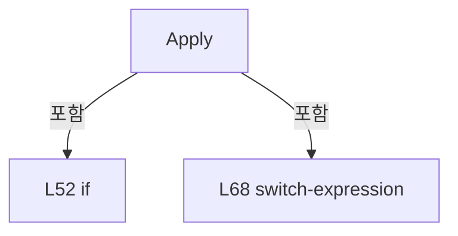

변경 전 점검: 입력/반환 타입, 위 호출자, 예외/취소 경로, 공유 상태와 저장·전송 소비자를 함께 확인합니다. 값의 단위나 물리 방향을 이름만으로 확정하지 않습니다.

### MethodDeclaration `Execute` · L161–172

[Drilling.Common/Interface/Serial/CConex_AGP.cs:161–172](https://github.com/kjuws10-rgb/A3Drilling/blob/5aee8e58439c9b455cae7c9593c9be986c3e682e/Drilling.Common/Interface/Serial/CConex_AGP.cs#L161-L172)

| 항목 | 실제 추출 값 |
| --- | --- |
| 서명 | System.Threading.Tasks.Task<string> Drilling.Common.Interface.CConex_AGP.Execute(string, System.Threading.CancellationToken) |
| 접근/수식자 | Public / public, override, async |
| 반환/값 타입 | System.Threading.Tasks.Task<string> |
| 소속 타입 | NamedType:Drilling.Common.Interface.CConex_AGP |

입력 계약:

| 이름 | 타입 | 전달 | 선택/기본값 |
| --- | --- | --- | --- |
| function | string | None | False /  |
| cancellationToken | System.Threading.CancellationToken | None | True / null |

현재 부분 분석에서 직접 연결된 호출자는 없습니다. XAML/이벤트/인터페이스·델리게이트·외부 진입을 추가 확인해야 하며, 미사용으로 판정한 것이 아닙니다.

호출하는 대상과 해석 범위:

| 원본 행 | 표현식 | 분석 상태 | 대상/소스 위치 |
| --- | --- | --- | --- |
| 163 | SerialLock.WaitAsync | resolved | System.Threading.Tasks.Task System.Threading.SemaphoreSlim.WaitAsync(System.Threading.CancellationToken) |
| 166 | ExecuteConex | resolved | System.Threading.Tasks.Task<string> Drilling.Common.Interface.CConex_AGP.ExecuteConex(string, System.Threading.CancellationToken) · Drilling.Common/Interface/Serial/CConex_AGP.cs:174 |
| 170 | SerialLock.Release | resolved | int System.Threading.SemaphoreSlim.Release() |

본문의 실제 연산·분기·예외·반환 순서(원문 위치 순):

| 원본 행 | 종류 | 주석 해설 |
| --- | --- | --- |
| 163 | await | 비동기 완료를 기다립니다: await SerialLock.WaitAsync(cancellationToken) |
| 163 | call | 함수·델리게이트 또는 객체 생성자를 호출합니다: SerialLock.WaitAsync(cancellationToken) |
| 164 | try | 예외 처리 범위입니다: try |
| 166 | await | 비동기 완료를 기다립니다: await ExecuteConex(function, cancellationToken) |
| 166 | call | 함수·델리게이트 또는 객체 생성자를 호출합니다: ExecuteConex(function, cancellationToken) |
| 166 | return | 호출자에게 값 또는 제어를 반환합니다: return await ExecuteConex(function, cancellationToken); |
| 168 | finally | 종료 정리 구간입니다: finally |
| 170 | call | 함수·델리게이트 또는 객체 생성자를 호출합니다: SerialLock.Release() |

제어 구문의 포함 구조(실제 실행 순서/CFG가 아닌 구문 탐색 그림):

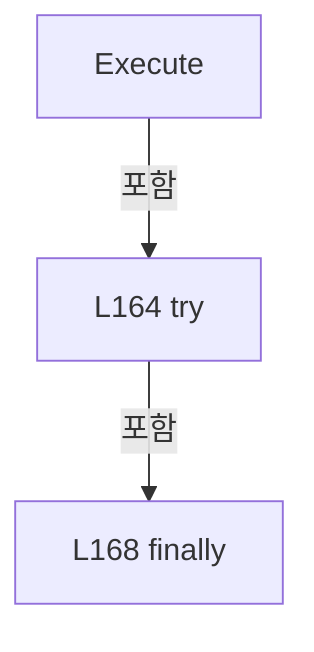

변경 전 점검: 입력/반환 타입, 위 호출자, 예외/취소 경로, 공유 상태와 저장·전송 소비자를 함께 확인합니다. 값의 단위나 물리 방향을 이름만으로 확정하지 않습니다.

### MethodDeclaration `ExecuteConex` · L174–205

[Drilling.Common/Interface/Serial/CConex_AGP.cs:174–205](https://github.com/kjuws10-rgb/A3Drilling/blob/5aee8e58439c9b455cae7c9593c9be986c3e682e/Drilling.Common/Interface/Serial/CConex_AGP.cs#L174-L205)

| 항목 | 실제 추출 값 |
| --- | --- |
| 서명 | System.Threading.Tasks.Task<string> Drilling.Common.Interface.CConex_AGP.ExecuteConex(string, System.Threading.CancellationToken) |
| 접근/수식자 | Private / private, async |
| 반환/값 타입 | System.Threading.Tasks.Task<string> |
| 소속 타입 | NamedType:Drilling.Common.Interface.CConex_AGP |

입력 계약:

| 이름 | 타입 | 전달 | 선택/기본값 |
| --- | --- | --- | --- |
| function | string | None | False /  |
| cancellationToken | System.Threading.CancellationToken | None | False /  |

정적 호출자로 확인된 위치:

| 호출 파일/행 | 호출 표현식 | 런타임 분기 가능 |
| --- | --- | --- |
| [Drilling.Common/Interface/Serial/CConex_AGP.cs:166–166](https://github.com/kjuws10-rgb/A3Drilling/blob/5aee8e58439c9b455cae7c9593c9be986c3e682e/Drilling.Common/Interface/Serial/CConex_AGP.cs#L166-L166) | ExecuteConex | False |

호출하는 대상과 해석 범위:

| 원본 행 | 표현식 | 분석 상태 | 대상/소스 위치 |
| --- | --- | --- | --- |
| 178 | Connect | resolved · 동적 구현 선택 가능 | System.Threading.Tasks.Task Drilling.Common.Interface.CSerialComm.Connect(System.Threading.CancellationToken) · Drilling.Common/Interface/Serial/CSerialComm.cs:32 |
| 194 | Task.Run | resolved | System.Threading.Tasks.Task<string> System.Threading.Tasks.Task.Run<string>(System.Func<string>, System.Threading.CancellationToken) |
| 195 | LastReceived.StartsWith | resolved | bool string.StartsWith(string, System.StringComparison) |
| 196 | SetResponseState | resolved | void Drilling.Common.Interface.CSerialComm.SetResponseState(string) · Drilling.Common/Interface/Serial/CSerialComm.cs:206 |
| 201 | CloseSerialPort | resolved | void Drilling.Common.Interface.CSerialComm.CloseSerialPort() · Drilling.Common/Interface/Serial/CSerialComm.cs:363 |
| 202 | SetError | resolved | void Drilling.Common.Interface.CSerialComm.SetError(System.Exception) · Drilling.Common/Interface/Serial/CSerialComm.cs:192 |

본문의 실제 연산·분기·예외·반환 순서(원문 위치 순):

| 원본 행 | 종류 | 주석 해설 |
| --- | --- | --- |
| 176 | if | 조건에 따라 분기합니다: if (SerialPort is null &#124;&#124; !SerialPort.IsOpen) |
| 178 | await | 비동기 완료를 기다립니다: await Connect(cancellationToken) |
| 178 | call | 함수·델리게이트 또는 객체 생성자를 호출합니다: Connect(cancellationToken) |
| 181 | if | 조건에 따라 분기합니다: if (SerialPort is null &#124;&#124; !SerialPort.IsOpen) |
| 183 | return | 호출자에게 값 또는 제어를 반환합니다: return ""; |
| 186 | assignment | 값을 대상에 대입합니다: LastSent = function |
| 192 | try | 예외 처리 범위입니다: try |
| 194 | assignment | 값을 대상에 대입합니다: LastReceived = await Task.Run(SelectValue, cancellationToken) |
| 194 | await | 비동기 완료를 기다립니다: await Task.Run(SelectValue, cancellationToken) |
| 194 | call | 함수·델리게이트 또는 객체 생성자를 호출합니다: Task.Run(SelectValue, cancellationToken) |
| 195 | assignment | 값을 대상에 대입합니다: LastError = LastReceived.StartsWith("ERR:", StringComparison.OrdinalIgnoreCase) ? LastReceived : "" |
| 195 | call | 함수·델리게이트 또는 객체 생성자를 호출합니다: LastReceived.StartsWith("ERR:", StringComparison.OrdinalIgnoreCase) |
| 195 | conditional-expression | 조건에 따라 결과식을 선택합니다: LastReceived.StartsWith("ERR:", StringComparison.OrdinalIgnoreCase) ? LastReceived : "" |
| 196 | call | 함수·델리게이트 또는 객체 생성자를 호출합니다: SetResponseState(LastReceived) |
| 197 | return | 호출자에게 값 또는 제어를 반환합니다: return LastReceived; |
| 199 | catch | 지정 예외를 처리합니다: catch (Exception ex) when (ex is IOException or InvalidOperationException or TimeoutException or UnauthorizedAccessException or ObjectDisposedException) |
| 201 | call | 함수·델리게이트 또는 객체 생성자를 호출합니다: CloseSerialPort() |
| 202 | call | 함수·델리게이트 또는 객체 생성자를 호출합니다: SetError(ex) |
| 203 | return | 호출자에게 값 또는 제어를 반환합니다: return ""; |

제어 구문의 포함 구조(실제 실행 순서/CFG가 아닌 구문 탐색 그림):

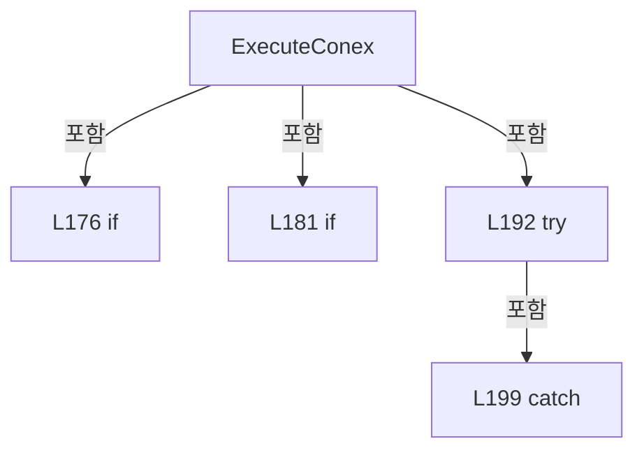

변경 전 점검: 입력/반환 타입, 위 호출자, 예외/취소 경로, 공유 상태와 저장·전송 소비자를 함께 확인합니다. 값의 단위나 물리 방향을 이름만으로 확정하지 않습니다.

### LocalFunctionStatement `SelectValue` · L187–190

[Drilling.Common/Interface/Serial/CConex_AGP.cs:187–190](https://github.com/kjuws10-rgb/A3Drilling/blob/5aee8e58439c9b455cae7c9593c9be986c3e682e/Drilling.Common/Interface/Serial/CConex_AGP.cs#L187-L190)

| 항목 | 실제 추출 값 |
| --- | --- |
| 서명 | string SelectValue() |
| 접근/수식자 | Private /  |
| 반환/값 타입 | string |
| 소속 타입 | NamedType:Drilling.Common.Interface.CConex_AGP |

현재 부분 분석에서 직접 연결된 호출자는 없습니다. XAML/이벤트/인터페이스·델리게이트·외부 진입을 추가 확인해야 하며, 미사용으로 판정한 것이 아닙니다.

호출하는 대상과 해석 범위:

| 원본 행 | 표현식 | 분석 상태 | 대상/소스 위치 |
| --- | --- | --- | --- |
| 189 | ExecuteConex | resolved | string Drilling.Common.Interface.CConex_AGP.ExecuteConex(string) · Drilling.Common/Interface/Serial/CConex_AGP.cs:207 |

본문의 실제 연산·분기·예외·반환 순서(원문 위치 순):

| 원본 행 | 종류 | 주석 해설 |
| --- | --- | --- |
| 189 | call | 함수·델리게이트 또는 객체 생성자를 호출합니다: ExecuteConex(function) |
| 189 | return | 호출자에게 값 또는 제어를 반환합니다: return ExecuteConex(function); |

변경 전 점검: 입력/반환 타입, 위 호출자, 예외/취소 경로, 공유 상태와 저장·전송 소비자를 함께 확인합니다. 값의 단위나 물리 방향을 이름만으로 확정하지 않습니다.

### MethodDeclaration `ExecuteConex` · L207–238

[Drilling.Common/Interface/Serial/CConex_AGP.cs:207–238](https://github.com/kjuws10-rgb/A3Drilling/blob/5aee8e58439c9b455cae7c9593c9be986c3e682e/Drilling.Common/Interface/Serial/CConex_AGP.cs#L207-L238)

| 항목 | 실제 추출 값 |
| --- | --- |
| 서명 | string Drilling.Common.Interface.CConex_AGP.ExecuteConex(string) |
| 접근/수식자 | Private / private |
| 반환/값 타입 | string |
| 소속 타입 | NamedType:Drilling.Common.Interface.CConex_AGP |

입력 계약:

| 이름 | 타입 | 전달 | 선택/기본값 |
| --- | --- | --- | --- |
| function | string | None | False /  |

정적 호출자로 확인된 위치:

| 호출 파일/행 | 호출 표현식 | 런타임 분기 가능 |
| --- | --- | --- |
| [Drilling.Common/Interface/Serial/CConex_AGP.cs:189–189](https://github.com/kjuws10-rgb/A3Drilling/blob/5aee8e58439c9b455cae7c9593c9be986c3e682e/Drilling.Common/Interface/Serial/CConex_AGP.cs#L189-L189) | ExecuteConex | False |

호출하는 대상과 해석 범위:

| 원본 행 | 표현식 | 분석 상태 | 대상/소스 위치 |
| --- | --- | --- | --- |
| 209 | function.Split | resolved | string[] string.Split(char, System.StringSplitOptions) |
| 210 | function.Trim().ToUpperInvariant | resolved | string string.ToUpperInvariant() |
| 210 | function.Trim | resolved | string string.Trim() |
| 211 | text.EndsWith | resolved | bool string.EndsWith(string, System.StringComparison) |
| 214 | IsParameterQueryCommand | resolved | bool Drilling.Common.Interface.CConex_AGP.IsParameterQueryCommand(string) · Drilling.Common/Interface/Serial/CConex_AGP.cs:317 |
| 214 | SendPolling | resolved | string Drilling.Common.Interface.CConex_AGP.SendPolling(string) · Drilling.Common/Interface/Serial/CConex_AGP.cs:282 |
| 217 | IsPollingCommand | resolved | bool Drilling.Common.Interface.CConex_AGP.IsPollingCommand(string) · Drilling.Common/Interface/Serial/CConex_AGP.cs:312 |
| 219 | SendPolling | resolved | string Drilling.Common.Interface.CConex_AGP.SendPolling(string) · Drilling.Common/Interface/Serial/CConex_AGP.cs:282 |
| 222 | parts[0].ToUpperInvariant | resolved | string string.ToUpperInvariant() |
| 225 | IsSingleValueCommand | resolved | bool Drilling.Common.Interface.CConex_AGP.IsSingleValueCommand(string[]) · Drilling.Common/Interface/Serial/CConex_AGP.cs:245 |
| 225 | SendSelecting | resolved | string Drilling.Common.Interface.CConex_AGP.SendSelecting(string, string) · Drilling.Common/Interface/Serial/CConex_AGP.cs:250 |
| 226 | IsSingleValueCommand | resolved | bool Drilling.Common.Interface.CConex_AGP.IsSingleValueCommand(string[]) · Drilling.Common/Interface/Serial/CConex_AGP.cs:245 |
| 226 | SendSelecting | resolved | string Drilling.Common.Interface.CConex_AGP.SendSelecting(string, string) · Drilling.Common/Interface/Serial/CConex_AGP.cs:250 |
| 227 | IsNoValueCommand | resolved | bool Drilling.Common.Interface.CConex_AGP.IsNoValueCommand(string[]) · Drilling.Common/Interface/Serial/CConex_AGP.cs:240 |
| 227 | SendSelecting | resolved | string Drilling.Common.Interface.CConex_AGP.SendSelecting(string, string) · Drilling.Common/Interface/Serial/CConex_AGP.cs:250 |
| 228 | IsNoValueCommand | resolved | bool Drilling.Common.Interface.CConex_AGP.IsNoValueCommand(string[]) · Drilling.Common/Interface/Serial/CConex_AGP.cs:240 |
| 228 | SendSelecting | resolved | string Drilling.Common.Interface.CConex_AGP.SendSelecting(string, string) · Drilling.Common/Interface/Serial/CConex_AGP.cs:250 |
| 229 | IsNoValueCommand | resolved | bool Drilling.Common.Interface.CConex_AGP.IsNoValueCommand(string[]) · Drilling.Common/Interface/Serial/CConex_AGP.cs:240 |
| 229 | SendSelecting | resolved | string Drilling.Common.Interface.CConex_AGP.SendSelecting(string, string) · Drilling.Common/Interface/Serial/CConex_AGP.cs:250 |
| 230 | IsSingleValueCommand | resolved | bool Drilling.Common.Interface.CConex_AGP.IsSingleValueCommand(string[]) · Drilling.Common/Interface/Serial/CConex_AGP.cs:245 |
| 230 | SendSelecting | resolved | string Drilling.Common.Interface.CConex_AGP.SendSelecting(string, string) · Drilling.Common/Interface/Serial/CConex_AGP.cs:250 |
| 231 | IsSingleValueCommand | resolved | bool Drilling.Common.Interface.CConex_AGP.IsSingleValueCommand(string[]) · Drilling.Common/Interface/Serial/CConex_AGP.cs:245 |
| 231 | SendSelecting | resolved | string Drilling.Common.Interface.CConex_AGP.SendSelecting(string, string) · Drilling.Common/Interface/Serial/CConex_AGP.cs:250 |
| 232 | IsSingleValueCommand | resolved | bool Drilling.Common.Interface.CConex_AGP.IsSingleValueCommand(string[]) · Drilling.Common/Interface/Serial/CConex_AGP.cs:245 |
| 232 | SendSelecting | resolved | string Drilling.Common.Interface.CConex_AGP.SendSelecting(string, string) · Drilling.Common/Interface/Serial/CConex_AGP.cs:250 |
| 233 | IsSingleValueCommand | resolved | bool Drilling.Common.Interface.CConex_AGP.IsSingleValueCommand(string[]) · Drilling.Common/Interface/Serial/CConex_AGP.cs:245 |
| 233 | SendSelecting | resolved | string Drilling.Common.Interface.CConex_AGP.SendSelecting(string, string) · Drilling.Common/Interface/Serial/CConex_AGP.cs:250 |
| 234 | IsSingleValueCommand | resolved | bool Drilling.Common.Interface.CConex_AGP.IsSingleValueCommand(string[]) · Drilling.Common/Interface/Serial/CConex_AGP.cs:245 |
| 234 | SendSelecting | resolved | string Drilling.Common.Interface.CConex_AGP.SendSelecting(string, string) · Drilling.Common/Interface/Serial/CConex_AGP.cs:250 |
| 235 | IsSingleValueCommand | resolved | bool Drilling.Common.Interface.CConex_AGP.IsSingleValueCommand(string[]) · Drilling.Common/Interface/Serial/CConex_AGP.cs:245 |
| 235 | SendSelecting | resolved | string Drilling.Common.Interface.CConex_AGP.SendSelecting(string, string) · Drilling.Common/Interface/Serial/CConex_AGP.cs:250 |

본문의 실제 연산·분기·예외·반환 순서(원문 위치 순):

| 원본 행 | 종류 | 주석 해설 |
| --- | --- | --- |
| 209 | call | 함수·델리게이트 또는 객체 생성자를 호출합니다: function.Split(':', StringSplitOptions.TrimEntries) |
| 209 | local-declaration | 지역 변수를 선언합니다: var parts = function.Split(':', StringSplitOptions.TrimEntries); |
| 209 | variable-initializer | 변수의 초기값을 지정합니다: parts = function.Split(':', StringSplitOptions.TrimEntries) |
| 210 | call | 함수·델리게이트 또는 객체 생성자를 호출합니다: function.Trim().ToUpperInvariant() |
| 210 | call | 함수·델리게이트 또는 객체 생성자를 호출합니다: function.Trim() |
| 210 | local-declaration | 지역 변수를 선언합니다: var text = function.Trim().ToUpperInvariant(); |
| 210 | variable-initializer | 변수의 초기값을 지정합니다: text = function.Trim().ToUpperInvariant() |
| 211 | call | 함수·델리게이트 또는 객체 생성자를 호출합니다: text.EndsWith("?", StringComparison.Ordinal) |
| 211 | if | 조건에 따라 분기합니다: if (text.EndsWith("?", StringComparison.Ordinal)) |
| 213 | local-declaration | 지역 변수를 선언합니다: var queryCommand = text[..^1]; |
| 213 | variable-initializer | 변수의 초기값을 지정합니다: queryCommand = text[..^1] |
| 214 | call | 함수·델리게이트 또는 객체 생성자를 호출합니다: IsParameterQueryCommand(queryCommand) |
| 214 | call | 함수·델리게이트 또는 객체 생성자를 호출합니다: SendPolling(text) |
| 214 | conditional-expression | 조건에 따라 결과식을 선택합니다: IsParameterQueryCommand(queryCommand) ? SendPolling(text) : "ERR:-2" |
| 214 | return | 호출자에게 값 또는 제어를 반환합니다: return IsParameterQueryCommand(queryCommand) ? SendPolling(text) : "ERR:-2"; |
| 217 | call | 함수·델리게이트 또는 객체 생성자를 호출합니다: IsPollingCommand(text) |
| 217 | if | 조건에 따라 분기합니다: if (IsPollingCommand(text)) |
| 219 | call | 함수·델리게이트 또는 객체 생성자를 호출합니다: SendPolling(text) |
| 219 | return | 호출자에게 값 또는 제어를 반환합니다: return SendPolling(text); |
| 222 | call | 함수·델리게이트 또는 객체 생성자를 호출합니다: parts[0].ToUpperInvariant() |
| 222 | conditional-expression | 조건에 따라 결과식을 선택합니다: parts.Length > 0 ? parts[0].ToUpperInvariant() : text |
| 222 | local-declaration | 지역 변수를 선언합니다: var command = parts.Length > 0 ? parts[0].ToUpperInvariant() : text; |
| 222 | variable-initializer | 변수의 초기값을 지정합니다: command = parts.Length > 0 ? parts[0].ToUpperInvariant() : text |
| 223 | return | 호출자에게 값 또는 제어를 반환합니다: return command switch { "PA" when IsSingleValueCommand(parts) => SendSelecting("PA", parts[1]), "PR" when IsSingleValueCommand(parts) => SendSelecting("PR", parts[1]), "OR" when IsNoValueCommand(parts) => SendSelecting("OR", ""),  |
| 223 | switch-expression | 값별 결과식을 선택합니다: command switch { "PA" when IsSingleValueCommand(parts) => SendSelecting("PA", parts[1]), "PR" when IsSingleValueCommand(parts) => SendSelecting("PR", parts[1]), "OR" when IsNoValueCommand(parts) => SendSelecting("OR", ""), "ST" wh |
| 225 | call | 함수·델리게이트 또는 객체 생성자를 호출합니다: IsSingleValueCommand(parts) |
| 225 | call | 함수·델리게이트 또는 객체 생성자를 호출합니다: SendSelecting("PA", parts[1]) |
| 226 | call | 함수·델리게이트 또는 객체 생성자를 호출합니다: IsSingleValueCommand(parts) |
| 226 | call | 함수·델리게이트 또는 객체 생성자를 호출합니다: SendSelecting("PR", parts[1]) |
| 227 | call | 함수·델리게이트 또는 객체 생성자를 호출합니다: IsNoValueCommand(parts) |
| 227 | call | 함수·델리게이트 또는 객체 생성자를 호출합니다: SendSelecting("OR", "") |
| 228 | call | 함수·델리게이트 또는 객체 생성자를 호출합니다: IsNoValueCommand(parts) |
| 228 | call | 함수·델리게이트 또는 객체 생성자를 호출합니다: SendSelecting("ST", "") |
| 229 | call | 함수·델리게이트 또는 객체 생성자를 호출합니다: IsNoValueCommand(parts) |
| 229 | call | 함수·델리게이트 또는 객체 생성자를 호출합니다: SendSelecting("RS", "") |
| 230 | call | 함수·델리게이트 또는 객체 생성자를 호출합니다: IsSingleValueCommand(parts) |
| 230 | call | 함수·델리게이트 또는 객체 생성자를 호출합니다: SendSelecting("HT", parts[1]) |
| 231 | call | 함수·델리게이트 또는 객체 생성자를 호출합니다: IsSingleValueCommand(parts) |
| 231 | call | 함수·델리게이트 또는 객체 생성자를 호출합니다: SendSelecting("SL", parts[1]) |
| 232 | call | 함수·델리게이트 또는 객체 생성자를 호출합니다: IsSingleValueCommand(parts) |
| 232 | call | 함수·델리게이트 또는 객체 생성자를 호출합니다: SendSelecting("SR", parts[1]) |
| 233 | call | 함수·델리게이트 또는 객체 생성자를 호출합니다: IsSingleValueCommand(parts) |
| 233 | call | 함수·델리게이트 또는 객체 생성자를 호출합니다: SendSelecting("KI", parts[1]) |
| 234 | call | 함수·델리게이트 또는 객체 생성자를 호출합니다: IsSingleValueCommand(parts) |
| 234 | call | 함수·델리게이트 또는 객체 생성자를 호출합니다: SendSelecting("KP", parts[1]) |
| 235 | call | 함수·델리게이트 또는 객체 생성자를 호출합니다: IsSingleValueCommand(parts) |
| 235 | call | 함수·델리게이트 또는 객체 생성자를 호출합니다: SendSelecting("IF", parts[1]) |

제어 구문의 포함 구조(실제 실행 순서/CFG가 아닌 구문 탐색 그림):

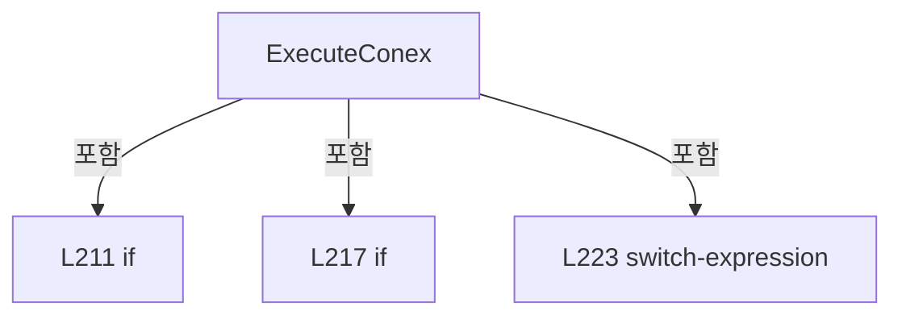

변경 전 점검: 입력/반환 타입, 위 호출자, 예외/취소 경로, 공유 상태와 저장·전송 소비자를 함께 확인합니다. 값의 단위나 물리 방향을 이름만으로 확정하지 않습니다.

### MethodDeclaration `IsNoValueCommand` · L240–243

[Drilling.Common/Interface/Serial/CConex_AGP.cs:240–243](https://github.com/kjuws10-rgb/A3Drilling/blob/5aee8e58439c9b455cae7c9593c9be986c3e682e/Drilling.Common/Interface/Serial/CConex_AGP.cs#L240-L243)

| 항목 | 실제 추출 값 |
| --- | --- |
| 서명 | bool Drilling.Common.Interface.CConex_AGP.IsNoValueCommand(string[]) |
| 접근/수식자 | Private / private, static |
| 반환/값 타입 | bool |
| 소속 타입 | NamedType:Drilling.Common.Interface.CConex_AGP |

입력 계약:

| 이름 | 타입 | 전달 | 선택/기본값 |
| --- | --- | --- | --- |
| parts | string[] | None | False /  |

정적 호출자로 확인된 위치:

| 호출 파일/행 | 호출 표현식 | 런타임 분기 가능 |
| --- | --- | --- |
| [Drilling.Common/Interface/Serial/CConex_AGP.cs:227–227](https://github.com/kjuws10-rgb/A3Drilling/blob/5aee8e58439c9b455cae7c9593c9be986c3e682e/Drilling.Common/Interface/Serial/CConex_AGP.cs#L227-L227) | IsNoValueCommand | False |
| [Drilling.Common/Interface/Serial/CConex_AGP.cs:228–228](https://github.com/kjuws10-rgb/A3Drilling/blob/5aee8e58439c9b455cae7c9593c9be986c3e682e/Drilling.Common/Interface/Serial/CConex_AGP.cs#L228-L228) | IsNoValueCommand | False |
| [Drilling.Common/Interface/Serial/CConex_AGP.cs:229–229](https://github.com/kjuws10-rgb/A3Drilling/blob/5aee8e58439c9b455cae7c9593c9be986c3e682e/Drilling.Common/Interface/Serial/CConex_AGP.cs#L229-L229) | IsNoValueCommand | False |

본문의 실제 연산·분기·예외·반환 순서(원문 위치 순):

| 원본 행 | 종류 | 주석 해설 |
| --- | --- | --- |
| 242 | return | 호출자에게 값 또는 제어를 반환합니다: return parts.Length == 1; |

변경 전 점검: 입력/반환 타입, 위 호출자, 예외/취소 경로, 공유 상태와 저장·전송 소비자를 함께 확인합니다. 값의 단위나 물리 방향을 이름만으로 확정하지 않습니다.

### MethodDeclaration `IsSingleValueCommand` · L245–248

[Drilling.Common/Interface/Serial/CConex_AGP.cs:245–248](https://github.com/kjuws10-rgb/A3Drilling/blob/5aee8e58439c9b455cae7c9593c9be986c3e682e/Drilling.Common/Interface/Serial/CConex_AGP.cs#L245-L248)

| 항목 | 실제 추출 값 |
| --- | --- |
| 서명 | bool Drilling.Common.Interface.CConex_AGP.IsSingleValueCommand(string[]) |
| 접근/수식자 | Private / private, static |
| 반환/값 타입 | bool |
| 소속 타입 | NamedType:Drilling.Common.Interface.CConex_AGP |

입력 계약:

| 이름 | 타입 | 전달 | 선택/기본값 |
| --- | --- | --- | --- |
| parts | string[] | None | False /  |

정적 호출자로 확인된 위치:

| 호출 파일/행 | 호출 표현식 | 런타임 분기 가능 |
| --- | --- | --- |
| [Drilling.Common/Interface/Serial/CConex_AGP.cs:225–225](https://github.com/kjuws10-rgb/A3Drilling/blob/5aee8e58439c9b455cae7c9593c9be986c3e682e/Drilling.Common/Interface/Serial/CConex_AGP.cs#L225-L225) | IsSingleValueCommand | False |
| [Drilling.Common/Interface/Serial/CConex_AGP.cs:226–226](https://github.com/kjuws10-rgb/A3Drilling/blob/5aee8e58439c9b455cae7c9593c9be986c3e682e/Drilling.Common/Interface/Serial/CConex_AGP.cs#L226-L226) | IsSingleValueCommand | False |
| [Drilling.Common/Interface/Serial/CConex_AGP.cs:230–230](https://github.com/kjuws10-rgb/A3Drilling/blob/5aee8e58439c9b455cae7c9593c9be986c3e682e/Drilling.Common/Interface/Serial/CConex_AGP.cs#L230-L230) | IsSingleValueCommand | False |
| [Drilling.Common/Interface/Serial/CConex_AGP.cs:231–231](https://github.com/kjuws10-rgb/A3Drilling/blob/5aee8e58439c9b455cae7c9593c9be986c3e682e/Drilling.Common/Interface/Serial/CConex_AGP.cs#L231-L231) | IsSingleValueCommand | False |
| [Drilling.Common/Interface/Serial/CConex_AGP.cs:232–232](https://github.com/kjuws10-rgb/A3Drilling/blob/5aee8e58439c9b455cae7c9593c9be986c3e682e/Drilling.Common/Interface/Serial/CConex_AGP.cs#L232-L232) | IsSingleValueCommand | False |
| [Drilling.Common/Interface/Serial/CConex_AGP.cs:233–233](https://github.com/kjuws10-rgb/A3Drilling/blob/5aee8e58439c9b455cae7c9593c9be986c3e682e/Drilling.Common/Interface/Serial/CConex_AGP.cs#L233-L233) | IsSingleValueCommand | False |
| [Drilling.Common/Interface/Serial/CConex_AGP.cs:234–234](https://github.com/kjuws10-rgb/A3Drilling/blob/5aee8e58439c9b455cae7c9593c9be986c3e682e/Drilling.Common/Interface/Serial/CConex_AGP.cs#L234-L234) | IsSingleValueCommand | False |
| [Drilling.Common/Interface/Serial/CConex_AGP.cs:235–235](https://github.com/kjuws10-rgb/A3Drilling/blob/5aee8e58439c9b455cae7c9593c9be986c3e682e/Drilling.Common/Interface/Serial/CConex_AGP.cs#L235-L235) | IsSingleValueCommand | False |

호출하는 대상과 해석 범위:

| 원본 행 | 표현식 | 분석 상태 | 대상/소스 위치 |
| --- | --- | --- | --- |
| 247 | string.IsNullOrWhiteSpace | resolved | bool string.IsNullOrWhiteSpace(string?) |

본문의 실제 연산·분기·예외·반환 순서(원문 위치 순):

| 원본 행 | 종류 | 주석 해설 |
| --- | --- | --- |
| 247 | call | 함수·델리게이트 또는 객체 생성자를 호출합니다: string.IsNullOrWhiteSpace(parts[1]) |
| 247 | return | 호출자에게 값 또는 제어를 반환합니다: return parts.Length == 2 && !string.IsNullOrWhiteSpace(parts[1]); |

변경 전 점검: 입력/반환 타입, 위 호출자, 예외/취소 경로, 공유 상태와 저장·전송 소비자를 함께 확인합니다. 값의 단위나 물리 방향을 이름만으로 확정하지 않습니다.

### MethodDeclaration `SendSelecting` · L250–280

[Drilling.Common/Interface/Serial/CConex_AGP.cs:250–280](https://github.com/kjuws10-rgb/A3Drilling/blob/5aee8e58439c9b455cae7c9593c9be986c3e682e/Drilling.Common/Interface/Serial/CConex_AGP.cs#L250-L280)

| 항목 | 실제 추출 값 |
| --- | --- |
| 서명 | string Drilling.Common.Interface.CConex_AGP.SendSelecting(string, string) |
| 접근/수식자 | Private / private |
| 반환/값 타입 | string |
| 소속 타입 | NamedType:Drilling.Common.Interface.CConex_AGP |

입력 계약:

| 이름 | 타입 | 전달 | 선택/기본값 |
| --- | --- | --- | --- |
| command | string | None | False /  |
| value | string | None | False /  |

정적 호출자로 확인된 위치:

| 호출 파일/행 | 호출 표현식 | 런타임 분기 가능 |
| --- | --- | --- |
| [Drilling.Common/Interface/Serial/CConex_AGP.cs:225–225](https://github.com/kjuws10-rgb/A3Drilling/blob/5aee8e58439c9b455cae7c9593c9be986c3e682e/Drilling.Common/Interface/Serial/CConex_AGP.cs#L225-L225) | SendSelecting | False |
| [Drilling.Common/Interface/Serial/CConex_AGP.cs:226–226](https://github.com/kjuws10-rgb/A3Drilling/blob/5aee8e58439c9b455cae7c9593c9be986c3e682e/Drilling.Common/Interface/Serial/CConex_AGP.cs#L226-L226) | SendSelecting | False |
| [Drilling.Common/Interface/Serial/CConex_AGP.cs:227–227](https://github.com/kjuws10-rgb/A3Drilling/blob/5aee8e58439c9b455cae7c9593c9be986c3e682e/Drilling.Common/Interface/Serial/CConex_AGP.cs#L227-L227) | SendSelecting | False |
| [Drilling.Common/Interface/Serial/CConex_AGP.cs:228–228](https://github.com/kjuws10-rgb/A3Drilling/blob/5aee8e58439c9b455cae7c9593c9be986c3e682e/Drilling.Common/Interface/Serial/CConex_AGP.cs#L228-L228) | SendSelecting | False |
| [Drilling.Common/Interface/Serial/CConex_AGP.cs:229–229](https://github.com/kjuws10-rgb/A3Drilling/blob/5aee8e58439c9b455cae7c9593c9be986c3e682e/Drilling.Common/Interface/Serial/CConex_AGP.cs#L229-L229) | SendSelecting | False |
| [Drilling.Common/Interface/Serial/CConex_AGP.cs:230–230](https://github.com/kjuws10-rgb/A3Drilling/blob/5aee8e58439c9b455cae7c9593c9be986c3e682e/Drilling.Common/Interface/Serial/CConex_AGP.cs#L230-L230) | SendSelecting | False |
| [Drilling.Common/Interface/Serial/CConex_AGP.cs:231–231](https://github.com/kjuws10-rgb/A3Drilling/blob/5aee8e58439c9b455cae7c9593c9be986c3e682e/Drilling.Common/Interface/Serial/CConex_AGP.cs#L231-L231) | SendSelecting | False |
| [Drilling.Common/Interface/Serial/CConex_AGP.cs:232–232](https://github.com/kjuws10-rgb/A3Drilling/blob/5aee8e58439c9b455cae7c9593c9be986c3e682e/Drilling.Common/Interface/Serial/CConex_AGP.cs#L232-L232) | SendSelecting | False |
| [Drilling.Common/Interface/Serial/CConex_AGP.cs:233–233](https://github.com/kjuws10-rgb/A3Drilling/blob/5aee8e58439c9b455cae7c9593c9be986c3e682e/Drilling.Common/Interface/Serial/CConex_AGP.cs#L233-L233) | SendSelecting | False |
| [Drilling.Common/Interface/Serial/CConex_AGP.cs:234–234](https://github.com/kjuws10-rgb/A3Drilling/blob/5aee8e58439c9b455cae7c9593c9be986c3e682e/Drilling.Common/Interface/Serial/CConex_AGP.cs#L234-L234) | SendSelecting | False |
| [Drilling.Common/Interface/Serial/CConex_AGP.cs:235–235](https://github.com/kjuws10-rgb/A3Drilling/blob/5aee8e58439c9b455cae7c9593c9be986c3e682e/Drilling.Common/Interface/Serial/CConex_AGP.cs#L235-L235) | SendSelecting | False |

호출하는 대상과 해석 범위:

| 원본 행 | 표현식 | 분석 상태 | 대상/소스 위치 |
| --- | --- | --- | --- |
| 252 | SerialPort!.DiscardInBuffer | unresolved | None |
| 253 | SerialPort.DiscardOutBuffer | unresolved | None |
| 254 | FormatDeviceCommand | resolved | string Drilling.Common.Interface.CConex_AGP.FormatDeviceCommand(string, string) · Drilling.Common/Interface/Serial/CConex_AGP.cs:306 |
| 255 | tx.TrimEnd | resolved | string string.TrimEnd(params System.ReadOnlySpan<char>) |
| 256 | SerialPort.Write | unresolved | None |
| 257 | command.Equals | resolved | bool string.Equals(string?, System.StringComparison) |
| 262 | Thread.Sleep | resolved | void System.Threading.Thread.Sleep(int) |
| 263 | FormatDeviceCommand | resolved | string Drilling.Common.Interface.CConex_AGP.FormatDeviceCommand(string, string) · Drilling.Common/Interface/Serial/CConex_AGP.cs:306 |
| 264 | SerialPort.Write | unresolved | None |
| 267 | SerialPort.ReadLine | unresolved | None |
| 268 | TryParseResponse | candidate | OverloadResolutionFailure |
| 268 | responseCommand.Equals | resolved | bool string.Equals(string?, System.StringComparison) |
| 273 | errorCode.Trim | resolved | string string.Trim() |
| 274 | normalizedError.Equals | resolved | bool string.Equals(string?, System.StringComparison) |

본문의 실제 연산·분기·예외·반환 순서(원문 위치 순):

| 원본 행 | 종류 | 주석 해설 |
| --- | --- | --- |
| 252 | call | 함수·델리게이트 또는 객체 생성자를 호출합니다: SerialPort!.DiscardInBuffer() |
| 253 | call | 함수·델리게이트 또는 객체 생성자를 호출합니다: SerialPort.DiscardOutBuffer() |
| 254 | call | 함수·델리게이트 또는 객체 생성자를 호출합니다: FormatDeviceCommand(command, value) |
| 254 | local-declaration | 지역 변수를 선언합니다: var tx = FormatDeviceCommand(command, value); |
| 254 | variable-initializer | 변수의 초기값을 지정합니다: tx = FormatDeviceCommand(command, value) |
| 255 | assignment | 값을 대상에 대입합니다: LastSent = tx.TrimEnd('\r', '\n') |
| 255 | call | 함수·델리게이트 또는 객체 생성자를 호출합니다: tx.TrimEnd('\r', '\n') |
| 256 | call | 함수·델리게이트 또는 객체 생성자를 호출합니다: SerialPort.Write(tx) |
| 257 | call | 함수·델리게이트 또는 객체 생성자를 호출합니다: command.Equals("RS", StringComparison.OrdinalIgnoreCase) |
| 257 | if | 조건에 따라 분기합니다: if (command.Equals("RS", StringComparison.OrdinalIgnoreCase)) |
| 259 | return | 호출자에게 값 또는 제어를 반환합니다: return "OK"; |
| 262 | call | 함수·델리게이트 또는 객체 생성자를 호출합니다: Thread.Sleep(50) |
| 263 | call | 함수·델리게이트 또는 객체 생성자를 호출합니다: FormatDeviceCommand("TE", "") |
| 263 | local-declaration | 지역 변수를 선언합니다: var errorQuery = FormatDeviceCommand("TE", ""); |
| 263 | variable-initializer | 변수의 초기값을 지정합니다: errorQuery = FormatDeviceCommand("TE", "") |
| 264 | call | 함수·델리게이트 또는 객체 생성자를 호출합니다: SerialPort.Write(errorQuery) |
| 265 | try | 예외 처리 범위입니다: try |
| 267 | call | 함수·델리게이트 또는 객체 생성자를 호출합니다: SerialPort.ReadLine() |
| 267 | local-declaration | 지역 변수를 선언합니다: var response = SerialPort.ReadLine(); |
| 267 | variable-initializer | 변수의 초기값을 지정합니다: response = SerialPort.ReadLine() |
| 268 | call | 함수·델리게이트 또는 객체 생성자를 호출합니다: TryParseResponse(response, out _, out var responseCommand, out var errorCode) |
| 268 | call | 함수·델리게이트 또는 객체 생성자를 호출합니다: responseCommand.Equals("TE", StringComparison.OrdinalIgnoreCase) |
| 268 | if | 조건에 따라 분기합니다: if (!TryParseResponse(response, out _, out var responseCommand, out var errorCode) &#124;&#124; !responseCommand.Equals("TE", StringComparison.OrdinalIgnoreCase)) |
| 270 | return | 호출자에게 값 또는 제어를 반환합니다: return "ERR:-2"; |
| 273 | call | 함수·델리게이트 또는 객체 생성자를 호출합니다: errorCode.Trim() |
| 273 | local-declaration | 지역 변수를 선언합니다: var normalizedError = errorCode.Trim(); |
| 273 | variable-initializer | 변수의 초기값을 지정합니다: normalizedError = errorCode.Trim() |
| 274 | call | 함수·델리게이트 또는 객체 생성자를 호출합니다: normalizedError.Equals("@", StringComparison.Ordinal) |
| 274 | conditional-expression | 조건에 따라 결과식을 선택합니다: normalizedError.Equals("@", StringComparison.Ordinal) ? "OK" : $"ERR:TE:{normalizedError}" |
| 274 | return | 호출자에게 값 또는 제어를 반환합니다: return normalizedError.Equals("@", StringComparison.Ordinal) ? "OK" : $"ERR:TE:{normalizedError}"; |
| 276 | catch | 지정 예외를 처리합니다: catch (TimeoutException) |
| 278 | return | 호출자에게 값 또는 제어를 반환합니다: return "ERR:-1"; |

제어 구문의 포함 구조(실제 실행 순서/CFG가 아닌 구문 탐색 그림):

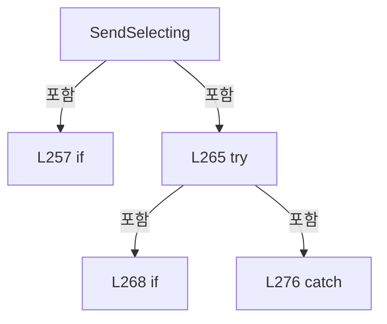

변경 전 점검: 입력/반환 타입, 위 호출자, 예외/취소 경로, 공유 상태와 저장·전송 소비자를 함께 확인합니다. 값의 단위나 물리 방향을 이름만으로 확정하지 않습니다.

### MethodDeclaration `SendPolling` · L282–304

[Drilling.Common/Interface/Serial/CConex_AGP.cs:282–304](https://github.com/kjuws10-rgb/A3Drilling/blob/5aee8e58439c9b455cae7c9593c9be986c3e682e/Drilling.Common/Interface/Serial/CConex_AGP.cs#L282-L304)

| 항목 | 실제 추출 값 |
| --- | --- |
| 서명 | string Drilling.Common.Interface.CConex_AGP.SendPolling(string) |
| 접근/수식자 | Private / private |
| 반환/값 타입 | string |
| 소속 타입 | NamedType:Drilling.Common.Interface.CConex_AGP |

입력 계약:

| 이름 | 타입 | 전달 | 선택/기본값 |
| --- | --- | --- | --- |
| command | string | None | False /  |

정적 호출자로 확인된 위치:

| 호출 파일/행 | 호출 표현식 | 런타임 분기 가능 |
| --- | --- | --- |
| [Drilling.Common/Interface/Serial/CConex_AGP.cs:214–214](https://github.com/kjuws10-rgb/A3Drilling/blob/5aee8e58439c9b455cae7c9593c9be986c3e682e/Drilling.Common/Interface/Serial/CConex_AGP.cs#L214-L214) | SendPolling | False |
| [Drilling.Common/Interface/Serial/CConex_AGP.cs:219–219](https://github.com/kjuws10-rgb/A3Drilling/blob/5aee8e58439c9b455cae7c9593c9be986c3e682e/Drilling.Common/Interface/Serial/CConex_AGP.cs#L219-L219) | SendPolling | False |

호출하는 대상과 해석 범위:

| 원본 행 | 표현식 | 분석 상태 | 대상/소스 위치 |
| --- | --- | --- | --- |
| 284 | SerialPort!.DiscardInBuffer | unresolved | None |
| 285 | SerialPort.DiscardOutBuffer | unresolved | None |
| 286 | FormatDeviceCommand | resolved | string Drilling.Common.Interface.CConex_AGP.FormatDeviceCommand(string, string) · Drilling.Common/Interface/Serial/CConex_AGP.cs:306 |
| 287 | tx.TrimEnd | resolved | string string.TrimEnd(params System.ReadOnlySpan<char>) |
| 288 | SerialPort.Write | unresolved | None |
| 291 | SerialPort.ReadLine | unresolved | None |
| 292 | TryParseResponse | candidate | OverloadResolutionFailure |
| 292 | responseCommand.Equals | resolved | bool string.Equals(string?, System.StringComparison) |
| 292 | ReadTsError | resolved | string Drilling.Common.Interface.CConex_AGP.ReadTsError(string) · Drilling.Common/Interface/Serial/CConex_AGP.cs:501 |
| 292 | ReadTsState | resolved | string Drilling.Common.Interface.CConex_AGP.ReadTsState(string) · Drilling.Common/Interface/Serial/CConex_AGP.cs:506 |
| 292 | value.Trim | resolved | string string.Trim() |
| 296 | SerialPort.ReadExisting().Trim | unresolved | None |
| 296 | SerialPort.ReadExisting | unresolved | None |
| 297 | string.IsNullOrWhiteSpace | candidate | OverloadResolutionFailure |
| 302 | TryParseResponse | candidate | OverloadResolutionFailure |
| 302 | responseCommand.Equals | resolved | bool string.Equals(string?, System.StringComparison) |
| 302 | ReadTsError | resolved | string Drilling.Common.Interface.CConex_AGP.ReadTsError(string) · Drilling.Common/Interface/Serial/CConex_AGP.cs:501 |
| 302 | ReadTsState | resolved | string Drilling.Common.Interface.CConex_AGP.ReadTsState(string) · Drilling.Common/Interface/Serial/CConex_AGP.cs:506 |
| 302 | value.Trim | resolved | string string.Trim() |

본문의 실제 연산·분기·예외·반환 순서(원문 위치 순):

| 원본 행 | 종류 | 주석 해설 |
| --- | --- | --- |
| 284 | call | 함수·델리게이트 또는 객체 생성자를 호출합니다: SerialPort!.DiscardInBuffer() |
| 285 | call | 함수·델리게이트 또는 객체 생성자를 호출합니다: SerialPort.DiscardOutBuffer() |
| 286 | call | 함수·델리게이트 또는 객체 생성자를 호출합니다: FormatDeviceCommand(command, "") |
| 286 | local-declaration | 지역 변수를 선언합니다: var tx = FormatDeviceCommand(command, ""); |
| 286 | variable-initializer | 변수의 초기값을 지정합니다: tx = FormatDeviceCommand(command, "") |
| 287 | assignment | 값을 대상에 대입합니다: LastSent = tx.TrimEnd('\r', '\n') |
| 287 | call | 함수·델리게이트 또는 객체 생성자를 호출합니다: tx.TrimEnd('\r', '\n') |
| 288 | call | 함수·델리게이트 또는 객체 생성자를 호출합니다: SerialPort.Write(tx) |
| 289 | try | 예외 처리 범위입니다: try |
| 291 | call | 함수·델리게이트 또는 객체 생성자를 호출합니다: SerialPort.ReadLine() |
| 291 | local-declaration | 지역 변수를 선언합니다: var response = SerialPort.ReadLine(); |
| 291 | variable-initializer | 변수의 초기값을 지정합니다: response = SerialPort.ReadLine() |
| 292 | call | 함수·델리게이트 또는 객체 생성자를 호출합니다: TryParseResponse(response, out _, out var responseCommand, out var value) |
| 292 | call | 함수·델리게이트 또는 객체 생성자를 호출합니다: responseCommand.Equals("TS", StringComparison.OrdinalIgnoreCase) |
| 292 | call | 함수·델리게이트 또는 객체 생성자를 호출합니다: ReadTsError(value) |
| 292 | call | 함수·델리게이트 또는 객체 생성자를 호출합니다: ReadTsState(value) |
| 292 | call | 함수·델리게이트 또는 객체 생성자를 호출합니다: value.Trim() |
| 292 | conditional-expression | 조건에 따라 결과식을 선택합니다: TryParseResponse(response, out _, out var responseCommand, out var value) ? responseCommand.Equals("TS", StringComparison.OrdinalIgnoreCase) ? $"TS:{ReadTsError(value)}:{ReadTsState(value)}" : $"{responseCommand}:{value.Trim()}" : |
| 292 | conditional-expression | 조건에 따라 결과식을 선택합니다: responseCommand.Equals("TS", StringComparison.OrdinalIgnoreCase) ? $"TS:{ReadTsError(value)}:{ReadTsState(value)}" : $"{responseCommand}:{value.Trim()}" |
| 292 | return | 호출자에게 값 또는 제어를 반환합니다: return TryParseResponse(response, out _, out var responseCommand, out var value) ? responseCommand.Equals("TS", StringComparison.OrdinalIgnoreCase) ? $"TS:{ReadTsError(value)}:{ReadTsState(value)}" : $"{responseCommand}:{value.Tri |
| 294 | catch | 지정 예외를 처리합니다: catch (TimeoutException) |
| 296 | call | 함수·델리게이트 또는 객체 생성자를 호출합니다: SerialPort.ReadExisting().Trim() |
| 296 | call | 함수·델리게이트 또는 객체 생성자를 호출합니다: SerialPort.ReadExisting() |
| 296 | local-declaration | 지역 변수를 선언합니다: var response = SerialPort.ReadExisting().Trim(); |
| 296 | variable-initializer | 변수의 초기값을 지정합니다: response = SerialPort.ReadExisting().Trim() |
| 297 | call | 함수·델리게이트 또는 객체 생성자를 호출합니다: string.IsNullOrWhiteSpace(response) |
| 297 | if | 조건에 따라 분기합니다: if (string.IsNullOrWhiteSpace(response)) |
| 299 | return | 호출자에게 값 또는 제어를 반환합니다: return "ERR:-1"; |
| 302 | call | 함수·델리게이트 또는 객체 생성자를 호출합니다: TryParseResponse(response, out _, out var responseCommand, out var value) |
| 302 | call | 함수·델리게이트 또는 객체 생성자를 호출합니다: responseCommand.Equals("TS", StringComparison.OrdinalIgnoreCase) |
| 302 | call | 함수·델리게이트 또는 객체 생성자를 호출합니다: ReadTsError(value) |
| 302 | call | 함수·델리게이트 또는 객체 생성자를 호출합니다: ReadTsState(value) |
| 302 | call | 함수·델리게이트 또는 객체 생성자를 호출합니다: value.Trim() |
| 302 | conditional-expression | 조건에 따라 결과식을 선택합니다: TryParseResponse(response, out _, out var responseCommand, out var value) ? responseCommand.Equals("TS", StringComparison.OrdinalIgnoreCase) ? $"TS:{ReadTsError(value)}:{ReadTsState(value)}" : $"{responseCommand}:{value.Trim()}" : |
| 302 | conditional-expression | 조건에 따라 결과식을 선택합니다: responseCommand.Equals("TS", StringComparison.OrdinalIgnoreCase) ? $"TS:{ReadTsError(value)}:{ReadTsState(value)}" : $"{responseCommand}:{value.Trim()}" |
| 302 | return | 호출자에게 값 또는 제어를 반환합니다: return TryParseResponse(response, out _, out var responseCommand, out var value) ? responseCommand.Equals("TS", StringComparison.OrdinalIgnoreCase) ? $"TS:{ReadTsError(value)}:{ReadTsState(value)}" : $"{responseCommand}:{value.Tri |

제어 구문의 포함 구조(실제 실행 순서/CFG가 아닌 구문 탐색 그림):

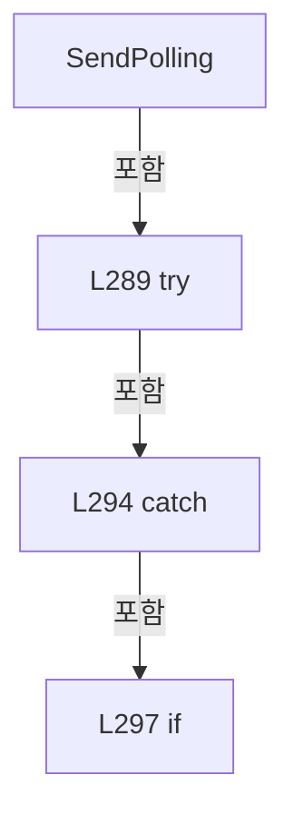

변경 전 점검: 입력/반환 타입, 위 호출자, 예외/취소 경로, 공유 상태와 저장·전송 소비자를 함께 확인합니다. 값의 단위나 물리 방향을 이름만으로 확정하지 않습니다.

### MethodDeclaration `FormatDeviceCommand` · L306–310

[Drilling.Common/Interface/Serial/CConex_AGP.cs:306–310](https://github.com/kjuws10-rgb/A3Drilling/blob/5aee8e58439c9b455cae7c9593c9be986c3e682e/Drilling.Common/Interface/Serial/CConex_AGP.cs#L306-L310)

| 항목 | 실제 추출 값 |
| --- | --- |
| 서명 | string Drilling.Common.Interface.CConex_AGP.FormatDeviceCommand(string, string) |
| 접근/수식자 | Private / private |
| 반환/값 타입 | string |
| 소속 타입 | NamedType:Drilling.Common.Interface.CConex_AGP |

입력 계약:

| 이름 | 타입 | 전달 | 선택/기본값 |
| --- | --- | --- | --- |
| command | string | None | False /  |
| value | string | None | False /  |

정적 호출자로 확인된 위치:

| 호출 파일/행 | 호출 표현식 | 런타임 분기 가능 |
| --- | --- | --- |
| [Drilling.Common/Interface/Serial/CConex_AGP.cs:254–254](https://github.com/kjuws10-rgb/A3Drilling/blob/5aee8e58439c9b455cae7c9593c9be986c3e682e/Drilling.Common/Interface/Serial/CConex_AGP.cs#L254-L254) | FormatDeviceCommand | False |
| [Drilling.Common/Interface/Serial/CConex_AGP.cs:263–263](https://github.com/kjuws10-rgb/A3Drilling/blob/5aee8e58439c9b455cae7c9593c9be986c3e682e/Drilling.Common/Interface/Serial/CConex_AGP.cs#L263-L263) | FormatDeviceCommand | False |
| [Drilling.Common/Interface/Serial/CConex_AGP.cs:286–286](https://github.com/kjuws10-rgb/A3Drilling/blob/5aee8e58439c9b455cae7c9593c9be986c3e682e/Drilling.Common/Interface/Serial/CConex_AGP.cs#L286-L286) | FormatDeviceCommand | False |

호출하는 대상과 해석 범위:

| 원본 행 | 표현식 | 분석 상태 | 대상/소스 위치 |
| --- | --- | --- | --- |
| 308 | ReadControllerAddress | resolved | int Drilling.Common.Interface.CConex_AGP.ReadControllerAddress() · Drilling.Common/Interface/Serial/CConex_AGP.cs:322 |
| 309 | address.ToString | resolved | string int.ToString(System.IFormatProvider?) |

본문의 실제 연산·분기·예외·반환 순서(원문 위치 순):

| 원본 행 | 종류 | 주석 해설 |
| --- | --- | --- |
| 308 | call | 함수·델리게이트 또는 객체 생성자를 호출합니다: ReadControllerAddress() |
| 308 | local-declaration | 지역 변수를 선언합니다: var address = ReadControllerAddress(); |
| 308 | variable-initializer | 변수의 초기값을 지정합니다: address = ReadControllerAddress() |
| 309 | call | 함수·델리게이트 또는 객체 생성자를 호출합니다: address.ToString(CultureInfo.InvariantCulture) |
| 309 | return | 호출자에게 값 또는 제어를 반환합니다: return $"{address.ToString(CultureInfo.InvariantCulture)}{command}{value}\r\n"; |

변경 전 점검: 입력/반환 타입, 위 호출자, 예외/취소 경로, 공유 상태와 저장·전송 소비자를 함께 확인합니다. 값의 단위나 물리 방향을 이름만으로 확정하지 않습니다.

### MethodDeclaration `IsPollingCommand` · L312–315

[Drilling.Common/Interface/Serial/CConex_AGP.cs:312–315](https://github.com/kjuws10-rgb/A3Drilling/blob/5aee8e58439c9b455cae7c9593c9be986c3e682e/Drilling.Common/Interface/Serial/CConex_AGP.cs#L312-L315)

| 항목 | 실제 추출 값 |
| --- | --- |
| 서명 | bool Drilling.Common.Interface.CConex_AGP.IsPollingCommand(string) |
| 접근/수식자 | Private / private, static |
| 반환/값 타입 | bool |
| 소속 타입 | NamedType:Drilling.Common.Interface.CConex_AGP |

입력 계약:

| 이름 | 타입 | 전달 | 선택/기본값 |
| --- | --- | --- | --- |
| command | string | None | False /  |

정적 호출자로 확인된 위치:

| 호출 파일/행 | 호출 표현식 | 런타임 분기 가능 |
| --- | --- | --- |
| [Drilling.Common/Interface/Serial/CConex_AGP.cs:217–217](https://github.com/kjuws10-rgb/A3Drilling/blob/5aee8e58439c9b455cae7c9593c9be986c3e682e/Drilling.Common/Interface/Serial/CConex_AGP.cs#L217-L217) | IsPollingCommand | False |

호출하는 대상과 해석 범위:

| 원본 행 | 표현식 | 분석 상태 | 대상/소스 위치 |
| --- | --- | --- | --- |
| 314 | command.Equals | resolved | bool string.Equals(string?, System.StringComparison) |
| 314 | command.Equals | resolved | bool string.Equals(string?, System.StringComparison) |
| 314 | command.Equals | resolved | bool string.Equals(string?, System.StringComparison) |

본문의 실제 연산·분기·예외·반환 순서(원문 위치 순):

| 원본 행 | 종류 | 주석 해설 |
| --- | --- | --- |
| 314 | call | 함수·델리게이트 또는 객체 생성자를 호출합니다: command.Equals("TP", StringComparison.OrdinalIgnoreCase) |
| 314 | call | 함수·델리게이트 또는 객체 생성자를 호출합니다: command.Equals("TH", StringComparison.OrdinalIgnoreCase) |
| 314 | call | 함수·델리게이트 또는 객체 생성자를 호출합니다: command.Equals("TS", StringComparison.OrdinalIgnoreCase) |
| 314 | return | 호출자에게 값 또는 제어를 반환합니다: return command.Equals("TP", StringComparison.OrdinalIgnoreCase) &#124;&#124; command.Equals("TH", StringComparison.OrdinalIgnoreCase) &#124;&#124; command.Equals("TS", StringComparison.OrdinalIgnoreCase); |

변경 전 점검: 입력/반환 타입, 위 호출자, 예외/취소 경로, 공유 상태와 저장·전송 소비자를 함께 확인합니다. 값의 단위나 물리 방향을 이름만으로 확정하지 않습니다.

### MethodDeclaration `IsParameterQueryCommand` · L317–320

[Drilling.Common/Interface/Serial/CConex_AGP.cs:317–320](https://github.com/kjuws10-rgb/A3Drilling/blob/5aee8e58439c9b455cae7c9593c9be986c3e682e/Drilling.Common/Interface/Serial/CConex_AGP.cs#L317-L320)

| 항목 | 실제 추출 값 |
| --- | --- |
| 서명 | bool Drilling.Common.Interface.CConex_AGP.IsParameterQueryCommand(string) |
| 접근/수식자 | Private / private, static |
| 반환/값 타입 | bool |
| 소속 타입 | NamedType:Drilling.Common.Interface.CConex_AGP |

입력 계약:

| 이름 | 타입 | 전달 | 선택/기본값 |
| --- | --- | --- | --- |
| command | string | None | False /  |

정적 호출자로 확인된 위치:

| 호출 파일/행 | 호출 표현식 | 런타임 분기 가능 |
| --- | --- | --- |
| [Drilling.Common/Interface/Serial/CConex_AGP.cs:214–214](https://github.com/kjuws10-rgb/A3Drilling/blob/5aee8e58439c9b455cae7c9593c9be986c3e682e/Drilling.Common/Interface/Serial/CConex_AGP.cs#L214-L214) | IsParameterQueryCommand | False |

호출하는 대상과 해석 범위:

| 원본 행 | 표현식 | 분석 상태 | 대상/소스 위치 |
| --- | --- | --- | --- |
| 319 | command.Equals | resolved | bool string.Equals(string?, System.StringComparison) |
| 319 | command.Equals | resolved | bool string.Equals(string?, System.StringComparison) |
| 319 | command.Equals | resolved | bool string.Equals(string?, System.StringComparison) |
| 319 | command.Equals | resolved | bool string.Equals(string?, System.StringComparison) |
| 319 | command.Equals | resolved | bool string.Equals(string?, System.StringComparison) |
| 319 | command.Equals | resolved | bool string.Equals(string?, System.StringComparison) |

본문의 실제 연산·분기·예외·반환 순서(원문 위치 순):

| 원본 행 | 종류 | 주석 해설 |
| --- | --- | --- |
| 319 | call | 함수·델리게이트 또는 객체 생성자를 호출합니다: command.Equals("HT", StringComparison.OrdinalIgnoreCase) |
| 319 | call | 함수·델리게이트 또는 객체 생성자를 호출합니다: command.Equals("SL", StringComparison.OrdinalIgnoreCase) |
| 319 | call | 함수·델리게이트 또는 객체 생성자를 호출합니다: command.Equals("SR", StringComparison.OrdinalIgnoreCase) |
| 319 | call | 함수·델리게이트 또는 객체 생성자를 호출합니다: command.Equals("KI", StringComparison.OrdinalIgnoreCase) |
| 319 | call | 함수·델리게이트 또는 객체 생성자를 호출합니다: command.Equals("KP", StringComparison.OrdinalIgnoreCase) |
| 319 | call | 함수·델리게이트 또는 객체 생성자를 호출합니다: command.Equals("IF", StringComparison.OrdinalIgnoreCase) |
| 319 | return | 호출자에게 값 또는 제어를 반환합니다: return command.Equals("HT", StringComparison.OrdinalIgnoreCase) &#124;&#124; command.Equals("SL", StringComparison.OrdinalIgnoreCase) &#124;&#124; command.Equals("SR", StringComparison.OrdinalIgnoreCase) &#124;&#124; command.Equals("KI", StringComparison.Ordin |

변경 전 점검: 입력/반환 타입, 위 호출자, 예외/취소 경로, 공유 상태와 저장·전송 소비자를 함께 확인합니다. 값의 단위나 물리 방향을 이름만으로 확정하지 않습니다.

### MethodDeclaration `ReadControllerAddress` · L322–343

[Drilling.Common/Interface/Serial/CConex_AGP.cs:322–343](https://github.com/kjuws10-rgb/A3Drilling/blob/5aee8e58439c9b455cae7c9593c9be986c3e682e/Drilling.Common/Interface/Serial/CConex_AGP.cs#L322-L343)

| 항목 | 실제 추출 값 |
| --- | --- |
| 서명 | int Drilling.Common.Interface.CConex_AGP.ReadControllerAddress() |
| 접근/수식자 | Private / private |
| 반환/값 타입 | int |
| 소속 타입 | NamedType:Drilling.Common.Interface.CConex_AGP |

정적 호출자로 확인된 위치:

| 호출 파일/행 | 호출 표현식 | 런타임 분기 가능 |
| --- | --- | --- |
| [Drilling.Common/Interface/Serial/CConex_AGP.cs:308–308](https://github.com/kjuws10-rgb/A3Drilling/blob/5aee8e58439c9b455cae7c9593c9be986c3e682e/Drilling.Common/Interface/Serial/CConex_AGP.cs#L308-L308) | ReadControllerAddress | False |

호출하는 대상과 해석 범위:

| 원본 행 | 표현식 | 분석 상태 | 대상/소스 위치 |
| --- | --- | --- | --- |
| 335 | Data.Extra.TryGetValue | resolved · 동적 구현 선택 가능 | bool System.Collections.Generic.IReadOnlyDictionary<string, string>.TryGetValue(string, out string) |
| 335 | int.TryParse | resolved | bool int.TryParse(string?, System.Globalization.NumberStyles, System.IFormatProvider?, out int) |

본문의 실제 연산·분기·예외·반환 순서(원문 위치 순):

| 원본 행 | 종류 | 주석 해설 |
| --- | --- | --- |
| 324 | if | 조건에 따라 분기합니다: if (Data.Extra is not null) |
| 326 | foreach | 컬렉션 요소를 순회합니다: foreach (var key in new[] { "ADDRESS", "DEV_ADDRESS", "CONTROLLER_ADDRESS" }) |
| 335 | call | 함수·델리게이트 또는 객체 생성자를 호출합니다: Data.Extra.TryGetValue(key, out var value) |
| 335 | call | 함수·델리게이트 또는 객체 생성자를 호출합니다: int.TryParse(value, NumberStyles.Integer, CultureInfo.InvariantCulture, out var address) |
| 335 | if | 조건에 따라 분기합니다: if (Data.Extra.TryGetValue(key, out var value) && int.TryParse(value, NumberStyles.Integer, CultureInfo.InvariantCulture, out var address) && address is >= 1 and <= 31) |
| 337 | return | 호출자에게 값 또는 제어를 반환합니다: return address; |
| 342 | return | 호출자에게 값 또는 제어를 반환합니다: return 1; |

제어 구문의 포함 구조(실제 실행 순서/CFG가 아닌 구문 탐색 그림):

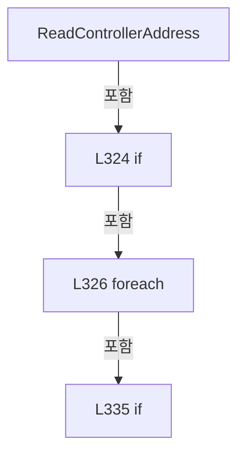

변경 전 점검: 입력/반환 타입, 위 호출자, 예외/취소 경로, 공유 상태와 저장·전송 소비자를 함께 확인합니다. 값의 단위나 물리 방향을 이름만으로 확정하지 않습니다.

### MethodDeclaration `TryParseResponse` · L345–366

[Drilling.Common/Interface/Serial/CConex_AGP.cs:345–366](https://github.com/kjuws10-rgb/A3Drilling/blob/5aee8e58439c9b455cae7c9593c9be986c3e682e/Drilling.Common/Interface/Serial/CConex_AGP.cs#L345-L366)

| 항목 | 실제 추출 값 |
| --- | --- |
| 서명 | bool Drilling.Common.Interface.CConex_AGP.TryParseResponse(string, out int, out string, out string) |
| 접근/수식자 | Private / private, static |
| 반환/값 타입 | bool |
| 소속 타입 | NamedType:Drilling.Common.Interface.CConex_AGP |

입력 계약:

| 이름 | 타입 | 전달 | 선택/기본값 |
| --- | --- | --- | --- |
| response | string | None | False /  |
| address | int | Out | False /  |
| command | string | Out | False /  |
| value | string | Out | False /  |

현재 부분 분석에서 직접 연결된 호출자는 없습니다. XAML/이벤트/인터페이스·델리게이트·외부 진입을 추가 확인해야 하며, 미사용으로 판정한 것이 아닙니다.

호출하는 대상과 해석 범위:

| 원본 행 | 표현식 | 분석 상태 | 대상/소스 위치 |
| --- | --- | --- | --- |
| 350 | response.Trim | resolved | string string.Trim() |
| 351 | char.IsDigit | resolved | bool char.IsDigit(char) |
| 356 | char.IsDigit | resolved | bool char.IsDigit(char) |
| 358 | int.TryParse | resolved | bool int.TryParse(string?, System.Globalization.NumberStyles, System.IFormatProvider?, out int) |
| 363 | text.Substring | resolved | string string.Substring(int, int) |

본문의 실제 연산·분기·예외·반환 순서(원문 위치 순):

| 원본 행 | 종류 | 주석 해설 |
| --- | --- | --- |
| 347 | assignment | 값을 대상에 대입합니다: address = 0 |
| 348 | assignment | 값을 대상에 대입합니다: command = "" |
| 349 | assignment | 값을 대상에 대입합니다: value = "" |
| 350 | call | 함수·델리게이트 또는 객체 생성자를 호출합니다: response.Trim() |
| 350 | local-declaration | 지역 변수를 선언합니다: var text = response.Trim(); |
| 350 | variable-initializer | 변수의 초기값을 지정합니다: text = response.Trim() |
| 351 | call | 함수·델리게이트 또는 객체 생성자를 호출합니다: char.IsDigit(text[0]) |
| 351 | if | 조건에 따라 분기합니다: if (text.Length < 3 &#124;&#124; !char.IsDigit(text[0])) |
| 353 | return | 호출자에게 값 또는 제어를 반환합니다: return false; |
| 356 | call | 함수·델리게이트 또는 객체 생성자를 호출합니다: char.IsDigit(text[1]) |
| 356 | local-declaration | 지역 변수를 선언합니다: var twoDigitAddress = text.Length >= 4 && char.IsDigit(text[1]); |
| 356 | variable-initializer | 변수의 초기값을 지정합니다: twoDigitAddress = text.Length >= 4 && char.IsDigit(text[1]) |
| 357 | conditional-expression | 조건에 따라 결과식을 선택합니다: twoDigitAddress ? 2 : 1 |
| 357 | local-declaration | 지역 변수를 선언합니다: var addressLength = twoDigitAddress ? 2 : 1; |
| 357 | variable-initializer | 변수의 초기값을 지정합니다: addressLength = twoDigitAddress ? 2 : 1 |
| 358 | call | 함수·델리게이트 또는 객체 생성자를 호출합니다: int.TryParse(text[..addressLength], NumberStyles.Integer, CultureInfo.InvariantCulture, out address) |
| 358 | if | 조건에 따라 분기합니다: if (text.Length < addressLength + 2 &#124;&#124; !int.TryParse(text[..addressLength], NumberStyles.Integer, CultureInfo.InvariantCulture, out address)) |
| 360 | return | 호출자에게 값 또는 제어를 반환합니다: return false; |
| 363 | assignment | 값을 대상에 대입합니다: command = text.Substring(addressLength, 2) |
| 363 | call | 함수·델리게이트 또는 객체 생성자를 호출합니다: text.Substring(addressLength, 2) |
| 364 | assignment | 값을 대상에 대입합니다: value = text.Length > addressLength + 2 ? text[(addressLength + 2)..] : "" |
| 364 | conditional-expression | 조건에 따라 결과식을 선택합니다: text.Length > addressLength + 2 ? text[(addressLength + 2)..] : "" |
| 365 | return | 호출자에게 값 또는 제어를 반환합니다: return true; |

제어 구문의 포함 구조(실제 실행 순서/CFG가 아닌 구문 탐색 그림):

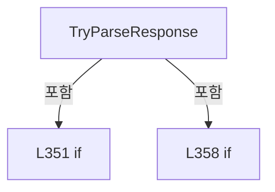

변경 전 점검: 입력/반환 타입, 위 호출자, 예외/취소 경로, 공유 상태와 저장·전송 소비자를 함께 확인합니다. 값의 단위나 물리 방향을 이름만으로 확정하지 않습니다.

### MethodDeclaration `CreateSimulationResponse` · L368–383

[Drilling.Common/Interface/Serial/CConex_AGP.cs:368–383](https://github.com/kjuws10-rgb/A3Drilling/blob/5aee8e58439c9b455cae7c9593c9be986c3e682e/Drilling.Common/Interface/Serial/CConex_AGP.cs#L368-L383)

| 항목 | 실제 추출 값 |
| --- | --- |
| 서명 | string Drilling.Common.Interface.CConex_AGP.CreateSimulationResponse(Drilling.Common.Interface.EN_ATTENUATOR_COMMAND, double, Drilling.Common.Interface.ST_ATTENUATOR_STATUS) |
| 접근/수식자 | Private / private, static |
| 반환/값 타입 | string |
| 소속 타입 | NamedType:Drilling.Common.Interface.CConex_AGP |

입력 계약:

| 이름 | 타입 | 전달 | 선택/기본값 |
| --- | --- | --- | --- |
| command | Drilling.Common.Interface.EN_ATTENUATOR_COMMAND | None | False /  |
| parameter | double | None | False /  |
| current | Drilling.Common.Interface.ST_ATTENUATOR_STATUS | None | False /  |

정적 호출자로 확인된 위치:

| 호출 파일/행 | 호출 표현식 | 런타임 분기 가능 |
| --- | --- | --- |
| [Drilling.Common/Interface/Serial/CConex_AGP.cs:51–51](https://github.com/kjuws10-rgb/A3Drilling/blob/5aee8e58439c9b455cae7c9593c9be986c3e682e/Drilling.Common/Interface/Serial/CConex_AGP.cs#L51-L51) | CreateSimulationResponse | False |

호출하는 대상과 해석 범위:

| 원본 행 | 표현식 | 분석 상태 | 대상/소스 위치 |
| --- | --- | --- | --- |
| 372 | current.CurrentPosition.ToString | resolved | string double.ToString(string?, System.IFormatProvider?) |
| 373 | current.TargetPosition.ToString | resolved | string double.ToString(string?, System.IFormatProvider?) |
| 375 | (current.HomeType ?? 4).ToString | resolved | string int.ToString(System.IFormatProvider?) |
| 376 | (current.NegativeSoftwareLimit ?? 0.0).ToString | resolved | string double.ToString(string?, System.IFormatProvider?) |
| 377 | (current.PositiveSoftwareLimit ?? 360.0).ToString | resolved | string double.ToString(string?, System.IFormatProvider?) |
| 378 | (current.IGain ?? 800.0).ToString | resolved | string double.ToString(string?, System.IFormatProvider?) |
| 379 | (current.PGain ?? 10.0).ToString | resolved | string double.ToString(string?, System.IFormatProvider?) |
| 380 | (current.InterpolationFactor ?? 1000.0).ToString | resolved | string double.ToString(string?, System.IFormatProvider?) |

본문의 실제 연산·분기·예외·반환 순서(원문 위치 순):

| 원본 행 | 종류 | 주석 해설 |
| --- | --- | --- |
| 370 | return | 호출자에게 값 또는 제어를 반환합니다: return command switch { EN_ATTENUATOR_COMMAND.PollCurrentPosition or EN_ATTENUATOR_COMMAND.Refresh => $"TP:{current.CurrentPosition.ToString("F3", CultureInfo.InvariantCulture)}", EN_ATTENUATOR_COMMAND.PollTargetPosition => $"TH:{ |
| 370 | switch-expression | 값별 결과식을 선택합니다: command switch { EN_ATTENUATOR_COMMAND.PollCurrentPosition or EN_ATTENUATOR_COMMAND.Refresh => $"TP:{current.CurrentPosition.ToString("F3", CultureInfo.InvariantCulture)}", EN_ATTENUATOR_COMMAND.PollTargetPosition => $"TH:{current |
| 372 | call | 함수·델리게이트 또는 객체 생성자를 호출합니다: current.CurrentPosition.ToString("F3", CultureInfo.InvariantCulture) |
| 373 | call | 함수·델리게이트 또는 객체 생성자를 호출합니다: current.TargetPosition.ToString("F3", CultureInfo.InvariantCulture) |
| 375 | call | 함수·델리게이트 또는 객체 생성자를 호출합니다: (current.HomeType ?? 4).ToString(CultureInfo.InvariantCulture) |
| 376 | call | 함수·델리게이트 또는 객체 생성자를 호출합니다: (current.NegativeSoftwareLimit ?? 0.0).ToString("F3", CultureInfo.InvariantCulture) |
| 377 | call | 함수·델리게이트 또는 객체 생성자를 호출합니다: (current.PositiveSoftwareLimit ?? 360.0).ToString("F3", CultureInfo.InvariantCulture) |
| 378 | call | 함수·델리게이트 또는 객체 생성자를 호출합니다: (current.IGain ?? 800.0).ToString("F3", CultureInfo.InvariantCulture) |
| 379 | call | 함수·델리게이트 또는 객체 생성자를 호출합니다: (current.PGain ?? 10.0).ToString("F3", CultureInfo.InvariantCulture) |
| 380 | call | 함수·델리게이트 또는 객체 생성자를 호출합니다: (current.InterpolationFactor ?? 1000.0).ToString("F3", CultureInfo.InvariantCulture) |

제어 구문의 포함 구조(실제 실행 순서/CFG가 아닌 구문 탐색 그림):

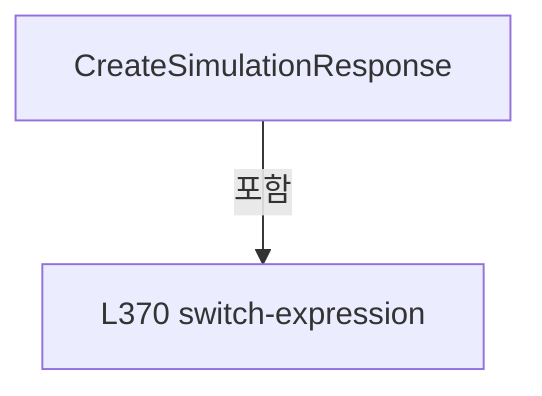

변경 전 점검: 입력/반환 타입, 위 호출자, 예외/취소 경로, 공유 상태와 저장·전송 소비자를 함께 확인합니다. 값의 단위나 물리 방향을 이름만으로 확정하지 않습니다.

### MethodDeclaration `ReadError` · L385–400

[Drilling.Common/Interface/Serial/CConex_AGP.cs:385–400](https://github.com/kjuws10-rgb/A3Drilling/blob/5aee8e58439c9b455cae7c9593c9be986c3e682e/Drilling.Common/Interface/Serial/CConex_AGP.cs#L385-L400)

| 항목 | 실제 추출 값 |
| --- | --- |
| 서명 | Drilling.Common.Interface.EN_CONEX_AGP_ERROR Drilling.Common.Interface.CConex_AGP.ReadError(string) |
| 접근/수식자 | Private / private, static |
| 반환/값 타입 | Drilling.Common.Interface.EN_CONEX_AGP_ERROR |
| 소속 타입 | NamedType:Drilling.Common.Interface.CConex_AGP |

입력 계약:

| 이름 | 타입 | 전달 | 선택/기본값 |
| --- | --- | --- | --- |
| response | string | None | False /  |

정적 호출자로 확인된 위치:

| 호출 파일/행 | 호출 표현식 | 런타임 분기 가능 |
| --- | --- | --- |
| [Drilling.Common/Interface/Serial/CConex_AGP.cs:57–57](https://github.com/kjuws10-rgb/A3Drilling/blob/5aee8e58439c9b455cae7c9593c9be986c3e682e/Drilling.Common/Interface/Serial/CConex_AGP.cs#L57-L57) | ReadError | False |

호출하는 대상과 해석 범위:

| 원본 행 | 표현식 | 분석 상태 | 대상/소스 위치 |
| --- | --- | --- | --- |
| 387 | response.StartsWith | resolved | bool string.StartsWith(string, System.StringComparison) |
| 388 | int.TryParse | resolved | bool int.TryParse(string?, System.Globalization.NumberStyles, System.IFormatProvider?, out int) |

본문의 실제 연산·분기·예외·반환 순서(원문 위치 순):

| 원본 행 | 종류 | 주석 해설 |
| --- | --- | --- |
| 387 | call | 함수·델리게이트 또는 객체 생성자를 호출합니다: response.StartsWith("ERR:", StringComparison.OrdinalIgnoreCase) |
| 387 | conditional-expression | 조건에 따라 결과식을 선택합니다: response.StartsWith("ERR:", StringComparison.OrdinalIgnoreCase) ? response[4..] : "" |
| 387 | local-declaration | 지역 변수를 선언합니다: var value = response.StartsWith("ERR:", StringComparison.OrdinalIgnoreCase) ? response[4..] : ""; |
| 387 | variable-initializer | 변수의 초기값을 지정합니다: value = response.StartsWith("ERR:", StringComparison.OrdinalIgnoreCase) ? response[4..] : "" |
| 388 | call | 함수·델리게이트 또는 객체 생성자를 호출합니다: int.TryParse(value, NumberStyles.Integer, CultureInfo.InvariantCulture, out var code) |
| 388 | if | 조건에 따라 분기합니다: if (!int.TryParse(value, NumberStyles.Integer, CultureInfo.InvariantCulture, out var code)) |
| 390 | return | 호출자에게 값 또는 제어를 반환합니다: return EN_CONEX_AGP_ERROR.Error; |
| 393 | return | 호출자에게 값 또는 제어를 반환합니다: return code switch { -99 => EN_CONEX_AGP_ERROR.NotSupported, -2 => EN_CONEX_AGP_ERROR.InvalidResponse, -1 => EN_CONEX_AGP_ERROR.Timeout, _ => EN_CONEX_AGP_ERROR.Error }; |
| 393 | switch-expression | 값별 결과식을 선택합니다: code switch { -99 => EN_CONEX_AGP_ERROR.NotSupported, -2 => EN_CONEX_AGP_ERROR.InvalidResponse, -1 => EN_CONEX_AGP_ERROR.Timeout, _ => EN_CONEX_AGP_ERROR.Error } |

제어 구문의 포함 구조(실제 실행 순서/CFG가 아닌 구문 탐색 그림):

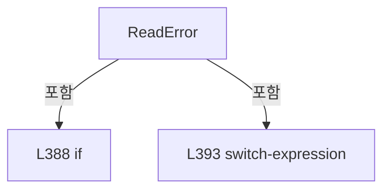

변경 전 점검: 입력/반환 타입, 위 호출자, 예외/취소 경로, 공유 상태와 저장·전송 소비자를 함께 확인합니다. 값의 단위나 물리 방향을 이름만으로 확정하지 않습니다.

### MethodDeclaration `ReadTaggedDouble` · L402–405

[Drilling.Common/Interface/Serial/CConex_AGP.cs:402–405](https://github.com/kjuws10-rgb/A3Drilling/blob/5aee8e58439c9b455cae7c9593c9be986c3e682e/Drilling.Common/Interface/Serial/CConex_AGP.cs#L402-L405)

| 항목 | 실제 추출 값 |
| --- | --- |
| 서명 | double Drilling.Common.Interface.CConex_AGP.ReadTaggedDouble(string, string, double) |
| 접근/수식자 | Private / private, static |
| 반환/값 타입 | double |
| 소속 타입 | NamedType:Drilling.Common.Interface.CConex_AGP |

입력 계약:

| 이름 | 타입 | 전달 | 선택/기본값 |
| --- | --- | --- | --- |
| response | string | None | False /  |
| tag | string | None | False /  |
| defaultValue | double | None | False /  |

정적 호출자로 확인된 위치:

| 호출 파일/행 | 호출 표현식 | 런타임 분기 가능 |
| --- | --- | --- |
| [Drilling.Common/Interface/Serial/CConex_AGP.cs:98–98](https://github.com/kjuws10-rgb/A3Drilling/blob/5aee8e58439c9b455cae7c9593c9be986c3e682e/Drilling.Common/Interface/Serial/CConex_AGP.cs#L98-L98) | ReadTaggedDouble | False |
| [Drilling.Common/Interface/Serial/CConex_AGP.cs:103–103](https://github.com/kjuws10-rgb/A3Drilling/blob/5aee8e58439c9b455cae7c9593c9be986c3e682e/Drilling.Common/Interface/Serial/CConex_AGP.cs#L103-L103) | ReadTaggedDouble | False |

호출하는 대상과 해석 범위:

| 원본 행 | 표현식 | 분석 상태 | 대상/소스 위치 |
| --- | --- | --- | --- |
| 404 | ReadTaggedNullableDouble | resolved | double? Drilling.Common.Interface.CConex_AGP.ReadTaggedNullableDouble(string, string, double?) · Drilling.Common/Interface/Serial/CConex_AGP.cs:407 |

본문의 실제 연산·분기·예외·반환 순서(원문 위치 순):

| 원본 행 | 종류 | 주석 해설 |
| --- | --- | --- |
| 404 | call | 함수·델리게이트 또는 객체 생성자를 호출합니다: ReadTaggedNullableDouble(response, tag, defaultValue) |
| 404 | return | 호출자에게 값 또는 제어를 반환합니다: return ReadTaggedNullableDouble(response, tag, defaultValue) ?? defaultValue; |

변경 전 점검: 입력/반환 타입, 위 호출자, 예외/취소 경로, 공유 상태와 저장·전송 소비자를 함께 확인합니다. 값의 단위나 물리 방향을 이름만으로 확정하지 않습니다.

### MethodDeclaration `ReadTaggedNullableDouble` · L407–417

[Drilling.Common/Interface/Serial/CConex_AGP.cs:407–417](https://github.com/kjuws10-rgb/A3Drilling/blob/5aee8e58439c9b455cae7c9593c9be986c3e682e/Drilling.Common/Interface/Serial/CConex_AGP.cs#L407-L417)

| 항목 | 실제 추출 값 |
| --- | --- |
| 서명 | double? Drilling.Common.Interface.CConex_AGP.ReadTaggedNullableDouble(string, string, double?) |
| 접근/수식자 | Private / private, static |
| 반환/값 타입 | double? |
| 소속 타입 | NamedType:Drilling.Common.Interface.CConex_AGP |

입력 계약:

| 이름 | 타입 | 전달 | 선택/기본값 |
| --- | --- | --- | --- |
| response | string | None | False /  |
| tag | string | None | False /  |
| defaultValue | double? | None | False /  |

정적 호출자로 확인된 위치:

| 호출 파일/행 | 호출 표현식 | 런타임 분기 가능 |
| --- | --- | --- |
| [Drilling.Common/Interface/Serial/CConex_AGP.cs:119–119](https://github.com/kjuws10-rgb/A3Drilling/blob/5aee8e58439c9b455cae7c9593c9be986c3e682e/Drilling.Common/Interface/Serial/CConex_AGP.cs#L119-L119) | ReadTaggedNullableDouble | False |
| [Drilling.Common/Interface/Serial/CConex_AGP.cs:127–127](https://github.com/kjuws10-rgb/A3Drilling/blob/5aee8e58439c9b455cae7c9593c9be986c3e682e/Drilling.Common/Interface/Serial/CConex_AGP.cs#L127-L127) | ReadTaggedNullableDouble | False |
| [Drilling.Common/Interface/Serial/CConex_AGP.cs:135–135](https://github.com/kjuws10-rgb/A3Drilling/blob/5aee8e58439c9b455cae7c9593c9be986c3e682e/Drilling.Common/Interface/Serial/CConex_AGP.cs#L135-L135) | ReadTaggedNullableDouble | False |
| [Drilling.Common/Interface/Serial/CConex_AGP.cs:143–143](https://github.com/kjuws10-rgb/A3Drilling/blob/5aee8e58439c9b455cae7c9593c9be986c3e682e/Drilling.Common/Interface/Serial/CConex_AGP.cs#L143-L143) | ReadTaggedNullableDouble | False |
| [Drilling.Common/Interface/Serial/CConex_AGP.cs:151–151](https://github.com/kjuws10-rgb/A3Drilling/blob/5aee8e58439c9b455cae7c9593c9be986c3e682e/Drilling.Common/Interface/Serial/CConex_AGP.cs#L151-L151) | ReadTaggedNullableDouble | False |
| [Drilling.Common/Interface/Serial/CConex_AGP.cs:404–404](https://github.com/kjuws10-rgb/A3Drilling/blob/5aee8e58439c9b455cae7c9593c9be986c3e682e/Drilling.Common/Interface/Serial/CConex_AGP.cs#L404-L404) | ReadTaggedNullableDouble | False |

호출하는 대상과 해석 범위:

| 원본 행 | 표현식 | 분석 상태 | 대상/소스 위치 |
| --- | --- | --- | --- |
| 410 | response.StartsWith | resolved | bool string.StartsWith(string, System.StringComparison) |
| 411 | double.TryParse | resolved | bool double.TryParse(string?, System.Globalization.NumberStyles, System.IFormatProvider?, out double) |
| 411 | double.IsFinite | resolved | bool double.IsFinite(double) |

본문의 실제 연산·분기·예외·반환 순서(원문 위치 순):

| 원본 행 | 종류 | 주석 해설 |
| --- | --- | --- |
| 409 | local-declaration | 지역 변수를 선언합니다: var prefix = $"{tag}:"; |
| 409 | variable-initializer | 변수의 초기값을 지정합니다: prefix = $"{tag}:" |
| 410 | call | 함수·델리게이트 또는 객체 생성자를 호출합니다: response.StartsWith(prefix, StringComparison.OrdinalIgnoreCase) |
| 410 | conditional-expression | 조건에 따라 결과식을 선택합니다: response.StartsWith(prefix, StringComparison.OrdinalIgnoreCase) ? response[prefix.Length..] : response |
| 410 | local-declaration | 지역 변수를 선언합니다: var value = response.StartsWith(prefix, StringComparison.OrdinalIgnoreCase) ? response[prefix.Length..] : response; |
| 410 | variable-initializer | 변수의 초기값을 지정합니다: value = response.StartsWith(prefix, StringComparison.OrdinalIgnoreCase) ? response[prefix.Length..] : response |
| 411 | call | 함수·델리게이트 또는 객체 생성자를 호출합니다: double.TryParse(value, NumberStyles.Float, CultureInfo.InvariantCulture, out var result) |
| 411 | call | 함수·델리게이트 또는 객체 생성자를 호출합니다: double.IsFinite(result) |
| 411 | if | 조건에 따라 분기합니다: if (!double.TryParse(value, NumberStyles.Float, CultureInfo.InvariantCulture, out var result) &#124;&#124; !double.IsFinite(result)) |
| 413 | return | 호출자에게 값 또는 제어를 반환합니다: return defaultValue; |
| 416 | return | 호출자에게 값 또는 제어를 반환합니다: return result; |

제어 구문의 포함 구조(실제 실행 순서/CFG가 아닌 구문 탐색 그림):

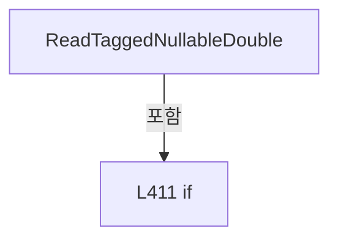

변경 전 점검: 입력/반환 타입, 위 호출자, 예외/취소 경로, 공유 상태와 저장·전송 소비자를 함께 확인합니다. 값의 단위나 물리 방향을 이름만으로 확정하지 않습니다.

### MethodDeclaration `ReadTaggedInt` · L419–424

[Drilling.Common/Interface/Serial/CConex_AGP.cs:419–424](https://github.com/kjuws10-rgb/A3Drilling/blob/5aee8e58439c9b455cae7c9593c9be986c3e682e/Drilling.Common/Interface/Serial/CConex_AGP.cs#L419-L424)

| 항목 | 실제 추출 값 |
| --- | --- |
| 서명 | int? Drilling.Common.Interface.CConex_AGP.ReadTaggedInt(string, string, int?) |
| 접근/수식자 | Private / private, static |
| 반환/값 타입 | int? |
| 소속 타입 | NamedType:Drilling.Common.Interface.CConex_AGP |

입력 계약:

| 이름 | 타입 | 전달 | 선택/기본값 |
| --- | --- | --- | --- |
| response | string | None | False /  |
| tag | string | None | False /  |
| defaultValue | int? | None | False /  |

정적 호출자로 확인된 위치:

| 호출 파일/행 | 호출 표현식 | 런타임 분기 가능 |
| --- | --- | --- |
| [Drilling.Common/Interface/Serial/CConex_AGP.cs:111–111](https://github.com/kjuws10-rgb/A3Drilling/blob/5aee8e58439c9b455cae7c9593c9be986c3e682e/Drilling.Common/Interface/Serial/CConex_AGP.cs#L111-L111) | ReadTaggedInt | False |

호출하는 대상과 해석 범위:

| 원본 행 | 표현식 | 분석 상태 | 대상/소스 위치 |
| --- | --- | --- | --- |
| 422 | response.StartsWith | resolved | bool string.StartsWith(string, System.StringComparison) |
| 423 | int.TryParse | resolved | bool int.TryParse(string?, System.Globalization.NumberStyles, System.IFormatProvider?, out int) |

본문의 실제 연산·분기·예외·반환 순서(원문 위치 순):

| 원본 행 | 종류 | 주석 해설 |
| --- | --- | --- |
| 421 | local-declaration | 지역 변수를 선언합니다: var prefix = $"{tag}:"; |
| 421 | variable-initializer | 변수의 초기값을 지정합니다: prefix = $"{tag}:" |
| 422 | call | 함수·델리게이트 또는 객체 생성자를 호출합니다: response.StartsWith(prefix, StringComparison.OrdinalIgnoreCase) |
| 422 | conditional-expression | 조건에 따라 결과식을 선택합니다: response.StartsWith(prefix, StringComparison.OrdinalIgnoreCase) ? response[prefix.Length..] : response |
| 422 | local-declaration | 지역 변수를 선언합니다: var value = response.StartsWith(prefix, StringComparison.OrdinalIgnoreCase) ? response[prefix.Length..] : response; |
| 422 | variable-initializer | 변수의 초기값을 지정합니다: value = response.StartsWith(prefix, StringComparison.OrdinalIgnoreCase) ? response[prefix.Length..] : response |
| 423 | call | 함수·델리게이트 또는 객체 생성자를 호출합니다: int.TryParse(value, NumberStyles.Integer, CultureInfo.InvariantCulture, out var result) |
| 423 | conditional-expression | 조건에 따라 결과식을 선택합니다: int.TryParse(value, NumberStyles.Integer, CultureInfo.InvariantCulture, out var result) ? result : defaultValue |
| 423 | return | 호출자에게 값 또는 제어를 반환합니다: return int.TryParse(value, NumberStyles.Integer, CultureInfo.InvariantCulture, out var result) ? result : defaultValue; |

변경 전 점검: 입력/반환 타입, 위 호출자, 예외/취소 경로, 공유 상태와 저장·전송 소비자를 함께 확인합니다. 값의 단위나 물리 방향을 이름만으로 확정하지 않습니다.

### MethodDeclaration `FormatCommandParameter` · L426–429

[Drilling.Common/Interface/Serial/CConex_AGP.cs:426–429](https://github.com/kjuws10-rgb/A3Drilling/blob/5aee8e58439c9b455cae7c9593c9be986c3e682e/Drilling.Common/Interface/Serial/CConex_AGP.cs#L426-L429)

| 항목 | 실제 추출 값 |
| --- | --- |
| 서명 | string Drilling.Common.Interface.CConex_AGP.FormatCommandParameter(double) |
| 접근/수식자 | Private / private, static |
| 반환/값 타입 | string |
| 소속 타입 | NamedType:Drilling.Common.Interface.CConex_AGP |

입력 계약:

| 이름 | 타입 | 전달 | 선택/기본값 |
| --- | --- | --- | --- |
| value | double | None | False /  |

정적 호출자로 확인된 위치:

| 호출 파일/행 | 호출 표현식 | 런타임 분기 가능 |
| --- | --- | --- |
| [Drilling.Common/Interface/Serial/CConex_AGP.cs:31–31](https://github.com/kjuws10-rgb/A3Drilling/blob/5aee8e58439c9b455cae7c9593c9be986c3e682e/Drilling.Common/Interface/Serial/CConex_AGP.cs#L31-L31) | FormatCommandParameter | False |
| [Drilling.Common/Interface/Serial/CConex_AGP.cs:33–33](https://github.com/kjuws10-rgb/A3Drilling/blob/5aee8e58439c9b455cae7c9593c9be986c3e682e/Drilling.Common/Interface/Serial/CConex_AGP.cs#L33-L33) | FormatCommandParameter | False |
| [Drilling.Common/Interface/Serial/CConex_AGP.cs:35–35](https://github.com/kjuws10-rgb/A3Drilling/blob/5aee8e58439c9b455cae7c9593c9be986c3e682e/Drilling.Common/Interface/Serial/CConex_AGP.cs#L35-L35) | FormatCommandParameter | False |
| [Drilling.Common/Interface/Serial/CConex_AGP.cs:37–37](https://github.com/kjuws10-rgb/A3Drilling/blob/5aee8e58439c9b455cae7c9593c9be986c3e682e/Drilling.Common/Interface/Serial/CConex_AGP.cs#L37-L37) | FormatCommandParameter | False |
| [Drilling.Common/Interface/Serial/CConex_AGP.cs:39–39](https://github.com/kjuws10-rgb/A3Drilling/blob/5aee8e58439c9b455cae7c9593c9be986c3e682e/Drilling.Common/Interface/Serial/CConex_AGP.cs#L39-L39) | FormatCommandParameter | False |
| [Drilling.Common/Interface/Serial/CConex_AGP.cs:433–433](https://github.com/kjuws10-rgb/A3Drilling/blob/5aee8e58439c9b455cae7c9593c9be986c3e682e/Drilling.Common/Interface/Serial/CConex_AGP.cs#L433-L433) | FormatCommandParameter | False |

호출하는 대상과 해석 범위:

| 원본 행 | 표현식 | 분석 상태 | 대상/소스 위치 |
| --- | --- | --- | --- |
| 428 | ValidateFiniteCommandParameter(value).ToString | resolved | string double.ToString(string?, System.IFormatProvider?) |
| 428 | ValidateFiniteCommandParameter | resolved | double Drilling.Common.Interface.CConex_AGP.ValidateFiniteCommandParameter(double) · Drilling.Common/Interface/Serial/CConex_AGP.cs:446 |

본문의 실제 연산·분기·예외·반환 순서(원문 위치 순):

| 원본 행 | 종류 | 주석 해설 |
| --- | --- | --- |
| 428 | call | 함수·델리게이트 또는 객체 생성자를 호출합니다: ValidateFiniteCommandParameter(value).ToString("0.###", CultureInfo.InvariantCulture) |
| 428 | call | 함수·델리게이트 또는 객체 생성자를 호출합니다: ValidateFiniteCommandParameter(value) |
| 428 | return | 호출자에게 값 또는 제어를 반환합니다: return ValidateFiniteCommandParameter(value).ToString("0.###", CultureInfo.InvariantCulture); |

변경 전 점검: 입력/반환 타입, 위 호출자, 예외/취소 경로, 공유 상태와 저장·전송 소비자를 함께 확인합니다. 값의 단위나 물리 방향을 이름만으로 확정하지 않습니다.

### MethodDeclaration `NormalizeStoredCommandParameter` · L431–434

[Drilling.Common/Interface/Serial/CConex_AGP.cs:431–434](https://github.com/kjuws10-rgb/A3Drilling/blob/5aee8e58439c9b455cae7c9593c9be986c3e682e/Drilling.Common/Interface/Serial/CConex_AGP.cs#L431-L434)

| 항목 | 실제 추출 값 |
| --- | --- |
| 서명 | double Drilling.Common.Interface.CConex_AGP.NormalizeStoredCommandParameter(double) |
| 접근/수식자 | Private / private, static |
| 반환/값 타입 | double |
| 소속 타입 | NamedType:Drilling.Common.Interface.CConex_AGP |

입력 계약:

| 이름 | 타입 | 전달 | 선택/기본값 |
| --- | --- | --- | --- |
| value | double | None | False /  |

정적 호출자로 확인된 위치:

| 호출 파일/행 | 호출 표현식 | 런타임 분기 가능 |
| --- | --- | --- |
| [Drilling.Common/Interface/Serial/CConex_AGP.cs:123–123](https://github.com/kjuws10-rgb/A3Drilling/blob/5aee8e58439c9b455cae7c9593c9be986c3e682e/Drilling.Common/Interface/Serial/CConex_AGP.cs#L123-L123) | NormalizeStoredCommandParameter | False |
| [Drilling.Common/Interface/Serial/CConex_AGP.cs:131–131](https://github.com/kjuws10-rgb/A3Drilling/blob/5aee8e58439c9b455cae7c9593c9be986c3e682e/Drilling.Common/Interface/Serial/CConex_AGP.cs#L131-L131) | NormalizeStoredCommandParameter | False |
| [Drilling.Common/Interface/Serial/CConex_AGP.cs:139–139](https://github.com/kjuws10-rgb/A3Drilling/blob/5aee8e58439c9b455cae7c9593c9be986c3e682e/Drilling.Common/Interface/Serial/CConex_AGP.cs#L139-L139) | NormalizeStoredCommandParameter | False |
| [Drilling.Common/Interface/Serial/CConex_AGP.cs:147–147](https://github.com/kjuws10-rgb/A3Drilling/blob/5aee8e58439c9b455cae7c9593c9be986c3e682e/Drilling.Common/Interface/Serial/CConex_AGP.cs#L147-L147) | NormalizeStoredCommandParameter | False |
| [Drilling.Common/Interface/Serial/CConex_AGP.cs:155–155](https://github.com/kjuws10-rgb/A3Drilling/blob/5aee8e58439c9b455cae7c9593c9be986c3e682e/Drilling.Common/Interface/Serial/CConex_AGP.cs#L155-L155) | NormalizeStoredCommandParameter | False |

호출하는 대상과 해석 범위:

| 원본 행 | 표현식 | 분석 상태 | 대상/소스 위치 |
| --- | --- | --- | --- |
| 433 | double.Parse | resolved | double double.Parse(string, System.Globalization.NumberStyles, System.IFormatProvider?) |
| 433 | FormatCommandParameter | resolved | string Drilling.Common.Interface.CConex_AGP.FormatCommandParameter(double) · Drilling.Common/Interface/Serial/CConex_AGP.cs:426 |

본문의 실제 연산·분기·예외·반환 순서(원문 위치 순):

| 원본 행 | 종류 | 주석 해설 |
| --- | --- | --- |
| 433 | call | 함수·델리게이트 또는 객체 생성자를 호출합니다: double.Parse(FormatCommandParameter(value), NumberStyles.Float, CultureInfo.InvariantCulture) |
| 433 | call | 함수·델리게이트 또는 객체 생성자를 호출합니다: FormatCommandParameter(value) |
| 433 | return | 호출자에게 값 또는 제어를 반환합니다: return double.Parse(FormatCommandParameter(value), NumberStyles.Float, CultureInfo.InvariantCulture); |

변경 전 점검: 입력/반환 타입, 위 호출자, 예외/취소 경로, 공유 상태와 저장·전송 소비자를 함께 확인합니다. 값의 단위나 물리 방향을 이름만으로 확정하지 않습니다.

### MethodDeclaration `FormatPositionParameter` · L436–439

[Drilling.Common/Interface/Serial/CConex_AGP.cs:436–439](https://github.com/kjuws10-rgb/A3Drilling/blob/5aee8e58439c9b455cae7c9593c9be986c3e682e/Drilling.Common/Interface/Serial/CConex_AGP.cs#L436-L439)

| 항목 | 실제 추출 값 |
| --- | --- |
| 서명 | string Drilling.Common.Interface.CConex_AGP.FormatPositionParameter(double) |
| 접근/수식자 | Private / private, static |
| 반환/값 타입 | string |
| 소속 타입 | NamedType:Drilling.Common.Interface.CConex_AGP |

입력 계약:

| 이름 | 타입 | 전달 | 선택/기본값 |
| --- | --- | --- | --- |
| value | double | None | False /  |

정적 호출자로 확인된 위치:

| 호출 파일/행 | 호출 표현식 | 런타임 분기 가능 |
| --- | --- | --- |
| [Drilling.Common/Interface/Serial/CConex_AGP.cs:19–19](https://github.com/kjuws10-rgb/A3Drilling/blob/5aee8e58439c9b455cae7c9593c9be986c3e682e/Drilling.Common/Interface/Serial/CConex_AGP.cs#L19-L19) | FormatPositionParameter | False |
| [Drilling.Common/Interface/Serial/CConex_AGP.cs:20–20](https://github.com/kjuws10-rgb/A3Drilling/blob/5aee8e58439c9b455cae7c9593c9be986c3e682e/Drilling.Common/Interface/Serial/CConex_AGP.cs#L20-L20) | FormatPositionParameter | False |

호출하는 대상과 해석 범위:

| 원본 행 | 표현식 | 분석 상태 | 대상/소스 위치 |
| --- | --- | --- | --- |
| 438 | ValidateFiniteCommandParameter(value).ToString | resolved | string double.ToString(string?, System.IFormatProvider?) |
| 438 | ValidateFiniteCommandParameter | resolved | double Drilling.Common.Interface.CConex_AGP.ValidateFiniteCommandParameter(double) · Drilling.Common/Interface/Serial/CConex_AGP.cs:446 |

본문의 실제 연산·분기·예외·반환 순서(원문 위치 순):

| 원본 행 | 종류 | 주석 해설 |
| --- | --- | --- |
| 438 | call | 함수·델리게이트 또는 객체 생성자를 호출합니다: ValidateFiniteCommandParameter(value).ToString("F3", CultureInfo.InvariantCulture) |
| 438 | call | 함수·델리게이트 또는 객체 생성자를 호출합니다: ValidateFiniteCommandParameter(value) |
| 438 | return | 호출자에게 값 또는 제어를 반환합니다: return ValidateFiniteCommandParameter(value).ToString("F3", CultureInfo.InvariantCulture); |

변경 전 점검: 입력/반환 타입, 위 호출자, 예외/취소 경로, 공유 상태와 저장·전송 소비자를 함께 확인합니다. 값의 단위나 물리 방향을 이름만으로 확정하지 않습니다.

### MethodDeclaration `FormatIntegerCommandParameter` · L441–444

[Drilling.Common/Interface/Serial/CConex_AGP.cs:441–444](https://github.com/kjuws10-rgb/A3Drilling/blob/5aee8e58439c9b455cae7c9593c9be986c3e682e/Drilling.Common/Interface/Serial/CConex_AGP.cs#L441-L444)

| 항목 | 실제 추출 값 |
| --- | --- |
| 서명 | string Drilling.Common.Interface.CConex_AGP.FormatIntegerCommandParameter(double) |
| 접근/수식자 | Private / private, static |
| 반환/값 타입 | string |
| 소속 타입 | NamedType:Drilling.Common.Interface.CConex_AGP |

입력 계약:

| 이름 | 타입 | 전달 | 선택/기본값 |
| --- | --- | --- | --- |
| value | double | None | False /  |

정적 호출자로 확인된 위치:

| 호출 파일/행 | 호출 표현식 | 런타임 분기 가능 |
| --- | --- | --- |
| [Drilling.Common/Interface/Serial/CConex_AGP.cs:29–29](https://github.com/kjuws10-rgb/A3Drilling/blob/5aee8e58439c9b455cae7c9593c9be986c3e682e/Drilling.Common/Interface/Serial/CConex_AGP.cs#L29-L29) | FormatIntegerCommandParameter | False |

호출하는 대상과 해석 범위:

| 원본 행 | 표현식 | 분석 상태 | 대상/소스 위치 |
| --- | --- | --- | --- |
| 443 | ValidateInt32CommandParameter(value).ToString | resolved | string int.ToString(System.IFormatProvider?) |
| 443 | ValidateInt32CommandParameter | resolved | int Drilling.Common.Interface.CConex_AGP.ValidateInt32CommandParameter(double) · Drilling.Common/Interface/Serial/CConex_AGP.cs:456 |

본문의 실제 연산·분기·예외·반환 순서(원문 위치 순):

| 원본 행 | 종류 | 주석 해설 |
| --- | --- | --- |
| 443 | call | 함수·델리게이트 또는 객체 생성자를 호출합니다: ValidateInt32CommandParameter(value).ToString(CultureInfo.InvariantCulture) |
| 443 | call | 함수·델리게이트 또는 객체 생성자를 호출합니다: ValidateInt32CommandParameter(value) |
| 443 | return | 호출자에게 값 또는 제어를 반환합니다: return ValidateInt32CommandParameter(value).ToString(CultureInfo.InvariantCulture); |

변경 전 점검: 입력/반환 타입, 위 호출자, 예외/취소 경로, 공유 상태와 저장·전송 소비자를 함께 확인합니다. 값의 단위나 물리 방향을 이름만으로 확정하지 않습니다.

### MethodDeclaration `ValidateFiniteCommandParameter` · L446–454

[Drilling.Common/Interface/Serial/CConex_AGP.cs:446–454](https://github.com/kjuws10-rgb/A3Drilling/blob/5aee8e58439c9b455cae7c9593c9be986c3e682e/Drilling.Common/Interface/Serial/CConex_AGP.cs#L446-L454)

| 항목 | 실제 추출 값 |
| --- | --- |
| 서명 | double Drilling.Common.Interface.CConex_AGP.ValidateFiniteCommandParameter(double) |
| 접근/수식자 | Private / private, static |
| 반환/값 타입 | double |
| 소속 타입 | NamedType:Drilling.Common.Interface.CConex_AGP |

입력 계약:

| 이름 | 타입 | 전달 | 선택/기본값 |
| --- | --- | --- | --- |
| value | double | None | False /  |

정적 호출자로 확인된 위치:

| 호출 파일/행 | 호출 표현식 | 런타임 분기 가능 |
| --- | --- | --- |
| [Drilling.Common/Interface/Serial/CConex_AGP.cs:428–428](https://github.com/kjuws10-rgb/A3Drilling/blob/5aee8e58439c9b455cae7c9593c9be986c3e682e/Drilling.Common/Interface/Serial/CConex_AGP.cs#L428-L428) | ValidateFiniteCommandParameter | False |
| [Drilling.Common/Interface/Serial/CConex_AGP.cs:438–438](https://github.com/kjuws10-rgb/A3Drilling/blob/5aee8e58439c9b455cae7c9593c9be986c3e682e/Drilling.Common/Interface/Serial/CConex_AGP.cs#L438-L438) | ValidateFiniteCommandParameter | False |
| [Drilling.Common/Interface/Serial/CConex_AGP.cs:458–458](https://github.com/kjuws10-rgb/A3Drilling/blob/5aee8e58439c9b455cae7c9593c9be986c3e682e/Drilling.Common/Interface/Serial/CConex_AGP.cs#L458-L458) | ValidateFiniteCommandParameter | False |

호출하는 대상과 해석 범위:

| 원본 행 | 표현식 | 분석 상태 | 대상/소스 위치 |
| --- | --- | --- | --- |
| 448 | double.IsFinite | resolved | bool double.IsFinite(double) |
| 450 | new ArgumentOutOfRangeException | resolved | System.ArgumentOutOfRangeException.ArgumentOutOfRangeException(string?, object?, string?) |
| 450 | nameof | unresolved | None |

본문의 실제 연산·분기·예외·반환 순서(원문 위치 순):

| 원본 행 | 종류 | 주석 해설 |
| --- | --- | --- |
| 448 | call | 함수·델리게이트 또는 객체 생성자를 호출합니다: double.IsFinite(value) |
| 448 | if | 조건에 따라 분기합니다: if (!double.IsFinite(value)) |
| 450 | call | 함수·델리게이트 또는 객체 생성자를 호출합니다: new ArgumentOutOfRangeException(nameof(value), value, "CONEX-AGP command parameter must be a finite number.") |
| 450 | call | 함수·델리게이트 또는 객체 생성자를 호출합니다: nameof(value) |
| 450 | throw | 예외를 발생/전달합니다: throw new ArgumentOutOfRangeException(nameof(value), value, "CONEX-AGP command parameter must be a finite number."); |
| 453 | return | 호출자에게 값 또는 제어를 반환합니다: return value; |

제어 구문의 포함 구조(실제 실행 순서/CFG가 아닌 구문 탐색 그림):

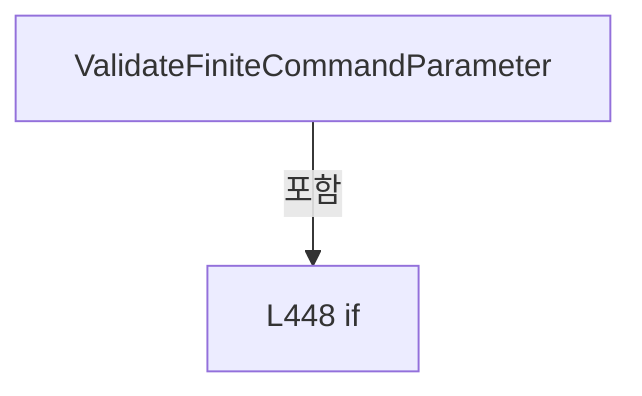

변경 전 점검: 입력/반환 타입, 위 호출자, 예외/취소 경로, 공유 상태와 저장·전송 소비자를 함께 확인합니다. 값의 단위나 물리 방향을 이름만으로 확정하지 않습니다.

### MethodDeclaration `ValidateInt32CommandParameter` · L456–465

[Drilling.Common/Interface/Serial/CConex_AGP.cs:456–465](https://github.com/kjuws10-rgb/A3Drilling/blob/5aee8e58439c9b455cae7c9593c9be986c3e682e/Drilling.Common/Interface/Serial/CConex_AGP.cs#L456-L465)

| 항목 | 실제 추출 값 |
| --- | --- |
| 서명 | int Drilling.Common.Interface.CConex_AGP.ValidateInt32CommandParameter(double) |
| 접근/수식자 | Private / private, static |
| 반환/값 타입 | int |
| 소속 타입 | NamedType:Drilling.Common.Interface.CConex_AGP |

입력 계약:

| 이름 | 타입 | 전달 | 선택/기본값 |
| --- | --- | --- | --- |
| value | double | None | False /  |

정적 호출자로 확인된 위치:

| 호출 파일/행 | 호출 표현식 | 런타임 분기 가능 |
| --- | --- | --- |
| [Drilling.Common/Interface/Serial/CConex_AGP.cs:115–115](https://github.com/kjuws10-rgb/A3Drilling/blob/5aee8e58439c9b455cae7c9593c9be986c3e682e/Drilling.Common/Interface/Serial/CConex_AGP.cs#L115-L115) | ValidateInt32CommandParameter | False |
| [Drilling.Common/Interface/Serial/CConex_AGP.cs:443–443](https://github.com/kjuws10-rgb/A3Drilling/blob/5aee8e58439c9b455cae7c9593c9be986c3e682e/Drilling.Common/Interface/Serial/CConex_AGP.cs#L443-L443) | ValidateInt32CommandParameter | False |

호출하는 대상과 해석 범위:

| 원본 행 | 표현식 | 분석 상태 | 대상/소스 위치 |
| --- | --- | --- | --- |
| 458 | ValidateFiniteCommandParameter | resolved | double Drilling.Common.Interface.CConex_AGP.ValidateFiniteCommandParameter(double) · Drilling.Common/Interface/Serial/CConex_AGP.cs:446 |
| 459 | Math.Truncate | resolved | double System.Math.Truncate(double) |
| 461 | new ArgumentOutOfRangeException | resolved | System.ArgumentOutOfRangeException.ArgumentOutOfRangeException(string?, object?, string?) |
| 461 | nameof | unresolved | None |

본문의 실제 연산·분기·예외·반환 순서(원문 위치 순):

| 원본 행 | 종류 | 주석 해설 |
| --- | --- | --- |
| 458 | call | 함수·델리게이트 또는 객체 생성자를 호출합니다: ValidateFiniteCommandParameter(value) |
| 458 | local-declaration | 지역 변수를 선언합니다: var finiteValue = ValidateFiniteCommandParameter(value); |
| 458 | variable-initializer | 변수의 초기값을 지정합니다: finiteValue = ValidateFiniteCommandParameter(value) |
| 459 | call | 함수·델리게이트 또는 객체 생성자를 호출합니다: Math.Truncate(finiteValue) |
| 459 | if | 조건에 따라 분기합니다: if (finiteValue < int.MinValue &#124;&#124; finiteValue > int.MaxValue &#124;&#124; finiteValue != Math.Truncate(finiteValue)) |
| 461 | call | 함수·델리게이트 또는 객체 생성자를 호출합니다: new ArgumentOutOfRangeException(nameof(value), value, "CONEX-AGP command parameter must be an Int32 integer.") |
| 461 | call | 함수·델리게이트 또는 객체 생성자를 호출합니다: nameof(value) |
| 461 | throw | 예외를 발생/전달합니다: throw new ArgumentOutOfRangeException(nameof(value), value, "CONEX-AGP command parameter must be an Int32 integer."); |
| 464 | return | 호출자에게 값 또는 제어를 반환합니다: return (int)finiteValue; |

제어 구문의 포함 구조(실제 실행 순서/CFG가 아닌 구문 탐색 그림):

변경 전 점검: 입력/반환 타입, 위 호출자, 예외/취소 경로, 공유 상태와 저장·전송 소비자를 함께 확인합니다. 값의 단위나 물리 방향을 이름만으로 확정하지 않습니다.

### MethodDeclaration `ReadControllerState` · L467–476

[Drilling.Common/Interface/Serial/CConex_AGP.cs:467–476](https://github.com/kjuws10-rgb/A3Drilling/blob/5aee8e58439c9b455cae7c9593c9be986c3e682e/Drilling.Common/Interface/Serial/CConex_AGP.cs#L467-L476)

| 항목 | 실제 추출 값 |
| --- | --- |
| 서명 | string Drilling.Common.Interface.CConex_AGP.ReadControllerState(string, string) |
| 접근/수식자 | Private / private, static |
| 반환/값 타입 | string |
| 소속 타입 | NamedType:Drilling.Common.Interface.CConex_AGP |

입력 계약:

| 이름 | 타입 | 전달 | 선택/기본값 |
| --- | --- | --- | --- |
| response | string | None | False /  |
| defaultState | string | None | False /  |

정적 호출자로 확인된 위치:

| 호출 파일/행 | 호출 표현식 | 런타임 분기 가능 |
| --- | --- | --- |
| [Drilling.Common/Interface/Serial/CConex_AGP.cs:107–107](https://github.com/kjuws10-rgb/A3Drilling/blob/5aee8e58439c9b455cae7c9593c9be986c3e682e/Drilling.Common/Interface/Serial/CConex_AGP.cs#L107-L107) | ReadControllerState | False |

호출하는 대상과 해석 범위:

| 원본 행 | 표현식 | 분석 상태 | 대상/소스 위치 |
| --- | --- | --- | --- |
| 469 | response.StartsWith | resolved | bool string.StartsWith(string, System.StringComparison) |
| 474 | response.Split | resolved | string[] string.Split(char, System.StringSplitOptions) |
| 475 | NormalizeControllerState | resolved | string Drilling.Common.Interface.CConex_AGP.NormalizeControllerState(string) · Drilling.Common/Interface/Serial/CConex_AGP.cs:478 |

본문의 실제 연산·분기·예외·반환 순서(원문 위치 순):

| 원본 행 | 종류 | 주석 해설 |
| --- | --- | --- |
| 469 | call | 함수·델리게이트 또는 객체 생성자를 호출합니다: response.StartsWith("TS:", StringComparison.OrdinalIgnoreCase) |
| 469 | if | 조건에 따라 분기합니다: if (!response.StartsWith("TS:", StringComparison.OrdinalIgnoreCase)) |
| 471 | return | 호출자에게 값 또는 제어를 반환합니다: return defaultState; |
| 474 | call | 함수·델리게이트 또는 객체 생성자를 호출합니다: response.Split(':', StringSplitOptions.TrimEntries) |
| 474 | local-declaration | 지역 변수를 선언합니다: var parts = response.Split(':', StringSplitOptions.TrimEntries); |
| 474 | variable-initializer | 변수의 초기값을 지정합니다: parts = response.Split(':', StringSplitOptions.TrimEntries) |
| 475 | call | 함수·델리게이트 또는 객체 생성자를 호출합니다: NormalizeControllerState(parts[2]) |
| 475 | conditional-expression | 조건에 따라 결과식을 선택합니다: parts.Length >= 3 ? NormalizeControllerState(parts[2]) : defaultState |
| 475 | return | 호출자에게 값 또는 제어를 반환합니다: return parts.Length >= 3 ? NormalizeControllerState(parts[2]) : defaultState; |

제어 구문의 포함 구조(실제 실행 순서/CFG가 아닌 구문 탐색 그림):

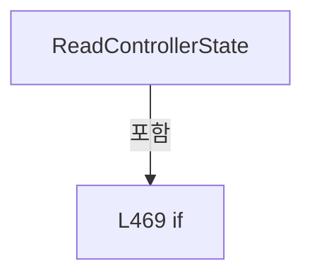

변경 전 점검: 입력/반환 타입, 위 호출자, 예외/취소 경로, 공유 상태와 저장·전송 소비자를 함께 확인합니다. 값의 단위나 물리 방향을 이름만으로 확정하지 않습니다.

### MethodDeclaration `NormalizeControllerState` · L478–494

[Drilling.Common/Interface/Serial/CConex_AGP.cs:478–494](https://github.com/kjuws10-rgb/A3Drilling/blob/5aee8e58439c9b455cae7c9593c9be986c3e682e/Drilling.Common/Interface/Serial/CConex_AGP.cs#L478-L494)

| 항목 | 실제 추출 값 |
| --- | --- |
| 서명 | string Drilling.Common.Interface.CConex_AGP.NormalizeControllerState(string) |
| 접근/수식자 | Private / private, static |
| 반환/값 타입 | string |
| 소속 타입 | NamedType:Drilling.Common.Interface.CConex_AGP |

입력 계약:

| 이름 | 타입 | 전달 | 선택/기본값 |
| --- | --- | --- | --- |
| value | string | None | False /  |

정적 호출자로 확인된 위치:

| 호출 파일/행 | 호출 표현식 | 런타임 분기 가능 |
| --- | --- | --- |
| [Drilling.Common/Interface/Serial/CConex_AGP.cs:475–475](https://github.com/kjuws10-rgb/A3Drilling/blob/5aee8e58439c9b455cae7c9593c9be986c3e682e/Drilling.Common/Interface/Serial/CConex_AGP.cs#L475-L475) | NormalizeControllerState | False |

호출하는 대상과 해석 범위:

| 원본 행 | 표현식 | 분석 상태 | 대상/소스 위치 |
| --- | --- | --- | --- |
| 480 | int.TryParse | resolved | bool int.TryParse(string?, System.Globalization.NumberStyles, System.IFormatProvider?, out int) |
| 482 | value.ToUpperInvariant | resolved | string string.ToUpperInvariant() |

본문의 실제 연산·분기·예외·반환 순서(원문 위치 순):

| 원본 행 | 종류 | 주석 해설 |
| --- | --- | --- |
| 480 | call | 함수·델리게이트 또는 객체 생성자를 호출합니다: int.TryParse(value, NumberStyles.HexNumber, CultureInfo.InvariantCulture, out var state) |
| 480 | if | 조건에 따라 분기합니다: if (!int.TryParse(value, NumberStyles.HexNumber, CultureInfo.InvariantCulture, out var state)) |
| 482 | call | 함수·델리게이트 또는 객체 생성자를 호출합니다: value.ToUpperInvariant() |
| 482 | return | 호출자에게 값 또는 제어를 반환합니다: return value.ToUpperInvariant(); |
| 485 | return | 호출자에게 값 또는 제어를 반환합니다: return state switch { >= 0x0A and <= 0x10 => "NOT_REFERENCED", 0x14 => "CONFIGURATION", 0x1E => "HOMING", 0x28 => "MOVING", 0x32 or 0x33 or 0x34 => "READY", 0x3C or 0x3D => "DISABLE", _ => $"STATE_{state:X2}"}; |
| 485 | switch-expression | 값별 결과식을 선택합니다: state switch { >= 0x0A and <= 0x10 => "NOT_REFERENCED", 0x14 => "CONFIGURATION", 0x1E => "HOMING", 0x28 => "MOVING", 0x32 or 0x33 or 0x34 => "READY", 0x3C or 0x3D => "DISABLE", _ => $"STATE_{state:X2}"} |

제어 구문의 포함 구조(실제 실행 순서/CFG가 아닌 구문 탐색 그림):

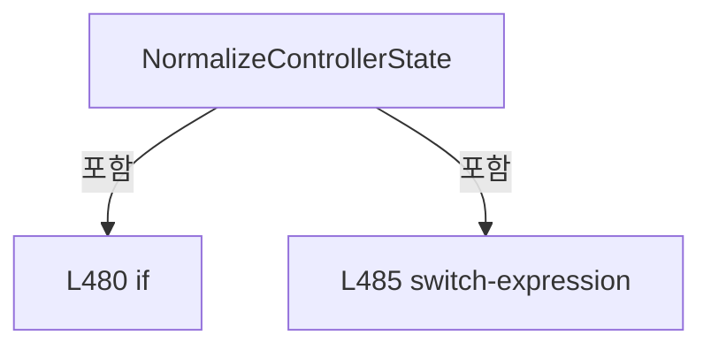

변경 전 점검: 입력/반환 타입, 위 호출자, 예외/취소 경로, 공유 상태와 저장·전송 소비자를 함께 확인합니다. 값의 단위나 물리 방향을 이름만으로 확정하지 않습니다.

### MethodDeclaration `IsMovingState` · L496–499

[Drilling.Common/Interface/Serial/CConex_AGP.cs:496–499](https://github.com/kjuws10-rgb/A3Drilling/blob/5aee8e58439c9b455cae7c9593c9be986c3e682e/Drilling.Common/Interface/Serial/CConex_AGP.cs#L496-L499)

| 항목 | 실제 추출 값 |
| --- | --- |
| 서명 | bool Drilling.Common.Interface.CConex_AGP.IsMovingState(string) |
| 접근/수식자 | Private / private, static |
| 반환/값 타입 | bool |
| 소속 타입 | NamedType:Drilling.Common.Interface.CConex_AGP |

입력 계약:

| 이름 | 타입 | 전달 | 선택/기본값 |
| --- | --- | --- | --- |
| value | string | None | False /  |

정적 호출자로 확인된 위치:

| 호출 파일/행 | 호출 표현식 | 런타임 분기 가능 |
| --- | --- | --- |
| [Drilling.Common/Interface/Serial/CConex_AGP.cs:99–99](https://github.com/kjuws10-rgb/A3Drilling/blob/5aee8e58439c9b455cae7c9593c9be986c3e682e/Drilling.Common/Interface/Serial/CConex_AGP.cs#L99-L99) | IsMovingState | False |

호출하는 대상과 해석 범위:

| 원본 행 | 표현식 | 분석 상태 | 대상/소스 위치 |
| --- | --- | --- | --- |
| 498 | value.Equals | resolved | bool string.Equals(string?, System.StringComparison) |
| 498 | value.Equals | resolved | bool string.Equals(string?, System.StringComparison) |

본문의 실제 연산·분기·예외·반환 순서(원문 위치 순):

| 원본 행 | 종류 | 주석 해설 |
| --- | --- | --- |
| 498 | call | 함수·델리게이트 또는 객체 생성자를 호출합니다: value.Equals("MOVING", StringComparison.OrdinalIgnoreCase) |
| 498 | call | 함수·델리게이트 또는 객체 생성자를 호출합니다: value.Equals("HOMING", StringComparison.OrdinalIgnoreCase) |
| 498 | return | 호출자에게 값 또는 제어를 반환합니다: return value.Equals("MOVING", StringComparison.OrdinalIgnoreCase) &#124;&#124; value.Equals("HOMING", StringComparison.OrdinalIgnoreCase); |

변경 전 점검: 입력/반환 타입, 위 호출자, 예외/취소 경로, 공유 상태와 저장·전송 소비자를 함께 확인합니다. 값의 단위나 물리 방향을 이름만으로 확정하지 않습니다.

### MethodDeclaration `ReadTsError` · L501–504

[Drilling.Common/Interface/Serial/CConex_AGP.cs:501–504](https://github.com/kjuws10-rgb/A3Drilling/blob/5aee8e58439c9b455cae7c9593c9be986c3e682e/Drilling.Common/Interface/Serial/CConex_AGP.cs#L501-L504)

| 항목 | 실제 추출 값 |
| --- | --- |
| 서명 | string Drilling.Common.Interface.CConex_AGP.ReadTsError(string) |
| 접근/수식자 | Private / private, static |
| 반환/값 타입 | string |
| 소속 타입 | NamedType:Drilling.Common.Interface.CConex_AGP |

입력 계약:

| 이름 | 타입 | 전달 | 선택/기본값 |
| --- | --- | --- | --- |
| value | string | None | False /  |

정적 호출자로 확인된 위치:

| 호출 파일/행 | 호출 표현식 | 런타임 분기 가능 |
| --- | --- | --- |
| [Drilling.Common/Interface/Serial/CConex_AGP.cs:292–292](https://github.com/kjuws10-rgb/A3Drilling/blob/5aee8e58439c9b455cae7c9593c9be986c3e682e/Drilling.Common/Interface/Serial/CConex_AGP.cs#L292-L292) | ReadTsError | False |
| [Drilling.Common/Interface/Serial/CConex_AGP.cs:302–302](https://github.com/kjuws10-rgb/A3Drilling/blob/5aee8e58439c9b455cae7c9593c9be986c3e682e/Drilling.Common/Interface/Serial/CConex_AGP.cs#L302-L302) | ReadTsError | False |

본문의 실제 연산·분기·예외·반환 순서(원문 위치 순):

| 원본 행 | 종류 | 주석 해설 |
| --- | --- | --- |
| 503 | conditional-expression | 조건에 따라 결과식을 선택합니다: value.Length >= 4 ? value[..4] : "0" |
| 503 | return | 호출자에게 값 또는 제어를 반환합니다: return value.Length >= 4 ? value[..4] : "0"; |

변경 전 점검: 입력/반환 타입, 위 호출자, 예외/취소 경로, 공유 상태와 저장·전송 소비자를 함께 확인합니다. 값의 단위나 물리 방향을 이름만으로 확정하지 않습니다.

### MethodDeclaration `ReadTsState` · L506–509

[Drilling.Common/Interface/Serial/CConex_AGP.cs:506–509](https://github.com/kjuws10-rgb/A3Drilling/blob/5aee8e58439c9b455cae7c9593c9be986c3e682e/Drilling.Common/Interface/Serial/CConex_AGP.cs#L506-L509)

| 항목 | 실제 추출 값 |
| --- | --- |
| 서명 | string Drilling.Common.Interface.CConex_AGP.ReadTsState(string) |
| 접근/수식자 | Private / private, static |
| 반환/값 타입 | string |
| 소속 타입 | NamedType:Drilling.Common.Interface.CConex_AGP |

입력 계약:

| 이름 | 타입 | 전달 | 선택/기본값 |
| --- | --- | --- | --- |
| value | string | None | False /  |

정적 호출자로 확인된 위치:

| 호출 파일/행 | 호출 표현식 | 런타임 분기 가능 |
| --- | --- | --- |
| [Drilling.Common/Interface/Serial/CConex_AGP.cs:292–292](https://github.com/kjuws10-rgb/A3Drilling/blob/5aee8e58439c9b455cae7c9593c9be986c3e682e/Drilling.Common/Interface/Serial/CConex_AGP.cs#L292-L292) | ReadTsState | False |
| [Drilling.Common/Interface/Serial/CConex_AGP.cs:302–302](https://github.com/kjuws10-rgb/A3Drilling/blob/5aee8e58439c9b455cae7c9593c9be986c3e682e/Drilling.Common/Interface/Serial/CConex_AGP.cs#L302-L302) | ReadTsState | False |

호출하는 대상과 해석 범위:

| 원본 행 | 표현식 | 분석 상태 | 대상/소스 위치 |
| --- | --- | --- | --- |
| 508 | value.Substring | resolved | string string.Substring(int, int) |

본문의 실제 연산·분기·예외·반환 순서(원문 위치 순):

| 원본 행 | 종류 | 주석 해설 |
| --- | --- | --- |
| 508 | call | 함수·델리게이트 또는 객체 생성자를 호출합니다: value.Substring(4, 2) |
| 508 | conditional-expression | 조건에 따라 결과식을 선택합니다: value.Length >= 6 ? value.Substring(4, 2) : "0" |
| 508 | return | 호출자에게 값 또는 제어를 반환합니다: return value.Length >= 6 ? value.Substring(4, 2) : "0"; |

변경 전 점검: 입력/반환 타입, 위 호출자, 예외/취소 경로, 공유 상태와 저장·전송 소비자를 함께 확인합니다. 값의 단위나 물리 방향을 이름만으로 확정하지 않습니다.

### EnumMemberDeclaration `MoveAbs` · L514–514

[Drilling.Common/Interface/Serial/CConex_AGP.cs:514–514](https://github.com/kjuws10-rgb/A3Drilling/blob/5aee8e58439c9b455cae7c9593c9be986c3e682e/Drilling.Common/Interface/Serial/CConex_AGP.cs#L514-L514)

| 항목 | 실제 추출 값 |
| --- | --- |
| 서명 | Drilling.Common.Interface.EN_ATTENUATOR_COMMAND.MoveAbs |
| 접근/수식자 | Public /  |
| 반환/값 타입 | Drilling.Common.Interface.EN_ATTENUATOR_COMMAND |
| 소속 타입 | NamedType:Drilling.Common.Interface.EN_ATTENUATOR_COMMAND |

현재 부분 분석에서 직접 연결된 호출자는 없습니다. XAML/이벤트/인터페이스·델리게이트·외부 진입을 추가 확인해야 하며, 미사용으로 판정한 것이 아닙니다.

변경 전 점검: 입력/반환 타입, 위 호출자, 예외/취소 경로, 공유 상태와 저장·전송 소비자를 함께 확인합니다. 값의 단위나 물리 방향을 이름만으로 확정하지 않습니다.

### EnumMemberDeclaration `MoveRel` · L515–515

[Drilling.Common/Interface/Serial/CConex_AGP.cs:515–515](https://github.com/kjuws10-rgb/A3Drilling/blob/5aee8e58439c9b455cae7c9593c9be986c3e682e/Drilling.Common/Interface/Serial/CConex_AGP.cs#L515-L515)

| 항목 | 실제 추출 값 |
| --- | --- |
| 서명 | Drilling.Common.Interface.EN_ATTENUATOR_COMMAND.MoveRel |
| 접근/수식자 | Public /  |
| 반환/값 타입 | Drilling.Common.Interface.EN_ATTENUATOR_COMMAND |
| 소속 타입 | NamedType:Drilling.Common.Interface.EN_ATTENUATOR_COMMAND |

현재 부분 분석에서 직접 연결된 호출자는 없습니다. XAML/이벤트/인터페이스·델리게이트·외부 진입을 추가 확인해야 하며, 미사용으로 판정한 것이 아닙니다.

변경 전 점검: 입력/반환 타입, 위 호출자, 예외/취소 경로, 공유 상태와 저장·전송 소비자를 함께 확인합니다. 값의 단위나 물리 방향을 이름만으로 확정하지 않습니다.

### EnumMemberDeclaration `Home` · L516–516

[Drilling.Common/Interface/Serial/CConex_AGP.cs:516–516](https://github.com/kjuws10-rgb/A3Drilling/blob/5aee8e58439c9b455cae7c9593c9be986c3e682e/Drilling.Common/Interface/Serial/CConex_AGP.cs#L516-L516)

| 항목 | 실제 추출 값 |
| --- | --- |
| 서명 | Drilling.Common.Interface.EN_ATTENUATOR_COMMAND.Home |
| 접근/수식자 | Public /  |
| 반환/값 타입 | Drilling.Common.Interface.EN_ATTENUATOR_COMMAND |
| 소속 타입 | NamedType:Drilling.Common.Interface.EN_ATTENUATOR_COMMAND |

현재 부분 분석에서 직접 연결된 호출자는 없습니다. XAML/이벤트/인터페이스·델리게이트·외부 진입을 추가 확인해야 하며, 미사용으로 판정한 것이 아닙니다.

변경 전 점검: 입력/반환 타입, 위 호출자, 예외/취소 경로, 공유 상태와 저장·전송 소비자를 함께 확인합니다. 값의 단위나 물리 방향을 이름만으로 확정하지 않습니다.

### EnumMemberDeclaration `Stop` · L517–517

[Drilling.Common/Interface/Serial/CConex_AGP.cs:517–517](https://github.com/kjuws10-rgb/A3Drilling/blob/5aee8e58439c9b455cae7c9593c9be986c3e682e/Drilling.Common/Interface/Serial/CConex_AGP.cs#L517-L517)

| 항목 | 실제 추출 값 |
| --- | --- |
| 서명 | Drilling.Common.Interface.EN_ATTENUATOR_COMMAND.Stop |
| 접근/수식자 | Public /  |
| 반환/값 타입 | Drilling.Common.Interface.EN_ATTENUATOR_COMMAND |
| 소속 타입 | NamedType:Drilling.Common.Interface.EN_ATTENUATOR_COMMAND |

현재 부분 분석에서 직접 연결된 호출자는 없습니다. XAML/이벤트/인터페이스·델리게이트·외부 진입을 추가 확인해야 하며, 미사용으로 판정한 것이 아닙니다.

변경 전 점검: 입력/반환 타입, 위 호출자, 예외/취소 경로, 공유 상태와 저장·전송 소비자를 함께 확인합니다. 값의 단위나 물리 방향을 이름만으로 확정하지 않습니다.

### EnumMemberDeclaration `ResetController` · L518–518

[Drilling.Common/Interface/Serial/CConex_AGP.cs:518–518](https://github.com/kjuws10-rgb/A3Drilling/blob/5aee8e58439c9b455cae7c9593c9be986c3e682e/Drilling.Common/Interface/Serial/CConex_AGP.cs#L518-L518)

| 항목 | 실제 추출 값 |
| --- | --- |
| 서명 | Drilling.Common.Interface.EN_ATTENUATOR_COMMAND.ResetController |
| 접근/수식자 | Public /  |
| 반환/값 타입 | Drilling.Common.Interface.EN_ATTENUATOR_COMMAND |
| 소속 타입 | NamedType:Drilling.Common.Interface.EN_ATTENUATOR_COMMAND |

현재 부분 분석에서 직접 연결된 호출자는 없습니다. XAML/이벤트/인터페이스·델리게이트·외부 진입을 추가 확인해야 하며, 미사용으로 판정한 것이 아닙니다.

변경 전 점검: 입력/반환 타입, 위 호출자, 예외/취소 경로, 공유 상태와 저장·전송 소비자를 함께 확인합니다. 값의 단위나 물리 방향을 이름만으로 확정하지 않습니다.

### EnumMemberDeclaration `Refresh` · L519–519

[Drilling.Common/Interface/Serial/CConex_AGP.cs:519–519](https://github.com/kjuws10-rgb/A3Drilling/blob/5aee8e58439c9b455cae7c9593c9be986c3e682e/Drilling.Common/Interface/Serial/CConex_AGP.cs#L519-L519)

| 항목 | 실제 추출 값 |
| --- | --- |
| 서명 | Drilling.Common.Interface.EN_ATTENUATOR_COMMAND.Refresh |
| 접근/수식자 | Public /  |
| 반환/값 타입 | Drilling.Common.Interface.EN_ATTENUATOR_COMMAND |
| 소속 타입 | NamedType:Drilling.Common.Interface.EN_ATTENUATOR_COMMAND |

현재 부분 분석에서 직접 연결된 호출자는 없습니다. XAML/이벤트/인터페이스·델리게이트·외부 진입을 추가 확인해야 하며, 미사용으로 판정한 것이 아닙니다.

변경 전 점검: 입력/반환 타입, 위 호출자, 예외/취소 경로, 공유 상태와 저장·전송 소비자를 함께 확인합니다. 값의 단위나 물리 방향을 이름만으로 확정하지 않습니다.

### EnumMemberDeclaration `PollCurrentPosition` · L520–520

[Drilling.Common/Interface/Serial/CConex_AGP.cs:520–520](https://github.com/kjuws10-rgb/A3Drilling/blob/5aee8e58439c9b455cae7c9593c9be986c3e682e/Drilling.Common/Interface/Serial/CConex_AGP.cs#L520-L520)

| 항목 | 실제 추출 값 |
| --- | --- |
| 서명 | Drilling.Common.Interface.EN_ATTENUATOR_COMMAND.PollCurrentPosition |
| 접근/수식자 | Public /  |
| 반환/값 타입 | Drilling.Common.Interface.EN_ATTENUATOR_COMMAND |
| 소속 타입 | NamedType:Drilling.Common.Interface.EN_ATTENUATOR_COMMAND |

현재 부분 분석에서 직접 연결된 호출자는 없습니다. XAML/이벤트/인터페이스·델리게이트·외부 진입을 추가 확인해야 하며, 미사용으로 판정한 것이 아닙니다.

변경 전 점검: 입력/반환 타입, 위 호출자, 예외/취소 경로, 공유 상태와 저장·전송 소비자를 함께 확인합니다. 값의 단위나 물리 방향을 이름만으로 확정하지 않습니다.

### EnumMemberDeclaration `PollTargetPosition` · L521–521

[Drilling.Common/Interface/Serial/CConex_AGP.cs:521–521](https://github.com/kjuws10-rgb/A3Drilling/blob/5aee8e58439c9b455cae7c9593c9be986c3e682e/Drilling.Common/Interface/Serial/CConex_AGP.cs#L521-L521)

| 항목 | 실제 추출 값 |
| --- | --- |
| 서명 | Drilling.Common.Interface.EN_ATTENUATOR_COMMAND.PollTargetPosition |
| 접근/수식자 | Public /  |
| 반환/값 타입 | Drilling.Common.Interface.EN_ATTENUATOR_COMMAND |
| 소속 타입 | NamedType:Drilling.Common.Interface.EN_ATTENUATOR_COMMAND |

현재 부분 분석에서 직접 연결된 호출자는 없습니다. XAML/이벤트/인터페이스·델리게이트·외부 진입을 추가 확인해야 하며, 미사용으로 판정한 것이 아닙니다.

변경 전 점검: 입력/반환 타입, 위 호출자, 예외/취소 경로, 공유 상태와 저장·전송 소비자를 함께 확인합니다. 값의 단위나 물리 방향을 이름만으로 확정하지 않습니다.

### EnumMemberDeclaration `PollState` · L522–522

[Drilling.Common/Interface/Serial/CConex_AGP.cs:522–522](https://github.com/kjuws10-rgb/A3Drilling/blob/5aee8e58439c9b455cae7c9593c9be986c3e682e/Drilling.Common/Interface/Serial/CConex_AGP.cs#L522-L522)

| 항목 | 실제 추출 값 |
| --- | --- |
| 서명 | Drilling.Common.Interface.EN_ATTENUATOR_COMMAND.PollState |
| 접근/수식자 | Public /  |
| 반환/값 타입 | Drilling.Common.Interface.EN_ATTENUATOR_COMMAND |
| 소속 타입 | NamedType:Drilling.Common.Interface.EN_ATTENUATOR_COMMAND |

현재 부분 분석에서 직접 연결된 호출자는 없습니다. XAML/이벤트/인터페이스·델리게이트·외부 진입을 추가 확인해야 하며, 미사용으로 판정한 것이 아닙니다.

변경 전 점검: 입력/반환 타입, 위 호출자, 예외/취소 경로, 공유 상태와 저장·전송 소비자를 함께 확인합니다. 값의 단위나 물리 방향을 이름만으로 확정하지 않습니다.

### EnumMemberDeclaration `GetHomeType` · L523–523

[Drilling.Common/Interface/Serial/CConex_AGP.cs:523–523](https://github.com/kjuws10-rgb/A3Drilling/blob/5aee8e58439c9b455cae7c9593c9be986c3e682e/Drilling.Common/Interface/Serial/CConex_AGP.cs#L523-L523)

| 항목 | 실제 추출 값 |
| --- | --- |
| 서명 | Drilling.Common.Interface.EN_ATTENUATOR_COMMAND.GetHomeType |
| 접근/수식자 | Public /  |
| 반환/값 타입 | Drilling.Common.Interface.EN_ATTENUATOR_COMMAND |
| 소속 타입 | NamedType:Drilling.Common.Interface.EN_ATTENUATOR_COMMAND |

현재 부분 분석에서 직접 연결된 호출자는 없습니다. XAML/이벤트/인터페이스·델리게이트·외부 진입을 추가 확인해야 하며, 미사용으로 판정한 것이 아닙니다.

변경 전 점검: 입력/반환 타입, 위 호출자, 예외/취소 경로, 공유 상태와 저장·전송 소비자를 함께 확인합니다. 값의 단위나 물리 방향을 이름만으로 확정하지 않습니다.

### EnumMemberDeclaration `SetHomeType` · L524–524

[Drilling.Common/Interface/Serial/CConex_AGP.cs:524–524](https://github.com/kjuws10-rgb/A3Drilling/blob/5aee8e58439c9b455cae7c9593c9be986c3e682e/Drilling.Common/Interface/Serial/CConex_AGP.cs#L524-L524)

| 항목 | 실제 추출 값 |
| --- | --- |
| 서명 | Drilling.Common.Interface.EN_ATTENUATOR_COMMAND.SetHomeType |
| 접근/수식자 | Public /  |
| 반환/값 타입 | Drilling.Common.Interface.EN_ATTENUATOR_COMMAND |
| 소속 타입 | NamedType:Drilling.Common.Interface.EN_ATTENUATOR_COMMAND |

현재 부분 분석에서 직접 연결된 호출자는 없습니다. XAML/이벤트/인터페이스·델리게이트·외부 진입을 추가 확인해야 하며, 미사용으로 판정한 것이 아닙니다.

변경 전 점검: 입력/반환 타입, 위 호출자, 예외/취소 경로, 공유 상태와 저장·전송 소비자를 함께 확인합니다. 값의 단위나 물리 방향을 이름만으로 확정하지 않습니다.

### EnumMemberDeclaration `GetNegativeSoftwareLimit` · L525–525

[Drilling.Common/Interface/Serial/CConex_AGP.cs:525–525](https://github.com/kjuws10-rgb/A3Drilling/blob/5aee8e58439c9b455cae7c9593c9be986c3e682e/Drilling.Common/Interface/Serial/CConex_AGP.cs#L525-L525)

| 항목 | 실제 추출 값 |
| --- | --- |
| 서명 | Drilling.Common.Interface.EN_ATTENUATOR_COMMAND.GetNegativeSoftwareLimit |
| 접근/수식자 | Public /  |
| 반환/값 타입 | Drilling.Common.Interface.EN_ATTENUATOR_COMMAND |
| 소속 타입 | NamedType:Drilling.Common.Interface.EN_ATTENUATOR_COMMAND |

현재 부분 분석에서 직접 연결된 호출자는 없습니다. XAML/이벤트/인터페이스·델리게이트·외부 진입을 추가 확인해야 하며, 미사용으로 판정한 것이 아닙니다.

변경 전 점검: 입력/반환 타입, 위 호출자, 예외/취소 경로, 공유 상태와 저장·전송 소비자를 함께 확인합니다. 값의 단위나 물리 방향을 이름만으로 확정하지 않습니다.

### EnumMemberDeclaration `SetNegativeSoftwareLimit` · L526–526

[Drilling.Common/Interface/Serial/CConex_AGP.cs:526–526](https://github.com/kjuws10-rgb/A3Drilling/blob/5aee8e58439c9b455cae7c9593c9be986c3e682e/Drilling.Common/Interface/Serial/CConex_AGP.cs#L526-L526)

| 항목 | 실제 추출 값 |
| --- | --- |
| 서명 | Drilling.Common.Interface.EN_ATTENUATOR_COMMAND.SetNegativeSoftwareLimit |
| 접근/수식자 | Public /  |
| 반환/값 타입 | Drilling.Common.Interface.EN_ATTENUATOR_COMMAND |
| 소속 타입 | NamedType:Drilling.Common.Interface.EN_ATTENUATOR_COMMAND |

현재 부분 분석에서 직접 연결된 호출자는 없습니다. XAML/이벤트/인터페이스·델리게이트·외부 진입을 추가 확인해야 하며, 미사용으로 판정한 것이 아닙니다.

변경 전 점검: 입력/반환 타입, 위 호출자, 예외/취소 경로, 공유 상태와 저장·전송 소비자를 함께 확인합니다. 값의 단위나 물리 방향을 이름만으로 확정하지 않습니다.

### EnumMemberDeclaration `GetPositiveSoftwareLimit` · L527–527

[Drilling.Common/Interface/Serial/CConex_AGP.cs:527–527](https://github.com/kjuws10-rgb/A3Drilling/blob/5aee8e58439c9b455cae7c9593c9be986c3e682e/Drilling.Common/Interface/Serial/CConex_AGP.cs#L527-L527)

| 항목 | 실제 추출 값 |
| --- | --- |
| 서명 | Drilling.Common.Interface.EN_ATTENUATOR_COMMAND.GetPositiveSoftwareLimit |
| 접근/수식자 | Public /  |
| 반환/값 타입 | Drilling.Common.Interface.EN_ATTENUATOR_COMMAND |
| 소속 타입 | NamedType:Drilling.Common.Interface.EN_ATTENUATOR_COMMAND |

현재 부분 분석에서 직접 연결된 호출자는 없습니다. XAML/이벤트/인터페이스·델리게이트·외부 진입을 추가 확인해야 하며, 미사용으로 판정한 것이 아닙니다.

변경 전 점검: 입력/반환 타입, 위 호출자, 예외/취소 경로, 공유 상태와 저장·전송 소비자를 함께 확인합니다. 값의 단위나 물리 방향을 이름만으로 확정하지 않습니다.

### EnumMemberDeclaration `SetPositiveSoftwareLimit` · L528–528

[Drilling.Common/Interface/Serial/CConex_AGP.cs:528–528](https://github.com/kjuws10-rgb/A3Drilling/blob/5aee8e58439c9b455cae7c9593c9be986c3e682e/Drilling.Common/Interface/Serial/CConex_AGP.cs#L528-L528)

| 항목 | 실제 추출 값 |
| --- | --- |
| 서명 | Drilling.Common.Interface.EN_ATTENUATOR_COMMAND.SetPositiveSoftwareLimit |
| 접근/수식자 | Public /  |
| 반환/값 타입 | Drilling.Common.Interface.EN_ATTENUATOR_COMMAND |
| 소속 타입 | NamedType:Drilling.Common.Interface.EN_ATTENUATOR_COMMAND |

현재 부분 분석에서 직접 연결된 호출자는 없습니다. XAML/이벤트/인터페이스·델리게이트·외부 진입을 추가 확인해야 하며, 미사용으로 판정한 것이 아닙니다.

변경 전 점검: 입력/반환 타입, 위 호출자, 예외/취소 경로, 공유 상태와 저장·전송 소비자를 함께 확인합니다. 값의 단위나 물리 방향을 이름만으로 확정하지 않습니다.

### EnumMemberDeclaration `GetIGain` · L529–529

[Drilling.Common/Interface/Serial/CConex_AGP.cs:529–529](https://github.com/kjuws10-rgb/A3Drilling/blob/5aee8e58439c9b455cae7c9593c9be986c3e682e/Drilling.Common/Interface/Serial/CConex_AGP.cs#L529-L529)

| 항목 | 실제 추출 값 |
| --- | --- |
| 서명 | Drilling.Common.Interface.EN_ATTENUATOR_COMMAND.GetIGain |
| 접근/수식자 | Public /  |
| 반환/값 타입 | Drilling.Common.Interface.EN_ATTENUATOR_COMMAND |
| 소속 타입 | NamedType:Drilling.Common.Interface.EN_ATTENUATOR_COMMAND |

현재 부분 분석에서 직접 연결된 호출자는 없습니다. XAML/이벤트/인터페이스·델리게이트·외부 진입을 추가 확인해야 하며, 미사용으로 판정한 것이 아닙니다.

변경 전 점검: 입력/반환 타입, 위 호출자, 예외/취소 경로, 공유 상태와 저장·전송 소비자를 함께 확인합니다. 값의 단위나 물리 방향을 이름만으로 확정하지 않습니다.

### EnumMemberDeclaration `SetIGain` · L530–530

[Drilling.Common/Interface/Serial/CConex_AGP.cs:530–530](https://github.com/kjuws10-rgb/A3Drilling/blob/5aee8e58439c9b455cae7c9593c9be986c3e682e/Drilling.Common/Interface/Serial/CConex_AGP.cs#L530-L530)

| 항목 | 실제 추출 값 |
| --- | --- |
| 서명 | Drilling.Common.Interface.EN_ATTENUATOR_COMMAND.SetIGain |
| 접근/수식자 | Public /  |
| 반환/값 타입 | Drilling.Common.Interface.EN_ATTENUATOR_COMMAND |
| 소속 타입 | NamedType:Drilling.Common.Interface.EN_ATTENUATOR_COMMAND |

현재 부분 분석에서 직접 연결된 호출자는 없습니다. XAML/이벤트/인터페이스·델리게이트·외부 진입을 추가 확인해야 하며, 미사용으로 판정한 것이 아닙니다.

변경 전 점검: 입력/반환 타입, 위 호출자, 예외/취소 경로, 공유 상태와 저장·전송 소비자를 함께 확인합니다. 값의 단위나 물리 방향을 이름만으로 확정하지 않습니다.

### EnumMemberDeclaration `GetPGain` · L531–531

[Drilling.Common/Interface/Serial/CConex_AGP.cs:531–531](https://github.com/kjuws10-rgb/A3Drilling/blob/5aee8e58439c9b455cae7c9593c9be986c3e682e/Drilling.Common/Interface/Serial/CConex_AGP.cs#L531-L531)

| 항목 | 실제 추출 값 |
| --- | --- |
| 서명 | Drilling.Common.Interface.EN_ATTENUATOR_COMMAND.GetPGain |
| 접근/수식자 | Public /  |
| 반환/값 타입 | Drilling.Common.Interface.EN_ATTENUATOR_COMMAND |
| 소속 타입 | NamedType:Drilling.Common.Interface.EN_ATTENUATOR_COMMAND |

현재 부분 분석에서 직접 연결된 호출자는 없습니다. XAML/이벤트/인터페이스·델리게이트·외부 진입을 추가 확인해야 하며, 미사용으로 판정한 것이 아닙니다.

변경 전 점검: 입력/반환 타입, 위 호출자, 예외/취소 경로, 공유 상태와 저장·전송 소비자를 함께 확인합니다. 값의 단위나 물리 방향을 이름만으로 확정하지 않습니다.

### EnumMemberDeclaration `SetPGain` · L532–532

[Drilling.Common/Interface/Serial/CConex_AGP.cs:532–532](https://github.com/kjuws10-rgb/A3Drilling/blob/5aee8e58439c9b455cae7c9593c9be986c3e682e/Drilling.Common/Interface/Serial/CConex_AGP.cs#L532-L532)

| 항목 | 실제 추출 값 |
| --- | --- |
| 서명 | Drilling.Common.Interface.EN_ATTENUATOR_COMMAND.SetPGain |
| 접근/수식자 | Public /  |
| 반환/값 타입 | Drilling.Common.Interface.EN_ATTENUATOR_COMMAND |
| 소속 타입 | NamedType:Drilling.Common.Interface.EN_ATTENUATOR_COMMAND |

현재 부분 분석에서 직접 연결된 호출자는 없습니다. XAML/이벤트/인터페이스·델리게이트·외부 진입을 추가 확인해야 하며, 미사용으로 판정한 것이 아닙니다.

변경 전 점검: 입력/반환 타입, 위 호출자, 예외/취소 경로, 공유 상태와 저장·전송 소비자를 함께 확인합니다. 값의 단위나 물리 방향을 이름만으로 확정하지 않습니다.

### EnumMemberDeclaration `GetInterpolationFactor` · L533–533

[Drilling.Common/Interface/Serial/CConex_AGP.cs:533–533](https://github.com/kjuws10-rgb/A3Drilling/blob/5aee8e58439c9b455cae7c9593c9be986c3e682e/Drilling.Common/Interface/Serial/CConex_AGP.cs#L533-L533)

| 항목 | 실제 추출 값 |
| --- | --- |
| 서명 | Drilling.Common.Interface.EN_ATTENUATOR_COMMAND.GetInterpolationFactor |
| 접근/수식자 | Public /  |
| 반환/값 타입 | Drilling.Common.Interface.EN_ATTENUATOR_COMMAND |
| 소속 타입 | NamedType:Drilling.Common.Interface.EN_ATTENUATOR_COMMAND |

현재 부분 분석에서 직접 연결된 호출자는 없습니다. XAML/이벤트/인터페이스·델리게이트·외부 진입을 추가 확인해야 하며, 미사용으로 판정한 것이 아닙니다.

변경 전 점검: 입력/반환 타입, 위 호출자, 예외/취소 경로, 공유 상태와 저장·전송 소비자를 함께 확인합니다. 값의 단위나 물리 방향을 이름만으로 확정하지 않습니다.

### EnumMemberDeclaration `SetInterpolationFactor` · L534–534

[Drilling.Common/Interface/Serial/CConex_AGP.cs:534–534](https://github.com/kjuws10-rgb/A3Drilling/blob/5aee8e58439c9b455cae7c9593c9be986c3e682e/Drilling.Common/Interface/Serial/CConex_AGP.cs#L534-L534)

| 항목 | 실제 추출 값 |
| --- | --- |
| 서명 | Drilling.Common.Interface.EN_ATTENUATOR_COMMAND.SetInterpolationFactor |
| 접근/수식자 | Public /  |
| 반환/값 타입 | Drilling.Common.Interface.EN_ATTENUATOR_COMMAND |
| 소속 타입 | NamedType:Drilling.Common.Interface.EN_ATTENUATOR_COMMAND |

현재 부분 분석에서 직접 연결된 호출자는 없습니다. XAML/이벤트/인터페이스·델리게이트·외부 진입을 추가 확인해야 하며, 미사용으로 판정한 것이 아닙니다.

변경 전 점검: 입력/반환 타입, 위 호출자, 예외/취소 경로, 공유 상태와 저장·전송 소비자를 함께 확인합니다. 값의 단위나 물리 방향을 이름만으로 확정하지 않습니다.

### EnumMemberDeclaration `Ok` · L539–539

[Drilling.Common/Interface/Serial/CConex_AGP.cs:539–539](https://github.com/kjuws10-rgb/A3Drilling/blob/5aee8e58439c9b455cae7c9593c9be986c3e682e/Drilling.Common/Interface/Serial/CConex_AGP.cs#L539-L539)

| 항목 | 실제 추출 값 |
| --- | --- |
| 서명 | Drilling.Common.Interface.EN_CONEX_AGP_ERROR.Ok |
| 접근/수식자 | Public /  |
| 반환/값 타입 | Drilling.Common.Interface.EN_CONEX_AGP_ERROR |
| 소속 타입 | NamedType:Drilling.Common.Interface.EN_CONEX_AGP_ERROR |

현재 부분 분석에서 직접 연결된 호출자는 없습니다. XAML/이벤트/인터페이스·델리게이트·외부 진입을 추가 확인해야 하며, 미사용으로 판정한 것이 아닙니다.

변경 전 점검: 입력/반환 타입, 위 호출자, 예외/취소 경로, 공유 상태와 저장·전송 소비자를 함께 확인합니다. 값의 단위나 물리 방향을 이름만으로 확정하지 않습니다.

### EnumMemberDeclaration `Error` · L540–540

[Drilling.Common/Interface/Serial/CConex_AGP.cs:540–540](https://github.com/kjuws10-rgb/A3Drilling/blob/5aee8e58439c9b455cae7c9593c9be986c3e682e/Drilling.Common/Interface/Serial/CConex_AGP.cs#L540-L540)

| 항목 | 실제 추출 값 |
| --- | --- |
| 서명 | Drilling.Common.Interface.EN_CONEX_AGP_ERROR.Error |
| 접근/수식자 | Public /  |
| 반환/값 타입 | Drilling.Common.Interface.EN_CONEX_AGP_ERROR |
| 소속 타입 | NamedType:Drilling.Common.Interface.EN_CONEX_AGP_ERROR |

현재 부분 분석에서 직접 연결된 호출자는 없습니다. XAML/이벤트/인터페이스·델리게이트·외부 진입을 추가 확인해야 하며, 미사용으로 판정한 것이 아닙니다.

변경 전 점검: 입력/반환 타입, 위 호출자, 예외/취소 경로, 공유 상태와 저장·전송 소비자를 함께 확인합니다. 값의 단위나 물리 방향을 이름만으로 확정하지 않습니다.

### EnumMemberDeclaration `Timeout` · L541–541

[Drilling.Common/Interface/Serial/CConex_AGP.cs:541–541](https://github.com/kjuws10-rgb/A3Drilling/blob/5aee8e58439c9b455cae7c9593c9be986c3e682e/Drilling.Common/Interface/Serial/CConex_AGP.cs#L541-L541)

| 항목 | 실제 추출 값 |
| --- | --- |
| 서명 | Drilling.Common.Interface.EN_CONEX_AGP_ERROR.Timeout |
| 접근/수식자 | Public /  |
| 반환/값 타입 | Drilling.Common.Interface.EN_CONEX_AGP_ERROR |
| 소속 타입 | NamedType:Drilling.Common.Interface.EN_CONEX_AGP_ERROR |

현재 부분 분석에서 직접 연결된 호출자는 없습니다. XAML/이벤트/인터페이스·델리게이트·외부 진입을 추가 확인해야 하며, 미사용으로 판정한 것이 아닙니다.

변경 전 점검: 입력/반환 타입, 위 호출자, 예외/취소 경로, 공유 상태와 저장·전송 소비자를 함께 확인합니다. 값의 단위나 물리 방향을 이름만으로 확정하지 않습니다.

### EnumMemberDeclaration `InvalidResponse` · L542–542

[Drilling.Common/Interface/Serial/CConex_AGP.cs:542–542](https://github.com/kjuws10-rgb/A3Drilling/blob/5aee8e58439c9b455cae7c9593c9be986c3e682e/Drilling.Common/Interface/Serial/CConex_AGP.cs#L542-L542)

| 항목 | 실제 추출 값 |
| --- | --- |
| 서명 | Drilling.Common.Interface.EN_CONEX_AGP_ERROR.InvalidResponse |
| 접근/수식자 | Public /  |
| 반환/값 타입 | Drilling.Common.Interface.EN_CONEX_AGP_ERROR |
| 소속 타입 | NamedType:Drilling.Common.Interface.EN_CONEX_AGP_ERROR |

현재 부분 분석에서 직접 연결된 호출자는 없습니다. XAML/이벤트/인터페이스·델리게이트·외부 진입을 추가 확인해야 하며, 미사용으로 판정한 것이 아닙니다.

변경 전 점검: 입력/반환 타입, 위 호출자, 예외/취소 경로, 공유 상태와 저장·전송 소비자를 함께 확인합니다. 값의 단위나 물리 방향을 이름만으로 확정하지 않습니다.

### EnumMemberDeclaration `NotSupported` · L543–543

[Drilling.Common/Interface/Serial/CConex_AGP.cs:543–543](https://github.com/kjuws10-rgb/A3Drilling/blob/5aee8e58439c9b455cae7c9593c9be986c3e682e/Drilling.Common/Interface/Serial/CConex_AGP.cs#L543-L543)

| 항목 | 실제 추출 값 |
| --- | --- |
| 서명 | Drilling.Common.Interface.EN_CONEX_AGP_ERROR.NotSupported |
| 접근/수식자 | Public /  |
| 반환/값 타입 | Drilling.Common.Interface.EN_CONEX_AGP_ERROR |
| 소속 타입 | NamedType:Drilling.Common.Interface.EN_CONEX_AGP_ERROR |

현재 부분 분석에서 직접 연결된 호출자는 없습니다. XAML/이벤트/인터페이스·델리게이트·외부 진입을 추가 확인해야 하며, 미사용으로 판정한 것이 아닙니다.

변경 전 점검: 입력/반환 타입, 위 호출자, 예외/취소 경로, 공유 상태와 저장·전송 소비자를 함께 확인합니다. 값의 단위나 물리 방향을 이름만으로 확정하지 않습니다.

## 구문·바인딩 한계

전체 WPF/벤더 SDK/프로젝트별 빌드 조건을 로드한 정식 빌드가 아닙니다. `resolved`는 이 부분 컴파일에서의 심볼 연결이며 virtual/interface/delegate/이벤트/Reflection/XAML의 실제 런타임 구현을 확정하지 않습니다. `candidate`와 `unresolved`는 후속 확인 대상으로 남깁니다.

## 원문 전체 주석 해설본

[원본 모든 행과 행별 해설 보기](../../../../annotated/Drilling.Common/Interface/Serial/CConex_AGP.cs.annotated.txt)

원본을 빠뜨리거나 임의로 줄이지 않았습니다. `L000001 |` 표시는 원본 행 번호, `// 해설`은 별도 설명입니다. 실행용 소스가 아닌 문서입니다.

## 수정·재검증 체크

- 원본 Commit과 현재 작업 파일 SHA가 같은지 먼저 확인합니다. 다르면 이 문서를 과거 버전 자료로 취급합니다.
- 선언·직접 호출·이벤트/인터페이스 경계·설정 소비를 함께 확인합니다. 정적 연결의 빈 곳을 정상 경로로 추정하지 않습니다.
- 저장 형식/단위/식별자·재시도·취소·예외·롤백에 영향을 주는 변경은 상세 해설장과 호출자를 다시 검토합니다.
- 도구의 구문 추출과 별도 정적 추적 해설, 실제 빌드·시뮬레이션·실장비 검증 결과를 분리합니다.
