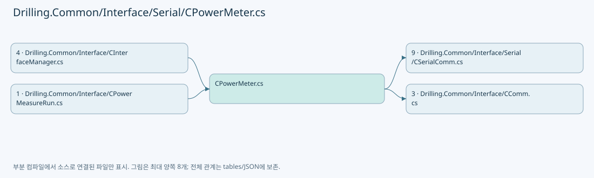
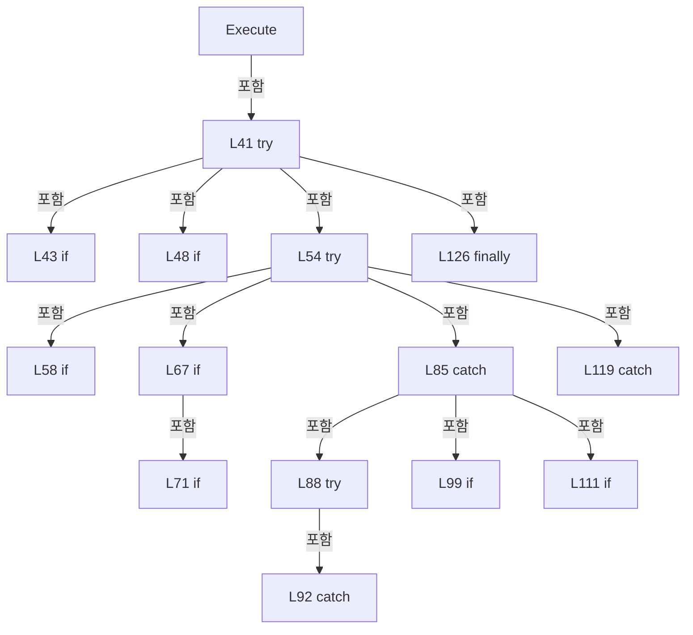
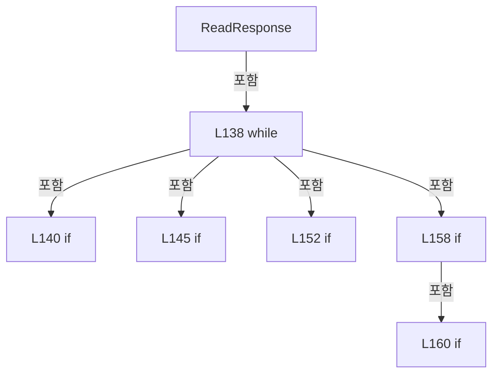
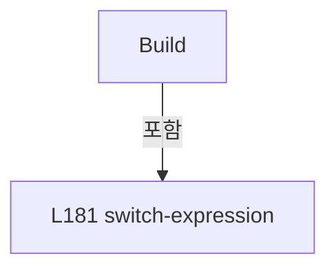
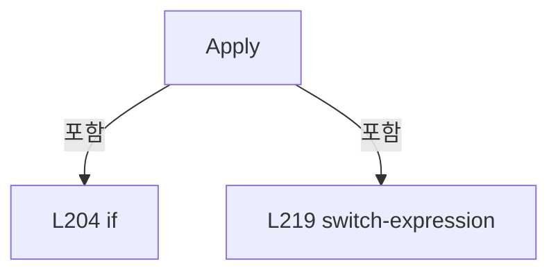
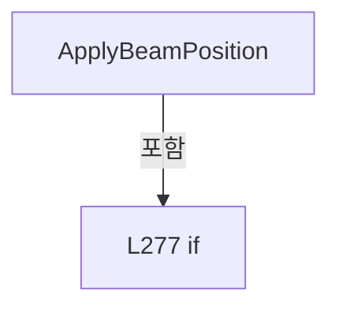
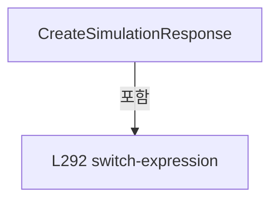

# Drilling.Common/Interface/Serial/CPowerMeter.cs

| 항목 | 내용 |
| --- | --- |
| 원본 저장소 | https://github.com/kjuws10-rgb/A3Drilling.git |
| 원본 Commit | 5aee8e58439c9b455cae7c9593c9be986c3e682e |
| 원본 SHA256 | ae319b41165e250d08a037360e203f7d84c6c6912f19c6a72dfb8157356d9077 |
| 파일 분류 | code |
| 원본 크기/행 | 13,076 bytes / 361 physical lines |
| 인코딩 | utf-8-sig |
| 검토 범위 | 구문/부분 의미 분석에서 추출한 사실. 동작·물리 단위·실장비 합격을 보증하지 않습니다. |
| 원본 링크 | [고정 Commit 원본](https://github.com/kjuws10-rgb/A3Drilling/blob/5aee8e58439c9b455cae7c9593c9be986c3e682e/Drilling.Common/Interface/Serial/CPowerMeter.cs) |

## 파일의 역할과 읽는 순서

외부 통신과 장치 인터페이스를 연결합니다. 요청 생성·전송·수신·장치 실행을 같은 의미로 합치지 않습니다.

## 네임스페이스·타입·상속

| 타입 | 구분 | 원본 범위 | 선언/상속 |
| --- | --- | --- | --- |
| CPowerMeter | ClassDeclaration | 13–338 | CPowerMeter: CSerialComm(data, option) |
| EN_POWER_METER_COMMAND | EnumDeclaration | 340–352 | EN_POWER_METER_COMMAND |
| EN_POWER_METER_ERROR | EnumDeclaration | 354–361 | EN_POWER_METER_ERROR |

## 멤버 빠른 목록

| 이름 | 종류 | 범위 | 서명 |
| --- | --- | --- | --- |
| ResponseTimeoutThreshold | FieldDeclaration | L17–17 | int Drilling.Common.Interface.CPowerMeter.ResponseTimeoutThreshold |
| ResponsePollIntervalMs | FieldDeclaration | L18–18 | int Drilling.Common.Interface.CPowerMeter.ResponsePollIntervalMs |
| _consecutiveResponseTimeouts | FieldDeclaration | L19–19 | int Drilling.Common.Interface.CPowerMeter._consecutiveResponseTimeouts |
| CommandNewLine | PropertyDeclaration | L20–26 | string Drilling.Common.Interface.CPowerMeter.CommandNewLine |
| get_CommandNewLine | GetAccessorDeclaration | L22–25 | string Drilling.Common.Interface.CPowerMeter.CommandNewLine.get |
| FormatCommand | MethodDeclaration | L28–31 | string Drilling.Common.Interface.CPowerMeter.FormatCommand(string) |
| ConfigureSerialPort | MethodDeclaration | L33–36 | void Drilling.Common.Interface.CPowerMeter.ConfigureSerialPort(SerialPort) |
| Execute | MethodDeclaration | L38–130 | System.Threading.Tasks.Task<string> Drilling.Common.Interface.CPowerMeter.Execute(string, System.Threading.CancellationToken) |
| ReadResponse | MethodDeclaration | L132–172 | string Drilling.Common.Interface.CPowerMeter.ReadResponse() |
| IsNoResponseCommand | MethodDeclaration | L174–177 | bool Drilling.Common.Interface.CPowerMeter.IsNoResponseCommand(string) |
| Build | MethodDeclaration | L179–194 | string Drilling.Common.Interface.CPowerMeter.Build(Drilling.Common.Interface.EN_POWER_METER_COMMAND, double) |
| IsSuccessResponse | MethodDeclaration | L196–199 | bool Drilling.Common.Interface.CPowerMeter.IsSuccessResponse(string) |
| Apply | MethodDeclaration | L201–255 | Drilling.Common.Managers.ST_POWER_METER_STATUS Drilling.Common.Interface.CPowerMeter.Apply(Drilling.Common.Interface.EN_POWER_METER_COMMAND, double, string, Drilling.Common.Managers.ST_POWER_METER_STATUS, bool, double?) |
| ApplyPowerValue | MethodDeclaration | L257–272 | Drilling.Common.Managers.ST_POWER_METER_STATUS Drilling.Common.Interface.CPowerMeter.ApplyPowerValue(Drilling.Common.Managers.ST_POWER_METER_STATUS, double) |
| ApplyBeamPosition | MethodDeclaration | L274–287 | Drilling.Common.Managers.ST_POWER_METER_STATUS Drilling.Common.Interface.CPowerMeter.ApplyBeamPosition(Drilling.Common.Managers.ST_POWER_METER_STATUS, string) |
| CreateSimulationResponse | MethodDeclaration | L289–302 | string Drilling.Common.Interface.CPowerMeter.CreateSimulationResponse(Drilling.Common.Interface.EN_POWER_METER_COMMAND, double, Drilling.Common.Managers.ST_POWER_METER_STATUS, double?) |
| ReadWaveLengthNm | MethodDeclaration | L304–308 | double Drilling.Common.Interface.CPowerMeter.ReadWaveLengthNm(string) |
| ToMeter | MethodDeclaration | L310–313 | double Drilling.Common.Interface.CPowerMeter.ToMeter(double) |
| TryReadPower | MethodDeclaration | L315–320 | bool Drilling.Common.Interface.CPowerMeter.TryReadPower(string, out double) |
| ReadDouble | MethodDeclaration | L322–326 | double Drilling.Common.Interface.CPowerMeter.ReadDouble(string) |
| ReadLeadingNumber | MethodDeclaration | L328–337 | string Drilling.Common.Interface.CPowerMeter.ReadLeadingNumber(string) |
| MatchesChar | LocalFunctionStatement | L330–333 | bool MatchesChar(char) |
| ReadPower | EnumMemberDeclaration | L342–342 | Drilling.Common.Interface.EN_POWER_METER_COMMAND.ReadPower |
| QueryHardwareDescription | EnumMemberDeclaration | L343–343 | Drilling.Common.Interface.EN_POWER_METER_COMMAND.QueryHardwareDescription |
| QuerySerialNumber | EnumMemberDeclaration | L344–344 | Drilling.Common.Interface.EN_POWER_METER_COMMAND.QuerySerialNumber |
| QueryWaveLength | EnumMemberDeclaration | L345–345 | Drilling.Common.Interface.EN_POWER_METER_COMMAND.QueryWaveLength |
| SetWaveLength | EnumMemberDeclaration | L346–346 | Drilling.Common.Interface.EN_POWER_METER_COMMAND.SetWaveLength |
| QueryBeamPosition | EnumMemberDeclaration | L347–347 | Drilling.Common.Interface.EN_POWER_METER_COMMAND.QueryBeamPosition |
| StartStreaming | EnumMemberDeclaration | L348–348 | Drilling.Common.Interface.EN_POWER_METER_COMMAND.StartStreaming |
| StopStreaming | EnumMemberDeclaration | L349–349 | Drilling.Common.Interface.EN_POWER_METER_COMMAND.StopStreaming |
| Reset | EnumMemberDeclaration | L350–350 | Drilling.Common.Interface.EN_POWER_METER_COMMAND.Reset |
| Refresh | EnumMemberDeclaration | L351–351 | Drilling.Common.Interface.EN_POWER_METER_COMMAND.Refresh |
| Ok | EnumMemberDeclaration | L356–356 | Drilling.Common.Interface.EN_POWER_METER_ERROR.Ok |
| Error | EnumMemberDeclaration | L357–357 | Drilling.Common.Interface.EN_POWER_METER_ERROR.Error |
| Timeout | EnumMemberDeclaration | L358–358 | Drilling.Common.Interface.EN_POWER_METER_ERROR.Timeout |
| InvalidResponse | EnumMemberDeclaration | L359–359 | Drilling.Common.Interface.EN_POWER_METER_ERROR.InvalidResponse |
| NotSupported | EnumMemberDeclaration | L360–360 | Drilling.Common.Interface.EN_POWER_METER_ERROR.NotSupported |

## 멤버별 상세 계약·호출·처리 해설

### FieldDeclaration `ResponseTimeoutThreshold` · L17–17

[Drilling.Common/Interface/Serial/CPowerMeter.cs:17–17](https://github.com/kjuws10-rgb/A3Drilling/blob/5aee8e58439c9b455cae7c9593c9be986c3e682e/Drilling.Common/Interface/Serial/CPowerMeter.cs#L17-L17)

| 항목 | 실제 추출 값 |
| --- | --- |
| 서명 | int Drilling.Common.Interface.CPowerMeter.ResponseTimeoutThreshold |
| 접근/수식자 | Private / private, const |
| 반환/값 타입 | int |
| 소속 타입 | NamedType:Drilling.Common.Interface.CPowerMeter |

현재 부분 분석에서 직접 연결된 호출자는 없습니다. XAML/이벤트/인터페이스·델리게이트·외부 진입을 추가 확인해야 하며, 미사용으로 판정한 것이 아닙니다.

본문의 실제 연산·분기·예외·반환 순서(원문 위치 순):

| 원본 행 | 종류 | 주석 해설 |
| --- | --- | --- |
| 17 | variable-initializer | 변수의 초기값을 지정합니다: ResponseTimeoutThreshold = 3 |

변경 전 점검: 입력/반환 타입, 위 호출자, 예외/취소 경로, 공유 상태와 저장·전송 소비자를 함께 확인합니다. 값의 단위나 물리 방향을 이름만으로 확정하지 않습니다.

### FieldDeclaration `ResponsePollIntervalMs` · L18–18

[Drilling.Common/Interface/Serial/CPowerMeter.cs:18–18](https://github.com/kjuws10-rgb/A3Drilling/blob/5aee8e58439c9b455cae7c9593c9be986c3e682e/Drilling.Common/Interface/Serial/CPowerMeter.cs#L18-L18)

| 항목 | 실제 추출 값 |
| --- | --- |
| 서명 | int Drilling.Common.Interface.CPowerMeter.ResponsePollIntervalMs |
| 접근/수식자 | Private / private, const |
| 반환/값 타입 | int |
| 소속 타입 | NamedType:Drilling.Common.Interface.CPowerMeter |

현재 부분 분석에서 직접 연결된 호출자는 없습니다. XAML/이벤트/인터페이스·델리게이트·외부 진입을 추가 확인해야 하며, 미사용으로 판정한 것이 아닙니다.

본문의 실제 연산·분기·예외·반환 순서(원문 위치 순):

| 원본 행 | 종류 | 주석 해설 |
| --- | --- | --- |
| 18 | variable-initializer | 변수의 초기값을 지정합니다: ResponsePollIntervalMs = 10 |

변경 전 점검: 입력/반환 타입, 위 호출자, 예외/취소 경로, 공유 상태와 저장·전송 소비자를 함께 확인합니다. 값의 단위나 물리 방향을 이름만으로 확정하지 않습니다.

### FieldDeclaration `_consecutiveResponseTimeouts` · L19–19

[Drilling.Common/Interface/Serial/CPowerMeter.cs:19–19](https://github.com/kjuws10-rgb/A3Drilling/blob/5aee8e58439c9b455cae7c9593c9be986c3e682e/Drilling.Common/Interface/Serial/CPowerMeter.cs#L19-L19)

| 항목 | 실제 추출 값 |
| --- | --- |
| 서명 | int Drilling.Common.Interface.CPowerMeter._consecutiveResponseTimeouts |
| 접근/수식자 | Private / private |
| 반환/값 타입 | int |
| 소속 타입 | NamedType:Drilling.Common.Interface.CPowerMeter |

현재 부분 분석에서 직접 연결된 호출자는 없습니다. XAML/이벤트/인터페이스·델리게이트·외부 진입을 추가 확인해야 하며, 미사용으로 판정한 것이 아닙니다.

변경 전 점검: 입력/반환 타입, 위 호출자, 예외/취소 경로, 공유 상태와 저장·전송 소비자를 함께 확인합니다. 값의 단위나 물리 방향을 이름만으로 확정하지 않습니다.

### PropertyDeclaration `CommandNewLine` · L20–26

[Drilling.Common/Interface/Serial/CPowerMeter.cs:20–26](https://github.com/kjuws10-rgb/A3Drilling/blob/5aee8e58439c9b455cae7c9593c9be986c3e682e/Drilling.Common/Interface/Serial/CPowerMeter.cs#L20-L26)

| 항목 | 실제 추출 값 |
| --- | --- |
| 서명 | string Drilling.Common.Interface.CPowerMeter.CommandNewLine |
| 접근/수식자 | Protected / protected, override |
| 반환/값 타입 | string |
| 소속 타입 | NamedType:Drilling.Common.Interface.CPowerMeter |

현재 부분 분석에서 직접 연결된 호출자는 없습니다. XAML/이벤트/인터페이스·델리게이트·외부 진입을 추가 확인해야 하며, 미사용으로 판정한 것이 아닙니다.

변경 전 점검: 입력/반환 타입, 위 호출자, 예외/취소 경로, 공유 상태와 저장·전송 소비자를 함께 확인합니다. 값의 단위나 물리 방향을 이름만으로 확정하지 않습니다.

### GetAccessorDeclaration `get_CommandNewLine` · L22–25

[Drilling.Common/Interface/Serial/CPowerMeter.cs:22–25](https://github.com/kjuws10-rgb/A3Drilling/blob/5aee8e58439c9b455cae7c9593c9be986c3e682e/Drilling.Common/Interface/Serial/CPowerMeter.cs#L22-L25)

| 항목 | 실제 추출 값 |
| --- | --- |
| 서명 | string Drilling.Common.Interface.CPowerMeter.CommandNewLine.get |
| 접근/수식자 | Protected / get |
| 반환/값 타입 | string |
| 소속 타입 | NamedType:Drilling.Common.Interface.CPowerMeter |

현재 부분 분석에서 직접 연결된 호출자는 없습니다. XAML/이벤트/인터페이스·델리게이트·외부 진입을 추가 확인해야 하며, 미사용으로 판정한 것이 아닙니다.

본문의 실제 연산·분기·예외·반환 순서(원문 위치 순):

| 원본 행 | 종류 | 주석 해설 |
| --- | --- | --- |
| 24 | return | 호출자에게 값 또는 제어를 반환합니다: return "\r"; |

변경 전 점검: 입력/반환 타입, 위 호출자, 예외/취소 경로, 공유 상태와 저장·전송 소비자를 함께 확인합니다. 값의 단위나 물리 방향을 이름만으로 확정하지 않습니다.

### MethodDeclaration `FormatCommand` · L28–31

[Drilling.Common/Interface/Serial/CPowerMeter.cs:28–31](https://github.com/kjuws10-rgb/A3Drilling/blob/5aee8e58439c9b455cae7c9593c9be986c3e682e/Drilling.Common/Interface/Serial/CPowerMeter.cs#L28-L31)

| 항목 | 실제 추출 값 |
| --- | --- |
| 서명 | string Drilling.Common.Interface.CPowerMeter.FormatCommand(string) |
| 접근/수식자 | Protected / protected, override |
| 반환/값 타입 | string |
| 소속 타입 | NamedType:Drilling.Common.Interface.CPowerMeter |

입력 계약:

| 이름 | 타입 | 전달 | 선택/기본값 |
| --- | --- | --- | --- |
| function | string | None | False /  |

정적 호출자로 확인된 위치:

| 호출 파일/행 | 호출 표현식 | 런타임 분기 가능 |
| --- | --- | --- |
| [Drilling.Common/Interface/Serial/CPowerMeter.cs:53–53](https://github.com/kjuws10-rgb/A3Drilling/blob/5aee8e58439c9b455cae7c9593c9be986c3e682e/Drilling.Common/Interface/Serial/CPowerMeter.cs#L53-L53) | FormatCommand | True |

호출하는 대상과 해석 범위:

| 원본 행 | 표현식 | 분석 상태 | 대상/소스 위치 |
| --- | --- | --- | --- |
| 30 | function.Trim | resolved | string string.Trim() |

본문의 실제 연산·분기·예외·반환 순서(원문 위치 순):

| 원본 행 | 종류 | 주석 해설 |
| --- | --- | --- |
| 30 | call | 함수·델리게이트 또는 객체 생성자를 호출합니다: function.Trim() |
| 30 | return | 호출자에게 값 또는 제어를 반환합니다: return function.Trim(); |

변경 전 점검: 입력/반환 타입, 위 호출자, 예외/취소 경로, 공유 상태와 저장·전송 소비자를 함께 확인합니다. 값의 단위나 물리 방향을 이름만으로 확정하지 않습니다.

### MethodDeclaration `ConfigureSerialPort` · L33–36

[Drilling.Common/Interface/Serial/CPowerMeter.cs:33–36](https://github.com/kjuws10-rgb/A3Drilling/blob/5aee8e58439c9b455cae7c9593c9be986c3e682e/Drilling.Common/Interface/Serial/CPowerMeter.cs#L33-L36)

| 항목 | 실제 추출 값 |
| --- | --- |
| 서명 | void Drilling.Common.Interface.CPowerMeter.ConfigureSerialPort(SerialPort) |
| 접근/수식자 | Protected / protected, override |
| 반환/값 타입 | void |
| 소속 타입 | NamedType:Drilling.Common.Interface.CPowerMeter |

입력 계약:

| 이름 | 타입 | 전달 | 선택/기본값 |
| --- | --- | --- | --- |
| serialPort | SerialPort | None | False /  |

현재 부분 분석에서 직접 연결된 호출자는 없습니다. XAML/이벤트/인터페이스·델리게이트·외부 진입을 추가 확인해야 하며, 미사용으로 판정한 것이 아닙니다.

본문의 실제 연산·분기·예외·반환 순서(원문 위치 순):

| 원본 행 | 종류 | 주석 해설 |
| --- | --- | --- |
| 35 | assignment | 값을 대상에 대입합니다: serialPort.RtsEnable = true |

변경 전 점검: 입력/반환 타입, 위 호출자, 예외/취소 경로, 공유 상태와 저장·전송 소비자를 함께 확인합니다. 값의 단위나 물리 방향을 이름만으로 확정하지 않습니다.

### MethodDeclaration `Execute` · L38–130

[Drilling.Common/Interface/Serial/CPowerMeter.cs:38–130](https://github.com/kjuws10-rgb/A3Drilling/blob/5aee8e58439c9b455cae7c9593c9be986c3e682e/Drilling.Common/Interface/Serial/CPowerMeter.cs#L38-L130)

| 항목 | 실제 추출 값 |
| --- | --- |
| 서명 | System.Threading.Tasks.Task<string> Drilling.Common.Interface.CPowerMeter.Execute(string, System.Threading.CancellationToken) |
| 접근/수식자 | Public / public, override, async |
| 반환/값 타입 | System.Threading.Tasks.Task<string> |
| 소속 타입 | NamedType:Drilling.Common.Interface.CPowerMeter |

입력 계약:

| 이름 | 타입 | 전달 | 선택/기본값 |
| --- | --- | --- | --- |
| function | string | None | False /  |
| cancellationToken | System.Threading.CancellationToken | None | True / null |

현재 부분 분석에서 직접 연결된 호출자는 없습니다. XAML/이벤트/인터페이스·델리게이트·외부 진입을 추가 확인해야 하며, 미사용으로 판정한 것이 아닙니다.

호출하는 대상과 해석 범위:

| 원본 행 | 표현식 | 분석 상태 | 대상/소스 위치 |
| --- | --- | --- | --- |
| 40 | SerialLock.WaitAsync | resolved | System.Threading.Tasks.Task System.Threading.SemaphoreSlim.WaitAsync(System.Threading.CancellationToken) |
| 45 | Connect | resolved · 동적 구현 선택 가능 | System.Threading.Tasks.Task Drilling.Common.Interface.CSerialComm.Connect(System.Threading.CancellationToken) · Drilling.Common/Interface/Serial/CSerialComm.cs:32 |
| 53 | FormatCommand | resolved · 동적 구현 선택 가능 | string Drilling.Common.Interface.CPowerMeter.FormatCommand(string) · Drilling.Common/Interface/Serial/CPowerMeter.cs:28 |
| 56 | SerialPort.DiscardInBuffer | unresolved | None |
| 57 | SerialPort.Write | unresolved | None |
| 58 | IsNoResponseCommand | resolved | bool Drilling.Common.Interface.CPowerMeter.IsNoResponseCommand(string) · Drilling.Common/Interface/Serial/CPowerMeter.cs:174 |
| 62 | SetState | resolved | void Drilling.Common.Interface.CCommBase.SetState(Drilling.Common.Interface.EN_COMM_STATE) · Drilling.Common/Interface/CComm.cs:114 |
| 66 | Task.Run | resolved | System.Threading.Tasks.Task<string> System.Threading.Tasks.Task.Run<string>(System.Func<string>, System.Threading.CancellationToken) |
| 67 | string.IsNullOrWhiteSpace | resolved | bool string.IsNullOrWhiteSpace(string?) |
| 73 | CloseSerialPort | resolved | void Drilling.Common.Interface.CSerialComm.CloseSerialPort() · Drilling.Common/Interface/Serial/CSerialComm.cs:363 |
| 74 | SetError | resolved | void Drilling.Common.Interface.CSerialComm.SetError(string) · Drilling.Common/Interface/Serial/CSerialComm.cs:199 |
| 82 | SetState | resolved | void Drilling.Common.Interface.CCommBase.SetState(Drilling.Common.Interface.EN_COMM_STATE) · Drilling.Common/Interface/CComm.cs:114 |
| 90 | .ReadExisting().Trim | unresolved | None |
| 90 | .ReadExisting | unresolved | None |
| 94 | CloseSerialPort | resolved | void Drilling.Common.Interface.CSerialComm.CloseSerialPort() · Drilling.Common/Interface/Serial/CSerialComm.cs:363 |
| 95 | SetError | resolved | void Drilling.Common.Interface.CSerialComm.SetError(System.Exception) · Drilling.Common/Interface/Serial/CSerialComm.cs:192 |
| 99 | string.IsNullOrWhiteSpace | resolved | bool string.IsNullOrWhiteSpace(string?) |
| 104 | SetState | resolved | void Drilling.Common.Interface.CCommBase.SetState(Drilling.Common.Interface.EN_COMM_STATE) · Drilling.Common/Interface/CComm.cs:114 |
| 113 | CloseSerialPort | resolved | void Drilling.Common.Interface.CSerialComm.CloseSerialPort() · Drilling.Common/Interface/Serial/CSerialComm.cs:363 |
| 114 | SetError | resolved | void Drilling.Common.Interface.CSerialComm.SetError(string) · Drilling.Common/Interface/Serial/CSerialComm.cs:199 |
| 121 | CloseSerialPort | resolved | void Drilling.Common.Interface.CSerialComm.CloseSerialPort() · Drilling.Common/Interface/Serial/CSerialComm.cs:363 |
| 122 | SetError | resolved | void Drilling.Common.Interface.CSerialComm.SetError(System.Exception) · Drilling.Common/Interface/Serial/CSerialComm.cs:192 |
| 128 | SerialLock.Release | resolved | int System.Threading.SemaphoreSlim.Release() |

본문의 실제 연산·분기·예외·반환 순서(원문 위치 순):

| 원본 행 | 종류 | 주석 해설 |
| --- | --- | --- |
| 40 | await | 비동기 완료를 기다립니다: await SerialLock.WaitAsync(cancellationToken) |
| 40 | call | 함수·델리게이트 또는 객체 생성자를 호출합니다: SerialLock.WaitAsync(cancellationToken) |
| 41 | try | 예외 처리 범위입니다: try |
| 43 | if | 조건에 따라 분기합니다: if (SerialPort is null &#124;&#124; !SerialPort.IsOpen) |
| 45 | await | 비동기 완료를 기다립니다: await Connect(cancellationToken) |
| 45 | call | 함수·델리게이트 또는 객체 생성자를 호출합니다: Connect(cancellationToken) |
| 48 | if | 조건에 따라 분기합니다: if (SerialPort is null &#124;&#124; !SerialPort.IsOpen) |
| 50 | return | 호출자에게 값 또는 제어를 반환합니다: return ""; |
| 53 | assignment | 값을 대상에 대입합니다: LastSent = FormatCommand(function) |
| 53 | call | 함수·델리게이트 또는 객체 생성자를 호출합니다: FormatCommand(function) |
| 54 | try | 예외 처리 범위입니다: try |
| 56 | call | 함수·델리게이트 또는 객체 생성자를 호출합니다: SerialPort.DiscardInBuffer() |
| 57 | call | 함수·델리게이트 또는 객체 생성자를 호출합니다: SerialPort.Write(LastSent + CommandNewLine) |
| 58 | call | 함수·델리게이트 또는 객체 생성자를 호출합니다: IsNoResponseCommand(LastSent) |
| 58 | if | 조건에 따라 분기합니다: if (IsNoResponseCommand(LastSent)) |
| 60 | assignment | 값을 대상에 대입합니다: LastReceived = "OK" |
| 61 | assignment | 값을 대상에 대입합니다: LastError = "" |
| 62 | call | 함수·델리게이트 또는 객체 생성자를 호출합니다: SetState(EN_COMM_STATE.Online) |
| 63 | return | 호출자에게 값 또는 제어를 반환합니다: return LastReceived; |
| 66 | assignment | 값을 대상에 대입합니다: LastReceived = await Task.Run(ReadResponse, cancellationToken) |
| 66 | await | 비동기 완료를 기다립니다: await Task.Run(ReadResponse, cancellationToken) |
| 66 | call | 함수·델리게이트 또는 객체 생성자를 호출합니다: Task.Run(ReadResponse, cancellationToken) |
| 67 | call | 함수·델리게이트 또는 객체 생성자를 호출합니다: string.IsNullOrWhiteSpace(LastReceived) |
| 67 | if | 조건에 따라 분기합니다: if (string.IsNullOrWhiteSpace(LastReceived)) |
| 70 | assignment | 값을 대상에 대입합니다: LastError = "PowerMeter response timeout." |
| 71 | if | 조건에 따라 분기합니다: if (_consecutiveResponseTimeouts >= ResponseTimeoutThreshold) |
| 73 | call | 함수·델리게이트 또는 객체 생성자를 호출합니다: CloseSerialPort() |
| 74 | call | 함수·델리게이트 또는 객체 생성자를 호출합니다: SetError(LastError) |
| 77 | return | 호출자에게 값 또는 제어를 반환합니다: return ""; |
| 80 | assignment | 값을 대상에 대입합니다: _consecutiveResponseTimeouts = 0 |
| 81 | assignment | 값을 대상에 대입합니다: LastError = "" |
| 82 | call | 함수·델리게이트 또는 객체 생성자를 호출합니다: SetState(EN_COMM_STATE.Online) |
| 83 | return | 호출자에게 값 또는 제어를 반환합니다: return LastReceived; |
| 85 | catch | 지정 예외를 처리합니다: catch (TimeoutException) |
| 87 | local-declaration | 지역 변수를 선언합니다: var remaining = ""; |
| 87 | variable-initializer | 변수의 초기값을 지정합니다: remaining = "" |
| 88 | try | 예외 처리 범위입니다: try |
| 90 | assignment | 값을 대상에 대입합니다: remaining = SerialPort?.ReadExisting().Trim() ?? "" |
| 90 | call | 함수·델리게이트 또는 객체 생성자를 호출합니다: .ReadExisting().Trim() |
| 90 | call | 함수·델리게이트 또는 객체 생성자를 호출합니다: .ReadExisting() |
| 92 | catch | 지정 예외를 처리합니다: catch (Exception ex) when (ex is IOException or UnauthorizedAccessException or InvalidOperationException or ObjectDisposedException) |
| 94 | call | 함수·델리게이트 또는 객체 생성자를 호출합니다: CloseSerialPort() |
| 95 | call | 함수·델리게이트 또는 객체 생성자를 호출합니다: SetError(ex) |
| 96 | return | 호출자에게 값 또는 제어를 반환합니다: return ""; |
| 99 | call | 함수·델리게이트 또는 객체 생성자를 호출합니다: string.IsNullOrWhiteSpace(remaining) |
| 99 | if | 조건에 따라 분기합니다: if (!string.IsNullOrWhiteSpace(remaining)) |
| 101 | assignment | 값을 대상에 대입합니다: _consecutiveResponseTimeouts = 0 |
| 102 | assignment | 값을 대상에 대입합니다: LastReceived = remaining |
| 103 | assignment | 값을 대상에 대입합니다: LastError = "" |
| 104 | call | 함수·델리게이트 또는 객체 생성자를 호출합니다: SetState(EN_COMM_STATE.Online) |
| 105 | return | 호출자에게 값 또는 제어를 반환합니다: return LastReceived; |
| 109 | assignment | 값을 대상에 대입합니다: LastReceived = "" |
| 110 | assignment | 값을 대상에 대입합니다: LastError = "PowerMeter response timeout." |
| 111 | if | 조건에 따라 분기합니다: if (_consecutiveResponseTimeouts >= ResponseTimeoutThreshold) |
| 113 | call | 함수·델리게이트 또는 객체 생성자를 호출합니다: CloseSerialPort() |
| 114 | call | 함수·델리게이트 또는 객체 생성자를 호출합니다: SetError(LastError) |
| 117 | return | 호출자에게 값 또는 제어를 반환합니다: return ""; |
| 119 | catch | 지정 예외를 처리합니다: catch (Exception ex) when (ex is IOException or UnauthorizedAccessException or InvalidOperationException or ObjectDisposedException or OperationCanceledException) |
| 121 | call | 함수·델리게이트 또는 객체 생성자를 호출합니다: CloseSerialPort() |
| 122 | call | 함수·델리게이트 또는 객체 생성자를 호출합니다: SetError(ex) |
| 123 | return | 호출자에게 값 또는 제어를 반환합니다: return ""; |
| 126 | finally | 종료 정리 구간입니다: finally |
| 128 | call | 함수·델리게이트 또는 객체 생성자를 호출합니다: SerialLock.Release() |

제어 구문의 포함 구조(실제 실행 순서/CFG가 아닌 구문 탐색 그림):

변경 전 점검: 입력/반환 타입, 위 호출자, 예외/취소 경로, 공유 상태와 저장·전송 소비자를 함께 확인합니다. 값의 단위나 물리 방향을 이름만으로 확정하지 않습니다.

### MethodDeclaration `ReadResponse` · L132–172

[Drilling.Common/Interface/Serial/CPowerMeter.cs:132–172](https://github.com/kjuws10-rgb/A3Drilling/blob/5aee8e58439c9b455cae7c9593c9be986c3e682e/Drilling.Common/Interface/Serial/CPowerMeter.cs#L132-L172)

| 항목 | 실제 추출 값 |
| --- | --- |
| 서명 | string Drilling.Common.Interface.CPowerMeter.ReadResponse() |
| 접근/수식자 | Private / private |
| 반환/값 타입 | string |
| 소속 타입 | NamedType:Drilling.Common.Interface.CPowerMeter |

현재 부분 분석에서 직접 연결된 호출자는 없습니다. XAML/이벤트/인터페이스·델리게이트·외부 진입을 추가 확인해야 하며, 미사용으로 판정한 것이 아닙니다.

호출하는 대상과 해석 범위:

| 원본 행 | 표현식 | 분석 상태 | 대상/소스 위치 |
| --- | --- | --- | --- |
| 134 | new InvalidOperationException | resolved | System.InvalidOperationException.InvalidOperationException(string?) |
| 135 | new StringBuilder | resolved | System.Text.StringBuilder.StringBuilder() |
| 136 | Math.Max | candidate | OverloadResolutionFailure |
| 142 | new InvalidOperationException | resolved | System.InvalidOperationException.InvalidOperationException(string?) |
| 147 | Thread.Sleep | resolved | void System.Threading.Thread.Sleep(int) |
| 151 | port.ReadByte | unresolved | None |
| 168 | response.Append | resolved | System.Text.StringBuilder System.Text.StringBuilder.Append(char) |
| 171 | response.ToString().Trim | resolved | string string.Trim() |
| 171 | response.ToString | resolved · 동적 구현 선택 가능 | string System.Text.StringBuilder.ToString() |

본문의 실제 연산·분기·예외·반환 순서(원문 위치 순):

| 원본 행 | 종류 | 주석 해설 |
| --- | --- | --- |
| 134 | call | 함수·델리게이트 또는 객체 생성자를 호출합니다: new InvalidOperationException("Serial port is not open.") |
| 134 | local-declaration | 지역 변수를 선언합니다: var port = SerialPort ?? throw new InvalidOperationException("Serial port is not open."); |
| 134 | throw | 예외를 발생/전달합니다: throw new InvalidOperationException("Serial port is not open.") |
| 134 | variable-initializer | 변수의 초기값을 지정합니다: port = SerialPort ?? throw new InvalidOperationException("Serial port is not open.") |
| 135 | call | 함수·델리게이트 또는 객체 생성자를 호출합니다: new StringBuilder() |
| 135 | local-declaration | 지역 변수를 선언합니다: var response = new StringBuilder(); |
| 135 | variable-initializer | 변수의 초기값을 지정합니다: response = new StringBuilder() |
| 136 | call | 함수·델리게이트 또는 객체 생성자를 호출합니다: Math.Max(500, port.ReadTimeout) |
| 136 | local-declaration | 지역 변수를 선언합니다: var timeoutMs = Math.Max(500, port.ReadTimeout); |
| 136 | variable-initializer | 변수의 초기값을 지정합니다: timeoutMs = Math.Max(500, port.ReadTimeout) |
| 137 | local-declaration | 지역 변수를 선언합니다: var deadline = Environment.TickCount64 + timeoutMs; |
| 137 | variable-initializer | 변수의 초기값을 지정합니다: deadline = Environment.TickCount64 + timeoutMs |
| 138 | while | 조건을 먼저 확인하며 반복합니다: while (Environment.TickCount64 < deadline) |
| 140 | if | 조건에 따라 분기합니다: if (!port.IsOpen) |
| 142 | call | 함수·델리게이트 또는 객체 생성자를 호출합니다: new InvalidOperationException("Serial port is closed.") |
| 142 | throw | 예외를 발생/전달합니다: throw new InvalidOperationException("Serial port is closed."); |
| 145 | if | 조건에 따라 분기합니다: if (port.BytesToRead <= 0) |
| 147 | call | 함수·델리게이트 또는 객체 생성자를 호출합니다: Thread.Sleep(ResponsePollIntervalMs) |
| 148 | continue | 다음 반복으로 진행합니다: continue; |
| 151 | call | 함수·델리게이트 또는 객체 생성자를 호출합니다: port.ReadByte() |
| 151 | local-declaration | 지역 변수를 선언합니다: var value = port.ReadByte(); |
| 151 | variable-initializer | 변수의 초기값을 지정합니다: value = port.ReadByte() |
| 152 | if | 조건에 따라 분기합니다: if (value < 0) |
| 154 | continue | 다음 반복으로 진행합니다: continue; |
| 157 | local-declaration | 지역 변수를 선언합니다: var character = (char)value; |
| 157 | variable-initializer | 변수의 초기값을 지정합니다: character = (char)value |
| 158 | if | 조건에 따라 분기합니다: if (character is '\r' or '\n') |
| 160 | if | 조건에 따라 분기합니다: if (response.Length > 0) |
| 162 | break | 해당 반복/분기 구간을 종료합니다: break; |
| 165 | continue | 다음 반복으로 진행합니다: continue; |
| 168 | call | 함수·델리게이트 또는 객체 생성자를 호출합니다: response.Append(character) |
| 171 | call | 함수·델리게이트 또는 객체 생성자를 호출합니다: response.ToString().Trim() |
| 171 | call | 함수·델리게이트 또는 객체 생성자를 호출합니다: response.ToString() |
| 171 | return | 호출자에게 값 또는 제어를 반환합니다: return response.ToString().Trim(); |

제어 구문의 포함 구조(실제 실행 순서/CFG가 아닌 구문 탐색 그림):

변경 전 점검: 입력/반환 타입, 위 호출자, 예외/취소 경로, 공유 상태와 저장·전송 소비자를 함께 확인합니다. 값의 단위나 물리 방향을 이름만으로 확정하지 않습니다.

### MethodDeclaration `IsNoResponseCommand` · L174–177

[Drilling.Common/Interface/Serial/CPowerMeter.cs:174–177](https://github.com/kjuws10-rgb/A3Drilling/blob/5aee8e58439c9b455cae7c9593c9be986c3e682e/Drilling.Common/Interface/Serial/CPowerMeter.cs#L174-L177)

| 항목 | 실제 추출 값 |
| --- | --- |
| 서명 | bool Drilling.Common.Interface.CPowerMeter.IsNoResponseCommand(string) |
| 접근/수식자 | Private / private, static |
| 반환/값 타입 | bool |
| 소속 타입 | NamedType:Drilling.Common.Interface.CPowerMeter |

입력 계약:

| 이름 | 타입 | 전달 | 선택/기본값 |
| --- | --- | --- | --- |
| command | string | None | False /  |

정적 호출자로 확인된 위치:

| 호출 파일/행 | 호출 표현식 | 런타임 분기 가능 |
| --- | --- | --- |
| [Drilling.Common/Interface/Serial/CPowerMeter.cs:58–58](https://github.com/kjuws10-rgb/A3Drilling/blob/5aee8e58439c9b455cae7c9593c9be986c3e682e/Drilling.Common/Interface/Serial/CPowerMeter.cs#L58-L58) | IsNoResponseCommand | False |

호출하는 대상과 해석 범위:

| 원본 행 | 표현식 | 분석 상태 | 대상/소스 위치 |
| --- | --- | --- | --- |
| 176 | command.Trim().ToLowerInvariant | resolved | string string.ToLowerInvariant() |
| 176 | command.Trim | resolved | string string.Trim() |

본문의 실제 연산·분기·예외·반환 순서(원문 위치 순):

| 원본 행 | 종류 | 주석 해설 |
| --- | --- | --- |
| 176 | call | 함수·델리게이트 또는 객체 생성자를 호출합니다: command.Trim().ToLowerInvariant() |
| 176 | call | 함수·델리게이트 또는 객체 생성자를 호출합니다: command.Trim() |
| 176 | return | 호출자에게 값 또는 제어를 반환합니다: return command.Trim().ToLowerInvariant()is "*rst" or "dst" or "dsp"; |

변경 전 점검: 입력/반환 타입, 위 호출자, 예외/취소 경로, 공유 상태와 저장·전송 소비자를 함께 확인합니다. 값의 단위나 물리 방향을 이름만으로 확정하지 않습니다.

### MethodDeclaration `Build` · L179–194

[Drilling.Common/Interface/Serial/CPowerMeter.cs:179–194](https://github.com/kjuws10-rgb/A3Drilling/blob/5aee8e58439c9b455cae7c9593c9be986c3e682e/Drilling.Common/Interface/Serial/CPowerMeter.cs#L179-L194)

| 항목 | 실제 추출 값 |
| --- | --- |
| 서명 | string Drilling.Common.Interface.CPowerMeter.Build(Drilling.Common.Interface.EN_POWER_METER_COMMAND, double) |
| 접근/수식자 | Public / public, static |
| 반환/값 타입 | string |
| 소속 타입 | NamedType:Drilling.Common.Interface.CPowerMeter |

입력 계약:

| 이름 | 타입 | 전달 | 선택/기본값 |
| --- | --- | --- | --- |
| command | Drilling.Common.Interface.EN_POWER_METER_COMMAND | None | False /  |
| parameter | double | None | True / 0 |

정적 호출자로 확인된 위치:

| 호출 파일/행 | 호출 표현식 | 런타임 분기 가능 |
| --- | --- | --- |
| [Drilling.Common/Interface/CInterfaceManager.cs:1431–1431](https://github.com/kjuws10-rgb/A3Drilling/blob/5aee8e58439c9b455cae7c9593c9be986c3e682e/Drilling.Common/Interface/CInterfaceManager.cs#L1431-L1431) | CPowerMeter.Build | False |

호출하는 대상과 해석 범위:

| 원본 행 | 표현식 | 분석 상태 | 대상/소스 위치 |
| --- | --- | --- | --- |
| 187 | ToMeter(parameter).ToString | resolved | string double.ToString(string?, System.IFormatProvider?) |
| 187 | ToMeter | resolved | double Drilling.Common.Interface.CPowerMeter.ToMeter(double) · Drilling.Common/Interface/Serial/CPowerMeter.cs:310 |

본문의 실제 연산·분기·예외·반환 순서(원문 위치 순):

| 원본 행 | 종류 | 주석 해설 |
| --- | --- | --- |
| 181 | return | 호출자에게 값 또는 제어를 반환합니다: return command switch { EN_POWER_METER_COMMAND.ReadPower => "pw?", EN_POWER_METER_COMMAND.QueryHardwareDescription => "*ind", EN_POWER_METER_COMMAND.QuerySerialNumber => "msn?", EN_POWER_METER_COMMAND.QueryWaveLength => "wv?", EN_ |
| 181 | switch-expression | 값별 결과식을 선택합니다: command switch { EN_POWER_METER_COMMAND.ReadPower => "pw?", EN_POWER_METER_COMMAND.QueryHardwareDescription => "*ind", EN_POWER_METER_COMMAND.QuerySerialNumber => "msn?", EN_POWER_METER_COMMAND.QueryWaveLength => "wv?", EN_POWER_M |
| 187 | call | 함수·델리게이트 또는 객체 생성자를 호출합니다: ToMeter(parameter).ToString("F8", CultureInfo.InvariantCulture) |
| 187 | call | 함수·델리게이트 또는 객체 생성자를 호출합니다: ToMeter(parameter) |

제어 구문의 포함 구조(실제 실행 순서/CFG가 아닌 구문 탐색 그림):

변경 전 점검: 입력/반환 타입, 위 호출자, 예외/취소 경로, 공유 상태와 저장·전송 소비자를 함께 확인합니다. 값의 단위나 물리 방향을 이름만으로 확정하지 않습니다.

### MethodDeclaration `IsSuccessResponse` · L196–199

[Drilling.Common/Interface/Serial/CPowerMeter.cs:196–199](https://github.com/kjuws10-rgb/A3Drilling/blob/5aee8e58439c9b455cae7c9593c9be986c3e682e/Drilling.Common/Interface/Serial/CPowerMeter.cs#L196-L199)

| 항목 | 실제 추출 값 |
| --- | --- |
| 서명 | bool Drilling.Common.Interface.CPowerMeter.IsSuccessResponse(string) |
| 접근/수식자 | Public / public, static |
| 반환/값 타입 | bool |
| 소속 타입 | NamedType:Drilling.Common.Interface.CPowerMeter |

입력 계약:

| 이름 | 타입 | 전달 | 선택/기본값 |
| --- | --- | --- | --- |
| response | string | None | False /  |

정적 호출자로 확인된 위치:

| 호출 파일/행 | 호출 표현식 | 런타임 분기 가능 |
| --- | --- | --- |
| [Drilling.Common/Interface/CInterfaceManager.cs:1467–1467](https://github.com/kjuws10-rgb/A3Drilling/blob/5aee8e58439c9b455cae7c9593c9be986c3e682e/Drilling.Common/Interface/CInterfaceManager.cs#L1467-L1467) | CPowerMeter.IsSuccessResponse | False |
| [Drilling.Common/Interface/Serial/CPowerMeter.cs:204–204](https://github.com/kjuws10-rgb/A3Drilling/blob/5aee8e58439c9b455cae7c9593c9be986c3e682e/Drilling.Common/Interface/Serial/CPowerMeter.cs#L204-L204) | IsSuccessResponse | False |

호출하는 대상과 해석 범위:

| 원본 행 | 표현식 | 분석 상태 | 대상/소스 위치 |
| --- | --- | --- | --- |
| 198 | string.IsNullOrWhiteSpace | resolved | bool string.IsNullOrWhiteSpace(string?) |
| 198 | response.Trim().StartsWith | resolved | bool string.StartsWith(string, System.StringComparison) |
| 198 | response.Trim | resolved | string string.Trim() |

본문의 실제 연산·분기·예외·반환 순서(원문 위치 순):

| 원본 행 | 종류 | 주석 해설 |
| --- | --- | --- |
| 198 | call | 함수·델리게이트 또는 객체 생성자를 호출합니다: string.IsNullOrWhiteSpace(response) |
| 198 | call | 함수·델리게이트 또는 객체 생성자를 호출합니다: response.Trim().StartsWith("ERR", StringComparison.OrdinalIgnoreCase) |
| 198 | call | 함수·델리게이트 또는 객체 생성자를 호출합니다: response.Trim() |
| 198 | return | 호출자에게 값 또는 제어를 반환합니다: return !string.IsNullOrWhiteSpace(response) && !response.Trim().StartsWith("ERR", StringComparison.OrdinalIgnoreCase); |

변경 전 점검: 입력/반환 타입, 위 호출자, 예외/취소 경로, 공유 상태와 저장·전송 소비자를 함께 확인합니다. 값의 단위나 물리 방향을 이름만으로 확정하지 않습니다.

### MethodDeclaration `Apply` · L201–255

[Drilling.Common/Interface/Serial/CPowerMeter.cs:201–255](https://github.com/kjuws10-rgb/A3Drilling/blob/5aee8e58439c9b455cae7c9593c9be986c3e682e/Drilling.Common/Interface/Serial/CPowerMeter.cs#L201-L255)

| 항목 | 실제 추출 값 |
| --- | --- |
| 서명 | Drilling.Common.Managers.ST_POWER_METER_STATUS Drilling.Common.Interface.CPowerMeter.Apply(Drilling.Common.Interface.EN_POWER_METER_COMMAND, double, string, Drilling.Common.Managers.ST_POWER_METER_STATUS, bool, double?) |
| 접근/수식자 | Public / public, static |
| 반환/값 타입 | Drilling.Common.Managers.ST_POWER_METER_STATUS |
| 소속 타입 | NamedType:Drilling.Common.Interface.CPowerMeter |

입력 계약:

| 이름 | 타입 | 전달 | 선택/기본값 |
| --- | --- | --- | --- |
| command | Drilling.Common.Interface.EN_POWER_METER_COMMAND | None | False /  |
| parameter | double | None | False /  |
| response | string | None | False /  |
| current | Drilling.Common.Managers.ST_POWER_METER_STATUS | None | False /  |
| simulation | bool | None | False /  |
| simulationPower | double? | None | True / null |

정적 호출자로 확인된 위치:

| 호출 파일/행 | 호출 표현식 | 런타임 분기 가능 |
| --- | --- | --- |
| [Drilling.Common/Interface/CInterfaceManager.cs:1446–1446](https://github.com/kjuws10-rgb/A3Drilling/blob/5aee8e58439c9b455cae7c9593c9be986c3e682e/Drilling.Common/Interface/CInterfaceManager.cs#L1446-L1446) | CPowerMeter.Apply | False |
| [Drilling.Common/Interface/CInterfaceManager.cs:1465–1465](https://github.com/kjuws10-rgb/A3Drilling/blob/5aee8e58439c9b455cae7c9593c9be986c3e682e/Drilling.Common/Interface/CInterfaceManager.cs#L1465-L1465) | CPowerMeter.Apply | False |

호출하는 대상과 해석 범위:

| 원본 행 | 표현식 | 분석 상태 | 대상/소스 위치 |
| --- | --- | --- | --- |
| 203 | CreateSimulationResponse | resolved | string Drilling.Common.Interface.CPowerMeter.CreateSimulationResponse(Drilling.Common.Interface.EN_POWER_METER_COMMAND, double, Drilling.Common.Managers.ST_POWER_METER_STATUS, double?) · Drilling.Common/Interface/Serial/CPowerMeter.cs:289 |
| 203 | response.Trim | resolved | string string.Trim() |
| 204 | IsSuccessResponse | resolved | bool Drilling.Common.Interface.CPowerMeter.IsSuccessResponse(string) · Drilling.Common/Interface/Serial/CPowerMeter.cs:196 |
| 215 | command.ToString().ToUpperInvariant | resolved | string string.ToUpperInvariant() |
| 215 | command.ToString | resolved · 동적 구현 선택 가능 | string System.Enum.ToString() |
| 221 | TryReadPower | resolved | bool Drilling.Common.Interface.CPowerMeter.TryReadPower(string, out double) · Drilling.Common/Interface/Serial/CPowerMeter.cs:315 |
| 221 | ApplyPowerValue | resolved | Drilling.Common.Managers.ST_POWER_METER_STATUS Drilling.Common.Interface.CPowerMeter.ApplyPowerValue(Drilling.Common.Managers.ST_POWER_METER_STATUS, double) · Drilling.Common/Interface/Serial/CPowerMeter.cs:257 |
| 232 | ReadWaveLengthNm | resolved | double Drilling.Common.Interface.CPowerMeter.ReadWaveLengthNm(string) · Drilling.Common/Interface/Serial/CPowerMeter.cs:304 |
| 238 | ApplyBeamPosition | resolved | Drilling.Common.Managers.ST_POWER_METER_STATUS Drilling.Common.Interface.CPowerMeter.ApplyBeamPosition(Drilling.Common.Managers.ST_POWER_METER_STATUS, string) · Drilling.Common/Interface/Serial/CPowerMeter.cs:274 |

본문의 실제 연산·분기·예외·반환 순서(원문 위치 순):

| 원본 행 | 종류 | 주석 해설 |
| --- | --- | --- |
| 203 | call | 함수·델리게이트 또는 객체 생성자를 호출합니다: CreateSimulationResponse(command, parameter, current, simulationPower) |
| 203 | call | 함수·델리게이트 또는 객체 생성자를 호출합니다: response.Trim() |
| 203 | conditional-expression | 조건에 따라 결과식을 선택합니다: simulation ? CreateSimulationResponse(command, parameter, current, simulationPower) : response.Trim() |
| 203 | local-declaration | 지역 변수를 선언합니다: var value = simulation ? CreateSimulationResponse(command, parameter, current, simulationPower) : response.Trim(); |
| 203 | variable-initializer | 변수의 초기값을 지정합니다: value = simulation ? CreateSimulationResponse(command, parameter, current, simulationPower) : response.Trim() |
| 204 | call | 함수·델리게이트 또는 객체 생성자를 호출합니다: IsSuccessResponse(value) |
| 204 | if | 조건에 따라 분기합니다: if (!simulation && command != EN_POWER_METER_COMMAND.Reset && !IsSuccessResponse(value)) |
| 206 | return | 호출자에게 값 또는 제어를 반환합니다: return current with { LastError = EN_POWER_METER_ERROR.InvalidResponse, MeasuredAt = DateTimeOffset.Now }; |
| 208 | assignment | 값을 대상에 대입합니다: LastError = EN_POWER_METER_ERROR.InvalidResponse |
| 209 | assignment | 값을 대상에 대입합니다: MeasuredAt = DateTimeOffset.Now |
| 213 | local-declaration | 지역 변수를 선언합니다: var ok = current with { LastCommand = command.ToString().ToUpperInvariant(), LastError = EN_POWER_METER_ERROR.Ok, MeasuredAt = DateTimeOffset.Now }; |
| 213 | variable-initializer | 변수의 초기값을 지정합니다: ok = current with { LastCommand = command.ToString().ToUpperInvariant(), LastError = EN_POWER_METER_ERROR.Ok, MeasuredAt = DateTimeOffset.Now } |
| 215 | assignment | 값을 대상에 대입합니다: LastCommand = command.ToString().ToUpperInvariant() |
| 215 | call | 함수·델리게이트 또는 객체 생성자를 호출합니다: command.ToString().ToUpperInvariant() |
| 215 | call | 함수·델리게이트 또는 객체 생성자를 호출합니다: command.ToString() |
| 216 | assignment | 값을 대상에 대입합니다: LastError = EN_POWER_METER_ERROR.Ok |
| 217 | assignment | 값을 대상에 대입합니다: MeasuredAt = DateTimeOffset.Now |
| 219 | return | 호출자에게 값 또는 제어를 반환합니다: return command switch { EN_POWER_METER_COMMAND.ReadPower => TryReadPower(value, out var power) ? ApplyPowerValue(ok, power) : ok with { LastError = EN_POWER_METER_ERROR.InvalidResponse }, EN_POWER_METER_COMMAND.QueryHardwareDescri |
| 219 | switch-expression | 값별 결과식을 선택합니다: command switch { EN_POWER_METER_COMMAND.ReadPower => TryReadPower(value, out var power) ? ApplyPowerValue(ok, power) : ok with { LastError = EN_POWER_METER_ERROR.InvalidResponse }, EN_POWER_METER_COMMAND.QueryHardwareDescription = |
| 221 | assignment | 값을 대상에 대입합니다: LastError = EN_POWER_METER_ERROR.InvalidResponse |
| 221 | call | 함수·델리게이트 또는 객체 생성자를 호출합니다: TryReadPower(value, out var power) |
| 221 | call | 함수·델리게이트 또는 객체 생성자를 호출합니다: ApplyPowerValue(ok, power) |
| 221 | conditional-expression | 조건에 따라 결과식을 선택합니다: TryReadPower(value, out var power) ? ApplyPowerValue(ok, power) : ok with { LastError = EN_POWER_METER_ERROR.InvalidResponse } |
| 224 | assignment | 값을 대상에 대입합니다: ModelName = value |
| 228 | assignment | 값을 대상에 대입합니다: SerialNumber = value |
| 232 | assignment | 값을 대상에 대입합니다: WaveLengthNm = ReadWaveLengthNm(value) |
| 232 | call | 함수·델리게이트 또는 객체 생성자를 호출합니다: ReadWaveLengthNm(value) |
| 236 | assignment | 값을 대상에 대입합니다: WaveLengthNm = parameter |
| 238 | call | 함수·델리게이트 또는 객체 생성자를 호출합니다: ApplyBeamPosition(ok, value) |
| 241 | assignment | 값을 대상에 대입합니다: IsMeasuring = true |
| 245 | assignment | 값을 대상에 대입합니다: IsMeasuring = false |
| 249 | assignment | 값을 대상에 대입합니다: Unit = ok.Unit |
| 250 | assignment | 값을 대상에 대입합니다: MeasuredAt = DateTimeOffset.Now |
| 251 | assignment | 값을 대상에 대입합니다: LastCommand = "RESET" |

제어 구문의 포함 구조(실제 실행 순서/CFG가 아닌 구문 탐색 그림):

변경 전 점검: 입력/반환 타입, 위 호출자, 예외/취소 경로, 공유 상태와 저장·전송 소비자를 함께 확인합니다. 값의 단위나 물리 방향을 이름만으로 확정하지 않습니다.

### MethodDeclaration `ApplyPowerValue` · L257–272

[Drilling.Common/Interface/Serial/CPowerMeter.cs:257–272](https://github.com/kjuws10-rgb/A3Drilling/blob/5aee8e58439c9b455cae7c9593c9be986c3e682e/Drilling.Common/Interface/Serial/CPowerMeter.cs#L257-L272)

| 항목 | 실제 추출 값 |
| --- | --- |
| 서명 | Drilling.Common.Managers.ST_POWER_METER_STATUS Drilling.Common.Interface.CPowerMeter.ApplyPowerValue(Drilling.Common.Managers.ST_POWER_METER_STATUS, double) |
| 접근/수식자 | Private / private, static |
| 반환/값 타입 | Drilling.Common.Managers.ST_POWER_METER_STATUS |
| 소속 타입 | NamedType:Drilling.Common.Interface.CPowerMeter |

입력 계약:

| 이름 | 타입 | 전달 | 선택/기본값 |
| --- | --- | --- | --- |
| current | Drilling.Common.Managers.ST_POWER_METER_STATUS | None | False /  |
| power | double | None | False /  |

정적 호출자로 확인된 위치:

| 호출 파일/행 | 호출 표현식 | 런타임 분기 가능 |
| --- | --- | --- |
| [Drilling.Common/Interface/Serial/CPowerMeter.cs:221–221](https://github.com/kjuws10-rgb/A3Drilling/blob/5aee8e58439c9b455cae7c9593c9be986c3e682e/Drilling.Common/Interface/Serial/CPowerMeter.cs#L221-L221) | ApplyPowerValue | False |

호출하는 대상과 해석 범위:

| 원본 행 | 표현식 | 분석 상태 | 대상/소스 위치 |
| --- | --- | --- | --- |
| 261 | Math.Min | resolved | double System.Math.Min(double, double) |
| 262 | Math.Max | resolved | double System.Math.Max(double, double) |

본문의 실제 연산·분기·예외·반환 순서(원문 위치 순):

| 원본 행 | 종류 | 주석 해설 |
| --- | --- | --- |
| 259 | local-declaration | 지역 변수를 선언합니다: var sampleCount = current.SampleCount + 1; |
| 259 | variable-initializer | 변수의 초기값을 지정합니다: sampleCount = current.SampleCount + 1 |
| 260 | conditional-expression | 조건에 따라 결과식을 선택합니다: current.SampleCount <= 0 ? power : ((current.AveragePower * current.SampleCount) + power) / sampleCount |
| 260 | local-declaration | 지역 변수를 선언합니다: var average = current.SampleCount <= 0 ? power : ((current.AveragePower * current.SampleCount) + power) / sampleCount; |
| 260 | variable-initializer | 변수의 초기값을 지정합니다: average = current.SampleCount <= 0 ? power : ((current.AveragePower * current.SampleCount) + power) / sampleCount |
| 261 | call | 함수·델리게이트 또는 객체 생성자를 호출합니다: Math.Min(current.MinPower, power) |
| 261 | conditional-expression | 조건에 따라 결과식을 선택합니다: current.SampleCount <= 0 ? power : Math.Min(current.MinPower, power) |
| 261 | local-declaration | 지역 변수를 선언합니다: var min = current.SampleCount <= 0 ? power : Math.Min(current.MinPower, power); |
| 261 | variable-initializer | 변수의 초기값을 지정합니다: min = current.SampleCount <= 0 ? power : Math.Min(current.MinPower, power) |
| 262 | call | 함수·델리게이트 또는 객체 생성자를 호출합니다: Math.Max(current.MaxPower, power) |
| 262 | conditional-expression | 조건에 따라 결과식을 선택합니다: current.SampleCount <= 0 ? power : Math.Max(current.MaxPower, power) |
| 262 | local-declaration | 지역 변수를 선언합니다: var max = current.SampleCount <= 0 ? power : Math.Max(current.MaxPower, power); |
| 262 | variable-initializer | 변수의 초기값을 지정합니다: max = current.SampleCount <= 0 ? power : Math.Max(current.MaxPower, power) |
| 263 | return | 호출자에게 값 또는 제어를 반환합니다: return current with { MeasuredPower = power, AveragePower = average, MinPower = min, MaxPower = max, SampleCount = sampleCount, Unit = "W" }; |
| 265 | assignment | 값을 대상에 대입합니다: MeasuredPower = power |
| 266 | assignment | 값을 대상에 대입합니다: AveragePower = average |
| 267 | assignment | 값을 대상에 대입합니다: MinPower = min |
| 268 | assignment | 값을 대상에 대입합니다: MaxPower = max |
| 269 | assignment | 값을 대상에 대입합니다: SampleCount = sampleCount |
| 270 | assignment | 값을 대상에 대입합니다: Unit = "W" |

변경 전 점검: 입력/반환 타입, 위 호출자, 예외/취소 경로, 공유 상태와 저장·전송 소비자를 함께 확인합니다. 값의 단위나 물리 방향을 이름만으로 확정하지 않습니다.

### MethodDeclaration `ApplyBeamPosition` · L274–287

[Drilling.Common/Interface/Serial/CPowerMeter.cs:274–287](https://github.com/kjuws10-rgb/A3Drilling/blob/5aee8e58439c9b455cae7c9593c9be986c3e682e/Drilling.Common/Interface/Serial/CPowerMeter.cs#L274-L287)

| 항목 | 실제 추출 값 |
| --- | --- |
| 서명 | Drilling.Common.Managers.ST_POWER_METER_STATUS Drilling.Common.Interface.CPowerMeter.ApplyBeamPosition(Drilling.Common.Managers.ST_POWER_METER_STATUS, string) |
| 접근/수식자 | Private / private, static |
| 반환/값 타입 | Drilling.Common.Managers.ST_POWER_METER_STATUS |
| 소속 타입 | NamedType:Drilling.Common.Interface.CPowerMeter |

입력 계약:

| 이름 | 타입 | 전달 | 선택/기본값 |
| --- | --- | --- | --- |
| current | Drilling.Common.Managers.ST_POWER_METER_STATUS | None | False /  |
| value | string | None | False /  |

정적 호출자로 확인된 위치:

| 호출 파일/행 | 호출 표현식 | 런타임 분기 가능 |
| --- | --- | --- |
| [Drilling.Common/Interface/Serial/CPowerMeter.cs:238–238](https://github.com/kjuws10-rgb/A3Drilling/blob/5aee8e58439c9b455cae7c9593c9be986c3e682e/Drilling.Common/Interface/Serial/CPowerMeter.cs#L238-L238) | ApplyBeamPosition | False |

호출하는 대상과 해석 범위:

| 원본 행 | 표현식 | 분석 상태 | 대상/소스 위치 |
| --- | --- | --- | --- |
| 276 | value.Split | resolved | string[] string.Split(char[]?, System.StringSplitOptions) |
| 284 | ReadDouble | resolved | double Drilling.Common.Interface.CPowerMeter.ReadDouble(string) · Drilling.Common/Interface/Serial/CPowerMeter.cs:322 |
| 285 | ReadDouble | resolved | double Drilling.Common.Interface.CPowerMeter.ReadDouble(string) · Drilling.Common/Interface/Serial/CPowerMeter.cs:322 |

본문의 실제 연산·분기·예외·반환 순서(원문 위치 순):

| 원본 행 | 종류 | 주석 해설 |
| --- | --- | --- |
| 276 | call | 함수·델리게이트 또는 객체 생성자를 호출합니다: value.Split([',', ';', ' '], StringSplitOptions.RemoveEmptyEntries &#124; StringSplitOptions.TrimEntries) |
| 276 | local-declaration | 지역 변수를 선언합니다: var parts = value.Split([',', ';', ' '], StringSplitOptions.RemoveEmptyEntries &#124; StringSplitOptions.TrimEntries); |
| 276 | variable-initializer | 변수의 초기값을 지정합니다: parts = value.Split([',', ';', ' '], StringSplitOptions.RemoveEmptyEntries &#124; StringSplitOptions.TrimEntries) |
| 277 | if | 조건에 따라 분기합니다: if (parts.Length < 2) |
| 279 | return | 호출자에게 값 또는 제어를 반환합니다: return current; |
| 282 | return | 호출자에게 값 또는 제어를 반환합니다: return current with { BeamPositionX = ReadDouble(parts[0]), BeamPositionY = ReadDouble(parts[1]) }; |
| 284 | assignment | 값을 대상에 대입합니다: BeamPositionX = ReadDouble(parts[0]) |
| 284 | call | 함수·델리게이트 또는 객체 생성자를 호출합니다: ReadDouble(parts[0]) |
| 285 | assignment | 값을 대상에 대입합니다: BeamPositionY = ReadDouble(parts[1]) |
| 285 | call | 함수·델리게이트 또는 객체 생성자를 호출합니다: ReadDouble(parts[1]) |

제어 구문의 포함 구조(실제 실행 순서/CFG가 아닌 구문 탐색 그림):

변경 전 점검: 입력/반환 타입, 위 호출자, 예외/취소 경로, 공유 상태와 저장·전송 소비자를 함께 확인합니다. 값의 단위나 물리 방향을 이름만으로 확정하지 않습니다.

### MethodDeclaration `CreateSimulationResponse` · L289–302

[Drilling.Common/Interface/Serial/CPowerMeter.cs:289–302](https://github.com/kjuws10-rgb/A3Drilling/blob/5aee8e58439c9b455cae7c9593c9be986c3e682e/Drilling.Common/Interface/Serial/CPowerMeter.cs#L289-L302)

| 항목 | 실제 추출 값 |
| --- | --- |
| 서명 | string Drilling.Common.Interface.CPowerMeter.CreateSimulationResponse(Drilling.Common.Interface.EN_POWER_METER_COMMAND, double, Drilling.Common.Managers.ST_POWER_METER_STATUS, double?) |
| 접근/수식자 | Private / private, static |
| 반환/값 타입 | string |
| 소속 타입 | NamedType:Drilling.Common.Interface.CPowerMeter |

입력 계약:

| 이름 | 타입 | 전달 | 선택/기본값 |
| --- | --- | --- | --- |
| command | Drilling.Common.Interface.EN_POWER_METER_COMMAND | None | False /  |
| parameter | double | None | False /  |
| current | Drilling.Common.Managers.ST_POWER_METER_STATUS | None | False /  |
| simulationPower | double? | None | False /  |

정적 호출자로 확인된 위치:

| 호출 파일/행 | 호출 표현식 | 런타임 분기 가능 |
| --- | --- | --- |
| [Drilling.Common/Interface/Serial/CPowerMeter.cs:203–203](https://github.com/kjuws10-rgb/A3Drilling/blob/5aee8e58439c9b455cae7c9593c9be986c3e682e/Drilling.Common/Interface/Serial/CPowerMeter.cs#L203-L203) | CreateSimulationResponse | False |

호출하는 대상과 해석 범위:

| 원본 행 | 표현식 | 분석 상태 | 대상/소스 위치 |
| --- | --- | --- | --- |
| 294 | power.ToString | resolved | string double.ToString(string?, System.IFormatProvider?) |
| 295 | string.IsNullOrWhiteSpace | resolved | bool string.IsNullOrWhiteSpace(string?) |
| 296 | string.IsNullOrWhiteSpace | resolved | bool string.IsNullOrWhiteSpace(string?) |
| 297 | ToMeter(current.WaveLengthNm).ToString | resolved | string double.ToString(string?, System.IFormatProvider?) |
| 297 | ToMeter | resolved | double Drilling.Common.Interface.CPowerMeter.ToMeter(double) · Drilling.Common/Interface/Serial/CPowerMeter.cs:310 |
| 298 | ToMeter(parameter).ToString | resolved | string double.ToString(string?, System.IFormatProvider?) |
| 298 | ToMeter | resolved | double Drilling.Common.Interface.CPowerMeter.ToMeter(double) · Drilling.Common/Interface/Serial/CPowerMeter.cs:310 |
| 299 | current.BeamPositionX.ToString | resolved | string double.ToString(string?, System.IFormatProvider?) |
| 299 | current.BeamPositionY.ToString | resolved | string double.ToString(string?, System.IFormatProvider?) |

본문의 실제 연산·분기·예외·반환 순서(원문 위치 순):

| 원본 행 | 종류 | 주석 해설 |
| --- | --- | --- |
| 291 | conditional-expression | 조건에 따라 결과식을 선택합니다: current.MeasuredPower <= 0.0 ? 1.204 : current.MeasuredPower + 0.003 |
| 291 | local-declaration | 지역 변수를 선언합니다: var power = simulationPower ?? (current.MeasuredPower <= 0.0 ? 1.204 : current.MeasuredPower + 0.003); |
| 291 | variable-initializer | 변수의 초기값을 지정합니다: power = simulationPower ?? (current.MeasuredPower <= 0.0 ? 1.204 : current.MeasuredPower + 0.003) |
| 292 | return | 호출자에게 값 또는 제어를 반환합니다: return command switch { EN_POWER_METER_COMMAND.ReadPower => power.ToString("F4", CultureInfo.InvariantCulture), EN_POWER_METER_COMMAND.QueryHardwareDescription => string.IsNullOrWhiteSpace(current.ModelName) ? "PowerMax" : current |
| 292 | switch-expression | 값별 결과식을 선택합니다: command switch { EN_POWER_METER_COMMAND.ReadPower => power.ToString("F4", CultureInfo.InvariantCulture), EN_POWER_METER_COMMAND.QueryHardwareDescription => string.IsNullOrWhiteSpace(current.ModelName) ? "PowerMax" : current.ModelN |
| 294 | call | 함수·델리게이트 또는 객체 생성자를 호출합니다: power.ToString("F4", CultureInfo.InvariantCulture) |
| 295 | call | 함수·델리게이트 또는 객체 생성자를 호출합니다: string.IsNullOrWhiteSpace(current.ModelName) |
| 295 | conditional-expression | 조건에 따라 결과식을 선택합니다: string.IsNullOrWhiteSpace(current.ModelName) ? "PowerMax" : current.ModelName |
| 296 | call | 함수·델리게이트 또는 객체 생성자를 호출합니다: string.IsNullOrWhiteSpace(current.SerialNumber) |
| 296 | conditional-expression | 조건에 따라 결과식을 선택합니다: string.IsNullOrWhiteSpace(current.SerialNumber) ? "PM_SIM_0000" : current.SerialNumber |
| 297 | call | 함수·델리게이트 또는 객체 생성자를 호출합니다: ToMeter(current.WaveLengthNm).ToString("0.########E+0", CultureInfo.InvariantCulture) |
| 297 | call | 함수·델리게이트 또는 객체 생성자를 호출합니다: ToMeter(current.WaveLengthNm) |
| 298 | call | 함수·델리게이트 또는 객체 생성자를 호출합니다: ToMeter(parameter).ToString("0.########E+0", CultureInfo.InvariantCulture) |
| 298 | call | 함수·델리게이트 또는 객체 생성자를 호출합니다: ToMeter(parameter) |
| 299 | call | 함수·델리게이트 또는 객체 생성자를 호출합니다: current.BeamPositionX.ToString("F3", CultureInfo.InvariantCulture) |
| 299 | call | 함수·델리게이트 또는 객체 생성자를 호출합니다: current.BeamPositionY.ToString("F3", CultureInfo.InvariantCulture) |

제어 구문의 포함 구조(실제 실행 순서/CFG가 아닌 구문 탐색 그림):

변경 전 점검: 입력/반환 타입, 위 호출자, 예외/취소 경로, 공유 상태와 저장·전송 소비자를 함께 확인합니다. 값의 단위나 물리 방향을 이름만으로 확정하지 않습니다.

### MethodDeclaration `ReadWaveLengthNm` · L304–308

[Drilling.Common/Interface/Serial/CPowerMeter.cs:304–308](https://github.com/kjuws10-rgb/A3Drilling/blob/5aee8e58439c9b455cae7c9593c9be986c3e682e/Drilling.Common/Interface/Serial/CPowerMeter.cs#L304-L308)

| 항목 | 실제 추출 값 |
| --- | --- |
| 서명 | double Drilling.Common.Interface.CPowerMeter.ReadWaveLengthNm(string) |
| 접근/수식자 | Private / private, static |
| 반환/값 타입 | double |
| 소속 타입 | NamedType:Drilling.Common.Interface.CPowerMeter |

입력 계약:

| 이름 | 타입 | 전달 | 선택/기본값 |
| --- | --- | --- | --- |
| value | string | None | False /  |

정적 호출자로 확인된 위치:

| 호출 파일/행 | 호출 표현식 | 런타임 분기 가능 |
| --- | --- | --- |
| [Drilling.Common/Interface/Serial/CPowerMeter.cs:232–232](https://github.com/kjuws10-rgb/A3Drilling/blob/5aee8e58439c9b455cae7c9593c9be986c3e682e/Drilling.Common/Interface/Serial/CPowerMeter.cs#L232-L232) | ReadWaveLengthNm | False |

호출하는 대상과 해석 범위:

| 원본 행 | 표현식 | 분석 상태 | 대상/소스 위치 |
| --- | --- | --- | --- |
| 306 | ReadDouble | resolved | double Drilling.Common.Interface.CPowerMeter.ReadDouble(string) · Drilling.Common/Interface/Serial/CPowerMeter.cs:322 |

본문의 실제 연산·분기·예외·반환 순서(원문 위치 순):

| 원본 행 | 종류 | 주석 해설 |
| --- | --- | --- |
| 306 | call | 함수·델리게이트 또는 객체 생성자를 호출합니다: ReadDouble(value) |
| 306 | local-declaration | 지역 변수를 선언합니다: var number = ReadDouble(value); |
| 306 | variable-initializer | 변수의 초기값을 지정합니다: number = ReadDouble(value) |
| 307 | conditional-expression | 조건에 따라 결과식을 선택합니다: number < 0.01 ? number * 1_000_000_000.0 : number |
| 307 | return | 호출자에게 값 또는 제어를 반환합니다: return number < 0.01 ? number * 1_000_000_000.0 : number; |

변경 전 점검: 입력/반환 타입, 위 호출자, 예외/취소 경로, 공유 상태와 저장·전송 소비자를 함께 확인합니다. 값의 단위나 물리 방향을 이름만으로 확정하지 않습니다.

### MethodDeclaration `ToMeter` · L310–313

[Drilling.Common/Interface/Serial/CPowerMeter.cs:310–313](https://github.com/kjuws10-rgb/A3Drilling/blob/5aee8e58439c9b455cae7c9593c9be986c3e682e/Drilling.Common/Interface/Serial/CPowerMeter.cs#L310-L313)

| 항목 | 실제 추출 값 |
| --- | --- |
| 서명 | double Drilling.Common.Interface.CPowerMeter.ToMeter(double) |
| 접근/수식자 | Private / private, static |
| 반환/값 타입 | double |
| 소속 타입 | NamedType:Drilling.Common.Interface.CPowerMeter |

입력 계약:

| 이름 | 타입 | 전달 | 선택/기본값 |
| --- | --- | --- | --- |
| waveLengthNm | double | None | False /  |

정적 호출자로 확인된 위치:

| 호출 파일/행 | 호출 표현식 | 런타임 분기 가능 |
| --- | --- | --- |
| [Drilling.Common/Interface/Serial/CPowerMeter.cs:187–187](https://github.com/kjuws10-rgb/A3Drilling/blob/5aee8e58439c9b455cae7c9593c9be986c3e682e/Drilling.Common/Interface/Serial/CPowerMeter.cs#L187-L187) | ToMeter | False |
| [Drilling.Common/Interface/Serial/CPowerMeter.cs:297–297](https://github.com/kjuws10-rgb/A3Drilling/blob/5aee8e58439c9b455cae7c9593c9be986c3e682e/Drilling.Common/Interface/Serial/CPowerMeter.cs#L297-L297) | ToMeter | False |
| [Drilling.Common/Interface/Serial/CPowerMeter.cs:298–298](https://github.com/kjuws10-rgb/A3Drilling/blob/5aee8e58439c9b455cae7c9593c9be986c3e682e/Drilling.Common/Interface/Serial/CPowerMeter.cs#L298-L298) | ToMeter | False |

본문의 실제 연산·분기·예외·반환 순서(원문 위치 순):

| 원본 행 | 종류 | 주석 해설 |
| --- | --- | --- |
| 312 | conditional-expression | 조건에 따라 결과식을 선택합니다: waveLengthNm <= 0.0 ? 355e-9 : waveLengthNm * 1e-9 |
| 312 | return | 호출자에게 값 또는 제어를 반환합니다: return waveLengthNm <= 0.0 ? 355e-9 : waveLengthNm * 1e-9; |

변경 전 점검: 입력/반환 타입, 위 호출자, 예외/취소 경로, 공유 상태와 저장·전송 소비자를 함께 확인합니다. 값의 단위나 물리 방향을 이름만으로 확정하지 않습니다.

### MethodDeclaration `TryReadPower` · L315–320

[Drilling.Common/Interface/Serial/CPowerMeter.cs:315–320](https://github.com/kjuws10-rgb/A3Drilling/blob/5aee8e58439c9b455cae7c9593c9be986c3e682e/Drilling.Common/Interface/Serial/CPowerMeter.cs#L315-L320)

| 항목 | 실제 추출 값 |
| --- | --- |
| 서명 | bool Drilling.Common.Interface.CPowerMeter.TryReadPower(string, out double) |
| 접근/수식자 | Internal / internal, static |
| 반환/값 타입 | bool |
| 소속 타입 | NamedType:Drilling.Common.Interface.CPowerMeter |

입력 계약:

| 이름 | 타입 | 전달 | 선택/기본값 |
| --- | --- | --- | --- |
| value | string | None | False /  |
| power | double | Out | False /  |

정적 호출자로 확인된 위치:

| 호출 파일/행 | 호출 표현식 | 런타임 분기 가능 |
| --- | --- | --- |
| [Drilling.Common/Interface/CPowerMeasureRun.cs:395–395](https://github.com/kjuws10-rgb/A3Drilling/blob/5aee8e58439c9b455cae7c9593c9be986c3e682e/Drilling.Common/Interface/CPowerMeasureRun.cs#L395-L395) | CPowerMeter.TryReadPower | False |
| [Drilling.Common/Interface/Serial/CPowerMeter.cs:221–221](https://github.com/kjuws10-rgb/A3Drilling/blob/5aee8e58439c9b455cae7c9593c9be986c3e682e/Drilling.Common/Interface/Serial/CPowerMeter.cs#L221-L221) | TryReadPower | False |

호출하는 대상과 해석 범위:

| 원본 행 | 표현식 | 분석 상태 | 대상/소스 위치 |
| --- | --- | --- | --- |
| 317 | value.Trim | resolved | string string.Trim() |
| 318 | new string | resolved | string.String(char[]?) |
| 318 | text.TakeWhile(c => char.IsAsciiDigit(c) &#124;&#124; c is '-' or '+' or '.' or 'E' or 'e').ToArray | resolved | char[] System.Collections.Generic.IEnumerable<char>.ToArray<char>() |
| 318 | text.TakeWhile | resolved | System.Collections.Generic.IEnumerable<char> System.Collections.Generic.IEnumerable<char>.TakeWhile<char>(System.Func<char, bool>) |
| 318 | char.IsAsciiDigit | resolved | bool char.IsAsciiDigit(char) |
| 319 | double.TryParse | resolved | bool double.TryParse(string?, System.Globalization.NumberStyles, System.IFormatProvider?, out double) |
| 319 | double.IsFinite | resolved | bool double.IsFinite(double) |

본문의 실제 연산·분기·예외·반환 순서(원문 위치 순):

| 원본 행 | 종류 | 주석 해설 |
| --- | --- | --- |
| 317 | call | 함수·델리게이트 또는 객체 생성자를 호출합니다: value.Trim() |
| 317 | local-declaration | 지역 변수를 선언합니다: var text = value.Trim(); |
| 317 | variable-initializer | 변수의 초기값을 지정합니다: text = value.Trim() |
| 318 | call | 함수·델리게이트 또는 객체 생성자를 호출합니다: new string(text.TakeWhile(c => char.IsAsciiDigit(c) &#124;&#124; c is '-' or '+' or '.' or 'E' or 'e').ToArray()) |
| 318 | call | 함수·델리게이트 또는 객체 생성자를 호출합니다: text.TakeWhile(c => char.IsAsciiDigit(c) &#124;&#124; c is '-' or '+' or '.' or 'E' or 'e').ToArray() |
| 318 | call | 함수·델리게이트 또는 객체 생성자를 호출합니다: text.TakeWhile(c => char.IsAsciiDigit(c) &#124;&#124; c is '-' or '+' or '.' or 'E' or 'e') |
| 318 | call | 함수·델리게이트 또는 객체 생성자를 호출합니다: char.IsAsciiDigit(c) |
| 318 | local-declaration | 지역 변수를 선언합니다: var number = new string(text.TakeWhile(c => char.IsAsciiDigit(c) &#124;&#124; c is '-' or '+' or '.' or 'E' or 'e').ToArray()); |
| 318 | variable-initializer | 변수의 초기값을 지정합니다: number = new string(text.TakeWhile(c => char.IsAsciiDigit(c) &#124;&#124; c is '-' or '+' or '.' or 'E' or 'e').ToArray()) |
| 319 | call | 함수·델리게이트 또는 객체 생성자를 호출합니다: double.TryParse(number, NumberStyles.Float, CultureInfo.InvariantCulture, out power) |
| 319 | call | 함수·델리게이트 또는 객체 생성자를 호출합니다: double.IsFinite(power) |
| 319 | return | 호출자에게 값 또는 제어를 반환합니다: return double.TryParse(number, NumberStyles.Float, CultureInfo.InvariantCulture, out power) && double.IsFinite(power) && power >= 0; |

변경 전 점검: 입력/반환 타입, 위 호출자, 예외/취소 경로, 공유 상태와 저장·전송 소비자를 함께 확인합니다. 값의 단위나 물리 방향을 이름만으로 확정하지 않습니다.

### MethodDeclaration `ReadDouble` · L322–326

[Drilling.Common/Interface/Serial/CPowerMeter.cs:322–326](https://github.com/kjuws10-rgb/A3Drilling/blob/5aee8e58439c9b455cae7c9593c9be986c3e682e/Drilling.Common/Interface/Serial/CPowerMeter.cs#L322-L326)

| 항목 | 실제 추출 값 |
| --- | --- |
| 서명 | double Drilling.Common.Interface.CPowerMeter.ReadDouble(string) |
| 접근/수식자 | Private / private, static |
| 반환/값 타입 | double |
| 소속 타입 | NamedType:Drilling.Common.Interface.CPowerMeter |

입력 계약:

| 이름 | 타입 | 전달 | 선택/기본값 |
| --- | --- | --- | --- |
| value | string | None | False /  |

정적 호출자로 확인된 위치:

| 호출 파일/행 | 호출 표현식 | 런타임 분기 가능 |
| --- | --- | --- |
| [Drilling.Common/Interface/Serial/CPowerMeter.cs:284–284](https://github.com/kjuws10-rgb/A3Drilling/blob/5aee8e58439c9b455cae7c9593c9be986c3e682e/Drilling.Common/Interface/Serial/CPowerMeter.cs#L284-L284) | ReadDouble | False |
| [Drilling.Common/Interface/Serial/CPowerMeter.cs:285–285](https://github.com/kjuws10-rgb/A3Drilling/blob/5aee8e58439c9b455cae7c9593c9be986c3e682e/Drilling.Common/Interface/Serial/CPowerMeter.cs#L285-L285) | ReadDouble | False |
| [Drilling.Common/Interface/Serial/CPowerMeter.cs:306–306](https://github.com/kjuws10-rgb/A3Drilling/blob/5aee8e58439c9b455cae7c9593c9be986c3e682e/Drilling.Common/Interface/Serial/CPowerMeter.cs#L306-L306) | ReadDouble | False |

호출하는 대상과 해석 범위:

| 원본 행 | 표현식 | 분석 상태 | 대상/소스 위치 |
| --- | --- | --- | --- |
| 324 | ReadLeadingNumber | resolved | string Drilling.Common.Interface.CPowerMeter.ReadLeadingNumber(string) · Drilling.Common/Interface/Serial/CPowerMeter.cs:328 |
| 325 | double.TryParse | resolved | bool double.TryParse(string?, System.Globalization.NumberStyles, System.IFormatProvider?, out double) |

본문의 실제 연산·분기·예외·반환 순서(원문 위치 순):

| 원본 행 | 종류 | 주석 해설 |
| --- | --- | --- |
| 324 | call | 함수·델리게이트 또는 객체 생성자를 호출합니다: ReadLeadingNumber(value) |
| 324 | local-declaration | 지역 변수를 선언합니다: var normalized = ReadLeadingNumber(value); |
| 324 | variable-initializer | 변수의 초기값을 지정합니다: normalized = ReadLeadingNumber(value) |
| 325 | call | 함수·델리게이트 또는 객체 생성자를 호출합니다: double.TryParse(normalized, NumberStyles.Float, CultureInfo.InvariantCulture, out var result) |
| 325 | conditional-expression | 조건에 따라 결과식을 선택합니다: double.TryParse(normalized, NumberStyles.Float, CultureInfo.InvariantCulture, out var result) ? result : 0.0 |
| 325 | return | 호출자에게 값 또는 제어를 반환합니다: return double.TryParse(normalized, NumberStyles.Float, CultureInfo.InvariantCulture, out var result) ? result : 0.0; |

변경 전 점검: 입력/반환 타입, 위 호출자, 예외/취소 경로, 공유 상태와 저장·전송 소비자를 함께 확인합니다. 값의 단위나 물리 방향을 이름만으로 확정하지 않습니다.

### MethodDeclaration `ReadLeadingNumber` · L328–337

[Drilling.Common/Interface/Serial/CPowerMeter.cs:328–337](https://github.com/kjuws10-rgb/A3Drilling/blob/5aee8e58439c9b455cae7c9593c9be986c3e682e/Drilling.Common/Interface/Serial/CPowerMeter.cs#L328-L337)

| 항목 | 실제 추출 값 |
| --- | --- |
| 서명 | string Drilling.Common.Interface.CPowerMeter.ReadLeadingNumber(string) |
| 접근/수식자 | Private / private, static |
| 반환/값 타입 | string |
| 소속 타입 | NamedType:Drilling.Common.Interface.CPowerMeter |

입력 계약:

| 이름 | 타입 | 전달 | 선택/기본값 |
| --- | --- | --- | --- |
| value | string | None | False /  |

정적 호출자로 확인된 위치:

| 호출 파일/행 | 호출 표현식 | 런타임 분기 가능 |
| --- | --- | --- |
| [Drilling.Common/Interface/Serial/CPowerMeter.cs:324–324](https://github.com/kjuws10-rgb/A3Drilling/blob/5aee8e58439c9b455cae7c9593c9be986c3e682e/Drilling.Common/Interface/Serial/CPowerMeter.cs#L324-L324) | ReadLeadingNumber | False |

호출하는 대상과 해석 범위:

| 원본 행 | 표현식 | 분석 상태 | 대상/소스 위치 |
| --- | --- | --- | --- |
| 335 | value.Trim().TakeWhile(MatchesChar).ToArray | resolved | char[] System.Collections.Generic.IEnumerable<char>.ToArray<char>() |
| 335 | value.Trim().TakeWhile | resolved | System.Collections.Generic.IEnumerable<char> System.Collections.Generic.IEnumerable<char>.TakeWhile<char>(System.Func<char, bool>) |
| 335 | value.Trim | resolved | string string.Trim() |
| 336 | new string | resolved | string.String(char[]?) |

본문의 실제 연산·분기·예외·반환 순서(원문 위치 순):

| 원본 행 | 종류 | 주석 해설 |
| --- | --- | --- |
| 335 | call | 함수·델리게이트 또는 객체 생성자를 호출합니다: value.Trim().TakeWhile(MatchesChar).ToArray() |
| 335 | call | 함수·델리게이트 또는 객체 생성자를 호출합니다: value.Trim().TakeWhile(MatchesChar) |
| 335 | call | 함수·델리게이트 또는 객체 생성자를 호출합니다: value.Trim() |
| 335 | local-declaration | 지역 변수를 선언합니다: var chars = value.Trim().TakeWhile(MatchesChar).ToArray(); |
| 335 | variable-initializer | 변수의 초기값을 지정합니다: chars = value.Trim().TakeWhile(MatchesChar).ToArray() |
| 336 | call | 함수·델리게이트 또는 객체 생성자를 호출합니다: new string (chars) |
| 336 | conditional-expression | 조건에 따라 결과식을 선택합니다: chars.Length == 0 ? "0" : new string (chars) |
| 336 | return | 호출자에게 값 또는 제어를 반환합니다: return chars.Length == 0 ? "0" : new string (chars); |

변경 전 점검: 입력/반환 타입, 위 호출자, 예외/취소 경로, 공유 상태와 저장·전송 소비자를 함께 확인합니다. 값의 단위나 물리 방향을 이름만으로 확정하지 않습니다.

### LocalFunctionStatement `MatchesChar` · L330–333

[Drilling.Common/Interface/Serial/CPowerMeter.cs:330–333](https://github.com/kjuws10-rgb/A3Drilling/blob/5aee8e58439c9b455cae7c9593c9be986c3e682e/Drilling.Common/Interface/Serial/CPowerMeter.cs#L330-L333)

| 항목 | 실제 추출 값 |
| --- | --- |
| 서명 | bool MatchesChar(char) |
| 접근/수식자 | Private /  |
| 반환/값 타입 | bool |
| 소속 타입 | NamedType:Drilling.Common.Interface.CPowerMeter |

입력 계약:

| 이름 | 타입 | 전달 | 선택/기본값 |
| --- | --- | --- | --- |
| character | char | None | False /  |

현재 부분 분석에서 직접 연결된 호출자는 없습니다. XAML/이벤트/인터페이스·델리게이트·외부 진입을 추가 확인해야 하며, 미사용으로 판정한 것이 아닙니다.

호출하는 대상과 해석 범위:

| 원본 행 | 표현식 | 분석 상태 | 대상/소스 위치 |
| --- | --- | --- | --- |
| 332 | char.IsDigit | resolved | bool char.IsDigit(char) |

본문의 실제 연산·분기·예외·반환 순서(원문 위치 순):

| 원본 행 | 종류 | 주석 해설 |
| --- | --- | --- |
| 332 | call | 함수·델리게이트 또는 객체 생성자를 호출합니다: char.IsDigit(character) |
| 332 | return | 호출자에게 값 또는 제어를 반환합니다: return char.IsDigit(character) &#124;&#124; character == '-' &#124;&#124; character == '+' &#124;&#124; character == '.' &#124;&#124; character == 'E' &#124;&#124; character == 'e'; |

변경 전 점검: 입력/반환 타입, 위 호출자, 예외/취소 경로, 공유 상태와 저장·전송 소비자를 함께 확인합니다. 값의 단위나 물리 방향을 이름만으로 확정하지 않습니다.

### EnumMemberDeclaration `ReadPower` · L342–342

[Drilling.Common/Interface/Serial/CPowerMeter.cs:342–342](https://github.com/kjuws10-rgb/A3Drilling/blob/5aee8e58439c9b455cae7c9593c9be986c3e682e/Drilling.Common/Interface/Serial/CPowerMeter.cs#L342-L342)

| 항목 | 실제 추출 값 |
| --- | --- |
| 서명 | Drilling.Common.Interface.EN_POWER_METER_COMMAND.ReadPower |
| 접근/수식자 | Public /  |
| 반환/값 타입 | Drilling.Common.Interface.EN_POWER_METER_COMMAND |
| 소속 타입 | NamedType:Drilling.Common.Interface.EN_POWER_METER_COMMAND |

현재 부분 분석에서 직접 연결된 호출자는 없습니다. XAML/이벤트/인터페이스·델리게이트·외부 진입을 추가 확인해야 하며, 미사용으로 판정한 것이 아닙니다.

변경 전 점검: 입력/반환 타입, 위 호출자, 예외/취소 경로, 공유 상태와 저장·전송 소비자를 함께 확인합니다. 값의 단위나 물리 방향을 이름만으로 확정하지 않습니다.

### EnumMemberDeclaration `QueryHardwareDescription` · L343–343

[Drilling.Common/Interface/Serial/CPowerMeter.cs:343–343](https://github.com/kjuws10-rgb/A3Drilling/blob/5aee8e58439c9b455cae7c9593c9be986c3e682e/Drilling.Common/Interface/Serial/CPowerMeter.cs#L343-L343)

| 항목 | 실제 추출 값 |
| --- | --- |
| 서명 | Drilling.Common.Interface.EN_POWER_METER_COMMAND.QueryHardwareDescription |
| 접근/수식자 | Public /  |
| 반환/값 타입 | Drilling.Common.Interface.EN_POWER_METER_COMMAND |
| 소속 타입 | NamedType:Drilling.Common.Interface.EN_POWER_METER_COMMAND |

현재 부분 분석에서 직접 연결된 호출자는 없습니다. XAML/이벤트/인터페이스·델리게이트·외부 진입을 추가 확인해야 하며, 미사용으로 판정한 것이 아닙니다.

변경 전 점검: 입력/반환 타입, 위 호출자, 예외/취소 경로, 공유 상태와 저장·전송 소비자를 함께 확인합니다. 값의 단위나 물리 방향을 이름만으로 확정하지 않습니다.

### EnumMemberDeclaration `QuerySerialNumber` · L344–344

[Drilling.Common/Interface/Serial/CPowerMeter.cs:344–344](https://github.com/kjuws10-rgb/A3Drilling/blob/5aee8e58439c9b455cae7c9593c9be986c3e682e/Drilling.Common/Interface/Serial/CPowerMeter.cs#L344-L344)

| 항목 | 실제 추출 값 |
| --- | --- |
| 서명 | Drilling.Common.Interface.EN_POWER_METER_COMMAND.QuerySerialNumber |
| 접근/수식자 | Public /  |
| 반환/값 타입 | Drilling.Common.Interface.EN_POWER_METER_COMMAND |
| 소속 타입 | NamedType:Drilling.Common.Interface.EN_POWER_METER_COMMAND |

현재 부분 분석에서 직접 연결된 호출자는 없습니다. XAML/이벤트/인터페이스·델리게이트·외부 진입을 추가 확인해야 하며, 미사용으로 판정한 것이 아닙니다.

변경 전 점검: 입력/반환 타입, 위 호출자, 예외/취소 경로, 공유 상태와 저장·전송 소비자를 함께 확인합니다. 값의 단위나 물리 방향을 이름만으로 확정하지 않습니다.

### EnumMemberDeclaration `QueryWaveLength` · L345–345

[Drilling.Common/Interface/Serial/CPowerMeter.cs:345–345](https://github.com/kjuws10-rgb/A3Drilling/blob/5aee8e58439c9b455cae7c9593c9be986c3e682e/Drilling.Common/Interface/Serial/CPowerMeter.cs#L345-L345)

| 항목 | 실제 추출 값 |
| --- | --- |
| 서명 | Drilling.Common.Interface.EN_POWER_METER_COMMAND.QueryWaveLength |
| 접근/수식자 | Public /  |
| 반환/값 타입 | Drilling.Common.Interface.EN_POWER_METER_COMMAND |
| 소속 타입 | NamedType:Drilling.Common.Interface.EN_POWER_METER_COMMAND |

현재 부분 분석에서 직접 연결된 호출자는 없습니다. XAML/이벤트/인터페이스·델리게이트·외부 진입을 추가 확인해야 하며, 미사용으로 판정한 것이 아닙니다.

변경 전 점검: 입력/반환 타입, 위 호출자, 예외/취소 경로, 공유 상태와 저장·전송 소비자를 함께 확인합니다. 값의 단위나 물리 방향을 이름만으로 확정하지 않습니다.

### EnumMemberDeclaration `SetWaveLength` · L346–346

[Drilling.Common/Interface/Serial/CPowerMeter.cs:346–346](https://github.com/kjuws10-rgb/A3Drilling/blob/5aee8e58439c9b455cae7c9593c9be986c3e682e/Drilling.Common/Interface/Serial/CPowerMeter.cs#L346-L346)

| 항목 | 실제 추출 값 |
| --- | --- |
| 서명 | Drilling.Common.Interface.EN_POWER_METER_COMMAND.SetWaveLength |
| 접근/수식자 | Public /  |
| 반환/값 타입 | Drilling.Common.Interface.EN_POWER_METER_COMMAND |
| 소속 타입 | NamedType:Drilling.Common.Interface.EN_POWER_METER_COMMAND |

현재 부분 분석에서 직접 연결된 호출자는 없습니다. XAML/이벤트/인터페이스·델리게이트·외부 진입을 추가 확인해야 하며, 미사용으로 판정한 것이 아닙니다.

변경 전 점검: 입력/반환 타입, 위 호출자, 예외/취소 경로, 공유 상태와 저장·전송 소비자를 함께 확인합니다. 값의 단위나 물리 방향을 이름만으로 확정하지 않습니다.

### EnumMemberDeclaration `QueryBeamPosition` · L347–347

[Drilling.Common/Interface/Serial/CPowerMeter.cs:347–347](https://github.com/kjuws10-rgb/A3Drilling/blob/5aee8e58439c9b455cae7c9593c9be986c3e682e/Drilling.Common/Interface/Serial/CPowerMeter.cs#L347-L347)

| 항목 | 실제 추출 값 |
| --- | --- |
| 서명 | Drilling.Common.Interface.EN_POWER_METER_COMMAND.QueryBeamPosition |
| 접근/수식자 | Public /  |
| 반환/값 타입 | Drilling.Common.Interface.EN_POWER_METER_COMMAND |
| 소속 타입 | NamedType:Drilling.Common.Interface.EN_POWER_METER_COMMAND |

현재 부분 분석에서 직접 연결된 호출자는 없습니다. XAML/이벤트/인터페이스·델리게이트·외부 진입을 추가 확인해야 하며, 미사용으로 판정한 것이 아닙니다.

변경 전 점검: 입력/반환 타입, 위 호출자, 예외/취소 경로, 공유 상태와 저장·전송 소비자를 함께 확인합니다. 값의 단위나 물리 방향을 이름만으로 확정하지 않습니다.

### EnumMemberDeclaration `StartStreaming` · L348–348

[Drilling.Common/Interface/Serial/CPowerMeter.cs:348–348](https://github.com/kjuws10-rgb/A3Drilling/blob/5aee8e58439c9b455cae7c9593c9be986c3e682e/Drilling.Common/Interface/Serial/CPowerMeter.cs#L348-L348)

| 항목 | 실제 추출 값 |
| --- | --- |
| 서명 | Drilling.Common.Interface.EN_POWER_METER_COMMAND.StartStreaming |
| 접근/수식자 | Public /  |
| 반환/값 타입 | Drilling.Common.Interface.EN_POWER_METER_COMMAND |
| 소속 타입 | NamedType:Drilling.Common.Interface.EN_POWER_METER_COMMAND |

현재 부분 분석에서 직접 연결된 호출자는 없습니다. XAML/이벤트/인터페이스·델리게이트·외부 진입을 추가 확인해야 하며, 미사용으로 판정한 것이 아닙니다.

변경 전 점검: 입력/반환 타입, 위 호출자, 예외/취소 경로, 공유 상태와 저장·전송 소비자를 함께 확인합니다. 값의 단위나 물리 방향을 이름만으로 확정하지 않습니다.

### EnumMemberDeclaration `StopStreaming` · L349–349

[Drilling.Common/Interface/Serial/CPowerMeter.cs:349–349](https://github.com/kjuws10-rgb/A3Drilling/blob/5aee8e58439c9b455cae7c9593c9be986c3e682e/Drilling.Common/Interface/Serial/CPowerMeter.cs#L349-L349)

| 항목 | 실제 추출 값 |
| --- | --- |
| 서명 | Drilling.Common.Interface.EN_POWER_METER_COMMAND.StopStreaming |
| 접근/수식자 | Public /  |
| 반환/값 타입 | Drilling.Common.Interface.EN_POWER_METER_COMMAND |
| 소속 타입 | NamedType:Drilling.Common.Interface.EN_POWER_METER_COMMAND |

현재 부분 분석에서 직접 연결된 호출자는 없습니다. XAML/이벤트/인터페이스·델리게이트·외부 진입을 추가 확인해야 하며, 미사용으로 판정한 것이 아닙니다.

변경 전 점검: 입력/반환 타입, 위 호출자, 예외/취소 경로, 공유 상태와 저장·전송 소비자를 함께 확인합니다. 값의 단위나 물리 방향을 이름만으로 확정하지 않습니다.

### EnumMemberDeclaration `Reset` · L350–350

[Drilling.Common/Interface/Serial/CPowerMeter.cs:350–350](https://github.com/kjuws10-rgb/A3Drilling/blob/5aee8e58439c9b455cae7c9593c9be986c3e682e/Drilling.Common/Interface/Serial/CPowerMeter.cs#L350-L350)

| 항목 | 실제 추출 값 |
| --- | --- |
| 서명 | Drilling.Common.Interface.EN_POWER_METER_COMMAND.Reset |
| 접근/수식자 | Public /  |
| 반환/값 타입 | Drilling.Common.Interface.EN_POWER_METER_COMMAND |
| 소속 타입 | NamedType:Drilling.Common.Interface.EN_POWER_METER_COMMAND |

현재 부분 분석에서 직접 연결된 호출자는 없습니다. XAML/이벤트/인터페이스·델리게이트·외부 진입을 추가 확인해야 하며, 미사용으로 판정한 것이 아닙니다.

변경 전 점검: 입력/반환 타입, 위 호출자, 예외/취소 경로, 공유 상태와 저장·전송 소비자를 함께 확인합니다. 값의 단위나 물리 방향을 이름만으로 확정하지 않습니다.

### EnumMemberDeclaration `Refresh` · L351–351

[Drilling.Common/Interface/Serial/CPowerMeter.cs:351–351](https://github.com/kjuws10-rgb/A3Drilling/blob/5aee8e58439c9b455cae7c9593c9be986c3e682e/Drilling.Common/Interface/Serial/CPowerMeter.cs#L351-L351)

| 항목 | 실제 추출 값 |
| --- | --- |
| 서명 | Drilling.Common.Interface.EN_POWER_METER_COMMAND.Refresh |
| 접근/수식자 | Public /  |
| 반환/값 타입 | Drilling.Common.Interface.EN_POWER_METER_COMMAND |
| 소속 타입 | NamedType:Drilling.Common.Interface.EN_POWER_METER_COMMAND |

현재 부분 분석에서 직접 연결된 호출자는 없습니다. XAML/이벤트/인터페이스·델리게이트·외부 진입을 추가 확인해야 하며, 미사용으로 판정한 것이 아닙니다.

변경 전 점검: 입력/반환 타입, 위 호출자, 예외/취소 경로, 공유 상태와 저장·전송 소비자를 함께 확인합니다. 값의 단위나 물리 방향을 이름만으로 확정하지 않습니다.

### EnumMemberDeclaration `Ok` · L356–356

[Drilling.Common/Interface/Serial/CPowerMeter.cs:356–356](https://github.com/kjuws10-rgb/A3Drilling/blob/5aee8e58439c9b455cae7c9593c9be986c3e682e/Drilling.Common/Interface/Serial/CPowerMeter.cs#L356-L356)

| 항목 | 실제 추출 값 |
| --- | --- |
| 서명 | Drilling.Common.Interface.EN_POWER_METER_ERROR.Ok |
| 접근/수식자 | Public /  |
| 반환/값 타입 | Drilling.Common.Interface.EN_POWER_METER_ERROR |
| 소속 타입 | NamedType:Drilling.Common.Interface.EN_POWER_METER_ERROR |

현재 부분 분석에서 직접 연결된 호출자는 없습니다. XAML/이벤트/인터페이스·델리게이트·외부 진입을 추가 확인해야 하며, 미사용으로 판정한 것이 아닙니다.

변경 전 점검: 입력/반환 타입, 위 호출자, 예외/취소 경로, 공유 상태와 저장·전송 소비자를 함께 확인합니다. 값의 단위나 물리 방향을 이름만으로 확정하지 않습니다.

### EnumMemberDeclaration `Error` · L357–357

[Drilling.Common/Interface/Serial/CPowerMeter.cs:357–357](https://github.com/kjuws10-rgb/A3Drilling/blob/5aee8e58439c9b455cae7c9593c9be986c3e682e/Drilling.Common/Interface/Serial/CPowerMeter.cs#L357-L357)

| 항목 | 실제 추출 값 |
| --- | --- |
| 서명 | Drilling.Common.Interface.EN_POWER_METER_ERROR.Error |
| 접근/수식자 | Public /  |
| 반환/값 타입 | Drilling.Common.Interface.EN_POWER_METER_ERROR |
| 소속 타입 | NamedType:Drilling.Common.Interface.EN_POWER_METER_ERROR |

현재 부분 분석에서 직접 연결된 호출자는 없습니다. XAML/이벤트/인터페이스·델리게이트·외부 진입을 추가 확인해야 하며, 미사용으로 판정한 것이 아닙니다.

변경 전 점검: 입력/반환 타입, 위 호출자, 예외/취소 경로, 공유 상태와 저장·전송 소비자를 함께 확인합니다. 값의 단위나 물리 방향을 이름만으로 확정하지 않습니다.

### EnumMemberDeclaration `Timeout` · L358–358

[Drilling.Common/Interface/Serial/CPowerMeter.cs:358–358](https://github.com/kjuws10-rgb/A3Drilling/blob/5aee8e58439c9b455cae7c9593c9be986c3e682e/Drilling.Common/Interface/Serial/CPowerMeter.cs#L358-L358)

| 항목 | 실제 추출 값 |
| --- | --- |
| 서명 | Drilling.Common.Interface.EN_POWER_METER_ERROR.Timeout |
| 접근/수식자 | Public /  |
| 반환/값 타입 | Drilling.Common.Interface.EN_POWER_METER_ERROR |
| 소속 타입 | NamedType:Drilling.Common.Interface.EN_POWER_METER_ERROR |

현재 부분 분석에서 직접 연결된 호출자는 없습니다. XAML/이벤트/인터페이스·델리게이트·외부 진입을 추가 확인해야 하며, 미사용으로 판정한 것이 아닙니다.

변경 전 점검: 입력/반환 타입, 위 호출자, 예외/취소 경로, 공유 상태와 저장·전송 소비자를 함께 확인합니다. 값의 단위나 물리 방향을 이름만으로 확정하지 않습니다.

### EnumMemberDeclaration `InvalidResponse` · L359–359

[Drilling.Common/Interface/Serial/CPowerMeter.cs:359–359](https://github.com/kjuws10-rgb/A3Drilling/blob/5aee8e58439c9b455cae7c9593c9be986c3e682e/Drilling.Common/Interface/Serial/CPowerMeter.cs#L359-L359)

| 항목 | 실제 추출 값 |
| --- | --- |
| 서명 | Drilling.Common.Interface.EN_POWER_METER_ERROR.InvalidResponse |
| 접근/수식자 | Public /  |
| 반환/값 타입 | Drilling.Common.Interface.EN_POWER_METER_ERROR |
| 소속 타입 | NamedType:Drilling.Common.Interface.EN_POWER_METER_ERROR |

현재 부분 분석에서 직접 연결된 호출자는 없습니다. XAML/이벤트/인터페이스·델리게이트·외부 진입을 추가 확인해야 하며, 미사용으로 판정한 것이 아닙니다.

변경 전 점검: 입력/반환 타입, 위 호출자, 예외/취소 경로, 공유 상태와 저장·전송 소비자를 함께 확인합니다. 값의 단위나 물리 방향을 이름만으로 확정하지 않습니다.

### EnumMemberDeclaration `NotSupported` · L360–360

[Drilling.Common/Interface/Serial/CPowerMeter.cs:360–360](https://github.com/kjuws10-rgb/A3Drilling/blob/5aee8e58439c9b455cae7c9593c9be986c3e682e/Drilling.Common/Interface/Serial/CPowerMeter.cs#L360-L360)

| 항목 | 실제 추출 값 |
| --- | --- |
| 서명 | Drilling.Common.Interface.EN_POWER_METER_ERROR.NotSupported |
| 접근/수식자 | Public /  |
| 반환/값 타입 | Drilling.Common.Interface.EN_POWER_METER_ERROR |
| 소속 타입 | NamedType:Drilling.Common.Interface.EN_POWER_METER_ERROR |

현재 부분 분석에서 직접 연결된 호출자는 없습니다. XAML/이벤트/인터페이스·델리게이트·외부 진입을 추가 확인해야 하며, 미사용으로 판정한 것이 아닙니다.

변경 전 점검: 입력/반환 타입, 위 호출자, 예외/취소 경로, 공유 상태와 저장·전송 소비자를 함께 확인합니다. 값의 단위나 물리 방향을 이름만으로 확정하지 않습니다.

## 구문·바인딩 한계

전체 WPF/벤더 SDK/프로젝트별 빌드 조건을 로드한 정식 빌드가 아닙니다. `resolved`는 이 부분 컴파일에서의 심볼 연결이며 virtual/interface/delegate/이벤트/Reflection/XAML의 실제 런타임 구현을 확정하지 않습니다. `candidate`와 `unresolved`는 후속 확인 대상으로 남깁니다.

## 원문 전체 주석 해설본

[원본 모든 행과 행별 해설 보기](../../../../annotated/Drilling.Common/Interface/Serial/CPowerMeter.cs.annotated.txt)

원본을 빠뜨리거나 임의로 줄이지 않았습니다. `L000001 |` 표시는 원본 행 번호, `// 해설`은 별도 설명입니다. 실행용 소스가 아닌 문서입니다.

## 수정·재검증 체크

- 원본 Commit과 현재 작업 파일 SHA가 같은지 먼저 확인합니다. 다르면 이 문서를 과거 버전 자료로 취급합니다.
- 선언·직접 호출·이벤트/인터페이스 경계·설정 소비를 함께 확인합니다. 정적 연결의 빈 곳을 정상 경로로 추정하지 않습니다.
- 저장 형식/단위/식별자·재시도·취소·예외·롤백에 영향을 주는 변경은 상세 해설장과 호출자를 다시 검토합니다.
- 도구의 구문 추출과 별도 정적 추적 해설, 실제 빌드·시뮬레이션·실장비 검증 결과를 분리합니다.
