# Drilling.Common/Interface/Serial/CSerialComm.cs

| 항목 | 내용 |
| --- | --- |
| 원본 저장소 | https://github.com/kjuws10-rgb/A3Drilling.git |
| 원본 Commit | 5aee8e58439c9b455cae7c9593c9be986c3e682e |
| 원본 SHA256 | a578af2d52c06c9a5318a31279edee8d52b3000efafc1e76ec12d22f5a44d37b |
| 파일 분류 | code |
| 원본 크기/행 | 12,959 bytes / 410 physical lines |
| 인코딩 | utf-8-sig |
| 검토 범위 | 구문/부분 의미 분석에서 추출한 사실. 동작·물리 단위·실장비 합격을 보증하지 않습니다. |
| 원본 링크 | [고정 Commit 원본](https://github.com/kjuws10-rgb/A3Drilling/blob/5aee8e58439c9b455cae7c9593c9be986c3e682e/Drilling.Common/Interface/Serial/CSerialComm.cs) |

## 파일의 역할과 읽는 순서

외부 통신과 장치 인터페이스를 연결합니다. 요청 생성·전송·수신·장치 실행을 같은 의미로 합치지 않습니다.

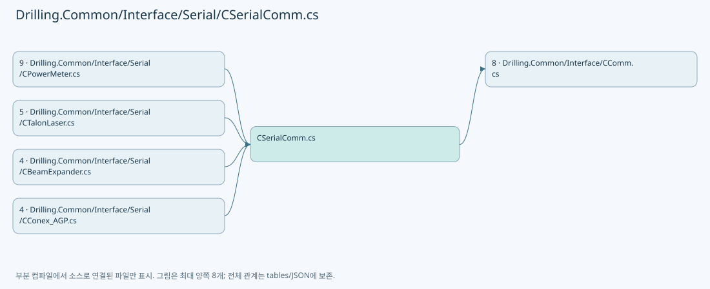

## 네임스페이스·타입·상속

| 타입 | 구분 | 원본 범위 | 선언/상속 |
| --- | --- | --- | --- |
| CSerialComm | ClassDeclaration | 11–410 | CSerialComm: CCommBase(data, option) |

## 멤버 빠른 목록

| 이름 | 종류 | 범위 | 서명 |
| --- | --- | --- | --- |
| MaxAutoReconnectAttempts | FieldDeclaration | L15–15 | int Drilling.Common.Interface.CSerialComm.MaxAutoReconnectAttempts |
| AutoReconnectInterval | FieldDeclaration | L16–16 | System.TimeSpan Drilling.Common.Interface.CSerialComm.AutoReconnectInterval |
| _reconnectPolicyLock | FieldDeclaration | L17–17 | object Drilling.Common.Interface.CSerialComm._reconnectPolicyLock |
| _serialPortLifecycleLock | FieldDeclaration | L18–18 | object Drilling.Common.Interface.CSerialComm._serialPortLifecycleLock |
| _autoReconnectAttempts | FieldDeclaration | L19–19 | int Drilling.Common.Interface.CSerialComm._autoReconnectAttempts |
| _initialConnectAttempted | FieldDeclaration | L20–20 | bool Drilling.Common.Interface.CSerialComm._initialConnectAttempted |
| _connectInProgress | FieldDeclaration | L21–21 | bool Drilling.Common.Interface.CSerialComm._connectInProgress |
| _autoReconnectSuppressed | FieldDeclaration | L22–22 | bool Drilling.Common.Interface.CSerialComm._autoReconnectSuppressed |
| _connectAttemptCompletion | FieldDeclaration | L23–23 | System.Threading.Tasks.TaskCompletionSource<bool>? Drilling.Common.Interface.CSerialComm._connectAttemptCompletion |
| _nextAutoReconnectAt | FieldDeclaration | L24–24 | System.DateTimeOffset Drilling.Common.Interface.CSerialComm._nextAutoReconnectAt |
| SerialPort | FieldDeclaration | L25–25 | SerialPort? Drilling.Common.Interface.CSerialComm.SerialPort |
| SerialLock | FieldDeclaration | L26–26 | System.Threading.SemaphoreSlim Drilling.Common.Interface.CSerialComm.SerialLock |
| ConfigureSerialPort | MethodDeclaration | L28–30 | void Drilling.Common.Interface.CSerialComm.ConfigureSerialPort(SerialPort) |
| Connect | MethodDeclaration | L32–91 | System.Threading.Tasks.Task Drilling.Common.Interface.CSerialComm.Connect(System.Threading.CancellationToken) |
| ResetAutoReconnectPolicy | MethodDeclaration | L93–102 | void Drilling.Common.Interface.CSerialComm.ResetAutoReconnectPolicy() |
| SuppressAutoReconnect | MethodDeclaration | L104–113 | void Drilling.Common.Interface.CSerialComm.SuppressAutoReconnect() |
| TryBeginConnectAttempt | MethodDeclaration | L115–149 | bool Drilling.Common.Interface.CSerialComm.TryBeginConnectAttempt(out System.Threading.Tasks.Task?) |
| CompleteConnectAttempt | MethodDeclaration | L151–162 | void Drilling.Common.Interface.CSerialComm.CompleteConnectAttempt() |
| RegisterConnectSuccess | MethodDeclaration | L164–171 | void Drilling.Common.Interface.CSerialComm.RegisterConnectSuccess() |
| RegisterConnectFailure | MethodDeclaration | L173–179 | void Drilling.Common.Interface.CSerialComm.RegisterConnectFailure() |
| Disconnect | MethodDeclaration | L181–190 | System.Threading.Tasks.Task Drilling.Common.Interface.CSerialComm.Disconnect(System.Threading.CancellationToken) |
| SetError | MethodDeclaration | L192–197 | void Drilling.Common.Interface.CSerialComm.SetError(System.Exception) |
| SetError | MethodDeclaration | L199–204 | void Drilling.Common.Interface.CSerialComm.SetError(string) |
| SetResponseState | MethodDeclaration | L206–215 | void Drilling.Common.Interface.CSerialComm.SetResponseState(string) |
| Execute | MethodDeclaration | L217–228 | System.Threading.Tasks.Task<string> Drilling.Common.Interface.CSerialComm.Execute(string, System.Threading.CancellationToken) |
| ExecuteSerial | MethodDeclaration | L230–348 | System.Threading.Tasks.Task<string> Drilling.Common.Interface.CSerialComm.ExecuteSerial(string, System.Threading.CancellationToken) |
| ifCallback | LocalFunctionStatement | L245–280 | string? ifCallback() |
| CommandNewLine | PropertyDeclaration | L350–356 | string Drilling.Common.Interface.CSerialComm.CommandNewLine |
| get_CommandNewLine | GetAccessorDeclaration | L352–355 | string Drilling.Common.Interface.CSerialComm.CommandNewLine.get |
| FormatCommand | MethodDeclaration | L358–361 | string Drilling.Common.Interface.CSerialComm.FormatCommand(string) |
| CloseSerialPort | MethodDeclaration | L363–382 | void Drilling.Common.Interface.CSerialComm.CloseSerialPort() |
| ParseParity | MethodDeclaration | L384–387 | Parity Drilling.Common.Interface.CSerialComm.ParseParity(string) |
| ParseStopBits | MethodDeclaration | L389–392 | StopBits Drilling.Common.Interface.CSerialComm.ParseStopBits(string) |
| ParseHandshake | MethodDeclaration | L394–404 | Handshake Drilling.Common.Interface.CSerialComm.ParseHandshake(string) |
| NormalizeEnumValue | MethodDeclaration | L406–409 | string Drilling.Common.Interface.CSerialComm.NormalizeEnumValue(string) |

## 멤버별 상세 계약·호출·처리 해설

### FieldDeclaration `MaxAutoReconnectAttempts` · L15–15

[Drilling.Common/Interface/Serial/CSerialComm.cs:15–15](https://github.com/kjuws10-rgb/A3Drilling/blob/5aee8e58439c9b455cae7c9593c9be986c3e682e/Drilling.Common/Interface/Serial/CSerialComm.cs#L15-L15)

| 항목 | 실제 추출 값 |
| --- | --- |
| 서명 | int Drilling.Common.Interface.CSerialComm.MaxAutoReconnectAttempts |
| 접근/수식자 | Private / private, const |
| 반환/값 타입 | int |
| 소속 타입 | NamedType:Drilling.Common.Interface.CSerialComm |

현재 부분 분석에서 직접 연결된 호출자는 없습니다. XAML/이벤트/인터페이스·델리게이트·외부 진입을 추가 확인해야 하며, 미사용으로 판정한 것이 아닙니다.

본문의 실제 연산·분기·예외·반환 순서(원문 위치 순):

| 원본 행 | 종류 | 주석 해설 |
| --- | --- | --- |
| 15 | variable-initializer | 변수의 초기값을 지정합니다: MaxAutoReconnectAttempts = 3 |

변경 전 점검: 입력/반환 타입, 위 호출자, 예외/취소 경로, 공유 상태와 저장·전송 소비자를 함께 확인합니다. 값의 단위나 물리 방향을 이름만으로 확정하지 않습니다.

### FieldDeclaration `AutoReconnectInterval` · L16–16

[Drilling.Common/Interface/Serial/CSerialComm.cs:16–16](https://github.com/kjuws10-rgb/A3Drilling/blob/5aee8e58439c9b455cae7c9593c9be986c3e682e/Drilling.Common/Interface/Serial/CSerialComm.cs#L16-L16)

| 항목 | 실제 추출 값 |
| --- | --- |
| 서명 | System.TimeSpan Drilling.Common.Interface.CSerialComm.AutoReconnectInterval |
| 접근/수식자 | Private / private, static, readonly |
| 반환/값 타입 | System.TimeSpan |
| 소속 타입 | NamedType:Drilling.Common.Interface.CSerialComm |

현재 부분 분석에서 직접 연결된 호출자는 없습니다. XAML/이벤트/인터페이스·델리게이트·외부 진입을 추가 확인해야 하며, 미사용으로 판정한 것이 아닙니다.

호출하는 대상과 해석 범위:

| 원본 행 | 표현식 | 분석 상태 | 대상/소스 위치 |
| --- | --- | --- | --- |
| 16 | TimeSpan.FromSeconds | resolved | System.TimeSpan System.TimeSpan.FromSeconds(long) |

본문의 실제 연산·분기·예외·반환 순서(원문 위치 순):

| 원본 행 | 종류 | 주석 해설 |
| --- | --- | --- |
| 16 | call | 함수·델리게이트 또는 객체 생성자를 호출합니다: TimeSpan.FromSeconds(5) |
| 16 | variable-initializer | 변수의 초기값을 지정합니다: AutoReconnectInterval = TimeSpan.FromSeconds(5) |

변경 전 점검: 입력/반환 타입, 위 호출자, 예외/취소 경로, 공유 상태와 저장·전송 소비자를 함께 확인합니다. 값의 단위나 물리 방향을 이름만으로 확정하지 않습니다.

### FieldDeclaration `_reconnectPolicyLock` · L17–17

[Drilling.Common/Interface/Serial/CSerialComm.cs:17–17](https://github.com/kjuws10-rgb/A3Drilling/blob/5aee8e58439c9b455cae7c9593c9be986c3e682e/Drilling.Common/Interface/Serial/CSerialComm.cs#L17-L17)

| 항목 | 실제 추출 값 |
| --- | --- |
| 서명 | object Drilling.Common.Interface.CSerialComm._reconnectPolicyLock |
| 접근/수식자 | Private / private, readonly |
| 반환/값 타입 | object |
| 소속 타입 | NamedType:Drilling.Common.Interface.CSerialComm |

현재 부분 분석에서 직접 연결된 호출자는 없습니다. XAML/이벤트/인터페이스·델리게이트·외부 진입을 추가 확인해야 하며, 미사용으로 판정한 것이 아닙니다.

호출하는 대상과 해석 범위:

| 원본 행 | 표현식 | 분석 상태 | 대상/소스 위치 |
| --- | --- | --- | --- |
| 17 | new | resolved | object.Object() |

본문의 실제 연산·분기·예외·반환 순서(원문 위치 순):

| 원본 행 | 종류 | 주석 해설 |
| --- | --- | --- |
| 17 | call | 함수·델리게이트 또는 객체 생성자를 호출합니다: new() |
| 17 | variable-initializer | 변수의 초기값을 지정합니다: _reconnectPolicyLock = new() |

변경 전 점검: 입력/반환 타입, 위 호출자, 예외/취소 경로, 공유 상태와 저장·전송 소비자를 함께 확인합니다. 값의 단위나 물리 방향을 이름만으로 확정하지 않습니다.

### FieldDeclaration `_serialPortLifecycleLock` · L18–18

[Drilling.Common/Interface/Serial/CSerialComm.cs:18–18](https://github.com/kjuws10-rgb/A3Drilling/blob/5aee8e58439c9b455cae7c9593c9be986c3e682e/Drilling.Common/Interface/Serial/CSerialComm.cs#L18-L18)

| 항목 | 실제 추출 값 |
| --- | --- |
| 서명 | object Drilling.Common.Interface.CSerialComm._serialPortLifecycleLock |
| 접근/수식자 | Private / private, readonly |
| 반환/값 타입 | object |
| 소속 타입 | NamedType:Drilling.Common.Interface.CSerialComm |

현재 부분 분석에서 직접 연결된 호출자는 없습니다. XAML/이벤트/인터페이스·델리게이트·외부 진입을 추가 확인해야 하며, 미사용으로 판정한 것이 아닙니다.

호출하는 대상과 해석 범위:

| 원본 행 | 표현식 | 분석 상태 | 대상/소스 위치 |
| --- | --- | --- | --- |
| 18 | new | resolved | object.Object() |

본문의 실제 연산·분기·예외·반환 순서(원문 위치 순):

| 원본 행 | 종류 | 주석 해설 |
| --- | --- | --- |
| 18 | call | 함수·델리게이트 또는 객체 생성자를 호출합니다: new() |
| 18 | variable-initializer | 변수의 초기값을 지정합니다: _serialPortLifecycleLock = new() |

변경 전 점검: 입력/반환 타입, 위 호출자, 예외/취소 경로, 공유 상태와 저장·전송 소비자를 함께 확인합니다. 값의 단위나 물리 방향을 이름만으로 확정하지 않습니다.

### FieldDeclaration `_autoReconnectAttempts` · L19–19

[Drilling.Common/Interface/Serial/CSerialComm.cs:19–19](https://github.com/kjuws10-rgb/A3Drilling/blob/5aee8e58439c9b455cae7c9593c9be986c3e682e/Drilling.Common/Interface/Serial/CSerialComm.cs#L19-L19)

| 항목 | 실제 추출 값 |
| --- | --- |
| 서명 | int Drilling.Common.Interface.CSerialComm._autoReconnectAttempts |
| 접근/수식자 | Private / private |
| 반환/값 타입 | int |
| 소속 타입 | NamedType:Drilling.Common.Interface.CSerialComm |

현재 부분 분석에서 직접 연결된 호출자는 없습니다. XAML/이벤트/인터페이스·델리게이트·외부 진입을 추가 확인해야 하며, 미사용으로 판정한 것이 아닙니다.

변경 전 점검: 입력/반환 타입, 위 호출자, 예외/취소 경로, 공유 상태와 저장·전송 소비자를 함께 확인합니다. 값의 단위나 물리 방향을 이름만으로 확정하지 않습니다.

### FieldDeclaration `_initialConnectAttempted` · L20–20

[Drilling.Common/Interface/Serial/CSerialComm.cs:20–20](https://github.com/kjuws10-rgb/A3Drilling/blob/5aee8e58439c9b455cae7c9593c9be986c3e682e/Drilling.Common/Interface/Serial/CSerialComm.cs#L20-L20)

| 항목 | 실제 추출 값 |
| --- | --- |
| 서명 | bool Drilling.Common.Interface.CSerialComm._initialConnectAttempted |
| 접근/수식자 | Private / private |
| 반환/값 타입 | bool |
| 소속 타입 | NamedType:Drilling.Common.Interface.CSerialComm |

현재 부분 분석에서 직접 연결된 호출자는 없습니다. XAML/이벤트/인터페이스·델리게이트·외부 진입을 추가 확인해야 하며, 미사용으로 판정한 것이 아닙니다.

변경 전 점검: 입력/반환 타입, 위 호출자, 예외/취소 경로, 공유 상태와 저장·전송 소비자를 함께 확인합니다. 값의 단위나 물리 방향을 이름만으로 확정하지 않습니다.

### FieldDeclaration `_connectInProgress` · L21–21

[Drilling.Common/Interface/Serial/CSerialComm.cs:21–21](https://github.com/kjuws10-rgb/A3Drilling/blob/5aee8e58439c9b455cae7c9593c9be986c3e682e/Drilling.Common/Interface/Serial/CSerialComm.cs#L21-L21)

| 항목 | 실제 추출 값 |
| --- | --- |
| 서명 | bool Drilling.Common.Interface.CSerialComm._connectInProgress |
| 접근/수식자 | Private / private |
| 반환/값 타입 | bool |
| 소속 타입 | NamedType:Drilling.Common.Interface.CSerialComm |

현재 부분 분석에서 직접 연결된 호출자는 없습니다. XAML/이벤트/인터페이스·델리게이트·외부 진입을 추가 확인해야 하며, 미사용으로 판정한 것이 아닙니다.

변경 전 점검: 입력/반환 타입, 위 호출자, 예외/취소 경로, 공유 상태와 저장·전송 소비자를 함께 확인합니다. 값의 단위나 물리 방향을 이름만으로 확정하지 않습니다.

### FieldDeclaration `_autoReconnectSuppressed` · L22–22

[Drilling.Common/Interface/Serial/CSerialComm.cs:22–22](https://github.com/kjuws10-rgb/A3Drilling/blob/5aee8e58439c9b455cae7c9593c9be986c3e682e/Drilling.Common/Interface/Serial/CSerialComm.cs#L22-L22)

| 항목 | 실제 추출 값 |
| --- | --- |
| 서명 | bool Drilling.Common.Interface.CSerialComm._autoReconnectSuppressed |
| 접근/수식자 | Private / private |
| 반환/값 타입 | bool |
| 소속 타입 | NamedType:Drilling.Common.Interface.CSerialComm |

현재 부분 분석에서 직접 연결된 호출자는 없습니다. XAML/이벤트/인터페이스·델리게이트·외부 진입을 추가 확인해야 하며, 미사용으로 판정한 것이 아닙니다.

변경 전 점검: 입력/반환 타입, 위 호출자, 예외/취소 경로, 공유 상태와 저장·전송 소비자를 함께 확인합니다. 값의 단위나 물리 방향을 이름만으로 확정하지 않습니다.

### FieldDeclaration `_connectAttemptCompletion` · L23–23

[Drilling.Common/Interface/Serial/CSerialComm.cs:23–23](https://github.com/kjuws10-rgb/A3Drilling/blob/5aee8e58439c9b455cae7c9593c9be986c3e682e/Drilling.Common/Interface/Serial/CSerialComm.cs#L23-L23)

| 항목 | 실제 추출 값 |
| --- | --- |
| 서명 | System.Threading.Tasks.TaskCompletionSource<bool>? Drilling.Common.Interface.CSerialComm._connectAttemptCompletion |
| 접근/수식자 | Private / private |
| 반환/값 타입 | System.Threading.Tasks.TaskCompletionSource<bool>? |
| 소속 타입 | NamedType:Drilling.Common.Interface.CSerialComm |

현재 부분 분석에서 직접 연결된 호출자는 없습니다. XAML/이벤트/인터페이스·델리게이트·외부 진입을 추가 확인해야 하며, 미사용으로 판정한 것이 아닙니다.

변경 전 점검: 입력/반환 타입, 위 호출자, 예외/취소 경로, 공유 상태와 저장·전송 소비자를 함께 확인합니다. 값의 단위나 물리 방향을 이름만으로 확정하지 않습니다.

### FieldDeclaration `_nextAutoReconnectAt` · L24–24

[Drilling.Common/Interface/Serial/CSerialComm.cs:24–24](https://github.com/kjuws10-rgb/A3Drilling/blob/5aee8e58439c9b455cae7c9593c9be986c3e682e/Drilling.Common/Interface/Serial/CSerialComm.cs#L24-L24)

| 항목 | 실제 추출 값 |
| --- | --- |
| 서명 | System.DateTimeOffset Drilling.Common.Interface.CSerialComm._nextAutoReconnectAt |
| 접근/수식자 | Private / private |
| 반환/값 타입 | System.DateTimeOffset |
| 소속 타입 | NamedType:Drilling.Common.Interface.CSerialComm |

현재 부분 분석에서 직접 연결된 호출자는 없습니다. XAML/이벤트/인터페이스·델리게이트·외부 진입을 추가 확인해야 하며, 미사용으로 판정한 것이 아닙니다.

본문의 실제 연산·분기·예외·반환 순서(원문 위치 순):

| 원본 행 | 종류 | 주석 해설 |
| --- | --- | --- |
| 24 | variable-initializer | 변수의 초기값을 지정합니다: _nextAutoReconnectAt = DateTimeOffset.MinValue |

변경 전 점검: 입력/반환 타입, 위 호출자, 예외/취소 경로, 공유 상태와 저장·전송 소비자를 함께 확인합니다. 값의 단위나 물리 방향을 이름만으로 확정하지 않습니다.

### FieldDeclaration `SerialPort` · L25–25

[Drilling.Common/Interface/Serial/CSerialComm.cs:25–25](https://github.com/kjuws10-rgb/A3Drilling/blob/5aee8e58439c9b455cae7c9593c9be986c3e682e/Drilling.Common/Interface/Serial/CSerialComm.cs#L25-L25)

| 항목 | 실제 추출 값 |
| --- | --- |
| 서명 | SerialPort? Drilling.Common.Interface.CSerialComm.SerialPort |
| 접근/수식자 | Protected / protected |
| 반환/값 타입 | SerialPort? |
| 소속 타입 | NamedType:Drilling.Common.Interface.CSerialComm |

현재 부분 분석에서 직접 연결된 호출자는 없습니다. XAML/이벤트/인터페이스·델리게이트·외부 진입을 추가 확인해야 하며, 미사용으로 판정한 것이 아닙니다.

변경 전 점검: 입력/반환 타입, 위 호출자, 예외/취소 경로, 공유 상태와 저장·전송 소비자를 함께 확인합니다. 값의 단위나 물리 방향을 이름만으로 확정하지 않습니다.

### FieldDeclaration `SerialLock` · L26–26

[Drilling.Common/Interface/Serial/CSerialComm.cs:26–26](https://github.com/kjuws10-rgb/A3Drilling/blob/5aee8e58439c9b455cae7c9593c9be986c3e682e/Drilling.Common/Interface/Serial/CSerialComm.cs#L26-L26)

| 항목 | 실제 추출 값 |
| --- | --- |
| 서명 | System.Threading.SemaphoreSlim Drilling.Common.Interface.CSerialComm.SerialLock |
| 접근/수식자 | Protected / protected, readonly |
| 반환/값 타입 | System.Threading.SemaphoreSlim |
| 소속 타입 | NamedType:Drilling.Common.Interface.CSerialComm |

현재 부분 분석에서 직접 연결된 호출자는 없습니다. XAML/이벤트/인터페이스·델리게이트·외부 진입을 추가 확인해야 하며, 미사용으로 판정한 것이 아닙니다.

호출하는 대상과 해석 범위:

| 원본 행 | 표현식 | 분석 상태 | 대상/소스 위치 |
| --- | --- | --- | --- |
| 26 | new | resolved | System.Threading.SemaphoreSlim.SemaphoreSlim(int, int) |

본문의 실제 연산·분기·예외·반환 순서(원문 위치 순):

| 원본 행 | 종류 | 주석 해설 |
| --- | --- | --- |
| 26 | call | 함수·델리게이트 또는 객체 생성자를 호출합니다: new(1, 1) |
| 26 | variable-initializer | 변수의 초기값을 지정합니다: SerialLock = new(1, 1) |

변경 전 점검: 입력/반환 타입, 위 호출자, 예외/취소 경로, 공유 상태와 저장·전송 소비자를 함께 확인합니다. 값의 단위나 물리 방향을 이름만으로 확정하지 않습니다.

### MethodDeclaration `ConfigureSerialPort` · L28–30

[Drilling.Common/Interface/Serial/CSerialComm.cs:28–30](https://github.com/kjuws10-rgb/A3Drilling/blob/5aee8e58439c9b455cae7c9593c9be986c3e682e/Drilling.Common/Interface/Serial/CSerialComm.cs#L28-L30)

| 항목 | 실제 추출 값 |
| --- | --- |
| 서명 | void Drilling.Common.Interface.CSerialComm.ConfigureSerialPort(SerialPort) |
| 접근/수식자 | Protected / protected, virtual |
| 반환/값 타입 | void |
| 소속 타입 | NamedType:Drilling.Common.Interface.CSerialComm |

입력 계약:

| 이름 | 타입 | 전달 | 선택/기본값 |
| --- | --- | --- | --- |
| serialPort | SerialPort | None | False /  |

정적 호출자로 확인된 위치:

| 호출 파일/행 | 호출 표현식 | 런타임 분기 가능 |
| --- | --- | --- |
| [Drilling.Common/Interface/Serial/CSerialComm.cs:72–72](https://github.com/kjuws10-rgb/A3Drilling/blob/5aee8e58439c9b455cae7c9593c9be986c3e682e/Drilling.Common/Interface/Serial/CSerialComm.cs#L72-L72) | ConfigureSerialPort | True |

변경 전 점검: 입력/반환 타입, 위 호출자, 예외/취소 경로, 공유 상태와 저장·전송 소비자를 함께 확인합니다. 값의 단위나 물리 방향을 이름만으로 확정하지 않습니다.

### MethodDeclaration `Connect` · L32–91

[Drilling.Common/Interface/Serial/CSerialComm.cs:32–91](https://github.com/kjuws10-rgb/A3Drilling/blob/5aee8e58439c9b455cae7c9593c9be986c3e682e/Drilling.Common/Interface/Serial/CSerialComm.cs#L32-L91)

| 항목 | 실제 추출 값 |
| --- | --- |
| 서명 | System.Threading.Tasks.Task Drilling.Common.Interface.CSerialComm.Connect(System.Threading.CancellationToken) |
| 접근/수식자 | Public / public, override, async |
| 반환/값 타입 | System.Threading.Tasks.Task |
| 소속 타입 | NamedType:Drilling.Common.Interface.CSerialComm |

입력 계약:

| 이름 | 타입 | 전달 | 선택/기본값 |
| --- | --- | --- | --- |
| cancellationToken | System.Threading.CancellationToken | None | True / null |

정적 호출자로 확인된 위치:

| 호출 파일/행 | 호출 표현식 | 런타임 분기 가능 |
| --- | --- | --- |
| [Drilling.Common/Interface/Serial/CBeamExpander.cs:148–148](https://github.com/kjuws10-rgb/A3Drilling/blob/5aee8e58439c9b455cae7c9593c9be986c3e682e/Drilling.Common/Interface/Serial/CBeamExpander.cs#L148-L148) | Connect | True |
| [Drilling.Common/Interface/Serial/CConex_AGP.cs:178–178](https://github.com/kjuws10-rgb/A3Drilling/blob/5aee8e58439c9b455cae7c9593c9be986c3e682e/Drilling.Common/Interface/Serial/CConex_AGP.cs#L178-L178) | Connect | True |
| [Drilling.Common/Interface/Serial/CPowerMeter.cs:45–45](https://github.com/kjuws10-rgb/A3Drilling/blob/5aee8e58439c9b455cae7c9593c9be986c3e682e/Drilling.Common/Interface/Serial/CPowerMeter.cs#L45-L45) | Connect | True |
| [Drilling.Common/Interface/Serial/CSerialComm.cs:234–234](https://github.com/kjuws10-rgb/A3Drilling/blob/5aee8e58439c9b455cae7c9593c9be986c3e682e/Drilling.Common/Interface/Serial/CSerialComm.cs#L234-L234) | Connect | True |
| [Drilling.Common/Interface/Serial/CTalonLaser.cs:35–35](https://github.com/kjuws10-rgb/A3Drilling/blob/5aee8e58439c9b455cae7c9593c9be986c3e682e/Drilling.Common/Interface/Serial/CTalonLaser.cs#L35-L35) | Connect | True |

호출하는 대상과 해석 범위:

| 원본 행 | 표현식 | 분석 상태 | 대상/소스 위치 |
| --- | --- | --- | --- |
| 34 | cancellationToken.ThrowIfCancellationRequested | resolved | void System.Threading.CancellationToken.ThrowIfCancellationRequested() |
| 35 | TryBeginConnectAttempt | resolved | bool Drilling.Common.Interface.CSerialComm.TryBeginConnectAttempt(out System.Threading.Tasks.Task?) · Drilling.Common/Interface/Serial/CSerialComm.cs:115 |
| 39 | activeConnectAttempt.WaitAsync | resolved | System.Threading.Tasks.Task System.Threading.Tasks.Task.WaitAsync(System.Threading.CancellationToken) |
| 51 | RegisterConnectSuccess | resolved | void Drilling.Common.Interface.CSerialComm.RegisterConnectSuccess() · Drilling.Common/Interface/Serial/CSerialComm.cs:164 |
| 56 | CloseSerialPort | resolved | void Drilling.Common.Interface.CSerialComm.CloseSerialPort() · Drilling.Common/Interface/Serial/CSerialComm.cs:363 |
| 59 | string.IsNullOrWhiteSpace | resolved | bool string.IsNullOrWhiteSpace(string?) |
| 61 | SetError | resolved | void Drilling.Common.Interface.CSerialComm.SetError(string) · Drilling.Common/Interface/Serial/CSerialComm.cs:199 |
| 65 | new SerialPort | unresolved | None |
| 65 | ParseParity | resolved | Parity Drilling.Common.Interface.CSerialComm.ParseParity(string) · Drilling.Common/Interface/Serial/CSerialComm.cs:384 |
| 65 | ParseStopBits | resolved | StopBits Drilling.Common.Interface.CSerialComm.ParseStopBits(string) · Drilling.Common/Interface/Serial/CSerialComm.cs:389 |
| 67 | ParseHandshake | resolved | Handshake Drilling.Common.Interface.CSerialComm.ParseHandshake(string) · Drilling.Common/Interface/Serial/CSerialComm.cs:394 |
| 68 | Math.Max | resolved | int System.Math.Max(int, int) |
| 69 | Math.Max | resolved | int System.Math.Max(int, int) |
| 72 | ConfigureSerialPort | resolved · 동적 구현 선택 가능 | void Drilling.Common.Interface.CSerialComm.ConfigureSerialPort(SerialPort) · Drilling.Common/Interface/Serial/CSerialComm.cs:28 |
| 74 | SerialPort.Open | unresolved | None |
| 75 | RegisterConnectSuccess | resolved | void Drilling.Common.Interface.CSerialComm.RegisterConnectSuccess() · Drilling.Common/Interface/Serial/CSerialComm.cs:164 |
| 77 | SetState | resolved | void Drilling.Common.Interface.CCommBase.SetState(Drilling.Common.Interface.EN_COMM_STATE) · Drilling.Common/Interface/CComm.cs:114 |
| 81 | CloseSerialPort | resolved | void Drilling.Common.Interface.CSerialComm.CloseSerialPort() · Drilling.Common/Interface/Serial/CSerialComm.cs:363 |
| 82 | SetError | resolved | void Drilling.Common.Interface.CSerialComm.SetError(System.Exception) · Drilling.Common/Interface/Serial/CSerialComm.cs:192 |
| 88 | CompleteConnectAttempt | resolved | void Drilling.Common.Interface.CSerialComm.CompleteConnectAttempt() · Drilling.Common/Interface/Serial/CSerialComm.cs:151 |

본문의 실제 연산·분기·예외·반환 순서(원문 위치 순):

| 원본 행 | 종류 | 주석 해설 |
| --- | --- | --- |
| 34 | call | 함수·델리게이트 또는 객체 생성자를 호출합니다: cancellationToken.ThrowIfCancellationRequested() |
| 35 | call | 함수·델리게이트 또는 객체 생성자를 호출합니다: TryBeginConnectAttempt(out var activeConnectAttempt) |
| 35 | if | 조건에 따라 분기합니다: if (!TryBeginConnectAttempt(out var activeConnectAttempt)) |
| 37 | if | 조건에 따라 분기합니다: if (activeConnectAttempt is not null) |
| 39 | await | 비동기 완료를 기다립니다: await activeConnectAttempt.WaitAsync(cancellationToken) |
| 39 | call | 함수·델리게이트 또는 객체 생성자를 호출합니다: activeConnectAttempt.WaitAsync(cancellationToken) |
| 42 | return | 호출자에게 값 또는 제어를 반환합니다: return; |
| 45 | try | 예외 처리 범위입니다: try |
| 47 | lock | 공유 상태의 임계 구역에 진입합니다: lock (_serialPortLifecycleLock) |
| 49 | if | 조건에 따라 분기합니다: if (SerialPort is { IsOpen: true } && ConnectionState == EN_COMM_STATE.Online) |
| 51 | call | 함수·델리게이트 또는 객체 생성자를 호출합니다: RegisterConnectSuccess() |
| 52 | assignment | 값을 대상에 대입합니다: LastError = "" |
| 53 | return | 호출자에게 값 또는 제어를 반환합니다: return; |
| 56 | call | 함수·델리게이트 또는 객체 생성자를 호출합니다: CloseSerialPort() |
| 57 | try | 예외 처리 범위입니다: try |
| 59 | call | 함수·델리게이트 또는 객체 생성자를 호출합니다: string.IsNullOrWhiteSpace(Option.SerialPort) |
| 59 | if | 조건에 따라 분기합니다: if (string.IsNullOrWhiteSpace(Option.SerialPort) &#124;&#124; Option.BaudRate <= 0) |
| 61 | call | 함수·델리게이트 또는 객체 생성자를 호출합니다: SetError("Serial port option is invalid.") |
| 62 | return | 호출자에게 값 또는 제어를 반환합니다: return; |
| 65 | call | 함수·델리게이트 또는 객체 생성자를 호출합니다: ParseParity(Option.Parity) |
| 65 | call | 함수·델리게이트 또는 객체 생성자를 호출합니다: ParseStopBits(Option.StopBits) |
| 65 | call | 함수·델리게이트 또는 객체 생성자를 호출합니다: new SerialPort(Option.SerialPort, Option.BaudRate, ParseParity(Option.Parity), Option.DataBits, ParseStopBits(Option.StopBits)) { Handshake = ParseHandshake(Option.Handshake), ReadTimeout = Math.Max(500, Option.TimeoutMs… |
| 65 | local-declaration | 지역 변수를 선언합니다: var serialPort = new SerialPort(Option.SerialPort, Option.BaudRate, ParseParity(Option.Parity), Option.DataBits, ParseStopBits(Option.StopBits)) { Handshake = ParseHandshake(Option.Handshake), ReadTimeout = Math.Max(500, Option.Ti |
| 65 | variable-initializer | 변수의 초기값을 지정합니다: serialPort = new SerialPort(Option.SerialPort, Option.BaudRate, ParseParity(Option.Parity), Option.DataBits, ParseStopBits(Option.StopBits)) { Handshake = ParseHandshake(Option.Handshake), ReadTimeout = Math.Max(500, Option.Timeou |
| 67 | assignment | 값을 대상에 대입합니다: Handshake = ParseHandshake(Option.Handshake) |
| 67 | call | 함수·델리게이트 또는 객체 생성자를 호출합니다: ParseHandshake(Option.Handshake) |
| 68 | assignment | 값을 대상에 대입합니다: ReadTimeout = Math.Max(500, Option.TimeoutMs) |
| 68 | call | 함수·델리게이트 또는 객체 생성자를 호출합니다: Math.Max(500, Option.TimeoutMs) |
| 69 | assignment | 값을 대상에 대입합니다: WriteTimeout = Math.Max(500, Option.TimeoutMs) |
| 69 | call | 함수·델리게이트 또는 객체 생성자를 호출합니다: Math.Max(500, Option.TimeoutMs) |
| 70 | assignment | 값을 대상에 대입합니다: NewLine = CommandNewLine |
| 72 | call | 함수·델리게이트 또는 객체 생성자를 호출합니다: ConfigureSerialPort(serialPort) |
| 73 | assignment | 값을 대상에 대입합니다: SerialPort = serialPort |
| 74 | call | 함수·델리게이트 또는 객체 생성자를 호출합니다: SerialPort.Open() |
| 75 | call | 함수·델리게이트 또는 객체 생성자를 호출합니다: RegisterConnectSuccess() |
| 76 | assignment | 값을 대상에 대입합니다: LastError = "" |
| 77 | call | 함수·델리게이트 또는 객체 생성자를 호출합니다: SetState(EN_COMM_STATE.Online) |
| 79 | catch | 지정 예외를 처리합니다: catch (Exception ex) when (ex is IOException or UnauthorizedAccessException or ArgumentException or InvalidOperationException) |
| 81 | call | 함수·델리게이트 또는 객체 생성자를 호출합니다: CloseSerialPort() |
| 82 | call | 함수·델리게이트 또는 객체 생성자를 호출합니다: SetError(ex) |
| 86 | finally | 종료 정리 구간입니다: finally |
| 88 | call | 함수·델리게이트 또는 객체 생성자를 호출합니다: CompleteConnectAttempt() |

제어 구문의 포함 구조(실제 실행 순서/CFG가 아닌 구문 탐색 그림):

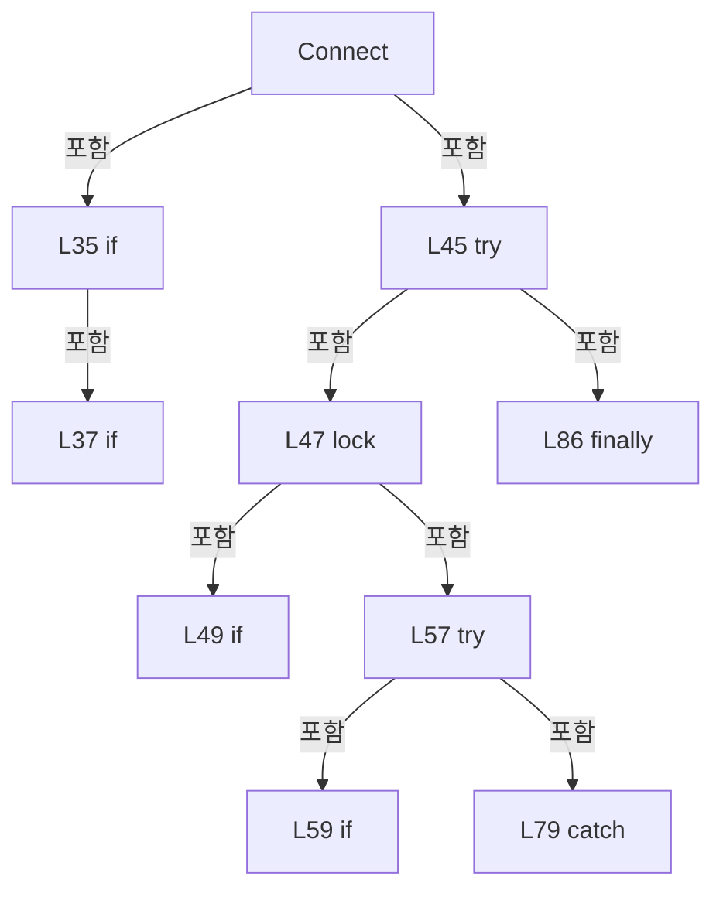

변경 전 점검: 입력/반환 타입, 위 호출자, 예외/취소 경로, 공유 상태와 저장·전송 소비자를 함께 확인합니다. 값의 단위나 물리 방향을 이름만으로 확정하지 않습니다.

### MethodDeclaration `ResetAutoReconnectPolicy` · L93–102

[Drilling.Common/Interface/Serial/CSerialComm.cs:93–102](https://github.com/kjuws10-rgb/A3Drilling/blob/5aee8e58439c9b455cae7c9593c9be986c3e682e/Drilling.Common/Interface/Serial/CSerialComm.cs#L93-L102)

| 항목 | 실제 추출 값 |
| --- | --- |
| 서명 | void Drilling.Common.Interface.CSerialComm.ResetAutoReconnectPolicy() |
| 접근/수식자 | Public / public, override |
| 반환/값 타입 | void |
| 소속 타입 | NamedType:Drilling.Common.Interface.CSerialComm |

현재 부분 분석에서 직접 연결된 호출자는 없습니다. XAML/이벤트/인터페이스·델리게이트·외부 진입을 추가 확인해야 하며, 미사용으로 판정한 것이 아닙니다.

본문의 실제 연산·분기·예외·반환 순서(원문 위치 순):

| 원본 행 | 종류 | 주석 해설 |
| --- | --- | --- |
| 95 | lock | 공유 상태의 임계 구역에 진입합니다: lock (_reconnectPolicyLock) |
| 97 | assignment | 값을 대상에 대입합니다: _autoReconnectAttempts = 0 |
| 98 | assignment | 값을 대상에 대입합니다: _initialConnectAttempted = false |
| 99 | assignment | 값을 대상에 대입합니다: _nextAutoReconnectAt = DateTimeOffset.MinValue |
| 100 | assignment | 값을 대상에 대입합니다: _autoReconnectSuppressed = false |

제어 구문의 포함 구조(실제 실행 순서/CFG가 아닌 구문 탐색 그림):

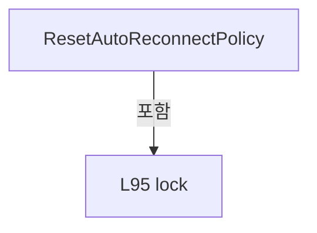

변경 전 점검: 입력/반환 타입, 위 호출자, 예외/취소 경로, 공유 상태와 저장·전송 소비자를 함께 확인합니다. 값의 단위나 물리 방향을 이름만으로 확정하지 않습니다.

### MethodDeclaration `SuppressAutoReconnect` · L104–113

[Drilling.Common/Interface/Serial/CSerialComm.cs:104–113](https://github.com/kjuws10-rgb/A3Drilling/blob/5aee8e58439c9b455cae7c9593c9be986c3e682e/Drilling.Common/Interface/Serial/CSerialComm.cs#L104-L113)

| 항목 | 실제 추출 값 |
| --- | --- |
| 서명 | void Drilling.Common.Interface.CSerialComm.SuppressAutoReconnect() |
| 접근/수식자 | Public / public, override |
| 반환/값 타입 | void |
| 소속 타입 | NamedType:Drilling.Common.Interface.CSerialComm |

현재 부분 분석에서 직접 연결된 호출자는 없습니다. XAML/이벤트/인터페이스·델리게이트·외부 진입을 추가 확인해야 하며, 미사용으로 판정한 것이 아닙니다.

본문의 실제 연산·분기·예외·반환 순서(원문 위치 순):

| 원본 행 | 종류 | 주석 해설 |
| --- | --- | --- |
| 106 | lock | 공유 상태의 임계 구역에 진입합니다: lock (_reconnectPolicyLock) |
| 108 | assignment | 값을 대상에 대입합니다: _autoReconnectAttempts = MaxAutoReconnectAttempts |
| 109 | assignment | 값을 대상에 대입합니다: _initialConnectAttempted = true |
| 110 | assignment | 값을 대상에 대입합니다: _nextAutoReconnectAt = DateTimeOffset.MaxValue |
| 111 | assignment | 값을 대상에 대입합니다: _autoReconnectSuppressed = true |

제어 구문의 포함 구조(실제 실행 순서/CFG가 아닌 구문 탐색 그림):

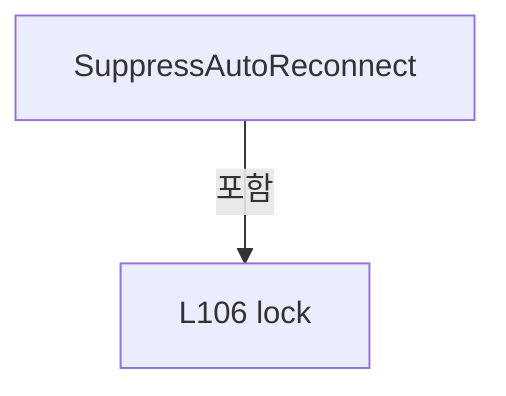

변경 전 점검: 입력/반환 타입, 위 호출자, 예외/취소 경로, 공유 상태와 저장·전송 소비자를 함께 확인합니다. 값의 단위나 물리 방향을 이름만으로 확정하지 않습니다.

### MethodDeclaration `TryBeginConnectAttempt` · L115–149

[Drilling.Common/Interface/Serial/CSerialComm.cs:115–149](https://github.com/kjuws10-rgb/A3Drilling/blob/5aee8e58439c9b455cae7c9593c9be986c3e682e/Drilling.Common/Interface/Serial/CSerialComm.cs#L115-L149)

| 항목 | 실제 추출 값 |
| --- | --- |
| 서명 | bool Drilling.Common.Interface.CSerialComm.TryBeginConnectAttempt(out System.Threading.Tasks.Task?) |
| 접근/수식자 | Private / private |
| 반환/값 타입 | bool |
| 소속 타입 | NamedType:Drilling.Common.Interface.CSerialComm |

입력 계약:

| 이름 | 타입 | 전달 | 선택/기본값 |
| --- | --- | --- | --- |
| activeConnectAttempt | System.Threading.Tasks.Task? | Out | False /  |

정적 호출자로 확인된 위치:

| 호출 파일/행 | 호출 표현식 | 런타임 분기 가능 |
| --- | --- | --- |
| [Drilling.Common/Interface/Serial/CSerialComm.cs:35–35](https://github.com/kjuws10-rgb/A3Drilling/blob/5aee8e58439c9b455cae7c9593c9be986c3e682e/Drilling.Common/Interface/Serial/CSerialComm.cs#L35-L35) | TryBeginConnectAttempt | False |

호출하는 대상과 해석 범위:

| 원본 행 | 표현식 | 분석 상태 | 대상/소스 위치 |
| --- | --- | --- | --- |
| 135 | new TaskCompletionSource<bool> | resolved | System.Threading.Tasks.TaskCompletionSource<bool>.TaskCompletionSource(System.Threading.Tasks.TaskCreationOptions) |
| 146 | new TaskCompletionSource<bool> | resolved | System.Threading.Tasks.TaskCompletionSource<bool>.TaskCompletionSource(System.Threading.Tasks.TaskCreationOptions) |

본문의 실제 연산·분기·예외·반환 순서(원문 위치 순):

| 원본 행 | 종류 | 주석 해설 |
| --- | --- | --- |
| 117 | lock | 공유 상태의 임계 구역에 진입합니다: lock (_reconnectPolicyLock) |
| 119 | if | 조건에 따라 분기합니다: if (_connectInProgress) |
| 121 | assignment | 값을 대상에 대입합니다: activeConnectAttempt = _connectAttemptCompletion?.Task |
| 122 | return | 호출자에게 값 또는 제어를 반환합니다: return false; |
| 125 | assignment | 값을 대상에 대입합니다: activeConnectAttempt = null |
| 126 | if | 조건에 따라 분기합니다: if (_autoReconnectSuppressed) |
| 128 | return | 호출자에게 값 또는 제어를 반환합니다: return false; |
| 131 | if | 조건에 따라 분기합니다: if (!_initialConnectAttempted) |
| 133 | assignment | 값을 대상에 대입합니다: _initialConnectAttempted = true |
| 134 | assignment | 값을 대상에 대입합니다: _connectInProgress = true |
| 135 | assignment | 값을 대상에 대입합니다: _connectAttemptCompletion = new TaskCompletionSource<bool>(TaskCreationOptions.RunContinuationsAsynchronously) |
| 135 | call | 함수·델리게이트 또는 객체 생성자를 호출합니다: new TaskCompletionSource<bool>(TaskCreationOptions.RunContinuationsAsynchronously) |
| 136 | return | 호출자에게 값 또는 제어를 반환합니다: return true; |
| 139 | if | 조건에 따라 분기합니다: if (_autoReconnectAttempts >= MaxAutoReconnectAttempts &#124;&#124; DateTimeOffset.Now < _nextAutoReconnectAt) |
| 141 | return | 호출자에게 값 또는 제어를 반환합니다: return false; |
| 145 | assignment | 값을 대상에 대입합니다: _connectInProgress = true |
| 146 | assignment | 값을 대상에 대입합니다: _connectAttemptCompletion = new TaskCompletionSource<bool>(TaskCreationOptions.RunContinuationsAsynchronously) |
| 146 | call | 함수·델리게이트 또는 객체 생성자를 호출합니다: new TaskCompletionSource<bool>(TaskCreationOptions.RunContinuationsAsynchronously) |
| 147 | return | 호출자에게 값 또는 제어를 반환합니다: return true; |

제어 구문의 포함 구조(실제 실행 순서/CFG가 아닌 구문 탐색 그림):

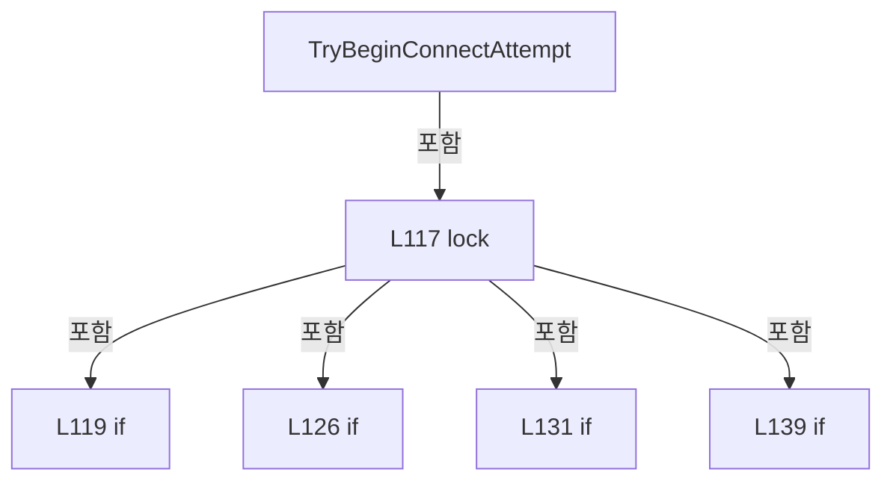

변경 전 점검: 입력/반환 타입, 위 호출자, 예외/취소 경로, 공유 상태와 저장·전송 소비자를 함께 확인합니다. 값의 단위나 물리 방향을 이름만으로 확정하지 않습니다.

### MethodDeclaration `CompleteConnectAttempt` · L151–162

[Drilling.Common/Interface/Serial/CSerialComm.cs:151–162](https://github.com/kjuws10-rgb/A3Drilling/blob/5aee8e58439c9b455cae7c9593c9be986c3e682e/Drilling.Common/Interface/Serial/CSerialComm.cs#L151-L162)

| 항목 | 실제 추출 값 |
| --- | --- |
| 서명 | void Drilling.Common.Interface.CSerialComm.CompleteConnectAttempt() |
| 접근/수식자 | Private / private |
| 반환/값 타입 | void |
| 소속 타입 | NamedType:Drilling.Common.Interface.CSerialComm |

정적 호출자로 확인된 위치:

| 호출 파일/행 | 호출 표현식 | 런타임 분기 가능 |
| --- | --- | --- |
| [Drilling.Common/Interface/Serial/CSerialComm.cs:88–88](https://github.com/kjuws10-rgb/A3Drilling/blob/5aee8e58439c9b455cae7c9593c9be986c3e682e/Drilling.Common/Interface/Serial/CSerialComm.cs#L88-L88) | CompleteConnectAttempt | False |

호출하는 대상과 해석 범위:

| 원본 행 | 표현식 | 분석 상태 | 대상/소스 위치 |
| --- | --- | --- | --- |
| 161 | .TrySetResult | resolved | bool System.Threading.Tasks.TaskCompletionSource<bool>.TrySetResult(bool) |

본문의 실제 연산·분기·예외·반환 순서(원문 위치 순):

| 원본 행 | 종류 | 주석 해설 |
| --- | --- | --- |
| 153 | local-declaration | 지역 변수를 선언합니다: TaskCompletionSource<bool>? completion; |
| 154 | lock | 공유 상태의 임계 구역에 진입합니다: lock (_reconnectPolicyLock) |
| 156 | assignment | 값을 대상에 대입합니다: _connectInProgress = false |
| 157 | assignment | 값을 대상에 대입합니다: completion = _connectAttemptCompletion |
| 158 | assignment | 값을 대상에 대입합니다: _connectAttemptCompletion = null |
| 161 | call | 함수·델리게이트 또는 객체 생성자를 호출합니다: .TrySetResult(true) |

제어 구문의 포함 구조(실제 실행 순서/CFG가 아닌 구문 탐색 그림):

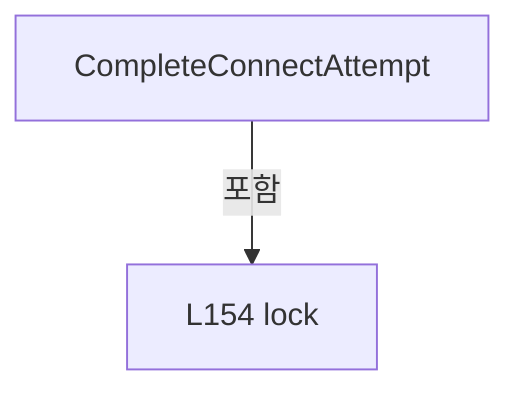

변경 전 점검: 입력/반환 타입, 위 호출자, 예외/취소 경로, 공유 상태와 저장·전송 소비자를 함께 확인합니다. 값의 단위나 물리 방향을 이름만으로 확정하지 않습니다.

### MethodDeclaration `RegisterConnectSuccess` · L164–171

[Drilling.Common/Interface/Serial/CSerialComm.cs:164–171](https://github.com/kjuws10-rgb/A3Drilling/blob/5aee8e58439c9b455cae7c9593c9be986c3e682e/Drilling.Common/Interface/Serial/CSerialComm.cs#L164-L171)

| 항목 | 실제 추출 값 |
| --- | --- |
| 서명 | void Drilling.Common.Interface.CSerialComm.RegisterConnectSuccess() |
| 접근/수식자 | Private / private |
| 반환/값 타입 | void |
| 소속 타입 | NamedType:Drilling.Common.Interface.CSerialComm |

정적 호출자로 확인된 위치:

| 호출 파일/행 | 호출 표현식 | 런타임 분기 가능 |
| --- | --- | --- |
| [Drilling.Common/Interface/Serial/CSerialComm.cs:51–51](https://github.com/kjuws10-rgb/A3Drilling/blob/5aee8e58439c9b455cae7c9593c9be986c3e682e/Drilling.Common/Interface/Serial/CSerialComm.cs#L51-L51) | RegisterConnectSuccess | False |
| [Drilling.Common/Interface/Serial/CSerialComm.cs:75–75](https://github.com/kjuws10-rgb/A3Drilling/blob/5aee8e58439c9b455cae7c9593c9be986c3e682e/Drilling.Common/Interface/Serial/CSerialComm.cs#L75-L75) | RegisterConnectSuccess | False |

본문의 실제 연산·분기·예외·반환 순서(원문 위치 순):

| 원본 행 | 종류 | 주석 해설 |
| --- | --- | --- |
| 166 | lock | 공유 상태의 임계 구역에 진입합니다: lock (_reconnectPolicyLock) |
| 168 | assignment | 값을 대상에 대입합니다: _autoReconnectAttempts = 0 |
| 169 | assignment | 값을 대상에 대입합니다: _nextAutoReconnectAt = DateTimeOffset.MinValue |

제어 구문의 포함 구조(실제 실행 순서/CFG가 아닌 구문 탐색 그림):

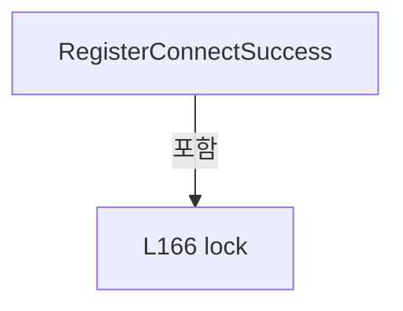

변경 전 점검: 입력/반환 타입, 위 호출자, 예외/취소 경로, 공유 상태와 저장·전송 소비자를 함께 확인합니다. 값의 단위나 물리 방향을 이름만으로 확정하지 않습니다.

### MethodDeclaration `RegisterConnectFailure` · L173–179

[Drilling.Common/Interface/Serial/CSerialComm.cs:173–179](https://github.com/kjuws10-rgb/A3Drilling/blob/5aee8e58439c9b455cae7c9593c9be986c3e682e/Drilling.Common/Interface/Serial/CSerialComm.cs#L173-L179)

| 항목 | 실제 추출 값 |
| --- | --- |
| 서명 | void Drilling.Common.Interface.CSerialComm.RegisterConnectFailure() |
| 접근/수식자 | Private / private |
| 반환/값 타입 | void |
| 소속 타입 | NamedType:Drilling.Common.Interface.CSerialComm |

정적 호출자로 확인된 위치:

| 호출 파일/행 | 호출 표현식 | 런타임 분기 가능 |
| --- | --- | --- |
| [Drilling.Common/Interface/Serial/CSerialComm.cs:195–195](https://github.com/kjuws10-rgb/A3Drilling/blob/5aee8e58439c9b455cae7c9593c9be986c3e682e/Drilling.Common/Interface/Serial/CSerialComm.cs#L195-L195) | RegisterConnectFailure | False |
| [Drilling.Common/Interface/Serial/CSerialComm.cs:202–202](https://github.com/kjuws10-rgb/A3Drilling/blob/5aee8e58439c9b455cae7c9593c9be986c3e682e/Drilling.Common/Interface/Serial/CSerialComm.cs#L202-L202) | RegisterConnectFailure | False |

호출하는 대상과 해석 범위:

| 원본 행 | 표현식 | 분석 상태 | 대상/소스 위치 |
| --- | --- | --- | --- |
| 177 | DateTimeOffset.Now.Add | resolved | System.DateTimeOffset System.DateTimeOffset.Add(System.TimeSpan) |

본문의 실제 연산·분기·예외·반환 순서(원문 위치 순):

| 원본 행 | 종류 | 주석 해설 |
| --- | --- | --- |
| 175 | lock | 공유 상태의 임계 구역에 진입합니다: lock (_reconnectPolicyLock) |
| 177 | assignment | 값을 대상에 대입합니다: _nextAutoReconnectAt = DateTimeOffset.Now.Add(AutoReconnectInterval) |
| 177 | call | 함수·델리게이트 또는 객체 생성자를 호출합니다: DateTimeOffset.Now.Add(AutoReconnectInterval) |

제어 구문의 포함 구조(실제 실행 순서/CFG가 아닌 구문 탐색 그림):

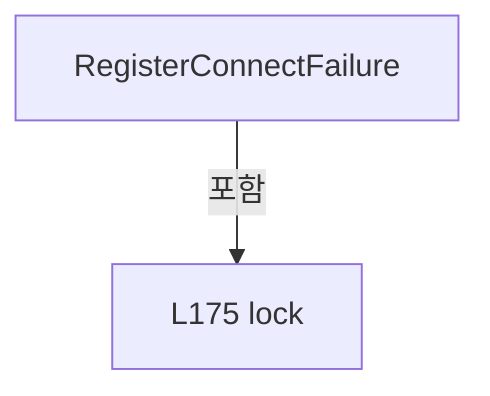

변경 전 점검: 입력/반환 타입, 위 호출자, 예외/취소 경로, 공유 상태와 저장·전송 소비자를 함께 확인합니다. 값의 단위나 물리 방향을 이름만으로 확정하지 않습니다.

### MethodDeclaration `Disconnect` · L181–190

[Drilling.Common/Interface/Serial/CSerialComm.cs:181–190](https://github.com/kjuws10-rgb/A3Drilling/blob/5aee8e58439c9b455cae7c9593c9be986c3e682e/Drilling.Common/Interface/Serial/CSerialComm.cs#L181-L190)

| 항목 | 실제 추출 값 |
| --- | --- |
| 서명 | System.Threading.Tasks.Task Drilling.Common.Interface.CSerialComm.Disconnect(System.Threading.CancellationToken) |
| 접근/수식자 | Public / public, override |
| 반환/값 타입 | System.Threading.Tasks.Task |
| 소속 타입 | NamedType:Drilling.Common.Interface.CSerialComm |

입력 계약:

| 이름 | 타입 | 전달 | 선택/기본값 |
| --- | --- | --- | --- |
| cancellationToken | System.Threading.CancellationToken | None | True / null |

현재 부분 분석에서 직접 연결된 호출자는 없습니다. XAML/이벤트/인터페이스·델리게이트·외부 진입을 추가 확인해야 하며, 미사용으로 판정한 것이 아닙니다.

호출하는 대상과 해석 범위:

| 원본 행 | 표현식 | 분석 상태 | 대상/소스 위치 |
| --- | --- | --- | --- |
| 183 | cancellationToken.ThrowIfCancellationRequested | resolved | void System.Threading.CancellationToken.ThrowIfCancellationRequested() |
| 186 | CloseSerialPort | resolved | void Drilling.Common.Interface.CSerialComm.CloseSerialPort() · Drilling.Common/Interface/Serial/CSerialComm.cs:363 |
| 187 | SetState | resolved | void Drilling.Common.Interface.CCommBase.SetState(Drilling.Common.Interface.EN_COMM_STATE) · Drilling.Common/Interface/CComm.cs:114 |

본문의 실제 연산·분기·예외·반환 순서(원문 위치 순):

| 원본 행 | 종류 | 주석 해설 |
| --- | --- | --- |
| 183 | call | 함수·델리게이트 또는 객체 생성자를 호출합니다: cancellationToken.ThrowIfCancellationRequested() |
| 184 | lock | 공유 상태의 임계 구역에 진입합니다: lock (_serialPortLifecycleLock) |
| 186 | call | 함수·델리게이트 또는 객체 생성자를 호출합니다: CloseSerialPort() |
| 187 | call | 함수·델리게이트 또는 객체 생성자를 호출합니다: SetState(EN_COMM_STATE.Offline) |
| 189 | return | 호출자에게 값 또는 제어를 반환합니다: return Task.CompletedTask; |

제어 구문의 포함 구조(실제 실행 순서/CFG가 아닌 구문 탐색 그림):

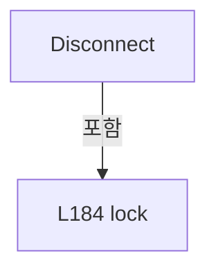

변경 전 점검: 입력/반환 타입, 위 호출자, 예외/취소 경로, 공유 상태와 저장·전송 소비자를 함께 확인합니다. 값의 단위나 물리 방향을 이름만으로 확정하지 않습니다.

### MethodDeclaration `SetError` · L192–197

[Drilling.Common/Interface/Serial/CSerialComm.cs:192–197](https://github.com/kjuws10-rgb/A3Drilling/blob/5aee8e58439c9b455cae7c9593c9be986c3e682e/Drilling.Common/Interface/Serial/CSerialComm.cs#L192-L197)

| 항목 | 실제 추출 값 |
| --- | --- |
| 서명 | void Drilling.Common.Interface.CSerialComm.SetError(System.Exception) |
| 접근/수식자 | Protected / protected, new |
| 반환/값 타입 | void |
| 소속 타입 | NamedType:Drilling.Common.Interface.CSerialComm |

입력 계약:

| 이름 | 타입 | 전달 | 선택/기본값 |
| --- | --- | --- | --- |
| ex | System.Exception | None | False /  |

정적 호출자로 확인된 위치:

| 호출 파일/행 | 호출 표현식 | 런타임 분기 가능 |
| --- | --- | --- |
| [Drilling.Common/Interface/Serial/CBeamExpander.cs:172–172](https://github.com/kjuws10-rgb/A3Drilling/blob/5aee8e58439c9b455cae7c9593c9be986c3e682e/Drilling.Common/Interface/Serial/CBeamExpander.cs#L172-L172) | SetError | False |
| [Drilling.Common/Interface/Serial/CConex_AGP.cs:202–202](https://github.com/kjuws10-rgb/A3Drilling/blob/5aee8e58439c9b455cae7c9593c9be986c3e682e/Drilling.Common/Interface/Serial/CConex_AGP.cs#L202-L202) | SetError | False |
| [Drilling.Common/Interface/Serial/CPowerMeter.cs:95–95](https://github.com/kjuws10-rgb/A3Drilling/blob/5aee8e58439c9b455cae7c9593c9be986c3e682e/Drilling.Common/Interface/Serial/CPowerMeter.cs#L95-L95) | SetError | False |
| [Drilling.Common/Interface/Serial/CPowerMeter.cs:122–122](https://github.com/kjuws10-rgb/A3Drilling/blob/5aee8e58439c9b455cae7c9593c9be986c3e682e/Drilling.Common/Interface/Serial/CPowerMeter.cs#L122-L122) | SetError | False |
| [Drilling.Common/Interface/Serial/CSerialComm.cs:82–82](https://github.com/kjuws10-rgb/A3Drilling/blob/5aee8e58439c9b455cae7c9593c9be986c3e682e/Drilling.Common/Interface/Serial/CSerialComm.cs#L82-L82) | SetError | False |
| [Drilling.Common/Interface/Serial/CSerialComm.cs:301–301](https://github.com/kjuws10-rgb/A3Drilling/blob/5aee8e58439c9b455cae7c9593c9be986c3e682e/Drilling.Common/Interface/Serial/CSerialComm.cs#L301-L301) | SetError | False |
| [Drilling.Common/Interface/Serial/CTalonLaser.cs:80–80](https://github.com/kjuws10-rgb/A3Drilling/blob/5aee8e58439c9b455cae7c9593c9be986c3e682e/Drilling.Common/Interface/Serial/CTalonLaser.cs#L80-L80) | SetError | False |

호출하는 대상과 해석 범위:

| 원본 행 | 표현식 | 분석 상태 | 대상/소스 위치 |
| --- | --- | --- | --- |
| 194 | base.SetError | resolved | void Drilling.Common.Interface.CCommBase.SetError(System.Exception) · Drilling.Common/Interface/CComm.cs:120 |
| 195 | RegisterConnectFailure | resolved | void Drilling.Common.Interface.CSerialComm.RegisterConnectFailure() · Drilling.Common/Interface/Serial/CSerialComm.cs:173 |
| 196 | SetState | resolved | void Drilling.Common.Interface.CCommBase.SetState(Drilling.Common.Interface.EN_COMM_STATE) · Drilling.Common/Interface/CComm.cs:114 |

본문의 실제 연산·분기·예외·반환 순서(원문 위치 순):

| 원본 행 | 종류 | 주석 해설 |
| --- | --- | --- |
| 194 | call | 함수·델리게이트 또는 객체 생성자를 호출합니다: base.SetError(ex) |
| 195 | call | 함수·델리게이트 또는 객체 생성자를 호출합니다: RegisterConnectFailure() |
| 196 | call | 함수·델리게이트 또는 객체 생성자를 호출합니다: SetState(EN_COMM_STATE.Offline) |

변경 전 점검: 입력/반환 타입, 위 호출자, 예외/취소 경로, 공유 상태와 저장·전송 소비자를 함께 확인합니다. 값의 단위나 물리 방향을 이름만으로 확정하지 않습니다.

### MethodDeclaration `SetError` · L199–204

[Drilling.Common/Interface/Serial/CSerialComm.cs:199–204](https://github.com/kjuws10-rgb/A3Drilling/blob/5aee8e58439c9b455cae7c9593c9be986c3e682e/Drilling.Common/Interface/Serial/CSerialComm.cs#L199-L204)

| 항목 | 실제 추출 값 |
| --- | --- |
| 서명 | void Drilling.Common.Interface.CSerialComm.SetError(string) |
| 접근/수식자 | Protected / protected, new |
| 반환/값 타입 | void |
| 소속 타입 | NamedType:Drilling.Common.Interface.CSerialComm |

입력 계약:

| 이름 | 타입 | 전달 | 선택/기본값 |
| --- | --- | --- | --- |
| message | string | None | False /  |

정적 호출자로 확인된 위치:

| 호출 파일/행 | 호출 표현식 | 런타임 분기 가능 |
| --- | --- | --- |
| [Drilling.Common/Interface/Serial/CPowerMeter.cs:74–74](https://github.com/kjuws10-rgb/A3Drilling/blob/5aee8e58439c9b455cae7c9593c9be986c3e682e/Drilling.Common/Interface/Serial/CPowerMeter.cs#L74-L74) | SetError | False |
| [Drilling.Common/Interface/Serial/CPowerMeter.cs:114–114](https://github.com/kjuws10-rgb/A3Drilling/blob/5aee8e58439c9b455cae7c9593c9be986c3e682e/Drilling.Common/Interface/Serial/CPowerMeter.cs#L114-L114) | SetError | False |
| [Drilling.Common/Interface/Serial/CSerialComm.cs:61–61](https://github.com/kjuws10-rgb/A3Drilling/blob/5aee8e58439c9b455cae7c9593c9be986c3e682e/Drilling.Common/Interface/Serial/CSerialComm.cs#L61-L61) | SetError | False |
| [Drilling.Common/Interface/Serial/CSerialComm.cs:210–210](https://github.com/kjuws10-rgb/A3Drilling/blob/5aee8e58439c9b455cae7c9593c9be986c3e682e/Drilling.Common/Interface/Serial/CSerialComm.cs#L210-L210) | SetError | False |
| [Drilling.Common/Interface/Serial/CSerialComm.cs:291–291](https://github.com/kjuws10-rgb/A3Drilling/blob/5aee8e58439c9b455cae7c9593c9be986c3e682e/Drilling.Common/Interface/Serial/CSerialComm.cs#L291-L291) | SetError | False |
| [Drilling.Common/Interface/Serial/CTalonLaser.cs:69–69](https://github.com/kjuws10-rgb/A3Drilling/blob/5aee8e58439c9b455cae7c9593c9be986c3e682e/Drilling.Common/Interface/Serial/CTalonLaser.cs#L69-L69) | SetError | False |

호출하는 대상과 해석 범위:

| 원본 행 | 표현식 | 분석 상태 | 대상/소스 위치 |
| --- | --- | --- | --- |
| 201 | base.SetError | resolved | void Drilling.Common.Interface.CCommBase.SetError(string) · Drilling.Common/Interface/CComm.cs:126 |
| 202 | RegisterConnectFailure | resolved | void Drilling.Common.Interface.CSerialComm.RegisterConnectFailure() · Drilling.Common/Interface/Serial/CSerialComm.cs:173 |
| 203 | SetState | resolved | void Drilling.Common.Interface.CCommBase.SetState(Drilling.Common.Interface.EN_COMM_STATE) · Drilling.Common/Interface/CComm.cs:114 |

본문의 실제 연산·분기·예외·반환 순서(원문 위치 순):

| 원본 행 | 종류 | 주석 해설 |
| --- | --- | --- |
| 201 | call | 함수·델리게이트 또는 객체 생성자를 호출합니다: base.SetError(message) |
| 202 | call | 함수·델리게이트 또는 객체 생성자를 호출합니다: RegisterConnectFailure() |
| 203 | call | 함수·델리게이트 또는 객체 생성자를 호출합니다: SetState(EN_COMM_STATE.Offline) |

변경 전 점검: 입력/반환 타입, 위 호출자, 예외/취소 경로, 공유 상태와 저장·전송 소비자를 함께 확인합니다. 값의 단위나 물리 방향을 이름만으로 확정하지 않습니다.

### MethodDeclaration `SetResponseState` · L206–215

[Drilling.Common/Interface/Serial/CSerialComm.cs:206–215](https://github.com/kjuws10-rgb/A3Drilling/blob/5aee8e58439c9b455cae7c9593c9be986c3e682e/Drilling.Common/Interface/Serial/CSerialComm.cs#L206-L215)

| 항목 | 실제 추출 값 |
| --- | --- |
| 서명 | void Drilling.Common.Interface.CSerialComm.SetResponseState(string) |
| 접근/수식자 | Protected / protected |
| 반환/값 타입 | void |
| 소속 타입 | NamedType:Drilling.Common.Interface.CSerialComm |

입력 계약:

| 이름 | 타입 | 전달 | 선택/기본값 |
| --- | --- | --- | --- |
| response | string | None | False /  |

정적 호출자로 확인된 위치:

| 호출 파일/행 | 호출 표현식 | 런타임 분기 가능 |
| --- | --- | --- |
| [Drilling.Common/Interface/Serial/CBeamExpander.cs:166–166](https://github.com/kjuws10-rgb/A3Drilling/blob/5aee8e58439c9b455cae7c9593c9be986c3e682e/Drilling.Common/Interface/Serial/CBeamExpander.cs#L166-L166) | SetResponseState | False |
| [Drilling.Common/Interface/Serial/CConex_AGP.cs:196–196](https://github.com/kjuws10-rgb/A3Drilling/blob/5aee8e58439c9b455cae7c9593c9be986c3e682e/Drilling.Common/Interface/Serial/CConex_AGP.cs#L196-L196) | SetResponseState | False |

호출하는 대상과 해석 범위:

| 원본 행 | 표현식 | 분석 상태 | 대상/소스 위치 |
| --- | --- | --- | --- |
| 208 | response.StartsWith | resolved | bool string.StartsWith(string, System.StringComparison) |
| 210 | SetError | resolved | void Drilling.Common.Interface.CSerialComm.SetError(string) · Drilling.Common/Interface/Serial/CSerialComm.cs:199 |
| 214 | SetState | resolved | void Drilling.Common.Interface.CCommBase.SetState(Drilling.Common.Interface.EN_COMM_STATE) · Drilling.Common/Interface/CComm.cs:114 |

본문의 실제 연산·분기·예외·반환 순서(원문 위치 순):

| 원본 행 | 종류 | 주석 해설 |
| --- | --- | --- |
| 208 | call | 함수·델리게이트 또는 객체 생성자를 호출합니다: response.StartsWith("ERR:-1", StringComparison.OrdinalIgnoreCase) |
| 208 | if | 조건에 따라 분기합니다: if (response.StartsWith("ERR:-1", StringComparison.OrdinalIgnoreCase)) |
| 210 | call | 함수·델리게이트 또는 객체 생성자를 호출합니다: SetError(response) |
| 211 | return | 호출자에게 값 또는 제어를 반환합니다: return; |
| 214 | call | 함수·델리게이트 또는 객체 생성자를 호출합니다: SetState(EN_COMM_STATE.Online) |

제어 구문의 포함 구조(실제 실행 순서/CFG가 아닌 구문 탐색 그림):

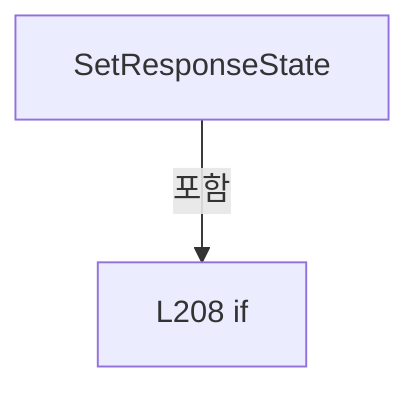

변경 전 점검: 입력/반환 타입, 위 호출자, 예외/취소 경로, 공유 상태와 저장·전송 소비자를 함께 확인합니다. 값의 단위나 물리 방향을 이름만으로 확정하지 않습니다.

### MethodDeclaration `Execute` · L217–228

[Drilling.Common/Interface/Serial/CSerialComm.cs:217–228](https://github.com/kjuws10-rgb/A3Drilling/blob/5aee8e58439c9b455cae7c9593c9be986c3e682e/Drilling.Common/Interface/Serial/CSerialComm.cs#L217-L228)

| 항목 | 실제 추출 값 |
| --- | --- |
| 서명 | System.Threading.Tasks.Task<string> Drilling.Common.Interface.CSerialComm.Execute(string, System.Threading.CancellationToken) |
| 접근/수식자 | Public / public, override, async |
| 반환/값 타입 | System.Threading.Tasks.Task<string> |
| 소속 타입 | NamedType:Drilling.Common.Interface.CSerialComm |

입력 계약:

| 이름 | 타입 | 전달 | 선택/기본값 |
| --- | --- | --- | --- |
| function | string | None | False /  |
| cancellationToken | System.Threading.CancellationToken | None | True / null |

현재 부분 분석에서 직접 연결된 호출자는 없습니다. XAML/이벤트/인터페이스·델리게이트·외부 진입을 추가 확인해야 하며, 미사용으로 판정한 것이 아닙니다.

호출하는 대상과 해석 범위:

| 원본 행 | 표현식 | 분석 상태 | 대상/소스 위치 |
| --- | --- | --- | --- |
| 219 | SerialLock.WaitAsync | resolved | System.Threading.Tasks.Task System.Threading.SemaphoreSlim.WaitAsync(System.Threading.CancellationToken) |
| 222 | ExecuteSerial | resolved | System.Threading.Tasks.Task<string> Drilling.Common.Interface.CSerialComm.ExecuteSerial(string, System.Threading.CancellationToken) · Drilling.Common/Interface/Serial/CSerialComm.cs:230 |
| 226 | SerialLock.Release | resolved | int System.Threading.SemaphoreSlim.Release() |

본문의 실제 연산·분기·예외·반환 순서(원문 위치 순):

| 원본 행 | 종류 | 주석 해설 |
| --- | --- | --- |
| 219 | await | 비동기 완료를 기다립니다: await SerialLock.WaitAsync(cancellationToken) |
| 219 | call | 함수·델리게이트 또는 객체 생성자를 호출합니다: SerialLock.WaitAsync(cancellationToken) |
| 220 | try | 예외 처리 범위입니다: try |
| 222 | await | 비동기 완료를 기다립니다: await ExecuteSerial(function, cancellationToken) |
| 222 | call | 함수·델리게이트 또는 객체 생성자를 호출합니다: ExecuteSerial(function, cancellationToken) |
| 222 | return | 호출자에게 값 또는 제어를 반환합니다: return await ExecuteSerial(function, cancellationToken); |
| 224 | finally | 종료 정리 구간입니다: finally |
| 226 | call | 함수·델리게이트 또는 객체 생성자를 호출합니다: SerialLock.Release() |

제어 구문의 포함 구조(실제 실행 순서/CFG가 아닌 구문 탐색 그림):

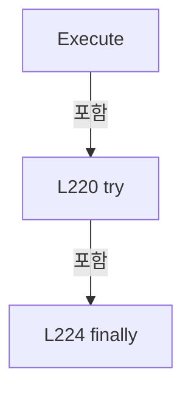

변경 전 점검: 입력/반환 타입, 위 호출자, 예외/취소 경로, 공유 상태와 저장·전송 소비자를 함께 확인합니다. 값의 단위나 물리 방향을 이름만으로 확정하지 않습니다.

### MethodDeclaration `ExecuteSerial` · L230–348

[Drilling.Common/Interface/Serial/CSerialComm.cs:230–348](https://github.com/kjuws10-rgb/A3Drilling/blob/5aee8e58439c9b455cae7c9593c9be986c3e682e/Drilling.Common/Interface/Serial/CSerialComm.cs#L230-L348)

| 항목 | 실제 추출 값 |
| --- | --- |
| 서명 | System.Threading.Tasks.Task<string> Drilling.Common.Interface.CSerialComm.ExecuteSerial(string, System.Threading.CancellationToken) |
| 접근/수식자 | Private / private, async |
| 반환/값 타입 | System.Threading.Tasks.Task<string> |
| 소속 타입 | NamedType:Drilling.Common.Interface.CSerialComm |

입력 계약:

| 이름 | 타입 | 전달 | 선택/기본값 |
| --- | --- | --- | --- |
| function | string | None | False /  |
| cancellationToken | System.Threading.CancellationToken | None | False /  |

정적 호출자로 확인된 위치:

| 호출 파일/행 | 호출 표현식 | 런타임 분기 가능 |
| --- | --- | --- |
| [Drilling.Common/Interface/Serial/CSerialComm.cs:222–222](https://github.com/kjuws10-rgb/A3Drilling/blob/5aee8e58439c9b455cae7c9593c9be986c3e682e/Drilling.Common/Interface/Serial/CSerialComm.cs#L222-L222) | ExecuteSerial | False |

호출하는 대상과 해석 범위:

| 원본 행 | 표현식 | 분석 상태 | 대상/소스 위치 |
| --- | --- | --- | --- |
| 234 | Connect | resolved · 동적 구현 선택 가능 | System.Threading.Tasks.Task Drilling.Common.Interface.CSerialComm.Connect(System.Threading.CancellationToken) · Drilling.Common/Interface/Serial/CSerialComm.cs:32 |
| 242 | FormatCommand | resolved · 동적 구현 선택 가능 | string Drilling.Common.Interface.CSerialComm.FormatCommand(string) · Drilling.Common/Interface/Serial/CSerialComm.cs:358 |
| 285 | cancellationToken.ThrowIfCancellationRequested | resolved | void System.Threading.CancellationToken.ThrowIfCancellationRequested() |
| 287 | Task.Run | resolved | System.Threading.Tasks.Task<string?> System.Threading.Tasks.Task.Run<string?>(System.Func<string?>, System.Threading.CancellationToken) |
| 288 | string.IsNullOrWhiteSpace | resolved | bool string.IsNullOrWhiteSpace(string?) |
| 289 | string.IsNullOrWhiteSpace | resolved | bool string.IsNullOrWhiteSpace(string?) |
| 291 | SetError | resolved | void Drilling.Common.Interface.CSerialComm.SetError(string) · Drilling.Common/Interface/Serial/CSerialComm.cs:199 |
| 295 | SetState | resolved | void Drilling.Common.Interface.CCommBase.SetState(Drilling.Common.Interface.EN_COMM_STATE) · Drilling.Common/Interface/CComm.cs:114 |
| 300 | CloseSerialPort | resolved | void Drilling.Common.Interface.CSerialComm.CloseSerialPort() · Drilling.Common/Interface/Serial/CSerialComm.cs:363 |
| 301 | SetError | resolved | void Drilling.Common.Interface.CSerialComm.SetError(System.Exception) · Drilling.Common/Interface/Serial/CSerialComm.cs:192 |

본문의 실제 연산·분기·예외·반환 순서(원문 위치 순):

| 원본 행 | 종류 | 주석 해설 |
| --- | --- | --- |
| 232 | if | 조건에 따라 분기합니다: if (SerialPort is null &#124;&#124; !SerialPort.IsOpen) |
| 234 | await | 비동기 완료를 기다립니다: await Connect(cancellationToken) |
| 234 | call | 함수·델리게이트 또는 객체 생성자를 호출합니다: Connect(cancellationToken) |
| 237 | if | 조건에 따라 분기합니다: if (SerialPort is null &#124;&#124; !SerialPort.IsOpen) |
| 239 | return | 호출자에게 값 또는 제어를 반환합니다: return ""; |
| 242 | assignment | 값을 대상에 대입합니다: LastSent = FormatCommand(function) |
| 242 | call | 함수·델리게이트 또는 객체 생성자를 호출합니다: FormatCommand(function) |
| 282 | try | 예외 처리 범위입니다: try |
| 285 | call | 함수·델리게이트 또는 객체 생성자를 호출합니다: cancellationToken.ThrowIfCancellationRequested() |
| 287 | assignment | 값을 대상에 대입합니다: LastReceived = await Task.Run(ifCallback, cancellationToken) ?? "" |
| 287 | await | 비동기 완료를 기다립니다: await Task.Run(ifCallback, cancellationToken) |
| 287 | call | 함수·델리게이트 또는 객체 생성자를 호출합니다: Task.Run(ifCallback, cancellationToken) |
| 288 | assignment | 값을 대상에 대입합니다: LastError = string.IsNullOrWhiteSpace(LastReceived) ? "Serial response timeout." : "" |
| 288 | call | 함수·델리게이트 또는 객체 생성자를 호출합니다: string.IsNullOrWhiteSpace(LastReceived) |
| 288 | conditional-expression | 조건에 따라 결과식을 선택합니다: string.IsNullOrWhiteSpace(LastReceived) ? "Serial response timeout." : "" |
| 289 | call | 함수·델리게이트 또는 객체 생성자를 호출합니다: string.IsNullOrWhiteSpace(LastError) |
| 289 | if | 조건에 따라 분기합니다: if (!string.IsNullOrWhiteSpace(LastError)) |
| 291 | call | 함수·델리게이트 또는 객체 생성자를 호출합니다: SetError(LastError) |
| 292 | return | 호출자에게 값 또는 제어를 반환합니다: return ""; |
| 295 | call | 함수·델리게이트 또는 객체 생성자를 호출합니다: SetState(EN_COMM_STATE.Online) |
| 296 | return | 호출자에게 값 또는 제어를 반환합니다: return LastReceived; |
| 298 | catch | 지정 예외를 처리합니다: catch (Exception ex) when (ex is IOException or UnauthorizedAccessException or InvalidOperationException or TimeoutException or ObjectDisposedException or OperationCanceledException) |
| 300 | call | 함수·델리게이트 또는 객체 생성자를 호출합니다: CloseSerialPort() |
| 301 | call | 함수·델리게이트 또는 객체 생성자를 호출합니다: SetError(ex) |
| 302 | return | 호출자에게 값 또는 제어를 반환합니다: return ""; |

제어 구문의 포함 구조(실제 실행 순서/CFG가 아닌 구문 탐색 그림):

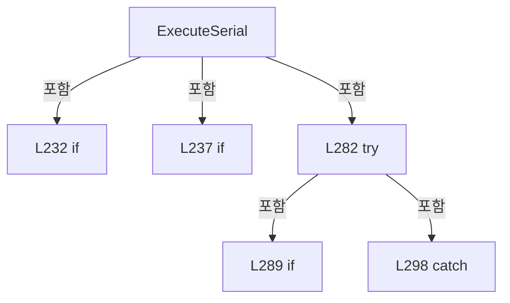

변경 전 점검: 입력/반환 타입, 위 호출자, 예외/취소 경로, 공유 상태와 저장·전송 소비자를 함께 확인합니다. 값의 단위나 물리 방향을 이름만으로 확정하지 않습니다.

### LocalFunctionStatement `ifCallback` · L245–280

[Drilling.Common/Interface/Serial/CSerialComm.cs:245–280](https://github.com/kjuws10-rgb/A3Drilling/blob/5aee8e58439c9b455cae7c9593c9be986c3e682e/Drilling.Common/Interface/Serial/CSerialComm.cs#L245-L280)

| 항목 | 실제 추출 값 |
| --- | --- |
| 서명 | string? ifCallback() |
| 접근/수식자 | Private /  |
| 반환/값 타입 | string? |
| 소속 타입 | NamedType:Drilling.Common.Interface.CSerialComm |

현재 부분 분석에서 직접 연결된 호출자는 없습니다. XAML/이벤트/인터페이스·델리게이트·외부 진입을 추가 확인해야 하며, 미사용으로 판정한 것이 아닙니다.

호출하는 대상과 해석 범위:

| 원본 행 | 표현식 | 분석 상태 | 대상/소스 위치 |
| --- | --- | --- | --- |
| 250 | SerialPort.Write | unresolved | None |
| 254 | SerialPort.WriteLine | unresolved | None |
| 259 | SerialPort.ReadLine().Trim | unresolved | None |
| 259 | SerialPort.ReadLine | unresolved | None |
| 267 | SerialPort.ReadExisting().Trim | unresolved | None |
| 267 | SerialPort.ReadExisting | unresolved | None |

본문의 실제 연산·분기·예외·반환 순서(원문 위치 순):

| 원본 행 | 종류 | 주석 해설 |
| --- | --- | --- |
| 247 | if | 조건에 따라 분기합니다: if (this is CTalonLaser) |
| 249 | assignment | 값을 대상에 대입합니다: SerialPort.NewLine = "\n" |
| 250 | call | 함수·델리게이트 또는 객체 생성자를 호출합니다: SerialPort.Write(LastSent + "\r") |
| 252 | else | 앞 조건이 거짓인 경로입니다: else |
| 254 | call | 함수·델리게이트 또는 객체 생성자를 호출합니다: SerialPort.WriteLine(LastSent) |
| 257 | try | 예외 처리 범위입니다: try |
| 259 | call | 함수·델리게이트 또는 객체 생성자를 호출합니다: SerialPort.ReadLine().Trim() |
| 259 | call | 함수·델리게이트 또는 객체 생성자를 호출합니다: SerialPort.ReadLine() |
| 259 | return | 호출자에게 값 또는 제어를 반환합니다: return SerialPort.ReadLine().Trim(); |
| 262 | catch | 지정 예외를 처리합니다: catch (TimeoutException) |
| 265 | try | 예외 처리 범위입니다: try |
| 267 | call | 함수·델리게이트 또는 객체 생성자를 호출합니다: SerialPort.ReadExisting().Trim() |
| 267 | call | 함수·델리게이트 또는 객체 생성자를 호출합니다: SerialPort.ReadExisting() |
| 267 | return | 호출자에게 값 또는 제어를 반환합니다: return SerialPort.ReadExisting().Trim(); |
| 269 | catch | 지정 예외를 처리합니다: catch  |
| 271 | return | 호출자에게 값 또는 제어를 반환합니다: return ""; |
| 274 | catch | 지정 예외를 처리합니다: catch (Exception) |
| 278 | throw | 예외를 발생/전달합니다: throw; |

제어 구문의 포함 구조(실제 실행 순서/CFG가 아닌 구문 탐색 그림):

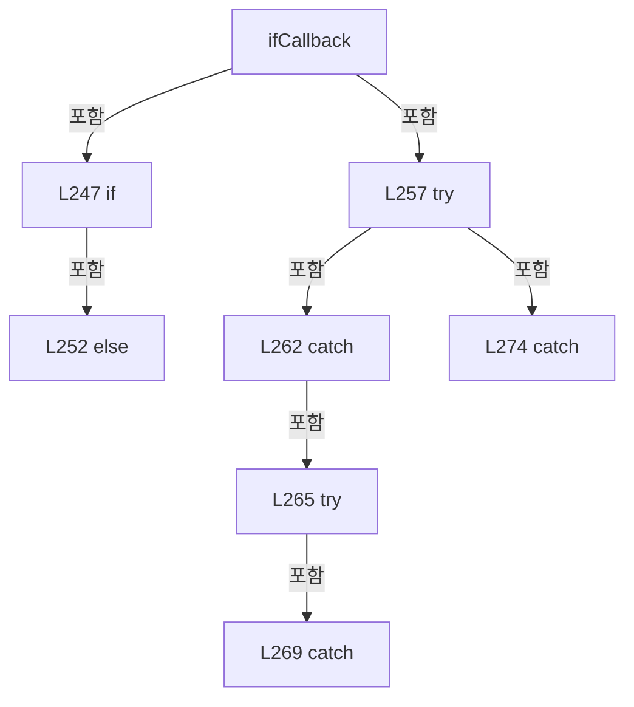

변경 전 점검: 입력/반환 타입, 위 호출자, 예외/취소 경로, 공유 상태와 저장·전송 소비자를 함께 확인합니다. 값의 단위나 물리 방향을 이름만으로 확정하지 않습니다.

### PropertyDeclaration `CommandNewLine` · L350–356

[Drilling.Common/Interface/Serial/CSerialComm.cs:350–356](https://github.com/kjuws10-rgb/A3Drilling/blob/5aee8e58439c9b455cae7c9593c9be986c3e682e/Drilling.Common/Interface/Serial/CSerialComm.cs#L350-L356)

| 항목 | 실제 추출 값 |
| --- | --- |
| 서명 | string Drilling.Common.Interface.CSerialComm.CommandNewLine |
| 접근/수식자 | Protected / protected, virtual |
| 반환/값 타입 | string |
| 소속 타입 | NamedType:Drilling.Common.Interface.CSerialComm |

현재 부분 분석에서 직접 연결된 호출자는 없습니다. XAML/이벤트/인터페이스·델리게이트·외부 진입을 추가 확인해야 하며, 미사용으로 판정한 것이 아닙니다.

변경 전 점검: 입력/반환 타입, 위 호출자, 예외/취소 경로, 공유 상태와 저장·전송 소비자를 함께 확인합니다. 값의 단위나 물리 방향을 이름만으로 확정하지 않습니다.

### GetAccessorDeclaration `get_CommandNewLine` · L352–355

[Drilling.Common/Interface/Serial/CSerialComm.cs:352–355](https://github.com/kjuws10-rgb/A3Drilling/blob/5aee8e58439c9b455cae7c9593c9be986c3e682e/Drilling.Common/Interface/Serial/CSerialComm.cs#L352-L355)

| 항목 | 실제 추출 값 |
| --- | --- |
| 서명 | string Drilling.Common.Interface.CSerialComm.CommandNewLine.get |
| 접근/수식자 | Protected / get |
| 반환/값 타입 | string |
| 소속 타입 | NamedType:Drilling.Common.Interface.CSerialComm |

현재 부분 분석에서 직접 연결된 호출자는 없습니다. XAML/이벤트/인터페이스·델리게이트·외부 진입을 추가 확인해야 하며, 미사용으로 판정한 것이 아닙니다.

본문의 실제 연산·분기·예외·반환 순서(원문 위치 순):

| 원본 행 | 종류 | 주석 해설 |
| --- | --- | --- |
| 354 | return | 호출자에게 값 또는 제어를 반환합니다: return "\r\n"; |

변경 전 점검: 입력/반환 타입, 위 호출자, 예외/취소 경로, 공유 상태와 저장·전송 소비자를 함께 확인합니다. 값의 단위나 물리 방향을 이름만으로 확정하지 않습니다.

### MethodDeclaration `FormatCommand` · L358–361

[Drilling.Common/Interface/Serial/CSerialComm.cs:358–361](https://github.com/kjuws10-rgb/A3Drilling/blob/5aee8e58439c9b455cae7c9593c9be986c3e682e/Drilling.Common/Interface/Serial/CSerialComm.cs#L358-L361)

| 항목 | 실제 추출 값 |
| --- | --- |
| 서명 | string Drilling.Common.Interface.CSerialComm.FormatCommand(string) |
| 접근/수식자 | Protected / protected, virtual |
| 반환/값 타입 | string |
| 소속 타입 | NamedType:Drilling.Common.Interface.CSerialComm |

입력 계약:

| 이름 | 타입 | 전달 | 선택/기본값 |
| --- | --- | --- | --- |
| function | string | None | False /  |

정적 호출자로 확인된 위치:

| 호출 파일/행 | 호출 표현식 | 런타임 분기 가능 |
| --- | --- | --- |
| [Drilling.Common/Interface/Serial/CSerialComm.cs:242–242](https://github.com/kjuws10-rgb/A3Drilling/blob/5aee8e58439c9b455cae7c9593c9be986c3e682e/Drilling.Common/Interface/Serial/CSerialComm.cs#L242-L242) | FormatCommand | True |

본문의 실제 연산·분기·예외·반환 순서(원문 위치 순):

| 원본 행 | 종류 | 주석 해설 |
| --- | --- | --- |
| 360 | return | 호출자에게 값 또는 제어를 반환합니다: return function; |

변경 전 점검: 입력/반환 타입, 위 호출자, 예외/취소 경로, 공유 상태와 저장·전송 소비자를 함께 확인합니다. 값의 단위나 물리 방향을 이름만으로 확정하지 않습니다.

### MethodDeclaration `CloseSerialPort` · L363–382

[Drilling.Common/Interface/Serial/CSerialComm.cs:363–382](https://github.com/kjuws10-rgb/A3Drilling/blob/5aee8e58439c9b455cae7c9593c9be986c3e682e/Drilling.Common/Interface/Serial/CSerialComm.cs#L363-L382)

| 항목 | 실제 추출 값 |
| --- | --- |
| 서명 | void Drilling.Common.Interface.CSerialComm.CloseSerialPort() |
| 접근/수식자 | Protected / protected |
| 반환/값 타입 | void |
| 소속 타입 | NamedType:Drilling.Common.Interface.CSerialComm |

정적 호출자로 확인된 위치:

| 호출 파일/행 | 호출 표현식 | 런타임 분기 가능 |
| --- | --- | --- |
| [Drilling.Common/Interface/Serial/CBeamExpander.cs:171–171](https://github.com/kjuws10-rgb/A3Drilling/blob/5aee8e58439c9b455cae7c9593c9be986c3e682e/Drilling.Common/Interface/Serial/CBeamExpander.cs#L171-L171) | CloseSerialPort | False |
| [Drilling.Common/Interface/Serial/CConex_AGP.cs:201–201](https://github.com/kjuws10-rgb/A3Drilling/blob/5aee8e58439c9b455cae7c9593c9be986c3e682e/Drilling.Common/Interface/Serial/CConex_AGP.cs#L201-L201) | CloseSerialPort | False |
| [Drilling.Common/Interface/Serial/CPowerMeter.cs:73–73](https://github.com/kjuws10-rgb/A3Drilling/blob/5aee8e58439c9b455cae7c9593c9be986c3e682e/Drilling.Common/Interface/Serial/CPowerMeter.cs#L73-L73) | CloseSerialPort | False |
| [Drilling.Common/Interface/Serial/CPowerMeter.cs:94–94](https://github.com/kjuws10-rgb/A3Drilling/blob/5aee8e58439c9b455cae7c9593c9be986c3e682e/Drilling.Common/Interface/Serial/CPowerMeter.cs#L94-L94) | CloseSerialPort | False |
| [Drilling.Common/Interface/Serial/CPowerMeter.cs:113–113](https://github.com/kjuws10-rgb/A3Drilling/blob/5aee8e58439c9b455cae7c9593c9be986c3e682e/Drilling.Common/Interface/Serial/CPowerMeter.cs#L113-L113) | CloseSerialPort | False |
| [Drilling.Common/Interface/Serial/CPowerMeter.cs:121–121](https://github.com/kjuws10-rgb/A3Drilling/blob/5aee8e58439c9b455cae7c9593c9be986c3e682e/Drilling.Common/Interface/Serial/CPowerMeter.cs#L121-L121) | CloseSerialPort | False |
| [Drilling.Common/Interface/Serial/CSerialComm.cs:56–56](https://github.com/kjuws10-rgb/A3Drilling/blob/5aee8e58439c9b455cae7c9593c9be986c3e682e/Drilling.Common/Interface/Serial/CSerialComm.cs#L56-L56) | CloseSerialPort | False |
| [Drilling.Common/Interface/Serial/CSerialComm.cs:81–81](https://github.com/kjuws10-rgb/A3Drilling/blob/5aee8e58439c9b455cae7c9593c9be986c3e682e/Drilling.Common/Interface/Serial/CSerialComm.cs#L81-L81) | CloseSerialPort | False |
| [Drilling.Common/Interface/Serial/CSerialComm.cs:186–186](https://github.com/kjuws10-rgb/A3Drilling/blob/5aee8e58439c9b455cae7c9593c9be986c3e682e/Drilling.Common/Interface/Serial/CSerialComm.cs#L186-L186) | CloseSerialPort | False |
| [Drilling.Common/Interface/Serial/CSerialComm.cs:300–300](https://github.com/kjuws10-rgb/A3Drilling/blob/5aee8e58439c9b455cae7c9593c9be986c3e682e/Drilling.Common/Interface/Serial/CSerialComm.cs#L300-L300) | CloseSerialPort | False |
| [Drilling.Common/Interface/Serial/CTalonLaser.cs:68–68](https://github.com/kjuws10-rgb/A3Drilling/blob/5aee8e58439c9b455cae7c9593c9be986c3e682e/Drilling.Common/Interface/Serial/CTalonLaser.cs#L68-L68) | CloseSerialPort | False |
| [Drilling.Common/Interface/Serial/CTalonLaser.cs:79–79](https://github.com/kjuws10-rgb/A3Drilling/blob/5aee8e58439c9b455cae7c9593c9be986c3e682e/Drilling.Common/Interface/Serial/CTalonLaser.cs#L79-L79) | CloseSerialPort | False |

호출하는 대상과 해석 범위:

| 원본 행 | 표현식 | 분석 상태 | 대상/소스 위치 |
| --- | --- | --- | --- |
| 374 | SerialPort.Close | unresolved | None |
| 379 | SerialPort.Dispose | unresolved | None |

본문의 실제 연산·분기·예외·반환 순서(원문 위치 순):

| 원본 행 | 종류 | 주석 해설 |
| --- | --- | --- |
| 365 | if | 조건에 따라 분기합니다: if (SerialPort is null) |
| 367 | return | 호출자에게 값 또는 제어를 반환합니다: return; |
| 370 | try | 예외 처리 범위입니다: try |
| 372 | if | 조건에 따라 분기합니다: if (SerialPort.IsOpen) |
| 374 | call | 함수·델리게이트 또는 객체 생성자를 호출합니다: SerialPort.Close() |
| 377 | finally | 종료 정리 구간입니다: finally |
| 379 | call | 함수·델리게이트 또는 객체 생성자를 호출합니다: SerialPort.Dispose() |
| 380 | assignment | 값을 대상에 대입합니다: SerialPort = null |

제어 구문의 포함 구조(실제 실행 순서/CFG가 아닌 구문 탐색 그림):

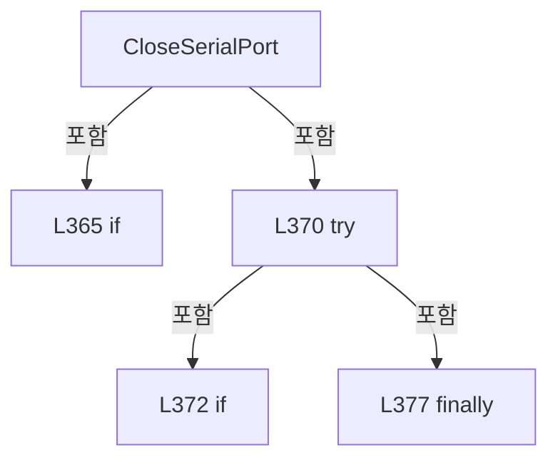

변경 전 점검: 입력/반환 타입, 위 호출자, 예외/취소 경로, 공유 상태와 저장·전송 소비자를 함께 확인합니다. 값의 단위나 물리 방향을 이름만으로 확정하지 않습니다.

### MethodDeclaration `ParseParity` · L384–387

[Drilling.Common/Interface/Serial/CSerialComm.cs:384–387](https://github.com/kjuws10-rgb/A3Drilling/blob/5aee8e58439c9b455cae7c9593c9be986c3e682e/Drilling.Common/Interface/Serial/CSerialComm.cs#L384-L387)

| 항목 | 실제 추출 값 |
| --- | --- |
| 서명 | Parity Drilling.Common.Interface.CSerialComm.ParseParity(string) |
| 접근/수식자 | Private / private, static |
| 반환/값 타입 | Parity |
| 소속 타입 | NamedType:Drilling.Common.Interface.CSerialComm |

입력 계약:

| 이름 | 타입 | 전달 | 선택/기본값 |
| --- | --- | --- | --- |
| value | string | None | False /  |

정적 호출자로 확인된 위치:

| 호출 파일/행 | 호출 표현식 | 런타임 분기 가능 |
| --- | --- | --- |
| [Drilling.Common/Interface/Serial/CSerialComm.cs:65–65](https://github.com/kjuws10-rgb/A3Drilling/blob/5aee8e58439c9b455cae7c9593c9be986c3e682e/Drilling.Common/Interface/Serial/CSerialComm.cs#L65-L65) | ParseParity | False |

호출하는 대상과 해석 범위:

| 원본 행 | 표현식 | 분석 상태 | 대상/소스 위치 |
| --- | --- | --- | --- |
| 386 | Enum.TryParse<Parity> | resolved | bool System.Enum.TryParse<Parity>(string?, bool, out Parity) |
| 386 | NormalizeEnumValue | resolved | string Drilling.Common.Interface.CSerialComm.NormalizeEnumValue(string) · Drilling.Common/Interface/Serial/CSerialComm.cs:406 |

본문의 실제 연산·분기·예외·반환 순서(원문 위치 순):

| 원본 행 | 종류 | 주석 해설 |
| --- | --- | --- |
| 386 | call | 함수·델리게이트 또는 객체 생성자를 호출합니다: Enum.TryParse<Parity>(NormalizeEnumValue(value), ignoreCase: true, out var parity) |
| 386 | call | 함수·델리게이트 또는 객체 생성자를 호출합니다: NormalizeEnumValue(value) |
| 386 | conditional-expression | 조건에 따라 결과식을 선택합니다: Enum.TryParse<Parity>(NormalizeEnumValue(value), ignoreCase: true, out var parity) ? parity : Parity.None |
| 386 | return | 호출자에게 값 또는 제어를 반환합니다: return Enum.TryParse<Parity>(NormalizeEnumValue(value), ignoreCase: true, out var parity) ? parity : Parity.None; |

변경 전 점검: 입력/반환 타입, 위 호출자, 예외/취소 경로, 공유 상태와 저장·전송 소비자를 함께 확인합니다. 값의 단위나 물리 방향을 이름만으로 확정하지 않습니다.

### MethodDeclaration `ParseStopBits` · L389–392

[Drilling.Common/Interface/Serial/CSerialComm.cs:389–392](https://github.com/kjuws10-rgb/A3Drilling/blob/5aee8e58439c9b455cae7c9593c9be986c3e682e/Drilling.Common/Interface/Serial/CSerialComm.cs#L389-L392)

| 항목 | 실제 추출 값 |
| --- | --- |
| 서명 | StopBits Drilling.Common.Interface.CSerialComm.ParseStopBits(string) |
| 접근/수식자 | Private / private, static |
| 반환/값 타입 | StopBits |
| 소속 타입 | NamedType:Drilling.Common.Interface.CSerialComm |

입력 계약:

| 이름 | 타입 | 전달 | 선택/기본값 |
| --- | --- | --- | --- |
| value | string | None | False /  |

정적 호출자로 확인된 위치:

| 호출 파일/행 | 호출 표현식 | 런타임 분기 가능 |
| --- | --- | --- |
| [Drilling.Common/Interface/Serial/CSerialComm.cs:65–65](https://github.com/kjuws10-rgb/A3Drilling/blob/5aee8e58439c9b455cae7c9593c9be986c3e682e/Drilling.Common/Interface/Serial/CSerialComm.cs#L65-L65) | ParseStopBits | False |

호출하는 대상과 해석 범위:

| 원본 행 | 표현식 | 분석 상태 | 대상/소스 위치 |
| --- | --- | --- | --- |
| 391 | Enum.TryParse<StopBits> | resolved | bool System.Enum.TryParse<StopBits>(string?, bool, out StopBits) |
| 391 | NormalizeEnumValue | resolved | string Drilling.Common.Interface.CSerialComm.NormalizeEnumValue(string) · Drilling.Common/Interface/Serial/CSerialComm.cs:406 |

본문의 실제 연산·분기·예외·반환 순서(원문 위치 순):

| 원본 행 | 종류 | 주석 해설 |
| --- | --- | --- |
| 391 | call | 함수·델리게이트 또는 객체 생성자를 호출합니다: Enum.TryParse<StopBits>(NormalizeEnumValue(value), ignoreCase: true, out var stopBits) |
| 391 | call | 함수·델리게이트 또는 객체 생성자를 호출합니다: NormalizeEnumValue(value) |
| 391 | conditional-expression | 조건에 따라 결과식을 선택합니다: Enum.TryParse<StopBits>(NormalizeEnumValue(value), ignoreCase: true, out var stopBits) ? stopBits : StopBits.One |
| 391 | return | 호출자에게 값 또는 제어를 반환합니다: return Enum.TryParse<StopBits>(NormalizeEnumValue(value), ignoreCase: true, out var stopBits) ? stopBits : StopBits.One; |

변경 전 점검: 입력/반환 타입, 위 호출자, 예외/취소 경로, 공유 상태와 저장·전송 소비자를 함께 확인합니다. 값의 단위나 물리 방향을 이름만으로 확정하지 않습니다.

### MethodDeclaration `ParseHandshake` · L394–404

[Drilling.Common/Interface/Serial/CSerialComm.cs:394–404](https://github.com/kjuws10-rgb/A3Drilling/blob/5aee8e58439c9b455cae7c9593c9be986c3e682e/Drilling.Common/Interface/Serial/CSerialComm.cs#L394-L404)

| 항목 | 실제 추출 값 |
| --- | --- |
| 서명 | Handshake Drilling.Common.Interface.CSerialComm.ParseHandshake(string) |
| 접근/수식자 | Private / private, static |
| 반환/값 타입 | Handshake |
| 소속 타입 | NamedType:Drilling.Common.Interface.CSerialComm |

입력 계약:

| 이름 | 타입 | 전달 | 선택/기본값 |
| --- | --- | --- | --- |
| value | string | None | False /  |

정적 호출자로 확인된 위치:

| 호출 파일/행 | 호출 표현식 | 런타임 분기 가능 |
| --- | --- | --- |
| [Drilling.Common/Interface/Serial/CSerialComm.cs:67–67](https://github.com/kjuws10-rgb/A3Drilling/blob/5aee8e58439c9b455cae7c9593c9be986c3e682e/Drilling.Common/Interface/Serial/CSerialComm.cs#L67-L67) | ParseHandshake | False |

호출하는 대상과 해석 범위:

| 원본 행 | 표현식 | 분석 상태 | 대상/소스 위치 |
| --- | --- | --- | --- |
| 396 | NormalizeEnumValue | resolved | string Drilling.Common.Interface.CSerialComm.NormalizeEnumValue(string) · Drilling.Common/Interface/Serial/CSerialComm.cs:406 |

본문의 실제 연산·분기·예외·반환 순서(원문 위치 순):

| 원본 행 | 종류 | 주석 해설 |
| --- | --- | --- |
| 396 | call | 함수·델리게이트 또는 객체 생성자를 호출합니다: NormalizeEnumValue(value) |
| 396 | return | 호출자에게 값 또는 제어를 반환합니다: return NormalizeEnumValue(value) switch { "" or "NONE" or "NO" or "OFF" => Handshake.None, "XONXOFF" or "XONOFF" => Handshake.XOnXOff, "REQUESTTOSEND" or "RTSCTS" => Handshake.RequestToSend, "REQUESTTOSENDXONXOFF" or "RTSCTSXONXOF |
| 396 | switch-expression | 값별 결과식을 선택합니다: NormalizeEnumValue(value) switch { "" or "NONE" or "NO" or "OFF" => Handshake.None, "XONXOFF" or "XONOFF" => Handshake.XOnXOff, "REQUESTTOSEND" or "RTSCTS" => Handshake.RequestToSend, "REQUESTTOSENDXONXOFF" or "RTSCTSXONXOFF" => H |

제어 구문의 포함 구조(실제 실행 순서/CFG가 아닌 구문 탐색 그림):

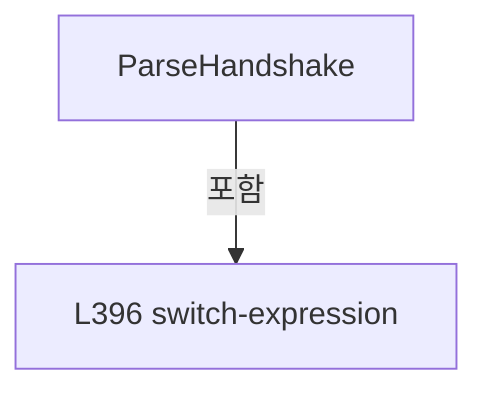

변경 전 점검: 입력/반환 타입, 위 호출자, 예외/취소 경로, 공유 상태와 저장·전송 소비자를 함께 확인합니다. 값의 단위나 물리 방향을 이름만으로 확정하지 않습니다.

### MethodDeclaration `NormalizeEnumValue` · L406–409

[Drilling.Common/Interface/Serial/CSerialComm.cs:406–409](https://github.com/kjuws10-rgb/A3Drilling/blob/5aee8e58439c9b455cae7c9593c9be986c3e682e/Drilling.Common/Interface/Serial/CSerialComm.cs#L406-L409)

| 항목 | 실제 추출 값 |
| --- | --- |
| 서명 | string Drilling.Common.Interface.CSerialComm.NormalizeEnumValue(string) |
| 접근/수식자 | Private / private, static |
| 반환/값 타입 | string |
| 소속 타입 | NamedType:Drilling.Common.Interface.CSerialComm |

입력 계약:

| 이름 | 타입 | 전달 | 선택/기본값 |
| --- | --- | --- | --- |
| value | string | None | False /  |

정적 호출자로 확인된 위치:

| 호출 파일/행 | 호출 표현식 | 런타임 분기 가능 |
| --- | --- | --- |
| [Drilling.Common/Interface/Serial/CSerialComm.cs:386–386](https://github.com/kjuws10-rgb/A3Drilling/blob/5aee8e58439c9b455cae7c9593c9be986c3e682e/Drilling.Common/Interface/Serial/CSerialComm.cs#L386-L386) | NormalizeEnumValue | False |
| [Drilling.Common/Interface/Serial/CSerialComm.cs:391–391](https://github.com/kjuws10-rgb/A3Drilling/blob/5aee8e58439c9b455cae7c9593c9be986c3e682e/Drilling.Common/Interface/Serial/CSerialComm.cs#L391-L391) | NormalizeEnumValue | False |
| [Drilling.Common/Interface/Serial/CSerialComm.cs:396–396](https://github.com/kjuws10-rgb/A3Drilling/blob/5aee8e58439c9b455cae7c9593c9be986c3e682e/Drilling.Common/Interface/Serial/CSerialComm.cs#L396-L396) | NormalizeEnumValue | False |

호출하는 대상과 해석 범위:

| 원본 행 | 표현식 | 분석 상태 | 대상/소스 위치 |
| --- | --- | --- | --- |
| 408 | value.Replace("_", "", StringComparison.OrdinalIgnoreCase).Replace("-", "", StringComparison.OrdinalIgnoreCase).Replace("/", "", StringComparison.OrdinalIgnoreCase).Trim | resolved | string string.Trim() |
| 408 | value.Replace("_", "", StringComparison.OrdinalIgnoreCase).Replace("-", "", StringComparison.OrdinalIgnoreCase).Replace | resolved | string string.Replace(string, string?, System.StringComparison) |
| 408 | value.Replace("_", "", StringComparison.OrdinalIgnoreCase).Replace | resolved | string string.Replace(string, string?, System.StringComparison) |
| 408 | value.Replace | resolved | string string.Replace(string, string?, System.StringComparison) |

본문의 실제 연산·분기·예외·반환 순서(원문 위치 순):

| 원본 행 | 종류 | 주석 해설 |
| --- | --- | --- |
| 408 | call | 함수·델리게이트 또는 객체 생성자를 호출합니다: value.Replace("_", "", StringComparison.OrdinalIgnoreCase).Replace("-", "", StringComparison.OrdinalIgnoreCase).Replace("/", "", StringComparison.OrdinalIgnoreCase).Trim() |
| 408 | call | 함수·델리게이트 또는 객체 생성자를 호출합니다: value.Replace("_", "", StringComparison.OrdinalIgnoreCase).Replace("-", "", StringComparison.OrdinalIgnoreCase).Replace("/", "", StringComparison.OrdinalIgnoreCase) |
| 408 | call | 함수·델리게이트 또는 객체 생성자를 호출합니다: value.Replace("_", "", StringComparison.OrdinalIgnoreCase).Replace("-", "", StringComparison.OrdinalIgnoreCase) |
| 408 | call | 함수·델리게이트 또는 객체 생성자를 호출합니다: value.Replace("_", "", StringComparison.OrdinalIgnoreCase) |
| 408 | return | 호출자에게 값 또는 제어를 반환합니다: return value.Replace("_", "", StringComparison.OrdinalIgnoreCase).Replace("-", "", StringComparison.OrdinalIgnoreCase).Replace("/", "", StringComparison.OrdinalIgnoreCase).Trim(); |

변경 전 점검: 입력/반환 타입, 위 호출자, 예외/취소 경로, 공유 상태와 저장·전송 소비자를 함께 확인합니다. 값의 단위나 물리 방향을 이름만으로 확정하지 않습니다.

## 구문·바인딩 한계

전체 WPF/벤더 SDK/프로젝트별 빌드 조건을 로드한 정식 빌드가 아닙니다. `resolved`는 이 부분 컴파일에서의 심볼 연결이며 virtual/interface/delegate/이벤트/Reflection/XAML의 실제 런타임 구현을 확정하지 않습니다. `candidate`와 `unresolved`는 후속 확인 대상으로 남깁니다.

## 원문 전체 주석 해설본

[원본 모든 행과 행별 해설 보기](../../../../annotated/Drilling.Common/Interface/Serial/CSerialComm.cs.annotated.txt)

원본을 빠뜨리거나 임의로 줄이지 않았습니다. `L000001 |` 표시는 원본 행 번호, `// 해설`은 별도 설명입니다. 실행용 소스가 아닌 문서입니다.

## 수정·재검증 체크

- 원본 Commit과 현재 작업 파일 SHA가 같은지 먼저 확인합니다. 다르면 이 문서를 과거 버전 자료로 취급합니다.
- 선언·직접 호출·이벤트/인터페이스 경계·설정 소비를 함께 확인합니다. 정적 연결의 빈 곳을 정상 경로로 추정하지 않습니다.
- 저장 형식/단위/식별자·재시도·취소·예외·롤백에 영향을 주는 변경은 상세 해설장과 호출자를 다시 검토합니다.
- 도구의 구문 추출과 별도 정적 추적 해설, 실제 빌드·시뮬레이션·실장비 검증 결과를 분리합니다.
