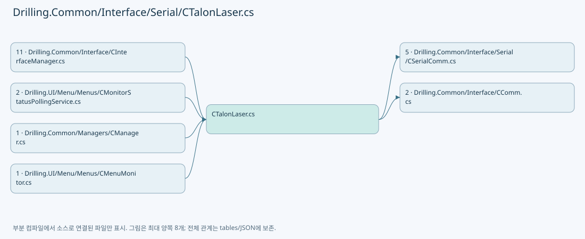
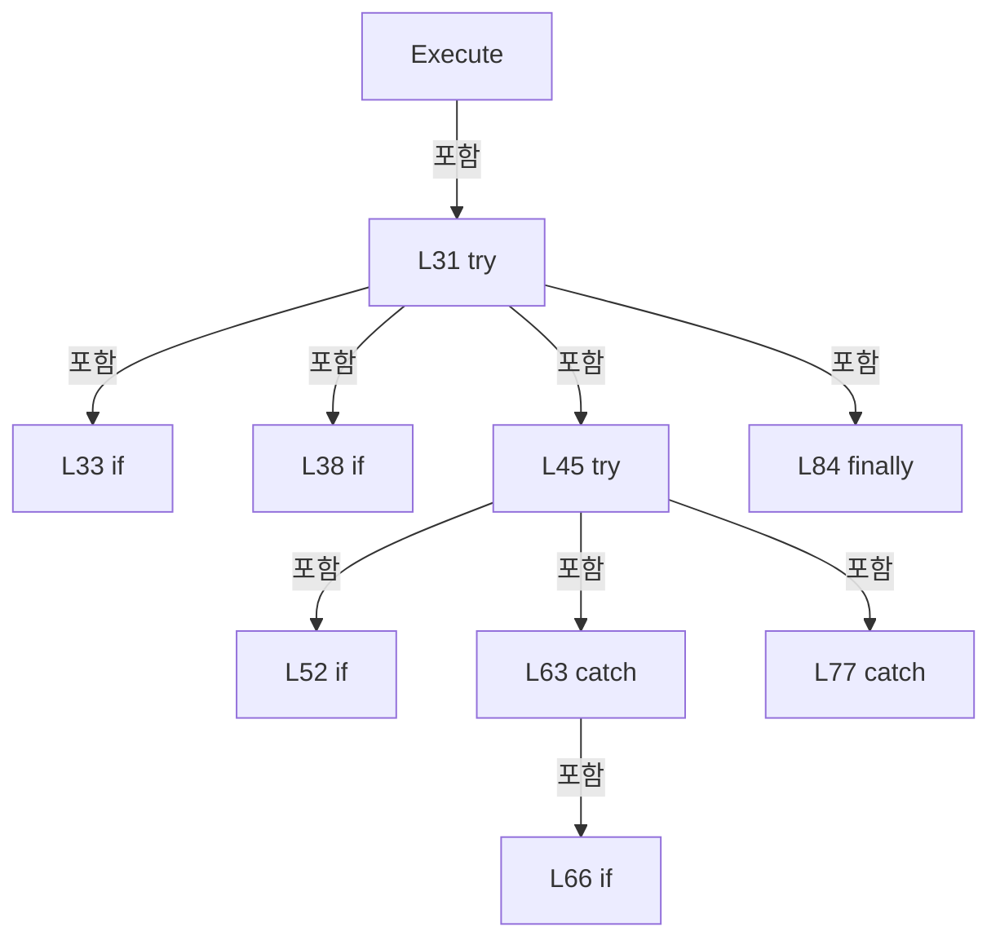
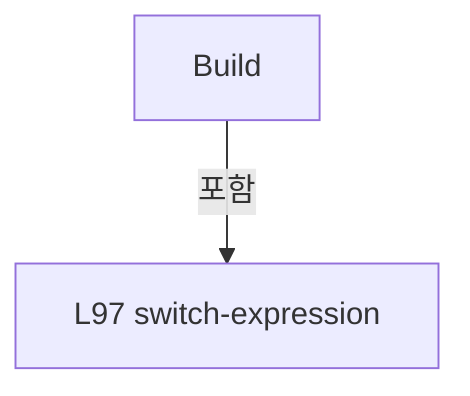
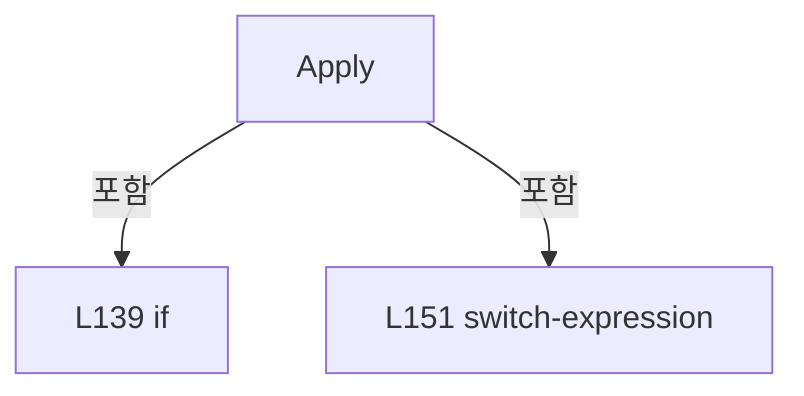
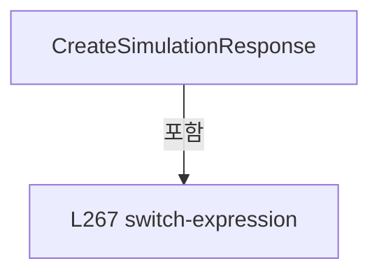

# Drilling.Common/Interface/Serial/CTalonLaser.cs

| 항목 | 내용 |
| --- | --- |
| 원본 저장소 | https://github.com/kjuws10-rgb/A3Drilling.git |
| 원본 Commit | 5aee8e58439c9b455cae7c9593c9be986c3e682e |
| 원본 SHA256 | 73f3a2de798fff48de0f67ee34d85c2d2e068b13c8b9d797ce3d2b75ebce48db |
| 파일 분류 | code |
| 원본 크기/행 | 14,445 bytes / 390 physical lines |
| 인코딩 | utf-8-sig |
| 검토 범위 | 구문/부분 의미 분석에서 추출한 사실. 동작·물리 단위·실장비 합격을 보증하지 않습니다. |
| 원본 링크 | [고정 Commit 원본](https://github.com/kjuws10-rgb/A3Drilling/blob/5aee8e58439c9b455cae7c9593c9be986c3e682e/Drilling.Common/Interface/Serial/CTalonLaser.cs) |

## 파일의 역할과 읽는 순서

외부 통신과 장치 인터페이스를 연결합니다. 요청 생성·전송·수신·장치 실행을 같은 의미로 합치지 않습니다.

## 네임스페이스·타입·상속

| 타입 | 구분 | 원본 범위 | 선언/상속 |
| --- | --- | --- | --- |
| CTalonLaser | ClassDeclaration | 11–324 | CTalonLaser: CSerialComm(data, option) |
| EN_TALON_COMMAND | EnumDeclaration | 326–356 | EN_TALON_COMMAND |
| EN_TALON_ERROR | EnumDeclaration | 358–365 | EN_TALON_ERROR |
| ST_LASER_STATUS | RecordDeclaration | 367–367 | ST_LASER_STATUS |
| ST_TALON_STATUS | RecordDeclaration | 368–390 | ST_TALON_STATUS |

## 멤버 빠른 목록

| 이름 | 종류 | 범위 | 서명 |
| --- | --- | --- | --- |
| CommandNewLine | PropertyDeclaration | L15–21 | string Drilling.Common.Interface.CTalonLaser.CommandNewLine |
| get_CommandNewLine | GetAccessorDeclaration | L17–20 | string Drilling.Common.Interface.CTalonLaser.CommandNewLine.get |
| FormatCommand | MethodDeclaration | L23–26 | string Drilling.Common.Interface.CTalonLaser.FormatCommand(string) |
| Execute | MethodDeclaration | L28–88 | System.Threading.Tasks.Task<string> Drilling.Common.Interface.CTalonLaser.Execute(string, System.Threading.CancellationToken) |
| ExpectsResponse | MethodDeclaration | L90–93 | bool Drilling.Common.Interface.CTalonLaser.ExpectsResponse(Drilling.Common.Interface.EN_TALON_COMMAND) |
| Build | MethodDeclaration | L95–129 | string Drilling.Common.Interface.CTalonLaser.Build(Drilling.Common.Interface.EN_TALON_COMMAND, double) |
| IsValidResponse | MethodDeclaration | L131–134 | bool Drilling.Common.Interface.CTalonLaser.IsValidResponse(string) |
| Apply | MethodDeclaration | L136–263 | Drilling.Common.Interface.ST_TALON_STATUS Drilling.Common.Interface.CTalonLaser.Apply(Drilling.Common.Interface.EN_TALON_COMMAND, double, string, Drilling.Common.Interface.ST_TALON_STATUS, bool) |
| CreateSimulationResponse | MethodDeclaration | L265–289 | string Drilling.Common.Interface.CTalonLaser.CreateSimulationResponse(Drilling.Common.Interface.EN_TALON_COMMAND, double, Drilling.Common.Interface.ST_TALON_STATUS) |
| ReadDouble | MethodDeclaration | L291–295 | double Drilling.Common.Interface.CTalonLaser.ReadDouble(string) |
| ReadInt | MethodDeclaration | L297–300 | int Drilling.Common.Interface.CTalonLaser.ReadInt(string) |
| ReadBool | MethodDeclaration | L302–306 | bool Drilling.Common.Interface.CTalonLaser.ReadBool(string) |
| ReadLaserEmission | MethodDeclaration | L308–312 | bool Drilling.Common.Interface.CTalonLaser.ReadLaserEmission(string) |
| ReadLeadingNumber | MethodDeclaration | L314–323 | string Drilling.Common.Interface.CTalonLaser.ReadLeadingNumber(string) |
| MatchesChar | LocalFunctionStatement | L316–319 | bool MatchesChar(char) |
| SetDiodeCurrent | EnumMemberDeclaration | L328–328 | Drilling.Common.Interface.EN_TALON_COMMAND.SetDiodeCurrent |
| SetQsw | EnumMemberDeclaration | L329–329 | Drilling.Common.Interface.EN_TALON_COMMAND.SetQsw |
| SetEprf | EnumMemberDeclaration | L330–330 | Drilling.Common.Interface.EN_TALON_COMMAND.SetEprf |
| SetLaserOnOff | EnumMemberDeclaration | L331–331 | Drilling.Common.Interface.EN_TALON_COMMAND.SetLaserOnOff |
| SetShutterOpenClose | EnumMemberDeclaration | L332–332 | Drilling.Common.Interface.EN_TALON_COMMAND.SetShutterOpenClose |
| SetGateOpenClose | EnumMemberDeclaration | L333–333 | Drilling.Common.Interface.EN_TALON_COMMAND.SetGateOpenClose |
| SetExtGateEnableDisable | EnumMemberDeclaration | L334–334 | Drilling.Common.Interface.EN_TALON_COMMAND.SetExtGateEnableDisable |
| SetShg | EnumMemberDeclaration | L335–335 | Drilling.Common.Interface.EN_TALON_COMMAND.SetShg |
| SetShgAutotune | EnumMemberDeclaration | L336–336 | Drilling.Common.Interface.EN_TALON_COMMAND.SetShgAutotune |
| SetQMode | EnumMemberDeclaration | L337–337 | Drilling.Common.Interface.EN_TALON_COMMAND.SetQMode |
| GetDiodeCurrent | EnumMemberDeclaration | L338–338 | Drilling.Common.Interface.EN_TALON_COMMAND.GetDiodeCurrent |
| GetQsw | EnumMemberDeclaration | L339–339 | Drilling.Common.Interface.EN_TALON_COMMAND.GetQsw |
| GetEprf | EnumMemberDeclaration | L340–340 | Drilling.Common.Interface.EN_TALON_COMMAND.GetEprf |
| GetShutterOpenClose | EnumMemberDeclaration | L341–341 | Drilling.Common.Interface.EN_TALON_COMMAND.GetShutterOpenClose |
| GetGateOpenClose | EnumMemberDeclaration | L342–342 | Drilling.Common.Interface.EN_TALON_COMMAND.GetGateOpenClose |
| GetExtGateEnableDisable | EnumMemberDeclaration | L343–343 | Drilling.Common.Interface.EN_TALON_COMMAND.GetExtGateEnableDisable |
| GetOutputPower | EnumMemberDeclaration | L344–344 | Drilling.Common.Interface.EN_TALON_COMMAND.GetOutputPower |
| GetShg | EnumMemberDeclaration | L345–345 | Drilling.Common.Interface.EN_TALON_COMMAND.GetShg |
| GetShgAutotune | EnumMemberDeclaration | L346–346 | Drilling.Common.Interface.EN_TALON_COMMAND.GetShgAutotune |
| GetThgSpot | EnumMemberDeclaration | L347–347 | Drilling.Common.Interface.EN_TALON_COMMAND.GetThgSpot |
| GetThgHour | EnumMemberDeclaration | L348–348 | Drilling.Common.Interface.EN_TALON_COMMAND.GetThgHour |
| GetQMode | EnumMemberDeclaration | L349–349 | Drilling.Common.Interface.EN_TALON_COMMAND.GetQMode |
| GetDiodeTemp | EnumMemberDeclaration | L350–350 | Drilling.Common.Interface.EN_TALON_COMMAND.GetDiodeTemp |
| GetTowerTemp | EnumMemberDeclaration | L351–351 | Drilling.Common.Interface.EN_TALON_COMMAND.GetTowerTemp |
| GetLaserOnOff | EnumMemberDeclaration | L352–352 | Drilling.Common.Interface.EN_TALON_COMMAND.GetLaserOnOff |
| RequestStatusString | EnumMemberDeclaration | L353–353 | Drilling.Common.Interface.EN_TALON_COMMAND.RequestStatusString |
| RequestStatusCode | EnumMemberDeclaration | L354–354 | Drilling.Common.Interface.EN_TALON_COMMAND.RequestStatusCode |
| RequestSave | EnumMemberDeclaration | L355–355 | Drilling.Common.Interface.EN_TALON_COMMAND.RequestSave |
| Ok | EnumMemberDeclaration | L360–360 | Drilling.Common.Interface.EN_TALON_ERROR.Ok |
| Warning | EnumMemberDeclaration | L361–361 | Drilling.Common.Interface.EN_TALON_ERROR.Warning |
| Error | EnumMemberDeclaration | L362–362 | Drilling.Common.Interface.EN_TALON_ERROR.Error |
| Timeout | EnumMemberDeclaration | L363–363 | Drilling.Common.Interface.EN_TALON_ERROR.Timeout |
| InvalidResponse | EnumMemberDeclaration | L364–364 | Drilling.Common.Interface.EN_TALON_ERROR.InvalidResponse |
| Empty | PropertyDeclaration | L389–389 | Drilling.Common.Interface.ST_TALON_STATUS Drilling.Common.Interface.ST_TALON_STATUS.Empty |
| get_Empty | GetAccessorDeclaration | L389–389 | Drilling.Common.Interface.ST_TALON_STATUS Drilling.Common.Interface.ST_TALON_STATUS.Empty.get |

## 멤버별 상세 계약·호출·처리 해설

### PropertyDeclaration `CommandNewLine` · L15–21

[Drilling.Common/Interface/Serial/CTalonLaser.cs:15–21](https://github.com/kjuws10-rgb/A3Drilling/blob/5aee8e58439c9b455cae7c9593c9be986c3e682e/Drilling.Common/Interface/Serial/CTalonLaser.cs#L15-L21)

| 항목 | 실제 추출 값 |
| --- | --- |
| 서명 | string Drilling.Common.Interface.CTalonLaser.CommandNewLine |
| 접근/수식자 | Protected / protected, override |
| 반환/값 타입 | string |
| 소속 타입 | NamedType:Drilling.Common.Interface.CTalonLaser |

현재 부분 분석에서 직접 연결된 호출자는 없습니다. XAML/이벤트/인터페이스·델리게이트·외부 진입을 추가 확인해야 하며, 미사용으로 판정한 것이 아닙니다.

변경 전 점검: 입력/반환 타입, 위 호출자, 예외/취소 경로, 공유 상태와 저장·전송 소비자를 함께 확인합니다. 값의 단위나 물리 방향을 이름만으로 확정하지 않습니다.

### GetAccessorDeclaration `get_CommandNewLine` · L17–20

[Drilling.Common/Interface/Serial/CTalonLaser.cs:17–20](https://github.com/kjuws10-rgb/A3Drilling/blob/5aee8e58439c9b455cae7c9593c9be986c3e682e/Drilling.Common/Interface/Serial/CTalonLaser.cs#L17-L20)

| 항목 | 실제 추출 값 |
| --- | --- |
| 서명 | string Drilling.Common.Interface.CTalonLaser.CommandNewLine.get |
| 접근/수식자 | Protected / get |
| 반환/값 타입 | string |
| 소속 타입 | NamedType:Drilling.Common.Interface.CTalonLaser |

현재 부분 분석에서 직접 연결된 호출자는 없습니다. XAML/이벤트/인터페이스·델리게이트·외부 진입을 추가 확인해야 하며, 미사용으로 판정한 것이 아닙니다.

본문의 실제 연산·분기·예외·반환 순서(원문 위치 순):

| 원본 행 | 종류 | 주석 해설 |
| --- | --- | --- |
| 19 | return | 호출자에게 값 또는 제어를 반환합니다: return "\r"; |

변경 전 점검: 입력/반환 타입, 위 호출자, 예외/취소 경로, 공유 상태와 저장·전송 소비자를 함께 확인합니다. 값의 단위나 물리 방향을 이름만으로 확정하지 않습니다.

### MethodDeclaration `FormatCommand` · L23–26

[Drilling.Common/Interface/Serial/CTalonLaser.cs:23–26](https://github.com/kjuws10-rgb/A3Drilling/blob/5aee8e58439c9b455cae7c9593c9be986c3e682e/Drilling.Common/Interface/Serial/CTalonLaser.cs#L23-L26)

| 항목 | 실제 추출 값 |
| --- | --- |
| 서명 | string Drilling.Common.Interface.CTalonLaser.FormatCommand(string) |
| 접근/수식자 | Protected / protected, override |
| 반환/값 타입 | string |
| 소속 타입 | NamedType:Drilling.Common.Interface.CTalonLaser |

입력 계약:

| 이름 | 타입 | 전달 | 선택/기본값 |
| --- | --- | --- | --- |
| function | string | None | False /  |

정적 호출자로 확인된 위치:

| 호출 파일/행 | 호출 표현식 | 런타임 분기 가능 |
| --- | --- | --- |
| [Drilling.Common/Interface/Serial/CTalonLaser.cs:43–43](https://github.com/kjuws10-rgb/A3Drilling/blob/5aee8e58439c9b455cae7c9593c9be986c3e682e/Drilling.Common/Interface/Serial/CTalonLaser.cs#L43-L43) | FormatCommand | True |

호출하는 대상과 해석 범위:

| 원본 행 | 표현식 | 분석 상태 | 대상/소스 위치 |
| --- | --- | --- | --- |
| 25 | function.Trim | resolved | string string.Trim() |

본문의 실제 연산·분기·예외·반환 순서(원문 위치 순):

| 원본 행 | 종류 | 주석 해설 |
| --- | --- | --- |
| 25 | call | 함수·델리게이트 또는 객체 생성자를 호출합니다: function.Trim() |
| 25 | return | 호출자에게 값 또는 제어를 반환합니다: return function.Trim(); |

변경 전 점검: 입력/반환 타입, 위 호출자, 예외/취소 경로, 공유 상태와 저장·전송 소비자를 함께 확인합니다. 값의 단위나 물리 방향을 이름만으로 확정하지 않습니다.

### MethodDeclaration `Execute` · L28–88

[Drilling.Common/Interface/Serial/CTalonLaser.cs:28–88](https://github.com/kjuws10-rgb/A3Drilling/blob/5aee8e58439c9b455cae7c9593c9be986c3e682e/Drilling.Common/Interface/Serial/CTalonLaser.cs#L28-L88)

| 항목 | 실제 추출 값 |
| --- | --- |
| 서명 | System.Threading.Tasks.Task<string> Drilling.Common.Interface.CTalonLaser.Execute(string, System.Threading.CancellationToken) |
| 접근/수식자 | Public / public, override, async |
| 반환/값 타입 | System.Threading.Tasks.Task<string> |
| 소속 타입 | NamedType:Drilling.Common.Interface.CTalonLaser |

입력 계약:

| 이름 | 타입 | 전달 | 선택/기본값 |
| --- | --- | --- | --- |
| function | string | None | False /  |
| cancellationToken | System.Threading.CancellationToken | None | True / null |

현재 부분 분석에서 직접 연결된 호출자는 없습니다. XAML/이벤트/인터페이스·델리게이트·외부 진입을 추가 확인해야 하며, 미사용으로 판정한 것이 아닙니다.

호출하는 대상과 해석 범위:

| 원본 행 | 표현식 | 분석 상태 | 대상/소스 위치 |
| --- | --- | --- | --- |
| 30 | SerialLock.WaitAsync | resolved | System.Threading.Tasks.Task System.Threading.SemaphoreSlim.WaitAsync(System.Threading.CancellationToken) |
| 35 | Connect | resolved · 동적 구현 선택 가능 | System.Threading.Tasks.Task Drilling.Common.Interface.CSerialComm.Connect(System.Threading.CancellationToken) · Drilling.Common/Interface/Serial/CSerialComm.cs:32 |
| 43 | FormatCommand | resolved · 동적 구현 선택 가능 | string Drilling.Common.Interface.CTalonLaser.FormatCommand(string) · Drilling.Common/Interface/Serial/CTalonLaser.cs:23 |
| 44 | LastSent.StartsWith | resolved | bool string.StartsWith(string, System.StringComparison) |
| 47 | cancellationToken.ThrowIfCancellationRequested | resolved | void System.Threading.CancellationToken.ThrowIfCancellationRequested() |
| 48 | Task.Run | candidate | OverloadResolutionFailure |
| 51 | SerialPort.Write | unresolved | None |
| 57 | SerialPort.ReadLine().TrimEnd('\r', '\n').Trim | unresolved | None |
| 57 | SerialPort.ReadLine().TrimEnd | unresolved | None |
| 57 | SerialPort.ReadLine | unresolved | None |
| 59 | string.IsNullOrWhiteSpace | resolved | bool string.IsNullOrWhiteSpace(string?) |
| 60 | SetState | resolved | void Drilling.Common.Interface.CCommBase.SetState(Drilling.Common.Interface.EN_COMM_STATE) · Drilling.Common/Interface/CComm.cs:114 |
| 65 | SerialPort.ReadExisting().TrimEnd('\r', '\n').Trim | unresolved | None |
| 65 | SerialPort.ReadExisting().TrimEnd | unresolved | None |
| 65 | SerialPort.ReadExisting | unresolved | None |
| 66 | string.IsNullOrWhiteSpace | resolved | bool string.IsNullOrWhiteSpace(string?) |
| 68 | CloseSerialPort | resolved | void Drilling.Common.Interface.CSerialComm.CloseSerialPort() · Drilling.Common/Interface/Serial/CSerialComm.cs:363 |
| 69 | SetError | resolved | void Drilling.Common.Interface.CSerialComm.SetError(string) · Drilling.Common/Interface/Serial/CSerialComm.cs:199 |
| 74 | SetState | resolved | void Drilling.Common.Interface.CCommBase.SetState(Drilling.Common.Interface.EN_COMM_STATE) · Drilling.Common/Interface/CComm.cs:114 |
| 79 | CloseSerialPort | resolved | void Drilling.Common.Interface.CSerialComm.CloseSerialPort() · Drilling.Common/Interface/Serial/CSerialComm.cs:363 |
| 80 | SetError | resolved | void Drilling.Common.Interface.CSerialComm.SetError(System.Exception) · Drilling.Common/Interface/Serial/CSerialComm.cs:192 |
| 86 | SerialLock.Release | resolved | int System.Threading.SemaphoreSlim.Release() |

본문의 실제 연산·분기·예외·반환 순서(원문 위치 순):

| 원본 행 | 종류 | 주석 해설 |
| --- | --- | --- |
| 30 | await | 비동기 완료를 기다립니다: await SerialLock.WaitAsync(cancellationToken) |
| 30 | call | 함수·델리게이트 또는 객체 생성자를 호출합니다: SerialLock.WaitAsync(cancellationToken) |
| 31 | try | 예외 처리 범위입니다: try |
| 33 | if | 조건에 따라 분기합니다: if (SerialPort is null &#124;&#124; !SerialPort.IsOpen) |
| 35 | await | 비동기 완료를 기다립니다: await Connect(cancellationToken) |
| 35 | call | 함수·델리게이트 또는 객체 생성자를 호출합니다: Connect(cancellationToken) |
| 38 | if | 조건에 따라 분기합니다: if (SerialPort is null &#124;&#124; !SerialPort.IsOpen) |
| 40 | return | 호출자에게 값 또는 제어를 반환합니다: return ""; |
| 43 | assignment | 값을 대상에 대입합니다: LastSent = FormatCommand(function) |
| 43 | call | 함수·델리게이트 또는 객체 생성자를 호출합니다: FormatCommand(function) |
| 44 | call | 함수·델리게이트 또는 객체 생성자를 호출합니다: LastSent.StartsWith("?", StringComparison.Ordinal) |
| 44 | local-declaration | 지역 변수를 선언합니다: var expectsResponse = LastSent.StartsWith("?", StringComparison.Ordinal); |
| 44 | variable-initializer | 변수의 초기값을 지정합니다: expectsResponse = LastSent.StartsWith("?", StringComparison.Ordinal) |
| 45 | try | 예외 처리 범위입니다: try |
| 47 | call | 함수·델리게이트 또는 객체 생성자를 호출합니다: cancellationToken.ThrowIfCancellationRequested() |
| 48 | assignment | 값을 대상에 대입합니다: LastReceived = await Task.Run(() => { SerialPort.NewLine = "\n"; SerialPort.Write(LastSent + "\r"); if (!expectsResponse) { return ""; } return SerialPort.ReadLine().TrimEnd('\r', '\n').Trim(); }, cancellationToken) |
| 48 | await | 비동기 완료를 기다립니다: await Task.Run(() => { SerialPort.NewLine = "\n"; SerialPort.Write(LastSent + "\r"); if (!expectsResponse) { return ""; } return SerialPort.ReadLine().TrimEnd('\r', '\n').Trim(); }, cancellationToken) |
| 48 | call | 함수·델리게이트 또는 객체 생성자를 호출합니다: Task.Run(() => { SerialPort.NewLine = "\n"; SerialPort.Write(LastSent + "\r"); if (!expectsResponse) { return ""; } return SerialPort.ReadLine().TrimEnd('\r', '\n').Trim(); }, cancellationToken) |
| 50 | assignment | 값을 대상에 대입합니다: SerialPort.NewLine = "\n" |
| 51 | call | 함수·델리게이트 또는 객체 생성자를 호출합니다: SerialPort.Write(LastSent + "\r") |
| 52 | if | 조건에 따라 분기합니다: if (!expectsResponse) |
| 54 | return | 호출자에게 값 또는 제어를 반환합니다: return ""; |
| 57 | call | 함수·델리게이트 또는 객체 생성자를 호출합니다: SerialPort.ReadLine().TrimEnd('\r', '\n').Trim() |
| 57 | call | 함수·델리게이트 또는 객체 생성자를 호출합니다: SerialPort.ReadLine().TrimEnd('\r', '\n') |
| 57 | call | 함수·델리게이트 또는 객체 생성자를 호출합니다: SerialPort.ReadLine() |
| 57 | return | 호출자에게 값 또는 제어를 반환합니다: return SerialPort.ReadLine().TrimEnd('\r', '\n').Trim(); |
| 59 | assignment | 값을 대상에 대입합니다: LastError = expectsResponse && string.IsNullOrWhiteSpace(LastReceived) ? "Talon response timeout." : "" |
| 59 | call | 함수·델리게이트 또는 객체 생성자를 호출합니다: string.IsNullOrWhiteSpace(LastReceived) |
| 59 | conditional-expression | 조건에 따라 결과식을 선택합니다: expectsResponse && string.IsNullOrWhiteSpace(LastReceived) ? "Talon response timeout." : "" |
| 60 | call | 함수·델리게이트 또는 객체 생성자를 호출합니다: SetState(EN_COMM_STATE.Online) |
| 61 | return | 호출자에게 값 또는 제어를 반환합니다: return LastReceived; |
| 63 | catch | 지정 예외를 처리합니다: catch (TimeoutException) |
| 65 | assignment | 값을 대상에 대입합니다: LastReceived = SerialPort.ReadExisting().TrimEnd('\r', '\n').Trim() |
| 65 | call | 함수·델리게이트 또는 객체 생성자를 호출합니다: SerialPort.ReadExisting().TrimEnd('\r', '\n').Trim() |
| 65 | call | 함수·델리게이트 또는 객체 생성자를 호출합니다: SerialPort.ReadExisting().TrimEnd('\r', '\n') |
| 65 | call | 함수·델리게이트 또는 객체 생성자를 호출합니다: SerialPort.ReadExisting() |
| 66 | call | 함수·델리게이트 또는 객체 생성자를 호출합니다: string.IsNullOrWhiteSpace(LastReceived) |
| 66 | if | 조건에 따라 분기합니다: if (string.IsNullOrWhiteSpace(LastReceived)) |
| 68 | call | 함수·델리게이트 또는 객체 생성자를 호출합니다: CloseSerialPort() |
| 69 | call | 함수·델리게이트 또는 객체 생성자를 호출합니다: SetError("Talon response timeout.") |
| 70 | return | 호출자에게 값 또는 제어를 반환합니다: return ""; |
| 73 | assignment | 값을 대상에 대입합니다: LastError = "" |
| 74 | call | 함수·델리게이트 또는 객체 생성자를 호출합니다: SetState(EN_COMM_STATE.Online) |
| 75 | return | 호출자에게 값 또는 제어를 반환합니다: return LastReceived; |
| 77 | catch | 지정 예외를 처리합니다: catch (Exception ex) when (ex is IOException or UnauthorizedAccessException or InvalidOperationException or ObjectDisposedException or OperationCanceledException) |
| 79 | call | 함수·델리게이트 또는 객체 생성자를 호출합니다: CloseSerialPort() |
| 80 | call | 함수·델리게이트 또는 객체 생성자를 호출합니다: SetError(ex) |
| 81 | return | 호출자에게 값 또는 제어를 반환합니다: return ""; |
| 84 | finally | 종료 정리 구간입니다: finally |
| 86 | call | 함수·델리게이트 또는 객체 생성자를 호출합니다: SerialLock.Release() |

제어 구문의 포함 구조(실제 실행 순서/CFG가 아닌 구문 탐색 그림):

변경 전 점검: 입력/반환 타입, 위 호출자, 예외/취소 경로, 공유 상태와 저장·전송 소비자를 함께 확인합니다. 값의 단위나 물리 방향을 이름만으로 확정하지 않습니다.

### MethodDeclaration `ExpectsResponse` · L90–93

[Drilling.Common/Interface/Serial/CTalonLaser.cs:90–93](https://github.com/kjuws10-rgb/A3Drilling/blob/5aee8e58439c9b455cae7c9593c9be986c3e682e/Drilling.Common/Interface/Serial/CTalonLaser.cs#L90-L93)

| 항목 | 실제 추출 값 |
| --- | --- |
| 서명 | bool Drilling.Common.Interface.CTalonLaser.ExpectsResponse(Drilling.Common.Interface.EN_TALON_COMMAND) |
| 접근/수식자 | Public / public, static |
| 반환/값 타입 | bool |
| 소속 타입 | NamedType:Drilling.Common.Interface.CTalonLaser |

입력 계약:

| 이름 | 타입 | 전달 | 선택/기본값 |
| --- | --- | --- | --- |
| command | Drilling.Common.Interface.EN_TALON_COMMAND | None | False /  |

정적 호출자로 확인된 위치:

| 호출 파일/행 | 호출 표현식 | 런타임 분기 가능 |
| --- | --- | --- |
| [Drilling.Common/Interface/CInterfaceManager.cs:944–944](https://github.com/kjuws10-rgb/A3Drilling/blob/5aee8e58439c9b455cae7c9593c9be986c3e682e/Drilling.Common/Interface/CInterfaceManager.cs#L944-L944) | CTalonLaser.ExpectsResponse | False |
| [Drilling.Common/Interface/Serial/CTalonLaser.cs:139–139](https://github.com/kjuws10-rgb/A3Drilling/blob/5aee8e58439c9b455cae7c9593c9be986c3e682e/Drilling.Common/Interface/Serial/CTalonLaser.cs#L139-L139) | ExpectsResponse | False |

본문의 실제 연산·분기·예외·반환 순서(원문 위치 순):

| 원본 행 | 종류 | 주석 해설 |
| --- | --- | --- |
| 92 | return | 호출자에게 값 또는 제어를 반환합니다: return command >= EN_TALON_COMMAND.GetDiodeCurrent && command <= EN_TALON_COMMAND.RequestStatusCode; |

변경 전 점검: 입력/반환 타입, 위 호출자, 예외/취소 경로, 공유 상태와 저장·전송 소비자를 함께 확인합니다. 값의 단위나 물리 방향을 이름만으로 확정하지 않습니다.

### MethodDeclaration `Build` · L95–129

[Drilling.Common/Interface/Serial/CTalonLaser.cs:95–129](https://github.com/kjuws10-rgb/A3Drilling/blob/5aee8e58439c9b455cae7c9593c9be986c3e682e/Drilling.Common/Interface/Serial/CTalonLaser.cs#L95-L129)

| 항목 | 실제 추출 값 |
| --- | --- |
| 서명 | string Drilling.Common.Interface.CTalonLaser.Build(Drilling.Common.Interface.EN_TALON_COMMAND, double) |
| 접근/수식자 | Public / public, static |
| 반환/값 타입 | string |
| 소속 타입 | NamedType:Drilling.Common.Interface.CTalonLaser |

입력 계약:

| 이름 | 타입 | 전달 | 선택/기본값 |
| --- | --- | --- | --- |
| command | Drilling.Common.Interface.EN_TALON_COMMAND | None | False /  |
| parameter | double | None | False /  |

정적 호출자로 확인된 위치:

| 호출 파일/행 | 호출 표현식 | 런타임 분기 가능 |
| --- | --- | --- |
| [Drilling.Common/Interface/CInterfaceManager.cs:903–903](https://github.com/kjuws10-rgb/A3Drilling/blob/5aee8e58439c9b455cae7c9593c9be986c3e682e/Drilling.Common/Interface/CInterfaceManager.cs#L903-L903) | CTalonLaser.Build | False |

호출하는 대상과 해석 범위:

| 원본 행 | 표현식 | 분석 상태 | 대상/소스 위치 |
| --- | --- | --- | --- |
| 99 | parameter.ToString | resolved | string double.ToString(string?, System.IFormatProvider?) |

본문의 실제 연산·분기·예외·반환 순서(원문 위치 순):

| 원본 행 | 종류 | 주석 해설 |
| --- | --- | --- |
| 97 | return | 호출자에게 값 또는 제어를 반환합니다: return command switch { EN_TALON_COMMAND.SetDiodeCurrent => $"C1:{parameter.ToString("F2", CultureInfo.InvariantCulture)}", EN_TALON_COMMAND.SetQsw => $"Q:{(int)parameter}", EN_TALON_COMMAND.SetEprf => $"EPRF:{(int)parameter}", EN |
| 97 | switch-expression | 값별 결과식을 선택합니다: command switch { EN_TALON_COMMAND.SetDiodeCurrent => $"C1:{parameter.ToString("F2", CultureInfo.InvariantCulture)}", EN_TALON_COMMAND.SetQsw => $"Q:{(int)parameter}", EN_TALON_COMMAND.SetEprf => $"EPRF:{(int)parameter}", EN_TALON_ |
| 99 | call | 함수·델리게이트 또는 객체 생성자를 호출합니다: parameter.ToString("F2", CultureInfo.InvariantCulture) |
| 102 | conditional-expression | 조건에 따라 결과식을 선택합니다: parameter > 0 ? "ON" : "OFF" |

제어 구문의 포함 구조(실제 실행 순서/CFG가 아닌 구문 탐색 그림):

변경 전 점검: 입력/반환 타입, 위 호출자, 예외/취소 경로, 공유 상태와 저장·전송 소비자를 함께 확인합니다. 값의 단위나 물리 방향을 이름만으로 확정하지 않습니다.

### MethodDeclaration `IsValidResponse` · L131–134

[Drilling.Common/Interface/Serial/CTalonLaser.cs:131–134](https://github.com/kjuws10-rgb/A3Drilling/blob/5aee8e58439c9b455cae7c9593c9be986c3e682e/Drilling.Common/Interface/Serial/CTalonLaser.cs#L131-L134)

| 항목 | 실제 추출 값 |
| --- | --- |
| 서명 | bool Drilling.Common.Interface.CTalonLaser.IsValidResponse(string) |
| 접근/수식자 | Public / public, static |
| 반환/값 타입 | bool |
| 소속 타입 | NamedType:Drilling.Common.Interface.CTalonLaser |

입력 계약:

| 이름 | 타입 | 전달 | 선택/기본값 |
| --- | --- | --- | --- |
| response | string | None | False /  |

정적 호출자로 확인된 위치:

| 호출 파일/행 | 호출 표현식 | 런타임 분기 가능 |
| --- | --- | --- |
| [Drilling.Common/Interface/CInterfaceManager.cs:946–946](https://github.com/kjuws10-rgb/A3Drilling/blob/5aee8e58439c9b455cae7c9593c9be986c3e682e/Drilling.Common/Interface/CInterfaceManager.cs#L946-L946) | CTalonLaser.IsValidResponse | False |
| [Drilling.Common/Interface/Serial/CTalonLaser.cs:139–139](https://github.com/kjuws10-rgb/A3Drilling/blob/5aee8e58439c9b455cae7c9593c9be986c3e682e/Drilling.Common/Interface/Serial/CTalonLaser.cs#L139-L139) | IsValidResponse | False |

호출하는 대상과 해석 범위:

| 원본 행 | 표현식 | 분석 상태 | 대상/소스 위치 |
| --- | --- | --- | --- |
| 133 | string.IsNullOrWhiteSpace | resolved | bool string.IsNullOrWhiteSpace(string?) |
| 133 | response.Trim().Equals | resolved | bool string.Equals(string?, System.StringComparison) |
| 133 | response.Trim | resolved | string string.Trim() |

본문의 실제 연산·분기·예외·반환 순서(원문 위치 순):

| 원본 행 | 종류 | 주석 해설 |
| --- | --- | --- |
| 133 | call | 함수·델리게이트 또는 객체 생성자를 호출합니다: string.IsNullOrWhiteSpace(response) |
| 133 | call | 함수·델리게이트 또는 객체 생성자를 호출합니다: response.Trim().Equals("ERR", StringComparison.OrdinalIgnoreCase) |
| 133 | call | 함수·델리게이트 또는 객체 생성자를 호출합니다: response.Trim() |
| 133 | return | 호출자에게 값 또는 제어를 반환합니다: return !string.IsNullOrWhiteSpace(response) && !response.Trim().Equals("ERR", StringComparison.OrdinalIgnoreCase); |

변경 전 점검: 입력/반환 타입, 위 호출자, 예외/취소 경로, 공유 상태와 저장·전송 소비자를 함께 확인합니다. 값의 단위나 물리 방향을 이름만으로 확정하지 않습니다.

### MethodDeclaration `Apply` · L136–263

[Drilling.Common/Interface/Serial/CTalonLaser.cs:136–263](https://github.com/kjuws10-rgb/A3Drilling/blob/5aee8e58439c9b455cae7c9593c9be986c3e682e/Drilling.Common/Interface/Serial/CTalonLaser.cs#L136-L263)

| 항목 | 실제 추출 값 |
| --- | --- |
| 서명 | Drilling.Common.Interface.ST_TALON_STATUS Drilling.Common.Interface.CTalonLaser.Apply(Drilling.Common.Interface.EN_TALON_COMMAND, double, string, Drilling.Common.Interface.ST_TALON_STATUS, bool) |
| 접근/수식자 | Public / public, static |
| 반환/값 타입 | Drilling.Common.Interface.ST_TALON_STATUS |
| 소속 타입 | NamedType:Drilling.Common.Interface.CTalonLaser |

입력 계약:

| 이름 | 타입 | 전달 | 선택/기본값 |
| --- | --- | --- | --- |
| command | Drilling.Common.Interface.EN_TALON_COMMAND | None | False /  |
| parameter | double | None | False /  |
| response | string | None | False /  |
| current | Drilling.Common.Interface.ST_TALON_STATUS | None | False /  |
| simulation | bool | None | False /  |

정적 호출자로 확인된 위치:

| 호출 파일/행 | 호출 표현식 | 런타임 분기 가능 |
| --- | --- | --- |
| [Drilling.Common/Interface/CInterfaceManager.cs:882–882](https://github.com/kjuws10-rgb/A3Drilling/blob/5aee8e58439c9b455cae7c9593c9be986c3e682e/Drilling.Common/Interface/CInterfaceManager.cs#L882-L882) | CTalonLaser.Apply | False |
| [Drilling.Common/Interface/CInterfaceManager.cs:917–917](https://github.com/kjuws10-rgb/A3Drilling/blob/5aee8e58439c9b455cae7c9593c9be986c3e682e/Drilling.Common/Interface/CInterfaceManager.cs#L917-L917) | CTalonLaser.Apply | False |
| [Drilling.Common/Interface/CInterfaceManager.cs:957–957](https://github.com/kjuws10-rgb/A3Drilling/blob/5aee8e58439c9b455cae7c9593c9be986c3e682e/Drilling.Common/Interface/CInterfaceManager.cs#L957-L957) | CTalonLaser.Apply | False |

호출하는 대상과 해석 범위:

| 원본 행 | 표현식 | 분석 상태 | 대상/소스 위치 |
| --- | --- | --- | --- |
| 138 | CreateSimulationResponse | resolved | string Drilling.Common.Interface.CTalonLaser.CreateSimulationResponse(Drilling.Common.Interface.EN_TALON_COMMAND, double, Drilling.Common.Interface.ST_TALON_STATUS) · Drilling.Common/Interface/Serial/CTalonLaser.cs:265 |
| 138 | response.Trim | resolved | string string.Trim() |
| 139 | ExpectsResponse | resolved | bool Drilling.Common.Interface.CTalonLaser.ExpectsResponse(Drilling.Common.Interface.EN_TALON_COMMAND) · Drilling.Common/Interface/Serial/CTalonLaser.cs:90 |
| 139 | IsValidResponse | resolved | bool Drilling.Common.Interface.CTalonLaser.IsValidResponse(string) · Drilling.Common/Interface/Serial/CTalonLaser.cs:131 |
| 183 | Math.Max | resolved | double System.Math.Max(double, double) |
| 195 | ReadDouble | resolved | double Drilling.Common.Interface.CTalonLaser.ReadDouble(string) · Drilling.Common/Interface/Serial/CTalonLaser.cs:291 |
| 199 | ReadInt | resolved | int Drilling.Common.Interface.CTalonLaser.ReadInt(string) · Drilling.Common/Interface/Serial/CTalonLaser.cs:297 |
| 203 | ReadInt | resolved | int Drilling.Common.Interface.CTalonLaser.ReadInt(string) · Drilling.Common/Interface/Serial/CTalonLaser.cs:297 |
| 207 | ReadDouble | resolved | double Drilling.Common.Interface.CTalonLaser.ReadDouble(string) · Drilling.Common/Interface/Serial/CTalonLaser.cs:291 |
| 211 | ReadDouble | resolved | double Drilling.Common.Interface.CTalonLaser.ReadDouble(string) · Drilling.Common/Interface/Serial/CTalonLaser.cs:291 |
| 215 | ReadDouble | resolved | double Drilling.Common.Interface.CTalonLaser.ReadDouble(string) · Drilling.Common/Interface/Serial/CTalonLaser.cs:291 |
| 219 | ReadDouble | resolved | double Drilling.Common.Interface.CTalonLaser.ReadDouble(string) · Drilling.Common/Interface/Serial/CTalonLaser.cs:291 |
| 223 | ReadBool | resolved | bool Drilling.Common.Interface.CTalonLaser.ReadBool(string) · Drilling.Common/Interface/Serial/CTalonLaser.cs:302 |
| 227 | ReadBool | resolved | bool Drilling.Common.Interface.CTalonLaser.ReadBool(string) · Drilling.Common/Interface/Serial/CTalonLaser.cs:302 |
| 231 | Math.Max | resolved | int System.Math.Max(int, int) |
| 231 | ReadInt | resolved | int Drilling.Common.Interface.CTalonLaser.ReadInt(string) · Drilling.Common/Interface/Serial/CTalonLaser.cs:297 |
| 235 | ReadDouble | resolved | double Drilling.Common.Interface.CTalonLaser.ReadDouble(string) · Drilling.Common/Interface/Serial/CTalonLaser.cs:291 |
| 239 | ReadInt | resolved | int Drilling.Common.Interface.CTalonLaser.ReadInt(string) · Drilling.Common/Interface/Serial/CTalonLaser.cs:297 |
| 243 | ReadDouble | resolved | double Drilling.Common.Interface.CTalonLaser.ReadDouble(string) · Drilling.Common/Interface/Serial/CTalonLaser.cs:291 |
| 247 | ReadInt | resolved | int Drilling.Common.Interface.CTalonLaser.ReadInt(string) · Drilling.Common/Interface/Serial/CTalonLaser.cs:297 |
| 251 | ReadLaserEmission | resolved | bool Drilling.Common.Interface.CTalonLaser.ReadLaserEmission(string) · Drilling.Common/Interface/Serial/CTalonLaser.cs:308 |
| 259 | ReadInt | resolved | int Drilling.Common.Interface.CTalonLaser.ReadInt(string) · Drilling.Common/Interface/Serial/CTalonLaser.cs:297 |

본문의 실제 연산·분기·예외·반환 순서(원문 위치 순):

| 원본 행 | 종류 | 주석 해설 |
| --- | --- | --- |
| 138 | call | 함수·델리게이트 또는 객체 생성자를 호출합니다: CreateSimulationResponse(command, parameter, current) |
| 138 | call | 함수·델리게이트 또는 객체 생성자를 호출합니다: response.Trim() |
| 138 | conditional-expression | 조건에 따라 결과식을 선택합니다: simulation ? CreateSimulationResponse(command, parameter, current) : response.Trim() |
| 138 | local-declaration | 지역 변수를 선언합니다: var value = simulation ? CreateSimulationResponse(command, parameter, current) : response.Trim(); |
| 138 | variable-initializer | 변수의 초기값을 지정합니다: value = simulation ? CreateSimulationResponse(command, parameter, current) : response.Trim() |
| 139 | call | 함수·델리게이트 또는 객체 생성자를 호출합니다: ExpectsResponse(command) |
| 139 | call | 함수·델리게이트 또는 객체 생성자를 호출합니다: IsValidResponse(value) |
| 139 | if | 조건에 따라 분기합니다: if (!simulation && ExpectsResponse(command) && !IsValidResponse(value)) |
| 141 | return | 호출자에게 값 또는 제어를 반환합니다: return current with { LastError = EN_TALON_ERROR.InvalidResponse }; |
| 143 | assignment | 값을 대상에 대입합니다: LastError = EN_TALON_ERROR.InvalidResponse |
| 147 | local-declaration | 지역 변수를 선언합니다: var ok = current with { LastError = EN_TALON_ERROR.Ok }; |
| 147 | variable-initializer | 변수의 초기값을 지정합니다: ok = current with { LastError = EN_TALON_ERROR.Ok } |
| 149 | assignment | 값을 대상에 대입합니다: LastError = EN_TALON_ERROR.Ok |
| 151 | return | 호출자에게 값 또는 제어를 반환합니다: return command switch { EN_TALON_COMMAND.SetDiodeCurrent => ok with { DiodeCurrent = parameter }, EN_TALON_COMMAND.SetQsw => ok with { Qsw = (int)parameter }, EN_TALON_COMMAND.SetEprf => ok with { Eprf = (int)parameter }, EN_TALON |
| 151 | switch-expression | 값별 결과식을 선택합니다: command switch { EN_TALON_COMMAND.SetDiodeCurrent => ok with { DiodeCurrent = parameter }, EN_TALON_COMMAND.SetQsw => ok with { Qsw = (int)parameter }, EN_TALON_COMMAND.SetEprf => ok with { Eprf = (int)parameter }, EN_TALON_COMMAN |
| 155 | assignment | 값을 대상에 대입합니다: DiodeCurrent = parameter |
| 159 | assignment | 값을 대상에 대입합니다: Qsw = (int)parameter |
| 163 | assignment | 값을 대상에 대입합니다: Eprf = (int)parameter |
| 167 | assignment | 값을 대상에 대입합니다: LaserOn = parameter > 0 |
| 171 | assignment | 값을 대상에 대입합니다: ShutterOpen = parameter > 0 |
| 175 | assignment | 값을 대상에 대입합니다: GateOpen = parameter > 0 |
| 179 | assignment | 값을 대상에 대입합니다: ExtGateEnable = parameter > 0 |
| 183 | assignment | 값을 대상에 대입합니다: ShgReadBackCount = (uint)Math.Max(0, parameter) |
| 183 | call | 함수·델리게이트 또는 객체 생성자를 호출합니다: Math.Max(0, parameter) |
| 187 | assignment | 값을 대상에 대입합니다: ShgAutoTuneActive = parameter > 0 |
| 191 | assignment | 값을 대상에 대입합니다: QMode = (int)parameter |
| 195 | assignment | 값을 대상에 대입합니다: DiodeCurrent = ReadDouble(value) |
| 195 | call | 함수·델리게이트 또는 객체 생성자를 호출합니다: ReadDouble(value) |
| 199 | assignment | 값을 대상에 대입합니다: Qsw = ReadInt(value) |
| 199 | call | 함수·델리게이트 또는 객체 생성자를 호출합니다: ReadInt(value) |
| 203 | assignment | 값을 대상에 대입합니다: Eprf = ReadInt(value) |
| 203 | call | 함수·델리게이트 또는 객체 생성자를 호출합니다: ReadInt(value) |
| 207 | assignment | 값을 대상에 대입합니다: DiodeTemp = ReadDouble(value) |
| 207 | call | 함수·델리게이트 또는 객체 생성자를 호출합니다: ReadDouble(value) |
| 211 | assignment | 값을 대상에 대입합니다: TowerTemp = ReadDouble(value) |
| 211 | call | 함수·델리게이트 또는 객체 생성자를 호출합니다: ReadDouble(value) |
| 215 | assignment | 값을 대상에 대입합니다: OutputPower = ReadDouble(value) |
| 215 | call | 함수·델리게이트 또는 객체 생성자를 호출합니다: ReadDouble(value) |
| 219 | assignment | 값을 대상에 대입합니다: ShutterOpen = ReadDouble(value) > 0.5 |
| 219 | call | 함수·델리게이트 또는 객체 생성자를 호출합니다: ReadDouble(value) |
| 223 | assignment | 값을 대상에 대입합니다: GateOpen = ReadBool(value) |
| 223 | call | 함수·델리게이트 또는 객체 생성자를 호출합니다: ReadBool(value) |
| 227 | assignment | 값을 대상에 대입합니다: ExtGateEnable = ReadBool(value) |
| 227 | call | 함수·델리게이트 또는 객체 생성자를 호출합니다: ReadBool(value) |
| 231 | assignment | 값을 대상에 대입합니다: ShgReadBackCount = (uint)Math.Max(0, ReadInt(value)) |
| 231 | call | 함수·델리게이트 또는 객체 생성자를 호출합니다: Math.Max(0, ReadInt(value)) |
| 231 | call | 함수·델리게이트 또는 객체 생성자를 호출합니다: ReadInt(value) |
| 235 | assignment | 값을 대상에 대입합니다: ShgAutoTuneActive = ReadDouble(value) > 0.5 |
| 235 | call | 함수·델리게이트 또는 객체 생성자를 호출합니다: ReadDouble(value) |
| 239 | assignment | 값을 대상에 대입합니다: ThgSpot = ReadInt(value) |
| 239 | call | 함수·델리게이트 또는 객체 생성자를 호출합니다: ReadInt(value) |
| 243 | assignment | 값을 대상에 대입합니다: ThgHour = ReadDouble(value) |
| 243 | call | 함수·델리게이트 또는 객체 생성자를 호출합니다: ReadDouble(value) |
| 247 | assignment | 값을 대상에 대입합니다: QMode = ReadInt(value) |
| 247 | call | 함수·델리게이트 또는 객체 생성자를 호출합니다: ReadInt(value) |
| 251 | assignment | 값을 대상에 대입합니다: LaserOn = ReadLaserEmission(value) |
| 251 | call | 함수·델리게이트 또는 객체 생성자를 호출합니다: ReadLaserEmission(value) |
| 255 | assignment | 값을 대상에 대입합니다: StatusMessage = value |
| 259 | assignment | 값을 대상에 대입합니다: StatusCode = ReadInt(value) |
| 259 | call | 함수·델리게이트 또는 객체 생성자를 호출합니다: ReadInt(value) |

제어 구문의 포함 구조(실제 실행 순서/CFG가 아닌 구문 탐색 그림):

변경 전 점검: 입력/반환 타입, 위 호출자, 예외/취소 경로, 공유 상태와 저장·전송 소비자를 함께 확인합니다. 값의 단위나 물리 방향을 이름만으로 확정하지 않습니다.

### MethodDeclaration `CreateSimulationResponse` · L265–289

[Drilling.Common/Interface/Serial/CTalonLaser.cs:265–289](https://github.com/kjuws10-rgb/A3Drilling/blob/5aee8e58439c9b455cae7c9593c9be986c3e682e/Drilling.Common/Interface/Serial/CTalonLaser.cs#L265-L289)

| 항목 | 실제 추출 값 |
| --- | --- |
| 서명 | string Drilling.Common.Interface.CTalonLaser.CreateSimulationResponse(Drilling.Common.Interface.EN_TALON_COMMAND, double, Drilling.Common.Interface.ST_TALON_STATUS) |
| 접근/수식자 | Private / private, static |
| 반환/값 타입 | string |
| 소속 타입 | NamedType:Drilling.Common.Interface.CTalonLaser |

입력 계약:

| 이름 | 타입 | 전달 | 선택/기본값 |
| --- | --- | --- | --- |
| command | Drilling.Common.Interface.EN_TALON_COMMAND | None | False /  |
| parameter | double | None | False /  |
| current | Drilling.Common.Interface.ST_TALON_STATUS | None | False /  |

정적 호출자로 확인된 위치:

| 호출 파일/행 | 호출 표현식 | 런타임 분기 가능 |
| --- | --- | --- |
| [Drilling.Common/Interface/Serial/CTalonLaser.cs:138–138](https://github.com/kjuws10-rgb/A3Drilling/blob/5aee8e58439c9b455cae7c9593c9be986c3e682e/Drilling.Common/Interface/Serial/CTalonLaser.cs#L138-L138) | CreateSimulationResponse | False |

호출하는 대상과 해석 범위:

| 원본 행 | 표현식 | 분석 상태 | 대상/소스 위치 |
| --- | --- | --- | --- |
| 269 | current.DiodeCurrent.ToString | resolved | string double.ToString(string?, System.IFormatProvider?) |
| 270 | current.Qsw.ToString | resolved | string int.ToString(System.IFormatProvider?) |
| 271 | current.Eprf.ToString | resolved | string int.ToString(System.IFormatProvider?) |
| 272 | (current.DiodeTemp <= 0 ? 24.6 : current.DiodeTemp).ToString | resolved | string double.ToString(string?, System.IFormatProvider?) |
| 273 | (current.TowerTemp <= 0 ? 24.2 : current.TowerTemp).ToString | resolved | string double.ToString(string?, System.IFormatProvider?) |
| 274 | current.OutputPower.ToString | resolved | string double.ToString(string?, System.IFormatProvider?) |
| 278 | current.ShgReadBackCount.ToString | resolved | string uint.ToString(System.IFormatProvider?) |
| 280 | current.ThgSpot.ToString | resolved | string int.ToString(System.IFormatProvider?) |
| 281 | current.ThgHour.ToString | resolved | string double.ToString(string?, System.IFormatProvider?) |
| 282 | current.QMode.ToString | resolved | string int.ToString(System.IFormatProvider?) |
| 285 | current.StatusCode.ToString | resolved | string int.ToString(System.IFormatProvider?) |

본문의 실제 연산·분기·예외·반환 순서(원문 위치 순):

| 원본 행 | 종류 | 주석 해설 |
| --- | --- | --- |
| 267 | return | 호출자에게 값 또는 제어를 반환합니다: return command switch { EN_TALON_COMMAND.GetDiodeCurrent => current.DiodeCurrent.ToString("F2", CultureInfo.InvariantCulture), EN_TALON_COMMAND.GetQsw => current.Qsw.ToString(CultureInfo.InvariantCulture), EN_TALON_COMMAND.GetEprf |
| 267 | switch-expression | 값별 결과식을 선택합니다: command switch { EN_TALON_COMMAND.GetDiodeCurrent => current.DiodeCurrent.ToString("F2", CultureInfo.InvariantCulture), EN_TALON_COMMAND.GetQsw => current.Qsw.ToString(CultureInfo.InvariantCulture), EN_TALON_COMMAND.GetEprf => cur |
| 269 | call | 함수·델리게이트 또는 객체 생성자를 호출합니다: current.DiodeCurrent.ToString("F2", CultureInfo.InvariantCulture) |
| 270 | call | 함수·델리게이트 또는 객체 생성자를 호출합니다: current.Qsw.ToString(CultureInfo.InvariantCulture) |
| 271 | call | 함수·델리게이트 또는 객체 생성자를 호출합니다: current.Eprf.ToString(CultureInfo.InvariantCulture) |
| 272 | call | 함수·델리게이트 또는 객체 생성자를 호출합니다: (current.DiodeTemp <= 0 ? 24.6 : current.DiodeTemp).ToString("F1", CultureInfo.InvariantCulture) |
| 272 | conditional-expression | 조건에 따라 결과식을 선택합니다: current.DiodeTemp <= 0 ? 24.6 : current.DiodeTemp |
| 273 | call | 함수·델리게이트 또는 객체 생성자를 호출합니다: (current.TowerTemp <= 0 ? 24.2 : current.TowerTemp).ToString("F1", CultureInfo.InvariantCulture) |
| 273 | conditional-expression | 조건에 따라 결과식을 선택합니다: current.TowerTemp <= 0 ? 24.2 : current.TowerTemp |
| 274 | call | 함수·델리게이트 또는 객체 생성자를 호출합니다: current.OutputPower.ToString("F3", CultureInfo.InvariantCulture) |
| 275 | conditional-expression | 조건에 따라 결과식을 선택합니다: current.ShutterOpen ? "1" : "0" |
| 276 | conditional-expression | 조건에 따라 결과식을 선택합니다: current.GateOpen ? "1" : "0" |
| 277 | conditional-expression | 조건에 따라 결과식을 선택합니다: current.ExtGateEnable ? "1" : "0" |
| 278 | call | 함수·델리게이트 또는 객체 생성자를 호출합니다: current.ShgReadBackCount.ToString(CultureInfo.InvariantCulture) |
| 279 | conditional-expression | 조건에 따라 결과식을 선택합니다: current.ShgAutoTuneActive ? "1" : "0" |
| 280 | call | 함수·델리게이트 또는 객체 생성자를 호출합니다: current.ThgSpot.ToString(CultureInfo.InvariantCulture) |
| 281 | call | 함수·델리게이트 또는 객체 생성자를 호출합니다: current.ThgHour.ToString("F1", CultureInfo.InvariantCulture) |
| 282 | call | 함수·델리게이트 또는 객체 생성자를 호출합니다: current.QMode.ToString(CultureInfo.InvariantCulture) |
| 283 | conditional-expression | 조건에 따라 결과식을 선택합니다: current.LaserOn ? "1" : "0" |
| 284 | conditional-expression | 조건에 따라 결과식을 선택합니다: current.LaserOn ? "Emission" : "Standby" |
| 285 | call | 함수·델리게이트 또는 객체 생성자를 호출합니다: current.StatusCode.ToString(CultureInfo.InvariantCulture) |
| 286 | conditional-expression | 조건에 따라 결과식을 선택합니다: parameter > 0 ? "Emission" : "Standby" |

제어 구문의 포함 구조(실제 실행 순서/CFG가 아닌 구문 탐색 그림):

변경 전 점검: 입력/반환 타입, 위 호출자, 예외/취소 경로, 공유 상태와 저장·전송 소비자를 함께 확인합니다. 값의 단위나 물리 방향을 이름만으로 확정하지 않습니다.

### MethodDeclaration `ReadDouble` · L291–295

[Drilling.Common/Interface/Serial/CTalonLaser.cs:291–295](https://github.com/kjuws10-rgb/A3Drilling/blob/5aee8e58439c9b455cae7c9593c9be986c3e682e/Drilling.Common/Interface/Serial/CTalonLaser.cs#L291-L295)

| 항목 | 실제 추출 값 |
| --- | --- |
| 서명 | double Drilling.Common.Interface.CTalonLaser.ReadDouble(string) |
| 접근/수식자 | Private / private, static |
| 반환/값 타입 | double |
| 소속 타입 | NamedType:Drilling.Common.Interface.CTalonLaser |

입력 계약:

| 이름 | 타입 | 전달 | 선택/기본값 |
| --- | --- | --- | --- |
| value | string | None | False /  |

정적 호출자로 확인된 위치:

| 호출 파일/행 | 호출 표현식 | 런타임 분기 가능 |
| --- | --- | --- |
| [Drilling.Common/Interface/Serial/CTalonLaser.cs:195–195](https://github.com/kjuws10-rgb/A3Drilling/blob/5aee8e58439c9b455cae7c9593c9be986c3e682e/Drilling.Common/Interface/Serial/CTalonLaser.cs#L195-L195) | ReadDouble | False |
| [Drilling.Common/Interface/Serial/CTalonLaser.cs:207–207](https://github.com/kjuws10-rgb/A3Drilling/blob/5aee8e58439c9b455cae7c9593c9be986c3e682e/Drilling.Common/Interface/Serial/CTalonLaser.cs#L207-L207) | ReadDouble | False |
| [Drilling.Common/Interface/Serial/CTalonLaser.cs:211–211](https://github.com/kjuws10-rgb/A3Drilling/blob/5aee8e58439c9b455cae7c9593c9be986c3e682e/Drilling.Common/Interface/Serial/CTalonLaser.cs#L211-L211) | ReadDouble | False |
| [Drilling.Common/Interface/Serial/CTalonLaser.cs:215–215](https://github.com/kjuws10-rgb/A3Drilling/blob/5aee8e58439c9b455cae7c9593c9be986c3e682e/Drilling.Common/Interface/Serial/CTalonLaser.cs#L215-L215) | ReadDouble | False |
| [Drilling.Common/Interface/Serial/CTalonLaser.cs:219–219](https://github.com/kjuws10-rgb/A3Drilling/blob/5aee8e58439c9b455cae7c9593c9be986c3e682e/Drilling.Common/Interface/Serial/CTalonLaser.cs#L219-L219) | ReadDouble | False |
| [Drilling.Common/Interface/Serial/CTalonLaser.cs:235–235](https://github.com/kjuws10-rgb/A3Drilling/blob/5aee8e58439c9b455cae7c9593c9be986c3e682e/Drilling.Common/Interface/Serial/CTalonLaser.cs#L235-L235) | ReadDouble | False |
| [Drilling.Common/Interface/Serial/CTalonLaser.cs:243–243](https://github.com/kjuws10-rgb/A3Drilling/blob/5aee8e58439c9b455cae7c9593c9be986c3e682e/Drilling.Common/Interface/Serial/CTalonLaser.cs#L243-L243) | ReadDouble | False |
| [Drilling.Common/Interface/Serial/CTalonLaser.cs:299–299](https://github.com/kjuws10-rgb/A3Drilling/blob/5aee8e58439c9b455cae7c9593c9be986c3e682e/Drilling.Common/Interface/Serial/CTalonLaser.cs#L299-L299) | ReadDouble | False |

호출하는 대상과 해석 범위:

| 원본 행 | 표현식 | 분석 상태 | 대상/소스 위치 |
| --- | --- | --- | --- |
| 293 | ReadLeadingNumber | resolved | string Drilling.Common.Interface.CTalonLaser.ReadLeadingNumber(string) · Drilling.Common/Interface/Serial/CTalonLaser.cs:314 |
| 294 | double.TryParse | resolved | bool double.TryParse(string?, System.Globalization.NumberStyles, System.IFormatProvider?, out double) |

본문의 실제 연산·분기·예외·반환 순서(원문 위치 순):

| 원본 행 | 종류 | 주석 해설 |
| --- | --- | --- |
| 293 | call | 함수·델리게이트 또는 객체 생성자를 호출합니다: ReadLeadingNumber(value) |
| 293 | local-declaration | 지역 변수를 선언합니다: var normalized = ReadLeadingNumber(value); |
| 293 | variable-initializer | 변수의 초기값을 지정합니다: normalized = ReadLeadingNumber(value) |
| 294 | call | 함수·델리게이트 또는 객체 생성자를 호출합니다: double.TryParse(normalized, NumberStyles.Float, CultureInfo.InvariantCulture, out var result) |
| 294 | conditional-expression | 조건에 따라 결과식을 선택합니다: double.TryParse(normalized, NumberStyles.Float, CultureInfo.InvariantCulture, out var result) ? result : 0.0 |
| 294 | return | 호출자에게 값 또는 제어를 반환합니다: return double.TryParse(normalized, NumberStyles.Float, CultureInfo.InvariantCulture, out var result) ? result : 0.0; |

변경 전 점검: 입력/반환 타입, 위 호출자, 예외/취소 경로, 공유 상태와 저장·전송 소비자를 함께 확인합니다. 값의 단위나 물리 방향을 이름만으로 확정하지 않습니다.

### MethodDeclaration `ReadInt` · L297–300

[Drilling.Common/Interface/Serial/CTalonLaser.cs:297–300](https://github.com/kjuws10-rgb/A3Drilling/blob/5aee8e58439c9b455cae7c9593c9be986c3e682e/Drilling.Common/Interface/Serial/CTalonLaser.cs#L297-L300)

| 항목 | 실제 추출 값 |
| --- | --- |
| 서명 | int Drilling.Common.Interface.CTalonLaser.ReadInt(string) |
| 접근/수식자 | Private / private, static |
| 반환/값 타입 | int |
| 소속 타입 | NamedType:Drilling.Common.Interface.CTalonLaser |

입력 계약:

| 이름 | 타입 | 전달 | 선택/기본값 |
| --- | --- | --- | --- |
| value | string | None | False /  |

정적 호출자로 확인된 위치:

| 호출 파일/행 | 호출 표현식 | 런타임 분기 가능 |
| --- | --- | --- |
| [Drilling.Common/Interface/Serial/CTalonLaser.cs:199–199](https://github.com/kjuws10-rgb/A3Drilling/blob/5aee8e58439c9b455cae7c9593c9be986c3e682e/Drilling.Common/Interface/Serial/CTalonLaser.cs#L199-L199) | ReadInt | False |
| [Drilling.Common/Interface/Serial/CTalonLaser.cs:203–203](https://github.com/kjuws10-rgb/A3Drilling/blob/5aee8e58439c9b455cae7c9593c9be986c3e682e/Drilling.Common/Interface/Serial/CTalonLaser.cs#L203-L203) | ReadInt | False |
| [Drilling.Common/Interface/Serial/CTalonLaser.cs:231–231](https://github.com/kjuws10-rgb/A3Drilling/blob/5aee8e58439c9b455cae7c9593c9be986c3e682e/Drilling.Common/Interface/Serial/CTalonLaser.cs#L231-L231) | ReadInt | False |
| [Drilling.Common/Interface/Serial/CTalonLaser.cs:239–239](https://github.com/kjuws10-rgb/A3Drilling/blob/5aee8e58439c9b455cae7c9593c9be986c3e682e/Drilling.Common/Interface/Serial/CTalonLaser.cs#L239-L239) | ReadInt | False |
| [Drilling.Common/Interface/Serial/CTalonLaser.cs:247–247](https://github.com/kjuws10-rgb/A3Drilling/blob/5aee8e58439c9b455cae7c9593c9be986c3e682e/Drilling.Common/Interface/Serial/CTalonLaser.cs#L247-L247) | ReadInt | False |
| [Drilling.Common/Interface/Serial/CTalonLaser.cs:259–259](https://github.com/kjuws10-rgb/A3Drilling/blob/5aee8e58439c9b455cae7c9593c9be986c3e682e/Drilling.Common/Interface/Serial/CTalonLaser.cs#L259-L259) | ReadInt | False |

호출하는 대상과 해석 범위:

| 원본 행 | 표현식 | 분석 상태 | 대상/소스 위치 |
| --- | --- | --- | --- |
| 299 | Math.Round | resolved | double System.Math.Round(double) |
| 299 | ReadDouble | resolved | double Drilling.Common.Interface.CTalonLaser.ReadDouble(string) · Drilling.Common/Interface/Serial/CTalonLaser.cs:291 |

본문의 실제 연산·분기·예외·반환 순서(원문 위치 순):

| 원본 행 | 종류 | 주석 해설 |
| --- | --- | --- |
| 299 | call | 함수·델리게이트 또는 객체 생성자를 호출합니다: Math.Round(ReadDouble(value)) |
| 299 | call | 함수·델리게이트 또는 객체 생성자를 호출합니다: ReadDouble(value) |
| 299 | return | 호출자에게 값 또는 제어를 반환합니다: return (int)Math.Round(ReadDouble(value)); |

변경 전 점검: 입력/반환 타입, 위 호출자, 예외/취소 경로, 공유 상태와 저장·전송 소비자를 함께 확인합니다. 값의 단위나 물리 방향을 이름만으로 확정하지 않습니다.

### MethodDeclaration `ReadBool` · L302–306

[Drilling.Common/Interface/Serial/CTalonLaser.cs:302–306](https://github.com/kjuws10-rgb/A3Drilling/blob/5aee8e58439c9b455cae7c9593c9be986c3e682e/Drilling.Common/Interface/Serial/CTalonLaser.cs#L302-L306)

| 항목 | 실제 추출 값 |
| --- | --- |
| 서명 | bool Drilling.Common.Interface.CTalonLaser.ReadBool(string) |
| 접근/수식자 | Private / private, static |
| 반환/값 타입 | bool |
| 소속 타입 | NamedType:Drilling.Common.Interface.CTalonLaser |

입력 계약:

| 이름 | 타입 | 전달 | 선택/기본값 |
| --- | --- | --- | --- |
| value | string | None | False /  |

정적 호출자로 확인된 위치:

| 호출 파일/행 | 호출 표현식 | 런타임 분기 가능 |
| --- | --- | --- |
| [Drilling.Common/Interface/Serial/CTalonLaser.cs:223–223](https://github.com/kjuws10-rgb/A3Drilling/blob/5aee8e58439c9b455cae7c9593c9be986c3e682e/Drilling.Common/Interface/Serial/CTalonLaser.cs#L223-L223) | ReadBool | False |
| [Drilling.Common/Interface/Serial/CTalonLaser.cs:227–227](https://github.com/kjuws10-rgb/A3Drilling/blob/5aee8e58439c9b455cae7c9593c9be986c3e682e/Drilling.Common/Interface/Serial/CTalonLaser.cs#L227-L227) | ReadBool | False |

호출하는 대상과 해석 범위:

| 원본 행 | 표현식 | 분석 상태 | 대상/소스 위치 |
| --- | --- | --- | --- |
| 304 | value.Trim | resolved | string string.Trim() |
| 305 | normalized.Equals | resolved | bool string.Equals(string?, System.StringComparison) |
| 305 | normalized.Equals | resolved | bool string.Equals(string?, System.StringComparison) |
| 305 | normalized.Equals | resolved | bool string.Equals(string?, System.StringComparison) |
| 305 | normalized.Equals | resolved | bool string.Equals(string?, System.StringComparison) |

본문의 실제 연산·분기·예외·반환 순서(원문 위치 순):

| 원본 행 | 종류 | 주석 해설 |
| --- | --- | --- |
| 304 | call | 함수·델리게이트 또는 객체 생성자를 호출합니다: value.Trim() |
| 304 | local-declaration | 지역 변수를 선언합니다: var normalized = value.Trim(); |
| 304 | variable-initializer | 변수의 초기값을 지정합니다: normalized = value.Trim() |
| 305 | call | 함수·델리게이트 또는 객체 생성자를 호출합니다: normalized.Equals("1", StringComparison.OrdinalIgnoreCase) |
| 305 | call | 함수·델리게이트 또는 객체 생성자를 호출합니다: normalized.Equals("ON", StringComparison.OrdinalIgnoreCase) |
| 305 | call | 함수·델리게이트 또는 객체 생성자를 호출합니다: normalized.Equals("OPEN", StringComparison.OrdinalIgnoreCase) |
| 305 | call | 함수·델리게이트 또는 객체 생성자를 호출합니다: normalized.Equals("TRUE", StringComparison.OrdinalIgnoreCase) |
| 305 | return | 호출자에게 값 또는 제어를 반환합니다: return normalized.Equals("1", StringComparison.OrdinalIgnoreCase) &#124;&#124; normalized.Equals("ON", StringComparison.OrdinalIgnoreCase) &#124;&#124; normalized.Equals("OPEN", StringComparison.OrdinalIgnoreCase) &#124;&#124; normalized.Equals("TRUE", StringC |

변경 전 점검: 입력/반환 타입, 위 호출자, 예외/취소 경로, 공유 상태와 저장·전송 소비자를 함께 확인합니다. 값의 단위나 물리 방향을 이름만으로 확정하지 않습니다.

### MethodDeclaration `ReadLaserEmission` · L308–312

[Drilling.Common/Interface/Serial/CTalonLaser.cs:308–312](https://github.com/kjuws10-rgb/A3Drilling/blob/5aee8e58439c9b455cae7c9593c9be986c3e682e/Drilling.Common/Interface/Serial/CTalonLaser.cs#L308-L312)

| 항목 | 실제 추출 값 |
| --- | --- |
| 서명 | bool Drilling.Common.Interface.CTalonLaser.ReadLaserEmission(string) |
| 접근/수식자 | Private / private, static |
| 반환/값 타입 | bool |
| 소속 타입 | NamedType:Drilling.Common.Interface.CTalonLaser |

입력 계약:

| 이름 | 타입 | 전달 | 선택/기본값 |
| --- | --- | --- | --- |
| value | string | None | False /  |

정적 호출자로 확인된 위치:

| 호출 파일/행 | 호출 표현식 | 런타임 분기 가능 |
| --- | --- | --- |
| [Drilling.Common/Interface/Serial/CTalonLaser.cs:251–251](https://github.com/kjuws10-rgb/A3Drilling/blob/5aee8e58439c9b455cae7c9593c9be986c3e682e/Drilling.Common/Interface/Serial/CTalonLaser.cs#L251-L251) | ReadLaserEmission | False |

호출하는 대상과 해석 범위:

| 원본 행 | 표현식 | 분석 상태 | 대상/소스 위치 |
| --- | --- | --- | --- |
| 310 | value.Trim | resolved | string string.Trim() |
| 311 | normalized.Contains | resolved | bool string.Contains(string, System.StringComparison) |
| 311 | normalized.Equals | resolved | bool string.Equals(string?, System.StringComparison) |
| 311 | normalized.Equals | resolved | bool string.Equals(string?, System.StringComparison) |

본문의 실제 연산·분기·예외·반환 순서(원문 위치 순):

| 원본 행 | 종류 | 주석 해설 |
| --- | --- | --- |
| 310 | call | 함수·델리게이트 또는 객체 생성자를 호출합니다: value.Trim() |
| 310 | local-declaration | 지역 변수를 선언합니다: var normalized = value.Trim(); |
| 310 | variable-initializer | 변수의 초기값을 지정합니다: normalized = value.Trim() |
| 311 | call | 함수·델리게이트 또는 객체 생성자를 호출합니다: normalized.Contains("emission", StringComparison.OrdinalIgnoreCase) |
| 311 | call | 함수·델리게이트 또는 객체 생성자를 호출합니다: normalized.Equals("1", StringComparison.OrdinalIgnoreCase) |
| 311 | call | 함수·델리게이트 또는 객체 생성자를 호출합니다: normalized.Equals("ON", StringComparison.OrdinalIgnoreCase) |
| 311 | return | 호출자에게 값 또는 제어를 반환합니다: return normalized.Contains("emission", StringComparison.OrdinalIgnoreCase) &#124;&#124; normalized.Equals("1", StringComparison.OrdinalIgnoreCase) &#124;&#124; normalized.Equals("ON", StringComparison.OrdinalIgnoreCase); |

변경 전 점검: 입력/반환 타입, 위 호출자, 예외/취소 경로, 공유 상태와 저장·전송 소비자를 함께 확인합니다. 값의 단위나 물리 방향을 이름만으로 확정하지 않습니다.

### MethodDeclaration `ReadLeadingNumber` · L314–323

[Drilling.Common/Interface/Serial/CTalonLaser.cs:314–323](https://github.com/kjuws10-rgb/A3Drilling/blob/5aee8e58439c9b455cae7c9593c9be986c3e682e/Drilling.Common/Interface/Serial/CTalonLaser.cs#L314-L323)

| 항목 | 실제 추출 값 |
| --- | --- |
| 서명 | string Drilling.Common.Interface.CTalonLaser.ReadLeadingNumber(string) |
| 접근/수식자 | Private / private, static |
| 반환/값 타입 | string |
| 소속 타입 | NamedType:Drilling.Common.Interface.CTalonLaser |

입력 계약:

| 이름 | 타입 | 전달 | 선택/기본값 |
| --- | --- | --- | --- |
| value | string | None | False /  |

정적 호출자로 확인된 위치:

| 호출 파일/행 | 호출 표현식 | 런타임 분기 가능 |
| --- | --- | --- |
| [Drilling.Common/Interface/Serial/CTalonLaser.cs:293–293](https://github.com/kjuws10-rgb/A3Drilling/blob/5aee8e58439c9b455cae7c9593c9be986c3e682e/Drilling.Common/Interface/Serial/CTalonLaser.cs#L293-L293) | ReadLeadingNumber | False |

호출하는 대상과 해석 범위:

| 원본 행 | 표현식 | 분석 상태 | 대상/소스 위치 |
| --- | --- | --- | --- |
| 321 | value.Trim().TakeWhile(MatchesChar).ToArray | resolved | char[] System.Collections.Generic.IEnumerable<char>.ToArray<char>() |
| 321 | value.Trim().TakeWhile | resolved | System.Collections.Generic.IEnumerable<char> System.Collections.Generic.IEnumerable<char>.TakeWhile<char>(System.Func<char, bool>) |
| 321 | value.Trim | resolved | string string.Trim() |
| 322 | new string | resolved | string.String(char[]?) |

본문의 실제 연산·분기·예외·반환 순서(원문 위치 순):

| 원본 행 | 종류 | 주석 해설 |
| --- | --- | --- |
| 321 | call | 함수·델리게이트 또는 객체 생성자를 호출합니다: value.Trim().TakeWhile(MatchesChar).ToArray() |
| 321 | call | 함수·델리게이트 또는 객체 생성자를 호출합니다: value.Trim().TakeWhile(MatchesChar) |
| 321 | call | 함수·델리게이트 또는 객체 생성자를 호출합니다: value.Trim() |
| 321 | local-declaration | 지역 변수를 선언합니다: var chars = value.Trim().TakeWhile(MatchesChar).ToArray(); |
| 321 | variable-initializer | 변수의 초기값을 지정합니다: chars = value.Trim().TakeWhile(MatchesChar).ToArray() |
| 322 | call | 함수·델리게이트 또는 객체 생성자를 호출합니다: new string (chars) |
| 322 | conditional-expression | 조건에 따라 결과식을 선택합니다: chars.Length == 0 ? "0" : new string (chars) |
| 322 | return | 호출자에게 값 또는 제어를 반환합니다: return chars.Length == 0 ? "0" : new string (chars); |

변경 전 점검: 입력/반환 타입, 위 호출자, 예외/취소 경로, 공유 상태와 저장·전송 소비자를 함께 확인합니다. 값의 단위나 물리 방향을 이름만으로 확정하지 않습니다.

### LocalFunctionStatement `MatchesChar` · L316–319

[Drilling.Common/Interface/Serial/CTalonLaser.cs:316–319](https://github.com/kjuws10-rgb/A3Drilling/blob/5aee8e58439c9b455cae7c9593c9be986c3e682e/Drilling.Common/Interface/Serial/CTalonLaser.cs#L316-L319)

| 항목 | 실제 추출 값 |
| --- | --- |
| 서명 | bool MatchesChar(char) |
| 접근/수식자 | Private /  |
| 반환/값 타입 | bool |
| 소속 타입 | NamedType:Drilling.Common.Interface.CTalonLaser |

입력 계약:

| 이름 | 타입 | 전달 | 선택/기본값 |
| --- | --- | --- | --- |
| character | char | None | False /  |

현재 부분 분석에서 직접 연결된 호출자는 없습니다. XAML/이벤트/인터페이스·델리게이트·외부 진입을 추가 확인해야 하며, 미사용으로 판정한 것이 아닙니다.

호출하는 대상과 해석 범위:

| 원본 행 | 표현식 | 분석 상태 | 대상/소스 위치 |
| --- | --- | --- | --- |
| 318 | char.IsDigit | resolved | bool char.IsDigit(char) |

본문의 실제 연산·분기·예외·반환 순서(원문 위치 순):

| 원본 행 | 종류 | 주석 해설 |
| --- | --- | --- |
| 318 | call | 함수·델리게이트 또는 객체 생성자를 호출합니다: char.IsDigit(character) |
| 318 | return | 호출자에게 값 또는 제어를 반환합니다: return char.IsDigit(character) &#124;&#124; character == '-' &#124;&#124; character == '+' &#124;&#124; character == '.'; |

변경 전 점검: 입력/반환 타입, 위 호출자, 예외/취소 경로, 공유 상태와 저장·전송 소비자를 함께 확인합니다. 값의 단위나 물리 방향을 이름만으로 확정하지 않습니다.

### EnumMemberDeclaration `SetDiodeCurrent` · L328–328

[Drilling.Common/Interface/Serial/CTalonLaser.cs:328–328](https://github.com/kjuws10-rgb/A3Drilling/blob/5aee8e58439c9b455cae7c9593c9be986c3e682e/Drilling.Common/Interface/Serial/CTalonLaser.cs#L328-L328)

| 항목 | 실제 추출 값 |
| --- | --- |
| 서명 | Drilling.Common.Interface.EN_TALON_COMMAND.SetDiodeCurrent |
| 접근/수식자 | Public /  |
| 반환/값 타입 | Drilling.Common.Interface.EN_TALON_COMMAND |
| 소속 타입 | NamedType:Drilling.Common.Interface.EN_TALON_COMMAND |

현재 부분 분석에서 직접 연결된 호출자는 없습니다. XAML/이벤트/인터페이스·델리게이트·외부 진입을 추가 확인해야 하며, 미사용으로 판정한 것이 아닙니다.

변경 전 점검: 입력/반환 타입, 위 호출자, 예외/취소 경로, 공유 상태와 저장·전송 소비자를 함께 확인합니다. 값의 단위나 물리 방향을 이름만으로 확정하지 않습니다.

### EnumMemberDeclaration `SetQsw` · L329–329

[Drilling.Common/Interface/Serial/CTalonLaser.cs:329–329](https://github.com/kjuws10-rgb/A3Drilling/blob/5aee8e58439c9b455cae7c9593c9be986c3e682e/Drilling.Common/Interface/Serial/CTalonLaser.cs#L329-L329)

| 항목 | 실제 추출 값 |
| --- | --- |
| 서명 | Drilling.Common.Interface.EN_TALON_COMMAND.SetQsw |
| 접근/수식자 | Public /  |
| 반환/값 타입 | Drilling.Common.Interface.EN_TALON_COMMAND |
| 소속 타입 | NamedType:Drilling.Common.Interface.EN_TALON_COMMAND |

현재 부분 분석에서 직접 연결된 호출자는 없습니다. XAML/이벤트/인터페이스·델리게이트·외부 진입을 추가 확인해야 하며, 미사용으로 판정한 것이 아닙니다.

변경 전 점검: 입력/반환 타입, 위 호출자, 예외/취소 경로, 공유 상태와 저장·전송 소비자를 함께 확인합니다. 값의 단위나 물리 방향을 이름만으로 확정하지 않습니다.

### EnumMemberDeclaration `SetEprf` · L330–330

[Drilling.Common/Interface/Serial/CTalonLaser.cs:330–330](https://github.com/kjuws10-rgb/A3Drilling/blob/5aee8e58439c9b455cae7c9593c9be986c3e682e/Drilling.Common/Interface/Serial/CTalonLaser.cs#L330-L330)

| 항목 | 실제 추출 값 |
| --- | --- |
| 서명 | Drilling.Common.Interface.EN_TALON_COMMAND.SetEprf |
| 접근/수식자 | Public /  |
| 반환/값 타입 | Drilling.Common.Interface.EN_TALON_COMMAND |
| 소속 타입 | NamedType:Drilling.Common.Interface.EN_TALON_COMMAND |

현재 부분 분석에서 직접 연결된 호출자는 없습니다. XAML/이벤트/인터페이스·델리게이트·외부 진입을 추가 확인해야 하며, 미사용으로 판정한 것이 아닙니다.

변경 전 점검: 입력/반환 타입, 위 호출자, 예외/취소 경로, 공유 상태와 저장·전송 소비자를 함께 확인합니다. 값의 단위나 물리 방향을 이름만으로 확정하지 않습니다.

### EnumMemberDeclaration `SetLaserOnOff` · L331–331

[Drilling.Common/Interface/Serial/CTalonLaser.cs:331–331](https://github.com/kjuws10-rgb/A3Drilling/blob/5aee8e58439c9b455cae7c9593c9be986c3e682e/Drilling.Common/Interface/Serial/CTalonLaser.cs#L331-L331)

| 항목 | 실제 추출 값 |
| --- | --- |
| 서명 | Drilling.Common.Interface.EN_TALON_COMMAND.SetLaserOnOff |
| 접근/수식자 | Public /  |
| 반환/값 타입 | Drilling.Common.Interface.EN_TALON_COMMAND |
| 소속 타입 | NamedType:Drilling.Common.Interface.EN_TALON_COMMAND |

현재 부분 분석에서 직접 연결된 호출자는 없습니다. XAML/이벤트/인터페이스·델리게이트·외부 진입을 추가 확인해야 하며, 미사용으로 판정한 것이 아닙니다.

변경 전 점검: 입력/반환 타입, 위 호출자, 예외/취소 경로, 공유 상태와 저장·전송 소비자를 함께 확인합니다. 값의 단위나 물리 방향을 이름만으로 확정하지 않습니다.

### EnumMemberDeclaration `SetShutterOpenClose` · L332–332

[Drilling.Common/Interface/Serial/CTalonLaser.cs:332–332](https://github.com/kjuws10-rgb/A3Drilling/blob/5aee8e58439c9b455cae7c9593c9be986c3e682e/Drilling.Common/Interface/Serial/CTalonLaser.cs#L332-L332)

| 항목 | 실제 추출 값 |
| --- | --- |
| 서명 | Drilling.Common.Interface.EN_TALON_COMMAND.SetShutterOpenClose |
| 접근/수식자 | Public /  |
| 반환/값 타입 | Drilling.Common.Interface.EN_TALON_COMMAND |
| 소속 타입 | NamedType:Drilling.Common.Interface.EN_TALON_COMMAND |

현재 부분 분석에서 직접 연결된 호출자는 없습니다. XAML/이벤트/인터페이스·델리게이트·외부 진입을 추가 확인해야 하며, 미사용으로 판정한 것이 아닙니다.

변경 전 점검: 입력/반환 타입, 위 호출자, 예외/취소 경로, 공유 상태와 저장·전송 소비자를 함께 확인합니다. 값의 단위나 물리 방향을 이름만으로 확정하지 않습니다.

### EnumMemberDeclaration `SetGateOpenClose` · L333–333

[Drilling.Common/Interface/Serial/CTalonLaser.cs:333–333](https://github.com/kjuws10-rgb/A3Drilling/blob/5aee8e58439c9b455cae7c9593c9be986c3e682e/Drilling.Common/Interface/Serial/CTalonLaser.cs#L333-L333)

| 항목 | 실제 추출 값 |
| --- | --- |
| 서명 | Drilling.Common.Interface.EN_TALON_COMMAND.SetGateOpenClose |
| 접근/수식자 | Public /  |
| 반환/값 타입 | Drilling.Common.Interface.EN_TALON_COMMAND |
| 소속 타입 | NamedType:Drilling.Common.Interface.EN_TALON_COMMAND |

현재 부분 분석에서 직접 연결된 호출자는 없습니다. XAML/이벤트/인터페이스·델리게이트·외부 진입을 추가 확인해야 하며, 미사용으로 판정한 것이 아닙니다.

변경 전 점검: 입력/반환 타입, 위 호출자, 예외/취소 경로, 공유 상태와 저장·전송 소비자를 함께 확인합니다. 값의 단위나 물리 방향을 이름만으로 확정하지 않습니다.

### EnumMemberDeclaration `SetExtGateEnableDisable` · L334–334

[Drilling.Common/Interface/Serial/CTalonLaser.cs:334–334](https://github.com/kjuws10-rgb/A3Drilling/blob/5aee8e58439c9b455cae7c9593c9be986c3e682e/Drilling.Common/Interface/Serial/CTalonLaser.cs#L334-L334)

| 항목 | 실제 추출 값 |
| --- | --- |
| 서명 | Drilling.Common.Interface.EN_TALON_COMMAND.SetExtGateEnableDisable |
| 접근/수식자 | Public /  |
| 반환/값 타입 | Drilling.Common.Interface.EN_TALON_COMMAND |
| 소속 타입 | NamedType:Drilling.Common.Interface.EN_TALON_COMMAND |

현재 부분 분석에서 직접 연결된 호출자는 없습니다. XAML/이벤트/인터페이스·델리게이트·외부 진입을 추가 확인해야 하며, 미사용으로 판정한 것이 아닙니다.

변경 전 점검: 입력/반환 타입, 위 호출자, 예외/취소 경로, 공유 상태와 저장·전송 소비자를 함께 확인합니다. 값의 단위나 물리 방향을 이름만으로 확정하지 않습니다.

### EnumMemberDeclaration `SetShg` · L335–335

[Drilling.Common/Interface/Serial/CTalonLaser.cs:335–335](https://github.com/kjuws10-rgb/A3Drilling/blob/5aee8e58439c9b455cae7c9593c9be986c3e682e/Drilling.Common/Interface/Serial/CTalonLaser.cs#L335-L335)

| 항목 | 실제 추출 값 |
| --- | --- |
| 서명 | Drilling.Common.Interface.EN_TALON_COMMAND.SetShg |
| 접근/수식자 | Public /  |
| 반환/값 타입 | Drilling.Common.Interface.EN_TALON_COMMAND |
| 소속 타입 | NamedType:Drilling.Common.Interface.EN_TALON_COMMAND |

현재 부분 분석에서 직접 연결된 호출자는 없습니다. XAML/이벤트/인터페이스·델리게이트·외부 진입을 추가 확인해야 하며, 미사용으로 판정한 것이 아닙니다.

변경 전 점검: 입력/반환 타입, 위 호출자, 예외/취소 경로, 공유 상태와 저장·전송 소비자를 함께 확인합니다. 값의 단위나 물리 방향을 이름만으로 확정하지 않습니다.

### EnumMemberDeclaration `SetShgAutotune` · L336–336

[Drilling.Common/Interface/Serial/CTalonLaser.cs:336–336](https://github.com/kjuws10-rgb/A3Drilling/blob/5aee8e58439c9b455cae7c9593c9be986c3e682e/Drilling.Common/Interface/Serial/CTalonLaser.cs#L336-L336)

| 항목 | 실제 추출 값 |
| --- | --- |
| 서명 | Drilling.Common.Interface.EN_TALON_COMMAND.SetShgAutotune |
| 접근/수식자 | Public /  |
| 반환/값 타입 | Drilling.Common.Interface.EN_TALON_COMMAND |
| 소속 타입 | NamedType:Drilling.Common.Interface.EN_TALON_COMMAND |

현재 부분 분석에서 직접 연결된 호출자는 없습니다. XAML/이벤트/인터페이스·델리게이트·외부 진입을 추가 확인해야 하며, 미사용으로 판정한 것이 아닙니다.

변경 전 점검: 입력/반환 타입, 위 호출자, 예외/취소 경로, 공유 상태와 저장·전송 소비자를 함께 확인합니다. 값의 단위나 물리 방향을 이름만으로 확정하지 않습니다.

### EnumMemberDeclaration `SetQMode` · L337–337

[Drilling.Common/Interface/Serial/CTalonLaser.cs:337–337](https://github.com/kjuws10-rgb/A3Drilling/blob/5aee8e58439c9b455cae7c9593c9be986c3e682e/Drilling.Common/Interface/Serial/CTalonLaser.cs#L337-L337)

| 항목 | 실제 추출 값 |
| --- | --- |
| 서명 | Drilling.Common.Interface.EN_TALON_COMMAND.SetQMode |
| 접근/수식자 | Public /  |
| 반환/값 타입 | Drilling.Common.Interface.EN_TALON_COMMAND |
| 소속 타입 | NamedType:Drilling.Common.Interface.EN_TALON_COMMAND |

현재 부분 분석에서 직접 연결된 호출자는 없습니다. XAML/이벤트/인터페이스·델리게이트·외부 진입을 추가 확인해야 하며, 미사용으로 판정한 것이 아닙니다.

변경 전 점검: 입력/반환 타입, 위 호출자, 예외/취소 경로, 공유 상태와 저장·전송 소비자를 함께 확인합니다. 값의 단위나 물리 방향을 이름만으로 확정하지 않습니다.

### EnumMemberDeclaration `GetDiodeCurrent` · L338–338

[Drilling.Common/Interface/Serial/CTalonLaser.cs:338–338](https://github.com/kjuws10-rgb/A3Drilling/blob/5aee8e58439c9b455cae7c9593c9be986c3e682e/Drilling.Common/Interface/Serial/CTalonLaser.cs#L338-L338)

| 항목 | 실제 추출 값 |
| --- | --- |
| 서명 | Drilling.Common.Interface.EN_TALON_COMMAND.GetDiodeCurrent |
| 접근/수식자 | Public /  |
| 반환/값 타입 | Drilling.Common.Interface.EN_TALON_COMMAND |
| 소속 타입 | NamedType:Drilling.Common.Interface.EN_TALON_COMMAND |

현재 부분 분석에서 직접 연결된 호출자는 없습니다. XAML/이벤트/인터페이스·델리게이트·외부 진입을 추가 확인해야 하며, 미사용으로 판정한 것이 아닙니다.

변경 전 점검: 입력/반환 타입, 위 호출자, 예외/취소 경로, 공유 상태와 저장·전송 소비자를 함께 확인합니다. 값의 단위나 물리 방향을 이름만으로 확정하지 않습니다.

### EnumMemberDeclaration `GetQsw` · L339–339

[Drilling.Common/Interface/Serial/CTalonLaser.cs:339–339](https://github.com/kjuws10-rgb/A3Drilling/blob/5aee8e58439c9b455cae7c9593c9be986c3e682e/Drilling.Common/Interface/Serial/CTalonLaser.cs#L339-L339)

| 항목 | 실제 추출 값 |
| --- | --- |
| 서명 | Drilling.Common.Interface.EN_TALON_COMMAND.GetQsw |
| 접근/수식자 | Public /  |
| 반환/값 타입 | Drilling.Common.Interface.EN_TALON_COMMAND |
| 소속 타입 | NamedType:Drilling.Common.Interface.EN_TALON_COMMAND |

현재 부분 분석에서 직접 연결된 호출자는 없습니다. XAML/이벤트/인터페이스·델리게이트·외부 진입을 추가 확인해야 하며, 미사용으로 판정한 것이 아닙니다.

변경 전 점검: 입력/반환 타입, 위 호출자, 예외/취소 경로, 공유 상태와 저장·전송 소비자를 함께 확인합니다. 값의 단위나 물리 방향을 이름만으로 확정하지 않습니다.

### EnumMemberDeclaration `GetEprf` · L340–340

[Drilling.Common/Interface/Serial/CTalonLaser.cs:340–340](https://github.com/kjuws10-rgb/A3Drilling/blob/5aee8e58439c9b455cae7c9593c9be986c3e682e/Drilling.Common/Interface/Serial/CTalonLaser.cs#L340-L340)

| 항목 | 실제 추출 값 |
| --- | --- |
| 서명 | Drilling.Common.Interface.EN_TALON_COMMAND.GetEprf |
| 접근/수식자 | Public /  |
| 반환/값 타입 | Drilling.Common.Interface.EN_TALON_COMMAND |
| 소속 타입 | NamedType:Drilling.Common.Interface.EN_TALON_COMMAND |

현재 부분 분석에서 직접 연결된 호출자는 없습니다. XAML/이벤트/인터페이스·델리게이트·외부 진입을 추가 확인해야 하며, 미사용으로 판정한 것이 아닙니다.

변경 전 점검: 입력/반환 타입, 위 호출자, 예외/취소 경로, 공유 상태와 저장·전송 소비자를 함께 확인합니다. 값의 단위나 물리 방향을 이름만으로 확정하지 않습니다.

### EnumMemberDeclaration `GetShutterOpenClose` · L341–341

[Drilling.Common/Interface/Serial/CTalonLaser.cs:341–341](https://github.com/kjuws10-rgb/A3Drilling/blob/5aee8e58439c9b455cae7c9593c9be986c3e682e/Drilling.Common/Interface/Serial/CTalonLaser.cs#L341-L341)

| 항목 | 실제 추출 값 |
| --- | --- |
| 서명 | Drilling.Common.Interface.EN_TALON_COMMAND.GetShutterOpenClose |
| 접근/수식자 | Public /  |
| 반환/값 타입 | Drilling.Common.Interface.EN_TALON_COMMAND |
| 소속 타입 | NamedType:Drilling.Common.Interface.EN_TALON_COMMAND |

현재 부분 분석에서 직접 연결된 호출자는 없습니다. XAML/이벤트/인터페이스·델리게이트·외부 진입을 추가 확인해야 하며, 미사용으로 판정한 것이 아닙니다.

변경 전 점검: 입력/반환 타입, 위 호출자, 예외/취소 경로, 공유 상태와 저장·전송 소비자를 함께 확인합니다. 값의 단위나 물리 방향을 이름만으로 확정하지 않습니다.

### EnumMemberDeclaration `GetGateOpenClose` · L342–342

[Drilling.Common/Interface/Serial/CTalonLaser.cs:342–342](https://github.com/kjuws10-rgb/A3Drilling/blob/5aee8e58439c9b455cae7c9593c9be986c3e682e/Drilling.Common/Interface/Serial/CTalonLaser.cs#L342-L342)

| 항목 | 실제 추출 값 |
| --- | --- |
| 서명 | Drilling.Common.Interface.EN_TALON_COMMAND.GetGateOpenClose |
| 접근/수식자 | Public /  |
| 반환/값 타입 | Drilling.Common.Interface.EN_TALON_COMMAND |
| 소속 타입 | NamedType:Drilling.Common.Interface.EN_TALON_COMMAND |

현재 부분 분석에서 직접 연결된 호출자는 없습니다. XAML/이벤트/인터페이스·델리게이트·외부 진입을 추가 확인해야 하며, 미사용으로 판정한 것이 아닙니다.

변경 전 점검: 입력/반환 타입, 위 호출자, 예외/취소 경로, 공유 상태와 저장·전송 소비자를 함께 확인합니다. 값의 단위나 물리 방향을 이름만으로 확정하지 않습니다.

### EnumMemberDeclaration `GetExtGateEnableDisable` · L343–343

[Drilling.Common/Interface/Serial/CTalonLaser.cs:343–343](https://github.com/kjuws10-rgb/A3Drilling/blob/5aee8e58439c9b455cae7c9593c9be986c3e682e/Drilling.Common/Interface/Serial/CTalonLaser.cs#L343-L343)

| 항목 | 실제 추출 값 |
| --- | --- |
| 서명 | Drilling.Common.Interface.EN_TALON_COMMAND.GetExtGateEnableDisable |
| 접근/수식자 | Public /  |
| 반환/값 타입 | Drilling.Common.Interface.EN_TALON_COMMAND |
| 소속 타입 | NamedType:Drilling.Common.Interface.EN_TALON_COMMAND |

현재 부분 분석에서 직접 연결된 호출자는 없습니다. XAML/이벤트/인터페이스·델리게이트·외부 진입을 추가 확인해야 하며, 미사용으로 판정한 것이 아닙니다.

변경 전 점검: 입력/반환 타입, 위 호출자, 예외/취소 경로, 공유 상태와 저장·전송 소비자를 함께 확인합니다. 값의 단위나 물리 방향을 이름만으로 확정하지 않습니다.

### EnumMemberDeclaration `GetOutputPower` · L344–344

[Drilling.Common/Interface/Serial/CTalonLaser.cs:344–344](https://github.com/kjuws10-rgb/A3Drilling/blob/5aee8e58439c9b455cae7c9593c9be986c3e682e/Drilling.Common/Interface/Serial/CTalonLaser.cs#L344-L344)

| 항목 | 실제 추출 값 |
| --- | --- |
| 서명 | Drilling.Common.Interface.EN_TALON_COMMAND.GetOutputPower |
| 접근/수식자 | Public /  |
| 반환/값 타입 | Drilling.Common.Interface.EN_TALON_COMMAND |
| 소속 타입 | NamedType:Drilling.Common.Interface.EN_TALON_COMMAND |

현재 부분 분석에서 직접 연결된 호출자는 없습니다. XAML/이벤트/인터페이스·델리게이트·외부 진입을 추가 확인해야 하며, 미사용으로 판정한 것이 아닙니다.

변경 전 점검: 입력/반환 타입, 위 호출자, 예외/취소 경로, 공유 상태와 저장·전송 소비자를 함께 확인합니다. 값의 단위나 물리 방향을 이름만으로 확정하지 않습니다.

### EnumMemberDeclaration `GetShg` · L345–345

[Drilling.Common/Interface/Serial/CTalonLaser.cs:345–345](https://github.com/kjuws10-rgb/A3Drilling/blob/5aee8e58439c9b455cae7c9593c9be986c3e682e/Drilling.Common/Interface/Serial/CTalonLaser.cs#L345-L345)

| 항목 | 실제 추출 값 |
| --- | --- |
| 서명 | Drilling.Common.Interface.EN_TALON_COMMAND.GetShg |
| 접근/수식자 | Public /  |
| 반환/값 타입 | Drilling.Common.Interface.EN_TALON_COMMAND |
| 소속 타입 | NamedType:Drilling.Common.Interface.EN_TALON_COMMAND |

현재 부분 분석에서 직접 연결된 호출자는 없습니다. XAML/이벤트/인터페이스·델리게이트·외부 진입을 추가 확인해야 하며, 미사용으로 판정한 것이 아닙니다.

변경 전 점검: 입력/반환 타입, 위 호출자, 예외/취소 경로, 공유 상태와 저장·전송 소비자를 함께 확인합니다. 값의 단위나 물리 방향을 이름만으로 확정하지 않습니다.

### EnumMemberDeclaration `GetShgAutotune` · L346–346

[Drilling.Common/Interface/Serial/CTalonLaser.cs:346–346](https://github.com/kjuws10-rgb/A3Drilling/blob/5aee8e58439c9b455cae7c9593c9be986c3e682e/Drilling.Common/Interface/Serial/CTalonLaser.cs#L346-L346)

| 항목 | 실제 추출 값 |
| --- | --- |
| 서명 | Drilling.Common.Interface.EN_TALON_COMMAND.GetShgAutotune |
| 접근/수식자 | Public /  |
| 반환/값 타입 | Drilling.Common.Interface.EN_TALON_COMMAND |
| 소속 타입 | NamedType:Drilling.Common.Interface.EN_TALON_COMMAND |

현재 부분 분석에서 직접 연결된 호출자는 없습니다. XAML/이벤트/인터페이스·델리게이트·외부 진입을 추가 확인해야 하며, 미사용으로 판정한 것이 아닙니다.

변경 전 점검: 입력/반환 타입, 위 호출자, 예외/취소 경로, 공유 상태와 저장·전송 소비자를 함께 확인합니다. 값의 단위나 물리 방향을 이름만으로 확정하지 않습니다.

### EnumMemberDeclaration `GetThgSpot` · L347–347

[Drilling.Common/Interface/Serial/CTalonLaser.cs:347–347](https://github.com/kjuws10-rgb/A3Drilling/blob/5aee8e58439c9b455cae7c9593c9be986c3e682e/Drilling.Common/Interface/Serial/CTalonLaser.cs#L347-L347)

| 항목 | 실제 추출 값 |
| --- | --- |
| 서명 | Drilling.Common.Interface.EN_TALON_COMMAND.GetThgSpot |
| 접근/수식자 | Public /  |
| 반환/값 타입 | Drilling.Common.Interface.EN_TALON_COMMAND |
| 소속 타입 | NamedType:Drilling.Common.Interface.EN_TALON_COMMAND |

현재 부분 분석에서 직접 연결된 호출자는 없습니다. XAML/이벤트/인터페이스·델리게이트·외부 진입을 추가 확인해야 하며, 미사용으로 판정한 것이 아닙니다.

변경 전 점검: 입력/반환 타입, 위 호출자, 예외/취소 경로, 공유 상태와 저장·전송 소비자를 함께 확인합니다. 값의 단위나 물리 방향을 이름만으로 확정하지 않습니다.

### EnumMemberDeclaration `GetThgHour` · L348–348

[Drilling.Common/Interface/Serial/CTalonLaser.cs:348–348](https://github.com/kjuws10-rgb/A3Drilling/blob/5aee8e58439c9b455cae7c9593c9be986c3e682e/Drilling.Common/Interface/Serial/CTalonLaser.cs#L348-L348)

| 항목 | 실제 추출 값 |
| --- | --- |
| 서명 | Drilling.Common.Interface.EN_TALON_COMMAND.GetThgHour |
| 접근/수식자 | Public /  |
| 반환/값 타입 | Drilling.Common.Interface.EN_TALON_COMMAND |
| 소속 타입 | NamedType:Drilling.Common.Interface.EN_TALON_COMMAND |

현재 부분 분석에서 직접 연결된 호출자는 없습니다. XAML/이벤트/인터페이스·델리게이트·외부 진입을 추가 확인해야 하며, 미사용으로 판정한 것이 아닙니다.

변경 전 점검: 입력/반환 타입, 위 호출자, 예외/취소 경로, 공유 상태와 저장·전송 소비자를 함께 확인합니다. 값의 단위나 물리 방향을 이름만으로 확정하지 않습니다.

### EnumMemberDeclaration `GetQMode` · L349–349

[Drilling.Common/Interface/Serial/CTalonLaser.cs:349–349](https://github.com/kjuws10-rgb/A3Drilling/blob/5aee8e58439c9b455cae7c9593c9be986c3e682e/Drilling.Common/Interface/Serial/CTalonLaser.cs#L349-L349)

| 항목 | 실제 추출 값 |
| --- | --- |
| 서명 | Drilling.Common.Interface.EN_TALON_COMMAND.GetQMode |
| 접근/수식자 | Public /  |
| 반환/값 타입 | Drilling.Common.Interface.EN_TALON_COMMAND |
| 소속 타입 | NamedType:Drilling.Common.Interface.EN_TALON_COMMAND |

현재 부분 분석에서 직접 연결된 호출자는 없습니다. XAML/이벤트/인터페이스·델리게이트·외부 진입을 추가 확인해야 하며, 미사용으로 판정한 것이 아닙니다.

변경 전 점검: 입력/반환 타입, 위 호출자, 예외/취소 경로, 공유 상태와 저장·전송 소비자를 함께 확인합니다. 값의 단위나 물리 방향을 이름만으로 확정하지 않습니다.

### EnumMemberDeclaration `GetDiodeTemp` · L350–350

[Drilling.Common/Interface/Serial/CTalonLaser.cs:350–350](https://github.com/kjuws10-rgb/A3Drilling/blob/5aee8e58439c9b455cae7c9593c9be986c3e682e/Drilling.Common/Interface/Serial/CTalonLaser.cs#L350-L350)

| 항목 | 실제 추출 값 |
| --- | --- |
| 서명 | Drilling.Common.Interface.EN_TALON_COMMAND.GetDiodeTemp |
| 접근/수식자 | Public /  |
| 반환/값 타입 | Drilling.Common.Interface.EN_TALON_COMMAND |
| 소속 타입 | NamedType:Drilling.Common.Interface.EN_TALON_COMMAND |

현재 부분 분석에서 직접 연결된 호출자는 없습니다. XAML/이벤트/인터페이스·델리게이트·외부 진입을 추가 확인해야 하며, 미사용으로 판정한 것이 아닙니다.

변경 전 점검: 입력/반환 타입, 위 호출자, 예외/취소 경로, 공유 상태와 저장·전송 소비자를 함께 확인합니다. 값의 단위나 물리 방향을 이름만으로 확정하지 않습니다.

### EnumMemberDeclaration `GetTowerTemp` · L351–351

[Drilling.Common/Interface/Serial/CTalonLaser.cs:351–351](https://github.com/kjuws10-rgb/A3Drilling/blob/5aee8e58439c9b455cae7c9593c9be986c3e682e/Drilling.Common/Interface/Serial/CTalonLaser.cs#L351-L351)

| 항목 | 실제 추출 값 |
| --- | --- |
| 서명 | Drilling.Common.Interface.EN_TALON_COMMAND.GetTowerTemp |
| 접근/수식자 | Public /  |
| 반환/값 타입 | Drilling.Common.Interface.EN_TALON_COMMAND |
| 소속 타입 | NamedType:Drilling.Common.Interface.EN_TALON_COMMAND |

현재 부분 분석에서 직접 연결된 호출자는 없습니다. XAML/이벤트/인터페이스·델리게이트·외부 진입을 추가 확인해야 하며, 미사용으로 판정한 것이 아닙니다.

변경 전 점검: 입력/반환 타입, 위 호출자, 예외/취소 경로, 공유 상태와 저장·전송 소비자를 함께 확인합니다. 값의 단위나 물리 방향을 이름만으로 확정하지 않습니다.

### EnumMemberDeclaration `GetLaserOnOff` · L352–352

[Drilling.Common/Interface/Serial/CTalonLaser.cs:352–352](https://github.com/kjuws10-rgb/A3Drilling/blob/5aee8e58439c9b455cae7c9593c9be986c3e682e/Drilling.Common/Interface/Serial/CTalonLaser.cs#L352-L352)

| 항목 | 실제 추출 값 |
| --- | --- |
| 서명 | Drilling.Common.Interface.EN_TALON_COMMAND.GetLaserOnOff |
| 접근/수식자 | Public /  |
| 반환/값 타입 | Drilling.Common.Interface.EN_TALON_COMMAND |
| 소속 타입 | NamedType:Drilling.Common.Interface.EN_TALON_COMMAND |

현재 부분 분석에서 직접 연결된 호출자는 없습니다. XAML/이벤트/인터페이스·델리게이트·외부 진입을 추가 확인해야 하며, 미사용으로 판정한 것이 아닙니다.

변경 전 점검: 입력/반환 타입, 위 호출자, 예외/취소 경로, 공유 상태와 저장·전송 소비자를 함께 확인합니다. 값의 단위나 물리 방향을 이름만으로 확정하지 않습니다.

### EnumMemberDeclaration `RequestStatusString` · L353–353

[Drilling.Common/Interface/Serial/CTalonLaser.cs:353–353](https://github.com/kjuws10-rgb/A3Drilling/blob/5aee8e58439c9b455cae7c9593c9be986c3e682e/Drilling.Common/Interface/Serial/CTalonLaser.cs#L353-L353)

| 항목 | 실제 추출 값 |
| --- | --- |
| 서명 | Drilling.Common.Interface.EN_TALON_COMMAND.RequestStatusString |
| 접근/수식자 | Public /  |
| 반환/값 타입 | Drilling.Common.Interface.EN_TALON_COMMAND |
| 소속 타입 | NamedType:Drilling.Common.Interface.EN_TALON_COMMAND |

현재 부분 분석에서 직접 연결된 호출자는 없습니다. XAML/이벤트/인터페이스·델리게이트·외부 진입을 추가 확인해야 하며, 미사용으로 판정한 것이 아닙니다.

변경 전 점검: 입력/반환 타입, 위 호출자, 예외/취소 경로, 공유 상태와 저장·전송 소비자를 함께 확인합니다. 값의 단위나 물리 방향을 이름만으로 확정하지 않습니다.

### EnumMemberDeclaration `RequestStatusCode` · L354–354

[Drilling.Common/Interface/Serial/CTalonLaser.cs:354–354](https://github.com/kjuws10-rgb/A3Drilling/blob/5aee8e58439c9b455cae7c9593c9be986c3e682e/Drilling.Common/Interface/Serial/CTalonLaser.cs#L354-L354)

| 항목 | 실제 추출 값 |
| --- | --- |
| 서명 | Drilling.Common.Interface.EN_TALON_COMMAND.RequestStatusCode |
| 접근/수식자 | Public /  |
| 반환/값 타입 | Drilling.Common.Interface.EN_TALON_COMMAND |
| 소속 타입 | NamedType:Drilling.Common.Interface.EN_TALON_COMMAND |

현재 부분 분석에서 직접 연결된 호출자는 없습니다. XAML/이벤트/인터페이스·델리게이트·외부 진입을 추가 확인해야 하며, 미사용으로 판정한 것이 아닙니다.

변경 전 점검: 입력/반환 타입, 위 호출자, 예외/취소 경로, 공유 상태와 저장·전송 소비자를 함께 확인합니다. 값의 단위나 물리 방향을 이름만으로 확정하지 않습니다.

### EnumMemberDeclaration `RequestSave` · L355–355

[Drilling.Common/Interface/Serial/CTalonLaser.cs:355–355](https://github.com/kjuws10-rgb/A3Drilling/blob/5aee8e58439c9b455cae7c9593c9be986c3e682e/Drilling.Common/Interface/Serial/CTalonLaser.cs#L355-L355)

| 항목 | 실제 추출 값 |
| --- | --- |
| 서명 | Drilling.Common.Interface.EN_TALON_COMMAND.RequestSave |
| 접근/수식자 | Public /  |
| 반환/값 타입 | Drilling.Common.Interface.EN_TALON_COMMAND |
| 소속 타입 | NamedType:Drilling.Common.Interface.EN_TALON_COMMAND |

현재 부분 분석에서 직접 연결된 호출자는 없습니다. XAML/이벤트/인터페이스·델리게이트·외부 진입을 추가 확인해야 하며, 미사용으로 판정한 것이 아닙니다.

변경 전 점검: 입력/반환 타입, 위 호출자, 예외/취소 경로, 공유 상태와 저장·전송 소비자를 함께 확인합니다. 값의 단위나 물리 방향을 이름만으로 확정하지 않습니다.

### EnumMemberDeclaration `Ok` · L360–360

[Drilling.Common/Interface/Serial/CTalonLaser.cs:360–360](https://github.com/kjuws10-rgb/A3Drilling/blob/5aee8e58439c9b455cae7c9593c9be986c3e682e/Drilling.Common/Interface/Serial/CTalonLaser.cs#L360-L360)

| 항목 | 실제 추출 값 |
| --- | --- |
| 서명 | Drilling.Common.Interface.EN_TALON_ERROR.Ok |
| 접근/수식자 | Public /  |
| 반환/값 타입 | Drilling.Common.Interface.EN_TALON_ERROR |
| 소속 타입 | NamedType:Drilling.Common.Interface.EN_TALON_ERROR |

현재 부분 분석에서 직접 연결된 호출자는 없습니다. XAML/이벤트/인터페이스·델리게이트·외부 진입을 추가 확인해야 하며, 미사용으로 판정한 것이 아닙니다.

변경 전 점검: 입력/반환 타입, 위 호출자, 예외/취소 경로, 공유 상태와 저장·전송 소비자를 함께 확인합니다. 값의 단위나 물리 방향을 이름만으로 확정하지 않습니다.

### EnumMemberDeclaration `Warning` · L361–361

[Drilling.Common/Interface/Serial/CTalonLaser.cs:361–361](https://github.com/kjuws10-rgb/A3Drilling/blob/5aee8e58439c9b455cae7c9593c9be986c3e682e/Drilling.Common/Interface/Serial/CTalonLaser.cs#L361-L361)

| 항목 | 실제 추출 값 |
| --- | --- |
| 서명 | Drilling.Common.Interface.EN_TALON_ERROR.Warning |
| 접근/수식자 | Public /  |
| 반환/값 타입 | Drilling.Common.Interface.EN_TALON_ERROR |
| 소속 타입 | NamedType:Drilling.Common.Interface.EN_TALON_ERROR |

현재 부분 분석에서 직접 연결된 호출자는 없습니다. XAML/이벤트/인터페이스·델리게이트·외부 진입을 추가 확인해야 하며, 미사용으로 판정한 것이 아닙니다.

변경 전 점검: 입력/반환 타입, 위 호출자, 예외/취소 경로, 공유 상태와 저장·전송 소비자를 함께 확인합니다. 값의 단위나 물리 방향을 이름만으로 확정하지 않습니다.

### EnumMemberDeclaration `Error` · L362–362

[Drilling.Common/Interface/Serial/CTalonLaser.cs:362–362](https://github.com/kjuws10-rgb/A3Drilling/blob/5aee8e58439c9b455cae7c9593c9be986c3e682e/Drilling.Common/Interface/Serial/CTalonLaser.cs#L362-L362)

| 항목 | 실제 추출 값 |
| --- | --- |
| 서명 | Drilling.Common.Interface.EN_TALON_ERROR.Error |
| 접근/수식자 | Public /  |
| 반환/값 타입 | Drilling.Common.Interface.EN_TALON_ERROR |
| 소속 타입 | NamedType:Drilling.Common.Interface.EN_TALON_ERROR |

현재 부분 분석에서 직접 연결된 호출자는 없습니다. XAML/이벤트/인터페이스·델리게이트·외부 진입을 추가 확인해야 하며, 미사용으로 판정한 것이 아닙니다.

변경 전 점검: 입력/반환 타입, 위 호출자, 예외/취소 경로, 공유 상태와 저장·전송 소비자를 함께 확인합니다. 값의 단위나 물리 방향을 이름만으로 확정하지 않습니다.

### EnumMemberDeclaration `Timeout` · L363–363

[Drilling.Common/Interface/Serial/CTalonLaser.cs:363–363](https://github.com/kjuws10-rgb/A3Drilling/blob/5aee8e58439c9b455cae7c9593c9be986c3e682e/Drilling.Common/Interface/Serial/CTalonLaser.cs#L363-L363)

| 항목 | 실제 추출 값 |
| --- | --- |
| 서명 | Drilling.Common.Interface.EN_TALON_ERROR.Timeout |
| 접근/수식자 | Public /  |
| 반환/값 타입 | Drilling.Common.Interface.EN_TALON_ERROR |
| 소속 타입 | NamedType:Drilling.Common.Interface.EN_TALON_ERROR |

현재 부분 분석에서 직접 연결된 호출자는 없습니다. XAML/이벤트/인터페이스·델리게이트·외부 진입을 추가 확인해야 하며, 미사용으로 판정한 것이 아닙니다.

변경 전 점검: 입력/반환 타입, 위 호출자, 예외/취소 경로, 공유 상태와 저장·전송 소비자를 함께 확인합니다. 값의 단위나 물리 방향을 이름만으로 확정하지 않습니다.

### EnumMemberDeclaration `InvalidResponse` · L364–364

[Drilling.Common/Interface/Serial/CTalonLaser.cs:364–364](https://github.com/kjuws10-rgb/A3Drilling/blob/5aee8e58439c9b455cae7c9593c9be986c3e682e/Drilling.Common/Interface/Serial/CTalonLaser.cs#L364-L364)

| 항목 | 실제 추출 값 |
| --- | --- |
| 서명 | Drilling.Common.Interface.EN_TALON_ERROR.InvalidResponse |
| 접근/수식자 | Public /  |
| 반환/값 타입 | Drilling.Common.Interface.EN_TALON_ERROR |
| 소속 타입 | NamedType:Drilling.Common.Interface.EN_TALON_ERROR |

현재 부분 분석에서 직접 연결된 호출자는 없습니다. XAML/이벤트/인터페이스·델리게이트·외부 진입을 추가 확인해야 하며, 미사용으로 판정한 것이 아닙니다.

변경 전 점검: 입력/반환 타입, 위 호출자, 예외/취소 경로, 공유 상태와 저장·전송 소비자를 함께 확인합니다. 값의 단위나 물리 방향을 이름만으로 확정하지 않습니다.

### PropertyDeclaration `Empty` · L389–389

[Drilling.Common/Interface/Serial/CTalonLaser.cs:389–389](https://github.com/kjuws10-rgb/A3Drilling/blob/5aee8e58439c9b455cae7c9593c9be986c3e682e/Drilling.Common/Interface/Serial/CTalonLaser.cs#L389-L389)

| 항목 | 실제 추출 값 |
| --- | --- |
| 서명 | Drilling.Common.Interface.ST_TALON_STATUS Drilling.Common.Interface.ST_TALON_STATUS.Empty |
| 접근/수식자 | Public / public, static |
| 반환/값 타입 | Drilling.Common.Interface.ST_TALON_STATUS |
| 소속 타입 | NamedType:Drilling.Common.Interface.ST_TALON_STATUS |

현재 부분 분석에서 직접 연결된 호출자는 없습니다. XAML/이벤트/인터페이스·델리게이트·외부 진입을 추가 확인해야 하며, 미사용으로 판정한 것이 아닙니다.

호출하는 대상과 해석 범위:

| 원본 행 | 표현식 | 분석 상태 | 대상/소스 위치 |
| --- | --- | --- | --- |
| 389 | new | resolved | Drilling.Common.Interface.ST_TALON_STATUS.ST_TALON_STATUS(double, int, int, double, double, double, bool, bool, bool, bool, bool, int, double, int, uint, string, int, Drilling.Common.Interface.EN_TALON_ERROR) · Drilling.Common/Interface/Serial/CTalonLaser.cs:368 |

본문의 실제 연산·분기·예외·반환 순서(원문 위치 순):

| 원본 행 | 종류 | 주석 해설 |
| --- | --- | --- |
| 389 | call | 함수·델리게이트 또는 객체 생성자를 호출합니다: new(0.0, 0, 0, 0.0, 0.0, 0.0, false, false, false, false, false, 0, 0.0, 0, 0, "", 0, EN_TALON_ERROR.Ok) |

변경 전 점검: 입력/반환 타입, 위 호출자, 예외/취소 경로, 공유 상태와 저장·전송 소비자를 함께 확인합니다. 값의 단위나 물리 방향을 이름만으로 확정하지 않습니다.

### GetAccessorDeclaration `get_Empty` · L389–389

[Drilling.Common/Interface/Serial/CTalonLaser.cs:389–389](https://github.com/kjuws10-rgb/A3Drilling/blob/5aee8e58439c9b455cae7c9593c9be986c3e682e/Drilling.Common/Interface/Serial/CTalonLaser.cs#L389-L389)

| 항목 | 실제 추출 값 |
| --- | --- |
| 서명 | Drilling.Common.Interface.ST_TALON_STATUS Drilling.Common.Interface.ST_TALON_STATUS.Empty.get |
| 접근/수식자 | Public / get |
| 반환/값 타입 | Drilling.Common.Interface.ST_TALON_STATUS |
| 소속 타입 | NamedType:Drilling.Common.Interface.ST_TALON_STATUS |

현재 부분 분석에서 직접 연결된 호출자는 없습니다. XAML/이벤트/인터페이스·델리게이트·외부 진입을 추가 확인해야 하며, 미사용으로 판정한 것이 아닙니다.

변경 전 점검: 입력/반환 타입, 위 호출자, 예외/취소 경로, 공유 상태와 저장·전송 소비자를 함께 확인합니다. 값의 단위나 물리 방향을 이름만으로 확정하지 않습니다.

## 구문·바인딩 한계

전체 WPF/벤더 SDK/프로젝트별 빌드 조건을 로드한 정식 빌드가 아닙니다. `resolved`는 이 부분 컴파일에서의 심볼 연결이며 virtual/interface/delegate/이벤트/Reflection/XAML의 실제 런타임 구현을 확정하지 않습니다. `candidate`와 `unresolved`는 후속 확인 대상으로 남깁니다.

## 원문 전체 주석 해설본

[원본 모든 행과 행별 해설 보기](../../../../annotated/Drilling.Common/Interface/Serial/CTalonLaser.cs.annotated.txt)

원본을 빠뜨리거나 임의로 줄이지 않았습니다. `L000001 |` 표시는 원본 행 번호, `// 해설`은 별도 설명입니다. 실행용 소스가 아닌 문서입니다.

## 수정·재검증 체크

- 원본 Commit과 현재 작업 파일 SHA가 같은지 먼저 확인합니다. 다르면 이 문서를 과거 버전 자료로 취급합니다.
- 선언·직접 호출·이벤트/인터페이스 경계·설정 소비를 함께 확인합니다. 정적 연결의 빈 곳을 정상 경로로 추정하지 않습니다.
- 저장 형식/단위/식별자·재시도·취소·예외·롤백에 영향을 주는 변경은 상세 해설장과 호출자를 다시 검토합니다.
- 도구의 구문 추출과 별도 정적 추적 해설, 실제 빌드·시뮬레이션·실장비 검증 결과를 분리합니다.
