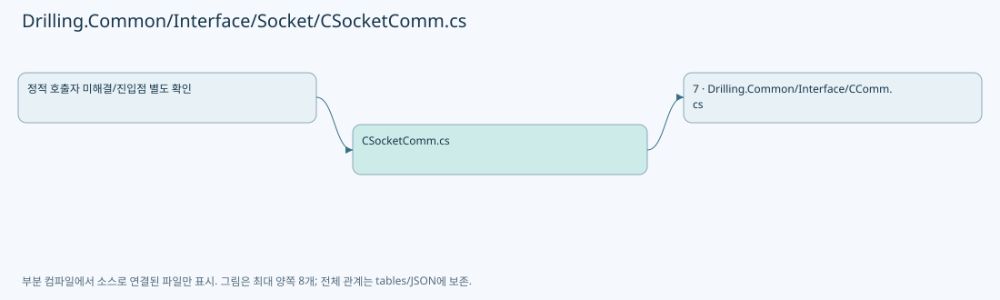
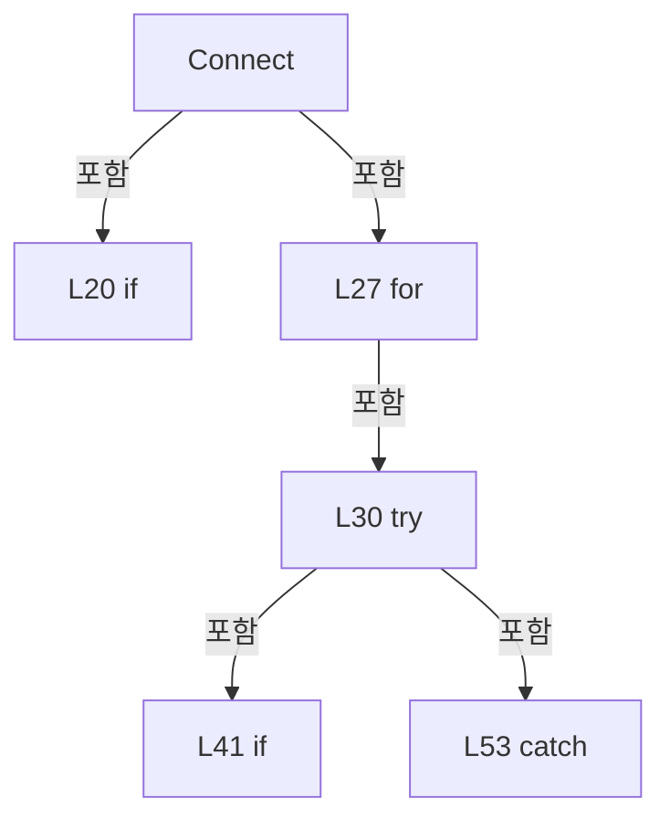
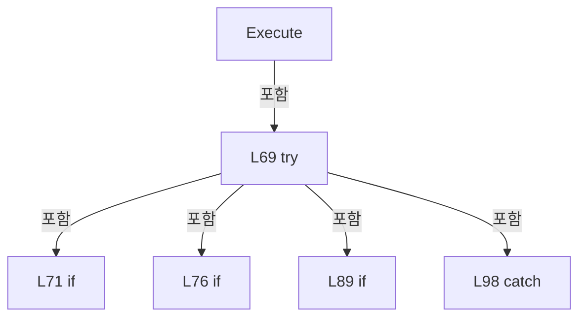
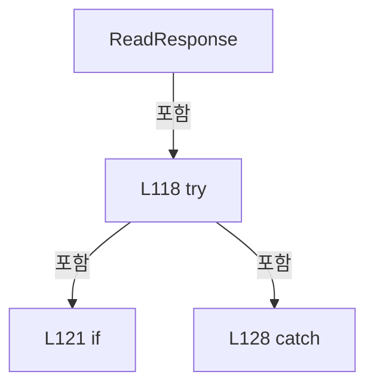

# Drilling.Common/Interface/Socket/CSocketComm.cs

| 항목 | 내용 |
| --- | --- |
| 원본 저장소 | https://github.com/kjuws10-rgb/A3Drilling.git |
| 원본 Commit | 5aee8e58439c9b455cae7c9593c9be986c3e682e |
| 원본 SHA256 | c130d9f8306ea43776fa309ec60cdbe64a11f2ee12342a69dcd960b2460fe392 |
| 파일 분류 | code |
| 원본 크기/행 | 4,770 bytes / 134 physical lines |
| 인코딩 | utf-8-sig |
| 검토 범위 | 구문/부분 의미 분석에서 추출한 사실. 동작·물리 단위·실장비 합격을 보증하지 않습니다. |
| 원본 링크 | [고정 Commit 원본](https://github.com/kjuws10-rgb/A3Drilling/blob/5aee8e58439c9b455cae7c9593c9be986c3e682e/Drilling.Common/Interface/Socket/CSocketComm.cs) |

## 파일의 역할과 읽는 순서

외부 통신과 장치 인터페이스를 연결합니다. 요청 생성·전송·수신·장치 실행을 같은 의미로 합치지 않습니다.

## 네임스페이스·타입·상속

| 타입 | 구분 | 원본 범위 | 선언/상속 |
| --- | --- | --- | --- |
| CSocketComm | ClassDeclaration | 12–134 | CSocketComm: CCommBase(data, option) |

## 멤버 빠른 목록

| 이름 | 종류 | 범위 | 서명 |
| --- | --- | --- | --- |
| _client | FieldDeclaration | L16–16 | System.Net.Sockets.TcpClient? Drilling.Common.Interface.CSocketComm._client |
| Connect | MethodDeclaration | L17–58 | System.Threading.Tasks.Task Drilling.Common.Interface.CSocketComm.Connect(System.Threading.CancellationToken) |
| RunBackgroundTask | LocalFunctionStatement | L35–38 | void RunBackgroundTask() |
| Disconnect | MethodDeclaration | L60–65 | System.Threading.Tasks.Task Drilling.Common.Interface.CSocketComm.Disconnect(System.Threading.CancellationToken) |
| Execute | MethodDeclaration | L67–104 | System.Threading.Tasks.Task<string> Drilling.Common.Interface.CSocketComm.Execute(string, System.Threading.CancellationToken) |
| DisconnectSocket | MethodDeclaration | L106–111 | System.Threading.Tasks.Task Drilling.Common.Interface.CSocketComm.DisconnectSocket() |
| ReadResponse | MethodDeclaration | L113–133 | System.Threading.Tasks.Task<string> Drilling.Common.Interface.CSocketComm.ReadResponse(System.Net.Sockets.NetworkStream, System.Threading.CancellationToken) |

## 멤버별 상세 계약·호출·처리 해설

### FieldDeclaration `_client` · L16–16

[Drilling.Common/Interface/Socket/CSocketComm.cs:16–16](https://github.com/kjuws10-rgb/A3Drilling/blob/5aee8e58439c9b455cae7c9593c9be986c3e682e/Drilling.Common/Interface/Socket/CSocketComm.cs#L16-L16)

| 항목 | 실제 추출 값 |
| --- | --- |
| 서명 | System.Net.Sockets.TcpClient? Drilling.Common.Interface.CSocketComm._client |
| 접근/수식자 | Private / private |
| 반환/값 타입 | System.Net.Sockets.TcpClient? |
| 소속 타입 | NamedType:Drilling.Common.Interface.CSocketComm |

현재 부분 분석에서 직접 연결된 호출자는 없습니다. XAML/이벤트/인터페이스·델리게이트·외부 진입을 추가 확인해야 하며, 미사용으로 판정한 것이 아닙니다.

변경 전 점검: 입력/반환 타입, 위 호출자, 예외/취소 경로, 공유 상태와 저장·전송 소비자를 함께 확인합니다. 값의 단위나 물리 방향을 이름만으로 확정하지 않습니다.

### MethodDeclaration `Connect` · L17–58

[Drilling.Common/Interface/Socket/CSocketComm.cs:17–58](https://github.com/kjuws10-rgb/A3Drilling/blob/5aee8e58439c9b455cae7c9593c9be986c3e682e/Drilling.Common/Interface/Socket/CSocketComm.cs#L17-L58)

| 항목 | 실제 추출 값 |
| --- | --- |
| 서명 | System.Threading.Tasks.Task Drilling.Common.Interface.CSocketComm.Connect(System.Threading.CancellationToken) |
| 접근/수식자 | Public / public, override, async |
| 반환/값 타입 | System.Threading.Tasks.Task |
| 소속 타입 | NamedType:Drilling.Common.Interface.CSocketComm |

입력 계약:

| 이름 | 타입 | 전달 | 선택/기본값 |
| --- | --- | --- | --- |
| cancellationToken | System.Threading.CancellationToken | None | True / null |

정적 호출자로 확인된 위치:

| 호출 파일/행 | 호출 표현식 | 런타임 분기 가능 |
| --- | --- | --- |
| [Drilling.Common/Interface/Socket/CSocketComm.cs:73–73](https://github.com/kjuws10-rgb/A3Drilling/blob/5aee8e58439c9b455cae7c9593c9be986c3e682e/Drilling.Common/Interface/Socket/CSocketComm.cs#L73-L73) | Connect | True |

호출하는 대상과 해석 범위:

| 원본 행 | 표현식 | 분석 상태 | 대상/소스 위치 |
| --- | --- | --- | --- |
| 19 | DisconnectSocket | resolved | System.Threading.Tasks.Task Drilling.Common.Interface.CSocketComm.DisconnectSocket() · Drilling.Common/Interface/Socket/CSocketComm.cs:106 |
| 20 | string.IsNullOrWhiteSpace | resolved | bool string.IsNullOrWhiteSpace(string?) |
| 22 | SetError | resolved | void Drilling.Common.Interface.CCommBase.SetError(string) · Drilling.Common/Interface/CComm.cs:126 |
| 26 | Math.Max | resolved | int System.Math.Max(int, int) |
| 29 | cancellationToken.ThrowIfCancellationRequested | resolved | void System.Threading.CancellationToken.ThrowIfCancellationRequested() |
| 32 | new TcpClient | resolved | System.Net.Sockets.TcpClient.TcpClient() |
| 33 | CancellationTokenSource.CreateLinkedTokenSource | resolved | System.Threading.CancellationTokenSource System.Threading.CancellationTokenSource.CreateLinkedTokenSource(System.Threading.CancellationToken) |
| 34 | timeout.CancelAfter | resolved | void System.Threading.CancellationTokenSource.CancelAfter(int) |
| 34 | Math.Max | resolved | int System.Math.Max(int, int) |
| 40 | Task.Run | resolved | System.Threading.Tasks.Task System.Threading.Tasks.Task.Run(System.Action, System.Threading.CancellationToken) |
| 41 | Task.WhenAny | resolved | System.Threading.Tasks.Task<System.Threading.Tasks.Task> System.Threading.Tasks.Task.WhenAny(System.Threading.Tasks.Task, System.Threading.Tasks.Task) |
| 41 | Task.Delay | resolved | System.Threading.Tasks.Task System.Threading.Tasks.Task.Delay(int, System.Threading.CancellationToken) |
| 41 | Math.Max | resolved | int System.Math.Max(int, int) |
| 43 | client.Dispose | resolved | void System.Net.Sockets.TcpClient.Dispose() |
| 44 | new TimeoutException | resolved | System.TimeoutException.TimeoutException(string?) |
| 50 | SetState | resolved | void Drilling.Common.Interface.CCommBase.SetState(Drilling.Common.Interface.EN_COMM_STATE) · Drilling.Common/Interface/CComm.cs:114 |
| 55 | SetError | resolved | void Drilling.Common.Interface.CCommBase.SetError(System.Exception) · Drilling.Common/Interface/CComm.cs:120 |

본문의 실제 연산·분기·예외·반환 순서(원문 위치 순):

| 원본 행 | 종류 | 주석 해설 |
| --- | --- | --- |
| 19 | await | 비동기 완료를 기다립니다: await DisconnectSocket() |
| 19 | call | 함수·델리게이트 또는 객체 생성자를 호출합니다: DisconnectSocket() |
| 20 | call | 함수·델리게이트 또는 객체 생성자를 호출합니다: string.IsNullOrWhiteSpace(Option.RemoteAddress) |
| 20 | if | 조건에 따라 분기합니다: if (string.IsNullOrWhiteSpace(Option.RemoteAddress) &#124;&#124; Option.Port <= 0) |
| 22 | call | 함수·델리게이트 또는 객체 생성자를 호출합니다: SetError("Socket endpoint is invalid.") |
| 23 | return | 호출자에게 값 또는 제어를 반환합니다: return; |
| 26 | call | 함수·델리게이트 또는 객체 생성자를 호출합니다: Math.Max(1, Option.RetryCount) |
| 26 | local-declaration | 지역 변수를 선언합니다: var retryCount = Math.Max(1, Option.RetryCount); |
| 26 | variable-initializer | 변수의 초기값을 지정합니다: retryCount = Math.Max(1, Option.RetryCount) |
| 27 | variable-initializer | 변수의 초기값을 지정합니다: tryNo = 0 |
| 27 | for | 초기화·조건·증감이 있는 반복입니다: for (var tryNo = 0; tryNo < retryCount; tryNo++) |
| 29 | call | 함수·델리게이트 또는 객체 생성자를 호출합니다: cancellationToken.ThrowIfCancellationRequested() |
| 30 | try | 예외 처리 범위입니다: try |
| 32 | call | 함수·델리게이트 또는 객체 생성자를 호출합니다: new TcpClient() |
| 32 | local-declaration | 지역 변수를 선언합니다: var client = new TcpClient(); |
| 32 | variable-initializer | 변수의 초기값을 지정합니다: client = new TcpClient() |
| 33 | call | 함수·델리게이트 또는 객체 생성자를 호출합니다: CancellationTokenSource.CreateLinkedTokenSource(cancellationToken) |
| 33 | using-declaration | 정리할 자원을 선언합니다: using var timeout = CancellationTokenSource.CreateLinkedTokenSource(cancellationToken); |
| 33 | variable-initializer | 변수의 초기값을 지정합니다: timeout = CancellationTokenSource.CreateLinkedTokenSource(cancellationToken) |
| 34 | call | 함수·델리게이트 또는 객체 생성자를 호출합니다: timeout.CancelAfter(Math.Max(100, Option.TimeoutMs)) |
| 34 | call | 함수·델리게이트 또는 객체 생성자를 호출합니다: Math.Max(100, Option.TimeoutMs) |
| 40 | call | 함수·델리게이트 또는 객체 생성자를 호출합니다: Task.Run(RunBackgroundTask, cancellationToken) |
| 40 | local-declaration | 지역 변수를 선언합니다: var connectTask = Task.Run(RunBackgroundTask, cancellationToken); |
| 40 | variable-initializer | 변수의 초기값을 지정합니다: connectTask = Task.Run(RunBackgroundTask, cancellationToken) |
| 41 | await | 비동기 완료를 기다립니다: await Task.WhenAny(connectTask, Task.Delay(Math.Max(100, Option.TimeoutMs), timeout.Token)) |
| 41 | call | 함수·델리게이트 또는 객체 생성자를 호출합니다: Task.WhenAny(connectTask, Task.Delay(Math.Max(100, Option.TimeoutMs), timeout.Token)) |
| 41 | call | 함수·델리게이트 또는 객체 생성자를 호출합니다: Task.Delay(Math.Max(100, Option.TimeoutMs), timeout.Token) |
| 41 | call | 함수·델리게이트 또는 객체 생성자를 호출합니다: Math.Max(100, Option.TimeoutMs) |
| 41 | if | 조건에 따라 분기합니다: if (await Task.WhenAny(connectTask, Task.Delay(Math.Max(100, Option.TimeoutMs), timeout.Token)) != connectTask) |
| 43 | call | 함수·델리게이트 또는 객체 생성자를 호출합니다: client.Dispose() |
| 44 | call | 함수·델리게이트 또는 객체 생성자를 호출합니다: new TimeoutException("Socket connection timeout.") |
| 44 | throw | 예외를 발생/전달합니다: throw new TimeoutException("Socket connection timeout."); |
| 47 | await | 비동기 완료를 기다립니다: await connectTask |
| 48 | assignment | 값을 대상에 대입합니다: _client = client |
| 49 | assignment | 값을 대상에 대입합니다: LastError = "" |
| 50 | call | 함수·델리게이트 또는 객체 생성자를 호출합니다: SetState(EN_COMM_STATE.Online) |
| 51 | return | 호출자에게 값 또는 제어를 반환합니다: return; |
| 53 | catch | 지정 예외를 처리합니다: catch (Exception ex) when (ex is SocketException or OperationCanceledException or TimeoutException or ArgumentException) |
| 55 | call | 함수·델리게이트 또는 객체 생성자를 호출합니다: SetError(ex) |

제어 구문의 포함 구조(실제 실행 순서/CFG가 아닌 구문 탐색 그림):

변경 전 점검: 입력/반환 타입, 위 호출자, 예외/취소 경로, 공유 상태와 저장·전송 소비자를 함께 확인합니다. 값의 단위나 물리 방향을 이름만으로 확정하지 않습니다.

### LocalFunctionStatement `RunBackgroundTask` · L35–38

[Drilling.Common/Interface/Socket/CSocketComm.cs:35–38](https://github.com/kjuws10-rgb/A3Drilling/blob/5aee8e58439c9b455cae7c9593c9be986c3e682e/Drilling.Common/Interface/Socket/CSocketComm.cs#L35-L38)

| 항목 | 실제 추출 값 |
| --- | --- |
| 서명 | void RunBackgroundTask() |
| 접근/수식자 | Private /  |
| 반환/값 타입 | void |
| 소속 타입 | NamedType:Drilling.Common.Interface.CSocketComm |

현재 부분 분석에서 직접 연결된 호출자는 없습니다. XAML/이벤트/인터페이스·델리게이트·외부 진입을 추가 확인해야 하며, 미사용으로 판정한 것이 아닙니다.

호출하는 대상과 해석 범위:

| 원본 행 | 표현식 | 분석 상태 | 대상/소스 위치 |
| --- | --- | --- | --- |
| 37 | client.Connect | resolved | void System.Net.Sockets.TcpClient.Connect(string, int) |

본문의 실제 연산·분기·예외·반환 순서(원문 위치 순):

| 원본 행 | 종류 | 주석 해설 |
| --- | --- | --- |
| 37 | call | 함수·델리게이트 또는 객체 생성자를 호출합니다: client.Connect(Option.RemoteAddress, Option.Port) |

변경 전 점검: 입력/반환 타입, 위 호출자, 예외/취소 경로, 공유 상태와 저장·전송 소비자를 함께 확인합니다. 값의 단위나 물리 방향을 이름만으로 확정하지 않습니다.

### MethodDeclaration `Disconnect` · L60–65

[Drilling.Common/Interface/Socket/CSocketComm.cs:60–65](https://github.com/kjuws10-rgb/A3Drilling/blob/5aee8e58439c9b455cae7c9593c9be986c3e682e/Drilling.Common/Interface/Socket/CSocketComm.cs#L60-L65)

| 항목 | 실제 추출 값 |
| --- | --- |
| 서명 | System.Threading.Tasks.Task Drilling.Common.Interface.CSocketComm.Disconnect(System.Threading.CancellationToken) |
| 접근/수식자 | Public / public, override, async |
| 반환/값 타입 | System.Threading.Tasks.Task |
| 소속 타입 | NamedType:Drilling.Common.Interface.CSocketComm |

입력 계약:

| 이름 | 타입 | 전달 | 선택/기본값 |
| --- | --- | --- | --- |
| cancellationToken | System.Threading.CancellationToken | None | True / null |

현재 부분 분석에서 직접 연결된 호출자는 없습니다. XAML/이벤트/인터페이스·델리게이트·외부 진입을 추가 확인해야 하며, 미사용으로 판정한 것이 아닙니다.

호출하는 대상과 해석 범위:

| 원본 행 | 표현식 | 분석 상태 | 대상/소스 위치 |
| --- | --- | --- | --- |
| 62 | cancellationToken.ThrowIfCancellationRequested | resolved | void System.Threading.CancellationToken.ThrowIfCancellationRequested() |
| 63 | DisconnectSocket | resolved | System.Threading.Tasks.Task Drilling.Common.Interface.CSocketComm.DisconnectSocket() · Drilling.Common/Interface/Socket/CSocketComm.cs:106 |
| 64 | SetState | resolved | void Drilling.Common.Interface.CCommBase.SetState(Drilling.Common.Interface.EN_COMM_STATE) · Drilling.Common/Interface/CComm.cs:114 |

본문의 실제 연산·분기·예외·반환 순서(원문 위치 순):

| 원본 행 | 종류 | 주석 해설 |
| --- | --- | --- |
| 62 | call | 함수·델리게이트 또는 객체 생성자를 호출합니다: cancellationToken.ThrowIfCancellationRequested() |
| 63 | await | 비동기 완료를 기다립니다: await DisconnectSocket() |
| 63 | call | 함수·델리게이트 또는 객체 생성자를 호출합니다: DisconnectSocket() |
| 64 | call | 함수·델리게이트 또는 객체 생성자를 호출합니다: SetState(EN_COMM_STATE.Offline) |

변경 전 점검: 입력/반환 타입, 위 호출자, 예외/취소 경로, 공유 상태와 저장·전송 소비자를 함께 확인합니다. 값의 단위나 물리 방향을 이름만으로 확정하지 않습니다.

### MethodDeclaration `Execute` · L67–104

[Drilling.Common/Interface/Socket/CSocketComm.cs:67–104](https://github.com/kjuws10-rgb/A3Drilling/blob/5aee8e58439c9b455cae7c9593c9be986c3e682e/Drilling.Common/Interface/Socket/CSocketComm.cs#L67-L104)

| 항목 | 실제 추출 값 |
| --- | --- |
| 서명 | System.Threading.Tasks.Task<string> Drilling.Common.Interface.CSocketComm.Execute(string, System.Threading.CancellationToken) |
| 접근/수식자 | Public / public, override, async |
| 반환/값 타입 | System.Threading.Tasks.Task<string> |
| 소속 타입 | NamedType:Drilling.Common.Interface.CSocketComm |

입력 계약:

| 이름 | 타입 | 전달 | 선택/기본값 |
| --- | --- | --- | --- |
| function | string | None | False /  |
| cancellationToken | System.Threading.CancellationToken | None | True / null |

현재 부분 분석에서 직접 연결된 호출자는 없습니다. XAML/이벤트/인터페이스·델리게이트·외부 진입을 추가 확인해야 하며, 미사용으로 판정한 것이 아닙니다.

호출하는 대상과 해석 범위:

| 원본 행 | 표현식 | 분석 상태 | 대상/소스 위치 |
| --- | --- | --- | --- |
| 73 | Connect | resolved · 동적 구현 선택 가능 | System.Threading.Tasks.Task Drilling.Common.Interface.CSocketComm.Connect(System.Threading.CancellationToken) · Drilling.Common/Interface/Socket/CSocketComm.cs:17 |
| 81 | _client.GetStream | resolved | System.Net.Sockets.NetworkStream System.Net.Sockets.TcpClient.GetStream() |
| 82 | Encoding.UTF8.GetBytes | resolved · 동적 구현 선택 가능 | byte[] System.Text.Encoding.GetBytes(string) |
| 83 | stream.WriteAsync | resolved · 동적 구현 선택 가능 | System.Threading.Tasks.ValueTask System.Net.Sockets.NetworkStream.WriteAsync(System.ReadOnlyMemory<byte>, System.Threading.CancellationToken) |
| 84 | stream.FlushAsync | resolved · 동적 구현 선택 가능 | System.Threading.Tasks.Task System.Net.Sockets.NetworkStream.FlushAsync(System.Threading.CancellationToken) |
| 88 | ReadResponse | resolved | System.Threading.Tasks.Task<string> Drilling.Common.Interface.CSocketComm.ReadResponse(System.Net.Sockets.NetworkStream, System.Threading.CancellationToken) · Drilling.Common/Interface/Socket/CSocketComm.cs:113 |
| 89 | string.IsNullOrWhiteSpace | resolved | bool string.IsNullOrWhiteSpace(string?) |
| 91 | SetError | resolved | void Drilling.Common.Interface.CCommBase.SetError(string) · Drilling.Common/Interface/CComm.cs:126 |
| 91 | string.IsNullOrWhiteSpace | resolved | bool string.IsNullOrWhiteSpace(string?) |
| 95 | SetState | resolved | void Drilling.Common.Interface.CCommBase.SetState(Drilling.Common.Interface.EN_COMM_STATE) · Drilling.Common/Interface/CComm.cs:114 |
| 100 | DisconnectSocket | resolved | System.Threading.Tasks.Task Drilling.Common.Interface.CSocketComm.DisconnectSocket() · Drilling.Common/Interface/Socket/CSocketComm.cs:106 |
| 101 | SetError | resolved | void Drilling.Common.Interface.CCommBase.SetError(System.Exception) · Drilling.Common/Interface/CComm.cs:120 |

본문의 실제 연산·분기·예외·반환 순서(원문 위치 순):

| 원본 행 | 종류 | 주석 해설 |
| --- | --- | --- |
| 69 | try | 예외 처리 범위입니다: try |
| 71 | if | 조건에 따라 분기합니다: if (_client is null &#124;&#124; !_client.Connected) |
| 73 | await | 비동기 완료를 기다립니다: await Connect(cancellationToken) |
| 73 | call | 함수·델리게이트 또는 객체 생성자를 호출합니다: Connect(cancellationToken) |
| 76 | if | 조건에 따라 분기합니다: if (_client is null &#124;&#124; !_client.Connected) |
| 78 | return | 호출자에게 값 또는 제어를 반환합니다: return ""; |
| 81 | call | 함수·델리게이트 또는 객체 생성자를 호출합니다: _client.GetStream() |
| 81 | local-declaration | 지역 변수를 선언합니다: var stream = _client.GetStream(); |
| 81 | variable-initializer | 변수의 초기값을 지정합니다: stream = _client.GetStream() |
| 82 | call | 함수·델리게이트 또는 객체 생성자를 호출합니다: Encoding.UTF8.GetBytes(function) |
| 82 | local-declaration | 지역 변수를 선언합니다: var sendBytes = Encoding.UTF8.GetBytes(function); |
| 82 | variable-initializer | 변수의 초기값을 지정합니다: sendBytes = Encoding.UTF8.GetBytes(function) |
| 83 | await | 비동기 완료를 기다립니다: await stream.WriteAsync(sendBytes, cancellationToken) |
| 83 | call | 함수·델리게이트 또는 객체 생성자를 호출합니다: stream.WriteAsync(sendBytes, cancellationToken) |
| 84 | await | 비동기 완료를 기다립니다: await stream.FlushAsync(cancellationToken) |
| 84 | call | 함수·델리게이트 또는 객체 생성자를 호출합니다: stream.FlushAsync(cancellationToken) |
| 85 | assignment | 값을 대상에 대입합니다: LastSent = function |
| 86 | assignment | 값을 대상에 대입합니다: LastReceived = "" |
| 87 | assignment | 값을 대상에 대입합니다: LastError = "" |
| 88 | assignment | 값을 대상에 대입합니다: LastReceived = await ReadResponse(stream, cancellationToken) |
| 88 | await | 비동기 완료를 기다립니다: await ReadResponse(stream, cancellationToken) |
| 88 | call | 함수·델리게이트 또는 객체 생성자를 호출합니다: ReadResponse(stream, cancellationToken) |
| 89 | call | 함수·델리게이트 또는 객체 생성자를 호출합니다: string.IsNullOrWhiteSpace(LastReceived) |
| 89 | if | 조건에 따라 분기합니다: if (string.IsNullOrWhiteSpace(LastReceived)) |
| 91 | call | 함수·델리게이트 또는 객체 생성자를 호출합니다: SetError(string.IsNullOrWhiteSpace(LastError) ? "Socket response timeout." : LastError) |
| 91 | call | 함수·델리게이트 또는 객체 생성자를 호출합니다: string.IsNullOrWhiteSpace(LastError) |
| 91 | conditional-expression | 조건에 따라 결과식을 선택합니다: string.IsNullOrWhiteSpace(LastError) ? "Socket response timeout." : LastError |
| 92 | return | 호출자에게 값 또는 제어를 반환합니다: return ""; |
| 95 | call | 함수·델리게이트 또는 객체 생성자를 호출합니다: SetState(EN_COMM_STATE.Online) |
| 96 | return | 호출자에게 값 또는 제어를 반환합니다: return LastReceived; |
| 98 | catch | 지정 예외를 처리합니다: catch (Exception ex) when (ex is SocketException or IOException or ObjectDisposedException or OperationCanceledException) |
| 100 | await | 비동기 완료를 기다립니다: await DisconnectSocket() |
| 100 | call | 함수·델리게이트 또는 객체 생성자를 호출합니다: DisconnectSocket() |
| 101 | call | 함수·델리게이트 또는 객체 생성자를 호출합니다: SetError(ex) |
| 102 | return | 호출자에게 값 또는 제어를 반환합니다: return ""; |

제어 구문의 포함 구조(실제 실행 순서/CFG가 아닌 구문 탐색 그림):

변경 전 점검: 입력/반환 타입, 위 호출자, 예외/취소 경로, 공유 상태와 저장·전송 소비자를 함께 확인합니다. 값의 단위나 물리 방향을 이름만으로 확정하지 않습니다.

### MethodDeclaration `DisconnectSocket` · L106–111

[Drilling.Common/Interface/Socket/CSocketComm.cs:106–111](https://github.com/kjuws10-rgb/A3Drilling/blob/5aee8e58439c9b455cae7c9593c9be986c3e682e/Drilling.Common/Interface/Socket/CSocketComm.cs#L106-L111)

| 항목 | 실제 추출 값 |
| --- | --- |
| 서명 | System.Threading.Tasks.Task Drilling.Common.Interface.CSocketComm.DisconnectSocket() |
| 접근/수식자 | Private / private |
| 반환/값 타입 | System.Threading.Tasks.Task |
| 소속 타입 | NamedType:Drilling.Common.Interface.CSocketComm |

정적 호출자로 확인된 위치:

| 호출 파일/행 | 호출 표현식 | 런타임 분기 가능 |
| --- | --- | --- |
| [Drilling.Common/Interface/Socket/CSocketComm.cs:19–19](https://github.com/kjuws10-rgb/A3Drilling/blob/5aee8e58439c9b455cae7c9593c9be986c3e682e/Drilling.Common/Interface/Socket/CSocketComm.cs#L19-L19) | DisconnectSocket | False |
| [Drilling.Common/Interface/Socket/CSocketComm.cs:63–63](https://github.com/kjuws10-rgb/A3Drilling/blob/5aee8e58439c9b455cae7c9593c9be986c3e682e/Drilling.Common/Interface/Socket/CSocketComm.cs#L63-L63) | DisconnectSocket | False |
| [Drilling.Common/Interface/Socket/CSocketComm.cs:100–100](https://github.com/kjuws10-rgb/A3Drilling/blob/5aee8e58439c9b455cae7c9593c9be986c3e682e/Drilling.Common/Interface/Socket/CSocketComm.cs#L100-L100) | DisconnectSocket | False |

호출하는 대상과 해석 범위:

| 원본 행 | 표현식 | 분석 상태 | 대상/소스 위치 |
| --- | --- | --- | --- |
| 108 | .Dispose | resolved | void System.Net.Sockets.TcpClient.Dispose() |

본문의 실제 연산·분기·예외·반환 순서(원문 위치 순):

| 원본 행 | 종류 | 주석 해설 |
| --- | --- | --- |
| 108 | call | 함수·델리게이트 또는 객체 생성자를 호출합니다: .Dispose() |
| 109 | assignment | 값을 대상에 대입합니다: _client = null |
| 110 | return | 호출자에게 값 또는 제어를 반환합니다: return Task.CompletedTask; |

변경 전 점검: 입력/반환 타입, 위 호출자, 예외/취소 경로, 공유 상태와 저장·전송 소비자를 함께 확인합니다. 값의 단위나 물리 방향을 이름만으로 확정하지 않습니다.

### MethodDeclaration `ReadResponse` · L113–133

[Drilling.Common/Interface/Socket/CSocketComm.cs:113–133](https://github.com/kjuws10-rgb/A3Drilling/blob/5aee8e58439c9b455cae7c9593c9be986c3e682e/Drilling.Common/Interface/Socket/CSocketComm.cs#L113-L133)

| 항목 | 실제 추출 값 |
| --- | --- |
| 서명 | System.Threading.Tasks.Task<string> Drilling.Common.Interface.CSocketComm.ReadResponse(System.Net.Sockets.NetworkStream, System.Threading.CancellationToken) |
| 접근/수식자 | Private / private, async |
| 반환/값 타입 | System.Threading.Tasks.Task<string> |
| 소속 타입 | NamedType:Drilling.Common.Interface.CSocketComm |

입력 계약:

| 이름 | 타입 | 전달 | 선택/기본값 |
| --- | --- | --- | --- |
| stream | System.Net.Sockets.NetworkStream | None | False /  |
| cancellationToken | System.Threading.CancellationToken | None | False /  |

정적 호출자로 확인된 위치:

| 호출 파일/행 | 호출 표현식 | 런타임 분기 가능 |
| --- | --- | --- |
| [Drilling.Common/Interface/Socket/CSocketComm.cs:88–88](https://github.com/kjuws10-rgb/A3Drilling/blob/5aee8e58439c9b455cae7c9593c9be986c3e682e/Drilling.Common/Interface/Socket/CSocketComm.cs#L88-L88) | ReadResponse | False |

호출하는 대상과 해석 범위:

| 원본 행 | 표현식 | 분석 상태 | 대상/소스 위치 |
| --- | --- | --- | --- |
| 116 | CancellationTokenSource.CreateLinkedTokenSource | resolved | System.Threading.CancellationTokenSource System.Threading.CancellationTokenSource.CreateLinkedTokenSource(System.Threading.CancellationToken) |
| 117 | timeout.CancelAfter | resolved | void System.Threading.CancellationTokenSource.CancelAfter(int) |
| 117 | Math.Max | resolved | int System.Math.Max(int, int) |
| 120 | stream.ReadAsync | resolved · 동적 구현 선택 가능 | System.Threading.Tasks.ValueTask<int> System.Net.Sockets.NetworkStream.ReadAsync(System.Memory<byte>, System.Threading.CancellationToken) |
| 123 | new IOException | resolved | System.IO.IOException.IOException(string?) |
| 126 | Encoding.UTF8.GetString | resolved · 동적 구현 선택 가능 | string System.Text.Encoding.GetString(byte[], int, int) |

본문의 실제 연산·분기·예외·반환 순서(원문 위치 순):

| 원본 행 | 종류 | 주석 해설 |
| --- | --- | --- |
| 115 | local-declaration | 지역 변수를 선언합니다: var buffer = new byte[4096]; |
| 115 | variable-initializer | 변수의 초기값을 지정합니다: buffer = new byte[4096] |
| 116 | call | 함수·델리게이트 또는 객체 생성자를 호출합니다: CancellationTokenSource.CreateLinkedTokenSource(cancellationToken) |
| 116 | using-declaration | 정리할 자원을 선언합니다: using var timeout = CancellationTokenSource.CreateLinkedTokenSource(cancellationToken); |
| 116 | variable-initializer | 변수의 초기값을 지정합니다: timeout = CancellationTokenSource.CreateLinkedTokenSource(cancellationToken) |
| 117 | call | 함수·델리게이트 또는 객체 생성자를 호출합니다: timeout.CancelAfter(Math.Max(100, Option.TimeoutMs)) |
| 117 | call | 함수·델리게이트 또는 객체 생성자를 호출합니다: Math.Max(100, Option.TimeoutMs) |
| 118 | try | 예외 처리 범위입니다: try |
| 120 | await | 비동기 완료를 기다립니다: await stream.ReadAsync(buffer, timeout.Token) |
| 120 | call | 함수·델리게이트 또는 객체 생성자를 호출합니다: stream.ReadAsync(buffer, timeout.Token) |
| 120 | local-declaration | 지역 변수를 선언합니다: var readCount = await stream.ReadAsync(buffer, timeout.Token); |
| 120 | variable-initializer | 변수의 초기값을 지정합니다: readCount = await stream.ReadAsync(buffer, timeout.Token) |
| 121 | if | 조건에 따라 분기합니다: if (readCount == 0) |
| 123 | call | 함수·델리게이트 또는 객체 생성자를 호출합니다: new IOException("Socket closed by remote.") |
| 123 | throw | 예외를 발생/전달합니다: throw new IOException("Socket closed by remote."); |
| 126 | call | 함수·델리게이트 또는 객체 생성자를 호출합니다: Encoding.UTF8.GetString(buffer, 0, readCount) |
| 126 | return | 호출자에게 값 또는 제어를 반환합니다: return Encoding.UTF8.GetString(buffer, 0, readCount); |
| 128 | catch | 지정 예외를 처리합니다: catch (OperationCanceledException) when (!cancellationToken.IsCancellationRequested) |
| 130 | assignment | 값을 대상에 대입합니다: LastError = "Socket response timeout." |
| 131 | return | 호출자에게 값 또는 제어를 반환합니다: return ""; |

제어 구문의 포함 구조(실제 실행 순서/CFG가 아닌 구문 탐색 그림):

변경 전 점검: 입력/반환 타입, 위 호출자, 예외/취소 경로, 공유 상태와 저장·전송 소비자를 함께 확인합니다. 값의 단위나 물리 방향을 이름만으로 확정하지 않습니다.

## 구문·바인딩 한계

전체 WPF/벤더 SDK/프로젝트별 빌드 조건을 로드한 정식 빌드가 아닙니다. `resolved`는 이 부분 컴파일에서의 심볼 연결이며 virtual/interface/delegate/이벤트/Reflection/XAML의 실제 런타임 구현을 확정하지 않습니다. `candidate`와 `unresolved`는 후속 확인 대상으로 남깁니다.

## 원문 전체 주석 해설본

[원본 모든 행과 행별 해설 보기](../../../../annotated/Drilling.Common/Interface/Socket/CSocketComm.cs.annotated.txt)

원본을 빠뜨리거나 임의로 줄이지 않았습니다. `L000001 |` 표시는 원본 행 번호, `// 해설`은 별도 설명입니다. 실행용 소스가 아닌 문서입니다.

## 수정·재검증 체크

- 원본 Commit과 현재 작업 파일 SHA가 같은지 먼저 확인합니다. 다르면 이 문서를 과거 버전 자료로 취급합니다.
- 선언·직접 호출·이벤트/인터페이스 경계·설정 소비를 함께 확인합니다. 정적 연결의 빈 곳을 정상 경로로 추정하지 않습니다.
- 저장 형식/단위/식별자·재시도·취소·예외·롤백에 영향을 주는 변경은 상세 해설장과 호출자를 다시 검토합니다.
- 도구의 구문 추출과 별도 정적 추적 해설, 실제 빌드·시뮬레이션·실장비 검증 결과를 분리합니다.
