# Drilling.Common/Interface/Socket/CSocketServerComm.cs

| 항목 | 내용 |
| --- | --- |
| 원본 저장소 | https://github.com/kjuws10-rgb/A3Drilling.git |
| 원본 Commit | 5aee8e58439c9b455cae7c9593c9be986c3e682e |
| 원본 SHA256 | a4fb2aed1e2a9fdcc155d77b0664232b070e40418cbbe896b9e8d03688dc923c |
| 파일 분류 | code |
| 원본 크기/행 | 14,569 bytes / 404 physical lines |
| 인코딩 | utf-8-sig |
| 검토 범위 | 구문/부분 의미 분석에서 추출한 사실. 동작·물리 단위·실장비 합격을 보증하지 않습니다. |
| 원본 링크 | [고정 Commit 원본](https://github.com/kjuws10-rgb/A3Drilling/blob/5aee8e58439c9b455cae7c9593c9be986c3e682e/Drilling.Common/Interface/Socket/CSocketServerComm.cs) |

## 파일의 역할과 읽는 순서

외부 통신과 장치 인터페이스를 연결합니다. 요청 생성·전송·수신·장치 실행을 같은 의미로 합치지 않습니다.

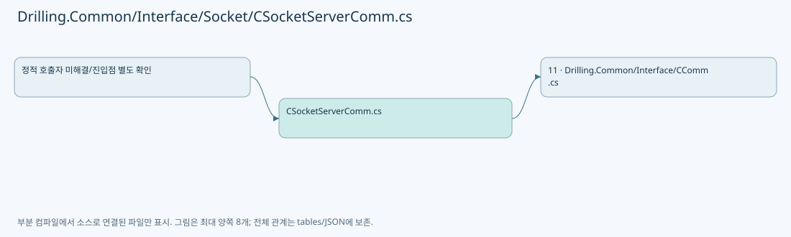

## 네임스페이스·타입·상속

| 타입 | 구분 | 원본 범위 | 선언/상속 |
| --- | --- | --- | --- |
| CSocketServerComm | ClassDeclaration | 7–404 | CSocketServerComm: CCommBase(data, option) |

## 멤버 빠른 목록

| 이름 | 종류 | 범위 | 서명 |
| --- | --- | --- | --- |
| MaxMessageLength | FieldDeclaration | L10–10 | int Drilling.Common.Interface.CSocketServerComm.MaxMessageLength |
| _clients | FieldDeclaration | L11–11 | System.Collections.Concurrent.ConcurrentDictionary<int, System.Net.Sockets.TcpClient> Drilling.Common.Interface.CSocketServerComm._clients |
| _clientTasks | FieldDeclaration | L12–12 | System.Collections.Concurrent.ConcurrentDictionary<int, System.Threading.Tasks.Task> Drilling.Common.Interface.CSocketServerComm._clientTasks |
| _serverLock | FieldDeclaration | L13–13 | System.Threading.SemaphoreSlim Drilling.Common.Interface.CSocketServerComm._serverLock |
| _listener | FieldDeclaration | L14–14 | System.Net.Sockets.TcpListener? Drilling.Common.Interface.CSocketServerComm._listener |
| _serverCts | FieldDeclaration | L15–15 | System.Threading.CancellationTokenSource? Drilling.Common.Interface.CSocketServerComm._serverCts |
| _acceptTask | FieldDeclaration | L16–16 | System.Threading.Tasks.Task? Drilling.Common.Interface.CSocketServerComm._acceptTask |
| _clientSequence | FieldDeclaration | L17–17 | int Drilling.Common.Interface.CSocketServerComm._clientSequence |
| MessageReceived | EventFieldDeclaration | L18–18 | System.Func<Drilling.Common.Interface.ST_COMM_RECEIVED_MESSAGE, System.Threading.CancellationToken, System.Threading.Tasks.Task<string>>? Drilling.Common.Interface.CSocketServerComm.MessageReceived |
| Connect | MethodDeclaration | L19–63 | System.Threading.Tasks.Task Drilling.Common.Interface.CSocketServerComm.Connect(System.Threading.CancellationToken) |
| SelectValue | LocalFunctionStatement | L43–46 | System.Threading.Tasks.Task SelectValue() |
| Disconnect | MethodDeclaration | L65–78 | System.Threading.Tasks.Task Drilling.Common.Interface.CSocketServerComm.Disconnect(System.Threading.CancellationToken) |
| Execute | MethodDeclaration | L80–116 | System.Threading.Tasks.Task<string> Drilling.Common.Interface.CSocketServerComm.Execute(string, System.Threading.CancellationToken) |
| AcceptLoop | MethodDeclaration | L118–170 | System.Threading.Tasks.Task Drilling.Common.Interface.CSocketServerComm.AcceptLoop(System.Net.Sockets.TcpListener, System.Threading.CancellationToken) |
| SelectValue | LocalFunctionStatement | L146–149 | System.Threading.Tasks.Task SelectValue() |
| CleanupClientTaskCallback | LocalFunctionStatement | L151–154 | void CleanupClientTaskCallback(System.Threading.Tasks.Task) |
| ReceiveLoop | MethodDeclaration | L172–222 | System.Threading.Tasks.Task Drilling.Common.Interface.CSocketServerComm.ReceiveLoop(int, System.Net.Sockets.TcpClient, System.Threading.CancellationToken) |
| CleanupClientTask | MethodDeclaration | L224–234 | void Drilling.Common.Interface.CSocketServerComm.CleanupClientTask(int, System.Threading.Tasks.Task) |
| RaiseMessageReceived | MethodDeclaration | L236–262 | System.Threading.Tasks.Task<string> Drilling.Common.Interface.CSocketServerComm.RaiseMessageReceived(string, string, System.Threading.CancellationToken) |
| StopServer | MethodDeclaration | L264–305 | System.Threading.Tasks.Task Drilling.Common.Interface.CSocketServerComm.StopServer() |
| CloseAllClients | MethodDeclaration | L307–316 | void Drilling.Common.Interface.CSocketServerComm.CloseAllClients() |
| IsAllowedRemote | MethodDeclaration | L318–337 | bool Drilling.Common.Interface.CSocketServerComm.IsAllowedRemote(System.Net.Sockets.TcpClient) |
| ResolveBindAddress | MethodDeclaration | L339–347 | System.Net.IPAddress Drilling.Common.Interface.CSocketServerComm.ResolveBindAddress(string) |
| ReadProtocolLine | MethodDeclaration | L349–374 | System.Threading.Tasks.Task<string?> Drilling.Common.Interface.CSocketServerComm.ReadProtocolLine(System.IO.StreamReader, System.Threading.CancellationToken) |
| ReadProtocolLineWithTimeout | MethodDeclaration | L376–388 | System.Threading.Tasks.Task<string?> Drilling.Common.Interface.CSocketServerComm.ReadProtocolLineWithTimeout(System.IO.StreamReader, System.Threading.CancellationToken) |
| GetRemoteEndPoint | MethodDeclaration | L390–393 | string Drilling.Common.Interface.CSocketServerComm.GetRemoteEndPoint(System.Net.Sockets.TcpClient) |
| NormalizeReceivedMessage | MethodDeclaration | L395–398 | string Drilling.Common.Interface.CSocketServerComm.NormalizeReceivedMessage(string) |
| NormalizeProtocolLine | MethodDeclaration | L400–403 | string Drilling.Common.Interface.CSocketServerComm.NormalizeProtocolLine(string) |

## 멤버별 상세 계약·호출·처리 해설

### FieldDeclaration `MaxMessageLength` · L10–10

[Drilling.Common/Interface/Socket/CSocketServerComm.cs:10–10](https://github.com/kjuws10-rgb/A3Drilling/blob/5aee8e58439c9b455cae7c9593c9be986c3e682e/Drilling.Common/Interface/Socket/CSocketServerComm.cs#L10-L10)

| 항목 | 실제 추출 값 |
| --- | --- |
| 서명 | int Drilling.Common.Interface.CSocketServerComm.MaxMessageLength |
| 접근/수식자 | Private / private, const |
| 반환/값 타입 | int |
| 소속 타입 | NamedType:Drilling.Common.Interface.CSocketServerComm |

현재 부분 분석에서 직접 연결된 호출자는 없습니다. XAML/이벤트/인터페이스·델리게이트·외부 진입을 추가 확인해야 하며, 미사용으로 판정한 것이 아닙니다.

본문의 실제 연산·분기·예외·반환 순서(원문 위치 순):

| 원본 행 | 종류 | 주석 해설 |
| --- | --- | --- |
| 10 | variable-initializer | 변수의 초기값을 지정합니다: MaxMessageLength = 8192 |

변경 전 점검: 입력/반환 타입, 위 호출자, 예외/취소 경로, 공유 상태와 저장·전송 소비자를 함께 확인합니다. 값의 단위나 물리 방향을 이름만으로 확정하지 않습니다.

### FieldDeclaration `_clients` · L11–11

[Drilling.Common/Interface/Socket/CSocketServerComm.cs:11–11](https://github.com/kjuws10-rgb/A3Drilling/blob/5aee8e58439c9b455cae7c9593c9be986c3e682e/Drilling.Common/Interface/Socket/CSocketServerComm.cs#L11-L11)

| 항목 | 실제 추출 값 |
| --- | --- |
| 서명 | System.Collections.Concurrent.ConcurrentDictionary<int, System.Net.Sockets.TcpClient> Drilling.Common.Interface.CSocketServerComm._clients |
| 접근/수식자 | Private / private, readonly |
| 반환/값 타입 | System.Collections.Concurrent.ConcurrentDictionary<int, System.Net.Sockets.TcpClient> |
| 소속 타입 | NamedType:Drilling.Common.Interface.CSocketServerComm |

현재 부분 분석에서 직접 연결된 호출자는 없습니다. XAML/이벤트/인터페이스·델리게이트·외부 진입을 추가 확인해야 하며, 미사용으로 판정한 것이 아닙니다.

호출하는 대상과 해석 범위:

| 원본 행 | 표현식 | 분석 상태 | 대상/소스 위치 |
| --- | --- | --- | --- |
| 11 | new | resolved | System.Collections.Concurrent.ConcurrentDictionary<int, System.Net.Sockets.TcpClient>.ConcurrentDictionary() |

본문의 실제 연산·분기·예외·반환 순서(원문 위치 순):

| 원본 행 | 종류 | 주석 해설 |
| --- | --- | --- |
| 11 | call | 함수·델리게이트 또는 객체 생성자를 호출합니다: new() |
| 11 | variable-initializer | 변수의 초기값을 지정합니다: _clients = new() |

변경 전 점검: 입력/반환 타입, 위 호출자, 예외/취소 경로, 공유 상태와 저장·전송 소비자를 함께 확인합니다. 값의 단위나 물리 방향을 이름만으로 확정하지 않습니다.

### FieldDeclaration `_clientTasks` · L12–12

[Drilling.Common/Interface/Socket/CSocketServerComm.cs:12–12](https://github.com/kjuws10-rgb/A3Drilling/blob/5aee8e58439c9b455cae7c9593c9be986c3e682e/Drilling.Common/Interface/Socket/CSocketServerComm.cs#L12-L12)

| 항목 | 실제 추출 값 |
| --- | --- |
| 서명 | System.Collections.Concurrent.ConcurrentDictionary<int, System.Threading.Tasks.Task> Drilling.Common.Interface.CSocketServerComm._clientTasks |
| 접근/수식자 | Private / private, readonly |
| 반환/값 타입 | System.Collections.Concurrent.ConcurrentDictionary<int, System.Threading.Tasks.Task> |
| 소속 타입 | NamedType:Drilling.Common.Interface.CSocketServerComm |

현재 부분 분석에서 직접 연결된 호출자는 없습니다. XAML/이벤트/인터페이스·델리게이트·외부 진입을 추가 확인해야 하며, 미사용으로 판정한 것이 아닙니다.

호출하는 대상과 해석 범위:

| 원본 행 | 표현식 | 분석 상태 | 대상/소스 위치 |
| --- | --- | --- | --- |
| 12 | new | resolved | System.Collections.Concurrent.ConcurrentDictionary<int, System.Threading.Tasks.Task>.ConcurrentDictionary() |

본문의 실제 연산·분기·예외·반환 순서(원문 위치 순):

| 원본 행 | 종류 | 주석 해설 |
| --- | --- | --- |
| 12 | call | 함수·델리게이트 또는 객체 생성자를 호출합니다: new() |
| 12 | variable-initializer | 변수의 초기값을 지정합니다: _clientTasks = new() |

변경 전 점검: 입력/반환 타입, 위 호출자, 예외/취소 경로, 공유 상태와 저장·전송 소비자를 함께 확인합니다. 값의 단위나 물리 방향을 이름만으로 확정하지 않습니다.

### FieldDeclaration `_serverLock` · L13–13

[Drilling.Common/Interface/Socket/CSocketServerComm.cs:13–13](https://github.com/kjuws10-rgb/A3Drilling/blob/5aee8e58439c9b455cae7c9593c9be986c3e682e/Drilling.Common/Interface/Socket/CSocketServerComm.cs#L13-L13)

| 항목 | 실제 추출 값 |
| --- | --- |
| 서명 | System.Threading.SemaphoreSlim Drilling.Common.Interface.CSocketServerComm._serverLock |
| 접근/수식자 | Private / private, readonly |
| 반환/값 타입 | System.Threading.SemaphoreSlim |
| 소속 타입 | NamedType:Drilling.Common.Interface.CSocketServerComm |

현재 부분 분석에서 직접 연결된 호출자는 없습니다. XAML/이벤트/인터페이스·델리게이트·외부 진입을 추가 확인해야 하며, 미사용으로 판정한 것이 아닙니다.

호출하는 대상과 해석 범위:

| 원본 행 | 표현식 | 분석 상태 | 대상/소스 위치 |
| --- | --- | --- | --- |
| 13 | new | resolved | System.Threading.SemaphoreSlim.SemaphoreSlim(int, int) |

본문의 실제 연산·분기·예외·반환 순서(원문 위치 순):

| 원본 행 | 종류 | 주석 해설 |
| --- | --- | --- |
| 13 | call | 함수·델리게이트 또는 객체 생성자를 호출합니다: new(1, 1) |
| 13 | variable-initializer | 변수의 초기값을 지정합니다: _serverLock = new(1, 1) |

변경 전 점검: 입력/반환 타입, 위 호출자, 예외/취소 경로, 공유 상태와 저장·전송 소비자를 함께 확인합니다. 값의 단위나 물리 방향을 이름만으로 확정하지 않습니다.

### FieldDeclaration `_listener` · L14–14

[Drilling.Common/Interface/Socket/CSocketServerComm.cs:14–14](https://github.com/kjuws10-rgb/A3Drilling/blob/5aee8e58439c9b455cae7c9593c9be986c3e682e/Drilling.Common/Interface/Socket/CSocketServerComm.cs#L14-L14)

| 항목 | 실제 추출 값 |
| --- | --- |
| 서명 | System.Net.Sockets.TcpListener? Drilling.Common.Interface.CSocketServerComm._listener |
| 접근/수식자 | Private / private |
| 반환/값 타입 | System.Net.Sockets.TcpListener? |
| 소속 타입 | NamedType:Drilling.Common.Interface.CSocketServerComm |

현재 부분 분석에서 직접 연결된 호출자는 없습니다. XAML/이벤트/인터페이스·델리게이트·외부 진입을 추가 확인해야 하며, 미사용으로 판정한 것이 아닙니다.

변경 전 점검: 입력/반환 타입, 위 호출자, 예외/취소 경로, 공유 상태와 저장·전송 소비자를 함께 확인합니다. 값의 단위나 물리 방향을 이름만으로 확정하지 않습니다.

### FieldDeclaration `_serverCts` · L15–15

[Drilling.Common/Interface/Socket/CSocketServerComm.cs:15–15](https://github.com/kjuws10-rgb/A3Drilling/blob/5aee8e58439c9b455cae7c9593c9be986c3e682e/Drilling.Common/Interface/Socket/CSocketServerComm.cs#L15-L15)

| 항목 | 실제 추출 값 |
| --- | --- |
| 서명 | System.Threading.CancellationTokenSource? Drilling.Common.Interface.CSocketServerComm._serverCts |
| 접근/수식자 | Private / private |
| 반환/값 타입 | System.Threading.CancellationTokenSource? |
| 소속 타입 | NamedType:Drilling.Common.Interface.CSocketServerComm |

현재 부분 분석에서 직접 연결된 호출자는 없습니다. XAML/이벤트/인터페이스·델리게이트·외부 진입을 추가 확인해야 하며, 미사용으로 판정한 것이 아닙니다.

변경 전 점검: 입력/반환 타입, 위 호출자, 예외/취소 경로, 공유 상태와 저장·전송 소비자를 함께 확인합니다. 값의 단위나 물리 방향을 이름만으로 확정하지 않습니다.

### FieldDeclaration `_acceptTask` · L16–16

[Drilling.Common/Interface/Socket/CSocketServerComm.cs:16–16](https://github.com/kjuws10-rgb/A3Drilling/blob/5aee8e58439c9b455cae7c9593c9be986c3e682e/Drilling.Common/Interface/Socket/CSocketServerComm.cs#L16-L16)

| 항목 | 실제 추출 값 |
| --- | --- |
| 서명 | System.Threading.Tasks.Task? Drilling.Common.Interface.CSocketServerComm._acceptTask |
| 접근/수식자 | Private / private |
| 반환/값 타입 | System.Threading.Tasks.Task? |
| 소속 타입 | NamedType:Drilling.Common.Interface.CSocketServerComm |

현재 부분 분석에서 직접 연결된 호출자는 없습니다. XAML/이벤트/인터페이스·델리게이트·외부 진입을 추가 확인해야 하며, 미사용으로 판정한 것이 아닙니다.

변경 전 점검: 입력/반환 타입, 위 호출자, 예외/취소 경로, 공유 상태와 저장·전송 소비자를 함께 확인합니다. 값의 단위나 물리 방향을 이름만으로 확정하지 않습니다.

### FieldDeclaration `_clientSequence` · L17–17

[Drilling.Common/Interface/Socket/CSocketServerComm.cs:17–17](https://github.com/kjuws10-rgb/A3Drilling/blob/5aee8e58439c9b455cae7c9593c9be986c3e682e/Drilling.Common/Interface/Socket/CSocketServerComm.cs#L17-L17)

| 항목 | 실제 추출 값 |
| --- | --- |
| 서명 | int Drilling.Common.Interface.CSocketServerComm._clientSequence |
| 접근/수식자 | Private / private |
| 반환/값 타입 | int |
| 소속 타입 | NamedType:Drilling.Common.Interface.CSocketServerComm |

현재 부분 분석에서 직접 연결된 호출자는 없습니다. XAML/이벤트/인터페이스·델리게이트·외부 진입을 추가 확인해야 하며, 미사용으로 판정한 것이 아닙니다.

변경 전 점검: 입력/반환 타입, 위 호출자, 예외/취소 경로, 공유 상태와 저장·전송 소비자를 함께 확인합니다. 값의 단위나 물리 방향을 이름만으로 확정하지 않습니다.

### EventFieldDeclaration `MessageReceived` · L18–18

[Drilling.Common/Interface/Socket/CSocketServerComm.cs:18–18](https://github.com/kjuws10-rgb/A3Drilling/blob/5aee8e58439c9b455cae7c9593c9be986c3e682e/Drilling.Common/Interface/Socket/CSocketServerComm.cs#L18-L18)

| 항목 | 실제 추출 값 |
| --- | --- |
| 서명 | System.Func<Drilling.Common.Interface.ST_COMM_RECEIVED_MESSAGE, System.Threading.CancellationToken, System.Threading.Tasks.Task<string>>? Drilling.Common.Interface.CSocketServerComm.MessageReceived |
| 접근/수식자 | Public / public, event |
| 반환/값 타입 | System.Func<Drilling.Common.Interface.ST_COMM_RECEIVED_MESSAGE, System.Threading.CancellationToken, System.Threading.Tasks.Task<string>>? |
| 소속 타입 | NamedType:Drilling.Common.Interface.CSocketServerComm |

현재 부분 분석에서 직접 연결된 호출자는 없습니다. XAML/이벤트/인터페이스·델리게이트·외부 진입을 추가 확인해야 하며, 미사용으로 판정한 것이 아닙니다.

변경 전 점검: 입력/반환 타입, 위 호출자, 예외/취소 경로, 공유 상태와 저장·전송 소비자를 함께 확인합니다. 값의 단위나 물리 방향을 이름만으로 확정하지 않습니다.

### MethodDeclaration `Connect` · L19–63

[Drilling.Common/Interface/Socket/CSocketServerComm.cs:19–63](https://github.com/kjuws10-rgb/A3Drilling/blob/5aee8e58439c9b455cae7c9593c9be986c3e682e/Drilling.Common/Interface/Socket/CSocketServerComm.cs#L19-L63)

| 항목 | 실제 추출 값 |
| --- | --- |
| 서명 | System.Threading.Tasks.Task Drilling.Common.Interface.CSocketServerComm.Connect(System.Threading.CancellationToken) |
| 접근/수식자 | Public / public, override, async |
| 반환/값 타입 | System.Threading.Tasks.Task |
| 소속 타입 | NamedType:Drilling.Common.Interface.CSocketServerComm |

입력 계약:

| 이름 | 타입 | 전달 | 선택/기본값 |
| --- | --- | --- | --- |
| cancellationToken | System.Threading.CancellationToken | None | True / null |

정적 호출자로 확인된 위치:

| 호출 파일/행 | 호출 표현식 | 런타임 분기 가능 |
| --- | --- | --- |
| [Drilling.Common/Interface/Socket/CSocketServerComm.cs:84–84](https://github.com/kjuws10-rgb/A3Drilling/blob/5aee8e58439c9b455cae7c9593c9be986c3e682e/Drilling.Common/Interface/Socket/CSocketServerComm.cs#L84-L84) | Connect | True |

호출하는 대상과 해석 범위:

| 원본 행 | 표현식 | 분석 상태 | 대상/소스 위치 |
| --- | --- | --- | --- |
| 21 | _serverLock.WaitAsync | resolved | System.Threading.Tasks.Task System.Threading.SemaphoreSlim.WaitAsync(System.Threading.CancellationToken) |
| 27 | SetState | resolved | void Drilling.Common.Interface.CCommBase.SetState(Drilling.Common.Interface.EN_COMM_STATE) · Drilling.Common/Interface/CComm.cs:114 |
| 31 | StopServer | resolved | System.Threading.Tasks.Task Drilling.Common.Interface.CSocketServerComm.StopServer() · Drilling.Common/Interface/Socket/CSocketServerComm.cs:264 |
| 34 | SetError | resolved | void Drilling.Common.Interface.CCommBase.SetError(string) · Drilling.Common/Interface/CComm.cs:126 |
| 38 | ResolveBindAddress | resolved | System.Net.IPAddress Drilling.Common.Interface.CSocketServerComm.ResolveBindAddress(string) · Drilling.Common/Interface/Socket/CSocketServerComm.cs:339 |
| 39 | new TcpListener | resolved | System.Net.Sockets.TcpListener.TcpListener(System.Net.IPAddress, int) |
| 40 | listener.Start | resolved | void System.Net.Sockets.TcpListener.Start() |
| 42 | new CancellationTokenSource | resolved | System.Threading.CancellationTokenSource.CancellationTokenSource() |
| 48 | Task.Run | resolved | System.Threading.Tasks.Task System.Threading.Tasks.Task.Run(System.Func<System.Threading.Tasks.Task?>, System.Threading.CancellationToken) |
| 52 | SetState | resolved | void Drilling.Common.Interface.CCommBase.SetState(Drilling.Common.Interface.EN_COMM_STATE) · Drilling.Common/Interface/CComm.cs:114 |
| 56 | StopServer | resolved | System.Threading.Tasks.Task Drilling.Common.Interface.CSocketServerComm.StopServer() · Drilling.Common/Interface/Socket/CSocketServerComm.cs:264 |
| 57 | SetError | resolved | void Drilling.Common.Interface.CCommBase.SetError(System.Exception) · Drilling.Common/Interface/CComm.cs:120 |
| 61 | _serverLock.Release | resolved | int System.Threading.SemaphoreSlim.Release() |

본문의 실제 연산·분기·예외·반환 순서(원문 위치 순):

| 원본 행 | 종류 | 주석 해설 |
| --- | --- | --- |
| 21 | await | 비동기 완료를 기다립니다: await _serverLock.WaitAsync(cancellationToken) |
| 21 | call | 함수·델리게이트 또는 객체 생성자를 호출합니다: _serverLock.WaitAsync(cancellationToken) |
| 22 | try | 예외 처리 범위입니다: try |
| 24 | if | 조건에 따라 분기합니다: if (_listener is not null && _serverCts is not null && !_serverCts.IsCancellationRequested) |
| 26 | assignment | 값을 대상에 대입합니다: LastError = "" |
| 27 | call | 함수·델리게이트 또는 객체 생성자를 호출합니다: SetState(EN_COMM_STATE.Online) |
| 28 | return | 호출자에게 값 또는 제어를 반환합니다: return; |
| 31 | await | 비동기 완료를 기다립니다: await StopServer() |
| 31 | call | 함수·델리게이트 또는 객체 생성자를 호출합니다: StopServer() |
| 32 | if | 조건에 따라 분기합니다: if (Option.Port <= 0) |
| 34 | call | 함수·델리게이트 또는 객체 생성자를 호출합니다: SetError("Socket server port is invalid.") |
| 35 | return | 호출자에게 값 또는 제어를 반환합니다: return; |
| 38 | call | 함수·델리게이트 또는 객체 생성자를 호출합니다: ResolveBindAddress(Option.LocalAddress) |
| 38 | local-declaration | 지역 변수를 선언합니다: var bindAddress = ResolveBindAddress(Option.LocalAddress); |
| 38 | variable-initializer | 변수의 초기값을 지정합니다: bindAddress = ResolveBindAddress(Option.LocalAddress) |
| 39 | call | 함수·델리게이트 또는 객체 생성자를 호출합니다: new TcpListener(bindAddress, Option.Port) |
| 39 | local-declaration | 지역 변수를 선언합니다: var listener = new TcpListener(bindAddress, Option.Port); |
| 39 | variable-initializer | 변수의 초기값을 지정합니다: listener = new TcpListener(bindAddress, Option.Port) |
| 40 | call | 함수·델리게이트 또는 객체 생성자를 호출합니다: listener.Start() |
| 41 | assignment | 값을 대상에 대입합니다: _listener = listener |
| 42 | assignment | 값을 대상에 대입합니다: _serverCts = new CancellationTokenSource() |
| 42 | call | 함수·델리게이트 또는 객체 생성자를 호출합니다: new CancellationTokenSource() |
| 48 | assignment | 값을 대상에 대입합니다: _acceptTask = Task.Run(SelectValue, CancellationToken.None) |
| 48 | call | 함수·델리게이트 또는 객체 생성자를 호출합니다: Task.Run(SelectValue, CancellationToken.None) |
| 49 | assignment | 값을 대상에 대입합니다: LastSent = "" |
| 50 | assignment | 값을 대상에 대입합니다: LastReceived = "" |
| 51 | assignment | 값을 대상에 대입합니다: LastError = "" |
| 52 | call | 함수·델리게이트 또는 객체 생성자를 호출합니다: SetState(EN_COMM_STATE.Online) |
| 54 | catch | 지정 예외를 처리합니다: catch (Exception ex) when (ex is SocketException or ArgumentException or InvalidOperationException) |
| 56 | await | 비동기 완료를 기다립니다: await StopServer() |
| 56 | call | 함수·델리게이트 또는 객체 생성자를 호출합니다: StopServer() |
| 57 | call | 함수·델리게이트 또는 객체 생성자를 호출합니다: SetError(ex) |
| 59 | finally | 종료 정리 구간입니다: finally |
| 61 | call | 함수·델리게이트 또는 객체 생성자를 호출합니다: _serverLock.Release() |

제어 구문의 포함 구조(실제 실행 순서/CFG가 아닌 구문 탐색 그림):

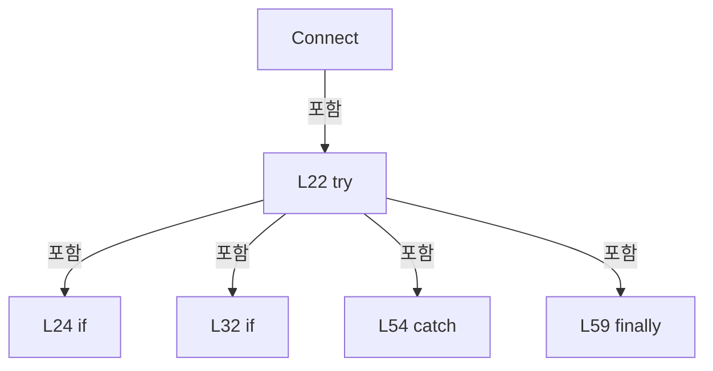

변경 전 점검: 입력/반환 타입, 위 호출자, 예외/취소 경로, 공유 상태와 저장·전송 소비자를 함께 확인합니다. 값의 단위나 물리 방향을 이름만으로 확정하지 않습니다.

### LocalFunctionStatement `SelectValue` · L43–46

[Drilling.Common/Interface/Socket/CSocketServerComm.cs:43–46](https://github.com/kjuws10-rgb/A3Drilling/blob/5aee8e58439c9b455cae7c9593c9be986c3e682e/Drilling.Common/Interface/Socket/CSocketServerComm.cs#L43-L46)

| 항목 | 실제 추출 값 |
| --- | --- |
| 서명 | System.Threading.Tasks.Task SelectValue() |
| 접근/수식자 | Private /  |
| 반환/값 타입 | System.Threading.Tasks.Task |
| 소속 타입 | NamedType:Drilling.Common.Interface.CSocketServerComm |

현재 부분 분석에서 직접 연결된 호출자는 없습니다. XAML/이벤트/인터페이스·델리게이트·외부 진입을 추가 확인해야 하며, 미사용으로 판정한 것이 아닙니다.

호출하는 대상과 해석 범위:

| 원본 행 | 표현식 | 분석 상태 | 대상/소스 위치 |
| --- | --- | --- | --- |
| 45 | AcceptLoop | resolved | System.Threading.Tasks.Task Drilling.Common.Interface.CSocketServerComm.AcceptLoop(System.Net.Sockets.TcpListener, System.Threading.CancellationToken) · Drilling.Common/Interface/Socket/CSocketServerComm.cs:118 |

본문의 실제 연산·분기·예외·반환 순서(원문 위치 순):

| 원본 행 | 종류 | 주석 해설 |
| --- | --- | --- |
| 45 | call | 함수·델리게이트 또는 객체 생성자를 호출합니다: AcceptLoop(listener, _serverCts.Token) |
| 45 | return | 호출자에게 값 또는 제어를 반환합니다: return AcceptLoop(listener, _serverCts.Token); |

변경 전 점검: 입력/반환 타입, 위 호출자, 예외/취소 경로, 공유 상태와 저장·전송 소비자를 함께 확인합니다. 값의 단위나 물리 방향을 이름만으로 확정하지 않습니다.

### MethodDeclaration `Disconnect` · L65–78

[Drilling.Common/Interface/Socket/CSocketServerComm.cs:65–78](https://github.com/kjuws10-rgb/A3Drilling/blob/5aee8e58439c9b455cae7c9593c9be986c3e682e/Drilling.Common/Interface/Socket/CSocketServerComm.cs#L65-L78)

| 항목 | 실제 추출 값 |
| --- | --- |
| 서명 | System.Threading.Tasks.Task Drilling.Common.Interface.CSocketServerComm.Disconnect(System.Threading.CancellationToken) |
| 접근/수식자 | Public / public, override, async |
| 반환/값 타입 | System.Threading.Tasks.Task |
| 소속 타입 | NamedType:Drilling.Common.Interface.CSocketServerComm |

입력 계약:

| 이름 | 타입 | 전달 | 선택/기본값 |
| --- | --- | --- | --- |
| cancellationToken | System.Threading.CancellationToken | None | True / null |

현재 부분 분석에서 직접 연결된 호출자는 없습니다. XAML/이벤트/인터페이스·델리게이트·외부 진입을 추가 확인해야 하며, 미사용으로 판정한 것이 아닙니다.

호출하는 대상과 해석 범위:

| 원본 행 | 표현식 | 분석 상태 | 대상/소스 위치 |
| --- | --- | --- | --- |
| 67 | cancellationToken.ThrowIfCancellationRequested | resolved | void System.Threading.CancellationToken.ThrowIfCancellationRequested() |
| 68 | _serverLock.WaitAsync | resolved | System.Threading.Tasks.Task System.Threading.SemaphoreSlim.WaitAsync(System.Threading.CancellationToken) |
| 71 | StopServer | resolved | System.Threading.Tasks.Task Drilling.Common.Interface.CSocketServerComm.StopServer() · Drilling.Common/Interface/Socket/CSocketServerComm.cs:264 |
| 72 | SetState | resolved | void Drilling.Common.Interface.CCommBase.SetState(Drilling.Common.Interface.EN_COMM_STATE) · Drilling.Common/Interface/CComm.cs:114 |
| 76 | _serverLock.Release | resolved | int System.Threading.SemaphoreSlim.Release() |

본문의 실제 연산·분기·예외·반환 순서(원문 위치 순):

| 원본 행 | 종류 | 주석 해설 |
| --- | --- | --- |
| 67 | call | 함수·델리게이트 또는 객체 생성자를 호출합니다: cancellationToken.ThrowIfCancellationRequested() |
| 68 | await | 비동기 완료를 기다립니다: await _serverLock.WaitAsync(cancellationToken) |
| 68 | call | 함수·델리게이트 또는 객체 생성자를 호출합니다: _serverLock.WaitAsync(cancellationToken) |
| 69 | try | 예외 처리 범위입니다: try |
| 71 | await | 비동기 완료를 기다립니다: await StopServer() |
| 71 | call | 함수·델리게이트 또는 객체 생성자를 호출합니다: StopServer() |
| 72 | call | 함수·델리게이트 또는 객체 생성자를 호출합니다: SetState(EN_COMM_STATE.Offline) |
| 74 | finally | 종료 정리 구간입니다: finally |
| 76 | call | 함수·델리게이트 또는 객체 생성자를 호출합니다: _serverLock.Release() |

제어 구문의 포함 구조(실제 실행 순서/CFG가 아닌 구문 탐색 그림):

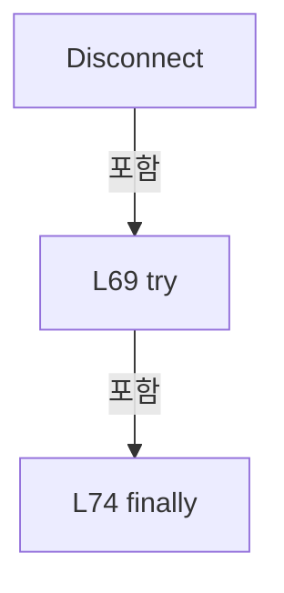

변경 전 점검: 입력/반환 타입, 위 호출자, 예외/취소 경로, 공유 상태와 저장·전송 소비자를 함께 확인합니다. 값의 단위나 물리 방향을 이름만으로 확정하지 않습니다.

### MethodDeclaration `Execute` · L80–116

[Drilling.Common/Interface/Socket/CSocketServerComm.cs:80–116](https://github.com/kjuws10-rgb/A3Drilling/blob/5aee8e58439c9b455cae7c9593c9be986c3e682e/Drilling.Common/Interface/Socket/CSocketServerComm.cs#L80-L116)

| 항목 | 실제 추출 값 |
| --- | --- |
| 서명 | System.Threading.Tasks.Task<string> Drilling.Common.Interface.CSocketServerComm.Execute(string, System.Threading.CancellationToken) |
| 접근/수식자 | Public / public, override, async |
| 반환/값 타입 | System.Threading.Tasks.Task<string> |
| 소속 타입 | NamedType:Drilling.Common.Interface.CSocketServerComm |

입력 계약:

| 이름 | 타입 | 전달 | 선택/기본값 |
| --- | --- | --- | --- |
| function | string | None | False /  |
| cancellationToken | System.Threading.CancellationToken | None | True / null |

현재 부분 분석에서 직접 연결된 호출자는 없습니다. XAML/이벤트/인터페이스·델리게이트·외부 진입을 추가 확인해야 하며, 미사용으로 판정한 것이 아닙니다.

호출하는 대상과 해석 범위:

| 원본 행 | 표현식 | 분석 상태 | 대상/소스 위치 |
| --- | --- | --- | --- |
| 84 | Connect | resolved · 동적 구현 선택 가능 | System.Threading.Tasks.Task Drilling.Common.Interface.CSocketServerComm.Connect(System.Threading.CancellationToken) · Drilling.Common/Interface/Socket/CSocketServerComm.cs:19 |
| 92 | function.Trim | resolved | string string.Trim() |
| 93 | command.Equals | resolved | bool string.Equals(string?, System.StringComparison) |
| 93 | command.Equals | resolved | bool string.Equals(string?, System.StringComparison) |
| 98 | SetState | resolved | void Drilling.Common.Interface.CCommBase.SetState(Drilling.Common.Interface.EN_COMM_STATE) · Drilling.Common/Interface/CComm.cs:114 |
| 102 | command.Equals | resolved | bool string.Equals(string?, System.StringComparison) |
| 104 | CloseAllClients | resolved | void Drilling.Common.Interface.CSocketServerComm.CloseAllClients() · Drilling.Common/Interface/Socket/CSocketServerComm.cs:307 |
| 108 | SetState | resolved | void Drilling.Common.Interface.CCommBase.SetState(Drilling.Common.Interface.EN_COMM_STATE) · Drilling.Common/Interface/CComm.cs:114 |
| 114 | SetCommandError | resolved | void Drilling.Common.Interface.CCommBase.SetCommandError(string) · Drilling.Common/Interface/CComm.cs:132 |

본문의 실제 연산·분기·예외·반환 순서(원문 위치 순):

| 원본 행 | 종류 | 주석 해설 |
| --- | --- | --- |
| 82 | if | 조건에 따라 분기합니다: if (_listener is null) |
| 84 | await | 비동기 완료를 기다립니다: await Connect(cancellationToken) |
| 84 | call | 함수·델리게이트 또는 객체 생성자를 호출합니다: Connect(cancellationToken) |
| 87 | if | 조건에 따라 분기합니다: if (_listener is null) |
| 89 | return | 호출자에게 값 또는 제어를 반환합니다: return ""; |
| 92 | call | 함수·델리게이트 또는 객체 생성자를 호출합니다: function.Trim() |
| 92 | local-declaration | 지역 변수를 선언합니다: var command = function.Trim(); |
| 92 | variable-initializer | 변수의 초기값을 지정합니다: command = function.Trim() |
| 93 | call | 함수·델리게이트 또는 객체 생성자를 호출합니다: command.Equals("STATUS", StringComparison.OrdinalIgnoreCase) |
| 93 | call | 함수·델리게이트 또는 객체 생성자를 호출합니다: command.Equals("CLIENTS", StringComparison.OrdinalIgnoreCase) |
| 93 | if | 조건에 따라 분기합니다: if (command.Equals("STATUS", StringComparison.OrdinalIgnoreCase) &#124;&#124; command.Equals("CLIENTS", StringComparison.OrdinalIgnoreCase)) |
| 95 | assignment | 값을 대상에 대입합니다: LastSent = command |
| 96 | assignment | 값을 대상에 대입합니다: LastReceived = $"OK:SOCKET_SERVER:CLIENTS:{_clients.Count}" |
| 97 | assignment | 값을 대상에 대입합니다: LastError = "" |
| 98 | call | 함수·델리게이트 또는 객체 생성자를 호출합니다: SetState(EN_COMM_STATE.Online) |
| 99 | return | 호출자에게 값 또는 제어를 반환합니다: return LastReceived; |
| 102 | call | 함수·델리게이트 또는 객체 생성자를 호출합니다: command.Equals("CLOSE_CLIENTS", StringComparison.OrdinalIgnoreCase) |
| 102 | if | 조건에 따라 분기합니다: if (command.Equals("CLOSE_CLIENTS", StringComparison.OrdinalIgnoreCase)) |
| 104 | call | 함수·델리게이트 또는 객체 생성자를 호출합니다: CloseAllClients() |
| 105 | assignment | 값을 대상에 대입합니다: LastSent = command |
| 106 | assignment | 값을 대상에 대입합니다: LastReceived = "OK:SOCKET_SERVER:CLOSE_CLIENTS" |
| 107 | assignment | 값을 대상에 대입합니다: LastError = "" |
| 108 | call | 함수·델리게이트 또는 객체 생성자를 호출합니다: SetState(EN_COMM_STATE.Online) |
| 109 | return | 호출자에게 값 또는 제어를 반환합니다: return LastReceived; |
| 112 | assignment | 값을 대상에 대입합니다: LastSent = command |
| 113 | assignment | 값을 대상에 대입합니다: LastReceived = "" |
| 114 | call | 함수·델리게이트 또는 객체 생성자를 호출합니다: SetCommandError($"Socket server command is not supported: {command}") |
| 115 | return | 호출자에게 값 또는 제어를 반환합니다: return ""; |

제어 구문의 포함 구조(실제 실행 순서/CFG가 아닌 구문 탐색 그림):

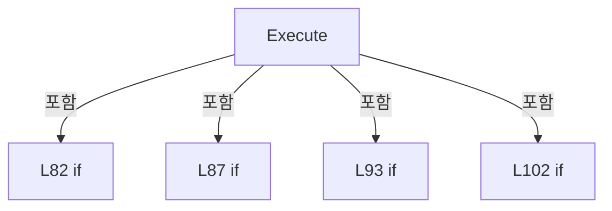

변경 전 점검: 입력/반환 타입, 위 호출자, 예외/취소 경로, 공유 상태와 저장·전송 소비자를 함께 확인합니다. 값의 단위나 물리 방향을 이름만으로 확정하지 않습니다.

### MethodDeclaration `AcceptLoop` · L118–170

[Drilling.Common/Interface/Socket/CSocketServerComm.cs:118–170](https://github.com/kjuws10-rgb/A3Drilling/blob/5aee8e58439c9b455cae7c9593c9be986c3e682e/Drilling.Common/Interface/Socket/CSocketServerComm.cs#L118-L170)

| 항목 | 실제 추출 값 |
| --- | --- |
| 서명 | System.Threading.Tasks.Task Drilling.Common.Interface.CSocketServerComm.AcceptLoop(System.Net.Sockets.TcpListener, System.Threading.CancellationToken) |
| 접근/수식자 | Private / private, async |
| 반환/값 타입 | System.Threading.Tasks.Task |
| 소속 타입 | NamedType:Drilling.Common.Interface.CSocketServerComm |

입력 계약:

| 이름 | 타입 | 전달 | 선택/기본값 |
| --- | --- | --- | --- |
| listener | System.Net.Sockets.TcpListener | None | False /  |
| cancellationToken | System.Threading.CancellationToken | None | False /  |

정적 호출자로 확인된 위치:

| 호출 파일/행 | 호출 표현식 | 런타임 분기 가능 |
| --- | --- | --- |
| [Drilling.Common/Interface/Socket/CSocketServerComm.cs:45–45](https://github.com/kjuws10-rgb/A3Drilling/blob/5aee8e58439c9b455cae7c9593c9be986c3e682e/Drilling.Common/Interface/Socket/CSocketServerComm.cs#L45-L45) | AcceptLoop | False |

호출하는 대상과 해석 범위:

| 원본 행 | 표현식 | 분석 상태 | 대상/소스 위치 |
| --- | --- | --- | --- |
| 125 | listener.AcceptTcpClientAsync | resolved | System.Threading.Tasks.ValueTask<System.Net.Sockets.TcpClient> System.Net.Sockets.TcpListener.AcceptTcpClientAsync(System.Threading.CancellationToken) |
| 126 | IsAllowedRemote | resolved | bool Drilling.Common.Interface.CSocketServerComm.IsAllowedRemote(System.Net.Sockets.TcpClient) · Drilling.Common/Interface/Socket/CSocketServerComm.cs:318 |
| 128 | client.Close | resolved | void System.Net.Sockets.TcpClient.Close() |
| 132 | Math.Max | resolved | int System.Math.Max(int, int) |
| 137 | client.Close | resolved | void System.Net.Sockets.TcpClient.Close() |
| 142 | Interlocked.Increment | resolved | int System.Threading.Interlocked.Increment(ref int) |
| 145 | SetState | resolved | void Drilling.Common.Interface.CCommBase.SetState(Drilling.Common.Interface.EN_COMM_STATE) · Drilling.Common/Interface/CComm.cs:114 |
| 156 | Task.Run | resolved | System.Threading.Tasks.Task System.Threading.Tasks.Task.Run(System.Func<System.Threading.Tasks.Task?>, System.Threading.CancellationToken) |
| 158 | receiveTask.ContinueWith | resolved | System.Threading.Tasks.Task System.Threading.Tasks.Task.ContinueWith(System.Action<System.Threading.Tasks.Task>, System.Threading.CancellationToken, System.Threading.Tasks.TaskContinuationOptions, System.Threading.Tasks.TaskScheduler) |
| 162 | .Close | resolved | void System.Net.Sockets.TcpClient.Close() |

본문의 실제 연산·분기·예외·반환 순서(원문 위치 순):

| 원본 행 | 종류 | 주석 해설 |
| --- | --- | --- |
| 120 | while | 조건을 먼저 확인하며 반복합니다: while (!cancellationToken.IsCancellationRequested) |
| 122 | local-declaration | 지역 변수를 선언합니다: TcpClient? client = null; |
| 122 | variable-initializer | 변수의 초기값을 지정합니다: client = null |
| 123 | try | 예외 처리 범위입니다: try |
| 125 | assignment | 값을 대상에 대입합니다: client = await listener.AcceptTcpClientAsync(cancellationToken) |
| 125 | await | 비동기 완료를 기다립니다: await listener.AcceptTcpClientAsync(cancellationToken) |
| 125 | call | 함수·델리게이트 또는 객체 생성자를 호출합니다: listener.AcceptTcpClientAsync(cancellationToken) |
| 126 | call | 함수·델리게이트 또는 객체 생성자를 호출합니다: IsAllowedRemote(client) |
| 126 | if | 조건에 따라 분기합니다: if (!IsAllowedRemote(client)) |
| 128 | call | 함수·델리게이트 또는 객체 생성자를 호출합니다: client.Close() |
| 129 | continue | 다음 반복으로 진행합니다: continue; |
| 132 | call | 함수·델리게이트 또는 객체 생성자를 호출합니다: Math.Max(1, Option.MaxClientCount) |
| 132 | local-declaration | 지역 변수를 선언합니다: var maxClientCount = Math.Max(1, Option.MaxClientCount); |
| 132 | variable-initializer | 변수의 초기값을 지정합니다: maxClientCount = Math.Max(1, Option.MaxClientCount) |
| 133 | if | 조건에 따라 분기합니다: if (_clients.Count >= maxClientCount) |
| 135 | assignment | 값을 대상에 대입합니다: LastError = $"Socket server max client count reached: {maxClientCount}" |
| 136 | assignment | 값을 대상에 대입합니다: LastChangedAt = DateTimeOffset.Now |
| 137 | call | 함수·델리게이트 또는 객체 생성자를 호출합니다: client.Close() |
| 138 | continue | 다음 반복으로 진행합니다: continue; |
| 141 | assignment | 값을 대상에 대입합니다: client.NoDelay = true |
| 142 | call | 함수·델리게이트 또는 객체 생성자를 호출합니다: Interlocked.Increment(ref _clientSequence) |
| 142 | local-declaration | 지역 변수를 선언합니다: var clientId = Interlocked.Increment(ref _clientSequence); |
| 142 | variable-initializer | 변수의 초기값을 지정합니다: clientId = Interlocked.Increment(ref _clientSequence) |
| 143 | assignment | 값을 대상에 대입합니다: _clients[clientId] = client |
| 144 | assignment | 값을 대상에 대입합니다: LastError = "" |
| 145 | call | 함수·델리게이트 또는 객체 생성자를 호출합니다: SetState(EN_COMM_STATE.Online) |
| 156 | call | 함수·델리게이트 또는 객체 생성자를 호출합니다: Task.Run(SelectValue, CancellationToken.None) |
| 156 | local-declaration | 지역 변수를 선언합니다: var receiveTask = Task.Run(SelectValue, CancellationToken.None); |
| 156 | variable-initializer | 변수의 초기값을 지정합니다: receiveTask = Task.Run(SelectValue, CancellationToken.None) |
| 157 | assignment | 값을 대상에 대입합니다: _clientTasks[clientId] = receiveTask |
| 158 | assignment | 값을 대상에 대입합니다: _ = receiveTask.ContinueWith(CleanupClientTaskCallback, CancellationToken.None, TaskContinuationOptions.ExecuteSynchronously, TaskScheduler.Default) |
| 158 | call | 함수·델리게이트 또는 객체 생성자를 호출합니다: receiveTask.ContinueWith(CleanupClientTaskCallback, CancellationToken.None, TaskContinuationOptions.ExecuteSynchronously, TaskScheduler.Default) |
| 160 | catch | 지정 예외를 처리합니다: catch (Exception ex) when (cancellationToken.IsCancellationRequested &#124;&#124; ex is ObjectDisposedException or SocketException or OperationCanceledException) |
| 162 | call | 함수·델리게이트 또는 객체 생성자를 호출합니다: .Close() |
| 163 | if | 조건에 따라 분기합니다: if (!cancellationToken.IsCancellationRequested) |
| 165 | assignment | 값을 대상에 대입합니다: LastError = ex.Message |
| 166 | assignment | 값을 대상에 대입합니다: LastChangedAt = DateTimeOffset.Now |

제어 구문의 포함 구조(실제 실행 순서/CFG가 아닌 구문 탐색 그림):

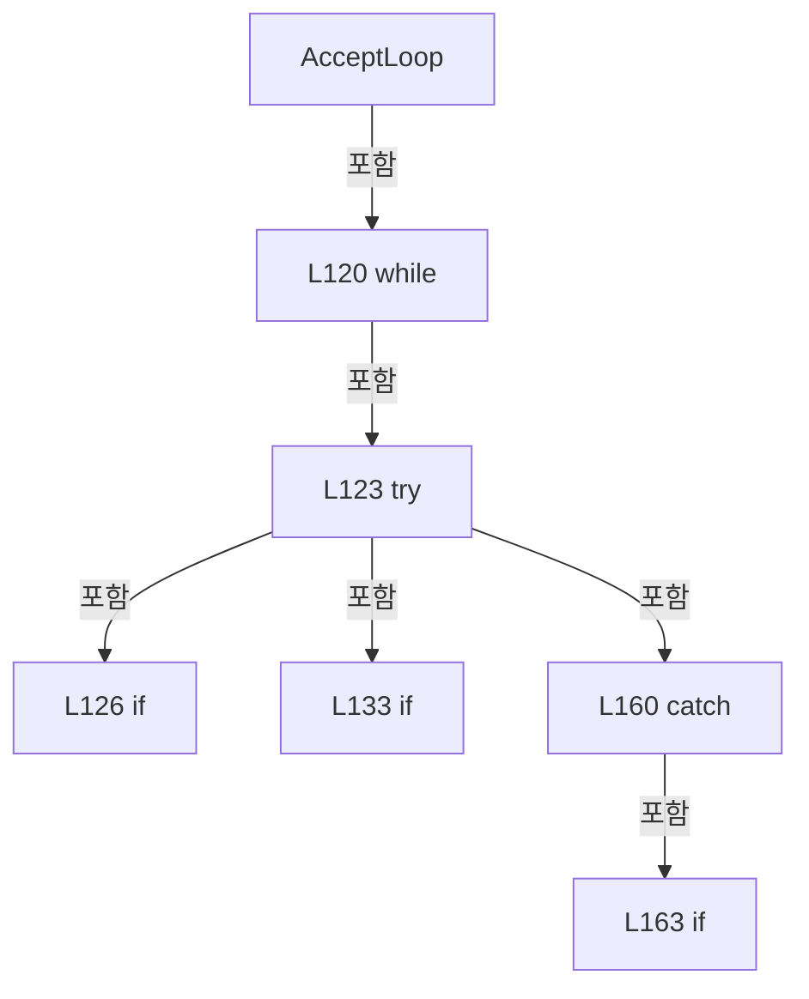

변경 전 점검: 입력/반환 타입, 위 호출자, 예외/취소 경로, 공유 상태와 저장·전송 소비자를 함께 확인합니다. 값의 단위나 물리 방향을 이름만으로 확정하지 않습니다.

### LocalFunctionStatement `SelectValue` · L146–149

[Drilling.Common/Interface/Socket/CSocketServerComm.cs:146–149](https://github.com/kjuws10-rgb/A3Drilling/blob/5aee8e58439c9b455cae7c9593c9be986c3e682e/Drilling.Common/Interface/Socket/CSocketServerComm.cs#L146-L149)

| 항목 | 실제 추출 값 |
| --- | --- |
| 서명 | System.Threading.Tasks.Task SelectValue() |
| 접근/수식자 | Private /  |
| 반환/값 타입 | System.Threading.Tasks.Task |
| 소속 타입 | NamedType:Drilling.Common.Interface.CSocketServerComm |

현재 부분 분석에서 직접 연결된 호출자는 없습니다. XAML/이벤트/인터페이스·델리게이트·외부 진입을 추가 확인해야 하며, 미사용으로 판정한 것이 아닙니다.

호출하는 대상과 해석 범위:

| 원본 행 | 표현식 | 분석 상태 | 대상/소스 위치 |
| --- | --- | --- | --- |
| 148 | ReceiveLoop | resolved | System.Threading.Tasks.Task Drilling.Common.Interface.CSocketServerComm.ReceiveLoop(int, System.Net.Sockets.TcpClient, System.Threading.CancellationToken) · Drilling.Common/Interface/Socket/CSocketServerComm.cs:172 |

본문의 실제 연산·분기·예외·반환 순서(원문 위치 순):

| 원본 행 | 종류 | 주석 해설 |
| --- | --- | --- |
| 148 | call | 함수·델리게이트 또는 객체 생성자를 호출합니다: ReceiveLoop(clientId, client, cancellationToken) |
| 148 | return | 호출자에게 값 또는 제어를 반환합니다: return ReceiveLoop(clientId, client, cancellationToken); |

변경 전 점검: 입력/반환 타입, 위 호출자, 예외/취소 경로, 공유 상태와 저장·전송 소비자를 함께 확인합니다. 값의 단위나 물리 방향을 이름만으로 확정하지 않습니다.

### LocalFunctionStatement `CleanupClientTaskCallback` · L151–154

[Drilling.Common/Interface/Socket/CSocketServerComm.cs:151–154](https://github.com/kjuws10-rgb/A3Drilling/blob/5aee8e58439c9b455cae7c9593c9be986c3e682e/Drilling.Common/Interface/Socket/CSocketServerComm.cs#L151-L154)

| 항목 | 실제 추출 값 |
| --- | --- |
| 서명 | void CleanupClientTaskCallback(System.Threading.Tasks.Task) |
| 접근/수식자 | Private /  |
| 반환/값 타입 | void |
| 소속 타입 | NamedType:Drilling.Common.Interface.CSocketServerComm |

입력 계약:

| 이름 | 타입 | 전달 | 선택/기본값 |
| --- | --- | --- | --- |
| task | System.Threading.Tasks.Task | None | False /  |

현재 부분 분석에서 직접 연결된 호출자는 없습니다. XAML/이벤트/인터페이스·델리게이트·외부 진입을 추가 확인해야 하며, 미사용으로 판정한 것이 아닙니다.

호출하는 대상과 해석 범위:

| 원본 행 | 표현식 | 분석 상태 | 대상/소스 위치 |
| --- | --- | --- | --- |
| 153 | CleanupClientTask | resolved | void Drilling.Common.Interface.CSocketServerComm.CleanupClientTask(int, System.Threading.Tasks.Task) · Drilling.Common/Interface/Socket/CSocketServerComm.cs:224 |

본문의 실제 연산·분기·예외·반환 순서(원문 위치 순):

| 원본 행 | 종류 | 주석 해설 |
| --- | --- | --- |
| 153 | call | 함수·델리게이트 또는 객체 생성자를 호출합니다: CleanupClientTask(clientId, task) |

변경 전 점검: 입력/반환 타입, 위 호출자, 예외/취소 경로, 공유 상태와 저장·전송 소비자를 함께 확인합니다. 값의 단위나 물리 방향을 이름만으로 확정하지 않습니다.

### MethodDeclaration `ReceiveLoop` · L172–222

[Drilling.Common/Interface/Socket/CSocketServerComm.cs:172–222](https://github.com/kjuws10-rgb/A3Drilling/blob/5aee8e58439c9b455cae7c9593c9be986c3e682e/Drilling.Common/Interface/Socket/CSocketServerComm.cs#L172-L222)

| 항목 | 실제 추출 값 |
| --- | --- |
| 서명 | System.Threading.Tasks.Task Drilling.Common.Interface.CSocketServerComm.ReceiveLoop(int, System.Net.Sockets.TcpClient, System.Threading.CancellationToken) |
| 접근/수식자 | Private / private, async |
| 반환/값 타입 | System.Threading.Tasks.Task |
| 소속 타입 | NamedType:Drilling.Common.Interface.CSocketServerComm |

입력 계약:

| 이름 | 타입 | 전달 | 선택/기본값 |
| --- | --- | --- | --- |
| clientId | int | None | False /  |
| client | System.Net.Sockets.TcpClient | None | False /  |
| cancellationToken | System.Threading.CancellationToken | None | False /  |

정적 호출자로 확인된 위치:

| 호출 파일/행 | 호출 표현식 | 런타임 분기 가능 |
| --- | --- | --- |
| [Drilling.Common/Interface/Socket/CSocketServerComm.cs:148–148](https://github.com/kjuws10-rgb/A3Drilling/blob/5aee8e58439c9b455cae7c9593c9be986c3e682e/Drilling.Common/Interface/Socket/CSocketServerComm.cs#L148-L148) | ReceiveLoop | False |

호출하는 대상과 해석 범위:

| 원본 행 | 표현식 | 분석 상태 | 대상/소스 위치 |
| --- | --- | --- | --- |
| 174 | GetRemoteEndPoint | resolved | string Drilling.Common.Interface.CSocketServerComm.GetRemoteEndPoint(System.Net.Sockets.TcpClient) · Drilling.Common/Interface/Socket/CSocketServerComm.cs:390 |
| 179 | client.GetStream | resolved | System.Net.Sockets.NetworkStream System.Net.Sockets.TcpClient.GetStream() |
| 180 | new StreamReader | resolved | System.IO.StreamReader.StreamReader(System.IO.Stream, System.Text.Encoding?, bool, int, bool) |
| 181 | new StreamWriter | resolved | System.IO.StreamWriter.StreamWriter(System.IO.Stream, System.Text.Encoding?, int, bool) |
| 181 | new UTF8Encoding | resolved | System.Text.UTF8Encoding.UTF8Encoding(bool) |
| 188 | ReadProtocolLineWithTimeout | resolved | System.Threading.Tasks.Task<string?> Drilling.Common.Interface.CSocketServerComm.ReadProtocolLineWithTimeout(System.IO.StreamReader, System.Threading.CancellationToken) · Drilling.Common/Interface/Socket/CSocketServerComm.cs:376 |
| 194 | NormalizeReceivedMessage | resolved | string Drilling.Common.Interface.CSocketServerComm.NormalizeReceivedMessage(string) · Drilling.Common/Interface/Socket/CSocketServerComm.cs:395 |
| 195 | string.IsNullOrWhiteSpace | resolved | bool string.IsNullOrWhiteSpace(string?) |
| 200 | RaiseMessageReceived | resolved | System.Threading.Tasks.Task<string> Drilling.Common.Interface.CSocketServerComm.RaiseMessageReceived(string, string, System.Threading.CancellationToken) · Drilling.Common/Interface/Socket/CSocketServerComm.cs:236 |
| 201 | string.IsNullOrWhiteSpace | resolved | bool string.IsNullOrWhiteSpace(string?) |
| 203 | NormalizeProtocolLine | resolved | string Drilling.Common.Interface.CSocketServerComm.NormalizeProtocolLine(string) · Drilling.Common/Interface/Socket/CSocketServerComm.cs:400 |
| 204 | writer.WriteLineAsync | resolved · 동적 구현 선택 가능 | System.Threading.Tasks.Task System.IO.StreamWriter.WriteLineAsync(System.ReadOnlyMemory<char>, System.Threading.CancellationToken) |
| 204 | protocolResponse.AsMemory | resolved | System.ReadOnlyMemory<char> string?.AsMemory() |

본문의 실제 연산·분기·예외·반환 순서(원문 위치 순):

| 원본 행 | 종류 | 주석 해설 |
| --- | --- | --- |
| 174 | call | 함수·델리게이트 또는 객체 생성자를 호출합니다: GetRemoteEndPoint(client) |
| 174 | local-declaration | 지역 변수를 선언합니다: var remoteEndPoint = GetRemoteEndPoint(client); |
| 174 | variable-initializer | 변수의 초기값을 지정합니다: remoteEndPoint = GetRemoteEndPoint(client) |
| 175 | try | 예외 처리 범위입니다: try |
| 177 | using | 자원 사용과 정리 범위를 지정합니다: using (client) |
| 179 | call | 함수·델리게이트 또는 객체 생성자를 호출합니다: client.GetStream() |
| 179 | local-declaration | 지역 변수를 선언합니다: var stream = client.GetStream(); |
| 179 | variable-initializer | 변수의 초기값을 지정합니다: stream = client.GetStream() |
| 180 | call | 함수·델리게이트 또는 객체 생성자를 호출합니다: new StreamReader(stream, Encoding.UTF8, detectEncodingFromByteOrderMarks: false, bufferSize: 4096, leaveOpen: true) |
| 180 | using-declaration | 정리할 자원을 선언합니다: using var reader = new StreamReader(stream, Encoding.UTF8, detectEncodingFromByteOrderMarks: false, bufferSize: 4096, leaveOpen: true); |
| 180 | variable-initializer | 변수의 초기값을 지정합니다: reader = new StreamReader(stream, Encoding.UTF8, detectEncodingFromByteOrderMarks: false, bufferSize: 4096, leaveOpen: true) |
| 181 | call | 함수·델리게이트 또는 객체 생성자를 호출합니다: new UTF8Encoding(encoderShouldEmitUTF8Identifier: false) |
| 181 | call | 함수·델리게이트 또는 객체 생성자를 호출합니다: new StreamWriter(stream, new UTF8Encoding(encoderShouldEmitUTF8Identifier: false), bufferSize: 4096, leaveOpen: true) { AutoFlush = true, NewLine = "\n" } |
| 181 | using-declaration | 정리할 자원을 선언합니다: using var writer = new StreamWriter(stream, new UTF8Encoding(encoderShouldEmitUTF8Identifier: false), bufferSize: 4096, leaveOpen: true) { AutoFlush = true, NewLine = "\n" }; |
| 181 | variable-initializer | 변수의 초기값을 지정합니다: writer = new StreamWriter(stream, new UTF8Encoding(encoderShouldEmitUTF8Identifier: false), bufferSize: 4096, leaveOpen: true) { AutoFlush = true, NewLine = "\n" } |
| 183 | assignment | 값을 대상에 대입합니다: AutoFlush = true |
| 184 | assignment | 값을 대상에 대입합니다: NewLine = "\n" |
| 186 | while | 조건을 먼저 확인하며 반복합니다: while (!cancellationToken.IsCancellationRequested && client.Connected) |
| 188 | await | 비동기 완료를 기다립니다: await ReadProtocolLineWithTimeout(reader, cancellationToken) |
| 188 | call | 함수·델리게이트 또는 객체 생성자를 호출합니다: ReadProtocolLineWithTimeout(reader, cancellationToken) |
| 188 | local-declaration | 지역 변수를 선언합니다: var line = await ReadProtocolLineWithTimeout(reader, cancellationToken); |
| 188 | variable-initializer | 변수의 초기값을 지정합니다: line = await ReadProtocolLineWithTimeout(reader, cancellationToken) |
| 189 | if | 조건에 따라 분기합니다: if (line is null) |
| 191 | break | 해당 반복/분기 구간을 종료합니다: break; |
| 194 | call | 함수·델리게이트 또는 객체 생성자를 호출합니다: NormalizeReceivedMessage(line) |
| 194 | local-declaration | 지역 변수를 선언합니다: var message = NormalizeReceivedMessage(line); |
| 194 | variable-initializer | 변수의 초기값을 지정합니다: message = NormalizeReceivedMessage(line) |
| 195 | call | 함수·델리게이트 또는 객체 생성자를 호출합니다: string.IsNullOrWhiteSpace(message) |
| 195 | if | 조건에 따라 분기합니다: if (string.IsNullOrWhiteSpace(message)) |
| 197 | continue | 다음 반복으로 진행합니다: continue; |
| 200 | await | 비동기 완료를 기다립니다: await RaiseMessageReceived(remoteEndPoint, message, cancellationToken) |
| 200 | call | 함수·델리게이트 또는 객체 생성자를 호출합니다: RaiseMessageReceived(remoteEndPoint, message, cancellationToken) |
| 200 | local-declaration | 지역 변수를 선언합니다: var response = await RaiseMessageReceived(remoteEndPoint, message, cancellationToken); |
| 200 | variable-initializer | 변수의 초기값을 지정합니다: response = await RaiseMessageReceived(remoteEndPoint, message, cancellationToken) |
| 201 | call | 함수·델리게이트 또는 객체 생성자를 호출합니다: string.IsNullOrWhiteSpace(response) |
| 201 | if | 조건에 따라 분기합니다: if (!string.IsNullOrWhiteSpace(response)) |
| 203 | call | 함수·델리게이트 또는 객체 생성자를 호출합니다: NormalizeProtocolLine(response) |
| 203 | local-declaration | 지역 변수를 선언합니다: var protocolResponse = NormalizeProtocolLine(response); |
| 203 | variable-initializer | 변수의 초기값을 지정합니다: protocolResponse = NormalizeProtocolLine(response) |
| 204 | await | 비동기 완료를 기다립니다: await writer.WriteLineAsync(protocolResponse.AsMemory(), cancellationToken) |
| 204 | call | 함수·델리게이트 또는 객체 생성자를 호출합니다: writer.WriteLineAsync(protocolResponse.AsMemory(), cancellationToken) |
| 204 | call | 함수·델리게이트 또는 객체 생성자를 호출합니다: protocolResponse.AsMemory() |
| 205 | assignment | 값을 대상에 대입합니다: LastSent = protocolResponse |
| 206 | assignment | 값을 대상에 대입합니다: LastChangedAt = DateTimeOffset.Now |
| 211 | catch | 지정 예외를 처리합니다: catch (OperationCanceledException) when (cancellationToken.IsCancellationRequested) |
| 214 | catch | 지정 예외를 처리합니다: catch (Exception ex) |
| 216 | if | 조건에 따라 분기합니다: if (!cancellationToken.IsCancellationRequested) |
| 218 | assignment | 값을 대상에 대입합니다: LastError = ex.Message |
| 219 | assignment | 값을 대상에 대입합니다: LastChangedAt = DateTimeOffset.Now |

제어 구문의 포함 구조(실제 실행 순서/CFG가 아닌 구문 탐색 그림):

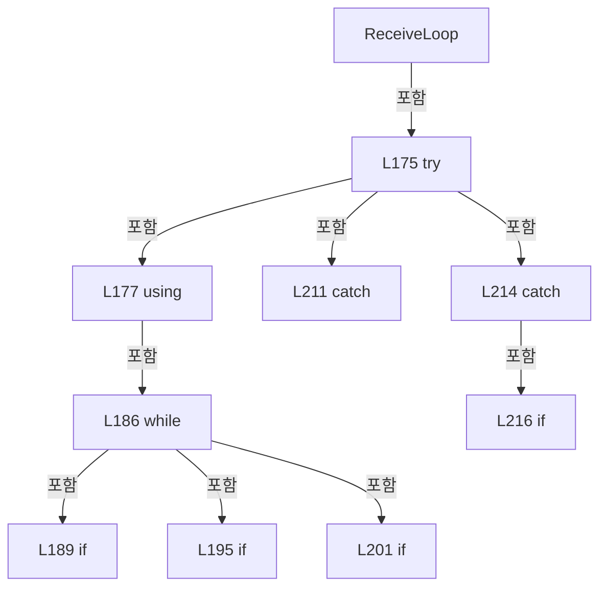

변경 전 점검: 입력/반환 타입, 위 호출자, 예외/취소 경로, 공유 상태와 저장·전송 소비자를 함께 확인합니다. 값의 단위나 물리 방향을 이름만으로 확정하지 않습니다.

### MethodDeclaration `CleanupClientTask` · L224–234

[Drilling.Common/Interface/Socket/CSocketServerComm.cs:224–234](https://github.com/kjuws10-rgb/A3Drilling/blob/5aee8e58439c9b455cae7c9593c9be986c3e682e/Drilling.Common/Interface/Socket/CSocketServerComm.cs#L224-L234)

| 항목 | 실제 추출 값 |
| --- | --- |
| 서명 | void Drilling.Common.Interface.CSocketServerComm.CleanupClientTask(int, System.Threading.Tasks.Task) |
| 접근/수식자 | Private / private |
| 반환/값 타입 | void |
| 소속 타입 | NamedType:Drilling.Common.Interface.CSocketServerComm |

입력 계약:

| 이름 | 타입 | 전달 | 선택/기본값 |
| --- | --- | --- | --- |
| clientId | int | None | False /  |
| task | System.Threading.Tasks.Task | None | False /  |

정적 호출자로 확인된 위치:

| 호출 파일/행 | 호출 표현식 | 런타임 분기 가능 |
| --- | --- | --- |
| [Drilling.Common/Interface/Socket/CSocketServerComm.cs:153–153](https://github.com/kjuws10-rgb/A3Drilling/blob/5aee8e58439c9b455cae7c9593c9be986c3e682e/Drilling.Common/Interface/Socket/CSocketServerComm.cs#L153-L153) | CleanupClientTask | False |

호출하는 대상과 해석 범위:

| 원본 행 | 표현식 | 분석 상태 | 대상/소스 위치 |
| --- | --- | --- | --- |
| 228 | .GetBaseException | resolved · 동적 구현 선택 가능 | System.Exception System.AggregateException.GetBaseException() |
| 232 | _clients.TryRemove | resolved | bool System.Collections.Concurrent.ConcurrentDictionary<int, System.Net.Sockets.TcpClient>.TryRemove(int, out System.Net.Sockets.TcpClient) |
| 233 | _clientTasks.TryRemove | resolved | bool System.Collections.Concurrent.ConcurrentDictionary<int, System.Threading.Tasks.Task>.TryRemove(int, out System.Threading.Tasks.Task) |

본문의 실제 연산·분기·예외·반환 순서(원문 위치 순):

| 원본 행 | 종류 | 주석 해설 |
| --- | --- | --- |
| 226 | if | 조건에 따라 분기합니다: if (task.IsFaulted) |
| 228 | assignment | 값을 대상에 대입합니다: LastError = task.Exception?.GetBaseException().Message ?? "Socket server receive task failed." |
| 228 | call | 함수·델리게이트 또는 객체 생성자를 호출합니다: .GetBaseException() |
| 229 | assignment | 값을 대상에 대입합니다: LastChangedAt = DateTimeOffset.Now |
| 232 | call | 함수·델리게이트 또는 객체 생성자를 호출합니다: _clients.TryRemove(clientId, out _) |
| 233 | call | 함수·델리게이트 또는 객체 생성자를 호출합니다: _clientTasks.TryRemove(clientId, out _) |

제어 구문의 포함 구조(실제 실행 순서/CFG가 아닌 구문 탐색 그림):

변경 전 점검: 입력/반환 타입, 위 호출자, 예외/취소 경로, 공유 상태와 저장·전송 소비자를 함께 확인합니다. 값의 단위나 물리 방향을 이름만으로 확정하지 않습니다.

### MethodDeclaration `RaiseMessageReceived` · L236–262

[Drilling.Common/Interface/Socket/CSocketServerComm.cs:236–262](https://github.com/kjuws10-rgb/A3Drilling/blob/5aee8e58439c9b455cae7c9593c9be986c3e682e/Drilling.Common/Interface/Socket/CSocketServerComm.cs#L236-L262)

| 항목 | 실제 추출 값 |
| --- | --- |
| 서명 | System.Threading.Tasks.Task<string> Drilling.Common.Interface.CSocketServerComm.RaiseMessageReceived(string, string, System.Threading.CancellationToken) |
| 접근/수식자 | Private / private, async |
| 반환/값 타입 | System.Threading.Tasks.Task<string> |
| 소속 타입 | NamedType:Drilling.Common.Interface.CSocketServerComm |

입력 계약:

| 이름 | 타입 | 전달 | 선택/기본값 |
| --- | --- | --- | --- |
| remoteEndPoint | string | None | False /  |
| message | string | None | False /  |
| cancellationToken | System.Threading.CancellationToken | None | False /  |

정적 호출자로 확인된 위치:

| 호출 파일/행 | 호출 표현식 | 런타임 분기 가능 |
| --- | --- | --- |
| [Drilling.Common/Interface/Socket/CSocketServerComm.cs:200–200](https://github.com/kjuws10-rgb/A3Drilling/blob/5aee8e58439c9b455cae7c9593c9be986c3e682e/Drilling.Common/Interface/Socket/CSocketServerComm.cs#L200-L200) | RaiseMessageReceived | False |

호출하는 대상과 해석 범위:

| 원본 행 | 표현식 | 분석 상태 | 대상/소스 위치 |
| --- | --- | --- | --- |
| 240 | SetState | resolved | void Drilling.Common.Interface.CCommBase.SetState(Drilling.Common.Interface.EN_COMM_STATE) · Drilling.Common/Interface/CComm.cs:114 |
| 249 | handler | resolved · 동적 구현 선택 가능 | System.Threading.Tasks.Task<string> System.Func<Drilling.Common.Interface.ST_COMM_RECEIVED_MESSAGE, System.Threading.CancellationToken, System.Threading.Tasks.Task<string>>.Invoke(Drilling.Common.Interface.ST_COMM_RECEIVED_MESSAGE, System.Threading.CancellationToken) |
| 249 | new ST_COMM_RECEIVED_MESSAGE | resolved | Drilling.Common.Interface.ST_COMM_RECEIVED_MESSAGE.ST_COMM_RECEIVED_MESSAGE(string, string, System.DateTimeOffset) · Drilling.Common/Interface/CComm.cs:77 |
| 250 | string.IsNullOrWhiteSpace | resolved | bool string.IsNullOrWhiteSpace(string?) |
| 260 | NormalizeProtocolLine | resolved | string Drilling.Common.Interface.CSocketServerComm.NormalizeProtocolLine(string) · Drilling.Common/Interface/Socket/CSocketServerComm.cs:400 |

본문의 실제 연산·분기·예외·반환 순서(원문 위치 순):

| 원본 행 | 종류 | 주석 해설 |
| --- | --- | --- |
| 238 | assignment | 값을 대상에 대입합니다: LastReceived = message |
| 239 | assignment | 값을 대상에 대입합니다: LastError = "" |
| 240 | call | 함수·델리게이트 또는 객체 생성자를 호출합니다: SetState(EN_COMM_STATE.Online) |
| 241 | local-declaration | 지역 변수를 선언합니다: var handler = MessageReceived; |
| 241 | variable-initializer | 변수의 초기값을 지정합니다: handler = MessageReceived |
| 242 | if | 조건에 따라 분기합니다: if (handler is null) |
| 244 | return | 호출자에게 값 또는 제어를 반환합니다: return "ACK"; |
| 247 | try | 예외 처리 범위입니다: try |
| 249 | await | 비동기 완료를 기다립니다: await handler(new ST_COMM_RECEIVED_MESSAGE(remoteEndPoint, message, DateTimeOffset.Now), cancellationToken) |
| 249 | call | 함수·델리게이트 또는 객체 생성자를 호출합니다: handler(new ST_COMM_RECEIVED_MESSAGE(remoteEndPoint, message, DateTimeOffset.Now), cancellationToken) |
| 249 | call | 함수·델리게이트 또는 객체 생성자를 호출합니다: new ST_COMM_RECEIVED_MESSAGE(remoteEndPoint, message, DateTimeOffset.Now) |
| 249 | local-declaration | 지역 변수를 선언합니다: var response = await handler(new ST_COMM_RECEIVED_MESSAGE(remoteEndPoint, message, DateTimeOffset.Now), cancellationToken); |
| 249 | variable-initializer | 변수의 초기값을 지정합니다: response = await handler(new ST_COMM_RECEIVED_MESSAGE(remoteEndPoint, message, DateTimeOffset.Now), cancellationToken) |
| 250 | call | 함수·델리게이트 또는 객체 생성자를 호출합니다: string.IsNullOrWhiteSpace(response) |
| 250 | conditional-expression | 조건에 따라 결과식을 선택합니다: string.IsNullOrWhiteSpace(response) ? "ACK" : response |
| 250 | return | 호출자에게 값 또는 제어를 반환합니다: return string.IsNullOrWhiteSpace(response) ? "ACK" : response; |
| 252 | catch | 지정 예외를 처리합니다: catch (OperationCanceledException) when (cancellationToken.IsCancellationRequested) |
| 254 | throw | 예외를 발생/전달합니다: throw; |
| 256 | catch | 지정 예외를 처리합니다: catch (Exception ex) |
| 258 | assignment | 값을 대상에 대입합니다: LastError = ex.Message |
| 259 | assignment | 값을 대상에 대입합니다: LastChangedAt = DateTimeOffset.Now |
| 260 | call | 함수·델리게이트 또는 객체 생성자를 호출합니다: NormalizeProtocolLine(ex.Message) |
| 260 | return | 호출자에게 값 또는 제어를 반환합니다: return $"NAK&#124;{NormalizeProtocolLine(ex.Message)}"; |

제어 구문의 포함 구조(실제 실행 순서/CFG가 아닌 구문 탐색 그림):

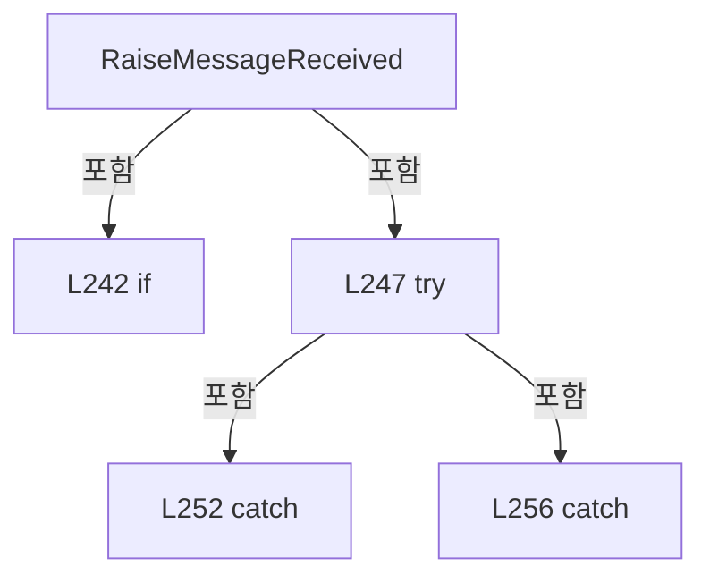

변경 전 점검: 입력/반환 타입, 위 호출자, 예외/취소 경로, 공유 상태와 저장·전송 소비자를 함께 확인합니다. 값의 단위나 물리 방향을 이름만으로 확정하지 않습니다.

### MethodDeclaration `StopServer` · L264–305

[Drilling.Common/Interface/Socket/CSocketServerComm.cs:264–305](https://github.com/kjuws10-rgb/A3Drilling/blob/5aee8e58439c9b455cae7c9593c9be986c3e682e/Drilling.Common/Interface/Socket/CSocketServerComm.cs#L264-L305)

| 항목 | 실제 추출 값 |
| --- | --- |
| 서명 | System.Threading.Tasks.Task Drilling.Common.Interface.CSocketServerComm.StopServer() |
| 접근/수식자 | Private / private, async |
| 반환/값 타입 | System.Threading.Tasks.Task |
| 소속 타입 | NamedType:Drilling.Common.Interface.CSocketServerComm |

정적 호출자로 확인된 위치:

| 호출 파일/행 | 호출 표현식 | 런타임 분기 가능 |
| --- | --- | --- |
| [Drilling.Common/Interface/Socket/CSocketServerComm.cs:31–31](https://github.com/kjuws10-rgb/A3Drilling/blob/5aee8e58439c9b455cae7c9593c9be986c3e682e/Drilling.Common/Interface/Socket/CSocketServerComm.cs#L31-L31) | StopServer | False |
| [Drilling.Common/Interface/Socket/CSocketServerComm.cs:56–56](https://github.com/kjuws10-rgb/A3Drilling/blob/5aee8e58439c9b455cae7c9593c9be986c3e682e/Drilling.Common/Interface/Socket/CSocketServerComm.cs#L56-L56) | StopServer | False |
| [Drilling.Common/Interface/Socket/CSocketServerComm.cs:71–71](https://github.com/kjuws10-rgb/A3Drilling/blob/5aee8e58439c9b455cae7c9593c9be986c3e682e/Drilling.Common/Interface/Socket/CSocketServerComm.cs#L71-L71) | StopServer | False |

호출하는 대상과 해석 범위:

| 원본 행 | 표현식 | 분석 상태 | 대상/소스 위치 |
| --- | --- | --- | --- |
| 272 | .Cancel | resolved | void System.Threading.CancellationTokenSource.Cancel() |
| 273 | .Stop | resolved | void System.Net.Sockets.TcpListener.Stop() |
| 274 | CloseAllClients | resolved | void Drilling.Common.Interface.CSocketServerComm.CloseAllClients() · Drilling.Common/Interface/Socket/CSocketServerComm.cs:307 |
| 279 | acceptTask.ConfigureAwait | resolved | System.Runtime.CompilerServices.ConfiguredTaskAwaitable System.Threading.Tasks.Task.ConfigureAwait(bool) |
| 286 | _clientTasks.Values.ToArray | resolved | System.Threading.Tasks.Task[] System.Collections.Generic.IEnumerable<System.Threading.Tasks.Task>.ToArray<System.Threading.Tasks.Task>() |
| 291 | Task.WhenAll(clientTasks).ConfigureAwait | resolved | System.Runtime.CompilerServices.ConfiguredTaskAwaitable System.Threading.Tasks.Task.ConfigureAwait(bool) |
| 291 | Task.WhenAll | resolved | System.Threading.Tasks.Task System.Threading.Tasks.Task.WhenAll(params System.Threading.Tasks.Task[]) |
| 303 | _clientTasks.Clear | resolved | void System.Collections.Concurrent.ConcurrentDictionary<int, System.Threading.Tasks.Task>.Clear() |
| 304 | .Dispose | resolved | void System.Threading.CancellationTokenSource.Dispose() |

본문의 실제 연산·분기·예외·반환 순서(원문 위치 순):

| 원본 행 | 종류 | 주석 해설 |
| --- | --- | --- |
| 266 | local-declaration | 지역 변수를 선언합니다: var cts = _serverCts; |
| 266 | variable-initializer | 변수의 초기값을 지정합니다: cts = _serverCts |
| 267 | local-declaration | 지역 변수를 선언합니다: var listener = _listener; |
| 267 | variable-initializer | 변수의 초기값을 지정합니다: listener = _listener |
| 268 | local-declaration | 지역 변수를 선언합니다: var acceptTask = _acceptTask; |
| 268 | variable-initializer | 변수의 초기값을 지정합니다: acceptTask = _acceptTask |
| 269 | assignment | 값을 대상에 대입합니다: _serverCts = null |
| 270 | assignment | 값을 대상에 대입합니다: _listener = null |
| 271 | assignment | 값을 대상에 대입합니다: _acceptTask = null |
| 272 | call | 함수·델리게이트 또는 객체 생성자를 호출합니다: .Cancel() |
| 273 | call | 함수·델리게이트 또는 객체 생성자를 호출합니다: .Stop() |
| 274 | call | 함수·델리게이트 또는 객체 생성자를 호출합니다: CloseAllClients() |
| 275 | if | 조건에 따라 분기합니다: if (acceptTask is not null) |
| 277 | try | 예외 처리 범위입니다: try |
| 279 | await | 비동기 완료를 기다립니다: await acceptTask.ConfigureAwait(false) |
| 279 | call | 함수·델리게이트 또는 객체 생성자를 호출합니다: acceptTask.ConfigureAwait(false) |
| 281 | catch | 지정 예외를 처리합니다: catch (Exception ex) when (ex is ObjectDisposedException or SocketException or OperationCanceledException) |
| 286 | call | 함수·델리게이트 또는 객체 생성자를 호출합니다: _clientTasks.Values.ToArray() |
| 286 | local-declaration | 지역 변수를 선언합니다: var clientTasks = _clientTasks.Values.ToArray(); |
| 286 | variable-initializer | 변수의 초기값을 지정합니다: clientTasks = _clientTasks.Values.ToArray() |
| 287 | if | 조건에 따라 분기합니다: if (clientTasks.Length > 0) |
| 289 | try | 예외 처리 범위입니다: try |
| 291 | await | 비동기 완료를 기다립니다: await Task.WhenAll(clientTasks).ConfigureAwait(false) |
| 291 | call | 함수·델리게이트 또는 객체 생성자를 호출합니다: Task.WhenAll(clientTasks).ConfigureAwait(false) |
| 291 | call | 함수·델리게이트 또는 객체 생성자를 호출합니다: Task.WhenAll(clientTasks) |
| 293 | catch | 지정 예외를 처리합니다: catch (Exception ex) when (ex is ObjectDisposedException or SocketException or IOException or OperationCanceledException) |
| 295 | if | 조건에 따라 분기합니다: if (cts is not null && !cts.IsCancellationRequested) |
| 297 | assignment | 값을 대상에 대입합니다: LastError = ex.Message |
| 298 | assignment | 값을 대상에 대입합니다: LastChangedAt = DateTimeOffset.Now |
| 303 | call | 함수·델리게이트 또는 객체 생성자를 호출합니다: _clientTasks.Clear() |
| 304 | call | 함수·델리게이트 또는 객체 생성자를 호출합니다: .Dispose() |

제어 구문의 포함 구조(실제 실행 순서/CFG가 아닌 구문 탐색 그림):

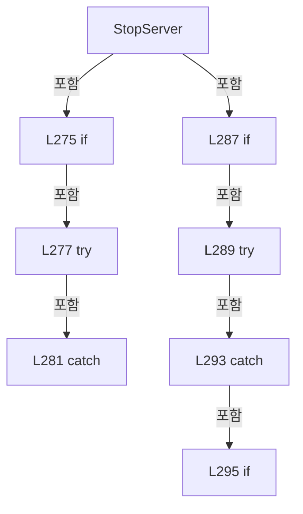

변경 전 점검: 입력/반환 타입, 위 호출자, 예외/취소 경로, 공유 상태와 저장·전송 소비자를 함께 확인합니다. 값의 단위나 물리 방향을 이름만으로 확정하지 않습니다.

### MethodDeclaration `CloseAllClients` · L307–316

[Drilling.Common/Interface/Socket/CSocketServerComm.cs:307–316](https://github.com/kjuws10-rgb/A3Drilling/blob/5aee8e58439c9b455cae7c9593c9be986c3e682e/Drilling.Common/Interface/Socket/CSocketServerComm.cs#L307-L316)

| 항목 | 실제 추출 값 |
| --- | --- |
| 서명 | void Drilling.Common.Interface.CSocketServerComm.CloseAllClients() |
| 접근/수식자 | Private / private |
| 반환/값 타입 | void |
| 소속 타입 | NamedType:Drilling.Common.Interface.CSocketServerComm |

정적 호출자로 확인된 위치:

| 호출 파일/행 | 호출 표현식 | 런타임 분기 가능 |
| --- | --- | --- |
| [Drilling.Common/Interface/Socket/CSocketServerComm.cs:104–104](https://github.com/kjuws10-rgb/A3Drilling/blob/5aee8e58439c9b455cae7c9593c9be986c3e682e/Drilling.Common/Interface/Socket/CSocketServerComm.cs#L104-L104) | CloseAllClients | False |
| [Drilling.Common/Interface/Socket/CSocketServerComm.cs:274–274](https://github.com/kjuws10-rgb/A3Drilling/blob/5aee8e58439c9b455cae7c9593c9be986c3e682e/Drilling.Common/Interface/Socket/CSocketServerComm.cs#L274-L274) | CloseAllClients | False |

호출하는 대상과 해석 범위:

| 원본 행 | 표현식 | 분석 상태 | 대상/소스 위치 |
| --- | --- | --- | --- |
| 309 | _clients.ToArray | resolved | System.Collections.Generic.KeyValuePair<int, System.Net.Sockets.TcpClient>[] System.Collections.Concurrent.ConcurrentDictionary<int, System.Net.Sockets.TcpClient>.ToArray() |
| 311 | _clients.TryRemove | resolved | bool System.Collections.Concurrent.ConcurrentDictionary<int, System.Net.Sockets.TcpClient>.TryRemove(int, out System.Net.Sockets.TcpClient) |
| 313 | client.Close | resolved | void System.Net.Sockets.TcpClient.Close() |

본문의 실제 연산·분기·예외·반환 순서(원문 위치 순):

| 원본 행 | 종류 | 주석 해설 |
| --- | --- | --- |
| 309 | call | 함수·델리게이트 또는 객체 생성자를 호출합니다: _clients.ToArray() |
| 309 | foreach | 컬렉션 요소를 순회합니다: foreach (var pair in _clients.ToArray()) |
| 311 | call | 함수·델리게이트 또는 객체 생성자를 호출합니다: _clients.TryRemove(pair.Key, out var client) |
| 311 | if | 조건에 따라 분기합니다: if (_clients.TryRemove(pair.Key, out var client)) |
| 313 | call | 함수·델리게이트 또는 객체 생성자를 호출합니다: client.Close() |

제어 구문의 포함 구조(실제 실행 순서/CFG가 아닌 구문 탐색 그림):

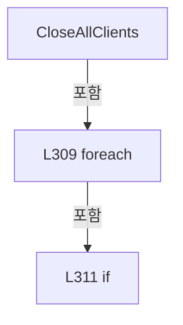

변경 전 점검: 입력/반환 타입, 위 호출자, 예외/취소 경로, 공유 상태와 저장·전송 소비자를 함께 확인합니다. 값의 단위나 물리 방향을 이름만으로 확정하지 않습니다.

### MethodDeclaration `IsAllowedRemote` · L318–337

[Drilling.Common/Interface/Socket/CSocketServerComm.cs:318–337](https://github.com/kjuws10-rgb/A3Drilling/blob/5aee8e58439c9b455cae7c9593c9be986c3e682e/Drilling.Common/Interface/Socket/CSocketServerComm.cs#L318-L337)

| 항목 | 실제 추출 값 |
| --- | --- |
| 서명 | bool Drilling.Common.Interface.CSocketServerComm.IsAllowedRemote(System.Net.Sockets.TcpClient) |
| 접근/수식자 | Private / private |
| 반환/값 타입 | bool |
| 소속 타입 | NamedType:Drilling.Common.Interface.CSocketServerComm |

입력 계약:

| 이름 | 타입 | 전달 | 선택/기본값 |
| --- | --- | --- | --- |
| client | System.Net.Sockets.TcpClient | None | False /  |

정적 호출자로 확인된 위치:

| 호출 파일/행 | 호출 표현식 | 런타임 분기 가능 |
| --- | --- | --- |
| [Drilling.Common/Interface/Socket/CSocketServerComm.cs:126–126](https://github.com/kjuws10-rgb/A3Drilling/blob/5aee8e58439c9b455cae7c9593c9be986c3e682e/Drilling.Common/Interface/Socket/CSocketServerComm.cs#L126-L126) | IsAllowedRemote | False |

호출하는 대상과 해석 범위:

| 원본 행 | 표현식 | 분석 상태 | 대상/소스 위치 |
| --- | --- | --- | --- |
| 320 | Option.RemoteAddress.Trim | resolved | string string.Trim() |
| 321 | string.IsNullOrWhiteSpace | resolved | bool string.IsNullOrWhiteSpace(string?) |
| 321 | allowedRemote.Equals | resolved | bool string.Equals(string?, System.StringComparison) |
| 321 | allowedRemote.Equals | resolved | bool string.Equals(string?, System.StringComparison) |
| 321 | allowedRemote.Equals | resolved | bool string.Equals(string?, System.StringComparison) |
| 331 | IPAddress.TryParse | resolved | bool System.Net.IPAddress.TryParse(string?, out System.Net.IPAddress?) |
| 333 | remoteEndPoint.Address.Equals | resolved · 동적 구현 선택 가능 | bool System.Net.IPAddress.Equals(object?) |
| 336 | remoteEndPoint.Address.ToString().Equals | resolved | bool string.Equals(string?, System.StringComparison) |
| 336 | remoteEndPoint.Address.ToString | resolved · 동적 구현 선택 가능 | string System.Net.IPAddress.ToString() |

본문의 실제 연산·분기·예외·반환 순서(원문 위치 순):

| 원본 행 | 종류 | 주석 해설 |
| --- | --- | --- |
| 320 | call | 함수·델리게이트 또는 객체 생성자를 호출합니다: Option.RemoteAddress.Trim() |
| 320 | local-declaration | 지역 변수를 선언합니다: var allowedRemote = Option.RemoteAddress.Trim(); |
| 320 | variable-initializer | 변수의 초기값을 지정합니다: allowedRemote = Option.RemoteAddress.Trim() |
| 321 | call | 함수·델리게이트 또는 객체 생성자를 호출합니다: string.IsNullOrWhiteSpace(allowedRemote) |
| 321 | call | 함수·델리게이트 또는 객체 생성자를 호출합니다: allowedRemote.Equals("*", StringComparison.OrdinalIgnoreCase) |
| 321 | call | 함수·델리게이트 또는 객체 생성자를 호출합니다: allowedRemote.Equals("ANY", StringComparison.OrdinalIgnoreCase) |
| 321 | call | 함수·델리게이트 또는 객체 생성자를 호출합니다: allowedRemote.Equals("0.0.0.0", StringComparison.OrdinalIgnoreCase) |
| 321 | if | 조건에 따라 분기합니다: if (string.IsNullOrWhiteSpace(allowedRemote) &#124;&#124; allowedRemote.Equals("*", StringComparison.OrdinalIgnoreCase) &#124;&#124; allowedRemote.Equals("ANY", StringComparison.OrdinalIgnoreCase) &#124;&#124; allowedRemote.Equals("0.0.0.0", StringCompar…) |
| 323 | return | 호출자에게 값 또는 제어를 반환합니다: return true; |
| 326 | if | 조건에 따라 분기합니다: if (client.Client.RemoteEndPoint is not IPEndPoint remoteEndPoint) |
| 328 | return | 호출자에게 값 또는 제어를 반환합니다: return true; |
| 331 | call | 함수·델리게이트 또는 객체 생성자를 호출합니다: IPAddress.TryParse(allowedRemote, out var allowedAddress) |
| 331 | if | 조건에 따라 분기합니다: if (IPAddress.TryParse(allowedRemote, out var allowedAddress)) |
| 333 | call | 함수·델리게이트 또는 객체 생성자를 호출합니다: remoteEndPoint.Address.Equals(allowedAddress) |
| 333 | return | 호출자에게 값 또는 제어를 반환합니다: return remoteEndPoint.Address.Equals(allowedAddress); |
| 336 | call | 함수·델리게이트 또는 객체 생성자를 호출합니다: remoteEndPoint.Address.ToString().Equals(allowedRemote, StringComparison.OrdinalIgnoreCase) |
| 336 | call | 함수·델리게이트 또는 객체 생성자를 호출합니다: remoteEndPoint.Address.ToString() |
| 336 | return | 호출자에게 값 또는 제어를 반환합니다: return remoteEndPoint.Address.ToString().Equals(allowedRemote, StringComparison.OrdinalIgnoreCase); |

제어 구문의 포함 구조(실제 실행 순서/CFG가 아닌 구문 탐색 그림):

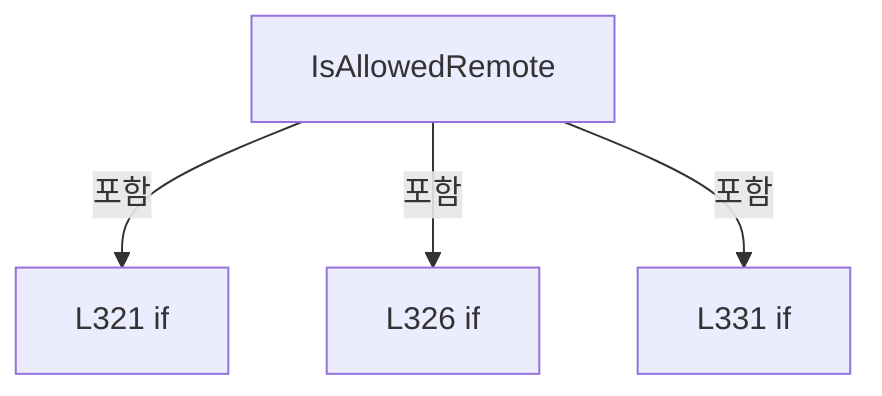

변경 전 점검: 입력/반환 타입, 위 호출자, 예외/취소 경로, 공유 상태와 저장·전송 소비자를 함께 확인합니다. 값의 단위나 물리 방향을 이름만으로 확정하지 않습니다.

### MethodDeclaration `ResolveBindAddress` · L339–347

[Drilling.Common/Interface/Socket/CSocketServerComm.cs:339–347](https://github.com/kjuws10-rgb/A3Drilling/blob/5aee8e58439c9b455cae7c9593c9be986c3e682e/Drilling.Common/Interface/Socket/CSocketServerComm.cs#L339-L347)

| 항목 | 실제 추출 값 |
| --- | --- |
| 서명 | System.Net.IPAddress Drilling.Common.Interface.CSocketServerComm.ResolveBindAddress(string) |
| 접근/수식자 | Private / private, static |
| 반환/값 타입 | System.Net.IPAddress |
| 소속 타입 | NamedType:Drilling.Common.Interface.CSocketServerComm |

입력 계약:

| 이름 | 타입 | 전달 | 선택/기본값 |
| --- | --- | --- | --- |
| localAddress | string | None | False /  |

정적 호출자로 확인된 위치:

| 호출 파일/행 | 호출 표현식 | 런타임 분기 가능 |
| --- | --- | --- |
| [Drilling.Common/Interface/Socket/CSocketServerComm.cs:38–38](https://github.com/kjuws10-rgb/A3Drilling/blob/5aee8e58439c9b455cae7c9593c9be986c3e682e/Drilling.Common/Interface/Socket/CSocketServerComm.cs#L38-L38) | ResolveBindAddress | False |

호출하는 대상과 해석 범위:

| 원본 행 | 표현식 | 분석 상태 | 대상/소스 위치 |
| --- | --- | --- | --- |
| 341 | string.IsNullOrWhiteSpace | resolved | bool string.IsNullOrWhiteSpace(string?) |
| 341 | localAddress.Equals | resolved | bool string.Equals(string?, System.StringComparison) |
| 341 | localAddress.Equals | resolved | bool string.Equals(string?, System.StringComparison) |
| 346 | IPAddress.TryParse | resolved | bool System.Net.IPAddress.TryParse(string?, out System.Net.IPAddress?) |
| 346 | new ArgumentException | resolved | System.ArgumentException.ArgumentException(string?) |

본문의 실제 연산·분기·예외·반환 순서(원문 위치 순):

| 원본 행 | 종류 | 주석 해설 |
| --- | --- | --- |
| 341 | call | 함수·델리게이트 또는 객체 생성자를 호출합니다: string.IsNullOrWhiteSpace(localAddress) |
| 341 | call | 함수·델리게이트 또는 객체 생성자를 호출합니다: localAddress.Equals("*", StringComparison.OrdinalIgnoreCase) |
| 341 | call | 함수·델리게이트 또는 객체 생성자를 호출합니다: localAddress.Equals("ANY", StringComparison.OrdinalIgnoreCase) |
| 341 | if | 조건에 따라 분기합니다: if (string.IsNullOrWhiteSpace(localAddress) &#124;&#124; localAddress.Equals("*", StringComparison.OrdinalIgnoreCase) &#124;&#124; localAddress.Equals("ANY", StringComparison.OrdinalIgnoreCase)) |
| 343 | return | 호출자에게 값 또는 제어를 반환합니다: return IPAddress.Any; |
| 346 | call | 함수·델리게이트 또는 객체 생성자를 호출합니다: IPAddress.TryParse(localAddress, out var address) |
| 346 | call | 함수·델리게이트 또는 객체 생성자를 호출합니다: new ArgumentException($"Socket server local address is invalid: {localAddress}") |
| 346 | conditional-expression | 조건에 따라 결과식을 선택합니다: IPAddress.TryParse(localAddress, out var address) ? address : throw new ArgumentException($"Socket server local address is invalid: {localAddress}") |
| 346 | return | 호출자에게 값 또는 제어를 반환합니다: return IPAddress.TryParse(localAddress, out var address) ? address : throw new ArgumentException($"Socket server local address is invalid: {localAddress}"); |
| 346 | throw | 예외를 발생/전달합니다: throw new ArgumentException($"Socket server local address is invalid: {localAddress}") |

제어 구문의 포함 구조(실제 실행 순서/CFG가 아닌 구문 탐색 그림):

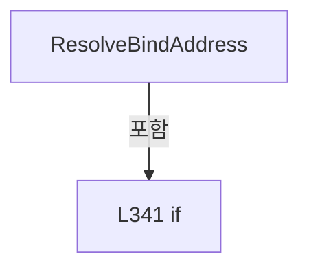

변경 전 점검: 입력/반환 타입, 위 호출자, 예외/취소 경로, 공유 상태와 저장·전송 소비자를 함께 확인합니다. 값의 단위나 물리 방향을 이름만으로 확정하지 않습니다.

### MethodDeclaration `ReadProtocolLine` · L349–374

[Drilling.Common/Interface/Socket/CSocketServerComm.cs:349–374](https://github.com/kjuws10-rgb/A3Drilling/blob/5aee8e58439c9b455cae7c9593c9be986c3e682e/Drilling.Common/Interface/Socket/CSocketServerComm.cs#L349-L374)

| 항목 | 실제 추출 값 |
| --- | --- |
| 서명 | System.Threading.Tasks.Task<string?> Drilling.Common.Interface.CSocketServerComm.ReadProtocolLine(System.IO.StreamReader, System.Threading.CancellationToken) |
| 접근/수식자 | Private / private, static, async |
| 반환/값 타입 | System.Threading.Tasks.Task<string?> |
| 소속 타입 | NamedType:Drilling.Common.Interface.CSocketServerComm |

입력 계약:

| 이름 | 타입 | 전달 | 선택/기본값 |
| --- | --- | --- | --- |
| reader | System.IO.StreamReader | None | False /  |
| cancellationToken | System.Threading.CancellationToken | None | False /  |

정적 호출자로 확인된 위치:

| 호출 파일/행 | 호출 표현식 | 런타임 분기 가능 |
| --- | --- | --- |
| [Drilling.Common/Interface/Socket/CSocketServerComm.cs:382–382](https://github.com/kjuws10-rgb/A3Drilling/blob/5aee8e58439c9b455cae7c9593c9be986c3e682e/Drilling.Common/Interface/Socket/CSocketServerComm.cs#L382-L382) | ReadProtocolLine | False |

호출하는 대상과 해석 범위:

| 원본 행 | 표현식 | 분석 상태 | 대상/소스 위치 |
| --- | --- | --- | --- |
| 352 | new StringBuilder | resolved | System.Text.StringBuilder.StringBuilder() |
| 355 | reader.ReadAsync | resolved · 동적 구현 선택 가능 | System.Threading.Tasks.ValueTask<int> System.IO.StreamReader.ReadAsync(System.Memory<char>, System.Threading.CancellationToken) |
| 355 | buffer.AsMemory | resolved | System.Memory<char> char[].AsMemory<char>(int, int) |
| 358 | message.ToString | resolved · 동적 구현 선택 가능 | string System.Text.StringBuilder.ToString() |
| 364 | message.ToString().TrimEnd | resolved | string string.TrimEnd(char) |
| 364 | message.ToString | resolved · 동적 구현 선택 가능 | string System.Text.StringBuilder.ToString() |
| 369 | new InvalidDataException | resolved | System.IO.InvalidDataException.InvalidDataException(string?) |
| 372 | message.Append | resolved | System.Text.StringBuilder System.Text.StringBuilder.Append(char) |

본문의 실제 연산·분기·예외·반환 순서(원문 위치 순):

| 원본 행 | 종류 | 주석 해설 |
| --- | --- | --- |
| 351 | local-declaration | 지역 변수를 선언합니다: var buffer = new char[1]; |
| 351 | variable-initializer | 변수의 초기값을 지정합니다: buffer = new char[1] |
| 352 | call | 함수·델리게이트 또는 객체 생성자를 호출합니다: new StringBuilder() |
| 352 | local-declaration | 지역 변수를 선언합니다: var message = new StringBuilder(); |
| 352 | variable-initializer | 변수의 초기값을 지정합니다: message = new StringBuilder() |
| 353 | while | 조건을 먼저 확인하며 반복합니다: while (true) |
| 355 | await | 비동기 완료를 기다립니다: await reader.ReadAsync(buffer.AsMemory(0, 1), cancellationToken) |
| 355 | call | 함수·델리게이트 또는 객체 생성자를 호출합니다: reader.ReadAsync(buffer.AsMemory(0, 1), cancellationToken) |
| 355 | call | 함수·델리게이트 또는 객체 생성자를 호출합니다: buffer.AsMemory(0, 1) |
| 355 | local-declaration | 지역 변수를 선언합니다: var readCount = await reader.ReadAsync(buffer.AsMemory(0, 1), cancellationToken); |
| 355 | variable-initializer | 변수의 초기값을 지정합니다: readCount = await reader.ReadAsync(buffer.AsMemory(0, 1), cancellationToken) |
| 356 | if | 조건에 따라 분기합니다: if (readCount == 0) |
| 358 | call | 함수·델리게이트 또는 객체 생성자를 호출합니다: message.ToString() |
| 358 | conditional-expression | 조건에 따라 결과식을 선택합니다: message.Length == 0 ? null : message.ToString() |
| 358 | return | 호출자에게 값 또는 제어를 반환합니다: return message.Length == 0 ? null : message.ToString(); |
| 361 | local-declaration | 지역 변수를 선언합니다: var ch = buffer[0]; |
| 361 | variable-initializer | 변수의 초기값을 지정합니다: ch = buffer[0] |
| 362 | if | 조건에 따라 분기합니다: if (ch == '\n') |
| 364 | call | 함수·델리게이트 또는 객체 생성자를 호출합니다: message.ToString().TrimEnd('\r') |
| 364 | call | 함수·델리게이트 또는 객체 생성자를 호출합니다: message.ToString() |
| 364 | return | 호출자에게 값 또는 제어를 반환합니다: return message.ToString().TrimEnd('\r'); |
| 367 | if | 조건에 따라 분기합니다: if (message.Length >= MaxMessageLength) |
| 369 | call | 함수·델리게이트 또는 객체 생성자를 호출합니다: new InvalidDataException($"Socket server message exceeded {MaxMessageLength} characters.") |
| 369 | throw | 예외를 발생/전달합니다: throw new InvalidDataException($"Socket server message exceeded {MaxMessageLength} characters."); |
| 372 | call | 함수·델리게이트 또는 객체 생성자를 호출합니다: message.Append(ch) |

제어 구문의 포함 구조(실제 실행 순서/CFG가 아닌 구문 탐색 그림):

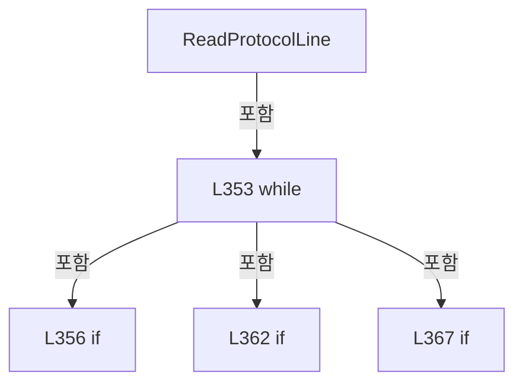

변경 전 점검: 입력/반환 타입, 위 호출자, 예외/취소 경로, 공유 상태와 저장·전송 소비자를 함께 확인합니다. 값의 단위나 물리 방향을 이름만으로 확정하지 않습니다.

### MethodDeclaration `ReadProtocolLineWithTimeout` · L376–388

[Drilling.Common/Interface/Socket/CSocketServerComm.cs:376–388](https://github.com/kjuws10-rgb/A3Drilling/blob/5aee8e58439c9b455cae7c9593c9be986c3e682e/Drilling.Common/Interface/Socket/CSocketServerComm.cs#L376-L388)

| 항목 | 실제 추출 값 |
| --- | --- |
| 서명 | System.Threading.Tasks.Task<string?> Drilling.Common.Interface.CSocketServerComm.ReadProtocolLineWithTimeout(System.IO.StreamReader, System.Threading.CancellationToken) |
| 접근/수식자 | Private / private, async |
| 반환/값 타입 | System.Threading.Tasks.Task<string?> |
| 소속 타입 | NamedType:Drilling.Common.Interface.CSocketServerComm |

입력 계약:

| 이름 | 타입 | 전달 | 선택/기본값 |
| --- | --- | --- | --- |
| reader | System.IO.StreamReader | None | False /  |
| cancellationToken | System.Threading.CancellationToken | None | False /  |

정적 호출자로 확인된 위치:

| 호출 파일/행 | 호출 표현식 | 런타임 분기 가능 |
| --- | --- | --- |
| [Drilling.Common/Interface/Socket/CSocketServerComm.cs:188–188](https://github.com/kjuws10-rgb/A3Drilling/blob/5aee8e58439c9b455cae7c9593c9be986c3e682e/Drilling.Common/Interface/Socket/CSocketServerComm.cs#L188-L188) | ReadProtocolLineWithTimeout | False |

호출하는 대상과 해석 범위:

| 원본 행 | 표현식 | 분석 상태 | 대상/소스 위치 |
| --- | --- | --- | --- |
| 378 | CancellationTokenSource.CreateLinkedTokenSource | resolved | System.Threading.CancellationTokenSource System.Threading.CancellationTokenSource.CreateLinkedTokenSource(System.Threading.CancellationToken) |
| 379 | timeoutCts.CancelAfter | resolved | void System.Threading.CancellationTokenSource.CancelAfter(System.TimeSpan) |
| 379 | TimeSpan.FromMilliseconds | resolved | System.TimeSpan System.TimeSpan.FromMilliseconds(long) |
| 379 | Math.Max | resolved | int System.Math.Max(int, int) |
| 382 | ReadProtocolLine | resolved | System.Threading.Tasks.Task<string?> Drilling.Common.Interface.CSocketServerComm.ReadProtocolLine(System.IO.StreamReader, System.Threading.CancellationToken) · Drilling.Common/Interface/Socket/CSocketServerComm.cs:349 |
| 386 | new TimeoutException | resolved | System.TimeoutException.TimeoutException(string?) |
| 386 | Math.Max | resolved | int System.Math.Max(int, int) |

본문의 실제 연산·분기·예외·반환 순서(원문 위치 순):

| 원본 행 | 종류 | 주석 해설 |
| --- | --- | --- |
| 378 | call | 함수·델리게이트 또는 객체 생성자를 호출합니다: CancellationTokenSource.CreateLinkedTokenSource(cancellationToken) |
| 378 | using-declaration | 정리할 자원을 선언합니다: using var timeoutCts = CancellationTokenSource.CreateLinkedTokenSource(cancellationToken); |
| 378 | variable-initializer | 변수의 초기값을 지정합니다: timeoutCts = CancellationTokenSource.CreateLinkedTokenSource(cancellationToken) |
| 379 | call | 함수·델리게이트 또는 객체 생성자를 호출합니다: timeoutCts.CancelAfter(TimeSpan.FromMilliseconds(Math.Max(1, Option.TimeoutMs))) |
| 379 | call | 함수·델리게이트 또는 객체 생성자를 호출합니다: TimeSpan.FromMilliseconds(Math.Max(1, Option.TimeoutMs)) |
| 379 | call | 함수·델리게이트 또는 객체 생성자를 호출합니다: Math.Max(1, Option.TimeoutMs) |
| 380 | try | 예외 처리 범위입니다: try |
| 382 | await | 비동기 완료를 기다립니다: await ReadProtocolLine(reader, timeoutCts.Token) |
| 382 | call | 함수·델리게이트 또는 객체 생성자를 호출합니다: ReadProtocolLine(reader, timeoutCts.Token) |
| 382 | return | 호출자에게 값 또는 제어를 반환합니다: return await ReadProtocolLine(reader, timeoutCts.Token); |
| 384 | catch | 지정 예외를 처리합니다: catch (OperationCanceledException) when (!cancellationToken.IsCancellationRequested) |
| 386 | call | 함수·델리게이트 또는 객체 생성자를 호출합니다: new TimeoutException($"Socket server receive timeout after {Math.Max(1, Option.TimeoutMs)} ms.") |
| 386 | call | 함수·델리게이트 또는 객체 생성자를 호출합니다: Math.Max(1, Option.TimeoutMs) |
| 386 | throw | 예외를 발생/전달합니다: throw new TimeoutException($"Socket server receive timeout after {Math.Max(1, Option.TimeoutMs)} ms."); |

제어 구문의 포함 구조(실제 실행 순서/CFG가 아닌 구문 탐색 그림):

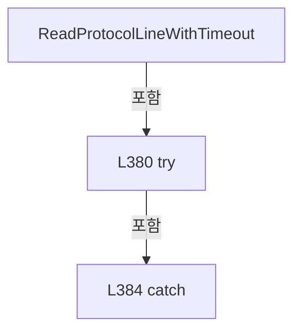

변경 전 점검: 입력/반환 타입, 위 호출자, 예외/취소 경로, 공유 상태와 저장·전송 소비자를 함께 확인합니다. 값의 단위나 물리 방향을 이름만으로 확정하지 않습니다.

### MethodDeclaration `GetRemoteEndPoint` · L390–393

[Drilling.Common/Interface/Socket/CSocketServerComm.cs:390–393](https://github.com/kjuws10-rgb/A3Drilling/blob/5aee8e58439c9b455cae7c9593c9be986c3e682e/Drilling.Common/Interface/Socket/CSocketServerComm.cs#L390-L393)

| 항목 | 실제 추출 값 |
| --- | --- |
| 서명 | string Drilling.Common.Interface.CSocketServerComm.GetRemoteEndPoint(System.Net.Sockets.TcpClient) |
| 접근/수식자 | Private / private, static |
| 반환/값 타입 | string |
| 소속 타입 | NamedType:Drilling.Common.Interface.CSocketServerComm |

입력 계약:

| 이름 | 타입 | 전달 | 선택/기본값 |
| --- | --- | --- | --- |
| client | System.Net.Sockets.TcpClient | None | False /  |

정적 호출자로 확인된 위치:

| 호출 파일/행 | 호출 표현식 | 런타임 분기 가능 |
| --- | --- | --- |
| [Drilling.Common/Interface/Socket/CSocketServerComm.cs:174–174](https://github.com/kjuws10-rgb/A3Drilling/blob/5aee8e58439c9b455cae7c9593c9be986c3e682e/Drilling.Common/Interface/Socket/CSocketServerComm.cs#L174-L174) | GetRemoteEndPoint | False |

호출하는 대상과 해석 범위:

| 원본 행 | 표현식 | 분석 상태 | 대상/소스 위치 |
| --- | --- | --- | --- |
| 392 | .ToString | resolved · 동적 구현 선택 가능 | string? object.ToString() |

본문의 실제 연산·분기·예외·반환 순서(원문 위치 순):

| 원본 행 | 종류 | 주석 해설 |
| --- | --- | --- |
| 392 | call | 함수·델리게이트 또는 객체 생성자를 호출합니다: .ToString() |
| 392 | return | 호출자에게 값 또는 제어를 반환합니다: return client.Client.RemoteEndPoint?.ToString() ?? "UNKNOWN"; |

변경 전 점검: 입력/반환 타입, 위 호출자, 예외/취소 경로, 공유 상태와 저장·전송 소비자를 함께 확인합니다. 값의 단위나 물리 방향을 이름만으로 확정하지 않습니다.

### MethodDeclaration `NormalizeReceivedMessage` · L395–398

[Drilling.Common/Interface/Socket/CSocketServerComm.cs:395–398](https://github.com/kjuws10-rgb/A3Drilling/blob/5aee8e58439c9b455cae7c9593c9be986c3e682e/Drilling.Common/Interface/Socket/CSocketServerComm.cs#L395-L398)

| 항목 | 실제 추출 값 |
| --- | --- |
| 서명 | string Drilling.Common.Interface.CSocketServerComm.NormalizeReceivedMessage(string) |
| 접근/수식자 | Private / private, static |
| 반환/값 타입 | string |
| 소속 타입 | NamedType:Drilling.Common.Interface.CSocketServerComm |

입력 계약:

| 이름 | 타입 | 전달 | 선택/기본값 |
| --- | --- | --- | --- |
| message | string | None | False /  |

정적 호출자로 확인된 위치:

| 호출 파일/행 | 호출 표현식 | 런타임 분기 가능 |
| --- | --- | --- |
| [Drilling.Common/Interface/Socket/CSocketServerComm.cs:194–194](https://github.com/kjuws10-rgb/A3Drilling/blob/5aee8e58439c9b455cae7c9593c9be986c3e682e/Drilling.Common/Interface/Socket/CSocketServerComm.cs#L194-L194) | NormalizeReceivedMessage | False |

호출하는 대상과 해석 범위:

| 원본 행 | 표현식 | 분석 상태 | 대상/소스 위치 |
| --- | --- | --- | --- |
| 397 | message.TrimEnd('\0').Trim | resolved | string string.Trim() |
| 397 | message.TrimEnd | resolved | string string.TrimEnd(char) |

본문의 실제 연산·분기·예외·반환 순서(원문 위치 순):

| 원본 행 | 종류 | 주석 해설 |
| --- | --- | --- |
| 397 | call | 함수·델리게이트 또는 객체 생성자를 호출합니다: message.TrimEnd('\0').Trim() |
| 397 | call | 함수·델리게이트 또는 객체 생성자를 호출합니다: message.TrimEnd('\0') |
| 397 | return | 호출자에게 값 또는 제어를 반환합니다: return message.TrimEnd('\0').Trim(); |

변경 전 점검: 입력/반환 타입, 위 호출자, 예외/취소 경로, 공유 상태와 저장·전송 소비자를 함께 확인합니다. 값의 단위나 물리 방향을 이름만으로 확정하지 않습니다.

### MethodDeclaration `NormalizeProtocolLine` · L400–403

[Drilling.Common/Interface/Socket/CSocketServerComm.cs:400–403](https://github.com/kjuws10-rgb/A3Drilling/blob/5aee8e58439c9b455cae7c9593c9be986c3e682e/Drilling.Common/Interface/Socket/CSocketServerComm.cs#L400-L403)

| 항목 | 실제 추출 값 |
| --- | --- |
| 서명 | string Drilling.Common.Interface.CSocketServerComm.NormalizeProtocolLine(string) |
| 접근/수식자 | Private / private, static |
| 반환/값 타입 | string |
| 소속 타입 | NamedType:Drilling.Common.Interface.CSocketServerComm |

입력 계약:

| 이름 | 타입 | 전달 | 선택/기본값 |
| --- | --- | --- | --- |
| value | string | None | False /  |

정적 호출자로 확인된 위치:

| 호출 파일/행 | 호출 표현식 | 런타임 분기 가능 |
| --- | --- | --- |
| [Drilling.Common/Interface/Socket/CSocketServerComm.cs:203–203](https://github.com/kjuws10-rgb/A3Drilling/blob/5aee8e58439c9b455cae7c9593c9be986c3e682e/Drilling.Common/Interface/Socket/CSocketServerComm.cs#L203-L203) | NormalizeProtocolLine | False |
| [Drilling.Common/Interface/Socket/CSocketServerComm.cs:260–260](https://github.com/kjuws10-rgb/A3Drilling/blob/5aee8e58439c9b455cae7c9593c9be986c3e682e/Drilling.Common/Interface/Socket/CSocketServerComm.cs#L260-L260) | NormalizeProtocolLine | False |

호출하는 대상과 해석 범위:

| 원본 행 | 표현식 | 분석 상태 | 대상/소스 위치 |
| --- | --- | --- | --- |
| 402 | value.Replace('\r', ' ').Replace('\n', ' ').Trim | resolved | string string.Trim() |
| 402 | value.Replace('\r', ' ').Replace | resolved | string string.Replace(char, char) |
| 402 | value.Replace | resolved | string string.Replace(char, char) |

본문의 실제 연산·분기·예외·반환 순서(원문 위치 순):

| 원본 행 | 종류 | 주석 해설 |
| --- | --- | --- |
| 402 | call | 함수·델리게이트 또는 객체 생성자를 호출합니다: value.Replace('\r', ' ').Replace('\n', ' ').Trim() |
| 402 | call | 함수·델리게이트 또는 객체 생성자를 호출합니다: value.Replace('\r', ' ').Replace('\n', ' ') |
| 402 | call | 함수·델리게이트 또는 객체 생성자를 호출합니다: value.Replace('\r', ' ') |
| 402 | return | 호출자에게 값 또는 제어를 반환합니다: return value.Replace('\r', ' ').Replace('\n', ' ').Trim(); |

변경 전 점검: 입력/반환 타입, 위 호출자, 예외/취소 경로, 공유 상태와 저장·전송 소비자를 함께 확인합니다. 값의 단위나 물리 방향을 이름만으로 확정하지 않습니다.

## 구문·바인딩 한계

전체 WPF/벤더 SDK/프로젝트별 빌드 조건을 로드한 정식 빌드가 아닙니다. `resolved`는 이 부분 컴파일에서의 심볼 연결이며 virtual/interface/delegate/이벤트/Reflection/XAML의 실제 런타임 구현을 확정하지 않습니다. `candidate`와 `unresolved`는 후속 확인 대상으로 남깁니다.

## 원문 전체 주석 해설본

[원본 모든 행과 행별 해설 보기](../../../../annotated/Drilling.Common/Interface/Socket/CSocketServerComm.cs.annotated.txt)

원본을 빠뜨리거나 임의로 줄이지 않았습니다. `L000001 |` 표시는 원본 행 번호, `// 해설`은 별도 설명입니다. 실행용 소스가 아닌 문서입니다.

## 수정·재검증 체크

- 원본 Commit과 현재 작업 파일 SHA가 같은지 먼저 확인합니다. 다르면 이 문서를 과거 버전 자료로 취급합니다.
- 선언·직접 호출·이벤트/인터페이스 경계·설정 소비를 함께 확인합니다. 정적 연결의 빈 곳을 정상 경로로 추정하지 않습니다.
- 저장 형식/단위/식별자·재시도·취소·예외·롤백에 영향을 주는 변경은 상세 해설장과 호출자를 다시 검토합니다.
- 도구의 구문 추출과 별도 정적 추적 해설, 실제 빌드·시뮬레이션·실장비 검증 결과를 분리합니다.
