# Drilling.Common/Interface/Vision/CVisionComm.cs

| 항목 | 내용 |
| --- | --- |
| 원본 저장소 | https://github.com/kjuws10-rgb/A3Drilling.git |
| 원본 Commit | 5aee8e58439c9b455cae7c9593c9be986c3e682e |
| 원본 SHA256 | 3483e19c0f2d47dfc533a0b9967a0308e654dd43e582ab0b560cad020c4477a4 |
| 파일 분류 | code |
| 원본 크기/행 | 49,449 bytes / 994 physical lines |
| 인코딩 | utf-8-sig |
| 검토 범위 | 구문/부분 의미 분석에서 추출한 사실. 동작·물리 단위·실장비 합격을 보증하지 않습니다. |
| 원본 링크 | [고정 Commit 원본](https://github.com/kjuws10-rgb/A3Drilling/blob/5aee8e58439c9b455cae7c9593c9be986c3e682e/Drilling.Common/Interface/Vision/CVisionComm.cs) |

## 파일의 역할과 읽는 순서

외부 통신과 장치 인터페이스를 연결합니다. 요청 생성·전송·수신·장치 실행을 같은 의미로 합치지 않습니다.

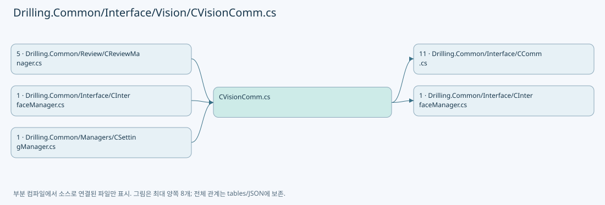

## 네임스페이스·타입·상속

| 타입 | 구분 | 원본 범위 | 선언/상속 |
| --- | --- | --- | --- |
| CVisionComm | ClassDeclaration | 10–528 | CVisionComm: CCommBase(data, option) |
| EN_VISION_COMMAND | EnumDeclaration | 530–540 | EN_VISION_COMMAND |
| ST_VISION_PACKET_HEADER | RecordStructDeclaration | 542–542 | ST_VISION_PACKET_HEADER |
| ST_VISION_MARK_SEARCH | RecordStructDeclaration | 543–543 | ST_VISION_MARK_SEARCH |
| ST_VISION_MARK_FIND | RecordStructDeclaration | 544–544 | ST_VISION_MARK_FIND |
| ST_VISION_PACKET | RecordDeclaration | 545–545 | ST_VISION_PACKET |
| ST_VISION_SINGLE_RESULT | RecordDeclaration | 546–546 | ST_VISION_SINGLE_RESULT |
| ST_VISION_LINE_RESULT | RecordDeclaration | 547–547 | ST_VISION_LINE_RESULT |
| ST_VISION_FLYING_READY | RecordDeclaration | 548–548 | ST_VISION_FLYING_READY |
| CVisionLineCountExceededException | ClassDeclaration | 549–553 | CVisionLineCountExceededException: IOException($"Vision 수신 HoleCount({actualCount})가 Setting-Review MaxHoleCountPerLine({maximumCount})을 초과했습니다.") |
| CVisionProtocol | ClassDeclaration | 554–993 | CVisionProtocol |

## 멤버 빠른 목록

| 이름 | 종류 | 범위 | 서명 |
| --- | --- | --- | --- |
| _pending | FieldDeclaration | L13–13 | System.Collections.Concurrent.ConcurrentDictionary<int, System.Threading.Tasks.TaskCompletionSource<Drilling.Common.Interface.Vision.ST_VISION_PACKET>> Drilling.Common.Interface.Vision.CVisionComm._pending |
| _lifecycleLock | FieldDeclaration | L14–14 | System.Threading.SemaphoreSlim Drilling.Common.Interface.Vision.CVisionComm._lifecycleLock |
| _writeLock | FieldDeclaration | L15–15 | System.Threading.SemaphoreSlim Drilling.Common.Interface.Vision.CVisionComm._writeLock |
| _clientReady | FieldDeclaration | L16–16 | System.Threading.SemaphoreSlim Drilling.Common.Interface.Vision.CVisionComm._clientReady |
| _listener | FieldDeclaration | L17–17 | System.Net.Sockets.TcpListener? Drilling.Common.Interface.Vision.CVisionComm._listener |
| _client | FieldDeclaration | L18–18 | System.Net.Sockets.TcpClient? Drilling.Common.Interface.Vision.CVisionComm._client |
| _stream | FieldDeclaration | L19–19 | System.Net.Sockets.NetworkStream? Drilling.Common.Interface.Vision.CVisionComm._stream |
| _serverCancellation | FieldDeclaration | L20–20 | System.Threading.CancellationTokenSource? Drilling.Common.Interface.Vision.CVisionComm._serverCancellation |
| _acceptTask | FieldDeclaration | L21–21 | System.Threading.Tasks.Task? Drilling.Common.Interface.Vision.CVisionComm._acceptTask |
| _receiveTask | FieldDeclaration | L22–22 | System.Threading.Tasks.Task? Drilling.Common.Interface.Vision.CVisionComm._receiveTask |
| _uniqueId | FieldDeclaration | L23–23 | int Drilling.Common.Interface.Vision.CVisionComm._uniqueId |
| _flyingLineCapacity | FieldDeclaration | L24–24 | int Drilling.Common.Interface.Vision.CVisionComm._flyingLineCapacity |
| HasConnectedClient | PropertyDeclaration | L27–27 | bool Drilling.Common.Interface.Vision.CVisionComm.HasConnectedClient |
| LineCapacityProvider | PropertyDeclaration | L28–28 | System.Func<int>? Drilling.Common.Interface.Vision.CVisionComm.LineCapacityProvider |
| get_LineCapacityProvider | GetAccessorDeclaration | L28–28 | System.Func<int>? Drilling.Common.Interface.Vision.CVisionComm.LineCapacityProvider.get |
| set_LineCapacityProvider | SetAccessorDeclaration | L28–28 | void Drilling.Common.Interface.Vision.CVisionComm.LineCapacityProvider.set |
| ConfiguredLineCapacity | PropertyDeclaration | L29–29 | int Drilling.Common.Interface.Vision.CVisionComm.ConfiguredLineCapacity |
| ResponseLineCapacity | PropertyDeclaration | L30–30 | int Drilling.Common.Interface.Vision.CVisionComm.ResponseLineCapacity |
| ProtocolTrace | EventFieldDeclaration | L31–31 | System.Action<Drilling.Common.Interface.ST_COMM_PROTOCOL_TRACE>? Drilling.Common.Interface.Vision.CVisionComm.ProtocolTrace |
| Connect | MethodDeclaration | L32–76 | System.Threading.Tasks.Task Drilling.Common.Interface.Vision.CVisionComm.Connect(System.Threading.CancellationToken) |
| AcceptLoopCallback | LocalFunctionStatement | L55–58 | System.Threading.Tasks.Task AcceptLoopCallback() |
| Disconnect | MethodDeclaration | L78–91 | System.Threading.Tasks.Task Drilling.Common.Interface.Vision.CVisionComm.Disconnect(System.Threading.CancellationToken) |
| Execute | MethodDeclaration | L93–142 | System.Threading.Tasks.Task<string> Drilling.Common.Interface.Vision.CVisionComm.Execute(string, System.Threading.CancellationToken) |
| AcceptLoop | MethodDeclaration | L144–165 | System.Threading.Tasks.Task Drilling.Common.Interface.Vision.CVisionComm.AcceptLoop(System.Net.Sockets.TcpListener, System.Threading.CancellationToken) |
| ReplaceClient | MethodDeclaration | L167–186 | void Drilling.Common.Interface.Vision.CVisionComm.ReplaceClient(System.Net.Sockets.TcpClient, System.Threading.CancellationToken) |
| ReceiveLoopCallback | LocalFunctionStatement | L172–175 | System.Threading.Tasks.Task ReceiveLoopCallback() |
| ReceiveLoop | MethodDeclaration | L188–249 | System.Threading.Tasks.Task Drilling.Common.Interface.Vision.CVisionComm.ReceiveLoop(System.Net.Sockets.TcpClient, System.Net.Sockets.NetworkStream, System.Threading.CancellationToken) |
| WaitForClient | MethodDeclaration | L251–270 | System.Threading.Tasks.Task<System.Net.Sockets.NetworkStream> Drilling.Common.Interface.Vision.CVisionComm.WaitForClient(System.Threading.CancellationToken) |
| SendRequest | MethodDeclaration | L272–309 | System.Threading.Tasks.Task<Drilling.Common.Interface.Vision.ST_VISION_PACKET> Drilling.Common.Interface.Vision.CVisionComm.SendRequest(System.Net.Sockets.NetworkStream, Drilling.Common.Interface.Vision.ST_VISION_PACKET, System.Threading.CancellationToken) |
| SendPacket | MethodDeclaration | L311–327 | System.Threading.Tasks.Task Drilling.Common.Interface.Vision.CVisionComm.SendPacket(System.Net.Sockets.NetworkStream, Drilling.Common.Interface.Vision.ST_VISION_PACKET, System.Threading.CancellationToken) |
| ReadPacket | MethodDeclaration | L329–341 | System.Threading.Tasks.Task<Drilling.Common.Interface.Vision.ST_VISION_PACKET> Drilling.Common.Interface.Vision.CVisionComm.ReadPacket(System.Net.Sockets.NetworkStream, System.Threading.CancellationToken) |
| ParseRequest | MethodDeclaration | L343–357 | Drilling.Common.Interface.Vision.ST_VISION_PACKET Drilling.Common.Interface.Vision.CVisionComm.ParseRequest(string, int, int) |
| ParseFlyingReady | MethodDeclaration | L359–378 | Drilling.Common.Interface.Vision.ST_VISION_PACKET Drilling.Common.Interface.Vision.CVisionComm.ParseFlyingReady(int, string, int) |
| ParseMarkSearch | MethodDeclaration | L380–389 | Drilling.Common.Interface.Vision.ST_VISION_MARK_SEARCH Drilling.Common.Interface.Vision.CVisionComm.ParseMarkSearch(string) |
| NormalizeCommand | MethodDeclaration | L391–403 | Drilling.Common.Interface.Vision.EN_VISION_COMMAND Drilling.Common.Interface.Vision.CVisionComm.NormalizeCommand(string) |
| ParseInt | MethodDeclaration | L405–405 | int Drilling.Common.Interface.Vision.CVisionComm.ParseInt(string, string) |
| DescribeResponse | MethodDeclaration | L406–441 | string Drilling.Common.Interface.Vision.CVisionComm.DescribeResponse(Drilling.Common.Interface.Vision.ST_VISION_PACKET, int) |
| DescribePacket | MethodDeclaration | L443–443 | string Drilling.Common.Interface.Vision.CVisionComm.DescribePacket(Drilling.Common.Interface.Vision.ST_VISION_PACKET) |
| NextUniqueId | MethodDeclaration | L444–454 | int Drilling.Common.Interface.Vision.CVisionComm.NextUniqueId() |
| RaiseProtocolTrace | MethodDeclaration | L456–459 | void Drilling.Common.Interface.Vision.CVisionComm.RaiseProtocolTrace(string, string) |
| IsServerListening | MethodDeclaration | L461–464 | bool Drilling.Common.Interface.Vision.CVisionComm.IsServerListening() |
| StopServer | MethodDeclaration | L466–495 | System.Threading.Tasks.Task Drilling.Common.Interface.Vision.CVisionComm.StopServer() |
| FailPending | MethodDeclaration | L497–506 | void Drilling.Common.Interface.Vision.CVisionComm.FailPending(System.Exception) |
| IgnoreCancellation | MethodDeclaration | L508–517 | System.Threading.Tasks.Task Drilling.Common.Interface.Vision.CVisionComm.IgnoreCancellation(System.Threading.Tasks.Task) |
| ResolveBindAddress | MethodDeclaration | L519–527 | System.Net.IPAddress Drilling.Common.Interface.Vision.CVisionComm.ResolveBindAddress(string) |
| MarkFindSingle | EnumMemberDeclaration | L532–532 | Drilling.Common.Interface.Vision.EN_VISION_COMMAND.MarkFindSingle |
| FlyingReady | EnumMemberDeclaration | L533–533 | Drilling.Common.Interface.Vision.EN_VISION_COMMAND.FlyingReady |
| FlyingMoveDone | EnumMemberDeclaration | L534–534 | Drilling.Common.Interface.Vision.EN_VISION_COMMAND.FlyingMoveDone |
| MarkFindLine | EnumMemberDeclaration | L535–535 | Drilling.Common.Interface.Vision.EN_VISION_COMMAND.MarkFindLine |
| MarkFindSettingSingle | EnumMemberDeclaration | L536–536 | Drilling.Common.Interface.Vision.EN_VISION_COMMAND.MarkFindSettingSingle |
| MarkFindManual | EnumMemberDeclaration | L537–537 | Drilling.Common.Interface.Vision.EN_VISION_COMMAND.MarkFindManual |
| KeepAliveRequest | EnumMemberDeclaration | L538–538 | Drilling.Common.Interface.Vision.EN_VISION_COMMAND.KeepAliveRequest |
| KeepAlive | EnumMemberDeclaration | L539–539 | Drilling.Common.Interface.Vision.EN_VISION_COMMAND.KeepAlive |
| ActualCount | PropertyDeclaration | L551–551 | int Drilling.Common.Interface.Vision.CVisionLineCountExceededException.ActualCount |
| get_ActualCount | GetAccessorDeclaration | L551–551 | int Drilling.Common.Interface.Vision.CVisionLineCountExceededException.ActualCount.get |
| MaximumCount | PropertyDeclaration | L552–552 | int Drilling.Common.Interface.Vision.CVisionLineCountExceededException.MaximumCount |
| get_MaximumCount | GetAccessorDeclaration | L552–552 | int Drilling.Common.Interface.Vision.CVisionLineCountExceededException.MaximumCount.get |
| PacketLogSeparator | FieldDeclaration | L556–556 | string Drilling.Common.Interface.Vision.CVisionProtocol.PacketLogSeparator |
| PacketLogBodyIndent | FieldDeclaration | L557–557 | string Drilling.Common.Interface.Vision.CVisionProtocol.PacketLogBodyIndent |
| HeaderSize | FieldDeclaration | L558–558 | int Drilling.Common.Interface.Vision.CVisionProtocol.HeaderSize |
| MarkSearchSize | FieldDeclaration | L559–559 | int Drilling.Common.Interface.Vision.CVisionProtocol.MarkSearchSize |
| MarkFindPackedSize | FieldDeclaration | L560–560 | int Drilling.Common.Interface.Vision.CVisionProtocol.MarkFindPackedSize |
| SingleResultBodySize | FieldDeclaration | L561–561 | int Drilling.Common.Interface.Vision.CVisionProtocol.SingleResultBodySize |
| MaximumBodySize | FieldDeclaration | L562–562 | int Drilling.Common.Interface.Vision.CVisionProtocol.MaximumBodySize |
| MaximumMarkCount | FieldDeclaration | L565–565 | int Drilling.Common.Interface.Vision.CVisionProtocol.MaximumMarkCount |
| DefaultMaxHoleCountPerLine | FieldDeclaration | L566–566 | int Drilling.Common.Interface.Vision.CVisionProtocol.DefaultMaxHoleCountPerLine |
| MaxHoleCountPerLineSettingKey | FieldDeclaration | L567–567 | string Drilling.Common.Interface.Vision.CVisionProtocol.MaxHoleCountPerLineSettingKey |
| ValidateLineCapacity | MethodDeclaration | L568–573 | int Drilling.Common.Interface.Vision.CVisionProtocol.ValidateLineCapacity(int) |
| CreateEmpty | MethodDeclaration | L574–574 | Drilling.Common.Interface.Vision.ST_VISION_PACKET Drilling.Common.Interface.Vision.CVisionProtocol.CreateEmpty(Drilling.Common.Interface.Vision.EN_VISION_COMMAND, int, int) |
| CreateMarkFindSingle | MethodDeclaration | L575–575 | Drilling.Common.Interface.Vision.ST_VISION_PACKET Drilling.Common.Interface.Vision.CVisionProtocol.CreateMarkFindSingle(int, Drilling.Common.Interface.Vision.ST_VISION_MARK_SEARCH) |
| CreateFlyingReady | MethodDeclaration | L576–595 | Drilling.Common.Interface.Vision.ST_VISION_PACKET Drilling.Common.Interface.Vision.CVisionProtocol.CreateFlyingReady(int, int, System.Collections.Generic.IReadOnlyList<Drilling.Common.Interface.Vision.ST_VISION_MARK_SEARCH>, int) |
| CreateSingleResult | MethodDeclaration | L597–608 | Drilling.Common.Interface.Vision.ST_VISION_PACKET Drilling.Common.Interface.Vision.CVisionProtocol.CreateSingleResult(Drilling.Common.Interface.Vision.EN_VISION_COMMAND, int, int, Drilling.Common.Interface.Vision.ST_VISION_MARK_FIND, int) |
| CreateLineResult | MethodDeclaration | L610–630 | Drilling.Common.Interface.Vision.ST_VISION_PACKET Drilling.Common.Interface.Vision.CVisionProtocol.CreateLineResult(int, int, System.Collections.Generic.IReadOnlyList<Drilling.Common.Interface.Vision.ST_VISION_MARK_FIND>, int, int) |
| Create | MethodDeclaration | L632–637 | Drilling.Common.Interface.Vision.ST_VISION_PACKET Drilling.Common.Interface.Vision.CVisionProtocol.Create(Drilling.Common.Interface.Vision.EN_VISION_COMMAND, int, byte[], int) |
| Encode | MethodDeclaration | L639–656 | byte[] Drilling.Common.Interface.Vision.CVisionProtocol.Encode(Drilling.Common.Interface.Vision.ST_VISION_PACKET) |
| DecodeHeader | MethodDeclaration | L658–668 | Drilling.Common.Interface.Vision.ST_VISION_PACKET_HEADER Drilling.Common.Interface.Vision.CVisionProtocol.DecodeHeader(System.ReadOnlySpan<byte>) |
| Decode | MethodDeclaration | L670–680 | Drilling.Common.Interface.Vision.ST_VISION_PACKET Drilling.Common.Interface.Vision.CVisionProtocol.Decode(System.ReadOnlySpan<byte>) |
| DecodeMarkSearchRequest | MethodDeclaration | L682–696 | Drilling.Common.Interface.Vision.ST_VISION_MARK_SEARCH Drilling.Common.Interface.Vision.CVisionProtocol.DecodeMarkSearchRequest(Drilling.Common.Interface.Vision.ST_VISION_PACKET) |
| DecodeFlyingReadyRequest | MethodDeclaration | L698–732 | Drilling.Common.Interface.Vision.ST_VISION_FLYING_READY Drilling.Common.Interface.Vision.CVisionProtocol.DecodeFlyingReadyRequest(Drilling.Common.Interface.Vision.ST_VISION_PACKET, int) |
| DecodeFlyingMoveDoneResponse | MethodDeclaration | L735–746 | int Drilling.Common.Interface.Vision.CVisionProtocol.DecodeFlyingMoveDoneResponse(Drilling.Common.Interface.Vision.ST_VISION_PACKET) |
| DecodeSingleResult | MethodDeclaration | L748–762 | Drilling.Common.Interface.Vision.ST_VISION_SINGLE_RESULT Drilling.Common.Interface.Vision.CVisionProtocol.DecodeSingleResult(Drilling.Common.Interface.Vision.ST_VISION_PACKET) |
| DecodeLineResult | MethodDeclaration | L764–803 | Drilling.Common.Interface.Vision.ST_VISION_LINE_RESULT Drilling.Common.Interface.Vision.CVisionProtocol.DecodeLineResult(Drilling.Common.Interface.Vision.ST_VISION_PACKET, int) |
| EncodeMarkSearch | MethodDeclaration | L805–810 | byte[] Drilling.Common.Interface.Vision.CVisionProtocol.EncodeMarkSearch(Drilling.Common.Interface.Vision.ST_VISION_MARK_SEARCH) |
| FormatPacketLog | MethodDeclaration | L812–827 | string Drilling.Common.Interface.Vision.CVisionProtocol.FormatPacketLog(string, Drilling.Common.Interface.Vision.ST_VISION_PACKET, string, int) |
| GetCommandName | MethodDeclaration | L829–842 | string Drilling.Common.Interface.Vision.CVisionProtocol.GetCommandName(int) |
| AppendPacketLogBody | MethodDeclaration | L844–884 | void Drilling.Common.Interface.Vision.CVisionProtocol.AppendPacketLogBody(System.Text.StringBuilder, Drilling.Common.Interface.Vision.ST_VISION_PACKET, int) |
| AppendMarkFindSingleLogBody | MethodDeclaration | L886–901 | void Drilling.Common.Interface.Vision.CVisionProtocol.AppendMarkFindSingleLogBody(System.Text.StringBuilder, Drilling.Common.Interface.Vision.ST_VISION_PACKET) |
| AppendFlyingReadyLogBody | MethodDeclaration | L903–914 | void Drilling.Common.Interface.Vision.CVisionProtocol.AppendFlyingReadyLogBody(System.Text.StringBuilder, Drilling.Common.Interface.Vision.ST_VISION_PACKET, int) |
| AppendSingleResultLogBody | MethodDeclaration | L916–921 | void Drilling.Common.Interface.Vision.CVisionProtocol.AppendSingleResultLogBody(System.Text.StringBuilder, Drilling.Common.Interface.Vision.ST_VISION_PACKET) |
| AppendLineResultLogBody | MethodDeclaration | L923–933 | void Drilling.Common.Interface.Vision.CVisionProtocol.AppendLineResultLogBody(System.Text.StringBuilder, Drilling.Common.Interface.Vision.ST_VISION_PACKET, int) |
| AppendMarkResultLog | MethodDeclaration | L935–948 | void Drilling.Common.Interface.Vision.CVisionProtocol.AppendMarkResultLog(System.Text.StringBuilder, Drilling.Common.Interface.Vision.ST_VISION_MARK_FIND, int?) |
| FormatLogNumber | MethodDeclaration | L950–953 | string Drilling.Common.Interface.Vision.CVisionProtocol.FormatLogNumber(double) |
| WriteMarkSearch | MethodDeclaration | L955–963 | void Drilling.Common.Interface.Vision.CVisionProtocol.WriteMarkSearch(System.Span<byte>, int, Drilling.Common.Interface.Vision.ST_VISION_MARK_SEARCH) |
| WriteMarkFind | MethodDeclaration | L965–972 | void Drilling.Common.Interface.Vision.CVisionProtocol.WriteMarkFind(System.Span<byte>, int, Drilling.Common.Interface.Vision.ST_VISION_MARK_FIND) |
| ReadPackedMarkFind | MethodDeclaration | L974–974 | Drilling.Common.Interface.Vision.ST_VISION_MARK_FIND Drilling.Common.Interface.Vision.CVisionProtocol.ReadPackedMarkFind(System.ReadOnlySpan<byte>, int) |
| ReadMarkSearch | MethodDeclaration | L975–975 | Drilling.Common.Interface.Vision.ST_VISION_MARK_SEARCH Drilling.Common.Interface.Vision.CVisionProtocol.ReadMarkSearch(System.ReadOnlySpan<byte>, int) |
| ValidateBodyLength | MethodDeclaration | L976–982 | void Drilling.Common.Interface.Vision.CVisionProtocol.ValidateBodyLength(int) |
| ReadInt32 | MethodDeclaration | L984–984 | int Drilling.Common.Interface.Vision.CVisionProtocol.ReadInt32(System.ReadOnlySpan<byte>, int) |
| ReadDouble | MethodDeclaration | L985–989 | double Drilling.Common.Interface.Vision.CVisionProtocol.ReadDouble(System.ReadOnlySpan<byte>, int) |
| WriteInt32 | MethodDeclaration | L991–991 | void Drilling.Common.Interface.Vision.CVisionProtocol.WriteInt32(System.Span<byte>, int, int) |
| WriteDouble | MethodDeclaration | L992–992 | void Drilling.Common.Interface.Vision.CVisionProtocol.WriteDouble(System.Span<byte>, int, double) |

## 멤버별 상세 계약·호출·처리 해설

### FieldDeclaration `_pending` · L13–13

[Drilling.Common/Interface/Vision/CVisionComm.cs:13–13](https://github.com/kjuws10-rgb/A3Drilling/blob/5aee8e58439c9b455cae7c9593c9be986c3e682e/Drilling.Common/Interface/Vision/CVisionComm.cs#L13-L13)

| 항목 | 실제 추출 값 |
| --- | --- |
| 서명 | System.Collections.Concurrent.ConcurrentDictionary<int, System.Threading.Tasks.TaskCompletionSource<Drilling.Common.Interface.Vision.ST_VISION_PACKET>> Drilling.Common.Interface.Vision.CVisionComm._pending |
| 접근/수식자 | Private / private, readonly |
| 반환/값 타입 | System.Collections.Concurrent.ConcurrentDictionary<int, System.Threading.Tasks.TaskCompletionSource<Drilling.Common.Interface.Vision.ST_VISION_PACKET>> |
| 소속 타입 | NamedType:Drilling.Common.Interface.Vision.CVisionComm |

현재 부분 분석에서 직접 연결된 호출자는 없습니다. XAML/이벤트/인터페이스·델리게이트·외부 진입을 추가 확인해야 하며, 미사용으로 판정한 것이 아닙니다.

호출하는 대상과 해석 범위:

| 원본 행 | 표현식 | 분석 상태 | 대상/소스 위치 |
| --- | --- | --- | --- |
| 13 | new | resolved | System.Collections.Concurrent.ConcurrentDictionary<int, System.Threading.Tasks.TaskCompletionSource<Drilling.Common.Interface.Vision.ST_VISION_PACKET>>.ConcurrentDictionary() |

본문의 실제 연산·분기·예외·반환 순서(원문 위치 순):

| 원본 행 | 종류 | 주석 해설 |
| --- | --- | --- |
| 13 | call | 함수·델리게이트 또는 객체 생성자를 호출합니다: new() |
| 13 | variable-initializer | 변수의 초기값을 지정합니다: _pending = new() |

변경 전 점검: 입력/반환 타입, 위 호출자, 예외/취소 경로, 공유 상태와 저장·전송 소비자를 함께 확인합니다. 값의 단위나 물리 방향을 이름만으로 확정하지 않습니다.

### FieldDeclaration `_lifecycleLock` · L14–14

[Drilling.Common/Interface/Vision/CVisionComm.cs:14–14](https://github.com/kjuws10-rgb/A3Drilling/blob/5aee8e58439c9b455cae7c9593c9be986c3e682e/Drilling.Common/Interface/Vision/CVisionComm.cs#L14-L14)

| 항목 | 실제 추출 값 |
| --- | --- |
| 서명 | System.Threading.SemaphoreSlim Drilling.Common.Interface.Vision.CVisionComm._lifecycleLock |
| 접근/수식자 | Private / private, readonly |
| 반환/값 타입 | System.Threading.SemaphoreSlim |
| 소속 타입 | NamedType:Drilling.Common.Interface.Vision.CVisionComm |

현재 부분 분석에서 직접 연결된 호출자는 없습니다. XAML/이벤트/인터페이스·델리게이트·외부 진입을 추가 확인해야 하며, 미사용으로 판정한 것이 아닙니다.

호출하는 대상과 해석 범위:

| 원본 행 | 표현식 | 분석 상태 | 대상/소스 위치 |
| --- | --- | --- | --- |
| 14 | new | resolved | System.Threading.SemaphoreSlim.SemaphoreSlim(int, int) |

본문의 실제 연산·분기·예외·반환 순서(원문 위치 순):

| 원본 행 | 종류 | 주석 해설 |
| --- | --- | --- |
| 14 | call | 함수·델리게이트 또는 객체 생성자를 호출합니다: new(1, 1) |
| 14 | variable-initializer | 변수의 초기값을 지정합니다: _lifecycleLock = new(1, 1) |

변경 전 점검: 입력/반환 타입, 위 호출자, 예외/취소 경로, 공유 상태와 저장·전송 소비자를 함께 확인합니다. 값의 단위나 물리 방향을 이름만으로 확정하지 않습니다.

### FieldDeclaration `_writeLock` · L15–15

[Drilling.Common/Interface/Vision/CVisionComm.cs:15–15](https://github.com/kjuws10-rgb/A3Drilling/blob/5aee8e58439c9b455cae7c9593c9be986c3e682e/Drilling.Common/Interface/Vision/CVisionComm.cs#L15-L15)

| 항목 | 실제 추출 값 |
| --- | --- |
| 서명 | System.Threading.SemaphoreSlim Drilling.Common.Interface.Vision.CVisionComm._writeLock |
| 접근/수식자 | Private / private, readonly |
| 반환/값 타입 | System.Threading.SemaphoreSlim |
| 소속 타입 | NamedType:Drilling.Common.Interface.Vision.CVisionComm |

현재 부분 분석에서 직접 연결된 호출자는 없습니다. XAML/이벤트/인터페이스·델리게이트·외부 진입을 추가 확인해야 하며, 미사용으로 판정한 것이 아닙니다.

호출하는 대상과 해석 범위:

| 원본 행 | 표현식 | 분석 상태 | 대상/소스 위치 |
| --- | --- | --- | --- |
| 15 | new | resolved | System.Threading.SemaphoreSlim.SemaphoreSlim(int, int) |

본문의 실제 연산·분기·예외·반환 순서(원문 위치 순):

| 원본 행 | 종류 | 주석 해설 |
| --- | --- | --- |
| 15 | call | 함수·델리게이트 또는 객체 생성자를 호출합니다: new(1, 1) |
| 15 | variable-initializer | 변수의 초기값을 지정합니다: _writeLock = new(1, 1) |

변경 전 점검: 입력/반환 타입, 위 호출자, 예외/취소 경로, 공유 상태와 저장·전송 소비자를 함께 확인합니다. 값의 단위나 물리 방향을 이름만으로 확정하지 않습니다.

### FieldDeclaration `_clientReady` · L16–16

[Drilling.Common/Interface/Vision/CVisionComm.cs:16–16](https://github.com/kjuws10-rgb/A3Drilling/blob/5aee8e58439c9b455cae7c9593c9be986c3e682e/Drilling.Common/Interface/Vision/CVisionComm.cs#L16-L16)

| 항목 | 실제 추출 값 |
| --- | --- |
| 서명 | System.Threading.SemaphoreSlim Drilling.Common.Interface.Vision.CVisionComm._clientReady |
| 접근/수식자 | Private / private, readonly |
| 반환/값 타입 | System.Threading.SemaphoreSlim |
| 소속 타입 | NamedType:Drilling.Common.Interface.Vision.CVisionComm |

현재 부분 분석에서 직접 연결된 호출자는 없습니다. XAML/이벤트/인터페이스·델리게이트·외부 진입을 추가 확인해야 하며, 미사용으로 판정한 것이 아닙니다.

호출하는 대상과 해석 범위:

| 원본 행 | 표현식 | 분석 상태 | 대상/소스 위치 |
| --- | --- | --- | --- |
| 16 | new | resolved | System.Threading.SemaphoreSlim.SemaphoreSlim(int, int) |

본문의 실제 연산·분기·예외·반환 순서(원문 위치 순):

| 원본 행 | 종류 | 주석 해설 |
| --- | --- | --- |
| 16 | call | 함수·델리게이트 또는 객체 생성자를 호출합니다: new(0, 1) |
| 16 | variable-initializer | 변수의 초기값을 지정합니다: _clientReady = new(0, 1) |

변경 전 점검: 입력/반환 타입, 위 호출자, 예외/취소 경로, 공유 상태와 저장·전송 소비자를 함께 확인합니다. 값의 단위나 물리 방향을 이름만으로 확정하지 않습니다.

### FieldDeclaration `_listener` · L17–17

[Drilling.Common/Interface/Vision/CVisionComm.cs:17–17](https://github.com/kjuws10-rgb/A3Drilling/blob/5aee8e58439c9b455cae7c9593c9be986c3e682e/Drilling.Common/Interface/Vision/CVisionComm.cs#L17-L17)

| 항목 | 실제 추출 값 |
| --- | --- |
| 서명 | System.Net.Sockets.TcpListener? Drilling.Common.Interface.Vision.CVisionComm._listener |
| 접근/수식자 | Private / private |
| 반환/값 타입 | System.Net.Sockets.TcpListener? |
| 소속 타입 | NamedType:Drilling.Common.Interface.Vision.CVisionComm |

현재 부분 분석에서 직접 연결된 호출자는 없습니다. XAML/이벤트/인터페이스·델리게이트·외부 진입을 추가 확인해야 하며, 미사용으로 판정한 것이 아닙니다.

변경 전 점검: 입력/반환 타입, 위 호출자, 예외/취소 경로, 공유 상태와 저장·전송 소비자를 함께 확인합니다. 값의 단위나 물리 방향을 이름만으로 확정하지 않습니다.

### FieldDeclaration `_client` · L18–18

[Drilling.Common/Interface/Vision/CVisionComm.cs:18–18](https://github.com/kjuws10-rgb/A3Drilling/blob/5aee8e58439c9b455cae7c9593c9be986c3e682e/Drilling.Common/Interface/Vision/CVisionComm.cs#L18-L18)

| 항목 | 실제 추출 값 |
| --- | --- |
| 서명 | System.Net.Sockets.TcpClient? Drilling.Common.Interface.Vision.CVisionComm._client |
| 접근/수식자 | Private / private |
| 반환/값 타입 | System.Net.Sockets.TcpClient? |
| 소속 타입 | NamedType:Drilling.Common.Interface.Vision.CVisionComm |

현재 부분 분석에서 직접 연결된 호출자는 없습니다. XAML/이벤트/인터페이스·델리게이트·외부 진입을 추가 확인해야 하며, 미사용으로 판정한 것이 아닙니다.

변경 전 점검: 입력/반환 타입, 위 호출자, 예외/취소 경로, 공유 상태와 저장·전송 소비자를 함께 확인합니다. 값의 단위나 물리 방향을 이름만으로 확정하지 않습니다.

### FieldDeclaration `_stream` · L19–19

[Drilling.Common/Interface/Vision/CVisionComm.cs:19–19](https://github.com/kjuws10-rgb/A3Drilling/blob/5aee8e58439c9b455cae7c9593c9be986c3e682e/Drilling.Common/Interface/Vision/CVisionComm.cs#L19-L19)

| 항목 | 실제 추출 값 |
| --- | --- |
| 서명 | System.Net.Sockets.NetworkStream? Drilling.Common.Interface.Vision.CVisionComm._stream |
| 접근/수식자 | Private / private |
| 반환/값 타입 | System.Net.Sockets.NetworkStream? |
| 소속 타입 | NamedType:Drilling.Common.Interface.Vision.CVisionComm |

현재 부분 분석에서 직접 연결된 호출자는 없습니다. XAML/이벤트/인터페이스·델리게이트·외부 진입을 추가 확인해야 하며, 미사용으로 판정한 것이 아닙니다.

변경 전 점검: 입력/반환 타입, 위 호출자, 예외/취소 경로, 공유 상태와 저장·전송 소비자를 함께 확인합니다. 값의 단위나 물리 방향을 이름만으로 확정하지 않습니다.

### FieldDeclaration `_serverCancellation` · L20–20

[Drilling.Common/Interface/Vision/CVisionComm.cs:20–20](https://github.com/kjuws10-rgb/A3Drilling/blob/5aee8e58439c9b455cae7c9593c9be986c3e682e/Drilling.Common/Interface/Vision/CVisionComm.cs#L20-L20)

| 항목 | 실제 추출 값 |
| --- | --- |
| 서명 | System.Threading.CancellationTokenSource? Drilling.Common.Interface.Vision.CVisionComm._serverCancellation |
| 접근/수식자 | Private / private |
| 반환/값 타입 | System.Threading.CancellationTokenSource? |
| 소속 타입 | NamedType:Drilling.Common.Interface.Vision.CVisionComm |

현재 부분 분석에서 직접 연결된 호출자는 없습니다. XAML/이벤트/인터페이스·델리게이트·외부 진입을 추가 확인해야 하며, 미사용으로 판정한 것이 아닙니다.

변경 전 점검: 입력/반환 타입, 위 호출자, 예외/취소 경로, 공유 상태와 저장·전송 소비자를 함께 확인합니다. 값의 단위나 물리 방향을 이름만으로 확정하지 않습니다.

### FieldDeclaration `_acceptTask` · L21–21

[Drilling.Common/Interface/Vision/CVisionComm.cs:21–21](https://github.com/kjuws10-rgb/A3Drilling/blob/5aee8e58439c9b455cae7c9593c9be986c3e682e/Drilling.Common/Interface/Vision/CVisionComm.cs#L21-L21)

| 항목 | 실제 추출 값 |
| --- | --- |
| 서명 | System.Threading.Tasks.Task? Drilling.Common.Interface.Vision.CVisionComm._acceptTask |
| 접근/수식자 | Private / private |
| 반환/값 타입 | System.Threading.Tasks.Task? |
| 소속 타입 | NamedType:Drilling.Common.Interface.Vision.CVisionComm |

현재 부분 분석에서 직접 연결된 호출자는 없습니다. XAML/이벤트/인터페이스·델리게이트·외부 진입을 추가 확인해야 하며, 미사용으로 판정한 것이 아닙니다.

변경 전 점검: 입력/반환 타입, 위 호출자, 예외/취소 경로, 공유 상태와 저장·전송 소비자를 함께 확인합니다. 값의 단위나 물리 방향을 이름만으로 확정하지 않습니다.

### FieldDeclaration `_receiveTask` · L22–22

[Drilling.Common/Interface/Vision/CVisionComm.cs:22–22](https://github.com/kjuws10-rgb/A3Drilling/blob/5aee8e58439c9b455cae7c9593c9be986c3e682e/Drilling.Common/Interface/Vision/CVisionComm.cs#L22-L22)

| 항목 | 실제 추출 값 |
| --- | --- |
| 서명 | System.Threading.Tasks.Task? Drilling.Common.Interface.Vision.CVisionComm._receiveTask |
| 접근/수식자 | Private / private |
| 반환/값 타입 | System.Threading.Tasks.Task? |
| 소속 타입 | NamedType:Drilling.Common.Interface.Vision.CVisionComm |

현재 부분 분석에서 직접 연결된 호출자는 없습니다. XAML/이벤트/인터페이스·델리게이트·외부 진입을 추가 확인해야 하며, 미사용으로 판정한 것이 아닙니다.

변경 전 점검: 입력/반환 타입, 위 호출자, 예외/취소 경로, 공유 상태와 저장·전송 소비자를 함께 확인합니다. 값의 단위나 물리 방향을 이름만으로 확정하지 않습니다.

### FieldDeclaration `_uniqueId` · L23–23

[Drilling.Common/Interface/Vision/CVisionComm.cs:23–23](https://github.com/kjuws10-rgb/A3Drilling/blob/5aee8e58439c9b455cae7c9593c9be986c3e682e/Drilling.Common/Interface/Vision/CVisionComm.cs#L23-L23)

| 항목 | 실제 추출 값 |
| --- | --- |
| 서명 | int Drilling.Common.Interface.Vision.CVisionComm._uniqueId |
| 접근/수식자 | Private / private |
| 반환/값 타입 | int |
| 소속 타입 | NamedType:Drilling.Common.Interface.Vision.CVisionComm |

현재 부분 분석에서 직접 연결된 호출자는 없습니다. XAML/이벤트/인터페이스·델리게이트·외부 진입을 추가 확인해야 하며, 미사용으로 판정한 것이 아닙니다.

변경 전 점검: 입력/반환 타입, 위 호출자, 예외/취소 경로, 공유 상태와 저장·전송 소비자를 함께 확인합니다. 값의 단위나 물리 방향을 이름만으로 확정하지 않습니다.

### FieldDeclaration `_flyingLineCapacity` · L24–24

[Drilling.Common/Interface/Vision/CVisionComm.cs:24–24](https://github.com/kjuws10-rgb/A3Drilling/blob/5aee8e58439c9b455cae7c9593c9be986c3e682e/Drilling.Common/Interface/Vision/CVisionComm.cs#L24-L24)

| 항목 | 실제 추출 값 |
| --- | --- |
| 서명 | int Drilling.Common.Interface.Vision.CVisionComm._flyingLineCapacity |
| 접근/수식자 | Private / private |
| 반환/값 타입 | int |
| 소속 타입 | NamedType:Drilling.Common.Interface.Vision.CVisionComm |

현재 부분 분석에서 직접 연결된 호출자는 없습니다. XAML/이벤트/인터페이스·델리게이트·외부 진입을 추가 확인해야 하며, 미사용으로 판정한 것이 아닙니다.

변경 전 점검: 입력/반환 타입, 위 호출자, 예외/취소 경로, 공유 상태와 저장·전송 소비자를 함께 확인합니다. 값의 단위나 물리 방향을 이름만으로 확정하지 않습니다.

### PropertyDeclaration `HasConnectedClient` · L27–27

[Drilling.Common/Interface/Vision/CVisionComm.cs:27–27](https://github.com/kjuws10-rgb/A3Drilling/blob/5aee8e58439c9b455cae7c9593c9be986c3e682e/Drilling.Common/Interface/Vision/CVisionComm.cs#L27-L27)

| 항목 | 실제 추출 값 |
| --- | --- |
| 서명 | bool Drilling.Common.Interface.Vision.CVisionComm.HasConnectedClient |
| 접근/수식자 | Internal / internal |
| 반환/값 타입 | bool |
| 소속 타입 | NamedType:Drilling.Common.Interface.Vision.CVisionComm |

현재 부분 분석에서 직접 연결된 호출자는 없습니다. XAML/이벤트/인터페이스·델리게이트·외부 진입을 추가 확인해야 하며, 미사용으로 판정한 것이 아닙니다.

호출하는 대상과 해석 범위:

| 원본 행 | 표현식 | 분석 상태 | 대상/소스 위치 |
| --- | --- | --- | --- |
| 27 | Volatile.Read | resolved | System.Net.Sockets.TcpClient? System.Threading.Volatile.Read<System.Net.Sockets.TcpClient?>(ref readonly System.Net.Sockets.TcpClient?) |

본문의 실제 연산·분기·예외·반환 순서(원문 위치 순):

| 원본 행 | 종류 | 주석 해설 |
| --- | --- | --- |
| 27 | call | 함수·델리게이트 또는 객체 생성자를 호출합니다: Volatile.Read(ref _client) |

변경 전 점검: 입력/반환 타입, 위 호출자, 예외/취소 경로, 공유 상태와 저장·전송 소비자를 함께 확인합니다. 값의 단위나 물리 방향을 이름만으로 확정하지 않습니다.

### PropertyDeclaration `LineCapacityProvider` · L28–28

[Drilling.Common/Interface/Vision/CVisionComm.cs:28–28](https://github.com/kjuws10-rgb/A3Drilling/blob/5aee8e58439c9b455cae7c9593c9be986c3e682e/Drilling.Common/Interface/Vision/CVisionComm.cs#L28-L28)

| 항목 | 실제 추출 값 |
| --- | --- |
| 서명 | System.Func<int>? Drilling.Common.Interface.Vision.CVisionComm.LineCapacityProvider |
| 접근/수식자 | Internal / internal |
| 반환/값 타입 | System.Func<int>? |
| 소속 타입 | NamedType:Drilling.Common.Interface.Vision.CVisionComm |

현재 부분 분석에서 직접 연결된 호출자는 없습니다. XAML/이벤트/인터페이스·델리게이트·외부 진입을 추가 확인해야 하며, 미사용으로 판정한 것이 아닙니다.

변경 전 점검: 입력/반환 타입, 위 호출자, 예외/취소 경로, 공유 상태와 저장·전송 소비자를 함께 확인합니다. 값의 단위나 물리 방향을 이름만으로 확정하지 않습니다.

### GetAccessorDeclaration `get_LineCapacityProvider` · L28–28

[Drilling.Common/Interface/Vision/CVisionComm.cs:28–28](https://github.com/kjuws10-rgb/A3Drilling/blob/5aee8e58439c9b455cae7c9593c9be986c3e682e/Drilling.Common/Interface/Vision/CVisionComm.cs#L28-L28)

| 항목 | 실제 추출 값 |
| --- | --- |
| 서명 | System.Func<int>? Drilling.Common.Interface.Vision.CVisionComm.LineCapacityProvider.get |
| 접근/수식자 | Internal / get |
| 반환/값 타입 | System.Func<int>? |
| 소속 타입 | NamedType:Drilling.Common.Interface.Vision.CVisionComm |

현재 부분 분석에서 직접 연결된 호출자는 없습니다. XAML/이벤트/인터페이스·델리게이트·외부 진입을 추가 확인해야 하며, 미사용으로 판정한 것이 아닙니다.

변경 전 점검: 입력/반환 타입, 위 호출자, 예외/취소 경로, 공유 상태와 저장·전송 소비자를 함께 확인합니다. 값의 단위나 물리 방향을 이름만으로 확정하지 않습니다.

### SetAccessorDeclaration `set_LineCapacityProvider` · L28–28

[Drilling.Common/Interface/Vision/CVisionComm.cs:28–28](https://github.com/kjuws10-rgb/A3Drilling/blob/5aee8e58439c9b455cae7c9593c9be986c3e682e/Drilling.Common/Interface/Vision/CVisionComm.cs#L28-L28)

| 항목 | 실제 추출 값 |
| --- | --- |
| 서명 | void Drilling.Common.Interface.Vision.CVisionComm.LineCapacityProvider.set |
| 접근/수식자 | Internal / set |
| 반환/값 타입 | void |
| 소속 타입 | NamedType:Drilling.Common.Interface.Vision.CVisionComm |

입력 계약:

| 이름 | 타입 | 전달 | 선택/기본값 |
| --- | --- | --- | --- |
| value | System.Func<int>? | None | False /  |

현재 부분 분석에서 직접 연결된 호출자는 없습니다. XAML/이벤트/인터페이스·델리게이트·외부 진입을 추가 확인해야 하며, 미사용으로 판정한 것이 아닙니다.

변경 전 점검: 입력/반환 타입, 위 호출자, 예외/취소 경로, 공유 상태와 저장·전송 소비자를 함께 확인합니다. 값의 단위나 물리 방향을 이름만으로 확정하지 않습니다.

### PropertyDeclaration `ConfiguredLineCapacity` · L29–29

[Drilling.Common/Interface/Vision/CVisionComm.cs:29–29](https://github.com/kjuws10-rgb/A3Drilling/blob/5aee8e58439c9b455cae7c9593c9be986c3e682e/Drilling.Common/Interface/Vision/CVisionComm.cs#L29-L29)

| 항목 | 실제 추출 값 |
| --- | --- |
| 서명 | int Drilling.Common.Interface.Vision.CVisionComm.ConfiguredLineCapacity |
| 접근/수식자 | Private / private |
| 반환/값 타입 | int |
| 소속 타입 | NamedType:Drilling.Common.Interface.Vision.CVisionComm |

현재 부분 분석에서 직접 연결된 호출자는 없습니다. XAML/이벤트/인터페이스·델리게이트·외부 진입을 추가 확인해야 하며, 미사용으로 판정한 것이 아닙니다.

호출하는 대상과 해석 범위:

| 원본 행 | 표현식 | 분석 상태 | 대상/소스 위치 |
| --- | --- | --- | --- |
| 29 | CVisionProtocol.ValidateLineCapacity | resolved | int Drilling.Common.Interface.Vision.CVisionProtocol.ValidateLineCapacity(int) · Drilling.Common/Interface/Vision/CVisionComm.cs:568 |
| 29 | .Invoke | resolved · 동적 구현 선택 가능 | int System.Func<int>.Invoke() |

본문의 실제 연산·분기·예외·반환 순서(원문 위치 순):

| 원본 행 | 종류 | 주석 해설 |
| --- | --- | --- |
| 29 | call | 함수·델리게이트 또는 객체 생성자를 호출합니다: CVisionProtocol.ValidateLineCapacity(LineCapacityProvider?.Invoke() ?? CVisionProtocol.DefaultMaxHoleCountPerLine) |
| 29 | call | 함수·델리게이트 또는 객체 생성자를 호출합니다: .Invoke() |

변경 전 점검: 입력/반환 타입, 위 호출자, 예외/취소 경로, 공유 상태와 저장·전송 소비자를 함께 확인합니다. 값의 단위나 물리 방향을 이름만으로 확정하지 않습니다.

### PropertyDeclaration `ResponseLineCapacity` · L30–30

[Drilling.Common/Interface/Vision/CVisionComm.cs:30–30](https://github.com/kjuws10-rgb/A3Drilling/blob/5aee8e58439c9b455cae7c9593c9be986c3e682e/Drilling.Common/Interface/Vision/CVisionComm.cs#L30-L30)

| 항목 | 실제 추출 값 |
| --- | --- |
| 서명 | int Drilling.Common.Interface.Vision.CVisionComm.ResponseLineCapacity |
| 접근/수식자 | Private / private |
| 반환/값 타입 | int |
| 소속 타입 | NamedType:Drilling.Common.Interface.Vision.CVisionComm |

현재 부분 분석에서 직접 연결된 호출자는 없습니다. XAML/이벤트/인터페이스·델리게이트·외부 진입을 추가 확인해야 하며, 미사용으로 판정한 것이 아닙니다.

호출하는 대상과 해석 범위:

| 원본 행 | 표현식 | 분석 상태 | 대상/소스 위치 |
| --- | --- | --- | --- |
| 30 | Volatile.Read | resolved | int System.Threading.Volatile.Read(ref readonly int) |

본문의 실제 연산·분기·예외·반환 순서(원문 위치 순):

| 원본 행 | 종류 | 주석 해설 |
| --- | --- | --- |
| 30 | call | 함수·델리게이트 또는 객체 생성자를 호출합니다: Volatile.Read(ref _flyingLineCapacity) |
| 30 | conditional-expression | 조건에 따라 결과식을 선택합니다: Volatile.Read(ref _flyingLineCapacity) is > 0 and var capacity ? capacity : ConfiguredLineCapacity |

변경 전 점검: 입력/반환 타입, 위 호출자, 예외/취소 경로, 공유 상태와 저장·전송 소비자를 함께 확인합니다. 값의 단위나 물리 방향을 이름만으로 확정하지 않습니다.

### EventFieldDeclaration `ProtocolTrace` · L31–31

[Drilling.Common/Interface/Vision/CVisionComm.cs:31–31](https://github.com/kjuws10-rgb/A3Drilling/blob/5aee8e58439c9b455cae7c9593c9be986c3e682e/Drilling.Common/Interface/Vision/CVisionComm.cs#L31-L31)

| 항목 | 실제 추출 값 |
| --- | --- |
| 서명 | System.Action<Drilling.Common.Interface.ST_COMM_PROTOCOL_TRACE>? Drilling.Common.Interface.Vision.CVisionComm.ProtocolTrace |
| 접근/수식자 | Internal / internal, event |
| 반환/값 타입 | System.Action<Drilling.Common.Interface.ST_COMM_PROTOCOL_TRACE>? |
| 소속 타입 | NamedType:Drilling.Common.Interface.Vision.CVisionComm |

현재 부분 분석에서 직접 연결된 호출자는 없습니다. XAML/이벤트/인터페이스·델리게이트·외부 진입을 추가 확인해야 하며, 미사용으로 판정한 것이 아닙니다.

변경 전 점검: 입력/반환 타입, 위 호출자, 예외/취소 경로, 공유 상태와 저장·전송 소비자를 함께 확인합니다. 값의 단위나 물리 방향을 이름만으로 확정하지 않습니다.

### MethodDeclaration `Connect` · L32–76

[Drilling.Common/Interface/Vision/CVisionComm.cs:32–76](https://github.com/kjuws10-rgb/A3Drilling/blob/5aee8e58439c9b455cae7c9593c9be986c3e682e/Drilling.Common/Interface/Vision/CVisionComm.cs#L32-L76)

| 항목 | 실제 추출 값 |
| --- | --- |
| 서명 | System.Threading.Tasks.Task Drilling.Common.Interface.Vision.CVisionComm.Connect(System.Threading.CancellationToken) |
| 접근/수식자 | Public / public, override, async |
| 반환/값 타입 | System.Threading.Tasks.Task |
| 소속 타입 | NamedType:Drilling.Common.Interface.Vision.CVisionComm |

입력 계약:

| 이름 | 타입 | 전달 | 선택/기본값 |
| --- | --- | --- | --- |
| cancellationToken | System.Threading.CancellationToken | None | True / null |

정적 호출자로 확인된 위치:

| 호출 파일/행 | 호출 표현식 | 런타임 분기 가능 |
| --- | --- | --- |
| [Drilling.Common/Interface/Vision/CVisionComm.cs:108–108](https://github.com/kjuws10-rgb/A3Drilling/blob/5aee8e58439c9b455cae7c9593c9be986c3e682e/Drilling.Common/Interface/Vision/CVisionComm.cs#L108-L108) | Connect | True |

호출하는 대상과 해석 범위:

| 원본 행 | 표현식 | 분석 상태 | 대상/소스 위치 |
| --- | --- | --- | --- |
| 34 | _lifecycleLock.WaitAsync | resolved | System.Threading.Tasks.Task System.Threading.SemaphoreSlim.WaitAsync(System.Threading.CancellationToken) |
| 40 | SetState | resolved | void Drilling.Common.Interface.CCommBase.SetState(Drilling.Common.Interface.EN_COMM_STATE) · Drilling.Common/Interface/CComm.cs:114 |
| 44 | StopServer | resolved | System.Threading.Tasks.Task Drilling.Common.Interface.Vision.CVisionComm.StopServer() · Drilling.Common/Interface/Vision/CVisionComm.cs:466 |
| 47 | SetError | resolved | void Drilling.Common.Interface.CCommBase.SetError(string) · Drilling.Common/Interface/CComm.cs:126 |
| 51 | new TcpListener | resolved | System.Net.Sockets.TcpListener.TcpListener(System.Net.IPAddress, int) |
| 51 | ResolveBindAddress | resolved | System.Net.IPAddress Drilling.Common.Interface.Vision.CVisionComm.ResolveBindAddress(string) · Drilling.Common/Interface/Vision/CVisionComm.cs:519 |
| 52 | listener.Start | resolved | void System.Net.Sockets.TcpListener.Start(int) |
| 54 | new CancellationTokenSource | resolved | System.Threading.CancellationTokenSource.CancellationTokenSource() |
| 60 | Task.Run | resolved | System.Threading.Tasks.Task System.Threading.Tasks.Task.Run(System.Func<System.Threading.Tasks.Task?>, System.Threading.CancellationToken) |
| 64 | SetState | resolved | void Drilling.Common.Interface.CCommBase.SetState(Drilling.Common.Interface.EN_COMM_STATE) · Drilling.Common/Interface/CComm.cs:114 |
| 65 | RaiseProtocolTrace | resolved | void Drilling.Common.Interface.Vision.CVisionComm.RaiseProtocolTrace(string, string) · Drilling.Common/Interface/Vision/CVisionComm.cs:456 |
| 69 | StopServer | resolved | System.Threading.Tasks.Task Drilling.Common.Interface.Vision.CVisionComm.StopServer() · Drilling.Common/Interface/Vision/CVisionComm.cs:466 |
| 70 | SetError | resolved | void Drilling.Common.Interface.CCommBase.SetError(System.Exception) · Drilling.Common/Interface/CComm.cs:120 |
| 74 | _lifecycleLock.Release | resolved | int System.Threading.SemaphoreSlim.Release() |

본문의 실제 연산·분기·예외·반환 순서(원문 위치 순):

| 원본 행 | 종류 | 주석 해설 |
| --- | --- | --- |
| 34 | await | 비동기 완료를 기다립니다: await _lifecycleLock.WaitAsync(cancellationToken) |
| 34 | call | 함수·델리게이트 또는 객체 생성자를 호출합니다: _lifecycleLock.WaitAsync(cancellationToken) |
| 35 | try | 예외 처리 범위입니다: try |
| 37 | if | 조건에 따라 분기합니다: if (_listener is not null && _serverCancellation is not null && !_serverCancellation.IsCancellationRequested) |
| 39 | assignment | 값을 대상에 대입합니다: LastError = "" |
| 40 | call | 함수·델리게이트 또는 객체 생성자를 호출합니다: SetState(EN_COMM_STATE.Online) |
| 41 | return | 호출자에게 값 또는 제어를 반환합니다: return; |
| 44 | await | 비동기 완료를 기다립니다: await StopServer() |
| 44 | call | 함수·델리게이트 또는 객체 생성자를 호출합니다: StopServer() |
| 45 | if | 조건에 따라 분기합니다: if (Option.Port <= 0) |
| 47 | call | 함수·델리게이트 또는 객체 생성자를 호출합니다: SetError("Vision server port is invalid.") |
| 48 | return | 호출자에게 값 또는 제어를 반환합니다: return; |
| 51 | call | 함수·델리게이트 또는 객체 생성자를 호출합니다: new TcpListener(ResolveBindAddress(Option.LocalAddress), Option.Port) |
| 51 | call | 함수·델리게이트 또는 객체 생성자를 호출합니다: ResolveBindAddress(Option.LocalAddress) |
| 51 | local-declaration | 지역 변수를 선언합니다: var listener = new TcpListener(ResolveBindAddress(Option.LocalAddress), Option.Port); |
| 51 | variable-initializer | 변수의 초기값을 지정합니다: listener = new TcpListener(ResolveBindAddress(Option.LocalAddress), Option.Port) |
| 52 | call | 함수·델리게이트 또는 객체 생성자를 호출합니다: listener.Start(1) |
| 53 | assignment | 값을 대상에 대입합니다: _listener = listener |
| 54 | assignment | 값을 대상에 대입합니다: _serverCancellation = new CancellationTokenSource() |
| 54 | call | 함수·델리게이트 또는 객체 생성자를 호출합니다: new CancellationTokenSource() |
| 60 | assignment | 값을 대상에 대입합니다: _acceptTask = Task.Run(AcceptLoopCallback, CancellationToken.None) |
| 60 | call | 함수·델리게이트 또는 객체 생성자를 호출합니다: Task.Run(AcceptLoopCallback, CancellationToken.None) |
| 61 | assignment | 값을 대상에 대입합니다: LastSent = "" |
| 62 | assignment | 값을 대상에 대입합니다: LastReceived = "" |
| 63 | assignment | 값을 대상에 대입합니다: LastError = "" |
| 64 | call | 함수·델리게이트 또는 객체 생성자를 호출합니다: SetState(EN_COMM_STATE.Online) |
| 65 | call | 함수·델리게이트 또는 객체 생성자를 호출합니다: RaiseProtocolTrace("INFO", $"SERVER_LISTENING:{Option.Endpoint}") |
| 67 | catch | 지정 예외를 처리합니다: catch (Exception ex) when (ex is SocketException or ArgumentException or InvalidOperationException) |
| 69 | await | 비동기 완료를 기다립니다: await StopServer() |
| 69 | call | 함수·델리게이트 또는 객체 생성자를 호출합니다: StopServer() |
| 70 | call | 함수·델리게이트 또는 객체 생성자를 호출합니다: SetError(ex) |
| 72 | finally | 종료 정리 구간입니다: finally |
| 74 | call | 함수·델리게이트 또는 객체 생성자를 호출합니다: _lifecycleLock.Release() |

제어 구문의 포함 구조(실제 실행 순서/CFG가 아닌 구문 탐색 그림):

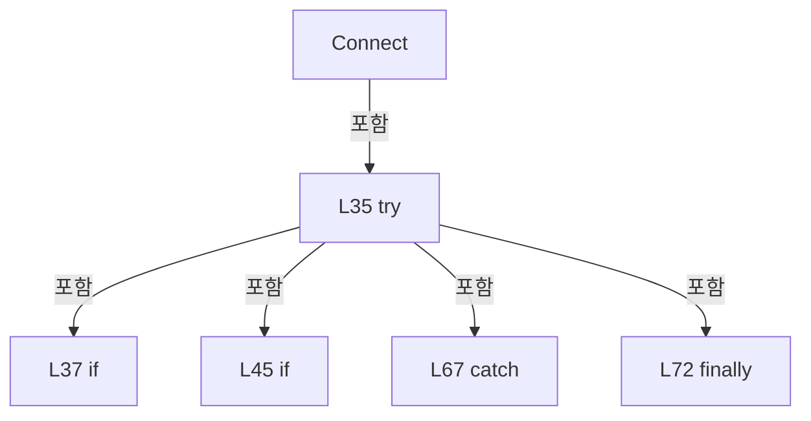

변경 전 점검: 입력/반환 타입, 위 호출자, 예외/취소 경로, 공유 상태와 저장·전송 소비자를 함께 확인합니다. 값의 단위나 물리 방향을 이름만으로 확정하지 않습니다.

### LocalFunctionStatement `AcceptLoopCallback` · L55–58

[Drilling.Common/Interface/Vision/CVisionComm.cs:55–58](https://github.com/kjuws10-rgb/A3Drilling/blob/5aee8e58439c9b455cae7c9593c9be986c3e682e/Drilling.Common/Interface/Vision/CVisionComm.cs#L55-L58)

| 항목 | 실제 추출 값 |
| --- | --- |
| 서명 | System.Threading.Tasks.Task AcceptLoopCallback() |
| 접근/수식자 | Private /  |
| 반환/값 타입 | System.Threading.Tasks.Task |
| 소속 타입 | NamedType:Drilling.Common.Interface.Vision.CVisionComm |

현재 부분 분석에서 직접 연결된 호출자는 없습니다. XAML/이벤트/인터페이스·델리게이트·외부 진입을 추가 확인해야 하며, 미사용으로 판정한 것이 아닙니다.

호출하는 대상과 해석 범위:

| 원본 행 | 표현식 | 분석 상태 | 대상/소스 위치 |
| --- | --- | --- | --- |
| 57 | AcceptLoop | resolved | System.Threading.Tasks.Task Drilling.Common.Interface.Vision.CVisionComm.AcceptLoop(System.Net.Sockets.TcpListener, System.Threading.CancellationToken) · Drilling.Common/Interface/Vision/CVisionComm.cs:144 |

본문의 실제 연산·분기·예외·반환 순서(원문 위치 순):

| 원본 행 | 종류 | 주석 해설 |
| --- | --- | --- |
| 57 | call | 함수·델리게이트 또는 객체 생성자를 호출합니다: AcceptLoop(listener, _serverCancellation.Token) |
| 57 | return | 호출자에게 값 또는 제어를 반환합니다: return AcceptLoop(listener, _serverCancellation.Token); |

변경 전 점검: 입력/반환 타입, 위 호출자, 예외/취소 경로, 공유 상태와 저장·전송 소비자를 함께 확인합니다. 값의 단위나 물리 방향을 이름만으로 확정하지 않습니다.

### MethodDeclaration `Disconnect` · L78–91

[Drilling.Common/Interface/Vision/CVisionComm.cs:78–91](https://github.com/kjuws10-rgb/A3Drilling/blob/5aee8e58439c9b455cae7c9593c9be986c3e682e/Drilling.Common/Interface/Vision/CVisionComm.cs#L78-L91)

| 항목 | 실제 추출 값 |
| --- | --- |
| 서명 | System.Threading.Tasks.Task Drilling.Common.Interface.Vision.CVisionComm.Disconnect(System.Threading.CancellationToken) |
| 접근/수식자 | Public / public, override, async |
| 반환/값 타입 | System.Threading.Tasks.Task |
| 소속 타입 | NamedType:Drilling.Common.Interface.Vision.CVisionComm |

입력 계약:

| 이름 | 타입 | 전달 | 선택/기본값 |
| --- | --- | --- | --- |
| cancellationToken | System.Threading.CancellationToken | None | True / null |

현재 부분 분석에서 직접 연결된 호출자는 없습니다. XAML/이벤트/인터페이스·델리게이트·외부 진입을 추가 확인해야 하며, 미사용으로 판정한 것이 아닙니다.

호출하는 대상과 해석 범위:

| 원본 행 | 표현식 | 분석 상태 | 대상/소스 위치 |
| --- | --- | --- | --- |
| 80 | cancellationToken.ThrowIfCancellationRequested | resolved | void System.Threading.CancellationToken.ThrowIfCancellationRequested() |
| 81 | _lifecycleLock.WaitAsync | resolved | System.Threading.Tasks.Task System.Threading.SemaphoreSlim.WaitAsync(System.Threading.CancellationToken) |
| 84 | StopServer | resolved | System.Threading.Tasks.Task Drilling.Common.Interface.Vision.CVisionComm.StopServer() · Drilling.Common/Interface/Vision/CVisionComm.cs:466 |
| 85 | SetState | resolved | void Drilling.Common.Interface.CCommBase.SetState(Drilling.Common.Interface.EN_COMM_STATE) · Drilling.Common/Interface/CComm.cs:114 |
| 89 | _lifecycleLock.Release | resolved | int System.Threading.SemaphoreSlim.Release() |

본문의 실제 연산·분기·예외·반환 순서(원문 위치 순):

| 원본 행 | 종류 | 주석 해설 |
| --- | --- | --- |
| 80 | call | 함수·델리게이트 또는 객체 생성자를 호출합니다: cancellationToken.ThrowIfCancellationRequested() |
| 81 | await | 비동기 완료를 기다립니다: await _lifecycleLock.WaitAsync(cancellationToken) |
| 81 | call | 함수·델리게이트 또는 객체 생성자를 호출합니다: _lifecycleLock.WaitAsync(cancellationToken) |
| 82 | try | 예외 처리 범위입니다: try |
| 84 | await | 비동기 완료를 기다립니다: await StopServer() |
| 84 | call | 함수·델리게이트 또는 객체 생성자를 호출합니다: StopServer() |
| 85 | call | 함수·델리게이트 또는 객체 생성자를 호출합니다: SetState(EN_COMM_STATE.Offline) |
| 87 | finally | 종료 정리 구간입니다: finally |
| 89 | call | 함수·델리게이트 또는 객체 생성자를 호출합니다: _lifecycleLock.Release() |

제어 구문의 포함 구조(실제 실행 순서/CFG가 아닌 구문 탐색 그림):

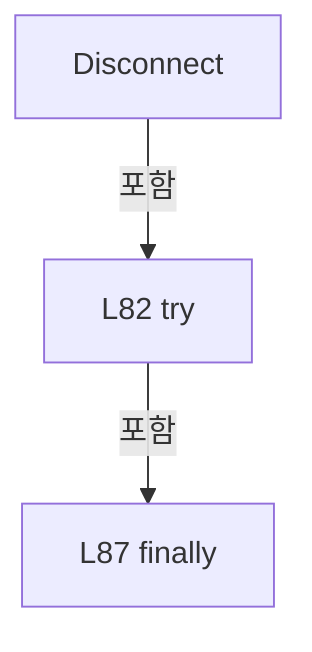

변경 전 점검: 입력/반환 타입, 위 호출자, 예외/취소 경로, 공유 상태와 저장·전송 소비자를 함께 확인합니다. 값의 단위나 물리 방향을 이름만으로 확정하지 않습니다.

### MethodDeclaration `Execute` · L93–142

[Drilling.Common/Interface/Vision/CVisionComm.cs:93–142](https://github.com/kjuws10-rgb/A3Drilling/blob/5aee8e58439c9b455cae7c9593c9be986c3e682e/Drilling.Common/Interface/Vision/CVisionComm.cs#L93-L142)

| 항목 | 실제 추출 값 |
| --- | --- |
| 서명 | System.Threading.Tasks.Task<string> Drilling.Common.Interface.Vision.CVisionComm.Execute(string, System.Threading.CancellationToken) |
| 접근/수식자 | Public / public, override, async |
| 반환/값 타입 | System.Threading.Tasks.Task<string> |
| 소속 타입 | NamedType:Drilling.Common.Interface.Vision.CVisionComm |

입력 계약:

| 이름 | 타입 | 전달 | 선택/기본값 |
| --- | --- | --- | --- |
| function | string | None | False /  |
| cancellationToken | System.Threading.CancellationToken | None | True / null |

현재 부분 분석에서 직접 연결된 호출자는 없습니다. XAML/이벤트/인터페이스·델리게이트·외부 진입을 추가 확인해야 하며, 미사용으로 판정한 것이 아닙니다.

호출하는 대상과 해석 범위:

| 원본 행 | 표현식 | 분석 상태 | 대상/소스 위치 |
| --- | --- | --- | --- |
| 97 | function.Trim | resolved | string string.Trim() |
| 98 | commandText.Equals | resolved | bool string.Equals(string?, System.StringComparison) |
| 108 | Connect | resolved · 동적 구현 선택 가능 | System.Threading.Tasks.Task Drilling.Common.Interface.Vision.CVisionComm.Connect(System.Threading.CancellationToken) · Drilling.Common/Interface/Vision/CVisionComm.cs:32 |
| 111 | WaitForClient | resolved | System.Threading.Tasks.Task<System.Net.Sockets.NetworkStream> Drilling.Common.Interface.Vision.CVisionComm.WaitForClient(System.Threading.CancellationToken) · Drilling.Common/Interface/Vision/CVisionComm.cs:251 |
| 112 | NormalizeCommand | resolved | Drilling.Common.Interface.Vision.EN_VISION_COMMAND Drilling.Common.Interface.Vision.CVisionComm.NormalizeCommand(string) · Drilling.Common/Interface/Vision/CVisionComm.cs:391 |
| 112 | commandText.Split | resolved | string[] string.Split(char, int, System.StringSplitOptions) |
| 114 | ParseRequest | resolved | Drilling.Common.Interface.Vision.ST_VISION_PACKET Drilling.Common.Interface.Vision.CVisionComm.ParseRequest(string, int, int) · Drilling.Common/Interface/Vision/CVisionComm.cs:343 |
| 114 | NextUniqueId | resolved | int Drilling.Common.Interface.Vision.CVisionComm.NextUniqueId() · Drilling.Common/Interface/Vision/CVisionComm.cs:444 |
| 116 | Volatile.Write | resolved | void System.Threading.Volatile.Write(ref int, int) |
| 117 | SendRequest | resolved | System.Threading.Tasks.Task<Drilling.Common.Interface.Vision.ST_VISION_PACKET> Drilling.Common.Interface.Vision.CVisionComm.SendRequest(System.Net.Sockets.NetworkStream, Drilling.Common.Interface.Vision.ST_VISION_PACKET, System.Threading.CancellationToken) · Drilling.Common/Interface/Vision/CVisionComm.cs:272 |
| 118 | DescribeResponse | resolved | string Drilling.Common.Interface.Vision.CVisionComm.DescribeResponse(Drilling.Common.Interface.Vision.ST_VISION_PACKET, int) · Drilling.Common/Interface/Vision/CVisionComm.cs:406 |
| 120 | Volatile.Write | resolved | void System.Threading.Volatile.Write(ref int, int) |
| 122 | SetState | resolved | void Drilling.Common.Interface.CCommBase.SetState(Drilling.Common.Interface.EN_COMM_STATE) · Drilling.Common/Interface/CComm.cs:114 |
| 129 | SetCommandError | resolved | void Drilling.Common.Interface.CCommBase.SetCommandError(string) · Drilling.Common/Interface/CComm.cs:132 |
| 139 | SetCommandError | resolved | void Drilling.Common.Interface.CCommBase.SetCommandError(string) · Drilling.Common/Interface/CComm.cs:132 |

본문의 실제 연산·분기·예외·반환 순서(원문 위치 순):

| 원본 행 | 종류 | 주석 해설 |
| --- | --- | --- |
| 95 | try | 예외 처리 범위입니다: try |
| 97 | call | 함수·델리게이트 또는 객체 생성자를 호출합니다: function.Trim() |
| 97 | local-declaration | 지역 변수를 선언합니다: var commandText = function.Trim(); |
| 97 | variable-initializer | 변수의 초기값을 지정합니다: commandText = function.Trim() |
| 98 | call | 함수·델리게이트 또는 객체 생성자를 호출합니다: commandText.Equals("STATUS", StringComparison.OrdinalIgnoreCase) |
| 98 | if | 조건에 따라 분기합니다: if (commandText.Equals("STATUS", StringComparison.OrdinalIgnoreCase)) |
| 100 | assignment | 값을 대상에 대입합니다: LastSent = commandText |
| 101 | assignment | 값을 대상에 대입합니다: LastReceived = _client is { Connected: true } ? "OK:VISION:CLIENT_CONNECTED" : "OK:VISION:WAITING_CLIENT" |
| 101 | conditional-expression | 조건에 따라 결과식을 선택합니다: _client is { Connected: true } ? "OK:VISION:CLIENT_CONNECTED" : "OK:VISION:WAITING_CLIENT" |
| 102 | assignment | 값을 대상에 대입합니다: LastError = "" |
| 103 | return | 호출자에게 값 또는 제어를 반환합니다: return LastReceived; |
| 106 | if | 조건에 따라 분기합니다: if (_listener is null) |
| 108 | await | 비동기 완료를 기다립니다: await Connect(cancellationToken) |
| 108 | call | 함수·델리게이트 또는 객체 생성자를 호출합니다: Connect(cancellationToken) |
| 111 | await | 비동기 완료를 기다립니다: await WaitForClient(cancellationToken) |
| 111 | call | 함수·델리게이트 또는 객체 생성자를 호출합니다: WaitForClient(cancellationToken) |
| 111 | local-declaration | 지역 변수를 선언합니다: var stream = await WaitForClient(cancellationToken); |
| 111 | variable-initializer | 변수의 초기값을 지정합니다: stream = await WaitForClient(cancellationToken) |
| 112 | call | 함수·델리게이트 또는 객체 생성자를 호출합니다: NormalizeCommand(commandText.Split(':', 2, StringSplitOptions.TrimEntries)[0]) |
| 112 | call | 함수·델리게이트 또는 객체 생성자를 호출합니다: commandText.Split(':', 2, StringSplitOptions.TrimEntries) |
| 112 | local-declaration | 지역 변수를 선언합니다: var command = NormalizeCommand(commandText.Split(':', 2, StringSplitOptions.TrimEntries)[0]); |
| 112 | variable-initializer | 변수의 초기값을 지정합니다: command = NormalizeCommand(commandText.Split(':', 2, StringSplitOptions.TrimEntries)[0]) |
| 113 | conditional-expression | 조건에 따라 결과식을 선택합니다: command == EN_VISION_COMMAND.MarkFindLine ? ResponseLineCapacity : ConfiguredLineCapacity |
| 113 | local-declaration | 지역 변수를 선언합니다: var capacity = command == EN_VISION_COMMAND.MarkFindLine ? ResponseLineCapacity : ConfiguredLineCapacity; |
| 113 | variable-initializer | 변수의 초기값을 지정합니다: capacity = command == EN_VISION_COMMAND.MarkFindLine ? ResponseLineCapacity : ConfiguredLineCapacity |
| 114 | call | 함수·델리게이트 또는 객체 생성자를 호출합니다: ParseRequest(commandText, NextUniqueId(), capacity) |
| 114 | call | 함수·델리게이트 또는 객체 생성자를 호출합니다: NextUniqueId() |
| 114 | local-declaration | 지역 변수를 선언합니다: var request = ParseRequest(commandText, NextUniqueId(), capacity); |
| 114 | variable-initializer | 변수의 초기값을 지정합니다: request = ParseRequest(commandText, NextUniqueId(), capacity) |
| 115 | if | 조건에 따라 분기합니다: if (command == EN_VISION_COMMAND.FlyingReady) |
| 116 | call | 함수·델리게이트 또는 객체 생성자를 호출합니다: Volatile.Write(ref _flyingLineCapacity, capacity) |
| 117 | await | 비동기 완료를 기다립니다: await SendRequest(stream, request, cancellationToken) |
| 117 | call | 함수·델리게이트 또는 객체 생성자를 호출합니다: SendRequest(stream, request, cancellationToken) |
| 117 | local-declaration | 지역 변수를 선언합니다: var response = await SendRequest(stream, request, cancellationToken); |
| 117 | variable-initializer | 변수의 초기값을 지정합니다: response = await SendRequest(stream, request, cancellationToken) |
| 118 | assignment | 값을 대상에 대입합니다: LastReceived = DescribeResponse(response, capacity) |
| 118 | call | 함수·델리게이트 또는 객체 생성자를 호출합니다: DescribeResponse(response, capacity) |
| 119 | if | 조건에 따라 분기합니다: if (command == EN_VISION_COMMAND.MarkFindLine) |
| 120 | call | 함수·델리게이트 또는 객체 생성자를 호출합니다: Volatile.Write(ref _flyingLineCapacity, 0) |
| 121 | assignment | 값을 대상에 대입합니다: LastError = "" |
| 122 | call | 함수·델리게이트 또는 객체 생성자를 호출합니다: SetState(EN_COMM_STATE.Online) |
| 123 | return | 호출자에게 값 또는 제어를 반환합니다: return LastReceived; |
| 125 | catch | 지정 예외를 처리합니다: catch (CVisionLineCountExceededException ex) |
| 129 | call | 함수·델리게이트 또는 객체 생성자를 호출합니다: SetCommandError(ex.Message) |
| 130 | throw | 예외를 발생/전달합니다: throw; |
| 132 | catch | 지정 예외를 처리합니다: catch (Exception ex) when (ex is SocketException or IOException or InvalidDataException or InvalidOperationException or FormatException or TimeoutException or OperationCanceledException) |
| 134 | if | 조건에 따라 분기합니다: if (ex is OperationCanceledException && cancellationToken.IsCancellationRequested) |
| 136 | throw | 예외를 발생/전달합니다: throw; |
| 139 | call | 함수·델리게이트 또는 객체 생성자를 호출합니다: SetCommandError(ex.Message) |
| 140 | return | 호출자에게 값 또는 제어를 반환합니다: return ""; |

제어 구문의 포함 구조(실제 실행 순서/CFG가 아닌 구문 탐색 그림):

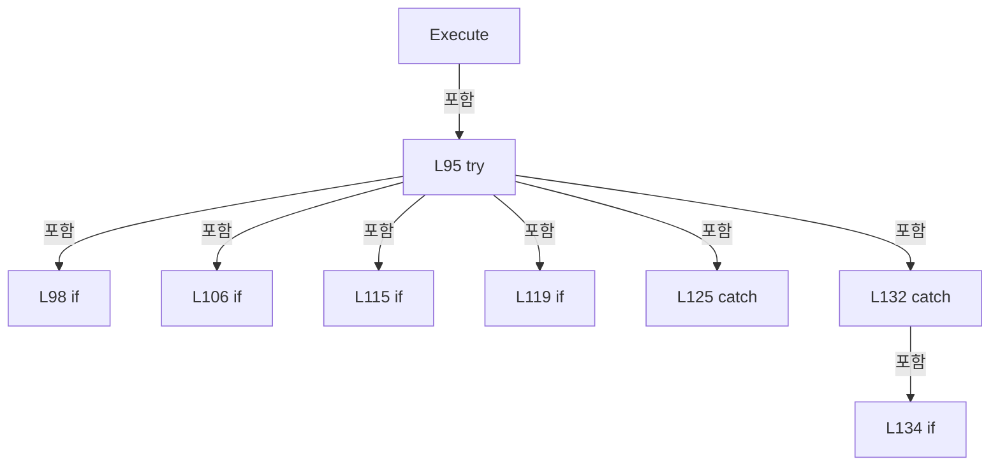

변경 전 점검: 입력/반환 타입, 위 호출자, 예외/취소 경로, 공유 상태와 저장·전송 소비자를 함께 확인합니다. 값의 단위나 물리 방향을 이름만으로 확정하지 않습니다.

### MethodDeclaration `AcceptLoop` · L144–165

[Drilling.Common/Interface/Vision/CVisionComm.cs:144–165](https://github.com/kjuws10-rgb/A3Drilling/blob/5aee8e58439c9b455cae7c9593c9be986c3e682e/Drilling.Common/Interface/Vision/CVisionComm.cs#L144-L165)

| 항목 | 실제 추출 값 |
| --- | --- |
| 서명 | System.Threading.Tasks.Task Drilling.Common.Interface.Vision.CVisionComm.AcceptLoop(System.Net.Sockets.TcpListener, System.Threading.CancellationToken) |
| 접근/수식자 | Private / private, async |
| 반환/값 타입 | System.Threading.Tasks.Task |
| 소속 타입 | NamedType:Drilling.Common.Interface.Vision.CVisionComm |

입력 계약:

| 이름 | 타입 | 전달 | 선택/기본값 |
| --- | --- | --- | --- |
| listener | System.Net.Sockets.TcpListener | None | False /  |
| cancellationToken | System.Threading.CancellationToken | None | False /  |

정적 호출자로 확인된 위치:

| 호출 파일/행 | 호출 표현식 | 런타임 분기 가능 |
| --- | --- | --- |
| [Drilling.Common/Interface/Vision/CVisionComm.cs:57–57](https://github.com/kjuws10-rgb/A3Drilling/blob/5aee8e58439c9b455cae7c9593c9be986c3e682e/Drilling.Common/Interface/Vision/CVisionComm.cs#L57-L57) | AcceptLoop | False |

호출하는 대상과 해석 범위:

| 원본 행 | 표현식 | 분석 상태 | 대상/소스 위치 |
| --- | --- | --- | --- |
| 151 | listener.AcceptTcpClientAsync | resolved | System.Threading.Tasks.ValueTask<System.Net.Sockets.TcpClient> System.Net.Sockets.TcpListener.AcceptTcpClientAsync(System.Threading.CancellationToken) |
| 153 | ReplaceClient | resolved | void Drilling.Common.Interface.Vision.CVisionComm.ReplaceClient(System.Net.Sockets.TcpClient, System.Threading.CancellationToken) · Drilling.Common/Interface/Vision/CVisionComm.cs:167 |
| 157 | .Dispose | resolved | void System.Net.Sockets.TcpClient.Dispose() |

본문의 실제 연산·분기·예외·반환 순서(원문 위치 순):

| 원본 행 | 종류 | 주석 해설 |
| --- | --- | --- |
| 146 | while | 조건을 먼저 확인하며 반복합니다: while (!cancellationToken.IsCancellationRequested) |
| 148 | local-declaration | 지역 변수를 선언합니다: TcpClient? client = null; |
| 148 | variable-initializer | 변수의 초기값을 지정합니다: client = null |
| 149 | try | 예외 처리 범위입니다: try |
| 151 | assignment | 값을 대상에 대입합니다: client = await listener.AcceptTcpClientAsync(cancellationToken) |
| 151 | await | 비동기 완료를 기다립니다: await listener.AcceptTcpClientAsync(cancellationToken) |
| 151 | call | 함수·델리게이트 또는 객체 생성자를 호출합니다: listener.AcceptTcpClientAsync(cancellationToken) |
| 152 | assignment | 값을 대상에 대입합니다: client.NoDelay = true |
| 153 | call | 함수·델리게이트 또는 객체 생성자를 호출합니다: ReplaceClient(client, cancellationToken) |
| 155 | catch | 지정 예외를 처리합니다: catch (Exception ex) when (cancellationToken.IsCancellationRequested &#124;&#124; ex is ObjectDisposedException or SocketException or OperationCanceledException) |
| 157 | call | 함수·델리게이트 또는 객체 생성자를 호출합니다: .Dispose() |
| 158 | if | 조건에 따라 분기합니다: if (!cancellationToken.IsCancellationRequested) |
| 160 | assignment | 값을 대상에 대입합니다: LastError = ex.Message |
| 161 | assignment | 값을 대상에 대입합니다: LastChangedAt = DateTimeOffset.Now |

제어 구문의 포함 구조(실제 실행 순서/CFG가 아닌 구문 탐색 그림):

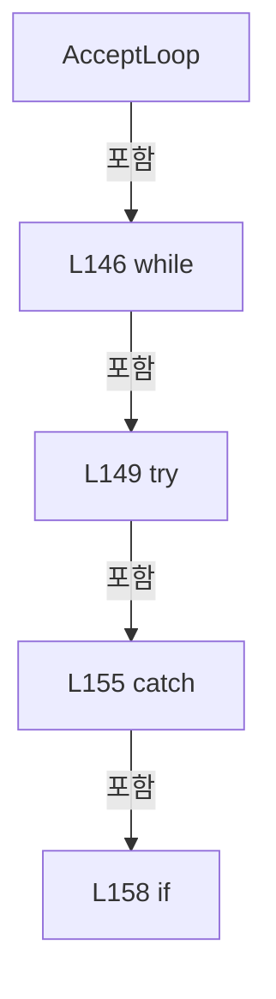

변경 전 점검: 입력/반환 타입, 위 호출자, 예외/취소 경로, 공유 상태와 저장·전송 소비자를 함께 확인합니다. 값의 단위나 물리 방향을 이름만으로 확정하지 않습니다.

### MethodDeclaration `ReplaceClient` · L167–186

[Drilling.Common/Interface/Vision/CVisionComm.cs:167–186](https://github.com/kjuws10-rgb/A3Drilling/blob/5aee8e58439c9b455cae7c9593c9be986c3e682e/Drilling.Common/Interface/Vision/CVisionComm.cs#L167-L186)

| 항목 | 실제 추출 값 |
| --- | --- |
| 서명 | void Drilling.Common.Interface.Vision.CVisionComm.ReplaceClient(System.Net.Sockets.TcpClient, System.Threading.CancellationToken) |
| 접근/수식자 | Private / private |
| 반환/값 타입 | void |
| 소속 타입 | NamedType:Drilling.Common.Interface.Vision.CVisionComm |

입력 계약:

| 이름 | 타입 | 전달 | 선택/기본값 |
| --- | --- | --- | --- |
| client | System.Net.Sockets.TcpClient | None | False /  |
| cancellationToken | System.Threading.CancellationToken | None | False /  |

정적 호출자로 확인된 위치:

| 호출 파일/행 | 호출 표현식 | 런타임 분기 가능 |
| --- | --- | --- |
| [Drilling.Common/Interface/Vision/CVisionComm.cs:153–153](https://github.com/kjuws10-rgb/A3Drilling/blob/5aee8e58439c9b455cae7c9593c9be986c3e682e/Drilling.Common/Interface/Vision/CVisionComm.cs#L153-L153) | ReplaceClient | False |

호출하는 대상과 해석 범위:

| 원본 행 | 표현식 | 분석 상태 | 대상/소스 위치 |
| --- | --- | --- | --- |
| 169 | .Dispose | resolved | void System.Net.Sockets.TcpClient.Dispose() |
| 171 | client.GetStream | resolved | System.Net.Sockets.NetworkStream System.Net.Sockets.TcpClient.GetStream() |
| 177 | Task.Run | resolved | System.Threading.Tasks.Task System.Threading.Tasks.Task.Run(System.Func<System.Threading.Tasks.Task?>, System.Threading.CancellationToken) |
| 180 | _clientReady.Release | resolved | int System.Threading.SemaphoreSlim.Release() |
| 184 | SetState | resolved | void Drilling.Common.Interface.CCommBase.SetState(Drilling.Common.Interface.EN_COMM_STATE) · Drilling.Common/Interface/CComm.cs:114 |
| 185 | RaiseProtocolTrace | resolved | void Drilling.Common.Interface.Vision.CVisionComm.RaiseProtocolTrace(string, string) · Drilling.Common/Interface/Vision/CVisionComm.cs:456 |
| 185 | .ToString | resolved · 동적 구현 선택 가능 | string? object.ToString() |

본문의 실제 연산·분기·예외·반환 순서(원문 위치 순):

| 원본 행 | 종류 | 주석 해설 |
| --- | --- | --- |
| 169 | call | 함수·델리게이트 또는 객체 생성자를 호출합니다: .Dispose() |
| 170 | assignment | 값을 대상에 대입합니다: _client = client |
| 171 | assignment | 값을 대상에 대입합니다: _stream = client.GetStream() |
| 171 | call | 함수·델리게이트 또는 객체 생성자를 호출합니다: client.GetStream() |
| 177 | assignment | 값을 대상에 대입합니다: _receiveTask = Task.Run(ReceiveLoopCallback, CancellationToken.None) |
| 177 | call | 함수·델리게이트 또는 객체 생성자를 호출합니다: Task.Run(ReceiveLoopCallback, CancellationToken.None) |
| 178 | if | 조건에 따라 분기합니다: if (_clientReady.CurrentCount == 0) |
| 180 | call | 함수·델리게이트 또는 객체 생성자를 호출합니다: _clientReady.Release() |
| 183 | assignment | 값을 대상에 대입합니다: LastError = "" |
| 184 | call | 함수·델리게이트 또는 객체 생성자를 호출합니다: SetState(EN_COMM_STATE.Online) |
| 185 | call | 함수·델리게이트 또는 객체 생성자를 호출합니다: RaiseProtocolTrace("INFO", $"CLIENT_CONNECTED:{client.Client.RemoteEndPoint?.ToString() ?? "UNKNOWN"}") |
| 185 | call | 함수·델리게이트 또는 객체 생성자를 호출합니다: .ToString() |

제어 구문의 포함 구조(실제 실행 순서/CFG가 아닌 구문 탐색 그림):

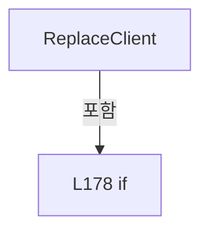

변경 전 점검: 입력/반환 타입, 위 호출자, 예외/취소 경로, 공유 상태와 저장·전송 소비자를 함께 확인합니다. 값의 단위나 물리 방향을 이름만으로 확정하지 않습니다.

### LocalFunctionStatement `ReceiveLoopCallback` · L172–175

[Drilling.Common/Interface/Vision/CVisionComm.cs:172–175](https://github.com/kjuws10-rgb/A3Drilling/blob/5aee8e58439c9b455cae7c9593c9be986c3e682e/Drilling.Common/Interface/Vision/CVisionComm.cs#L172-L175)

| 항목 | 실제 추출 값 |
| --- | --- |
| 서명 | System.Threading.Tasks.Task ReceiveLoopCallback() |
| 접근/수식자 | Private /  |
| 반환/값 타입 | System.Threading.Tasks.Task |
| 소속 타입 | NamedType:Drilling.Common.Interface.Vision.CVisionComm |

현재 부분 분석에서 직접 연결된 호출자는 없습니다. XAML/이벤트/인터페이스·델리게이트·외부 진입을 추가 확인해야 하며, 미사용으로 판정한 것이 아닙니다.

호출하는 대상과 해석 범위:

| 원본 행 | 표현식 | 분석 상태 | 대상/소스 위치 |
| --- | --- | --- | --- |
| 174 | ReceiveLoop | resolved | System.Threading.Tasks.Task Drilling.Common.Interface.Vision.CVisionComm.ReceiveLoop(System.Net.Sockets.TcpClient, System.Net.Sockets.NetworkStream, System.Threading.CancellationToken) · Drilling.Common/Interface/Vision/CVisionComm.cs:188 |

본문의 실제 연산·분기·예외·반환 순서(원문 위치 순):

| 원본 행 | 종류 | 주석 해설 |
| --- | --- | --- |
| 174 | call | 함수·델리게이트 또는 객체 생성자를 호출합니다: ReceiveLoop(client, _stream, cancellationToken) |
| 174 | return | 호출자에게 값 또는 제어를 반환합니다: return ReceiveLoop(client, _stream, cancellationToken); |

변경 전 점검: 입력/반환 타입, 위 호출자, 예외/취소 경로, 공유 상태와 저장·전송 소비자를 함께 확인합니다. 값의 단위나 물리 방향을 이름만으로 확정하지 않습니다.

### MethodDeclaration `ReceiveLoop` · L188–249

[Drilling.Common/Interface/Vision/CVisionComm.cs:188–249](https://github.com/kjuws10-rgb/A3Drilling/blob/5aee8e58439c9b455cae7c9593c9be986c3e682e/Drilling.Common/Interface/Vision/CVisionComm.cs#L188-L249)

| 항목 | 실제 추출 값 |
| --- | --- |
| 서명 | System.Threading.Tasks.Task Drilling.Common.Interface.Vision.CVisionComm.ReceiveLoop(System.Net.Sockets.TcpClient, System.Net.Sockets.NetworkStream, System.Threading.CancellationToken) |
| 접근/수식자 | Private / private, async |
| 반환/값 타입 | System.Threading.Tasks.Task |
| 소속 타입 | NamedType:Drilling.Common.Interface.Vision.CVisionComm |

입력 계약:

| 이름 | 타입 | 전달 | 선택/기본값 |
| --- | --- | --- | --- |
| client | System.Net.Sockets.TcpClient | None | False /  |
| stream | System.Net.Sockets.NetworkStream | None | False /  |
| cancellationToken | System.Threading.CancellationToken | None | False /  |

정적 호출자로 확인된 위치:

| 호출 파일/행 | 호출 표현식 | 런타임 분기 가능 |
| --- | --- | --- |
| [Drilling.Common/Interface/Vision/CVisionComm.cs:174–174](https://github.com/kjuws10-rgb/A3Drilling/blob/5aee8e58439c9b455cae7c9593c9be986c3e682e/Drilling.Common/Interface/Vision/CVisionComm.cs#L174-L174) | ReceiveLoop | False |

호출하는 대상과 해석 범위:

| 원본 행 | 표현식 | 분석 상태 | 대상/소스 위치 |
| --- | --- | --- | --- |
| 194 | ReadPacket | resolved | System.Threading.Tasks.Task<Drilling.Common.Interface.Vision.ST_VISION_PACKET> Drilling.Common.Interface.Vision.CVisionComm.ReadPacket(System.Net.Sockets.NetworkStream, System.Threading.CancellationToken) · Drilling.Common/Interface/Vision/CVisionComm.cs:329 |
| 195 | DescribePacket | resolved | string Drilling.Common.Interface.Vision.CVisionComm.DescribePacket(Drilling.Common.Interface.Vision.ST_VISION_PACKET) · Drilling.Common/Interface/Vision/CVisionComm.cs:443 |
| 200 | SetState | resolved | void Drilling.Common.Interface.CCommBase.SetState(Drilling.Common.Interface.EN_COMM_STATE) · Drilling.Common/Interface/CComm.cs:114 |
| 203 | RaiseProtocolTrace | resolved | void Drilling.Common.Interface.Vision.CVisionComm.RaiseProtocolTrace(string, string) · Drilling.Common/Interface/Vision/CVisionComm.cs:456 |
| 203 | CVisionProtocol.FormatPacketLog | resolved | string Drilling.Common.Interface.Vision.CVisionProtocol.FormatPacketLog(string, Drilling.Common.Interface.Vision.ST_VISION_PACKET, string, int) · Drilling.Common/Interface/Vision/CVisionComm.cs:812 |
| 206 | SendPacket | resolved | System.Threading.Tasks.Task Drilling.Common.Interface.Vision.CVisionComm.SendPacket(System.Net.Sockets.NetworkStream, Drilling.Common.Interface.Vision.ST_VISION_PACKET, System.Threading.CancellationToken) · Drilling.Common/Interface/Vision/CVisionComm.cs:311 |
| 206 | CVisionProtocol.CreateEmpty | resolved | Drilling.Common.Interface.Vision.ST_VISION_PACKET Drilling.Common.Interface.Vision.CVisionProtocol.CreateEmpty(Drilling.Common.Interface.Vision.EN_VISION_COMMAND, int, int) · Drilling.Common/Interface/Vision/CVisionComm.cs:574 |
| 212 | SendPacket | resolved | System.Threading.Tasks.Task Drilling.Common.Interface.Vision.CVisionComm.SendPacket(System.Net.Sockets.NetworkStream, Drilling.Common.Interface.Vision.ST_VISION_PACKET, System.Threading.CancellationToken) · Drilling.Common/Interface/Vision/CVisionComm.cs:311 |
| 212 | CVisionProtocol.CreateEmpty | resolved | Drilling.Common.Interface.Vision.ST_VISION_PACKET Drilling.Common.Interface.Vision.CVisionProtocol.CreateEmpty(Drilling.Common.Interface.Vision.EN_VISION_COMMAND, int, int) · Drilling.Common/Interface/Vision/CVisionComm.cs:574 |
| 216 | _pending.TryRemove | resolved | bool System.Collections.Concurrent.ConcurrentDictionary<int, System.Threading.Tasks.TaskCompletionSource<Drilling.Common.Interface.Vision.ST_VISION_PACKET>>.TryRemove(int, out System.Threading.Tasks.TaskCompletionSource<Drilling.Common.Interface.Vision.ST_VISION_PACKET>) |
| 218 | completion.TrySetResult | resolved | bool System.Threading.Tasks.TaskCompletionSource<Drilling.Common.Interface.Vision.ST_VISION_PACKET>.TrySetResult(Drilling.Common.Interface.Vision.ST_VISION_PACKET) |
| 232 | ReferenceEquals | resolved | bool object.ReferenceEquals(object?, object?) |
| 238 | _clientReady.Wait | resolved | bool System.Threading.SemaphoreSlim.Wait(int) |
| 241 | FailPending | resolved | void Drilling.Common.Interface.Vision.CVisionComm.FailPending(System.Exception) · Drilling.Common/Interface/Vision/CVisionComm.cs:497 |
| 241 | new IOException | resolved | System.IO.IOException.IOException(string?) |
| 243 | SetState | resolved | void Drilling.Common.Interface.CCommBase.SetState(Drilling.Common.Interface.EN_COMM_STATE) · Drilling.Common/Interface/CComm.cs:114 |
| 243 | IsServerListening | resolved | bool Drilling.Common.Interface.Vision.CVisionComm.IsServerListening() · Drilling.Common/Interface/Vision/CVisionComm.cs:461 |
| 244 | RaiseProtocolTrace | resolved | void Drilling.Common.Interface.Vision.CVisionComm.RaiseProtocolTrace(string, string) · Drilling.Common/Interface/Vision/CVisionComm.cs:456 |
| 247 | client.Dispose | resolved | void System.Net.Sockets.TcpClient.Dispose() |

본문의 실제 연산·분기·예외·반환 순서(원문 위치 순):

| 원본 행 | 종류 | 주석 해설 |
| --- | --- | --- |
| 190 | try | 예외 처리 범위입니다: try |
| 192 | while | 조건을 먼저 확인하며 반복합니다: while (!cancellationToken.IsCancellationRequested && client.Connected) |
| 194 | await | 비동기 완료를 기다립니다: await ReadPacket(stream, cancellationToken) |
| 194 | call | 함수·델리게이트 또는 객체 생성자를 호출합니다: ReadPacket(stream, cancellationToken) |
| 194 | local-declaration | 지역 변수를 선언합니다: var packet = await ReadPacket(stream, cancellationToken); |
| 194 | variable-initializer | 변수의 초기값을 지정합니다: packet = await ReadPacket(stream, cancellationToken) |
| 195 | assignment | 값을 대상에 대입합니다: LastReceived = DescribePacket(packet) |
| 195 | call | 함수·델리게이트 또는 객체 생성자를 호출합니다: DescribePacket(packet) |
| 196 | assignment | 값을 대상에 대입합니다: LastChangedAt = DateTimeOffset.Now |
| 197 | if | 조건에 따라 분기합니다: if (packet.Header.Command == (int)EN_VISION_COMMAND.KeepAlive) |
| 199 | assignment | 값을 대상에 대입합니다: LastError = "" |
| 200 | call | 함수·델리게이트 또는 객체 생성자를 호출합니다: SetState(EN_COMM_STATE.Online) |
| 203 | call | 함수·델리게이트 또는 객체 생성자를 호출합니다: RaiseProtocolTrace("PACKET", CVisionProtocol.FormatPacketLog("RECV", packet, $"{Data.NickName}[{Data.Number}]", ResponseLineCapacity)) |
| 203 | call | 함수·델리게이트 또는 객체 생성자를 호출합니다: CVisionProtocol.FormatPacketLog("RECV", packet, $"{Data.NickName}[{Data.Number}]", ResponseLineCapacity) |
| 204 | if | 조건에 따라 분기합니다: if (packet.Header.Command == (int)EN_VISION_COMMAND.KeepAlive) |
| 206 | await | 비동기 완료를 기다립니다: await SendPacket(stream, CVisionProtocol.CreateEmpty(EN_VISION_COMMAND.KeepAlive, packet.Header.UniqueId, packet.Header.ErrorCode), cancellationToken) |
| 206 | call | 함수·델리게이트 또는 객체 생성자를 호출합니다: SendPacket(stream, CVisionProtocol.CreateEmpty(EN_VISION_COMMAND.KeepAlive, packet.Header.UniqueId, packet.Header.ErrorCode), cancellationToken) |
| 206 | call | 함수·델리게이트 또는 객체 생성자를 호출합니다: CVisionProtocol.CreateEmpty(EN_VISION_COMMAND.KeepAlive, packet.Header.UniqueId, packet.Header.ErrorCode) |
| 207 | continue | 다음 반복으로 진행합니다: continue; |
| 210 | if | 조건에 따라 분기합니다: if (packet.Header.Command == (int)EN_VISION_COMMAND.MarkFindManual) |
| 212 | await | 비동기 완료를 기다립니다: await SendPacket(stream, CVisionProtocol.CreateEmpty(EN_VISION_COMMAND.MarkFindManual, packet.Header.UniqueId), cancellationToken) |
| 212 | call | 함수·델리게이트 또는 객체 생성자를 호출합니다: SendPacket(stream, CVisionProtocol.CreateEmpty(EN_VISION_COMMAND.MarkFindManual, packet.Header.UniqueId), cancellationToken) |
| 212 | call | 함수·델리게이트 또는 객체 생성자를 호출합니다: CVisionProtocol.CreateEmpty(EN_VISION_COMMAND.MarkFindManual, packet.Header.UniqueId) |
| 213 | continue | 다음 반복으로 진행합니다: continue; |
| 216 | call | 함수·델리게이트 또는 객체 생성자를 호출합니다: _pending.TryRemove(packet.Header.UniqueId, out var completion) |
| 216 | if | 조건에 따라 분기합니다: if (_pending.TryRemove(packet.Header.UniqueId, out var completion)) |
| 218 | call | 함수·델리게이트 또는 객체 생성자를 호출합니다: completion.TrySetResult(packet) |
| 222 | catch | 지정 예외를 처리합니다: catch (Exception ex) when (ex is SocketException or IOException or InvalidDataException or ObjectDisposedException or OperationCanceledException) |
| 224 | if | 조건에 따라 분기합니다: if (!cancellationToken.IsCancellationRequested) |
| 226 | assignment | 값을 대상에 대입합니다: LastError = ex.Message |
| 227 | assignment | 값을 대상에 대입합니다: LastChangedAt = DateTimeOffset.Now |
| 230 | finally | 종료 정리 구간입니다: finally |
| 232 | call | 함수·델리게이트 또는 객체 생성자를 호출합니다: ReferenceEquals(_client, client) |
| 232 | if | 조건에 따라 분기합니다: if (ReferenceEquals(_client, client)) |
| 234 | assignment | 값을 대상에 대입합니다: _stream = null |
| 235 | assignment | 값을 대상에 대입합니다: _client = null |
| 236 | while | 조건을 먼저 확인하며 반복합니다: while (_clientReady.CurrentCount > 0) |
| 238 | call | 함수·델리게이트 또는 객체 생성자를 호출합니다: _clientReady.Wait(0) |
| 241 | call | 함수·델리게이트 또는 객체 생성자를 호출합니다: FailPending(new IOException("Vision client disconnected.")) |
| 241 | call | 함수·델리게이트 또는 객체 생성자를 호출합니다: new IOException("Vision client disconnected.") |
| 242 | assignment | 값을 대상에 대입합니다: LastError = "Vision client disconnected." |
| 243 | call | 함수·델리게이트 또는 객체 생성자를 호출합니다: SetState(IsServerListening() ? EN_COMM_STATE.Online : EN_COMM_STATE.Offline) |
| 243 | call | 함수·델리게이트 또는 객체 생성자를 호출합니다: IsServerListening() |
| 243 | conditional-expression | 조건에 따라 결과식을 선택합니다: IsServerListening() ? EN_COMM_STATE.Online : EN_COMM_STATE.Offline |
| 244 | call | 함수·델리게이트 또는 객체 생성자를 호출합니다: RaiseProtocolTrace("INFO", "CLIENT_DISCONNECTED") |
| 247 | call | 함수·델리게이트 또는 객체 생성자를 호출합니다: client.Dispose() |

제어 구문의 포함 구조(실제 실행 순서/CFG가 아닌 구문 탐색 그림):

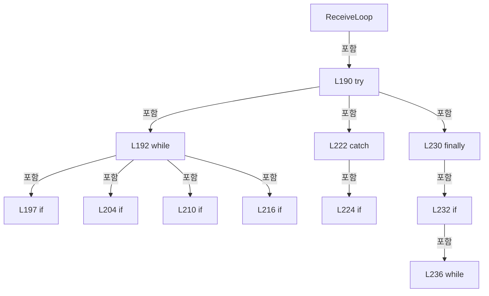

변경 전 점검: 입력/반환 타입, 위 호출자, 예외/취소 경로, 공유 상태와 저장·전송 소비자를 함께 확인합니다. 값의 단위나 물리 방향을 이름만으로 확정하지 않습니다.

### MethodDeclaration `WaitForClient` · L251–270

[Drilling.Common/Interface/Vision/CVisionComm.cs:251–270](https://github.com/kjuws10-rgb/A3Drilling/blob/5aee8e58439c9b455cae7c9593c9be986c3e682e/Drilling.Common/Interface/Vision/CVisionComm.cs#L251-L270)

| 항목 | 실제 추출 값 |
| --- | --- |
| 서명 | System.Threading.Tasks.Task<System.Net.Sockets.NetworkStream> Drilling.Common.Interface.Vision.CVisionComm.WaitForClient(System.Threading.CancellationToken) |
| 접근/수식자 | Private / private, async |
| 반환/값 타입 | System.Threading.Tasks.Task<System.Net.Sockets.NetworkStream> |
| 소속 타입 | NamedType:Drilling.Common.Interface.Vision.CVisionComm |

입력 계약:

| 이름 | 타입 | 전달 | 선택/기본값 |
| --- | --- | --- | --- |
| cancellationToken | System.Threading.CancellationToken | None | False /  |

정적 호출자로 확인된 위치:

| 호출 파일/행 | 호출 표현식 | 런타임 분기 가능 |
| --- | --- | --- |
| [Drilling.Common/Interface/Vision/CVisionComm.cs:111–111](https://github.com/kjuws10-rgb/A3Drilling/blob/5aee8e58439c9b455cae7c9593c9be986c3e682e/Drilling.Common/Interface/Vision/CVisionComm.cs#L111-L111) | WaitForClient | False |

호출하는 대상과 해석 범위:

| 원본 행 | 표현식 | 분석 상태 | 대상/소스 위치 |
| --- | --- | --- | --- |
| 258 | CancellationTokenSource.CreateLinkedTokenSource | resolved | System.Threading.CancellationTokenSource System.Threading.CancellationTokenSource.CreateLinkedTokenSource(System.Threading.CancellationToken) |
| 259 | timeout.CancelAfter | resolved | void System.Threading.CancellationTokenSource.CancelAfter(int) |
| 259 | Math.Max | resolved | int System.Math.Max(int, int) |
| 262 | _clientReady.WaitAsync | resolved | System.Threading.Tasks.Task System.Threading.SemaphoreSlim.WaitAsync(System.Threading.CancellationToken) |
| 266 | new TimeoutException | resolved | System.TimeoutException.TimeoutException(string?) |
| 269 | new IOException | resolved | System.IO.IOException.IOException(string?) |

본문의 실제 연산·분기·예외·반환 순서(원문 위치 순):

| 원본 행 | 종류 | 주석 해설 |
| --- | --- | --- |
| 253 | if | 조건에 따라 분기합니다: if (_stream is not null && _client is { Connected: true }) |
| 255 | return | 호출자에게 값 또는 제어를 반환합니다: return _stream; |
| 258 | call | 함수·델리게이트 또는 객체 생성자를 호출합니다: CancellationTokenSource.CreateLinkedTokenSource(cancellationToken) |
| 258 | using-declaration | 정리할 자원을 선언합니다: using var timeout = CancellationTokenSource.CreateLinkedTokenSource(cancellationToken); |
| 258 | variable-initializer | 변수의 초기값을 지정합니다: timeout = CancellationTokenSource.CreateLinkedTokenSource(cancellationToken) |
| 259 | call | 함수·델리게이트 또는 객체 생성자를 호출합니다: timeout.CancelAfter(Math.Max(100, Option.TimeoutMs)) |
| 259 | call | 함수·델리게이트 또는 객체 생성자를 호출합니다: Math.Max(100, Option.TimeoutMs) |
| 260 | try | 예외 처리 범위입니다: try |
| 262 | await | 비동기 완료를 기다립니다: await _clientReady.WaitAsync(timeout.Token) |
| 262 | call | 함수·델리게이트 또는 객체 생성자를 호출합니다: _clientReady.WaitAsync(timeout.Token) |
| 264 | catch | 지정 예외를 처리합니다: catch (OperationCanceledException) when (!cancellationToken.IsCancellationRequested) |
| 266 | call | 함수·델리게이트 또는 객체 생성자를 호출합니다: new TimeoutException("Vision client connection timeout.") |
| 266 | throw | 예외를 발생/전달합니다: throw new TimeoutException("Vision client connection timeout."); |
| 269 | call | 함수·델리게이트 또는 객체 생성자를 호출합니다: new IOException("Vision client disconnected before command transmission.") |
| 269 | return | 호출자에게 값 또는 제어를 반환합니다: return _stream ?? throw new IOException("Vision client disconnected before command transmission."); |
| 269 | throw | 예외를 발생/전달합니다: throw new IOException("Vision client disconnected before command transmission.") |

제어 구문의 포함 구조(실제 실행 순서/CFG가 아닌 구문 탐색 그림):

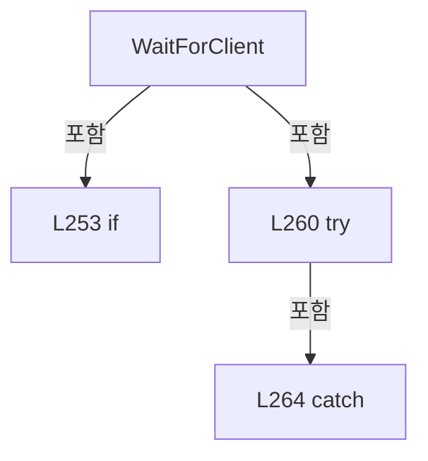

변경 전 점검: 입력/반환 타입, 위 호출자, 예외/취소 경로, 공유 상태와 저장·전송 소비자를 함께 확인합니다. 값의 단위나 물리 방향을 이름만으로 확정하지 않습니다.

### MethodDeclaration `SendRequest` · L272–309

[Drilling.Common/Interface/Vision/CVisionComm.cs:272–309](https://github.com/kjuws10-rgb/A3Drilling/blob/5aee8e58439c9b455cae7c9593c9be986c3e682e/Drilling.Common/Interface/Vision/CVisionComm.cs#L272-L309)

| 항목 | 실제 추출 값 |
| --- | --- |
| 서명 | System.Threading.Tasks.Task<Drilling.Common.Interface.Vision.ST_VISION_PACKET> Drilling.Common.Interface.Vision.CVisionComm.SendRequest(System.Net.Sockets.NetworkStream, Drilling.Common.Interface.Vision.ST_VISION_PACKET, System.Threading.CancellationToken) |
| 접근/수식자 | Private / private, async |
| 반환/값 타입 | System.Threading.Tasks.Task<Drilling.Common.Interface.Vision.ST_VISION_PACKET> |
| 소속 타입 | NamedType:Drilling.Common.Interface.Vision.CVisionComm |

입력 계약:

| 이름 | 타입 | 전달 | 선택/기본값 |
| --- | --- | --- | --- |
| stream | System.Net.Sockets.NetworkStream | None | False /  |
| request | Drilling.Common.Interface.Vision.ST_VISION_PACKET | None | False /  |
| cancellationToken | System.Threading.CancellationToken | None | False /  |

정적 호출자로 확인된 위치:

| 호출 파일/행 | 호출 표현식 | 런타임 분기 가능 |
| --- | --- | --- |
| [Drilling.Common/Interface/Vision/CVisionComm.cs:117–117](https://github.com/kjuws10-rgb/A3Drilling/blob/5aee8e58439c9b455cae7c9593c9be986c3e682e/Drilling.Common/Interface/Vision/CVisionComm.cs#L117-L117) | SendRequest | False |

호출하는 대상과 해석 범위:

| 원본 행 | 표현식 | 분석 상태 | 대상/소스 위치 |
| --- | --- | --- | --- |
| 274 | new TaskCompletionSource<ST_VISION_PACKET> | resolved | System.Threading.Tasks.TaskCompletionSource<Drilling.Common.Interface.Vision.ST_VISION_PACKET>.TaskCompletionSource(System.Threading.Tasks.TaskCreationOptions) |
| 275 | _pending.TryAdd | resolved | bool System.Collections.Concurrent.ConcurrentDictionary<int, System.Threading.Tasks.TaskCompletionSource<Drilling.Common.Interface.Vision.ST_VISION_PACKET>>.TryAdd(int, System.Threading.Tasks.TaskCompletionSource<Drilling.Common.Interface.Vision.ST_VISION_PACKET>) |
| 277 | new InvalidOperationException | resolved | System.InvalidOperationException.InvalidOperationException(string?) |
| 282 | SendPacket | resolved | System.Threading.Tasks.Task Drilling.Common.Interface.Vision.CVisionComm.SendPacket(System.Net.Sockets.NetworkStream, Drilling.Common.Interface.Vision.ST_VISION_PACKET, System.Threading.CancellationToken) · Drilling.Common/Interface/Vision/CVisionComm.cs:311 |
| 283 | CancellationTokenSource.CreateLinkedTokenSource | resolved | System.Threading.CancellationTokenSource System.Threading.CancellationTokenSource.CreateLinkedTokenSource(System.Threading.CancellationToken) |
| 284 | timeout.CancelAfter | resolved | void System.Threading.CancellationTokenSource.CancelAfter(int) |
| 284 | Math.Max | resolved | int System.Math.Max(int, int) |
| 287 | completion.Task.WaitAsync | resolved | System.Threading.Tasks.Task<Drilling.Common.Interface.Vision.ST_VISION_PACKET> System.Threading.Tasks.Task<Drilling.Common.Interface.Vision.ST_VISION_PACKET>.WaitAsync(System.Threading.CancellationToken) |
| 290 | new InvalidDataException | resolved | System.IO.InvalidDataException.InvalidDataException(string?) |
| 295 | new InvalidDataException | resolved | System.IO.InvalidDataException.InvalidDataException(string?) |
| 302 | new TimeoutException | resolved | System.TimeoutException.TimeoutException(string?) |
| 307 | _pending.TryRemove | resolved | bool System.Collections.Concurrent.ConcurrentDictionary<int, System.Threading.Tasks.TaskCompletionSource<Drilling.Common.Interface.Vision.ST_VISION_PACKET>>.TryRemove(int, out System.Threading.Tasks.TaskCompletionSource<Drilling.Common.Interface.Vision.ST_VISION_PACKET>) |

본문의 실제 연산·분기·예외·반환 순서(원문 위치 순):

| 원본 행 | 종류 | 주석 해설 |
| --- | --- | --- |
| 274 | call | 함수·델리게이트 또는 객체 생성자를 호출합니다: new TaskCompletionSource<ST_VISION_PACKET>(TaskCreationOptions.RunContinuationsAsynchronously) |
| 274 | local-declaration | 지역 변수를 선언합니다: var completion = new TaskCompletionSource<ST_VISION_PACKET>(TaskCreationOptions.RunContinuationsAsynchronously); |
| 274 | variable-initializer | 변수의 초기값을 지정합니다: completion = new TaskCompletionSource<ST_VISION_PACKET>(TaskCreationOptions.RunContinuationsAsynchronously) |
| 275 | call | 함수·델리게이트 또는 객체 생성자를 호출합니다: _pending.TryAdd(request.Header.UniqueId, completion) |
| 275 | if | 조건에 따라 분기합니다: if (!_pending.TryAdd(request.Header.UniqueId, completion)) |
| 277 | call | 함수·델리게이트 또는 객체 생성자를 호출합니다: new InvalidOperationException($"Vision Unique ID is already pending: {request.Header.UniqueId}.") |
| 277 | throw | 예외를 발생/전달합니다: throw new InvalidOperationException($"Vision Unique ID is already pending: {request.Header.UniqueId}."); |
| 280 | try | 예외 처리 범위입니다: try |
| 282 | await | 비동기 완료를 기다립니다: await SendPacket(stream, request, cancellationToken) |
| 282 | call | 함수·델리게이트 또는 객체 생성자를 호출합니다: SendPacket(stream, request, cancellationToken) |
| 283 | call | 함수·델리게이트 또는 객체 생성자를 호출합니다: CancellationTokenSource.CreateLinkedTokenSource(cancellationToken) |
| 283 | using-declaration | 정리할 자원을 선언합니다: using var timeout = CancellationTokenSource.CreateLinkedTokenSource(cancellationToken); |
| 283 | variable-initializer | 변수의 초기값을 지정합니다: timeout = CancellationTokenSource.CreateLinkedTokenSource(cancellationToken) |
| 284 | call | 함수·델리게이트 또는 객체 생성자를 호출합니다: timeout.CancelAfter(Math.Max(100, Option.TimeoutMs)) |
| 284 | call | 함수·델리게이트 또는 객체 생성자를 호출합니다: Math.Max(100, Option.TimeoutMs) |
| 285 | try | 예외 처리 범위입니다: try |
| 287 | await | 비동기 완료를 기다립니다: await completion.Task.WaitAsync(timeout.Token) |
| 287 | call | 함수·델리게이트 또는 객체 생성자를 호출합니다: completion.Task.WaitAsync(timeout.Token) |
| 287 | local-declaration | 지역 변수를 선언합니다: var response = await completion.Task.WaitAsync(timeout.Token); |
| 287 | variable-initializer | 변수의 초기값을 지정합니다: response = await completion.Task.WaitAsync(timeout.Token) |
| 288 | if | 조건에 따라 분기합니다: if (response.Header.Command != request.Header.Command) |
| 290 | call | 함수·델리게이트 또는 객체 생성자를 호출합니다: new InvalidDataException($"Vision response command mismatch. Request={request.Header.Command}, Response={response.Header.Command}.") |
| 290 | throw | 예외를 발생/전달합니다: throw new InvalidDataException($"Vision response command mismatch. Request={request.Header.Command}, Response={response.Header.Command}."); |
| 293 | if | 조건에 따라 분기합니다: if (response.Header.ErrorCode != 0) |
| 295 | call | 함수·델리게이트 또는 객체 생성자를 호출합니다: new InvalidDataException($"Vision returned error code {response.Header.ErrorCode} for command {response.Header.Command}.") |
| 295 | throw | 예외를 발생/전달합니다: throw new InvalidDataException($"Vision returned error code {response.Header.ErrorCode} for command {response.Header.Command}."); |
| 298 | return | 호출자에게 값 또는 제어를 반환합니다: return response; |
| 300 | catch | 지정 예외를 처리합니다: catch (OperationCanceledException) when (!cancellationToken.IsCancellationRequested) |
| 302 | call | 함수·델리게이트 또는 객체 생성자를 호출합니다: new TimeoutException($"Vision command {request.Header.Command} response timeout.") |
| 302 | throw | 예외를 발생/전달합니다: throw new TimeoutException($"Vision command {request.Header.Command} response timeout."); |
| 305 | finally | 종료 정리 구간입니다: finally |
| 307 | call | 함수·델리게이트 또는 객체 생성자를 호출합니다: _pending.TryRemove(request.Header.UniqueId, out _) |

제어 구문의 포함 구조(실제 실행 순서/CFG가 아닌 구문 탐색 그림):

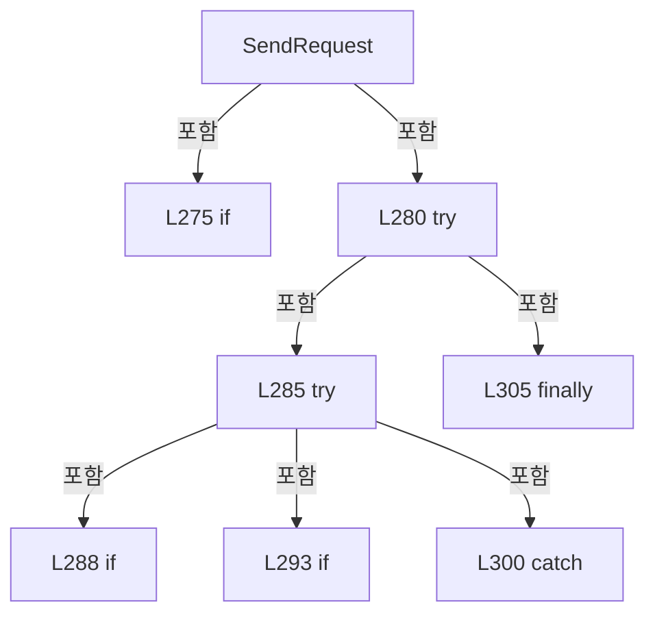

변경 전 점검: 입력/반환 타입, 위 호출자, 예외/취소 경로, 공유 상태와 저장·전송 소비자를 함께 확인합니다. 값의 단위나 물리 방향을 이름만으로 확정하지 않습니다.

### MethodDeclaration `SendPacket` · L311–327

[Drilling.Common/Interface/Vision/CVisionComm.cs:311–327](https://github.com/kjuws10-rgb/A3Drilling/blob/5aee8e58439c9b455cae7c9593c9be986c3e682e/Drilling.Common/Interface/Vision/CVisionComm.cs#L311-L327)

| 항목 | 실제 추출 값 |
| --- | --- |
| 서명 | System.Threading.Tasks.Task Drilling.Common.Interface.Vision.CVisionComm.SendPacket(System.Net.Sockets.NetworkStream, Drilling.Common.Interface.Vision.ST_VISION_PACKET, System.Threading.CancellationToken) |
| 접근/수식자 | Private / private, async |
| 반환/값 타입 | System.Threading.Tasks.Task |
| 소속 타입 | NamedType:Drilling.Common.Interface.Vision.CVisionComm |

입력 계약:

| 이름 | 타입 | 전달 | 선택/기본값 |
| --- | --- | --- | --- |
| stream | System.Net.Sockets.NetworkStream | None | False /  |
| packet | Drilling.Common.Interface.Vision.ST_VISION_PACKET | None | False /  |
| cancellationToken | System.Threading.CancellationToken | None | False /  |

정적 호출자로 확인된 위치:

| 호출 파일/행 | 호출 표현식 | 런타임 분기 가능 |
| --- | --- | --- |
| [Drilling.Common/Interface/Vision/CVisionComm.cs:206–206](https://github.com/kjuws10-rgb/A3Drilling/blob/5aee8e58439c9b455cae7c9593c9be986c3e682e/Drilling.Common/Interface/Vision/CVisionComm.cs#L206-L206) | SendPacket | False |
| [Drilling.Common/Interface/Vision/CVisionComm.cs:212–212](https://github.com/kjuws10-rgb/A3Drilling/blob/5aee8e58439c9b455cae7c9593c9be986c3e682e/Drilling.Common/Interface/Vision/CVisionComm.cs#L212-L212) | SendPacket | False |
| [Drilling.Common/Interface/Vision/CVisionComm.cs:282–282](https://github.com/kjuws10-rgb/A3Drilling/blob/5aee8e58439c9b455cae7c9593c9be986c3e682e/Drilling.Common/Interface/Vision/CVisionComm.cs#L282-L282) | SendPacket | False |

호출하는 대상과 해석 범위:

| 원본 행 | 표현식 | 분석 상태 | 대상/소스 위치 |
| --- | --- | --- | --- |
| 313 | CVisionProtocol.Encode | resolved | byte[] Drilling.Common.Interface.Vision.CVisionProtocol.Encode(Drilling.Common.Interface.Vision.ST_VISION_PACKET) · Drilling.Common/Interface/Vision/CVisionComm.cs:639 |
| 314 | _writeLock.WaitAsync | resolved | System.Threading.Tasks.Task System.Threading.SemaphoreSlim.WaitAsync(System.Threading.CancellationToken) |
| 317 | stream.WriteAsync | resolved · 동적 구현 선택 가능 | System.Threading.Tasks.ValueTask System.Net.Sockets.NetworkStream.WriteAsync(System.ReadOnlyMemory<byte>, System.Threading.CancellationToken) |
| 318 | stream.FlushAsync | resolved · 동적 구현 선택 가능 | System.Threading.Tasks.Task System.Net.Sockets.NetworkStream.FlushAsync(System.Threading.CancellationToken) |
| 319 | DescribePacket | resolved | string Drilling.Common.Interface.Vision.CVisionComm.DescribePacket(Drilling.Common.Interface.Vision.ST_VISION_PACKET) · Drilling.Common/Interface/Vision/CVisionComm.cs:443 |
| 321 | RaiseProtocolTrace | resolved | void Drilling.Common.Interface.Vision.CVisionComm.RaiseProtocolTrace(string, string) · Drilling.Common/Interface/Vision/CVisionComm.cs:456 |
| 321 | CVisionProtocol.FormatPacketLog | resolved | string Drilling.Common.Interface.Vision.CVisionProtocol.FormatPacketLog(string, Drilling.Common.Interface.Vision.ST_VISION_PACKET, string, int) · Drilling.Common/Interface/Vision/CVisionComm.cs:812 |
| 325 | _writeLock.Release | resolved | int System.Threading.SemaphoreSlim.Release() |

본문의 실제 연산·분기·예외·반환 순서(원문 위치 순):

| 원본 행 | 종류 | 주석 해설 |
| --- | --- | --- |
| 313 | call | 함수·델리게이트 또는 객체 생성자를 호출합니다: CVisionProtocol.Encode(packet) |
| 313 | local-declaration | 지역 변수를 선언합니다: var bytes = CVisionProtocol.Encode(packet); |
| 313 | variable-initializer | 변수의 초기값을 지정합니다: bytes = CVisionProtocol.Encode(packet) |
| 314 | await | 비동기 완료를 기다립니다: await _writeLock.WaitAsync(cancellationToken) |
| 314 | call | 함수·델리게이트 또는 객체 생성자를 호출합니다: _writeLock.WaitAsync(cancellationToken) |
| 315 | try | 예외 처리 범위입니다: try |
| 317 | await | 비동기 완료를 기다립니다: await stream.WriteAsync(bytes, cancellationToken) |
| 317 | call | 함수·델리게이트 또는 객체 생성자를 호출합니다: stream.WriteAsync(bytes, cancellationToken) |
| 318 | await | 비동기 완료를 기다립니다: await stream.FlushAsync(cancellationToken) |
| 318 | call | 함수·델리게이트 또는 객체 생성자를 호출합니다: stream.FlushAsync(cancellationToken) |
| 319 | assignment | 값을 대상에 대입합니다: LastSent = DescribePacket(packet) |
| 319 | call | 함수·델리게이트 또는 객체 생성자를 호출합니다: DescribePacket(packet) |
| 320 | assignment | 값을 대상에 대입합니다: LastChangedAt = DateTimeOffset.Now |
| 321 | call | 함수·델리게이트 또는 객체 생성자를 호출합니다: RaiseProtocolTrace("PACKET", CVisionProtocol.FormatPacketLog("SEND", packet, $"{Data.NickName}[{Data.Number}]", ResponseLineCapacity)) |
| 321 | call | 함수·델리게이트 또는 객체 생성자를 호출합니다: CVisionProtocol.FormatPacketLog("SEND", packet, $"{Data.NickName}[{Data.Number}]", ResponseLineCapacity) |
| 323 | finally | 종료 정리 구간입니다: finally |
| 325 | call | 함수·델리게이트 또는 객체 생성자를 호출합니다: _writeLock.Release() |

제어 구문의 포함 구조(실제 실행 순서/CFG가 아닌 구문 탐색 그림):

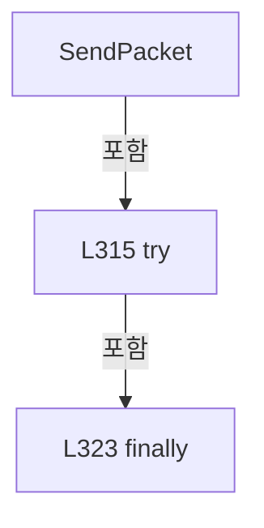

변경 전 점검: 입력/반환 타입, 위 호출자, 예외/취소 경로, 공유 상태와 저장·전송 소비자를 함께 확인합니다. 값의 단위나 물리 방향을 이름만으로 확정하지 않습니다.

### MethodDeclaration `ReadPacket` · L329–341

[Drilling.Common/Interface/Vision/CVisionComm.cs:329–341](https://github.com/kjuws10-rgb/A3Drilling/blob/5aee8e58439c9b455cae7c9593c9be986c3e682e/Drilling.Common/Interface/Vision/CVisionComm.cs#L329-L341)

| 항목 | 실제 추출 값 |
| --- | --- |
| 서명 | System.Threading.Tasks.Task<Drilling.Common.Interface.Vision.ST_VISION_PACKET> Drilling.Common.Interface.Vision.CVisionComm.ReadPacket(System.Net.Sockets.NetworkStream, System.Threading.CancellationToken) |
| 접근/수식자 | Private / private, static, async |
| 반환/값 타입 | System.Threading.Tasks.Task<Drilling.Common.Interface.Vision.ST_VISION_PACKET> |
| 소속 타입 | NamedType:Drilling.Common.Interface.Vision.CVisionComm |

입력 계약:

| 이름 | 타입 | 전달 | 선택/기본값 |
| --- | --- | --- | --- |
| stream | System.Net.Sockets.NetworkStream | None | False /  |
| cancellationToken | System.Threading.CancellationToken | None | False /  |

정적 호출자로 확인된 위치:

| 호출 파일/행 | 호출 표현식 | 런타임 분기 가능 |
| --- | --- | --- |
| [Drilling.Common/Interface/Vision/CVisionComm.cs:194–194](https://github.com/kjuws10-rgb/A3Drilling/blob/5aee8e58439c9b455cae7c9593c9be986c3e682e/Drilling.Common/Interface/Vision/CVisionComm.cs#L194-L194) | ReadPacket | False |

호출하는 대상과 해석 범위:

| 원본 행 | 표현식 | 분석 상태 | 대상/소스 위치 |
| --- | --- | --- | --- |
| 332 | stream.ReadExactlyAsync | resolved | System.Threading.Tasks.ValueTask System.IO.Stream.ReadExactlyAsync(System.Memory<byte>, System.Threading.CancellationToken) |
| 333 | CVisionProtocol.DecodeHeader | resolved | Drilling.Common.Interface.Vision.ST_VISION_PACKET_HEADER Drilling.Common.Interface.Vision.CVisionProtocol.DecodeHeader(System.ReadOnlySpan<byte>) · Drilling.Common/Interface/Vision/CVisionComm.cs:658 |
| 337 | stream.ReadExactlyAsync | resolved | System.Threading.Tasks.ValueTask System.IO.Stream.ReadExactlyAsync(System.Memory<byte>, System.Threading.CancellationToken) |
| 340 | new ST_VISION_PACKET | resolved | Drilling.Common.Interface.Vision.ST_VISION_PACKET.ST_VISION_PACKET(Drilling.Common.Interface.Vision.ST_VISION_PACKET_HEADER, byte[]) · Drilling.Common/Interface/Vision/CVisionComm.cs:545 |

본문의 실제 연산·분기·예외·반환 순서(원문 위치 순):

| 원본 행 | 종류 | 주석 해설 |
| --- | --- | --- |
| 331 | local-declaration | 지역 변수를 선언합니다: var headerBytes = new byte[CVisionProtocol.HeaderSize]; |
| 331 | variable-initializer | 변수의 초기값을 지정합니다: headerBytes = new byte[CVisionProtocol.HeaderSize] |
| 332 | await | 비동기 완료를 기다립니다: await stream.ReadExactlyAsync(headerBytes, cancellationToken) |
| 332 | call | 함수·델리게이트 또는 객체 생성자를 호출합니다: stream.ReadExactlyAsync(headerBytes, cancellationToken) |
| 333 | call | 함수·델리게이트 또는 객체 생성자를 호출합니다: CVisionProtocol.DecodeHeader(headerBytes) |
| 333 | local-declaration | 지역 변수를 선언합니다: var header = CVisionProtocol.DecodeHeader(headerBytes); |
| 333 | variable-initializer | 변수의 초기값을 지정합니다: header = CVisionProtocol.DecodeHeader(headerBytes) |
| 334 | local-declaration | 지역 변수를 선언합니다: var body = new byte[header.DataLength]; |
| 334 | variable-initializer | 변수의 초기값을 지정합니다: body = new byte[header.DataLength] |
| 335 | if | 조건에 따라 분기합니다: if (body.Length > 0) |
| 337 | await | 비동기 완료를 기다립니다: await stream.ReadExactlyAsync(body, cancellationToken) |
| 337 | call | 함수·델리게이트 또는 객체 생성자를 호출합니다: stream.ReadExactlyAsync(body, cancellationToken) |
| 340 | call | 함수·델리게이트 또는 객체 생성자를 호출합니다: new ST_VISION_PACKET(header, body) |
| 340 | return | 호출자에게 값 또는 제어를 반환합니다: return new ST_VISION_PACKET(header, body); |

제어 구문의 포함 구조(실제 실행 순서/CFG가 아닌 구문 탐색 그림):

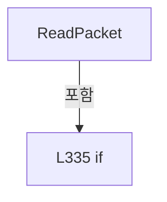

변경 전 점검: 입력/반환 타입, 위 호출자, 예외/취소 경로, 공유 상태와 저장·전송 소비자를 함께 확인합니다. 값의 단위나 물리 방향을 이름만으로 확정하지 않습니다.

### MethodDeclaration `ParseRequest` · L343–357

[Drilling.Common/Interface/Vision/CVisionComm.cs:343–357](https://github.com/kjuws10-rgb/A3Drilling/blob/5aee8e58439c9b455cae7c9593c9be986c3e682e/Drilling.Common/Interface/Vision/CVisionComm.cs#L343-L357)

| 항목 | 실제 추출 값 |
| --- | --- |
| 서명 | Drilling.Common.Interface.Vision.ST_VISION_PACKET Drilling.Common.Interface.Vision.CVisionComm.ParseRequest(string, int, int) |
| 접근/수식자 | Private / private, static |
| 반환/값 타입 | Drilling.Common.Interface.Vision.ST_VISION_PACKET |
| 소속 타입 | NamedType:Drilling.Common.Interface.Vision.CVisionComm |

입력 계약:

| 이름 | 타입 | 전달 | 선택/기본값 |
| --- | --- | --- | --- |
| function | string | None | False /  |
| uniqueId | int | None | False /  |
| maxHoleCountPerLine | int | None | False /  |

정적 호출자로 확인된 위치:

| 호출 파일/행 | 호출 표현식 | 런타임 분기 가능 |
| --- | --- | --- |
| [Drilling.Common/Interface/Vision/CVisionComm.cs:114–114](https://github.com/kjuws10-rgb/A3Drilling/blob/5aee8e58439c9b455cae7c9593c9be986c3e682e/Drilling.Common/Interface/Vision/CVisionComm.cs#L114-L114) | ParseRequest | False |

호출하는 대상과 해석 범위:

| 원본 행 | 표현식 | 분석 상태 | 대상/소스 위치 |
| --- | --- | --- | --- |
| 345 | function.Split | resolved | string[] string.Split(char, int, System.StringSplitOptions) |
| 346 | NormalizeCommand | resolved | Drilling.Common.Interface.Vision.EN_VISION_COMMAND Drilling.Common.Interface.Vision.CVisionComm.NormalizeCommand(string) · Drilling.Common/Interface/Vision/CVisionComm.cs:391 |
| 350 | CVisionProtocol.CreateMarkFindSingle | resolved | Drilling.Common.Interface.Vision.ST_VISION_PACKET Drilling.Common.Interface.Vision.CVisionProtocol.CreateMarkFindSingle(int, Drilling.Common.Interface.Vision.ST_VISION_MARK_SEARCH) · Drilling.Common/Interface/Vision/CVisionComm.cs:575 |
| 350 | ParseMarkSearch | resolved | Drilling.Common.Interface.Vision.ST_VISION_MARK_SEARCH Drilling.Common.Interface.Vision.CVisionComm.ParseMarkSearch(string) · Drilling.Common/Interface/Vision/CVisionComm.cs:380 |
| 351 | ParseFlyingReady | resolved | Drilling.Common.Interface.Vision.ST_VISION_PACKET Drilling.Common.Interface.Vision.CVisionComm.ParseFlyingReady(int, string, int) · Drilling.Common/Interface/Vision/CVisionComm.cs:359 |
| 352 | CVisionProtocol.CreateEmpty | resolved | Drilling.Common.Interface.Vision.ST_VISION_PACKET Drilling.Common.Interface.Vision.CVisionProtocol.CreateEmpty(Drilling.Common.Interface.Vision.EN_VISION_COMMAND, int, int) · Drilling.Common/Interface/Vision/CVisionComm.cs:574 |
| 353 | CVisionProtocol.CreateEmpty | resolved | Drilling.Common.Interface.Vision.ST_VISION_PACKET Drilling.Common.Interface.Vision.CVisionProtocol.CreateEmpty(Drilling.Common.Interface.Vision.EN_VISION_COMMAND, int, int) · Drilling.Common/Interface/Vision/CVisionComm.cs:574 |
| 354 | CVisionProtocol.CreateEmpty | resolved | Drilling.Common.Interface.Vision.ST_VISION_PACKET Drilling.Common.Interface.Vision.CVisionProtocol.CreateEmpty(Drilling.Common.Interface.Vision.EN_VISION_COMMAND, int, int) · Drilling.Common/Interface/Vision/CVisionComm.cs:574 |
| 355 | CVisionProtocol.CreateEmpty | resolved | Drilling.Common.Interface.Vision.ST_VISION_PACKET Drilling.Common.Interface.Vision.CVisionProtocol.CreateEmpty(Drilling.Common.Interface.Vision.EN_VISION_COMMAND, int, int) · Drilling.Common/Interface/Vision/CVisionComm.cs:574 |
| 356 | new InvalidOperationException | resolved | System.InvalidOperationException.InvalidOperationException(string?) |

본문의 실제 연산·분기·예외·반환 순서(원문 위치 순):

| 원본 행 | 종류 | 주석 해설 |
| --- | --- | --- |
| 345 | call | 함수·델리게이트 또는 객체 생성자를 호출합니다: function.Split(':', 2, StringSplitOptions.TrimEntries) |
| 345 | local-declaration | 지역 변수를 선언합니다: var fields = function.Split(':', 2, StringSplitOptions.TrimEntries); |
| 345 | variable-initializer | 변수의 초기값을 지정합니다: fields = function.Split(':', 2, StringSplitOptions.TrimEntries) |
| 346 | call | 함수·델리게이트 또는 객체 생성자를 호출합니다: NormalizeCommand(fields[0]) |
| 346 | local-declaration | 지역 변수를 선언합니다: var command = NormalizeCommand(fields[0]); |
| 346 | variable-initializer | 변수의 초기값을 지정합니다: command = NormalizeCommand(fields[0]) |
| 347 | conditional-expression | 조건에 따라 결과식을 선택합니다: fields.Length > 1 ? fields[1] : "" |
| 347 | local-declaration | 지역 변수를 선언합니다: var body = fields.Length > 1 ? fields[1] : ""; |
| 347 | variable-initializer | 변수의 초기값을 지정합니다: body = fields.Length > 1 ? fields[1] : "" |
| 348 | return | 호출자에게 값 또는 제어를 반환합니다: return command switch { EN_VISION_COMMAND.MarkFindSingle => CVisionProtocol.CreateMarkFindSingle(uniqueId, ParseMarkSearch(body)), EN_VISION_COMMAND.FlyingReady => ParseFlyingReady(uniqueId, body, maxHoleCountPerLine), EN_VISION_C |
| 348 | switch-expression | 값별 결과식을 선택합니다: command switch { EN_VISION_COMMAND.MarkFindSingle => CVisionProtocol.CreateMarkFindSingle(uniqueId, ParseMarkSearch(body)), EN_VISION_COMMAND.FlyingReady => ParseFlyingReady(uniqueId, body, maxHoleCountPerLine), EN_VISION_COMMAND. |
| 350 | call | 함수·델리게이트 또는 객체 생성자를 호출합니다: CVisionProtocol.CreateMarkFindSingle(uniqueId, ParseMarkSearch(body)) |
| 350 | call | 함수·델리게이트 또는 객체 생성자를 호출합니다: ParseMarkSearch(body) |
| 351 | call | 함수·델리게이트 또는 객체 생성자를 호출합니다: ParseFlyingReady(uniqueId, body, maxHoleCountPerLine) |
| 352 | call | 함수·델리게이트 또는 객체 생성자를 호출합니다: CVisionProtocol.CreateEmpty(command, uniqueId) |
| 353 | call | 함수·델리게이트 또는 객체 생성자를 호출합니다: CVisionProtocol.CreateEmpty(command, uniqueId) |
| 354 | call | 함수·델리게이트 또는 객체 생성자를 호출합니다: CVisionProtocol.CreateEmpty(command, uniqueId) |
| 355 | call | 함수·델리게이트 또는 객체 생성자를 호출합니다: CVisionProtocol.CreateEmpty(command, 0) |
| 356 | call | 함수·델리게이트 또는 객체 생성자를 호출합니다: new InvalidOperationException($"Vision command cannot be sent by Process: {(int)command}.") |
| 356 | throw | 예외를 발생/전달합니다: throw new InvalidOperationException($"Vision command cannot be sent by Process: {(int)command}.") |

제어 구문의 포함 구조(실제 실행 순서/CFG가 아닌 구문 탐색 그림):

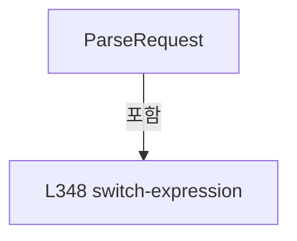

변경 전 점검: 입력/반환 타입, 위 호출자, 예외/취소 경로, 공유 상태와 저장·전송 소비자를 함께 확인합니다. 값의 단위나 물리 방향을 이름만으로 확정하지 않습니다.

### MethodDeclaration `ParseFlyingReady` · L359–378

[Drilling.Common/Interface/Vision/CVisionComm.cs:359–378](https://github.com/kjuws10-rgb/A3Drilling/blob/5aee8e58439c9b455cae7c9593c9be986c3e682e/Drilling.Common/Interface/Vision/CVisionComm.cs#L359-L378)

| 항목 | 실제 추출 값 |
| --- | --- |
| 서명 | Drilling.Common.Interface.Vision.ST_VISION_PACKET Drilling.Common.Interface.Vision.CVisionComm.ParseFlyingReady(int, string, int) |
| 접근/수식자 | Private / private, static |
| 반환/값 타입 | Drilling.Common.Interface.Vision.ST_VISION_PACKET |
| 소속 타입 | NamedType:Drilling.Common.Interface.Vision.CVisionComm |

입력 계약:

| 이름 | 타입 | 전달 | 선택/기본값 |
| --- | --- | --- | --- |
| uniqueId | int | None | False /  |
| body | string | None | False /  |
| maxHoleCountPerLine | int | None | False /  |

정적 호출자로 확인된 위치:

| 호출 파일/행 | 호출 표현식 | 런타임 분기 가능 |
| --- | --- | --- |
| [Drilling.Common/Interface/Vision/CVisionComm.cs:351–351](https://github.com/kjuws10-rgb/A3Drilling/blob/5aee8e58439c9b455cae7c9593c9be986c3e682e/Drilling.Common/Interface/Vision/CVisionComm.cs#L351-L351) | ParseFlyingReady | False |

호출하는 대상과 해석 범위:

| 원본 행 | 표현식 | 분석 상태 | 대상/소스 위치 |
| --- | --- | --- | --- |
| 361 | body.Split | resolved | string[] string.Split(char, int, System.StringSplitOptions) |
| 362 | int.TryParse | resolved | bool int.TryParse(string?, System.Globalization.NumberStyles, System.IFormatProvider?, out int) |
| 364 | new FormatException | resolved | System.FormatException.FormatException(string?) |
| 367 | new List<ST_VISION_MARK_SEARCH> | resolved | System.Collections.Generic.List<Drilling.Common.Interface.Vision.ST_VISION_MARK_SEARCH>.List() |
| 368 | string.IsNullOrWhiteSpace | resolved | bool string.IsNullOrWhiteSpace(string?) |
| 370 | parts[1].Split | resolved | string[] string.Split(char, System.StringSplitOptions) |
| 373 | searches.Add | resolved | void System.Collections.Generic.List<Drilling.Common.Interface.Vision.ST_VISION_MARK_SEARCH>.Add(Drilling.Common.Interface.Vision.ST_VISION_MARK_SEARCH) |
| 373 | ParseMarkSearch | resolved | Drilling.Common.Interface.Vision.ST_VISION_MARK_SEARCH Drilling.Common.Interface.Vision.CVisionComm.ParseMarkSearch(string) · Drilling.Common/Interface/Vision/CVisionComm.cs:380 |
| 377 | CVisionProtocol.CreateFlyingReady | resolved | Drilling.Common.Interface.Vision.ST_VISION_PACKET Drilling.Common.Interface.Vision.CVisionProtocol.CreateFlyingReady(int, int, System.Collections.Generic.IReadOnlyList<Drilling.Common.Interface.Vision.ST_VISION_MARK_SEARCH>, int) · Drilling.Common/Interface/Vision/CVisionComm.cs:576 |

본문의 실제 연산·분기·예외·반환 순서(원문 위치 순):

| 원본 행 | 종류 | 주석 해설 |
| --- | --- | --- |
| 361 | call | 함수·델리게이트 또는 객체 생성자를 호출합니다: body.Split(':', 2, StringSplitOptions.TrimEntries) |
| 361 | local-declaration | 지역 변수를 선언합니다: var parts = body.Split(':', 2, StringSplitOptions.TrimEntries); |
| 361 | variable-initializer | 변수의 초기값을 지정합니다: parts = body.Split(':', 2, StringSplitOptions.TrimEntries) |
| 362 | call | 함수·델리게이트 또는 객체 생성자를 호출합니다: int.TryParse(parts[0], NumberStyles.Integer, CultureInfo.InvariantCulture, out var inspectionType) |
| 362 | if | 조건에 따라 분기합니다: if (parts.Length == 0 &#124;&#124; !int.TryParse(parts[0], NumberStyles.Integer, CultureInfo.InvariantCulture, out var inspectionType)) |
| 364 | call | 함수·델리게이트 또는 객체 생성자를 호출합니다: new FormatException("FLYING_READY format: FLYING_READY:type:cell,doe,line,indexX,indexY,head;...") |
| 364 | throw | 예외를 발생/전달합니다: throw new FormatException("FLYING_READY format: FLYING_READY:type:cell,doe,line,indexX,indexY,head;..."); |
| 367 | call | 함수·델리게이트 또는 객체 생성자를 호출합니다: new List<ST_VISION_MARK_SEARCH>() |
| 367 | local-declaration | 지역 변수를 선언합니다: var searches = new List<ST_VISION_MARK_SEARCH>(); |
| 367 | variable-initializer | 변수의 초기값을 지정합니다: searches = new List<ST_VISION_MARK_SEARCH>() |
| 368 | call | 함수·델리게이트 또는 객체 생성자를 호출합니다: string.IsNullOrWhiteSpace(parts[1]) |
| 368 | if | 조건에 따라 분기합니다: if (parts.Length > 1 && !string.IsNullOrWhiteSpace(parts[1])) |
| 370 | call | 함수·델리게이트 또는 객체 생성자를 호출합니다: parts[1].Split(';', StringSplitOptions.RemoveEmptyEntries &#124; StringSplitOptions.TrimEntries) |
| 370 | local-declaration | 지역 변수를 선언합니다: var values = parts[1].Split(';', StringSplitOptions.RemoveEmptyEntries &#124; StringSplitOptions.TrimEntries); |
| 370 | variable-initializer | 변수의 초기값을 지정합니다: values = parts[1].Split(';', StringSplitOptions.RemoveEmptyEntries &#124; StringSplitOptions.TrimEntries) |
| 371 | foreach | 컬렉션 요소를 순회합니다: foreach (var value in values) |
| 373 | call | 함수·델리게이트 또는 객체 생성자를 호출합니다: searches.Add(ParseMarkSearch(value)) |
| 373 | call | 함수·델리게이트 또는 객체 생성자를 호출합니다: ParseMarkSearch(value) |
| 377 | call | 함수·델리게이트 또는 객체 생성자를 호출합니다: CVisionProtocol.CreateFlyingReady(uniqueId, inspectionType, searches, maxHoleCountPerLine) |
| 377 | return | 호출자에게 값 또는 제어를 반환합니다: return CVisionProtocol.CreateFlyingReady(uniqueId, inspectionType, searches, maxHoleCountPerLine); |

제어 구문의 포함 구조(실제 실행 순서/CFG가 아닌 구문 탐색 그림):

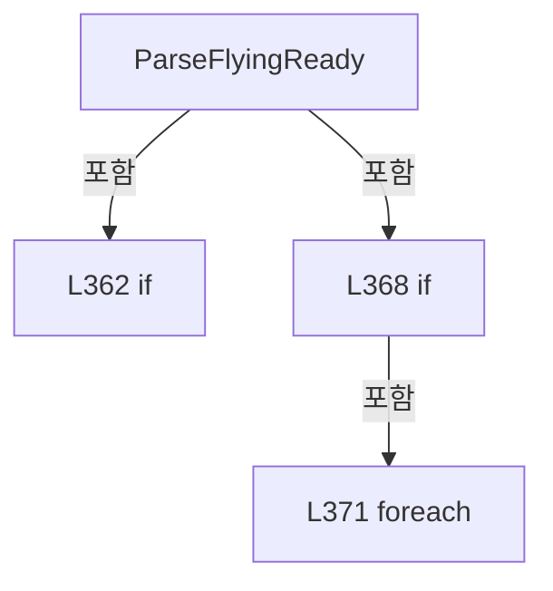

변경 전 점검: 입력/반환 타입, 위 호출자, 예외/취소 경로, 공유 상태와 저장·전송 소비자를 함께 확인합니다. 값의 단위나 물리 방향을 이름만으로 확정하지 않습니다.

### MethodDeclaration `ParseMarkSearch` · L380–389

[Drilling.Common/Interface/Vision/CVisionComm.cs:380–389](https://github.com/kjuws10-rgb/A3Drilling/blob/5aee8e58439c9b455cae7c9593c9be986c3e682e/Drilling.Common/Interface/Vision/CVisionComm.cs#L380-L389)

| 항목 | 실제 추출 값 |
| --- | --- |
| 서명 | Drilling.Common.Interface.Vision.ST_VISION_MARK_SEARCH Drilling.Common.Interface.Vision.CVisionComm.ParseMarkSearch(string) |
| 접근/수식자 | Private / private, static |
| 반환/값 타입 | Drilling.Common.Interface.Vision.ST_VISION_MARK_SEARCH |
| 소속 타입 | NamedType:Drilling.Common.Interface.Vision.CVisionComm |

입력 계약:

| 이름 | 타입 | 전달 | 선택/기본값 |
| --- | --- | --- | --- |
| value | string | None | False /  |

정적 호출자로 확인된 위치:

| 호출 파일/행 | 호출 표현식 | 런타임 분기 가능 |
| --- | --- | --- |
| [Drilling.Common/Interface/Vision/CVisionComm.cs:350–350](https://github.com/kjuws10-rgb/A3Drilling/blob/5aee8e58439c9b455cae7c9593c9be986c3e682e/Drilling.Common/Interface/Vision/CVisionComm.cs#L350-L350) | ParseMarkSearch | False |
| [Drilling.Common/Interface/Vision/CVisionComm.cs:373–373](https://github.com/kjuws10-rgb/A3Drilling/blob/5aee8e58439c9b455cae7c9593c9be986c3e682e/Drilling.Common/Interface/Vision/CVisionComm.cs#L373-L373) | ParseMarkSearch | False |

호출하는 대상과 해석 범위:

| 원본 행 | 표현식 | 분석 상태 | 대상/소스 위치 |
| --- | --- | --- | --- |
| 382 | value.Split | resolved | string[] string.Split(char, System.StringSplitOptions) |
| 385 | new FormatException | resolved | System.FormatException.FormatException(string?) |
| 388 | new ST_VISION_MARK_SEARCH | resolved | Drilling.Common.Interface.Vision.ST_VISION_MARK_SEARCH.ST_VISION_MARK_SEARCH(int, int, int, int, int, int) · Drilling.Common/Interface/Vision/CVisionComm.cs:543 |
| 388 | ParseInt | resolved | int Drilling.Common.Interface.Vision.CVisionComm.ParseInt(string, string) · Drilling.Common/Interface/Vision/CVisionComm.cs:405 |
| 388 | ParseInt | resolved | int Drilling.Common.Interface.Vision.CVisionComm.ParseInt(string, string) · Drilling.Common/Interface/Vision/CVisionComm.cs:405 |
| 388 | ParseInt | resolved | int Drilling.Common.Interface.Vision.CVisionComm.ParseInt(string, string) · Drilling.Common/Interface/Vision/CVisionComm.cs:405 |
| 388 | ParseInt | resolved | int Drilling.Common.Interface.Vision.CVisionComm.ParseInt(string, string) · Drilling.Common/Interface/Vision/CVisionComm.cs:405 |
| 388 | ParseInt | resolved | int Drilling.Common.Interface.Vision.CVisionComm.ParseInt(string, string) · Drilling.Common/Interface/Vision/CVisionComm.cs:405 |
| 388 | ParseInt | resolved | int Drilling.Common.Interface.Vision.CVisionComm.ParseInt(string, string) · Drilling.Common/Interface/Vision/CVisionComm.cs:405 |

본문의 실제 연산·분기·예외·반환 순서(원문 위치 순):

| 원본 행 | 종류 | 주석 해설 |
| --- | --- | --- |
| 382 | call | 함수·델리게이트 또는 객체 생성자를 호출합니다: value.Split(',', StringSplitOptions.TrimEntries) |
| 382 | local-declaration | 지역 변수를 선언합니다: var fields = value.Split(',', StringSplitOptions.TrimEntries); |
| 382 | variable-initializer | 변수의 초기값을 지정합니다: fields = value.Split(',', StringSplitOptions.TrimEntries) |
| 383 | if | 조건에 따라 분기합니다: if (fields.Length != 6) |
| 385 | call | 함수·델리게이트 또는 객체 생성자를 호출합니다: new FormatException("Mark Search format: cell,doe,line,indexX,indexY,head") |
| 385 | throw | 예외를 발생/전달합니다: throw new FormatException("Mark Search format: cell,doe,line,indexX,indexY,head"); |
| 388 | call | 함수·델리게이트 또는 객체 생성자를 호출합니다: new ST_VISION_MARK_SEARCH(ParseInt(fields[0], "cell"), ParseInt(fields[1], "doe"), ParseInt(fields[2], "line"), ParseInt(fields[3], "indexX"), ParseInt(fields[4], "indexY"), ParseInt(fields[5], "head")) |
| 388 | call | 함수·델리게이트 또는 객체 생성자를 호출합니다: ParseInt(fields[0], "cell") |
| 388 | call | 함수·델리게이트 또는 객체 생성자를 호출합니다: ParseInt(fields[1], "doe") |
| 388 | call | 함수·델리게이트 또는 객체 생성자를 호출합니다: ParseInt(fields[2], "line") |
| 388 | call | 함수·델리게이트 또는 객체 생성자를 호출합니다: ParseInt(fields[3], "indexX") |
| 388 | call | 함수·델리게이트 또는 객체 생성자를 호출합니다: ParseInt(fields[4], "indexY") |
| 388 | call | 함수·델리게이트 또는 객체 생성자를 호출합니다: ParseInt(fields[5], "head") |
| 388 | return | 호출자에게 값 또는 제어를 반환합니다: return new ST_VISION_MARK_SEARCH(ParseInt(fields[0], "cell"), ParseInt(fields[1], "doe"), ParseInt(fields[2], "line"), ParseInt(fields[3], "indexX"), ParseInt(fields[4], "indexY"), ParseInt(fields[5], "head")); |

제어 구문의 포함 구조(실제 실행 순서/CFG가 아닌 구문 탐색 그림):


변경 전 점검: 입력/반환 타입, 위 호출자, 예외/취소 경로, 공유 상태와 저장·전송 소비자를 함께 확인합니다. 값의 단위나 물리 방향을 이름만으로 확정하지 않습니다.

### MethodDeclaration `NormalizeCommand` · L391–403

[Drilling.Common/Interface/Vision/CVisionComm.cs:391–403](https://github.com/kjuws10-rgb/A3Drilling/blob/5aee8e58439c9b455cae7c9593c9be986c3e682e/Drilling.Common/Interface/Vision/CVisionComm.cs#L391-L403)

| 항목 | 실제 추출 값 |
| --- | --- |
| 서명 | Drilling.Common.Interface.Vision.EN_VISION_COMMAND Drilling.Common.Interface.Vision.CVisionComm.NormalizeCommand(string) |
| 접근/수식자 | Private / private, static |
| 반환/값 타입 | Drilling.Common.Interface.Vision.EN_VISION_COMMAND |
| 소속 타입 | NamedType:Drilling.Common.Interface.Vision.CVisionComm |

입력 계약:

| 이름 | 타입 | 전달 | 선택/기본값 |
| --- | --- | --- | --- |
| value | string | None | False /  |

정적 호출자로 확인된 위치:

| 호출 파일/행 | 호출 표현식 | 런타임 분기 가능 |
| --- | --- | --- |
| [Drilling.Common/Interface/Vision/CVisionComm.cs:112–112](https://github.com/kjuws10-rgb/A3Drilling/blob/5aee8e58439c9b455cae7c9593c9be986c3e682e/Drilling.Common/Interface/Vision/CVisionComm.cs#L112-L112) | NormalizeCommand | False |
| [Drilling.Common/Interface/Vision/CVisionComm.cs:346–346](https://github.com/kjuws10-rgb/A3Drilling/blob/5aee8e58439c9b455cae7c9593c9be986c3e682e/Drilling.Common/Interface/Vision/CVisionComm.cs#L346-L346) | NormalizeCommand | False |

호출하는 대상과 해석 범위:

| 원본 행 | 표현식 | 분석 상태 | 대상/소스 위치 |
| --- | --- | --- | --- |
| 393 | value.Trim().Replace("-", "_", StringComparison.Ordinal).ToUpperInvariant | resolved | string string.ToUpperInvariant() |
| 393 | value.Trim().Replace | resolved | string string.Replace(string, string?, System.StringComparison) |
| 393 | value.Trim | resolved | string string.Trim() |
| 402 | new InvalidOperationException | resolved | System.InvalidOperationException.InvalidOperationException(string?) |

본문의 실제 연산·분기·예외·반환 순서(원문 위치 순):

| 원본 행 | 종류 | 주석 해설 |
| --- | --- | --- |
| 393 | call | 함수·델리게이트 또는 객체 생성자를 호출합니다: value.Trim().Replace("-", "_", StringComparison.Ordinal).ToUpperInvariant() |
| 393 | call | 함수·델리게이트 또는 객체 생성자를 호출합니다: value.Trim().Replace("-", "_", StringComparison.Ordinal) |
| 393 | call | 함수·델리게이트 또는 객체 생성자를 호출합니다: value.Trim() |
| 393 | local-declaration | 지역 변수를 선언합니다: var normalized = value.Trim().Replace("-", "_", StringComparison.Ordinal).ToUpperInvariant(); |
| 393 | variable-initializer | 변수의 초기값을 지정합니다: normalized = value.Trim().Replace("-", "_", StringComparison.Ordinal).ToUpperInvariant() |
| 394 | return | 호출자에게 값 또는 제어를 반환합니다: return normalized switch { "1000" or "MARK_FIND_SINGLE" => EN_VISION_COMMAND.MarkFindSingle, "1001" or "FLYING_READY" => EN_VISION_COMMAND.FlyingReady, "1002" or "FLYING_MOVE_DONE" => EN_VISION_COMMAND.FlyingMoveDone, "1003" or "M |
| 394 | switch-expression | 값별 결과식을 선택합니다: normalized switch { "1000" or "MARK_FIND_SINGLE" => EN_VISION_COMMAND.MarkFindSingle, "1001" or "FLYING_READY" => EN_VISION_COMMAND.FlyingReady, "1002" or "FLYING_MOVE_DONE" => EN_VISION_COMMAND.FlyingMoveDone, "1003" or "MARK_FIN |
| 402 | call | 함수·델리게이트 또는 객체 생성자를 호출합니다: new InvalidOperationException($"Unsupported Vision command: {value}.") |
| 402 | throw | 예외를 발생/전달합니다: throw new InvalidOperationException($"Unsupported Vision command: {value}.") |

제어 구문의 포함 구조(실제 실행 순서/CFG가 아닌 구문 탐색 그림):

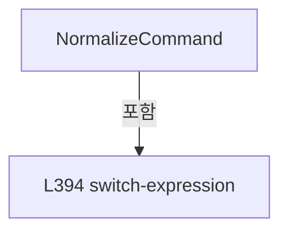

변경 전 점검: 입력/반환 타입, 위 호출자, 예외/취소 경로, 공유 상태와 저장·전송 소비자를 함께 확인합니다. 값의 단위나 물리 방향을 이름만으로 확정하지 않습니다.

### MethodDeclaration `ParseInt` · L405–405

[Drilling.Common/Interface/Vision/CVisionComm.cs:405–405](https://github.com/kjuws10-rgb/A3Drilling/blob/5aee8e58439c9b455cae7c9593c9be986c3e682e/Drilling.Common/Interface/Vision/CVisionComm.cs#L405-L405)

| 항목 | 실제 추출 값 |
| --- | --- |
| 서명 | int Drilling.Common.Interface.Vision.CVisionComm.ParseInt(string, string) |
| 접근/수식자 | Private / private, static |
| 반환/값 타입 | int |
| 소속 타입 | NamedType:Drilling.Common.Interface.Vision.CVisionComm |

입력 계약:

| 이름 | 타입 | 전달 | 선택/기본값 |
| --- | --- | --- | --- |
| value | string | None | False /  |
| name | string | None | False /  |

정적 호출자로 확인된 위치:

| 호출 파일/행 | 호출 표현식 | 런타임 분기 가능 |
| --- | --- | --- |
| [Drilling.Common/Interface/Vision/CVisionComm.cs:388–388](https://github.com/kjuws10-rgb/A3Drilling/blob/5aee8e58439c9b455cae7c9593c9be986c3e682e/Drilling.Common/Interface/Vision/CVisionComm.cs#L388-L388) | ParseInt | False |
| [Drilling.Common/Interface/Vision/CVisionComm.cs:388–388](https://github.com/kjuws10-rgb/A3Drilling/blob/5aee8e58439c9b455cae7c9593c9be986c3e682e/Drilling.Common/Interface/Vision/CVisionComm.cs#L388-L388) | ParseInt | False |
| [Drilling.Common/Interface/Vision/CVisionComm.cs:388–388](https://github.com/kjuws10-rgb/A3Drilling/blob/5aee8e58439c9b455cae7c9593c9be986c3e682e/Drilling.Common/Interface/Vision/CVisionComm.cs#L388-L388) | ParseInt | False |
| [Drilling.Common/Interface/Vision/CVisionComm.cs:388–388](https://github.com/kjuws10-rgb/A3Drilling/blob/5aee8e58439c9b455cae7c9593c9be986c3e682e/Drilling.Common/Interface/Vision/CVisionComm.cs#L388-L388) | ParseInt | False |
| [Drilling.Common/Interface/Vision/CVisionComm.cs:388–388](https://github.com/kjuws10-rgb/A3Drilling/blob/5aee8e58439c9b455cae7c9593c9be986c3e682e/Drilling.Common/Interface/Vision/CVisionComm.cs#L388-L388) | ParseInt | False |
| [Drilling.Common/Interface/Vision/CVisionComm.cs:388–388](https://github.com/kjuws10-rgb/A3Drilling/blob/5aee8e58439c9b455cae7c9593c9be986c3e682e/Drilling.Common/Interface/Vision/CVisionComm.cs#L388-L388) | ParseInt | False |

호출하는 대상과 해석 범위:

| 원본 행 | 표현식 | 분석 상태 | 대상/소스 위치 |
| --- | --- | --- | --- |
| 405 | int.TryParse | resolved | bool int.TryParse(string?, System.Globalization.NumberStyles, System.IFormatProvider?, out int) |
| 405 | new FormatException | resolved | System.FormatException.FormatException(string?) |

본문의 실제 연산·분기·예외·반환 순서(원문 위치 순):

| 원본 행 | 종류 | 주석 해설 |
| --- | --- | --- |
| 405 | call | 함수·델리게이트 또는 객체 생성자를 호출합니다: int.TryParse(value, NumberStyles.Integer, CultureInfo.InvariantCulture, out var result) |
| 405 | call | 함수·델리게이트 또는 객체 생성자를 호출합니다: new FormatException($"Vision {name} must be an integer. Value={value}.") |
| 405 | conditional-expression | 조건에 따라 결과식을 선택합니다: int.TryParse(value, NumberStyles.Integer, CultureInfo.InvariantCulture, out var result) ? result : throw new FormatException($"Vision {name} must be an integer. Value={value}.") |
| 405 | throw | 예외를 발생/전달합니다: throw new FormatException($"Vision {name} must be an integer. Value={value}.") |

변경 전 점검: 입력/반환 타입, 위 호출자, 예외/취소 경로, 공유 상태와 저장·전송 소비자를 함께 확인합니다. 값의 단위나 물리 방향을 이름만으로 확정하지 않습니다.

### MethodDeclaration `DescribeResponse` · L406–441

[Drilling.Common/Interface/Vision/CVisionComm.cs:406–441](https://github.com/kjuws10-rgb/A3Drilling/blob/5aee8e58439c9b455cae7c9593c9be986c3e682e/Drilling.Common/Interface/Vision/CVisionComm.cs#L406-L441)

| 항목 | 실제 추출 값 |
| --- | --- |
| 서명 | string Drilling.Common.Interface.Vision.CVisionComm.DescribeResponse(Drilling.Common.Interface.Vision.ST_VISION_PACKET, int) |
| 접근/수식자 | Private / private, static |
| 반환/값 타입 | string |
| 소속 타입 | NamedType:Drilling.Common.Interface.Vision.CVisionComm |

입력 계약:

| 이름 | 타입 | 전달 | 선택/기본값 |
| --- | --- | --- | --- |
| packet | Drilling.Common.Interface.Vision.ST_VISION_PACKET | None | False /  |
| maxHoleCountPerLine | int | None | False /  |

정적 호출자로 확인된 위치:

| 호출 파일/행 | 호출 표현식 | 런타임 분기 가능 |
| --- | --- | --- |
| [Drilling.Common/Interface/Vision/CVisionComm.cs:118–118](https://github.com/kjuws10-rgb/A3Drilling/blob/5aee8e58439c9b455cae7c9593c9be986c3e682e/Drilling.Common/Interface/Vision/CVisionComm.cs#L118-L118) | DescribeResponse | False |

호출하는 대상과 해석 범위:

| 원본 행 | 표현식 | 분석 상태 | 대상/소스 위치 |
| --- | --- | --- | --- |
| 412 | CVisionProtocol.DecodeFlyingMoveDoneResponse | resolved | int Drilling.Common.Interface.Vision.CVisionProtocol.DecodeFlyingMoveDoneResponse(Drilling.Common.Interface.Vision.ST_VISION_PACKET) · Drilling.Common/Interface/Vision/CVisionComm.cs:735 |
| 417 | CVisionProtocol.DecodeSingleResult | resolved | Drilling.Common.Interface.Vision.ST_VISION_SINGLE_RESULT Drilling.Common.Interface.Vision.CVisionProtocol.DecodeSingleResult(Drilling.Common.Interface.Vision.ST_VISION_PACKET) · Drilling.Common/Interface/Vision/CVisionComm.cs:748 |
| 418 | string.Create | resolved | string string.Create(System.IFormatProvider?, ref System.Runtime.CompilerServices.DefaultInterpolatedStringHandler) |
| 423 | CVisionProtocol.DecodeLineResult | resolved | Drilling.Common.Interface.Vision.ST_VISION_LINE_RESULT Drilling.Common.Interface.Vision.CVisionProtocol.DecodeLineResult(Drilling.Common.Interface.Vision.ST_VISION_PACKET, int) · Drilling.Common/Interface/Vision/CVisionComm.cs:764 |
| 424 | new StringBuilder | resolved | System.Text.StringBuilder.StringBuilder() |
| 425 | builder.Append("OK:").Append(packet.Header.Command).Append(":UID=").Append(packet.Header.UniqueId).Append(":RESOLUTION=").Append(result.Resolution).Append(":COUNT=").Append(result.FindHoleCount).Append | resolved | System.Text.StringBuilder System.Text.StringBuilder.Append(string?) |
| 425 | builder.Append("OK:").Append(packet.Header.Command).Append(":UID=").Append(packet.Header.UniqueId).Append(":RESOLUTION=").Append(result.Resolution).Append(":COUNT=").Append | resolved | System.Text.StringBuilder System.Text.StringBuilder.Append(int) |
| 425 | builder.Append("OK:").Append(packet.Header.Command).Append(":UID=").Append(packet.Header.UniqueId).Append(":RESOLUTION=").Append(result.Resolution).Append | resolved | System.Text.StringBuilder System.Text.StringBuilder.Append(string?) |
| 425 | builder.Append("OK:").Append(packet.Header.Command).Append(":UID=").Append(packet.Header.UniqueId).Append(":RESOLUTION=").Append | resolved | System.Text.StringBuilder System.Text.StringBuilder.Append(int) |
| 425 | builder.Append("OK:").Append(packet.Header.Command).Append(":UID=").Append(packet.Header.UniqueId).Append | resolved | System.Text.StringBuilder System.Text.StringBuilder.Append(string?) |
| 425 | builder.Append("OK:").Append(packet.Header.Command).Append(":UID=").Append | resolved | System.Text.StringBuilder System.Text.StringBuilder.Append(int) |
| 425 | builder.Append("OK:").Append(packet.Header.Command).Append | resolved | System.Text.StringBuilder System.Text.StringBuilder.Append(string?) |
| 425 | builder.Append("OK:").Append | resolved | System.Text.StringBuilder System.Text.StringBuilder.Append(int) |
| 425 | builder.Append | resolved | System.Text.StringBuilder System.Text.StringBuilder.Append(string?) |
| 430 | builder.Append | resolved | System.Text.StringBuilder System.Text.StringBuilder.Append(char) |
| 434 | builder.Append(mark.Result).Append(',').Append(mark.TargetMarkX.ToString("R", CultureInfo.InvariantCulture)).Append(',').Append(mark.TargetMarkY.ToString("R", CultureInfo.InvariantCulture)).Append(',').Append(mark.HoleX.ToString("R", CultureInfo.InvariantCulture)).Append(',').Append | resolved | System.Text.StringBuilder System.Text.StringBuilder.Append(string?) |
| 434 | builder.Append(mark.Result).Append(',').Append(mark.TargetMarkX.ToString("R", CultureInfo.InvariantCulture)).Append(',').Append(mark.TargetMarkY.ToString("R", CultureInfo.InvariantCulture)).Append(',').Append(mark.HoleX.ToString("R", CultureInfo.InvariantCulture)).Append | resolved | System.Text.StringBuilder System.Text.StringBuilder.Append(char) |
| 434 | builder.Append(mark.Result).Append(',').Append(mark.TargetMarkX.ToString("R", CultureInfo.InvariantCulture)).Append(',').Append(mark.TargetMarkY.ToString("R", CultureInfo.InvariantCulture)).Append(',').Append | resolved | System.Text.StringBuilder System.Text.StringBuilder.Append(string?) |
| 434 | builder.Append(mark.Result).Append(',').Append(mark.TargetMarkX.ToString("R", CultureInfo.InvariantCulture)).Append(',').Append(mark.TargetMarkY.ToString("R", CultureInfo.InvariantCulture)).Append | resolved | System.Text.StringBuilder System.Text.StringBuilder.Append(char) |
| 434 | builder.Append(mark.Result).Append(',').Append(mark.TargetMarkX.ToString("R", CultureInfo.InvariantCulture)).Append(',').Append | resolved | System.Text.StringBuilder System.Text.StringBuilder.Append(string?) |
| 434 | builder.Append(mark.Result).Append(',').Append(mark.TargetMarkX.ToString("R", CultureInfo.InvariantCulture)).Append | resolved | System.Text.StringBuilder System.Text.StringBuilder.Append(char) |
| 434 | builder.Append(mark.Result).Append(',').Append | resolved | System.Text.StringBuilder System.Text.StringBuilder.Append(string?) |
| 434 | builder.Append(mark.Result).Append | resolved | System.Text.StringBuilder System.Text.StringBuilder.Append(char) |
| 434 | builder.Append | resolved | System.Text.StringBuilder System.Text.StringBuilder.Append(int) |
| 434 | mark.TargetMarkX.ToString | resolved | string double.ToString(string?, System.IFormatProvider?) |
| 434 | mark.TargetMarkY.ToString | resolved | string double.ToString(string?, System.IFormatProvider?) |
| 434 | mark.HoleX.ToString | resolved | string double.ToString(string?, System.IFormatProvider?) |
| 434 | mark.HoleY.ToString | resolved | string double.ToString(string?, System.IFormatProvider?) |
| 437 | builder.ToString | resolved · 동적 구현 선택 가능 | string System.Text.StringBuilder.ToString() |

본문의 실제 연산·분기·예외·반환 순서(원문 위치 순):

| 원본 행 | 종류 | 주석 해설 |
| --- | --- | --- |
| 408 | if | 조건에 따라 분기합니다: if (packet.Header.Command == (int)EN_VISION_COMMAND.FlyingMoveDone) |
| 412 | call | 함수·델리게이트 또는 객체 생성자를 호출합니다: CVisionProtocol.DecodeFlyingMoveDoneResponse(packet) |
| 412 | local-declaration | 지역 변수를 선언합니다: var countMatch = CVisionProtocol.DecodeFlyingMoveDoneResponse(packet); |
| 412 | variable-initializer | 변수의 초기값을 지정합니다: countMatch = CVisionProtocol.DecodeFlyingMoveDoneResponse(packet) |
| 413 | conditional-expression | 조건에 따라 결과식을 선택합니다: countMatch == 0 ? "OK" : "NCK" |
| 413 | return | 호출자에게 값 또는 제어를 반환합니다: return $"{(countMatch == 0 ? "OK" : "NCK")}:1002:UID={packet.Header.UniqueId}:HOLE_COUNT_MATCH={countMatch}"; |
| 415 | if | 조건에 따라 분기합니다: if (packet.Header.Command is (int)EN_VISION_COMMAND.MarkFindSingle or (int)EN_VISION_COMMAND.MarkFindSettingSingle or (int)EN_VISION_COMMAND.MarkFindManual) |
| 417 | call | 함수·델리게이트 또는 객체 생성자를 호출합니다: CVisionProtocol.DecodeSingleResult(packet) |
| 417 | local-declaration | 지역 변수를 선언합니다: var result = CVisionProtocol.DecodeSingleResult(packet); |
| 417 | variable-initializer | 변수의 초기값을 지정합니다: result = CVisionProtocol.DecodeSingleResult(packet) |
| 418 | call | 함수·델리게이트 또는 객체 생성자를 호출합니다: string.Create(CultureInfo.InvariantCulture, $"OK:{packet.Header.Command}:UID={packet.Header.UniqueId}:RESOLUTION={result.Resolution}:RESULT={result.Mark.Result}:TARGET_X={result.Mark.TargetMarkX:R}:TARGET_Y={result.Mark.… |
| 418 | return | 호출자에게 값 또는 제어를 반환합니다: return string.Create(CultureInfo.InvariantCulture, $"OK:{packet.Header.Command}:UID={packet.Header.UniqueId}:RESOLUTION={result.Resolution}:RESULT={result.Mark.Result}:TARGET_X={result.Mark.TargetMarkX:R}:TARGET_Y={result.Mark.Tar |
| 421 | if | 조건에 따라 분기합니다: if (packet.Header.Command == (int)EN_VISION_COMMAND.MarkFindLine) |
| 423 | call | 함수·델리게이트 또는 객체 생성자를 호출합니다: CVisionProtocol.DecodeLineResult(packet, maxHoleCountPerLine) |
| 423 | local-declaration | 지역 변수를 선언합니다: var result = CVisionProtocol.DecodeLineResult(packet, maxHoleCountPerLine); |
| 423 | variable-initializer | 변수의 초기값을 지정합니다: result = CVisionProtocol.DecodeLineResult(packet, maxHoleCountPerLine) |
| 424 | call | 함수·델리게이트 또는 객체 생성자를 호출합니다: new StringBuilder() |
| 424 | local-declaration | 지역 변수를 선언합니다: var builder = new StringBuilder(); |
| 424 | variable-initializer | 변수의 초기값을 지정합니다: builder = new StringBuilder() |
| 425 | call | 함수·델리게이트 또는 객체 생성자를 호출합니다: builder.Append("OK:").Append(packet.Header.Command).Append(":UID=").Append(packet.Header.UniqueId).Append(":RESOLUTION=").Append(result.Resolution).Append(":COUNT=").Append(result.FindHoleCount).Append(":MARKS=") |
| 425 | call | 함수·델리게이트 또는 객체 생성자를 호출합니다: builder.Append("OK:").Append(packet.Header.Command).Append(":UID=").Append(packet.Header.UniqueId).Append(":RESOLUTION=").Append(result.Resolution).Append(":COUNT=").Append(result.FindHoleCount) |
| 425 | call | 함수·델리게이트 또는 객체 생성자를 호출합니다: builder.Append("OK:").Append(packet.Header.Command).Append(":UID=").Append(packet.Header.UniqueId).Append(":RESOLUTION=").Append(result.Resolution).Append(":COUNT=") |
| 425 | call | 함수·델리게이트 또는 객체 생성자를 호출합니다: builder.Append("OK:").Append(packet.Header.Command).Append(":UID=").Append(packet.Header.UniqueId).Append(":RESOLUTION=").Append(result.Resolution) |
| 425 | call | 함수·델리게이트 또는 객체 생성자를 호출합니다: builder.Append("OK:").Append(packet.Header.Command).Append(":UID=").Append(packet.Header.UniqueId).Append(":RESOLUTION=") |
| 425 | call | 함수·델리게이트 또는 객체 생성자를 호출합니다: builder.Append("OK:").Append(packet.Header.Command).Append(":UID=").Append(packet.Header.UniqueId) |
| 425 | call | 함수·델리게이트 또는 객체 생성자를 호출합니다: builder.Append("OK:").Append(packet.Header.Command).Append(":UID=") |
| 425 | call | 함수·델리게이트 또는 객체 생성자를 호출합니다: builder.Append("OK:").Append(packet.Header.Command) |
| 425 | call | 함수·델리게이트 또는 객체 생성자를 호출합니다: builder.Append("OK:") |
| 426 | variable-initializer | 변수의 초기값을 지정합니다: index = 0 |
| 426 | for | 초기화·조건·증감이 있는 반복입니다: for (var index = 0; index < result.Marks.Count; index++) |
| 428 | if | 조건에 따라 분기합니다: if (index > 0) |
| 430 | call | 함수·델리게이트 또는 객체 생성자를 호출합니다: builder.Append(';') |
| 433 | local-declaration | 지역 변수를 선언합니다: var mark = result.Marks[index]; |
| 433 | variable-initializer | 변수의 초기값을 지정합니다: mark = result.Marks[index] |
| 434 | call | 함수·델리게이트 또는 객체 생성자를 호출합니다: builder.Append(mark.Result).Append(',').Append(mark.TargetMarkX.ToString("R", CultureInfo.InvariantCulture)).Append(',').Append(mark.TargetMarkY.ToString("R", CultureInfo.InvariantCulture)).Append(',').Append(mark.HoleX.… |
| 434 | call | 함수·델리게이트 또는 객체 생성자를 호출합니다: builder.Append(mark.Result).Append(',').Append(mark.TargetMarkX.ToString("R", CultureInfo.InvariantCulture)).Append(',').Append(mark.TargetMarkY.ToString("R", CultureInfo.InvariantCulture)).Append(',').Append(mark.HoleX.… |
| 434 | call | 함수·델리게이트 또는 객체 생성자를 호출합니다: builder.Append(mark.Result).Append(',').Append(mark.TargetMarkX.ToString("R", CultureInfo.InvariantCulture)).Append(',').Append(mark.TargetMarkY.ToString("R", CultureInfo.InvariantCulture)).Append(',').Append(mark.HoleX.… |
| 434 | call | 함수·델리게이트 또는 객체 생성자를 호출합니다: builder.Append(mark.Result).Append(',').Append(mark.TargetMarkX.ToString("R", CultureInfo.InvariantCulture)).Append(',').Append(mark.TargetMarkY.ToString("R", CultureInfo.InvariantCulture)).Append(',') |
| 434 | call | 함수·델리게이트 또는 객체 생성자를 호출합니다: builder.Append(mark.Result).Append(',').Append(mark.TargetMarkX.ToString("R", CultureInfo.InvariantCulture)).Append(',').Append(mark.TargetMarkY.ToString("R", CultureInfo.InvariantCulture)) |
| 434 | call | 함수·델리게이트 또는 객체 생성자를 호출합니다: builder.Append(mark.Result).Append(',').Append(mark.TargetMarkX.ToString("R", CultureInfo.InvariantCulture)).Append(',') |
| 434 | call | 함수·델리게이트 또는 객체 생성자를 호출합니다: builder.Append(mark.Result).Append(',').Append(mark.TargetMarkX.ToString("R", CultureInfo.InvariantCulture)) |
| 434 | call | 함수·델리게이트 또는 객체 생성자를 호출합니다: builder.Append(mark.Result).Append(',') |
| 434 | call | 함수·델리게이트 또는 객체 생성자를 호출합니다: builder.Append(mark.Result) |
| 434 | call | 함수·델리게이트 또는 객체 생성자를 호출합니다: mark.TargetMarkX.ToString("R", CultureInfo.InvariantCulture) |
| 434 | call | 함수·델리게이트 또는 객체 생성자를 호출합니다: mark.TargetMarkY.ToString("R", CultureInfo.InvariantCulture) |
| 434 | call | 함수·델리게이트 또는 객체 생성자를 호출합니다: mark.HoleX.ToString("R", CultureInfo.InvariantCulture) |
| 434 | call | 함수·델리게이트 또는 객체 생성자를 호출합니다: mark.HoleY.ToString("R", CultureInfo.InvariantCulture) |
| 437 | call | 함수·델리게이트 또는 객체 생성자를 호출합니다: builder.ToString() |
| 437 | return | 호출자에게 값 또는 제어를 반환합니다: return builder.ToString(); |
| 440 | return | 호출자에게 값 또는 제어를 반환합니다: return $"OK:{packet.Header.Command}:UID={packet.Header.UniqueId}"; |

제어 구문의 포함 구조(실제 실행 순서/CFG가 아닌 구문 탐색 그림):

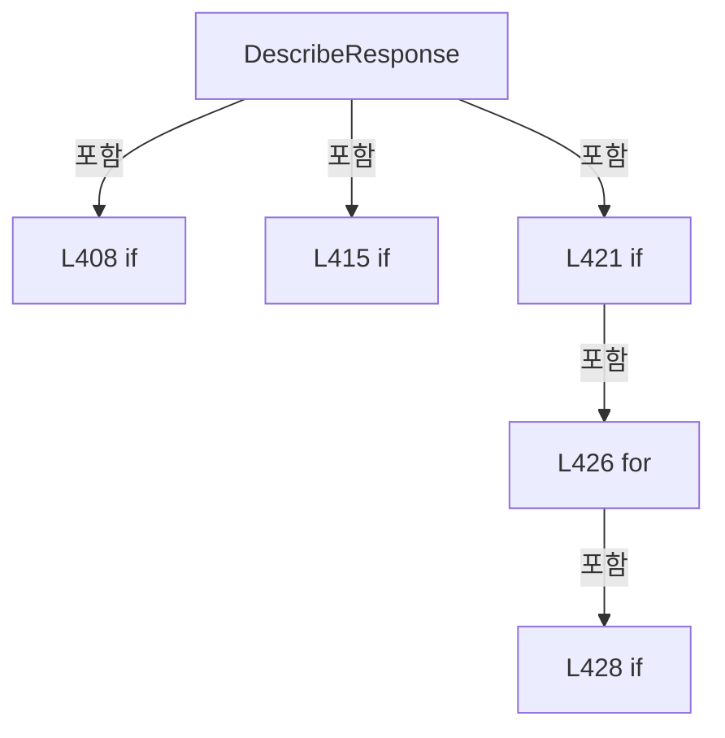

변경 전 점검: 입력/반환 타입, 위 호출자, 예외/취소 경로, 공유 상태와 저장·전송 소비자를 함께 확인합니다. 값의 단위나 물리 방향을 이름만으로 확정하지 않습니다.

### MethodDeclaration `DescribePacket` · L443–443

[Drilling.Common/Interface/Vision/CVisionComm.cs:443–443](https://github.com/kjuws10-rgb/A3Drilling/blob/5aee8e58439c9b455cae7c9593c9be986c3e682e/Drilling.Common/Interface/Vision/CVisionComm.cs#L443-L443)

| 항목 | 실제 추출 값 |
| --- | --- |
| 서명 | string Drilling.Common.Interface.Vision.CVisionComm.DescribePacket(Drilling.Common.Interface.Vision.ST_VISION_PACKET) |
| 접근/수식자 | Private / private, static |
| 반환/값 타입 | string |
| 소속 타입 | NamedType:Drilling.Common.Interface.Vision.CVisionComm |

입력 계약:

| 이름 | 타입 | 전달 | 선택/기본값 |
| --- | --- | --- | --- |
| packet | Drilling.Common.Interface.Vision.ST_VISION_PACKET | None | False /  |

정적 호출자로 확인된 위치:

| 호출 파일/행 | 호출 표현식 | 런타임 분기 가능 |
| --- | --- | --- |
| [Drilling.Common/Interface/Vision/CVisionComm.cs:195–195](https://github.com/kjuws10-rgb/A3Drilling/blob/5aee8e58439c9b455cae7c9593c9be986c3e682e/Drilling.Common/Interface/Vision/CVisionComm.cs#L195-L195) | DescribePacket | False |
| [Drilling.Common/Interface/Vision/CVisionComm.cs:319–319](https://github.com/kjuws10-rgb/A3Drilling/blob/5aee8e58439c9b455cae7c9593c9be986c3e682e/Drilling.Common/Interface/Vision/CVisionComm.cs#L319-L319) | DescribePacket | False |

변경 전 점검: 입력/반환 타입, 위 호출자, 예외/취소 경로, 공유 상태와 저장·전송 소비자를 함께 확인합니다. 값의 단위나 물리 방향을 이름만으로 확정하지 않습니다.

### MethodDeclaration `NextUniqueId` · L444–454

[Drilling.Common/Interface/Vision/CVisionComm.cs:444–454](https://github.com/kjuws10-rgb/A3Drilling/blob/5aee8e58439c9b455cae7c9593c9be986c3e682e/Drilling.Common/Interface/Vision/CVisionComm.cs#L444-L454)

| 항목 | 실제 추출 값 |
| --- | --- |
| 서명 | int Drilling.Common.Interface.Vision.CVisionComm.NextUniqueId() |
| 접근/수식자 | Private / private |
| 반환/값 타입 | int |
| 소속 타입 | NamedType:Drilling.Common.Interface.Vision.CVisionComm |

정적 호출자로 확인된 위치:

| 호출 파일/행 | 호출 표현식 | 런타임 분기 가능 |
| --- | --- | --- |
| [Drilling.Common/Interface/Vision/CVisionComm.cs:114–114](https://github.com/kjuws10-rgb/A3Drilling/blob/5aee8e58439c9b455cae7c9593c9be986c3e682e/Drilling.Common/Interface/Vision/CVisionComm.cs#L114-L114) | NextUniqueId | False |

호출하는 대상과 해석 범위:

| 원본 행 | 표현식 | 분석 상태 | 대상/소스 위치 |
| --- | --- | --- | --- |
| 446 | Interlocked.Increment | resolved | int System.Threading.Interlocked.Increment(ref int) |
| 452 | Interlocked.Exchange | resolved | int System.Threading.Interlocked.Exchange(ref int, int) |

본문의 실제 연산·분기·예외·반환 순서(원문 위치 순):

| 원본 행 | 종류 | 주석 해설 |
| --- | --- | --- |
| 446 | call | 함수·델리게이트 또는 객체 생성자를 호출합니다: Interlocked.Increment(ref _uniqueId) |
| 446 | local-declaration | 지역 변수를 선언합니다: var value = Interlocked.Increment(ref _uniqueId); |
| 446 | variable-initializer | 변수의 초기값을 지정합니다: value = Interlocked.Increment(ref _uniqueId) |
| 447 | if | 조건에 따라 분기합니다: if (value > 0) |
| 449 | return | 호출자에게 값 또는 제어를 반환합니다: return value; |
| 452 | call | 함수·델리게이트 또는 객체 생성자를 호출합니다: Interlocked.Exchange(ref _uniqueId, 1) |
| 453 | return | 호출자에게 값 또는 제어를 반환합니다: return 1; |

제어 구문의 포함 구조(실제 실행 순서/CFG가 아닌 구문 탐색 그림):

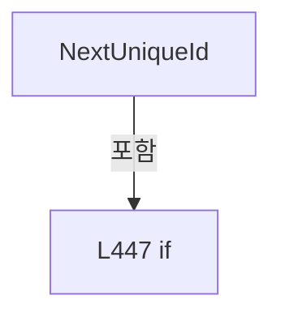

변경 전 점검: 입력/반환 타입, 위 호출자, 예외/취소 경로, 공유 상태와 저장·전송 소비자를 함께 확인합니다. 값의 단위나 물리 방향을 이름만으로 확정하지 않습니다.

### MethodDeclaration `RaiseProtocolTrace` · L456–459

[Drilling.Common/Interface/Vision/CVisionComm.cs:456–459](https://github.com/kjuws10-rgb/A3Drilling/blob/5aee8e58439c9b455cae7c9593c9be986c3e682e/Drilling.Common/Interface/Vision/CVisionComm.cs#L456-L459)

| 항목 | 실제 추출 값 |
| --- | --- |
| 서명 | void Drilling.Common.Interface.Vision.CVisionComm.RaiseProtocolTrace(string, string) |
| 접근/수식자 | Private / private |
| 반환/값 타입 | void |
| 소속 타입 | NamedType:Drilling.Common.Interface.Vision.CVisionComm |

입력 계약:

| 이름 | 타입 | 전달 | 선택/기본값 |
| --- | --- | --- | --- |
| direction | string | None | False /  |
| message | string | None | False /  |

정적 호출자로 확인된 위치:

| 호출 파일/행 | 호출 표현식 | 런타임 분기 가능 |
| --- | --- | --- |
| [Drilling.Common/Interface/Vision/CVisionComm.cs:65–65](https://github.com/kjuws10-rgb/A3Drilling/blob/5aee8e58439c9b455cae7c9593c9be986c3e682e/Drilling.Common/Interface/Vision/CVisionComm.cs#L65-L65) | RaiseProtocolTrace | False |
| [Drilling.Common/Interface/Vision/CVisionComm.cs:185–185](https://github.com/kjuws10-rgb/A3Drilling/blob/5aee8e58439c9b455cae7c9593c9be986c3e682e/Drilling.Common/Interface/Vision/CVisionComm.cs#L185-L185) | RaiseProtocolTrace | False |
| [Drilling.Common/Interface/Vision/CVisionComm.cs:203–203](https://github.com/kjuws10-rgb/A3Drilling/blob/5aee8e58439c9b455cae7c9593c9be986c3e682e/Drilling.Common/Interface/Vision/CVisionComm.cs#L203-L203) | RaiseProtocolTrace | False |
| [Drilling.Common/Interface/Vision/CVisionComm.cs:244–244](https://github.com/kjuws10-rgb/A3Drilling/blob/5aee8e58439c9b455cae7c9593c9be986c3e682e/Drilling.Common/Interface/Vision/CVisionComm.cs#L244-L244) | RaiseProtocolTrace | False |
| [Drilling.Common/Interface/Vision/CVisionComm.cs:321–321](https://github.com/kjuws10-rgb/A3Drilling/blob/5aee8e58439c9b455cae7c9593c9be986c3e682e/Drilling.Common/Interface/Vision/CVisionComm.cs#L321-L321) | RaiseProtocolTrace | False |

호출하는 대상과 해석 범위:

| 원본 행 | 표현식 | 분석 상태 | 대상/소스 위치 |
| --- | --- | --- | --- |
| 458 | .Invoke | resolved · 동적 구현 선택 가능 | void System.Action<Drilling.Common.Interface.ST_COMM_PROTOCOL_TRACE>.Invoke(Drilling.Common.Interface.ST_COMM_PROTOCOL_TRACE) |
| 458 | new ST_COMM_PROTOCOL_TRACE | resolved | Drilling.Common.Interface.ST_COMM_PROTOCOL_TRACE.ST_COMM_PROTOCOL_TRACE(System.DateTimeOffset, string, string) · Drilling.Common/Interface/CInterfaceManager.cs:2939 |

본문의 실제 연산·분기·예외·반환 순서(원문 위치 순):

| 원본 행 | 종류 | 주석 해설 |
| --- | --- | --- |
| 458 | call | 함수·델리게이트 또는 객체 생성자를 호출합니다: .Invoke(new ST_COMM_PROTOCOL_TRACE(DateTimeOffset.Now, direction, message)) |
| 458 | call | 함수·델리게이트 또는 객체 생성자를 호출합니다: new ST_COMM_PROTOCOL_TRACE(DateTimeOffset.Now, direction, message) |

변경 전 점검: 입력/반환 타입, 위 호출자, 예외/취소 경로, 공유 상태와 저장·전송 소비자를 함께 확인합니다. 값의 단위나 물리 방향을 이름만으로 확정하지 않습니다.

### MethodDeclaration `IsServerListening` · L461–464

[Drilling.Common/Interface/Vision/CVisionComm.cs:461–464](https://github.com/kjuws10-rgb/A3Drilling/blob/5aee8e58439c9b455cae7c9593c9be986c3e682e/Drilling.Common/Interface/Vision/CVisionComm.cs#L461-L464)

| 항목 | 실제 추출 값 |
| --- | --- |
| 서명 | bool Drilling.Common.Interface.Vision.CVisionComm.IsServerListening() |
| 접근/수식자 | Private / private |
| 반환/값 타입 | bool |
| 소속 타입 | NamedType:Drilling.Common.Interface.Vision.CVisionComm |

정적 호출자로 확인된 위치:

| 호출 파일/행 | 호출 표현식 | 런타임 분기 가능 |
| --- | --- | --- |
| [Drilling.Common/Interface/Vision/CVisionComm.cs:243–243](https://github.com/kjuws10-rgb/A3Drilling/blob/5aee8e58439c9b455cae7c9593c9be986c3e682e/Drilling.Common/Interface/Vision/CVisionComm.cs#L243-L243) | IsServerListening | False |

본문의 실제 연산·분기·예외·반환 순서(원문 위치 순):

| 원본 행 | 종류 | 주석 해설 |
| --- | --- | --- |
| 463 | return | 호출자에게 값 또는 제어를 반환합니다: return _listener is not null && _serverCancellation is not null && !_serverCancellation.IsCancellationRequested; |

변경 전 점검: 입력/반환 타입, 위 호출자, 예외/취소 경로, 공유 상태와 저장·전송 소비자를 함께 확인합니다. 값의 단위나 물리 방향을 이름만으로 확정하지 않습니다.

### MethodDeclaration `StopServer` · L466–495

[Drilling.Common/Interface/Vision/CVisionComm.cs:466–495](https://github.com/kjuws10-rgb/A3Drilling/blob/5aee8e58439c9b455cae7c9593c9be986c3e682e/Drilling.Common/Interface/Vision/CVisionComm.cs#L466-L495)

| 항목 | 실제 추출 값 |
| --- | --- |
| 서명 | System.Threading.Tasks.Task Drilling.Common.Interface.Vision.CVisionComm.StopServer() |
| 접근/수식자 | Private / private, async |
| 반환/값 타입 | System.Threading.Tasks.Task |
| 소속 타입 | NamedType:Drilling.Common.Interface.Vision.CVisionComm |

정적 호출자로 확인된 위치:

| 호출 파일/행 | 호출 표현식 | 런타임 분기 가능 |
| --- | --- | --- |
| [Drilling.Common/Interface/Vision/CVisionComm.cs:44–44](https://github.com/kjuws10-rgb/A3Drilling/blob/5aee8e58439c9b455cae7c9593c9be986c3e682e/Drilling.Common/Interface/Vision/CVisionComm.cs#L44-L44) | StopServer | False |
| [Drilling.Common/Interface/Vision/CVisionComm.cs:69–69](https://github.com/kjuws10-rgb/A3Drilling/blob/5aee8e58439c9b455cae7c9593c9be986c3e682e/Drilling.Common/Interface/Vision/CVisionComm.cs#L69-L69) | StopServer | False |
| [Drilling.Common/Interface/Vision/CVisionComm.cs:84–84](https://github.com/kjuws10-rgb/A3Drilling/blob/5aee8e58439c9b455cae7c9593c9be986c3e682e/Drilling.Common/Interface/Vision/CVisionComm.cs#L84-L84) | StopServer | False |

호출하는 대상과 해석 범위:

| 원본 행 | 표현식 | 분석 상태 | 대상/소스 위치 |
| --- | --- | --- | --- |
| 468 | Volatile.Write | resolved | void System.Threading.Volatile.Write(ref int, int) |
| 469 | .Cancel | resolved | void System.Threading.CancellationTokenSource.Cancel() |
| 470 | .Stop | resolved | void System.Net.Sockets.TcpListener.Stop() |
| 471 | .Dispose | resolved | void System.Net.Sockets.TcpClient.Dispose() |
| 474 | IgnoreCancellation | resolved | System.Threading.Tasks.Task Drilling.Common.Interface.Vision.CVisionComm.IgnoreCancellation(System.Threading.Tasks.Task) · Drilling.Common/Interface/Vision/CVisionComm.cs:508 |
| 479 | IgnoreCancellation | resolved | System.Threading.Tasks.Task Drilling.Common.Interface.Vision.CVisionComm.IgnoreCancellation(System.Threading.Tasks.Task) · Drilling.Common/Interface/Vision/CVisionComm.cs:508 |
| 482 | .Dispose | resolved | void System.Threading.CancellationTokenSource.Dispose() |
| 491 | _clientReady.Wait | resolved | bool System.Threading.SemaphoreSlim.Wait(int) |
| 494 | FailPending | resolved | void Drilling.Common.Interface.Vision.CVisionComm.FailPending(System.Exception) · Drilling.Common/Interface/Vision/CVisionComm.cs:497 |
| 494 | new IOException | resolved | System.IO.IOException.IOException(string?) |

본문의 실제 연산·분기·예외·반환 순서(원문 위치 순):

| 원본 행 | 종류 | 주석 해설 |
| --- | --- | --- |
| 468 | call | 함수·델리게이트 또는 객체 생성자를 호출합니다: Volatile.Write(ref _flyingLineCapacity, 0) |
| 469 | call | 함수·델리게이트 또는 객체 생성자를 호출합니다: .Cancel() |
| 470 | call | 함수·델리게이트 또는 객체 생성자를 호출합니다: .Stop() |
| 471 | call | 함수·델리게이트 또는 객체 생성자를 호출합니다: .Dispose() |
| 472 | if | 조건에 따라 분기합니다: if (_acceptTask is not null) |
| 474 | await | 비동기 완료를 기다립니다: await IgnoreCancellation(_acceptTask) |
| 474 | call | 함수·델리게이트 또는 객체 생성자를 호출합니다: IgnoreCancellation(_acceptTask) |
| 477 | if | 조건에 따라 분기합니다: if (_receiveTask is not null) |
| 479 | await | 비동기 완료를 기다립니다: await IgnoreCancellation(_receiveTask) |
| 479 | call | 함수·델리게이트 또는 객체 생성자를 호출합니다: IgnoreCancellation(_receiveTask) |
| 482 | call | 함수·델리게이트 또는 객체 생성자를 호출합니다: .Dispose() |
| 483 | assignment | 값을 대상에 대입합니다: _serverCancellation = null |
| 484 | assignment | 값을 대상에 대입합니다: _listener = null |
| 485 | assignment | 값을 대상에 대입합니다: _client = null |
| 486 | assignment | 값을 대상에 대입합니다: _stream = null |
| 487 | assignment | 값을 대상에 대입합니다: _acceptTask = null |
| 488 | assignment | 값을 대상에 대입합니다: _receiveTask = null |
| 489 | while | 조건을 먼저 확인하며 반복합니다: while (_clientReady.CurrentCount > 0) |
| 491 | call | 함수·델리게이트 또는 객체 생성자를 호출합니다: _clientReady.Wait(0) |
| 494 | call | 함수·델리게이트 또는 객체 생성자를 호출합니다: FailPending(new IOException("Vision server stopped.")) |
| 494 | call | 함수·델리게이트 또는 객체 생성자를 호출합니다: new IOException("Vision server stopped.") |

제어 구문의 포함 구조(실제 실행 순서/CFG가 아닌 구문 탐색 그림):

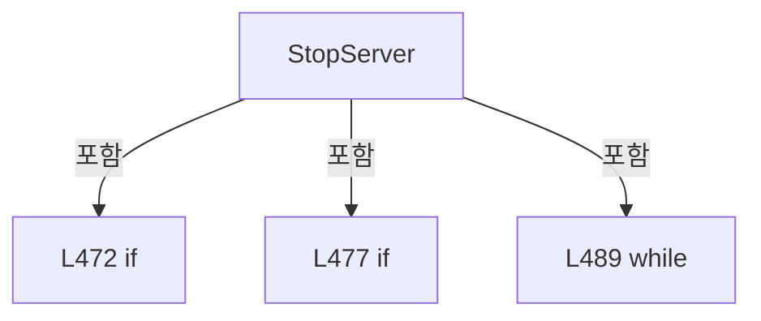

변경 전 점검: 입력/반환 타입, 위 호출자, 예외/취소 경로, 공유 상태와 저장·전송 소비자를 함께 확인합니다. 값의 단위나 물리 방향을 이름만으로 확정하지 않습니다.

### MethodDeclaration `FailPending` · L497–506

[Drilling.Common/Interface/Vision/CVisionComm.cs:497–506](https://github.com/kjuws10-rgb/A3Drilling/blob/5aee8e58439c9b455cae7c9593c9be986c3e682e/Drilling.Common/Interface/Vision/CVisionComm.cs#L497-L506)

| 항목 | 실제 추출 값 |
| --- | --- |
| 서명 | void Drilling.Common.Interface.Vision.CVisionComm.FailPending(System.Exception) |
| 접근/수식자 | Private / private |
| 반환/값 타입 | void |
| 소속 타입 | NamedType:Drilling.Common.Interface.Vision.CVisionComm |

입력 계약:

| 이름 | 타입 | 전달 | 선택/기본값 |
| --- | --- | --- | --- |
| exception | System.Exception | None | False /  |

정적 호출자로 확인된 위치:

| 호출 파일/행 | 호출 표현식 | 런타임 분기 가능 |
| --- | --- | --- |
| [Drilling.Common/Interface/Vision/CVisionComm.cs:241–241](https://github.com/kjuws10-rgb/A3Drilling/blob/5aee8e58439c9b455cae7c9593c9be986c3e682e/Drilling.Common/Interface/Vision/CVisionComm.cs#L241-L241) | FailPending | False |
| [Drilling.Common/Interface/Vision/CVisionComm.cs:494–494](https://github.com/kjuws10-rgb/A3Drilling/blob/5aee8e58439c9b455cae7c9593c9be986c3e682e/Drilling.Common/Interface/Vision/CVisionComm.cs#L494-L494) | FailPending | False |

호출하는 대상과 해석 범위:

| 원본 행 | 표현식 | 분석 상태 | 대상/소스 위치 |
| --- | --- | --- | --- |
| 499 | _pending.ToArray | resolved | System.Collections.Generic.KeyValuePair<int, System.Threading.Tasks.TaskCompletionSource<Drilling.Common.Interface.Vision.ST_VISION_PACKET>>[] System.Collections.Concurrent.ConcurrentDictionary<int, System.Threading.Tasks.TaskCompletionSource<Drilling.Common.Interface.Vision.ST_VISION_PACKET>>.ToArray() |
| 501 | _pending.TryRemove | resolved | bool System.Collections.Concurrent.ConcurrentDictionary<int, System.Threading.Tasks.TaskCompletionSource<Drilling.Common.Interface.Vision.ST_VISION_PACKET>>.TryRemove(int, out System.Threading.Tasks.TaskCompletionSource<Drilling.Common.Interface.Vision.ST_VISION_PACKET>) |
| 503 | completion.TrySetException | resolved | bool System.Threading.Tasks.TaskCompletionSource<Drilling.Common.Interface.Vision.ST_VISION_PACKET>.TrySetException(System.Exception) |

본문의 실제 연산·분기·예외·반환 순서(원문 위치 순):

| 원본 행 | 종류 | 주석 해설 |
| --- | --- | --- |
| 499 | call | 함수·델리게이트 또는 객체 생성자를 호출합니다: _pending.ToArray() |
| 499 | foreach | 컬렉션 요소를 순회합니다: foreach (var item in _pending.ToArray()) |
| 501 | call | 함수·델리게이트 또는 객체 생성자를 호출합니다: _pending.TryRemove(item.Key, out var completion) |
| 501 | if | 조건에 따라 분기합니다: if (_pending.TryRemove(item.Key, out var completion)) |
| 503 | call | 함수·델리게이트 또는 객체 생성자를 호출합니다: completion.TrySetException(exception) |

제어 구문의 포함 구조(실제 실행 순서/CFG가 아닌 구문 탐색 그림):

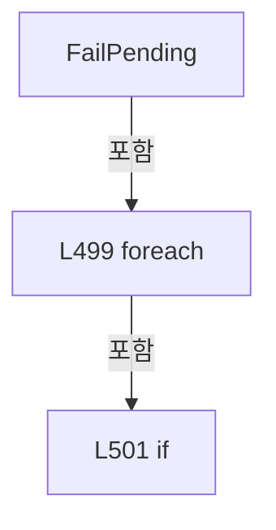

변경 전 점검: 입력/반환 타입, 위 호출자, 예외/취소 경로, 공유 상태와 저장·전송 소비자를 함께 확인합니다. 값의 단위나 물리 방향을 이름만으로 확정하지 않습니다.

### MethodDeclaration `IgnoreCancellation` · L508–517

[Drilling.Common/Interface/Vision/CVisionComm.cs:508–517](https://github.com/kjuws10-rgb/A3Drilling/blob/5aee8e58439c9b455cae7c9593c9be986c3e682e/Drilling.Common/Interface/Vision/CVisionComm.cs#L508-L517)

| 항목 | 실제 추출 값 |
| --- | --- |
| 서명 | System.Threading.Tasks.Task Drilling.Common.Interface.Vision.CVisionComm.IgnoreCancellation(System.Threading.Tasks.Task) |
| 접근/수식자 | Private / private, static, async |
| 반환/값 타입 | System.Threading.Tasks.Task |
| 소속 타입 | NamedType:Drilling.Common.Interface.Vision.CVisionComm |

입력 계약:

| 이름 | 타입 | 전달 | 선택/기본값 |
| --- | --- | --- | --- |
| task | System.Threading.Tasks.Task | None | False /  |

정적 호출자로 확인된 위치:

| 호출 파일/행 | 호출 표현식 | 런타임 분기 가능 |
| --- | --- | --- |
| [Drilling.Common/Interface/Vision/CVisionComm.cs:474–474](https://github.com/kjuws10-rgb/A3Drilling/blob/5aee8e58439c9b455cae7c9593c9be986c3e682e/Drilling.Common/Interface/Vision/CVisionComm.cs#L474-L474) | IgnoreCancellation | False |
| [Drilling.Common/Interface/Vision/CVisionComm.cs:479–479](https://github.com/kjuws10-rgb/A3Drilling/blob/5aee8e58439c9b455cae7c9593c9be986c3e682e/Drilling.Common/Interface/Vision/CVisionComm.cs#L479-L479) | IgnoreCancellation | False |

본문의 실제 연산·분기·예외·반환 순서(원문 위치 순):

| 원본 행 | 종류 | 주석 해설 |
| --- | --- | --- |
| 510 | try | 예외 처리 범위입니다: try |
| 512 | await | 비동기 완료를 기다립니다: await task |
| 514 | catch | 지정 예외를 처리합니다: catch (Exception ex) when (ex is OperationCanceledException or ObjectDisposedException or SocketException or IOException) |

제어 구문의 포함 구조(실제 실행 순서/CFG가 아닌 구문 탐색 그림):

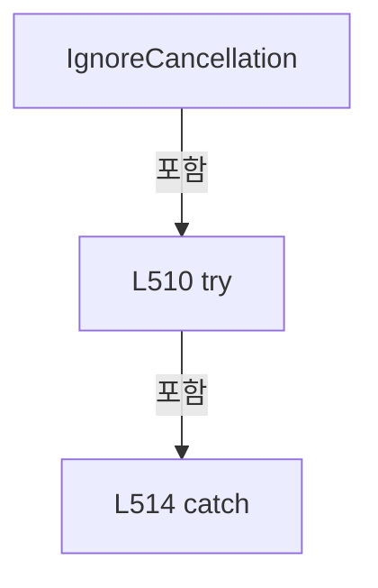

변경 전 점검: 입력/반환 타입, 위 호출자, 예외/취소 경로, 공유 상태와 저장·전송 소비자를 함께 확인합니다. 값의 단위나 물리 방향을 이름만으로 확정하지 않습니다.

### MethodDeclaration `ResolveBindAddress` · L519–527

[Drilling.Common/Interface/Vision/CVisionComm.cs:519–527](https://github.com/kjuws10-rgb/A3Drilling/blob/5aee8e58439c9b455cae7c9593c9be986c3e682e/Drilling.Common/Interface/Vision/CVisionComm.cs#L519-L527)

| 항목 | 실제 추출 값 |
| --- | --- |
| 서명 | System.Net.IPAddress Drilling.Common.Interface.Vision.CVisionComm.ResolveBindAddress(string) |
| 접근/수식자 | Private / private, static |
| 반환/값 타입 | System.Net.IPAddress |
| 소속 타입 | NamedType:Drilling.Common.Interface.Vision.CVisionComm |

입력 계약:

| 이름 | 타입 | 전달 | 선택/기본값 |
| --- | --- | --- | --- |
| value | string | None | False /  |

정적 호출자로 확인된 위치:

| 호출 파일/행 | 호출 표현식 | 런타임 분기 가능 |
| --- | --- | --- |
| [Drilling.Common/Interface/Vision/CVisionComm.cs:51–51](https://github.com/kjuws10-rgb/A3Drilling/blob/5aee8e58439c9b455cae7c9593c9be986c3e682e/Drilling.Common/Interface/Vision/CVisionComm.cs#L51-L51) | ResolveBindAddress | False |

호출하는 대상과 해석 범위:

| 원본 행 | 표현식 | 분석 상태 | 대상/소스 위치 |
| --- | --- | --- | --- |
| 521 | string.IsNullOrWhiteSpace | resolved | bool string.IsNullOrWhiteSpace(string?) |
| 526 | IPAddress.TryParse | resolved | bool System.Net.IPAddress.TryParse(string?, out System.Net.IPAddress?) |
| 526 | new ArgumentException | resolved | System.ArgumentException.ArgumentException(string?) |

본문의 실제 연산·분기·예외·반환 순서(원문 위치 순):

| 원본 행 | 종류 | 주석 해설 |
| --- | --- | --- |
| 521 | call | 함수·델리게이트 또는 객체 생성자를 호출합니다: string.IsNullOrWhiteSpace(value) |
| 521 | if | 조건에 따라 분기합니다: if (string.IsNullOrWhiteSpace(value) &#124;&#124; value == "*") |
| 523 | return | 호출자에게 값 또는 제어를 반환합니다: return IPAddress.Any; |
| 526 | call | 함수·델리게이트 또는 객체 생성자를 호출합니다: IPAddress.TryParse(value, out var address) |
| 526 | call | 함수·델리게이트 또는 객체 생성자를 호출합니다: new ArgumentException($"Vision server local address is invalid: {value}") |
| 526 | conditional-expression | 조건에 따라 결과식을 선택합니다: IPAddress.TryParse(value, out var address) ? address : throw new ArgumentException($"Vision server local address is invalid: {value}") |
| 526 | return | 호출자에게 값 또는 제어를 반환합니다: return IPAddress.TryParse(value, out var address) ? address : throw new ArgumentException($"Vision server local address is invalid: {value}"); |
| 526 | throw | 예외를 발생/전달합니다: throw new ArgumentException($"Vision server local address is invalid: {value}") |

제어 구문의 포함 구조(실제 실행 순서/CFG가 아닌 구문 탐색 그림):

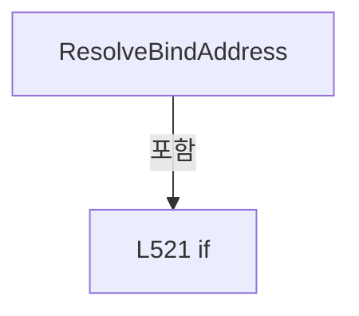

변경 전 점검: 입력/반환 타입, 위 호출자, 예외/취소 경로, 공유 상태와 저장·전송 소비자를 함께 확인합니다. 값의 단위나 물리 방향을 이름만으로 확정하지 않습니다.

### EnumMemberDeclaration `MarkFindSingle` · L532–532

[Drilling.Common/Interface/Vision/CVisionComm.cs:532–532](https://github.com/kjuws10-rgb/A3Drilling/blob/5aee8e58439c9b455cae7c9593c9be986c3e682e/Drilling.Common/Interface/Vision/CVisionComm.cs#L532-L532)

| 항목 | 실제 추출 값 |
| --- | --- |
| 서명 | Drilling.Common.Interface.Vision.EN_VISION_COMMAND.MarkFindSingle |
| 접근/수식자 | Public /  |
| 반환/값 타입 | Drilling.Common.Interface.Vision.EN_VISION_COMMAND |
| 소속 타입 | NamedType:Drilling.Common.Interface.Vision.EN_VISION_COMMAND |

현재 부분 분석에서 직접 연결된 호출자는 없습니다. XAML/이벤트/인터페이스·델리게이트·외부 진입을 추가 확인해야 하며, 미사용으로 판정한 것이 아닙니다.

변경 전 점검: 입력/반환 타입, 위 호출자, 예외/취소 경로, 공유 상태와 저장·전송 소비자를 함께 확인합니다. 값의 단위나 물리 방향을 이름만으로 확정하지 않습니다.

### EnumMemberDeclaration `FlyingReady` · L533–533

[Drilling.Common/Interface/Vision/CVisionComm.cs:533–533](https://github.com/kjuws10-rgb/A3Drilling/blob/5aee8e58439c9b455cae7c9593c9be986c3e682e/Drilling.Common/Interface/Vision/CVisionComm.cs#L533-L533)

| 항목 | 실제 추출 값 |
| --- | --- |
| 서명 | Drilling.Common.Interface.Vision.EN_VISION_COMMAND.FlyingReady |
| 접근/수식자 | Public /  |
| 반환/값 타입 | Drilling.Common.Interface.Vision.EN_VISION_COMMAND |
| 소속 타입 | NamedType:Drilling.Common.Interface.Vision.EN_VISION_COMMAND |

현재 부분 분석에서 직접 연결된 호출자는 없습니다. XAML/이벤트/인터페이스·델리게이트·외부 진입을 추가 확인해야 하며, 미사용으로 판정한 것이 아닙니다.

변경 전 점검: 입력/반환 타입, 위 호출자, 예외/취소 경로, 공유 상태와 저장·전송 소비자를 함께 확인합니다. 값의 단위나 물리 방향을 이름만으로 확정하지 않습니다.

### EnumMemberDeclaration `FlyingMoveDone` · L534–534

[Drilling.Common/Interface/Vision/CVisionComm.cs:534–534](https://github.com/kjuws10-rgb/A3Drilling/blob/5aee8e58439c9b455cae7c9593c9be986c3e682e/Drilling.Common/Interface/Vision/CVisionComm.cs#L534-L534)

| 항목 | 실제 추출 값 |
| --- | --- |
| 서명 | Drilling.Common.Interface.Vision.EN_VISION_COMMAND.FlyingMoveDone |
| 접근/수식자 | Public /  |
| 반환/값 타입 | Drilling.Common.Interface.Vision.EN_VISION_COMMAND |
| 소속 타입 | NamedType:Drilling.Common.Interface.Vision.EN_VISION_COMMAND |

현재 부분 분석에서 직접 연결된 호출자는 없습니다. XAML/이벤트/인터페이스·델리게이트·외부 진입을 추가 확인해야 하며, 미사용으로 판정한 것이 아닙니다.

변경 전 점검: 입력/반환 타입, 위 호출자, 예외/취소 경로, 공유 상태와 저장·전송 소비자를 함께 확인합니다. 값의 단위나 물리 방향을 이름만으로 확정하지 않습니다.

### EnumMemberDeclaration `MarkFindLine` · L535–535

[Drilling.Common/Interface/Vision/CVisionComm.cs:535–535](https://github.com/kjuws10-rgb/A3Drilling/blob/5aee8e58439c9b455cae7c9593c9be986c3e682e/Drilling.Common/Interface/Vision/CVisionComm.cs#L535-L535)

| 항목 | 실제 추출 값 |
| --- | --- |
| 서명 | Drilling.Common.Interface.Vision.EN_VISION_COMMAND.MarkFindLine |
| 접근/수식자 | Public /  |
| 반환/값 타입 | Drilling.Common.Interface.Vision.EN_VISION_COMMAND |
| 소속 타입 | NamedType:Drilling.Common.Interface.Vision.EN_VISION_COMMAND |

현재 부분 분석에서 직접 연결된 호출자는 없습니다. XAML/이벤트/인터페이스·델리게이트·외부 진입을 추가 확인해야 하며, 미사용으로 판정한 것이 아닙니다.

변경 전 점검: 입력/반환 타입, 위 호출자, 예외/취소 경로, 공유 상태와 저장·전송 소비자를 함께 확인합니다. 값의 단위나 물리 방향을 이름만으로 확정하지 않습니다.

### EnumMemberDeclaration `MarkFindSettingSingle` · L536–536

[Drilling.Common/Interface/Vision/CVisionComm.cs:536–536](https://github.com/kjuws10-rgb/A3Drilling/blob/5aee8e58439c9b455cae7c9593c9be986c3e682e/Drilling.Common/Interface/Vision/CVisionComm.cs#L536-L536)

| 항목 | 실제 추출 값 |
| --- | --- |
| 서명 | Drilling.Common.Interface.Vision.EN_VISION_COMMAND.MarkFindSettingSingle |
| 접근/수식자 | Public /  |
| 반환/값 타입 | Drilling.Common.Interface.Vision.EN_VISION_COMMAND |
| 소속 타입 | NamedType:Drilling.Common.Interface.Vision.EN_VISION_COMMAND |

현재 부분 분석에서 직접 연결된 호출자는 없습니다. XAML/이벤트/인터페이스·델리게이트·외부 진입을 추가 확인해야 하며, 미사용으로 판정한 것이 아닙니다.

변경 전 점검: 입력/반환 타입, 위 호출자, 예외/취소 경로, 공유 상태와 저장·전송 소비자를 함께 확인합니다. 값의 단위나 물리 방향을 이름만으로 확정하지 않습니다.

### EnumMemberDeclaration `MarkFindManual` · L537–537

[Drilling.Common/Interface/Vision/CVisionComm.cs:537–537](https://github.com/kjuws10-rgb/A3Drilling/blob/5aee8e58439c9b455cae7c9593c9be986c3e682e/Drilling.Common/Interface/Vision/CVisionComm.cs#L537-L537)

| 항목 | 실제 추출 값 |
| --- | --- |
| 서명 | Drilling.Common.Interface.Vision.EN_VISION_COMMAND.MarkFindManual |
| 접근/수식자 | Public /  |
| 반환/값 타입 | Drilling.Common.Interface.Vision.EN_VISION_COMMAND |
| 소속 타입 | NamedType:Drilling.Common.Interface.Vision.EN_VISION_COMMAND |

현재 부분 분석에서 직접 연결된 호출자는 없습니다. XAML/이벤트/인터페이스·델리게이트·외부 진입을 추가 확인해야 하며, 미사용으로 판정한 것이 아닙니다.

변경 전 점검: 입력/반환 타입, 위 호출자, 예외/취소 경로, 공유 상태와 저장·전송 소비자를 함께 확인합니다. 값의 단위나 물리 방향을 이름만으로 확정하지 않습니다.

### EnumMemberDeclaration `KeepAliveRequest` · L538–538

[Drilling.Common/Interface/Vision/CVisionComm.cs:538–538](https://github.com/kjuws10-rgb/A3Drilling/blob/5aee8e58439c9b455cae7c9593c9be986c3e682e/Drilling.Common/Interface/Vision/CVisionComm.cs#L538-L538)

| 항목 | 실제 추출 값 |
| --- | --- |
| 서명 | Drilling.Common.Interface.Vision.EN_VISION_COMMAND.KeepAliveRequest |
| 접근/수식자 | Public /  |
| 반환/값 타입 | Drilling.Common.Interface.Vision.EN_VISION_COMMAND |
| 소속 타입 | NamedType:Drilling.Common.Interface.Vision.EN_VISION_COMMAND |

현재 부분 분석에서 직접 연결된 호출자는 없습니다. XAML/이벤트/인터페이스·델리게이트·외부 진입을 추가 확인해야 하며, 미사용으로 판정한 것이 아닙니다.

변경 전 점검: 입력/반환 타입, 위 호출자, 예외/취소 경로, 공유 상태와 저장·전송 소비자를 함께 확인합니다. 값의 단위나 물리 방향을 이름만으로 확정하지 않습니다.

### EnumMemberDeclaration `KeepAlive` · L539–539

[Drilling.Common/Interface/Vision/CVisionComm.cs:539–539](https://github.com/kjuws10-rgb/A3Drilling/blob/5aee8e58439c9b455cae7c9593c9be986c3e682e/Drilling.Common/Interface/Vision/CVisionComm.cs#L539-L539)

| 항목 | 실제 추출 값 |
| --- | --- |
| 서명 | Drilling.Common.Interface.Vision.EN_VISION_COMMAND.KeepAlive |
| 접근/수식자 | Public /  |
| 반환/값 타입 | Drilling.Common.Interface.Vision.EN_VISION_COMMAND |
| 소속 타입 | NamedType:Drilling.Common.Interface.Vision.EN_VISION_COMMAND |

현재 부분 분석에서 직접 연결된 호출자는 없습니다. XAML/이벤트/인터페이스·델리게이트·외부 진입을 추가 확인해야 하며, 미사용으로 판정한 것이 아닙니다.

변경 전 점검: 입력/반환 타입, 위 호출자, 예외/취소 경로, 공유 상태와 저장·전송 소비자를 함께 확인합니다. 값의 단위나 물리 방향을 이름만으로 확정하지 않습니다.

### PropertyDeclaration `ActualCount` · L551–551

[Drilling.Common/Interface/Vision/CVisionComm.cs:551–551](https://github.com/kjuws10-rgb/A3Drilling/blob/5aee8e58439c9b455cae7c9593c9be986c3e682e/Drilling.Common/Interface/Vision/CVisionComm.cs#L551-L551)

| 항목 | 실제 추출 값 |
| --- | --- |
| 서명 | int Drilling.Common.Interface.Vision.CVisionLineCountExceededException.ActualCount |
| 접근/수식자 | Public / public |
| 반환/값 타입 | int |
| 소속 타입 | NamedType:Drilling.Common.Interface.Vision.CVisionLineCountExceededException |

현재 부분 분석에서 직접 연결된 호출자는 없습니다. XAML/이벤트/인터페이스·델리게이트·외부 진입을 추가 확인해야 하며, 미사용으로 판정한 것이 아닙니다.

변경 전 점검: 입력/반환 타입, 위 호출자, 예외/취소 경로, 공유 상태와 저장·전송 소비자를 함께 확인합니다. 값의 단위나 물리 방향을 이름만으로 확정하지 않습니다.

### GetAccessorDeclaration `get_ActualCount` · L551–551

[Drilling.Common/Interface/Vision/CVisionComm.cs:551–551](https://github.com/kjuws10-rgb/A3Drilling/blob/5aee8e58439c9b455cae7c9593c9be986c3e682e/Drilling.Common/Interface/Vision/CVisionComm.cs#L551-L551)

| 항목 | 실제 추출 값 |
| --- | --- |
| 서명 | int Drilling.Common.Interface.Vision.CVisionLineCountExceededException.ActualCount.get |
| 접근/수식자 | Public / get |
| 반환/값 타입 | int |
| 소속 타입 | NamedType:Drilling.Common.Interface.Vision.CVisionLineCountExceededException |

현재 부분 분석에서 직접 연결된 호출자는 없습니다. XAML/이벤트/인터페이스·델리게이트·외부 진입을 추가 확인해야 하며, 미사용으로 판정한 것이 아닙니다.

변경 전 점검: 입력/반환 타입, 위 호출자, 예외/취소 경로, 공유 상태와 저장·전송 소비자를 함께 확인합니다. 값의 단위나 물리 방향을 이름만으로 확정하지 않습니다.

### PropertyDeclaration `MaximumCount` · L552–552

[Drilling.Common/Interface/Vision/CVisionComm.cs:552–552](https://github.com/kjuws10-rgb/A3Drilling/blob/5aee8e58439c9b455cae7c9593c9be986c3e682e/Drilling.Common/Interface/Vision/CVisionComm.cs#L552-L552)

| 항목 | 실제 추출 값 |
| --- | --- |
| 서명 | int Drilling.Common.Interface.Vision.CVisionLineCountExceededException.MaximumCount |
| 접근/수식자 | Public / public |
| 반환/값 타입 | int |
| 소속 타입 | NamedType:Drilling.Common.Interface.Vision.CVisionLineCountExceededException |

현재 부분 분석에서 직접 연결된 호출자는 없습니다. XAML/이벤트/인터페이스·델리게이트·외부 진입을 추가 확인해야 하며, 미사용으로 판정한 것이 아닙니다.

변경 전 점검: 입력/반환 타입, 위 호출자, 예외/취소 경로, 공유 상태와 저장·전송 소비자를 함께 확인합니다. 값의 단위나 물리 방향을 이름만으로 확정하지 않습니다.

### GetAccessorDeclaration `get_MaximumCount` · L552–552

[Drilling.Common/Interface/Vision/CVisionComm.cs:552–552](https://github.com/kjuws10-rgb/A3Drilling/blob/5aee8e58439c9b455cae7c9593c9be986c3e682e/Drilling.Common/Interface/Vision/CVisionComm.cs#L552-L552)

| 항목 | 실제 추출 값 |
| --- | --- |
| 서명 | int Drilling.Common.Interface.Vision.CVisionLineCountExceededException.MaximumCount.get |
| 접근/수식자 | Public / get |
| 반환/값 타입 | int |
| 소속 타입 | NamedType:Drilling.Common.Interface.Vision.CVisionLineCountExceededException |

현재 부분 분석에서 직접 연결된 호출자는 없습니다. XAML/이벤트/인터페이스·델리게이트·외부 진입을 추가 확인해야 하며, 미사용으로 판정한 것이 아닙니다.

변경 전 점검: 입력/반환 타입, 위 호출자, 예외/취소 경로, 공유 상태와 저장·전송 소비자를 함께 확인합니다. 값의 단위나 물리 방향을 이름만으로 확정하지 않습니다.

### FieldDeclaration `PacketLogSeparator` · L556–556

[Drilling.Common/Interface/Vision/CVisionComm.cs:556–556](https://github.com/kjuws10-rgb/A3Drilling/blob/5aee8e58439c9b455cae7c9593c9be986c3e682e/Drilling.Common/Interface/Vision/CVisionComm.cs#L556-L556)

| 항목 | 실제 추출 값 |
| --- | --- |
| 서명 | string Drilling.Common.Interface.Vision.CVisionProtocol.PacketLogSeparator |
| 접근/수식자 | Private / private, const |
| 반환/값 타입 | string |
| 소속 타입 | NamedType:Drilling.Common.Interface.Vision.CVisionProtocol |

현재 부분 분석에서 직접 연결된 호출자는 없습니다. XAML/이벤트/인터페이스·델리게이트·외부 진입을 추가 확인해야 하며, 미사용으로 판정한 것이 아닙니다.

본문의 실제 연산·분기·예외·반환 순서(원문 위치 순):

| 원본 행 | 종류 | 주석 해설 |
| --- | --- | --- |
| 556 | variable-initializer | 변수의 초기값을 지정합니다: PacketLogSeparator = "----------------------------------------------------------------------" |

변경 전 점검: 입력/반환 타입, 위 호출자, 예외/취소 경로, 공유 상태와 저장·전송 소비자를 함께 확인합니다. 값의 단위나 물리 방향을 이름만으로 확정하지 않습니다.

### FieldDeclaration `PacketLogBodyIndent` · L557–557

[Drilling.Common/Interface/Vision/CVisionComm.cs:557–557](https://github.com/kjuws10-rgb/A3Drilling/blob/5aee8e58439c9b455cae7c9593c9be986c3e682e/Drilling.Common/Interface/Vision/CVisionComm.cs#L557-L557)

| 항목 | 실제 추출 값 |
| --- | --- |
| 서명 | string Drilling.Common.Interface.Vision.CVisionProtocol.PacketLogBodyIndent |
| 접근/수식자 | Private / private, const |
| 반환/값 타입 | string |
| 소속 타입 | NamedType:Drilling.Common.Interface.Vision.CVisionProtocol |

현재 부분 분석에서 직접 연결된 호출자는 없습니다. XAML/이벤트/인터페이스·델리게이트·외부 진입을 추가 확인해야 하며, 미사용으로 판정한 것이 아닙니다.

본문의 실제 연산·분기·예외·반환 순서(원문 위치 순):

| 원본 행 | 종류 | 주석 해설 |
| --- | --- | --- |
| 557 | variable-initializer | 변수의 초기값을 지정합니다: PacketLogBodyIndent = " " |

변경 전 점검: 입력/반환 타입, 위 호출자, 예외/취소 경로, 공유 상태와 저장·전송 소비자를 함께 확인합니다. 값의 단위나 물리 방향을 이름만으로 확정하지 않습니다.

### FieldDeclaration `HeaderSize` · L558–558

[Drilling.Common/Interface/Vision/CVisionComm.cs:558–558](https://github.com/kjuws10-rgb/A3Drilling/blob/5aee8e58439c9b455cae7c9593c9be986c3e682e/Drilling.Common/Interface/Vision/CVisionComm.cs#L558-L558)

| 항목 | 실제 추출 값 |
| --- | --- |
| 서명 | int Drilling.Common.Interface.Vision.CVisionProtocol.HeaderSize |
| 접근/수식자 | Public / public, const |
| 반환/값 타입 | int |
| 소속 타입 | NamedType:Drilling.Common.Interface.Vision.CVisionProtocol |

현재 부분 분석에서 직접 연결된 호출자는 없습니다. XAML/이벤트/인터페이스·델리게이트·외부 진입을 추가 확인해야 하며, 미사용으로 판정한 것이 아닙니다.

본문의 실제 연산·분기·예외·반환 순서(원문 위치 순):

| 원본 행 | 종류 | 주석 해설 |
| --- | --- | --- |
| 558 | variable-initializer | 변수의 초기값을 지정합니다: HeaderSize = 16 |

변경 전 점검: 입력/반환 타입, 위 호출자, 예외/취소 경로, 공유 상태와 저장·전송 소비자를 함께 확인합니다. 값의 단위나 물리 방향을 이름만으로 확정하지 않습니다.

### FieldDeclaration `MarkSearchSize` · L559–559

[Drilling.Common/Interface/Vision/CVisionComm.cs:559–559](https://github.com/kjuws10-rgb/A3Drilling/blob/5aee8e58439c9b455cae7c9593c9be986c3e682e/Drilling.Common/Interface/Vision/CVisionComm.cs#L559-L559)

| 항목 | 실제 추출 값 |
| --- | --- |
| 서명 | int Drilling.Common.Interface.Vision.CVisionProtocol.MarkSearchSize |
| 접근/수식자 | Public / public, const |
| 반환/값 타입 | int |
| 소속 타입 | NamedType:Drilling.Common.Interface.Vision.CVisionProtocol |

현재 부분 분석에서 직접 연결된 호출자는 없습니다. XAML/이벤트/인터페이스·델리게이트·외부 진입을 추가 확인해야 하며, 미사용으로 판정한 것이 아닙니다.

본문의 실제 연산·분기·예외·반환 순서(원문 위치 순):

| 원본 행 | 종류 | 주석 해설 |
| --- | --- | --- |
| 559 | variable-initializer | 변수의 초기값을 지정합니다: MarkSearchSize = 24 |

변경 전 점검: 입력/반환 타입, 위 호출자, 예외/취소 경로, 공유 상태와 저장·전송 소비자를 함께 확인합니다. 값의 단위나 물리 방향을 이름만으로 확정하지 않습니다.

### FieldDeclaration `MarkFindPackedSize` · L560–560

[Drilling.Common/Interface/Vision/CVisionComm.cs:560–560](https://github.com/kjuws10-rgb/A3Drilling/blob/5aee8e58439c9b455cae7c9593c9be986c3e682e/Drilling.Common/Interface/Vision/CVisionComm.cs#L560-L560)

| 항목 | 실제 추출 값 |
| --- | --- |
| 서명 | int Drilling.Common.Interface.Vision.CVisionProtocol.MarkFindPackedSize |
| 접근/수식자 | Public / public, const |
| 반환/값 타입 | int |
| 소속 타입 | NamedType:Drilling.Common.Interface.Vision.CVisionProtocol |

현재 부분 분석에서 직접 연결된 호출자는 없습니다. XAML/이벤트/인터페이스·델리게이트·외부 진입을 추가 확인해야 하며, 미사용으로 판정한 것이 아닙니다.

본문의 실제 연산·분기·예외·반환 순서(원문 위치 순):

| 원본 행 | 종류 | 주석 해설 |
| --- | --- | --- |
| 560 | variable-initializer | 변수의 초기값을 지정합니다: MarkFindPackedSize = 36 |

변경 전 점검: 입력/반환 타입, 위 호출자, 예외/취소 경로, 공유 상태와 저장·전송 소비자를 함께 확인합니다. 값의 단위나 물리 방향을 이름만으로 확정하지 않습니다.

### FieldDeclaration `SingleResultBodySize` · L561–561

[Drilling.Common/Interface/Vision/CVisionComm.cs:561–561](https://github.com/kjuws10-rgb/A3Drilling/blob/5aee8e58439c9b455cae7c9593c9be986c3e682e/Drilling.Common/Interface/Vision/CVisionComm.cs#L561-L561)

| 항목 | 실제 추출 값 |
| --- | --- |
| 서명 | int Drilling.Common.Interface.Vision.CVisionProtocol.SingleResultBodySize |
| 접근/수식자 | Public / public, const |
| 반환/값 타입 | int |
| 소속 타입 | NamedType:Drilling.Common.Interface.Vision.CVisionProtocol |

현재 부분 분석에서 직접 연결된 호출자는 없습니다. XAML/이벤트/인터페이스·델리게이트·외부 진입을 추가 확인해야 하며, 미사용으로 판정한 것이 아닙니다.

본문의 실제 연산·분기·예외·반환 순서(원문 위치 순):

| 원본 행 | 종류 | 주석 해설 |
| --- | --- | --- |
| 561 | variable-initializer | 변수의 초기값을 지정합니다: SingleResultBodySize = 40 |

변경 전 점검: 입력/반환 타입, 위 호출자, 예외/취소 경로, 공유 상태와 저장·전송 소비자를 함께 확인합니다. 값의 단위나 물리 방향을 이름만으로 확정하지 않습니다.

### FieldDeclaration `MaximumBodySize` · L562–562

[Drilling.Common/Interface/Vision/CVisionComm.cs:562–562](https://github.com/kjuws10-rgb/A3Drilling/blob/5aee8e58439c9b455cae7c9593c9be986c3e682e/Drilling.Common/Interface/Vision/CVisionComm.cs#L562-L562)

| 항목 | 실제 추출 값 |
| --- | --- |
| 서명 | int Drilling.Common.Interface.Vision.CVisionProtocol.MaximumBodySize |
| 접근/수식자 | Public / public, const |
| 반환/값 타입 | int |
| 소속 타입 | NamedType:Drilling.Common.Interface.Vision.CVisionProtocol |

현재 부분 분석에서 직접 연결된 호출자는 없습니다. XAML/이벤트/인터페이스·델리게이트·외부 진입을 추가 확인해야 하며, 미사용으로 판정한 것이 아닙니다.

본문의 실제 연산·분기·예외·반환 순서(원문 위치 순):

| 원본 행 | 종류 | 주석 해설 |
| --- | --- | --- |
| 562 | variable-initializer | 변수의 초기값을 지정합니다: MaximumBodySize = 1024 * 1024 |

변경 전 점검: 입력/반환 타입, 위 호출자, 예외/취소 경로, 공유 상태와 저장·전송 소비자를 함께 확인합니다. 값의 단위나 물리 방향을 이름만으로 확정하지 않습니다.

### FieldDeclaration `MaximumMarkCount` · L565–565

[Drilling.Common/Interface/Vision/CVisionComm.cs:565–565](https://github.com/kjuws10-rgb/A3Drilling/blob/5aee8e58439c9b455cae7c9593c9be986c3e682e/Drilling.Common/Interface/Vision/CVisionComm.cs#L565-L565)

| 항목 | 실제 추출 값 |
| --- | --- |
| 서명 | int Drilling.Common.Interface.Vision.CVisionProtocol.MaximumMarkCount |
| 접근/수식자 | Public / public, const |
| 반환/값 타입 | int |
| 소속 타입 | NamedType:Drilling.Common.Interface.Vision.CVisionProtocol |

현재 부분 분석에서 직접 연결된 호출자는 없습니다. XAML/이벤트/인터페이스·델리게이트·외부 진입을 추가 확인해야 하며, 미사용으로 판정한 것이 아닙니다.

본문의 실제 연산·분기·예외·반환 순서(원문 위치 순):

| 원본 행 | 종류 | 주석 해설 |
| --- | --- | --- |
| 565 | variable-initializer | 변수의 초기값을 지정합니다: MaximumMarkCount = (MaximumBodySize - 8) / MarkFindPackedSize |

변경 전 점검: 입력/반환 타입, 위 호출자, 예외/취소 경로, 공유 상태와 저장·전송 소비자를 함께 확인합니다. 값의 단위나 물리 방향을 이름만으로 확정하지 않습니다.

### FieldDeclaration `DefaultMaxHoleCountPerLine` · L566–566

[Drilling.Common/Interface/Vision/CVisionComm.cs:566–566](https://github.com/kjuws10-rgb/A3Drilling/blob/5aee8e58439c9b455cae7c9593c9be986c3e682e/Drilling.Common/Interface/Vision/CVisionComm.cs#L566-L566)

| 항목 | 실제 추출 값 |
| --- | --- |
| 서명 | int Drilling.Common.Interface.Vision.CVisionProtocol.DefaultMaxHoleCountPerLine |
| 접근/수식자 | Public / public, const |
| 반환/값 타입 | int |
| 소속 타입 | NamedType:Drilling.Common.Interface.Vision.CVisionProtocol |

현재 부분 분석에서 직접 연결된 호출자는 없습니다. XAML/이벤트/인터페이스·델리게이트·외부 진입을 추가 확인해야 하며, 미사용으로 판정한 것이 아닙니다.

본문의 실제 연산·분기·예외·반환 순서(원문 위치 순):

| 원본 행 | 종류 | 주석 해설 |
| --- | --- | --- |
| 566 | variable-initializer | 변수의 초기값을 지정합니다: DefaultMaxHoleCountPerLine = 300 |

변경 전 점검: 입력/반환 타입, 위 호출자, 예외/취소 경로, 공유 상태와 저장·전송 소비자를 함께 확인합니다. 값의 단위나 물리 방향을 이름만으로 확정하지 않습니다.

### FieldDeclaration `MaxHoleCountPerLineSettingKey` · L567–567

[Drilling.Common/Interface/Vision/CVisionComm.cs:567–567](https://github.com/kjuws10-rgb/A3Drilling/blob/5aee8e58439c9b455cae7c9593c9be986c3e682e/Drilling.Common/Interface/Vision/CVisionComm.cs#L567-L567)

| 항목 | 실제 추출 값 |
| --- | --- |
| 서명 | string Drilling.Common.Interface.Vision.CVisionProtocol.MaxHoleCountPerLineSettingKey |
| 접근/수식자 | Public / public, const |
| 반환/값 타입 | string |
| 소속 타입 | NamedType:Drilling.Common.Interface.Vision.CVisionProtocol |

현재 부분 분석에서 직접 연결된 호출자는 없습니다. XAML/이벤트/인터페이스·델리게이트·외부 진입을 추가 확인해야 하며, 미사용으로 판정한 것이 아닙니다.

본문의 실제 연산·분기·예외·반환 순서(원문 위치 순):

| 원본 행 | 종류 | 주석 해설 |
| --- | --- | --- |
| 567 | variable-initializer | 변수의 초기값을 지정합니다: MaxHoleCountPerLineSettingKey = "MaxHoleCountPerLine" |

변경 전 점검: 입력/반환 타입, 위 호출자, 예외/취소 경로, 공유 상태와 저장·전송 소비자를 함께 확인합니다. 값의 단위나 물리 방향을 이름만으로 확정하지 않습니다.

### MethodDeclaration `ValidateLineCapacity` · L568–573

[Drilling.Common/Interface/Vision/CVisionComm.cs:568–573](https://github.com/kjuws10-rgb/A3Drilling/blob/5aee8e58439c9b455cae7c9593c9be986c3e682e/Drilling.Common/Interface/Vision/CVisionComm.cs#L568-L573)

| 항목 | 실제 추출 값 |
| --- | --- |
| 서명 | int Drilling.Common.Interface.Vision.CVisionProtocol.ValidateLineCapacity(int) |
| 접근/수식자 | Public / public, static |
| 반환/값 타입 | int |
| 소속 타입 | NamedType:Drilling.Common.Interface.Vision.CVisionProtocol |

입력 계약:

| 이름 | 타입 | 전달 | 선택/기본값 |
| --- | --- | --- | --- |
| capacity | int | None | False /  |

정적 호출자로 확인된 위치:

| 호출 파일/행 | 호출 표현식 | 런타임 분기 가능 |
| --- | --- | --- |
| [Drilling.Common/Interface/CInterfaceManager.cs:90–90](https://github.com/kjuws10-rgb/A3Drilling/blob/5aee8e58439c9b455cae7c9593c9be986c3e682e/Drilling.Common/Interface/CInterfaceManager.cs#L90-L90) | CVisionProtocol.ValidateLineCapacity | False |
| [Drilling.Common/Interface/Vision/CVisionComm.cs:29–29](https://github.com/kjuws10-rgb/A3Drilling/blob/5aee8e58439c9b455cae7c9593c9be986c3e682e/Drilling.Common/Interface/Vision/CVisionComm.cs#L29-L29) | CVisionProtocol.ValidateLineCapacity | False |
| [Drilling.Common/Interface/Vision/CVisionComm.cs:579–579](https://github.com/kjuws10-rgb/A3Drilling/blob/5aee8e58439c9b455cae7c9593c9be986c3e682e/Drilling.Common/Interface/Vision/CVisionComm.cs#L579-L579) | ValidateLineCapacity | False |
| [Drilling.Common/Interface/Vision/CVisionComm.cs:613–613](https://github.com/kjuws10-rgb/A3Drilling/blob/5aee8e58439c9b455cae7c9593c9be986c3e682e/Drilling.Common/Interface/Vision/CVisionComm.cs#L613-L613) | ValidateLineCapacity | False |
| [Drilling.Common/Interface/Vision/CVisionComm.cs:711–711](https://github.com/kjuws10-rgb/A3Drilling/blob/5aee8e58439c9b455cae7c9593c9be986c3e682e/Drilling.Common/Interface/Vision/CVisionComm.cs#L711-L711) | ValidateLineCapacity | False |
| [Drilling.Common/Interface/Vision/CVisionComm.cs:778–778](https://github.com/kjuws10-rgb/A3Drilling/blob/5aee8e58439c9b455cae7c9593c9be986c3e682e/Drilling.Common/Interface/Vision/CVisionComm.cs#L778-L778) | ValidateLineCapacity | False |
| [Drilling.Common/Managers/CSettingManager.cs:110–110](https://github.com/kjuws10-rgb/A3Drilling/blob/5aee8e58439c9b455cae7c9593c9be986c3e682e/Drilling.Common/Managers/CSettingManager.cs#L110-L110) | CVisionProtocol.ValidateLineCapacity | False |

호출하는 대상과 해석 범위:

| 원본 행 | 표현식 | 분석 상태 | 대상/소스 위치 |
| --- | --- | --- | --- |
| 571 | new ArgumentOutOfRangeException | resolved | System.ArgumentOutOfRangeException.ArgumentOutOfRangeException(string?, string?) |
| 571 | nameof | unresolved | None |

본문의 실제 연산·분기·예외·반환 순서(원문 위치 순):

| 원본 행 | 종류 | 주석 해설 |
| --- | --- | --- |
| 570 | if | 조건에 따라 분기합니다: if (capacity < 1 &#124;&#124; capacity > MaximumMarkCount) |
| 571 | call | 함수·델리게이트 또는 객체 생성자를 호출합니다: new ArgumentOutOfRangeException(nameof(capacity), $"MaxHoleCountPerLine은 1~{MaximumMarkCount} 범위의 정수여야 합니다.") |
| 571 | call | 함수·델리게이트 또는 객체 생성자를 호출합니다: nameof(capacity) |
| 571 | throw | 예외를 발생/전달합니다: throw new ArgumentOutOfRangeException(nameof(capacity), $"MaxHoleCountPerLine은 1~{MaximumMarkCount} 범위의 정수여야 합니다."); |
| 572 | return | 호출자에게 값 또는 제어를 반환합니다: return capacity; |

제어 구문의 포함 구조(실제 실행 순서/CFG가 아닌 구문 탐색 그림):

```mermaid
flowchart TD
 M["ValidateLineCapacity"]
 N0["L570 if"]
 M -->|포함| N0
```

변경 전 점검: 입력/반환 타입, 위 호출자, 예외/취소 경로, 공유 상태와 저장·전송 소비자를 함께 확인합니다. 값의 단위나 물리 방향을 이름만으로 확정하지 않습니다.

### MethodDeclaration `CreateEmpty` · L574–574

[Drilling.Common/Interface/Vision/CVisionComm.cs:574–574](https://github.com/kjuws10-rgb/A3Drilling/blob/5aee8e58439c9b455cae7c9593c9be986c3e682e/Drilling.Common/Interface/Vision/CVisionComm.cs#L574-L574)

| 항목 | 실제 추출 값 |
| --- | --- |
| 서명 | Drilling.Common.Interface.Vision.ST_VISION_PACKET Drilling.Common.Interface.Vision.CVisionProtocol.CreateEmpty(Drilling.Common.Interface.Vision.EN_VISION_COMMAND, int, int) |
| 접근/수식자 | Public / public, static |
| 반환/값 타입 | Drilling.Common.Interface.Vision.ST_VISION_PACKET |
| 소속 타입 | NamedType:Drilling.Common.Interface.Vision.CVisionProtocol |

입력 계약:

| 이름 | 타입 | 전달 | 선택/기본값 |
| --- | --- | --- | --- |
| command | Drilling.Common.Interface.Vision.EN_VISION_COMMAND | None | False /  |
| uniqueId | int | None | False /  |
| errorCode | int | None | True / 0 |

정적 호출자로 확인된 위치:

| 호출 파일/행 | 호출 표현식 | 런타임 분기 가능 |
| --- | --- | --- |
| [Drilling.Common/Interface/Vision/CVisionComm.cs:206–206](https://github.com/kjuws10-rgb/A3Drilling/blob/5aee8e58439c9b455cae7c9593c9be986c3e682e/Drilling.Common/Interface/Vision/CVisionComm.cs#L206-L206) | CVisionProtocol.CreateEmpty | False |
| [Drilling.Common/Interface/Vision/CVisionComm.cs:212–212](https://github.com/kjuws10-rgb/A3Drilling/blob/5aee8e58439c9b455cae7c9593c9be986c3e682e/Drilling.Common/Interface/Vision/CVisionComm.cs#L212-L212) | CVisionProtocol.CreateEmpty | False |
| [Drilling.Common/Interface/Vision/CVisionComm.cs:352–352](https://github.com/kjuws10-rgb/A3Drilling/blob/5aee8e58439c9b455cae7c9593c9be986c3e682e/Drilling.Common/Interface/Vision/CVisionComm.cs#L352-L352) | CVisionProtocol.CreateEmpty | False |
| [Drilling.Common/Interface/Vision/CVisionComm.cs:353–353](https://github.com/kjuws10-rgb/A3Drilling/blob/5aee8e58439c9b455cae7c9593c9be986c3e682e/Drilling.Common/Interface/Vision/CVisionComm.cs#L353-L353) | CVisionProtocol.CreateEmpty | False |
| [Drilling.Common/Interface/Vision/CVisionComm.cs:354–354](https://github.com/kjuws10-rgb/A3Drilling/blob/5aee8e58439c9b455cae7c9593c9be986c3e682e/Drilling.Common/Interface/Vision/CVisionComm.cs#L354-L354) | CVisionProtocol.CreateEmpty | False |
| [Drilling.Common/Interface/Vision/CVisionComm.cs:355–355](https://github.com/kjuws10-rgb/A3Drilling/blob/5aee8e58439c9b455cae7c9593c9be986c3e682e/Drilling.Common/Interface/Vision/CVisionComm.cs#L355-L355) | CVisionProtocol.CreateEmpty | False |

호출하는 대상과 해석 범위:

| 원본 행 | 표현식 | 분석 상태 | 대상/소스 위치 |
| --- | --- | --- | --- |
| 574 | Create | resolved | Drilling.Common.Interface.Vision.ST_VISION_PACKET Drilling.Common.Interface.Vision.CVisionProtocol.Create(Drilling.Common.Interface.Vision.EN_VISION_COMMAND, int, byte[], int) · Drilling.Common/Interface/Vision/CVisionComm.cs:632 |

본문의 실제 연산·분기·예외·반환 순서(원문 위치 순):

| 원본 행 | 종류 | 주석 해설 |
| --- | --- | --- |
| 574 | call | 함수·델리게이트 또는 객체 생성자를 호출합니다: Create(command, uniqueId, [], errorCode) |

변경 전 점검: 입력/반환 타입, 위 호출자, 예외/취소 경로, 공유 상태와 저장·전송 소비자를 함께 확인합니다. 값의 단위나 물리 방향을 이름만으로 확정하지 않습니다.

### MethodDeclaration `CreateMarkFindSingle` · L575–575

[Drilling.Common/Interface/Vision/CVisionComm.cs:575–575](https://github.com/kjuws10-rgb/A3Drilling/blob/5aee8e58439c9b455cae7c9593c9be986c3e682e/Drilling.Common/Interface/Vision/CVisionComm.cs#L575-L575)

| 항목 | 실제 추출 값 |
| --- | --- |
| 서명 | Drilling.Common.Interface.Vision.ST_VISION_PACKET Drilling.Common.Interface.Vision.CVisionProtocol.CreateMarkFindSingle(int, Drilling.Common.Interface.Vision.ST_VISION_MARK_SEARCH) |
| 접근/수식자 | Public / public, static |
| 반환/값 타입 | Drilling.Common.Interface.Vision.ST_VISION_PACKET |
| 소속 타입 | NamedType:Drilling.Common.Interface.Vision.CVisionProtocol |

입력 계약:

| 이름 | 타입 | 전달 | 선택/기본값 |
| --- | --- | --- | --- |
| uniqueId | int | None | False /  |
| search | Drilling.Common.Interface.Vision.ST_VISION_MARK_SEARCH | None | False /  |

정적 호출자로 확인된 위치:

| 호출 파일/행 | 호출 표현식 | 런타임 분기 가능 |
| --- | --- | --- |
| [Drilling.Common/Interface/Vision/CVisionComm.cs:350–350](https://github.com/kjuws10-rgb/A3Drilling/blob/5aee8e58439c9b455cae7c9593c9be986c3e682e/Drilling.Common/Interface/Vision/CVisionComm.cs#L350-L350) | CVisionProtocol.CreateMarkFindSingle | False |

호출하는 대상과 해석 범위:

| 원본 행 | 표현식 | 분석 상태 | 대상/소스 위치 |
| --- | --- | --- | --- |
| 575 | Create | resolved | Drilling.Common.Interface.Vision.ST_VISION_PACKET Drilling.Common.Interface.Vision.CVisionProtocol.Create(Drilling.Common.Interface.Vision.EN_VISION_COMMAND, int, byte[], int) · Drilling.Common/Interface/Vision/CVisionComm.cs:632 |
| 575 | EncodeMarkSearch | resolved | byte[] Drilling.Common.Interface.Vision.CVisionProtocol.EncodeMarkSearch(Drilling.Common.Interface.Vision.ST_VISION_MARK_SEARCH) · Drilling.Common/Interface/Vision/CVisionComm.cs:805 |

본문의 실제 연산·분기·예외·반환 순서(원문 위치 순):

| 원본 행 | 종류 | 주석 해설 |
| --- | --- | --- |
| 575 | call | 함수·델리게이트 또는 객체 생성자를 호출합니다: Create(EN_VISION_COMMAND.MarkFindSingle, uniqueId, EncodeMarkSearch(search)) |
| 575 | call | 함수·델리게이트 또는 객체 생성자를 호출합니다: EncodeMarkSearch(search) |

변경 전 점검: 입력/반환 타입, 위 호출자, 예외/취소 경로, 공유 상태와 저장·전송 소비자를 함께 확인합니다. 값의 단위나 물리 방향을 이름만으로 확정하지 않습니다.

### MethodDeclaration `CreateFlyingReady` · L576–595

[Drilling.Common/Interface/Vision/CVisionComm.cs:576–595](https://github.com/kjuws10-rgb/A3Drilling/blob/5aee8e58439c9b455cae7c9593c9be986c3e682e/Drilling.Common/Interface/Vision/CVisionComm.cs#L576-L595)

| 항목 | 실제 추출 값 |
| --- | --- |
| 서명 | Drilling.Common.Interface.Vision.ST_VISION_PACKET Drilling.Common.Interface.Vision.CVisionProtocol.CreateFlyingReady(int, int, System.Collections.Generic.IReadOnlyList<Drilling.Common.Interface.Vision.ST_VISION_MARK_SEARCH>, int) |
| 접근/수식자 | Public / public, static |
| 반환/값 타입 | Drilling.Common.Interface.Vision.ST_VISION_PACKET |
| 소속 타입 | NamedType:Drilling.Common.Interface.Vision.CVisionProtocol |

입력 계약:

| 이름 | 타입 | 전달 | 선택/기본값 |
| --- | --- | --- | --- |
| uniqueId | int | None | False /  |
| inspectionType | int | None | False /  |
| searches | System.Collections.Generic.IReadOnlyList<Drilling.Common.Interface.Vision.ST_VISION_MARK_SEARCH> | None | False /  |
| maxHoleCountPerLine | int | None | True / 300 |

정적 호출자로 확인된 위치:

| 호출 파일/행 | 호출 표현식 | 런타임 분기 가능 |
| --- | --- | --- |
| [Drilling.Common/Interface/Vision/CVisionComm.cs:377–377](https://github.com/kjuws10-rgb/A3Drilling/blob/5aee8e58439c9b455cae7c9593c9be986c3e682e/Drilling.Common/Interface/Vision/CVisionComm.cs#L377-L377) | CVisionProtocol.CreateFlyingReady | False |

호출하는 대상과 해석 범위:

| 원본 행 | 표현식 | 분석 상태 | 대상/소스 위치 |
| --- | --- | --- | --- |
| 578 | ArgumentNullException.ThrowIfNull | resolved | void System.ArgumentNullException.ThrowIfNull(object?, string?) |
| 579 | ValidateLineCapacity | resolved | int Drilling.Common.Interface.Vision.CVisionProtocol.ValidateLineCapacity(int) · Drilling.Common/Interface/Vision/CVisionComm.cs:568 |
| 582 | new ArgumentOutOfRangeException | resolved | System.ArgumentOutOfRangeException.ArgumentOutOfRangeException(string?, string?) |
| 582 | nameof | unresolved | None |
| 586 | Array.Fill | resolved | void System.Array.Fill<byte>(byte[], byte) |
| 587 | WriteInt32 | resolved | void Drilling.Common.Interface.Vision.CVisionProtocol.WriteInt32(System.Span<byte>, int, int) · Drilling.Common/Interface/Vision/CVisionComm.cs:991 |
| 588 | WriteInt32 | resolved | void Drilling.Common.Interface.Vision.CVisionProtocol.WriteInt32(System.Span<byte>, int, int) · Drilling.Common/Interface/Vision/CVisionComm.cs:991 |
| 591 | WriteMarkSearch | resolved | void Drilling.Common.Interface.Vision.CVisionProtocol.WriteMarkSearch(System.Span<byte>, int, Drilling.Common.Interface.Vision.ST_VISION_MARK_SEARCH) · Drilling.Common/Interface/Vision/CVisionComm.cs:955 |
| 594 | Create | resolved | Drilling.Common.Interface.Vision.ST_VISION_PACKET Drilling.Common.Interface.Vision.CVisionProtocol.Create(Drilling.Common.Interface.Vision.EN_VISION_COMMAND, int, byte[], int) · Drilling.Common/Interface/Vision/CVisionComm.cs:632 |

본문의 실제 연산·분기·예외·반환 순서(원문 위치 순):

| 원본 행 | 종류 | 주석 해설 |
| --- | --- | --- |
| 578 | call | 함수·델리게이트 또는 객체 생성자를 호출합니다: ArgumentNullException.ThrowIfNull(searches) |
| 579 | call | 함수·델리게이트 또는 객체 생성자를 호출합니다: ValidateLineCapacity(maxHoleCountPerLine) |
| 580 | if | 조건에 따라 분기합니다: if (searches.Count > maxHoleCountPerLine) |
| 582 | call | 함수·델리게이트 또는 객체 생성자를 호출합니다: new ArgumentOutOfRangeException(nameof(searches), $"Flying Ready의 검사 개수 {searches.Count}가 MaxHoleCountPerLine({maxHoleCountPerLine})을 초과했습니다.") |
| 582 | call | 함수·델리게이트 또는 객체 생성자를 호출합니다: nameof(searches) |
| 582 | throw | 예외를 발생/전달합니다: throw new ArgumentOutOfRangeException(nameof(searches), $"Flying Ready의 검사 개수 {searches.Count}가 MaxHoleCountPerLine({maxHoleCountPerLine})을 초과했습니다."); |
| 585 | local-declaration | 지역 변수를 선언합니다: var body = new byte[8 + (maxHoleCountPerLine * MarkSearchSize)]; |
| 585 | variable-initializer | 변수의 초기값을 지정합니다: body = new byte[8 + (maxHoleCountPerLine * MarkSearchSize)] |
| 586 | call | 함수·델리게이트 또는 객체 생성자를 호출합니다: Array.Fill(body, (byte)0xFF) |
| 587 | call | 함수·델리게이트 또는 객체 생성자를 호출합니다: WriteInt32(body, 0, inspectionType) |
| 588 | call | 함수·델리게이트 또는 객체 생성자를 호출합니다: WriteInt32(body, 4, searches.Count) |
| 589 | variable-initializer | 변수의 초기값을 지정합니다: index = 0 |
| 589 | for | 초기화·조건·증감이 있는 반복입니다: for (var index = 0; index < searches.Count; index++) |
| 591 | call | 함수·델리게이트 또는 객체 생성자를 호출합니다: WriteMarkSearch(body, 8 + (index * MarkSearchSize), searches[index]) |
| 594 | call | 함수·델리게이트 또는 객체 생성자를 호출합니다: Create(EN_VISION_COMMAND.FlyingReady, uniqueId, body) |
| 594 | return | 호출자에게 값 또는 제어를 반환합니다: return Create(EN_VISION_COMMAND.FlyingReady, uniqueId, body); |

제어 구문의 포함 구조(실제 실행 순서/CFG가 아닌 구문 탐색 그림):

```mermaid
flowchart TD
 M["CreateFlyingReady"]
 N0["L580 if"]
 M -->|포함| N0
 N1["L589 for"]
 M -->|포함| N1
```

변경 전 점검: 입력/반환 타입, 위 호출자, 예외/취소 경로, 공유 상태와 저장·전송 소비자를 함께 확인합니다. 값의 단위나 물리 방향을 이름만으로 확정하지 않습니다.

### MethodDeclaration `CreateSingleResult` · L597–608

[Drilling.Common/Interface/Vision/CVisionComm.cs:597–608](https://github.com/kjuws10-rgb/A3Drilling/blob/5aee8e58439c9b455cae7c9593c9be986c3e682e/Drilling.Common/Interface/Vision/CVisionComm.cs#L597-L608)

| 항목 | 실제 추출 값 |
| --- | --- |
| 서명 | Drilling.Common.Interface.Vision.ST_VISION_PACKET Drilling.Common.Interface.Vision.CVisionProtocol.CreateSingleResult(Drilling.Common.Interface.Vision.EN_VISION_COMMAND, int, int, Drilling.Common.Interface.Vision.ST_VISION_MARK_FIND, int) |
| 접근/수식자 | Public / public, static |
| 반환/값 타입 | Drilling.Common.Interface.Vision.ST_VISION_PACKET |
| 소속 타입 | NamedType:Drilling.Common.Interface.Vision.CVisionProtocol |

입력 계약:

| 이름 | 타입 | 전달 | 선택/기본값 |
| --- | --- | --- | --- |
| command | Drilling.Common.Interface.Vision.EN_VISION_COMMAND | None | False /  |
| uniqueId | int | None | False /  |
| resolution | int | None | False /  |
| mark | Drilling.Common.Interface.Vision.ST_VISION_MARK_FIND | None | False /  |
| errorCode | int | None | True / 0 |

현재 부분 분석에서 직접 연결된 호출자는 없습니다. XAML/이벤트/인터페이스·델리게이트·외부 진입을 추가 확인해야 하며, 미사용으로 판정한 것이 아닙니다.

호출하는 대상과 해석 범위:

| 원본 행 | 표현식 | 분석 상태 | 대상/소스 위치 |
| --- | --- | --- | --- |
| 601 | new ArgumentOutOfRangeException | resolved | System.ArgumentOutOfRangeException.ArgumentOutOfRangeException(string?, object?, string?) |
| 601 | nameof | unresolved | None |
| 605 | WriteInt32 | resolved | void Drilling.Common.Interface.Vision.CVisionProtocol.WriteInt32(System.Span<byte>, int, int) · Drilling.Common/Interface/Vision/CVisionComm.cs:991 |
| 606 | WriteMarkFind | resolved | void Drilling.Common.Interface.Vision.CVisionProtocol.WriteMarkFind(System.Span<byte>, int, Drilling.Common.Interface.Vision.ST_VISION_MARK_FIND) · Drilling.Common/Interface/Vision/CVisionComm.cs:965 |
| 607 | Create | resolved | Drilling.Common.Interface.Vision.ST_VISION_PACKET Drilling.Common.Interface.Vision.CVisionProtocol.Create(Drilling.Common.Interface.Vision.EN_VISION_COMMAND, int, byte[], int) · Drilling.Common/Interface/Vision/CVisionComm.cs:632 |

본문의 실제 연산·분기·예외·반환 순서(원문 위치 순):

| 원본 행 | 종류 | 주석 해설 |
| --- | --- | --- |
| 599 | if | 조건에 따라 분기합니다: if (command is not EN_VISION_COMMAND.MarkFindSingle and not EN_VISION_COMMAND.MarkFindSettingSingle and not EN_VISION_COMMAND.MarkFindManual) |
| 601 | call | 함수·델리게이트 또는 객체 생성자를 호출합니다: new ArgumentOutOfRangeException(nameof(command), command, "Vision single result supports commands 1000, 1010 and 1020.") |
| 601 | call | 함수·델리게이트 또는 객체 생성자를 호출합니다: nameof(command) |
| 601 | throw | 예외를 발생/전달합니다: throw new ArgumentOutOfRangeException(nameof(command), command, "Vision single result supports commands 1000, 1010 and 1020."); |
| 604 | local-declaration | 지역 변수를 선언합니다: var body = new byte[SingleResultBodySize]; |
| 604 | variable-initializer | 변수의 초기값을 지정합니다: body = new byte[SingleResultBodySize] |
| 605 | call | 함수·델리게이트 또는 객체 생성자를 호출합니다: WriteInt32(body, 0, resolution) |
| 606 | call | 함수·델리게이트 또는 객체 생성자를 호출합니다: WriteMarkFind(body, 4, mark) |
| 607 | call | 함수·델리게이트 또는 객체 생성자를 호출합니다: Create(command, uniqueId, body, errorCode) |
| 607 | return | 호출자에게 값 또는 제어를 반환합니다: return Create(command, uniqueId, body, errorCode); |

제어 구문의 포함 구조(실제 실행 순서/CFG가 아닌 구문 탐색 그림):

```mermaid
flowchart TD
 M["CreateSingleResult"]
 N0["L599 if"]
 M -->|포함| N0
```

변경 전 점검: 입력/반환 타입, 위 호출자, 예외/취소 경로, 공유 상태와 저장·전송 소비자를 함께 확인합니다. 값의 단위나 물리 방향을 이름만으로 확정하지 않습니다.

### MethodDeclaration `CreateLineResult` · L610–630

[Drilling.Common/Interface/Vision/CVisionComm.cs:610–630](https://github.com/kjuws10-rgb/A3Drilling/blob/5aee8e58439c9b455cae7c9593c9be986c3e682e/Drilling.Common/Interface/Vision/CVisionComm.cs#L610-L630)

| 항목 | 실제 추출 값 |
| --- | --- |
| 서명 | Drilling.Common.Interface.Vision.ST_VISION_PACKET Drilling.Common.Interface.Vision.CVisionProtocol.CreateLineResult(int, int, System.Collections.Generic.IReadOnlyList<Drilling.Common.Interface.Vision.ST_VISION_MARK_FIND>, int, int) |
| 접근/수식자 | Public / public, static |
| 반환/값 타입 | Drilling.Common.Interface.Vision.ST_VISION_PACKET |
| 소속 타입 | NamedType:Drilling.Common.Interface.Vision.CVisionProtocol |

입력 계약:

| 이름 | 타입 | 전달 | 선택/기본값 |
| --- | --- | --- | --- |
| uniqueId | int | None | False /  |
| resolution | int | None | False /  |
| marks | System.Collections.Generic.IReadOnlyList<Drilling.Common.Interface.Vision.ST_VISION_MARK_FIND> | None | False /  |
| errorCode | int | None | True / 0 |
| maxHoleCountPerLine | int | None | True / 300 |

현재 부분 분석에서 직접 연결된 호출자는 없습니다. XAML/이벤트/인터페이스·델리게이트·외부 진입을 추가 확인해야 하며, 미사용으로 판정한 것이 아닙니다.

호출하는 대상과 해석 범위:

| 원본 행 | 표현식 | 분석 상태 | 대상/소스 위치 |
| --- | --- | --- | --- |
| 612 | ArgumentNullException.ThrowIfNull | resolved | void System.ArgumentNullException.ThrowIfNull(object?, string?) |
| 613 | ValidateLineCapacity | resolved | int Drilling.Common.Interface.Vision.CVisionProtocol.ValidateLineCapacity(int) · Drilling.Common/Interface/Vision/CVisionComm.cs:568 |
| 616 | new ArgumentOutOfRangeException | resolved | System.ArgumentOutOfRangeException.ArgumentOutOfRangeException(string?, string?) |
| 616 | nameof | unresolved | None |
| 620 | WriteInt32 | resolved | void Drilling.Common.Interface.Vision.CVisionProtocol.WriteInt32(System.Span<byte>, int, int) · Drilling.Common/Interface/Vision/CVisionComm.cs:991 |
| 621 | WriteInt32 | resolved | void Drilling.Common.Interface.Vision.CVisionProtocol.WriteInt32(System.Span<byte>, int, int) · Drilling.Common/Interface/Vision/CVisionComm.cs:991 |
| 624 | WriteMarkFind | resolved | void Drilling.Common.Interface.Vision.CVisionProtocol.WriteMarkFind(System.Span<byte>, int, Drilling.Common.Interface.Vision.ST_VISION_MARK_FIND) · Drilling.Common/Interface/Vision/CVisionComm.cs:965 |
| 627 | WriteMarkFind | resolved | void Drilling.Common.Interface.Vision.CVisionProtocol.WriteMarkFind(System.Span<byte>, int, Drilling.Common.Interface.Vision.ST_VISION_MARK_FIND) · Drilling.Common/Interface/Vision/CVisionComm.cs:965 |
| 627 | new | resolved | Drilling.Common.Interface.Vision.ST_VISION_MARK_FIND.ST_VISION_MARK_FIND(int, double, double, double, double) · Drilling.Common/Interface/Vision/CVisionComm.cs:544 |
| 629 | Create | resolved | Drilling.Common.Interface.Vision.ST_VISION_PACKET Drilling.Common.Interface.Vision.CVisionProtocol.Create(Drilling.Common.Interface.Vision.EN_VISION_COMMAND, int, byte[], int) · Drilling.Common/Interface/Vision/CVisionComm.cs:632 |

본문의 실제 연산·분기·예외·반환 순서(원문 위치 순):

| 원본 행 | 종류 | 주석 해설 |
| --- | --- | --- |
| 612 | call | 함수·델리게이트 또는 객체 생성자를 호출합니다: ArgumentNullException.ThrowIfNull(marks) |
| 613 | call | 함수·델리게이트 또는 객체 생성자를 호출합니다: ValidateLineCapacity(maxHoleCountPerLine) |
| 614 | if | 조건에 따라 분기합니다: if (marks.Count > maxHoleCountPerLine) |
| 616 | call | 함수·델리게이트 또는 객체 생성자를 호출합니다: new ArgumentOutOfRangeException(nameof(marks), $"Vision line result supports up to {maxHoleCountPerLine} marks.") |
| 616 | call | 함수·델리게이트 또는 객체 생성자를 호출합니다: nameof(marks) |
| 616 | throw | 예외를 발생/전달합니다: throw new ArgumentOutOfRangeException(nameof(marks), $"Vision line result supports up to {maxHoleCountPerLine} marks."); |
| 619 | local-declaration | 지역 변수를 선언합니다: var body = new byte[8 + (maxHoleCountPerLine * MarkFindPackedSize)]; |
| 619 | variable-initializer | 변수의 초기값을 지정합니다: body = new byte[8 + (maxHoleCountPerLine * MarkFindPackedSize)] |
| 620 | call | 함수·델리게이트 또는 객체 생성자를 호출합니다: WriteInt32(body, 0, resolution) |
| 621 | call | 함수·델리게이트 또는 객체 생성자를 호출합니다: WriteInt32(body, 4, marks.Count) |
| 622 | variable-initializer | 변수의 초기값을 지정합니다: index = 0 |
| 622 | for | 초기화·조건·증감이 있는 반복입니다: for (var index = 0; index < marks.Count; index++) |
| 624 | call | 함수·델리게이트 또는 객체 생성자를 호출합니다: WriteMarkFind(body, 8 + (index * MarkFindPackedSize), marks[index]) |
| 626 | variable-initializer | 변수의 초기값을 지정합니다: index = marks.Count |
| 626 | for | 초기화·조건·증감이 있는 반복입니다: for (var index = marks.Count; index < maxHoleCountPerLine; index++) |
| 627 | call | 함수·델리게이트 또는 객체 생성자를 호출합니다: WriteMarkFind(body, 8 + (index * MarkFindPackedSize), new(-1, -1, -1, -1, -1)) |
| 627 | call | 함수·델리게이트 또는 객체 생성자를 호출합니다: new(-1, -1, -1, -1, -1) |
| 629 | call | 함수·델리게이트 또는 객체 생성자를 호출합니다: Create(EN_VISION_COMMAND.MarkFindLine, uniqueId, body, errorCode) |
| 629 | return | 호출자에게 값 또는 제어를 반환합니다: return Create(EN_VISION_COMMAND.MarkFindLine, uniqueId, body, errorCode); |

제어 구문의 포함 구조(실제 실행 순서/CFG가 아닌 구문 탐색 그림):

```mermaid
flowchart TD
 M["CreateLineResult"]
 N0["L614 if"]
 M -->|포함| N0
 N1["L622 for"]
 M -->|포함| N1
 N2["L626 for"]
 M -->|포함| N2
```

변경 전 점검: 입력/반환 타입, 위 호출자, 예외/취소 경로, 공유 상태와 저장·전송 소비자를 함께 확인합니다. 값의 단위나 물리 방향을 이름만으로 확정하지 않습니다.

### MethodDeclaration `Create` · L632–637

[Drilling.Common/Interface/Vision/CVisionComm.cs:632–637](https://github.com/kjuws10-rgb/A3Drilling/blob/5aee8e58439c9b455cae7c9593c9be986c3e682e/Drilling.Common/Interface/Vision/CVisionComm.cs#L632-L637)

| 항목 | 실제 추출 값 |
| --- | --- |
| 서명 | Drilling.Common.Interface.Vision.ST_VISION_PACKET Drilling.Common.Interface.Vision.CVisionProtocol.Create(Drilling.Common.Interface.Vision.EN_VISION_COMMAND, int, byte[], int) |
| 접근/수식자 | Public / public, static |
| 반환/값 타입 | Drilling.Common.Interface.Vision.ST_VISION_PACKET |
| 소속 타입 | NamedType:Drilling.Common.Interface.Vision.CVisionProtocol |

입력 계약:

| 이름 | 타입 | 전달 | 선택/기본값 |
| --- | --- | --- | --- |
| command | Drilling.Common.Interface.Vision.EN_VISION_COMMAND | None | False /  |
| uniqueId | int | None | False /  |
| body | byte[] | None | False /  |
| errorCode | int | None | True / 0 |

정적 호출자로 확인된 위치:

| 호출 파일/행 | 호출 표현식 | 런타임 분기 가능 |
| --- | --- | --- |
| [Drilling.Common/Interface/Vision/CVisionComm.cs:574–574](https://github.com/kjuws10-rgb/A3Drilling/blob/5aee8e58439c9b455cae7c9593c9be986c3e682e/Drilling.Common/Interface/Vision/CVisionComm.cs#L574-L574) | Create | False |
| [Drilling.Common/Interface/Vision/CVisionComm.cs:575–575](https://github.com/kjuws10-rgb/A3Drilling/blob/5aee8e58439c9b455cae7c9593c9be986c3e682e/Drilling.Common/Interface/Vision/CVisionComm.cs#L575-L575) | Create | False |
| [Drilling.Common/Interface/Vision/CVisionComm.cs:594–594](https://github.com/kjuws10-rgb/A3Drilling/blob/5aee8e58439c9b455cae7c9593c9be986c3e682e/Drilling.Common/Interface/Vision/CVisionComm.cs#L594-L594) | Create | False |
| [Drilling.Common/Interface/Vision/CVisionComm.cs:607–607](https://github.com/kjuws10-rgb/A3Drilling/blob/5aee8e58439c9b455cae7c9593c9be986c3e682e/Drilling.Common/Interface/Vision/CVisionComm.cs#L607-L607) | Create | False |
| [Drilling.Common/Interface/Vision/CVisionComm.cs:629–629](https://github.com/kjuws10-rgb/A3Drilling/blob/5aee8e58439c9b455cae7c9593c9be986c3e682e/Drilling.Common/Interface/Vision/CVisionComm.cs#L629-L629) | Create | False |

호출하는 대상과 해석 범위:

| 원본 행 | 표현식 | 분석 상태 | 대상/소스 위치 |
| --- | --- | --- | --- |
| 634 | ArgumentNullException.ThrowIfNull | resolved | void System.ArgumentNullException.ThrowIfNull(object?, string?) |
| 635 | ValidateBodyLength | resolved | void Drilling.Common.Interface.Vision.CVisionProtocol.ValidateBodyLength(int) · Drilling.Common/Interface/Vision/CVisionComm.cs:976 |
| 636 | new ST_VISION_PACKET | resolved | Drilling.Common.Interface.Vision.ST_VISION_PACKET.ST_VISION_PACKET(Drilling.Common.Interface.Vision.ST_VISION_PACKET_HEADER, byte[]) · Drilling.Common/Interface/Vision/CVisionComm.cs:545 |
| 636 | new ST_VISION_PACKET_HEADER | resolved | Drilling.Common.Interface.Vision.ST_VISION_PACKET_HEADER.ST_VISION_PACKET_HEADER(int, int, int, int) · Drilling.Common/Interface/Vision/CVisionComm.cs:542 |

본문의 실제 연산·분기·예외·반환 순서(원문 위치 순):

| 원본 행 | 종류 | 주석 해설 |
| --- | --- | --- |
| 634 | call | 함수·델리게이트 또는 객체 생성자를 호출합니다: ArgumentNullException.ThrowIfNull(body) |
| 635 | call | 함수·델리게이트 또는 객체 생성자를 호출합니다: ValidateBodyLength(body.Length) |
| 636 | call | 함수·델리게이트 또는 객체 생성자를 호출합니다: new ST_VISION_PACKET(new ST_VISION_PACKET_HEADER((int)command, body.Length, uniqueId, errorCode), body) |
| 636 | call | 함수·델리게이트 또는 객체 생성자를 호출합니다: new ST_VISION_PACKET_HEADER((int)command, body.Length, uniqueId, errorCode) |
| 636 | return | 호출자에게 값 또는 제어를 반환합니다: return new ST_VISION_PACKET(new ST_VISION_PACKET_HEADER((int)command, body.Length, uniqueId, errorCode), body); |

변경 전 점검: 입력/반환 타입, 위 호출자, 예외/취소 경로, 공유 상태와 저장·전송 소비자를 함께 확인합니다. 값의 단위나 물리 방향을 이름만으로 확정하지 않습니다.

### MethodDeclaration `Encode` · L639–656

[Drilling.Common/Interface/Vision/CVisionComm.cs:639–656](https://github.com/kjuws10-rgb/A3Drilling/blob/5aee8e58439c9b455cae7c9593c9be986c3e682e/Drilling.Common/Interface/Vision/CVisionComm.cs#L639-L656)

| 항목 | 실제 추출 값 |
| --- | --- |
| 서명 | byte[] Drilling.Common.Interface.Vision.CVisionProtocol.Encode(Drilling.Common.Interface.Vision.ST_VISION_PACKET) |
| 접근/수식자 | Public / public, static |
| 반환/값 타입 | byte[] |
| 소속 타입 | NamedType:Drilling.Common.Interface.Vision.CVisionProtocol |

입력 계약:

| 이름 | 타입 | 전달 | 선택/기본값 |
| --- | --- | --- | --- |
| packet | Drilling.Common.Interface.Vision.ST_VISION_PACKET | None | False /  |

정적 호출자로 확인된 위치:

| 호출 파일/행 | 호출 표현식 | 런타임 분기 가능 |
| --- | --- | --- |
| [Drilling.Common/Interface/Vision/CVisionComm.cs:313–313](https://github.com/kjuws10-rgb/A3Drilling/blob/5aee8e58439c9b455cae7c9593c9be986c3e682e/Drilling.Common/Interface/Vision/CVisionComm.cs#L313-L313) | CVisionProtocol.Encode | False |

호출하는 대상과 해석 범위:

| 원본 행 | 표현식 | 분석 상태 | 대상/소스 위치 |
| --- | --- | --- | --- |
| 641 | ArgumentNullException.ThrowIfNull | resolved | void System.ArgumentNullException.ThrowIfNull(object?, string?) |
| 642 | ArgumentNullException.ThrowIfNull | resolved | void System.ArgumentNullException.ThrowIfNull(object?, string?) |
| 645 | new InvalidDataException | resolved | System.IO.InvalidDataException.InvalidDataException(string?) |
| 648 | ValidateBodyLength | resolved | void Drilling.Common.Interface.Vision.CVisionProtocol.ValidateBodyLength(int) · Drilling.Common/Interface/Vision/CVisionComm.cs:976 |
| 650 | WriteInt32 | resolved | void Drilling.Common.Interface.Vision.CVisionProtocol.WriteInt32(System.Span<byte>, int, int) · Drilling.Common/Interface/Vision/CVisionComm.cs:991 |
| 651 | WriteInt32 | resolved | void Drilling.Common.Interface.Vision.CVisionProtocol.WriteInt32(System.Span<byte>, int, int) · Drilling.Common/Interface/Vision/CVisionComm.cs:991 |
| 652 | WriteInt32 | resolved | void Drilling.Common.Interface.Vision.CVisionProtocol.WriteInt32(System.Span<byte>, int, int) · Drilling.Common/Interface/Vision/CVisionComm.cs:991 |
| 653 | WriteInt32 | resolved | void Drilling.Common.Interface.Vision.CVisionProtocol.WriteInt32(System.Span<byte>, int, int) · Drilling.Common/Interface/Vision/CVisionComm.cs:991 |
| 654 | packet.Body.CopyTo | resolved | void System.Array.CopyTo(System.Array, int) |

본문의 실제 연산·분기·예외·반환 순서(원문 위치 순):

| 원본 행 | 종류 | 주석 해설 |
| --- | --- | --- |
| 641 | call | 함수·델리게이트 또는 객체 생성자를 호출합니다: ArgumentNullException.ThrowIfNull(packet) |
| 642 | call | 함수·델리게이트 또는 객체 생성자를 호출합니다: ArgumentNullException.ThrowIfNull(packet.Body) |
| 643 | if | 조건에 따라 분기합니다: if (packet.Header.DataLength != packet.Body.Length) |
| 645 | call | 함수·델리게이트 또는 객체 생성자를 호출합니다: new InvalidDataException($"Vision packet body length mismatch. Header={packet.Header.DataLength}, Body={packet.Body.Length}.") |
| 645 | throw | 예외를 발생/전달합니다: throw new InvalidDataException($"Vision packet body length mismatch. Header={packet.Header.DataLength}, Body={packet.Body.Length}."); |
| 648 | call | 함수·델리게이트 또는 객체 생성자를 호출합니다: ValidateBodyLength(packet.Body.Length) |
| 649 | local-declaration | 지역 변수를 선언합니다: var bytes = new byte[HeaderSize + packet.Body.Length]; |
| 649 | variable-initializer | 변수의 초기값을 지정합니다: bytes = new byte[HeaderSize + packet.Body.Length] |
| 650 | call | 함수·델리게이트 또는 객체 생성자를 호출합니다: WriteInt32(bytes, 0, packet.Header.Command) |
| 651 | call | 함수·델리게이트 또는 객체 생성자를 호출합니다: WriteInt32(bytes, 4, packet.Header.DataLength) |
| 652 | call | 함수·델리게이트 또는 객체 생성자를 호출합니다: WriteInt32(bytes, 8, packet.Header.UniqueId) |
| 653 | call | 함수·델리게이트 또는 객체 생성자를 호출합니다: WriteInt32(bytes, 12, packet.Header.ErrorCode) |
| 654 | call | 함수·델리게이트 또는 객체 생성자를 호출합니다: packet.Body.CopyTo(bytes, HeaderSize) |
| 655 | return | 호출자에게 값 또는 제어를 반환합니다: return bytes; |

제어 구문의 포함 구조(실제 실행 순서/CFG가 아닌 구문 탐색 그림):

```mermaid
flowchart TD
 M["Encode"]
 N0["L643 if"]
 M -->|포함| N0
```

변경 전 점검: 입력/반환 타입, 위 호출자, 예외/취소 경로, 공유 상태와 저장·전송 소비자를 함께 확인합니다. 값의 단위나 물리 방향을 이름만으로 확정하지 않습니다.

### MethodDeclaration `DecodeHeader` · L658–668

[Drilling.Common/Interface/Vision/CVisionComm.cs:658–668](https://github.com/kjuws10-rgb/A3Drilling/blob/5aee8e58439c9b455cae7c9593c9be986c3e682e/Drilling.Common/Interface/Vision/CVisionComm.cs#L658-L668)

| 항목 | 실제 추출 값 |
| --- | --- |
| 서명 | Drilling.Common.Interface.Vision.ST_VISION_PACKET_HEADER Drilling.Common.Interface.Vision.CVisionProtocol.DecodeHeader(System.ReadOnlySpan<byte>) |
| 접근/수식자 | Public / public, static |
| 반환/값 타입 | Drilling.Common.Interface.Vision.ST_VISION_PACKET_HEADER |
| 소속 타입 | NamedType:Drilling.Common.Interface.Vision.CVisionProtocol |

입력 계약:

| 이름 | 타입 | 전달 | 선택/기본값 |
| --- | --- | --- | --- |
| bytes | System.ReadOnlySpan<byte> | None | False /  |

정적 호출자로 확인된 위치:

| 호출 파일/행 | 호출 표현식 | 런타임 분기 가능 |
| --- | --- | --- |
| [Drilling.Common/Interface/Vision/CVisionComm.cs:333–333](https://github.com/kjuws10-rgb/A3Drilling/blob/5aee8e58439c9b455cae7c9593c9be986c3e682e/Drilling.Common/Interface/Vision/CVisionComm.cs#L333-L333) | CVisionProtocol.DecodeHeader | False |
| [Drilling.Common/Interface/Vision/CVisionComm.cs:672–672](https://github.com/kjuws10-rgb/A3Drilling/blob/5aee8e58439c9b455cae7c9593c9be986c3e682e/Drilling.Common/Interface/Vision/CVisionComm.cs#L672-L672) | DecodeHeader | False |

호출하는 대상과 해석 범위:

| 원본 행 | 표현식 | 분석 상태 | 대상/소스 위치 |
| --- | --- | --- | --- |
| 662 | new InvalidDataException | resolved | System.IO.InvalidDataException.InvalidDataException(string?) |
| 665 | new ST_VISION_PACKET_HEADER | resolved | Drilling.Common.Interface.Vision.ST_VISION_PACKET_HEADER.ST_VISION_PACKET_HEADER(int, int, int, int) · Drilling.Common/Interface/Vision/CVisionComm.cs:542 |
| 665 | ReadInt32 | resolved | int Drilling.Common.Interface.Vision.CVisionProtocol.ReadInt32(System.ReadOnlySpan<byte>, int) · Drilling.Common/Interface/Vision/CVisionComm.cs:984 |
| 665 | ReadInt32 | resolved | int Drilling.Common.Interface.Vision.CVisionProtocol.ReadInt32(System.ReadOnlySpan<byte>, int) · Drilling.Common/Interface/Vision/CVisionComm.cs:984 |
| 665 | ReadInt32 | resolved | int Drilling.Common.Interface.Vision.CVisionProtocol.ReadInt32(System.ReadOnlySpan<byte>, int) · Drilling.Common/Interface/Vision/CVisionComm.cs:984 |
| 665 | ReadInt32 | resolved | int Drilling.Common.Interface.Vision.CVisionProtocol.ReadInt32(System.ReadOnlySpan<byte>, int) · Drilling.Common/Interface/Vision/CVisionComm.cs:984 |
| 666 | ValidateBodyLength | resolved | void Drilling.Common.Interface.Vision.CVisionProtocol.ValidateBodyLength(int) · Drilling.Common/Interface/Vision/CVisionComm.cs:976 |

본문의 실제 연산·분기·예외·반환 순서(원문 위치 순):

| 원본 행 | 종류 | 주석 해설 |
| --- | --- | --- |
| 660 | if | 조건에 따라 분기합니다: if (bytes.Length < HeaderSize) |
| 662 | call | 함수·델리게이트 또는 객체 생성자를 호출합니다: new InvalidDataException($"Vision header requires {HeaderSize} bytes. Received={bytes.Length}.") |
| 662 | throw | 예외를 발생/전달합니다: throw new InvalidDataException($"Vision header requires {HeaderSize} bytes. Received={bytes.Length}."); |
| 665 | call | 함수·델리게이트 또는 객체 생성자를 호출합니다: new ST_VISION_PACKET_HEADER(ReadInt32(bytes, 0), ReadInt32(bytes, 4), ReadInt32(bytes, 8), ReadInt32(bytes, 12)) |
| 665 | call | 함수·델리게이트 또는 객체 생성자를 호출합니다: ReadInt32(bytes, 0) |
| 665 | call | 함수·델리게이트 또는 객체 생성자를 호출합니다: ReadInt32(bytes, 4) |
| 665 | call | 함수·델리게이트 또는 객체 생성자를 호출합니다: ReadInt32(bytes, 8) |
| 665 | call | 함수·델리게이트 또는 객체 생성자를 호출합니다: ReadInt32(bytes, 12) |
| 665 | local-declaration | 지역 변수를 선언합니다: var header = new ST_VISION_PACKET_HEADER(ReadInt32(bytes, 0), ReadInt32(bytes, 4), ReadInt32(bytes, 8), ReadInt32(bytes, 12)); |
| 665 | variable-initializer | 변수의 초기값을 지정합니다: header = new ST_VISION_PACKET_HEADER(ReadInt32(bytes, 0), ReadInt32(bytes, 4), ReadInt32(bytes, 8), ReadInt32(bytes, 12)) |
| 666 | call | 함수·델리게이트 또는 객체 생성자를 호출합니다: ValidateBodyLength(header.DataLength) |
| 667 | return | 호출자에게 값 또는 제어를 반환합니다: return header; |

제어 구문의 포함 구조(실제 실행 순서/CFG가 아닌 구문 탐색 그림):

```mermaid
flowchart TD
 M["DecodeHeader"]
 N0["L660 if"]
 M -->|포함| N0
```

변경 전 점검: 입력/반환 타입, 위 호출자, 예외/취소 경로, 공유 상태와 저장·전송 소비자를 함께 확인합니다. 값의 단위나 물리 방향을 이름만으로 확정하지 않습니다.

### MethodDeclaration `Decode` · L670–680

[Drilling.Common/Interface/Vision/CVisionComm.cs:670–680](https://github.com/kjuws10-rgb/A3Drilling/blob/5aee8e58439c9b455cae7c9593c9be986c3e682e/Drilling.Common/Interface/Vision/CVisionComm.cs#L670-L680)

| 항목 | 실제 추출 값 |
| --- | --- |
| 서명 | Drilling.Common.Interface.Vision.ST_VISION_PACKET Drilling.Common.Interface.Vision.CVisionProtocol.Decode(System.ReadOnlySpan<byte>) |
| 접근/수식자 | Public / public, static |
| 반환/값 타입 | Drilling.Common.Interface.Vision.ST_VISION_PACKET |
| 소속 타입 | NamedType:Drilling.Common.Interface.Vision.CVisionProtocol |

입력 계약:

| 이름 | 타입 | 전달 | 선택/기본값 |
| --- | --- | --- | --- |
| bytes | System.ReadOnlySpan<byte> | None | False /  |

현재 부분 분석에서 직접 연결된 호출자는 없습니다. XAML/이벤트/인터페이스·델리게이트·외부 진입을 추가 확인해야 하며, 미사용으로 판정한 것이 아닙니다.

호출하는 대상과 해석 범위:

| 원본 행 | 표현식 | 분석 상태 | 대상/소스 위치 |
| --- | --- | --- | --- |
| 672 | DecodeHeader | resolved | Drilling.Common.Interface.Vision.ST_VISION_PACKET_HEADER Drilling.Common.Interface.Vision.CVisionProtocol.DecodeHeader(System.ReadOnlySpan<byte>) · Drilling.Common/Interface/Vision/CVisionComm.cs:658 |
| 676 | new InvalidDataException | resolved | System.IO.InvalidDataException.InvalidDataException(string?) |
| 679 | new ST_VISION_PACKET | resolved | Drilling.Common.Interface.Vision.ST_VISION_PACKET.ST_VISION_PACKET(Drilling.Common.Interface.Vision.ST_VISION_PACKET_HEADER, byte[]) · Drilling.Common/Interface/Vision/CVisionComm.cs:545 |
| 679 | bytes.Slice(HeaderSize, header.DataLength).ToArray | resolved | byte[] System.ReadOnlySpan<byte>.ToArray() |
| 679 | bytes.Slice | resolved | System.ReadOnlySpan<byte> System.ReadOnlySpan<byte>.Slice(int, int) |

본문의 실제 연산·분기·예외·반환 순서(원문 위치 순):

| 원본 행 | 종류 | 주석 해설 |
| --- | --- | --- |
| 672 | call | 함수·델리게이트 또는 객체 생성자를 호출합니다: DecodeHeader(bytes) |
| 672 | local-declaration | 지역 변수를 선언합니다: var header = DecodeHeader(bytes); |
| 672 | variable-initializer | 변수의 초기값을 지정합니다: header = DecodeHeader(bytes) |
| 673 | local-declaration | 지역 변수를 선언합니다: var packetLength = HeaderSize + header.DataLength; |
| 673 | variable-initializer | 변수의 초기값을 지정합니다: packetLength = HeaderSize + header.DataLength |
| 674 | if | 조건에 따라 분기합니다: if (bytes.Length != packetLength) |
| 676 | call | 함수·델리게이트 또는 객체 생성자를 호출합니다: new InvalidDataException($"Vision packet length mismatch. Expected={packetLength}, Received={bytes.Length}.") |
| 676 | throw | 예외를 발생/전달합니다: throw new InvalidDataException($"Vision packet length mismatch. Expected={packetLength}, Received={bytes.Length}."); |
| 679 | call | 함수·델리게이트 또는 객체 생성자를 호출합니다: new ST_VISION_PACKET(header, bytes.Slice(HeaderSize, header.DataLength).ToArray()) |
| 679 | call | 함수·델리게이트 또는 객체 생성자를 호출합니다: bytes.Slice(HeaderSize, header.DataLength).ToArray() |
| 679 | call | 함수·델리게이트 또는 객체 생성자를 호출합니다: bytes.Slice(HeaderSize, header.DataLength) |
| 679 | return | 호출자에게 값 또는 제어를 반환합니다: return new ST_VISION_PACKET(header, bytes.Slice(HeaderSize, header.DataLength).ToArray()); |

제어 구문의 포함 구조(실제 실행 순서/CFG가 아닌 구문 탐색 그림):

```mermaid
flowchart TD
 M["Decode"]
 N0["L674 if"]
 M -->|포함| N0
```

변경 전 점검: 입력/반환 타입, 위 호출자, 예외/취소 경로, 공유 상태와 저장·전송 소비자를 함께 확인합니다. 값의 단위나 물리 방향을 이름만으로 확정하지 않습니다.

### MethodDeclaration `DecodeMarkSearchRequest` · L682–696

[Drilling.Common/Interface/Vision/CVisionComm.cs:682–696](https://github.com/kjuws10-rgb/A3Drilling/blob/5aee8e58439c9b455cae7c9593c9be986c3e682e/Drilling.Common/Interface/Vision/CVisionComm.cs#L682-L696)

| 항목 | 실제 추출 값 |
| --- | --- |
| 서명 | Drilling.Common.Interface.Vision.ST_VISION_MARK_SEARCH Drilling.Common.Interface.Vision.CVisionProtocol.DecodeMarkSearchRequest(Drilling.Common.Interface.Vision.ST_VISION_PACKET) |
| 접근/수식자 | Public / public, static |
| 반환/값 타입 | Drilling.Common.Interface.Vision.ST_VISION_MARK_SEARCH |
| 소속 타입 | NamedType:Drilling.Common.Interface.Vision.CVisionProtocol |

입력 계약:

| 이름 | 타입 | 전달 | 선택/기본값 |
| --- | --- | --- | --- |
| packet | Drilling.Common.Interface.Vision.ST_VISION_PACKET | None | False /  |

정적 호출자로 확인된 위치:

| 호출 파일/행 | 호출 표현식 | 런타임 분기 가능 |
| --- | --- | --- |
| [Drilling.Common/Interface/Vision/CVisionComm.cs:890–890](https://github.com/kjuws10-rgb/A3Drilling/blob/5aee8e58439c9b455cae7c9593c9be986c3e682e/Drilling.Common/Interface/Vision/CVisionComm.cs#L890-L890) | DecodeMarkSearchRequest | False |

호출하는 대상과 해석 범위:

| 원본 행 | 표현식 | 분석 상태 | 대상/소스 위치 |
| --- | --- | --- | --- |
| 684 | ArgumentNullException.ThrowIfNull | resolved | void System.ArgumentNullException.ThrowIfNull(object?, string?) |
| 687 | new InvalidDataException | resolved | System.IO.InvalidDataException.InvalidDataException(string?) |
| 692 | new InvalidDataException | resolved | System.IO.InvalidDataException.InvalidDataException(string?) |
| 695 | ReadMarkSearch | resolved | Drilling.Common.Interface.Vision.ST_VISION_MARK_SEARCH Drilling.Common.Interface.Vision.CVisionProtocol.ReadMarkSearch(System.ReadOnlySpan<byte>, int) · Drilling.Common/Interface/Vision/CVisionComm.cs:975 |

본문의 실제 연산·분기·예외·반환 순서(원문 위치 순):

| 원본 행 | 종류 | 주석 해설 |
| --- | --- | --- |
| 684 | call | 함수·델리게이트 또는 객체 생성자를 호출합니다: ArgumentNullException.ThrowIfNull(packet) |
| 685 | if | 조건에 따라 분기합니다: if (packet.Header.Command != (int)EN_VISION_COMMAND.MarkFindSingle) |
| 687 | call | 함수·델리게이트 또는 객체 생성자를 호출합니다: new InvalidDataException($"Command {packet.Header.Command} is not a Mark Find Single request.") |
| 687 | throw | 예외를 발생/전달합니다: throw new InvalidDataException($"Command {packet.Header.Command} is not a Mark Find Single request."); |
| 690 | if | 조건에 따라 분기합니다: if (packet.Body.Length != MarkSearchSize) |
| 692 | call | 함수·델리게이트 또는 객체 생성자를 호출합니다: new InvalidDataException($"Mark Find Single request requires {MarkSearchSize} bytes. Received={packet.Body.Length}.") |
| 692 | throw | 예외를 발생/전달합니다: throw new InvalidDataException($"Mark Find Single request requires {MarkSearchSize} bytes. Received={packet.Body.Length}."); |
| 695 | call | 함수·델리게이트 또는 객체 생성자를 호출합니다: ReadMarkSearch(packet.Body, 0) |
| 695 | return | 호출자에게 값 또는 제어를 반환합니다: return ReadMarkSearch(packet.Body, 0); |

제어 구문의 포함 구조(실제 실행 순서/CFG가 아닌 구문 탐색 그림):

```mermaid
flowchart TD
 M["DecodeMarkSearchRequest"]
 N0["L685 if"]
 M -->|포함| N0
 N1["L690 if"]
 M -->|포함| N1
```

변경 전 점검: 입력/반환 타입, 위 호출자, 예외/취소 경로, 공유 상태와 저장·전송 소비자를 함께 확인합니다. 값의 단위나 물리 방향을 이름만으로 확정하지 않습니다.

### MethodDeclaration `DecodeFlyingReadyRequest` · L698–732

[Drilling.Common/Interface/Vision/CVisionComm.cs:698–732](https://github.com/kjuws10-rgb/A3Drilling/blob/5aee8e58439c9b455cae7c9593c9be986c3e682e/Drilling.Common/Interface/Vision/CVisionComm.cs#L698-L732)

| 항목 | 실제 추출 값 |
| --- | --- |
| 서명 | Drilling.Common.Interface.Vision.ST_VISION_FLYING_READY Drilling.Common.Interface.Vision.CVisionProtocol.DecodeFlyingReadyRequest(Drilling.Common.Interface.Vision.ST_VISION_PACKET, int) |
| 접근/수식자 | Public / public, static |
| 반환/값 타입 | Drilling.Common.Interface.Vision.ST_VISION_FLYING_READY |
| 소속 타입 | NamedType:Drilling.Common.Interface.Vision.CVisionProtocol |

입력 계약:

| 이름 | 타입 | 전달 | 선택/기본값 |
| --- | --- | --- | --- |
| packet | Drilling.Common.Interface.Vision.ST_VISION_PACKET | None | False /  |
| maxHoleCountPerLine | int | None | True / 300 |

정적 호출자로 확인된 위치:

| 호출 파일/행 | 호출 표현식 | 런타임 분기 가능 |
| --- | --- | --- |
| [Drilling.Common/Interface/Vision/CVisionComm.cs:905–905](https://github.com/kjuws10-rgb/A3Drilling/blob/5aee8e58439c9b455cae7c9593c9be986c3e682e/Drilling.Common/Interface/Vision/CVisionComm.cs#L905-L905) | DecodeFlyingReadyRequest | False |

호출하는 대상과 해석 범위:

| 원본 행 | 표현식 | 분석 상태 | 대상/소스 위치 |
| --- | --- | --- | --- |
| 700 | ArgumentNullException.ThrowIfNull | resolved | void System.ArgumentNullException.ThrowIfNull(object?, string?) |
| 703 | new InvalidDataException | resolved | System.IO.InvalidDataException.InvalidDataException(string?) |
| 708 | new InvalidDataException | resolved | System.IO.InvalidDataException.InvalidDataException(string?) |
| 711 | ValidateLineCapacity | resolved | int Drilling.Common.Interface.Vision.CVisionProtocol.ValidateLineCapacity(int) · Drilling.Common/Interface/Vision/CVisionComm.cs:568 |
| 712 | ReadInt32 | resolved | int Drilling.Common.Interface.Vision.CVisionProtocol.ReadInt32(System.ReadOnlySpan<byte>, int) · Drilling.Common/Interface/Vision/CVisionComm.cs:984 |
| 713 | ReadInt32 | resolved | int Drilling.Common.Interface.Vision.CVisionProtocol.ReadInt32(System.ReadOnlySpan<byte>, int) · Drilling.Common/Interface/Vision/CVisionComm.cs:984 |
| 716 | new InvalidDataException | resolved | System.IO.InvalidDataException.InvalidDataException(string?) |
| 722 | new InvalidDataException | resolved | System.IO.InvalidDataException.InvalidDataException(string?) |
| 728 | ReadMarkSearch | resolved | Drilling.Common.Interface.Vision.ST_VISION_MARK_SEARCH Drilling.Common.Interface.Vision.CVisionProtocol.ReadMarkSearch(System.ReadOnlySpan<byte>, int) · Drilling.Common/Interface/Vision/CVisionComm.cs:975 |
| 731 | new ST_VISION_FLYING_READY | resolved | Drilling.Common.Interface.Vision.ST_VISION_FLYING_READY.ST_VISION_FLYING_READY(int, System.Collections.Generic.IReadOnlyList<Drilling.Common.Interface.Vision.ST_VISION_MARK_SEARCH>) · Drilling.Common/Interface/Vision/CVisionComm.cs:548 |

본문의 실제 연산·분기·예외·반환 순서(원문 위치 순):

| 원본 행 | 종류 | 주석 해설 |
| --- | --- | --- |
| 700 | call | 함수·델리게이트 또는 객체 생성자를 호출합니다: ArgumentNullException.ThrowIfNull(packet) |
| 701 | if | 조건에 따라 분기합니다: if (packet.Header.Command != (int)EN_VISION_COMMAND.FlyingReady) |
| 703 | call | 함수·델리게이트 또는 객체 생성자를 호출합니다: new InvalidDataException($"Command {packet.Header.Command} is not a Flying Ready request.") |
| 703 | throw | 예외를 발생/전달합니다: throw new InvalidDataException($"Command {packet.Header.Command} is not a Flying Ready request."); |
| 706 | if | 조건에 따라 분기합니다: if (packet.Body.Length < 8) |
| 708 | call | 함수·델리게이트 또는 객체 생성자를 호출합니다: new InvalidDataException($"Flying Ready request requires at least 8 bytes. Received={packet.Body.Length}.") |
| 708 | throw | 예외를 발생/전달합니다: throw new InvalidDataException($"Flying Ready request requires at least 8 bytes. Received={packet.Body.Length}."); |
| 711 | call | 함수·델리게이트 또는 객체 생성자를 호출합니다: ValidateLineCapacity(maxHoleCountPerLine) |
| 712 | call | 함수·델리게이트 또는 객체 생성자를 호출합니다: ReadInt32(packet.Body, 0) |
| 712 | local-declaration | 지역 변수를 선언합니다: var inspectionType = ReadInt32(packet.Body, 0); |
| 712 | variable-initializer | 변수의 초기값을 지정합니다: inspectionType = ReadInt32(packet.Body, 0) |
| 713 | call | 함수·델리게이트 또는 객체 생성자를 호출합니다: ReadInt32(packet.Body, 4) |
| 713 | local-declaration | 지역 변수를 선언합니다: var count = ReadInt32(packet.Body, 4); |
| 713 | variable-initializer | 변수의 초기값을 지정합니다: count = ReadInt32(packet.Body, 4) |
| 714 | if | 조건에 따라 분기합니다: if (count < 0 &#124;&#124; count > maxHoleCountPerLine) |
| 716 | call | 함수·델리게이트 또는 객체 생성자를 호출합니다: new InvalidDataException($"Flying Ready mark count must be between 0 and {maxHoleCountPerLine}. Received={count}.") |
| 716 | throw | 예외를 발생/전달합니다: throw new InvalidDataException($"Flying Ready mark count must be between 0 and {maxHoleCountPerLine}. Received={count}."); |
| 719 | local-declaration | 지역 변수를 선언합니다: var requiredLength = 8 + (maxHoleCountPerLine * MarkSearchSize); |
| 719 | variable-initializer | 변수의 초기값을 지정합니다: requiredLength = 8 + (maxHoleCountPerLine * MarkSearchSize) |
| 720 | if | 조건에 따라 분기합니다: if (packet.Body.Length != requiredLength) |
| 722 | call | 함수·델리게이트 또는 객체 생성자를 호출합니다: new InvalidDataException($"Flying Ready request body length does not match its mark count. Expected={requiredLength}, Received={packet.Body.Length}.") |
| 722 | throw | 예외를 발생/전달합니다: throw new InvalidDataException($"Flying Ready request body length does not match its mark count. Expected={requiredLength}, Received={packet.Body.Length}."); |
| 725 | local-declaration | 지역 변수를 선언합니다: var searches = new ST_VISION_MARK_SEARCH[count]; |
| 725 | variable-initializer | 변수의 초기값을 지정합니다: searches = new ST_VISION_MARK_SEARCH[count] |
| 726 | variable-initializer | 변수의 초기값을 지정합니다: index = 0 |
| 726 | for | 초기화·조건·증감이 있는 반복입니다: for (var index = 0; index < count; index++) |
| 728 | assignment | 값을 대상에 대입합니다: searches[index] = ReadMarkSearch(packet.Body, 8 + (index * MarkSearchSize)) |
| 728 | call | 함수·델리게이트 또는 객체 생성자를 호출합니다: ReadMarkSearch(packet.Body, 8 + (index * MarkSearchSize)) |
| 731 | call | 함수·델리게이트 또는 객체 생성자를 호출합니다: new ST_VISION_FLYING_READY(inspectionType, searches) |
| 731 | return | 호출자에게 값 또는 제어를 반환합니다: return new ST_VISION_FLYING_READY(inspectionType, searches); |

제어 구문의 포함 구조(실제 실행 순서/CFG가 아닌 구문 탐색 그림):

```mermaid
flowchart TD
 M["DecodeFlyingReadyRequest"]
 N0["L701 if"]
 M -->|포함| N0
 N1["L706 if"]
 M -->|포함| N1
 N2["L714 if"]
 M -->|포함| N2
 N3["L720 if"]
 M -->|포함| N3
 N4["L726 for"]
 M -->|포함| N4
```

변경 전 점검: 입력/반환 타입, 위 호출자, 예외/취소 경로, 공유 상태와 저장·전송 소비자를 함께 확인합니다. 값의 단위나 물리 방향을 이름만으로 확정하지 않습니다.

### MethodDeclaration `DecodeFlyingMoveDoneResponse` · L735–746

[Drilling.Common/Interface/Vision/CVisionComm.cs:735–746](https://github.com/kjuws10-rgb/A3Drilling/blob/5aee8e58439c9b455cae7c9593c9be986c3e682e/Drilling.Common/Interface/Vision/CVisionComm.cs#L735-L746)

| 항목 | 실제 추출 값 |
| --- | --- |
| 서명 | int Drilling.Common.Interface.Vision.CVisionProtocol.DecodeFlyingMoveDoneResponse(Drilling.Common.Interface.Vision.ST_VISION_PACKET) |
| 접근/수식자 | Public / public, static |
| 반환/값 타입 | int |
| 소속 타입 | NamedType:Drilling.Common.Interface.Vision.CVisionProtocol |

원본 XML 주석:

````xml
/// <summary>1002 response: one Int32, 0 = matching OK, 1 = no matching (NG).</summary>
````

입력 계약:

| 이름 | 타입 | 전달 | 선택/기본값 |
| --- | --- | --- | --- |
| packet | Drilling.Common.Interface.Vision.ST_VISION_PACKET | None | False /  |

정적 호출자로 확인된 위치:

| 호출 파일/행 | 호출 표현식 | 런타임 분기 가능 |
| --- | --- | --- |
| [Drilling.Common/Interface/Vision/CVisionComm.cs:412–412](https://github.com/kjuws10-rgb/A3Drilling/blob/5aee8e58439c9b455cae7c9593c9be986c3e682e/Drilling.Common/Interface/Vision/CVisionComm.cs#L412-L412) | CVisionProtocol.DecodeFlyingMoveDoneResponse | False |
| [Drilling.Common/Interface/Vision/CVisionComm.cs:864–864](https://github.com/kjuws10-rgb/A3Drilling/blob/5aee8e58439c9b455cae7c9593c9be986c3e682e/Drilling.Common/Interface/Vision/CVisionComm.cs#L864-L864) | DecodeFlyingMoveDoneResponse | False |

호출하는 대상과 해석 범위:

| 원본 행 | 표현식 | 분석 상태 | 대상/소스 위치 |
| --- | --- | --- | --- |
| 737 | ArgumentNullException.ThrowIfNull | resolved | void System.ArgumentNullException.ThrowIfNull(object?, string?) |
| 739 | new InvalidDataException | resolved | System.IO.InvalidDataException.InvalidDataException(string?) |
| 741 | new InvalidDataException | resolved | System.IO.InvalidDataException.InvalidDataException(string?) |
| 742 | ReadInt32 | resolved | int Drilling.Common.Interface.Vision.CVisionProtocol.ReadInt32(System.ReadOnlySpan<byte>, int) · Drilling.Common/Interface/Vision/CVisionComm.cs:984 |
| 744 | new InvalidDataException | resolved | System.IO.InvalidDataException.InvalidDataException(string?) |

본문의 실제 연산·분기·예외·반환 순서(원문 위치 순):

| 원본 행 | 종류 | 주석 해설 |
| --- | --- | --- |
| 737 | call | 함수·델리게이트 또는 객체 생성자를 호출합니다: ArgumentNullException.ThrowIfNull(packet) |
| 738 | if | 조건에 따라 분기합니다: if (packet.Header.Command != (int)EN_VISION_COMMAND.FlyingMoveDone) |
| 739 | call | 함수·델리게이트 또는 객체 생성자를 호출합니다: new InvalidDataException($"Command {packet.Header.Command} is not a Flying Move Done response.") |
| 739 | throw | 예외를 발생/전달합니다: throw new InvalidDataException($"Command {packet.Header.Command} is not a Flying Move Done response."); |
| 740 | if | 조건에 따라 분기합니다: if (packet.Body.Length != sizeof(int)) |
| 741 | call | 함수·델리게이트 또는 객체 생성자를 호출합니다: new InvalidDataException($"Flying Move Done response requires 4 bytes for nHoleCountMatch. Received={packet.Body.Length}.") |
| 741 | throw | 예외를 발생/전달합니다: throw new InvalidDataException($"Flying Move Done response requires 4 bytes for nHoleCountMatch. Received={packet.Body.Length}."); |
| 742 | call | 함수·델리게이트 또는 객체 생성자를 호출합니다: ReadInt32(packet.Body, 0) |
| 742 | local-declaration | 지역 변수를 선언합니다: var countMatch = ReadInt32(packet.Body, 0); |
| 742 | variable-initializer | 변수의 초기값을 지정합니다: countMatch = ReadInt32(packet.Body, 0) |
| 743 | if | 조건에 따라 분기합니다: if (countMatch is not (0 or 1)) |
| 744 | call | 함수·델리게이트 또는 객체 생성자를 호출합니다: new InvalidDataException($"Flying Move Done nHoleCountMatch must be 0 (OK) or 1 (NG). Received={countMatch}.") |
| 744 | throw | 예외를 발생/전달합니다: throw new InvalidDataException($"Flying Move Done nHoleCountMatch must be 0 (OK) or 1 (NG). Received={countMatch}."); |
| 745 | return | 호출자에게 값 또는 제어를 반환합니다: return countMatch; |

제어 구문의 포함 구조(실제 실행 순서/CFG가 아닌 구문 탐색 그림):

```mermaid
flowchart TD
 M["DecodeFlyingMoveDoneResponse"]
 N0["L738 if"]
 M -->|포함| N0
 N1["L740 if"]
 M -->|포함| N1
 N2["L743 if"]
 M -->|포함| N2
```

변경 전 점검: 입력/반환 타입, 위 호출자, 예외/취소 경로, 공유 상태와 저장·전송 소비자를 함께 확인합니다. 값의 단위나 물리 방향을 이름만으로 확정하지 않습니다.

### MethodDeclaration `DecodeSingleResult` · L748–762

[Drilling.Common/Interface/Vision/CVisionComm.cs:748–762](https://github.com/kjuws10-rgb/A3Drilling/blob/5aee8e58439c9b455cae7c9593c9be986c3e682e/Drilling.Common/Interface/Vision/CVisionComm.cs#L748-L762)

| 항목 | 실제 추출 값 |
| --- | --- |
| 서명 | Drilling.Common.Interface.Vision.ST_VISION_SINGLE_RESULT Drilling.Common.Interface.Vision.CVisionProtocol.DecodeSingleResult(Drilling.Common.Interface.Vision.ST_VISION_PACKET) |
| 접근/수식자 | Public / public, static |
| 반환/값 타입 | Drilling.Common.Interface.Vision.ST_VISION_SINGLE_RESULT |
| 소속 타입 | NamedType:Drilling.Common.Interface.Vision.CVisionProtocol |

입력 계약:

| 이름 | 타입 | 전달 | 선택/기본값 |
| --- | --- | --- | --- |
| packet | Drilling.Common.Interface.Vision.ST_VISION_PACKET | None | False /  |

정적 호출자로 확인된 위치:

| 호출 파일/행 | 호출 표현식 | 런타임 분기 가능 |
| --- | --- | --- |
| [Drilling.Common/Interface/Vision/CVisionComm.cs:417–417](https://github.com/kjuws10-rgb/A3Drilling/blob/5aee8e58439c9b455cae7c9593c9be986c3e682e/Drilling.Common/Interface/Vision/CVisionComm.cs#L417-L417) | CVisionProtocol.DecodeSingleResult | False |
| [Drilling.Common/Interface/Vision/CVisionComm.cs:918–918](https://github.com/kjuws10-rgb/A3Drilling/blob/5aee8e58439c9b455cae7c9593c9be986c3e682e/Drilling.Common/Interface/Vision/CVisionComm.cs#L918-L918) | DecodeSingleResult | False |

호출하는 대상과 해석 범위:

| 원본 행 | 표현식 | 분석 상태 | 대상/소스 위치 |
| --- | --- | --- | --- |
| 750 | ArgumentNullException.ThrowIfNull | resolved | void System.ArgumentNullException.ThrowIfNull(object?, string?) |
| 753 | new InvalidDataException | resolved | System.IO.InvalidDataException.InvalidDataException(string?) |
| 758 | new InvalidDataException | resolved | System.IO.InvalidDataException.InvalidDataException(string?) |
| 761 | new ST_VISION_SINGLE_RESULT | resolved | Drilling.Common.Interface.Vision.ST_VISION_SINGLE_RESULT.ST_VISION_SINGLE_RESULT(int, Drilling.Common.Interface.Vision.ST_VISION_MARK_FIND) · Drilling.Common/Interface/Vision/CVisionComm.cs:546 |
| 761 | ReadInt32 | resolved | int Drilling.Common.Interface.Vision.CVisionProtocol.ReadInt32(System.ReadOnlySpan<byte>, int) · Drilling.Common/Interface/Vision/CVisionComm.cs:984 |
| 761 | ReadPackedMarkFind | resolved | Drilling.Common.Interface.Vision.ST_VISION_MARK_FIND Drilling.Common.Interface.Vision.CVisionProtocol.ReadPackedMarkFind(System.ReadOnlySpan<byte>, int) · Drilling.Common/Interface/Vision/CVisionComm.cs:974 |

본문의 실제 연산·분기·예외·반환 순서(원문 위치 순):

| 원본 행 | 종류 | 주석 해설 |
| --- | --- | --- |
| 750 | call | 함수·델리게이트 또는 객체 생성자를 호출합니다: ArgumentNullException.ThrowIfNull(packet) |
| 751 | if | 조건에 따라 분기합니다: if (packet.Header.Command is not ((int)EN_VISION_COMMAND.MarkFindSingle) and not ((int)EN_VISION_COMMAND.MarkFindSettingSingle) and not ((int)EN_VISION_COMMAND.MarkFindManual)) |
| 753 | call | 함수·델리게이트 또는 객체 생성자를 호출합니다: new InvalidDataException($"Command {packet.Header.Command} is not a single mark result.") |
| 753 | throw | 예외를 발생/전달합니다: throw new InvalidDataException($"Command {packet.Header.Command} is not a single mark result."); |
| 756 | if | 조건에 따라 분기합니다: if (packet.Body.Length < SingleResultBodySize) |
| 758 | call | 함수·델리게이트 또는 객체 생성자를 호출합니다: new InvalidDataException($"Single mark response requires {SingleResultBodySize} bytes. Received={packet.Body.Length}.") |
| 758 | throw | 예외를 발생/전달합니다: throw new InvalidDataException($"Single mark response requires {SingleResultBodySize} bytes. Received={packet.Body.Length}."); |
| 761 | call | 함수·델리게이트 또는 객체 생성자를 호출합니다: new ST_VISION_SINGLE_RESULT(ReadInt32(packet.Body, 0), ReadPackedMarkFind(packet.Body, 4)) |
| 761 | call | 함수·델리게이트 또는 객체 생성자를 호출합니다: ReadInt32(packet.Body, 0) |
| 761 | call | 함수·델리게이트 또는 객체 생성자를 호출합니다: ReadPackedMarkFind(packet.Body, 4) |
| 761 | return | 호출자에게 값 또는 제어를 반환합니다: return new ST_VISION_SINGLE_RESULT(ReadInt32(packet.Body, 0), ReadPackedMarkFind(packet.Body, 4)); |

제어 구문의 포함 구조(실제 실행 순서/CFG가 아닌 구문 탐색 그림):

```mermaid
flowchart TD
 M["DecodeSingleResult"]
 N0["L751 if"]
 M -->|포함| N0
 N1["L756 if"]
 M -->|포함| N1
```

변경 전 점검: 입력/반환 타입, 위 호출자, 예외/취소 경로, 공유 상태와 저장·전송 소비자를 함께 확인합니다. 값의 단위나 물리 방향을 이름만으로 확정하지 않습니다.

### MethodDeclaration `DecodeLineResult` · L764–803

[Drilling.Common/Interface/Vision/CVisionComm.cs:764–803](https://github.com/kjuws10-rgb/A3Drilling/blob/5aee8e58439c9b455cae7c9593c9be986c3e682e/Drilling.Common/Interface/Vision/CVisionComm.cs#L764-L803)

| 항목 | 실제 추출 값 |
| --- | --- |
| 서명 | Drilling.Common.Interface.Vision.ST_VISION_LINE_RESULT Drilling.Common.Interface.Vision.CVisionProtocol.DecodeLineResult(Drilling.Common.Interface.Vision.ST_VISION_PACKET, int) |
| 접근/수식자 | Public / public, static |
| 반환/값 타입 | Drilling.Common.Interface.Vision.ST_VISION_LINE_RESULT |
| 소속 타입 | NamedType:Drilling.Common.Interface.Vision.CVisionProtocol |

입력 계약:

| 이름 | 타입 | 전달 | 선택/기본값 |
| --- | --- | --- | --- |
| packet | Drilling.Common.Interface.Vision.ST_VISION_PACKET | None | False /  |
| maxHoleCountPerLine | int | None | True / 300 |

정적 호출자로 확인된 위치:

| 호출 파일/행 | 호출 표현식 | 런타임 분기 가능 |
| --- | --- | --- |
| [Drilling.Common/Interface/Vision/CVisionComm.cs:423–423](https://github.com/kjuws10-rgb/A3Drilling/blob/5aee8e58439c9b455cae7c9593c9be986c3e682e/Drilling.Common/Interface/Vision/CVisionComm.cs#L423-L423) | CVisionProtocol.DecodeLineResult | False |
| [Drilling.Common/Interface/Vision/CVisionComm.cs:925–925](https://github.com/kjuws10-rgb/A3Drilling/blob/5aee8e58439c9b455cae7c9593c9be986c3e682e/Drilling.Common/Interface/Vision/CVisionComm.cs#L925-L925) | DecodeLineResult | False |

호출하는 대상과 해석 범위:

| 원본 행 | 표현식 | 분석 상태 | 대상/소스 위치 |
| --- | --- | --- | --- |
| 766 | ArgumentNullException.ThrowIfNull | resolved | void System.ArgumentNullException.ThrowIfNull(object?, string?) |
| 770 | new InvalidDataException | resolved | System.IO.InvalidDataException.InvalidDataException(string?) |
| 775 | new InvalidDataException | resolved | System.IO.InvalidDataException.InvalidDataException(string?) |
| 778 | ValidateLineCapacity | resolved | int Drilling.Common.Interface.Vision.CVisionProtocol.ValidateLineCapacity(int) · Drilling.Common/Interface/Vision/CVisionComm.cs:568 |
| 779 | ReadInt32 | resolved | int Drilling.Common.Interface.Vision.CVisionProtocol.ReadInt32(System.ReadOnlySpan<byte>, int) · Drilling.Common/Interface/Vision/CVisionComm.cs:984 |
| 780 | ReadInt32 | resolved | int Drilling.Common.Interface.Vision.CVisionProtocol.ReadInt32(System.ReadOnlySpan<byte>, int) · Drilling.Common/Interface/Vision/CVisionComm.cs:984 |
| 782 | new CVisionLineCountExceededException | resolved | Drilling.Common.Interface.Vision.CVisionLineCountExceededException.CVisionLineCountExceededException(int, int) · Drilling.Common/Interface/Vision/CVisionComm.cs:549 |
| 785 | new InvalidDataException | resolved | System.IO.InvalidDataException.InvalidDataException(string?) |
| 793 | new InvalidDataException | resolved | System.IO.InvalidDataException.InvalidDataException(string?) |
| 799 | ReadPackedMarkFind | resolved | Drilling.Common.Interface.Vision.ST_VISION_MARK_FIND Drilling.Common.Interface.Vision.CVisionProtocol.ReadPackedMarkFind(System.ReadOnlySpan<byte>, int) · Drilling.Common/Interface/Vision/CVisionComm.cs:974 |
| 802 | new ST_VISION_LINE_RESULT | resolved | Drilling.Common.Interface.Vision.ST_VISION_LINE_RESULT.ST_VISION_LINE_RESULT(int, int, System.Collections.Generic.IReadOnlyList<Drilling.Common.Interface.Vision.ST_VISION_MARK_FIND>) · Drilling.Common/Interface/Vision/CVisionComm.cs:547 |

본문의 실제 연산·분기·예외·반환 순서(원문 위치 순):

| 원본 행 | 종류 | 주석 해설 |
| --- | --- | --- |
| 766 | call | 함수·델리게이트 또는 객체 생성자를 호출합니다: ArgumentNullException.ThrowIfNull(packet) |
| 768 | if | 조건에 따라 분기합니다: if (packet.Header.Command != (int)EN_VISION_COMMAND.MarkFindLine) |
| 770 | call | 함수·델리게이트 또는 객체 생성자를 호출합니다: new InvalidDataException($"Command {packet.Header.Command} is not a line mark result.") |
| 770 | throw | 예외를 발생/전달합니다: throw new InvalidDataException($"Command {packet.Header.Command} is not a line mark result."); |
| 773 | if | 조건에 따라 분기합니다: if (packet.Body.Length < 8) |
| 775 | call | 함수·델리게이트 또는 객체 생성자를 호출합니다: new InvalidDataException("Line mark response requires at least 8 bytes.") |
| 775 | throw | 예외를 발생/전달합니다: throw new InvalidDataException("Line mark response requires at least 8 bytes."); |
| 778 | call | 함수·델리게이트 또는 객체 생성자를 호출합니다: ValidateLineCapacity(maxHoleCountPerLine) |
| 779 | call | 함수·델리게이트 또는 객체 생성자를 호출합니다: ReadInt32(packet.Body, 0) |
| 779 | local-declaration | 지역 변수를 선언합니다: var resolution = ReadInt32(packet.Body, 0); |
| 779 | variable-initializer | 변수의 초기값을 지정합니다: resolution = ReadInt32(packet.Body, 0) |
| 780 | call | 함수·델리게이트 또는 객체 생성자를 호출합니다: ReadInt32(packet.Body, 4) |
| 780 | local-declaration | 지역 변수를 선언합니다: var count = ReadInt32(packet.Body, 4); |
| 780 | variable-initializer | 변수의 초기값을 지정합니다: count = ReadInt32(packet.Body, 4) |
| 781 | if | 조건에 따라 분기합니다: if (count > maxHoleCountPerLine) |
| 782 | call | 함수·델리게이트 또는 객체 생성자를 호출합니다: new CVisionLineCountExceededException(count, maxHoleCountPerLine) |
| 782 | throw | 예외를 발생/전달합니다: throw new CVisionLineCountExceededException(count, maxHoleCountPerLine); |
| 783 | if | 조건에 따라 분기합니다: if (count < 0) |
| 785 | call | 함수·델리게이트 또는 객체 생성자를 호출합니다: new InvalidDataException($"Line mark response count must be between 0 and {maxHoleCountPerLine}. Received={count}.") |
| 785 | throw | 예외를 발생/전달합니다: throw new InvalidDataException($"Line mark response count must be between 0 and {maxHoleCountPerLine}. Received={count}."); |
| 790 | local-declaration | 지역 변수를 선언합니다: var expectedLength = 8 + (maxHoleCountPerLine * MarkFindPackedSize); |
| 790 | variable-initializer | 변수의 초기값을 지정합니다: expectedLength = 8 + (maxHoleCountPerLine * MarkFindPackedSize) |
| 791 | if | 조건에 따라 분기합니다: if (packet.Body.Length != expectedLength) |
| 793 | call | 함수·델리게이트 또는 객체 생성자를 호출합니다: new InvalidDataException($"Line mark response body length does not match its result count. Expected={expectedLength}, Received={packet.Body.Length}.") |
| 793 | throw | 예외를 발생/전달합니다: throw new InvalidDataException($"Line mark response body length does not match its result count. Expected={expectedLength}, Received={packet.Body.Length}."); |
| 796 | local-declaration | 지역 변수를 선언합니다: var marks = new ST_VISION_MARK_FIND[count]; |
| 796 | variable-initializer | 변수의 초기값을 지정합니다: marks = new ST_VISION_MARK_FIND[count] |
| 797 | variable-initializer | 변수의 초기값을 지정합니다: index = 0 |
| 797 | for | 초기화·조건·증감이 있는 반복입니다: for (var index = 0; index < count; index++) |
| 799 | assignment | 값을 대상에 대입합니다: marks[index] = ReadPackedMarkFind(packet.Body, 8 + (index * MarkFindPackedSize)) |
| 799 | call | 함수·델리게이트 또는 객체 생성자를 호출합니다: ReadPackedMarkFind(packet.Body, 8 + (index * MarkFindPackedSize)) |
| 802 | call | 함수·델리게이트 또는 객체 생성자를 호출합니다: new ST_VISION_LINE_RESULT(resolution, count, marks) |
| 802 | return | 호출자에게 값 또는 제어를 반환합니다: return new ST_VISION_LINE_RESULT(resolution, count, marks); |

제어 구문의 포함 구조(실제 실행 순서/CFG가 아닌 구문 탐색 그림):

```mermaid
flowchart TD
 M["DecodeLineResult"]
 N0["L768 if"]
 M -->|포함| N0
 N1["L773 if"]
 M -->|포함| N1
 N2["L781 if"]
 M -->|포함| N2
 N3["L783 if"]
 M -->|포함| N3
 N4["L791 if"]
 M -->|포함| N4
 N5["L797 for"]
 M -->|포함| N5
```

변경 전 점검: 입력/반환 타입, 위 호출자, 예외/취소 경로, 공유 상태와 저장·전송 소비자를 함께 확인합니다. 값의 단위나 물리 방향을 이름만으로 확정하지 않습니다.

### MethodDeclaration `EncodeMarkSearch` · L805–810

[Drilling.Common/Interface/Vision/CVisionComm.cs:805–810](https://github.com/kjuws10-rgb/A3Drilling/blob/5aee8e58439c9b455cae7c9593c9be986c3e682e/Drilling.Common/Interface/Vision/CVisionComm.cs#L805-L810)

| 항목 | 실제 추출 값 |
| --- | --- |
| 서명 | byte[] Drilling.Common.Interface.Vision.CVisionProtocol.EncodeMarkSearch(Drilling.Common.Interface.Vision.ST_VISION_MARK_SEARCH) |
| 접근/수식자 | Public / public, static |
| 반환/값 타입 | byte[] |
| 소속 타입 | NamedType:Drilling.Common.Interface.Vision.CVisionProtocol |

입력 계약:

| 이름 | 타입 | 전달 | 선택/기본값 |
| --- | --- | --- | --- |
| search | Drilling.Common.Interface.Vision.ST_VISION_MARK_SEARCH | None | False /  |

정적 호출자로 확인된 위치:

| 호출 파일/행 | 호출 표현식 | 런타임 분기 가능 |
| --- | --- | --- |
| [Drilling.Common/Interface/Vision/CVisionComm.cs:575–575](https://github.com/kjuws10-rgb/A3Drilling/blob/5aee8e58439c9b455cae7c9593c9be986c3e682e/Drilling.Common/Interface/Vision/CVisionComm.cs#L575-L575) | EncodeMarkSearch | False |

호출하는 대상과 해석 범위:

| 원본 행 | 표현식 | 분석 상태 | 대상/소스 위치 |
| --- | --- | --- | --- |
| 808 | WriteMarkSearch | resolved | void Drilling.Common.Interface.Vision.CVisionProtocol.WriteMarkSearch(System.Span<byte>, int, Drilling.Common.Interface.Vision.ST_VISION_MARK_SEARCH) · Drilling.Common/Interface/Vision/CVisionComm.cs:955 |

본문의 실제 연산·분기·예외·반환 순서(원문 위치 순):

| 원본 행 | 종류 | 주석 해설 |
| --- | --- | --- |
| 807 | local-declaration | 지역 변수를 선언합니다: var bytes = new byte[MarkSearchSize]; |
| 807 | variable-initializer | 변수의 초기값을 지정합니다: bytes = new byte[MarkSearchSize] |
| 808 | call | 함수·델리게이트 또는 객체 생성자를 호출합니다: WriteMarkSearch(bytes, 0, search) |
| 809 | return | 호출자에게 값 또는 제어를 반환합니다: return bytes; |

변경 전 점검: 입력/반환 타입, 위 호출자, 예외/취소 경로, 공유 상태와 저장·전송 소비자를 함께 확인합니다. 값의 단위나 물리 방향을 이름만으로 확정하지 않습니다.

### MethodDeclaration `FormatPacketLog` · L812–827

[Drilling.Common/Interface/Vision/CVisionComm.cs:812–827](https://github.com/kjuws10-rgb/A3Drilling/blob/5aee8e58439c9b455cae7c9593c9be986c3e682e/Drilling.Common/Interface/Vision/CVisionComm.cs#L812-L827)

| 항목 | 실제 추출 값 |
| --- | --- |
| 서명 | string Drilling.Common.Interface.Vision.CVisionProtocol.FormatPacketLog(string, Drilling.Common.Interface.Vision.ST_VISION_PACKET, string, int) |
| 접근/수식자 | Public / public, static |
| 반환/값 타입 | string |
| 소속 타입 | NamedType:Drilling.Common.Interface.Vision.CVisionProtocol |

입력 계약:

| 이름 | 타입 | 전달 | 선택/기본값 |
| --- | --- | --- | --- |
| direction | string | None | False /  |
| packet | Drilling.Common.Interface.Vision.ST_VISION_PACKET | None | False /  |
| source | string | None | True / "" |
| maxHoleCountPerLine | int | None | True / 300 |

정적 호출자로 확인된 위치:

| 호출 파일/행 | 호출 표현식 | 런타임 분기 가능 |
| --- | --- | --- |
| [Drilling.Common/Interface/Vision/CVisionComm.cs:203–203](https://github.com/kjuws10-rgb/A3Drilling/blob/5aee8e58439c9b455cae7c9593c9be986c3e682e/Drilling.Common/Interface/Vision/CVisionComm.cs#L203-L203) | CVisionProtocol.FormatPacketLog | False |
| [Drilling.Common/Interface/Vision/CVisionComm.cs:321–321](https://github.com/kjuws10-rgb/A3Drilling/blob/5aee8e58439c9b455cae7c9593c9be986c3e682e/Drilling.Common/Interface/Vision/CVisionComm.cs#L321-L321) | CVisionProtocol.FormatPacketLog | False |

호출하는 대상과 해석 범위:

| 원본 행 | 표현식 | 분석 상태 | 대상/소스 위치 |
| --- | --- | --- | --- |
| 814 | ArgumentNullException.ThrowIfNull | resolved | void System.ArgumentNullException.ThrowIfNull(object?, string?) |
| 815 | new StringBuilder | resolved | System.Text.StringBuilder.StringBuilder() |
| 816 | builder.AppendLine | resolved | System.Text.StringBuilder System.Text.StringBuilder.AppendLine(string?) |
| 817 | builder.Append('[').Append(direction.Trim().ToUpperInvariant()).Append | resolved | System.Text.StringBuilder System.Text.StringBuilder.Append(string?) |
| 817 | builder.Append('[').Append | resolved | System.Text.StringBuilder System.Text.StringBuilder.Append(string?) |
| 817 | builder.Append | resolved | System.Text.StringBuilder System.Text.StringBuilder.Append(char) |
| 817 | direction.Trim().ToUpperInvariant | resolved | string string.ToUpperInvariant() |
| 817 | direction.Trim | resolved | string string.Trim() |
| 818 | string.IsNullOrWhiteSpace | resolved | bool string.IsNullOrWhiteSpace(string?) |
| 820 | builder.Append(source.Trim()).Append | resolved | System.Text.StringBuilder System.Text.StringBuilder.Append(char) |
| 820 | builder.Append | resolved | System.Text.StringBuilder System.Text.StringBuilder.Append(string?) |
| 820 | source.Trim | resolved | string string.Trim() |
| 823 | builder.AppendLine | resolved | System.Text.StringBuilder System.Text.StringBuilder.AppendLine(string?) |
| 823 | GetCommandName | resolved | string Drilling.Common.Interface.Vision.CVisionProtocol.GetCommandName(int) · Drilling.Common/Interface/Vision/CVisionComm.cs:829 |
| 824 | builder.Append("[HEAD] Code : ").Append(packet.Header.Command).Append(" / UniqueID : ").Append(packet.Header.UniqueId).Append(" / Length : ").Append(packet.Header.DataLength).Append(" / Error : ").Append | resolved | System.Text.StringBuilder System.Text.StringBuilder.Append(int) |
| 824 | builder.Append("[HEAD] Code : ").Append(packet.Header.Command).Append(" / UniqueID : ").Append(packet.Header.UniqueId).Append(" / Length : ").Append(packet.Header.DataLength).Append | resolved | System.Text.StringBuilder System.Text.StringBuilder.Append(string?) |
| 824 | builder.Append("[HEAD] Code : ").Append(packet.Header.Command).Append(" / UniqueID : ").Append(packet.Header.UniqueId).Append(" / Length : ").Append | resolved | System.Text.StringBuilder System.Text.StringBuilder.Append(int) |
| 824 | builder.Append("[HEAD] Code : ").Append(packet.Header.Command).Append(" / UniqueID : ").Append(packet.Header.UniqueId).Append | resolved | System.Text.StringBuilder System.Text.StringBuilder.Append(string?) |
| 824 | builder.Append("[HEAD] Code : ").Append(packet.Header.Command).Append(" / UniqueID : ").Append | resolved | System.Text.StringBuilder System.Text.StringBuilder.Append(int) |
| 824 | builder.Append("[HEAD] Code : ").Append(packet.Header.Command).Append | resolved | System.Text.StringBuilder System.Text.StringBuilder.Append(string?) |
| 824 | builder.Append("[HEAD] Code : ").Append | resolved | System.Text.StringBuilder System.Text.StringBuilder.Append(int) |
| 824 | builder.Append | resolved | System.Text.StringBuilder System.Text.StringBuilder.Append(string?) |
| 825 | AppendPacketLogBody | resolved | void Drilling.Common.Interface.Vision.CVisionProtocol.AppendPacketLogBody(System.Text.StringBuilder, Drilling.Common.Interface.Vision.ST_VISION_PACKET, int) · Drilling.Common/Interface/Vision/CVisionComm.cs:844 |
| 826 | builder.ToString | resolved · 동적 구현 선택 가능 | string System.Text.StringBuilder.ToString() |

본문의 실제 연산·분기·예외·반환 순서(원문 위치 순):

| 원본 행 | 종류 | 주석 해설 |
| --- | --- | --- |
| 814 | call | 함수·델리게이트 또는 객체 생성자를 호출합니다: ArgumentNullException.ThrowIfNull(packet) |
| 815 | call | 함수·델리게이트 또는 객체 생성자를 호출합니다: new StringBuilder() |
| 815 | local-declaration | 지역 변수를 선언합니다: var builder = new StringBuilder(); |
| 815 | variable-initializer | 변수의 초기값을 지정합니다: builder = new StringBuilder() |
| 816 | call | 함수·델리게이트 또는 객체 생성자를 호출합니다: builder.AppendLine(PacketLogSeparator) |
| 817 | call | 함수·델리게이트 또는 객체 생성자를 호출합니다: builder.Append('[').Append(direction.Trim().ToUpperInvariant()).Append("] ") |
| 817 | call | 함수·델리게이트 또는 객체 생성자를 호출합니다: builder.Append('[').Append(direction.Trim().ToUpperInvariant()) |
| 817 | call | 함수·델리게이트 또는 객체 생성자를 호출합니다: builder.Append('[') |
| 817 | call | 함수·델리게이트 또는 객체 생성자를 호출합니다: direction.Trim().ToUpperInvariant() |
| 817 | call | 함수·델리게이트 또는 객체 생성자를 호출합니다: direction.Trim() |
| 818 | call | 함수·델리게이트 또는 객체 생성자를 호출합니다: string.IsNullOrWhiteSpace(source) |
| 818 | if | 조건에 따라 분기합니다: if (!string.IsNullOrWhiteSpace(source)) |
| 820 | call | 함수·델리게이트 또는 객체 생성자를 호출합니다: builder.Append(source.Trim()).Append(' ') |
| 820 | call | 함수·델리게이트 또는 객체 생성자를 호출합니다: builder.Append(source.Trim()) |
| 820 | call | 함수·델리게이트 또는 객체 생성자를 호출합니다: source.Trim() |
| 823 | call | 함수·델리게이트 또는 객체 생성자를 호출합니다: builder.AppendLine(GetCommandName(packet.Header.Command)) |
| 823 | call | 함수·델리게이트 또는 객체 생성자를 호출합니다: GetCommandName(packet.Header.Command) |
| 824 | call | 함수·델리게이트 또는 객체 생성자를 호출합니다: builder.Append("[HEAD] Code : ").Append(packet.Header.Command).Append(" / UniqueID : ").Append(packet.Header.UniqueId).Append(" / Length : ").Append(packet.Header.DataLength).Append(" / Error : ").Append(packet.Header.Er… |
| 824 | call | 함수·델리게이트 또는 객체 생성자를 호출합니다: builder.Append("[HEAD] Code : ").Append(packet.Header.Command).Append(" / UniqueID : ").Append(packet.Header.UniqueId).Append(" / Length : ").Append(packet.Header.DataLength).Append(" / Error : ") |
| 824 | call | 함수·델리게이트 또는 객체 생성자를 호출합니다: builder.Append("[HEAD] Code : ").Append(packet.Header.Command).Append(" / UniqueID : ").Append(packet.Header.UniqueId).Append(" / Length : ").Append(packet.Header.DataLength) |
| 824 | call | 함수·델리게이트 또는 객체 생성자를 호출합니다: builder.Append("[HEAD] Code : ").Append(packet.Header.Command).Append(" / UniqueID : ").Append(packet.Header.UniqueId).Append(" / Length : ") |
| 824 | call | 함수·델리게이트 또는 객체 생성자를 호출합니다: builder.Append("[HEAD] Code : ").Append(packet.Header.Command).Append(" / UniqueID : ").Append(packet.Header.UniqueId) |
| 824 | call | 함수·델리게이트 또는 객체 생성자를 호출합니다: builder.Append("[HEAD] Code : ").Append(packet.Header.Command).Append(" / UniqueID : ") |
| 824 | call | 함수·델리게이트 또는 객체 생성자를 호출합니다: builder.Append("[HEAD] Code : ").Append(packet.Header.Command) |
| 824 | call | 함수·델리게이트 또는 객체 생성자를 호출합니다: builder.Append("[HEAD] Code : ") |
| 825 | call | 함수·델리게이트 또는 객체 생성자를 호출합니다: AppendPacketLogBody(builder, packet, maxHoleCountPerLine) |
| 826 | call | 함수·델리게이트 또는 객체 생성자를 호출합니다: builder.ToString() |
| 826 | return | 호출자에게 값 또는 제어를 반환합니다: return builder.ToString(); |

제어 구문의 포함 구조(실제 실행 순서/CFG가 아닌 구문 탐색 그림):

```mermaid
flowchart TD
 M["FormatPacketLog"]
 N0["L818 if"]
 M -->|포함| N0
```

변경 전 점검: 입력/반환 타입, 위 호출자, 예외/취소 경로, 공유 상태와 저장·전송 소비자를 함께 확인합니다. 값의 단위나 물리 방향을 이름만으로 확정하지 않습니다.

### MethodDeclaration `GetCommandName` · L829–842

[Drilling.Common/Interface/Vision/CVisionComm.cs:829–842](https://github.com/kjuws10-rgb/A3Drilling/blob/5aee8e58439c9b455cae7c9593c9be986c3e682e/Drilling.Common/Interface/Vision/CVisionComm.cs#L829-L842)

| 항목 | 실제 추출 값 |
| --- | --- |
| 서명 | string Drilling.Common.Interface.Vision.CVisionProtocol.GetCommandName(int) |
| 접근/수식자 | Public / public, static |
| 반환/값 타입 | string |
| 소속 타입 | NamedType:Drilling.Common.Interface.Vision.CVisionProtocol |

입력 계약:

| 이름 | 타입 | 전달 | 선택/기본값 |
| --- | --- | --- | --- |
| command | int | None | False /  |

정적 호출자로 확인된 위치:

| 호출 파일/행 | 호출 표현식 | 런타임 분기 가능 |
| --- | --- | --- |
| [Drilling.Common/Interface/Vision/CVisionComm.cs:823–823](https://github.com/kjuws10-rgb/A3Drilling/blob/5aee8e58439c9b455cae7c9593c9be986c3e682e/Drilling.Common/Interface/Vision/CVisionComm.cs#L823-L823) | GetCommandName | False |

본문의 실제 연산·분기·예외·반환 순서(원문 위치 순):

| 원본 행 | 종류 | 주석 해설 |
| --- | --- | --- |
| 831 | return | 호출자에게 값 또는 제어를 반환합니다: return command switch { (int)EN_VISION_COMMAND.MarkFindSingle => "Mark Find Single", (int)EN_VISION_COMMAND.FlyingReady => "Flying Ready", (int)EN_VISION_COMMAND.FlyingMoveDone => "Flying Move Done", (int)EN_VISION_COMMAND.MarkFin |
| 831 | switch-expression | 값별 결과식을 선택합니다: command switch { (int)EN_VISION_COMMAND.MarkFindSingle => "Mark Find Single", (int)EN_VISION_COMMAND.FlyingReady => "Flying Ready", (int)EN_VISION_COMMAND.FlyingMoveDone => "Flying Move Done", (int)EN_VISION_COMMAND.MarkFindLine = |

제어 구문의 포함 구조(실제 실행 순서/CFG가 아닌 구문 탐색 그림):

```mermaid
flowchart TD
 M["GetCommandName"]
 N0["L831 switch-expression"]
 M -->|포함| N0
```

변경 전 점검: 입력/반환 타입, 위 호출자, 예외/취소 경로, 공유 상태와 저장·전송 소비자를 함께 확인합니다. 값의 단위나 물리 방향을 이름만으로 확정하지 않습니다.

### MethodDeclaration `AppendPacketLogBody` · L844–884

[Drilling.Common/Interface/Vision/CVisionComm.cs:844–884](https://github.com/kjuws10-rgb/A3Drilling/blob/5aee8e58439c9b455cae7c9593c9be986c3e682e/Drilling.Common/Interface/Vision/CVisionComm.cs#L844-L884)

| 항목 | 실제 추출 값 |
| --- | --- |
| 서명 | void Drilling.Common.Interface.Vision.CVisionProtocol.AppendPacketLogBody(System.Text.StringBuilder, Drilling.Common.Interface.Vision.ST_VISION_PACKET, int) |
| 접근/수식자 | Private / private, static |
| 반환/값 타입 | void |
| 소속 타입 | NamedType:Drilling.Common.Interface.Vision.CVisionProtocol |

입력 계약:

| 이름 | 타입 | 전달 | 선택/기본값 |
| --- | --- | --- | --- |
| builder | System.Text.StringBuilder | None | False /  |
| packet | Drilling.Common.Interface.Vision.ST_VISION_PACKET | None | False /  |
| maxHoleCountPerLine | int | None | False /  |

정적 호출자로 확인된 위치:

| 호출 파일/행 | 호출 표현식 | 런타임 분기 가능 |
| --- | --- | --- |
| [Drilling.Common/Interface/Vision/CVisionComm.cs:825–825](https://github.com/kjuws10-rgb/A3Drilling/blob/5aee8e58439c9b455cae7c9593c9be986c3e682e/Drilling.Common/Interface/Vision/CVisionComm.cs#L825-L825) | AppendPacketLogBody | False |

호출하는 대상과 해석 범위:

| 원본 행 | 표현식 | 분석 상태 | 대상/소스 위치 |
| --- | --- | --- | --- |
| 846 | builder.AppendLine | resolved | System.Text.StringBuilder System.Text.StringBuilder.AppendLine() |
| 849 | builder.Append | resolved | System.Text.StringBuilder System.Text.StringBuilder.Append(string?) |
| 858 | AppendMarkFindSingleLogBody | resolved | void Drilling.Common.Interface.Vision.CVisionProtocol.AppendMarkFindSingleLogBody(System.Text.StringBuilder, Drilling.Common.Interface.Vision.ST_VISION_PACKET) · Drilling.Common/Interface/Vision/CVisionComm.cs:886 |
| 861 | AppendFlyingReadyLogBody | resolved | void Drilling.Common.Interface.Vision.CVisionProtocol.AppendFlyingReadyLogBody(System.Text.StringBuilder, Drilling.Common.Interface.Vision.ST_VISION_PACKET, int) · Drilling.Common/Interface/Vision/CVisionComm.cs:903 |
| 864 | DecodeFlyingMoveDoneResponse | resolved | int Drilling.Common.Interface.Vision.CVisionProtocol.DecodeFlyingMoveDoneResponse(Drilling.Common.Interface.Vision.ST_VISION_PACKET) · Drilling.Common/Interface/Vision/CVisionComm.cs:735 |
| 865 | builder.Append("[BODY] Hole Count Match : ").Append(countMatch) .Append | resolved | System.Text.StringBuilder System.Text.StringBuilder.Append(string?) |
| 865 | builder.Append("[BODY] Hole Count Match : ").Append | resolved | System.Text.StringBuilder System.Text.StringBuilder.Append(int) |
| 865 | builder.Append | resolved | System.Text.StringBuilder System.Text.StringBuilder.Append(string?) |
| 869 | AppendLineResultLogBody | resolved | void Drilling.Common.Interface.Vision.CVisionProtocol.AppendLineResultLogBody(System.Text.StringBuilder, Drilling.Common.Interface.Vision.ST_VISION_PACKET, int) · Drilling.Common/Interface/Vision/CVisionComm.cs:923 |
| 873 | AppendSingleResultLogBody | resolved | void Drilling.Common.Interface.Vision.CVisionProtocol.AppendSingleResultLogBody(System.Text.StringBuilder, Drilling.Common.Interface.Vision.ST_VISION_PACKET) · Drilling.Common/Interface/Vision/CVisionComm.cs:916 |
| 876 | builder.Append("[BODY] Binary Data Length : ").Append | resolved | System.Text.StringBuilder System.Text.StringBuilder.Append(int) |
| 876 | builder.Append | resolved | System.Text.StringBuilder System.Text.StringBuilder.Append(string?) |
| 882 | builder.Append("[BODY] Decode Error : ").Append | resolved | System.Text.StringBuilder System.Text.StringBuilder.Append(string?) |
| 882 | builder.Append | resolved | System.Text.StringBuilder System.Text.StringBuilder.Append(string?) |

본문의 실제 연산·분기·예외·반환 순서(원문 위치 순):

| 원본 행 | 종류 | 주석 해설 |
| --- | --- | --- |
| 846 | call | 함수·델리게이트 또는 객체 생성자를 호출합니다: builder.AppendLine() |
| 847 | if | 조건에 따라 분기합니다: if (packet.Body.Length == 0) |
| 849 | call | 함수·델리게이트 또는 객체 생성자를 호출합니다: builder.Append("[BODY] Empty") |
| 850 | return | 호출자에게 값 또는 제어를 반환합니다: return; |
| 853 | try | 예외 처리 범위입니다: try |
| 855 | switch | 값에 따라 분기합니다: switch (packet.Header.Command) |
| 857 | case | 분기값/패턴의 구간입니다: case (int)EN_VISION_COMMAND.MarkFindSingle: |
| 858 | call | 함수·델리게이트 또는 객체 생성자를 호출합니다: AppendMarkFindSingleLogBody(builder, packet) |
| 859 | return | 호출자에게 값 또는 제어를 반환합니다: return; |
| 860 | case | 분기값/패턴의 구간입니다: case (int)EN_VISION_COMMAND.FlyingReady: |
| 861 | call | 함수·델리게이트 또는 객체 생성자를 호출합니다: AppendFlyingReadyLogBody(builder, packet, maxHoleCountPerLine) |
| 862 | return | 호출자에게 값 또는 제어를 반환합니다: return; |
| 863 | case | 분기값/패턴의 구간입니다: case (int)EN_VISION_COMMAND.FlyingMoveDone: |
| 864 | call | 함수·델리게이트 또는 객체 생성자를 호출합니다: DecodeFlyingMoveDoneResponse(packet) |
| 864 | local-declaration | 지역 변수를 선언합니다: var countMatch = DecodeFlyingMoveDoneResponse(packet); |
| 864 | variable-initializer | 변수의 초기값을 지정합니다: countMatch = DecodeFlyingMoveDoneResponse(packet) |
| 865 | call | 함수·델리게이트 또는 객체 생성자를 호출합니다: builder.Append("[BODY] Hole Count Match : ").Append(countMatch) |
| 865 | call | 함수·델리게이트 또는 객체 생성자를 호출합니다: builder.Append("[BODY] Hole Count Match : ") |
| 865 | call | 함수·델리게이트 또는 객체 생성자를 호출합니다: builder.Append("[BODY] Hole Count Match : ").Append(countMatch) .Append(countMatch == 0 ? " / Matching OK" : " / No Matching (NG)") |
| 866 | conditional-expression | 조건에 따라 결과식을 선택합니다: countMatch == 0 ? " / Matching OK" : " / No Matching (NG)" |
| 867 | return | 호출자에게 값 또는 제어를 반환합니다: return; |
| 868 | case | 분기값/패턴의 구간입니다: case (int)EN_VISION_COMMAND.MarkFindLine: |
| 869 | call | 함수·델리게이트 또는 객체 생성자를 호출합니다: AppendLineResultLogBody(builder, packet, maxHoleCountPerLine) |
| 870 | return | 호출자에게 값 또는 제어를 반환합니다: return; |
| 871 | case | 분기값/패턴의 구간입니다: case (int)EN_VISION_COMMAND.MarkFindSettingSingle: |
| 872 | case | 분기값/패턴의 구간입니다: case (int)EN_VISION_COMMAND.MarkFindManual: |
| 873 | call | 함수·델리게이트 또는 객체 생성자를 호출합니다: AppendSingleResultLogBody(builder, packet) |
| 874 | return | 호출자에게 값 또는 제어를 반환합니다: return; |
| 875 | case | 분기값/패턴의 구간입니다: default: |
| 876 | call | 함수·델리게이트 또는 객체 생성자를 호출합니다: builder.Append("[BODY] Binary Data Length : ").Append(packet.Body.Length) |
| 876 | call | 함수·델리게이트 또는 객체 생성자를 호출합니다: builder.Append("[BODY] Binary Data Length : ") |
| 877 | return | 호출자에게 값 또는 제어를 반환합니다: return; |
| 880 | catch | 지정 예외를 처리합니다: catch (Exception exception) when (exception is IOException or ArgumentException) |
| 882 | call | 함수·델리게이트 또는 객체 생성자를 호출합니다: builder.Append("[BODY] Decode Error : ").Append(exception.Message) |
| 882 | call | 함수·델리게이트 또는 객체 생성자를 호출합니다: builder.Append("[BODY] Decode Error : ") |

제어 구문의 포함 구조(실제 실행 순서/CFG가 아닌 구문 탐색 그림):

```mermaid
flowchart TD
 M["AppendPacketLogBody"]
 N0["L847 if"]
 M -->|포함| N0
 N1["L853 try"]
 M -->|포함| N1
 N2["L855 switch"]
 N1 -->|포함| N2
 N3["L880 catch"]
 N1 -->|포함| N3
```

변경 전 점검: 입력/반환 타입, 위 호출자, 예외/취소 경로, 공유 상태와 저장·전송 소비자를 함께 확인합니다. 값의 단위나 물리 방향을 이름만으로 확정하지 않습니다.

### MethodDeclaration `AppendMarkFindSingleLogBody` · L886–901

[Drilling.Common/Interface/Vision/CVisionComm.cs:886–901](https://github.com/kjuws10-rgb/A3Drilling/blob/5aee8e58439c9b455cae7c9593c9be986c3e682e/Drilling.Common/Interface/Vision/CVisionComm.cs#L886-L901)

| 항목 | 실제 추출 값 |
| --- | --- |
| 서명 | void Drilling.Common.Interface.Vision.CVisionProtocol.AppendMarkFindSingleLogBody(System.Text.StringBuilder, Drilling.Common.Interface.Vision.ST_VISION_PACKET) |
| 접근/수식자 | Private / private, static |
| 반환/값 타입 | void |
| 소속 타입 | NamedType:Drilling.Common.Interface.Vision.CVisionProtocol |

입력 계약:

| 이름 | 타입 | 전달 | 선택/기본값 |
| --- | --- | --- | --- |
| builder | System.Text.StringBuilder | None | False /  |
| packet | Drilling.Common.Interface.Vision.ST_VISION_PACKET | None | False /  |

정적 호출자로 확인된 위치:

| 호출 파일/행 | 호출 표현식 | 런타임 분기 가능 |
| --- | --- | --- |
| [Drilling.Common/Interface/Vision/CVisionComm.cs:858–858](https://github.com/kjuws10-rgb/A3Drilling/blob/5aee8e58439c9b455cae7c9593c9be986c3e682e/Drilling.Common/Interface/Vision/CVisionComm.cs#L858-L858) | AppendMarkFindSingleLogBody | False |

호출하는 대상과 해석 범위:

| 원본 행 | 표현식 | 분석 상태 | 대상/소스 위치 |
| --- | --- | --- | --- |
| 890 | DecodeMarkSearchRequest | resolved | Drilling.Common.Interface.Vision.ST_VISION_MARK_SEARCH Drilling.Common.Interface.Vision.CVisionProtocol.DecodeMarkSearchRequest(Drilling.Common.Interface.Vision.ST_VISION_PACKET) · Drilling.Common/Interface/Vision/CVisionComm.cs:682 |
| 891 | builder.Append("[BODY] Cell No : ").Append(search.Cell).AppendLine | resolved | System.Text.StringBuilder System.Text.StringBuilder.AppendLine() |
| 891 | builder.Append("[BODY] Cell No : ").Append | resolved | System.Text.StringBuilder System.Text.StringBuilder.Append(int) |
| 891 | builder.Append | resolved | System.Text.StringBuilder System.Text.StringBuilder.Append(string?) |
| 892 | builder.Append(PacketLogBodyIndent).Append("DOE / Beam : ").Append(search.Doe).AppendLine | resolved | System.Text.StringBuilder System.Text.StringBuilder.AppendLine() |
| 892 | builder.Append(PacketLogBodyIndent).Append("DOE / Beam : ").Append | resolved | System.Text.StringBuilder System.Text.StringBuilder.Append(int) |
| 892 | builder.Append(PacketLogBodyIndent).Append | resolved | System.Text.StringBuilder System.Text.StringBuilder.Append(string?) |
| 892 | builder.Append | resolved | System.Text.StringBuilder System.Text.StringBuilder.Append(string?) |
| 893 | builder.Append(PacketLogBodyIndent).Append("Line No : ").Append(search.Line).AppendLine | resolved | System.Text.StringBuilder System.Text.StringBuilder.AppendLine() |
| 893 | builder.Append(PacketLogBodyIndent).Append("Line No : ").Append | resolved | System.Text.StringBuilder System.Text.StringBuilder.Append(int) |
| 893 | builder.Append(PacketLogBodyIndent).Append | resolved | System.Text.StringBuilder System.Text.StringBuilder.Append(string?) |
| 893 | builder.Append | resolved | System.Text.StringBuilder System.Text.StringBuilder.Append(string?) |
| 894 | builder.Append(PacketLogBodyIndent).Append("Index X : ").Append(search.IndexX).AppendLine | resolved | System.Text.StringBuilder System.Text.StringBuilder.AppendLine() |
| 894 | builder.Append(PacketLogBodyIndent).Append("Index X : ").Append | resolved | System.Text.StringBuilder System.Text.StringBuilder.Append(int) |
| 894 | builder.Append(PacketLogBodyIndent).Append | resolved | System.Text.StringBuilder System.Text.StringBuilder.Append(string?) |
| 894 | builder.Append | resolved | System.Text.StringBuilder System.Text.StringBuilder.Append(string?) |
| 895 | builder.Append(PacketLogBodyIndent).Append("Index Y : ").Append(search.IndexY).AppendLine | resolved | System.Text.StringBuilder System.Text.StringBuilder.AppendLine() |
| 895 | builder.Append(PacketLogBodyIndent).Append("Index Y : ").Append | resolved | System.Text.StringBuilder System.Text.StringBuilder.Append(int) |
| 895 | builder.Append(PacketLogBodyIndent).Append | resolved | System.Text.StringBuilder System.Text.StringBuilder.Append(string?) |
| 895 | builder.Append | resolved | System.Text.StringBuilder System.Text.StringBuilder.Append(string?) |
| 896 | builder.Append(PacketLogBodyIndent).Append("Head No : ").Append | resolved | System.Text.StringBuilder System.Text.StringBuilder.Append(int) |
| 896 | builder.Append(PacketLogBodyIndent).Append | resolved | System.Text.StringBuilder System.Text.StringBuilder.Append(string?) |
| 896 | builder.Append | resolved | System.Text.StringBuilder System.Text.StringBuilder.Append(string?) |
| 900 | AppendSingleResultLogBody | resolved | void Drilling.Common.Interface.Vision.CVisionProtocol.AppendSingleResultLogBody(System.Text.StringBuilder, Drilling.Common.Interface.Vision.ST_VISION_PACKET) · Drilling.Common/Interface/Vision/CVisionComm.cs:916 |

본문의 실제 연산·분기·예외·반환 순서(원문 위치 순):

| 원본 행 | 종류 | 주석 해설 |
| --- | --- | --- |
| 888 | if | 조건에 따라 분기합니다: if (packet.Body.Length == MarkSearchSize) |
| 890 | call | 함수·델리게이트 또는 객체 생성자를 호출합니다: DecodeMarkSearchRequest(packet) |
| 890 | local-declaration | 지역 변수를 선언합니다: var search = DecodeMarkSearchRequest(packet); |
| 890 | variable-initializer | 변수의 초기값을 지정합니다: search = DecodeMarkSearchRequest(packet) |
| 891 | call | 함수·델리게이트 또는 객체 생성자를 호출합니다: builder.Append("[BODY] Cell No : ").Append(search.Cell).AppendLine() |
| 891 | call | 함수·델리게이트 또는 객체 생성자를 호출합니다: builder.Append("[BODY] Cell No : ").Append(search.Cell) |
| 891 | call | 함수·델리게이트 또는 객체 생성자를 호출합니다: builder.Append("[BODY] Cell No : ") |
| 892 | call | 함수·델리게이트 또는 객체 생성자를 호출합니다: builder.Append(PacketLogBodyIndent).Append("DOE / Beam : ").Append(search.Doe).AppendLine() |
| 892 | call | 함수·델리게이트 또는 객체 생성자를 호출합니다: builder.Append(PacketLogBodyIndent).Append("DOE / Beam : ").Append(search.Doe) |
| 892 | call | 함수·델리게이트 또는 객체 생성자를 호출합니다: builder.Append(PacketLogBodyIndent).Append("DOE / Beam : ") |
| 892 | call | 함수·델리게이트 또는 객체 생성자를 호출합니다: builder.Append(PacketLogBodyIndent) |
| 893 | call | 함수·델리게이트 또는 객체 생성자를 호출합니다: builder.Append(PacketLogBodyIndent).Append("Line No : ").Append(search.Line).AppendLine() |
| 893 | call | 함수·델리게이트 또는 객체 생성자를 호출합니다: builder.Append(PacketLogBodyIndent).Append("Line No : ").Append(search.Line) |
| 893 | call | 함수·델리게이트 또는 객체 생성자를 호출합니다: builder.Append(PacketLogBodyIndent).Append("Line No : ") |
| 893 | call | 함수·델리게이트 또는 객체 생성자를 호출합니다: builder.Append(PacketLogBodyIndent) |
| 894 | call | 함수·델리게이트 또는 객체 생성자를 호출합니다: builder.Append(PacketLogBodyIndent).Append("Index X : ").Append(search.IndexX).AppendLine() |
| 894 | call | 함수·델리게이트 또는 객체 생성자를 호출합니다: builder.Append(PacketLogBodyIndent).Append("Index X : ").Append(search.IndexX) |
| 894 | call | 함수·델리게이트 또는 객체 생성자를 호출합니다: builder.Append(PacketLogBodyIndent).Append("Index X : ") |
| 894 | call | 함수·델리게이트 또는 객체 생성자를 호출합니다: builder.Append(PacketLogBodyIndent) |
| 895 | call | 함수·델리게이트 또는 객체 생성자를 호출합니다: builder.Append(PacketLogBodyIndent).Append("Index Y : ").Append(search.IndexY).AppendLine() |
| 895 | call | 함수·델리게이트 또는 객체 생성자를 호출합니다: builder.Append(PacketLogBodyIndent).Append("Index Y : ").Append(search.IndexY) |
| 895 | call | 함수·델리게이트 또는 객체 생성자를 호출합니다: builder.Append(PacketLogBodyIndent).Append("Index Y : ") |
| 895 | call | 함수·델리게이트 또는 객체 생성자를 호출합니다: builder.Append(PacketLogBodyIndent) |
| 896 | call | 함수·델리게이트 또는 객체 생성자를 호출합니다: builder.Append(PacketLogBodyIndent).Append("Head No : ").Append(search.Head) |
| 896 | call | 함수·델리게이트 또는 객체 생성자를 호출합니다: builder.Append(PacketLogBodyIndent).Append("Head No : ") |
| 896 | call | 함수·델리게이트 또는 객체 생성자를 호출합니다: builder.Append(PacketLogBodyIndent) |
| 897 | return | 호출자에게 값 또는 제어를 반환합니다: return; |
| 900 | call | 함수·델리게이트 또는 객체 생성자를 호출합니다: AppendSingleResultLogBody(builder, packet) |

제어 구문의 포함 구조(실제 실행 순서/CFG가 아닌 구문 탐색 그림):

```mermaid
flowchart TD
 M["AppendMarkFindSingleLogBody"]
 N0["L888 if"]
 M -->|포함| N0
```

변경 전 점검: 입력/반환 타입, 위 호출자, 예외/취소 경로, 공유 상태와 저장·전송 소비자를 함께 확인합니다. 값의 단위나 물리 방향을 이름만으로 확정하지 않습니다.

### MethodDeclaration `AppendFlyingReadyLogBody` · L903–914

[Drilling.Common/Interface/Vision/CVisionComm.cs:903–914](https://github.com/kjuws10-rgb/A3Drilling/blob/5aee8e58439c9b455cae7c9593c9be986c3e682e/Drilling.Common/Interface/Vision/CVisionComm.cs#L903-L914)

| 항목 | 실제 추출 값 |
| --- | --- |
| 서명 | void Drilling.Common.Interface.Vision.CVisionProtocol.AppendFlyingReadyLogBody(System.Text.StringBuilder, Drilling.Common.Interface.Vision.ST_VISION_PACKET, int) |
| 접근/수식자 | Private / private, static |
| 반환/값 타입 | void |
| 소속 타입 | NamedType:Drilling.Common.Interface.Vision.CVisionProtocol |

입력 계약:

| 이름 | 타입 | 전달 | 선택/기본값 |
| --- | --- | --- | --- |
| builder | System.Text.StringBuilder | None | False /  |
| packet | Drilling.Common.Interface.Vision.ST_VISION_PACKET | None | False /  |
| maxHoleCountPerLine | int | None | False /  |

정적 호출자로 확인된 위치:

| 호출 파일/행 | 호출 표현식 | 런타임 분기 가능 |
| --- | --- | --- |
| [Drilling.Common/Interface/Vision/CVisionComm.cs:861–861](https://github.com/kjuws10-rgb/A3Drilling/blob/5aee8e58439c9b455cae7c9593c9be986c3e682e/Drilling.Common/Interface/Vision/CVisionComm.cs#L861-L861) | AppendFlyingReadyLogBody | False |

호출하는 대상과 해석 범위:

| 원본 행 | 표현식 | 분석 상태 | 대상/소스 위치 |
| --- | --- | --- | --- |
| 905 | DecodeFlyingReadyRequest | resolved | Drilling.Common.Interface.Vision.ST_VISION_FLYING_READY Drilling.Common.Interface.Vision.CVisionProtocol.DecodeFlyingReadyRequest(Drilling.Common.Interface.Vision.ST_VISION_PACKET, int) · Drilling.Common/Interface/Vision/CVisionComm.cs:698 |
| 906 | builder.Append("[BODY] Inspection Type : ").Append(ready.InspectionType).AppendLine | resolved | System.Text.StringBuilder System.Text.StringBuilder.AppendLine() |
| 906 | builder.Append("[BODY] Inspection Type : ").Append | resolved | System.Text.StringBuilder System.Text.StringBuilder.Append(int) |
| 906 | builder.Append | resolved | System.Text.StringBuilder System.Text.StringBuilder.Append(string?) |
| 907 | builder.Append(PacketLogBodyIndent).Append("Mark Count : ").Append | resolved | System.Text.StringBuilder System.Text.StringBuilder.Append(int) |
| 907 | builder.Append(PacketLogBodyIndent).Append | resolved | System.Text.StringBuilder System.Text.StringBuilder.Append(string?) |
| 907 | builder.Append | resolved | System.Text.StringBuilder System.Text.StringBuilder.Append(string?) |
| 911 | builder.AppendLine | resolved | System.Text.StringBuilder System.Text.StringBuilder.AppendLine() |
| 912 | builder.Append(PacketLogBodyIndent).Append("Mark[").Append(index).Append("] : Cell=").Append(search.Cell).Append(" / DOE=").Append(search.Doe).Append(" / Line=").Append(search.Line).Append(" / IndexX=").Append(search.IndexX).Append(" / IndexY=").Append(search.IndexY).Append(" / Head=").Append | resolved | System.Text.StringBuilder System.Text.StringBuilder.Append(int) |
| 912 | builder.Append(PacketLogBodyIndent).Append("Mark[").Append(index).Append("] : Cell=").Append(search.Cell).Append(" / DOE=").Append(search.Doe).Append(" / Line=").Append(search.Line).Append(" / IndexX=").Append(search.IndexX).Append(" / IndexY=").Append(search.IndexY).Append | resolved | System.Text.StringBuilder System.Text.StringBuilder.Append(string?) |
| 912 | builder.Append(PacketLogBodyIndent).Append("Mark[").Append(index).Append("] : Cell=").Append(search.Cell).Append(" / DOE=").Append(search.Doe).Append(" / Line=").Append(search.Line).Append(" / IndexX=").Append(search.IndexX).Append(" / IndexY=").Append | resolved | System.Text.StringBuilder System.Text.StringBuilder.Append(int) |
| 912 | builder.Append(PacketLogBodyIndent).Append("Mark[").Append(index).Append("] : Cell=").Append(search.Cell).Append(" / DOE=").Append(search.Doe).Append(" / Line=").Append(search.Line).Append(" / IndexX=").Append(search.IndexX).Append | resolved | System.Text.StringBuilder System.Text.StringBuilder.Append(string?) |
| 912 | builder.Append(PacketLogBodyIndent).Append("Mark[").Append(index).Append("] : Cell=").Append(search.Cell).Append(" / DOE=").Append(search.Doe).Append(" / Line=").Append(search.Line).Append(" / IndexX=").Append | resolved | System.Text.StringBuilder System.Text.StringBuilder.Append(int) |
| 912 | builder.Append(PacketLogBodyIndent).Append("Mark[").Append(index).Append("] : Cell=").Append(search.Cell).Append(" / DOE=").Append(search.Doe).Append(" / Line=").Append(search.Line).Append | resolved | System.Text.StringBuilder System.Text.StringBuilder.Append(string?) |
| 912 | builder.Append(PacketLogBodyIndent).Append("Mark[").Append(index).Append("] : Cell=").Append(search.Cell).Append(" / DOE=").Append(search.Doe).Append(" / Line=").Append | resolved | System.Text.StringBuilder System.Text.StringBuilder.Append(int) |
| 912 | builder.Append(PacketLogBodyIndent).Append("Mark[").Append(index).Append("] : Cell=").Append(search.Cell).Append(" / DOE=").Append(search.Doe).Append | resolved | System.Text.StringBuilder System.Text.StringBuilder.Append(string?) |
| 912 | builder.Append(PacketLogBodyIndent).Append("Mark[").Append(index).Append("] : Cell=").Append(search.Cell).Append(" / DOE=").Append | resolved | System.Text.StringBuilder System.Text.StringBuilder.Append(int) |
| 912 | builder.Append(PacketLogBodyIndent).Append("Mark[").Append(index).Append("] : Cell=").Append(search.Cell).Append | resolved | System.Text.StringBuilder System.Text.StringBuilder.Append(string?) |
| 912 | builder.Append(PacketLogBodyIndent).Append("Mark[").Append(index).Append("] : Cell=").Append | resolved | System.Text.StringBuilder System.Text.StringBuilder.Append(int) |
| 912 | builder.Append(PacketLogBodyIndent).Append("Mark[").Append(index).Append | resolved | System.Text.StringBuilder System.Text.StringBuilder.Append(string?) |
| 912 | builder.Append(PacketLogBodyIndent).Append("Mark[").Append | resolved | System.Text.StringBuilder System.Text.StringBuilder.Append(int) |
| 912 | builder.Append(PacketLogBodyIndent).Append | resolved | System.Text.StringBuilder System.Text.StringBuilder.Append(string?) |
| 912 | builder.Append | resolved | System.Text.StringBuilder System.Text.StringBuilder.Append(string?) |

본문의 실제 연산·분기·예외·반환 순서(원문 위치 순):

| 원본 행 | 종류 | 주석 해설 |
| --- | --- | --- |
| 905 | call | 함수·델리게이트 또는 객체 생성자를 호출합니다: DecodeFlyingReadyRequest(packet, maxHoleCountPerLine) |
| 905 | local-declaration | 지역 변수를 선언합니다: var ready = DecodeFlyingReadyRequest(packet, maxHoleCountPerLine); |
| 905 | variable-initializer | 변수의 초기값을 지정합니다: ready = DecodeFlyingReadyRequest(packet, maxHoleCountPerLine) |
| 906 | call | 함수·델리게이트 또는 객체 생성자를 호출합니다: builder.Append("[BODY] Inspection Type : ").Append(ready.InspectionType).AppendLine() |
| 906 | call | 함수·델리게이트 또는 객체 생성자를 호출합니다: builder.Append("[BODY] Inspection Type : ").Append(ready.InspectionType) |
| 906 | call | 함수·델리게이트 또는 객체 생성자를 호출합니다: builder.Append("[BODY] Inspection Type : ") |
| 907 | call | 함수·델리게이트 또는 객체 생성자를 호출합니다: builder.Append(PacketLogBodyIndent).Append("Mark Count : ").Append(ready.Searches.Count) |
| 907 | call | 함수·델리게이트 또는 객체 생성자를 호출합니다: builder.Append(PacketLogBodyIndent).Append("Mark Count : ") |
| 907 | call | 함수·델리게이트 또는 객체 생성자를 호출합니다: builder.Append(PacketLogBodyIndent) |
| 908 | variable-initializer | 변수의 초기값을 지정합니다: index = 0 |
| 908 | for | 초기화·조건·증감이 있는 반복입니다: for (var index = 0; index < ready.Searches.Count; index++) |
| 910 | local-declaration | 지역 변수를 선언합니다: var search = ready.Searches[index]; |
| 910 | variable-initializer | 변수의 초기값을 지정합니다: search = ready.Searches[index] |
| 911 | call | 함수·델리게이트 또는 객체 생성자를 호출합니다: builder.AppendLine() |
| 912 | call | 함수·델리게이트 또는 객체 생성자를 호출합니다: builder.Append(PacketLogBodyIndent).Append("Mark[").Append(index).Append("] : Cell=").Append(search.Cell).Append(" / DOE=").Append(search.Doe).Append(" / Line=").Append(search.Line).Append(" / IndexX=").Append(search.Ind… |
| 912 | call | 함수·델리게이트 또는 객체 생성자를 호출합니다: builder.Append(PacketLogBodyIndent).Append("Mark[").Append(index).Append("] : Cell=").Append(search.Cell).Append(" / DOE=").Append(search.Doe).Append(" / Line=").Append(search.Line).Append(" / IndexX=").Append(search.Ind… |
| 912 | call | 함수·델리게이트 또는 객체 생성자를 호출합니다: builder.Append(PacketLogBodyIndent).Append("Mark[").Append(index).Append("] : Cell=").Append(search.Cell).Append(" / DOE=").Append(search.Doe).Append(" / Line=").Append(search.Line).Append(" / IndexX=").Append(search.Ind… |
| 912 | call | 함수·델리게이트 또는 객체 생성자를 호출합니다: builder.Append(PacketLogBodyIndent).Append("Mark[").Append(index).Append("] : Cell=").Append(search.Cell).Append(" / DOE=").Append(search.Doe).Append(" / Line=").Append(search.Line).Append(" / IndexX=").Append(search.Ind… |
| 912 | call | 함수·델리게이트 또는 객체 생성자를 호출합니다: builder.Append(PacketLogBodyIndent).Append("Mark[").Append(index).Append("] : Cell=").Append(search.Cell).Append(" / DOE=").Append(search.Doe).Append(" / Line=").Append(search.Line).Append(" / IndexX=").Append(search.Ind… |
| 912 | call | 함수·델리게이트 또는 객체 생성자를 호출합니다: builder.Append(PacketLogBodyIndent).Append("Mark[").Append(index).Append("] : Cell=").Append(search.Cell).Append(" / DOE=").Append(search.Doe).Append(" / Line=").Append(search.Line).Append(" / IndexX=") |
| 912 | call | 함수·델리게이트 또는 객체 생성자를 호출합니다: builder.Append(PacketLogBodyIndent).Append("Mark[").Append(index).Append("] : Cell=").Append(search.Cell).Append(" / DOE=").Append(search.Doe).Append(" / Line=").Append(search.Line) |
| 912 | call | 함수·델리게이트 또는 객체 생성자를 호출합니다: builder.Append(PacketLogBodyIndent).Append("Mark[").Append(index).Append("] : Cell=").Append(search.Cell).Append(" / DOE=").Append(search.Doe).Append(" / Line=") |
| 912 | call | 함수·델리게이트 또는 객체 생성자를 호출합니다: builder.Append(PacketLogBodyIndent).Append("Mark[").Append(index).Append("] : Cell=").Append(search.Cell).Append(" / DOE=").Append(search.Doe) |
| 912 | call | 함수·델리게이트 또는 객체 생성자를 호출합니다: builder.Append(PacketLogBodyIndent).Append("Mark[").Append(index).Append("] : Cell=").Append(search.Cell).Append(" / DOE=") |
| 912 | call | 함수·델리게이트 또는 객체 생성자를 호출합니다: builder.Append(PacketLogBodyIndent).Append("Mark[").Append(index).Append("] : Cell=").Append(search.Cell) |
| 912 | call | 함수·델리게이트 또는 객체 생성자를 호출합니다: builder.Append(PacketLogBodyIndent).Append("Mark[").Append(index).Append("] : Cell=") |
| 912 | call | 함수·델리게이트 또는 객체 생성자를 호출합니다: builder.Append(PacketLogBodyIndent).Append("Mark[").Append(index) |
| 912 | call | 함수·델리게이트 또는 객체 생성자를 호출합니다: builder.Append(PacketLogBodyIndent).Append("Mark[") |
| 912 | call | 함수·델리게이트 또는 객체 생성자를 호출합니다: builder.Append(PacketLogBodyIndent) |

제어 구문의 포함 구조(실제 실행 순서/CFG가 아닌 구문 탐색 그림):

```mermaid
flowchart TD
 M["AppendFlyingReadyLogBody"]
 N0["L908 for"]
 M -->|포함| N0
```

변경 전 점검: 입력/반환 타입, 위 호출자, 예외/취소 경로, 공유 상태와 저장·전송 소비자를 함께 확인합니다. 값의 단위나 물리 방향을 이름만으로 확정하지 않습니다.

### MethodDeclaration `AppendSingleResultLogBody` · L916–921

[Drilling.Common/Interface/Vision/CVisionComm.cs:916–921](https://github.com/kjuws10-rgb/A3Drilling/blob/5aee8e58439c9b455cae7c9593c9be986c3e682e/Drilling.Common/Interface/Vision/CVisionComm.cs#L916-L921)

| 항목 | 실제 추출 값 |
| --- | --- |
| 서명 | void Drilling.Common.Interface.Vision.CVisionProtocol.AppendSingleResultLogBody(System.Text.StringBuilder, Drilling.Common.Interface.Vision.ST_VISION_PACKET) |
| 접근/수식자 | Private / private, static |
| 반환/값 타입 | void |
| 소속 타입 | NamedType:Drilling.Common.Interface.Vision.CVisionProtocol |

입력 계약:

| 이름 | 타입 | 전달 | 선택/기본값 |
| --- | --- | --- | --- |
| builder | System.Text.StringBuilder | None | False /  |
| packet | Drilling.Common.Interface.Vision.ST_VISION_PACKET | None | False /  |

정적 호출자로 확인된 위치:

| 호출 파일/행 | 호출 표현식 | 런타임 분기 가능 |
| --- | --- | --- |
| [Drilling.Common/Interface/Vision/CVisionComm.cs:873–873](https://github.com/kjuws10-rgb/A3Drilling/blob/5aee8e58439c9b455cae7c9593c9be986c3e682e/Drilling.Common/Interface/Vision/CVisionComm.cs#L873-L873) | AppendSingleResultLogBody | False |
| [Drilling.Common/Interface/Vision/CVisionComm.cs:900–900](https://github.com/kjuws10-rgb/A3Drilling/blob/5aee8e58439c9b455cae7c9593c9be986c3e682e/Drilling.Common/Interface/Vision/CVisionComm.cs#L900-L900) | AppendSingleResultLogBody | False |

호출하는 대상과 해석 범위:

| 원본 행 | 표현식 | 분석 상태 | 대상/소스 위치 |
| --- | --- | --- | --- |
| 918 | DecodeSingleResult | resolved | Drilling.Common.Interface.Vision.ST_VISION_SINGLE_RESULT Drilling.Common.Interface.Vision.CVisionProtocol.DecodeSingleResult(Drilling.Common.Interface.Vision.ST_VISION_PACKET) · Drilling.Common/Interface/Vision/CVisionComm.cs:748 |
| 919 | builder.Append("[BODY] Resolution : ").Append(result.Resolution).AppendLine | resolved | System.Text.StringBuilder System.Text.StringBuilder.AppendLine() |
| 919 | builder.Append("[BODY] Resolution : ").Append | resolved | System.Text.StringBuilder System.Text.StringBuilder.Append(int) |
| 919 | builder.Append | resolved | System.Text.StringBuilder System.Text.StringBuilder.Append(string?) |
| 920 | AppendMarkResultLog | resolved | void Drilling.Common.Interface.Vision.CVisionProtocol.AppendMarkResultLog(System.Text.StringBuilder, Drilling.Common.Interface.Vision.ST_VISION_MARK_FIND, int?) · Drilling.Common/Interface/Vision/CVisionComm.cs:935 |

본문의 실제 연산·분기·예외·반환 순서(원문 위치 순):

| 원본 행 | 종류 | 주석 해설 |
| --- | --- | --- |
| 918 | call | 함수·델리게이트 또는 객체 생성자를 호출합니다: DecodeSingleResult(packet) |
| 918 | local-declaration | 지역 변수를 선언합니다: var result = DecodeSingleResult(packet); |
| 918 | variable-initializer | 변수의 초기값을 지정합니다: result = DecodeSingleResult(packet) |
| 919 | call | 함수·델리게이트 또는 객체 생성자를 호출합니다: builder.Append("[BODY] Resolution : ").Append(result.Resolution).AppendLine() |
| 919 | call | 함수·델리게이트 또는 객체 생성자를 호출합니다: builder.Append("[BODY] Resolution : ").Append(result.Resolution) |
| 919 | call | 함수·델리게이트 또는 객체 생성자를 호출합니다: builder.Append("[BODY] Resolution : ") |
| 920 | call | 함수·델리게이트 또는 객체 생성자를 호출합니다: AppendMarkResultLog(builder, result.Mark, null) |

변경 전 점검: 입력/반환 타입, 위 호출자, 예외/취소 경로, 공유 상태와 저장·전송 소비자를 함께 확인합니다. 값의 단위나 물리 방향을 이름만으로 확정하지 않습니다.

### MethodDeclaration `AppendLineResultLogBody` · L923–933

[Drilling.Common/Interface/Vision/CVisionComm.cs:923–933](https://github.com/kjuws10-rgb/A3Drilling/blob/5aee8e58439c9b455cae7c9593c9be986c3e682e/Drilling.Common/Interface/Vision/CVisionComm.cs#L923-L933)

| 항목 | 실제 추출 값 |
| --- | --- |
| 서명 | void Drilling.Common.Interface.Vision.CVisionProtocol.AppendLineResultLogBody(System.Text.StringBuilder, Drilling.Common.Interface.Vision.ST_VISION_PACKET, int) |
| 접근/수식자 | Private / private, static |
| 반환/값 타입 | void |
| 소속 타입 | NamedType:Drilling.Common.Interface.Vision.CVisionProtocol |

입력 계약:

| 이름 | 타입 | 전달 | 선택/기본값 |
| --- | --- | --- | --- |
| builder | System.Text.StringBuilder | None | False /  |
| packet | Drilling.Common.Interface.Vision.ST_VISION_PACKET | None | False /  |
| maxHoleCountPerLine | int | None | False /  |

정적 호출자로 확인된 위치:

| 호출 파일/행 | 호출 표현식 | 런타임 분기 가능 |
| --- | --- | --- |
| [Drilling.Common/Interface/Vision/CVisionComm.cs:869–869](https://github.com/kjuws10-rgb/A3Drilling/blob/5aee8e58439c9b455cae7c9593c9be986c3e682e/Drilling.Common/Interface/Vision/CVisionComm.cs#L869-L869) | AppendLineResultLogBody | False |

호출하는 대상과 해석 범위:

| 원본 행 | 표현식 | 분석 상태 | 대상/소스 위치 |
| --- | --- | --- | --- |
| 925 | DecodeLineResult | resolved | Drilling.Common.Interface.Vision.ST_VISION_LINE_RESULT Drilling.Common.Interface.Vision.CVisionProtocol.DecodeLineResult(Drilling.Common.Interface.Vision.ST_VISION_PACKET, int) · Drilling.Common/Interface/Vision/CVisionComm.cs:764 |
| 926 | builder.Append("[BODY] Resolution : ").Append(result.Resolution).AppendLine | resolved | System.Text.StringBuilder System.Text.StringBuilder.AppendLine() |
| 926 | builder.Append("[BODY] Resolution : ").Append | resolved | System.Text.StringBuilder System.Text.StringBuilder.Append(int) |
| 926 | builder.Append | resolved | System.Text.StringBuilder System.Text.StringBuilder.Append(string?) |
| 927 | builder.Append(PacketLogBodyIndent).Append("Find Hole Count : ").Append | resolved | System.Text.StringBuilder System.Text.StringBuilder.Append(int) |
| 927 | builder.Append(PacketLogBodyIndent).Append | resolved | System.Text.StringBuilder System.Text.StringBuilder.Append(string?) |
| 927 | builder.Append | resolved | System.Text.StringBuilder System.Text.StringBuilder.Append(string?) |
| 930 | builder.AppendLine | resolved | System.Text.StringBuilder System.Text.StringBuilder.AppendLine() |
| 931 | AppendMarkResultLog | resolved | void Drilling.Common.Interface.Vision.CVisionProtocol.AppendMarkResultLog(System.Text.StringBuilder, Drilling.Common.Interface.Vision.ST_VISION_MARK_FIND, int?) · Drilling.Common/Interface/Vision/CVisionComm.cs:935 |

본문의 실제 연산·분기·예외·반환 순서(원문 위치 순):

| 원본 행 | 종류 | 주석 해설 |
| --- | --- | --- |
| 925 | call | 함수·델리게이트 또는 객체 생성자를 호출합니다: DecodeLineResult(packet, maxHoleCountPerLine) |
| 925 | local-declaration | 지역 변수를 선언합니다: var result = DecodeLineResult(packet, maxHoleCountPerLine); |
| 925 | variable-initializer | 변수의 초기값을 지정합니다: result = DecodeLineResult(packet, maxHoleCountPerLine) |
| 926 | call | 함수·델리게이트 또는 객체 생성자를 호출합니다: builder.Append("[BODY] Resolution : ").Append(result.Resolution).AppendLine() |
| 926 | call | 함수·델리게이트 또는 객체 생성자를 호출합니다: builder.Append("[BODY] Resolution : ").Append(result.Resolution) |
| 926 | call | 함수·델리게이트 또는 객체 생성자를 호출합니다: builder.Append("[BODY] Resolution : ") |
| 927 | call | 함수·델리게이트 또는 객체 생성자를 호출합니다: builder.Append(PacketLogBodyIndent).Append("Find Hole Count : ").Append(result.FindHoleCount) |
| 927 | call | 함수·델리게이트 또는 객체 생성자를 호출합니다: builder.Append(PacketLogBodyIndent).Append("Find Hole Count : ") |
| 927 | call | 함수·델리게이트 또는 객체 생성자를 호출합니다: builder.Append(PacketLogBodyIndent) |
| 928 | variable-initializer | 변수의 초기값을 지정합니다: index = 0 |
| 928 | for | 초기화·조건·증감이 있는 반복입니다: for (var index = 0; index < result.Marks.Count; index++) |
| 930 | call | 함수·델리게이트 또는 객체 생성자를 호출합니다: builder.AppendLine() |
| 931 | call | 함수·델리게이트 또는 객체 생성자를 호출합니다: AppendMarkResultLog(builder, result.Marks[index], index) |

제어 구문의 포함 구조(실제 실행 순서/CFG가 아닌 구문 탐색 그림):

```mermaid
flowchart TD
 M["AppendLineResultLogBody"]
 N0["L928 for"]
 M -->|포함| N0
```

변경 전 점검: 입력/반환 타입, 위 호출자, 예외/취소 경로, 공유 상태와 저장·전송 소비자를 함께 확인합니다. 값의 단위나 물리 방향을 이름만으로 확정하지 않습니다.

### MethodDeclaration `AppendMarkResultLog` · L935–948

[Drilling.Common/Interface/Vision/CVisionComm.cs:935–948](https://github.com/kjuws10-rgb/A3Drilling/blob/5aee8e58439c9b455cae7c9593c9be986c3e682e/Drilling.Common/Interface/Vision/CVisionComm.cs#L935-L948)

| 항목 | 실제 추출 값 |
| --- | --- |
| 서명 | void Drilling.Common.Interface.Vision.CVisionProtocol.AppendMarkResultLog(System.Text.StringBuilder, Drilling.Common.Interface.Vision.ST_VISION_MARK_FIND, int?) |
| 접근/수식자 | Private / private, static |
| 반환/값 타입 | void |
| 소속 타입 | NamedType:Drilling.Common.Interface.Vision.CVisionProtocol |

입력 계약:

| 이름 | 타입 | 전달 | 선택/기본값 |
| --- | --- | --- | --- |
| builder | System.Text.StringBuilder | None | False /  |
| mark | Drilling.Common.Interface.Vision.ST_VISION_MARK_FIND | None | False /  |
| index | int? | None | False /  |

정적 호출자로 확인된 위치:

| 호출 파일/행 | 호출 표현식 | 런타임 분기 가능 |
| --- | --- | --- |
| [Drilling.Common/Interface/Vision/CVisionComm.cs:920–920](https://github.com/kjuws10-rgb/A3Drilling/blob/5aee8e58439c9b455cae7c9593c9be986c3e682e/Drilling.Common/Interface/Vision/CVisionComm.cs#L920-L920) | AppendMarkResultLog | False |
| [Drilling.Common/Interface/Vision/CVisionComm.cs:931–931](https://github.com/kjuws10-rgb/A3Drilling/blob/5aee8e58439c9b455cae7c9593c9be986c3e682e/Drilling.Common/Interface/Vision/CVisionComm.cs#L931-L931) | AppendMarkResultLog | False |

호출하는 대상과 해석 범위:

| 원본 행 | 표현식 | 분석 상태 | 대상/소스 위치 |
| --- | --- | --- | --- |
| 937 | builder.Append | resolved | System.Text.StringBuilder System.Text.StringBuilder.Append(string?) |
| 940 | builder.Append("Mark[").Append(index.Value).Append | resolved | System.Text.StringBuilder System.Text.StringBuilder.Append(string?) |
| 940 | builder.Append("Mark[").Append | resolved | System.Text.StringBuilder System.Text.StringBuilder.Append(int) |
| 940 | builder.Append | resolved | System.Text.StringBuilder System.Text.StringBuilder.Append(string?) |
| 944 | builder.Append | resolved | System.Text.StringBuilder System.Text.StringBuilder.Append(string?) |
| 947 | builder.Append("Result : ").Append(mark.Result).Append(" / Target X : ").Append(FormatLogNumber(mark.TargetMarkX)).Append(" / Target Y : ").Append(FormatLogNumber(mark.TargetMarkY)).Append(" / Hole X : ").Append(FormatLogNumber(mark.HoleX)).Append(" / Hole Y : ").Append | resolved | System.Text.StringBuilder System.Text.StringBuilder.Append(string?) |
| 947 | builder.Append("Result : ").Append(mark.Result).Append(" / Target X : ").Append(FormatLogNumber(mark.TargetMarkX)).Append(" / Target Y : ").Append(FormatLogNumber(mark.TargetMarkY)).Append(" / Hole X : ").Append(FormatLogNumber(mark.HoleX)).Append | resolved | System.Text.StringBuilder System.Text.StringBuilder.Append(string?) |
| 947 | builder.Append("Result : ").Append(mark.Result).Append(" / Target X : ").Append(FormatLogNumber(mark.TargetMarkX)).Append(" / Target Y : ").Append(FormatLogNumber(mark.TargetMarkY)).Append(" / Hole X : ").Append | resolved | System.Text.StringBuilder System.Text.StringBuilder.Append(string?) |
| 947 | builder.Append("Result : ").Append(mark.Result).Append(" / Target X : ").Append(FormatLogNumber(mark.TargetMarkX)).Append(" / Target Y : ").Append(FormatLogNumber(mark.TargetMarkY)).Append | resolved | System.Text.StringBuilder System.Text.StringBuilder.Append(string?) |
| 947 | builder.Append("Result : ").Append(mark.Result).Append(" / Target X : ").Append(FormatLogNumber(mark.TargetMarkX)).Append(" / Target Y : ").Append | resolved | System.Text.StringBuilder System.Text.StringBuilder.Append(string?) |
| 947 | builder.Append("Result : ").Append(mark.Result).Append(" / Target X : ").Append(FormatLogNumber(mark.TargetMarkX)).Append | resolved | System.Text.StringBuilder System.Text.StringBuilder.Append(string?) |
| 947 | builder.Append("Result : ").Append(mark.Result).Append(" / Target X : ").Append | resolved | System.Text.StringBuilder System.Text.StringBuilder.Append(string?) |
| 947 | builder.Append("Result : ").Append(mark.Result).Append | resolved | System.Text.StringBuilder System.Text.StringBuilder.Append(string?) |
| 947 | builder.Append("Result : ").Append | resolved | System.Text.StringBuilder System.Text.StringBuilder.Append(int) |
| 947 | builder.Append | resolved | System.Text.StringBuilder System.Text.StringBuilder.Append(string?) |
| 947 | FormatLogNumber | resolved | string Drilling.Common.Interface.Vision.CVisionProtocol.FormatLogNumber(double) · Drilling.Common/Interface/Vision/CVisionComm.cs:950 |
| 947 | FormatLogNumber | resolved | string Drilling.Common.Interface.Vision.CVisionProtocol.FormatLogNumber(double) · Drilling.Common/Interface/Vision/CVisionComm.cs:950 |
| 947 | FormatLogNumber | resolved | string Drilling.Common.Interface.Vision.CVisionProtocol.FormatLogNumber(double) · Drilling.Common/Interface/Vision/CVisionComm.cs:950 |
| 947 | FormatLogNumber | resolved | string Drilling.Common.Interface.Vision.CVisionProtocol.FormatLogNumber(double) · Drilling.Common/Interface/Vision/CVisionComm.cs:950 |

본문의 실제 연산·분기·예외·반환 순서(원문 위치 순):

| 원본 행 | 종류 | 주석 해설 |
| --- | --- | --- |
| 937 | call | 함수·델리게이트 또는 객체 생성자를 호출합니다: builder.Append(PacketLogBodyIndent) |
| 938 | if | 조건에 따라 분기합니다: if (index.HasValue) |
| 940 | call | 함수·델리게이트 또는 객체 생성자를 호출합니다: builder.Append("Mark[").Append(index.Value).Append("] ") |
| 940 | call | 함수·델리게이트 또는 객체 생성자를 호출합니다: builder.Append("Mark[").Append(index.Value) |
| 940 | call | 함수·델리게이트 또는 객체 생성자를 호출합니다: builder.Append("Mark[") |
| 942 | else | 앞 조건이 거짓인 경로입니다: else |
| 944 | call | 함수·델리게이트 또는 객체 생성자를 호출합니다: builder.Append("Mark ") |
| 947 | call | 함수·델리게이트 또는 객체 생성자를 호출합니다: builder.Append("Result : ").Append(mark.Result).Append(" / Target X : ").Append(FormatLogNumber(mark.TargetMarkX)).Append(" / Target Y : ").Append(FormatLogNumber(mark.TargetMarkY)).Append(" / Hole X : ").Append(FormatLo… |
| 947 | call | 함수·델리게이트 또는 객체 생성자를 호출합니다: builder.Append("Result : ").Append(mark.Result).Append(" / Target X : ").Append(FormatLogNumber(mark.TargetMarkX)).Append(" / Target Y : ").Append(FormatLogNumber(mark.TargetMarkY)).Append(" / Hole X : ").Append(FormatLo… |
| 947 | call | 함수·델리게이트 또는 객체 생성자를 호출합니다: builder.Append("Result : ").Append(mark.Result).Append(" / Target X : ").Append(FormatLogNumber(mark.TargetMarkX)).Append(" / Target Y : ").Append(FormatLogNumber(mark.TargetMarkY)).Append(" / Hole X : ").Append(FormatLo… |
| 947 | call | 함수·델리게이트 또는 객체 생성자를 호출합니다: builder.Append("Result : ").Append(mark.Result).Append(" / Target X : ").Append(FormatLogNumber(mark.TargetMarkX)).Append(" / Target Y : ").Append(FormatLogNumber(mark.TargetMarkY)).Append(" / Hole X : ") |
| 947 | call | 함수·델리게이트 또는 객체 생성자를 호출합니다: builder.Append("Result : ").Append(mark.Result).Append(" / Target X : ").Append(FormatLogNumber(mark.TargetMarkX)).Append(" / Target Y : ").Append(FormatLogNumber(mark.TargetMarkY)) |
| 947 | call | 함수·델리게이트 또는 객체 생성자를 호출합니다: builder.Append("Result : ").Append(mark.Result).Append(" / Target X : ").Append(FormatLogNumber(mark.TargetMarkX)).Append(" / Target Y : ") |
| 947 | call | 함수·델리게이트 또는 객체 생성자를 호출합니다: builder.Append("Result : ").Append(mark.Result).Append(" / Target X : ").Append(FormatLogNumber(mark.TargetMarkX)) |
| 947 | call | 함수·델리게이트 또는 객체 생성자를 호출합니다: builder.Append("Result : ").Append(mark.Result).Append(" / Target X : ") |
| 947 | call | 함수·델리게이트 또는 객체 생성자를 호출합니다: builder.Append("Result : ").Append(mark.Result) |
| 947 | call | 함수·델리게이트 또는 객체 생성자를 호출합니다: builder.Append("Result : ") |
| 947 | call | 함수·델리게이트 또는 객체 생성자를 호출합니다: FormatLogNumber(mark.TargetMarkX) |
| 947 | call | 함수·델리게이트 또는 객체 생성자를 호출합니다: FormatLogNumber(mark.TargetMarkY) |
| 947 | call | 함수·델리게이트 또는 객체 생성자를 호출합니다: FormatLogNumber(mark.HoleX) |
| 947 | call | 함수·델리게이트 또는 객체 생성자를 호출합니다: FormatLogNumber(mark.HoleY) |

제어 구문의 포함 구조(실제 실행 순서/CFG가 아닌 구문 탐색 그림):

```mermaid
flowchart TD
 M["AppendMarkResultLog"]
 N0["L938 if"]
 M -->|포함| N0
 N1["L942 else"]
 N0 -->|포함| N1
```

변경 전 점검: 입력/반환 타입, 위 호출자, 예외/취소 경로, 공유 상태와 저장·전송 소비자를 함께 확인합니다. 값의 단위나 물리 방향을 이름만으로 확정하지 않습니다.

### MethodDeclaration `FormatLogNumber` · L950–953

[Drilling.Common/Interface/Vision/CVisionComm.cs:950–953](https://github.com/kjuws10-rgb/A3Drilling/blob/5aee8e58439c9b455cae7c9593c9be986c3e682e/Drilling.Common/Interface/Vision/CVisionComm.cs#L950-L953)

| 항목 | 실제 추출 값 |
| --- | --- |
| 서명 | string Drilling.Common.Interface.Vision.CVisionProtocol.FormatLogNumber(double) |
| 접근/수식자 | Private / private, static |
| 반환/값 타입 | string |
| 소속 타입 | NamedType:Drilling.Common.Interface.Vision.CVisionProtocol |

입력 계약:

| 이름 | 타입 | 전달 | 선택/기본값 |
| --- | --- | --- | --- |
| value | double | None | False /  |

정적 호출자로 확인된 위치:

| 호출 파일/행 | 호출 표현식 | 런타임 분기 가능 |
| --- | --- | --- |
| [Drilling.Common/Interface/Vision/CVisionComm.cs:947–947](https://github.com/kjuws10-rgb/A3Drilling/blob/5aee8e58439c9b455cae7c9593c9be986c3e682e/Drilling.Common/Interface/Vision/CVisionComm.cs#L947-L947) | FormatLogNumber | False |
| [Drilling.Common/Interface/Vision/CVisionComm.cs:947–947](https://github.com/kjuws10-rgb/A3Drilling/blob/5aee8e58439c9b455cae7c9593c9be986c3e682e/Drilling.Common/Interface/Vision/CVisionComm.cs#L947-L947) | FormatLogNumber | False |
| [Drilling.Common/Interface/Vision/CVisionComm.cs:947–947](https://github.com/kjuws10-rgb/A3Drilling/blob/5aee8e58439c9b455cae7c9593c9be986c3e682e/Drilling.Common/Interface/Vision/CVisionComm.cs#L947-L947) | FormatLogNumber | False |
| [Drilling.Common/Interface/Vision/CVisionComm.cs:947–947](https://github.com/kjuws10-rgb/A3Drilling/blob/5aee8e58439c9b455cae7c9593c9be986c3e682e/Drilling.Common/Interface/Vision/CVisionComm.cs#L947-L947) | FormatLogNumber | False |

호출하는 대상과 해석 범위:

| 원본 행 | 표현식 | 분석 상태 | 대상/소스 위치 |
| --- | --- | --- | --- |
| 952 | value.ToString | resolved | string double.ToString(string?, System.IFormatProvider?) |

본문의 실제 연산·분기·예외·반환 순서(원문 위치 순):

| 원본 행 | 종류 | 주석 해설 |
| --- | --- | --- |
| 952 | call | 함수·델리게이트 또는 객체 생성자를 호출합니다: value.ToString("0.################", CultureInfo.InvariantCulture) |
| 952 | return | 호출자에게 값 또는 제어를 반환합니다: return value.ToString("0.################", CultureInfo.InvariantCulture); |

변경 전 점검: 입력/반환 타입, 위 호출자, 예외/취소 경로, 공유 상태와 저장·전송 소비자를 함께 확인합니다. 값의 단위나 물리 방향을 이름만으로 확정하지 않습니다.

### MethodDeclaration `WriteMarkSearch` · L955–963

[Drilling.Common/Interface/Vision/CVisionComm.cs:955–963](https://github.com/kjuws10-rgb/A3Drilling/blob/5aee8e58439c9b455cae7c9593c9be986c3e682e/Drilling.Common/Interface/Vision/CVisionComm.cs#L955-L963)

| 항목 | 실제 추출 값 |
| --- | --- |
| 서명 | void Drilling.Common.Interface.Vision.CVisionProtocol.WriteMarkSearch(System.Span<byte>, int, Drilling.Common.Interface.Vision.ST_VISION_MARK_SEARCH) |
| 접근/수식자 | Private / private, static |
| 반환/값 타입 | void |
| 소속 타입 | NamedType:Drilling.Common.Interface.Vision.CVisionProtocol |

입력 계약:

| 이름 | 타입 | 전달 | 선택/기본값 |
| --- | --- | --- | --- |
| destination | System.Span<byte> | None | False /  |
| offset | int | None | False /  |
| search | Drilling.Common.Interface.Vision.ST_VISION_MARK_SEARCH | None | False /  |

정적 호출자로 확인된 위치:

| 호출 파일/행 | 호출 표현식 | 런타임 분기 가능 |
| --- | --- | --- |
| [Drilling.Common/Interface/Vision/CVisionComm.cs:591–591](https://github.com/kjuws10-rgb/A3Drilling/blob/5aee8e58439c9b455cae7c9593c9be986c3e682e/Drilling.Common/Interface/Vision/CVisionComm.cs#L591-L591) | WriteMarkSearch | False |
| [Drilling.Common/Interface/Vision/CVisionComm.cs:808–808](https://github.com/kjuws10-rgb/A3Drilling/blob/5aee8e58439c9b455cae7c9593c9be986c3e682e/Drilling.Common/Interface/Vision/CVisionComm.cs#L808-L808) | WriteMarkSearch | False |

호출하는 대상과 해석 범위:

| 원본 행 | 표현식 | 분석 상태 | 대상/소스 위치 |
| --- | --- | --- | --- |
| 957 | WriteInt32 | resolved | void Drilling.Common.Interface.Vision.CVisionProtocol.WriteInt32(System.Span<byte>, int, int) · Drilling.Common/Interface/Vision/CVisionComm.cs:991 |
| 958 | WriteInt32 | resolved | void Drilling.Common.Interface.Vision.CVisionProtocol.WriteInt32(System.Span<byte>, int, int) · Drilling.Common/Interface/Vision/CVisionComm.cs:991 |
| 959 | WriteInt32 | resolved | void Drilling.Common.Interface.Vision.CVisionProtocol.WriteInt32(System.Span<byte>, int, int) · Drilling.Common/Interface/Vision/CVisionComm.cs:991 |
| 960 | WriteInt32 | resolved | void Drilling.Common.Interface.Vision.CVisionProtocol.WriteInt32(System.Span<byte>, int, int) · Drilling.Common/Interface/Vision/CVisionComm.cs:991 |
| 961 | WriteInt32 | resolved | void Drilling.Common.Interface.Vision.CVisionProtocol.WriteInt32(System.Span<byte>, int, int) · Drilling.Common/Interface/Vision/CVisionComm.cs:991 |
| 962 | WriteInt32 | resolved | void Drilling.Common.Interface.Vision.CVisionProtocol.WriteInt32(System.Span<byte>, int, int) · Drilling.Common/Interface/Vision/CVisionComm.cs:991 |

본문의 실제 연산·분기·예외·반환 순서(원문 위치 순):

| 원본 행 | 종류 | 주석 해설 |
| --- | --- | --- |
| 957 | call | 함수·델리게이트 또는 객체 생성자를 호출합니다: WriteInt32(destination, offset, search.Cell) |
| 958 | call | 함수·델리게이트 또는 객체 생성자를 호출합니다: WriteInt32(destination, offset + 4, search.Doe) |
| 959 | call | 함수·델리게이트 또는 객체 생성자를 호출합니다: WriteInt32(destination, offset + 8, search.Line) |
| 960 | call | 함수·델리게이트 또는 객체 생성자를 호출합니다: WriteInt32(destination, offset + 12, search.IndexX) |
| 961 | call | 함수·델리게이트 또는 객체 생성자를 호출합니다: WriteInt32(destination, offset + 16, search.IndexY) |
| 962 | call | 함수·델리게이트 또는 객체 생성자를 호출합니다: WriteInt32(destination, offset + 20, search.Head) |

변경 전 점검: 입력/반환 타입, 위 호출자, 예외/취소 경로, 공유 상태와 저장·전송 소비자를 함께 확인합니다. 값의 단위나 물리 방향을 이름만으로 확정하지 않습니다.

### MethodDeclaration `WriteMarkFind` · L965–972

[Drilling.Common/Interface/Vision/CVisionComm.cs:965–972](https://github.com/kjuws10-rgb/A3Drilling/blob/5aee8e58439c9b455cae7c9593c9be986c3e682e/Drilling.Common/Interface/Vision/CVisionComm.cs#L965-L972)

| 항목 | 실제 추출 값 |
| --- | --- |
| 서명 | void Drilling.Common.Interface.Vision.CVisionProtocol.WriteMarkFind(System.Span<byte>, int, Drilling.Common.Interface.Vision.ST_VISION_MARK_FIND) |
| 접근/수식자 | Private / private, static |
| 반환/값 타입 | void |
| 소속 타입 | NamedType:Drilling.Common.Interface.Vision.CVisionProtocol |

입력 계약:

| 이름 | 타입 | 전달 | 선택/기본값 |
| --- | --- | --- | --- |
| destination | System.Span<byte> | None | False /  |
| offset | int | None | False /  |
| mark | Drilling.Common.Interface.Vision.ST_VISION_MARK_FIND | None | False /  |

정적 호출자로 확인된 위치:

| 호출 파일/행 | 호출 표현식 | 런타임 분기 가능 |
| --- | --- | --- |
| [Drilling.Common/Interface/Vision/CVisionComm.cs:606–606](https://github.com/kjuws10-rgb/A3Drilling/blob/5aee8e58439c9b455cae7c9593c9be986c3e682e/Drilling.Common/Interface/Vision/CVisionComm.cs#L606-L606) | WriteMarkFind | False |
| [Drilling.Common/Interface/Vision/CVisionComm.cs:624–624](https://github.com/kjuws10-rgb/A3Drilling/blob/5aee8e58439c9b455cae7c9593c9be986c3e682e/Drilling.Common/Interface/Vision/CVisionComm.cs#L624-L624) | WriteMarkFind | False |
| [Drilling.Common/Interface/Vision/CVisionComm.cs:627–627](https://github.com/kjuws10-rgb/A3Drilling/blob/5aee8e58439c9b455cae7c9593c9be986c3e682e/Drilling.Common/Interface/Vision/CVisionComm.cs#L627-L627) | WriteMarkFind | False |

호출하는 대상과 해석 범위:

| 원본 행 | 표현식 | 분석 상태 | 대상/소스 위치 |
| --- | --- | --- | --- |
| 967 | WriteInt32 | resolved | void Drilling.Common.Interface.Vision.CVisionProtocol.WriteInt32(System.Span<byte>, int, int) · Drilling.Common/Interface/Vision/CVisionComm.cs:991 |
| 968 | WriteDouble | resolved | void Drilling.Common.Interface.Vision.CVisionProtocol.WriteDouble(System.Span<byte>, int, double) · Drilling.Common/Interface/Vision/CVisionComm.cs:992 |
| 969 | WriteDouble | resolved | void Drilling.Common.Interface.Vision.CVisionProtocol.WriteDouble(System.Span<byte>, int, double) · Drilling.Common/Interface/Vision/CVisionComm.cs:992 |
| 970 | WriteDouble | resolved | void Drilling.Common.Interface.Vision.CVisionProtocol.WriteDouble(System.Span<byte>, int, double) · Drilling.Common/Interface/Vision/CVisionComm.cs:992 |
| 971 | WriteDouble | resolved | void Drilling.Common.Interface.Vision.CVisionProtocol.WriteDouble(System.Span<byte>, int, double) · Drilling.Common/Interface/Vision/CVisionComm.cs:992 |

본문의 실제 연산·분기·예외·반환 순서(원문 위치 순):

| 원본 행 | 종류 | 주석 해설 |
| --- | --- | --- |
| 967 | call | 함수·델리게이트 또는 객체 생성자를 호출합니다: WriteInt32(destination, offset, mark.Result) |
| 968 | call | 함수·델리게이트 또는 객체 생성자를 호출합니다: WriteDouble(destination, offset + 4, mark.TargetMarkX) |
| 969 | call | 함수·델리게이트 또는 객체 생성자를 호출합니다: WriteDouble(destination, offset + 12, mark.TargetMarkY) |
| 970 | call | 함수·델리게이트 또는 객체 생성자를 호출합니다: WriteDouble(destination, offset + 20, mark.HoleX) |
| 971 | call | 함수·델리게이트 또는 객체 생성자를 호출합니다: WriteDouble(destination, offset + 28, mark.HoleY) |

변경 전 점검: 입력/반환 타입, 위 호출자, 예외/취소 경로, 공유 상태와 저장·전송 소비자를 함께 확인합니다. 값의 단위나 물리 방향을 이름만으로 확정하지 않습니다.

### MethodDeclaration `ReadPackedMarkFind` · L974–974

[Drilling.Common/Interface/Vision/CVisionComm.cs:974–974](https://github.com/kjuws10-rgb/A3Drilling/blob/5aee8e58439c9b455cae7c9593c9be986c3e682e/Drilling.Common/Interface/Vision/CVisionComm.cs#L974-L974)

| 항목 | 실제 추출 값 |
| --- | --- |
| 서명 | Drilling.Common.Interface.Vision.ST_VISION_MARK_FIND Drilling.Common.Interface.Vision.CVisionProtocol.ReadPackedMarkFind(System.ReadOnlySpan<byte>, int) |
| 접근/수식자 | Private / private, static |
| 반환/값 타입 | Drilling.Common.Interface.Vision.ST_VISION_MARK_FIND |
| 소속 타입 | NamedType:Drilling.Common.Interface.Vision.CVisionProtocol |

입력 계약:

| 이름 | 타입 | 전달 | 선택/기본값 |
| --- | --- | --- | --- |
| source | System.ReadOnlySpan<byte> | None | False /  |
| offset | int | None | False /  |

정적 호출자로 확인된 위치:

| 호출 파일/행 | 호출 표현식 | 런타임 분기 가능 |
| --- | --- | --- |
| [Drilling.Common/Interface/Vision/CVisionComm.cs:761–761](https://github.com/kjuws10-rgb/A3Drilling/blob/5aee8e58439c9b455cae7c9593c9be986c3e682e/Drilling.Common/Interface/Vision/CVisionComm.cs#L761-L761) | ReadPackedMarkFind | False |
| [Drilling.Common/Interface/Vision/CVisionComm.cs:799–799](https://github.com/kjuws10-rgb/A3Drilling/blob/5aee8e58439c9b455cae7c9593c9be986c3e682e/Drilling.Common/Interface/Vision/CVisionComm.cs#L799-L799) | ReadPackedMarkFind | False |

호출하는 대상과 해석 범위:

| 원본 행 | 표현식 | 분석 상태 | 대상/소스 위치 |
| --- | --- | --- | --- |
| 974 | new | resolved | Drilling.Common.Interface.Vision.ST_VISION_MARK_FIND.ST_VISION_MARK_FIND(int, double, double, double, double) · Drilling.Common/Interface/Vision/CVisionComm.cs:544 |
| 974 | ReadInt32 | resolved | int Drilling.Common.Interface.Vision.CVisionProtocol.ReadInt32(System.ReadOnlySpan<byte>, int) · Drilling.Common/Interface/Vision/CVisionComm.cs:984 |
| 974 | ReadDouble | resolved | double Drilling.Common.Interface.Vision.CVisionProtocol.ReadDouble(System.ReadOnlySpan<byte>, int) · Drilling.Common/Interface/Vision/CVisionComm.cs:985 |
| 974 | ReadDouble | resolved | double Drilling.Common.Interface.Vision.CVisionProtocol.ReadDouble(System.ReadOnlySpan<byte>, int) · Drilling.Common/Interface/Vision/CVisionComm.cs:985 |
| 974 | ReadDouble | resolved | double Drilling.Common.Interface.Vision.CVisionProtocol.ReadDouble(System.ReadOnlySpan<byte>, int) · Drilling.Common/Interface/Vision/CVisionComm.cs:985 |
| 974 | ReadDouble | resolved | double Drilling.Common.Interface.Vision.CVisionProtocol.ReadDouble(System.ReadOnlySpan<byte>, int) · Drilling.Common/Interface/Vision/CVisionComm.cs:985 |

본문의 실제 연산·분기·예외·반환 순서(원문 위치 순):

| 원본 행 | 종류 | 주석 해설 |
| --- | --- | --- |
| 974 | call | 함수·델리게이트 또는 객체 생성자를 호출합니다: new(ReadInt32(source, offset), ReadDouble(source, offset + 4), ReadDouble(source, offset + 12), ReadDouble(source, offset + 20), ReadDouble(source, offset + 28)) |
| 974 | call | 함수·델리게이트 또는 객체 생성자를 호출합니다: ReadInt32(source, offset) |
| 974 | call | 함수·델리게이트 또는 객체 생성자를 호출합니다: ReadDouble(source, offset + 4) |
| 974 | call | 함수·델리게이트 또는 객체 생성자를 호출합니다: ReadDouble(source, offset + 12) |
| 974 | call | 함수·델리게이트 또는 객체 생성자를 호출합니다: ReadDouble(source, offset + 20) |
| 974 | call | 함수·델리게이트 또는 객체 생성자를 호출합니다: ReadDouble(source, offset + 28) |

변경 전 점검: 입력/반환 타입, 위 호출자, 예외/취소 경로, 공유 상태와 저장·전송 소비자를 함께 확인합니다. 값의 단위나 물리 방향을 이름만으로 확정하지 않습니다.

### MethodDeclaration `ReadMarkSearch` · L975–975

[Drilling.Common/Interface/Vision/CVisionComm.cs:975–975](https://github.com/kjuws10-rgb/A3Drilling/blob/5aee8e58439c9b455cae7c9593c9be986c3e682e/Drilling.Common/Interface/Vision/CVisionComm.cs#L975-L975)

| 항목 | 실제 추출 값 |
| --- | --- |
| 서명 | Drilling.Common.Interface.Vision.ST_VISION_MARK_SEARCH Drilling.Common.Interface.Vision.CVisionProtocol.ReadMarkSearch(System.ReadOnlySpan<byte>, int) |
| 접근/수식자 | Private / private, static |
| 반환/값 타입 | Drilling.Common.Interface.Vision.ST_VISION_MARK_SEARCH |
| 소속 타입 | NamedType:Drilling.Common.Interface.Vision.CVisionProtocol |

입력 계약:

| 이름 | 타입 | 전달 | 선택/기본값 |
| --- | --- | --- | --- |
| source | System.ReadOnlySpan<byte> | None | False /  |
| offset | int | None | False /  |

정적 호출자로 확인된 위치:

| 호출 파일/행 | 호출 표현식 | 런타임 분기 가능 |
| --- | --- | --- |
| [Drilling.Common/Interface/Vision/CVisionComm.cs:695–695](https://github.com/kjuws10-rgb/A3Drilling/blob/5aee8e58439c9b455cae7c9593c9be986c3e682e/Drilling.Common/Interface/Vision/CVisionComm.cs#L695-L695) | ReadMarkSearch | False |
| [Drilling.Common/Interface/Vision/CVisionComm.cs:728–728](https://github.com/kjuws10-rgb/A3Drilling/blob/5aee8e58439c9b455cae7c9593c9be986c3e682e/Drilling.Common/Interface/Vision/CVisionComm.cs#L728-L728) | ReadMarkSearch | False |

호출하는 대상과 해석 범위:

| 원본 행 | 표현식 | 분석 상태 | 대상/소스 위치 |
| --- | --- | --- | --- |
| 975 | new | resolved | Drilling.Common.Interface.Vision.ST_VISION_MARK_SEARCH.ST_VISION_MARK_SEARCH(int, int, int, int, int, int) · Drilling.Common/Interface/Vision/CVisionComm.cs:543 |
| 975 | ReadInt32 | resolved | int Drilling.Common.Interface.Vision.CVisionProtocol.ReadInt32(System.ReadOnlySpan<byte>, int) · Drilling.Common/Interface/Vision/CVisionComm.cs:984 |
| 975 | ReadInt32 | resolved | int Drilling.Common.Interface.Vision.CVisionProtocol.ReadInt32(System.ReadOnlySpan<byte>, int) · Drilling.Common/Interface/Vision/CVisionComm.cs:984 |
| 975 | ReadInt32 | resolved | int Drilling.Common.Interface.Vision.CVisionProtocol.ReadInt32(System.ReadOnlySpan<byte>, int) · Drilling.Common/Interface/Vision/CVisionComm.cs:984 |
| 975 | ReadInt32 | resolved | int Drilling.Common.Interface.Vision.CVisionProtocol.ReadInt32(System.ReadOnlySpan<byte>, int) · Drilling.Common/Interface/Vision/CVisionComm.cs:984 |
| 975 | ReadInt32 | resolved | int Drilling.Common.Interface.Vision.CVisionProtocol.ReadInt32(System.ReadOnlySpan<byte>, int) · Drilling.Common/Interface/Vision/CVisionComm.cs:984 |
| 975 | ReadInt32 | resolved | int Drilling.Common.Interface.Vision.CVisionProtocol.ReadInt32(System.ReadOnlySpan<byte>, int) · Drilling.Common/Interface/Vision/CVisionComm.cs:984 |

본문의 실제 연산·분기·예외·반환 순서(원문 위치 순):

| 원본 행 | 종류 | 주석 해설 |
| --- | --- | --- |
| 975 | call | 함수·델리게이트 또는 객체 생성자를 호출합니다: new(ReadInt32(source, offset), ReadInt32(source, offset + 4), ReadInt32(source, offset + 8), ReadInt32(source, offset + 12), ReadInt32(source, offset + 16), ReadInt32(source, offset + 20)) |
| 975 | call | 함수·델리게이트 또는 객체 생성자를 호출합니다: ReadInt32(source, offset) |
| 975 | call | 함수·델리게이트 또는 객체 생성자를 호출합니다: ReadInt32(source, offset + 4) |
| 975 | call | 함수·델리게이트 또는 객체 생성자를 호출합니다: ReadInt32(source, offset + 8) |
| 975 | call | 함수·델리게이트 또는 객체 생성자를 호출합니다: ReadInt32(source, offset + 12) |
| 975 | call | 함수·델리게이트 또는 객체 생성자를 호출합니다: ReadInt32(source, offset + 16) |
| 975 | call | 함수·델리게이트 또는 객체 생성자를 호출합니다: ReadInt32(source, offset + 20) |

변경 전 점검: 입력/반환 타입, 위 호출자, 예외/취소 경로, 공유 상태와 저장·전송 소비자를 함께 확인합니다. 값의 단위나 물리 방향을 이름만으로 확정하지 않습니다.

### MethodDeclaration `ValidateBodyLength` · L976–982

[Drilling.Common/Interface/Vision/CVisionComm.cs:976–982](https://github.com/kjuws10-rgb/A3Drilling/blob/5aee8e58439c9b455cae7c9593c9be986c3e682e/Drilling.Common/Interface/Vision/CVisionComm.cs#L976-L982)

| 항목 | 실제 추출 값 |
| --- | --- |
| 서명 | void Drilling.Common.Interface.Vision.CVisionProtocol.ValidateBodyLength(int) |
| 접근/수식자 | Private / private, static |
| 반환/값 타입 | void |
| 소속 타입 | NamedType:Drilling.Common.Interface.Vision.CVisionProtocol |

입력 계약:

| 이름 | 타입 | 전달 | 선택/기본값 |
| --- | --- | --- | --- |
| length | int | None | False /  |

정적 호출자로 확인된 위치:

| 호출 파일/행 | 호출 표현식 | 런타임 분기 가능 |
| --- | --- | --- |
| [Drilling.Common/Interface/Vision/CVisionComm.cs:635–635](https://github.com/kjuws10-rgb/A3Drilling/blob/5aee8e58439c9b455cae7c9593c9be986c3e682e/Drilling.Common/Interface/Vision/CVisionComm.cs#L635-L635) | ValidateBodyLength | False |
| [Drilling.Common/Interface/Vision/CVisionComm.cs:648–648](https://github.com/kjuws10-rgb/A3Drilling/blob/5aee8e58439c9b455cae7c9593c9be986c3e682e/Drilling.Common/Interface/Vision/CVisionComm.cs#L648-L648) | ValidateBodyLength | False |
| [Drilling.Common/Interface/Vision/CVisionComm.cs:666–666](https://github.com/kjuws10-rgb/A3Drilling/blob/5aee8e58439c9b455cae7c9593c9be986c3e682e/Drilling.Common/Interface/Vision/CVisionComm.cs#L666-L666) | ValidateBodyLength | False |

호출하는 대상과 해석 범위:

| 원본 행 | 표현식 | 분석 상태 | 대상/소스 위치 |
| --- | --- | --- | --- |
| 980 | new InvalidDataException | resolved | System.IO.InvalidDataException.InvalidDataException(string?) |

본문의 실제 연산·분기·예외·반환 순서(원문 위치 순):

| 원본 행 | 종류 | 주석 해설 |
| --- | --- | --- |
| 978 | if | 조건에 따라 분기합니다: if (length is < 0 or > MaximumBodySize) |
| 980 | call | 함수·델리게이트 또는 객체 생성자를 호출합니다: new InvalidDataException($"Vision body length must be between 0 and {MaximumBodySize}. Received={length}.") |
| 980 | throw | 예외를 발생/전달합니다: throw new InvalidDataException($"Vision body length must be between 0 and {MaximumBodySize}. Received={length}."); |

제어 구문의 포함 구조(실제 실행 순서/CFG가 아닌 구문 탐색 그림):

```mermaid
flowchart TD
 M["ValidateBodyLength"]
 N0["L978 if"]
 M -->|포함| N0
```

변경 전 점검: 입력/반환 타입, 위 호출자, 예외/취소 경로, 공유 상태와 저장·전송 소비자를 함께 확인합니다. 값의 단위나 물리 방향을 이름만으로 확정하지 않습니다.

### MethodDeclaration `ReadInt32` · L984–984

[Drilling.Common/Interface/Vision/CVisionComm.cs:984–984](https://github.com/kjuws10-rgb/A3Drilling/blob/5aee8e58439c9b455cae7c9593c9be986c3e682e/Drilling.Common/Interface/Vision/CVisionComm.cs#L984-L984)

| 항목 | 실제 추출 값 |
| --- | --- |
| 서명 | int Drilling.Common.Interface.Vision.CVisionProtocol.ReadInt32(System.ReadOnlySpan<byte>, int) |
| 접근/수식자 | Private / private, static |
| 반환/값 타입 | int |
| 소속 타입 | NamedType:Drilling.Common.Interface.Vision.CVisionProtocol |

입력 계약:

| 이름 | 타입 | 전달 | 선택/기본값 |
| --- | --- | --- | --- |
| source | System.ReadOnlySpan<byte> | None | False /  |
| offset | int | None | False /  |

정적 호출자로 확인된 위치:

| 호출 파일/행 | 호출 표현식 | 런타임 분기 가능 |
| --- | --- | --- |
| [Drilling.Common/Interface/Vision/CVisionComm.cs:665–665](https://github.com/kjuws10-rgb/A3Drilling/blob/5aee8e58439c9b455cae7c9593c9be986c3e682e/Drilling.Common/Interface/Vision/CVisionComm.cs#L665-L665) | ReadInt32 | False |
| [Drilling.Common/Interface/Vision/CVisionComm.cs:665–665](https://github.com/kjuws10-rgb/A3Drilling/blob/5aee8e58439c9b455cae7c9593c9be986c3e682e/Drilling.Common/Interface/Vision/CVisionComm.cs#L665-L665) | ReadInt32 | False |
| [Drilling.Common/Interface/Vision/CVisionComm.cs:665–665](https://github.com/kjuws10-rgb/A3Drilling/blob/5aee8e58439c9b455cae7c9593c9be986c3e682e/Drilling.Common/Interface/Vision/CVisionComm.cs#L665-L665) | ReadInt32 | False |
| [Drilling.Common/Interface/Vision/CVisionComm.cs:665–665](https://github.com/kjuws10-rgb/A3Drilling/blob/5aee8e58439c9b455cae7c9593c9be986c3e682e/Drilling.Common/Interface/Vision/CVisionComm.cs#L665-L665) | ReadInt32 | False |
| [Drilling.Common/Interface/Vision/CVisionComm.cs:712–712](https://github.com/kjuws10-rgb/A3Drilling/blob/5aee8e58439c9b455cae7c9593c9be986c3e682e/Drilling.Common/Interface/Vision/CVisionComm.cs#L712-L712) | ReadInt32 | False |
| [Drilling.Common/Interface/Vision/CVisionComm.cs:713–713](https://github.com/kjuws10-rgb/A3Drilling/blob/5aee8e58439c9b455cae7c9593c9be986c3e682e/Drilling.Common/Interface/Vision/CVisionComm.cs#L713-L713) | ReadInt32 | False |
| [Drilling.Common/Interface/Vision/CVisionComm.cs:742–742](https://github.com/kjuws10-rgb/A3Drilling/blob/5aee8e58439c9b455cae7c9593c9be986c3e682e/Drilling.Common/Interface/Vision/CVisionComm.cs#L742-L742) | ReadInt32 | False |
| [Drilling.Common/Interface/Vision/CVisionComm.cs:761–761](https://github.com/kjuws10-rgb/A3Drilling/blob/5aee8e58439c9b455cae7c9593c9be986c3e682e/Drilling.Common/Interface/Vision/CVisionComm.cs#L761-L761) | ReadInt32 | False |
| [Drilling.Common/Interface/Vision/CVisionComm.cs:779–779](https://github.com/kjuws10-rgb/A3Drilling/blob/5aee8e58439c9b455cae7c9593c9be986c3e682e/Drilling.Common/Interface/Vision/CVisionComm.cs#L779-L779) | ReadInt32 | False |
| [Drilling.Common/Interface/Vision/CVisionComm.cs:780–780](https://github.com/kjuws10-rgb/A3Drilling/blob/5aee8e58439c9b455cae7c9593c9be986c3e682e/Drilling.Common/Interface/Vision/CVisionComm.cs#L780-L780) | ReadInt32 | False |
| [Drilling.Common/Interface/Vision/CVisionComm.cs:974–974](https://github.com/kjuws10-rgb/A3Drilling/blob/5aee8e58439c9b455cae7c9593c9be986c3e682e/Drilling.Common/Interface/Vision/CVisionComm.cs#L974-L974) | ReadInt32 | False |
| [Drilling.Common/Interface/Vision/CVisionComm.cs:975–975](https://github.com/kjuws10-rgb/A3Drilling/blob/5aee8e58439c9b455cae7c9593c9be986c3e682e/Drilling.Common/Interface/Vision/CVisionComm.cs#L975-L975) | ReadInt32 | False |
| [Drilling.Common/Interface/Vision/CVisionComm.cs:975–975](https://github.com/kjuws10-rgb/A3Drilling/blob/5aee8e58439c9b455cae7c9593c9be986c3e682e/Drilling.Common/Interface/Vision/CVisionComm.cs#L975-L975) | ReadInt32 | False |
| [Drilling.Common/Interface/Vision/CVisionComm.cs:975–975](https://github.com/kjuws10-rgb/A3Drilling/blob/5aee8e58439c9b455cae7c9593c9be986c3e682e/Drilling.Common/Interface/Vision/CVisionComm.cs#L975-L975) | ReadInt32 | False |
| [Drilling.Common/Interface/Vision/CVisionComm.cs:975–975](https://github.com/kjuws10-rgb/A3Drilling/blob/5aee8e58439c9b455cae7c9593c9be986c3e682e/Drilling.Common/Interface/Vision/CVisionComm.cs#L975-L975) | ReadInt32 | False |
| [Drilling.Common/Interface/Vision/CVisionComm.cs:975–975](https://github.com/kjuws10-rgb/A3Drilling/blob/5aee8e58439c9b455cae7c9593c9be986c3e682e/Drilling.Common/Interface/Vision/CVisionComm.cs#L975-L975) | ReadInt32 | False |
| [Drilling.Common/Interface/Vision/CVisionComm.cs:975–975](https://github.com/kjuws10-rgb/A3Drilling/blob/5aee8e58439c9b455cae7c9593c9be986c3e682e/Drilling.Common/Interface/Vision/CVisionComm.cs#L975-L975) | ReadInt32 | False |

호출하는 대상과 해석 범위:

| 원본 행 | 표현식 | 분석 상태 | 대상/소스 위치 |
| --- | --- | --- | --- |
| 984 | BinaryPrimitives.ReadInt32LittleEndian | resolved | int System.Buffers.Binary.BinaryPrimitives.ReadInt32LittleEndian(System.ReadOnlySpan<byte>) |
| 984 | source.Slice | resolved | System.ReadOnlySpan<byte> System.ReadOnlySpan<byte>.Slice(int, int) |

본문의 실제 연산·분기·예외·반환 순서(원문 위치 순):

| 원본 행 | 종류 | 주석 해설 |
| --- | --- | --- |
| 984 | call | 함수·델리게이트 또는 객체 생성자를 호출합니다: BinaryPrimitives.ReadInt32LittleEndian(source.Slice(offset, sizeof(int))) |
| 984 | call | 함수·델리게이트 또는 객체 생성자를 호출합니다: source.Slice(offset, sizeof(int)) |

변경 전 점검: 입력/반환 타입, 위 호출자, 예외/취소 경로, 공유 상태와 저장·전송 소비자를 함께 확인합니다. 값의 단위나 물리 방향을 이름만으로 확정하지 않습니다.

### MethodDeclaration `ReadDouble` · L985–989

[Drilling.Common/Interface/Vision/CVisionComm.cs:985–989](https://github.com/kjuws10-rgb/A3Drilling/blob/5aee8e58439c9b455cae7c9593c9be986c3e682e/Drilling.Common/Interface/Vision/CVisionComm.cs#L985-L989)

| 항목 | 실제 추출 값 |
| --- | --- |
| 서명 | double Drilling.Common.Interface.Vision.CVisionProtocol.ReadDouble(System.ReadOnlySpan<byte>, int) |
| 접근/수식자 | Private / private, static |
| 반환/값 타입 | double |
| 소속 타입 | NamedType:Drilling.Common.Interface.Vision.CVisionProtocol |

입력 계약:

| 이름 | 타입 | 전달 | 선택/기본값 |
| --- | --- | --- | --- |
| source | System.ReadOnlySpan<byte> | None | False /  |
| offset | int | None | False /  |

정적 호출자로 확인된 위치:

| 호출 파일/행 | 호출 표현식 | 런타임 분기 가능 |
| --- | --- | --- |
| [Drilling.Common/Interface/Vision/CVisionComm.cs:974–974](https://github.com/kjuws10-rgb/A3Drilling/blob/5aee8e58439c9b455cae7c9593c9be986c3e682e/Drilling.Common/Interface/Vision/CVisionComm.cs#L974-L974) | ReadDouble | False |
| [Drilling.Common/Interface/Vision/CVisionComm.cs:974–974](https://github.com/kjuws10-rgb/A3Drilling/blob/5aee8e58439c9b455cae7c9593c9be986c3e682e/Drilling.Common/Interface/Vision/CVisionComm.cs#L974-L974) | ReadDouble | False |
| [Drilling.Common/Interface/Vision/CVisionComm.cs:974–974](https://github.com/kjuws10-rgb/A3Drilling/blob/5aee8e58439c9b455cae7c9593c9be986c3e682e/Drilling.Common/Interface/Vision/CVisionComm.cs#L974-L974) | ReadDouble | False |
| [Drilling.Common/Interface/Vision/CVisionComm.cs:974–974](https://github.com/kjuws10-rgb/A3Drilling/blob/5aee8e58439c9b455cae7c9593c9be986c3e682e/Drilling.Common/Interface/Vision/CVisionComm.cs#L974-L974) | ReadDouble | False |

호출하는 대상과 해석 범위:

| 원본 행 | 표현식 | 분석 상태 | 대상/소스 위치 |
| --- | --- | --- | --- |
| 987 | BinaryPrimitives.ReadInt64LittleEndian | resolved | long System.Buffers.Binary.BinaryPrimitives.ReadInt64LittleEndian(System.ReadOnlySpan<byte>) |
| 987 | source.Slice | resolved | System.ReadOnlySpan<byte> System.ReadOnlySpan<byte>.Slice(int, int) |
| 988 | BitConverter.Int64BitsToDouble | resolved | double System.BitConverter.Int64BitsToDouble(long) |

본문의 실제 연산·분기·예외·반환 순서(원문 위치 순):

| 원본 행 | 종류 | 주석 해설 |
| --- | --- | --- |
| 987 | call | 함수·델리게이트 또는 객체 생성자를 호출합니다: BinaryPrimitives.ReadInt64LittleEndian(source.Slice(offset, sizeof(long))) |
| 987 | call | 함수·델리게이트 또는 객체 생성자를 호출합니다: source.Slice(offset, sizeof(long)) |
| 987 | local-declaration | 지역 변수를 선언합니다: var bits = BinaryPrimitives.ReadInt64LittleEndian(source.Slice(offset, sizeof(long))); |
| 987 | variable-initializer | 변수의 초기값을 지정합니다: bits = BinaryPrimitives.ReadInt64LittleEndian(source.Slice(offset, sizeof(long))) |
| 988 | call | 함수·델리게이트 또는 객체 생성자를 호출합니다: BitConverter.Int64BitsToDouble(bits) |
| 988 | return | 호출자에게 값 또는 제어를 반환합니다: return BitConverter.Int64BitsToDouble(bits); |

변경 전 점검: 입력/반환 타입, 위 호출자, 예외/취소 경로, 공유 상태와 저장·전송 소비자를 함께 확인합니다. 값의 단위나 물리 방향을 이름만으로 확정하지 않습니다.

### MethodDeclaration `WriteInt32` · L991–991

[Drilling.Common/Interface/Vision/CVisionComm.cs:991–991](https://github.com/kjuws10-rgb/A3Drilling/blob/5aee8e58439c9b455cae7c9593c9be986c3e682e/Drilling.Common/Interface/Vision/CVisionComm.cs#L991-L991)

| 항목 | 실제 추출 값 |
| --- | --- |
| 서명 | void Drilling.Common.Interface.Vision.CVisionProtocol.WriteInt32(System.Span<byte>, int, int) |
| 접근/수식자 | Private / private, static |
| 반환/값 타입 | void |
| 소속 타입 | NamedType:Drilling.Common.Interface.Vision.CVisionProtocol |

입력 계약:

| 이름 | 타입 | 전달 | 선택/기본값 |
| --- | --- | --- | --- |
| destination | System.Span<byte> | None | False /  |
| offset | int | None | False /  |
| value | int | None | False /  |

정적 호출자로 확인된 위치:

| 호출 파일/행 | 호출 표현식 | 런타임 분기 가능 |
| --- | --- | --- |
| [Drilling.Common/Interface/Vision/CVisionComm.cs:587–587](https://github.com/kjuws10-rgb/A3Drilling/blob/5aee8e58439c9b455cae7c9593c9be986c3e682e/Drilling.Common/Interface/Vision/CVisionComm.cs#L587-L587) | WriteInt32 | False |
| [Drilling.Common/Interface/Vision/CVisionComm.cs:588–588](https://github.com/kjuws10-rgb/A3Drilling/blob/5aee8e58439c9b455cae7c9593c9be986c3e682e/Drilling.Common/Interface/Vision/CVisionComm.cs#L588-L588) | WriteInt32 | False |
| [Drilling.Common/Interface/Vision/CVisionComm.cs:605–605](https://github.com/kjuws10-rgb/A3Drilling/blob/5aee8e58439c9b455cae7c9593c9be986c3e682e/Drilling.Common/Interface/Vision/CVisionComm.cs#L605-L605) | WriteInt32 | False |
| [Drilling.Common/Interface/Vision/CVisionComm.cs:620–620](https://github.com/kjuws10-rgb/A3Drilling/blob/5aee8e58439c9b455cae7c9593c9be986c3e682e/Drilling.Common/Interface/Vision/CVisionComm.cs#L620-L620) | WriteInt32 | False |
| [Drilling.Common/Interface/Vision/CVisionComm.cs:621–621](https://github.com/kjuws10-rgb/A3Drilling/blob/5aee8e58439c9b455cae7c9593c9be986c3e682e/Drilling.Common/Interface/Vision/CVisionComm.cs#L621-L621) | WriteInt32 | False |
| [Drilling.Common/Interface/Vision/CVisionComm.cs:650–650](https://github.com/kjuws10-rgb/A3Drilling/blob/5aee8e58439c9b455cae7c9593c9be986c3e682e/Drilling.Common/Interface/Vision/CVisionComm.cs#L650-L650) | WriteInt32 | False |
| [Drilling.Common/Interface/Vision/CVisionComm.cs:651–651](https://github.com/kjuws10-rgb/A3Drilling/blob/5aee8e58439c9b455cae7c9593c9be986c3e682e/Drilling.Common/Interface/Vision/CVisionComm.cs#L651-L651) | WriteInt32 | False |
| [Drilling.Common/Interface/Vision/CVisionComm.cs:652–652](https://github.com/kjuws10-rgb/A3Drilling/blob/5aee8e58439c9b455cae7c9593c9be986c3e682e/Drilling.Common/Interface/Vision/CVisionComm.cs#L652-L652) | WriteInt32 | False |
| [Drilling.Common/Interface/Vision/CVisionComm.cs:653–653](https://github.com/kjuws10-rgb/A3Drilling/blob/5aee8e58439c9b455cae7c9593c9be986c3e682e/Drilling.Common/Interface/Vision/CVisionComm.cs#L653-L653) | WriteInt32 | False |
| [Drilling.Common/Interface/Vision/CVisionComm.cs:957–957](https://github.com/kjuws10-rgb/A3Drilling/blob/5aee8e58439c9b455cae7c9593c9be986c3e682e/Drilling.Common/Interface/Vision/CVisionComm.cs#L957-L957) | WriteInt32 | False |
| [Drilling.Common/Interface/Vision/CVisionComm.cs:958–958](https://github.com/kjuws10-rgb/A3Drilling/blob/5aee8e58439c9b455cae7c9593c9be986c3e682e/Drilling.Common/Interface/Vision/CVisionComm.cs#L958-L958) | WriteInt32 | False |
| [Drilling.Common/Interface/Vision/CVisionComm.cs:959–959](https://github.com/kjuws10-rgb/A3Drilling/blob/5aee8e58439c9b455cae7c9593c9be986c3e682e/Drilling.Common/Interface/Vision/CVisionComm.cs#L959-L959) | WriteInt32 | False |
| [Drilling.Common/Interface/Vision/CVisionComm.cs:960–960](https://github.com/kjuws10-rgb/A3Drilling/blob/5aee8e58439c9b455cae7c9593c9be986c3e682e/Drilling.Common/Interface/Vision/CVisionComm.cs#L960-L960) | WriteInt32 | False |
| [Drilling.Common/Interface/Vision/CVisionComm.cs:961–961](https://github.com/kjuws10-rgb/A3Drilling/blob/5aee8e58439c9b455cae7c9593c9be986c3e682e/Drilling.Common/Interface/Vision/CVisionComm.cs#L961-L961) | WriteInt32 | False |
| [Drilling.Common/Interface/Vision/CVisionComm.cs:962–962](https://github.com/kjuws10-rgb/A3Drilling/blob/5aee8e58439c9b455cae7c9593c9be986c3e682e/Drilling.Common/Interface/Vision/CVisionComm.cs#L962-L962) | WriteInt32 | False |
| [Drilling.Common/Interface/Vision/CVisionComm.cs:967–967](https://github.com/kjuws10-rgb/A3Drilling/blob/5aee8e58439c9b455cae7c9593c9be986c3e682e/Drilling.Common/Interface/Vision/CVisionComm.cs#L967-L967) | WriteInt32 | False |

호출하는 대상과 해석 범위:

| 원본 행 | 표현식 | 분석 상태 | 대상/소스 위치 |
| --- | --- | --- | --- |
| 991 | BinaryPrimitives.WriteInt32LittleEndian | resolved | void System.Buffers.Binary.BinaryPrimitives.WriteInt32LittleEndian(System.Span<byte>, int) |
| 991 | destination.Slice | resolved | System.Span<byte> System.Span<byte>.Slice(int, int) |

본문의 실제 연산·분기·예외·반환 순서(원문 위치 순):

| 원본 행 | 종류 | 주석 해설 |
| --- | --- | --- |
| 991 | call | 함수·델리게이트 또는 객체 생성자를 호출합니다: BinaryPrimitives.WriteInt32LittleEndian(destination.Slice(offset, sizeof(int)), value) |
| 991 | call | 함수·델리게이트 또는 객체 생성자를 호출합니다: destination.Slice(offset, sizeof(int)) |

변경 전 점검: 입력/반환 타입, 위 호출자, 예외/취소 경로, 공유 상태와 저장·전송 소비자를 함께 확인합니다. 값의 단위나 물리 방향을 이름만으로 확정하지 않습니다.

### MethodDeclaration `WriteDouble` · L992–992

[Drilling.Common/Interface/Vision/CVisionComm.cs:992–992](https://github.com/kjuws10-rgb/A3Drilling/blob/5aee8e58439c9b455cae7c9593c9be986c3e682e/Drilling.Common/Interface/Vision/CVisionComm.cs#L992-L992)

| 항목 | 실제 추출 값 |
| --- | --- |
| 서명 | void Drilling.Common.Interface.Vision.CVisionProtocol.WriteDouble(System.Span<byte>, int, double) |
| 접근/수식자 | Private / private, static |
| 반환/값 타입 | void |
| 소속 타입 | NamedType:Drilling.Common.Interface.Vision.CVisionProtocol |

입력 계약:

| 이름 | 타입 | 전달 | 선택/기본값 |
| --- | --- | --- | --- |
| destination | System.Span<byte> | None | False /  |
| offset | int | None | False /  |
| value | double | None | False /  |

정적 호출자로 확인된 위치:

| 호출 파일/행 | 호출 표현식 | 런타임 분기 가능 |
| --- | --- | --- |
| [Drilling.Common/Interface/Vision/CVisionComm.cs:968–968](https://github.com/kjuws10-rgb/A3Drilling/blob/5aee8e58439c9b455cae7c9593c9be986c3e682e/Drilling.Common/Interface/Vision/CVisionComm.cs#L968-L968) | WriteDouble | False |
| [Drilling.Common/Interface/Vision/CVisionComm.cs:969–969](https://github.com/kjuws10-rgb/A3Drilling/blob/5aee8e58439c9b455cae7c9593c9be986c3e682e/Drilling.Common/Interface/Vision/CVisionComm.cs#L969-L969) | WriteDouble | False |
| [Drilling.Common/Interface/Vision/CVisionComm.cs:970–970](https://github.com/kjuws10-rgb/A3Drilling/blob/5aee8e58439c9b455cae7c9593c9be986c3e682e/Drilling.Common/Interface/Vision/CVisionComm.cs#L970-L970) | WriteDouble | False |
| [Drilling.Common/Interface/Vision/CVisionComm.cs:971–971](https://github.com/kjuws10-rgb/A3Drilling/blob/5aee8e58439c9b455cae7c9593c9be986c3e682e/Drilling.Common/Interface/Vision/CVisionComm.cs#L971-L971) | WriteDouble | False |

호출하는 대상과 해석 범위:

| 원본 행 | 표현식 | 분석 상태 | 대상/소스 위치 |
| --- | --- | --- | --- |
| 992 | BinaryPrimitives.WriteInt64LittleEndian | resolved | void System.Buffers.Binary.BinaryPrimitives.WriteInt64LittleEndian(System.Span<byte>, long) |
| 992 | destination.Slice | resolved | System.Span<byte> System.Span<byte>.Slice(int, int) |
| 992 | BitConverter.DoubleToInt64Bits | resolved | long System.BitConverter.DoubleToInt64Bits(double) |

본문의 실제 연산·분기·예외·반환 순서(원문 위치 순):

| 원본 행 | 종류 | 주석 해설 |
| --- | --- | --- |
| 992 | call | 함수·델리게이트 또는 객체 생성자를 호출합니다: BinaryPrimitives.WriteInt64LittleEndian(destination.Slice(offset, sizeof(long)), BitConverter.DoubleToInt64Bits(value)) |
| 992 | call | 함수·델리게이트 또는 객체 생성자를 호출합니다: destination.Slice(offset, sizeof(long)) |
| 992 | call | 함수·델리게이트 또는 객체 생성자를 호출합니다: BitConverter.DoubleToInt64Bits(value) |

변경 전 점검: 입력/반환 타입, 위 호출자, 예외/취소 경로, 공유 상태와 저장·전송 소비자를 함께 확인합니다. 값의 단위나 물리 방향을 이름만으로 확정하지 않습니다.

## 구문·바인딩 한계

전체 WPF/벤더 SDK/프로젝트별 빌드 조건을 로드한 정식 빌드가 아닙니다. `resolved`는 이 부분 컴파일에서의 심볼 연결이며 virtual/interface/delegate/이벤트/Reflection/XAML의 실제 런타임 구현을 확정하지 않습니다. `candidate`와 `unresolved`는 후속 확인 대상으로 남깁니다.

## 원문 전체 주석 해설본

[원본 모든 행과 행별 해설 보기](../../../../annotated/Drilling.Common/Interface/Vision/CVisionComm.cs.annotated.txt)

원본을 빠뜨리거나 임의로 줄이지 않았습니다. `L000001 |` 표시는 원본 행 번호, `// 해설`은 별도 설명입니다. 실행용 소스가 아닌 문서입니다.

## 수정·재검증 체크

- 원본 Commit과 현재 작업 파일 SHA가 같은지 먼저 확인합니다. 다르면 이 문서를 과거 버전 자료로 취급합니다.
- 선언·직접 호출·이벤트/인터페이스 경계·설정 소비를 함께 확인합니다. 정적 연결의 빈 곳을 정상 경로로 추정하지 않습니다.
- 저장 형식/단위/식별자·재시도·취소·예외·롤백에 영향을 주는 변경은 상세 해설장과 호출자를 다시 검토합니다.
- 도구의 구문 추출과 별도 정적 추적 해설, 실제 빌드·시뮬레이션·실장비 검증 결과를 분리합니다.
