# Drilling.Common/Interface/Vision/CVisionComm.cs

| 항목 | 내용 |
| --- | --- |
| 원본 저장소 | https://github.com/kjuws10-rgb/A3Drilling.git |
| 원본 Commit | 334b3599651b2e8e0181fd4459bafaf3cddafff3 |
| 원본 SHA256 | 5534448198c3a9db2dd6342cd0e3f2fdc2c30e0cb86326d4ade8d5ed8e09123f |
| 파일 분류 | code |
| 원본 크기/행 | 50,229 bytes / 999 physical lines |
| 인코딩 | utf-8-sig |
| 검토 범위 | 구문/부분 의미 분석에서 추출한 사실. 동작·물리 단위·실장비 합격을 보증하지 않습니다. |
| 원본 링크 | [고정 Commit 원본](https://github.com/kjuws10-rgb/A3Drilling/blob/334b3599651b2e8e0181fd4459bafaf3cddafff3/Drilling.Common/Interface/Vision/CVisionComm.cs) |

## 파일의 역할과 읽는 순서

외부 통신과 장치 인터페이스를 연결합니다. 요청 생성·전송·수신·장치 실행을 같은 의미로 합치지 않습니다.

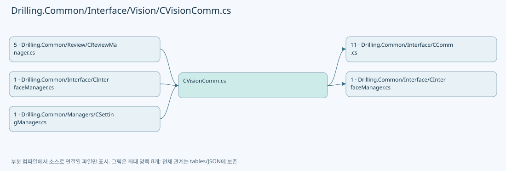

## 네임스페이스·타입·상속

| 타입 | 구분 | 원본 범위 | 선언/상속 |
| --- | --- | --- | --- |
| CVisionComm | ClassDeclaration | 10–533 | CVisionComm: CCommBase(data, option) |
| EN_VISION_COMMAND | EnumDeclaration | 535–545 | EN_VISION_COMMAND |
| ST_VISION_PACKET_HEADER | RecordStructDeclaration | 547–547 | ST_VISION_PACKET_HEADER |
| ST_VISION_MARK_SEARCH | RecordStructDeclaration | 548–548 | ST_VISION_MARK_SEARCH |
| ST_VISION_MARK_FIND | RecordStructDeclaration | 549–549 | ST_VISION_MARK_FIND |
| ST_VISION_PACKET | RecordDeclaration | 550–550 | ST_VISION_PACKET |
| ST_VISION_SINGLE_RESULT | RecordDeclaration | 551–551 | ST_VISION_SINGLE_RESULT |
| ST_VISION_LINE_RESULT | RecordDeclaration | 552–552 | ST_VISION_LINE_RESULT |
| ST_VISION_FLYING_READY | RecordDeclaration | 553–553 | ST_VISION_FLYING_READY |
| CVisionLineCountExceededException | ClassDeclaration | 554–558 | CVisionLineCountExceededException: IOException($"Vision 수신 HoleCount({actualCount})가 Setting-Review MaxHoleCountPerLine({maximumCount})을 초과했습니다.") |
| CVisionProtocol | ClassDeclaration | 559–998 | CVisionProtocol |

## 멤버 빠른 목록

| 이름 | 종류 | 범위 | 서명 |
| --- | --- | --- | --- |
| _pending | FieldDeclaration | L13–13 | System.Collections.Concurrent.ConcurrentDictionary<int, System.Threading.Tasks.TaskCompletionSource<Drilling.Common.Interface.Vision.ST_VISION_PACKET>> Drilling.Common.Interface.Vision.CVisionComm._pending |
| _lifecycleLock | FieldDeclaration | L14–14 | System.Threading.SemaphoreSlim Drilling.Common.Interface.Vision.CVisionComm._lifecycleLock |
| _writeLock | FieldDeclaration | L15–15 | System.Threading.SemaphoreSlim Drilling.Common.Interface.Vision.CVisionComm._writeLock |
| _clientReady | FieldDeclaration | L16–16 | System.Threading.SemaphoreSlim Drilling.Common.Interface.Vision.CVisionComm._clientReady |
| _listener | FieldDeclaration | L17–17 | System.Net.Sockets.TcpListener? Drilling.Common.Interface.Vision.CVisionComm._listener |
| _client | FieldDeclaration | L18–18 | System.Net.Sockets.TcpClient? Drilling.Common.Interface.Vision.CVisionComm._client |
| _stream | FieldDeclaration | L19–19 | System.Net.Sockets.NetworkStream? Drilling.Common.Interface.Vision.CVisionComm._stream |
| _serverCancellation | FieldDeclaration | L20–20 | System.Threading.CancellationTokenSource? Drilling.Common.Interface.Vision.CVisionComm._serverCancellation |
| _acceptTask | FieldDeclaration | L21–21 | System.Threading.Tasks.Task? Drilling.Common.Interface.Vision.CVisionComm._acceptTask |
| _receiveTask | FieldDeclaration | L22–22 | System.Threading.Tasks.Task? Drilling.Common.Interface.Vision.CVisionComm._receiveTask |
| _uniqueId | FieldDeclaration | L23–23 | int Drilling.Common.Interface.Vision.CVisionComm._uniqueId |
| _flyingLineCapacity | FieldDeclaration | L24–24 | int Drilling.Common.Interface.Vision.CVisionComm._flyingLineCapacity |
| HasConnectedClient | PropertyDeclaration | L27–27 | bool Drilling.Common.Interface.Vision.CVisionComm.HasConnectedClient |
| LineCapacityProvider | PropertyDeclaration | L28–28 | System.Func<int>? Drilling.Common.Interface.Vision.CVisionComm.LineCapacityProvider |
| get_LineCapacityProvider | GetAccessorDeclaration | L28–28 | System.Func<int>? Drilling.Common.Interface.Vision.CVisionComm.LineCapacityProvider.get |
| set_LineCapacityProvider | SetAccessorDeclaration | L28–28 | void Drilling.Common.Interface.Vision.CVisionComm.LineCapacityProvider.set |
| ConfiguredLineCapacity | PropertyDeclaration | L29–29 | int Drilling.Common.Interface.Vision.CVisionComm.ConfiguredLineCapacity |
| ResponseLineCapacity | PropertyDeclaration | L30–30 | int Drilling.Common.Interface.Vision.CVisionComm.ResponseLineCapacity |
| ProtocolTrace | EventFieldDeclaration | L31–31 | System.Action<Drilling.Common.Interface.ST_COMM_PROTOCOL_TRACE>? Drilling.Common.Interface.Vision.CVisionComm.ProtocolTrace |
| Connect | MethodDeclaration | L32–76 | System.Threading.Tasks.Task Drilling.Common.Interface.Vision.CVisionComm.Connect(System.Threading.CancellationToken) |
| AcceptLoopCallback | LocalFunctionStatement | L55–58 | System.Threading.Tasks.Task AcceptLoopCallback() |
| Disconnect | MethodDeclaration | L78–91 | System.Threading.Tasks.Task Drilling.Common.Interface.Vision.CVisionComm.Disconnect(System.Threading.CancellationToken) |
| Execute | MethodDeclaration | L93–142 | System.Threading.Tasks.Task<string> Drilling.Common.Interface.Vision.CVisionComm.Execute(string, System.Threading.CancellationToken) |
| AcceptLoop | MethodDeclaration | L144–165 | System.Threading.Tasks.Task Drilling.Common.Interface.Vision.CVisionComm.AcceptLoop(System.Net.Sockets.TcpListener, System.Threading.CancellationToken) |
| ReplaceClient | MethodDeclaration | L167–187 | void Drilling.Common.Interface.Vision.CVisionComm.ReplaceClient(System.Net.Sockets.TcpClient, System.Threading.CancellationToken) |
| ReceiveLoopCallback | LocalFunctionStatement | L173–176 | System.Threading.Tasks.Task ReceiveLoopCallback() |
| ReceiveLoop | MethodDeclaration | L189–252 | System.Threading.Tasks.Task Drilling.Common.Interface.Vision.CVisionComm.ReceiveLoop(System.Net.Sockets.TcpClient, System.Net.Sockets.NetworkStream, System.Threading.CancellationToken) |
| WaitForClient | MethodDeclaration | L254–273 | System.Threading.Tasks.Task<System.Net.Sockets.NetworkStream> Drilling.Common.Interface.Vision.CVisionComm.WaitForClient(System.Threading.CancellationToken) |
| SendRequest | MethodDeclaration | L275–313 | System.Threading.Tasks.Task<Drilling.Common.Interface.Vision.ST_VISION_PACKET> Drilling.Common.Interface.Vision.CVisionComm.SendRequest(System.Net.Sockets.NetworkStream, Drilling.Common.Interface.Vision.ST_VISION_PACKET, System.Threading.CancellationToken) |
| SendPacket | MethodDeclaration | L315–331 | System.Threading.Tasks.Task Drilling.Common.Interface.Vision.CVisionComm.SendPacket(System.Net.Sockets.NetworkStream, Drilling.Common.Interface.Vision.ST_VISION_PACKET, System.Threading.CancellationToken) |
| ReadPacket | MethodDeclaration | L333–346 | System.Threading.Tasks.Task<Drilling.Common.Interface.Vision.ST_VISION_PACKET> Drilling.Common.Interface.Vision.CVisionComm.ReadPacket(System.Net.Sockets.NetworkStream, System.Threading.CancellationToken) |
| ParseRequest | MethodDeclaration | L348–362 | Drilling.Common.Interface.Vision.ST_VISION_PACKET Drilling.Common.Interface.Vision.CVisionComm.ParseRequest(string, int, int) |
| ParseFlyingReady | MethodDeclaration | L364–383 | Drilling.Common.Interface.Vision.ST_VISION_PACKET Drilling.Common.Interface.Vision.CVisionComm.ParseFlyingReady(int, string, int) |
| ParseMarkSearch | MethodDeclaration | L385–394 | Drilling.Common.Interface.Vision.ST_VISION_MARK_SEARCH Drilling.Common.Interface.Vision.CVisionComm.ParseMarkSearch(string) |
| NormalizeCommand | MethodDeclaration | L396–408 | Drilling.Common.Interface.Vision.EN_VISION_COMMAND Drilling.Common.Interface.Vision.CVisionComm.NormalizeCommand(string) |
| ParseInt | MethodDeclaration | L410–410 | int Drilling.Common.Interface.Vision.CVisionComm.ParseInt(string, string) |
| DescribeResponse | MethodDeclaration | L411–446 | string Drilling.Common.Interface.Vision.CVisionComm.DescribeResponse(Drilling.Common.Interface.Vision.ST_VISION_PACKET, int) |
| DescribePacket | MethodDeclaration | L448–448 | string Drilling.Common.Interface.Vision.CVisionComm.DescribePacket(Drilling.Common.Interface.Vision.ST_VISION_PACKET) |
| NextUniqueId | MethodDeclaration | L449–459 | int Drilling.Common.Interface.Vision.CVisionComm.NextUniqueId() |
| RaiseProtocolTrace | MethodDeclaration | L461–464 | void Drilling.Common.Interface.Vision.CVisionComm.RaiseProtocolTrace(string, string) |
| IsServerListening | MethodDeclaration | L466–469 | bool Drilling.Common.Interface.Vision.CVisionComm.IsServerListening() |
| StopServer | MethodDeclaration | L471–500 | System.Threading.Tasks.Task Drilling.Common.Interface.Vision.CVisionComm.StopServer() |
| FailPending | MethodDeclaration | L502–511 | void Drilling.Common.Interface.Vision.CVisionComm.FailPending(System.Exception) |
| IgnoreCancellation | MethodDeclaration | L513–522 | System.Threading.Tasks.Task Drilling.Common.Interface.Vision.CVisionComm.IgnoreCancellation(System.Threading.Tasks.Task) |
| ResolveBindAddress | MethodDeclaration | L524–532 | System.Net.IPAddress Drilling.Common.Interface.Vision.CVisionComm.ResolveBindAddress(string) |
| MarkFindSingle | EnumMemberDeclaration | L537–537 | Drilling.Common.Interface.Vision.EN_VISION_COMMAND.MarkFindSingle |
| FlyingReady | EnumMemberDeclaration | L538–538 | Drilling.Common.Interface.Vision.EN_VISION_COMMAND.FlyingReady |
| FlyingMoveDone | EnumMemberDeclaration | L539–539 | Drilling.Common.Interface.Vision.EN_VISION_COMMAND.FlyingMoveDone |
| MarkFindLine | EnumMemberDeclaration | L540–540 | Drilling.Common.Interface.Vision.EN_VISION_COMMAND.MarkFindLine |
| MarkFindSettingSingle | EnumMemberDeclaration | L541–541 | Drilling.Common.Interface.Vision.EN_VISION_COMMAND.MarkFindSettingSingle |
| MarkFindManual | EnumMemberDeclaration | L542–542 | Drilling.Common.Interface.Vision.EN_VISION_COMMAND.MarkFindManual |
| KeepAliveRequest | EnumMemberDeclaration | L543–543 | Drilling.Common.Interface.Vision.EN_VISION_COMMAND.KeepAliveRequest |
| KeepAlive | EnumMemberDeclaration | L544–544 | Drilling.Common.Interface.Vision.EN_VISION_COMMAND.KeepAlive |
| ActualCount | PropertyDeclaration | L556–556 | int Drilling.Common.Interface.Vision.CVisionLineCountExceededException.ActualCount |
| get_ActualCount | GetAccessorDeclaration | L556–556 | int Drilling.Common.Interface.Vision.CVisionLineCountExceededException.ActualCount.get |
| MaximumCount | PropertyDeclaration | L557–557 | int Drilling.Common.Interface.Vision.CVisionLineCountExceededException.MaximumCount |
| get_MaximumCount | GetAccessorDeclaration | L557–557 | int Drilling.Common.Interface.Vision.CVisionLineCountExceededException.MaximumCount.get |
| PacketLogSeparator | FieldDeclaration | L561–561 | string Drilling.Common.Interface.Vision.CVisionProtocol.PacketLogSeparator |
| PacketLogBodyIndent | FieldDeclaration | L562–562 | string Drilling.Common.Interface.Vision.CVisionProtocol.PacketLogBodyIndent |
| HeaderSize | FieldDeclaration | L563–563 | int Drilling.Common.Interface.Vision.CVisionProtocol.HeaderSize |
| MarkSearchSize | FieldDeclaration | L564–564 | int Drilling.Common.Interface.Vision.CVisionProtocol.MarkSearchSize |
| MarkFindPackedSize | FieldDeclaration | L565–565 | int Drilling.Common.Interface.Vision.CVisionProtocol.MarkFindPackedSize |
| SingleResultBodySize | FieldDeclaration | L566–566 | int Drilling.Common.Interface.Vision.CVisionProtocol.SingleResultBodySize |
| MaximumBodySize | FieldDeclaration | L567–567 | int Drilling.Common.Interface.Vision.CVisionProtocol.MaximumBodySize |
| MaximumMarkCount | FieldDeclaration | L570–570 | int Drilling.Common.Interface.Vision.CVisionProtocol.MaximumMarkCount |
| DefaultMaxHoleCountPerLine | FieldDeclaration | L571–571 | int Drilling.Common.Interface.Vision.CVisionProtocol.DefaultMaxHoleCountPerLine |
| MaxHoleCountPerLineSettingKey | FieldDeclaration | L572–572 | string Drilling.Common.Interface.Vision.CVisionProtocol.MaxHoleCountPerLineSettingKey |
| ValidateLineCapacity | MethodDeclaration | L573–578 | int Drilling.Common.Interface.Vision.CVisionProtocol.ValidateLineCapacity(int) |
| CreateEmpty | MethodDeclaration | L579–579 | Drilling.Common.Interface.Vision.ST_VISION_PACKET Drilling.Common.Interface.Vision.CVisionProtocol.CreateEmpty(Drilling.Common.Interface.Vision.EN_VISION_COMMAND, int, int) |
| CreateMarkFindSingle | MethodDeclaration | L580–580 | Drilling.Common.Interface.Vision.ST_VISION_PACKET Drilling.Common.Interface.Vision.CVisionProtocol.CreateMarkFindSingle(int, Drilling.Common.Interface.Vision.ST_VISION_MARK_SEARCH) |
| CreateFlyingReady | MethodDeclaration | L581–600 | Drilling.Common.Interface.Vision.ST_VISION_PACKET Drilling.Common.Interface.Vision.CVisionProtocol.CreateFlyingReady(int, int, System.Collections.Generic.IReadOnlyList<Drilling.Common.Interface.Vision.ST_VISION_MARK_SEARCH>, int) |
| CreateSingleResult | MethodDeclaration | L602–613 | Drilling.Common.Interface.Vision.ST_VISION_PACKET Drilling.Common.Interface.Vision.CVisionProtocol.CreateSingleResult(Drilling.Common.Interface.Vision.EN_VISION_COMMAND, int, int, Drilling.Common.Interface.Vision.ST_VISION_MARK_FIND, int) |
| CreateLineResult | MethodDeclaration | L615–635 | Drilling.Common.Interface.Vision.ST_VISION_PACKET Drilling.Common.Interface.Vision.CVisionProtocol.CreateLineResult(int, int, System.Collections.Generic.IReadOnlyList<Drilling.Common.Interface.Vision.ST_VISION_MARK_FIND>, int, int) |
| Create | MethodDeclaration | L637–642 | Drilling.Common.Interface.Vision.ST_VISION_PACKET Drilling.Common.Interface.Vision.CVisionProtocol.Create(Drilling.Common.Interface.Vision.EN_VISION_COMMAND, int, byte[], int) |
| Encode | MethodDeclaration | L644–661 | byte[] Drilling.Common.Interface.Vision.CVisionProtocol.Encode(Drilling.Common.Interface.Vision.ST_VISION_PACKET) |
| DecodeHeader | MethodDeclaration | L663–673 | Drilling.Common.Interface.Vision.ST_VISION_PACKET_HEADER Drilling.Common.Interface.Vision.CVisionProtocol.DecodeHeader(System.ReadOnlySpan<byte>) |
| Decode | MethodDeclaration | L675–685 | Drilling.Common.Interface.Vision.ST_VISION_PACKET Drilling.Common.Interface.Vision.CVisionProtocol.Decode(System.ReadOnlySpan<byte>) |
| DecodeMarkSearchRequest | MethodDeclaration | L687–701 | Drilling.Common.Interface.Vision.ST_VISION_MARK_SEARCH Drilling.Common.Interface.Vision.CVisionProtocol.DecodeMarkSearchRequest(Drilling.Common.Interface.Vision.ST_VISION_PACKET) |
| DecodeFlyingReadyRequest | MethodDeclaration | L703–737 | Drilling.Common.Interface.Vision.ST_VISION_FLYING_READY Drilling.Common.Interface.Vision.CVisionProtocol.DecodeFlyingReadyRequest(Drilling.Common.Interface.Vision.ST_VISION_PACKET, int) |
| DecodeFlyingMoveDoneResponse | MethodDeclaration | L740–751 | int Drilling.Common.Interface.Vision.CVisionProtocol.DecodeFlyingMoveDoneResponse(Drilling.Common.Interface.Vision.ST_VISION_PACKET) |
| DecodeSingleResult | MethodDeclaration | L753–767 | Drilling.Common.Interface.Vision.ST_VISION_SINGLE_RESULT Drilling.Common.Interface.Vision.CVisionProtocol.DecodeSingleResult(Drilling.Common.Interface.Vision.ST_VISION_PACKET) |
| DecodeLineResult | MethodDeclaration | L769–808 | Drilling.Common.Interface.Vision.ST_VISION_LINE_RESULT Drilling.Common.Interface.Vision.CVisionProtocol.DecodeLineResult(Drilling.Common.Interface.Vision.ST_VISION_PACKET, int) |
| EncodeMarkSearch | MethodDeclaration | L810–815 | byte[] Drilling.Common.Interface.Vision.CVisionProtocol.EncodeMarkSearch(Drilling.Common.Interface.Vision.ST_VISION_MARK_SEARCH) |
| FormatPacketLog | MethodDeclaration | L817–832 | string Drilling.Common.Interface.Vision.CVisionProtocol.FormatPacketLog(string, Drilling.Common.Interface.Vision.ST_VISION_PACKET, string, int) |
| GetCommandName | MethodDeclaration | L834–847 | string Drilling.Common.Interface.Vision.CVisionProtocol.GetCommandName(int) |
| AppendPacketLogBody | MethodDeclaration | L849–889 | void Drilling.Common.Interface.Vision.CVisionProtocol.AppendPacketLogBody(System.Text.StringBuilder, Drilling.Common.Interface.Vision.ST_VISION_PACKET, int) |
| AppendMarkFindSingleLogBody | MethodDeclaration | L891–906 | void Drilling.Common.Interface.Vision.CVisionProtocol.AppendMarkFindSingleLogBody(System.Text.StringBuilder, Drilling.Common.Interface.Vision.ST_VISION_PACKET) |
| AppendFlyingReadyLogBody | MethodDeclaration | L908–919 | void Drilling.Common.Interface.Vision.CVisionProtocol.AppendFlyingReadyLogBody(System.Text.StringBuilder, Drilling.Common.Interface.Vision.ST_VISION_PACKET, int) |
| AppendSingleResultLogBody | MethodDeclaration | L921–926 | void Drilling.Common.Interface.Vision.CVisionProtocol.AppendSingleResultLogBody(System.Text.StringBuilder, Drilling.Common.Interface.Vision.ST_VISION_PACKET) |
| AppendLineResultLogBody | MethodDeclaration | L928–938 | void Drilling.Common.Interface.Vision.CVisionProtocol.AppendLineResultLogBody(System.Text.StringBuilder, Drilling.Common.Interface.Vision.ST_VISION_PACKET, int) |
| AppendMarkResultLog | MethodDeclaration | L940–953 | void Drilling.Common.Interface.Vision.CVisionProtocol.AppendMarkResultLog(System.Text.StringBuilder, Drilling.Common.Interface.Vision.ST_VISION_MARK_FIND, int?) |
| FormatLogNumber | MethodDeclaration | L955–958 | string Drilling.Common.Interface.Vision.CVisionProtocol.FormatLogNumber(double) |
| WriteMarkSearch | MethodDeclaration | L960–968 | void Drilling.Common.Interface.Vision.CVisionProtocol.WriteMarkSearch(System.Span<byte>, int, Drilling.Common.Interface.Vision.ST_VISION_MARK_SEARCH) |
| WriteMarkFind | MethodDeclaration | L970–977 | void Drilling.Common.Interface.Vision.CVisionProtocol.WriteMarkFind(System.Span<byte>, int, Drilling.Common.Interface.Vision.ST_VISION_MARK_FIND) |
| ReadPackedMarkFind | MethodDeclaration | L979–979 | Drilling.Common.Interface.Vision.ST_VISION_MARK_FIND Drilling.Common.Interface.Vision.CVisionProtocol.ReadPackedMarkFind(System.ReadOnlySpan<byte>, int) |
| ReadMarkSearch | MethodDeclaration | L980–980 | Drilling.Common.Interface.Vision.ST_VISION_MARK_SEARCH Drilling.Common.Interface.Vision.CVisionProtocol.ReadMarkSearch(System.ReadOnlySpan<byte>, int) |
| ValidateBodyLength | MethodDeclaration | L981–987 | void Drilling.Common.Interface.Vision.CVisionProtocol.ValidateBodyLength(int) |
| ReadInt32 | MethodDeclaration | L989–989 | int Drilling.Common.Interface.Vision.CVisionProtocol.ReadInt32(System.ReadOnlySpan<byte>, int) |
| ReadDouble | MethodDeclaration | L990–994 | double Drilling.Common.Interface.Vision.CVisionProtocol.ReadDouble(System.ReadOnlySpan<byte>, int) |
| WriteInt32 | MethodDeclaration | L996–996 | void Drilling.Common.Interface.Vision.CVisionProtocol.WriteInt32(System.Span<byte>, int, int) |
| WriteDouble | MethodDeclaration | L997–997 | void Drilling.Common.Interface.Vision.CVisionProtocol.WriteDouble(System.Span<byte>, int, double) |

## 멤버별 상세 계약·호출·처리 해설

### FieldDeclaration `_pending` · L13–13

[Drilling.Common/Interface/Vision/CVisionComm.cs:13–13](https://github.com/kjuws10-rgb/A3Drilling/blob/334b3599651b2e8e0181fd4459bafaf3cddafff3/Drilling.Common/Interface/Vision/CVisionComm.cs#L13-L13)

| 항목 | 실제 추출 값 |
| --- | --- |
| 서명 | System.Collections.Concurrent.ConcurrentDictionary<int, System.Threading.Tasks.TaskCompletionSource<Drilling.Common.Interface.Vision.ST_VISION_PACKET>> Drilling.Common.Interface.Vision.CVisionComm._pending |
| 접근/수식자 | Private / private, readonly |
| 반환/값 타입 | System.Collections.Concurrent.ConcurrentDictionary<int, System.Threading.Tasks.TaskCompletionSource<Drilling.Common.Interface.Vision.ST_VISION_PACKET>> |
| 소속 타입 | NamedType:Drilling.Common.Interface.Vision.CVisionComm |

현재 부분 분석에서 직접 연결된 호출자는 없습니다. XAML/이벤트/인터페이스·델리게이트·외부 진입을 추가 확인해야 하며, 미사용으로 판정한 것이 아닙니다.

호출하는 대상과 해석 범위:

| 원본 행 | 표현식 | 분석 상태 | 대상/소스 위치 |
| --- | --- | --- | --- |
| 13 | new | resolved | System.Collections.Concurrent.ConcurrentDictionary<int, System.Threading.Tasks.TaskCompletionSource<Drilling.Common.Interface.Vision.ST_VISION_PACKET>>.ConcurrentDictionary() |

본문의 실제 연산·분기·예외·반환 순서(원문 위치 순):

| 원본 행 | 종류 | 주석 해설 |
| --- | --- | --- |
| 13 | call | 함수·델리게이트 또는 객체 생성자를 호출합니다: new() |
| 13 | variable-initializer | 변수의 초기값을 지정합니다: _pending = new() |

변경 전 점검: 입력/반환 타입, 위 호출자, 예외/취소 경로, 공유 상태와 저장·전송 소비자를 함께 확인합니다. 값의 단위나 물리 방향을 이름만으로 확정하지 않습니다.

### FieldDeclaration `_lifecycleLock` · L14–14

[Drilling.Common/Interface/Vision/CVisionComm.cs:14–14](https://github.com/kjuws10-rgb/A3Drilling/blob/334b3599651b2e8e0181fd4459bafaf3cddafff3/Drilling.Common/Interface/Vision/CVisionComm.cs#L14-L14)

| 항목 | 실제 추출 값 |
| --- | --- |
| 서명 | System.Threading.SemaphoreSlim Drilling.Common.Interface.Vision.CVisionComm._lifecycleLock |
| 접근/수식자 | Private / private, readonly |
| 반환/값 타입 | System.Threading.SemaphoreSlim |
| 소속 타입 | NamedType:Drilling.Common.Interface.Vision.CVisionComm |

현재 부분 분석에서 직접 연결된 호출자는 없습니다. XAML/이벤트/인터페이스·델리게이트·외부 진입을 추가 확인해야 하며, 미사용으로 판정한 것이 아닙니다.

호출하는 대상과 해석 범위:

| 원본 행 | 표현식 | 분석 상태 | 대상/소스 위치 |
| --- | --- | --- | --- |
| 14 | new | resolved | System.Threading.SemaphoreSlim.SemaphoreSlim(int, int) |

본문의 실제 연산·분기·예외·반환 순서(원문 위치 순):

| 원본 행 | 종류 | 주석 해설 |
| --- | --- | --- |
| 14 | call | 함수·델리게이트 또는 객체 생성자를 호출합니다: new(1, 1) |
| 14 | variable-initializer | 변수의 초기값을 지정합니다: _lifecycleLock = new(1, 1) |

변경 전 점검: 입력/반환 타입, 위 호출자, 예외/취소 경로, 공유 상태와 저장·전송 소비자를 함께 확인합니다. 값의 단위나 물리 방향을 이름만으로 확정하지 않습니다.

### FieldDeclaration `_writeLock` · L15–15

[Drilling.Common/Interface/Vision/CVisionComm.cs:15–15](https://github.com/kjuws10-rgb/A3Drilling/blob/334b3599651b2e8e0181fd4459bafaf3cddafff3/Drilling.Common/Interface/Vision/CVisionComm.cs#L15-L15)

| 항목 | 실제 추출 값 |
| --- | --- |
| 서명 | System.Threading.SemaphoreSlim Drilling.Common.Interface.Vision.CVisionComm._writeLock |
| 접근/수식자 | Private / private, readonly |
| 반환/값 타입 | System.Threading.SemaphoreSlim |
| 소속 타입 | NamedType:Drilling.Common.Interface.Vision.CVisionComm |

현재 부분 분석에서 직접 연결된 호출자는 없습니다. XAML/이벤트/인터페이스·델리게이트·외부 진입을 추가 확인해야 하며, 미사용으로 판정한 것이 아닙니다.

호출하는 대상과 해석 범위:

| 원본 행 | 표현식 | 분석 상태 | 대상/소스 위치 |
| --- | --- | --- | --- |
| 15 | new | resolved | System.Threading.SemaphoreSlim.SemaphoreSlim(int, int) |

본문의 실제 연산·분기·예외·반환 순서(원문 위치 순):

| 원본 행 | 종류 | 주석 해설 |
| --- | --- | --- |
| 15 | call | 함수·델리게이트 또는 객체 생성자를 호출합니다: new(1, 1) |
| 15 | variable-initializer | 변수의 초기값을 지정합니다: _writeLock = new(1, 1) |

변경 전 점검: 입력/반환 타입, 위 호출자, 예외/취소 경로, 공유 상태와 저장·전송 소비자를 함께 확인합니다. 값의 단위나 물리 방향을 이름만으로 확정하지 않습니다.

### FieldDeclaration `_clientReady` · L16–16

[Drilling.Common/Interface/Vision/CVisionComm.cs:16–16](https://github.com/kjuws10-rgb/A3Drilling/blob/334b3599651b2e8e0181fd4459bafaf3cddafff3/Drilling.Common/Interface/Vision/CVisionComm.cs#L16-L16)

| 항목 | 실제 추출 값 |
| --- | --- |
| 서명 | System.Threading.SemaphoreSlim Drilling.Common.Interface.Vision.CVisionComm._clientReady |
| 접근/수식자 | Private / private, readonly |
| 반환/값 타입 | System.Threading.SemaphoreSlim |
| 소속 타입 | NamedType:Drilling.Common.Interface.Vision.CVisionComm |

현재 부분 분석에서 직접 연결된 호출자는 없습니다. XAML/이벤트/인터페이스·델리게이트·외부 진입을 추가 확인해야 하며, 미사용으로 판정한 것이 아닙니다.

호출하는 대상과 해석 범위:

| 원본 행 | 표현식 | 분석 상태 | 대상/소스 위치 |
| --- | --- | --- | --- |
| 16 | new | resolved | System.Threading.SemaphoreSlim.SemaphoreSlim(int, int) |

본문의 실제 연산·분기·예외·반환 순서(원문 위치 순):

| 원본 행 | 종류 | 주석 해설 |
| --- | --- | --- |
| 16 | call | 함수·델리게이트 또는 객체 생성자를 호출합니다: new(0, 1) |
| 16 | variable-initializer | 변수의 초기값을 지정합니다: _clientReady = new(0, 1) |

변경 전 점검: 입력/반환 타입, 위 호출자, 예외/취소 경로, 공유 상태와 저장·전송 소비자를 함께 확인합니다. 값의 단위나 물리 방향을 이름만으로 확정하지 않습니다.

### FieldDeclaration `_listener` · L17–17

[Drilling.Common/Interface/Vision/CVisionComm.cs:17–17](https://github.com/kjuws10-rgb/A3Drilling/blob/334b3599651b2e8e0181fd4459bafaf3cddafff3/Drilling.Common/Interface/Vision/CVisionComm.cs#L17-L17)

| 항목 | 실제 추출 값 |
| --- | --- |
| 서명 | System.Net.Sockets.TcpListener? Drilling.Common.Interface.Vision.CVisionComm._listener |
| 접근/수식자 | Private / private |
| 반환/값 타입 | System.Net.Sockets.TcpListener? |
| 소속 타입 | NamedType:Drilling.Common.Interface.Vision.CVisionComm |

현재 부분 분석에서 직접 연결된 호출자는 없습니다. XAML/이벤트/인터페이스·델리게이트·외부 진입을 추가 확인해야 하며, 미사용으로 판정한 것이 아닙니다.

변경 전 점검: 입력/반환 타입, 위 호출자, 예외/취소 경로, 공유 상태와 저장·전송 소비자를 함께 확인합니다. 값의 단위나 물리 방향을 이름만으로 확정하지 않습니다.

### FieldDeclaration `_client` · L18–18

[Drilling.Common/Interface/Vision/CVisionComm.cs:18–18](https://github.com/kjuws10-rgb/A3Drilling/blob/334b3599651b2e8e0181fd4459bafaf3cddafff3/Drilling.Common/Interface/Vision/CVisionComm.cs#L18-L18)

| 항목 | 실제 추출 값 |
| --- | --- |
| 서명 | System.Net.Sockets.TcpClient? Drilling.Common.Interface.Vision.CVisionComm._client |
| 접근/수식자 | Private / private |
| 반환/값 타입 | System.Net.Sockets.TcpClient? |
| 소속 타입 | NamedType:Drilling.Common.Interface.Vision.CVisionComm |

현재 부분 분석에서 직접 연결된 호출자는 없습니다. XAML/이벤트/인터페이스·델리게이트·외부 진입을 추가 확인해야 하며, 미사용으로 판정한 것이 아닙니다.

변경 전 점검: 입력/반환 타입, 위 호출자, 예외/취소 경로, 공유 상태와 저장·전송 소비자를 함께 확인합니다. 값의 단위나 물리 방향을 이름만으로 확정하지 않습니다.

### FieldDeclaration `_stream` · L19–19

[Drilling.Common/Interface/Vision/CVisionComm.cs:19–19](https://github.com/kjuws10-rgb/A3Drilling/blob/334b3599651b2e8e0181fd4459bafaf3cddafff3/Drilling.Common/Interface/Vision/CVisionComm.cs#L19-L19)

| 항목 | 실제 추출 값 |
| --- | --- |
| 서명 | System.Net.Sockets.NetworkStream? Drilling.Common.Interface.Vision.CVisionComm._stream |
| 접근/수식자 | Private / private |
| 반환/값 타입 | System.Net.Sockets.NetworkStream? |
| 소속 타입 | NamedType:Drilling.Common.Interface.Vision.CVisionComm |

현재 부분 분석에서 직접 연결된 호출자는 없습니다. XAML/이벤트/인터페이스·델리게이트·외부 진입을 추가 확인해야 하며, 미사용으로 판정한 것이 아닙니다.

변경 전 점검: 입력/반환 타입, 위 호출자, 예외/취소 경로, 공유 상태와 저장·전송 소비자를 함께 확인합니다. 값의 단위나 물리 방향을 이름만으로 확정하지 않습니다.

### FieldDeclaration `_serverCancellation` · L20–20

[Drilling.Common/Interface/Vision/CVisionComm.cs:20–20](https://github.com/kjuws10-rgb/A3Drilling/blob/334b3599651b2e8e0181fd4459bafaf3cddafff3/Drilling.Common/Interface/Vision/CVisionComm.cs#L20-L20)

| 항목 | 실제 추출 값 |
| --- | --- |
| 서명 | System.Threading.CancellationTokenSource? Drilling.Common.Interface.Vision.CVisionComm._serverCancellation |
| 접근/수식자 | Private / private |
| 반환/값 타입 | System.Threading.CancellationTokenSource? |
| 소속 타입 | NamedType:Drilling.Common.Interface.Vision.CVisionComm |

현재 부분 분석에서 직접 연결된 호출자는 없습니다. XAML/이벤트/인터페이스·델리게이트·외부 진입을 추가 확인해야 하며, 미사용으로 판정한 것이 아닙니다.

변경 전 점검: 입력/반환 타입, 위 호출자, 예외/취소 경로, 공유 상태와 저장·전송 소비자를 함께 확인합니다. 값의 단위나 물리 방향을 이름만으로 확정하지 않습니다.

### FieldDeclaration `_acceptTask` · L21–21

[Drilling.Common/Interface/Vision/CVisionComm.cs:21–21](https://github.com/kjuws10-rgb/A3Drilling/blob/334b3599651b2e8e0181fd4459bafaf3cddafff3/Drilling.Common/Interface/Vision/CVisionComm.cs#L21-L21)

| 항목 | 실제 추출 값 |
| --- | --- |
| 서명 | System.Threading.Tasks.Task? Drilling.Common.Interface.Vision.CVisionComm._acceptTask |
| 접근/수식자 | Private / private |
| 반환/값 타입 | System.Threading.Tasks.Task? |
| 소속 타입 | NamedType:Drilling.Common.Interface.Vision.CVisionComm |

현재 부분 분석에서 직접 연결된 호출자는 없습니다. XAML/이벤트/인터페이스·델리게이트·외부 진입을 추가 확인해야 하며, 미사용으로 판정한 것이 아닙니다.

변경 전 점검: 입력/반환 타입, 위 호출자, 예외/취소 경로, 공유 상태와 저장·전송 소비자를 함께 확인합니다. 값의 단위나 물리 방향을 이름만으로 확정하지 않습니다.

### FieldDeclaration `_receiveTask` · L22–22

[Drilling.Common/Interface/Vision/CVisionComm.cs:22–22](https://github.com/kjuws10-rgb/A3Drilling/blob/334b3599651b2e8e0181fd4459bafaf3cddafff3/Drilling.Common/Interface/Vision/CVisionComm.cs#L22-L22)

| 항목 | 실제 추출 값 |
| --- | --- |
| 서명 | System.Threading.Tasks.Task? Drilling.Common.Interface.Vision.CVisionComm._receiveTask |
| 접근/수식자 | Private / private |
| 반환/값 타입 | System.Threading.Tasks.Task? |
| 소속 타입 | NamedType:Drilling.Common.Interface.Vision.CVisionComm |

현재 부분 분석에서 직접 연결된 호출자는 없습니다. XAML/이벤트/인터페이스·델리게이트·외부 진입을 추가 확인해야 하며, 미사용으로 판정한 것이 아닙니다.

변경 전 점검: 입력/반환 타입, 위 호출자, 예외/취소 경로, 공유 상태와 저장·전송 소비자를 함께 확인합니다. 값의 단위나 물리 방향을 이름만으로 확정하지 않습니다.

### FieldDeclaration `_uniqueId` · L23–23

[Drilling.Common/Interface/Vision/CVisionComm.cs:23–23](https://github.com/kjuws10-rgb/A3Drilling/blob/334b3599651b2e8e0181fd4459bafaf3cddafff3/Drilling.Common/Interface/Vision/CVisionComm.cs#L23-L23)

| 항목 | 실제 추출 값 |
| --- | --- |
| 서명 | int Drilling.Common.Interface.Vision.CVisionComm._uniqueId |
| 접근/수식자 | Private / private |
| 반환/값 타입 | int |
| 소속 타입 | NamedType:Drilling.Common.Interface.Vision.CVisionComm |

현재 부분 분석에서 직접 연결된 호출자는 없습니다. XAML/이벤트/인터페이스·델리게이트·외부 진입을 추가 확인해야 하며, 미사용으로 판정한 것이 아닙니다.

변경 전 점검: 입력/반환 타입, 위 호출자, 예외/취소 경로, 공유 상태와 저장·전송 소비자를 함께 확인합니다. 값의 단위나 물리 방향을 이름만으로 확정하지 않습니다.

### FieldDeclaration `_flyingLineCapacity` · L24–24

[Drilling.Common/Interface/Vision/CVisionComm.cs:24–24](https://github.com/kjuws10-rgb/A3Drilling/blob/334b3599651b2e8e0181fd4459bafaf3cddafff3/Drilling.Common/Interface/Vision/CVisionComm.cs#L24-L24)

| 항목 | 실제 추출 값 |
| --- | --- |
| 서명 | int Drilling.Common.Interface.Vision.CVisionComm._flyingLineCapacity |
| 접근/수식자 | Private / private |
| 반환/값 타입 | int |
| 소속 타입 | NamedType:Drilling.Common.Interface.Vision.CVisionComm |

현재 부분 분석에서 직접 연결된 호출자는 없습니다. XAML/이벤트/인터페이스·델리게이트·외부 진입을 추가 확인해야 하며, 미사용으로 판정한 것이 아닙니다.

변경 전 점검: 입력/반환 타입, 위 호출자, 예외/취소 경로, 공유 상태와 저장·전송 소비자를 함께 확인합니다. 값의 단위나 물리 방향을 이름만으로 확정하지 않습니다.

### PropertyDeclaration `HasConnectedClient` · L27–27

[Drilling.Common/Interface/Vision/CVisionComm.cs:27–27](https://github.com/kjuws10-rgb/A3Drilling/blob/334b3599651b2e8e0181fd4459bafaf3cddafff3/Drilling.Common/Interface/Vision/CVisionComm.cs#L27-L27)

| 항목 | 실제 추출 값 |
| --- | --- |
| 서명 | bool Drilling.Common.Interface.Vision.CVisionComm.HasConnectedClient |
| 접근/수식자 | Internal / internal |
| 반환/값 타입 | bool |
| 소속 타입 | NamedType:Drilling.Common.Interface.Vision.CVisionComm |

현재 부분 분석에서 직접 연결된 호출자는 없습니다. XAML/이벤트/인터페이스·델리게이트·외부 진입을 추가 확인해야 하며, 미사용으로 판정한 것이 아닙니다.

호출하는 대상과 해석 범위:

| 원본 행 | 표현식 | 분석 상태 | 대상/소스 위치 |
| --- | --- | --- | --- |
| 27 | Volatile.Read | resolved | System.Net.Sockets.TcpClient? System.Threading.Volatile.Read<System.Net.Sockets.TcpClient?>(ref readonly System.Net.Sockets.TcpClient?) |

본문의 실제 연산·분기·예외·반환 순서(원문 위치 순):

| 원본 행 | 종류 | 주석 해설 |
| --- | --- | --- |
| 27 | call | 함수·델리게이트 또는 객체 생성자를 호출합니다: Volatile.Read(ref _client) |

변경 전 점검: 입력/반환 타입, 위 호출자, 예외/취소 경로, 공유 상태와 저장·전송 소비자를 함께 확인합니다. 값의 단위나 물리 방향을 이름만으로 확정하지 않습니다.

### PropertyDeclaration `LineCapacityProvider` · L28–28

[Drilling.Common/Interface/Vision/CVisionComm.cs:28–28](https://github.com/kjuws10-rgb/A3Drilling/blob/334b3599651b2e8e0181fd4459bafaf3cddafff3/Drilling.Common/Interface/Vision/CVisionComm.cs#L28-L28)

| 항목 | 실제 추출 값 |
| --- | --- |
| 서명 | System.Func<int>? Drilling.Common.Interface.Vision.CVisionComm.LineCapacityProvider |
| 접근/수식자 | Internal / internal |
| 반환/값 타입 | System.Func<int>? |
| 소속 타입 | NamedType:Drilling.Common.Interface.Vision.CVisionComm |

현재 부분 분석에서 직접 연결된 호출자는 없습니다. XAML/이벤트/인터페이스·델리게이트·외부 진입을 추가 확인해야 하며, 미사용으로 판정한 것이 아닙니다.

변경 전 점검: 입력/반환 타입, 위 호출자, 예외/취소 경로, 공유 상태와 저장·전송 소비자를 함께 확인합니다. 값의 단위나 물리 방향을 이름만으로 확정하지 않습니다.

### GetAccessorDeclaration `get_LineCapacityProvider` · L28–28

[Drilling.Common/Interface/Vision/CVisionComm.cs:28–28](https://github.com/kjuws10-rgb/A3Drilling/blob/334b3599651b2e8e0181fd4459bafaf3cddafff3/Drilling.Common/Interface/Vision/CVisionComm.cs#L28-L28)

| 항목 | 실제 추출 값 |
| --- | --- |
| 서명 | System.Func<int>? Drilling.Common.Interface.Vision.CVisionComm.LineCapacityProvider.get |
| 접근/수식자 | Internal / get |
| 반환/값 타입 | System.Func<int>? |
| 소속 타입 | NamedType:Drilling.Common.Interface.Vision.CVisionComm |

현재 부분 분석에서 직접 연결된 호출자는 없습니다. XAML/이벤트/인터페이스·델리게이트·외부 진입을 추가 확인해야 하며, 미사용으로 판정한 것이 아닙니다.

변경 전 점검: 입력/반환 타입, 위 호출자, 예외/취소 경로, 공유 상태와 저장·전송 소비자를 함께 확인합니다. 값의 단위나 물리 방향을 이름만으로 확정하지 않습니다.

### SetAccessorDeclaration `set_LineCapacityProvider` · L28–28

[Drilling.Common/Interface/Vision/CVisionComm.cs:28–28](https://github.com/kjuws10-rgb/A3Drilling/blob/334b3599651b2e8e0181fd4459bafaf3cddafff3/Drilling.Common/Interface/Vision/CVisionComm.cs#L28-L28)

| 항목 | 실제 추출 값 |
| --- | --- |
| 서명 | void Drilling.Common.Interface.Vision.CVisionComm.LineCapacityProvider.set |
| 접근/수식자 | Internal / set |
| 반환/값 타입 | void |
| 소속 타입 | NamedType:Drilling.Common.Interface.Vision.CVisionComm |

입력 계약:

| 이름 | 타입 | 전달 | 선택/기본값 |
| --- | --- | --- | --- |
| value | System.Func<int>? | None | False /  |

현재 부분 분석에서 직접 연결된 호출자는 없습니다. XAML/이벤트/인터페이스·델리게이트·외부 진입을 추가 확인해야 하며, 미사용으로 판정한 것이 아닙니다.

변경 전 점검: 입력/반환 타입, 위 호출자, 예외/취소 경로, 공유 상태와 저장·전송 소비자를 함께 확인합니다. 값의 단위나 물리 방향을 이름만으로 확정하지 않습니다.

### PropertyDeclaration `ConfiguredLineCapacity` · L29–29

[Drilling.Common/Interface/Vision/CVisionComm.cs:29–29](https://github.com/kjuws10-rgb/A3Drilling/blob/334b3599651b2e8e0181fd4459bafaf3cddafff3/Drilling.Common/Interface/Vision/CVisionComm.cs#L29-L29)

| 항목 | 실제 추출 값 |
| --- | --- |
| 서명 | int Drilling.Common.Interface.Vision.CVisionComm.ConfiguredLineCapacity |
| 접근/수식자 | Private / private |
| 반환/값 타입 | int |
| 소속 타입 | NamedType:Drilling.Common.Interface.Vision.CVisionComm |

현재 부분 분석에서 직접 연결된 호출자는 없습니다. XAML/이벤트/인터페이스·델리게이트·외부 진입을 추가 확인해야 하며, 미사용으로 판정한 것이 아닙니다.

호출하는 대상과 해석 범위:

| 원본 행 | 표현식 | 분석 상태 | 대상/소스 위치 |
| --- | --- | --- | --- |
| 29 | CVisionProtocol.ValidateLineCapacity | resolved | int Drilling.Common.Interface.Vision.CVisionProtocol.ValidateLineCapacity(int) · Drilling.Common/Interface/Vision/CVisionComm.cs:573 |
| 29 | .Invoke | resolved · 동적 구현 선택 가능 | int System.Func<int>.Invoke() |

본문의 실제 연산·분기·예외·반환 순서(원문 위치 순):

| 원본 행 | 종류 | 주석 해설 |
| --- | --- | --- |
| 29 | call | 함수·델리게이트 또는 객체 생성자를 호출합니다: CVisionProtocol.ValidateLineCapacity(LineCapacityProvider?.Invoke() ?? CVisionProtocol.DefaultMaxHoleCountPerLine) |
| 29 | call | 함수·델리게이트 또는 객체 생성자를 호출합니다: .Invoke() |

변경 전 점검: 입력/반환 타입, 위 호출자, 예외/취소 경로, 공유 상태와 저장·전송 소비자를 함께 확인합니다. 값의 단위나 물리 방향을 이름만으로 확정하지 않습니다.

### PropertyDeclaration `ResponseLineCapacity` · L30–30

[Drilling.Common/Interface/Vision/CVisionComm.cs:30–30](https://github.com/kjuws10-rgb/A3Drilling/blob/334b3599651b2e8e0181fd4459bafaf3cddafff3/Drilling.Common/Interface/Vision/CVisionComm.cs#L30-L30)

| 항목 | 실제 추출 값 |
| --- | --- |
| 서명 | int Drilling.Common.Interface.Vision.CVisionComm.ResponseLineCapacity |
| 접근/수식자 | Private / private |
| 반환/값 타입 | int |
| 소속 타입 | NamedType:Drilling.Common.Interface.Vision.CVisionComm |

현재 부분 분석에서 직접 연결된 호출자는 없습니다. XAML/이벤트/인터페이스·델리게이트·외부 진입을 추가 확인해야 하며, 미사용으로 판정한 것이 아닙니다.

호출하는 대상과 해석 범위:

| 원본 행 | 표현식 | 분석 상태 | 대상/소스 위치 |
| --- | --- | --- | --- |
| 30 | Volatile.Read | resolved | int System.Threading.Volatile.Read(ref readonly int) |

본문의 실제 연산·분기·예외·반환 순서(원문 위치 순):

| 원본 행 | 종류 | 주석 해설 |
| --- | --- | --- |
| 30 | call | 함수·델리게이트 또는 객체 생성자를 호출합니다: Volatile.Read(ref _flyingLineCapacity) |
| 30 | conditional-expression | 조건에 따라 결과식을 선택합니다: Volatile.Read(ref _flyingLineCapacity) is > 0 and var capacity ? capacity : ConfiguredLineCapacity |

변경 전 점검: 입력/반환 타입, 위 호출자, 예외/취소 경로, 공유 상태와 저장·전송 소비자를 함께 확인합니다. 값의 단위나 물리 방향을 이름만으로 확정하지 않습니다.

### EventFieldDeclaration `ProtocolTrace` · L31–31

[Drilling.Common/Interface/Vision/CVisionComm.cs:31–31](https://github.com/kjuws10-rgb/A3Drilling/blob/334b3599651b2e8e0181fd4459bafaf3cddafff3/Drilling.Common/Interface/Vision/CVisionComm.cs#L31-L31)

| 항목 | 실제 추출 값 |
| --- | --- |
| 서명 | System.Action<Drilling.Common.Interface.ST_COMM_PROTOCOL_TRACE>? Drilling.Common.Interface.Vision.CVisionComm.ProtocolTrace |
| 접근/수식자 | Internal / internal, event |
| 반환/값 타입 | System.Action<Drilling.Common.Interface.ST_COMM_PROTOCOL_TRACE>? |
| 소속 타입 | NamedType:Drilling.Common.Interface.Vision.CVisionComm |

현재 부분 분석에서 직접 연결된 호출자는 없습니다. XAML/이벤트/인터페이스·델리게이트·외부 진입을 추가 확인해야 하며, 미사용으로 판정한 것이 아닙니다.

변경 전 점검: 입력/반환 타입, 위 호출자, 예외/취소 경로, 공유 상태와 저장·전송 소비자를 함께 확인합니다. 값의 단위나 물리 방향을 이름만으로 확정하지 않습니다.

### MethodDeclaration `Connect` · L32–76

[Drilling.Common/Interface/Vision/CVisionComm.cs:32–76](https://github.com/kjuws10-rgb/A3Drilling/blob/334b3599651b2e8e0181fd4459bafaf3cddafff3/Drilling.Common/Interface/Vision/CVisionComm.cs#L32-L76)

| 항목 | 실제 추출 값 |
| --- | --- |
| 서명 | System.Threading.Tasks.Task Drilling.Common.Interface.Vision.CVisionComm.Connect(System.Threading.CancellationToken) |
| 접근/수식자 | Public / public, override, async |
| 반환/값 타입 | System.Threading.Tasks.Task |
| 소속 타입 | NamedType:Drilling.Common.Interface.Vision.CVisionComm |

입력 계약:

| 이름 | 타입 | 전달 | 선택/기본값 |
| --- | --- | --- | --- |
| cancellationToken | System.Threading.CancellationToken | None | True / null |

정적 호출자로 확인된 위치:

| 호출 파일/행 | 호출 표현식 | 런타임 분기 가능 |
| --- | --- | --- |
| [Drilling.Common/Interface/Vision/CVisionComm.cs:108–108](https://github.com/kjuws10-rgb/A3Drilling/blob/334b3599651b2e8e0181fd4459bafaf3cddafff3/Drilling.Common/Interface/Vision/CVisionComm.cs#L108-L108) | Connect | True |

호출하는 대상과 해석 범위:

| 원본 행 | 표현식 | 분석 상태 | 대상/소스 위치 |
| --- | --- | --- | --- |
| 34 | _lifecycleLock.WaitAsync | resolved | System.Threading.Tasks.Task System.Threading.SemaphoreSlim.WaitAsync(System.Threading.CancellationToken) |
| 40 | SetState | resolved | void Drilling.Common.Interface.CCommBase.SetState(Drilling.Common.Interface.EN_COMM_STATE) · Drilling.Common/Interface/CComm.cs:114 |
| 44 | StopServer | resolved | System.Threading.Tasks.Task Drilling.Common.Interface.Vision.CVisionComm.StopServer() · Drilling.Common/Interface/Vision/CVisionComm.cs:471 |
| 47 | SetError | resolved | void Drilling.Common.Interface.CCommBase.SetError(string) · Drilling.Common/Interface/CComm.cs:126 |
| 51 | new TcpListener | resolved | System.Net.Sockets.TcpListener.TcpListener(System.Net.IPAddress, int) |
| 51 | ResolveBindAddress | resolved | System.Net.IPAddress Drilling.Common.Interface.Vision.CVisionComm.ResolveBindAddress(string) · Drilling.Common/Interface/Vision/CVisionComm.cs:524 |
| 52 | listener.Start | resolved | void System.Net.Sockets.TcpListener.Start(int) |
| 54 | new CancellationTokenSource | resolved | System.Threading.CancellationTokenSource.CancellationTokenSource() |
| 60 | Task.Run | resolved | System.Threading.Tasks.Task System.Threading.Tasks.Task.Run(System.Func<System.Threading.Tasks.Task?>, System.Threading.CancellationToken) |
| 64 | SetState | resolved | void Drilling.Common.Interface.CCommBase.SetState(Drilling.Common.Interface.EN_COMM_STATE) · Drilling.Common/Interface/CComm.cs:114 |
| 65 | RaiseProtocolTrace | resolved | void Drilling.Common.Interface.Vision.CVisionComm.RaiseProtocolTrace(string, string) · Drilling.Common/Interface/Vision/CVisionComm.cs:461 |
| 69 | StopServer | resolved | System.Threading.Tasks.Task Drilling.Common.Interface.Vision.CVisionComm.StopServer() · Drilling.Common/Interface/Vision/CVisionComm.cs:471 |
| 70 | SetError | resolved | void Drilling.Common.Interface.CCommBase.SetError(System.Exception) · Drilling.Common/Interface/CComm.cs:120 |
| 74 | _lifecycleLock.Release | resolved | int System.Threading.SemaphoreSlim.Release() |

본문의 실제 연산·분기·예외·반환 순서(원문 위치 순):

| 원본 행 | 종류 | 주석 해설 |
| --- | --- | --- |
| 34 | await | 비동기 완료를 기다립니다: await _lifecycleLock.WaitAsync(cancellationToken) |
| 34 | call | 함수·델리게이트 또는 객체 생성자를 호출합니다: _lifecycleLock.WaitAsync(cancellationToken) |
| 35 | try | 예외 처리 범위입니다: try |
| 37 | if | 조건에 따라 분기합니다: if (_listener is not null && _serverCancellation is not null && !_serverCancellation.IsCancellationRequested) |
| 39 | assignment | 값을 대상에 대입합니다: LastError = "" |
| 40 | call | 함수·델리게이트 또는 객체 생성자를 호출합니다: SetState(EN_COMM_STATE.Online) |
| 41 | return | 호출자에게 값 또는 제어를 반환합니다: return; |
| 44 | await | 비동기 완료를 기다립니다: await StopServer() |
| 44 | call | 함수·델리게이트 또는 객체 생성자를 호출합니다: StopServer() |
| 45 | if | 조건에 따라 분기합니다: if (Option.Port <= 0) |
| 47 | call | 함수·델리게이트 또는 객체 생성자를 호출합니다: SetError("Vision server port is invalid.") |
| 48 | return | 호출자에게 값 또는 제어를 반환합니다: return; |
| 51 | call | 함수·델리게이트 또는 객체 생성자를 호출합니다: new TcpListener(ResolveBindAddress(Option.LocalAddress), Option.Port) |
| 51 | call | 함수·델리게이트 또는 객체 생성자를 호출합니다: ResolveBindAddress(Option.LocalAddress) |
| 51 | local-declaration | 지역 변수를 선언합니다: var listener = new TcpListener(ResolveBindAddress(Option.LocalAddress), Option.Port); |
| 51 | variable-initializer | 변수의 초기값을 지정합니다: listener = new TcpListener(ResolveBindAddress(Option.LocalAddress), Option.Port) |
| 52 | call | 함수·델리게이트 또는 객체 생성자를 호출합니다: listener.Start(1) |
| 53 | assignment | 값을 대상에 대입합니다: _listener = listener |
| 54 | assignment | 값을 대상에 대입합니다: _serverCancellation = new CancellationTokenSource() |
| 54 | call | 함수·델리게이트 또는 객체 생성자를 호출합니다: new CancellationTokenSource() |
| 60 | assignment | 값을 대상에 대입합니다: _acceptTask = Task.Run(AcceptLoopCallback, CancellationToken.None) |
| 60 | call | 함수·델리게이트 또는 객체 생성자를 호출합니다: Task.Run(AcceptLoopCallback, CancellationToken.None) |
| 61 | assignment | 값을 대상에 대입합니다: LastSent = "" |
| 62 | assignment | 값을 대상에 대입합니다: LastReceived = "" |
| 63 | assignment | 값을 대상에 대입합니다: LastError = "" |
| 64 | call | 함수·델리게이트 또는 객체 생성자를 호출합니다: SetState(EN_COMM_STATE.Online) |
| 65 | call | 함수·델리게이트 또는 객체 생성자를 호출합니다: RaiseProtocolTrace("INFO", $"SERVER_LISTENING:{Option.Endpoint}") |
| 67 | catch | 지정 예외를 처리합니다: catch (Exception ex) when (ex is SocketException or ArgumentException or InvalidOperationException) |
| 69 | await | 비동기 완료를 기다립니다: await StopServer() |
| 69 | call | 함수·델리게이트 또는 객체 생성자를 호출합니다: StopServer() |
| 70 | call | 함수·델리게이트 또는 객체 생성자를 호출합니다: SetError(ex) |
| 72 | finally | 종료 정리 구간입니다: finally |
| 74 | call | 함수·델리게이트 또는 객체 생성자를 호출합니다: _lifecycleLock.Release() |

제어 구문의 포함 구조(실제 실행 순서/CFG가 아닌 구문 탐색 그림):

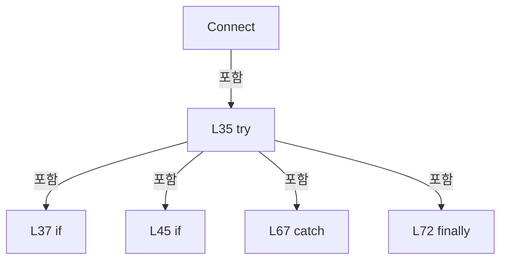

변경 전 점검: 입력/반환 타입, 위 호출자, 예외/취소 경로, 공유 상태와 저장·전송 소비자를 함께 확인합니다. 값의 단위나 물리 방향을 이름만으로 확정하지 않습니다.

### LocalFunctionStatement `AcceptLoopCallback` · L55–58

[Drilling.Common/Interface/Vision/CVisionComm.cs:55–58](https://github.com/kjuws10-rgb/A3Drilling/blob/334b3599651b2e8e0181fd4459bafaf3cddafff3/Drilling.Common/Interface/Vision/CVisionComm.cs#L55-L58)

| 항목 | 실제 추출 값 |
| --- | --- |
| 서명 | System.Threading.Tasks.Task AcceptLoopCallback() |
| 접근/수식자 | Private /  |
| 반환/값 타입 | System.Threading.Tasks.Task |
| 소속 타입 | NamedType:Drilling.Common.Interface.Vision.CVisionComm |

현재 부분 분석에서 직접 연결된 호출자는 없습니다. XAML/이벤트/인터페이스·델리게이트·외부 진입을 추가 확인해야 하며, 미사용으로 판정한 것이 아닙니다.

호출하는 대상과 해석 범위:

| 원본 행 | 표현식 | 분석 상태 | 대상/소스 위치 |
| --- | --- | --- | --- |
| 57 | AcceptLoop | resolved | System.Threading.Tasks.Task Drilling.Common.Interface.Vision.CVisionComm.AcceptLoop(System.Net.Sockets.TcpListener, System.Threading.CancellationToken) · Drilling.Common/Interface/Vision/CVisionComm.cs:144 |

본문의 실제 연산·분기·예외·반환 순서(원문 위치 순):

| 원본 행 | 종류 | 주석 해설 |
| --- | --- | --- |
| 57 | call | 함수·델리게이트 또는 객체 생성자를 호출합니다: AcceptLoop(listener, _serverCancellation.Token) |
| 57 | return | 호출자에게 값 또는 제어를 반환합니다: return AcceptLoop(listener, _serverCancellation.Token); |

변경 전 점검: 입력/반환 타입, 위 호출자, 예외/취소 경로, 공유 상태와 저장·전송 소비자를 함께 확인합니다. 값의 단위나 물리 방향을 이름만으로 확정하지 않습니다.

### MethodDeclaration `Disconnect` · L78–91

[Drilling.Common/Interface/Vision/CVisionComm.cs:78–91](https://github.com/kjuws10-rgb/A3Drilling/blob/334b3599651b2e8e0181fd4459bafaf3cddafff3/Drilling.Common/Interface/Vision/CVisionComm.cs#L78-L91)

| 항목 | 실제 추출 값 |
| --- | --- |
| 서명 | System.Threading.Tasks.Task Drilling.Common.Interface.Vision.CVisionComm.Disconnect(System.Threading.CancellationToken) |
| 접근/수식자 | Public / public, override, async |
| 반환/값 타입 | System.Threading.Tasks.Task |
| 소속 타입 | NamedType:Drilling.Common.Interface.Vision.CVisionComm |

입력 계약:

| 이름 | 타입 | 전달 | 선택/기본값 |
| --- | --- | --- | --- |
| cancellationToken | System.Threading.CancellationToken | None | True / null |

현재 부분 분석에서 직접 연결된 호출자는 없습니다. XAML/이벤트/인터페이스·델리게이트·외부 진입을 추가 확인해야 하며, 미사용으로 판정한 것이 아닙니다.

호출하는 대상과 해석 범위:

| 원본 행 | 표현식 | 분석 상태 | 대상/소스 위치 |
| --- | --- | --- | --- |
| 80 | cancellationToken.ThrowIfCancellationRequested | resolved | void System.Threading.CancellationToken.ThrowIfCancellationRequested() |
| 81 | _lifecycleLock.WaitAsync | resolved | System.Threading.Tasks.Task System.Threading.SemaphoreSlim.WaitAsync(System.Threading.CancellationToken) |
| 84 | StopServer | resolved | System.Threading.Tasks.Task Drilling.Common.Interface.Vision.CVisionComm.StopServer() · Drilling.Common/Interface/Vision/CVisionComm.cs:471 |
| 85 | SetState | resolved | void Drilling.Common.Interface.CCommBase.SetState(Drilling.Common.Interface.EN_COMM_STATE) · Drilling.Common/Interface/CComm.cs:114 |
| 89 | _lifecycleLock.Release | resolved | int System.Threading.SemaphoreSlim.Release() |

본문의 실제 연산·분기·예외·반환 순서(원문 위치 순):

| 원본 행 | 종류 | 주석 해설 |
| --- | --- | --- |
| 80 | call | 함수·델리게이트 또는 객체 생성자를 호출합니다: cancellationToken.ThrowIfCancellationRequested() |
| 81 | await | 비동기 완료를 기다립니다: await _lifecycleLock.WaitAsync(cancellationToken) |
| 81 | call | 함수·델리게이트 또는 객체 생성자를 호출합니다: _lifecycleLock.WaitAsync(cancellationToken) |
| 82 | try | 예외 처리 범위입니다: try |
| 84 | await | 비동기 완료를 기다립니다: await StopServer() |
| 84 | call | 함수·델리게이트 또는 객체 생성자를 호출합니다: StopServer() |
| 85 | call | 함수·델리게이트 또는 객체 생성자를 호출합니다: SetState(EN_COMM_STATE.Offline) |
| 87 | finally | 종료 정리 구간입니다: finally |
| 89 | call | 함수·델리게이트 또는 객체 생성자를 호출합니다: _lifecycleLock.Release() |

제어 구문의 포함 구조(실제 실행 순서/CFG가 아닌 구문 탐색 그림):

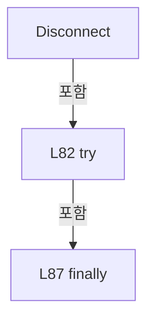

변경 전 점검: 입력/반환 타입, 위 호출자, 예외/취소 경로, 공유 상태와 저장·전송 소비자를 함께 확인합니다. 값의 단위나 물리 방향을 이름만으로 확정하지 않습니다.

### MethodDeclaration `Execute` · L93–142

[Drilling.Common/Interface/Vision/CVisionComm.cs:93–142](https://github.com/kjuws10-rgb/A3Drilling/blob/334b3599651b2e8e0181fd4459bafaf3cddafff3/Drilling.Common/Interface/Vision/CVisionComm.cs#L93-L142)

| 항목 | 실제 추출 값 |
| --- | --- |
| 서명 | System.Threading.Tasks.Task<string> Drilling.Common.Interface.Vision.CVisionComm.Execute(string, System.Threading.CancellationToken) |
| 접근/수식자 | Public / public, override, async |
| 반환/값 타입 | System.Threading.Tasks.Task<string> |
| 소속 타입 | NamedType:Drilling.Common.Interface.Vision.CVisionComm |

입력 계약:

| 이름 | 타입 | 전달 | 선택/기본값 |
| --- | --- | --- | --- |
| function | string | None | False /  |
| cancellationToken | System.Threading.CancellationToken | None | True / null |

현재 부분 분석에서 직접 연결된 호출자는 없습니다. XAML/이벤트/인터페이스·델리게이트·외부 진입을 추가 확인해야 하며, 미사용으로 판정한 것이 아닙니다.

호출하는 대상과 해석 범위:

| 원본 행 | 표현식 | 분석 상태 | 대상/소스 위치 |
| --- | --- | --- | --- |
| 97 | function.Trim | resolved | string string.Trim() |
| 98 | commandText.Equals | resolved | bool string.Equals(string?, System.StringComparison) |
| 108 | Connect | resolved · 동적 구현 선택 가능 | System.Threading.Tasks.Task Drilling.Common.Interface.Vision.CVisionComm.Connect(System.Threading.CancellationToken) · Drilling.Common/Interface/Vision/CVisionComm.cs:32 |
| 111 | WaitForClient | resolved | System.Threading.Tasks.Task<System.Net.Sockets.NetworkStream> Drilling.Common.Interface.Vision.CVisionComm.WaitForClient(System.Threading.CancellationToken) · Drilling.Common/Interface/Vision/CVisionComm.cs:254 |
| 112 | NormalizeCommand | resolved | Drilling.Common.Interface.Vision.EN_VISION_COMMAND Drilling.Common.Interface.Vision.CVisionComm.NormalizeCommand(string) · Drilling.Common/Interface/Vision/CVisionComm.cs:396 |
| 112 | commandText.Split | resolved | string[] string.Split(char, int, System.StringSplitOptions) |
| 114 | ParseRequest | resolved | Drilling.Common.Interface.Vision.ST_VISION_PACKET Drilling.Common.Interface.Vision.CVisionComm.ParseRequest(string, int, int) · Drilling.Common/Interface/Vision/CVisionComm.cs:348 |
| 114 | NextUniqueId | resolved | int Drilling.Common.Interface.Vision.CVisionComm.NextUniqueId() · Drilling.Common/Interface/Vision/CVisionComm.cs:449 |
| 116 | Volatile.Write | resolved | void System.Threading.Volatile.Write(ref int, int) |
| 117 | SendRequest | resolved | System.Threading.Tasks.Task<Drilling.Common.Interface.Vision.ST_VISION_PACKET> Drilling.Common.Interface.Vision.CVisionComm.SendRequest(System.Net.Sockets.NetworkStream, Drilling.Common.Interface.Vision.ST_VISION_PACKET, System.Threading.CancellationToken) · Drilling.Common/Interface/Vision/CVisionComm.cs:275 |
| 118 | DescribeResponse | resolved | string Drilling.Common.Interface.Vision.CVisionComm.DescribeResponse(Drilling.Common.Interface.Vision.ST_VISION_PACKET, int) · Drilling.Common/Interface/Vision/CVisionComm.cs:411 |
| 120 | Volatile.Write | resolved | void System.Threading.Volatile.Write(ref int, int) |
| 122 | SetState | resolved | void Drilling.Common.Interface.CCommBase.SetState(Drilling.Common.Interface.EN_COMM_STATE) · Drilling.Common/Interface/CComm.cs:114 |
| 129 | SetCommandError | resolved | void Drilling.Common.Interface.CCommBase.SetCommandError(string) · Drilling.Common/Interface/CComm.cs:132 |
| 139 | SetCommandError | resolved | void Drilling.Common.Interface.CCommBase.SetCommandError(string) · Drilling.Common/Interface/CComm.cs:132 |

본문의 실제 연산·분기·예외·반환 순서(원문 위치 순):

| 원본 행 | 종류 | 주석 해설 |
| --- | --- | --- |
| 95 | try | 예외 처리 범위입니다: try |
| 97 | call | 함수·델리게이트 또는 객체 생성자를 호출합니다: function.Trim() |
| 97 | local-declaration | 지역 변수를 선언합니다: var commandText = function.Trim(); |
| 97 | variable-initializer | 변수의 초기값을 지정합니다: commandText = function.Trim() |
| 98 | call | 함수·델리게이트 또는 객체 생성자를 호출합니다: commandText.Equals("STATUS", StringComparison.OrdinalIgnoreCase) |
| 98 | if | 조건에 따라 분기합니다: if (commandText.Equals("STATUS", StringComparison.OrdinalIgnoreCase)) |
| 100 | assignment | 값을 대상에 대입합니다: LastSent = commandText |
| 101 | assignment | 값을 대상에 대입합니다: LastReceived = _client is { Connected: true } ? "OK:VISION:CLIENT_CONNECTED" : "OK:VISION:WAITING_CLIENT" |
| 101 | conditional-expression | 조건에 따라 결과식을 선택합니다: _client is { Connected: true } ? "OK:VISION:CLIENT_CONNECTED" : "OK:VISION:WAITING_CLIENT" |
| 102 | assignment | 값을 대상에 대입합니다: LastError = "" |
| 103 | return | 호출자에게 값 또는 제어를 반환합니다: return LastReceived; |
| 106 | if | 조건에 따라 분기합니다: if (_listener is null) |
| 108 | await | 비동기 완료를 기다립니다: await Connect(cancellationToken) |
| 108 | call | 함수·델리게이트 또는 객체 생성자를 호출합니다: Connect(cancellationToken) |
| 111 | await | 비동기 완료를 기다립니다: await WaitForClient(cancellationToken) |
| 111 | call | 함수·델리게이트 또는 객체 생성자를 호출합니다: WaitForClient(cancellationToken) |
| 111 | local-declaration | 지역 변수를 선언합니다: var stream = await WaitForClient(cancellationToken); |
| 111 | variable-initializer | 변수의 초기값을 지정합니다: stream = await WaitForClient(cancellationToken) |
| 112 | call | 함수·델리게이트 또는 객체 생성자를 호출합니다: NormalizeCommand(commandText.Split(':', 2, StringSplitOptions.TrimEntries)[0]) |
| 112 | call | 함수·델리게이트 또는 객체 생성자를 호출합니다: commandText.Split(':', 2, StringSplitOptions.TrimEntries) |
| 112 | local-declaration | 지역 변수를 선언합니다: var command = NormalizeCommand(commandText.Split(':', 2, StringSplitOptions.TrimEntries)[0]); |
| 112 | variable-initializer | 변수의 초기값을 지정합니다: command = NormalizeCommand(commandText.Split(':', 2, StringSplitOptions.TrimEntries)[0]) |
| 113 | conditional-expression | 조건에 따라 결과식을 선택합니다: command == EN_VISION_COMMAND.MarkFindLine ? ResponseLineCapacity : ConfiguredLineCapacity |
| 113 | local-declaration | 지역 변수를 선언합니다: var capacity = command == EN_VISION_COMMAND.MarkFindLine ? ResponseLineCapacity : ConfiguredLineCapacity; |
| 113 | variable-initializer | 변수의 초기값을 지정합니다: capacity = command == EN_VISION_COMMAND.MarkFindLine ? ResponseLineCapacity : ConfiguredLineCapacity |
| 114 | call | 함수·델리게이트 또는 객체 생성자를 호출합니다: ParseRequest(commandText, NextUniqueId(), capacity) |
| 114 | call | 함수·델리게이트 또는 객체 생성자를 호출합니다: NextUniqueId() |
| 114 | local-declaration | 지역 변수를 선언합니다: var request = ParseRequest(commandText, NextUniqueId(), capacity); |
| 114 | variable-initializer | 변수의 초기값을 지정합니다: request = ParseRequest(commandText, NextUniqueId(), capacity) |
| 115 | if | 조건에 따라 분기합니다: if (command == EN_VISION_COMMAND.FlyingReady) |
| 116 | call | 함수·델리게이트 또는 객체 생성자를 호출합니다: Volatile.Write(ref _flyingLineCapacity, capacity) |
| 117 | await | 비동기 완료를 기다립니다: await SendRequest(stream, request, cancellationToken) |
| 117 | call | 함수·델리게이트 또는 객체 생성자를 호출합니다: SendRequest(stream, request, cancellationToken) |
| 117 | local-declaration | 지역 변수를 선언합니다: var response = await SendRequest(stream, request, cancellationToken); |
| 117 | variable-initializer | 변수의 초기값을 지정합니다: response = await SendRequest(stream, request, cancellationToken) |
| 118 | assignment | 값을 대상에 대입합니다: LastReceived = DescribeResponse(response, capacity) |
| 118 | call | 함수·델리게이트 또는 객체 생성자를 호출합니다: DescribeResponse(response, capacity) |
| 119 | if | 조건에 따라 분기합니다: if (command == EN_VISION_COMMAND.MarkFindLine) |
| 120 | call | 함수·델리게이트 또는 객체 생성자를 호출합니다: Volatile.Write(ref _flyingLineCapacity, 0) |
| 121 | assignment | 값을 대상에 대입합니다: LastError = "" |
| 122 | call | 함수·델리게이트 또는 객체 생성자를 호출합니다: SetState(EN_COMM_STATE.Online) |
| 123 | return | 호출자에게 값 또는 제어를 반환합니다: return LastReceived; |
| 125 | catch | 지정 예외를 처리합니다: catch (CVisionLineCountExceededException ex) |
| 129 | call | 함수·델리게이트 또는 객체 생성자를 호출합니다: SetCommandError(ex.Message) |
| 130 | throw | 예외를 발생/전달합니다: throw; |
| 132 | catch | 지정 예외를 처리합니다: catch (Exception ex) when (ex is SocketException or IOException or InvalidDataException or InvalidOperationException or FormatException or TimeoutException or OperationCanceledException) |
| 134 | if | 조건에 따라 분기합니다: if (ex is OperationCanceledException && cancellationToken.IsCancellationRequested) |
| 136 | throw | 예외를 발생/전달합니다: throw; |
| 139 | call | 함수·델리게이트 또는 객체 생성자를 호출합니다: SetCommandError(ex.Message) |
| 140 | return | 호출자에게 값 또는 제어를 반환합니다: return ""; |

제어 구문의 포함 구조(실제 실행 순서/CFG가 아닌 구문 탐색 그림):

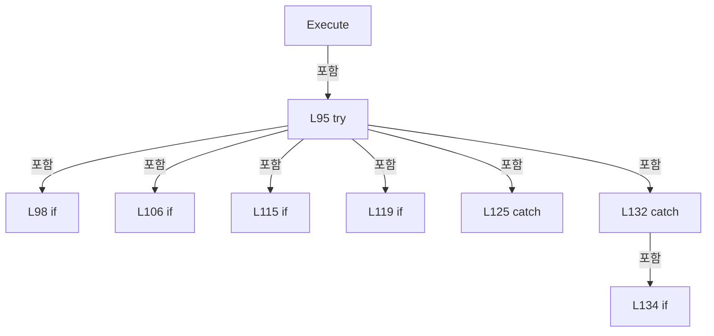

변경 전 점검: 입력/반환 타입, 위 호출자, 예외/취소 경로, 공유 상태와 저장·전송 소비자를 함께 확인합니다. 값의 단위나 물리 방향을 이름만으로 확정하지 않습니다.

### MethodDeclaration `AcceptLoop` · L144–165

[Drilling.Common/Interface/Vision/CVisionComm.cs:144–165](https://github.com/kjuws10-rgb/A3Drilling/blob/334b3599651b2e8e0181fd4459bafaf3cddafff3/Drilling.Common/Interface/Vision/CVisionComm.cs#L144-L165)

| 항목 | 실제 추출 값 |
| --- | --- |
| 서명 | System.Threading.Tasks.Task Drilling.Common.Interface.Vision.CVisionComm.AcceptLoop(System.Net.Sockets.TcpListener, System.Threading.CancellationToken) |
| 접근/수식자 | Private / private, async |
| 반환/값 타입 | System.Threading.Tasks.Task |
| 소속 타입 | NamedType:Drilling.Common.Interface.Vision.CVisionComm |

입력 계약:

| 이름 | 타입 | 전달 | 선택/기본값 |
| --- | --- | --- | --- |
| listener | System.Net.Sockets.TcpListener | None | False /  |
| cancellationToken | System.Threading.CancellationToken | None | False /  |

정적 호출자로 확인된 위치:

| 호출 파일/행 | 호출 표현식 | 런타임 분기 가능 |
| --- | --- | --- |
| [Drilling.Common/Interface/Vision/CVisionComm.cs:57–57](https://github.com/kjuws10-rgb/A3Drilling/blob/334b3599651b2e8e0181fd4459bafaf3cddafff3/Drilling.Common/Interface/Vision/CVisionComm.cs#L57-L57) | AcceptLoop | False |

호출하는 대상과 해석 범위:

| 원본 행 | 표현식 | 분석 상태 | 대상/소스 위치 |
| --- | --- | --- | --- |
| 151 | listener.AcceptTcpClientAsync | resolved | System.Threading.Tasks.ValueTask<System.Net.Sockets.TcpClient> System.Net.Sockets.TcpListener.AcceptTcpClientAsync(System.Threading.CancellationToken) |
| 153 | ReplaceClient | resolved | void Drilling.Common.Interface.Vision.CVisionComm.ReplaceClient(System.Net.Sockets.TcpClient, System.Threading.CancellationToken) · Drilling.Common/Interface/Vision/CVisionComm.cs:167 |
| 157 | .Dispose | resolved | void System.Net.Sockets.TcpClient.Dispose() |

본문의 실제 연산·분기·예외·반환 순서(원문 위치 순):

| 원본 행 | 종류 | 주석 해설 |
| --- | --- | --- |
| 146 | while | 조건을 먼저 확인하며 반복합니다: while (!cancellationToken.IsCancellationRequested) |
| 148 | local-declaration | 지역 변수를 선언합니다: TcpClient? client = null; |
| 148 | variable-initializer | 변수의 초기값을 지정합니다: client = null |
| 149 | try | 예외 처리 범위입니다: try |
| 151 | assignment | 값을 대상에 대입합니다: client = await listener.AcceptTcpClientAsync(cancellationToken) |
| 151 | await | 비동기 완료를 기다립니다: await listener.AcceptTcpClientAsync(cancellationToken) |
| 151 | call | 함수·델리게이트 또는 객체 생성자를 호출합니다: listener.AcceptTcpClientAsync(cancellationToken) |
| 152 | assignment | 값을 대상에 대입합니다: client.NoDelay = true |
| 153 | call | 함수·델리게이트 또는 객체 생성자를 호출합니다: ReplaceClient(client, cancellationToken) |
| 155 | catch | 지정 예외를 처리합니다: catch (Exception ex) when (cancellationToken.IsCancellationRequested &#124;&#124; ex is ObjectDisposedException or SocketException or OperationCanceledException) |
| 157 | call | 함수·델리게이트 또는 객체 생성자를 호출합니다: .Dispose() |
| 158 | if | 조건에 따라 분기합니다: if (!cancellationToken.IsCancellationRequested) |
| 160 | assignment | 값을 대상에 대입합니다: LastError = ex.Message |
| 161 | assignment | 값을 대상에 대입합니다: LastChangedAt = DateTimeOffset.Now |

제어 구문의 포함 구조(실제 실행 순서/CFG가 아닌 구문 탐색 그림):

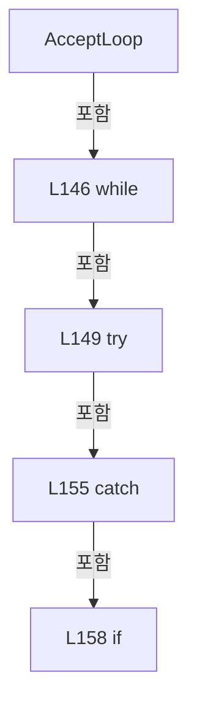

변경 전 점검: 입력/반환 타입, 위 호출자, 예외/취소 경로, 공유 상태와 저장·전송 소비자를 함께 확인합니다. 값의 단위나 물리 방향을 이름만으로 확정하지 않습니다.

### MethodDeclaration `ReplaceClient` · L167–187

[Drilling.Common/Interface/Vision/CVisionComm.cs:167–187](https://github.com/kjuws10-rgb/A3Drilling/blob/334b3599651b2e8e0181fd4459bafaf3cddafff3/Drilling.Common/Interface/Vision/CVisionComm.cs#L167-L187)

| 항목 | 실제 추출 값 |
| --- | --- |
| 서명 | void Drilling.Common.Interface.Vision.CVisionComm.ReplaceClient(System.Net.Sockets.TcpClient, System.Threading.CancellationToken) |
| 접근/수식자 | Private / private |
| 반환/값 타입 | void |
| 소속 타입 | NamedType:Drilling.Common.Interface.Vision.CVisionComm |

입력 계약:

| 이름 | 타입 | 전달 | 선택/기본값 |
| --- | --- | --- | --- |
| client | System.Net.Sockets.TcpClient | None | False /  |
| cancellationToken | System.Threading.CancellationToken | None | False /  |

정적 호출자로 확인된 위치:

| 호출 파일/행 | 호출 표현식 | 런타임 분기 가능 |
| --- | --- | --- |
| [Drilling.Common/Interface/Vision/CVisionComm.cs:153–153](https://github.com/kjuws10-rgb/A3Drilling/blob/334b3599651b2e8e0181fd4459bafaf3cddafff3/Drilling.Common/Interface/Vision/CVisionComm.cs#L153-L153) | ReplaceClient | False |

호출하는 대상과 해석 범위:

| 원본 행 | 표현식 | 분석 상태 | 대상/소스 위치 |
| --- | --- | --- | --- |
| 170 | .Dispose | resolved | void System.Net.Sockets.TcpClient.Dispose() |
| 172 | client.GetStream | resolved | System.Net.Sockets.NetworkStream System.Net.Sockets.TcpClient.GetStream() |
| 178 | Task.Run | resolved | System.Threading.Tasks.Task System.Threading.Tasks.Task.Run(System.Func<System.Threading.Tasks.Task?>, System.Threading.CancellationToken) |
| 181 | _clientReady.Release | resolved | int System.Threading.SemaphoreSlim.Release() |
| 185 | SetState | resolved | void Drilling.Common.Interface.CCommBase.SetState(Drilling.Common.Interface.EN_COMM_STATE) · Drilling.Common/Interface/CComm.cs:114 |
| 186 | RaiseProtocolTrace | resolved | void Drilling.Common.Interface.Vision.CVisionComm.RaiseProtocolTrace(string, string) · Drilling.Common/Interface/Vision/CVisionComm.cs:461 |
| 186 | .ToString | resolved · 동적 구현 선택 가능 | string? object.ToString() |

본문의 실제 연산·분기·예외·반환 순서(원문 위치 순):

| 원본 행 | 종류 | 주석 해설 |
| --- | --- | --- |
| 170 | call | 함수·델리게이트 또는 객체 생성자를 호출합니다: .Dispose() |
| 171 | assignment | 값을 대상에 대입합니다: _client = client |
| 172 | assignment | 값을 대상에 대입합니다: _stream = client.GetStream() |
| 172 | call | 함수·델리게이트 또는 객체 생성자를 호출합니다: client.GetStream() |
| 178 | assignment | 값을 대상에 대입합니다: _receiveTask = Task.Run(ReceiveLoopCallback, CancellationToken.None) |
| 178 | call | 함수·델리게이트 또는 객체 생성자를 호출합니다: Task.Run(ReceiveLoopCallback, CancellationToken.None) |
| 179 | if | 조건에 따라 분기합니다: if (_clientReady.CurrentCount == 0) |
| 181 | call | 함수·델리게이트 또는 객체 생성자를 호출합니다: _clientReady.Release() |
| 184 | assignment | 값을 대상에 대입합니다: LastError = "" |
| 185 | call | 함수·델리게이트 또는 객체 생성자를 호출합니다: SetState(EN_COMM_STATE.Online) |
| 186 | call | 함수·델리게이트 또는 객체 생성자를 호출합니다: RaiseProtocolTrace("INFO", $"CLIENT_CONNECTED:{client.Client.RemoteEndPoint?.ToString() ?? "UNKNOWN"}") |
| 186 | call | 함수·델리게이트 또는 객체 생성자를 호출합니다: .ToString() |

제어 구문의 포함 구조(실제 실행 순서/CFG가 아닌 구문 탐색 그림):

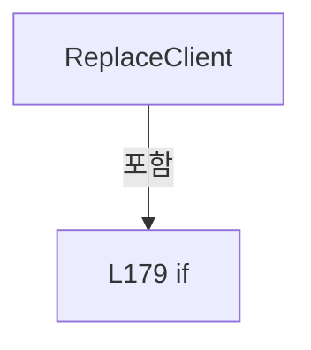

변경 전 점검: 입력/반환 타입, 위 호출자, 예외/취소 경로, 공유 상태와 저장·전송 소비자를 함께 확인합니다. 값의 단위나 물리 방향을 이름만으로 확정하지 않습니다.

### LocalFunctionStatement `ReceiveLoopCallback` · L173–176

[Drilling.Common/Interface/Vision/CVisionComm.cs:173–176](https://github.com/kjuws10-rgb/A3Drilling/blob/334b3599651b2e8e0181fd4459bafaf3cddafff3/Drilling.Common/Interface/Vision/CVisionComm.cs#L173-L176)

| 항목 | 실제 추출 값 |
| --- | --- |
| 서명 | System.Threading.Tasks.Task ReceiveLoopCallback() |
| 접근/수식자 | Private /  |
| 반환/값 타입 | System.Threading.Tasks.Task |
| 소속 타입 | NamedType:Drilling.Common.Interface.Vision.CVisionComm |

현재 부분 분석에서 직접 연결된 호출자는 없습니다. XAML/이벤트/인터페이스·델리게이트·외부 진입을 추가 확인해야 하며, 미사용으로 판정한 것이 아닙니다.

호출하는 대상과 해석 범위:

| 원본 행 | 표현식 | 분석 상태 | 대상/소스 위치 |
| --- | --- | --- | --- |
| 175 | ReceiveLoop | resolved | System.Threading.Tasks.Task Drilling.Common.Interface.Vision.CVisionComm.ReceiveLoop(System.Net.Sockets.TcpClient, System.Net.Sockets.NetworkStream, System.Threading.CancellationToken) · Drilling.Common/Interface/Vision/CVisionComm.cs:189 |

본문의 실제 연산·분기·예외·반환 순서(원문 위치 순):

| 원본 행 | 종류 | 주석 해설 |
| --- | --- | --- |
| 175 | call | 함수·델리게이트 또는 객체 생성자를 호출합니다: ReceiveLoop(client, _stream, cancellationToken) |
| 175 | return | 호출자에게 값 또는 제어를 반환합니다: return ReceiveLoop(client, _stream, cancellationToken); |

변경 전 점검: 입력/반환 타입, 위 호출자, 예외/취소 경로, 공유 상태와 저장·전송 소비자를 함께 확인합니다. 값의 단위나 물리 방향을 이름만으로 확정하지 않습니다.

### MethodDeclaration `ReceiveLoop` · L189–252

[Drilling.Common/Interface/Vision/CVisionComm.cs:189–252](https://github.com/kjuws10-rgb/A3Drilling/blob/334b3599651b2e8e0181fd4459bafaf3cddafff3/Drilling.Common/Interface/Vision/CVisionComm.cs#L189-L252)

| 항목 | 실제 추출 값 |
| --- | --- |
| 서명 | System.Threading.Tasks.Task Drilling.Common.Interface.Vision.CVisionComm.ReceiveLoop(System.Net.Sockets.TcpClient, System.Net.Sockets.NetworkStream, System.Threading.CancellationToken) |
| 접근/수식자 | Private / private, async |
| 반환/값 타입 | System.Threading.Tasks.Task |
| 소속 타입 | NamedType:Drilling.Common.Interface.Vision.CVisionComm |

입력 계약:

| 이름 | 타입 | 전달 | 선택/기본값 |
| --- | --- | --- | --- |
| client | System.Net.Sockets.TcpClient | None | False /  |
| stream | System.Net.Sockets.NetworkStream | None | False /  |
| cancellationToken | System.Threading.CancellationToken | None | False /  |

정적 호출자로 확인된 위치:

| 호출 파일/행 | 호출 표현식 | 런타임 분기 가능 |
| --- | --- | --- |
| [Drilling.Common/Interface/Vision/CVisionComm.cs:175–175](https://github.com/kjuws10-rgb/A3Drilling/blob/334b3599651b2e8e0181fd4459bafaf3cddafff3/Drilling.Common/Interface/Vision/CVisionComm.cs#L175-L175) | ReceiveLoop | False |

호출하는 대상과 해석 범위:

| 원본 행 | 표현식 | 분석 상태 | 대상/소스 위치 |
| --- | --- | --- | --- |
| 196 | ReadPacket | resolved | System.Threading.Tasks.Task<Drilling.Common.Interface.Vision.ST_VISION_PACKET> Drilling.Common.Interface.Vision.CVisionComm.ReadPacket(System.Net.Sockets.NetworkStream, System.Threading.CancellationToken) · Drilling.Common/Interface/Vision/CVisionComm.cs:333 |
| 197 | DescribePacket | resolved | string Drilling.Common.Interface.Vision.CVisionComm.DescribePacket(Drilling.Common.Interface.Vision.ST_VISION_PACKET) · Drilling.Common/Interface/Vision/CVisionComm.cs:448 |
| 202 | SetState | resolved | void Drilling.Common.Interface.CCommBase.SetState(Drilling.Common.Interface.EN_COMM_STATE) · Drilling.Common/Interface/CComm.cs:114 |
| 205 | RaiseProtocolTrace | resolved | void Drilling.Common.Interface.Vision.CVisionComm.RaiseProtocolTrace(string, string) · Drilling.Common/Interface/Vision/CVisionComm.cs:461 |
| 205 | CVisionProtocol.FormatPacketLog | resolved | string Drilling.Common.Interface.Vision.CVisionProtocol.FormatPacketLog(string, Drilling.Common.Interface.Vision.ST_VISION_PACKET, string, int) · Drilling.Common/Interface/Vision/CVisionComm.cs:817 |
| 208 | SendPacket | resolved | System.Threading.Tasks.Task Drilling.Common.Interface.Vision.CVisionComm.SendPacket(System.Net.Sockets.NetworkStream, Drilling.Common.Interface.Vision.ST_VISION_PACKET, System.Threading.CancellationToken) · Drilling.Common/Interface/Vision/CVisionComm.cs:315 |
| 208 | CVisionProtocol.CreateEmpty | resolved | Drilling.Common.Interface.Vision.ST_VISION_PACKET Drilling.Common.Interface.Vision.CVisionProtocol.CreateEmpty(Drilling.Common.Interface.Vision.EN_VISION_COMMAND, int, int) · Drilling.Common/Interface/Vision/CVisionComm.cs:579 |
| 214 | SendPacket | resolved | System.Threading.Tasks.Task Drilling.Common.Interface.Vision.CVisionComm.SendPacket(System.Net.Sockets.NetworkStream, Drilling.Common.Interface.Vision.ST_VISION_PACKET, System.Threading.CancellationToken) · Drilling.Common/Interface/Vision/CVisionComm.cs:315 |
| 214 | CVisionProtocol.CreateEmpty | resolved | Drilling.Common.Interface.Vision.ST_VISION_PACKET Drilling.Common.Interface.Vision.CVisionProtocol.CreateEmpty(Drilling.Common.Interface.Vision.EN_VISION_COMMAND, int, int) · Drilling.Common/Interface/Vision/CVisionComm.cs:579 |
| 218 | _pending.TryRemove | resolved | bool System.Collections.Concurrent.ConcurrentDictionary<int, System.Threading.Tasks.TaskCompletionSource<Drilling.Common.Interface.Vision.ST_VISION_PACKET>>.TryRemove(int, out System.Threading.Tasks.TaskCompletionSource<Drilling.Common.Interface.Vision.ST_VISION_PACKET>) |
| 220 | completion.TrySetResult | resolved | bool System.Threading.Tasks.TaskCompletionSource<Drilling.Common.Interface.Vision.ST_VISION_PACKET>.TrySetResult(Drilling.Common.Interface.Vision.ST_VISION_PACKET) |
| 234 | ReferenceEquals | resolved | bool object.ReferenceEquals(object?, object?) |
| 240 | _clientReady.Wait | resolved | bool System.Threading.SemaphoreSlim.Wait(int) |
| 244 | FailPending | resolved | void Drilling.Common.Interface.Vision.CVisionComm.FailPending(System.Exception) · Drilling.Common/Interface/Vision/CVisionComm.cs:502 |
| 244 | new IOException | resolved | System.IO.IOException.IOException(string?) |
| 246 | SetState | resolved | void Drilling.Common.Interface.CCommBase.SetState(Drilling.Common.Interface.EN_COMM_STATE) · Drilling.Common/Interface/CComm.cs:114 |
| 246 | IsServerListening | resolved | bool Drilling.Common.Interface.Vision.CVisionComm.IsServerListening() · Drilling.Common/Interface/Vision/CVisionComm.cs:466 |
| 247 | RaiseProtocolTrace | resolved | void Drilling.Common.Interface.Vision.CVisionComm.RaiseProtocolTrace(string, string) · Drilling.Common/Interface/Vision/CVisionComm.cs:461 |
| 250 | client.Dispose | resolved | void System.Net.Sockets.TcpClient.Dispose() |

본문의 실제 연산·분기·예외·반환 순서(원문 위치 순):

| 원본 행 | 종류 | 주석 해설 |
| --- | --- | --- |
| 192 | try | 예외 처리 범위입니다: try |
| 194 | while | 조건을 먼저 확인하며 반복합니다: while (!cancellationToken.IsCancellationRequested && client.Connected) |
| 196 | await | 비동기 완료를 기다립니다: await ReadPacket(stream, cancellationToken) |
| 196 | call | 함수·델리게이트 또는 객체 생성자를 호출합니다: ReadPacket(stream, cancellationToken) |
| 196 | local-declaration | 지역 변수를 선언합니다: var packet = await ReadPacket(stream, cancellationToken); |
| 196 | variable-initializer | 변수의 초기값을 지정합니다: packet = await ReadPacket(stream, cancellationToken) |
| 197 | assignment | 값을 대상에 대입합니다: LastReceived = DescribePacket(packet) |
| 197 | call | 함수·델리게이트 또는 객체 생성자를 호출합니다: DescribePacket(packet) |
| 198 | assignment | 값을 대상에 대입합니다: LastChangedAt = DateTimeOffset.Now |
| 199 | if | 조건에 따라 분기합니다: if (packet.Header.Command == (int)EN_VISION_COMMAND.KeepAlive) |
| 201 | assignment | 값을 대상에 대입합니다: LastError = "" |
| 202 | call | 함수·델리게이트 또는 객체 생성자를 호출합니다: SetState(EN_COMM_STATE.Online) |
| 205 | call | 함수·델리게이트 또는 객체 생성자를 호출합니다: RaiseProtocolTrace("PACKET", CVisionProtocol.FormatPacketLog("RECV", packet, $"{Data.NickName}[{Data.Number}]", ResponseLineCapacity)) |
| 205 | call | 함수·델리게이트 또는 객체 생성자를 호출합니다: CVisionProtocol.FormatPacketLog("RECV", packet, $"{Data.NickName}[{Data.Number}]", ResponseLineCapacity) |
| 206 | if | 조건에 따라 분기합니다: if (packet.Header.Command == (int)EN_VISION_COMMAND.KeepAlive) |
| 208 | await | 비동기 완료를 기다립니다: await SendPacket(stream, CVisionProtocol.CreateEmpty(EN_VISION_COMMAND.KeepAlive, packet.Header.UniqueId, packet.Header.ErrorCode), cancellationToken) |
| 208 | call | 함수·델리게이트 또는 객체 생성자를 호출합니다: SendPacket(stream, CVisionProtocol.CreateEmpty(EN_VISION_COMMAND.KeepAlive, packet.Header.UniqueId, packet.Header.ErrorCode), cancellationToken) |
| 208 | call | 함수·델리게이트 또는 객체 생성자를 호출합니다: CVisionProtocol.CreateEmpty(EN_VISION_COMMAND.KeepAlive, packet.Header.UniqueId, packet.Header.ErrorCode) |
| 209 | continue | 다음 반복으로 진행합니다: continue; |
| 212 | if | 조건에 따라 분기합니다: if (packet.Header.Command == (int)EN_VISION_COMMAND.MarkFindManual) |
| 214 | await | 비동기 완료를 기다립니다: await SendPacket(stream, CVisionProtocol.CreateEmpty(EN_VISION_COMMAND.MarkFindManual, packet.Header.UniqueId), cancellationToken) |
| 214 | call | 함수·델리게이트 또는 객체 생성자를 호출합니다: SendPacket(stream, CVisionProtocol.CreateEmpty(EN_VISION_COMMAND.MarkFindManual, packet.Header.UniqueId), cancellationToken) |
| 214 | call | 함수·델리게이트 또는 객체 생성자를 호출합니다: CVisionProtocol.CreateEmpty(EN_VISION_COMMAND.MarkFindManual, packet.Header.UniqueId) |
| 215 | continue | 다음 반복으로 진행합니다: continue; |
| 218 | call | 함수·델리게이트 또는 객체 생성자를 호출합니다: _pending.TryRemove(packet.Header.UniqueId, out var completion) |
| 218 | if | 조건에 따라 분기합니다: if (_pending.TryRemove(packet.Header.UniqueId, out var completion)) |
| 220 | call | 함수·델리게이트 또는 객체 생성자를 호출합니다: completion.TrySetResult(packet) |
| 224 | catch | 지정 예외를 처리합니다: catch (Exception ex) when (ex is SocketException or IOException or InvalidDataException or ObjectDisposedException or OperationCanceledException) |
| 226 | if | 조건에 따라 분기합니다: if (!cancellationToken.IsCancellationRequested) |
| 228 | assignment | 값을 대상에 대입합니다: LastError = ex.Message |
| 229 | assignment | 값을 대상에 대입합니다: LastChangedAt = DateTimeOffset.Now |
| 232 | finally | 종료 정리 구간입니다: finally |
| 234 | call | 함수·델리게이트 또는 객체 생성자를 호출합니다: ReferenceEquals(_client, client) |
| 234 | if | 조건에 따라 분기합니다: if (ReferenceEquals(_client, client)) |
| 236 | assignment | 값을 대상에 대입합니다: _stream = null |
| 237 | assignment | 값을 대상에 대입합니다: _client = null |
| 238 | while | 조건을 먼저 확인하며 반복합니다: while (_clientReady.CurrentCount > 0) |
| 240 | call | 함수·델리게이트 또는 객체 생성자를 호출합니다: _clientReady.Wait(0) |
| 244 | call | 함수·델리게이트 또는 객체 생성자를 호출합니다: FailPending(new IOException("Vision client disconnected.")) |
| 244 | call | 함수·델리게이트 또는 객체 생성자를 호출합니다: new IOException("Vision client disconnected.") |
| 245 | assignment | 값을 대상에 대입합니다: LastError = "Vision client disconnected." |
| 246 | call | 함수·델리게이트 또는 객체 생성자를 호출합니다: SetState(IsServerListening() ? EN_COMM_STATE.Online : EN_COMM_STATE.Offline) |
| 246 | call | 함수·델리게이트 또는 객체 생성자를 호출합니다: IsServerListening() |
| 246 | conditional-expression | 조건에 따라 결과식을 선택합니다: IsServerListening() ? EN_COMM_STATE.Online : EN_COMM_STATE.Offline |
| 247 | call | 함수·델리게이트 또는 객체 생성자를 호출합니다: RaiseProtocolTrace("INFO", "CLIENT_DISCONNECTED") |
| 250 | call | 함수·델리게이트 또는 객체 생성자를 호출합니다: client.Dispose() |

제어 구문의 포함 구조(실제 실행 순서/CFG가 아닌 구문 탐색 그림):

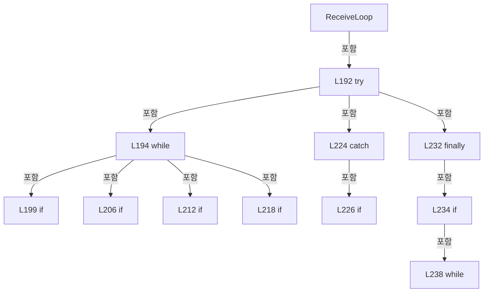

변경 전 점검: 입력/반환 타입, 위 호출자, 예외/취소 경로, 공유 상태와 저장·전송 소비자를 함께 확인합니다. 값의 단위나 물리 방향을 이름만으로 확정하지 않습니다.

### MethodDeclaration `WaitForClient` · L254–273

[Drilling.Common/Interface/Vision/CVisionComm.cs:254–273](https://github.com/kjuws10-rgb/A3Drilling/blob/334b3599651b2e8e0181fd4459bafaf3cddafff3/Drilling.Common/Interface/Vision/CVisionComm.cs#L254-L273)

| 항목 | 실제 추출 값 |
| --- | --- |
| 서명 | System.Threading.Tasks.Task<System.Net.Sockets.NetworkStream> Drilling.Common.Interface.Vision.CVisionComm.WaitForClient(System.Threading.CancellationToken) |
| 접근/수식자 | Private / private, async |
| 반환/값 타입 | System.Threading.Tasks.Task<System.Net.Sockets.NetworkStream> |
| 소속 타입 | NamedType:Drilling.Common.Interface.Vision.CVisionComm |

입력 계약:

| 이름 | 타입 | 전달 | 선택/기본값 |
| --- | --- | --- | --- |
| cancellationToken | System.Threading.CancellationToken | None | False /  |

정적 호출자로 확인된 위치:

| 호출 파일/행 | 호출 표현식 | 런타임 분기 가능 |
| --- | --- | --- |
| [Drilling.Common/Interface/Vision/CVisionComm.cs:111–111](https://github.com/kjuws10-rgb/A3Drilling/blob/334b3599651b2e8e0181fd4459bafaf3cddafff3/Drilling.Common/Interface/Vision/CVisionComm.cs#L111-L111) | WaitForClient | False |

호출하는 대상과 해석 범위:

| 원본 행 | 표현식 | 분석 상태 | 대상/소스 위치 |
| --- | --- | --- | --- |
| 261 | CancellationTokenSource.CreateLinkedTokenSource | resolved | System.Threading.CancellationTokenSource System.Threading.CancellationTokenSource.CreateLinkedTokenSource(System.Threading.CancellationToken) |
| 262 | timeout.CancelAfter | resolved | void System.Threading.CancellationTokenSource.CancelAfter(int) |
| 262 | Math.Max | resolved | int System.Math.Max(int, int) |
| 265 | _clientReady.WaitAsync | resolved | System.Threading.Tasks.Task System.Threading.SemaphoreSlim.WaitAsync(System.Threading.CancellationToken) |
| 269 | new TimeoutException | resolved | System.TimeoutException.TimeoutException(string?) |
| 272 | new IOException | resolved | System.IO.IOException.IOException(string?) |

본문의 실제 연산·분기·예외·반환 순서(원문 위치 순):

| 원본 행 | 종류 | 주석 해설 |
| --- | --- | --- |
| 256 | if | 조건에 따라 분기합니다: if (_stream is not null && _client is { Connected: true }) |
| 258 | return | 호출자에게 값 또는 제어를 반환합니다: return _stream; |
| 261 | call | 함수·델리게이트 또는 객체 생성자를 호출합니다: CancellationTokenSource.CreateLinkedTokenSource(cancellationToken) |
| 261 | using-declaration | 정리할 자원을 선언합니다: using var timeout = CancellationTokenSource.CreateLinkedTokenSource(cancellationToken); |
| 261 | variable-initializer | 변수의 초기값을 지정합니다: timeout = CancellationTokenSource.CreateLinkedTokenSource(cancellationToken) |
| 262 | call | 함수·델리게이트 또는 객체 생성자를 호출합니다: timeout.CancelAfter(Math.Max(100, Option.TimeoutMs)) |
| 262 | call | 함수·델리게이트 또는 객체 생성자를 호출합니다: Math.Max(100, Option.TimeoutMs) |
| 263 | try | 예외 처리 범위입니다: try |
| 265 | await | 비동기 완료를 기다립니다: await _clientReady.WaitAsync(timeout.Token) |
| 265 | call | 함수·델리게이트 또는 객체 생성자를 호출합니다: _clientReady.WaitAsync(timeout.Token) |
| 267 | catch | 지정 예외를 처리합니다: catch (OperationCanceledException) when (!cancellationToken.IsCancellationRequested) |
| 269 | call | 함수·델리게이트 또는 객체 생성자를 호출합니다: new TimeoutException("Vision client connection timeout.") |
| 269 | throw | 예외를 발생/전달합니다: throw new TimeoutException("Vision client connection timeout."); |
| 272 | call | 함수·델리게이트 또는 객체 생성자를 호출합니다: new IOException("Vision client disconnected before command transmission.") |
| 272 | return | 호출자에게 값 또는 제어를 반환합니다: return _stream ?? throw new IOException("Vision client disconnected before command transmission."); |
| 272 | throw | 예외를 발생/전달합니다: throw new IOException("Vision client disconnected before command transmission.") |

제어 구문의 포함 구조(실제 실행 순서/CFG가 아닌 구문 탐색 그림):

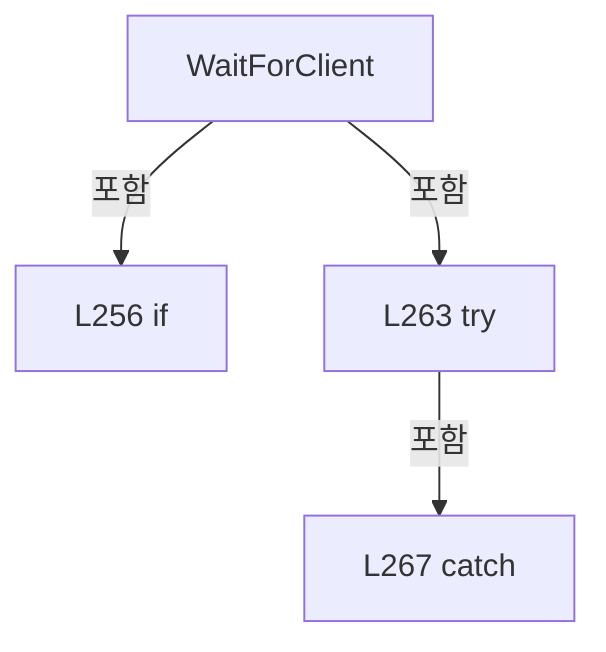

변경 전 점검: 입력/반환 타입, 위 호출자, 예외/취소 경로, 공유 상태와 저장·전송 소비자를 함께 확인합니다. 값의 단위나 물리 방향을 이름만으로 확정하지 않습니다.

### MethodDeclaration `SendRequest` · L275–313

[Drilling.Common/Interface/Vision/CVisionComm.cs:275–313](https://github.com/kjuws10-rgb/A3Drilling/blob/334b3599651b2e8e0181fd4459bafaf3cddafff3/Drilling.Common/Interface/Vision/CVisionComm.cs#L275-L313)

| 항목 | 실제 추출 값 |
| --- | --- |
| 서명 | System.Threading.Tasks.Task<Drilling.Common.Interface.Vision.ST_VISION_PACKET> Drilling.Common.Interface.Vision.CVisionComm.SendRequest(System.Net.Sockets.NetworkStream, Drilling.Common.Interface.Vision.ST_VISION_PACKET, System.Threading.CancellationToken) |
| 접근/수식자 | Private / private, async |
| 반환/값 타입 | System.Threading.Tasks.Task<Drilling.Common.Interface.Vision.ST_VISION_PACKET> |
| 소속 타입 | NamedType:Drilling.Common.Interface.Vision.CVisionComm |

입력 계약:

| 이름 | 타입 | 전달 | 선택/기본값 |
| --- | --- | --- | --- |
| stream | System.Net.Sockets.NetworkStream | None | False /  |
| request | Drilling.Common.Interface.Vision.ST_VISION_PACKET | None | False /  |
| cancellationToken | System.Threading.CancellationToken | None | False /  |

정적 호출자로 확인된 위치:

| 호출 파일/행 | 호출 표현식 | 런타임 분기 가능 |
| --- | --- | --- |
| [Drilling.Common/Interface/Vision/CVisionComm.cs:117–117](https://github.com/kjuws10-rgb/A3Drilling/blob/334b3599651b2e8e0181fd4459bafaf3cddafff3/Drilling.Common/Interface/Vision/CVisionComm.cs#L117-L117) | SendRequest | False |

호출하는 대상과 해석 범위:

| 원본 행 | 표현식 | 분석 상태 | 대상/소스 위치 |
| --- | --- | --- | --- |
| 278 | new TaskCompletionSource<ST_VISION_PACKET> | resolved | System.Threading.Tasks.TaskCompletionSource<Drilling.Common.Interface.Vision.ST_VISION_PACKET>.TaskCompletionSource(System.Threading.Tasks.TaskCreationOptions) |
| 279 | _pending.TryAdd | resolved | bool System.Collections.Concurrent.ConcurrentDictionary<int, System.Threading.Tasks.TaskCompletionSource<Drilling.Common.Interface.Vision.ST_VISION_PACKET>>.TryAdd(int, System.Threading.Tasks.TaskCompletionSource<Drilling.Common.Interface.Vision.ST_VISION_PACKET>) |
| 281 | new InvalidOperationException | resolved | System.InvalidOperationException.InvalidOperationException(string?) |
| 286 | SendPacket | resolved | System.Threading.Tasks.Task Drilling.Common.Interface.Vision.CVisionComm.SendPacket(System.Net.Sockets.NetworkStream, Drilling.Common.Interface.Vision.ST_VISION_PACKET, System.Threading.CancellationToken) · Drilling.Common/Interface/Vision/CVisionComm.cs:315 |
| 287 | CancellationTokenSource.CreateLinkedTokenSource | resolved | System.Threading.CancellationTokenSource System.Threading.CancellationTokenSource.CreateLinkedTokenSource(System.Threading.CancellationToken) |
| 288 | timeout.CancelAfter | resolved | void System.Threading.CancellationTokenSource.CancelAfter(int) |
| 288 | Math.Max | resolved | int System.Math.Max(int, int) |
| 291 | completion.Task.WaitAsync | resolved | System.Threading.Tasks.Task<Drilling.Common.Interface.Vision.ST_VISION_PACKET> System.Threading.Tasks.Task<Drilling.Common.Interface.Vision.ST_VISION_PACKET>.WaitAsync(System.Threading.CancellationToken) |
| 294 | new InvalidDataException | resolved | System.IO.InvalidDataException.InvalidDataException(string?) |
| 299 | new InvalidDataException | resolved | System.IO.InvalidDataException.InvalidDataException(string?) |
| 306 | new TimeoutException | resolved | System.TimeoutException.TimeoutException(string?) |
| 311 | _pending.TryRemove | resolved | bool System.Collections.Concurrent.ConcurrentDictionary<int, System.Threading.Tasks.TaskCompletionSource<Drilling.Common.Interface.Vision.ST_VISION_PACKET>>.TryRemove(int, out System.Threading.Tasks.TaskCompletionSource<Drilling.Common.Interface.Vision.ST_VISION_PACKET>) |

본문의 실제 연산·분기·예외·반환 순서(원문 위치 순):

| 원본 행 | 종류 | 주석 해설 |
| --- | --- | --- |
| 278 | call | 함수·델리게이트 또는 객체 생성자를 호출합니다: new TaskCompletionSource<ST_VISION_PACKET>(TaskCreationOptions.RunContinuationsAsynchronously) |
| 278 | local-declaration | 지역 변수를 선언합니다: var completion = new TaskCompletionSource<ST_VISION_PACKET>(TaskCreationOptions.RunContinuationsAsynchronously); |
| 278 | variable-initializer | 변수의 초기값을 지정합니다: completion = new TaskCompletionSource<ST_VISION_PACKET>(TaskCreationOptions.RunContinuationsAsynchronously) |
| 279 | call | 함수·델리게이트 또는 객체 생성자를 호출합니다: _pending.TryAdd(request.Header.UniqueId, completion) |
| 279 | if | 조건에 따라 분기합니다: if (!_pending.TryAdd(request.Header.UniqueId, completion)) |
| 281 | call | 함수·델리게이트 또는 객체 생성자를 호출합니다: new InvalidOperationException($"Vision Unique ID is already pending: {request.Header.UniqueId}.") |
| 281 | throw | 예외를 발생/전달합니다: throw new InvalidOperationException($"Vision Unique ID is already pending: {request.Header.UniqueId}."); |
| 284 | try | 예외 처리 범위입니다: try |
| 286 | await | 비동기 완료를 기다립니다: await SendPacket(stream, request, cancellationToken) |
| 286 | call | 함수·델리게이트 또는 객체 생성자를 호출합니다: SendPacket(stream, request, cancellationToken) |
| 287 | call | 함수·델리게이트 또는 객체 생성자를 호출합니다: CancellationTokenSource.CreateLinkedTokenSource(cancellationToken) |
| 287 | using-declaration | 정리할 자원을 선언합니다: using var timeout = CancellationTokenSource.CreateLinkedTokenSource(cancellationToken); |
| 287 | variable-initializer | 변수의 초기값을 지정합니다: timeout = CancellationTokenSource.CreateLinkedTokenSource(cancellationToken) |
| 288 | call | 함수·델리게이트 또는 객체 생성자를 호출합니다: timeout.CancelAfter(Math.Max(100, Option.TimeoutMs)) |
| 288 | call | 함수·델리게이트 또는 객체 생성자를 호출합니다: Math.Max(100, Option.TimeoutMs) |
| 289 | try | 예외 처리 범위입니다: try |
| 291 | await | 비동기 완료를 기다립니다: await completion.Task.WaitAsync(timeout.Token) |
| 291 | call | 함수·델리게이트 또는 객체 생성자를 호출합니다: completion.Task.WaitAsync(timeout.Token) |
| 291 | local-declaration | 지역 변수를 선언합니다: var response = await completion.Task.WaitAsync(timeout.Token); |
| 291 | variable-initializer | 변수의 초기값을 지정합니다: response = await completion.Task.WaitAsync(timeout.Token) |
| 292 | if | 조건에 따라 분기합니다: if (response.Header.Command != request.Header.Command) |
| 294 | call | 함수·델리게이트 또는 객체 생성자를 호출합니다: new InvalidDataException($"Vision response command mismatch. Request={request.Header.Command}, Response={response.Header.Command}.") |
| 294 | throw | 예외를 발생/전달합니다: throw new InvalidDataException($"Vision response command mismatch. Request={request.Header.Command}, Response={response.Header.Command}."); |
| 297 | if | 조건에 따라 분기합니다: if (response.Header.ErrorCode != 0) |
| 299 | call | 함수·델리게이트 또는 객체 생성자를 호출합니다: new InvalidDataException($"Vision returned error code {response.Header.ErrorCode} for command {response.Header.Command}.") |
| 299 | throw | 예외를 발생/전달합니다: throw new InvalidDataException($"Vision returned error code {response.Header.ErrorCode} for command {response.Header.Command}."); |
| 302 | return | 호출자에게 값 또는 제어를 반환합니다: return response; |
| 304 | catch | 지정 예외를 처리합니다: catch (OperationCanceledException) when (!cancellationToken.IsCancellationRequested) |
| 306 | call | 함수·델리게이트 또는 객체 생성자를 호출합니다: new TimeoutException($"Vision command {request.Header.Command} response timeout.") |
| 306 | throw | 예외를 발생/전달합니다: throw new TimeoutException($"Vision command {request.Header.Command} response timeout."); |
| 309 | finally | 종료 정리 구간입니다: finally |
| 311 | call | 함수·델리게이트 또는 객체 생성자를 호출합니다: _pending.TryRemove(request.Header.UniqueId, out _) |

제어 구문의 포함 구조(실제 실행 순서/CFG가 아닌 구문 탐색 그림):

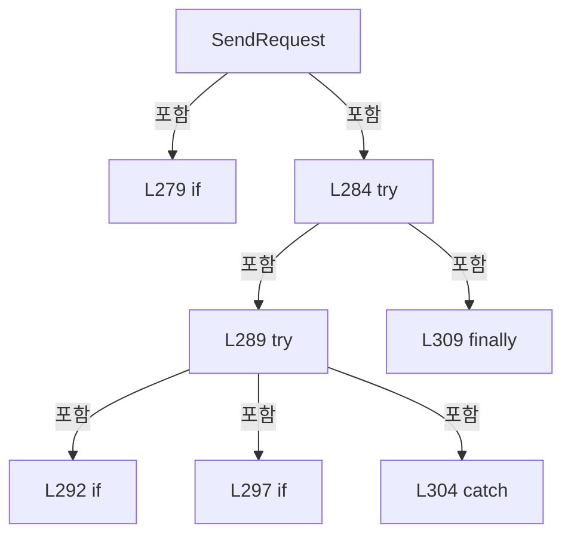

변경 전 점검: 입력/반환 타입, 위 호출자, 예외/취소 경로, 공유 상태와 저장·전송 소비자를 함께 확인합니다. 값의 단위나 물리 방향을 이름만으로 확정하지 않습니다.

### MethodDeclaration `SendPacket` · L315–331

[Drilling.Common/Interface/Vision/CVisionComm.cs:315–331](https://github.com/kjuws10-rgb/A3Drilling/blob/334b3599651b2e8e0181fd4459bafaf3cddafff3/Drilling.Common/Interface/Vision/CVisionComm.cs#L315-L331)

| 항목 | 실제 추출 값 |
| --- | --- |
| 서명 | System.Threading.Tasks.Task Drilling.Common.Interface.Vision.CVisionComm.SendPacket(System.Net.Sockets.NetworkStream, Drilling.Common.Interface.Vision.ST_VISION_PACKET, System.Threading.CancellationToken) |
| 접근/수식자 | Private / private, async |
| 반환/값 타입 | System.Threading.Tasks.Task |
| 소속 타입 | NamedType:Drilling.Common.Interface.Vision.CVisionComm |

입력 계약:

| 이름 | 타입 | 전달 | 선택/기본값 |
| --- | --- | --- | --- |
| stream | System.Net.Sockets.NetworkStream | None | False /  |
| packet | Drilling.Common.Interface.Vision.ST_VISION_PACKET | None | False /  |
| cancellationToken | System.Threading.CancellationToken | None | False /  |

정적 호출자로 확인된 위치:

| 호출 파일/행 | 호출 표현식 | 런타임 분기 가능 |
| --- | --- | --- |
| [Drilling.Common/Interface/Vision/CVisionComm.cs:208–208](https://github.com/kjuws10-rgb/A3Drilling/blob/334b3599651b2e8e0181fd4459bafaf3cddafff3/Drilling.Common/Interface/Vision/CVisionComm.cs#L208-L208) | SendPacket | False |
| [Drilling.Common/Interface/Vision/CVisionComm.cs:214–214](https://github.com/kjuws10-rgb/A3Drilling/blob/334b3599651b2e8e0181fd4459bafaf3cddafff3/Drilling.Common/Interface/Vision/CVisionComm.cs#L214-L214) | SendPacket | False |
| [Drilling.Common/Interface/Vision/CVisionComm.cs:286–286](https://github.com/kjuws10-rgb/A3Drilling/blob/334b3599651b2e8e0181fd4459bafaf3cddafff3/Drilling.Common/Interface/Vision/CVisionComm.cs#L286-L286) | SendPacket | False |

호출하는 대상과 해석 범위:

| 원본 행 | 표현식 | 분석 상태 | 대상/소스 위치 |
| --- | --- | --- | --- |
| 317 | CVisionProtocol.Encode | resolved | byte[] Drilling.Common.Interface.Vision.CVisionProtocol.Encode(Drilling.Common.Interface.Vision.ST_VISION_PACKET) · Drilling.Common/Interface/Vision/CVisionComm.cs:644 |
| 318 | _writeLock.WaitAsync | resolved | System.Threading.Tasks.Task System.Threading.SemaphoreSlim.WaitAsync(System.Threading.CancellationToken) |
| 321 | stream.WriteAsync | resolved · 동적 구현 선택 가능 | System.Threading.Tasks.ValueTask System.Net.Sockets.NetworkStream.WriteAsync(System.ReadOnlyMemory<byte>, System.Threading.CancellationToken) |
| 322 | stream.FlushAsync | resolved · 동적 구현 선택 가능 | System.Threading.Tasks.Task System.Net.Sockets.NetworkStream.FlushAsync(System.Threading.CancellationToken) |
| 323 | DescribePacket | resolved | string Drilling.Common.Interface.Vision.CVisionComm.DescribePacket(Drilling.Common.Interface.Vision.ST_VISION_PACKET) · Drilling.Common/Interface/Vision/CVisionComm.cs:448 |
| 325 | RaiseProtocolTrace | resolved | void Drilling.Common.Interface.Vision.CVisionComm.RaiseProtocolTrace(string, string) · Drilling.Common/Interface/Vision/CVisionComm.cs:461 |
| 325 | CVisionProtocol.FormatPacketLog | resolved | string Drilling.Common.Interface.Vision.CVisionProtocol.FormatPacketLog(string, Drilling.Common.Interface.Vision.ST_VISION_PACKET, string, int) · Drilling.Common/Interface/Vision/CVisionComm.cs:817 |
| 329 | _writeLock.Release | resolved | int System.Threading.SemaphoreSlim.Release() |

본문의 실제 연산·분기·예외·반환 순서(원문 위치 순):

| 원본 행 | 종류 | 주석 해설 |
| --- | --- | --- |
| 317 | call | 함수·델리게이트 또는 객체 생성자를 호출합니다: CVisionProtocol.Encode(packet) |
| 317 | local-declaration | 지역 변수를 선언합니다: var bytes = CVisionProtocol.Encode(packet); |
| 317 | variable-initializer | 변수의 초기값을 지정합니다: bytes = CVisionProtocol.Encode(packet) |
| 318 | await | 비동기 완료를 기다립니다: await _writeLock.WaitAsync(cancellationToken) |
| 318 | call | 함수·델리게이트 또는 객체 생성자를 호출합니다: _writeLock.WaitAsync(cancellationToken) |
| 319 | try | 예외 처리 범위입니다: try |
| 321 | await | 비동기 완료를 기다립니다: await stream.WriteAsync(bytes, cancellationToken) |
| 321 | call | 함수·델리게이트 또는 객체 생성자를 호출합니다: stream.WriteAsync(bytes, cancellationToken) |
| 322 | await | 비동기 완료를 기다립니다: await stream.FlushAsync(cancellationToken) |
| 322 | call | 함수·델리게이트 또는 객체 생성자를 호출합니다: stream.FlushAsync(cancellationToken) |
| 323 | assignment | 값을 대상에 대입합니다: LastSent = DescribePacket(packet) |
| 323 | call | 함수·델리게이트 또는 객체 생성자를 호출합니다: DescribePacket(packet) |
| 324 | assignment | 값을 대상에 대입합니다: LastChangedAt = DateTimeOffset.Now |
| 325 | call | 함수·델리게이트 또는 객체 생성자를 호출합니다: RaiseProtocolTrace("PACKET", CVisionProtocol.FormatPacketLog("SEND", packet, $"{Data.NickName}[{Data.Number}]", ResponseLineCapacity)) |
| 325 | call | 함수·델리게이트 또는 객체 생성자를 호출합니다: CVisionProtocol.FormatPacketLog("SEND", packet, $"{Data.NickName}[{Data.Number}]", ResponseLineCapacity) |
| 327 | finally | 종료 정리 구간입니다: finally |
| 329 | call | 함수·델리게이트 또는 객체 생성자를 호출합니다: _writeLock.Release() |

제어 구문의 포함 구조(실제 실행 순서/CFG가 아닌 구문 탐색 그림):

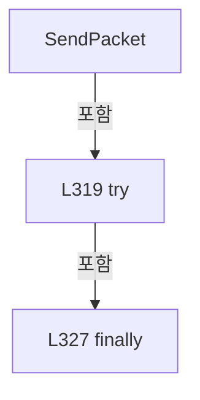

변경 전 점검: 입력/반환 타입, 위 호출자, 예외/취소 경로, 공유 상태와 저장·전송 소비자를 함께 확인합니다. 값의 단위나 물리 방향을 이름만으로 확정하지 않습니다.

### MethodDeclaration `ReadPacket` · L333–346

[Drilling.Common/Interface/Vision/CVisionComm.cs:333–346](https://github.com/kjuws10-rgb/A3Drilling/blob/334b3599651b2e8e0181fd4459bafaf3cddafff3/Drilling.Common/Interface/Vision/CVisionComm.cs#L333-L346)

| 항목 | 실제 추출 값 |
| --- | --- |
| 서명 | System.Threading.Tasks.Task<Drilling.Common.Interface.Vision.ST_VISION_PACKET> Drilling.Common.Interface.Vision.CVisionComm.ReadPacket(System.Net.Sockets.NetworkStream, System.Threading.CancellationToken) |
| 접근/수식자 | Private / private, static, async |
| 반환/값 타입 | System.Threading.Tasks.Task<Drilling.Common.Interface.Vision.ST_VISION_PACKET> |
| 소속 타입 | NamedType:Drilling.Common.Interface.Vision.CVisionComm |

입력 계약:

| 이름 | 타입 | 전달 | 선택/기본값 |
| --- | --- | --- | --- |
| stream | System.Net.Sockets.NetworkStream | None | False /  |
| cancellationToken | System.Threading.CancellationToken | None | False /  |

정적 호출자로 확인된 위치:

| 호출 파일/행 | 호출 표현식 | 런타임 분기 가능 |
| --- | --- | --- |
| [Drilling.Common/Interface/Vision/CVisionComm.cs:196–196](https://github.com/kjuws10-rgb/A3Drilling/blob/334b3599651b2e8e0181fd4459bafaf3cddafff3/Drilling.Common/Interface/Vision/CVisionComm.cs#L196-L196) | ReadPacket | False |

호출하는 대상과 해석 범위:

| 원본 행 | 표현식 | 분석 상태 | 대상/소스 위치 |
| --- | --- | --- | --- |
| 337 | stream.ReadExactlyAsync | resolved | System.Threading.Tasks.ValueTask System.IO.Stream.ReadExactlyAsync(System.Memory<byte>, System.Threading.CancellationToken) |
| 338 | CVisionProtocol.DecodeHeader | resolved | Drilling.Common.Interface.Vision.ST_VISION_PACKET_HEADER Drilling.Common.Interface.Vision.CVisionProtocol.DecodeHeader(System.ReadOnlySpan<byte>) · Drilling.Common/Interface/Vision/CVisionComm.cs:663 |
| 342 | stream.ReadExactlyAsync | resolved | System.Threading.Tasks.ValueTask System.IO.Stream.ReadExactlyAsync(System.Memory<byte>, System.Threading.CancellationToken) |
| 345 | new ST_VISION_PACKET | resolved | Drilling.Common.Interface.Vision.ST_VISION_PACKET.ST_VISION_PACKET(Drilling.Common.Interface.Vision.ST_VISION_PACKET_HEADER, byte[]) · Drilling.Common/Interface/Vision/CVisionComm.cs:550 |

본문의 실제 연산·분기·예외·반환 순서(원문 위치 순):

| 원본 행 | 종류 | 주석 해설 |
| --- | --- | --- |
| 336 | local-declaration | 지역 변수를 선언합니다: var headerBytes = new byte[CVisionProtocol.HeaderSize]; |
| 336 | variable-initializer | 변수의 초기값을 지정합니다: headerBytes = new byte[CVisionProtocol.HeaderSize] |
| 337 | await | 비동기 완료를 기다립니다: await stream.ReadExactlyAsync(headerBytes, cancellationToken) |
| 337 | call | 함수·델리게이트 또는 객체 생성자를 호출합니다: stream.ReadExactlyAsync(headerBytes, cancellationToken) |
| 338 | call | 함수·델리게이트 또는 객체 생성자를 호출합니다: CVisionProtocol.DecodeHeader(headerBytes) |
| 338 | local-declaration | 지역 변수를 선언합니다: var header = CVisionProtocol.DecodeHeader(headerBytes); |
| 338 | variable-initializer | 변수의 초기값을 지정합니다: header = CVisionProtocol.DecodeHeader(headerBytes) |
| 339 | local-declaration | 지역 변수를 선언합니다: var body = new byte[header.DataLength]; |
| 339 | variable-initializer | 변수의 초기값을 지정합니다: body = new byte[header.DataLength] |
| 340 | if | 조건에 따라 분기합니다: if (body.Length > 0) |
| 342 | await | 비동기 완료를 기다립니다: await stream.ReadExactlyAsync(body, cancellationToken) |
| 342 | call | 함수·델리게이트 또는 객체 생성자를 호출합니다: stream.ReadExactlyAsync(body, cancellationToken) |
| 345 | call | 함수·델리게이트 또는 객체 생성자를 호출합니다: new ST_VISION_PACKET(header, body) |
| 345 | return | 호출자에게 값 또는 제어를 반환합니다: return new ST_VISION_PACKET(header, body); |

제어 구문의 포함 구조(실제 실행 순서/CFG가 아닌 구문 탐색 그림):

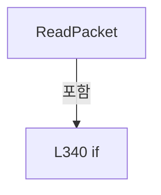

변경 전 점검: 입력/반환 타입, 위 호출자, 예외/취소 경로, 공유 상태와 저장·전송 소비자를 함께 확인합니다. 값의 단위나 물리 방향을 이름만으로 확정하지 않습니다.

### MethodDeclaration `ParseRequest` · L348–362

[Drilling.Common/Interface/Vision/CVisionComm.cs:348–362](https://github.com/kjuws10-rgb/A3Drilling/blob/334b3599651b2e8e0181fd4459bafaf3cddafff3/Drilling.Common/Interface/Vision/CVisionComm.cs#L348-L362)

| 항목 | 실제 추출 값 |
| --- | --- |
| 서명 | Drilling.Common.Interface.Vision.ST_VISION_PACKET Drilling.Common.Interface.Vision.CVisionComm.ParseRequest(string, int, int) |
| 접근/수식자 | Private / private, static |
| 반환/값 타입 | Drilling.Common.Interface.Vision.ST_VISION_PACKET |
| 소속 타입 | NamedType:Drilling.Common.Interface.Vision.CVisionComm |

입력 계약:

| 이름 | 타입 | 전달 | 선택/기본값 |
| --- | --- | --- | --- |
| function | string | None | False /  |
| uniqueId | int | None | False /  |
| maxHoleCountPerLine | int | None | False /  |

정적 호출자로 확인된 위치:

| 호출 파일/행 | 호출 표현식 | 런타임 분기 가능 |
| --- | --- | --- |
| [Drilling.Common/Interface/Vision/CVisionComm.cs:114–114](https://github.com/kjuws10-rgb/A3Drilling/blob/334b3599651b2e8e0181fd4459bafaf3cddafff3/Drilling.Common/Interface/Vision/CVisionComm.cs#L114-L114) | ParseRequest | False |

호출하는 대상과 해석 범위:

| 원본 행 | 표현식 | 분석 상태 | 대상/소스 위치 |
| --- | --- | --- | --- |
| 350 | function.Split | resolved | string[] string.Split(char, int, System.StringSplitOptions) |
| 351 | NormalizeCommand | resolved | Drilling.Common.Interface.Vision.EN_VISION_COMMAND Drilling.Common.Interface.Vision.CVisionComm.NormalizeCommand(string) · Drilling.Common/Interface/Vision/CVisionComm.cs:396 |
| 355 | CVisionProtocol.CreateMarkFindSingle | resolved | Drilling.Common.Interface.Vision.ST_VISION_PACKET Drilling.Common.Interface.Vision.CVisionProtocol.CreateMarkFindSingle(int, Drilling.Common.Interface.Vision.ST_VISION_MARK_SEARCH) · Drilling.Common/Interface/Vision/CVisionComm.cs:580 |
| 355 | ParseMarkSearch | resolved | Drilling.Common.Interface.Vision.ST_VISION_MARK_SEARCH Drilling.Common.Interface.Vision.CVisionComm.ParseMarkSearch(string) · Drilling.Common/Interface/Vision/CVisionComm.cs:385 |
| 356 | ParseFlyingReady | resolved | Drilling.Common.Interface.Vision.ST_VISION_PACKET Drilling.Common.Interface.Vision.CVisionComm.ParseFlyingReady(int, string, int) · Drilling.Common/Interface/Vision/CVisionComm.cs:364 |
| 357 | CVisionProtocol.CreateEmpty | resolved | Drilling.Common.Interface.Vision.ST_VISION_PACKET Drilling.Common.Interface.Vision.CVisionProtocol.CreateEmpty(Drilling.Common.Interface.Vision.EN_VISION_COMMAND, int, int) · Drilling.Common/Interface/Vision/CVisionComm.cs:579 |
| 358 | CVisionProtocol.CreateEmpty | resolved | Drilling.Common.Interface.Vision.ST_VISION_PACKET Drilling.Common.Interface.Vision.CVisionProtocol.CreateEmpty(Drilling.Common.Interface.Vision.EN_VISION_COMMAND, int, int) · Drilling.Common/Interface/Vision/CVisionComm.cs:579 |
| 359 | CVisionProtocol.CreateEmpty | resolved | Drilling.Common.Interface.Vision.ST_VISION_PACKET Drilling.Common.Interface.Vision.CVisionProtocol.CreateEmpty(Drilling.Common.Interface.Vision.EN_VISION_COMMAND, int, int) · Drilling.Common/Interface/Vision/CVisionComm.cs:579 |
| 360 | CVisionProtocol.CreateEmpty | resolved | Drilling.Common.Interface.Vision.ST_VISION_PACKET Drilling.Common.Interface.Vision.CVisionProtocol.CreateEmpty(Drilling.Common.Interface.Vision.EN_VISION_COMMAND, int, int) · Drilling.Common/Interface/Vision/CVisionComm.cs:579 |
| 361 | new InvalidOperationException | resolved | System.InvalidOperationException.InvalidOperationException(string?) |

본문의 실제 연산·분기·예외·반환 순서(원문 위치 순):

| 원본 행 | 종류 | 주석 해설 |
| --- | --- | --- |
| 350 | call | 함수·델리게이트 또는 객체 생성자를 호출합니다: function.Split(':', 2, StringSplitOptions.TrimEntries) |
| 350 | local-declaration | 지역 변수를 선언합니다: var fields = function.Split(':', 2, StringSplitOptions.TrimEntries); |
| 350 | variable-initializer | 변수의 초기값을 지정합니다: fields = function.Split(':', 2, StringSplitOptions.TrimEntries) |
| 351 | call | 함수·델리게이트 또는 객체 생성자를 호출합니다: NormalizeCommand(fields[0]) |
| 351 | local-declaration | 지역 변수를 선언합니다: var command = NormalizeCommand(fields[0]); |
| 351 | variable-initializer | 변수의 초기값을 지정합니다: command = NormalizeCommand(fields[0]) |
| 352 | conditional-expression | 조건에 따라 결과식을 선택합니다: fields.Length > 1 ? fields[1] : "" |
| 352 | local-declaration | 지역 변수를 선언합니다: var body = fields.Length > 1 ? fields[1] : ""; |
| 352 | variable-initializer | 변수의 초기값을 지정합니다: body = fields.Length > 1 ? fields[1] : "" |
| 353 | return | 호출자에게 값 또는 제어를 반환합니다: return command switch { EN_VISION_COMMAND.MarkFindSingle => CVisionProtocol.CreateMarkFindSingle(uniqueId, ParseMarkSearch(body)), EN_VISION_COMMAND.FlyingReady => ParseFlyingReady(uniqueId, body, maxHoleCountPerLine), EN_VISION_C |
| 353 | switch-expression | 값별 결과식을 선택합니다: command switch { EN_VISION_COMMAND.MarkFindSingle => CVisionProtocol.CreateMarkFindSingle(uniqueId, ParseMarkSearch(body)), EN_VISION_COMMAND.FlyingReady => ParseFlyingReady(uniqueId, body, maxHoleCountPerLine), EN_VISION_COMMAND. |
| 355 | call | 함수·델리게이트 또는 객체 생성자를 호출합니다: CVisionProtocol.CreateMarkFindSingle(uniqueId, ParseMarkSearch(body)) |
| 355 | call | 함수·델리게이트 또는 객체 생성자를 호출합니다: ParseMarkSearch(body) |
| 356 | call | 함수·델리게이트 또는 객체 생성자를 호출합니다: ParseFlyingReady(uniqueId, body, maxHoleCountPerLine) |
| 357 | call | 함수·델리게이트 또는 객체 생성자를 호출합니다: CVisionProtocol.CreateEmpty(command, uniqueId) |
| 358 | call | 함수·델리게이트 또는 객체 생성자를 호출합니다: CVisionProtocol.CreateEmpty(command, uniqueId) |
| 359 | call | 함수·델리게이트 또는 객체 생성자를 호출합니다: CVisionProtocol.CreateEmpty(command, uniqueId) |
| 360 | call | 함수·델리게이트 또는 객체 생성자를 호출합니다: CVisionProtocol.CreateEmpty(command, 0) |
| 361 | call | 함수·델리게이트 또는 객체 생성자를 호출합니다: new InvalidOperationException($"Vision command cannot be sent by Process: {(int)command}.") |
| 361 | throw | 예외를 발생/전달합니다: throw new InvalidOperationException($"Vision command cannot be sent by Process: {(int)command}.") |

제어 구문의 포함 구조(실제 실행 순서/CFG가 아닌 구문 탐색 그림):

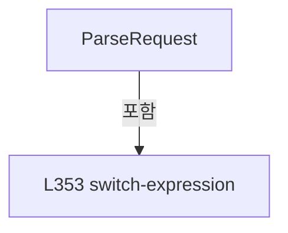

변경 전 점검: 입력/반환 타입, 위 호출자, 예외/취소 경로, 공유 상태와 저장·전송 소비자를 함께 확인합니다. 값의 단위나 물리 방향을 이름만으로 확정하지 않습니다.

### MethodDeclaration `ParseFlyingReady` · L364–383

[Drilling.Common/Interface/Vision/CVisionComm.cs:364–383](https://github.com/kjuws10-rgb/A3Drilling/blob/334b3599651b2e8e0181fd4459bafaf3cddafff3/Drilling.Common/Interface/Vision/CVisionComm.cs#L364-L383)

| 항목 | 실제 추출 값 |
| --- | --- |
| 서명 | Drilling.Common.Interface.Vision.ST_VISION_PACKET Drilling.Common.Interface.Vision.CVisionComm.ParseFlyingReady(int, string, int) |
| 접근/수식자 | Private / private, static |
| 반환/값 타입 | Drilling.Common.Interface.Vision.ST_VISION_PACKET |
| 소속 타입 | NamedType:Drilling.Common.Interface.Vision.CVisionComm |

입력 계약:

| 이름 | 타입 | 전달 | 선택/기본값 |
| --- | --- | --- | --- |
| uniqueId | int | None | False /  |
| body | string | None | False /  |
| maxHoleCountPerLine | int | None | False /  |

정적 호출자로 확인된 위치:

| 호출 파일/행 | 호출 표현식 | 런타임 분기 가능 |
| --- | --- | --- |
| [Drilling.Common/Interface/Vision/CVisionComm.cs:356–356](https://github.com/kjuws10-rgb/A3Drilling/blob/334b3599651b2e8e0181fd4459bafaf3cddafff3/Drilling.Common/Interface/Vision/CVisionComm.cs#L356-L356) | ParseFlyingReady | False |

호출하는 대상과 해석 범위:

| 원본 행 | 표현식 | 분석 상태 | 대상/소스 위치 |
| --- | --- | --- | --- |
| 366 | body.Split | resolved | string[] string.Split(char, int, System.StringSplitOptions) |
| 367 | int.TryParse | resolved | bool int.TryParse(string?, System.Globalization.NumberStyles, System.IFormatProvider?, out int) |
| 369 | new FormatException | resolved | System.FormatException.FormatException(string?) |
| 372 | new List<ST_VISION_MARK_SEARCH> | resolved | System.Collections.Generic.List<Drilling.Common.Interface.Vision.ST_VISION_MARK_SEARCH>.List() |
| 373 | string.IsNullOrWhiteSpace | resolved | bool string.IsNullOrWhiteSpace(string?) |
| 375 | parts[1].Split | resolved | string[] string.Split(char, System.StringSplitOptions) |
| 378 | searches.Add | resolved | void System.Collections.Generic.List<Drilling.Common.Interface.Vision.ST_VISION_MARK_SEARCH>.Add(Drilling.Common.Interface.Vision.ST_VISION_MARK_SEARCH) |
| 378 | ParseMarkSearch | resolved | Drilling.Common.Interface.Vision.ST_VISION_MARK_SEARCH Drilling.Common.Interface.Vision.CVisionComm.ParseMarkSearch(string) · Drilling.Common/Interface/Vision/CVisionComm.cs:385 |
| 382 | CVisionProtocol.CreateFlyingReady | resolved | Drilling.Common.Interface.Vision.ST_VISION_PACKET Drilling.Common.Interface.Vision.CVisionProtocol.CreateFlyingReady(int, int, System.Collections.Generic.IReadOnlyList<Drilling.Common.Interface.Vision.ST_VISION_MARK_SEARCH>, int) · Drilling.Common/Interface/Vision/CVisionComm.cs:581 |

본문의 실제 연산·분기·예외·반환 순서(원문 위치 순):

| 원본 행 | 종류 | 주석 해설 |
| --- | --- | --- |
| 366 | call | 함수·델리게이트 또는 객체 생성자를 호출합니다: body.Split(':', 2, StringSplitOptions.TrimEntries) |
| 366 | local-declaration | 지역 변수를 선언합니다: var parts = body.Split(':', 2, StringSplitOptions.TrimEntries); |
| 366 | variable-initializer | 변수의 초기값을 지정합니다: parts = body.Split(':', 2, StringSplitOptions.TrimEntries) |
| 367 | call | 함수·델리게이트 또는 객체 생성자를 호출합니다: int.TryParse(parts[0], NumberStyles.Integer, CultureInfo.InvariantCulture, out var inspectionType) |
| 367 | if | 조건에 따라 분기합니다: if (parts.Length == 0 &#124;&#124; !int.TryParse(parts[0], NumberStyles.Integer, CultureInfo.InvariantCulture, out var inspectionType)) |
| 369 | call | 함수·델리게이트 또는 객체 생성자를 호출합니다: new FormatException("FLYING_READY format: FLYING_READY:type:cell,doe,line,indexX,indexY,head;...") |
| 369 | throw | 예외를 발생/전달합니다: throw new FormatException("FLYING_READY format: FLYING_READY:type:cell,doe,line,indexX,indexY,head;..."); |
| 372 | call | 함수·델리게이트 또는 객체 생성자를 호출합니다: new List<ST_VISION_MARK_SEARCH>() |
| 372 | local-declaration | 지역 변수를 선언합니다: var searches = new List<ST_VISION_MARK_SEARCH>(); |
| 372 | variable-initializer | 변수의 초기값을 지정합니다: searches = new List<ST_VISION_MARK_SEARCH>() |
| 373 | call | 함수·델리게이트 또는 객체 생성자를 호출합니다: string.IsNullOrWhiteSpace(parts[1]) |
| 373 | if | 조건에 따라 분기합니다: if (parts.Length > 1 && !string.IsNullOrWhiteSpace(parts[1])) |
| 375 | call | 함수·델리게이트 또는 객체 생성자를 호출합니다: parts[1].Split(';', StringSplitOptions.RemoveEmptyEntries &#124; StringSplitOptions.TrimEntries) |
| 375 | local-declaration | 지역 변수를 선언합니다: var values = parts[1].Split(';', StringSplitOptions.RemoveEmptyEntries &#124; StringSplitOptions.TrimEntries); |
| 375 | variable-initializer | 변수의 초기값을 지정합니다: values = parts[1].Split(';', StringSplitOptions.RemoveEmptyEntries &#124; StringSplitOptions.TrimEntries) |
| 376 | foreach | 컬렉션 요소를 순회합니다: foreach (var value in values) |
| 378 | call | 함수·델리게이트 또는 객체 생성자를 호출합니다: searches.Add(ParseMarkSearch(value)) |
| 378 | call | 함수·델리게이트 또는 객체 생성자를 호출합니다: ParseMarkSearch(value) |
| 382 | call | 함수·델리게이트 또는 객체 생성자를 호출합니다: CVisionProtocol.CreateFlyingReady(uniqueId, inspectionType, searches, maxHoleCountPerLine) |
| 382 | return | 호출자에게 값 또는 제어를 반환합니다: return CVisionProtocol.CreateFlyingReady(uniqueId, inspectionType, searches, maxHoleCountPerLine); |

제어 구문의 포함 구조(실제 실행 순서/CFG가 아닌 구문 탐색 그림):

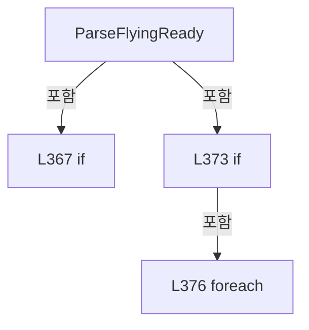

변경 전 점검: 입력/반환 타입, 위 호출자, 예외/취소 경로, 공유 상태와 저장·전송 소비자를 함께 확인합니다. 값의 단위나 물리 방향을 이름만으로 확정하지 않습니다.

### MethodDeclaration `ParseMarkSearch` · L385–394

[Drilling.Common/Interface/Vision/CVisionComm.cs:385–394](https://github.com/kjuws10-rgb/A3Drilling/blob/334b3599651b2e8e0181fd4459bafaf3cddafff3/Drilling.Common/Interface/Vision/CVisionComm.cs#L385-L394)

| 항목 | 실제 추출 값 |
| --- | --- |
| 서명 | Drilling.Common.Interface.Vision.ST_VISION_MARK_SEARCH Drilling.Common.Interface.Vision.CVisionComm.ParseMarkSearch(string) |
| 접근/수식자 | Private / private, static |
| 반환/값 타입 | Drilling.Common.Interface.Vision.ST_VISION_MARK_SEARCH |
| 소속 타입 | NamedType:Drilling.Common.Interface.Vision.CVisionComm |

입력 계약:

| 이름 | 타입 | 전달 | 선택/기본값 |
| --- | --- | --- | --- |
| value | string | None | False /  |

정적 호출자로 확인된 위치:

| 호출 파일/행 | 호출 표현식 | 런타임 분기 가능 |
| --- | --- | --- |
| [Drilling.Common/Interface/Vision/CVisionComm.cs:355–355](https://github.com/kjuws10-rgb/A3Drilling/blob/334b3599651b2e8e0181fd4459bafaf3cddafff3/Drilling.Common/Interface/Vision/CVisionComm.cs#L355-L355) | ParseMarkSearch | False |
| [Drilling.Common/Interface/Vision/CVisionComm.cs:378–378](https://github.com/kjuws10-rgb/A3Drilling/blob/334b3599651b2e8e0181fd4459bafaf3cddafff3/Drilling.Common/Interface/Vision/CVisionComm.cs#L378-L378) | ParseMarkSearch | False |

호출하는 대상과 해석 범위:

| 원본 행 | 표현식 | 분석 상태 | 대상/소스 위치 |
| --- | --- | --- | --- |
| 387 | value.Split | resolved | string[] string.Split(char, System.StringSplitOptions) |
| 390 | new FormatException | resolved | System.FormatException.FormatException(string?) |
| 393 | new ST_VISION_MARK_SEARCH | resolved | Drilling.Common.Interface.Vision.ST_VISION_MARK_SEARCH.ST_VISION_MARK_SEARCH(int, int, int, int, int, int) · Drilling.Common/Interface/Vision/CVisionComm.cs:548 |
| 393 | ParseInt | resolved | int Drilling.Common.Interface.Vision.CVisionComm.ParseInt(string, string) · Drilling.Common/Interface/Vision/CVisionComm.cs:410 |
| 393 | ParseInt | resolved | int Drilling.Common.Interface.Vision.CVisionComm.ParseInt(string, string) · Drilling.Common/Interface/Vision/CVisionComm.cs:410 |
| 393 | ParseInt | resolved | int Drilling.Common.Interface.Vision.CVisionComm.ParseInt(string, string) · Drilling.Common/Interface/Vision/CVisionComm.cs:410 |
| 393 | ParseInt | resolved | int Drilling.Common.Interface.Vision.CVisionComm.ParseInt(string, string) · Drilling.Common/Interface/Vision/CVisionComm.cs:410 |
| 393 | ParseInt | resolved | int Drilling.Common.Interface.Vision.CVisionComm.ParseInt(string, string) · Drilling.Common/Interface/Vision/CVisionComm.cs:410 |
| 393 | ParseInt | resolved | int Drilling.Common.Interface.Vision.CVisionComm.ParseInt(string, string) · Drilling.Common/Interface/Vision/CVisionComm.cs:410 |

본문의 실제 연산·분기·예외·반환 순서(원문 위치 순):

| 원본 행 | 종류 | 주석 해설 |
| --- | --- | --- |
| 387 | call | 함수·델리게이트 또는 객체 생성자를 호출합니다: value.Split(',', StringSplitOptions.TrimEntries) |
| 387 | local-declaration | 지역 변수를 선언합니다: var fields = value.Split(',', StringSplitOptions.TrimEntries); |
| 387 | variable-initializer | 변수의 초기값을 지정합니다: fields = value.Split(',', StringSplitOptions.TrimEntries) |
| 388 | if | 조건에 따라 분기합니다: if (fields.Length != 6) |
| 390 | call | 함수·델리게이트 또는 객체 생성자를 호출합니다: new FormatException("Mark Search format: cell,doe,line,indexX,indexY,head") |
| 390 | throw | 예외를 발생/전달합니다: throw new FormatException("Mark Search format: cell,doe,line,indexX,indexY,head"); |
| 393 | call | 함수·델리게이트 또는 객체 생성자를 호출합니다: new ST_VISION_MARK_SEARCH(ParseInt(fields[0], "cell"), ParseInt(fields[1], "doe"), ParseInt(fields[2], "line"), ParseInt(fields[3], "indexX"), ParseInt(fields[4], "indexY"), ParseInt(fields[5], "head")) |
| 393 | call | 함수·델리게이트 또는 객체 생성자를 호출합니다: ParseInt(fields[0], "cell") |
| 393 | call | 함수·델리게이트 또는 객체 생성자를 호출합니다: ParseInt(fields[1], "doe") |
| 393 | call | 함수·델리게이트 또는 객체 생성자를 호출합니다: ParseInt(fields[2], "line") |
| 393 | call | 함수·델리게이트 또는 객체 생성자를 호출합니다: ParseInt(fields[3], "indexX") |
| 393 | call | 함수·델리게이트 또는 객체 생성자를 호출합니다: ParseInt(fields[4], "indexY") |
| 393 | call | 함수·델리게이트 또는 객체 생성자를 호출합니다: ParseInt(fields[5], "head") |
| 393 | return | 호출자에게 값 또는 제어를 반환합니다: return new ST_VISION_MARK_SEARCH(ParseInt(fields[0], "cell"), ParseInt(fields[1], "doe"), ParseInt(fields[2], "line"), ParseInt(fields[3], "indexX"), ParseInt(fields[4], "indexY"), ParseInt(fields[5], "head")); |

제어 구문의 포함 구조(실제 실행 순서/CFG가 아닌 구문 탐색 그림):

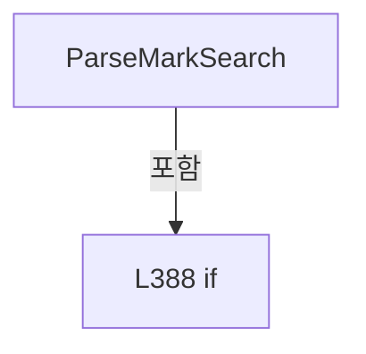

변경 전 점검: 입력/반환 타입, 위 호출자, 예외/취소 경로, 공유 상태와 저장·전송 소비자를 함께 확인합니다. 값의 단위나 물리 방향을 이름만으로 확정하지 않습니다.

### MethodDeclaration `NormalizeCommand` · L396–408

[Drilling.Common/Interface/Vision/CVisionComm.cs:396–408](https://github.com/kjuws10-rgb/A3Drilling/blob/334b3599651b2e8e0181fd4459bafaf3cddafff3/Drilling.Common/Interface/Vision/CVisionComm.cs#L396-L408)

| 항목 | 실제 추출 값 |
| --- | --- |
| 서명 | Drilling.Common.Interface.Vision.EN_VISION_COMMAND Drilling.Common.Interface.Vision.CVisionComm.NormalizeCommand(string) |
| 접근/수식자 | Private / private, static |
| 반환/값 타입 | Drilling.Common.Interface.Vision.EN_VISION_COMMAND |
| 소속 타입 | NamedType:Drilling.Common.Interface.Vision.CVisionComm |

입력 계약:

| 이름 | 타입 | 전달 | 선택/기본값 |
| --- | --- | --- | --- |
| value | string | None | False /  |

정적 호출자로 확인된 위치:

| 호출 파일/행 | 호출 표현식 | 런타임 분기 가능 |
| --- | --- | --- |
| [Drilling.Common/Interface/Vision/CVisionComm.cs:112–112](https://github.com/kjuws10-rgb/A3Drilling/blob/334b3599651b2e8e0181fd4459bafaf3cddafff3/Drilling.Common/Interface/Vision/CVisionComm.cs#L112-L112) | NormalizeCommand | False |
| [Drilling.Common/Interface/Vision/CVisionComm.cs:351–351](https://github.com/kjuws10-rgb/A3Drilling/blob/334b3599651b2e8e0181fd4459bafaf3cddafff3/Drilling.Common/Interface/Vision/CVisionComm.cs#L351-L351) | NormalizeCommand | False |

호출하는 대상과 해석 범위:

| 원본 행 | 표현식 | 분석 상태 | 대상/소스 위치 |
| --- | --- | --- | --- |
| 398 | value.Trim().Replace("-", "_", StringComparison.Ordinal).ToUpperInvariant | resolved | string string.ToUpperInvariant() |
| 398 | value.Trim().Replace | resolved | string string.Replace(string, string?, System.StringComparison) |
| 398 | value.Trim | resolved | string string.Trim() |
| 407 | new InvalidOperationException | resolved | System.InvalidOperationException.InvalidOperationException(string?) |

본문의 실제 연산·분기·예외·반환 순서(원문 위치 순):

| 원본 행 | 종류 | 주석 해설 |
| --- | --- | --- |
| 398 | call | 함수·델리게이트 또는 객체 생성자를 호출합니다: value.Trim().Replace("-", "_", StringComparison.Ordinal).ToUpperInvariant() |
| 398 | call | 함수·델리게이트 또는 객체 생성자를 호출합니다: value.Trim().Replace("-", "_", StringComparison.Ordinal) |
| 398 | call | 함수·델리게이트 또는 객체 생성자를 호출합니다: value.Trim() |
| 398 | local-declaration | 지역 변수를 선언합니다: var normalized = value.Trim().Replace("-", "_", StringComparison.Ordinal).ToUpperInvariant(); |
| 398 | variable-initializer | 변수의 초기값을 지정합니다: normalized = value.Trim().Replace("-", "_", StringComparison.Ordinal).ToUpperInvariant() |
| 399 | return | 호출자에게 값 또는 제어를 반환합니다: return normalized switch { "1000" or "MARK_FIND_SINGLE" => EN_VISION_COMMAND.MarkFindSingle, "1001" or "FLYING_READY" => EN_VISION_COMMAND.FlyingReady, "1002" or "FLYING_MOVE_DONE" => EN_VISION_COMMAND.FlyingMoveDone, "1003" or "M |
| 399 | switch-expression | 값별 결과식을 선택합니다: normalized switch { "1000" or "MARK_FIND_SINGLE" => EN_VISION_COMMAND.MarkFindSingle, "1001" or "FLYING_READY" => EN_VISION_COMMAND.FlyingReady, "1002" or "FLYING_MOVE_DONE" => EN_VISION_COMMAND.FlyingMoveDone, "1003" or "MARK_FIN |
| 407 | call | 함수·델리게이트 또는 객체 생성자를 호출합니다: new InvalidOperationException($"Unsupported Vision command: {value}.") |
| 407 | throw | 예외를 발생/전달합니다: throw new InvalidOperationException($"Unsupported Vision command: {value}.") |

제어 구문의 포함 구조(실제 실행 순서/CFG가 아닌 구문 탐색 그림):

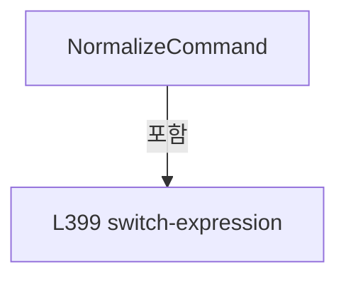

변경 전 점검: 입력/반환 타입, 위 호출자, 예외/취소 경로, 공유 상태와 저장·전송 소비자를 함께 확인합니다. 값의 단위나 물리 방향을 이름만으로 확정하지 않습니다.

### MethodDeclaration `ParseInt` · L410–410

[Drilling.Common/Interface/Vision/CVisionComm.cs:410–410](https://github.com/kjuws10-rgb/A3Drilling/blob/334b3599651b2e8e0181fd4459bafaf3cddafff3/Drilling.Common/Interface/Vision/CVisionComm.cs#L410-L410)

| 항목 | 실제 추출 값 |
| --- | --- |
| 서명 | int Drilling.Common.Interface.Vision.CVisionComm.ParseInt(string, string) |
| 접근/수식자 | Private / private, static |
| 반환/값 타입 | int |
| 소속 타입 | NamedType:Drilling.Common.Interface.Vision.CVisionComm |

입력 계약:

| 이름 | 타입 | 전달 | 선택/기본값 |
| --- | --- | --- | --- |
| value | string | None | False /  |
| name | string | None | False /  |

정적 호출자로 확인된 위치:

| 호출 파일/행 | 호출 표현식 | 런타임 분기 가능 |
| --- | --- | --- |
| [Drilling.Common/Interface/Vision/CVisionComm.cs:393–393](https://github.com/kjuws10-rgb/A3Drilling/blob/334b3599651b2e8e0181fd4459bafaf3cddafff3/Drilling.Common/Interface/Vision/CVisionComm.cs#L393-L393) | ParseInt | False |
| [Drilling.Common/Interface/Vision/CVisionComm.cs:393–393](https://github.com/kjuws10-rgb/A3Drilling/blob/334b3599651b2e8e0181fd4459bafaf3cddafff3/Drilling.Common/Interface/Vision/CVisionComm.cs#L393-L393) | ParseInt | False |
| [Drilling.Common/Interface/Vision/CVisionComm.cs:393–393](https://github.com/kjuws10-rgb/A3Drilling/blob/334b3599651b2e8e0181fd4459bafaf3cddafff3/Drilling.Common/Interface/Vision/CVisionComm.cs#L393-L393) | ParseInt | False |
| [Drilling.Common/Interface/Vision/CVisionComm.cs:393–393](https://github.com/kjuws10-rgb/A3Drilling/blob/334b3599651b2e8e0181fd4459bafaf3cddafff3/Drilling.Common/Interface/Vision/CVisionComm.cs#L393-L393) | ParseInt | False |
| [Drilling.Common/Interface/Vision/CVisionComm.cs:393–393](https://github.com/kjuws10-rgb/A3Drilling/blob/334b3599651b2e8e0181fd4459bafaf3cddafff3/Drilling.Common/Interface/Vision/CVisionComm.cs#L393-L393) | ParseInt | False |
| [Drilling.Common/Interface/Vision/CVisionComm.cs:393–393](https://github.com/kjuws10-rgb/A3Drilling/blob/334b3599651b2e8e0181fd4459bafaf3cddafff3/Drilling.Common/Interface/Vision/CVisionComm.cs#L393-L393) | ParseInt | False |

호출하는 대상과 해석 범위:

| 원본 행 | 표현식 | 분석 상태 | 대상/소스 위치 |
| --- | --- | --- | --- |
| 410 | int.TryParse | resolved | bool int.TryParse(string?, System.Globalization.NumberStyles, System.IFormatProvider?, out int) |
| 410 | new FormatException | resolved | System.FormatException.FormatException(string?) |

본문의 실제 연산·분기·예외·반환 순서(원문 위치 순):

| 원본 행 | 종류 | 주석 해설 |
| --- | --- | --- |
| 410 | call | 함수·델리게이트 또는 객체 생성자를 호출합니다: int.TryParse(value, NumberStyles.Integer, CultureInfo.InvariantCulture, out var result) |
| 410 | call | 함수·델리게이트 또는 객체 생성자를 호출합니다: new FormatException($"Vision {name} must be an integer. Value={value}.") |
| 410 | conditional-expression | 조건에 따라 결과식을 선택합니다: int.TryParse(value, NumberStyles.Integer, CultureInfo.InvariantCulture, out var result) ? result : throw new FormatException($"Vision {name} must be an integer. Value={value}.") |
| 410 | throw | 예외를 발생/전달합니다: throw new FormatException($"Vision {name} must be an integer. Value={value}.") |

변경 전 점검: 입력/반환 타입, 위 호출자, 예외/취소 경로, 공유 상태와 저장·전송 소비자를 함께 확인합니다. 값의 단위나 물리 방향을 이름만으로 확정하지 않습니다.

### MethodDeclaration `DescribeResponse` · L411–446

[Drilling.Common/Interface/Vision/CVisionComm.cs:411–446](https://github.com/kjuws10-rgb/A3Drilling/blob/334b3599651b2e8e0181fd4459bafaf3cddafff3/Drilling.Common/Interface/Vision/CVisionComm.cs#L411-L446)

| 항목 | 실제 추출 값 |
| --- | --- |
| 서명 | string Drilling.Common.Interface.Vision.CVisionComm.DescribeResponse(Drilling.Common.Interface.Vision.ST_VISION_PACKET, int) |
| 접근/수식자 | Private / private, static |
| 반환/값 타입 | string |
| 소속 타입 | NamedType:Drilling.Common.Interface.Vision.CVisionComm |

입력 계약:

| 이름 | 타입 | 전달 | 선택/기본값 |
| --- | --- | --- | --- |
| packet | Drilling.Common.Interface.Vision.ST_VISION_PACKET | None | False /  |
| maxHoleCountPerLine | int | None | False /  |

정적 호출자로 확인된 위치:

| 호출 파일/행 | 호출 표현식 | 런타임 분기 가능 |
| --- | --- | --- |
| [Drilling.Common/Interface/Vision/CVisionComm.cs:118–118](https://github.com/kjuws10-rgb/A3Drilling/blob/334b3599651b2e8e0181fd4459bafaf3cddafff3/Drilling.Common/Interface/Vision/CVisionComm.cs#L118-L118) | DescribeResponse | False |

호출하는 대상과 해석 범위:

| 원본 행 | 표현식 | 분석 상태 | 대상/소스 위치 |
| --- | --- | --- | --- |
| 417 | CVisionProtocol.DecodeFlyingMoveDoneResponse | resolved | int Drilling.Common.Interface.Vision.CVisionProtocol.DecodeFlyingMoveDoneResponse(Drilling.Common.Interface.Vision.ST_VISION_PACKET) · Drilling.Common/Interface/Vision/CVisionComm.cs:740 |
| 422 | CVisionProtocol.DecodeSingleResult | resolved | Drilling.Common.Interface.Vision.ST_VISION_SINGLE_RESULT Drilling.Common.Interface.Vision.CVisionProtocol.DecodeSingleResult(Drilling.Common.Interface.Vision.ST_VISION_PACKET) · Drilling.Common/Interface/Vision/CVisionComm.cs:753 |
| 423 | string.Create | resolved | string string.Create(System.IFormatProvider?, ref System.Runtime.CompilerServices.DefaultInterpolatedStringHandler) |
| 428 | CVisionProtocol.DecodeLineResult | resolved | Drilling.Common.Interface.Vision.ST_VISION_LINE_RESULT Drilling.Common.Interface.Vision.CVisionProtocol.DecodeLineResult(Drilling.Common.Interface.Vision.ST_VISION_PACKET, int) · Drilling.Common/Interface/Vision/CVisionComm.cs:769 |
| 429 | new StringBuilder | resolved | System.Text.StringBuilder.StringBuilder() |
| 430 | builder.Append("OK:").Append(packet.Header.Command).Append(":UID=").Append(packet.Header.UniqueId).Append(":RESOLUTION=").Append(result.Resolution).Append(":COUNT=").Append(result.FindHoleCount).Append | resolved | System.Text.StringBuilder System.Text.StringBuilder.Append(string?) |
| 430 | builder.Append("OK:").Append(packet.Header.Command).Append(":UID=").Append(packet.Header.UniqueId).Append(":RESOLUTION=").Append(result.Resolution).Append(":COUNT=").Append | resolved | System.Text.StringBuilder System.Text.StringBuilder.Append(int) |
| 430 | builder.Append("OK:").Append(packet.Header.Command).Append(":UID=").Append(packet.Header.UniqueId).Append(":RESOLUTION=").Append(result.Resolution).Append | resolved | System.Text.StringBuilder System.Text.StringBuilder.Append(string?) |
| 430 | builder.Append("OK:").Append(packet.Header.Command).Append(":UID=").Append(packet.Header.UniqueId).Append(":RESOLUTION=").Append | resolved | System.Text.StringBuilder System.Text.StringBuilder.Append(int) |
| 430 | builder.Append("OK:").Append(packet.Header.Command).Append(":UID=").Append(packet.Header.UniqueId).Append | resolved | System.Text.StringBuilder System.Text.StringBuilder.Append(string?) |
| 430 | builder.Append("OK:").Append(packet.Header.Command).Append(":UID=").Append | resolved | System.Text.StringBuilder System.Text.StringBuilder.Append(int) |
| 430 | builder.Append("OK:").Append(packet.Header.Command).Append | resolved | System.Text.StringBuilder System.Text.StringBuilder.Append(string?) |
| 430 | builder.Append("OK:").Append | resolved | System.Text.StringBuilder System.Text.StringBuilder.Append(int) |
| 430 | builder.Append | resolved | System.Text.StringBuilder System.Text.StringBuilder.Append(string?) |
| 435 | builder.Append | resolved | System.Text.StringBuilder System.Text.StringBuilder.Append(char) |
| 439 | builder.Append(mark.Result).Append(',').Append(mark.TargetMarkX.ToString("R", CultureInfo.InvariantCulture)).Append(',').Append(mark.TargetMarkY.ToString("R", CultureInfo.InvariantCulture)).Append(',').Append(mark.HoleX.ToString("R", CultureInfo.InvariantCulture)).Append(',').Append | resolved | System.Text.StringBuilder System.Text.StringBuilder.Append(string?) |
| 439 | builder.Append(mark.Result).Append(',').Append(mark.TargetMarkX.ToString("R", CultureInfo.InvariantCulture)).Append(',').Append(mark.TargetMarkY.ToString("R", CultureInfo.InvariantCulture)).Append(',').Append(mark.HoleX.ToString("R", CultureInfo.InvariantCulture)).Append | resolved | System.Text.StringBuilder System.Text.StringBuilder.Append(char) |
| 439 | builder.Append(mark.Result).Append(',').Append(mark.TargetMarkX.ToString("R", CultureInfo.InvariantCulture)).Append(',').Append(mark.TargetMarkY.ToString("R", CultureInfo.InvariantCulture)).Append(',').Append | resolved | System.Text.StringBuilder System.Text.StringBuilder.Append(string?) |
| 439 | builder.Append(mark.Result).Append(',').Append(mark.TargetMarkX.ToString("R", CultureInfo.InvariantCulture)).Append(',').Append(mark.TargetMarkY.ToString("R", CultureInfo.InvariantCulture)).Append | resolved | System.Text.StringBuilder System.Text.StringBuilder.Append(char) |
| 439 | builder.Append(mark.Result).Append(',').Append(mark.TargetMarkX.ToString("R", CultureInfo.InvariantCulture)).Append(',').Append | resolved | System.Text.StringBuilder System.Text.StringBuilder.Append(string?) |
| 439 | builder.Append(mark.Result).Append(',').Append(mark.TargetMarkX.ToString("R", CultureInfo.InvariantCulture)).Append | resolved | System.Text.StringBuilder System.Text.StringBuilder.Append(char) |
| 439 | builder.Append(mark.Result).Append(',').Append | resolved | System.Text.StringBuilder System.Text.StringBuilder.Append(string?) |
| 439 | builder.Append(mark.Result).Append | resolved | System.Text.StringBuilder System.Text.StringBuilder.Append(char) |
| 439 | builder.Append | resolved | System.Text.StringBuilder System.Text.StringBuilder.Append(int) |
| 439 | mark.TargetMarkX.ToString | resolved | string double.ToString(string?, System.IFormatProvider?) |
| 439 | mark.TargetMarkY.ToString | resolved | string double.ToString(string?, System.IFormatProvider?) |
| 439 | mark.HoleX.ToString | resolved | string double.ToString(string?, System.IFormatProvider?) |
| 439 | mark.HoleY.ToString | resolved | string double.ToString(string?, System.IFormatProvider?) |
| 442 | builder.ToString | resolved · 동적 구현 선택 가능 | string System.Text.StringBuilder.ToString() |

본문의 실제 연산·분기·예외·반환 순서(원문 위치 순):

| 원본 행 | 종류 | 주석 해설 |
| --- | --- | --- |
| 413 | if | 조건에 따라 분기합니다: if (packet.Header.Command == (int)EN_VISION_COMMAND.FlyingMoveDone) |
| 417 | call | 함수·델리게이트 또는 객체 생성자를 호출합니다: CVisionProtocol.DecodeFlyingMoveDoneResponse(packet) |
| 417 | local-declaration | 지역 변수를 선언합니다: var countMatch = CVisionProtocol.DecodeFlyingMoveDoneResponse(packet); |
| 417 | variable-initializer | 변수의 초기값을 지정합니다: countMatch = CVisionProtocol.DecodeFlyingMoveDoneResponse(packet) |
| 418 | conditional-expression | 조건에 따라 결과식을 선택합니다: countMatch == 0 ? "OK" : "NCK" |
| 418 | return | 호출자에게 값 또는 제어를 반환합니다: return $"{(countMatch == 0 ? "OK" : "NCK")}:1002:UID={packet.Header.UniqueId}:HOLE_COUNT_MATCH={countMatch}"; |
| 420 | if | 조건에 따라 분기합니다: if (packet.Header.Command is (int)EN_VISION_COMMAND.MarkFindSingle or (int)EN_VISION_COMMAND.MarkFindSettingSingle or (int)EN_VISION_COMMAND.MarkFindManual) |
| 422 | call | 함수·델리게이트 또는 객체 생성자를 호출합니다: CVisionProtocol.DecodeSingleResult(packet) |
| 422 | local-declaration | 지역 변수를 선언합니다: var result = CVisionProtocol.DecodeSingleResult(packet); |
| 422 | variable-initializer | 변수의 초기값을 지정합니다: result = CVisionProtocol.DecodeSingleResult(packet) |
| 423 | call | 함수·델리게이트 또는 객체 생성자를 호출합니다: string.Create(CultureInfo.InvariantCulture, $"OK:{packet.Header.Command}:UID={packet.Header.UniqueId}:RESOLUTION={result.Resolution}:RESULT={result.Mark.Result}:TARGET_X={result.Mark.TargetMarkX:R}:TARGET_Y={result.Mark.… |
| 423 | return | 호출자에게 값 또는 제어를 반환합니다: return string.Create(CultureInfo.InvariantCulture, $"OK:{packet.Header.Command}:UID={packet.Header.UniqueId}:RESOLUTION={result.Resolution}:RESULT={result.Mark.Result}:TARGET_X={result.Mark.TargetMarkX:R}:TARGET_Y={result.Mark.Tar |
| 426 | if | 조건에 따라 분기합니다: if (packet.Header.Command == (int)EN_VISION_COMMAND.MarkFindLine) |
| 428 | call | 함수·델리게이트 또는 객체 생성자를 호출합니다: CVisionProtocol.DecodeLineResult(packet, maxHoleCountPerLine) |
| 428 | local-declaration | 지역 변수를 선언합니다: var result = CVisionProtocol.DecodeLineResult(packet, maxHoleCountPerLine); |
| 428 | variable-initializer | 변수의 초기값을 지정합니다: result = CVisionProtocol.DecodeLineResult(packet, maxHoleCountPerLine) |
| 429 | call | 함수·델리게이트 또는 객체 생성자를 호출합니다: new StringBuilder() |
| 429 | local-declaration | 지역 변수를 선언합니다: var builder = new StringBuilder(); |
| 429 | variable-initializer | 변수의 초기값을 지정합니다: builder = new StringBuilder() |
| 430 | call | 함수·델리게이트 또는 객체 생성자를 호출합니다: builder.Append("OK:").Append(packet.Header.Command).Append(":UID=").Append(packet.Header.UniqueId).Append(":RESOLUTION=").Append(result.Resolution).Append(":COUNT=").Append(result.FindHoleCount).Append(":MARKS=") |
| 430 | call | 함수·델리게이트 또는 객체 생성자를 호출합니다: builder.Append("OK:").Append(packet.Header.Command).Append(":UID=").Append(packet.Header.UniqueId).Append(":RESOLUTION=").Append(result.Resolution).Append(":COUNT=").Append(result.FindHoleCount) |
| 430 | call | 함수·델리게이트 또는 객체 생성자를 호출합니다: builder.Append("OK:").Append(packet.Header.Command).Append(":UID=").Append(packet.Header.UniqueId).Append(":RESOLUTION=").Append(result.Resolution).Append(":COUNT=") |
| 430 | call | 함수·델리게이트 또는 객체 생성자를 호출합니다: builder.Append("OK:").Append(packet.Header.Command).Append(":UID=").Append(packet.Header.UniqueId).Append(":RESOLUTION=").Append(result.Resolution) |
| 430 | call | 함수·델리게이트 또는 객체 생성자를 호출합니다: builder.Append("OK:").Append(packet.Header.Command).Append(":UID=").Append(packet.Header.UniqueId).Append(":RESOLUTION=") |
| 430 | call | 함수·델리게이트 또는 객체 생성자를 호출합니다: builder.Append("OK:").Append(packet.Header.Command).Append(":UID=").Append(packet.Header.UniqueId) |
| 430 | call | 함수·델리게이트 또는 객체 생성자를 호출합니다: builder.Append("OK:").Append(packet.Header.Command).Append(":UID=") |
| 430 | call | 함수·델리게이트 또는 객체 생성자를 호출합니다: builder.Append("OK:").Append(packet.Header.Command) |
| 430 | call | 함수·델리게이트 또는 객체 생성자를 호출합니다: builder.Append("OK:") |
| 431 | variable-initializer | 변수의 초기값을 지정합니다: index = 0 |
| 431 | for | 초기화·조건·증감이 있는 반복입니다: for (var index = 0; index < result.Marks.Count; index++) |
| 433 | if | 조건에 따라 분기합니다: if (index > 0) |
| 435 | call | 함수·델리게이트 또는 객체 생성자를 호출합니다: builder.Append(';') |
| 438 | local-declaration | 지역 변수를 선언합니다: var mark = result.Marks[index]; |
| 438 | variable-initializer | 변수의 초기값을 지정합니다: mark = result.Marks[index] |
| 439 | call | 함수·델리게이트 또는 객체 생성자를 호출합니다: builder.Append(mark.Result).Append(',').Append(mark.TargetMarkX.ToString("R", CultureInfo.InvariantCulture)).Append(',').Append(mark.TargetMarkY.ToString("R", CultureInfo.InvariantCulture)).Append(',').Append(mark.HoleX.… |
| 439 | call | 함수·델리게이트 또는 객체 생성자를 호출합니다: builder.Append(mark.Result).Append(',').Append(mark.TargetMarkX.ToString("R", CultureInfo.InvariantCulture)).Append(',').Append(mark.TargetMarkY.ToString("R", CultureInfo.InvariantCulture)).Append(',').Append(mark.HoleX.… |
| 439 | call | 함수·델리게이트 또는 객체 생성자를 호출합니다: builder.Append(mark.Result).Append(',').Append(mark.TargetMarkX.ToString("R", CultureInfo.InvariantCulture)).Append(',').Append(mark.TargetMarkY.ToString("R", CultureInfo.InvariantCulture)).Append(',').Append(mark.HoleX.… |
| 439 | call | 함수·델리게이트 또는 객체 생성자를 호출합니다: builder.Append(mark.Result).Append(',').Append(mark.TargetMarkX.ToString("R", CultureInfo.InvariantCulture)).Append(',').Append(mark.TargetMarkY.ToString("R", CultureInfo.InvariantCulture)).Append(',') |
| 439 | call | 함수·델리게이트 또는 객체 생성자를 호출합니다: builder.Append(mark.Result).Append(',').Append(mark.TargetMarkX.ToString("R", CultureInfo.InvariantCulture)).Append(',').Append(mark.TargetMarkY.ToString("R", CultureInfo.InvariantCulture)) |
| 439 | call | 함수·델리게이트 또는 객체 생성자를 호출합니다: builder.Append(mark.Result).Append(',').Append(mark.TargetMarkX.ToString("R", CultureInfo.InvariantCulture)).Append(',') |
| 439 | call | 함수·델리게이트 또는 객체 생성자를 호출합니다: builder.Append(mark.Result).Append(',').Append(mark.TargetMarkX.ToString("R", CultureInfo.InvariantCulture)) |
| 439 | call | 함수·델리게이트 또는 객체 생성자를 호출합니다: builder.Append(mark.Result).Append(',') |
| 439 | call | 함수·델리게이트 또는 객체 생성자를 호출합니다: builder.Append(mark.Result) |
| 439 | call | 함수·델리게이트 또는 객체 생성자를 호출합니다: mark.TargetMarkX.ToString("R", CultureInfo.InvariantCulture) |
| 439 | call | 함수·델리게이트 또는 객체 생성자를 호출합니다: mark.TargetMarkY.ToString("R", CultureInfo.InvariantCulture) |
| 439 | call | 함수·델리게이트 또는 객체 생성자를 호출합니다: mark.HoleX.ToString("R", CultureInfo.InvariantCulture) |
| 439 | call | 함수·델리게이트 또는 객체 생성자를 호출합니다: mark.HoleY.ToString("R", CultureInfo.InvariantCulture) |
| 442 | call | 함수·델리게이트 또는 객체 생성자를 호출합니다: builder.ToString() |
| 442 | return | 호출자에게 값 또는 제어를 반환합니다: return builder.ToString(); |
| 445 | return | 호출자에게 값 또는 제어를 반환합니다: return $"OK:{packet.Header.Command}:UID={packet.Header.UniqueId}"; |

제어 구문의 포함 구조(실제 실행 순서/CFG가 아닌 구문 탐색 그림):

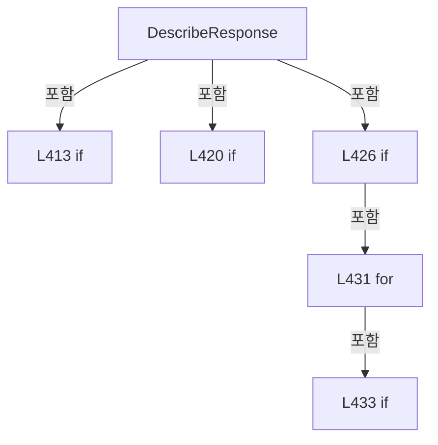

변경 전 점검: 입력/반환 타입, 위 호출자, 예외/취소 경로, 공유 상태와 저장·전송 소비자를 함께 확인합니다. 값의 단위나 물리 방향을 이름만으로 확정하지 않습니다.

### MethodDeclaration `DescribePacket` · L448–448

[Drilling.Common/Interface/Vision/CVisionComm.cs:448–448](https://github.com/kjuws10-rgb/A3Drilling/blob/334b3599651b2e8e0181fd4459bafaf3cddafff3/Drilling.Common/Interface/Vision/CVisionComm.cs#L448-L448)

| 항목 | 실제 추출 값 |
| --- | --- |
| 서명 | string Drilling.Common.Interface.Vision.CVisionComm.DescribePacket(Drilling.Common.Interface.Vision.ST_VISION_PACKET) |
| 접근/수식자 | Private / private, static |
| 반환/값 타입 | string |
| 소속 타입 | NamedType:Drilling.Common.Interface.Vision.CVisionComm |

입력 계약:

| 이름 | 타입 | 전달 | 선택/기본값 |
| --- | --- | --- | --- |
| packet | Drilling.Common.Interface.Vision.ST_VISION_PACKET | None | False /  |

정적 호출자로 확인된 위치:

| 호출 파일/행 | 호출 표현식 | 런타임 분기 가능 |
| --- | --- | --- |
| [Drilling.Common/Interface/Vision/CVisionComm.cs:197–197](https://github.com/kjuws10-rgb/A3Drilling/blob/334b3599651b2e8e0181fd4459bafaf3cddafff3/Drilling.Common/Interface/Vision/CVisionComm.cs#L197-L197) | DescribePacket | False |
| [Drilling.Common/Interface/Vision/CVisionComm.cs:323–323](https://github.com/kjuws10-rgb/A3Drilling/blob/334b3599651b2e8e0181fd4459bafaf3cddafff3/Drilling.Common/Interface/Vision/CVisionComm.cs#L323-L323) | DescribePacket | False |

변경 전 점검: 입력/반환 타입, 위 호출자, 예외/취소 경로, 공유 상태와 저장·전송 소비자를 함께 확인합니다. 값의 단위나 물리 방향을 이름만으로 확정하지 않습니다.

### MethodDeclaration `NextUniqueId` · L449–459

[Drilling.Common/Interface/Vision/CVisionComm.cs:449–459](https://github.com/kjuws10-rgb/A3Drilling/blob/334b3599651b2e8e0181fd4459bafaf3cddafff3/Drilling.Common/Interface/Vision/CVisionComm.cs#L449-L459)

| 항목 | 실제 추출 값 |
| --- | --- |
| 서명 | int Drilling.Common.Interface.Vision.CVisionComm.NextUniqueId() |
| 접근/수식자 | Private / private |
| 반환/값 타입 | int |
| 소속 타입 | NamedType:Drilling.Common.Interface.Vision.CVisionComm |

정적 호출자로 확인된 위치:

| 호출 파일/행 | 호출 표현식 | 런타임 분기 가능 |
| --- | --- | --- |
| [Drilling.Common/Interface/Vision/CVisionComm.cs:114–114](https://github.com/kjuws10-rgb/A3Drilling/blob/334b3599651b2e8e0181fd4459bafaf3cddafff3/Drilling.Common/Interface/Vision/CVisionComm.cs#L114-L114) | NextUniqueId | False |

호출하는 대상과 해석 범위:

| 원본 행 | 표현식 | 분석 상태 | 대상/소스 위치 |
| --- | --- | --- | --- |
| 451 | Interlocked.Increment | resolved | int System.Threading.Interlocked.Increment(ref int) |
| 457 | Interlocked.Exchange | resolved | int System.Threading.Interlocked.Exchange(ref int, int) |

본문의 실제 연산·분기·예외·반환 순서(원문 위치 순):

| 원본 행 | 종류 | 주석 해설 |
| --- | --- | --- |
| 451 | call | 함수·델리게이트 또는 객체 생성자를 호출합니다: Interlocked.Increment(ref _uniqueId) |
| 451 | local-declaration | 지역 변수를 선언합니다: var value = Interlocked.Increment(ref _uniqueId); |
| 451 | variable-initializer | 변수의 초기값을 지정합니다: value = Interlocked.Increment(ref _uniqueId) |
| 452 | if | 조건에 따라 분기합니다: if (value > 0) |
| 454 | return | 호출자에게 값 또는 제어를 반환합니다: return value; |
| 457 | call | 함수·델리게이트 또는 객체 생성자를 호출합니다: Interlocked.Exchange(ref _uniqueId, 1) |
| 458 | return | 호출자에게 값 또는 제어를 반환합니다: return 1; |

제어 구문의 포함 구조(실제 실행 순서/CFG가 아닌 구문 탐색 그림):

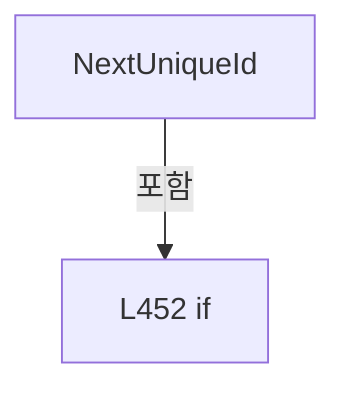

변경 전 점검: 입력/반환 타입, 위 호출자, 예외/취소 경로, 공유 상태와 저장·전송 소비자를 함께 확인합니다. 값의 단위나 물리 방향을 이름만으로 확정하지 않습니다.

### MethodDeclaration `RaiseProtocolTrace` · L461–464

[Drilling.Common/Interface/Vision/CVisionComm.cs:461–464](https://github.com/kjuws10-rgb/A3Drilling/blob/334b3599651b2e8e0181fd4459bafaf3cddafff3/Drilling.Common/Interface/Vision/CVisionComm.cs#L461-L464)

| 항목 | 실제 추출 값 |
| --- | --- |
| 서명 | void Drilling.Common.Interface.Vision.CVisionComm.RaiseProtocolTrace(string, string) |
| 접근/수식자 | Private / private |
| 반환/값 타입 | void |
| 소속 타입 | NamedType:Drilling.Common.Interface.Vision.CVisionComm |

입력 계약:

| 이름 | 타입 | 전달 | 선택/기본값 |
| --- | --- | --- | --- |
| direction | string | None | False /  |
| message | string | None | False /  |

정적 호출자로 확인된 위치:

| 호출 파일/행 | 호출 표현식 | 런타임 분기 가능 |
| --- | --- | --- |
| [Drilling.Common/Interface/Vision/CVisionComm.cs:65–65](https://github.com/kjuws10-rgb/A3Drilling/blob/334b3599651b2e8e0181fd4459bafaf3cddafff3/Drilling.Common/Interface/Vision/CVisionComm.cs#L65-L65) | RaiseProtocolTrace | False |
| [Drilling.Common/Interface/Vision/CVisionComm.cs:186–186](https://github.com/kjuws10-rgb/A3Drilling/blob/334b3599651b2e8e0181fd4459bafaf3cddafff3/Drilling.Common/Interface/Vision/CVisionComm.cs#L186-L186) | RaiseProtocolTrace | False |
| [Drilling.Common/Interface/Vision/CVisionComm.cs:205–205](https://github.com/kjuws10-rgb/A3Drilling/blob/334b3599651b2e8e0181fd4459bafaf3cddafff3/Drilling.Common/Interface/Vision/CVisionComm.cs#L205-L205) | RaiseProtocolTrace | False |
| [Drilling.Common/Interface/Vision/CVisionComm.cs:247–247](https://github.com/kjuws10-rgb/A3Drilling/blob/334b3599651b2e8e0181fd4459bafaf3cddafff3/Drilling.Common/Interface/Vision/CVisionComm.cs#L247-L247) | RaiseProtocolTrace | False |
| [Drilling.Common/Interface/Vision/CVisionComm.cs:325–325](https://github.com/kjuws10-rgb/A3Drilling/blob/334b3599651b2e8e0181fd4459bafaf3cddafff3/Drilling.Common/Interface/Vision/CVisionComm.cs#L325-L325) | RaiseProtocolTrace | False |

호출하는 대상과 해석 범위:

| 원본 행 | 표현식 | 분석 상태 | 대상/소스 위치 |
| --- | --- | --- | --- |
| 463 | .Invoke | resolved · 동적 구현 선택 가능 | void System.Action<Drilling.Common.Interface.ST_COMM_PROTOCOL_TRACE>.Invoke(Drilling.Common.Interface.ST_COMM_PROTOCOL_TRACE) |
| 463 | new ST_COMM_PROTOCOL_TRACE | resolved | Drilling.Common.Interface.ST_COMM_PROTOCOL_TRACE.ST_COMM_PROTOCOL_TRACE(System.DateTimeOffset, string, string) · Drilling.Common/Interface/CInterfaceManager.cs:2942 |

본문의 실제 연산·분기·예외·반환 순서(원문 위치 순):

| 원본 행 | 종류 | 주석 해설 |
| --- | --- | --- |
| 463 | call | 함수·델리게이트 또는 객체 생성자를 호출합니다: .Invoke(new ST_COMM_PROTOCOL_TRACE(DateTimeOffset.Now, direction, message)) |
| 463 | call | 함수·델리게이트 또는 객체 생성자를 호출합니다: new ST_COMM_PROTOCOL_TRACE(DateTimeOffset.Now, direction, message) |

변경 전 점검: 입력/반환 타입, 위 호출자, 예외/취소 경로, 공유 상태와 저장·전송 소비자를 함께 확인합니다. 값의 단위나 물리 방향을 이름만으로 확정하지 않습니다.

### MethodDeclaration `IsServerListening` · L466–469

[Drilling.Common/Interface/Vision/CVisionComm.cs:466–469](https://github.com/kjuws10-rgb/A3Drilling/blob/334b3599651b2e8e0181fd4459bafaf3cddafff3/Drilling.Common/Interface/Vision/CVisionComm.cs#L466-L469)

| 항목 | 실제 추출 값 |
| --- | --- |
| 서명 | bool Drilling.Common.Interface.Vision.CVisionComm.IsServerListening() |
| 접근/수식자 | Private / private |
| 반환/값 타입 | bool |
| 소속 타입 | NamedType:Drilling.Common.Interface.Vision.CVisionComm |

정적 호출자로 확인된 위치:

| 호출 파일/행 | 호출 표현식 | 런타임 분기 가능 |
| --- | --- | --- |
| [Drilling.Common/Interface/Vision/CVisionComm.cs:246–246](https://github.com/kjuws10-rgb/A3Drilling/blob/334b3599651b2e8e0181fd4459bafaf3cddafff3/Drilling.Common/Interface/Vision/CVisionComm.cs#L246-L246) | IsServerListening | False |

본문의 실제 연산·분기·예외·반환 순서(원문 위치 순):

| 원본 행 | 종류 | 주석 해설 |
| --- | --- | --- |
| 468 | return | 호출자에게 값 또는 제어를 반환합니다: return _listener is not null && _serverCancellation is not null && !_serverCancellation.IsCancellationRequested; |

변경 전 점검: 입력/반환 타입, 위 호출자, 예외/취소 경로, 공유 상태와 저장·전송 소비자를 함께 확인합니다. 값의 단위나 물리 방향을 이름만으로 확정하지 않습니다.

### MethodDeclaration `StopServer` · L471–500

[Drilling.Common/Interface/Vision/CVisionComm.cs:471–500](https://github.com/kjuws10-rgb/A3Drilling/blob/334b3599651b2e8e0181fd4459bafaf3cddafff3/Drilling.Common/Interface/Vision/CVisionComm.cs#L471-L500)

| 항목 | 실제 추출 값 |
| --- | --- |
| 서명 | System.Threading.Tasks.Task Drilling.Common.Interface.Vision.CVisionComm.StopServer() |
| 접근/수식자 | Private / private, async |
| 반환/값 타입 | System.Threading.Tasks.Task |
| 소속 타입 | NamedType:Drilling.Common.Interface.Vision.CVisionComm |

정적 호출자로 확인된 위치:

| 호출 파일/행 | 호출 표현식 | 런타임 분기 가능 |
| --- | --- | --- |
| [Drilling.Common/Interface/Vision/CVisionComm.cs:44–44](https://github.com/kjuws10-rgb/A3Drilling/blob/334b3599651b2e8e0181fd4459bafaf3cddafff3/Drilling.Common/Interface/Vision/CVisionComm.cs#L44-L44) | StopServer | False |
| [Drilling.Common/Interface/Vision/CVisionComm.cs:69–69](https://github.com/kjuws10-rgb/A3Drilling/blob/334b3599651b2e8e0181fd4459bafaf3cddafff3/Drilling.Common/Interface/Vision/CVisionComm.cs#L69-L69) | StopServer | False |
| [Drilling.Common/Interface/Vision/CVisionComm.cs:84–84](https://github.com/kjuws10-rgb/A3Drilling/blob/334b3599651b2e8e0181fd4459bafaf3cddafff3/Drilling.Common/Interface/Vision/CVisionComm.cs#L84-L84) | StopServer | False |

호출하는 대상과 해석 범위:

| 원본 행 | 표현식 | 분석 상태 | 대상/소스 위치 |
| --- | --- | --- | --- |
| 473 | Volatile.Write | resolved | void System.Threading.Volatile.Write(ref int, int) |
| 474 | .Cancel | resolved | void System.Threading.CancellationTokenSource.Cancel() |
| 475 | .Stop | resolved | void System.Net.Sockets.TcpListener.Stop() |
| 476 | .Dispose | resolved | void System.Net.Sockets.TcpClient.Dispose() |
| 479 | IgnoreCancellation | resolved | System.Threading.Tasks.Task Drilling.Common.Interface.Vision.CVisionComm.IgnoreCancellation(System.Threading.Tasks.Task) · Drilling.Common/Interface/Vision/CVisionComm.cs:513 |
| 484 | IgnoreCancellation | resolved | System.Threading.Tasks.Task Drilling.Common.Interface.Vision.CVisionComm.IgnoreCancellation(System.Threading.Tasks.Task) · Drilling.Common/Interface/Vision/CVisionComm.cs:513 |
| 487 | .Dispose | resolved | void System.Threading.CancellationTokenSource.Dispose() |
| 496 | _clientReady.Wait | resolved | bool System.Threading.SemaphoreSlim.Wait(int) |
| 499 | FailPending | resolved | void Drilling.Common.Interface.Vision.CVisionComm.FailPending(System.Exception) · Drilling.Common/Interface/Vision/CVisionComm.cs:502 |
| 499 | new IOException | resolved | System.IO.IOException.IOException(string?) |

본문의 실제 연산·분기·예외·반환 순서(원문 위치 순):

| 원본 행 | 종류 | 주석 해설 |
| --- | --- | --- |
| 473 | call | 함수·델리게이트 또는 객체 생성자를 호출합니다: Volatile.Write(ref _flyingLineCapacity, 0) |
| 474 | call | 함수·델리게이트 또는 객체 생성자를 호출합니다: .Cancel() |
| 475 | call | 함수·델리게이트 또는 객체 생성자를 호출합니다: .Stop() |
| 476 | call | 함수·델리게이트 또는 객체 생성자를 호출합니다: .Dispose() |
| 477 | if | 조건에 따라 분기합니다: if (_acceptTask is not null) |
| 479 | await | 비동기 완료를 기다립니다: await IgnoreCancellation(_acceptTask) |
| 479 | call | 함수·델리게이트 또는 객체 생성자를 호출합니다: IgnoreCancellation(_acceptTask) |
| 482 | if | 조건에 따라 분기합니다: if (_receiveTask is not null) |
| 484 | await | 비동기 완료를 기다립니다: await IgnoreCancellation(_receiveTask) |
| 484 | call | 함수·델리게이트 또는 객체 생성자를 호출합니다: IgnoreCancellation(_receiveTask) |
| 487 | call | 함수·델리게이트 또는 객체 생성자를 호출합니다: .Dispose() |
| 488 | assignment | 값을 대상에 대입합니다: _serverCancellation = null |
| 489 | assignment | 값을 대상에 대입합니다: _listener = null |
| 490 | assignment | 값을 대상에 대입합니다: _client = null |
| 491 | assignment | 값을 대상에 대입합니다: _stream = null |
| 492 | assignment | 값을 대상에 대입합니다: _acceptTask = null |
| 493 | assignment | 값을 대상에 대입합니다: _receiveTask = null |
| 494 | while | 조건을 먼저 확인하며 반복합니다: while (_clientReady.CurrentCount > 0) |
| 496 | call | 함수·델리게이트 또는 객체 생성자를 호출합니다: _clientReady.Wait(0) |
| 499 | call | 함수·델리게이트 또는 객체 생성자를 호출합니다: FailPending(new IOException("Vision server stopped.")) |
| 499 | call | 함수·델리게이트 또는 객체 생성자를 호출합니다: new IOException("Vision server stopped.") |

제어 구문의 포함 구조(실제 실행 순서/CFG가 아닌 구문 탐색 그림):

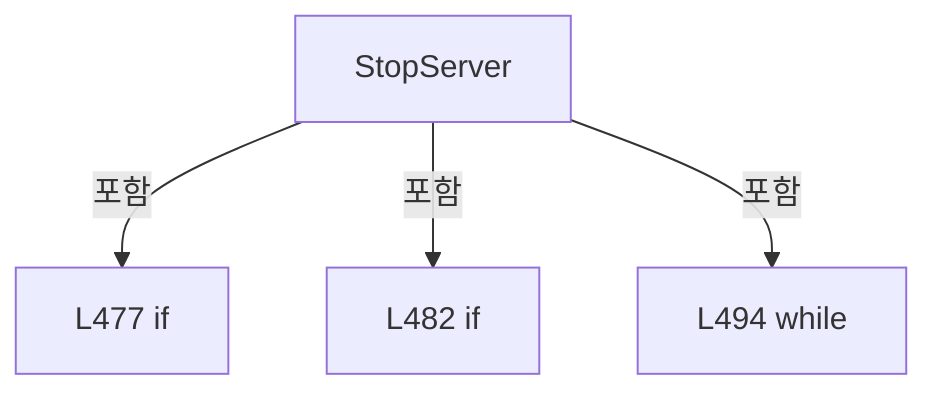

변경 전 점검: 입력/반환 타입, 위 호출자, 예외/취소 경로, 공유 상태와 저장·전송 소비자를 함께 확인합니다. 값의 단위나 물리 방향을 이름만으로 확정하지 않습니다.

### MethodDeclaration `FailPending` · L502–511

[Drilling.Common/Interface/Vision/CVisionComm.cs:502–511](https://github.com/kjuws10-rgb/A3Drilling/blob/334b3599651b2e8e0181fd4459bafaf3cddafff3/Drilling.Common/Interface/Vision/CVisionComm.cs#L502-L511)

| 항목 | 실제 추출 값 |
| --- | --- |
| 서명 | void Drilling.Common.Interface.Vision.CVisionComm.FailPending(System.Exception) |
| 접근/수식자 | Private / private |
| 반환/값 타입 | void |
| 소속 타입 | NamedType:Drilling.Common.Interface.Vision.CVisionComm |

입력 계약:

| 이름 | 타입 | 전달 | 선택/기본값 |
| --- | --- | --- | --- |
| exception | System.Exception | None | False /  |

정적 호출자로 확인된 위치:

| 호출 파일/행 | 호출 표현식 | 런타임 분기 가능 |
| --- | --- | --- |
| [Drilling.Common/Interface/Vision/CVisionComm.cs:244–244](https://github.com/kjuws10-rgb/A3Drilling/blob/334b3599651b2e8e0181fd4459bafaf3cddafff3/Drilling.Common/Interface/Vision/CVisionComm.cs#L244-L244) | FailPending | False |
| [Drilling.Common/Interface/Vision/CVisionComm.cs:499–499](https://github.com/kjuws10-rgb/A3Drilling/blob/334b3599651b2e8e0181fd4459bafaf3cddafff3/Drilling.Common/Interface/Vision/CVisionComm.cs#L499-L499) | FailPending | False |

호출하는 대상과 해석 범위:

| 원본 행 | 표현식 | 분석 상태 | 대상/소스 위치 |
| --- | --- | --- | --- |
| 504 | _pending.ToArray | resolved | System.Collections.Generic.KeyValuePair<int, System.Threading.Tasks.TaskCompletionSource<Drilling.Common.Interface.Vision.ST_VISION_PACKET>>[] System.Collections.Concurrent.ConcurrentDictionary<int, System.Threading.Tasks.TaskCompletionSource<Drilling.Common.Interface.Vision.ST_VISION_PACKET>>.ToArray() |
| 506 | _pending.TryRemove | resolved | bool System.Collections.Concurrent.ConcurrentDictionary<int, System.Threading.Tasks.TaskCompletionSource<Drilling.Common.Interface.Vision.ST_VISION_PACKET>>.TryRemove(int, out System.Threading.Tasks.TaskCompletionSource<Drilling.Common.Interface.Vision.ST_VISION_PACKET>) |
| 508 | completion.TrySetException | resolved | bool System.Threading.Tasks.TaskCompletionSource<Drilling.Common.Interface.Vision.ST_VISION_PACKET>.TrySetException(System.Exception) |

본문의 실제 연산·분기·예외·반환 순서(원문 위치 순):

| 원본 행 | 종류 | 주석 해설 |
| --- | --- | --- |
| 504 | call | 함수·델리게이트 또는 객체 생성자를 호출합니다: _pending.ToArray() |
| 504 | foreach | 컬렉션 요소를 순회합니다: foreach (var item in _pending.ToArray()) |
| 506 | call | 함수·델리게이트 또는 객체 생성자를 호출합니다: _pending.TryRemove(item.Key, out var completion) |
| 506 | if | 조건에 따라 분기합니다: if (_pending.TryRemove(item.Key, out var completion)) |
| 508 | call | 함수·델리게이트 또는 객체 생성자를 호출합니다: completion.TrySetException(exception) |

제어 구문의 포함 구조(실제 실행 순서/CFG가 아닌 구문 탐색 그림):

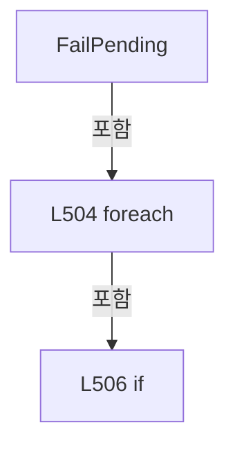

변경 전 점검: 입력/반환 타입, 위 호출자, 예외/취소 경로, 공유 상태와 저장·전송 소비자를 함께 확인합니다. 값의 단위나 물리 방향을 이름만으로 확정하지 않습니다.

### MethodDeclaration `IgnoreCancellation` · L513–522

[Drilling.Common/Interface/Vision/CVisionComm.cs:513–522](https://github.com/kjuws10-rgb/A3Drilling/blob/334b3599651b2e8e0181fd4459bafaf3cddafff3/Drilling.Common/Interface/Vision/CVisionComm.cs#L513-L522)

| 항목 | 실제 추출 값 |
| --- | --- |
| 서명 | System.Threading.Tasks.Task Drilling.Common.Interface.Vision.CVisionComm.IgnoreCancellation(System.Threading.Tasks.Task) |
| 접근/수식자 | Private / private, static, async |
| 반환/값 타입 | System.Threading.Tasks.Task |
| 소속 타입 | NamedType:Drilling.Common.Interface.Vision.CVisionComm |

입력 계약:

| 이름 | 타입 | 전달 | 선택/기본값 |
| --- | --- | --- | --- |
| task | System.Threading.Tasks.Task | None | False /  |

정적 호출자로 확인된 위치:

| 호출 파일/행 | 호출 표현식 | 런타임 분기 가능 |
| --- | --- | --- |
| [Drilling.Common/Interface/Vision/CVisionComm.cs:479–479](https://github.com/kjuws10-rgb/A3Drilling/blob/334b3599651b2e8e0181fd4459bafaf3cddafff3/Drilling.Common/Interface/Vision/CVisionComm.cs#L479-L479) | IgnoreCancellation | False |
| [Drilling.Common/Interface/Vision/CVisionComm.cs:484–484](https://github.com/kjuws10-rgb/A3Drilling/blob/334b3599651b2e8e0181fd4459bafaf3cddafff3/Drilling.Common/Interface/Vision/CVisionComm.cs#L484-L484) | IgnoreCancellation | False |

본문의 실제 연산·분기·예외·반환 순서(원문 위치 순):

| 원본 행 | 종류 | 주석 해설 |
| --- | --- | --- |
| 515 | try | 예외 처리 범위입니다: try |
| 517 | await | 비동기 완료를 기다립니다: await task |
| 519 | catch | 지정 예외를 처리합니다: catch (Exception ex) when (ex is OperationCanceledException or ObjectDisposedException or SocketException or IOException) |

제어 구문의 포함 구조(실제 실행 순서/CFG가 아닌 구문 탐색 그림):

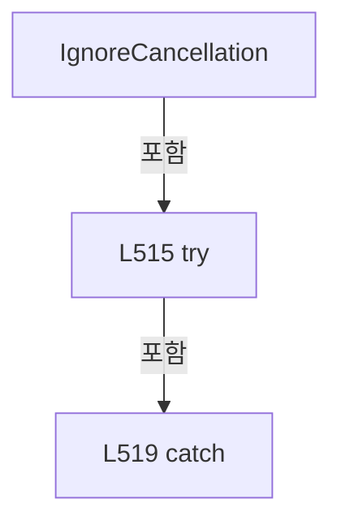

변경 전 점검: 입력/반환 타입, 위 호출자, 예외/취소 경로, 공유 상태와 저장·전송 소비자를 함께 확인합니다. 값의 단위나 물리 방향을 이름만으로 확정하지 않습니다.

### MethodDeclaration `ResolveBindAddress` · L524–532

[Drilling.Common/Interface/Vision/CVisionComm.cs:524–532](https://github.com/kjuws10-rgb/A3Drilling/blob/334b3599651b2e8e0181fd4459bafaf3cddafff3/Drilling.Common/Interface/Vision/CVisionComm.cs#L524-L532)

| 항목 | 실제 추출 값 |
| --- | --- |
| 서명 | System.Net.IPAddress Drilling.Common.Interface.Vision.CVisionComm.ResolveBindAddress(string) |
| 접근/수식자 | Private / private, static |
| 반환/값 타입 | System.Net.IPAddress |
| 소속 타입 | NamedType:Drilling.Common.Interface.Vision.CVisionComm |

입력 계약:

| 이름 | 타입 | 전달 | 선택/기본값 |
| --- | --- | --- | --- |
| value | string | None | False /  |

정적 호출자로 확인된 위치:

| 호출 파일/행 | 호출 표현식 | 런타임 분기 가능 |
| --- | --- | --- |
| [Drilling.Common/Interface/Vision/CVisionComm.cs:51–51](https://github.com/kjuws10-rgb/A3Drilling/blob/334b3599651b2e8e0181fd4459bafaf3cddafff3/Drilling.Common/Interface/Vision/CVisionComm.cs#L51-L51) | ResolveBindAddress | False |

호출하는 대상과 해석 범위:

| 원본 행 | 표현식 | 분석 상태 | 대상/소스 위치 |
| --- | --- | --- | --- |
| 526 | string.IsNullOrWhiteSpace | resolved | bool string.IsNullOrWhiteSpace(string?) |
| 531 | IPAddress.TryParse | resolved | bool System.Net.IPAddress.TryParse(string?, out System.Net.IPAddress?) |
| 531 | new ArgumentException | resolved | System.ArgumentException.ArgumentException(string?) |

본문의 실제 연산·분기·예외·반환 순서(원문 위치 순):

| 원본 행 | 종류 | 주석 해설 |
| --- | --- | --- |
| 526 | call | 함수·델리게이트 또는 객체 생성자를 호출합니다: string.IsNullOrWhiteSpace(value) |
| 526 | if | 조건에 따라 분기합니다: if (string.IsNullOrWhiteSpace(value) &#124;&#124; value == "*") |
| 528 | return | 호출자에게 값 또는 제어를 반환합니다: return IPAddress.Any; |
| 531 | call | 함수·델리게이트 또는 객체 생성자를 호출합니다: IPAddress.TryParse(value, out var address) |
| 531 | call | 함수·델리게이트 또는 객체 생성자를 호출합니다: new ArgumentException($"Vision server local address is invalid: {value}") |
| 531 | conditional-expression | 조건에 따라 결과식을 선택합니다: IPAddress.TryParse(value, out var address) ? address : throw new ArgumentException($"Vision server local address is invalid: {value}") |
| 531 | return | 호출자에게 값 또는 제어를 반환합니다: return IPAddress.TryParse(value, out var address) ? address : throw new ArgumentException($"Vision server local address is invalid: {value}"); |
| 531 | throw | 예외를 발생/전달합니다: throw new ArgumentException($"Vision server local address is invalid: {value}") |

제어 구문의 포함 구조(실제 실행 순서/CFG가 아닌 구문 탐색 그림):


변경 전 점검: 입력/반환 타입, 위 호출자, 예외/취소 경로, 공유 상태와 저장·전송 소비자를 함께 확인합니다. 값의 단위나 물리 방향을 이름만으로 확정하지 않습니다.

### EnumMemberDeclaration `MarkFindSingle` · L537–537

[Drilling.Common/Interface/Vision/CVisionComm.cs:537–537](https://github.com/kjuws10-rgb/A3Drilling/blob/334b3599651b2e8e0181fd4459bafaf3cddafff3/Drilling.Common/Interface/Vision/CVisionComm.cs#L537-L537)

| 항목 | 실제 추출 값 |
| --- | --- |
| 서명 | Drilling.Common.Interface.Vision.EN_VISION_COMMAND.MarkFindSingle |
| 접근/수식자 | Public /  |
| 반환/값 타입 | Drilling.Common.Interface.Vision.EN_VISION_COMMAND |
| 소속 타입 | NamedType:Drilling.Common.Interface.Vision.EN_VISION_COMMAND |

현재 부분 분석에서 직접 연결된 호출자는 없습니다. XAML/이벤트/인터페이스·델리게이트·외부 진입을 추가 확인해야 하며, 미사용으로 판정한 것이 아닙니다.

변경 전 점검: 입력/반환 타입, 위 호출자, 예외/취소 경로, 공유 상태와 저장·전송 소비자를 함께 확인합니다. 값의 단위나 물리 방향을 이름만으로 확정하지 않습니다.

### EnumMemberDeclaration `FlyingReady` · L538–538

[Drilling.Common/Interface/Vision/CVisionComm.cs:538–538](https://github.com/kjuws10-rgb/A3Drilling/blob/334b3599651b2e8e0181fd4459bafaf3cddafff3/Drilling.Common/Interface/Vision/CVisionComm.cs#L538-L538)

| 항목 | 실제 추출 값 |
| --- | --- |
| 서명 | Drilling.Common.Interface.Vision.EN_VISION_COMMAND.FlyingReady |
| 접근/수식자 | Public /  |
| 반환/값 타입 | Drilling.Common.Interface.Vision.EN_VISION_COMMAND |
| 소속 타입 | NamedType:Drilling.Common.Interface.Vision.EN_VISION_COMMAND |

현재 부분 분석에서 직접 연결된 호출자는 없습니다. XAML/이벤트/인터페이스·델리게이트·외부 진입을 추가 확인해야 하며, 미사용으로 판정한 것이 아닙니다.

변경 전 점검: 입력/반환 타입, 위 호출자, 예외/취소 경로, 공유 상태와 저장·전송 소비자를 함께 확인합니다. 값의 단위나 물리 방향을 이름만으로 확정하지 않습니다.

### EnumMemberDeclaration `FlyingMoveDone` · L539–539

[Drilling.Common/Interface/Vision/CVisionComm.cs:539–539](https://github.com/kjuws10-rgb/A3Drilling/blob/334b3599651b2e8e0181fd4459bafaf3cddafff3/Drilling.Common/Interface/Vision/CVisionComm.cs#L539-L539)

| 항목 | 실제 추출 값 |
| --- | --- |
| 서명 | Drilling.Common.Interface.Vision.EN_VISION_COMMAND.FlyingMoveDone |
| 접근/수식자 | Public /  |
| 반환/값 타입 | Drilling.Common.Interface.Vision.EN_VISION_COMMAND |
| 소속 타입 | NamedType:Drilling.Common.Interface.Vision.EN_VISION_COMMAND |

현재 부분 분석에서 직접 연결된 호출자는 없습니다. XAML/이벤트/인터페이스·델리게이트·외부 진입을 추가 확인해야 하며, 미사용으로 판정한 것이 아닙니다.

변경 전 점검: 입력/반환 타입, 위 호출자, 예외/취소 경로, 공유 상태와 저장·전송 소비자를 함께 확인합니다. 값의 단위나 물리 방향을 이름만으로 확정하지 않습니다.

### EnumMemberDeclaration `MarkFindLine` · L540–540

[Drilling.Common/Interface/Vision/CVisionComm.cs:540–540](https://github.com/kjuws10-rgb/A3Drilling/blob/334b3599651b2e8e0181fd4459bafaf3cddafff3/Drilling.Common/Interface/Vision/CVisionComm.cs#L540-L540)

| 항목 | 실제 추출 값 |
| --- | --- |
| 서명 | Drilling.Common.Interface.Vision.EN_VISION_COMMAND.MarkFindLine |
| 접근/수식자 | Public /  |
| 반환/값 타입 | Drilling.Common.Interface.Vision.EN_VISION_COMMAND |
| 소속 타입 | NamedType:Drilling.Common.Interface.Vision.EN_VISION_COMMAND |

현재 부분 분석에서 직접 연결된 호출자는 없습니다. XAML/이벤트/인터페이스·델리게이트·외부 진입을 추가 확인해야 하며, 미사용으로 판정한 것이 아닙니다.

변경 전 점검: 입력/반환 타입, 위 호출자, 예외/취소 경로, 공유 상태와 저장·전송 소비자를 함께 확인합니다. 값의 단위나 물리 방향을 이름만으로 확정하지 않습니다.

### EnumMemberDeclaration `MarkFindSettingSingle` · L541–541

[Drilling.Common/Interface/Vision/CVisionComm.cs:541–541](https://github.com/kjuws10-rgb/A3Drilling/blob/334b3599651b2e8e0181fd4459bafaf3cddafff3/Drilling.Common/Interface/Vision/CVisionComm.cs#L541-L541)

| 항목 | 실제 추출 값 |
| --- | --- |
| 서명 | Drilling.Common.Interface.Vision.EN_VISION_COMMAND.MarkFindSettingSingle |
| 접근/수식자 | Public /  |
| 반환/값 타입 | Drilling.Common.Interface.Vision.EN_VISION_COMMAND |
| 소속 타입 | NamedType:Drilling.Common.Interface.Vision.EN_VISION_COMMAND |

현재 부분 분석에서 직접 연결된 호출자는 없습니다. XAML/이벤트/인터페이스·델리게이트·외부 진입을 추가 확인해야 하며, 미사용으로 판정한 것이 아닙니다.

변경 전 점검: 입력/반환 타입, 위 호출자, 예외/취소 경로, 공유 상태와 저장·전송 소비자를 함께 확인합니다. 값의 단위나 물리 방향을 이름만으로 확정하지 않습니다.

### EnumMemberDeclaration `MarkFindManual` · L542–542

[Drilling.Common/Interface/Vision/CVisionComm.cs:542–542](https://github.com/kjuws10-rgb/A3Drilling/blob/334b3599651b2e8e0181fd4459bafaf3cddafff3/Drilling.Common/Interface/Vision/CVisionComm.cs#L542-L542)

| 항목 | 실제 추출 값 |
| --- | --- |
| 서명 | Drilling.Common.Interface.Vision.EN_VISION_COMMAND.MarkFindManual |
| 접근/수식자 | Public /  |
| 반환/값 타입 | Drilling.Common.Interface.Vision.EN_VISION_COMMAND |
| 소속 타입 | NamedType:Drilling.Common.Interface.Vision.EN_VISION_COMMAND |

현재 부분 분석에서 직접 연결된 호출자는 없습니다. XAML/이벤트/인터페이스·델리게이트·외부 진입을 추가 확인해야 하며, 미사용으로 판정한 것이 아닙니다.

변경 전 점검: 입력/반환 타입, 위 호출자, 예외/취소 경로, 공유 상태와 저장·전송 소비자를 함께 확인합니다. 값의 단위나 물리 방향을 이름만으로 확정하지 않습니다.

### EnumMemberDeclaration `KeepAliveRequest` · L543–543

[Drilling.Common/Interface/Vision/CVisionComm.cs:543–543](https://github.com/kjuws10-rgb/A3Drilling/blob/334b3599651b2e8e0181fd4459bafaf3cddafff3/Drilling.Common/Interface/Vision/CVisionComm.cs#L543-L543)

| 항목 | 실제 추출 값 |
| --- | --- |
| 서명 | Drilling.Common.Interface.Vision.EN_VISION_COMMAND.KeepAliveRequest |
| 접근/수식자 | Public /  |
| 반환/값 타입 | Drilling.Common.Interface.Vision.EN_VISION_COMMAND |
| 소속 타입 | NamedType:Drilling.Common.Interface.Vision.EN_VISION_COMMAND |

현재 부분 분석에서 직접 연결된 호출자는 없습니다. XAML/이벤트/인터페이스·델리게이트·외부 진입을 추가 확인해야 하며, 미사용으로 판정한 것이 아닙니다.

변경 전 점검: 입력/반환 타입, 위 호출자, 예외/취소 경로, 공유 상태와 저장·전송 소비자를 함께 확인합니다. 값의 단위나 물리 방향을 이름만으로 확정하지 않습니다.

### EnumMemberDeclaration `KeepAlive` · L544–544

[Drilling.Common/Interface/Vision/CVisionComm.cs:544–544](https://github.com/kjuws10-rgb/A3Drilling/blob/334b3599651b2e8e0181fd4459bafaf3cddafff3/Drilling.Common/Interface/Vision/CVisionComm.cs#L544-L544)

| 항목 | 실제 추출 값 |
| --- | --- |
| 서명 | Drilling.Common.Interface.Vision.EN_VISION_COMMAND.KeepAlive |
| 접근/수식자 | Public /  |
| 반환/값 타입 | Drilling.Common.Interface.Vision.EN_VISION_COMMAND |
| 소속 타입 | NamedType:Drilling.Common.Interface.Vision.EN_VISION_COMMAND |

현재 부분 분석에서 직접 연결된 호출자는 없습니다. XAML/이벤트/인터페이스·델리게이트·외부 진입을 추가 확인해야 하며, 미사용으로 판정한 것이 아닙니다.

변경 전 점검: 입력/반환 타입, 위 호출자, 예외/취소 경로, 공유 상태와 저장·전송 소비자를 함께 확인합니다. 값의 단위나 물리 방향을 이름만으로 확정하지 않습니다.

### PropertyDeclaration `ActualCount` · L556–556

[Drilling.Common/Interface/Vision/CVisionComm.cs:556–556](https://github.com/kjuws10-rgb/A3Drilling/blob/334b3599651b2e8e0181fd4459bafaf3cddafff3/Drilling.Common/Interface/Vision/CVisionComm.cs#L556-L556)

| 항목 | 실제 추출 값 |
| --- | --- |
| 서명 | int Drilling.Common.Interface.Vision.CVisionLineCountExceededException.ActualCount |
| 접근/수식자 | Public / public |
| 반환/값 타입 | int |
| 소속 타입 | NamedType:Drilling.Common.Interface.Vision.CVisionLineCountExceededException |

현재 부분 분석에서 직접 연결된 호출자는 없습니다. XAML/이벤트/인터페이스·델리게이트·외부 진입을 추가 확인해야 하며, 미사용으로 판정한 것이 아닙니다.

변경 전 점검: 입력/반환 타입, 위 호출자, 예외/취소 경로, 공유 상태와 저장·전송 소비자를 함께 확인합니다. 값의 단위나 물리 방향을 이름만으로 확정하지 않습니다.

### GetAccessorDeclaration `get_ActualCount` · L556–556

[Drilling.Common/Interface/Vision/CVisionComm.cs:556–556](https://github.com/kjuws10-rgb/A3Drilling/blob/334b3599651b2e8e0181fd4459bafaf3cddafff3/Drilling.Common/Interface/Vision/CVisionComm.cs#L556-L556)

| 항목 | 실제 추출 값 |
| --- | --- |
| 서명 | int Drilling.Common.Interface.Vision.CVisionLineCountExceededException.ActualCount.get |
| 접근/수식자 | Public / get |
| 반환/값 타입 | int |
| 소속 타입 | NamedType:Drilling.Common.Interface.Vision.CVisionLineCountExceededException |

현재 부분 분석에서 직접 연결된 호출자는 없습니다. XAML/이벤트/인터페이스·델리게이트·외부 진입을 추가 확인해야 하며, 미사용으로 판정한 것이 아닙니다.

변경 전 점검: 입력/반환 타입, 위 호출자, 예외/취소 경로, 공유 상태와 저장·전송 소비자를 함께 확인합니다. 값의 단위나 물리 방향을 이름만으로 확정하지 않습니다.

### PropertyDeclaration `MaximumCount` · L557–557

[Drilling.Common/Interface/Vision/CVisionComm.cs:557–557](https://github.com/kjuws10-rgb/A3Drilling/blob/334b3599651b2e8e0181fd4459bafaf3cddafff3/Drilling.Common/Interface/Vision/CVisionComm.cs#L557-L557)

| 항목 | 실제 추출 값 |
| --- | --- |
| 서명 | int Drilling.Common.Interface.Vision.CVisionLineCountExceededException.MaximumCount |
| 접근/수식자 | Public / public |
| 반환/값 타입 | int |
| 소속 타입 | NamedType:Drilling.Common.Interface.Vision.CVisionLineCountExceededException |

현재 부분 분석에서 직접 연결된 호출자는 없습니다. XAML/이벤트/인터페이스·델리게이트·외부 진입을 추가 확인해야 하며, 미사용으로 판정한 것이 아닙니다.

변경 전 점검: 입력/반환 타입, 위 호출자, 예외/취소 경로, 공유 상태와 저장·전송 소비자를 함께 확인합니다. 값의 단위나 물리 방향을 이름만으로 확정하지 않습니다.

### GetAccessorDeclaration `get_MaximumCount` · L557–557

[Drilling.Common/Interface/Vision/CVisionComm.cs:557–557](https://github.com/kjuws10-rgb/A3Drilling/blob/334b3599651b2e8e0181fd4459bafaf3cddafff3/Drilling.Common/Interface/Vision/CVisionComm.cs#L557-L557)

| 항목 | 실제 추출 값 |
| --- | --- |
| 서명 | int Drilling.Common.Interface.Vision.CVisionLineCountExceededException.MaximumCount.get |
| 접근/수식자 | Public / get |
| 반환/값 타입 | int |
| 소속 타입 | NamedType:Drilling.Common.Interface.Vision.CVisionLineCountExceededException |

현재 부분 분석에서 직접 연결된 호출자는 없습니다. XAML/이벤트/인터페이스·델리게이트·외부 진입을 추가 확인해야 하며, 미사용으로 판정한 것이 아닙니다.

변경 전 점검: 입력/반환 타입, 위 호출자, 예외/취소 경로, 공유 상태와 저장·전송 소비자를 함께 확인합니다. 값의 단위나 물리 방향을 이름만으로 확정하지 않습니다.

### FieldDeclaration `PacketLogSeparator` · L561–561

[Drilling.Common/Interface/Vision/CVisionComm.cs:561–561](https://github.com/kjuws10-rgb/A3Drilling/blob/334b3599651b2e8e0181fd4459bafaf3cddafff3/Drilling.Common/Interface/Vision/CVisionComm.cs#L561-L561)

| 항목 | 실제 추출 값 |
| --- | --- |
| 서명 | string Drilling.Common.Interface.Vision.CVisionProtocol.PacketLogSeparator |
| 접근/수식자 | Private / private, const |
| 반환/값 타입 | string |
| 소속 타입 | NamedType:Drilling.Common.Interface.Vision.CVisionProtocol |

현재 부분 분석에서 직접 연결된 호출자는 없습니다. XAML/이벤트/인터페이스·델리게이트·외부 진입을 추가 확인해야 하며, 미사용으로 판정한 것이 아닙니다.

본문의 실제 연산·분기·예외·반환 순서(원문 위치 순):

| 원본 행 | 종류 | 주석 해설 |
| --- | --- | --- |
| 561 | variable-initializer | 변수의 초기값을 지정합니다: PacketLogSeparator = "----------------------------------------------------------------------" |

변경 전 점검: 입력/반환 타입, 위 호출자, 예외/취소 경로, 공유 상태와 저장·전송 소비자를 함께 확인합니다. 값의 단위나 물리 방향을 이름만으로 확정하지 않습니다.

### FieldDeclaration `PacketLogBodyIndent` · L562–562

[Drilling.Common/Interface/Vision/CVisionComm.cs:562–562](https://github.com/kjuws10-rgb/A3Drilling/blob/334b3599651b2e8e0181fd4459bafaf3cddafff3/Drilling.Common/Interface/Vision/CVisionComm.cs#L562-L562)

| 항목 | 실제 추출 값 |
| --- | --- |
| 서명 | string Drilling.Common.Interface.Vision.CVisionProtocol.PacketLogBodyIndent |
| 접근/수식자 | Private / private, const |
| 반환/값 타입 | string |
| 소속 타입 | NamedType:Drilling.Common.Interface.Vision.CVisionProtocol |

현재 부분 분석에서 직접 연결된 호출자는 없습니다. XAML/이벤트/인터페이스·델리게이트·외부 진입을 추가 확인해야 하며, 미사용으로 판정한 것이 아닙니다.

본문의 실제 연산·분기·예외·반환 순서(원문 위치 순):

| 원본 행 | 종류 | 주석 해설 |
| --- | --- | --- |
| 562 | variable-initializer | 변수의 초기값을 지정합니다: PacketLogBodyIndent = " " |

변경 전 점검: 입력/반환 타입, 위 호출자, 예외/취소 경로, 공유 상태와 저장·전송 소비자를 함께 확인합니다. 값의 단위나 물리 방향을 이름만으로 확정하지 않습니다.

### FieldDeclaration `HeaderSize` · L563–563

[Drilling.Common/Interface/Vision/CVisionComm.cs:563–563](https://github.com/kjuws10-rgb/A3Drilling/blob/334b3599651b2e8e0181fd4459bafaf3cddafff3/Drilling.Common/Interface/Vision/CVisionComm.cs#L563-L563)

| 항목 | 실제 추출 값 |
| --- | --- |
| 서명 | int Drilling.Common.Interface.Vision.CVisionProtocol.HeaderSize |
| 접근/수식자 | Public / public, const |
| 반환/값 타입 | int |
| 소속 타입 | NamedType:Drilling.Common.Interface.Vision.CVisionProtocol |

현재 부분 분석에서 직접 연결된 호출자는 없습니다. XAML/이벤트/인터페이스·델리게이트·외부 진입을 추가 확인해야 하며, 미사용으로 판정한 것이 아닙니다.

본문의 실제 연산·분기·예외·반환 순서(원문 위치 순):

| 원본 행 | 종류 | 주석 해설 |
| --- | --- | --- |
| 563 | variable-initializer | 변수의 초기값을 지정합니다: HeaderSize = 16 |

변경 전 점검: 입력/반환 타입, 위 호출자, 예외/취소 경로, 공유 상태와 저장·전송 소비자를 함께 확인합니다. 값의 단위나 물리 방향을 이름만으로 확정하지 않습니다.

### FieldDeclaration `MarkSearchSize` · L564–564

[Drilling.Common/Interface/Vision/CVisionComm.cs:564–564](https://github.com/kjuws10-rgb/A3Drilling/blob/334b3599651b2e8e0181fd4459bafaf3cddafff3/Drilling.Common/Interface/Vision/CVisionComm.cs#L564-L564)

| 항목 | 실제 추출 값 |
| --- | --- |
| 서명 | int Drilling.Common.Interface.Vision.CVisionProtocol.MarkSearchSize |
| 접근/수식자 | Public / public, const |
| 반환/값 타입 | int |
| 소속 타입 | NamedType:Drilling.Common.Interface.Vision.CVisionProtocol |

현재 부분 분석에서 직접 연결된 호출자는 없습니다. XAML/이벤트/인터페이스·델리게이트·외부 진입을 추가 확인해야 하며, 미사용으로 판정한 것이 아닙니다.

본문의 실제 연산·분기·예외·반환 순서(원문 위치 순):

| 원본 행 | 종류 | 주석 해설 |
| --- | --- | --- |
| 564 | variable-initializer | 변수의 초기값을 지정합니다: MarkSearchSize = 24 |

변경 전 점검: 입력/반환 타입, 위 호출자, 예외/취소 경로, 공유 상태와 저장·전송 소비자를 함께 확인합니다. 값의 단위나 물리 방향을 이름만으로 확정하지 않습니다.

### FieldDeclaration `MarkFindPackedSize` · L565–565

[Drilling.Common/Interface/Vision/CVisionComm.cs:565–565](https://github.com/kjuws10-rgb/A3Drilling/blob/334b3599651b2e8e0181fd4459bafaf3cddafff3/Drilling.Common/Interface/Vision/CVisionComm.cs#L565-L565)

| 항목 | 실제 추출 값 |
| --- | --- |
| 서명 | int Drilling.Common.Interface.Vision.CVisionProtocol.MarkFindPackedSize |
| 접근/수식자 | Public / public, const |
| 반환/값 타입 | int |
| 소속 타입 | NamedType:Drilling.Common.Interface.Vision.CVisionProtocol |

현재 부분 분석에서 직접 연결된 호출자는 없습니다. XAML/이벤트/인터페이스·델리게이트·외부 진입을 추가 확인해야 하며, 미사용으로 판정한 것이 아닙니다.

본문의 실제 연산·분기·예외·반환 순서(원문 위치 순):

| 원본 행 | 종류 | 주석 해설 |
| --- | --- | --- |
| 565 | variable-initializer | 변수의 초기값을 지정합니다: MarkFindPackedSize = 36 |

변경 전 점검: 입력/반환 타입, 위 호출자, 예외/취소 경로, 공유 상태와 저장·전송 소비자를 함께 확인합니다. 값의 단위나 물리 방향을 이름만으로 확정하지 않습니다.

### FieldDeclaration `SingleResultBodySize` · L566–566

[Drilling.Common/Interface/Vision/CVisionComm.cs:566–566](https://github.com/kjuws10-rgb/A3Drilling/blob/334b3599651b2e8e0181fd4459bafaf3cddafff3/Drilling.Common/Interface/Vision/CVisionComm.cs#L566-L566)

| 항목 | 실제 추출 값 |
| --- | --- |
| 서명 | int Drilling.Common.Interface.Vision.CVisionProtocol.SingleResultBodySize |
| 접근/수식자 | Public / public, const |
| 반환/값 타입 | int |
| 소속 타입 | NamedType:Drilling.Common.Interface.Vision.CVisionProtocol |

현재 부분 분석에서 직접 연결된 호출자는 없습니다. XAML/이벤트/인터페이스·델리게이트·외부 진입을 추가 확인해야 하며, 미사용으로 판정한 것이 아닙니다.

본문의 실제 연산·분기·예외·반환 순서(원문 위치 순):

| 원본 행 | 종류 | 주석 해설 |
| --- | --- | --- |
| 566 | variable-initializer | 변수의 초기값을 지정합니다: SingleResultBodySize = 40 |

변경 전 점검: 입력/반환 타입, 위 호출자, 예외/취소 경로, 공유 상태와 저장·전송 소비자를 함께 확인합니다. 값의 단위나 물리 방향을 이름만으로 확정하지 않습니다.

### FieldDeclaration `MaximumBodySize` · L567–567

[Drilling.Common/Interface/Vision/CVisionComm.cs:567–567](https://github.com/kjuws10-rgb/A3Drilling/blob/334b3599651b2e8e0181fd4459bafaf3cddafff3/Drilling.Common/Interface/Vision/CVisionComm.cs#L567-L567)

| 항목 | 실제 추출 값 |
| --- | --- |
| 서명 | int Drilling.Common.Interface.Vision.CVisionProtocol.MaximumBodySize |
| 접근/수식자 | Public / public, const |
| 반환/값 타입 | int |
| 소속 타입 | NamedType:Drilling.Common.Interface.Vision.CVisionProtocol |

현재 부분 분석에서 직접 연결된 호출자는 없습니다. XAML/이벤트/인터페이스·델리게이트·외부 진입을 추가 확인해야 하며, 미사용으로 판정한 것이 아닙니다.

본문의 실제 연산·분기·예외·반환 순서(원문 위치 순):

| 원본 행 | 종류 | 주석 해설 |
| --- | --- | --- |
| 567 | variable-initializer | 변수의 초기값을 지정합니다: MaximumBodySize = 1024 * 1024 |

변경 전 점검: 입력/반환 타입, 위 호출자, 예외/취소 경로, 공유 상태와 저장·전송 소비자를 함께 확인합니다. 값의 단위나 물리 방향을 이름만으로 확정하지 않습니다.

### FieldDeclaration `MaximumMarkCount` · L570–570

[Drilling.Common/Interface/Vision/CVisionComm.cs:570–570](https://github.com/kjuws10-rgb/A3Drilling/blob/334b3599651b2e8e0181fd4459bafaf3cddafff3/Drilling.Common/Interface/Vision/CVisionComm.cs#L570-L570)

| 항목 | 실제 추출 값 |
| --- | --- |
| 서명 | int Drilling.Common.Interface.Vision.CVisionProtocol.MaximumMarkCount |
| 접근/수식자 | Public / public, const |
| 반환/값 타입 | int |
| 소속 타입 | NamedType:Drilling.Common.Interface.Vision.CVisionProtocol |

현재 부분 분석에서 직접 연결된 호출자는 없습니다. XAML/이벤트/인터페이스·델리게이트·외부 진입을 추가 확인해야 하며, 미사용으로 판정한 것이 아닙니다.

본문의 실제 연산·분기·예외·반환 순서(원문 위치 순):

| 원본 행 | 종류 | 주석 해설 |
| --- | --- | --- |
| 570 | variable-initializer | 변수의 초기값을 지정합니다: MaximumMarkCount = (MaximumBodySize - 8) / MarkFindPackedSize |

변경 전 점검: 입력/반환 타입, 위 호출자, 예외/취소 경로, 공유 상태와 저장·전송 소비자를 함께 확인합니다. 값의 단위나 물리 방향을 이름만으로 확정하지 않습니다.

### FieldDeclaration `DefaultMaxHoleCountPerLine` · L571–571

[Drilling.Common/Interface/Vision/CVisionComm.cs:571–571](https://github.com/kjuws10-rgb/A3Drilling/blob/334b3599651b2e8e0181fd4459bafaf3cddafff3/Drilling.Common/Interface/Vision/CVisionComm.cs#L571-L571)

| 항목 | 실제 추출 값 |
| --- | --- |
| 서명 | int Drilling.Common.Interface.Vision.CVisionProtocol.DefaultMaxHoleCountPerLine |
| 접근/수식자 | Public / public, const |
| 반환/값 타입 | int |
| 소속 타입 | NamedType:Drilling.Common.Interface.Vision.CVisionProtocol |

현재 부분 분석에서 직접 연결된 호출자는 없습니다. XAML/이벤트/인터페이스·델리게이트·외부 진입을 추가 확인해야 하며, 미사용으로 판정한 것이 아닙니다.

본문의 실제 연산·분기·예외·반환 순서(원문 위치 순):

| 원본 행 | 종류 | 주석 해설 |
| --- | --- | --- |
| 571 | variable-initializer | 변수의 초기값을 지정합니다: DefaultMaxHoleCountPerLine = 300 |

변경 전 점검: 입력/반환 타입, 위 호출자, 예외/취소 경로, 공유 상태와 저장·전송 소비자를 함께 확인합니다. 값의 단위나 물리 방향을 이름만으로 확정하지 않습니다.

### FieldDeclaration `MaxHoleCountPerLineSettingKey` · L572–572

[Drilling.Common/Interface/Vision/CVisionComm.cs:572–572](https://github.com/kjuws10-rgb/A3Drilling/blob/334b3599651b2e8e0181fd4459bafaf3cddafff3/Drilling.Common/Interface/Vision/CVisionComm.cs#L572-L572)

| 항목 | 실제 추출 값 |
| --- | --- |
| 서명 | string Drilling.Common.Interface.Vision.CVisionProtocol.MaxHoleCountPerLineSettingKey |
| 접근/수식자 | Public / public, const |
| 반환/값 타입 | string |
| 소속 타입 | NamedType:Drilling.Common.Interface.Vision.CVisionProtocol |

현재 부분 분석에서 직접 연결된 호출자는 없습니다. XAML/이벤트/인터페이스·델리게이트·외부 진입을 추가 확인해야 하며, 미사용으로 판정한 것이 아닙니다.

본문의 실제 연산·분기·예외·반환 순서(원문 위치 순):

| 원본 행 | 종류 | 주석 해설 |
| --- | --- | --- |
| 572 | variable-initializer | 변수의 초기값을 지정합니다: MaxHoleCountPerLineSettingKey = "MaxHoleCountPerLine" |

변경 전 점검: 입력/반환 타입, 위 호출자, 예외/취소 경로, 공유 상태와 저장·전송 소비자를 함께 확인합니다. 값의 단위나 물리 방향을 이름만으로 확정하지 않습니다.

### MethodDeclaration `ValidateLineCapacity` · L573–578

[Drilling.Common/Interface/Vision/CVisionComm.cs:573–578](https://github.com/kjuws10-rgb/A3Drilling/blob/334b3599651b2e8e0181fd4459bafaf3cddafff3/Drilling.Common/Interface/Vision/CVisionComm.cs#L573-L578)

| 항목 | 실제 추출 값 |
| --- | --- |
| 서명 | int Drilling.Common.Interface.Vision.CVisionProtocol.ValidateLineCapacity(int) |
| 접근/수식자 | Public / public, static |
| 반환/값 타입 | int |
| 소속 타입 | NamedType:Drilling.Common.Interface.Vision.CVisionProtocol |

입력 계약:

| 이름 | 타입 | 전달 | 선택/기본값 |
| --- | --- | --- | --- |
| capacity | int | None | False /  |

정적 호출자로 확인된 위치:

| 호출 파일/행 | 호출 표현식 | 런타임 분기 가능 |
| --- | --- | --- |
| [Drilling.Common/Interface/CInterfaceManager.cs:90–90](https://github.com/kjuws10-rgb/A3Drilling/blob/334b3599651b2e8e0181fd4459bafaf3cddafff3/Drilling.Common/Interface/CInterfaceManager.cs#L90-L90) | CVisionProtocol.ValidateLineCapacity | False |
| [Drilling.Common/Interface/Vision/CVisionComm.cs:29–29](https://github.com/kjuws10-rgb/A3Drilling/blob/334b3599651b2e8e0181fd4459bafaf3cddafff3/Drilling.Common/Interface/Vision/CVisionComm.cs#L29-L29) | CVisionProtocol.ValidateLineCapacity | False |
| [Drilling.Common/Interface/Vision/CVisionComm.cs:584–584](https://github.com/kjuws10-rgb/A3Drilling/blob/334b3599651b2e8e0181fd4459bafaf3cddafff3/Drilling.Common/Interface/Vision/CVisionComm.cs#L584-L584) | ValidateLineCapacity | False |
| [Drilling.Common/Interface/Vision/CVisionComm.cs:618–618](https://github.com/kjuws10-rgb/A3Drilling/blob/334b3599651b2e8e0181fd4459bafaf3cddafff3/Drilling.Common/Interface/Vision/CVisionComm.cs#L618-L618) | ValidateLineCapacity | False |
| [Drilling.Common/Interface/Vision/CVisionComm.cs:716–716](https://github.com/kjuws10-rgb/A3Drilling/blob/334b3599651b2e8e0181fd4459bafaf3cddafff3/Drilling.Common/Interface/Vision/CVisionComm.cs#L716-L716) | ValidateLineCapacity | False |
| [Drilling.Common/Interface/Vision/CVisionComm.cs:783–783](https://github.com/kjuws10-rgb/A3Drilling/blob/334b3599651b2e8e0181fd4459bafaf3cddafff3/Drilling.Common/Interface/Vision/CVisionComm.cs#L783-L783) | ValidateLineCapacity | False |
| [Drilling.Common/Managers/CSettingManager.cs:111–111](https://github.com/kjuws10-rgb/A3Drilling/blob/334b3599651b2e8e0181fd4459bafaf3cddafff3/Drilling.Common/Managers/CSettingManager.cs#L111-L111) | CVisionProtocol.ValidateLineCapacity | False |

호출하는 대상과 해석 범위:

| 원본 행 | 표현식 | 분석 상태 | 대상/소스 위치 |
| --- | --- | --- | --- |
| 576 | new ArgumentOutOfRangeException | resolved | System.ArgumentOutOfRangeException.ArgumentOutOfRangeException(string?, string?) |
| 576 | nameof | unresolved | None |

본문의 실제 연산·분기·예외·반환 순서(원문 위치 순):

| 원본 행 | 종류 | 주석 해설 |
| --- | --- | --- |
| 575 | if | 조건에 따라 분기합니다: if (capacity < 1 &#124;&#124; capacity > MaximumMarkCount) |
| 576 | call | 함수·델리게이트 또는 객체 생성자를 호출합니다: new ArgumentOutOfRangeException(nameof(capacity), $"MaxHoleCountPerLine은 1~{MaximumMarkCount} 범위의 정수여야 합니다.") |
| 576 | call | 함수·델리게이트 또는 객체 생성자를 호출합니다: nameof(capacity) |
| 576 | throw | 예외를 발생/전달합니다: throw new ArgumentOutOfRangeException(nameof(capacity), $"MaxHoleCountPerLine은 1~{MaximumMarkCount} 범위의 정수여야 합니다."); |
| 577 | return | 호출자에게 값 또는 제어를 반환합니다: return capacity; |

제어 구문의 포함 구조(실제 실행 순서/CFG가 아닌 구문 탐색 그림):

```mermaid
flowchart TD
 M["ValidateLineCapacity"]
 N0["L575 if"]
 M -->|포함| N0
```

변경 전 점검: 입력/반환 타입, 위 호출자, 예외/취소 경로, 공유 상태와 저장·전송 소비자를 함께 확인합니다. 값의 단위나 물리 방향을 이름만으로 확정하지 않습니다.

### MethodDeclaration `CreateEmpty` · L579–579

[Drilling.Common/Interface/Vision/CVisionComm.cs:579–579](https://github.com/kjuws10-rgb/A3Drilling/blob/334b3599651b2e8e0181fd4459bafaf3cddafff3/Drilling.Common/Interface/Vision/CVisionComm.cs#L579-L579)

| 항목 | 실제 추출 값 |
| --- | --- |
| 서명 | Drilling.Common.Interface.Vision.ST_VISION_PACKET Drilling.Common.Interface.Vision.CVisionProtocol.CreateEmpty(Drilling.Common.Interface.Vision.EN_VISION_COMMAND, int, int) |
| 접근/수식자 | Public / public, static |
| 반환/값 타입 | Drilling.Common.Interface.Vision.ST_VISION_PACKET |
| 소속 타입 | NamedType:Drilling.Common.Interface.Vision.CVisionProtocol |

입력 계약:

| 이름 | 타입 | 전달 | 선택/기본값 |
| --- | --- | --- | --- |
| command | Drilling.Common.Interface.Vision.EN_VISION_COMMAND | None | False /  |
| uniqueId | int | None | False /  |
| errorCode | int | None | True / 0 |

정적 호출자로 확인된 위치:

| 호출 파일/행 | 호출 표현식 | 런타임 분기 가능 |
| --- | --- | --- |
| [Drilling.Common/Interface/Vision/CVisionComm.cs:208–208](https://github.com/kjuws10-rgb/A3Drilling/blob/334b3599651b2e8e0181fd4459bafaf3cddafff3/Drilling.Common/Interface/Vision/CVisionComm.cs#L208-L208) | CVisionProtocol.CreateEmpty | False |
| [Drilling.Common/Interface/Vision/CVisionComm.cs:214–214](https://github.com/kjuws10-rgb/A3Drilling/blob/334b3599651b2e8e0181fd4459bafaf3cddafff3/Drilling.Common/Interface/Vision/CVisionComm.cs#L214-L214) | CVisionProtocol.CreateEmpty | False |
| [Drilling.Common/Interface/Vision/CVisionComm.cs:357–357](https://github.com/kjuws10-rgb/A3Drilling/blob/334b3599651b2e8e0181fd4459bafaf3cddafff3/Drilling.Common/Interface/Vision/CVisionComm.cs#L357-L357) | CVisionProtocol.CreateEmpty | False |
| [Drilling.Common/Interface/Vision/CVisionComm.cs:358–358](https://github.com/kjuws10-rgb/A3Drilling/blob/334b3599651b2e8e0181fd4459bafaf3cddafff3/Drilling.Common/Interface/Vision/CVisionComm.cs#L358-L358) | CVisionProtocol.CreateEmpty | False |
| [Drilling.Common/Interface/Vision/CVisionComm.cs:359–359](https://github.com/kjuws10-rgb/A3Drilling/blob/334b3599651b2e8e0181fd4459bafaf3cddafff3/Drilling.Common/Interface/Vision/CVisionComm.cs#L359-L359) | CVisionProtocol.CreateEmpty | False |
| [Drilling.Common/Interface/Vision/CVisionComm.cs:360–360](https://github.com/kjuws10-rgb/A3Drilling/blob/334b3599651b2e8e0181fd4459bafaf3cddafff3/Drilling.Common/Interface/Vision/CVisionComm.cs#L360-L360) | CVisionProtocol.CreateEmpty | False |

호출하는 대상과 해석 범위:

| 원본 행 | 표현식 | 분석 상태 | 대상/소스 위치 |
| --- | --- | --- | --- |
| 579 | Create | resolved | Drilling.Common.Interface.Vision.ST_VISION_PACKET Drilling.Common.Interface.Vision.CVisionProtocol.Create(Drilling.Common.Interface.Vision.EN_VISION_COMMAND, int, byte[], int) · Drilling.Common/Interface/Vision/CVisionComm.cs:637 |

본문의 실제 연산·분기·예외·반환 순서(원문 위치 순):

| 원본 행 | 종류 | 주석 해설 |
| --- | --- | --- |
| 579 | call | 함수·델리게이트 또는 객체 생성자를 호출합니다: Create(command, uniqueId, [], errorCode) |

변경 전 점검: 입력/반환 타입, 위 호출자, 예외/취소 경로, 공유 상태와 저장·전송 소비자를 함께 확인합니다. 값의 단위나 물리 방향을 이름만으로 확정하지 않습니다.

### MethodDeclaration `CreateMarkFindSingle` · L580–580

[Drilling.Common/Interface/Vision/CVisionComm.cs:580–580](https://github.com/kjuws10-rgb/A3Drilling/blob/334b3599651b2e8e0181fd4459bafaf3cddafff3/Drilling.Common/Interface/Vision/CVisionComm.cs#L580-L580)

| 항목 | 실제 추출 값 |
| --- | --- |
| 서명 | Drilling.Common.Interface.Vision.ST_VISION_PACKET Drilling.Common.Interface.Vision.CVisionProtocol.CreateMarkFindSingle(int, Drilling.Common.Interface.Vision.ST_VISION_MARK_SEARCH) |
| 접근/수식자 | Public / public, static |
| 반환/값 타입 | Drilling.Common.Interface.Vision.ST_VISION_PACKET |
| 소속 타입 | NamedType:Drilling.Common.Interface.Vision.CVisionProtocol |

입력 계약:

| 이름 | 타입 | 전달 | 선택/기본값 |
| --- | --- | --- | --- |
| uniqueId | int | None | False /  |
| search | Drilling.Common.Interface.Vision.ST_VISION_MARK_SEARCH | None | False /  |

정적 호출자로 확인된 위치:

| 호출 파일/행 | 호출 표현식 | 런타임 분기 가능 |
| --- | --- | --- |
| [Drilling.Common/Interface/Vision/CVisionComm.cs:355–355](https://github.com/kjuws10-rgb/A3Drilling/blob/334b3599651b2e8e0181fd4459bafaf3cddafff3/Drilling.Common/Interface/Vision/CVisionComm.cs#L355-L355) | CVisionProtocol.CreateMarkFindSingle | False |

호출하는 대상과 해석 범위:

| 원본 행 | 표현식 | 분석 상태 | 대상/소스 위치 |
| --- | --- | --- | --- |
| 580 | Create | resolved | Drilling.Common.Interface.Vision.ST_VISION_PACKET Drilling.Common.Interface.Vision.CVisionProtocol.Create(Drilling.Common.Interface.Vision.EN_VISION_COMMAND, int, byte[], int) · Drilling.Common/Interface/Vision/CVisionComm.cs:637 |
| 580 | EncodeMarkSearch | resolved | byte[] Drilling.Common.Interface.Vision.CVisionProtocol.EncodeMarkSearch(Drilling.Common.Interface.Vision.ST_VISION_MARK_SEARCH) · Drilling.Common/Interface/Vision/CVisionComm.cs:810 |

본문의 실제 연산·분기·예외·반환 순서(원문 위치 순):

| 원본 행 | 종류 | 주석 해설 |
| --- | --- | --- |
| 580 | call | 함수·델리게이트 또는 객체 생성자를 호출합니다: Create(EN_VISION_COMMAND.MarkFindSingle, uniqueId, EncodeMarkSearch(search)) |
| 580 | call | 함수·델리게이트 또는 객체 생성자를 호출합니다: EncodeMarkSearch(search) |

변경 전 점검: 입력/반환 타입, 위 호출자, 예외/취소 경로, 공유 상태와 저장·전송 소비자를 함께 확인합니다. 값의 단위나 물리 방향을 이름만으로 확정하지 않습니다.

### MethodDeclaration `CreateFlyingReady` · L581–600

[Drilling.Common/Interface/Vision/CVisionComm.cs:581–600](https://github.com/kjuws10-rgb/A3Drilling/blob/334b3599651b2e8e0181fd4459bafaf3cddafff3/Drilling.Common/Interface/Vision/CVisionComm.cs#L581-L600)

| 항목 | 실제 추출 값 |
| --- | --- |
| 서명 | Drilling.Common.Interface.Vision.ST_VISION_PACKET Drilling.Common.Interface.Vision.CVisionProtocol.CreateFlyingReady(int, int, System.Collections.Generic.IReadOnlyList<Drilling.Common.Interface.Vision.ST_VISION_MARK_SEARCH>, int) |
| 접근/수식자 | Public / public, static |
| 반환/값 타입 | Drilling.Common.Interface.Vision.ST_VISION_PACKET |
| 소속 타입 | NamedType:Drilling.Common.Interface.Vision.CVisionProtocol |

입력 계약:

| 이름 | 타입 | 전달 | 선택/기본값 |
| --- | --- | --- | --- |
| uniqueId | int | None | False /  |
| inspectionType | int | None | False /  |
| searches | System.Collections.Generic.IReadOnlyList<Drilling.Common.Interface.Vision.ST_VISION_MARK_SEARCH> | None | False /  |
| maxHoleCountPerLine | int | None | True / 300 |

정적 호출자로 확인된 위치:

| 호출 파일/행 | 호출 표현식 | 런타임 분기 가능 |
| --- | --- | --- |
| [Drilling.Common/Interface/Vision/CVisionComm.cs:382–382](https://github.com/kjuws10-rgb/A3Drilling/blob/334b3599651b2e8e0181fd4459bafaf3cddafff3/Drilling.Common/Interface/Vision/CVisionComm.cs#L382-L382) | CVisionProtocol.CreateFlyingReady | False |

호출하는 대상과 해석 범위:

| 원본 행 | 표현식 | 분석 상태 | 대상/소스 위치 |
| --- | --- | --- | --- |
| 583 | ArgumentNullException.ThrowIfNull | resolved | void System.ArgumentNullException.ThrowIfNull(object?, string?) |
| 584 | ValidateLineCapacity | resolved | int Drilling.Common.Interface.Vision.CVisionProtocol.ValidateLineCapacity(int) · Drilling.Common/Interface/Vision/CVisionComm.cs:573 |
| 587 | new ArgumentOutOfRangeException | resolved | System.ArgumentOutOfRangeException.ArgumentOutOfRangeException(string?, string?) |
| 587 | nameof | unresolved | None |
| 591 | Array.Fill | resolved | void System.Array.Fill<byte>(byte[], byte) |
| 592 | WriteInt32 | resolved | void Drilling.Common.Interface.Vision.CVisionProtocol.WriteInt32(System.Span<byte>, int, int) · Drilling.Common/Interface/Vision/CVisionComm.cs:996 |
| 593 | WriteInt32 | resolved | void Drilling.Common.Interface.Vision.CVisionProtocol.WriteInt32(System.Span<byte>, int, int) · Drilling.Common/Interface/Vision/CVisionComm.cs:996 |
| 596 | WriteMarkSearch | resolved | void Drilling.Common.Interface.Vision.CVisionProtocol.WriteMarkSearch(System.Span<byte>, int, Drilling.Common.Interface.Vision.ST_VISION_MARK_SEARCH) · Drilling.Common/Interface/Vision/CVisionComm.cs:960 |
| 599 | Create | resolved | Drilling.Common.Interface.Vision.ST_VISION_PACKET Drilling.Common.Interface.Vision.CVisionProtocol.Create(Drilling.Common.Interface.Vision.EN_VISION_COMMAND, int, byte[], int) · Drilling.Common/Interface/Vision/CVisionComm.cs:637 |

본문의 실제 연산·분기·예외·반환 순서(원문 위치 순):

| 원본 행 | 종류 | 주석 해설 |
| --- | --- | --- |
| 583 | call | 함수·델리게이트 또는 객체 생성자를 호출합니다: ArgumentNullException.ThrowIfNull(searches) |
| 584 | call | 함수·델리게이트 또는 객체 생성자를 호출합니다: ValidateLineCapacity(maxHoleCountPerLine) |
| 585 | if | 조건에 따라 분기합니다: if (searches.Count > maxHoleCountPerLine) |
| 587 | call | 함수·델리게이트 또는 객체 생성자를 호출합니다: new ArgumentOutOfRangeException(nameof(searches), $"Flying Ready의 검사 개수 {searches.Count}가 MaxHoleCountPerLine({maxHoleCountPerLine})을 초과했습니다.") |
| 587 | call | 함수·델리게이트 또는 객체 생성자를 호출합니다: nameof(searches) |
| 587 | throw | 예외를 발생/전달합니다: throw new ArgumentOutOfRangeException(nameof(searches), $"Flying Ready의 검사 개수 {searches.Count}가 MaxHoleCountPerLine({maxHoleCountPerLine})을 초과했습니다."); |
| 590 | local-declaration | 지역 변수를 선언합니다: var body = new byte[8 + (maxHoleCountPerLine * MarkSearchSize)]; |
| 590 | variable-initializer | 변수의 초기값을 지정합니다: body = new byte[8 + (maxHoleCountPerLine * MarkSearchSize)] |
| 591 | call | 함수·델리게이트 또는 객체 생성자를 호출합니다: Array.Fill(body, (byte)0xFF) |
| 592 | call | 함수·델리게이트 또는 객체 생성자를 호출합니다: WriteInt32(body, 0, inspectionType) |
| 593 | call | 함수·델리게이트 또는 객체 생성자를 호출합니다: WriteInt32(body, 4, searches.Count) |
| 594 | variable-initializer | 변수의 초기값을 지정합니다: index = 0 |
| 594 | for | 초기화·조건·증감이 있는 반복입니다: for (var index = 0; index < searches.Count; index++) |
| 596 | call | 함수·델리게이트 또는 객체 생성자를 호출합니다: WriteMarkSearch(body, 8 + (index * MarkSearchSize), searches[index]) |
| 599 | call | 함수·델리게이트 또는 객체 생성자를 호출합니다: Create(EN_VISION_COMMAND.FlyingReady, uniqueId, body) |
| 599 | return | 호출자에게 값 또는 제어를 반환합니다: return Create(EN_VISION_COMMAND.FlyingReady, uniqueId, body); |

제어 구문의 포함 구조(실제 실행 순서/CFG가 아닌 구문 탐색 그림):

```mermaid
flowchart TD
 M["CreateFlyingReady"]
 N0["L585 if"]
 M -->|포함| N0
 N1["L594 for"]
 M -->|포함| N1
```

변경 전 점검: 입력/반환 타입, 위 호출자, 예외/취소 경로, 공유 상태와 저장·전송 소비자를 함께 확인합니다. 값의 단위나 물리 방향을 이름만으로 확정하지 않습니다.

### MethodDeclaration `CreateSingleResult` · L602–613

[Drilling.Common/Interface/Vision/CVisionComm.cs:602–613](https://github.com/kjuws10-rgb/A3Drilling/blob/334b3599651b2e8e0181fd4459bafaf3cddafff3/Drilling.Common/Interface/Vision/CVisionComm.cs#L602-L613)

| 항목 | 실제 추출 값 |
| --- | --- |
| 서명 | Drilling.Common.Interface.Vision.ST_VISION_PACKET Drilling.Common.Interface.Vision.CVisionProtocol.CreateSingleResult(Drilling.Common.Interface.Vision.EN_VISION_COMMAND, int, int, Drilling.Common.Interface.Vision.ST_VISION_MARK_FIND, int) |
| 접근/수식자 | Public / public, static |
| 반환/값 타입 | Drilling.Common.Interface.Vision.ST_VISION_PACKET |
| 소속 타입 | NamedType:Drilling.Common.Interface.Vision.CVisionProtocol |

입력 계약:

| 이름 | 타입 | 전달 | 선택/기본값 |
| --- | --- | --- | --- |
| command | Drilling.Common.Interface.Vision.EN_VISION_COMMAND | None | False /  |
| uniqueId | int | None | False /  |
| resolution | int | None | False /  |
| mark | Drilling.Common.Interface.Vision.ST_VISION_MARK_FIND | None | False /  |
| errorCode | int | None | True / 0 |

현재 부분 분석에서 직접 연결된 호출자는 없습니다. XAML/이벤트/인터페이스·델리게이트·외부 진입을 추가 확인해야 하며, 미사용으로 판정한 것이 아닙니다.

호출하는 대상과 해석 범위:

| 원본 행 | 표현식 | 분석 상태 | 대상/소스 위치 |
| --- | --- | --- | --- |
| 606 | new ArgumentOutOfRangeException | resolved | System.ArgumentOutOfRangeException.ArgumentOutOfRangeException(string?, object?, string?) |
| 606 | nameof | unresolved | None |
| 610 | WriteInt32 | resolved | void Drilling.Common.Interface.Vision.CVisionProtocol.WriteInt32(System.Span<byte>, int, int) · Drilling.Common/Interface/Vision/CVisionComm.cs:996 |
| 611 | WriteMarkFind | resolved | void Drilling.Common.Interface.Vision.CVisionProtocol.WriteMarkFind(System.Span<byte>, int, Drilling.Common.Interface.Vision.ST_VISION_MARK_FIND) · Drilling.Common/Interface/Vision/CVisionComm.cs:970 |
| 612 | Create | resolved | Drilling.Common.Interface.Vision.ST_VISION_PACKET Drilling.Common.Interface.Vision.CVisionProtocol.Create(Drilling.Common.Interface.Vision.EN_VISION_COMMAND, int, byte[], int) · Drilling.Common/Interface/Vision/CVisionComm.cs:637 |

본문의 실제 연산·분기·예외·반환 순서(원문 위치 순):

| 원본 행 | 종류 | 주석 해설 |
| --- | --- | --- |
| 604 | if | 조건에 따라 분기합니다: if (command is not EN_VISION_COMMAND.MarkFindSingle and not EN_VISION_COMMAND.MarkFindSettingSingle and not EN_VISION_COMMAND.MarkFindManual) |
| 606 | call | 함수·델리게이트 또는 객체 생성자를 호출합니다: new ArgumentOutOfRangeException(nameof(command), command, "Vision single result supports commands 1000, 1010 and 1020.") |
| 606 | call | 함수·델리게이트 또는 객체 생성자를 호출합니다: nameof(command) |
| 606 | throw | 예외를 발생/전달합니다: throw new ArgumentOutOfRangeException(nameof(command), command, "Vision single result supports commands 1000, 1010 and 1020."); |
| 609 | local-declaration | 지역 변수를 선언합니다: var body = new byte[SingleResultBodySize]; |
| 609 | variable-initializer | 변수의 초기값을 지정합니다: body = new byte[SingleResultBodySize] |
| 610 | call | 함수·델리게이트 또는 객체 생성자를 호출합니다: WriteInt32(body, 0, resolution) |
| 611 | call | 함수·델리게이트 또는 객체 생성자를 호출합니다: WriteMarkFind(body, 4, mark) |
| 612 | call | 함수·델리게이트 또는 객체 생성자를 호출합니다: Create(command, uniqueId, body, errorCode) |
| 612 | return | 호출자에게 값 또는 제어를 반환합니다: return Create(command, uniqueId, body, errorCode); |

제어 구문의 포함 구조(실제 실행 순서/CFG가 아닌 구문 탐색 그림):

```mermaid
flowchart TD
 M["CreateSingleResult"]
 N0["L604 if"]
 M -->|포함| N0
```

변경 전 점검: 입력/반환 타입, 위 호출자, 예외/취소 경로, 공유 상태와 저장·전송 소비자를 함께 확인합니다. 값의 단위나 물리 방향을 이름만으로 확정하지 않습니다.

### MethodDeclaration `CreateLineResult` · L615–635

[Drilling.Common/Interface/Vision/CVisionComm.cs:615–635](https://github.com/kjuws10-rgb/A3Drilling/blob/334b3599651b2e8e0181fd4459bafaf3cddafff3/Drilling.Common/Interface/Vision/CVisionComm.cs#L615-L635)

| 항목 | 실제 추출 값 |
| --- | --- |
| 서명 | Drilling.Common.Interface.Vision.ST_VISION_PACKET Drilling.Common.Interface.Vision.CVisionProtocol.CreateLineResult(int, int, System.Collections.Generic.IReadOnlyList<Drilling.Common.Interface.Vision.ST_VISION_MARK_FIND>, int, int) |
| 접근/수식자 | Public / public, static |
| 반환/값 타입 | Drilling.Common.Interface.Vision.ST_VISION_PACKET |
| 소속 타입 | NamedType:Drilling.Common.Interface.Vision.CVisionProtocol |

입력 계약:

| 이름 | 타입 | 전달 | 선택/기본값 |
| --- | --- | --- | --- |
| uniqueId | int | None | False /  |
| resolution | int | None | False /  |
| marks | System.Collections.Generic.IReadOnlyList<Drilling.Common.Interface.Vision.ST_VISION_MARK_FIND> | None | False /  |
| errorCode | int | None | True / 0 |
| maxHoleCountPerLine | int | None | True / 300 |

현재 부분 분석에서 직접 연결된 호출자는 없습니다. XAML/이벤트/인터페이스·델리게이트·외부 진입을 추가 확인해야 하며, 미사용으로 판정한 것이 아닙니다.

호출하는 대상과 해석 범위:

| 원본 행 | 표현식 | 분석 상태 | 대상/소스 위치 |
| --- | --- | --- | --- |
| 617 | ArgumentNullException.ThrowIfNull | resolved | void System.ArgumentNullException.ThrowIfNull(object?, string?) |
| 618 | ValidateLineCapacity | resolved | int Drilling.Common.Interface.Vision.CVisionProtocol.ValidateLineCapacity(int) · Drilling.Common/Interface/Vision/CVisionComm.cs:573 |
| 621 | new ArgumentOutOfRangeException | resolved | System.ArgumentOutOfRangeException.ArgumentOutOfRangeException(string?, string?) |
| 621 | nameof | unresolved | None |
| 625 | WriteInt32 | resolved | void Drilling.Common.Interface.Vision.CVisionProtocol.WriteInt32(System.Span<byte>, int, int) · Drilling.Common/Interface/Vision/CVisionComm.cs:996 |
| 626 | WriteInt32 | resolved | void Drilling.Common.Interface.Vision.CVisionProtocol.WriteInt32(System.Span<byte>, int, int) · Drilling.Common/Interface/Vision/CVisionComm.cs:996 |
| 629 | WriteMarkFind | resolved | void Drilling.Common.Interface.Vision.CVisionProtocol.WriteMarkFind(System.Span<byte>, int, Drilling.Common.Interface.Vision.ST_VISION_MARK_FIND) · Drilling.Common/Interface/Vision/CVisionComm.cs:970 |
| 632 | WriteMarkFind | resolved | void Drilling.Common.Interface.Vision.CVisionProtocol.WriteMarkFind(System.Span<byte>, int, Drilling.Common.Interface.Vision.ST_VISION_MARK_FIND) · Drilling.Common/Interface/Vision/CVisionComm.cs:970 |
| 632 | new | resolved | Drilling.Common.Interface.Vision.ST_VISION_MARK_FIND.ST_VISION_MARK_FIND(int, double, double, double, double) · Drilling.Common/Interface/Vision/CVisionComm.cs:549 |
| 634 | Create | resolved | Drilling.Common.Interface.Vision.ST_VISION_PACKET Drilling.Common.Interface.Vision.CVisionProtocol.Create(Drilling.Common.Interface.Vision.EN_VISION_COMMAND, int, byte[], int) · Drilling.Common/Interface/Vision/CVisionComm.cs:637 |

본문의 실제 연산·분기·예외·반환 순서(원문 위치 순):

| 원본 행 | 종류 | 주석 해설 |
| --- | --- | --- |
| 617 | call | 함수·델리게이트 또는 객체 생성자를 호출합니다: ArgumentNullException.ThrowIfNull(marks) |
| 618 | call | 함수·델리게이트 또는 객체 생성자를 호출합니다: ValidateLineCapacity(maxHoleCountPerLine) |
| 619 | if | 조건에 따라 분기합니다: if (marks.Count > maxHoleCountPerLine) |
| 621 | call | 함수·델리게이트 또는 객체 생성자를 호출합니다: new ArgumentOutOfRangeException(nameof(marks), $"Vision line result supports up to {maxHoleCountPerLine} marks.") |
| 621 | call | 함수·델리게이트 또는 객체 생성자를 호출합니다: nameof(marks) |
| 621 | throw | 예외를 발생/전달합니다: throw new ArgumentOutOfRangeException(nameof(marks), $"Vision line result supports up to {maxHoleCountPerLine} marks."); |
| 624 | local-declaration | 지역 변수를 선언합니다: var body = new byte[8 + (maxHoleCountPerLine * MarkFindPackedSize)]; |
| 624 | variable-initializer | 변수의 초기값을 지정합니다: body = new byte[8 + (maxHoleCountPerLine * MarkFindPackedSize)] |
| 625 | call | 함수·델리게이트 또는 객체 생성자를 호출합니다: WriteInt32(body, 0, resolution) |
| 626 | call | 함수·델리게이트 또는 객체 생성자를 호출합니다: WriteInt32(body, 4, marks.Count) |
| 627 | variable-initializer | 변수의 초기값을 지정합니다: index = 0 |
| 627 | for | 초기화·조건·증감이 있는 반복입니다: for (var index = 0; index < marks.Count; index++) |
| 629 | call | 함수·델리게이트 또는 객체 생성자를 호출합니다: WriteMarkFind(body, 8 + (index * MarkFindPackedSize), marks[index]) |
| 631 | variable-initializer | 변수의 초기값을 지정합니다: index = marks.Count |
| 631 | for | 초기화·조건·증감이 있는 반복입니다: for (var index = marks.Count; index < maxHoleCountPerLine; index++) |
| 632 | call | 함수·델리게이트 또는 객체 생성자를 호출합니다: WriteMarkFind(body, 8 + (index * MarkFindPackedSize), new(-1, -1, -1, -1, -1)) |
| 632 | call | 함수·델리게이트 또는 객체 생성자를 호출합니다: new(-1, -1, -1, -1, -1) |
| 634 | call | 함수·델리게이트 또는 객체 생성자를 호출합니다: Create(EN_VISION_COMMAND.MarkFindLine, uniqueId, body, errorCode) |
| 634 | return | 호출자에게 값 또는 제어를 반환합니다: return Create(EN_VISION_COMMAND.MarkFindLine, uniqueId, body, errorCode); |

제어 구문의 포함 구조(실제 실행 순서/CFG가 아닌 구문 탐색 그림):

```mermaid
flowchart TD
 M["CreateLineResult"]
 N0["L619 if"]
 M -->|포함| N0
 N1["L627 for"]
 M -->|포함| N1
 N2["L631 for"]
 M -->|포함| N2
```

변경 전 점검: 입력/반환 타입, 위 호출자, 예외/취소 경로, 공유 상태와 저장·전송 소비자를 함께 확인합니다. 값의 단위나 물리 방향을 이름만으로 확정하지 않습니다.

### MethodDeclaration `Create` · L637–642

[Drilling.Common/Interface/Vision/CVisionComm.cs:637–642](https://github.com/kjuws10-rgb/A3Drilling/blob/334b3599651b2e8e0181fd4459bafaf3cddafff3/Drilling.Common/Interface/Vision/CVisionComm.cs#L637-L642)

| 항목 | 실제 추출 값 |
| --- | --- |
| 서명 | Drilling.Common.Interface.Vision.ST_VISION_PACKET Drilling.Common.Interface.Vision.CVisionProtocol.Create(Drilling.Common.Interface.Vision.EN_VISION_COMMAND, int, byte[], int) |
| 접근/수식자 | Public / public, static |
| 반환/값 타입 | Drilling.Common.Interface.Vision.ST_VISION_PACKET |
| 소속 타입 | NamedType:Drilling.Common.Interface.Vision.CVisionProtocol |

입력 계약:

| 이름 | 타입 | 전달 | 선택/기본값 |
| --- | --- | --- | --- |
| command | Drilling.Common.Interface.Vision.EN_VISION_COMMAND | None | False /  |
| uniqueId | int | None | False /  |
| body | byte[] | None | False /  |
| errorCode | int | None | True / 0 |

정적 호출자로 확인된 위치:

| 호출 파일/행 | 호출 표현식 | 런타임 분기 가능 |
| --- | --- | --- |
| [Drilling.Common/Interface/Vision/CVisionComm.cs:579–579](https://github.com/kjuws10-rgb/A3Drilling/blob/334b3599651b2e8e0181fd4459bafaf3cddafff3/Drilling.Common/Interface/Vision/CVisionComm.cs#L579-L579) | Create | False |
| [Drilling.Common/Interface/Vision/CVisionComm.cs:580–580](https://github.com/kjuws10-rgb/A3Drilling/blob/334b3599651b2e8e0181fd4459bafaf3cddafff3/Drilling.Common/Interface/Vision/CVisionComm.cs#L580-L580) | Create | False |
| [Drilling.Common/Interface/Vision/CVisionComm.cs:599–599](https://github.com/kjuws10-rgb/A3Drilling/blob/334b3599651b2e8e0181fd4459bafaf3cddafff3/Drilling.Common/Interface/Vision/CVisionComm.cs#L599-L599) | Create | False |
| [Drilling.Common/Interface/Vision/CVisionComm.cs:612–612](https://github.com/kjuws10-rgb/A3Drilling/blob/334b3599651b2e8e0181fd4459bafaf3cddafff3/Drilling.Common/Interface/Vision/CVisionComm.cs#L612-L612) | Create | False |
| [Drilling.Common/Interface/Vision/CVisionComm.cs:634–634](https://github.com/kjuws10-rgb/A3Drilling/blob/334b3599651b2e8e0181fd4459bafaf3cddafff3/Drilling.Common/Interface/Vision/CVisionComm.cs#L634-L634) | Create | False |

호출하는 대상과 해석 범위:

| 원본 행 | 표현식 | 분석 상태 | 대상/소스 위치 |
| --- | --- | --- | --- |
| 639 | ArgumentNullException.ThrowIfNull | resolved | void System.ArgumentNullException.ThrowIfNull(object?, string?) |
| 640 | ValidateBodyLength | resolved | void Drilling.Common.Interface.Vision.CVisionProtocol.ValidateBodyLength(int) · Drilling.Common/Interface/Vision/CVisionComm.cs:981 |
| 641 | new ST_VISION_PACKET | resolved | Drilling.Common.Interface.Vision.ST_VISION_PACKET.ST_VISION_PACKET(Drilling.Common.Interface.Vision.ST_VISION_PACKET_HEADER, byte[]) · Drilling.Common/Interface/Vision/CVisionComm.cs:550 |
| 641 | new ST_VISION_PACKET_HEADER | resolved | Drilling.Common.Interface.Vision.ST_VISION_PACKET_HEADER.ST_VISION_PACKET_HEADER(int, int, int, int) · Drilling.Common/Interface/Vision/CVisionComm.cs:547 |

본문의 실제 연산·분기·예외·반환 순서(원문 위치 순):

| 원본 행 | 종류 | 주석 해설 |
| --- | --- | --- |
| 639 | call | 함수·델리게이트 또는 객체 생성자를 호출합니다: ArgumentNullException.ThrowIfNull(body) |
| 640 | call | 함수·델리게이트 또는 객체 생성자를 호출합니다: ValidateBodyLength(body.Length) |
| 641 | call | 함수·델리게이트 또는 객체 생성자를 호출합니다: new ST_VISION_PACKET(new ST_VISION_PACKET_HEADER((int)command, body.Length, uniqueId, errorCode), body) |
| 641 | call | 함수·델리게이트 또는 객체 생성자를 호출합니다: new ST_VISION_PACKET_HEADER((int)command, body.Length, uniqueId, errorCode) |
| 641 | return | 호출자에게 값 또는 제어를 반환합니다: return new ST_VISION_PACKET(new ST_VISION_PACKET_HEADER((int)command, body.Length, uniqueId, errorCode), body); |

변경 전 점검: 입력/반환 타입, 위 호출자, 예외/취소 경로, 공유 상태와 저장·전송 소비자를 함께 확인합니다. 값의 단위나 물리 방향을 이름만으로 확정하지 않습니다.

### MethodDeclaration `Encode` · L644–661

[Drilling.Common/Interface/Vision/CVisionComm.cs:644–661](https://github.com/kjuws10-rgb/A3Drilling/blob/334b3599651b2e8e0181fd4459bafaf3cddafff3/Drilling.Common/Interface/Vision/CVisionComm.cs#L644-L661)

| 항목 | 실제 추출 값 |
| --- | --- |
| 서명 | byte[] Drilling.Common.Interface.Vision.CVisionProtocol.Encode(Drilling.Common.Interface.Vision.ST_VISION_PACKET) |
| 접근/수식자 | Public / public, static |
| 반환/값 타입 | byte[] |
| 소속 타입 | NamedType:Drilling.Common.Interface.Vision.CVisionProtocol |

입력 계약:

| 이름 | 타입 | 전달 | 선택/기본값 |
| --- | --- | --- | --- |
| packet | Drilling.Common.Interface.Vision.ST_VISION_PACKET | None | False /  |

정적 호출자로 확인된 위치:

| 호출 파일/행 | 호출 표현식 | 런타임 분기 가능 |
| --- | --- | --- |
| [Drilling.Common/Interface/Vision/CVisionComm.cs:317–317](https://github.com/kjuws10-rgb/A3Drilling/blob/334b3599651b2e8e0181fd4459bafaf3cddafff3/Drilling.Common/Interface/Vision/CVisionComm.cs#L317-L317) | CVisionProtocol.Encode | False |

호출하는 대상과 해석 범위:

| 원본 행 | 표현식 | 분석 상태 | 대상/소스 위치 |
| --- | --- | --- | --- |
| 646 | ArgumentNullException.ThrowIfNull | resolved | void System.ArgumentNullException.ThrowIfNull(object?, string?) |
| 647 | ArgumentNullException.ThrowIfNull | resolved | void System.ArgumentNullException.ThrowIfNull(object?, string?) |
| 650 | new InvalidDataException | resolved | System.IO.InvalidDataException.InvalidDataException(string?) |
| 653 | ValidateBodyLength | resolved | void Drilling.Common.Interface.Vision.CVisionProtocol.ValidateBodyLength(int) · Drilling.Common/Interface/Vision/CVisionComm.cs:981 |
| 655 | WriteInt32 | resolved | void Drilling.Common.Interface.Vision.CVisionProtocol.WriteInt32(System.Span<byte>, int, int) · Drilling.Common/Interface/Vision/CVisionComm.cs:996 |
| 656 | WriteInt32 | resolved | void Drilling.Common.Interface.Vision.CVisionProtocol.WriteInt32(System.Span<byte>, int, int) · Drilling.Common/Interface/Vision/CVisionComm.cs:996 |
| 657 | WriteInt32 | resolved | void Drilling.Common.Interface.Vision.CVisionProtocol.WriteInt32(System.Span<byte>, int, int) · Drilling.Common/Interface/Vision/CVisionComm.cs:996 |
| 658 | WriteInt32 | resolved | void Drilling.Common.Interface.Vision.CVisionProtocol.WriteInt32(System.Span<byte>, int, int) · Drilling.Common/Interface/Vision/CVisionComm.cs:996 |
| 659 | packet.Body.CopyTo | resolved | void System.Array.CopyTo(System.Array, int) |

본문의 실제 연산·분기·예외·반환 순서(원문 위치 순):

| 원본 행 | 종류 | 주석 해설 |
| --- | --- | --- |
| 646 | call | 함수·델리게이트 또는 객체 생성자를 호출합니다: ArgumentNullException.ThrowIfNull(packet) |
| 647 | call | 함수·델리게이트 또는 객체 생성자를 호출합니다: ArgumentNullException.ThrowIfNull(packet.Body) |
| 648 | if | 조건에 따라 분기합니다: if (packet.Header.DataLength != packet.Body.Length) |
| 650 | call | 함수·델리게이트 또는 객체 생성자를 호출합니다: new InvalidDataException($"Vision packet body length mismatch. Header={packet.Header.DataLength}, Body={packet.Body.Length}.") |
| 650 | throw | 예외를 발생/전달합니다: throw new InvalidDataException($"Vision packet body length mismatch. Header={packet.Header.DataLength}, Body={packet.Body.Length}."); |
| 653 | call | 함수·델리게이트 또는 객체 생성자를 호출합니다: ValidateBodyLength(packet.Body.Length) |
| 654 | local-declaration | 지역 변수를 선언합니다: var bytes = new byte[HeaderSize + packet.Body.Length]; |
| 654 | variable-initializer | 변수의 초기값을 지정합니다: bytes = new byte[HeaderSize + packet.Body.Length] |
| 655 | call | 함수·델리게이트 또는 객체 생성자를 호출합니다: WriteInt32(bytes, 0, packet.Header.Command) |
| 656 | call | 함수·델리게이트 또는 객체 생성자를 호출합니다: WriteInt32(bytes, 4, packet.Header.DataLength) |
| 657 | call | 함수·델리게이트 또는 객체 생성자를 호출합니다: WriteInt32(bytes, 8, packet.Header.UniqueId) |
| 658 | call | 함수·델리게이트 또는 객체 생성자를 호출합니다: WriteInt32(bytes, 12, packet.Header.ErrorCode) |
| 659 | call | 함수·델리게이트 또는 객체 생성자를 호출합니다: packet.Body.CopyTo(bytes, HeaderSize) |
| 660 | return | 호출자에게 값 또는 제어를 반환합니다: return bytes; |

제어 구문의 포함 구조(실제 실행 순서/CFG가 아닌 구문 탐색 그림):

```mermaid
flowchart TD
 M["Encode"]
 N0["L648 if"]
 M -->|포함| N0
```

변경 전 점검: 입력/반환 타입, 위 호출자, 예외/취소 경로, 공유 상태와 저장·전송 소비자를 함께 확인합니다. 값의 단위나 물리 방향을 이름만으로 확정하지 않습니다.

### MethodDeclaration `DecodeHeader` · L663–673

[Drilling.Common/Interface/Vision/CVisionComm.cs:663–673](https://github.com/kjuws10-rgb/A3Drilling/blob/334b3599651b2e8e0181fd4459bafaf3cddafff3/Drilling.Common/Interface/Vision/CVisionComm.cs#L663-L673)

| 항목 | 실제 추출 값 |
| --- | --- |
| 서명 | Drilling.Common.Interface.Vision.ST_VISION_PACKET_HEADER Drilling.Common.Interface.Vision.CVisionProtocol.DecodeHeader(System.ReadOnlySpan<byte>) |
| 접근/수식자 | Public / public, static |
| 반환/값 타입 | Drilling.Common.Interface.Vision.ST_VISION_PACKET_HEADER |
| 소속 타입 | NamedType:Drilling.Common.Interface.Vision.CVisionProtocol |

입력 계약:

| 이름 | 타입 | 전달 | 선택/기본값 |
| --- | --- | --- | --- |
| bytes | System.ReadOnlySpan<byte> | None | False /  |

정적 호출자로 확인된 위치:

| 호출 파일/행 | 호출 표현식 | 런타임 분기 가능 |
| --- | --- | --- |
| [Drilling.Common/Interface/Vision/CVisionComm.cs:338–338](https://github.com/kjuws10-rgb/A3Drilling/blob/334b3599651b2e8e0181fd4459bafaf3cddafff3/Drilling.Common/Interface/Vision/CVisionComm.cs#L338-L338) | CVisionProtocol.DecodeHeader | False |
| [Drilling.Common/Interface/Vision/CVisionComm.cs:677–677](https://github.com/kjuws10-rgb/A3Drilling/blob/334b3599651b2e8e0181fd4459bafaf3cddafff3/Drilling.Common/Interface/Vision/CVisionComm.cs#L677-L677) | DecodeHeader | False |

호출하는 대상과 해석 범위:

| 원본 행 | 표현식 | 분석 상태 | 대상/소스 위치 |
| --- | --- | --- | --- |
| 667 | new InvalidDataException | resolved | System.IO.InvalidDataException.InvalidDataException(string?) |
| 670 | new ST_VISION_PACKET_HEADER | resolved | Drilling.Common.Interface.Vision.ST_VISION_PACKET_HEADER.ST_VISION_PACKET_HEADER(int, int, int, int) · Drilling.Common/Interface/Vision/CVisionComm.cs:547 |
| 670 | ReadInt32 | resolved | int Drilling.Common.Interface.Vision.CVisionProtocol.ReadInt32(System.ReadOnlySpan<byte>, int) · Drilling.Common/Interface/Vision/CVisionComm.cs:989 |
| 670 | ReadInt32 | resolved | int Drilling.Common.Interface.Vision.CVisionProtocol.ReadInt32(System.ReadOnlySpan<byte>, int) · Drilling.Common/Interface/Vision/CVisionComm.cs:989 |
| 670 | ReadInt32 | resolved | int Drilling.Common.Interface.Vision.CVisionProtocol.ReadInt32(System.ReadOnlySpan<byte>, int) · Drilling.Common/Interface/Vision/CVisionComm.cs:989 |
| 670 | ReadInt32 | resolved | int Drilling.Common.Interface.Vision.CVisionProtocol.ReadInt32(System.ReadOnlySpan<byte>, int) · Drilling.Common/Interface/Vision/CVisionComm.cs:989 |
| 671 | ValidateBodyLength | resolved | void Drilling.Common.Interface.Vision.CVisionProtocol.ValidateBodyLength(int) · Drilling.Common/Interface/Vision/CVisionComm.cs:981 |

본문의 실제 연산·분기·예외·반환 순서(원문 위치 순):

| 원본 행 | 종류 | 주석 해설 |
| --- | --- | --- |
| 665 | if | 조건에 따라 분기합니다: if (bytes.Length < HeaderSize) |
| 667 | call | 함수·델리게이트 또는 객체 생성자를 호출합니다: new InvalidDataException($"Vision header requires {HeaderSize} bytes. Received={bytes.Length}.") |
| 667 | throw | 예외를 발생/전달합니다: throw new InvalidDataException($"Vision header requires {HeaderSize} bytes. Received={bytes.Length}."); |
| 670 | call | 함수·델리게이트 또는 객체 생성자를 호출합니다: new ST_VISION_PACKET_HEADER(ReadInt32(bytes, 0), ReadInt32(bytes, 4), ReadInt32(bytes, 8), ReadInt32(bytes, 12)) |
| 670 | call | 함수·델리게이트 또는 객체 생성자를 호출합니다: ReadInt32(bytes, 0) |
| 670 | call | 함수·델리게이트 또는 객체 생성자를 호출합니다: ReadInt32(bytes, 4) |
| 670 | call | 함수·델리게이트 또는 객체 생성자를 호출합니다: ReadInt32(bytes, 8) |
| 670 | call | 함수·델리게이트 또는 객체 생성자를 호출합니다: ReadInt32(bytes, 12) |
| 670 | local-declaration | 지역 변수를 선언합니다: var header = new ST_VISION_PACKET_HEADER(ReadInt32(bytes, 0), ReadInt32(bytes, 4), ReadInt32(bytes, 8), ReadInt32(bytes, 12)); |
| 670 | variable-initializer | 변수의 초기값을 지정합니다: header = new ST_VISION_PACKET_HEADER(ReadInt32(bytes, 0), ReadInt32(bytes, 4), ReadInt32(bytes, 8), ReadInt32(bytes, 12)) |
| 671 | call | 함수·델리게이트 또는 객체 생성자를 호출합니다: ValidateBodyLength(header.DataLength) |
| 672 | return | 호출자에게 값 또는 제어를 반환합니다: return header; |

제어 구문의 포함 구조(실제 실행 순서/CFG가 아닌 구문 탐색 그림):

```mermaid
flowchart TD
 M["DecodeHeader"]
 N0["L665 if"]
 M -->|포함| N0
```

변경 전 점검: 입력/반환 타입, 위 호출자, 예외/취소 경로, 공유 상태와 저장·전송 소비자를 함께 확인합니다. 값의 단위나 물리 방향을 이름만으로 확정하지 않습니다.

### MethodDeclaration `Decode` · L675–685

[Drilling.Common/Interface/Vision/CVisionComm.cs:675–685](https://github.com/kjuws10-rgb/A3Drilling/blob/334b3599651b2e8e0181fd4459bafaf3cddafff3/Drilling.Common/Interface/Vision/CVisionComm.cs#L675-L685)

| 항목 | 실제 추출 값 |
| --- | --- |
| 서명 | Drilling.Common.Interface.Vision.ST_VISION_PACKET Drilling.Common.Interface.Vision.CVisionProtocol.Decode(System.ReadOnlySpan<byte>) |
| 접근/수식자 | Public / public, static |
| 반환/값 타입 | Drilling.Common.Interface.Vision.ST_VISION_PACKET |
| 소속 타입 | NamedType:Drilling.Common.Interface.Vision.CVisionProtocol |

입력 계약:

| 이름 | 타입 | 전달 | 선택/기본값 |
| --- | --- | --- | --- |
| bytes | System.ReadOnlySpan<byte> | None | False /  |

현재 부분 분석에서 직접 연결된 호출자는 없습니다. XAML/이벤트/인터페이스·델리게이트·외부 진입을 추가 확인해야 하며, 미사용으로 판정한 것이 아닙니다.

호출하는 대상과 해석 범위:

| 원본 행 | 표현식 | 분석 상태 | 대상/소스 위치 |
| --- | --- | --- | --- |
| 677 | DecodeHeader | resolved | Drilling.Common.Interface.Vision.ST_VISION_PACKET_HEADER Drilling.Common.Interface.Vision.CVisionProtocol.DecodeHeader(System.ReadOnlySpan<byte>) · Drilling.Common/Interface/Vision/CVisionComm.cs:663 |
| 681 | new InvalidDataException | resolved | System.IO.InvalidDataException.InvalidDataException(string?) |
| 684 | new ST_VISION_PACKET | resolved | Drilling.Common.Interface.Vision.ST_VISION_PACKET.ST_VISION_PACKET(Drilling.Common.Interface.Vision.ST_VISION_PACKET_HEADER, byte[]) · Drilling.Common/Interface/Vision/CVisionComm.cs:550 |
| 684 | bytes.Slice(HeaderSize, header.DataLength).ToArray | resolved | byte[] System.ReadOnlySpan<byte>.ToArray() |
| 684 | bytes.Slice | resolved | System.ReadOnlySpan<byte> System.ReadOnlySpan<byte>.Slice(int, int) |

본문의 실제 연산·분기·예외·반환 순서(원문 위치 순):

| 원본 행 | 종류 | 주석 해설 |
| --- | --- | --- |
| 677 | call | 함수·델리게이트 또는 객체 생성자를 호출합니다: DecodeHeader(bytes) |
| 677 | local-declaration | 지역 변수를 선언합니다: var header = DecodeHeader(bytes); |
| 677 | variable-initializer | 변수의 초기값을 지정합니다: header = DecodeHeader(bytes) |
| 678 | local-declaration | 지역 변수를 선언합니다: var packetLength = HeaderSize + header.DataLength; |
| 678 | variable-initializer | 변수의 초기값을 지정합니다: packetLength = HeaderSize + header.DataLength |
| 679 | if | 조건에 따라 분기합니다: if (bytes.Length != packetLength) |
| 681 | call | 함수·델리게이트 또는 객체 생성자를 호출합니다: new InvalidDataException($"Vision packet length mismatch. Expected={packetLength}, Received={bytes.Length}.") |
| 681 | throw | 예외를 발생/전달합니다: throw new InvalidDataException($"Vision packet length mismatch. Expected={packetLength}, Received={bytes.Length}."); |
| 684 | call | 함수·델리게이트 또는 객체 생성자를 호출합니다: new ST_VISION_PACKET(header, bytes.Slice(HeaderSize, header.DataLength).ToArray()) |
| 684 | call | 함수·델리게이트 또는 객체 생성자를 호출합니다: bytes.Slice(HeaderSize, header.DataLength).ToArray() |
| 684 | call | 함수·델리게이트 또는 객체 생성자를 호출합니다: bytes.Slice(HeaderSize, header.DataLength) |
| 684 | return | 호출자에게 값 또는 제어를 반환합니다: return new ST_VISION_PACKET(header, bytes.Slice(HeaderSize, header.DataLength).ToArray()); |

제어 구문의 포함 구조(실제 실행 순서/CFG가 아닌 구문 탐색 그림):

```mermaid
flowchart TD
 M["Decode"]
 N0["L679 if"]
 M -->|포함| N0
```

변경 전 점검: 입력/반환 타입, 위 호출자, 예외/취소 경로, 공유 상태와 저장·전송 소비자를 함께 확인합니다. 값의 단위나 물리 방향을 이름만으로 확정하지 않습니다.

### MethodDeclaration `DecodeMarkSearchRequest` · L687–701

[Drilling.Common/Interface/Vision/CVisionComm.cs:687–701](https://github.com/kjuws10-rgb/A3Drilling/blob/334b3599651b2e8e0181fd4459bafaf3cddafff3/Drilling.Common/Interface/Vision/CVisionComm.cs#L687-L701)

| 항목 | 실제 추출 값 |
| --- | --- |
| 서명 | Drilling.Common.Interface.Vision.ST_VISION_MARK_SEARCH Drilling.Common.Interface.Vision.CVisionProtocol.DecodeMarkSearchRequest(Drilling.Common.Interface.Vision.ST_VISION_PACKET) |
| 접근/수식자 | Public / public, static |
| 반환/값 타입 | Drilling.Common.Interface.Vision.ST_VISION_MARK_SEARCH |
| 소속 타입 | NamedType:Drilling.Common.Interface.Vision.CVisionProtocol |

입력 계약:

| 이름 | 타입 | 전달 | 선택/기본값 |
| --- | --- | --- | --- |
| packet | Drilling.Common.Interface.Vision.ST_VISION_PACKET | None | False /  |

정적 호출자로 확인된 위치:

| 호출 파일/행 | 호출 표현식 | 런타임 분기 가능 |
| --- | --- | --- |
| [Drilling.Common/Interface/Vision/CVisionComm.cs:895–895](https://github.com/kjuws10-rgb/A3Drilling/blob/334b3599651b2e8e0181fd4459bafaf3cddafff3/Drilling.Common/Interface/Vision/CVisionComm.cs#L895-L895) | DecodeMarkSearchRequest | False |

호출하는 대상과 해석 범위:

| 원본 행 | 표현식 | 분석 상태 | 대상/소스 위치 |
| --- | --- | --- | --- |
| 689 | ArgumentNullException.ThrowIfNull | resolved | void System.ArgumentNullException.ThrowIfNull(object?, string?) |
| 692 | new InvalidDataException | resolved | System.IO.InvalidDataException.InvalidDataException(string?) |
| 697 | new InvalidDataException | resolved | System.IO.InvalidDataException.InvalidDataException(string?) |
| 700 | ReadMarkSearch | resolved | Drilling.Common.Interface.Vision.ST_VISION_MARK_SEARCH Drilling.Common.Interface.Vision.CVisionProtocol.ReadMarkSearch(System.ReadOnlySpan<byte>, int) · Drilling.Common/Interface/Vision/CVisionComm.cs:980 |

본문의 실제 연산·분기·예외·반환 순서(원문 위치 순):

| 원본 행 | 종류 | 주석 해설 |
| --- | --- | --- |
| 689 | call | 함수·델리게이트 또는 객체 생성자를 호출합니다: ArgumentNullException.ThrowIfNull(packet) |
| 690 | if | 조건에 따라 분기합니다: if (packet.Header.Command != (int)EN_VISION_COMMAND.MarkFindSingle) |
| 692 | call | 함수·델리게이트 또는 객체 생성자를 호출합니다: new InvalidDataException($"Command {packet.Header.Command} is not a Mark Find Single request.") |
| 692 | throw | 예외를 발생/전달합니다: throw new InvalidDataException($"Command {packet.Header.Command} is not a Mark Find Single request."); |
| 695 | if | 조건에 따라 분기합니다: if (packet.Body.Length != MarkSearchSize) |
| 697 | call | 함수·델리게이트 또는 객체 생성자를 호출합니다: new InvalidDataException($"Mark Find Single request requires {MarkSearchSize} bytes. Received={packet.Body.Length}.") |
| 697 | throw | 예외를 발생/전달합니다: throw new InvalidDataException($"Mark Find Single request requires {MarkSearchSize} bytes. Received={packet.Body.Length}."); |
| 700 | call | 함수·델리게이트 또는 객체 생성자를 호출합니다: ReadMarkSearch(packet.Body, 0) |
| 700 | return | 호출자에게 값 또는 제어를 반환합니다: return ReadMarkSearch(packet.Body, 0); |

제어 구문의 포함 구조(실제 실행 순서/CFG가 아닌 구문 탐색 그림):

```mermaid
flowchart TD
 M["DecodeMarkSearchRequest"]
 N0["L690 if"]
 M -->|포함| N0
 N1["L695 if"]
 M -->|포함| N1
```

변경 전 점검: 입력/반환 타입, 위 호출자, 예외/취소 경로, 공유 상태와 저장·전송 소비자를 함께 확인합니다. 값의 단위나 물리 방향을 이름만으로 확정하지 않습니다.

### MethodDeclaration `DecodeFlyingReadyRequest` · L703–737

[Drilling.Common/Interface/Vision/CVisionComm.cs:703–737](https://github.com/kjuws10-rgb/A3Drilling/blob/334b3599651b2e8e0181fd4459bafaf3cddafff3/Drilling.Common/Interface/Vision/CVisionComm.cs#L703-L737)

| 항목 | 실제 추출 값 |
| --- | --- |
| 서명 | Drilling.Common.Interface.Vision.ST_VISION_FLYING_READY Drilling.Common.Interface.Vision.CVisionProtocol.DecodeFlyingReadyRequest(Drilling.Common.Interface.Vision.ST_VISION_PACKET, int) |
| 접근/수식자 | Public / public, static |
| 반환/값 타입 | Drilling.Common.Interface.Vision.ST_VISION_FLYING_READY |
| 소속 타입 | NamedType:Drilling.Common.Interface.Vision.CVisionProtocol |

입력 계약:

| 이름 | 타입 | 전달 | 선택/기본값 |
| --- | --- | --- | --- |
| packet | Drilling.Common.Interface.Vision.ST_VISION_PACKET | None | False /  |
| maxHoleCountPerLine | int | None | True / 300 |

정적 호출자로 확인된 위치:

| 호출 파일/행 | 호출 표현식 | 런타임 분기 가능 |
| --- | --- | --- |
| [Drilling.Common/Interface/Vision/CVisionComm.cs:910–910](https://github.com/kjuws10-rgb/A3Drilling/blob/334b3599651b2e8e0181fd4459bafaf3cddafff3/Drilling.Common/Interface/Vision/CVisionComm.cs#L910-L910) | DecodeFlyingReadyRequest | False |

호출하는 대상과 해석 범위:

| 원본 행 | 표현식 | 분석 상태 | 대상/소스 위치 |
| --- | --- | --- | --- |
| 705 | ArgumentNullException.ThrowIfNull | resolved | void System.ArgumentNullException.ThrowIfNull(object?, string?) |
| 708 | new InvalidDataException | resolved | System.IO.InvalidDataException.InvalidDataException(string?) |
| 713 | new InvalidDataException | resolved | System.IO.InvalidDataException.InvalidDataException(string?) |
| 716 | ValidateLineCapacity | resolved | int Drilling.Common.Interface.Vision.CVisionProtocol.ValidateLineCapacity(int) · Drilling.Common/Interface/Vision/CVisionComm.cs:573 |
| 717 | ReadInt32 | resolved | int Drilling.Common.Interface.Vision.CVisionProtocol.ReadInt32(System.ReadOnlySpan<byte>, int) · Drilling.Common/Interface/Vision/CVisionComm.cs:989 |
| 718 | ReadInt32 | resolved | int Drilling.Common.Interface.Vision.CVisionProtocol.ReadInt32(System.ReadOnlySpan<byte>, int) · Drilling.Common/Interface/Vision/CVisionComm.cs:989 |
| 721 | new InvalidDataException | resolved | System.IO.InvalidDataException.InvalidDataException(string?) |
| 727 | new InvalidDataException | resolved | System.IO.InvalidDataException.InvalidDataException(string?) |
| 733 | ReadMarkSearch | resolved | Drilling.Common.Interface.Vision.ST_VISION_MARK_SEARCH Drilling.Common.Interface.Vision.CVisionProtocol.ReadMarkSearch(System.ReadOnlySpan<byte>, int) · Drilling.Common/Interface/Vision/CVisionComm.cs:980 |
| 736 | new ST_VISION_FLYING_READY | resolved | Drilling.Common.Interface.Vision.ST_VISION_FLYING_READY.ST_VISION_FLYING_READY(int, System.Collections.Generic.IReadOnlyList<Drilling.Common.Interface.Vision.ST_VISION_MARK_SEARCH>) · Drilling.Common/Interface/Vision/CVisionComm.cs:553 |

본문의 실제 연산·분기·예외·반환 순서(원문 위치 순):

| 원본 행 | 종류 | 주석 해설 |
| --- | --- | --- |
| 705 | call | 함수·델리게이트 또는 객체 생성자를 호출합니다: ArgumentNullException.ThrowIfNull(packet) |
| 706 | if | 조건에 따라 분기합니다: if (packet.Header.Command != (int)EN_VISION_COMMAND.FlyingReady) |
| 708 | call | 함수·델리게이트 또는 객체 생성자를 호출합니다: new InvalidDataException($"Command {packet.Header.Command} is not a Flying Ready request.") |
| 708 | throw | 예외를 발생/전달합니다: throw new InvalidDataException($"Command {packet.Header.Command} is not a Flying Ready request."); |
| 711 | if | 조건에 따라 분기합니다: if (packet.Body.Length < 8) |
| 713 | call | 함수·델리게이트 또는 객체 생성자를 호출합니다: new InvalidDataException($"Flying Ready request requires at least 8 bytes. Received={packet.Body.Length}.") |
| 713 | throw | 예외를 발생/전달합니다: throw new InvalidDataException($"Flying Ready request requires at least 8 bytes. Received={packet.Body.Length}."); |
| 716 | call | 함수·델리게이트 또는 객체 생성자를 호출합니다: ValidateLineCapacity(maxHoleCountPerLine) |
| 717 | call | 함수·델리게이트 또는 객체 생성자를 호출합니다: ReadInt32(packet.Body, 0) |
| 717 | local-declaration | 지역 변수를 선언합니다: var inspectionType = ReadInt32(packet.Body, 0); |
| 717 | variable-initializer | 변수의 초기값을 지정합니다: inspectionType = ReadInt32(packet.Body, 0) |
| 718 | call | 함수·델리게이트 또는 객체 생성자를 호출합니다: ReadInt32(packet.Body, 4) |
| 718 | local-declaration | 지역 변수를 선언합니다: var count = ReadInt32(packet.Body, 4); |
| 718 | variable-initializer | 변수의 초기값을 지정합니다: count = ReadInt32(packet.Body, 4) |
| 719 | if | 조건에 따라 분기합니다: if (count < 0 &#124;&#124; count > maxHoleCountPerLine) |
| 721 | call | 함수·델리게이트 또는 객체 생성자를 호출합니다: new InvalidDataException($"Flying Ready mark count must be between 0 and {maxHoleCountPerLine}. Received={count}.") |
| 721 | throw | 예외를 발생/전달합니다: throw new InvalidDataException($"Flying Ready mark count must be between 0 and {maxHoleCountPerLine}. Received={count}."); |
| 724 | local-declaration | 지역 변수를 선언합니다: var requiredLength = 8 + (maxHoleCountPerLine * MarkSearchSize); |
| 724 | variable-initializer | 변수의 초기값을 지정합니다: requiredLength = 8 + (maxHoleCountPerLine * MarkSearchSize) |
| 725 | if | 조건에 따라 분기합니다: if (packet.Body.Length != requiredLength) |
| 727 | call | 함수·델리게이트 또는 객체 생성자를 호출합니다: new InvalidDataException($"Flying Ready request body length does not match its mark count. Expected={requiredLength}, Received={packet.Body.Length}.") |
| 727 | throw | 예외를 발생/전달합니다: throw new InvalidDataException($"Flying Ready request body length does not match its mark count. Expected={requiredLength}, Received={packet.Body.Length}."); |
| 730 | local-declaration | 지역 변수를 선언합니다: var searches = new ST_VISION_MARK_SEARCH[count]; |
| 730 | variable-initializer | 변수의 초기값을 지정합니다: searches = new ST_VISION_MARK_SEARCH[count] |
| 731 | variable-initializer | 변수의 초기값을 지정합니다: index = 0 |
| 731 | for | 초기화·조건·증감이 있는 반복입니다: for (var index = 0; index < count; index++) |
| 733 | assignment | 값을 대상에 대입합니다: searches[index] = ReadMarkSearch(packet.Body, 8 + (index * MarkSearchSize)) |
| 733 | call | 함수·델리게이트 또는 객체 생성자를 호출합니다: ReadMarkSearch(packet.Body, 8 + (index * MarkSearchSize)) |
| 736 | call | 함수·델리게이트 또는 객체 생성자를 호출합니다: new ST_VISION_FLYING_READY(inspectionType, searches) |
| 736 | return | 호출자에게 값 또는 제어를 반환합니다: return new ST_VISION_FLYING_READY(inspectionType, searches); |

제어 구문의 포함 구조(실제 실행 순서/CFG가 아닌 구문 탐색 그림):

```mermaid
flowchart TD
 M["DecodeFlyingReadyRequest"]
 N0["L706 if"]
 M -->|포함| N0
 N1["L711 if"]
 M -->|포함| N1
 N2["L719 if"]
 M -->|포함| N2
 N3["L725 if"]
 M -->|포함| N3
 N4["L731 for"]
 M -->|포함| N4
```

변경 전 점검: 입력/반환 타입, 위 호출자, 예외/취소 경로, 공유 상태와 저장·전송 소비자를 함께 확인합니다. 값의 단위나 물리 방향을 이름만으로 확정하지 않습니다.

### MethodDeclaration `DecodeFlyingMoveDoneResponse` · L740–751

[Drilling.Common/Interface/Vision/CVisionComm.cs:740–751](https://github.com/kjuws10-rgb/A3Drilling/blob/334b3599651b2e8e0181fd4459bafaf3cddafff3/Drilling.Common/Interface/Vision/CVisionComm.cs#L740-L751)

| 항목 | 실제 추출 값 |
| --- | --- |
| 서명 | int Drilling.Common.Interface.Vision.CVisionProtocol.DecodeFlyingMoveDoneResponse(Drilling.Common.Interface.Vision.ST_VISION_PACKET) |
| 접근/수식자 | Public / public, static |
| 반환/값 타입 | int |
| 소속 타입 | NamedType:Drilling.Common.Interface.Vision.CVisionProtocol |

원본 XML 주석:

````xml
/// <summary>1002 response: one Int32, 0 = matching OK, 1 = no matching (NG).</summary>
````

입력 계약:

| 이름 | 타입 | 전달 | 선택/기본값 |
| --- | --- | --- | --- |
| packet | Drilling.Common.Interface.Vision.ST_VISION_PACKET | None | False /  |

정적 호출자로 확인된 위치:

| 호출 파일/행 | 호출 표현식 | 런타임 분기 가능 |
| --- | --- | --- |
| [Drilling.Common/Interface/Vision/CVisionComm.cs:417–417](https://github.com/kjuws10-rgb/A3Drilling/blob/334b3599651b2e8e0181fd4459bafaf3cddafff3/Drilling.Common/Interface/Vision/CVisionComm.cs#L417-L417) | CVisionProtocol.DecodeFlyingMoveDoneResponse | False |
| [Drilling.Common/Interface/Vision/CVisionComm.cs:869–869](https://github.com/kjuws10-rgb/A3Drilling/blob/334b3599651b2e8e0181fd4459bafaf3cddafff3/Drilling.Common/Interface/Vision/CVisionComm.cs#L869-L869) | DecodeFlyingMoveDoneResponse | False |

호출하는 대상과 해석 범위:

| 원본 행 | 표현식 | 분석 상태 | 대상/소스 위치 |
| --- | --- | --- | --- |
| 742 | ArgumentNullException.ThrowIfNull | resolved | void System.ArgumentNullException.ThrowIfNull(object?, string?) |
| 744 | new InvalidDataException | resolved | System.IO.InvalidDataException.InvalidDataException(string?) |
| 746 | new InvalidDataException | resolved | System.IO.InvalidDataException.InvalidDataException(string?) |
| 747 | ReadInt32 | resolved | int Drilling.Common.Interface.Vision.CVisionProtocol.ReadInt32(System.ReadOnlySpan<byte>, int) · Drilling.Common/Interface/Vision/CVisionComm.cs:989 |
| 749 | new InvalidDataException | resolved | System.IO.InvalidDataException.InvalidDataException(string?) |

본문의 실제 연산·분기·예외·반환 순서(원문 위치 순):

| 원본 행 | 종류 | 주석 해설 |
| --- | --- | --- |
| 742 | call | 함수·델리게이트 또는 객체 생성자를 호출합니다: ArgumentNullException.ThrowIfNull(packet) |
| 743 | if | 조건에 따라 분기합니다: if (packet.Header.Command != (int)EN_VISION_COMMAND.FlyingMoveDone) |
| 744 | call | 함수·델리게이트 또는 객체 생성자를 호출합니다: new InvalidDataException($"Command {packet.Header.Command} is not a Flying Move Done response.") |
| 744 | throw | 예외를 발생/전달합니다: throw new InvalidDataException($"Command {packet.Header.Command} is not a Flying Move Done response."); |
| 745 | if | 조건에 따라 분기합니다: if (packet.Body.Length != sizeof(int)) |
| 746 | call | 함수·델리게이트 또는 객체 생성자를 호출합니다: new InvalidDataException($"Flying Move Done response requires 4 bytes for nHoleCountMatch. Received={packet.Body.Length}.") |
| 746 | throw | 예외를 발생/전달합니다: throw new InvalidDataException($"Flying Move Done response requires 4 bytes for nHoleCountMatch. Received={packet.Body.Length}."); |
| 747 | call | 함수·델리게이트 또는 객체 생성자를 호출합니다: ReadInt32(packet.Body, 0) |
| 747 | local-declaration | 지역 변수를 선언합니다: var countMatch = ReadInt32(packet.Body, 0); |
| 747 | variable-initializer | 변수의 초기값을 지정합니다: countMatch = ReadInt32(packet.Body, 0) |
| 748 | if | 조건에 따라 분기합니다: if (countMatch is not (0 or 1)) |
| 749 | call | 함수·델리게이트 또는 객체 생성자를 호출합니다: new InvalidDataException($"Flying Move Done nHoleCountMatch must be 0 (OK) or 1 (NG). Received={countMatch}.") |
| 749 | throw | 예외를 발생/전달합니다: throw new InvalidDataException($"Flying Move Done nHoleCountMatch must be 0 (OK) or 1 (NG). Received={countMatch}."); |
| 750 | return | 호출자에게 값 또는 제어를 반환합니다: return countMatch; |

제어 구문의 포함 구조(실제 실행 순서/CFG가 아닌 구문 탐색 그림):

```mermaid
flowchart TD
 M["DecodeFlyingMoveDoneResponse"]
 N0["L743 if"]
 M -->|포함| N0
 N1["L745 if"]
 M -->|포함| N1
 N2["L748 if"]
 M -->|포함| N2
```

변경 전 점검: 입력/반환 타입, 위 호출자, 예외/취소 경로, 공유 상태와 저장·전송 소비자를 함께 확인합니다. 값의 단위나 물리 방향을 이름만으로 확정하지 않습니다.

### MethodDeclaration `DecodeSingleResult` · L753–767

[Drilling.Common/Interface/Vision/CVisionComm.cs:753–767](https://github.com/kjuws10-rgb/A3Drilling/blob/334b3599651b2e8e0181fd4459bafaf3cddafff3/Drilling.Common/Interface/Vision/CVisionComm.cs#L753-L767)

| 항목 | 실제 추출 값 |
| --- | --- |
| 서명 | Drilling.Common.Interface.Vision.ST_VISION_SINGLE_RESULT Drilling.Common.Interface.Vision.CVisionProtocol.DecodeSingleResult(Drilling.Common.Interface.Vision.ST_VISION_PACKET) |
| 접근/수식자 | Public / public, static |
| 반환/값 타입 | Drilling.Common.Interface.Vision.ST_VISION_SINGLE_RESULT |
| 소속 타입 | NamedType:Drilling.Common.Interface.Vision.CVisionProtocol |

입력 계약:

| 이름 | 타입 | 전달 | 선택/기본값 |
| --- | --- | --- | --- |
| packet | Drilling.Common.Interface.Vision.ST_VISION_PACKET | None | False /  |

정적 호출자로 확인된 위치:

| 호출 파일/행 | 호출 표현식 | 런타임 분기 가능 |
| --- | --- | --- |
| [Drilling.Common/Interface/Vision/CVisionComm.cs:422–422](https://github.com/kjuws10-rgb/A3Drilling/blob/334b3599651b2e8e0181fd4459bafaf3cddafff3/Drilling.Common/Interface/Vision/CVisionComm.cs#L422-L422) | CVisionProtocol.DecodeSingleResult | False |
| [Drilling.Common/Interface/Vision/CVisionComm.cs:923–923](https://github.com/kjuws10-rgb/A3Drilling/blob/334b3599651b2e8e0181fd4459bafaf3cddafff3/Drilling.Common/Interface/Vision/CVisionComm.cs#L923-L923) | DecodeSingleResult | False |

호출하는 대상과 해석 범위:

| 원본 행 | 표현식 | 분석 상태 | 대상/소스 위치 |
| --- | --- | --- | --- |
| 755 | ArgumentNullException.ThrowIfNull | resolved | void System.ArgumentNullException.ThrowIfNull(object?, string?) |
| 758 | new InvalidDataException | resolved | System.IO.InvalidDataException.InvalidDataException(string?) |
| 763 | new InvalidDataException | resolved | System.IO.InvalidDataException.InvalidDataException(string?) |
| 766 | new ST_VISION_SINGLE_RESULT | resolved | Drilling.Common.Interface.Vision.ST_VISION_SINGLE_RESULT.ST_VISION_SINGLE_RESULT(int, Drilling.Common.Interface.Vision.ST_VISION_MARK_FIND) · Drilling.Common/Interface/Vision/CVisionComm.cs:551 |
| 766 | ReadInt32 | resolved | int Drilling.Common.Interface.Vision.CVisionProtocol.ReadInt32(System.ReadOnlySpan<byte>, int) · Drilling.Common/Interface/Vision/CVisionComm.cs:989 |
| 766 | ReadPackedMarkFind | resolved | Drilling.Common.Interface.Vision.ST_VISION_MARK_FIND Drilling.Common.Interface.Vision.CVisionProtocol.ReadPackedMarkFind(System.ReadOnlySpan<byte>, int) · Drilling.Common/Interface/Vision/CVisionComm.cs:979 |

본문의 실제 연산·분기·예외·반환 순서(원문 위치 순):

| 원본 행 | 종류 | 주석 해설 |
| --- | --- | --- |
| 755 | call | 함수·델리게이트 또는 객체 생성자를 호출합니다: ArgumentNullException.ThrowIfNull(packet) |
| 756 | if | 조건에 따라 분기합니다: if (packet.Header.Command is not ((int)EN_VISION_COMMAND.MarkFindSingle) and not ((int)EN_VISION_COMMAND.MarkFindSettingSingle) and not ((int)EN_VISION_COMMAND.MarkFindManual)) |
| 758 | call | 함수·델리게이트 또는 객체 생성자를 호출합니다: new InvalidDataException($"Command {packet.Header.Command} is not a single mark result.") |
| 758 | throw | 예외를 발생/전달합니다: throw new InvalidDataException($"Command {packet.Header.Command} is not a single mark result."); |
| 761 | if | 조건에 따라 분기합니다: if (packet.Body.Length < SingleResultBodySize) |
| 763 | call | 함수·델리게이트 또는 객체 생성자를 호출합니다: new InvalidDataException($"Single mark response requires {SingleResultBodySize} bytes. Received={packet.Body.Length}.") |
| 763 | throw | 예외를 발생/전달합니다: throw new InvalidDataException($"Single mark response requires {SingleResultBodySize} bytes. Received={packet.Body.Length}."); |
| 766 | call | 함수·델리게이트 또는 객체 생성자를 호출합니다: new ST_VISION_SINGLE_RESULT(ReadInt32(packet.Body, 0), ReadPackedMarkFind(packet.Body, 4)) |
| 766 | call | 함수·델리게이트 또는 객체 생성자를 호출합니다: ReadInt32(packet.Body, 0) |
| 766 | call | 함수·델리게이트 또는 객체 생성자를 호출합니다: ReadPackedMarkFind(packet.Body, 4) |
| 766 | return | 호출자에게 값 또는 제어를 반환합니다: return new ST_VISION_SINGLE_RESULT(ReadInt32(packet.Body, 0), ReadPackedMarkFind(packet.Body, 4)); |

제어 구문의 포함 구조(실제 실행 순서/CFG가 아닌 구문 탐색 그림):

```mermaid
flowchart TD
 M["DecodeSingleResult"]
 N0["L756 if"]
 M -->|포함| N0
 N1["L761 if"]
 M -->|포함| N1
```

변경 전 점검: 입력/반환 타입, 위 호출자, 예외/취소 경로, 공유 상태와 저장·전송 소비자를 함께 확인합니다. 값의 단위나 물리 방향을 이름만으로 확정하지 않습니다.

### MethodDeclaration `DecodeLineResult` · L769–808

[Drilling.Common/Interface/Vision/CVisionComm.cs:769–808](https://github.com/kjuws10-rgb/A3Drilling/blob/334b3599651b2e8e0181fd4459bafaf3cddafff3/Drilling.Common/Interface/Vision/CVisionComm.cs#L769-L808)

| 항목 | 실제 추출 값 |
| --- | --- |
| 서명 | Drilling.Common.Interface.Vision.ST_VISION_LINE_RESULT Drilling.Common.Interface.Vision.CVisionProtocol.DecodeLineResult(Drilling.Common.Interface.Vision.ST_VISION_PACKET, int) |
| 접근/수식자 | Public / public, static |
| 반환/값 타입 | Drilling.Common.Interface.Vision.ST_VISION_LINE_RESULT |
| 소속 타입 | NamedType:Drilling.Common.Interface.Vision.CVisionProtocol |

입력 계약:

| 이름 | 타입 | 전달 | 선택/기본값 |
| --- | --- | --- | --- |
| packet | Drilling.Common.Interface.Vision.ST_VISION_PACKET | None | False /  |
| maxHoleCountPerLine | int | None | True / 300 |

정적 호출자로 확인된 위치:

| 호출 파일/행 | 호출 표현식 | 런타임 분기 가능 |
| --- | --- | --- |
| [Drilling.Common/Interface/Vision/CVisionComm.cs:428–428](https://github.com/kjuws10-rgb/A3Drilling/blob/334b3599651b2e8e0181fd4459bafaf3cddafff3/Drilling.Common/Interface/Vision/CVisionComm.cs#L428-L428) | CVisionProtocol.DecodeLineResult | False |
| [Drilling.Common/Interface/Vision/CVisionComm.cs:930–930](https://github.com/kjuws10-rgb/A3Drilling/blob/334b3599651b2e8e0181fd4459bafaf3cddafff3/Drilling.Common/Interface/Vision/CVisionComm.cs#L930-L930) | DecodeLineResult | False |

호출하는 대상과 해석 범위:

| 원본 행 | 표현식 | 분석 상태 | 대상/소스 위치 |
| --- | --- | --- | --- |
| 771 | ArgumentNullException.ThrowIfNull | resolved | void System.ArgumentNullException.ThrowIfNull(object?, string?) |
| 775 | new InvalidDataException | resolved | System.IO.InvalidDataException.InvalidDataException(string?) |
| 780 | new InvalidDataException | resolved | System.IO.InvalidDataException.InvalidDataException(string?) |
| 783 | ValidateLineCapacity | resolved | int Drilling.Common.Interface.Vision.CVisionProtocol.ValidateLineCapacity(int) · Drilling.Common/Interface/Vision/CVisionComm.cs:573 |
| 784 | ReadInt32 | resolved | int Drilling.Common.Interface.Vision.CVisionProtocol.ReadInt32(System.ReadOnlySpan<byte>, int) · Drilling.Common/Interface/Vision/CVisionComm.cs:989 |
| 785 | ReadInt32 | resolved | int Drilling.Common.Interface.Vision.CVisionProtocol.ReadInt32(System.ReadOnlySpan<byte>, int) · Drilling.Common/Interface/Vision/CVisionComm.cs:989 |
| 787 | new CVisionLineCountExceededException | resolved | Drilling.Common.Interface.Vision.CVisionLineCountExceededException.CVisionLineCountExceededException(int, int) · Drilling.Common/Interface/Vision/CVisionComm.cs:554 |
| 790 | new InvalidDataException | resolved | System.IO.InvalidDataException.InvalidDataException(string?) |
| 798 | new InvalidDataException | resolved | System.IO.InvalidDataException.InvalidDataException(string?) |
| 804 | ReadPackedMarkFind | resolved | Drilling.Common.Interface.Vision.ST_VISION_MARK_FIND Drilling.Common.Interface.Vision.CVisionProtocol.ReadPackedMarkFind(System.ReadOnlySpan<byte>, int) · Drilling.Common/Interface/Vision/CVisionComm.cs:979 |
| 807 | new ST_VISION_LINE_RESULT | resolved | Drilling.Common.Interface.Vision.ST_VISION_LINE_RESULT.ST_VISION_LINE_RESULT(int, int, System.Collections.Generic.IReadOnlyList<Drilling.Common.Interface.Vision.ST_VISION_MARK_FIND>) · Drilling.Common/Interface/Vision/CVisionComm.cs:552 |

본문의 실제 연산·분기·예외·반환 순서(원문 위치 순):

| 원본 행 | 종류 | 주석 해설 |
| --- | --- | --- |
| 771 | call | 함수·델리게이트 또는 객체 생성자를 호출합니다: ArgumentNullException.ThrowIfNull(packet) |
| 773 | if | 조건에 따라 분기합니다: if (packet.Header.Command != (int)EN_VISION_COMMAND.MarkFindLine) |
| 775 | call | 함수·델리게이트 또는 객체 생성자를 호출합니다: new InvalidDataException($"Command {packet.Header.Command} is not a line mark result.") |
| 775 | throw | 예외를 발생/전달합니다: throw new InvalidDataException($"Command {packet.Header.Command} is not a line mark result."); |
| 778 | if | 조건에 따라 분기합니다: if (packet.Body.Length < 8) |
| 780 | call | 함수·델리게이트 또는 객체 생성자를 호출합니다: new InvalidDataException("Line mark response requires at least 8 bytes.") |
| 780 | throw | 예외를 발생/전달합니다: throw new InvalidDataException("Line mark response requires at least 8 bytes."); |
| 783 | call | 함수·델리게이트 또는 객체 생성자를 호출합니다: ValidateLineCapacity(maxHoleCountPerLine) |
| 784 | call | 함수·델리게이트 또는 객체 생성자를 호출합니다: ReadInt32(packet.Body, 0) |
| 784 | local-declaration | 지역 변수를 선언합니다: var resolution = ReadInt32(packet.Body, 0); |
| 784 | variable-initializer | 변수의 초기값을 지정합니다: resolution = ReadInt32(packet.Body, 0) |
| 785 | call | 함수·델리게이트 또는 객체 생성자를 호출합니다: ReadInt32(packet.Body, 4) |
| 785 | local-declaration | 지역 변수를 선언합니다: var count = ReadInt32(packet.Body, 4); |
| 785 | variable-initializer | 변수의 초기값을 지정합니다: count = ReadInt32(packet.Body, 4) |
| 786 | if | 조건에 따라 분기합니다: if (count > maxHoleCountPerLine) |
| 787 | call | 함수·델리게이트 또는 객체 생성자를 호출합니다: new CVisionLineCountExceededException(count, maxHoleCountPerLine) |
| 787 | throw | 예외를 발생/전달합니다: throw new CVisionLineCountExceededException(count, maxHoleCountPerLine); |
| 788 | if | 조건에 따라 분기합니다: if (count < 0) |
| 790 | call | 함수·델리게이트 또는 객체 생성자를 호출합니다: new InvalidDataException($"Line mark response count must be between 0 and {maxHoleCountPerLine}. Received={count}.") |
| 790 | throw | 예외를 발생/전달합니다: throw new InvalidDataException($"Line mark response count must be between 0 and {maxHoleCountPerLine}. Received={count}."); |
| 795 | local-declaration | 지역 변수를 선언합니다: var expectedLength = 8 + (maxHoleCountPerLine * MarkFindPackedSize); |
| 795 | variable-initializer | 변수의 초기값을 지정합니다: expectedLength = 8 + (maxHoleCountPerLine * MarkFindPackedSize) |
| 796 | if | 조건에 따라 분기합니다: if (packet.Body.Length != expectedLength) |
| 798 | call | 함수·델리게이트 또는 객체 생성자를 호출합니다: new InvalidDataException($"Line mark response body length does not match its result count. Expected={expectedLength}, Received={packet.Body.Length}.") |
| 798 | throw | 예외를 발생/전달합니다: throw new InvalidDataException($"Line mark response body length does not match its result count. Expected={expectedLength}, Received={packet.Body.Length}."); |
| 801 | local-declaration | 지역 변수를 선언합니다: var marks = new ST_VISION_MARK_FIND[count]; |
| 801 | variable-initializer | 변수의 초기값을 지정합니다: marks = new ST_VISION_MARK_FIND[count] |
| 802 | variable-initializer | 변수의 초기값을 지정합니다: index = 0 |
| 802 | for | 초기화·조건·증감이 있는 반복입니다: for (var index = 0; index < count; index++) |
| 804 | assignment | 값을 대상에 대입합니다: marks[index] = ReadPackedMarkFind(packet.Body, 8 + (index * MarkFindPackedSize)) |
| 804 | call | 함수·델리게이트 또는 객체 생성자를 호출합니다: ReadPackedMarkFind(packet.Body, 8 + (index * MarkFindPackedSize)) |
| 807 | call | 함수·델리게이트 또는 객체 생성자를 호출합니다: new ST_VISION_LINE_RESULT(resolution, count, marks) |
| 807 | return | 호출자에게 값 또는 제어를 반환합니다: return new ST_VISION_LINE_RESULT(resolution, count, marks); |

제어 구문의 포함 구조(실제 실행 순서/CFG가 아닌 구문 탐색 그림):

```mermaid
flowchart TD
 M["DecodeLineResult"]
 N0["L773 if"]
 M -->|포함| N0
 N1["L778 if"]
 M -->|포함| N1
 N2["L786 if"]
 M -->|포함| N2
 N3["L788 if"]
 M -->|포함| N3
 N4["L796 if"]
 M -->|포함| N4
 N5["L802 for"]
 M -->|포함| N5
```

변경 전 점검: 입력/반환 타입, 위 호출자, 예외/취소 경로, 공유 상태와 저장·전송 소비자를 함께 확인합니다. 값의 단위나 물리 방향을 이름만으로 확정하지 않습니다.

### MethodDeclaration `EncodeMarkSearch` · L810–815

[Drilling.Common/Interface/Vision/CVisionComm.cs:810–815](https://github.com/kjuws10-rgb/A3Drilling/blob/334b3599651b2e8e0181fd4459bafaf3cddafff3/Drilling.Common/Interface/Vision/CVisionComm.cs#L810-L815)

| 항목 | 실제 추출 값 |
| --- | --- |
| 서명 | byte[] Drilling.Common.Interface.Vision.CVisionProtocol.EncodeMarkSearch(Drilling.Common.Interface.Vision.ST_VISION_MARK_SEARCH) |
| 접근/수식자 | Public / public, static |
| 반환/값 타입 | byte[] |
| 소속 타입 | NamedType:Drilling.Common.Interface.Vision.CVisionProtocol |

입력 계약:

| 이름 | 타입 | 전달 | 선택/기본값 |
| --- | --- | --- | --- |
| search | Drilling.Common.Interface.Vision.ST_VISION_MARK_SEARCH | None | False /  |

정적 호출자로 확인된 위치:

| 호출 파일/행 | 호출 표현식 | 런타임 분기 가능 |
| --- | --- | --- |
| [Drilling.Common/Interface/Vision/CVisionComm.cs:580–580](https://github.com/kjuws10-rgb/A3Drilling/blob/334b3599651b2e8e0181fd4459bafaf3cddafff3/Drilling.Common/Interface/Vision/CVisionComm.cs#L580-L580) | EncodeMarkSearch | False |

호출하는 대상과 해석 범위:

| 원본 행 | 표현식 | 분석 상태 | 대상/소스 위치 |
| --- | --- | --- | --- |
| 813 | WriteMarkSearch | resolved | void Drilling.Common.Interface.Vision.CVisionProtocol.WriteMarkSearch(System.Span<byte>, int, Drilling.Common.Interface.Vision.ST_VISION_MARK_SEARCH) · Drilling.Common/Interface/Vision/CVisionComm.cs:960 |

본문의 실제 연산·분기·예외·반환 순서(원문 위치 순):

| 원본 행 | 종류 | 주석 해설 |
| --- | --- | --- |
| 812 | local-declaration | 지역 변수를 선언합니다: var bytes = new byte[MarkSearchSize]; |
| 812 | variable-initializer | 변수의 초기값을 지정합니다: bytes = new byte[MarkSearchSize] |
| 813 | call | 함수·델리게이트 또는 객체 생성자를 호출합니다: WriteMarkSearch(bytes, 0, search) |
| 814 | return | 호출자에게 값 또는 제어를 반환합니다: return bytes; |

변경 전 점검: 입력/반환 타입, 위 호출자, 예외/취소 경로, 공유 상태와 저장·전송 소비자를 함께 확인합니다. 값의 단위나 물리 방향을 이름만으로 확정하지 않습니다.

### MethodDeclaration `FormatPacketLog` · L817–832

[Drilling.Common/Interface/Vision/CVisionComm.cs:817–832](https://github.com/kjuws10-rgb/A3Drilling/blob/334b3599651b2e8e0181fd4459bafaf3cddafff3/Drilling.Common/Interface/Vision/CVisionComm.cs#L817-L832)

| 항목 | 실제 추출 값 |
| --- | --- |
| 서명 | string Drilling.Common.Interface.Vision.CVisionProtocol.FormatPacketLog(string, Drilling.Common.Interface.Vision.ST_VISION_PACKET, string, int) |
| 접근/수식자 | Public / public, static |
| 반환/값 타입 | string |
| 소속 타입 | NamedType:Drilling.Common.Interface.Vision.CVisionProtocol |

입력 계약:

| 이름 | 타입 | 전달 | 선택/기본값 |
| --- | --- | --- | --- |
| direction | string | None | False /  |
| packet | Drilling.Common.Interface.Vision.ST_VISION_PACKET | None | False /  |
| source | string | None | True / "" |
| maxHoleCountPerLine | int | None | True / 300 |

정적 호출자로 확인된 위치:

| 호출 파일/행 | 호출 표현식 | 런타임 분기 가능 |
| --- | --- | --- |
| [Drilling.Common/Interface/Vision/CVisionComm.cs:205–205](https://github.com/kjuws10-rgb/A3Drilling/blob/334b3599651b2e8e0181fd4459bafaf3cddafff3/Drilling.Common/Interface/Vision/CVisionComm.cs#L205-L205) | CVisionProtocol.FormatPacketLog | False |
| [Drilling.Common/Interface/Vision/CVisionComm.cs:325–325](https://github.com/kjuws10-rgb/A3Drilling/blob/334b3599651b2e8e0181fd4459bafaf3cddafff3/Drilling.Common/Interface/Vision/CVisionComm.cs#L325-L325) | CVisionProtocol.FormatPacketLog | False |

호출하는 대상과 해석 범위:

| 원본 행 | 표현식 | 분석 상태 | 대상/소스 위치 |
| --- | --- | --- | --- |
| 819 | ArgumentNullException.ThrowIfNull | resolved | void System.ArgumentNullException.ThrowIfNull(object?, string?) |
| 820 | new StringBuilder | resolved | System.Text.StringBuilder.StringBuilder() |
| 821 | builder.AppendLine | resolved | System.Text.StringBuilder System.Text.StringBuilder.AppendLine(string?) |
| 822 | builder.Append('[').Append(direction.Trim().ToUpperInvariant()).Append | resolved | System.Text.StringBuilder System.Text.StringBuilder.Append(string?) |
| 822 | builder.Append('[').Append | resolved | System.Text.StringBuilder System.Text.StringBuilder.Append(string?) |
| 822 | builder.Append | resolved | System.Text.StringBuilder System.Text.StringBuilder.Append(char) |
| 822 | direction.Trim().ToUpperInvariant | resolved | string string.ToUpperInvariant() |
| 822 | direction.Trim | resolved | string string.Trim() |
| 823 | string.IsNullOrWhiteSpace | resolved | bool string.IsNullOrWhiteSpace(string?) |
| 825 | builder.Append(source.Trim()).Append | resolved | System.Text.StringBuilder System.Text.StringBuilder.Append(char) |
| 825 | builder.Append | resolved | System.Text.StringBuilder System.Text.StringBuilder.Append(string?) |
| 825 | source.Trim | resolved | string string.Trim() |
| 828 | builder.AppendLine | resolved | System.Text.StringBuilder System.Text.StringBuilder.AppendLine(string?) |
| 828 | GetCommandName | resolved | string Drilling.Common.Interface.Vision.CVisionProtocol.GetCommandName(int) · Drilling.Common/Interface/Vision/CVisionComm.cs:834 |
| 829 | builder.Append("[HEAD] Code : ").Append(packet.Header.Command).Append(" / UniqueID : ").Append(packet.Header.UniqueId).Append(" / Length : ").Append(packet.Header.DataLength).Append(" / Error : ").Append | resolved | System.Text.StringBuilder System.Text.StringBuilder.Append(int) |
| 829 | builder.Append("[HEAD] Code : ").Append(packet.Header.Command).Append(" / UniqueID : ").Append(packet.Header.UniqueId).Append(" / Length : ").Append(packet.Header.DataLength).Append | resolved | System.Text.StringBuilder System.Text.StringBuilder.Append(string?) |
| 829 | builder.Append("[HEAD] Code : ").Append(packet.Header.Command).Append(" / UniqueID : ").Append(packet.Header.UniqueId).Append(" / Length : ").Append | resolved | System.Text.StringBuilder System.Text.StringBuilder.Append(int) |
| 829 | builder.Append("[HEAD] Code : ").Append(packet.Header.Command).Append(" / UniqueID : ").Append(packet.Header.UniqueId).Append | resolved | System.Text.StringBuilder System.Text.StringBuilder.Append(string?) |
| 829 | builder.Append("[HEAD] Code : ").Append(packet.Header.Command).Append(" / UniqueID : ").Append | resolved | System.Text.StringBuilder System.Text.StringBuilder.Append(int) |
| 829 | builder.Append("[HEAD] Code : ").Append(packet.Header.Command).Append | resolved | System.Text.StringBuilder System.Text.StringBuilder.Append(string?) |
| 829 | builder.Append("[HEAD] Code : ").Append | resolved | System.Text.StringBuilder System.Text.StringBuilder.Append(int) |
| 829 | builder.Append | resolved | System.Text.StringBuilder System.Text.StringBuilder.Append(string?) |
| 830 | AppendPacketLogBody | resolved | void Drilling.Common.Interface.Vision.CVisionProtocol.AppendPacketLogBody(System.Text.StringBuilder, Drilling.Common.Interface.Vision.ST_VISION_PACKET, int) · Drilling.Common/Interface/Vision/CVisionComm.cs:849 |
| 831 | builder.ToString | resolved · 동적 구현 선택 가능 | string System.Text.StringBuilder.ToString() |

본문의 실제 연산·분기·예외·반환 순서(원문 위치 순):

| 원본 행 | 종류 | 주석 해설 |
| --- | --- | --- |
| 819 | call | 함수·델리게이트 또는 객체 생성자를 호출합니다: ArgumentNullException.ThrowIfNull(packet) |
| 820 | call | 함수·델리게이트 또는 객체 생성자를 호출합니다: new StringBuilder() |
| 820 | local-declaration | 지역 변수를 선언합니다: var builder = new StringBuilder(); |
| 820 | variable-initializer | 변수의 초기값을 지정합니다: builder = new StringBuilder() |
| 821 | call | 함수·델리게이트 또는 객체 생성자를 호출합니다: builder.AppendLine(PacketLogSeparator) |
| 822 | call | 함수·델리게이트 또는 객체 생성자를 호출합니다: builder.Append('[').Append(direction.Trim().ToUpperInvariant()).Append("] ") |
| 822 | call | 함수·델리게이트 또는 객체 생성자를 호출합니다: builder.Append('[').Append(direction.Trim().ToUpperInvariant()) |
| 822 | call | 함수·델리게이트 또는 객체 생성자를 호출합니다: builder.Append('[') |
| 822 | call | 함수·델리게이트 또는 객체 생성자를 호출합니다: direction.Trim().ToUpperInvariant() |
| 822 | call | 함수·델리게이트 또는 객체 생성자를 호출합니다: direction.Trim() |
| 823 | call | 함수·델리게이트 또는 객체 생성자를 호출합니다: string.IsNullOrWhiteSpace(source) |
| 823 | if | 조건에 따라 분기합니다: if (!string.IsNullOrWhiteSpace(source)) |
| 825 | call | 함수·델리게이트 또는 객체 생성자를 호출합니다: builder.Append(source.Trim()).Append(' ') |
| 825 | call | 함수·델리게이트 또는 객체 생성자를 호출합니다: builder.Append(source.Trim()) |
| 825 | call | 함수·델리게이트 또는 객체 생성자를 호출합니다: source.Trim() |
| 828 | call | 함수·델리게이트 또는 객체 생성자를 호출합니다: builder.AppendLine(GetCommandName(packet.Header.Command)) |
| 828 | call | 함수·델리게이트 또는 객체 생성자를 호출합니다: GetCommandName(packet.Header.Command) |
| 829 | call | 함수·델리게이트 또는 객체 생성자를 호출합니다: builder.Append("[HEAD] Code : ").Append(packet.Header.Command).Append(" / UniqueID : ").Append(packet.Header.UniqueId).Append(" / Length : ").Append(packet.Header.DataLength).Append(" / Error : ").Append(packet.Header.Er… |
| 829 | call | 함수·델리게이트 또는 객체 생성자를 호출합니다: builder.Append("[HEAD] Code : ").Append(packet.Header.Command).Append(" / UniqueID : ").Append(packet.Header.UniqueId).Append(" / Length : ").Append(packet.Header.DataLength).Append(" / Error : ") |
| 829 | call | 함수·델리게이트 또는 객체 생성자를 호출합니다: builder.Append("[HEAD] Code : ").Append(packet.Header.Command).Append(" / UniqueID : ").Append(packet.Header.UniqueId).Append(" / Length : ").Append(packet.Header.DataLength) |
| 829 | call | 함수·델리게이트 또는 객체 생성자를 호출합니다: builder.Append("[HEAD] Code : ").Append(packet.Header.Command).Append(" / UniqueID : ").Append(packet.Header.UniqueId).Append(" / Length : ") |
| 829 | call | 함수·델리게이트 또는 객체 생성자를 호출합니다: builder.Append("[HEAD] Code : ").Append(packet.Header.Command).Append(" / UniqueID : ").Append(packet.Header.UniqueId) |
| 829 | call | 함수·델리게이트 또는 객체 생성자를 호출합니다: builder.Append("[HEAD] Code : ").Append(packet.Header.Command).Append(" / UniqueID : ") |
| 829 | call | 함수·델리게이트 또는 객체 생성자를 호출합니다: builder.Append("[HEAD] Code : ").Append(packet.Header.Command) |
| 829 | call | 함수·델리게이트 또는 객체 생성자를 호출합니다: builder.Append("[HEAD] Code : ") |
| 830 | call | 함수·델리게이트 또는 객체 생성자를 호출합니다: AppendPacketLogBody(builder, packet, maxHoleCountPerLine) |
| 831 | call | 함수·델리게이트 또는 객체 생성자를 호출합니다: builder.ToString() |
| 831 | return | 호출자에게 값 또는 제어를 반환합니다: return builder.ToString(); |

제어 구문의 포함 구조(실제 실행 순서/CFG가 아닌 구문 탐색 그림):

```mermaid
flowchart TD
 M["FormatPacketLog"]
 N0["L823 if"]
 M -->|포함| N0
```

변경 전 점검: 입력/반환 타입, 위 호출자, 예외/취소 경로, 공유 상태와 저장·전송 소비자를 함께 확인합니다. 값의 단위나 물리 방향을 이름만으로 확정하지 않습니다.

### MethodDeclaration `GetCommandName` · L834–847

[Drilling.Common/Interface/Vision/CVisionComm.cs:834–847](https://github.com/kjuws10-rgb/A3Drilling/blob/334b3599651b2e8e0181fd4459bafaf3cddafff3/Drilling.Common/Interface/Vision/CVisionComm.cs#L834-L847)

| 항목 | 실제 추출 값 |
| --- | --- |
| 서명 | string Drilling.Common.Interface.Vision.CVisionProtocol.GetCommandName(int) |
| 접근/수식자 | Public / public, static |
| 반환/값 타입 | string |
| 소속 타입 | NamedType:Drilling.Common.Interface.Vision.CVisionProtocol |

입력 계약:

| 이름 | 타입 | 전달 | 선택/기본값 |
| --- | --- | --- | --- |
| command | int | None | False /  |

정적 호출자로 확인된 위치:

| 호출 파일/행 | 호출 표현식 | 런타임 분기 가능 |
| --- | --- | --- |
| [Drilling.Common/Interface/Vision/CVisionComm.cs:828–828](https://github.com/kjuws10-rgb/A3Drilling/blob/334b3599651b2e8e0181fd4459bafaf3cddafff3/Drilling.Common/Interface/Vision/CVisionComm.cs#L828-L828) | GetCommandName | False |

본문의 실제 연산·분기·예외·반환 순서(원문 위치 순):

| 원본 행 | 종류 | 주석 해설 |
| --- | --- | --- |
| 836 | return | 호출자에게 값 또는 제어를 반환합니다: return command switch { (int)EN_VISION_COMMAND.MarkFindSingle => "Mark Find Single", (int)EN_VISION_COMMAND.FlyingReady => "Flying Ready", (int)EN_VISION_COMMAND.FlyingMoveDone => "Flying Move Done", (int)EN_VISION_COMMAND.MarkFin |
| 836 | switch-expression | 값별 결과식을 선택합니다: command switch { (int)EN_VISION_COMMAND.MarkFindSingle => "Mark Find Single", (int)EN_VISION_COMMAND.FlyingReady => "Flying Ready", (int)EN_VISION_COMMAND.FlyingMoveDone => "Flying Move Done", (int)EN_VISION_COMMAND.MarkFindLine = |

제어 구문의 포함 구조(실제 실행 순서/CFG가 아닌 구문 탐색 그림):

```mermaid
flowchart TD
 M["GetCommandName"]
 N0["L836 switch-expression"]
 M -->|포함| N0
```

변경 전 점검: 입력/반환 타입, 위 호출자, 예외/취소 경로, 공유 상태와 저장·전송 소비자를 함께 확인합니다. 값의 단위나 물리 방향을 이름만으로 확정하지 않습니다.

### MethodDeclaration `AppendPacketLogBody` · L849–889

[Drilling.Common/Interface/Vision/CVisionComm.cs:849–889](https://github.com/kjuws10-rgb/A3Drilling/blob/334b3599651b2e8e0181fd4459bafaf3cddafff3/Drilling.Common/Interface/Vision/CVisionComm.cs#L849-L889)

| 항목 | 실제 추출 값 |
| --- | --- |
| 서명 | void Drilling.Common.Interface.Vision.CVisionProtocol.AppendPacketLogBody(System.Text.StringBuilder, Drilling.Common.Interface.Vision.ST_VISION_PACKET, int) |
| 접근/수식자 | Private / private, static |
| 반환/값 타입 | void |
| 소속 타입 | NamedType:Drilling.Common.Interface.Vision.CVisionProtocol |

입력 계약:

| 이름 | 타입 | 전달 | 선택/기본값 |
| --- | --- | --- | --- |
| builder | System.Text.StringBuilder | None | False /  |
| packet | Drilling.Common.Interface.Vision.ST_VISION_PACKET | None | False /  |
| maxHoleCountPerLine | int | None | False /  |

정적 호출자로 확인된 위치:

| 호출 파일/행 | 호출 표현식 | 런타임 분기 가능 |
| --- | --- | --- |
| [Drilling.Common/Interface/Vision/CVisionComm.cs:830–830](https://github.com/kjuws10-rgb/A3Drilling/blob/334b3599651b2e8e0181fd4459bafaf3cddafff3/Drilling.Common/Interface/Vision/CVisionComm.cs#L830-L830) | AppendPacketLogBody | False |

호출하는 대상과 해석 범위:

| 원본 행 | 표현식 | 분석 상태 | 대상/소스 위치 |
| --- | --- | --- | --- |
| 851 | builder.AppendLine | resolved | System.Text.StringBuilder System.Text.StringBuilder.AppendLine() |
| 854 | builder.Append | resolved | System.Text.StringBuilder System.Text.StringBuilder.Append(string?) |
| 863 | AppendMarkFindSingleLogBody | resolved | void Drilling.Common.Interface.Vision.CVisionProtocol.AppendMarkFindSingleLogBody(System.Text.StringBuilder, Drilling.Common.Interface.Vision.ST_VISION_PACKET) · Drilling.Common/Interface/Vision/CVisionComm.cs:891 |
| 866 | AppendFlyingReadyLogBody | resolved | void Drilling.Common.Interface.Vision.CVisionProtocol.AppendFlyingReadyLogBody(System.Text.StringBuilder, Drilling.Common.Interface.Vision.ST_VISION_PACKET, int) · Drilling.Common/Interface/Vision/CVisionComm.cs:908 |
| 869 | DecodeFlyingMoveDoneResponse | resolved | int Drilling.Common.Interface.Vision.CVisionProtocol.DecodeFlyingMoveDoneResponse(Drilling.Common.Interface.Vision.ST_VISION_PACKET) · Drilling.Common/Interface/Vision/CVisionComm.cs:740 |
| 870 | builder.Append("[BODY] Hole Count Match : ").Append(countMatch) .Append | resolved | System.Text.StringBuilder System.Text.StringBuilder.Append(string?) |
| 870 | builder.Append("[BODY] Hole Count Match : ").Append | resolved | System.Text.StringBuilder System.Text.StringBuilder.Append(int) |
| 870 | builder.Append | resolved | System.Text.StringBuilder System.Text.StringBuilder.Append(string?) |
| 874 | AppendLineResultLogBody | resolved | void Drilling.Common.Interface.Vision.CVisionProtocol.AppendLineResultLogBody(System.Text.StringBuilder, Drilling.Common.Interface.Vision.ST_VISION_PACKET, int) · Drilling.Common/Interface/Vision/CVisionComm.cs:928 |
| 878 | AppendSingleResultLogBody | resolved | void Drilling.Common.Interface.Vision.CVisionProtocol.AppendSingleResultLogBody(System.Text.StringBuilder, Drilling.Common.Interface.Vision.ST_VISION_PACKET) · Drilling.Common/Interface/Vision/CVisionComm.cs:921 |
| 881 | builder.Append("[BODY] Binary Data Length : ").Append | resolved | System.Text.StringBuilder System.Text.StringBuilder.Append(int) |
| 881 | builder.Append | resolved | System.Text.StringBuilder System.Text.StringBuilder.Append(string?) |
| 887 | builder.Append("[BODY] Decode Error : ").Append | resolved | System.Text.StringBuilder System.Text.StringBuilder.Append(string?) |
| 887 | builder.Append | resolved | System.Text.StringBuilder System.Text.StringBuilder.Append(string?) |

본문의 실제 연산·분기·예외·반환 순서(원문 위치 순):

| 원본 행 | 종류 | 주석 해설 |
| --- | --- | --- |
| 851 | call | 함수·델리게이트 또는 객체 생성자를 호출합니다: builder.AppendLine() |
| 852 | if | 조건에 따라 분기합니다: if (packet.Body.Length == 0) |
| 854 | call | 함수·델리게이트 또는 객체 생성자를 호출합니다: builder.Append("[BODY] Empty") |
| 855 | return | 호출자에게 값 또는 제어를 반환합니다: return; |
| 858 | try | 예외 처리 범위입니다: try |
| 860 | switch | 값에 따라 분기합니다: switch (packet.Header.Command) |
| 862 | case | 분기값/패턴의 구간입니다: case (int)EN_VISION_COMMAND.MarkFindSingle: |
| 863 | call | 함수·델리게이트 또는 객체 생성자를 호출합니다: AppendMarkFindSingleLogBody(builder, packet) |
| 864 | return | 호출자에게 값 또는 제어를 반환합니다: return; |
| 865 | case | 분기값/패턴의 구간입니다: case (int)EN_VISION_COMMAND.FlyingReady: |
| 866 | call | 함수·델리게이트 또는 객체 생성자를 호출합니다: AppendFlyingReadyLogBody(builder, packet, maxHoleCountPerLine) |
| 867 | return | 호출자에게 값 또는 제어를 반환합니다: return; |
| 868 | case | 분기값/패턴의 구간입니다: case (int)EN_VISION_COMMAND.FlyingMoveDone: |
| 869 | call | 함수·델리게이트 또는 객체 생성자를 호출합니다: DecodeFlyingMoveDoneResponse(packet) |
| 869 | local-declaration | 지역 변수를 선언합니다: var countMatch = DecodeFlyingMoveDoneResponse(packet); |
| 869 | variable-initializer | 변수의 초기값을 지정합니다: countMatch = DecodeFlyingMoveDoneResponse(packet) |
| 870 | call | 함수·델리게이트 또는 객체 생성자를 호출합니다: builder.Append("[BODY] Hole Count Match : ").Append(countMatch) |
| 870 | call | 함수·델리게이트 또는 객체 생성자를 호출합니다: builder.Append("[BODY] Hole Count Match : ") |
| 870 | call | 함수·델리게이트 또는 객체 생성자를 호출합니다: builder.Append("[BODY] Hole Count Match : ").Append(countMatch) .Append(countMatch == 0 ? " / Matching OK" : " / No Matching (NG)") |
| 871 | conditional-expression | 조건에 따라 결과식을 선택합니다: countMatch == 0 ? " / Matching OK" : " / No Matching (NG)" |
| 872 | return | 호출자에게 값 또는 제어를 반환합니다: return; |
| 873 | case | 분기값/패턴의 구간입니다: case (int)EN_VISION_COMMAND.MarkFindLine: |
| 874 | call | 함수·델리게이트 또는 객체 생성자를 호출합니다: AppendLineResultLogBody(builder, packet, maxHoleCountPerLine) |
| 875 | return | 호출자에게 값 또는 제어를 반환합니다: return; |
| 876 | case | 분기값/패턴의 구간입니다: case (int)EN_VISION_COMMAND.MarkFindSettingSingle: |
| 877 | case | 분기값/패턴의 구간입니다: case (int)EN_VISION_COMMAND.MarkFindManual: |
| 878 | call | 함수·델리게이트 또는 객체 생성자를 호출합니다: AppendSingleResultLogBody(builder, packet) |
| 879 | return | 호출자에게 값 또는 제어를 반환합니다: return; |
| 880 | case | 분기값/패턴의 구간입니다: default: |
| 881 | call | 함수·델리게이트 또는 객체 생성자를 호출합니다: builder.Append("[BODY] Binary Data Length : ").Append(packet.Body.Length) |
| 881 | call | 함수·델리게이트 또는 객체 생성자를 호출합니다: builder.Append("[BODY] Binary Data Length : ") |
| 882 | return | 호출자에게 값 또는 제어를 반환합니다: return; |
| 885 | catch | 지정 예외를 처리합니다: catch (Exception exception) when (exception is IOException or ArgumentException) |
| 887 | call | 함수·델리게이트 또는 객체 생성자를 호출합니다: builder.Append("[BODY] Decode Error : ").Append(exception.Message) |
| 887 | call | 함수·델리게이트 또는 객체 생성자를 호출합니다: builder.Append("[BODY] Decode Error : ") |

제어 구문의 포함 구조(실제 실행 순서/CFG가 아닌 구문 탐색 그림):

```mermaid
flowchart TD
 M["AppendPacketLogBody"]
 N0["L852 if"]
 M -->|포함| N0
 N1["L858 try"]
 M -->|포함| N1
 N2["L860 switch"]
 N1 -->|포함| N2
 N3["L885 catch"]
 N1 -->|포함| N3
```

변경 전 점검: 입력/반환 타입, 위 호출자, 예외/취소 경로, 공유 상태와 저장·전송 소비자를 함께 확인합니다. 값의 단위나 물리 방향을 이름만으로 확정하지 않습니다.

### MethodDeclaration `AppendMarkFindSingleLogBody` · L891–906

[Drilling.Common/Interface/Vision/CVisionComm.cs:891–906](https://github.com/kjuws10-rgb/A3Drilling/blob/334b3599651b2e8e0181fd4459bafaf3cddafff3/Drilling.Common/Interface/Vision/CVisionComm.cs#L891-L906)

| 항목 | 실제 추출 값 |
| --- | --- |
| 서명 | void Drilling.Common.Interface.Vision.CVisionProtocol.AppendMarkFindSingleLogBody(System.Text.StringBuilder, Drilling.Common.Interface.Vision.ST_VISION_PACKET) |
| 접근/수식자 | Private / private, static |
| 반환/값 타입 | void |
| 소속 타입 | NamedType:Drilling.Common.Interface.Vision.CVisionProtocol |

입력 계약:

| 이름 | 타입 | 전달 | 선택/기본값 |
| --- | --- | --- | --- |
| builder | System.Text.StringBuilder | None | False /  |
| packet | Drilling.Common.Interface.Vision.ST_VISION_PACKET | None | False /  |

정적 호출자로 확인된 위치:

| 호출 파일/행 | 호출 표현식 | 런타임 분기 가능 |
| --- | --- | --- |
| [Drilling.Common/Interface/Vision/CVisionComm.cs:863–863](https://github.com/kjuws10-rgb/A3Drilling/blob/334b3599651b2e8e0181fd4459bafaf3cddafff3/Drilling.Common/Interface/Vision/CVisionComm.cs#L863-L863) | AppendMarkFindSingleLogBody | False |

호출하는 대상과 해석 범위:

| 원본 행 | 표현식 | 분석 상태 | 대상/소스 위치 |
| --- | --- | --- | --- |
| 895 | DecodeMarkSearchRequest | resolved | Drilling.Common.Interface.Vision.ST_VISION_MARK_SEARCH Drilling.Common.Interface.Vision.CVisionProtocol.DecodeMarkSearchRequest(Drilling.Common.Interface.Vision.ST_VISION_PACKET) · Drilling.Common/Interface/Vision/CVisionComm.cs:687 |
| 896 | builder.Append("[BODY] Cell No : ").Append(search.Cell).AppendLine | resolved | System.Text.StringBuilder System.Text.StringBuilder.AppendLine() |
| 896 | builder.Append("[BODY] Cell No : ").Append | resolved | System.Text.StringBuilder System.Text.StringBuilder.Append(int) |
| 896 | builder.Append | resolved | System.Text.StringBuilder System.Text.StringBuilder.Append(string?) |
| 897 | builder.Append(PacketLogBodyIndent).Append("DOE / Beam : ").Append(search.Doe).AppendLine | resolved | System.Text.StringBuilder System.Text.StringBuilder.AppendLine() |
| 897 | builder.Append(PacketLogBodyIndent).Append("DOE / Beam : ").Append | resolved | System.Text.StringBuilder System.Text.StringBuilder.Append(int) |
| 897 | builder.Append(PacketLogBodyIndent).Append | resolved | System.Text.StringBuilder System.Text.StringBuilder.Append(string?) |
| 897 | builder.Append | resolved | System.Text.StringBuilder System.Text.StringBuilder.Append(string?) |
| 898 | builder.Append(PacketLogBodyIndent).Append("Line No : ").Append(search.Line).AppendLine | resolved | System.Text.StringBuilder System.Text.StringBuilder.AppendLine() |
| 898 | builder.Append(PacketLogBodyIndent).Append("Line No : ").Append | resolved | System.Text.StringBuilder System.Text.StringBuilder.Append(int) |
| 898 | builder.Append(PacketLogBodyIndent).Append | resolved | System.Text.StringBuilder System.Text.StringBuilder.Append(string?) |
| 898 | builder.Append | resolved | System.Text.StringBuilder System.Text.StringBuilder.Append(string?) |
| 899 | builder.Append(PacketLogBodyIndent).Append("Index X : ").Append(search.IndexX).AppendLine | resolved | System.Text.StringBuilder System.Text.StringBuilder.AppendLine() |
| 899 | builder.Append(PacketLogBodyIndent).Append("Index X : ").Append | resolved | System.Text.StringBuilder System.Text.StringBuilder.Append(int) |
| 899 | builder.Append(PacketLogBodyIndent).Append | resolved | System.Text.StringBuilder System.Text.StringBuilder.Append(string?) |
| 899 | builder.Append | resolved | System.Text.StringBuilder System.Text.StringBuilder.Append(string?) |
| 900 | builder.Append(PacketLogBodyIndent).Append("Index Y : ").Append(search.IndexY).AppendLine | resolved | System.Text.StringBuilder System.Text.StringBuilder.AppendLine() |
| 900 | builder.Append(PacketLogBodyIndent).Append("Index Y : ").Append | resolved | System.Text.StringBuilder System.Text.StringBuilder.Append(int) |
| 900 | builder.Append(PacketLogBodyIndent).Append | resolved | System.Text.StringBuilder System.Text.StringBuilder.Append(string?) |
| 900 | builder.Append | resolved | System.Text.StringBuilder System.Text.StringBuilder.Append(string?) |
| 901 | builder.Append(PacketLogBodyIndent).Append("Head No : ").Append | resolved | System.Text.StringBuilder System.Text.StringBuilder.Append(int) |
| 901 | builder.Append(PacketLogBodyIndent).Append | resolved | System.Text.StringBuilder System.Text.StringBuilder.Append(string?) |
| 901 | builder.Append | resolved | System.Text.StringBuilder System.Text.StringBuilder.Append(string?) |
| 905 | AppendSingleResultLogBody | resolved | void Drilling.Common.Interface.Vision.CVisionProtocol.AppendSingleResultLogBody(System.Text.StringBuilder, Drilling.Common.Interface.Vision.ST_VISION_PACKET) · Drilling.Common/Interface/Vision/CVisionComm.cs:921 |

본문의 실제 연산·분기·예외·반환 순서(원문 위치 순):

| 원본 행 | 종류 | 주석 해설 |
| --- | --- | --- |
| 893 | if | 조건에 따라 분기합니다: if (packet.Body.Length == MarkSearchSize) |
| 895 | call | 함수·델리게이트 또는 객체 생성자를 호출합니다: DecodeMarkSearchRequest(packet) |
| 895 | local-declaration | 지역 변수를 선언합니다: var search = DecodeMarkSearchRequest(packet); |
| 895 | variable-initializer | 변수의 초기값을 지정합니다: search = DecodeMarkSearchRequest(packet) |
| 896 | call | 함수·델리게이트 또는 객체 생성자를 호출합니다: builder.Append("[BODY] Cell No : ").Append(search.Cell).AppendLine() |
| 896 | call | 함수·델리게이트 또는 객체 생성자를 호출합니다: builder.Append("[BODY] Cell No : ").Append(search.Cell) |
| 896 | call | 함수·델리게이트 또는 객체 생성자를 호출합니다: builder.Append("[BODY] Cell No : ") |
| 897 | call | 함수·델리게이트 또는 객체 생성자를 호출합니다: builder.Append(PacketLogBodyIndent).Append("DOE / Beam : ").Append(search.Doe).AppendLine() |
| 897 | call | 함수·델리게이트 또는 객체 생성자를 호출합니다: builder.Append(PacketLogBodyIndent).Append("DOE / Beam : ").Append(search.Doe) |
| 897 | call | 함수·델리게이트 또는 객체 생성자를 호출합니다: builder.Append(PacketLogBodyIndent).Append("DOE / Beam : ") |
| 897 | call | 함수·델리게이트 또는 객체 생성자를 호출합니다: builder.Append(PacketLogBodyIndent) |
| 898 | call | 함수·델리게이트 또는 객체 생성자를 호출합니다: builder.Append(PacketLogBodyIndent).Append("Line No : ").Append(search.Line).AppendLine() |
| 898 | call | 함수·델리게이트 또는 객체 생성자를 호출합니다: builder.Append(PacketLogBodyIndent).Append("Line No : ").Append(search.Line) |
| 898 | call | 함수·델리게이트 또는 객체 생성자를 호출합니다: builder.Append(PacketLogBodyIndent).Append("Line No : ") |
| 898 | call | 함수·델리게이트 또는 객체 생성자를 호출합니다: builder.Append(PacketLogBodyIndent) |
| 899 | call | 함수·델리게이트 또는 객체 생성자를 호출합니다: builder.Append(PacketLogBodyIndent).Append("Index X : ").Append(search.IndexX).AppendLine() |
| 899 | call | 함수·델리게이트 또는 객체 생성자를 호출합니다: builder.Append(PacketLogBodyIndent).Append("Index X : ").Append(search.IndexX) |
| 899 | call | 함수·델리게이트 또는 객체 생성자를 호출합니다: builder.Append(PacketLogBodyIndent).Append("Index X : ") |
| 899 | call | 함수·델리게이트 또는 객체 생성자를 호출합니다: builder.Append(PacketLogBodyIndent) |
| 900 | call | 함수·델리게이트 또는 객체 생성자를 호출합니다: builder.Append(PacketLogBodyIndent).Append("Index Y : ").Append(search.IndexY).AppendLine() |
| 900 | call | 함수·델리게이트 또는 객체 생성자를 호출합니다: builder.Append(PacketLogBodyIndent).Append("Index Y : ").Append(search.IndexY) |
| 900 | call | 함수·델리게이트 또는 객체 생성자를 호출합니다: builder.Append(PacketLogBodyIndent).Append("Index Y : ") |
| 900 | call | 함수·델리게이트 또는 객체 생성자를 호출합니다: builder.Append(PacketLogBodyIndent) |
| 901 | call | 함수·델리게이트 또는 객체 생성자를 호출합니다: builder.Append(PacketLogBodyIndent).Append("Head No : ").Append(search.Head) |
| 901 | call | 함수·델리게이트 또는 객체 생성자를 호출합니다: builder.Append(PacketLogBodyIndent).Append("Head No : ") |
| 901 | call | 함수·델리게이트 또는 객체 생성자를 호출합니다: builder.Append(PacketLogBodyIndent) |
| 902 | return | 호출자에게 값 또는 제어를 반환합니다: return; |
| 905 | call | 함수·델리게이트 또는 객체 생성자를 호출합니다: AppendSingleResultLogBody(builder, packet) |

제어 구문의 포함 구조(실제 실행 순서/CFG가 아닌 구문 탐색 그림):

```mermaid
flowchart TD
 M["AppendMarkFindSingleLogBody"]
 N0["L893 if"]
 M -->|포함| N0
```

변경 전 점검: 입력/반환 타입, 위 호출자, 예외/취소 경로, 공유 상태와 저장·전송 소비자를 함께 확인합니다. 값의 단위나 물리 방향을 이름만으로 확정하지 않습니다.

### MethodDeclaration `AppendFlyingReadyLogBody` · L908–919

[Drilling.Common/Interface/Vision/CVisionComm.cs:908–919](https://github.com/kjuws10-rgb/A3Drilling/blob/334b3599651b2e8e0181fd4459bafaf3cddafff3/Drilling.Common/Interface/Vision/CVisionComm.cs#L908-L919)

| 항목 | 실제 추출 값 |
| --- | --- |
| 서명 | void Drilling.Common.Interface.Vision.CVisionProtocol.AppendFlyingReadyLogBody(System.Text.StringBuilder, Drilling.Common.Interface.Vision.ST_VISION_PACKET, int) |
| 접근/수식자 | Private / private, static |
| 반환/값 타입 | void |
| 소속 타입 | NamedType:Drilling.Common.Interface.Vision.CVisionProtocol |

입력 계약:

| 이름 | 타입 | 전달 | 선택/기본값 |
| --- | --- | --- | --- |
| builder | System.Text.StringBuilder | None | False /  |
| packet | Drilling.Common.Interface.Vision.ST_VISION_PACKET | None | False /  |
| maxHoleCountPerLine | int | None | False /  |

정적 호출자로 확인된 위치:

| 호출 파일/행 | 호출 표현식 | 런타임 분기 가능 |
| --- | --- | --- |
| [Drilling.Common/Interface/Vision/CVisionComm.cs:866–866](https://github.com/kjuws10-rgb/A3Drilling/blob/334b3599651b2e8e0181fd4459bafaf3cddafff3/Drilling.Common/Interface/Vision/CVisionComm.cs#L866-L866) | AppendFlyingReadyLogBody | False |

호출하는 대상과 해석 범위:

| 원본 행 | 표현식 | 분석 상태 | 대상/소스 위치 |
| --- | --- | --- | --- |
| 910 | DecodeFlyingReadyRequest | resolved | Drilling.Common.Interface.Vision.ST_VISION_FLYING_READY Drilling.Common.Interface.Vision.CVisionProtocol.DecodeFlyingReadyRequest(Drilling.Common.Interface.Vision.ST_VISION_PACKET, int) · Drilling.Common/Interface/Vision/CVisionComm.cs:703 |
| 911 | builder.Append("[BODY] Inspection Type : ").Append(ready.InspectionType).AppendLine | resolved | System.Text.StringBuilder System.Text.StringBuilder.AppendLine() |
| 911 | builder.Append("[BODY] Inspection Type : ").Append | resolved | System.Text.StringBuilder System.Text.StringBuilder.Append(int) |
| 911 | builder.Append | resolved | System.Text.StringBuilder System.Text.StringBuilder.Append(string?) |
| 912 | builder.Append(PacketLogBodyIndent).Append("Mark Count : ").Append | resolved | System.Text.StringBuilder System.Text.StringBuilder.Append(int) |
| 912 | builder.Append(PacketLogBodyIndent).Append | resolved | System.Text.StringBuilder System.Text.StringBuilder.Append(string?) |
| 912 | builder.Append | resolved | System.Text.StringBuilder System.Text.StringBuilder.Append(string?) |
| 916 | builder.AppendLine | resolved | System.Text.StringBuilder System.Text.StringBuilder.AppendLine() |
| 917 | builder.Append(PacketLogBodyIndent).Append("Mark[").Append(index).Append("] : Cell=").Append(search.Cell).Append(" / DOE=").Append(search.Doe).Append(" / Line=").Append(search.Line).Append(" / IndexX=").Append(search.IndexX).Append(" / IndexY=").Append(search.IndexY).Append(" / Head=").Append | resolved | System.Text.StringBuilder System.Text.StringBuilder.Append(int) |
| 917 | builder.Append(PacketLogBodyIndent).Append("Mark[").Append(index).Append("] : Cell=").Append(search.Cell).Append(" / DOE=").Append(search.Doe).Append(" / Line=").Append(search.Line).Append(" / IndexX=").Append(search.IndexX).Append(" / IndexY=").Append(search.IndexY).Append | resolved | System.Text.StringBuilder System.Text.StringBuilder.Append(string?) |
| 917 | builder.Append(PacketLogBodyIndent).Append("Mark[").Append(index).Append("] : Cell=").Append(search.Cell).Append(" / DOE=").Append(search.Doe).Append(" / Line=").Append(search.Line).Append(" / IndexX=").Append(search.IndexX).Append(" / IndexY=").Append | resolved | System.Text.StringBuilder System.Text.StringBuilder.Append(int) |
| 917 | builder.Append(PacketLogBodyIndent).Append("Mark[").Append(index).Append("] : Cell=").Append(search.Cell).Append(" / DOE=").Append(search.Doe).Append(" / Line=").Append(search.Line).Append(" / IndexX=").Append(search.IndexX).Append | resolved | System.Text.StringBuilder System.Text.StringBuilder.Append(string?) |
| 917 | builder.Append(PacketLogBodyIndent).Append("Mark[").Append(index).Append("] : Cell=").Append(search.Cell).Append(" / DOE=").Append(search.Doe).Append(" / Line=").Append(search.Line).Append(" / IndexX=").Append | resolved | System.Text.StringBuilder System.Text.StringBuilder.Append(int) |
| 917 | builder.Append(PacketLogBodyIndent).Append("Mark[").Append(index).Append("] : Cell=").Append(search.Cell).Append(" / DOE=").Append(search.Doe).Append(" / Line=").Append(search.Line).Append | resolved | System.Text.StringBuilder System.Text.StringBuilder.Append(string?) |
| 917 | builder.Append(PacketLogBodyIndent).Append("Mark[").Append(index).Append("] : Cell=").Append(search.Cell).Append(" / DOE=").Append(search.Doe).Append(" / Line=").Append | resolved | System.Text.StringBuilder System.Text.StringBuilder.Append(int) |
| 917 | builder.Append(PacketLogBodyIndent).Append("Mark[").Append(index).Append("] : Cell=").Append(search.Cell).Append(" / DOE=").Append(search.Doe).Append | resolved | System.Text.StringBuilder System.Text.StringBuilder.Append(string?) |
| 917 | builder.Append(PacketLogBodyIndent).Append("Mark[").Append(index).Append("] : Cell=").Append(search.Cell).Append(" / DOE=").Append | resolved | System.Text.StringBuilder System.Text.StringBuilder.Append(int) |
| 917 | builder.Append(PacketLogBodyIndent).Append("Mark[").Append(index).Append("] : Cell=").Append(search.Cell).Append | resolved | System.Text.StringBuilder System.Text.StringBuilder.Append(string?) |
| 917 | builder.Append(PacketLogBodyIndent).Append("Mark[").Append(index).Append("] : Cell=").Append | resolved | System.Text.StringBuilder System.Text.StringBuilder.Append(int) |
| 917 | builder.Append(PacketLogBodyIndent).Append("Mark[").Append(index).Append | resolved | System.Text.StringBuilder System.Text.StringBuilder.Append(string?) |
| 917 | builder.Append(PacketLogBodyIndent).Append("Mark[").Append | resolved | System.Text.StringBuilder System.Text.StringBuilder.Append(int) |
| 917 | builder.Append(PacketLogBodyIndent).Append | resolved | System.Text.StringBuilder System.Text.StringBuilder.Append(string?) |
| 917 | builder.Append | resolved | System.Text.StringBuilder System.Text.StringBuilder.Append(string?) |

본문의 실제 연산·분기·예외·반환 순서(원문 위치 순):

| 원본 행 | 종류 | 주석 해설 |
| --- | --- | --- |
| 910 | call | 함수·델리게이트 또는 객체 생성자를 호출합니다: DecodeFlyingReadyRequest(packet, maxHoleCountPerLine) |
| 910 | local-declaration | 지역 변수를 선언합니다: var ready = DecodeFlyingReadyRequest(packet, maxHoleCountPerLine); |
| 910 | variable-initializer | 변수의 초기값을 지정합니다: ready = DecodeFlyingReadyRequest(packet, maxHoleCountPerLine) |
| 911 | call | 함수·델리게이트 또는 객체 생성자를 호출합니다: builder.Append("[BODY] Inspection Type : ").Append(ready.InspectionType).AppendLine() |
| 911 | call | 함수·델리게이트 또는 객체 생성자를 호출합니다: builder.Append("[BODY] Inspection Type : ").Append(ready.InspectionType) |
| 911 | call | 함수·델리게이트 또는 객체 생성자를 호출합니다: builder.Append("[BODY] Inspection Type : ") |
| 912 | call | 함수·델리게이트 또는 객체 생성자를 호출합니다: builder.Append(PacketLogBodyIndent).Append("Mark Count : ").Append(ready.Searches.Count) |
| 912 | call | 함수·델리게이트 또는 객체 생성자를 호출합니다: builder.Append(PacketLogBodyIndent).Append("Mark Count : ") |
| 912 | call | 함수·델리게이트 또는 객체 생성자를 호출합니다: builder.Append(PacketLogBodyIndent) |
| 913 | variable-initializer | 변수의 초기값을 지정합니다: index = 0 |
| 913 | for | 초기화·조건·증감이 있는 반복입니다: for (var index = 0; index < ready.Searches.Count; index++) |
| 915 | local-declaration | 지역 변수를 선언합니다: var search = ready.Searches[index]; |
| 915 | variable-initializer | 변수의 초기값을 지정합니다: search = ready.Searches[index] |
| 916 | call | 함수·델리게이트 또는 객체 생성자를 호출합니다: builder.AppendLine() |
| 917 | call | 함수·델리게이트 또는 객체 생성자를 호출합니다: builder.Append(PacketLogBodyIndent).Append("Mark[").Append(index).Append("] : Cell=").Append(search.Cell).Append(" / DOE=").Append(search.Doe).Append(" / Line=").Append(search.Line).Append(" / IndexX=").Append(search.Ind… |
| 917 | call | 함수·델리게이트 또는 객체 생성자를 호출합니다: builder.Append(PacketLogBodyIndent).Append("Mark[").Append(index).Append("] : Cell=").Append(search.Cell).Append(" / DOE=").Append(search.Doe).Append(" / Line=").Append(search.Line).Append(" / IndexX=").Append(search.Ind… |
| 917 | call | 함수·델리게이트 또는 객체 생성자를 호출합니다: builder.Append(PacketLogBodyIndent).Append("Mark[").Append(index).Append("] : Cell=").Append(search.Cell).Append(" / DOE=").Append(search.Doe).Append(" / Line=").Append(search.Line).Append(" / IndexX=").Append(search.Ind… |
| 917 | call | 함수·델리게이트 또는 객체 생성자를 호출합니다: builder.Append(PacketLogBodyIndent).Append("Mark[").Append(index).Append("] : Cell=").Append(search.Cell).Append(" / DOE=").Append(search.Doe).Append(" / Line=").Append(search.Line).Append(" / IndexX=").Append(search.Ind… |
| 917 | call | 함수·델리게이트 또는 객체 생성자를 호출합니다: builder.Append(PacketLogBodyIndent).Append("Mark[").Append(index).Append("] : Cell=").Append(search.Cell).Append(" / DOE=").Append(search.Doe).Append(" / Line=").Append(search.Line).Append(" / IndexX=").Append(search.Ind… |
| 917 | call | 함수·델리게이트 또는 객체 생성자를 호출합니다: builder.Append(PacketLogBodyIndent).Append("Mark[").Append(index).Append("] : Cell=").Append(search.Cell).Append(" / DOE=").Append(search.Doe).Append(" / Line=").Append(search.Line).Append(" / IndexX=") |
| 917 | call | 함수·델리게이트 또는 객체 생성자를 호출합니다: builder.Append(PacketLogBodyIndent).Append("Mark[").Append(index).Append("] : Cell=").Append(search.Cell).Append(" / DOE=").Append(search.Doe).Append(" / Line=").Append(search.Line) |
| 917 | call | 함수·델리게이트 또는 객체 생성자를 호출합니다: builder.Append(PacketLogBodyIndent).Append("Mark[").Append(index).Append("] : Cell=").Append(search.Cell).Append(" / DOE=").Append(search.Doe).Append(" / Line=") |
| 917 | call | 함수·델리게이트 또는 객체 생성자를 호출합니다: builder.Append(PacketLogBodyIndent).Append("Mark[").Append(index).Append("] : Cell=").Append(search.Cell).Append(" / DOE=").Append(search.Doe) |
| 917 | call | 함수·델리게이트 또는 객체 생성자를 호출합니다: builder.Append(PacketLogBodyIndent).Append("Mark[").Append(index).Append("] : Cell=").Append(search.Cell).Append(" / DOE=") |
| 917 | call | 함수·델리게이트 또는 객체 생성자를 호출합니다: builder.Append(PacketLogBodyIndent).Append("Mark[").Append(index).Append("] : Cell=").Append(search.Cell) |
| 917 | call | 함수·델리게이트 또는 객체 생성자를 호출합니다: builder.Append(PacketLogBodyIndent).Append("Mark[").Append(index).Append("] : Cell=") |
| 917 | call | 함수·델리게이트 또는 객체 생성자를 호출합니다: builder.Append(PacketLogBodyIndent).Append("Mark[").Append(index) |
| 917 | call | 함수·델리게이트 또는 객체 생성자를 호출합니다: builder.Append(PacketLogBodyIndent).Append("Mark[") |
| 917 | call | 함수·델리게이트 또는 객체 생성자를 호출합니다: builder.Append(PacketLogBodyIndent) |

제어 구문의 포함 구조(실제 실행 순서/CFG가 아닌 구문 탐색 그림):

```mermaid
flowchart TD
 M["AppendFlyingReadyLogBody"]
 N0["L913 for"]
 M -->|포함| N0
```

변경 전 점검: 입력/반환 타입, 위 호출자, 예외/취소 경로, 공유 상태와 저장·전송 소비자를 함께 확인합니다. 값의 단위나 물리 방향을 이름만으로 확정하지 않습니다.

### MethodDeclaration `AppendSingleResultLogBody` · L921–926

[Drilling.Common/Interface/Vision/CVisionComm.cs:921–926](https://github.com/kjuws10-rgb/A3Drilling/blob/334b3599651b2e8e0181fd4459bafaf3cddafff3/Drilling.Common/Interface/Vision/CVisionComm.cs#L921-L926)

| 항목 | 실제 추출 값 |
| --- | --- |
| 서명 | void Drilling.Common.Interface.Vision.CVisionProtocol.AppendSingleResultLogBody(System.Text.StringBuilder, Drilling.Common.Interface.Vision.ST_VISION_PACKET) |
| 접근/수식자 | Private / private, static |
| 반환/값 타입 | void |
| 소속 타입 | NamedType:Drilling.Common.Interface.Vision.CVisionProtocol |

입력 계약:

| 이름 | 타입 | 전달 | 선택/기본값 |
| --- | --- | --- | --- |
| builder | System.Text.StringBuilder | None | False /  |
| packet | Drilling.Common.Interface.Vision.ST_VISION_PACKET | None | False /  |

정적 호출자로 확인된 위치:

| 호출 파일/행 | 호출 표현식 | 런타임 분기 가능 |
| --- | --- | --- |
| [Drilling.Common/Interface/Vision/CVisionComm.cs:878–878](https://github.com/kjuws10-rgb/A3Drilling/blob/334b3599651b2e8e0181fd4459bafaf3cddafff3/Drilling.Common/Interface/Vision/CVisionComm.cs#L878-L878) | AppendSingleResultLogBody | False |
| [Drilling.Common/Interface/Vision/CVisionComm.cs:905–905](https://github.com/kjuws10-rgb/A3Drilling/blob/334b3599651b2e8e0181fd4459bafaf3cddafff3/Drilling.Common/Interface/Vision/CVisionComm.cs#L905-L905) | AppendSingleResultLogBody | False |

호출하는 대상과 해석 범위:

| 원본 행 | 표현식 | 분석 상태 | 대상/소스 위치 |
| --- | --- | --- | --- |
| 923 | DecodeSingleResult | resolved | Drilling.Common.Interface.Vision.ST_VISION_SINGLE_RESULT Drilling.Common.Interface.Vision.CVisionProtocol.DecodeSingleResult(Drilling.Common.Interface.Vision.ST_VISION_PACKET) · Drilling.Common/Interface/Vision/CVisionComm.cs:753 |
| 924 | builder.Append("[BODY] Resolution : ").Append(result.Resolution).AppendLine | resolved | System.Text.StringBuilder System.Text.StringBuilder.AppendLine() |
| 924 | builder.Append("[BODY] Resolution : ").Append | resolved | System.Text.StringBuilder System.Text.StringBuilder.Append(int) |
| 924 | builder.Append | resolved | System.Text.StringBuilder System.Text.StringBuilder.Append(string?) |
| 925 | AppendMarkResultLog | resolved | void Drilling.Common.Interface.Vision.CVisionProtocol.AppendMarkResultLog(System.Text.StringBuilder, Drilling.Common.Interface.Vision.ST_VISION_MARK_FIND, int?) · Drilling.Common/Interface/Vision/CVisionComm.cs:940 |

본문의 실제 연산·분기·예외·반환 순서(원문 위치 순):

| 원본 행 | 종류 | 주석 해설 |
| --- | --- | --- |
| 923 | call | 함수·델리게이트 또는 객체 생성자를 호출합니다: DecodeSingleResult(packet) |
| 923 | local-declaration | 지역 변수를 선언합니다: var result = DecodeSingleResult(packet); |
| 923 | variable-initializer | 변수의 초기값을 지정합니다: result = DecodeSingleResult(packet) |
| 924 | call | 함수·델리게이트 또는 객체 생성자를 호출합니다: builder.Append("[BODY] Resolution : ").Append(result.Resolution).AppendLine() |
| 924 | call | 함수·델리게이트 또는 객체 생성자를 호출합니다: builder.Append("[BODY] Resolution : ").Append(result.Resolution) |
| 924 | call | 함수·델리게이트 또는 객체 생성자를 호출합니다: builder.Append("[BODY] Resolution : ") |
| 925 | call | 함수·델리게이트 또는 객체 생성자를 호출합니다: AppendMarkResultLog(builder, result.Mark, null) |

변경 전 점검: 입력/반환 타입, 위 호출자, 예외/취소 경로, 공유 상태와 저장·전송 소비자를 함께 확인합니다. 값의 단위나 물리 방향을 이름만으로 확정하지 않습니다.

### MethodDeclaration `AppendLineResultLogBody` · L928–938

[Drilling.Common/Interface/Vision/CVisionComm.cs:928–938](https://github.com/kjuws10-rgb/A3Drilling/blob/334b3599651b2e8e0181fd4459bafaf3cddafff3/Drilling.Common/Interface/Vision/CVisionComm.cs#L928-L938)

| 항목 | 실제 추출 값 |
| --- | --- |
| 서명 | void Drilling.Common.Interface.Vision.CVisionProtocol.AppendLineResultLogBody(System.Text.StringBuilder, Drilling.Common.Interface.Vision.ST_VISION_PACKET, int) |
| 접근/수식자 | Private / private, static |
| 반환/값 타입 | void |
| 소속 타입 | NamedType:Drilling.Common.Interface.Vision.CVisionProtocol |

입력 계약:

| 이름 | 타입 | 전달 | 선택/기본값 |
| --- | --- | --- | --- |
| builder | System.Text.StringBuilder | None | False /  |
| packet | Drilling.Common.Interface.Vision.ST_VISION_PACKET | None | False /  |
| maxHoleCountPerLine | int | None | False /  |

정적 호출자로 확인된 위치:

| 호출 파일/행 | 호출 표현식 | 런타임 분기 가능 |
| --- | --- | --- |
| [Drilling.Common/Interface/Vision/CVisionComm.cs:874–874](https://github.com/kjuws10-rgb/A3Drilling/blob/334b3599651b2e8e0181fd4459bafaf3cddafff3/Drilling.Common/Interface/Vision/CVisionComm.cs#L874-L874) | AppendLineResultLogBody | False |

호출하는 대상과 해석 범위:

| 원본 행 | 표현식 | 분석 상태 | 대상/소스 위치 |
| --- | --- | --- | --- |
| 930 | DecodeLineResult | resolved | Drilling.Common.Interface.Vision.ST_VISION_LINE_RESULT Drilling.Common.Interface.Vision.CVisionProtocol.DecodeLineResult(Drilling.Common.Interface.Vision.ST_VISION_PACKET, int) · Drilling.Common/Interface/Vision/CVisionComm.cs:769 |
| 931 | builder.Append("[BODY] Resolution : ").Append(result.Resolution).AppendLine | resolved | System.Text.StringBuilder System.Text.StringBuilder.AppendLine() |
| 931 | builder.Append("[BODY] Resolution : ").Append | resolved | System.Text.StringBuilder System.Text.StringBuilder.Append(int) |
| 931 | builder.Append | resolved | System.Text.StringBuilder System.Text.StringBuilder.Append(string?) |
| 932 | builder.Append(PacketLogBodyIndent).Append("Find Hole Count : ").Append | resolved | System.Text.StringBuilder System.Text.StringBuilder.Append(int) |
| 932 | builder.Append(PacketLogBodyIndent).Append | resolved | System.Text.StringBuilder System.Text.StringBuilder.Append(string?) |
| 932 | builder.Append | resolved | System.Text.StringBuilder System.Text.StringBuilder.Append(string?) |
| 935 | builder.AppendLine | resolved | System.Text.StringBuilder System.Text.StringBuilder.AppendLine() |
| 936 | AppendMarkResultLog | resolved | void Drilling.Common.Interface.Vision.CVisionProtocol.AppendMarkResultLog(System.Text.StringBuilder, Drilling.Common.Interface.Vision.ST_VISION_MARK_FIND, int?) · Drilling.Common/Interface/Vision/CVisionComm.cs:940 |

본문의 실제 연산·분기·예외·반환 순서(원문 위치 순):

| 원본 행 | 종류 | 주석 해설 |
| --- | --- | --- |
| 930 | call | 함수·델리게이트 또는 객체 생성자를 호출합니다: DecodeLineResult(packet, maxHoleCountPerLine) |
| 930 | local-declaration | 지역 변수를 선언합니다: var result = DecodeLineResult(packet, maxHoleCountPerLine); |
| 930 | variable-initializer | 변수의 초기값을 지정합니다: result = DecodeLineResult(packet, maxHoleCountPerLine) |
| 931 | call | 함수·델리게이트 또는 객체 생성자를 호출합니다: builder.Append("[BODY] Resolution : ").Append(result.Resolution).AppendLine() |
| 931 | call | 함수·델리게이트 또는 객체 생성자를 호출합니다: builder.Append("[BODY] Resolution : ").Append(result.Resolution) |
| 931 | call | 함수·델리게이트 또는 객체 생성자를 호출합니다: builder.Append("[BODY] Resolution : ") |
| 932 | call | 함수·델리게이트 또는 객체 생성자를 호출합니다: builder.Append(PacketLogBodyIndent).Append("Find Hole Count : ").Append(result.FindHoleCount) |
| 932 | call | 함수·델리게이트 또는 객체 생성자를 호출합니다: builder.Append(PacketLogBodyIndent).Append("Find Hole Count : ") |
| 932 | call | 함수·델리게이트 또는 객체 생성자를 호출합니다: builder.Append(PacketLogBodyIndent) |
| 933 | variable-initializer | 변수의 초기값을 지정합니다: index = 0 |
| 933 | for | 초기화·조건·증감이 있는 반복입니다: for (var index = 0; index < result.Marks.Count; index++) |
| 935 | call | 함수·델리게이트 또는 객체 생성자를 호출합니다: builder.AppendLine() |
| 936 | call | 함수·델리게이트 또는 객체 생성자를 호출합니다: AppendMarkResultLog(builder, result.Marks[index], index) |

제어 구문의 포함 구조(실제 실행 순서/CFG가 아닌 구문 탐색 그림):

```mermaid
flowchart TD
 M["AppendLineResultLogBody"]
 N0["L933 for"]
 M -->|포함| N0
```

변경 전 점검: 입력/반환 타입, 위 호출자, 예외/취소 경로, 공유 상태와 저장·전송 소비자를 함께 확인합니다. 값의 단위나 물리 방향을 이름만으로 확정하지 않습니다.

### MethodDeclaration `AppendMarkResultLog` · L940–953

[Drilling.Common/Interface/Vision/CVisionComm.cs:940–953](https://github.com/kjuws10-rgb/A3Drilling/blob/334b3599651b2e8e0181fd4459bafaf3cddafff3/Drilling.Common/Interface/Vision/CVisionComm.cs#L940-L953)

| 항목 | 실제 추출 값 |
| --- | --- |
| 서명 | void Drilling.Common.Interface.Vision.CVisionProtocol.AppendMarkResultLog(System.Text.StringBuilder, Drilling.Common.Interface.Vision.ST_VISION_MARK_FIND, int?) |
| 접근/수식자 | Private / private, static |
| 반환/값 타입 | void |
| 소속 타입 | NamedType:Drilling.Common.Interface.Vision.CVisionProtocol |

입력 계약:

| 이름 | 타입 | 전달 | 선택/기본값 |
| --- | --- | --- | --- |
| builder | System.Text.StringBuilder | None | False /  |
| mark | Drilling.Common.Interface.Vision.ST_VISION_MARK_FIND | None | False /  |
| index | int? | None | False /  |

정적 호출자로 확인된 위치:

| 호출 파일/행 | 호출 표현식 | 런타임 분기 가능 |
| --- | --- | --- |
| [Drilling.Common/Interface/Vision/CVisionComm.cs:925–925](https://github.com/kjuws10-rgb/A3Drilling/blob/334b3599651b2e8e0181fd4459bafaf3cddafff3/Drilling.Common/Interface/Vision/CVisionComm.cs#L925-L925) | AppendMarkResultLog | False |
| [Drilling.Common/Interface/Vision/CVisionComm.cs:936–936](https://github.com/kjuws10-rgb/A3Drilling/blob/334b3599651b2e8e0181fd4459bafaf3cddafff3/Drilling.Common/Interface/Vision/CVisionComm.cs#L936-L936) | AppendMarkResultLog | False |

호출하는 대상과 해석 범위:

| 원본 행 | 표현식 | 분석 상태 | 대상/소스 위치 |
| --- | --- | --- | --- |
| 942 | builder.Append | resolved | System.Text.StringBuilder System.Text.StringBuilder.Append(string?) |
| 945 | builder.Append("Mark[").Append(index.Value).Append | resolved | System.Text.StringBuilder System.Text.StringBuilder.Append(string?) |
| 945 | builder.Append("Mark[").Append | resolved | System.Text.StringBuilder System.Text.StringBuilder.Append(int) |
| 945 | builder.Append | resolved | System.Text.StringBuilder System.Text.StringBuilder.Append(string?) |
| 949 | builder.Append | resolved | System.Text.StringBuilder System.Text.StringBuilder.Append(string?) |
| 952 | builder.Append("Result : ").Append(mark.Result).Append(" / Target X : ").Append(FormatLogNumber(mark.TargetMarkX)).Append(" / Target Y : ").Append(FormatLogNumber(mark.TargetMarkY)).Append(" / Hole X : ").Append(FormatLogNumber(mark.HoleX)).Append(" / Hole Y : ").Append | resolved | System.Text.StringBuilder System.Text.StringBuilder.Append(string?) |
| 952 | builder.Append("Result : ").Append(mark.Result).Append(" / Target X : ").Append(FormatLogNumber(mark.TargetMarkX)).Append(" / Target Y : ").Append(FormatLogNumber(mark.TargetMarkY)).Append(" / Hole X : ").Append(FormatLogNumber(mark.HoleX)).Append | resolved | System.Text.StringBuilder System.Text.StringBuilder.Append(string?) |
| 952 | builder.Append("Result : ").Append(mark.Result).Append(" / Target X : ").Append(FormatLogNumber(mark.TargetMarkX)).Append(" / Target Y : ").Append(FormatLogNumber(mark.TargetMarkY)).Append(" / Hole X : ").Append | resolved | System.Text.StringBuilder System.Text.StringBuilder.Append(string?) |
| 952 | builder.Append("Result : ").Append(mark.Result).Append(" / Target X : ").Append(FormatLogNumber(mark.TargetMarkX)).Append(" / Target Y : ").Append(FormatLogNumber(mark.TargetMarkY)).Append | resolved | System.Text.StringBuilder System.Text.StringBuilder.Append(string?) |
| 952 | builder.Append("Result : ").Append(mark.Result).Append(" / Target X : ").Append(FormatLogNumber(mark.TargetMarkX)).Append(" / Target Y : ").Append | resolved | System.Text.StringBuilder System.Text.StringBuilder.Append(string?) |
| 952 | builder.Append("Result : ").Append(mark.Result).Append(" / Target X : ").Append(FormatLogNumber(mark.TargetMarkX)).Append | resolved | System.Text.StringBuilder System.Text.StringBuilder.Append(string?) |
| 952 | builder.Append("Result : ").Append(mark.Result).Append(" / Target X : ").Append | resolved | System.Text.StringBuilder System.Text.StringBuilder.Append(string?) |
| 952 | builder.Append("Result : ").Append(mark.Result).Append | resolved | System.Text.StringBuilder System.Text.StringBuilder.Append(string?) |
| 952 | builder.Append("Result : ").Append | resolved | System.Text.StringBuilder System.Text.StringBuilder.Append(int) |
| 952 | builder.Append | resolved | System.Text.StringBuilder System.Text.StringBuilder.Append(string?) |
| 952 | FormatLogNumber | resolved | string Drilling.Common.Interface.Vision.CVisionProtocol.FormatLogNumber(double) · Drilling.Common/Interface/Vision/CVisionComm.cs:955 |
| 952 | FormatLogNumber | resolved | string Drilling.Common.Interface.Vision.CVisionProtocol.FormatLogNumber(double) · Drilling.Common/Interface/Vision/CVisionComm.cs:955 |
| 952 | FormatLogNumber | resolved | string Drilling.Common.Interface.Vision.CVisionProtocol.FormatLogNumber(double) · Drilling.Common/Interface/Vision/CVisionComm.cs:955 |
| 952 | FormatLogNumber | resolved | string Drilling.Common.Interface.Vision.CVisionProtocol.FormatLogNumber(double) · Drilling.Common/Interface/Vision/CVisionComm.cs:955 |

본문의 실제 연산·분기·예외·반환 순서(원문 위치 순):

| 원본 행 | 종류 | 주석 해설 |
| --- | --- | --- |
| 942 | call | 함수·델리게이트 또는 객체 생성자를 호출합니다: builder.Append(PacketLogBodyIndent) |
| 943 | if | 조건에 따라 분기합니다: if (index.HasValue) |
| 945 | call | 함수·델리게이트 또는 객체 생성자를 호출합니다: builder.Append("Mark[").Append(index.Value).Append("] ") |
| 945 | call | 함수·델리게이트 또는 객체 생성자를 호출합니다: builder.Append("Mark[").Append(index.Value) |
| 945 | call | 함수·델리게이트 또는 객체 생성자를 호출합니다: builder.Append("Mark[") |
| 947 | else | 앞 조건이 거짓인 경로입니다: else |
| 949 | call | 함수·델리게이트 또는 객체 생성자를 호출합니다: builder.Append("Mark ") |
| 952 | call | 함수·델리게이트 또는 객체 생성자를 호출합니다: builder.Append("Result : ").Append(mark.Result).Append(" / Target X : ").Append(FormatLogNumber(mark.TargetMarkX)).Append(" / Target Y : ").Append(FormatLogNumber(mark.TargetMarkY)).Append(" / Hole X : ").Append(FormatLo… |
| 952 | call | 함수·델리게이트 또는 객체 생성자를 호출합니다: builder.Append("Result : ").Append(mark.Result).Append(" / Target X : ").Append(FormatLogNumber(mark.TargetMarkX)).Append(" / Target Y : ").Append(FormatLogNumber(mark.TargetMarkY)).Append(" / Hole X : ").Append(FormatLo… |
| 952 | call | 함수·델리게이트 또는 객체 생성자를 호출합니다: builder.Append("Result : ").Append(mark.Result).Append(" / Target X : ").Append(FormatLogNumber(mark.TargetMarkX)).Append(" / Target Y : ").Append(FormatLogNumber(mark.TargetMarkY)).Append(" / Hole X : ").Append(FormatLo… |
| 952 | call | 함수·델리게이트 또는 객체 생성자를 호출합니다: builder.Append("Result : ").Append(mark.Result).Append(" / Target X : ").Append(FormatLogNumber(mark.TargetMarkX)).Append(" / Target Y : ").Append(FormatLogNumber(mark.TargetMarkY)).Append(" / Hole X : ") |
| 952 | call | 함수·델리게이트 또는 객체 생성자를 호출합니다: builder.Append("Result : ").Append(mark.Result).Append(" / Target X : ").Append(FormatLogNumber(mark.TargetMarkX)).Append(" / Target Y : ").Append(FormatLogNumber(mark.TargetMarkY)) |
| 952 | call | 함수·델리게이트 또는 객체 생성자를 호출합니다: builder.Append("Result : ").Append(mark.Result).Append(" / Target X : ").Append(FormatLogNumber(mark.TargetMarkX)).Append(" / Target Y : ") |
| 952 | call | 함수·델리게이트 또는 객체 생성자를 호출합니다: builder.Append("Result : ").Append(mark.Result).Append(" / Target X : ").Append(FormatLogNumber(mark.TargetMarkX)) |
| 952 | call | 함수·델리게이트 또는 객체 생성자를 호출합니다: builder.Append("Result : ").Append(mark.Result).Append(" / Target X : ") |
| 952 | call | 함수·델리게이트 또는 객체 생성자를 호출합니다: builder.Append("Result : ").Append(mark.Result) |
| 952 | call | 함수·델리게이트 또는 객체 생성자를 호출합니다: builder.Append("Result : ") |
| 952 | call | 함수·델리게이트 또는 객체 생성자를 호출합니다: FormatLogNumber(mark.TargetMarkX) |
| 952 | call | 함수·델리게이트 또는 객체 생성자를 호출합니다: FormatLogNumber(mark.TargetMarkY) |
| 952 | call | 함수·델리게이트 또는 객체 생성자를 호출합니다: FormatLogNumber(mark.HoleX) |
| 952 | call | 함수·델리게이트 또는 객체 생성자를 호출합니다: FormatLogNumber(mark.HoleY) |

제어 구문의 포함 구조(실제 실행 순서/CFG가 아닌 구문 탐색 그림):

```mermaid
flowchart TD
 M["AppendMarkResultLog"]
 N0["L943 if"]
 M -->|포함| N0
 N1["L947 else"]
 N0 -->|포함| N1
```

변경 전 점검: 입력/반환 타입, 위 호출자, 예외/취소 경로, 공유 상태와 저장·전송 소비자를 함께 확인합니다. 값의 단위나 물리 방향을 이름만으로 확정하지 않습니다.

### MethodDeclaration `FormatLogNumber` · L955–958

[Drilling.Common/Interface/Vision/CVisionComm.cs:955–958](https://github.com/kjuws10-rgb/A3Drilling/blob/334b3599651b2e8e0181fd4459bafaf3cddafff3/Drilling.Common/Interface/Vision/CVisionComm.cs#L955-L958)

| 항목 | 실제 추출 값 |
| --- | --- |
| 서명 | string Drilling.Common.Interface.Vision.CVisionProtocol.FormatLogNumber(double) |
| 접근/수식자 | Private / private, static |
| 반환/값 타입 | string |
| 소속 타입 | NamedType:Drilling.Common.Interface.Vision.CVisionProtocol |

입력 계약:

| 이름 | 타입 | 전달 | 선택/기본값 |
| --- | --- | --- | --- |
| value | double | None | False /  |

정적 호출자로 확인된 위치:

| 호출 파일/행 | 호출 표현식 | 런타임 분기 가능 |
| --- | --- | --- |
| [Drilling.Common/Interface/Vision/CVisionComm.cs:952–952](https://github.com/kjuws10-rgb/A3Drilling/blob/334b3599651b2e8e0181fd4459bafaf3cddafff3/Drilling.Common/Interface/Vision/CVisionComm.cs#L952-L952) | FormatLogNumber | False |
| [Drilling.Common/Interface/Vision/CVisionComm.cs:952–952](https://github.com/kjuws10-rgb/A3Drilling/blob/334b3599651b2e8e0181fd4459bafaf3cddafff3/Drilling.Common/Interface/Vision/CVisionComm.cs#L952-L952) | FormatLogNumber | False |
| [Drilling.Common/Interface/Vision/CVisionComm.cs:952–952](https://github.com/kjuws10-rgb/A3Drilling/blob/334b3599651b2e8e0181fd4459bafaf3cddafff3/Drilling.Common/Interface/Vision/CVisionComm.cs#L952-L952) | FormatLogNumber | False |
| [Drilling.Common/Interface/Vision/CVisionComm.cs:952–952](https://github.com/kjuws10-rgb/A3Drilling/blob/334b3599651b2e8e0181fd4459bafaf3cddafff3/Drilling.Common/Interface/Vision/CVisionComm.cs#L952-L952) | FormatLogNumber | False |

호출하는 대상과 해석 범위:

| 원본 행 | 표현식 | 분석 상태 | 대상/소스 위치 |
| --- | --- | --- | --- |
| 957 | value.ToString | resolved | string double.ToString(string?, System.IFormatProvider?) |

본문의 실제 연산·분기·예외·반환 순서(원문 위치 순):

| 원본 행 | 종류 | 주석 해설 |
| --- | --- | --- |
| 957 | call | 함수·델리게이트 또는 객체 생성자를 호출합니다: value.ToString("0.################", CultureInfo.InvariantCulture) |
| 957 | return | 호출자에게 값 또는 제어를 반환합니다: return value.ToString("0.################", CultureInfo.InvariantCulture); |

변경 전 점검: 입력/반환 타입, 위 호출자, 예외/취소 경로, 공유 상태와 저장·전송 소비자를 함께 확인합니다. 값의 단위나 물리 방향을 이름만으로 확정하지 않습니다.

### MethodDeclaration `WriteMarkSearch` · L960–968

[Drilling.Common/Interface/Vision/CVisionComm.cs:960–968](https://github.com/kjuws10-rgb/A3Drilling/blob/334b3599651b2e8e0181fd4459bafaf3cddafff3/Drilling.Common/Interface/Vision/CVisionComm.cs#L960-L968)

| 항목 | 실제 추출 값 |
| --- | --- |
| 서명 | void Drilling.Common.Interface.Vision.CVisionProtocol.WriteMarkSearch(System.Span<byte>, int, Drilling.Common.Interface.Vision.ST_VISION_MARK_SEARCH) |
| 접근/수식자 | Private / private, static |
| 반환/값 타입 | void |
| 소속 타입 | NamedType:Drilling.Common.Interface.Vision.CVisionProtocol |

입력 계약:

| 이름 | 타입 | 전달 | 선택/기본값 |
| --- | --- | --- | --- |
| destination | System.Span<byte> | None | False /  |
| offset | int | None | False /  |
| search | Drilling.Common.Interface.Vision.ST_VISION_MARK_SEARCH | None | False /  |

정적 호출자로 확인된 위치:

| 호출 파일/행 | 호출 표현식 | 런타임 분기 가능 |
| --- | --- | --- |
| [Drilling.Common/Interface/Vision/CVisionComm.cs:596–596](https://github.com/kjuws10-rgb/A3Drilling/blob/334b3599651b2e8e0181fd4459bafaf3cddafff3/Drilling.Common/Interface/Vision/CVisionComm.cs#L596-L596) | WriteMarkSearch | False |
| [Drilling.Common/Interface/Vision/CVisionComm.cs:813–813](https://github.com/kjuws10-rgb/A3Drilling/blob/334b3599651b2e8e0181fd4459bafaf3cddafff3/Drilling.Common/Interface/Vision/CVisionComm.cs#L813-L813) | WriteMarkSearch | False |

호출하는 대상과 해석 범위:

| 원본 행 | 표현식 | 분석 상태 | 대상/소스 위치 |
| --- | --- | --- | --- |
| 962 | WriteInt32 | resolved | void Drilling.Common.Interface.Vision.CVisionProtocol.WriteInt32(System.Span<byte>, int, int) · Drilling.Common/Interface/Vision/CVisionComm.cs:996 |
| 963 | WriteInt32 | resolved | void Drilling.Common.Interface.Vision.CVisionProtocol.WriteInt32(System.Span<byte>, int, int) · Drilling.Common/Interface/Vision/CVisionComm.cs:996 |
| 964 | WriteInt32 | resolved | void Drilling.Common.Interface.Vision.CVisionProtocol.WriteInt32(System.Span<byte>, int, int) · Drilling.Common/Interface/Vision/CVisionComm.cs:996 |
| 965 | WriteInt32 | resolved | void Drilling.Common.Interface.Vision.CVisionProtocol.WriteInt32(System.Span<byte>, int, int) · Drilling.Common/Interface/Vision/CVisionComm.cs:996 |
| 966 | WriteInt32 | resolved | void Drilling.Common.Interface.Vision.CVisionProtocol.WriteInt32(System.Span<byte>, int, int) · Drilling.Common/Interface/Vision/CVisionComm.cs:996 |
| 967 | WriteInt32 | resolved | void Drilling.Common.Interface.Vision.CVisionProtocol.WriteInt32(System.Span<byte>, int, int) · Drilling.Common/Interface/Vision/CVisionComm.cs:996 |

본문의 실제 연산·분기·예외·반환 순서(원문 위치 순):

| 원본 행 | 종류 | 주석 해설 |
| --- | --- | --- |
| 962 | call | 함수·델리게이트 또는 객체 생성자를 호출합니다: WriteInt32(destination, offset, search.Cell) |
| 963 | call | 함수·델리게이트 또는 객체 생성자를 호출합니다: WriteInt32(destination, offset + 4, search.Doe) |
| 964 | call | 함수·델리게이트 또는 객체 생성자를 호출합니다: WriteInt32(destination, offset + 8, search.Line) |
| 965 | call | 함수·델리게이트 또는 객체 생성자를 호출합니다: WriteInt32(destination, offset + 12, search.IndexX) |
| 966 | call | 함수·델리게이트 또는 객체 생성자를 호출합니다: WriteInt32(destination, offset + 16, search.IndexY) |
| 967 | call | 함수·델리게이트 또는 객체 생성자를 호출합니다: WriteInt32(destination, offset + 20, search.Head) |

변경 전 점검: 입력/반환 타입, 위 호출자, 예외/취소 경로, 공유 상태와 저장·전송 소비자를 함께 확인합니다. 값의 단위나 물리 방향을 이름만으로 확정하지 않습니다.

### MethodDeclaration `WriteMarkFind` · L970–977

[Drilling.Common/Interface/Vision/CVisionComm.cs:970–977](https://github.com/kjuws10-rgb/A3Drilling/blob/334b3599651b2e8e0181fd4459bafaf3cddafff3/Drilling.Common/Interface/Vision/CVisionComm.cs#L970-L977)

| 항목 | 실제 추출 값 |
| --- | --- |
| 서명 | void Drilling.Common.Interface.Vision.CVisionProtocol.WriteMarkFind(System.Span<byte>, int, Drilling.Common.Interface.Vision.ST_VISION_MARK_FIND) |
| 접근/수식자 | Private / private, static |
| 반환/값 타입 | void |
| 소속 타입 | NamedType:Drilling.Common.Interface.Vision.CVisionProtocol |

입력 계약:

| 이름 | 타입 | 전달 | 선택/기본값 |
| --- | --- | --- | --- |
| destination | System.Span<byte> | None | False /  |
| offset | int | None | False /  |
| mark | Drilling.Common.Interface.Vision.ST_VISION_MARK_FIND | None | False /  |

정적 호출자로 확인된 위치:

| 호출 파일/행 | 호출 표현식 | 런타임 분기 가능 |
| --- | --- | --- |
| [Drilling.Common/Interface/Vision/CVisionComm.cs:611–611](https://github.com/kjuws10-rgb/A3Drilling/blob/334b3599651b2e8e0181fd4459bafaf3cddafff3/Drilling.Common/Interface/Vision/CVisionComm.cs#L611-L611) | WriteMarkFind | False |
| [Drilling.Common/Interface/Vision/CVisionComm.cs:629–629](https://github.com/kjuws10-rgb/A3Drilling/blob/334b3599651b2e8e0181fd4459bafaf3cddafff3/Drilling.Common/Interface/Vision/CVisionComm.cs#L629-L629) | WriteMarkFind | False |
| [Drilling.Common/Interface/Vision/CVisionComm.cs:632–632](https://github.com/kjuws10-rgb/A3Drilling/blob/334b3599651b2e8e0181fd4459bafaf3cddafff3/Drilling.Common/Interface/Vision/CVisionComm.cs#L632-L632) | WriteMarkFind | False |

호출하는 대상과 해석 범위:

| 원본 행 | 표현식 | 분석 상태 | 대상/소스 위치 |
| --- | --- | --- | --- |
| 972 | WriteInt32 | resolved | void Drilling.Common.Interface.Vision.CVisionProtocol.WriteInt32(System.Span<byte>, int, int) · Drilling.Common/Interface/Vision/CVisionComm.cs:996 |
| 973 | WriteDouble | resolved | void Drilling.Common.Interface.Vision.CVisionProtocol.WriteDouble(System.Span<byte>, int, double) · Drilling.Common/Interface/Vision/CVisionComm.cs:997 |
| 974 | WriteDouble | resolved | void Drilling.Common.Interface.Vision.CVisionProtocol.WriteDouble(System.Span<byte>, int, double) · Drilling.Common/Interface/Vision/CVisionComm.cs:997 |
| 975 | WriteDouble | resolved | void Drilling.Common.Interface.Vision.CVisionProtocol.WriteDouble(System.Span<byte>, int, double) · Drilling.Common/Interface/Vision/CVisionComm.cs:997 |
| 976 | WriteDouble | resolved | void Drilling.Common.Interface.Vision.CVisionProtocol.WriteDouble(System.Span<byte>, int, double) · Drilling.Common/Interface/Vision/CVisionComm.cs:997 |

본문의 실제 연산·분기·예외·반환 순서(원문 위치 순):

| 원본 행 | 종류 | 주석 해설 |
| --- | --- | --- |
| 972 | call | 함수·델리게이트 또는 객체 생성자를 호출합니다: WriteInt32(destination, offset, mark.Result) |
| 973 | call | 함수·델리게이트 또는 객체 생성자를 호출합니다: WriteDouble(destination, offset + 4, mark.TargetMarkX) |
| 974 | call | 함수·델리게이트 또는 객체 생성자를 호출합니다: WriteDouble(destination, offset + 12, mark.TargetMarkY) |
| 975 | call | 함수·델리게이트 또는 객체 생성자를 호출합니다: WriteDouble(destination, offset + 20, mark.HoleX) |
| 976 | call | 함수·델리게이트 또는 객체 생성자를 호출합니다: WriteDouble(destination, offset + 28, mark.HoleY) |

변경 전 점검: 입력/반환 타입, 위 호출자, 예외/취소 경로, 공유 상태와 저장·전송 소비자를 함께 확인합니다. 값의 단위나 물리 방향을 이름만으로 확정하지 않습니다.

### MethodDeclaration `ReadPackedMarkFind` · L979–979

[Drilling.Common/Interface/Vision/CVisionComm.cs:979–979](https://github.com/kjuws10-rgb/A3Drilling/blob/334b3599651b2e8e0181fd4459bafaf3cddafff3/Drilling.Common/Interface/Vision/CVisionComm.cs#L979-L979)

| 항목 | 실제 추출 값 |
| --- | --- |
| 서명 | Drilling.Common.Interface.Vision.ST_VISION_MARK_FIND Drilling.Common.Interface.Vision.CVisionProtocol.ReadPackedMarkFind(System.ReadOnlySpan<byte>, int) |
| 접근/수식자 | Private / private, static |
| 반환/값 타입 | Drilling.Common.Interface.Vision.ST_VISION_MARK_FIND |
| 소속 타입 | NamedType:Drilling.Common.Interface.Vision.CVisionProtocol |

입력 계약:

| 이름 | 타입 | 전달 | 선택/기본값 |
| --- | --- | --- | --- |
| source | System.ReadOnlySpan<byte> | None | False /  |
| offset | int | None | False /  |

정적 호출자로 확인된 위치:

| 호출 파일/행 | 호출 표현식 | 런타임 분기 가능 |
| --- | --- | --- |
| [Drilling.Common/Interface/Vision/CVisionComm.cs:766–766](https://github.com/kjuws10-rgb/A3Drilling/blob/334b3599651b2e8e0181fd4459bafaf3cddafff3/Drilling.Common/Interface/Vision/CVisionComm.cs#L766-L766) | ReadPackedMarkFind | False |
| [Drilling.Common/Interface/Vision/CVisionComm.cs:804–804](https://github.com/kjuws10-rgb/A3Drilling/blob/334b3599651b2e8e0181fd4459bafaf3cddafff3/Drilling.Common/Interface/Vision/CVisionComm.cs#L804-L804) | ReadPackedMarkFind | False |

호출하는 대상과 해석 범위:

| 원본 행 | 표현식 | 분석 상태 | 대상/소스 위치 |
| --- | --- | --- | --- |
| 979 | new | resolved | Drilling.Common.Interface.Vision.ST_VISION_MARK_FIND.ST_VISION_MARK_FIND(int, double, double, double, double) · Drilling.Common/Interface/Vision/CVisionComm.cs:549 |
| 979 | ReadInt32 | resolved | int Drilling.Common.Interface.Vision.CVisionProtocol.ReadInt32(System.ReadOnlySpan<byte>, int) · Drilling.Common/Interface/Vision/CVisionComm.cs:989 |
| 979 | ReadDouble | resolved | double Drilling.Common.Interface.Vision.CVisionProtocol.ReadDouble(System.ReadOnlySpan<byte>, int) · Drilling.Common/Interface/Vision/CVisionComm.cs:990 |
| 979 | ReadDouble | resolved | double Drilling.Common.Interface.Vision.CVisionProtocol.ReadDouble(System.ReadOnlySpan<byte>, int) · Drilling.Common/Interface/Vision/CVisionComm.cs:990 |
| 979 | ReadDouble | resolved | double Drilling.Common.Interface.Vision.CVisionProtocol.ReadDouble(System.ReadOnlySpan<byte>, int) · Drilling.Common/Interface/Vision/CVisionComm.cs:990 |
| 979 | ReadDouble | resolved | double Drilling.Common.Interface.Vision.CVisionProtocol.ReadDouble(System.ReadOnlySpan<byte>, int) · Drilling.Common/Interface/Vision/CVisionComm.cs:990 |

본문의 실제 연산·분기·예외·반환 순서(원문 위치 순):

| 원본 행 | 종류 | 주석 해설 |
| --- | --- | --- |
| 979 | call | 함수·델리게이트 또는 객체 생성자를 호출합니다: new(ReadInt32(source, offset), ReadDouble(source, offset + 4), ReadDouble(source, offset + 12), ReadDouble(source, offset + 20), ReadDouble(source, offset + 28)) |
| 979 | call | 함수·델리게이트 또는 객체 생성자를 호출합니다: ReadInt32(source, offset) |
| 979 | call | 함수·델리게이트 또는 객체 생성자를 호출합니다: ReadDouble(source, offset + 4) |
| 979 | call | 함수·델리게이트 또는 객체 생성자를 호출합니다: ReadDouble(source, offset + 12) |
| 979 | call | 함수·델리게이트 또는 객체 생성자를 호출합니다: ReadDouble(source, offset + 20) |
| 979 | call | 함수·델리게이트 또는 객체 생성자를 호출합니다: ReadDouble(source, offset + 28) |

변경 전 점검: 입력/반환 타입, 위 호출자, 예외/취소 경로, 공유 상태와 저장·전송 소비자를 함께 확인합니다. 값의 단위나 물리 방향을 이름만으로 확정하지 않습니다.

### MethodDeclaration `ReadMarkSearch` · L980–980

[Drilling.Common/Interface/Vision/CVisionComm.cs:980–980](https://github.com/kjuws10-rgb/A3Drilling/blob/334b3599651b2e8e0181fd4459bafaf3cddafff3/Drilling.Common/Interface/Vision/CVisionComm.cs#L980-L980)

| 항목 | 실제 추출 값 |
| --- | --- |
| 서명 | Drilling.Common.Interface.Vision.ST_VISION_MARK_SEARCH Drilling.Common.Interface.Vision.CVisionProtocol.ReadMarkSearch(System.ReadOnlySpan<byte>, int) |
| 접근/수식자 | Private / private, static |
| 반환/값 타입 | Drilling.Common.Interface.Vision.ST_VISION_MARK_SEARCH |
| 소속 타입 | NamedType:Drilling.Common.Interface.Vision.CVisionProtocol |

입력 계약:

| 이름 | 타입 | 전달 | 선택/기본값 |
| --- | --- | --- | --- |
| source | System.ReadOnlySpan<byte> | None | False /  |
| offset | int | None | False /  |

정적 호출자로 확인된 위치:

| 호출 파일/행 | 호출 표현식 | 런타임 분기 가능 |
| --- | --- | --- |
| [Drilling.Common/Interface/Vision/CVisionComm.cs:700–700](https://github.com/kjuws10-rgb/A3Drilling/blob/334b3599651b2e8e0181fd4459bafaf3cddafff3/Drilling.Common/Interface/Vision/CVisionComm.cs#L700-L700) | ReadMarkSearch | False |
| [Drilling.Common/Interface/Vision/CVisionComm.cs:733–733](https://github.com/kjuws10-rgb/A3Drilling/blob/334b3599651b2e8e0181fd4459bafaf3cddafff3/Drilling.Common/Interface/Vision/CVisionComm.cs#L733-L733) | ReadMarkSearch | False |

호출하는 대상과 해석 범위:

| 원본 행 | 표현식 | 분석 상태 | 대상/소스 위치 |
| --- | --- | --- | --- |
| 980 | new | resolved | Drilling.Common.Interface.Vision.ST_VISION_MARK_SEARCH.ST_VISION_MARK_SEARCH(int, int, int, int, int, int) · Drilling.Common/Interface/Vision/CVisionComm.cs:548 |
| 980 | ReadInt32 | resolved | int Drilling.Common.Interface.Vision.CVisionProtocol.ReadInt32(System.ReadOnlySpan<byte>, int) · Drilling.Common/Interface/Vision/CVisionComm.cs:989 |
| 980 | ReadInt32 | resolved | int Drilling.Common.Interface.Vision.CVisionProtocol.ReadInt32(System.ReadOnlySpan<byte>, int) · Drilling.Common/Interface/Vision/CVisionComm.cs:989 |
| 980 | ReadInt32 | resolved | int Drilling.Common.Interface.Vision.CVisionProtocol.ReadInt32(System.ReadOnlySpan<byte>, int) · Drilling.Common/Interface/Vision/CVisionComm.cs:989 |
| 980 | ReadInt32 | resolved | int Drilling.Common.Interface.Vision.CVisionProtocol.ReadInt32(System.ReadOnlySpan<byte>, int) · Drilling.Common/Interface/Vision/CVisionComm.cs:989 |
| 980 | ReadInt32 | resolved | int Drilling.Common.Interface.Vision.CVisionProtocol.ReadInt32(System.ReadOnlySpan<byte>, int) · Drilling.Common/Interface/Vision/CVisionComm.cs:989 |
| 980 | ReadInt32 | resolved | int Drilling.Common.Interface.Vision.CVisionProtocol.ReadInt32(System.ReadOnlySpan<byte>, int) · Drilling.Common/Interface/Vision/CVisionComm.cs:989 |

본문의 실제 연산·분기·예외·반환 순서(원문 위치 순):

| 원본 행 | 종류 | 주석 해설 |
| --- | --- | --- |
| 980 | call | 함수·델리게이트 또는 객체 생성자를 호출합니다: new(ReadInt32(source, offset), ReadInt32(source, offset + 4), ReadInt32(source, offset + 8), ReadInt32(source, offset + 12), ReadInt32(source, offset + 16), ReadInt32(source, offset + 20)) |
| 980 | call | 함수·델리게이트 또는 객체 생성자를 호출합니다: ReadInt32(source, offset) |
| 980 | call | 함수·델리게이트 또는 객체 생성자를 호출합니다: ReadInt32(source, offset + 4) |
| 980 | call | 함수·델리게이트 또는 객체 생성자를 호출합니다: ReadInt32(source, offset + 8) |
| 980 | call | 함수·델리게이트 또는 객체 생성자를 호출합니다: ReadInt32(source, offset + 12) |
| 980 | call | 함수·델리게이트 또는 객체 생성자를 호출합니다: ReadInt32(source, offset + 16) |
| 980 | call | 함수·델리게이트 또는 객체 생성자를 호출합니다: ReadInt32(source, offset + 20) |

변경 전 점검: 입력/반환 타입, 위 호출자, 예외/취소 경로, 공유 상태와 저장·전송 소비자를 함께 확인합니다. 값의 단위나 물리 방향을 이름만으로 확정하지 않습니다.

### MethodDeclaration `ValidateBodyLength` · L981–987

[Drilling.Common/Interface/Vision/CVisionComm.cs:981–987](https://github.com/kjuws10-rgb/A3Drilling/blob/334b3599651b2e8e0181fd4459bafaf3cddafff3/Drilling.Common/Interface/Vision/CVisionComm.cs#L981-L987)

| 항목 | 실제 추출 값 |
| --- | --- |
| 서명 | void Drilling.Common.Interface.Vision.CVisionProtocol.ValidateBodyLength(int) |
| 접근/수식자 | Private / private, static |
| 반환/값 타입 | void |
| 소속 타입 | NamedType:Drilling.Common.Interface.Vision.CVisionProtocol |

입력 계약:

| 이름 | 타입 | 전달 | 선택/기본값 |
| --- | --- | --- | --- |
| length | int | None | False /  |

정적 호출자로 확인된 위치:

| 호출 파일/행 | 호출 표현식 | 런타임 분기 가능 |
| --- | --- | --- |
| [Drilling.Common/Interface/Vision/CVisionComm.cs:640–640](https://github.com/kjuws10-rgb/A3Drilling/blob/334b3599651b2e8e0181fd4459bafaf3cddafff3/Drilling.Common/Interface/Vision/CVisionComm.cs#L640-L640) | ValidateBodyLength | False |
| [Drilling.Common/Interface/Vision/CVisionComm.cs:653–653](https://github.com/kjuws10-rgb/A3Drilling/blob/334b3599651b2e8e0181fd4459bafaf3cddafff3/Drilling.Common/Interface/Vision/CVisionComm.cs#L653-L653) | ValidateBodyLength | False |
| [Drilling.Common/Interface/Vision/CVisionComm.cs:671–671](https://github.com/kjuws10-rgb/A3Drilling/blob/334b3599651b2e8e0181fd4459bafaf3cddafff3/Drilling.Common/Interface/Vision/CVisionComm.cs#L671-L671) | ValidateBodyLength | False |

호출하는 대상과 해석 범위:

| 원본 행 | 표현식 | 분석 상태 | 대상/소스 위치 |
| --- | --- | --- | --- |
| 985 | new InvalidDataException | resolved | System.IO.InvalidDataException.InvalidDataException(string?) |

본문의 실제 연산·분기·예외·반환 순서(원문 위치 순):

| 원본 행 | 종류 | 주석 해설 |
| --- | --- | --- |
| 983 | if | 조건에 따라 분기합니다: if (length is < 0 or > MaximumBodySize) |
| 985 | call | 함수·델리게이트 또는 객체 생성자를 호출합니다: new InvalidDataException($"Vision body length must be between 0 and {MaximumBodySize}. Received={length}.") |
| 985 | throw | 예외를 발생/전달합니다: throw new InvalidDataException($"Vision body length must be between 0 and {MaximumBodySize}. Received={length}."); |

제어 구문의 포함 구조(실제 실행 순서/CFG가 아닌 구문 탐색 그림):

```mermaid
flowchart TD
 M["ValidateBodyLength"]
 N0["L983 if"]
 M -->|포함| N0
```

변경 전 점검: 입력/반환 타입, 위 호출자, 예외/취소 경로, 공유 상태와 저장·전송 소비자를 함께 확인합니다. 값의 단위나 물리 방향을 이름만으로 확정하지 않습니다.

### MethodDeclaration `ReadInt32` · L989–989

[Drilling.Common/Interface/Vision/CVisionComm.cs:989–989](https://github.com/kjuws10-rgb/A3Drilling/blob/334b3599651b2e8e0181fd4459bafaf3cddafff3/Drilling.Common/Interface/Vision/CVisionComm.cs#L989-L989)

| 항목 | 실제 추출 값 |
| --- | --- |
| 서명 | int Drilling.Common.Interface.Vision.CVisionProtocol.ReadInt32(System.ReadOnlySpan<byte>, int) |
| 접근/수식자 | Private / private, static |
| 반환/값 타입 | int |
| 소속 타입 | NamedType:Drilling.Common.Interface.Vision.CVisionProtocol |

입력 계약:

| 이름 | 타입 | 전달 | 선택/기본값 |
| --- | --- | --- | --- |
| source | System.ReadOnlySpan<byte> | None | False /  |
| offset | int | None | False /  |

정적 호출자로 확인된 위치:

| 호출 파일/행 | 호출 표현식 | 런타임 분기 가능 |
| --- | --- | --- |
| [Drilling.Common/Interface/Vision/CVisionComm.cs:670–670](https://github.com/kjuws10-rgb/A3Drilling/blob/334b3599651b2e8e0181fd4459bafaf3cddafff3/Drilling.Common/Interface/Vision/CVisionComm.cs#L670-L670) | ReadInt32 | False |
| [Drilling.Common/Interface/Vision/CVisionComm.cs:670–670](https://github.com/kjuws10-rgb/A3Drilling/blob/334b3599651b2e8e0181fd4459bafaf3cddafff3/Drilling.Common/Interface/Vision/CVisionComm.cs#L670-L670) | ReadInt32 | False |
| [Drilling.Common/Interface/Vision/CVisionComm.cs:670–670](https://github.com/kjuws10-rgb/A3Drilling/blob/334b3599651b2e8e0181fd4459bafaf3cddafff3/Drilling.Common/Interface/Vision/CVisionComm.cs#L670-L670) | ReadInt32 | False |
| [Drilling.Common/Interface/Vision/CVisionComm.cs:670–670](https://github.com/kjuws10-rgb/A3Drilling/blob/334b3599651b2e8e0181fd4459bafaf3cddafff3/Drilling.Common/Interface/Vision/CVisionComm.cs#L670-L670) | ReadInt32 | False |
| [Drilling.Common/Interface/Vision/CVisionComm.cs:717–717](https://github.com/kjuws10-rgb/A3Drilling/blob/334b3599651b2e8e0181fd4459bafaf3cddafff3/Drilling.Common/Interface/Vision/CVisionComm.cs#L717-L717) | ReadInt32 | False |
| [Drilling.Common/Interface/Vision/CVisionComm.cs:718–718](https://github.com/kjuws10-rgb/A3Drilling/blob/334b3599651b2e8e0181fd4459bafaf3cddafff3/Drilling.Common/Interface/Vision/CVisionComm.cs#L718-L718) | ReadInt32 | False |
| [Drilling.Common/Interface/Vision/CVisionComm.cs:747–747](https://github.com/kjuws10-rgb/A3Drilling/blob/334b3599651b2e8e0181fd4459bafaf3cddafff3/Drilling.Common/Interface/Vision/CVisionComm.cs#L747-L747) | ReadInt32 | False |
| [Drilling.Common/Interface/Vision/CVisionComm.cs:766–766](https://github.com/kjuws10-rgb/A3Drilling/blob/334b3599651b2e8e0181fd4459bafaf3cddafff3/Drilling.Common/Interface/Vision/CVisionComm.cs#L766-L766) | ReadInt32 | False |
| [Drilling.Common/Interface/Vision/CVisionComm.cs:784–784](https://github.com/kjuws10-rgb/A3Drilling/blob/334b3599651b2e8e0181fd4459bafaf3cddafff3/Drilling.Common/Interface/Vision/CVisionComm.cs#L784-L784) | ReadInt32 | False |
| [Drilling.Common/Interface/Vision/CVisionComm.cs:785–785](https://github.com/kjuws10-rgb/A3Drilling/blob/334b3599651b2e8e0181fd4459bafaf3cddafff3/Drilling.Common/Interface/Vision/CVisionComm.cs#L785-L785) | ReadInt32 | False |
| [Drilling.Common/Interface/Vision/CVisionComm.cs:979–979](https://github.com/kjuws10-rgb/A3Drilling/blob/334b3599651b2e8e0181fd4459bafaf3cddafff3/Drilling.Common/Interface/Vision/CVisionComm.cs#L979-L979) | ReadInt32 | False |
| [Drilling.Common/Interface/Vision/CVisionComm.cs:980–980](https://github.com/kjuws10-rgb/A3Drilling/blob/334b3599651b2e8e0181fd4459bafaf3cddafff3/Drilling.Common/Interface/Vision/CVisionComm.cs#L980-L980) | ReadInt32 | False |
| [Drilling.Common/Interface/Vision/CVisionComm.cs:980–980](https://github.com/kjuws10-rgb/A3Drilling/blob/334b3599651b2e8e0181fd4459bafaf3cddafff3/Drilling.Common/Interface/Vision/CVisionComm.cs#L980-L980) | ReadInt32 | False |
| [Drilling.Common/Interface/Vision/CVisionComm.cs:980–980](https://github.com/kjuws10-rgb/A3Drilling/blob/334b3599651b2e8e0181fd4459bafaf3cddafff3/Drilling.Common/Interface/Vision/CVisionComm.cs#L980-L980) | ReadInt32 | False |
| [Drilling.Common/Interface/Vision/CVisionComm.cs:980–980](https://github.com/kjuws10-rgb/A3Drilling/blob/334b3599651b2e8e0181fd4459bafaf3cddafff3/Drilling.Common/Interface/Vision/CVisionComm.cs#L980-L980) | ReadInt32 | False |
| [Drilling.Common/Interface/Vision/CVisionComm.cs:980–980](https://github.com/kjuws10-rgb/A3Drilling/blob/334b3599651b2e8e0181fd4459bafaf3cddafff3/Drilling.Common/Interface/Vision/CVisionComm.cs#L980-L980) | ReadInt32 | False |
| [Drilling.Common/Interface/Vision/CVisionComm.cs:980–980](https://github.com/kjuws10-rgb/A3Drilling/blob/334b3599651b2e8e0181fd4459bafaf3cddafff3/Drilling.Common/Interface/Vision/CVisionComm.cs#L980-L980) | ReadInt32 | False |

호출하는 대상과 해석 범위:

| 원본 행 | 표현식 | 분석 상태 | 대상/소스 위치 |
| --- | --- | --- | --- |
| 989 | BinaryPrimitives.ReadInt32LittleEndian | resolved | int System.Buffers.Binary.BinaryPrimitives.ReadInt32LittleEndian(System.ReadOnlySpan<byte>) |
| 989 | source.Slice | resolved | System.ReadOnlySpan<byte> System.ReadOnlySpan<byte>.Slice(int, int) |

본문의 실제 연산·분기·예외·반환 순서(원문 위치 순):

| 원본 행 | 종류 | 주석 해설 |
| --- | --- | --- |
| 989 | call | 함수·델리게이트 또는 객체 생성자를 호출합니다: BinaryPrimitives.ReadInt32LittleEndian(source.Slice(offset, sizeof(int))) |
| 989 | call | 함수·델리게이트 또는 객체 생성자를 호출합니다: source.Slice(offset, sizeof(int)) |

변경 전 점검: 입력/반환 타입, 위 호출자, 예외/취소 경로, 공유 상태와 저장·전송 소비자를 함께 확인합니다. 값의 단위나 물리 방향을 이름만으로 확정하지 않습니다.

### MethodDeclaration `ReadDouble` · L990–994

[Drilling.Common/Interface/Vision/CVisionComm.cs:990–994](https://github.com/kjuws10-rgb/A3Drilling/blob/334b3599651b2e8e0181fd4459bafaf3cddafff3/Drilling.Common/Interface/Vision/CVisionComm.cs#L990-L994)

| 항목 | 실제 추출 값 |
| --- | --- |
| 서명 | double Drilling.Common.Interface.Vision.CVisionProtocol.ReadDouble(System.ReadOnlySpan<byte>, int) |
| 접근/수식자 | Private / private, static |
| 반환/값 타입 | double |
| 소속 타입 | NamedType:Drilling.Common.Interface.Vision.CVisionProtocol |

입력 계약:

| 이름 | 타입 | 전달 | 선택/기본값 |
| --- | --- | --- | --- |
| source | System.ReadOnlySpan<byte> | None | False /  |
| offset | int | None | False /  |

정적 호출자로 확인된 위치:

| 호출 파일/행 | 호출 표현식 | 런타임 분기 가능 |
| --- | --- | --- |
| [Drilling.Common/Interface/Vision/CVisionComm.cs:979–979](https://github.com/kjuws10-rgb/A3Drilling/blob/334b3599651b2e8e0181fd4459bafaf3cddafff3/Drilling.Common/Interface/Vision/CVisionComm.cs#L979-L979) | ReadDouble | False |
| [Drilling.Common/Interface/Vision/CVisionComm.cs:979–979](https://github.com/kjuws10-rgb/A3Drilling/blob/334b3599651b2e8e0181fd4459bafaf3cddafff3/Drilling.Common/Interface/Vision/CVisionComm.cs#L979-L979) | ReadDouble | False |
| [Drilling.Common/Interface/Vision/CVisionComm.cs:979–979](https://github.com/kjuws10-rgb/A3Drilling/blob/334b3599651b2e8e0181fd4459bafaf3cddafff3/Drilling.Common/Interface/Vision/CVisionComm.cs#L979-L979) | ReadDouble | False |
| [Drilling.Common/Interface/Vision/CVisionComm.cs:979–979](https://github.com/kjuws10-rgb/A3Drilling/blob/334b3599651b2e8e0181fd4459bafaf3cddafff3/Drilling.Common/Interface/Vision/CVisionComm.cs#L979-L979) | ReadDouble | False |

호출하는 대상과 해석 범위:

| 원본 행 | 표현식 | 분석 상태 | 대상/소스 위치 |
| --- | --- | --- | --- |
| 992 | BinaryPrimitives.ReadInt64LittleEndian | resolved | long System.Buffers.Binary.BinaryPrimitives.ReadInt64LittleEndian(System.ReadOnlySpan<byte>) |
| 992 | source.Slice | resolved | System.ReadOnlySpan<byte> System.ReadOnlySpan<byte>.Slice(int, int) |
| 993 | BitConverter.Int64BitsToDouble | resolved | double System.BitConverter.Int64BitsToDouble(long) |

본문의 실제 연산·분기·예외·반환 순서(원문 위치 순):

| 원본 행 | 종류 | 주석 해설 |
| --- | --- | --- |
| 992 | call | 함수·델리게이트 또는 객체 생성자를 호출합니다: BinaryPrimitives.ReadInt64LittleEndian(source.Slice(offset, sizeof(long))) |
| 992 | call | 함수·델리게이트 또는 객체 생성자를 호출합니다: source.Slice(offset, sizeof(long)) |
| 992 | local-declaration | 지역 변수를 선언합니다: var bits = BinaryPrimitives.ReadInt64LittleEndian(source.Slice(offset, sizeof(long))); |
| 992 | variable-initializer | 변수의 초기값을 지정합니다: bits = BinaryPrimitives.ReadInt64LittleEndian(source.Slice(offset, sizeof(long))) |
| 993 | call | 함수·델리게이트 또는 객체 생성자를 호출합니다: BitConverter.Int64BitsToDouble(bits) |
| 993 | return | 호출자에게 값 또는 제어를 반환합니다: return BitConverter.Int64BitsToDouble(bits); |

변경 전 점검: 입력/반환 타입, 위 호출자, 예외/취소 경로, 공유 상태와 저장·전송 소비자를 함께 확인합니다. 값의 단위나 물리 방향을 이름만으로 확정하지 않습니다.

### MethodDeclaration `WriteInt32` · L996–996

[Drilling.Common/Interface/Vision/CVisionComm.cs:996–996](https://github.com/kjuws10-rgb/A3Drilling/blob/334b3599651b2e8e0181fd4459bafaf3cddafff3/Drilling.Common/Interface/Vision/CVisionComm.cs#L996-L996)

| 항목 | 실제 추출 값 |
| --- | --- |
| 서명 | void Drilling.Common.Interface.Vision.CVisionProtocol.WriteInt32(System.Span<byte>, int, int) |
| 접근/수식자 | Private / private, static |
| 반환/값 타입 | void |
| 소속 타입 | NamedType:Drilling.Common.Interface.Vision.CVisionProtocol |

입력 계약:

| 이름 | 타입 | 전달 | 선택/기본값 |
| --- | --- | --- | --- |
| destination | System.Span<byte> | None | False /  |
| offset | int | None | False /  |
| value | int | None | False /  |

정적 호출자로 확인된 위치:

| 호출 파일/행 | 호출 표현식 | 런타임 분기 가능 |
| --- | --- | --- |
| [Drilling.Common/Interface/Vision/CVisionComm.cs:592–592](https://github.com/kjuws10-rgb/A3Drilling/blob/334b3599651b2e8e0181fd4459bafaf3cddafff3/Drilling.Common/Interface/Vision/CVisionComm.cs#L592-L592) | WriteInt32 | False |
| [Drilling.Common/Interface/Vision/CVisionComm.cs:593–593](https://github.com/kjuws10-rgb/A3Drilling/blob/334b3599651b2e8e0181fd4459bafaf3cddafff3/Drilling.Common/Interface/Vision/CVisionComm.cs#L593-L593) | WriteInt32 | False |
| [Drilling.Common/Interface/Vision/CVisionComm.cs:610–610](https://github.com/kjuws10-rgb/A3Drilling/blob/334b3599651b2e8e0181fd4459bafaf3cddafff3/Drilling.Common/Interface/Vision/CVisionComm.cs#L610-L610) | WriteInt32 | False |
| [Drilling.Common/Interface/Vision/CVisionComm.cs:625–625](https://github.com/kjuws10-rgb/A3Drilling/blob/334b3599651b2e8e0181fd4459bafaf3cddafff3/Drilling.Common/Interface/Vision/CVisionComm.cs#L625-L625) | WriteInt32 | False |
| [Drilling.Common/Interface/Vision/CVisionComm.cs:626–626](https://github.com/kjuws10-rgb/A3Drilling/blob/334b3599651b2e8e0181fd4459bafaf3cddafff3/Drilling.Common/Interface/Vision/CVisionComm.cs#L626-L626) | WriteInt32 | False |
| [Drilling.Common/Interface/Vision/CVisionComm.cs:655–655](https://github.com/kjuws10-rgb/A3Drilling/blob/334b3599651b2e8e0181fd4459bafaf3cddafff3/Drilling.Common/Interface/Vision/CVisionComm.cs#L655-L655) | WriteInt32 | False |
| [Drilling.Common/Interface/Vision/CVisionComm.cs:656–656](https://github.com/kjuws10-rgb/A3Drilling/blob/334b3599651b2e8e0181fd4459bafaf3cddafff3/Drilling.Common/Interface/Vision/CVisionComm.cs#L656-L656) | WriteInt32 | False |
| [Drilling.Common/Interface/Vision/CVisionComm.cs:657–657](https://github.com/kjuws10-rgb/A3Drilling/blob/334b3599651b2e8e0181fd4459bafaf3cddafff3/Drilling.Common/Interface/Vision/CVisionComm.cs#L657-L657) | WriteInt32 | False |
| [Drilling.Common/Interface/Vision/CVisionComm.cs:658–658](https://github.com/kjuws10-rgb/A3Drilling/blob/334b3599651b2e8e0181fd4459bafaf3cddafff3/Drilling.Common/Interface/Vision/CVisionComm.cs#L658-L658) | WriteInt32 | False |
| [Drilling.Common/Interface/Vision/CVisionComm.cs:962–962](https://github.com/kjuws10-rgb/A3Drilling/blob/334b3599651b2e8e0181fd4459bafaf3cddafff3/Drilling.Common/Interface/Vision/CVisionComm.cs#L962-L962) | WriteInt32 | False |
| [Drilling.Common/Interface/Vision/CVisionComm.cs:963–963](https://github.com/kjuws10-rgb/A3Drilling/blob/334b3599651b2e8e0181fd4459bafaf3cddafff3/Drilling.Common/Interface/Vision/CVisionComm.cs#L963-L963) | WriteInt32 | False |
| [Drilling.Common/Interface/Vision/CVisionComm.cs:964–964](https://github.com/kjuws10-rgb/A3Drilling/blob/334b3599651b2e8e0181fd4459bafaf3cddafff3/Drilling.Common/Interface/Vision/CVisionComm.cs#L964-L964) | WriteInt32 | False |
| [Drilling.Common/Interface/Vision/CVisionComm.cs:965–965](https://github.com/kjuws10-rgb/A3Drilling/blob/334b3599651b2e8e0181fd4459bafaf3cddafff3/Drilling.Common/Interface/Vision/CVisionComm.cs#L965-L965) | WriteInt32 | False |
| [Drilling.Common/Interface/Vision/CVisionComm.cs:966–966](https://github.com/kjuws10-rgb/A3Drilling/blob/334b3599651b2e8e0181fd4459bafaf3cddafff3/Drilling.Common/Interface/Vision/CVisionComm.cs#L966-L966) | WriteInt32 | False |
| [Drilling.Common/Interface/Vision/CVisionComm.cs:967–967](https://github.com/kjuws10-rgb/A3Drilling/blob/334b3599651b2e8e0181fd4459bafaf3cddafff3/Drilling.Common/Interface/Vision/CVisionComm.cs#L967-L967) | WriteInt32 | False |
| [Drilling.Common/Interface/Vision/CVisionComm.cs:972–972](https://github.com/kjuws10-rgb/A3Drilling/blob/334b3599651b2e8e0181fd4459bafaf3cddafff3/Drilling.Common/Interface/Vision/CVisionComm.cs#L972-L972) | WriteInt32 | False |

호출하는 대상과 해석 범위:

| 원본 행 | 표현식 | 분석 상태 | 대상/소스 위치 |
| --- | --- | --- | --- |
| 996 | BinaryPrimitives.WriteInt32LittleEndian | resolved | void System.Buffers.Binary.BinaryPrimitives.WriteInt32LittleEndian(System.Span<byte>, int) |
| 996 | destination.Slice | resolved | System.Span<byte> System.Span<byte>.Slice(int, int) |

본문의 실제 연산·분기·예외·반환 순서(원문 위치 순):

| 원본 행 | 종류 | 주석 해설 |
| --- | --- | --- |
| 996 | call | 함수·델리게이트 또는 객체 생성자를 호출합니다: BinaryPrimitives.WriteInt32LittleEndian(destination.Slice(offset, sizeof(int)), value) |
| 996 | call | 함수·델리게이트 또는 객체 생성자를 호출합니다: destination.Slice(offset, sizeof(int)) |

변경 전 점검: 입력/반환 타입, 위 호출자, 예외/취소 경로, 공유 상태와 저장·전송 소비자를 함께 확인합니다. 값의 단위나 물리 방향을 이름만으로 확정하지 않습니다.

### MethodDeclaration `WriteDouble` · L997–997

[Drilling.Common/Interface/Vision/CVisionComm.cs:997–997](https://github.com/kjuws10-rgb/A3Drilling/blob/334b3599651b2e8e0181fd4459bafaf3cddafff3/Drilling.Common/Interface/Vision/CVisionComm.cs#L997-L997)

| 항목 | 실제 추출 값 |
| --- | --- |
| 서명 | void Drilling.Common.Interface.Vision.CVisionProtocol.WriteDouble(System.Span<byte>, int, double) |
| 접근/수식자 | Private / private, static |
| 반환/값 타입 | void |
| 소속 타입 | NamedType:Drilling.Common.Interface.Vision.CVisionProtocol |

입력 계약:

| 이름 | 타입 | 전달 | 선택/기본값 |
| --- | --- | --- | --- |
| destination | System.Span<byte> | None | False /  |
| offset | int | None | False /  |
| value | double | None | False /  |

정적 호출자로 확인된 위치:

| 호출 파일/행 | 호출 표현식 | 런타임 분기 가능 |
| --- | --- | --- |
| [Drilling.Common/Interface/Vision/CVisionComm.cs:973–973](https://github.com/kjuws10-rgb/A3Drilling/blob/334b3599651b2e8e0181fd4459bafaf3cddafff3/Drilling.Common/Interface/Vision/CVisionComm.cs#L973-L973) | WriteDouble | False |
| [Drilling.Common/Interface/Vision/CVisionComm.cs:974–974](https://github.com/kjuws10-rgb/A3Drilling/blob/334b3599651b2e8e0181fd4459bafaf3cddafff3/Drilling.Common/Interface/Vision/CVisionComm.cs#L974-L974) | WriteDouble | False |
| [Drilling.Common/Interface/Vision/CVisionComm.cs:975–975](https://github.com/kjuws10-rgb/A3Drilling/blob/334b3599651b2e8e0181fd4459bafaf3cddafff3/Drilling.Common/Interface/Vision/CVisionComm.cs#L975-L975) | WriteDouble | False |
| [Drilling.Common/Interface/Vision/CVisionComm.cs:976–976](https://github.com/kjuws10-rgb/A3Drilling/blob/334b3599651b2e8e0181fd4459bafaf3cddafff3/Drilling.Common/Interface/Vision/CVisionComm.cs#L976-L976) | WriteDouble | False |

호출하는 대상과 해석 범위:

| 원본 행 | 표현식 | 분석 상태 | 대상/소스 위치 |
| --- | --- | --- | --- |
| 997 | BinaryPrimitives.WriteInt64LittleEndian | resolved | void System.Buffers.Binary.BinaryPrimitives.WriteInt64LittleEndian(System.Span<byte>, long) |
| 997 | destination.Slice | resolved | System.Span<byte> System.Span<byte>.Slice(int, int) |
| 997 | BitConverter.DoubleToInt64Bits | resolved | long System.BitConverter.DoubleToInt64Bits(double) |

본문의 실제 연산·분기·예외·반환 순서(원문 위치 순):

| 원본 행 | 종류 | 주석 해설 |
| --- | --- | --- |
| 997 | call | 함수·델리게이트 또는 객체 생성자를 호출합니다: BinaryPrimitives.WriteInt64LittleEndian(destination.Slice(offset, sizeof(long)), BitConverter.DoubleToInt64Bits(value)) |
| 997 | call | 함수·델리게이트 또는 객체 생성자를 호출합니다: destination.Slice(offset, sizeof(long)) |
| 997 | call | 함수·델리게이트 또는 객체 생성자를 호출합니다: BitConverter.DoubleToInt64Bits(value) |

변경 전 점검: 입력/반환 타입, 위 호출자, 예외/취소 경로, 공유 상태와 저장·전송 소비자를 함께 확인합니다. 값의 단위나 물리 방향을 이름만으로 확정하지 않습니다.

## 구문·바인딩 한계

전체 WPF/벤더 SDK/프로젝트별 빌드 조건을 로드한 정식 빌드가 아닙니다. `resolved`는 이 부분 컴파일에서의 심볼 연결이며 virtual/interface/delegate/이벤트/Reflection/XAML의 실제 런타임 구현을 확정하지 않습니다. `candidate`와 `unresolved`는 후속 확인 대상으로 남깁니다.

## 원문 전체 주석 해설본

[원본 모든 행과 행별 해설 보기](../../../../annotated/Drilling.Common/Interface/Vision/CVisionComm.cs.annotated.txt)

원본을 빠뜨리거나 임의로 줄이지 않았습니다. `L000001 |` 표시는 원본 행 번호, `// 해설`은 별도 설명입니다. 실행용 소스가 아닌 문서입니다.

## 수정·재검증 체크

- 원본 Commit과 현재 작업 파일 SHA가 같은지 먼저 확인합니다. 다르면 이 문서를 과거 버전 자료로 취급합니다.
- 선언·직접 호출·이벤트/인터페이스 경계·설정 소비를 함께 확인합니다. 정적 연결의 빈 곳을 정상 경로로 추정하지 않습니다.
- 저장 형식/단위/식별자·재시도·취소·예외·롤백에 영향을 주는 변경은 상세 해설장과 호출자를 다시 검토합니다.
- 도구의 구문 추출과 별도 정적 추적 해설, 실제 빌드·시뮬레이션·실장비 검증 결과를 분리합니다.
