# Drilling.Common/Log/CLogManager.cs

| 항목 | 내용 |
| --- | --- |
| 원본 저장소 | https://github.com/kjuws10-rgb/A3Drilling.git |
| 원본 Commit | 0219666f9053b907d96d7e0aa7d0c6c1be3a73d4 |
| 원본 SHA256 | 9212676723d170166d61a6d7baeafeec6cf6b660d2ae5ef59c22de14dc2e3728 |
| 파일 분류 | code |
| 원본 크기/행 | 81,211 bytes / 1,562 physical lines |
| 인코딩 | utf-8-sig |
| 검토 범위 | 구문/부분 의미 분석에서 추출한 사실. 동작·물리 단위·실장비 합격을 보증하지 않습니다. |
| 원본 링크 | [고정 Commit 원본](https://github.com/kjuws10-rgb/A3Drilling/blob/0219666f9053b907d96d7e0aa7d0c6c1be3a73d4/Drilling.Common/Log/CLogManager.cs) |

## 파일의 역할과 읽는 순서

프로그램의 시작·구성·공유 타입 또는 빌드 연결에 사용됩니다. 아래 실제 선언·참조와 원본 근거를 확인합니다.

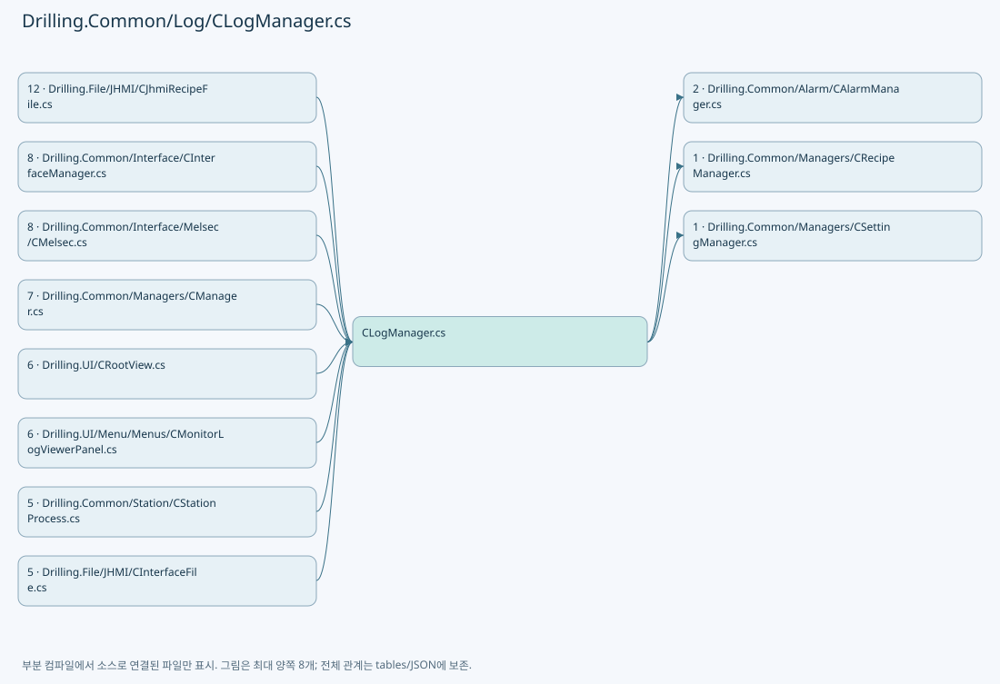

## 네임스페이스·타입·상속

| 타입 | 구분 | 원본 범위 | 선언/상속 |
| --- | --- | --- | --- |
| CLogManager | ClassDeclaration | 18–943 | CLogManager: IAlarmHistoryStore |
| InterfaceLogWriter | ClassDeclaration | 469–537 | InterfaceLogWriter |
| SequenceEntry | RecordDeclaration | 801–801 | SequenceEntry |
| CLogFileScope | ClassDeclaration | 946–995 | CLogFileScope |
| ST_SEQUENCE_LOG_TEXT | RecordDeclaration | 997–997 | ST_SEQUENCE_LOG_TEXT |
| CSequenceLogText | ClassDeclaration | 999–1399 | CSequenceLogText |
| ST_LOG_TEXT_PAGE | RecordDeclaration | 1401–1401 | ST_LOG_TEXT_PAGE |
| CLogTextReader | ClassDeclaration | 1403–1501 | CLogTextReader |
| ST_PM_HISTORY_ENTRY | RecordDeclaration | 1503–1508 | ST_PM_HISTORY_ENTRY |
| CProgramOpenLog | ClassDeclaration | 1510–1561 | CProgramOpenLog |

## 멤버 빠른 목록

| 이름 | 종류 | 범위 | 서명 |
| --- | --- | --- | --- |
| _alarmLogRoot | FieldDeclaration | L21–21 | string Drilling.Common.Log.CLogManager._alarmLogRoot |
| AlarmJson | FieldDeclaration | L22–25 | System.Text.Json.JsonSerializerOptions Drilling.Common.Log.CLogManager.AlarmJson |
| DefaultReadDays | FieldDeclaration | L26–26 | int Drilling.Common.Log.CLogManager.DefaultReadDays |
| DefaultRecipeReadRows | FieldDeclaration | L27–27 | int Drilling.Common.Log.CLogManager.DefaultRecipeReadRows |
| DefaultSettingReadRows | FieldDeclaration | L28–28 | int Drilling.Common.Log.CLogManager.DefaultSettingReadRows |
| FileLocks | FieldDeclaration | L31–31 | System.Collections.Concurrent.ConcurrentDictionary<string, object> Drilling.Common.Log.CLogManager.FileLocks |
| GetFileLock | MethodDeclaration | L32–32 | object Drilling.Common.Log.CLogManager.GetFileLock(string) |
| _recipeLogRoot | FieldDeclaration | L33–33 | string Drilling.Common.Log.CLogManager._recipeLogRoot |
| _settingLogRoot | FieldDeclaration | L34–34 | string Drilling.Common.Log.CLogManager._settingLogRoot |
| _interfaceLogRoot | FieldDeclaration | L35–35 | string Drilling.Common.Log.CLogManager._interfaceLogRoot |
| _stationLogRoot | FieldDeclaration | L36–36 | string Drilling.Common.Log.CLogManager._stationLogRoot |
| _productLogRoot | FieldDeclaration | L37–37 | string Drilling.Common.Log.CLogManager._productLogRoot |
| _uiLogRoot | FieldDeclaration | L38–38 | string Drilling.Common.Log.CLogManager._uiLogRoot |
| _pmHistoryRoot | FieldDeclaration | L39–39 | string Drilling.Common.Log.CLogManager._pmHistoryRoot |
| _pmHistoryLock | FieldDeclaration | L40–40 | object Drilling.Common.Log.CLogManager._pmHistoryLock |
| _pmHistoryCache | FieldDeclaration | L41–41 | System.Collections.Generic.IReadOnlyList<Drilling.Common.Log.ST_PM_HISTORY_ENTRY>? Drilling.Common.Log.CLogManager._pmHistoryCache |
| _sequenceLogLock | FieldDeclaration | L42–42 | object Drilling.Common.Log.CLogManager._sequenceLogLock |
| _sequenceText | FieldDeclaration | L43–43 | Drilling.Common.Log.CSequenceLogText Drilling.Common.Log.CLogManager._sequenceText |
| _sequenceQueue | FieldDeclaration | L44–44 | System.Threading.Channels.Channel<Drilling.Common.Log.CLogManager.SequenceEntry>? Drilling.Common.Log.CLogManager._sequenceQueue |
| _sequenceWriter | FieldDeclaration | L45–45 | System.Threading.Tasks.Task? Drilling.Common.Log.CLogManager._sequenceWriter |
| _sequenceStopped | FieldDeclaration | L46–46 | bool Drilling.Common.Log.CLogManager._sequenceStopped |
| _sequenceLogError | FieldDeclaration | L47–47 | string Drilling.Common.Log.CLogManager._sequenceLogError |
| _interfaceLogLock | FieldDeclaration | L48–48 | object Drilling.Common.Log.CLogManager._interfaceLogLock |
| _interfaceWriters | FieldDeclaration | L49–49 | System.Collections.Generic.Dictionary<string, Drilling.Common.Log.CLogManager.InterfaceLogWriter> Drilling.Common.Log.CLogManager._interfaceWriters |
| _interfaceLoggingStopped | FieldDeclaration | L50–50 | bool Drilling.Common.Log.CLogManager._interfaceLoggingStopped |
| _interfaceLogError | FieldDeclaration | L51–51 | string Drilling.Common.Log.CLogManager._interfaceLogError |
| .ctor | ConstructorDeclaration | L54–66 | Drilling.Common.Log.CLogManager.CLogManager(string) |
| LogDirectory | PropertyDeclaration | L70–70 | string Drilling.Common.Log.CLogManager.LogDirectory |
| get_LogDirectory | GetAccessorDeclaration | L70–70 | string Drilling.Common.Log.CLogManager.LogDirectory.get |
| StartPmSession | MethodDeclaration | L72–90 | Drilling.Common.Log.ST_PM_HISTORY_ENTRY Drilling.Common.Log.CLogManager.StartPmSession(string, string) |
| CompletePmSession | MethodDeclaration | L92–112 | Drilling.Common.Log.ST_PM_HISTORY_ENTRY Drilling.Common.Log.CLogManager.CompletePmSession(Drilling.Common.Log.ST_PM_HISTORY_ENTRY) |
| ReadPmHistory | MethodDeclaration | L114–123 | System.Collections.Generic.IReadOnlyList<Drilling.Common.Log.ST_PM_HISTORY_ENTRY> Drilling.Common.Log.CLogManager.ReadPmHistory(int) |
| LoadPmHistory | MethodDeclaration | L125–135 | System.Collections.Generic.IReadOnlyList<Drilling.Common.Log.ST_PM_HISTORY_ENTRY> Drilling.Common.Log.CLogManager.LoadPmHistory() |
| ReadPmHistoryEntry | MethodDeclaration | L137–148 | Drilling.Common.Log.ST_PM_HISTORY_ENTRY? Drilling.Common.Log.CLogManager.ReadPmHistoryEntry(string) |
| WritePmHistoryEntry | MethodDeclaration | L150–166 | void Drilling.Common.Log.CLogManager.WritePmHistoryEntry(Drilling.Common.Log.ST_PM_HISTORY_ENTRY) |
| PmHistoryPath | MethodDeclaration | L168–173 | string Drilling.Common.Log.CLogManager.PmHistoryPath(Drilling.Common.Log.ST_PM_HISTORY_ENTRY) |
| WriteStationState | MethodDeclaration | L175–183 | void Drilling.Common.Log.CLogManager.WriteStationState(string, string, string, string) |
| ReadRecipeRecent | MethodDeclaration | L185–208 | System.Collections.Generic.IReadOnlyList<Drilling.Common.Managers.ST_RECIPE_HISTORY> Drilling.Common.Log.CLogManager.ReadRecipeRecent(string, string, int, int) |
| ShouldIncludeItem | LocalFunctionStatement | L192–195 | bool ShouldIncludeItem(Drilling.Common.Managers.ST_RECIPE_HISTORY?) |
| ShouldIncludeRecipe | LocalFunctionStatement | L197–200 | bool ShouldIncludeRecipe(Drilling.Common.Managers.ST_RECIPE_HISTORY) |
| SelectChangedAt | LocalFunctionStatement | L202–205 | System.DateTimeOffset SelectChangedAt(Drilling.Common.Managers.ST_RECIPE_HISTORY) |
| WriteRecipeCreate | MethodDeclaration | L210–213 | void Drilling.Common.Log.CLogManager.WriteRecipeCreate(string) |
| ReadRecipeRecent | MethodDeclaration | L215–218 | System.Collections.Generic.IReadOnlyList<Drilling.Common.Managers.ST_RECIPE_HISTORY> Drilling.Common.Log.CLogManager.ReadRecipeRecent(int, int) |
| WriteRecipeSelect | MethodDeclaration | L220–223 | void Drilling.Common.Log.CLogManager.WriteRecipeSelect(string, string) |
| WriteRecipeDelete | MethodDeclaration | L225–228 | void Drilling.Common.Log.CLogManager.WriteRecipeDelete(string) |
| WriteRecipeSave | MethodDeclaration | L230–233 | void Drilling.Common.Log.CLogManager.WriteRecipeSave(string) |
| WriteRecipeModify | MethodDeclaration | L235–238 | void Drilling.Common.Log.CLogManager.WriteRecipeModify(string, string, string, string) |
| WriteRecipeModify | MethodDeclaration | L240–243 | void Drilling.Common.Log.CLogManager.WriteRecipeModify(string, string, string, string, string, string) |
| WriteRecipeModifyBatch | MethodDeclaration | L245–265 | void Drilling.Common.Log.CLogManager.WriteRecipeModifyBatch(string, System.Collections.Generic.IReadOnlyList<(string Tab, string Group, string ItemName, string OldValue, string NewValue)>) |
| WriteRecipeRename | MethodDeclaration | L267–270 | void Drilling.Common.Log.CLogManager.WriteRecipeRename(string, string) |
| ReadSettingRecent | MethodDeclaration | L272–290 | System.Collections.Generic.IReadOnlyList<Drilling.Common.Managers.ST_SETTING_HISTORY> Drilling.Common.Log.CLogManager.ReadSettingRecent(Drilling.Common.Managers.EN_SETTING_TAB, int, int) |
| ShouldIncludeItem | LocalFunctionStatement | L274–277 | bool ShouldIncludeItem(Drilling.Common.Managers.ST_SETTING_HISTORY?) |
| MatchesSection | LocalFunctionStatement | L279–282 | bool MatchesSection(Drilling.Common.Managers.ST_SETTING_HISTORY) |
| SelectChangedAt | LocalFunctionStatement | L284–287 | System.DateTimeOffset SelectChangedAt(Drilling.Common.Managers.ST_SETTING_HISTORY) |
| WriteSettingModify | MethodDeclaration | L292–295 | void Drilling.Common.Log.CLogManager.WriteSettingModify(Drilling.Common.Managers.EN_SETTING_TAB, string, string, string) |
| WriteSettingSave | MethodDeclaration | L297–300 | void Drilling.Common.Log.CLogManager.WriteSettingSave(Drilling.Common.Managers.EN_SETTING_TAB) |
| WriteInterfaceConnection | MethodDeclaration | L302–305 | void Drilling.Common.Log.CLogManager.WriteInterfaceConnection(Drilling.Common.Interface.EN_EQP_MODULE, string, string, string, string) |
| WriteInterfaceCommand | MethodDeclaration | L307–311 | void Drilling.Common.Log.CLogManager.WriteInterfaceCommand(Drilling.Common.Interface.EN_EQP_MODULE, string, string, string, string) |
| WriteInterfaceError | MethodDeclaration | L313–316 | void Drilling.Common.Log.CLogManager.WriteInterfaceError(Drilling.Common.Interface.EN_EQP_MODULE, string, string, string) |
| WriteInterfaceProtocolTrace | MethodDeclaration | L318–339 | void Drilling.Common.Log.CLogManager.WriteInterfaceProtocolTrace(Drilling.Common.Interface.EN_EQP_MODULE, System.DateTimeOffset, string) |
| WriteProductEvent | MethodDeclaration | L341–349 | void Drilling.Common.Log.CLogManager.WriteProductEvent(string, string, string, string, string) |
| WriteUiClick | MethodDeclaration | L351–354 | void Drilling.Common.Log.CLogManager.WriteUiClick(string, string, string, string) |
| WriteRecipeAction | MethodDeclaration | L356–364 | void Drilling.Common.Log.CLogManager.WriteRecipeAction(string, string, string, string, string) |
| WriteRecipeAction | MethodDeclaration | L366–374 | void Drilling.Common.Log.CLogManager.WriteRecipeAction(string, string, string, string, string, string, string) |
| WriteSettingAction | MethodDeclaration | L376–384 | void Drilling.Common.Log.CLogManager.WriteSettingAction(Drilling.Common.Managers.EN_SETTING_TAB, string, string, string, string) |
| WriteInterfaceAction | MethodDeclaration | L386–395 | void Drilling.Common.Log.CLogManager.WriteInterfaceAction(Drilling.Common.Interface.EN_EQP_MODULE, string, string, string, string) |
| WriteUiAction | MethodDeclaration | L397–405 | void Drilling.Common.Log.CLogManager.WriteUiAction(string, string, string, string, string) |
| AppendLine | MethodDeclaration | L407–410 | void Drilling.Common.Log.CLogManager.AppendLine(string, string, string) |
| AppendText | MethodDeclaration | L412–419 | void Drilling.Common.Log.CLogManager.AppendText(string, string, string) |
| InterfaceLogError | PropertyDeclaration | L424–424 | string Drilling.Common.Log.CLogManager.InterfaceLogError |
| QueueInterfaceText | MethodDeclaration | L426–437 | void Drilling.Common.Log.CLogManager.QueueInterfaceText(string, string, string) |
| InterfaceWriteFailed | MethodDeclaration | L439–444 | void Drilling.Common.Log.CLogManager.InterfaceWriteFailed(System.Exception) |
| FlushInterfaceAsync | MethodDeclaration | L446–454 | System.Threading.Tasks.Task Drilling.Common.Log.CLogManager.FlushInterfaceAsync(System.Threading.CancellationToken) |
| StopInterfaceLoggingAsync | MethodDeclaration | L456–467 | System.Threading.Tasks.Task Drilling.Common.Log.CLogManager.StopInterfaceLoggingAsync(System.Threading.CancellationToken) |
| MaximumQueuedBytes | FieldDeclaration | L471–471 | long Drilling.Common.Log.CLogManager.InterfaceLogWriter.MaximumQueuedBytes |
| _queue | FieldDeclaration | L472–473 | System.Threading.Channels.Channel<(string Text, System.Threading.Tasks.TaskCompletionSource? Barrier)> Drilling.Common.Log.CLogManager.InterfaceLogWriter._queue |
| _worker | FieldDeclaration | L474–474 | System.Threading.Tasks.Task Drilling.Common.Log.CLogManager.InterfaceLogWriter._worker |
| _queuedBytes | FieldDeclaration | L475–475 | long Drilling.Common.Log.CLogManager.InterfaceLogWriter._queuedBytes |
| .ctor | ConstructorDeclaration | L477–510 | Drilling.Common.Log.CLogManager.InterfaceLogWriter.InterfaceLogWriter(string, string, System.Action<System.Exception>) |
| TryWrite | MethodDeclaration | L512–519 | bool Drilling.Common.Log.CLogManager.InterfaceLogWriter.TryWrite(string) |
| Flush | MethodDeclaration | L521–530 | System.Threading.Tasks.Task Drilling.Common.Log.CLogManager.InterfaceLogWriter.Flush(System.Threading.CancellationToken) |
| Complete | MethodDeclaration | L532–536 | System.Threading.Tasks.Task Drilling.Common.Log.CLogManager.InterfaceLogWriter.Complete() |
| EnumerateRecentLogFiles | MethodDeclaration | L539–556 | System.Collections.Generic.IEnumerable<string> Drilling.Common.Log.CLogManager.EnumerateRecentLogFiles(string, int) |
| ReadLogFile | MethodDeclaration | L558–572 | System.Collections.Generic.IEnumerable<string> Drilling.Common.Log.CLogManager.ReadLogFile(string) |
| ParseRecipeLine | MethodDeclaration | L574–611 | Drilling.Common.Managers.ST_RECIPE_HISTORY? Drilling.Common.Log.CLogManager.ParseRecipeLine(string) |
| CreateRecipeHistory | MethodDeclaration | L613–616 | Drilling.Common.Managers.ST_RECIPE_HISTORY Drilling.Common.Log.CLogManager.CreateRecipeHistory(System.DateTimeOffset, string, string, string, string, string, string, string) |
| ParseSettingLine | MethodDeclaration | L618–632 | Drilling.Common.Managers.ST_SETTING_HISTORY? Drilling.Common.Log.CLogManager.ParseSettingLine(string) |
| SplitFields | MethodDeclaration | L634–660 | string[] Drilling.Common.Log.CLogManager.SplitFields(string) |
| EscapeField | MethodDeclaration | L662–665 | string Drilling.Common.Log.CLogManager.EscapeField(string) |
| ModuleLogName | MethodDeclaration | L667–675 | string Drilling.Common.Log.CLogManager.ModuleLogName(Drilling.Common.Interface.EN_EQP_MODULE) |
| NormalizeModuleName | MethodDeclaration | L677–680 | string Drilling.Common.Log.CLogManager.NormalizeModuleName(string) |
| UnescapeField | MethodDeclaration | L682–685 | string Drilling.Common.Log.CLogManager.UnescapeField(string) |
| TryReadSection | MethodDeclaration | L687–700 | bool Drilling.Common.Log.CLogManager.TryReadSection(string, out Drilling.Common.Managers.EN_SETTING_TAB) |
| ParseTimestamp | MethodDeclaration | L702–712 | System.DateTimeOffset Drilling.Common.Log.CLogManager.ParseTimestamp(string) |
| Append | MethodDeclaration | L716–735 | void Drilling.Common.Log.CLogManager.Append(Drilling.Common.Alarm.ST_ALARM_DATA) |
| Read | MethodDeclaration | L737–791 | Drilling.Common.Alarm.ST_ALARM_HISTORY_RESULT Drilling.Common.Log.CLogManager.Read(System.DateTime, System.DateTime, System.Threading.CancellationToken) |
| AlarmLogPath | MethodDeclaration | L793–797 | string Drilling.Common.Log.CLogManager.AlarmLogPath(System.DateTime) |
| SequenceLogError | PropertyDeclaration | L802–802 | string Drilling.Common.Log.CLogManager.SequenceLogError |
| WriteSequence | MethodDeclaration | L805–833 | void Drilling.Common.Log.CLogManager.WriteSequence(string, string, string, string) |
| Field | LocalFunctionStatement | L826–826 | string Field(string?) |
| EnsureSequenceWriter | MethodDeclaration | L835–841 | void Drilling.Common.Log.CLogManager.EnsureSequenceWriter() |
| FlushSequenceAsync | MethodDeclaration | L843–877 | System.Threading.Tasks.Task Drilling.Common.Log.CLogManager.FlushSequenceAsync(System.Threading.CancellationToken) |
| StopSequenceLoggingAsync | MethodDeclaration | L879–893 | System.Threading.Tasks.Task Drilling.Common.Log.CLogManager.StopSequenceLoggingAsync(System.Threading.CancellationToken) |
| WriteSequenceQueue | MethodDeclaration | L895–927 | System.Threading.Tasks.Task Drilling.Common.Log.CLogManager.WriteSequenceQueue(System.Threading.Channels.ChannelReader<Drilling.Common.Log.CLogManager.SequenceEntry>) |
| SequenceWriteFailed | MethodDeclaration | L929–941 | void Drilling.Common.Log.CLogManager.SequenceWriteFailed(System.Exception) |
| .ctor | ConstructorDeclaration | L948–948 | Drilling.Common.Log.CLogFileScope.CLogFileScope(string) |
| RootDirectory | PropertyDeclaration | L949–949 | string Drilling.Common.Log.CLogFileScope.RootDirectory |
| get_RootDirectory | GetAccessorDeclaration | L949–949 | string Drilling.Common.Log.CLogFileScope.RootDirectory.get |
| ResolveDirectory | MethodDeclaration | L951–957 | string Drilling.Common.Log.CLogFileScope.ResolveDirectory(string) |
| ResolveFile | MethodDeclaration | L959–965 | string Drilling.Common.Log.CLogFileScope.ResolveFile(string) |
| IsLogFile | MethodDeclaration | L967–967 | bool Drilling.Common.Log.CLogFileScope.IsLogFile(string) |
| IsAlarm | MethodDeclaration | L968–968 | bool Drilling.Common.Log.CLogFileScope.IsAlarm(string) |
| ResolvePath | MethodDeclaration | L969–988 | string Drilling.Common.Log.CLogFileScope.ResolvePath(string) |
| RejectLink | MethodDeclaration | L990–994 | void Drilling.Common.Log.CLogFileScope.RejectLink(string) |
| IdPattern | FieldDeclaration | L1001–1001 | System.Text.RegularExpressions.Regex Drilling.Common.Log.CSequenceLogText.IdPattern |
| ActionPattern | FieldDeclaration | L1002–1002 | System.Text.RegularExpressions.Regex Drilling.Common.Log.CSequenceLogText.ActionPattern |
| ExceptionPattern | FieldDeclaration | L1003–1003 | System.Text.RegularExpressions.Regex Drilling.Common.Log.CSequenceLogText.ExceptionPattern |
| RunIdPattern | FieldDeclaration | L1004–1004 | System.Text.RegularExpressions.Regex Drilling.Common.Log.CSequenceLogText.RunIdPattern |
| _addresses | FieldDeclaration | L1005–1005 | System.Collections.Generic.Dictionary<string, string> Drilling.Common.Log.CSequenceLogText._addresses |
| _signals | FieldDeclaration | L1006–1006 | System.Collections.Generic.Dictionary<string, string> Drilling.Common.Log.CSequenceLogText._signals |
| _writes | FieldDeclaration | L1007–1007 | System.Collections.Generic.Dictionary<string, string> Drilling.Common.Log.CSequenceLogText._writes |
| _glassByCycle | FieldDeclaration | L1008–1008 | System.Collections.Generic.Dictionary<string, string> Drilling.Common.Log.CSequenceLogText._glassByCycle |
| _glassCycles | FieldDeclaration | L1009–1009 | System.Collections.Generic.Queue<string> Drilling.Common.Log.CSequenceLogText._glassCycles |
| _reviewCycle | FieldDeclaration | L1010–1010 | string Drilling.Common.Log.CSequenceLogText._reviewCycle |
| _reviewGlass | FieldDeclaration | L1010–1010 | string Drilling.Common.Log.CSequenceLogText._reviewGlass |
| ActionNames | FieldDeclaration | L1011–1044 | System.Collections.Generic.Dictionary<string, (string Category, string Name)> Drilling.Common.Log.CSequenceLogText.ActionNames |
| Format | MethodDeclaration | L1045–1096 | Drilling.Common.Log.ST_SEQUENCE_LOG_TEXT? Drilling.Common.Log.CSequenceLogText.Format(string, string, string) |
| RememberGlass | MethodDeclaration | L1098–1107 | void Drilling.Common.Log.CSequenceLogText.RememberGlass(string, string) |
| FormatCore | MethodDeclaration | L1109–1273 | Drilling.Common.Log.ST_SEQUENCE_LOG_TEXT? Drilling.Common.Log.CSequenceLogText.FormatCore(string, string, string) |
| CommonFlow | MethodDeclaration | L1275–1330 | Drilling.Common.Log.ST_SEQUENCE_LOG_TEXT? Drilling.Common.Log.CSequenceLogText.CommonFlow(string) |
| Signal | MethodDeclaration | L1332–1357 | Drilling.Common.Log.ST_SEQUENCE_LOG_TEXT Drilling.Common.Log.CSequenceLogText.Signal(string, string, string) |
| Data | MethodDeclaration | L1359–1368 | Drilling.Common.Log.ST_SEQUENCE_LOG_TEXT Drilling.Common.Log.CSequenceLogText.Data(string, string, string) |
| Address | MethodDeclaration | L1370–1370 | string Drilling.Common.Log.CSequenceLogText.Address(string) |
| OnOff | MethodDeclaration | L1371–1377 | string Drilling.Common.Log.CSequenceLogText.OnOff(string) |
| Duration | MethodDeclaration | L1378–1378 | string Drilling.Common.Log.CSequenceLogText.Duration(string) |
| NumberAfterId | MethodDeclaration | L1379–1379 | string Drilling.Common.Log.CSequenceLogText.NumberAfterId(string, string) |
| Reason | MethodDeclaration | L1380–1386 | string Drilling.Common.Log.CSequenceLogText.Reason(string) |
| Field | MethodDeclaration | L1388–1396 | string Drilling.Common.Log.CSequenceLogText.Field(string, string) |
| ProcessText | MethodDeclaration | L1398–1398 | string Drilling.Common.Log.CSequenceLogText.ProcessText(string) |
| PageCharacterLimit | FieldDeclaration | L1405–1405 | int Drilling.Common.Log.CLogTextReader.PageCharacterLimit |
| ReadAllAsync | MethodDeclaration | L1408–1411 | System.Threading.Tasks.Task<Drilling.Common.Log.ST_LOG_TEXT_PAGE> Drilling.Common.Log.CLogTextReader.ReadAllAsync(string, System.Threading.CancellationToken) |
| ReadAllAsync | MethodDeclaration | L1413–1453 | System.Threading.Tasks.Task<Drilling.Common.Log.ST_LOG_TEXT_PAGE> Drilling.Common.Log.CLogTextReader.ReadAllAsync(string, System.IProgress<double>?, System.Threading.CancellationToken) |
| ReadPage | MethodDeclaration | L1455–1485 | Drilling.Common.Log.ST_LOG_TEXT_PAGE Drilling.Common.Log.CLogTextReader.ReadPage(string, long) |
| DetectEncoding | MethodDeclaration | L1487–1500 | (System.Text.Encoding Encoding, int Preamble) Drilling.Common.Log.CLogTextReader.DetectEncoding(System.ReadOnlySpan<byte>) |
| LogDirectory | PropertyDeclaration | L1512–1518 | string Drilling.Common.Log.CProgramOpenLog.LogDirectory |
| get_LogDirectory | GetAccessorDeclaration | L1514–1517 | string Drilling.Common.Log.CProgramOpenLog.LogDirectory.get |
| LogPath | PropertyDeclaration | L1520–1526 | string Drilling.Common.Log.CProgramOpenLog.LogPath |
| get_LogPath | GetAccessorDeclaration | L1522–1525 | string Drilling.Common.Log.CProgramOpenLog.LogPath.get |
| Write | MethodDeclaration | L1528–1531 | void Drilling.Common.Log.CProgramOpenLog.Write(string, System.Exception) |
| Write | MethodDeclaration | L1533–1544 | void Drilling.Common.Log.CProgramOpenLog.Write(string, string) |
| FindProjectRoot | MethodDeclaration | L1546–1560 | string Drilling.Common.Log.CProgramOpenLog.FindProjectRoot() |

## 멤버별 상세 계약·호출·처리 해설

### FieldDeclaration `_alarmLogRoot` · L21–21

[Drilling.Common/Log/CLogManager.cs:21–21](https://github.com/kjuws10-rgb/A3Drilling/blob/0219666f9053b907d96d7e0aa7d0c6c1be3a73d4/Drilling.Common/Log/CLogManager.cs#L21-L21)

| 항목 | 실제 추출 값 |
| --- | --- |
| 서명 | string Drilling.Common.Log.CLogManager._alarmLogRoot |
| 접근/수식자 | Private / private, readonly |
| 반환/값 타입 | string |
| 소속 타입 | NamedType:Drilling.Common.Log.CLogManager |

현재 부분 분석에서 직접 연결된 호출자는 없습니다. XAML/이벤트/인터페이스·델리게이트·외부 진입을 추가 확인해야 하며, 미사용으로 판정한 것이 아닙니다.

변경 전 점검: 입력/반환 타입, 위 호출자, 예외/취소 경로, 공유 상태와 저장·전송 소비자를 함께 확인합니다. 값의 단위나 물리 방향을 이름만으로 확정하지 않습니다.

### FieldDeclaration `AlarmJson` · L22–25

[Drilling.Common/Log/CLogManager.cs:22–25](https://github.com/kjuws10-rgb/A3Drilling/blob/0219666f9053b907d96d7e0aa7d0c6c1be3a73d4/Drilling.Common/Log/CLogManager.cs#L22-L25)

| 항목 | 실제 추출 값 |
| --- | --- |
| 서명 | System.Text.Json.JsonSerializerOptions Drilling.Common.Log.CLogManager.AlarmJson |
| 접근/수식자 | Private / private, static, readonly |
| 반환/값 타입 | System.Text.Json.JsonSerializerOptions |
| 소속 타입 | NamedType:Drilling.Common.Log.CLogManager |

현재 부분 분석에서 직접 연결된 호출자는 없습니다. XAML/이벤트/인터페이스·델리게이트·외부 진입을 추가 확인해야 하며, 미사용으로 판정한 것이 아닙니다.

호출하는 대상과 해석 범위:

| 원본 행 | 표현식 | 분석 상태 | 대상/소스 위치 |
| --- | --- | --- | --- |
| 22 | new | resolved | System.Text.Json.JsonSerializerOptions.JsonSerializerOptions() |

본문의 실제 연산·분기·예외·반환 순서(원문 위치 순):

| 원본 행 | 종류 | 주석 해설 |
| --- | --- | --- |
| 22 | call | 함수·델리게이트 또는 객체 생성자를 호출합니다: new() { Encoder = System.Text.Encodings.Web.JavaScriptEncoder.UnsafeRelaxedJsonEscaping } |
| 22 | variable-initializer | 변수의 초기값을 지정합니다: AlarmJson = new() { Encoder = System.Text.Encodings.Web.JavaScriptEncoder.UnsafeRelaxedJsonEscaping } |
| 24 | assignment | 값을 대상에 대입합니다: Encoder = System.Text.Encodings.Web.JavaScriptEncoder.UnsafeRelaxedJsonEscaping |

변경 전 점검: 입력/반환 타입, 위 호출자, 예외/취소 경로, 공유 상태와 저장·전송 소비자를 함께 확인합니다. 값의 단위나 물리 방향을 이름만으로 확정하지 않습니다.

### FieldDeclaration `DefaultReadDays` · L26–26

[Drilling.Common/Log/CLogManager.cs:26–26](https://github.com/kjuws10-rgb/A3Drilling/blob/0219666f9053b907d96d7e0aa7d0c6c1be3a73d4/Drilling.Common/Log/CLogManager.cs#L26-L26)

| 항목 | 실제 추출 값 |
| --- | --- |
| 서명 | int Drilling.Common.Log.CLogManager.DefaultReadDays |
| 접근/수식자 | Private / private, const |
| 반환/값 타입 | int |
| 소속 타입 | NamedType:Drilling.Common.Log.CLogManager |

현재 부분 분석에서 직접 연결된 호출자는 없습니다. XAML/이벤트/인터페이스·델리게이트·외부 진입을 추가 확인해야 하며, 미사용으로 판정한 것이 아닙니다.

본문의 실제 연산·분기·예외·반환 순서(원문 위치 순):

| 원본 행 | 종류 | 주석 해설 |
| --- | --- | --- |
| 26 | variable-initializer | 변수의 초기값을 지정합니다: DefaultReadDays = 14 |

변경 전 점검: 입력/반환 타입, 위 호출자, 예외/취소 경로, 공유 상태와 저장·전송 소비자를 함께 확인합니다. 값의 단위나 물리 방향을 이름만으로 확정하지 않습니다.

### FieldDeclaration `DefaultRecipeReadRows` · L27–27

[Drilling.Common/Log/CLogManager.cs:27–27](https://github.com/kjuws10-rgb/A3Drilling/blob/0219666f9053b907d96d7e0aa7d0c6c1be3a73d4/Drilling.Common/Log/CLogManager.cs#L27-L27)

| 항목 | 실제 추출 값 |
| --- | --- |
| 서명 | int Drilling.Common.Log.CLogManager.DefaultRecipeReadRows |
| 접근/수식자 | Private / private, const |
| 반환/값 타입 | int |
| 소속 타입 | NamedType:Drilling.Common.Log.CLogManager |

현재 부분 분석에서 직접 연결된 호출자는 없습니다. XAML/이벤트/인터페이스·델리게이트·외부 진입을 추가 확인해야 하며, 미사용으로 판정한 것이 아닙니다.

본문의 실제 연산·분기·예외·반환 순서(원문 위치 순):

| 원본 행 | 종류 | 주석 해설 |
| --- | --- | --- |
| 27 | variable-initializer | 변수의 초기값을 지정합니다: DefaultRecipeReadRows = 10 |

변경 전 점검: 입력/반환 타입, 위 호출자, 예외/취소 경로, 공유 상태와 저장·전송 소비자를 함께 확인합니다. 값의 단위나 물리 방향을 이름만으로 확정하지 않습니다.

### FieldDeclaration `DefaultSettingReadRows` · L28–28

[Drilling.Common/Log/CLogManager.cs:28–28](https://github.com/kjuws10-rgb/A3Drilling/blob/0219666f9053b907d96d7e0aa7d0c6c1be3a73d4/Drilling.Common/Log/CLogManager.cs#L28-L28)

| 항목 | 실제 추출 값 |
| --- | --- |
| 서명 | int Drilling.Common.Log.CLogManager.DefaultSettingReadRows |
| 접근/수식자 | Private / private, const |
| 반환/값 타입 | int |
| 소속 타입 | NamedType:Drilling.Common.Log.CLogManager |

현재 부분 분석에서 직접 연결된 호출자는 없습니다. XAML/이벤트/인터페이스·델리게이트·외부 진입을 추가 확인해야 하며, 미사용으로 판정한 것이 아닙니다.

본문의 실제 연산·분기·예외·반환 순서(원문 위치 순):

| 원본 행 | 종류 | 주석 해설 |
| --- | --- | --- |
| 28 | variable-initializer | 변수의 초기값을 지정합니다: DefaultSettingReadRows = 20 |

변경 전 점검: 입력/반환 타입, 위 호출자, 예외/취소 경로, 공유 상태와 저장·전송 소비자를 함께 확인합니다. 값의 단위나 물리 방향을 이름만으로 확정하지 않습니다.

### FieldDeclaration `FileLocks` · L31–31

[Drilling.Common/Log/CLogManager.cs:31–31](https://github.com/kjuws10-rgb/A3Drilling/blob/0219666f9053b907d96d7e0aa7d0c6c1be3a73d4/Drilling.Common/Log/CLogManager.cs#L31-L31)

| 항목 | 실제 추출 값 |
| --- | --- |
| 서명 | System.Collections.Concurrent.ConcurrentDictionary<string, object> Drilling.Common.Log.CLogManager.FileLocks |
| 접근/수식자 | Private / private, static, readonly |
| 반환/값 타입 | System.Collections.Concurrent.ConcurrentDictionary<string, object> |
| 소속 타입 | NamedType:Drilling.Common.Log.CLogManager |

현재 부분 분석에서 직접 연결된 호출자는 없습니다. XAML/이벤트/인터페이스·델리게이트·외부 진입을 추가 확인해야 하며, 미사용으로 판정한 것이 아닙니다.

호출하는 대상과 해석 범위:

| 원본 행 | 표현식 | 분석 상태 | 대상/소스 위치 |
| --- | --- | --- | --- |
| 31 | new | resolved | System.Collections.Concurrent.ConcurrentDictionary<string, object>.ConcurrentDictionary(System.Collections.Generic.IEqualityComparer<string>?) |

본문의 실제 연산·분기·예외·반환 순서(원문 위치 순):

| 원본 행 | 종류 | 주석 해설 |
| --- | --- | --- |
| 31 | call | 함수·델리게이트 또는 객체 생성자를 호출합니다: new(StringComparer.OrdinalIgnoreCase) |
| 31 | variable-initializer | 변수의 초기값을 지정합니다: FileLocks = new(StringComparer.OrdinalIgnoreCase) |

변경 전 점검: 입력/반환 타입, 위 호출자, 예외/취소 경로, 공유 상태와 저장·전송 소비자를 함께 확인합니다. 값의 단위나 물리 방향을 이름만으로 확정하지 않습니다.

### MethodDeclaration `GetFileLock` · L32–32

[Drilling.Common/Log/CLogManager.cs:32–32](https://github.com/kjuws10-rgb/A3Drilling/blob/0219666f9053b907d96d7e0aa7d0c6c1be3a73d4/Drilling.Common/Log/CLogManager.cs#L32-L32)

| 항목 | 실제 추출 값 |
| --- | --- |
| 서명 | object Drilling.Common.Log.CLogManager.GetFileLock(string) |
| 접근/수식자 | Private / private, static |
| 반환/값 타입 | object |
| 소속 타입 | NamedType:Drilling.Common.Log.CLogManager |

입력 계약:

| 이름 | 타입 | 전달 | 선택/기본값 |
| --- | --- | --- | --- |
| path | string | None | False /  |

정적 호출자로 확인된 위치:

| 호출 파일/행 | 호출 표현식 | 런타임 분기 가능 |
| --- | --- | --- |
| [Drilling.Common/Log/CLogManager.cs:414–414](https://github.com/kjuws10-rgb/A3Drilling/blob/0219666f9053b907d96d7e0aa7d0c6c1be3a73d4/Drilling.Common/Log/CLogManager.cs#L414-L414) | GetFileLock | False |
| [Drilling.Common/Log/CLogManager.cs:730–730](https://github.com/kjuws10-rgb/A3Drilling/blob/0219666f9053b907d96d7e0aa7d0c6c1be3a73d4/Drilling.Common/Log/CLogManager.cs#L730-L730) | GetFileLock | False |
| [Drilling.Common/Log/CLogManager.cs:752–752](https://github.com/kjuws10-rgb/A3Drilling/blob/0219666f9053b907d96d7e0aa7d0c6c1be3a73d4/Drilling.Common/Log/CLogManager.cs#L752-L752) | GetFileLock | False |

호출하는 대상과 해석 범위:

| 원본 행 | 표현식 | 분석 상태 | 대상/소스 위치 |
| --- | --- | --- | --- |
| 32 | FileLocks.GetOrAdd | resolved | object System.Collections.Concurrent.ConcurrentDictionary<string, object>.GetOrAdd(string, System.Func<string, object>) |
| 32 | Path.GetFullPath | resolved | string System.IO.Path.GetFullPath(string) |
| 32 | new object | resolved | object.Object() |

본문의 실제 연산·분기·예외·반환 순서(원문 위치 순):

| 원본 행 | 종류 | 주석 해설 |
| --- | --- | --- |
| 32 | call | 함수·델리게이트 또는 객체 생성자를 호출합니다: FileLocks.GetOrAdd(Path.GetFullPath(path), static _ => new object()) |
| 32 | call | 함수·델리게이트 또는 객체 생성자를 호출합니다: Path.GetFullPath(path) |
| 32 | call | 함수·델리게이트 또는 객체 생성자를 호출합니다: new object() |

변경 전 점검: 입력/반환 타입, 위 호출자, 예외/취소 경로, 공유 상태와 저장·전송 소비자를 함께 확인합니다. 값의 단위나 물리 방향을 이름만으로 확정하지 않습니다.

### FieldDeclaration `_recipeLogRoot` · L33–33

[Drilling.Common/Log/CLogManager.cs:33–33](https://github.com/kjuws10-rgb/A3Drilling/blob/0219666f9053b907d96d7e0aa7d0c6c1be3a73d4/Drilling.Common/Log/CLogManager.cs#L33-L33)

| 항목 | 실제 추출 값 |
| --- | --- |
| 서명 | string Drilling.Common.Log.CLogManager._recipeLogRoot |
| 접근/수식자 | Private / private, readonly |
| 반환/값 타입 | string |
| 소속 타입 | NamedType:Drilling.Common.Log.CLogManager |

현재 부분 분석에서 직접 연결된 호출자는 없습니다. XAML/이벤트/인터페이스·델리게이트·외부 진입을 추가 확인해야 하며, 미사용으로 판정한 것이 아닙니다.

변경 전 점검: 입력/반환 타입, 위 호출자, 예외/취소 경로, 공유 상태와 저장·전송 소비자를 함께 확인합니다. 값의 단위나 물리 방향을 이름만으로 확정하지 않습니다.

### FieldDeclaration `_settingLogRoot` · L34–34

[Drilling.Common/Log/CLogManager.cs:34–34](https://github.com/kjuws10-rgb/A3Drilling/blob/0219666f9053b907d96d7e0aa7d0c6c1be3a73d4/Drilling.Common/Log/CLogManager.cs#L34-L34)

| 항목 | 실제 추출 값 |
| --- | --- |
| 서명 | string Drilling.Common.Log.CLogManager._settingLogRoot |
| 접근/수식자 | Private / private, readonly |
| 반환/값 타입 | string |
| 소속 타입 | NamedType:Drilling.Common.Log.CLogManager |

현재 부분 분석에서 직접 연결된 호출자는 없습니다. XAML/이벤트/인터페이스·델리게이트·외부 진입을 추가 확인해야 하며, 미사용으로 판정한 것이 아닙니다.

변경 전 점검: 입력/반환 타입, 위 호출자, 예외/취소 경로, 공유 상태와 저장·전송 소비자를 함께 확인합니다. 값의 단위나 물리 방향을 이름만으로 확정하지 않습니다.

### FieldDeclaration `_interfaceLogRoot` · L35–35

[Drilling.Common/Log/CLogManager.cs:35–35](https://github.com/kjuws10-rgb/A3Drilling/blob/0219666f9053b907d96d7e0aa7d0c6c1be3a73d4/Drilling.Common/Log/CLogManager.cs#L35-L35)

| 항목 | 실제 추출 값 |
| --- | --- |
| 서명 | string Drilling.Common.Log.CLogManager._interfaceLogRoot |
| 접근/수식자 | Private / private, readonly |
| 반환/값 타입 | string |
| 소속 타입 | NamedType:Drilling.Common.Log.CLogManager |

현재 부분 분석에서 직접 연결된 호출자는 없습니다. XAML/이벤트/인터페이스·델리게이트·외부 진입을 추가 확인해야 하며, 미사용으로 판정한 것이 아닙니다.

변경 전 점검: 입력/반환 타입, 위 호출자, 예외/취소 경로, 공유 상태와 저장·전송 소비자를 함께 확인합니다. 값의 단위나 물리 방향을 이름만으로 확정하지 않습니다.

### FieldDeclaration `_stationLogRoot` · L36–36

[Drilling.Common/Log/CLogManager.cs:36–36](https://github.com/kjuws10-rgb/A3Drilling/blob/0219666f9053b907d96d7e0aa7d0c6c1be3a73d4/Drilling.Common/Log/CLogManager.cs#L36-L36)

| 항목 | 실제 추출 값 |
| --- | --- |
| 서명 | string Drilling.Common.Log.CLogManager._stationLogRoot |
| 접근/수식자 | Private / private, readonly |
| 반환/값 타입 | string |
| 소속 타입 | NamedType:Drilling.Common.Log.CLogManager |

현재 부분 분석에서 직접 연결된 호출자는 없습니다. XAML/이벤트/인터페이스·델리게이트·외부 진입을 추가 확인해야 하며, 미사용으로 판정한 것이 아닙니다.

변경 전 점검: 입력/반환 타입, 위 호출자, 예외/취소 경로, 공유 상태와 저장·전송 소비자를 함께 확인합니다. 값의 단위나 물리 방향을 이름만으로 확정하지 않습니다.

### FieldDeclaration `_productLogRoot` · L37–37

[Drilling.Common/Log/CLogManager.cs:37–37](https://github.com/kjuws10-rgb/A3Drilling/blob/0219666f9053b907d96d7e0aa7d0c6c1be3a73d4/Drilling.Common/Log/CLogManager.cs#L37-L37)

| 항목 | 실제 추출 값 |
| --- | --- |
| 서명 | string Drilling.Common.Log.CLogManager._productLogRoot |
| 접근/수식자 | Private / private, readonly |
| 반환/값 타입 | string |
| 소속 타입 | NamedType:Drilling.Common.Log.CLogManager |

현재 부분 분석에서 직접 연결된 호출자는 없습니다. XAML/이벤트/인터페이스·델리게이트·외부 진입을 추가 확인해야 하며, 미사용으로 판정한 것이 아닙니다.

변경 전 점검: 입력/반환 타입, 위 호출자, 예외/취소 경로, 공유 상태와 저장·전송 소비자를 함께 확인합니다. 값의 단위나 물리 방향을 이름만으로 확정하지 않습니다.

### FieldDeclaration `_uiLogRoot` · L38–38

[Drilling.Common/Log/CLogManager.cs:38–38](https://github.com/kjuws10-rgb/A3Drilling/blob/0219666f9053b907d96d7e0aa7d0c6c1be3a73d4/Drilling.Common/Log/CLogManager.cs#L38-L38)

| 항목 | 실제 추출 값 |
| --- | --- |
| 서명 | string Drilling.Common.Log.CLogManager._uiLogRoot |
| 접근/수식자 | Private / private, readonly |
| 반환/값 타입 | string |
| 소속 타입 | NamedType:Drilling.Common.Log.CLogManager |

현재 부분 분석에서 직접 연결된 호출자는 없습니다. XAML/이벤트/인터페이스·델리게이트·외부 진입을 추가 확인해야 하며, 미사용으로 판정한 것이 아닙니다.

변경 전 점검: 입력/반환 타입, 위 호출자, 예외/취소 경로, 공유 상태와 저장·전송 소비자를 함께 확인합니다. 값의 단위나 물리 방향을 이름만으로 확정하지 않습니다.

### FieldDeclaration `_pmHistoryRoot` · L39–39

[Drilling.Common/Log/CLogManager.cs:39–39](https://github.com/kjuws10-rgb/A3Drilling/blob/0219666f9053b907d96d7e0aa7d0c6c1be3a73d4/Drilling.Common/Log/CLogManager.cs#L39-L39)

| 항목 | 실제 추출 값 |
| --- | --- |
| 서명 | string Drilling.Common.Log.CLogManager._pmHistoryRoot |
| 접근/수식자 | Private / private, readonly |
| 반환/값 타입 | string |
| 소속 타입 | NamedType:Drilling.Common.Log.CLogManager |

현재 부분 분석에서 직접 연결된 호출자는 없습니다. XAML/이벤트/인터페이스·델리게이트·외부 진입을 추가 확인해야 하며, 미사용으로 판정한 것이 아닙니다.

변경 전 점검: 입력/반환 타입, 위 호출자, 예외/취소 경로, 공유 상태와 저장·전송 소비자를 함께 확인합니다. 값의 단위나 물리 방향을 이름만으로 확정하지 않습니다.

### FieldDeclaration `_pmHistoryLock` · L40–40

[Drilling.Common/Log/CLogManager.cs:40–40](https://github.com/kjuws10-rgb/A3Drilling/blob/0219666f9053b907d96d7e0aa7d0c6c1be3a73d4/Drilling.Common/Log/CLogManager.cs#L40-L40)

| 항목 | 실제 추출 값 |
| --- | --- |
| 서명 | object Drilling.Common.Log.CLogManager._pmHistoryLock |
| 접근/수식자 | Private / private, readonly |
| 반환/값 타입 | object |
| 소속 타입 | NamedType:Drilling.Common.Log.CLogManager |

현재 부분 분석에서 직접 연결된 호출자는 없습니다. XAML/이벤트/인터페이스·델리게이트·외부 진입을 추가 확인해야 하며, 미사용으로 판정한 것이 아닙니다.

호출하는 대상과 해석 범위:

| 원본 행 | 표현식 | 분석 상태 | 대상/소스 위치 |
| --- | --- | --- | --- |
| 40 | new | resolved | object.Object() |

본문의 실제 연산·분기·예외·반환 순서(원문 위치 순):

| 원본 행 | 종류 | 주석 해설 |
| --- | --- | --- |
| 40 | call | 함수·델리게이트 또는 객체 생성자를 호출합니다: new() |
| 40 | variable-initializer | 변수의 초기값을 지정합니다: _pmHistoryLock = new() |

변경 전 점검: 입력/반환 타입, 위 호출자, 예외/취소 경로, 공유 상태와 저장·전송 소비자를 함께 확인합니다. 값의 단위나 물리 방향을 이름만으로 확정하지 않습니다.

### FieldDeclaration `_pmHistoryCache` · L41–41

[Drilling.Common/Log/CLogManager.cs:41–41](https://github.com/kjuws10-rgb/A3Drilling/blob/0219666f9053b907d96d7e0aa7d0c6c1be3a73d4/Drilling.Common/Log/CLogManager.cs#L41-L41)

| 항목 | 실제 추출 값 |
| --- | --- |
| 서명 | System.Collections.Generic.IReadOnlyList<Drilling.Common.Log.ST_PM_HISTORY_ENTRY>? Drilling.Common.Log.CLogManager._pmHistoryCache |
| 접근/수식자 | Private / private |
| 반환/값 타입 | System.Collections.Generic.IReadOnlyList<Drilling.Common.Log.ST_PM_HISTORY_ENTRY>? |
| 소속 타입 | NamedType:Drilling.Common.Log.CLogManager |

현재 부분 분석에서 직접 연결된 호출자는 없습니다. XAML/이벤트/인터페이스·델리게이트·외부 진입을 추가 확인해야 하며, 미사용으로 판정한 것이 아닙니다.

변경 전 점검: 입력/반환 타입, 위 호출자, 예외/취소 경로, 공유 상태와 저장·전송 소비자를 함께 확인합니다. 값의 단위나 물리 방향을 이름만으로 확정하지 않습니다.

### FieldDeclaration `_sequenceLogLock` · L42–42

[Drilling.Common/Log/CLogManager.cs:42–42](https://github.com/kjuws10-rgb/A3Drilling/blob/0219666f9053b907d96d7e0aa7d0c6c1be3a73d4/Drilling.Common/Log/CLogManager.cs#L42-L42)

| 항목 | 실제 추출 값 |
| --- | --- |
| 서명 | object Drilling.Common.Log.CLogManager._sequenceLogLock |
| 접근/수식자 | Private / private, readonly |
| 반환/값 타입 | object |
| 소속 타입 | NamedType:Drilling.Common.Log.CLogManager |

현재 부분 분석에서 직접 연결된 호출자는 없습니다. XAML/이벤트/인터페이스·델리게이트·외부 진입을 추가 확인해야 하며, 미사용으로 판정한 것이 아닙니다.

호출하는 대상과 해석 범위:

| 원본 행 | 표현식 | 분석 상태 | 대상/소스 위치 |
| --- | --- | --- | --- |
| 42 | new | resolved | object.Object() |

본문의 실제 연산·분기·예외·반환 순서(원문 위치 순):

| 원본 행 | 종류 | 주석 해설 |
| --- | --- | --- |
| 42 | call | 함수·델리게이트 또는 객체 생성자를 호출합니다: new() |
| 42 | variable-initializer | 변수의 초기값을 지정합니다: _sequenceLogLock = new() |

변경 전 점검: 입력/반환 타입, 위 호출자, 예외/취소 경로, 공유 상태와 저장·전송 소비자를 함께 확인합니다. 값의 단위나 물리 방향을 이름만으로 확정하지 않습니다.

### FieldDeclaration `_sequenceText` · L43–43

[Drilling.Common/Log/CLogManager.cs:43–43](https://github.com/kjuws10-rgb/A3Drilling/blob/0219666f9053b907d96d7e0aa7d0c6c1be3a73d4/Drilling.Common/Log/CLogManager.cs#L43-L43)

| 항목 | 실제 추출 값 |
| --- | --- |
| 서명 | Drilling.Common.Log.CSequenceLogText Drilling.Common.Log.CLogManager._sequenceText |
| 접근/수식자 | Private / private, readonly |
| 반환/값 타입 | Drilling.Common.Log.CSequenceLogText |
| 소속 타입 | NamedType:Drilling.Common.Log.CLogManager |

현재 부분 분석에서 직접 연결된 호출자는 없습니다. XAML/이벤트/인터페이스·델리게이트·외부 진입을 추가 확인해야 하며, 미사용으로 판정한 것이 아닙니다.

호출하는 대상과 해석 범위:

| 원본 행 | 표현식 | 분석 상태 | 대상/소스 위치 |
| --- | --- | --- | --- |
| 43 | new | resolved | Drilling.Common.Log.CSequenceLogText.CSequenceLogText() · Drilling.Common/Log/CLogManager.cs:999 |

본문의 실제 연산·분기·예외·반환 순서(원문 위치 순):

| 원본 행 | 종류 | 주석 해설 |
| --- | --- | --- |
| 43 | call | 함수·델리게이트 또는 객체 생성자를 호출합니다: new() |
| 43 | variable-initializer | 변수의 초기값을 지정합니다: _sequenceText = new() |

변경 전 점검: 입력/반환 타입, 위 호출자, 예외/취소 경로, 공유 상태와 저장·전송 소비자를 함께 확인합니다. 값의 단위나 물리 방향을 이름만으로 확정하지 않습니다.

### FieldDeclaration `_sequenceQueue` · L44–44

[Drilling.Common/Log/CLogManager.cs:44–44](https://github.com/kjuws10-rgb/A3Drilling/blob/0219666f9053b907d96d7e0aa7d0c6c1be3a73d4/Drilling.Common/Log/CLogManager.cs#L44-L44)

| 항목 | 실제 추출 값 |
| --- | --- |
| 서명 | System.Threading.Channels.Channel<Drilling.Common.Log.CLogManager.SequenceEntry>? Drilling.Common.Log.CLogManager._sequenceQueue |
| 접근/수식자 | Private / private |
| 반환/값 타입 | System.Threading.Channels.Channel<Drilling.Common.Log.CLogManager.SequenceEntry>? |
| 소속 타입 | NamedType:Drilling.Common.Log.CLogManager |

현재 부분 분석에서 직접 연결된 호출자는 없습니다. XAML/이벤트/인터페이스·델리게이트·외부 진입을 추가 확인해야 하며, 미사용으로 판정한 것이 아닙니다.

변경 전 점검: 입력/반환 타입, 위 호출자, 예외/취소 경로, 공유 상태와 저장·전송 소비자를 함께 확인합니다. 값의 단위나 물리 방향을 이름만으로 확정하지 않습니다.

### FieldDeclaration `_sequenceWriter` · L45–45

[Drilling.Common/Log/CLogManager.cs:45–45](https://github.com/kjuws10-rgb/A3Drilling/blob/0219666f9053b907d96d7e0aa7d0c6c1be3a73d4/Drilling.Common/Log/CLogManager.cs#L45-L45)

| 항목 | 실제 추출 값 |
| --- | --- |
| 서명 | System.Threading.Tasks.Task? Drilling.Common.Log.CLogManager._sequenceWriter |
| 접근/수식자 | Private / private |
| 반환/값 타입 | System.Threading.Tasks.Task? |
| 소속 타입 | NamedType:Drilling.Common.Log.CLogManager |

현재 부분 분석에서 직접 연결된 호출자는 없습니다. XAML/이벤트/인터페이스·델리게이트·외부 진입을 추가 확인해야 하며, 미사용으로 판정한 것이 아닙니다.

변경 전 점검: 입력/반환 타입, 위 호출자, 예외/취소 경로, 공유 상태와 저장·전송 소비자를 함께 확인합니다. 값의 단위나 물리 방향을 이름만으로 확정하지 않습니다.

### FieldDeclaration `_sequenceStopped` · L46–46

[Drilling.Common/Log/CLogManager.cs:46–46](https://github.com/kjuws10-rgb/A3Drilling/blob/0219666f9053b907d96d7e0aa7d0c6c1be3a73d4/Drilling.Common/Log/CLogManager.cs#L46-L46)

| 항목 | 실제 추출 값 |
| --- | --- |
| 서명 | bool Drilling.Common.Log.CLogManager._sequenceStopped |
| 접근/수식자 | Private / private |
| 반환/값 타입 | bool |
| 소속 타입 | NamedType:Drilling.Common.Log.CLogManager |

현재 부분 분석에서 직접 연결된 호출자는 없습니다. XAML/이벤트/인터페이스·델리게이트·외부 진입을 추가 확인해야 하며, 미사용으로 판정한 것이 아닙니다.

변경 전 점검: 입력/반환 타입, 위 호출자, 예외/취소 경로, 공유 상태와 저장·전송 소비자를 함께 확인합니다. 값의 단위나 물리 방향을 이름만으로 확정하지 않습니다.

### FieldDeclaration `_sequenceLogError` · L47–47

[Drilling.Common/Log/CLogManager.cs:47–47](https://github.com/kjuws10-rgb/A3Drilling/blob/0219666f9053b907d96d7e0aa7d0c6c1be3a73d4/Drilling.Common/Log/CLogManager.cs#L47-L47)

| 항목 | 실제 추출 값 |
| --- | --- |
| 서명 | string Drilling.Common.Log.CLogManager._sequenceLogError |
| 접근/수식자 | Private / private |
| 반환/값 타입 | string |
| 소속 타입 | NamedType:Drilling.Common.Log.CLogManager |

현재 부분 분석에서 직접 연결된 호출자는 없습니다. XAML/이벤트/인터페이스·델리게이트·외부 진입을 추가 확인해야 하며, 미사용으로 판정한 것이 아닙니다.

본문의 실제 연산·분기·예외·반환 순서(원문 위치 순):

| 원본 행 | 종류 | 주석 해설 |
| --- | --- | --- |
| 47 | variable-initializer | 변수의 초기값을 지정합니다: _sequenceLogError = "" |

변경 전 점검: 입력/반환 타입, 위 호출자, 예외/취소 경로, 공유 상태와 저장·전송 소비자를 함께 확인합니다. 값의 단위나 물리 방향을 이름만으로 확정하지 않습니다.

### FieldDeclaration `_interfaceLogLock` · L48–48

[Drilling.Common/Log/CLogManager.cs:48–48](https://github.com/kjuws10-rgb/A3Drilling/blob/0219666f9053b907d96d7e0aa7d0c6c1be3a73d4/Drilling.Common/Log/CLogManager.cs#L48-L48)

| 항목 | 실제 추출 값 |
| --- | --- |
| 서명 | object Drilling.Common.Log.CLogManager._interfaceLogLock |
| 접근/수식자 | Private / private, readonly |
| 반환/값 타입 | object |
| 소속 타입 | NamedType:Drilling.Common.Log.CLogManager |

현재 부분 분석에서 직접 연결된 호출자는 없습니다. XAML/이벤트/인터페이스·델리게이트·외부 진입을 추가 확인해야 하며, 미사용으로 판정한 것이 아닙니다.

호출하는 대상과 해석 범위:

| 원본 행 | 표현식 | 분석 상태 | 대상/소스 위치 |
| --- | --- | --- | --- |
| 48 | new | resolved | object.Object() |

본문의 실제 연산·분기·예외·반환 순서(원문 위치 순):

| 원본 행 | 종류 | 주석 해설 |
| --- | --- | --- |
| 48 | call | 함수·델리게이트 또는 객체 생성자를 호출합니다: new() |
| 48 | variable-initializer | 변수의 초기값을 지정합니다: _interfaceLogLock = new() |

변경 전 점검: 입력/반환 타입, 위 호출자, 예외/취소 경로, 공유 상태와 저장·전송 소비자를 함께 확인합니다. 값의 단위나 물리 방향을 이름만으로 확정하지 않습니다.

### FieldDeclaration `_interfaceWriters` · L49–49

[Drilling.Common/Log/CLogManager.cs:49–49](https://github.com/kjuws10-rgb/A3Drilling/blob/0219666f9053b907d96d7e0aa7d0c6c1be3a73d4/Drilling.Common/Log/CLogManager.cs#L49-L49)

| 항목 | 실제 추출 값 |
| --- | --- |
| 서명 | System.Collections.Generic.Dictionary<string, Drilling.Common.Log.CLogManager.InterfaceLogWriter> Drilling.Common.Log.CLogManager._interfaceWriters |
| 접근/수식자 | Private / private, readonly |
| 반환/값 타입 | System.Collections.Generic.Dictionary<string, Drilling.Common.Log.CLogManager.InterfaceLogWriter> |
| 소속 타입 | NamedType:Drilling.Common.Log.CLogManager |

현재 부분 분석에서 직접 연결된 호출자는 없습니다. XAML/이벤트/인터페이스·델리게이트·외부 진입을 추가 확인해야 하며, 미사용으로 판정한 것이 아닙니다.

호출하는 대상과 해석 범위:

| 원본 행 | 표현식 | 분석 상태 | 대상/소스 위치 |
| --- | --- | --- | --- |
| 49 | new | resolved | System.Collections.Generic.Dictionary<string, Drilling.Common.Log.CLogManager.InterfaceLogWriter>.Dictionary(System.Collections.Generic.IEqualityComparer<string>?) |

본문의 실제 연산·분기·예외·반환 순서(원문 위치 순):

| 원본 행 | 종류 | 주석 해설 |
| --- | --- | --- |
| 49 | call | 함수·델리게이트 또는 객체 생성자를 호출합니다: new(StringComparer.OrdinalIgnoreCase) |
| 49 | variable-initializer | 변수의 초기값을 지정합니다: _interfaceWriters = new(StringComparer.OrdinalIgnoreCase) |

변경 전 점검: 입력/반환 타입, 위 호출자, 예외/취소 경로, 공유 상태와 저장·전송 소비자를 함께 확인합니다. 값의 단위나 물리 방향을 이름만으로 확정하지 않습니다.

### FieldDeclaration `_interfaceLoggingStopped` · L50–50

[Drilling.Common/Log/CLogManager.cs:50–50](https://github.com/kjuws10-rgb/A3Drilling/blob/0219666f9053b907d96d7e0aa7d0c6c1be3a73d4/Drilling.Common/Log/CLogManager.cs#L50-L50)

| 항목 | 실제 추출 값 |
| --- | --- |
| 서명 | bool Drilling.Common.Log.CLogManager._interfaceLoggingStopped |
| 접근/수식자 | Private / private |
| 반환/값 타입 | bool |
| 소속 타입 | NamedType:Drilling.Common.Log.CLogManager |

현재 부분 분석에서 직접 연결된 호출자는 없습니다. XAML/이벤트/인터페이스·델리게이트·외부 진입을 추가 확인해야 하며, 미사용으로 판정한 것이 아닙니다.

변경 전 점검: 입력/반환 타입, 위 호출자, 예외/취소 경로, 공유 상태와 저장·전송 소비자를 함께 확인합니다. 값의 단위나 물리 방향을 이름만으로 확정하지 않습니다.

### FieldDeclaration `_interfaceLogError` · L51–51

[Drilling.Common/Log/CLogManager.cs:51–51](https://github.com/kjuws10-rgb/A3Drilling/blob/0219666f9053b907d96d7e0aa7d0c6c1be3a73d4/Drilling.Common/Log/CLogManager.cs#L51-L51)

| 항목 | 실제 추출 값 |
| --- | --- |
| 서명 | string Drilling.Common.Log.CLogManager._interfaceLogError |
| 접근/수식자 | Private / private |
| 반환/값 타입 | string |
| 소속 타입 | NamedType:Drilling.Common.Log.CLogManager |

현재 부분 분석에서 직접 연결된 호출자는 없습니다. XAML/이벤트/인터페이스·델리게이트·외부 진입을 추가 확인해야 하며, 미사용으로 판정한 것이 아닙니다.

본문의 실제 연산·분기·예외·반환 순서(원문 위치 순):

| 원본 행 | 종류 | 주석 해설 |
| --- | --- | --- |
| 51 | variable-initializer | 변수의 초기값을 지정합니다: _interfaceLogError = "" |

변경 전 점검: 입력/반환 타입, 위 호출자, 예외/취소 경로, 공유 상태와 저장·전송 소비자를 함께 확인합니다. 값의 단위나 물리 방향을 이름만으로 확정하지 않습니다.

### ConstructorDeclaration `.ctor` · L54–66

[Drilling.Common/Log/CLogManager.cs:54–66](https://github.com/kjuws10-rgb/A3Drilling/blob/0219666f9053b907d96d7e0aa7d0c6c1be3a73d4/Drilling.Common/Log/CLogManager.cs#L54-L66)

| 항목 | 실제 추출 값 |
| --- | --- |
| 서명 | Drilling.Common.Log.CLogManager.CLogManager(string) |
| 접근/수식자 | Public / public |
| 반환/값 타입 | void |
| 소속 타입 | NamedType:Drilling.Common.Log.CLogManager |

입력 계약:

| 이름 | 타입 | 전달 | 선택/기본값 |
| --- | --- | --- | --- |
| configRoot | string | None | False /  |

정적 호출자로 확인된 위치:

| 호출 파일/행 | 호출 표현식 | 런타임 분기 가능 |
| --- | --- | --- |
| [Drilling.File/JHMI/CInterfaceFile.cs:14–14](https://github.com/kjuws10-rgb/A3Drilling/blob/0219666f9053b907d96d7e0aa7d0c6c1be3a73d4/Drilling.File/JHMI/CInterfaceFile.cs#L14-L14) | new | False |
| [Drilling.File/JHMI/CJhmiRecipeFile.cs:29–29](https://github.com/kjuws10-rgb/A3Drilling/blob/0219666f9053b907d96d7e0aa7d0c6c1be3a73d4/Drilling.File/JHMI/CJhmiRecipeFile.cs#L29-L29) | new | False |
| [Drilling.File/JHMI/CSettingFile.cs:19–19](https://github.com/kjuws10-rgb/A3Drilling/blob/0219666f9053b907d96d7e0aa7d0c6c1be3a73d4/Drilling.File/JHMI/CSettingFile.cs#L19-L19) | new | False |
| [Drilling.UI/CAppStartup.cs:31–31](https://github.com/kjuws10-rgb/A3Drilling/blob/0219666f9053b907d96d7e0aa7d0c6c1be3a73d4/Drilling.UI/CAppStartup.cs#L31-L31) | new CLogManager | False |

호출하는 대상과 해석 범위:

| 원본 행 | 표현식 | 분석 상태 | 대상/소스 위치 |
| --- | --- | --- | --- |
| 56 | Directory.GetParent | resolved | System.IO.DirectoryInfo? System.IO.Directory.GetParent(string) |
| 57 | Path.Combine | resolved | string System.IO.Path.Combine(string, string) |
| 58 | Path.Combine | resolved | string System.IO.Path.Combine(string, string, string) |
| 59 | Path.Combine | resolved | string System.IO.Path.Combine(string, string, string) |
| 60 | Path.Combine | resolved | string System.IO.Path.Combine(string, string, string) |
| 61 | Path.Combine | resolved | string System.IO.Path.Combine(string, string, string) |
| 62 | Path.Combine | resolved | string System.IO.Path.Combine(string, string, string) |
| 63 | Path.Combine | resolved | string System.IO.Path.Combine(string, string, string) |
| 64 | Path.Combine | resolved | string System.IO.Path.Combine(string, string, string) |
| 65 | Path.Combine | resolved | string System.IO.Path.Combine(string, string, string) |

본문의 실제 연산·분기·예외·반환 순서(원문 위치 순):

| 원본 행 | 종류 | 주석 해설 |
| --- | --- | --- |
| 56 | call | 함수·델리게이트 또는 객체 생성자를 호출합니다: Directory.GetParent(configRoot) |
| 56 | local-declaration | 지역 변수를 선언합니다: var root = Directory.GetParent(configRoot)?.FullName ?? configRoot; |
| 56 | variable-initializer | 변수의 초기값을 지정합니다: root = Directory.GetParent(configRoot)?.FullName ?? configRoot |
| 57 | assignment | 값을 대상에 대입합니다: LogDirectory = Path.Combine(root, "Log") |
| 57 | call | 함수·델리게이트 또는 객체 생성자를 호출합니다: Path.Combine(root, "Log") |
| 58 | assignment | 값을 대상에 대입합니다: _alarmLogRoot = Path.Combine(root, "Log", "Alarm") |
| 58 | call | 함수·델리게이트 또는 객체 생성자를 호출합니다: Path.Combine(root, "Log", "Alarm") |
| 59 | assignment | 값을 대상에 대입합니다: _recipeLogRoot = Path.Combine(root, "Log", "Recipe") |
| 59 | call | 함수·델리게이트 또는 객체 생성자를 호출합니다: Path.Combine(root, "Log", "Recipe") |
| 60 | assignment | 값을 대상에 대입합니다: _settingLogRoot = Path.Combine(root, "Log", "Setting") |
| 60 | call | 함수·델리게이트 또는 객체 생성자를 호출합니다: Path.Combine(root, "Log", "Setting") |
| 61 | assignment | 값을 대상에 대입합니다: _interfaceLogRoot = Path.Combine(root, "Log", "Interface") |
| 61 | call | 함수·델리게이트 또는 객체 생성자를 호출합니다: Path.Combine(root, "Log", "Interface") |
| 62 | assignment | 값을 대상에 대입합니다: _stationLogRoot = Path.Combine(root, "Log", "Station") |
| 62 | call | 함수·델리게이트 또는 객체 생성자를 호출합니다: Path.Combine(root, "Log", "Station") |
| 63 | assignment | 값을 대상에 대입합니다: _productLogRoot = Path.Combine(root, "Log", "Product") |
| 63 | call | 함수·델리게이트 또는 객체 생성자를 호출합니다: Path.Combine(root, "Log", "Product") |
| 64 | assignment | 값을 대상에 대입합니다: _uiLogRoot = Path.Combine(root, "Log", "UI") |
| 64 | call | 함수·델리게이트 또는 객체 생성자를 호출합니다: Path.Combine(root, "Log", "UI") |
| 65 | assignment | 값을 대상에 대입합니다: _pmHistoryRoot = Path.Combine(root, "Log", "PM") |
| 65 | call | 함수·델리게이트 또는 객체 생성자를 호출합니다: Path.Combine(root, "Log", "PM") |

변경 전 점검: 입력/반환 타입, 위 호출자, 예외/취소 경로, 공유 상태와 저장·전송 소비자를 함께 확인합니다. 값의 단위나 물리 방향을 이름만으로 확정하지 않습니다.

### PropertyDeclaration `LogDirectory` · L70–70

[Drilling.Common/Log/CLogManager.cs:70–70](https://github.com/kjuws10-rgb/A3Drilling/blob/0219666f9053b907d96d7e0aa7d0c6c1be3a73d4/Drilling.Common/Log/CLogManager.cs#L70-L70)

| 항목 | 실제 추출 값 |
| --- | --- |
| 서명 | string Drilling.Common.Log.CLogManager.LogDirectory |
| 접근/수식자 | Public / public |
| 반환/값 타입 | string |
| 소속 타입 | NamedType:Drilling.Common.Log.CLogManager |

현재 부분 분석에서 직접 연결된 호출자는 없습니다. XAML/이벤트/인터페이스·델리게이트·외부 진입을 추가 확인해야 하며, 미사용으로 판정한 것이 아닙니다.

변경 전 점검: 입력/반환 타입, 위 호출자, 예외/취소 경로, 공유 상태와 저장·전송 소비자를 함께 확인합니다. 값의 단위나 물리 방향을 이름만으로 확정하지 않습니다.

### GetAccessorDeclaration `get_LogDirectory` · L70–70

[Drilling.Common/Log/CLogManager.cs:70–70](https://github.com/kjuws10-rgb/A3Drilling/blob/0219666f9053b907d96d7e0aa7d0c6c1be3a73d4/Drilling.Common/Log/CLogManager.cs#L70-L70)

| 항목 | 실제 추출 값 |
| --- | --- |
| 서명 | string Drilling.Common.Log.CLogManager.LogDirectory.get |
| 접근/수식자 | Public / get |
| 반환/값 타입 | string |
| 소속 타입 | NamedType:Drilling.Common.Log.CLogManager |

현재 부분 분석에서 직접 연결된 호출자는 없습니다. XAML/이벤트/인터페이스·델리게이트·외부 진입을 추가 확인해야 하며, 미사용으로 판정한 것이 아닙니다.

변경 전 점검: 입력/반환 타입, 위 호출자, 예외/취소 경로, 공유 상태와 저장·전송 소비자를 함께 확인합니다. 값의 단위나 물리 방향을 이름만으로 확정하지 않습니다.

### MethodDeclaration `StartPmSession` · L72–90

[Drilling.Common/Log/CLogManager.cs:72–90](https://github.com/kjuws10-rgb/A3Drilling/blob/0219666f9053b907d96d7e0aa7d0c6c1be3a73d4/Drilling.Common/Log/CLogManager.cs#L72-L90)

| 항목 | 실제 추출 값 |
| --- | --- |
| 서명 | Drilling.Common.Log.ST_PM_HISTORY_ENTRY Drilling.Common.Log.CLogManager.StartPmSession(string, string) |
| 접근/수식자 | Public / public |
| 반환/값 타입 | Drilling.Common.Log.ST_PM_HISTORY_ENTRY |
| 소속 타입 | NamedType:Drilling.Common.Log.CLogManager |

입력 계약:

| 이름 | 타입 | 전달 | 선택/기본값 |
| --- | --- | --- | --- |
| reason | string | None | False /  |
| operatorName | string | None | False /  |

정적 호출자로 확인된 위치:

| 호출 파일/행 | 호출 표현식 | 런타임 분기 가능 |
| --- | --- | --- |
| [Drilling.UI/CRootView.cs:1309–1309](https://github.com/kjuws10-rgb/A3Drilling/blob/0219666f9053b907d96d7e0aa7d0c6c1be3a73d4/Drilling.UI/CRootView.cs#L1309-L1309) | _manager.Log().StartPmSession | False |

호출하는 대상과 해석 범위:

| 원본 행 | 표현식 | 분석 상태 | 대상/소스 위치 |
| --- | --- | --- | --- |
| 74 | .Trim | resolved | string string.Trim() |
| 76 | new ArgumentException | resolved | System.ArgumentException.ArgumentException(string?, string?) |
| 76 | nameof | unresolved | None |
| 78 | new ArgumentException | resolved | System.ArgumentException.ArgumentException(string?, string?) |
| 78 | nameof | unresolved | None |
| 81 | Guid.NewGuid | resolved | System.Guid System.Guid.NewGuid() |
| 82 | new ST_PM_HISTORY_ENTRY | resolved | Drilling.Common.Log.ST_PM_HISTORY_ENTRY.ST_PM_HISTORY_ENTRY(string, System.DateTimeOffset, System.DateTimeOffset?, string, string) · Drilling.Common/Log/CLogManager.cs:1503 |
| 82 | string.IsNullOrWhiteSpace | resolved | bool string.IsNullOrWhiteSpace(string?) |
| 82 | operatorName.Trim | resolved | string string.Trim() |
| 85 | WritePmHistoryEntry | resolved | void Drilling.Common.Log.CLogManager.WritePmHistoryEntry(Drilling.Common.Log.ST_PM_HISTORY_ENTRY) · Drilling.Common/Log/CLogManager.cs:150 |
| 87 | _pmHistoryCache.Prepend(entry).OrderByDescending(item => item.LockedAt).ToArray | resolved | Drilling.Common.Log.ST_PM_HISTORY_ENTRY[] System.Collections.Generic.IEnumerable<Drilling.Common.Log.ST_PM_HISTORY_ENTRY>.ToArray<Drilling.Common.Log.ST_PM_HISTORY_ENTRY>() |
| 87 | _pmHistoryCache.Prepend(entry).OrderByDescending | resolved | System.Linq.IOrderedEnumerable<Drilling.Common.Log.ST_PM_HISTORY_ENTRY> System.Collections.Generic.IEnumerable<Drilling.Common.Log.ST_PM_HISTORY_ENTRY>.OrderByDescending<Drilling.Common.Log.ST_PM_HISTORY_ENTRY, System.DateTimeOffset>(System.Func<Drilling.Common.Log.ST_PM_HISTORY_ENTRY, System.DateTimeOffset>) |
| 87 | _pmHistoryCache.Prepend | resolved | System.Collections.Generic.IEnumerable<Drilling.Common.Log.ST_PM_HISTORY_ENTRY> System.Collections.Generic.IEnumerable<Drilling.Common.Log.ST_PM_HISTORY_ENTRY>.Prepend<Drilling.Common.Log.ST_PM_HISTORY_ENTRY>(Drilling.Common.Log.ST_PM_HISTORY_ENTRY) |

본문의 실제 연산·분기·예외·반환 순서(원문 위치 순):

| 원본 행 | 종류 | 주석 해설 |
| --- | --- | --- |
| 74 | call | 함수·델리게이트 또는 객체 생성자를 호출합니다: .Trim() |
| 74 | local-declaration | 지역 변수를 선언합니다: var normalizedReason = reason?.Trim() ?? ""; |
| 74 | variable-initializer | 변수의 초기값을 지정합니다: normalizedReason = reason?.Trim() ?? "" |
| 75 | if | 조건에 따라 분기합니다: if (normalizedReason.Length == 0) |
| 76 | call | 함수·델리게이트 또는 객체 생성자를 호출합니다: new ArgumentException("PM 사유를 입력해 주세요.", nameof(reason)) |
| 76 | call | 함수·델리게이트 또는 객체 생성자를 호출합니다: nameof(reason) |
| 76 | throw | 예외를 발생/전달합니다: throw new ArgumentException("PM 사유를 입력해 주세요.", nameof(reason)); |
| 77 | if | 조건에 따라 분기합니다: if (normalizedReason.Length > 200) |
| 78 | call | 함수·델리게이트 또는 객체 생성자를 호출합니다: new ArgumentException("PM 사유는 200자 이하로 입력해 주세요.", nameof(reason)) |
| 78 | call | 함수·델리게이트 또는 객체 생성자를 호출합니다: nameof(reason) |
| 78 | throw | 예외를 발생/전달합니다: throw new ArgumentException("PM 사유는 200자 이하로 입력해 주세요.", nameof(reason)); |
| 80 | local-declaration | 지역 변수를 선언합니다: var now = DateTimeOffset.Now; |
| 80 | variable-initializer | 변수의 초기값을 지정합니다: now = DateTimeOffset.Now |
| 81 | call | 함수·델리게이트 또는 객체 생성자를 호출합니다: Guid.NewGuid() |
| 81 | local-declaration | 지역 변수를 선언합니다: var sessionId = $"{now:yyyyMMdd_HHmmss_fff}_{Guid.NewGuid():N}"; |
| 81 | variable-initializer | 변수의 초기값을 지정합니다: sessionId = $"{now:yyyyMMdd_HHmmss_fff}_{Guid.NewGuid():N}" |
| 82 | call | 함수·델리게이트 또는 객체 생성자를 호출합니다: new ST_PM_HISTORY_ENTRY(sessionId, now, null, normalizedReason, string.IsNullOrWhiteSpace(operatorName) ? "-" : operatorName.Trim()) |
| 82 | call | 함수·델리게이트 또는 객체 생성자를 호출합니다: string.IsNullOrWhiteSpace(operatorName) |
| 82 | call | 함수·델리게이트 또는 객체 생성자를 호출합니다: operatorName.Trim() |
| 82 | conditional-expression | 조건에 따라 결과식을 선택합니다: string.IsNullOrWhiteSpace(operatorName) ? "-" : operatorName.Trim() |
| 82 | local-declaration | 지역 변수를 선언합니다: var entry = new ST_PM_HISTORY_ENTRY(sessionId, now, null, normalizedReason, string.IsNullOrWhiteSpace(operatorName) ? "-" : operatorName.Trim()); |
| 82 | variable-initializer | 변수의 초기값을 지정합니다: entry = new ST_PM_HISTORY_ENTRY(sessionId, now, null, normalizedReason, string.IsNullOrWhiteSpace(operatorName) ? "-" : operatorName.Trim()) |
| 83 | lock | 공유 상태의 임계 구역에 진입합니다: lock (_pmHistoryLock) |
| 85 | call | 함수·델리게이트 또는 객체 생성자를 호출합니다: WritePmHistoryEntry(entry) |
| 86 | if | 조건에 따라 분기합니다: if (_pmHistoryCache is not null) |
| 87 | assignment | 값을 대상에 대입합니다: _pmHistoryCache = _pmHistoryCache.Prepend(entry).OrderByDescending(item => item.LockedAt).ToArray() |
| 87 | call | 함수·델리게이트 또는 객체 생성자를 호출합니다: _pmHistoryCache.Prepend(entry).OrderByDescending(item => item.LockedAt).ToArray() |
| 87 | call | 함수·델리게이트 또는 객체 생성자를 호출합니다: _pmHistoryCache.Prepend(entry).OrderByDescending(item => item.LockedAt) |
| 87 | call | 함수·델리게이트 또는 객체 생성자를 호출합니다: _pmHistoryCache.Prepend(entry) |
| 89 | return | 호출자에게 값 또는 제어를 반환합니다: return entry; |

제어 구문의 포함 구조(실제 실행 순서/CFG가 아닌 구문 탐색 그림):

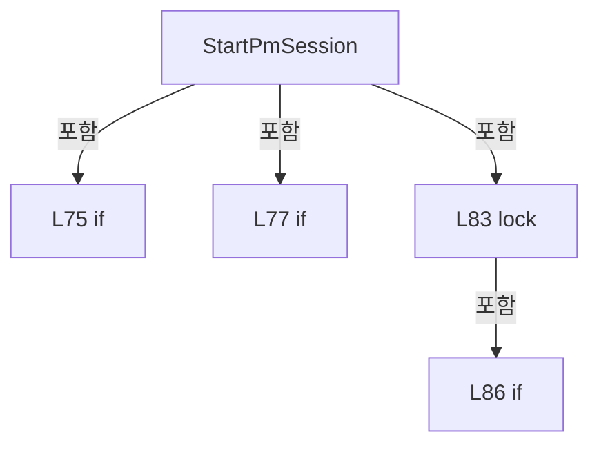

변경 전 점검: 입력/반환 타입, 위 호출자, 예외/취소 경로, 공유 상태와 저장·전송 소비자를 함께 확인합니다. 값의 단위나 물리 방향을 이름만으로 확정하지 않습니다.

### MethodDeclaration `CompletePmSession` · L92–112

[Drilling.Common/Log/CLogManager.cs:92–112](https://github.com/kjuws10-rgb/A3Drilling/blob/0219666f9053b907d96d7e0aa7d0c6c1be3a73d4/Drilling.Common/Log/CLogManager.cs#L92-L112)

| 항목 | 실제 추출 값 |
| --- | --- |
| 서명 | Drilling.Common.Log.ST_PM_HISTORY_ENTRY Drilling.Common.Log.CLogManager.CompletePmSession(Drilling.Common.Log.ST_PM_HISTORY_ENTRY) |
| 접근/수식자 | Public / public |
| 반환/값 타입 | Drilling.Common.Log.ST_PM_HISTORY_ENTRY |
| 소속 타입 | NamedType:Drilling.Common.Log.CLogManager |

입력 계약:

| 이름 | 타입 | 전달 | 선택/기본값 |
| --- | --- | --- | --- |
| session | Drilling.Common.Log.ST_PM_HISTORY_ENTRY | None | False /  |

정적 호출자로 확인된 위치:

| 호출 파일/행 | 호출 표현식 | 런타임 분기 가능 |
| --- | --- | --- |
| [Drilling.UI/CRootView.cs:1473–1473](https://github.com/kjuws10-rgb/A3Drilling/blob/0219666f9053b907d96d7e0aa7d0c6c1be3a73d4/Drilling.UI/CRootView.cs#L1473-L1473) | _manager.Log().CompletePmSession | False |

호출하는 대상과 해석 범위:

| 원본 행 | 표현식 | 분석 상태 | 대상/소스 위치 |
| --- | --- | --- | --- |
| 94 | ArgumentNullException.ThrowIfNull | resolved | void System.ArgumentNullException.ThrowIfNull(object?, string?) |
| 97 | PmHistoryPath | resolved | string Drilling.Common.Log.CLogManager.PmHistoryPath(Drilling.Common.Log.ST_PM_HISTORY_ENTRY) · Drilling.Common/Log/CLogManager.cs:168 |
| 98 | System.IO.File.Exists | resolved | bool System.IO.File.Exists(string?) |
| 99 | new FileNotFoundException | resolved | System.IO.FileNotFoundException.FileNotFoundException(string?, string?) |
| 100 | ReadPmHistoryEntry | resolved | Drilling.Common.Log.ST_PM_HISTORY_ENTRY? Drilling.Common.Log.CLogManager.ReadPmHistoryEntry(string) · Drilling.Common/Log/CLogManager.cs:137 |
| 100 | new InvalidDataException | resolved | System.IO.InvalidDataException.InvalidDataException(string?) |
| 101 | current.SessionId.Equals | resolved | bool string.Equals(string?, System.StringComparison) |
| 102 | new InvalidDataException | resolved | System.IO.InvalidDataException.InvalidDataException(string?) |
| 107 | WritePmHistoryEntry | resolved | void Drilling.Common.Log.CLogManager.WritePmHistoryEntry(Drilling.Common.Log.ST_PM_HISTORY_ENTRY) · Drilling.Common/Log/CLogManager.cs:150 |
| 109 | _pmHistoryCache.Select(item => item.SessionId == completed.SessionId ? completed : item).OrderByDescending(item => item.LockedAt).ToArray | resolved | Drilling.Common.Log.ST_PM_HISTORY_ENTRY[] System.Collections.Generic.IEnumerable<Drilling.Common.Log.ST_PM_HISTORY_ENTRY>.ToArray<Drilling.Common.Log.ST_PM_HISTORY_ENTRY>() |
| 109 | _pmHistoryCache.Select(item => item.SessionId == completed.SessionId ? completed : item).OrderByDescending | resolved | System.Linq.IOrderedEnumerable<Drilling.Common.Log.ST_PM_HISTORY_ENTRY> System.Collections.Generic.IEnumerable<Drilling.Common.Log.ST_PM_HISTORY_ENTRY>.OrderByDescending<Drilling.Common.Log.ST_PM_HISTORY_ENTRY, System.DateTimeOffset>(System.Func<Drilling.Common.Log.ST_PM_HISTORY_ENTRY, System.DateTimeOffset>) |
| 109 | _pmHistoryCache.Select | resolved | System.Collections.Generic.IEnumerable<Drilling.Common.Log.ST_PM_HISTORY_ENTRY> System.Collections.Generic.IEnumerable<Drilling.Common.Log.ST_PM_HISTORY_ENTRY>.Select<Drilling.Common.Log.ST_PM_HISTORY_ENTRY, Drilling.Common.Log.ST_PM_HISTORY_ENTRY>(System.Func<Drilling.Common.Log.ST_PM_HISTORY_ENTRY, Drilling.Common.Log.ST_PM_HISTORY_ENTRY>) |

본문의 실제 연산·분기·예외·반환 순서(원문 위치 순):

| 원본 행 | 종류 | 주석 해설 |
| --- | --- | --- |
| 94 | call | 함수·델리게이트 또는 객체 생성자를 호출합니다: ArgumentNullException.ThrowIfNull(session) |
| 95 | lock | 공유 상태의 임계 구역에 진입합니다: lock (_pmHistoryLock) |
| 97 | call | 함수·델리게이트 또는 객체 생성자를 호출합니다: PmHistoryPath(session) |
| 97 | local-declaration | 지역 변수를 선언합니다: var path = PmHistoryPath(session); |
| 97 | variable-initializer | 변수의 초기값을 지정합니다: path = PmHistoryPath(session) |
| 98 | call | 함수·델리게이트 또는 객체 생성자를 호출합니다: System.IO.File.Exists(path) |
| 98 | if | 조건에 따라 분기합니다: if (!System.IO.File.Exists(path)) |
| 99 | call | 함수·델리게이트 또는 객체 생성자를 호출합니다: new FileNotFoundException("PM LOCK 이력 파일을 찾을 수 없습니다.", path) |
| 99 | throw | 예외를 발생/전달합니다: throw new FileNotFoundException("PM LOCK 이력 파일을 찾을 수 없습니다.", path); |
| 100 | call | 함수·델리게이트 또는 객체 생성자를 호출합니다: ReadPmHistoryEntry(path) |
| 100 | call | 함수·델리게이트 또는 객체 생성자를 호출합니다: new InvalidDataException("PM LOCK 이력 파일을 읽을 수 없습니다.") |
| 100 | local-declaration | 지역 변수를 선언합니다: var current = ReadPmHistoryEntry(path) ?? throw new InvalidDataException("PM LOCK 이력 파일을 읽을 수 없습니다."); |
| 100 | throw | 예외를 발생/전달합니다: throw new InvalidDataException("PM LOCK 이력 파일을 읽을 수 없습니다.") |
| 100 | variable-initializer | 변수의 초기값을 지정합니다: current = ReadPmHistoryEntry(path) ?? throw new InvalidDataException("PM LOCK 이력 파일을 읽을 수 없습니다.") |
| 101 | call | 함수·델리게이트 또는 객체 생성자를 호출합니다: current.SessionId.Equals(session.SessionId, StringComparison.Ordinal) |
| 101 | if | 조건에 따라 분기합니다: if (!current.SessionId.Equals(session.SessionId, StringComparison.Ordinal)) |
| 102 | call | 함수·델리게이트 또는 객체 생성자를 호출합니다: new InvalidDataException("PM LOCK 세션 ID가 일치하지 않습니다.") |
| 102 | throw | 예외를 발생/전달합니다: throw new InvalidDataException("PM LOCK 세션 ID가 일치하지 않습니다."); |
| 103 | if | 조건에 따라 분기합니다: if (current.UnlockedAt is not null) |
| 104 | return | 호출자에게 값 또는 제어를 반환합니다: return current; |
| 106 | assignment | 값을 대상에 대입합니다: UnlockedAt = DateTimeOffset.Now |
| 106 | local-declaration | 지역 변수를 선언합니다: var completed = current with { UnlockedAt = DateTimeOffset.Now }; |
| 106 | variable-initializer | 변수의 초기값을 지정합니다: completed = current with { UnlockedAt = DateTimeOffset.Now } |
| 107 | call | 함수·델리게이트 또는 객체 생성자를 호출합니다: WritePmHistoryEntry(completed) |
| 108 | if | 조건에 따라 분기합니다: if (_pmHistoryCache is not null) |
| 109 | assignment | 값을 대상에 대입합니다: _pmHistoryCache = _pmHistoryCache.Select(item => item.SessionId == completed.SessionId ? completed : item).OrderByDescending(item => item.LockedAt).ToArray() |
| 109 | call | 함수·델리게이트 또는 객체 생성자를 호출합니다: _pmHistoryCache.Select(item => item.SessionId == completed.SessionId ? completed : item).OrderByDescending(item => item.LockedAt).ToArray() |
| 109 | call | 함수·델리게이트 또는 객체 생성자를 호출합니다: _pmHistoryCache.Select(item => item.SessionId == completed.SessionId ? completed : item).OrderByDescending(item => item.LockedAt) |
| 109 | call | 함수·델리게이트 또는 객체 생성자를 호출합니다: _pmHistoryCache.Select(item => item.SessionId == completed.SessionId ? completed : item) |
| 109 | conditional-expression | 조건에 따라 결과식을 선택합니다: item.SessionId == completed.SessionId ? completed : item |
| 110 | return | 호출자에게 값 또는 제어를 반환합니다: return completed; |

제어 구문의 포함 구조(실제 실행 순서/CFG가 아닌 구문 탐색 그림):

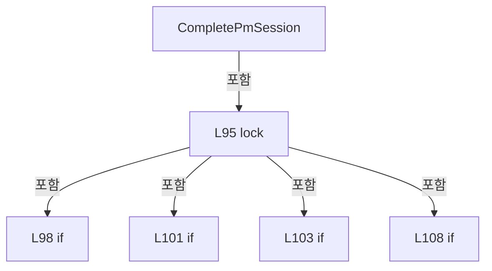

변경 전 점검: 입력/반환 타입, 위 호출자, 예외/취소 경로, 공유 상태와 저장·전송 소비자를 함께 확인합니다. 값의 단위나 물리 방향을 이름만으로 확정하지 않습니다.

### MethodDeclaration `ReadPmHistory` · L114–123

[Drilling.Common/Log/CLogManager.cs:114–123](https://github.com/kjuws10-rgb/A3Drilling/blob/0219666f9053b907d96d7e0aa7d0c6c1be3a73d4/Drilling.Common/Log/CLogManager.cs#L114-L123)

| 항목 | 실제 추출 값 |
| --- | --- |
| 서명 | System.Collections.Generic.IReadOnlyList<Drilling.Common.Log.ST_PM_HISTORY_ENTRY> Drilling.Common.Log.CLogManager.ReadPmHistory(int) |
| 접근/수식자 | Public / public |
| 반환/값 타입 | System.Collections.Generic.IReadOnlyList<Drilling.Common.Log.ST_PM_HISTORY_ENTRY> |
| 소속 타입 | NamedType:Drilling.Common.Log.CLogManager |

입력 계약:

| 이름 | 타입 | 전달 | 선택/기본값 |
| --- | --- | --- | --- |
| maxRows | int | None | True / 200 |

정적 호출자로 확인된 위치:

| 호출 파일/행 | 호출 표현식 | 런타임 분기 가능 |
| --- | --- | --- |
| [Drilling.UI/Menu/Menus/CMenuPm.cs:41–41](https://github.com/kjuws10-rgb/A3Drilling/blob/0219666f9053b907d96d7e0aa7d0c6c1be3a73d4/Drilling.UI/Menu/Menus/CMenuPm.cs#L41-L41) | logManager.ReadPmHistory | False |

호출하는 대상과 해석 범위:

| 원본 행 | 표현식 | 분석 상태 | 대상/소스 위치 |
| --- | --- | --- | --- |
| 120 | LoadPmHistory | resolved | System.Collections.Generic.IReadOnlyList<Drilling.Common.Log.ST_PM_HISTORY_ENTRY> Drilling.Common.Log.CLogManager.LoadPmHistory() · Drilling.Common/Log/CLogManager.cs:125 |
| 121 | _pmHistoryCache.Take(maxRows).ToArray | resolved | Drilling.Common.Log.ST_PM_HISTORY_ENTRY[] System.Collections.Generic.IEnumerable<Drilling.Common.Log.ST_PM_HISTORY_ENTRY>.ToArray<Drilling.Common.Log.ST_PM_HISTORY_ENTRY>() |
| 121 | _pmHistoryCache.Take | resolved | System.Collections.Generic.IEnumerable<Drilling.Common.Log.ST_PM_HISTORY_ENTRY> System.Collections.Generic.IEnumerable<Drilling.Common.Log.ST_PM_HISTORY_ENTRY>.Take<Drilling.Common.Log.ST_PM_HISTORY_ENTRY>(int) |

본문의 실제 연산·분기·예외·반환 순서(원문 위치 순):

| 원본 행 | 종류 | 주석 해설 |
| --- | --- | --- |
| 116 | if | 조건에 따라 분기합니다: if (maxRows <= 0) |
| 117 | return | 호출자에게 값 또는 제어를 반환합니다: return []; |
| 118 | lock | 공유 상태의 임계 구역에 진입합니다: lock (_pmHistoryLock) |
| 120 | assignment | 값을 대상에 대입합니다: _pmHistoryCache ??= LoadPmHistory() |
| 120 | call | 함수·델리게이트 또는 객체 생성자를 호출합니다: LoadPmHistory() |
| 121 | call | 함수·델리게이트 또는 객체 생성자를 호출합니다: _pmHistoryCache.Take(maxRows).ToArray() |
| 121 | call | 함수·델리게이트 또는 객체 생성자를 호출합니다: _pmHistoryCache.Take(maxRows) |
| 121 | return | 호출자에게 값 또는 제어를 반환합니다: return _pmHistoryCache.Take(maxRows).ToArray(); |

제어 구문의 포함 구조(실제 실행 순서/CFG가 아닌 구문 탐색 그림):

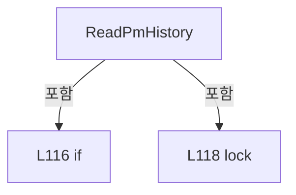

변경 전 점검: 입력/반환 타입, 위 호출자, 예외/취소 경로, 공유 상태와 저장·전송 소비자를 함께 확인합니다. 값의 단위나 물리 방향을 이름만으로 확정하지 않습니다.

### MethodDeclaration `LoadPmHistory` · L125–135

[Drilling.Common/Log/CLogManager.cs:125–135](https://github.com/kjuws10-rgb/A3Drilling/blob/0219666f9053b907d96d7e0aa7d0c6c1be3a73d4/Drilling.Common/Log/CLogManager.cs#L125-L135)

| 항목 | 실제 추출 값 |
| --- | --- |
| 서명 | System.Collections.Generic.IReadOnlyList<Drilling.Common.Log.ST_PM_HISTORY_ENTRY> Drilling.Common.Log.CLogManager.LoadPmHistory() |
| 접근/수식자 | Private / private |
| 반환/값 타입 | System.Collections.Generic.IReadOnlyList<Drilling.Common.Log.ST_PM_HISTORY_ENTRY> |
| 소속 타입 | NamedType:Drilling.Common.Log.CLogManager |

정적 호출자로 확인된 위치:

| 호출 파일/행 | 호출 표현식 | 런타임 분기 가능 |
| --- | --- | --- |
| [Drilling.Common/Log/CLogManager.cs:120–120](https://github.com/kjuws10-rgb/A3Drilling/blob/0219666f9053b907d96d7e0aa7d0c6c1be3a73d4/Drilling.Common/Log/CLogManager.cs#L120-L120) | LoadPmHistory | False |

호출하는 대상과 해석 범위:

| 원본 행 | 표현식 | 분석 상태 | 대상/소스 위치 |
| --- | --- | --- | --- |
| 127 | Directory.Exists | resolved | bool System.IO.Directory.Exists(string?) |
| 129 | Directory.EnumerateFiles(_pmHistoryRoot, "PM_*.json", SearchOption.AllDirectories) .Select(ReadPmHistoryEntry) .Where(item => item is not null) .Cast<ST_PM_HISTORY_ENTRY>() .OrderByDescending(item => item.LockedAt) .ToArray | resolved | Drilling.Common.Log.ST_PM_HISTORY_ENTRY[] System.Collections.Generic.IEnumerable<Drilling.Common.Log.ST_PM_HISTORY_ENTRY>.ToArray<Drilling.Common.Log.ST_PM_HISTORY_ENTRY>() |
| 129 | Directory.EnumerateFiles(_pmHistoryRoot, "PM_*.json", SearchOption.AllDirectories) .Select(ReadPmHistoryEntry) .Where(item => item is not null) .Cast<ST_PM_HISTORY_ENTRY>() .OrderByDescending | resolved | System.Linq.IOrderedEnumerable<Drilling.Common.Log.ST_PM_HISTORY_ENTRY> System.Collections.Generic.IEnumerable<Drilling.Common.Log.ST_PM_HISTORY_ENTRY>.OrderByDescending<Drilling.Common.Log.ST_PM_HISTORY_ENTRY, System.DateTimeOffset>(System.Func<Drilling.Common.Log.ST_PM_HISTORY_ENTRY, System.DateTimeOffset>) |
| 129 | Directory.EnumerateFiles(_pmHistoryRoot, "PM_*.json", SearchOption.AllDirectories) .Select(ReadPmHistoryEntry) .Where(item => item is not null) .Cast<ST_PM_HISTORY_ENTRY> | resolved | System.Collections.Generic.IEnumerable<Drilling.Common.Log.ST_PM_HISTORY_ENTRY> System.Collections.IEnumerable.Cast<Drilling.Common.Log.ST_PM_HISTORY_ENTRY>() |
| 129 | Directory.EnumerateFiles(_pmHistoryRoot, "PM_*.json", SearchOption.AllDirectories) .Select(ReadPmHistoryEntry) .Where | resolved | System.Collections.Generic.IEnumerable<Drilling.Common.Log.ST_PM_HISTORY_ENTRY?> System.Collections.Generic.IEnumerable<Drilling.Common.Log.ST_PM_HISTORY_ENTRY?>.Where<Drilling.Common.Log.ST_PM_HISTORY_ENTRY?>(System.Func<Drilling.Common.Log.ST_PM_HISTORY_ENTRY?, bool>) |
| 129 | Directory.EnumerateFiles(_pmHistoryRoot, "PM_*.json", SearchOption.AllDirectories) .Select | resolved | System.Collections.Generic.IEnumerable<Drilling.Common.Log.ST_PM_HISTORY_ENTRY?> System.Collections.Generic.IEnumerable<string>.Select<string, Drilling.Common.Log.ST_PM_HISTORY_ENTRY?>(System.Func<string, Drilling.Common.Log.ST_PM_HISTORY_ENTRY?>) |
| 129 | Directory.EnumerateFiles | resolved | System.Collections.Generic.IEnumerable<string> System.IO.Directory.EnumerateFiles(string, string, System.IO.SearchOption) |

본문의 실제 연산·분기·예외·반환 순서(원문 위치 순):

| 원본 행 | 종류 | 주석 해설 |
| --- | --- | --- |
| 127 | call | 함수·델리게이트 또는 객체 생성자를 호출합니다: Directory.Exists(_pmHistoryRoot) |
| 127 | if | 조건에 따라 분기합니다: if (!Directory.Exists(_pmHistoryRoot)) |
| 128 | return | 호출자에게 값 또는 제어를 반환합니다: return []; |
| 129 | call | 함수·델리게이트 또는 객체 생성자를 호출합니다: Directory.EnumerateFiles(_pmHistoryRoot, "PM_*.json", SearchOption.AllDirectories) |
| 129 | call | 함수·델리게이트 또는 객체 생성자를 호출합니다: Directory.EnumerateFiles(_pmHistoryRoot, "PM_*.json", SearchOption.AllDirectories) .Select(ReadPmHistoryEntry) |
| 129 | call | 함수·델리게이트 또는 객체 생성자를 호출합니다: Directory.EnumerateFiles(_pmHistoryRoot, "PM_*.json", SearchOption.AllDirectories) .Select(ReadPmHistoryEntry) .Where(item => item is not null) |
| 129 | call | 함수·델리게이트 또는 객체 생성자를 호출합니다: Directory.EnumerateFiles(_pmHistoryRoot, "PM_*.json", SearchOption.AllDirectories) .Select(ReadPmHistoryEntry) .Where(item => item is not null) .Cast<ST_PM_HISTORY_ENTRY>() |
| 129 | call | 함수·델리게이트 또는 객체 생성자를 호출합니다: Directory.EnumerateFiles(_pmHistoryRoot, "PM_*.json", SearchOption.AllDirectories) .Select(ReadPmHistoryEntry) .Where(item => item is not null) .Cast<ST_PM_HISTORY_ENTRY>() .OrderByDescending(item => item.LockedAt) |
| 129 | call | 함수·델리게이트 또는 객체 생성자를 호출합니다: Directory.EnumerateFiles(_pmHistoryRoot, "PM_*.json", SearchOption.AllDirectories) .Select(ReadPmHistoryEntry) .Where(item => item is not null) .Cast<ST_PM_HISTORY_ENTRY>() .OrderByDescending(item => item.LockedAt) .ToAr… |
| 129 | return | 호출자에게 값 또는 제어를 반환합니다: return Directory.EnumerateFiles(_pmHistoryRoot, "PM_*.json", SearchOption.AllDirectories) .Select(ReadPmHistoryEntry) .Where(item => item is not null) .Cast<ST_PM_HISTORY_ENTRY>() .OrderByDescending(item => item.LockedAt) .ToArray |

제어 구문의 포함 구조(실제 실행 순서/CFG가 아닌 구문 탐색 그림):

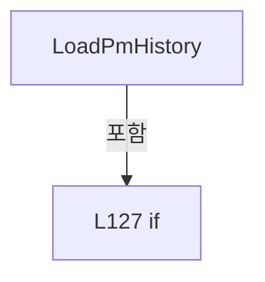

변경 전 점검: 입력/반환 타입, 위 호출자, 예외/취소 경로, 공유 상태와 저장·전송 소비자를 함께 확인합니다. 값의 단위나 물리 방향을 이름만으로 확정하지 않습니다.

### MethodDeclaration `ReadPmHistoryEntry` · L137–148

[Drilling.Common/Log/CLogManager.cs:137–148](https://github.com/kjuws10-rgb/A3Drilling/blob/0219666f9053b907d96d7e0aa7d0c6c1be3a73d4/Drilling.Common/Log/CLogManager.cs#L137-L148)

| 항목 | 실제 추출 값 |
| --- | --- |
| 서명 | Drilling.Common.Log.ST_PM_HISTORY_ENTRY? Drilling.Common.Log.CLogManager.ReadPmHistoryEntry(string) |
| 접근/수식자 | Private / private |
| 반환/값 타입 | Drilling.Common.Log.ST_PM_HISTORY_ENTRY? |
| 소속 타입 | NamedType:Drilling.Common.Log.CLogManager |

입력 계약:

| 이름 | 타입 | 전달 | 선택/기본값 |
| --- | --- | --- | --- |
| path | string | None | False /  |

정적 호출자로 확인된 위치:

| 호출 파일/행 | 호출 표현식 | 런타임 분기 가능 |
| --- | --- | --- |
| [Drilling.Common/Log/CLogManager.cs:100–100](https://github.com/kjuws10-rgb/A3Drilling/blob/0219666f9053b907d96d7e0aa7d0c6c1be3a73d4/Drilling.Common/Log/CLogManager.cs#L100-L100) | ReadPmHistoryEntry | False |

호출하는 대상과 해석 범위:

| 원본 행 | 표현식 | 분석 상태 | 대상/소스 위치 |
| --- | --- | --- | --- |
| 141 | JsonSerializer.Deserialize<ST_PM_HISTORY_ENTRY> | resolved | Drilling.Common.Log.ST_PM_HISTORY_ENTRY? System.Text.Json.JsonSerializer.Deserialize<Drilling.Common.Log.ST_PM_HISTORY_ENTRY>(string, System.Text.Json.JsonSerializerOptions?) |
| 141 | System.IO.File.ReadAllText | resolved | string System.IO.File.ReadAllText(string, System.Text.Encoding) |
| 145 | Trace.TraceError | resolved | void System.Diagnostics.Trace.TraceError(string?) |

본문의 실제 연산·분기·예외·반환 순서(원문 위치 순):

| 원본 행 | 종류 | 주석 해설 |
| --- | --- | --- |
| 139 | try | 예외 처리 범위입니다: try |
| 141 | call | 함수·델리게이트 또는 객체 생성자를 호출합니다: JsonSerializer.Deserialize<ST_PM_HISTORY_ENTRY>(System.IO.File.ReadAllText(path, Encoding.UTF8)) |
| 141 | call | 함수·델리게이트 또는 객체 생성자를 호출합니다: System.IO.File.ReadAllText(path, Encoding.UTF8) |
| 141 | return | 호출자에게 값 또는 제어를 반환합니다: return JsonSerializer.Deserialize<ST_PM_HISTORY_ENTRY>(System.IO.File.ReadAllText(path, Encoding.UTF8)); |
| 143 | catch | 지정 예외를 처리합니다: catch (Exception exception) when (exception is IOException or UnauthorizedAccessException or JsonException) |
| 145 | call | 함수·델리게이트 또는 객체 생성자를 호출합니다: Trace.TraceError($"PM history read failed. Path={path}; Error={exception}") |
| 146 | return | 호출자에게 값 또는 제어를 반환합니다: return null; |

제어 구문의 포함 구조(실제 실행 순서/CFG가 아닌 구문 탐색 그림):

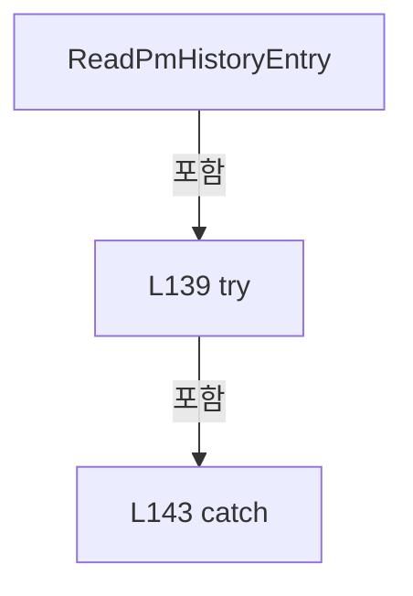

변경 전 점검: 입력/반환 타입, 위 호출자, 예외/취소 경로, 공유 상태와 저장·전송 소비자를 함께 확인합니다. 값의 단위나 물리 방향을 이름만으로 확정하지 않습니다.

### MethodDeclaration `WritePmHistoryEntry` · L150–166

[Drilling.Common/Log/CLogManager.cs:150–166](https://github.com/kjuws10-rgb/A3Drilling/blob/0219666f9053b907d96d7e0aa7d0c6c1be3a73d4/Drilling.Common/Log/CLogManager.cs#L150-L166)

| 항목 | 실제 추출 값 |
| --- | --- |
| 서명 | void Drilling.Common.Log.CLogManager.WritePmHistoryEntry(Drilling.Common.Log.ST_PM_HISTORY_ENTRY) |
| 접근/수식자 | Private / private |
| 반환/값 타입 | void |
| 소속 타입 | NamedType:Drilling.Common.Log.CLogManager |

입력 계약:

| 이름 | 타입 | 전달 | 선택/기본값 |
| --- | --- | --- | --- |
| entry | Drilling.Common.Log.ST_PM_HISTORY_ENTRY | None | False /  |

정적 호출자로 확인된 위치:

| 호출 파일/행 | 호출 표현식 | 런타임 분기 가능 |
| --- | --- | --- |
| [Drilling.Common/Log/CLogManager.cs:85–85](https://github.com/kjuws10-rgb/A3Drilling/blob/0219666f9053b907d96d7e0aa7d0c6c1be3a73d4/Drilling.Common/Log/CLogManager.cs#L85-L85) | WritePmHistoryEntry | False |
| [Drilling.Common/Log/CLogManager.cs:107–107](https://github.com/kjuws10-rgb/A3Drilling/blob/0219666f9053b907d96d7e0aa7d0c6c1be3a73d4/Drilling.Common/Log/CLogManager.cs#L107-L107) | WritePmHistoryEntry | False |

호출하는 대상과 해석 범위:

| 원본 행 | 표현식 | 분석 상태 | 대상/소스 위치 |
| --- | --- | --- | --- |
| 152 | PmHistoryPath | resolved | string Drilling.Common.Log.CLogManager.PmHistoryPath(Drilling.Common.Log.ST_PM_HISTORY_ENTRY) · Drilling.Common/Log/CLogManager.cs:168 |
| 153 | Path.GetDirectoryName | resolved | string? System.IO.Path.GetDirectoryName(string?) |
| 154 | Directory.CreateDirectory | resolved | System.IO.DirectoryInfo System.IO.Directory.CreateDirectory(string) |
| 155 | Guid.NewGuid | resolved | System.Guid System.Guid.NewGuid() |
| 158 | System.IO.File.WriteAllText | resolved | void System.IO.File.WriteAllText(string, string?, System.Text.Encoding) |
| 158 | JsonSerializer.Serialize | resolved | string System.Text.Json.JsonSerializer.Serialize<Drilling.Common.Log.ST_PM_HISTORY_ENTRY>(Drilling.Common.Log.ST_PM_HISTORY_ENTRY, System.Text.Json.JsonSerializerOptions?) |
| 158 | new UTF8Encoding | resolved | System.Text.UTF8Encoding.UTF8Encoding(bool) |
| 159 | System.IO.File.Move | resolved | void System.IO.File.Move(string, string, bool) |
| 163 | System.IO.File.Exists | resolved | bool System.IO.File.Exists(string?) |
| 164 | System.IO.File.Delete | resolved | void System.IO.File.Delete(string) |

본문의 실제 연산·분기·예외·반환 순서(원문 위치 순):

| 원본 행 | 종류 | 주석 해설 |
| --- | --- | --- |
| 152 | call | 함수·델리게이트 또는 객체 생성자를 호출합니다: PmHistoryPath(entry) |
| 152 | local-declaration | 지역 변수를 선언합니다: var path = PmHistoryPath(entry); |
| 152 | variable-initializer | 변수의 초기값을 지정합니다: path = PmHistoryPath(entry) |
| 153 | call | 함수·델리게이트 또는 객체 생성자를 호출합니다: Path.GetDirectoryName(path) |
| 153 | local-declaration | 지역 변수를 선언합니다: var directory = Path.GetDirectoryName(path)!; |
| 153 | variable-initializer | 변수의 초기값을 지정합니다: directory = Path.GetDirectoryName(path)! |
| 154 | call | 함수·델리게이트 또는 객체 생성자를 호출합니다: Directory.CreateDirectory(directory) |
| 155 | call | 함수·델리게이트 또는 객체 생성자를 호출합니다: Guid.NewGuid() |
| 155 | local-declaration | 지역 변수를 선언합니다: var temporaryPath = path + $".{Guid.NewGuid():N}.tmp"; |
| 155 | variable-initializer | 변수의 초기값을 지정합니다: temporaryPath = path + $".{Guid.NewGuid():N}.tmp" |
| 156 | try | 예외 처리 범위입니다: try |
| 158 | call | 함수·델리게이트 또는 객체 생성자를 호출합니다: System.IO.File.WriteAllText(temporaryPath, JsonSerializer.Serialize(entry, AlarmJson), new UTF8Encoding(false)) |
| 158 | call | 함수·델리게이트 또는 객체 생성자를 호출합니다: JsonSerializer.Serialize(entry, AlarmJson) |
| 158 | call | 함수·델리게이트 또는 객체 생성자를 호출합니다: new UTF8Encoding(false) |
| 159 | call | 함수·델리게이트 또는 객체 생성자를 호출합니다: System.IO.File.Move(temporaryPath, path, true) |
| 161 | finally | 종료 정리 구간입니다: finally |
| 163 | call | 함수·델리게이트 또는 객체 생성자를 호출합니다: System.IO.File.Exists(temporaryPath) |
| 163 | if | 조건에 따라 분기합니다: if (System.IO.File.Exists(temporaryPath)) |
| 164 | call | 함수·델리게이트 또는 객체 생성자를 호출합니다: System.IO.File.Delete(temporaryPath) |

제어 구문의 포함 구조(실제 실행 순서/CFG가 아닌 구문 탐색 그림):

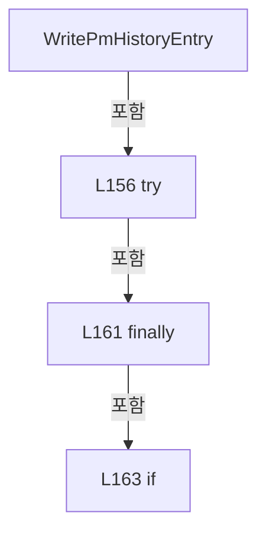

변경 전 점검: 입력/반환 타입, 위 호출자, 예외/취소 경로, 공유 상태와 저장·전송 소비자를 함께 확인합니다. 값의 단위나 물리 방향을 이름만으로 확정하지 않습니다.

### MethodDeclaration `PmHistoryPath` · L168–173

[Drilling.Common/Log/CLogManager.cs:168–173](https://github.com/kjuws10-rgb/A3Drilling/blob/0219666f9053b907d96d7e0aa7d0c6c1be3a73d4/Drilling.Common/Log/CLogManager.cs#L168-L173)

| 항목 | 실제 추출 값 |
| --- | --- |
| 서명 | string Drilling.Common.Log.CLogManager.PmHistoryPath(Drilling.Common.Log.ST_PM_HISTORY_ENTRY) |
| 접근/수식자 | Private / private |
| 반환/값 타입 | string |
| 소속 타입 | NamedType:Drilling.Common.Log.CLogManager |

입력 계약:

| 이름 | 타입 | 전달 | 선택/기본값 |
| --- | --- | --- | --- |
| entry | Drilling.Common.Log.ST_PM_HISTORY_ENTRY | None | False /  |

정적 호출자로 확인된 위치:

| 호출 파일/행 | 호출 표현식 | 런타임 분기 가능 |
| --- | --- | --- |
| [Drilling.Common/Log/CLogManager.cs:97–97](https://github.com/kjuws10-rgb/A3Drilling/blob/0219666f9053b907d96d7e0aa7d0c6c1be3a73d4/Drilling.Common/Log/CLogManager.cs#L97-L97) | PmHistoryPath | False |
| [Drilling.Common/Log/CLogManager.cs:152–152](https://github.com/kjuws10-rgb/A3Drilling/blob/0219666f9053b907d96d7e0aa7d0c6c1be3a73d4/Drilling.Common/Log/CLogManager.cs#L152-L152) | PmHistoryPath | False |

호출하는 대상과 해석 범위:

| 원본 행 | 표현식 | 분석 상태 | 대상/소스 위치 |
| --- | --- | --- | --- |
| 168 | Path.Combine | resolved | string System.IO.Path.Combine(params System.ReadOnlySpan<string>) |
| 170 | entry.LockedAt.ToString | resolved | string System.DateTimeOffset.ToString(string?, System.IFormatProvider?) |
| 171 | entry.LockedAt.ToString | resolved | string System.DateTimeOffset.ToString(string?, System.IFormatProvider?) |
| 172 | entry.LockedAt.ToString | resolved | string System.DateTimeOffset.ToString(string?, System.IFormatProvider?) |

본문의 실제 연산·분기·예외·반환 순서(원문 위치 순):

| 원본 행 | 종류 | 주석 해설 |
| --- | --- | --- |
| 168 | call | 함수·델리게이트 또는 객체 생성자를 호출합니다: Path.Combine( _pmHistoryRoot, entry.LockedAt.ToString("yyyy", CultureInfo.InvariantCulture), entry.LockedAt.ToString("MM", CultureInfo.InvariantCulture), entry.LockedAt.ToString("dd", CultureInfo.InvariantCulture), $"PM_… |
| 170 | call | 함수·델리게이트 또는 객체 생성자를 호출합니다: entry.LockedAt.ToString("yyyy", CultureInfo.InvariantCulture) |
| 171 | call | 함수·델리게이트 또는 객체 생성자를 호출합니다: entry.LockedAt.ToString("MM", CultureInfo.InvariantCulture) |
| 172 | call | 함수·델리게이트 또는 객체 생성자를 호출합니다: entry.LockedAt.ToString("dd", CultureInfo.InvariantCulture) |

변경 전 점검: 입력/반환 타입, 위 호출자, 예외/취소 경로, 공유 상태와 저장·전송 소비자를 함께 확인합니다. 값의 단위나 물리 방향을 이름만으로 확정하지 않습니다.

### MethodDeclaration `WriteStationState` · L175–183

[Drilling.Common/Log/CLogManager.cs:175–183](https://github.com/kjuws10-rgb/A3Drilling/blob/0219666f9053b907d96d7e0aa7d0c6c1be3a73d4/Drilling.Common/Log/CLogManager.cs#L175-L183)

| 항목 | 실제 추출 값 |
| --- | --- |
| 서명 | void Drilling.Common.Log.CLogManager.WriteStationState(string, string, string, string) |
| 접근/수식자 | Public / public |
| 반환/값 타입 | void |
| 소속 타입 | NamedType:Drilling.Common.Log.CLogManager |

입력 계약:

| 이름 | 타입 | 전달 | 선택/기본값 |
| --- | --- | --- | --- |
| stationName | string | None | False /  |
| stateName | string | None | False /  |
| action | string | None | False /  |
| detail | string | None | False /  |

정적 호출자로 확인된 위치:

| 호출 파일/행 | 호출 표현식 | 런타임 분기 가능 |
| --- | --- | --- |
| [Drilling.Common/Interface/CPowerMeasureRun.cs:146–146](https://github.com/kjuws10-rgb/A3Drilling/blob/0219666f9053b907d96d7e0aa7d0c6c1be3a73d4/Drilling.Common/Interface/CPowerMeasureRun.cs#L146-L146) | manager.Log().WriteStationState | False |
| [Drilling.Common/Managers/CManager.cs:149–149](https://github.com/kjuws10-rgb/A3Drilling/blob/0219666f9053b907d96d7e0aa7d0c6c1be3a73d4/Drilling.Common/Managers/CManager.cs#L149-L149) | _logManager.WriteStationState | False |
| [Drilling.Common/Review/CReviewManager.cs:1039–1039](https://github.com/kjuws10-rgb/A3Drilling/blob/0219666f9053b907d96d7e0aa7d0c6c1be3a73d4/Drilling.Common/Review/CReviewManager.cs#L1039-L1039) | logManager.WriteStationState | False |
| [Drilling.Common/Station/CStationProcess.cs:1487–1487](https://github.com/kjuws10-rgb/A3Drilling/blob/0219666f9053b907d96d7e0aa7d0c6c1be3a73d4/Drilling.Common/Station/CStationProcess.cs#L1487-L1487) | .WriteStationState | False |
| [Drilling.Common/Station/CStationProcess.cs:2368–2368](https://github.com/kjuws10-rgb/A3Drilling/blob/0219666f9053b907d96d7e0aa7d0c6c1be3a73d4/Drilling.Common/Station/CStationProcess.cs#L2368-L2368) | .WriteStationState | False |
| [Drilling.Common/Station/CStationProcess.cs:2413–2413](https://github.com/kjuws10-rgb/A3Drilling/blob/0219666f9053b907d96d7e0aa7d0c6c1be3a73d4/Drilling.Common/Station/CStationProcess.cs#L2413-L2413) | .WriteStationState | False |
| [Drilling.UI/CRootView.cs:1199–1199](https://github.com/kjuws10-rgb/A3Drilling/blob/0219666f9053b907d96d7e0aa7d0c6c1be3a73d4/Drilling.UI/CRootView.cs#L1199-L1199) | logManager.WriteStationState | False |
| [Drilling.UI/CRootView.cs:3102–3102](https://github.com/kjuws10-rgb/A3Drilling/blob/0219666f9053b907d96d7e0aa7d0c6c1be3a73d4/Drilling.UI/CRootView.cs#L3102-L3102) | _manager.Log().WriteStationState | False |
| [Drilling.UI/CRootView.cs:3184–3188](https://github.com/kjuws10-rgb/A3Drilling/blob/0219666f9053b907d96d7e0aa7d0c6c1be3a73d4/Drilling.UI/CRootView.cs#L3184-L3188) | _manager.Log().WriteStationState | False |

호출하는 대상과 해석 범위:

| 원본 행 | 표현식 | 분석 상태 | 대상/소스 위치 |
| --- | --- | --- | --- |
| 178 | Path.Combine | resolved | string System.IO.Path.Combine(string, string) |
| 178 | now.ToString | resolved | string System.DateTime.ToString(string?, System.IFormatProvider?) |
| 179 | Path.Combine | resolved | string System.IO.Path.Combine(string, string) |
| 179 | now.ToString | resolved | string System.DateTime.ToString(string?, System.IFormatProvider?) |
| 180 | now.ToString | resolved | string System.DateTime.ToString(string?, System.IFormatProvider?) |
| 181 | EscapeField | resolved | string Drilling.Common.Log.CLogManager.EscapeField(string) · Drilling.Common/Log/CLogManager.cs:662 |
| 181 | EscapeField | resolved | string Drilling.Common.Log.CLogManager.EscapeField(string) · Drilling.Common/Log/CLogManager.cs:662 |
| 181 | EscapeField | resolved | string Drilling.Common.Log.CLogManager.EscapeField(string) · Drilling.Common/Log/CLogManager.cs:662 |
| 181 | EscapeField | resolved | string Drilling.Common.Log.CLogManager.EscapeField(string) · Drilling.Common/Log/CLogManager.cs:662 |
| 182 | AppendLine | resolved | void Drilling.Common.Log.CLogManager.AppendLine(string, string, string) · Drilling.Common/Log/CLogManager.cs:407 |

본문의 실제 연산·분기·예외·반환 순서(원문 위치 순):

| 원본 행 | 종류 | 주석 해설 |
| --- | --- | --- |
| 177 | local-declaration | 지역 변수를 선언합니다: var now = DateTime.Now; |
| 177 | variable-initializer | 변수의 초기값을 지정합니다: now = DateTime.Now |
| 178 | call | 함수·델리게이트 또는 객체 생성자를 호출합니다: Path.Combine(_stationLogRoot, now.ToString("yyyyMMdd", CultureInfo.InvariantCulture)) |
| 178 | call | 함수·델리게이트 또는 객체 생성자를 호출합니다: now.ToString("yyyyMMdd", CultureInfo.InvariantCulture) |
| 178 | local-declaration | 지역 변수를 선언합니다: var directory = Path.Combine(_stationLogRoot, now.ToString("yyyyMMdd", CultureInfo.InvariantCulture)); |
| 178 | variable-initializer | 변수의 초기값을 지정합니다: directory = Path.Combine(_stationLogRoot, now.ToString("yyyyMMdd", CultureInfo.InvariantCulture)) |
| 179 | call | 함수·델리게이트 또는 객체 생성자를 호출합니다: Path.Combine(directory, $"Station_{now.ToString("yyyyMMdd", CultureInfo.InvariantCulture)}_Trace.txt") |
| 179 | call | 함수·델리게이트 또는 객체 생성자를 호출합니다: now.ToString("yyyyMMdd", CultureInfo.InvariantCulture) |
| 179 | local-declaration | 지역 변수를 선언합니다: var path = Path.Combine(directory, $"Station_{now.ToString("yyyyMMdd", CultureInfo.InvariantCulture)}_Trace.txt"); |
| 179 | variable-initializer | 변수의 초기값을 지정합니다: path = Path.Combine(directory, $"Station_{now.ToString("yyyyMMdd", CultureInfo.InvariantCulture)}_Trace.txt") |
| 180 | call | 함수·델리게이트 또는 객체 생성자를 호출합니다: now.ToString("yy/MM/dd HH:mm:ss.fff", CultureInfo.InvariantCulture) |
| 180 | local-declaration | 지역 변수를 선언합니다: var time = now.ToString("yy/MM/dd HH:mm:ss.fff", CultureInfo.InvariantCulture); |
| 180 | variable-initializer | 변수의 초기값을 지정합니다: time = now.ToString("yy/MM/dd HH:mm:ss.fff", CultureInfo.InvariantCulture) |
| 181 | call | 함수·델리게이트 또는 객체 생성자를 호출합니다: EscapeField(stationName) |
| 181 | call | 함수·델리게이트 또는 객체 생성자를 호출합니다: EscapeField(stateName) |
| 181 | call | 함수·델리게이트 또는 객체 생성자를 호출합니다: EscapeField(action) |
| 181 | call | 함수·델리게이트 또는 객체 생성자를 호출합니다: EscapeField(detail) |
| 181 | local-declaration | 지역 변수를 선언합니다: var line = $"{time} \\STATION\\{EscapeField(stationName)}\\{EscapeField(stateName)}\\{EscapeField(action)}\\{EscapeField(detail)}"; |
| 181 | variable-initializer | 변수의 초기값을 지정합니다: line = $"{time} \\STATION\\{EscapeField(stationName)}\\{EscapeField(stateName)}\\{EscapeField(action)}\\{EscapeField(detail)}" |
| 182 | call | 함수·델리게이트 또는 객체 생성자를 호출합니다: AppendLine(directory, path, line) |

변경 전 점검: 입력/반환 타입, 위 호출자, 예외/취소 경로, 공유 상태와 저장·전송 소비자를 함께 확인합니다. 값의 단위나 물리 방향을 이름만으로 확정하지 않습니다.

### MethodDeclaration `ReadRecipeRecent` · L185–208

[Drilling.Common/Log/CLogManager.cs:185–208](https://github.com/kjuws10-rgb/A3Drilling/blob/0219666f9053b907d96d7e0aa7d0c6c1be3a73d4/Drilling.Common/Log/CLogManager.cs#L185-L208)

| 항목 | 실제 추출 값 |
| --- | --- |
| 서명 | System.Collections.Generic.IReadOnlyList<Drilling.Common.Managers.ST_RECIPE_HISTORY> Drilling.Common.Log.CLogManager.ReadRecipeRecent(string, string, int, int) |
| 접근/수식자 | Public / public |
| 반환/값 타입 | System.Collections.Generic.IReadOnlyList<Drilling.Common.Managers.ST_RECIPE_HISTORY> |
| 소속 타입 | NamedType:Drilling.Common.Log.CLogManager |

입력 계약:

| 이름 | 타입 | 전달 | 선택/기본값 |
| --- | --- | --- | --- |
| recipeName | string | None | False /  |
| recipeId | string | None | False /  |
| maxRows | int | None | True / 10 |
| days | int | None | True / 14 |

정적 호출자로 확인된 위치:

| 호출 파일/행 | 호출 표현식 | 런타임 분기 가능 |
| --- | --- | --- |
| [Drilling.File/JHMI/CJhmiRecipeFile.cs:588–588](https://github.com/kjuws10-rgb/A3Drilling/blob/0219666f9053b907d96d7e0aa7d0c6c1be3a73d4/Drilling.File/JHMI/CJhmiRecipeFile.cs#L588-L588) | _logManager.ReadRecipeRecent | False |

호출하는 대상과 해석 범위:

| 원본 행 | 표현식 | 분석 상태 | 대상/소스 위치 |
| --- | --- | --- | --- |
| 187 | new HashSet<string> | resolved | System.Collections.Generic.HashSet<string>.HashSet(System.Collections.Generic.IEqualityComparer<string>?) |
| 207 | EnumerateRecentLogFiles(_recipeLogRoot, days).SelectMany(ReadLogFile).Select(ParseRecipeLine).Where(ShouldIncludeItem).Cast<ST_RECIPE_HISTORY>().Where(ShouldIncludeRecipe).OrderByDescending(SelectChangedAt).Take(maxRows).ToArray | resolved | Drilling.Common.Managers.ST_RECIPE_HISTORY[] System.Collections.Generic.IEnumerable<Drilling.Common.Managers.ST_RECIPE_HISTORY>.ToArray<Drilling.Common.Managers.ST_RECIPE_HISTORY>() |
| 207 | EnumerateRecentLogFiles(_recipeLogRoot, days).SelectMany(ReadLogFile).Select(ParseRecipeLine).Where(ShouldIncludeItem).Cast<ST_RECIPE_HISTORY>().Where(ShouldIncludeRecipe).OrderByDescending(SelectChangedAt).Take | resolved | System.Collections.Generic.IEnumerable<Drilling.Common.Managers.ST_RECIPE_HISTORY> System.Collections.Generic.IEnumerable<Drilling.Common.Managers.ST_RECIPE_HISTORY>.Take<Drilling.Common.Managers.ST_RECIPE_HISTORY>(int) |
| 207 | EnumerateRecentLogFiles(_recipeLogRoot, days).SelectMany(ReadLogFile).Select(ParseRecipeLine).Where(ShouldIncludeItem).Cast<ST_RECIPE_HISTORY>().Where(ShouldIncludeRecipe).OrderByDescending | resolved | System.Linq.IOrderedEnumerable<Drilling.Common.Managers.ST_RECIPE_HISTORY> System.Collections.Generic.IEnumerable<Drilling.Common.Managers.ST_RECIPE_HISTORY>.OrderByDescending<Drilling.Common.Managers.ST_RECIPE_HISTORY, System.DateTimeOffset>(System.Func<Drilling.Common.Managers.ST_RECIPE_HISTORY, System.DateTimeOffset>) |
| 207 | EnumerateRecentLogFiles(_recipeLogRoot, days).SelectMany(ReadLogFile).Select(ParseRecipeLine).Where(ShouldIncludeItem).Cast<ST_RECIPE_HISTORY>().Where | resolved | System.Collections.Generic.IEnumerable<Drilling.Common.Managers.ST_RECIPE_HISTORY> System.Collections.Generic.IEnumerable<Drilling.Common.Managers.ST_RECIPE_HISTORY>.Where<Drilling.Common.Managers.ST_RECIPE_HISTORY>(System.Func<Drilling.Common.Managers.ST_RECIPE_HISTORY, bool>) |
| 207 | EnumerateRecentLogFiles(_recipeLogRoot, days).SelectMany(ReadLogFile).Select(ParseRecipeLine).Where(ShouldIncludeItem).Cast<ST_RECIPE_HISTORY> | resolved | System.Collections.Generic.IEnumerable<Drilling.Common.Managers.ST_RECIPE_HISTORY> System.Collections.IEnumerable.Cast<Drilling.Common.Managers.ST_RECIPE_HISTORY>() |
| 207 | EnumerateRecentLogFiles(_recipeLogRoot, days).SelectMany(ReadLogFile).Select(ParseRecipeLine).Where | resolved | System.Collections.Generic.IEnumerable<Drilling.Common.Managers.ST_RECIPE_HISTORY?> System.Collections.Generic.IEnumerable<Drilling.Common.Managers.ST_RECIPE_HISTORY?>.Where<Drilling.Common.Managers.ST_RECIPE_HISTORY?>(System.Func<Drilling.Common.Managers.ST_RECIPE_HISTORY?, bool>) |
| 207 | EnumerateRecentLogFiles(_recipeLogRoot, days).SelectMany(ReadLogFile).Select | resolved | System.Collections.Generic.IEnumerable<Drilling.Common.Managers.ST_RECIPE_HISTORY?> System.Collections.Generic.IEnumerable<string>.Select<string, Drilling.Common.Managers.ST_RECIPE_HISTORY?>(System.Func<string, Drilling.Common.Managers.ST_RECIPE_HISTORY?>) |
| 207 | EnumerateRecentLogFiles(_recipeLogRoot, days).SelectMany | resolved | System.Collections.Generic.IEnumerable<string> System.Collections.Generic.IEnumerable<string>.SelectMany<string, string>(System.Func<string, System.Collections.Generic.IEnumerable<string>>) |
| 207 | EnumerateRecentLogFiles | resolved | System.Collections.Generic.IEnumerable<string> Drilling.Common.Log.CLogManager.EnumerateRecentLogFiles(string, int) · Drilling.Common/Log/CLogManager.cs:539 |

본문의 실제 연산·분기·예외·반환 순서(원문 위치 순):

| 원본 행 | 종류 | 주석 해설 |
| --- | --- | --- |
| 187 | call | 함수·델리게이트 또는 객체 생성자를 호출합니다: new HashSet<string>(StringComparer.OrdinalIgnoreCase) { recipeName, recipeId } |
| 187 | local-declaration | 지역 변수를 선언합니다: var names = new HashSet<string>(StringComparer.OrdinalIgnoreCase) { recipeName, recipeId }; |
| 187 | variable-initializer | 변수의 초기값을 지정합니다: names = new HashSet<string>(StringComparer.OrdinalIgnoreCase) { recipeName, recipeId } |
| 207 | call | 함수·델리게이트 또는 객체 생성자를 호출합니다: EnumerateRecentLogFiles(_recipeLogRoot, days).SelectMany(ReadLogFile).Select(ParseRecipeLine).Where(ShouldIncludeItem).Cast<ST_RECIPE_HISTORY>().Where(ShouldIncludeRecipe).OrderByDescending(SelectChangedAt).Take(maxRows)… |
| 207 | call | 함수·델리게이트 또는 객체 생성자를 호출합니다: EnumerateRecentLogFiles(_recipeLogRoot, days).SelectMany(ReadLogFile).Select(ParseRecipeLine).Where(ShouldIncludeItem).Cast<ST_RECIPE_HISTORY>().Where(ShouldIncludeRecipe).OrderByDescending(SelectChangedAt).Take(maxRows) |
| 207 | call | 함수·델리게이트 또는 객체 생성자를 호출합니다: EnumerateRecentLogFiles(_recipeLogRoot, days).SelectMany(ReadLogFile).Select(ParseRecipeLine).Where(ShouldIncludeItem).Cast<ST_RECIPE_HISTORY>().Where(ShouldIncludeRecipe).OrderByDescending(SelectChangedAt) |
| 207 | call | 함수·델리게이트 또는 객체 생성자를 호출합니다: EnumerateRecentLogFiles(_recipeLogRoot, days).SelectMany(ReadLogFile).Select(ParseRecipeLine).Where(ShouldIncludeItem).Cast<ST_RECIPE_HISTORY>().Where(ShouldIncludeRecipe) |
| 207 | call | 함수·델리게이트 또는 객체 생성자를 호출합니다: EnumerateRecentLogFiles(_recipeLogRoot, days).SelectMany(ReadLogFile).Select(ParseRecipeLine).Where(ShouldIncludeItem).Cast<ST_RECIPE_HISTORY>() |
| 207 | call | 함수·델리게이트 또는 객체 생성자를 호출합니다: EnumerateRecentLogFiles(_recipeLogRoot, days).SelectMany(ReadLogFile).Select(ParseRecipeLine).Where(ShouldIncludeItem) |
| 207 | call | 함수·델리게이트 또는 객체 생성자를 호출합니다: EnumerateRecentLogFiles(_recipeLogRoot, days).SelectMany(ReadLogFile).Select(ParseRecipeLine) |
| 207 | call | 함수·델리게이트 또는 객체 생성자를 호출합니다: EnumerateRecentLogFiles(_recipeLogRoot, days).SelectMany(ReadLogFile) |
| 207 | call | 함수·델리게이트 또는 객체 생성자를 호출합니다: EnumerateRecentLogFiles(_recipeLogRoot, days) |
| 207 | return | 호출자에게 값 또는 제어를 반환합니다: return EnumerateRecentLogFiles(_recipeLogRoot, days).SelectMany(ReadLogFile).Select(ParseRecipeLine).Where(ShouldIncludeItem).Cast<ST_RECIPE_HISTORY>().Where(ShouldIncludeRecipe).OrderByDescending(SelectChangedAt).Take(maxRows).To |

변경 전 점검: 입력/반환 타입, 위 호출자, 예외/취소 경로, 공유 상태와 저장·전송 소비자를 함께 확인합니다. 값의 단위나 물리 방향을 이름만으로 확정하지 않습니다.

### LocalFunctionStatement `ShouldIncludeItem` · L192–195

[Drilling.Common/Log/CLogManager.cs:192–195](https://github.com/kjuws10-rgb/A3Drilling/blob/0219666f9053b907d96d7e0aa7d0c6c1be3a73d4/Drilling.Common/Log/CLogManager.cs#L192-L195)

| 항목 | 실제 추출 값 |
| --- | --- |
| 서명 | bool ShouldIncludeItem(Drilling.Common.Managers.ST_RECIPE_HISTORY?) |
| 접근/수식자 | Private /  |
| 반환/값 타입 | bool |
| 소속 타입 | NamedType:Drilling.Common.Log.CLogManager |

입력 계약:

| 이름 | 타입 | 전달 | 선택/기본값 |
| --- | --- | --- | --- |
| item | Drilling.Common.Managers.ST_RECIPE_HISTORY? | None | False /  |

현재 부분 분석에서 직접 연결된 호출자는 없습니다. XAML/이벤트/인터페이스·델리게이트·외부 진입을 추가 확인해야 하며, 미사용으로 판정한 것이 아닙니다.

본문의 실제 연산·분기·예외·반환 순서(원문 위치 순):

| 원본 행 | 종류 | 주석 해설 |
| --- | --- | --- |
| 194 | return | 호출자에게 값 또는 제어를 반환합니다: return item is not null; |

변경 전 점검: 입력/반환 타입, 위 호출자, 예외/취소 경로, 공유 상태와 저장·전송 소비자를 함께 확인합니다. 값의 단위나 물리 방향을 이름만으로 확정하지 않습니다.

### LocalFunctionStatement `ShouldIncludeRecipe` · L197–200

[Drilling.Common/Log/CLogManager.cs:197–200](https://github.com/kjuws10-rgb/A3Drilling/blob/0219666f9053b907d96d7e0aa7d0c6c1be3a73d4/Drilling.Common/Log/CLogManager.cs#L197-L200)

| 항목 | 실제 추출 값 |
| --- | --- |
| 서명 | bool ShouldIncludeRecipe(Drilling.Common.Managers.ST_RECIPE_HISTORY) |
| 접근/수식자 | Private /  |
| 반환/값 타입 | bool |
| 소속 타입 | NamedType:Drilling.Common.Log.CLogManager |

입력 계약:

| 이름 | 타입 | 전달 | 선택/기본값 |
| --- | --- | --- | --- |
| item | Drilling.Common.Managers.ST_RECIPE_HISTORY | None | False /  |

현재 부분 분석에서 직접 연결된 호출자는 없습니다. XAML/이벤트/인터페이스·델리게이트·외부 진입을 추가 확인해야 하며, 미사용으로 판정한 것이 아닙니다.

호출하는 대상과 해석 범위:

| 원본 행 | 표현식 | 분석 상태 | 대상/소스 위치 |
| --- | --- | --- | --- |
| 199 | names.Contains | resolved | bool System.Collections.Generic.HashSet<string>.Contains(string) |

본문의 실제 연산·분기·예외·반환 순서(원문 위치 순):

| 원본 행 | 종류 | 주석 해설 |
| --- | --- | --- |
| 199 | call | 함수·델리게이트 또는 객체 생성자를 호출합니다: names.Contains(item.RecipeName) |
| 199 | return | 호출자에게 값 또는 제어를 반환합니다: return names.Contains(item.RecipeName); |

변경 전 점검: 입력/반환 타입, 위 호출자, 예외/취소 경로, 공유 상태와 저장·전송 소비자를 함께 확인합니다. 값의 단위나 물리 방향을 이름만으로 확정하지 않습니다.

### LocalFunctionStatement `SelectChangedAt` · L202–205

[Drilling.Common/Log/CLogManager.cs:202–205](https://github.com/kjuws10-rgb/A3Drilling/blob/0219666f9053b907d96d7e0aa7d0c6c1be3a73d4/Drilling.Common/Log/CLogManager.cs#L202-L205)

| 항목 | 실제 추출 값 |
| --- | --- |
| 서명 | System.DateTimeOffset SelectChangedAt(Drilling.Common.Managers.ST_RECIPE_HISTORY) |
| 접근/수식자 | Private /  |
| 반환/값 타입 | System.DateTimeOffset |
| 소속 타입 | NamedType:Drilling.Common.Log.CLogManager |

입력 계약:

| 이름 | 타입 | 전달 | 선택/기본값 |
| --- | --- | --- | --- |
| item | Drilling.Common.Managers.ST_RECIPE_HISTORY | None | False /  |

현재 부분 분석에서 직접 연결된 호출자는 없습니다. XAML/이벤트/인터페이스·델리게이트·외부 진입을 추가 확인해야 하며, 미사용으로 판정한 것이 아닙니다.

본문의 실제 연산·분기·예외·반환 순서(원문 위치 순):

| 원본 행 | 종류 | 주석 해설 |
| --- | --- | --- |
| 204 | return | 호출자에게 값 또는 제어를 반환합니다: return item.ChangedAt; |

변경 전 점검: 입력/반환 타입, 위 호출자, 예외/취소 경로, 공유 상태와 저장·전송 소비자를 함께 확인합니다. 값의 단위나 물리 방향을 이름만으로 확정하지 않습니다.

### MethodDeclaration `WriteRecipeCreate` · L210–213

[Drilling.Common/Log/CLogManager.cs:210–213](https://github.com/kjuws10-rgb/A3Drilling/blob/0219666f9053b907d96d7e0aa7d0c6c1be3a73d4/Drilling.Common/Log/CLogManager.cs#L210-L213)

| 항목 | 실제 추출 값 |
| --- | --- |
| 서명 | void Drilling.Common.Log.CLogManager.WriteRecipeCreate(string) |
| 접근/수식자 | Public / public |
| 반환/값 타입 | void |
| 소속 타입 | NamedType:Drilling.Common.Log.CLogManager |

입력 계약:

| 이름 | 타입 | 전달 | 선택/기본값 |
| --- | --- | --- | --- |
| recipeName | string | None | False /  |

정적 호출자로 확인된 위치:

| 호출 파일/행 | 호출 표현식 | 런타임 분기 가능 |
| --- | --- | --- |
| [Drilling.File/JHMI/CJhmiRecipeFile.cs:241–241](https://github.com/kjuws10-rgb/A3Drilling/blob/0219666f9053b907d96d7e0aa7d0c6c1be3a73d4/Drilling.File/JHMI/CJhmiRecipeFile.cs#L241-L241) | _logManager.WriteRecipeCreate | False |
| [Drilling.File/JHMI/CJhmiRecipeFile.cs:1364–1364](https://github.com/kjuws10-rgb/A3Drilling/blob/0219666f9053b907d96d7e0aa7d0c6c1be3a73d4/Drilling.File/JHMI/CJhmiRecipeFile.cs#L1364-L1364) | _logManager.WriteRecipeCreate | False |

호출하는 대상과 해석 범위:

| 원본 행 | 표현식 | 분석 상태 | 대상/소스 위치 |
| --- | --- | --- | --- |
| 212 | WriteRecipeAction | resolved | void Drilling.Common.Log.CLogManager.WriteRecipeAction(string, string, string, string, string) · Drilling.Common/Log/CLogManager.cs:356 |

본문의 실제 연산·분기·예외·반환 순서(원문 위치 순):

| 원본 행 | 종류 | 주석 해설 |
| --- | --- | --- |
| 212 | call | 함수·델리게이트 또는 객체 생성자를 호출합니다: WriteRecipeAction(recipeName, "CREATE", "Recipe", "-", recipeName) |

변경 전 점검: 입력/반환 타입, 위 호출자, 예외/취소 경로, 공유 상태와 저장·전송 소비자를 함께 확인합니다. 값의 단위나 물리 방향을 이름만으로 확정하지 않습니다.

### MethodDeclaration `ReadRecipeRecent` · L215–218

[Drilling.Common/Log/CLogManager.cs:215–218](https://github.com/kjuws10-rgb/A3Drilling/blob/0219666f9053b907d96d7e0aa7d0c6c1be3a73d4/Drilling.Common/Log/CLogManager.cs#L215-L218)

| 항목 | 실제 추출 값 |
| --- | --- |
| 서명 | System.Collections.Generic.IReadOnlyList<Drilling.Common.Managers.ST_RECIPE_HISTORY> Drilling.Common.Log.CLogManager.ReadRecipeRecent(int, int) |
| 접근/수식자 | Public / public |
| 반환/값 타입 | System.Collections.Generic.IReadOnlyList<Drilling.Common.Managers.ST_RECIPE_HISTORY> |
| 소속 타입 | NamedType:Drilling.Common.Log.CLogManager |

입력 계약:

| 이름 | 타입 | 전달 | 선택/기본값 |
| --- | --- | --- | --- |
| maxRows | int | None | True / 200 |
| days | int | None | True / 14 |

정적 호출자로 확인된 위치:

| 호출 파일/행 | 호출 표현식 | 런타임 분기 가능 |
| --- | --- | --- |
| [Drilling.File/JHMI/CJhmiRecipeFile.cs:33–33](https://github.com/kjuws10-rgb/A3Drilling/blob/0219666f9053b907d96d7e0aa7d0c6c1be3a73d4/Drilling.File/JHMI/CJhmiRecipeFile.cs#L33-L33) | _logManager.ReadRecipeRecent | False |

호출하는 대상과 해석 범위:

| 원본 행 | 표현식 | 분석 상태 | 대상/소스 위치 |
| --- | --- | --- | --- |
| 217 | EnumerateRecentLogFiles(_recipeLogRoot, days).SelectMany(ReadLogFile).Select(ParseRecipeLine).OfType<ST_RECIPE_HISTORY>().OrderByDescending(item => item.ChangedAt).Take(maxRows).ToArray | resolved | Drilling.Common.Managers.ST_RECIPE_HISTORY[] System.Collections.Generic.IEnumerable<Drilling.Common.Managers.ST_RECIPE_HISTORY>.ToArray<Drilling.Common.Managers.ST_RECIPE_HISTORY>() |
| 217 | EnumerateRecentLogFiles(_recipeLogRoot, days).SelectMany(ReadLogFile).Select(ParseRecipeLine).OfType<ST_RECIPE_HISTORY>().OrderByDescending(item => item.ChangedAt).Take | resolved | System.Collections.Generic.IEnumerable<Drilling.Common.Managers.ST_RECIPE_HISTORY> System.Collections.Generic.IEnumerable<Drilling.Common.Managers.ST_RECIPE_HISTORY>.Take<Drilling.Common.Managers.ST_RECIPE_HISTORY>(int) |
| 217 | EnumerateRecentLogFiles(_recipeLogRoot, days).SelectMany(ReadLogFile).Select(ParseRecipeLine).OfType<ST_RECIPE_HISTORY>().OrderByDescending | resolved | System.Linq.IOrderedEnumerable<Drilling.Common.Managers.ST_RECIPE_HISTORY> System.Collections.Generic.IEnumerable<Drilling.Common.Managers.ST_RECIPE_HISTORY>.OrderByDescending<Drilling.Common.Managers.ST_RECIPE_HISTORY, System.DateTimeOffset>(System.Func<Drilling.Common.Managers.ST_RECIPE_HISTORY, System.DateTimeOffset>) |
| 217 | EnumerateRecentLogFiles(_recipeLogRoot, days).SelectMany(ReadLogFile).Select(ParseRecipeLine).OfType<ST_RECIPE_HISTORY> | resolved | System.Collections.Generic.IEnumerable<Drilling.Common.Managers.ST_RECIPE_HISTORY> System.Collections.IEnumerable.OfType<Drilling.Common.Managers.ST_RECIPE_HISTORY>() |
| 217 | EnumerateRecentLogFiles(_recipeLogRoot, days).SelectMany(ReadLogFile).Select | resolved | System.Collections.Generic.IEnumerable<Drilling.Common.Managers.ST_RECIPE_HISTORY?> System.Collections.Generic.IEnumerable<string>.Select<string, Drilling.Common.Managers.ST_RECIPE_HISTORY?>(System.Func<string, Drilling.Common.Managers.ST_RECIPE_HISTORY?>) |
| 217 | EnumerateRecentLogFiles(_recipeLogRoot, days).SelectMany | resolved | System.Collections.Generic.IEnumerable<string> System.Collections.Generic.IEnumerable<string>.SelectMany<string, string>(System.Func<string, System.Collections.Generic.IEnumerable<string>>) |
| 217 | EnumerateRecentLogFiles | resolved | System.Collections.Generic.IEnumerable<string> Drilling.Common.Log.CLogManager.EnumerateRecentLogFiles(string, int) · Drilling.Common/Log/CLogManager.cs:539 |

본문의 실제 연산·분기·예외·반환 순서(원문 위치 순):

| 원본 행 | 종류 | 주석 해설 |
| --- | --- | --- |
| 217 | call | 함수·델리게이트 또는 객체 생성자를 호출합니다: EnumerateRecentLogFiles(_recipeLogRoot, days).SelectMany(ReadLogFile).Select(ParseRecipeLine).OfType<ST_RECIPE_HISTORY>().OrderByDescending(item => item.ChangedAt).Take(maxRows).ToArray() |
| 217 | call | 함수·델리게이트 또는 객체 생성자를 호출합니다: EnumerateRecentLogFiles(_recipeLogRoot, days).SelectMany(ReadLogFile).Select(ParseRecipeLine).OfType<ST_RECIPE_HISTORY>().OrderByDescending(item => item.ChangedAt).Take(maxRows) |
| 217 | call | 함수·델리게이트 또는 객체 생성자를 호출합니다: EnumerateRecentLogFiles(_recipeLogRoot, days).SelectMany(ReadLogFile).Select(ParseRecipeLine).OfType<ST_RECIPE_HISTORY>().OrderByDescending(item => item.ChangedAt) |
| 217 | call | 함수·델리게이트 또는 객체 생성자를 호출합니다: EnumerateRecentLogFiles(_recipeLogRoot, days).SelectMany(ReadLogFile).Select(ParseRecipeLine).OfType<ST_RECIPE_HISTORY>() |
| 217 | call | 함수·델리게이트 또는 객체 생성자를 호출합니다: EnumerateRecentLogFiles(_recipeLogRoot, days).SelectMany(ReadLogFile).Select(ParseRecipeLine) |
| 217 | call | 함수·델리게이트 또는 객체 생성자를 호출합니다: EnumerateRecentLogFiles(_recipeLogRoot, days).SelectMany(ReadLogFile) |
| 217 | call | 함수·델리게이트 또는 객체 생성자를 호출합니다: EnumerateRecentLogFiles(_recipeLogRoot, days) |
| 217 | return | 호출자에게 값 또는 제어를 반환합니다: return EnumerateRecentLogFiles(_recipeLogRoot, days).SelectMany(ReadLogFile).Select(ParseRecipeLine).OfType<ST_RECIPE_HISTORY>().OrderByDescending(item => item.ChangedAt).Take(maxRows).ToArray(); |

변경 전 점검: 입력/반환 타입, 위 호출자, 예외/취소 경로, 공유 상태와 저장·전송 소비자를 함께 확인합니다. 값의 단위나 물리 방향을 이름만으로 확정하지 않습니다.

### MethodDeclaration `WriteRecipeSelect` · L220–223

[Drilling.Common/Log/CLogManager.cs:220–223](https://github.com/kjuws10-rgb/A3Drilling/blob/0219666f9053b907d96d7e0aa7d0c6c1be3a73d4/Drilling.Common/Log/CLogManager.cs#L220-L223)

| 항목 | 실제 추출 값 |
| --- | --- |
| 서명 | void Drilling.Common.Log.CLogManager.WriteRecipeSelect(string, string) |
| 접근/수식자 | Public / public |
| 반환/값 타입 | void |
| 소속 타입 | NamedType:Drilling.Common.Log.CLogManager |

입력 계약:

| 이름 | 타입 | 전달 | 선택/기본값 |
| --- | --- | --- | --- |
| previousRecipeName | string | None | False /  |
| recipeName | string | None | False /  |

정적 호출자로 확인된 위치:

| 호출 파일/행 | 호출 표현식 | 런타임 분기 가능 |
| --- | --- | --- |
| [Drilling.File/JHMI/CJhmiRecipeFile.cs:48–48](https://github.com/kjuws10-rgb/A3Drilling/blob/0219666f9053b907d96d7e0aa7d0c6c1be3a73d4/Drilling.File/JHMI/CJhmiRecipeFile.cs#L48-L48) | _logManager.WriteRecipeSelect | False |

호출하는 대상과 해석 범위:

| 원본 행 | 표현식 | 분석 상태 | 대상/소스 위치 |
| --- | --- | --- | --- |
| 222 | WriteRecipeAction | resolved | void Drilling.Common.Log.CLogManager.WriteRecipeAction(string, string, string, string, string) · Drilling.Common/Log/CLogManager.cs:356 |
| 222 | string.IsNullOrWhiteSpace | resolved | bool string.IsNullOrWhiteSpace(string?) |

본문의 실제 연산·분기·예외·반환 순서(원문 위치 순):

| 원본 행 | 종류 | 주석 해설 |
| --- | --- | --- |
| 222 | call | 함수·델리게이트 또는 객체 생성자를 호출합니다: WriteRecipeAction(recipeName, "SELECT", "Recipe", string.IsNullOrWhiteSpace(previousRecipeName) ? "-" : previousRecipeName, recipeName) |
| 222 | call | 함수·델리게이트 또는 객체 생성자를 호출합니다: string.IsNullOrWhiteSpace(previousRecipeName) |
| 222 | conditional-expression | 조건에 따라 결과식을 선택합니다: string.IsNullOrWhiteSpace(previousRecipeName) ? "-" : previousRecipeName |

변경 전 점검: 입력/반환 타입, 위 호출자, 예외/취소 경로, 공유 상태와 저장·전송 소비자를 함께 확인합니다. 값의 단위나 물리 방향을 이름만으로 확정하지 않습니다.

### MethodDeclaration `WriteRecipeDelete` · L225–228

[Drilling.Common/Log/CLogManager.cs:225–228](https://github.com/kjuws10-rgb/A3Drilling/blob/0219666f9053b907d96d7e0aa7d0c6c1be3a73d4/Drilling.Common/Log/CLogManager.cs#L225-L228)

| 항목 | 실제 추출 값 |
| --- | --- |
| 서명 | void Drilling.Common.Log.CLogManager.WriteRecipeDelete(string) |
| 접근/수식자 | Public / public |
| 반환/값 타입 | void |
| 소속 타입 | NamedType:Drilling.Common.Log.CLogManager |

입력 계약:

| 이름 | 타입 | 전달 | 선택/기본값 |
| --- | --- | --- | --- |
| recipeName | string | None | False /  |

정적 호출자로 확인된 위치:

| 호출 파일/행 | 호출 표현식 | 런타임 분기 가능 |
| --- | --- | --- |
| [Drilling.File/JHMI/CJhmiRecipeFile.cs:411–411](https://github.com/kjuws10-rgb/A3Drilling/blob/0219666f9053b907d96d7e0aa7d0c6c1be3a73d4/Drilling.File/JHMI/CJhmiRecipeFile.cs#L411-L411) | _logManager.WriteRecipeDelete | False |
| [Drilling.File/JHMI/CJhmiRecipeFile.cs:1231–1231](https://github.com/kjuws10-rgb/A3Drilling/blob/0219666f9053b907d96d7e0aa7d0c6c1be3a73d4/Drilling.File/JHMI/CJhmiRecipeFile.cs#L1231-L1231) | _logManager.WriteRecipeDelete | False |

호출하는 대상과 해석 범위:

| 원본 행 | 표현식 | 분석 상태 | 대상/소스 위치 |
| --- | --- | --- | --- |
| 227 | WriteRecipeAction | resolved | void Drilling.Common.Log.CLogManager.WriteRecipeAction(string, string, string, string, string) · Drilling.Common/Log/CLogManager.cs:356 |

본문의 실제 연산·분기·예외·반환 순서(원문 위치 순):

| 원본 행 | 종류 | 주석 해설 |
| --- | --- | --- |
| 227 | call | 함수·델리게이트 또는 객체 생성자를 호출합니다: WriteRecipeAction(recipeName, "DELETE", "Recipe", recipeName, "-") |

변경 전 점검: 입력/반환 타입, 위 호출자, 예외/취소 경로, 공유 상태와 저장·전송 소비자를 함께 확인합니다. 값의 단위나 물리 방향을 이름만으로 확정하지 않습니다.

### MethodDeclaration `WriteRecipeSave` · L230–233

[Drilling.Common/Log/CLogManager.cs:230–233](https://github.com/kjuws10-rgb/A3Drilling/blob/0219666f9053b907d96d7e0aa7d0c6c1be3a73d4/Drilling.Common/Log/CLogManager.cs#L230-L233)

| 항목 | 실제 추출 값 |
| --- | --- |
| 서명 | void Drilling.Common.Log.CLogManager.WriteRecipeSave(string) |
| 접근/수식자 | Public / public |
| 반환/값 타입 | void |
| 소속 타입 | NamedType:Drilling.Common.Log.CLogManager |

입력 계약:

| 이름 | 타입 | 전달 | 선택/기본값 |
| --- | --- | --- | --- |
| recipeName | string | None | False /  |

정적 호출자로 확인된 위치:

| 호출 파일/행 | 호출 표현식 | 런타임 분기 가능 |
| --- | --- | --- |
| [Drilling.File/JHMI/CJhmiRecipeFile.cs:237–237](https://github.com/kjuws10-rgb/A3Drilling/blob/0219666f9053b907d96d7e0aa7d0c6c1be3a73d4/Drilling.File/JHMI/CJhmiRecipeFile.cs#L237-L237) | _logManager.WriteRecipeSave | False |

호출하는 대상과 해석 범위:

| 원본 행 | 표현식 | 분석 상태 | 대상/소스 위치 |
| --- | --- | --- | --- |
| 232 | WriteRecipeAction | resolved | void Drilling.Common.Log.CLogManager.WriteRecipeAction(string, string, string, string, string) · Drilling.Common/Log/CLogManager.cs:356 |

본문의 실제 연산·분기·예외·반환 순서(원문 위치 순):

| 원본 행 | 종류 | 주석 해설 |
| --- | --- | --- |
| 232 | call | 함수·델리게이트 또는 객체 생성자를 호출합니다: WriteRecipeAction(recipeName, "SAVE", "Recipe", "-", recipeName) |

변경 전 점검: 입력/반환 타입, 위 호출자, 예외/취소 경로, 공유 상태와 저장·전송 소비자를 함께 확인합니다. 값의 단위나 물리 방향을 이름만으로 확정하지 않습니다.

### MethodDeclaration `WriteRecipeModify` · L235–238

[Drilling.Common/Log/CLogManager.cs:235–238](https://github.com/kjuws10-rgb/A3Drilling/blob/0219666f9053b907d96d7e0aa7d0c6c1be3a73d4/Drilling.Common/Log/CLogManager.cs#L235-L238)

| 항목 | 실제 추출 값 |
| --- | --- |
| 서명 | void Drilling.Common.Log.CLogManager.WriteRecipeModify(string, string, string, string) |
| 접근/수식자 | Public / public |
| 반환/값 타입 | void |
| 소속 타입 | NamedType:Drilling.Common.Log.CLogManager |

입력 계약:

| 이름 | 타입 | 전달 | 선택/기본값 |
| --- | --- | --- | --- |
| recipeName | string | None | False /  |
| itemName | string | None | False /  |
| oldValue | string | None | False /  |
| newValue | string | None | False /  |

현재 부분 분석에서 직접 연결된 호출자는 없습니다. XAML/이벤트/인터페이스·델리게이트·외부 진입을 추가 확인해야 하며, 미사용으로 판정한 것이 아닙니다.

호출하는 대상과 해석 범위:

| 원본 행 | 표현식 | 분석 상태 | 대상/소스 위치 |
| --- | --- | --- | --- |
| 237 | WriteRecipeAction | resolved | void Drilling.Common.Log.CLogManager.WriteRecipeAction(string, string, string, string, string) · Drilling.Common/Log/CLogManager.cs:356 |

본문의 실제 연산·분기·예외·반환 순서(원문 위치 순):

| 원본 행 | 종류 | 주석 해설 |
| --- | --- | --- |
| 237 | call | 함수·델리게이트 또는 객체 생성자를 호출합니다: WriteRecipeAction(recipeName, "MODIFY", itemName, oldValue, newValue) |

변경 전 점검: 입력/반환 타입, 위 호출자, 예외/취소 경로, 공유 상태와 저장·전송 소비자를 함께 확인합니다. 값의 단위나 물리 방향을 이름만으로 확정하지 않습니다.

### MethodDeclaration `WriteRecipeModify` · L240–243

[Drilling.Common/Log/CLogManager.cs:240–243](https://github.com/kjuws10-rgb/A3Drilling/blob/0219666f9053b907d96d7e0aa7d0c6c1be3a73d4/Drilling.Common/Log/CLogManager.cs#L240-L243)

| 항목 | 실제 추출 값 |
| --- | --- |
| 서명 | void Drilling.Common.Log.CLogManager.WriteRecipeModify(string, string, string, string, string, string) |
| 접근/수식자 | Public / public |
| 반환/값 타입 | void |
| 소속 타입 | NamedType:Drilling.Common.Log.CLogManager |

입력 계약:

| 이름 | 타입 | 전달 | 선택/기본값 |
| --- | --- | --- | --- |
| recipeName | string | None | False /  |
| tab | string | None | False /  |
| group | string | None | False /  |
| itemName | string | None | False /  |
| oldValue | string | None | False /  |
| newValue | string | None | False /  |

현재 부분 분석에서 직접 연결된 호출자는 없습니다. XAML/이벤트/인터페이스·델리게이트·외부 진입을 추가 확인해야 하며, 미사용으로 판정한 것이 아닙니다.

호출하는 대상과 해석 범위:

| 원본 행 | 표현식 | 분석 상태 | 대상/소스 위치 |
| --- | --- | --- | --- |
| 242 | WriteRecipeAction | resolved | void Drilling.Common.Log.CLogManager.WriteRecipeAction(string, string, string, string, string, string, string) · Drilling.Common/Log/CLogManager.cs:366 |

본문의 실제 연산·분기·예외·반환 순서(원문 위치 순):

| 원본 행 | 종류 | 주석 해설 |
| --- | --- | --- |
| 242 | call | 함수·델리게이트 또는 객체 생성자를 호출합니다: WriteRecipeAction(recipeName, "MODIFY", tab, group, itemName, oldValue, newValue) |

변경 전 점검: 입력/반환 타입, 위 호출자, 예외/취소 경로, 공유 상태와 저장·전송 소비자를 함께 확인합니다. 값의 단위나 물리 방향을 이름만으로 확정하지 않습니다.

### MethodDeclaration `WriteRecipeModifyBatch` · L245–265

[Drilling.Common/Log/CLogManager.cs:245–265](https://github.com/kjuws10-rgb/A3Drilling/blob/0219666f9053b907d96d7e0aa7d0c6c1be3a73d4/Drilling.Common/Log/CLogManager.cs#L245-L265)

| 항목 | 실제 추출 값 |
| --- | --- |
| 서명 | void Drilling.Common.Log.CLogManager.WriteRecipeModifyBatch(string, System.Collections.Generic.IReadOnlyList<(string Tab, string Group, string ItemName, string OldValue, string NewValue)>) |
| 접근/수식자 | Public / public |
| 반환/값 타입 | void |
| 소속 타입 | NamedType:Drilling.Common.Log.CLogManager |

입력 계약:

| 이름 | 타입 | 전달 | 선택/기본값 |
| --- | --- | --- | --- |
| recipeName | string | None | False /  |
| changes | System.Collections.Generic.IReadOnlyList<(string Tab, string Group, string ItemName, string OldValue, string NewValue)> | None | False /  |

정적 호출자로 확인된 위치:

| 호출 파일/행 | 호출 표현식 | 런타임 분기 가능 |
| --- | --- | --- |
| [Drilling.File/JHMI/CJhmiRecipeFile.cs:236–236](https://github.com/kjuws10-rgb/A3Drilling/blob/0219666f9053b907d96d7e0aa7d0c6c1be3a73d4/Drilling.File/JHMI/CJhmiRecipeFile.cs#L236-L236) | _logManager.WriteRecipeModifyBatch | False |

호출하는 대상과 해석 범위:

| 원본 행 | 표현식 | 분석 상태 | 대상/소스 위치 |
| --- | --- | --- | --- |
| 253 | now.ToString | resolved | string System.DateTime.ToString(string?, System.IFormatProvider?) |
| 254 | Path.Combine | resolved | string System.IO.Path.Combine(string, string) |
| 255 | Path.Combine | resolved | string System.IO.Path.Combine(string, string) |
| 256 | now.ToString | resolved | string System.DateTime.ToString(string?, System.IFormatProvider?) |
| 257 | EscapeField | resolved | string Drilling.Common.Log.CLogManager.EscapeField(string) · Drilling.Common/Log/CLogManager.cs:662 |
| 258 | new StringBuilder | resolved | System.Text.StringBuilder.StringBuilder(int) |
| 261 | builder.Append(time).Append(" \\").Append(escapedRecipeName).Append("\\MODIFY\\").Append(EscapeField(change.Tab)).Append('\\').Append(EscapeField(change.Group)).Append('\\').Append(EscapeField(change.ItemName)).Append('\\').Append(EscapeField(change.OldValue)).Append('\\').Append(EscapeField(change.NewValue)).AppendLine | resolved | System.Text.StringBuilder System.Text.StringBuilder.AppendLine() |
| 261 | builder.Append(time).Append(" \\").Append(escapedRecipeName).Append("\\MODIFY\\").Append(EscapeField(change.Tab)).Append('\\').Append(EscapeField(change.Group)).Append('\\').Append(EscapeField(change.ItemName)).Append('\\').Append(EscapeField(change.OldValue)).Append('\\').Append | resolved | System.Text.StringBuilder System.Text.StringBuilder.Append(string?) |
| 261 | builder.Append(time).Append(" \\").Append(escapedRecipeName).Append("\\MODIFY\\").Append(EscapeField(change.Tab)).Append('\\').Append(EscapeField(change.Group)).Append('\\').Append(EscapeField(change.ItemName)).Append('\\').Append(EscapeField(change.OldValue)).Append | resolved | System.Text.StringBuilder System.Text.StringBuilder.Append(char) |
| 261 | builder.Append(time).Append(" \\").Append(escapedRecipeName).Append("\\MODIFY\\").Append(EscapeField(change.Tab)).Append('\\').Append(EscapeField(change.Group)).Append('\\').Append(EscapeField(change.ItemName)).Append('\\').Append | resolved | System.Text.StringBuilder System.Text.StringBuilder.Append(string?) |
| 261 | builder.Append(time).Append(" \\").Append(escapedRecipeName).Append("\\MODIFY\\").Append(EscapeField(change.Tab)).Append('\\').Append(EscapeField(change.Group)).Append('\\').Append(EscapeField(change.ItemName)).Append | resolved | System.Text.StringBuilder System.Text.StringBuilder.Append(char) |
| 261 | builder.Append(time).Append(" \\").Append(escapedRecipeName).Append("\\MODIFY\\").Append(EscapeField(change.Tab)).Append('\\').Append(EscapeField(change.Group)).Append('\\').Append | resolved | System.Text.StringBuilder System.Text.StringBuilder.Append(string?) |
| 261 | builder.Append(time).Append(" \\").Append(escapedRecipeName).Append("\\MODIFY\\").Append(EscapeField(change.Tab)).Append('\\').Append(EscapeField(change.Group)).Append | resolved | System.Text.StringBuilder System.Text.StringBuilder.Append(char) |
| 261 | builder.Append(time).Append(" \\").Append(escapedRecipeName).Append("\\MODIFY\\").Append(EscapeField(change.Tab)).Append('\\').Append | resolved | System.Text.StringBuilder System.Text.StringBuilder.Append(string?) |
| 261 | builder.Append(time).Append(" \\").Append(escapedRecipeName).Append("\\MODIFY\\").Append(EscapeField(change.Tab)).Append | resolved | System.Text.StringBuilder System.Text.StringBuilder.Append(char) |
| 261 | builder.Append(time).Append(" \\").Append(escapedRecipeName).Append("\\MODIFY\\").Append | resolved | System.Text.StringBuilder System.Text.StringBuilder.Append(string?) |
| 261 | builder.Append(time).Append(" \\").Append(escapedRecipeName).Append | resolved | System.Text.StringBuilder System.Text.StringBuilder.Append(string?) |
| 261 | builder.Append(time).Append(" \\").Append | resolved | System.Text.StringBuilder System.Text.StringBuilder.Append(string?) |
| 261 | builder.Append(time).Append | resolved | System.Text.StringBuilder System.Text.StringBuilder.Append(string?) |
| 261 | builder.Append | resolved | System.Text.StringBuilder System.Text.StringBuilder.Append(string?) |
| 261 | EscapeField | resolved | string Drilling.Common.Log.CLogManager.EscapeField(string) · Drilling.Common/Log/CLogManager.cs:662 |
| 261 | EscapeField | resolved | string Drilling.Common.Log.CLogManager.EscapeField(string) · Drilling.Common/Log/CLogManager.cs:662 |
| 261 | EscapeField | resolved | string Drilling.Common.Log.CLogManager.EscapeField(string) · Drilling.Common/Log/CLogManager.cs:662 |
| 261 | EscapeField | resolved | string Drilling.Common.Log.CLogManager.EscapeField(string) · Drilling.Common/Log/CLogManager.cs:662 |
| 261 | EscapeField | resolved | string Drilling.Common.Log.CLogManager.EscapeField(string) · Drilling.Common/Log/CLogManager.cs:662 |
| 264 | AppendText | resolved | void Drilling.Common.Log.CLogManager.AppendText(string, string, string) · Drilling.Common/Log/CLogManager.cs:412 |
| 264 | builder.ToString | resolved · 동적 구현 선택 가능 | string System.Text.StringBuilder.ToString() |

본문의 실제 연산·분기·예외·반환 순서(원문 위치 순):

| 원본 행 | 종류 | 주석 해설 |
| --- | --- | --- |
| 247 | if | 조건에 따라 분기합니다: if (changes.Count == 0) |
| 249 | return | 호출자에게 값 또는 제어를 반환합니다: return; |
| 252 | local-declaration | 지역 변수를 선언합니다: var now = DateTime.Now; |
| 252 | variable-initializer | 변수의 초기값을 지정합니다: now = DateTime.Now |
| 253 | call | 함수·델리게이트 또는 객체 생성자를 호출합니다: now.ToString("yyyyMMdd", CultureInfo.InvariantCulture) |
| 253 | local-declaration | 지역 변수를 선언합니다: var date = now.ToString("yyyyMMdd", CultureInfo.InvariantCulture); |
| 253 | variable-initializer | 변수의 초기값을 지정합니다: date = now.ToString("yyyyMMdd", CultureInfo.InvariantCulture) |
| 254 | call | 함수·델리게이트 또는 객체 생성자를 호출합니다: Path.Combine(_recipeLogRoot, date) |
| 254 | local-declaration | 지역 변수를 선언합니다: var directory = Path.Combine(_recipeLogRoot, date); |
| 254 | variable-initializer | 변수의 초기값을 지정합니다: directory = Path.Combine(_recipeLogRoot, date) |
| 255 | call | 함수·델리게이트 또는 객체 생성자를 호출합니다: Path.Combine(directory, $"Recipe_{date}_Trace.txt") |
| 255 | local-declaration | 지역 변수를 선언합니다: var path = Path.Combine(directory, $"Recipe_{date}_Trace.txt"); |
| 255 | variable-initializer | 변수의 초기값을 지정합니다: path = Path.Combine(directory, $"Recipe_{date}_Trace.txt") |
| 256 | call | 함수·델리게이트 또는 객체 생성자를 호출합니다: now.ToString("yy/MM/dd HH:mm:ss.fff", CultureInfo.InvariantCulture) |
| 256 | local-declaration | 지역 변수를 선언합니다: var time = now.ToString("yy/MM/dd HH:mm:ss.fff", CultureInfo.InvariantCulture); |
| 256 | variable-initializer | 변수의 초기값을 지정합니다: time = now.ToString("yy/MM/dd HH:mm:ss.fff", CultureInfo.InvariantCulture) |
| 257 | call | 함수·델리게이트 또는 객체 생성자를 호출합니다: EscapeField(recipeName) |
| 257 | local-declaration | 지역 변수를 선언합니다: var escapedRecipeName = EscapeField(recipeName); |
| 257 | variable-initializer | 변수의 초기값을 지정합니다: escapedRecipeName = EscapeField(recipeName) |
| 258 | call | 함수·델리게이트 또는 객체 생성자를 호출합니다: new StringBuilder(changes.Count * 128) |
| 258 | local-declaration | 지역 변수를 선언합니다: var builder = new StringBuilder(changes.Count * 128); |
| 258 | variable-initializer | 변수의 초기값을 지정합니다: builder = new StringBuilder(changes.Count * 128) |
| 259 | foreach | 컬렉션 요소를 순회합니다: foreach (var change in changes) |
| 261 | call | 함수·델리게이트 또는 객체 생성자를 호출합니다: builder.Append(time).Append(" \\").Append(escapedRecipeName).Append("\\MODIFY\\").Append(EscapeField(change.Tab)).Append('\\').Append(EscapeField(change.Group)).Append('\\').Append(EscapeField(change.ItemName)).Append('\… |
| 261 | call | 함수·델리게이트 또는 객체 생성자를 호출합니다: builder.Append(time).Append(" \\").Append(escapedRecipeName).Append("\\MODIFY\\").Append(EscapeField(change.Tab)).Append('\\').Append(EscapeField(change.Group)).Append('\\').Append(EscapeField(change.ItemName)).Append('\… |
| 261 | call | 함수·델리게이트 또는 객체 생성자를 호출합니다: builder.Append(time).Append(" \\").Append(escapedRecipeName).Append("\\MODIFY\\").Append(EscapeField(change.Tab)).Append('\\').Append(EscapeField(change.Group)).Append('\\').Append(EscapeField(change.ItemName)).Append('\… |
| 261 | call | 함수·델리게이트 또는 객체 생성자를 호출합니다: builder.Append(time).Append(" \\").Append(escapedRecipeName).Append("\\MODIFY\\").Append(EscapeField(change.Tab)).Append('\\').Append(EscapeField(change.Group)).Append('\\').Append(EscapeField(change.ItemName)).Append('\… |
| 261 | call | 함수·델리게이트 또는 객체 생성자를 호출합니다: builder.Append(time).Append(" \\").Append(escapedRecipeName).Append("\\MODIFY\\").Append(EscapeField(change.Tab)).Append('\\').Append(EscapeField(change.Group)).Append('\\').Append(EscapeField(change.ItemName)).Append('\… |
| 261 | call | 함수·델리게이트 또는 객체 생성자를 호출합니다: builder.Append(time).Append(" \\").Append(escapedRecipeName).Append("\\MODIFY\\").Append(EscapeField(change.Tab)).Append('\\').Append(EscapeField(change.Group)).Append('\\').Append(EscapeField(change.ItemName)) |
| 261 | call | 함수·델리게이트 또는 객체 생성자를 호출합니다: builder.Append(time).Append(" \\").Append(escapedRecipeName).Append("\\MODIFY\\").Append(EscapeField(change.Tab)).Append('\\').Append(EscapeField(change.Group)).Append('\\') |
| 261 | call | 함수·델리게이트 또는 객체 생성자를 호출합니다: builder.Append(time).Append(" \\").Append(escapedRecipeName).Append("\\MODIFY\\").Append(EscapeField(change.Tab)).Append('\\').Append(EscapeField(change.Group)) |
| 261 | call | 함수·델리게이트 또는 객체 생성자를 호출합니다: builder.Append(time).Append(" \\").Append(escapedRecipeName).Append("\\MODIFY\\").Append(EscapeField(change.Tab)).Append('\\') |
| 261 | call | 함수·델리게이트 또는 객체 생성자를 호출합니다: builder.Append(time).Append(" \\").Append(escapedRecipeName).Append("\\MODIFY\\").Append(EscapeField(change.Tab)) |
| 261 | call | 함수·델리게이트 또는 객체 생성자를 호출합니다: builder.Append(time).Append(" \\").Append(escapedRecipeName).Append("\\MODIFY\\") |
| 261 | call | 함수·델리게이트 또는 객체 생성자를 호출합니다: builder.Append(time).Append(" \\").Append(escapedRecipeName) |
| 261 | call | 함수·델리게이트 또는 객체 생성자를 호출합니다: builder.Append(time).Append(" \\") |
| 261 | call | 함수·델리게이트 또는 객체 생성자를 호출합니다: builder.Append(time) |
| 261 | call | 함수·델리게이트 또는 객체 생성자를 호출합니다: EscapeField(change.Tab) |
| 261 | call | 함수·델리게이트 또는 객체 생성자를 호출합니다: EscapeField(change.Group) |
| 261 | call | 함수·델리게이트 또는 객체 생성자를 호출합니다: EscapeField(change.ItemName) |
| 261 | call | 함수·델리게이트 또는 객체 생성자를 호출합니다: EscapeField(change.OldValue) |
| 261 | call | 함수·델리게이트 또는 객체 생성자를 호출합니다: EscapeField(change.NewValue) |
| 264 | call | 함수·델리게이트 또는 객체 생성자를 호출합니다: AppendText(directory, path, builder.ToString()) |
| 264 | call | 함수·델리게이트 또는 객체 생성자를 호출합니다: builder.ToString() |

제어 구문의 포함 구조(실제 실행 순서/CFG가 아닌 구문 탐색 그림):

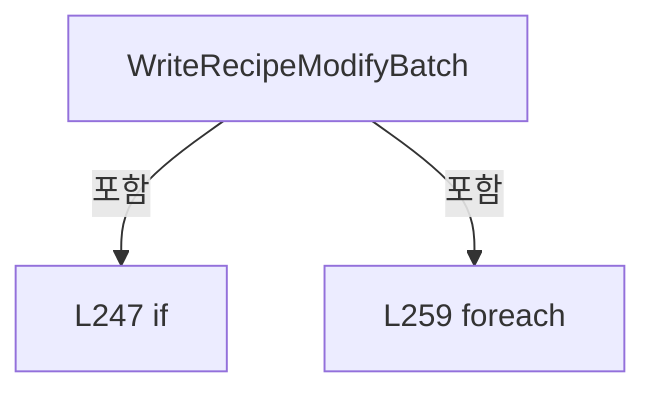

변경 전 점검: 입력/반환 타입, 위 호출자, 예외/취소 경로, 공유 상태와 저장·전송 소비자를 함께 확인합니다. 값의 단위나 물리 방향을 이름만으로 확정하지 않습니다.

### MethodDeclaration `WriteRecipeRename` · L267–270

[Drilling.Common/Log/CLogManager.cs:267–270](https://github.com/kjuws10-rgb/A3Drilling/blob/0219666f9053b907d96d7e0aa7d0c6c1be3a73d4/Drilling.Common/Log/CLogManager.cs#L267-L270)

| 항목 | 실제 추출 값 |
| --- | --- |
| 서명 | void Drilling.Common.Log.CLogManager.WriteRecipeRename(string, string) |
| 접근/수식자 | Public / public |
| 반환/값 타입 | void |
| 소속 타입 | NamedType:Drilling.Common.Log.CLogManager |

입력 계약:

| 이름 | 타입 | 전달 | 선택/기본값 |
| --- | --- | --- | --- |
| oldRecipeName | string | None | False /  |
| newRecipeName | string | None | False /  |

정적 호출자로 확인된 위치:

| 호출 파일/행 | 호출 표현식 | 런타임 분기 가능 |
| --- | --- | --- |
| [Drilling.File/JHMI/CJhmiRecipeFile.cs:367–367](https://github.com/kjuws10-rgb/A3Drilling/blob/0219666f9053b907d96d7e0aa7d0c6c1be3a73d4/Drilling.File/JHMI/CJhmiRecipeFile.cs#L367-L367) | _logManager.WriteRecipeRename | False |
| [Drilling.File/JHMI/CJhmiRecipeFile.cs:1174–1174](https://github.com/kjuws10-rgb/A3Drilling/blob/0219666f9053b907d96d7e0aa7d0c6c1be3a73d4/Drilling.File/JHMI/CJhmiRecipeFile.cs#L1174-L1174) | _logManager.WriteRecipeRename | False |

호출하는 대상과 해석 범위:

| 원본 행 | 표현식 | 분석 상태 | 대상/소스 위치 |
| --- | --- | --- | --- |
| 269 | WriteRecipeAction | resolved | void Drilling.Common.Log.CLogManager.WriteRecipeAction(string, string, string, string, string) · Drilling.Common/Log/CLogManager.cs:356 |

본문의 실제 연산·분기·예외·반환 순서(원문 위치 순):

| 원본 행 | 종류 | 주석 해설 |
| --- | --- | --- |
| 269 | call | 함수·델리게이트 또는 객체 생성자를 호출합니다: WriteRecipeAction(newRecipeName, "RENAME", "Recipe", oldRecipeName, newRecipeName) |

변경 전 점검: 입력/반환 타입, 위 호출자, 예외/취소 경로, 공유 상태와 저장·전송 소비자를 함께 확인합니다. 값의 단위나 물리 방향을 이름만으로 확정하지 않습니다.

### MethodDeclaration `ReadSettingRecent` · L272–290

[Drilling.Common/Log/CLogManager.cs:272–290](https://github.com/kjuws10-rgb/A3Drilling/blob/0219666f9053b907d96d7e0aa7d0c6c1be3a73d4/Drilling.Common/Log/CLogManager.cs#L272-L290)

| 항목 | 실제 추출 값 |
| --- | --- |
| 서명 | System.Collections.Generic.IReadOnlyList<Drilling.Common.Managers.ST_SETTING_HISTORY> Drilling.Common.Log.CLogManager.ReadSettingRecent(Drilling.Common.Managers.EN_SETTING_TAB, int, int) |
| 접근/수식자 | Public / public |
| 반환/값 타입 | System.Collections.Generic.IReadOnlyList<Drilling.Common.Managers.ST_SETTING_HISTORY> |
| 소속 타입 | NamedType:Drilling.Common.Log.CLogManager |

입력 계약:

| 이름 | 타입 | 전달 | 선택/기본값 |
| --- | --- | --- | --- |
| section | Drilling.Common.Managers.EN_SETTING_TAB | None | False /  |
| maxRows | int | None | True / 20 |
| days | int | None | True / 14 |

정적 호출자로 확인된 위치:

| 호출 파일/행 | 호출 표현식 | 런타임 분기 가능 |
| --- | --- | --- |
| [Drilling.File/JHMI/CSettingFile.cs:139–139](https://github.com/kjuws10-rgb/A3Drilling/blob/0219666f9053b907d96d7e0aa7d0c6c1be3a73d4/Drilling.File/JHMI/CSettingFile.cs#L139-L139) | _logManager.ReadSettingRecent | False |

호출하는 대상과 해석 범위:

| 원본 행 | 표현식 | 분석 상태 | 대상/소스 위치 |
| --- | --- | --- | --- |
| 289 | EnumerateRecentLogFiles(_settingLogRoot, days).SelectMany(ReadLogFile).Select(ParseSettingLine).Where(ShouldIncludeItem).Cast<ST_SETTING_HISTORY>().Where(MatchesSection).OrderByDescending(SelectChangedAt).Take(maxRows).ToArray | resolved | Drilling.Common.Managers.ST_SETTING_HISTORY[] System.Collections.Generic.IEnumerable<Drilling.Common.Managers.ST_SETTING_HISTORY>.ToArray<Drilling.Common.Managers.ST_SETTING_HISTORY>() |
| 289 | EnumerateRecentLogFiles(_settingLogRoot, days).SelectMany(ReadLogFile).Select(ParseSettingLine).Where(ShouldIncludeItem).Cast<ST_SETTING_HISTORY>().Where(MatchesSection).OrderByDescending(SelectChangedAt).Take | resolved | System.Collections.Generic.IEnumerable<Drilling.Common.Managers.ST_SETTING_HISTORY> System.Collections.Generic.IEnumerable<Drilling.Common.Managers.ST_SETTING_HISTORY>.Take<Drilling.Common.Managers.ST_SETTING_HISTORY>(int) |
| 289 | EnumerateRecentLogFiles(_settingLogRoot, days).SelectMany(ReadLogFile).Select(ParseSettingLine).Where(ShouldIncludeItem).Cast<ST_SETTING_HISTORY>().Where(MatchesSection).OrderByDescending | resolved | System.Linq.IOrderedEnumerable<Drilling.Common.Managers.ST_SETTING_HISTORY> System.Collections.Generic.IEnumerable<Drilling.Common.Managers.ST_SETTING_HISTORY>.OrderByDescending<Drilling.Common.Managers.ST_SETTING_HISTORY, System.DateTimeOffset>(System.Func<Drilling.Common.Managers.ST_SETTING_HISTORY, System.DateTimeOffset>) |
| 289 | EnumerateRecentLogFiles(_settingLogRoot, days).SelectMany(ReadLogFile).Select(ParseSettingLine).Where(ShouldIncludeItem).Cast<ST_SETTING_HISTORY>().Where | resolved | System.Collections.Generic.IEnumerable<Drilling.Common.Managers.ST_SETTING_HISTORY> System.Collections.Generic.IEnumerable<Drilling.Common.Managers.ST_SETTING_HISTORY>.Where<Drilling.Common.Managers.ST_SETTING_HISTORY>(System.Func<Drilling.Common.Managers.ST_SETTING_HISTORY, bool>) |
| 289 | EnumerateRecentLogFiles(_settingLogRoot, days).SelectMany(ReadLogFile).Select(ParseSettingLine).Where(ShouldIncludeItem).Cast<ST_SETTING_HISTORY> | resolved | System.Collections.Generic.IEnumerable<Drilling.Common.Managers.ST_SETTING_HISTORY> System.Collections.IEnumerable.Cast<Drilling.Common.Managers.ST_SETTING_HISTORY>() |
| 289 | EnumerateRecentLogFiles(_settingLogRoot, days).SelectMany(ReadLogFile).Select(ParseSettingLine).Where | resolved | System.Collections.Generic.IEnumerable<Drilling.Common.Managers.ST_SETTING_HISTORY?> System.Collections.Generic.IEnumerable<Drilling.Common.Managers.ST_SETTING_HISTORY?>.Where<Drilling.Common.Managers.ST_SETTING_HISTORY?>(System.Func<Drilling.Common.Managers.ST_SETTING_HISTORY?, bool>) |
| 289 | EnumerateRecentLogFiles(_settingLogRoot, days).SelectMany(ReadLogFile).Select | resolved | System.Collections.Generic.IEnumerable<Drilling.Common.Managers.ST_SETTING_HISTORY?> System.Collections.Generic.IEnumerable<string>.Select<string, Drilling.Common.Managers.ST_SETTING_HISTORY?>(System.Func<string, Drilling.Common.Managers.ST_SETTING_HISTORY?>) |
| 289 | EnumerateRecentLogFiles(_settingLogRoot, days).SelectMany | resolved | System.Collections.Generic.IEnumerable<string> System.Collections.Generic.IEnumerable<string>.SelectMany<string, string>(System.Func<string, System.Collections.Generic.IEnumerable<string>>) |
| 289 | EnumerateRecentLogFiles | resolved | System.Collections.Generic.IEnumerable<string> Drilling.Common.Log.CLogManager.EnumerateRecentLogFiles(string, int) · Drilling.Common/Log/CLogManager.cs:539 |

본문의 실제 연산·분기·예외·반환 순서(원문 위치 순):

| 원본 행 | 종류 | 주석 해설 |
| --- | --- | --- |
| 289 | call | 함수·델리게이트 또는 객체 생성자를 호출합니다: EnumerateRecentLogFiles(_settingLogRoot, days).SelectMany(ReadLogFile).Select(ParseSettingLine).Where(ShouldIncludeItem).Cast<ST_SETTING_HISTORY>().Where(MatchesSection).OrderByDescending(SelectChangedAt).Take(maxRows).T… |
| 289 | call | 함수·델리게이트 또는 객체 생성자를 호출합니다: EnumerateRecentLogFiles(_settingLogRoot, days).SelectMany(ReadLogFile).Select(ParseSettingLine).Where(ShouldIncludeItem).Cast<ST_SETTING_HISTORY>().Where(MatchesSection).OrderByDescending(SelectChangedAt).Take(maxRows) |
| 289 | call | 함수·델리게이트 또는 객체 생성자를 호출합니다: EnumerateRecentLogFiles(_settingLogRoot, days).SelectMany(ReadLogFile).Select(ParseSettingLine).Where(ShouldIncludeItem).Cast<ST_SETTING_HISTORY>().Where(MatchesSection).OrderByDescending(SelectChangedAt) |
| 289 | call | 함수·델리게이트 또는 객체 생성자를 호출합니다: EnumerateRecentLogFiles(_settingLogRoot, days).SelectMany(ReadLogFile).Select(ParseSettingLine).Where(ShouldIncludeItem).Cast<ST_SETTING_HISTORY>().Where(MatchesSection) |
| 289 | call | 함수·델리게이트 또는 객체 생성자를 호출합니다: EnumerateRecentLogFiles(_settingLogRoot, days).SelectMany(ReadLogFile).Select(ParseSettingLine).Where(ShouldIncludeItem).Cast<ST_SETTING_HISTORY>() |
| 289 | call | 함수·델리게이트 또는 객체 생성자를 호출합니다: EnumerateRecentLogFiles(_settingLogRoot, days).SelectMany(ReadLogFile).Select(ParseSettingLine).Where(ShouldIncludeItem) |
| 289 | call | 함수·델리게이트 또는 객체 생성자를 호출합니다: EnumerateRecentLogFiles(_settingLogRoot, days).SelectMany(ReadLogFile).Select(ParseSettingLine) |
| 289 | call | 함수·델리게이트 또는 객체 생성자를 호출합니다: EnumerateRecentLogFiles(_settingLogRoot, days).SelectMany(ReadLogFile) |
| 289 | call | 함수·델리게이트 또는 객체 생성자를 호출합니다: EnumerateRecentLogFiles(_settingLogRoot, days) |
| 289 | return | 호출자에게 값 또는 제어를 반환합니다: return EnumerateRecentLogFiles(_settingLogRoot, days).SelectMany(ReadLogFile).Select(ParseSettingLine).Where(ShouldIncludeItem).Cast<ST_SETTING_HISTORY>().Where(MatchesSection).OrderByDescending(SelectChangedAt).Take(maxRows).ToAr |

변경 전 점검: 입력/반환 타입, 위 호출자, 예외/취소 경로, 공유 상태와 저장·전송 소비자를 함께 확인합니다. 값의 단위나 물리 방향을 이름만으로 확정하지 않습니다.

### LocalFunctionStatement `ShouldIncludeItem` · L274–277

[Drilling.Common/Log/CLogManager.cs:274–277](https://github.com/kjuws10-rgb/A3Drilling/blob/0219666f9053b907d96d7e0aa7d0c6c1be3a73d4/Drilling.Common/Log/CLogManager.cs#L274-L277)

| 항목 | 실제 추출 값 |
| --- | --- |
| 서명 | bool ShouldIncludeItem(Drilling.Common.Managers.ST_SETTING_HISTORY?) |
| 접근/수식자 | Private /  |
| 반환/값 타입 | bool |
| 소속 타입 | NamedType:Drilling.Common.Log.CLogManager |

입력 계약:

| 이름 | 타입 | 전달 | 선택/기본값 |
| --- | --- | --- | --- |
| item | Drilling.Common.Managers.ST_SETTING_HISTORY? | None | False /  |

현재 부분 분석에서 직접 연결된 호출자는 없습니다. XAML/이벤트/인터페이스·델리게이트·외부 진입을 추가 확인해야 하며, 미사용으로 판정한 것이 아닙니다.

본문의 실제 연산·분기·예외·반환 순서(원문 위치 순):

| 원본 행 | 종류 | 주석 해설 |
| --- | --- | --- |
| 276 | return | 호출자에게 값 또는 제어를 반환합니다: return item is not null; |

변경 전 점검: 입력/반환 타입, 위 호출자, 예외/취소 경로, 공유 상태와 저장·전송 소비자를 함께 확인합니다. 값의 단위나 물리 방향을 이름만으로 확정하지 않습니다.

### LocalFunctionStatement `MatchesSection` · L279–282

[Drilling.Common/Log/CLogManager.cs:279–282](https://github.com/kjuws10-rgb/A3Drilling/blob/0219666f9053b907d96d7e0aa7d0c6c1be3a73d4/Drilling.Common/Log/CLogManager.cs#L279-L282)

| 항목 | 실제 추출 값 |
| --- | --- |
| 서명 | bool MatchesSection(Drilling.Common.Managers.ST_SETTING_HISTORY) |
| 접근/수식자 | Private /  |
| 반환/값 타입 | bool |
| 소속 타입 | NamedType:Drilling.Common.Log.CLogManager |

입력 계약:

| 이름 | 타입 | 전달 | 선택/기본값 |
| --- | --- | --- | --- |
| item | Drilling.Common.Managers.ST_SETTING_HISTORY | None | False /  |

현재 부분 분석에서 직접 연결된 호출자는 없습니다. XAML/이벤트/인터페이스·델리게이트·외부 진입을 추가 확인해야 하며, 미사용으로 판정한 것이 아닙니다.

본문의 실제 연산·분기·예외·반환 순서(원문 위치 순):

| 원본 행 | 종류 | 주석 해설 |
| --- | --- | --- |
| 281 | return | 호출자에게 값 또는 제어를 반환합니다: return item.Section == section; |

변경 전 점검: 입력/반환 타입, 위 호출자, 예외/취소 경로, 공유 상태와 저장·전송 소비자를 함께 확인합니다. 값의 단위나 물리 방향을 이름만으로 확정하지 않습니다.

### LocalFunctionStatement `SelectChangedAt` · L284–287

[Drilling.Common/Log/CLogManager.cs:284–287](https://github.com/kjuws10-rgb/A3Drilling/blob/0219666f9053b907d96d7e0aa7d0c6c1be3a73d4/Drilling.Common/Log/CLogManager.cs#L284-L287)

| 항목 | 실제 추출 값 |
| --- | --- |
| 서명 | System.DateTimeOffset SelectChangedAt(Drilling.Common.Managers.ST_SETTING_HISTORY) |
| 접근/수식자 | Private /  |
| 반환/값 타입 | System.DateTimeOffset |
| 소속 타입 | NamedType:Drilling.Common.Log.CLogManager |

입력 계약:

| 이름 | 타입 | 전달 | 선택/기본값 |
| --- | --- | --- | --- |
| item | Drilling.Common.Managers.ST_SETTING_HISTORY | None | False /  |

현재 부분 분석에서 직접 연결된 호출자는 없습니다. XAML/이벤트/인터페이스·델리게이트·외부 진입을 추가 확인해야 하며, 미사용으로 판정한 것이 아닙니다.

본문의 실제 연산·분기·예외·반환 순서(원문 위치 순):

| 원본 행 | 종류 | 주석 해설 |
| --- | --- | --- |
| 286 | return | 호출자에게 값 또는 제어를 반환합니다: return item.ChangedAt; |

변경 전 점검: 입력/반환 타입, 위 호출자, 예외/취소 경로, 공유 상태와 저장·전송 소비자를 함께 확인합니다. 값의 단위나 물리 방향을 이름만으로 확정하지 않습니다.

### MethodDeclaration `WriteSettingModify` · L292–295

[Drilling.Common/Log/CLogManager.cs:292–295](https://github.com/kjuws10-rgb/A3Drilling/blob/0219666f9053b907d96d7e0aa7d0c6c1be3a73d4/Drilling.Common/Log/CLogManager.cs#L292-L295)

| 항목 | 실제 추출 값 |
| --- | --- |
| 서명 | void Drilling.Common.Log.CLogManager.WriteSettingModify(Drilling.Common.Managers.EN_SETTING_TAB, string, string, string) |
| 접근/수식자 | Public / public |
| 반환/값 타입 | void |
| 소속 타입 | NamedType:Drilling.Common.Log.CLogManager |

입력 계약:

| 이름 | 타입 | 전달 | 선택/기본값 |
| --- | --- | --- | --- |
| section | Drilling.Common.Managers.EN_SETTING_TAB | None | False /  |
| parameterName | string | None | False /  |
| oldValue | string | None | False /  |
| newValue | string | None | False /  |

정적 호출자로 확인된 위치:

| 호출 파일/행 | 호출 표현식 | 런타임 분기 가능 |
| --- | --- | --- |
| [Drilling.File/JHMI/CInterfaceFile.cs:249–249](https://github.com/kjuws10-rgb/A3Drilling/blob/0219666f9053b907d96d7e0aa7d0c6c1be3a73d4/Drilling.File/JHMI/CInterfaceFile.cs#L249-L249) | _logManager.WriteSettingModify | False |
| [Drilling.File/JHMI/CInterfaceFile.cs:264–264](https://github.com/kjuws10-rgb/A3Drilling/blob/0219666f9053b907d96d7e0aa7d0c6c1be3a73d4/Drilling.File/JHMI/CInterfaceFile.cs#L264-L264) | _logManager.WriteSettingModify | False |
| [Drilling.File/JHMI/CInterfaceFile.cs:279–279](https://github.com/kjuws10-rgb/A3Drilling/blob/0219666f9053b907d96d7e0aa7d0c6c1be3a73d4/Drilling.File/JHMI/CInterfaceFile.cs#L279-L279) | _logManager.WriteSettingModify | False |
| [Drilling.File/JHMI/CSettingFile.cs:129–129](https://github.com/kjuws10-rgb/A3Drilling/blob/0219666f9053b907d96d7e0aa7d0c6c1be3a73d4/Drilling.File/JHMI/CSettingFile.cs#L129-L129) | _logManager.WriteSettingModify | False |

호출하는 대상과 해석 범위:

| 원본 행 | 표현식 | 분석 상태 | 대상/소스 위치 |
| --- | --- | --- | --- |
| 294 | WriteSettingAction | resolved | void Drilling.Common.Log.CLogManager.WriteSettingAction(Drilling.Common.Managers.EN_SETTING_TAB, string, string, string, string) · Drilling.Common/Log/CLogManager.cs:376 |

본문의 실제 연산·분기·예외·반환 순서(원문 위치 순):

| 원본 행 | 종류 | 주석 해설 |
| --- | --- | --- |
| 294 | call | 함수·델리게이트 또는 객체 생성자를 호출합니다: WriteSettingAction(section, "MODIFY", parameterName, oldValue, newValue) |

변경 전 점검: 입력/반환 타입, 위 호출자, 예외/취소 경로, 공유 상태와 저장·전송 소비자를 함께 확인합니다. 값의 단위나 물리 방향을 이름만으로 확정하지 않습니다.

### MethodDeclaration `WriteSettingSave` · L297–300

[Drilling.Common/Log/CLogManager.cs:297–300](https://github.com/kjuws10-rgb/A3Drilling/blob/0219666f9053b907d96d7e0aa7d0c6c1be3a73d4/Drilling.Common/Log/CLogManager.cs#L297-L300)

| 항목 | 실제 추출 값 |
| --- | --- |
| 서명 | void Drilling.Common.Log.CLogManager.WriteSettingSave(Drilling.Common.Managers.EN_SETTING_TAB) |
| 접근/수식자 | Public / public |
| 반환/값 타입 | void |
| 소속 타입 | NamedType:Drilling.Common.Log.CLogManager |

입력 계약:

| 이름 | 타입 | 전달 | 선택/기본값 |
| --- | --- | --- | --- |
| section | Drilling.Common.Managers.EN_SETTING_TAB | None | False /  |

정적 호출자로 확인된 위치:

| 호출 파일/행 | 호출 표현식 | 런타임 분기 가능 |
| --- | --- | --- |
| [Drilling.File/JHMI/CInterfaceFile.cs:78–78](https://github.com/kjuws10-rgb/A3Drilling/blob/0219666f9053b907d96d7e0aa7d0c6c1be3a73d4/Drilling.File/JHMI/CInterfaceFile.cs#L78-L78) | _logManager.WriteSettingSave | False |
| [Drilling.File/JHMI/CSettingFile.cs:133–133](https://github.com/kjuws10-rgb/A3Drilling/blob/0219666f9053b907d96d7e0aa7d0c6c1be3a73d4/Drilling.File/JHMI/CSettingFile.cs#L133-L133) | _logManager.WriteSettingSave | False |

호출하는 대상과 해석 범위:

| 원본 행 | 표현식 | 분석 상태 | 대상/소스 위치 |
| --- | --- | --- | --- |
| 299 | WriteSettingAction | resolved | void Drilling.Common.Log.CLogManager.WriteSettingAction(Drilling.Common.Managers.EN_SETTING_TAB, string, string, string, string) · Drilling.Common/Log/CLogManager.cs:376 |
| 299 | section.ToString().ToUpperInvariant | resolved | string string.ToUpperInvariant() |
| 299 | section.ToString | resolved · 동적 구현 선택 가능 | string System.Enum.ToString() |

본문의 실제 연산·분기·예외·반환 순서(원문 위치 순):

| 원본 행 | 종류 | 주석 해설 |
| --- | --- | --- |
| 299 | call | 함수·델리게이트 또는 객체 생성자를 호출합니다: WriteSettingAction(section, "SAVE", "Section", "-", section.ToString().ToUpperInvariant()) |
| 299 | call | 함수·델리게이트 또는 객체 생성자를 호출합니다: section.ToString().ToUpperInvariant() |
| 299 | call | 함수·델리게이트 또는 객체 생성자를 호출합니다: section.ToString() |

변경 전 점검: 입력/반환 타입, 위 호출자, 예외/취소 경로, 공유 상태와 저장·전송 소비자를 함께 확인합니다. 값의 단위나 물리 방향을 이름만으로 확정하지 않습니다.

### MethodDeclaration `WriteInterfaceConnection` · L302–305

[Drilling.Common/Log/CLogManager.cs:302–305](https://github.com/kjuws10-rgb/A3Drilling/blob/0219666f9053b907d96d7e0aa7d0c6c1be3a73d4/Drilling.Common/Log/CLogManager.cs#L302-L305)

| 항목 | 실제 추출 값 |
| --- | --- |
| 서명 | void Drilling.Common.Log.CLogManager.WriteInterfaceConnection(Drilling.Common.Interface.EN_EQP_MODULE, string, string, string, string) |
| 접근/수식자 | Public / public |
| 반환/값 타입 | void |
| 소속 타입 | NamedType:Drilling.Common.Log.CLogManager |

입력 계약:

| 이름 | 타입 | 전달 | 선택/기본값 |
| --- | --- | --- | --- |
| module | Drilling.Common.Interface.EN_EQP_MODULE | None | False /  |
| action | string | None | False /  |
| nickName | string | None | False /  |
| oldState | string | None | False /  |
| newState | string | None | False /  |

정적 호출자로 확인된 위치:

| 호출 파일/행 | 호출 표현식 | 런타임 분기 가능 |
| --- | --- | --- |
| [Drilling.Common/Interface/CInterfaceManager.cs:712–712](https://github.com/kjuws10-rgb/A3Drilling/blob/0219666f9053b907d96d7e0aa7d0c6c1be3a73d4/Drilling.Common/Interface/CInterfaceManager.cs#L712-L712) | _logManager.WriteInterfaceConnection | False |

호출하는 대상과 해석 범위:

| 원본 행 | 표현식 | 분석 상태 | 대상/소스 위치 |
| --- | --- | --- | --- |
| 304 | WriteInterfaceAction | resolved | void Drilling.Common.Log.CLogManager.WriteInterfaceAction(Drilling.Common.Interface.EN_EQP_MODULE, string, string, string, string) · Drilling.Common/Log/CLogManager.cs:386 |

본문의 실제 연산·분기·예외·반환 순서(원문 위치 순):

| 원본 행 | 종류 | 주석 해설 |
| --- | --- | --- |
| 304 | call | 함수·델리게이트 또는 객체 생성자를 호출합니다: WriteInterfaceAction(module, action, nickName, oldState, newState) |

변경 전 점검: 입력/반환 타입, 위 호출자, 예외/취소 경로, 공유 상태와 저장·전송 소비자를 함께 확인합니다. 값의 단위나 물리 방향을 이름만으로 확정하지 않습니다.

### MethodDeclaration `WriteInterfaceCommand` · L307–311

[Drilling.Common/Log/CLogManager.cs:307–311](https://github.com/kjuws10-rgb/A3Drilling/blob/0219666f9053b907d96d7e0aa7d0c6c1be3a73d4/Drilling.Common/Log/CLogManager.cs#L307-L311)

| 항목 | 실제 추출 값 |
| --- | --- |
| 서명 | void Drilling.Common.Log.CLogManager.WriteInterfaceCommand(Drilling.Common.Interface.EN_EQP_MODULE, string, string, string, string) |
| 접근/수식자 | Public / public |
| 반환/값 타입 | void |
| 소속 타입 | NamedType:Drilling.Common.Log.CLogManager |

입력 계약:

| 이름 | 타입 | 전달 | 선택/기본값 |
| --- | --- | --- | --- |
| module | Drilling.Common.Interface.EN_EQP_MODULE | None | False /  |
| nickName | string | None | False /  |
| command | string | None | False /  |
| response | string | None | False /  |
| detail | string | None | True / "" |

정적 호출자로 확인된 위치:

| 호출 파일/행 | 호출 표현식 | 런타임 분기 가능 |
| --- | --- | --- |
| [Drilling.Common/Interface/CInterfaceManager.cs:731–731](https://github.com/kjuws10-rgb/A3Drilling/blob/0219666f9053b907d96d7e0aa7d0c6c1be3a73d4/Drilling.Common/Interface/CInterfaceManager.cs#L731-L731) | _logManager.WriteInterfaceCommand | False |
| [Drilling.Common/Interface/CInterfaceManager.cs:744–744](https://github.com/kjuws10-rgb/A3Drilling/blob/0219666f9053b907d96d7e0aa7d0c6c1be3a73d4/Drilling.Common/Interface/CInterfaceManager.cs#L744-L744) | .WriteInterfaceCommand | False |
| [Drilling.Common/Interface/CInterfaceManager.cs:786–786](https://github.com/kjuws10-rgb/A3Drilling/blob/0219666f9053b907d96d7e0aa7d0c6c1be3a73d4/Drilling.Common/Interface/CInterfaceManager.cs#L786-L786) | .WriteInterfaceCommand | False |
| [Drilling.Common/Interface/Melsec/CMelsec.InterfaceLog.cs:33–34](https://github.com/kjuws10-rgb/A3Drilling/blob/0219666f9053b907d96d7e0aa7d0c6c1be3a73d4/Drilling.Common/Interface/Melsec/CMelsec.InterfaceLog.cs#L33-L34) | _logManager.WriteInterfaceCommand | False |
| [Drilling.Common/Interface/Melsec/CMelsec.InterfaceLog.cs:129–129](https://github.com/kjuws10-rgb/A3Drilling/blob/0219666f9053b907d96d7e0aa7d0c6c1be3a73d4/Drilling.Common/Interface/Melsec/CMelsec.InterfaceLog.cs#L129-L129) | _logManager.WriteInterfaceCommand | False |
| [Drilling.Common/Interface/Melsec/CMelsec.cs:846–846](https://github.com/kjuws10-rgb/A3Drilling/blob/0219666f9053b907d96d7e0aa7d0c6c1be3a73d4/Drilling.Common/Interface/Melsec/CMelsec.cs#L846-L846) | .WriteInterfaceCommand | False |
| [Drilling.Common/Interface/Melsec/CMelsec.cs:1899–1899](https://github.com/kjuws10-rgb/A3Drilling/blob/0219666f9053b907d96d7e0aa7d0c6c1be3a73d4/Drilling.Common/Interface/Melsec/CMelsec.cs#L1899-L1899) | .WriteInterfaceCommand | False |
| [Drilling.Common/Interface/Melsec/CMelsec.cs:2179–2179](https://github.com/kjuws10-rgb/A3Drilling/blob/0219666f9053b907d96d7e0aa7d0c6c1be3a73d4/Drilling.Common/Interface/Melsec/CMelsec.cs#L2179-L2179) | .WriteInterfaceCommand | False |
| [Drilling.Common/Station/CStationProcess.cs:1488–1488](https://github.com/kjuws10-rgb/A3Drilling/blob/0219666f9053b907d96d7e0aa7d0c6c1be3a73d4/Drilling.Common/Station/CStationProcess.cs#L1488-L1488) | .WriteInterfaceCommand | False |

호출하는 대상과 해석 범위:

| 원본 행 | 표현식 | 분석 상태 | 대상/소스 위치 |
| --- | --- | --- | --- |
| 309 | string.IsNullOrWhiteSpace | resolved | bool string.IsNullOrWhiteSpace(string?) |
| 310 | WriteInterfaceAction | resolved | void Drilling.Common.Log.CLogManager.WriteInterfaceAction(Drilling.Common.Interface.EN_EQP_MODULE, string, string, string, string) · Drilling.Common/Log/CLogManager.cs:386 |

본문의 실제 연산·분기·예외·반환 순서(원문 위치 순):

| 원본 행 | 종류 | 주석 해설 |
| --- | --- | --- |
| 309 | call | 함수·델리게이트 또는 객체 생성자를 호출합니다: string.IsNullOrWhiteSpace(detail) |
| 309 | conditional-expression | 조건에 따라 결과식을 선택합니다: string.IsNullOrWhiteSpace(detail) ? response : $"{response} / {detail}" |
| 309 | local-declaration | 지역 변수를 선언합니다: var after = string.IsNullOrWhiteSpace(detail) ? response : $"{response} / {detail}"; |
| 309 | variable-initializer | 변수의 초기값을 지정합니다: after = string.IsNullOrWhiteSpace(detail) ? response : $"{response} / {detail}" |
| 310 | call | 함수·델리게이트 또는 객체 생성자를 호출합니다: WriteInterfaceAction(module, "COMMAND", nickName, command, after) |

변경 전 점검: 입력/반환 타입, 위 호출자, 예외/취소 경로, 공유 상태와 저장·전송 소비자를 함께 확인합니다. 값의 단위나 물리 방향을 이름만으로 확정하지 않습니다.

### MethodDeclaration `WriteInterfaceError` · L313–316

[Drilling.Common/Log/CLogManager.cs:313–316](https://github.com/kjuws10-rgb/A3Drilling/blob/0219666f9053b907d96d7e0aa7d0c6c1be3a73d4/Drilling.Common/Log/CLogManager.cs#L313-L316)

| 항목 | 실제 추출 값 |
| --- | --- |
| 서명 | void Drilling.Common.Log.CLogManager.WriteInterfaceError(Drilling.Common.Interface.EN_EQP_MODULE, string, string, string) |
| 접근/수식자 | Public / public |
| 반환/값 타입 | void |
| 소속 타입 | NamedType:Drilling.Common.Log.CLogManager |

입력 계약:

| 이름 | 타입 | 전달 | 선택/기본값 |
| --- | --- | --- | --- |
| module | Drilling.Common.Interface.EN_EQP_MODULE | None | False /  |
| nickName | string | None | False /  |
| command | string | None | False /  |
| detail | string | None | False /  |

정적 호출자로 확인된 위치:

| 호출 파일/행 | 호출 표현식 | 런타임 분기 가능 |
| --- | --- | --- |
| [Drilling.Common/Interface/CInterfaceManager.cs:727–727](https://github.com/kjuws10-rgb/A3Drilling/blob/0219666f9053b907d96d7e0aa7d0c6c1be3a73d4/Drilling.Common/Interface/CInterfaceManager.cs#L727-L727) | _logManager.WriteInterfaceError | False |
| [Drilling.Common/Interface/CInterfaceManager.cs:738–738](https://github.com/kjuws10-rgb/A3Drilling/blob/0219666f9053b907d96d7e0aa7d0c6c1be3a73d4/Drilling.Common/Interface/CInterfaceManager.cs#L738-L738) | .WriteInterfaceError | False |
| [Drilling.Common/Interface/CInterfaceManager.cs:791–791](https://github.com/kjuws10-rgb/A3Drilling/blob/0219666f9053b907d96d7e0aa7d0c6c1be3a73d4/Drilling.Common/Interface/CInterfaceManager.cs#L791-L791) | .WriteInterfaceError | False |
| [Drilling.Common/Interface/Melsec/CMelsec.cs:234–234](https://github.com/kjuws10-rgb/A3Drilling/blob/0219666f9053b907d96d7e0aa7d0c6c1be3a73d4/Drilling.Common/Interface/Melsec/CMelsec.cs#L234-L234) | .WriteInterfaceError | False |
| [Drilling.Common/Interface/Melsec/CMelsec.cs:786–786](https://github.com/kjuws10-rgb/A3Drilling/blob/0219666f9053b907d96d7e0aa7d0c6c1be3a73d4/Drilling.Common/Interface/Melsec/CMelsec.cs#L786-L786) | .WriteInterfaceError | False |
| [Drilling.Common/Interface/Melsec/CMelsec.cs:792–792](https://github.com/kjuws10-rgb/A3Drilling/blob/0219666f9053b907d96d7e0aa7d0c6c1be3a73d4/Drilling.Common/Interface/Melsec/CMelsec.cs#L792-L792) | .WriteInterfaceError | False |
| [Drilling.Common/Interface/Melsec/CMelsec.cs:2188–2188](https://github.com/kjuws10-rgb/A3Drilling/blob/0219666f9053b907d96d7e0aa7d0c6c1be3a73d4/Drilling.Common/Interface/Melsec/CMelsec.cs#L2188-L2188) | .WriteInterfaceError | False |
| [Drilling.Common/Interface/Melsec/CMelsec.cs:2243–2243](https://github.com/kjuws10-rgb/A3Drilling/blob/0219666f9053b907d96d7e0aa7d0c6c1be3a73d4/Drilling.Common/Interface/Melsec/CMelsec.cs#L2243-L2243) | .WriteInterfaceError | False |

호출하는 대상과 해석 범위:

| 원본 행 | 표현식 | 분석 상태 | 대상/소스 위치 |
| --- | --- | --- | --- |
| 315 | WriteInterfaceAction | resolved | void Drilling.Common.Log.CLogManager.WriteInterfaceAction(Drilling.Common.Interface.EN_EQP_MODULE, string, string, string, string) · Drilling.Common/Log/CLogManager.cs:386 |

본문의 실제 연산·분기·예외·반환 순서(원문 위치 순):

| 원본 행 | 종류 | 주석 해설 |
| --- | --- | --- |
| 315 | call | 함수·델리게이트 또는 객체 생성자를 호출합니다: WriteInterfaceAction(module, "ERROR", nickName, command, $"ERROR / {detail}") |

변경 전 점검: 입력/반환 타입, 위 호출자, 예외/취소 경로, 공유 상태와 저장·전송 소비자를 함께 확인합니다. 값의 단위나 물리 방향을 이름만으로 확정하지 않습니다.

### MethodDeclaration `WriteInterfaceProtocolTrace` · L318–339

[Drilling.Common/Log/CLogManager.cs:318–339](https://github.com/kjuws10-rgb/A3Drilling/blob/0219666f9053b907d96d7e0aa7d0c6c1be3a73d4/Drilling.Common/Log/CLogManager.cs#L318-L339)

| 항목 | 실제 추출 값 |
| --- | --- |
| 서명 | void Drilling.Common.Log.CLogManager.WriteInterfaceProtocolTrace(Drilling.Common.Interface.EN_EQP_MODULE, System.DateTimeOffset, string) |
| 접근/수식자 | Public / public |
| 반환/값 타입 | void |
| 소속 타입 | NamedType:Drilling.Common.Log.CLogManager |

입력 계약:

| 이름 | 타입 | 전달 | 선택/기본값 |
| --- | --- | --- | --- |
| module | Drilling.Common.Interface.EN_EQP_MODULE | None | False /  |
| occurredAt | System.DateTimeOffset | None | False /  |
| packetLog | string | None | False /  |

정적 호출자로 확인된 위치:

| 호출 파일/행 | 호출 표현식 | 런타임 분기 가능 |
| --- | --- | --- |
| [Drilling.Common/Interface/CInterfaceManager.cs:768–768](https://github.com/kjuws10-rgb/A3Drilling/blob/0219666f9053b907d96d7e0aa7d0c6c1be3a73d4/Drilling.Common/Interface/CInterfaceManager.cs#L768-L768) | .WriteInterfaceProtocolTrace | False |

호출하는 대상과 해석 범위:

| 원본 행 | 표현식 | 분석 상태 | 대상/소스 위치 |
| --- | --- | --- | --- |
| 320 | string.IsNullOrWhiteSpace | resolved | bool string.IsNullOrWhiteSpace(string?) |
| 326 | ModuleLogName | resolved | string Drilling.Common.Log.CLogManager.ModuleLogName(Drilling.Common.Interface.EN_EQP_MODULE) · Drilling.Common/Log/CLogManager.cs:667 |
| 327 | localTime.ToString | resolved | string System.DateTime.ToString(string?, System.IFormatProvider?) |
| 328 | Path.Combine | resolved | string System.IO.Path.Combine(string, string, string) |
| 329 | Path.Combine | resolved | string System.IO.Path.Combine(string, string) |
| 330 | localTime.ToString | resolved | string System.DateTime.ToString(string?, System.IFormatProvider?) |
| 331 | packetLog.Split | resolved | string[] string.Split(char[]?, System.StringSplitOptions) |
| 332 | new StringBuilder | resolved | System.Text.StringBuilder.StringBuilder() |
| 335 | builder.Append(time).Append(' ').AppendLine | resolved | System.Text.StringBuilder System.Text.StringBuilder.AppendLine(string?) |
| 335 | builder.Append(time).Append | resolved | System.Text.StringBuilder System.Text.StringBuilder.Append(char) |
| 335 | builder.Append | resolved | System.Text.StringBuilder System.Text.StringBuilder.Append(string?) |
| 338 | QueueInterfaceText | resolved | void Drilling.Common.Log.CLogManager.QueueInterfaceText(string, string, string) · Drilling.Common/Log/CLogManager.cs:426 |
| 338 | builder.ToString | resolved · 동적 구현 선택 가능 | string System.Text.StringBuilder.ToString() |

본문의 실제 연산·분기·예외·반환 순서(원문 위치 순):

| 원본 행 | 종류 | 주석 해설 |
| --- | --- | --- |
| 320 | call | 함수·델리게이트 또는 객체 생성자를 호출합니다: string.IsNullOrWhiteSpace(packetLog) |
| 320 | if | 조건에 따라 분기합니다: if (string.IsNullOrWhiteSpace(packetLog)) |
| 322 | return | 호출자에게 값 또는 제어를 반환합니다: return; |
| 325 | local-declaration | 지역 변수를 선언합니다: var localTime = occurredAt.LocalDateTime; |
| 325 | variable-initializer | 변수의 초기값을 지정합니다: localTime = occurredAt.LocalDateTime |
| 326 | call | 함수·델리게이트 또는 객체 생성자를 호출합니다: ModuleLogName(module) |
| 326 | local-declaration | 지역 변수를 선언합니다: var moduleName = ModuleLogName(module); |
| 326 | variable-initializer | 변수의 초기값을 지정합니다: moduleName = ModuleLogName(module) |
| 327 | call | 함수·델리게이트 또는 객체 생성자를 호출합니다: localTime.ToString("yyyyMMdd", CultureInfo.InvariantCulture) |
| 327 | local-declaration | 지역 변수를 선언합니다: var date = localTime.ToString("yyyyMMdd", CultureInfo.InvariantCulture); |
| 327 | variable-initializer | 변수의 초기값을 지정합니다: date = localTime.ToString("yyyyMMdd", CultureInfo.InvariantCulture) |
| 328 | call | 함수·델리게이트 또는 객체 생성자를 호출합니다: Path.Combine(_interfaceLogRoot, moduleName, date) |
| 328 | local-declaration | 지역 변수를 선언합니다: var directory = Path.Combine(_interfaceLogRoot, moduleName, date); |
| 328 | variable-initializer | 변수의 초기값을 지정합니다: directory = Path.Combine(_interfaceLogRoot, moduleName, date) |
| 329 | call | 함수·델리게이트 또는 객체 생성자를 호출합니다: Path.Combine(directory, $"Interface_{moduleName}_{date}_Trace.txt") |
| 329 | local-declaration | 지역 변수를 선언합니다: var path = Path.Combine(directory, $"Interface_{moduleName}_{date}_Trace.txt"); |
| 329 | variable-initializer | 변수의 초기값을 지정합니다: path = Path.Combine(directory, $"Interface_{moduleName}_{date}_Trace.txt") |
| 330 | call | 함수·델리게이트 또는 객체 생성자를 호출합니다: localTime.ToString("yy/MM/dd HH:mm:ss.fff", CultureInfo.InvariantCulture) |
| 330 | local-declaration | 지역 변수를 선언합니다: var time = localTime.ToString("yy/MM/dd HH:mm:ss.fff", CultureInfo.InvariantCulture); |
| 330 | variable-initializer | 변수의 초기값을 지정합니다: time = localTime.ToString("yy/MM/dd HH:mm:ss.fff", CultureInfo.InvariantCulture) |
| 331 | call | 함수·델리게이트 또는 객체 생성자를 호출합니다: packetLog.Split(['\r', '\n'], StringSplitOptions.RemoveEmptyEntries) |
| 331 | local-declaration | 지역 변수를 선언합니다: var lines = packetLog.Split(['\r', '\n'], StringSplitOptions.RemoveEmptyEntries); |
| 331 | variable-initializer | 변수의 초기값을 지정합니다: lines = packetLog.Split(['\r', '\n'], StringSplitOptions.RemoveEmptyEntries) |
| 332 | call | 함수·델리게이트 또는 객체 생성자를 호출합니다: new StringBuilder() |
| 332 | local-declaration | 지역 변수를 선언합니다: var builder = new StringBuilder(); |
| 332 | variable-initializer | 변수의 초기값을 지정합니다: builder = new StringBuilder() |
| 333 | foreach | 컬렉션 요소를 순회합니다: foreach (var line in lines) |
| 335 | call | 함수·델리게이트 또는 객체 생성자를 호출합니다: builder.Append(time).Append(' ').AppendLine(line) |
| 335 | call | 함수·델리게이트 또는 객체 생성자를 호출합니다: builder.Append(time).Append(' ') |
| 335 | call | 함수·델리게이트 또는 객체 생성자를 호출합니다: builder.Append(time) |
| 338 | call | 함수·델리게이트 또는 객체 생성자를 호출합니다: QueueInterfaceText(directory, path, builder.ToString()) |
| 338 | call | 함수·델리게이트 또는 객체 생성자를 호출합니다: builder.ToString() |

제어 구문의 포함 구조(실제 실행 순서/CFG가 아닌 구문 탐색 그림):

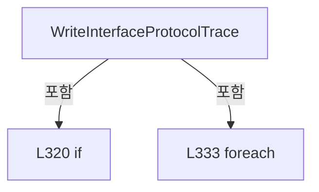

변경 전 점검: 입력/반환 타입, 위 호출자, 예외/취소 경로, 공유 상태와 저장·전송 소비자를 함께 확인합니다. 값의 단위나 물리 방향을 이름만으로 확정하지 않습니다.

### MethodDeclaration `WriteProductEvent` · L341–349

[Drilling.Common/Log/CLogManager.cs:341–349](https://github.com/kjuws10-rgb/A3Drilling/blob/0219666f9053b907d96d7e0aa7d0c6c1be3a73d4/Drilling.Common/Log/CLogManager.cs#L341-L349)

| 항목 | 실제 추출 값 |
| --- | --- |
| 서명 | void Drilling.Common.Log.CLogManager.WriteProductEvent(string, string, string, string, string) |
| 접근/수식자 | Public / public |
| 반환/값 타입 | void |
| 소속 타입 | NamedType:Drilling.Common.Log.CLogManager |

입력 계약:

| 이름 | 타입 | 전달 | 선택/기본값 |
| --- | --- | --- | --- |
| productId | string | None | False /  |
| action | string | None | False /  |
| state | string | None | False /  |
| result | string | None | False /  |
| detail | string | None | False /  |

정적 호출자로 확인된 위치:

| 호출 파일/행 | 호출 표현식 | 런타임 분기 가능 |
| --- | --- | --- |
| [Drilling.Common/Product/CProductManager.cs:727–727](https://github.com/kjuws10-rgb/A3Drilling/blob/0219666f9053b907d96d7e0aa7d0c6c1be3a73d4/Drilling.Common/Product/CProductManager.cs#L727-L727) | .WriteProductEvent | False |
| [Drilling.Common/Product/CProductManager.cs:803–803](https://github.com/kjuws10-rgb/A3Drilling/blob/0219666f9053b907d96d7e0aa7d0c6c1be3a73d4/Drilling.Common/Product/CProductManager.cs#L803-L803) | .WriteProductEvent | False |
| [Drilling.Common/Product/CProductManager.cs:813–813](https://github.com/kjuws10-rgb/A3Drilling/blob/0219666f9053b907d96d7e0aa7d0c6c1be3a73d4/Drilling.Common/Product/CProductManager.cs#L813-L813) | .WriteProductEvent | False |
| [Drilling.Common/Review/CReviewManager.cs:1890–1890](https://github.com/kjuws10-rgb/A3Drilling/blob/0219666f9053b907d96d7e0aa7d0c6c1be3a73d4/Drilling.Common/Review/CReviewManager.cs#L1890-L1890) | logManager.WriteProductEvent | False |

호출하는 대상과 해석 범위:

| 원본 행 | 표현식 | 분석 상태 | 대상/소스 위치 |
| --- | --- | --- | --- |
| 344 | Path.Combine | resolved | string System.IO.Path.Combine(string, string) |
| 344 | now.ToString | resolved | string System.DateTime.ToString(string?, System.IFormatProvider?) |
| 345 | Path.Combine | resolved | string System.IO.Path.Combine(string, string) |
| 345 | now.ToString | resolved | string System.DateTime.ToString(string?, System.IFormatProvider?) |
| 346 | now.ToString | resolved | string System.DateTime.ToString(string?, System.IFormatProvider?) |
| 347 | EscapeField | resolved | string Drilling.Common.Log.CLogManager.EscapeField(string) · Drilling.Common/Log/CLogManager.cs:662 |
| 347 | EscapeField | resolved | string Drilling.Common.Log.CLogManager.EscapeField(string) · Drilling.Common/Log/CLogManager.cs:662 |
| 347 | EscapeField | resolved | string Drilling.Common.Log.CLogManager.EscapeField(string) · Drilling.Common/Log/CLogManager.cs:662 |
| 347 | EscapeField | resolved | string Drilling.Common.Log.CLogManager.EscapeField(string) · Drilling.Common/Log/CLogManager.cs:662 |
| 347 | EscapeField | resolved | string Drilling.Common.Log.CLogManager.EscapeField(string) · Drilling.Common/Log/CLogManager.cs:662 |
| 348 | AppendLine | resolved | void Drilling.Common.Log.CLogManager.AppendLine(string, string, string) · Drilling.Common/Log/CLogManager.cs:407 |

본문의 실제 연산·분기·예외·반환 순서(원문 위치 순):

| 원본 행 | 종류 | 주석 해설 |
| --- | --- | --- |
| 343 | local-declaration | 지역 변수를 선언합니다: var now = DateTime.Now; |
| 343 | variable-initializer | 변수의 초기값을 지정합니다: now = DateTime.Now |
| 344 | call | 함수·델리게이트 또는 객체 생성자를 호출합니다: Path.Combine(_productLogRoot, now.ToString("yyyyMMdd", CultureInfo.InvariantCulture)) |
| 344 | call | 함수·델리게이트 또는 객체 생성자를 호출합니다: now.ToString("yyyyMMdd", CultureInfo.InvariantCulture) |
| 344 | local-declaration | 지역 변수를 선언합니다: var directory = Path.Combine(_productLogRoot, now.ToString("yyyyMMdd", CultureInfo.InvariantCulture)); |
| 344 | variable-initializer | 변수의 초기값을 지정합니다: directory = Path.Combine(_productLogRoot, now.ToString("yyyyMMdd", CultureInfo.InvariantCulture)) |
| 345 | call | 함수·델리게이트 또는 객체 생성자를 호출합니다: Path.Combine(directory, $"Product_{now.ToString("yyyyMMdd", CultureInfo.InvariantCulture)}_Trace.txt") |
| 345 | call | 함수·델리게이트 또는 객체 생성자를 호출합니다: now.ToString("yyyyMMdd", CultureInfo.InvariantCulture) |
| 345 | local-declaration | 지역 변수를 선언합니다: var path = Path.Combine(directory, $"Product_{now.ToString("yyyyMMdd", CultureInfo.InvariantCulture)}_Trace.txt"); |
| 345 | variable-initializer | 변수의 초기값을 지정합니다: path = Path.Combine(directory, $"Product_{now.ToString("yyyyMMdd", CultureInfo.InvariantCulture)}_Trace.txt") |
| 346 | call | 함수·델리게이트 또는 객체 생성자를 호출합니다: now.ToString("yy/MM/dd HH:mm:ss.fff", CultureInfo.InvariantCulture) |
| 346 | local-declaration | 지역 변수를 선언합니다: var time = now.ToString("yy/MM/dd HH:mm:ss.fff", CultureInfo.InvariantCulture); |
| 346 | variable-initializer | 변수의 초기값을 지정합니다: time = now.ToString("yy/MM/dd HH:mm:ss.fff", CultureInfo.InvariantCulture) |
| 347 | call | 함수·델리게이트 또는 객체 생성자를 호출합니다: EscapeField(productId) |
| 347 | call | 함수·델리게이트 또는 객체 생성자를 호출합니다: EscapeField(action) |
| 347 | call | 함수·델리게이트 또는 객체 생성자를 호출합니다: EscapeField(state) |
| 347 | call | 함수·델리게이트 또는 객체 생성자를 호출합니다: EscapeField(result) |
| 347 | call | 함수·델리게이트 또는 객체 생성자를 호출합니다: EscapeField(detail) |
| 347 | local-declaration | 지역 변수를 선언합니다: var line = $"{time} \\PRODUCT\\{EscapeField(productId)}\\{EscapeField(action)}\\{EscapeField(state)}\\{EscapeField(result)}\\{EscapeField(detail)}"; |
| 347 | variable-initializer | 변수의 초기값을 지정합니다: line = $"{time} \\PRODUCT\\{EscapeField(productId)}\\{EscapeField(action)}\\{EscapeField(state)}\\{EscapeField(result)}\\{EscapeField(detail)}" |
| 348 | call | 함수·델리게이트 또는 객체 생성자를 호출합니다: AppendLine(directory, path, line) |

변경 전 점검: 입력/반환 타입, 위 호출자, 예외/취소 경로, 공유 상태와 저장·전송 소비자를 함께 확인합니다. 값의 단위나 물리 방향을 이름만으로 확정하지 않습니다.

### MethodDeclaration `WriteUiClick` · L351–354

[Drilling.Common/Log/CLogManager.cs:351–354](https://github.com/kjuws10-rgb/A3Drilling/blob/0219666f9053b907d96d7e0aa7d0c6c1be3a73d4/Drilling.Common/Log/CLogManager.cs#L351-L354)

| 항목 | 실제 추출 값 |
| --- | --- |
| 서명 | void Drilling.Common.Log.CLogManager.WriteUiClick(string, string, string, string) |
| 접근/수식자 | Public / public |
| 반환/값 타입 | void |
| 소속 타입 | NamedType:Drilling.Common.Log.CLogManager |

입력 계약:

| 이름 | 타입 | 전달 | 선택/기본값 |
| --- | --- | --- | --- |
| screenName | string | None | False /  |
| controlName | string | None | False /  |
| parameter | string | None | False /  |
| detail | string | None | True / "" |

정적 호출자로 확인된 위치:

| 호출 파일/행 | 호출 표현식 | 런타임 분기 가능 |
| --- | --- | --- |
| [Drilling.UI/CUiLogService.cs:48–48](https://github.com/kjuws10-rgb/A3Drilling/blob/0219666f9053b907d96d7e0aa7d0c6c1be3a73d4/Drilling.UI/CUiLogService.cs#L48-L48) | logManager.WriteUiClick | False |

호출하는 대상과 해석 범위:

| 원본 행 | 표현식 | 분석 상태 | 대상/소스 위치 |
| --- | --- | --- | --- |
| 353 | WriteUiAction | resolved | void Drilling.Common.Log.CLogManager.WriteUiAction(string, string, string, string, string) · Drilling.Common/Log/CLogManager.cs:397 |

본문의 실제 연산·분기·예외·반환 순서(원문 위치 순):

| 원본 행 | 종류 | 주석 해설 |
| --- | --- | --- |
| 353 | call | 함수·델리게이트 또는 객체 생성자를 호출합니다: WriteUiAction("CLICK", screenName, controlName, parameter, detail) |

변경 전 점검: 입력/반환 타입, 위 호출자, 예외/취소 경로, 공유 상태와 저장·전송 소비자를 함께 확인합니다. 값의 단위나 물리 방향을 이름만으로 확정하지 않습니다.

### MethodDeclaration `WriteRecipeAction` · L356–364

[Drilling.Common/Log/CLogManager.cs:356–364](https://github.com/kjuws10-rgb/A3Drilling/blob/0219666f9053b907d96d7e0aa7d0c6c1be3a73d4/Drilling.Common/Log/CLogManager.cs#L356-L364)

| 항목 | 실제 추출 값 |
| --- | --- |
| 서명 | void Drilling.Common.Log.CLogManager.WriteRecipeAction(string, string, string, string, string) |
| 접근/수식자 | Private / private |
| 반환/값 타입 | void |
| 소속 타입 | NamedType:Drilling.Common.Log.CLogManager |

입력 계약:

| 이름 | 타입 | 전달 | 선택/기본값 |
| --- | --- | --- | --- |
| recipeName | string | None | False /  |
| action | string | None | False /  |
| itemName | string | None | False /  |
| oldValue | string | None | False /  |
| newValue | string | None | False /  |

정적 호출자로 확인된 위치:

| 호출 파일/행 | 호출 표현식 | 런타임 분기 가능 |
| --- | --- | --- |
| [Drilling.Common/Log/CLogManager.cs:212–212](https://github.com/kjuws10-rgb/A3Drilling/blob/0219666f9053b907d96d7e0aa7d0c6c1be3a73d4/Drilling.Common/Log/CLogManager.cs#L212-L212) | WriteRecipeAction | False |
| [Drilling.Common/Log/CLogManager.cs:222–222](https://github.com/kjuws10-rgb/A3Drilling/blob/0219666f9053b907d96d7e0aa7d0c6c1be3a73d4/Drilling.Common/Log/CLogManager.cs#L222-L222) | WriteRecipeAction | False |
| [Drilling.Common/Log/CLogManager.cs:227–227](https://github.com/kjuws10-rgb/A3Drilling/blob/0219666f9053b907d96d7e0aa7d0c6c1be3a73d4/Drilling.Common/Log/CLogManager.cs#L227-L227) | WriteRecipeAction | False |
| [Drilling.Common/Log/CLogManager.cs:232–232](https://github.com/kjuws10-rgb/A3Drilling/blob/0219666f9053b907d96d7e0aa7d0c6c1be3a73d4/Drilling.Common/Log/CLogManager.cs#L232-L232) | WriteRecipeAction | False |
| [Drilling.Common/Log/CLogManager.cs:237–237](https://github.com/kjuws10-rgb/A3Drilling/blob/0219666f9053b907d96d7e0aa7d0c6c1be3a73d4/Drilling.Common/Log/CLogManager.cs#L237-L237) | WriteRecipeAction | False |
| [Drilling.Common/Log/CLogManager.cs:269–269](https://github.com/kjuws10-rgb/A3Drilling/blob/0219666f9053b907d96d7e0aa7d0c6c1be3a73d4/Drilling.Common/Log/CLogManager.cs#L269-L269) | WriteRecipeAction | False |

호출하는 대상과 해석 범위:

| 원본 행 | 표현식 | 분석 상태 | 대상/소스 위치 |
| --- | --- | --- | --- |
| 359 | Path.Combine | resolved | string System.IO.Path.Combine(string, string) |
| 359 | now.ToString | resolved | string System.DateTime.ToString(string?, System.IFormatProvider?) |
| 360 | Path.Combine | resolved | string System.IO.Path.Combine(string, string) |
| 360 | now.ToString | resolved | string System.DateTime.ToString(string?, System.IFormatProvider?) |
| 361 | now.ToString | resolved | string System.DateTime.ToString(string?, System.IFormatProvider?) |
| 363 | AppendLine | resolved | void Drilling.Common.Log.CLogManager.AppendLine(string, string, string) · Drilling.Common/Log/CLogManager.cs:407 |

본문의 실제 연산·분기·예외·반환 순서(원문 위치 순):

| 원본 행 | 종류 | 주석 해설 |
| --- | --- | --- |
| 358 | local-declaration | 지역 변수를 선언합니다: var now = DateTime.Now; |
| 358 | variable-initializer | 변수의 초기값을 지정합니다: now = DateTime.Now |
| 359 | call | 함수·델리게이트 또는 객체 생성자를 호출합니다: Path.Combine(_recipeLogRoot, now.ToString("yyyyMMdd", CultureInfo.InvariantCulture)) |
| 359 | call | 함수·델리게이트 또는 객체 생성자를 호출합니다: now.ToString("yyyyMMdd", CultureInfo.InvariantCulture) |
| 359 | local-declaration | 지역 변수를 선언합니다: var directory = Path.Combine(_recipeLogRoot, now.ToString("yyyyMMdd", CultureInfo.InvariantCulture)); |
| 359 | variable-initializer | 변수의 초기값을 지정합니다: directory = Path.Combine(_recipeLogRoot, now.ToString("yyyyMMdd", CultureInfo.InvariantCulture)) |
| 360 | call | 함수·델리게이트 또는 객체 생성자를 호출합니다: Path.Combine(directory, $"Recipe_{now.ToString("yyyyMMdd", CultureInfo.InvariantCulture)}_Trace.txt") |
| 360 | call | 함수·델리게이트 또는 객체 생성자를 호출합니다: now.ToString("yyyyMMdd", CultureInfo.InvariantCulture) |
| 360 | local-declaration | 지역 변수를 선언합니다: var path = Path.Combine(directory, $"Recipe_{now.ToString("yyyyMMdd", CultureInfo.InvariantCulture)}_Trace.txt"); |
| 360 | variable-initializer | 변수의 초기값을 지정합니다: path = Path.Combine(directory, $"Recipe_{now.ToString("yyyyMMdd", CultureInfo.InvariantCulture)}_Trace.txt") |
| 361 | call | 함수·델리게이트 또는 객체 생성자를 호출합니다: now.ToString("yy/MM/dd HH:mm:ss.fff", CultureInfo.InvariantCulture) |
| 361 | local-declaration | 지역 변수를 선언합니다: var time = now.ToString("yy/MM/dd HH:mm:ss.fff", CultureInfo.InvariantCulture); |
| 361 | variable-initializer | 변수의 초기값을 지정합니다: time = now.ToString("yy/MM/dd HH:mm:ss.fff", CultureInfo.InvariantCulture) |
| 362 | local-declaration | 지역 변수를 선언합니다: var line = $"{time} \\{recipeName}\\{action}\\{itemName}\\{oldValue}\\{newValue}"; |
| 362 | variable-initializer | 변수의 초기값을 지정합니다: line = $"{time} \\{recipeName}\\{action}\\{itemName}\\{oldValue}\\{newValue}" |
| 363 | call | 함수·델리게이트 또는 객체 생성자를 호출합니다: AppendLine(directory, path, line) |

변경 전 점검: 입력/반환 타입, 위 호출자, 예외/취소 경로, 공유 상태와 저장·전송 소비자를 함께 확인합니다. 값의 단위나 물리 방향을 이름만으로 확정하지 않습니다.

### MethodDeclaration `WriteRecipeAction` · L366–374

[Drilling.Common/Log/CLogManager.cs:366–374](https://github.com/kjuws10-rgb/A3Drilling/blob/0219666f9053b907d96d7e0aa7d0c6c1be3a73d4/Drilling.Common/Log/CLogManager.cs#L366-L374)

| 항목 | 실제 추출 값 |
| --- | --- |
| 서명 | void Drilling.Common.Log.CLogManager.WriteRecipeAction(string, string, string, string, string, string, string) |
| 접근/수식자 | Private / private |
| 반환/값 타입 | void |
| 소속 타입 | NamedType:Drilling.Common.Log.CLogManager |

입력 계약:

| 이름 | 타입 | 전달 | 선택/기본값 |
| --- | --- | --- | --- |
| recipeName | string | None | False /  |
| action | string | None | False /  |
| tab | string | None | False /  |
| group | string | None | False /  |
| itemName | string | None | False /  |
| oldValue | string | None | False /  |
| newValue | string | None | False /  |

정적 호출자로 확인된 위치:

| 호출 파일/행 | 호출 표현식 | 런타임 분기 가능 |
| --- | --- | --- |
| [Drilling.Common/Log/CLogManager.cs:242–242](https://github.com/kjuws10-rgb/A3Drilling/blob/0219666f9053b907d96d7e0aa7d0c6c1be3a73d4/Drilling.Common/Log/CLogManager.cs#L242-L242) | WriteRecipeAction | False |

호출하는 대상과 해석 범위:

| 원본 행 | 표현식 | 분석 상태 | 대상/소스 위치 |
| --- | --- | --- | --- |
| 369 | Path.Combine | resolved | string System.IO.Path.Combine(string, string) |
| 369 | now.ToString | resolved | string System.DateTime.ToString(string?, System.IFormatProvider?) |
| 370 | Path.Combine | resolved | string System.IO.Path.Combine(string, string) |
| 370 | now.ToString | resolved | string System.DateTime.ToString(string?, System.IFormatProvider?) |
| 371 | now.ToString | resolved | string System.DateTime.ToString(string?, System.IFormatProvider?) |
| 372 | EscapeField | resolved | string Drilling.Common.Log.CLogManager.EscapeField(string) · Drilling.Common/Log/CLogManager.cs:662 |
| 372 | EscapeField | resolved | string Drilling.Common.Log.CLogManager.EscapeField(string) · Drilling.Common/Log/CLogManager.cs:662 |
| 372 | EscapeField | resolved | string Drilling.Common.Log.CLogManager.EscapeField(string) · Drilling.Common/Log/CLogManager.cs:662 |
| 372 | EscapeField | resolved | string Drilling.Common.Log.CLogManager.EscapeField(string) · Drilling.Common/Log/CLogManager.cs:662 |
| 372 | EscapeField | resolved | string Drilling.Common.Log.CLogManager.EscapeField(string) · Drilling.Common/Log/CLogManager.cs:662 |
| 372 | EscapeField | resolved | string Drilling.Common.Log.CLogManager.EscapeField(string) · Drilling.Common/Log/CLogManager.cs:662 |
| 373 | AppendLine | resolved | void Drilling.Common.Log.CLogManager.AppendLine(string, string, string) · Drilling.Common/Log/CLogManager.cs:407 |

본문의 실제 연산·분기·예외·반환 순서(원문 위치 순):

| 원본 행 | 종류 | 주석 해설 |
| --- | --- | --- |
| 368 | local-declaration | 지역 변수를 선언합니다: var now = DateTime.Now; |
| 368 | variable-initializer | 변수의 초기값을 지정합니다: now = DateTime.Now |
| 369 | call | 함수·델리게이트 또는 객체 생성자를 호출합니다: Path.Combine(_recipeLogRoot, now.ToString("yyyyMMdd", CultureInfo.InvariantCulture)) |
| 369 | call | 함수·델리게이트 또는 객체 생성자를 호출합니다: now.ToString("yyyyMMdd", CultureInfo.InvariantCulture) |
| 369 | local-declaration | 지역 변수를 선언합니다: var directory = Path.Combine(_recipeLogRoot, now.ToString("yyyyMMdd", CultureInfo.InvariantCulture)); |
| 369 | variable-initializer | 변수의 초기값을 지정합니다: directory = Path.Combine(_recipeLogRoot, now.ToString("yyyyMMdd", CultureInfo.InvariantCulture)) |
| 370 | call | 함수·델리게이트 또는 객체 생성자를 호출합니다: Path.Combine(directory, $"Recipe_{now.ToString("yyyyMMdd", CultureInfo.InvariantCulture)}_Trace.txt") |
| 370 | call | 함수·델리게이트 또는 객체 생성자를 호출합니다: now.ToString("yyyyMMdd", CultureInfo.InvariantCulture) |
| 370 | local-declaration | 지역 변수를 선언합니다: var path = Path.Combine(directory, $"Recipe_{now.ToString("yyyyMMdd", CultureInfo.InvariantCulture)}_Trace.txt"); |
| 370 | variable-initializer | 변수의 초기값을 지정합니다: path = Path.Combine(directory, $"Recipe_{now.ToString("yyyyMMdd", CultureInfo.InvariantCulture)}_Trace.txt") |
| 371 | call | 함수·델리게이트 또는 객체 생성자를 호출합니다: now.ToString("yy/MM/dd HH:mm:ss.fff", CultureInfo.InvariantCulture) |
| 371 | local-declaration | 지역 변수를 선언합니다: var time = now.ToString("yy/MM/dd HH:mm:ss.fff", CultureInfo.InvariantCulture); |
| 371 | variable-initializer | 변수의 초기값을 지정합니다: time = now.ToString("yy/MM/dd HH:mm:ss.fff", CultureInfo.InvariantCulture) |
| 372 | call | 함수·델리게이트 또는 객체 생성자를 호출합니다: EscapeField(recipeName) |
| 372 | call | 함수·델리게이트 또는 객체 생성자를 호출합니다: EscapeField(tab) |
| 372 | call | 함수·델리게이트 또는 객체 생성자를 호출합니다: EscapeField(group) |
| 372 | call | 함수·델리게이트 또는 객체 생성자를 호출합니다: EscapeField(itemName) |
| 372 | call | 함수·델리게이트 또는 객체 생성자를 호출합니다: EscapeField(oldValue) |
| 372 | call | 함수·델리게이트 또는 객체 생성자를 호출합니다: EscapeField(newValue) |
| 372 | local-declaration | 지역 변수를 선언합니다: var line = $"{time} \\{EscapeField(recipeName)}\\{action}\\{EscapeField(tab)}\\{EscapeField(group)}\\{EscapeField(itemName)}\\{EscapeField(oldValue)}\\{EscapeField(newValue)}"; |
| 372 | variable-initializer | 변수의 초기값을 지정합니다: line = $"{time} \\{EscapeField(recipeName)}\\{action}\\{EscapeField(tab)}\\{EscapeField(group)}\\{EscapeField(itemName)}\\{EscapeField(oldValue)}\\{EscapeField(newValue)}" |
| 373 | call | 함수·델리게이트 또는 객체 생성자를 호출합니다: AppendLine(directory, path, line) |

변경 전 점검: 입력/반환 타입, 위 호출자, 예외/취소 경로, 공유 상태와 저장·전송 소비자를 함께 확인합니다. 값의 단위나 물리 방향을 이름만으로 확정하지 않습니다.

### MethodDeclaration `WriteSettingAction` · L376–384

[Drilling.Common/Log/CLogManager.cs:376–384](https://github.com/kjuws10-rgb/A3Drilling/blob/0219666f9053b907d96d7e0aa7d0c6c1be3a73d4/Drilling.Common/Log/CLogManager.cs#L376-L384)

| 항목 | 실제 추출 값 |
| --- | --- |
| 서명 | void Drilling.Common.Log.CLogManager.WriteSettingAction(Drilling.Common.Managers.EN_SETTING_TAB, string, string, string, string) |
| 접근/수식자 | Private / private |
| 반환/값 타입 | void |
| 소속 타입 | NamedType:Drilling.Common.Log.CLogManager |

입력 계약:

| 이름 | 타입 | 전달 | 선택/기본값 |
| --- | --- | --- | --- |
| section | Drilling.Common.Managers.EN_SETTING_TAB | None | False /  |
| action | string | None | False /  |
| parameterName | string | None | False /  |
| oldValue | string | None | False /  |
| newValue | string | None | False /  |

정적 호출자로 확인된 위치:

| 호출 파일/행 | 호출 표현식 | 런타임 분기 가능 |
| --- | --- | --- |
| [Drilling.Common/Log/CLogManager.cs:294–294](https://github.com/kjuws10-rgb/A3Drilling/blob/0219666f9053b907d96d7e0aa7d0c6c1be3a73d4/Drilling.Common/Log/CLogManager.cs#L294-L294) | WriteSettingAction | False |
| [Drilling.Common/Log/CLogManager.cs:299–299](https://github.com/kjuws10-rgb/A3Drilling/blob/0219666f9053b907d96d7e0aa7d0c6c1be3a73d4/Drilling.Common/Log/CLogManager.cs#L299-L299) | WriteSettingAction | False |

호출하는 대상과 해석 범위:

| 원본 행 | 표현식 | 분석 상태 | 대상/소스 위치 |
| --- | --- | --- | --- |
| 379 | Path.Combine | resolved | string System.IO.Path.Combine(string, string) |
| 379 | now.ToString | resolved | string System.DateTime.ToString(string?, System.IFormatProvider?) |
| 380 | Path.Combine | resolved | string System.IO.Path.Combine(string, string) |
| 380 | now.ToString | resolved | string System.DateTime.ToString(string?, System.IFormatProvider?) |
| 381 | now.ToString | resolved | string System.DateTime.ToString(string?, System.IFormatProvider?) |
| 382 | section.ToString().ToUpperInvariant | resolved | string string.ToUpperInvariant() |
| 382 | section.ToString | resolved · 동적 구현 선택 가능 | string System.Enum.ToString() |
| 382 | EscapeField | resolved | string Drilling.Common.Log.CLogManager.EscapeField(string) · Drilling.Common/Log/CLogManager.cs:662 |
| 382 | EscapeField | resolved | string Drilling.Common.Log.CLogManager.EscapeField(string) · Drilling.Common/Log/CLogManager.cs:662 |
| 382 | EscapeField | resolved | string Drilling.Common.Log.CLogManager.EscapeField(string) · Drilling.Common/Log/CLogManager.cs:662 |
| 383 | AppendLine | resolved | void Drilling.Common.Log.CLogManager.AppendLine(string, string, string) · Drilling.Common/Log/CLogManager.cs:407 |

본문의 실제 연산·분기·예외·반환 순서(원문 위치 순):

| 원본 행 | 종류 | 주석 해설 |
| --- | --- | --- |
| 378 | local-declaration | 지역 변수를 선언합니다: var now = DateTime.Now; |
| 378 | variable-initializer | 변수의 초기값을 지정합니다: now = DateTime.Now |
| 379 | call | 함수·델리게이트 또는 객체 생성자를 호출합니다: Path.Combine(_settingLogRoot, now.ToString("yyyyMMdd", CultureInfo.InvariantCulture)) |
| 379 | call | 함수·델리게이트 또는 객체 생성자를 호출합니다: now.ToString("yyyyMMdd", CultureInfo.InvariantCulture) |
| 379 | local-declaration | 지역 변수를 선언합니다: var directory = Path.Combine(_settingLogRoot, now.ToString("yyyyMMdd", CultureInfo.InvariantCulture)); |
| 379 | variable-initializer | 변수의 초기값을 지정합니다: directory = Path.Combine(_settingLogRoot, now.ToString("yyyyMMdd", CultureInfo.InvariantCulture)) |
| 380 | call | 함수·델리게이트 또는 객체 생성자를 호출합니다: Path.Combine(directory, $"Setting_{now.ToString("yyyyMMdd", CultureInfo.InvariantCulture)}_Trace.txt") |
| 380 | call | 함수·델리게이트 또는 객체 생성자를 호출합니다: now.ToString("yyyyMMdd", CultureInfo.InvariantCulture) |
| 380 | local-declaration | 지역 변수를 선언합니다: var path = Path.Combine(directory, $"Setting_{now.ToString("yyyyMMdd", CultureInfo.InvariantCulture)}_Trace.txt"); |
| 380 | variable-initializer | 변수의 초기값을 지정합니다: path = Path.Combine(directory, $"Setting_{now.ToString("yyyyMMdd", CultureInfo.InvariantCulture)}_Trace.txt") |
| 381 | call | 함수·델리게이트 또는 객체 생성자를 호출합니다: now.ToString("yy/MM/dd HH:mm:ss.fff", CultureInfo.InvariantCulture) |
| 381 | local-declaration | 지역 변수를 선언합니다: var time = now.ToString("yy/MM/dd HH:mm:ss.fff", CultureInfo.InvariantCulture); |
| 381 | variable-initializer | 변수의 초기값을 지정합니다: time = now.ToString("yy/MM/dd HH:mm:ss.fff", CultureInfo.InvariantCulture) |
| 382 | call | 함수·델리게이트 또는 객체 생성자를 호출합니다: section.ToString().ToUpperInvariant() |
| 382 | call | 함수·델리게이트 또는 객체 생성자를 호출합니다: section.ToString() |
| 382 | call | 함수·델리게이트 또는 객체 생성자를 호출합니다: EscapeField(parameterName) |
| 382 | call | 함수·델리게이트 또는 객체 생성자를 호출합니다: EscapeField(oldValue) |
| 382 | call | 함수·델리게이트 또는 객체 생성자를 호출합니다: EscapeField(newValue) |
| 382 | local-declaration | 지역 변수를 선언합니다: var line = $"{time} \\SETTING\\{section.ToString().ToUpperInvariant()}\\{action}\\{EscapeField(parameterName)}\\{EscapeField(oldValue)}\\{EscapeField(newValue)}"; |
| 382 | variable-initializer | 변수의 초기값을 지정합니다: line = $"{time} \\SETTING\\{section.ToString().ToUpperInvariant()}\\{action}\\{EscapeField(parameterName)}\\{EscapeField(oldValue)}\\{EscapeField(newValue)}" |
| 383 | call | 함수·델리게이트 또는 객체 생성자를 호출합니다: AppendLine(directory, path, line) |

변경 전 점검: 입력/반환 타입, 위 호출자, 예외/취소 경로, 공유 상태와 저장·전송 소비자를 함께 확인합니다. 값의 단위나 물리 방향을 이름만으로 확정하지 않습니다.

### MethodDeclaration `WriteInterfaceAction` · L386–395

[Drilling.Common/Log/CLogManager.cs:386–395](https://github.com/kjuws10-rgb/A3Drilling/blob/0219666f9053b907d96d7e0aa7d0c6c1be3a73d4/Drilling.Common/Log/CLogManager.cs#L386-L395)

| 항목 | 실제 추출 값 |
| --- | --- |
| 서명 | void Drilling.Common.Log.CLogManager.WriteInterfaceAction(Drilling.Common.Interface.EN_EQP_MODULE, string, string, string, string) |
| 접근/수식자 | Private / private |
| 반환/값 타입 | void |
| 소속 타입 | NamedType:Drilling.Common.Log.CLogManager |

입력 계약:

| 이름 | 타입 | 전달 | 선택/기본값 |
| --- | --- | --- | --- |
| module | Drilling.Common.Interface.EN_EQP_MODULE | None | False /  |
| action | string | None | False /  |
| nickName | string | None | False /  |
| oldState | string | None | False /  |
| newState | string | None | False /  |

정적 호출자로 확인된 위치:

| 호출 파일/행 | 호출 표현식 | 런타임 분기 가능 |
| --- | --- | --- |
| [Drilling.Common/Log/CLogManager.cs:304–304](https://github.com/kjuws10-rgb/A3Drilling/blob/0219666f9053b907d96d7e0aa7d0c6c1be3a73d4/Drilling.Common/Log/CLogManager.cs#L304-L304) | WriteInterfaceAction | False |
| [Drilling.Common/Log/CLogManager.cs:310–310](https://github.com/kjuws10-rgb/A3Drilling/blob/0219666f9053b907d96d7e0aa7d0c6c1be3a73d4/Drilling.Common/Log/CLogManager.cs#L310-L310) | WriteInterfaceAction | False |
| [Drilling.Common/Log/CLogManager.cs:315–315](https://github.com/kjuws10-rgb/A3Drilling/blob/0219666f9053b907d96d7e0aa7d0c6c1be3a73d4/Drilling.Common/Log/CLogManager.cs#L315-L315) | WriteInterfaceAction | False |

호출하는 대상과 해석 범위:

| 원본 행 | 표현식 | 분석 상태 | 대상/소스 위치 |
| --- | --- | --- | --- |
| 389 | ModuleLogName | resolved | string Drilling.Common.Log.CLogManager.ModuleLogName(Drilling.Common.Interface.EN_EQP_MODULE) · Drilling.Common/Log/CLogManager.cs:667 |
| 390 | Path.Combine | resolved | string System.IO.Path.Combine(string, string, string) |
| 390 | now.ToString | resolved | string System.DateTime.ToString(string?, System.IFormatProvider?) |
| 391 | Path.Combine | resolved | string System.IO.Path.Combine(string, string) |
| 391 | now.ToString | resolved | string System.DateTime.ToString(string?, System.IFormatProvider?) |
| 392 | now.ToString | resolved | string System.DateTime.ToString(string?, System.IFormatProvider?) |
| 393 | EscapeField | resolved | string Drilling.Common.Log.CLogManager.EscapeField(string) · Drilling.Common/Log/CLogManager.cs:662 |
| 393 | EscapeField | resolved | string Drilling.Common.Log.CLogManager.EscapeField(string) · Drilling.Common/Log/CLogManager.cs:662 |
| 393 | EscapeField | resolved | string Drilling.Common.Log.CLogManager.EscapeField(string) · Drilling.Common/Log/CLogManager.cs:662 |
| 394 | QueueInterfaceText | resolved | void Drilling.Common.Log.CLogManager.QueueInterfaceText(string, string, string) · Drilling.Common/Log/CLogManager.cs:426 |

본문의 실제 연산·분기·예외·반환 순서(원문 위치 순):

| 원본 행 | 종류 | 주석 해설 |
| --- | --- | --- |
| 388 | local-declaration | 지역 변수를 선언합니다: var now = DateTime.Now; |
| 388 | variable-initializer | 변수의 초기값을 지정합니다: now = DateTime.Now |
| 389 | call | 함수·델리게이트 또는 객체 생성자를 호출합니다: ModuleLogName(module) |
| 389 | local-declaration | 지역 변수를 선언합니다: var moduleName = ModuleLogName(module); |
| 389 | variable-initializer | 변수의 초기값을 지정합니다: moduleName = ModuleLogName(module) |
| 390 | call | 함수·델리게이트 또는 객체 생성자를 호출합니다: Path.Combine(_interfaceLogRoot, moduleName, now.ToString("yyyyMMdd", CultureInfo.InvariantCulture)) |
| 390 | call | 함수·델리게이트 또는 객체 생성자를 호출합니다: now.ToString("yyyyMMdd", CultureInfo.InvariantCulture) |
| 390 | local-declaration | 지역 변수를 선언합니다: var directory = Path.Combine(_interfaceLogRoot, moduleName, now.ToString("yyyyMMdd", CultureInfo.InvariantCulture)); |
| 390 | variable-initializer | 변수의 초기값을 지정합니다: directory = Path.Combine(_interfaceLogRoot, moduleName, now.ToString("yyyyMMdd", CultureInfo.InvariantCulture)) |
| 391 | call | 함수·델리게이트 또는 객체 생성자를 호출합니다: Path.Combine(directory, $"Interface_{moduleName}_{now.ToString("yyyyMMdd", CultureInfo.InvariantCulture)}_Trace.txt") |
| 391 | call | 함수·델리게이트 또는 객체 생성자를 호출합니다: now.ToString("yyyyMMdd", CultureInfo.InvariantCulture) |
| 391 | local-declaration | 지역 변수를 선언합니다: var path = Path.Combine(directory, $"Interface_{moduleName}_{now.ToString("yyyyMMdd", CultureInfo.InvariantCulture)}_Trace.txt"); |
| 391 | variable-initializer | 변수의 초기값을 지정합니다: path = Path.Combine(directory, $"Interface_{moduleName}_{now.ToString("yyyyMMdd", CultureInfo.InvariantCulture)}_Trace.txt") |
| 392 | call | 함수·델리게이트 또는 객체 생성자를 호출합니다: now.ToString("yy/MM/dd HH:mm:ss.fff", CultureInfo.InvariantCulture) |
| 392 | local-declaration | 지역 변수를 선언합니다: var time = now.ToString("yy/MM/dd HH:mm:ss.fff", CultureInfo.InvariantCulture); |
| 392 | variable-initializer | 변수의 초기값을 지정합니다: time = now.ToString("yy/MM/dd HH:mm:ss.fff", CultureInfo.InvariantCulture) |
| 393 | call | 함수·델리게이트 또는 객체 생성자를 호출합니다: EscapeField(nickName) |
| 393 | call | 함수·델리게이트 또는 객체 생성자를 호출합니다: EscapeField(oldState) |
| 393 | call | 함수·델리게이트 또는 객체 생성자를 호출합니다: EscapeField(newState) |
| 393 | local-declaration | 지역 변수를 선언합니다: var line = $"{time} \\INTERFACE\\{moduleName}\\{EscapeField(nickName)}\\{action}\\{EscapeField(oldState)}\\{EscapeField(newState)}"; |
| 393 | variable-initializer | 변수의 초기값을 지정합니다: line = $"{time} \\INTERFACE\\{moduleName}\\{EscapeField(nickName)}\\{action}\\{EscapeField(oldState)}\\{EscapeField(newState)}" |
| 394 | call | 함수·델리게이트 또는 객체 생성자를 호출합니다: QueueInterfaceText(directory, path, line + Environment.NewLine) |

변경 전 점검: 입력/반환 타입, 위 호출자, 예외/취소 경로, 공유 상태와 저장·전송 소비자를 함께 확인합니다. 값의 단위나 물리 방향을 이름만으로 확정하지 않습니다.

### MethodDeclaration `WriteUiAction` · L397–405

[Drilling.Common/Log/CLogManager.cs:397–405](https://github.com/kjuws10-rgb/A3Drilling/blob/0219666f9053b907d96d7e0aa7d0c6c1be3a73d4/Drilling.Common/Log/CLogManager.cs#L397-L405)

| 항목 | 실제 추출 값 |
| --- | --- |
| 서명 | void Drilling.Common.Log.CLogManager.WriteUiAction(string, string, string, string, string) |
| 접근/수식자 | Private / private |
| 반환/값 타입 | void |
| 소속 타입 | NamedType:Drilling.Common.Log.CLogManager |

입력 계약:

| 이름 | 타입 | 전달 | 선택/기본값 |
| --- | --- | --- | --- |
| action | string | None | False /  |
| screenName | string | None | False /  |
| controlName | string | None | False /  |
| parameter | string | None | False /  |
| detail | string | None | False /  |

정적 호출자로 확인된 위치:

| 호출 파일/행 | 호출 표현식 | 런타임 분기 가능 |
| --- | --- | --- |
| [Drilling.Common/Log/CLogManager.cs:353–353](https://github.com/kjuws10-rgb/A3Drilling/blob/0219666f9053b907d96d7e0aa7d0c6c1be3a73d4/Drilling.Common/Log/CLogManager.cs#L353-L353) | WriteUiAction | False |

호출하는 대상과 해석 범위:

| 원본 행 | 표현식 | 분석 상태 | 대상/소스 위치 |
| --- | --- | --- | --- |
| 400 | Path.Combine | resolved | string System.IO.Path.Combine(string, string) |
| 400 | now.ToString | resolved | string System.DateTime.ToString(string?, System.IFormatProvider?) |
| 401 | Path.Combine | resolved | string System.IO.Path.Combine(string, string) |
| 401 | now.ToString | resolved | string System.DateTime.ToString(string?, System.IFormatProvider?) |
| 402 | now.ToString | resolved | string System.DateTime.ToString(string?, System.IFormatProvider?) |
| 403 | EscapeField | resolved | string Drilling.Common.Log.CLogManager.EscapeField(string) · Drilling.Common/Log/CLogManager.cs:662 |
| 403 | EscapeField | resolved | string Drilling.Common.Log.CLogManager.EscapeField(string) · Drilling.Common/Log/CLogManager.cs:662 |
| 403 | EscapeField | resolved | string Drilling.Common.Log.CLogManager.EscapeField(string) · Drilling.Common/Log/CLogManager.cs:662 |
| 403 | EscapeField | resolved | string Drilling.Common.Log.CLogManager.EscapeField(string) · Drilling.Common/Log/CLogManager.cs:662 |
| 404 | AppendLine | resolved | void Drilling.Common.Log.CLogManager.AppendLine(string, string, string) · Drilling.Common/Log/CLogManager.cs:407 |

본문의 실제 연산·분기·예외·반환 순서(원문 위치 순):

| 원본 행 | 종류 | 주석 해설 |
| --- | --- | --- |
| 399 | local-declaration | 지역 변수를 선언합니다: var now = DateTime.Now; |
| 399 | variable-initializer | 변수의 초기값을 지정합니다: now = DateTime.Now |
| 400 | call | 함수·델리게이트 또는 객체 생성자를 호출합니다: Path.Combine(_uiLogRoot, now.ToString("yyyyMMdd", CultureInfo.InvariantCulture)) |
| 400 | call | 함수·델리게이트 또는 객체 생성자를 호출합니다: now.ToString("yyyyMMdd", CultureInfo.InvariantCulture) |
| 400 | local-declaration | 지역 변수를 선언합니다: var directory = Path.Combine(_uiLogRoot, now.ToString("yyyyMMdd", CultureInfo.InvariantCulture)); |
| 400 | variable-initializer | 변수의 초기값을 지정합니다: directory = Path.Combine(_uiLogRoot, now.ToString("yyyyMMdd", CultureInfo.InvariantCulture)) |
| 401 | call | 함수·델리게이트 또는 객체 생성자를 호출합니다: Path.Combine(directory, $"UI_{now.ToString("yyyyMMdd", CultureInfo.InvariantCulture)}_Trace.txt") |
| 401 | call | 함수·델리게이트 또는 객체 생성자를 호출합니다: now.ToString("yyyyMMdd", CultureInfo.InvariantCulture) |
| 401 | local-declaration | 지역 변수를 선언합니다: var path = Path.Combine(directory, $"UI_{now.ToString("yyyyMMdd", CultureInfo.InvariantCulture)}_Trace.txt"); |
| 401 | variable-initializer | 변수의 초기값을 지정합니다: path = Path.Combine(directory, $"UI_{now.ToString("yyyyMMdd", CultureInfo.InvariantCulture)}_Trace.txt") |
| 402 | call | 함수·델리게이트 또는 객체 생성자를 호출합니다: now.ToString("yy/MM/dd HH:mm:ss.fff", CultureInfo.InvariantCulture) |
| 402 | local-declaration | 지역 변수를 선언합니다: var time = now.ToString("yy/MM/dd HH:mm:ss.fff", CultureInfo.InvariantCulture); |
| 402 | variable-initializer | 변수의 초기값을 지정합니다: time = now.ToString("yy/MM/dd HH:mm:ss.fff", CultureInfo.InvariantCulture) |
| 403 | call | 함수·델리게이트 또는 객체 생성자를 호출합니다: EscapeField(screenName) |
| 403 | call | 함수·델리게이트 또는 객체 생성자를 호출합니다: EscapeField(controlName) |
| 403 | call | 함수·델리게이트 또는 객체 생성자를 호출합니다: EscapeField(parameter) |
| 403 | call | 함수·델리게이트 또는 객체 생성자를 호출합니다: EscapeField(detail) |
| 403 | local-declaration | 지역 변수를 선언합니다: var line = $"{time} \\UI\\{action}\\{EscapeField(screenName)}\\{EscapeField(controlName)}\\{EscapeField(parameter)}\\{EscapeField(detail)}"; |
| 403 | variable-initializer | 변수의 초기값을 지정합니다: line = $"{time} \\UI\\{action}\\{EscapeField(screenName)}\\{EscapeField(controlName)}\\{EscapeField(parameter)}\\{EscapeField(detail)}" |
| 404 | call | 함수·델리게이트 또는 객체 생성자를 호출합니다: AppendLine(directory, path, line) |

변경 전 점검: 입력/반환 타입, 위 호출자, 예외/취소 경로, 공유 상태와 저장·전송 소비자를 함께 확인합니다. 값의 단위나 물리 방향을 이름만으로 확정하지 않습니다.

### MethodDeclaration `AppendLine` · L407–410

[Drilling.Common/Log/CLogManager.cs:407–410](https://github.com/kjuws10-rgb/A3Drilling/blob/0219666f9053b907d96d7e0aa7d0c6c1be3a73d4/Drilling.Common/Log/CLogManager.cs#L407-L410)

| 항목 | 실제 추출 값 |
| --- | --- |
| 서명 | void Drilling.Common.Log.CLogManager.AppendLine(string, string, string) |
| 접근/수식자 | Private / private, static |
| 반환/값 타입 | void |
| 소속 타입 | NamedType:Drilling.Common.Log.CLogManager |

입력 계약:

| 이름 | 타입 | 전달 | 선택/기본값 |
| --- | --- | --- | --- |
| directory | string | None | False /  |
| path | string | None | False /  |
| line | string | None | False /  |

정적 호출자로 확인된 위치:

| 호출 파일/행 | 호출 표현식 | 런타임 분기 가능 |
| --- | --- | --- |
| [Drilling.Common/Log/CLogManager.cs:182–182](https://github.com/kjuws10-rgb/A3Drilling/blob/0219666f9053b907d96d7e0aa7d0c6c1be3a73d4/Drilling.Common/Log/CLogManager.cs#L182-L182) | AppendLine | False |
| [Drilling.Common/Log/CLogManager.cs:348–348](https://github.com/kjuws10-rgb/A3Drilling/blob/0219666f9053b907d96d7e0aa7d0c6c1be3a73d4/Drilling.Common/Log/CLogManager.cs#L348-L348) | AppendLine | False |
| [Drilling.Common/Log/CLogManager.cs:363–363](https://github.com/kjuws10-rgb/A3Drilling/blob/0219666f9053b907d96d7e0aa7d0c6c1be3a73d4/Drilling.Common/Log/CLogManager.cs#L363-L363) | AppendLine | False |
| [Drilling.Common/Log/CLogManager.cs:373–373](https://github.com/kjuws10-rgb/A3Drilling/blob/0219666f9053b907d96d7e0aa7d0c6c1be3a73d4/Drilling.Common/Log/CLogManager.cs#L373-L373) | AppendLine | False |
| [Drilling.Common/Log/CLogManager.cs:383–383](https://github.com/kjuws10-rgb/A3Drilling/blob/0219666f9053b907d96d7e0aa7d0c6c1be3a73d4/Drilling.Common/Log/CLogManager.cs#L383-L383) | AppendLine | False |
| [Drilling.Common/Log/CLogManager.cs:404–404](https://github.com/kjuws10-rgb/A3Drilling/blob/0219666f9053b907d96d7e0aa7d0c6c1be3a73d4/Drilling.Common/Log/CLogManager.cs#L404-L404) | AppendLine | False |

호출하는 대상과 해석 범위:

| 원본 행 | 표현식 | 분석 상태 | 대상/소스 위치 |
| --- | --- | --- | --- |
| 409 | AppendText | resolved | void Drilling.Common.Log.CLogManager.AppendText(string, string, string) · Drilling.Common/Log/CLogManager.cs:412 |

본문의 실제 연산·분기·예외·반환 순서(원문 위치 순):

| 원본 행 | 종류 | 주석 해설 |
| --- | --- | --- |
| 409 | call | 함수·델리게이트 또는 객체 생성자를 호출합니다: AppendText(directory, path, line + Environment.NewLine) |

변경 전 점검: 입력/반환 타입, 위 호출자, 예외/취소 경로, 공유 상태와 저장·전송 소비자를 함께 확인합니다. 값의 단위나 물리 방향을 이름만으로 확정하지 않습니다.

### MethodDeclaration `AppendText` · L412–419

[Drilling.Common/Log/CLogManager.cs:412–419](https://github.com/kjuws10-rgb/A3Drilling/blob/0219666f9053b907d96d7e0aa7d0c6c1be3a73d4/Drilling.Common/Log/CLogManager.cs#L412-L419)

| 항목 | 실제 추출 값 |
| --- | --- |
| 서명 | void Drilling.Common.Log.CLogManager.AppendText(string, string, string) |
| 접근/수식자 | Private / private, static |
| 반환/값 타입 | void |
| 소속 타입 | NamedType:Drilling.Common.Log.CLogManager |

입력 계약:

| 이름 | 타입 | 전달 | 선택/기본값 |
| --- | --- | --- | --- |
| directory | string | None | False /  |
| path | string | None | False /  |
| text | string | None | False /  |

정적 호출자로 확인된 위치:

| 호출 파일/행 | 호출 표현식 | 런타임 분기 가능 |
| --- | --- | --- |
| [Drilling.Common/Log/CLogManager.cs:264–264](https://github.com/kjuws10-rgb/A3Drilling/blob/0219666f9053b907d96d7e0aa7d0c6c1be3a73d4/Drilling.Common/Log/CLogManager.cs#L264-L264) | AppendText | False |
| [Drilling.Common/Log/CLogManager.cs:409–409](https://github.com/kjuws10-rgb/A3Drilling/blob/0219666f9053b907d96d7e0aa7d0c6c1be3a73d4/Drilling.Common/Log/CLogManager.cs#L409-L409) | AppendText | False |
| [Drilling.Common/Log/CLogManager.cs:501–501](https://github.com/kjuws10-rgb/A3Drilling/blob/0219666f9053b907d96d7e0aa7d0c6c1be3a73d4/Drilling.Common/Log/CLogManager.cs#L501-L501) | AppendText | False |

호출하는 대상과 해석 범위:

| 원본 행 | 표현식 | 분석 상태 | 대상/소스 위치 |
| --- | --- | --- | --- |
| 414 | GetFileLock | resolved | object Drilling.Common.Log.CLogManager.GetFileLock(string) · Drilling.Common/Log/CLogManager.cs:32 |
| 416 | Directory.CreateDirectory | resolved | System.IO.DirectoryInfo System.IO.Directory.CreateDirectory(string) |
| 417 | System.IO.File.AppendAllText | resolved | void System.IO.File.AppendAllText(string, string?, System.Text.Encoding) |

본문의 실제 연산·분기·예외·반환 순서(원문 위치 순):

| 원본 행 | 종류 | 주석 해설 |
| --- | --- | --- |
| 414 | call | 함수·델리게이트 또는 객체 생성자를 호출합니다: GetFileLock(path) |
| 414 | lock | 공유 상태의 임계 구역에 진입합니다: lock (GetFileLock(path)) |
| 416 | call | 함수·델리게이트 또는 객체 생성자를 호출합니다: Directory.CreateDirectory(directory) |
| 417 | call | 함수·델리게이트 또는 객체 생성자를 호출합니다: System.IO.File.AppendAllText(path, text, Encoding.Unicode) |

제어 구문의 포함 구조(실제 실행 순서/CFG가 아닌 구문 탐색 그림):

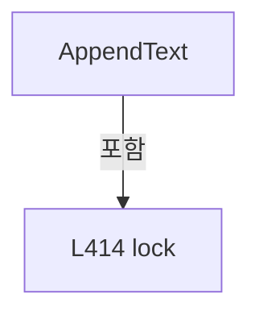

변경 전 점검: 입력/반환 타입, 위 호출자, 예외/취소 경로, 공유 상태와 저장·전송 소비자를 함께 확인합니다. 값의 단위나 물리 방향을 이름만으로 확정하지 않습니다.

### PropertyDeclaration `InterfaceLogError` · L424–424

[Drilling.Common/Log/CLogManager.cs:424–424](https://github.com/kjuws10-rgb/A3Drilling/blob/0219666f9053b907d96d7e0aa7d0c6c1be3a73d4/Drilling.Common/Log/CLogManager.cs#L424-L424)

| 항목 | 실제 추출 값 |
| --- | --- |
| 서명 | string Drilling.Common.Log.CLogManager.InterfaceLogError |
| 접근/수식자 | Public / public |
| 반환/값 타입 | string |
| 소속 타입 | NamedType:Drilling.Common.Log.CLogManager |

현재 부분 분석에서 직접 연결된 호출자는 없습니다. XAML/이벤트/인터페이스·델리게이트·외부 진입을 추가 확인해야 하며, 미사용으로 판정한 것이 아닙니다.

호출하는 대상과 해석 범위:

| 원본 행 | 표현식 | 분석 상태 | 대상/소스 위치 |
| --- | --- | --- | --- |
| 424 | Volatile.Read | resolved | string System.Threading.Volatile.Read<string>(ref readonly string) |

본문의 실제 연산·분기·예외·반환 순서(원문 위치 순):

| 원본 행 | 종류 | 주석 해설 |
| --- | --- | --- |
| 424 | call | 함수·델리게이트 또는 객체 생성자를 호출합니다: Volatile.Read(ref _interfaceLogError) |

변경 전 점검: 입력/반환 타입, 위 호출자, 예외/취소 경로, 공유 상태와 저장·전송 소비자를 함께 확인합니다. 값의 단위나 물리 방향을 이름만으로 확정하지 않습니다.

### MethodDeclaration `QueueInterfaceText` · L426–437

[Drilling.Common/Log/CLogManager.cs:426–437](https://github.com/kjuws10-rgb/A3Drilling/blob/0219666f9053b907d96d7e0aa7d0c6c1be3a73d4/Drilling.Common/Log/CLogManager.cs#L426-L437)

| 항목 | 실제 추출 값 |
| --- | --- |
| 서명 | void Drilling.Common.Log.CLogManager.QueueInterfaceText(string, string, string) |
| 접근/수식자 | Private / private |
| 반환/값 타입 | void |
| 소속 타입 | NamedType:Drilling.Common.Log.CLogManager |

입력 계약:

| 이름 | 타입 | 전달 | 선택/기본값 |
| --- | --- | --- | --- |
| directory | string | None | False /  |
| path | string | None | False /  |
| text | string | None | False /  |

정적 호출자로 확인된 위치:

| 호출 파일/행 | 호출 표현식 | 런타임 분기 가능 |
| --- | --- | --- |
| [Drilling.Common/Log/CLogManager.cs:338–338](https://github.com/kjuws10-rgb/A3Drilling/blob/0219666f9053b907d96d7e0aa7d0c6c1be3a73d4/Drilling.Common/Log/CLogManager.cs#L338-L338) | QueueInterfaceText | False |
| [Drilling.Common/Log/CLogManager.cs:394–394](https://github.com/kjuws10-rgb/A3Drilling/blob/0219666f9053b907d96d7e0aa7d0c6c1be3a73d4/Drilling.Common/Log/CLogManager.cs#L394-L394) | QueueInterfaceText | False |

호출하는 대상과 해석 범위:

| 원본 행 | 표현식 | 분석 상태 | 대상/소스 위치 |
| --- | --- | --- | --- |
| 432 | _interfaceWriters.TryGetValue | resolved | bool System.Collections.Generic.Dictionary<string, Drilling.Common.Log.CLogManager.InterfaceLogWriter>.TryGetValue(string, out Drilling.Common.Log.CLogManager.InterfaceLogWriter) |
| 433 | new | resolved | Drilling.Common.Log.CLogManager.InterfaceLogWriter.InterfaceLogWriter(string, string, System.Action<System.Exception>) · Drilling.Common/Log/CLogManager.cs:477 |
| 434 | writer.TryWrite | resolved | bool Drilling.Common.Log.CLogManager.InterfaceLogWriter.TryWrite(string) · Drilling.Common/Log/CLogManager.cs:512 |
| 435 | InterfaceWriteFailed | resolved | void Drilling.Common.Log.CLogManager.InterfaceWriteFailed(System.Exception) · Drilling.Common/Log/CLogManager.cs:439 |
| 435 | new IOException | resolved | System.IO.IOException.IOException(string?) |

본문의 실제 연산·분기·예외·반환 순서(원문 위치 순):

| 원본 행 | 종류 | 주석 해설 |
| --- | --- | --- |
| 428 | lock | 공유 상태의 임계 구역에 진입합니다: lock (_interfaceLogLock) |
| 430 | if | 조건에 따라 분기합니다: if (_interfaceLoggingStopped) |
| 431 | return | 호출자에게 값 또는 제어를 반환합니다: return; |
| 432 | call | 함수·델리게이트 또는 객체 생성자를 호출합니다: _interfaceWriters.TryGetValue(path, out var writer) |
| 432 | if | 조건에 따라 분기합니다: if (!_interfaceWriters.TryGetValue(path, out var writer)) |
| 433 | assignment | 값을 대상에 대입합니다: _interfaceWriters[path] = writer = new(directory, path, InterfaceWriteFailed) |
| 433 | assignment | 값을 대상에 대입합니다: writer = new(directory, path, InterfaceWriteFailed) |
| 433 | call | 함수·델리게이트 또는 객체 생성자를 호출합니다: new(directory, path, InterfaceWriteFailed) |
| 434 | call | 함수·델리게이트 또는 객체 생성자를 호출합니다: writer.TryWrite(text) |
| 434 | if | 조건에 따라 분기합니다: if (!writer.TryWrite(text)) |
| 435 | call | 함수·델리게이트 또는 객체 생성자를 호출합니다: InterfaceWriteFailed(new IOException("Interface log queue capacity exceeded: " + path)) |
| 435 | call | 함수·델리게이트 또는 객체 생성자를 호출합니다: new IOException("Interface log queue capacity exceeded: " + path) |

제어 구문의 포함 구조(실제 실행 순서/CFG가 아닌 구문 탐색 그림):

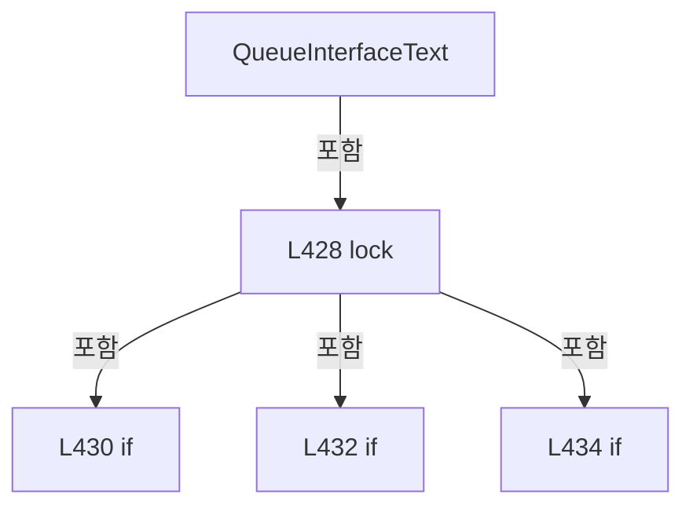

변경 전 점검: 입력/반환 타입, 위 호출자, 예외/취소 경로, 공유 상태와 저장·전송 소비자를 함께 확인합니다. 값의 단위나 물리 방향을 이름만으로 확정하지 않습니다.

### MethodDeclaration `InterfaceWriteFailed` · L439–444

[Drilling.Common/Log/CLogManager.cs:439–444](https://github.com/kjuws10-rgb/A3Drilling/blob/0219666f9053b907d96d7e0aa7d0c6c1be3a73d4/Drilling.Common/Log/CLogManager.cs#L439-L444)

| 항목 | 실제 추출 값 |
| --- | --- |
| 서명 | void Drilling.Common.Log.CLogManager.InterfaceWriteFailed(System.Exception) |
| 접근/수식자 | Private / private |
| 반환/값 타입 | void |
| 소속 타입 | NamedType:Drilling.Common.Log.CLogManager |

입력 계약:

| 이름 | 타입 | 전달 | 선택/기본값 |
| --- | --- | --- | --- |
| error | System.Exception | None | False /  |

정적 호출자로 확인된 위치:

| 호출 파일/행 | 호출 표현식 | 런타임 분기 가능 |
| --- | --- | --- |
| [Drilling.Common/Log/CLogManager.cs:435–435](https://github.com/kjuws10-rgb/A3Drilling/blob/0219666f9053b907d96d7e0aa7d0c6c1be3a73d4/Drilling.Common/Log/CLogManager.cs#L435-L435) | InterfaceWriteFailed | False |

호출하는 대상과 해석 범위:

| 원본 행 | 표현식 | 분석 상태 | 대상/소스 위치 |
| --- | --- | --- | --- |
| 443 | Interlocked.Exchange | resolved | string System.Threading.Interlocked.Exchange<string>(ref string, string) |

본문의 실제 연산·분기·예외·반환 순서(원문 위치 순):

| 원본 행 | 종류 | 주석 해설 |
| --- | --- | --- |
| 443 | call | 함수·델리게이트 또는 객체 생성자를 호출합니다: Interlocked.Exchange(ref _interfaceLogError, "Interface log write failed: " + error.Message) |

변경 전 점검: 입력/반환 타입, 위 호출자, 예외/취소 경로, 공유 상태와 저장·전송 소비자를 함께 확인합니다. 값의 단위나 물리 방향을 이름만으로 확정하지 않습니다.

### MethodDeclaration `FlushInterfaceAsync` · L446–454

[Drilling.Common/Log/CLogManager.cs:446–454](https://github.com/kjuws10-rgb/A3Drilling/blob/0219666f9053b907d96d7e0aa7d0c6c1be3a73d4/Drilling.Common/Log/CLogManager.cs#L446-L454)

| 항목 | 실제 추출 값 |
| --- | --- |
| 서명 | System.Threading.Tasks.Task Drilling.Common.Log.CLogManager.FlushInterfaceAsync(System.Threading.CancellationToken) |
| 접근/수식자 | Public / public, async |
| 반환/값 타입 | System.Threading.Tasks.Task |
| 소속 타입 | NamedType:Drilling.Common.Log.CLogManager |

입력 계약:

| 이름 | 타입 | 전달 | 선택/기본값 |
| --- | --- | --- | --- |
| token | System.Threading.CancellationToken | None | True / null |

현재 부분 분석에서 직접 연결된 호출자는 없습니다. XAML/이벤트/인터페이스·델리게이트·외부 진입을 추가 확인해야 하며, 미사용으로 판정한 것이 아닙니다.

호출하는 대상과 해석 범위:

| 원본 행 | 표현식 | 분석 상태 | 대상/소스 위치 |
| --- | --- | --- | --- |
| 450 | _interfaceWriters.Values.ToArray | resolved | Drilling.Common.Log.CLogManager.InterfaceLogWriter[] System.Collections.Generic.IEnumerable<Drilling.Common.Log.CLogManager.InterfaceLogWriter>.ToArray<Drilling.Common.Log.CLogManager.InterfaceLogWriter>() |
| 451 | Task.WhenAll(writers.Select(writer => writer.Flush(token))).ConfigureAwait | resolved | System.Runtime.CompilerServices.ConfiguredTaskAwaitable System.Threading.Tasks.Task.ConfigureAwait(bool) |
| 451 | Task.WhenAll | resolved | System.Threading.Tasks.Task System.Threading.Tasks.Task.WhenAll(System.Collections.Generic.IEnumerable<System.Threading.Tasks.Task>) |
| 451 | writers.Select | resolved | System.Collections.Generic.IEnumerable<System.Threading.Tasks.Task> System.Collections.Generic.IEnumerable<Drilling.Common.Log.CLogManager.InterfaceLogWriter>.Select<Drilling.Common.Log.CLogManager.InterfaceLogWriter, System.Threading.Tasks.Task>(System.Func<Drilling.Common.Log.CLogManager.InterfaceLogWriter, System.Threading.Tasks.Task>) |
| 451 | writer.Flush | resolved | System.Threading.Tasks.Task Drilling.Common.Log.CLogManager.InterfaceLogWriter.Flush(System.Threading.CancellationToken) · Drilling.Common/Log/CLogManager.cs:521 |
| 453 | new IOException | resolved | System.IO.IOException.IOException(string?) |

본문의 실제 연산·분기·예외·반환 순서(원문 위치 순):

| 원본 행 | 종류 | 주석 해설 |
| --- | --- | --- |
| 448 | local-declaration | 지역 변수를 선언합니다: InterfaceLogWriter[] writers; |
| 449 | lock | 공유 상태의 임계 구역에 진입합니다: lock (_interfaceLogLock) |
| 450 | assignment | 값을 대상에 대입합니다: writers = _interfaceWriters.Values.ToArray() |
| 450 | call | 함수·델리게이트 또는 객체 생성자를 호출합니다: _interfaceWriters.Values.ToArray() |
| 451 | await | 비동기 완료를 기다립니다: await Task.WhenAll(writers.Select(writer => writer.Flush(token))).ConfigureAwait(false) |
| 451 | call | 함수·델리게이트 또는 객체 생성자를 호출합니다: Task.WhenAll(writers.Select(writer => writer.Flush(token))).ConfigureAwait(false) |
| 451 | call | 함수·델리게이트 또는 객체 생성자를 호출합니다: Task.WhenAll(writers.Select(writer => writer.Flush(token))) |
| 451 | call | 함수·델리게이트 또는 객체 생성자를 호출합니다: writers.Select(writer => writer.Flush(token)) |
| 451 | call | 함수·델리게이트 또는 객체 생성자를 호출합니다: writer.Flush(token) |
| 452 | if | 조건에 따라 분기합니다: if (InterfaceLogError.Length != 0) |
| 453 | call | 함수·델리게이트 또는 객체 생성자를 호출합니다: new IOException(InterfaceLogError) |
| 453 | throw | 예외를 발생/전달합니다: throw new IOException(InterfaceLogError); |

제어 구문의 포함 구조(실제 실행 순서/CFG가 아닌 구문 탐색 그림):

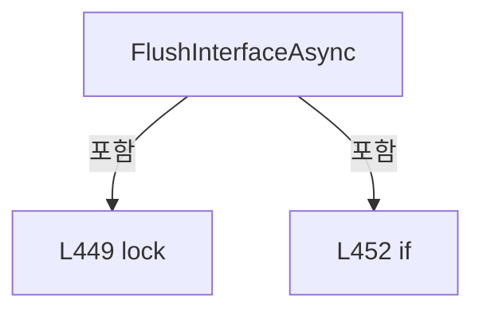

변경 전 점검: 입력/반환 타입, 위 호출자, 예외/취소 경로, 공유 상태와 저장·전송 소비자를 함께 확인합니다. 값의 단위나 물리 방향을 이름만으로 확정하지 않습니다.

### MethodDeclaration `StopInterfaceLoggingAsync` · L456–467

[Drilling.Common/Log/CLogManager.cs:456–467](https://github.com/kjuws10-rgb/A3Drilling/blob/0219666f9053b907d96d7e0aa7d0c6c1be3a73d4/Drilling.Common/Log/CLogManager.cs#L456-L467)

| 항목 | 실제 추출 값 |
| --- | --- |
| 서명 | System.Threading.Tasks.Task Drilling.Common.Log.CLogManager.StopInterfaceLoggingAsync(System.Threading.CancellationToken) |
| 접근/수식자 | Public / public, async |
| 반환/값 타입 | System.Threading.Tasks.Task |
| 소속 타입 | NamedType:Drilling.Common.Log.CLogManager |

입력 계약:

| 이름 | 타입 | 전달 | 선택/기본값 |
| --- | --- | --- | --- |
| token | System.Threading.CancellationToken | None | True / null |

정적 호출자로 확인된 위치:

| 호출 파일/행 | 호출 표현식 | 런타임 분기 가능 |
| --- | --- | --- |
| [Drilling.Common/Managers/CManager.cs:250–250](https://github.com/kjuws10-rgb/A3Drilling/blob/0219666f9053b907d96d7e0aa7d0c6c1be3a73d4/Drilling.Common/Managers/CManager.cs#L250-L250) | _logManager.StopInterfaceLoggingAsync | False |

호출하는 대상과 해석 범위:

| 원본 행 | 표현식 | 분석 상태 | 대상/소스 위치 |
| --- | --- | --- | --- |
| 462 | _interfaceWriters.Values.Select(writer => writer.Complete()).ToArray | resolved | System.Threading.Tasks.Task[] System.Collections.Generic.IEnumerable<System.Threading.Tasks.Task>.ToArray<System.Threading.Tasks.Task>() |
| 462 | _interfaceWriters.Values.Select | resolved | System.Collections.Generic.IEnumerable<System.Threading.Tasks.Task> System.Collections.Generic.IEnumerable<Drilling.Common.Log.CLogManager.InterfaceLogWriter>.Select<Drilling.Common.Log.CLogManager.InterfaceLogWriter, System.Threading.Tasks.Task>(System.Func<Drilling.Common.Log.CLogManager.InterfaceLogWriter, System.Threading.Tasks.Task>) |
| 462 | writer.Complete | resolved | System.Threading.Tasks.Task Drilling.Common.Log.CLogManager.InterfaceLogWriter.Complete() · Drilling.Common/Log/CLogManager.cs:532 |
| 464 | Task.WhenAll(tasks).WaitAsync(token).ConfigureAwait | resolved | System.Runtime.CompilerServices.ConfiguredTaskAwaitable System.Threading.Tasks.Task.ConfigureAwait(bool) |
| 464 | Task.WhenAll(tasks).WaitAsync | resolved | System.Threading.Tasks.Task System.Threading.Tasks.Task.WaitAsync(System.Threading.CancellationToken) |
| 464 | Task.WhenAll | resolved | System.Threading.Tasks.Task System.Threading.Tasks.Task.WhenAll(params System.Threading.Tasks.Task[]) |
| 466 | new IOException | resolved | System.IO.IOException.IOException(string?) |

본문의 실제 연산·분기·예외·반환 순서(원문 위치 순):

| 원본 행 | 종류 | 주석 해설 |
| --- | --- | --- |
| 458 | local-declaration | 지역 변수를 선언합니다: Task[] tasks; |
| 459 | lock | 공유 상태의 임계 구역에 진입합니다: lock (_interfaceLogLock) |
| 461 | assignment | 값을 대상에 대입합니다: _interfaceLoggingStopped = true |
| 462 | assignment | 값을 대상에 대입합니다: tasks = _interfaceWriters.Values.Select(writer => writer.Complete()).ToArray() |
| 462 | call | 함수·델리게이트 또는 객체 생성자를 호출합니다: _interfaceWriters.Values.Select(writer => writer.Complete()).ToArray() |
| 462 | call | 함수·델리게이트 또는 객체 생성자를 호출합니다: _interfaceWriters.Values.Select(writer => writer.Complete()) |
| 462 | call | 함수·델리게이트 또는 객체 생성자를 호출합니다: writer.Complete() |
| 464 | await | 비동기 완료를 기다립니다: await Task.WhenAll(tasks).WaitAsync(token).ConfigureAwait(false) |
| 464 | call | 함수·델리게이트 또는 객체 생성자를 호출합니다: Task.WhenAll(tasks).WaitAsync(token).ConfigureAwait(false) |
| 464 | call | 함수·델리게이트 또는 객체 생성자를 호출합니다: Task.WhenAll(tasks).WaitAsync(token) |
| 464 | call | 함수·델리게이트 또는 객체 생성자를 호출합니다: Task.WhenAll(tasks) |
| 465 | if | 조건에 따라 분기합니다: if (InterfaceLogError.Length != 0) |
| 466 | call | 함수·델리게이트 또는 객체 생성자를 호출합니다: new IOException(InterfaceLogError) |
| 466 | throw | 예외를 발생/전달합니다: throw new IOException(InterfaceLogError); |

제어 구문의 포함 구조(실제 실행 순서/CFG가 아닌 구문 탐색 그림):

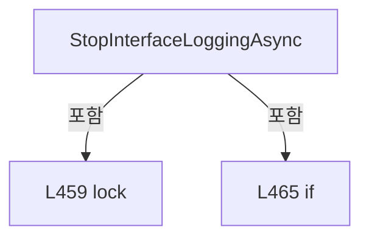

변경 전 점검: 입력/반환 타입, 위 호출자, 예외/취소 경로, 공유 상태와 저장·전송 소비자를 함께 확인합니다. 값의 단위나 물리 방향을 이름만으로 확정하지 않습니다.

### FieldDeclaration `MaximumQueuedBytes` · L471–471

[Drilling.Common/Log/CLogManager.cs:471–471](https://github.com/kjuws10-rgb/A3Drilling/blob/0219666f9053b907d96d7e0aa7d0c6c1be3a73d4/Drilling.Common/Log/CLogManager.cs#L471-L471)

| 항목 | 실제 추출 값 |
| --- | --- |
| 서명 | long Drilling.Common.Log.CLogManager.InterfaceLogWriter.MaximumQueuedBytes |
| 접근/수식자 | Private / private, const |
| 반환/값 타입 | long |
| 소속 타입 | NamedType:Drilling.Common.Log.CLogManager.InterfaceLogWriter |

현재 부분 분석에서 직접 연결된 호출자는 없습니다. XAML/이벤트/인터페이스·델리게이트·외부 진입을 추가 확인해야 하며, 미사용으로 판정한 것이 아닙니다.

본문의 실제 연산·분기·예외·반환 순서(원문 위치 순):

| 원본 행 | 종류 | 주석 해설 |
| --- | --- | --- |
| 471 | variable-initializer | 변수의 초기값을 지정합니다: MaximumQueuedBytes = 16 * 1024 * 1024 |

변경 전 점검: 입력/반환 타입, 위 호출자, 예외/취소 경로, 공유 상태와 저장·전송 소비자를 함께 확인합니다. 값의 단위나 물리 방향을 이름만으로 확정하지 않습니다.

### FieldDeclaration `_queue` · L472–473

[Drilling.Common/Log/CLogManager.cs:472–473](https://github.com/kjuws10-rgb/A3Drilling/blob/0219666f9053b907d96d7e0aa7d0c6c1be3a73d4/Drilling.Common/Log/CLogManager.cs#L472-L473)

| 항목 | 실제 추출 값 |
| --- | --- |
| 서명 | System.Threading.Channels.Channel<(string Text, System.Threading.Tasks.TaskCompletionSource? Barrier)> Drilling.Common.Log.CLogManager.InterfaceLogWriter._queue |
| 접근/수식자 | Private / private, readonly |
| 반환/값 타입 | System.Threading.Channels.Channel<(string Text, System.Threading.Tasks.TaskCompletionSource? Barrier)> |
| 소속 타입 | NamedType:Drilling.Common.Log.CLogManager.InterfaceLogWriter |

현재 부분 분석에서 직접 연결된 호출자는 없습니다. XAML/이벤트/인터페이스·델리게이트·외부 진입을 추가 확인해야 하며, 미사용으로 판정한 것이 아닙니다.

호출하는 대상과 해석 범위:

| 원본 행 | 표현식 | 분석 상태 | 대상/소스 위치 |
| --- | --- | --- | --- |
| 472 | Channel.CreateBounded<(string, TaskCompletionSource?)> | resolved | System.Threading.Channels.Channel<(string, System.Threading.Tasks.TaskCompletionSource?)> System.Threading.Channels.Channel.CreateBounded<(string, System.Threading.Tasks.TaskCompletionSource?)>(System.Threading.Channels.BoundedChannelOptions) |
| 473 | new BoundedChannelOptions | resolved | System.Threading.Channels.BoundedChannelOptions.BoundedChannelOptions(int) |

본문의 실제 연산·분기·예외·반환 순서(원문 위치 순):

| 원본 행 | 종류 | 주석 해설 |
| --- | --- | --- |
| 472 | call | 함수·델리게이트 또는 객체 생성자를 호출합니다: Channel.CreateBounded<(string, TaskCompletionSource?)>( new BoundedChannelOptions(16384) { SingleReader = true, AllowSynchronousContinuations = false, FullMode = BoundedChannelFullMode.Wait }) |
| 472 | variable-initializer | 변수의 초기값을 지정합니다: _queue = Channel.CreateBounded<(string, TaskCompletionSource?)>( new BoundedChannelOptions(16384) { SingleReader = true, AllowSynchronousContinuations = false, FullMode = BoundedChannelFullMode.Wait }) |
| 473 | assignment | 값을 대상에 대입합니다: SingleReader = true |
| 473 | assignment | 값을 대상에 대입합니다: AllowSynchronousContinuations = false |
| 473 | assignment | 값을 대상에 대입합니다: FullMode = BoundedChannelFullMode.Wait |
| 473 | call | 함수·델리게이트 또는 객체 생성자를 호출합니다: new BoundedChannelOptions(16384) { SingleReader = true, AllowSynchronousContinuations = false, FullMode = BoundedChannelFullMode.Wait } |

변경 전 점검: 입력/반환 타입, 위 호출자, 예외/취소 경로, 공유 상태와 저장·전송 소비자를 함께 확인합니다. 값의 단위나 물리 방향을 이름만으로 확정하지 않습니다.

### FieldDeclaration `_worker` · L474–474

[Drilling.Common/Log/CLogManager.cs:474–474](https://github.com/kjuws10-rgb/A3Drilling/blob/0219666f9053b907d96d7e0aa7d0c6c1be3a73d4/Drilling.Common/Log/CLogManager.cs#L474-L474)

| 항목 | 실제 추출 값 |
| --- | --- |
| 서명 | System.Threading.Tasks.Task Drilling.Common.Log.CLogManager.InterfaceLogWriter._worker |
| 접근/수식자 | Private / private, readonly |
| 반환/값 타입 | System.Threading.Tasks.Task |
| 소속 타입 | NamedType:Drilling.Common.Log.CLogManager.InterfaceLogWriter |

현재 부분 분석에서 직접 연결된 호출자는 없습니다. XAML/이벤트/인터페이스·델리게이트·외부 진입을 추가 확인해야 하며, 미사용으로 판정한 것이 아닙니다.

변경 전 점검: 입력/반환 타입, 위 호출자, 예외/취소 경로, 공유 상태와 저장·전송 소비자를 함께 확인합니다. 값의 단위나 물리 방향을 이름만으로 확정하지 않습니다.

### FieldDeclaration `_queuedBytes` · L475–475

[Drilling.Common/Log/CLogManager.cs:475–475](https://github.com/kjuws10-rgb/A3Drilling/blob/0219666f9053b907d96d7e0aa7d0c6c1be3a73d4/Drilling.Common/Log/CLogManager.cs#L475-L475)

| 항목 | 실제 추출 값 |
| --- | --- |
| 서명 | long Drilling.Common.Log.CLogManager.InterfaceLogWriter._queuedBytes |
| 접근/수식자 | Private / private |
| 반환/값 타입 | long |
| 소속 타입 | NamedType:Drilling.Common.Log.CLogManager.InterfaceLogWriter |

현재 부분 분석에서 직접 연결된 호출자는 없습니다. XAML/이벤트/인터페이스·델리게이트·외부 진입을 추가 확인해야 하며, 미사용으로 판정한 것이 아닙니다.

변경 전 점검: 입력/반환 타입, 위 호출자, 예외/취소 경로, 공유 상태와 저장·전송 소비자를 함께 확인합니다. 값의 단위나 물리 방향을 이름만으로 확정하지 않습니다.

### ConstructorDeclaration `.ctor` · L477–510

[Drilling.Common/Log/CLogManager.cs:477–510](https://github.com/kjuws10-rgb/A3Drilling/blob/0219666f9053b907d96d7e0aa7d0c6c1be3a73d4/Drilling.Common/Log/CLogManager.cs#L477-L510)

| 항목 | 실제 추출 값 |
| --- | --- |
| 서명 | Drilling.Common.Log.CLogManager.InterfaceLogWriter.InterfaceLogWriter(string, string, System.Action<System.Exception>) |
| 접근/수식자 | Public / public |
| 반환/값 타입 | void |
| 소속 타입 | NamedType:Drilling.Common.Log.CLogManager.InterfaceLogWriter |

입력 계약:

| 이름 | 타입 | 전달 | 선택/기본값 |
| --- | --- | --- | --- |
| directory | string | None | False /  |
| path | string | None | False /  |
| reportError | System.Action<System.Exception> | None | False /  |

정적 호출자로 확인된 위치:

| 호출 파일/행 | 호출 표현식 | 런타임 분기 가능 |
| --- | --- | --- |
| [Drilling.Common/Log/CLogManager.cs:433–433](https://github.com/kjuws10-rgb/A3Drilling/blob/0219666f9053b907d96d7e0aa7d0c6c1be3a73d4/Drilling.Common/Log/CLogManager.cs#L433-L433) | new | False |

호출하는 대상과 해석 범위:

| 원본 행 | 표현식 | 분석 상태 | 대상/소스 위치 |
| --- | --- | --- | --- |
| 478 | Task.Run | resolved | System.Threading.Tasks.Task System.Threading.Tasks.Task.Run(System.Func<System.Threading.Tasks.Task?>) |
| 481 | reader.WaitToReadAsync().ConfigureAwait | resolved | System.Runtime.CompilerServices.ConfiguredValueTaskAwaitable<bool> System.Threading.Tasks.ValueTask<bool>.ConfigureAwait(bool) |
| 481 | reader.WaitToReadAsync | resolved | System.Threading.Tasks.ValueTask<bool> System.Threading.Channels.ChannelReader<(string Text, System.Threading.Tasks.TaskCompletionSource? Barrier)>.WaitToReadAsync(System.Threading.CancellationToken) |
| 485 | Task.Delay(10).ConfigureAwait | resolved | System.Runtime.CompilerServices.ConfiguredTaskAwaitable System.Threading.Tasks.Task.ConfigureAwait(bool) |
| 485 | Task.Delay | resolved | System.Threading.Tasks.Task System.Threading.Tasks.Task.Delay(int) |
| 486 | new StringBuilder | resolved | System.Text.StringBuilder.StringBuilder() |
| 489 | reader.TryRead | resolved | bool System.Threading.Channels.ChannelReader<(string Text, System.Threading.Tasks.TaskCompletionSource? Barrier)>.TryRead(out (string Text, System.Threading.Tasks.TaskCompletionSource? Barrier)) |
| 491 | batch.Append | resolved | System.Text.StringBuilder System.Text.StringBuilder.Append(string?) |
| 501 | AppendText | resolved | void Drilling.Common.Log.CLogManager.AppendText(string, string, string) · Drilling.Common/Log/CLogManager.cs:412 |
| 501 | batch.ToString | resolved · 동적 구현 선택 가능 | string System.Text.StringBuilder.ToString() |
| 503 | reportError | resolved · 동적 구현 선택 가능 | void System.Action<System.Exception>.Invoke(System.Exception) |
| 506 | Interlocked.Add | resolved | long System.Threading.Interlocked.Add(ref long, long) |
| 507 | .TrySetResult | resolved | bool System.Threading.Tasks.TaskCompletionSource.TrySetResult() |

본문의 실제 연산·분기·예외·반환 순서(원문 위치 순):

| 원본 행 | 종류 | 주석 해설 |
| --- | --- | --- |
| 478 | assignment | 값을 대상에 대입합니다: _worker = Task.Run(async () => { var reader = _queue.Reader; while (await reader.WaitToReadAsync().ConfigureAwait(false)) { // Coalesce short bursts into a single file open/write, with a // bounded 10ms log-visibility delay and un |
| 478 | call | 함수·델리게이트 또는 객체 생성자를 호출합니다: Task.Run(async () => { var reader = _queue.Reader; while (await reader.WaitToReadAsync().ConfigureAwait(false)) { // Coalesce short bursts into a single file open/write, with a // bounded 10ms log-visibility delay and un… |
| 480 | local-declaration | 지역 변수를 선언합니다: var reader = _queue.Reader; |
| 480 | variable-initializer | 변수의 초기값을 지정합니다: reader = _queue.Reader |
| 481 | await | 비동기 완료를 기다립니다: await reader.WaitToReadAsync().ConfigureAwait(false) |
| 481 | call | 함수·델리게이트 또는 객체 생성자를 호출합니다: reader.WaitToReadAsync().ConfigureAwait(false) |
| 481 | call | 함수·델리게이트 또는 객체 생성자를 호출합니다: reader.WaitToReadAsync() |
| 481 | while | 조건을 먼저 확인하며 반복합니다: while (await reader.WaitToReadAsync().ConfigureAwait(false)) |
| 485 | await | 비동기 완료를 기다립니다: await Task.Delay(10).ConfigureAwait(false) |
| 485 | call | 함수·델리게이트 또는 객체 생성자를 호출합니다: Task.Delay(10).ConfigureAwait(false) |
| 485 | call | 함수·델리게이트 또는 객체 생성자를 호출합니다: Task.Delay(10) |
| 486 | call | 함수·델리게이트 또는 객체 생성자를 호출합니다: new StringBuilder() |
| 486 | local-declaration | 지역 변수를 선언합니다: var batch = new StringBuilder(); |
| 486 | variable-initializer | 변수의 초기값을 지정합니다: batch = new StringBuilder() |
| 487 | local-declaration | 지역 변수를 선언합니다: TaskCompletionSource? barrier = null; |
| 487 | variable-initializer | 변수의 초기값을 지정합니다: barrier = null |
| 488 | local-declaration | 지역 변수를 선언합니다: var count = 0; |
| 488 | variable-initializer | 변수의 초기값을 지정합니다: count = 0 |
| 489 | call | 함수·델리게이트 또는 객체 생성자를 호출합니다: reader.TryRead(out var entry) |
| 489 | while | 조건을 먼저 확인하며 반복합니다: while (count++ < 256 && batch.Length < 128 * 1024 && reader.TryRead(out var entry)) |
| 491 | call | 함수·델리게이트 또는 객체 생성자를 호출합니다: batch.Append(entry.Text) |
| 492 | if | 조건에 따라 분기합니다: if (entry.Barrier is not null) |
| 494 | assignment | 값을 대상에 대입합니다: barrier = entry.Barrier |
| 495 | break | 해당 반복/분기 구간을 종료합니다: break; |
| 498 | try | 예외 처리 범위입니다: try |
| 500 | if | 조건에 따라 분기합니다: if (batch.Length > 0) |
| 501 | call | 함수·델리게이트 또는 객체 생성자를 호출합니다: AppendText(directory, path, batch.ToString()) |
| 501 | call | 함수·델리게이트 또는 객체 생성자를 호출합니다: batch.ToString() |
| 503 | call | 함수·델리게이트 또는 객체 생성자를 호출합니다: reportError(error) |
| 503 | catch | 지정 예외를 처리합니다: catch (Exception error) |
| 504 | finally | 종료 정리 구간입니다: finally |
| 506 | call | 함수·델리게이트 또는 객체 생성자를 호출합니다: Interlocked.Add(ref _queuedBytes, -(long)batch.Length * sizeof(char)) |
| 507 | call | 함수·델리게이트 또는 객체 생성자를 호출합니다: .TrySetResult() |

제어 구문의 포함 구조(실제 실행 순서/CFG가 아닌 구문 탐색 그림):

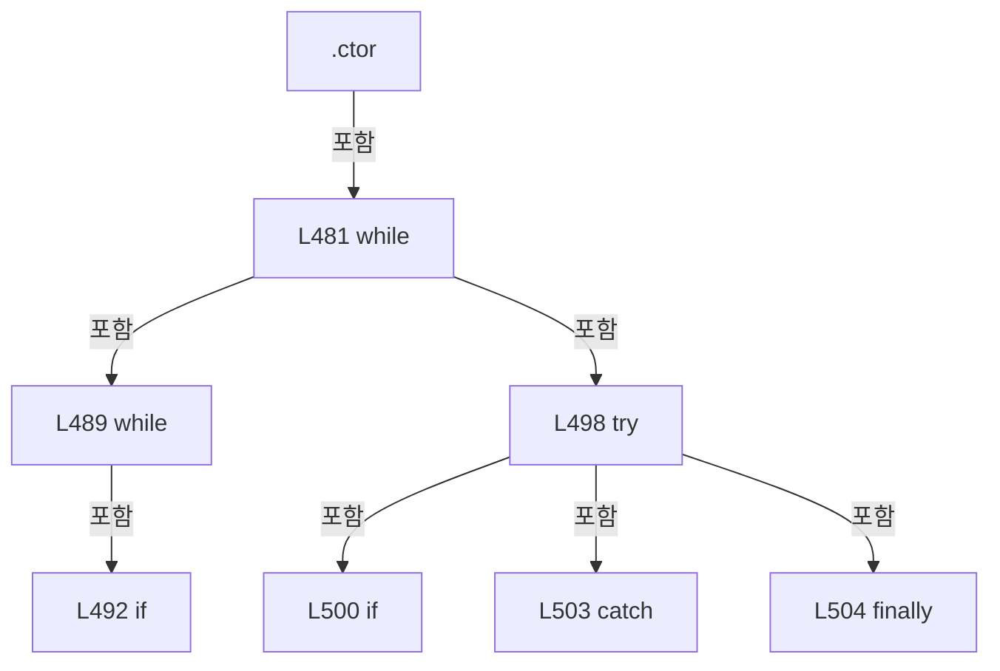

변경 전 점검: 입력/반환 타입, 위 호출자, 예외/취소 경로, 공유 상태와 저장·전송 소비자를 함께 확인합니다. 값의 단위나 물리 방향을 이름만으로 확정하지 않습니다.

### MethodDeclaration `TryWrite` · L512–519

[Drilling.Common/Log/CLogManager.cs:512–519](https://github.com/kjuws10-rgb/A3Drilling/blob/0219666f9053b907d96d7e0aa7d0c6c1be3a73d4/Drilling.Common/Log/CLogManager.cs#L512-L519)

| 항목 | 실제 추출 값 |
| --- | --- |
| 서명 | bool Drilling.Common.Log.CLogManager.InterfaceLogWriter.TryWrite(string) |
| 접근/수식자 | Public / public |
| 반환/값 타입 | bool |
| 소속 타입 | NamedType:Drilling.Common.Log.CLogManager.InterfaceLogWriter |

입력 계약:

| 이름 | 타입 | 전달 | 선택/기본값 |
| --- | --- | --- | --- |
| text | string | None | False /  |

정적 호출자로 확인된 위치:

| 호출 파일/행 | 호출 표현식 | 런타임 분기 가능 |
| --- | --- | --- |
| [Drilling.Common/Log/CLogManager.cs:434–434](https://github.com/kjuws10-rgb/A3Drilling/blob/0219666f9053b907d96d7e0aa7d0c6c1be3a73d4/Drilling.Common/Log/CLogManager.cs#L434-L434) | writer.TryWrite | False |

호출하는 대상과 해석 범위:

| 원본 행 | 표현식 | 분석 상태 | 대상/소스 위치 |
| --- | --- | --- | --- |
| 515 | Interlocked.Add | resolved | long System.Threading.Interlocked.Add(ref long, long) |
| 515 | _queue.Writer.TryWrite | resolved | bool System.Threading.Channels.ChannelWriter<(string Text, System.Threading.Tasks.TaskCompletionSource? Barrier)>.TryWrite((string Text, System.Threading.Tasks.TaskCompletionSource? Barrier)) |
| 517 | Interlocked.Add | resolved | long System.Threading.Interlocked.Add(ref long, long) |

본문의 실제 연산·분기·예외·반환 순서(원문 위치 순):

| 원본 행 | 종류 | 주석 해설 |
| --- | --- | --- |
| 514 | local-declaration | 지역 변수를 선언합니다: var bytes = (long)text.Length * sizeof(char); |
| 514 | variable-initializer | 변수의 초기값을 지정합니다: bytes = (long)text.Length * sizeof(char) |
| 515 | call | 함수·델리게이트 또는 객체 생성자를 호출합니다: Interlocked.Add(ref _queuedBytes, bytes) |
| 515 | call | 함수·델리게이트 또는 객체 생성자를 호출합니다: _queue.Writer.TryWrite((text, null)) |
| 515 | if | 조건에 따라 분기합니다: if (Interlocked.Add(ref _queuedBytes, bytes) <= MaximumQueuedBytes && _queue.Writer.TryWrite((text, null))) |
| 516 | return | 호출자에게 값 또는 제어를 반환합니다: return true; |
| 517 | call | 함수·델리게이트 또는 객체 생성자를 호출합니다: Interlocked.Add(ref _queuedBytes, -bytes) |
| 518 | return | 호출자에게 값 또는 제어를 반환합니다: return false; |

제어 구문의 포함 구조(실제 실행 순서/CFG가 아닌 구문 탐색 그림):

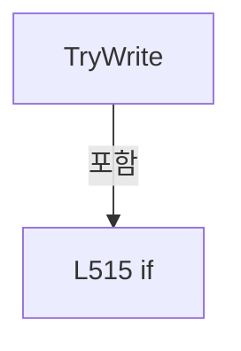

변경 전 점검: 입력/반환 타입, 위 호출자, 예외/취소 경로, 공유 상태와 저장·전송 소비자를 함께 확인합니다. 값의 단위나 물리 방향을 이름만으로 확정하지 않습니다.

### MethodDeclaration `Flush` · L521–530

[Drilling.Common/Log/CLogManager.cs:521–530](https://github.com/kjuws10-rgb/A3Drilling/blob/0219666f9053b907d96d7e0aa7d0c6c1be3a73d4/Drilling.Common/Log/CLogManager.cs#L521-L530)

| 항목 | 실제 추출 값 |
| --- | --- |
| 서명 | System.Threading.Tasks.Task Drilling.Common.Log.CLogManager.InterfaceLogWriter.Flush(System.Threading.CancellationToken) |
| 접근/수식자 | Public / public, async |
| 반환/값 타입 | System.Threading.Tasks.Task |
| 소속 타입 | NamedType:Drilling.Common.Log.CLogManager.InterfaceLogWriter |

입력 계약:

| 이름 | 타입 | 전달 | 선택/기본값 |
| --- | --- | --- | --- |
| token | System.Threading.CancellationToken | None | False /  |

정적 호출자로 확인된 위치:

| 호출 파일/행 | 호출 표현식 | 런타임 분기 가능 |
| --- | --- | --- |
| [Drilling.Common/Log/CLogManager.cs:451–451](https://github.com/kjuws10-rgb/A3Drilling/blob/0219666f9053b907d96d7e0aa7d0c6c1be3a73d4/Drilling.Common/Log/CLogManager.cs#L451-L451) | writer.Flush | False |

호출하는 대상과 해석 범위:

| 원본 행 | 표현식 | 분석 상태 | 대상/소스 위치 |
| --- | --- | --- | --- |
| 523 | new TaskCompletionSource | resolved | System.Threading.Tasks.TaskCompletionSource.TaskCompletionSource(System.Threading.Tasks.TaskCreationOptions) |
| 526 | _queue.Writer.WriteAsync(("", barrier), token).ConfigureAwait | resolved | System.Runtime.CompilerServices.ConfiguredValueTaskAwaitable System.Threading.Tasks.ValueTask.ConfigureAwait(bool) |
| 526 | _queue.Writer.WriteAsync | resolved · 동적 구현 선택 가능 | System.Threading.Tasks.ValueTask System.Threading.Channels.ChannelWriter<(string Text, System.Threading.Tasks.TaskCompletionSource? Barrier)>.WriteAsync((string Text, System.Threading.Tasks.TaskCompletionSource? Barrier), System.Threading.CancellationToken) |
| 527 | barrier.Task.WaitAsync(token).ConfigureAwait | resolved | System.Runtime.CompilerServices.ConfiguredTaskAwaitable System.Threading.Tasks.Task.ConfigureAwait(bool) |
| 527 | barrier.Task.WaitAsync | resolved | System.Threading.Tasks.Task System.Threading.Tasks.Task.WaitAsync(System.Threading.CancellationToken) |
| 529 | _worker.WaitAsync(token).ConfigureAwait | resolved | System.Runtime.CompilerServices.ConfiguredTaskAwaitable System.Threading.Tasks.Task.ConfigureAwait(bool) |
| 529 | _worker.WaitAsync | resolved | System.Threading.Tasks.Task System.Threading.Tasks.Task.WaitAsync(System.Threading.CancellationToken) |

본문의 실제 연산·분기·예외·반환 순서(원문 위치 순):

| 원본 행 | 종류 | 주석 해설 |
| --- | --- | --- |
| 523 | call | 함수·델리게이트 또는 객체 생성자를 호출합니다: new TaskCompletionSource(TaskCreationOptions.RunContinuationsAsynchronously) |
| 523 | local-declaration | 지역 변수를 선언합니다: var barrier = new TaskCompletionSource(TaskCreationOptions.RunContinuationsAsynchronously); |
| 523 | variable-initializer | 변수의 초기값을 지정합니다: barrier = new TaskCompletionSource(TaskCreationOptions.RunContinuationsAsynchronously) |
| 524 | try | 예외 처리 범위입니다: try |
| 526 | await | 비동기 완료를 기다립니다: await _queue.Writer.WriteAsync(("", barrier), token).ConfigureAwait(false) |
| 526 | call | 함수·델리게이트 또는 객체 생성자를 호출합니다: _queue.Writer.WriteAsync(("", barrier), token).ConfigureAwait(false) |
| 526 | call | 함수·델리게이트 또는 객체 생성자를 호출합니다: _queue.Writer.WriteAsync(("", barrier), token) |
| 527 | await | 비동기 완료를 기다립니다: await barrier.Task.WaitAsync(token).ConfigureAwait(false) |
| 527 | call | 함수·델리게이트 또는 객체 생성자를 호출합니다: barrier.Task.WaitAsync(token).ConfigureAwait(false) |
| 527 | call | 함수·델리게이트 또는 객체 생성자를 호출합니다: barrier.Task.WaitAsync(token) |
| 529 | await | 비동기 완료를 기다립니다: await _worker.WaitAsync(token).ConfigureAwait(false) |
| 529 | call | 함수·델리게이트 또는 객체 생성자를 호출합니다: _worker.WaitAsync(token).ConfigureAwait(false) |
| 529 | call | 함수·델리게이트 또는 객체 생성자를 호출합니다: _worker.WaitAsync(token) |
| 529 | catch | 지정 예외를 처리합니다: catch (ChannelClosedException) |

제어 구문의 포함 구조(실제 실행 순서/CFG가 아닌 구문 탐색 그림):

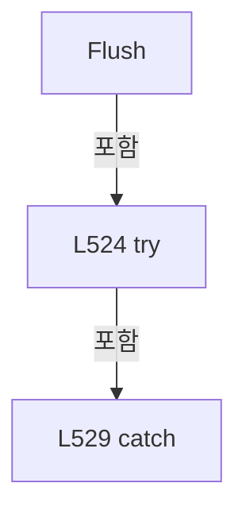

변경 전 점검: 입력/반환 타입, 위 호출자, 예외/취소 경로, 공유 상태와 저장·전송 소비자를 함께 확인합니다. 값의 단위나 물리 방향을 이름만으로 확정하지 않습니다.

### MethodDeclaration `Complete` · L532–536

[Drilling.Common/Log/CLogManager.cs:532–536](https://github.com/kjuws10-rgb/A3Drilling/blob/0219666f9053b907d96d7e0aa7d0c6c1be3a73d4/Drilling.Common/Log/CLogManager.cs#L532-L536)

| 항목 | 실제 추출 값 |
| --- | --- |
| 서명 | System.Threading.Tasks.Task Drilling.Common.Log.CLogManager.InterfaceLogWriter.Complete() |
| 접근/수식자 | Public / public |
| 반환/값 타입 | System.Threading.Tasks.Task |
| 소속 타입 | NamedType:Drilling.Common.Log.CLogManager.InterfaceLogWriter |

정적 호출자로 확인된 위치:

| 호출 파일/행 | 호출 표현식 | 런타임 분기 가능 |
| --- | --- | --- |
| [Drilling.Common/Log/CLogManager.cs:462–462](https://github.com/kjuws10-rgb/A3Drilling/blob/0219666f9053b907d96d7e0aa7d0c6c1be3a73d4/Drilling.Common/Log/CLogManager.cs#L462-L462) | writer.Complete | False |

호출하는 대상과 해석 범위:

| 원본 행 | 표현식 | 분석 상태 | 대상/소스 위치 |
| --- | --- | --- | --- |
| 534 | _queue.Writer.TryComplete | resolved · 동적 구현 선택 가능 | bool System.Threading.Channels.ChannelWriter<(string Text, System.Threading.Tasks.TaskCompletionSource? Barrier)>.TryComplete(System.Exception?) |

본문의 실제 연산·분기·예외·반환 순서(원문 위치 순):

| 원본 행 | 종류 | 주석 해설 |
| --- | --- | --- |
| 534 | call | 함수·델리게이트 또는 객체 생성자를 호출합니다: _queue.Writer.TryComplete() |
| 535 | return | 호출자에게 값 또는 제어를 반환합니다: return _worker; |

변경 전 점검: 입력/반환 타입, 위 호출자, 예외/취소 경로, 공유 상태와 저장·전송 소비자를 함께 확인합니다. 값의 단위나 물리 방향을 이름만으로 확정하지 않습니다.

### MethodDeclaration `EnumerateRecentLogFiles` · L539–556

[Drilling.Common/Log/CLogManager.cs:539–556](https://github.com/kjuws10-rgb/A3Drilling/blob/0219666f9053b907d96d7e0aa7d0c6c1be3a73d4/Drilling.Common/Log/CLogManager.cs#L539-L556)

| 항목 | 실제 추출 값 |
| --- | --- |
| 서명 | System.Collections.Generic.IEnumerable<string> Drilling.Common.Log.CLogManager.EnumerateRecentLogFiles(string, int) |
| 접근/수식자 | Private / private, static |
| 반환/값 타입 | System.Collections.Generic.IEnumerable<string> |
| 소속 타입 | NamedType:Drilling.Common.Log.CLogManager |

입력 계약:

| 이름 | 타입 | 전달 | 선택/기본값 |
| --- | --- | --- | --- |
| logRoot | string | None | False /  |
| days | int | None | False /  |

정적 호출자로 확인된 위치:

| 호출 파일/행 | 호출 표현식 | 런타임 분기 가능 |
| --- | --- | --- |
| [Drilling.Common/Log/CLogManager.cs:207–207](https://github.com/kjuws10-rgb/A3Drilling/blob/0219666f9053b907d96d7e0aa7d0c6c1be3a73d4/Drilling.Common/Log/CLogManager.cs#L207-L207) | EnumerateRecentLogFiles | False |
| [Drilling.Common/Log/CLogManager.cs:217–217](https://github.com/kjuws10-rgb/A3Drilling/blob/0219666f9053b907d96d7e0aa7d0c6c1be3a73d4/Drilling.Common/Log/CLogManager.cs#L217-L217) | EnumerateRecentLogFiles | False |
| [Drilling.Common/Log/CLogManager.cs:289–289](https://github.com/kjuws10-rgb/A3Drilling/blob/0219666f9053b907d96d7e0aa7d0c6c1be3a73d4/Drilling.Common/Log/CLogManager.cs#L289-L289) | EnumerateRecentLogFiles | False |

호출하는 대상과 해석 범위:

| 원본 행 | 표현식 | 분석 상태 | 대상/소스 위치 |
| --- | --- | --- | --- |
| 544 | today.AddDays(-offset).ToString | resolved | string System.DateTime.ToString(string?, System.IFormatProvider?) |
| 544 | today.AddDays | resolved | System.DateTime System.DateTime.AddDays(double) |
| 545 | Path.Combine | resolved | string System.IO.Path.Combine(string, string) |
| 546 | Directory.Exists | resolved | bool System.IO.Directory.Exists(string?) |
| 551 | Directory.EnumerateFiles | resolved | System.Collections.Generic.IEnumerable<string> System.IO.Directory.EnumerateFiles(string, string) |

본문의 실제 연산·분기·예외·반환 순서(원문 위치 순):

| 원본 행 | 종류 | 주석 해설 |
| --- | --- | --- |
| 541 | local-declaration | 지역 변수를 선언합니다: var today = DateTime.Today; |
| 541 | variable-initializer | 변수의 초기값을 지정합니다: today = DateTime.Today |
| 542 | variable-initializer | 변수의 초기값을 지정합니다: offset = 0 |
| 542 | for | 초기화·조건·증감이 있는 반복입니다: for (var offset = 0; offset < days; offset++) |
| 544 | call | 함수·델리게이트 또는 객체 생성자를 호출합니다: today.AddDays(-offset).ToString("yyyyMMdd", CultureInfo.InvariantCulture) |
| 544 | call | 함수·델리게이트 또는 객체 생성자를 호출합니다: today.AddDays(-offset) |
| 544 | local-declaration | 지역 변수를 선언합니다: var date = today.AddDays(-offset).ToString("yyyyMMdd", CultureInfo.InvariantCulture); |
| 544 | variable-initializer | 변수의 초기값을 지정합니다: date = today.AddDays(-offset).ToString("yyyyMMdd", CultureInfo.InvariantCulture) |
| 545 | call | 함수·델리게이트 또는 객체 생성자를 호출합니다: Path.Combine(logRoot, date) |
| 545 | local-declaration | 지역 변수를 선언합니다: var directory = Path.Combine(logRoot, date); |
| 545 | variable-initializer | 변수의 초기값을 지정합니다: directory = Path.Combine(logRoot, date) |
| 546 | call | 함수·델리게이트 또는 객체 생성자를 호출합니다: Directory.Exists(directory) |
| 546 | if | 조건에 따라 분기합니다: if (!Directory.Exists(directory)) |
| 548 | continue | 다음 반복으로 진행합니다: continue; |
| 551 | call | 함수·델리게이트 또는 객체 생성자를 호출합니다: Directory.EnumerateFiles(directory, "*.txt") |
| 551 | foreach | 컬렉션 요소를 순회합니다: foreach (var path in Directory.EnumerateFiles(directory, "*.txt")) |
| 553 | yield | 열거값/종료를 전달합니다: yield return path; |

제어 구문의 포함 구조(실제 실행 순서/CFG가 아닌 구문 탐색 그림):

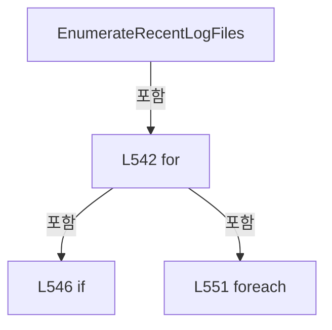

변경 전 점검: 입력/반환 타입, 위 호출자, 예외/취소 경로, 공유 상태와 저장·전송 소비자를 함께 확인합니다. 값의 단위나 물리 방향을 이름만으로 확정하지 않습니다.

### MethodDeclaration `ReadLogFile` · L558–572

[Drilling.Common/Log/CLogManager.cs:558–572](https://github.com/kjuws10-rgb/A3Drilling/blob/0219666f9053b907d96d7e0aa7d0c6c1be3a73d4/Drilling.Common/Log/CLogManager.cs#L558-L572)

| 항목 | 실제 추출 값 |
| --- | --- |
| 서명 | System.Collections.Generic.IEnumerable<string> Drilling.Common.Log.CLogManager.ReadLogFile(string) |
| 접근/수식자 | Private / private, static |
| 반환/값 타입 | System.Collections.Generic.IEnumerable<string> |
| 소속 타입 | NamedType:Drilling.Common.Log.CLogManager |

입력 계약:

| 이름 | 타입 | 전달 | 선택/기본값 |
| --- | --- | --- | --- |
| path | string | None | False /  |

현재 부분 분석에서 직접 연결된 호출자는 없습니다. XAML/이벤트/인터페이스·델리게이트·외부 진입을 추가 확인해야 하며, 미사용으로 판정한 것이 아닙니다.

호출하는 대상과 해석 범위:

| 원본 행 | 표현식 | 분석 상태 | 대상/소스 위치 |
| --- | --- | --- | --- |
| 562 | System.IO.File.ReadAllLines | resolved | string[] System.IO.File.ReadAllLines(string) |

본문의 실제 연산·분기·예외·반환 순서(원문 위치 순):

| 원본 행 | 종류 | 주석 해설 |
| --- | --- | --- |
| 560 | try | 예외 처리 범위입니다: try |
| 562 | call | 함수·델리게이트 또는 객체 생성자를 호출합니다: System.IO.File.ReadAllLines(path) |
| 562 | return | 호출자에게 값 또는 제어를 반환합니다: return System.IO.File.ReadAllLines(path); |
| 564 | catch | 지정 예외를 처리합니다: catch (IOException) |
| 566 | return | 호출자에게 값 또는 제어를 반환합니다: return[]; |
| 568 | catch | 지정 예외를 처리합니다: catch (UnauthorizedAccessException) |
| 570 | return | 호출자에게 값 또는 제어를 반환합니다: return[]; |

제어 구문의 포함 구조(실제 실행 순서/CFG가 아닌 구문 탐색 그림):

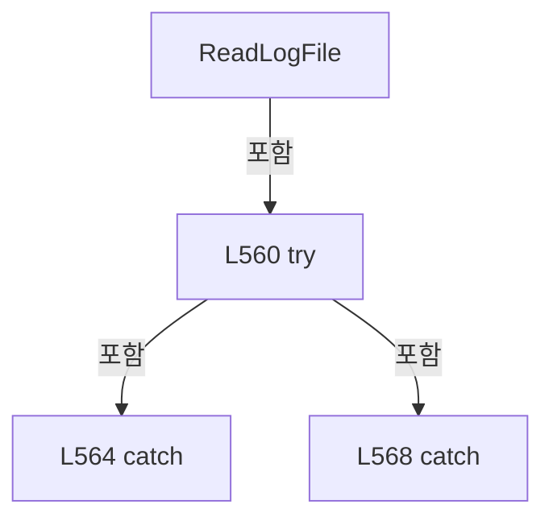

변경 전 점검: 입력/반환 타입, 위 호출자, 예외/취소 경로, 공유 상태와 저장·전송 소비자를 함께 확인합니다. 값의 단위나 물리 방향을 이름만으로 확정하지 않습니다.

### MethodDeclaration `ParseRecipeLine` · L574–611

[Drilling.Common/Log/CLogManager.cs:574–611](https://github.com/kjuws10-rgb/A3Drilling/blob/0219666f9053b907d96d7e0aa7d0c6c1be3a73d4/Drilling.Common/Log/CLogManager.cs#L574-L611)

| 항목 | 실제 추출 값 |
| --- | --- |
| 서명 | Drilling.Common.Managers.ST_RECIPE_HISTORY? Drilling.Common.Log.CLogManager.ParseRecipeLine(string) |
| 접근/수식자 | Private / private, static |
| 반환/값 타입 | Drilling.Common.Managers.ST_RECIPE_HISTORY? |
| 소속 타입 | NamedType:Drilling.Common.Log.CLogManager |

입력 계약:

| 이름 | 타입 | 전달 | 선택/기본값 |
| --- | --- | --- | --- |
| line | string | None | False /  |

현재 부분 분석에서 직접 연결된 호출자는 없습니다. XAML/이벤트/인터페이스·델리게이트·외부 진입을 추가 확인해야 하며, 미사용으로 판정한 것이 아닙니다.

호출하는 대상과 해석 범위:

| 원본 행 | 표현식 | 분석 상태 | 대상/소스 위치 |
| --- | --- | --- | --- |
| 576 | string.IsNullOrWhiteSpace | resolved | bool string.IsNullOrWhiteSpace(string?) |
| 581 | SplitFields | resolved | string[] Drilling.Common.Log.CLogManager.SplitFields(string) · Drilling.Common/Log/CLogManager.cs:634 |
| 587 | ParseTimestamp | resolved | System.DateTimeOffset Drilling.Common.Log.CLogManager.ParseTimestamp(string) · Drilling.Common/Log/CLogManager.cs:702 |
| 587 | parts[0].Trim | resolved | string string.Trim() |
| 588 | UnescapeField | resolved | string Drilling.Common.Log.CLogManager.UnescapeField(string) · Drilling.Common/Log/CLogManager.cs:682 |
| 588 | parts[1].Trim | resolved | string string.Trim() |
| 589 | parts[2].Trim | resolved | string string.Trim() |
| 590 | string.IsNullOrWhiteSpace | resolved | bool string.IsNullOrWhiteSpace(string?) |
| 590 | string.IsNullOrWhiteSpace | resolved | bool string.IsNullOrWhiteSpace(string?) |
| 595 | action.ToUpperInvariant | resolved | string string.ToUpperInvariant() |
| 597 | CreateRecipeHistory | resolved | Drilling.Common.Managers.ST_RECIPE_HISTORY Drilling.Common.Log.CLogManager.CreateRecipeHistory(System.DateTimeOffset, string, string, string, string, string, string, string) · Drilling.Common/Log/CLogManager.cs:613 |
| 597 | UnescapeField | resolved | string Drilling.Common.Log.CLogManager.UnescapeField(string) · Drilling.Common/Log/CLogManager.cs:682 |
| 597 | UnescapeField | resolved | string Drilling.Common.Log.CLogManager.UnescapeField(string) · Drilling.Common/Log/CLogManager.cs:682 |
| 597 | UnescapeField | resolved | string Drilling.Common.Log.CLogManager.UnescapeField(string) · Drilling.Common/Log/CLogManager.cs:682 |
| 597 | UnescapeField | resolved | string Drilling.Common.Log.CLogManager.UnescapeField(string) · Drilling.Common/Log/CLogManager.cs:682 |
| 597 | UnescapeField | resolved | string Drilling.Common.Log.CLogManager.UnescapeField(string) · Drilling.Common/Log/CLogManager.cs:682 |
| 598 | CreateRecipeHistory | resolved | Drilling.Common.Managers.ST_RECIPE_HISTORY Drilling.Common.Log.CLogManager.CreateRecipeHistory(System.DateTimeOffset, string, string, string, string, string, string, string) · Drilling.Common/Log/CLogManager.cs:613 |
| 598 | UnescapeField | resolved | string Drilling.Common.Log.CLogManager.UnescapeField(string) · Drilling.Common/Log/CLogManager.cs:682 |
| 598 | UnescapeField | resolved | string Drilling.Common.Log.CLogManager.UnescapeField(string) · Drilling.Common/Log/CLogManager.cs:682 |
| 598 | UnescapeField | resolved | string Drilling.Common.Log.CLogManager.UnescapeField(string) · Drilling.Common/Log/CLogManager.cs:682 |
| 599 | CreateRecipeHistory | resolved | Drilling.Common.Managers.ST_RECIPE_HISTORY Drilling.Common.Log.CLogManager.CreateRecipeHistory(System.DateTimeOffset, string, string, string, string, string, string, string) · Drilling.Common/Log/CLogManager.cs:613 |
| 600 | CreateRecipeHistory | resolved | Drilling.Common.Managers.ST_RECIPE_HISTORY Drilling.Common.Log.CLogManager.CreateRecipeHistory(System.DateTimeOffset, string, string, string, string, string, string, string) · Drilling.Common/Log/CLogManager.cs:613 |
| 601 | CreateRecipeHistory | resolved | Drilling.Common.Managers.ST_RECIPE_HISTORY Drilling.Common.Log.CLogManager.CreateRecipeHistory(System.DateTimeOffset, string, string, string, string, string, string, string) · Drilling.Common/Log/CLogManager.cs:613 |
| 602 | CreateRecipeHistory | resolved | Drilling.Common.Managers.ST_RECIPE_HISTORY Drilling.Common.Log.CLogManager.CreateRecipeHistory(System.DateTimeOffset, string, string, string, string, string, string, string) · Drilling.Common/Log/CLogManager.cs:613 |
| 603 | CreateRecipeHistory | resolved | Drilling.Common.Managers.ST_RECIPE_HISTORY Drilling.Common.Log.CLogManager.CreateRecipeHistory(System.DateTimeOffset, string, string, string, string, string, string, string) · Drilling.Common/Log/CLogManager.cs:613 |
| 604 | CreateRecipeHistory | resolved | Drilling.Common.Managers.ST_RECIPE_HISTORY Drilling.Common.Log.CLogManager.CreateRecipeHistory(System.DateTimeOffset, string, string, string, string, string, string, string) · Drilling.Common/Log/CLogManager.cs:613 |
| 605 | CreateRecipeHistory | resolved | Drilling.Common.Managers.ST_RECIPE_HISTORY Drilling.Common.Log.CLogManager.CreateRecipeHistory(System.DateTimeOffset, string, string, string, string, string, string, string) · Drilling.Common/Log/CLogManager.cs:613 |
| 605 | UnescapeField | resolved | string Drilling.Common.Log.CLogManager.UnescapeField(string) · Drilling.Common/Log/CLogManager.cs:682 |
| 605 | UnescapeField | resolved | string Drilling.Common.Log.CLogManager.UnescapeField(string) · Drilling.Common/Log/CLogManager.cs:682 |
| 606 | CreateRecipeHistory | resolved | Drilling.Common.Managers.ST_RECIPE_HISTORY Drilling.Common.Log.CLogManager.CreateRecipeHistory(System.DateTimeOffset, string, string, string, string, string, string, string) · Drilling.Common/Log/CLogManager.cs:613 |
| 607 | CreateRecipeHistory | resolved | Drilling.Common.Managers.ST_RECIPE_HISTORY Drilling.Common.Log.CLogManager.CreateRecipeHistory(System.DateTimeOffset, string, string, string, string, string, string, string) · Drilling.Common/Log/CLogManager.cs:613 |
| 608 | CreateRecipeHistory | resolved | Drilling.Common.Managers.ST_RECIPE_HISTORY Drilling.Common.Log.CLogManager.CreateRecipeHistory(System.DateTimeOffset, string, string, string, string, string, string, string) · Drilling.Common/Log/CLogManager.cs:613 |
| 609 | CreateRecipeHistory | resolved | Drilling.Common.Managers.ST_RECIPE_HISTORY Drilling.Common.Log.CLogManager.CreateRecipeHistory(System.DateTimeOffset, string, string, string, string, string, string, string) · Drilling.Common/Log/CLogManager.cs:613 |
| 610 | CreateRecipeHistory | resolved | Drilling.Common.Managers.ST_RECIPE_HISTORY Drilling.Common.Log.CLogManager.CreateRecipeHistory(System.DateTimeOffset, string, string, string, string, string, string, string) · Drilling.Common/Log/CLogManager.cs:613 |

본문의 실제 연산·분기·예외·반환 순서(원문 위치 순):

| 원본 행 | 종류 | 주석 해설 |
| --- | --- | --- |
| 576 | call | 함수·델리게이트 또는 객체 생성자를 호출합니다: string.IsNullOrWhiteSpace(line) |
| 576 | if | 조건에 따라 분기합니다: if (string.IsNullOrWhiteSpace(line)) |
| 578 | return | 호출자에게 값 또는 제어를 반환합니다: return null; |
| 581 | call | 함수·델리게이트 또는 객체 생성자를 호출합니다: SplitFields(line) |
| 581 | local-declaration | 지역 변수를 선언합니다: var parts = SplitFields(line); |
| 581 | variable-initializer | 변수의 초기값을 지정합니다: parts = SplitFields(line) |
| 582 | if | 조건에 따라 분기합니다: if (parts.Length < 3) |
| 584 | return | 호출자에게 값 또는 제어를 반환합니다: return null; |
| 587 | call | 함수·델리게이트 또는 객체 생성자를 호출합니다: ParseTimestamp(parts[0].Trim()) |
| 587 | call | 함수·델리게이트 또는 객체 생성자를 호출합니다: parts[0].Trim() |
| 587 | local-declaration | 지역 변수를 선언합니다: var changedAt = ParseTimestamp(parts[0].Trim()); |
| 587 | variable-initializer | 변수의 초기값을 지정합니다: changedAt = ParseTimestamp(parts[0].Trim()) |
| 588 | call | 함수·델리게이트 또는 객체 생성자를 호출합니다: UnescapeField(parts[1].Trim()) |
| 588 | call | 함수·델리게이트 또는 객체 생성자를 호출합니다: parts[1].Trim() |
| 588 | local-declaration | 지역 변수를 선언합니다: var recipeName = UnescapeField(parts[1].Trim()); |
| 588 | variable-initializer | 변수의 초기값을 지정합니다: recipeName = UnescapeField(parts[1].Trim()) |
| 589 | call | 함수·델리게이트 또는 객체 생성자를 호출합니다: parts[2].Trim() |
| 589 | local-declaration | 지역 변수를 선언합니다: var action = parts[2].Trim(); |
| 589 | variable-initializer | 변수의 초기값을 지정합니다: action = parts[2].Trim() |
| 590 | call | 함수·델리게이트 또는 객체 생성자를 호출합니다: string.IsNullOrWhiteSpace(recipeName) |
| 590 | call | 함수·델리게이트 또는 객체 생성자를 호출합니다: string.IsNullOrWhiteSpace(action) |
| 590 | if | 조건에 따라 분기합니다: if (string.IsNullOrWhiteSpace(recipeName) &#124;&#124; string.IsNullOrWhiteSpace(action)) |
| 592 | return | 호출자에게 값 또는 제어를 반환합니다: return null; |
| 595 | call | 함수·델리게이트 또는 객체 생성자를 호출합니다: action.ToUpperInvariant() |
| 595 | return | 호출자에게 값 또는 제어를 반환합니다: return action.ToUpperInvariant() switch { "MODIFY" when parts.Length >= 8 => CreateRecipeHistory(changedAt, recipeName, action, UnescapeField(parts[5]), UnescapeField(parts[6]), UnescapeField(parts[7]), UnescapeField(parts[3]), Un |
| 595 | switch-expression | 값별 결과식을 선택합니다: action.ToUpperInvariant() switch { "MODIFY" when parts.Length >= 8 => CreateRecipeHistory(changedAt, recipeName, action, UnescapeField(parts[5]), UnescapeField(parts[6]), UnescapeField(parts[7]), UnescapeField(parts[3]), UnescapeF |
| 597 | call | 함수·델리게이트 또는 객체 생성자를 호출합니다: CreateRecipeHistory(changedAt, recipeName, action, UnescapeField(parts[5]), UnescapeField(parts[6]), UnescapeField(parts[7]), UnescapeField(parts[3]), UnescapeField(parts[4])) |
| 597 | call | 함수·델리게이트 또는 객체 생성자를 호출합니다: UnescapeField(parts[5]) |
| 597 | call | 함수·델리게이트 또는 객체 생성자를 호출합니다: UnescapeField(parts[6]) |
| 597 | call | 함수·델리게이트 또는 객체 생성자를 호출합니다: UnescapeField(parts[7]) |
| 597 | call | 함수·델리게이트 또는 객체 생성자를 호출합니다: UnescapeField(parts[3]) |
| 597 | call | 함수·델리게이트 또는 객체 생성자를 호출합니다: UnescapeField(parts[4]) |
| 598 | call | 함수·델리게이트 또는 객체 생성자를 호출합니다: CreateRecipeHistory(changedAt, recipeName, action, UnescapeField(parts[3]), UnescapeField(parts[4]), UnescapeField(parts[5])) |
| 598 | call | 함수·델리게이트 또는 객체 생성자를 호출합니다: UnescapeField(parts[3]) |
| 598 | call | 함수·델리게이트 또는 객체 생성자를 호출합니다: UnescapeField(parts[4]) |
| 598 | call | 함수·델리게이트 또는 객체 생성자를 호출합니다: UnescapeField(parts[5]) |
| 599 | call | 함수·델리게이트 또는 객체 생성자를 호출합니다: CreateRecipeHistory(changedAt, recipeName, action, $"{parts[3]} / {parts[4]}", parts[5], parts[6]) |
| 600 | call | 함수·델리게이트 또는 객체 생성자를 호출합니다: CreateRecipeHistory(changedAt, recipeName, action, $"{parts[3]} / {parts[4]}", parts[5], parts[6]) |
| 601 | call | 함수·델리게이트 또는 객체 생성자를 호출합니다: CreateRecipeHistory(changedAt, recipeName, action, $"{parts[3]} / {parts[4]}", parts[5], parts[6]) |
| 602 | call | 함수·델리게이트 또는 객체 생성자를 호출합니다: CreateRecipeHistory(changedAt, recipeName, action, "Recipe", "-", recipeName) |
| 603 | call | 함수·델리게이트 또는 객체 생성자를 호출합니다: CreateRecipeHistory(changedAt, recipeName, action, "Recipe", "-", recipeName) |
| 604 | call | 함수·델리게이트 또는 객체 생성자를 호출합니다: CreateRecipeHistory(changedAt, recipeName, action, "Recipe", recipeName, "-") |
| 605 | call | 함수·델리게이트 또는 객체 생성자를 호출합니다: CreateRecipeHistory(changedAt, recipeName, action, "Recipe", UnescapeField(parts[4]), UnescapeField(parts[5])) |
| 605 | call | 함수·델리게이트 또는 객체 생성자를 호출합니다: UnescapeField(parts[4]) |
| 605 | call | 함수·델리게이트 또는 객체 생성자를 호출합니다: UnescapeField(parts[5]) |
| 606 | call | 함수·델리게이트 또는 객체 생성자를 호출합니다: CreateRecipeHistory(changedAt, recipeName, action, parts[3], parts[4], parts[5]) |
| 607 | call | 함수·델리게이트 또는 객체 생성자를 호출합니다: CreateRecipeHistory(changedAt, recipeName, action, "Recipe", "-", recipeName) |
| 608 | call | 함수·델리게이트 또는 객체 생성자를 호출합니다: CreateRecipeHistory(changedAt, recipeName, action, "Recipe", "-", recipeName) |
| 609 | call | 함수·델리게이트 또는 객체 생성자를 호출합니다: CreateRecipeHistory(changedAt, recipeName, action, parts[3], parts[4], parts[5]) |
| 610 | call | 함수·델리게이트 또는 객체 생성자를 호출합니다: CreateRecipeHistory(changedAt, recipeName, action, "Recipe", "-", "-") |

제어 구문의 포함 구조(실제 실행 순서/CFG가 아닌 구문 탐색 그림):

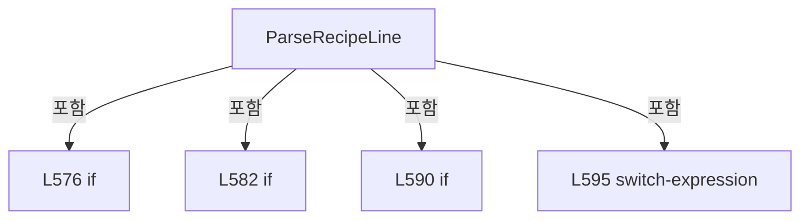

변경 전 점검: 입력/반환 타입, 위 호출자, 예외/취소 경로, 공유 상태와 저장·전송 소비자를 함께 확인합니다. 값의 단위나 물리 방향을 이름만으로 확정하지 않습니다.

### MethodDeclaration `CreateRecipeHistory` · L613–616

[Drilling.Common/Log/CLogManager.cs:613–616](https://github.com/kjuws10-rgb/A3Drilling/blob/0219666f9053b907d96d7e0aa7d0c6c1be3a73d4/Drilling.Common/Log/CLogManager.cs#L613-L616)

| 항목 | 실제 추출 값 |
| --- | --- |
| 서명 | Drilling.Common.Managers.ST_RECIPE_HISTORY Drilling.Common.Log.CLogManager.CreateRecipeHistory(System.DateTimeOffset, string, string, string, string, string, string, string) |
| 접근/수식자 | Private / private, static |
| 반환/값 타입 | Drilling.Common.Managers.ST_RECIPE_HISTORY |
| 소속 타입 | NamedType:Drilling.Common.Log.CLogManager |

입력 계약:

| 이름 | 타입 | 전달 | 선택/기본값 |
| --- | --- | --- | --- |
| changedAt | System.DateTimeOffset | None | False /  |
| recipeName | string | None | False /  |
| action | string | None | False /  |
| itemName | string | None | False /  |
| oldValue | string | None | False /  |
| newValue | string | None | False /  |
| tab | string | None | True / "" |
| group | string | None | True / "" |

정적 호출자로 확인된 위치:

| 호출 파일/행 | 호출 표현식 | 런타임 분기 가능 |
| --- | --- | --- |
| [Drilling.Common/Log/CLogManager.cs:597–597](https://github.com/kjuws10-rgb/A3Drilling/blob/0219666f9053b907d96d7e0aa7d0c6c1be3a73d4/Drilling.Common/Log/CLogManager.cs#L597-L597) | CreateRecipeHistory | False |
| [Drilling.Common/Log/CLogManager.cs:598–598](https://github.com/kjuws10-rgb/A3Drilling/blob/0219666f9053b907d96d7e0aa7d0c6c1be3a73d4/Drilling.Common/Log/CLogManager.cs#L598-L598) | CreateRecipeHistory | False |
| [Drilling.Common/Log/CLogManager.cs:599–599](https://github.com/kjuws10-rgb/A3Drilling/blob/0219666f9053b907d96d7e0aa7d0c6c1be3a73d4/Drilling.Common/Log/CLogManager.cs#L599-L599) | CreateRecipeHistory | False |
| [Drilling.Common/Log/CLogManager.cs:600–600](https://github.com/kjuws10-rgb/A3Drilling/blob/0219666f9053b907d96d7e0aa7d0c6c1be3a73d4/Drilling.Common/Log/CLogManager.cs#L600-L600) | CreateRecipeHistory | False |
| [Drilling.Common/Log/CLogManager.cs:601–601](https://github.com/kjuws10-rgb/A3Drilling/blob/0219666f9053b907d96d7e0aa7d0c6c1be3a73d4/Drilling.Common/Log/CLogManager.cs#L601-L601) | CreateRecipeHistory | False |
| [Drilling.Common/Log/CLogManager.cs:602–602](https://github.com/kjuws10-rgb/A3Drilling/blob/0219666f9053b907d96d7e0aa7d0c6c1be3a73d4/Drilling.Common/Log/CLogManager.cs#L602-L602) | CreateRecipeHistory | False |
| [Drilling.Common/Log/CLogManager.cs:603–603](https://github.com/kjuws10-rgb/A3Drilling/blob/0219666f9053b907d96d7e0aa7d0c6c1be3a73d4/Drilling.Common/Log/CLogManager.cs#L603-L603) | CreateRecipeHistory | False |
| [Drilling.Common/Log/CLogManager.cs:604–604](https://github.com/kjuws10-rgb/A3Drilling/blob/0219666f9053b907d96d7e0aa7d0c6c1be3a73d4/Drilling.Common/Log/CLogManager.cs#L604-L604) | CreateRecipeHistory | False |
| [Drilling.Common/Log/CLogManager.cs:605–605](https://github.com/kjuws10-rgb/A3Drilling/blob/0219666f9053b907d96d7e0aa7d0c6c1be3a73d4/Drilling.Common/Log/CLogManager.cs#L605-L605) | CreateRecipeHistory | False |
| [Drilling.Common/Log/CLogManager.cs:606–606](https://github.com/kjuws10-rgb/A3Drilling/blob/0219666f9053b907d96d7e0aa7d0c6c1be3a73d4/Drilling.Common/Log/CLogManager.cs#L606-L606) | CreateRecipeHistory | False |
| [Drilling.Common/Log/CLogManager.cs:607–607](https://github.com/kjuws10-rgb/A3Drilling/blob/0219666f9053b907d96d7e0aa7d0c6c1be3a73d4/Drilling.Common/Log/CLogManager.cs#L607-L607) | CreateRecipeHistory | False |
| [Drilling.Common/Log/CLogManager.cs:608–608](https://github.com/kjuws10-rgb/A3Drilling/blob/0219666f9053b907d96d7e0aa7d0c6c1be3a73d4/Drilling.Common/Log/CLogManager.cs#L608-L608) | CreateRecipeHistory | False |
| [Drilling.Common/Log/CLogManager.cs:609–609](https://github.com/kjuws10-rgb/A3Drilling/blob/0219666f9053b907d96d7e0aa7d0c6c1be3a73d4/Drilling.Common/Log/CLogManager.cs#L609-L609) | CreateRecipeHistory | False |
| [Drilling.Common/Log/CLogManager.cs:610–610](https://github.com/kjuws10-rgb/A3Drilling/blob/0219666f9053b907d96d7e0aa7d0c6c1be3a73d4/Drilling.Common/Log/CLogManager.cs#L610-L610) | CreateRecipeHistory | False |

호출하는 대상과 해석 범위:

| 원본 행 | 표현식 | 분석 상태 | 대상/소스 위치 |
| --- | --- | --- | --- |
| 615 | new ST_RECIPE_HISTORY | resolved | Drilling.Common.Managers.ST_RECIPE_HISTORY.ST_RECIPE_HISTORY(System.DateTimeOffset, string, string, string, string, string, string, string, string) · Drilling.Common/Managers/CRecipeManager.cs:376 |
| 615 | itemName.Trim | resolved | string string.Trim() |
| 615 | oldValue.Trim | resolved | string string.Trim() |
| 615 | newValue.Trim | resolved | string string.Trim() |
| 615 | tab.Trim | resolved | string string.Trim() |
| 615 | group.Trim | resolved | string string.Trim() |

본문의 실제 연산·분기·예외·반환 순서(원문 위치 순):

| 원본 행 | 종류 | 주석 해설 |
| --- | --- | --- |
| 615 | call | 함수·델리게이트 또는 객체 생성자를 호출합니다: new ST_RECIPE_HISTORY(changedAt, itemName.Trim(), oldValue.Trim(), newValue.Trim(), "LOG", recipeName, action, tab.Trim(), group.Trim()) |
| 615 | call | 함수·델리게이트 또는 객체 생성자를 호출합니다: itemName.Trim() |
| 615 | call | 함수·델리게이트 또는 객체 생성자를 호출합니다: oldValue.Trim() |
| 615 | call | 함수·델리게이트 또는 객체 생성자를 호출합니다: newValue.Trim() |
| 615 | call | 함수·델리게이트 또는 객체 생성자를 호출합니다: tab.Trim() |
| 615 | call | 함수·델리게이트 또는 객체 생성자를 호출합니다: group.Trim() |
| 615 | return | 호출자에게 값 또는 제어를 반환합니다: return new ST_RECIPE_HISTORY(changedAt, itemName.Trim(), oldValue.Trim(), newValue.Trim(), "LOG", recipeName, action, tab.Trim(), group.Trim()); |

변경 전 점검: 입력/반환 타입, 위 호출자, 예외/취소 경로, 공유 상태와 저장·전송 소비자를 함께 확인합니다. 값의 단위나 물리 방향을 이름만으로 확정하지 않습니다.

### MethodDeclaration `ParseSettingLine` · L618–632

[Drilling.Common/Log/CLogManager.cs:618–632](https://github.com/kjuws10-rgb/A3Drilling/blob/0219666f9053b907d96d7e0aa7d0c6c1be3a73d4/Drilling.Common/Log/CLogManager.cs#L618-L632)

| 항목 | 실제 추출 값 |
| --- | --- |
| 서명 | Drilling.Common.Managers.ST_SETTING_HISTORY? Drilling.Common.Log.CLogManager.ParseSettingLine(string) |
| 접근/수식자 | Private / private, static |
| 반환/값 타입 | Drilling.Common.Managers.ST_SETTING_HISTORY? |
| 소속 타입 | NamedType:Drilling.Common.Log.CLogManager |

입력 계약:

| 이름 | 타입 | 전달 | 선택/기본값 |
| --- | --- | --- | --- |
| line | string | None | False /  |

현재 부분 분석에서 직접 연결된 호출자는 없습니다. XAML/이벤트/인터페이스·델리게이트·외부 진입을 추가 확인해야 하며, 미사용으로 판정한 것이 아닙니다.

호출하는 대상과 해석 범위:

| 원본 행 | 표현식 | 분석 상태 | 대상/소스 위치 |
| --- | --- | --- | --- |
| 620 | string.IsNullOrWhiteSpace | resolved | bool string.IsNullOrWhiteSpace(string?) |
| 625 | SplitFields | resolved | string[] Drilling.Common.Log.CLogManager.SplitFields(string) · Drilling.Common/Log/CLogManager.cs:634 |
| 626 | parts[1].Trim().Equals | resolved | bool string.Equals(string?, System.StringComparison) |
| 626 | parts[1].Trim | resolved | string string.Trim() |
| 626 | TryReadSection | resolved | bool Drilling.Common.Log.CLogManager.TryReadSection(string, out Drilling.Common.Managers.EN_SETTING_TAB) · Drilling.Common/Log/CLogManager.cs:687 |
| 631 | new ST_SETTING_HISTORY | resolved | Drilling.Common.Managers.ST_SETTING_HISTORY.ST_SETTING_HISTORY(System.DateTimeOffset, Drilling.Common.Managers.EN_SETTING_TAB, string, string, string, string, string) · Drilling.Common/Managers/CSettingManager.cs:280 |
| 631 | ParseTimestamp | resolved | System.DateTimeOffset Drilling.Common.Log.CLogManager.ParseTimestamp(string) · Drilling.Common/Log/CLogManager.cs:702 |
| 631 | parts[0].Trim | resolved | string string.Trim() |
| 631 | UnescapeField | resolved | string Drilling.Common.Log.CLogManager.UnescapeField(string) · Drilling.Common/Log/CLogManager.cs:682 |
| 631 | parts[4].Trim | resolved | string string.Trim() |
| 631 | UnescapeField | resolved | string Drilling.Common.Log.CLogManager.UnescapeField(string) · Drilling.Common/Log/CLogManager.cs:682 |
| 631 | parts[5].Trim | resolved | string string.Trim() |
| 631 | UnescapeField | resolved | string Drilling.Common.Log.CLogManager.UnescapeField(string) · Drilling.Common/Log/CLogManager.cs:682 |
| 631 | parts[6].Trim | resolved | string string.Trim() |
| 631 | parts[3].Trim | resolved | string string.Trim() |

본문의 실제 연산·분기·예외·반환 순서(원문 위치 순):

| 원본 행 | 종류 | 주석 해설 |
| --- | --- | --- |
| 620 | call | 함수·델리게이트 또는 객체 생성자를 호출합니다: string.IsNullOrWhiteSpace(line) |
| 620 | if | 조건에 따라 분기합니다: if (string.IsNullOrWhiteSpace(line)) |
| 622 | return | 호출자에게 값 또는 제어를 반환합니다: return null; |
| 625 | call | 함수·델리게이트 또는 객체 생성자를 호출합니다: SplitFields(line) |
| 625 | local-declaration | 지역 변수를 선언합니다: var parts = SplitFields(line); |
| 625 | variable-initializer | 변수의 초기값을 지정합니다: parts = SplitFields(line) |
| 626 | call | 함수·델리게이트 또는 객체 생성자를 호출합니다: parts[1].Trim().Equals("SETTING", StringComparison.OrdinalIgnoreCase) |
| 626 | call | 함수·델리게이트 또는 객체 생성자를 호출합니다: parts[1].Trim() |
| 626 | call | 함수·델리게이트 또는 객체 생성자를 호출합니다: TryReadSection(parts[2], out var section) |
| 626 | if | 조건에 따라 분기합니다: if (parts.Length < 7 &#124;&#124; !parts[1].Trim().Equals("SETTING", StringComparison.OrdinalIgnoreCase) &#124;&#124; !TryReadSection(parts[2], out var section)) |
| 628 | return | 호출자에게 값 또는 제어를 반환합니다: return null; |
| 631 | call | 함수·델리게이트 또는 객체 생성자를 호출합니다: new ST_SETTING_HISTORY(ParseTimestamp(parts[0].Trim()), section, UnescapeField(parts[4].Trim()), UnescapeField(parts[5].Trim()), UnescapeField(parts[6].Trim()), "LOG", parts[3].Trim()) |
| 631 | call | 함수·델리게이트 또는 객체 생성자를 호출합니다: ParseTimestamp(parts[0].Trim()) |
| 631 | call | 함수·델리게이트 또는 객체 생성자를 호출합니다: parts[0].Trim() |
| 631 | call | 함수·델리게이트 또는 객체 생성자를 호출합니다: UnescapeField(parts[4].Trim()) |
| 631 | call | 함수·델리게이트 또는 객체 생성자를 호출합니다: parts[4].Trim() |
| 631 | call | 함수·델리게이트 또는 객체 생성자를 호출합니다: UnescapeField(parts[5].Trim()) |
| 631 | call | 함수·델리게이트 또는 객체 생성자를 호출합니다: parts[5].Trim() |
| 631 | call | 함수·델리게이트 또는 객체 생성자를 호출합니다: UnescapeField(parts[6].Trim()) |
| 631 | call | 함수·델리게이트 또는 객체 생성자를 호출합니다: parts[6].Trim() |
| 631 | call | 함수·델리게이트 또는 객체 생성자를 호출합니다: parts[3].Trim() |
| 631 | return | 호출자에게 값 또는 제어를 반환합니다: return new ST_SETTING_HISTORY(ParseTimestamp(parts[0].Trim()), section, UnescapeField(parts[4].Trim()), UnescapeField(parts[5].Trim()), UnescapeField(parts[6].Trim()), "LOG", parts[3].Trim()); |

제어 구문의 포함 구조(실제 실행 순서/CFG가 아닌 구문 탐색 그림):

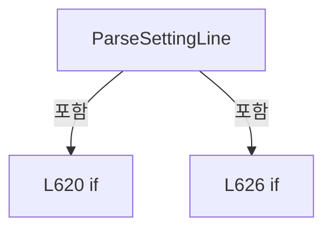

변경 전 점검: 입력/반환 타입, 위 호출자, 예외/취소 경로, 공유 상태와 저장·전송 소비자를 함께 확인합니다. 값의 단위나 물리 방향을 이름만으로 확정하지 않습니다.

### MethodDeclaration `SplitFields` · L634–660

[Drilling.Common/Log/CLogManager.cs:634–660](https://github.com/kjuws10-rgb/A3Drilling/blob/0219666f9053b907d96d7e0aa7d0c6c1be3a73d4/Drilling.Common/Log/CLogManager.cs#L634-L660)

| 항목 | 실제 추출 값 |
| --- | --- |
| 서명 | string[] Drilling.Common.Log.CLogManager.SplitFields(string) |
| 접근/수식자 | Private / private, static |
| 반환/값 타입 | string[] |
| 소속 타입 | NamedType:Drilling.Common.Log.CLogManager |

입력 계약:

| 이름 | 타입 | 전달 | 선택/기본값 |
| --- | --- | --- | --- |
| line | string | None | False /  |

정적 호출자로 확인된 위치:

| 호출 파일/행 | 호출 표현식 | 런타임 분기 가능 |
| --- | --- | --- |
| [Drilling.Common/Log/CLogManager.cs:581–581](https://github.com/kjuws10-rgb/A3Drilling/blob/0219666f9053b907d96d7e0aa7d0c6c1be3a73d4/Drilling.Common/Log/CLogManager.cs#L581-L581) | SplitFields | False |
| [Drilling.Common/Log/CLogManager.cs:625–625](https://github.com/kjuws10-rgb/A3Drilling/blob/0219666f9053b907d96d7e0aa7d0c6c1be3a73d4/Drilling.Common/Log/CLogManager.cs#L625-L625) | SplitFields | False |

호출하는 대상과 해석 범위:

| 원본 행 | 표현식 | 분석 상태 | 대상/소스 위치 |
| --- | --- | --- | --- |
| 636 | new List<string> | resolved | System.Collections.Generic.List<string>.List() |
| 637 | new StringBuilder | resolved | System.Text.StringBuilder.StringBuilder() |
| 643 | value.Append | resolved | System.Text.StringBuilder System.Text.StringBuilder.Append(char) |
| 649 | value.Append | resolved | System.Text.StringBuilder System.Text.StringBuilder.Append(char) |
| 654 | fields.Add | resolved | void System.Collections.Generic.List<string>.Add(string) |
| 654 | value.ToString | resolved · 동적 구현 선택 가능 | string System.Text.StringBuilder.ToString() |
| 655 | value.Clear | resolved | System.Text.StringBuilder System.Text.StringBuilder.Clear() |
| 658 | fields.Add | resolved | void System.Collections.Generic.List<string>.Add(string) |
| 658 | value.ToString | resolved · 동적 구현 선택 가능 | string System.Text.StringBuilder.ToString() |
| 659 | fields.ToArray | resolved | string[] System.Collections.Generic.List<string>.ToArray() |

본문의 실제 연산·분기·예외·반환 순서(원문 위치 순):

| 원본 행 | 종류 | 주석 해설 |
| --- | --- | --- |
| 636 | call | 함수·델리게이트 또는 객체 생성자를 호출합니다: new List<string>() |
| 636 | local-declaration | 지역 변수를 선언합니다: var fields = new List<string>(); |
| 636 | variable-initializer | 변수의 초기값을 지정합니다: fields = new List<string>() |
| 637 | call | 함수·델리게이트 또는 객체 생성자를 호출합니다: new StringBuilder() |
| 637 | local-declaration | 지역 변수를 선언합니다: var value = new StringBuilder(); |
| 637 | variable-initializer | 변수의 초기값을 지정합니다: value = new StringBuilder() |
| 638 | variable-initializer | 변수의 초기값을 지정합니다: index = 0 |
| 638 | for | 초기화·조건·증감이 있는 반복입니다: for (var index = 0; index < line.Length; index++) |
| 640 | local-declaration | 지역 변수를 선언합니다: var current = line[index]; |
| 640 | variable-initializer | 변수의 초기값을 지정합니다: current = line[index] |
| 641 | if | 조건에 따라 분기합니다: if (current != '\\') |
| 643 | call | 함수·델리게이트 또는 객체 생성자를 호출합니다: value.Append(current) |
| 644 | continue | 다음 반복으로 진행합니다: continue; |
| 647 | if | 조건에 따라 분기합니다: if (index + 1 < line.Length && line[index + 1] == '\\') |
| 649 | call | 함수·델리게이트 또는 객체 생성자를 호출합니다: value.Append('\\') |
| 651 | continue | 다음 반복으로 진행합니다: continue; |
| 654 | call | 함수·델리게이트 또는 객체 생성자를 호출합니다: fields.Add(value.ToString()) |
| 654 | call | 함수·델리게이트 또는 객체 생성자를 호출합니다: value.ToString() |
| 655 | call | 함수·델리게이트 또는 객체 생성자를 호출합니다: value.Clear() |
| 658 | call | 함수·델리게이트 또는 객체 생성자를 호출합니다: fields.Add(value.ToString()) |
| 658 | call | 함수·델리게이트 또는 객체 생성자를 호출합니다: value.ToString() |
| 659 | call | 함수·델리게이트 또는 객체 생성자를 호출합니다: fields.ToArray() |
| 659 | return | 호출자에게 값 또는 제어를 반환합니다: return fields.ToArray(); |

제어 구문의 포함 구조(실제 실행 순서/CFG가 아닌 구문 탐색 그림):

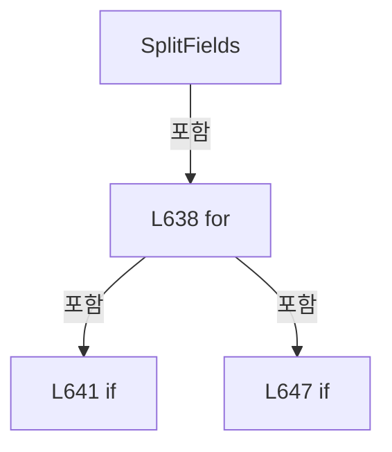

변경 전 점검: 입력/반환 타입, 위 호출자, 예외/취소 경로, 공유 상태와 저장·전송 소비자를 함께 확인합니다. 값의 단위나 물리 방향을 이름만으로 확정하지 않습니다.

### MethodDeclaration `EscapeField` · L662–665

[Drilling.Common/Log/CLogManager.cs:662–665](https://github.com/kjuws10-rgb/A3Drilling/blob/0219666f9053b907d96d7e0aa7d0c6c1be3a73d4/Drilling.Common/Log/CLogManager.cs#L662-L665)

| 항목 | 실제 추출 값 |
| --- | --- |
| 서명 | string Drilling.Common.Log.CLogManager.EscapeField(string) |
| 접근/수식자 | Private / private, static |
| 반환/값 타입 | string |
| 소속 타입 | NamedType:Drilling.Common.Log.CLogManager |

입력 계약:

| 이름 | 타입 | 전달 | 선택/기본값 |
| --- | --- | --- | --- |
| value | string | None | False /  |

정적 호출자로 확인된 위치:

| 호출 파일/행 | 호출 표현식 | 런타임 분기 가능 |
| --- | --- | --- |
| [Drilling.Common/Log/CLogManager.cs:181–181](https://github.com/kjuws10-rgb/A3Drilling/blob/0219666f9053b907d96d7e0aa7d0c6c1be3a73d4/Drilling.Common/Log/CLogManager.cs#L181-L181) | EscapeField | False |
| [Drilling.Common/Log/CLogManager.cs:181–181](https://github.com/kjuws10-rgb/A3Drilling/blob/0219666f9053b907d96d7e0aa7d0c6c1be3a73d4/Drilling.Common/Log/CLogManager.cs#L181-L181) | EscapeField | False |
| [Drilling.Common/Log/CLogManager.cs:181–181](https://github.com/kjuws10-rgb/A3Drilling/blob/0219666f9053b907d96d7e0aa7d0c6c1be3a73d4/Drilling.Common/Log/CLogManager.cs#L181-L181) | EscapeField | False |
| [Drilling.Common/Log/CLogManager.cs:181–181](https://github.com/kjuws10-rgb/A3Drilling/blob/0219666f9053b907d96d7e0aa7d0c6c1be3a73d4/Drilling.Common/Log/CLogManager.cs#L181-L181) | EscapeField | False |
| [Drilling.Common/Log/CLogManager.cs:257–257](https://github.com/kjuws10-rgb/A3Drilling/blob/0219666f9053b907d96d7e0aa7d0c6c1be3a73d4/Drilling.Common/Log/CLogManager.cs#L257-L257) | EscapeField | False |
| [Drilling.Common/Log/CLogManager.cs:261–261](https://github.com/kjuws10-rgb/A3Drilling/blob/0219666f9053b907d96d7e0aa7d0c6c1be3a73d4/Drilling.Common/Log/CLogManager.cs#L261-L261) | EscapeField | False |
| [Drilling.Common/Log/CLogManager.cs:261–261](https://github.com/kjuws10-rgb/A3Drilling/blob/0219666f9053b907d96d7e0aa7d0c6c1be3a73d4/Drilling.Common/Log/CLogManager.cs#L261-L261) | EscapeField | False |
| [Drilling.Common/Log/CLogManager.cs:261–261](https://github.com/kjuws10-rgb/A3Drilling/blob/0219666f9053b907d96d7e0aa7d0c6c1be3a73d4/Drilling.Common/Log/CLogManager.cs#L261-L261) | EscapeField | False |
| [Drilling.Common/Log/CLogManager.cs:261–261](https://github.com/kjuws10-rgb/A3Drilling/blob/0219666f9053b907d96d7e0aa7d0c6c1be3a73d4/Drilling.Common/Log/CLogManager.cs#L261-L261) | EscapeField | False |
| [Drilling.Common/Log/CLogManager.cs:261–261](https://github.com/kjuws10-rgb/A3Drilling/blob/0219666f9053b907d96d7e0aa7d0c6c1be3a73d4/Drilling.Common/Log/CLogManager.cs#L261-L261) | EscapeField | False |
| [Drilling.Common/Log/CLogManager.cs:347–347](https://github.com/kjuws10-rgb/A3Drilling/blob/0219666f9053b907d96d7e0aa7d0c6c1be3a73d4/Drilling.Common/Log/CLogManager.cs#L347-L347) | EscapeField | False |
| [Drilling.Common/Log/CLogManager.cs:347–347](https://github.com/kjuws10-rgb/A3Drilling/blob/0219666f9053b907d96d7e0aa7d0c6c1be3a73d4/Drilling.Common/Log/CLogManager.cs#L347-L347) | EscapeField | False |
| [Drilling.Common/Log/CLogManager.cs:347–347](https://github.com/kjuws10-rgb/A3Drilling/blob/0219666f9053b907d96d7e0aa7d0c6c1be3a73d4/Drilling.Common/Log/CLogManager.cs#L347-L347) | EscapeField | False |
| [Drilling.Common/Log/CLogManager.cs:347–347](https://github.com/kjuws10-rgb/A3Drilling/blob/0219666f9053b907d96d7e0aa7d0c6c1be3a73d4/Drilling.Common/Log/CLogManager.cs#L347-L347) | EscapeField | False |
| [Drilling.Common/Log/CLogManager.cs:347–347](https://github.com/kjuws10-rgb/A3Drilling/blob/0219666f9053b907d96d7e0aa7d0c6c1be3a73d4/Drilling.Common/Log/CLogManager.cs#L347-L347) | EscapeField | False |
| [Drilling.Common/Log/CLogManager.cs:372–372](https://github.com/kjuws10-rgb/A3Drilling/blob/0219666f9053b907d96d7e0aa7d0c6c1be3a73d4/Drilling.Common/Log/CLogManager.cs#L372-L372) | EscapeField | False |
| [Drilling.Common/Log/CLogManager.cs:372–372](https://github.com/kjuws10-rgb/A3Drilling/blob/0219666f9053b907d96d7e0aa7d0c6c1be3a73d4/Drilling.Common/Log/CLogManager.cs#L372-L372) | EscapeField | False |
| [Drilling.Common/Log/CLogManager.cs:372–372](https://github.com/kjuws10-rgb/A3Drilling/blob/0219666f9053b907d96d7e0aa7d0c6c1be3a73d4/Drilling.Common/Log/CLogManager.cs#L372-L372) | EscapeField | False |
| [Drilling.Common/Log/CLogManager.cs:372–372](https://github.com/kjuws10-rgb/A3Drilling/blob/0219666f9053b907d96d7e0aa7d0c6c1be3a73d4/Drilling.Common/Log/CLogManager.cs#L372-L372) | EscapeField | False |
| [Drilling.Common/Log/CLogManager.cs:372–372](https://github.com/kjuws10-rgb/A3Drilling/blob/0219666f9053b907d96d7e0aa7d0c6c1be3a73d4/Drilling.Common/Log/CLogManager.cs#L372-L372) | EscapeField | False |
| [Drilling.Common/Log/CLogManager.cs:372–372](https://github.com/kjuws10-rgb/A3Drilling/blob/0219666f9053b907d96d7e0aa7d0c6c1be3a73d4/Drilling.Common/Log/CLogManager.cs#L372-L372) | EscapeField | False |
| [Drilling.Common/Log/CLogManager.cs:382–382](https://github.com/kjuws10-rgb/A3Drilling/blob/0219666f9053b907d96d7e0aa7d0c6c1be3a73d4/Drilling.Common/Log/CLogManager.cs#L382-L382) | EscapeField | False |
| [Drilling.Common/Log/CLogManager.cs:382–382](https://github.com/kjuws10-rgb/A3Drilling/blob/0219666f9053b907d96d7e0aa7d0c6c1be3a73d4/Drilling.Common/Log/CLogManager.cs#L382-L382) | EscapeField | False |
| [Drilling.Common/Log/CLogManager.cs:382–382](https://github.com/kjuws10-rgb/A3Drilling/blob/0219666f9053b907d96d7e0aa7d0c6c1be3a73d4/Drilling.Common/Log/CLogManager.cs#L382-L382) | EscapeField | False |
| [Drilling.Common/Log/CLogManager.cs:393–393](https://github.com/kjuws10-rgb/A3Drilling/blob/0219666f9053b907d96d7e0aa7d0c6c1be3a73d4/Drilling.Common/Log/CLogManager.cs#L393-L393) | EscapeField | False |
| [Drilling.Common/Log/CLogManager.cs:393–393](https://github.com/kjuws10-rgb/A3Drilling/blob/0219666f9053b907d96d7e0aa7d0c6c1be3a73d4/Drilling.Common/Log/CLogManager.cs#L393-L393) | EscapeField | False |
| [Drilling.Common/Log/CLogManager.cs:393–393](https://github.com/kjuws10-rgb/A3Drilling/blob/0219666f9053b907d96d7e0aa7d0c6c1be3a73d4/Drilling.Common/Log/CLogManager.cs#L393-L393) | EscapeField | False |
| [Drilling.Common/Log/CLogManager.cs:403–403](https://github.com/kjuws10-rgb/A3Drilling/blob/0219666f9053b907d96d7e0aa7d0c6c1be3a73d4/Drilling.Common/Log/CLogManager.cs#L403-L403) | EscapeField | False |
| [Drilling.Common/Log/CLogManager.cs:403–403](https://github.com/kjuws10-rgb/A3Drilling/blob/0219666f9053b907d96d7e0aa7d0c6c1be3a73d4/Drilling.Common/Log/CLogManager.cs#L403-L403) | EscapeField | False |
| [Drilling.Common/Log/CLogManager.cs:403–403](https://github.com/kjuws10-rgb/A3Drilling/blob/0219666f9053b907d96d7e0aa7d0c6c1be3a73d4/Drilling.Common/Log/CLogManager.cs#L403-L403) | EscapeField | False |
| [Drilling.Common/Log/CLogManager.cs:403–403](https://github.com/kjuws10-rgb/A3Drilling/blob/0219666f9053b907d96d7e0aa7d0c6c1be3a73d4/Drilling.Common/Log/CLogManager.cs#L403-L403) | EscapeField | False |

호출하는 대상과 해석 범위:

| 원본 행 | 표현식 | 분석 상태 | 대상/소스 위치 |
| --- | --- | --- | --- |
| 664 | value.Replace("\\", "\\\\").Replace("\r", " ").Replace | resolved | string string.Replace(string, string?) |
| 664 | value.Replace("\\", "\\\\").Replace | resolved | string string.Replace(string, string?) |
| 664 | value.Replace | resolved | string string.Replace(string, string?) |

본문의 실제 연산·분기·예외·반환 순서(원문 위치 순):

| 원본 행 | 종류 | 주석 해설 |
| --- | --- | --- |
| 664 | call | 함수·델리게이트 또는 객체 생성자를 호출합니다: value.Replace("\\", "\\\\").Replace("\r", " ").Replace("\n", " ") |
| 664 | call | 함수·델리게이트 또는 객체 생성자를 호출합니다: value.Replace("\\", "\\\\").Replace("\r", " ") |
| 664 | call | 함수·델리게이트 또는 객체 생성자를 호출합니다: value.Replace("\\", "\\\\") |
| 664 | return | 호출자에게 값 또는 제어를 반환합니다: return value.Replace("\\", "\\\\").Replace("\r", " ").Replace("\n", " "); |

변경 전 점검: 입력/반환 타입, 위 호출자, 예외/취소 경로, 공유 상태와 저장·전송 소비자를 함께 확인합니다. 값의 단위나 물리 방향을 이름만으로 확정하지 않습니다.

### MethodDeclaration `ModuleLogName` · L667–675

[Drilling.Common/Log/CLogManager.cs:667–675](https://github.com/kjuws10-rgb/A3Drilling/blob/0219666f9053b907d96d7e0aa7d0c6c1be3a73d4/Drilling.Common/Log/CLogManager.cs#L667-L675)

| 항목 | 실제 추출 값 |
| --- | --- |
| 서명 | string Drilling.Common.Log.CLogManager.ModuleLogName(Drilling.Common.Interface.EN_EQP_MODULE) |
| 접근/수식자 | Private / private, static |
| 반환/값 타입 | string |
| 소속 타입 | NamedType:Drilling.Common.Log.CLogManager |

입력 계약:

| 이름 | 타입 | 전달 | 선택/기본값 |
| --- | --- | --- | --- |
| module | Drilling.Common.Interface.EN_EQP_MODULE | None | False /  |

정적 호출자로 확인된 위치:

| 호출 파일/행 | 호출 표현식 | 런타임 분기 가능 |
| --- | --- | --- |
| [Drilling.Common/Log/CLogManager.cs:326–326](https://github.com/kjuws10-rgb/A3Drilling/blob/0219666f9053b907d96d7e0aa7d0c6c1be3a73d4/Drilling.Common/Log/CLogManager.cs#L326-L326) | ModuleLogName | False |
| [Drilling.Common/Log/CLogManager.cs:389–389](https://github.com/kjuws10-rgb/A3Drilling/blob/0219666f9053b907d96d7e0aa7d0c6c1be3a73d4/Drilling.Common/Log/CLogManager.cs#L389-L389) | ModuleLogName | False |

호출하는 대상과 해석 범위:

| 원본 행 | 표현식 | 분석 상태 | 대상/소스 위치 |
| --- | --- | --- | --- |
| 674 | module.ToString().ToUpperInvariant | resolved | string string.ToUpperInvariant() |
| 674 | module.ToString | resolved · 동적 구현 선택 가능 | string System.Enum.ToString() |

본문의 실제 연산·분기·예외·반환 순서(원문 위치 순):

| 원본 행 | 종류 | 주석 해설 |
| --- | --- | --- |
| 669 | return | 호출자에게 값 또는 제어를 반환합니다: return module switch { EN_EQP_MODULE.WonikCtrl => "WONIK_CTRL", EN_EQP_MODULE.TalonLaser => "TALON_LASER", EN_EQP_MODULE.PowerMeter => "POWER_METER", _ => module.ToString().ToUpperInvariant()}; |
| 669 | switch-expression | 값별 결과식을 선택합니다: module switch { EN_EQP_MODULE.WonikCtrl => "WONIK_CTRL", EN_EQP_MODULE.TalonLaser => "TALON_LASER", EN_EQP_MODULE.PowerMeter => "POWER_METER", _ => module.ToString().ToUpperInvariant()} |
| 674 | call | 함수·델리게이트 또는 객체 생성자를 호출합니다: module.ToString().ToUpperInvariant() |
| 674 | call | 함수·델리게이트 또는 객체 생성자를 호출합니다: module.ToString() |

제어 구문의 포함 구조(실제 실행 순서/CFG가 아닌 구문 탐색 그림):

```mermaid
flowchart TD
 M["ModuleLogName"]
 N0["L669 switch-expression"]
 M -->|포함| N0
```

변경 전 점검: 입력/반환 타입, 위 호출자, 예외/취소 경로, 공유 상태와 저장·전송 소비자를 함께 확인합니다. 값의 단위나 물리 방향을 이름만으로 확정하지 않습니다.

### MethodDeclaration `NormalizeModuleName` · L677–680

[Drilling.Common/Log/CLogManager.cs:677–680](https://github.com/kjuws10-rgb/A3Drilling/blob/0219666f9053b907d96d7e0aa7d0c6c1be3a73d4/Drilling.Common/Log/CLogManager.cs#L677-L680)

| 항목 | 실제 추출 값 |
| --- | --- |
| 서명 | string Drilling.Common.Log.CLogManager.NormalizeModuleName(string) |
| 접근/수식자 | Private / private, static |
| 반환/값 타입 | string |
| 소속 타입 | NamedType:Drilling.Common.Log.CLogManager |

입력 계약:

| 이름 | 타입 | 전달 | 선택/기본값 |
| --- | --- | --- | --- |
| value | string | None | False /  |

현재 부분 분석에서 직접 연결된 호출자는 없습니다. XAML/이벤트/인터페이스·델리게이트·외부 진입을 추가 확인해야 하며, 미사용으로 판정한 것이 아닙니다.

호출하는 대상과 해석 범위:

| 원본 행 | 표현식 | 분석 상태 | 대상/소스 위치 |
| --- | --- | --- | --- |
| 679 | new string | resolved | string.String(char[]?) |
| 679 | value.Where(char.IsLetterOrDigit).Select(char.ToUpperInvariant).ToArray | resolved | char[] System.Collections.Generic.IEnumerable<char>.ToArray<char>() |
| 679 | value.Where(char.IsLetterOrDigit).Select | resolved | System.Collections.Generic.IEnumerable<char> System.Collections.Generic.IEnumerable<char>.Select<char, char>(System.Func<char, char>) |
| 679 | value.Where | resolved | System.Collections.Generic.IEnumerable<char> System.Collections.Generic.IEnumerable<char>.Where<char>(System.Func<char, bool>) |

본문의 실제 연산·분기·예외·반환 순서(원문 위치 순):

| 원본 행 | 종류 | 주석 해설 |
| --- | --- | --- |
| 679 | call | 함수·델리게이트 또는 객체 생성자를 호출합니다: new string (value.Where(char.IsLetterOrDigit).Select(char.ToUpperInvariant).ToArray()) |
| 679 | call | 함수·델리게이트 또는 객체 생성자를 호출합니다: value.Where(char.IsLetterOrDigit).Select(char.ToUpperInvariant).ToArray() |
| 679 | call | 함수·델리게이트 또는 객체 생성자를 호출합니다: value.Where(char.IsLetterOrDigit).Select(char.ToUpperInvariant) |
| 679 | call | 함수·델리게이트 또는 객체 생성자를 호출합니다: value.Where(char.IsLetterOrDigit) |
| 679 | return | 호출자에게 값 또는 제어를 반환합니다: return new string (value.Where(char.IsLetterOrDigit).Select(char.ToUpperInvariant).ToArray()); |

변경 전 점검: 입력/반환 타입, 위 호출자, 예외/취소 경로, 공유 상태와 저장·전송 소비자를 함께 확인합니다. 값의 단위나 물리 방향을 이름만으로 확정하지 않습니다.

### MethodDeclaration `UnescapeField` · L682–685

[Drilling.Common/Log/CLogManager.cs:682–685](https://github.com/kjuws10-rgb/A3Drilling/blob/0219666f9053b907d96d7e0aa7d0c6c1be3a73d4/Drilling.Common/Log/CLogManager.cs#L682-L685)

| 항목 | 실제 추출 값 |
| --- | --- |
| 서명 | string Drilling.Common.Log.CLogManager.UnescapeField(string) |
| 접근/수식자 | Private / private, static |
| 반환/값 타입 | string |
| 소속 타입 | NamedType:Drilling.Common.Log.CLogManager |

입력 계약:

| 이름 | 타입 | 전달 | 선택/기본값 |
| --- | --- | --- | --- |
| value | string | None | False /  |

정적 호출자로 확인된 위치:

| 호출 파일/행 | 호출 표현식 | 런타임 분기 가능 |
| --- | --- | --- |
| [Drilling.Common/Log/CLogManager.cs:588–588](https://github.com/kjuws10-rgb/A3Drilling/blob/0219666f9053b907d96d7e0aa7d0c6c1be3a73d4/Drilling.Common/Log/CLogManager.cs#L588-L588) | UnescapeField | False |
| [Drilling.Common/Log/CLogManager.cs:597–597](https://github.com/kjuws10-rgb/A3Drilling/blob/0219666f9053b907d96d7e0aa7d0c6c1be3a73d4/Drilling.Common/Log/CLogManager.cs#L597-L597) | UnescapeField | False |
| [Drilling.Common/Log/CLogManager.cs:597–597](https://github.com/kjuws10-rgb/A3Drilling/blob/0219666f9053b907d96d7e0aa7d0c6c1be3a73d4/Drilling.Common/Log/CLogManager.cs#L597-L597) | UnescapeField | False |
| [Drilling.Common/Log/CLogManager.cs:597–597](https://github.com/kjuws10-rgb/A3Drilling/blob/0219666f9053b907d96d7e0aa7d0c6c1be3a73d4/Drilling.Common/Log/CLogManager.cs#L597-L597) | UnescapeField | False |
| [Drilling.Common/Log/CLogManager.cs:597–597](https://github.com/kjuws10-rgb/A3Drilling/blob/0219666f9053b907d96d7e0aa7d0c6c1be3a73d4/Drilling.Common/Log/CLogManager.cs#L597-L597) | UnescapeField | False |
| [Drilling.Common/Log/CLogManager.cs:597–597](https://github.com/kjuws10-rgb/A3Drilling/blob/0219666f9053b907d96d7e0aa7d0c6c1be3a73d4/Drilling.Common/Log/CLogManager.cs#L597-L597) | UnescapeField | False |
| [Drilling.Common/Log/CLogManager.cs:598–598](https://github.com/kjuws10-rgb/A3Drilling/blob/0219666f9053b907d96d7e0aa7d0c6c1be3a73d4/Drilling.Common/Log/CLogManager.cs#L598-L598) | UnescapeField | False |
| [Drilling.Common/Log/CLogManager.cs:598–598](https://github.com/kjuws10-rgb/A3Drilling/blob/0219666f9053b907d96d7e0aa7d0c6c1be3a73d4/Drilling.Common/Log/CLogManager.cs#L598-L598) | UnescapeField | False |
| [Drilling.Common/Log/CLogManager.cs:598–598](https://github.com/kjuws10-rgb/A3Drilling/blob/0219666f9053b907d96d7e0aa7d0c6c1be3a73d4/Drilling.Common/Log/CLogManager.cs#L598-L598) | UnescapeField | False |
| [Drilling.Common/Log/CLogManager.cs:605–605](https://github.com/kjuws10-rgb/A3Drilling/blob/0219666f9053b907d96d7e0aa7d0c6c1be3a73d4/Drilling.Common/Log/CLogManager.cs#L605-L605) | UnescapeField | False |
| [Drilling.Common/Log/CLogManager.cs:605–605](https://github.com/kjuws10-rgb/A3Drilling/blob/0219666f9053b907d96d7e0aa7d0c6c1be3a73d4/Drilling.Common/Log/CLogManager.cs#L605-L605) | UnescapeField | False |
| [Drilling.Common/Log/CLogManager.cs:631–631](https://github.com/kjuws10-rgb/A3Drilling/blob/0219666f9053b907d96d7e0aa7d0c6c1be3a73d4/Drilling.Common/Log/CLogManager.cs#L631-L631) | UnescapeField | False |
| [Drilling.Common/Log/CLogManager.cs:631–631](https://github.com/kjuws10-rgb/A3Drilling/blob/0219666f9053b907d96d7e0aa7d0c6c1be3a73d4/Drilling.Common/Log/CLogManager.cs#L631-L631) | UnescapeField | False |
| [Drilling.Common/Log/CLogManager.cs:631–631](https://github.com/kjuws10-rgb/A3Drilling/blob/0219666f9053b907d96d7e0aa7d0c6c1be3a73d4/Drilling.Common/Log/CLogManager.cs#L631-L631) | UnescapeField | False |

호출하는 대상과 해석 범위:

| 원본 행 | 표현식 | 분석 상태 | 대상/소스 위치 |
| --- | --- | --- | --- |
| 684 | value.Replace | resolved | string string.Replace(string, string?) |

본문의 실제 연산·분기·예외·반환 순서(원문 위치 순):

| 원본 행 | 종류 | 주석 해설 |
| --- | --- | --- |
| 684 | call | 함수·델리게이트 또는 객체 생성자를 호출합니다: value.Replace("\\\\", "\\") |
| 684 | return | 호출자에게 값 또는 제어를 반환합니다: return value.Replace("\\\\", "\\"); |

변경 전 점검: 입력/반환 타입, 위 호출자, 예외/취소 경로, 공유 상태와 저장·전송 소비자를 함께 확인합니다. 값의 단위나 물리 방향을 이름만으로 확정하지 않습니다.

### MethodDeclaration `TryReadSection` · L687–700

[Drilling.Common/Log/CLogManager.cs:687–700](https://github.com/kjuws10-rgb/A3Drilling/blob/0219666f9053b907d96d7e0aa7d0c6c1be3a73d4/Drilling.Common/Log/CLogManager.cs#L687-L700)

| 항목 | 실제 추출 값 |
| --- | --- |
| 서명 | bool Drilling.Common.Log.CLogManager.TryReadSection(string, out Drilling.Common.Managers.EN_SETTING_TAB) |
| 접근/수식자 | Private / private, static |
| 반환/값 타입 | bool |
| 소속 타입 | NamedType:Drilling.Common.Log.CLogManager |

입력 계약:

| 이름 | 타입 | 전달 | 선택/기본값 |
| --- | --- | --- | --- |
| value | string | None | False /  |
| section | Drilling.Common.Managers.EN_SETTING_TAB | Out | False /  |

정적 호출자로 확인된 위치:

| 호출 파일/행 | 호출 표현식 | 런타임 분기 가능 |
| --- | --- | --- |
| [Drilling.Common/Log/CLogManager.cs:626–626](https://github.com/kjuws10-rgb/A3Drilling/blob/0219666f9053b907d96d7e0aa7d0c6c1be3a73d4/Drilling.Common/Log/CLogManager.cs#L626-L626) | TryReadSection | False |

호출하는 대상과 해석 범위:

| 원본 행 | 표현식 | 분석 상태 | 대상/소스 위치 |
| --- | --- | --- | --- |
| 689 | value.Trim().ToUpperInvariant | resolved | string string.ToUpperInvariant() |
| 689 | value.Trim | resolved | string string.Trim() |
| 699 | value.Trim().ToUpperInvariant | resolved | string string.ToUpperInvariant() |
| 699 | value.Trim | resolved | string string.Trim() |

본문의 실제 연산·분기·예외·반환 순서(원문 위치 순):

| 원본 행 | 종류 | 주석 해설 |
| --- | --- | --- |
| 689 | call | 함수·델리게이트 또는 객체 생성자를 호출합니다: value.Trim().ToUpperInvariant() |
| 689 | call | 함수·델리게이트 또는 객체 생성자를 호출합니다: value.Trim() |
| 689 | assignment | 값을 대상에 대입합니다: section = value.Trim().ToUpperInvariant() switch { "OPTION" => EN_SETTING_TAB.Option, "INTERFACE" => EN_SETTING_TAB.Interface, "IO" => EN_SETTING_TAB.Io, "MOTOR" => EN_SETTING_TAB.Motor, "POSITION" => EN_SETTING_TAB.Option, "ALARM |
| 689 | switch-expression | 값별 결과식을 선택합니다: value.Trim().ToUpperInvariant() switch { "OPTION" => EN_SETTING_TAB.Option, "INTERFACE" => EN_SETTING_TAB.Interface, "IO" => EN_SETTING_TAB.Io, "MOTOR" => EN_SETTING_TAB.Motor, "POSITION" => EN_SETTING_TAB.Option, "ALARM" => EN_SE |
| 699 | call | 함수·델리게이트 또는 객체 생성자를 호출합니다: value.Trim().ToUpperInvariant() |
| 699 | call | 함수·델리게이트 또는 객체 생성자를 호출합니다: value.Trim() |
| 699 | return | 호출자에게 값 또는 제어를 반환합니다: return value.Trim().ToUpperInvariant()is "OPTION" or "INTERFACE" or "IO" or "MOTOR" or "POSITION" or "ALARM"; |

제어 구문의 포함 구조(실제 실행 순서/CFG가 아닌 구문 탐색 그림):

```mermaid
flowchart TD
 M["TryReadSection"]
 N0["L689 switch-expression"]
 M -->|포함| N0
```

변경 전 점검: 입력/반환 타입, 위 호출자, 예외/취소 경로, 공유 상태와 저장·전송 소비자를 함께 확인합니다. 값의 단위나 물리 방향을 이름만으로 확정하지 않습니다.

### MethodDeclaration `ParseTimestamp` · L702–712

[Drilling.Common/Log/CLogManager.cs:702–712](https://github.com/kjuws10-rgb/A3Drilling/blob/0219666f9053b907d96d7e0aa7d0c6c1be3a73d4/Drilling.Common/Log/CLogManager.cs#L702-L712)

| 항목 | 실제 추출 값 |
| --- | --- |
| 서명 | System.DateTimeOffset Drilling.Common.Log.CLogManager.ParseTimestamp(string) |
| 접근/수식자 | Private / private, static |
| 반환/값 타입 | System.DateTimeOffset |
| 소속 타입 | NamedType:Drilling.Common.Log.CLogManager |

입력 계약:

| 이름 | 타입 | 전달 | 선택/기본값 |
| --- | --- | --- | --- |
| value | string | None | False /  |

정적 호출자로 확인된 위치:

| 호출 파일/행 | 호출 표현식 | 런타임 분기 가능 |
| --- | --- | --- |
| [Drilling.Common/Log/CLogManager.cs:587–587](https://github.com/kjuws10-rgb/A3Drilling/blob/0219666f9053b907d96d7e0aa7d0c6c1be3a73d4/Drilling.Common/Log/CLogManager.cs#L587-L587) | ParseTimestamp | False |
| [Drilling.Common/Log/CLogManager.cs:631–631](https://github.com/kjuws10-rgb/A3Drilling/blob/0219666f9053b907d96d7e0aa7d0c6c1be3a73d4/Drilling.Common/Log/CLogManager.cs#L631-L631) | ParseTimestamp | False |

호출하는 대상과 해석 범위:

| 원본 행 | 표현식 | 분석 상태 | 대상/소스 위치 |
| --- | --- | --- | --- |
| 711 | DateTime.TryParseExact | resolved | bool System.DateTime.TryParseExact(string?, string?[]?, System.IFormatProvider?, System.Globalization.DateTimeStyles, out System.DateTime) |
| 711 | new DateTimeOffset | resolved | System.DateTimeOffset.DateTimeOffset(System.DateTime) |

본문의 실제 연산·분기·예외·반환 순서(원문 위치 순):

| 원본 행 | 종류 | 주석 해설 |
| --- | --- | --- |
| 704 | local-declaration | 지역 변수를 선언합니다: var formats = new[] { "yy/MM/dd HH:mm:ss.fff", "yyyy/MM/dd HH:mm:ss.fff", "yy-MM-dd HH:mm:ss.fff", "yyyy-MM-dd HH:mm:ss.fff" }; |
| 704 | variable-initializer | 변수의 초기값을 지정합니다: formats = new[] { "yy/MM/dd HH:mm:ss.fff", "yyyy/MM/dd HH:mm:ss.fff", "yy-MM-dd HH:mm:ss.fff", "yyyy-MM-dd HH:mm:ss.fff" } |
| 711 | call | 함수·델리게이트 또는 객체 생성자를 호출합니다: DateTime.TryParseExact(value, formats, CultureInfo.InvariantCulture, DateTimeStyles.AssumeLocal, out var result) |
| 711 | call | 함수·델리게이트 또는 객체 생성자를 호출합니다: new DateTimeOffset(result) |
| 711 | conditional-expression | 조건에 따라 결과식을 선택합니다: DateTime.TryParseExact(value, formats, CultureInfo.InvariantCulture, DateTimeStyles.AssumeLocal, out var result) ? new DateTimeOffset(result) : DateTimeOffset.Now |
| 711 | return | 호출자에게 값 또는 제어를 반환합니다: return DateTime.TryParseExact(value, formats, CultureInfo.InvariantCulture, DateTimeStyles.AssumeLocal, out var result) ? new DateTimeOffset(result) : DateTimeOffset.Now; |

변경 전 점검: 입력/반환 타입, 위 호출자, 예외/취소 경로, 공유 상태와 저장·전송 소비자를 함께 확인합니다. 값의 단위나 물리 방향을 이름만으로 확정하지 않습니다.

### MethodDeclaration `Append` · L716–735

[Drilling.Common/Log/CLogManager.cs:716–735](https://github.com/kjuws10-rgb/A3Drilling/blob/0219666f9053b907d96d7e0aa7d0c6c1be3a73d4/Drilling.Common/Log/CLogManager.cs#L716-L735)

| 항목 | 실제 추출 값 |
| --- | --- |
| 서명 | void Drilling.Common.Log.CLogManager.Append(Drilling.Common.Alarm.ST_ALARM_DATA) |
| 접근/수식자 | Public / public |
| 반환/값 타입 | void |
| 소속 타입 | NamedType:Drilling.Common.Log.CLogManager |

입력 계약:

| 이름 | 타입 | 전달 | 선택/기본값 |
| --- | --- | --- | --- |
| alarm | Drilling.Common.Alarm.ST_ALARM_DATA | None | False /  |

현재 부분 분석에서 직접 연결된 호출자는 없습니다. XAML/이벤트/인터페이스·델리게이트·외부 진입을 추가 확인해야 하며, 미사용으로 판정한 것이 아닙니다.

호출하는 대상과 해석 범위:

| 원본 행 | 표현식 | 분석 상태 | 대상/소스 위치 |
| --- | --- | --- | --- |
| 718 | new ST_ALARM_HISTORY_ENTRY | resolved | Drilling.Common.Alarm.ST_ALARM_HISTORY_ENTRY.ST_ALARM_HISTORY_ENTRY(System.DateTimeOffset, int, string, string, string, string, string, string) · Drilling.Common/Alarm/CAlarmManager.cs:667 |
| 728 | AlarmLogPath | resolved | string Drilling.Common.Log.CLogManager.AlarmLogPath(System.DateTime) · Drilling.Common/Log/CLogManager.cs:793 |
| 729 | JsonSerializer.Serialize | resolved | string System.Text.Json.JsonSerializer.Serialize<Drilling.Common.Alarm.ST_ALARM_HISTORY_ENTRY>(Drilling.Common.Alarm.ST_ALARM_HISTORY_ENTRY, System.Text.Json.JsonSerializerOptions?) |
| 730 | GetFileLock | resolved | object Drilling.Common.Log.CLogManager.GetFileLock(string) · Drilling.Common/Log/CLogManager.cs:32 |
| 732 | Directory.CreateDirectory | resolved | System.IO.DirectoryInfo System.IO.Directory.CreateDirectory(string) |
| 732 | Path.GetDirectoryName | resolved | string? System.IO.Path.GetDirectoryName(string?) |
| 733 | System.IO.File.AppendAllText | resolved | void System.IO.File.AppendAllText(string, string?, System.Text.Encoding) |
| 733 | new UTF8Encoding | resolved | System.Text.UTF8Encoding.UTF8Encoding(bool) |

본문의 실제 연산·분기·예외·반환 순서(원문 위치 순):

| 원본 행 | 종류 | 주석 해설 |
| --- | --- | --- |
| 718 | call | 함수·델리게이트 또는 객체 생성자를 호출합니다: new ST_ALARM_HISTORY_ENTRY( alarm.OccurredAt, alarm.Code, alarm.Id, alarm.Group, alarm.Severity == EN_ALARM_LEVEL.Critical ? "HEAVY" : alarm.Severity == EN_ALARM_LEVEL.Warning ? "LIGHT" : "INFO", alarm.Message, alarm.Rec… |
| 718 | local-declaration | 지역 변수를 선언합니다: var entry = new ST_ALARM_HISTORY_ENTRY( alarm.OccurredAt, alarm.Code, alarm.Id, alarm.Group, alarm.Severity == EN_ALARM_LEVEL.Critical ? "HEAVY" : alarm.Severity == EN_ALARM_LEVEL.Warning ? "LIGHT" : "INFO", alarm.Message, alarm.R |
| 718 | variable-initializer | 변수의 초기값을 지정합니다: entry = new ST_ALARM_HISTORY_ENTRY( alarm.OccurredAt, alarm.Code, alarm.Id, alarm.Group, alarm.Severity == EN_ALARM_LEVEL.Critical ? "HEAVY" : alarm.Severity == EN_ALARM_LEVEL.Warning ? "LIGHT" : "INFO", alarm.Message, alarm.Recov |
| 723 | conditional-expression | 조건에 따라 결과식을 선택합니다: alarm.Severity == EN_ALARM_LEVEL.Critical ? "HEAVY" : alarm.Severity == EN_ALARM_LEVEL.Warning ? "LIGHT" : "INFO" |
| 723 | conditional-expression | 조건에 따라 결과식을 선택합니다: alarm.Severity == EN_ALARM_LEVEL.Warning ? "LIGHT" : "INFO" |
| 728 | call | 함수·델리게이트 또는 객체 생성자를 호출합니다: AlarmLogPath(alarm.OccurredAt.LocalDateTime.Date) |
| 728 | local-declaration | 지역 변수를 선언합니다: var path = AlarmLogPath(alarm.OccurredAt.LocalDateTime.Date); |
| 728 | variable-initializer | 변수의 초기값을 지정합니다: path = AlarmLogPath(alarm.OccurredAt.LocalDateTime.Date) |
| 729 | call | 함수·델리게이트 또는 객체 생성자를 호출합니다: JsonSerializer.Serialize(entry, AlarmJson) |
| 729 | local-declaration | 지역 변수를 선언합니다: var line = JsonSerializer.Serialize(entry, AlarmJson) + Environment.NewLine; |
| 729 | variable-initializer | 변수의 초기값을 지정합니다: line = JsonSerializer.Serialize(entry, AlarmJson) + Environment.NewLine |
| 730 | call | 함수·델리게이트 또는 객체 생성자를 호출합니다: GetFileLock(path) |
| 730 | lock | 공유 상태의 임계 구역에 진입합니다: lock (GetFileLock(path)) |
| 732 | call | 함수·델리게이트 또는 객체 생성자를 호출합니다: Directory.CreateDirectory(Path.GetDirectoryName(path)!) |
| 732 | call | 함수·델리게이트 또는 객체 생성자를 호출합니다: Path.GetDirectoryName(path) |
| 733 | call | 함수·델리게이트 또는 객체 생성자를 호출합니다: System.IO.File.AppendAllText(path, line, new UTF8Encoding(false)) |
| 733 | call | 함수·델리게이트 또는 객체 생성자를 호출합니다: new UTF8Encoding(false) |

제어 구문의 포함 구조(실제 실행 순서/CFG가 아닌 구문 탐색 그림):

```mermaid
flowchart TD
 M["Append"]
 N0["L730 lock"]
 M -->|포함| N0
```

변경 전 점검: 입력/반환 타입, 위 호출자, 예외/취소 경로, 공유 상태와 저장·전송 소비자를 함께 확인합니다. 값의 단위나 물리 방향을 이름만으로 확정하지 않습니다.

### MethodDeclaration `Read` · L737–791

[Drilling.Common/Log/CLogManager.cs:737–791](https://github.com/kjuws10-rgb/A3Drilling/blob/0219666f9053b907d96d7e0aa7d0c6c1be3a73d4/Drilling.Common/Log/CLogManager.cs#L737-L791)

| 항목 | 실제 추출 값 |
| --- | --- |
| 서명 | Drilling.Common.Alarm.ST_ALARM_HISTORY_RESULT Drilling.Common.Log.CLogManager.Read(System.DateTime, System.DateTime, System.Threading.CancellationToken) |
| 접근/수식자 | Public / public |
| 반환/값 타입 | Drilling.Common.Alarm.ST_ALARM_HISTORY_RESULT |
| 소속 타입 | NamedType:Drilling.Common.Log.CLogManager |

입력 계약:

| 이름 | 타입 | 전달 | 선택/기본값 |
| --- | --- | --- | --- |
| from | System.DateTime | None | False /  |
| through | System.DateTime | None | False /  |
| token | System.Threading.CancellationToken | None | True / null |

현재 부분 분석에서 직접 연결된 호출자는 없습니다. XAML/이벤트/인터페이스·델리게이트·외부 진입을 추가 확인해야 하며, 미사용으로 판정한 것이 아닙니다.

호출하는 대상과 해석 범위:

| 원본 행 | 표현식 | 분석 상태 | 대상/소스 위치 |
| --- | --- | --- | --- |
| 742 | new ArgumentException | resolved | System.ArgumentException.ArgumentException(string?) |
| 743 | new List<ST_ALARM_HISTORY_ENTRY> | resolved | System.Collections.Generic.List<Drilling.Common.Alarm.ST_ALARM_HISTORY_ENTRY>.List() |
| 744 | new List<string> | resolved | System.Collections.Generic.List<string>.List() |
| 745 | date.AddDays | resolved | System.DateTime System.DateTime.AddDays(double) |
| 747 | token.ThrowIfCancellationRequested | resolved | void System.Threading.CancellationToken.ThrowIfCancellationRequested() |
| 748 | AlarmLogPath | resolved | string Drilling.Common.Log.CLogManager.AlarmLogPath(System.DateTime) · Drilling.Common/Log/CLogManager.cs:793 |
| 752 | GetFileLock | resolved | object Drilling.Common.Log.CLogManager.GetFileLock(string) · Drilling.Common/Log/CLogManager.cs:32 |
| 753 | System.IO.File.Exists | resolved | bool System.IO.File.Exists(string?) |
| 753 | System.IO.File.ReadAllLines | resolved | string[] System.IO.File.ReadAllLines(string, System.Text.Encoding) |
| 757 | token.ThrowIfCancellationRequested | resolved | void System.Threading.CancellationToken.ThrowIfCancellationRequested() |
| 758 | string.IsNullOrWhiteSpace | resolved | bool string.IsNullOrWhiteSpace(string?) |
| 762 | JsonSerializer.Deserialize<ST_ALARM_HISTORY_ENTRY> | resolved | Drilling.Common.Alarm.ST_ALARM_HISTORY_ENTRY? System.Text.Json.JsonSerializer.Deserialize<Drilling.Common.Alarm.ST_ALARM_HISTORY_ENTRY>(string, System.Text.Json.JsonSerializerOptions?) |
| 770 | rows.Add | resolved | void System.Collections.Generic.List<Drilling.Common.Alarm.ST_ALARM_HISTORY_ENTRY>.Add(Drilling.Common.Alarm.ST_ALARM_HISTORY_ENTRY) |
| 779 | warnings.Add | resolved | void System.Collections.Generic.List<string>.Add(string) |
| 783 | warnings.Add | resolved | void System.Collections.Generic.List<string>.Add(string) |
| 790 | new | resolved | Drilling.Common.Alarm.ST_ALARM_HISTORY_RESULT.ST_ALARM_HISTORY_RESULT(System.Collections.Generic.IReadOnlyList<Drilling.Common.Alarm.ST_ALARM_HISTORY_ENTRY>, string) · Drilling.Common/Alarm/CAlarmManager.cs:668 |
| 790 | rows.OrderByDescending(row => row.OccurredAt).ThenBy(row => row.Code).ToArray | resolved | Drilling.Common.Alarm.ST_ALARM_HISTORY_ENTRY[] System.Collections.Generic.IEnumerable<Drilling.Common.Alarm.ST_ALARM_HISTORY_ENTRY>.ToArray<Drilling.Common.Alarm.ST_ALARM_HISTORY_ENTRY>() |
| 790 | rows.OrderByDescending(row => row.OccurredAt).ThenBy | resolved | System.Linq.IOrderedEnumerable<Drilling.Common.Alarm.ST_ALARM_HISTORY_ENTRY> System.Linq.IOrderedEnumerable<Drilling.Common.Alarm.ST_ALARM_HISTORY_ENTRY>.ThenBy<Drilling.Common.Alarm.ST_ALARM_HISTORY_ENTRY, int>(System.Func<Drilling.Common.Alarm.ST_ALARM_HISTORY_ENTRY, int>) |
| 790 | rows.OrderByDescending | resolved | System.Linq.IOrderedEnumerable<Drilling.Common.Alarm.ST_ALARM_HISTORY_ENTRY> System.Collections.Generic.IEnumerable<Drilling.Common.Alarm.ST_ALARM_HISTORY_ENTRY>.OrderByDescending<Drilling.Common.Alarm.ST_ALARM_HISTORY_ENTRY, System.DateTimeOffset>(System.Func<Drilling.Common.Alarm.ST_ALARM_HISTORY_ENTRY, System.DateTimeOffset>) |
| 790 | string.Join | resolved | string string.Join(string?, System.Collections.Generic.IEnumerable<string?>) |

본문의 실제 연산·분기·예외·반환 순서(원문 위치 순):

| 원본 행 | 종류 | 주석 해설 |
| --- | --- | --- |
| 739 | assignment | 값을 대상에 대입합니다: from = from.Date |
| 740 | assignment | 값을 대상에 대입합니다: through = through.Date |
| 741 | if | 조건에 따라 분기합니다: if (from > through) |
| 742 | call | 함수·델리게이트 또는 객체 생성자를 호출합니다: new ArgumentException("시작 날짜는 종료 날짜보다 늦을 수 없습니다.") |
| 742 | throw | 예외를 발생/전달합니다: throw new ArgumentException("시작 날짜는 종료 날짜보다 늦을 수 없습니다."); |
| 743 | call | 함수·델리게이트 또는 객체 생성자를 호출합니다: new List<ST_ALARM_HISTORY_ENTRY>() |
| 743 | local-declaration | 지역 변수를 선언합니다: var rows = new List<ST_ALARM_HISTORY_ENTRY>(); |
| 743 | variable-initializer | 변수의 초기값을 지정합니다: rows = new List<ST_ALARM_HISTORY_ENTRY>() |
| 744 | call | 함수·델리게이트 또는 객체 생성자를 호출합니다: new List<string>() |
| 744 | local-declaration | 지역 변수를 선언합니다: var warnings = new List<string>(); |
| 744 | variable-initializer | 변수의 초기값을 지정합니다: warnings = new List<string>() |
| 745 | assignment | 값을 대상에 대입합니다: date = date.AddDays(1) |
| 745 | call | 함수·델리게이트 또는 객체 생성자를 호출합니다: date.AddDays(1) |
| 745 | variable-initializer | 변수의 초기값을 지정합니다: date = from |
| 745 | for | 초기화·조건·증감이 있는 반복입니다: for (var date = from; ; date = date.AddDays(1)) |
| 747 | call | 함수·델리게이트 또는 객체 생성자를 호출합니다: token.ThrowIfCancellationRequested() |
| 748 | call | 함수·델리게이트 또는 객체 생성자를 호출합니다: AlarmLogPath(date) |
| 748 | local-declaration | 지역 변수를 선언합니다: var path = AlarmLogPath(date); |
| 748 | variable-initializer | 변수의 초기값을 지정합니다: path = AlarmLogPath(date) |
| 749 | try | 예외 처리 범위입니다: try |
| 751 | local-declaration | 지역 변수를 선언합니다: string[] lines; |
| 752 | call | 함수·델리게이트 또는 객체 생성자를 호출합니다: GetFileLock(path) |
| 752 | lock | 공유 상태의 임계 구역에 진입합니다: lock (GetFileLock(path)) |
| 753 | assignment | 값을 대상에 대입합니다: lines = System.IO.File.Exists(path) ? System.IO.File.ReadAllLines(path, Encoding.UTF8) : [] |
| 753 | call | 함수·델리게이트 또는 객체 생성자를 호출합니다: System.IO.File.Exists(path) |
| 753 | call | 함수·델리게이트 또는 객체 생성자를 호출합니다: System.IO.File.ReadAllLines(path, Encoding.UTF8) |
| 753 | conditional-expression | 조건에 따라 결과식을 선택합니다: System.IO.File.Exists(path) ? System.IO.File.ReadAllLines(path, Encoding.UTF8) : [] |
| 754 | local-declaration | 지역 변수를 선언합니다: var invalidLines = 0; |
| 754 | variable-initializer | 변수의 초기값을 지정합니다: invalidLines = 0 |
| 755 | foreach | 컬렉션 요소를 순회합니다: foreach (var line in lines) |
| 757 | call | 함수·델리게이트 또는 객체 생성자를 호출합니다: token.ThrowIfCancellationRequested() |
| 758 | call | 함수·델리게이트 또는 객체 생성자를 호출합니다: string.IsNullOrWhiteSpace(line) |
| 758 | if | 조건에 따라 분기합니다: if (string.IsNullOrWhiteSpace(line)) |
| 759 | continue | 다음 반복으로 진행합니다: continue; |
| 760 | try | 예외 처리 범위입니다: try |
| 762 | call | 함수·델리게이트 또는 객체 생성자를 호출합니다: JsonSerializer.Deserialize<ST_ALARM_HISTORY_ENTRY>(line, AlarmJson) |
| 762 | local-declaration | 지역 변수를 선언합니다: var row = JsonSerializer.Deserialize<ST_ALARM_HISTORY_ENTRY>(line, AlarmJson); |
| 762 | variable-initializer | 변수의 초기값을 지정합니다: row = JsonSerializer.Deserialize<ST_ALARM_HISTORY_ENTRY>(line, AlarmJson) |
| 763 | if | 조건에 따라 분기합니다: if (row is null &#124;&#124; row.OccurredAt == default &#124;&#124; row.Code < 0 &#124;&#124; row.Cause is null &#124;&#124; row.Group is null) |
| 766 | continue | 다음 반복으로 진행합니다: continue; |
| 769 | if | 조건에 따라 분기합니다: if (row.OccurredAt.LocalDateTime.Date >= from && row.OccurredAt.LocalDateTime.Date <= through) |
| 770 | call | 함수·델리게이트 또는 객체 생성자를 호출합니다: rows.Add(row) |
| 772 | catch | 지정 예외를 처리합니다: catch (JsonException) |
| 778 | if | 조건에 따라 분기합니다: if (invalidLines > 0) |
| 779 | call | 함수·델리게이트 또는 객체 생성자를 호출합니다: warnings.Add($"{date:yyyy-MM-dd}: 손상된 로그 {invalidLines}건 제외") |
| 781 | catch | 지정 예외를 처리합니다: catch (Exception exception) when (exception is IOException or UnauthorizedAccessException) |
| 783 | call | 함수·델리게이트 또는 객체 생성자를 호출합니다: warnings.Add($"{date:yyyy-MM-dd}: {exception.Message}") |
| 786 | if | 조건에 따라 분기합니다: if (date == through) |
| 787 | break | 해당 반복/분기 구간을 종료합니다: break; |
| 790 | call | 함수·델리게이트 또는 객체 생성자를 호출합니다: new(rows.OrderByDescending(row => row.OccurredAt).ThenBy(row => row.Code).ToArray(), string.Join(Environment.NewLine, warnings)) |
| 790 | call | 함수·델리게이트 또는 객체 생성자를 호출합니다: rows.OrderByDescending(row => row.OccurredAt).ThenBy(row => row.Code).ToArray() |
| 790 | call | 함수·델리게이트 또는 객체 생성자를 호출합니다: rows.OrderByDescending(row => row.OccurredAt).ThenBy(row => row.Code) |
| 790 | call | 함수·델리게이트 또는 객체 생성자를 호출합니다: rows.OrderByDescending(row => row.OccurredAt) |
| 790 | call | 함수·델리게이트 또는 객체 생성자를 호출합니다: string.Join(Environment.NewLine, warnings) |
| 790 | return | 호출자에게 값 또는 제어를 반환합니다: return new(rows.OrderByDescending(row => row.OccurredAt).ThenBy(row => row.Code).ToArray(), string.Join(Environment.NewLine, warnings)); |

제어 구문의 포함 구조(실제 실행 순서/CFG가 아닌 구문 탐색 그림):

```mermaid
flowchart TD
 M["Read"]
 N0["L741 if"]
 M -->|포함| N0
 N1["L745 for"]
 M -->|포함| N1
 N2["L749 try"]
 N1 -->|포함| N2
 N3["L752 lock"]
 N2 -->|포함| N3
 N4["L755 foreach"]
 N2 -->|포함| N4
 N5["L758 if"]
 N4 -->|포함| N5
 N6["L760 try"]
 N4 -->|포함| N6
 N7["L763 if"]
 N6 -->|포함| N7
 N8["L769 if"]
 N6 -->|포함| N8
 N9["L772 catch"]
 N6 -->|포함| N9
 N10["L778 if"]
 N2 -->|포함| N10
 N11["L781 catch"]
 N2 -->|포함| N11
 N12["L786 if"]
 N1 -->|포함| N12
```

변경 전 점검: 입력/반환 타입, 위 호출자, 예외/취소 경로, 공유 상태와 저장·전송 소비자를 함께 확인합니다. 값의 단위나 물리 방향을 이름만으로 확정하지 않습니다.

### MethodDeclaration `AlarmLogPath` · L793–797

[Drilling.Common/Log/CLogManager.cs:793–797](https://github.com/kjuws10-rgb/A3Drilling/blob/0219666f9053b907d96d7e0aa7d0c6c1be3a73d4/Drilling.Common/Log/CLogManager.cs#L793-L797)

| 항목 | 실제 추출 값 |
| --- | --- |
| 서명 | string Drilling.Common.Log.CLogManager.AlarmLogPath(System.DateTime) |
| 접근/수식자 | Private / private |
| 반환/값 타입 | string |
| 소속 타입 | NamedType:Drilling.Common.Log.CLogManager |

입력 계약:

| 이름 | 타입 | 전달 | 선택/기본값 |
| --- | --- | --- | --- |
| date | System.DateTime | None | False /  |

정적 호출자로 확인된 위치:

| 호출 파일/행 | 호출 표현식 | 런타임 분기 가능 |
| --- | --- | --- |
| [Drilling.Common/Log/CLogManager.cs:728–728](https://github.com/kjuws10-rgb/A3Drilling/blob/0219666f9053b907d96d7e0aa7d0c6c1be3a73d4/Drilling.Common/Log/CLogManager.cs#L728-L728) | AlarmLogPath | False |
| [Drilling.Common/Log/CLogManager.cs:748–748](https://github.com/kjuws10-rgb/A3Drilling/blob/0219666f9053b907d96d7e0aa7d0c6c1be3a73d4/Drilling.Common/Log/CLogManager.cs#L748-L748) | AlarmLogPath | False |

호출하는 대상과 해석 범위:

| 원본 행 | 표현식 | 분석 상태 | 대상/소스 위치 |
| --- | --- | --- | --- |
| 795 | date.ToString | resolved | string System.DateTime.ToString(string?, System.IFormatProvider?) |
| 796 | Path.Combine | resolved | string System.IO.Path.Combine(string, string, string) |

본문의 실제 연산·분기·예외·반환 순서(원문 위치 순):

| 원본 행 | 종류 | 주석 해설 |
| --- | --- | --- |
| 795 | call | 함수·델리게이트 또는 객체 생성자를 호출합니다: date.ToString("yyyyMMdd", CultureInfo.InvariantCulture) |
| 795 | local-declaration | 지역 변수를 선언합니다: var day = date.ToString("yyyyMMdd", CultureInfo.InvariantCulture); |
| 795 | variable-initializer | 변수의 초기값을 지정합니다: day = date.ToString("yyyyMMdd", CultureInfo.InvariantCulture) |
| 796 | call | 함수·델리게이트 또는 객체 생성자를 호출합니다: Path.Combine(_alarmLogRoot, day, $"Alarm_{day}.jsonl") |
| 796 | return | 호출자에게 값 또는 제어를 반환합니다: return Path.Combine(_alarmLogRoot, day, $"Alarm_{day}.jsonl"); |

변경 전 점검: 입력/반환 타입, 위 호출자, 예외/취소 경로, 공유 상태와 저장·전송 소비자를 함께 확인합니다. 값의 단위나 물리 방향을 이름만으로 확정하지 않습니다.

### PropertyDeclaration `SequenceLogError` · L802–802

[Drilling.Common/Log/CLogManager.cs:802–802](https://github.com/kjuws10-rgb/A3Drilling/blob/0219666f9053b907d96d7e0aa7d0c6c1be3a73d4/Drilling.Common/Log/CLogManager.cs#L802-L802)

| 항목 | 실제 추출 값 |
| --- | --- |
| 서명 | string Drilling.Common.Log.CLogManager.SequenceLogError |
| 접근/수식자 | Public / public |
| 반환/값 타입 | string |
| 소속 타입 | NamedType:Drilling.Common.Log.CLogManager |

현재 부분 분석에서 직접 연결된 호출자는 없습니다. XAML/이벤트/인터페이스·델리게이트·외부 진입을 추가 확인해야 하며, 미사용으로 판정한 것이 아닙니다.

호출하는 대상과 해석 범위:

| 원본 행 | 표현식 | 분석 상태 | 대상/소스 위치 |
| --- | --- | --- | --- |
| 802 | Volatile.Read | resolved | string System.Threading.Volatile.Read<string>(ref readonly string) |

본문의 실제 연산·분기·예외·반환 순서(원문 위치 순):

| 원본 행 | 종류 | 주석 해설 |
| --- | --- | --- |
| 802 | call | 함수·델리게이트 또는 객체 생성자를 호출합니다: Volatile.Read(ref _sequenceLogError) |

변경 전 점검: 입력/반환 타입, 위 호출자, 예외/취소 경로, 공유 상태와 저장·전송 소비자를 함께 확인합니다. 값의 단위나 물리 방향을 이름만으로 확정하지 않습니다.

### MethodDeclaration `WriteSequence` · L805–833

[Drilling.Common/Log/CLogManager.cs:805–833](https://github.com/kjuws10-rgb/A3Drilling/blob/0219666f9053b907d96d7e0aa7d0c6c1be3a73d4/Drilling.Common/Log/CLogManager.cs#L805-L833)

| 항목 | 실제 추출 값 |
| --- | --- |
| 서명 | void Drilling.Common.Log.CLogManager.WriteSequence(string, string, string, string) |
| 접근/수식자 | Public / public |
| 반환/값 타입 | void |
| 소속 타입 | NamedType:Drilling.Common.Log.CLogManager |

원본 XML 주석:

````xml
/// <summary>Enqueues diagnostics only. No device or file I/O runs on the sequence caller.</summary>
````

입력 계약:

| 이름 | 타입 | 전달 | 선택/기본값 |
| --- | --- | --- | --- |
| level | string | None | False /  |
| source | string | None | False /  |
| detail | string | None | False /  |
| context | string | None | True / "" |

정적 호출자로 확인된 위치:

| 호출 파일/행 | 호출 표현식 | 런타임 분기 가능 |
| --- | --- | --- |
| [Drilling.Common/Review/CReviewManager.cs:1038–1038](https://github.com/kjuws10-rgb/A3Drilling/blob/0219666f9053b907d96d7e0aa7d0c6c1be3a73d4/Drilling.Common/Review/CReviewManager.cs#L1038-L1038) | logManager.WriteSequence | False |
| [Drilling.Common/Review/CReviewManager.cs:2747–2747](https://github.com/kjuws10-rgb/A3Drilling/blob/0219666f9053b907d96d7e0aa7d0c6c1be3a73d4/Drilling.Common/Review/CReviewManager.cs#L2747-L2747) | .WriteSequence | False |
| [Drilling.Common/Station/CStationProcess.cs:2379–2379](https://github.com/kjuws10-rgb/A3Drilling/blob/0219666f9053b907d96d7e0aa7d0c6c1be3a73d4/Drilling.Common/Station/CStationProcess.cs#L2379-L2379) | .WriteSequence | False |
| [Drilling.UI/CRootView.cs:3264–3265](https://github.com/kjuws10-rgb/A3Drilling/blob/0219666f9053b907d96d7e0aa7d0c6c1be3a73d4/Drilling.UI/CRootView.cs#L3264-L3265) | _manager.Log().WriteSequence | False |

호출하는 대상과 해석 범위:

| 원본 행 | 표현식 | 분석 상태 | 대상/소스 위치 |
| --- | --- | --- | --- |
| 814 | _sequenceText.Format | resolved | Drilling.Common.Log.ST_SEQUENCE_LOG_TEXT? Drilling.Common.Log.CSequenceLogText.Format(string, string, string) · Drilling.Common/Log/CLogManager.cs:1045 |
| 818 | SequenceWriteFailed | resolved | void Drilling.Common.Log.CLogManager.SequenceWriteFailed(System.Exception) · Drilling.Common/Log/CLogManager.cs:929 |
| 819 | new | resolved | Drilling.Common.Log.ST_SEQUENCE_LOG_TEXT.ST_SEQUENCE_LOG_TEXT(string, string, string) · Drilling.Common/Log/CLogManager.cs:997 |
| 824 | EnsureSequenceWriter | resolved | void Drilling.Common.Log.CLogManager.EnsureSequenceWriter() · Drilling.Common/Log/CLogManager.cs:835 |
| 827 | level.Equals | resolved | bool string.Equals(string?, System.StringComparison) |
| 827 | entry.Message.Contains | resolved | bool string.Contains(string) |
| 828 | now.ToString | resolved | string System.DateTime.ToString(string?, System.IFormatProvider?) |
| 828 | Field | resolved | string Field(string?) · Drilling.Common/Log/CLogManager.cs:826 |
| 828 | Field | resolved | string Field(string?) · Drilling.Common/Log/CLogManager.cs:826 |
| 828 | Field | resolved | string Field(string?) · Drilling.Common/Log/CLogManager.cs:826 |
| 830 | _sequenceQueue!.Writer.TryWrite | resolved | bool System.Threading.Channels.ChannelWriter<Drilling.Common.Log.CLogManager.SequenceEntry>.TryWrite(Drilling.Common.Log.CLogManager.SequenceEntry) |
| 830 | new | resolved | Drilling.Common.Log.CLogManager.SequenceEntry.SequenceEntry(System.DateTime, string, System.Threading.Tasks.TaskCompletionSource?) · Drilling.Common/Log/CLogManager.cs:801 |
| 831 | SequenceWriteFailed | resolved | void Drilling.Common.Log.CLogManager.SequenceWriteFailed(System.Exception) · Drilling.Common/Log/CLogManager.cs:929 |
| 831 | new IOException | resolved | System.IO.IOException.IOException(string?) |

본문의 실제 연산·분기·예외·반환 순서(원문 위치 순):

| 원본 행 | 종류 | 주석 해설 |
| --- | --- | --- |
| 807 | lock | 공유 상태의 임계 구역에 진입합니다: lock (_sequenceLogLock) |
| 809 | if | 조건에 따라 분기합니다: if (_sequenceStopped) |
| 810 | return | 호출자에게 값 또는 제어를 반환합니다: return; |
| 811 | local-declaration | 지역 변수를 선언합니다: ST_SEQUENCE_LOG_TEXT? entry; |
| 812 | try | 예외 처리 범위입니다: try |
| 814 | assignment | 값을 대상에 대입합니다: entry = _sequenceText.Format(source, detail, context) |
| 814 | call | 함수·델리게이트 또는 객체 생성자를 호출합니다: _sequenceText.Format(source, detail, context) |
| 816 | catch | 지정 예외를 처리합니다: catch (Exception error) |
| 818 | call | 함수·델리게이트 또는 객체 생성자를 호출합니다: SequenceWriteFailed(error) |
| 819 | assignment | 값을 대상에 대입합니다: entry = new(source, detail) |
| 819 | call | 함수·델리게이트 또는 객체 생성자를 호출합니다: new(source, detail) |
| 822 | if | 조건에 따라 분기합니다: if (entry is null) |
| 823 | return | 호출자에게 값 또는 제어를 반환합니다: return; |
| 824 | call | 함수·델리게이트 또는 객체 생성자를 호출합니다: EnsureSequenceWriter() |
| 825 | local-declaration | 지역 변수를 선언합니다: var now = DateTime.Now; |
| 825 | variable-initializer | 변수의 초기값을 지정합니다: now = DateTime.Now |
| 827 | call | 함수·델리게이트 또는 객체 생성자를 호출합니다: level.Equals("ERROR", StringComparison.OrdinalIgnoreCase) |
| 827 | call | 함수·델리게이트 또는 객체 생성자를 호출합니다: entry.Message.Contains("실패") |
| 827 | conditional-expression | 조건에 따라 결과식을 선택합니다: level.Equals("ERROR", StringComparison.OrdinalIgnoreCase) && !entry.Message.Contains("실패") ? "오류: " + entry.Message : entry.Message |
| 827 | local-declaration | 지역 변수를 선언합니다: var message = level.Equals("ERROR", StringComparison.OrdinalIgnoreCase) && !entry.Message.Contains("실패") ? "오류: " + entry.Message : entry.Message; |
| 827 | variable-initializer | 변수의 초기값을 지정합니다: message = level.Equals("ERROR", StringComparison.OrdinalIgnoreCase) && !entry.Message.Contains("실패") ? "오류: " + entry.Message : entry.Message |
| 828 | call | 함수·델리게이트 또는 객체 생성자를 호출합니다: now.ToString("HH:mm:ss.fff", CultureInfo.InvariantCulture) |
| 828 | call | 함수·델리게이트 또는 객체 생성자를 호출합니다: Field(entry.GlassId) |
| 828 | call | 함수·델리게이트 또는 객체 생성자를 호출합니다: Field(entry.Category) |
| 828 | call | 함수·델리게이트 또는 객체 생성자를 호출합니다: Field(message) |
| 828 | local-declaration | 지역 변수를 선언합니다: var line = $"{now.ToString("HH:mm:ss.fff", CultureInfo.InvariantCulture)} " + $"[GLASSID:{Field(entry.GlassId)}][{Field(entry.Category)}][{Field(message)}]"; |
| 828 | variable-initializer | 변수의 초기값을 지정합니다: line = $"{now.ToString("HH:mm:ss.fff", CultureInfo.InvariantCulture)} " + $"[GLASSID:{Field(entry.GlassId)}][{Field(entry.Category)}][{Field(message)}]" |
| 830 | call | 함수·델리게이트 또는 객체 생성자를 호출합니다: _sequenceQueue!.Writer.TryWrite(new(now, line)) |
| 830 | call | 함수·델리게이트 또는 객체 생성자를 호출합니다: new(now, line) |
| 830 | if | 조건에 따라 분기합니다: if (!_sequenceQueue!.Writer.TryWrite(new(now, line))) |
| 831 | call | 함수·델리게이트 또는 객체 생성자를 호출합니다: SequenceWriteFailed(new IOException("Sequence log queue is full (16384 events). This event could not be queued.")) |
| 831 | call | 함수·델리게이트 또는 객체 생성자를 호출합니다: new IOException("Sequence log queue is full (16384 events). This event could not be queued.") |

제어 구문의 포함 구조(실제 실행 순서/CFG가 아닌 구문 탐색 그림):

```mermaid
flowchart TD
 M["WriteSequence"]
 N0["L807 lock"]
 M -->|포함| N0
 N1["L809 if"]
 N0 -->|포함| N1
 N2["L812 try"]
 N0 -->|포함| N2
 N3["L816 catch"]
 N2 -->|포함| N3
 N4["L822 if"]
 N0 -->|포함| N4
 N5["L830 if"]
 N0 -->|포함| N5
```

변경 전 점검: 입력/반환 타입, 위 호출자, 예외/취소 경로, 공유 상태와 저장·전송 소비자를 함께 확인합니다. 값의 단위나 물리 방향을 이름만으로 확정하지 않습니다.

### LocalFunctionStatement `Field` · L826–826

[Drilling.Common/Log/CLogManager.cs:826–826](https://github.com/kjuws10-rgb/A3Drilling/blob/0219666f9053b907d96d7e0aa7d0c6c1be3a73d4/Drilling.Common/Log/CLogManager.cs#L826-L826)

| 항목 | 실제 추출 값 |
| --- | --- |
| 서명 | string Field(string?) |
| 접근/수식자 | Private / static |
| 반환/값 타입 | string |
| 소속 타입 | NamedType:Drilling.Common.Log.CLogManager |

입력 계약:

| 이름 | 타입 | 전달 | 선택/기본값 |
| --- | --- | --- | --- |
| value | string? | None | False /  |

정적 호출자로 확인된 위치:

| 호출 파일/행 | 호출 표현식 | 런타임 분기 가능 |
| --- | --- | --- |
| [Drilling.Common/Log/CLogManager.cs:828–828](https://github.com/kjuws10-rgb/A3Drilling/blob/0219666f9053b907d96d7e0aa7d0c6c1be3a73d4/Drilling.Common/Log/CLogManager.cs#L828-L828) | Field | False |
| [Drilling.Common/Log/CLogManager.cs:828–828](https://github.com/kjuws10-rgb/A3Drilling/blob/0219666f9053b907d96d7e0aa7d0c6c1be3a73d4/Drilling.Common/Log/CLogManager.cs#L828-L828) | Field | False |
| [Drilling.Common/Log/CLogManager.cs:828–828](https://github.com/kjuws10-rgb/A3Drilling/blob/0219666f9053b907d96d7e0aa7d0c6c1be3a73d4/Drilling.Common/Log/CLogManager.cs#L828-L828) | Field | False |

호출하는 대상과 해석 범위:

| 원본 행 | 표현식 | 분석 상태 | 대상/소스 위치 |
| --- | --- | --- | --- |
| 826 | (value ?? "").Replace("\r", "\\r").Replace("\n", "\\n").Replace | resolved | string string.Replace(string, string?) |
| 826 | (value ?? "").Replace("\r", "\\r").Replace | resolved | string string.Replace(string, string?) |
| 826 | (value ?? "").Replace | resolved | string string.Replace(string, string?) |

본문의 실제 연산·분기·예외·반환 순서(원문 위치 순):

| 원본 행 | 종류 | 주석 해설 |
| --- | --- | --- |
| 826 | call | 함수·델리게이트 또는 객체 생성자를 호출합니다: (value ?? "").Replace("\r", "\\r").Replace("\n", "\\n").Replace("\t", " ") |
| 826 | call | 함수·델리게이트 또는 객체 생성자를 호출합니다: (value ?? "").Replace("\r", "\\r").Replace("\n", "\\n") |
| 826 | call | 함수·델리게이트 또는 객체 생성자를 호출합니다: (value ?? "").Replace("\r", "\\r") |

변경 전 점검: 입력/반환 타입, 위 호출자, 예외/취소 경로, 공유 상태와 저장·전송 소비자를 함께 확인합니다. 값의 단위나 물리 방향을 이름만으로 확정하지 않습니다.

### MethodDeclaration `EnsureSequenceWriter` · L835–841

[Drilling.Common/Log/CLogManager.cs:835–841](https://github.com/kjuws10-rgb/A3Drilling/blob/0219666f9053b907d96d7e0aa7d0c6c1be3a73d4/Drilling.Common/Log/CLogManager.cs#L835-L841)

| 항목 | 실제 추출 값 |
| --- | --- |
| 서명 | void Drilling.Common.Log.CLogManager.EnsureSequenceWriter() |
| 접근/수식자 | Private / private |
| 반환/값 타입 | void |
| 소속 타입 | NamedType:Drilling.Common.Log.CLogManager |

정적 호출자로 확인된 위치:

| 호출 파일/행 | 호출 표현식 | 런타임 분기 가능 |
| --- | --- | --- |
| [Drilling.Common/Log/CLogManager.cs:824–824](https://github.com/kjuws10-rgb/A3Drilling/blob/0219666f9053b907d96d7e0aa7d0c6c1be3a73d4/Drilling.Common/Log/CLogManager.cs#L824-L824) | EnsureSequenceWriter | False |

호출하는 대상과 해석 범위:

| 원본 행 | 표현식 | 분석 상태 | 대상/소스 위치 |
| --- | --- | --- | --- |
| 839 | Channel.CreateBounded<SequenceEntry> | resolved | System.Threading.Channels.Channel<Drilling.Common.Log.CLogManager.SequenceEntry> System.Threading.Channels.Channel.CreateBounded<Drilling.Common.Log.CLogManager.SequenceEntry>(System.Threading.Channels.BoundedChannelOptions) |
| 839 | new BoundedChannelOptions | resolved | System.Threading.Channels.BoundedChannelOptions.BoundedChannelOptions(int) |
| 840 | Task.Run | resolved | System.Threading.Tasks.Task System.Threading.Tasks.Task.Run(System.Func<System.Threading.Tasks.Task?>) |
| 840 | WriteSequenceQueue | resolved | System.Threading.Tasks.Task Drilling.Common.Log.CLogManager.WriteSequenceQueue(System.Threading.Channels.ChannelReader<Drilling.Common.Log.CLogManager.SequenceEntry>) · Drilling.Common/Log/CLogManager.cs:895 |

본문의 실제 연산·분기·예외·반환 순서(원문 위치 순):

| 원본 행 | 종류 | 주석 해설 |
| --- | --- | --- |
| 837 | if | 조건에 따라 분기합니다: if (_sequenceQueue is not null) |
| 838 | return | 호출자에게 값 또는 제어를 반환합니다: return; |
| 839 | assignment | 값을 대상에 대입합니다: _sequenceQueue = Channel.CreateBounded<SequenceEntry>(new BoundedChannelOptions(16384) { SingleReader = true, FullMode = BoundedChannelFullMode.Wait, AllowSynchronousContinuations = false }) |
| 839 | assignment | 값을 대상에 대입합니다: SingleReader = true |
| 839 | assignment | 값을 대상에 대입합니다: FullMode = BoundedChannelFullMode.Wait |
| 839 | assignment | 값을 대상에 대입합니다: AllowSynchronousContinuations = false |
| 839 | call | 함수·델리게이트 또는 객체 생성자를 호출합니다: Channel.CreateBounded<SequenceEntry>(new BoundedChannelOptions(16384) { SingleReader = true, FullMode = BoundedChannelFullMode.Wait, AllowSynchronousContinuations = false }) |
| 839 | call | 함수·델리게이트 또는 객체 생성자를 호출합니다: new BoundedChannelOptions(16384) { SingleReader = true, FullMode = BoundedChannelFullMode.Wait, AllowSynchronousContinuations = false } |
| 840 | assignment | 값을 대상에 대입합니다: _sequenceWriter = Task.Run(() => WriteSequenceQueue(_sequenceQueue.Reader)) |
| 840 | call | 함수·델리게이트 또는 객체 생성자를 호출합니다: Task.Run(() => WriteSequenceQueue(_sequenceQueue.Reader)) |
| 840 | call | 함수·델리게이트 또는 객체 생성자를 호출합니다: WriteSequenceQueue(_sequenceQueue.Reader) |

제어 구문의 포함 구조(실제 실행 순서/CFG가 아닌 구문 탐색 그림):

```mermaid
flowchart TD
 M["EnsureSequenceWriter"]
 N0["L837 if"]
 M -->|포함| N0
```

변경 전 점검: 입력/반환 타입, 위 호출자, 예외/취소 경로, 공유 상태와 저장·전송 소비자를 함께 확인합니다. 값의 단위나 물리 방향을 이름만으로 확정하지 않습니다.

### MethodDeclaration `FlushSequenceAsync` · L843–877

[Drilling.Common/Log/CLogManager.cs:843–877](https://github.com/kjuws10-rgb/A3Drilling/blob/0219666f9053b907d96d7e0aa7d0c6c1be3a73d4/Drilling.Common/Log/CLogManager.cs#L843-L877)

| 항목 | 실제 추출 값 |
| --- | --- |
| 서명 | System.Threading.Tasks.Task Drilling.Common.Log.CLogManager.FlushSequenceAsync(System.Threading.CancellationToken) |
| 접근/수식자 | Public / public, async |
| 반환/값 타입 | System.Threading.Tasks.Task |
| 소속 타입 | NamedType:Drilling.Common.Log.CLogManager |

입력 계약:

| 이름 | 타입 | 전달 | 선택/기본값 |
| --- | --- | --- | --- |
| token | System.Threading.CancellationToken | None | True / null |

현재 부분 분석에서 직접 연결된 호출자는 없습니다. XAML/이벤트/인터페이스·델리게이트·외부 진입을 추가 확인해야 하며, 미사용으로 판정한 것이 아닙니다.

호출하는 대상과 해석 범위:

| 원본 행 | 표현식 | 분석 상태 | 대상/소스 위치 |
| --- | --- | --- | --- |
| 855 | new | resolved | System.Threading.Tasks.TaskCompletionSource.TaskCompletionSource(System.Threading.Tasks.TaskCreationOptions) |
| 860 | stopped.WaitAsync(token).ConfigureAwait | resolved | System.Runtime.CompilerServices.ConfiguredTaskAwaitable System.Threading.Tasks.Task.ConfigureAwait(bool) |
| 860 | stopped.WaitAsync | resolved | System.Threading.Tasks.Task System.Threading.Tasks.Task.WaitAsync(System.Threading.CancellationToken) |
| 865 | queue.Writer.WriteAsync(new(default, "", barrier), token).ConfigureAwait | resolved | System.Runtime.CompilerServices.ConfiguredValueTaskAwaitable System.Threading.Tasks.ValueTask.ConfigureAwait(bool) |
| 865 | queue.Writer.WriteAsync | resolved · 동적 구현 선택 가능 | System.Threading.Tasks.ValueTask System.Threading.Channels.ChannelWriter<Drilling.Common.Log.CLogManager.SequenceEntry>.WriteAsync(Drilling.Common.Log.CLogManager.SequenceEntry, System.Threading.CancellationToken) |
| 865 | new | resolved | Drilling.Common.Log.CLogManager.SequenceEntry.SequenceEntry(System.DateTime, string, System.Threading.Tasks.TaskCompletionSource?) · Drilling.Common/Log/CLogManager.cs:801 |
| 866 | barrier!.Task.WaitAsync(token).ConfigureAwait | resolved | System.Runtime.CompilerServices.ConfiguredTaskAwaitable System.Threading.Tasks.Task.ConfigureAwait(bool) |
| 866 | barrier!.Task.WaitAsync | resolved | System.Threading.Tasks.Task System.Threading.Tasks.Task.WaitAsync(System.Threading.CancellationToken) |
| 871 | writer.WaitAsync(token).ConfigureAwait | resolved | System.Runtime.CompilerServices.ConfiguredTaskAwaitable System.Threading.Tasks.Task.ConfigureAwait(bool) |
| 871 | writer.WaitAsync | resolved | System.Threading.Tasks.Task System.Threading.Tasks.Task.WaitAsync(System.Threading.CancellationToken) |
| 876 | new IOException | resolved | System.IO.IOException.IOException(string?) |

본문의 실제 연산·분기·예외·반환 순서(원문 위치 순):

| 원본 행 | 종류 | 주석 해설 |
| --- | --- | --- |
| 845 | local-declaration | 지역 변수를 선언합니다: Task? stopped = null; |
| 845 | variable-initializer | 변수의 초기값을 지정합니다: stopped = null |
| 846 | local-declaration | 지역 변수를 선언합니다: TaskCompletionSource? barrier = null; |
| 846 | variable-initializer | 변수의 초기값을 지정합니다: barrier = null |
| 847 | local-declaration | 지역 변수를 선언합니다: Channel<SequenceEntry>? queue = null; |
| 847 | variable-initializer | 변수의 초기값을 지정합니다: queue = null |
| 848 | lock | 공유 상태의 임계 구역에 진입합니다: lock (_sequenceLogLock) |
| 850 | if | 조건에 따라 분기합니다: if (_sequenceStopped) |
| 851 | assignment | 값을 대상에 대입합니다: stopped = _sequenceWriter |
| 852 | else | 앞 조건이 거짓인 경로입니다: else |
| 852 | if | 조건에 따라 분기합니다: if (_sequenceQueue is not null) |
| 854 | assignment | 값을 대상에 대입합니다: queue = _sequenceQueue |
| 855 | assignment | 값을 대상에 대입합니다: barrier = new(TaskCreationOptions.RunContinuationsAsynchronously) |
| 855 | call | 함수·델리게이트 또는 객체 생성자를 호출합니다: new(TaskCreationOptions.RunContinuationsAsynchronously) |
| 859 | if | 조건에 따라 분기합니다: if (stopped is not null) |
| 860 | await | 비동기 완료를 기다립니다: await stopped.WaitAsync(token).ConfigureAwait(false) |
| 860 | call | 함수·델리게이트 또는 객체 생성자를 호출합니다: stopped.WaitAsync(token).ConfigureAwait(false) |
| 860 | call | 함수·델리게이트 또는 객체 생성자를 호출합니다: stopped.WaitAsync(token) |
| 861 | if | 조건에 따라 분기합니다: if (queue is not null) |
| 863 | try | 예외 처리 범위입니다: try |
| 865 | await | 비동기 완료를 기다립니다: await queue.Writer.WriteAsync(new(default, "", barrier), token).ConfigureAwait(false) |
| 865 | call | 함수·델리게이트 또는 객체 생성자를 호출합니다: queue.Writer.WriteAsync(new(default, "", barrier), token).ConfigureAwait(false) |
| 865 | call | 함수·델리게이트 또는 객체 생성자를 호출합니다: queue.Writer.WriteAsync(new(default, "", barrier), token) |
| 865 | call | 함수·델리게이트 또는 객체 생성자를 호출합니다: new(default, "", barrier) |
| 866 | await | 비동기 완료를 기다립니다: await barrier!.Task.WaitAsync(token).ConfigureAwait(false) |
| 866 | call | 함수·델리게이트 또는 객체 생성자를 호출합니다: barrier!.Task.WaitAsync(token).ConfigureAwait(false) |
| 866 | call | 함수·델리게이트 또는 객체 생성자를 호출합니다: barrier!.Task.WaitAsync(token) |
| 868 | catch | 지정 예외를 처리합니다: catch (ChannelClosedException) |
| 870 | if | 조건에 따라 분기합니다: if (_sequenceWriter is { } writer) |
| 871 | await | 비동기 완료를 기다립니다: await writer.WaitAsync(token).ConfigureAwait(false) |
| 871 | call | 함수·델리게이트 또는 객체 생성자를 호출합니다: writer.WaitAsync(token).ConfigureAwait(false) |
| 871 | call | 함수·델리게이트 또는 객체 생성자를 호출합니다: writer.WaitAsync(token) |
| 875 | if | 조건에 따라 분기합니다: if (SequenceLogError.Length != 0) |
| 876 | call | 함수·델리게이트 또는 객체 생성자를 호출합니다: new IOException(SequenceLogError) |
| 876 | throw | 예외를 발생/전달합니다: throw new IOException(SequenceLogError); |

제어 구문의 포함 구조(실제 실행 순서/CFG가 아닌 구문 탐색 그림):

```mermaid
flowchart TD
 M["FlushSequenceAsync"]
 N0["L848 lock"]
 M -->|포함| N0
 N1["L850 if"]
 N0 -->|포함| N1
 N2["L852 else"]
 N1 -->|포함| N2
 N3["L852 if"]
 N1 -->|포함| N3
 N4["L859 if"]
 M -->|포함| N4
 N5["L861 if"]
 M -->|포함| N5
 N6["L863 try"]
 N5 -->|포함| N6
 N7["L868 catch"]
 N6 -->|포함| N7
 N8["L870 if"]
 N7 -->|포함| N8
 N9["L875 if"]
 M -->|포함| N9
```

변경 전 점검: 입력/반환 타입, 위 호출자, 예외/취소 경로, 공유 상태와 저장·전송 소비자를 함께 확인합니다. 값의 단위나 물리 방향을 이름만으로 확정하지 않습니다.

### MethodDeclaration `StopSequenceLoggingAsync` · L879–893

[Drilling.Common/Log/CLogManager.cs:879–893](https://github.com/kjuws10-rgb/A3Drilling/blob/0219666f9053b907d96d7e0aa7d0c6c1be3a73d4/Drilling.Common/Log/CLogManager.cs#L879-L893)

| 항목 | 실제 추출 값 |
| --- | --- |
| 서명 | System.Threading.Tasks.Task Drilling.Common.Log.CLogManager.StopSequenceLoggingAsync(System.Threading.CancellationToken) |
| 접근/수식자 | Public / public, async |
| 반환/값 타입 | System.Threading.Tasks.Task |
| 소속 타입 | NamedType:Drilling.Common.Log.CLogManager |

입력 계약:

| 이름 | 타입 | 전달 | 선택/기본값 |
| --- | --- | --- | --- |
| token | System.Threading.CancellationToken | None | True / null |

정적 호출자로 확인된 위치:

| 호출 파일/행 | 호출 표현식 | 런타임 분기 가능 |
| --- | --- | --- |
| [Drilling.Common/Managers/CManager.cs:258–258](https://github.com/kjuws10-rgb/A3Drilling/blob/0219666f9053b907d96d7e0aa7d0c6c1be3a73d4/Drilling.Common/Managers/CManager.cs#L258-L258) | _logManager.StopSequenceLoggingAsync | False |

호출하는 대상과 해석 범위:

| 원본 행 | 표현식 | 분석 상태 | 대상/소스 위치 |
| --- | --- | --- | --- |
| 885 | .Writer.TryComplete | resolved · 동적 구현 선택 가능 | bool System.Threading.Channels.ChannelWriter<Drilling.Common.Log.CLogManager.SequenceEntry>.TryComplete(System.Exception?) |
| 890 | writer.WaitAsync(token).ConfigureAwait | resolved | System.Runtime.CompilerServices.ConfiguredTaskAwaitable System.Threading.Tasks.Task.ConfigureAwait(bool) |
| 890 | writer.WaitAsync | resolved | System.Threading.Tasks.Task System.Threading.Tasks.Task.WaitAsync(System.Threading.CancellationToken) |
| 892 | new IOException | resolved | System.IO.IOException.IOException(string?) |

본문의 실제 연산·분기·예외·반환 순서(원문 위치 순):

| 원본 행 | 종류 | 주석 해설 |
| --- | --- | --- |
| 881 | local-declaration | 지역 변수를 선언합니다: Task? writer; |
| 882 | lock | 공유 상태의 임계 구역에 진입합니다: lock (_sequenceLogLock) |
| 884 | assignment | 값을 대상에 대입합니다: _sequenceStopped = true |
| 885 | call | 함수·델리게이트 또는 객체 생성자를 호출합니다: .Writer.TryComplete() |
| 886 | assignment | 값을 대상에 대입합니다: writer = _sequenceWriter |
| 889 | if | 조건에 따라 분기합니다: if (writer is not null) |
| 890 | await | 비동기 완료를 기다립니다: await writer.WaitAsync(token).ConfigureAwait(false) |
| 890 | call | 함수·델리게이트 또는 객체 생성자를 호출합니다: writer.WaitAsync(token).ConfigureAwait(false) |
| 890 | call | 함수·델리게이트 또는 객체 생성자를 호출합니다: writer.WaitAsync(token) |
| 891 | if | 조건에 따라 분기합니다: if (SequenceLogError.Length != 0) |
| 892 | call | 함수·델리게이트 또는 객체 생성자를 호출합니다: new IOException(SequenceLogError) |
| 892 | throw | 예외를 발생/전달합니다: throw new IOException(SequenceLogError); |

제어 구문의 포함 구조(실제 실행 순서/CFG가 아닌 구문 탐색 그림):

```mermaid
flowchart TD
 M["StopSequenceLoggingAsync"]
 N0["L882 lock"]
 M -->|포함| N0
 N1["L889 if"]
 M -->|포함| N1
 N2["L891 if"]
 M -->|포함| N2
```

변경 전 점검: 입력/반환 타입, 위 호출자, 예외/취소 경로, 공유 상태와 저장·전송 소비자를 함께 확인합니다. 값의 단위나 물리 방향을 이름만으로 확정하지 않습니다.

### MethodDeclaration `WriteSequenceQueue` · L895–927

[Drilling.Common/Log/CLogManager.cs:895–927](https://github.com/kjuws10-rgb/A3Drilling/blob/0219666f9053b907d96d7e0aa7d0c6c1be3a73d4/Drilling.Common/Log/CLogManager.cs#L895-L927)

| 항목 | 실제 추출 값 |
| --- | --- |
| 서명 | System.Threading.Tasks.Task Drilling.Common.Log.CLogManager.WriteSequenceQueue(System.Threading.Channels.ChannelReader<Drilling.Common.Log.CLogManager.SequenceEntry>) |
| 접근/수식자 | Private / private, async |
| 반환/값 타입 | System.Threading.Tasks.Task |
| 소속 타입 | NamedType:Drilling.Common.Log.CLogManager |

입력 계약:

| 이름 | 타입 | 전달 | 선택/기본값 |
| --- | --- | --- | --- |
| reader | System.Threading.Channels.ChannelReader<Drilling.Common.Log.CLogManager.SequenceEntry> | None | False /  |

정적 호출자로 확인된 위치:

| 호출 파일/행 | 호출 표현식 | 런타임 분기 가능 |
| --- | --- | --- |
| [Drilling.Common/Log/CLogManager.cs:840–840](https://github.com/kjuws10-rgb/A3Drilling/blob/0219666f9053b907d96d7e0aa7d0c6c1be3a73d4/Drilling.Common/Log/CLogManager.cs#L840-L840) | WriteSequenceQueue | False |

호출하는 대상과 해석 범위:

| 원본 행 | 표현식 | 분석 상태 | 대상/소스 위치 |
| --- | --- | --- | --- |
| 897 | new List<SequenceEntry> | resolved | System.Collections.Generic.List<Drilling.Common.Log.CLogManager.SequenceEntry>.List(int) |
| 898 | reader.WaitToReadAsync().ConfigureAwait | resolved | System.Runtime.CompilerServices.ConfiguredValueTaskAwaitable<bool> System.Threading.Tasks.ValueTask<bool>.ConfigureAwait(bool) |
| 898 | reader.WaitToReadAsync | resolved | System.Threading.Tasks.ValueTask<bool> System.Threading.Channels.ChannelReader<Drilling.Common.Log.CLogManager.SequenceEntry>.WaitToReadAsync(System.Threading.CancellationToken) |
| 900 | batch.Clear | resolved | void System.Collections.Generic.List<Drilling.Common.Log.CLogManager.SequenceEntry>.Clear() |
| 901 | reader.TryRead | resolved | bool System.Threading.Channels.ChannelReader<Drilling.Common.Log.CLogManager.SequenceEntry>.TryRead(out Drilling.Common.Log.CLogManager.SequenceEntry) |
| 903 | batch.Add | resolved | void System.Collections.Generic.List<Drilling.Common.Log.CLogManager.SequenceEntry>.Add(Drilling.Common.Log.CLogManager.SequenceEntry) |
| 910 | batch.Where(entry => entry.Flush is null).GroupBy | resolved | System.Collections.Generic.IEnumerable<System.Linq.IGrouping<string, Drilling.Common.Log.CLogManager.SequenceEntry>> System.Collections.Generic.IEnumerable<Drilling.Common.Log.CLogManager.SequenceEntry>.GroupBy<Drilling.Common.Log.CLogManager.SequenceEntry, string>(System.Func<Drilling.Common.Log.CLogManager.SequenceEntry, string>) |
| 910 | batch.Where | resolved | System.Collections.Generic.IEnumerable<Drilling.Common.Log.CLogManager.SequenceEntry> System.Collections.Generic.IEnumerable<Drilling.Common.Log.CLogManager.SequenceEntry>.Where<Drilling.Common.Log.CLogManager.SequenceEntry>(System.Func<Drilling.Common.Log.CLogManager.SequenceEntry, bool>) |
| 910 | entry.At.ToString | resolved | string System.DateTime.ToString(string?, System.IFormatProvider?) |
| 912 | Path.Combine | resolved | string System.IO.Path.Combine(string, string, string) |
| 913 | Path.Combine | resolved | string System.IO.Path.Combine(string, string) |
| 915 | Directory.CreateDirectory | resolved | System.IO.DirectoryInfo System.IO.Directory.CreateDirectory(string) |
| 916 | File.AppendAllTextAsync(path, string.Join(Environment.NewLine, day.Select(entry => entry.Line)) + Environment.NewLine, new UTF8Encoding(true)).ConfigureAwait | resolved | System.Runtime.CompilerServices.ConfiguredTaskAwaitable System.Threading.Tasks.Task.ConfigureAwait(bool) |
| 916 | File.AppendAllTextAsync | resolved | System.Threading.Tasks.Task System.IO.File.AppendAllTextAsync(string, string?, System.Text.Encoding, System.Threading.CancellationToken) |
| 916 | string.Join | resolved | string string.Join(string?, System.Collections.Generic.IEnumerable<string?>) |
| 916 | day.Select | resolved | System.Collections.Generic.IEnumerable<string> System.Collections.Generic.IEnumerable<Drilling.Common.Log.CLogManager.SequenceEntry>.Select<Drilling.Common.Log.CLogManager.SequenceEntry, string>(System.Func<Drilling.Common.Log.CLogManager.SequenceEntry, string>) |
| 916 | new UTF8Encoding | resolved | System.Text.UTF8Encoding.UTF8Encoding(bool) |
| 921 | SequenceWriteFailed | resolved | void Drilling.Common.Log.CLogManager.SequenceWriteFailed(System.Exception) · Drilling.Common/Log/CLogManager.cs:929 |
| 925 | .TrySetResult | resolved | bool System.Threading.Tasks.TaskCompletionSource.TrySetResult() |

본문의 실제 연산·분기·예외·반환 순서(원문 위치 순):

| 원본 행 | 종류 | 주석 해설 |
| --- | --- | --- |
| 897 | call | 함수·델리게이트 또는 객체 생성자를 호출합니다: new List<SequenceEntry>(256) |
| 897 | local-declaration | 지역 변수를 선언합니다: var batch = new List<SequenceEntry>(256); |
| 897 | variable-initializer | 변수의 초기값을 지정합니다: batch = new List<SequenceEntry>(256) |
| 898 | await | 비동기 완료를 기다립니다: await reader.WaitToReadAsync().ConfigureAwait(false) |
| 898 | call | 함수·델리게이트 또는 객체 생성자를 호출합니다: reader.WaitToReadAsync().ConfigureAwait(false) |
| 898 | call | 함수·델리게이트 또는 객체 생성자를 호출합니다: reader.WaitToReadAsync() |
| 898 | while | 조건을 먼저 확인하며 반복합니다: while (await reader.WaitToReadAsync().ConfigureAwait(false)) |
| 900 | call | 함수·델리게이트 또는 객체 생성자를 호출합니다: batch.Clear() |
| 901 | call | 함수·델리게이트 또는 객체 생성자를 호출합니다: reader.TryRead(out var entry) |
| 901 | while | 조건을 먼저 확인하며 반복합니다: while (batch.Count < 256 && reader.TryRead(out var entry)) |
| 903 | call | 함수·델리게이트 또는 객체 생성자를 호출합니다: batch.Add(entry) |
| 904 | if | 조건에 따라 분기합니다: if (entry.Flush is not null) |
| 905 | break | 해당 반복/분기 구간을 종료합니다: break; |
| 908 | try | 예외 처리 범위입니다: try |
| 910 | call | 함수·델리게이트 또는 객체 생성자를 호출합니다: batch.Where(entry => entry.Flush is null).GroupBy(entry => entry.At.ToString("yyyyMMdd", CultureInfo.InvariantCulture)) |
| 910 | call | 함수·델리게이트 또는 객체 생성자를 호출합니다: batch.Where(entry => entry.Flush is null) |
| 910 | call | 함수·델리게이트 또는 객체 생성자를 호출합니다: entry.At.ToString("yyyyMMdd", CultureInfo.InvariantCulture) |
| 910 | foreach | 컬렉션 요소를 순회합니다: foreach (var day in batch.Where(entry => entry.Flush is null).GroupBy(entry => entry.At.ToString("yyyyMMdd", CultureInfo.InvariantCulture))) |
| 912 | call | 함수·델리게이트 또는 객체 생성자를 호출합니다: Path.Combine(LogDirectory, "Sequence", day.Key) |
| 912 | local-declaration | 지역 변수를 선언합니다: var directory = Path.Combine(LogDirectory, "Sequence", day.Key); |
| 912 | variable-initializer | 변수의 초기값을 지정합니다: directory = Path.Combine(LogDirectory, "Sequence", day.Key) |
| 913 | call | 함수·델리게이트 또는 객체 생성자를 호출합니다: Path.Combine(directory, $"Sequence_{day.Key}_Trace.txt") |
| 913 | local-declaration | 지역 변수를 선언합니다: var path = Path.Combine(directory, $"Sequence_{day.Key}_Trace.txt"); |
| 913 | variable-initializer | 변수의 초기값을 지정합니다: path = Path.Combine(directory, $"Sequence_{day.Key}_Trace.txt") |
| 915 | call | 함수·델리게이트 또는 객체 생성자를 호출합니다: Directory.CreateDirectory(directory) |
| 916 | await | 비동기 완료를 기다립니다: await File.AppendAllTextAsync(path, string.Join(Environment.NewLine, day.Select(entry => entry.Line)) + Environment.NewLine, new UTF8Encoding(true)).ConfigureAwait(false) |
| 916 | call | 함수·델리게이트 또는 객체 생성자를 호출합니다: File.AppendAllTextAsync(path, string.Join(Environment.NewLine, day.Select(entry => entry.Line)) + Environment.NewLine, new UTF8Encoding(true)).ConfigureAwait(false) |
| 916 | call | 함수·델리게이트 또는 객체 생성자를 호출합니다: File.AppendAllTextAsync(path, string.Join(Environment.NewLine, day.Select(entry => entry.Line)) + Environment.NewLine, new UTF8Encoding(true)) |
| 916 | call | 함수·델리게이트 또는 객체 생성자를 호출합니다: string.Join(Environment.NewLine, day.Select(entry => entry.Line)) |
| 916 | call | 함수·델리게이트 또는 객체 생성자를 호출합니다: day.Select(entry => entry.Line) |
| 916 | call | 함수·델리게이트 또는 객체 생성자를 호출합니다: new UTF8Encoding(true) |
| 919 | catch | 지정 예외를 처리합니다: catch (Exception error) |
| 921 | call | 함수·델리게이트 또는 객체 생성자를 호출합니다: SequenceWriteFailed(error) |
| 924 | foreach | 컬렉션 요소를 순회합니다: foreach (var entry in batch) |
| 925 | call | 함수·델리게이트 또는 객체 생성자를 호출합니다: .TrySetResult() |

제어 구문의 포함 구조(실제 실행 순서/CFG가 아닌 구문 탐색 그림):

```mermaid
flowchart TD
 M["WriteSequenceQueue"]
 N0["L898 while"]
 M -->|포함| N0
 N1["L901 while"]
 N0 -->|포함| N1
 N2["L904 if"]
 N1 -->|포함| N2
 N3["L908 try"]
 N0 -->|포함| N3
 N4["L910 foreach"]
 N3 -->|포함| N4
 N5["L919 catch"]
 N3 -->|포함| N5
 N6["L924 foreach"]
 N0 -->|포함| N6
```

변경 전 점검: 입력/반환 타입, 위 호출자, 예외/취소 경로, 공유 상태와 저장·전송 소비자를 함께 확인합니다. 값의 단위나 물리 방향을 이름만으로 확정하지 않습니다.

### MethodDeclaration `SequenceWriteFailed` · L929–941

[Drilling.Common/Log/CLogManager.cs:929–941](https://github.com/kjuws10-rgb/A3Drilling/blob/0219666f9053b907d96d7e0aa7d0c6c1be3a73d4/Drilling.Common/Log/CLogManager.cs#L929-L941)

| 항목 | 실제 추출 값 |
| --- | --- |
| 서명 | void Drilling.Common.Log.CLogManager.SequenceWriteFailed(System.Exception) |
| 접근/수식자 | Private / private |
| 반환/값 타입 | void |
| 소속 타입 | NamedType:Drilling.Common.Log.CLogManager |

입력 계약:

| 이름 | 타입 | 전달 | 선택/기본값 |
| --- | --- | --- | --- |
| error | System.Exception | None | False /  |

정적 호출자로 확인된 위치:

| 호출 파일/행 | 호출 표현식 | 런타임 분기 가능 |
| --- | --- | --- |
| [Drilling.Common/Log/CLogManager.cs:818–818](https://github.com/kjuws10-rgb/A3Drilling/blob/0219666f9053b907d96d7e0aa7d0c6c1be3a73d4/Drilling.Common/Log/CLogManager.cs#L818-L818) | SequenceWriteFailed | False |
| [Drilling.Common/Log/CLogManager.cs:831–831](https://github.com/kjuws10-rgb/A3Drilling/blob/0219666f9053b907d96d7e0aa7d0c6c1be3a73d4/Drilling.Common/Log/CLogManager.cs#L831-L831) | SequenceWriteFailed | False |
| [Drilling.Common/Log/CLogManager.cs:921–921](https://github.com/kjuws10-rgb/A3Drilling/blob/0219666f9053b907d96d7e0aa7d0c6c1be3a73d4/Drilling.Common/Log/CLogManager.cs#L921-L921) | SequenceWriteFailed | False |

호출하는 대상과 해석 범위:

| 원본 행 | 표현식 | 분석 상태 | 대상/소스 위치 |
| --- | --- | --- | --- |
| 932 | Interlocked.Exchange | resolved | string System.Threading.Interlocked.Exchange<string>(ref string, string) |
| 936 | Trace.TraceError | resolved | void System.Diagnostics.Trace.TraceError(string?) |

본문의 실제 연산·분기·예외·반환 순서(원문 위치 순):

| 원본 행 | 종류 | 주석 해설 |
| --- | --- | --- |
| 931 | local-declaration | 지역 변수를 선언합니다: var message = $"Sequence log write failed: {error}"; |
| 931 | variable-initializer | 변수의 초기값을 지정합니다: message = $"Sequence log write failed: {error}" |
| 932 | call | 함수·델리게이트 또는 객체 생성자를 호출합니다: Interlocked.Exchange(ref _sequenceLogError, message) |
| 932 | local-declaration | 지역 변수를 선언합니다: var previous = Interlocked.Exchange(ref _sequenceLogError, message); |
| 932 | variable-initializer | 변수의 초기값을 지정합니다: previous = Interlocked.Exchange(ref _sequenceLogError, message) |
| 933 | if | 조건에 따라 분기합니다: if (previous != message) |
| 934 | try | 예외 처리 범위입니다: try |
| 936 | call | 함수·델리게이트 또는 객체 생성자를 호출합니다: Trace.TraceError(message) |
| 938 | catch | 지정 예외를 처리합니다: catch  |

제어 구문의 포함 구조(실제 실행 순서/CFG가 아닌 구문 탐색 그림):

```mermaid
flowchart TD
 M["SequenceWriteFailed"]
 N0["L933 if"]
 M -->|포함| N0
 N1["L934 try"]
 N0 -->|포함| N1
 N2["L938 catch"]
 N1 -->|포함| N2
```

변경 전 점검: 입력/반환 타입, 위 호출자, 예외/취소 경로, 공유 상태와 저장·전송 소비자를 함께 확인합니다. 값의 단위나 물리 방향을 이름만으로 확정하지 않습니다.

### ConstructorDeclaration `.ctor` · L948–948

[Drilling.Common/Log/CLogManager.cs:948–948](https://github.com/kjuws10-rgb/A3Drilling/blob/0219666f9053b907d96d7e0aa7d0c6c1be3a73d4/Drilling.Common/Log/CLogManager.cs#L948-L948)

| 항목 | 실제 추출 값 |
| --- | --- |
| 서명 | Drilling.Common.Log.CLogFileScope.CLogFileScope(string) |
| 접근/수식자 | Public / public |
| 반환/값 타입 | void |
| 소속 타입 | NamedType:Drilling.Common.Log.CLogFileScope |

입력 계약:

| 이름 | 타입 | 전달 | 선택/기본값 |
| --- | --- | --- | --- |
| rootDirectory | string | None | False /  |

정적 호출자로 확인된 위치:

| 호출 파일/행 | 호출 표현식 | 런타임 분기 가능 |
| --- | --- | --- |
| [Drilling.UI/Menu/Menus/CMonitorLogViewerPanel.cs:20–20](https://github.com/kjuws10-rgb/A3Drilling/blob/0219666f9053b907d96d7e0aa7d0c6c1be3a73d4/Drilling.UI/Menu/Menus/CMonitorLogViewerPanel.cs#L20-L20) | new CLogFileScope | False |

호출하는 대상과 해석 범위:

| 원본 행 | 표현식 | 분석 상태 | 대상/소스 위치 |
| --- | --- | --- | --- |
| 948 | Path.TrimEndingDirectorySeparator | resolved | string System.IO.Path.TrimEndingDirectorySeparator(string) |
| 948 | Path.GetFullPath | resolved | string System.IO.Path.GetFullPath(string) |

본문의 실제 연산·분기·예외·반환 순서(원문 위치 순):

| 원본 행 | 종류 | 주석 해설 |
| --- | --- | --- |
| 948 | assignment | 값을 대상에 대입합니다: RootDirectory = Path.TrimEndingDirectorySeparator(Path.GetFullPath(rootDirectory)) |
| 948 | call | 함수·델리게이트 또는 객체 생성자를 호출합니다: Path.TrimEndingDirectorySeparator(Path.GetFullPath(rootDirectory)) |
| 948 | call | 함수·델리게이트 또는 객체 생성자를 호출합니다: Path.GetFullPath(rootDirectory) |

변경 전 점검: 입력/반환 타입, 위 호출자, 예외/취소 경로, 공유 상태와 저장·전송 소비자를 함께 확인합니다. 값의 단위나 물리 방향을 이름만으로 확정하지 않습니다.

### PropertyDeclaration `RootDirectory` · L949–949

[Drilling.Common/Log/CLogManager.cs:949–949](https://github.com/kjuws10-rgb/A3Drilling/blob/0219666f9053b907d96d7e0aa7d0c6c1be3a73d4/Drilling.Common/Log/CLogManager.cs#L949-L949)

| 항목 | 실제 추출 값 |
| --- | --- |
| 서명 | string Drilling.Common.Log.CLogFileScope.RootDirectory |
| 접근/수식자 | Public / public |
| 반환/값 타입 | string |
| 소속 타입 | NamedType:Drilling.Common.Log.CLogFileScope |

현재 부분 분석에서 직접 연결된 호출자는 없습니다. XAML/이벤트/인터페이스·델리게이트·외부 진입을 추가 확인해야 하며, 미사용으로 판정한 것이 아닙니다.

변경 전 점검: 입력/반환 타입, 위 호출자, 예외/취소 경로, 공유 상태와 저장·전송 소비자를 함께 확인합니다. 값의 단위나 물리 방향을 이름만으로 확정하지 않습니다.

### GetAccessorDeclaration `get_RootDirectory` · L949–949

[Drilling.Common/Log/CLogManager.cs:949–949](https://github.com/kjuws10-rgb/A3Drilling/blob/0219666f9053b907d96d7e0aa7d0c6c1be3a73d4/Drilling.Common/Log/CLogManager.cs#L949-L949)

| 항목 | 실제 추출 값 |
| --- | --- |
| 서명 | string Drilling.Common.Log.CLogFileScope.RootDirectory.get |
| 접근/수식자 | Public / get |
| 반환/값 타입 | string |
| 소속 타입 | NamedType:Drilling.Common.Log.CLogFileScope |

현재 부분 분석에서 직접 연결된 호출자는 없습니다. XAML/이벤트/인터페이스·델리게이트·외부 진입을 추가 확인해야 하며, 미사용으로 판정한 것이 아닙니다.

변경 전 점검: 입력/반환 타입, 위 호출자, 예외/취소 경로, 공유 상태와 저장·전송 소비자를 함께 확인합니다. 값의 단위나 물리 방향을 이름만으로 확정하지 않습니다.

### MethodDeclaration `ResolveDirectory` · L951–957

[Drilling.Common/Log/CLogManager.cs:951–957](https://github.com/kjuws10-rgb/A3Drilling/blob/0219666f9053b907d96d7e0aa7d0c6c1be3a73d4/Drilling.Common/Log/CLogManager.cs#L951-L957)

| 항목 | 실제 추출 값 |
| --- | --- |
| 서명 | string Drilling.Common.Log.CLogFileScope.ResolveDirectory(string) |
| 접근/수식자 | Public / public |
| 반환/값 타입 | string |
| 소속 타입 | NamedType:Drilling.Common.Log.CLogFileScope |

입력 계약:

| 이름 | 타입 | 전달 | 선택/기본값 |
| --- | --- | --- | --- |
| path | string | None | False /  |

정적 호출자로 확인된 위치:

| 호출 파일/행 | 호출 표현식 | 런타임 분기 가능 |
| --- | --- | --- |
| [Drilling.UI/Menu/Menus/CMonitorLogViewerPanel.cs:61–61](https://github.com/kjuws10-rgb/A3Drilling/blob/0219666f9053b907d96d7e0aa7d0c6c1be3a73d4/Drilling.UI/Menu/Menus/CMonitorLogViewerPanel.cs#L61-L61) | _fileScope.ResolveDirectory | False |

호출하는 대상과 해석 범위:

| 원본 행 | 표현식 | 분석 상태 | 대상/소스 위치 |
| --- | --- | --- | --- |
| 953 | ResolvePath | resolved | string Drilling.Common.Log.CLogFileScope.ResolvePath(string) · Drilling.Common/Log/CLogManager.cs:969 |
| 954 | Directory.Exists | resolved | bool System.IO.Directory.Exists(string?) |
| 955 | new DirectoryNotFoundException | resolved | System.IO.DirectoryNotFoundException.DirectoryNotFoundException(string?) |

본문의 실제 연산·분기·예외·반환 순서(원문 위치 순):

| 원본 행 | 종류 | 주석 해설 |
| --- | --- | --- |
| 953 | call | 함수·델리게이트 또는 객체 생성자를 호출합니다: ResolvePath(path) |
| 953 | local-declaration | 지역 변수를 선언합니다: var fullPath = ResolvePath(path); |
| 953 | variable-initializer | 변수의 초기값을 지정합니다: fullPath = ResolvePath(path) |
| 954 | call | 함수·델리게이트 또는 객체 생성자를 호출합니다: Directory.Exists(fullPath) |
| 954 | if | 조건에 따라 분기합니다: if (!Directory.Exists(fullPath)) |
| 955 | call | 함수·델리게이트 또는 객체 생성자를 호출합니다: new DirectoryNotFoundException("로그 폴더를 찾을 수 없습니다.") |
| 955 | throw | 예외를 발생/전달합니다: throw new DirectoryNotFoundException("로그 폴더를 찾을 수 없습니다."); |
| 956 | return | 호출자에게 값 또는 제어를 반환합니다: return fullPath; |

제어 구문의 포함 구조(실제 실행 순서/CFG가 아닌 구문 탐색 그림):

```mermaid
flowchart TD
 M["ResolveDirectory"]
 N0["L954 if"]
 M -->|포함| N0
```

변경 전 점검: 입력/반환 타입, 위 호출자, 예외/취소 경로, 공유 상태와 저장·전송 소비자를 함께 확인합니다. 값의 단위나 물리 방향을 이름만으로 확정하지 않습니다.

### MethodDeclaration `ResolveFile` · L959–965

[Drilling.Common/Log/CLogManager.cs:959–965](https://github.com/kjuws10-rgb/A3Drilling/blob/0219666f9053b907d96d7e0aa7d0c6c1be3a73d4/Drilling.Common/Log/CLogManager.cs#L959-L965)

| 항목 | 실제 추출 값 |
| --- | --- |
| 서명 | string Drilling.Common.Log.CLogFileScope.ResolveFile(string) |
| 접근/수식자 | Public / public |
| 반환/값 타입 | string |
| 소속 타입 | NamedType:Drilling.Common.Log.CLogFileScope |

입력 계약:

| 이름 | 타입 | 전달 | 선택/기본값 |
| --- | --- | --- | --- |
| path | string | None | False /  |

정적 호출자로 확인된 위치:

| 호출 파일/행 | 호출 표현식 | 런타임 분기 가능 |
| --- | --- | --- |
| [Drilling.UI/Menu/Menus/CMonitorLogViewerPanel.cs:146–146](https://github.com/kjuws10-rgb/A3Drilling/blob/0219666f9053b907d96d7e0aa7d0c6c1be3a73d4/Drilling.UI/Menu/Menus/CMonitorLogViewerPanel.cs#L146-L146) | _fileScope.ResolveFile | False |

호출하는 대상과 해석 범위:

| 원본 행 | 표현식 | 분석 상태 | 대상/소스 위치 |
| --- | --- | --- | --- |
| 961 | ResolvePath | resolved | string Drilling.Common.Log.CLogFileScope.ResolvePath(string) · Drilling.Common/Log/CLogManager.cs:969 |
| 962 | IsLogFile | resolved | bool Drilling.Common.Log.CLogFileScope.IsLogFile(string) · Drilling.Common/Log/CLogManager.cs:967 |
| 962 | Directory.Exists | resolved | bool System.IO.Directory.Exists(string?) |
| 963 | new ArgumentException | resolved | System.ArgumentException.ArgumentException(string?) |

본문의 실제 연산·분기·예외·반환 순서(원문 위치 순):

| 원본 행 | 종류 | 주석 해설 |
| --- | --- | --- |
| 961 | call | 함수·델리게이트 또는 객체 생성자를 호출합니다: ResolvePath(path) |
| 961 | local-declaration | 지역 변수를 선언합니다: var fullPath = ResolvePath(path); |
| 961 | variable-initializer | 변수의 초기값을 지정합니다: fullPath = ResolvePath(path) |
| 962 | call | 함수·델리게이트 또는 객체 생성자를 호출합니다: IsLogFile(fullPath) |
| 962 | call | 함수·델리게이트 또는 객체 생성자를 호출합니다: Directory.Exists(fullPath) |
| 962 | if | 조건에 따라 분기합니다: if (!IsLogFile(fullPath) &#124;&#124; Directory.Exists(fullPath)) |
| 963 | call | 함수·델리게이트 또는 객체 생성자를 호출합니다: new ArgumentException("TXT, LOG, CSV 로그 파일만 열 수 있습니다.") |
| 963 | throw | 예외를 발생/전달합니다: throw new ArgumentException("TXT, LOG, CSV 로그 파일만 열 수 있습니다."); |
| 964 | return | 호출자에게 값 또는 제어를 반환합니다: return fullPath; |

제어 구문의 포함 구조(실제 실행 순서/CFG가 아닌 구문 탐색 그림):

```mermaid
flowchart TD
 M["ResolveFile"]
 N0["L962 if"]
 M -->|포함| N0
```

변경 전 점검: 입력/반환 타입, 위 호출자, 예외/취소 경로, 공유 상태와 저장·전송 소비자를 함께 확인합니다. 값의 단위나 물리 방향을 이름만으로 확정하지 않습니다.

### MethodDeclaration `IsLogFile` · L967–967

[Drilling.Common/Log/CLogManager.cs:967–967](https://github.com/kjuws10-rgb/A3Drilling/blob/0219666f9053b907d96d7e0aa7d0c6c1be3a73d4/Drilling.Common/Log/CLogManager.cs#L967-L967)

| 항목 | 실제 추출 값 |
| --- | --- |
| 서명 | bool Drilling.Common.Log.CLogFileScope.IsLogFile(string) |
| 접근/수식자 | Public / public, static |
| 반환/값 타입 | bool |
| 소속 타입 | NamedType:Drilling.Common.Log.CLogFileScope |

입력 계약:

| 이름 | 타입 | 전달 | 선택/기본값 |
| --- | --- | --- | --- |
| path | string | None | False /  |

정적 호출자로 확인된 위치:

| 호출 파일/행 | 호출 표현식 | 런타임 분기 가능 |
| --- | --- | --- |
| [Drilling.Common/Log/CLogManager.cs:962–962](https://github.com/kjuws10-rgb/A3Drilling/blob/0219666f9053b907d96d7e0aa7d0c6c1be3a73d4/Drilling.Common/Log/CLogManager.cs#L962-L962) | IsLogFile | False |
| [Drilling.UI/Menu/Menus/CMonitorLogViewerPanel.cs:61–61](https://github.com/kjuws10-rgb/A3Drilling/blob/0219666f9053b907d96d7e0aa7d0c6c1be3a73d4/Drilling.UI/Menu/Menus/CMonitorLogViewerPanel.cs#L61-L61) | CLogFileScope.IsLogFile | False |

호출하는 대상과 해석 범위:

| 원본 행 | 표현식 | 분석 상태 | 대상/소스 위치 |
| --- | --- | --- | --- |
| 967 | Path.GetExtension(path).ToLowerInvariant | resolved | string string.ToLowerInvariant() |
| 967 | Path.GetExtension | resolved | string? System.IO.Path.GetExtension(string?) |

본문의 실제 연산·분기·예외·반환 순서(원문 위치 순):

| 원본 행 | 종류 | 주석 해설 |
| --- | --- | --- |
| 967 | call | 함수·델리게이트 또는 객체 생성자를 호출합니다: Path.GetExtension(path).ToLowerInvariant() |
| 967 | call | 함수·델리게이트 또는 객체 생성자를 호출합니다: Path.GetExtension(path) |

변경 전 점검: 입력/반환 타입, 위 호출자, 예외/취소 경로, 공유 상태와 저장·전송 소비자를 함께 확인합니다. 값의 단위나 물리 방향을 이름만으로 확정하지 않습니다.

### MethodDeclaration `IsAlarm` · L968–968

[Drilling.Common/Log/CLogManager.cs:968–968](https://github.com/kjuws10-rgb/A3Drilling/blob/0219666f9053b907d96d7e0aa7d0c6c1be3a73d4/Drilling.Common/Log/CLogManager.cs#L968-L968)

| 항목 | 실제 추출 값 |
| --- | --- |
| 서명 | bool Drilling.Common.Log.CLogFileScope.IsAlarm(string) |
| 접근/수식자 | Public / public, static |
| 반환/값 타입 | bool |
| 소속 타입 | NamedType:Drilling.Common.Log.CLogFileScope |

입력 계약:

| 이름 | 타입 | 전달 | 선택/기본값 |
| --- | --- | --- | --- |
| name | string | None | False /  |

정적 호출자로 확인된 위치:

| 호출 파일/행 | 호출 표현식 | 런타임 분기 가능 |
| --- | --- | --- |
| [Drilling.UI/Menu/Menus/CMonitorLogViewerPanel.cs:61–61](https://github.com/kjuws10-rgb/A3Drilling/blob/0219666f9053b907d96d7e0aa7d0c6c1be3a73d4/Drilling.UI/Menu/Menus/CMonitorLogViewerPanel.cs#L61-L61) | CLogFileScope.IsAlarm | False |

호출하는 대상과 해석 범위:

| 원본 행 | 표현식 | 분석 상태 | 대상/소스 위치 |
| --- | --- | --- | --- |
| 968 | name.Equals | resolved | bool string.Equals(string?, System.StringComparison) |
| 968 | name.StartsWith | resolved | bool string.StartsWith(string, System.StringComparison) |

본문의 실제 연산·분기·예외·반환 순서(원문 위치 순):

| 원본 행 | 종류 | 주석 해설 |
| --- | --- | --- |
| 968 | call | 함수·델리게이트 또는 객체 생성자를 호출합니다: name.Equals("Alarm", StringComparison.OrdinalIgnoreCase) |
| 968 | call | 함수·델리게이트 또는 객체 생성자를 호출합니다: name.StartsWith("Alarm_", StringComparison.OrdinalIgnoreCase) |

변경 전 점검: 입력/반환 타입, 위 호출자, 예외/취소 경로, 공유 상태와 저장·전송 소비자를 함께 확인합니다. 값의 단위나 물리 방향을 이름만으로 확정하지 않습니다.

### MethodDeclaration `ResolvePath` · L969–988

[Drilling.Common/Log/CLogManager.cs:969–988](https://github.com/kjuws10-rgb/A3Drilling/blob/0219666f9053b907d96d7e0aa7d0c6c1be3a73d4/Drilling.Common/Log/CLogManager.cs#L969-L988)

| 항목 | 실제 추출 값 |
| --- | --- |
| 서명 | string Drilling.Common.Log.CLogFileScope.ResolvePath(string) |
| 접근/수식자 | Private / private |
| 반환/값 타입 | string |
| 소속 타입 | NamedType:Drilling.Common.Log.CLogFileScope |

입력 계약:

| 이름 | 타입 | 전달 | 선택/기본값 |
| --- | --- | --- | --- |
| path | string | None | False /  |

정적 호출자로 확인된 위치:

| 호출 파일/행 | 호출 표현식 | 런타임 분기 가능 |
| --- | --- | --- |
| [Drilling.Common/Log/CLogManager.cs:953–953](https://github.com/kjuws10-rgb/A3Drilling/blob/0219666f9053b907d96d7e0aa7d0c6c1be3a73d4/Drilling.Common/Log/CLogManager.cs#L953-L953) | ResolvePath | False |
| [Drilling.Common/Log/CLogManager.cs:961–961](https://github.com/kjuws10-rgb/A3Drilling/blob/0219666f9053b907d96d7e0aa7d0c6c1be3a73d4/Drilling.Common/Log/CLogManager.cs#L961-L961) | ResolvePath | False |

호출하는 대상과 해석 범위:

| 원본 행 | 표현식 | 분석 상태 | 대상/소스 위치 |
| --- | --- | --- | --- |
| 971 | Path.TrimEndingDirectorySeparator | resolved | string System.IO.Path.TrimEndingDirectorySeparator(string) |
| 971 | Path.GetFullPath | resolved | string System.IO.Path.GetFullPath(string, string) |
| 972 | Path.GetRelativePath | resolved | string System.IO.Path.GetRelativePath(string, string) |
| 973 | Path.IsPathRooted | resolved | bool System.IO.Path.IsPathRooted(string?) |
| 973 | relative.StartsWith | resolved | bool string.StartsWith(string, System.StringComparison) |
| 974 | new ArgumentException | resolved | System.ArgumentException.ArgumentException(string?) |
| 975 | relative.Split | resolved | string[] string.Split(params System.ReadOnlySpan<char>) |
| 976 | parts.Any | resolved | bool System.Collections.Generic.IEnumerable<string>.Any<string>(System.Func<string, bool>) |
| 977 | new ArgumentException | resolved | System.ArgumentException.ArgumentException(string?) |
| 980 | RejectLink | resolved | void Drilling.Common.Log.CLogFileScope.RejectLink(string) · Drilling.Common/Log/CLogManager.cs:990 |
| 983 | Path.Combine | resolved | string System.IO.Path.Combine(string, string) |
| 984 | RejectLink | resolved | void Drilling.Common.Log.CLogFileScope.RejectLink(string) · Drilling.Common/Log/CLogManager.cs:990 |

본문의 실제 연산·분기·예외·반환 순서(원문 위치 순):

| 원본 행 | 종류 | 주석 해설 |
| --- | --- | --- |
| 971 | call | 함수·델리게이트 또는 객체 생성자를 호출합니다: Path.TrimEndingDirectorySeparator(Path.GetFullPath(path, RootDirectory)) |
| 971 | call | 함수·델리게이트 또는 객체 생성자를 호출합니다: Path.GetFullPath(path, RootDirectory) |
| 971 | local-declaration | 지역 변수를 선언합니다: var fullPath = Path.TrimEndingDirectorySeparator(Path.GetFullPath(path, RootDirectory)); |
| 971 | variable-initializer | 변수의 초기값을 지정합니다: fullPath = Path.TrimEndingDirectorySeparator(Path.GetFullPath(path, RootDirectory)) |
| 972 | call | 함수·델리게이트 또는 객체 생성자를 호출합니다: Path.GetRelativePath(RootDirectory, fullPath) |
| 972 | local-declaration | 지역 변수를 선언합니다: var relative = Path.GetRelativePath(RootDirectory, fullPath); |
| 972 | variable-initializer | 변수의 초기값을 지정합니다: relative = Path.GetRelativePath(RootDirectory, fullPath) |
| 973 | call | 함수·델리게이트 또는 객체 생성자를 호출합니다: Path.IsPathRooted(relative) |
| 973 | call | 함수·델리게이트 또는 객체 생성자를 호출합니다: relative.StartsWith(".." + Path.DirectorySeparatorChar, StringComparison.Ordinal) |
| 973 | if | 조건에 따라 분기합니다: if (Path.IsPathRooted(relative) &#124;&#124; relative == ".." &#124;&#124; relative.StartsWith(".." + Path.DirectorySeparatorChar, StringComparison.Ordinal)) |
| 974 | call | 함수·델리게이트 또는 객체 생성자를 호출합니다: new ArgumentException("Log 폴더 밖으로 이동하거나 파일을 열 수 없습니다.") |
| 974 | throw | 예외를 발생/전달합니다: throw new ArgumentException("Log 폴더 밖으로 이동하거나 파일을 열 수 없습니다."); |
| 975 | call | 함수·델리게이트 또는 객체 생성자를 호출합니다: relative.Split(Path.DirectorySeparatorChar, Path.AltDirectorySeparatorChar) |
| 975 | conditional-expression | 조건에 따라 결과식을 선택합니다: relative == "." ? [] : relative.Split(Path.DirectorySeparatorChar, Path.AltDirectorySeparatorChar) |
| 975 | local-declaration | 지역 변수를 선언합니다: var parts = relative == "." ? [] : relative.Split(Path.DirectorySeparatorChar, Path.AltDirectorySeparatorChar); |
| 975 | variable-initializer | 변수의 초기값을 지정합니다: parts = relative == "." ? [] : relative.Split(Path.DirectorySeparatorChar, Path.AltDirectorySeparatorChar) |
| 976 | call | 함수·델리게이트 또는 객체 생성자를 호출합니다: parts.Any(IsAlarm) |
| 976 | if | 조건에 따라 분기합니다: if (parts.Any(IsAlarm)) |
| 977 | call | 함수·델리게이트 또는 객체 생성자를 호출합니다: new ArgumentException("알람 로그는 ALARM 메뉴의 HISTORY/TREND에서 확인해 주세요.") |
| 977 | throw | 예외를 발생/전달합니다: throw new ArgumentException("알람 로그는 ALARM 메뉴의 HISTORY/TREND에서 확인해 주세요."); |
| 979 | local-declaration | 지역 변수를 선언합니다: var current = RootDirectory; |
| 979 | variable-initializer | 변수의 초기값을 지정합니다: current = RootDirectory |
| 980 | call | 함수·델리게이트 또는 객체 생성자를 호출합니다: RejectLink(current) |
| 981 | foreach | 컬렉션 요소를 순회합니다: foreach (var part in parts) |
| 983 | assignment | 값을 대상에 대입합니다: current = Path.Combine(current, part) |
| 983 | call | 함수·델리게이트 또는 객체 생성자를 호출합니다: Path.Combine(current, part) |
| 984 | call | 함수·델리게이트 또는 객체 생성자를 호출합니다: RejectLink(current) |
| 987 | return | 호출자에게 값 또는 제어를 반환합니다: return fullPath; |

제어 구문의 포함 구조(실제 실행 순서/CFG가 아닌 구문 탐색 그림):

```mermaid
flowchart TD
 M["ResolvePath"]
 N0["L973 if"]
 M -->|포함| N0
 N1["L976 if"]
 M -->|포함| N1
 N2["L981 foreach"]
 M -->|포함| N2
```

변경 전 점검: 입력/반환 타입, 위 호출자, 예외/취소 경로, 공유 상태와 저장·전송 소비자를 함께 확인합니다. 값의 단위나 물리 방향을 이름만으로 확정하지 않습니다.

### MethodDeclaration `RejectLink` · L990–994

[Drilling.Common/Log/CLogManager.cs:990–994](https://github.com/kjuws10-rgb/A3Drilling/blob/0219666f9053b907d96d7e0aa7d0c6c1be3a73d4/Drilling.Common/Log/CLogManager.cs#L990-L994)

| 항목 | 실제 추출 값 |
| --- | --- |
| 서명 | void Drilling.Common.Log.CLogFileScope.RejectLink(string) |
| 접근/수식자 | Private / private, static |
| 반환/값 타입 | void |
| 소속 타입 | NamedType:Drilling.Common.Log.CLogFileScope |

입력 계약:

| 이름 | 타입 | 전달 | 선택/기본값 |
| --- | --- | --- | --- |
| path | string | None | False /  |

정적 호출자로 확인된 위치:

| 호출 파일/행 | 호출 표현식 | 런타임 분기 가능 |
| --- | --- | --- |
| [Drilling.Common/Log/CLogManager.cs:980–980](https://github.com/kjuws10-rgb/A3Drilling/blob/0219666f9053b907d96d7e0aa7d0c6c1be3a73d4/Drilling.Common/Log/CLogManager.cs#L980-L980) | RejectLink | False |
| [Drilling.Common/Log/CLogManager.cs:984–984](https://github.com/kjuws10-rgb/A3Drilling/blob/0219666f9053b907d96d7e0aa7d0c6c1be3a73d4/Drilling.Common/Log/CLogManager.cs#L984-L984) | RejectLink | False |

호출하는 대상과 해석 범위:

| 원본 행 | 표현식 | 분석 상태 | 대상/소스 위치 |
| --- | --- | --- | --- |
| 992 | System.IO.File.GetAttributes | resolved | System.IO.FileAttributes System.IO.File.GetAttributes(string) |
| 993 | new ArgumentException | resolved | System.ArgumentException.ArgumentException(string?) |

본문의 실제 연산·분기·예외·반환 순서(원문 위치 순):

| 원본 행 | 종류 | 주석 해설 |
| --- | --- | --- |
| 992 | call | 함수·델리게이트 또는 객체 생성자를 호출합니다: System.IO.File.GetAttributes(path) |
| 992 | if | 조건에 따라 분기합니다: if ((System.IO.File.GetAttributes(path) & FileAttributes.ReparsePoint) != 0) |
| 993 | call | 함수·델리게이트 또는 객체 생성자를 호출합니다: new ArgumentException("연결된 폴더나 바로가기 파일은 로그 뷰어에서 열 수 없습니다.") |
| 993 | throw | 예외를 발생/전달합니다: throw new ArgumentException("연결된 폴더나 바로가기 파일은 로그 뷰어에서 열 수 없습니다."); |

제어 구문의 포함 구조(실제 실행 순서/CFG가 아닌 구문 탐색 그림):

```mermaid
flowchart TD
 M["RejectLink"]
 N0["L992 if"]
 M -->|포함| N0
```

변경 전 점검: 입력/반환 타입, 위 호출자, 예외/취소 경로, 공유 상태와 저장·전송 소비자를 함께 확인합니다. 값의 단위나 물리 방향을 이름만으로 확정하지 않습니다.

### FieldDeclaration `IdPattern` · L1001–1001

[Drilling.Common/Log/CLogManager.cs:1001–1001](https://github.com/kjuws10-rgb/A3Drilling/blob/0219666f9053b907d96d7e0aa7d0c6c1be3a73d4/Drilling.Common/Log/CLogManager.cs#L1001-L1001)

| 항목 | 실제 추출 값 |
| --- | --- |
| 서명 | System.Text.RegularExpressions.Regex Drilling.Common.Log.CSequenceLogText.IdPattern |
| 접근/수식자 | Private / private, static, readonly |
| 반환/값 타입 | System.Text.RegularExpressions.Regex |
| 소속 타입 | NamedType:Drilling.Common.Log.CSequenceLogText |

현재 부분 분석에서 직접 연결된 호출자는 없습니다. XAML/이벤트/인터페이스·델리게이트·외부 진입을 추가 확인해야 하며, 미사용으로 판정한 것이 아닙니다.

호출하는 대상과 해석 범위:

| 원본 행 | 표현식 | 분석 상태 | 대상/소스 위치 |
| --- | --- | --- | --- |
| 1001 | new | resolved | System.Text.RegularExpressions.Regex.Regex(string, System.Text.RegularExpressions.RegexOptions) |

본문의 실제 연산·분기·예외·반환 순서(원문 위치 순):

| 원본 행 | 종류 | 주석 해설 |
| --- | --- | --- |
| 1001 | call | 함수·델리게이트 또는 객체 생성자를 호출합니다: new(@"\b(?:HANDSHAKE&#124;PROCESS&#124;IOF&#124;IPS)_[A-Z0-9_]+", RegexOptions.Compiled &#124; RegexOptions.CultureInvariant) |
| 1001 | variable-initializer | 변수의 초기값을 지정합니다: IdPattern = new(@"\b(?:HANDSHAKE&#124;PROCESS&#124;IOF&#124;IPS)_[A-Z0-9_]+", RegexOptions.Compiled &#124; RegexOptions.CultureInvariant) |

변경 전 점검: 입력/반환 타입, 위 호출자, 예외/취소 경로, 공유 상태와 저장·전송 소비자를 함께 확인합니다. 값의 단위나 물리 방향을 이름만으로 확정하지 않습니다.

### FieldDeclaration `ActionPattern` · L1002–1002

[Drilling.Common/Log/CLogManager.cs:1002–1002](https://github.com/kjuws10-rgb/A3Drilling/blob/0219666f9053b907d96d7e0aa7d0c6c1be3a73d4/Drilling.Common/Log/CLogManager.cs#L1002-L1002)

| 항목 | 실제 추출 값 |
| --- | --- |
| 서명 | System.Text.RegularExpressions.Regex Drilling.Common.Log.CSequenceLogText.ActionPattern |
| 접근/수식자 | Private / private, static, readonly |
| 반환/값 타입 | System.Text.RegularExpressions.Regex |
| 소속 타입 | NamedType:Drilling.Common.Log.CSequenceLogText |

현재 부분 분석에서 직접 연결된 호출자는 없습니다. XAML/이벤트/인터페이스·델리게이트·외부 진입을 추가 확인해야 하며, 미사용으로 판정한 것이 아닙니다.

호출하는 대상과 해석 범위:

| 원본 행 | 표현식 | 분석 상태 | 대상/소스 위치 |
| --- | --- | --- | --- |
| 1002 | new | resolved | System.Text.RegularExpressions.Regex.Regex(string, System.Text.RegularExpressions.RegexOptions) |

본문의 실제 연산·분기·예외·반환 순서(원문 위치 순):

| 원본 행 | 종류 | 주석 해설 |
| --- | --- | --- |
| 1002 | call | 함수·델리게이트 또는 객체 생성자를 호출합니다: new(@"^ACTION_(BEGIN&#124;DONE&#124;FAILED&#124;CANCELED) ([A-Z0-9_]+)", RegexOptions.Compiled &#124; RegexOptions.CultureInvariant) |
| 1002 | variable-initializer | 변수의 초기값을 지정합니다: ActionPattern = new(@"^ACTION_(BEGIN&#124;DONE&#124;FAILED&#124;CANCELED) ([A-Z0-9_]+)", RegexOptions.Compiled &#124; RegexOptions.CultureInvariant) |

변경 전 점검: 입력/반환 타입, 위 호출자, 예외/취소 경로, 공유 상태와 저장·전송 소비자를 함께 확인합니다. 값의 단위나 물리 방향을 이름만으로 확정하지 않습니다.

### FieldDeclaration `ExceptionPattern` · L1003–1003

[Drilling.Common/Log/CLogManager.cs:1003–1003](https://github.com/kjuws10-rgb/A3Drilling/blob/0219666f9053b907d96d7e0aa7d0c6c1be3a73d4/Drilling.Common/Log/CLogManager.cs#L1003-L1003)

| 항목 | 실제 추출 값 |
| --- | --- |
| 서명 | System.Text.RegularExpressions.Regex Drilling.Common.Log.CSequenceLogText.ExceptionPattern |
| 접근/수식자 | Private / private, static, readonly |
| 반환/값 타입 | System.Text.RegularExpressions.Regex |
| 소속 타입 | NamedType:Drilling.Common.Log.CSequenceLogText |

현재 부분 분석에서 직접 연결된 호출자는 없습니다. XAML/이벤트/인터페이스·델리게이트·외부 진입을 추가 확인해야 하며, 미사용으로 판정한 것이 아닙니다.

호출하는 대상과 해석 범위:

| 원본 행 | 표현식 | 분석 상태 | 대상/소스 위치 |
| --- | --- | --- | --- |
| 1003 | new | resolved | System.Text.RegularExpressions.Regex.Regex(string, System.Text.RegularExpressions.RegexOptions) |

본문의 실제 연산·분기·예외·반환 순서(원문 위치 순):

| 원본 행 | 종류 | 주석 해설 |
| --- | --- | --- |
| 1003 | call | 함수·델리게이트 또는 객체 생성자를 호출합니다: new(@"(?:System\.)[\w.]*Exception: ([^\r\n]+)", RegexOptions.Compiled &#124; RegexOptions.CultureInvariant) |
| 1003 | variable-initializer | 변수의 초기값을 지정합니다: ExceptionPattern = new(@"(?:System\.)[\w.]*Exception: ([^\r\n]+)", RegexOptions.Compiled &#124; RegexOptions.CultureInvariant) |

변경 전 점검: 입력/반환 타입, 위 호출자, 예외/취소 경로, 공유 상태와 저장·전송 소비자를 함께 확인합니다. 값의 단위나 물리 방향을 이름만으로 확정하지 않습니다.

### FieldDeclaration `RunIdPattern` · L1004–1004

[Drilling.Common/Log/CLogManager.cs:1004–1004](https://github.com/kjuws10-rgb/A3Drilling/blob/0219666f9053b907d96d7e0aa7d0c6c1be3a73d4/Drilling.Common/Log/CLogManager.cs#L1004-L1004)

| 항목 | 실제 추출 값 |
| --- | --- |
| 서명 | System.Text.RegularExpressions.Regex Drilling.Common.Log.CSequenceLogText.RunIdPattern |
| 접근/수식자 | Private / private, static, readonly |
| 반환/값 타입 | System.Text.RegularExpressions.Regex |
| 소속 타입 | NamedType:Drilling.Common.Log.CSequenceLogText |

현재 부분 분석에서 직접 연결된 호출자는 없습니다. XAML/이벤트/인터페이스·델리게이트·외부 진입을 추가 확인해야 하며, 미사용으로 판정한 것이 아닙니다.

호출하는 대상과 해석 범위:

| 원본 행 | 표현식 | 분석 상태 | 대상/소스 위치 |
| --- | --- | --- | --- |
| 1004 | new | resolved | System.Text.RegularExpressions.Regex.Regex(string, System.Text.RegularExpressions.RegexOptions) |

본문의 실제 연산·분기·예외·반환 순서(원문 위치 순):

| 원본 행 | 종류 | 주석 해설 |
| --- | --- | --- |
| 1004 | call | 함수·델리게이트 또는 객체 생성자를 호출합니다: new(@"\bRunId=\d+[.;]?\s*", RegexOptions.Compiled &#124; RegexOptions.CultureInvariant) |
| 1004 | variable-initializer | 변수의 초기값을 지정합니다: RunIdPattern = new(@"\bRunId=\d+[.;]?\s*", RegexOptions.Compiled &#124; RegexOptions.CultureInvariant) |

변경 전 점검: 입력/반환 타입, 위 호출자, 예외/취소 경로, 공유 상태와 저장·전송 소비자를 함께 확인합니다. 값의 단위나 물리 방향을 이름만으로 확정하지 않습니다.

### FieldDeclaration `_addresses` · L1005–1005

[Drilling.Common/Log/CLogManager.cs:1005–1005](https://github.com/kjuws10-rgb/A3Drilling/blob/0219666f9053b907d96d7e0aa7d0c6c1be3a73d4/Drilling.Common/Log/CLogManager.cs#L1005-L1005)

| 항목 | 실제 추출 값 |
| --- | --- |
| 서명 | System.Collections.Generic.Dictionary<string, string> Drilling.Common.Log.CSequenceLogText._addresses |
| 접근/수식자 | Private / private, readonly |
| 반환/값 타입 | System.Collections.Generic.Dictionary<string, string> |
| 소속 타입 | NamedType:Drilling.Common.Log.CSequenceLogText |

현재 부분 분석에서 직접 연결된 호출자는 없습니다. XAML/이벤트/인터페이스·델리게이트·외부 진입을 추가 확인해야 하며, 미사용으로 판정한 것이 아닙니다.

호출하는 대상과 해석 범위:

| 원본 행 | 표현식 | 분석 상태 | 대상/소스 위치 |
| --- | --- | --- | --- |
| 1005 | new | resolved | System.Collections.Generic.Dictionary<string, string>.Dictionary(System.Collections.Generic.IEqualityComparer<string>?) |

본문의 실제 연산·분기·예외·반환 순서(원문 위치 순):

| 원본 행 | 종류 | 주석 해설 |
| --- | --- | --- |
| 1005 | call | 함수·델리게이트 또는 객체 생성자를 호출합니다: new(StringComparer.OrdinalIgnoreCase) |
| 1005 | variable-initializer | 변수의 초기값을 지정합니다: _addresses = new(StringComparer.OrdinalIgnoreCase) |

변경 전 점검: 입력/반환 타입, 위 호출자, 예외/취소 경로, 공유 상태와 저장·전송 소비자를 함께 확인합니다. 값의 단위나 물리 방향을 이름만으로 확정하지 않습니다.

### FieldDeclaration `_signals` · L1006–1006

[Drilling.Common/Log/CLogManager.cs:1006–1006](https://github.com/kjuws10-rgb/A3Drilling/blob/0219666f9053b907d96d7e0aa7d0c6c1be3a73d4/Drilling.Common/Log/CLogManager.cs#L1006-L1006)

| 항목 | 실제 추출 값 |
| --- | --- |
| 서명 | System.Collections.Generic.Dictionary<string, string> Drilling.Common.Log.CSequenceLogText._signals |
| 접근/수식자 | Private / private, readonly |
| 반환/값 타입 | System.Collections.Generic.Dictionary<string, string> |
| 소속 타입 | NamedType:Drilling.Common.Log.CSequenceLogText |

현재 부분 분석에서 직접 연결된 호출자는 없습니다. XAML/이벤트/인터페이스·델리게이트·외부 진입을 추가 확인해야 하며, 미사용으로 판정한 것이 아닙니다.

호출하는 대상과 해석 범위:

| 원본 행 | 표현식 | 분석 상태 | 대상/소스 위치 |
| --- | --- | --- | --- |
| 1006 | new | resolved | System.Collections.Generic.Dictionary<string, string>.Dictionary(System.Collections.Generic.IEqualityComparer<string>?) |

본문의 실제 연산·분기·예외·반환 순서(원문 위치 순):

| 원본 행 | 종류 | 주석 해설 |
| --- | --- | --- |
| 1006 | call | 함수·델리게이트 또는 객체 생성자를 호출합니다: new(StringComparer.OrdinalIgnoreCase) |
| 1006 | variable-initializer | 변수의 초기값을 지정합니다: _signals = new(StringComparer.OrdinalIgnoreCase) |

변경 전 점검: 입력/반환 타입, 위 호출자, 예외/취소 경로, 공유 상태와 저장·전송 소비자를 함께 확인합니다. 값의 단위나 물리 방향을 이름만으로 확정하지 않습니다.

### FieldDeclaration `_writes` · L1007–1007

[Drilling.Common/Log/CLogManager.cs:1007–1007](https://github.com/kjuws10-rgb/A3Drilling/blob/0219666f9053b907d96d7e0aa7d0c6c1be3a73d4/Drilling.Common/Log/CLogManager.cs#L1007-L1007)

| 항목 | 실제 추출 값 |
| --- | --- |
| 서명 | System.Collections.Generic.Dictionary<string, string> Drilling.Common.Log.CSequenceLogText._writes |
| 접근/수식자 | Private / private, readonly |
| 반환/값 타입 | System.Collections.Generic.Dictionary<string, string> |
| 소속 타입 | NamedType:Drilling.Common.Log.CSequenceLogText |

현재 부분 분석에서 직접 연결된 호출자는 없습니다. XAML/이벤트/인터페이스·델리게이트·외부 진입을 추가 확인해야 하며, 미사용으로 판정한 것이 아닙니다.

호출하는 대상과 해석 범위:

| 원본 행 | 표현식 | 분석 상태 | 대상/소스 위치 |
| --- | --- | --- | --- |
| 1007 | new | resolved | System.Collections.Generic.Dictionary<string, string>.Dictionary(System.Collections.Generic.IEqualityComparer<string>?) |

본문의 실제 연산·분기·예외·반환 순서(원문 위치 순):

| 원본 행 | 종류 | 주석 해설 |
| --- | --- | --- |
| 1007 | call | 함수·델리게이트 또는 객체 생성자를 호출합니다: new(StringComparer.OrdinalIgnoreCase) |
| 1007 | variable-initializer | 변수의 초기값을 지정합니다: _writes = new(StringComparer.OrdinalIgnoreCase) |

변경 전 점검: 입력/반환 타입, 위 호출자, 예외/취소 경로, 공유 상태와 저장·전송 소비자를 함께 확인합니다. 값의 단위나 물리 방향을 이름만으로 확정하지 않습니다.

### FieldDeclaration `_glassByCycle` · L1008–1008

[Drilling.Common/Log/CLogManager.cs:1008–1008](https://github.com/kjuws10-rgb/A3Drilling/blob/0219666f9053b907d96d7e0aa7d0c6c1be3a73d4/Drilling.Common/Log/CLogManager.cs#L1008-L1008)

| 항목 | 실제 추출 값 |
| --- | --- |
| 서명 | System.Collections.Generic.Dictionary<string, string> Drilling.Common.Log.CSequenceLogText._glassByCycle |
| 접근/수식자 | Private / private, readonly |
| 반환/값 타입 | System.Collections.Generic.Dictionary<string, string> |
| 소속 타입 | NamedType:Drilling.Common.Log.CSequenceLogText |

현재 부분 분석에서 직접 연결된 호출자는 없습니다. XAML/이벤트/인터페이스·델리게이트·외부 진입을 추가 확인해야 하며, 미사용으로 판정한 것이 아닙니다.

호출하는 대상과 해석 범위:

| 원본 행 | 표현식 | 분석 상태 | 대상/소스 위치 |
| --- | --- | --- | --- |
| 1008 | new | resolved | System.Collections.Generic.Dictionary<string, string>.Dictionary(System.Collections.Generic.IEqualityComparer<string>?) |

본문의 실제 연산·분기·예외·반환 순서(원문 위치 순):

| 원본 행 | 종류 | 주석 해설 |
| --- | --- | --- |
| 1008 | call | 함수·델리게이트 또는 객체 생성자를 호출합니다: new(StringComparer.Ordinal) |
| 1008 | variable-initializer | 변수의 초기값을 지정합니다: _glassByCycle = new(StringComparer.Ordinal) |

변경 전 점검: 입력/반환 타입, 위 호출자, 예외/취소 경로, 공유 상태와 저장·전송 소비자를 함께 확인합니다. 값의 단위나 물리 방향을 이름만으로 확정하지 않습니다.

### FieldDeclaration `_glassCycles` · L1009–1009

[Drilling.Common/Log/CLogManager.cs:1009–1009](https://github.com/kjuws10-rgb/A3Drilling/blob/0219666f9053b907d96d7e0aa7d0c6c1be3a73d4/Drilling.Common/Log/CLogManager.cs#L1009-L1009)

| 항목 | 실제 추출 값 |
| --- | --- |
| 서명 | System.Collections.Generic.Queue<string> Drilling.Common.Log.CSequenceLogText._glassCycles |
| 접근/수식자 | Private / private, readonly |
| 반환/값 타입 | System.Collections.Generic.Queue<string> |
| 소속 타입 | NamedType:Drilling.Common.Log.CSequenceLogText |

현재 부분 분석에서 직접 연결된 호출자는 없습니다. XAML/이벤트/인터페이스·델리게이트·외부 진입을 추가 확인해야 하며, 미사용으로 판정한 것이 아닙니다.

호출하는 대상과 해석 범위:

| 원본 행 | 표현식 | 분석 상태 | 대상/소스 위치 |
| --- | --- | --- | --- |
| 1009 | new | resolved | System.Collections.Generic.Queue<string>.Queue() |

본문의 실제 연산·분기·예외·반환 순서(원문 위치 순):

| 원본 행 | 종류 | 주석 해설 |
| --- | --- | --- |
| 1009 | call | 함수·델리게이트 또는 객체 생성자를 호출합니다: new() |
| 1009 | variable-initializer | 변수의 초기값을 지정합니다: _glassCycles = new() |

변경 전 점검: 입력/반환 타입, 위 호출자, 예외/취소 경로, 공유 상태와 저장·전송 소비자를 함께 확인합니다. 값의 단위나 물리 방향을 이름만으로 확정하지 않습니다.

### FieldDeclaration `_reviewCycle` · L1010–1010

[Drilling.Common/Log/CLogManager.cs:1010–1010](https://github.com/kjuws10-rgb/A3Drilling/blob/0219666f9053b907d96d7e0aa7d0c6c1be3a73d4/Drilling.Common/Log/CLogManager.cs#L1010-L1010)

| 항목 | 실제 추출 값 |
| --- | --- |
| 서명 | string Drilling.Common.Log.CSequenceLogText._reviewCycle |
| 접근/수식자 | Private / private |
| 반환/값 타입 | string |
| 소속 타입 | NamedType:Drilling.Common.Log.CSequenceLogText |

현재 부분 분석에서 직접 연결된 호출자는 없습니다. XAML/이벤트/인터페이스·델리게이트·외부 진입을 추가 확인해야 하며, 미사용으로 판정한 것이 아닙니다.

본문의 실제 연산·분기·예외·반환 순서(원문 위치 순):

| 원본 행 | 종류 | 주석 해설 |
| --- | --- | --- |
| 1010 | variable-initializer | 변수의 초기값을 지정합니다: _reviewCycle = "" |

변경 전 점검: 입력/반환 타입, 위 호출자, 예외/취소 경로, 공유 상태와 저장·전송 소비자를 함께 확인합니다. 값의 단위나 물리 방향을 이름만으로 확정하지 않습니다.

### FieldDeclaration `_reviewGlass` · L1010–1010

[Drilling.Common/Log/CLogManager.cs:1010–1010](https://github.com/kjuws10-rgb/A3Drilling/blob/0219666f9053b907d96d7e0aa7d0c6c1be3a73d4/Drilling.Common/Log/CLogManager.cs#L1010-L1010)

| 항목 | 실제 추출 값 |
| --- | --- |
| 서명 | string Drilling.Common.Log.CSequenceLogText._reviewGlass |
| 접근/수식자 | Private / private |
| 반환/값 타입 | string |
| 소속 타입 | NamedType:Drilling.Common.Log.CSequenceLogText |

현재 부분 분석에서 직접 연결된 호출자는 없습니다. XAML/이벤트/인터페이스·델리게이트·외부 진입을 추가 확인해야 하며, 미사용으로 판정한 것이 아닙니다.

본문의 실제 연산·분기·예외·반환 순서(원문 위치 순):

| 원본 행 | 종류 | 주석 해설 |
| --- | --- | --- |
| 1010 | variable-initializer | 변수의 초기값을 지정합니다: _reviewGlass = "" |

변경 전 점검: 입력/반환 타입, 위 호출자, 예외/취소 경로, 공유 상태와 저장·전송 소비자를 함께 확인합니다. 값의 단위나 물리 방향을 이름만으로 확정하지 않습니다.

### FieldDeclaration `ActionNames` · L1011–1044

[Drilling.Common/Log/CLogManager.cs:1011–1044](https://github.com/kjuws10-rgb/A3Drilling/blob/0219666f9053b907d96d7e0aa7d0c6c1be3a73d4/Drilling.Common/Log/CLogManager.cs#L1011-L1044)

| 항목 | 실제 추출 값 |
| --- | --- |
| 서명 | System.Collections.Generic.Dictionary<string, (string Category, string Name)> Drilling.Common.Log.CSequenceLogText.ActionNames |
| 접근/수식자 | Private / private, static, readonly |
| 반환/값 타입 | System.Collections.Generic.Dictionary<string, (string Category, string Name)> |
| 소속 타입 | NamedType:Drilling.Common.Log.CSequenceLogText |

현재 부분 분석에서 직접 연결된 호출자는 없습니다. XAML/이벤트/인터페이스·델리게이트·외부 진입을 추가 확인해야 하며, 미사용으로 판정한 것이 아닙니다.

호출하는 대상과 해석 범위:

| 원본 행 | 표현식 | 분석 상태 | 대상/소스 위치 |
| --- | --- | --- | --- |
| 1011 | new | resolved | System.Collections.Generic.Dictionary<string, (string Category, string Name)>.Dictionary() |

본문의 실제 연산·분기·예외·반환 순서(원문 위치 순):

| 원본 행 | 종류 | 주석 해설 |
| --- | --- | --- |
| 1011 | call | 함수·델리게이트 또는 객체 생성자를 호출합니다: new() { ["DISTORTION_PREPARE"] = ("Distortion", "측정 조건 준비·전송"), ["DISTORTION_LOAD"] = ("Distortion", "AK·DK 결과 취득"), ["DISTORTION_CALCULATE"] = ("Distortion", "라그랑주 계산·허용오차 확인"), ["DISTORTION_SAVE"] = ("Distortion", "이번 … |
| 1011 | variable-initializer | 변수의 초기값을 지정합니다: ActionNames = new() { ["DISTORTION_PREPARE"] = ("Distortion", "측정 조건 준비·전송"), ["DISTORTION_LOAD"] = ("Distortion", "AK·DK 결과 취득"), ["DISTORTION_CALCULATE"] = ("Distortion", "라그랑주 계산·허용오차 확인"), ["DISTORTION_SAVE"] = ("Distortion",  |
| 1013 | assignment | 값을 대상에 대입합니다: ["DISTORTION_PREPARE"] = ("Distortion", "측정 조건 준비·전송") |
| 1014 | assignment | 값을 대상에 대입합니다: ["DISTORTION_LOAD"] = ("Distortion", "AK·DK 결과 취득") |
| 1015 | assignment | 값을 대상에 대입합니다: ["DISTORTION_CALCULATE"] = ("Distortion", "라그랑주 계산·허용오차 확인") |
| 1016 | assignment | 값을 대상에 대입합니다: ["DISTORTION_SAVE"] = ("Distortion", "이번 Glass 보정 저장") |
| 1017 | assignment | 값을 대상에 대입합니다: ["DISTORTION_SIGNALS_CLEAR"] = ("Distortion", "신호 초기화") |
| 1018 | assignment | 값을 대상에 대입합니다: ["DOREADY_DATA_PREPARE"] = ("DoReady", "레시피·좌표 데이터 준비") |
| 1019 | assignment | 값을 대상에 대입합니다: ["DOREADY_SCRIPT_BUILD_UPLOAD"] = ("DoReady", "스크립트 생성·업로드") |
| 1020 | assignment | 값을 대상에 대입합니다: ["DOREADY_SIGNALS_CLEAR"] = ("DoReady", "신호 초기화") |
| 1021 | assignment | 값을 대상에 대입합니다: ["PROCESS_READY_POSITION"] = ("Process", "Stage Y 준비 위치 확인") |
| 1022 | assignment | 값을 대상에 대입합니다: ["PROCESS_MOF_ZERO"] = ("Process", "MOF Zero Set") |
| 1023 | assignment | 값을 대상에 대입합니다: ["PROCESS_TASK_RUN"] = ("Process", "Task RUN 및 엔코더 대기 확인") |
| 1024 | assignment | 값을 대상에 대입합니다: ["PROCESS_MACHINING_INSPECTION"] = ("Process", "가공 완료 확인") |
| 1025 | assignment | 값을 대상에 대입합니다: ["PROCESS_RESULTS"] = ("Process", "가공 결과 저장") |
| 1026 | assignment | 값을 대상에 대입합니다: ["PROCESS_SIGNALS_CLEAR"] = ("Process", "신호 초기화") |
| 1027 | assignment | 값을 대상에 대입합니다: ["PROCESS_ZERO_PREPARE"] = ("0선방어", "촬영 준비") |
| 1028 | assignment | 값을 대상에 대입합니다: ["PROCESS_ZERO_MEASURE"] = ("0선방어", "검사") |
| 1029 | assignment | 값을 대상에 대입합니다: ["PROCESS_ZERO_RESULTS"] = ("0선방어", "검사 결과 저장") |
| 1030 | assignment | 값을 대상에 대입합니다: ["REVIEW_PLAN"] = ("Review", "검사 계획 준비") |
| 1031 | assignment | 값을 대상에 대입합니다: ["REVIEW_MEASURE"] = ("Review", "검사") |
| 1032 | assignment | 값을 대상에 대입합니다: ["REVIEW_RESULTS"] = ("Review", "검사 결과 확인·보정 저장") |
| 1033 | assignment | 값을 대상에 대입합니다: ["REVIEW_SIGNALS_CLEAR"] = ("Review", "신호 초기화") |
| 1034 | assignment | 값을 대상에 대입합니다: ["TPM_PREPARE"] = ("TPM", "파워 측정 조건 준비") |
| 1035 | assignment | 값을 대상에 대입합니다: ["TPM_MEASURE"] = ("TPM", "ATT 이동 및 파워 측정") |
| 1036 | assignment | 값을 대상에 대입합니다: ["TPM_RESULTS"] = ("TPM", "파워 측정 결과 저장") |
| 1037 | assignment | 값을 대상에 대입합니다: ["TPM_SIGNALS_CLEAR"] = ("TPM", "신호 초기화") |
| 1038 | assignment | 값을 대상에 대입합니다: ["MOVE_TARGETS"] = ("Process Move", "이동 목표 설정·이동") |
| 1039 | assignment | 값을 대상에 대입합니다: ["MOVE_SETTLE"] = ("Process Move", "도착·안정화 확인") |
| 1040 | assignment | 값을 대상에 대입합니다: ["MOVE_RELEASE"] = ("Process Move", "이동 신호 초기화") |
| 1041 | assignment | 값을 대상에 대입합니다: ["MOVE_XREADY"] = ("Process Move", "Review X 준비 완료 확인") |
| 1042 | assignment | 값을 대상에 대입합니다: ["IOF_PLAN"] = ("IOF", "촬영 좌표 전송·준비 확인") |
| 1043 | assignment | 값을 대상에 대입합니다: ["IOF_SIGNALS_CLEAR"] = ("IOF", "신호 초기화") |

변경 전 점검: 입력/반환 타입, 위 호출자, 예외/취소 경로, 공유 상태와 저장·전송 소비자를 함께 확인합니다. 값의 단위나 물리 방향을 이름만으로 확정하지 않습니다.

### MethodDeclaration `Format` · L1045–1096

[Drilling.Common/Log/CLogManager.cs:1045–1096](https://github.com/kjuws10-rgb/A3Drilling/blob/0219666f9053b907d96d7e0aa7d0c6c1be3a73d4/Drilling.Common/Log/CLogManager.cs#L1045-L1096)

| 항목 | 실제 추출 값 |
| --- | --- |
| 서명 | Drilling.Common.Log.ST_SEQUENCE_LOG_TEXT? Drilling.Common.Log.CSequenceLogText.Format(string, string, string) |
| 접근/수식자 | Public / public |
| 반환/값 타입 | Drilling.Common.Log.ST_SEQUENCE_LOG_TEXT? |
| 소속 타입 | NamedType:Drilling.Common.Log.CSequenceLogText |

입력 계약:

| 이름 | 타입 | 전달 | 선택/기본값 |
| --- | --- | --- | --- |
| source | string | None | False /  |
| detail | string | None | False /  |
| context | string | None | False /  |

정적 호출자로 확인된 위치:

| 호출 파일/행 | 호출 표현식 | 런타임 분기 가능 |
| --- | --- | --- |
| [Drilling.Common/Log/CLogManager.cs:814–814](https://github.com/kjuws10-rgb/A3Drilling/blob/0219666f9053b907d96d7e0aa7d0c6c1be3a73d4/Drilling.Common/Log/CLogManager.cs#L814-L814) | _sequenceText.Format | False |

호출하는 대상과 해석 범위:

| 원본 행 | 표현식 | 분석 상태 | 대상/소스 위치 |
| --- | --- | --- | --- |
| 1047 | Field | resolved | string Drilling.Common.Log.CSequenceLogText.Field(string, string) · Drilling.Common/Log/CLogManager.cs:1388 |
| 1049 | Field | resolved | string Drilling.Common.Log.CSequenceLogText.Field(string, string) · Drilling.Common/Log/CLogManager.cs:1388 |
| 1050 | detail.Contains | resolved | bool string.Contains(string, System.StringComparison) |
| 1052 | detail.Contains | resolved | bool string.Contains(string, System.StringComparison) |
| 1058 | Field | resolved | string Drilling.Common.Log.CSequenceLogText.Field(string, string) · Drilling.Common/Log/CLogManager.cs:1388 |
| 1060 | Field | resolved | string Drilling.Common.Log.CSequenceLogText.Field(string, string) · Drilling.Common/Log/CLogManager.cs:1388 |
| 1063 | detail.IndexOf | resolved | int string.IndexOf(string, System.StringComparison) |
| 1066 | detail[..separator].Trim | resolved | string string.Trim() |
| 1068 | RememberGlass | resolved | void Drilling.Common.Log.CSequenceLogText.RememberGlass(string, string) · Drilling.Common/Log/CLogManager.cs:1098 |
| 1072 | RememberGlass | resolved | void Drilling.Common.Log.CSequenceLogText.RememberGlass(string, string) · Drilling.Common/Log/CLogManager.cs:1098 |
| 1073 | FormatCore | resolved | Drilling.Common.Log.ST_SEQUENCE_LOG_TEXT? Drilling.Common.Log.CSequenceLogText.FormatCore(string, string, string) · Drilling.Common/Log/CLogManager.cs:1109 |
| 1077 | _glassByCycle.GetValueOrDefault | resolved | string System.Collections.Generic.IReadOnlyDictionary<string, string>.GetValueOrDefault<string, string>(string, string) |
| 1080 | detail.Contains | resolved | bool string.Contains(string, System.StringComparison) |
| 1088 | detail.Contains | resolved | bool string.Contains(string) |
| 1088 | detail.Contains | resolved | bool string.Contains(string) |
| 1093 | detail.Contains | resolved | bool string.Contains(string, System.StringComparison) |

본문의 실제 연산·분기·예외·반환 순서(원문 위치 순):

| 원본 행 | 종류 | 주석 해설 |
| --- | --- | --- |
| 1047 | call | 함수·델리게이트 또는 객체 생성자를 호출합니다: Field(context, "Cycle") |
| 1047 | local-declaration | 지역 변수를 선언합니다: var cycle = Field(context, "Cycle"); |
| 1047 | variable-initializer | 변수의 초기값을 지정합니다: cycle = Field(context, "Cycle") |
| 1048 | if | 조건에 따라 분기합니다: if (cycle.Length == 0) |
| 1049 | assignment | 값을 대상에 대입합니다: cycle = Field(detail, "Cycle") |
| 1049 | call | 함수·델리게이트 또는 객체 생성자를 호출합니다: Field(detail, "Cycle") |
| 1050 | call | 함수·델리게이트 또는 객체 생성자를 호출합니다: detail.Contains("AUTO_MONITOR_START", StringComparison.Ordinal) |
| 1050 | if | 조건에 따라 분기합니다: if (detail.Contains("AUTO_MONITOR_START", StringComparison.Ordinal)) |
| 1051 | assignment | 값을 대상에 대입합니다: _reviewCycle = _reviewGlass = "" |
| 1051 | assignment | 값을 대상에 대입합니다: _reviewGlass = "" |
| 1052 | call | 함수·델리게이트 또는 객체 생성자를 호출합니다: detail.Contains("CYCLE_ACCEPTED Kind=REVIEW", StringComparison.Ordinal) |
| 1052 | if | 조건에 따라 분기합니다: if (detail.Contains("CYCLE_ACCEPTED Kind=REVIEW", StringComparison.Ordinal)) |
| 1054 | assignment | 값을 대상에 대입합니다: _reviewCycle = cycle |
| 1055 | assignment | 값을 대상에 대입합니다: _reviewGlass = "" |
| 1058 | call | 함수·델리게이트 또는 객체 생성자를 호출합니다: Field(context, "Glass") |
| 1058 | local-declaration | 지역 변수를 선언합니다: var glass = Field(context, "Glass"); |
| 1058 | variable-initializer | 변수의 초기값을 지정합니다: glass = Field(context, "Glass") |
| 1059 | if | 조건에 따라 분기합니다: if (glass.Length == 0) |
| 1060 | assignment | 값을 대상에 대입합니다: glass = Field(detail, "Glass") |
| 1060 | call | 함수·델리게이트 또는 객체 생성자를 호출합니다: Field(detail, "Glass") |
| 1061 | if | 조건에 따라 분기합니다: if (source == "REVIEW_AUTO_REVIEW_PLAN") |
| 1063 | call | 함수·델리게이트 또는 객체 생성자를 호출합니다: detail.IndexOf(" / ", StringComparison.Ordinal) |
| 1063 | local-declaration | 지역 변수를 선언합니다: var separator = detail.IndexOf(" / ", StringComparison.Ordinal); |
| 1063 | variable-initializer | 변수의 초기값을 지정합니다: separator = detail.IndexOf(" / ", StringComparison.Ordinal) |
| 1064 | if | 조건에 따라 분기합니다: if (separator > 0) |
| 1066 | assignment | 값을 대상에 대입합니다: _reviewGlass = detail[..separator].Trim() |
| 1066 | call | 함수·델리게이트 또는 객체 생성자를 호출합니다: detail[..separator].Trim() |
| 1067 | assignment | 값을 대상에 대입합니다: glass = _reviewGlass |
| 1068 | call | 함수·델리게이트 또는 객체 생성자를 호출합니다: RememberGlass(_reviewCycle, glass) |
| 1072 | call | 함수·델리게이트 또는 객체 생성자를 호출합니다: RememberGlass(cycle, glass) |
| 1073 | call | 함수·델리게이트 또는 객체 생성자를 호출합니다: FormatCore(source, detail, context) |
| 1073 | local-declaration | 지역 변수를 선언합니다: var entry = FormatCore(source, detail, context); |
| 1073 | variable-initializer | 변수의 초기값을 지정합니다: entry = FormatCore(source, detail, context) |
| 1074 | if | 조건에 따라 분기합니다: if (entry is null) |
| 1075 | return | 호출자에게 값 또는 제어를 반환합니다: return null; |
| 1076 | if | 조건에 따라 분기합니다: if (glass.Length == 0 && cycle.Length > 0) |
| 1077 | assignment | 값을 대상에 대입합니다: glass = _glassByCycle.GetValueOrDefault(cycle, "") |
| 1077 | call | 함수·델리게이트 또는 객체 생성자를 호출합니다: _glassByCycle.GetValueOrDefault(cycle, "") |
| 1078 | if | 조건에 따라 분기합니다: if (glass.Length == 0 && entry.Category == "Review") |
| 1079 | assignment | 값을 대상에 대입합니다: glass = _reviewGlass |
| 1080 | call | 함수·델리게이트 또는 객체 생성자를 호출합니다: detail.Contains("AUTO_MONITOR_START", StringComparison.Ordinal) |
| 1080 | if | 조건에 따라 분기합니다: if (detail.Contains("AUTO_MONITOR_START", StringComparison.Ordinal)) |
| 1081 | assignment | 값을 대상에 대입합니다: glass = "" |
| 1082 | local-declaration | 지역 변수를 선언합니다: var result = entry with { GlassId = glass.Length == 0 ? "미확정" : glass }; |
| 1082 | variable-initializer | 변수의 초기값을 지정합니다: result = entry with { GlassId = glass.Length == 0 ? "미확정" : glass } |
| 1084 | assignment | 값을 대상에 대입합니다: GlassId = glass.Length == 0 ? "미확정" : glass |
| 1084 | conditional-expression | 조건에 따라 결과식을 선택합니다: glass.Length == 0 ? "미확정" : glass |
| 1088 | call | 함수·델리게이트 또는 객체 생성자를 호출합니다: detail.Contains("SIGNAL_INITIAL") |
| 1088 | call | 함수·델리게이트 또는 객체 생성자를 호출합니다: detail.Contains("SIGNAL_CHANGED") |
| 1088 | if | 조건에 따라 분기합니다: if (source == "STAGE_SEQUENCE" && entry.Category == "Review" && _reviewCycle.Length == 0 && (detail.Contains("SIGNAL_INITIAL") &#124;&#124; detail.Contains("SIGNAL_CHANGED"))) |
| 1089 | assignment | 값을 대상에 대입합니다: result = result with { GlassId = "미확정" } |
| 1091 | assignment | 값을 대상에 대입합니다: GlassId = "미확정" |
| 1093 | call | 함수·델리게이트 또는 객체 생성자를 호출합니다: detail.Contains("CYCLE_COMPLETE Kind=REVIEW", StringComparison.Ordinal) |
| 1093 | if | 조건에 따라 분기합니다: if (detail.Contains("CYCLE_COMPLETE Kind=REVIEW", StringComparison.Ordinal)) |
| 1094 | assignment | 값을 대상에 대입합니다: _reviewCycle = _reviewGlass = "" |
| 1094 | assignment | 값을 대상에 대입합니다: _reviewGlass = "" |
| 1095 | return | 호출자에게 값 또는 제어를 반환합니다: return result; |

제어 구문의 포함 구조(실제 실행 순서/CFG가 아닌 구문 탐색 그림):

```mermaid
flowchart TD
 M["Format"]
 N0["L1048 if"]
 M -->|포함| N0
 N1["L1050 if"]
 M -->|포함| N1
 N2["L1052 if"]
 M -->|포함| N2
 N3["L1059 if"]
 M -->|포함| N3
 N4["L1061 if"]
 M -->|포함| N4
 N5["L1064 if"]
 N4 -->|포함| N5
 N6["L1074 if"]
 M -->|포함| N6
 N7["L1076 if"]
 M -->|포함| N7
 N8["L1078 if"]
 M -->|포함| N8
 N9["L1080 if"]
 M -->|포함| N9
 N10["L1088 if"]
 M -->|포함| N10
 N11["L1093 if"]
 M -->|포함| N11
```

변경 전 점검: 입력/반환 타입, 위 호출자, 예외/취소 경로, 공유 상태와 저장·전송 소비자를 함께 확인합니다. 값의 단위나 물리 방향을 이름만으로 확정하지 않습니다.

### MethodDeclaration `RememberGlass` · L1098–1107

[Drilling.Common/Log/CLogManager.cs:1098–1107](https://github.com/kjuws10-rgb/A3Drilling/blob/0219666f9053b907d96d7e0aa7d0c6c1be3a73d4/Drilling.Common/Log/CLogManager.cs#L1098-L1107)

| 항목 | 실제 추출 값 |
| --- | --- |
| 서명 | void Drilling.Common.Log.CSequenceLogText.RememberGlass(string, string) |
| 접근/수식자 | Private / private |
| 반환/값 타입 | void |
| 소속 타입 | NamedType:Drilling.Common.Log.CSequenceLogText |

입력 계약:

| 이름 | 타입 | 전달 | 선택/기본값 |
| --- | --- | --- | --- |
| cycle | string | None | False /  |
| glass | string | None | False /  |

정적 호출자로 확인된 위치:

| 호출 파일/행 | 호출 표현식 | 런타임 분기 가능 |
| --- | --- | --- |
| [Drilling.Common/Log/CLogManager.cs:1068–1068](https://github.com/kjuws10-rgb/A3Drilling/blob/0219666f9053b907d96d7e0aa7d0c6c1be3a73d4/Drilling.Common/Log/CLogManager.cs#L1068-L1068) | RememberGlass | False |
| [Drilling.Common/Log/CLogManager.cs:1072–1072](https://github.com/kjuws10-rgb/A3Drilling/blob/0219666f9053b907d96d7e0aa7d0c6c1be3a73d4/Drilling.Common/Log/CLogManager.cs#L1072-L1072) | RememberGlass | False |

호출하는 대상과 해석 범위:

| 원본 행 | 표현식 | 분석 상태 | 대상/소스 위치 |
| --- | --- | --- | --- |
| 1102 | _glassByCycle.ContainsKey | resolved | bool System.Collections.Generic.Dictionary<string, string>.ContainsKey(string) |
| 1103 | _glassCycles.Enqueue | resolved | void System.Collections.Generic.Queue<string>.Enqueue(string) |
| 1106 | _glassByCycle.Remove | resolved | bool System.Collections.Generic.Dictionary<string, string>.Remove(string) |
| 1106 | _glassCycles.Dequeue | resolved | string System.Collections.Generic.Queue<string>.Dequeue() |

본문의 실제 연산·분기·예외·반환 순서(원문 위치 순):

| 원본 행 | 종류 | 주석 해설 |
| --- | --- | --- |
| 1100 | if | 조건에 따라 분기합니다: if (cycle.Length == 0 &#124;&#124; glass.Length == 0) |
| 1101 | return | 호출자에게 값 또는 제어를 반환합니다: return; |
| 1102 | call | 함수·델리게이트 또는 객체 생성자를 호출합니다: _glassByCycle.ContainsKey(cycle) |
| 1102 | if | 조건에 따라 분기합니다: if (!_glassByCycle.ContainsKey(cycle)) |
| 1103 | call | 함수·델리게이트 또는 객체 생성자를 호출합니다: _glassCycles.Enqueue(cycle) |
| 1104 | assignment | 값을 대상에 대입합니다: _glassByCycle[cycle] = glass |
| 1105 | while | 조건을 먼저 확인하며 반복합니다: while (_glassCycles.Count > 128) |
| 1106 | call | 함수·델리게이트 또는 객체 생성자를 호출합니다: _glassByCycle.Remove(_glassCycles.Dequeue()) |
| 1106 | call | 함수·델리게이트 또는 객체 생성자를 호출합니다: _glassCycles.Dequeue() |

제어 구문의 포함 구조(실제 실행 순서/CFG가 아닌 구문 탐색 그림):

```mermaid
flowchart TD
 M["RememberGlass"]
 N0["L1100 if"]
 M -->|포함| N0
 N1["L1102 if"]
 M -->|포함| N1
 N2["L1105 while"]
 M -->|포함| N2
```

변경 전 점검: 입력/반환 타입, 위 호출자, 예외/취소 경로, 공유 상태와 저장·전송 소비자를 함께 확인합니다. 값의 단위나 물리 방향을 이름만으로 확정하지 않습니다.

### MethodDeclaration `FormatCore` · L1109–1273

[Drilling.Common/Log/CLogManager.cs:1109–1273](https://github.com/kjuws10-rgb/A3Drilling/blob/0219666f9053b907d96d7e0aa7d0c6c1be3a73d4/Drilling.Common/Log/CLogManager.cs#L1109-L1273)

| 항목 | 실제 추출 값 |
| --- | --- |
| 서명 | Drilling.Common.Log.ST_SEQUENCE_LOG_TEXT? Drilling.Common.Log.CSequenceLogText.FormatCore(string, string, string) |
| 접근/수식자 | Private / private |
| 반환/값 타입 | Drilling.Common.Log.ST_SEQUENCE_LOG_TEXT? |
| 소속 타입 | NamedType:Drilling.Common.Log.CSequenceLogText |

입력 계약:

| 이름 | 타입 | 전달 | 선택/기본값 |
| --- | --- | --- | --- |
| source | string | None | False /  |
| detail | string | None | False /  |
| context | string | None | False /  |

정적 호출자로 확인된 위치:

| 호출 파일/행 | 호출 표현식 | 런타임 분기 가능 |
| --- | --- | --- |
| [Drilling.Common/Log/CLogManager.cs:1073–1073](https://github.com/kjuws10-rgb/A3Drilling/blob/0219666f9053b907d96d7e0aa7d0c6c1be3a73d4/Drilling.Common/Log/CLogManager.cs#L1073-L1073) | FormatCore | False |

호출하는 대상과 해석 범위:

| 원본 행 | 표현식 | 분석 상태 | 대상/소스 위치 |
| --- | --- | --- | --- |
| 1111 | detail.Trim | resolved | string string.Trim() |
| 1112 | text.StartsWith | resolved | bool string.StartsWith(string, System.StringComparison) |
| 1114 | text.IndexOf | resolved | int string.IndexOf(char) |
| 1115 | text[(end + 1)..].TrimStart | resolved | string string.TrimStart() |
| 1118 | IdPattern.Match | resolved | System.Text.RegularExpressions.Match System.Text.RegularExpressions.Regex.Match(string) |
| 1119 | Field | resolved | string Drilling.Common.Log.CSequenceLogText.Field(string, string) · Drilling.Common/Log/CLogManager.cs:1388 |
| 1122 | text.StartsWith | resolved | bool string.StartsWith(string) |
| 1123 | Field | resolved | string Drilling.Common.Log.CSequenceLogText.Field(string, string) · Drilling.Common/Log/CLogManager.cs:1388 |
| 1126 | ActionPattern.Match | resolved | System.Text.RegularExpressions.Match System.Text.RegularExpressions.Regex.Match(string) |
| 1129 | ActionNames.GetValueOrDefault | resolved | (string, string) System.Collections.Generic.IReadOnlyDictionary<string, (string, string)>.GetValueOrDefault<string, (string, string)>(string, (string, string)) |
| 1129 | action.Groups[2].Value.Replace | resolved | string string.Replace(char, char) |
| 1137 | new | resolved | Drilling.Common.Log.ST_SEQUENCE_LOG_TEXT.ST_SEQUENCE_LOG_TEXT(string, string, string) · Drilling.Common/Log/CLogManager.cs:997 |
| 1137 | Duration | resolved | string Drilling.Common.Log.CSequenceLogText.Duration(string) · Drilling.Common/Log/CLogManager.cs:1378 |
| 1137 | Reason | resolved | string Drilling.Common.Log.CSequenceLogText.Reason(string) · Drilling.Common/Log/CLogManager.cs:1380 |
| 1140 | text.StartsWith | resolved | bool string.StartsWith(string) |
| 1141 | Signal | resolved | Drilling.Common.Log.ST_SEQUENCE_LOG_TEXT Drilling.Common.Log.CSequenceLogText.Signal(string, string, string) · Drilling.Common/Log/CLogManager.cs:1332 |
| 1141 | Field | resolved | string Drilling.Common.Log.CSequenceLogText.Field(string, string) · Drilling.Common/Log/CLogManager.cs:1388 |
| 1142 | text.StartsWith | resolved | bool string.StartsWith(string) |
| 1144 | text.StartsWith | resolved | bool string.StartsWith(string) |
| 1145 | Signal | resolved | Drilling.Common.Log.ST_SEQUENCE_LOG_TEXT Drilling.Common.Log.CSequenceLogText.Signal(string, string, string) · Drilling.Common/Log/CLogManager.cs:1332 |
| 1145 | Field | resolved | string Drilling.Common.Log.CSequenceLogText.Field(string, string) · Drilling.Common/Log/CLogManager.cs:1388 |
| 1145 | Reason | resolved | string Drilling.Common.Log.CSequenceLogText.Reason(string) · Drilling.Common/Log/CLogManager.cs:1380 |
| 1146 | text.StartsWith | resolved | bool string.StartsWith(string) |
| 1147 | id.StartsWith | resolved | bool string.StartsWith(string) |
| 1147 | _signals.GetValueOrDefault | resolved | string? System.Collections.Generic.IReadOnlyDictionary<string, string>.GetValueOrDefault<string, string>(string) |
| 1147 | Field | resolved | string Drilling.Common.Log.CSequenceLogText.Field(string, string) · Drilling.Common/Log/CLogManager.cs:1388 |
| 1147 | Signal | resolved | Drilling.Common.Log.ST_SEQUENCE_LOG_TEXT Drilling.Common.Log.CSequenceLogText.Signal(string, string, string) · Drilling.Common/Log/CLogManager.cs:1332 |
| 1147 | Field | resolved | string Drilling.Common.Log.CSequenceLogText.Field(string, string) · Drilling.Common/Log/CLogManager.cs:1388 |
| 1148 | text.StartsWith | resolved | bool string.StartsWith(string) |
| 1148 | text.StartsWith | resolved | bool string.StartsWith(string) |
| 1149 | Signal | resolved | Drilling.Common.Log.ST_SEQUENCE_LOG_TEXT Drilling.Common.Log.CSequenceLogText.Signal(string, string, string) · Drilling.Common/Log/CLogManager.cs:1332 |
| 1149 | Field | resolved | string Drilling.Common.Log.CSequenceLogText.Field(string, string) · Drilling.Common/Log/CLogManager.cs:1388 |
| 1149 | Reason | resolved | string Drilling.Common.Log.CSequenceLogText.Reason(string) · Drilling.Common/Log/CLogManager.cs:1380 |
| 1150 | text.StartsWith | resolved | bool string.StartsWith(string) |
| 1150 | text.StartsWith | resolved | bool string.StartsWith(string) |
| 1152 | text.Contains | resolved | bool string.Contains(string) |
| 1153 | new | resolved | Drilling.Common.Log.ST_SEQUENCE_LOG_TEXT.ST_SEQUENCE_LOG_TEXT(string, string, string) · Drilling.Common/Log/CLogManager.cs:997 |
| 1153 | text.EndsWith | resolved | bool string.EndsWith(string) |
| 1155 | Field | resolved | string Drilling.Common.Log.CSequenceLogText.Field(string, string) · Drilling.Common/Log/CLogManager.cs:1388 |
| 1156 | id.StartsWith | resolved | bool string.StartsWith(string) |
| 1157 | Field | resolved | string Drilling.Common.Log.CSequenceLogText.Field(string, string) · Drilling.Common/Log/CLogManager.cs:1388 |
| 1158 | id.StartsWith | resolved | bool string.StartsWith(string) |
| 1158 | text.StartsWith | resolved | bool string.StartsWith(string) |
| 1158 | Field | resolved | string Drilling.Common.Log.CSequenceLogText.Field(string, string) · Drilling.Common/Log/CLogManager.cs:1388 |
| 1162 | Signal | resolved | Drilling.Common.Log.ST_SEQUENCE_LOG_TEXT Drilling.Common.Log.CSequenceLogText.Signal(string, string, string) · Drilling.Common/Log/CLogManager.cs:1332 |
| 1162 | Field | resolved | string Drilling.Common.Log.CSequenceLogText.Field(string, string) · Drilling.Common/Log/CLogManager.cs:1388 |
| 1162 | Signal | resolved | Drilling.Common.Log.ST_SEQUENCE_LOG_TEXT Drilling.Common.Log.CSequenceLogText.Signal(string, string, string) · Drilling.Common/Log/CLogManager.cs:1332 |
| 1162 | Field | resolved | string Drilling.Common.Log.CSequenceLogText.Field(string, string) · Drilling.Common/Log/CLogManager.cs:1388 |
| 1165 | text.StartsWith | resolved | bool string.StartsWith(string) |
| 1166 | new | resolved | Drilling.Common.Log.ST_SEQUENCE_LOG_TEXT.ST_SEQUENCE_LOG_TEXT(string, string, string) · Drilling.Common/Log/CLogManager.cs:997 |
| 1166 | text.Contains | resolved | bool string.Contains(string) |
| 1166 | text.Contains | resolved | bool string.Contains(string) |
| 1166 | text.Contains | resolved | bool string.Contains(string) |
| 1166 | text.Contains | resolved | bool string.Contains(string) |
| 1167 | text.StartsWith | resolved | bool string.StartsWith(string) |
| 1168 | new | resolved | Drilling.Common.Log.ST_SEQUENCE_LOG_TEXT.ST_SEQUENCE_LOG_TEXT(string, string, string) · Drilling.Common/Log/CLogManager.cs:997 |
| 1168 | text.Contains | resolved | bool string.Contains(string) |
| 1168 | text.Contains | resolved | bool string.Contains(string) |
| 1168 | text.Contains | resolved | bool string.Contains(string) |
| 1169 | text.StartsWith | resolved | bool string.StartsWith(string) |
| 1170 | new | resolved | Drilling.Common.Log.ST_SEQUENCE_LOG_TEXT.ST_SEQUENCE_LOG_TEXT(string, string, string) · Drilling.Common/Log/CLogManager.cs:997 |
| 1171 | text.StartsWith | resolved | bool string.StartsWith(string) |
| 1172 | new | resolved | Drilling.Common.Log.ST_SEQUENCE_LOG_TEXT.ST_SEQUENCE_LOG_TEXT(string, string, string) · Drilling.Common/Log/CLogManager.cs:997 |
| 1173 | text.StartsWith | resolved | bool string.StartsWith(string) |
| 1174 | Signal | resolved | Drilling.Common.Log.ST_SEQUENCE_LOG_TEXT Drilling.Common.Log.CSequenceLogText.Signal(string, string, string) · Drilling.Common/Log/CLogManager.cs:1332 |
| 1175 | text.StartsWith | resolved | bool string.StartsWith(string) |
| 1176 | new | resolved | Drilling.Common.Log.ST_SEQUENCE_LOG_TEXT.ST_SEQUENCE_LOG_TEXT(string, string, string) · Drilling.Common/Log/CLogManager.cs:997 |
| 1177 | text.StartsWith | resolved | bool string.StartsWith(string) |
| 1178 | new | resolved | Drilling.Common.Log.ST_SEQUENCE_LOG_TEXT.ST_SEQUENCE_LOG_TEXT(string, string, string) · Drilling.Common/Log/CLogManager.cs:997 |
| 1178 | Field | resolved | string Drilling.Common.Log.CSequenceLogText.Field(string, string) · Drilling.Common/Log/CLogManager.cs:1388 |
| 1179 | text.StartsWith | resolved | bool string.StartsWith(string) |
| 1179 | text.StartsWith | resolved | bool string.StartsWith(string) |
| 1180 | new | resolved | Drilling.Common.Log.ST_SEQUENCE_LOG_TEXT.ST_SEQUENCE_LOG_TEXT(string, string, string) · Drilling.Common/Log/CLogManager.cs:997 |
| 1180 | Reason | resolved | string Drilling.Common.Log.CSequenceLogText.Reason(string) · Drilling.Common/Log/CLogManager.cs:1380 |
| 1181 | text.StartsWith | resolved | bool string.StartsWith(string) |
| 1182 | new | resolved | Drilling.Common.Log.ST_SEQUENCE_LOG_TEXT.ST_SEQUENCE_LOG_TEXT(string, string, string) · Drilling.Common/Log/CLogManager.cs:997 |
| 1183 | text.StartsWith | resolved | bool string.StartsWith(string) |
| 1184 | new | resolved | Drilling.Common.Log.ST_SEQUENCE_LOG_TEXT.ST_SEQUENCE_LOG_TEXT(string, string, string) · Drilling.Common/Log/CLogManager.cs:997 |
| 1185 | text.StartsWith | resolved | bool string.StartsWith(string) |
| 1185 | text.StartsWith | resolved | bool string.StartsWith(string) |
| 1186 | new | resolved | Drilling.Common.Log.ST_SEQUENCE_LOG_TEXT.ST_SEQUENCE_LOG_TEXT(string, string, string) · Drilling.Common/Log/CLogManager.cs:997 |
| 1191 | new | resolved | Drilling.Common.Log.ST_SEQUENCE_LOG_TEXT.ST_SEQUENCE_LOG_TEXT(string, string, string) · Drilling.Common/Log/CLogManager.cs:997 |
| 1192 | text.StartsWith | resolved | bool string.StartsWith(string) |
| 1194 | text.StartsWith | resolved | bool string.StartsWith(string) |
| 1194 | text.StartsWith | resolved | bool string.StartsWith(string) |
| 1198 | text.Contains | resolved | bool string.Contains(string) |
| 1199 | Data | resolved | Drilling.Common.Log.ST_SEQUENCE_LOG_TEXT Drilling.Common.Log.CSequenceLogText.Data(string, string, string) · Drilling.Common/Log/CLogManager.cs:1359 |
| 1199 | NumberAfterId | resolved | string Drilling.Common.Log.CSequenceLogText.NumberAfterId(string, string) · Drilling.Common/Log/CLogManager.cs:1379 |
| 1200 | text.StartsWith | resolved | bool string.StartsWith(string) |
| 1201 | Data | resolved | Drilling.Common.Log.ST_SEQUENCE_LOG_TEXT Drilling.Common.Log.CSequenceLogText.Data(string, string, string) · Drilling.Common/Log/CLogManager.cs:1359 |
| 1201 | Reason | resolved | string Drilling.Common.Log.CSequenceLogText.Reason(string) · Drilling.Common/Log/CLogManager.cs:1380 |
| 1202 | text.StartsWith | resolved | bool string.StartsWith(string) |
| 1203 | new | resolved | Drilling.Common.Log.ST_SEQUENCE_LOG_TEXT.ST_SEQUENCE_LOG_TEXT(string, string, string) · Drilling.Common/Log/CLogManager.cs:997 |
| 1203 | Field | resolved | string Drilling.Common.Log.CSequenceLogText.Field(string, string) · Drilling.Common/Log/CLogManager.cs:1388 |
| 1203 | Field | resolved | string Drilling.Common.Log.CSequenceLogText.Field(string, string) · Drilling.Common/Log/CLogManager.cs:1388 |
| 1203 | Field | resolved | string Drilling.Common.Log.CSequenceLogText.Field(string, string) · Drilling.Common/Log/CLogManager.cs:1388 |
| 1204 | text.Contains | resolved | bool string.Contains(string) |
| 1205 | new | resolved | Drilling.Common.Log.ST_SEQUENCE_LOG_TEXT.ST_SEQUENCE_LOG_TEXT(string, string, string) · Drilling.Common/Log/CLogManager.cs:997 |
| 1205 | Field | resolved | string Drilling.Common.Log.CSequenceLogText.Field(string, string) · Drilling.Common/Log/CLogManager.cs:1388 |
| 1206 | text.StartsWith | resolved | bool string.StartsWith(string) |
| 1207 | new | resolved | Drilling.Common.Log.ST_SEQUENCE_LOG_TEXT.ST_SEQUENCE_LOG_TEXT(string, string, string) · Drilling.Common/Log/CLogManager.cs:997 |
| 1207 | Field | resolved | string Drilling.Common.Log.CSequenceLogText.Field(string, string) · Drilling.Common/Log/CLogManager.cs:1388 |
| 1208 | text.StartsWith | resolved | bool string.StartsWith(string) |
| 1209 | new | resolved | Drilling.Common.Log.ST_SEQUENCE_LOG_TEXT.ST_SEQUENCE_LOG_TEXT(string, string, string) · Drilling.Common/Log/CLogManager.cs:997 |
| 1209 | OnOff | resolved | string Drilling.Common.Log.CSequenceLogText.OnOff(string) · Drilling.Common/Log/CLogManager.cs:1371 |
| 1209 | Field | resolved | string Drilling.Common.Log.CSequenceLogText.Field(string, string) · Drilling.Common/Log/CLogManager.cs:1388 |
| 1209 | OnOff | resolved | string Drilling.Common.Log.CSequenceLogText.OnOff(string) · Drilling.Common/Log/CLogManager.cs:1371 |
| 1209 | Field | resolved | string Drilling.Common.Log.CSequenceLogText.Field(string, string) · Drilling.Common/Log/CLogManager.cs:1388 |
| 1210 | text.StartsWith | resolved | bool string.StartsWith(string) |
| 1211 | new | resolved | Drilling.Common.Log.ST_SEQUENCE_LOG_TEXT.ST_SEQUENCE_LOG_TEXT(string, string, string) · Drilling.Common/Log/CLogManager.cs:997 |
| 1212 | text.StartsWith | resolved | bool string.StartsWith(string) |
| 1213 | new | resolved | Drilling.Common.Log.ST_SEQUENCE_LOG_TEXT.ST_SEQUENCE_LOG_TEXT(string, string, string) · Drilling.Common/Log/CLogManager.cs:997 |
| 1213 | Field | resolved | string Drilling.Common.Log.CSequenceLogText.Field(string, string) · Drilling.Common/Log/CLogManager.cs:1388 |
| 1214 | text.StartsWith | resolved | bool string.StartsWith(string) |
| 1215 | new | resolved | Drilling.Common.Log.ST_SEQUENCE_LOG_TEXT.ST_SEQUENCE_LOG_TEXT(string, string, string) · Drilling.Common/Log/CLogManager.cs:997 |
| 1215 | Field | resolved | string Drilling.Common.Log.CSequenceLogText.Field(string, string) · Drilling.Common/Log/CLogManager.cs:1388 |
| 1216 | text.StartsWith | resolved | bool string.StartsWith(string) |
| 1217 | new | resolved | Drilling.Common.Log.ST_SEQUENCE_LOG_TEXT.ST_SEQUENCE_LOG_TEXT(string, string, string) · Drilling.Common/Log/CLogManager.cs:997 |
| 1218 | text.StartsWith | resolved | bool string.StartsWith(string) |
| 1219 | new | resolved | Drilling.Common.Log.ST_SEQUENCE_LOG_TEXT.ST_SEQUENCE_LOG_TEXT(string, string, string) · Drilling.Common/Log/CLogManager.cs:997 |
| 1219 | Field | resolved | string Drilling.Common.Log.CSequenceLogText.Field(string, string) · Drilling.Common/Log/CLogManager.cs:1388 |
| 1223 | new | resolved | Drilling.Common.Log.ST_SEQUENCE_LOG_TEXT.ST_SEQUENCE_LOG_TEXT(string, string, string) · Drilling.Common/Log/CLogManager.cs:997 |
| 1223 | Field | resolved | string Drilling.Common.Log.CSequenceLogText.Field(string, string) · Drilling.Common/Log/CLogManager.cs:1388 |
| 1225 | new | resolved | Drilling.Common.Log.ST_SEQUENCE_LOG_TEXT.ST_SEQUENCE_LOG_TEXT(string, string, string) · Drilling.Common/Log/CLogManager.cs:997 |
| 1225 | text.Replace("Head parameter parsed", "헤드 파라미터 준비 완료").Replace("heads", "Head").Replace | resolved | string string.Replace(string, string?) |
| 1225 | text.Replace("Head parameter parsed", "헤드 파라미터 준비 완료").Replace | resolved | string string.Replace(string, string?) |
| 1225 | text.Replace | resolved | string string.Replace(string, string?) |
| 1227 | new | resolved | Drilling.Common.Log.ST_SEQUENCE_LOG_TEXT.ST_SEQUENCE_LOG_TEXT(string, string, string) · Drilling.Common/Log/CLogManager.cs:997 |
| 1227 | text.StartsWith | resolved | bool string.StartsWith(string) |
| 1227 | text.Replace(" generated in ", " 생성 완료 · 저장 경로: ").Replace | resolved | string string.Replace(string, string?) |
| 1227 | text.Replace | resolved | string string.Replace(string, string?) |
| 1229 | new | resolved | Drilling.Common.Log.ST_SEQUENCE_LOG_TEXT.ST_SEQUENCE_LOG_TEXT(string, string, string) · Drilling.Common/Log/CLogManager.cs:997 |
| 1229 | text.Replace("Loaded latest Review Offset file:", "리뷰 보정 파일 불러오기 완료:").Replace | resolved | string string.Replace(string, string?) |
| 1229 | text.Replace | resolved | string string.Replace(string, string?) |
| 1231 | new | resolved | Drilling.Common.Log.ST_SEQUENCE_LOG_TEXT.ST_SEQUENCE_LOG_TEXT(string, string, string) · Drilling.Common/Log/CLogManager.cs:997 |
| 1231 | text.Replace("Upload requested.", "스크립트 업로드 시작:").Replace("Upload completed.", "스크립트 업로드 완료:").Replace | resolved | string string.Replace(string, string?) |
| 1231 | text.Replace("Upload requested.", "스크립트 업로드 시작:").Replace | resolved | string string.Replace(string, string?) |
| 1231 | text.Replace | resolved | string string.Replace(string, string?) |
| 1233 | new | resolved | Drilling.Common.Log.ST_SEQUENCE_LOG_TEXT.ST_SEQUENCE_LOG_TEXT(string, string, string) · Drilling.Common/Log/CLogManager.cs:997 |
| 1233 | ProcessText | resolved | string Drilling.Common.Log.CSequenceLogText.ProcessText(string) · Drilling.Common/Log/CLogManager.cs:1398 |
| 1235 | CommonFlow | resolved | Drilling.Common.Log.ST_SEQUENCE_LOG_TEXT? Drilling.Common.Log.CSequenceLogText.CommonFlow(string) · Drilling.Common/Log/CLogManager.cs:1275 |
| 1238 | text.IndexOf | resolved | int string.IndexOf(string, System.StringComparison) |
| 1239 | text.IndexOf | resolved | int string.IndexOf(string, int) |
| 1240 | new | resolved | Drilling.Common.Log.ST_SEQUENCE_LOG_TEXT.ST_SEQUENCE_LOG_TEXT(string, string, string) · Drilling.Common/Log/CLogManager.cs:997 |
| 1243 | source.StartsWith | resolved | bool string.StartsWith(string) |
| 1247 | text.IndexOf | resolved | int string.IndexOf(string, System.StringComparison) |
| 1248 | new | resolved | Drilling.Common.Log.ST_SEQUENCE_LOG_TEXT.ST_SEQUENCE_LOG_TEXT(string, string, string) · Drilling.Common/Log/CLogManager.cs:997 |
| 1253 | text.IndexOf | resolved | int string.IndexOf(string, System.StringComparison) |
| 1254 | new | resolved | Drilling.Common.Log.ST_SEQUENCE_LOG_TEXT.ST_SEQUENCE_LOG_TEXT(string, string, string) · Drilling.Common/Log/CLogManager.cs:997 |
| 1254 | Field | resolved | string Drilling.Common.Log.CSequenceLogText.Field(string, string) · Drilling.Common/Log/CLogManager.cs:1388 |
| 1254 | Field | resolved | string Drilling.Common.Log.CSequenceLogText.Field(string, string) · Drilling.Common/Log/CLogManager.cs:1388 |
| 1254 | (ng < 0 ? text : text[(ng + 3)..]).Replace("RecvX=", "수신 X=").Replace | resolved | string string.Replace(string, string?) |
| 1254 | (ng < 0 ? text : text[(ng + 3)..]).Replace | resolved | string string.Replace(string, string?) |
| 1267 | new | resolved | Drilling.Common.Log.ST_SEQUENCE_LOG_TEXT.ST_SEQUENCE_LOG_TEXT(string, string, string) · Drilling.Common/Log/CLogManager.cs:997 |
| 1270 | source.StartsWith | resolved | bool string.StartsWith(string) |
| 1271 | new | resolved | Drilling.Common.Log.ST_SEQUENCE_LOG_TEXT.ST_SEQUENCE_LOG_TEXT(string, string, string) · Drilling.Common/Log/CLogManager.cs:997 |
| 1272 | new | resolved | Drilling.Common.Log.ST_SEQUENCE_LOG_TEXT.ST_SEQUENCE_LOG_TEXT(string, string, string) · Drilling.Common/Log/CLogManager.cs:997 |

본문의 실제 연산·분기·예외·반환 순서(원문 위치 순):

| 원본 행 | 종류 | 주석 해설 |
| --- | --- | --- |
| 1111 | call | 함수·델리게이트 또는 객체 생성자를 호출합니다: detail.Trim() |
| 1111 | local-declaration | 지역 변수를 선언합니다: var text = detail.Trim(); |
| 1111 | variable-initializer | 변수의 초기값을 지정합니다: text = detail.Trim() |
| 1112 | call | 함수·델리게이트 또는 객체 생성자를 호출합니다: text.StartsWith("Cycle=", StringComparison.Ordinal) |
| 1112 | if | 조건에 따라 분기합니다: if (text.StartsWith("Cycle=", StringComparison.Ordinal)) |
| 1114 | call | 함수·델리게이트 또는 객체 생성자를 호출합니다: text.IndexOf(' ') |
| 1114 | local-declaration | 지역 변수를 선언합니다: var end = text.IndexOf(' '); |
| 1114 | variable-initializer | 변수의 초기값을 지정합니다: end = text.IndexOf(' ') |
| 1115 | assignment | 값을 대상에 대입합니다: text = end < 0 ? "" : text[(end + 1)..].TrimStart() |
| 1115 | call | 함수·델리게이트 또는 객체 생성자를 호출합니다: text[(end + 1)..].TrimStart() |
| 1115 | conditional-expression | 조건에 따라 결과식을 선택합니다: end < 0 ? "" : text[(end + 1)..].TrimStart() |
| 1118 | call | 함수·델리게이트 또는 객체 생성자를 호출합니다: IdPattern.Match(text) |
| 1118 | local-declaration | 지역 변수를 선언합니다: var id = IdPattern.Match(text).Value; |
| 1118 | variable-initializer | 변수의 초기값을 지정합니다: id = IdPattern.Match(text).Value |
| 1119 | call | 함수·델리게이트 또는 객체 생성자를 호출합니다: Field(text, "Address") |
| 1119 | local-declaration | 지역 변수를 선언합니다: var address = Field(text, "Address"); |
| 1119 | variable-initializer | 변수의 초기값을 지정합니다: address = Field(text, "Address") |
| 1120 | if | 조건에 따라 분기합니다: if (id.Length > 0 && address.Length > 0) |
| 1121 | assignment | 값을 대상에 대입합니다: _addresses[id] = address |
| 1122 | call | 함수·델리게이트 또는 객체 생성자를 호출합니다: text.StartsWith("OUTPUT_REQUEST") |
| 1122 | if | 조건에 따라 분기합니다: if (text.StartsWith("OUTPUT_REQUEST") && id.Length > 0) |
| 1123 | assignment | 값을 대상에 대입합니다: _writes[id] = Field(text, "Logical") |
| 1123 | call | 함수·델리게이트 또는 객체 생성자를 호출합니다: Field(text, "Logical") |
| 1124 | if | 조건에 따라 분기합니다: if (source == "STAGE_SEQUENCE") |
| 1126 | call | 함수·델리게이트 또는 객체 생성자를 호출합니다: ActionPattern.Match(text) |
| 1126 | local-declaration | 지역 변수를 선언합니다: var action = ActionPattern.Match(text); |
| 1126 | variable-initializer | 변수의 초기값을 지정합니다: action = ActionPattern.Match(text) |
| 1127 | if | 조건에 따라 분기합니다: if (action.Success) |
| 1129 | call | 함수·델리게이트 또는 객체 생성자를 호출합니다: ActionNames.GetValueOrDefault(action.Groups[2].Value, ("Sequence", action.Groups[2].Value.Replace('_', ' '))) |
| 1129 | call | 함수·델리게이트 또는 객체 생성자를 호출합니다: action.Groups[2].Value.Replace('_', ' ') |
| 1129 | local-declaration | 지역 변수를 선언합니다: var name = ActionNames.GetValueOrDefault(action.Groups[2].Value, ("Sequence", action.Groups[2].Value.Replace('_', ' '))); |
| 1129 | variable-initializer | 변수의 초기값을 지정합니다: name = ActionNames.GetValueOrDefault(action.Groups[2].Value, ("Sequence", action.Groups[2].Value.Replace('_', ' '))) |
| 1130 | local-declaration | 지역 변수를 선언합니다: var phase = action.Groups[1].Value switch { "BEGIN" => "시작", "DONE" => "완료", "CANCELED" => "중지", _ => "실패" }; |
| 1130 | switch-expression | 값별 결과식을 선택합니다: action.Groups[1].Value switch { "BEGIN" => "시작", "DONE" => "완료", "CANCELED" => "중지", _ => "실패" } |
| 1130 | variable-initializer | 변수의 초기값을 지정합니다: phase = action.Groups[1].Value switch { "BEGIN" => "시작", "DONE" => "완료", "CANCELED" => "중지", _ => "실패" } |
| 1137 | call | 함수·델리게이트 또는 객체 생성자를 호출합니다: new(name.Item1, name.Item2 + " " + phase + Duration(text) + (phase is "실패" or "중지" ? ": " + Reason(text) : "")) |
| 1137 | call | 함수·델리게이트 또는 객체 생성자를 호출합니다: Duration(text) |
| 1137 | call | 함수·델리게이트 또는 객체 생성자를 호출합니다: Reason(text) |
| 1137 | conditional-expression | 조건에 따라 결과식을 선택합니다: phase is "실패" or "중지" ? ": " + Reason(text) : "" |
| 1137 | return | 호출자에게 값 또는 제어를 반환합니다: return new(name.Item1, name.Item2 + " " + phase + Duration(text) + (phase is "실패" or "중지" ? ": " + Reason(text) : "")); |
| 1140 | call | 함수·델리게이트 또는 객체 생성자를 호출합니다: text.StartsWith("OUTPUT_SENT ") |
| 1140 | if | 조건에 따라 분기합니다: if (text.StartsWith("OUTPUT_SENT ")) |
| 1141 | call | 함수·델리게이트 또는 객체 생성자를 호출합니다: Signal(id, Field(text, "Logical"), "") |
| 1141 | call | 함수·델리게이트 또는 객체 생성자를 호출합니다: Field(text, "Logical") |
| 1141 | return | 호출자에게 값 또는 제어를 반환합니다: return Signal(id, Field(text, "Logical"), ""); |
| 1142 | call | 함수·델리게이트 또는 객체 생성자를 호출합니다: text.StartsWith("OUTPUT_CONFIRMED ") |
| 1142 | if | 조건에 따라 분기합니다: if (text.StartsWith("OUTPUT_CONFIRMED ")) |
| 1143 | return | 호출자에게 값 또는 제어를 반환합니다: return null; |
| 1144 | call | 함수·델리게이트 또는 객체 생성자를 호출합니다: text.StartsWith("OUTPUT_FAILED ") |
| 1144 | if | 조건에 따라 분기합니다: if (text.StartsWith("OUTPUT_FAILED ")) |
| 1145 | call | 함수·델리게이트 또는 객체 생성자를 호출합니다: Signal(id, Field(text, "Logical"), "확인 실패: " + Reason(text)) |
| 1145 | call | 함수·델리게이트 또는 객체 생성자를 호출합니다: Field(text, "Logical") |
| 1145 | call | 함수·델리게이트 또는 객체 생성자를 호출합니다: Reason(text) |
| 1145 | return | 호출자에게 값 또는 제어를 반환합니다: return Signal(id, Field(text, "Logical"), "확인 실패: " + Reason(text)); |
| 1146 | call | 함수·델리게이트 또는 객체 생성자를 호출합니다: text.StartsWith("WAIT_BEGIN ") |
| 1146 | if | 조건에 따라 분기합니다: if (text.StartsWith("WAIT_BEGIN ")) |
| 1147 | call | 함수·델리게이트 또는 객체 생성자를 호출합니다: id.StartsWith("HANDSHAKE_STG_") |
| 1147 | call | 함수·델리게이트 또는 객체 생성자를 호출합니다: _signals.GetValueOrDefault(id) |
| 1147 | call | 함수·델리게이트 또는 객체 생성자를 호출합니다: Field(text, "Expected") |
| 1147 | call | 함수·델리게이트 또는 객체 생성자를 호출합니다: Signal(id, Field(text, "Expected"), "대기") |
| 1147 | call | 함수·델리게이트 또는 객체 생성자를 호출합니다: Field(text, "Expected") |
| 1147 | conditional-expression | 조건에 따라 결과식을 선택합니다: id.StartsWith("HANDSHAKE_STG_") && _signals.GetValueOrDefault(id) != Field(text, "Expected") ? Signal(id, Field(text, "Expected"), "대기") : null |
| 1147 | return | 호출자에게 값 또는 제어를 반환합니다: return id.StartsWith("HANDSHAKE_STG_") && _signals.GetValueOrDefault(id) != Field(text, "Expected") ? Signal(id, Field(text, "Expected"), "대기") : null; |
| 1148 | call | 함수·델리게이트 또는 객체 생성자를 호출합니다: text.StartsWith("WAIT_FAILED ") |
| 1148 | call | 함수·델리게이트 또는 객체 생성자를 호출합니다: text.StartsWith("WAIT_CANCELED ") |
| 1148 | if | 조건에 따라 분기합니다: if (text.StartsWith("WAIT_FAILED ") &#124;&#124; text.StartsWith("WAIT_CANCELED ")) |
| 1149 | call | 함수·델리게이트 또는 객체 생성자를 호출합니다: Signal(id, Field(text, "Expected"), "대기 실패: " + Reason(text)) |
| 1149 | call | 함수·델리게이트 또는 객체 생성자를 호출합니다: Field(text, "Expected") |
| 1149 | call | 함수·델리게이트 또는 객체 생성자를 호출합니다: Reason(text) |
| 1149 | return | 호출자에게 값 또는 제어를 반환합니다: return Signal(id, Field(text, "Expected"), "대기 실패: " + Reason(text)); |
| 1150 | call | 함수·델리게이트 또는 객체 생성자를 호출합니다: text.StartsWith("SIGNAL_INITIAL ") |
| 1150 | call | 함수·델리게이트 또는 객체 생성자를 호출합니다: text.StartsWith("SIGNAL_CHANGED ") |
| 1150 | if | 조건에 따라 분기합니다: if (text.StartsWith("SIGNAL_INITIAL ") &#124;&#124; text.StartsWith("SIGNAL_CHANGED ")) |
| 1152 | call | 함수·델리게이트 또는 객체 생성자를 호출합니다: text.Contains("MELSEC_CONNECTED") |
| 1152 | if | 조건에 따라 분기합니다: if (text.Contains("MELSEC_CONNECTED")) |
| 1153 | call | 함수·델리게이트 또는 객체 생성자를 호출합니다: new("Sequence", text.EndsWith("True") ? "MELSEC 연결 확인" : "MELSEC 연결 끊김") |
| 1153 | call | 함수·델리게이트 또는 객체 생성자를 호출합니다: text.EndsWith("True") |
| 1153 | conditional-expression | 조건에 따라 결과식을 선택합니다: text.EndsWith("True") ? "MELSEC 연결 확인" : "MELSEC 연결 끊김" |
| 1153 | return | 호출자에게 값 또는 제어를 반환합니다: return new("Sequence", text.EndsWith("True") ? "MELSEC 연결 확인" : "MELSEC 연결 끊김"); |
| 1155 | call | 함수·델리게이트 또는 객체 생성자를 호출합니다: Field(text, "State") |
| 1155 | local-declaration | 지역 변수를 선언합니다: var state = Field(text, "State"); |
| 1155 | variable-initializer | 변수의 초기값을 지정합니다: state = Field(text, "State") |
| 1156 | call | 함수·델리게이트 또는 객체 생성자를 호출합니다: id.StartsWith("HANDSHAKE_STG_") |
| 1156 | if | 조건에 따라 분기합니다: if (id.StartsWith("HANDSHAKE_STG_")) |
| 1157 | assignment | 값을 대상에 대입합니다: _signals[id] = state == "Valid" ? Field(text, "Value") : state |
| 1157 | call | 함수·델리게이트 또는 객체 생성자를 호출합니다: Field(text, "Value") |
| 1157 | conditional-expression | 조건에 따라 결과식을 선택합니다: state == "Valid" ? Field(text, "Value") : state |
| 1158 | call | 함수·델리게이트 또는 객체 생성자를 호출합니다: id.StartsWith("HANDSHAKE_STG_") |
| 1158 | call | 함수·델리게이트 또는 객체 생성자를 호출합니다: text.StartsWith("SIGNAL_INITIAL ") |
| 1158 | call | 함수·델리게이트 또는 객체 생성자를 호출합니다: Field(text, "Value") |
| 1158 | if | 조건에 따라 분기합니다: if (!id.StartsWith("HANDSHAKE_STG_") &#124;&#124; text.StartsWith("SIGNAL_INITIAL ") && Field(text, "Value") == "0") |
| 1159 | return | 호출자에게 값 또는 제어를 반환합니다: return null; |
| 1160 | if | 조건에 따라 분기합니다: if (state == "Pending") |
| 1161 | return | 호출자에게 값 또는 제어를 반환합니다: return null; |
| 1162 | call | 함수·델리게이트 또는 객체 생성자를 호출합니다: Signal(id, Field(text, "Value"), "확인") |
| 1162 | call | 함수·델리게이트 또는 객체 생성자를 호출합니다: Field(text, "Value") |
| 1162 | call | 함수·델리게이트 또는 객체 생성자를 호출합니다: Signal(id, "", $"신호 확인 불가 (상태: {state}, 원인: {Field(text, "Error")})") |
| 1162 | call | 함수·델리게이트 또는 객체 생성자를 호출합니다: Field(text, "Error") |
| 1162 | conditional-expression | 조건에 따라 결과식을 선택합니다: state == "Valid" ? Signal(id, Field(text, "Value"), "확인") : Signal(id, "", $"신호 확인 불가 (상태: {state}, 원인: {Field(text, "Error")})") |
| 1162 | return | 호출자에게 값 또는 제어를 반환합니다: return state == "Valid" ? Signal(id, Field(text, "Value"), "확인") : Signal(id, "", $"신호 확인 불가 (상태: {state}, 원인: {Field(text, "Error")})"); |
| 1165 | call | 함수·델리게이트 또는 객체 생성자를 호출합니다: text.StartsWith("CYCLE_ACCEPTED") |
| 1165 | if | 조건에 따라 분기합니다: if (text.StartsWith("CYCLE_ACCEPTED")) |
| 1166 | call | 함수·델리게이트 또는 객체 생성자를 호출합니다: new(text.Contains("Kind=DISTORTION") ? "Distortion" : text.Contains("Kind=REVIEW") ? "Review" : text.Contains("Kind=TPM") ? "TPM" : text.Contains("Kind=PROCESS_ONLY") ? "Process" : "DoReady", "Stage PC 요청 접수") |
| 1166 | call | 함수·델리게이트 또는 객체 생성자를 호출합니다: text.Contains("Kind=DISTORTION") |
| 1166 | call | 함수·델리게이트 또는 객체 생성자를 호출합니다: text.Contains("Kind=REVIEW") |
| 1166 | call | 함수·델리게이트 또는 객체 생성자를 호출합니다: text.Contains("Kind=TPM") |
| 1166 | call | 함수·델리게이트 또는 객체 생성자를 호출합니다: text.Contains("Kind=PROCESS_ONLY") |
| 1166 | conditional-expression | 조건에 따라 결과식을 선택합니다: text.Contains("Kind=DISTORTION") ? "Distortion" : text.Contains("Kind=REVIEW") ? "Review" : text.Contains("Kind=TPM") ? "TPM" : text.Contains("Kind=PROCESS_ONLY") ? "Process" : "DoReady" |
| 1166 | conditional-expression | 조건에 따라 결과식을 선택합니다: text.Contains("Kind=REVIEW") ? "Review" : text.Contains("Kind=TPM") ? "TPM" : text.Contains("Kind=PROCESS_ONLY") ? "Process" : "DoReady" |
| 1166 | conditional-expression | 조건에 따라 결과식을 선택합니다: text.Contains("Kind=TPM") ? "TPM" : text.Contains("Kind=PROCESS_ONLY") ? "Process" : "DoReady" |
| 1166 | conditional-expression | 조건에 따라 결과식을 선택합니다: text.Contains("Kind=PROCESS_ONLY") ? "Process" : "DoReady" |
| 1166 | return | 호출자에게 값 또는 제어를 반환합니다: return new(text.Contains("Kind=DISTORTION") ? "Distortion" : text.Contains("Kind=REVIEW") ? "Review" : text.Contains("Kind=TPM") ? "TPM" : text.Contains("Kind=PROCESS_ONLY") ? "Process" : "DoReady", "Stage PC 요청 접수"); |
| 1167 | call | 함수·델리게이트 또는 객체 생성자를 호출합니다: text.StartsWith("CYCLE_COMPLETE") |
| 1167 | if | 조건에 따라 분기합니다: if (text.StartsWith("CYCLE_COMPLETE")) |
| 1168 | call | 함수·델리게이트 또는 객체 생성자를 호출합니다: new(text.Contains("Kind=DISTORTION") ? "Distortion" : text.Contains("Kind=REVIEW") ? "Review" : text.Contains("Kind=TPM") ? "TPM" : "Process", "시나리오 완료") |
| 1168 | call | 함수·델리게이트 또는 객체 생성자를 호출합니다: text.Contains("Kind=DISTORTION") |
| 1168 | call | 함수·델리게이트 또는 객체 생성자를 호출합니다: text.Contains("Kind=REVIEW") |
| 1168 | call | 함수·델리게이트 또는 객체 생성자를 호출합니다: text.Contains("Kind=TPM") |
| 1168 | conditional-expression | 조건에 따라 결과식을 선택합니다: text.Contains("Kind=DISTORTION") ? "Distortion" : text.Contains("Kind=REVIEW") ? "Review" : text.Contains("Kind=TPM") ? "TPM" : "Process" |
| 1168 | conditional-expression | 조건에 따라 결과식을 선택합니다: text.Contains("Kind=REVIEW") ? "Review" : text.Contains("Kind=TPM") ? "TPM" : "Process" |
| 1168 | conditional-expression | 조건에 따라 결과식을 선택합니다: text.Contains("Kind=TPM") ? "TPM" : "Process" |
| 1168 | return | 호출자에게 값 또는 제어를 반환합니다: return new(text.Contains("Kind=DISTORTION") ? "Distortion" : text.Contains("Kind=REVIEW") ? "Review" : text.Contains("Kind=TPM") ? "TPM" : "Process", "시나리오 완료"); |
| 1169 | call | 함수·델리게이트 또는 객체 생성자를 호출합니다: text.StartsWith("AUTO_MONITOR_START") |
| 1169 | if | 조건에 따라 분기합니다: if (text.StartsWith("AUTO_MONITOR_START")) |
| 1170 | call | 함수·델리게이트 또는 객체 생성자를 호출합니다: new("Sequence", "AUTO 시퀀스 감시 시작") |
| 1170 | return | 호출자에게 값 또는 제어를 반환합니다: return new("Sequence", "AUTO 시퀀스 감시 시작"); |
| 1171 | call | 함수·델리게이트 또는 객체 생성자를 호출합니다: text.StartsWith("AUTO_MONITOR_STOP_REQUESTED") |
| 1171 | if | 조건에 따라 분기합니다: if (text.StartsWith("AUTO_MONITOR_STOP_REQUESTED")) |
| 1172 | call | 함수·델리게이트 또는 객체 생성자를 호출합니다: new("Sequence", "AUTO 시퀀스 중지 요청") |
| 1172 | return | 호출자에게 값 또는 제어를 반환합니다: return new("Sequence", "AUTO 시퀀스 중지 요청"); |
| 1173 | call | 함수·델리게이트 또는 객체 생성자를 호출합니다: text.StartsWith("CLEANUP_OUTPUT_SENT") |
| 1173 | if | 조건에 따라 분기합니다: if (text.StartsWith("CLEANUP_OUTPUT_SENT")) |
| 1174 | call | 함수·델리게이트 또는 객체 생성자를 호출합니다: Signal(id, "0", "전송 완료 (중지 정리)") |
| 1174 | return | 호출자에게 값 또는 제어를 반환합니다: return Signal(id, "0", "전송 완료 (중지 정리)"); |
| 1175 | call | 함수·델리게이트 또는 객체 생성자를 호출합니다: text.StartsWith("CLEANUP_BEGIN") |
| 1175 | if | 조건에 따라 분기합니다: if (text.StartsWith("CLEANUP_BEGIN")) |
| 1176 | call | 함수·델리게이트 또는 객체 생성자를 호출합니다: new("Sequence", "중지 후 Task·출력 신호 정리 시작") |
| 1176 | return | 호출자에게 값 또는 제어를 반환합니다: return new("Sequence", "중지 후 Task·출력 신호 정리 시작"); |
| 1177 | call | 함수·델리게이트 또는 객체 생성자를 호출합니다: text.StartsWith("CLEANUP_END") |
| 1177 | if | 조건에 따라 분기합니다: if (text.StartsWith("CLEANUP_END")) |
| 1178 | call | 함수·델리게이트 또는 객체 생성자를 호출합니다: new("Sequence", "중지 후 Task·출력 신호 정리 " + (Field(text, "Success") == "True" ? "완료" : "실패")) |
| 1178 | call | 함수·델리게이트 또는 객체 생성자를 호출합니다: Field(text, "Success") |
| 1178 | conditional-expression | 조건에 따라 결과식을 선택합니다: Field(text, "Success") == "True" ? "완료" : "실패" |
| 1178 | return | 호출자에게 값 또는 제어를 반환합니다: return new("Sequence", "중지 후 Task·출력 신호 정리 " + (Field(text, "Success") == "True" ? "완료" : "실패")); |
| 1179 | call | 함수·델리게이트 또는 객체 생성자를 호출합니다: text.StartsWith("SEQUENCE_FAILED") |
| 1179 | call | 함수·델리게이트 또는 객체 생성자를 호출합니다: text.StartsWith("ERROR:") |
| 1179 | if | 조건에 따라 분기합니다: if (text.StartsWith("SEQUENCE_FAILED") &#124;&#124; text.StartsWith("ERROR:")) |
| 1180 | call | 함수·델리게이트 또는 객체 생성자를 호출합니다: new("Sequence", "시퀀스 실패: " + Reason(text)) |
| 1180 | call | 함수·델리게이트 또는 객체 생성자를 호출합니다: Reason(text) |
| 1180 | return | 호출자에게 값 또는 제어를 반환합니다: return new("Sequence", "시퀀스 실패: " + Reason(text)); |
| 1181 | call | 함수·델리게이트 또는 객체 생성자를 호출합니다: text.StartsWith("STOPPED:") |
| 1181 | if | 조건에 따라 분기합니다: if (text.StartsWith("STOPPED:")) |
| 1182 | call | 함수·델리게이트 또는 객체 생성자를 호출합니다: new("Sequence", "AUTO 시퀀스 중지 완료") |
| 1182 | return | 호출자에게 값 또는 제어를 반환합니다: return new("Sequence", "AUTO 시퀀스 중지 완료"); |
| 1183 | call | 함수·델리게이트 또는 객체 생성자를 호출합니다: text.StartsWith("STOPPING:") |
| 1183 | if | 조건에 따라 분기합니다: if (text.StartsWith("STOPPING:")) |
| 1184 | call | 함수·델리게이트 또는 객체 생성자를 호출합니다: new("Sequence", "장치 동작 중지 완료 대기") |
| 1184 | return | 호출자에게 값 또는 제어를 반환합니다: return new("Sequence", "장치 동작 중지 완료 대기"); |
| 1185 | call | 함수·델리게이트 또는 객체 생성자를 호출합니다: text.StartsWith("WAIT_REQUEST:") |
| 1185 | call | 함수·델리게이트 또는 객체 생성자를 호출합니다: text.StartsWith("WAIT_DOREADY:") |
| 1185 | if | 조건에 따라 분기합니다: if (text.StartsWith("WAIT_REQUEST:") &#124;&#124; text.StartsWith("WAIT_DOREADY:")) |
| 1186 | call | 함수·델리게이트 또는 객체 생성자를 호출합니다: new("Sequence", "Stage PC 요청 대기") |
| 1186 | return | 호출자에게 값 또는 제어를 반환합니다: return new("Sequence", "Stage PC 요청 대기"); |
| 1188 | return | 호출자에게 값 또는 제어를 반환합니다: return null; |
| 1191 | call | 함수·델리게이트 또는 객체 생성자를 호출합니다: new("Distortion", text) |
| 1191 | if | 조건에 따라 분기합니다: if (source == "DISTORTION") |
| 1191 | return | 호출자에게 값 또는 제어를 반환합니다: return new("Distortion", text); |
| 1192 | call | 함수·델리게이트 또는 객체 생성자를 호출합니다: text.StartsWith("OUTPUT_REQUEST") |
| 1192 | if | 조건에 따라 분기합니다: if (text.StartsWith("OUTPUT_REQUEST")) |
| 1193 | return | 호출자에게 값 또는 제어를 반환합니다: return null; |
| 1194 | call | 함수·델리게이트 또는 객체 생성자를 호출합니다: text.StartsWith("OUTPUT_SENT") |
| 1194 | call | 함수·델리게이트 또는 객체 생성자를 호출합니다: text.StartsWith("OUTPUT_UNCHANGED") |
| 1194 | if | 조건에 따라 분기합니다: if (text.StartsWith("OUTPUT_SENT") &#124;&#124; text.StartsWith("OUTPUT_UNCHANGED")) |
| 1195 | return | 호출자에게 값 또는 제어를 반환합니다: return null; |
| 1196 | if | 조건에 따라 분기합니다: if (source is "STAGE_DATA" or "PROTECT_WINDOW") |
| 1198 | call | 함수·델리게이트 또는 객체 생성자를 호출합니다: text.Contains("confirmed from") |
| 1198 | if | 조건에 따라 분기합니다: if (text.Contains("confirmed from")) |
| 1199 | call | 함수·델리게이트 또는 객체 생성자를 호출합니다: Data(id, NumberAfterId(text, id), "확인") |
| 1199 | call | 함수·델리게이트 또는 객체 생성자를 호출합니다: NumberAfterId(text, id) |
| 1199 | return | 호출자에게 값 또는 제어를 반환합니다: return Data(id, NumberAfterId(text, id), "확인"); |
| 1200 | call | 함수·델리게이트 또는 객체 생성자를 호출합니다: text.StartsWith("OUTPUT_FAILED") |
| 1200 | if | 조건에 따라 분기합니다: if (text.StartsWith("OUTPUT_FAILED")) |
| 1201 | call | 함수·델리게이트 또는 객체 생성자를 호출합니다: Data(id, "", "전송 실패: " + Reason(text)) |
| 1201 | call | 함수·델리게이트 또는 객체 생성자를 호출합니다: Reason(text) |
| 1201 | return | 호출자에게 값 또는 제어를 반환합니다: return Data(id, "", "전송 실패: " + Reason(text)); |
| 1202 | call | 함수·델리게이트 또는 객체 생성자를 호출합니다: text.StartsWith("USAGE_CHECK") |
| 1202 | if | 조건에 따라 분기합니다: if (text.StartsWith("USAGE_CHECK")) |
| 1203 | call | 함수·델리게이트 또는 객체 생성자를 호출합니다: new("Protect Window", $"사용매수 확인: {Field(text, "Current")} / {Field(text, "Maximum")}매 · " + (Field(text, "ThresholdReached") == "True" ? "교체 요청 조건 도달" : "교체 요청 조건 미도달")) |
| 1203 | call | 함수·델리게이트 또는 객체 생성자를 호출합니다: Field(text, "Current") |
| 1203 | call | 함수·델리게이트 또는 객체 생성자를 호출합니다: Field(text, "Maximum") |
| 1203 | call | 함수·델리게이트 또는 객체 생성자를 호출합니다: Field(text, "ThresholdReached") |
| 1203 | conditional-expression | 조건에 따라 결과식을 선택합니다: Field(text, "ThresholdReached") == "True" ? "교체 요청 조건 도달" : "교체 요청 조건 미도달" |
| 1203 | return | 호출자에게 값 또는 제어를 반환합니다: return new("Protect Window", $"사용매수 확인: {Field(text, "Current")} / {Field(text, "Maximum")}매 · " + (Field(text, "ThresholdReached") == "True" ? "교체 요청 조건 도달" : "교체 요청 조건 미도달")); |
| 1204 | call | 함수·델리게이트 또는 객체 생성자를 호출합니다: text.Contains("Current Process Count=") |
| 1204 | if | 조건에 따라 분기합니다: if (text.Contains("Current Process Count=")) |
| 1205 | call | 함수·델리게이트 또는 객체 생성자를 호출합니다: new("Protect Window", "가공 완료 · 현재 사용매수 " + Field(text, "Current Process Count") + "매 저장") |
| 1205 | call | 함수·델리게이트 또는 객체 생성자를 호출합니다: Field(text, "Current Process Count") |
| 1205 | return | 호출자에게 값 또는 제어를 반환합니다: return new("Protect Window", "가공 완료 · 현재 사용매수 " + Field(text, "Current Process Count") + "매 저장"); |
| 1206 | call | 함수·델리게이트 또는 객체 생성자를 호출합니다: text.StartsWith("EXCHANGE_REQUEST") |
| 1206 | if | 조건에 따라 분기합니다: if (text.StartsWith("EXCHANGE_REQUEST")) |
| 1207 | call | 함수·델리게이트 또는 객체 생성자를 호출합니다: new("Protect Window", "교체 요청 시작 · 레시피 " + Field(text, "Recipe")) |
| 1207 | call | 함수·델리게이트 또는 객체 생성자를 호출합니다: Field(text, "Recipe") |
| 1207 | return | 호출자에게 값 또는 제어를 반환합니다: return new("Protect Window", "교체 요청 시작 · 레시피 " + Field(text, "Recipe")); |
| 1208 | call | 함수·델리게이트 또는 객체 생성자를 호출합니다: text.StartsWith("EXCHANGE_SIGNALS") |
| 1208 | if | 조건에 따라 분기합니다: if (text.StartsWith("EXCHANGE_SIGNALS")) |
| 1209 | call | 함수·델리게이트 또는 객체 생성자를 호출합니다: new("Protect Window", $"교체 요청 {OnOff(Field(text, "Request"))} / 교체 완료 {OnOff(Field(text, "Complete"))}") |
| 1209 | call | 함수·델리게이트 또는 객체 생성자를 호출합니다: OnOff(Field(text, "Request")) |
| 1209 | call | 함수·델리게이트 또는 객체 생성자를 호출합니다: Field(text, "Request") |
| 1209 | call | 함수·델리게이트 또는 객체 생성자를 호출합니다: OnOff(Field(text, "Complete")) |
| 1209 | call | 함수·델리게이트 또는 객체 생성자를 호출합니다: Field(text, "Complete") |
| 1209 | return | 호출자에게 값 또는 제어를 반환합니다: return new("Protect Window", $"교체 요청 {OnOff(Field(text, "Request"))} / 교체 완료 {OnOff(Field(text, "Complete"))}"); |
| 1210 | call | 함수·델리게이트 또는 객체 생성자를 호출합니다: text.StartsWith("EXCHANGE_COMPLETE_ACCEPTED") |
| 1210 | if | 조건에 따라 분기합니다: if (text.StartsWith("EXCHANGE_COMPLETE_ACCEPTED")) |
| 1211 | call | 함수·델리게이트 또는 객체 생성자를 호출합니다: new("Protect Window", "Stage PC 교체 완료 확인 · Tray Count 수신 시작") |
| 1211 | return | 호출자에게 값 또는 제어를 반환합니다: return new("Protect Window", "Stage PC 교체 완료 확인 · Tray Count 수신 시작"); |
| 1212 | call | 함수·델리게이트 또는 객체 생성자를 호출합니다: text.StartsWith("TRAY_COUNT_RECEIVED") |
| 1212 | if | 조건에 따라 분기합니다: if (text.StartsWith("TRAY_COUNT_RECEIVED")) |
| 1213 | call | 함수·델리게이트 또는 객체 생성자를 호출합니다: new("Protect Window", "Tray Count 수신: " + Field(text, "Count") + "매") |
| 1213 | call | 함수·델리게이트 또는 객체 생성자를 호출합니다: Field(text, "Count") |
| 1213 | return | 호출자에게 값 또는 제어를 반환합니다: return new("Protect Window", "Tray Count 수신: " + Field(text, "Count") + "매"); |
| 1214 | call | 함수·델리게이트 또는 객체 생성자를 호출합니다: text.StartsWith("TRAY_COUNT_PERSISTED") |
| 1214 | if | 조건에 따라 분기합니다: if (text.StartsWith("TRAY_COUNT_PERSISTED")) |
| 1215 | call | 함수·델리게이트 또는 객체 생성자를 호출합니다: new("Protect Window", "현재 사용매수 저장 완료: " + Field(text, "Count") + "매") |
| 1215 | call | 함수·델리게이트 또는 객체 생성자를 호출합니다: Field(text, "Count") |
| 1215 | return | 호출자에게 값 또는 제어를 반환합니다: return new("Protect Window", "현재 사용매수 저장 완료: " + Field(text, "Count") + "매"); |
| 1216 | call | 함수·델리게이트 또는 객체 생성자를 호출합니다: text.StartsWith("Stage replacement complete:") |
| 1216 | if | 조건에 따라 분기합니다: if (text.StartsWith("Stage replacement complete:")) |
| 1217 | call | 함수·델리게이트 또는 객체 생성자를 호출합니다: new("Protect Window", "교체 완료 처리 완료 · 현재 사용매수 저장·전송, Process PC 교체 요청 OFF") |
| 1217 | return | 호출자에게 값 또는 제어를 반환합니다: return new("Protect Window", "교체 완료 처리 완료 · 현재 사용매수 저장·전송, Process PC 교체 요청 OFF"); |
| 1218 | call | 함수·델리게이트 또는 객체 생성자를 호출합니다: text.StartsWith("EXCHANGE_RECOVERY_REQUEST") |
| 1218 | if | 조건에 따라 분기합니다: if (text.StartsWith("EXCHANGE_RECOVERY_REQUEST")) |
| 1219 | call | 함수·델리게이트 또는 객체 생성자를 호출합니다: new("Protect Window", "유지 중인 교체 요청 확인 · 레시피 " + Field(text, "Recipe")) |
| 1219 | call | 함수·델리게이트 또는 객체 생성자를 호출합니다: Field(text, "Recipe") |
| 1219 | return | 호출자에게 값 또는 제어를 반환합니다: return new("Protect Window", "유지 중인 교체 요청 확인 · 레시피 " + Field(text, "Recipe")); |
| 1222 | if | 조건에 따라 분기합니다: if (source == "SCAN_PC") |
| 1223 | call | 함수·델리게이트 또는 객체 생성자를 호출합니다: new("DoReady", $"가공 데이터 준비 완료 · Recipe: {Field(context, "Recipe")}") |
| 1223 | call | 함수·델리게이트 또는 객체 생성자를 호출합니다: Field(context, "Recipe") |
| 1223 | return | 호출자에게 값 또는 제어를 반환합니다: return new("DoReady", $"가공 데이터 준비 완료 · Recipe: {Field(context, "Recipe")}"); |
| 1224 | if | 조건에 따라 분기합니다: if (source == "PARSER") |
| 1225 | call | 함수·델리게이트 또는 객체 생성자를 호출합니다: new("DoReady", text.Replace("Head parameter parsed", "헤드 파라미터 준비 완료").Replace("heads", "Head").Replace("shots", "Shot")) |
| 1225 | call | 함수·델리게이트 또는 객체 생성자를 호출합니다: text.Replace("Head parameter parsed", "헤드 파라미터 준비 완료").Replace("heads", "Head").Replace("shots", "Shot") |
| 1225 | call | 함수·델리게이트 또는 객체 생성자를 호출합니다: text.Replace("Head parameter parsed", "헤드 파라미터 준비 완료").Replace("heads", "Head") |
| 1225 | call | 함수·델리게이트 또는 객체 생성자를 호출합니다: text.Replace("Head parameter parsed", "헤드 파라미터 준비 완료") |
| 1225 | return | 호출자에게 값 또는 제어를 반환합니다: return new("DoReady", text.Replace("Head parameter parsed", "헤드 파라미터 준비 완료").Replace("heads", "Head").Replace("shots", "Shot")); |
| 1226 | if | 조건에 따라 분기합니다: if (source == "SCRIPT") |
| 1227 | call | 함수·델리게이트 또는 객체 생성자를 호출합니다: new(text.StartsWith("Process 단독") ? "Process" : "DoReady", text.Replace(" generated in ", " 생성 완료 · 저장 경로: ").Replace(" shots", " Shot")) |
| 1227 | call | 함수·델리게이트 또는 객체 생성자를 호출합니다: text.StartsWith("Process 단독") |
| 1227 | call | 함수·델리게이트 또는 객체 생성자를 호출합니다: text.Replace(" generated in ", " 생성 완료 · 저장 경로: ").Replace(" shots", " Shot") |
| 1227 | call | 함수·델리게이트 또는 객체 생성자를 호출합니다: text.Replace(" generated in ", " 생성 완료 · 저장 경로: ") |
| 1227 | conditional-expression | 조건에 따라 결과식을 선택합니다: text.StartsWith("Process 단독") ? "Process" : "DoReady" |
| 1227 | return | 호출자에게 값 또는 제어를 반환합니다: return new(text.StartsWith("Process 단독") ? "Process" : "DoReady", text.Replace(" generated in ", " 생성 완료 · 저장 경로: ").Replace(" shots", " Shot")); |
| 1228 | if | 조건에 따라 분기합니다: if (source == "REVIEW_OFFSET") |
| 1229 | call | 함수·델리게이트 또는 객체 생성자를 호출합니다: new("DoReady", text.Replace("Loaded latest Review Offset file:", "리뷰 보정 파일 불러오기 완료:").Replace(" rows", "개 Shot")) |
| 1229 | call | 함수·델리게이트 또는 객체 생성자를 호출합니다: text.Replace("Loaded latest Review Offset file:", "리뷰 보정 파일 불러오기 완료:").Replace(" rows", "개 Shot") |
| 1229 | call | 함수·델리게이트 또는 객체 생성자를 호출합니다: text.Replace("Loaded latest Review Offset file:", "리뷰 보정 파일 불러오기 완료:") |
| 1229 | return | 호출자에게 값 또는 제어를 반환합니다: return new("DoReady", text.Replace("Loaded latest Review Offset file:", "리뷰 보정 파일 불러오기 완료:").Replace(" rows", "개 Shot")); |
| 1230 | if | 조건에 따라 분기합니다: if (source == "A1_UPLOAD") |
| 1231 | call | 함수·델리게이트 또는 객체 생성자를 호출합니다: new("DoReady", text.Replace("Upload requested.", "스크립트 업로드 시작:").Replace("Upload completed.", "스크립트 업로드 완료:").Replace("Automation1 #", "컨트롤러 ")) |
| 1231 | call | 함수·델리게이트 또는 객체 생성자를 호출합니다: text.Replace("Upload requested.", "스크립트 업로드 시작:").Replace("Upload completed.", "스크립트 업로드 완료:").Replace("Automation1 #", "컨트롤러 ") |
| 1231 | call | 함수·델리게이트 또는 객체 생성자를 호출합니다: text.Replace("Upload requested.", "스크립트 업로드 시작:").Replace("Upload completed.", "스크립트 업로드 완료:") |
| 1231 | call | 함수·델리게이트 또는 객체 생성자를 호출합니다: text.Replace("Upload requested.", "스크립트 업로드 시작:") |
| 1231 | return | 호출자에게 값 또는 제어를 반환합니다: return new("DoReady", text.Replace("Upload requested.", "스크립트 업로드 시작:").Replace("Upload completed.", "스크립트 업로드 완료:").Replace("Automation1 #", "컨트롤러 ")); |
| 1232 | if | 조건에 따라 분기합니다: if (source is "A1_RUN" or "MOF_READY" or "MOF_ZERO" or "STAGE_PROCESS" or "STAGE_READY") |
| 1233 | call | 함수·델리게이트 또는 객체 생성자를 호출합니다: new("Process", ProcessText(text)) |
| 1233 | call | 함수·델리게이트 또는 객체 생성자를 호출합니다: ProcessText(text) |
| 1233 | return | 호출자에게 값 또는 제어를 반환합니다: return new("Process", ProcessText(text)); |
| 1234 | if | 조건에 따라 분기합니다: if (source == "STAGE_MOVE_IOF") |
| 1235 | call | 함수·델리게이트 또는 객체 생성자를 호출합니다: CommonFlow(text) |
| 1235 | return | 호출자에게 값 또는 제어를 반환합니다: return CommonFlow(text); |
| 1236 | if | 조건에 따라 분기합니다: if (source == "FINE_PROGRESS") |
| 1238 | call | 함수·델리게이트 또는 객체 생성자를 호출합니다: text.IndexOf("State=", StringComparison.Ordinal) |
| 1238 | local-declaration | 지역 변수를 선언합니다: var state = text.IndexOf("State=", StringComparison.Ordinal); |
| 1238 | variable-initializer | 변수의 초기값을 지정합니다: state = text.IndexOf("State=", StringComparison.Ordinal) |
| 1239 | call | 함수·델리게이트 또는 객체 생성자를 호출합니다: text.IndexOf("; ", state) |
| 1239 | conditional-expression | 조건에 따라 결과식을 선택합니다: state < 0 ? -1 : text.IndexOf("; ", state) |
| 1239 | local-declaration | 지역 변수를 선언합니다: var start = state < 0 ? -1 : text.IndexOf("; ", state); |
| 1239 | variable-initializer | 변수의 초기값을 지정합니다: start = state < 0 ? -1 : text.IndexOf("; ", state) |
| 1240 | call | 함수·델리게이트 또는 객체 생성자를 호출합니다: new("Review", start < 0 ? text : text[(start + 2)..]) |
| 1240 | conditional-expression | 조건에 따라 결과식을 선택합니다: start < 0 ? text : text[(start + 2)..] |
| 1240 | return | 호출자에게 값 또는 제어를 반환합니다: return new("Review", start < 0 ? text : text[(start + 2)..]); |
| 1243 | call | 함수·델리게이트 또는 객체 생성자를 호출합니다: source.StartsWith("REVIEW_") |
| 1243 | if | 조건에 따라 분기합니다: if (source.StartsWith("REVIEW_")) |
| 1245 | if | 조건에 따라 분기합니다: if (source == "REVIEW_AUTO_REVIEW_PLAN") |
| 1247 | call | 함수·델리게이트 또는 객체 생성자를 호출합니다: text.IndexOf(" / ", StringComparison.Ordinal) |
| 1247 | local-declaration | 지역 변수를 선언합니다: var separator = text.IndexOf(" / ", StringComparison.Ordinal); |
| 1247 | variable-initializer | 변수의 초기값을 지정합니다: separator = text.IndexOf(" / ", StringComparison.Ordinal) |
| 1248 | call | 함수·델리게이트 또는 객체 생성자를 호출합니다: new("Review", "검사 계획 확정 · Recipe: " + (separator < 0 ? text : text[(separator + 3)..])) |
| 1248 | conditional-expression | 조건에 따라 결과식을 선택합니다: separator < 0 ? text : text[(separator + 3)..] |
| 1248 | return | 호출자에게 값 또는 제어를 반환합니다: return new("Review", "검사 계획 확정 · Recipe: " + (separator < 0 ? text : text[(separator + 3)..])); |
| 1251 | if | 조건에 따라 분기합니다: if (source == "REVIEW_FINE_NG_ATTEMPT") |
| 1253 | call | 함수·델리게이트 또는 객체 생성자를 호출합니다: text.IndexOf("NG=", StringComparison.Ordinal) |
| 1253 | local-declaration | 지역 변수를 선언합니다: var ng = text.IndexOf("NG=", StringComparison.Ordinal); |
| 1253 | variable-initializer | 변수의 초기값을 지정합니다: ng = text.IndexOf("NG=", StringComparison.Ordinal) |
| 1254 | call | 함수·델리게이트 또는 객체 생성자를 호출합니다: new("Review", $"NG 발생 · 검사 구간 {Field(text, "Line")} / 시도 {Field(text, "Attempt")} · " + (ng < 0 ? text : text[(ng + 3)..]).Replace("RecvX=", "수신 X=").Replace("RecvY=", "수신 Y=")) |
| 1254 | call | 함수·델리게이트 또는 객체 생성자를 호출합니다: Field(text, "Line") |
| 1254 | call | 함수·델리게이트 또는 객체 생성자를 호출합니다: Field(text, "Attempt") |
| 1254 | call | 함수·델리게이트 또는 객체 생성자를 호출합니다: (ng < 0 ? text : text[(ng + 3)..]).Replace("RecvX=", "수신 X=").Replace("RecvY=", "수신 Y=") |
| 1254 | call | 함수·델리게이트 또는 객체 생성자를 호출합니다: (ng < 0 ? text : text[(ng + 3)..]).Replace("RecvX=", "수신 X=") |
| 1254 | conditional-expression | 조건에 따라 결과식을 선택합니다: ng < 0 ? text : text[(ng + 3)..] |
| 1254 | return | 호출자에게 값 또는 제어를 반환합니다: return new("Review", $"NG 발생 · 검사 구간 {Field(text, "Line")} / 시도 {Field(text, "Attempt")} · " + (ng < 0 ? text : text[(ng + 3)..]).Replace("RecvX=", "수신 X=").Replace("RecvY=", "수신 Y=")); |
| 1257 | local-declaration | 지역 변수를 선언합니다: var label = source switch { "REVIEW_AUTO_REVIEW_PLAN" => "검사 계획 확정: ", "REVIEW_AUTO_REVIEW_OFFSET_SAVED" => "FINE 보정 저장 완료: ", "REVIEW_AUTO_REVIEW_NG" => "검사 NG · ", "REVIEW_FINE_RESULT_SAVED" => "검사 결과 저장 완료: ", "REVIEW_FINE_RESU |
| 1257 | switch-expression | 값별 결과식을 선택합니다: source switch { "REVIEW_AUTO_REVIEW_PLAN" => "검사 계획 확정: ", "REVIEW_AUTO_REVIEW_OFFSET_SAVED" => "FINE 보정 저장 완료: ", "REVIEW_AUTO_REVIEW_NG" => "검사 NG · ", "REVIEW_FINE_RESULT_SAVED" => "검사 결과 저장 완료: ", "REVIEW_FINE_RESULT_SAVE_ERRO |
| 1257 | variable-initializer | 변수의 초기값을 지정합니다: label = source switch { "REVIEW_AUTO_REVIEW_PLAN" => "검사 계획 확정: ", "REVIEW_AUTO_REVIEW_OFFSET_SAVED" => "FINE 보정 저장 완료: ", "REVIEW_AUTO_REVIEW_NG" => "검사 NG · ", "REVIEW_FINE_RESULT_SAVED" => "검사 결과 저장 완료: ", "REVIEW_FINE_RESULT_S |
| 1267 | call | 함수·델리게이트 또는 객체 생성자를 호출합니다: new("Review", label + text) |
| 1267 | return | 호출자에게 값 또는 제어를 반환합니다: return new("Review", label + text); |
| 1270 | call | 함수·델리게이트 또는 객체 생성자를 호출합니다: source.StartsWith("ZERO_LINE") |
| 1270 | if | 조건에 따라 분기합니다: if (source.StartsWith("ZERO_LINE")) |
| 1271 | call | 함수·델리게이트 또는 객체 생성자를 호출합니다: new("0선방어", text) |
| 1271 | return | 호출자에게 값 또는 제어를 반환합니다: return new("0선방어", text); |
| 1272 | call | 함수·델리게이트 또는 객체 생성자를 호출합니다: new(source, text) |
| 1272 | return | 호출자에게 값 또는 제어를 반환합니다: return new(source, text); |

제어 구문의 포함 구조(실제 실행 순서/CFG가 아닌 구문 탐색 그림):

```mermaid
flowchart TD
 M["FormatCore"]
 N0["L1112 if"]
 M -->|포함| N0
 N1["L1120 if"]
 M -->|포함| N1
 N2["L1122 if"]
 M -->|포함| N2
 N3["L1124 if"]
 M -->|포함| N3
 N4["L1127 if"]
 N3 -->|포함| N4
 N5["L1130 switch-expression"]
 N4 -->|포함| N5
 N6["L1140 if"]
 N3 -->|포함| N6
 N7["L1142 if"]
 N3 -->|포함| N7
 N8["L1144 if"]
 N3 -->|포함| N8
 N9["L1146 if"]
 N3 -->|포함| N9
 N10["L1148 if"]
 N3 -->|포함| N10
 N11["L1150 if"]
 N3 -->|포함| N11
 N12["L1152 if"]
 N11 -->|포함| N12
 N13["L1156 if"]
 N11 -->|포함| N13
 N14["L1158 if"]
 N11 -->|포함| N14
 N15["L1160 if"]
 N11 -->|포함| N15
 N16["L1165 if"]
 N3 -->|포함| N16
 N17["L1167 if"]
 N3 -->|포함| N17
 N18["L1169 if"]
 N3 -->|포함| N18
 N19["L1171 if"]
 N3 -->|포함| N19
 N20["L1173 if"]
 N3 -->|포함| N20
 N21["L1175 if"]
 N3 -->|포함| N21
 N22["L1177 if"]
 N3 -->|포함| N22
 N23["L1179 if"]
 N3 -->|포함| N23
 N24["L1181 if"]
 N3 -->|포함| N24
 N25["L1183 if"]
 N3 -->|포함| N25
 N26["L1185 if"]
 N3 -->|포함| N26
 N27["L1191 if"]
 M -->|포함| N27
 N28["L1192 if"]
 M -->|포함| N28
 N29["L1194 if"]
 M -->|포함| N29
 N30["L1196 if"]
 M -->|포함| N30
 N31["L1198 if"]
 N30 -->|포함| N31
 N32["L1200 if"]
 N30 -->|포함| N32
 N33["L1202 if"]
 N30 -->|포함| N33
 N34["L1204 if"]
 N30 -->|포함| N34
 N35["L1206 if"]
 N30 -->|포함| N35
 N36["L1208 if"]
 N30 -->|포함| N36
 N37["L1210 if"]
 N30 -->|포함| N37
 N38["L1212 if"]
 N30 -->|포함| N38
 N39["L1214 if"]
 N30 -->|포함| N39
 N40["L1216 if"]
 N30 -->|포함| N40
 N41["L1218 if"]
 N30 -->|포함| N41
 N42["L1222 if"]
 M -->|포함| N42
 N43["L1224 if"]
 M -->|포함| N43
 N44["L1226 if"]
 M -->|포함| N44
 N45["L1228 if"]
 M -->|포함| N45
 N46["L1230 if"]
 M -->|포함| N46
 N47["L1232 if"]
 M -->|포함| N47
 N48["L1234 if"]
 M -->|포함| N48
 N49["L1236 if"]
 M -->|포함| N49
 N50["L1243 if"]
 M -->|포함| N50
 N51["L1245 if"]
 N50 -->|포함| N51
 N52["L1251 if"]
 N50 -->|포함| N52
 N53["L1257 switch-expression"]
 N50 -->|포함| N53
 N54["L1270 if"]
 M -->|포함| N54
```

변경 전 점검: 입력/반환 타입, 위 호출자, 예외/취소 경로, 공유 상태와 저장·전송 소비자를 함께 확인합니다. 값의 단위나 물리 방향을 이름만으로 확정하지 않습니다.

### MethodDeclaration `CommonFlow` · L1275–1330

[Drilling.Common/Log/CLogManager.cs:1275–1330](https://github.com/kjuws10-rgb/A3Drilling/blob/0219666f9053b907d96d7e0aa7d0c6c1be3a73d4/Drilling.Common/Log/CLogManager.cs#L1275-L1330)

| 항목 | 실제 추출 값 |
| --- | --- |
| 서명 | Drilling.Common.Log.ST_SEQUENCE_LOG_TEXT? Drilling.Common.Log.CSequenceLogText.CommonFlow(string) |
| 접근/수식자 | Private / private |
| 반환/값 타입 | Drilling.Common.Log.ST_SEQUENCE_LOG_TEXT? |
| 소속 타입 | NamedType:Drilling.Common.Log.CSequenceLogText |

입력 계약:

| 이름 | 타입 | 전달 | 선택/기본값 |
| --- | --- | --- | --- |
| text | string | None | False /  |

정적 호출자로 확인된 위치:

| 호출 파일/행 | 호출 표현식 | 런타임 분기 가능 |
| --- | --- | --- |
| [Drilling.Common/Log/CLogManager.cs:1235–1235](https://github.com/kjuws10-rgb/A3Drilling/blob/0219666f9053b907d96d7e0aa7d0c6c1be3a73d4/Drilling.Common/Log/CLogManager.cs#L1235-L1235) | CommonFlow | False |

호출하는 대상과 해석 범위:

| 원본 행 | 표현식 | 분석 상태 | 대상/소스 위치 |
| --- | --- | --- | --- |
| 1277 | text.IndexOf | resolved | int string.IndexOf(string, int) |
| 1277 | text.IndexOf | resolved | int string.IndexOf(string, System.StringComparison) |
| 1279 | new | resolved | Drilling.Common.Log.ST_SEQUENCE_LOG_TEXT.ST_SEQUENCE_LOG_TEXT(string, string, string) · Drilling.Common/Log/CLogManager.cs:997 |
| 1280 | text.IndexOf | resolved | int string.IndexOf(char, int) |
| 1282 | new | resolved | Drilling.Common.Log.ST_SEQUENCE_LOG_TEXT.ST_SEQUENCE_LOG_TEXT(string, string, string) · Drilling.Common/Log/CLogManager.cs:997 |
| 1284 | IdPattern.Match | resolved | System.Text.RegularExpressions.Match System.Text.RegularExpressions.Regex.Match(string) |
| 1285 | Field | resolved | string Drilling.Common.Log.CSequenceLogText.Field(string, string) · Drilling.Common/Log/CLogManager.cs:1388 |
| 1290 | Field | resolved | string Drilling.Common.Log.CSequenceLogText.Field(string, string) · Drilling.Common/Log/CLogManager.cs:1388 |
| 1295 | id.StartsWith | resolved | bool string.StartsWith(string) |
| 1295 | Signal | resolved | Drilling.Common.Log.ST_SEQUENCE_LOG_TEXT Drilling.Common.Log.CSequenceLogText.Signal(string, string, string) · Drilling.Common/Log/CLogManager.cs:1332 |
| 1295 | _writes.GetValueOrDefault | resolved | string System.Collections.Generic.IReadOnlyDictionary<string, string>.GetValueOrDefault<string, string>(string, string) |
| 1296 | phase.StartsWith | resolved | bool string.StartsWith(string) |
| 1298 | phase.StartsWith | resolved | bool string.StartsWith(string) |
| 1299 | Signal | resolved | Drilling.Common.Log.ST_SEQUENCE_LOG_TEXT Drilling.Common.Log.CSequenceLogText.Signal(string, string, string) · Drilling.Common/Log/CLogManager.cs:1332 |
| 1299 | Field | resolved | string Drilling.Common.Log.CSequenceLogText.Field(string, string) · Drilling.Common/Log/CLogManager.cs:1388 |
| 1300 | id.StartsWith | resolved | bool string.StartsWith(string) |
| 1301 | Signal | resolved | Drilling.Common.Log.ST_SEQUENCE_LOG_TEXT Drilling.Common.Log.CSequenceLogText.Signal(string, string, string) · Drilling.Common/Log/CLogManager.cs:1332 |
| 1301 | Field | resolved | string Drilling.Common.Log.CSequenceLogText.Field(string, string) · Drilling.Common/Log/CLogManager.cs:1388 |
| 1302 | id.StartsWith | resolved | bool string.StartsWith(string) |
| 1303 | new | resolved | Drilling.Common.Log.ST_SEQUENCE_LOG_TEXT.ST_SEQUENCE_LOG_TEXT(string, string, string) · Drilling.Common/Log/CLogManager.cs:997 |
| 1303 | OnOff | resolved | string Drilling.Common.Log.CSequenceLogText.OnOff(string) · Drilling.Common/Log/CLogManager.cs:1371 |
| 1303 | Field | resolved | string Drilling.Common.Log.CSequenceLogText.Field(string, string) · Drilling.Common/Log/CLogManager.cs:1388 |
| 1303 | Address | resolved | string Drilling.Common.Log.CSequenceLogText.Address(string) · Drilling.Common/Log/CLogManager.cs:1370 |
| 1304 | phase.Contains | resolved | bool string.Contains(char) |
| 1306 | phase.Split | resolved | string[] string.Split(char, System.StringSplitOptions) |
| 1307 | ActionNames.TryGetValue | resolved | bool System.Collections.Generic.Dictionary<string, (string Category, string Name)>.TryGetValue(string, out (string Category, string Name)) |
| 1308 | new | resolved | Drilling.Common.Log.ST_SEQUENCE_LOG_TEXT.ST_SEQUENCE_LOG_TEXT(string, string, string) · Drilling.Common/Log/CLogManager.cs:997 |
| 1314 | Duration | resolved | string Drilling.Common.Log.CSequenceLogText.Duration(string) · Drilling.Common/Log/CLogManager.cs:1378 |
| 1318 | new | resolved | Drilling.Common.Log.ST_SEQUENCE_LOG_TEXT.ST_SEQUENCE_LOG_TEXT(string, string, string) · Drilling.Common/Log/CLogManager.cs:997 |
| 1318 | Field | resolved | string Drilling.Common.Log.CSequenceLogText.Field(string, string) · Drilling.Common/Log/CLogManager.cs:1388 |
| 1318 | Field | resolved | string Drilling.Common.Log.CSequenceLogText.Field(string, string) · Drilling.Common/Log/CLogManager.cs:1388 |
| 1318 | Field | resolved | string Drilling.Common.Log.CSequenceLogText.Field(string, string) · Drilling.Common/Log/CLogManager.cs:1388 |
| 1318 | Field | resolved | string Drilling.Common.Log.CSequenceLogText.Field(string, string) · Drilling.Common/Log/CLogManager.cs:1388 |
| 1320 | new | resolved | Drilling.Common.Log.ST_SEQUENCE_LOG_TEXT.ST_SEQUENCE_LOG_TEXT(string, string, string) · Drilling.Common/Log/CLogManager.cs:997 |
| 1322 | new | resolved | Drilling.Common.Log.ST_SEQUENCE_LOG_TEXT.ST_SEQUENCE_LOG_TEXT(string, string, string) · Drilling.Common/Log/CLogManager.cs:997 |
| 1322 | Field | resolved | string Drilling.Common.Log.CSequenceLogText.Field(string, string) · Drilling.Common/Log/CLogManager.cs:1388 |
| 1324 | new | resolved | Drilling.Common.Log.ST_SEQUENCE_LOG_TEXT.ST_SEQUENCE_LOG_TEXT(string, string, string) · Drilling.Common/Log/CLogManager.cs:997 |
| 1326 | new | resolved | Drilling.Common.Log.ST_SEQUENCE_LOG_TEXT.ST_SEQUENCE_LOG_TEXT(string, string, string) · Drilling.Common/Log/CLogManager.cs:997 |
| 1326 | Field | resolved | string Drilling.Common.Log.CSequenceLogText.Field(string, string) · Drilling.Common/Log/CLogManager.cs:1388 |
| 1327 | phase.Contains | resolved | bool string.Contains(string) |
| 1327 | phase.Contains | resolved | bool string.Contains(string) |
| 1328 | new | resolved | Drilling.Common.Log.ST_SEQUENCE_LOG_TEXT.ST_SEQUENCE_LOG_TEXT(string, string, string) · Drilling.Common/Log/CLogManager.cs:997 |
| 1328 | Reason | resolved | string Drilling.Common.Log.CSequenceLogText.Reason(string) · Drilling.Common/Log/CLogManager.cs:1380 |

본문의 실제 연산·분기·예외·반환 순서(원문 위치 순):

| 원본 행 | 종류 | 주석 해설 |
| --- | --- | --- |
| 1277 | call | 함수·델리게이트 또는 객체 생성자를 호출합니다: text.IndexOf("; ", text.IndexOf("MELSEC_", StringComparison.Ordinal)) |
| 1277 | call | 함수·델리게이트 또는 객체 생성자를 호출합니다: text.IndexOf("MELSEC_", StringComparison.Ordinal) |
| 1277 | local-declaration | 지역 변수를 선언합니다: var phaseStart = text.IndexOf("; ", text.IndexOf("MELSEC_", StringComparison.Ordinal)); |
| 1277 | variable-initializer | 변수의 초기값을 지정합니다: phaseStart = text.IndexOf("; ", text.IndexOf("MELSEC_", StringComparison.Ordinal)) |
| 1278 | if | 조건에 따라 분기합니다: if (phaseStart < 0) |
| 1279 | call | 함수·델리게이트 또는 객체 생성자를 호출합니다: new("Process Move", text) |
| 1279 | return | 호출자에게 값 또는 제어를 반환합니다: return new("Process Move", text); |
| 1280 | call | 함수·델리게이트 또는 객체 생성자를 호출합니다: text.IndexOf(';', phaseStart + 2) |
| 1280 | local-declaration | 지역 변수를 선언합니다: var phaseEnd = text.IndexOf(';', phaseStart + 2); |
| 1280 | variable-initializer | 변수의 초기값을 지정합니다: phaseEnd = text.IndexOf(';', phaseStart + 2) |
| 1281 | if | 조건에 따라 분기합니다: if (phaseEnd < 0) |
| 1282 | call | 함수·델리게이트 또는 객체 생성자를 호출합니다: new("Process Move", text) |
| 1282 | return | 호출자에게 값 또는 제어를 반환합니다: return new("Process Move", text); |
| 1283 | local-declaration | 지역 변수를 선언합니다: var phase = text[(phaseStart + 2)..phaseEnd]; |
| 1283 | variable-initializer | 변수의 초기값을 지정합니다: phase = text[(phaseStart + 2)..phaseEnd] |
| 1284 | call | 함수·델리게이트 또는 객체 생성자를 호출합니다: IdPattern.Match(text) |
| 1284 | local-declaration | 지역 변수를 선언합니다: var id = IdPattern.Match(text).Value; |
| 1284 | variable-initializer | 변수의 초기값을 지정합니다: id = IdPattern.Match(text).Value |
| 1285 | call | 함수·델리게이트 또는 객체 생성자를 호출합니다: Field(text, "Address") |
| 1285 | local-declaration | 지역 변수를 선언합니다: var address = Field(text, "Address"); |
| 1285 | variable-initializer | 변수의 초기값을 지정합니다: address = Field(text, "Address") |
| 1286 | if | 조건에 따라 분기합니다: if (id.Length > 0 && address.Length > 0) |
| 1287 | assignment | 값을 대상에 대입합니다: _addresses[id] = address |
| 1288 | if | 조건에 따라 분기합니다: if (phase == "OUTPUT_REQUEST") |
| 1290 | assignment | 값을 대상에 대입합니다: _writes[id] = Field(text, "Logical") |
| 1290 | call | 함수·델리게이트 또는 객체 생성자를 호출합니다: Field(text, "Logical") |
| 1291 | return | 호출자에게 값 또는 제어를 반환합니다: return null; |
| 1294 | if | 조건에 따라 분기합니다: if (phase == "OUTPUT_SENT") |
| 1295 | call | 함수·델리게이트 또는 객체 생성자를 호출합니다: id.StartsWith("HANDSHAKE_PRC_") |
| 1295 | call | 함수·델리게이트 또는 객체 생성자를 호출합니다: Signal(id, _writes.GetValueOrDefault(id, ""), "") |
| 1295 | call | 함수·델리게이트 또는 객체 생성자를 호출합니다: _writes.GetValueOrDefault(id, "") |
| 1295 | conditional-expression | 조건에 따라 결과식을 선택합니다: id.StartsWith("HANDSHAKE_PRC_") ? Signal(id, _writes.GetValueOrDefault(id, ""), "") : null |
| 1295 | return | 호출자에게 값 또는 제어를 반환합니다: return id.StartsWith("HANDSHAKE_PRC_") ? Signal(id, _writes.GetValueOrDefault(id, ""), "") : null; |
| 1296 | call | 함수·델리게이트 또는 객체 생성자를 호출합니다: phase.StartsWith("HANDSHAKE_PRC_") |
| 1296 | if | 조건에 따라 분기합니다: if (phase.StartsWith("HANDSHAKE_PRC_")) |
| 1297 | return | 호출자에게 값 또는 제어를 반환합니다: return null; |
| 1298 | call | 함수·델리게이트 또는 객체 생성자를 호출합니다: phase.StartsWith("HANDSHAKE_STG_") |
| 1298 | if | 조건에 따라 분기합니다: if (phase.StartsWith("HANDSHAKE_STG_")) |
| 1299 | call | 함수·델리게이트 또는 객체 생성자를 호출합니다: Signal(phase, Field(text, "Value"), "확인") |
| 1299 | call | 함수·델리게이트 또는 객체 생성자를 호출합니다: Field(text, "Value") |
| 1299 | return | 호출자에게 값 또는 제어를 반환합니다: return Signal(phase, Field(text, "Value"), "확인"); |
| 1300 | call | 함수·델리게이트 또는 객체 생성자를 호출합니다: id.StartsWith("HANDSHAKE_STG_") |
| 1300 | if | 조건에 따라 분기합니다: if (phase == "SIGNAL_OBSERVED" && id.StartsWith("HANDSHAKE_STG_")) |
| 1301 | call | 함수·델리게이트 또는 객체 생성자를 호출합니다: Signal(id, Field(text, "Value"), "확인") |
| 1301 | call | 함수·델리게이트 또는 객체 생성자를 호출합니다: Field(text, "Value") |
| 1301 | return | 호출자에게 값 또는 제어를 반환합니다: return Signal(id, Field(text, "Value"), "확인"); |
| 1302 | call | 함수·델리게이트 또는 객체 생성자를 호출합니다: id.StartsWith("IPS_REVIEW_CONTROL_MODE_") |
| 1302 | if | 조건에 따라 분기합니다: if (phase == "SIGNAL_OBSERVED" && id.StartsWith("IPS_REVIEW_CONTROL_MODE_")) |
| 1303 | call | 함수·델리게이트 또는 객체 생성자를 호출합니다: new("Process Move", $"Stage PC Review {id[^1]} 이동 허가 {OnOff(Field(text, "Value"))} 확인" + Address(id)) |
| 1303 | call | 함수·델리게이트 또는 객체 생성자를 호출합니다: OnOff(Field(text, "Value")) |
| 1303 | call | 함수·델리게이트 또는 객체 생성자를 호출합니다: Field(text, "Value") |
| 1303 | call | 함수·델리게이트 또는 객체 생성자를 호출합니다: Address(id) |
| 1303 | return | 호출자에게 값 또는 제어를 반환합니다: return new("Process Move", $"Stage PC Review {id[^1]} 이동 허가 {OnOff(Field(text, "Value"))} 확인" + Address(id)); |
| 1304 | call | 함수·델리게이트 또는 객체 생성자를 호출합니다: phase.Contains(':') |
| 1304 | if | 조건에 따라 분기합니다: if (phase.Contains(':')) |
| 1306 | call | 함수·델리게이트 또는 객체 생성자를 호출합니다: phase.Split(':') |
| 1306 | local-declaration | 지역 변수를 선언합니다: var parts = phase.Split(':'); |
| 1306 | variable-initializer | 변수의 초기값을 지정합니다: parts = phase.Split(':') |
| 1307 | call | 함수·델리게이트 또는 객체 생성자를 호출합니다: ActionNames.TryGetValue(parts[0], out var name) |
| 1307 | if | 조건에 따라 분기합니다: if (ActionNames.TryGetValue(parts[0], out var name)) |
| 1308 | call | 함수·델리게이트 또는 객체 생성자를 호출합니다: new(name.Category, name.Name + " " + (parts[1] switch { "RUNNING" => "시작", "DONE" => "완료", "CANCELED" => "중지", _ => "실패" }) + Duration(text)) |
| 1308 | return | 호출자에게 값 또는 제어를 반환합니다: return new(name.Category, name.Name + " " + (parts[1] switch { "RUNNING" => "시작", "DONE" => "완료", "CANCELED" => "중지", _ => "실패" }) + Duration(text)); |
| 1308 | switch-expression | 값별 결과식을 선택합니다: parts[1] switch { "RUNNING" => "시작", "DONE" => "완료", "CANCELED" => "중지", _ => "실패" } |
| 1314 | call | 함수·델리게이트 또는 객체 생성자를 호출합니다: Duration(text) |
| 1317 | if | 조건에 따라 분기합니다: if (phase is "MOVE_PLAN") |
| 1318 | call | 함수·델리게이트 또는 객체 생성자를 호출합니다: new("Process Move", $"이동 목표: X {Field(text, "TargetX")} / Y {Field(text, "TargetY")} mm · 속도 X {Field(text, "SpeedX")} / Y {Field(text, "SpeedY")} mm/sec") |
| 1318 | call | 함수·델리게이트 또는 객체 생성자를 호출합니다: Field(text, "TargetX") |
| 1318 | call | 함수·델리게이트 또는 객체 생성자를 호출합니다: Field(text, "TargetY") |
| 1318 | call | 함수·델리게이트 또는 객체 생성자를 호출합니다: Field(text, "SpeedX") |
| 1318 | call | 함수·델리게이트 또는 객체 생성자를 호출합니다: Field(text, "SpeedY") |
| 1318 | return | 호출자에게 값 또는 제어를 반환합니다: return new("Process Move", $"이동 목표: X {Field(text, "TargetX")} / Y {Field(text, "TargetY")} mm · 속도 X {Field(text, "SpeedX")} / Y {Field(text, "SpeedY")} mm/sec"); |
| 1319 | if | 조건에 따라 분기합니다: if (phase == "MOVE_ARRIVAL_CONFIRMED") |
| 1320 | call | 함수·델리게이트 또는 객체 생성자를 호출합니다: new("Process Move", "목표 위치 도착·BUSY OFF 확인") |
| 1320 | return | 호출자에게 값 또는 제어를 반환합니다: return new("Process Move", "목표 위치 도착·BUSY OFF 확인"); |
| 1321 | if | 조건에 따라 분기합니다: if (phase == "IOF_PLAN_CAPTURED") |
| 1322 | call | 함수·델리게이트 또는 객체 생성자를 호출합니다: new("IOF", "촬영 계획 준비: " + Field(text, "Count") + "개") |
| 1322 | call | 함수·델리게이트 또는 객체 생성자를 호출합니다: Field(text, "Count") |
| 1322 | return | 호출자에게 값 또는 제어를 반환합니다: return new("IOF", "촬영 계획 준비: " + Field(text, "Count") + "개"); |
| 1323 | if | 조건에 따라 분기합니다: if (phase == "IOF_COORDINATES_READY") |
| 1324 | call | 함수·델리게이트 또는 객체 생성자를 호출합니다: new("IOF", "촬영 좌표 전송 확인") |
| 1324 | return | 호출자에게 값 또는 제어를 반환합니다: return new("IOF", "촬영 좌표 전송 확인"); |
| 1325 | if | 조건에 따라 분기합니다: if (phase == "ZERO_LINE_SEGMENT_COMPLETE") |
| 1326 | call | 함수·델리게이트 또는 객체 생성자를 호출합니다: new("0선방어", "촬영 구간 완료: " + Field(text, "Value")) |
| 1326 | call | 함수·델리게이트 또는 객체 생성자를 호출합니다: Field(text, "Value") |
| 1326 | return | 호출자에게 값 또는 제어를 반환합니다: return new("0선방어", "촬영 구간 완료: " + Field(text, "Value")); |
| 1327 | call | 함수·델리게이트 또는 객체 생성자를 호출합니다: phase.Contains("FAILED") |
| 1327 | call | 함수·델리게이트 또는 객체 생성자를 호출합니다: phase.Contains("ERROR") |
| 1327 | if | 조건에 따라 분기합니다: if (phase.Contains("FAILED") &#124;&#124; phase.Contains("ERROR")) |
| 1328 | call | 함수·델리게이트 또는 객체 생성자를 호출합니다: new("Process Move", "동작 실패: " + Reason(text)) |
| 1328 | call | 함수·델리게이트 또는 객체 생성자를 호출합니다: Reason(text) |
| 1328 | return | 호출자에게 값 또는 제어를 반환합니다: return new("Process Move", "동작 실패: " + Reason(text)); |
| 1329 | return | 호출자에게 값 또는 제어를 반환합니다: return null; |

제어 구문의 포함 구조(실제 실행 순서/CFG가 아닌 구문 탐색 그림):

```mermaid
flowchart TD
 M["CommonFlow"]
 N0["L1278 if"]
 M -->|포함| N0
 N1["L1281 if"]
 M -->|포함| N1
 N2["L1286 if"]
 M -->|포함| N2
 N3["L1288 if"]
 M -->|포함| N3
 N4["L1294 if"]
 M -->|포함| N4
 N5["L1296 if"]
 M -->|포함| N5
 N6["L1298 if"]
 M -->|포함| N6
 N7["L1300 if"]
 M -->|포함| N7
 N8["L1302 if"]
 M -->|포함| N8
 N9["L1304 if"]
 M -->|포함| N9
 N10["L1307 if"]
 N9 -->|포함| N10
 N11["L1308 switch-expression"]
 N10 -->|포함| N11
 N12["L1317 if"]
 M -->|포함| N12
 N13["L1319 if"]
 M -->|포함| N13
 N14["L1321 if"]
 M -->|포함| N14
 N15["L1323 if"]
 M -->|포함| N15
 N16["L1325 if"]
 M -->|포함| N16
 N17["L1327 if"]
 M -->|포함| N17
```

변경 전 점검: 입력/반환 타입, 위 호출자, 예외/취소 경로, 공유 상태와 저장·전송 소비자를 함께 확인합니다. 값의 단위나 물리 방향을 이름만으로 확정하지 않습니다.

### MethodDeclaration `Signal` · L1332–1357

[Drilling.Common/Log/CLogManager.cs:1332–1357](https://github.com/kjuws10-rgb/A3Drilling/blob/0219666f9053b907d96d7e0aa7d0c6c1be3a73d4/Drilling.Common/Log/CLogManager.cs#L1332-L1357)

| 항목 | 실제 추출 값 |
| --- | --- |
| 서명 | Drilling.Common.Log.ST_SEQUENCE_LOG_TEXT Drilling.Common.Log.CSequenceLogText.Signal(string, string, string) |
| 접근/수식자 | Private / private |
| 반환/값 타입 | Drilling.Common.Log.ST_SEQUENCE_LOG_TEXT |
| 소속 타입 | NamedType:Drilling.Common.Log.CSequenceLogText |

입력 계약:

| 이름 | 타입 | 전달 | 선택/기본값 |
| --- | --- | --- | --- |
| id | string | None | False /  |
| value | string | None | False /  |
| verb | string | None | False /  |

정적 호출자로 확인된 위치:

| 호출 파일/행 | 호출 표현식 | 런타임 분기 가능 |
| --- | --- | --- |
| [Drilling.Common/Log/CLogManager.cs:1141–1141](https://github.com/kjuws10-rgb/A3Drilling/blob/0219666f9053b907d96d7e0aa7d0c6c1be3a73d4/Drilling.Common/Log/CLogManager.cs#L1141-L1141) | Signal | False |
| [Drilling.Common/Log/CLogManager.cs:1145–1145](https://github.com/kjuws10-rgb/A3Drilling/blob/0219666f9053b907d96d7e0aa7d0c6c1be3a73d4/Drilling.Common/Log/CLogManager.cs#L1145-L1145) | Signal | False |
| [Drilling.Common/Log/CLogManager.cs:1147–1147](https://github.com/kjuws10-rgb/A3Drilling/blob/0219666f9053b907d96d7e0aa7d0c6c1be3a73d4/Drilling.Common/Log/CLogManager.cs#L1147-L1147) | Signal | False |
| [Drilling.Common/Log/CLogManager.cs:1149–1149](https://github.com/kjuws10-rgb/A3Drilling/blob/0219666f9053b907d96d7e0aa7d0c6c1be3a73d4/Drilling.Common/Log/CLogManager.cs#L1149-L1149) | Signal | False |
| [Drilling.Common/Log/CLogManager.cs:1162–1162](https://github.com/kjuws10-rgb/A3Drilling/blob/0219666f9053b907d96d7e0aa7d0c6c1be3a73d4/Drilling.Common/Log/CLogManager.cs#L1162-L1162) | Signal | False |
| [Drilling.Common/Log/CLogManager.cs:1162–1162](https://github.com/kjuws10-rgb/A3Drilling/blob/0219666f9053b907d96d7e0aa7d0c6c1be3a73d4/Drilling.Common/Log/CLogManager.cs#L1162-L1162) | Signal | False |
| [Drilling.Common/Log/CLogManager.cs:1174–1174](https://github.com/kjuws10-rgb/A3Drilling/blob/0219666f9053b907d96d7e0aa7d0c6c1be3a73d4/Drilling.Common/Log/CLogManager.cs#L1174-L1174) | Signal | False |
| [Drilling.Common/Log/CLogManager.cs:1295–1295](https://github.com/kjuws10-rgb/A3Drilling/blob/0219666f9053b907d96d7e0aa7d0c6c1be3a73d4/Drilling.Common/Log/CLogManager.cs#L1295-L1295) | Signal | False |
| [Drilling.Common/Log/CLogManager.cs:1299–1299](https://github.com/kjuws10-rgb/A3Drilling/blob/0219666f9053b907d96d7e0aa7d0c6c1be3a73d4/Drilling.Common/Log/CLogManager.cs#L1299-L1299) | Signal | False |
| [Drilling.Common/Log/CLogManager.cs:1301–1301](https://github.com/kjuws10-rgb/A3Drilling/blob/0219666f9053b907d96d7e0aa7d0c6c1be3a73d4/Drilling.Common/Log/CLogManager.cs#L1301-L1301) | Signal | False |

호출하는 대상과 해석 범위:

| 원본 행 | 표현식 | 분석 상태 | 대상/소스 위치 |
| --- | --- | --- | --- |
| 1334 | id.StartsWith | resolved | bool string.StartsWith(string) |
| 1335 | id.Replace("HANDSHAKE_PRC_", "").Replace | resolved | string string.Replace(string, string?) |
| 1335 | id.Replace | resolved | string string.Replace(string, string?) |
| 1336 | tail.StartsWith | resolved | bool string.StartsWith(string) |
| 1336 | tail.StartsWith | resolved | bool string.StartsWith(string) |
| 1336 | tail.StartsWith | resolved | bool string.StartsWith(string) |
| 1336 | tail.StartsWith | resolved | bool string.StartsWith(string) |
| 1337 | tail[(tail.IndexOf('_') + 1)..].Replace | resolved | string string.Replace(char, char) |
| 1337 | tail.IndexOf | resolved | int string.IndexOf(char) |
| 1338 | tail.Contains | resolved | bool string.Contains(string) |
| 1350 | tail.StartsWith | resolved | bool string.StartsWith(string) |
| 1353 | tail[4..].Replace | resolved | string string.Replace(char, char) |
| 1356 | new | resolved | Drilling.Common.Log.ST_SEQUENCE_LOG_TEXT.ST_SEQUENCE_LOG_TEXT(string, string, string) · Drilling.Common/Log/CLogManager.cs:997 |
| 1356 | $"{(process ? "Process PC" : "Stage PC")} {name} {OnOff(value)} {verb}".Replace(" ", " ").TrimEnd | resolved | string string.TrimEnd() |
| 1356 | $"{(process ? "Process PC" : "Stage PC")} {name} {OnOff(value)} {verb}".Replace | resolved | string string.Replace(string, string?) |
| 1356 | OnOff | resolved | string Drilling.Common.Log.CSequenceLogText.OnOff(string) · Drilling.Common/Log/CLogManager.cs:1371 |
| 1356 | Address | resolved | string Drilling.Common.Log.CSequenceLogText.Address(string) · Drilling.Common/Log/CLogManager.cs:1370 |

본문의 실제 연산·분기·예외·반환 순서(원문 위치 순):

| 원본 행 | 종류 | 주석 해설 |
| --- | --- | --- |
| 1334 | call | 함수·델리게이트 또는 객체 생성자를 호출합니다: id.StartsWith("HANDSHAKE_PRC_") |
| 1334 | local-declaration | 지역 변수를 선언합니다: var process = id.StartsWith("HANDSHAKE_PRC_"); |
| 1334 | variable-initializer | 변수의 초기값을 지정합니다: process = id.StartsWith("HANDSHAKE_PRC_") |
| 1335 | call | 함수·델리게이트 또는 객체 생성자를 호출합니다: id.Replace("HANDSHAKE_PRC_", "").Replace("HANDSHAKE_STG_", "") |
| 1335 | call | 함수·델리게이트 또는 객체 생성자를 호출합니다: id.Replace("HANDSHAKE_PRC_", "") |
| 1335 | local-declaration | 지역 변수를 선언합니다: var tail = id.Replace("HANDSHAKE_PRC_", "").Replace("HANDSHAKE_STG_", ""); |
| 1335 | variable-initializer | 변수의 초기값을 지정합니다: tail = id.Replace("HANDSHAKE_PRC_", "").Replace("HANDSHAKE_STG_", "") |
| 1336 | call | 함수·델리게이트 또는 객체 생성자를 호출합니다: tail.StartsWith("DISTORTION_") |
| 1336 | call | 함수·델리게이트 또는 객체 생성자를 호출합니다: tail.StartsWith("DOREADY_") |
| 1336 | call | 함수·델리게이트 또는 객체 생성자를 호출합니다: tail.StartsWith("PROCESS_") |
| 1336 | call | 함수·델리게이트 또는 객체 생성자를 호출합니다: tail.StartsWith("TPM_") |
| 1336 | conditional-expression | 조건에 따라 결과식을 선택합니다: tail.StartsWith("DISTORTION_") ? "Distortion" : tail.StartsWith("DOREADY_") ? "DoReady" : tail.StartsWith("PROCESS_") ? "Process" : tail.StartsWith("TPM_") ? "TPM" : "Review" |
| 1336 | conditional-expression | 조건에 따라 결과식을 선택합니다: tail.StartsWith("DOREADY_") ? "DoReady" : tail.StartsWith("PROCESS_") ? "Process" : tail.StartsWith("TPM_") ? "TPM" : "Review" |
| 1336 | conditional-expression | 조건에 따라 결과식을 선택합니다: tail.StartsWith("PROCESS_") ? "Process" : tail.StartsWith("TPM_") ? "TPM" : "Review" |
| 1336 | conditional-expression | 조건에 따라 결과식을 선택합니다: tail.StartsWith("TPM_") ? "TPM" : "Review" |
| 1336 | local-declaration | 지역 변수를 선언합니다: var category = tail.StartsWith("DISTORTION_") ? "Distortion" : tail.StartsWith("DOREADY_") ? "DoReady" : tail.StartsWith("PROCESS_") ? "Process" : tail.StartsWith("TPM_") ? "TPM" : "Review"; |
| 1336 | variable-initializer | 변수의 초기값을 지정합니다: category = tail.StartsWith("DISTORTION_") ? "Distortion" : tail.StartsWith("DOREADY_") ? "DoReady" : tail.StartsWith("PROCESS_") ? "Process" : tail.StartsWith("TPM_") ? "TPM" : "Review" |
| 1337 | call | 함수·델리게이트 또는 객체 생성자를 호출합니다: tail[(tail.IndexOf('_') + 1)..].Replace('_', ' ') |
| 1337 | call | 함수·델리게이트 또는 객체 생성자를 호출합니다: tail.IndexOf('_') |
| 1337 | local-declaration | 지역 변수를 선언합니다: var name = tail[(tail.IndexOf('_') + 1)..].Replace('_', ' '); |
| 1337 | variable-initializer | 변수의 초기값을 지정합니다: name = tail[(tail.IndexOf('_') + 1)..].Replace('_', ' ') |
| 1338 | call | 함수·델리게이트 또는 객체 생성자를 호출합니다: tail.Contains("SDC") |
| 1338 | if | 조건에 따라 분기합니다: if (tail.Contains("SDC") &#124;&#124; tail is "REVIEW_MOVE_START" or "REVIEW_GENERAL_RUNNING") |
| 1340 | assignment | 값을 대상에 대입합니다: category = "Process Move" |
| 1341 | assignment | 값을 대상에 대입합니다: name = tail switch { "REVIEW_ABLE_SDC" => "이동 허가", "REVIEW_COMPLETE_SDC" => "도착 완료", "REVIEW_MOVE_START" => "이동 START", _ => "이동 응답" } |
| 1341 | switch-expression | 값별 결과식을 선택합니다: tail switch { "REVIEW_ABLE_SDC" => "이동 허가", "REVIEW_COMPLETE_SDC" => "도착 완료", "REVIEW_MOVE_START" => "이동 START", _ => "이동 응답" } |
| 1350 | call | 함수·델리게이트 또는 객체 생성자를 호출합니다: tail.StartsWith("IOF_") |
| 1350 | if | 조건에 따라 분기합니다: if (tail.StartsWith("IOF_")) |
| 1352 | assignment | 값을 대상에 대입합니다: category = "IOF" |
| 1353 | assignment | 값을 대상에 대입합니다: name = tail[4..].Replace('_', ' ') |
| 1353 | call | 함수·델리게이트 또는 객체 생성자를 호출합니다: tail[4..].Replace('_', ' ') |
| 1356 | call | 함수·델리게이트 또는 객체 생성자를 호출합니다: new(category, $"{(process ? "Process PC" : "Stage PC")} {name} {OnOff(value)} {verb}".Replace(" ", " ").TrimEnd() + Address(id)) |
| 1356 | call | 함수·델리게이트 또는 객체 생성자를 호출합니다: $"{(process ? "Process PC" : "Stage PC")} {name} {OnOff(value)} {verb}".Replace(" ", " ").TrimEnd() |
| 1356 | call | 함수·델리게이트 또는 객체 생성자를 호출합니다: $"{(process ? "Process PC" : "Stage PC")} {name} {OnOff(value)} {verb}".Replace(" ", " ") |
| 1356 | call | 함수·델리게이트 또는 객체 생성자를 호출합니다: OnOff(value) |
| 1356 | call | 함수·델리게이트 또는 객체 생성자를 호출합니다: Address(id) |
| 1356 | conditional-expression | 조건에 따라 결과식을 선택합니다: process ? "Process PC" : "Stage PC" |
| 1356 | return | 호출자에게 값 또는 제어를 반환합니다: return new(category, $"{(process ? "Process PC" : "Stage PC")} {name} {OnOff(value)} {verb}".Replace(" ", " ").TrimEnd() + Address(id)); |

제어 구문의 포함 구조(실제 실행 순서/CFG가 아닌 구문 탐색 그림):

```mermaid
flowchart TD
 M["Signal"]
 N0["L1338 if"]
 M -->|포함| N0
 N1["L1341 switch-expression"]
 N0 -->|포함| N1
 N2["L1350 if"]
 M -->|포함| N2
```

변경 전 점검: 입력/반환 타입, 위 호출자, 예외/취소 경로, 공유 상태와 저장·전송 소비자를 함께 확인합니다. 값의 단위나 물리 방향을 이름만으로 확정하지 않습니다.

### MethodDeclaration `Data` · L1359–1368

[Drilling.Common/Log/CLogManager.cs:1359–1368](https://github.com/kjuws10-rgb/A3Drilling/blob/0219666f9053b907d96d7e0aa7d0c6c1be3a73d4/Drilling.Common/Log/CLogManager.cs#L1359-L1368)

| 항목 | 실제 추출 값 |
| --- | --- |
| 서명 | Drilling.Common.Log.ST_SEQUENCE_LOG_TEXT Drilling.Common.Log.CSequenceLogText.Data(string, string, string) |
| 접근/수식자 | Private / private |
| 반환/값 타입 | Drilling.Common.Log.ST_SEQUENCE_LOG_TEXT |
| 소속 타입 | NamedType:Drilling.Common.Log.CSequenceLogText |

입력 계약:

| 이름 | 타입 | 전달 | 선택/기본값 |
| --- | --- | --- | --- |
| id | string | None | False /  |
| value | string | None | False /  |
| verb | string | None | False /  |

정적 호출자로 확인된 위치:

| 호출 파일/행 | 호출 표현식 | 런타임 분기 가능 |
| --- | --- | --- |
| [Drilling.Common/Log/CLogManager.cs:1199–1199](https://github.com/kjuws10-rgb/A3Drilling/blob/0219666f9053b907d96d7e0aa7d0c6c1be3a73d4/Drilling.Common/Log/CLogManager.cs#L1199-L1199) | Data | False |
| [Drilling.Common/Log/CLogManager.cs:1201–1201](https://github.com/kjuws10-rgb/A3Drilling/blob/0219666f9053b907d96d7e0aa7d0c6c1be3a73d4/Drilling.Common/Log/CLogManager.cs#L1201-L1201) | Data | False |

호출하는 대상과 해석 범위:

| 원본 행 | 표현식 | 분석 상태 | 대상/소스 위치 |
| --- | --- | --- | --- |
| 1363 | new | resolved | Drilling.Common.Log.ST_SEQUENCE_LOG_TEXT.ST_SEQUENCE_LOG_TEXT(string, string, string) · Drilling.Common/Log/CLogManager.cs:997 |
| 1363 | Address | resolved | string Drilling.Common.Log.CSequenceLogText.Address(string) · Drilling.Common/Log/CLogManager.cs:1370 |
| 1364 | new | resolved | Drilling.Common.Log.ST_SEQUENCE_LOG_TEXT.ST_SEQUENCE_LOG_TEXT(string, string, string) · Drilling.Common/Log/CLogManager.cs:997 |
| 1364 | OnOff | resolved | string Drilling.Common.Log.CSequenceLogText.OnOff(string) · Drilling.Common/Log/CLogManager.cs:1371 |
| 1364 | Address | resolved | string Drilling.Common.Log.CSequenceLogText.Address(string) · Drilling.Common/Log/CLogManager.cs:1370 |
| 1365 | new | resolved | Drilling.Common.Log.ST_SEQUENCE_LOG_TEXT.ST_SEQUENCE_LOG_TEXT(string, string, string) · Drilling.Common/Log/CLogManager.cs:997 |
| 1365 | Address | resolved | string Drilling.Common.Log.CSequenceLogText.Address(string) · Drilling.Common/Log/CLogManager.cs:1370 |
| 1366 | new | resolved | Drilling.Common.Log.ST_SEQUENCE_LOG_TEXT.ST_SEQUENCE_LOG_TEXT(string, string, string) · Drilling.Common/Log/CLogManager.cs:997 |
| 1366 | OnOff | resolved | string Drilling.Common.Log.CSequenceLogText.OnOff(string) · Drilling.Common/Log/CLogManager.cs:1371 |
| 1366 | Address | resolved | string Drilling.Common.Log.CSequenceLogText.Address(string) · Drilling.Common/Log/CLogManager.cs:1370 |
| 1367 | new | resolved | Drilling.Common.Log.ST_SEQUENCE_LOG_TEXT.ST_SEQUENCE_LOG_TEXT(string, string, string) · Drilling.Common/Log/CLogManager.cs:997 |
| 1367 | Address | resolved | string Drilling.Common.Log.CSequenceLogText.Address(string) · Drilling.Common/Log/CLogManager.cs:1370 |

본문의 실제 연산·분기·예외·반환 순서(원문 위치 순):

| 원본 행 | 종류 | 주석 해설 |
| --- | --- | --- |
| 1361 | return | 호출자에게 값 또는 제어를 반환합니다: return id switch { "PROCESS_STAGE_SPEED" => new("Process", $"Process PC Stage 속도 {value} mm/sec 전송 {verb}" + Address(id)), "PROCESS_PROCESS_COMPLETE" => new("Process", $"Process PC 가공 완료 {OnOff(value)} {verb}" + Address(id)), "PRO |
| 1361 | switch-expression | 값별 결과식을 선택합니다: id switch { "PROCESS_STAGE_SPEED" => new("Process", $"Process PC Stage 속도 {value} mm/sec 전송 {verb}" + Address(id)), "PROCESS_PROCESS_COMPLETE" => new("Process", $"Process PC 가공 완료 {OnOff(value)} {verb}" + Address(id)), "PROCESS_SE |
| 1363 | call | 함수·델리게이트 또는 객체 생성자를 호출합니다: new("Process", $"Process PC Stage 속도 {value} mm/sec 전송 {verb}" + Address(id)) |
| 1363 | call | 함수·델리게이트 또는 객체 생성자를 호출합니다: Address(id) |
| 1364 | call | 함수·델리게이트 또는 객체 생성자를 호출합니다: new("Process", $"Process PC 가공 완료 {OnOff(value)} {verb}" + Address(id)) |
| 1364 | call | 함수·델리게이트 또는 객체 생성자를 호출합니다: OnOff(value) |
| 1364 | call | 함수·델리게이트 또는 객체 생성자를 호출합니다: Address(id) |
| 1365 | call | 함수·델리게이트 또는 객체 생성자를 호출합니다: new("Protect Window", $"Process PC 현재 사용매수 {value}매 전송 {verb}" + Address(id)) |
| 1365 | call | 함수·델리게이트 또는 객체 생성자를 호출합니다: Address(id) |
| 1366 | call | 함수·델리게이트 또는 객체 생성자를 호출합니다: new("Protect Window", $"Process PC 교체 요청 {OnOff(value)} {verb}" + Address(id)) |
| 1366 | call | 함수·델리게이트 또는 객체 생성자를 호출합니다: OnOff(value) |
| 1366 | call | 함수·델리게이트 또는 객체 생성자를 호출합니다: Address(id) |
| 1367 | call | 함수·델리게이트 또는 객체 생성자를 호출합니다: new("Sequence", $"{id} {value} {verb}" + Address(id)) |
| 1367 | call | 함수·델리게이트 또는 객체 생성자를 호출합니다: Address(id) |

제어 구문의 포함 구조(실제 실행 순서/CFG가 아닌 구문 탐색 그림):

```mermaid
flowchart TD
 M["Data"]
 N0["L1361 switch-expression"]
 M -->|포함| N0
```

변경 전 점검: 입력/반환 타입, 위 호출자, 예외/취소 경로, 공유 상태와 저장·전송 소비자를 함께 확인합니다. 값의 단위나 물리 방향을 이름만으로 확정하지 않습니다.

### MethodDeclaration `Address` · L1370–1370

[Drilling.Common/Log/CLogManager.cs:1370–1370](https://github.com/kjuws10-rgb/A3Drilling/blob/0219666f9053b907d96d7e0aa7d0c6c1be3a73d4/Drilling.Common/Log/CLogManager.cs#L1370-L1370)

| 항목 | 실제 추출 값 |
| --- | --- |
| 서명 | string Drilling.Common.Log.CSequenceLogText.Address(string) |
| 접근/수식자 | Private / private |
| 반환/값 타입 | string |
| 소속 타입 | NamedType:Drilling.Common.Log.CSequenceLogText |

입력 계약:

| 이름 | 타입 | 전달 | 선택/기본값 |
| --- | --- | --- | --- |
| id | string | None | False /  |

정적 호출자로 확인된 위치:

| 호출 파일/행 | 호출 표현식 | 런타임 분기 가능 |
| --- | --- | --- |
| [Drilling.Common/Log/CLogManager.cs:1303–1303](https://github.com/kjuws10-rgb/A3Drilling/blob/0219666f9053b907d96d7e0aa7d0c6c1be3a73d4/Drilling.Common/Log/CLogManager.cs#L1303-L1303) | Address | False |
| [Drilling.Common/Log/CLogManager.cs:1356–1356](https://github.com/kjuws10-rgb/A3Drilling/blob/0219666f9053b907d96d7e0aa7d0c6c1be3a73d4/Drilling.Common/Log/CLogManager.cs#L1356-L1356) | Address | False |
| [Drilling.Common/Log/CLogManager.cs:1363–1363](https://github.com/kjuws10-rgb/A3Drilling/blob/0219666f9053b907d96d7e0aa7d0c6c1be3a73d4/Drilling.Common/Log/CLogManager.cs#L1363-L1363) | Address | False |
| [Drilling.Common/Log/CLogManager.cs:1364–1364](https://github.com/kjuws10-rgb/A3Drilling/blob/0219666f9053b907d96d7e0aa7d0c6c1be3a73d4/Drilling.Common/Log/CLogManager.cs#L1364-L1364) | Address | False |
| [Drilling.Common/Log/CLogManager.cs:1365–1365](https://github.com/kjuws10-rgb/A3Drilling/blob/0219666f9053b907d96d7e0aa7d0c6c1be3a73d4/Drilling.Common/Log/CLogManager.cs#L1365-L1365) | Address | False |
| [Drilling.Common/Log/CLogManager.cs:1366–1366](https://github.com/kjuws10-rgb/A3Drilling/blob/0219666f9053b907d96d7e0aa7d0c6c1be3a73d4/Drilling.Common/Log/CLogManager.cs#L1366-L1366) | Address | False |
| [Drilling.Common/Log/CLogManager.cs:1367–1367](https://github.com/kjuws10-rgb/A3Drilling/blob/0219666f9053b907d96d7e0aa7d0c6c1be3a73d4/Drilling.Common/Log/CLogManager.cs#L1367-L1367) | Address | False |

호출하는 대상과 해석 범위:

| 원본 행 | 표현식 | 분석 상태 | 대상/소스 위치 |
| --- | --- | --- | --- |
| 1370 | _addresses.TryGetValue | resolved | bool System.Collections.Generic.Dictionary<string, string>.TryGetValue(string, out string) |

본문의 실제 연산·분기·예외·반환 순서(원문 위치 순):

| 원본 행 | 종류 | 주석 해설 |
| --- | --- | --- |
| 1370 | call | 함수·델리게이트 또는 객체 생성자를 호출합니다: _addresses.TryGetValue(id, out var address) |
| 1370 | conditional-expression | 조건에 따라 결과식을 선택합니다: _addresses.TryGetValue(id, out var address) ? $" ({address})" : "" |

변경 전 점검: 입력/반환 타입, 위 호출자, 예외/취소 경로, 공유 상태와 저장·전송 소비자를 함께 확인합니다. 값의 단위나 물리 방향을 이름만으로 확정하지 않습니다.

### MethodDeclaration `OnOff` · L1371–1377

[Drilling.Common/Log/CLogManager.cs:1371–1377](https://github.com/kjuws10-rgb/A3Drilling/blob/0219666f9053b907d96d7e0aa7d0c6c1be3a73d4/Drilling.Common/Log/CLogManager.cs#L1371-L1377)

| 항목 | 실제 추출 값 |
| --- | --- |
| 서명 | string Drilling.Common.Log.CSequenceLogText.OnOff(string) |
| 접근/수식자 | Private / private, static |
| 반환/값 타입 | string |
| 소속 타입 | NamedType:Drilling.Common.Log.CSequenceLogText |

입력 계약:

| 이름 | 타입 | 전달 | 선택/기본값 |
| --- | --- | --- | --- |
| value | string | None | False /  |

정적 호출자로 확인된 위치:

| 호출 파일/행 | 호출 표현식 | 런타임 분기 가능 |
| --- | --- | --- |
| [Drilling.Common/Log/CLogManager.cs:1209–1209](https://github.com/kjuws10-rgb/A3Drilling/blob/0219666f9053b907d96d7e0aa7d0c6c1be3a73d4/Drilling.Common/Log/CLogManager.cs#L1209-L1209) | OnOff | False |
| [Drilling.Common/Log/CLogManager.cs:1209–1209](https://github.com/kjuws10-rgb/A3Drilling/blob/0219666f9053b907d96d7e0aa7d0c6c1be3a73d4/Drilling.Common/Log/CLogManager.cs#L1209-L1209) | OnOff | False |
| [Drilling.Common/Log/CLogManager.cs:1303–1303](https://github.com/kjuws10-rgb/A3Drilling/blob/0219666f9053b907d96d7e0aa7d0c6c1be3a73d4/Drilling.Common/Log/CLogManager.cs#L1303-L1303) | OnOff | False |
| [Drilling.Common/Log/CLogManager.cs:1356–1356](https://github.com/kjuws10-rgb/A3Drilling/blob/0219666f9053b907d96d7e0aa7d0c6c1be3a73d4/Drilling.Common/Log/CLogManager.cs#L1356-L1356) | OnOff | False |
| [Drilling.Common/Log/CLogManager.cs:1364–1364](https://github.com/kjuws10-rgb/A3Drilling/blob/0219666f9053b907d96d7e0aa7d0c6c1be3a73d4/Drilling.Common/Log/CLogManager.cs#L1364-L1364) | OnOff | False |
| [Drilling.Common/Log/CLogManager.cs:1366–1366](https://github.com/kjuws10-rgb/A3Drilling/blob/0219666f9053b907d96d7e0aa7d0c6c1be3a73d4/Drilling.Common/Log/CLogManager.cs#L1366-L1366) | OnOff | False |

본문의 실제 연산·분기·예외·반환 순서(원문 위치 순):

| 원본 행 | 종류 | 주석 해설 |
| --- | --- | --- |
| 1371 | switch-expression | 값별 결과식을 선택합니다: value switch { "1" or "True" => "ON", "0" or "False" => "OFF", "" => "", _ => "확인 불가: " + value } |

제어 구문의 포함 구조(실제 실행 순서/CFG가 아닌 구문 탐색 그림):

```mermaid
flowchart TD
 M["OnOff"]
 N0["L1371 switch-expression"]
 M -->|포함| N0
```

변경 전 점검: 입력/반환 타입, 위 호출자, 예외/취소 경로, 공유 상태와 저장·전송 소비자를 함께 확인합니다. 값의 단위나 물리 방향을 이름만으로 확정하지 않습니다.

### MethodDeclaration `Duration` · L1378–1378

[Drilling.Common/Log/CLogManager.cs:1378–1378](https://github.com/kjuws10-rgb/A3Drilling/blob/0219666f9053b907d96d7e0aa7d0c6c1be3a73d4/Drilling.Common/Log/CLogManager.cs#L1378-L1378)

| 항목 | 실제 추출 값 |
| --- | --- |
| 서명 | string Drilling.Common.Log.CSequenceLogText.Duration(string) |
| 접근/수식자 | Private / private, static |
| 반환/값 타입 | string |
| 소속 타입 | NamedType:Drilling.Common.Log.CSequenceLogText |

입력 계약:

| 이름 | 타입 | 전달 | 선택/기본값 |
| --- | --- | --- | --- |
| text | string | None | False /  |

정적 호출자로 확인된 위치:

| 호출 파일/행 | 호출 표현식 | 런타임 분기 가능 |
| --- | --- | --- |
| [Drilling.Common/Log/CLogManager.cs:1137–1137](https://github.com/kjuws10-rgb/A3Drilling/blob/0219666f9053b907d96d7e0aa7d0c6c1be3a73d4/Drilling.Common/Log/CLogManager.cs#L1137-L1137) | Duration | False |
| [Drilling.Common/Log/CLogManager.cs:1314–1314](https://github.com/kjuws10-rgb/A3Drilling/blob/0219666f9053b907d96d7e0aa7d0c6c1be3a73d4/Drilling.Common/Log/CLogManager.cs#L1314-L1314) | Duration | False |

호출하는 대상과 해석 범위:

| 원본 행 | 표현식 | 분석 상태 | 대상/소스 위치 |
| --- | --- | --- | --- |
| 1378 | Field | resolved | string Drilling.Common.Log.CSequenceLogText.Field(string, string) · Drilling.Common/Log/CLogManager.cs:1388 |

본문의 실제 연산·분기·예외·반환 순서(원문 위치 순):

| 원본 행 | 종류 | 주석 해설 |
| --- | --- | --- |
| 1378 | call | 함수·델리게이트 또는 객체 생성자를 호출합니다: Field(text, "ElapsedMs") |
| 1378 | conditional-expression | 조건에 따라 결과식을 선택합니다: Field(text, "ElapsedMs")is { Length: > 0 } ms ? $" (소요 {ms} ms)" : "" |

변경 전 점검: 입력/반환 타입, 위 호출자, 예외/취소 경로, 공유 상태와 저장·전송 소비자를 함께 확인합니다. 값의 단위나 물리 방향을 이름만으로 확정하지 않습니다.

### MethodDeclaration `NumberAfterId` · L1379–1379

[Drilling.Common/Log/CLogManager.cs:1379–1379](https://github.com/kjuws10-rgb/A3Drilling/blob/0219666f9053b907d96d7e0aa7d0c6c1be3a73d4/Drilling.Common/Log/CLogManager.cs#L1379-L1379)

| 항목 | 실제 추출 값 |
| --- | --- |
| 서명 | string Drilling.Common.Log.CSequenceLogText.NumberAfterId(string, string) |
| 접근/수식자 | Private / private, static |
| 반환/값 타입 | string |
| 소속 타입 | NamedType:Drilling.Common.Log.CSequenceLogText |

입력 계약:

| 이름 | 타입 | 전달 | 선택/기본값 |
| --- | --- | --- | --- |
| text | string | None | False /  |
| id | string | None | False /  |

정적 호출자로 확인된 위치:

| 호출 파일/행 | 호출 표현식 | 런타임 분기 가능 |
| --- | --- | --- |
| [Drilling.Common/Log/CLogManager.cs:1199–1199](https://github.com/kjuws10-rgb/A3Drilling/blob/0219666f9053b907d96d7e0aa7d0c6c1be3a73d4/Drilling.Common/Log/CLogManager.cs#L1199-L1199) | NumberAfterId | False |

호출하는 대상과 해석 범위:

| 원본 행 | 표현식 | 분석 상태 | 대상/소스 위치 |
| --- | --- | --- | --- |
| 1379 | Field | resolved | string Drilling.Common.Log.CSequenceLogText.Field(string, string) · Drilling.Common/Log/CLogManager.cs:1388 |

본문의 실제 연산·분기·예외·반환 순서(원문 위치 순):

| 원본 행 | 종류 | 주석 해설 |
| --- | --- | --- |
| 1379 | call | 함수·델리게이트 또는 객체 생성자를 호출합니다: Field(text, id) |
| 1379 | conditional-expression | 조건에 따라 결과식을 선택합니다: id.Length == 0 ? "" : Field(text, id) |

변경 전 점검: 입력/반환 타입, 위 호출자, 예외/취소 경로, 공유 상태와 저장·전송 소비자를 함께 확인합니다. 값의 단위나 물리 방향을 이름만으로 확정하지 않습니다.

### MethodDeclaration `Reason` · L1380–1386

[Drilling.Common/Log/CLogManager.cs:1380–1386](https://github.com/kjuws10-rgb/A3Drilling/blob/0219666f9053b907d96d7e0aa7d0c6c1be3a73d4/Drilling.Common/Log/CLogManager.cs#L1380-L1386)

| 항목 | 실제 추출 값 |
| --- | --- |
| 서명 | string Drilling.Common.Log.CSequenceLogText.Reason(string) |
| 접근/수식자 | Private / private, static |
| 반환/값 타입 | string |
| 소속 타입 | NamedType:Drilling.Common.Log.CSequenceLogText |

입력 계약:

| 이름 | 타입 | 전달 | 선택/기본값 |
| --- | --- | --- | --- |
| text | string | None | False /  |

정적 호출자로 확인된 위치:

| 호출 파일/행 | 호출 표현식 | 런타임 분기 가능 |
| --- | --- | --- |
| [Drilling.Common/Log/CLogManager.cs:1137–1137](https://github.com/kjuws10-rgb/A3Drilling/blob/0219666f9053b907d96d7e0aa7d0c6c1be3a73d4/Drilling.Common/Log/CLogManager.cs#L1137-L1137) | Reason | False |
| [Drilling.Common/Log/CLogManager.cs:1145–1145](https://github.com/kjuws10-rgb/A3Drilling/blob/0219666f9053b907d96d7e0aa7d0c6c1be3a73d4/Drilling.Common/Log/CLogManager.cs#L1145-L1145) | Reason | False |
| [Drilling.Common/Log/CLogManager.cs:1149–1149](https://github.com/kjuws10-rgb/A3Drilling/blob/0219666f9053b907d96d7e0aa7d0c6c1be3a73d4/Drilling.Common/Log/CLogManager.cs#L1149-L1149) | Reason | False |
| [Drilling.Common/Log/CLogManager.cs:1180–1180](https://github.com/kjuws10-rgb/A3Drilling/blob/0219666f9053b907d96d7e0aa7d0c6c1be3a73d4/Drilling.Common/Log/CLogManager.cs#L1180-L1180) | Reason | False |
| [Drilling.Common/Log/CLogManager.cs:1201–1201](https://github.com/kjuws10-rgb/A3Drilling/blob/0219666f9053b907d96d7e0aa7d0c6c1be3a73d4/Drilling.Common/Log/CLogManager.cs#L1201-L1201) | Reason | False |
| [Drilling.Common/Log/CLogManager.cs:1328–1328](https://github.com/kjuws10-rgb/A3Drilling/blob/0219666f9053b907d96d7e0aa7d0c6c1be3a73d4/Drilling.Common/Log/CLogManager.cs#L1328-L1328) | Reason | False |

호출하는 대상과 해석 범위:

| 원본 행 | 표현식 | 분석 상태 | 대상/소스 위치 |
| --- | --- | --- | --- |
| 1382 | ExceptionPattern.Match | resolved | System.Text.RegularExpressions.Match System.Text.RegularExpressions.Regex.Match(string) |
| 1385 | text.Split(['\r', '\n'], StringSplitOptions.RemoveEmptyEntries).FirstOrDefault | resolved | string? System.Collections.Generic.IEnumerable<string>.FirstOrDefault<string>() |
| 1385 | text.Split | resolved | string[] string.Split(char[]?, System.StringSplitOptions) |

본문의 실제 연산·분기·예외·반환 순서(원문 위치 순):

| 원본 행 | 종류 | 주석 해설 |
| --- | --- | --- |
| 1382 | call | 함수·델리게이트 또는 객체 생성자를 호출합니다: ExceptionPattern.Match(text) |
| 1382 | local-declaration | 지역 변수를 선언합니다: var error = ExceptionPattern.Match(text); |
| 1382 | variable-initializer | 변수의 초기값을 지정합니다: error = ExceptionPattern.Match(text) |
| 1383 | if | 조건에 따라 분기합니다: if (error.Success) |
| 1384 | return | 호출자에게 값 또는 제어를 반환합니다: return error.Groups[1].Value; |
| 1385 | call | 함수·델리게이트 또는 객체 생성자를 호출합니다: text.Split(['\r', '\n'], StringSplitOptions.RemoveEmptyEntries).FirstOrDefault() |
| 1385 | call | 함수·델리게이트 또는 객체 생성자를 호출합니다: text.Split(['\r', '\n'], StringSplitOptions.RemoveEmptyEntries) |
| 1385 | return | 호출자에게 값 또는 제어를 반환합니다: return text.Split(['\r', '\n'], StringSplitOptions.RemoveEmptyEntries).FirstOrDefault() ?? text; |

제어 구문의 포함 구조(실제 실행 순서/CFG가 아닌 구문 탐색 그림):

```mermaid
flowchart TD
 M["Reason"]
 N0["L1383 if"]
 M -->|포함| N0
```

변경 전 점검: 입력/반환 타입, 위 호출자, 예외/취소 경로, 공유 상태와 저장·전송 소비자를 함께 확인합니다. 값의 단위나 물리 방향을 이름만으로 확정하지 않습니다.

### MethodDeclaration `Field` · L1388–1396

[Drilling.Common/Log/CLogManager.cs:1388–1396](https://github.com/kjuws10-rgb/A3Drilling/blob/0219666f9053b907d96d7e0aa7d0c6c1be3a73d4/Drilling.Common/Log/CLogManager.cs#L1388-L1396)

| 항목 | 실제 추출 값 |
| --- | --- |
| 서명 | string Drilling.Common.Log.CSequenceLogText.Field(string, string) |
| 접근/수식자 | Private / private, static |
| 반환/값 타입 | string |
| 소속 타입 | NamedType:Drilling.Common.Log.CSequenceLogText |

입력 계약:

| 이름 | 타입 | 전달 | 선택/기본값 |
| --- | --- | --- | --- |
| text | string | None | False /  |
| key | string | None | False /  |

정적 호출자로 확인된 위치:

| 호출 파일/행 | 호출 표현식 | 런타임 분기 가능 |
| --- | --- | --- |
| [Drilling.Common/Log/CLogManager.cs:1047–1047](https://github.com/kjuws10-rgb/A3Drilling/blob/0219666f9053b907d96d7e0aa7d0c6c1be3a73d4/Drilling.Common/Log/CLogManager.cs#L1047-L1047) | Field | False |
| [Drilling.Common/Log/CLogManager.cs:1049–1049](https://github.com/kjuws10-rgb/A3Drilling/blob/0219666f9053b907d96d7e0aa7d0c6c1be3a73d4/Drilling.Common/Log/CLogManager.cs#L1049-L1049) | Field | False |
| [Drilling.Common/Log/CLogManager.cs:1058–1058](https://github.com/kjuws10-rgb/A3Drilling/blob/0219666f9053b907d96d7e0aa7d0c6c1be3a73d4/Drilling.Common/Log/CLogManager.cs#L1058-L1058) | Field | False |
| [Drilling.Common/Log/CLogManager.cs:1060–1060](https://github.com/kjuws10-rgb/A3Drilling/blob/0219666f9053b907d96d7e0aa7d0c6c1be3a73d4/Drilling.Common/Log/CLogManager.cs#L1060-L1060) | Field | False |
| [Drilling.Common/Log/CLogManager.cs:1119–1119](https://github.com/kjuws10-rgb/A3Drilling/blob/0219666f9053b907d96d7e0aa7d0c6c1be3a73d4/Drilling.Common/Log/CLogManager.cs#L1119-L1119) | Field | False |
| [Drilling.Common/Log/CLogManager.cs:1123–1123](https://github.com/kjuws10-rgb/A3Drilling/blob/0219666f9053b907d96d7e0aa7d0c6c1be3a73d4/Drilling.Common/Log/CLogManager.cs#L1123-L1123) | Field | False |
| [Drilling.Common/Log/CLogManager.cs:1141–1141](https://github.com/kjuws10-rgb/A3Drilling/blob/0219666f9053b907d96d7e0aa7d0c6c1be3a73d4/Drilling.Common/Log/CLogManager.cs#L1141-L1141) | Field | False |
| [Drilling.Common/Log/CLogManager.cs:1145–1145](https://github.com/kjuws10-rgb/A3Drilling/blob/0219666f9053b907d96d7e0aa7d0c6c1be3a73d4/Drilling.Common/Log/CLogManager.cs#L1145-L1145) | Field | False |
| [Drilling.Common/Log/CLogManager.cs:1147–1147](https://github.com/kjuws10-rgb/A3Drilling/blob/0219666f9053b907d96d7e0aa7d0c6c1be3a73d4/Drilling.Common/Log/CLogManager.cs#L1147-L1147) | Field | False |
| [Drilling.Common/Log/CLogManager.cs:1147–1147](https://github.com/kjuws10-rgb/A3Drilling/blob/0219666f9053b907d96d7e0aa7d0c6c1be3a73d4/Drilling.Common/Log/CLogManager.cs#L1147-L1147) | Field | False |
| [Drilling.Common/Log/CLogManager.cs:1149–1149](https://github.com/kjuws10-rgb/A3Drilling/blob/0219666f9053b907d96d7e0aa7d0c6c1be3a73d4/Drilling.Common/Log/CLogManager.cs#L1149-L1149) | Field | False |
| [Drilling.Common/Log/CLogManager.cs:1155–1155](https://github.com/kjuws10-rgb/A3Drilling/blob/0219666f9053b907d96d7e0aa7d0c6c1be3a73d4/Drilling.Common/Log/CLogManager.cs#L1155-L1155) | Field | False |
| [Drilling.Common/Log/CLogManager.cs:1157–1157](https://github.com/kjuws10-rgb/A3Drilling/blob/0219666f9053b907d96d7e0aa7d0c6c1be3a73d4/Drilling.Common/Log/CLogManager.cs#L1157-L1157) | Field | False |
| [Drilling.Common/Log/CLogManager.cs:1158–1158](https://github.com/kjuws10-rgb/A3Drilling/blob/0219666f9053b907d96d7e0aa7d0c6c1be3a73d4/Drilling.Common/Log/CLogManager.cs#L1158-L1158) | Field | False |
| [Drilling.Common/Log/CLogManager.cs:1162–1162](https://github.com/kjuws10-rgb/A3Drilling/blob/0219666f9053b907d96d7e0aa7d0c6c1be3a73d4/Drilling.Common/Log/CLogManager.cs#L1162-L1162) | Field | False |
| [Drilling.Common/Log/CLogManager.cs:1162–1162](https://github.com/kjuws10-rgb/A3Drilling/blob/0219666f9053b907d96d7e0aa7d0c6c1be3a73d4/Drilling.Common/Log/CLogManager.cs#L1162-L1162) | Field | False |
| [Drilling.Common/Log/CLogManager.cs:1178–1178](https://github.com/kjuws10-rgb/A3Drilling/blob/0219666f9053b907d96d7e0aa7d0c6c1be3a73d4/Drilling.Common/Log/CLogManager.cs#L1178-L1178) | Field | False |
| [Drilling.Common/Log/CLogManager.cs:1203–1203](https://github.com/kjuws10-rgb/A3Drilling/blob/0219666f9053b907d96d7e0aa7d0c6c1be3a73d4/Drilling.Common/Log/CLogManager.cs#L1203-L1203) | Field | False |
| [Drilling.Common/Log/CLogManager.cs:1203–1203](https://github.com/kjuws10-rgb/A3Drilling/blob/0219666f9053b907d96d7e0aa7d0c6c1be3a73d4/Drilling.Common/Log/CLogManager.cs#L1203-L1203) | Field | False |
| [Drilling.Common/Log/CLogManager.cs:1203–1203](https://github.com/kjuws10-rgb/A3Drilling/blob/0219666f9053b907d96d7e0aa7d0c6c1be3a73d4/Drilling.Common/Log/CLogManager.cs#L1203-L1203) | Field | False |
| [Drilling.Common/Log/CLogManager.cs:1205–1205](https://github.com/kjuws10-rgb/A3Drilling/blob/0219666f9053b907d96d7e0aa7d0c6c1be3a73d4/Drilling.Common/Log/CLogManager.cs#L1205-L1205) | Field | False |
| [Drilling.Common/Log/CLogManager.cs:1207–1207](https://github.com/kjuws10-rgb/A3Drilling/blob/0219666f9053b907d96d7e0aa7d0c6c1be3a73d4/Drilling.Common/Log/CLogManager.cs#L1207-L1207) | Field | False |
| [Drilling.Common/Log/CLogManager.cs:1209–1209](https://github.com/kjuws10-rgb/A3Drilling/blob/0219666f9053b907d96d7e0aa7d0c6c1be3a73d4/Drilling.Common/Log/CLogManager.cs#L1209-L1209) | Field | False |
| [Drilling.Common/Log/CLogManager.cs:1209–1209](https://github.com/kjuws10-rgb/A3Drilling/blob/0219666f9053b907d96d7e0aa7d0c6c1be3a73d4/Drilling.Common/Log/CLogManager.cs#L1209-L1209) | Field | False |
| [Drilling.Common/Log/CLogManager.cs:1213–1213](https://github.com/kjuws10-rgb/A3Drilling/blob/0219666f9053b907d96d7e0aa7d0c6c1be3a73d4/Drilling.Common/Log/CLogManager.cs#L1213-L1213) | Field | False |
| [Drilling.Common/Log/CLogManager.cs:1215–1215](https://github.com/kjuws10-rgb/A3Drilling/blob/0219666f9053b907d96d7e0aa7d0c6c1be3a73d4/Drilling.Common/Log/CLogManager.cs#L1215-L1215) | Field | False |
| [Drilling.Common/Log/CLogManager.cs:1219–1219](https://github.com/kjuws10-rgb/A3Drilling/blob/0219666f9053b907d96d7e0aa7d0c6c1be3a73d4/Drilling.Common/Log/CLogManager.cs#L1219-L1219) | Field | False |
| [Drilling.Common/Log/CLogManager.cs:1223–1223](https://github.com/kjuws10-rgb/A3Drilling/blob/0219666f9053b907d96d7e0aa7d0c6c1be3a73d4/Drilling.Common/Log/CLogManager.cs#L1223-L1223) | Field | False |
| [Drilling.Common/Log/CLogManager.cs:1254–1254](https://github.com/kjuws10-rgb/A3Drilling/blob/0219666f9053b907d96d7e0aa7d0c6c1be3a73d4/Drilling.Common/Log/CLogManager.cs#L1254-L1254) | Field | False |
| [Drilling.Common/Log/CLogManager.cs:1254–1254](https://github.com/kjuws10-rgb/A3Drilling/blob/0219666f9053b907d96d7e0aa7d0c6c1be3a73d4/Drilling.Common/Log/CLogManager.cs#L1254-L1254) | Field | False |
| [Drilling.Common/Log/CLogManager.cs:1285–1285](https://github.com/kjuws10-rgb/A3Drilling/blob/0219666f9053b907d96d7e0aa7d0c6c1be3a73d4/Drilling.Common/Log/CLogManager.cs#L1285-L1285) | Field | False |
| [Drilling.Common/Log/CLogManager.cs:1290–1290](https://github.com/kjuws10-rgb/A3Drilling/blob/0219666f9053b907d96d7e0aa7d0c6c1be3a73d4/Drilling.Common/Log/CLogManager.cs#L1290-L1290) | Field | False |
| [Drilling.Common/Log/CLogManager.cs:1299–1299](https://github.com/kjuws10-rgb/A3Drilling/blob/0219666f9053b907d96d7e0aa7d0c6c1be3a73d4/Drilling.Common/Log/CLogManager.cs#L1299-L1299) | Field | False |
| [Drilling.Common/Log/CLogManager.cs:1301–1301](https://github.com/kjuws10-rgb/A3Drilling/blob/0219666f9053b907d96d7e0aa7d0c6c1be3a73d4/Drilling.Common/Log/CLogManager.cs#L1301-L1301) | Field | False |
| [Drilling.Common/Log/CLogManager.cs:1303–1303](https://github.com/kjuws10-rgb/A3Drilling/blob/0219666f9053b907d96d7e0aa7d0c6c1be3a73d4/Drilling.Common/Log/CLogManager.cs#L1303-L1303) | Field | False |
| [Drilling.Common/Log/CLogManager.cs:1318–1318](https://github.com/kjuws10-rgb/A3Drilling/blob/0219666f9053b907d96d7e0aa7d0c6c1be3a73d4/Drilling.Common/Log/CLogManager.cs#L1318-L1318) | Field | False |
| [Drilling.Common/Log/CLogManager.cs:1318–1318](https://github.com/kjuws10-rgb/A3Drilling/blob/0219666f9053b907d96d7e0aa7d0c6c1be3a73d4/Drilling.Common/Log/CLogManager.cs#L1318-L1318) | Field | False |
| [Drilling.Common/Log/CLogManager.cs:1318–1318](https://github.com/kjuws10-rgb/A3Drilling/blob/0219666f9053b907d96d7e0aa7d0c6c1be3a73d4/Drilling.Common/Log/CLogManager.cs#L1318-L1318) | Field | False |
| [Drilling.Common/Log/CLogManager.cs:1318–1318](https://github.com/kjuws10-rgb/A3Drilling/blob/0219666f9053b907d96d7e0aa7d0c6c1be3a73d4/Drilling.Common/Log/CLogManager.cs#L1318-L1318) | Field | False |
| [Drilling.Common/Log/CLogManager.cs:1322–1322](https://github.com/kjuws10-rgb/A3Drilling/blob/0219666f9053b907d96d7e0aa7d0c6c1be3a73d4/Drilling.Common/Log/CLogManager.cs#L1322-L1322) | Field | False |
| [Drilling.Common/Log/CLogManager.cs:1326–1326](https://github.com/kjuws10-rgb/A3Drilling/blob/0219666f9053b907d96d7e0aa7d0c6c1be3a73d4/Drilling.Common/Log/CLogManager.cs#L1326-L1326) | Field | False |
| [Drilling.Common/Log/CLogManager.cs:1378–1378](https://github.com/kjuws10-rgb/A3Drilling/blob/0219666f9053b907d96d7e0aa7d0c6c1be3a73d4/Drilling.Common/Log/CLogManager.cs#L1378-L1378) | Field | False |
| [Drilling.Common/Log/CLogManager.cs:1379–1379](https://github.com/kjuws10-rgb/A3Drilling/blob/0219666f9053b907d96d7e0aa7d0c6c1be3a73d4/Drilling.Common/Log/CLogManager.cs#L1379-L1379) | Field | False |

호출하는 대상과 해석 범위:

| 원본 행 | 표현식 | 분석 상태 | 대상/소스 위치 |
| --- | --- | --- | --- |
| 1390 | text.IndexOf | resolved | int string.IndexOf(string, System.StringComparison) |
| 1394 | text.IndexOfAny | resolved | int string.IndexOfAny(char[], int) |
| 1395 | (end < 0 ? text[start..] : text[start..end]).Trim | resolved | string string.Trim() |

본문의 실제 연산·분기·예외·반환 순서(원문 위치 순):

| 원본 행 | 종류 | 주석 해설 |
| --- | --- | --- |
| 1390 | call | 함수·델리게이트 또는 객체 생성자를 호출합니다: text.IndexOf(key + "=", StringComparison.OrdinalIgnoreCase) |
| 1390 | local-declaration | 지역 변수를 선언합니다: var start = text.IndexOf(key + "=", StringComparison.OrdinalIgnoreCase); |
| 1390 | variable-initializer | 변수의 초기값을 지정합니다: start = text.IndexOf(key + "=", StringComparison.OrdinalIgnoreCase) |
| 1391 | if | 조건에 따라 분기합니다: if (start < 0) |
| 1392 | return | 호출자에게 값 또는 제어를 반환합니다: return ""; |
| 1393 | compound-assignment-or-event-subscription | 복합 대입 또는 이벤트 구독/해지 표현입니다: start += key.Length + 1 |
| 1394 | call | 함수·델리게이트 또는 객체 생성자를 호출합니다: text.IndexOfAny([';', ',', ' ', '\r', '\n', ']'], start) |
| 1394 | local-declaration | 지역 변수를 선언합니다: var end = text.IndexOfAny([';', ',', ' ', '\r', '\n', ']'], start); |
| 1394 | variable-initializer | 변수의 초기값을 지정합니다: end = text.IndexOfAny([';', ',', ' ', '\r', '\n', ']'], start) |
| 1395 | call | 함수·델리게이트 또는 객체 생성자를 호출합니다: (end < 0 ? text[start..] : text[start..end]).Trim() |
| 1395 | conditional-expression | 조건에 따라 결과식을 선택합니다: end < 0 ? text[start..] : text[start..end] |
| 1395 | return | 호출자에게 값 또는 제어를 반환합니다: return (end < 0 ? text[start..] : text[start..end]).Trim(); |

제어 구문의 포함 구조(실제 실행 순서/CFG가 아닌 구문 탐색 그림):

```mermaid
flowchart TD
 M["Field"]
 N0["L1391 if"]
 M -->|포함| N0
```

변경 전 점검: 입력/반환 타입, 위 호출자, 예외/취소 경로, 공유 상태와 저장·전송 소비자를 함께 확인합니다. 값의 단위나 물리 방향을 이름만으로 확정하지 않습니다.

### MethodDeclaration `ProcessText` · L1398–1398

[Drilling.Common/Log/CLogManager.cs:1398–1398](https://github.com/kjuws10-rgb/A3Drilling/blob/0219666f9053b907d96d7e0aa7d0c6c1be3a73d4/Drilling.Common/Log/CLogManager.cs#L1398-L1398)

| 항목 | 실제 추출 값 |
| --- | --- |
| 서명 | string Drilling.Common.Log.CSequenceLogText.ProcessText(string) |
| 접근/수식자 | Private / private, static |
| 반환/값 타입 | string |
| 소속 타입 | NamedType:Drilling.Common.Log.CSequenceLogText |

입력 계약:

| 이름 | 타입 | 전달 | 선택/기본값 |
| --- | --- | --- | --- |
| text | string | None | False /  |

정적 호출자로 확인된 위치:

| 호출 파일/행 | 호출 표현식 | 런타임 분기 가능 |
| --- | --- | --- |
| [Drilling.Common/Log/CLogManager.cs:1233–1233](https://github.com/kjuws10-rgb/A3Drilling/blob/0219666f9053b907d96d7e0aa7d0c6c1be3a73d4/Drilling.Common/Log/CLogManager.cs#L1233-L1233) | ProcessText | False |

호출하는 대상과 해석 범위:

| 원본 행 | 표현식 | 분석 상태 | 대상/소스 위치 |
| --- | --- | --- | --- |
| 1398 | RunIdPattern.Replace(text, "").Replace("Readiness slot reset requested.", "MOF 준비값 초기화 시작:").Replace("Readiness slot reset complete.", "MOF 준비값 초기화 완료:").Replace("Stage buffered group started.", "버퍼 Task RUN 명령 전송:").Replace("Task RUN requested.", "Task RUN 시작:").Replace("Task RUN command accepted.", "Task RUN 명령 전송 완료:").Replace("Task STOP request… | resolved | string string.Replace(string, string?) |
| 1398 | RunIdPattern.Replace(text, "").Replace("Readiness slot reset requested.", "MOF 준비값 초기화 시작:").Replace("Readiness slot reset complete.", "MOF 준비값 초기화 완료:").Replace("Stage buffered group started.", "버퍼 Task RUN 명령 전송:").Replace("Task RUN requested.", "Task RUN 시작:").Replace("Task RUN command accepted.", "Task RUN 명령 전송 완료:").Replace("Task STOP request… | resolved | string string.Replace(string, string?) |
| 1398 | RunIdPattern.Replace(text, "").Replace("Readiness slot reset requested.", "MOF 준비값 초기화 시작:").Replace("Readiness slot reset complete.", "MOF 준비값 초기화 완료:").Replace("Stage buffered group started.", "버퍼 Task RUN 명령 전송:").Replace("Task RUN requested.", "Task RUN 시작:").Replace("Task RUN command accepted.", "Task RUN 명령 전송 완료:").Replace("Task STOP request… | resolved | string string.Replace(string, string?) |
| 1398 | RunIdPattern.Replace(text, "").Replace("Readiness slot reset requested.", "MOF 준비값 초기화 시작:").Replace("Readiness slot reset complete.", "MOF 준비값 초기화 완료:").Replace("Stage buffered group started.", "버퍼 Task RUN 명령 전송:").Replace("Task RUN requested.", "Task RUN 시작:").Replace("Task RUN command accepted.", "Task RUN 명령 전송 완료:").Replace("Task STOP request… | resolved | string string.Replace(string, string?) |
| 1398 | RunIdPattern.Replace(text, "").Replace("Readiness slot reset requested.", "MOF 준비값 초기화 시작:").Replace("Readiness slot reset complete.", "MOF 준비값 초기화 완료:").Replace("Stage buffered group started.", "버퍼 Task RUN 명령 전송:").Replace("Task RUN requested.", "Task RUN 시작:").Replace("Task RUN command accepted.", "Task RUN 명령 전송 완료:").Replace("Task STOP request… | resolved | string string.Replace(string, string?) |
| 1398 | RunIdPattern.Replace(text, "").Replace("Readiness slot reset requested.", "MOF 준비값 초기화 시작:").Replace("Readiness slot reset complete.", "MOF 준비값 초기화 완료:").Replace("Stage buffered group started.", "버퍼 Task RUN 명령 전송:").Replace("Task RUN requested.", "Task RUN 시작:").Replace("Task RUN command accepted.", "Task RUN 명령 전송 완료:").Replace("Task STOP request… | resolved | string string.Replace(string, string?) |
| 1398 | RunIdPattern.Replace(text, "").Replace("Readiness slot reset requested.", "MOF 준비값 초기화 시작:").Replace("Readiness slot reset complete.", "MOF 준비값 초기화 완료:").Replace("Stage buffered group started.", "버퍼 Task RUN 명령 전송:").Replace("Task RUN requested.", "Task RUN 시작:").Replace("Task RUN command accepted.", "Task RUN 명령 전송 완료:").Replace("Task STOP request… | resolved | string string.Replace(string, string?) |
| 1398 | RunIdPattern.Replace(text, "").Replace("Readiness slot reset requested.", "MOF 준비값 초기화 시작:").Replace("Readiness slot reset complete.", "MOF 준비값 초기화 완료:").Replace("Stage buffered group started.", "버퍼 Task RUN 명령 전송:").Replace("Task RUN requested.", "Task RUN 시작:").Replace("Task RUN command accepted.", "Task RUN 명령 전송 완료:").Replace("Task STOP request… | resolved | string string.Replace(string, string?) |
| 1398 | RunIdPattern.Replace(text, "").Replace("Readiness slot reset requested.", "MOF 준비값 초기화 시작:").Replace("Readiness slot reset complete.", "MOF 준비값 초기화 완료:").Replace("Stage buffered group started.", "버퍼 Task RUN 명령 전송:").Replace("Task RUN requested.", "Task RUN 시작:").Replace("Task RUN command accepted.", "Task RUN 명령 전송 완료:").Replace("Task STOP request… | resolved | string string.Replace(string, string?) |
| 1398 | RunIdPattern.Replace(text, "").Replace("Readiness slot reset requested.", "MOF 준비값 초기화 시작:").Replace("Readiness slot reset complete.", "MOF 준비값 초기화 완료:").Replace("Stage buffered group started.", "버퍼 Task RUN 명령 전송:").Replace("Task RUN requested.", "Task RUN 시작:").Replace("Task RUN command accepted.", "Task RUN 명령 전송 완료:").Replace("Task STOP request… | resolved | string string.Replace(string, string?) |
| 1398 | RunIdPattern.Replace(text, "").Replace("Readiness slot reset requested.", "MOF 준비값 초기화 시작:").Replace("Readiness slot reset complete.", "MOF 준비값 초기화 완료:").Replace("Stage buffered group started.", "버퍼 Task RUN 명령 전송:").Replace("Task RUN requested.", "Task RUN 시작:").Replace("Task RUN command accepted.", "Task RUN 명령 전송 완료:").Replace("Task STOP request… | resolved | string string.Replace(string, string?) |
| 1398 | RunIdPattern.Replace(text, "").Replace("Readiness slot reset requested.", "MOF 준비값 초기화 시작:").Replace("Readiness slot reset complete.", "MOF 준비값 초기화 완료:").Replace("Stage buffered group started.", "버퍼 Task RUN 명령 전송:").Replace("Task RUN requested.", "Task RUN 시작:").Replace("Task RUN command accepted.", "Task RUN 명령 전송 완료:").Replace("Task STOP request… | resolved | string string.Replace(string, string?) |
| 1398 | RunIdPattern.Replace(text, "").Replace("Readiness slot reset requested.", "MOF 준비값 초기화 시작:").Replace("Readiness slot reset complete.", "MOF 준비값 초기화 완료:").Replace("Stage buffered group started.", "버퍼 Task RUN 명령 전송:").Replace("Task RUN requested.", "Task RUN 시작:").Replace("Task RUN command accepted.", "Task RUN 명령 전송 완료:").Replace("Task STOP request… | resolved | string string.Replace(string, string?) |
| 1398 | RunIdPattern.Replace(text, "").Replace("Readiness slot reset requested.", "MOF 준비값 초기화 시작:").Replace("Readiness slot reset complete.", "MOF 준비값 초기화 완료:").Replace("Stage buffered group started.", "버퍼 Task RUN 명령 전송:").Replace("Task RUN requested.", "Task RUN 시작:").Replace("Task RUN command accepted.", "Task RUN 명령 전송 완료:").Replace("Task STOP request… | resolved | string string.Replace(string, string?) |
| 1398 | RunIdPattern.Replace(text, "").Replace("Readiness slot reset requested.", "MOF 준비값 초기화 시작:").Replace("Readiness slot reset complete.", "MOF 준비값 초기화 완료:").Replace("Stage buffered group started.", "버퍼 Task RUN 명령 전송:").Replace("Task RUN requested.", "Task RUN 시작:").Replace("Task RUN command accepted.", "Task RUN 명령 전송 완료:").Replace("Task STOP request… | resolved | string string.Replace(string, string?) |
| 1398 | RunIdPattern.Replace(text, "").Replace("Readiness slot reset requested.", "MOF 준비값 초기화 시작:").Replace("Readiness slot reset complete.", "MOF 준비값 초기화 완료:").Replace("Stage buffered group started.", "버퍼 Task RUN 명령 전송:").Replace("Task RUN requested.", "Task RUN 시작:").Replace("Task RUN command accepted.", "Task RUN 명령 전송 완료:").Replace("Task STOP request… | resolved | string string.Replace(string, string?) |
| 1398 | RunIdPattern.Replace(text, "").Replace("Readiness slot reset requested.", "MOF 준비값 초기화 시작:").Replace("Readiness slot reset complete.", "MOF 준비값 초기화 완료:").Replace("Stage buffered group started.", "버퍼 Task RUN 명령 전송:").Replace("Task RUN requested.", "Task RUN 시작:").Replace("Task RUN command accepted.", "Task RUN 명령 전송 완료:").Replace | resolved | string string.Replace(string, string?) |
| 1398 | RunIdPattern.Replace(text, "").Replace("Readiness slot reset requested.", "MOF 준비값 초기화 시작:").Replace("Readiness slot reset complete.", "MOF 준비값 초기화 완료:").Replace("Stage buffered group started.", "버퍼 Task RUN 명령 전송:").Replace("Task RUN requested.", "Task RUN 시작:").Replace | resolved | string string.Replace(string, string?) |
| 1398 | RunIdPattern.Replace(text, "").Replace("Readiness slot reset requested.", "MOF 준비값 초기화 시작:").Replace("Readiness slot reset complete.", "MOF 준비값 초기화 완료:").Replace("Stage buffered group started.", "버퍼 Task RUN 명령 전송:").Replace | resolved | string string.Replace(string, string?) |
| 1398 | RunIdPattern.Replace(text, "").Replace("Readiness slot reset requested.", "MOF 준비값 초기화 시작:").Replace("Readiness slot reset complete.", "MOF 준비값 초기화 완료:").Replace | resolved | string string.Replace(string, string?) |
| 1398 | RunIdPattern.Replace(text, "").Replace("Readiness slot reset requested.", "MOF 준비값 초기화 시작:").Replace | resolved | string string.Replace(string, string?) |
| 1398 | RunIdPattern.Replace(text, "").Replace | resolved | string string.Replace(string, string?) |
| 1398 | RunIdPattern.Replace | resolved | string System.Text.RegularExpressions.Regex.Replace(string, string) |

본문의 실제 연산·분기·예외·반환 순서(원문 위치 순):

| 원본 행 | 종류 | 주석 해설 |
| --- | --- | --- |
| 1398 | call | 함수·델리게이트 또는 객체 생성자를 호출합니다: RunIdPattern.Replace(text, "").Replace("Readiness slot reset requested.", "MOF 준비값 초기화 시작:").Replace("Readiness slot reset complete.", "MOF 준비값 초기화 완료:").Replace("Stage buffered group started.", "버퍼 Task RUN 명령 전송:").Rep… |
| 1398 | call | 함수·델리게이트 또는 객체 생성자를 호출합니다: RunIdPattern.Replace(text, "").Replace("Readiness slot reset requested.", "MOF 준비값 초기화 시작:").Replace("Readiness slot reset complete.", "MOF 준비값 초기화 완료:").Replace("Stage buffered group started.", "버퍼 Task RUN 명령 전송:").Rep… |
| 1398 | call | 함수·델리게이트 또는 객체 생성자를 호출합니다: RunIdPattern.Replace(text, "").Replace("Readiness slot reset requested.", "MOF 준비값 초기화 시작:").Replace("Readiness slot reset complete.", "MOF 준비값 초기화 완료:").Replace("Stage buffered group started.", "버퍼 Task RUN 명령 전송:").Rep… |
| 1398 | call | 함수·델리게이트 또는 객체 생성자를 호출합니다: RunIdPattern.Replace(text, "").Replace("Readiness slot reset requested.", "MOF 준비값 초기화 시작:").Replace("Readiness slot reset complete.", "MOF 준비값 초기화 완료:").Replace("Stage buffered group started.", "버퍼 Task RUN 명령 전송:").Rep… |
| 1398 | call | 함수·델리게이트 또는 객체 생성자를 호출합니다: RunIdPattern.Replace(text, "").Replace("Readiness slot reset requested.", "MOF 준비값 초기화 시작:").Replace("Readiness slot reset complete.", "MOF 준비값 초기화 완료:").Replace("Stage buffered group started.", "버퍼 Task RUN 명령 전송:").Rep… |
| 1398 | call | 함수·델리게이트 또는 객체 생성자를 호출합니다: RunIdPattern.Replace(text, "").Replace("Readiness slot reset requested.", "MOF 준비값 초기화 시작:").Replace("Readiness slot reset complete.", "MOF 준비값 초기화 완료:").Replace("Stage buffered group started.", "버퍼 Task RUN 명령 전송:").Rep… |
| 1398 | call | 함수·델리게이트 또는 객체 생성자를 호출합니다: RunIdPattern.Replace(text, "").Replace("Readiness slot reset requested.", "MOF 준비값 초기화 시작:").Replace("Readiness slot reset complete.", "MOF 준비값 초기화 완료:").Replace("Stage buffered group started.", "버퍼 Task RUN 명령 전송:").Rep… |
| 1398 | call | 함수·델리게이트 또는 객체 생성자를 호출합니다: RunIdPattern.Replace(text, "").Replace("Readiness slot reset requested.", "MOF 준비값 초기화 시작:").Replace("Readiness slot reset complete.", "MOF 준비값 초기화 완료:").Replace("Stage buffered group started.", "버퍼 Task RUN 명령 전송:").Rep… |
| 1398 | call | 함수·델리게이트 또는 객체 생성자를 호출합니다: RunIdPattern.Replace(text, "").Replace("Readiness slot reset requested.", "MOF 준비값 초기화 시작:").Replace("Readiness slot reset complete.", "MOF 준비값 초기화 완료:").Replace("Stage buffered group started.", "버퍼 Task RUN 명령 전송:").Rep… |
| 1398 | call | 함수·델리게이트 또는 객체 생성자를 호출합니다: RunIdPattern.Replace(text, "").Replace("Readiness slot reset requested.", "MOF 준비값 초기화 시작:").Replace("Readiness slot reset complete.", "MOF 준비값 초기화 완료:").Replace("Stage buffered group started.", "버퍼 Task RUN 명령 전송:").Rep… |
| 1398 | call | 함수·델리게이트 또는 객체 생성자를 호출합니다: RunIdPattern.Replace(text, "").Replace("Readiness slot reset requested.", "MOF 준비값 초기화 시작:").Replace("Readiness slot reset complete.", "MOF 준비값 초기화 완료:").Replace("Stage buffered group started.", "버퍼 Task RUN 명령 전송:").Rep… |
| 1398 | call | 함수·델리게이트 또는 객체 생성자를 호출합니다: RunIdPattern.Replace(text, "").Replace("Readiness slot reset requested.", "MOF 준비값 초기화 시작:").Replace("Readiness slot reset complete.", "MOF 준비값 초기화 완료:").Replace("Stage buffered group started.", "버퍼 Task RUN 명령 전송:").Rep… |
| 1398 | call | 함수·델리게이트 또는 객체 생성자를 호출합니다: RunIdPattern.Replace(text, "").Replace("Readiness slot reset requested.", "MOF 준비값 초기화 시작:").Replace("Readiness slot reset complete.", "MOF 준비값 초기화 완료:").Replace("Stage buffered group started.", "버퍼 Task RUN 명령 전송:").Rep… |
| 1398 | call | 함수·델리게이트 또는 객체 생성자를 호출합니다: RunIdPattern.Replace(text, "").Replace("Readiness slot reset requested.", "MOF 준비값 초기화 시작:").Replace("Readiness slot reset complete.", "MOF 준비값 초기화 완료:").Replace("Stage buffered group started.", "버퍼 Task RUN 명령 전송:").Rep… |
| 1398 | call | 함수·델리게이트 또는 객체 생성자를 호출합니다: RunIdPattern.Replace(text, "").Replace("Readiness slot reset requested.", "MOF 준비값 초기화 시작:").Replace("Readiness slot reset complete.", "MOF 준비값 초기화 완료:").Replace("Stage buffered group started.", "버퍼 Task RUN 명령 전송:").Rep… |
| 1398 | call | 함수·델리게이트 또는 객체 생성자를 호출합니다: RunIdPattern.Replace(text, "").Replace("Readiness slot reset requested.", "MOF 준비값 초기화 시작:").Replace("Readiness slot reset complete.", "MOF 준비값 초기화 완료:").Replace("Stage buffered group started.", "버퍼 Task RUN 명령 전송:").Rep… |
| 1398 | call | 함수·델리게이트 또는 객체 생성자를 호출합니다: RunIdPattern.Replace(text, "").Replace("Readiness slot reset requested.", "MOF 준비값 초기화 시작:").Replace("Readiness slot reset complete.", "MOF 준비값 초기화 완료:").Replace("Stage buffered group started.", "버퍼 Task RUN 명령 전송:").Rep… |
| 1398 | call | 함수·델리게이트 또는 객체 생성자를 호출합니다: RunIdPattern.Replace(text, "").Replace("Readiness slot reset requested.", "MOF 준비값 초기화 시작:").Replace("Readiness slot reset complete.", "MOF 준비값 초기화 완료:").Replace("Stage buffered group started.", "버퍼 Task RUN 명령 전송:").Rep… |
| 1398 | call | 함수·델리게이트 또는 객체 생성자를 호출합니다: RunIdPattern.Replace(text, "").Replace("Readiness slot reset requested.", "MOF 준비값 초기화 시작:").Replace("Readiness slot reset complete.", "MOF 준비값 초기화 완료:").Replace("Stage buffered group started.", "버퍼 Task RUN 명령 전송:").Rep… |
| 1398 | call | 함수·델리게이트 또는 객체 생성자를 호출합니다: RunIdPattern.Replace(text, "").Replace("Readiness slot reset requested.", "MOF 준비값 초기화 시작:").Replace("Readiness slot reset complete.", "MOF 준비값 초기화 완료:").Replace("Stage buffered group started.", "버퍼 Task RUN 명령 전송:") |
| 1398 | call | 함수·델리게이트 또는 객체 생성자를 호출합니다: RunIdPattern.Replace(text, "").Replace("Readiness slot reset requested.", "MOF 준비값 초기화 시작:").Replace("Readiness slot reset complete.", "MOF 준비값 초기화 완료:") |
| 1398 | call | 함수·델리게이트 또는 객체 생성자를 호출합니다: RunIdPattern.Replace(text, "").Replace("Readiness slot reset requested.", "MOF 준비값 초기화 시작:") |
| 1398 | call | 함수·델리게이트 또는 객체 생성자를 호출합니다: RunIdPattern.Replace(text, "") |

변경 전 점검: 입력/반환 타입, 위 호출자, 예외/취소 경로, 공유 상태와 저장·전송 소비자를 함께 확인합니다. 값의 단위나 물리 방향을 이름만으로 확정하지 않습니다.

### FieldDeclaration `PageCharacterLimit` · L1405–1405

[Drilling.Common/Log/CLogManager.cs:1405–1405](https://github.com/kjuws10-rgb/A3Drilling/blob/0219666f9053b907d96d7e0aa7d0c6c1be3a73d4/Drilling.Common/Log/CLogManager.cs#L1405-L1405)

| 항목 | 실제 추출 값 |
| --- | --- |
| 서명 | int Drilling.Common.Log.CLogTextReader.PageCharacterLimit |
| 접근/수식자 | Public / public, const |
| 반환/값 타입 | int |
| 소속 타입 | NamedType:Drilling.Common.Log.CLogTextReader |

현재 부분 분석에서 직접 연결된 호출자는 없습니다. XAML/이벤트/인터페이스·델리게이트·외부 진입을 추가 확인해야 하며, 미사용으로 판정한 것이 아닙니다.

본문의 실제 연산·분기·예외·반환 순서(원문 위치 순):

| 원본 행 | 종류 | 주석 해설 |
| --- | --- | --- |
| 1405 | variable-initializer | 변수의 초기값을 지정합니다: PageCharacterLimit = 128 * 1024 |

변경 전 점검: 입력/반환 타입, 위 호출자, 예외/취소 경로, 공유 상태와 저장·전송 소비자를 함께 확인합니다. 값의 단위나 물리 방향을 이름만으로 확정하지 않습니다.

### MethodDeclaration `ReadAllAsync` · L1408–1411

[Drilling.Common/Log/CLogManager.cs:1408–1411](https://github.com/kjuws10-rgb/A3Drilling/blob/0219666f9053b907d96d7e0aa7d0c6c1be3a73d4/Drilling.Common/Log/CLogManager.cs#L1408-L1411)

| 항목 | 실제 추출 값 |
| --- | --- |
| 서명 | System.Threading.Tasks.Task<Drilling.Common.Log.ST_LOG_TEXT_PAGE> Drilling.Common.Log.CLogTextReader.ReadAllAsync(string, System.Threading.CancellationToken) |
| 접근/수식자 | Public / public, static |
| 반환/값 타입 | System.Threading.Tasks.Task<Drilling.Common.Log.ST_LOG_TEXT_PAGE> |
| 소속 타입 | NamedType:Drilling.Common.Log.CLogTextReader |

입력 계약:

| 이름 | 타입 | 전달 | 선택/기본값 |
| --- | --- | --- | --- |
| path | string | None | False /  |
| token | System.Threading.CancellationToken | None | True / null |

현재 부분 분석에서 직접 연결된 호출자는 없습니다. XAML/이벤트/인터페이스·델리게이트·외부 진입을 추가 확인해야 하며, 미사용으로 판정한 것이 아닙니다.

호출하는 대상과 해석 범위:

| 원본 행 | 표현식 | 분석 상태 | 대상/소스 위치 |
| --- | --- | --- | --- |
| 1410 | ReadAllAsync | resolved | System.Threading.Tasks.Task<Drilling.Common.Log.ST_LOG_TEXT_PAGE> Drilling.Common.Log.CLogTextReader.ReadAllAsync(string, System.IProgress<double>?, System.Threading.CancellationToken) · Drilling.Common/Log/CLogManager.cs:1413 |

본문의 실제 연산·분기·예외·반환 순서(원문 위치 순):

| 원본 행 | 종류 | 주석 해설 |
| --- | --- | --- |
| 1410 | call | 함수·델리게이트 또는 객체 생성자를 호출합니다: ReadAllAsync(path, null, token) |
| 1410 | return | 호출자에게 값 또는 제어를 반환합니다: return ReadAllAsync(path, null, token); |

변경 전 점검: 입력/반환 타입, 위 호출자, 예외/취소 경로, 공유 상태와 저장·전송 소비자를 함께 확인합니다. 값의 단위나 물리 방향을 이름만으로 확정하지 않습니다.

### MethodDeclaration `ReadAllAsync` · L1413–1453

[Drilling.Common/Log/CLogManager.cs:1413–1453](https://github.com/kjuws10-rgb/A3Drilling/blob/0219666f9053b907d96d7e0aa7d0c6c1be3a73d4/Drilling.Common/Log/CLogManager.cs#L1413-L1453)

| 항목 | 실제 추출 값 |
| --- | --- |
| 서명 | System.Threading.Tasks.Task<Drilling.Common.Log.ST_LOG_TEXT_PAGE> Drilling.Common.Log.CLogTextReader.ReadAllAsync(string, System.IProgress<double>?, System.Threading.CancellationToken) |
| 접근/수식자 | Public / public, static, async |
| 반환/값 타입 | System.Threading.Tasks.Task<Drilling.Common.Log.ST_LOG_TEXT_PAGE> |
| 소속 타입 | NamedType:Drilling.Common.Log.CLogTextReader |

입력 계약:

| 이름 | 타입 | 전달 | 선택/기본값 |
| --- | --- | --- | --- |
| path | string | None | False /  |
| progress | System.IProgress<double>? | None | False /  |
| token | System.Threading.CancellationToken | None | True / null |

정적 호출자로 확인된 위치:

| 호출 파일/행 | 호출 표현식 | 런타임 분기 가능 |
| --- | --- | --- |
| [Drilling.Common/Log/CLogManager.cs:1410–1410](https://github.com/kjuws10-rgb/A3Drilling/blob/0219666f9053b907d96d7e0aa7d0c6c1be3a73d4/Drilling.Common/Log/CLogManager.cs#L1410-L1410) | ReadAllAsync | False |
| [Drilling.UI/Menu/Menus/CMonitorLogViewerPanel.cs:146–146](https://github.com/kjuws10-rgb/A3Drilling/blob/0219666f9053b907d96d7e0aa7d0c6c1be3a73d4/Drilling.UI/Menu/Menus/CMonitorLogViewerPanel.cs#L146-L146) | CLogTextReader.ReadAllAsync | False |

호출하는 대상과 해석 범위:

| 원본 행 | 표현식 | 분석 상태 | 대상/소스 위치 |
| --- | --- | --- | --- |
| 1418 | token.ThrowIfCancellationRequested | resolved | void System.Threading.CancellationToken.ThrowIfCancellationRequested() |
| 1419 | Path.GetFullPath | resolved | string System.IO.Path.GetFullPath(string) |
| 1420 | fullPath.Split(Path.DirectorySeparatorChar, Path.AltDirectorySeparatorChar).Any | resolved | bool System.Collections.Generic.IEnumerable<string>.Any<string>(System.Func<string, bool>) |
| 1420 | fullPath.Split | resolved | string[] string.Split(params System.ReadOnlySpan<char>) |
| 1420 | part.Equals | resolved | bool string.Equals(string?, System.StringComparison) |
| 1420 | Path.GetFileName(fullPath).StartsWith | resolved | bool string.StartsWith(string, System.StringComparison) |
| 1420 | Path.GetFileName | resolved | string? System.IO.Path.GetFileName(string?) |
| 1421 | new ArgumentException | resolved | System.ArgumentException.ArgumentException(string?) |
| 1422 | new FileStream | resolved | System.IO.FileStream.FileStream(string, System.IO.FileMode, System.IO.FileAccess, System.IO.FileShare, int, System.IO.FileOptions) |
| 1425 | stream.ReadAsync(header.AsMemory(), token).ConfigureAwait | resolved | System.Runtime.CompilerServices.ConfiguredValueTaskAwaitable<int> System.Threading.Tasks.ValueTask<int>.ConfigureAwait(bool) |
| 1425 | stream.ReadAsync | resolved · 동적 구현 선택 가능 | System.Threading.Tasks.ValueTask<int> System.IO.FileStream.ReadAsync(System.Memory<byte>, System.Threading.CancellationToken) |
| 1425 | header.AsMemory | resolved | System.Memory<byte> byte[].AsMemory<byte>() |
| 1426 | DetectEncoding | resolved | (System.Text.Encoding Encoding, int Preamble) Drilling.Common.Log.CLogTextReader.DetectEncoding(System.ReadOnlySpan<byte>) · Drilling.Common/Log/CLogManager.cs:1487 |
| 1426 | header.AsSpan | resolved | System.Span<byte> byte[].AsSpan<byte>(int, int) |
| 1428 | new StreamReader | resolved | System.IO.StreamReader.StreamReader(System.IO.Stream, System.Text.Encoding?, bool, int) |
| 1430 | new StringBuilder | resolved | System.Text.StringBuilder.StringBuilder() |
| 1433 | .Report | resolved · 동적 구현 선택 가능 | void System.IProgress<double>.Report(double) |
| 1436 | reader.ReadAsync(buffer.AsMemory(), token).ConfigureAwait | resolved | System.Runtime.CompilerServices.ConfiguredValueTaskAwaitable<int> System.Threading.Tasks.ValueTask<int>.ConfigureAwait(bool) |
| 1436 | reader.ReadAsync | resolved · 동적 구현 선택 가능 | System.Threading.Tasks.ValueTask<int> System.IO.StreamReader.ReadAsync(System.Memory<char>, System.Threading.CancellationToken) |
| 1436 | buffer.AsMemory | resolved | System.Memory<char> char[].AsMemory<char>() |
| 1440 | text.Append | resolved | System.Text.StringBuilder System.Text.StringBuilder.Append(char[]?, int, int) |
| 1443 | Math.Clamp | resolved | int System.Math.Clamp(int, int, int) |
| 1443 | Math.Floor | resolved | double System.Math.Floor(double) |
| 1447 | .Report | resolved · 동적 구현 선택 가능 | void System.IProgress<double>.Report(double) |
| 1451 | .Report | resolved · 동적 구현 선택 가능 | void System.IProgress<double>.Report(double) |
| 1452 | new | resolved | Drilling.Common.Log.ST_LOG_TEXT_PAGE.ST_LOG_TEXT_PAGE(string, long, long) · Drilling.Common/Log/CLogManager.cs:1401 |
| 1452 | text.ToString | resolved · 동적 구현 선택 가능 | string System.Text.StringBuilder.ToString() |

본문의 실제 연산·분기·예외·반환 순서(원문 위치 순):

| 원본 행 | 종류 | 주석 해설 |
| --- | --- | --- |
| 1418 | call | 함수·델리게이트 또는 객체 생성자를 호출합니다: token.ThrowIfCancellationRequested() |
| 1419 | call | 함수·델리게이트 또는 객체 생성자를 호출합니다: Path.GetFullPath(path) |
| 1419 | local-declaration | 지역 변수를 선언합니다: var fullPath = Path.GetFullPath(path); |
| 1419 | variable-initializer | 변수의 초기값을 지정합니다: fullPath = Path.GetFullPath(path) |
| 1420 | call | 함수·델리게이트 또는 객체 생성자를 호출합니다: fullPath.Split(Path.DirectorySeparatorChar, Path.AltDirectorySeparatorChar).Any(part => part.Equals("Alarm", StringComparison.OrdinalIgnoreCase)) |
| 1420 | call | 함수·델리게이트 또는 객체 생성자를 호출합니다: fullPath.Split(Path.DirectorySeparatorChar, Path.AltDirectorySeparatorChar) |
| 1420 | call | 함수·델리게이트 또는 객체 생성자를 호출합니다: part.Equals("Alarm", StringComparison.OrdinalIgnoreCase) |
| 1420 | call | 함수·델리게이트 또는 객체 생성자를 호출합니다: Path.GetFileName(fullPath).StartsWith("Alarm_", StringComparison.OrdinalIgnoreCase) |
| 1420 | call | 함수·델리게이트 또는 객체 생성자를 호출합니다: Path.GetFileName(fullPath) |
| 1420 | if | 조건에 따라 분기합니다: if (fullPath.Split(Path.DirectorySeparatorChar, Path.AltDirectorySeparatorChar).Any(part => part.Equals("Alarm", StringComparison.OrdinalIgnoreCase)) &#124;&#124; Path.GetFileName(fullPath).StartsWith("Alarm_", StringComparison.Ordina…) |
| 1421 | call | 함수·델리게이트 또는 객체 생성자를 호출합니다: new ArgumentException("알람 로그는 ALARM 메뉴의 HISTORY/TREND에서 확인해 주세요.") |
| 1421 | throw | 예외를 발생/전달합니다: throw new ArgumentException("알람 로그는 ALARM 메뉴의 HISTORY/TREND에서 확인해 주세요."); |
| 1422 | call | 함수·델리게이트 또는 객체 생성자를 호출합니다: new FileStream(fullPath, FileMode.Open, FileAccess.Read, FileShare.ReadWrite &#124; FileShare.Delete, 64 * 1024, FileOptions.Asynchronous &#124; FileOptions.SequentialScan) |
| 1422 | using-declaration | 정리할 자원을 선언합니다: await using var stream = new FileStream(fullPath, FileMode.Open, FileAccess.Read, FileShare.ReadWrite &#124; FileShare.Delete, 64 * 1024, FileOptions.Asynchronous &#124; FileOptions.SequentialScan); |
| 1422 | variable-initializer | 변수의 초기값을 지정합니다: stream = new FileStream(fullPath, FileMode.Open, FileAccess.Read, FileShare.ReadWrite &#124; FileShare.Delete, 64 * 1024, FileOptions.Asynchronous &#124; FileOptions.SequentialScan) |
| 1424 | local-declaration | 지역 변수를 선언합니다: var header = new byte[4]; |
| 1424 | variable-initializer | 변수의 초기값을 지정합니다: header = new byte[4] |
| 1425 | await | 비동기 완료를 기다립니다: await stream.ReadAsync(header.AsMemory(), token).ConfigureAwait(false) |
| 1425 | call | 함수·델리게이트 또는 객체 생성자를 호출합니다: stream.ReadAsync(header.AsMemory(), token).ConfigureAwait(false) |
| 1425 | call | 함수·델리게이트 또는 객체 생성자를 호출합니다: stream.ReadAsync(header.AsMemory(), token) |
| 1425 | call | 함수·델리게이트 또는 객체 생성자를 호출합니다: header.AsMemory() |
| 1425 | local-declaration | 지역 변수를 선언합니다: var count = await stream.ReadAsync(header.AsMemory(), token).ConfigureAwait(false); |
| 1425 | variable-initializer | 변수의 초기값을 지정합니다: count = await stream.ReadAsync(header.AsMemory(), token).ConfigureAwait(false) |
| 1426 | assignment | 값을 대상에 대입합니다: var (encoding, preamble) = DetectEncoding(header.AsSpan(0, count)) |
| 1426 | call | 함수·델리게이트 또는 객체 생성자를 호출합니다: DetectEncoding(header.AsSpan(0, count)) |
| 1426 | call | 함수·델리게이트 또는 객체 생성자를 호출합니다: header.AsSpan(0, count) |
| 1427 | assignment | 값을 대상에 대입합니다: stream.Position = preamble |
| 1428 | call | 함수·델리게이트 또는 객체 생성자를 호출합니다: new StreamReader(stream, encoding, detectEncodingFromByteOrderMarks: false, bufferSize: 64 * 1024) |
| 1428 | using-declaration | 정리할 자원을 선언합니다: using var reader = new StreamReader(stream, encoding, detectEncodingFromByteOrderMarks: false, bufferSize: 64 * 1024); |
| 1428 | variable-initializer | 변수의 초기값을 지정합니다: reader = new StreamReader(stream, encoding, detectEncodingFromByteOrderMarks: false, bufferSize: 64 * 1024) |
| 1429 | local-declaration | 지역 변수를 선언합니다: var length = stream.Length; |
| 1429 | variable-initializer | 변수의 초기값을 지정합니다: length = stream.Length |
| 1430 | call | 함수·델리게이트 또는 객체 생성자를 호출합니다: new StringBuilder() |
| 1430 | local-declaration | 지역 변수를 선언합니다: var text = new StringBuilder(); |
| 1430 | variable-initializer | 변수의 초기값을 지정합니다: text = new StringBuilder() |
| 1431 | local-declaration | 지역 변수를 선언합니다: var buffer = new char[64 * 1024]; |
| 1431 | variable-initializer | 변수의 초기값을 지정합니다: buffer = new char[64 * 1024] |
| 1432 | local-declaration | 지역 변수를 선언합니다: var lastReportedPercent = -1; |
| 1432 | variable-initializer | 변수의 초기값을 지정합니다: lastReportedPercent = -1 |
| 1433 | call | 함수·델리게이트 또는 객체 생성자를 호출합니다: .Report(0.0) |
| 1434 | while | 조건을 먼저 확인하며 반복합니다: while (true) |
| 1436 | await | 비동기 완료를 기다립니다: await reader.ReadAsync(buffer.AsMemory(), token).ConfigureAwait(false) |
| 1436 | call | 함수·델리게이트 또는 객체 생성자를 호출합니다: reader.ReadAsync(buffer.AsMemory(), token).ConfigureAwait(false) |
| 1436 | call | 함수·델리게이트 또는 객체 생성자를 호출합니다: reader.ReadAsync(buffer.AsMemory(), token) |
| 1436 | call | 함수·델리게이트 또는 객체 생성자를 호출합니다: buffer.AsMemory() |
| 1436 | local-declaration | 지역 변수를 선언합니다: var characters = await reader.ReadAsync(buffer.AsMemory(), token).ConfigureAwait(false); |
| 1436 | variable-initializer | 변수의 초기값을 지정합니다: characters = await reader.ReadAsync(buffer.AsMemory(), token).ConfigureAwait(false) |
| 1437 | if | 조건에 따라 분기합니다: if (characters == 0) |
| 1438 | break | 해당 반복/분기 구간을 종료합니다: break; |
| 1440 | call | 함수·델리게이트 또는 객체 생성자를 호출합니다: text.Append(buffer, 0, characters) |
| 1441 | conditional-expression | 조건에 따라 결과식을 선택합니다: length == 0 ? 100 : Math.Clamp((int)Math.Floor(stream.Position * 100.0 / length), 0, 99) |
| 1441 | local-declaration | 지역 변수를 선언합니다: var percent = length == 0 ? 100 : Math.Clamp((int)Math.Floor(stream.Position * 100.0 / length), 0, 99); |
| 1441 | variable-initializer | 변수의 초기값을 지정합니다: percent = length == 0 ? 100 : Math.Clamp((int)Math.Floor(stream.Position * 100.0 / length), 0, 99) |
| 1443 | call | 함수·델리게이트 또는 객체 생성자를 호출합니다: Math.Clamp((int)Math.Floor(stream.Position * 100.0 / length), 0, 99) |
| 1443 | call | 함수·델리게이트 또는 객체 생성자를 호출합니다: Math.Floor(stream.Position * 100.0 / length) |
| 1444 | if | 조건에 따라 분기합니다: if (percent != lastReportedPercent) |
| 1446 | assignment | 값을 대상에 대입합니다: lastReportedPercent = percent |
| 1447 | call | 함수·델리게이트 또는 객체 생성자를 호출합니다: .Report(percent) |
| 1451 | call | 함수·델리게이트 또는 객체 생성자를 호출합니다: .Report(100.0) |
| 1452 | call | 함수·델리게이트 또는 객체 생성자를 호출합니다: new(text.ToString(), length, length) |
| 1452 | call | 함수·델리게이트 또는 객체 생성자를 호출합니다: text.ToString() |
| 1452 | return | 호출자에게 값 또는 제어를 반환합니다: return new(text.ToString(), length, length); |

제어 구문의 포함 구조(실제 실행 순서/CFG가 아닌 구문 탐색 그림):

```mermaid
flowchart TD
 M["ReadAllAsync"]
 N0["L1420 if"]
 M -->|포함| N0
 N1["L1434 while"]
 M -->|포함| N1
 N2["L1437 if"]
 N1 -->|포함| N2
 N3["L1444 if"]
 N1 -->|포함| N3
```

변경 전 점검: 입력/반환 타입, 위 호출자, 예외/취소 경로, 공유 상태와 저장·전송 소비자를 함께 확인합니다. 값의 단위나 물리 방향을 이름만으로 확정하지 않습니다.

### MethodDeclaration `ReadPage` · L1455–1485

[Drilling.Common/Log/CLogManager.cs:1455–1485](https://github.com/kjuws10-rgb/A3Drilling/blob/0219666f9053b907d96d7e0aa7d0c6c1be3a73d4/Drilling.Common/Log/CLogManager.cs#L1455-L1485)

| 항목 | 실제 추출 값 |
| --- | --- |
| 서명 | Drilling.Common.Log.ST_LOG_TEXT_PAGE Drilling.Common.Log.CLogTextReader.ReadPage(string, long) |
| 접근/수식자 | Public / public, static |
| 반환/값 타입 | Drilling.Common.Log.ST_LOG_TEXT_PAGE |
| 소속 타입 | NamedType:Drilling.Common.Log.CLogTextReader |

입력 계약:

| 이름 | 타입 | 전달 | 선택/기본값 |
| --- | --- | --- | --- |
| path | string | None | False /  |
| offset | long | None | True / 0 |

현재 부분 분석에서 직접 연결된 호출자는 없습니다. XAML/이벤트/인터페이스·델리게이트·외부 진입을 추가 확인해야 하며, 미사용으로 판정한 것이 아닙니다.

호출하는 대상과 해석 범위:

| 원본 행 | 표현식 | 분석 상태 | 대상/소스 위치 |
| --- | --- | --- | --- |
| 1457 | Path.GetFullPath | resolved | string System.IO.Path.GetFullPath(string) |
| 1458 | fullPath.Split(Path.DirectorySeparatorChar, Path.AltDirectorySeparatorChar).Any | resolved | bool System.Collections.Generic.IEnumerable<string>.Any<string>(System.Func<string, bool>) |
| 1458 | fullPath.Split | resolved | string[] string.Split(params System.ReadOnlySpan<char>) |
| 1458 | part.Equals | resolved | bool string.Equals(string?, System.StringComparison) |
| 1458 | Path.GetFileName(fullPath).StartsWith | resolved | bool string.StartsWith(string, System.StringComparison) |
| 1458 | Path.GetFileName | resolved | string? System.IO.Path.GetFileName(string?) |
| 1459 | new ArgumentException | resolved | System.ArgumentException.ArgumentException(string?) |
| 1460 | new FileStream | resolved | System.IO.FileStream.FileStream(string, System.IO.FileMode, System.IO.FileAccess, System.IO.FileShare) |
| 1463 | new IOException | resolved | System.IO.IOException.IOException(string?) |
| 1465 | stream.Read | resolved · 동적 구현 선택 가능 | int System.IO.FileStream.Read(System.Span<byte>) |
| 1466 | DetectEncoding | resolved | (System.Text.Encoding Encoding, int Preamble) Drilling.Common.Log.CLogTextReader.DetectEncoding(System.ReadOnlySpan<byte>) · Drilling.Common/Log/CLogManager.cs:1487 |
| 1469 | new StreamReader | resolved | System.IO.StreamReader.StreamReader(System.IO.Stream, System.Text.Encoding?, bool) |
| 1471 | reader.ReadBlock | resolved · 동적 구현 선택 가능 | int System.IO.StreamReader.ReadBlock(char[], int, int) |
| 1475 | Array.LastIndexOf | resolved | int System.Array.LastIndexOf<char>(char[], char, int, int) |
| 1478 | char.IsHighSurrogate | resolved | bool char.IsHighSurrogate(char) |
| 1482 | new string | resolved | string.String(char[], int, int) |
| 1483 | encoding.GetByteCount | resolved · 동적 구현 선택 가능 | int System.Text.Encoding.GetByteCount(string) |
| 1484 | new | resolved | Drilling.Common.Log.ST_LOG_TEXT_PAGE.ST_LOG_TEXT_PAGE(string, long, long) · Drilling.Common/Log/CLogManager.cs:1401 |

본문의 실제 연산·분기·예외·반환 순서(원문 위치 순):

| 원본 행 | 종류 | 주석 해설 |
| --- | --- | --- |
| 1457 | call | 함수·델리게이트 또는 객체 생성자를 호출합니다: Path.GetFullPath(path) |
| 1457 | local-declaration | 지역 변수를 선언합니다: var fullPath = Path.GetFullPath(path); |
| 1457 | variable-initializer | 변수의 초기값을 지정합니다: fullPath = Path.GetFullPath(path) |
| 1458 | call | 함수·델리게이트 또는 객체 생성자를 호출합니다: fullPath.Split(Path.DirectorySeparatorChar, Path.AltDirectorySeparatorChar).Any(part => part.Equals("Alarm", StringComparison.OrdinalIgnoreCase)) |
| 1458 | call | 함수·델리게이트 또는 객체 생성자를 호출합니다: fullPath.Split(Path.DirectorySeparatorChar, Path.AltDirectorySeparatorChar) |
| 1458 | call | 함수·델리게이트 또는 객체 생성자를 호출합니다: part.Equals("Alarm", StringComparison.OrdinalIgnoreCase) |
| 1458 | call | 함수·델리게이트 또는 객체 생성자를 호출합니다: Path.GetFileName(fullPath).StartsWith("Alarm_", StringComparison.OrdinalIgnoreCase) |
| 1458 | call | 함수·델리게이트 또는 객체 생성자를 호출합니다: Path.GetFileName(fullPath) |
| 1458 | if | 조건에 따라 분기합니다: if (fullPath.Split(Path.DirectorySeparatorChar, Path.AltDirectorySeparatorChar).Any(part => part.Equals("Alarm", StringComparison.OrdinalIgnoreCase)) &#124;&#124; Path.GetFileName(fullPath).StartsWith("Alarm_", StringComparison.Ordina…) |
| 1459 | call | 함수·델리게이트 또는 객체 생성자를 호출합니다: new ArgumentException("알람 로그는 ALARM 메뉴의 HISTORY/TREND에서 확인해 주세요.") |
| 1459 | throw | 예외를 발생/전달합니다: throw new ArgumentException("알람 로그는 ALARM 메뉴의 HISTORY/TREND에서 확인해 주세요."); |
| 1460 | call | 함수·델리게이트 또는 객체 생성자를 호출합니다: new FileStream(fullPath, FileMode.Open, FileAccess.Read, FileShare.ReadWrite &#124; FileShare.Delete) |
| 1460 | using-declaration | 정리할 자원을 선언합니다: using var stream = new FileStream(fullPath, FileMode.Open, FileAccess.Read, FileShare.ReadWrite &#124; FileShare.Delete); |
| 1460 | variable-initializer | 변수의 초기값을 지정합니다: stream = new FileStream(fullPath, FileMode.Open, FileAccess.Read, FileShare.ReadWrite &#124; FileShare.Delete) |
| 1461 | local-declaration | 지역 변수를 선언합니다: var length = stream.Length; |
| 1461 | variable-initializer | 변수의 초기값을 지정합니다: length = stream.Length |
| 1462 | if | 조건에 따라 분기합니다: if (offset < 0 &#124;&#124; offset > length) |
| 1463 | call | 함수·델리게이트 또는 객체 생성자를 호출합니다: new IOException("로그 파일 크기가 변경되었습니다. 파일을 다시 열어 주세요.") |
| 1463 | throw | 예외를 발생/전달합니다: throw new IOException("로그 파일 크기가 변경되었습니다. 파일을 다시 열어 주세요."); |
| 1464 | local-declaration | 지역 변수를 선언합니다: Span<byte> header = stackalloc byte[4]; |
| 1464 | variable-initializer | 변수의 초기값을 지정합니다: header = stackalloc byte[4] |
| 1465 | call | 함수·델리게이트 또는 객체 생성자를 호출합니다: stream.Read(header) |
| 1465 | local-declaration | 지역 변수를 선언합니다: var count = stream.Read(header); |
| 1465 | variable-initializer | 변수의 초기값을 지정합니다: count = stream.Read(header) |
| 1466 | assignment | 값을 대상에 대입합니다: var(encoding, preamble) = DetectEncoding(header[..count]) |
| 1466 | call | 함수·델리게이트 또는 객체 생성자를 호출합니다: DetectEncoding(header[..count]) |
| 1467 | conditional-expression | 조건에 따라 결과식을 선택합니다: offset == 0 ? preamble : offset |
| 1467 | local-declaration | 지역 변수를 선언합니다: var start = offset == 0 ? preamble : offset; |
| 1467 | variable-initializer | 변수의 초기값을 지정합니다: start = offset == 0 ? preamble : offset |
| 1468 | assignment | 값을 대상에 대입합니다: stream.Position = start |
| 1469 | call | 함수·델리게이트 또는 객체 생성자를 호출합니다: new StreamReader(stream, encoding, detectEncodingFromByteOrderMarks: false) |
| 1469 | using-declaration | 정리할 자원을 선언합니다: using var reader = new StreamReader(stream, encoding, detectEncodingFromByteOrderMarks: false); |
| 1469 | variable-initializer | 변수의 초기값을 지정합니다: reader = new StreamReader(stream, encoding, detectEncodingFromByteOrderMarks: false) |
| 1470 | local-declaration | 지역 변수를 선언합니다: var buffer = new char[PageCharacterLimit]; |
| 1470 | variable-initializer | 변수의 초기값을 지정합니다: buffer = new char[PageCharacterLimit] |
| 1471 | call | 함수·델리게이트 또는 객체 생성자를 호출합니다: reader.ReadBlock(buffer, 0, buffer.Length) |
| 1471 | local-declaration | 지역 변수를 선언합니다: var characters = reader.ReadBlock(buffer, 0, buffer.Length); |
| 1471 | variable-initializer | 변수의 초기값을 지정합니다: characters = reader.ReadBlock(buffer, 0, buffer.Length) |
| 1472 | if | 조건에 따라 분기합니다: if (characters == buffer.Length) |
| 1475 | call | 함수·델리게이트 또는 객체 생성자를 호출합니다: Array.LastIndexOf(buffer, '\n', characters - 1, characters) |
| 1475 | local-declaration | 지역 변수를 선언합니다: var lastNewline = Array.LastIndexOf(buffer, '\n', characters - 1, characters); |
| 1475 | variable-initializer | 변수의 초기값을 지정합니다: lastNewline = Array.LastIndexOf(buffer, '\n', characters - 1, characters) |
| 1476 | if | 조건에 따라 분기합니다: if (lastNewline >= 0) |
| 1477 | assignment | 값을 대상에 대입합니다: characters = lastNewline + 1 |
| 1478 | call | 함수·델리게이트 또는 객체 생성자를 호출합니다: char.IsHighSurrogate(buffer[characters - 1]) |
| 1478 | else | 앞 조건이 거짓인 경로입니다: else |
| 1478 | if | 조건에 따라 분기합니다: if (char.IsHighSurrogate(buffer[characters - 1])) |
| 1482 | call | 함수·델리게이트 또는 객체 생성자를 호출합니다: new string (buffer, 0, characters) |
| 1482 | local-declaration | 지역 변수를 선언합니다: var text = new string (buffer, 0, characters); |
| 1482 | variable-initializer | 변수의 초기값을 지정합니다: text = new string (buffer, 0, characters) |
| 1483 | call | 함수·델리게이트 또는 객체 생성자를 호출합니다: encoding.GetByteCount(text) |
| 1483 | local-declaration | 지역 변수를 선언합니다: var next = start + encoding.GetByteCount(text); |
| 1483 | variable-initializer | 변수의 초기값을 지정합니다: next = start + encoding.GetByteCount(text) |
| 1484 | call | 함수·델리게이트 또는 객체 생성자를 호출합니다: new(text, next, length) |
| 1484 | return | 호출자에게 값 또는 제어를 반환합니다: return new(text, next, length); |

제어 구문의 포함 구조(실제 실행 순서/CFG가 아닌 구문 탐색 그림):

```mermaid
flowchart TD
 M["ReadPage"]
 N0["L1458 if"]
 M -->|포함| N0
 N1["L1462 if"]
 M -->|포함| N1
 N2["L1472 if"]
 M -->|포함| N2
 N3["L1476 if"]
 N2 -->|포함| N3
 N4["L1478 else"]
 N3 -->|포함| N4
 N5["L1478 if"]
 N3 -->|포함| N5
```

변경 전 점검: 입력/반환 타입, 위 호출자, 예외/취소 경로, 공유 상태와 저장·전송 소비자를 함께 확인합니다. 값의 단위나 물리 방향을 이름만으로 확정하지 않습니다.

### MethodDeclaration `DetectEncoding` · L1487–1500

[Drilling.Common/Log/CLogManager.cs:1487–1500](https://github.com/kjuws10-rgb/A3Drilling/blob/0219666f9053b907d96d7e0aa7d0c6c1be3a73d4/Drilling.Common/Log/CLogManager.cs#L1487-L1500)

| 항목 | 실제 추출 값 |
| --- | --- |
| 서명 | (System.Text.Encoding Encoding, int Preamble) Drilling.Common.Log.CLogTextReader.DetectEncoding(System.ReadOnlySpan<byte>) |
| 접근/수식자 | Private / private, static |
| 반환/값 타입 | (System.Text.Encoding Encoding, int Preamble) |
| 소속 타입 | NamedType:Drilling.Common.Log.CLogTextReader |

입력 계약:

| 이름 | 타입 | 전달 | 선택/기본값 |
| --- | --- | --- | --- |
| header | System.ReadOnlySpan<byte> | None | False /  |

정적 호출자로 확인된 위치:

| 호출 파일/행 | 호출 표현식 | 런타임 분기 가능 |
| --- | --- | --- |
| [Drilling.Common/Log/CLogManager.cs:1426–1426](https://github.com/kjuws10-rgb/A3Drilling/blob/0219666f9053b907d96d7e0aa7d0c6c1be3a73d4/Drilling.Common/Log/CLogManager.cs#L1426-L1426) | DetectEncoding | False |
| [Drilling.Common/Log/CLogManager.cs:1466–1466](https://github.com/kjuws10-rgb/A3Drilling/blob/0219666f9053b907d96d7e0aa7d0c6c1be3a73d4/Drilling.Common/Log/CLogManager.cs#L1466-L1466) | DetectEncoding | False |

호출하는 대상과 해석 범위:

| 원본 행 | 표현식 | 분석 상태 | 대상/소스 위치 |
| --- | --- | --- | --- |
| 1489 | header.StartsWith | resolved | bool System.ReadOnlySpan<byte>.StartsWith<byte>(System.ReadOnlySpan<byte>) |
| 1490 | new UTF32Encoding | resolved | System.Text.UTF32Encoding.UTF32Encoding(bool, bool, bool) |
| 1491 | header.StartsWith | resolved | bool System.ReadOnlySpan<byte>.StartsWith<byte>(System.ReadOnlySpan<byte>) |
| 1492 | new UTF32Encoding | resolved | System.Text.UTF32Encoding.UTF32Encoding(bool, bool, bool) |
| 1493 | header.StartsWith | resolved | bool System.ReadOnlySpan<byte>.StartsWith<byte>(System.ReadOnlySpan<byte>) |
| 1494 | new UnicodeEncoding | resolved | System.Text.UnicodeEncoding.UnicodeEncoding(bool, bool, bool) |
| 1495 | header.StartsWith | resolved | bool System.ReadOnlySpan<byte>.StartsWith<byte>(System.ReadOnlySpan<byte>) |
| 1496 | new UnicodeEncoding | resolved | System.Text.UnicodeEncoding.UnicodeEncoding(bool, bool, bool) |
| 1497 | header.StartsWith | resolved | bool System.ReadOnlySpan<byte>.StartsWith<byte>(System.ReadOnlySpan<byte>) |
| 1498 | new UTF8Encoding | resolved | System.Text.UTF8Encoding.UTF8Encoding(bool, bool) |
| 1499 | new UTF8Encoding | resolved | System.Text.UTF8Encoding.UTF8Encoding(bool, bool) |

본문의 실제 연산·분기·예외·반환 순서(원문 위치 순):

| 원본 행 | 종류 | 주석 해설 |
| --- | --- | --- |
| 1489 | call | 함수·델리게이트 또는 객체 생성자를 호출합니다: header.StartsWith(new byte[] { 0xFF, 0xFE, 0, 0 }) |
| 1489 | if | 조건에 따라 분기합니다: if (header.StartsWith(new byte[] { 0xFF, 0xFE, 0, 0 })) |
| 1490 | call | 함수·델리게이트 또는 객체 생성자를 호출합니다: new UTF32Encoding(false, true, true) |
| 1490 | return | 호출자에게 값 또는 제어를 반환합니다: return (new UTF32Encoding(false, true, true), 4); |
| 1491 | call | 함수·델리게이트 또는 객체 생성자를 호출합니다: header.StartsWith(new byte[] { 0, 0, 0xFE, 0xFF }) |
| 1491 | if | 조건에 따라 분기합니다: if (header.StartsWith(new byte[] { 0, 0, 0xFE, 0xFF })) |
| 1492 | call | 함수·델리게이트 또는 객체 생성자를 호출합니다: new UTF32Encoding(true, true, true) |
| 1492 | return | 호출자에게 값 또는 제어를 반환합니다: return (new UTF32Encoding(true, true, true), 4); |
| 1493 | call | 함수·델리게이트 또는 객체 생성자를 호출합니다: header.StartsWith(new byte[] { 0xFF, 0xFE }) |
| 1493 | if | 조건에 따라 분기합니다: if (header.StartsWith(new byte[] { 0xFF, 0xFE })) |
| 1494 | call | 함수·델리게이트 또는 객체 생성자를 호출합니다: new UnicodeEncoding(false, true, true) |
| 1494 | return | 호출자에게 값 또는 제어를 반환합니다: return (new UnicodeEncoding(false, true, true), 2); |
| 1495 | call | 함수·델리게이트 또는 객체 생성자를 호출합니다: header.StartsWith(new byte[] { 0xFE, 0xFF }) |
| 1495 | if | 조건에 따라 분기합니다: if (header.StartsWith(new byte[] { 0xFE, 0xFF })) |
| 1496 | call | 함수·델리게이트 또는 객체 생성자를 호출합니다: new UnicodeEncoding(true, true, true) |
| 1496 | return | 호출자에게 값 또는 제어를 반환합니다: return (new UnicodeEncoding(true, true, true), 2); |
| 1497 | call | 함수·델리게이트 또는 객체 생성자를 호출합니다: header.StartsWith(new byte[] { 0xEF, 0xBB, 0xBF }) |
| 1497 | if | 조건에 따라 분기합니다: if (header.StartsWith(new byte[] { 0xEF, 0xBB, 0xBF })) |
| 1498 | call | 함수·델리게이트 또는 객체 생성자를 호출합니다: new UTF8Encoding(false, true) |
| 1498 | return | 호출자에게 값 또는 제어를 반환합니다: return (new UTF8Encoding(false, true), 3); |
| 1499 | call | 함수·델리게이트 또는 객체 생성자를 호출합니다: new UTF8Encoding(false, true) |
| 1499 | return | 호출자에게 값 또는 제어를 반환합니다: return (new UTF8Encoding(false, true), 0); |

제어 구문의 포함 구조(실제 실행 순서/CFG가 아닌 구문 탐색 그림):

```mermaid
flowchart TD
 M["DetectEncoding"]
 N0["L1489 if"]
 M -->|포함| N0
 N1["L1491 if"]
 M -->|포함| N1
 N2["L1493 if"]
 M -->|포함| N2
 N3["L1495 if"]
 M -->|포함| N3
 N4["L1497 if"]
 M -->|포함| N4
```

변경 전 점검: 입력/반환 타입, 위 호출자, 예외/취소 경로, 공유 상태와 저장·전송 소비자를 함께 확인합니다. 값의 단위나 물리 방향을 이름만으로 확정하지 않습니다.

### PropertyDeclaration `LogDirectory` · L1512–1518

[Drilling.Common/Log/CLogManager.cs:1512–1518](https://github.com/kjuws10-rgb/A3Drilling/blob/0219666f9053b907d96d7e0aa7d0c6c1be3a73d4/Drilling.Common/Log/CLogManager.cs#L1512-L1518)

| 항목 | 실제 추출 값 |
| --- | --- |
| 서명 | string Drilling.Common.Log.CProgramOpenLog.LogDirectory |
| 접근/수식자 | Private / private, static |
| 반환/값 타입 | string |
| 소속 타입 | NamedType:Drilling.Common.Log.CProgramOpenLog |

현재 부분 분석에서 직접 연결된 호출자는 없습니다. XAML/이벤트/인터페이스·델리게이트·외부 진입을 추가 확인해야 하며, 미사용으로 판정한 것이 아닙니다.

변경 전 점검: 입력/반환 타입, 위 호출자, 예외/취소 경로, 공유 상태와 저장·전송 소비자를 함께 확인합니다. 값의 단위나 물리 방향을 이름만으로 확정하지 않습니다.

### GetAccessorDeclaration `get_LogDirectory` · L1514–1517

[Drilling.Common/Log/CLogManager.cs:1514–1517](https://github.com/kjuws10-rgb/A3Drilling/blob/0219666f9053b907d96d7e0aa7d0c6c1be3a73d4/Drilling.Common/Log/CLogManager.cs#L1514-L1517)

| 항목 | 실제 추출 값 |
| --- | --- |
| 서명 | string Drilling.Common.Log.CProgramOpenLog.LogDirectory.get |
| 접근/수식자 | Private / get |
| 반환/값 타입 | string |
| 소속 타입 | NamedType:Drilling.Common.Log.CProgramOpenLog |

현재 부분 분석에서 직접 연결된 호출자는 없습니다. XAML/이벤트/인터페이스·델리게이트·외부 진입을 추가 확인해야 하며, 미사용으로 판정한 것이 아닙니다.

호출하는 대상과 해석 범위:

| 원본 행 | 표현식 | 분석 상태 | 대상/소스 위치 |
| --- | --- | --- | --- |
| 1516 | Path.Combine | resolved | string System.IO.Path.Combine(string, string, string) |
| 1516 | FindProjectRoot | resolved | string Drilling.Common.Log.CProgramOpenLog.FindProjectRoot() · Drilling.Common/Log/CLogManager.cs:1546 |

본문의 실제 연산·분기·예외·반환 순서(원문 위치 순):

| 원본 행 | 종류 | 주석 해설 |
| --- | --- | --- |
| 1516 | call | 함수·델리게이트 또는 객체 생성자를 호출합니다: Path.Combine(FindProjectRoot(), "Log", "ProgramOpen") |
| 1516 | call | 함수·델리게이트 또는 객체 생성자를 호출합니다: FindProjectRoot() |
| 1516 | return | 호출자에게 값 또는 제어를 반환합니다: return Path.Combine(FindProjectRoot(), "Log", "ProgramOpen"); |

변경 전 점검: 입력/반환 타입, 위 호출자, 예외/취소 경로, 공유 상태와 저장·전송 소비자를 함께 확인합니다. 값의 단위나 물리 방향을 이름만으로 확정하지 않습니다.

### PropertyDeclaration `LogPath` · L1520–1526

[Drilling.Common/Log/CLogManager.cs:1520–1526](https://github.com/kjuws10-rgb/A3Drilling/blob/0219666f9053b907d96d7e0aa7d0c6c1be3a73d4/Drilling.Common/Log/CLogManager.cs#L1520-L1526)

| 항목 | 실제 추출 값 |
| --- | --- |
| 서명 | string Drilling.Common.Log.CProgramOpenLog.LogPath |
| 접근/수식자 | Public / public, static |
| 반환/값 타입 | string |
| 소속 타입 | NamedType:Drilling.Common.Log.CProgramOpenLog |

현재 부분 분석에서 직접 연결된 호출자는 없습니다. XAML/이벤트/인터페이스·델리게이트·외부 진입을 추가 확인해야 하며, 미사용으로 판정한 것이 아닙니다.

변경 전 점검: 입력/반환 타입, 위 호출자, 예외/취소 경로, 공유 상태와 저장·전송 소비자를 함께 확인합니다. 값의 단위나 물리 방향을 이름만으로 확정하지 않습니다.

### GetAccessorDeclaration `get_LogPath` · L1522–1525

[Drilling.Common/Log/CLogManager.cs:1522–1525](https://github.com/kjuws10-rgb/A3Drilling/blob/0219666f9053b907d96d7e0aa7d0c6c1be3a73d4/Drilling.Common/Log/CLogManager.cs#L1522-L1525)

| 항목 | 실제 추출 값 |
| --- | --- |
| 서명 | string Drilling.Common.Log.CProgramOpenLog.LogPath.get |
| 접근/수식자 | Public / get |
| 반환/값 타입 | string |
| 소속 타입 | NamedType:Drilling.Common.Log.CProgramOpenLog |

현재 부분 분석에서 직접 연결된 호출자는 없습니다. XAML/이벤트/인터페이스·델리게이트·외부 진입을 추가 확인해야 하며, 미사용으로 판정한 것이 아닙니다.

호출하는 대상과 해석 범위:

| 원본 행 | 표현식 | 분석 상태 | 대상/소스 위치 |
| --- | --- | --- | --- |
| 1524 | Path.Combine | resolved | string System.IO.Path.Combine(string, string) |

본문의 실제 연산·분기·예외·반환 순서(원문 위치 순):

| 원본 행 | 종류 | 주석 해설 |
| --- | --- | --- |
| 1524 | call | 함수·델리게이트 또는 객체 생성자를 호출합니다: Path.Combine(LogDirectory, $"ProgramOpen_{DateTime.Now:yyyyMMdd}.log") |
| 1524 | return | 호출자에게 값 또는 제어를 반환합니다: return Path.Combine(LogDirectory, $"ProgramOpen_{DateTime.Now:yyyyMMdd}.log"); |

변경 전 점검: 입력/반환 타입, 위 호출자, 예외/취소 경로, 공유 상태와 저장·전송 소비자를 함께 확인합니다. 값의 단위나 물리 방향을 이름만으로 확정하지 않습니다.

### MethodDeclaration `Write` · L1528–1531

[Drilling.Common/Log/CLogManager.cs:1528–1531](https://github.com/kjuws10-rgb/A3Drilling/blob/0219666f9053b907d96d7e0aa7d0c6c1be3a73d4/Drilling.Common/Log/CLogManager.cs#L1528-L1531)

| 항목 | 실제 추출 값 |
| --- | --- |
| 서명 | void Drilling.Common.Log.CProgramOpenLog.Write(string, System.Exception) |
| 접근/수식자 | Public / public, static |
| 반환/값 타입 | void |
| 소속 타입 | NamedType:Drilling.Common.Log.CProgramOpenLog |

입력 계약:

| 이름 | 타입 | 전달 | 선택/기본값 |
| --- | --- | --- | --- |
| title | string | None | False /  |
| exception | System.Exception | None | False /  |

정적 호출자로 확인된 위치:

| 호출 파일/행 | 호출 표현식 | 런타임 분기 가능 |
| --- | --- | --- |
| [Drilling.Common/Managers/CManager.cs:239–239](https://github.com/kjuws10-rgb/A3Drilling/blob/0219666f9053b907d96d7e0aa7d0c6c1be3a73d4/Drilling.Common/Managers/CManager.cs#L239-L239) | CProgramOpenLog.Write | False |
| [Drilling.Common/Managers/CManager.cs:254–254](https://github.com/kjuws10-rgb/A3Drilling/blob/0219666f9053b907d96d7e0aa7d0c6c1be3a73d4/Drilling.Common/Managers/CManager.cs#L254-L254) | CProgramOpenLog.Write | False |
| [Drilling.Common/Managers/CManager.cs:262–262](https://github.com/kjuws10-rgb/A3Drilling/blob/0219666f9053b907d96d7e0aa7d0c6c1be3a73d4/Drilling.Common/Managers/CManager.cs#L262-L262) | CProgramOpenLog.Write | False |
| [Drilling.Common/Managers/CManager.cs:275–275](https://github.com/kjuws10-rgb/A3Drilling/blob/0219666f9053b907d96d7e0aa7d0c6c1be3a73d4/Drilling.Common/Managers/CManager.cs#L275-L275) | CProgramOpenLog.Write | False |
| [Drilling.UI/CApp.xaml.cs:41–41](https://github.com/kjuws10-rgb/A3Drilling/blob/0219666f9053b907d96d7e0aa7d0c6c1be3a73d4/Drilling.UI/CApp.xaml.cs#L41-L41) | CProgramOpenLog.Write | False |
| [Drilling.UI/CApp.xaml.cs:68–68](https://github.com/kjuws10-rgb/A3Drilling/blob/0219666f9053b907d96d7e0aa7d0c6c1be3a73d4/Drilling.UI/CApp.xaml.cs#L68-L68) | CProgramOpenLog.Write | False |
| [Drilling.UI/CAppStartup.cs:47–47](https://github.com/kjuws10-rgb/A3Drilling/blob/0219666f9053b907d96d7e0aa7d0c6c1be3a73d4/Drilling.UI/CAppStartup.cs#L47-L47) | CProgramOpenLog.Write | False |

호출하는 대상과 해석 범위:

| 원본 행 | 표현식 | 분석 상태 | 대상/소스 위치 |
| --- | --- | --- | --- |
| 1530 | Write | resolved | void Drilling.Common.Log.CProgramOpenLog.Write(string, string) · Drilling.Common/Log/CLogManager.cs:1533 |
| 1530 | exception.ToString | resolved · 동적 구현 선택 가능 | string System.Exception.ToString() |

본문의 실제 연산·분기·예외·반환 순서(원문 위치 순):

| 원본 행 | 종류 | 주석 해설 |
| --- | --- | --- |
| 1530 | call | 함수·델리게이트 또는 객체 생성자를 호출합니다: Write(title, exception.ToString()) |
| 1530 | call | 함수·델리게이트 또는 객체 생성자를 호출합니다: exception.ToString() |

변경 전 점검: 입력/반환 타입, 위 호출자, 예외/취소 경로, 공유 상태와 저장·전송 소비자를 함께 확인합니다. 값의 단위나 물리 방향을 이름만으로 확정하지 않습니다.

### MethodDeclaration `Write` · L1533–1544

[Drilling.Common/Log/CLogManager.cs:1533–1544](https://github.com/kjuws10-rgb/A3Drilling/blob/0219666f9053b907d96d7e0aa7d0c6c1be3a73d4/Drilling.Common/Log/CLogManager.cs#L1533-L1544)

| 항목 | 실제 추출 값 |
| --- | --- |
| 서명 | void Drilling.Common.Log.CProgramOpenLog.Write(string, string) |
| 접근/수식자 | Public / public, static |
| 반환/값 타입 | void |
| 소속 타입 | NamedType:Drilling.Common.Log.CProgramOpenLog |

입력 계약:

| 이름 | 타입 | 전달 | 선택/기본값 |
| --- | --- | --- | --- |
| title | string | None | False /  |
| message | string | None | False /  |

정적 호출자로 확인된 위치:

| 호출 파일/행 | 호출 표현식 | 런타임 분기 가능 |
| --- | --- | --- |
| [Drilling.Common/Log/CLogManager.cs:1530–1530](https://github.com/kjuws10-rgb/A3Drilling/blob/0219666f9053b907d96d7e0aa7d0c6c1be3a73d4/Drilling.Common/Log/CLogManager.cs#L1530-L1530) | Write | False |
| [Drilling.UI/CApp.xaml.cs:29–29](https://github.com/kjuws10-rgb/A3Drilling/blob/0219666f9053b907d96d7e0aa7d0c6c1be3a73d4/Drilling.UI/CApp.xaml.cs#L29-L29) | CProgramOpenLog.Write | False |
| [Drilling.UI/CApp.xaml.cs:37–37](https://github.com/kjuws10-rgb/A3Drilling/blob/0219666f9053b907d96d7e0aa7d0c6c1be3a73d4/Drilling.UI/CApp.xaml.cs#L37-L37) | CProgramOpenLog.Write | False |
| [Drilling.UI/CApp.xaml.cs:62–62](https://github.com/kjuws10-rgb/A3Drilling/blob/0219666f9053b907d96d7e0aa7d0c6c1be3a73d4/Drilling.UI/CApp.xaml.cs#L62-L62) | CProgramOpenLog.Write | False |
| [Drilling.UI/CAppStartup.cs:112–112](https://github.com/kjuws10-rgb/A3Drilling/blob/0219666f9053b907d96d7e0aa7d0c6c1be3a73d4/Drilling.UI/CAppStartup.cs#L112-L112) | CProgramOpenLog.Write | False |

호출하는 대상과 해석 범위:

| 원본 행 | 표현식 | 분석 상태 | 대상/소스 위치 |
| --- | --- | --- | --- |
| 1537 | Directory.CreateDirectory | resolved | System.IO.DirectoryInfo System.IO.Directory.CreateDirectory(string) |
| 1538 | System.IO.File.AppendAllText | resolved | void System.IO.File.AppendAllText(string, string?) |

본문의 실제 연산·분기·예외·반환 순서(원문 위치 순):

| 원본 행 | 종류 | 주석 해설 |
| --- | --- | --- |
| 1535 | try | 예외 처리 범위입니다: try |
| 1537 | call | 함수·델리게이트 또는 객체 생성자를 호출합니다: Directory.CreateDirectory(LogDirectory) |
| 1538 | call | 함수·델리게이트 또는 객체 생성자를 호출합니다: System.IO.File.AppendAllText(LogPath, $"{DateTime.Now:yyyy-MM-dd HH:mm:ss.fff} [{title}]{Environment.NewLine}{message}{Environment.NewLine}{Environment.NewLine}") |
| 1540 | catch | 지정 예외를 처리합니다: catch  |

제어 구문의 포함 구조(실제 실행 순서/CFG가 아닌 구문 탐색 그림):

```mermaid
flowchart TD
 M["Write"]
 N0["L1535 try"]
 M -->|포함| N0
 N1["L1540 catch"]
 N0 -->|포함| N1
```

변경 전 점검: 입력/반환 타입, 위 호출자, 예외/취소 경로, 공유 상태와 저장·전송 소비자를 함께 확인합니다. 값의 단위나 물리 방향을 이름만으로 확정하지 않습니다.

### MethodDeclaration `FindProjectRoot` · L1546–1560

[Drilling.Common/Log/CLogManager.cs:1546–1560](https://github.com/kjuws10-rgb/A3Drilling/blob/0219666f9053b907d96d7e0aa7d0c6c1be3a73d4/Drilling.Common/Log/CLogManager.cs#L1546-L1560)

| 항목 | 실제 추출 값 |
| --- | --- |
| 서명 | string Drilling.Common.Log.CProgramOpenLog.FindProjectRoot() |
| 접근/수식자 | Private / private, static |
| 반환/값 타입 | string |
| 소속 타입 | NamedType:Drilling.Common.Log.CProgramOpenLog |

정적 호출자로 확인된 위치:

| 호출 파일/행 | 호출 표현식 | 런타임 분기 가능 |
| --- | --- | --- |
| [Drilling.Common/Log/CLogManager.cs:1516–1516](https://github.com/kjuws10-rgb/A3Drilling/blob/0219666f9053b907d96d7e0aa7d0c6c1be3a73d4/Drilling.Common/Log/CLogManager.cs#L1516-L1516) | FindProjectRoot | False |

호출하는 대상과 해석 범위:

| 원본 행 | 표현식 | 분석 상태 | 대상/소스 위치 |
| --- | --- | --- | --- |
| 1548 | new DirectoryInfo | resolved | System.IO.DirectoryInfo.DirectoryInfo(string) |
| 1551 | System.IO.File.Exists | resolved | bool System.IO.File.Exists(string?) |
| 1551 | Path.Combine | resolved | string System.IO.Path.Combine(string, string) |
| 1551 | Directory.Exists | resolved | bool System.IO.Directory.Exists(string?) |
| 1551 | Path.Combine | resolved | string System.IO.Path.Combine(string, string) |

본문의 실제 연산·분기·예외·반환 순서(원문 위치 순):

| 원본 행 | 종류 | 주석 해설 |
| --- | --- | --- |
| 1548 | call | 함수·델리게이트 또는 객체 생성자를 호출합니다: new DirectoryInfo(AppContext.BaseDirectory) |
| 1548 | local-declaration | 지역 변수를 선언합니다: var directory = new DirectoryInfo(AppContext.BaseDirectory); |
| 1548 | variable-initializer | 변수의 초기값을 지정합니다: directory = new DirectoryInfo(AppContext.BaseDirectory) |
| 1549 | while | 조건을 먼저 확인하며 반복합니다: while (directory is not null) |
| 1551 | call | 함수·델리게이트 또는 객체 생성자를 호출합니다: System.IO.File.Exists(Path.Combine(directory.FullName, "Drilling.sln")) |
| 1551 | call | 함수·델리게이트 또는 객체 생성자를 호출합니다: Path.Combine(directory.FullName, "Drilling.sln") |
| 1551 | call | 함수·델리게이트 또는 객체 생성자를 호출합니다: Directory.Exists(Path.Combine(directory.FullName, "Config")) |
| 1551 | call | 함수·델리게이트 또는 객체 생성자를 호출합니다: Path.Combine(directory.FullName, "Config") |
| 1551 | if | 조건에 따라 분기합니다: if (System.IO.File.Exists(Path.Combine(directory.FullName, "Drilling.sln")) &#124;&#124; Directory.Exists(Path.Combine(directory.FullName, "Config"))) |
| 1553 | return | 호출자에게 값 또는 제어를 반환합니다: return directory.FullName; |
| 1556 | assignment | 값을 대상에 대입합니다: directory = directory.Parent |
| 1559 | return | 호출자에게 값 또는 제어를 반환합니다: return AppContext.BaseDirectory; |

제어 구문의 포함 구조(실제 실행 순서/CFG가 아닌 구문 탐색 그림):

```mermaid
flowchart TD
 M["FindProjectRoot"]
 N0["L1549 while"]
 M -->|포함| N0
 N1["L1551 if"]
 N0 -->|포함| N1
```

변경 전 점검: 입력/반환 타입, 위 호출자, 예외/취소 경로, 공유 상태와 저장·전송 소비자를 함께 확인합니다. 값의 단위나 물리 방향을 이름만으로 확정하지 않습니다.

## 구문·바인딩 한계

전체 WPF/벤더 SDK/프로젝트별 빌드 조건을 로드한 정식 빌드가 아닙니다. `resolved`는 이 부분 컴파일에서의 심볼 연결이며 virtual/interface/delegate/이벤트/Reflection/XAML의 실제 런타임 구현을 확정하지 않습니다. `candidate`와 `unresolved`는 후속 확인 대상으로 남깁니다.

## 원문 전체 주석 해설본

[원본 모든 행과 행별 해설 보기](../../../annotated/Drilling.Common/Log/CLogManager.cs.annotated.txt)

원본을 빠뜨리거나 임의로 줄이지 않았습니다. `L000001 |` 표시는 원본 행 번호, `// 해설`은 별도 설명입니다. 실행용 소스가 아닌 문서입니다.

## 수정·재검증 체크

- 원본 Commit과 현재 작업 파일 SHA가 같은지 먼저 확인합니다. 다르면 이 문서를 과거 버전 자료로 취급합니다.
- 선언·직접 호출·이벤트/인터페이스 경계·설정 소비를 함께 확인합니다. 정적 연결의 빈 곳을 정상 경로로 추정하지 않습니다.
- 저장 형식/단위/식별자·재시도·취소·예외·롤백에 영향을 주는 변경은 상세 해설장과 호출자를 다시 검토합니다.
- 도구의 구문 추출과 별도 정적 추적 해설, 실제 빌드·시뮬레이션·실장비 검증 결과를 분리합니다.
