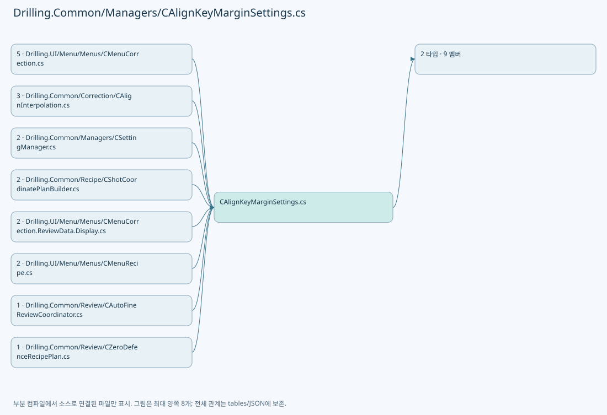
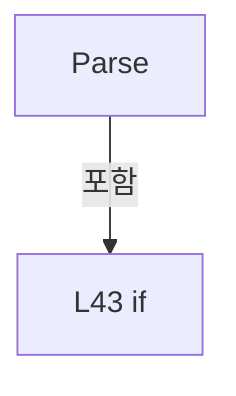

# Drilling.Common/Managers/CAlignKeyMarginSettings.cs

| 항목 | 내용 |
| --- | --- |
| 원본 저장소 | https://github.com/kjuws10-rgb/A3Drilling.git |
| 원본 Commit | 334b3599651b2e8e0181fd4459bafaf3cddafff3 |
| 원본 SHA256 | 1d5a5568cadfa7d9c22efe92232696811c540a7535f971bc50cdeb845f216f37 |
| 파일 분류 | code |
| 원본 크기/행 | 2,098 bytes / 53 physical lines |
| 인코딩 | utf-8-sig |
| 검토 범위 | 구문/부분 의미 분석에서 추출한 사실. 동작·물리 단위·실장비 합격을 보증하지 않습니다. |
| 원본 링크 | [고정 Commit 원본](https://github.com/kjuws10-rgb/A3Drilling/blob/334b3599651b2e8e0181fd4459bafaf3cddafff3/Drilling.Common/Managers/CAlignKeyMarginSettings.cs) |

## 파일의 역할과 읽는 순서

프로그램의 시작·구성·공유 타입 또는 빌드 연결에 사용됩니다. 아래 실제 선언·참조와 원본 근거를 확인합니다.

## 네임스페이스·타입·상속

| 타입 | 구분 | 원본 범위 | 선언/상속 |
| --- | --- | --- | --- |
| ST_ALIGN_KEY_MARGINS | RecordStructDeclaration | 6–6 | ST_ALIGN_KEY_MARGINS |
| CAlignKeyMarginSettings | ClassDeclaration | 8–52 | CAlignKeyMarginSettings |

## 멤버 빠른 목록

| 이름 | 종류 | 범위 | 서명 |
| --- | --- | --- | --- |
| MarginXKey | FieldDeclaration | L10–10 | string Drilling.Common.Managers.CAlignKeyMarginSettings.MarginXKey |
| MarginYKey | FieldDeclaration | L11–11 | string Drilling.Common.Managers.CAlignKeyMarginSettings.MarginYKey |
| DefaultMarginX | FieldDeclaration | L12–12 | double Drilling.Common.Managers.CAlignKeyMarginSettings.DefaultMarginX |
| DefaultMarginY | FieldDeclaration | L13–13 | double Drilling.Common.Managers.CAlignKeyMarginSettings.DefaultMarginY |
| Read | MethodDeclaration | L15–19 | Drilling.Common.Managers.ST_ALIGN_KEY_MARGINS Drilling.Common.Managers.CAlignKeyMarginSettings.Read(System.Collections.Generic.IReadOnlyList<Drilling.Common.Managers.ST_SYSTEM_PARAMETER>) |
| Read | MethodDeclaration | L21–25 | Drilling.Common.Managers.ST_ALIGN_KEY_MARGINS Drilling.Common.Managers.CAlignKeyMarginSettings.Read(System.Collections.Generic.IReadOnlyDictionary<string, string>) |
| Read | MethodDeclaration | L27–33 | double Drilling.Common.Managers.CAlignKeyMarginSettings.Read(System.Collections.Generic.IReadOnlyList<Drilling.Common.Managers.ST_SYSTEM_PARAMETER>, string) |
| Read | MethodDeclaration | L35–39 | double Drilling.Common.Managers.CAlignKeyMarginSettings.Read(System.Collections.Generic.IReadOnlyDictionary<string, string>, string) |
| Parse | MethodDeclaration | L41–51 | double Drilling.Common.Managers.CAlignKeyMarginSettings.Parse(string?, string) |

## 멤버별 상세 계약·호출·처리 해설

### FieldDeclaration `MarginXKey` · L10–10

[Drilling.Common/Managers/CAlignKeyMarginSettings.cs:10–10](https://github.com/kjuws10-rgb/A3Drilling/blob/334b3599651b2e8e0181fd4459bafaf3cddafff3/Drilling.Common/Managers/CAlignKeyMarginSettings.cs#L10-L10)

| 항목 | 실제 추출 값 |
| --- | --- |
| 서명 | string Drilling.Common.Managers.CAlignKeyMarginSettings.MarginXKey |
| 접근/수식자 | Public / public, const |
| 반환/값 타입 | string |
| 소속 타입 | NamedType:Drilling.Common.Managers.CAlignKeyMarginSettings |

현재 부분 분석에서 직접 연결된 호출자는 없습니다. XAML/이벤트/인터페이스·델리게이트·외부 진입을 추가 확인해야 하며, 미사용으로 판정한 것이 아닙니다.

본문의 실제 연산·분기·예외·반환 순서(원문 위치 순):

| 원본 행 | 종류 | 주석 해설 |
| --- | --- | --- |
| 10 | variable-initializer | 변수의 초기값을 지정합니다: MarginXKey = "AK_MARGIN_X" |

변경 전 점검: 입력/반환 타입, 위 호출자, 예외/취소 경로, 공유 상태와 저장·전송 소비자를 함께 확인합니다. 값의 단위나 물리 방향을 이름만으로 확정하지 않습니다.

### FieldDeclaration `MarginYKey` · L11–11

[Drilling.Common/Managers/CAlignKeyMarginSettings.cs:11–11](https://github.com/kjuws10-rgb/A3Drilling/blob/334b3599651b2e8e0181fd4459bafaf3cddafff3/Drilling.Common/Managers/CAlignKeyMarginSettings.cs#L11-L11)

| 항목 | 실제 추출 값 |
| --- | --- |
| 서명 | string Drilling.Common.Managers.CAlignKeyMarginSettings.MarginYKey |
| 접근/수식자 | Public / public, const |
| 반환/값 타입 | string |
| 소속 타입 | NamedType:Drilling.Common.Managers.CAlignKeyMarginSettings |

현재 부분 분석에서 직접 연결된 호출자는 없습니다. XAML/이벤트/인터페이스·델리게이트·외부 진입을 추가 확인해야 하며, 미사용으로 판정한 것이 아닙니다.

본문의 실제 연산·분기·예외·반환 순서(원문 위치 순):

| 원본 행 | 종류 | 주석 해설 |
| --- | --- | --- |
| 11 | variable-initializer | 변수의 초기값을 지정합니다: MarginYKey = "AK_MARGIN_Y" |

변경 전 점검: 입력/반환 타입, 위 호출자, 예외/취소 경로, 공유 상태와 저장·전송 소비자를 함께 확인합니다. 값의 단위나 물리 방향을 이름만으로 확정하지 않습니다.

### FieldDeclaration `DefaultMarginX` · L12–12

[Drilling.Common/Managers/CAlignKeyMarginSettings.cs:12–12](https://github.com/kjuws10-rgb/A3Drilling/blob/334b3599651b2e8e0181fd4459bafaf3cddafff3/Drilling.Common/Managers/CAlignKeyMarginSettings.cs#L12-L12)

| 항목 | 실제 추출 값 |
| --- | --- |
| 서명 | double Drilling.Common.Managers.CAlignKeyMarginSettings.DefaultMarginX |
| 접근/수식자 | Public / public, const |
| 반환/값 타입 | double |
| 소속 타입 | NamedType:Drilling.Common.Managers.CAlignKeyMarginSettings |

현재 부분 분석에서 직접 연결된 호출자는 없습니다. XAML/이벤트/인터페이스·델리게이트·외부 진입을 추가 확인해야 하며, 미사용으로 판정한 것이 아닙니다.

본문의 실제 연산·분기·예외·반환 순서(원문 위치 순):

| 원본 행 | 종류 | 주석 해설 |
| --- | --- | --- |
| 12 | variable-initializer | 변수의 초기값을 지정합니다: DefaultMarginX = 15.5 |

변경 전 점검: 입력/반환 타입, 위 호출자, 예외/취소 경로, 공유 상태와 저장·전송 소비자를 함께 확인합니다. 값의 단위나 물리 방향을 이름만으로 확정하지 않습니다.

### FieldDeclaration `DefaultMarginY` · L13–13

[Drilling.Common/Managers/CAlignKeyMarginSettings.cs:13–13](https://github.com/kjuws10-rgb/A3Drilling/blob/334b3599651b2e8e0181fd4459bafaf3cddafff3/Drilling.Common/Managers/CAlignKeyMarginSettings.cs#L13-L13)

| 항목 | 실제 추출 값 |
| --- | --- |
| 서명 | double Drilling.Common.Managers.CAlignKeyMarginSettings.DefaultMarginY |
| 접근/수식자 | Public / public, const |
| 반환/값 타입 | double |
| 소속 타입 | NamedType:Drilling.Common.Managers.CAlignKeyMarginSettings |

현재 부분 분석에서 직접 연결된 호출자는 없습니다. XAML/이벤트/인터페이스·델리게이트·외부 진입을 추가 확인해야 하며, 미사용으로 판정한 것이 아닙니다.

본문의 실제 연산·분기·예외·반환 순서(원문 위치 순):

| 원본 행 | 종류 | 주석 해설 |
| --- | --- | --- |
| 13 | variable-initializer | 변수의 초기값을 지정합니다: DefaultMarginY = 15.5 |

변경 전 점검: 입력/반환 타입, 위 호출자, 예외/취소 경로, 공유 상태와 저장·전송 소비자를 함께 확인합니다. 값의 단위나 물리 방향을 이름만으로 확정하지 않습니다.

### MethodDeclaration `Read` · L15–19

[Drilling.Common/Managers/CAlignKeyMarginSettings.cs:15–19](https://github.com/kjuws10-rgb/A3Drilling/blob/334b3599651b2e8e0181fd4459bafaf3cddafff3/Drilling.Common/Managers/CAlignKeyMarginSettings.cs#L15-L19)

| 항목 | 실제 추출 값 |
| --- | --- |
| 서명 | Drilling.Common.Managers.ST_ALIGN_KEY_MARGINS Drilling.Common.Managers.CAlignKeyMarginSettings.Read(System.Collections.Generic.IReadOnlyList<Drilling.Common.Managers.ST_SYSTEM_PARAMETER>) |
| 접근/수식자 | Public / public, static |
| 반환/값 타입 | Drilling.Common.Managers.ST_ALIGN_KEY_MARGINS |
| 소속 타입 | NamedType:Drilling.Common.Managers.CAlignKeyMarginSettings |

입력 계약:

| 이름 | 타입 | 전달 | 선택/기본값 |
| --- | --- | --- | --- |
| settings | System.Collections.Generic.IReadOnlyList<Drilling.Common.Managers.ST_SYSTEM_PARAMETER> | None | False /  |

정적 호출자로 확인된 위치:

| 호출 파일/행 | 호출 표현식 | 런타임 분기 가능 |
| --- | --- | --- |
| [Drilling.Common/Correction/CAlignInterpolation.cs:284–284](https://github.com/kjuws10-rgb/A3Drilling/blob/334b3599651b2e8e0181fd4459bafaf3cddafff3/Drilling.Common/Correction/CAlignInterpolation.cs#L284-L284) | CAlignKeyMarginSettings.Read | False |
| [Drilling.Common/Managers/CSettingManager.cs:117–117](https://github.com/kjuws10-rgb/A3Drilling/blob/334b3599651b2e8e0181fd4459bafaf3cddafff3/Drilling.Common/Managers/CSettingManager.cs#L117-L117) | CAlignKeyMarginSettings.Read | False |
| [Drilling.Common/Managers/CSettingManager.cs:142–142](https://github.com/kjuws10-rgb/A3Drilling/blob/334b3599651b2e8e0181fd4459bafaf3cddafff3/Drilling.Common/Managers/CSettingManager.cs#L142-L142) | CAlignKeyMarginSettings.Read | False |
| [Drilling.Common/Review/CZeroDefenceRecipePlan.cs:30–30](https://github.com/kjuws10-rgb/A3Drilling/blob/334b3599651b2e8e0181fd4459bafaf3cddafff3/Drilling.Common/Review/CZeroDefenceRecipePlan.cs#L30-L30) | CAlignKeyMarginSettings.Read | False |
| [Drilling.UI/Menu/Menus/CMenuCorrection.cs:6222–6222](https://github.com/kjuws10-rgb/A3Drilling/blob/334b3599651b2e8e0181fd4459bafaf3cddafff3/Drilling.UI/Menu/Menus/CMenuCorrection.cs#L6222-L6222) | CAlignKeyMarginSettings.Read | False |
| [Drilling.UI/Menu/Menus/CMenuRecipe.cs:574–574](https://github.com/kjuws10-rgb/A3Drilling/blob/334b3599651b2e8e0181fd4459bafaf3cddafff3/Drilling.UI/Menu/Menus/CMenuRecipe.cs#L574-L574) | CAlignKeyMarginSettings.Read | False |
| [Drilling.UI/Menu/Menus/CReviewGlassPreviewBuilder.cs:93–93](https://github.com/kjuws10-rgb/A3Drilling/blob/334b3599651b2e8e0181fd4459bafaf3cddafff3/Drilling.UI/Menu/Menus/CReviewGlassPreviewBuilder.cs#L93-L93) | CAlignKeyMarginSettings.Read | False |

호출하는 대상과 해석 범위:

| 원본 행 | 표현식 | 분석 상태 | 대상/소스 위치 |
| --- | --- | --- | --- |
| 17 | ArgumentNullException.ThrowIfNull | resolved | void System.ArgumentNullException.ThrowIfNull(object?, string?) |
| 18 | new | resolved | Drilling.Common.Managers.ST_ALIGN_KEY_MARGINS.ST_ALIGN_KEY_MARGINS(double, double) · Drilling.Common/Managers/CAlignKeyMarginSettings.cs:6 |
| 18 | Read | resolved | double Drilling.Common.Managers.CAlignKeyMarginSettings.Read(System.Collections.Generic.IReadOnlyList<Drilling.Common.Managers.ST_SYSTEM_PARAMETER>, string) · Drilling.Common/Managers/CAlignKeyMarginSettings.cs:27 |
| 18 | Read | resolved | double Drilling.Common.Managers.CAlignKeyMarginSettings.Read(System.Collections.Generic.IReadOnlyList<Drilling.Common.Managers.ST_SYSTEM_PARAMETER>, string) · Drilling.Common/Managers/CAlignKeyMarginSettings.cs:27 |

본문의 실제 연산·분기·예외·반환 순서(원문 위치 순):

| 원본 행 | 종류 | 주석 해설 |
| --- | --- | --- |
| 17 | call | 함수·델리게이트 또는 객체 생성자를 호출합니다: ArgumentNullException.ThrowIfNull(settings) |
| 18 | call | 함수·델리게이트 또는 객체 생성자를 호출합니다: new(Read(settings, MarginXKey), Read(settings, MarginYKey)) |
| 18 | call | 함수·델리게이트 또는 객체 생성자를 호출합니다: Read(settings, MarginXKey) |
| 18 | call | 함수·델리게이트 또는 객체 생성자를 호출합니다: Read(settings, MarginYKey) |
| 18 | return | 호출자에게 값 또는 제어를 반환합니다: return new(Read(settings, MarginXKey), Read(settings, MarginYKey)); |

변경 전 점검: 입력/반환 타입, 위 호출자, 예외/취소 경로, 공유 상태와 저장·전송 소비자를 함께 확인합니다. 값의 단위나 물리 방향을 이름만으로 확정하지 않습니다.

### MethodDeclaration `Read` · L21–25

[Drilling.Common/Managers/CAlignKeyMarginSettings.cs:21–25](https://github.com/kjuws10-rgb/A3Drilling/blob/334b3599651b2e8e0181fd4459bafaf3cddafff3/Drilling.Common/Managers/CAlignKeyMarginSettings.cs#L21-L25)

| 항목 | 실제 추출 값 |
| --- | --- |
| 서명 | Drilling.Common.Managers.ST_ALIGN_KEY_MARGINS Drilling.Common.Managers.CAlignKeyMarginSettings.Read(System.Collections.Generic.IReadOnlyDictionary<string, string>) |
| 접근/수식자 | Public / public, static |
| 반환/값 타입 | Drilling.Common.Managers.ST_ALIGN_KEY_MARGINS |
| 소속 타입 | NamedType:Drilling.Common.Managers.CAlignKeyMarginSettings |

입력 계약:

| 이름 | 타입 | 전달 | 선택/기본값 |
| --- | --- | --- | --- |
| settings | System.Collections.Generic.IReadOnlyDictionary<string, string> | None | False /  |

정적 호출자로 확인된 위치:

| 호출 파일/행 | 호출 표현식 | 런타임 분기 가능 |
| --- | --- | --- |
| [Drilling.Common/Recipe/CShotCoordinatePlanBuilder.cs:15–15](https://github.com/kjuws10-rgb/A3Drilling/blob/334b3599651b2e8e0181fd4459bafaf3cddafff3/Drilling.Common/Recipe/CShotCoordinatePlanBuilder.cs#L15-L15) | CAlignKeyMarginSettings.Read | False |
| [Drilling.Common/Recipe/CShotCoordinatePlanBuilder.cs:225–225](https://github.com/kjuws10-rgb/A3Drilling/blob/334b3599651b2e8e0181fd4459bafaf3cddafff3/Drilling.Common/Recipe/CShotCoordinatePlanBuilder.cs#L225-L225) | CAlignKeyMarginSettings.Read | False |
| [Drilling.Common/Review/CAutoFineReviewCoordinator.cs:226–226](https://github.com/kjuws10-rgb/A3Drilling/blob/334b3599651b2e8e0181fd4459bafaf3cddafff3/Drilling.Common/Review/CAutoFineReviewCoordinator.cs#L226-L226) | CAlignKeyMarginSettings.Read | False |
| [Drilling.UI/Menu/Menus/CMenuCorrection.ReviewData.Display.cs:398–398](https://github.com/kjuws10-rgb/A3Drilling/blob/334b3599651b2e8e0181fd4459bafaf3cddafff3/Drilling.UI/Menu/Menus/CMenuCorrection.ReviewData.Display.cs#L398-L398) | CAlignKeyMarginSettings.Read | False |
| [Drilling.UI/Menu/Menus/CMenuCorrection.ReviewData.Display.cs:1047–1047](https://github.com/kjuws10-rgb/A3Drilling/blob/334b3599651b2e8e0181fd4459bafaf3cddafff3/Drilling.UI/Menu/Menus/CMenuCorrection.ReviewData.Display.cs#L1047-L1047) | CAlignKeyMarginSettings.Read | False |
| [Drilling.UI/Menu/Menus/CMenuCorrection.cs:1131–1131](https://github.com/kjuws10-rgb/A3Drilling/blob/334b3599651b2e8e0181fd4459bafaf3cddafff3/Drilling.UI/Menu/Menus/CMenuCorrection.cs#L1131-L1131) | CAlignKeyMarginSettings.Read | False |
| [Drilling.UI/Menu/Menus/CMenuCorrection.cs:7410–7410](https://github.com/kjuws10-rgb/A3Drilling/blob/334b3599651b2e8e0181fd4459bafaf3cddafff3/Drilling.UI/Menu/Menus/CMenuCorrection.cs#L7410-L7410) | CAlignKeyMarginSettings.Read | False |
| [Drilling.UI/Menu/Menus/CMenuReview.cs:6047–6047](https://github.com/kjuws10-rgb/A3Drilling/blob/334b3599651b2e8e0181fd4459bafaf3cddafff3/Drilling.UI/Menu/Menus/CMenuReview.cs#L6047-L6047) | CAlignKeyMarginSettings.Read | False |

호출하는 대상과 해석 범위:

| 원본 행 | 표현식 | 분석 상태 | 대상/소스 위치 |
| --- | --- | --- | --- |
| 23 | ArgumentNullException.ThrowIfNull | resolved | void System.ArgumentNullException.ThrowIfNull(object?, string?) |
| 24 | new | resolved | Drilling.Common.Managers.ST_ALIGN_KEY_MARGINS.ST_ALIGN_KEY_MARGINS(double, double) · Drilling.Common/Managers/CAlignKeyMarginSettings.cs:6 |
| 24 | Read | resolved | double Drilling.Common.Managers.CAlignKeyMarginSettings.Read(System.Collections.Generic.IReadOnlyDictionary<string, string>, string) · Drilling.Common/Managers/CAlignKeyMarginSettings.cs:35 |
| 24 | Read | resolved | double Drilling.Common.Managers.CAlignKeyMarginSettings.Read(System.Collections.Generic.IReadOnlyDictionary<string, string>, string) · Drilling.Common/Managers/CAlignKeyMarginSettings.cs:35 |

본문의 실제 연산·분기·예외·반환 순서(원문 위치 순):

| 원본 행 | 종류 | 주석 해설 |
| --- | --- | --- |
| 23 | call | 함수·델리게이트 또는 객체 생성자를 호출합니다: ArgumentNullException.ThrowIfNull(settings) |
| 24 | call | 함수·델리게이트 또는 객체 생성자를 호출합니다: new(Read(settings, MarginXKey), Read(settings, MarginYKey)) |
| 24 | call | 함수·델리게이트 또는 객체 생성자를 호출합니다: Read(settings, MarginXKey) |
| 24 | call | 함수·델리게이트 또는 객체 생성자를 호출합니다: Read(settings, MarginYKey) |
| 24 | return | 호출자에게 값 또는 제어를 반환합니다: return new(Read(settings, MarginXKey), Read(settings, MarginYKey)); |

변경 전 점검: 입력/반환 타입, 위 호출자, 예외/취소 경로, 공유 상태와 저장·전송 소비자를 함께 확인합니다. 값의 단위나 물리 방향을 이름만으로 확정하지 않습니다.

### MethodDeclaration `Read` · L27–33

[Drilling.Common/Managers/CAlignKeyMarginSettings.cs:27–33](https://github.com/kjuws10-rgb/A3Drilling/blob/334b3599651b2e8e0181fd4459bafaf3cddafff3/Drilling.Common/Managers/CAlignKeyMarginSettings.cs#L27-L33)

| 항목 | 실제 추출 값 |
| --- | --- |
| 서명 | double Drilling.Common.Managers.CAlignKeyMarginSettings.Read(System.Collections.Generic.IReadOnlyList<Drilling.Common.Managers.ST_SYSTEM_PARAMETER>, string) |
| 접근/수식자 | Private / private, static |
| 반환/값 타입 | double |
| 소속 타입 | NamedType:Drilling.Common.Managers.CAlignKeyMarginSettings |

입력 계약:

| 이름 | 타입 | 전달 | 선택/기본값 |
| --- | --- | --- | --- |
| settings | System.Collections.Generic.IReadOnlyList<Drilling.Common.Managers.ST_SYSTEM_PARAMETER> | None | False /  |
| key | string | None | False /  |

정적 호출자로 확인된 위치:

| 호출 파일/행 | 호출 표현식 | 런타임 분기 가능 |
| --- | --- | --- |
| [Drilling.Common/Managers/CAlignKeyMarginSettings.cs:18–18](https://github.com/kjuws10-rgb/A3Drilling/blob/334b3599651b2e8e0181fd4459bafaf3cddafff3/Drilling.Common/Managers/CAlignKeyMarginSettings.cs#L18-L18) | Read | False |
| [Drilling.Common/Managers/CAlignKeyMarginSettings.cs:18–18](https://github.com/kjuws10-rgb/A3Drilling/blob/334b3599651b2e8e0181fd4459bafaf3cddafff3/Drilling.Common/Managers/CAlignKeyMarginSettings.cs#L18-L18) | Read | False |

호출하는 대상과 해석 범위:

| 원본 행 | 표현식 | 분석 상태 | 대상/소스 위치 |
| --- | --- | --- | --- |
| 29 | settings.FirstOrDefault | resolved | Drilling.Common.Managers.ST_SYSTEM_PARAMETER? System.Collections.Generic.IEnumerable<Drilling.Common.Managers.ST_SYSTEM_PARAMETER>.FirstOrDefault<Drilling.Common.Managers.ST_SYSTEM_PARAMETER>(System.Func<Drilling.Common.Managers.ST_SYSTEM_PARAMETER, bool>) |
| 30 | item.Key.Equals | resolved | bool string.Equals(string?, System.StringComparison) |
| 31 | item.Name.Equals | resolved | bool string.Equals(string?, System.StringComparison) |
| 32 | Parse | resolved | double Drilling.Common.Managers.CAlignKeyMarginSettings.Parse(string?, string) · Drilling.Common/Managers/CAlignKeyMarginSettings.cs:41 |

본문의 실제 연산·분기·예외·반환 순서(원문 위치 순):

| 원본 행 | 종류 | 주석 해설 |
| --- | --- | --- |
| 29 | call | 함수·델리게이트 또는 객체 생성자를 호출합니다: settings.FirstOrDefault(item => item.Key.Equals(key, StringComparison.OrdinalIgnoreCase) &#124;&#124; item.Name.Equals(key, StringComparison.OrdinalIgnoreCase)) |
| 29 | local-declaration | 지역 변수를 선언합니다: var parameter = settings.FirstOrDefault(item => item.Key.Equals(key, StringComparison.OrdinalIgnoreCase) &#124;&#124; item.Name.Equals(key, StringComparison.OrdinalIgnoreCase)); |
| 29 | variable-initializer | 변수의 초기값을 지정합니다: parameter = settings.FirstOrDefault(item => item.Key.Equals(key, StringComparison.OrdinalIgnoreCase) &#124;&#124; item.Name.Equals(key, StringComparison.OrdinalIgnoreCase)) |
| 30 | call | 함수·델리게이트 또는 객체 생성자를 호출합니다: item.Key.Equals(key, StringComparison.OrdinalIgnoreCase) |
| 31 | call | 함수·델리게이트 또는 객체 생성자를 호출합니다: item.Name.Equals(key, StringComparison.OrdinalIgnoreCase) |
| 32 | call | 함수·델리게이트 또는 객체 생성자를 호출합니다: Parse(parameter?.Value, key) |
| 32 | return | 호출자에게 값 또는 제어를 반환합니다: return Parse(parameter?.Value, key); |

변경 전 점검: 입력/반환 타입, 위 호출자, 예외/취소 경로, 공유 상태와 저장·전송 소비자를 함께 확인합니다. 값의 단위나 물리 방향을 이름만으로 확정하지 않습니다.

### MethodDeclaration `Read` · L35–39

[Drilling.Common/Managers/CAlignKeyMarginSettings.cs:35–39](https://github.com/kjuws10-rgb/A3Drilling/blob/334b3599651b2e8e0181fd4459bafaf3cddafff3/Drilling.Common/Managers/CAlignKeyMarginSettings.cs#L35-L39)

| 항목 | 실제 추출 값 |
| --- | --- |
| 서명 | double Drilling.Common.Managers.CAlignKeyMarginSettings.Read(System.Collections.Generic.IReadOnlyDictionary<string, string>, string) |
| 접근/수식자 | Private / private, static |
| 반환/값 타입 | double |
| 소속 타입 | NamedType:Drilling.Common.Managers.CAlignKeyMarginSettings |

입력 계약:

| 이름 | 타입 | 전달 | 선택/기본값 |
| --- | --- | --- | --- |
| settings | System.Collections.Generic.IReadOnlyDictionary<string, string> | None | False /  |
| key | string | None | False /  |

정적 호출자로 확인된 위치:

| 호출 파일/행 | 호출 표현식 | 런타임 분기 가능 |
| --- | --- | --- |
| [Drilling.Common/Managers/CAlignKeyMarginSettings.cs:24–24](https://github.com/kjuws10-rgb/A3Drilling/blob/334b3599651b2e8e0181fd4459bafaf3cddafff3/Drilling.Common/Managers/CAlignKeyMarginSettings.cs#L24-L24) | Read | False |
| [Drilling.Common/Managers/CAlignKeyMarginSettings.cs:24–24](https://github.com/kjuws10-rgb/A3Drilling/blob/334b3599651b2e8e0181fd4459bafaf3cddafff3/Drilling.Common/Managers/CAlignKeyMarginSettings.cs#L24-L24) | Read | False |

호출하는 대상과 해석 범위:

| 원본 행 | 표현식 | 분석 상태 | 대상/소스 위치 |
| --- | --- | --- | --- |
| 37 | settings.FirstOrDefault | resolved | System.Collections.Generic.KeyValuePair<string, string> System.Collections.Generic.IEnumerable<System.Collections.Generic.KeyValuePair<string, string>>.FirstOrDefault<System.Collections.Generic.KeyValuePair<string, string>>(System.Func<System.Collections.Generic.KeyValuePair<string, string>, bool>) |
| 37 | item.Key.Equals | resolved | bool string.Equals(string?, System.StringComparison) |
| 38 | Parse | resolved | double Drilling.Common.Managers.CAlignKeyMarginSettings.Parse(string?, string) · Drilling.Common/Managers/CAlignKeyMarginSettings.cs:41 |

본문의 실제 연산·분기·예외·반환 순서(원문 위치 순):

| 원본 행 | 종류 | 주석 해설 |
| --- | --- | --- |
| 37 | call | 함수·델리게이트 또는 객체 생성자를 호출합니다: settings.FirstOrDefault(item => item.Key.Equals(key, StringComparison.OrdinalIgnoreCase)) |
| 37 | call | 함수·델리게이트 또는 객체 생성자를 호출합니다: item.Key.Equals(key, StringComparison.OrdinalIgnoreCase) |
| 37 | local-declaration | 지역 변수를 선언합니다: var pair = settings.FirstOrDefault(item => item.Key.Equals(key, StringComparison.OrdinalIgnoreCase)); |
| 37 | variable-initializer | 변수의 초기값을 지정합니다: pair = settings.FirstOrDefault(item => item.Key.Equals(key, StringComparison.OrdinalIgnoreCase)) |
| 38 | call | 함수·델리게이트 또는 객체 생성자를 호출합니다: Parse(pair.Value, key) |
| 38 | return | 호출자에게 값 또는 제어를 반환합니다: return Parse(pair.Value, key); |

변경 전 점검: 입력/반환 타입, 위 호출자, 예외/취소 경로, 공유 상태와 저장·전송 소비자를 함께 확인합니다. 값의 단위나 물리 방향을 이름만으로 확정하지 않습니다.

### MethodDeclaration `Parse` · L41–51

[Drilling.Common/Managers/CAlignKeyMarginSettings.cs:41–51](https://github.com/kjuws10-rgb/A3Drilling/blob/334b3599651b2e8e0181fd4459bafaf3cddafff3/Drilling.Common/Managers/CAlignKeyMarginSettings.cs#L41-L51)

| 항목 | 실제 추출 값 |
| --- | --- |
| 서명 | double Drilling.Common.Managers.CAlignKeyMarginSettings.Parse(string?, string) |
| 접근/수식자 | Private / private, static |
| 반환/값 타입 | double |
| 소속 타입 | NamedType:Drilling.Common.Managers.CAlignKeyMarginSettings |

입력 계약:

| 이름 | 타입 | 전달 | 선택/기본값 |
| --- | --- | --- | --- |
| text | string? | None | False /  |
| key | string | None | False /  |

정적 호출자로 확인된 위치:

| 호출 파일/행 | 호출 표현식 | 런타임 분기 가능 |
| --- | --- | --- |
| [Drilling.Common/Managers/CAlignKeyMarginSettings.cs:32–32](https://github.com/kjuws10-rgb/A3Drilling/blob/334b3599651b2e8e0181fd4459bafaf3cddafff3/Drilling.Common/Managers/CAlignKeyMarginSettings.cs#L32-L32) | Parse | False |
| [Drilling.Common/Managers/CAlignKeyMarginSettings.cs:38–38](https://github.com/kjuws10-rgb/A3Drilling/blob/334b3599651b2e8e0181fd4459bafaf3cddafff3/Drilling.Common/Managers/CAlignKeyMarginSettings.cs#L38-L38) | Parse | False |

호출하는 대상과 해석 범위:

| 원본 행 | 표현식 | 분석 상태 | 대상/소스 위치 |
| --- | --- | --- | --- |
| 43 | double.TryParse | resolved | bool double.TryParse(string?, System.Globalization.NumberStyles, System.IFormatProvider?, out double) |
| 44 | double.IsFinite | resolved | bool double.IsFinite(double) |
| 47 | new InvalidDataException | resolved | System.IO.InvalidDataException.InvalidDataException(string?) |

본문의 실제 연산·분기·예외·반환 순서(원문 위치 순):

| 원본 행 | 종류 | 주석 해설 |
| --- | --- | --- |
| 43 | call | 함수·델리게이트 또는 객체 생성자를 호출합니다: double.TryParse(text, NumberStyles.Float, CultureInfo.InvariantCulture, out var value) |
| 43 | if | 조건에 따라 분기합니다: if (!double.TryParse(text, NumberStyles.Float, CultureInfo.InvariantCulture, out var value) &#124;&#124; !double.IsFinite(value) &#124;&#124; value < 0) |
| 44 | call | 함수·델리게이트 또는 객체 생성자를 호출합니다: double.IsFinite(value) |
| 47 | call | 함수·델리게이트 또는 객체 생성자를 호출합니다: new InvalidDataException($"Setting > Common > ALIGN의 {key}는 0 이상의 유한한 mm 값이어야 합니다.") |
| 47 | throw | 예외를 발생/전달합니다: throw new InvalidDataException($"Setting > Common > ALIGN의 {key}는 0 이상의 유한한 mm 값이어야 합니다."); |
| 50 | return | 호출자에게 값 또는 제어를 반환합니다: return value; |

제어 구문의 포함 구조(실제 실행 순서/CFG가 아닌 구문 탐색 그림):

변경 전 점검: 입력/반환 타입, 위 호출자, 예외/취소 경로, 공유 상태와 저장·전송 소비자를 함께 확인합니다. 값의 단위나 물리 방향을 이름만으로 확정하지 않습니다.

## 구문·바인딩 한계

전체 WPF/벤더 SDK/프로젝트별 빌드 조건을 로드한 정식 빌드가 아닙니다. `resolved`는 이 부분 컴파일에서의 심볼 연결이며 virtual/interface/delegate/이벤트/Reflection/XAML의 실제 런타임 구현을 확정하지 않습니다. `candidate`와 `unresolved`는 후속 확인 대상으로 남깁니다.

## 원문 전체 주석 해설본

[원본 모든 행과 행별 해설 보기](../../../annotated/Drilling.Common/Managers/CAlignKeyMarginSettings.cs.annotated.txt)

원본을 빠뜨리거나 임의로 줄이지 않았습니다. `L000001 |` 표시는 원본 행 번호, `// 해설`은 별도 설명입니다. 실행용 소스가 아닌 문서입니다.

## 수정·재검증 체크

- 원본 Commit과 현재 작업 파일 SHA가 같은지 먼저 확인합니다. 다르면 이 문서를 과거 버전 자료로 취급합니다.
- 선언·직접 호출·이벤트/인터페이스 경계·설정 소비를 함께 확인합니다. 정적 연결의 빈 곳을 정상 경로로 추정하지 않습니다.
- 저장 형식/단위/식별자·재시도·취소·예외·롤백에 영향을 주는 변경은 상세 해설장과 호출자를 다시 검토합니다.
- 도구의 구문 추출과 별도 정적 추적 해설, 실제 빌드·시뮬레이션·실장비 검증 결과를 분리합니다.
