# Drilling.Common/Managers/CManager.cs

| 항목 | 내용 |
| --- | --- |
| 원본 저장소 | https://github.com/kjuws10-rgb/A3Drilling.git |
| 원본 Commit | 96e22cd027c84bf302b23f2949b98985d7f301bb |
| 원본 SHA256 | 6db41ef7d7938136bce10c0d3acd4d9293a57cc4336ff26dc3a79041db2914f8 |
| 파일 분류 | code |
| 원본 크기/행 | 29,421 bytes / 789 physical lines |
| 인코딩 | utf-8-sig |
| 검토 범위 | 구문/부분 의미 분석에서 추출한 사실. 동작·물리 단위·실장비 합격을 보증하지 않습니다. |
| 원본 링크 | [고정 Commit 원본](https://github.com/kjuws10-rgb/A3Drilling/blob/96e22cd027c84bf302b23f2949b98985d7f301bb/Drilling.Common/Managers/CManager.cs) |

## 파일의 역할과 읽는 순서

프로그램의 시작·구성·공유 타입 또는 빌드 연결에 사용됩니다. 아래 실제 선언·참조와 원본 근거를 확인합니다.

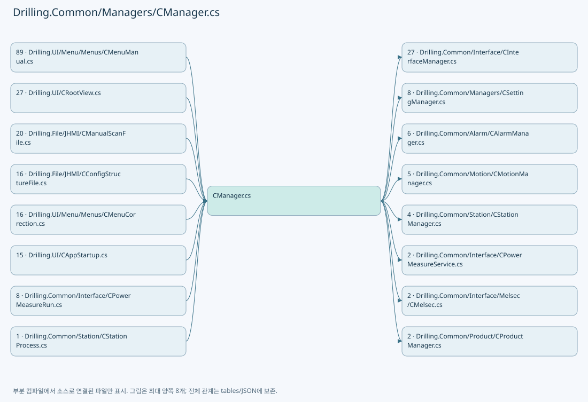

## 네임스페이스·타입·상속

| 타입 | 구분 | 원본 범위 | 선언/상속 |
| --- | --- | --- | --- |
| CManager | ClassDeclaration | 13–651 | CManager |
| EN_SYSTEM_MODE | EnumDeclaration | 653–658 | EN_SYSTEM_MODE |
| EN_PM_LOCK_STATE | EnumDeclaration | 660–664 | EN_PM_LOCK_STATE |
| EN_MANAGER_STARTUP_RESULT | EnumDeclaration | 666–671 | EN_MANAGER_STARTUP_RESULT |
| ST_MANUAL_SCAN_PARAM | RecordDeclaration | 673–693 | ST_MANUAL_SCAN_PARAM |
| ST_MANUAL_SCAN_FORM | RecordDeclaration | 694–706 | ST_MANUAL_SCAN_FORM |
| ST_POWER_METER_STATUS | RecordDeclaration | 707–732 | ST_POWER_METER_STATUS |
| ST_DEVICE_STATUS | RecordDeclaration | 734–744 | ST_DEVICE_STATUS |
| ST_SYSTEM_STATUS | RecordDeclaration | 746–760 | ST_SYSTEM_STATUS |
| ST_PM_LOCK_STATUS | RecordDeclaration | 762–762 | ST_PM_LOCK_STATUS |
| ST_MANAGER_STARTUP_STEP | RecordDeclaration | 763–763 | ST_MANAGER_STARTUP_STEP |
| ST_CONFIG_LOAD_STATUS | RecordDeclaration | 764–772 | ST_CONFIG_LOAD_STATUS |
| ST_CONFIG_FILE_STATUS | RecordDeclaration | 773–773 | ST_CONFIG_FILE_STATUS |
| CConfigStructureFileBase | ClassDeclaration | 774–777 | CConfigStructureFileBase |
| CManualScanFileBase | ClassDeclaration | 779–789 | CManualScanFileBase |

## 멤버 빠른 목록

| 이름 | 종류 | 범위 | 서명 |
| --- | --- | --- | --- |
| PowerMeasure | PropertyDeclaration | L15–15 | Drilling.Common.Interface.CPowerMeasureService Drilling.Common.Managers.CManager.PowerMeasure |
| get_PowerMeasure | GetAccessorDeclaration | L15–15 | Drilling.Common.Interface.CPowerMeasureService Drilling.Common.Managers.CManager.PowerMeasure.get |
| _configRoot | FieldDeclaration | L17–17 | string Drilling.Common.Managers.CManager._configRoot |
| _recipeFile | FieldDeclaration | L18–18 | Drilling.Common.Managers.CRecipeFileBase Drilling.Common.Managers.CManager._recipeFile |
| _settingFile | FieldDeclaration | L19–19 | Drilling.Common.Managers.CSettingFileBase Drilling.Common.Managers.CManager._settingFile |
| _manualScanFile | FieldDeclaration | L20–20 | Drilling.Common.Managers.CManualScanFileBase Drilling.Common.Managers.CManager._manualScanFile |
| _interfaceFile | FieldDeclaration | L21–21 | Drilling.Common.Managers.CInterfaceFileBase Drilling.Common.Managers.CManager._interfaceFile |
| _betFile | FieldDeclaration | L22–22 | Drilling.Common.Interface.CBETFileBase Drilling.Common.Managers.CManager._betFile |
| _motorFile | FieldDeclaration | L23–23 | Drilling.Common.Motion.CMotorFileBase Drilling.Common.Managers.CManager._motorFile |
| _melsecMapFile | FieldDeclaration | L24–24 | Drilling.Common.Interface.CMelsecMapFileBase Drilling.Common.Managers.CManager._melsecMapFile |
| _productFile | FieldDeclaration | L25–25 | Drilling.Common.Product.CProductFileBase Drilling.Common.Managers.CManager._productFile |
| _reviewResultFile | FieldDeclaration | L26–26 | Drilling.Common.Review.CReviewResultFileBase Drilling.Common.Managers.CManager._reviewResultFile |
| _reviewOffsetFile | FieldDeclaration | L27–27 | Drilling.Common.Review.CReviewOffsetFileBase Drilling.Common.Managers.CManager._reviewOffsetFile |
| _logManager | FieldDeclaration | L28–28 | CLogManager Drilling.Common.Managers.CManager._logManager |
| _automationScriptFile | FieldDeclaration | L29–29 | Drilling.Common.Station.CAutomationScriptFileBase Drilling.Common.Managers.CManager._automationScriptFile |
| _configStructureFile | FieldDeclaration | L30–30 | Drilling.Common.Managers.CConfigStructureFileBase? Drilling.Common.Managers.CManager._configStructureFile |
| _interfaceManager | FieldDeclaration | L31–31 | Drilling.Common.Interface.CInterfaceManager Drilling.Common.Managers.CManager._interfaceManager |
| _automationManager | FieldDeclaration | L32–32 | Drilling.Common.Automation.CAutomationManager Drilling.Common.Managers.CManager._automationManager |
| _motionManager | FieldDeclaration | L33–33 | Drilling.Common.Motion.CMotionManager Drilling.Common.Managers.CManager._motionManager |
| _alarmManager | FieldDeclaration | L34–34 | Drilling.Common.Alarm.CAlarmManager Drilling.Common.Managers.CManager._alarmManager |
| _alarmMotorSnapshots | FieldDeclaration | L35–35 | Drilling.Common.Interface.CSharedDeviceSnapshotService<System.Collections.Generic.IReadOnlyList<Drilling.Common.Motion.ST_MOTOR_AXIS_STATUS>> Drilling.Common.Managers.CManager._alarmMotorSnapshots |
| _alarmLaserSnapshots | FieldDeclaration | L36–36 | Drilling.Common.Interface.CSharedDeviceSnapshotService<Drilling.Common.Interface.ST_LASER_STATUS> Drilling.Common.Managers.CManager._alarmLaserSnapshots |
| _alarmBetSnapshots | FieldDeclaration | L37–37 | Drilling.Common.Interface.CSharedDeviceSnapshotService<Drilling.Common.Interface.ST_BET_STATUS> Drilling.Common.Managers.CManager._alarmBetSnapshots |
| _interLockManager | FieldDeclaration | L38–38 | Drilling.Common.InterLock.CInterLockManager Drilling.Common.Managers.CManager._interLockManager |
| _stationManager | FieldDeclaration | L39–39 | Drilling.Common.Station.CStationManager Drilling.Common.Managers.CManager._stationManager |
| _recipeManager | FieldDeclaration | L40–40 | Drilling.Common.Managers.CRecipeManager Drilling.Common.Managers.CManager._recipeManager |
| _settingManager | FieldDeclaration | L41–41 | Drilling.Common.Managers.CSettingManager Drilling.Common.Managers.CManager._settingManager |
| _productManager | FieldDeclaration | L42–42 | Drilling.Common.Product.CProductManager Drilling.Common.Managers.CManager._productManager |
| _reviewManager | FieldDeclaration | L43–43 | Drilling.Common.Review.CReviewManager Drilling.Common.Managers.CManager._reviewManager |
| _startupLock | FieldDeclaration | L44–44 | object Drilling.Common.Managers.CManager._startupLock |
| _startupMessages | FieldDeclaration | L45–45 | System.Collections.Generic.List<string> Drilling.Common.Managers.CManager._startupMessages |
| _startupSteps | FieldDeclaration | L46–46 | System.Collections.Generic.List<Drilling.Common.Managers.ST_MANAGER_STARTUP_STEP> Drilling.Common.Managers.CManager._startupSteps |
| _startupStepNo | FieldDeclaration | L47–47 | int Drilling.Common.Managers.CManager._startupStepNo |
| _loadedInterfaceCount | FieldDeclaration | L48–48 | int Drilling.Common.Managers.CManager._loadedInterfaceCount |
| _loadedMotorCount | FieldDeclaration | L49–49 | int Drilling.Common.Managers.CManager._loadedMotorCount |
| _loadedMelsecMapCount | FieldDeclaration | L50–50 | int Drilling.Common.Managers.CManager._loadedMelsecMapCount |
| _activeProductLoaded | FieldDeclaration | L51–51 | bool Drilling.Common.Managers.CManager._activeProductLoaded |
| .ctor | ConstructorDeclaration | L52–144 | Drilling.Common.Managers.CManager.CManager(string, Drilling.Common.Managers.CRecipeFileBase, Drilling.Common.Managers.CSettingFileBase, Drilling.Common.Managers.CManualScanFileBase, Drilling.Common.Managers.CInterfaceFileBase, Drilling.Common.Interface.CBETFileBase, Drilling.Common.Motion.CMotorFileBase, Drilling.Common.Interface.CMelsecMapFileBase, Drilling.Common.Product.CProductFileBase, Drilling.Common.Review.CReviewResultFileBase, Drilling.Common.Review.CReviewOffsetFileBase, CLogManager, Drilling.Common.Station.CAutomationScriptFileBase, bool?, Drilling.Common.Managers.CConfigStructureFileBase?, Drilling.Common.Alarm.CAlarmListFileBase?) |
| HandleProtectWindowRetryExhausted | MethodDeclaration | L146–151 | void Drilling.Common.Managers.CManager.HandleProtectWindowRetryExhausted(Drilling.Common.Station.ST_PROTECT_WINDOW_RETRY_EXHAUSTED) |
| ConfigRoot | PropertyDeclaration | L153–159 | string Drilling.Common.Managers.CManager.ConfigRoot |
| get_ConfigRoot | GetAccessorDeclaration | L155–158 | string Drilling.Common.Managers.CManager.ConfigRoot.get |
| StartupMessages | PropertyDeclaration | L161–170 | System.Collections.Generic.IReadOnlyList<string> Drilling.Common.Managers.CManager.StartupMessages |
| get_StartupMessages | GetAccessorDeclaration | L163–169 | System.Collections.Generic.IReadOnlyList<string> Drilling.Common.Managers.CManager.StartupMessages.get |
| StartupSteps | PropertyDeclaration | L172–181 | System.Collections.Generic.IReadOnlyList<Drilling.Common.Managers.ST_MANAGER_STARTUP_STEP> Drilling.Common.Managers.CManager.StartupSteps |
| get_StartupSteps | GetAccessorDeclaration | L174–180 | System.Collections.Generic.IReadOnlyList<Drilling.Common.Managers.ST_MANAGER_STARTUP_STEP> Drilling.Common.Managers.CManager.StartupSteps.get |
| ConfigStatus | MethodDeclaration | L183–189 | Drilling.Common.Managers.ST_CONFIG_LOAD_STATUS Drilling.Common.Managers.CManager.ConfigStatus() |
| IsSimul | MethodDeclaration | L191–194 | bool Drilling.Common.Managers.CManager.IsSimul(int) |
| IsNotSimul | MethodDeclaration | L196–199 | bool Drilling.Common.Managers.CManager.IsNotSimul(int) |
| SetSimul | MethodDeclaration | L201–205 | System.Threading.Tasks.Task Drilling.Common.Managers.CManager.SetSimul(bool, System.Threading.CancellationToken) |
| SetSimul | MethodDeclaration | L207–210 | System.Threading.Tasks.Task Drilling.Common.Managers.CManager.SetSimul(int, bool, System.Threading.CancellationToken) |
| Initialize | MethodDeclaration | L212–226 | System.Threading.Tasks.Task Drilling.Common.Managers.CManager.Initialize(System.Threading.CancellationToken) |
| SelectValue | LocalFunctionStatement | L214–217 | System.Threading.Tasks.Task SelectValue() |
| SelectTask | LocalFunctionStatement | L220–223 | System.Threading.Tasks.Task SelectTask() |
| Destroy | MethodDeclaration | L228–265 | System.Threading.Tasks.Task Drilling.Common.Managers.CManager.Destroy(System.Threading.CancellationToken) |
| StartBackgroundMonitoring | MethodDeclaration | L267–276 | void Drilling.Common.Managers.CManager.StartBackgroundMonitoring() |
| StopBackgroundMonitoring | MethodDeclaration | L278–286 | System.Threading.Tasks.Task Drilling.Common.Managers.CManager.StopBackgroundMonitoring() |
| ReadAlarmDeviceSnapshot | MethodDeclaration | L288–313 | Drilling.Common.Managers.ST_DEVICE_STATUS Drilling.Common.Managers.CManager.ReadAlarmDeviceSnapshot() |
| ConnectInterface | MethodDeclaration | L315–318 | System.Threading.Tasks.Task<int> Drilling.Common.Managers.CManager.ConnectInterface(System.Threading.CancellationToken) |
| DisconnectInterface | MethodDeclaration | L320–323 | System.Threading.Tasks.Task<int> Drilling.Common.Managers.CManager.DisconnectInterface(System.Threading.CancellationToken) |
| ReconnectInterface | MethodDeclaration | L325–328 | System.Threading.Tasks.Task Drilling.Common.Managers.CManager.ReconnectInterface(Drilling.Common.Interface.EN_EQP_MODULE, int, System.Threading.CancellationToken) |
| Station | MethodDeclaration | L330–333 | Drilling.Common.Station.CStationManager Drilling.Common.Managers.CManager.Station() |
| Recipe | MethodDeclaration | L335–338 | Drilling.Common.Managers.CRecipeManager Drilling.Common.Managers.CManager.Recipe() |
| Setting | MethodDeclaration | L340–343 | Drilling.Common.Managers.CSettingManager Drilling.Common.Managers.CManager.Setting() |
| Product | MethodDeclaration | L345–348 | Drilling.Common.Product.CProductManager Drilling.Common.Managers.CManager.Product() |
| Review | MethodDeclaration | L350–353 | Drilling.Common.Review.CReviewManager Drilling.Common.Managers.CManager.Review() |
| Interface | MethodDeclaration | L355–358 | Drilling.Common.Interface.CInterfaceManager Drilling.Common.Managers.CManager.Interface() |
| Automation | MethodDeclaration | L360–363 | Drilling.Common.Automation.CAutomationManager Drilling.Common.Managers.CManager.Automation() |
| automation | PropertyDeclaration | L365–371 | Drilling.Common.Automation.CAutomationManager Drilling.Common.Managers.CManager.automation |
| get_automation | GetAccessorDeclaration | L367–370 | Drilling.Common.Automation.CAutomationManager Drilling.Common.Managers.CManager.automation.get |
| Motion | MethodDeclaration | L373–376 | Drilling.Common.Motion.CMotionManager Drilling.Common.Managers.CManager.Motion() |
| Alarm | MethodDeclaration | L378–381 | Drilling.Common.Alarm.CAlarmManager Drilling.Common.Managers.CManager.Alarm() |
| InterLock | MethodDeclaration | L383–386 | Drilling.Common.InterLock.CInterLockManager Drilling.Common.Managers.CManager.InterLock() |
| Log | MethodDeclaration | L388–391 | CLogManager Drilling.Common.Managers.CManager.Log() |
| RecipeFile | MethodDeclaration | L393–396 | Drilling.Common.Managers.CRecipeFileBase Drilling.Common.Managers.CManager.RecipeFile() |
| SettingFile | MethodDeclaration | L398–401 | Drilling.Common.Managers.CSettingFileBase Drilling.Common.Managers.CManager.SettingFile() |
| ManualScanFile | MethodDeclaration | L403–406 | Drilling.Common.Managers.CManualScanFileBase Drilling.Common.Managers.CManager.ManualScanFile() |
| InterfaceFile | MethodDeclaration | L408–411 | Drilling.Common.Managers.CInterfaceFileBase Drilling.Common.Managers.CManager.InterfaceFile() |
| BETFile | MethodDeclaration | L413–416 | Drilling.Common.Interface.CBETFileBase Drilling.Common.Managers.CManager.BETFile() |
| MotorFile | MethodDeclaration | L418–421 | Drilling.Common.Motion.CMotorFileBase Drilling.Common.Managers.CManager.MotorFile() |
| MelsecMapFile | MethodDeclaration | L423–426 | Drilling.Common.Interface.CMelsecMapFileBase Drilling.Common.Managers.CManager.MelsecMapFile() |
| ProductFile | MethodDeclaration | L428–431 | Drilling.Common.Product.CProductFileBase Drilling.Common.Managers.CManager.ProductFile() |
| ReviewResultFile | MethodDeclaration | L433–436 | Drilling.Common.Review.CReviewResultFileBase Drilling.Common.Managers.CManager.ReviewResultFile() |
| ReviewOffsetFile | MethodDeclaration | L438–441 | Drilling.Common.Review.CReviewOffsetFileBase Drilling.Common.Managers.CManager.ReviewOffsetFile() |
| CheckConfigRoot | MethodDeclaration | L443–452 | void Drilling.Common.Managers.CManager.CheckConfigRoot() |
| ValidateConfigStructure | MethodDeclaration | L454–474 | void Drilling.Common.Managers.CManager.ValidateConfigStructure() |
| LoadInterfaceList | MethodDeclaration | L476–490 | System.Collections.Generic.IReadOnlyList<Drilling.Common.Interface.ST_INTERFACE_DATA> Drilling.Common.Managers.CManager.LoadInterfaceList() |
| RegisterInterfaceList | MethodDeclaration | L492–509 | void Drilling.Common.Managers.CManager.RegisterInterfaceList(System.Collections.Generic.IReadOnlyList<Drilling.Common.Interface.ST_INTERFACE_DATA>) |
| LoadMotorList | MethodDeclaration | L511–525 | System.Collections.Generic.IReadOnlyList<Drilling.Common.Motion.ST_MOTOR_DATA> Drilling.Common.Managers.CManager.LoadMotorList() |
| LoadMelsecMapList | MethodDeclaration | L527–541 | System.Collections.Generic.IReadOnlyList<Drilling.Common.Interface.ST_MELSEC_MAP_DATA> Drilling.Common.Managers.CManager.LoadMelsecMapList() |
| LoadActiveProduct | MethodDeclaration | L543–556 | void Drilling.Common.Managers.CManager.LoadActiveProduct() |
| RunInitializeStep | MethodDeclaration | L558–574 | System.Threading.Tasks.Task Drilling.Common.Managers.CManager.RunInitializeStep(string, System.Func<System.Threading.Tasks.Task>, System.Threading.CancellationToken) |
| AddStartupFailure | MethodDeclaration | L576–579 | void Drilling.Common.Managers.CManager.AddStartupFailure(string, System.Exception) |
| AddStartupStep | MethodDeclaration | L581–591 | void Drilling.Common.Managers.CManager.AddStartupStep(string, Drilling.Common.Managers.EN_MANAGER_STARTUP_RESULT, string) |
| GetMotionSimulationMode | MethodDeclaration | L593–601 | bool Drilling.Common.Managers.CManager.GetMotionSimulationMode(bool?) |
| MatchesItem | LocalFunctionStatement | L595–598 | bool MatchesItem(Drilling.Common.Interface.ST_INTERFACE_DATA?) |
| GetScriptDirectory | MethodDeclaration | L603–612 | string Drilling.Common.Managers.CManager.GetScriptDirectory() |
| MatchesItem | LocalFunctionStatement | L605–608 | bool MatchesItem(Drilling.Common.Managers.ST_SYSTEM_PARAMETER) |
| GetProjectRoot | MethodDeclaration | L614–617 | string Drilling.Common.Managers.CManager.GetProjectRoot() |
| ResolveProjectPath | MethodDeclaration | L619–623 | string Drilling.Common.Managers.CManager.ResolveProjectPath(string?, string) |
| IsStartupDataException | MethodDeclaration | L625–628 | bool Drilling.Common.Managers.CManager.IsStartupDataException(System.Exception) |
| IsStartupRuntimeException | MethodDeclaration | L630–633 | bool Drilling.Common.Managers.CManager.IsStartupRuntimeException(System.Exception) |
| ToStartupResult | MethodDeclaration | L635–643 | Drilling.Common.Managers.EN_MANAGER_STARTUP_RESULT Drilling.Common.Managers.CManager.ToStartupResult(Drilling.Common.Managers.ST_CONFIG_FILE_STATUS) |
| FormatConfigStatusMessage | MethodDeclaration | L645–650 | string Drilling.Common.Managers.CManager.FormatConfigStatusMessage(Drilling.Common.Managers.ST_CONFIG_FILE_STATUS) |
| Simulation | EnumMemberDeclaration | L655–655 | Drilling.Common.Managers.EN_SYSTEM_MODE.Simulation |
| Auto | EnumMemberDeclaration | L656–656 | Drilling.Common.Managers.EN_SYSTEM_MODE.Auto |
| Manual | EnumMemberDeclaration | L657–657 | Drilling.Common.Managers.EN_SYSTEM_MODE.Manual |
| Released | EnumMemberDeclaration | L662–662 | Drilling.Common.Managers.EN_PM_LOCK_STATE.Released |
| Locked | EnumMemberDeclaration | L663–663 | Drilling.Common.Managers.EN_PM_LOCK_STATE.Locked |
| Ready | EnumMemberDeclaration | L668–668 | Drilling.Common.Managers.EN_MANAGER_STARTUP_RESULT.Ready |
| Warning | EnumMemberDeclaration | L669–669 | Drilling.Common.Managers.EN_MANAGER_STARTUP_RESULT.Warning |
| Failed | EnumMemberDeclaration | L670–670 | Drilling.Common.Managers.EN_MANAGER_STARTUP_RESULT.Failed |
| Empty | PropertyDeclaration | L725–731 | Drilling.Common.Managers.ST_POWER_METER_STATUS Drilling.Common.Managers.ST_POWER_METER_STATUS.Empty |
| get_Empty | GetAccessorDeclaration | L727–730 | Drilling.Common.Managers.ST_POWER_METER_STATUS Drilling.Common.Managers.ST_POWER_METER_STATUS.Empty.get |
| SnapshotError | PropertyDeclaration | L743–743 | string Drilling.Common.Managers.ST_DEVICE_STATUS.SnapshotError |
| get_SnapshotError | GetAccessorDeclaration | L743–743 | string Drilling.Common.Managers.ST_DEVICE_STATUS.SnapshotError.get |
| set_SnapshotError | InitAccessorDeclaration | L743–743 | void Drilling.Common.Managers.ST_DEVICE_STATUS.SnapshotError.init |
| GetModule | MethodDeclaration | L748–759 | Drilling.Common.Interface.ST_DEVICE_COMM_STATUS Drilling.Common.Managers.ST_SYSTEM_STATUS.GetModule(Drilling.Common.Interface.EN_EQP_MODULE) |
| Validate | MethodDeclaration | L776–776 | System.Threading.Tasks.Task<System.Collections.Generic.IReadOnlyList<Drilling.Common.Managers.ST_CONFIG_FILE_STATUS>> Drilling.Common.Managers.CConfigStructureFileBase.Validate(System.Threading.CancellationToken) |
| List | MethodDeclaration | L781–781 | System.Threading.Tasks.Task<System.Collections.Generic.IReadOnlyList<string>> Drilling.Common.Managers.CManualScanFileBase.List(System.Threading.CancellationToken) |
| LoadForm | MethodDeclaration | L782–782 | System.Threading.Tasks.Task<System.Collections.Generic.IReadOnlyList<Drilling.Common.Managers.ST_MANUAL_SCAN_FORM>> Drilling.Common.Managers.CManualScanFileBase.LoadForm(System.Threading.CancellationToken) |
| Load | MethodDeclaration | L783–783 | System.Threading.Tasks.Task<Drilling.Common.Managers.ST_MANUAL_SCAN_PARAM> Drilling.Common.Managers.CManualScanFileBase.Load(System.Threading.CancellationToken) |
| Load | MethodDeclaration | L784–784 | System.Threading.Tasks.Task<Drilling.Common.Managers.ST_MANUAL_SCAN_PARAM> Drilling.Common.Managers.CManualScanFileBase.Load(string, System.Threading.CancellationToken) |
| Save | MethodDeclaration | L785–785 | System.Threading.Tasks.Task Drilling.Common.Managers.CManualScanFileBase.Save(Drilling.Common.Managers.ST_MANUAL_SCAN_PARAM, System.Threading.CancellationToken) |
| Save | MethodDeclaration | L786–786 | System.Threading.Tasks.Task Drilling.Common.Managers.CManualScanFileBase.Save(string, Drilling.Common.Managers.ST_MANUAL_SCAN_PARAM, System.Threading.CancellationToken) |
| Rename | MethodDeclaration | L787–787 | System.Threading.Tasks.Task Drilling.Common.Managers.CManualScanFileBase.Rename(string, string, System.Threading.CancellationToken) |
| Delete | MethodDeclaration | L788–788 | System.Threading.Tasks.Task Drilling.Common.Managers.CManualScanFileBase.Delete(string, System.Threading.CancellationToken) |

## 멤버별 상세 계약·호출·처리 해설

### PropertyDeclaration `PowerMeasure` · L15–15

[Drilling.Common/Managers/CManager.cs:15–15](https://github.com/kjuws10-rgb/A3Drilling/blob/96e22cd027c84bf302b23f2949b98985d7f301bb/Drilling.Common/Managers/CManager.cs#L15-L15)

| 항목 | 실제 추출 값 |
| --- | --- |
| 서명 | Drilling.Common.Interface.CPowerMeasureService Drilling.Common.Managers.CManager.PowerMeasure |
| 접근/수식자 | Public / public |
| 반환/값 타입 | Drilling.Common.Interface.CPowerMeasureService |
| 소속 타입 | NamedType:Drilling.Common.Managers.CManager |

현재 부분 분석에서 직접 연결된 호출자는 없습니다. XAML/이벤트/인터페이스·델리게이트·외부 진입을 추가 확인해야 하며, 미사용으로 판정한 것이 아닙니다.

호출하는 대상과 해석 범위:

| 원본 행 | 표현식 | 분석 상태 | 대상/소스 위치 |
| --- | --- | --- | --- |
| 15 | new | resolved | Drilling.Common.Interface.CPowerMeasureService.CPowerMeasureService() · Drilling.Common/Interface/CPowerMeasureService.cs:4 |

본문의 실제 연산·분기·예외·반환 순서(원문 위치 순):

| 원본 행 | 종류 | 주석 해설 |
| --- | --- | --- |
| 15 | call | 함수·델리게이트 또는 객체 생성자를 호출합니다: new() |

변경 전 점검: 입력/반환 타입, 위 호출자, 예외/취소 경로, 공유 상태와 저장·전송 소비자를 함께 확인합니다. 값의 단위나 물리 방향을 이름만으로 확정하지 않습니다.

### GetAccessorDeclaration `get_PowerMeasure` · L15–15

[Drilling.Common/Managers/CManager.cs:15–15](https://github.com/kjuws10-rgb/A3Drilling/blob/96e22cd027c84bf302b23f2949b98985d7f301bb/Drilling.Common/Managers/CManager.cs#L15-L15)

| 항목 | 실제 추출 값 |
| --- | --- |
| 서명 | Drilling.Common.Interface.CPowerMeasureService Drilling.Common.Managers.CManager.PowerMeasure.get |
| 접근/수식자 | Public / get |
| 반환/값 타입 | Drilling.Common.Interface.CPowerMeasureService |
| 소속 타입 | NamedType:Drilling.Common.Managers.CManager |

현재 부분 분석에서 직접 연결된 호출자는 없습니다. XAML/이벤트/인터페이스·델리게이트·외부 진입을 추가 확인해야 하며, 미사용으로 판정한 것이 아닙니다.

변경 전 점검: 입력/반환 타입, 위 호출자, 예외/취소 경로, 공유 상태와 저장·전송 소비자를 함께 확인합니다. 값의 단위나 물리 방향을 이름만으로 확정하지 않습니다.

### FieldDeclaration `_configRoot` · L17–17

[Drilling.Common/Managers/CManager.cs:17–17](https://github.com/kjuws10-rgb/A3Drilling/blob/96e22cd027c84bf302b23f2949b98985d7f301bb/Drilling.Common/Managers/CManager.cs#L17-L17)

| 항목 | 실제 추출 값 |
| --- | --- |
| 서명 | string Drilling.Common.Managers.CManager._configRoot |
| 접근/수식자 | Private / private, readonly |
| 반환/값 타입 | string |
| 소속 타입 | NamedType:Drilling.Common.Managers.CManager |

현재 부분 분석에서 직접 연결된 호출자는 없습니다. XAML/이벤트/인터페이스·델리게이트·외부 진입을 추가 확인해야 하며, 미사용으로 판정한 것이 아닙니다.

변경 전 점검: 입력/반환 타입, 위 호출자, 예외/취소 경로, 공유 상태와 저장·전송 소비자를 함께 확인합니다. 값의 단위나 물리 방향을 이름만으로 확정하지 않습니다.

### FieldDeclaration `_recipeFile` · L18–18

[Drilling.Common/Managers/CManager.cs:18–18](https://github.com/kjuws10-rgb/A3Drilling/blob/96e22cd027c84bf302b23f2949b98985d7f301bb/Drilling.Common/Managers/CManager.cs#L18-L18)

| 항목 | 실제 추출 값 |
| --- | --- |
| 서명 | Drilling.Common.Managers.CRecipeFileBase Drilling.Common.Managers.CManager._recipeFile |
| 접근/수식자 | Private / private, readonly |
| 반환/값 타입 | Drilling.Common.Managers.CRecipeFileBase |
| 소속 타입 | NamedType:Drilling.Common.Managers.CManager |

현재 부분 분석에서 직접 연결된 호출자는 없습니다. XAML/이벤트/인터페이스·델리게이트·외부 진입을 추가 확인해야 하며, 미사용으로 판정한 것이 아닙니다.

변경 전 점검: 입력/반환 타입, 위 호출자, 예외/취소 경로, 공유 상태와 저장·전송 소비자를 함께 확인합니다. 값의 단위나 물리 방향을 이름만으로 확정하지 않습니다.

### FieldDeclaration `_settingFile` · L19–19

[Drilling.Common/Managers/CManager.cs:19–19](https://github.com/kjuws10-rgb/A3Drilling/blob/96e22cd027c84bf302b23f2949b98985d7f301bb/Drilling.Common/Managers/CManager.cs#L19-L19)

| 항목 | 실제 추출 값 |
| --- | --- |
| 서명 | Drilling.Common.Managers.CSettingFileBase Drilling.Common.Managers.CManager._settingFile |
| 접근/수식자 | Private / private, readonly |
| 반환/값 타입 | Drilling.Common.Managers.CSettingFileBase |
| 소속 타입 | NamedType:Drilling.Common.Managers.CManager |

현재 부분 분석에서 직접 연결된 호출자는 없습니다. XAML/이벤트/인터페이스·델리게이트·외부 진입을 추가 확인해야 하며, 미사용으로 판정한 것이 아닙니다.

변경 전 점검: 입력/반환 타입, 위 호출자, 예외/취소 경로, 공유 상태와 저장·전송 소비자를 함께 확인합니다. 값의 단위나 물리 방향을 이름만으로 확정하지 않습니다.

### FieldDeclaration `_manualScanFile` · L20–20

[Drilling.Common/Managers/CManager.cs:20–20](https://github.com/kjuws10-rgb/A3Drilling/blob/96e22cd027c84bf302b23f2949b98985d7f301bb/Drilling.Common/Managers/CManager.cs#L20-L20)

| 항목 | 실제 추출 값 |
| --- | --- |
| 서명 | Drilling.Common.Managers.CManualScanFileBase Drilling.Common.Managers.CManager._manualScanFile |
| 접근/수식자 | Private / private, readonly |
| 반환/값 타입 | Drilling.Common.Managers.CManualScanFileBase |
| 소속 타입 | NamedType:Drilling.Common.Managers.CManager |

현재 부분 분석에서 직접 연결된 호출자는 없습니다. XAML/이벤트/인터페이스·델리게이트·외부 진입을 추가 확인해야 하며, 미사용으로 판정한 것이 아닙니다.

변경 전 점검: 입력/반환 타입, 위 호출자, 예외/취소 경로, 공유 상태와 저장·전송 소비자를 함께 확인합니다. 값의 단위나 물리 방향을 이름만으로 확정하지 않습니다.

### FieldDeclaration `_interfaceFile` · L21–21

[Drilling.Common/Managers/CManager.cs:21–21](https://github.com/kjuws10-rgb/A3Drilling/blob/96e22cd027c84bf302b23f2949b98985d7f301bb/Drilling.Common/Managers/CManager.cs#L21-L21)

| 항목 | 실제 추출 값 |
| --- | --- |
| 서명 | Drilling.Common.Managers.CInterfaceFileBase Drilling.Common.Managers.CManager._interfaceFile |
| 접근/수식자 | Private / private, readonly |
| 반환/값 타입 | Drilling.Common.Managers.CInterfaceFileBase |
| 소속 타입 | NamedType:Drilling.Common.Managers.CManager |

현재 부분 분석에서 직접 연결된 호출자는 없습니다. XAML/이벤트/인터페이스·델리게이트·외부 진입을 추가 확인해야 하며, 미사용으로 판정한 것이 아닙니다.

변경 전 점검: 입력/반환 타입, 위 호출자, 예외/취소 경로, 공유 상태와 저장·전송 소비자를 함께 확인합니다. 값의 단위나 물리 방향을 이름만으로 확정하지 않습니다.

### FieldDeclaration `_betFile` · L22–22

[Drilling.Common/Managers/CManager.cs:22–22](https://github.com/kjuws10-rgb/A3Drilling/blob/96e22cd027c84bf302b23f2949b98985d7f301bb/Drilling.Common/Managers/CManager.cs#L22-L22)

| 항목 | 실제 추출 값 |
| --- | --- |
| 서명 | Drilling.Common.Interface.CBETFileBase Drilling.Common.Managers.CManager._betFile |
| 접근/수식자 | Private / private, readonly |
| 반환/값 타입 | Drilling.Common.Interface.CBETFileBase |
| 소속 타입 | NamedType:Drilling.Common.Managers.CManager |

현재 부분 분석에서 직접 연결된 호출자는 없습니다. XAML/이벤트/인터페이스·델리게이트·외부 진입을 추가 확인해야 하며, 미사용으로 판정한 것이 아닙니다.

변경 전 점검: 입력/반환 타입, 위 호출자, 예외/취소 경로, 공유 상태와 저장·전송 소비자를 함께 확인합니다. 값의 단위나 물리 방향을 이름만으로 확정하지 않습니다.

### FieldDeclaration `_motorFile` · L23–23

[Drilling.Common/Managers/CManager.cs:23–23](https://github.com/kjuws10-rgb/A3Drilling/blob/96e22cd027c84bf302b23f2949b98985d7f301bb/Drilling.Common/Managers/CManager.cs#L23-L23)

| 항목 | 실제 추출 값 |
| --- | --- |
| 서명 | Drilling.Common.Motion.CMotorFileBase Drilling.Common.Managers.CManager._motorFile |
| 접근/수식자 | Private / private, readonly |
| 반환/값 타입 | Drilling.Common.Motion.CMotorFileBase |
| 소속 타입 | NamedType:Drilling.Common.Managers.CManager |

현재 부분 분석에서 직접 연결된 호출자는 없습니다. XAML/이벤트/인터페이스·델리게이트·외부 진입을 추가 확인해야 하며, 미사용으로 판정한 것이 아닙니다.

변경 전 점검: 입력/반환 타입, 위 호출자, 예외/취소 경로, 공유 상태와 저장·전송 소비자를 함께 확인합니다. 값의 단위나 물리 방향을 이름만으로 확정하지 않습니다.

### FieldDeclaration `_melsecMapFile` · L24–24

[Drilling.Common/Managers/CManager.cs:24–24](https://github.com/kjuws10-rgb/A3Drilling/blob/96e22cd027c84bf302b23f2949b98985d7f301bb/Drilling.Common/Managers/CManager.cs#L24-L24)

| 항목 | 실제 추출 값 |
| --- | --- |
| 서명 | Drilling.Common.Interface.CMelsecMapFileBase Drilling.Common.Managers.CManager._melsecMapFile |
| 접근/수식자 | Private / private, readonly |
| 반환/값 타입 | Drilling.Common.Interface.CMelsecMapFileBase |
| 소속 타입 | NamedType:Drilling.Common.Managers.CManager |

현재 부분 분석에서 직접 연결된 호출자는 없습니다. XAML/이벤트/인터페이스·델리게이트·외부 진입을 추가 확인해야 하며, 미사용으로 판정한 것이 아닙니다.

변경 전 점검: 입력/반환 타입, 위 호출자, 예외/취소 경로, 공유 상태와 저장·전송 소비자를 함께 확인합니다. 값의 단위나 물리 방향을 이름만으로 확정하지 않습니다.

### FieldDeclaration `_productFile` · L25–25

[Drilling.Common/Managers/CManager.cs:25–25](https://github.com/kjuws10-rgb/A3Drilling/blob/96e22cd027c84bf302b23f2949b98985d7f301bb/Drilling.Common/Managers/CManager.cs#L25-L25)

| 항목 | 실제 추출 값 |
| --- | --- |
| 서명 | Drilling.Common.Product.CProductFileBase Drilling.Common.Managers.CManager._productFile |
| 접근/수식자 | Private / private, readonly |
| 반환/값 타입 | Drilling.Common.Product.CProductFileBase |
| 소속 타입 | NamedType:Drilling.Common.Managers.CManager |

현재 부분 분석에서 직접 연결된 호출자는 없습니다. XAML/이벤트/인터페이스·델리게이트·외부 진입을 추가 확인해야 하며, 미사용으로 판정한 것이 아닙니다.

변경 전 점검: 입력/반환 타입, 위 호출자, 예외/취소 경로, 공유 상태와 저장·전송 소비자를 함께 확인합니다. 값의 단위나 물리 방향을 이름만으로 확정하지 않습니다.

### FieldDeclaration `_reviewResultFile` · L26–26

[Drilling.Common/Managers/CManager.cs:26–26](https://github.com/kjuws10-rgb/A3Drilling/blob/96e22cd027c84bf302b23f2949b98985d7f301bb/Drilling.Common/Managers/CManager.cs#L26-L26)

| 항목 | 실제 추출 값 |
| --- | --- |
| 서명 | Drilling.Common.Review.CReviewResultFileBase Drilling.Common.Managers.CManager._reviewResultFile |
| 접근/수식자 | Private / private, readonly |
| 반환/값 타입 | Drilling.Common.Review.CReviewResultFileBase |
| 소속 타입 | NamedType:Drilling.Common.Managers.CManager |

현재 부분 분석에서 직접 연결된 호출자는 없습니다. XAML/이벤트/인터페이스·델리게이트·외부 진입을 추가 확인해야 하며, 미사용으로 판정한 것이 아닙니다.

변경 전 점검: 입력/반환 타입, 위 호출자, 예외/취소 경로, 공유 상태와 저장·전송 소비자를 함께 확인합니다. 값의 단위나 물리 방향을 이름만으로 확정하지 않습니다.

### FieldDeclaration `_reviewOffsetFile` · L27–27

[Drilling.Common/Managers/CManager.cs:27–27](https://github.com/kjuws10-rgb/A3Drilling/blob/96e22cd027c84bf302b23f2949b98985d7f301bb/Drilling.Common/Managers/CManager.cs#L27-L27)

| 항목 | 실제 추출 값 |
| --- | --- |
| 서명 | Drilling.Common.Review.CReviewOffsetFileBase Drilling.Common.Managers.CManager._reviewOffsetFile |
| 접근/수식자 | Private / private, readonly |
| 반환/값 타입 | Drilling.Common.Review.CReviewOffsetFileBase |
| 소속 타입 | NamedType:Drilling.Common.Managers.CManager |

현재 부분 분석에서 직접 연결된 호출자는 없습니다. XAML/이벤트/인터페이스·델리게이트·외부 진입을 추가 확인해야 하며, 미사용으로 판정한 것이 아닙니다.

변경 전 점검: 입력/반환 타입, 위 호출자, 예외/취소 경로, 공유 상태와 저장·전송 소비자를 함께 확인합니다. 값의 단위나 물리 방향을 이름만으로 확정하지 않습니다.

### FieldDeclaration `_logManager` · L28–28

[Drilling.Common/Managers/CManager.cs:28–28](https://github.com/kjuws10-rgb/A3Drilling/blob/96e22cd027c84bf302b23f2949b98985d7f301bb/Drilling.Common/Managers/CManager.cs#L28-L28)

| 항목 | 실제 추출 값 |
| --- | --- |
| 서명 | CLogManager Drilling.Common.Managers.CManager._logManager |
| 접근/수식자 | Private / private, readonly |
| 반환/값 타입 | CLogManager |
| 소속 타입 | NamedType:Drilling.Common.Managers.CManager |

현재 부분 분석에서 직접 연결된 호출자는 없습니다. XAML/이벤트/인터페이스·델리게이트·외부 진입을 추가 확인해야 하며, 미사용으로 판정한 것이 아닙니다.

변경 전 점검: 입력/반환 타입, 위 호출자, 예외/취소 경로, 공유 상태와 저장·전송 소비자를 함께 확인합니다. 값의 단위나 물리 방향을 이름만으로 확정하지 않습니다.

### FieldDeclaration `_automationScriptFile` · L29–29

[Drilling.Common/Managers/CManager.cs:29–29](https://github.com/kjuws10-rgb/A3Drilling/blob/96e22cd027c84bf302b23f2949b98985d7f301bb/Drilling.Common/Managers/CManager.cs#L29-L29)

| 항목 | 실제 추출 값 |
| --- | --- |
| 서명 | Drilling.Common.Station.CAutomationScriptFileBase Drilling.Common.Managers.CManager._automationScriptFile |
| 접근/수식자 | Private / private, readonly |
| 반환/값 타입 | Drilling.Common.Station.CAutomationScriptFileBase |
| 소속 타입 | NamedType:Drilling.Common.Managers.CManager |

현재 부분 분석에서 직접 연결된 호출자는 없습니다. XAML/이벤트/인터페이스·델리게이트·외부 진입을 추가 확인해야 하며, 미사용으로 판정한 것이 아닙니다.

변경 전 점검: 입력/반환 타입, 위 호출자, 예외/취소 경로, 공유 상태와 저장·전송 소비자를 함께 확인합니다. 값의 단위나 물리 방향을 이름만으로 확정하지 않습니다.

### FieldDeclaration `_configStructureFile` · L30–30

[Drilling.Common/Managers/CManager.cs:30–30](https://github.com/kjuws10-rgb/A3Drilling/blob/96e22cd027c84bf302b23f2949b98985d7f301bb/Drilling.Common/Managers/CManager.cs#L30-L30)

| 항목 | 실제 추출 값 |
| --- | --- |
| 서명 | Drilling.Common.Managers.CConfigStructureFileBase? Drilling.Common.Managers.CManager._configStructureFile |
| 접근/수식자 | Private / private, readonly |
| 반환/값 타입 | Drilling.Common.Managers.CConfigStructureFileBase? |
| 소속 타입 | NamedType:Drilling.Common.Managers.CManager |

현재 부분 분석에서 직접 연결된 호출자는 없습니다. XAML/이벤트/인터페이스·델리게이트·외부 진입을 추가 확인해야 하며, 미사용으로 판정한 것이 아닙니다.

변경 전 점검: 입력/반환 타입, 위 호출자, 예외/취소 경로, 공유 상태와 저장·전송 소비자를 함께 확인합니다. 값의 단위나 물리 방향을 이름만으로 확정하지 않습니다.

### FieldDeclaration `_interfaceManager` · L31–31

[Drilling.Common/Managers/CManager.cs:31–31](https://github.com/kjuws10-rgb/A3Drilling/blob/96e22cd027c84bf302b23f2949b98985d7f301bb/Drilling.Common/Managers/CManager.cs#L31-L31)

| 항목 | 실제 추출 값 |
| --- | --- |
| 서명 | Drilling.Common.Interface.CInterfaceManager Drilling.Common.Managers.CManager._interfaceManager |
| 접근/수식자 | Private / private, readonly |
| 반환/값 타입 | Drilling.Common.Interface.CInterfaceManager |
| 소속 타입 | NamedType:Drilling.Common.Managers.CManager |

현재 부분 분석에서 직접 연결된 호출자는 없습니다. XAML/이벤트/인터페이스·델리게이트·외부 진입을 추가 확인해야 하며, 미사용으로 판정한 것이 아닙니다.

변경 전 점검: 입력/반환 타입, 위 호출자, 예외/취소 경로, 공유 상태와 저장·전송 소비자를 함께 확인합니다. 값의 단위나 물리 방향을 이름만으로 확정하지 않습니다.

### FieldDeclaration `_automationManager` · L32–32

[Drilling.Common/Managers/CManager.cs:32–32](https://github.com/kjuws10-rgb/A3Drilling/blob/96e22cd027c84bf302b23f2949b98985d7f301bb/Drilling.Common/Managers/CManager.cs#L32-L32)

| 항목 | 실제 추출 값 |
| --- | --- |
| 서명 | Drilling.Common.Automation.CAutomationManager Drilling.Common.Managers.CManager._automationManager |
| 접근/수식자 | Private / private, readonly |
| 반환/값 타입 | Drilling.Common.Automation.CAutomationManager |
| 소속 타입 | NamedType:Drilling.Common.Managers.CManager |

현재 부분 분석에서 직접 연결된 호출자는 없습니다. XAML/이벤트/인터페이스·델리게이트·외부 진입을 추가 확인해야 하며, 미사용으로 판정한 것이 아닙니다.

변경 전 점검: 입력/반환 타입, 위 호출자, 예외/취소 경로, 공유 상태와 저장·전송 소비자를 함께 확인합니다. 값의 단위나 물리 방향을 이름만으로 확정하지 않습니다.

### FieldDeclaration `_motionManager` · L33–33

[Drilling.Common/Managers/CManager.cs:33–33](https://github.com/kjuws10-rgb/A3Drilling/blob/96e22cd027c84bf302b23f2949b98985d7f301bb/Drilling.Common/Managers/CManager.cs#L33-L33)

| 항목 | 실제 추출 값 |
| --- | --- |
| 서명 | Drilling.Common.Motion.CMotionManager Drilling.Common.Managers.CManager._motionManager |
| 접근/수식자 | Private / private, readonly |
| 반환/값 타입 | Drilling.Common.Motion.CMotionManager |
| 소속 타입 | NamedType:Drilling.Common.Managers.CManager |

현재 부분 분석에서 직접 연결된 호출자는 없습니다. XAML/이벤트/인터페이스·델리게이트·외부 진입을 추가 확인해야 하며, 미사용으로 판정한 것이 아닙니다.

변경 전 점검: 입력/반환 타입, 위 호출자, 예외/취소 경로, 공유 상태와 저장·전송 소비자를 함께 확인합니다. 값의 단위나 물리 방향을 이름만으로 확정하지 않습니다.

### FieldDeclaration `_alarmManager` · L34–34

[Drilling.Common/Managers/CManager.cs:34–34](https://github.com/kjuws10-rgb/A3Drilling/blob/96e22cd027c84bf302b23f2949b98985d7f301bb/Drilling.Common/Managers/CManager.cs#L34-L34)

| 항목 | 실제 추출 값 |
| --- | --- |
| 서명 | Drilling.Common.Alarm.CAlarmManager Drilling.Common.Managers.CManager._alarmManager |
| 접근/수식자 | Private / private, readonly |
| 반환/값 타입 | Drilling.Common.Alarm.CAlarmManager |
| 소속 타입 | NamedType:Drilling.Common.Managers.CManager |

현재 부분 분석에서 직접 연결된 호출자는 없습니다. XAML/이벤트/인터페이스·델리게이트·외부 진입을 추가 확인해야 하며, 미사용으로 판정한 것이 아닙니다.

변경 전 점검: 입력/반환 타입, 위 호출자, 예외/취소 경로, 공유 상태와 저장·전송 소비자를 함께 확인합니다. 값의 단위나 물리 방향을 이름만으로 확정하지 않습니다.

### FieldDeclaration `_alarmMotorSnapshots` · L35–35

[Drilling.Common/Managers/CManager.cs:35–35](https://github.com/kjuws10-rgb/A3Drilling/blob/96e22cd027c84bf302b23f2949b98985d7f301bb/Drilling.Common/Managers/CManager.cs#L35-L35)

| 항목 | 실제 추출 값 |
| --- | --- |
| 서명 | Drilling.Common.Interface.CSharedDeviceSnapshotService<System.Collections.Generic.IReadOnlyList<Drilling.Common.Motion.ST_MOTOR_AXIS_STATUS>> Drilling.Common.Managers.CManager._alarmMotorSnapshots |
| 접근/수식자 | Private / private, readonly |
| 반환/값 타입 | Drilling.Common.Interface.CSharedDeviceSnapshotService<System.Collections.Generic.IReadOnlyList<Drilling.Common.Motion.ST_MOTOR_AXIS_STATUS>> |
| 소속 타입 | NamedType:Drilling.Common.Managers.CManager |

현재 부분 분석에서 직접 연결된 호출자는 없습니다. XAML/이벤트/인터페이스·델리게이트·외부 진입을 추가 확인해야 하며, 미사용으로 판정한 것이 아닙니다.

변경 전 점검: 입력/반환 타입, 위 호출자, 예외/취소 경로, 공유 상태와 저장·전송 소비자를 함께 확인합니다. 값의 단위나 물리 방향을 이름만으로 확정하지 않습니다.

### FieldDeclaration `_alarmLaserSnapshots` · L36–36

[Drilling.Common/Managers/CManager.cs:36–36](https://github.com/kjuws10-rgb/A3Drilling/blob/96e22cd027c84bf302b23f2949b98985d7f301bb/Drilling.Common/Managers/CManager.cs#L36-L36)

| 항목 | 실제 추출 값 |
| --- | --- |
| 서명 | Drilling.Common.Interface.CSharedDeviceSnapshotService<Drilling.Common.Interface.ST_LASER_STATUS> Drilling.Common.Managers.CManager._alarmLaserSnapshots |
| 접근/수식자 | Private / private, readonly |
| 반환/값 타입 | Drilling.Common.Interface.CSharedDeviceSnapshotService<Drilling.Common.Interface.ST_LASER_STATUS> |
| 소속 타입 | NamedType:Drilling.Common.Managers.CManager |

현재 부분 분석에서 직접 연결된 호출자는 없습니다. XAML/이벤트/인터페이스·델리게이트·외부 진입을 추가 확인해야 하며, 미사용으로 판정한 것이 아닙니다.

변경 전 점검: 입력/반환 타입, 위 호출자, 예외/취소 경로, 공유 상태와 저장·전송 소비자를 함께 확인합니다. 값의 단위나 물리 방향을 이름만으로 확정하지 않습니다.

### FieldDeclaration `_alarmBetSnapshots` · L37–37

[Drilling.Common/Managers/CManager.cs:37–37](https://github.com/kjuws10-rgb/A3Drilling/blob/96e22cd027c84bf302b23f2949b98985d7f301bb/Drilling.Common/Managers/CManager.cs#L37-L37)

| 항목 | 실제 추출 값 |
| --- | --- |
| 서명 | Drilling.Common.Interface.CSharedDeviceSnapshotService<Drilling.Common.Interface.ST_BET_STATUS> Drilling.Common.Managers.CManager._alarmBetSnapshots |
| 접근/수식자 | Private / private, readonly |
| 반환/값 타입 | Drilling.Common.Interface.CSharedDeviceSnapshotService<Drilling.Common.Interface.ST_BET_STATUS> |
| 소속 타입 | NamedType:Drilling.Common.Managers.CManager |

현재 부분 분석에서 직접 연결된 호출자는 없습니다. XAML/이벤트/인터페이스·델리게이트·외부 진입을 추가 확인해야 하며, 미사용으로 판정한 것이 아닙니다.

변경 전 점검: 입력/반환 타입, 위 호출자, 예외/취소 경로, 공유 상태와 저장·전송 소비자를 함께 확인합니다. 값의 단위나 물리 방향을 이름만으로 확정하지 않습니다.

### FieldDeclaration `_interLockManager` · L38–38

[Drilling.Common/Managers/CManager.cs:38–38](https://github.com/kjuws10-rgb/A3Drilling/blob/96e22cd027c84bf302b23f2949b98985d7f301bb/Drilling.Common/Managers/CManager.cs#L38-L38)

| 항목 | 실제 추출 값 |
| --- | --- |
| 서명 | Drilling.Common.InterLock.CInterLockManager Drilling.Common.Managers.CManager._interLockManager |
| 접근/수식자 | Private / private, readonly |
| 반환/값 타입 | Drilling.Common.InterLock.CInterLockManager |
| 소속 타입 | NamedType:Drilling.Common.Managers.CManager |

현재 부분 분석에서 직접 연결된 호출자는 없습니다. XAML/이벤트/인터페이스·델리게이트·외부 진입을 추가 확인해야 하며, 미사용으로 판정한 것이 아닙니다.

호출하는 대상과 해석 범위:

| 원본 행 | 표현식 | 분석 상태 | 대상/소스 위치 |
| --- | --- | --- | --- |
| 38 | new | resolved | Drilling.Common.InterLock.CInterLockManager.CInterLockManager() · Drilling.Common/InterLock/CInterLockManager.cs:13 |

본문의 실제 연산·분기·예외·반환 순서(원문 위치 순):

| 원본 행 | 종류 | 주석 해설 |
| --- | --- | --- |
| 38 | call | 함수·델리게이트 또는 객체 생성자를 호출합니다: new() |
| 38 | variable-initializer | 변수의 초기값을 지정합니다: _interLockManager = new() |

변경 전 점검: 입력/반환 타입, 위 호출자, 예외/취소 경로, 공유 상태와 저장·전송 소비자를 함께 확인합니다. 값의 단위나 물리 방향을 이름만으로 확정하지 않습니다.

### FieldDeclaration `_stationManager` · L39–39

[Drilling.Common/Managers/CManager.cs:39–39](https://github.com/kjuws10-rgb/A3Drilling/blob/96e22cd027c84bf302b23f2949b98985d7f301bb/Drilling.Common/Managers/CManager.cs#L39-L39)

| 항목 | 실제 추출 값 |
| --- | --- |
| 서명 | Drilling.Common.Station.CStationManager Drilling.Common.Managers.CManager._stationManager |
| 접근/수식자 | Private / private, readonly |
| 반환/값 타입 | Drilling.Common.Station.CStationManager |
| 소속 타입 | NamedType:Drilling.Common.Managers.CManager |

현재 부분 분석에서 직접 연결된 호출자는 없습니다. XAML/이벤트/인터페이스·델리게이트·외부 진입을 추가 확인해야 하며, 미사용으로 판정한 것이 아닙니다.

변경 전 점검: 입력/반환 타입, 위 호출자, 예외/취소 경로, 공유 상태와 저장·전송 소비자를 함께 확인합니다. 값의 단위나 물리 방향을 이름만으로 확정하지 않습니다.

### FieldDeclaration `_recipeManager` · L40–40

[Drilling.Common/Managers/CManager.cs:40–40](https://github.com/kjuws10-rgb/A3Drilling/blob/96e22cd027c84bf302b23f2949b98985d7f301bb/Drilling.Common/Managers/CManager.cs#L40-L40)

| 항목 | 실제 추출 값 |
| --- | --- |
| 서명 | Drilling.Common.Managers.CRecipeManager Drilling.Common.Managers.CManager._recipeManager |
| 접근/수식자 | Private / private, readonly |
| 반환/값 타입 | Drilling.Common.Managers.CRecipeManager |
| 소속 타입 | NamedType:Drilling.Common.Managers.CManager |

현재 부분 분석에서 직접 연결된 호출자는 없습니다. XAML/이벤트/인터페이스·델리게이트·외부 진입을 추가 확인해야 하며, 미사용으로 판정한 것이 아닙니다.

변경 전 점검: 입력/반환 타입, 위 호출자, 예외/취소 경로, 공유 상태와 저장·전송 소비자를 함께 확인합니다. 값의 단위나 물리 방향을 이름만으로 확정하지 않습니다.

### FieldDeclaration `_settingManager` · L41–41

[Drilling.Common/Managers/CManager.cs:41–41](https://github.com/kjuws10-rgb/A3Drilling/blob/96e22cd027c84bf302b23f2949b98985d7f301bb/Drilling.Common/Managers/CManager.cs#L41-L41)

| 항목 | 실제 추출 값 |
| --- | --- |
| 서명 | Drilling.Common.Managers.CSettingManager Drilling.Common.Managers.CManager._settingManager |
| 접근/수식자 | Private / private, readonly |
| 반환/값 타입 | Drilling.Common.Managers.CSettingManager |
| 소속 타입 | NamedType:Drilling.Common.Managers.CManager |

현재 부분 분석에서 직접 연결된 호출자는 없습니다. XAML/이벤트/인터페이스·델리게이트·외부 진입을 추가 확인해야 하며, 미사용으로 판정한 것이 아닙니다.

변경 전 점검: 입력/반환 타입, 위 호출자, 예외/취소 경로, 공유 상태와 저장·전송 소비자를 함께 확인합니다. 값의 단위나 물리 방향을 이름만으로 확정하지 않습니다.

### FieldDeclaration `_productManager` · L42–42

[Drilling.Common/Managers/CManager.cs:42–42](https://github.com/kjuws10-rgb/A3Drilling/blob/96e22cd027c84bf302b23f2949b98985d7f301bb/Drilling.Common/Managers/CManager.cs#L42-L42)

| 항목 | 실제 추출 값 |
| --- | --- |
| 서명 | Drilling.Common.Product.CProductManager Drilling.Common.Managers.CManager._productManager |
| 접근/수식자 | Private / private, readonly |
| 반환/값 타입 | Drilling.Common.Product.CProductManager |
| 소속 타입 | NamedType:Drilling.Common.Managers.CManager |

현재 부분 분석에서 직접 연결된 호출자는 없습니다. XAML/이벤트/인터페이스·델리게이트·외부 진입을 추가 확인해야 하며, 미사용으로 판정한 것이 아닙니다.

변경 전 점검: 입력/반환 타입, 위 호출자, 예외/취소 경로, 공유 상태와 저장·전송 소비자를 함께 확인합니다. 값의 단위나 물리 방향을 이름만으로 확정하지 않습니다.

### FieldDeclaration `_reviewManager` · L43–43

[Drilling.Common/Managers/CManager.cs:43–43](https://github.com/kjuws10-rgb/A3Drilling/blob/96e22cd027c84bf302b23f2949b98985d7f301bb/Drilling.Common/Managers/CManager.cs#L43-L43)

| 항목 | 실제 추출 값 |
| --- | --- |
| 서명 | Drilling.Common.Review.CReviewManager Drilling.Common.Managers.CManager._reviewManager |
| 접근/수식자 | Private / private, readonly |
| 반환/값 타입 | Drilling.Common.Review.CReviewManager |
| 소속 타입 | NamedType:Drilling.Common.Managers.CManager |

현재 부분 분석에서 직접 연결된 호출자는 없습니다. XAML/이벤트/인터페이스·델리게이트·외부 진입을 추가 확인해야 하며, 미사용으로 판정한 것이 아닙니다.

변경 전 점검: 입력/반환 타입, 위 호출자, 예외/취소 경로, 공유 상태와 저장·전송 소비자를 함께 확인합니다. 값의 단위나 물리 방향을 이름만으로 확정하지 않습니다.

### FieldDeclaration `_startupLock` · L44–44

[Drilling.Common/Managers/CManager.cs:44–44](https://github.com/kjuws10-rgb/A3Drilling/blob/96e22cd027c84bf302b23f2949b98985d7f301bb/Drilling.Common/Managers/CManager.cs#L44-L44)

| 항목 | 실제 추출 값 |
| --- | --- |
| 서명 | object Drilling.Common.Managers.CManager._startupLock |
| 접근/수식자 | Private / private, readonly |
| 반환/값 타입 | object |
| 소속 타입 | NamedType:Drilling.Common.Managers.CManager |

현재 부분 분석에서 직접 연결된 호출자는 없습니다. XAML/이벤트/인터페이스·델리게이트·외부 진입을 추가 확인해야 하며, 미사용으로 판정한 것이 아닙니다.

호출하는 대상과 해석 범위:

| 원본 행 | 표현식 | 분석 상태 | 대상/소스 위치 |
| --- | --- | --- | --- |
| 44 | new | resolved | object.Object() |

본문의 실제 연산·분기·예외·반환 순서(원문 위치 순):

| 원본 행 | 종류 | 주석 해설 |
| --- | --- | --- |
| 44 | call | 함수·델리게이트 또는 객체 생성자를 호출합니다: new() |
| 44 | variable-initializer | 변수의 초기값을 지정합니다: _startupLock = new() |

변경 전 점검: 입력/반환 타입, 위 호출자, 예외/취소 경로, 공유 상태와 저장·전송 소비자를 함께 확인합니다. 값의 단위나 물리 방향을 이름만으로 확정하지 않습니다.

### FieldDeclaration `_startupMessages` · L45–45

[Drilling.Common/Managers/CManager.cs:45–45](https://github.com/kjuws10-rgb/A3Drilling/blob/96e22cd027c84bf302b23f2949b98985d7f301bb/Drilling.Common/Managers/CManager.cs#L45-L45)

| 항목 | 실제 추출 값 |
| --- | --- |
| 서명 | System.Collections.Generic.List<string> Drilling.Common.Managers.CManager._startupMessages |
| 접근/수식자 | Private / private, readonly |
| 반환/값 타입 | System.Collections.Generic.List<string> |
| 소속 타입 | NamedType:Drilling.Common.Managers.CManager |

현재 부분 분석에서 직접 연결된 호출자는 없습니다. XAML/이벤트/인터페이스·델리게이트·외부 진입을 추가 확인해야 하며, 미사용으로 판정한 것이 아닙니다.

본문의 실제 연산·분기·예외·반환 순서(원문 위치 순):

| 원본 행 | 종류 | 주석 해설 |
| --- | --- | --- |
| 45 | variable-initializer | 변수의 초기값을 지정합니다: _startupMessages = [] |

변경 전 점검: 입력/반환 타입, 위 호출자, 예외/취소 경로, 공유 상태와 저장·전송 소비자를 함께 확인합니다. 값의 단위나 물리 방향을 이름만으로 확정하지 않습니다.

### FieldDeclaration `_startupSteps` · L46–46

[Drilling.Common/Managers/CManager.cs:46–46](https://github.com/kjuws10-rgb/A3Drilling/blob/96e22cd027c84bf302b23f2949b98985d7f301bb/Drilling.Common/Managers/CManager.cs#L46-L46)

| 항목 | 실제 추출 값 |
| --- | --- |
| 서명 | System.Collections.Generic.List<Drilling.Common.Managers.ST_MANAGER_STARTUP_STEP> Drilling.Common.Managers.CManager._startupSteps |
| 접근/수식자 | Private / private, readonly |
| 반환/값 타입 | System.Collections.Generic.List<Drilling.Common.Managers.ST_MANAGER_STARTUP_STEP> |
| 소속 타입 | NamedType:Drilling.Common.Managers.CManager |

현재 부분 분석에서 직접 연결된 호출자는 없습니다. XAML/이벤트/인터페이스·델리게이트·외부 진입을 추가 확인해야 하며, 미사용으로 판정한 것이 아닙니다.

본문의 실제 연산·분기·예외·반환 순서(원문 위치 순):

| 원본 행 | 종류 | 주석 해설 |
| --- | --- | --- |
| 46 | variable-initializer | 변수의 초기값을 지정합니다: _startupSteps = [] |

변경 전 점검: 입력/반환 타입, 위 호출자, 예외/취소 경로, 공유 상태와 저장·전송 소비자를 함께 확인합니다. 값의 단위나 물리 방향을 이름만으로 확정하지 않습니다.

### FieldDeclaration `_startupStepNo` · L47–47

[Drilling.Common/Managers/CManager.cs:47–47](https://github.com/kjuws10-rgb/A3Drilling/blob/96e22cd027c84bf302b23f2949b98985d7f301bb/Drilling.Common/Managers/CManager.cs#L47-L47)

| 항목 | 실제 추출 값 |
| --- | --- |
| 서명 | int Drilling.Common.Managers.CManager._startupStepNo |
| 접근/수식자 | Private / private |
| 반환/값 타입 | int |
| 소속 타입 | NamedType:Drilling.Common.Managers.CManager |

현재 부분 분석에서 직접 연결된 호출자는 없습니다. XAML/이벤트/인터페이스·델리게이트·외부 진입을 추가 확인해야 하며, 미사용으로 판정한 것이 아닙니다.

변경 전 점검: 입력/반환 타입, 위 호출자, 예외/취소 경로, 공유 상태와 저장·전송 소비자를 함께 확인합니다. 값의 단위나 물리 방향을 이름만으로 확정하지 않습니다.

### FieldDeclaration `_loadedInterfaceCount` · L48–48

[Drilling.Common/Managers/CManager.cs:48–48](https://github.com/kjuws10-rgb/A3Drilling/blob/96e22cd027c84bf302b23f2949b98985d7f301bb/Drilling.Common/Managers/CManager.cs#L48-L48)

| 항목 | 실제 추출 값 |
| --- | --- |
| 서명 | int Drilling.Common.Managers.CManager._loadedInterfaceCount |
| 접근/수식자 | Private / private |
| 반환/값 타입 | int |
| 소속 타입 | NamedType:Drilling.Common.Managers.CManager |

현재 부분 분석에서 직접 연결된 호출자는 없습니다. XAML/이벤트/인터페이스·델리게이트·외부 진입을 추가 확인해야 하며, 미사용으로 판정한 것이 아닙니다.

변경 전 점검: 입력/반환 타입, 위 호출자, 예외/취소 경로, 공유 상태와 저장·전송 소비자를 함께 확인합니다. 값의 단위나 물리 방향을 이름만으로 확정하지 않습니다.

### FieldDeclaration `_loadedMotorCount` · L49–49

[Drilling.Common/Managers/CManager.cs:49–49](https://github.com/kjuws10-rgb/A3Drilling/blob/96e22cd027c84bf302b23f2949b98985d7f301bb/Drilling.Common/Managers/CManager.cs#L49-L49)

| 항목 | 실제 추출 값 |
| --- | --- |
| 서명 | int Drilling.Common.Managers.CManager._loadedMotorCount |
| 접근/수식자 | Private / private |
| 반환/값 타입 | int |
| 소속 타입 | NamedType:Drilling.Common.Managers.CManager |

현재 부분 분석에서 직접 연결된 호출자는 없습니다. XAML/이벤트/인터페이스·델리게이트·외부 진입을 추가 확인해야 하며, 미사용으로 판정한 것이 아닙니다.

변경 전 점검: 입력/반환 타입, 위 호출자, 예외/취소 경로, 공유 상태와 저장·전송 소비자를 함께 확인합니다. 값의 단위나 물리 방향을 이름만으로 확정하지 않습니다.

### FieldDeclaration `_loadedMelsecMapCount` · L50–50

[Drilling.Common/Managers/CManager.cs:50–50](https://github.com/kjuws10-rgb/A3Drilling/blob/96e22cd027c84bf302b23f2949b98985d7f301bb/Drilling.Common/Managers/CManager.cs#L50-L50)

| 항목 | 실제 추출 값 |
| --- | --- |
| 서명 | int Drilling.Common.Managers.CManager._loadedMelsecMapCount |
| 접근/수식자 | Private / private |
| 반환/값 타입 | int |
| 소속 타입 | NamedType:Drilling.Common.Managers.CManager |

현재 부분 분석에서 직접 연결된 호출자는 없습니다. XAML/이벤트/인터페이스·델리게이트·외부 진입을 추가 확인해야 하며, 미사용으로 판정한 것이 아닙니다.

변경 전 점검: 입력/반환 타입, 위 호출자, 예외/취소 경로, 공유 상태와 저장·전송 소비자를 함께 확인합니다. 값의 단위나 물리 방향을 이름만으로 확정하지 않습니다.

### FieldDeclaration `_activeProductLoaded` · L51–51

[Drilling.Common/Managers/CManager.cs:51–51](https://github.com/kjuws10-rgb/A3Drilling/blob/96e22cd027c84bf302b23f2949b98985d7f301bb/Drilling.Common/Managers/CManager.cs#L51-L51)

| 항목 | 실제 추출 값 |
| --- | --- |
| 서명 | bool Drilling.Common.Managers.CManager._activeProductLoaded |
| 접근/수식자 | Private / private |
| 반환/값 타입 | bool |
| 소속 타입 | NamedType:Drilling.Common.Managers.CManager |

현재 부분 분석에서 직접 연결된 호출자는 없습니다. XAML/이벤트/인터페이스·델리게이트·외부 진입을 추가 확인해야 하며, 미사용으로 판정한 것이 아닙니다.

변경 전 점검: 입력/반환 타입, 위 호출자, 예외/취소 경로, 공유 상태와 저장·전송 소비자를 함께 확인합니다. 값의 단위나 물리 방향을 이름만으로 확정하지 않습니다.

### ConstructorDeclaration `.ctor` · L52–144

[Drilling.Common/Managers/CManager.cs:52–144](https://github.com/kjuws10-rgb/A3Drilling/blob/96e22cd027c84bf302b23f2949b98985d7f301bb/Drilling.Common/Managers/CManager.cs#L52-L144)

| 항목 | 실제 추출 값 |
| --- | --- |
| 서명 | Drilling.Common.Managers.CManager.CManager(string, Drilling.Common.Managers.CRecipeFileBase, Drilling.Common.Managers.CSettingFileBase, Drilling.Common.Managers.CManualScanFileBase, Drilling.Common.Managers.CInterfaceFileBase, Drilling.Common.Interface.CBETFileBase, Drilling.Common.Motion.CMotorFileBase, Drilling.Common.Interface.CMelsecMapFileBase, Drilling.Common.Product.CProductFileBase, Drilling.Common.Review.CReviewResultFileBase, Drilling.Common.Review.CReviewOffsetFileBase, CLogManager, Drilling.Common.Station.CAutomationScriptFileBase, bool?, Drilling.Common.Managers.CConfigStructureFileBase?, Drilling.Common.Alarm.CAlarmListFileBase?) |
| 접근/수식자 | Public / public |
| 반환/값 타입 | void |
| 소속 타입 | NamedType:Drilling.Common.Managers.CManager |

입력 계약:

| 이름 | 타입 | 전달 | 선택/기본값 |
| --- | --- | --- | --- |
| configRoot | string | None | False /  |
| recipeFile | Drilling.Common.Managers.CRecipeFileBase | None | False /  |
| settingFile | Drilling.Common.Managers.CSettingFileBase | None | False /  |
| manualScanFile | Drilling.Common.Managers.CManualScanFileBase | None | False /  |
| interfaceFile | Drilling.Common.Managers.CInterfaceFileBase | None | False /  |
| betFile | Drilling.Common.Interface.CBETFileBase | None | False /  |
| motorFile | Drilling.Common.Motion.CMotorFileBase | None | False /  |
| melsecMapFile | Drilling.Common.Interface.CMelsecMapFileBase | None | False /  |
| productFile | Drilling.Common.Product.CProductFileBase | None | False /  |
| reviewResultFile | Drilling.Common.Review.CReviewResultFileBase | None | False /  |
| reviewOffsetFile | Drilling.Common.Review.CReviewOffsetFileBase | None | False /  |
| logManager | CLogManager | None | False /  |
| automationScriptFile | Drilling.Common.Station.CAutomationScriptFileBase | None | False /  |
| simulationMode | bool? | None | True / null |
| configStructureFile | Drilling.Common.Managers.CConfigStructureFileBase? | None | True / null |
| alarmListFile | Drilling.Common.Alarm.CAlarmListFileBase? | None | True / null |

정적 호출자로 확인된 위치:

| 호출 파일/행 | 호출 표현식 | 런타임 분기 가능 |
| --- | --- | --- |
| [Drilling.UI/CAppStartup.cs:19–35](https://github.com/kjuws10-rgb/A3Drilling/blob/96e22cd027c84bf302b23f2949b98985d7f301bb/Drilling.UI/CAppStartup.cs#L19-L35) | new CManager | False |

호출하는 대상과 해석 범위:

| 원본 행 | 표현식 | 분석 상태 | 대상/소스 위치 |
| --- | --- | --- | --- |
| 83 | new CAlarmManager | candidate | OverloadResolutionFailure |
| 86 | CheckConfigRoot | resolved | void Drilling.Common.Managers.CManager.CheckConfigRoot() · Drilling.Common/Managers/CManager.cs:443 |
| 89 | _alarmManager.InitializeDefinitions | resolved | Drilling.Common.Alarm.ST_ALARM_DEFINITION_SNAPSHOT Drilling.Common.Alarm.CAlarmManager.InitializeDefinitions(Drilling.Common.Alarm.CAlarmListFileBase) · Drilling.Common/Alarm/CAlarmManager.cs:126 |
| 90 | AddStartupStep | resolved | void Drilling.Common.Managers.CManager.AddStartupStep(string, Drilling.Common.Managers.EN_MANAGER_STARTUP_RESULT, string) · Drilling.Common/Managers/CManager.cs:581 |
| 90 | string.IsNullOrEmpty | resolved | bool string.IsNullOrEmpty(string?) |
| 90 | string.IsNullOrEmpty | resolved | bool string.IsNullOrEmpty(string?) |
| 93 | ValidateConfigStructure | resolved | void Drilling.Common.Managers.CManager.ValidateConfigStructure() · Drilling.Common/Managers/CManager.cs:454 |
| 94 | new CInterfaceManager | candidate | OverloadResolutionFailure |
| 95 | AddStartupStep | resolved | void Drilling.Common.Managers.CManager.AddStartupStep(string, Drilling.Common.Managers.EN_MANAGER_STARTUP_RESULT, string) · Drilling.Common/Managers/CManager.cs:581 |
| 96 | LoadInterfaceList | resolved | System.Collections.Generic.IReadOnlyList<Drilling.Common.Interface.ST_INTERFACE_DATA> Drilling.Common.Managers.CManager.LoadInterfaceList() · Drilling.Common/Managers/CManager.cs:476 |
| 97 | RegisterInterfaceList | resolved | void Drilling.Common.Managers.CManager.RegisterInterfaceList(System.Collections.Generic.IReadOnlyList<Drilling.Common.Interface.ST_INTERFACE_DATA>) · Drilling.Common/Managers/CManager.cs:492 |
| 98 | new CSettingManager | resolved | Drilling.Common.Managers.CSettingManager.CSettingManager(Drilling.Common.Managers.CSettingFileBase, Drilling.Common.Managers.CInterfaceFileBase, Drilling.Common.Interface.CInterfaceManager) · Drilling.Common/Managers/CSettingManager.cs:14 |
| 99 | _settingManager.LoadAllSections | resolved | void Drilling.Common.Managers.CSettingManager.LoadAllSections(System.Threading.CancellationToken) · Drilling.Common/Managers/CSettingManager.cs:51 |
| 100 | _interfaceManager.InitializeSimulatedScannerOutputs | resolved | int Drilling.Common.Interface.CInterfaceManager.InitializeSimulatedScannerOutputs(System.Collections.Generic.IReadOnlyList<Drilling.Common.Managers.ST_SYSTEM_PARAMETER>) · Drilling.Common/Interface/CInterfaceManager.cs:825 |
| 100 | _settingManager.LoadSection | resolved | System.Collections.Generic.IReadOnlyList<Drilling.Common.Managers.ST_SYSTEM_PARAMETER> Drilling.Common.Managers.CSettingManager.LoadSection(Drilling.Common.Managers.EN_SETTING_TAB, System.Threading.CancellationToken) · Drilling.Common/Managers/CSettingManager.cs:26 |
| 101 | AddStartupStep | resolved | void Drilling.Common.Managers.CManager.AddStartupStep(string, Drilling.Common.Managers.EN_MANAGER_STARTUP_RESULT, string) · Drilling.Common/Managers/CManager.cs:581 |
| 103 | _interfaceManager.ConfigureVisionLineProtocol | resolved | void Drilling.Common.Interface.CInterfaceManager.ConfigureVisionLineProtocol(System.Func<int>, System.Action<Drilling.Common.Interface.Vision.CVisionLineCountExceededException>?) · Drilling.Common/Interface/CInterfaceManager.cs:87 |
| 104 | _alarmManager.SetAlarm | resolved | bool Drilling.Common.Alarm.CAlarmManager.SetAlarm(string) · Drilling.Common/Alarm/CAlarmManager.cs:239 |
| 105 | _interfaceManager.ConfigureAttenuatorSoftwareLimits | resolved | void Drilling.Common.Interface.CInterfaceManager.ConfigureAttenuatorSoftwareLimits(System.Func<System.Collections.Generic.IReadOnlyList<Drilling.Common.Managers.ST_SYSTEM_PARAMETER>>) · Drilling.Common/Interface/CInterfaceManager.cs:1909 |
| 105 | _settingManager.LoadSection | resolved | System.Collections.Generic.IReadOnlyList<Drilling.Common.Managers.ST_SYSTEM_PARAMETER> Drilling.Common.Managers.CSettingManager.LoadSection(Drilling.Common.Managers.EN_SETTING_TAB, System.Threading.CancellationToken) · Drilling.Common/Managers/CSettingManager.cs:26 |
| 106 | AddStartupStep | resolved | void Drilling.Common.Managers.CManager.AddStartupStep(string, Drilling.Common.Managers.EN_MANAGER_STARTUP_RESULT, string) · Drilling.Common/Managers/CManager.cs:581 |
| 107 | new CAutomationManager | resolved | Drilling.Common.Automation.CAutomationManager.CAutomationManager(Drilling.Common.Interface.CInterfaceManager, Drilling.Common.Managers.CSettingManager?, string, string) · Drilling.Common/Automation/CAutomationManager.cs:35 |
| 107 | GetProjectRoot | resolved | string Drilling.Common.Managers.CManager.GetProjectRoot() · Drilling.Common/Managers/CManager.cs:614 |
| 107 | GetScriptDirectory | resolved | string Drilling.Common.Managers.CManager.GetScriptDirectory() · Drilling.Common/Managers/CManager.cs:603 |
| 108 | AddStartupStep | resolved | void Drilling.Common.Managers.CManager.AddStartupStep(string, Drilling.Common.Managers.EN_MANAGER_STARTUP_RESULT, string) · Drilling.Common/Managers/CManager.cs:581 |
| 109 | LoadMelsecMapList | resolved | System.Collections.Generic.IReadOnlyList<Drilling.Common.Interface.ST_MELSEC_MAP_DATA> Drilling.Common.Managers.CManager.LoadMelsecMapList() · Drilling.Common/Managers/CManager.cs:527 |
| 110 | _interfaceManager.Melsec.ReloadMap | resolved | void Drilling.Common.Interface.CMelsec.ReloadMap(System.Collections.Generic.IReadOnlyList<Drilling.Common.Interface.ST_MELSEC_MAP_DATA>) · Drilling.Common/Interface/Melsec/CMelsec.cs:273 |
| 111 | AddStartupStep | resolved | void Drilling.Common.Managers.CManager.AddStartupStep(string, Drilling.Common.Managers.EN_MANAGER_STARTUP_RESULT, string) · Drilling.Common/Managers/CManager.cs:581 |
| 112 | LoadMotorList | resolved | System.Collections.Generic.IReadOnlyList<Drilling.Common.Motion.ST_MOTOR_DATA> Drilling.Common.Managers.CManager.LoadMotorList() · Drilling.Common/Managers/CManager.cs:511 |
| 114 | new CMotionManager | resolved | Drilling.Common.Motion.CMotionManager.CMotionManager(Drilling.Common.Interface.CInterfaceManager?, System.Collections.Generic.IReadOnlyList<Drilling.Common.Motion.ST_MOTOR_DATA>?, System.Collections.Generic.IReadOnlyList<Drilling.Common.Motion.ST_IO_DATA>?, bool) · Drilling.Common/Motion/CMotionManager.cs:28 |
| 114 | GetMotionSimulationMode | resolved | bool Drilling.Common.Managers.CManager.GetMotionSimulationMode(bool?) · Drilling.Common/Managers/CManager.cs:593 |
| 115 | new | resolved | Drilling.Common.Interface.CSharedDeviceSnapshotService<System.Collections.Generic.IReadOnlyList<Drilling.Common.Motion.ST_MOTOR_AXIS_STATUS>>.CSharedDeviceSnapshotService(System.Func<System.Threading.CancellationToken, System.Threading.Tasks.Task<System.Collections.Generic.IReadOnlyList<Drilling.Common.Motion.ST_MOTOR_AXIS_STATUS>>>, System.TimeSpan?, System.TimeSpan?, System.TimeSpan?) · Drilling.Common/Interface/CInterfaceManager.cs:3486 |
| 116 | new | resolved | Drilling.Common.Interface.CSharedDeviceSnapshotService<Drilling.Common.Interface.ST_LASER_STATUS>.CSharedDeviceSnapshotService(System.Func<System.Threading.CancellationToken, System.Threading.Tasks.Task<Drilling.Common.Interface.ST_LASER_STATUS>>, System.TimeSpan?, System.TimeSpan?, System.TimeSpan?) · Drilling.Common/Interface/CInterfaceManager.cs:3486 |
| 117 | new | resolved | Drilling.Common.Interface.CSharedDeviceSnapshotService<Drilling.Common.Interface.ST_BET_STATUS>.CSharedDeviceSnapshotService(System.Func<System.Threading.CancellationToken, System.Threading.Tasks.Task<Drilling.Common.Interface.ST_BET_STATUS>>, System.TimeSpan?, System.TimeSpan?, System.TimeSpan?) · Drilling.Common/Interface/CInterfaceManager.cs:3486 |
| 118 | AddStartupStep | resolved | void Drilling.Common.Managers.CManager.AddStartupStep(string, Drilling.Common.Managers.EN_MANAGER_STARTUP_RESULT, string) · Drilling.Common/Managers/CManager.cs:581 |
| 119 | new CProductManager | candidate | OverloadResolutionFailure |
| 120 | AddStartupStep | resolved | void Drilling.Common.Managers.CManager.AddStartupStep(string, Drilling.Common.Managers.EN_MANAGER_STARTUP_RESULT, string) · Drilling.Common/Managers/CManager.cs:581 |
| 121 | LoadActiveProduct | resolved | void Drilling.Common.Managers.CManager.LoadActiveProduct() · Drilling.Common/Managers/CManager.cs:543 |
| 122 | new CReviewManager | candidate | OverloadResolutionFailure |
| 123 | AddStartupStep | resolved | void Drilling.Common.Managers.CManager.AddStartupStep(string, Drilling.Common.Managers.EN_MANAGER_STARTUP_RESULT, string) · Drilling.Common/Managers/CManager.cs:581 |
| 124 | new CRecipeManager | resolved | Drilling.Common.Managers.CRecipeManager.CRecipeManager(Drilling.Common.Managers.CRecipeFileBase) · Drilling.Common/Managers/CRecipeManager.cs:11 |
| 125 | new CStationManager | candidate | OverloadResolutionFailure |
| 135 | GetScriptDirectory | resolved | string Drilling.Common.Managers.CManager.GetScriptDirectory() · Drilling.Common/Managers/CManager.cs:603 |
| 140 | AddStartupStep | resolved | void Drilling.Common.Managers.CManager.AddStartupStep(string, Drilling.Common.Managers.EN_MANAGER_STARTUP_RESULT, string) · Drilling.Common/Managers/CManager.cs:581 |
| 140 | GetScriptDirectory | resolved | string Drilling.Common.Managers.CManager.GetScriptDirectory() · Drilling.Common/Managers/CManager.cs:603 |
| 143 | AddStartupStep | resolved | void Drilling.Common.Managers.CManager.AddStartupStep(string, Drilling.Common.Managers.EN_MANAGER_STARTUP_RESULT, string) · Drilling.Common/Managers/CManager.cs:581 |

본문의 실제 연산·분기·예외·반환 순서(원문 위치 순):

| 원본 행 | 종류 | 주석 해설 |
| --- | --- | --- |
| 71 | assignment | 값을 대상에 대입합니다: _configRoot = configRoot |
| 72 | assignment | 값을 대상에 대입합니다: _recipeFile = recipeFile |
| 73 | assignment | 값을 대상에 대입합니다: _settingFile = settingFile |
| 74 | assignment | 값을 대상에 대입합니다: _manualScanFile = manualScanFile |
| 75 | assignment | 값을 대상에 대입합니다: _interfaceFile = interfaceFile |
| 76 | assignment | 값을 대상에 대입합니다: _betFile = betFile |
| 77 | assignment | 값을 대상에 대입합니다: _motorFile = motorFile |
| 78 | assignment | 값을 대상에 대입합니다: _melsecMapFile = melsecMapFile |
| 79 | assignment | 값을 대상에 대입합니다: _productFile = productFile |
| 80 | assignment | 값을 대상에 대입합니다: _reviewResultFile = reviewResultFile |
| 81 | assignment | 값을 대상에 대입합니다: _reviewOffsetFile = reviewOffsetFile |
| 82 | assignment | 값을 대상에 대입합니다: _logManager = logManager |
| 83 | assignment | 값을 대상에 대입합니다: _alarmManager = new CAlarmManager(logManager) |
| 83 | call | 함수·델리게이트 또는 객체 생성자를 호출합니다: new CAlarmManager(logManager) |
| 84 | assignment | 값을 대상에 대입합니다: _automationScriptFile = automationScriptFile |
| 85 | assignment | 값을 대상에 대입합니다: _configStructureFile = configStructureFile |
| 86 | call | 함수·델리게이트 또는 객체 생성자를 호출합니다: CheckConfigRoot() |
| 87 | if | 조건에 따라 분기합니다: if (alarmListFile is not null) |
| 89 | call | 함수·델리게이트 또는 객체 생성자를 호출합니다: _alarmManager.InitializeDefinitions(alarmListFile) |
| 89 | local-declaration | 지역 변수를 선언합니다: var definitions = _alarmManager.InitializeDefinitions(alarmListFile); |
| 89 | variable-initializer | 변수의 초기값을 지정합니다: definitions = _alarmManager.InitializeDefinitions(alarmListFile) |
| 90 | call | 함수·델리게이트 또는 객체 생성자를 호출합니다: AddStartupStep("Load JHMI_ALARMLIST", string.IsNullOrEmpty(definitions.Error) ? EN_MANAGER_STARTUP_RESULT.Ready : EN_MANAGER_STARTUP_RESULT.Warning, string.IsNullOrEmpty(definitions.Error) ? $"Loaded {definitions.Rows.Co… |
| 90 | call | 함수·델리게이트 또는 객체 생성자를 호출합니다: string.IsNullOrEmpty(definitions.Error) |
| 90 | call | 함수·델리게이트 또는 객체 생성자를 호출합니다: string.IsNullOrEmpty(definitions.Error) |
| 90 | conditional-expression | 조건에 따라 결과식을 선택합니다: string.IsNullOrEmpty(definitions.Error) ? EN_MANAGER_STARTUP_RESULT.Ready : EN_MANAGER_STARTUP_RESULT.Warning |
| 90 | conditional-expression | 조건에 따라 결과식을 선택합니다: string.IsNullOrEmpty(definitions.Error) ? $"Loaded {definitions.Rows.Count} alarm definition(s) into memory." : definitions.Error |
| 93 | call | 함수·델리게이트 또는 객체 생성자를 호출합니다: ValidateConfigStructure() |
| 94 | assignment | 값을 대상에 대입합니다: _interfaceManager = new CInterfaceManager(simulationMode, _logManager, _betFile) |
| 94 | call | 함수·델리게이트 또는 객체 생성자를 호출합니다: new CInterfaceManager(simulationMode, _logManager, _betFile) |
| 95 | call | 함수·델리게이트 또는 객체 생성자를 호출합니다: AddStartupStep("Create Interface Manager", EN_MANAGER_STARTUP_RESULT.Ready, "CInterfaceManager created.") |
| 96 | call | 함수·델리게이트 또는 객체 생성자를 호출합니다: LoadInterfaceList() |
| 96 | local-declaration | 지역 변수를 선언합니다: var interfaceData = LoadInterfaceList(); |
| 96 | variable-initializer | 변수의 초기값을 지정합니다: interfaceData = LoadInterfaceList() |
| 97 | call | 함수·델리게이트 또는 객체 생성자를 호출합니다: RegisterInterfaceList(interfaceData) |
| 98 | assignment | 값을 대상에 대입합니다: _settingManager = new CSettingManager(_settingFile, _interfaceFile, _interfaceManager) |
| 98 | call | 함수·델리게이트 또는 객체 생성자를 호출합니다: new CSettingManager(_settingFile, _interfaceFile, _interfaceManager) |
| 99 | call | 함수·델리게이트 또는 객체 생성자를 호출합니다: _settingManager.LoadAllSections() |
| 100 | call | 함수·델리게이트 또는 객체 생성자를 호출합니다: _interfaceManager.InitializeSimulatedScannerOutputs(_settingManager.LoadSection(EN_SETTING_TAB.Option)) |
| 100 | call | 함수·델리게이트 또는 객체 생성자를 호출합니다: _settingManager.LoadSection(EN_SETTING_TAB.Option) |
| 100 | local-declaration | 지역 변수를 선언합니다: var simulatedScanners = _interfaceManager.InitializeSimulatedScannerOutputs(_settingManager.LoadSection(EN_SETTING_TAB.Option)); |
| 100 | variable-initializer | 변수의 초기값을 지정합니다: simulatedScanners = _interfaceManager.InitializeSimulatedScannerOutputs(_settingManager.LoadSection(EN_SETTING_TAB.Option)) |
| 101 | call | 함수·델리게이트 또는 객체 생성자를 호출합니다: AddStartupStep("Initialize Simulated Scanner Outputs", EN_MANAGER_STARTUP_RESULT.Ready, $"Initialized {simulatedScanners} simulated scanner(s): Laser ON / Shutter OPEN / Gate ON.") |
| 103 | call | 함수·델리게이트 또는 객체 생성자를 호출합니다: _interfaceManager.ConfigureVisionLineProtocol(_settingManager.GetVisionMaxHoleCountPerLine, _ => _alarmManager.SetAlarm("VISION_LINE_HOLE_COUNT_EXCEEDED")) |
| 104 | call | 함수·델리게이트 또는 객체 생성자를 호출합니다: _alarmManager.SetAlarm("VISION_LINE_HOLE_COUNT_EXCEEDED") |
| 105 | call | 함수·델리게이트 또는 객체 생성자를 호출합니다: _interfaceManager.ConfigureAttenuatorSoftwareLimits(() => _settingManager.LoadSection(EN_SETTING_TAB.Option)) |
| 105 | call | 함수·델리게이트 또는 객체 생성자를 호출합니다: _settingManager.LoadSection(EN_SETTING_TAB.Option) |
| 106 | call | 함수·델리게이트 또는 객체 생성자를 호출합니다: AddStartupStep("Load Setting Cache", EN_MANAGER_STARTUP_RESULT.Ready, "Setting sections loaded to memory cache.") |
| 107 | assignment | 값을 대상에 대입합니다: _automationManager = new CAutomationManager(_interfaceManager, _settingManager, GetProjectRoot(), GetScriptDirectory()) |
| 107 | call | 함수·델리게이트 또는 객체 생성자를 호출합니다: new CAutomationManager(_interfaceManager, _settingManager, GetProjectRoot(), GetScriptDirectory()) |
| 107 | call | 함수·델리게이트 또는 객체 생성자를 호출합니다: GetProjectRoot() |
| 107 | call | 함수·델리게이트 또는 객체 생성자를 호출합니다: GetScriptDirectory() |
| 108 | call | 함수·델리게이트 또는 객체 생성자를 호출합니다: AddStartupStep("Create Automation Manager", EN_MANAGER_STARTUP_RESULT.Ready, "CAutomationManager created.") |
| 109 | call | 함수·델리게이트 또는 객체 생성자를 호출합니다: LoadMelsecMapList() |
| 109 | local-declaration | 지역 변수를 선언합니다: var melsecMapData = LoadMelsecMapList(); |
| 109 | variable-initializer | 변수의 초기값을 지정합니다: melsecMapData = LoadMelsecMapList() |
| 110 | call | 함수·델리게이트 또는 객체 생성자를 호출합니다: _interfaceManager.Melsec.ReloadMap(melsecMapData) |
| 111 | call | 함수·델리게이트 또는 객체 생성자를 호출합니다: AddStartupStep("Register JHMI_MELSEC_MAP", EN_MANAGER_STARTUP_RESULT.Ready, $"Registered {melsecMapData.Count} MELSEC map row(s).") |
| 112 | call | 함수·델리게이트 또는 객체 생성자를 호출합니다: LoadMotorList() |
| 112 | local-declaration | 지역 변수를 선언합니다: var motorData = LoadMotorList(); |
| 112 | variable-initializer | 변수의 초기값을 지정합니다: motorData = LoadMotorList() |
| 113 | local-declaration | 지역 변수를 선언합니다: IReadOnlyList<ST_IO_DATA> ioData = []; |
| 113 | variable-initializer | 변수의 초기값을 지정합니다: ioData = [] |
| 114 | assignment | 값을 대상에 대입합니다: _motionManager = new CMotionManager(_interfaceManager, motorData, ioData, isSimulation: GetMotionSimulationMode(simulationMode)) |
| 114 | call | 함수·델리게이트 또는 객체 생성자를 호출합니다: new CMotionManager(_interfaceManager, motorData, ioData, isSimulation: GetMotionSimulationMode(simulationMode)) |
| 114 | call | 함수·델리게이트 또는 객체 생성자를 호출합니다: GetMotionSimulationMode(simulationMode) |
| 115 | assignment | 값을 대상에 대입합니다: _alarmMotorSnapshots = new(_motionManager.GetAxisStatusAsync) |
| 115 | call | 함수·델리게이트 또는 객체 생성자를 호출합니다: new(_motionManager.GetAxisStatusAsync) |
| 116 | assignment | 값을 대상에 대입합니다: _alarmLaserSnapshots = new(_interfaceManager.ReadLaserStatusAsync) |
| 116 | call | 함수·델리게이트 또는 객체 생성자를 호출합니다: new(_interfaceManager.ReadLaserStatusAsync) |
| 117 | assignment | 값을 대상에 대입합니다: _alarmBetSnapshots = new(_interfaceManager.ReadBetStatusAsync) |
| 117 | call | 함수·델리게이트 또는 객체 생성자를 호출합니다: new(_interfaceManager.ReadBetStatusAsync) |
| 118 | call | 함수·델리게이트 또는 객체 생성자를 호출합니다: AddStartupStep("Create Motion Manager", EN_MANAGER_STARTUP_RESULT.Ready, $"CMotionManager created. Axis={motorData.Count}, Simul={_motionManager.IsSimulation}") |
| 119 | assignment | 값을 대상에 대입합니다: _productManager = new CProductManager(_productFile, _logManager) |
| 119 | call | 함수·델리게이트 또는 객체 생성자를 호출합니다: new CProductManager(_productFile, _logManager) |
| 120 | call | 함수·델리게이트 또는 객체 생성자를 호출합니다: AddStartupStep("Create Product Manager", EN_MANAGER_STARTUP_RESULT.Ready, "CProductManager created.") |
| 121 | call | 함수·델리게이트 또는 객체 생성자를 호출합니다: LoadActiveProduct() |
| 122 | assignment | 값을 대상에 대입합니다: _reviewManager = new CReviewManager(_reviewResultFile, _interfaceManager, _settingManager, _productManager, _logManager) |
| 122 | call | 함수·델리게이트 또는 객체 생성자를 호출합니다: new CReviewManager(_reviewResultFile, _interfaceManager, _settingManager, _productManager, _logManager) |
| 123 | call | 함수·델리게이트 또는 객체 생성자를 호출합니다: AddStartupStep("Create Review Manager", EN_MANAGER_STARTUP_RESULT.Ready, "CReviewManager created.") |
| 124 | assignment | 값을 대상에 대입합니다: _recipeManager = new CRecipeManager(_recipeFile) |
| 124 | call | 함수·델리게이트 또는 객체 생성자를 호출합니다: new CRecipeManager(_recipeFile) |
| 125 | assignment | 값을 대상에 대입합니다: _stationManager = new CStationManager( _interfaceManager, _motionManager, _interLockManager, _settingManager, _automationScriptFile, _automationManager, _reviewOffsetFile, _productManager, _logManager, GetScriptDirectory(), _recip |
| 125 | call | 함수·델리게이트 또는 객체 생성자를 호출합니다: new CStationManager( _interfaceManager, _motionManager, _interLockManager, _settingManager, _automationScriptFile, _automationManager, _reviewOffsetFile, _productManager, _logManager, GetScriptDirectory(), _recipeManager… |
| 135 | call | 함수·델리게이트 또는 객체 생성자를 호출합니다: GetScriptDirectory() |
| 140 | call | 함수·델리게이트 또는 객체 생성자를 호출합니다: AddStartupStep("Create Station Manager", EN_MANAGER_STARTUP_RESULT.Ready, $"Script={GetScriptDirectory()}") |
| 140 | call | 함수·델리게이트 또는 객체 생성자를 호출합니다: GetScriptDirectory() |
| 141 | compound-assignment-or-event-subscription | 복합 대입 또는 이벤트 구독/해지 표현입니다: _stationManager.StageRequests.Failed += _alarmManager.SetSequenceFailure |
| 142 | compound-assignment-or-event-subscription | 복합 대입 또는 이벤트 구독/해지 표현입니다: _interfaceManager.StageReviewSequences.Failed += _alarmManager.SetSequenceFailure |
| 143 | call | 함수·델리게이트 또는 객체 생성자를 호출합니다: AddStartupStep("Create Menu Managers", EN_MANAGER_STARTUP_RESULT.Ready, "Recipe/Setting managers created.") |

제어 구문의 포함 구조(실제 실행 순서/CFG가 아닌 구문 탐색 그림):

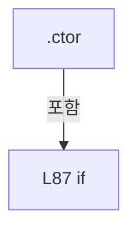

변경 전 점검: 입력/반환 타입, 위 호출자, 예외/취소 경로, 공유 상태와 저장·전송 소비자를 함께 확인합니다. 값의 단위나 물리 방향을 이름만으로 확정하지 않습니다.

### MethodDeclaration `HandleProtectWindowRetryExhausted` · L146–151

[Drilling.Common/Managers/CManager.cs:146–151](https://github.com/kjuws10-rgb/A3Drilling/blob/96e22cd027c84bf302b23f2949b98985d7f301bb/Drilling.Common/Managers/CManager.cs#L146-L151)

| 항목 | 실제 추출 값 |
| --- | --- |
| 서명 | void Drilling.Common.Managers.CManager.HandleProtectWindowRetryExhausted(Drilling.Common.Station.ST_PROTECT_WINDOW_RETRY_EXHAUSTED) |
| 접근/수식자 | Private / private |
| 반환/값 타입 | void |
| 소속 타입 | NamedType:Drilling.Common.Managers.CManager |

입력 계약:

| 이름 | 타입 | 전달 | 선택/기본값 |
| --- | --- | --- | --- |
| exhausted | Drilling.Common.Station.ST_PROTECT_WINDOW_RETRY_EXHAUSTED | None | False /  |

현재 부분 분석에서 직접 연결된 호출자는 없습니다. XAML/이벤트/인터페이스·델리게이트·외부 진입을 추가 확인해야 하며, 미사용으로 판정한 것이 아닙니다.

호출하는 대상과 해석 범위:

| 원본 행 | 표현식 | 분석 상태 | 대상/소스 위치 |
| --- | --- | --- | --- |
| 148 | FormattableString.Invariant | resolved | string System.FormattableString.Invariant(System.FormattableString) |
| 149 | _logManager.WriteStationState | unresolved | None |
| 150 | _alarmManager.SetAlarm | resolved | bool Drilling.Common.Alarm.CAlarmManager.SetAlarm(string) · Drilling.Common/Alarm/CAlarmManager.cs:239 |

본문의 실제 연산·분기·예외·반환 순서(원문 위치 순):

| 원본 행 | 종류 | 주석 해설 |
| --- | --- | --- |
| 148 | call | 함수·델리게이트 또는 객체 생성자를 호출합니다: FormattableString.Invariant($"Recipe={exhausted.RecipeId}; TrayCount={exhausted.TrayCount}; Maximum={exhausted.MaximumCount}; RetryCount={exhausted.RetryCount}; AUTO continues.") |
| 148 | local-declaration | 지역 변수를 선언합니다: var detail = FormattableString.Invariant($"Recipe={exhausted.RecipeId}; TrayCount={exhausted.TrayCount}; Maximum={exhausted.MaximumCount}; RetryCount={exhausted.RetryCount}; AUTO continues."); |
| 148 | variable-initializer | 변수의 초기값을 지정합니다: detail = FormattableString.Invariant($"Recipe={exhausted.RecipeId}; TrayCount={exhausted.TrayCount}; Maximum={exhausted.MaximumCount}; RetryCount={exhausted.RetryCount}; AUTO continues.") |
| 149 | call | 함수·델리게이트 또는 객체 생성자를 호출합니다: _logManager.WriteStationState("PROTECT_WINDOW", "WARNING", "PROTECT_WINDOW_RETRY_EXHAUSTED", detail) |
| 150 | call | 함수·델리게이트 또는 객체 생성자를 호출합니다: _alarmManager.SetAlarm("PROTECT_WINDOW_RETRY_EXHAUSTED") |

변경 전 점검: 입력/반환 타입, 위 호출자, 예외/취소 경로, 공유 상태와 저장·전송 소비자를 함께 확인합니다. 값의 단위나 물리 방향을 이름만으로 확정하지 않습니다.

### PropertyDeclaration `ConfigRoot` · L153–159

[Drilling.Common/Managers/CManager.cs:153–159](https://github.com/kjuws10-rgb/A3Drilling/blob/96e22cd027c84bf302b23f2949b98985d7f301bb/Drilling.Common/Managers/CManager.cs#L153-L159)

| 항목 | 실제 추출 값 |
| --- | --- |
| 서명 | string Drilling.Common.Managers.CManager.ConfigRoot |
| 접근/수식자 | Public / public |
| 반환/값 타입 | string |
| 소속 타입 | NamedType:Drilling.Common.Managers.CManager |

현재 부분 분석에서 직접 연결된 호출자는 없습니다. XAML/이벤트/인터페이스·델리게이트·외부 진입을 추가 확인해야 하며, 미사용으로 판정한 것이 아닙니다.

변경 전 점검: 입력/반환 타입, 위 호출자, 예외/취소 경로, 공유 상태와 저장·전송 소비자를 함께 확인합니다. 값의 단위나 물리 방향을 이름만으로 확정하지 않습니다.

### GetAccessorDeclaration `get_ConfigRoot` · L155–158

[Drilling.Common/Managers/CManager.cs:155–158](https://github.com/kjuws10-rgb/A3Drilling/blob/96e22cd027c84bf302b23f2949b98985d7f301bb/Drilling.Common/Managers/CManager.cs#L155-L158)

| 항목 | 실제 추출 값 |
| --- | --- |
| 서명 | string Drilling.Common.Managers.CManager.ConfigRoot.get |
| 접근/수식자 | Public / get |
| 반환/값 타입 | string |
| 소속 타입 | NamedType:Drilling.Common.Managers.CManager |

현재 부분 분석에서 직접 연결된 호출자는 없습니다. XAML/이벤트/인터페이스·델리게이트·외부 진입을 추가 확인해야 하며, 미사용으로 판정한 것이 아닙니다.

본문의 실제 연산·분기·예외·반환 순서(원문 위치 순):

| 원본 행 | 종류 | 주석 해설 |
| --- | --- | --- |
| 157 | return | 호출자에게 값 또는 제어를 반환합니다: return _configRoot; |

변경 전 점검: 입력/반환 타입, 위 호출자, 예외/취소 경로, 공유 상태와 저장·전송 소비자를 함께 확인합니다. 값의 단위나 물리 방향을 이름만으로 확정하지 않습니다.

### PropertyDeclaration `StartupMessages` · L161–170

[Drilling.Common/Managers/CManager.cs:161–170](https://github.com/kjuws10-rgb/A3Drilling/blob/96e22cd027c84bf302b23f2949b98985d7f301bb/Drilling.Common/Managers/CManager.cs#L161-L170)

| 항목 | 실제 추출 값 |
| --- | --- |
| 서명 | System.Collections.Generic.IReadOnlyList<string> Drilling.Common.Managers.CManager.StartupMessages |
| 접근/수식자 | Public / public |
| 반환/값 타입 | System.Collections.Generic.IReadOnlyList<string> |
| 소속 타입 | NamedType:Drilling.Common.Managers.CManager |

현재 부분 분석에서 직접 연결된 호출자는 없습니다. XAML/이벤트/인터페이스·델리게이트·외부 진입을 추가 확인해야 하며, 미사용으로 판정한 것이 아닙니다.

변경 전 점검: 입력/반환 타입, 위 호출자, 예외/취소 경로, 공유 상태와 저장·전송 소비자를 함께 확인합니다. 값의 단위나 물리 방향을 이름만으로 확정하지 않습니다.

### GetAccessorDeclaration `get_StartupMessages` · L163–169

[Drilling.Common/Managers/CManager.cs:163–169](https://github.com/kjuws10-rgb/A3Drilling/blob/96e22cd027c84bf302b23f2949b98985d7f301bb/Drilling.Common/Managers/CManager.cs#L163-L169)

| 항목 | 실제 추출 값 |
| --- | --- |
| 서명 | System.Collections.Generic.IReadOnlyList<string> Drilling.Common.Managers.CManager.StartupMessages.get |
| 접근/수식자 | Public / get |
| 반환/값 타입 | System.Collections.Generic.IReadOnlyList<string> |
| 소속 타입 | NamedType:Drilling.Common.Managers.CManager |

현재 부분 분석에서 직접 연결된 호출자는 없습니다. XAML/이벤트/인터페이스·델리게이트·외부 진입을 추가 확인해야 하며, 미사용으로 판정한 것이 아닙니다.

호출하는 대상과 해석 범위:

| 원본 행 | 표현식 | 분석 상태 | 대상/소스 위치 |
| --- | --- | --- | --- |
| 167 | _startupMessages.ToArray | resolved | string[] System.Collections.Generic.List<string>.ToArray() |

본문의 실제 연산·분기·예외·반환 순서(원문 위치 순):

| 원본 행 | 종류 | 주석 해설 |
| --- | --- | --- |
| 165 | lock | 공유 상태의 임계 구역에 진입합니다: lock (_startupLock) |
| 167 | call | 함수·델리게이트 또는 객체 생성자를 호출합니다: _startupMessages.ToArray() |
| 167 | return | 호출자에게 값 또는 제어를 반환합니다: return _startupMessages.ToArray(); |

제어 구문의 포함 구조(실제 실행 순서/CFG가 아닌 구문 탐색 그림):

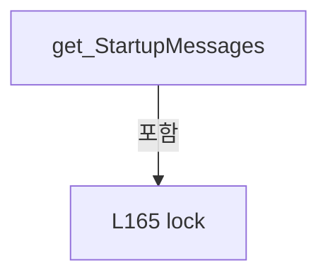

변경 전 점검: 입력/반환 타입, 위 호출자, 예외/취소 경로, 공유 상태와 저장·전송 소비자를 함께 확인합니다. 값의 단위나 물리 방향을 이름만으로 확정하지 않습니다.

### PropertyDeclaration `StartupSteps` · L172–181

[Drilling.Common/Managers/CManager.cs:172–181](https://github.com/kjuws10-rgb/A3Drilling/blob/96e22cd027c84bf302b23f2949b98985d7f301bb/Drilling.Common/Managers/CManager.cs#L172-L181)

| 항목 | 실제 추출 값 |
| --- | --- |
| 서명 | System.Collections.Generic.IReadOnlyList<Drilling.Common.Managers.ST_MANAGER_STARTUP_STEP> Drilling.Common.Managers.CManager.StartupSteps |
| 접근/수식자 | Public / public |
| 반환/값 타입 | System.Collections.Generic.IReadOnlyList<Drilling.Common.Managers.ST_MANAGER_STARTUP_STEP> |
| 소속 타입 | NamedType:Drilling.Common.Managers.CManager |

현재 부분 분석에서 직접 연결된 호출자는 없습니다. XAML/이벤트/인터페이스·델리게이트·외부 진입을 추가 확인해야 하며, 미사용으로 판정한 것이 아닙니다.

변경 전 점검: 입력/반환 타입, 위 호출자, 예외/취소 경로, 공유 상태와 저장·전송 소비자를 함께 확인합니다. 값의 단위나 물리 방향을 이름만으로 확정하지 않습니다.

### GetAccessorDeclaration `get_StartupSteps` · L174–180

[Drilling.Common/Managers/CManager.cs:174–180](https://github.com/kjuws10-rgb/A3Drilling/blob/96e22cd027c84bf302b23f2949b98985d7f301bb/Drilling.Common/Managers/CManager.cs#L174-L180)

| 항목 | 실제 추출 값 |
| --- | --- |
| 서명 | System.Collections.Generic.IReadOnlyList<Drilling.Common.Managers.ST_MANAGER_STARTUP_STEP> Drilling.Common.Managers.CManager.StartupSteps.get |
| 접근/수식자 | Public / get |
| 반환/값 타입 | System.Collections.Generic.IReadOnlyList<Drilling.Common.Managers.ST_MANAGER_STARTUP_STEP> |
| 소속 타입 | NamedType:Drilling.Common.Managers.CManager |

현재 부분 분석에서 직접 연결된 호출자는 없습니다. XAML/이벤트/인터페이스·델리게이트·외부 진입을 추가 확인해야 하며, 미사용으로 판정한 것이 아닙니다.

호출하는 대상과 해석 범위:

| 원본 행 | 표현식 | 분석 상태 | 대상/소스 위치 |
| --- | --- | --- | --- |
| 178 | _startupSteps.ToArray | resolved | Drilling.Common.Managers.ST_MANAGER_STARTUP_STEP[] System.Collections.Generic.List<Drilling.Common.Managers.ST_MANAGER_STARTUP_STEP>.ToArray() |

본문의 실제 연산·분기·예외·반환 순서(원문 위치 순):

| 원본 행 | 종류 | 주석 해설 |
| --- | --- | --- |
| 176 | lock | 공유 상태의 임계 구역에 진입합니다: lock (_startupLock) |
| 178 | call | 함수·델리게이트 또는 객체 생성자를 호출합니다: _startupSteps.ToArray() |
| 178 | return | 호출자에게 값 또는 제어를 반환합니다: return _startupSteps.ToArray(); |

제어 구문의 포함 구조(실제 실행 순서/CFG가 아닌 구문 탐색 그림):

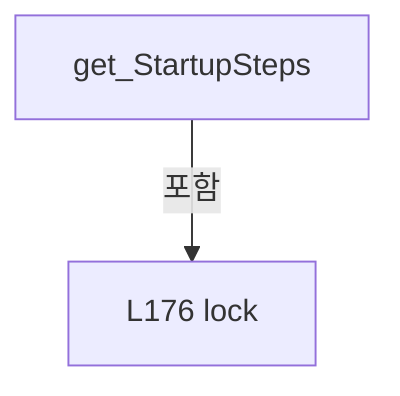

변경 전 점검: 입력/반환 타입, 위 호출자, 예외/취소 경로, 공유 상태와 저장·전송 소비자를 함께 확인합니다. 값의 단위나 물리 방향을 이름만으로 확정하지 않습니다.

### MethodDeclaration `ConfigStatus` · L183–189

[Drilling.Common/Managers/CManager.cs:183–189](https://github.com/kjuws10-rgb/A3Drilling/blob/96e22cd027c84bf302b23f2949b98985d7f301bb/Drilling.Common/Managers/CManager.cs#L183-L189)

| 항목 | 실제 추출 값 |
| --- | --- |
| 서명 | Drilling.Common.Managers.ST_CONFIG_LOAD_STATUS Drilling.Common.Managers.CManager.ConfigStatus() |
| 접근/수식자 | Public / public |
| 반환/값 타입 | Drilling.Common.Managers.ST_CONFIG_LOAD_STATUS |
| 소속 타입 | NamedType:Drilling.Common.Managers.CManager |

정적 호출자로 확인된 위치:

| 호출 파일/행 | 호출 표현식 | 런타임 분기 가능 |
| --- | --- | --- |
| [Drilling.UI/CAppStartup.cs:73–73](https://github.com/kjuws10-rgb/A3Drilling/blob/96e22cd027c84bf302b23f2949b98985d7f301bb/Drilling.UI/CAppStartup.cs#L73-L73) | manager.ConfigStatus | False |

호출하는 대상과 해석 범위:

| 원본 행 | 표현식 | 분석 상태 | 대상/소스 위치 |
| --- | --- | --- | --- |
| 187 | new ST_CONFIG_LOAD_STATUS | resolved | Drilling.Common.Managers.ST_CONFIG_LOAD_STATUS.ST_CONFIG_LOAD_STATUS(string, int, int, int, bool, System.Collections.Generic.IReadOnlyList<string>, System.Collections.Generic.IReadOnlyList<Drilling.Common.Managers.ST_MANAGER_STARTUP_STEP>) · Drilling.Common/Managers/CManager.cs:764 |
| 187 | _startupMessages.ToArray | resolved | string[] System.Collections.Generic.List<string>.ToArray() |
| 187 | _startupSteps.ToArray | resolved | Drilling.Common.Managers.ST_MANAGER_STARTUP_STEP[] System.Collections.Generic.List<Drilling.Common.Managers.ST_MANAGER_STARTUP_STEP>.ToArray() |

본문의 실제 연산·분기·예외·반환 순서(원문 위치 순):

| 원본 행 | 종류 | 주석 해설 |
| --- | --- | --- |
| 185 | lock | 공유 상태의 임계 구역에 진입합니다: lock (_startupLock) |
| 187 | call | 함수·델리게이트 또는 객체 생성자를 호출합니다: new ST_CONFIG_LOAD_STATUS(_configRoot, _loadedInterfaceCount, _loadedMotorCount, _loadedMelsecMapCount, _activeProductLoaded, _startupMessages.ToArray(), _startupSteps.ToArray()) |
| 187 | call | 함수·델리게이트 또는 객체 생성자를 호출합니다: _startupMessages.ToArray() |
| 187 | call | 함수·델리게이트 또는 객체 생성자를 호출합니다: _startupSteps.ToArray() |
| 187 | return | 호출자에게 값 또는 제어를 반환합니다: return new ST_CONFIG_LOAD_STATUS(_configRoot, _loadedInterfaceCount, _loadedMotorCount, _loadedMelsecMapCount, _activeProductLoaded, _startupMessages.ToArray(), _startupSteps.ToArray()); |

제어 구문의 포함 구조(실제 실행 순서/CFG가 아닌 구문 탐색 그림):

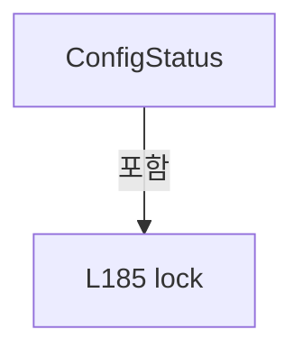

변경 전 점검: 입력/반환 타입, 위 호출자, 예외/취소 경로, 공유 상태와 저장·전송 소비자를 함께 확인합니다. 값의 단위나 물리 방향을 이름만으로 확정하지 않습니다.

### MethodDeclaration `IsSimul` · L191–194

[Drilling.Common/Managers/CManager.cs:191–194](https://github.com/kjuws10-rgb/A3Drilling/blob/96e22cd027c84bf302b23f2949b98985d7f301bb/Drilling.Common/Managers/CManager.cs#L191-L194)

| 항목 | 실제 추출 값 |
| --- | --- |
| 서명 | bool Drilling.Common.Managers.CManager.IsSimul(int) |
| 접근/수식자 | Public / public |
| 반환/값 타입 | bool |
| 소속 타입 | NamedType:Drilling.Common.Managers.CManager |

입력 계약:

| 이름 | 타입 | 전달 | 선택/기본값 |
| --- | --- | --- | --- |
| systemId | int | None | True / 0 |

정적 호출자로 확인된 위치:

| 호출 파일/행 | 호출 표현식 | 런타임 분기 가능 |
| --- | --- | --- |
| [Drilling.Common/Managers/CManager.cs:198–198](https://github.com/kjuws10-rgb/A3Drilling/blob/96e22cd027c84bf302b23f2949b98985d7f301bb/Drilling.Common/Managers/CManager.cs#L198-L198) | IsSimul | False |

본문의 실제 연산·분기·예외·반환 순서(원문 위치 순):

| 원본 행 | 종류 | 주석 해설 |
| --- | --- | --- |
| 193 | return | 호출자에게 값 또는 제어를 반환합니다: return _interfaceManager.IsSimulation && _motionManager.IsSimulation; |

변경 전 점검: 입력/반환 타입, 위 호출자, 예외/취소 경로, 공유 상태와 저장·전송 소비자를 함께 확인합니다. 값의 단위나 물리 방향을 이름만으로 확정하지 않습니다.

### MethodDeclaration `IsNotSimul` · L196–199

[Drilling.Common/Managers/CManager.cs:196–199](https://github.com/kjuws10-rgb/A3Drilling/blob/96e22cd027c84bf302b23f2949b98985d7f301bb/Drilling.Common/Managers/CManager.cs#L196-L199)

| 항목 | 실제 추출 값 |
| --- | --- |
| 서명 | bool Drilling.Common.Managers.CManager.IsNotSimul(int) |
| 접근/수식자 | Public / public |
| 반환/값 타입 | bool |
| 소속 타입 | NamedType:Drilling.Common.Managers.CManager |

입력 계약:

| 이름 | 타입 | 전달 | 선택/기본값 |
| --- | --- | --- | --- |
| systemId | int | None | True / 0 |

현재 부분 분석에서 직접 연결된 호출자는 없습니다. XAML/이벤트/인터페이스·델리게이트·외부 진입을 추가 확인해야 하며, 미사용으로 판정한 것이 아닙니다.

호출하는 대상과 해석 범위:

| 원본 행 | 표현식 | 분석 상태 | 대상/소스 위치 |
| --- | --- | --- | --- |
| 198 | IsSimul | resolved | bool Drilling.Common.Managers.CManager.IsSimul(int) · Drilling.Common/Managers/CManager.cs:191 |

본문의 실제 연산·분기·예외·반환 순서(원문 위치 순):

| 원본 행 | 종류 | 주석 해설 |
| --- | --- | --- |
| 198 | call | 함수·델리게이트 또는 객체 생성자를 호출합니다: IsSimul(systemId) |
| 198 | return | 호출자에게 값 또는 제어를 반환합니다: return !IsSimul(systemId); |

변경 전 점검: 입력/반환 타입, 위 호출자, 예외/취소 경로, 공유 상태와 저장·전송 소비자를 함께 확인합니다. 값의 단위나 물리 방향을 이름만으로 확정하지 않습니다.

### MethodDeclaration `SetSimul` · L201–205

[Drilling.Common/Managers/CManager.cs:201–205](https://github.com/kjuws10-rgb/A3Drilling/blob/96e22cd027c84bf302b23f2949b98985d7f301bb/Drilling.Common/Managers/CManager.cs#L201-L205)

| 항목 | 실제 추출 값 |
| --- | --- |
| 서명 | System.Threading.Tasks.Task Drilling.Common.Managers.CManager.SetSimul(bool, System.Threading.CancellationToken) |
| 접근/수식자 | Public / public, async |
| 반환/값 타입 | System.Threading.Tasks.Task |
| 소속 타입 | NamedType:Drilling.Common.Managers.CManager |

입력 계약:

| 이름 | 타입 | 전달 | 선택/기본값 |
| --- | --- | --- | --- |
| enabled | bool | None | False /  |
| cancellationToken | System.Threading.CancellationToken | None | True / null |

정적 호출자로 확인된 위치:

| 호출 파일/행 | 호출 표현식 | 런타임 분기 가능 |
| --- | --- | --- |
| [Drilling.Common/Managers/CManager.cs:209–209](https://github.com/kjuws10-rgb/A3Drilling/blob/96e22cd027c84bf302b23f2949b98985d7f301bb/Drilling.Common/Managers/CManager.cs#L209-L209) | SetSimul | False |

호출하는 대상과 해석 범위:

| 원본 행 | 표현식 | 분석 상태 | 대상/소스 위치 |
| --- | --- | --- | --- |
| 203 | _interfaceManager.SetSimulationMode | resolved | System.Threading.Tasks.Task Drilling.Common.Interface.CInterfaceManager.SetSimulationMode(bool, System.Threading.CancellationToken) · Drilling.Common/Interface/CInterfaceManager.cs:126 |
| 204 | _motionManager.SetSimulationMode | resolved | void Drilling.Common.Motion.CMotionManager.SetSimulationMode(bool) · Drilling.Common/Motion/CMotionManager.cs:86 |

본문의 실제 연산·분기·예외·반환 순서(원문 위치 순):

| 원본 행 | 종류 | 주석 해설 |
| --- | --- | --- |
| 203 | await | 비동기 완료를 기다립니다: await _interfaceManager.SetSimulationMode(enabled, cancellationToken) |
| 203 | call | 함수·델리게이트 또는 객체 생성자를 호출합니다: _interfaceManager.SetSimulationMode(enabled, cancellationToken) |
| 204 | call | 함수·델리게이트 또는 객체 생성자를 호출합니다: _motionManager.SetSimulationMode(enabled) |

변경 전 점검: 입력/반환 타입, 위 호출자, 예외/취소 경로, 공유 상태와 저장·전송 소비자를 함께 확인합니다. 값의 단위나 물리 방향을 이름만으로 확정하지 않습니다.

### MethodDeclaration `SetSimul` · L207–210

[Drilling.Common/Managers/CManager.cs:207–210](https://github.com/kjuws10-rgb/A3Drilling/blob/96e22cd027c84bf302b23f2949b98985d7f301bb/Drilling.Common/Managers/CManager.cs#L207-L210)

| 항목 | 실제 추출 값 |
| --- | --- |
| 서명 | System.Threading.Tasks.Task Drilling.Common.Managers.CManager.SetSimul(int, bool, System.Threading.CancellationToken) |
| 접근/수식자 | Public / public |
| 반환/값 타입 | System.Threading.Tasks.Task |
| 소속 타입 | NamedType:Drilling.Common.Managers.CManager |

입력 계약:

| 이름 | 타입 | 전달 | 선택/기본값 |
| --- | --- | --- | --- |
| systemId | int | None | False /  |
| enabled | bool | None | False /  |
| cancellationToken | System.Threading.CancellationToken | None | True / null |

현재 부분 분석에서 직접 연결된 호출자는 없습니다. XAML/이벤트/인터페이스·델리게이트·외부 진입을 추가 확인해야 하며, 미사용으로 판정한 것이 아닙니다.

호출하는 대상과 해석 범위:

| 원본 행 | 표현식 | 분석 상태 | 대상/소스 위치 |
| --- | --- | --- | --- |
| 209 | SetSimul | resolved | System.Threading.Tasks.Task Drilling.Common.Managers.CManager.SetSimul(bool, System.Threading.CancellationToken) · Drilling.Common/Managers/CManager.cs:201 |

본문의 실제 연산·분기·예외·반환 순서(원문 위치 순):

| 원본 행 | 종류 | 주석 해설 |
| --- | --- | --- |
| 209 | call | 함수·델리게이트 또는 객체 생성자를 호출합니다: SetSimul(enabled, cancellationToken) |
| 209 | return | 호출자에게 값 또는 제어를 반환합니다: return SetSimul(enabled, cancellationToken); |

변경 전 점검: 입력/반환 타입, 위 호출자, 예외/취소 경로, 공유 상태와 저장·전송 소비자를 함께 확인합니다. 값의 단위나 물리 방향을 이름만으로 확정하지 않습니다.

### MethodDeclaration `Initialize` · L212–226

[Drilling.Common/Managers/CManager.cs:212–226](https://github.com/kjuws10-rgb/A3Drilling/blob/96e22cd027c84bf302b23f2949b98985d7f301bb/Drilling.Common/Managers/CManager.cs#L212-L226)

| 항목 | 실제 추출 값 |
| --- | --- |
| 서명 | System.Threading.Tasks.Task Drilling.Common.Managers.CManager.Initialize(System.Threading.CancellationToken) |
| 접근/수식자 | Public / public, async |
| 반환/값 타입 | System.Threading.Tasks.Task |
| 소속 타입 | NamedType:Drilling.Common.Managers.CManager |

입력 계약:

| 이름 | 타입 | 전달 | 선택/기본값 |
| --- | --- | --- | --- |
| cancellationToken | System.Threading.CancellationToken | None | True / null |

정적 호출자로 확인된 위치:

| 호출 파일/행 | 호출 표현식 | 런타임 분기 가능 |
| --- | --- | --- |
| [Drilling.UI/CAppStartup.cs:42–42](https://github.com/kjuws10-rgb/A3Drilling/blob/96e22cd027c84bf302b23f2949b98985d7f301bb/Drilling.UI/CAppStartup.cs#L42-L42) | manager.Initialize | False |

호출하는 대상과 해석 범위:

| 원본 행 | 표현식 | 분석 상태 | 대상/소스 위치 |
| --- | --- | --- | --- |
| 219 | RunInitializeStep | resolved | System.Threading.Tasks.Task Drilling.Common.Managers.CManager.RunInitializeStep(string, System.Func<System.Threading.Tasks.Task>, System.Threading.CancellationToken) · Drilling.Common/Managers/CManager.cs:558 |
| 225 | RunInitializeStep | resolved | System.Threading.Tasks.Task Drilling.Common.Managers.CManager.RunInitializeStep(string, System.Func<System.Threading.Tasks.Task>, System.Threading.CancellationToken) · Drilling.Common/Managers/CManager.cs:558 |

본문의 실제 연산·분기·예외·반환 순서(원문 위치 순):

| 원본 행 | 종류 | 주석 해설 |
| --- | --- | --- |
| 219 | await | 비동기 완료를 기다립니다: await RunInitializeStep("Initialize Interface Connection", SelectValue, cancellationToken) |
| 219 | call | 함수·델리게이트 또는 객체 생성자를 호출합니다: RunInitializeStep("Initialize Interface Connection", SelectValue, cancellationToken) |
| 225 | await | 비동기 완료를 기다립니다: await RunInitializeStep("Initialize Motion Controller", SelectTask, cancellationToken) |
| 225 | call | 함수·델리게이트 또는 객체 생성자를 호출합니다: RunInitializeStep("Initialize Motion Controller", SelectTask, cancellationToken) |

변경 전 점검: 입력/반환 타입, 위 호출자, 예외/취소 경로, 공유 상태와 저장·전송 소비자를 함께 확인합니다. 값의 단위나 물리 방향을 이름만으로 확정하지 않습니다.

### LocalFunctionStatement `SelectValue` · L214–217

[Drilling.Common/Managers/CManager.cs:214–217](https://github.com/kjuws10-rgb/A3Drilling/blob/96e22cd027c84bf302b23f2949b98985d7f301bb/Drilling.Common/Managers/CManager.cs#L214-L217)

| 항목 | 실제 추출 값 |
| --- | --- |
| 서명 | System.Threading.Tasks.Task SelectValue() |
| 접근/수식자 | Private /  |
| 반환/값 타입 | System.Threading.Tasks.Task |
| 소속 타입 | NamedType:Drilling.Common.Managers.CManager |

현재 부분 분석에서 직접 연결된 호출자는 없습니다. XAML/이벤트/인터페이스·델리게이트·외부 진입을 추가 확인해야 하며, 미사용으로 판정한 것이 아닙니다.

호출하는 대상과 해석 범위:

| 원본 행 | 표현식 | 분석 상태 | 대상/소스 위치 |
| --- | --- | --- | --- |
| 216 | _interfaceManager.Initialize | resolved | System.Threading.Tasks.Task Drilling.Common.Interface.CInterfaceManager.Initialize(System.Threading.CancellationToken) · Drilling.Common/Interface/CInterfaceManager.cs:183 |

본문의 실제 연산·분기·예외·반환 순서(원문 위치 순):

| 원본 행 | 종류 | 주석 해설 |
| --- | --- | --- |
| 216 | call | 함수·델리게이트 또는 객체 생성자를 호출합니다: _interfaceManager.Initialize(cancellationToken) |
| 216 | return | 호출자에게 값 또는 제어를 반환합니다: return _interfaceManager.Initialize(cancellationToken); |

변경 전 점검: 입력/반환 타입, 위 호출자, 예외/취소 경로, 공유 상태와 저장·전송 소비자를 함께 확인합니다. 값의 단위나 물리 방향을 이름만으로 확정하지 않습니다.

### LocalFunctionStatement `SelectTask` · L220–223

[Drilling.Common/Managers/CManager.cs:220–223](https://github.com/kjuws10-rgb/A3Drilling/blob/96e22cd027c84bf302b23f2949b98985d7f301bb/Drilling.Common/Managers/CManager.cs#L220-L223)

| 항목 | 실제 추출 값 |
| --- | --- |
| 서명 | System.Threading.Tasks.Task SelectTask() |
| 접근/수식자 | Private /  |
| 반환/값 타입 | System.Threading.Tasks.Task |
| 소속 타입 | NamedType:Drilling.Common.Managers.CManager |

현재 부분 분석에서 직접 연결된 호출자는 없습니다. XAML/이벤트/인터페이스·델리게이트·외부 진입을 추가 확인해야 하며, 미사용으로 판정한 것이 아닙니다.

호출하는 대상과 해석 범위:

| 원본 행 | 표현식 | 분석 상태 | 대상/소스 위치 |
| --- | --- | --- | --- |
| 222 | _motionManager.Initialize | resolved | System.Threading.Tasks.Task Drilling.Common.Motion.CMotionManager.Initialize(System.Threading.CancellationToken) · Drilling.Common/Motion/CMotionManager.cs:96 |

본문의 실제 연산·분기·예외·반환 순서(원문 위치 순):

| 원본 행 | 종류 | 주석 해설 |
| --- | --- | --- |
| 222 | call | 함수·델리게이트 또는 객체 생성자를 호출합니다: _motionManager.Initialize(cancellationToken) |
| 222 | return | 호출자에게 값 또는 제어를 반환합니다: return _motionManager.Initialize(cancellationToken); |

변경 전 점검: 입력/반환 타입, 위 호출자, 예외/취소 경로, 공유 상태와 저장·전송 소비자를 함께 확인합니다. 값의 단위나 물리 방향을 이름만으로 확정하지 않습니다.

### MethodDeclaration `Destroy` · L228–265

[Drilling.Common/Managers/CManager.cs:228–265](https://github.com/kjuws10-rgb/A3Drilling/blob/96e22cd027c84bf302b23f2949b98985d7f301bb/Drilling.Common/Managers/CManager.cs#L228-L265)

| 항목 | 실제 추출 값 |
| --- | --- |
| 서명 | System.Threading.Tasks.Task Drilling.Common.Managers.CManager.Destroy(System.Threading.CancellationToken) |
| 접근/수식자 | Public / public, async |
| 반환/값 타입 | System.Threading.Tasks.Task |
| 소속 타입 | NamedType:Drilling.Common.Managers.CManager |

입력 계약:

| 이름 | 타입 | 전달 | 선택/기본값 |
| --- | --- | --- | --- |
| cancellationToken | System.Threading.CancellationToken | None | True / null |

현재 부분 분석에서 직접 연결된 호출자는 없습니다. XAML/이벤트/인터페이스·델리게이트·외부 진입을 추가 확인해야 하며, 미사용으로 판정한 것이 아닙니다.

호출하는 대상과 해석 범위:

| 원본 행 | 표현식 | 분석 상태 | 대상/소스 위치 |
| --- | --- | --- | --- |
| 232 | StopBackgroundMonitoring | resolved | System.Threading.Tasks.Task Drilling.Common.Managers.CManager.StopBackgroundMonitoring() · Drilling.Common/Managers/CManager.cs:278 |
| 235 | _alarmManager.FlushHistoryAsync(cancellationToken).WaitAsync | resolved | System.Threading.Tasks.Task System.Threading.Tasks.Task.WaitAsync(System.TimeSpan, System.Threading.CancellationToken) |
| 235 | _alarmManager.FlushHistoryAsync | resolved | System.Threading.Tasks.Task Drilling.Common.Alarm.CAlarmManager.FlushHistoryAsync(System.Threading.CancellationToken) · Drilling.Common/Alarm/CAlarmManager.cs:377 |
| 235 | TimeSpan.FromSeconds | resolved | System.TimeSpan System.TimeSpan.FromSeconds(long) |
| 239 | CProgramOpenLog.Write | unresolved | None |
| 242 | PowerMeasure.DisposeAsync | resolved | System.Threading.Tasks.ValueTask Drilling.Common.Interface.CPowerMeasureService.DisposeAsync() · Drilling.Common/Interface/CPowerMeasureService.cs:58 |
| 243 | _motionManager.Destroy | resolved | System.Threading.Tasks.Task Drilling.Common.Motion.CMotionManager.Destroy(System.Threading.CancellationToken) · Drilling.Common/Motion/CMotionManager.cs:126 |
| 244 | _interfaceManager.Destroy | resolved | System.Threading.Tasks.Task Drilling.Common.Interface.CInterfaceManager.Destroy(System.Threading.CancellationToken) · Drilling.Common/Interface/CInterfaceManager.cs:188 |
| 250 | _logManager.StopInterfaceLoggingAsync().WaitAsync | unresolved | None |
| 250 | _logManager.StopInterfaceLoggingAsync | unresolved | None |
| 250 | TimeSpan.FromSeconds | resolved | System.TimeSpan System.TimeSpan.FromSeconds(long) |
| 254 | CProgramOpenLog.Write | unresolved | None |
| 258 | _logManager.StopSequenceLoggingAsync().WaitAsync | unresolved | None |
| 258 | _logManager.StopSequenceLoggingAsync | unresolved | None |
| 258 | TimeSpan.FromSeconds | resolved | System.TimeSpan System.TimeSpan.FromSeconds(long) |
| 262 | CProgramOpenLog.Write | unresolved | None |

본문의 실제 연산·분기·예외·반환 순서(원문 위치 순):

| 원본 행 | 종류 | 주석 해설 |
| --- | --- | --- |
| 230 | try | 예외 처리 범위입니다: try |
| 232 | await | 비동기 완료를 기다립니다: await StopBackgroundMonitoring() |
| 232 | call | 함수·델리게이트 또는 객체 생성자를 호출합니다: StopBackgroundMonitoring() |
| 233 | try | 예외 처리 범위입니다: try |
| 235 | await | 비동기 완료를 기다립니다: await _alarmManager.FlushHistoryAsync(cancellationToken).WaitAsync(TimeSpan.FromSeconds(5), cancellationToken) |
| 235 | call | 함수·델리게이트 또는 객체 생성자를 호출합니다: _alarmManager.FlushHistoryAsync(cancellationToken).WaitAsync(TimeSpan.FromSeconds(5), cancellationToken) |
| 235 | call | 함수·델리게이트 또는 객체 생성자를 호출합니다: _alarmManager.FlushHistoryAsync(cancellationToken) |
| 235 | call | 함수·델리게이트 또는 객체 생성자를 호출합니다: TimeSpan.FromSeconds(5) |
| 237 | catch | 지정 예외를 처리합니다: catch (TimeoutException exception) |
| 239 | call | 함수·델리게이트 또는 객체 생성자를 호출합니다: CProgramOpenLog.Write("ALARM_HISTORY_FLUSH_TIMEOUT", exception) |
| 242 | await | 비동기 완료를 기다립니다: await PowerMeasure.DisposeAsync() |
| 242 | call | 함수·델리게이트 또는 객체 생성자를 호출합니다: PowerMeasure.DisposeAsync() |
| 243 | await | 비동기 완료를 기다립니다: await _motionManager.Destroy(cancellationToken) |
| 243 | call | 함수·델리게이트 또는 객체 생성자를 호출합니다: _motionManager.Destroy(cancellationToken) |
| 244 | await | 비동기 완료를 기다립니다: await _interfaceManager.Destroy(cancellationToken) |
| 244 | call | 함수·델리게이트 또는 객체 생성자를 호출합니다: _interfaceManager.Destroy(cancellationToken) |
| 246 | finally | 종료 정리 구간입니다: finally |
| 248 | try | 예외 처리 범위입니다: try |
| 250 | await | 비동기 완료를 기다립니다: await _logManager.StopInterfaceLoggingAsync().WaitAsync(TimeSpan.FromSeconds(5)) |
| 250 | call | 함수·델리게이트 또는 객체 생성자를 호출합니다: _logManager.StopInterfaceLoggingAsync().WaitAsync(TimeSpan.FromSeconds(5)) |
| 250 | call | 함수·델리게이트 또는 객체 생성자를 호출합니다: _logManager.StopInterfaceLoggingAsync() |
| 250 | call | 함수·델리게이트 또는 객체 생성자를 호출합니다: TimeSpan.FromSeconds(5) |
| 252 | catch | 지정 예외를 처리합니다: catch (Exception error) |
| 254 | call | 함수·델리게이트 또는 객체 생성자를 호출합니다: CProgramOpenLog.Write("INTERFACE_LOG_FLUSH_FAILED", error) |
| 256 | try | 예외 처리 범위입니다: try |
| 258 | await | 비동기 완료를 기다립니다: await _logManager.StopSequenceLoggingAsync().WaitAsync(TimeSpan.FromSeconds(5)) |
| 258 | call | 함수·델리게이트 또는 객체 생성자를 호출합니다: _logManager.StopSequenceLoggingAsync().WaitAsync(TimeSpan.FromSeconds(5)) |
| 258 | call | 함수·델리게이트 또는 객체 생성자를 호출합니다: _logManager.StopSequenceLoggingAsync() |
| 258 | call | 함수·델리게이트 또는 객체 생성자를 호출합니다: TimeSpan.FromSeconds(5) |
| 260 | catch | 지정 예외를 처리합니다: catch (Exception error) |
| 262 | call | 함수·델리게이트 또는 객체 생성자를 호출합니다: CProgramOpenLog.Write("SEQUENCE_LOG_FLUSH_FAILED", error) |

제어 구문의 포함 구조(실제 실행 순서/CFG가 아닌 구문 탐색 그림):

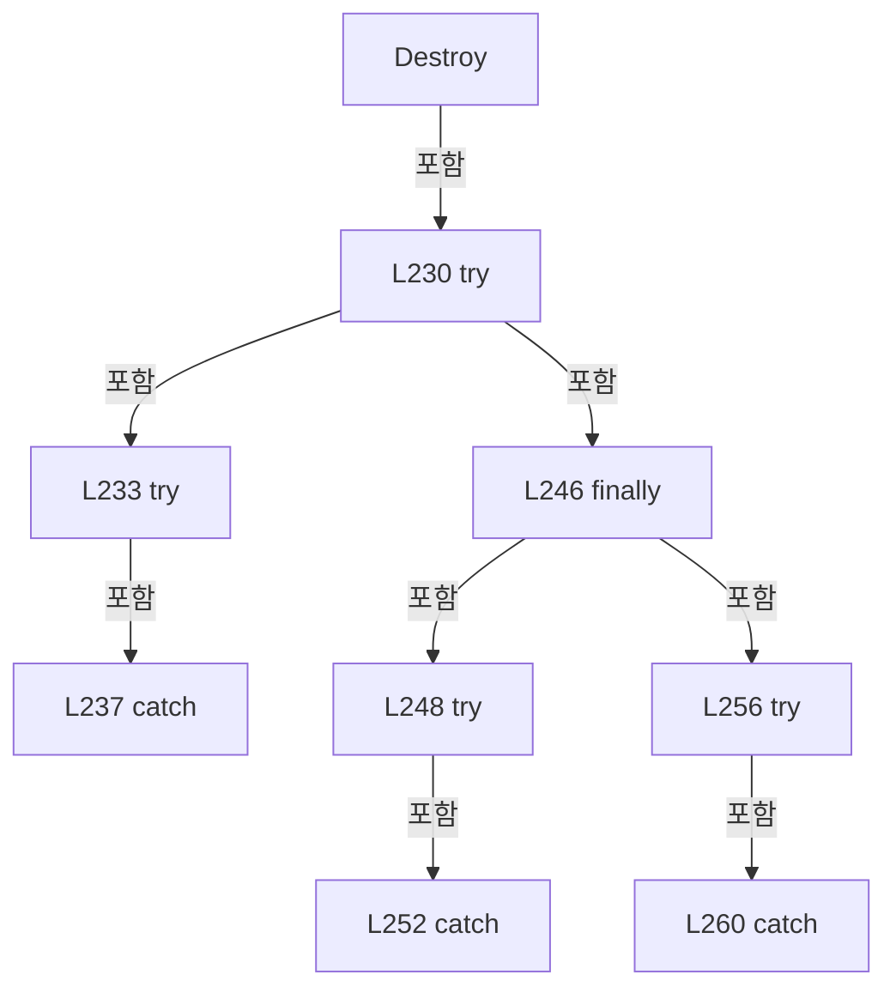

변경 전 점검: 입력/반환 타입, 위 호출자, 예외/취소 경로, 공유 상태와 저장·전송 소비자를 함께 확인합니다. 값의 단위나 물리 방향을 이름만으로 확정하지 않습니다.

### MethodDeclaration `StartBackgroundMonitoring` · L267–276

[Drilling.Common/Managers/CManager.cs:267–276](https://github.com/kjuws10-rgb/A3Drilling/blob/96e22cd027c84bf302b23f2949b98985d7f301bb/Drilling.Common/Managers/CManager.cs#L267-L276)

| 항목 | 실제 추출 값 |
| --- | --- |
| 서명 | void Drilling.Common.Managers.CManager.StartBackgroundMonitoring() |
| 접근/수식자 | Public / public |
| 반환/값 타입 | void |
| 소속 타입 | NamedType:Drilling.Common.Managers.CManager |

정적 호출자로 확인된 위치:

| 호출 파일/행 | 호출 표현식 | 런타임 분기 가능 |
| --- | --- | --- |
| [Drilling.UI/CAppStartup.cs:67–67](https://github.com/kjuws10-rgb/A3Drilling/blob/96e22cd027c84bf302b23f2949b98985d7f301bb/Drilling.UI/CAppStartup.cs#L67-L67) | manager.StartBackgroundMonitoring | False |

호출하는 대상과 해석 범위:

| 원본 행 | 표현식 | 분석 상태 | 대상/소스 위치 |
| --- | --- | --- | --- |
| 269 | _stationManager.StartZeroLinePrewaitMonitoring | resolved | void Drilling.Common.Station.CStationManager.StartZeroLinePrewaitMonitoring(System.Func<string>) · Drilling.Common/Station/CStationManager.cs:17 |
| 269 | _settingManager.GetValue | resolved | string Drilling.Common.Managers.CSettingManager.GetValue(Drilling.Common.Managers.EN_SETTING_TAB, string, string, System.Threading.CancellationToken) · Drilling.Common/Managers/CSettingManager.cs:59 |
| 270 | _stationManager.StartProtectWindowCompletionMonitoring | resolved | void Drilling.Common.Station.CStationManager.StartProtectWindowCompletionMonitoring(System.Func<string>) · Drilling.Common/Station/CStationManager.cs:20 |
| 270 | _settingManager.GetValue | resolved | string Drilling.Common.Managers.CSettingManager.GetValue(Drilling.Common.Managers.EN_SETTING_TAB, string, string, System.Threading.CancellationToken) · Drilling.Common/Managers/CSettingManager.cs:59 |
| 271 | _alarmManager.EnsureDefinitionsRequested | resolved | void Drilling.Common.Alarm.CAlarmManager.EnsureDefinitionsRequested() · Drilling.Common/Alarm/CAlarmManager.cs:214 |
| 272 | _alarmMotorSnapshots.Start | resolved | void Drilling.Common.Interface.CSharedDeviceSnapshotService<System.Collections.Generic.IReadOnlyList<Drilling.Common.Motion.ST_MOTOR_AXIS_STATUS>>.Start() · Drilling.Common/Interface/CInterfaceManager.cs:3511 |
| 273 | _alarmLaserSnapshots.Start | resolved | void Drilling.Common.Interface.CSharedDeviceSnapshotService<Drilling.Common.Interface.ST_LASER_STATUS>.Start() · Drilling.Common/Interface/CInterfaceManager.cs:3511 |
| 274 | _alarmBetSnapshots.Start | resolved | void Drilling.Common.Interface.CSharedDeviceSnapshotService<Drilling.Common.Interface.ST_BET_STATUS>.Start() · Drilling.Common/Interface/CInterfaceManager.cs:3511 |
| 275 | _alarmManager.StartMonitoring | candidate | OverloadResolutionFailure |
| 275 | CProgramOpenLog.Write | unresolved | None |

본문의 실제 연산·분기·예외·반환 순서(원문 위치 순):

| 원본 행 | 종류 | 주석 해설 |
| --- | --- | --- |
| 269 | call | 함수·델리게이트 또는 객체 생성자를 호출합니다: _stationManager.StartZeroLinePrewaitMonitoring(() => _settingManager.GetValue(EN_SETTING_TAB.Option, "SELECT_RECIPE", "DRILL_A01")) |
| 269 | call | 함수·델리게이트 또는 객체 생성자를 호출합니다: _settingManager.GetValue(EN_SETTING_TAB.Option, "SELECT_RECIPE", "DRILL_A01") |
| 270 | call | 함수·델리게이트 또는 객체 생성자를 호출합니다: _stationManager.StartProtectWindowCompletionMonitoring(() => _settingManager.GetValue(EN_SETTING_TAB.Option, "SELECT_RECIPE", "DRILL_A01")) |
| 270 | call | 함수·델리게이트 또는 객체 생성자를 호출합니다: _settingManager.GetValue(EN_SETTING_TAB.Option, "SELECT_RECIPE", "DRILL_A01") |
| 271 | call | 함수·델리게이트 또는 객체 생성자를 호출합니다: _alarmManager.EnsureDefinitionsRequested() |
| 272 | call | 함수·델리게이트 또는 객체 생성자를 호출합니다: _alarmMotorSnapshots.Start() |
| 273 | call | 함수·델리게이트 또는 객체 생성자를 호출합니다: _alarmLaserSnapshots.Start() |
| 274 | call | 함수·델리게이트 또는 객체 생성자를 호출합니다: _alarmBetSnapshots.Start() |
| 275 | call | 함수·델리게이트 또는 객체 생성자를 호출합니다: _alarmManager.StartMonitoring(_settingManager, _automationManager, ReadAlarmDeviceSnapshot, _interLockManager, exception => CProgramOpenLog.Write("ALARM_MONITOR_FAILED", exception)) |
| 275 | call | 함수·델리게이트 또는 객체 생성자를 호출합니다: CProgramOpenLog.Write("ALARM_MONITOR_FAILED", exception) |

변경 전 점검: 입력/반환 타입, 위 호출자, 예외/취소 경로, 공유 상태와 저장·전송 소비자를 함께 확인합니다. 값의 단위나 물리 방향을 이름만으로 확정하지 않습니다.

### MethodDeclaration `StopBackgroundMonitoring` · L278–286

[Drilling.Common/Managers/CManager.cs:278–286](https://github.com/kjuws10-rgb/A3Drilling/blob/96e22cd027c84bf302b23f2949b98985d7f301bb/Drilling.Common/Managers/CManager.cs#L278-L286)

| 항목 | 실제 추출 값 |
| --- | --- |
| 서명 | System.Threading.Tasks.Task Drilling.Common.Managers.CManager.StopBackgroundMonitoring() |
| 접근/수식자 | Public / public, async |
| 반환/값 타입 | System.Threading.Tasks.Task |
| 소속 타입 | NamedType:Drilling.Common.Managers.CManager |

정적 호출자로 확인된 위치:

| 호출 파일/행 | 호출 표현식 | 런타임 분기 가능 |
| --- | --- | --- |
| [Drilling.Common/Managers/CManager.cs:232–232](https://github.com/kjuws10-rgb/A3Drilling/blob/96e22cd027c84bf302b23f2949b98985d7f301bb/Drilling.Common/Managers/CManager.cs#L232-L232) | StopBackgroundMonitoring | False |
| [Drilling.UI/CRootView.cs:254–254](https://github.com/kjuws10-rgb/A3Drilling/blob/96e22cd027c84bf302b23f2949b98985d7f301bb/Drilling.UI/CRootView.cs#L254-L254) | _manager.StopBackgroundMonitoring | False |

호출하는 대상과 해석 범위:

| 원본 행 | 표현식 | 분석 상태 | 대상/소스 위치 |
| --- | --- | --- | --- |
| 280 | _stationManager.StageRequests.StopAsync().ConfigureAwait | resolved | System.Runtime.CompilerServices.ConfiguredTaskAwaitable<bool> System.Threading.Tasks.Task<bool>.ConfigureAwait(bool) |
| 280 | _stationManager.StageRequests.StopAsync | resolved | System.Threading.Tasks.Task<bool> Drilling.Common.Station.CStageRequestSequence.StopAsync() · Drilling.Common/Station/CStationProcess.cs:5067 |
| 281 | _stationManager.StopZeroLinePrewaitMonitoring().ConfigureAwait | resolved | System.Runtime.CompilerServices.ConfiguredTaskAwaitable System.Threading.Tasks.Task.ConfigureAwait(bool) |
| 281 | _stationManager.StopZeroLinePrewaitMonitoring | resolved | System.Threading.Tasks.Task Drilling.Common.Station.CStationManager.StopZeroLinePrewaitMonitoring() · Drilling.Common/Station/CStationManager.cs:18 |
| 282 | _stationManager.StopProtectWindowCompletionMonitoring().ConfigureAwait | resolved | System.Runtime.CompilerServices.ConfiguredTaskAwaitable System.Threading.Tasks.Task.ConfigureAwait(bool) |
| 282 | _stationManager.StopProtectWindowCompletionMonitoring | resolved | System.Threading.Tasks.Task Drilling.Common.Station.CStationManager.StopProtectWindowCompletionMonitoring() · Drilling.Common/Station/CStationManager.cs:21 |
| 283 | _alarmManager.StopMonitoringAsync().ConfigureAwait | resolved | System.Runtime.CompilerServices.ConfiguredTaskAwaitable System.Threading.Tasks.Task.ConfigureAwait(bool) |
| 283 | _alarmManager.StopMonitoringAsync | resolved | System.Threading.Tasks.Task Drilling.Common.Alarm.CAlarmManager.StopMonitoringAsync() · Drilling.Common/Alarm/CAlarmManager.cs:447 |
| 284 | Task.WhenAll(_alarmMotorSnapshots.StopAsync(), _alarmLaserSnapshots.StopAsync(), _alarmBetSnapshots.StopAsync()).ConfigureAwait | resolved | System.Runtime.CompilerServices.ConfiguredTaskAwaitable System.Threading.Tasks.Task.ConfigureAwait(bool) |
| 284 | Task.WhenAll | resolved | System.Threading.Tasks.Task System.Threading.Tasks.Task.WhenAll(params System.ReadOnlySpan<System.Threading.Tasks.Task>) |
| 284 | _alarmMotorSnapshots.StopAsync | resolved | System.Threading.Tasks.Task Drilling.Common.Interface.CSharedDeviceSnapshotService<System.Collections.Generic.IReadOnlyList<Drilling.Common.Motion.ST_MOTOR_AXIS_STATUS>>.StopAsync() · Drilling.Common/Interface/CInterfaceManager.cs:3525 |
| 284 | _alarmLaserSnapshots.StopAsync | resolved | System.Threading.Tasks.Task Drilling.Common.Interface.CSharedDeviceSnapshotService<Drilling.Common.Interface.ST_LASER_STATUS>.StopAsync() · Drilling.Common/Interface/CInterfaceManager.cs:3525 |
| 284 | _alarmBetSnapshots.StopAsync | resolved | System.Threading.Tasks.Task Drilling.Common.Interface.CSharedDeviceSnapshotService<Drilling.Common.Interface.ST_BET_STATUS>.StopAsync() · Drilling.Common/Interface/CInterfaceManager.cs:3525 |
| 285 | _automationManager.StatusSnapshots.Dispose | resolved | void Drilling.Common.Automation.CAutomationStatusSnapshotService.Dispose() · Drilling.Common/Automation/CAutomationStatusSnapshotService.cs:168 |

본문의 실제 연산·분기·예외·반환 순서(원문 위치 순):

| 원본 행 | 종류 | 주석 해설 |
| --- | --- | --- |
| 280 | await | 비동기 완료를 기다립니다: await _stationManager.StageRequests.StopAsync().ConfigureAwait(false) |
| 280 | call | 함수·델리게이트 또는 객체 생성자를 호출합니다: _stationManager.StageRequests.StopAsync().ConfigureAwait(false) |
| 280 | call | 함수·델리게이트 또는 객체 생성자를 호출합니다: _stationManager.StageRequests.StopAsync() |
| 281 | await | 비동기 완료를 기다립니다: await _stationManager.StopZeroLinePrewaitMonitoring().ConfigureAwait(false) |
| 281 | call | 함수·델리게이트 또는 객체 생성자를 호출합니다: _stationManager.StopZeroLinePrewaitMonitoring().ConfigureAwait(false) |
| 281 | call | 함수·델리게이트 또는 객체 생성자를 호출합니다: _stationManager.StopZeroLinePrewaitMonitoring() |
| 282 | await | 비동기 완료를 기다립니다: await _stationManager.StopProtectWindowCompletionMonitoring().ConfigureAwait(false) |
| 282 | call | 함수·델리게이트 또는 객체 생성자를 호출합니다: _stationManager.StopProtectWindowCompletionMonitoring().ConfigureAwait(false) |
| 282 | call | 함수·델리게이트 또는 객체 생성자를 호출합니다: _stationManager.StopProtectWindowCompletionMonitoring() |
| 283 | await | 비동기 완료를 기다립니다: await _alarmManager.StopMonitoringAsync().ConfigureAwait(false) |
| 283 | call | 함수·델리게이트 또는 객체 생성자를 호출합니다: _alarmManager.StopMonitoringAsync().ConfigureAwait(false) |
| 283 | call | 함수·델리게이트 또는 객체 생성자를 호출합니다: _alarmManager.StopMonitoringAsync() |
| 284 | await | 비동기 완료를 기다립니다: await Task.WhenAll(_alarmMotorSnapshots.StopAsync(), _alarmLaserSnapshots.StopAsync(), _alarmBetSnapshots.StopAsync()).ConfigureAwait(false) |
| 284 | call | 함수·델리게이트 또는 객체 생성자를 호출합니다: Task.WhenAll(_alarmMotorSnapshots.StopAsync(), _alarmLaserSnapshots.StopAsync(), _alarmBetSnapshots.StopAsync()).ConfigureAwait(false) |
| 284 | call | 함수·델리게이트 또는 객체 생성자를 호출합니다: Task.WhenAll(_alarmMotorSnapshots.StopAsync(), _alarmLaserSnapshots.StopAsync(), _alarmBetSnapshots.StopAsync()) |
| 284 | call | 함수·델리게이트 또는 객체 생성자를 호출합니다: _alarmMotorSnapshots.StopAsync() |
| 284 | call | 함수·델리게이트 또는 객체 생성자를 호출합니다: _alarmLaserSnapshots.StopAsync() |
| 284 | call | 함수·델리게이트 또는 객체 생성자를 호출합니다: _alarmBetSnapshots.StopAsync() |
| 285 | call | 함수·델리게이트 또는 객체 생성자를 호출합니다: _automationManager.StatusSnapshots.Dispose() |

변경 전 점검: 입력/반환 타입, 위 호출자, 예외/취소 경로, 공유 상태와 저장·전송 소비자를 함께 확인합니다. 값의 단위나 물리 방향을 이름만으로 확정하지 않습니다.

### MethodDeclaration `ReadAlarmDeviceSnapshot` · L288–313

[Drilling.Common/Managers/CManager.cs:288–313](https://github.com/kjuws10-rgb/A3Drilling/blob/96e22cd027c84bf302b23f2949b98985d7f301bb/Drilling.Common/Managers/CManager.cs#L288-L313)

| 항목 | 실제 추출 값 |
| --- | --- |
| 서명 | Drilling.Common.Managers.ST_DEVICE_STATUS Drilling.Common.Managers.CManager.ReadAlarmDeviceSnapshot() |
| 접근/수식자 | Private / private |
| 반환/값 타입 | Drilling.Common.Managers.ST_DEVICE_STATUS |
| 소속 타입 | NamedType:Drilling.Common.Managers.CManager |

현재 부분 분석에서 직접 연결된 호출자는 없습니다. XAML/이벤트/인터페이스·델리게이트·외부 진입을 추가 확인해야 하며, 미사용으로 판정한 것이 아닙니다.

호출하는 대상과 해석 범위:

| 원본 행 | 표현식 | 분석 상태 | 대상/소스 위치 |
| --- | --- | --- | --- |
| 291 | _alarmMotorSnapshots.GetSnapshot | resolved | Drilling.Common.Interface.ST_SHARED_DEVICE_SNAPSHOT<System.Collections.Generic.IReadOnlyList<Drilling.Common.Motion.ST_MOTOR_AXIS_STATUS>> Drilling.Common.Interface.CSharedDeviceSnapshotService<System.Collections.Generic.IReadOnlyList<Drilling.Common.Motion.ST_MOTOR_AXIS_STATUS>>.GetSnapshot() · Drilling.Common/Interface/CInterfaceManager.cs:3496 |
| 292 | _alarmLaserSnapshots.GetSnapshot | resolved | Drilling.Common.Interface.ST_SHARED_DEVICE_SNAPSHOT<Drilling.Common.Interface.ST_LASER_STATUS> Drilling.Common.Interface.CSharedDeviceSnapshotService<Drilling.Common.Interface.ST_LASER_STATUS>.GetSnapshot() · Drilling.Common/Interface/CInterfaceManager.cs:3496 |
| 293 | _alarmBetSnapshots.GetSnapshot | resolved | Drilling.Common.Interface.ST_SHARED_DEVICE_SNAPSHOT<Drilling.Common.Interface.ST_BET_STATUS> Drilling.Common.Interface.CSharedDeviceSnapshotService<Drilling.Common.Interface.ST_BET_STATUS>.GetSnapshot() · Drilling.Common/Interface/CInterfaceManager.cs:3496 |
| 294 | new List<string> | resolved | System.Collections.Generic.List<string>.List() |
| 296 | errors.Add | resolved | void System.Collections.Generic.List<string>.Add(string) |
| 298 | errors.Add | resolved | void System.Collections.Generic.List<string>.Add(string) |
| 300 | errors.Add | resolved | void System.Collections.Generic.List<string>.Add(string) |
| 301 | _interfaceManager.GetInterfaceList(EN_EQP_MODULE.Attenuator).OrderBy(row => row.Number).FirstOrDefault | resolved | Drilling.Common.Interface.ST_INTERFACE_DATA? System.Collections.Generic.IEnumerable<Drilling.Common.Interface.ST_INTERFACE_DATA>.FirstOrDefault<Drilling.Common.Interface.ST_INTERFACE_DATA>() |
| 301 | _interfaceManager.GetInterfaceList(EN_EQP_MODULE.Attenuator).OrderBy | resolved | System.Linq.IOrderedEnumerable<Drilling.Common.Interface.ST_INTERFACE_DATA> System.Collections.Generic.IEnumerable<Drilling.Common.Interface.ST_INTERFACE_DATA>.OrderBy<Drilling.Common.Interface.ST_INTERFACE_DATA, int>(System.Func<Drilling.Common.Interface.ST_INTERFACE_DATA, int>) |
| 301 | _interfaceManager.GetInterfaceList | resolved | System.Collections.Generic.IReadOnlyList<Drilling.Common.Interface.ST_INTERFACE_DATA> Drilling.Common.Interface.CInterfaceManager.GetInterfaceList(Drilling.Common.Interface.EN_EQP_MODULE?) · Drilling.Common/Interface/CInterfaceManager.cs:442 |
| 302 | new | resolved | Drilling.Common.Managers.ST_DEVICE_STATUS.ST_DEVICE_STATUS(System.Collections.Generic.IReadOnlyList<Drilling.Common.Motion.ST_IO_STATUS>, System.Collections.Generic.IReadOnlyList<Drilling.Common.Motion.ST_MOTOR_AXIS_STATUS>, Drilling.Common.Interface.ST_LASER_STATUS, Drilling.Common.Interface.ST_ATTENUATOR_STATUS, Drilling.Common.Interface.ST_BET_STATUS, Drilling.Common.Managers.ST_POWER_METER_STATUS) · Drilling.Common/Managers/CManager.cs:734 |
| 305 | new | resolved | Drilling.Common.Interface.ST_LASER_STATUS.ST_LASER_STATUS(bool, bool, bool, double) · Drilling.Common/Interface/Serial/CTalonLaser.cs:367 |
| 306 | _interfaceManager.GetCachedAttenuatorStatus | resolved | Drilling.Common.Interface.ST_ATTENUATOR_STATUS Drilling.Common.Interface.CInterfaceManager.GetCachedAttenuatorStatus(int) · Drilling.Common/Interface/CInterfaceManager.cs:1023 |
| 307 | new | resolved | Drilling.Common.Interface.ST_BET_STATUS.ST_BET_STATUS(double, double, double, double, double, double, bool, bool, bool, bool, bool, Drilling.Common.Interface.EN_BET_ERROR, System.DateTimeOffset?, string) · Drilling.Common/Interface/Serial/CBeamExpander.cs:449 |
| 308 | _interfaceManager.GetPowerMeterStatus | resolved | Drilling.Common.Managers.ST_POWER_METER_STATUS Drilling.Common.Interface.CInterfaceManager.GetPowerMeterStatus(System.Threading.CancellationToken) · Drilling.Common/Interface/CInterfaceManager.cs:1395 |
| 311 | string.Join | resolved | string string.Join(string?, System.Collections.Generic.IEnumerable<string?>) |

본문의 실제 연산·분기·예외·반환 순서(원문 위치 순):

| 원본 행 | 종류 | 주석 해설 |
| --- | --- | --- |
| 291 | call | 함수·델리게이트 또는 객체 생성자를 호출합니다: _alarmMotorSnapshots.GetSnapshot() |
| 291 | local-declaration | 지역 변수를 선언합니다: var motors = _alarmMotorSnapshots.GetSnapshot(); |
| 291 | variable-initializer | 변수의 초기값을 지정합니다: motors = _alarmMotorSnapshots.GetSnapshot() |
| 292 | call | 함수·델리게이트 또는 객체 생성자를 호출합니다: _alarmLaserSnapshots.GetSnapshot() |
| 292 | local-declaration | 지역 변수를 선언합니다: var laser = _alarmLaserSnapshots.GetSnapshot(); |
| 292 | variable-initializer | 변수의 초기값을 지정합니다: laser = _alarmLaserSnapshots.GetSnapshot() |
| 293 | call | 함수·델리게이트 또는 객체 생성자를 호출합니다: _alarmBetSnapshots.GetSnapshot() |
| 293 | local-declaration | 지역 변수를 선언합니다: var bet = _alarmBetSnapshots.GetSnapshot(); |
| 293 | variable-initializer | 변수의 초기값을 지정합니다: bet = _alarmBetSnapshots.GetSnapshot() |
| 294 | call | 함수·델리게이트 또는 객체 생성자를 호출합니다: new List<string>() |
| 294 | local-declaration | 지역 변수를 선언합니다: var errors = new List<string>(); |
| 294 | variable-initializer | 변수의 초기값을 지정합니다: errors = new List<string>() |
| 295 | if | 조건에 따라 분기합니다: if (motors.State != "OK") |
| 296 | call | 함수·델리게이트 또는 객체 생성자를 호출합니다: errors.Add($"MOTION {motors.State}: {motors.Detail}") |
| 297 | if | 조건에 따라 분기합니다: if (laser.State != "OK") |
| 298 | call | 함수·델리게이트 또는 객체 생성자를 호출합니다: errors.Add($"LASER {laser.State}: {laser.Detail}") |
| 299 | if | 조건에 따라 분기합니다: if (bet.State != "OK") |
| 300 | call | 함수·델리게이트 또는 객체 생성자를 호출합니다: errors.Add($"BET {bet.State}: {bet.Detail}") |
| 301 | call | 함수·델리게이트 또는 객체 생성자를 호출합니다: _interfaceManager.GetInterfaceList(EN_EQP_MODULE.Attenuator).OrderBy(row => row.Number).FirstOrDefault() |
| 301 | call | 함수·델리게이트 또는 객체 생성자를 호출합니다: _interfaceManager.GetInterfaceList(EN_EQP_MODULE.Attenuator).OrderBy(row => row.Number) |
| 301 | call | 함수·델리게이트 또는 객체 생성자를 호출합니다: _interfaceManager.GetInterfaceList(EN_EQP_MODULE.Attenuator) |
| 301 | local-declaration | 지역 변수를 선언합니다: var attenuatorNumber = _interfaceManager.GetInterfaceList(EN_EQP_MODULE.Attenuator).OrderBy(row => row.Number).FirstOrDefault()?.Number ?? 0; |
| 301 | variable-initializer | 변수의 초기값을 지정합니다: attenuatorNumber = _interfaceManager.GetInterfaceList(EN_EQP_MODULE.Attenuator).OrderBy(row => row.Number).FirstOrDefault()?.Number ?? 0 |
| 302 | call | 함수·델리게이트 또는 객체 생성자를 호출합니다: new( [], motors.Value ?? [], laser.Value ?? new(false, false, false, 0), _interfaceManager.GetCachedAttenuatorStatus(attenuatorNumber), bet.Value ?? new(0, 0, 0, 0, 0, 0, false, false, false, false), _interfaceManager.Ge… |
| 302 | return | 호출자에게 값 또는 제어를 반환합니다: return new( [], motors.Value ?? [], laser.Value ?? new(false, false, false, 0), _interfaceManager.GetCachedAttenuatorStatus(attenuatorNumber), bet.Value ?? new(0, 0, 0, 0, 0, 0, false, false, false, false), _interfaceManager.GetPo |
| 305 | call | 함수·델리게이트 또는 객체 생성자를 호출합니다: new(false, false, false, 0) |
| 306 | call | 함수·델리게이트 또는 객체 생성자를 호출합니다: _interfaceManager.GetCachedAttenuatorStatus(attenuatorNumber) |
| 307 | call | 함수·델리게이트 또는 객체 생성자를 호출합니다: new(0, 0, 0, 0, 0, 0, false, false, false, false) |
| 308 | call | 함수·델리게이트 또는 객체 생성자를 호출합니다: _interfaceManager.GetPowerMeterStatus() |
| 311 | assignment | 값을 대상에 대입합니다: SnapshotError = string.Join(Environment.NewLine, errors) |
| 311 | call | 함수·델리게이트 또는 객체 생성자를 호출합니다: string.Join(Environment.NewLine, errors) |

제어 구문의 포함 구조(실제 실행 순서/CFG가 아닌 구문 탐색 그림):

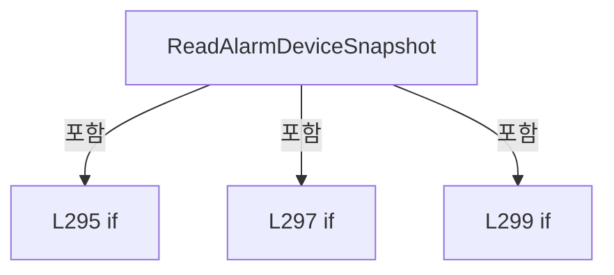

변경 전 점검: 입력/반환 타입, 위 호출자, 예외/취소 경로, 공유 상태와 저장·전송 소비자를 함께 확인합니다. 값의 단위나 물리 방향을 이름만으로 확정하지 않습니다.

### MethodDeclaration `ConnectInterface` · L315–318

[Drilling.Common/Managers/CManager.cs:315–318](https://github.com/kjuws10-rgb/A3Drilling/blob/96e22cd027c84bf302b23f2949b98985d7f301bb/Drilling.Common/Managers/CManager.cs#L315-L318)

| 항목 | 실제 추출 값 |
| --- | --- |
| 서명 | System.Threading.Tasks.Task<int> Drilling.Common.Managers.CManager.ConnectInterface(System.Threading.CancellationToken) |
| 접근/수식자 | Public / public |
| 반환/값 타입 | System.Threading.Tasks.Task<int> |
| 소속 타입 | NamedType:Drilling.Common.Managers.CManager |

입력 계약:

| 이름 | 타입 | 전달 | 선택/기본값 |
| --- | --- | --- | --- |
| cancellationToken | System.Threading.CancellationToken | None | True / null |

현재 부분 분석에서 직접 연결된 호출자는 없습니다. XAML/이벤트/인터페이스·델리게이트·외부 진입을 추가 확인해야 하며, 미사용으로 판정한 것이 아닙니다.

호출하는 대상과 해석 범위:

| 원본 행 | 표현식 | 분석 상태 | 대상/소스 위치 |
| --- | --- | --- | --- |
| 317 | _interfaceManager.Connect | resolved | System.Threading.Tasks.Task<int> Drilling.Common.Interface.CInterfaceManager.Connect(bool, System.Threading.CancellationToken) · Drilling.Common/Interface/CInterfaceManager.cs:198 |

본문의 실제 연산·분기·예외·반환 순서(원문 위치 순):

| 원본 행 | 종류 | 주석 해설 |
| --- | --- | --- |
| 317 | call | 함수·델리게이트 또는 객체 생성자를 호출합니다: _interfaceManager.Connect(cancellationToken: cancellationToken) |
| 317 | return | 호출자에게 값 또는 제어를 반환합니다: return _interfaceManager.Connect(cancellationToken: cancellationToken); |

변경 전 점검: 입력/반환 타입, 위 호출자, 예외/취소 경로, 공유 상태와 저장·전송 소비자를 함께 확인합니다. 값의 단위나 물리 방향을 이름만으로 확정하지 않습니다.

### MethodDeclaration `DisconnectInterface` · L320–323

[Drilling.Common/Managers/CManager.cs:320–323](https://github.com/kjuws10-rgb/A3Drilling/blob/96e22cd027c84bf302b23f2949b98985d7f301bb/Drilling.Common/Managers/CManager.cs#L320-L323)

| 항목 | 실제 추출 값 |
| --- | --- |
| 서명 | System.Threading.Tasks.Task<int> Drilling.Common.Managers.CManager.DisconnectInterface(System.Threading.CancellationToken) |
| 접근/수식자 | Public / public |
| 반환/값 타입 | System.Threading.Tasks.Task<int> |
| 소속 타입 | NamedType:Drilling.Common.Managers.CManager |

입력 계약:

| 이름 | 타입 | 전달 | 선택/기본값 |
| --- | --- | --- | --- |
| cancellationToken | System.Threading.CancellationToken | None | True / null |

현재 부분 분석에서 직접 연결된 호출자는 없습니다. XAML/이벤트/인터페이스·델리게이트·외부 진입을 추가 확인해야 하며, 미사용으로 판정한 것이 아닙니다.

호출하는 대상과 해석 범위:

| 원본 행 | 표현식 | 분석 상태 | 대상/소스 위치 |
| --- | --- | --- | --- |
| 322 | _interfaceManager.Disconnect | resolved | System.Threading.Tasks.Task<int> Drilling.Common.Interface.CInterfaceManager.Disconnect(System.Threading.CancellationToken) · Drilling.Common/Interface/CInterfaceManager.cs:237 |

본문의 실제 연산·분기·예외·반환 순서(원문 위치 순):

| 원본 행 | 종류 | 주석 해설 |
| --- | --- | --- |
| 322 | call | 함수·델리게이트 또는 객체 생성자를 호출합니다: _interfaceManager.Disconnect(cancellationToken) |
| 322 | return | 호출자에게 값 또는 제어를 반환합니다: return _interfaceManager.Disconnect(cancellationToken); |

변경 전 점검: 입력/반환 타입, 위 호출자, 예외/취소 경로, 공유 상태와 저장·전송 소비자를 함께 확인합니다. 값의 단위나 물리 방향을 이름만으로 확정하지 않습니다.

### MethodDeclaration `ReconnectInterface` · L325–328

[Drilling.Common/Managers/CManager.cs:325–328](https://github.com/kjuws10-rgb/A3Drilling/blob/96e22cd027c84bf302b23f2949b98985d7f301bb/Drilling.Common/Managers/CManager.cs#L325-L328)

| 항목 | 실제 추출 값 |
| --- | --- |
| 서명 | System.Threading.Tasks.Task Drilling.Common.Managers.CManager.ReconnectInterface(Drilling.Common.Interface.EN_EQP_MODULE, int, System.Threading.CancellationToken) |
| 접근/수식자 | Public / public |
| 반환/값 타입 | System.Threading.Tasks.Task |
| 소속 타입 | NamedType:Drilling.Common.Managers.CManager |

입력 계약:

| 이름 | 타입 | 전달 | 선택/기본값 |
| --- | --- | --- | --- |
| module | Drilling.Common.Interface.EN_EQP_MODULE | None | False /  |
| number | int | None | False /  |
| cancellationToken | System.Threading.CancellationToken | None | True / null |

현재 부분 분석에서 직접 연결된 호출자는 없습니다. XAML/이벤트/인터페이스·델리게이트·외부 진입을 추가 확인해야 하며, 미사용으로 판정한 것이 아닙니다.

호출하는 대상과 해석 범위:

| 원본 행 | 표현식 | 분석 상태 | 대상/소스 위치 |
| --- | --- | --- | --- |
| 327 | _interfaceManager.Reconnect | resolved | System.Threading.Tasks.Task Drilling.Common.Interface.CInterfaceManager.Reconnect(Drilling.Common.Interface.EN_EQP_MODULE, int, System.Threading.CancellationToken) · Drilling.Common/Interface/CInterfaceManager.cs:292 |

본문의 실제 연산·분기·예외·반환 순서(원문 위치 순):

| 원본 행 | 종류 | 주석 해설 |
| --- | --- | --- |
| 327 | call | 함수·델리게이트 또는 객체 생성자를 호출합니다: _interfaceManager.Reconnect(module, number, cancellationToken) |
| 327 | return | 호출자에게 값 또는 제어를 반환합니다: return _interfaceManager.Reconnect(module, number, cancellationToken); |

변경 전 점검: 입력/반환 타입, 위 호출자, 예외/취소 경로, 공유 상태와 저장·전송 소비자를 함께 확인합니다. 값의 단위나 물리 방향을 이름만으로 확정하지 않습니다.

### MethodDeclaration `Station` · L330–333

[Drilling.Common/Managers/CManager.cs:330–333](https://github.com/kjuws10-rgb/A3Drilling/blob/96e22cd027c84bf302b23f2949b98985d7f301bb/Drilling.Common/Managers/CManager.cs#L330-L333)

| 항목 | 실제 추출 값 |
| --- | --- |
| 서명 | Drilling.Common.Station.CStationManager Drilling.Common.Managers.CManager.Station() |
| 접근/수식자 | Public / public |
| 반환/값 타입 | Drilling.Common.Station.CStationManager |
| 소속 타입 | NamedType:Drilling.Common.Managers.CManager |

정적 호출자로 확인된 위치:

| 호출 파일/행 | 호출 표현식 | 런타임 분기 가능 |
| --- | --- | --- |
| [Drilling.UI/CAppStartup.cs:55–55](https://github.com/kjuws10-rgb/A3Drilling/blob/96e22cd027c84bf302b23f2949b98985d7f301bb/Drilling.UI/CAppStartup.cs#L55-L55) | manager.Station | False |
| [Drilling.UI/Menu/Menus/CMenuCorrection.cs:193–193](https://github.com/kjuws10-rgb/A3Drilling/blob/96e22cd027c84bf302b23f2949b98985d7f301bb/Drilling.UI/Menu/Menus/CMenuCorrection.cs#L193-L193) | .Station | False |
| [Drilling.UI/Menu/Menus/CMenuCorrection.cs:3548–3548](https://github.com/kjuws10-rgb/A3Drilling/blob/96e22cd027c84bf302b23f2949b98985d7f301bb/Drilling.UI/Menu/Menus/CMenuCorrection.cs#L3548-L3548) | manager.Station | False |
| [Drilling.UI/Menu/Menus/CMenuCorrection.cs:3600–3600](https://github.com/kjuws10-rgb/A3Drilling/blob/96e22cd027c84bf302b23f2949b98985d7f301bb/Drilling.UI/Menu/Menus/CMenuCorrection.cs#L3600-L3600) | manager.Station | False |
| [Drilling.UI/Menu/Menus/CMenuCorrection.cs:3600–3600](https://github.com/kjuws10-rgb/A3Drilling/blob/96e22cd027c84bf302b23f2949b98985d7f301bb/Drilling.UI/Menu/Menus/CMenuCorrection.cs#L3600-L3600) | manager.Station | False |
| [Drilling.UI/Menu/Menus/CMenuCorrection.cs:3600–3600](https://github.com/kjuws10-rgb/A3Drilling/blob/96e22cd027c84bf302b23f2949b98985d7f301bb/Drilling.UI/Menu/Menus/CMenuCorrection.cs#L3600-L3600) | manager.Station | False |
| [Drilling.UI/Menu/Menus/CMenuCorrection.cs:4100–4100](https://github.com/kjuws10-rgb/A3Drilling/blob/96e22cd027c84bf302b23f2949b98985d7f301bb/Drilling.UI/Menu/Menus/CMenuCorrection.cs#L4100-L4100) | .Station | False |
| [Drilling.UI/Menu/Menus/CMenuManual.cs:439–439](https://github.com/kjuws10-rgb/A3Drilling/blob/96e22cd027c84bf302b23f2949b98985d7f301bb/Drilling.UI/Menu/Menus/CMenuManual.cs#L439-L439) | _manager.Station | False |
| [Drilling.UI/Menu/Menus/CMenuManual.cs:1283–1283](https://github.com/kjuws10-rgb/A3Drilling/blob/96e22cd027c84bf302b23f2949b98985d7f301bb/Drilling.UI/Menu/Menus/CMenuManual.cs#L1283-L1283) | _manager.Station | False |
| [Drilling.UI/Menu/Menus/CMenuManual.cs:1323–1323](https://github.com/kjuws10-rgb/A3Drilling/blob/96e22cd027c84bf302b23f2949b98985d7f301bb/Drilling.UI/Menu/Menus/CMenuManual.cs#L1323-L1323) | _manager.Station | False |
| [Drilling.UI/Menu/Menus/CMenuManual.cs:1901–1901](https://github.com/kjuws10-rgb/A3Drilling/blob/96e22cd027c84bf302b23f2949b98985d7f301bb/Drilling.UI/Menu/Menus/CMenuManual.cs#L1901-L1901) | _manager.Station | False |
| [Drilling.UI/Menu/Menus/CMenuManual.cs:3280–3280](https://github.com/kjuws10-rgb/A3Drilling/blob/96e22cd027c84bf302b23f2949b98985d7f301bb/Drilling.UI/Menu/Menus/CMenuManual.cs#L3280-L3280) | _manager.Station | False |
| [Drilling.UI/Menu/Menus/CMenuManual.cs:3280–3280](https://github.com/kjuws10-rgb/A3Drilling/blob/96e22cd027c84bf302b23f2949b98985d7f301bb/Drilling.UI/Menu/Menus/CMenuManual.cs#L3280-L3280) | _manager.Station | False |
| [Drilling.UI/Menu/Menus/CMenuManual.cs:3320–3320](https://github.com/kjuws10-rgb/A3Drilling/blob/96e22cd027c84bf302b23f2949b98985d7f301bb/Drilling.UI/Menu/Menus/CMenuManual.cs#L3320-L3320) | _manager.Station | False |
| [Drilling.UI/Menu/Menus/CMenuManual.cs:3325–3325](https://github.com/kjuws10-rgb/A3Drilling/blob/96e22cd027c84bf302b23f2949b98985d7f301bb/Drilling.UI/Menu/Menus/CMenuManual.cs#L3325-L3325) | _manager.Station | False |
| [Drilling.UI/Menu/Menus/CMenuManual.cs:3360–3360](https://github.com/kjuws10-rgb/A3Drilling/blob/96e22cd027c84bf302b23f2949b98985d7f301bb/Drilling.UI/Menu/Menus/CMenuManual.cs#L3360-L3360) | _manager.Station | False |
| [Drilling.UI/Menu/Menus/CMenuManual.cs:3368–3368](https://github.com/kjuws10-rgb/A3Drilling/blob/96e22cd027c84bf302b23f2949b98985d7f301bb/Drilling.UI/Menu/Menus/CMenuManual.cs#L3368-L3368) | _manager.Station | False |
| [Drilling.UI/Menu/Menus/CMenuManual.cs:3391–3391](https://github.com/kjuws10-rgb/A3Drilling/blob/96e22cd027c84bf302b23f2949b98985d7f301bb/Drilling.UI/Menu/Menus/CMenuManual.cs#L3391-L3391) | _manager.Station | False |
| [Drilling.UI/Menu/Menus/CMenuManual.cs:4776–4776](https://github.com/kjuws10-rgb/A3Drilling/blob/96e22cd027c84bf302b23f2949b98985d7f301bb/Drilling.UI/Menu/Menus/CMenuManual.cs#L4776-L4776) | _manager.Station | False |
| [Drilling.UI/Menu/Menus/CMenuManual.cs:6322–6322](https://github.com/kjuws10-rgb/A3Drilling/blob/96e22cd027c84bf302b23f2949b98985d7f301bb/Drilling.UI/Menu/Menus/CMenuManual.cs#L6322-L6322) | _manager.Station | False |
| [Drilling.UI/Menu/Menus/CMenuManual.cs:6322–6322](https://github.com/kjuws10-rgb/A3Drilling/blob/96e22cd027c84bf302b23f2949b98985d7f301bb/Drilling.UI/Menu/Menus/CMenuManual.cs#L6322-L6322) | _manager.Station | False |
| [Drilling.UI/Menu/Menus/CMenuManual.cs:6322–6322](https://github.com/kjuws10-rgb/A3Drilling/blob/96e22cd027c84bf302b23f2949b98985d7f301bb/Drilling.UI/Menu/Menus/CMenuManual.cs#L6322-L6322) | _manager.Station | False |

본문의 실제 연산·분기·예외·반환 순서(원문 위치 순):

| 원본 행 | 종류 | 주석 해설 |
| --- | --- | --- |
| 332 | return | 호출자에게 값 또는 제어를 반환합니다: return _stationManager; |

변경 전 점검: 입력/반환 타입, 위 호출자, 예외/취소 경로, 공유 상태와 저장·전송 소비자를 함께 확인합니다. 값의 단위나 물리 방향을 이름만으로 확정하지 않습니다.

### MethodDeclaration `Recipe` · L335–338

[Drilling.Common/Managers/CManager.cs:335–338](https://github.com/kjuws10-rgb/A3Drilling/blob/96e22cd027c84bf302b23f2949b98985d7f301bb/Drilling.Common/Managers/CManager.cs#L335-L338)

| 항목 | 실제 추출 값 |
| --- | --- |
| 서명 | Drilling.Common.Managers.CRecipeManager Drilling.Common.Managers.CManager.Recipe() |
| 접근/수식자 | Public / public |
| 반환/값 타입 | Drilling.Common.Managers.CRecipeManager |
| 소속 타입 | NamedType:Drilling.Common.Managers.CManager |

정적 호출자로 확인된 위치:

| 호출 파일/행 | 호출 표현식 | 런타임 분기 가능 |
| --- | --- | --- |
| [Drilling.Common/Interface/CPowerMeasureRun.cs:116–116](https://github.com/kjuws10-rgb/A3Drilling/blob/96e22cd027c84bf302b23f2949b98985d7f301bb/Drilling.Common/Interface/CPowerMeasureRun.cs#L116-L116) | manager.Recipe | False |
| [Drilling.UI/CAppStartup.cs:61–61](https://github.com/kjuws10-rgb/A3Drilling/blob/96e22cd027c84bf302b23f2949b98985d7f301bb/Drilling.UI/CAppStartup.cs#L61-L61) | manager.Recipe | False |
| [Drilling.UI/Menu/Menus/CMenuManual.cs:1610–1610](https://github.com/kjuws10-rgb/A3Drilling/blob/96e22cd027c84bf302b23f2949b98985d7f301bb/Drilling.UI/Menu/Menus/CMenuManual.cs#L1610-L1610) | _manager.Recipe | False |

본문의 실제 연산·분기·예외·반환 순서(원문 위치 순):

| 원본 행 | 종류 | 주석 해설 |
| --- | --- | --- |
| 337 | return | 호출자에게 값 또는 제어를 반환합니다: return _recipeManager; |

변경 전 점검: 입력/반환 타입, 위 호출자, 예외/취소 경로, 공유 상태와 저장·전송 소비자를 함께 확인합니다. 값의 단위나 물리 방향을 이름만으로 확정하지 않습니다.

### MethodDeclaration `Setting` · L340–343

[Drilling.Common/Managers/CManager.cs:340–343](https://github.com/kjuws10-rgb/A3Drilling/blob/96e22cd027c84bf302b23f2949b98985d7f301bb/Drilling.Common/Managers/CManager.cs#L340-L343)

| 항목 | 실제 추출 값 |
| --- | --- |
| 서명 | Drilling.Common.Managers.CSettingManager Drilling.Common.Managers.CManager.Setting() |
| 접근/수식자 | Public / public |
| 반환/값 타입 | Drilling.Common.Managers.CSettingManager |
| 소속 타입 | NamedType:Drilling.Common.Managers.CManager |

정적 호출자로 확인된 위치:

| 호출 파일/행 | 호출 표현식 | 런타임 분기 가능 |
| --- | --- | --- |
| [Drilling.Common/Interface/CPowerMeasureRun.cs:161–161](https://github.com/kjuws10-rgb/A3Drilling/blob/96e22cd027c84bf302b23f2949b98985d7f301bb/Drilling.Common/Interface/CPowerMeasureRun.cs#L161-L161) | manager.Setting | False |
| [Drilling.Common/Interface/CPowerMeasureRun.cs:162–162](https://github.com/kjuws10-rgb/A3Drilling/blob/96e22cd027c84bf302b23f2949b98985d7f301bb/Drilling.Common/Interface/CPowerMeasureRun.cs#L162-L162) | manager.Setting | False |
| [Drilling.Common/Interface/CPowerMeasureRun.cs:252–252](https://github.com/kjuws10-rgb/A3Drilling/blob/96e22cd027c84bf302b23f2949b98985d7f301bb/Drilling.Common/Interface/CPowerMeasureRun.cs#L252-L252) | manager.Setting | False |
| [Drilling.UI/CAppStartup.cs:62–62](https://github.com/kjuws10-rgb/A3Drilling/blob/96e22cd027c84bf302b23f2949b98985d7f301bb/Drilling.UI/CAppStartup.cs#L62-L62) | manager.Setting | False |
| [Drilling.UI/CRootView.cs:559–559](https://github.com/kjuws10-rgb/A3Drilling/blob/96e22cd027c84bf302b23f2949b98985d7f301bb/Drilling.UI/CRootView.cs#L559-L559) | _manager.Setting | False |
| [Drilling.UI/CRootView.cs:1400–1400](https://github.com/kjuws10-rgb/A3Drilling/blob/96e22cd027c84bf302b23f2949b98985d7f301bb/Drilling.UI/CRootView.cs#L1400-L1400) | _manager.Setting | False |
| [Drilling.UI/CRootView.cs:1408–1408](https://github.com/kjuws10-rgb/A3Drilling/blob/96e22cd027c84bf302b23f2949b98985d7f301bb/Drilling.UI/CRootView.cs#L1408-L1408) | _manager.Setting | False |
| [Drilling.UI/CRootView.cs:1904–1904](https://github.com/kjuws10-rgb/A3Drilling/blob/96e22cd027c84bf302b23f2949b98985d7f301bb/Drilling.UI/CRootView.cs#L1904-L1904) | _manager.Setting | False |
| [Drilling.UI/CRootView.cs:2777–2777](https://github.com/kjuws10-rgb/A3Drilling/blob/96e22cd027c84bf302b23f2949b98985d7f301bb/Drilling.UI/CRootView.cs#L2777-L2777) | _manager.Setting | False |
| [Drilling.UI/CRootView.cs:2868–2868](https://github.com/kjuws10-rgb/A3Drilling/blob/96e22cd027c84bf302b23f2949b98985d7f301bb/Drilling.UI/CRootView.cs#L2868-L2868) | _manager.Setting | False |
| [Drilling.UI/Menu/Menus/CMenuManual.cs:1079–1079](https://github.com/kjuws10-rgb/A3Drilling/blob/96e22cd027c84bf302b23f2949b98985d7f301bb/Drilling.UI/Menu/Menus/CMenuManual.cs#L1079-L1079) | _manager.Setting | False |
| [Drilling.UI/Menu/Menus/CMenuManual.cs:1086–1086](https://github.com/kjuws10-rgb/A3Drilling/blob/96e22cd027c84bf302b23f2949b98985d7f301bb/Drilling.UI/Menu/Menus/CMenuManual.cs#L1086-L1086) | _manager.Setting | False |
| [Drilling.UI/Menu/Menus/CMenuManual.cs:1440–1440](https://github.com/kjuws10-rgb/A3Drilling/blob/96e22cd027c84bf302b23f2949b98985d7f301bb/Drilling.UI/Menu/Menus/CMenuManual.cs#L1440-L1440) | _manager.Setting | False |
| [Drilling.UI/Menu/Menus/CMenuManual.cs:1739–1739](https://github.com/kjuws10-rgb/A3Drilling/blob/96e22cd027c84bf302b23f2949b98985d7f301bb/Drilling.UI/Menu/Menus/CMenuManual.cs#L1739-L1739) | _manager.Setting | False |
| [Drilling.UI/Menu/Menus/CMenuManual.cs:1784–1784](https://github.com/kjuws10-rgb/A3Drilling/blob/96e22cd027c84bf302b23f2949b98985d7f301bb/Drilling.UI/Menu/Menus/CMenuManual.cs#L1784-L1784) | _manager.Setting | False |
| [Drilling.UI/Menu/Menus/CMenuManual.cs:1876–1876](https://github.com/kjuws10-rgb/A3Drilling/blob/96e22cd027c84bf302b23f2949b98985d7f301bb/Drilling.UI/Menu/Menus/CMenuManual.cs#L1876-L1876) | _manager.Setting | False |
| [Drilling.UI/Menu/Menus/CMenuManual.cs:1981–1981](https://github.com/kjuws10-rgb/A3Drilling/blob/96e22cd027c84bf302b23f2949b98985d7f301bb/Drilling.UI/Menu/Menus/CMenuManual.cs#L1981-L1981) | _manager.Setting | False |
| [Drilling.UI/Menu/Menus/CMenuManual.cs:1997–1997](https://github.com/kjuws10-rgb/A3Drilling/blob/96e22cd027c84bf302b23f2949b98985d7f301bb/Drilling.UI/Menu/Menus/CMenuManual.cs#L1997-L1997) | _manager.Setting | False |
| [Drilling.UI/Menu/Menus/CMenuManual.cs:2248–2248](https://github.com/kjuws10-rgb/A3Drilling/blob/96e22cd027c84bf302b23f2949b98985d7f301bb/Drilling.UI/Menu/Menus/CMenuManual.cs#L2248-L2248) | _manager.Setting | False |
| [Drilling.UI/Menu/Menus/CMenuManual.cs:2582–2582](https://github.com/kjuws10-rgb/A3Drilling/blob/96e22cd027c84bf302b23f2949b98985d7f301bb/Drilling.UI/Menu/Menus/CMenuManual.cs#L2582-L2582) | _manager.Setting | False |
| [Drilling.UI/Menu/Menus/CMenuManual.cs:2769–2769](https://github.com/kjuws10-rgb/A3Drilling/blob/96e22cd027c84bf302b23f2949b98985d7f301bb/Drilling.UI/Menu/Menus/CMenuManual.cs#L2769-L2769) | _manager.Setting | False |
| [Drilling.UI/Menu/Menus/CMenuManual.cs:3347–3347](https://github.com/kjuws10-rgb/A3Drilling/blob/96e22cd027c84bf302b23f2949b98985d7f301bb/Drilling.UI/Menu/Menus/CMenuManual.cs#L3347-L3347) | _manager.Setting | False |
| [Drilling.UI/Menu/Menus/CMenuManual.cs:3458–3458](https://github.com/kjuws10-rgb/A3Drilling/blob/96e22cd027c84bf302b23f2949b98985d7f301bb/Drilling.UI/Menu/Menus/CMenuManual.cs#L3458-L3458) | _manager.Setting | False |
| [Drilling.UI/Menu/Menus/CMenuManual.cs:3600–3600](https://github.com/kjuws10-rgb/A3Drilling/blob/96e22cd027c84bf302b23f2949b98985d7f301bb/Drilling.UI/Menu/Menus/CMenuManual.cs#L3600-L3600) | _manager.Setting | False |
| [Drilling.UI/Menu/Menus/CMenuManual.cs:3647–3647](https://github.com/kjuws10-rgb/A3Drilling/blob/96e22cd027c84bf302b23f2949b98985d7f301bb/Drilling.UI/Menu/Menus/CMenuManual.cs#L3647-L3647) | _manager.Setting | False |
| [Drilling.UI/Menu/Menus/CMenuManual.cs:4146–4146](https://github.com/kjuws10-rgb/A3Drilling/blob/96e22cd027c84bf302b23f2949b98985d7f301bb/Drilling.UI/Menu/Menus/CMenuManual.cs#L4146-L4146) | _manager.Setting | False |
| [Drilling.UI/Menu/Menus/CMenuManual.cs:4381–4381](https://github.com/kjuws10-rgb/A3Drilling/blob/96e22cd027c84bf302b23f2949b98985d7f301bb/Drilling.UI/Menu/Menus/CMenuManual.cs#L4381-L4381) | _manager.Setting | False |
| [Drilling.UI/Menu/Menus/CMenuManual.cs:4664–4664](https://github.com/kjuws10-rgb/A3Drilling/blob/96e22cd027c84bf302b23f2949b98985d7f301bb/Drilling.UI/Menu/Menus/CMenuManual.cs#L4664-L4664) | _manager.Setting | False |
| [Drilling.UI/Menu/Menus/CMenuManual.cs:4788–4788](https://github.com/kjuws10-rgb/A3Drilling/blob/96e22cd027c84bf302b23f2949b98985d7f301bb/Drilling.UI/Menu/Menus/CMenuManual.cs#L4788-L4788) | _manager.Setting | False |
| [Drilling.UI/Menu/Menus/CMenuManual.cs:5289–5289](https://github.com/kjuws10-rgb/A3Drilling/blob/96e22cd027c84bf302b23f2949b98985d7f301bb/Drilling.UI/Menu/Menus/CMenuManual.cs#L5289-L5289) | _manager.Setting | False |
| [Drilling.UI/Menu/Menus/CMenuManual.cs:5358–5358](https://github.com/kjuws10-rgb/A3Drilling/blob/96e22cd027c84bf302b23f2949b98985d7f301bb/Drilling.UI/Menu/Menus/CMenuManual.cs#L5358-L5358) | _manager.Setting | False |
| [Drilling.UI/Menu/Menus/CMenuManual.cs:5523–5523](https://github.com/kjuws10-rgb/A3Drilling/blob/96e22cd027c84bf302b23f2949b98985d7f301bb/Drilling.UI/Menu/Menus/CMenuManual.cs#L5523-L5523) | _manager.Setting | False |

본문의 실제 연산·분기·예외·반환 순서(원문 위치 순):

| 원본 행 | 종류 | 주석 해설 |
| --- | --- | --- |
| 342 | return | 호출자에게 값 또는 제어를 반환합니다: return _settingManager; |

변경 전 점검: 입력/반환 타입, 위 호출자, 예외/취소 경로, 공유 상태와 저장·전송 소비자를 함께 확인합니다. 값의 단위나 물리 방향을 이름만으로 확정하지 않습니다.

### MethodDeclaration `Product` · L345–348

[Drilling.Common/Managers/CManager.cs:345–348](https://github.com/kjuws10-rgb/A3Drilling/blob/96e22cd027c84bf302b23f2949b98985d7f301bb/Drilling.Common/Managers/CManager.cs#L345-L348)

| 항목 | 실제 추출 값 |
| --- | --- |
| 서명 | Drilling.Common.Product.CProductManager Drilling.Common.Managers.CManager.Product() |
| 접근/수식자 | Public / public |
| 반환/값 타입 | Drilling.Common.Product.CProductManager |
| 소속 타입 | NamedType:Drilling.Common.Managers.CManager |

정적 호출자로 확인된 위치:

| 호출 파일/행 | 호출 표현식 | 런타임 분기 가능 |
| --- | --- | --- |
| [Drilling.UI/CAppStartup.cs:63–63](https://github.com/kjuws10-rgb/A3Drilling/blob/96e22cd027c84bf302b23f2949b98985d7f301bb/Drilling.UI/CAppStartup.cs#L63-L63) | manager.Product | False |

본문의 실제 연산·분기·예외·반환 순서(원문 위치 순):

| 원본 행 | 종류 | 주석 해설 |
| --- | --- | --- |
| 347 | return | 호출자에게 값 또는 제어를 반환합니다: return _productManager; |

변경 전 점검: 입력/반환 타입, 위 호출자, 예외/취소 경로, 공유 상태와 저장·전송 소비자를 함께 확인합니다. 값의 단위나 물리 방향을 이름만으로 확정하지 않습니다.

### MethodDeclaration `Review` · L350–353

[Drilling.Common/Managers/CManager.cs:350–353](https://github.com/kjuws10-rgb/A3Drilling/blob/96e22cd027c84bf302b23f2949b98985d7f301bb/Drilling.Common/Managers/CManager.cs#L350-L353)

| 항목 | 실제 추출 값 |
| --- | --- |
| 서명 | Drilling.Common.Review.CReviewManager Drilling.Common.Managers.CManager.Review() |
| 접근/수식자 | Public / public |
| 반환/값 타입 | Drilling.Common.Review.CReviewManager |
| 소속 타입 | NamedType:Drilling.Common.Managers.CManager |

정적 호출자로 확인된 위치:

| 호출 파일/행 | 호출 표현식 | 런타임 분기 가능 |
| --- | --- | --- |
| [Drilling.UI/CAppStartup.cs:64–64](https://github.com/kjuws10-rgb/A3Drilling/blob/96e22cd027c84bf302b23f2949b98985d7f301bb/Drilling.UI/CAppStartup.cs#L64-L64) | manager.Review | False |
| [Drilling.UI/Menu/Menus/CMenuManual.cs:3282–3282](https://github.com/kjuws10-rgb/A3Drilling/blob/96e22cd027c84bf302b23f2949b98985d7f301bb/Drilling.UI/Menu/Menus/CMenuManual.cs#L3282-L3282) | _manager.Review | False |

본문의 실제 연산·분기·예외·반환 순서(원문 위치 순):

| 원본 행 | 종류 | 주석 해설 |
| --- | --- | --- |
| 352 | return | 호출자에게 값 또는 제어를 반환합니다: return _reviewManager; |

변경 전 점검: 입력/반환 타입, 위 호출자, 예외/취소 경로, 공유 상태와 저장·전송 소비자를 함께 확인합니다. 값의 단위나 물리 방향을 이름만으로 확정하지 않습니다.

### MethodDeclaration `Interface` · L355–358

[Drilling.Common/Managers/CManager.cs:355–358](https://github.com/kjuws10-rgb/A3Drilling/blob/96e22cd027c84bf302b23f2949b98985d7f301bb/Drilling.Common/Managers/CManager.cs#L355-L358)

| 항목 | 실제 추출 값 |
| --- | --- |
| 서명 | Drilling.Common.Interface.CInterfaceManager Drilling.Common.Managers.CManager.Interface() |
| 접근/수식자 | Public / public |
| 반환/값 타입 | Drilling.Common.Interface.CInterfaceManager |
| 소속 타입 | NamedType:Drilling.Common.Managers.CManager |

정적 호출자로 확인된 위치:

| 호출 파일/행 | 호출 표현식 | 런타임 분기 가능 |
| --- | --- | --- |
| [Drilling.Common/Interface/CPowerMeasureRun.cs:163–163](https://github.com/kjuws10-rgb/A3Drilling/blob/96e22cd027c84bf302b23f2949b98985d7f301bb/Drilling.Common/Interface/CPowerMeasureRun.cs#L163-L163) | manager.Interface | False |
| [Drilling.UI/CAppStartup.cs:56–56](https://github.com/kjuws10-rgb/A3Drilling/blob/96e22cd027c84bf302b23f2949b98985d7f301bb/Drilling.UI/CAppStartup.cs#L56-L56) | manager.Interface | False |
| [Drilling.UI/Menu/Menus/CMenuCorrection.cs:3511–3511](https://github.com/kjuws10-rgb/A3Drilling/blob/96e22cd027c84bf302b23f2949b98985d7f301bb/Drilling.UI/Menu/Menus/CMenuCorrection.cs#L3511-L3511) | manager.Interface | False |
| [Drilling.UI/Menu/Menus/CMenuCorrection.cs:3519–3519](https://github.com/kjuws10-rgb/A3Drilling/blob/96e22cd027c84bf302b23f2949b98985d7f301bb/Drilling.UI/Menu/Menus/CMenuCorrection.cs#L3519-L3519) | manager.Interface | False |
| [Drilling.UI/Menu/Menus/CMenuCorrection.cs:3520–3520](https://github.com/kjuws10-rgb/A3Drilling/blob/96e22cd027c84bf302b23f2949b98985d7f301bb/Drilling.UI/Menu/Menus/CMenuCorrection.cs#L3520-L3520) | manager.Interface | False |
| [Drilling.UI/Menu/Menus/CMenuCorrection.cs:3521–3521](https://github.com/kjuws10-rgb/A3Drilling/blob/96e22cd027c84bf302b23f2949b98985d7f301bb/Drilling.UI/Menu/Menus/CMenuCorrection.cs#L3521-L3521) | manager.Interface | False |
| [Drilling.UI/Menu/Menus/CMenuCorrection.cs:3523–3523](https://github.com/kjuws10-rgb/A3Drilling/blob/96e22cd027c84bf302b23f2949b98985d7f301bb/Drilling.UI/Menu/Menus/CMenuCorrection.cs#L3523-L3523) | manager.Interface | False |
| [Drilling.UI/Menu/Menus/CMenuCorrection.cs:3565–3565](https://github.com/kjuws10-rgb/A3Drilling/blob/96e22cd027c84bf302b23f2949b98985d7f301bb/Drilling.UI/Menu/Menus/CMenuCorrection.cs#L3565-L3565) | manager.Interface | False |
| [Drilling.UI/Menu/Menus/CMenuCorrection.cs:3629–3629](https://github.com/kjuws10-rgb/A3Drilling/blob/96e22cd027c84bf302b23f2949b98985d7f301bb/Drilling.UI/Menu/Menus/CMenuCorrection.cs#L3629-L3629) | _defaultManager!.Interface | False |
| [Drilling.UI/Menu/Menus/CMenuCorrection.cs:3647–3647](https://github.com/kjuws10-rgb/A3Drilling/blob/96e22cd027c84bf302b23f2949b98985d7f301bb/Drilling.UI/Menu/Menus/CMenuCorrection.cs#L3647-L3647) | manager.Interface | False |
| [Drilling.UI/Menu/Menus/CMenuCorrection.cs:3655–3655](https://github.com/kjuws10-rgb/A3Drilling/blob/96e22cd027c84bf302b23f2949b98985d7f301bb/Drilling.UI/Menu/Menus/CMenuCorrection.cs#L3655-L3655) | manager.Interface | False |
| [Drilling.UI/Menu/Menus/CMenuManual.cs:184–184](https://github.com/kjuws10-rgb/A3Drilling/blob/96e22cd027c84bf302b23f2949b98985d7f301bb/Drilling.UI/Menu/Menus/CMenuManual.cs#L184-L184) | _manager.Interface | False |
| [Drilling.UI/Menu/Menus/CMenuManual.cs:192–192](https://github.com/kjuws10-rgb/A3Drilling/blob/96e22cd027c84bf302b23f2949b98985d7f301bb/Drilling.UI/Menu/Menus/CMenuManual.cs#L192-L192) | _manager.Interface | False |
| [Drilling.UI/Menu/Menus/CMenuManual.cs:1278–1278](https://github.com/kjuws10-rgb/A3Drilling/blob/96e22cd027c84bf302b23f2949b98985d7f301bb/Drilling.UI/Menu/Menus/CMenuManual.cs#L1278-L1278) | _manager.Interface | False |
| [Drilling.UI/Menu/Menus/CMenuManual.cs:2233–2233](https://github.com/kjuws10-rgb/A3Drilling/blob/96e22cd027c84bf302b23f2949b98985d7f301bb/Drilling.UI/Menu/Menus/CMenuManual.cs#L2233-L2233) | _manager.Interface | False |
| [Drilling.UI/Menu/Menus/CMenuManual.cs:3254–3254](https://github.com/kjuws10-rgb/A3Drilling/blob/96e22cd027c84bf302b23f2949b98985d7f301bb/Drilling.UI/Menu/Menus/CMenuManual.cs#L3254-L3254) | _manager.Interface | False |
| [Drilling.UI/Menu/Menus/CMenuManual.cs:3265–3265](https://github.com/kjuws10-rgb/A3Drilling/blob/96e22cd027c84bf302b23f2949b98985d7f301bb/Drilling.UI/Menu/Menus/CMenuManual.cs#L3265-L3265) | _manager.Interface | False |
| [Drilling.UI/Menu/Menus/CMenuManual.cs:3270–3270](https://github.com/kjuws10-rgb/A3Drilling/blob/96e22cd027c84bf302b23f2949b98985d7f301bb/Drilling.UI/Menu/Menus/CMenuManual.cs#L3270-L3270) | _manager.Interface | False |
| [Drilling.UI/Menu/Menus/CMenuManual.cs:3271–3271](https://github.com/kjuws10-rgb/A3Drilling/blob/96e22cd027c84bf302b23f2949b98985d7f301bb/Drilling.UI/Menu/Menus/CMenuManual.cs#L3271-L3271) | _manager.Interface | False |
| [Drilling.UI/Menu/Menus/CMenuManual.cs:3273–3273](https://github.com/kjuws10-rgb/A3Drilling/blob/96e22cd027c84bf302b23f2949b98985d7f301bb/Drilling.UI/Menu/Menus/CMenuManual.cs#L3273-L3273) | _manager.Interface | False |
| [Drilling.UI/Menu/Menus/CMenuManual.cs:3281–3281](https://github.com/kjuws10-rgb/A3Drilling/blob/96e22cd027c84bf302b23f2949b98985d7f301bb/Drilling.UI/Menu/Menus/CMenuManual.cs#L3281-L3281) | _manager.Interface | False |
| [Drilling.UI/Menu/Menus/CMenuManual.cs:3293–3293](https://github.com/kjuws10-rgb/A3Drilling/blob/96e22cd027c84bf302b23f2949b98985d7f301bb/Drilling.UI/Menu/Menus/CMenuManual.cs#L3293-L3293) | _manager.Interface | False |
| [Drilling.UI/Menu/Menus/CMenuManual.cs:3304–3304](https://github.com/kjuws10-rgb/A3Drilling/blob/96e22cd027c84bf302b23f2949b98985d7f301bb/Drilling.UI/Menu/Menus/CMenuManual.cs#L3304-L3304) | _manager.Interface | False |
| [Drilling.UI/Menu/Menus/CMenuManual.cs:3312–3312](https://github.com/kjuws10-rgb/A3Drilling/blob/96e22cd027c84bf302b23f2949b98985d7f301bb/Drilling.UI/Menu/Menus/CMenuManual.cs#L3312-L3312) | _manager.Interface | False |
| [Drilling.UI/Menu/Menus/CMenuManual.cs:4547–4547](https://github.com/kjuws10-rgb/A3Drilling/blob/96e22cd027c84bf302b23f2949b98985d7f301bb/Drilling.UI/Menu/Menus/CMenuManual.cs#L4547-L4547) | _manager.Interface | False |
| [Drilling.UI/Menu/Menus/CMenuManual.cs:6284–6284](https://github.com/kjuws10-rgb/A3Drilling/blob/96e22cd027c84bf302b23f2949b98985d7f301bb/Drilling.UI/Menu/Menus/CMenuManual.cs#L6284-L6284) | _manager.Interface | False |
| [Drilling.UI/Menu/Menus/CMenuManual.cs:6288–6288](https://github.com/kjuws10-rgb/A3Drilling/blob/96e22cd027c84bf302b23f2949b98985d7f301bb/Drilling.UI/Menu/Menus/CMenuManual.cs#L6288-L6288) | _manager.Interface | False |
| [Drilling.UI/Menu/Menus/CMenuManual.cs:6289–6289](https://github.com/kjuws10-rgb/A3Drilling/blob/96e22cd027c84bf302b23f2949b98985d7f301bb/Drilling.UI/Menu/Menus/CMenuManual.cs#L6289-L6289) | _manager.Interface | False |
| [Drilling.UI/Menu/Menus/CMenuManual.cs:6290–6290](https://github.com/kjuws10-rgb/A3Drilling/blob/96e22cd027c84bf302b23f2949b98985d7f301bb/Drilling.UI/Menu/Menus/CMenuManual.cs#L6290-L6290) | _manager.Interface | False |
| [Drilling.UI/Menu/Menus/CMenuManual.cs:6407–6407](https://github.com/kjuws10-rgb/A3Drilling/blob/96e22cd027c84bf302b23f2949b98985d7f301bb/Drilling.UI/Menu/Menus/CMenuManual.cs#L6407-L6407) | _manager.Interface | False |
| [Drilling.UI/Menu/Menus/CMenuManual.cs:6573–6573](https://github.com/kjuws10-rgb/A3Drilling/blob/96e22cd027c84bf302b23f2949b98985d7f301bb/Drilling.UI/Menu/Menus/CMenuManual.cs#L6573-L6573) | _manager.Interface | False |
| [Drilling.UI/Menu/Menus/CMenuManual.cs:6603–6603](https://github.com/kjuws10-rgb/A3Drilling/blob/96e22cd027c84bf302b23f2949b98985d7f301bb/Drilling.UI/Menu/Menus/CMenuManual.cs#L6603-L6603) | _manager.Interface | False |
| [Drilling.UI/Menu/Menus/CMenuManual.cs:6617–6617](https://github.com/kjuws10-rgb/A3Drilling/blob/96e22cd027c84bf302b23f2949b98985d7f301bb/Drilling.UI/Menu/Menus/CMenuManual.cs#L6617-L6617) | _manager.Interface | False |

본문의 실제 연산·분기·예외·반환 순서(원문 위치 순):

| 원본 행 | 종류 | 주석 해설 |
| --- | --- | --- |
| 357 | return | 호출자에게 값 또는 제어를 반환합니다: return _interfaceManager; |

변경 전 점검: 입력/반환 타입, 위 호출자, 예외/취소 경로, 공유 상태와 저장·전송 소비자를 함께 확인합니다. 값의 단위나 물리 방향을 이름만으로 확정하지 않습니다.

### MethodDeclaration `Automation` · L360–363

[Drilling.Common/Managers/CManager.cs:360–363](https://github.com/kjuws10-rgb/A3Drilling/blob/96e22cd027c84bf302b23f2949b98985d7f301bb/Drilling.Common/Managers/CManager.cs#L360-L363)

| 항목 | 실제 추출 값 |
| --- | --- |
| 서명 | Drilling.Common.Automation.CAutomationManager Drilling.Common.Managers.CManager.Automation() |
| 접근/수식자 | Public / public |
| 반환/값 타입 | Drilling.Common.Automation.CAutomationManager |
| 소속 타입 | NamedType:Drilling.Common.Managers.CManager |

정적 호출자로 확인된 위치:

| 호출 파일/행 | 호출 표현식 | 런타임 분기 가능 |
| --- | --- | --- |
| [Drilling.Common/Interface/CPowerMeasureRun.cs:164–164](https://github.com/kjuws10-rgb/A3Drilling/blob/96e22cd027c84bf302b23f2949b98985d7f301bb/Drilling.Common/Interface/CPowerMeasureRun.cs#L164-L164) | manager.Automation | False |
| [Drilling.UI/CRootView.cs:2188–2188](https://github.com/kjuws10-rgb/A3Drilling/blob/96e22cd027c84bf302b23f2949b98985d7f301bb/Drilling.UI/CRootView.cs#L2188-L2188) | _manager.Automation | False |
| [Drilling.UI/Menu/Menus/CMenuManual.cs:183–183](https://github.com/kjuws10-rgb/A3Drilling/blob/96e22cd027c84bf302b23f2949b98985d7f301bb/Drilling.UI/Menu/Menus/CMenuManual.cs#L183-L183) | _manager.Automation | False |

본문의 실제 연산·분기·예외·반환 순서(원문 위치 순):

| 원본 행 | 종류 | 주석 해설 |
| --- | --- | --- |
| 362 | return | 호출자에게 값 또는 제어를 반환합니다: return _automationManager; |

변경 전 점검: 입력/반환 타입, 위 호출자, 예외/취소 경로, 공유 상태와 저장·전송 소비자를 함께 확인합니다. 값의 단위나 물리 방향을 이름만으로 확정하지 않습니다.

### PropertyDeclaration `automation` · L365–371

[Drilling.Common/Managers/CManager.cs:365–371](https://github.com/kjuws10-rgb/A3Drilling/blob/96e22cd027c84bf302b23f2949b98985d7f301bb/Drilling.Common/Managers/CManager.cs#L365-L371)

| 항목 | 실제 추출 값 |
| --- | --- |
| 서명 | Drilling.Common.Automation.CAutomationManager Drilling.Common.Managers.CManager.automation |
| 접근/수식자 | Public / public |
| 반환/값 타입 | Drilling.Common.Automation.CAutomationManager |
| 소속 타입 | NamedType:Drilling.Common.Managers.CManager |

현재 부분 분석에서 직접 연결된 호출자는 없습니다. XAML/이벤트/인터페이스·델리게이트·외부 진입을 추가 확인해야 하며, 미사용으로 판정한 것이 아닙니다.

변경 전 점검: 입력/반환 타입, 위 호출자, 예외/취소 경로, 공유 상태와 저장·전송 소비자를 함께 확인합니다. 값의 단위나 물리 방향을 이름만으로 확정하지 않습니다.

### GetAccessorDeclaration `get_automation` · L367–370

[Drilling.Common/Managers/CManager.cs:367–370](https://github.com/kjuws10-rgb/A3Drilling/blob/96e22cd027c84bf302b23f2949b98985d7f301bb/Drilling.Common/Managers/CManager.cs#L367-L370)

| 항목 | 실제 추출 값 |
| --- | --- |
| 서명 | Drilling.Common.Automation.CAutomationManager Drilling.Common.Managers.CManager.automation.get |
| 접근/수식자 | Public / get |
| 반환/값 타입 | Drilling.Common.Automation.CAutomationManager |
| 소속 타입 | NamedType:Drilling.Common.Managers.CManager |

현재 부분 분석에서 직접 연결된 호출자는 없습니다. XAML/이벤트/인터페이스·델리게이트·외부 진입을 추가 확인해야 하며, 미사용으로 판정한 것이 아닙니다.

본문의 실제 연산·분기·예외·반환 순서(원문 위치 순):

| 원본 행 | 종류 | 주석 해설 |
| --- | --- | --- |
| 369 | return | 호출자에게 값 또는 제어를 반환합니다: return _automationManager; |

변경 전 점검: 입력/반환 타입, 위 호출자, 예외/취소 경로, 공유 상태와 저장·전송 소비자를 함께 확인합니다. 값의 단위나 물리 방향을 이름만으로 확정하지 않습니다.

### MethodDeclaration `Motion` · L373–376

[Drilling.Common/Managers/CManager.cs:373–376](https://github.com/kjuws10-rgb/A3Drilling/blob/96e22cd027c84bf302b23f2949b98985d7f301bb/Drilling.Common/Managers/CManager.cs#L373-L376)

| 항목 | 실제 추출 값 |
| --- | --- |
| 서명 | Drilling.Common.Motion.CMotionManager Drilling.Common.Managers.CManager.Motion() |
| 접근/수식자 | Public / public |
| 반환/값 타입 | Drilling.Common.Motion.CMotionManager |
| 소속 타입 | NamedType:Drilling.Common.Managers.CManager |

정적 호출자로 확인된 위치:

| 호출 파일/행 | 호출 표현식 | 런타임 분기 가능 |
| --- | --- | --- |
| [Drilling.UI/CAppStartup.cs:57–57](https://github.com/kjuws10-rgb/A3Drilling/blob/96e22cd027c84bf302b23f2949b98985d7f301bb/Drilling.UI/CAppStartup.cs#L57-L57) | manager.Motion | False |

본문의 실제 연산·분기·예외·반환 순서(원문 위치 순):

| 원본 행 | 종류 | 주석 해설 |
| --- | --- | --- |
| 375 | return | 호출자에게 값 또는 제어를 반환합니다: return _motionManager; |

변경 전 점검: 입력/반환 타입, 위 호출자, 예외/취소 경로, 공유 상태와 저장·전송 소비자를 함께 확인합니다. 값의 단위나 물리 방향을 이름만으로 확정하지 않습니다.

### MethodDeclaration `Alarm` · L378–381

[Drilling.Common/Managers/CManager.cs:378–381](https://github.com/kjuws10-rgb/A3Drilling/blob/96e22cd027c84bf302b23f2949b98985d7f301bb/Drilling.Common/Managers/CManager.cs#L378-L381)

| 항목 | 실제 추출 값 |
| --- | --- |
| 서명 | Drilling.Common.Alarm.CAlarmManager Drilling.Common.Managers.CManager.Alarm() |
| 접근/수식자 | Public / public |
| 반환/값 타입 | Drilling.Common.Alarm.CAlarmManager |
| 소속 타입 | NamedType:Drilling.Common.Managers.CManager |

정적 호출자로 확인된 위치:

| 호출 파일/행 | 호출 표현식 | 런타임 분기 가능 |
| --- | --- | --- |
| [Drilling.Common/Interface/CPowerMeasureRun.cs:175–175](https://github.com/kjuws10-rgb/A3Drilling/blob/96e22cd027c84bf302b23f2949b98985d7f301bb/Drilling.Common/Interface/CPowerMeasureRun.cs#L175-L175) | manager.Alarm | False |
| [Drilling.UI/CAppStartup.cs:58–58](https://github.com/kjuws10-rgb/A3Drilling/blob/96e22cd027c84bf302b23f2949b98985d7f301bb/Drilling.UI/CAppStartup.cs#L58-L58) | manager.Alarm | False |
| [Drilling.UI/Menu/Menus/CMenuCorrection.cs:3601–3601](https://github.com/kjuws10-rgb/A3Drilling/blob/96e22cd027c84bf302b23f2949b98985d7f301bb/Drilling.UI/Menu/Menus/CMenuCorrection.cs#L3601-L3601) | manager.Alarm | False |
| [Drilling.UI/Menu/Menus/CMenuManual.cs:3259–3259](https://github.com/kjuws10-rgb/A3Drilling/blob/96e22cd027c84bf302b23f2949b98985d7f301bb/Drilling.UI/Menu/Menus/CMenuManual.cs#L3259-L3259) | _manager.Alarm | False |

본문의 실제 연산·분기·예외·반환 순서(원문 위치 순):

| 원본 행 | 종류 | 주석 해설 |
| --- | --- | --- |
| 380 | return | 호출자에게 값 또는 제어를 반환합니다: return _alarmManager; |

변경 전 점검: 입력/반환 타입, 위 호출자, 예외/취소 경로, 공유 상태와 저장·전송 소비자를 함께 확인합니다. 값의 단위나 물리 방향을 이름만으로 확정하지 않습니다.

### MethodDeclaration `InterLock` · L383–386

[Drilling.Common/Managers/CManager.cs:383–386](https://github.com/kjuws10-rgb/A3Drilling/blob/96e22cd027c84bf302b23f2949b98985d7f301bb/Drilling.Common/Managers/CManager.cs#L383-L386)

| 항목 | 실제 추출 값 |
| --- | --- |
| 서명 | Drilling.Common.InterLock.CInterLockManager Drilling.Common.Managers.CManager.InterLock() |
| 접근/수식자 | Public / public |
| 반환/값 타입 | Drilling.Common.InterLock.CInterLockManager |
| 소속 타입 | NamedType:Drilling.Common.Managers.CManager |

정적 호출자로 확인된 위치:

| 호출 파일/행 | 호출 표현식 | 런타임 분기 가능 |
| --- | --- | --- |
| [Drilling.UI/CAppStartup.cs:59–59](https://github.com/kjuws10-rgb/A3Drilling/blob/96e22cd027c84bf302b23f2949b98985d7f301bb/Drilling.UI/CAppStartup.cs#L59-L59) | manager.InterLock | False |

본문의 실제 연산·분기·예외·반환 순서(원문 위치 순):

| 원본 행 | 종류 | 주석 해설 |
| --- | --- | --- |
| 385 | return | 호출자에게 값 또는 제어를 반환합니다: return _interLockManager; |

변경 전 점검: 입력/반환 타입, 위 호출자, 예외/취소 경로, 공유 상태와 저장·전송 소비자를 함께 확인합니다. 값의 단위나 물리 방향을 이름만으로 확정하지 않습니다.

### MethodDeclaration `Log` · L388–391

[Drilling.Common/Managers/CManager.cs:388–391](https://github.com/kjuws10-rgb/A3Drilling/blob/96e22cd027c84bf302b23f2949b98985d7f301bb/Drilling.Common/Managers/CManager.cs#L388-L391)

| 항목 | 실제 추출 값 |
| --- | --- |
| 서명 | CLogManager Drilling.Common.Managers.CManager.Log() |
| 접근/수식자 | Public / public |
| 반환/값 타입 | CLogManager |
| 소속 타입 | NamedType:Drilling.Common.Managers.CManager |

정적 호출자로 확인된 위치:

| 호출 파일/행 | 호출 표현식 | 런타임 분기 가능 |
| --- | --- | --- |
| [Drilling.Common/Interface/CPowerMeasureRun.cs:146–146](https://github.com/kjuws10-rgb/A3Drilling/blob/96e22cd027c84bf302b23f2949b98985d7f301bb/Drilling.Common/Interface/CPowerMeasureRun.cs#L146-L146) | manager.Log | False |
| [Drilling.UI/CAppStartup.cs:36–36](https://github.com/kjuws10-rgb/A3Drilling/blob/96e22cd027c84bf302b23f2949b98985d7f301bb/Drilling.UI/CAppStartup.cs#L36-L36) | manager.Log | False |
| [Drilling.UI/CRootView.cs:1031–1031](https://github.com/kjuws10-rgb/A3Drilling/blob/96e22cd027c84bf302b23f2949b98985d7f301bb/Drilling.UI/CRootView.cs#L1031-L1031) | _manager.Log | False |
| [Drilling.UI/CRootView.cs:2230–2230](https://github.com/kjuws10-rgb/A3Drilling/blob/96e22cd027c84bf302b23f2949b98985d7f301bb/Drilling.UI/CRootView.cs#L2230-L2230) | _manager.Log | False |
| [Drilling.UI/CRootView.cs:2246–2246](https://github.com/kjuws10-rgb/A3Drilling/blob/96e22cd027c84bf302b23f2949b98985d7f301bb/Drilling.UI/CRootView.cs#L2246-L2246) | _manager.Log | False |
| [Drilling.UI/CRootView.cs:2708–2708](https://github.com/kjuws10-rgb/A3Drilling/blob/96e22cd027c84bf302b23f2949b98985d7f301bb/Drilling.UI/CRootView.cs#L2708-L2708) | _manager.Log | False |
| [Drilling.UI/CRootView.cs:2790–2790](https://github.com/kjuws10-rgb/A3Drilling/blob/96e22cd027c84bf302b23f2949b98985d7f301bb/Drilling.UI/CRootView.cs#L2790-L2790) | _manager.Log | False |
| [Drilling.UI/CRootView.cs:2870–2870](https://github.com/kjuws10-rgb/A3Drilling/blob/96e22cd027c84bf302b23f2949b98985d7f301bb/Drilling.UI/CRootView.cs#L2870-L2870) | _manager.Log | False |

본문의 실제 연산·분기·예외·반환 순서(원문 위치 순):

| 원본 행 | 종류 | 주석 해설 |
| --- | --- | --- |
| 390 | return | 호출자에게 값 또는 제어를 반환합니다: return _logManager; |

변경 전 점검: 입력/반환 타입, 위 호출자, 예외/취소 경로, 공유 상태와 저장·전송 소비자를 함께 확인합니다. 값의 단위나 물리 방향을 이름만으로 확정하지 않습니다.

### MethodDeclaration `RecipeFile` · L393–396

[Drilling.Common/Managers/CManager.cs:393–396](https://github.com/kjuws10-rgb/A3Drilling/blob/96e22cd027c84bf302b23f2949b98985d7f301bb/Drilling.Common/Managers/CManager.cs#L393-L396)

| 항목 | 실제 추출 값 |
| --- | --- |
| 서명 | Drilling.Common.Managers.CRecipeFileBase Drilling.Common.Managers.CManager.RecipeFile() |
| 접근/수식자 | Public / public |
| 반환/값 타입 | Drilling.Common.Managers.CRecipeFileBase |
| 소속 타입 | NamedType:Drilling.Common.Managers.CManager |

현재 부분 분석에서 직접 연결된 호출자는 없습니다. XAML/이벤트/인터페이스·델리게이트·외부 진입을 추가 확인해야 하며, 미사용으로 판정한 것이 아닙니다.

본문의 실제 연산·분기·예외·반환 순서(원문 위치 순):

| 원본 행 | 종류 | 주석 해설 |
| --- | --- | --- |
| 395 | return | 호출자에게 값 또는 제어를 반환합니다: return _recipeFile; |

변경 전 점검: 입력/반환 타입, 위 호출자, 예외/취소 경로, 공유 상태와 저장·전송 소비자를 함께 확인합니다. 값의 단위나 물리 방향을 이름만으로 확정하지 않습니다.

### MethodDeclaration `SettingFile` · L398–401

[Drilling.Common/Managers/CManager.cs:398–401](https://github.com/kjuws10-rgb/A3Drilling/blob/96e22cd027c84bf302b23f2949b98985d7f301bb/Drilling.Common/Managers/CManager.cs#L398-L401)

| 항목 | 실제 추출 값 |
| --- | --- |
| 서명 | Drilling.Common.Managers.CSettingFileBase Drilling.Common.Managers.CManager.SettingFile() |
| 접근/수식자 | Public / public |
| 반환/값 타입 | Drilling.Common.Managers.CSettingFileBase |
| 소속 타입 | NamedType:Drilling.Common.Managers.CManager |

현재 부분 분석에서 직접 연결된 호출자는 없습니다. XAML/이벤트/인터페이스·델리게이트·외부 진입을 추가 확인해야 하며, 미사용으로 판정한 것이 아닙니다.

본문의 실제 연산·분기·예외·반환 순서(원문 위치 순):

| 원본 행 | 종류 | 주석 해설 |
| --- | --- | --- |
| 400 | return | 호출자에게 값 또는 제어를 반환합니다: return _settingFile; |

변경 전 점검: 입력/반환 타입, 위 호출자, 예외/취소 경로, 공유 상태와 저장·전송 소비자를 함께 확인합니다. 값의 단위나 물리 방향을 이름만으로 확정하지 않습니다.

### MethodDeclaration `ManualScanFile` · L403–406

[Drilling.Common/Managers/CManager.cs:403–406](https://github.com/kjuws10-rgb/A3Drilling/blob/96e22cd027c84bf302b23f2949b98985d7f301bb/Drilling.Common/Managers/CManager.cs#L403-L406)

| 항목 | 실제 추출 값 |
| --- | --- |
| 서명 | Drilling.Common.Managers.CManualScanFileBase Drilling.Common.Managers.CManager.ManualScanFile() |
| 접근/수식자 | Public / public |
| 반환/값 타입 | Drilling.Common.Managers.CManualScanFileBase |
| 소속 타입 | NamedType:Drilling.Common.Managers.CManager |

정적 호출자로 확인된 위치:

| 호출 파일/행 | 호출 표현식 | 런타임 분기 가능 |
| --- | --- | --- |
| [Drilling.UI/CAppStartup.cs:60–60](https://github.com/kjuws10-rgb/A3Drilling/blob/96e22cd027c84bf302b23f2949b98985d7f301bb/Drilling.UI/CAppStartup.cs#L60-L60) | manager.ManualScanFile | False |

본문의 실제 연산·분기·예외·반환 순서(원문 위치 순):

| 원본 행 | 종류 | 주석 해설 |
| --- | --- | --- |
| 405 | return | 호출자에게 값 또는 제어를 반환합니다: return _manualScanFile; |

변경 전 점검: 입력/반환 타입, 위 호출자, 예외/취소 경로, 공유 상태와 저장·전송 소비자를 함께 확인합니다. 값의 단위나 물리 방향을 이름만으로 확정하지 않습니다.

### MethodDeclaration `InterfaceFile` · L408–411

[Drilling.Common/Managers/CManager.cs:408–411](https://github.com/kjuws10-rgb/A3Drilling/blob/96e22cd027c84bf302b23f2949b98985d7f301bb/Drilling.Common/Managers/CManager.cs#L408-L411)

| 항목 | 실제 추출 값 |
| --- | --- |
| 서명 | Drilling.Common.Managers.CInterfaceFileBase Drilling.Common.Managers.CManager.InterfaceFile() |
| 접근/수식자 | Public / public |
| 반환/값 타입 | Drilling.Common.Managers.CInterfaceFileBase |
| 소속 타입 | NamedType:Drilling.Common.Managers.CManager |

현재 부분 분석에서 직접 연결된 호출자는 없습니다. XAML/이벤트/인터페이스·델리게이트·외부 진입을 추가 확인해야 하며, 미사용으로 판정한 것이 아닙니다.

본문의 실제 연산·분기·예외·반환 순서(원문 위치 순):

| 원본 행 | 종류 | 주석 해설 |
| --- | --- | --- |
| 410 | return | 호출자에게 값 또는 제어를 반환합니다: return _interfaceFile; |

변경 전 점검: 입력/반환 타입, 위 호출자, 예외/취소 경로, 공유 상태와 저장·전송 소비자를 함께 확인합니다. 값의 단위나 물리 방향을 이름만으로 확정하지 않습니다.

### MethodDeclaration `BETFile` · L413–416

[Drilling.Common/Managers/CManager.cs:413–416](https://github.com/kjuws10-rgb/A3Drilling/blob/96e22cd027c84bf302b23f2949b98985d7f301bb/Drilling.Common/Managers/CManager.cs#L413-L416)

| 항목 | 실제 추출 값 |
| --- | --- |
| 서명 | Drilling.Common.Interface.CBETFileBase Drilling.Common.Managers.CManager.BETFile() |
| 접근/수식자 | Public / public |
| 반환/값 타입 | Drilling.Common.Interface.CBETFileBase |
| 소속 타입 | NamedType:Drilling.Common.Managers.CManager |

현재 부분 분석에서 직접 연결된 호출자는 없습니다. XAML/이벤트/인터페이스·델리게이트·외부 진입을 추가 확인해야 하며, 미사용으로 판정한 것이 아닙니다.

본문의 실제 연산·분기·예외·반환 순서(원문 위치 순):

| 원본 행 | 종류 | 주석 해설 |
| --- | --- | --- |
| 415 | return | 호출자에게 값 또는 제어를 반환합니다: return _betFile; |

변경 전 점검: 입력/반환 타입, 위 호출자, 예외/취소 경로, 공유 상태와 저장·전송 소비자를 함께 확인합니다. 값의 단위나 물리 방향을 이름만으로 확정하지 않습니다.

### MethodDeclaration `MotorFile` · L418–421

[Drilling.Common/Managers/CManager.cs:418–421](https://github.com/kjuws10-rgb/A3Drilling/blob/96e22cd027c84bf302b23f2949b98985d7f301bb/Drilling.Common/Managers/CManager.cs#L418-L421)

| 항목 | 실제 추출 값 |
| --- | --- |
| 서명 | Drilling.Common.Motion.CMotorFileBase Drilling.Common.Managers.CManager.MotorFile() |
| 접근/수식자 | Public / public |
| 반환/값 타입 | Drilling.Common.Motion.CMotorFileBase |
| 소속 타입 | NamedType:Drilling.Common.Managers.CManager |

현재 부분 분석에서 직접 연결된 호출자는 없습니다. XAML/이벤트/인터페이스·델리게이트·외부 진입을 추가 확인해야 하며, 미사용으로 판정한 것이 아닙니다.

본문의 실제 연산·분기·예외·반환 순서(원문 위치 순):

| 원본 행 | 종류 | 주석 해설 |
| --- | --- | --- |
| 420 | return | 호출자에게 값 또는 제어를 반환합니다: return _motorFile; |

변경 전 점검: 입력/반환 타입, 위 호출자, 예외/취소 경로, 공유 상태와 저장·전송 소비자를 함께 확인합니다. 값의 단위나 물리 방향을 이름만으로 확정하지 않습니다.

### MethodDeclaration `MelsecMapFile` · L423–426

[Drilling.Common/Managers/CManager.cs:423–426](https://github.com/kjuws10-rgb/A3Drilling/blob/96e22cd027c84bf302b23f2949b98985d7f301bb/Drilling.Common/Managers/CManager.cs#L423-L426)

| 항목 | 실제 추출 값 |
| --- | --- |
| 서명 | Drilling.Common.Interface.CMelsecMapFileBase Drilling.Common.Managers.CManager.MelsecMapFile() |
| 접근/수식자 | Public / public |
| 반환/값 타입 | Drilling.Common.Interface.CMelsecMapFileBase |
| 소속 타입 | NamedType:Drilling.Common.Managers.CManager |

현재 부분 분석에서 직접 연결된 호출자는 없습니다. XAML/이벤트/인터페이스·델리게이트·외부 진입을 추가 확인해야 하며, 미사용으로 판정한 것이 아닙니다.

본문의 실제 연산·분기·예외·반환 순서(원문 위치 순):

| 원본 행 | 종류 | 주석 해설 |
| --- | --- | --- |
| 425 | return | 호출자에게 값 또는 제어를 반환합니다: return _melsecMapFile; |

변경 전 점검: 입력/반환 타입, 위 호출자, 예외/취소 경로, 공유 상태와 저장·전송 소비자를 함께 확인합니다. 값의 단위나 물리 방향을 이름만으로 확정하지 않습니다.

### MethodDeclaration `ProductFile` · L428–431

[Drilling.Common/Managers/CManager.cs:428–431](https://github.com/kjuws10-rgb/A3Drilling/blob/96e22cd027c84bf302b23f2949b98985d7f301bb/Drilling.Common/Managers/CManager.cs#L428-L431)

| 항목 | 실제 추출 값 |
| --- | --- |
| 서명 | Drilling.Common.Product.CProductFileBase Drilling.Common.Managers.CManager.ProductFile() |
| 접근/수식자 | Public / public |
| 반환/값 타입 | Drilling.Common.Product.CProductFileBase |
| 소속 타입 | NamedType:Drilling.Common.Managers.CManager |

현재 부분 분석에서 직접 연결된 호출자는 없습니다. XAML/이벤트/인터페이스·델리게이트·외부 진입을 추가 확인해야 하며, 미사용으로 판정한 것이 아닙니다.

본문의 실제 연산·분기·예외·반환 순서(원문 위치 순):

| 원본 행 | 종류 | 주석 해설 |
| --- | --- | --- |
| 430 | return | 호출자에게 값 또는 제어를 반환합니다: return _productFile; |

변경 전 점검: 입력/반환 타입, 위 호출자, 예외/취소 경로, 공유 상태와 저장·전송 소비자를 함께 확인합니다. 값의 단위나 물리 방향을 이름만으로 확정하지 않습니다.

### MethodDeclaration `ReviewResultFile` · L433–436

[Drilling.Common/Managers/CManager.cs:433–436](https://github.com/kjuws10-rgb/A3Drilling/blob/96e22cd027c84bf302b23f2949b98985d7f301bb/Drilling.Common/Managers/CManager.cs#L433-L436)

| 항목 | 실제 추출 값 |
| --- | --- |
| 서명 | Drilling.Common.Review.CReviewResultFileBase Drilling.Common.Managers.CManager.ReviewResultFile() |
| 접근/수식자 | Public / public |
| 반환/값 타입 | Drilling.Common.Review.CReviewResultFileBase |
| 소속 타입 | NamedType:Drilling.Common.Managers.CManager |

정적 호출자로 확인된 위치:

| 호출 파일/행 | 호출 표현식 | 런타임 분기 가능 |
| --- | --- | --- |
| [Drilling.UI/CRootView.cs:2149–2149](https://github.com/kjuws10-rgb/A3Drilling/blob/96e22cd027c84bf302b23f2949b98985d7f301bb/Drilling.UI/CRootView.cs#L2149-L2149) | _manager.ReviewResultFile | False |

본문의 실제 연산·분기·예외·반환 순서(원문 위치 순):

| 원본 행 | 종류 | 주석 해설 |
| --- | --- | --- |
| 435 | return | 호출자에게 값 또는 제어를 반환합니다: return _reviewResultFile; |

변경 전 점검: 입력/반환 타입, 위 호출자, 예외/취소 경로, 공유 상태와 저장·전송 소비자를 함께 확인합니다. 값의 단위나 물리 방향을 이름만으로 확정하지 않습니다.

### MethodDeclaration `ReviewOffsetFile` · L438–441

[Drilling.Common/Managers/CManager.cs:438–441](https://github.com/kjuws10-rgb/A3Drilling/blob/96e22cd027c84bf302b23f2949b98985d7f301bb/Drilling.Common/Managers/CManager.cs#L438-L441)

| 항목 | 실제 추출 값 |
| --- | --- |
| 서명 | Drilling.Common.Review.CReviewOffsetFileBase Drilling.Common.Managers.CManager.ReviewOffsetFile() |
| 접근/수식자 | Public / public |
| 반환/값 타입 | Drilling.Common.Review.CReviewOffsetFileBase |
| 소속 타입 | NamedType:Drilling.Common.Managers.CManager |

정적 호출자로 확인된 위치:

| 호출 파일/행 | 호출 표현식 | 런타임 분기 가능 |
| --- | --- | --- |
| [Drilling.UI/CRootView.cs:2150–2150](https://github.com/kjuws10-rgb/A3Drilling/blob/96e22cd027c84bf302b23f2949b98985d7f301bb/Drilling.UI/CRootView.cs#L2150-L2150) | _manager.ReviewOffsetFile | False |
| [Drilling.UI/CRootView.cs:2238–2238](https://github.com/kjuws10-rgb/A3Drilling/blob/96e22cd027c84bf302b23f2949b98985d7f301bb/Drilling.UI/CRootView.cs#L2238-L2238) | _manager.ReviewOffsetFile | False |
| [Drilling.UI/CRootView.cs:2799–2799](https://github.com/kjuws10-rgb/A3Drilling/blob/96e22cd027c84bf302b23f2949b98985d7f301bb/Drilling.UI/CRootView.cs#L2799-L2799) | _manager.ReviewOffsetFile | False |

본문의 실제 연산·분기·예외·반환 순서(원문 위치 순):

| 원본 행 | 종류 | 주석 해설 |
| --- | --- | --- |
| 440 | return | 호출자에게 값 또는 제어를 반환합니다: return _reviewOffsetFile; |

변경 전 점검: 입력/반환 타입, 위 호출자, 예외/취소 경로, 공유 상태와 저장·전송 소비자를 함께 확인합니다. 값의 단위나 물리 방향을 이름만으로 확정하지 않습니다.

### MethodDeclaration `CheckConfigRoot` · L443–452

[Drilling.Common/Managers/CManager.cs:443–452](https://github.com/kjuws10-rgb/A3Drilling/blob/96e22cd027c84bf302b23f2949b98985d7f301bb/Drilling.Common/Managers/CManager.cs#L443-L452)

| 항목 | 실제 추출 값 |
| --- | --- |
| 서명 | void Drilling.Common.Managers.CManager.CheckConfigRoot() |
| 접근/수식자 | Private / private |
| 반환/값 타입 | void |
| 소속 타입 | NamedType:Drilling.Common.Managers.CManager |

정적 호출자로 확인된 위치:

| 호출 파일/행 | 호출 표현식 | 런타임 분기 가능 |
| --- | --- | --- |
| [Drilling.Common/Managers/CManager.cs:86–86](https://github.com/kjuws10-rgb/A3Drilling/blob/96e22cd027c84bf302b23f2949b98985d7f301bb/Drilling.Common/Managers/CManager.cs#L86-L86) | CheckConfigRoot | False |

호출하는 대상과 해석 범위:

| 원본 행 | 표현식 | 분석 상태 | 대상/소스 위치 |
| --- | --- | --- | --- |
| 445 | Directory.Exists | resolved | bool System.IO.Directory.Exists(string?) |
| 447 | AddStartupStep | resolved | void Drilling.Common.Managers.CManager.AddStartupStep(string, Drilling.Common.Managers.EN_MANAGER_STARTUP_RESULT, string) · Drilling.Common/Managers/CManager.cs:581 |
| 451 | AddStartupStep | resolved | void Drilling.Common.Managers.CManager.AddStartupStep(string, Drilling.Common.Managers.EN_MANAGER_STARTUP_RESULT, string) · Drilling.Common/Managers/CManager.cs:581 |

본문의 실제 연산·분기·예외·반환 순서(원문 위치 순):

| 원본 행 | 종류 | 주석 해설 |
| --- | --- | --- |
| 445 | call | 함수·델리게이트 또는 객체 생성자를 호출합니다: Directory.Exists(_configRoot) |
| 445 | if | 조건에 따라 분기합니다: if (Directory.Exists(_configRoot)) |
| 447 | call | 함수·델리게이트 또는 객체 생성자를 호출합니다: AddStartupStep("Check Config Root", EN_MANAGER_STARTUP_RESULT.Ready, _configRoot) |
| 448 | return | 호출자에게 값 또는 제어를 반환합니다: return; |
| 451 | call | 함수·델리게이트 또는 객체 생성자를 호출합니다: AddStartupStep("Check Config Root", EN_MANAGER_STARTUP_RESULT.Warning, $"Config root was not found: {_configRoot}") |

제어 구문의 포함 구조(실제 실행 순서/CFG가 아닌 구문 탐색 그림):

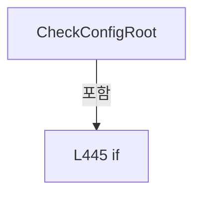

변경 전 점검: 입력/반환 타입, 위 호출자, 예외/취소 경로, 공유 상태와 저장·전송 소비자를 함께 확인합니다. 값의 단위나 물리 방향을 이름만으로 확정하지 않습니다.

### MethodDeclaration `ValidateConfigStructure` · L454–474

[Drilling.Common/Managers/CManager.cs:454–474](https://github.com/kjuws10-rgb/A3Drilling/blob/96e22cd027c84bf302b23f2949b98985d7f301bb/Drilling.Common/Managers/CManager.cs#L454-L474)

| 항목 | 실제 추출 값 |
| --- | --- |
| 서명 | void Drilling.Common.Managers.CManager.ValidateConfigStructure() |
| 접근/수식자 | Private / private |
| 반환/값 타입 | void |
| 소속 타입 | NamedType:Drilling.Common.Managers.CManager |

정적 호출자로 확인된 위치:

| 호출 파일/행 | 호출 표현식 | 런타임 분기 가능 |
| --- | --- | --- |
| [Drilling.Common/Managers/CManager.cs:93–93](https://github.com/kjuws10-rgb/A3Drilling/blob/96e22cd027c84bf302b23f2949b98985d7f301bb/Drilling.Common/Managers/CManager.cs#L93-L93) | ValidateConfigStructure | False |

호출하는 대상과 해석 범위:

| 원본 행 | 표현식 | 분석 상태 | 대상/소스 위치 |
| --- | --- | --- | --- |
| 458 | AddStartupStep | resolved | void Drilling.Common.Managers.CManager.AddStartupStep(string, Drilling.Common.Managers.EN_MANAGER_STARTUP_RESULT, string) · Drilling.Common/Managers/CManager.cs:581 |
| 464 | _configStructureFile.Validate().GetAwaiter().GetResult | resolved | System.Collections.Generic.IReadOnlyList<Drilling.Common.Managers.ST_CONFIG_FILE_STATUS> System.Runtime.CompilerServices.TaskAwaiter<System.Collections.Generic.IReadOnlyList<Drilling.Common.Managers.ST_CONFIG_FILE_STATUS>>.GetResult() |
| 464 | _configStructureFile.Validate().GetAwaiter | resolved | System.Runtime.CompilerServices.TaskAwaiter<System.Collections.Generic.IReadOnlyList<Drilling.Common.Managers.ST_CONFIG_FILE_STATUS>> System.Threading.Tasks.Task<System.Collections.Generic.IReadOnlyList<Drilling.Common.Managers.ST_CONFIG_FILE_STATUS>>.GetAwaiter() |
| 464 | _configStructureFile.Validate | resolved | System.Threading.Tasks.Task<System.Collections.Generic.IReadOnlyList<Drilling.Common.Managers.ST_CONFIG_FILE_STATUS>> Drilling.Common.Managers.CConfigStructureFileBase.Validate(System.Threading.CancellationToken) · Drilling.Common/Managers/CManager.cs:776 |
| 467 | AddStartupStep | resolved | void Drilling.Common.Managers.CManager.AddStartupStep(string, Drilling.Common.Managers.EN_MANAGER_STARTUP_RESULT, string) · Drilling.Common/Managers/CManager.cs:581 |
| 467 | ToStartupResult | resolved | Drilling.Common.Managers.EN_MANAGER_STARTUP_RESULT Drilling.Common.Managers.CManager.ToStartupResult(Drilling.Common.Managers.ST_CONFIG_FILE_STATUS) · Drilling.Common/Managers/CManager.cs:635 |
| 467 | FormatConfigStatusMessage | resolved | string Drilling.Common.Managers.CManager.FormatConfigStatusMessage(Drilling.Common.Managers.ST_CONFIG_FILE_STATUS) · Drilling.Common/Managers/CManager.cs:645 |
| 470 | IsStartupDataException | resolved | bool Drilling.Common.Managers.CManager.IsStartupDataException(System.Exception) · Drilling.Common/Managers/CManager.cs:625 |
| 472 | AddStartupFailure | resolved | void Drilling.Common.Managers.CManager.AddStartupFailure(string, System.Exception) · Drilling.Common/Managers/CManager.cs:576 |

본문의 실제 연산·분기·예외·반환 순서(원문 위치 순):

| 원본 행 | 종류 | 주석 해설 |
| --- | --- | --- |
| 456 | if | 조건에 따라 분기합니다: if (_configStructureFile is null) |
| 458 | call | 함수·델리게이트 또는 객체 생성자를 호출합니다: AddStartupStep("Validate Config Structure", EN_MANAGER_STARTUP_RESULT.Warning, "Config structure validator was not registered.") |
| 459 | return | 호출자에게 값 또는 제어를 반환합니다: return; |
| 462 | try | 예외 처리 범위입니다: try |
| 464 | call | 함수·델리게이트 또는 객체 생성자를 호출합니다: _configStructureFile.Validate().GetAwaiter().GetResult() |
| 464 | call | 함수·델리게이트 또는 객체 생성자를 호출합니다: _configStructureFile.Validate().GetAwaiter() |
| 464 | call | 함수·델리게이트 또는 객체 생성자를 호출합니다: _configStructureFile.Validate() |
| 464 | local-declaration | 지역 변수를 선언합니다: var statuses = _configStructureFile.Validate().GetAwaiter().GetResult(); |
| 464 | variable-initializer | 변수의 초기값을 지정합니다: statuses = _configStructureFile.Validate().GetAwaiter().GetResult() |
| 465 | foreach | 컬렉션 요소를 순회합니다: foreach (var status in statuses) |
| 467 | call | 함수·델리게이트 또는 객체 생성자를 호출합니다: AddStartupStep($"Check {status.ItemName}", ToStartupResult(status), FormatConfigStatusMessage(status)) |
| 467 | call | 함수·델리게이트 또는 객체 생성자를 호출합니다: ToStartupResult(status) |
| 467 | call | 함수·델리게이트 또는 객체 생성자를 호출합니다: FormatConfigStatusMessage(status) |
| 470 | call | 함수·델리게이트 또는 객체 생성자를 호출합니다: IsStartupDataException(ex) |
| 470 | catch | 지정 예외를 처리합니다: catch (Exception ex) when (IsStartupDataException(ex)) |
| 472 | call | 함수·델리게이트 또는 객체 생성자를 호출합니다: AddStartupFailure("Validate Config Structure", ex) |

제어 구문의 포함 구조(실제 실행 순서/CFG가 아닌 구문 탐색 그림):

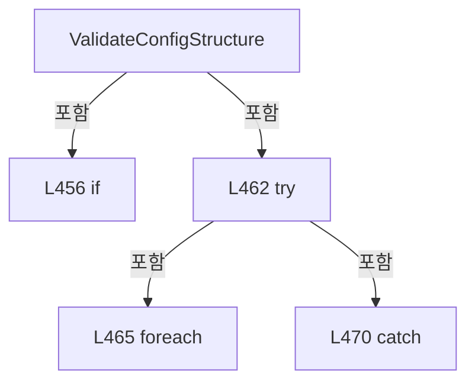

변경 전 점검: 입력/반환 타입, 위 호출자, 예외/취소 경로, 공유 상태와 저장·전송 소비자를 함께 확인합니다. 값의 단위나 물리 방향을 이름만으로 확정하지 않습니다.

### MethodDeclaration `LoadInterfaceList` · L476–490

[Drilling.Common/Managers/CManager.cs:476–490](https://github.com/kjuws10-rgb/A3Drilling/blob/96e22cd027c84bf302b23f2949b98985d7f301bb/Drilling.Common/Managers/CManager.cs#L476-L490)

| 항목 | 실제 추출 값 |
| --- | --- |
| 서명 | System.Collections.Generic.IReadOnlyList<Drilling.Common.Interface.ST_INTERFACE_DATA> Drilling.Common.Managers.CManager.LoadInterfaceList() |
| 접근/수식자 | Private / private |
| 반환/값 타입 | System.Collections.Generic.IReadOnlyList<Drilling.Common.Interface.ST_INTERFACE_DATA> |
| 소속 타입 | NamedType:Drilling.Common.Managers.CManager |

정적 호출자로 확인된 위치:

| 호출 파일/행 | 호출 표현식 | 런타임 분기 가능 |
| --- | --- | --- |
| [Drilling.Common/Managers/CManager.cs:96–96](https://github.com/kjuws10-rgb/A3Drilling/blob/96e22cd027c84bf302b23f2949b98985d7f301bb/Drilling.Common/Managers/CManager.cs#L96-L96) | LoadInterfaceList | False |

호출하는 대상과 해석 범위:

| 원본 행 | 표현식 | 분석 상태 | 대상/소스 위치 |
| --- | --- | --- | --- |
| 480 | _interfaceFile.LoadAll | resolved | System.Collections.Generic.IReadOnlyList<Drilling.Common.Interface.ST_INTERFACE_DATA> Drilling.Common.Managers.CInterfaceFileBase.LoadAll(System.Threading.CancellationToken) · Drilling.Common/Managers/CSettingManager.cs:283 |
| 482 | AddStartupStep | resolved | void Drilling.Common.Managers.CManager.AddStartupStep(string, Drilling.Common.Managers.EN_MANAGER_STARTUP_RESULT, string) · Drilling.Common/Managers/CManager.cs:581 |
| 485 | IsStartupDataException | resolved | bool Drilling.Common.Managers.CManager.IsStartupDataException(System.Exception) · Drilling.Common/Managers/CManager.cs:625 |
| 487 | AddStartupFailure | resolved | void Drilling.Common.Managers.CManager.AddStartupFailure(string, System.Exception) · Drilling.Common/Managers/CManager.cs:576 |

본문의 실제 연산·분기·예외·반환 순서(원문 위치 순):

| 원본 행 | 종류 | 주석 해설 |
| --- | --- | --- |
| 478 | try | 예외 처리 범위입니다: try |
| 480 | call | 함수·델리게이트 또는 객체 생성자를 호출합니다: _interfaceFile.LoadAll() |
| 480 | local-declaration | 지역 변수를 선언합니다: var interfaceData = _interfaceFile.LoadAll(); |
| 480 | variable-initializer | 변수의 초기값을 지정합니다: interfaceData = _interfaceFile.LoadAll() |
| 481 | assignment | 값을 대상에 대입합니다: _loadedInterfaceCount = interfaceData.Count |
| 482 | call | 함수·델리게이트 또는 객체 생성자를 호출합니다: AddStartupStep("Load JHMI_INTERFACE", EN_MANAGER_STARTUP_RESULT.Ready, $"Loaded {interfaceData.Count} interface row(s).") |
| 483 | return | 호출자에게 값 또는 제어를 반환합니다: return interfaceData; |
| 485 | call | 함수·델리게이트 또는 객체 생성자를 호출합니다: IsStartupDataException(ex) |
| 485 | catch | 지정 예외를 처리합니다: catch (Exception ex) when (IsStartupDataException(ex)) |
| 487 | call | 함수·델리게이트 또는 객체 생성자를 호출합니다: AddStartupFailure("Load JHMI_INTERFACE", ex) |
| 488 | return | 호출자에게 값 또는 제어를 반환합니다: return[]; |

제어 구문의 포함 구조(실제 실행 순서/CFG가 아닌 구문 탐색 그림):

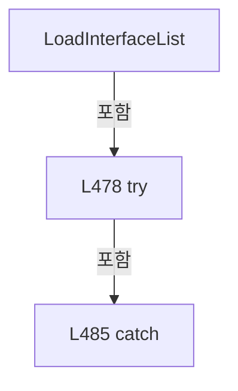

변경 전 점검: 입력/반환 타입, 위 호출자, 예외/취소 경로, 공유 상태와 저장·전송 소비자를 함께 확인합니다. 값의 단위나 물리 방향을 이름만으로 확정하지 않습니다.

### MethodDeclaration `RegisterInterfaceList` · L492–509

[Drilling.Common/Managers/CManager.cs:492–509](https://github.com/kjuws10-rgb/A3Drilling/blob/96e22cd027c84bf302b23f2949b98985d7f301bb/Drilling.Common/Managers/CManager.cs#L492-L509)

| 항목 | 실제 추출 값 |
| --- | --- |
| 서명 | void Drilling.Common.Managers.CManager.RegisterInterfaceList(System.Collections.Generic.IReadOnlyList<Drilling.Common.Interface.ST_INTERFACE_DATA>) |
| 접근/수식자 | Private / private |
| 반환/값 타입 | void |
| 소속 타입 | NamedType:Drilling.Common.Managers.CManager |

입력 계약:

| 이름 | 타입 | 전달 | 선택/기본값 |
| --- | --- | --- | --- |
| interfaceData | System.Collections.Generic.IReadOnlyList<Drilling.Common.Interface.ST_INTERFACE_DATA> | None | False /  |

정적 호출자로 확인된 위치:

| 호출 파일/행 | 호출 표현식 | 런타임 분기 가능 |
| --- | --- | --- |
| [Drilling.Common/Managers/CManager.cs:97–97](https://github.com/kjuws10-rgb/A3Drilling/blob/96e22cd027c84bf302b23f2949b98985d7f301bb/Drilling.Common/Managers/CManager.cs#L97-L97) | RegisterInterfaceList | False |

호출하는 대상과 해석 범위:

| 원본 행 | 표현식 | 분석 상태 | 대상/소스 위치 |
| --- | --- | --- | --- |
| 499 | _interfaceManager.Register | resolved | void Drilling.Common.Interface.CInterfaceManager.Register(Drilling.Common.Interface.ST_INTERFACE_DATA) · Drilling.Common/Interface/CInterfaceManager.cs:157 |
| 504 | AddStartupFailure | resolved | void Drilling.Common.Managers.CManager.AddStartupFailure(string, System.Exception) · Drilling.Common/Managers/CManager.cs:576 |
| 508 | AddStartupStep | resolved | void Drilling.Common.Managers.CManager.AddStartupStep(string, Drilling.Common.Managers.EN_MANAGER_STARTUP_RESULT, string) · Drilling.Common/Managers/CManager.cs:581 |

본문의 실제 연산·분기·예외·반환 순서(원문 위치 순):

| 원본 행 | 종류 | 주석 해설 |
| --- | --- | --- |
| 494 | local-declaration | 지역 변수를 선언합니다: var registeredCount = 0; |
| 494 | variable-initializer | 변수의 초기값을 지정합니다: registeredCount = 0 |
| 495 | foreach | 컬렉션 요소를 순회합니다: foreach (var data in interfaceData) |
| 497 | try | 예외 처리 범위입니다: try |
| 499 | call | 함수·델리게이트 또는 객체 생성자를 호출합니다: _interfaceManager.Register(data) |
| 502 | catch | 지정 예외를 처리합니다: catch (Exception ex) when (ex is InvalidOperationException or InvalidDataException) |
| 504 | call | 함수·델리게이트 또는 객체 생성자를 호출합니다: AddStartupFailure($"Register Interface {data.Device}[{data.Number}]", ex) |
| 508 | call | 함수·델리게이트 또는 객체 생성자를 호출합니다: AddStartupStep("Register Interface List", registeredCount == interfaceData.Count ? EN_MANAGER_STARTUP_RESULT.Ready : EN_MANAGER_STARTUP_RESULT.Warning, $"Registered {registeredCount}/{interfaceData.Count} interface devic… |
| 508 | conditional-expression | 조건에 따라 결과식을 선택합니다: registeredCount == interfaceData.Count ? EN_MANAGER_STARTUP_RESULT.Ready : EN_MANAGER_STARTUP_RESULT.Warning |

제어 구문의 포함 구조(실제 실행 순서/CFG가 아닌 구문 탐색 그림):

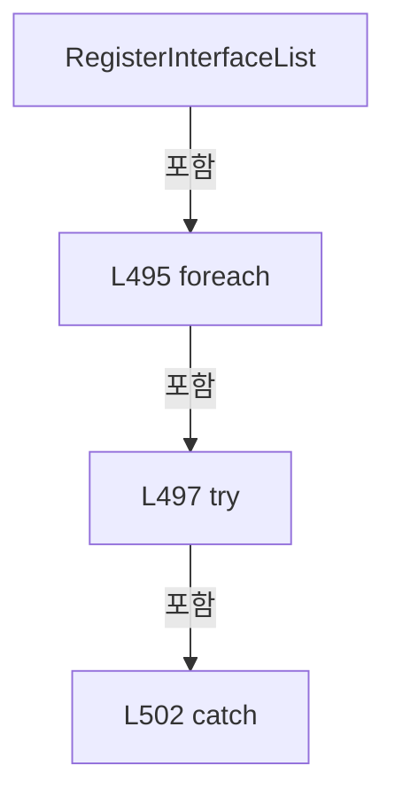

변경 전 점검: 입력/반환 타입, 위 호출자, 예외/취소 경로, 공유 상태와 저장·전송 소비자를 함께 확인합니다. 값의 단위나 물리 방향을 이름만으로 확정하지 않습니다.

### MethodDeclaration `LoadMotorList` · L511–525

[Drilling.Common/Managers/CManager.cs:511–525](https://github.com/kjuws10-rgb/A3Drilling/blob/96e22cd027c84bf302b23f2949b98985d7f301bb/Drilling.Common/Managers/CManager.cs#L511-L525)

| 항목 | 실제 추출 값 |
| --- | --- |
| 서명 | System.Collections.Generic.IReadOnlyList<Drilling.Common.Motion.ST_MOTOR_DATA> Drilling.Common.Managers.CManager.LoadMotorList() |
| 접근/수식자 | Private / private |
| 반환/값 타입 | System.Collections.Generic.IReadOnlyList<Drilling.Common.Motion.ST_MOTOR_DATA> |
| 소속 타입 | NamedType:Drilling.Common.Managers.CManager |

정적 호출자로 확인된 위치:

| 호출 파일/행 | 호출 표현식 | 런타임 분기 가능 |
| --- | --- | --- |
| [Drilling.Common/Managers/CManager.cs:112–112](https://github.com/kjuws10-rgb/A3Drilling/blob/96e22cd027c84bf302b23f2949b98985d7f301bb/Drilling.Common/Managers/CManager.cs#L112-L112) | LoadMotorList | False |

호출하는 대상과 해석 범위:

| 원본 행 | 표현식 | 분석 상태 | 대상/소스 위치 |
| --- | --- | --- | --- |
| 515 | _motorFile.LoadAll | resolved | System.Collections.Generic.IReadOnlyList<Drilling.Common.Motion.ST_MOTOR_DATA> Drilling.Common.Motion.CMotorFileBase.LoadAll(System.Threading.CancellationToken) · Drilling.Common/Motion/CMotionManager.cs:1746 |
| 517 | AddStartupStep | resolved | void Drilling.Common.Managers.CManager.AddStartupStep(string, Drilling.Common.Managers.EN_MANAGER_STARTUP_RESULT, string) · Drilling.Common/Managers/CManager.cs:581 |
| 520 | IsStartupDataException | resolved | bool Drilling.Common.Managers.CManager.IsStartupDataException(System.Exception) · Drilling.Common/Managers/CManager.cs:625 |
| 522 | AddStartupFailure | resolved | void Drilling.Common.Managers.CManager.AddStartupFailure(string, System.Exception) · Drilling.Common/Managers/CManager.cs:576 |

본문의 실제 연산·분기·예외·반환 순서(원문 위치 순):

| 원본 행 | 종류 | 주석 해설 |
| --- | --- | --- |
| 513 | try | 예외 처리 범위입니다: try |
| 515 | call | 함수·델리게이트 또는 객체 생성자를 호출합니다: _motorFile.LoadAll() |
| 515 | local-declaration | 지역 변수를 선언합니다: var motorData = _motorFile.LoadAll(); |
| 515 | variable-initializer | 변수의 초기값을 지정합니다: motorData = _motorFile.LoadAll() |
| 516 | assignment | 값을 대상에 대입합니다: _loadedMotorCount = motorData.Count |
| 517 | call | 함수·델리게이트 또는 객체 생성자를 호출합니다: AddStartupStep("Load JHMI_MOTOR", EN_MANAGER_STARTUP_RESULT.Ready, $"Loaded {motorData.Count} motor row(s).") |
| 518 | return | 호출자에게 값 또는 제어를 반환합니다: return motorData; |
| 520 | call | 함수·델리게이트 또는 객체 생성자를 호출합니다: IsStartupDataException(ex) |
| 520 | catch | 지정 예외를 처리합니다: catch (Exception ex) when (IsStartupDataException(ex)) |
| 522 | call | 함수·델리게이트 또는 객체 생성자를 호출합니다: AddStartupFailure("Load JHMI_MOTOR", ex) |
| 523 | return | 호출자에게 값 또는 제어를 반환합니다: return[]; |

제어 구문의 포함 구조(실제 실행 순서/CFG가 아닌 구문 탐색 그림):

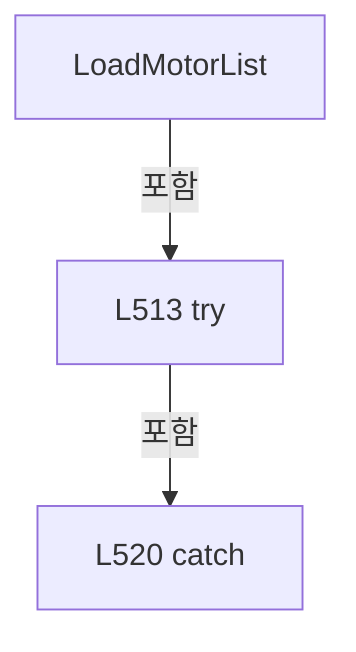

변경 전 점검: 입력/반환 타입, 위 호출자, 예외/취소 경로, 공유 상태와 저장·전송 소비자를 함께 확인합니다. 값의 단위나 물리 방향을 이름만으로 확정하지 않습니다.

### MethodDeclaration `LoadMelsecMapList` · L527–541

[Drilling.Common/Managers/CManager.cs:527–541](https://github.com/kjuws10-rgb/A3Drilling/blob/96e22cd027c84bf302b23f2949b98985d7f301bb/Drilling.Common/Managers/CManager.cs#L527-L541)

| 항목 | 실제 추출 값 |
| --- | --- |
| 서명 | System.Collections.Generic.IReadOnlyList<Drilling.Common.Interface.ST_MELSEC_MAP_DATA> Drilling.Common.Managers.CManager.LoadMelsecMapList() |
| 접근/수식자 | Private / private |
| 반환/값 타입 | System.Collections.Generic.IReadOnlyList<Drilling.Common.Interface.ST_MELSEC_MAP_DATA> |
| 소속 타입 | NamedType:Drilling.Common.Managers.CManager |

정적 호출자로 확인된 위치:

| 호출 파일/행 | 호출 표현식 | 런타임 분기 가능 |
| --- | --- | --- |
| [Drilling.Common/Managers/CManager.cs:109–109](https://github.com/kjuws10-rgb/A3Drilling/blob/96e22cd027c84bf302b23f2949b98985d7f301bb/Drilling.Common/Managers/CManager.cs#L109-L109) | LoadMelsecMapList | False |

호출하는 대상과 해석 범위:

| 원본 행 | 표현식 | 분석 상태 | 대상/소스 위치 |
| --- | --- | --- | --- |
| 531 | _melsecMapFile.LoadAll | resolved | System.Collections.Generic.IReadOnlyList<Drilling.Common.Interface.ST_MELSEC_MAP_DATA> Drilling.Common.Interface.CMelsecMapFileBase.LoadAll(System.Threading.CancellationToken) · Drilling.Common/Interface/Melsec/CMelsec.cs:3262 |
| 533 | AddStartupStep | resolved | void Drilling.Common.Managers.CManager.AddStartupStep(string, Drilling.Common.Managers.EN_MANAGER_STARTUP_RESULT, string) · Drilling.Common/Managers/CManager.cs:581 |
| 536 | IsStartupDataException | resolved | bool Drilling.Common.Managers.CManager.IsStartupDataException(System.Exception) · Drilling.Common/Managers/CManager.cs:625 |
| 538 | AddStartupFailure | resolved | void Drilling.Common.Managers.CManager.AddStartupFailure(string, System.Exception) · Drilling.Common/Managers/CManager.cs:576 |

본문의 실제 연산·분기·예외·반환 순서(원문 위치 순):

| 원본 행 | 종류 | 주석 해설 |
| --- | --- | --- |
| 529 | try | 예외 처리 범위입니다: try |
| 531 | call | 함수·델리게이트 또는 객체 생성자를 호출합니다: _melsecMapFile.LoadAll() |
| 531 | local-declaration | 지역 변수를 선언합니다: var melsecMapData = _melsecMapFile.LoadAll(); |
| 531 | variable-initializer | 변수의 초기값을 지정합니다: melsecMapData = _melsecMapFile.LoadAll() |
| 532 | assignment | 값을 대상에 대입합니다: _loadedMelsecMapCount = melsecMapData.Count |
| 533 | call | 함수·델리게이트 또는 객체 생성자를 호출합니다: AddStartupStep("Load JHMI_MELSEC_MAP", EN_MANAGER_STARTUP_RESULT.Ready, $"Loaded {melsecMapData.Count} MELSEC map row(s).") |
| 534 | return | 호출자에게 값 또는 제어를 반환합니다: return melsecMapData; |
| 536 | call | 함수·델리게이트 또는 객체 생성자를 호출합니다: IsStartupDataException(ex) |
| 536 | catch | 지정 예외를 처리합니다: catch (Exception ex) when (IsStartupDataException(ex)) |
| 538 | call | 함수·델리게이트 또는 객체 생성자를 호출합니다: AddStartupFailure("Load JHMI_MELSEC_MAP", ex) |
| 539 | return | 호출자에게 값 또는 제어를 반환합니다: return[]; |

제어 구문의 포함 구조(실제 실행 순서/CFG가 아닌 구문 탐색 그림):

변경 전 점검: 입력/반환 타입, 위 호출자, 예외/취소 경로, 공유 상태와 저장·전송 소비자를 함께 확인합니다. 값의 단위나 물리 방향을 이름만으로 확정하지 않습니다.

### MethodDeclaration `LoadActiveProduct` · L543–556

[Drilling.Common/Managers/CManager.cs:543–556](https://github.com/kjuws10-rgb/A3Drilling/blob/96e22cd027c84bf302b23f2949b98985d7f301bb/Drilling.Common/Managers/CManager.cs#L543-L556)

| 항목 | 실제 추출 값 |
| --- | --- |
| 서명 | void Drilling.Common.Managers.CManager.LoadActiveProduct() |
| 접근/수식자 | Private / private |
| 반환/값 타입 | void |
| 소속 타입 | NamedType:Drilling.Common.Managers.CManager |

정적 호출자로 확인된 위치:

| 호출 파일/행 | 호출 표현식 | 런타임 분기 가능 |
| --- | --- | --- |
| [Drilling.Common/Managers/CManager.cs:121–121](https://github.com/kjuws10-rgb/A3Drilling/blob/96e22cd027c84bf302b23f2949b98985d7f301bb/Drilling.Common/Managers/CManager.cs#L121-L121) | LoadActiveProduct | False |

호출하는 대상과 해석 범위:

| 원본 행 | 표현식 | 분석 상태 | 대상/소스 위치 |
| --- | --- | --- | --- |
| 547 | _productManager.LoadActive().GetAwaiter().GetResult | resolved | Drilling.Common.Product.ST_PRODUCT_DATA? System.Runtime.CompilerServices.TaskAwaiter<Drilling.Common.Product.ST_PRODUCT_DATA?>.GetResult() |
| 547 | _productManager.LoadActive().GetAwaiter | resolved | System.Runtime.CompilerServices.TaskAwaiter<Drilling.Common.Product.ST_PRODUCT_DATA?> System.Threading.Tasks.Task<Drilling.Common.Product.ST_PRODUCT_DATA?>.GetAwaiter() |
| 547 | _productManager.LoadActive | resolved | System.Threading.Tasks.Task<Drilling.Common.Product.ST_PRODUCT_DATA?> Drilling.Common.Product.CProductManager.LoadActive(System.Threading.CancellationToken) · Drilling.Common/Product/CProductManager.cs:25 |
| 548 | _productManager.RecoverInterrupted().GetAwaiter().GetResult | resolved | Drilling.Common.Product.ST_PRODUCT_DATA? System.Runtime.CompilerServices.TaskAwaiter<Drilling.Common.Product.ST_PRODUCT_DATA?>.GetResult() |
| 548 | _productManager.RecoverInterrupted().GetAwaiter | resolved | System.Runtime.CompilerServices.TaskAwaiter<Drilling.Common.Product.ST_PRODUCT_DATA?> System.Threading.Tasks.Task<Drilling.Common.Product.ST_PRODUCT_DATA?>.GetAwaiter() |
| 548 | _productManager.RecoverInterrupted | resolved | System.Threading.Tasks.Task<Drilling.Common.Product.ST_PRODUCT_DATA?> Drilling.Common.Product.CProductManager.RecoverInterrupted(System.Threading.CancellationToken) · Drilling.Common/Product/CProductManager.cs:49 |
| 550 | AddStartupStep | resolved | void Drilling.Common.Managers.CManager.AddStartupStep(string, Drilling.Common.Managers.EN_MANAGER_STARTUP_RESULT, string) · Drilling.Common/Managers/CManager.cs:581 |
| 552 | IsStartupDataException | resolved | bool Drilling.Common.Managers.CManager.IsStartupDataException(System.Exception) · Drilling.Common/Managers/CManager.cs:625 |
| 554 | AddStartupFailure | resolved | void Drilling.Common.Managers.CManager.AddStartupFailure(string, System.Exception) · Drilling.Common/Managers/CManager.cs:576 |

본문의 실제 연산·분기·예외·반환 순서(원문 위치 순):

| 원본 행 | 종류 | 주석 해설 |
| --- | --- | --- |
| 545 | try | 예외 처리 범위입니다: try |
| 547 | call | 함수·델리게이트 또는 객체 생성자를 호출합니다: _productManager.LoadActive().GetAwaiter().GetResult() |
| 547 | call | 함수·델리게이트 또는 객체 생성자를 호출합니다: _productManager.LoadActive().GetAwaiter() |
| 547 | call | 함수·델리게이트 또는 객체 생성자를 호출합니다: _productManager.LoadActive() |
| 548 | call | 함수·델리게이트 또는 객체 생성자를 호출합니다: _productManager.RecoverInterrupted().GetAwaiter().GetResult() |
| 548 | call | 함수·델리게이트 또는 객체 생성자를 호출합니다: _productManager.RecoverInterrupted().GetAwaiter() |
| 548 | call | 함수·델리게이트 또는 객체 생성자를 호출합니다: _productManager.RecoverInterrupted() |
| 549 | assignment | 값을 대상에 대입합니다: _activeProductLoaded = true |
| 550 | call | 함수·델리게이트 또는 객체 생성자를 호출합니다: AddStartupStep("Load Active Product", EN_MANAGER_STARTUP_RESULT.Ready, "Active product loaded.") |
| 552 | call | 함수·델리게이트 또는 객체 생성자를 호출합니다: IsStartupDataException(ex) |
| 552 | catch | 지정 예외를 처리합니다: catch (Exception ex) when (IsStartupDataException(ex)) |
| 554 | call | 함수·델리게이트 또는 객체 생성자를 호출합니다: AddStartupFailure("Load Active Product", ex) |

제어 구문의 포함 구조(실제 실행 순서/CFG가 아닌 구문 탐색 그림):

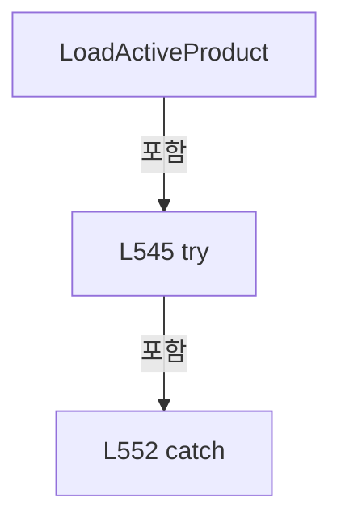

변경 전 점검: 입력/반환 타입, 위 호출자, 예외/취소 경로, 공유 상태와 저장·전송 소비자를 함께 확인합니다. 값의 단위나 물리 방향을 이름만으로 확정하지 않습니다.

### MethodDeclaration `RunInitializeStep` · L558–574

[Drilling.Common/Managers/CManager.cs:558–574](https://github.com/kjuws10-rgb/A3Drilling/blob/96e22cd027c84bf302b23f2949b98985d7f301bb/Drilling.Common/Managers/CManager.cs#L558-L574)

| 항목 | 실제 추출 값 |
| --- | --- |
| 서명 | System.Threading.Tasks.Task Drilling.Common.Managers.CManager.RunInitializeStep(string, System.Func<System.Threading.Tasks.Task>, System.Threading.CancellationToken) |
| 접근/수식자 | Private / private, async |
| 반환/값 타입 | System.Threading.Tasks.Task |
| 소속 타입 | NamedType:Drilling.Common.Managers.CManager |

입력 계약:

| 이름 | 타입 | 전달 | 선택/기본값 |
| --- | --- | --- | --- |
| stepName | string | None | False /  |
| action | System.Func<System.Threading.Tasks.Task> | None | False /  |
| cancellationToken | System.Threading.CancellationToken | None | False /  |

정적 호출자로 확인된 위치:

| 호출 파일/행 | 호출 표현식 | 런타임 분기 가능 |
| --- | --- | --- |
| [Drilling.Common/Managers/CManager.cs:219–219](https://github.com/kjuws10-rgb/A3Drilling/blob/96e22cd027c84bf302b23f2949b98985d7f301bb/Drilling.Common/Managers/CManager.cs#L219-L219) | RunInitializeStep | False |
| [Drilling.Common/Managers/CManager.cs:225–225](https://github.com/kjuws10-rgb/A3Drilling/blob/96e22cd027c84bf302b23f2949b98985d7f301bb/Drilling.Common/Managers/CManager.cs#L225-L225) | RunInitializeStep | False |

호출하는 대상과 해석 범위:

| 원본 행 | 표현식 | 분석 상태 | 대상/소스 위치 |
| --- | --- | --- | --- |
| 562 | cancellationToken.ThrowIfCancellationRequested | resolved | void System.Threading.CancellationToken.ThrowIfCancellationRequested() |
| 563 | action | resolved · 동적 구현 선택 가능 | System.Threading.Tasks.Task System.Func<System.Threading.Tasks.Task>.Invoke() |
| 564 | AddStartupStep | resolved | void Drilling.Common.Managers.CManager.AddStartupStep(string, Drilling.Common.Managers.EN_MANAGER_STARTUP_RESULT, string) · Drilling.Common/Managers/CManager.cs:581 |
| 568 | AddStartupStep | resolved | void Drilling.Common.Managers.CManager.AddStartupStep(string, Drilling.Common.Managers.EN_MANAGER_STARTUP_RESULT, string) · Drilling.Common/Managers/CManager.cs:581 |
| 570 | IsStartupRuntimeException | resolved | bool Drilling.Common.Managers.CManager.IsStartupRuntimeException(System.Exception) · Drilling.Common/Managers/CManager.cs:630 |
| 572 | AddStartupFailure | resolved | void Drilling.Common.Managers.CManager.AddStartupFailure(string, System.Exception) · Drilling.Common/Managers/CManager.cs:576 |

본문의 실제 연산·분기·예외·반환 순서(원문 위치 순):

| 원본 행 | 종류 | 주석 해설 |
| --- | --- | --- |
| 560 | try | 예외 처리 범위입니다: try |
| 562 | call | 함수·델리게이트 또는 객체 생성자를 호출합니다: cancellationToken.ThrowIfCancellationRequested() |
| 563 | await | 비동기 완료를 기다립니다: await action() |
| 563 | call | 함수·델리게이트 또는 객체 생성자를 호출합니다: action() |
| 564 | call | 함수·델리게이트 또는 객체 생성자를 호출합니다: AddStartupStep(stepName, EN_MANAGER_STARTUP_RESULT.Ready, "OK") |
| 566 | catch | 지정 예외를 처리합니다: catch (OperationCanceledException) when (cancellationToken.IsCancellationRequested) |
| 568 | call | 함수·델리게이트 또는 객체 생성자를 호출합니다: AddStartupStep(stepName, EN_MANAGER_STARTUP_RESULT.Warning, "Canceled.") |
| 570 | call | 함수·델리게이트 또는 객체 생성자를 호출합니다: IsStartupRuntimeException(ex) |
| 570 | catch | 지정 예외를 처리합니다: catch (Exception ex) when (IsStartupRuntimeException(ex)) |
| 572 | call | 함수·델리게이트 또는 객체 생성자를 호출합니다: AddStartupFailure(stepName, ex) |

제어 구문의 포함 구조(실제 실행 순서/CFG가 아닌 구문 탐색 그림):

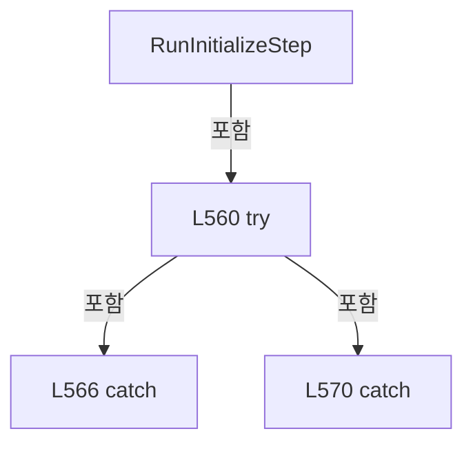

변경 전 점검: 입력/반환 타입, 위 호출자, 예외/취소 경로, 공유 상태와 저장·전송 소비자를 함께 확인합니다. 값의 단위나 물리 방향을 이름만으로 확정하지 않습니다.

### MethodDeclaration `AddStartupFailure` · L576–579

[Drilling.Common/Managers/CManager.cs:576–579](https://github.com/kjuws10-rgb/A3Drilling/blob/96e22cd027c84bf302b23f2949b98985d7f301bb/Drilling.Common/Managers/CManager.cs#L576-L579)

| 항목 | 실제 추출 값 |
| --- | --- |
| 서명 | void Drilling.Common.Managers.CManager.AddStartupFailure(string, System.Exception) |
| 접근/수식자 | Private / private |
| 반환/값 타입 | void |
| 소속 타입 | NamedType:Drilling.Common.Managers.CManager |

입력 계약:

| 이름 | 타입 | 전달 | 선택/기본값 |
| --- | --- | --- | --- |
| stepName | string | None | False /  |
| exception | System.Exception | None | False /  |

정적 호출자로 확인된 위치:

| 호출 파일/행 | 호출 표현식 | 런타임 분기 가능 |
| --- | --- | --- |
| [Drilling.Common/Managers/CManager.cs:472–472](https://github.com/kjuws10-rgb/A3Drilling/blob/96e22cd027c84bf302b23f2949b98985d7f301bb/Drilling.Common/Managers/CManager.cs#L472-L472) | AddStartupFailure | False |
| [Drilling.Common/Managers/CManager.cs:487–487](https://github.com/kjuws10-rgb/A3Drilling/blob/96e22cd027c84bf302b23f2949b98985d7f301bb/Drilling.Common/Managers/CManager.cs#L487-L487) | AddStartupFailure | False |
| [Drilling.Common/Managers/CManager.cs:504–504](https://github.com/kjuws10-rgb/A3Drilling/blob/96e22cd027c84bf302b23f2949b98985d7f301bb/Drilling.Common/Managers/CManager.cs#L504-L504) | AddStartupFailure | False |
| [Drilling.Common/Managers/CManager.cs:522–522](https://github.com/kjuws10-rgb/A3Drilling/blob/96e22cd027c84bf302b23f2949b98985d7f301bb/Drilling.Common/Managers/CManager.cs#L522-L522) | AddStartupFailure | False |
| [Drilling.Common/Managers/CManager.cs:538–538](https://github.com/kjuws10-rgb/A3Drilling/blob/96e22cd027c84bf302b23f2949b98985d7f301bb/Drilling.Common/Managers/CManager.cs#L538-L538) | AddStartupFailure | False |
| [Drilling.Common/Managers/CManager.cs:554–554](https://github.com/kjuws10-rgb/A3Drilling/blob/96e22cd027c84bf302b23f2949b98985d7f301bb/Drilling.Common/Managers/CManager.cs#L554-L554) | AddStartupFailure | False |
| [Drilling.Common/Managers/CManager.cs:572–572](https://github.com/kjuws10-rgb/A3Drilling/blob/96e22cd027c84bf302b23f2949b98985d7f301bb/Drilling.Common/Managers/CManager.cs#L572-L572) | AddStartupFailure | False |

호출하는 대상과 해석 범위:

| 원본 행 | 표현식 | 분석 상태 | 대상/소스 위치 |
| --- | --- | --- | --- |
| 578 | AddStartupStep | resolved | void Drilling.Common.Managers.CManager.AddStartupStep(string, Drilling.Common.Managers.EN_MANAGER_STARTUP_RESULT, string) · Drilling.Common/Managers/CManager.cs:581 |

본문의 실제 연산·분기·예외·반환 순서(원문 위치 순):

| 원본 행 | 종류 | 주석 해설 |
| --- | --- | --- |
| 578 | call | 함수·델리게이트 또는 객체 생성자를 호출합니다: AddStartupStep(stepName, EN_MANAGER_STARTUP_RESULT.Failed, exception.Message) |

변경 전 점검: 입력/반환 타입, 위 호출자, 예외/취소 경로, 공유 상태와 저장·전송 소비자를 함께 확인합니다. 값의 단위나 물리 방향을 이름만으로 확정하지 않습니다.

### MethodDeclaration `AddStartupStep` · L581–591

[Drilling.Common/Managers/CManager.cs:581–591](https://github.com/kjuws10-rgb/A3Drilling/blob/96e22cd027c84bf302b23f2949b98985d7f301bb/Drilling.Common/Managers/CManager.cs#L581-L591)

| 항목 | 실제 추출 값 |
| --- | --- |
| 서명 | void Drilling.Common.Managers.CManager.AddStartupStep(string, Drilling.Common.Managers.EN_MANAGER_STARTUP_RESULT, string) |
| 접근/수식자 | Private / private |
| 반환/값 타입 | void |
| 소속 타입 | NamedType:Drilling.Common.Managers.CManager |

입력 계약:

| 이름 | 타입 | 전달 | 선택/기본값 |
| --- | --- | --- | --- |
| stepName | string | None | False /  |
| result | Drilling.Common.Managers.EN_MANAGER_STARTUP_RESULT | None | False /  |
| message | string | None | False /  |

정적 호출자로 확인된 위치:

| 호출 파일/행 | 호출 표현식 | 런타임 분기 가능 |
| --- | --- | --- |
| [Drilling.Common/Managers/CManager.cs:90–90](https://github.com/kjuws10-rgb/A3Drilling/blob/96e22cd027c84bf302b23f2949b98985d7f301bb/Drilling.Common/Managers/CManager.cs#L90-L90) | AddStartupStep | False |
| [Drilling.Common/Managers/CManager.cs:95–95](https://github.com/kjuws10-rgb/A3Drilling/blob/96e22cd027c84bf302b23f2949b98985d7f301bb/Drilling.Common/Managers/CManager.cs#L95-L95) | AddStartupStep | False |
| [Drilling.Common/Managers/CManager.cs:101–102](https://github.com/kjuws10-rgb/A3Drilling/blob/96e22cd027c84bf302b23f2949b98985d7f301bb/Drilling.Common/Managers/CManager.cs#L101-L102) | AddStartupStep | False |
| [Drilling.Common/Managers/CManager.cs:106–106](https://github.com/kjuws10-rgb/A3Drilling/blob/96e22cd027c84bf302b23f2949b98985d7f301bb/Drilling.Common/Managers/CManager.cs#L106-L106) | AddStartupStep | False |
| [Drilling.Common/Managers/CManager.cs:108–108](https://github.com/kjuws10-rgb/A3Drilling/blob/96e22cd027c84bf302b23f2949b98985d7f301bb/Drilling.Common/Managers/CManager.cs#L108-L108) | AddStartupStep | False |
| [Drilling.Common/Managers/CManager.cs:111–111](https://github.com/kjuws10-rgb/A3Drilling/blob/96e22cd027c84bf302b23f2949b98985d7f301bb/Drilling.Common/Managers/CManager.cs#L111-L111) | AddStartupStep | False |
| [Drilling.Common/Managers/CManager.cs:118–118](https://github.com/kjuws10-rgb/A3Drilling/blob/96e22cd027c84bf302b23f2949b98985d7f301bb/Drilling.Common/Managers/CManager.cs#L118-L118) | AddStartupStep | False |
| [Drilling.Common/Managers/CManager.cs:120–120](https://github.com/kjuws10-rgb/A3Drilling/blob/96e22cd027c84bf302b23f2949b98985d7f301bb/Drilling.Common/Managers/CManager.cs#L120-L120) | AddStartupStep | False |
| [Drilling.Common/Managers/CManager.cs:123–123](https://github.com/kjuws10-rgb/A3Drilling/blob/96e22cd027c84bf302b23f2949b98985d7f301bb/Drilling.Common/Managers/CManager.cs#L123-L123) | AddStartupStep | False |
| [Drilling.Common/Managers/CManager.cs:140–140](https://github.com/kjuws10-rgb/A3Drilling/blob/96e22cd027c84bf302b23f2949b98985d7f301bb/Drilling.Common/Managers/CManager.cs#L140-L140) | AddStartupStep | False |
| [Drilling.Common/Managers/CManager.cs:143–143](https://github.com/kjuws10-rgb/A3Drilling/blob/96e22cd027c84bf302b23f2949b98985d7f301bb/Drilling.Common/Managers/CManager.cs#L143-L143) | AddStartupStep | False |
| [Drilling.Common/Managers/CManager.cs:447–447](https://github.com/kjuws10-rgb/A3Drilling/blob/96e22cd027c84bf302b23f2949b98985d7f301bb/Drilling.Common/Managers/CManager.cs#L447-L447) | AddStartupStep | False |
| [Drilling.Common/Managers/CManager.cs:451–451](https://github.com/kjuws10-rgb/A3Drilling/blob/96e22cd027c84bf302b23f2949b98985d7f301bb/Drilling.Common/Managers/CManager.cs#L451-L451) | AddStartupStep | False |
| [Drilling.Common/Managers/CManager.cs:458–458](https://github.com/kjuws10-rgb/A3Drilling/blob/96e22cd027c84bf302b23f2949b98985d7f301bb/Drilling.Common/Managers/CManager.cs#L458-L458) | AddStartupStep | False |
| [Drilling.Common/Managers/CManager.cs:467–467](https://github.com/kjuws10-rgb/A3Drilling/blob/96e22cd027c84bf302b23f2949b98985d7f301bb/Drilling.Common/Managers/CManager.cs#L467-L467) | AddStartupStep | False |
| [Drilling.Common/Managers/CManager.cs:482–482](https://github.com/kjuws10-rgb/A3Drilling/blob/96e22cd027c84bf302b23f2949b98985d7f301bb/Drilling.Common/Managers/CManager.cs#L482-L482) | AddStartupStep | False |
| [Drilling.Common/Managers/CManager.cs:508–508](https://github.com/kjuws10-rgb/A3Drilling/blob/96e22cd027c84bf302b23f2949b98985d7f301bb/Drilling.Common/Managers/CManager.cs#L508-L508) | AddStartupStep | False |
| [Drilling.Common/Managers/CManager.cs:517–517](https://github.com/kjuws10-rgb/A3Drilling/blob/96e22cd027c84bf302b23f2949b98985d7f301bb/Drilling.Common/Managers/CManager.cs#L517-L517) | AddStartupStep | False |
| [Drilling.Common/Managers/CManager.cs:533–533](https://github.com/kjuws10-rgb/A3Drilling/blob/96e22cd027c84bf302b23f2949b98985d7f301bb/Drilling.Common/Managers/CManager.cs#L533-L533) | AddStartupStep | False |
| [Drilling.Common/Managers/CManager.cs:550–550](https://github.com/kjuws10-rgb/A3Drilling/blob/96e22cd027c84bf302b23f2949b98985d7f301bb/Drilling.Common/Managers/CManager.cs#L550-L550) | AddStartupStep | False |
| [Drilling.Common/Managers/CManager.cs:564–564](https://github.com/kjuws10-rgb/A3Drilling/blob/96e22cd027c84bf302b23f2949b98985d7f301bb/Drilling.Common/Managers/CManager.cs#L564-L564) | AddStartupStep | False |
| [Drilling.Common/Managers/CManager.cs:568–568](https://github.com/kjuws10-rgb/A3Drilling/blob/96e22cd027c84bf302b23f2949b98985d7f301bb/Drilling.Common/Managers/CManager.cs#L568-L568) | AddStartupStep | False |
| [Drilling.Common/Managers/CManager.cs:578–578](https://github.com/kjuws10-rgb/A3Drilling/blob/96e22cd027c84bf302b23f2949b98985d7f301bb/Drilling.Common/Managers/CManager.cs#L578-L578) | AddStartupStep | False |

호출하는 대상과 해석 범위:

| 원본 행 | 표현식 | 분석 상태 | 대상/소스 위치 |
| --- | --- | --- | --- |
| 585 | _startupSteps.Add | resolved | void System.Collections.Generic.List<Drilling.Common.Managers.ST_MANAGER_STARTUP_STEP>.Add(Drilling.Common.Managers.ST_MANAGER_STARTUP_STEP) |
| 585 | new ST_MANAGER_STARTUP_STEP | resolved | Drilling.Common.Managers.ST_MANAGER_STARTUP_STEP.ST_MANAGER_STARTUP_STEP(int, string, Drilling.Common.Managers.EN_MANAGER_STARTUP_RESULT, string) · Drilling.Common/Managers/CManager.cs:763 |
| 586 | string.IsNullOrWhiteSpace | resolved | bool string.IsNullOrWhiteSpace(string?) |
| 588 | _startupMessages.Add | resolved | void System.Collections.Generic.List<string>.Add(string) |

본문의 실제 연산·분기·예외·반환 순서(원문 위치 순):

| 원본 행 | 종류 | 주석 해설 |
| --- | --- | --- |
| 583 | lock | 공유 상태의 임계 구역에 진입합니다: lock (_startupLock) |
| 585 | call | 함수·델리게이트 또는 객체 생성자를 호출합니다: _startupSteps.Add(new ST_MANAGER_STARTUP_STEP(++_startupStepNo, stepName, result, message)) |
| 585 | call | 함수·델리게이트 또는 객체 생성자를 호출합니다: new ST_MANAGER_STARTUP_STEP(++_startupStepNo, stepName, result, message) |
| 586 | call | 함수·델리게이트 또는 객체 생성자를 호출합니다: string.IsNullOrWhiteSpace(message) |
| 586 | if | 조건에 따라 분기합니다: if (result != EN_MANAGER_STARTUP_RESULT.Ready && !string.IsNullOrWhiteSpace(message)) |
| 588 | call | 함수·델리게이트 또는 객체 생성자를 호출합니다: _startupMessages.Add($"{stepName}: {message}") |

제어 구문의 포함 구조(실제 실행 순서/CFG가 아닌 구문 탐색 그림):

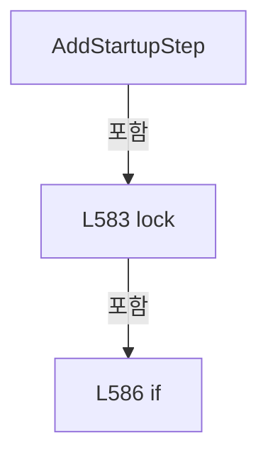

변경 전 점검: 입력/반환 타입, 위 호출자, 예외/취소 경로, 공유 상태와 저장·전송 소비자를 함께 확인합니다. 값의 단위나 물리 방향을 이름만으로 확정하지 않습니다.

### MethodDeclaration `GetMotionSimulationMode` · L593–601

[Drilling.Common/Managers/CManager.cs:593–601](https://github.com/kjuws10-rgb/A3Drilling/blob/96e22cd027c84bf302b23f2949b98985d7f301bb/Drilling.Common/Managers/CManager.cs#L593-L601)

| 항목 | 실제 추출 값 |
| --- | --- |
| 서명 | bool Drilling.Common.Managers.CManager.GetMotionSimulationMode(bool?) |
| 접근/수식자 | Private / private |
| 반환/값 타입 | bool |
| 소속 타입 | NamedType:Drilling.Common.Managers.CManager |

입력 계약:

| 이름 | 타입 | 전달 | 선택/기본값 |
| --- | --- | --- | --- |
| simulationMode | bool? | None | False /  |

정적 호출자로 확인된 위치:

| 호출 파일/행 | 호출 표현식 | 런타임 분기 가능 |
| --- | --- | --- |
| [Drilling.Common/Managers/CManager.cs:114–114](https://github.com/kjuws10-rgb/A3Drilling/blob/96e22cd027c84bf302b23f2949b98985d7f301bb/Drilling.Common/Managers/CManager.cs#L114-L114) | GetMotionSimulationMode | False |

호출하는 대상과 해석 범위:

| 원본 행 | 표현식 | 분석 상태 | 대상/소스 위치 |
| --- | --- | --- | --- |
| 600 | _interfaceManager.GetInterfaceList(EN_EQP_MODULE.Motion).DefaultIfEmpty().All | resolved | bool System.Collections.Generic.IEnumerable<Drilling.Common.Interface.ST_INTERFACE_DATA?>.All<Drilling.Common.Interface.ST_INTERFACE_DATA?>(System.Func<Drilling.Common.Interface.ST_INTERFACE_DATA?, bool>) |
| 600 | _interfaceManager.GetInterfaceList(EN_EQP_MODULE.Motion).DefaultIfEmpty | resolved | System.Collections.Generic.IEnumerable<Drilling.Common.Interface.ST_INTERFACE_DATA?> System.Collections.Generic.IEnumerable<Drilling.Common.Interface.ST_INTERFACE_DATA>.DefaultIfEmpty<Drilling.Common.Interface.ST_INTERFACE_DATA>() |
| 600 | _interfaceManager.GetInterfaceList | resolved | System.Collections.Generic.IReadOnlyList<Drilling.Common.Interface.ST_INTERFACE_DATA> Drilling.Common.Interface.CInterfaceManager.GetInterfaceList(Drilling.Common.Interface.EN_EQP_MODULE?) · Drilling.Common/Interface/CInterfaceManager.cs:442 |

본문의 실제 연산·분기·예외·반환 순서(원문 위치 순):

| 원본 행 | 종류 | 주석 해설 |
| --- | --- | --- |
| 600 | call | 함수·델리게이트 또는 객체 생성자를 호출합니다: _interfaceManager.GetInterfaceList(EN_EQP_MODULE.Motion).DefaultIfEmpty().All(MatchesItem) |
| 600 | call | 함수·델리게이트 또는 객체 생성자를 호출합니다: _interfaceManager.GetInterfaceList(EN_EQP_MODULE.Motion).DefaultIfEmpty() |
| 600 | call | 함수·델리게이트 또는 객체 생성자를 호출합니다: _interfaceManager.GetInterfaceList(EN_EQP_MODULE.Motion) |
| 600 | return | 호출자에게 값 또는 제어를 반환합니다: return simulationMode ?? _interfaceManager.GetInterfaceList(EN_EQP_MODULE.Motion).DefaultIfEmpty().All(MatchesItem); |

변경 전 점검: 입력/반환 타입, 위 호출자, 예외/취소 경로, 공유 상태와 저장·전송 소비자를 함께 확인합니다. 값의 단위나 물리 방향을 이름만으로 확정하지 않습니다.

### LocalFunctionStatement `MatchesItem` · L595–598

[Drilling.Common/Managers/CManager.cs:595–598](https://github.com/kjuws10-rgb/A3Drilling/blob/96e22cd027c84bf302b23f2949b98985d7f301bb/Drilling.Common/Managers/CManager.cs#L595-L598)

| 항목 | 실제 추출 값 |
| --- | --- |
| 서명 | bool MatchesItem(Drilling.Common.Interface.ST_INTERFACE_DATA?) |
| 접근/수식자 | Private /  |
| 반환/값 타입 | bool |
| 소속 타입 | NamedType:Drilling.Common.Managers.CManager |

입력 계약:

| 이름 | 타입 | 전달 | 선택/기본값 |
| --- | --- | --- | --- |
| data | Drilling.Common.Interface.ST_INTERFACE_DATA? | None | False /  |

현재 부분 분석에서 직접 연결된 호출자는 없습니다. XAML/이벤트/인터페이스·델리게이트·외부 진입을 추가 확인해야 하며, 미사용으로 판정한 것이 아닙니다.

본문의 실제 연산·분기·예외·반환 순서(원문 위치 순):

| 원본 행 | 종류 | 주석 해설 |
| --- | --- | --- |
| 597 | return | 호출자에게 값 또는 제어를 반환합니다: return data is null &#124;&#124; data.IsSimulation; |

변경 전 점검: 입력/반환 타입, 위 호출자, 예외/취소 경로, 공유 상태와 저장·전송 소비자를 함께 확인합니다. 값의 단위나 물리 방향을 이름만으로 확정하지 않습니다.

### MethodDeclaration `GetScriptDirectory` · L603–612

[Drilling.Common/Managers/CManager.cs:603–612](https://github.com/kjuws10-rgb/A3Drilling/blob/96e22cd027c84bf302b23f2949b98985d7f301bb/Drilling.Common/Managers/CManager.cs#L603-L612)

| 항목 | 실제 추출 값 |
| --- | --- |
| 서명 | string Drilling.Common.Managers.CManager.GetScriptDirectory() |
| 접근/수식자 | Private / private |
| 반환/값 타입 | string |
| 소속 타입 | NamedType:Drilling.Common.Managers.CManager |

정적 호출자로 확인된 위치:

| 호출 파일/행 | 호출 표현식 | 런타임 분기 가능 |
| --- | --- | --- |
| [Drilling.Common/Managers/CManager.cs:107–107](https://github.com/kjuws10-rgb/A3Drilling/blob/96e22cd027c84bf302b23f2949b98985d7f301bb/Drilling.Common/Managers/CManager.cs#L107-L107) | GetScriptDirectory | False |
| [Drilling.Common/Managers/CManager.cs:135–135](https://github.com/kjuws10-rgb/A3Drilling/blob/96e22cd027c84bf302b23f2949b98985d7f301bb/Drilling.Common/Managers/CManager.cs#L135-L135) | GetScriptDirectory | False |
| [Drilling.Common/Managers/CManager.cs:140–140](https://github.com/kjuws10-rgb/A3Drilling/blob/96e22cd027c84bf302b23f2949b98985d7f301bb/Drilling.Common/Managers/CManager.cs#L140-L140) | GetScriptDirectory | False |

호출하는 대상과 해석 범위:

| 원본 행 | 표현식 | 분석 상태 | 대상/소스 위치 |
| --- | --- | --- | --- |
| 610 | _settingFile.Load(EN_SETTING_TAB.Option).FirstOrDefault | resolved | Drilling.Common.Managers.ST_SYSTEM_PARAMETER? System.Collections.Generic.IEnumerable<Drilling.Common.Managers.ST_SYSTEM_PARAMETER>.FirstOrDefault<Drilling.Common.Managers.ST_SYSTEM_PARAMETER>(System.Func<Drilling.Common.Managers.ST_SYSTEM_PARAMETER, bool>) |
| 610 | _settingFile.Load | resolved | System.Collections.Generic.IReadOnlyList<Drilling.Common.Managers.ST_SYSTEM_PARAMETER> Drilling.Common.Managers.CSettingFileBase.Load(Drilling.Common.Managers.EN_SETTING_TAB, System.Threading.CancellationToken) · Drilling.Common/Managers/CSettingManager.cs:276 |
| 611 | ResolveProjectPath | resolved | string Drilling.Common.Managers.CManager.ResolveProjectPath(string?, string) · Drilling.Common/Managers/CManager.cs:619 |
| 611 | Path.Combine | resolved | string System.IO.Path.Combine(string, string) |

본문의 실제 연산·분기·예외·반환 순서(원문 위치 순):

| 원본 행 | 종류 | 주석 해설 |
| --- | --- | --- |
| 610 | call | 함수·델리게이트 또는 객체 생성자를 호출합니다: _settingFile.Load(EN_SETTING_TAB.Option).FirstOrDefault(MatchesItem) |
| 610 | call | 함수·델리게이트 또는 객체 생성자를 호출합니다: _settingFile.Load(EN_SETTING_TAB.Option) |
| 610 | local-declaration | 지역 변수를 선언합니다: var settingPath = _settingFile.Load(EN_SETTING_TAB.Option).FirstOrDefault(MatchesItem)?.Value; |
| 610 | variable-initializer | 변수의 초기값을 지정합니다: settingPath = _settingFile.Load(EN_SETTING_TAB.Option).FirstOrDefault(MatchesItem)?.Value |
| 611 | call | 함수·델리게이트 또는 객체 생성자를 호출합니다: ResolveProjectPath(settingPath, Path.Combine("Data", "Script")) |
| 611 | call | 함수·델리게이트 또는 객체 생성자를 호출합니다: Path.Combine("Data", "Script") |
| 611 | return | 호출자에게 값 또는 제어를 반환합니다: return ResolveProjectPath(settingPath, Path.Combine("Data", "Script")); |

변경 전 점검: 입력/반환 타입, 위 호출자, 예외/취소 경로, 공유 상태와 저장·전송 소비자를 함께 확인합니다. 값의 단위나 물리 방향을 이름만으로 확정하지 않습니다.

### LocalFunctionStatement `MatchesItem` · L605–608

[Drilling.Common/Managers/CManager.cs:605–608](https://github.com/kjuws10-rgb/A3Drilling/blob/96e22cd027c84bf302b23f2949b98985d7f301bb/Drilling.Common/Managers/CManager.cs#L605-L608)

| 항목 | 실제 추출 값 |
| --- | --- |
| 서명 | bool MatchesItem(Drilling.Common.Managers.ST_SYSTEM_PARAMETER) |
| 접근/수식자 | Private /  |
| 반환/값 타입 | bool |
| 소속 타입 | NamedType:Drilling.Common.Managers.CManager |

입력 계약:

| 이름 | 타입 | 전달 | 선택/기본값 |
| --- | --- | --- | --- |
| parameter | Drilling.Common.Managers.ST_SYSTEM_PARAMETER | None | False /  |

현재 부분 분석에서 직접 연결된 호출자는 없습니다. XAML/이벤트/인터페이스·델리게이트·외부 진입을 추가 확인해야 하며, 미사용으로 판정한 것이 아닙니다.

호출하는 대상과 해석 범위:

| 원본 행 | 표현식 | 분석 상태 | 대상/소스 위치 |
| --- | --- | --- | --- |
| 607 | parameter.Key.Equals | resolved | bool string.Equals(string?, System.StringComparison) |
| 607 | parameter.Name.Equals | resolved | bool string.Equals(string?, System.StringComparison) |

본문의 실제 연산·분기·예외·반환 순서(원문 위치 순):

| 원본 행 | 종류 | 주석 해설 |
| --- | --- | --- |
| 607 | call | 함수·델리게이트 또는 객체 생성자를 호출합니다: parameter.Key.Equals("LocalScriptPath", StringComparison.OrdinalIgnoreCase) |
| 607 | call | 함수·델리게이트 또는 객체 생성자를 호출합니다: parameter.Name.Equals("LocalScriptPath", StringComparison.OrdinalIgnoreCase) |
| 607 | return | 호출자에게 값 또는 제어를 반환합니다: return parameter.Key.Equals("LocalScriptPath", StringComparison.OrdinalIgnoreCase) &#124;&#124; parameter.Name.Equals("LocalScriptPath", StringComparison.OrdinalIgnoreCase); |

변경 전 점검: 입력/반환 타입, 위 호출자, 예외/취소 경로, 공유 상태와 저장·전송 소비자를 함께 확인합니다. 값의 단위나 물리 방향을 이름만으로 확정하지 않습니다.

### MethodDeclaration `GetProjectRoot` · L614–617

[Drilling.Common/Managers/CManager.cs:614–617](https://github.com/kjuws10-rgb/A3Drilling/blob/96e22cd027c84bf302b23f2949b98985d7f301bb/Drilling.Common/Managers/CManager.cs#L614-L617)

| 항목 | 실제 추출 값 |
| --- | --- |
| 서명 | string Drilling.Common.Managers.CManager.GetProjectRoot() |
| 접근/수식자 | Private / private |
| 반환/값 타입 | string |
| 소속 타입 | NamedType:Drilling.Common.Managers.CManager |

정적 호출자로 확인된 위치:

| 호출 파일/행 | 호출 표현식 | 런타임 분기 가능 |
| --- | --- | --- |
| [Drilling.Common/Managers/CManager.cs:107–107](https://github.com/kjuws10-rgb/A3Drilling/blob/96e22cd027c84bf302b23f2949b98985d7f301bb/Drilling.Common/Managers/CManager.cs#L107-L107) | GetProjectRoot | False |
| [Drilling.Common/Managers/CManager.cs:622–622](https://github.com/kjuws10-rgb/A3Drilling/blob/96e22cd027c84bf302b23f2949b98985d7f301bb/Drilling.Common/Managers/CManager.cs#L622-L622) | GetProjectRoot | False |

호출하는 대상과 해석 범위:

| 원본 행 | 표현식 | 분석 상태 | 대상/소스 위치 |
| --- | --- | --- | --- |
| 616 | Directory.GetParent | resolved | System.IO.DirectoryInfo? System.IO.Directory.GetParent(string) |

본문의 실제 연산·분기·예외·반환 순서(원문 위치 순):

| 원본 행 | 종류 | 주석 해설 |
| --- | --- | --- |
| 616 | call | 함수·델리게이트 또는 객체 생성자를 호출합니다: Directory.GetParent(_configRoot) |
| 616 | return | 호출자에게 값 또는 제어를 반환합니다: return Directory.GetParent(_configRoot)?.FullName ?? _configRoot; |

변경 전 점검: 입력/반환 타입, 위 호출자, 예외/취소 경로, 공유 상태와 저장·전송 소비자를 함께 확인합니다. 값의 단위나 물리 방향을 이름만으로 확정하지 않습니다.

### MethodDeclaration `ResolveProjectPath` · L619–623

[Drilling.Common/Managers/CManager.cs:619–623](https://github.com/kjuws10-rgb/A3Drilling/blob/96e22cd027c84bf302b23f2949b98985d7f301bb/Drilling.Common/Managers/CManager.cs#L619-L623)

| 항목 | 실제 추출 값 |
| --- | --- |
| 서명 | string Drilling.Common.Managers.CManager.ResolveProjectPath(string?, string) |
| 접근/수식자 | Private / private |
| 반환/값 타입 | string |
| 소속 타입 | NamedType:Drilling.Common.Managers.CManager |

입력 계약:

| 이름 | 타입 | 전달 | 선택/기본값 |
| --- | --- | --- | --- |
| settingPath | string? | None | False /  |
| defaultRelativePath | string | None | False /  |

정적 호출자로 확인된 위치:

| 호출 파일/행 | 호출 표현식 | 런타임 분기 가능 |
| --- | --- | --- |
| [Drilling.Common/Managers/CManager.cs:611–611](https://github.com/kjuws10-rgb/A3Drilling/blob/96e22cd027c84bf302b23f2949b98985d7f301bb/Drilling.Common/Managers/CManager.cs#L611-L611) | ResolveProjectPath | False |

호출하는 대상과 해석 범위:

| 원본 행 | 표현식 | 분석 상태 | 대상/소스 위치 |
| --- | --- | --- | --- |
| 621 | string.IsNullOrWhiteSpace | resolved | bool string.IsNullOrWhiteSpace(string?) |
| 621 | settingPath.Trim | resolved | string string.Trim() |
| 622 | Path.IsPathRooted | resolved | bool System.IO.Path.IsPathRooted(string?) |
| 622 | Path.GetFullPath | resolved | string System.IO.Path.GetFullPath(string) |
| 622 | Path.GetFullPath | resolved | string System.IO.Path.GetFullPath(string) |
| 622 | Path.Combine | resolved | string System.IO.Path.Combine(string, string) |
| 622 | GetProjectRoot | resolved | string Drilling.Common.Managers.CManager.GetProjectRoot() · Drilling.Common/Managers/CManager.cs:614 |

본문의 실제 연산·분기·예외·반환 순서(원문 위치 순):

| 원본 행 | 종류 | 주석 해설 |
| --- | --- | --- |
| 621 | call | 함수·델리게이트 또는 객체 생성자를 호출합니다: string.IsNullOrWhiteSpace(settingPath) |
| 621 | call | 함수·델리게이트 또는 객체 생성자를 호출합니다: settingPath.Trim() |
| 621 | conditional-expression | 조건에 따라 결과식을 선택합니다: string.IsNullOrWhiteSpace(settingPath) ? defaultRelativePath : settingPath.Trim() |
| 621 | local-declaration | 지역 변수를 선언합니다: var path = string.IsNullOrWhiteSpace(settingPath) ? defaultRelativePath : settingPath.Trim(); |
| 621 | variable-initializer | 변수의 초기값을 지정합니다: path = string.IsNullOrWhiteSpace(settingPath) ? defaultRelativePath : settingPath.Trim() |
| 622 | call | 함수·델리게이트 또는 객체 생성자를 호출합니다: Path.IsPathRooted(path) |
| 622 | call | 함수·델리게이트 또는 객체 생성자를 호출합니다: Path.GetFullPath(path) |
| 622 | call | 함수·델리게이트 또는 객체 생성자를 호출합니다: Path.GetFullPath(Path.Combine(GetProjectRoot(), path)) |
| 622 | call | 함수·델리게이트 또는 객체 생성자를 호출합니다: Path.Combine(GetProjectRoot(), path) |
| 622 | call | 함수·델리게이트 또는 객체 생성자를 호출합니다: GetProjectRoot() |
| 622 | conditional-expression | 조건에 따라 결과식을 선택합니다: Path.IsPathRooted(path) ? Path.GetFullPath(path) : Path.GetFullPath(Path.Combine(GetProjectRoot(), path)) |
| 622 | return | 호출자에게 값 또는 제어를 반환합니다: return Path.IsPathRooted(path) ? Path.GetFullPath(path) : Path.GetFullPath(Path.Combine(GetProjectRoot(), path)); |

변경 전 점검: 입력/반환 타입, 위 호출자, 예외/취소 경로, 공유 상태와 저장·전송 소비자를 함께 확인합니다. 값의 단위나 물리 방향을 이름만으로 확정하지 않습니다.

### MethodDeclaration `IsStartupDataException` · L625–628

[Drilling.Common/Managers/CManager.cs:625–628](https://github.com/kjuws10-rgb/A3Drilling/blob/96e22cd027c84bf302b23f2949b98985d7f301bb/Drilling.Common/Managers/CManager.cs#L625-L628)

| 항목 | 실제 추출 값 |
| --- | --- |
| 서명 | bool Drilling.Common.Managers.CManager.IsStartupDataException(System.Exception) |
| 접근/수식자 | Private / private, static |
| 반환/값 타입 | bool |
| 소속 타입 | NamedType:Drilling.Common.Managers.CManager |

입력 계약:

| 이름 | 타입 | 전달 | 선택/기본값 |
| --- | --- | --- | --- |
| exception | System.Exception | None | False /  |

정적 호출자로 확인된 위치:

| 호출 파일/행 | 호출 표현식 | 런타임 분기 가능 |
| --- | --- | --- |
| [Drilling.Common/Managers/CManager.cs:470–470](https://github.com/kjuws10-rgb/A3Drilling/blob/96e22cd027c84bf302b23f2949b98985d7f301bb/Drilling.Common/Managers/CManager.cs#L470-L470) | IsStartupDataException | False |
| [Drilling.Common/Managers/CManager.cs:485–485](https://github.com/kjuws10-rgb/A3Drilling/blob/96e22cd027c84bf302b23f2949b98985d7f301bb/Drilling.Common/Managers/CManager.cs#L485-L485) | IsStartupDataException | False |
| [Drilling.Common/Managers/CManager.cs:520–520](https://github.com/kjuws10-rgb/A3Drilling/blob/96e22cd027c84bf302b23f2949b98985d7f301bb/Drilling.Common/Managers/CManager.cs#L520-L520) | IsStartupDataException | False |
| [Drilling.Common/Managers/CManager.cs:536–536](https://github.com/kjuws10-rgb/A3Drilling/blob/96e22cd027c84bf302b23f2949b98985d7f301bb/Drilling.Common/Managers/CManager.cs#L536-L536) | IsStartupDataException | False |
| [Drilling.Common/Managers/CManager.cs:552–552](https://github.com/kjuws10-rgb/A3Drilling/blob/96e22cd027c84bf302b23f2949b98985d7f301bb/Drilling.Common/Managers/CManager.cs#L552-L552) | IsStartupDataException | False |

본문의 실제 연산·분기·예외·반환 순서(원문 위치 순):

| 원본 행 | 종류 | 주석 해설 |
| --- | --- | --- |
| 627 | return | 호출자에게 값 또는 제어를 반환합니다: return exception is InvalidDataException or IOException or UnauthorizedAccessException; |

변경 전 점검: 입력/반환 타입, 위 호출자, 예외/취소 경로, 공유 상태와 저장·전송 소비자를 함께 확인합니다. 값의 단위나 물리 방향을 이름만으로 확정하지 않습니다.

### MethodDeclaration `IsStartupRuntimeException` · L630–633

[Drilling.Common/Managers/CManager.cs:630–633](https://github.com/kjuws10-rgb/A3Drilling/blob/96e22cd027c84bf302b23f2949b98985d7f301bb/Drilling.Common/Managers/CManager.cs#L630-L633)

| 항목 | 실제 추출 값 |
| --- | --- |
| 서명 | bool Drilling.Common.Managers.CManager.IsStartupRuntimeException(System.Exception) |
| 접근/수식자 | Private / private, static |
| 반환/값 타입 | bool |
| 소속 타입 | NamedType:Drilling.Common.Managers.CManager |

입력 계약:

| 이름 | 타입 | 전달 | 선택/기본값 |
| --- | --- | --- | --- |
| exception | System.Exception | None | False /  |

정적 호출자로 확인된 위치:

| 호출 파일/행 | 호출 표현식 | 런타임 분기 가능 |
| --- | --- | --- |
| [Drilling.Common/Managers/CManager.cs:570–570](https://github.com/kjuws10-rgb/A3Drilling/blob/96e22cd027c84bf302b23f2949b98985d7f301bb/Drilling.Common/Managers/CManager.cs#L570-L570) | IsStartupRuntimeException | False |

본문의 실제 연산·분기·예외·반환 순서(원문 위치 순):

| 원본 행 | 종류 | 주석 해설 |
| --- | --- | --- |
| 632 | return | 호출자에게 값 또는 제어를 반환합니다: return exception is InvalidOperationException or TimeoutException or IOException or UnauthorizedAccessException; |

변경 전 점검: 입력/반환 타입, 위 호출자, 예외/취소 경로, 공유 상태와 저장·전송 소비자를 함께 확인합니다. 값의 단위나 물리 방향을 이름만으로 확정하지 않습니다.

### MethodDeclaration `ToStartupResult` · L635–643

[Drilling.Common/Managers/CManager.cs:635–643](https://github.com/kjuws10-rgb/A3Drilling/blob/96e22cd027c84bf302b23f2949b98985d7f301bb/Drilling.Common/Managers/CManager.cs#L635-L643)

| 항목 | 실제 추출 값 |
| --- | --- |
| 서명 | Drilling.Common.Managers.EN_MANAGER_STARTUP_RESULT Drilling.Common.Managers.CManager.ToStartupResult(Drilling.Common.Managers.ST_CONFIG_FILE_STATUS) |
| 접근/수식자 | Private / private, static |
| 반환/값 타입 | Drilling.Common.Managers.EN_MANAGER_STARTUP_RESULT |
| 소속 타입 | NamedType:Drilling.Common.Managers.CManager |

입력 계약:

| 이름 | 타입 | 전달 | 선택/기본값 |
| --- | --- | --- | --- |
| status | Drilling.Common.Managers.ST_CONFIG_FILE_STATUS | None | False /  |

정적 호출자로 확인된 위치:

| 호출 파일/행 | 호출 표현식 | 런타임 분기 가능 |
| --- | --- | --- |
| [Drilling.Common/Managers/CManager.cs:467–467](https://github.com/kjuws10-rgb/A3Drilling/blob/96e22cd027c84bf302b23f2949b98985d7f301bb/Drilling.Common/Managers/CManager.cs#L467-L467) | ToStartupResult | False |

본문의 실제 연산·분기·예외·반환 순서(원문 위치 순):

| 원본 행 | 종류 | 주석 해설 |
| --- | --- | --- |
| 637 | if | 조건에 따라 분기합니다: if (status.IsValid) |
| 639 | return | 호출자에게 값 또는 제어를 반환합니다: return EN_MANAGER_STARTUP_RESULT.Ready; |
| 642 | conditional-expression | 조건에 따라 결과식을 선택합니다: status.Required ? EN_MANAGER_STARTUP_RESULT.Failed : EN_MANAGER_STARTUP_RESULT.Warning |
| 642 | return | 호출자에게 값 또는 제어를 반환합니다: return status.Required ? EN_MANAGER_STARTUP_RESULT.Failed : EN_MANAGER_STARTUP_RESULT.Warning; |

제어 구문의 포함 구조(실제 실행 순서/CFG가 아닌 구문 탐색 그림):

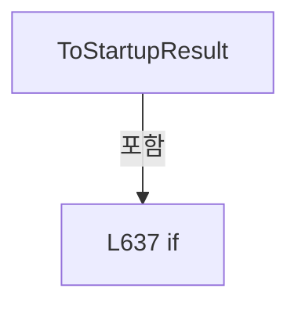

변경 전 점검: 입력/반환 타입, 위 호출자, 예외/취소 경로, 공유 상태와 저장·전송 소비자를 함께 확인합니다. 값의 단위나 물리 방향을 이름만으로 확정하지 않습니다.

### MethodDeclaration `FormatConfigStatusMessage` · L645–650

[Drilling.Common/Managers/CManager.cs:645–650](https://github.com/kjuws10-rgb/A3Drilling/blob/96e22cd027c84bf302b23f2949b98985d7f301bb/Drilling.Common/Managers/CManager.cs#L645-L650)

| 항목 | 실제 추출 값 |
| --- | --- |
| 서명 | string Drilling.Common.Managers.CManager.FormatConfigStatusMessage(Drilling.Common.Managers.ST_CONFIG_FILE_STATUS) |
| 접근/수식자 | Private / private, static |
| 반환/값 타입 | string |
| 소속 타입 | NamedType:Drilling.Common.Managers.CManager |

입력 계약:

| 이름 | 타입 | 전달 | 선택/기본값 |
| --- | --- | --- | --- |
| status | Drilling.Common.Managers.ST_CONFIG_FILE_STATUS | None | False /  |

정적 호출자로 확인된 위치:

| 호출 파일/행 | 호출 표현식 | 런타임 분기 가능 |
| --- | --- | --- |
| [Drilling.Common/Managers/CManager.cs:467–467](https://github.com/kjuws10-rgb/A3Drilling/blob/96e22cd027c84bf302b23f2949b98985d7f301bb/Drilling.Common/Managers/CManager.cs#L467-L467) | FormatConfigStatusMessage | False |

본문의 실제 연산·분기·예외·반환 순서(원문 위치 순):

| 원본 행 | 종류 | 주석 해설 |
| --- | --- | --- |
| 647 | conditional-expression | 조건에 따라 결과식을 선택합니다: status.Required ? "Required" : "Optional" |
| 647 | local-declaration | 지역 변수를 선언합니다: var requiredText = status.Required ? "Required" : "Optional"; |
| 647 | variable-initializer | 변수의 초기값을 지정합니다: requiredText = status.Required ? "Required" : "Optional" |
| 648 | conditional-expression | 조건에 따라 결과식을 선택합니다: status.Exists ? "Exists" : "Missing" |
| 648 | local-declaration | 지역 변수를 선언합니다: var existsText = status.Exists ? "Exists" : "Missing"; |
| 648 | variable-initializer | 변수의 초기값을 지정합니다: existsText = status.Exists ? "Exists" : "Missing" |
| 649 | return | 호출자에게 값 또는 제어를 반환합니다: return $"{requiredText}, {existsText}, {status.Message} &#124; {status.Path}"; |

변경 전 점검: 입력/반환 타입, 위 호출자, 예외/취소 경로, 공유 상태와 저장·전송 소비자를 함께 확인합니다. 값의 단위나 물리 방향을 이름만으로 확정하지 않습니다.

### EnumMemberDeclaration `Simulation` · L655–655

[Drilling.Common/Managers/CManager.cs:655–655](https://github.com/kjuws10-rgb/A3Drilling/blob/96e22cd027c84bf302b23f2949b98985d7f301bb/Drilling.Common/Managers/CManager.cs#L655-L655)

| 항목 | 실제 추출 값 |
| --- | --- |
| 서명 | Drilling.Common.Managers.EN_SYSTEM_MODE.Simulation |
| 접근/수식자 | Public /  |
| 반환/값 타입 | Drilling.Common.Managers.EN_SYSTEM_MODE |
| 소속 타입 | NamedType:Drilling.Common.Managers.EN_SYSTEM_MODE |

현재 부분 분석에서 직접 연결된 호출자는 없습니다. XAML/이벤트/인터페이스·델리게이트·외부 진입을 추가 확인해야 하며, 미사용으로 판정한 것이 아닙니다.

변경 전 점검: 입력/반환 타입, 위 호출자, 예외/취소 경로, 공유 상태와 저장·전송 소비자를 함께 확인합니다. 값의 단위나 물리 방향을 이름만으로 확정하지 않습니다.

### EnumMemberDeclaration `Auto` · L656–656

[Drilling.Common/Managers/CManager.cs:656–656](https://github.com/kjuws10-rgb/A3Drilling/blob/96e22cd027c84bf302b23f2949b98985d7f301bb/Drilling.Common/Managers/CManager.cs#L656-L656)

| 항목 | 실제 추출 값 |
| --- | --- |
| 서명 | Drilling.Common.Managers.EN_SYSTEM_MODE.Auto |
| 접근/수식자 | Public /  |
| 반환/값 타입 | Drilling.Common.Managers.EN_SYSTEM_MODE |
| 소속 타입 | NamedType:Drilling.Common.Managers.EN_SYSTEM_MODE |

현재 부분 분석에서 직접 연결된 호출자는 없습니다. XAML/이벤트/인터페이스·델리게이트·외부 진입을 추가 확인해야 하며, 미사용으로 판정한 것이 아닙니다.

변경 전 점검: 입력/반환 타입, 위 호출자, 예외/취소 경로, 공유 상태와 저장·전송 소비자를 함께 확인합니다. 값의 단위나 물리 방향을 이름만으로 확정하지 않습니다.

### EnumMemberDeclaration `Manual` · L657–657

[Drilling.Common/Managers/CManager.cs:657–657](https://github.com/kjuws10-rgb/A3Drilling/blob/96e22cd027c84bf302b23f2949b98985d7f301bb/Drilling.Common/Managers/CManager.cs#L657-L657)

| 항목 | 실제 추출 값 |
| --- | --- |
| 서명 | Drilling.Common.Managers.EN_SYSTEM_MODE.Manual |
| 접근/수식자 | Public /  |
| 반환/값 타입 | Drilling.Common.Managers.EN_SYSTEM_MODE |
| 소속 타입 | NamedType:Drilling.Common.Managers.EN_SYSTEM_MODE |

현재 부분 분석에서 직접 연결된 호출자는 없습니다. XAML/이벤트/인터페이스·델리게이트·외부 진입을 추가 확인해야 하며, 미사용으로 판정한 것이 아닙니다.

변경 전 점검: 입력/반환 타입, 위 호출자, 예외/취소 경로, 공유 상태와 저장·전송 소비자를 함께 확인합니다. 값의 단위나 물리 방향을 이름만으로 확정하지 않습니다.

### EnumMemberDeclaration `Released` · L662–662

[Drilling.Common/Managers/CManager.cs:662–662](https://github.com/kjuws10-rgb/A3Drilling/blob/96e22cd027c84bf302b23f2949b98985d7f301bb/Drilling.Common/Managers/CManager.cs#L662-L662)

| 항목 | 실제 추출 값 |
| --- | --- |
| 서명 | Drilling.Common.Managers.EN_PM_LOCK_STATE.Released |
| 접근/수식자 | Public /  |
| 반환/값 타입 | Drilling.Common.Managers.EN_PM_LOCK_STATE |
| 소속 타입 | NamedType:Drilling.Common.Managers.EN_PM_LOCK_STATE |

현재 부분 분석에서 직접 연결된 호출자는 없습니다. XAML/이벤트/인터페이스·델리게이트·외부 진입을 추가 확인해야 하며, 미사용으로 판정한 것이 아닙니다.

변경 전 점검: 입력/반환 타입, 위 호출자, 예외/취소 경로, 공유 상태와 저장·전송 소비자를 함께 확인합니다. 값의 단위나 물리 방향을 이름만으로 확정하지 않습니다.

### EnumMemberDeclaration `Locked` · L663–663

[Drilling.Common/Managers/CManager.cs:663–663](https://github.com/kjuws10-rgb/A3Drilling/blob/96e22cd027c84bf302b23f2949b98985d7f301bb/Drilling.Common/Managers/CManager.cs#L663-L663)

| 항목 | 실제 추출 값 |
| --- | --- |
| 서명 | Drilling.Common.Managers.EN_PM_LOCK_STATE.Locked |
| 접근/수식자 | Public /  |
| 반환/값 타입 | Drilling.Common.Managers.EN_PM_LOCK_STATE |
| 소속 타입 | NamedType:Drilling.Common.Managers.EN_PM_LOCK_STATE |

현재 부분 분석에서 직접 연결된 호출자는 없습니다. XAML/이벤트/인터페이스·델리게이트·외부 진입을 추가 확인해야 하며, 미사용으로 판정한 것이 아닙니다.

변경 전 점검: 입력/반환 타입, 위 호출자, 예외/취소 경로, 공유 상태와 저장·전송 소비자를 함께 확인합니다. 값의 단위나 물리 방향을 이름만으로 확정하지 않습니다.

### EnumMemberDeclaration `Ready` · L668–668

[Drilling.Common/Managers/CManager.cs:668–668](https://github.com/kjuws10-rgb/A3Drilling/blob/96e22cd027c84bf302b23f2949b98985d7f301bb/Drilling.Common/Managers/CManager.cs#L668-L668)

| 항목 | 실제 추출 값 |
| --- | --- |
| 서명 | Drilling.Common.Managers.EN_MANAGER_STARTUP_RESULT.Ready |
| 접근/수식자 | Public /  |
| 반환/값 타입 | Drilling.Common.Managers.EN_MANAGER_STARTUP_RESULT |
| 소속 타입 | NamedType:Drilling.Common.Managers.EN_MANAGER_STARTUP_RESULT |

현재 부분 분석에서 직접 연결된 호출자는 없습니다. XAML/이벤트/인터페이스·델리게이트·외부 진입을 추가 확인해야 하며, 미사용으로 판정한 것이 아닙니다.

변경 전 점검: 입력/반환 타입, 위 호출자, 예외/취소 경로, 공유 상태와 저장·전송 소비자를 함께 확인합니다. 값의 단위나 물리 방향을 이름만으로 확정하지 않습니다.

### EnumMemberDeclaration `Warning` · L669–669

[Drilling.Common/Managers/CManager.cs:669–669](https://github.com/kjuws10-rgb/A3Drilling/blob/96e22cd027c84bf302b23f2949b98985d7f301bb/Drilling.Common/Managers/CManager.cs#L669-L669)

| 항목 | 실제 추출 값 |
| --- | --- |
| 서명 | Drilling.Common.Managers.EN_MANAGER_STARTUP_RESULT.Warning |
| 접근/수식자 | Public /  |
| 반환/값 타입 | Drilling.Common.Managers.EN_MANAGER_STARTUP_RESULT |
| 소속 타입 | NamedType:Drilling.Common.Managers.EN_MANAGER_STARTUP_RESULT |

현재 부분 분석에서 직접 연결된 호출자는 없습니다. XAML/이벤트/인터페이스·델리게이트·외부 진입을 추가 확인해야 하며, 미사용으로 판정한 것이 아닙니다.

변경 전 점검: 입력/반환 타입, 위 호출자, 예외/취소 경로, 공유 상태와 저장·전송 소비자를 함께 확인합니다. 값의 단위나 물리 방향을 이름만으로 확정하지 않습니다.

### EnumMemberDeclaration `Failed` · L670–670

[Drilling.Common/Managers/CManager.cs:670–670](https://github.com/kjuws10-rgb/A3Drilling/blob/96e22cd027c84bf302b23f2949b98985d7f301bb/Drilling.Common/Managers/CManager.cs#L670-L670)

| 항목 | 실제 추출 값 |
| --- | --- |
| 서명 | Drilling.Common.Managers.EN_MANAGER_STARTUP_RESULT.Failed |
| 접근/수식자 | Public /  |
| 반환/값 타입 | Drilling.Common.Managers.EN_MANAGER_STARTUP_RESULT |
| 소속 타입 | NamedType:Drilling.Common.Managers.EN_MANAGER_STARTUP_RESULT |

현재 부분 분석에서 직접 연결된 호출자는 없습니다. XAML/이벤트/인터페이스·델리게이트·외부 진입을 추가 확인해야 하며, 미사용으로 판정한 것이 아닙니다.

변경 전 점검: 입력/반환 타입, 위 호출자, 예외/취소 경로, 공유 상태와 저장·전송 소비자를 함께 확인합니다. 값의 단위나 물리 방향을 이름만으로 확정하지 않습니다.

### PropertyDeclaration `Empty` · L725–731

[Drilling.Common/Managers/CManager.cs:725–731](https://github.com/kjuws10-rgb/A3Drilling/blob/96e22cd027c84bf302b23f2949b98985d7f301bb/Drilling.Common/Managers/CManager.cs#L725-L731)

| 항목 | 실제 추출 값 |
| --- | --- |
| 서명 | Drilling.Common.Managers.ST_POWER_METER_STATUS Drilling.Common.Managers.ST_POWER_METER_STATUS.Empty |
| 접근/수식자 | Public / public, static |
| 반환/값 타입 | Drilling.Common.Managers.ST_POWER_METER_STATUS |
| 소속 타입 | NamedType:Drilling.Common.Managers.ST_POWER_METER_STATUS |

현재 부분 분석에서 직접 연결된 호출자는 없습니다. XAML/이벤트/인터페이스·델리게이트·외부 진입을 추가 확인해야 하며, 미사용으로 판정한 것이 아닙니다.

변경 전 점검: 입력/반환 타입, 위 호출자, 예외/취소 경로, 공유 상태와 저장·전송 소비자를 함께 확인합니다. 값의 단위나 물리 방향을 이름만으로 확정하지 않습니다.

### GetAccessorDeclaration `get_Empty` · L727–730

[Drilling.Common/Managers/CManager.cs:727–730](https://github.com/kjuws10-rgb/A3Drilling/blob/96e22cd027c84bf302b23f2949b98985d7f301bb/Drilling.Common/Managers/CManager.cs#L727-L730)

| 항목 | 실제 추출 값 |
| --- | --- |
| 서명 | Drilling.Common.Managers.ST_POWER_METER_STATUS Drilling.Common.Managers.ST_POWER_METER_STATUS.Empty.get |
| 접근/수식자 | Public / get |
| 반환/값 타입 | Drilling.Common.Managers.ST_POWER_METER_STATUS |
| 소속 타입 | NamedType:Drilling.Common.Managers.ST_POWER_METER_STATUS |

현재 부분 분석에서 직접 연결된 호출자는 없습니다. XAML/이벤트/인터페이스·델리게이트·외부 진입을 추가 확인해야 하며, 미사용으로 판정한 것이 아닙니다.

호출하는 대상과 해석 범위:

| 원본 행 | 표현식 | 분석 상태 | 대상/소스 위치 |
| --- | --- | --- | --- |
| 729 | new | resolved | Drilling.Common.Managers.ST_POWER_METER_STATUS.ST_POWER_METER_STATUS(double, string, System.DateTimeOffset, double, double, double, double, double, double, int, bool, string, string, string, Drilling.Common.Interface.EN_POWER_METER_ERROR) · Drilling.Common/Managers/CManager.cs:707 |

본문의 실제 연산·분기·예외·반환 순서(원문 위치 순):

| 원본 행 | 종류 | 주석 해설 |
| --- | --- | --- |
| 729 | call | 함수·델리게이트 또는 객체 생성자를 호출합니다: new(0.0, "W", DateTimeOffset.Now) |
| 729 | return | 호출자에게 값 또는 제어를 반환합니다: return new(0.0, "W", DateTimeOffset.Now); |

변경 전 점검: 입력/반환 타입, 위 호출자, 예외/취소 경로, 공유 상태와 저장·전송 소비자를 함께 확인합니다. 값의 단위나 물리 방향을 이름만으로 확정하지 않습니다.

### PropertyDeclaration `SnapshotError` · L743–743

[Drilling.Common/Managers/CManager.cs:743–743](https://github.com/kjuws10-rgb/A3Drilling/blob/96e22cd027c84bf302b23f2949b98985d7f301bb/Drilling.Common/Managers/CManager.cs#L743-L743)

| 항목 | 실제 추출 값 |
| --- | --- |
| 서명 | string Drilling.Common.Managers.ST_DEVICE_STATUS.SnapshotError |
| 접근/수식자 | Public / public |
| 반환/값 타입 | string |
| 소속 타입 | NamedType:Drilling.Common.Managers.ST_DEVICE_STATUS |

현재 부분 분석에서 직접 연결된 호출자는 없습니다. XAML/이벤트/인터페이스·델리게이트·외부 진입을 추가 확인해야 하며, 미사용으로 판정한 것이 아닙니다.

변경 전 점검: 입력/반환 타입, 위 호출자, 예외/취소 경로, 공유 상태와 저장·전송 소비자를 함께 확인합니다. 값의 단위나 물리 방향을 이름만으로 확정하지 않습니다.

### GetAccessorDeclaration `get_SnapshotError` · L743–743

[Drilling.Common/Managers/CManager.cs:743–743](https://github.com/kjuws10-rgb/A3Drilling/blob/96e22cd027c84bf302b23f2949b98985d7f301bb/Drilling.Common/Managers/CManager.cs#L743-L743)

| 항목 | 실제 추출 값 |
| --- | --- |
| 서명 | string Drilling.Common.Managers.ST_DEVICE_STATUS.SnapshotError.get |
| 접근/수식자 | Public / get |
| 반환/값 타입 | string |
| 소속 타입 | NamedType:Drilling.Common.Managers.ST_DEVICE_STATUS |

현재 부분 분석에서 직접 연결된 호출자는 없습니다. XAML/이벤트/인터페이스·델리게이트·외부 진입을 추가 확인해야 하며, 미사용으로 판정한 것이 아닙니다.

변경 전 점검: 입력/반환 타입, 위 호출자, 예외/취소 경로, 공유 상태와 저장·전송 소비자를 함께 확인합니다. 값의 단위나 물리 방향을 이름만으로 확정하지 않습니다.

### InitAccessorDeclaration `set_SnapshotError` · L743–743

[Drilling.Common/Managers/CManager.cs:743–743](https://github.com/kjuws10-rgb/A3Drilling/blob/96e22cd027c84bf302b23f2949b98985d7f301bb/Drilling.Common/Managers/CManager.cs#L743-L743)

| 항목 | 실제 추출 값 |
| --- | --- |
| 서명 | void Drilling.Common.Managers.ST_DEVICE_STATUS.SnapshotError.init |
| 접근/수식자 | Public / init |
| 반환/값 타입 | void |
| 소속 타입 | NamedType:Drilling.Common.Managers.ST_DEVICE_STATUS |

입력 계약:

| 이름 | 타입 | 전달 | 선택/기본값 |
| --- | --- | --- | --- |
| value | string | None | False /  |

현재 부분 분석에서 직접 연결된 호출자는 없습니다. XAML/이벤트/인터페이스·델리게이트·외부 진입을 추가 확인해야 하며, 미사용으로 판정한 것이 아닙니다.

변경 전 점검: 입력/반환 타입, 위 호출자, 예외/취소 경로, 공유 상태와 저장·전송 소비자를 함께 확인합니다. 값의 단위나 물리 방향을 이름만으로 확정하지 않습니다.

### MethodDeclaration `GetModule` · L748–759

[Drilling.Common/Managers/CManager.cs:748–759](https://github.com/kjuws10-rgb/A3Drilling/blob/96e22cd027c84bf302b23f2949b98985d7f301bb/Drilling.Common/Managers/CManager.cs#L748-L759)

| 항목 | 실제 추출 값 |
| --- | --- |
| 서명 | Drilling.Common.Interface.ST_DEVICE_COMM_STATUS Drilling.Common.Managers.ST_SYSTEM_STATUS.GetModule(Drilling.Common.Interface.EN_EQP_MODULE) |
| 접근/수식자 | Public / public |
| 반환/값 타입 | Drilling.Common.Interface.ST_DEVICE_COMM_STATUS |
| 소속 타입 | NamedType:Drilling.Common.Managers.ST_SYSTEM_STATUS |

입력 계약:

| 이름 | 타입 | 전달 | 선택/기본값 |
| --- | --- | --- | --- |
| module | Drilling.Common.Interface.EN_EQP_MODULE | None | False /  |

정적 호출자로 확인된 위치:

| 호출 파일/행 | 호출 표현식 | 런타임 분기 가능 |
| --- | --- | --- |
| [Drilling.UI/CRootView.cs:2381–2381](https://github.com/kjuws10-rgb/A3Drilling/blob/96e22cd027c84bf302b23f2949b98985d7f301bb/Drilling.UI/CRootView.cs#L2381-L2381) | status.GetModule | False |

호출하는 대상과 해석 범위:

| 원본 행 | 표현식 | 분석 상태 | 대상/소스 위치 |
| --- | --- | --- | --- |
| 758 | new ST_DEVICE_COMM_STATUS | resolved | Drilling.Common.Interface.ST_DEVICE_COMM_STATUS.ST_DEVICE_COMM_STATUS(Drilling.Common.Interface.EN_EQP_MODULE, Drilling.Common.Interface.EN_COMM_STATE) · Drilling.Common/Interface/CInterfaceManager.cs:2888 |

본문의 실제 연산·분기·예외·반환 순서(원문 위치 순):

| 원본 행 | 종류 | 주석 해설 |
| --- | --- | --- |
| 750 | foreach | 컬렉션 요소를 순회합니다: foreach (var status in Modules) |
| 752 | if | 조건에 따라 분기합니다: if (status.Module == module) |
| 754 | return | 호출자에게 값 또는 제어를 반환합니다: return status; |
| 758 | call | 함수·델리게이트 또는 객체 생성자를 호출합니다: new ST_DEVICE_COMM_STATUS(module, EN_COMM_STATE.Offline) |
| 758 | return | 호출자에게 값 또는 제어를 반환합니다: return new ST_DEVICE_COMM_STATUS(module, EN_COMM_STATE.Offline); |

제어 구문의 포함 구조(실제 실행 순서/CFG가 아닌 구문 탐색 그림):

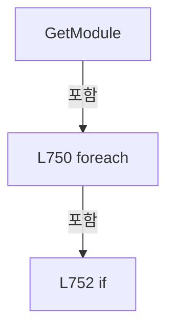

변경 전 점검: 입력/반환 타입, 위 호출자, 예외/취소 경로, 공유 상태와 저장·전송 소비자를 함께 확인합니다. 값의 단위나 물리 방향을 이름만으로 확정하지 않습니다.

### MethodDeclaration `Validate` · L776–776

[Drilling.Common/Managers/CManager.cs:776–776](https://github.com/kjuws10-rgb/A3Drilling/blob/96e22cd027c84bf302b23f2949b98985d7f301bb/Drilling.Common/Managers/CManager.cs#L776-L776)

| 항목 | 실제 추출 값 |
| --- | --- |
| 서명 | System.Threading.Tasks.Task<System.Collections.Generic.IReadOnlyList<Drilling.Common.Managers.ST_CONFIG_FILE_STATUS>> Drilling.Common.Managers.CConfigStructureFileBase.Validate(System.Threading.CancellationToken) |
| 접근/수식자 | Public / public, abstract |
| 반환/값 타입 | System.Threading.Tasks.Task<System.Collections.Generic.IReadOnlyList<Drilling.Common.Managers.ST_CONFIG_FILE_STATUS>> |
| 소속 타입 | NamedType:Drilling.Common.Managers.CConfigStructureFileBase |

입력 계약:

| 이름 | 타입 | 전달 | 선택/기본값 |
| --- | --- | --- | --- |
| cancellationToken | System.Threading.CancellationToken | None | True / null |

정적 호출자로 확인된 위치:

| 호출 파일/행 | 호출 표현식 | 런타임 분기 가능 |
| --- | --- | --- |
| [Drilling.Common/Managers/CManager.cs:464–464](https://github.com/kjuws10-rgb/A3Drilling/blob/96e22cd027c84bf302b23f2949b98985d7f301bb/Drilling.Common/Managers/CManager.cs#L464-L464) | _configStructureFile.Validate | False |

변경 전 점검: 입력/반환 타입, 위 호출자, 예외/취소 경로, 공유 상태와 저장·전송 소비자를 함께 확인합니다. 값의 단위나 물리 방향을 이름만으로 확정하지 않습니다.

### MethodDeclaration `List` · L781–781

[Drilling.Common/Managers/CManager.cs:781–781](https://github.com/kjuws10-rgb/A3Drilling/blob/96e22cd027c84bf302b23f2949b98985d7f301bb/Drilling.Common/Managers/CManager.cs#L781-L781)

| 항목 | 실제 추출 값 |
| --- | --- |
| 서명 | System.Threading.Tasks.Task<System.Collections.Generic.IReadOnlyList<string>> Drilling.Common.Managers.CManualScanFileBase.List(System.Threading.CancellationToken) |
| 접근/수식자 | Public / public, abstract |
| 반환/값 타입 | System.Threading.Tasks.Task<System.Collections.Generic.IReadOnlyList<string>> |
| 소속 타입 | NamedType:Drilling.Common.Managers.CManualScanFileBase |

입력 계약:

| 이름 | 타입 | 전달 | 선택/기본값 |
| --- | --- | --- | --- |
| cancellationToken | System.Threading.CancellationToken | None | True / null |

정적 호출자로 확인된 위치:

| 호출 파일/행 | 호출 표현식 | 런타임 분기 가능 |
| --- | --- | --- |
| [Drilling.UI/Menu/Menus/CMenuManual.cs:1071–1071](https://github.com/kjuws10-rgb/A3Drilling/blob/96e22cd027c84bf302b23f2949b98985d7f301bb/Drilling.UI/Menu/Menus/CMenuManual.cs#L1071-L1071) | _scanFile.List | False |
| [Drilling.UI/Menu/Menus/CMenuManual.cs:4190–4190](https://github.com/kjuws10-rgb/A3Drilling/blob/96e22cd027c84bf302b23f2949b98985d7f301bb/Drilling.UI/Menu/Menus/CMenuManual.cs#L4190-L4190) | _scanFile.List | False |
| [Drilling.UI/Menu/Menus/CMenuManual.cs:4994–4994](https://github.com/kjuws10-rgb/A3Drilling/blob/96e22cd027c84bf302b23f2949b98985d7f301bb/Drilling.UI/Menu/Menus/CMenuManual.cs#L4994-L4994) | _scanFile.List | False |
| [Drilling.UI/Menu/Menus/CMenuManual.cs:5073–5073](https://github.com/kjuws10-rgb/A3Drilling/blob/96e22cd027c84bf302b23f2949b98985d7f301bb/Drilling.UI/Menu/Menus/CMenuManual.cs#L5073-L5073) | _scanFile.List | False |
| [Drilling.UI/Menu/Menus/CMenuManual.cs:5164–5164](https://github.com/kjuws10-rgb/A3Drilling/blob/96e22cd027c84bf302b23f2949b98985d7f301bb/Drilling.UI/Menu/Menus/CMenuManual.cs#L5164-L5164) | _scanFile.List | False |

변경 전 점검: 입력/반환 타입, 위 호출자, 예외/취소 경로, 공유 상태와 저장·전송 소비자를 함께 확인합니다. 값의 단위나 물리 방향을 이름만으로 확정하지 않습니다.

### MethodDeclaration `LoadForm` · L782–782

[Drilling.Common/Managers/CManager.cs:782–782](https://github.com/kjuws10-rgb/A3Drilling/blob/96e22cd027c84bf302b23f2949b98985d7f301bb/Drilling.Common/Managers/CManager.cs#L782-L782)

| 항목 | 실제 추출 값 |
| --- | --- |
| 서명 | System.Threading.Tasks.Task<System.Collections.Generic.IReadOnlyList<Drilling.Common.Managers.ST_MANUAL_SCAN_FORM>> Drilling.Common.Managers.CManualScanFileBase.LoadForm(System.Threading.CancellationToken) |
| 접근/수식자 | Public / public, abstract |
| 반환/값 타입 | System.Threading.Tasks.Task<System.Collections.Generic.IReadOnlyList<Drilling.Common.Managers.ST_MANUAL_SCAN_FORM>> |
| 소속 타입 | NamedType:Drilling.Common.Managers.CManualScanFileBase |

입력 계약:

| 이름 | 타입 | 전달 | 선택/기본값 |
| --- | --- | --- | --- |
| cancellationToken | System.Threading.CancellationToken | None | True / null |

정적 호출자로 확인된 위치:

| 호출 파일/행 | 호출 표현식 | 런타임 분기 가능 |
| --- | --- | --- |
| [Drilling.UI/Menu/Menus/CMenuManual.cs:1074–1074](https://github.com/kjuws10-rgb/A3Drilling/blob/96e22cd027c84bf302b23f2949b98985d7f301bb/Drilling.UI/Menu/Menus/CMenuManual.cs#L1074-L1074) | _scanFile.LoadForm | False |
| [Drilling.UI/Menu/Menus/CMenuManual.cs:4195–4195](https://github.com/kjuws10-rgb/A3Drilling/blob/96e22cd027c84bf302b23f2949b98985d7f301bb/Drilling.UI/Menu/Menus/CMenuManual.cs#L4195-L4195) | _scanFile.LoadForm | False |

변경 전 점검: 입력/반환 타입, 위 호출자, 예외/취소 경로, 공유 상태와 저장·전송 소비자를 함께 확인합니다. 값의 단위나 물리 방향을 이름만으로 확정하지 않습니다.

### MethodDeclaration `Load` · L783–783

[Drilling.Common/Managers/CManager.cs:783–783](https://github.com/kjuws10-rgb/A3Drilling/blob/96e22cd027c84bf302b23f2949b98985d7f301bb/Drilling.Common/Managers/CManager.cs#L783-L783)

| 항목 | 실제 추출 값 |
| --- | --- |
| 서명 | System.Threading.Tasks.Task<Drilling.Common.Managers.ST_MANUAL_SCAN_PARAM> Drilling.Common.Managers.CManualScanFileBase.Load(System.Threading.CancellationToken) |
| 접근/수식자 | Public / public, abstract |
| 반환/값 타입 | System.Threading.Tasks.Task<Drilling.Common.Managers.ST_MANUAL_SCAN_PARAM> |
| 소속 타입 | NamedType:Drilling.Common.Managers.CManualScanFileBase |

입력 계약:

| 이름 | 타입 | 전달 | 선택/기본값 |
| --- | --- | --- | --- |
| cancellationToken | System.Threading.CancellationToken | None | True / null |

현재 부분 분석에서 직접 연결된 호출자는 없습니다. XAML/이벤트/인터페이스·델리게이트·외부 진입을 추가 확인해야 하며, 미사용으로 판정한 것이 아닙니다.

변경 전 점검: 입력/반환 타입, 위 호출자, 예외/취소 경로, 공유 상태와 저장·전송 소비자를 함께 확인합니다. 값의 단위나 물리 방향을 이름만으로 확정하지 않습니다.

### MethodDeclaration `Load` · L784–784

[Drilling.Common/Managers/CManager.cs:784–784](https://github.com/kjuws10-rgb/A3Drilling/blob/96e22cd027c84bf302b23f2949b98985d7f301bb/Drilling.Common/Managers/CManager.cs#L784-L784)

| 항목 | 실제 추출 값 |
| --- | --- |
| 서명 | System.Threading.Tasks.Task<Drilling.Common.Managers.ST_MANUAL_SCAN_PARAM> Drilling.Common.Managers.CManualScanFileBase.Load(string, System.Threading.CancellationToken) |
| 접근/수식자 | Public / public, abstract |
| 반환/값 타입 | System.Threading.Tasks.Task<Drilling.Common.Managers.ST_MANUAL_SCAN_PARAM> |
| 소속 타입 | NamedType:Drilling.Common.Managers.CManualScanFileBase |

입력 계약:

| 이름 | 타입 | 전달 | 선택/기본값 |
| --- | --- | --- | --- |
| settingName | string | None | False /  |
| cancellationToken | System.Threading.CancellationToken | None | True / null |

정적 호출자로 확인된 위치:

| 호출 파일/행 | 호출 표현식 | 런타임 분기 가능 |
| --- | --- | --- |
| [Drilling.UI/Menu/Menus/CMenuManual.cs:1076–1076](https://github.com/kjuws10-rgb/A3Drilling/blob/96e22cd027c84bf302b23f2949b98985d7f301bb/Drilling.UI/Menu/Menus/CMenuManual.cs#L1076-L1076) | _scanFile.Load | False |
| [Drilling.UI/Menu/Menus/CMenuManual.cs:4194–4194](https://github.com/kjuws10-rgb/A3Drilling/blob/96e22cd027c84bf302b23f2949b98985d7f301bb/Drilling.UI/Menu/Menus/CMenuManual.cs#L4194-L4194) | _scanFile.Load | False |

변경 전 점검: 입력/반환 타입, 위 호출자, 예외/취소 경로, 공유 상태와 저장·전송 소비자를 함께 확인합니다. 값의 단위나 물리 방향을 이름만으로 확정하지 않습니다.

### MethodDeclaration `Save` · L785–785

[Drilling.Common/Managers/CManager.cs:785–785](https://github.com/kjuws10-rgb/A3Drilling/blob/96e22cd027c84bf302b23f2949b98985d7f301bb/Drilling.Common/Managers/CManager.cs#L785-L785)

| 항목 | 실제 추출 값 |
| --- | --- |
| 서명 | System.Threading.Tasks.Task Drilling.Common.Managers.CManualScanFileBase.Save(Drilling.Common.Managers.ST_MANUAL_SCAN_PARAM, System.Threading.CancellationToken) |
| 접근/수식자 | Public / public, abstract |
| 반환/값 타입 | System.Threading.Tasks.Task |
| 소속 타입 | NamedType:Drilling.Common.Managers.CManualScanFileBase |

입력 계약:

| 이름 | 타입 | 전달 | 선택/기본값 |
| --- | --- | --- | --- |
| settings | Drilling.Common.Managers.ST_MANUAL_SCAN_PARAM | None | False /  |
| cancellationToken | System.Threading.CancellationToken | None | True / null |

현재 부분 분석에서 직접 연결된 호출자는 없습니다. XAML/이벤트/인터페이스·델리게이트·외부 진입을 추가 확인해야 하며, 미사용으로 판정한 것이 아닙니다.

변경 전 점검: 입력/반환 타입, 위 호출자, 예외/취소 경로, 공유 상태와 저장·전송 소비자를 함께 확인합니다. 값의 단위나 물리 방향을 이름만으로 확정하지 않습니다.

### MethodDeclaration `Save` · L786–786

[Drilling.Common/Managers/CManager.cs:786–786](https://github.com/kjuws10-rgb/A3Drilling/blob/96e22cd027c84bf302b23f2949b98985d7f301bb/Drilling.Common/Managers/CManager.cs#L786-L786)

| 항목 | 실제 추출 값 |
| --- | --- |
| 서명 | System.Threading.Tasks.Task Drilling.Common.Managers.CManualScanFileBase.Save(string, Drilling.Common.Managers.ST_MANUAL_SCAN_PARAM, System.Threading.CancellationToken) |
| 접근/수식자 | Public / public, abstract |
| 반환/값 타입 | System.Threading.Tasks.Task |
| 소속 타입 | NamedType:Drilling.Common.Managers.CManualScanFileBase |

입력 계약:

| 이름 | 타입 | 전달 | 선택/기본값 |
| --- | --- | --- | --- |
| settingName | string | None | False /  |
| settings | Drilling.Common.Managers.ST_MANUAL_SCAN_PARAM | None | False /  |
| cancellationToken | System.Threading.CancellationToken | None | True / null |

정적 호출자로 확인된 위치:

| 호출 파일/행 | 호출 표현식 | 런타임 분기 가능 |
| --- | --- | --- |
| [Drilling.UI/Menu/Menus/CMenuManual.cs:5132–5132](https://github.com/kjuws10-rgb/A3Drilling/blob/96e22cd027c84bf302b23f2949b98985d7f301bb/Drilling.UI/Menu/Menus/CMenuManual.cs#L5132-L5132) | _scanFile.Save | False |

변경 전 점검: 입력/반환 타입, 위 호출자, 예외/취소 경로, 공유 상태와 저장·전송 소비자를 함께 확인합니다. 값의 단위나 물리 방향을 이름만으로 확정하지 않습니다.

### MethodDeclaration `Rename` · L787–787

[Drilling.Common/Managers/CManager.cs:787–787](https://github.com/kjuws10-rgb/A3Drilling/blob/96e22cd027c84bf302b23f2949b98985d7f301bb/Drilling.Common/Managers/CManager.cs#L787-L787)

| 항목 | 실제 추출 값 |
| --- | --- |
| 서명 | System.Threading.Tasks.Task Drilling.Common.Managers.CManualScanFileBase.Rename(string, string, System.Threading.CancellationToken) |
| 접근/수식자 | Public / public, abstract |
| 반환/값 타입 | System.Threading.Tasks.Task |
| 소속 타입 | NamedType:Drilling.Common.Managers.CManualScanFileBase |

입력 계약:

| 이름 | 타입 | 전달 | 선택/기본값 |
| --- | --- | --- | --- |
| oldSettingName | string | None | False /  |
| newSettingName | string | None | False /  |
| cancellationToken | System.Threading.CancellationToken | None | True / null |

정적 호출자로 확인된 위치:

| 호출 파일/행 | 호출 표현식 | 런타임 분기 가능 |
| --- | --- | --- |
| [Drilling.UI/Menu/Menus/CMenuManual.cs:5113–5113](https://github.com/kjuws10-rgb/A3Drilling/blob/96e22cd027c84bf302b23f2949b98985d7f301bb/Drilling.UI/Menu/Menus/CMenuManual.cs#L5113-L5113) | _scanFile.Rename | False |

변경 전 점검: 입력/반환 타입, 위 호출자, 예외/취소 경로, 공유 상태와 저장·전송 소비자를 함께 확인합니다. 값의 단위나 물리 방향을 이름만으로 확정하지 않습니다.

### MethodDeclaration `Delete` · L788–788

[Drilling.Common/Managers/CManager.cs:788–788](https://github.com/kjuws10-rgb/A3Drilling/blob/96e22cd027c84bf302b23f2949b98985d7f301bb/Drilling.Common/Managers/CManager.cs#L788-L788)

| 항목 | 실제 추출 값 |
| --- | --- |
| 서명 | System.Threading.Tasks.Task Drilling.Common.Managers.CManualScanFileBase.Delete(string, System.Threading.CancellationToken) |
| 접근/수식자 | Public / public, abstract |
| 반환/값 타입 | System.Threading.Tasks.Task |
| 소속 타입 | NamedType:Drilling.Common.Managers.CManualScanFileBase |

입력 계약:

| 이름 | 타입 | 전달 | 선택/기본값 |
| --- | --- | --- | --- |
| settingName | string | None | False /  |
| cancellationToken | System.Threading.CancellationToken | None | True / null |

정적 호출자로 확인된 위치:

| 호출 파일/행 | 호출 표현식 | 런타임 분기 가능 |
| --- | --- | --- |
| [Drilling.UI/Menu/Menus/CMenuManual.cs:5163–5163](https://github.com/kjuws10-rgb/A3Drilling/blob/96e22cd027c84bf302b23f2949b98985d7f301bb/Drilling.UI/Menu/Menus/CMenuManual.cs#L5163-L5163) | _scanFile.Delete | False |

변경 전 점검: 입력/반환 타입, 위 호출자, 예외/취소 경로, 공유 상태와 저장·전송 소비자를 함께 확인합니다. 값의 단위나 물리 방향을 이름만으로 확정하지 않습니다.

## 구문·바인딩 한계

전체 WPF/벤더 SDK/프로젝트별 빌드 조건을 로드한 정식 빌드가 아닙니다. `resolved`는 이 부분 컴파일에서의 심볼 연결이며 virtual/interface/delegate/이벤트/Reflection/XAML의 실제 런타임 구현을 확정하지 않습니다. `candidate`와 `unresolved`는 후속 확인 대상으로 남깁니다.

## 원문 전체 주석 해설본

[원본 모든 행과 행별 해설 보기](../../../annotated/Drilling.Common/Managers/CManager.cs.annotated.txt)

원본을 빠뜨리거나 임의로 줄이지 않았습니다. `L000001 |` 표시는 원본 행 번호, `// 해설`은 별도 설명입니다. 실행용 소스가 아닌 문서입니다.

## 수정·재검증 체크

- 원본 Commit과 현재 작업 파일 SHA가 같은지 먼저 확인합니다. 다르면 이 문서를 과거 버전 자료로 취급합니다.
- 선언·직접 호출·이벤트/인터페이스 경계·설정 소비를 함께 확인합니다. 정적 연결의 빈 곳을 정상 경로로 추정하지 않습니다.
- 저장 형식/단위/식별자·재시도·취소·예외·롤백에 영향을 주는 변경은 상세 해설장과 호출자를 다시 검토합니다.
- 도구의 구문 추출과 별도 정적 추적 해설, 실제 빌드·시뮬레이션·실장비 검증 결과를 분리합니다.
