# Drilling.Common/Managers/CManager.cs

| 항목 | 내용 |
| --- | --- |
| 원본 저장소 | https://github.com/kjuws10-rgb/A3Drilling.git |
| 원본 Commit | 5aee8e58439c9b455cae7c9593c9be986c3e682e |
| 원본 SHA256 | 54855b925da2ec6766f6923f4e3ecee2855225b9a8f2914a3f5904cd3dba0c5b |
| 파일 분류 | code |
| 원본 크기/행 | 28,880 bytes / 781 physical lines |
| 인코딩 | utf-8-sig |
| 검토 범위 | 구문/부분 의미 분석에서 추출한 사실. 동작·물리 단위·실장비 합격을 보증하지 않습니다. |
| 원본 링크 | [고정 Commit 원본](https://github.com/kjuws10-rgb/A3Drilling/blob/5aee8e58439c9b455cae7c9593c9be986c3e682e/Drilling.Common/Managers/CManager.cs) |

## 파일의 역할과 읽는 순서

프로그램의 시작·구성·공유 타입 또는 빌드 연결에 사용됩니다. 아래 실제 선언·참조와 원본 근거를 확인합니다.

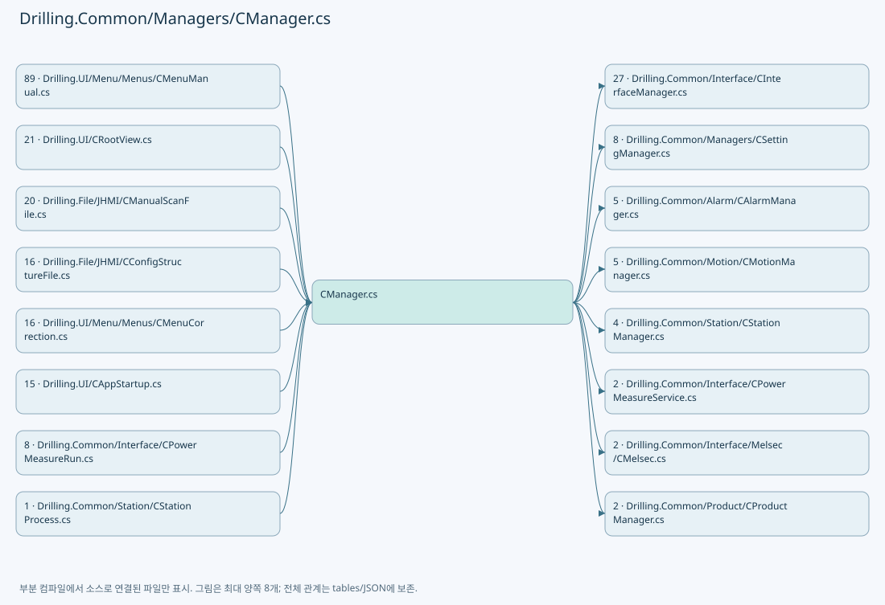

## 네임스페이스·타입·상속

| 타입 | 구분 | 원본 범위 | 선언/상속 |
| --- | --- | --- | --- |
| CManager | ClassDeclaration | 13–643 | CManager |
| EN_SYSTEM_MODE | EnumDeclaration | 645–650 | EN_SYSTEM_MODE |
| EN_PM_LOCK_STATE | EnumDeclaration | 652–656 | EN_PM_LOCK_STATE |
| EN_MANAGER_STARTUP_RESULT | EnumDeclaration | 658–663 | EN_MANAGER_STARTUP_RESULT |
| ST_MANUAL_SCAN_PARAM | RecordDeclaration | 665–685 | ST_MANUAL_SCAN_PARAM |
| ST_MANUAL_SCAN_FORM | RecordDeclaration | 686–698 | ST_MANUAL_SCAN_FORM |
| ST_POWER_METER_STATUS | RecordDeclaration | 699–724 | ST_POWER_METER_STATUS |
| ST_DEVICE_STATUS | RecordDeclaration | 726–736 | ST_DEVICE_STATUS |
| ST_SYSTEM_STATUS | RecordDeclaration | 738–752 | ST_SYSTEM_STATUS |
| ST_PM_LOCK_STATUS | RecordDeclaration | 754–754 | ST_PM_LOCK_STATUS |
| ST_MANAGER_STARTUP_STEP | RecordDeclaration | 755–755 | ST_MANAGER_STARTUP_STEP |
| ST_CONFIG_LOAD_STATUS | RecordDeclaration | 756–764 | ST_CONFIG_LOAD_STATUS |
| ST_CONFIG_FILE_STATUS | RecordDeclaration | 765–765 | ST_CONFIG_FILE_STATUS |
| CConfigStructureFileBase | ClassDeclaration | 766–769 | CConfigStructureFileBase |
| CManualScanFileBase | ClassDeclaration | 771–781 | CManualScanFileBase |

## 멤버 빠른 목록

| 이름 | 종류 | 범위 | 서명 |
| --- | --- | --- | --- |
| PowerMeasure | PropertyDeclaration | L15–15 | Drilling.Common.Interface.CPowerMeasureService Drilling.Common.Managers.CManager.PowerMeasure |
| get_PowerMeasure | GetAccessorDeclaration | L15–15 | Drilling.Common.Interface.CPowerMeasureService Drilling.Common.Managers.CManager.PowerMeasure.get |
| _configRoot | FieldDeclaration | L17–17 | string Drilling.Common.Managers.CManager._configRoot |
| _recipeFile | FieldDeclaration | L18–18 | Drilling.Common.Managers.CRecipeFileBase Drilling.Common.Managers.CManager._recipeFile |
| _settingFile | FieldDeclaration | L19–19 | Drilling.Common.Managers.CSettingFileBase Drilling.Common.Managers.CManager._settingFile |
| _manualScanFile | FieldDeclaration | L20–20 | Drilling.Common.Managers.CManualScanFileBase Drilling.Common.Managers.CManager._manualScanFile |
| _interfaceFile | FieldDeclaration | L21–21 | Drilling.Common.Managers.CInterfaceFileBase Drilling.Common.Managers.CManager._interfaceFile |
| _betFile | FieldDeclaration | L22–22 | Drilling.Common.Interface.CBETFileBase Drilling.Common.Managers.CManager._betFile |
| _motorFile | FieldDeclaration | L23–23 | Drilling.Common.Motion.CMotorFileBase Drilling.Common.Managers.CManager._motorFile |
| _melsecMapFile | FieldDeclaration | L24–24 | Drilling.Common.Interface.CMelsecMapFileBase Drilling.Common.Managers.CManager._melsecMapFile |
| _productFile | FieldDeclaration | L25–25 | Drilling.Common.Product.CProductFileBase Drilling.Common.Managers.CManager._productFile |
| _reviewResultFile | FieldDeclaration | L26–26 | Drilling.Common.Review.CReviewResultFileBase Drilling.Common.Managers.CManager._reviewResultFile |
| _reviewOffsetFile | FieldDeclaration | L27–27 | Drilling.Common.Review.CReviewOffsetFileBase Drilling.Common.Managers.CManager._reviewOffsetFile |
| _logManager | FieldDeclaration | L28–28 | CLogManager Drilling.Common.Managers.CManager._logManager |
| _automationScriptFile | FieldDeclaration | L29–29 | Drilling.Common.Station.CAutomationScriptFileBase Drilling.Common.Managers.CManager._automationScriptFile |
| _configStructureFile | FieldDeclaration | L30–30 | Drilling.Common.Managers.CConfigStructureFileBase? Drilling.Common.Managers.CManager._configStructureFile |
| _interfaceManager | FieldDeclaration | L31–31 | Drilling.Common.Interface.CInterfaceManager Drilling.Common.Managers.CManager._interfaceManager |
| _automationManager | FieldDeclaration | L32–32 | Drilling.Common.Automation.CAutomationManager Drilling.Common.Managers.CManager._automationManager |
| _motionManager | FieldDeclaration | L33–33 | Drilling.Common.Motion.CMotionManager Drilling.Common.Managers.CManager._motionManager |
| _alarmManager | FieldDeclaration | L34–34 | Drilling.Common.Alarm.CAlarmManager Drilling.Common.Managers.CManager._alarmManager |
| _alarmMotorSnapshots | FieldDeclaration | L35–35 | Drilling.Common.Interface.CSharedDeviceSnapshotService<System.Collections.Generic.IReadOnlyList<Drilling.Common.Motion.ST_MOTOR_AXIS_STATUS>> Drilling.Common.Managers.CManager._alarmMotorSnapshots |
| _alarmLaserSnapshots | FieldDeclaration | L36–36 | Drilling.Common.Interface.CSharedDeviceSnapshotService<Drilling.Common.Interface.ST_LASER_STATUS> Drilling.Common.Managers.CManager._alarmLaserSnapshots |
| _alarmBetSnapshots | FieldDeclaration | L37–37 | Drilling.Common.Interface.CSharedDeviceSnapshotService<Drilling.Common.Interface.ST_BET_STATUS> Drilling.Common.Managers.CManager._alarmBetSnapshots |
| _interLockManager | FieldDeclaration | L38–38 | Drilling.Common.InterLock.CInterLockManager Drilling.Common.Managers.CManager._interLockManager |
| _stationManager | FieldDeclaration | L39–39 | Drilling.Common.Station.CStationManager Drilling.Common.Managers.CManager._stationManager |
| _recipeManager | FieldDeclaration | L40–40 | Drilling.Common.Managers.CRecipeManager Drilling.Common.Managers.CManager._recipeManager |
| _settingManager | FieldDeclaration | L41–41 | Drilling.Common.Managers.CSettingManager Drilling.Common.Managers.CManager._settingManager |
| _productManager | FieldDeclaration | L42–42 | Drilling.Common.Product.CProductManager Drilling.Common.Managers.CManager._productManager |
| _reviewManager | FieldDeclaration | L43–43 | Drilling.Common.Review.CReviewManager Drilling.Common.Managers.CManager._reviewManager |
| _startupLock | FieldDeclaration | L44–44 | object Drilling.Common.Managers.CManager._startupLock |
| _startupMessages | FieldDeclaration | L45–45 | System.Collections.Generic.List<string> Drilling.Common.Managers.CManager._startupMessages |
| _startupSteps | FieldDeclaration | L46–46 | System.Collections.Generic.List<Drilling.Common.Managers.ST_MANAGER_STARTUP_STEP> Drilling.Common.Managers.CManager._startupSteps |
| _startupStepNo | FieldDeclaration | L47–47 | int Drilling.Common.Managers.CManager._startupStepNo |
| _loadedInterfaceCount | FieldDeclaration | L48–48 | int Drilling.Common.Managers.CManager._loadedInterfaceCount |
| _loadedMotorCount | FieldDeclaration | L49–49 | int Drilling.Common.Managers.CManager._loadedMotorCount |
| _loadedMelsecMapCount | FieldDeclaration | L50–50 | int Drilling.Common.Managers.CManager._loadedMelsecMapCount |
| _activeProductLoaded | FieldDeclaration | L51–51 | bool Drilling.Common.Managers.CManager._activeProductLoaded |
| .ctor | ConstructorDeclaration | L52–143 | Drilling.Common.Managers.CManager.CManager(string, Drilling.Common.Managers.CRecipeFileBase, Drilling.Common.Managers.CSettingFileBase, Drilling.Common.Managers.CManualScanFileBase, Drilling.Common.Managers.CInterfaceFileBase, Drilling.Common.Interface.CBETFileBase, Drilling.Common.Motion.CMotorFileBase, Drilling.Common.Interface.CMelsecMapFileBase, Drilling.Common.Product.CProductFileBase, Drilling.Common.Review.CReviewResultFileBase, Drilling.Common.Review.CReviewOffsetFileBase, CLogManager, Drilling.Common.Station.CAutomationScriptFileBase, bool?, Drilling.Common.Managers.CConfigStructureFileBase?, Drilling.Common.Alarm.CAlarmListFileBase?) |
| ConfigRoot | PropertyDeclaration | L145–151 | string Drilling.Common.Managers.CManager.ConfigRoot |
| get_ConfigRoot | GetAccessorDeclaration | L147–150 | string Drilling.Common.Managers.CManager.ConfigRoot.get |
| StartupMessages | PropertyDeclaration | L153–162 | System.Collections.Generic.IReadOnlyList<string> Drilling.Common.Managers.CManager.StartupMessages |
| get_StartupMessages | GetAccessorDeclaration | L155–161 | System.Collections.Generic.IReadOnlyList<string> Drilling.Common.Managers.CManager.StartupMessages.get |
| StartupSteps | PropertyDeclaration | L164–173 | System.Collections.Generic.IReadOnlyList<Drilling.Common.Managers.ST_MANAGER_STARTUP_STEP> Drilling.Common.Managers.CManager.StartupSteps |
| get_StartupSteps | GetAccessorDeclaration | L166–172 | System.Collections.Generic.IReadOnlyList<Drilling.Common.Managers.ST_MANAGER_STARTUP_STEP> Drilling.Common.Managers.CManager.StartupSteps.get |
| ConfigStatus | MethodDeclaration | L175–181 | Drilling.Common.Managers.ST_CONFIG_LOAD_STATUS Drilling.Common.Managers.CManager.ConfigStatus() |
| IsSimul | MethodDeclaration | L183–186 | bool Drilling.Common.Managers.CManager.IsSimul(int) |
| IsNotSimul | MethodDeclaration | L188–191 | bool Drilling.Common.Managers.CManager.IsNotSimul(int) |
| SetSimul | MethodDeclaration | L193–197 | System.Threading.Tasks.Task Drilling.Common.Managers.CManager.SetSimul(bool, System.Threading.CancellationToken) |
| SetSimul | MethodDeclaration | L199–202 | System.Threading.Tasks.Task Drilling.Common.Managers.CManager.SetSimul(int, bool, System.Threading.CancellationToken) |
| Initialize | MethodDeclaration | L204–218 | System.Threading.Tasks.Task Drilling.Common.Managers.CManager.Initialize(System.Threading.CancellationToken) |
| SelectValue | LocalFunctionStatement | L206–209 | System.Threading.Tasks.Task SelectValue() |
| SelectTask | LocalFunctionStatement | L212–215 | System.Threading.Tasks.Task SelectTask() |
| Destroy | MethodDeclaration | L220–257 | System.Threading.Tasks.Task Drilling.Common.Managers.CManager.Destroy(System.Threading.CancellationToken) |
| StartBackgroundMonitoring | MethodDeclaration | L259–268 | void Drilling.Common.Managers.CManager.StartBackgroundMonitoring() |
| StopBackgroundMonitoring | MethodDeclaration | L270–278 | System.Threading.Tasks.Task Drilling.Common.Managers.CManager.StopBackgroundMonitoring() |
| ReadAlarmDeviceSnapshot | MethodDeclaration | L280–305 | Drilling.Common.Managers.ST_DEVICE_STATUS Drilling.Common.Managers.CManager.ReadAlarmDeviceSnapshot() |
| ConnectInterface | MethodDeclaration | L307–310 | System.Threading.Tasks.Task<int> Drilling.Common.Managers.CManager.ConnectInterface(System.Threading.CancellationToken) |
| DisconnectInterface | MethodDeclaration | L312–315 | System.Threading.Tasks.Task<int> Drilling.Common.Managers.CManager.DisconnectInterface(System.Threading.CancellationToken) |
| ReconnectInterface | MethodDeclaration | L317–320 | System.Threading.Tasks.Task Drilling.Common.Managers.CManager.ReconnectInterface(Drilling.Common.Interface.EN_EQP_MODULE, int, System.Threading.CancellationToken) |
| Station | MethodDeclaration | L322–325 | Drilling.Common.Station.CStationManager Drilling.Common.Managers.CManager.Station() |
| Recipe | MethodDeclaration | L327–330 | Drilling.Common.Managers.CRecipeManager Drilling.Common.Managers.CManager.Recipe() |
| Setting | MethodDeclaration | L332–335 | Drilling.Common.Managers.CSettingManager Drilling.Common.Managers.CManager.Setting() |
| Product | MethodDeclaration | L337–340 | Drilling.Common.Product.CProductManager Drilling.Common.Managers.CManager.Product() |
| Review | MethodDeclaration | L342–345 | Drilling.Common.Review.CReviewManager Drilling.Common.Managers.CManager.Review() |
| Interface | MethodDeclaration | L347–350 | Drilling.Common.Interface.CInterfaceManager Drilling.Common.Managers.CManager.Interface() |
| Automation | MethodDeclaration | L352–355 | Drilling.Common.Automation.CAutomationManager Drilling.Common.Managers.CManager.Automation() |
| automation | PropertyDeclaration | L357–363 | Drilling.Common.Automation.CAutomationManager Drilling.Common.Managers.CManager.automation |
| get_automation | GetAccessorDeclaration | L359–362 | Drilling.Common.Automation.CAutomationManager Drilling.Common.Managers.CManager.automation.get |
| Motion | MethodDeclaration | L365–368 | Drilling.Common.Motion.CMotionManager Drilling.Common.Managers.CManager.Motion() |
| Alarm | MethodDeclaration | L370–373 | Drilling.Common.Alarm.CAlarmManager Drilling.Common.Managers.CManager.Alarm() |
| InterLock | MethodDeclaration | L375–378 | Drilling.Common.InterLock.CInterLockManager Drilling.Common.Managers.CManager.InterLock() |
| Log | MethodDeclaration | L380–383 | CLogManager Drilling.Common.Managers.CManager.Log() |
| RecipeFile | MethodDeclaration | L385–388 | Drilling.Common.Managers.CRecipeFileBase Drilling.Common.Managers.CManager.RecipeFile() |
| SettingFile | MethodDeclaration | L390–393 | Drilling.Common.Managers.CSettingFileBase Drilling.Common.Managers.CManager.SettingFile() |
| ManualScanFile | MethodDeclaration | L395–398 | Drilling.Common.Managers.CManualScanFileBase Drilling.Common.Managers.CManager.ManualScanFile() |
| InterfaceFile | MethodDeclaration | L400–403 | Drilling.Common.Managers.CInterfaceFileBase Drilling.Common.Managers.CManager.InterfaceFile() |
| BETFile | MethodDeclaration | L405–408 | Drilling.Common.Interface.CBETFileBase Drilling.Common.Managers.CManager.BETFile() |
| MotorFile | MethodDeclaration | L410–413 | Drilling.Common.Motion.CMotorFileBase Drilling.Common.Managers.CManager.MotorFile() |
| MelsecMapFile | MethodDeclaration | L415–418 | Drilling.Common.Interface.CMelsecMapFileBase Drilling.Common.Managers.CManager.MelsecMapFile() |
| ProductFile | MethodDeclaration | L420–423 | Drilling.Common.Product.CProductFileBase Drilling.Common.Managers.CManager.ProductFile() |
| ReviewResultFile | MethodDeclaration | L425–428 | Drilling.Common.Review.CReviewResultFileBase Drilling.Common.Managers.CManager.ReviewResultFile() |
| ReviewOffsetFile | MethodDeclaration | L430–433 | Drilling.Common.Review.CReviewOffsetFileBase Drilling.Common.Managers.CManager.ReviewOffsetFile() |
| CheckConfigRoot | MethodDeclaration | L435–444 | void Drilling.Common.Managers.CManager.CheckConfigRoot() |
| ValidateConfigStructure | MethodDeclaration | L446–466 | void Drilling.Common.Managers.CManager.ValidateConfigStructure() |
| LoadInterfaceList | MethodDeclaration | L468–482 | System.Collections.Generic.IReadOnlyList<Drilling.Common.Interface.ST_INTERFACE_DATA> Drilling.Common.Managers.CManager.LoadInterfaceList() |
| RegisterInterfaceList | MethodDeclaration | L484–501 | void Drilling.Common.Managers.CManager.RegisterInterfaceList(System.Collections.Generic.IReadOnlyList<Drilling.Common.Interface.ST_INTERFACE_DATA>) |
| LoadMotorList | MethodDeclaration | L503–517 | System.Collections.Generic.IReadOnlyList<Drilling.Common.Motion.ST_MOTOR_DATA> Drilling.Common.Managers.CManager.LoadMotorList() |
| LoadMelsecMapList | MethodDeclaration | L519–533 | System.Collections.Generic.IReadOnlyList<Drilling.Common.Interface.ST_MELSEC_MAP_DATA> Drilling.Common.Managers.CManager.LoadMelsecMapList() |
| LoadActiveProduct | MethodDeclaration | L535–548 | void Drilling.Common.Managers.CManager.LoadActiveProduct() |
| RunInitializeStep | MethodDeclaration | L550–566 | System.Threading.Tasks.Task Drilling.Common.Managers.CManager.RunInitializeStep(string, System.Func<System.Threading.Tasks.Task>, System.Threading.CancellationToken) |
| AddStartupFailure | MethodDeclaration | L568–571 | void Drilling.Common.Managers.CManager.AddStartupFailure(string, System.Exception) |
| AddStartupStep | MethodDeclaration | L573–583 | void Drilling.Common.Managers.CManager.AddStartupStep(string, Drilling.Common.Managers.EN_MANAGER_STARTUP_RESULT, string) |
| GetMotionSimulationMode | MethodDeclaration | L585–593 | bool Drilling.Common.Managers.CManager.GetMotionSimulationMode(bool?) |
| MatchesItem | LocalFunctionStatement | L587–590 | bool MatchesItem(Drilling.Common.Interface.ST_INTERFACE_DATA?) |
| GetScriptDirectory | MethodDeclaration | L595–604 | string Drilling.Common.Managers.CManager.GetScriptDirectory() |
| MatchesItem | LocalFunctionStatement | L597–600 | bool MatchesItem(Drilling.Common.Managers.ST_SYSTEM_PARAMETER) |
| GetProjectRoot | MethodDeclaration | L606–609 | string Drilling.Common.Managers.CManager.GetProjectRoot() |
| ResolveProjectPath | MethodDeclaration | L611–615 | string Drilling.Common.Managers.CManager.ResolveProjectPath(string?, string) |
| IsStartupDataException | MethodDeclaration | L617–620 | bool Drilling.Common.Managers.CManager.IsStartupDataException(System.Exception) |
| IsStartupRuntimeException | MethodDeclaration | L622–625 | bool Drilling.Common.Managers.CManager.IsStartupRuntimeException(System.Exception) |
| ToStartupResult | MethodDeclaration | L627–635 | Drilling.Common.Managers.EN_MANAGER_STARTUP_RESULT Drilling.Common.Managers.CManager.ToStartupResult(Drilling.Common.Managers.ST_CONFIG_FILE_STATUS) |
| FormatConfigStatusMessage | MethodDeclaration | L637–642 | string Drilling.Common.Managers.CManager.FormatConfigStatusMessage(Drilling.Common.Managers.ST_CONFIG_FILE_STATUS) |
| Simulation | EnumMemberDeclaration | L647–647 | Drilling.Common.Managers.EN_SYSTEM_MODE.Simulation |
| Auto | EnumMemberDeclaration | L648–648 | Drilling.Common.Managers.EN_SYSTEM_MODE.Auto |
| Manual | EnumMemberDeclaration | L649–649 | Drilling.Common.Managers.EN_SYSTEM_MODE.Manual |
| Released | EnumMemberDeclaration | L654–654 | Drilling.Common.Managers.EN_PM_LOCK_STATE.Released |
| Locked | EnumMemberDeclaration | L655–655 | Drilling.Common.Managers.EN_PM_LOCK_STATE.Locked |
| Ready | EnumMemberDeclaration | L660–660 | Drilling.Common.Managers.EN_MANAGER_STARTUP_RESULT.Ready |
| Warning | EnumMemberDeclaration | L661–661 | Drilling.Common.Managers.EN_MANAGER_STARTUP_RESULT.Warning |
| Failed | EnumMemberDeclaration | L662–662 | Drilling.Common.Managers.EN_MANAGER_STARTUP_RESULT.Failed |
| Empty | PropertyDeclaration | L717–723 | Drilling.Common.Managers.ST_POWER_METER_STATUS Drilling.Common.Managers.ST_POWER_METER_STATUS.Empty |
| get_Empty | GetAccessorDeclaration | L719–722 | Drilling.Common.Managers.ST_POWER_METER_STATUS Drilling.Common.Managers.ST_POWER_METER_STATUS.Empty.get |
| SnapshotError | PropertyDeclaration | L735–735 | string Drilling.Common.Managers.ST_DEVICE_STATUS.SnapshotError |
| get_SnapshotError | GetAccessorDeclaration | L735–735 | string Drilling.Common.Managers.ST_DEVICE_STATUS.SnapshotError.get |
| set_SnapshotError | InitAccessorDeclaration | L735–735 | void Drilling.Common.Managers.ST_DEVICE_STATUS.SnapshotError.init |
| GetModule | MethodDeclaration | L740–751 | Drilling.Common.Interface.ST_DEVICE_COMM_STATUS Drilling.Common.Managers.ST_SYSTEM_STATUS.GetModule(Drilling.Common.Interface.EN_EQP_MODULE) |
| Validate | MethodDeclaration | L768–768 | System.Threading.Tasks.Task<System.Collections.Generic.IReadOnlyList<Drilling.Common.Managers.ST_CONFIG_FILE_STATUS>> Drilling.Common.Managers.CConfigStructureFileBase.Validate(System.Threading.CancellationToken) |
| List | MethodDeclaration | L773–773 | System.Threading.Tasks.Task<System.Collections.Generic.IReadOnlyList<string>> Drilling.Common.Managers.CManualScanFileBase.List(System.Threading.CancellationToken) |
| LoadForm | MethodDeclaration | L774–774 | System.Threading.Tasks.Task<System.Collections.Generic.IReadOnlyList<Drilling.Common.Managers.ST_MANUAL_SCAN_FORM>> Drilling.Common.Managers.CManualScanFileBase.LoadForm(System.Threading.CancellationToken) |
| Load | MethodDeclaration | L775–775 | System.Threading.Tasks.Task<Drilling.Common.Managers.ST_MANUAL_SCAN_PARAM> Drilling.Common.Managers.CManualScanFileBase.Load(System.Threading.CancellationToken) |
| Load | MethodDeclaration | L776–776 | System.Threading.Tasks.Task<Drilling.Common.Managers.ST_MANUAL_SCAN_PARAM> Drilling.Common.Managers.CManualScanFileBase.Load(string, System.Threading.CancellationToken) |
| Save | MethodDeclaration | L777–777 | System.Threading.Tasks.Task Drilling.Common.Managers.CManualScanFileBase.Save(Drilling.Common.Managers.ST_MANUAL_SCAN_PARAM, System.Threading.CancellationToken) |
| Save | MethodDeclaration | L778–778 | System.Threading.Tasks.Task Drilling.Common.Managers.CManualScanFileBase.Save(string, Drilling.Common.Managers.ST_MANUAL_SCAN_PARAM, System.Threading.CancellationToken) |
| Rename | MethodDeclaration | L779–779 | System.Threading.Tasks.Task Drilling.Common.Managers.CManualScanFileBase.Rename(string, string, System.Threading.CancellationToken) |
| Delete | MethodDeclaration | L780–780 | System.Threading.Tasks.Task Drilling.Common.Managers.CManualScanFileBase.Delete(string, System.Threading.CancellationToken) |

## 멤버별 상세 계약·호출·처리 해설

### PropertyDeclaration `PowerMeasure` · L15–15

[Drilling.Common/Managers/CManager.cs:15–15](https://github.com/kjuws10-rgb/A3Drilling/blob/5aee8e58439c9b455cae7c9593c9be986c3e682e/Drilling.Common/Managers/CManager.cs#L15-L15)

| 항목 | 실제 추출 값 |
| --- | --- |
| 서명 | Drilling.Common.Interface.CPowerMeasureService Drilling.Common.Managers.CManager.PowerMeasure |
| 접근/수식자 | Public / public |
| 반환/값 타입 | Drilling.Common.Interface.CPowerMeasureService |
| 소속 타입 | NamedType:Drilling.Common.Managers.CManager |

현재 부분 분석에서 직접 연결된 호출자는 없습니다. XAML/이벤트/인터페이스·델리게이트·외부 진입을 추가 확인해야 하며, 미사용으로 판정한 것이 아닙니다.

호출하는 대상과 해석 범위:

| 원본 행 | 표현식 | 분석 상태 | 대상/소스 위치 |
| --- | --- | --- | --- |
| 15 | new | resolved | Drilling.Common.Interface.CPowerMeasureService.CPowerMeasureService() · Drilling.Common/Interface/CPowerMeasureService.cs:4 |

본문의 실제 연산·분기·예외·반환 순서(원문 위치 순):

| 원본 행 | 종류 | 주석 해설 |
| --- | --- | --- |
| 15 | call | 함수·델리게이트 또는 객체 생성자를 호출합니다: new() |

변경 전 점검: 입력/반환 타입, 위 호출자, 예외/취소 경로, 공유 상태와 저장·전송 소비자를 함께 확인합니다. 값의 단위나 물리 방향을 이름만으로 확정하지 않습니다.

### GetAccessorDeclaration `get_PowerMeasure` · L15–15

[Drilling.Common/Managers/CManager.cs:15–15](https://github.com/kjuws10-rgb/A3Drilling/blob/5aee8e58439c9b455cae7c9593c9be986c3e682e/Drilling.Common/Managers/CManager.cs#L15-L15)

| 항목 | 실제 추출 값 |
| --- | --- |
| 서명 | Drilling.Common.Interface.CPowerMeasureService Drilling.Common.Managers.CManager.PowerMeasure.get |
| 접근/수식자 | Public / get |
| 반환/값 타입 | Drilling.Common.Interface.CPowerMeasureService |
| 소속 타입 | NamedType:Drilling.Common.Managers.CManager |

현재 부분 분석에서 직접 연결된 호출자는 없습니다. XAML/이벤트/인터페이스·델리게이트·외부 진입을 추가 확인해야 하며, 미사용으로 판정한 것이 아닙니다.

변경 전 점검: 입력/반환 타입, 위 호출자, 예외/취소 경로, 공유 상태와 저장·전송 소비자를 함께 확인합니다. 값의 단위나 물리 방향을 이름만으로 확정하지 않습니다.

### FieldDeclaration `_configRoot` · L17–17

[Drilling.Common/Managers/CManager.cs:17–17](https://github.com/kjuws10-rgb/A3Drilling/blob/5aee8e58439c9b455cae7c9593c9be986c3e682e/Drilling.Common/Managers/CManager.cs#L17-L17)

| 항목 | 실제 추출 값 |
| --- | --- |
| 서명 | string Drilling.Common.Managers.CManager._configRoot |
| 접근/수식자 | Private / private, readonly |
| 반환/값 타입 | string |
| 소속 타입 | NamedType:Drilling.Common.Managers.CManager |

현재 부분 분석에서 직접 연결된 호출자는 없습니다. XAML/이벤트/인터페이스·델리게이트·외부 진입을 추가 확인해야 하며, 미사용으로 판정한 것이 아닙니다.

변경 전 점검: 입력/반환 타입, 위 호출자, 예외/취소 경로, 공유 상태와 저장·전송 소비자를 함께 확인합니다. 값의 단위나 물리 방향을 이름만으로 확정하지 않습니다.

### FieldDeclaration `_recipeFile` · L18–18

[Drilling.Common/Managers/CManager.cs:18–18](https://github.com/kjuws10-rgb/A3Drilling/blob/5aee8e58439c9b455cae7c9593c9be986c3e682e/Drilling.Common/Managers/CManager.cs#L18-L18)

| 항목 | 실제 추출 값 |
| --- | --- |
| 서명 | Drilling.Common.Managers.CRecipeFileBase Drilling.Common.Managers.CManager._recipeFile |
| 접근/수식자 | Private / private, readonly |
| 반환/값 타입 | Drilling.Common.Managers.CRecipeFileBase |
| 소속 타입 | NamedType:Drilling.Common.Managers.CManager |

현재 부분 분석에서 직접 연결된 호출자는 없습니다. XAML/이벤트/인터페이스·델리게이트·외부 진입을 추가 확인해야 하며, 미사용으로 판정한 것이 아닙니다.

변경 전 점검: 입력/반환 타입, 위 호출자, 예외/취소 경로, 공유 상태와 저장·전송 소비자를 함께 확인합니다. 값의 단위나 물리 방향을 이름만으로 확정하지 않습니다.

### FieldDeclaration `_settingFile` · L19–19

[Drilling.Common/Managers/CManager.cs:19–19](https://github.com/kjuws10-rgb/A3Drilling/blob/5aee8e58439c9b455cae7c9593c9be986c3e682e/Drilling.Common/Managers/CManager.cs#L19-L19)

| 항목 | 실제 추출 값 |
| --- | --- |
| 서명 | Drilling.Common.Managers.CSettingFileBase Drilling.Common.Managers.CManager._settingFile |
| 접근/수식자 | Private / private, readonly |
| 반환/값 타입 | Drilling.Common.Managers.CSettingFileBase |
| 소속 타입 | NamedType:Drilling.Common.Managers.CManager |

현재 부분 분석에서 직접 연결된 호출자는 없습니다. XAML/이벤트/인터페이스·델리게이트·외부 진입을 추가 확인해야 하며, 미사용으로 판정한 것이 아닙니다.

변경 전 점검: 입력/반환 타입, 위 호출자, 예외/취소 경로, 공유 상태와 저장·전송 소비자를 함께 확인합니다. 값의 단위나 물리 방향을 이름만으로 확정하지 않습니다.

### FieldDeclaration `_manualScanFile` · L20–20

[Drilling.Common/Managers/CManager.cs:20–20](https://github.com/kjuws10-rgb/A3Drilling/blob/5aee8e58439c9b455cae7c9593c9be986c3e682e/Drilling.Common/Managers/CManager.cs#L20-L20)

| 항목 | 실제 추출 값 |
| --- | --- |
| 서명 | Drilling.Common.Managers.CManualScanFileBase Drilling.Common.Managers.CManager._manualScanFile |
| 접근/수식자 | Private / private, readonly |
| 반환/값 타입 | Drilling.Common.Managers.CManualScanFileBase |
| 소속 타입 | NamedType:Drilling.Common.Managers.CManager |

현재 부분 분석에서 직접 연결된 호출자는 없습니다. XAML/이벤트/인터페이스·델리게이트·외부 진입을 추가 확인해야 하며, 미사용으로 판정한 것이 아닙니다.

변경 전 점검: 입력/반환 타입, 위 호출자, 예외/취소 경로, 공유 상태와 저장·전송 소비자를 함께 확인합니다. 값의 단위나 물리 방향을 이름만으로 확정하지 않습니다.

### FieldDeclaration `_interfaceFile` · L21–21

[Drilling.Common/Managers/CManager.cs:21–21](https://github.com/kjuws10-rgb/A3Drilling/blob/5aee8e58439c9b455cae7c9593c9be986c3e682e/Drilling.Common/Managers/CManager.cs#L21-L21)

| 항목 | 실제 추출 값 |
| --- | --- |
| 서명 | Drilling.Common.Managers.CInterfaceFileBase Drilling.Common.Managers.CManager._interfaceFile |
| 접근/수식자 | Private / private, readonly |
| 반환/값 타입 | Drilling.Common.Managers.CInterfaceFileBase |
| 소속 타입 | NamedType:Drilling.Common.Managers.CManager |

현재 부분 분석에서 직접 연결된 호출자는 없습니다. XAML/이벤트/인터페이스·델리게이트·외부 진입을 추가 확인해야 하며, 미사용으로 판정한 것이 아닙니다.

변경 전 점검: 입력/반환 타입, 위 호출자, 예외/취소 경로, 공유 상태와 저장·전송 소비자를 함께 확인합니다. 값의 단위나 물리 방향을 이름만으로 확정하지 않습니다.

### FieldDeclaration `_betFile` · L22–22

[Drilling.Common/Managers/CManager.cs:22–22](https://github.com/kjuws10-rgb/A3Drilling/blob/5aee8e58439c9b455cae7c9593c9be986c3e682e/Drilling.Common/Managers/CManager.cs#L22-L22)

| 항목 | 실제 추출 값 |
| --- | --- |
| 서명 | Drilling.Common.Interface.CBETFileBase Drilling.Common.Managers.CManager._betFile |
| 접근/수식자 | Private / private, readonly |
| 반환/값 타입 | Drilling.Common.Interface.CBETFileBase |
| 소속 타입 | NamedType:Drilling.Common.Managers.CManager |

현재 부분 분석에서 직접 연결된 호출자는 없습니다. XAML/이벤트/인터페이스·델리게이트·외부 진입을 추가 확인해야 하며, 미사용으로 판정한 것이 아닙니다.

변경 전 점검: 입력/반환 타입, 위 호출자, 예외/취소 경로, 공유 상태와 저장·전송 소비자를 함께 확인합니다. 값의 단위나 물리 방향을 이름만으로 확정하지 않습니다.

### FieldDeclaration `_motorFile` · L23–23

[Drilling.Common/Managers/CManager.cs:23–23](https://github.com/kjuws10-rgb/A3Drilling/blob/5aee8e58439c9b455cae7c9593c9be986c3e682e/Drilling.Common/Managers/CManager.cs#L23-L23)

| 항목 | 실제 추출 값 |
| --- | --- |
| 서명 | Drilling.Common.Motion.CMotorFileBase Drilling.Common.Managers.CManager._motorFile |
| 접근/수식자 | Private / private, readonly |
| 반환/값 타입 | Drilling.Common.Motion.CMotorFileBase |
| 소속 타입 | NamedType:Drilling.Common.Managers.CManager |

현재 부분 분석에서 직접 연결된 호출자는 없습니다. XAML/이벤트/인터페이스·델리게이트·외부 진입을 추가 확인해야 하며, 미사용으로 판정한 것이 아닙니다.

변경 전 점검: 입력/반환 타입, 위 호출자, 예외/취소 경로, 공유 상태와 저장·전송 소비자를 함께 확인합니다. 값의 단위나 물리 방향을 이름만으로 확정하지 않습니다.

### FieldDeclaration `_melsecMapFile` · L24–24

[Drilling.Common/Managers/CManager.cs:24–24](https://github.com/kjuws10-rgb/A3Drilling/blob/5aee8e58439c9b455cae7c9593c9be986c3e682e/Drilling.Common/Managers/CManager.cs#L24-L24)

| 항목 | 실제 추출 값 |
| --- | --- |
| 서명 | Drilling.Common.Interface.CMelsecMapFileBase Drilling.Common.Managers.CManager._melsecMapFile |
| 접근/수식자 | Private / private, readonly |
| 반환/값 타입 | Drilling.Common.Interface.CMelsecMapFileBase |
| 소속 타입 | NamedType:Drilling.Common.Managers.CManager |

현재 부분 분석에서 직접 연결된 호출자는 없습니다. XAML/이벤트/인터페이스·델리게이트·외부 진입을 추가 확인해야 하며, 미사용으로 판정한 것이 아닙니다.

변경 전 점검: 입력/반환 타입, 위 호출자, 예외/취소 경로, 공유 상태와 저장·전송 소비자를 함께 확인합니다. 값의 단위나 물리 방향을 이름만으로 확정하지 않습니다.

### FieldDeclaration `_productFile` · L25–25

[Drilling.Common/Managers/CManager.cs:25–25](https://github.com/kjuws10-rgb/A3Drilling/blob/5aee8e58439c9b455cae7c9593c9be986c3e682e/Drilling.Common/Managers/CManager.cs#L25-L25)

| 항목 | 실제 추출 값 |
| --- | --- |
| 서명 | Drilling.Common.Product.CProductFileBase Drilling.Common.Managers.CManager._productFile |
| 접근/수식자 | Private / private, readonly |
| 반환/값 타입 | Drilling.Common.Product.CProductFileBase |
| 소속 타입 | NamedType:Drilling.Common.Managers.CManager |

현재 부분 분석에서 직접 연결된 호출자는 없습니다. XAML/이벤트/인터페이스·델리게이트·외부 진입을 추가 확인해야 하며, 미사용으로 판정한 것이 아닙니다.

변경 전 점검: 입력/반환 타입, 위 호출자, 예외/취소 경로, 공유 상태와 저장·전송 소비자를 함께 확인합니다. 값의 단위나 물리 방향을 이름만으로 확정하지 않습니다.

### FieldDeclaration `_reviewResultFile` · L26–26

[Drilling.Common/Managers/CManager.cs:26–26](https://github.com/kjuws10-rgb/A3Drilling/blob/5aee8e58439c9b455cae7c9593c9be986c3e682e/Drilling.Common/Managers/CManager.cs#L26-L26)

| 항목 | 실제 추출 값 |
| --- | --- |
| 서명 | Drilling.Common.Review.CReviewResultFileBase Drilling.Common.Managers.CManager._reviewResultFile |
| 접근/수식자 | Private / private, readonly |
| 반환/값 타입 | Drilling.Common.Review.CReviewResultFileBase |
| 소속 타입 | NamedType:Drilling.Common.Managers.CManager |

현재 부분 분석에서 직접 연결된 호출자는 없습니다. XAML/이벤트/인터페이스·델리게이트·외부 진입을 추가 확인해야 하며, 미사용으로 판정한 것이 아닙니다.

변경 전 점검: 입력/반환 타입, 위 호출자, 예외/취소 경로, 공유 상태와 저장·전송 소비자를 함께 확인합니다. 값의 단위나 물리 방향을 이름만으로 확정하지 않습니다.

### FieldDeclaration `_reviewOffsetFile` · L27–27

[Drilling.Common/Managers/CManager.cs:27–27](https://github.com/kjuws10-rgb/A3Drilling/blob/5aee8e58439c9b455cae7c9593c9be986c3e682e/Drilling.Common/Managers/CManager.cs#L27-L27)

| 항목 | 실제 추출 값 |
| --- | --- |
| 서명 | Drilling.Common.Review.CReviewOffsetFileBase Drilling.Common.Managers.CManager._reviewOffsetFile |
| 접근/수식자 | Private / private, readonly |
| 반환/값 타입 | Drilling.Common.Review.CReviewOffsetFileBase |
| 소속 타입 | NamedType:Drilling.Common.Managers.CManager |

현재 부분 분석에서 직접 연결된 호출자는 없습니다. XAML/이벤트/인터페이스·델리게이트·외부 진입을 추가 확인해야 하며, 미사용으로 판정한 것이 아닙니다.

변경 전 점검: 입력/반환 타입, 위 호출자, 예외/취소 경로, 공유 상태와 저장·전송 소비자를 함께 확인합니다. 값의 단위나 물리 방향을 이름만으로 확정하지 않습니다.

### FieldDeclaration `_logManager` · L28–28

[Drilling.Common/Managers/CManager.cs:28–28](https://github.com/kjuws10-rgb/A3Drilling/blob/5aee8e58439c9b455cae7c9593c9be986c3e682e/Drilling.Common/Managers/CManager.cs#L28-L28)

| 항목 | 실제 추출 값 |
| --- | --- |
| 서명 | CLogManager Drilling.Common.Managers.CManager._logManager |
| 접근/수식자 | Private / private, readonly |
| 반환/값 타입 | CLogManager |
| 소속 타입 | NamedType:Drilling.Common.Managers.CManager |

현재 부분 분석에서 직접 연결된 호출자는 없습니다. XAML/이벤트/인터페이스·델리게이트·외부 진입을 추가 확인해야 하며, 미사용으로 판정한 것이 아닙니다.

변경 전 점검: 입력/반환 타입, 위 호출자, 예외/취소 경로, 공유 상태와 저장·전송 소비자를 함께 확인합니다. 값의 단위나 물리 방향을 이름만으로 확정하지 않습니다.

### FieldDeclaration `_automationScriptFile` · L29–29

[Drilling.Common/Managers/CManager.cs:29–29](https://github.com/kjuws10-rgb/A3Drilling/blob/5aee8e58439c9b455cae7c9593c9be986c3e682e/Drilling.Common/Managers/CManager.cs#L29-L29)

| 항목 | 실제 추출 값 |
| --- | --- |
| 서명 | Drilling.Common.Station.CAutomationScriptFileBase Drilling.Common.Managers.CManager._automationScriptFile |
| 접근/수식자 | Private / private, readonly |
| 반환/값 타입 | Drilling.Common.Station.CAutomationScriptFileBase |
| 소속 타입 | NamedType:Drilling.Common.Managers.CManager |

현재 부분 분석에서 직접 연결된 호출자는 없습니다. XAML/이벤트/인터페이스·델리게이트·외부 진입을 추가 확인해야 하며, 미사용으로 판정한 것이 아닙니다.

변경 전 점검: 입력/반환 타입, 위 호출자, 예외/취소 경로, 공유 상태와 저장·전송 소비자를 함께 확인합니다. 값의 단위나 물리 방향을 이름만으로 확정하지 않습니다.

### FieldDeclaration `_configStructureFile` · L30–30

[Drilling.Common/Managers/CManager.cs:30–30](https://github.com/kjuws10-rgb/A3Drilling/blob/5aee8e58439c9b455cae7c9593c9be986c3e682e/Drilling.Common/Managers/CManager.cs#L30-L30)

| 항목 | 실제 추출 값 |
| --- | --- |
| 서명 | Drilling.Common.Managers.CConfigStructureFileBase? Drilling.Common.Managers.CManager._configStructureFile |
| 접근/수식자 | Private / private, readonly |
| 반환/값 타입 | Drilling.Common.Managers.CConfigStructureFileBase? |
| 소속 타입 | NamedType:Drilling.Common.Managers.CManager |

현재 부분 분석에서 직접 연결된 호출자는 없습니다. XAML/이벤트/인터페이스·델리게이트·외부 진입을 추가 확인해야 하며, 미사용으로 판정한 것이 아닙니다.

변경 전 점검: 입력/반환 타입, 위 호출자, 예외/취소 경로, 공유 상태와 저장·전송 소비자를 함께 확인합니다. 값의 단위나 물리 방향을 이름만으로 확정하지 않습니다.

### FieldDeclaration `_interfaceManager` · L31–31

[Drilling.Common/Managers/CManager.cs:31–31](https://github.com/kjuws10-rgb/A3Drilling/blob/5aee8e58439c9b455cae7c9593c9be986c3e682e/Drilling.Common/Managers/CManager.cs#L31-L31)

| 항목 | 실제 추출 값 |
| --- | --- |
| 서명 | Drilling.Common.Interface.CInterfaceManager Drilling.Common.Managers.CManager._interfaceManager |
| 접근/수식자 | Private / private, readonly |
| 반환/값 타입 | Drilling.Common.Interface.CInterfaceManager |
| 소속 타입 | NamedType:Drilling.Common.Managers.CManager |

현재 부분 분석에서 직접 연결된 호출자는 없습니다. XAML/이벤트/인터페이스·델리게이트·외부 진입을 추가 확인해야 하며, 미사용으로 판정한 것이 아닙니다.

변경 전 점검: 입력/반환 타입, 위 호출자, 예외/취소 경로, 공유 상태와 저장·전송 소비자를 함께 확인합니다. 값의 단위나 물리 방향을 이름만으로 확정하지 않습니다.

### FieldDeclaration `_automationManager` · L32–32

[Drilling.Common/Managers/CManager.cs:32–32](https://github.com/kjuws10-rgb/A3Drilling/blob/5aee8e58439c9b455cae7c9593c9be986c3e682e/Drilling.Common/Managers/CManager.cs#L32-L32)

| 항목 | 실제 추출 값 |
| --- | --- |
| 서명 | Drilling.Common.Automation.CAutomationManager Drilling.Common.Managers.CManager._automationManager |
| 접근/수식자 | Private / private, readonly |
| 반환/값 타입 | Drilling.Common.Automation.CAutomationManager |
| 소속 타입 | NamedType:Drilling.Common.Managers.CManager |

현재 부분 분석에서 직접 연결된 호출자는 없습니다. XAML/이벤트/인터페이스·델리게이트·외부 진입을 추가 확인해야 하며, 미사용으로 판정한 것이 아닙니다.

변경 전 점검: 입력/반환 타입, 위 호출자, 예외/취소 경로, 공유 상태와 저장·전송 소비자를 함께 확인합니다. 값의 단위나 물리 방향을 이름만으로 확정하지 않습니다.

### FieldDeclaration `_motionManager` · L33–33

[Drilling.Common/Managers/CManager.cs:33–33](https://github.com/kjuws10-rgb/A3Drilling/blob/5aee8e58439c9b455cae7c9593c9be986c3e682e/Drilling.Common/Managers/CManager.cs#L33-L33)

| 항목 | 실제 추출 값 |
| --- | --- |
| 서명 | Drilling.Common.Motion.CMotionManager Drilling.Common.Managers.CManager._motionManager |
| 접근/수식자 | Private / private, readonly |
| 반환/값 타입 | Drilling.Common.Motion.CMotionManager |
| 소속 타입 | NamedType:Drilling.Common.Managers.CManager |

현재 부분 분석에서 직접 연결된 호출자는 없습니다. XAML/이벤트/인터페이스·델리게이트·외부 진입을 추가 확인해야 하며, 미사용으로 판정한 것이 아닙니다.

변경 전 점검: 입력/반환 타입, 위 호출자, 예외/취소 경로, 공유 상태와 저장·전송 소비자를 함께 확인합니다. 값의 단위나 물리 방향을 이름만으로 확정하지 않습니다.

### FieldDeclaration `_alarmManager` · L34–34

[Drilling.Common/Managers/CManager.cs:34–34](https://github.com/kjuws10-rgb/A3Drilling/blob/5aee8e58439c9b455cae7c9593c9be986c3e682e/Drilling.Common/Managers/CManager.cs#L34-L34)

| 항목 | 실제 추출 값 |
| --- | --- |
| 서명 | Drilling.Common.Alarm.CAlarmManager Drilling.Common.Managers.CManager._alarmManager |
| 접근/수식자 | Private / private, readonly |
| 반환/값 타입 | Drilling.Common.Alarm.CAlarmManager |
| 소속 타입 | NamedType:Drilling.Common.Managers.CManager |

현재 부분 분석에서 직접 연결된 호출자는 없습니다. XAML/이벤트/인터페이스·델리게이트·외부 진입을 추가 확인해야 하며, 미사용으로 판정한 것이 아닙니다.

변경 전 점검: 입력/반환 타입, 위 호출자, 예외/취소 경로, 공유 상태와 저장·전송 소비자를 함께 확인합니다. 값의 단위나 물리 방향을 이름만으로 확정하지 않습니다.

### FieldDeclaration `_alarmMotorSnapshots` · L35–35

[Drilling.Common/Managers/CManager.cs:35–35](https://github.com/kjuws10-rgb/A3Drilling/blob/5aee8e58439c9b455cae7c9593c9be986c3e682e/Drilling.Common/Managers/CManager.cs#L35-L35)

| 항목 | 실제 추출 값 |
| --- | --- |
| 서명 | Drilling.Common.Interface.CSharedDeviceSnapshotService<System.Collections.Generic.IReadOnlyList<Drilling.Common.Motion.ST_MOTOR_AXIS_STATUS>> Drilling.Common.Managers.CManager._alarmMotorSnapshots |
| 접근/수식자 | Private / private, readonly |
| 반환/값 타입 | Drilling.Common.Interface.CSharedDeviceSnapshotService<System.Collections.Generic.IReadOnlyList<Drilling.Common.Motion.ST_MOTOR_AXIS_STATUS>> |
| 소속 타입 | NamedType:Drilling.Common.Managers.CManager |

현재 부분 분석에서 직접 연결된 호출자는 없습니다. XAML/이벤트/인터페이스·델리게이트·외부 진입을 추가 확인해야 하며, 미사용으로 판정한 것이 아닙니다.

변경 전 점검: 입력/반환 타입, 위 호출자, 예외/취소 경로, 공유 상태와 저장·전송 소비자를 함께 확인합니다. 값의 단위나 물리 방향을 이름만으로 확정하지 않습니다.

### FieldDeclaration `_alarmLaserSnapshots` · L36–36

[Drilling.Common/Managers/CManager.cs:36–36](https://github.com/kjuws10-rgb/A3Drilling/blob/5aee8e58439c9b455cae7c9593c9be986c3e682e/Drilling.Common/Managers/CManager.cs#L36-L36)

| 항목 | 실제 추출 값 |
| --- | --- |
| 서명 | Drilling.Common.Interface.CSharedDeviceSnapshotService<Drilling.Common.Interface.ST_LASER_STATUS> Drilling.Common.Managers.CManager._alarmLaserSnapshots |
| 접근/수식자 | Private / private, readonly |
| 반환/값 타입 | Drilling.Common.Interface.CSharedDeviceSnapshotService<Drilling.Common.Interface.ST_LASER_STATUS> |
| 소속 타입 | NamedType:Drilling.Common.Managers.CManager |

현재 부분 분석에서 직접 연결된 호출자는 없습니다. XAML/이벤트/인터페이스·델리게이트·외부 진입을 추가 확인해야 하며, 미사용으로 판정한 것이 아닙니다.

변경 전 점검: 입력/반환 타입, 위 호출자, 예외/취소 경로, 공유 상태와 저장·전송 소비자를 함께 확인합니다. 값의 단위나 물리 방향을 이름만으로 확정하지 않습니다.

### FieldDeclaration `_alarmBetSnapshots` · L37–37

[Drilling.Common/Managers/CManager.cs:37–37](https://github.com/kjuws10-rgb/A3Drilling/blob/5aee8e58439c9b455cae7c9593c9be986c3e682e/Drilling.Common/Managers/CManager.cs#L37-L37)

| 항목 | 실제 추출 값 |
| --- | --- |
| 서명 | Drilling.Common.Interface.CSharedDeviceSnapshotService<Drilling.Common.Interface.ST_BET_STATUS> Drilling.Common.Managers.CManager._alarmBetSnapshots |
| 접근/수식자 | Private / private, readonly |
| 반환/값 타입 | Drilling.Common.Interface.CSharedDeviceSnapshotService<Drilling.Common.Interface.ST_BET_STATUS> |
| 소속 타입 | NamedType:Drilling.Common.Managers.CManager |

현재 부분 분석에서 직접 연결된 호출자는 없습니다. XAML/이벤트/인터페이스·델리게이트·외부 진입을 추가 확인해야 하며, 미사용으로 판정한 것이 아닙니다.

변경 전 점검: 입력/반환 타입, 위 호출자, 예외/취소 경로, 공유 상태와 저장·전송 소비자를 함께 확인합니다. 값의 단위나 물리 방향을 이름만으로 확정하지 않습니다.

### FieldDeclaration `_interLockManager` · L38–38

[Drilling.Common/Managers/CManager.cs:38–38](https://github.com/kjuws10-rgb/A3Drilling/blob/5aee8e58439c9b455cae7c9593c9be986c3e682e/Drilling.Common/Managers/CManager.cs#L38-L38)

| 항목 | 실제 추출 값 |
| --- | --- |
| 서명 | Drilling.Common.InterLock.CInterLockManager Drilling.Common.Managers.CManager._interLockManager |
| 접근/수식자 | Private / private, readonly |
| 반환/값 타입 | Drilling.Common.InterLock.CInterLockManager |
| 소속 타입 | NamedType:Drilling.Common.Managers.CManager |

현재 부분 분석에서 직접 연결된 호출자는 없습니다. XAML/이벤트/인터페이스·델리게이트·외부 진입을 추가 확인해야 하며, 미사용으로 판정한 것이 아닙니다.

호출하는 대상과 해석 범위:

| 원본 행 | 표현식 | 분석 상태 | 대상/소스 위치 |
| --- | --- | --- | --- |
| 38 | new | resolved | Drilling.Common.InterLock.CInterLockManager.CInterLockManager() · Drilling.Common/InterLock/CInterLockManager.cs:13 |

본문의 실제 연산·분기·예외·반환 순서(원문 위치 순):

| 원본 행 | 종류 | 주석 해설 |
| --- | --- | --- |
| 38 | call | 함수·델리게이트 또는 객체 생성자를 호출합니다: new() |
| 38 | variable-initializer | 변수의 초기값을 지정합니다: _interLockManager = new() |

변경 전 점검: 입력/반환 타입, 위 호출자, 예외/취소 경로, 공유 상태와 저장·전송 소비자를 함께 확인합니다. 값의 단위나 물리 방향을 이름만으로 확정하지 않습니다.

### FieldDeclaration `_stationManager` · L39–39

[Drilling.Common/Managers/CManager.cs:39–39](https://github.com/kjuws10-rgb/A3Drilling/blob/5aee8e58439c9b455cae7c9593c9be986c3e682e/Drilling.Common/Managers/CManager.cs#L39-L39)

| 항목 | 실제 추출 값 |
| --- | --- |
| 서명 | Drilling.Common.Station.CStationManager Drilling.Common.Managers.CManager._stationManager |
| 접근/수식자 | Private / private, readonly |
| 반환/값 타입 | Drilling.Common.Station.CStationManager |
| 소속 타입 | NamedType:Drilling.Common.Managers.CManager |

현재 부분 분석에서 직접 연결된 호출자는 없습니다. XAML/이벤트/인터페이스·델리게이트·외부 진입을 추가 확인해야 하며, 미사용으로 판정한 것이 아닙니다.

변경 전 점검: 입력/반환 타입, 위 호출자, 예외/취소 경로, 공유 상태와 저장·전송 소비자를 함께 확인합니다. 값의 단위나 물리 방향을 이름만으로 확정하지 않습니다.

### FieldDeclaration `_recipeManager` · L40–40

[Drilling.Common/Managers/CManager.cs:40–40](https://github.com/kjuws10-rgb/A3Drilling/blob/5aee8e58439c9b455cae7c9593c9be986c3e682e/Drilling.Common/Managers/CManager.cs#L40-L40)

| 항목 | 실제 추출 값 |
| --- | --- |
| 서명 | Drilling.Common.Managers.CRecipeManager Drilling.Common.Managers.CManager._recipeManager |
| 접근/수식자 | Private / private, readonly |
| 반환/값 타입 | Drilling.Common.Managers.CRecipeManager |
| 소속 타입 | NamedType:Drilling.Common.Managers.CManager |

현재 부분 분석에서 직접 연결된 호출자는 없습니다. XAML/이벤트/인터페이스·델리게이트·외부 진입을 추가 확인해야 하며, 미사용으로 판정한 것이 아닙니다.

변경 전 점검: 입력/반환 타입, 위 호출자, 예외/취소 경로, 공유 상태와 저장·전송 소비자를 함께 확인합니다. 값의 단위나 물리 방향을 이름만으로 확정하지 않습니다.

### FieldDeclaration `_settingManager` · L41–41

[Drilling.Common/Managers/CManager.cs:41–41](https://github.com/kjuws10-rgb/A3Drilling/blob/5aee8e58439c9b455cae7c9593c9be986c3e682e/Drilling.Common/Managers/CManager.cs#L41-L41)

| 항목 | 실제 추출 값 |
| --- | --- |
| 서명 | Drilling.Common.Managers.CSettingManager Drilling.Common.Managers.CManager._settingManager |
| 접근/수식자 | Private / private, readonly |
| 반환/값 타입 | Drilling.Common.Managers.CSettingManager |
| 소속 타입 | NamedType:Drilling.Common.Managers.CManager |

현재 부분 분석에서 직접 연결된 호출자는 없습니다. XAML/이벤트/인터페이스·델리게이트·외부 진입을 추가 확인해야 하며, 미사용으로 판정한 것이 아닙니다.

변경 전 점검: 입력/반환 타입, 위 호출자, 예외/취소 경로, 공유 상태와 저장·전송 소비자를 함께 확인합니다. 값의 단위나 물리 방향을 이름만으로 확정하지 않습니다.

### FieldDeclaration `_productManager` · L42–42

[Drilling.Common/Managers/CManager.cs:42–42](https://github.com/kjuws10-rgb/A3Drilling/blob/5aee8e58439c9b455cae7c9593c9be986c3e682e/Drilling.Common/Managers/CManager.cs#L42-L42)

| 항목 | 실제 추출 값 |
| --- | --- |
| 서명 | Drilling.Common.Product.CProductManager Drilling.Common.Managers.CManager._productManager |
| 접근/수식자 | Private / private, readonly |
| 반환/값 타입 | Drilling.Common.Product.CProductManager |
| 소속 타입 | NamedType:Drilling.Common.Managers.CManager |

현재 부분 분석에서 직접 연결된 호출자는 없습니다. XAML/이벤트/인터페이스·델리게이트·외부 진입을 추가 확인해야 하며, 미사용으로 판정한 것이 아닙니다.

변경 전 점검: 입력/반환 타입, 위 호출자, 예외/취소 경로, 공유 상태와 저장·전송 소비자를 함께 확인합니다. 값의 단위나 물리 방향을 이름만으로 확정하지 않습니다.

### FieldDeclaration `_reviewManager` · L43–43

[Drilling.Common/Managers/CManager.cs:43–43](https://github.com/kjuws10-rgb/A3Drilling/blob/5aee8e58439c9b455cae7c9593c9be986c3e682e/Drilling.Common/Managers/CManager.cs#L43-L43)

| 항목 | 실제 추출 값 |
| --- | --- |
| 서명 | Drilling.Common.Review.CReviewManager Drilling.Common.Managers.CManager._reviewManager |
| 접근/수식자 | Private / private, readonly |
| 반환/값 타입 | Drilling.Common.Review.CReviewManager |
| 소속 타입 | NamedType:Drilling.Common.Managers.CManager |

현재 부분 분석에서 직접 연결된 호출자는 없습니다. XAML/이벤트/인터페이스·델리게이트·외부 진입을 추가 확인해야 하며, 미사용으로 판정한 것이 아닙니다.

변경 전 점검: 입력/반환 타입, 위 호출자, 예외/취소 경로, 공유 상태와 저장·전송 소비자를 함께 확인합니다. 값의 단위나 물리 방향을 이름만으로 확정하지 않습니다.

### FieldDeclaration `_startupLock` · L44–44

[Drilling.Common/Managers/CManager.cs:44–44](https://github.com/kjuws10-rgb/A3Drilling/blob/5aee8e58439c9b455cae7c9593c9be986c3e682e/Drilling.Common/Managers/CManager.cs#L44-L44)

| 항목 | 실제 추출 값 |
| --- | --- |
| 서명 | object Drilling.Common.Managers.CManager._startupLock |
| 접근/수식자 | Private / private, readonly |
| 반환/값 타입 | object |
| 소속 타입 | NamedType:Drilling.Common.Managers.CManager |

현재 부분 분석에서 직접 연결된 호출자는 없습니다. XAML/이벤트/인터페이스·델리게이트·외부 진입을 추가 확인해야 하며, 미사용으로 판정한 것이 아닙니다.

호출하는 대상과 해석 범위:

| 원본 행 | 표현식 | 분석 상태 | 대상/소스 위치 |
| --- | --- | --- | --- |
| 44 | new | resolved | object.Object() |

본문의 실제 연산·분기·예외·반환 순서(원문 위치 순):

| 원본 행 | 종류 | 주석 해설 |
| --- | --- | --- |
| 44 | call | 함수·델리게이트 또는 객체 생성자를 호출합니다: new() |
| 44 | variable-initializer | 변수의 초기값을 지정합니다: _startupLock = new() |

변경 전 점검: 입력/반환 타입, 위 호출자, 예외/취소 경로, 공유 상태와 저장·전송 소비자를 함께 확인합니다. 값의 단위나 물리 방향을 이름만으로 확정하지 않습니다.

### FieldDeclaration `_startupMessages` · L45–45

[Drilling.Common/Managers/CManager.cs:45–45](https://github.com/kjuws10-rgb/A3Drilling/blob/5aee8e58439c9b455cae7c9593c9be986c3e682e/Drilling.Common/Managers/CManager.cs#L45-L45)

| 항목 | 실제 추출 값 |
| --- | --- |
| 서명 | System.Collections.Generic.List<string> Drilling.Common.Managers.CManager._startupMessages |
| 접근/수식자 | Private / private, readonly |
| 반환/값 타입 | System.Collections.Generic.List<string> |
| 소속 타입 | NamedType:Drilling.Common.Managers.CManager |

현재 부분 분석에서 직접 연결된 호출자는 없습니다. XAML/이벤트/인터페이스·델리게이트·외부 진입을 추가 확인해야 하며, 미사용으로 판정한 것이 아닙니다.

본문의 실제 연산·분기·예외·반환 순서(원문 위치 순):

| 원본 행 | 종류 | 주석 해설 |
| --- | --- | --- |
| 45 | variable-initializer | 변수의 초기값을 지정합니다: _startupMessages = [] |

변경 전 점검: 입력/반환 타입, 위 호출자, 예외/취소 경로, 공유 상태와 저장·전송 소비자를 함께 확인합니다. 값의 단위나 물리 방향을 이름만으로 확정하지 않습니다.

### FieldDeclaration `_startupSteps` · L46–46

[Drilling.Common/Managers/CManager.cs:46–46](https://github.com/kjuws10-rgb/A3Drilling/blob/5aee8e58439c9b455cae7c9593c9be986c3e682e/Drilling.Common/Managers/CManager.cs#L46-L46)

| 항목 | 실제 추출 값 |
| --- | --- |
| 서명 | System.Collections.Generic.List<Drilling.Common.Managers.ST_MANAGER_STARTUP_STEP> Drilling.Common.Managers.CManager._startupSteps |
| 접근/수식자 | Private / private, readonly |
| 반환/값 타입 | System.Collections.Generic.List<Drilling.Common.Managers.ST_MANAGER_STARTUP_STEP> |
| 소속 타입 | NamedType:Drilling.Common.Managers.CManager |

현재 부분 분석에서 직접 연결된 호출자는 없습니다. XAML/이벤트/인터페이스·델리게이트·외부 진입을 추가 확인해야 하며, 미사용으로 판정한 것이 아닙니다.

본문의 실제 연산·분기·예외·반환 순서(원문 위치 순):

| 원본 행 | 종류 | 주석 해설 |
| --- | --- | --- |
| 46 | variable-initializer | 변수의 초기값을 지정합니다: _startupSteps = [] |

변경 전 점검: 입력/반환 타입, 위 호출자, 예외/취소 경로, 공유 상태와 저장·전송 소비자를 함께 확인합니다. 값의 단위나 물리 방향을 이름만으로 확정하지 않습니다.

### FieldDeclaration `_startupStepNo` · L47–47

[Drilling.Common/Managers/CManager.cs:47–47](https://github.com/kjuws10-rgb/A3Drilling/blob/5aee8e58439c9b455cae7c9593c9be986c3e682e/Drilling.Common/Managers/CManager.cs#L47-L47)

| 항목 | 실제 추출 값 |
| --- | --- |
| 서명 | int Drilling.Common.Managers.CManager._startupStepNo |
| 접근/수식자 | Private / private |
| 반환/값 타입 | int |
| 소속 타입 | NamedType:Drilling.Common.Managers.CManager |

현재 부분 분석에서 직접 연결된 호출자는 없습니다. XAML/이벤트/인터페이스·델리게이트·외부 진입을 추가 확인해야 하며, 미사용으로 판정한 것이 아닙니다.

변경 전 점검: 입력/반환 타입, 위 호출자, 예외/취소 경로, 공유 상태와 저장·전송 소비자를 함께 확인합니다. 값의 단위나 물리 방향을 이름만으로 확정하지 않습니다.

### FieldDeclaration `_loadedInterfaceCount` · L48–48

[Drilling.Common/Managers/CManager.cs:48–48](https://github.com/kjuws10-rgb/A3Drilling/blob/5aee8e58439c9b455cae7c9593c9be986c3e682e/Drilling.Common/Managers/CManager.cs#L48-L48)

| 항목 | 실제 추출 값 |
| --- | --- |
| 서명 | int Drilling.Common.Managers.CManager._loadedInterfaceCount |
| 접근/수식자 | Private / private |
| 반환/값 타입 | int |
| 소속 타입 | NamedType:Drilling.Common.Managers.CManager |

현재 부분 분석에서 직접 연결된 호출자는 없습니다. XAML/이벤트/인터페이스·델리게이트·외부 진입을 추가 확인해야 하며, 미사용으로 판정한 것이 아닙니다.

변경 전 점검: 입력/반환 타입, 위 호출자, 예외/취소 경로, 공유 상태와 저장·전송 소비자를 함께 확인합니다. 값의 단위나 물리 방향을 이름만으로 확정하지 않습니다.

### FieldDeclaration `_loadedMotorCount` · L49–49

[Drilling.Common/Managers/CManager.cs:49–49](https://github.com/kjuws10-rgb/A3Drilling/blob/5aee8e58439c9b455cae7c9593c9be986c3e682e/Drilling.Common/Managers/CManager.cs#L49-L49)

| 항목 | 실제 추출 값 |
| --- | --- |
| 서명 | int Drilling.Common.Managers.CManager._loadedMotorCount |
| 접근/수식자 | Private / private |
| 반환/값 타입 | int |
| 소속 타입 | NamedType:Drilling.Common.Managers.CManager |

현재 부분 분석에서 직접 연결된 호출자는 없습니다. XAML/이벤트/인터페이스·델리게이트·외부 진입을 추가 확인해야 하며, 미사용으로 판정한 것이 아닙니다.

변경 전 점검: 입력/반환 타입, 위 호출자, 예외/취소 경로, 공유 상태와 저장·전송 소비자를 함께 확인합니다. 값의 단위나 물리 방향을 이름만으로 확정하지 않습니다.

### FieldDeclaration `_loadedMelsecMapCount` · L50–50

[Drilling.Common/Managers/CManager.cs:50–50](https://github.com/kjuws10-rgb/A3Drilling/blob/5aee8e58439c9b455cae7c9593c9be986c3e682e/Drilling.Common/Managers/CManager.cs#L50-L50)

| 항목 | 실제 추출 값 |
| --- | --- |
| 서명 | int Drilling.Common.Managers.CManager._loadedMelsecMapCount |
| 접근/수식자 | Private / private |
| 반환/값 타입 | int |
| 소속 타입 | NamedType:Drilling.Common.Managers.CManager |

현재 부분 분석에서 직접 연결된 호출자는 없습니다. XAML/이벤트/인터페이스·델리게이트·외부 진입을 추가 확인해야 하며, 미사용으로 판정한 것이 아닙니다.

변경 전 점검: 입력/반환 타입, 위 호출자, 예외/취소 경로, 공유 상태와 저장·전송 소비자를 함께 확인합니다. 값의 단위나 물리 방향을 이름만으로 확정하지 않습니다.

### FieldDeclaration `_activeProductLoaded` · L51–51

[Drilling.Common/Managers/CManager.cs:51–51](https://github.com/kjuws10-rgb/A3Drilling/blob/5aee8e58439c9b455cae7c9593c9be986c3e682e/Drilling.Common/Managers/CManager.cs#L51-L51)

| 항목 | 실제 추출 값 |
| --- | --- |
| 서명 | bool Drilling.Common.Managers.CManager._activeProductLoaded |
| 접근/수식자 | Private / private |
| 반환/값 타입 | bool |
| 소속 타입 | NamedType:Drilling.Common.Managers.CManager |

현재 부분 분석에서 직접 연결된 호출자는 없습니다. XAML/이벤트/인터페이스·델리게이트·외부 진입을 추가 확인해야 하며, 미사용으로 판정한 것이 아닙니다.

변경 전 점검: 입력/반환 타입, 위 호출자, 예외/취소 경로, 공유 상태와 저장·전송 소비자를 함께 확인합니다. 값의 단위나 물리 방향을 이름만으로 확정하지 않습니다.

### ConstructorDeclaration `.ctor` · L52–143

[Drilling.Common/Managers/CManager.cs:52–143](https://github.com/kjuws10-rgb/A3Drilling/blob/5aee8e58439c9b455cae7c9593c9be986c3e682e/Drilling.Common/Managers/CManager.cs#L52-L143)

| 항목 | 실제 추출 값 |
| --- | --- |
| 서명 | Drilling.Common.Managers.CManager.CManager(string, Drilling.Common.Managers.CRecipeFileBase, Drilling.Common.Managers.CSettingFileBase, Drilling.Common.Managers.CManualScanFileBase, Drilling.Common.Managers.CInterfaceFileBase, Drilling.Common.Interface.CBETFileBase, Drilling.Common.Motion.CMotorFileBase, Drilling.Common.Interface.CMelsecMapFileBase, Drilling.Common.Product.CProductFileBase, Drilling.Common.Review.CReviewResultFileBase, Drilling.Common.Review.CReviewOffsetFileBase, CLogManager, Drilling.Common.Station.CAutomationScriptFileBase, bool?, Drilling.Common.Managers.CConfigStructureFileBase?, Drilling.Common.Alarm.CAlarmListFileBase?) |
| 접근/수식자 | Public / public |
| 반환/값 타입 | void |
| 소속 타입 | NamedType:Drilling.Common.Managers.CManager |

입력 계약:

| 이름 | 타입 | 전달 | 선택/기본값 |
| --- | --- | --- | --- |
| configRoot | string | None | False /  |
| recipeFile | Drilling.Common.Managers.CRecipeFileBase | None | False /  |
| settingFile | Drilling.Common.Managers.CSettingFileBase | None | False /  |
| manualScanFile | Drilling.Common.Managers.CManualScanFileBase | None | False /  |
| interfaceFile | Drilling.Common.Managers.CInterfaceFileBase | None | False /  |
| betFile | Drilling.Common.Interface.CBETFileBase | None | False /  |
| motorFile | Drilling.Common.Motion.CMotorFileBase | None | False /  |
| melsecMapFile | Drilling.Common.Interface.CMelsecMapFileBase | None | False /  |
| productFile | Drilling.Common.Product.CProductFileBase | None | False /  |
| reviewResultFile | Drilling.Common.Review.CReviewResultFileBase | None | False /  |
| reviewOffsetFile | Drilling.Common.Review.CReviewOffsetFileBase | None | False /  |
| logManager | CLogManager | None | False /  |
| automationScriptFile | Drilling.Common.Station.CAutomationScriptFileBase | None | False /  |
| simulationMode | bool? | None | True / null |
| configStructureFile | Drilling.Common.Managers.CConfigStructureFileBase? | None | True / null |
| alarmListFile | Drilling.Common.Alarm.CAlarmListFileBase? | None | True / null |

정적 호출자로 확인된 위치:

| 호출 파일/행 | 호출 표현식 | 런타임 분기 가능 |
| --- | --- | --- |
| [Drilling.UI/CAppStartup.cs:19–35](https://github.com/kjuws10-rgb/A3Drilling/blob/5aee8e58439c9b455cae7c9593c9be986c3e682e/Drilling.UI/CAppStartup.cs#L19-L35) | new CManager | False |

호출하는 대상과 해석 범위:

| 원본 행 | 표현식 | 분석 상태 | 대상/소스 위치 |
| --- | --- | --- | --- |
| 83 | new CAlarmManager | candidate | OverloadResolutionFailure |
| 86 | CheckConfigRoot | resolved | void Drilling.Common.Managers.CManager.CheckConfigRoot() · Drilling.Common/Managers/CManager.cs:435 |
| 89 | _alarmManager.InitializeDefinitions | resolved | Drilling.Common.Alarm.ST_ALARM_DEFINITION_SNAPSHOT Drilling.Common.Alarm.CAlarmManager.InitializeDefinitions(Drilling.Common.Alarm.CAlarmListFileBase) · Drilling.Common/Alarm/CAlarmManager.cs:126 |
| 90 | AddStartupStep | resolved | void Drilling.Common.Managers.CManager.AddStartupStep(string, Drilling.Common.Managers.EN_MANAGER_STARTUP_RESULT, string) · Drilling.Common/Managers/CManager.cs:573 |
| 90 | string.IsNullOrEmpty | resolved | bool string.IsNullOrEmpty(string?) |
| 90 | string.IsNullOrEmpty | resolved | bool string.IsNullOrEmpty(string?) |
| 93 | ValidateConfigStructure | resolved | void Drilling.Common.Managers.CManager.ValidateConfigStructure() · Drilling.Common/Managers/CManager.cs:446 |
| 94 | new CInterfaceManager | candidate | OverloadResolutionFailure |
| 95 | AddStartupStep | resolved | void Drilling.Common.Managers.CManager.AddStartupStep(string, Drilling.Common.Managers.EN_MANAGER_STARTUP_RESULT, string) · Drilling.Common/Managers/CManager.cs:573 |
| 96 | LoadInterfaceList | resolved | System.Collections.Generic.IReadOnlyList<Drilling.Common.Interface.ST_INTERFACE_DATA> Drilling.Common.Managers.CManager.LoadInterfaceList() · Drilling.Common/Managers/CManager.cs:468 |
| 97 | RegisterInterfaceList | resolved | void Drilling.Common.Managers.CManager.RegisterInterfaceList(System.Collections.Generic.IReadOnlyList<Drilling.Common.Interface.ST_INTERFACE_DATA>) · Drilling.Common/Managers/CManager.cs:484 |
| 98 | new CSettingManager | resolved | Drilling.Common.Managers.CSettingManager.CSettingManager(Drilling.Common.Managers.CSettingFileBase, Drilling.Common.Managers.CInterfaceFileBase, Drilling.Common.Interface.CInterfaceManager) · Drilling.Common/Managers/CSettingManager.cs:14 |
| 99 | _settingManager.LoadAllSections | resolved | void Drilling.Common.Managers.CSettingManager.LoadAllSections(System.Threading.CancellationToken) · Drilling.Common/Managers/CSettingManager.cs:51 |
| 100 | _interfaceManager.InitializeSimulatedScannerOutputs | resolved | int Drilling.Common.Interface.CInterfaceManager.InitializeSimulatedScannerOutputs(System.Collections.Generic.IReadOnlyList<Drilling.Common.Managers.ST_SYSTEM_PARAMETER>) · Drilling.Common/Interface/CInterfaceManager.cs:825 |
| 100 | _settingManager.LoadSection | resolved | System.Collections.Generic.IReadOnlyList<Drilling.Common.Managers.ST_SYSTEM_PARAMETER> Drilling.Common.Managers.CSettingManager.LoadSection(Drilling.Common.Managers.EN_SETTING_TAB, System.Threading.CancellationToken) · Drilling.Common/Managers/CSettingManager.cs:26 |
| 101 | AddStartupStep | resolved | void Drilling.Common.Managers.CManager.AddStartupStep(string, Drilling.Common.Managers.EN_MANAGER_STARTUP_RESULT, string) · Drilling.Common/Managers/CManager.cs:573 |
| 103 | _interfaceManager.ConfigureVisionLineProtocol | resolved | void Drilling.Common.Interface.CInterfaceManager.ConfigureVisionLineProtocol(System.Func<int>, System.Action<Drilling.Common.Interface.Vision.CVisionLineCountExceededException>?) · Drilling.Common/Interface/CInterfaceManager.cs:87 |
| 104 | _alarmManager.SetAlarm | resolved | bool Drilling.Common.Alarm.CAlarmManager.SetAlarm(string) · Drilling.Common/Alarm/CAlarmManager.cs:239 |
| 105 | _interfaceManager.ConfigureAttenuatorSoftwareLimits | resolved | void Drilling.Common.Interface.CInterfaceManager.ConfigureAttenuatorSoftwareLimits(System.Func<System.Collections.Generic.IReadOnlyList<Drilling.Common.Managers.ST_SYSTEM_PARAMETER>>) · Drilling.Common/Interface/CInterfaceManager.cs:1909 |
| 105 | _settingManager.LoadSection | resolved | System.Collections.Generic.IReadOnlyList<Drilling.Common.Managers.ST_SYSTEM_PARAMETER> Drilling.Common.Managers.CSettingManager.LoadSection(Drilling.Common.Managers.EN_SETTING_TAB, System.Threading.CancellationToken) · Drilling.Common/Managers/CSettingManager.cs:26 |
| 106 | AddStartupStep | resolved | void Drilling.Common.Managers.CManager.AddStartupStep(string, Drilling.Common.Managers.EN_MANAGER_STARTUP_RESULT, string) · Drilling.Common/Managers/CManager.cs:573 |
| 107 | new CAutomationManager | resolved | Drilling.Common.Automation.CAutomationManager.CAutomationManager(Drilling.Common.Interface.CInterfaceManager, Drilling.Common.Managers.CSettingManager?, string, string) · Drilling.Common/Automation/CAutomationManager.cs:35 |
| 107 | GetProjectRoot | resolved | string Drilling.Common.Managers.CManager.GetProjectRoot() · Drilling.Common/Managers/CManager.cs:606 |
| 107 | GetScriptDirectory | resolved | string Drilling.Common.Managers.CManager.GetScriptDirectory() · Drilling.Common/Managers/CManager.cs:595 |
| 108 | AddStartupStep | resolved | void Drilling.Common.Managers.CManager.AddStartupStep(string, Drilling.Common.Managers.EN_MANAGER_STARTUP_RESULT, string) · Drilling.Common/Managers/CManager.cs:573 |
| 109 | LoadMelsecMapList | resolved | System.Collections.Generic.IReadOnlyList<Drilling.Common.Interface.ST_MELSEC_MAP_DATA> Drilling.Common.Managers.CManager.LoadMelsecMapList() · Drilling.Common/Managers/CManager.cs:519 |
| 110 | _interfaceManager.Melsec.ReloadMap | resolved | void Drilling.Common.Interface.CMelsec.ReloadMap(System.Collections.Generic.IReadOnlyList<Drilling.Common.Interface.ST_MELSEC_MAP_DATA>) · Drilling.Common/Interface/Melsec/CMelsec.cs:273 |
| 111 | AddStartupStep | resolved | void Drilling.Common.Managers.CManager.AddStartupStep(string, Drilling.Common.Managers.EN_MANAGER_STARTUP_RESULT, string) · Drilling.Common/Managers/CManager.cs:573 |
| 112 | LoadMotorList | resolved | System.Collections.Generic.IReadOnlyList<Drilling.Common.Motion.ST_MOTOR_DATA> Drilling.Common.Managers.CManager.LoadMotorList() · Drilling.Common/Managers/CManager.cs:503 |
| 114 | new CMotionManager | resolved | Drilling.Common.Motion.CMotionManager.CMotionManager(Drilling.Common.Interface.CInterfaceManager?, System.Collections.Generic.IReadOnlyList<Drilling.Common.Motion.ST_MOTOR_DATA>?, System.Collections.Generic.IReadOnlyList<Drilling.Common.Motion.ST_IO_DATA>?, bool) · Drilling.Common/Motion/CMotionManager.cs:28 |
| 114 | GetMotionSimulationMode | resolved | bool Drilling.Common.Managers.CManager.GetMotionSimulationMode(bool?) · Drilling.Common/Managers/CManager.cs:585 |
| 115 | new | resolved | Drilling.Common.Interface.CSharedDeviceSnapshotService<System.Collections.Generic.IReadOnlyList<Drilling.Common.Motion.ST_MOTOR_AXIS_STATUS>>.CSharedDeviceSnapshotService(System.Func<System.Threading.CancellationToken, System.Threading.Tasks.Task<System.Collections.Generic.IReadOnlyList<Drilling.Common.Motion.ST_MOTOR_AXIS_STATUS>>>, System.TimeSpan?, System.TimeSpan?, System.TimeSpan?) · Drilling.Common/Interface/CInterfaceManager.cs:3486 |
| 116 | new | resolved | Drilling.Common.Interface.CSharedDeviceSnapshotService<Drilling.Common.Interface.ST_LASER_STATUS>.CSharedDeviceSnapshotService(System.Func<System.Threading.CancellationToken, System.Threading.Tasks.Task<Drilling.Common.Interface.ST_LASER_STATUS>>, System.TimeSpan?, System.TimeSpan?, System.TimeSpan?) · Drilling.Common/Interface/CInterfaceManager.cs:3486 |
| 117 | new | resolved | Drilling.Common.Interface.CSharedDeviceSnapshotService<Drilling.Common.Interface.ST_BET_STATUS>.CSharedDeviceSnapshotService(System.Func<System.Threading.CancellationToken, System.Threading.Tasks.Task<Drilling.Common.Interface.ST_BET_STATUS>>, System.TimeSpan?, System.TimeSpan?, System.TimeSpan?) · Drilling.Common/Interface/CInterfaceManager.cs:3486 |
| 118 | AddStartupStep | resolved | void Drilling.Common.Managers.CManager.AddStartupStep(string, Drilling.Common.Managers.EN_MANAGER_STARTUP_RESULT, string) · Drilling.Common/Managers/CManager.cs:573 |
| 119 | new CProductManager | candidate | OverloadResolutionFailure |
| 120 | AddStartupStep | resolved | void Drilling.Common.Managers.CManager.AddStartupStep(string, Drilling.Common.Managers.EN_MANAGER_STARTUP_RESULT, string) · Drilling.Common/Managers/CManager.cs:573 |
| 121 | LoadActiveProduct | resolved | void Drilling.Common.Managers.CManager.LoadActiveProduct() · Drilling.Common/Managers/CManager.cs:535 |
| 122 | new CReviewManager | candidate | OverloadResolutionFailure |
| 123 | AddStartupStep | resolved | void Drilling.Common.Managers.CManager.AddStartupStep(string, Drilling.Common.Managers.EN_MANAGER_STARTUP_RESULT, string) · Drilling.Common/Managers/CManager.cs:573 |
| 124 | new CRecipeManager | resolved | Drilling.Common.Managers.CRecipeManager.CRecipeManager(Drilling.Common.Managers.CRecipeFileBase) · Drilling.Common/Managers/CRecipeManager.cs:11 |
| 125 | new CStationManager | candidate | OverloadResolutionFailure |
| 135 | GetScriptDirectory | resolved | string Drilling.Common.Managers.CManager.GetScriptDirectory() · Drilling.Common/Managers/CManager.cs:595 |
| 139 | AddStartupStep | resolved | void Drilling.Common.Managers.CManager.AddStartupStep(string, Drilling.Common.Managers.EN_MANAGER_STARTUP_RESULT, string) · Drilling.Common/Managers/CManager.cs:573 |
| 139 | GetScriptDirectory | resolved | string Drilling.Common.Managers.CManager.GetScriptDirectory() · Drilling.Common/Managers/CManager.cs:595 |
| 142 | AddStartupStep | resolved | void Drilling.Common.Managers.CManager.AddStartupStep(string, Drilling.Common.Managers.EN_MANAGER_STARTUP_RESULT, string) · Drilling.Common/Managers/CManager.cs:573 |

본문의 실제 연산·분기·예외·반환 순서(원문 위치 순):

| 원본 행 | 종류 | 주석 해설 |
| --- | --- | --- |
| 71 | assignment | 값을 대상에 대입합니다: _configRoot = configRoot |
| 72 | assignment | 값을 대상에 대입합니다: _recipeFile = recipeFile |
| 73 | assignment | 값을 대상에 대입합니다: _settingFile = settingFile |
| 74 | assignment | 값을 대상에 대입합니다: _manualScanFile = manualScanFile |
| 75 | assignment | 값을 대상에 대입합니다: _interfaceFile = interfaceFile |
| 76 | assignment | 값을 대상에 대입합니다: _betFile = betFile |
| 77 | assignment | 값을 대상에 대입합니다: _motorFile = motorFile |
| 78 | assignment | 값을 대상에 대입합니다: _melsecMapFile = melsecMapFile |
| 79 | assignment | 값을 대상에 대입합니다: _productFile = productFile |
| 80 | assignment | 값을 대상에 대입합니다: _reviewResultFile = reviewResultFile |
| 81 | assignment | 값을 대상에 대입합니다: _reviewOffsetFile = reviewOffsetFile |
| 82 | assignment | 값을 대상에 대입합니다: _logManager = logManager |
| 83 | assignment | 값을 대상에 대입합니다: _alarmManager = new CAlarmManager(logManager) |
| 83 | call | 함수·델리게이트 또는 객체 생성자를 호출합니다: new CAlarmManager(logManager) |
| 84 | assignment | 값을 대상에 대입합니다: _automationScriptFile = automationScriptFile |
| 85 | assignment | 값을 대상에 대입합니다: _configStructureFile = configStructureFile |
| 86 | call | 함수·델리게이트 또는 객체 생성자를 호출합니다: CheckConfigRoot() |
| 87 | if | 조건에 따라 분기합니다: if (alarmListFile is not null) |
| 89 | call | 함수·델리게이트 또는 객체 생성자를 호출합니다: _alarmManager.InitializeDefinitions(alarmListFile) |
| 89 | local-declaration | 지역 변수를 선언합니다: var definitions = _alarmManager.InitializeDefinitions(alarmListFile); |
| 89 | variable-initializer | 변수의 초기값을 지정합니다: definitions = _alarmManager.InitializeDefinitions(alarmListFile) |
| 90 | call | 함수·델리게이트 또는 객체 생성자를 호출합니다: AddStartupStep("Load JHMI_ALARMLIST", string.IsNullOrEmpty(definitions.Error) ? EN_MANAGER_STARTUP_RESULT.Ready : EN_MANAGER_STARTUP_RESULT.Warning, string.IsNullOrEmpty(definitions.Error) ? $"Loaded {definitions.Rows.Co… |
| 90 | call | 함수·델리게이트 또는 객체 생성자를 호출합니다: string.IsNullOrEmpty(definitions.Error) |
| 90 | call | 함수·델리게이트 또는 객체 생성자를 호출합니다: string.IsNullOrEmpty(definitions.Error) |
| 90 | conditional-expression | 조건에 따라 결과식을 선택합니다: string.IsNullOrEmpty(definitions.Error) ? EN_MANAGER_STARTUP_RESULT.Ready : EN_MANAGER_STARTUP_RESULT.Warning |
| 90 | conditional-expression | 조건에 따라 결과식을 선택합니다: string.IsNullOrEmpty(definitions.Error) ? $"Loaded {definitions.Rows.Count} alarm definition(s) into memory." : definitions.Error |
| 93 | call | 함수·델리게이트 또는 객체 생성자를 호출합니다: ValidateConfigStructure() |
| 94 | assignment | 값을 대상에 대입합니다: _interfaceManager = new CInterfaceManager(simulationMode, _logManager, _betFile) |
| 94 | call | 함수·델리게이트 또는 객체 생성자를 호출합니다: new CInterfaceManager(simulationMode, _logManager, _betFile) |
| 95 | call | 함수·델리게이트 또는 객체 생성자를 호출합니다: AddStartupStep("Create Interface Manager", EN_MANAGER_STARTUP_RESULT.Ready, "CInterfaceManager created.") |
| 96 | call | 함수·델리게이트 또는 객체 생성자를 호출합니다: LoadInterfaceList() |
| 96 | local-declaration | 지역 변수를 선언합니다: var interfaceData = LoadInterfaceList(); |
| 96 | variable-initializer | 변수의 초기값을 지정합니다: interfaceData = LoadInterfaceList() |
| 97 | call | 함수·델리게이트 또는 객체 생성자를 호출합니다: RegisterInterfaceList(interfaceData) |
| 98 | assignment | 값을 대상에 대입합니다: _settingManager = new CSettingManager(_settingFile, _interfaceFile, _interfaceManager) |
| 98 | call | 함수·델리게이트 또는 객체 생성자를 호출합니다: new CSettingManager(_settingFile, _interfaceFile, _interfaceManager) |
| 99 | call | 함수·델리게이트 또는 객체 생성자를 호출합니다: _settingManager.LoadAllSections() |
| 100 | call | 함수·델리게이트 또는 객체 생성자를 호출합니다: _interfaceManager.InitializeSimulatedScannerOutputs(_settingManager.LoadSection(EN_SETTING_TAB.Option)) |
| 100 | call | 함수·델리게이트 또는 객체 생성자를 호출합니다: _settingManager.LoadSection(EN_SETTING_TAB.Option) |
| 100 | local-declaration | 지역 변수를 선언합니다: var simulatedScanners = _interfaceManager.InitializeSimulatedScannerOutputs(_settingManager.LoadSection(EN_SETTING_TAB.Option)); |
| 100 | variable-initializer | 변수의 초기값을 지정합니다: simulatedScanners = _interfaceManager.InitializeSimulatedScannerOutputs(_settingManager.LoadSection(EN_SETTING_TAB.Option)) |
| 101 | call | 함수·델리게이트 또는 객체 생성자를 호출합니다: AddStartupStep("Initialize Simulated Scanner Outputs", EN_MANAGER_STARTUP_RESULT.Ready, $"Initialized {simulatedScanners} simulated scanner(s): Laser ON / Shutter OPEN / Gate ON.") |
| 103 | call | 함수·델리게이트 또는 객체 생성자를 호출합니다: _interfaceManager.ConfigureVisionLineProtocol(_settingManager.GetVisionMaxHoleCountPerLine, _ => _alarmManager.SetAlarm("VISION_LINE_HOLE_COUNT_EXCEEDED")) |
| 104 | call | 함수·델리게이트 또는 객체 생성자를 호출합니다: _alarmManager.SetAlarm("VISION_LINE_HOLE_COUNT_EXCEEDED") |
| 105 | call | 함수·델리게이트 또는 객체 생성자를 호출합니다: _interfaceManager.ConfigureAttenuatorSoftwareLimits(() => _settingManager.LoadSection(EN_SETTING_TAB.Option)) |
| 105 | call | 함수·델리게이트 또는 객체 생성자를 호출합니다: _settingManager.LoadSection(EN_SETTING_TAB.Option) |
| 106 | call | 함수·델리게이트 또는 객체 생성자를 호출합니다: AddStartupStep("Load Setting Cache", EN_MANAGER_STARTUP_RESULT.Ready, "Setting sections loaded to memory cache.") |
| 107 | assignment | 값을 대상에 대입합니다: _automationManager = new CAutomationManager(_interfaceManager, _settingManager, GetProjectRoot(), GetScriptDirectory()) |
| 107 | call | 함수·델리게이트 또는 객체 생성자를 호출합니다: new CAutomationManager(_interfaceManager, _settingManager, GetProjectRoot(), GetScriptDirectory()) |
| 107 | call | 함수·델리게이트 또는 객체 생성자를 호출합니다: GetProjectRoot() |
| 107 | call | 함수·델리게이트 또는 객체 생성자를 호출합니다: GetScriptDirectory() |
| 108 | call | 함수·델리게이트 또는 객체 생성자를 호출합니다: AddStartupStep("Create Automation Manager", EN_MANAGER_STARTUP_RESULT.Ready, "CAutomationManager created.") |
| 109 | call | 함수·델리게이트 또는 객체 생성자를 호출합니다: LoadMelsecMapList() |
| 109 | local-declaration | 지역 변수를 선언합니다: var melsecMapData = LoadMelsecMapList(); |
| 109 | variable-initializer | 변수의 초기값을 지정합니다: melsecMapData = LoadMelsecMapList() |
| 110 | call | 함수·델리게이트 또는 객체 생성자를 호출합니다: _interfaceManager.Melsec.ReloadMap(melsecMapData) |
| 111 | call | 함수·델리게이트 또는 객체 생성자를 호출합니다: AddStartupStep("Register JHMI_MELSEC_MAP", EN_MANAGER_STARTUP_RESULT.Ready, $"Registered {melsecMapData.Count} MELSEC map row(s).") |
| 112 | call | 함수·델리게이트 또는 객체 생성자를 호출합니다: LoadMotorList() |
| 112 | local-declaration | 지역 변수를 선언합니다: var motorData = LoadMotorList(); |
| 112 | variable-initializer | 변수의 초기값을 지정합니다: motorData = LoadMotorList() |
| 113 | local-declaration | 지역 변수를 선언합니다: IReadOnlyList<ST_IO_DATA> ioData = []; |
| 113 | variable-initializer | 변수의 초기값을 지정합니다: ioData = [] |
| 114 | assignment | 값을 대상에 대입합니다: _motionManager = new CMotionManager(_interfaceManager, motorData, ioData, isSimulation: GetMotionSimulationMode(simulationMode)) |
| 114 | call | 함수·델리게이트 또는 객체 생성자를 호출합니다: new CMotionManager(_interfaceManager, motorData, ioData, isSimulation: GetMotionSimulationMode(simulationMode)) |
| 114 | call | 함수·델리게이트 또는 객체 생성자를 호출합니다: GetMotionSimulationMode(simulationMode) |
| 115 | assignment | 값을 대상에 대입합니다: _alarmMotorSnapshots = new(_motionManager.GetAxisStatusAsync) |
| 115 | call | 함수·델리게이트 또는 객체 생성자를 호출합니다: new(_motionManager.GetAxisStatusAsync) |
| 116 | assignment | 값을 대상에 대입합니다: _alarmLaserSnapshots = new(_interfaceManager.ReadLaserStatusAsync) |
| 116 | call | 함수·델리게이트 또는 객체 생성자를 호출합니다: new(_interfaceManager.ReadLaserStatusAsync) |
| 117 | assignment | 값을 대상에 대입합니다: _alarmBetSnapshots = new(_interfaceManager.ReadBetStatusAsync) |
| 117 | call | 함수·델리게이트 또는 객체 생성자를 호출합니다: new(_interfaceManager.ReadBetStatusAsync) |
| 118 | call | 함수·델리게이트 또는 객체 생성자를 호출합니다: AddStartupStep("Create Motion Manager", EN_MANAGER_STARTUP_RESULT.Ready, $"CMotionManager created. Axis={motorData.Count}, Simul={_motionManager.IsSimulation}") |
| 119 | assignment | 값을 대상에 대입합니다: _productManager = new CProductManager(_productFile, _logManager) |
| 119 | call | 함수·델리게이트 또는 객체 생성자를 호출합니다: new CProductManager(_productFile, _logManager) |
| 120 | call | 함수·델리게이트 또는 객체 생성자를 호출합니다: AddStartupStep("Create Product Manager", EN_MANAGER_STARTUP_RESULT.Ready, "CProductManager created.") |
| 121 | call | 함수·델리게이트 또는 객체 생성자를 호출합니다: LoadActiveProduct() |
| 122 | assignment | 값을 대상에 대입합니다: _reviewManager = new CReviewManager(_reviewResultFile, _interfaceManager, _settingManager, _productManager, _logManager) |
| 122 | call | 함수·델리게이트 또는 객체 생성자를 호출합니다: new CReviewManager(_reviewResultFile, _interfaceManager, _settingManager, _productManager, _logManager) |
| 123 | call | 함수·델리게이트 또는 객체 생성자를 호출합니다: AddStartupStep("Create Review Manager", EN_MANAGER_STARTUP_RESULT.Ready, "CReviewManager created.") |
| 124 | assignment | 값을 대상에 대입합니다: _recipeManager = new CRecipeManager(_recipeFile) |
| 124 | call | 함수·델리게이트 또는 객체 생성자를 호출합니다: new CRecipeManager(_recipeFile) |
| 125 | assignment | 값을 대상에 대입합니다: _stationManager = new CStationManager( _interfaceManager, _motionManager, _interLockManager, _settingManager, _automationScriptFile, _automationManager, _reviewOffsetFile, _productManager, _logManager, GetScriptDirectory(), _recip |
| 125 | call | 함수·델리게이트 또는 객체 생성자를 호출합니다: new CStationManager( _interfaceManager, _motionManager, _interLockManager, _settingManager, _automationScriptFile, _automationManager, _reviewOffsetFile, _productManager, _logManager, GetScriptDirectory(), _recipeManager… |
| 135 | call | 함수·델리게이트 또는 객체 생성자를 호출합니다: GetScriptDirectory() |
| 139 | call | 함수·델리게이트 또는 객체 생성자를 호출합니다: AddStartupStep("Create Station Manager", EN_MANAGER_STARTUP_RESULT.Ready, $"Script={GetScriptDirectory()}") |
| 139 | call | 함수·델리게이트 또는 객체 생성자를 호출합니다: GetScriptDirectory() |
| 140 | compound-assignment-or-event-subscription | 복합 대입 또는 이벤트 구독/해지 표현입니다: _stationManager.StageRequests.Failed += _alarmManager.SetSequenceFailure |
| 141 | compound-assignment-or-event-subscription | 복합 대입 또는 이벤트 구독/해지 표현입니다: _interfaceManager.StageReviewSequences.Failed += _alarmManager.SetSequenceFailure |
| 142 | call | 함수·델리게이트 또는 객체 생성자를 호출합니다: AddStartupStep("Create Menu Managers", EN_MANAGER_STARTUP_RESULT.Ready, "Recipe/Setting managers created.") |

제어 구문의 포함 구조(실제 실행 순서/CFG가 아닌 구문 탐색 그림):

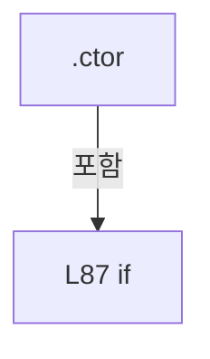

변경 전 점검: 입력/반환 타입, 위 호출자, 예외/취소 경로, 공유 상태와 저장·전송 소비자를 함께 확인합니다. 값의 단위나 물리 방향을 이름만으로 확정하지 않습니다.

### PropertyDeclaration `ConfigRoot` · L145–151

[Drilling.Common/Managers/CManager.cs:145–151](https://github.com/kjuws10-rgb/A3Drilling/blob/5aee8e58439c9b455cae7c9593c9be986c3e682e/Drilling.Common/Managers/CManager.cs#L145-L151)

| 항목 | 실제 추출 값 |
| --- | --- |
| 서명 | string Drilling.Common.Managers.CManager.ConfigRoot |
| 접근/수식자 | Public / public |
| 반환/값 타입 | string |
| 소속 타입 | NamedType:Drilling.Common.Managers.CManager |

현재 부분 분석에서 직접 연결된 호출자는 없습니다. XAML/이벤트/인터페이스·델리게이트·외부 진입을 추가 확인해야 하며, 미사용으로 판정한 것이 아닙니다.

변경 전 점검: 입력/반환 타입, 위 호출자, 예외/취소 경로, 공유 상태와 저장·전송 소비자를 함께 확인합니다. 값의 단위나 물리 방향을 이름만으로 확정하지 않습니다.

### GetAccessorDeclaration `get_ConfigRoot` · L147–150

[Drilling.Common/Managers/CManager.cs:147–150](https://github.com/kjuws10-rgb/A3Drilling/blob/5aee8e58439c9b455cae7c9593c9be986c3e682e/Drilling.Common/Managers/CManager.cs#L147-L150)

| 항목 | 실제 추출 값 |
| --- | --- |
| 서명 | string Drilling.Common.Managers.CManager.ConfigRoot.get |
| 접근/수식자 | Public / get |
| 반환/값 타입 | string |
| 소속 타입 | NamedType:Drilling.Common.Managers.CManager |

현재 부분 분석에서 직접 연결된 호출자는 없습니다. XAML/이벤트/인터페이스·델리게이트·외부 진입을 추가 확인해야 하며, 미사용으로 판정한 것이 아닙니다.

본문의 실제 연산·분기·예외·반환 순서(원문 위치 순):

| 원본 행 | 종류 | 주석 해설 |
| --- | --- | --- |
| 149 | return | 호출자에게 값 또는 제어를 반환합니다: return _configRoot; |

변경 전 점검: 입력/반환 타입, 위 호출자, 예외/취소 경로, 공유 상태와 저장·전송 소비자를 함께 확인합니다. 값의 단위나 물리 방향을 이름만으로 확정하지 않습니다.

### PropertyDeclaration `StartupMessages` · L153–162

[Drilling.Common/Managers/CManager.cs:153–162](https://github.com/kjuws10-rgb/A3Drilling/blob/5aee8e58439c9b455cae7c9593c9be986c3e682e/Drilling.Common/Managers/CManager.cs#L153-L162)

| 항목 | 실제 추출 값 |
| --- | --- |
| 서명 | System.Collections.Generic.IReadOnlyList<string> Drilling.Common.Managers.CManager.StartupMessages |
| 접근/수식자 | Public / public |
| 반환/값 타입 | System.Collections.Generic.IReadOnlyList<string> |
| 소속 타입 | NamedType:Drilling.Common.Managers.CManager |

현재 부분 분석에서 직접 연결된 호출자는 없습니다. XAML/이벤트/인터페이스·델리게이트·외부 진입을 추가 확인해야 하며, 미사용으로 판정한 것이 아닙니다.

변경 전 점검: 입력/반환 타입, 위 호출자, 예외/취소 경로, 공유 상태와 저장·전송 소비자를 함께 확인합니다. 값의 단위나 물리 방향을 이름만으로 확정하지 않습니다.

### GetAccessorDeclaration `get_StartupMessages` · L155–161

[Drilling.Common/Managers/CManager.cs:155–161](https://github.com/kjuws10-rgb/A3Drilling/blob/5aee8e58439c9b455cae7c9593c9be986c3e682e/Drilling.Common/Managers/CManager.cs#L155-L161)

| 항목 | 실제 추출 값 |
| --- | --- |
| 서명 | System.Collections.Generic.IReadOnlyList<string> Drilling.Common.Managers.CManager.StartupMessages.get |
| 접근/수식자 | Public / get |
| 반환/값 타입 | System.Collections.Generic.IReadOnlyList<string> |
| 소속 타입 | NamedType:Drilling.Common.Managers.CManager |

현재 부분 분석에서 직접 연결된 호출자는 없습니다. XAML/이벤트/인터페이스·델리게이트·외부 진입을 추가 확인해야 하며, 미사용으로 판정한 것이 아닙니다.

호출하는 대상과 해석 범위:

| 원본 행 | 표현식 | 분석 상태 | 대상/소스 위치 |
| --- | --- | --- | --- |
| 159 | _startupMessages.ToArray | resolved | string[] System.Collections.Generic.List<string>.ToArray() |

본문의 실제 연산·분기·예외·반환 순서(원문 위치 순):

| 원본 행 | 종류 | 주석 해설 |
| --- | --- | --- |
| 157 | lock | 공유 상태의 임계 구역에 진입합니다: lock (_startupLock) |
| 159 | call | 함수·델리게이트 또는 객체 생성자를 호출합니다: _startupMessages.ToArray() |
| 159 | return | 호출자에게 값 또는 제어를 반환합니다: return _startupMessages.ToArray(); |

제어 구문의 포함 구조(실제 실행 순서/CFG가 아닌 구문 탐색 그림):

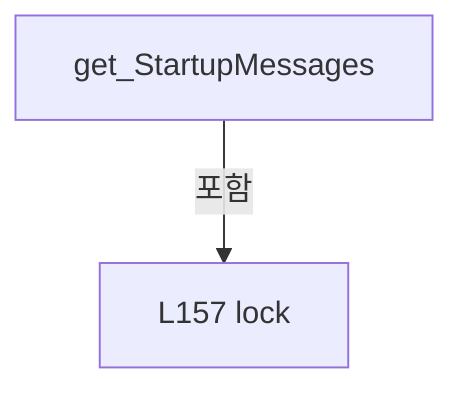

변경 전 점검: 입력/반환 타입, 위 호출자, 예외/취소 경로, 공유 상태와 저장·전송 소비자를 함께 확인합니다. 값의 단위나 물리 방향을 이름만으로 확정하지 않습니다.

### PropertyDeclaration `StartupSteps` · L164–173

[Drilling.Common/Managers/CManager.cs:164–173](https://github.com/kjuws10-rgb/A3Drilling/blob/5aee8e58439c9b455cae7c9593c9be986c3e682e/Drilling.Common/Managers/CManager.cs#L164-L173)

| 항목 | 실제 추출 값 |
| --- | --- |
| 서명 | System.Collections.Generic.IReadOnlyList<Drilling.Common.Managers.ST_MANAGER_STARTUP_STEP> Drilling.Common.Managers.CManager.StartupSteps |
| 접근/수식자 | Public / public |
| 반환/값 타입 | System.Collections.Generic.IReadOnlyList<Drilling.Common.Managers.ST_MANAGER_STARTUP_STEP> |
| 소속 타입 | NamedType:Drilling.Common.Managers.CManager |

현재 부분 분석에서 직접 연결된 호출자는 없습니다. XAML/이벤트/인터페이스·델리게이트·외부 진입을 추가 확인해야 하며, 미사용으로 판정한 것이 아닙니다.

변경 전 점검: 입력/반환 타입, 위 호출자, 예외/취소 경로, 공유 상태와 저장·전송 소비자를 함께 확인합니다. 값의 단위나 물리 방향을 이름만으로 확정하지 않습니다.

### GetAccessorDeclaration `get_StartupSteps` · L166–172

[Drilling.Common/Managers/CManager.cs:166–172](https://github.com/kjuws10-rgb/A3Drilling/blob/5aee8e58439c9b455cae7c9593c9be986c3e682e/Drilling.Common/Managers/CManager.cs#L166-L172)

| 항목 | 실제 추출 값 |
| --- | --- |
| 서명 | System.Collections.Generic.IReadOnlyList<Drilling.Common.Managers.ST_MANAGER_STARTUP_STEP> Drilling.Common.Managers.CManager.StartupSteps.get |
| 접근/수식자 | Public / get |
| 반환/값 타입 | System.Collections.Generic.IReadOnlyList<Drilling.Common.Managers.ST_MANAGER_STARTUP_STEP> |
| 소속 타입 | NamedType:Drilling.Common.Managers.CManager |

현재 부분 분석에서 직접 연결된 호출자는 없습니다. XAML/이벤트/인터페이스·델리게이트·외부 진입을 추가 확인해야 하며, 미사용으로 판정한 것이 아닙니다.

호출하는 대상과 해석 범위:

| 원본 행 | 표현식 | 분석 상태 | 대상/소스 위치 |
| --- | --- | --- | --- |
| 170 | _startupSteps.ToArray | resolved | Drilling.Common.Managers.ST_MANAGER_STARTUP_STEP[] System.Collections.Generic.List<Drilling.Common.Managers.ST_MANAGER_STARTUP_STEP>.ToArray() |

본문의 실제 연산·분기·예외·반환 순서(원문 위치 순):

| 원본 행 | 종류 | 주석 해설 |
| --- | --- | --- |
| 168 | lock | 공유 상태의 임계 구역에 진입합니다: lock (_startupLock) |
| 170 | call | 함수·델리게이트 또는 객체 생성자를 호출합니다: _startupSteps.ToArray() |
| 170 | return | 호출자에게 값 또는 제어를 반환합니다: return _startupSteps.ToArray(); |

제어 구문의 포함 구조(실제 실행 순서/CFG가 아닌 구문 탐색 그림):

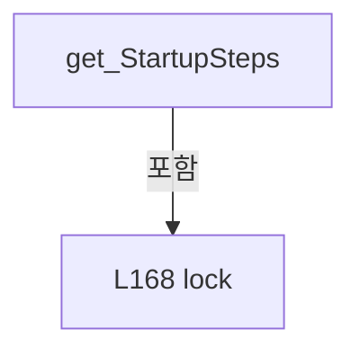

변경 전 점검: 입력/반환 타입, 위 호출자, 예외/취소 경로, 공유 상태와 저장·전송 소비자를 함께 확인합니다. 값의 단위나 물리 방향을 이름만으로 확정하지 않습니다.

### MethodDeclaration `ConfigStatus` · L175–181

[Drilling.Common/Managers/CManager.cs:175–181](https://github.com/kjuws10-rgb/A3Drilling/blob/5aee8e58439c9b455cae7c9593c9be986c3e682e/Drilling.Common/Managers/CManager.cs#L175-L181)

| 항목 | 실제 추출 값 |
| --- | --- |
| 서명 | Drilling.Common.Managers.ST_CONFIG_LOAD_STATUS Drilling.Common.Managers.CManager.ConfigStatus() |
| 접근/수식자 | Public / public |
| 반환/값 타입 | Drilling.Common.Managers.ST_CONFIG_LOAD_STATUS |
| 소속 타입 | NamedType:Drilling.Common.Managers.CManager |

정적 호출자로 확인된 위치:

| 호출 파일/행 | 호출 표현식 | 런타임 분기 가능 |
| --- | --- | --- |
| [Drilling.UI/CAppStartup.cs:73–73](https://github.com/kjuws10-rgb/A3Drilling/blob/5aee8e58439c9b455cae7c9593c9be986c3e682e/Drilling.UI/CAppStartup.cs#L73-L73) | manager.ConfigStatus | False |

호출하는 대상과 해석 범위:

| 원본 행 | 표현식 | 분석 상태 | 대상/소스 위치 |
| --- | --- | --- | --- |
| 179 | new ST_CONFIG_LOAD_STATUS | resolved | Drilling.Common.Managers.ST_CONFIG_LOAD_STATUS.ST_CONFIG_LOAD_STATUS(string, int, int, int, bool, System.Collections.Generic.IReadOnlyList<string>, System.Collections.Generic.IReadOnlyList<Drilling.Common.Managers.ST_MANAGER_STARTUP_STEP>) · Drilling.Common/Managers/CManager.cs:756 |
| 179 | _startupMessages.ToArray | resolved | string[] System.Collections.Generic.List<string>.ToArray() |
| 179 | _startupSteps.ToArray | resolved | Drilling.Common.Managers.ST_MANAGER_STARTUP_STEP[] System.Collections.Generic.List<Drilling.Common.Managers.ST_MANAGER_STARTUP_STEP>.ToArray() |

본문의 실제 연산·분기·예외·반환 순서(원문 위치 순):

| 원본 행 | 종류 | 주석 해설 |
| --- | --- | --- |
| 177 | lock | 공유 상태의 임계 구역에 진입합니다: lock (_startupLock) |
| 179 | call | 함수·델리게이트 또는 객체 생성자를 호출합니다: new ST_CONFIG_LOAD_STATUS(_configRoot, _loadedInterfaceCount, _loadedMotorCount, _loadedMelsecMapCount, _activeProductLoaded, _startupMessages.ToArray(), _startupSteps.ToArray()) |
| 179 | call | 함수·델리게이트 또는 객체 생성자를 호출합니다: _startupMessages.ToArray() |
| 179 | call | 함수·델리게이트 또는 객체 생성자를 호출합니다: _startupSteps.ToArray() |
| 179 | return | 호출자에게 값 또는 제어를 반환합니다: return new ST_CONFIG_LOAD_STATUS(_configRoot, _loadedInterfaceCount, _loadedMotorCount, _loadedMelsecMapCount, _activeProductLoaded, _startupMessages.ToArray(), _startupSteps.ToArray()); |

제어 구문의 포함 구조(실제 실행 순서/CFG가 아닌 구문 탐색 그림):

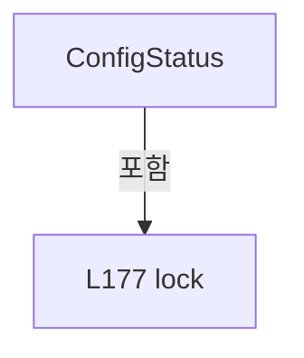

변경 전 점검: 입력/반환 타입, 위 호출자, 예외/취소 경로, 공유 상태와 저장·전송 소비자를 함께 확인합니다. 값의 단위나 물리 방향을 이름만으로 확정하지 않습니다.

### MethodDeclaration `IsSimul` · L183–186

[Drilling.Common/Managers/CManager.cs:183–186](https://github.com/kjuws10-rgb/A3Drilling/blob/5aee8e58439c9b455cae7c9593c9be986c3e682e/Drilling.Common/Managers/CManager.cs#L183-L186)

| 항목 | 실제 추출 값 |
| --- | --- |
| 서명 | bool Drilling.Common.Managers.CManager.IsSimul(int) |
| 접근/수식자 | Public / public |
| 반환/값 타입 | bool |
| 소속 타입 | NamedType:Drilling.Common.Managers.CManager |

입력 계약:

| 이름 | 타입 | 전달 | 선택/기본값 |
| --- | --- | --- | --- |
| systemId | int | None | True / 0 |

정적 호출자로 확인된 위치:

| 호출 파일/행 | 호출 표현식 | 런타임 분기 가능 |
| --- | --- | --- |
| [Drilling.Common/Managers/CManager.cs:190–190](https://github.com/kjuws10-rgb/A3Drilling/blob/5aee8e58439c9b455cae7c9593c9be986c3e682e/Drilling.Common/Managers/CManager.cs#L190-L190) | IsSimul | False |

본문의 실제 연산·분기·예외·반환 순서(원문 위치 순):

| 원본 행 | 종류 | 주석 해설 |
| --- | --- | --- |
| 185 | return | 호출자에게 값 또는 제어를 반환합니다: return _interfaceManager.IsSimulation && _motionManager.IsSimulation; |

변경 전 점검: 입력/반환 타입, 위 호출자, 예외/취소 경로, 공유 상태와 저장·전송 소비자를 함께 확인합니다. 값의 단위나 물리 방향을 이름만으로 확정하지 않습니다.

### MethodDeclaration `IsNotSimul` · L188–191

[Drilling.Common/Managers/CManager.cs:188–191](https://github.com/kjuws10-rgb/A3Drilling/blob/5aee8e58439c9b455cae7c9593c9be986c3e682e/Drilling.Common/Managers/CManager.cs#L188-L191)

| 항목 | 실제 추출 값 |
| --- | --- |
| 서명 | bool Drilling.Common.Managers.CManager.IsNotSimul(int) |
| 접근/수식자 | Public / public |
| 반환/값 타입 | bool |
| 소속 타입 | NamedType:Drilling.Common.Managers.CManager |

입력 계약:

| 이름 | 타입 | 전달 | 선택/기본값 |
| --- | --- | --- | --- |
| systemId | int | None | True / 0 |

현재 부분 분석에서 직접 연결된 호출자는 없습니다. XAML/이벤트/인터페이스·델리게이트·외부 진입을 추가 확인해야 하며, 미사용으로 판정한 것이 아닙니다.

호출하는 대상과 해석 범위:

| 원본 행 | 표현식 | 분석 상태 | 대상/소스 위치 |
| --- | --- | --- | --- |
| 190 | IsSimul | resolved | bool Drilling.Common.Managers.CManager.IsSimul(int) · Drilling.Common/Managers/CManager.cs:183 |

본문의 실제 연산·분기·예외·반환 순서(원문 위치 순):

| 원본 행 | 종류 | 주석 해설 |
| --- | --- | --- |
| 190 | call | 함수·델리게이트 또는 객체 생성자를 호출합니다: IsSimul(systemId) |
| 190 | return | 호출자에게 값 또는 제어를 반환합니다: return !IsSimul(systemId); |

변경 전 점검: 입력/반환 타입, 위 호출자, 예외/취소 경로, 공유 상태와 저장·전송 소비자를 함께 확인합니다. 값의 단위나 물리 방향을 이름만으로 확정하지 않습니다.

### MethodDeclaration `SetSimul` · L193–197

[Drilling.Common/Managers/CManager.cs:193–197](https://github.com/kjuws10-rgb/A3Drilling/blob/5aee8e58439c9b455cae7c9593c9be986c3e682e/Drilling.Common/Managers/CManager.cs#L193-L197)

| 항목 | 실제 추출 값 |
| --- | --- |
| 서명 | System.Threading.Tasks.Task Drilling.Common.Managers.CManager.SetSimul(bool, System.Threading.CancellationToken) |
| 접근/수식자 | Public / public, async |
| 반환/값 타입 | System.Threading.Tasks.Task |
| 소속 타입 | NamedType:Drilling.Common.Managers.CManager |

입력 계약:

| 이름 | 타입 | 전달 | 선택/기본값 |
| --- | --- | --- | --- |
| enabled | bool | None | False /  |
| cancellationToken | System.Threading.CancellationToken | None | True / null |

정적 호출자로 확인된 위치:

| 호출 파일/행 | 호출 표현식 | 런타임 분기 가능 |
| --- | --- | --- |
| [Drilling.Common/Managers/CManager.cs:201–201](https://github.com/kjuws10-rgb/A3Drilling/blob/5aee8e58439c9b455cae7c9593c9be986c3e682e/Drilling.Common/Managers/CManager.cs#L201-L201) | SetSimul | False |

호출하는 대상과 해석 범위:

| 원본 행 | 표현식 | 분석 상태 | 대상/소스 위치 |
| --- | --- | --- | --- |
| 195 | _interfaceManager.SetSimulationMode | resolved | System.Threading.Tasks.Task Drilling.Common.Interface.CInterfaceManager.SetSimulationMode(bool, System.Threading.CancellationToken) · Drilling.Common/Interface/CInterfaceManager.cs:126 |
| 196 | _motionManager.SetSimulationMode | resolved | void Drilling.Common.Motion.CMotionManager.SetSimulationMode(bool) · Drilling.Common/Motion/CMotionManager.cs:86 |

본문의 실제 연산·분기·예외·반환 순서(원문 위치 순):

| 원본 행 | 종류 | 주석 해설 |
| --- | --- | --- |
| 195 | await | 비동기 완료를 기다립니다: await _interfaceManager.SetSimulationMode(enabled, cancellationToken) |
| 195 | call | 함수·델리게이트 또는 객체 생성자를 호출합니다: _interfaceManager.SetSimulationMode(enabled, cancellationToken) |
| 196 | call | 함수·델리게이트 또는 객체 생성자를 호출합니다: _motionManager.SetSimulationMode(enabled) |

변경 전 점검: 입력/반환 타입, 위 호출자, 예외/취소 경로, 공유 상태와 저장·전송 소비자를 함께 확인합니다. 값의 단위나 물리 방향을 이름만으로 확정하지 않습니다.

### MethodDeclaration `SetSimul` · L199–202

[Drilling.Common/Managers/CManager.cs:199–202](https://github.com/kjuws10-rgb/A3Drilling/blob/5aee8e58439c9b455cae7c9593c9be986c3e682e/Drilling.Common/Managers/CManager.cs#L199-L202)

| 항목 | 실제 추출 값 |
| --- | --- |
| 서명 | System.Threading.Tasks.Task Drilling.Common.Managers.CManager.SetSimul(int, bool, System.Threading.CancellationToken) |
| 접근/수식자 | Public / public |
| 반환/값 타입 | System.Threading.Tasks.Task |
| 소속 타입 | NamedType:Drilling.Common.Managers.CManager |

입력 계약:

| 이름 | 타입 | 전달 | 선택/기본값 |
| --- | --- | --- | --- |
| systemId | int | None | False /  |
| enabled | bool | None | False /  |
| cancellationToken | System.Threading.CancellationToken | None | True / null |

현재 부분 분석에서 직접 연결된 호출자는 없습니다. XAML/이벤트/인터페이스·델리게이트·외부 진입을 추가 확인해야 하며, 미사용으로 판정한 것이 아닙니다.

호출하는 대상과 해석 범위:

| 원본 행 | 표현식 | 분석 상태 | 대상/소스 위치 |
| --- | --- | --- | --- |
| 201 | SetSimul | resolved | System.Threading.Tasks.Task Drilling.Common.Managers.CManager.SetSimul(bool, System.Threading.CancellationToken) · Drilling.Common/Managers/CManager.cs:193 |

본문의 실제 연산·분기·예외·반환 순서(원문 위치 순):

| 원본 행 | 종류 | 주석 해설 |
| --- | --- | --- |
| 201 | call | 함수·델리게이트 또는 객체 생성자를 호출합니다: SetSimul(enabled, cancellationToken) |
| 201 | return | 호출자에게 값 또는 제어를 반환합니다: return SetSimul(enabled, cancellationToken); |

변경 전 점검: 입력/반환 타입, 위 호출자, 예외/취소 경로, 공유 상태와 저장·전송 소비자를 함께 확인합니다. 값의 단위나 물리 방향을 이름만으로 확정하지 않습니다.

### MethodDeclaration `Initialize` · L204–218

[Drilling.Common/Managers/CManager.cs:204–218](https://github.com/kjuws10-rgb/A3Drilling/blob/5aee8e58439c9b455cae7c9593c9be986c3e682e/Drilling.Common/Managers/CManager.cs#L204-L218)

| 항목 | 실제 추출 값 |
| --- | --- |
| 서명 | System.Threading.Tasks.Task Drilling.Common.Managers.CManager.Initialize(System.Threading.CancellationToken) |
| 접근/수식자 | Public / public, async |
| 반환/값 타입 | System.Threading.Tasks.Task |
| 소속 타입 | NamedType:Drilling.Common.Managers.CManager |

입력 계약:

| 이름 | 타입 | 전달 | 선택/기본값 |
| --- | --- | --- | --- |
| cancellationToken | System.Threading.CancellationToken | None | True / null |

정적 호출자로 확인된 위치:

| 호출 파일/행 | 호출 표현식 | 런타임 분기 가능 |
| --- | --- | --- |
| [Drilling.UI/CAppStartup.cs:42–42](https://github.com/kjuws10-rgb/A3Drilling/blob/5aee8e58439c9b455cae7c9593c9be986c3e682e/Drilling.UI/CAppStartup.cs#L42-L42) | manager.Initialize | False |

호출하는 대상과 해석 범위:

| 원본 행 | 표현식 | 분석 상태 | 대상/소스 위치 |
| --- | --- | --- | --- |
| 211 | RunInitializeStep | resolved | System.Threading.Tasks.Task Drilling.Common.Managers.CManager.RunInitializeStep(string, System.Func<System.Threading.Tasks.Task>, System.Threading.CancellationToken) · Drilling.Common/Managers/CManager.cs:550 |
| 217 | RunInitializeStep | resolved | System.Threading.Tasks.Task Drilling.Common.Managers.CManager.RunInitializeStep(string, System.Func<System.Threading.Tasks.Task>, System.Threading.CancellationToken) · Drilling.Common/Managers/CManager.cs:550 |

본문의 실제 연산·분기·예외·반환 순서(원문 위치 순):

| 원본 행 | 종류 | 주석 해설 |
| --- | --- | --- |
| 211 | await | 비동기 완료를 기다립니다: await RunInitializeStep("Initialize Interface Connection", SelectValue, cancellationToken) |
| 211 | call | 함수·델리게이트 또는 객체 생성자를 호출합니다: RunInitializeStep("Initialize Interface Connection", SelectValue, cancellationToken) |
| 217 | await | 비동기 완료를 기다립니다: await RunInitializeStep("Initialize Motion Controller", SelectTask, cancellationToken) |
| 217 | call | 함수·델리게이트 또는 객체 생성자를 호출합니다: RunInitializeStep("Initialize Motion Controller", SelectTask, cancellationToken) |

변경 전 점검: 입력/반환 타입, 위 호출자, 예외/취소 경로, 공유 상태와 저장·전송 소비자를 함께 확인합니다. 값의 단위나 물리 방향을 이름만으로 확정하지 않습니다.

### LocalFunctionStatement `SelectValue` · L206–209

[Drilling.Common/Managers/CManager.cs:206–209](https://github.com/kjuws10-rgb/A3Drilling/blob/5aee8e58439c9b455cae7c9593c9be986c3e682e/Drilling.Common/Managers/CManager.cs#L206-L209)

| 항목 | 실제 추출 값 |
| --- | --- |
| 서명 | System.Threading.Tasks.Task SelectValue() |
| 접근/수식자 | Private /  |
| 반환/값 타입 | System.Threading.Tasks.Task |
| 소속 타입 | NamedType:Drilling.Common.Managers.CManager |

현재 부분 분석에서 직접 연결된 호출자는 없습니다. XAML/이벤트/인터페이스·델리게이트·외부 진입을 추가 확인해야 하며, 미사용으로 판정한 것이 아닙니다.

호출하는 대상과 해석 범위:

| 원본 행 | 표현식 | 분석 상태 | 대상/소스 위치 |
| --- | --- | --- | --- |
| 208 | _interfaceManager.Initialize | resolved | System.Threading.Tasks.Task Drilling.Common.Interface.CInterfaceManager.Initialize(System.Threading.CancellationToken) · Drilling.Common/Interface/CInterfaceManager.cs:183 |

본문의 실제 연산·분기·예외·반환 순서(원문 위치 순):

| 원본 행 | 종류 | 주석 해설 |
| --- | --- | --- |
| 208 | call | 함수·델리게이트 또는 객체 생성자를 호출합니다: _interfaceManager.Initialize(cancellationToken) |
| 208 | return | 호출자에게 값 또는 제어를 반환합니다: return _interfaceManager.Initialize(cancellationToken); |

변경 전 점검: 입력/반환 타입, 위 호출자, 예외/취소 경로, 공유 상태와 저장·전송 소비자를 함께 확인합니다. 값의 단위나 물리 방향을 이름만으로 확정하지 않습니다.

### LocalFunctionStatement `SelectTask` · L212–215

[Drilling.Common/Managers/CManager.cs:212–215](https://github.com/kjuws10-rgb/A3Drilling/blob/5aee8e58439c9b455cae7c9593c9be986c3e682e/Drilling.Common/Managers/CManager.cs#L212-L215)

| 항목 | 실제 추출 값 |
| --- | --- |
| 서명 | System.Threading.Tasks.Task SelectTask() |
| 접근/수식자 | Private /  |
| 반환/값 타입 | System.Threading.Tasks.Task |
| 소속 타입 | NamedType:Drilling.Common.Managers.CManager |

현재 부분 분석에서 직접 연결된 호출자는 없습니다. XAML/이벤트/인터페이스·델리게이트·외부 진입을 추가 확인해야 하며, 미사용으로 판정한 것이 아닙니다.

호출하는 대상과 해석 범위:

| 원본 행 | 표현식 | 분석 상태 | 대상/소스 위치 |
| --- | --- | --- | --- |
| 214 | _motionManager.Initialize | resolved | System.Threading.Tasks.Task Drilling.Common.Motion.CMotionManager.Initialize(System.Threading.CancellationToken) · Drilling.Common/Motion/CMotionManager.cs:96 |

본문의 실제 연산·분기·예외·반환 순서(원문 위치 순):

| 원본 행 | 종류 | 주석 해설 |
| --- | --- | --- |
| 214 | call | 함수·델리게이트 또는 객체 생성자를 호출합니다: _motionManager.Initialize(cancellationToken) |
| 214 | return | 호출자에게 값 또는 제어를 반환합니다: return _motionManager.Initialize(cancellationToken); |

변경 전 점검: 입력/반환 타입, 위 호출자, 예외/취소 경로, 공유 상태와 저장·전송 소비자를 함께 확인합니다. 값의 단위나 물리 방향을 이름만으로 확정하지 않습니다.

### MethodDeclaration `Destroy` · L220–257

[Drilling.Common/Managers/CManager.cs:220–257](https://github.com/kjuws10-rgb/A3Drilling/blob/5aee8e58439c9b455cae7c9593c9be986c3e682e/Drilling.Common/Managers/CManager.cs#L220-L257)

| 항목 | 실제 추출 값 |
| --- | --- |
| 서명 | System.Threading.Tasks.Task Drilling.Common.Managers.CManager.Destroy(System.Threading.CancellationToken) |
| 접근/수식자 | Public / public, async |
| 반환/값 타입 | System.Threading.Tasks.Task |
| 소속 타입 | NamedType:Drilling.Common.Managers.CManager |

입력 계약:

| 이름 | 타입 | 전달 | 선택/기본값 |
| --- | --- | --- | --- |
| cancellationToken | System.Threading.CancellationToken | None | True / null |

현재 부분 분석에서 직접 연결된 호출자는 없습니다. XAML/이벤트/인터페이스·델리게이트·외부 진입을 추가 확인해야 하며, 미사용으로 판정한 것이 아닙니다.

호출하는 대상과 해석 범위:

| 원본 행 | 표현식 | 분석 상태 | 대상/소스 위치 |
| --- | --- | --- | --- |
| 224 | StopBackgroundMonitoring | resolved | System.Threading.Tasks.Task Drilling.Common.Managers.CManager.StopBackgroundMonitoring() · Drilling.Common/Managers/CManager.cs:270 |
| 227 | _alarmManager.FlushHistoryAsync(cancellationToken).WaitAsync | resolved | System.Threading.Tasks.Task System.Threading.Tasks.Task.WaitAsync(System.TimeSpan, System.Threading.CancellationToken) |
| 227 | _alarmManager.FlushHistoryAsync | resolved | System.Threading.Tasks.Task Drilling.Common.Alarm.CAlarmManager.FlushHistoryAsync(System.Threading.CancellationToken) · Drilling.Common/Alarm/CAlarmManager.cs:377 |
| 227 | TimeSpan.FromSeconds | resolved | System.TimeSpan System.TimeSpan.FromSeconds(long) |
| 231 | CProgramOpenLog.Write | unresolved | None |
| 234 | PowerMeasure.DisposeAsync | resolved | System.Threading.Tasks.ValueTask Drilling.Common.Interface.CPowerMeasureService.DisposeAsync() · Drilling.Common/Interface/CPowerMeasureService.cs:58 |
| 235 | _motionManager.Destroy | resolved | System.Threading.Tasks.Task Drilling.Common.Motion.CMotionManager.Destroy(System.Threading.CancellationToken) · Drilling.Common/Motion/CMotionManager.cs:126 |
| 236 | _interfaceManager.Destroy | resolved | System.Threading.Tasks.Task Drilling.Common.Interface.CInterfaceManager.Destroy(System.Threading.CancellationToken) · Drilling.Common/Interface/CInterfaceManager.cs:188 |
| 242 | _logManager.StopInterfaceLoggingAsync().WaitAsync | unresolved | None |
| 242 | _logManager.StopInterfaceLoggingAsync | unresolved | None |
| 242 | TimeSpan.FromSeconds | resolved | System.TimeSpan System.TimeSpan.FromSeconds(long) |
| 246 | CProgramOpenLog.Write | unresolved | None |
| 250 | _logManager.StopSequenceLoggingAsync().WaitAsync | unresolved | None |
| 250 | _logManager.StopSequenceLoggingAsync | unresolved | None |
| 250 | TimeSpan.FromSeconds | resolved | System.TimeSpan System.TimeSpan.FromSeconds(long) |
| 254 | CProgramOpenLog.Write | unresolved | None |

본문의 실제 연산·분기·예외·반환 순서(원문 위치 순):

| 원본 행 | 종류 | 주석 해설 |
| --- | --- | --- |
| 222 | try | 예외 처리 범위입니다: try |
| 224 | await | 비동기 완료를 기다립니다: await StopBackgroundMonitoring() |
| 224 | call | 함수·델리게이트 또는 객체 생성자를 호출합니다: StopBackgroundMonitoring() |
| 225 | try | 예외 처리 범위입니다: try |
| 227 | await | 비동기 완료를 기다립니다: await _alarmManager.FlushHistoryAsync(cancellationToken).WaitAsync(TimeSpan.FromSeconds(5), cancellationToken) |
| 227 | call | 함수·델리게이트 또는 객체 생성자를 호출합니다: _alarmManager.FlushHistoryAsync(cancellationToken).WaitAsync(TimeSpan.FromSeconds(5), cancellationToken) |
| 227 | call | 함수·델리게이트 또는 객체 생성자를 호출합니다: _alarmManager.FlushHistoryAsync(cancellationToken) |
| 227 | call | 함수·델리게이트 또는 객체 생성자를 호출합니다: TimeSpan.FromSeconds(5) |
| 229 | catch | 지정 예외를 처리합니다: catch (TimeoutException exception) |
| 231 | call | 함수·델리게이트 또는 객체 생성자를 호출합니다: CProgramOpenLog.Write("ALARM_HISTORY_FLUSH_TIMEOUT", exception) |
| 234 | await | 비동기 완료를 기다립니다: await PowerMeasure.DisposeAsync() |
| 234 | call | 함수·델리게이트 또는 객체 생성자를 호출합니다: PowerMeasure.DisposeAsync() |
| 235 | await | 비동기 완료를 기다립니다: await _motionManager.Destroy(cancellationToken) |
| 235 | call | 함수·델리게이트 또는 객체 생성자를 호출합니다: _motionManager.Destroy(cancellationToken) |
| 236 | await | 비동기 완료를 기다립니다: await _interfaceManager.Destroy(cancellationToken) |
| 236 | call | 함수·델리게이트 또는 객체 생성자를 호출합니다: _interfaceManager.Destroy(cancellationToken) |
| 238 | finally | 종료 정리 구간입니다: finally |
| 240 | try | 예외 처리 범위입니다: try |
| 242 | await | 비동기 완료를 기다립니다: await _logManager.StopInterfaceLoggingAsync().WaitAsync(TimeSpan.FromSeconds(5)) |
| 242 | call | 함수·델리게이트 또는 객체 생성자를 호출합니다: _logManager.StopInterfaceLoggingAsync().WaitAsync(TimeSpan.FromSeconds(5)) |
| 242 | call | 함수·델리게이트 또는 객체 생성자를 호출합니다: _logManager.StopInterfaceLoggingAsync() |
| 242 | call | 함수·델리게이트 또는 객체 생성자를 호출합니다: TimeSpan.FromSeconds(5) |
| 244 | catch | 지정 예외를 처리합니다: catch (Exception error) |
| 246 | call | 함수·델리게이트 또는 객체 생성자를 호출합니다: CProgramOpenLog.Write("INTERFACE_LOG_FLUSH_FAILED", error) |
| 248 | try | 예외 처리 범위입니다: try |
| 250 | await | 비동기 완료를 기다립니다: await _logManager.StopSequenceLoggingAsync().WaitAsync(TimeSpan.FromSeconds(5)) |
| 250 | call | 함수·델리게이트 또는 객체 생성자를 호출합니다: _logManager.StopSequenceLoggingAsync().WaitAsync(TimeSpan.FromSeconds(5)) |
| 250 | call | 함수·델리게이트 또는 객체 생성자를 호출합니다: _logManager.StopSequenceLoggingAsync() |
| 250 | call | 함수·델리게이트 또는 객체 생성자를 호출합니다: TimeSpan.FromSeconds(5) |
| 252 | catch | 지정 예외를 처리합니다: catch (Exception error) |
| 254 | call | 함수·델리게이트 또는 객체 생성자를 호출합니다: CProgramOpenLog.Write("SEQUENCE_LOG_FLUSH_FAILED", error) |

제어 구문의 포함 구조(실제 실행 순서/CFG가 아닌 구문 탐색 그림):

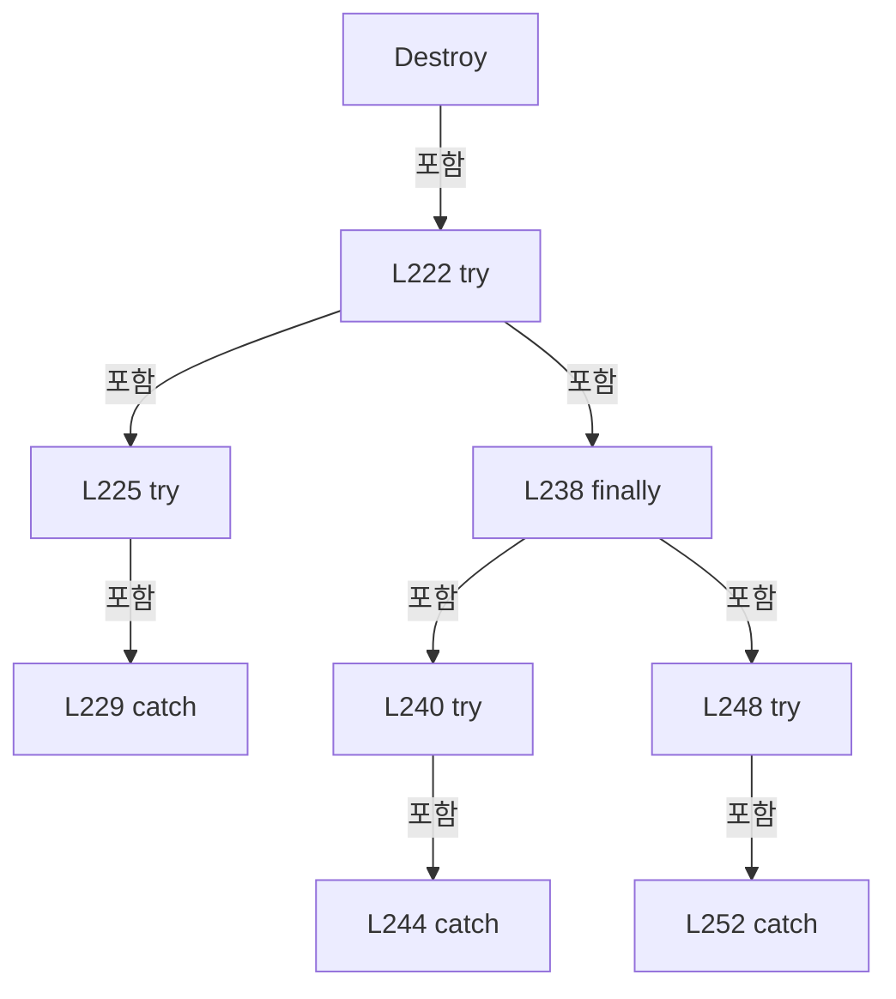

변경 전 점검: 입력/반환 타입, 위 호출자, 예외/취소 경로, 공유 상태와 저장·전송 소비자를 함께 확인합니다. 값의 단위나 물리 방향을 이름만으로 확정하지 않습니다.

### MethodDeclaration `StartBackgroundMonitoring` · L259–268

[Drilling.Common/Managers/CManager.cs:259–268](https://github.com/kjuws10-rgb/A3Drilling/blob/5aee8e58439c9b455cae7c9593c9be986c3e682e/Drilling.Common/Managers/CManager.cs#L259-L268)

| 항목 | 실제 추출 값 |
| --- | --- |
| 서명 | void Drilling.Common.Managers.CManager.StartBackgroundMonitoring() |
| 접근/수식자 | Public / public |
| 반환/값 타입 | void |
| 소속 타입 | NamedType:Drilling.Common.Managers.CManager |

정적 호출자로 확인된 위치:

| 호출 파일/행 | 호출 표현식 | 런타임 분기 가능 |
| --- | --- | --- |
| [Drilling.UI/CAppStartup.cs:67–67](https://github.com/kjuws10-rgb/A3Drilling/blob/5aee8e58439c9b455cae7c9593c9be986c3e682e/Drilling.UI/CAppStartup.cs#L67-L67) | manager.StartBackgroundMonitoring | False |

호출하는 대상과 해석 범위:

| 원본 행 | 표현식 | 분석 상태 | 대상/소스 위치 |
| --- | --- | --- | --- |
| 261 | _stationManager.StartZeroLinePrewaitMonitoring | resolved | void Drilling.Common.Station.CStationManager.StartZeroLinePrewaitMonitoring(System.Func<string>) · Drilling.Common/Station/CStationManager.cs:17 |
| 261 | _settingManager.GetValue | resolved | string Drilling.Common.Managers.CSettingManager.GetValue(Drilling.Common.Managers.EN_SETTING_TAB, string, string, System.Threading.CancellationToken) · Drilling.Common/Managers/CSettingManager.cs:59 |
| 262 | _stationManager.StartProtectWindowCompletionMonitoring | resolved | void Drilling.Common.Station.CStationManager.StartProtectWindowCompletionMonitoring(System.Func<string>) · Drilling.Common/Station/CStationManager.cs:20 |
| 262 | _settingManager.GetValue | resolved | string Drilling.Common.Managers.CSettingManager.GetValue(Drilling.Common.Managers.EN_SETTING_TAB, string, string, System.Threading.CancellationToken) · Drilling.Common/Managers/CSettingManager.cs:59 |
| 263 | _alarmManager.EnsureDefinitionsRequested | resolved | void Drilling.Common.Alarm.CAlarmManager.EnsureDefinitionsRequested() · Drilling.Common/Alarm/CAlarmManager.cs:214 |
| 264 | _alarmMotorSnapshots.Start | resolved | void Drilling.Common.Interface.CSharedDeviceSnapshotService<System.Collections.Generic.IReadOnlyList<Drilling.Common.Motion.ST_MOTOR_AXIS_STATUS>>.Start() · Drilling.Common/Interface/CInterfaceManager.cs:3511 |
| 265 | _alarmLaserSnapshots.Start | resolved | void Drilling.Common.Interface.CSharedDeviceSnapshotService<Drilling.Common.Interface.ST_LASER_STATUS>.Start() · Drilling.Common/Interface/CInterfaceManager.cs:3511 |
| 266 | _alarmBetSnapshots.Start | resolved | void Drilling.Common.Interface.CSharedDeviceSnapshotService<Drilling.Common.Interface.ST_BET_STATUS>.Start() · Drilling.Common/Interface/CInterfaceManager.cs:3511 |
| 267 | _alarmManager.StartMonitoring | candidate | OverloadResolutionFailure |
| 267 | CProgramOpenLog.Write | unresolved | None |

본문의 실제 연산·분기·예외·반환 순서(원문 위치 순):

| 원본 행 | 종류 | 주석 해설 |
| --- | --- | --- |
| 261 | call | 함수·델리게이트 또는 객체 생성자를 호출합니다: _stationManager.StartZeroLinePrewaitMonitoring(() => _settingManager.GetValue(EN_SETTING_TAB.Option, "SELECT_RECIPE", "DRILL_A01")) |
| 261 | call | 함수·델리게이트 또는 객체 생성자를 호출합니다: _settingManager.GetValue(EN_SETTING_TAB.Option, "SELECT_RECIPE", "DRILL_A01") |
| 262 | call | 함수·델리게이트 또는 객체 생성자를 호출합니다: _stationManager.StartProtectWindowCompletionMonitoring(() => _settingManager.GetValue(EN_SETTING_TAB.Option, "SELECT_RECIPE", "DRILL_A01")) |
| 262 | call | 함수·델리게이트 또는 객체 생성자를 호출합니다: _settingManager.GetValue(EN_SETTING_TAB.Option, "SELECT_RECIPE", "DRILL_A01") |
| 263 | call | 함수·델리게이트 또는 객체 생성자를 호출합니다: _alarmManager.EnsureDefinitionsRequested() |
| 264 | call | 함수·델리게이트 또는 객체 생성자를 호출합니다: _alarmMotorSnapshots.Start() |
| 265 | call | 함수·델리게이트 또는 객체 생성자를 호출합니다: _alarmLaserSnapshots.Start() |
| 266 | call | 함수·델리게이트 또는 객체 생성자를 호출합니다: _alarmBetSnapshots.Start() |
| 267 | call | 함수·델리게이트 또는 객체 생성자를 호출합니다: _alarmManager.StartMonitoring(_settingManager, _automationManager, ReadAlarmDeviceSnapshot, _interLockManager, exception => CProgramOpenLog.Write("ALARM_MONITOR_FAILED", exception)) |
| 267 | call | 함수·델리게이트 또는 객체 생성자를 호출합니다: CProgramOpenLog.Write("ALARM_MONITOR_FAILED", exception) |

변경 전 점검: 입력/반환 타입, 위 호출자, 예외/취소 경로, 공유 상태와 저장·전송 소비자를 함께 확인합니다. 값의 단위나 물리 방향을 이름만으로 확정하지 않습니다.

### MethodDeclaration `StopBackgroundMonitoring` · L270–278

[Drilling.Common/Managers/CManager.cs:270–278](https://github.com/kjuws10-rgb/A3Drilling/blob/5aee8e58439c9b455cae7c9593c9be986c3e682e/Drilling.Common/Managers/CManager.cs#L270-L278)

| 항목 | 실제 추출 값 |
| --- | --- |
| 서명 | System.Threading.Tasks.Task Drilling.Common.Managers.CManager.StopBackgroundMonitoring() |
| 접근/수식자 | Public / public, async |
| 반환/값 타입 | System.Threading.Tasks.Task |
| 소속 타입 | NamedType:Drilling.Common.Managers.CManager |

정적 호출자로 확인된 위치:

| 호출 파일/행 | 호출 표현식 | 런타임 분기 가능 |
| --- | --- | --- |
| [Drilling.Common/Managers/CManager.cs:224–224](https://github.com/kjuws10-rgb/A3Drilling/blob/5aee8e58439c9b455cae7c9593c9be986c3e682e/Drilling.Common/Managers/CManager.cs#L224-L224) | StopBackgroundMonitoring | False |
| [Drilling.UI/CRootView.cs:254–254](https://github.com/kjuws10-rgb/A3Drilling/blob/5aee8e58439c9b455cae7c9593c9be986c3e682e/Drilling.UI/CRootView.cs#L254-L254) | _manager.StopBackgroundMonitoring | False |

호출하는 대상과 해석 범위:

| 원본 행 | 표현식 | 분석 상태 | 대상/소스 위치 |
| --- | --- | --- | --- |
| 272 | _stationManager.StageRequests.StopAsync().ConfigureAwait | resolved | System.Runtime.CompilerServices.ConfiguredTaskAwaitable<bool> System.Threading.Tasks.Task<bool>.ConfigureAwait(bool) |
| 272 | _stationManager.StageRequests.StopAsync | resolved | System.Threading.Tasks.Task<bool> Drilling.Common.Station.CStageRequestSequence.StopAsync() · Drilling.Common/Station/CStationProcess.cs:4974 |
| 273 | _stationManager.StopZeroLinePrewaitMonitoring().ConfigureAwait | resolved | System.Runtime.CompilerServices.ConfiguredTaskAwaitable System.Threading.Tasks.Task.ConfigureAwait(bool) |
| 273 | _stationManager.StopZeroLinePrewaitMonitoring | resolved | System.Threading.Tasks.Task Drilling.Common.Station.CStationManager.StopZeroLinePrewaitMonitoring() · Drilling.Common/Station/CStationManager.cs:18 |
| 274 | _stationManager.StopProtectWindowCompletionMonitoring().ConfigureAwait | resolved | System.Runtime.CompilerServices.ConfiguredTaskAwaitable System.Threading.Tasks.Task.ConfigureAwait(bool) |
| 274 | _stationManager.StopProtectWindowCompletionMonitoring | resolved | System.Threading.Tasks.Task Drilling.Common.Station.CStationManager.StopProtectWindowCompletionMonitoring() · Drilling.Common/Station/CStationManager.cs:21 |
| 275 | _alarmManager.StopMonitoringAsync().ConfigureAwait | resolved | System.Runtime.CompilerServices.ConfiguredTaskAwaitable System.Threading.Tasks.Task.ConfigureAwait(bool) |
| 275 | _alarmManager.StopMonitoringAsync | resolved | System.Threading.Tasks.Task Drilling.Common.Alarm.CAlarmManager.StopMonitoringAsync() · Drilling.Common/Alarm/CAlarmManager.cs:447 |
| 276 | Task.WhenAll(_alarmMotorSnapshots.StopAsync(), _alarmLaserSnapshots.StopAsync(), _alarmBetSnapshots.StopAsync()).ConfigureAwait | resolved | System.Runtime.CompilerServices.ConfiguredTaskAwaitable System.Threading.Tasks.Task.ConfigureAwait(bool) |
| 276 | Task.WhenAll | resolved | System.Threading.Tasks.Task System.Threading.Tasks.Task.WhenAll(params System.ReadOnlySpan<System.Threading.Tasks.Task>) |
| 276 | _alarmMotorSnapshots.StopAsync | resolved | System.Threading.Tasks.Task Drilling.Common.Interface.CSharedDeviceSnapshotService<System.Collections.Generic.IReadOnlyList<Drilling.Common.Motion.ST_MOTOR_AXIS_STATUS>>.StopAsync() · Drilling.Common/Interface/CInterfaceManager.cs:3525 |
| 276 | _alarmLaserSnapshots.StopAsync | resolved | System.Threading.Tasks.Task Drilling.Common.Interface.CSharedDeviceSnapshotService<Drilling.Common.Interface.ST_LASER_STATUS>.StopAsync() · Drilling.Common/Interface/CInterfaceManager.cs:3525 |
| 276 | _alarmBetSnapshots.StopAsync | resolved | System.Threading.Tasks.Task Drilling.Common.Interface.CSharedDeviceSnapshotService<Drilling.Common.Interface.ST_BET_STATUS>.StopAsync() · Drilling.Common/Interface/CInterfaceManager.cs:3525 |
| 277 | _automationManager.StatusSnapshots.Dispose | resolved | void Drilling.Common.Automation.CAutomationStatusSnapshotService.Dispose() · Drilling.Common/Automation/CAutomationStatusSnapshotService.cs:168 |

본문의 실제 연산·분기·예외·반환 순서(원문 위치 순):

| 원본 행 | 종류 | 주석 해설 |
| --- | --- | --- |
| 272 | await | 비동기 완료를 기다립니다: await _stationManager.StageRequests.StopAsync().ConfigureAwait(false) |
| 272 | call | 함수·델리게이트 또는 객체 생성자를 호출합니다: _stationManager.StageRequests.StopAsync().ConfigureAwait(false) |
| 272 | call | 함수·델리게이트 또는 객체 생성자를 호출합니다: _stationManager.StageRequests.StopAsync() |
| 273 | await | 비동기 완료를 기다립니다: await _stationManager.StopZeroLinePrewaitMonitoring().ConfigureAwait(false) |
| 273 | call | 함수·델리게이트 또는 객체 생성자를 호출합니다: _stationManager.StopZeroLinePrewaitMonitoring().ConfigureAwait(false) |
| 273 | call | 함수·델리게이트 또는 객체 생성자를 호출합니다: _stationManager.StopZeroLinePrewaitMonitoring() |
| 274 | await | 비동기 완료를 기다립니다: await _stationManager.StopProtectWindowCompletionMonitoring().ConfigureAwait(false) |
| 274 | call | 함수·델리게이트 또는 객체 생성자를 호출합니다: _stationManager.StopProtectWindowCompletionMonitoring().ConfigureAwait(false) |
| 274 | call | 함수·델리게이트 또는 객체 생성자를 호출합니다: _stationManager.StopProtectWindowCompletionMonitoring() |
| 275 | await | 비동기 완료를 기다립니다: await _alarmManager.StopMonitoringAsync().ConfigureAwait(false) |
| 275 | call | 함수·델리게이트 또는 객체 생성자를 호출합니다: _alarmManager.StopMonitoringAsync().ConfigureAwait(false) |
| 275 | call | 함수·델리게이트 또는 객체 생성자를 호출합니다: _alarmManager.StopMonitoringAsync() |
| 276 | await | 비동기 완료를 기다립니다: await Task.WhenAll(_alarmMotorSnapshots.StopAsync(), _alarmLaserSnapshots.StopAsync(), _alarmBetSnapshots.StopAsync()).ConfigureAwait(false) |
| 276 | call | 함수·델리게이트 또는 객체 생성자를 호출합니다: Task.WhenAll(_alarmMotorSnapshots.StopAsync(), _alarmLaserSnapshots.StopAsync(), _alarmBetSnapshots.StopAsync()).ConfigureAwait(false) |
| 276 | call | 함수·델리게이트 또는 객체 생성자를 호출합니다: Task.WhenAll(_alarmMotorSnapshots.StopAsync(), _alarmLaserSnapshots.StopAsync(), _alarmBetSnapshots.StopAsync()) |
| 276 | call | 함수·델리게이트 또는 객체 생성자를 호출합니다: _alarmMotorSnapshots.StopAsync() |
| 276 | call | 함수·델리게이트 또는 객체 생성자를 호출합니다: _alarmLaserSnapshots.StopAsync() |
| 276 | call | 함수·델리게이트 또는 객체 생성자를 호출합니다: _alarmBetSnapshots.StopAsync() |
| 277 | call | 함수·델리게이트 또는 객체 생성자를 호출합니다: _automationManager.StatusSnapshots.Dispose() |

변경 전 점검: 입력/반환 타입, 위 호출자, 예외/취소 경로, 공유 상태와 저장·전송 소비자를 함께 확인합니다. 값의 단위나 물리 방향을 이름만으로 확정하지 않습니다.

### MethodDeclaration `ReadAlarmDeviceSnapshot` · L280–305

[Drilling.Common/Managers/CManager.cs:280–305](https://github.com/kjuws10-rgb/A3Drilling/blob/5aee8e58439c9b455cae7c9593c9be986c3e682e/Drilling.Common/Managers/CManager.cs#L280-L305)

| 항목 | 실제 추출 값 |
| --- | --- |
| 서명 | Drilling.Common.Managers.ST_DEVICE_STATUS Drilling.Common.Managers.CManager.ReadAlarmDeviceSnapshot() |
| 접근/수식자 | Private / private |
| 반환/값 타입 | Drilling.Common.Managers.ST_DEVICE_STATUS |
| 소속 타입 | NamedType:Drilling.Common.Managers.CManager |

현재 부분 분석에서 직접 연결된 호출자는 없습니다. XAML/이벤트/인터페이스·델리게이트·외부 진입을 추가 확인해야 하며, 미사용으로 판정한 것이 아닙니다.

호출하는 대상과 해석 범위:

| 원본 행 | 표현식 | 분석 상태 | 대상/소스 위치 |
| --- | --- | --- | --- |
| 283 | _alarmMotorSnapshots.GetSnapshot | resolved | Drilling.Common.Interface.ST_SHARED_DEVICE_SNAPSHOT<System.Collections.Generic.IReadOnlyList<Drilling.Common.Motion.ST_MOTOR_AXIS_STATUS>> Drilling.Common.Interface.CSharedDeviceSnapshotService<System.Collections.Generic.IReadOnlyList<Drilling.Common.Motion.ST_MOTOR_AXIS_STATUS>>.GetSnapshot() · Drilling.Common/Interface/CInterfaceManager.cs:3496 |
| 284 | _alarmLaserSnapshots.GetSnapshot | resolved | Drilling.Common.Interface.ST_SHARED_DEVICE_SNAPSHOT<Drilling.Common.Interface.ST_LASER_STATUS> Drilling.Common.Interface.CSharedDeviceSnapshotService<Drilling.Common.Interface.ST_LASER_STATUS>.GetSnapshot() · Drilling.Common/Interface/CInterfaceManager.cs:3496 |
| 285 | _alarmBetSnapshots.GetSnapshot | resolved | Drilling.Common.Interface.ST_SHARED_DEVICE_SNAPSHOT<Drilling.Common.Interface.ST_BET_STATUS> Drilling.Common.Interface.CSharedDeviceSnapshotService<Drilling.Common.Interface.ST_BET_STATUS>.GetSnapshot() · Drilling.Common/Interface/CInterfaceManager.cs:3496 |
| 286 | new List<string> | resolved | System.Collections.Generic.List<string>.List() |
| 288 | errors.Add | resolved | void System.Collections.Generic.List<string>.Add(string) |
| 290 | errors.Add | resolved | void System.Collections.Generic.List<string>.Add(string) |
| 292 | errors.Add | resolved | void System.Collections.Generic.List<string>.Add(string) |
| 293 | _interfaceManager.GetInterfaceList(EN_EQP_MODULE.Attenuator).OrderBy(row => row.Number).FirstOrDefault | resolved | Drilling.Common.Interface.ST_INTERFACE_DATA? System.Collections.Generic.IEnumerable<Drilling.Common.Interface.ST_INTERFACE_DATA>.FirstOrDefault<Drilling.Common.Interface.ST_INTERFACE_DATA>() |
| 293 | _interfaceManager.GetInterfaceList(EN_EQP_MODULE.Attenuator).OrderBy | resolved | System.Linq.IOrderedEnumerable<Drilling.Common.Interface.ST_INTERFACE_DATA> System.Collections.Generic.IEnumerable<Drilling.Common.Interface.ST_INTERFACE_DATA>.OrderBy<Drilling.Common.Interface.ST_INTERFACE_DATA, int>(System.Func<Drilling.Common.Interface.ST_INTERFACE_DATA, int>) |
| 293 | _interfaceManager.GetInterfaceList | resolved | System.Collections.Generic.IReadOnlyList<Drilling.Common.Interface.ST_INTERFACE_DATA> Drilling.Common.Interface.CInterfaceManager.GetInterfaceList(Drilling.Common.Interface.EN_EQP_MODULE?) · Drilling.Common/Interface/CInterfaceManager.cs:442 |
| 294 | new | resolved | Drilling.Common.Managers.ST_DEVICE_STATUS.ST_DEVICE_STATUS(System.Collections.Generic.IReadOnlyList<Drilling.Common.Motion.ST_IO_STATUS>, System.Collections.Generic.IReadOnlyList<Drilling.Common.Motion.ST_MOTOR_AXIS_STATUS>, Drilling.Common.Interface.ST_LASER_STATUS, Drilling.Common.Interface.ST_ATTENUATOR_STATUS, Drilling.Common.Interface.ST_BET_STATUS, Drilling.Common.Managers.ST_POWER_METER_STATUS) · Drilling.Common/Managers/CManager.cs:726 |
| 297 | new | resolved | Drilling.Common.Interface.ST_LASER_STATUS.ST_LASER_STATUS(bool, bool, bool, double) · Drilling.Common/Interface/Serial/CTalonLaser.cs:367 |
| 298 | _interfaceManager.GetCachedAttenuatorStatus | resolved | Drilling.Common.Interface.ST_ATTENUATOR_STATUS Drilling.Common.Interface.CInterfaceManager.GetCachedAttenuatorStatus(int) · Drilling.Common/Interface/CInterfaceManager.cs:1023 |
| 299 | new | resolved | Drilling.Common.Interface.ST_BET_STATUS.ST_BET_STATUS(double, double, double, double, double, double, bool, bool, bool, bool, bool, Drilling.Common.Interface.EN_BET_ERROR, System.DateTimeOffset?, string) · Drilling.Common/Interface/Serial/CBeamExpander.cs:449 |
| 300 | _interfaceManager.GetPowerMeterStatus | resolved | Drilling.Common.Managers.ST_POWER_METER_STATUS Drilling.Common.Interface.CInterfaceManager.GetPowerMeterStatus(System.Threading.CancellationToken) · Drilling.Common/Interface/CInterfaceManager.cs:1395 |
| 303 | string.Join | resolved | string string.Join(string?, System.Collections.Generic.IEnumerable<string?>) |

본문의 실제 연산·분기·예외·반환 순서(원문 위치 순):

| 원본 행 | 종류 | 주석 해설 |
| --- | --- | --- |
| 283 | call | 함수·델리게이트 또는 객체 생성자를 호출합니다: _alarmMotorSnapshots.GetSnapshot() |
| 283 | local-declaration | 지역 변수를 선언합니다: var motors = _alarmMotorSnapshots.GetSnapshot(); |
| 283 | variable-initializer | 변수의 초기값을 지정합니다: motors = _alarmMotorSnapshots.GetSnapshot() |
| 284 | call | 함수·델리게이트 또는 객체 생성자를 호출합니다: _alarmLaserSnapshots.GetSnapshot() |
| 284 | local-declaration | 지역 변수를 선언합니다: var laser = _alarmLaserSnapshots.GetSnapshot(); |
| 284 | variable-initializer | 변수의 초기값을 지정합니다: laser = _alarmLaserSnapshots.GetSnapshot() |
| 285 | call | 함수·델리게이트 또는 객체 생성자를 호출합니다: _alarmBetSnapshots.GetSnapshot() |
| 285 | local-declaration | 지역 변수를 선언합니다: var bet = _alarmBetSnapshots.GetSnapshot(); |
| 285 | variable-initializer | 변수의 초기값을 지정합니다: bet = _alarmBetSnapshots.GetSnapshot() |
| 286 | call | 함수·델리게이트 또는 객체 생성자를 호출합니다: new List<string>() |
| 286 | local-declaration | 지역 변수를 선언합니다: var errors = new List<string>(); |
| 286 | variable-initializer | 변수의 초기값을 지정합니다: errors = new List<string>() |
| 287 | if | 조건에 따라 분기합니다: if (motors.State != "OK") |
| 288 | call | 함수·델리게이트 또는 객체 생성자를 호출합니다: errors.Add($"MOTION {motors.State}: {motors.Detail}") |
| 289 | if | 조건에 따라 분기합니다: if (laser.State != "OK") |
| 290 | call | 함수·델리게이트 또는 객체 생성자를 호출합니다: errors.Add($"LASER {laser.State}: {laser.Detail}") |
| 291 | if | 조건에 따라 분기합니다: if (bet.State != "OK") |
| 292 | call | 함수·델리게이트 또는 객체 생성자를 호출합니다: errors.Add($"BET {bet.State}: {bet.Detail}") |
| 293 | call | 함수·델리게이트 또는 객체 생성자를 호출합니다: _interfaceManager.GetInterfaceList(EN_EQP_MODULE.Attenuator).OrderBy(row => row.Number).FirstOrDefault() |
| 293 | call | 함수·델리게이트 또는 객체 생성자를 호출합니다: _interfaceManager.GetInterfaceList(EN_EQP_MODULE.Attenuator).OrderBy(row => row.Number) |
| 293 | call | 함수·델리게이트 또는 객체 생성자를 호출합니다: _interfaceManager.GetInterfaceList(EN_EQP_MODULE.Attenuator) |
| 293 | local-declaration | 지역 변수를 선언합니다: var attenuatorNumber = _interfaceManager.GetInterfaceList(EN_EQP_MODULE.Attenuator).OrderBy(row => row.Number).FirstOrDefault()?.Number ?? 0; |
| 293 | variable-initializer | 변수의 초기값을 지정합니다: attenuatorNumber = _interfaceManager.GetInterfaceList(EN_EQP_MODULE.Attenuator).OrderBy(row => row.Number).FirstOrDefault()?.Number ?? 0 |
| 294 | call | 함수·델리게이트 또는 객체 생성자를 호출합니다: new( [], motors.Value ?? [], laser.Value ?? new(false, false, false, 0), _interfaceManager.GetCachedAttenuatorStatus(attenuatorNumber), bet.Value ?? new(0, 0, 0, 0, 0, 0, false, false, false, false), _interfaceManager.Ge… |
| 294 | return | 호출자에게 값 또는 제어를 반환합니다: return new( [], motors.Value ?? [], laser.Value ?? new(false, false, false, 0), _interfaceManager.GetCachedAttenuatorStatus(attenuatorNumber), bet.Value ?? new(0, 0, 0, 0, 0, 0, false, false, false, false), _interfaceManager.GetPo |
| 297 | call | 함수·델리게이트 또는 객체 생성자를 호출합니다: new(false, false, false, 0) |
| 298 | call | 함수·델리게이트 또는 객체 생성자를 호출합니다: _interfaceManager.GetCachedAttenuatorStatus(attenuatorNumber) |
| 299 | call | 함수·델리게이트 또는 객체 생성자를 호출합니다: new(0, 0, 0, 0, 0, 0, false, false, false, false) |
| 300 | call | 함수·델리게이트 또는 객체 생성자를 호출합니다: _interfaceManager.GetPowerMeterStatus() |
| 303 | assignment | 값을 대상에 대입합니다: SnapshotError = string.Join(Environment.NewLine, errors) |
| 303 | call | 함수·델리게이트 또는 객체 생성자를 호출합니다: string.Join(Environment.NewLine, errors) |

제어 구문의 포함 구조(실제 실행 순서/CFG가 아닌 구문 탐색 그림):

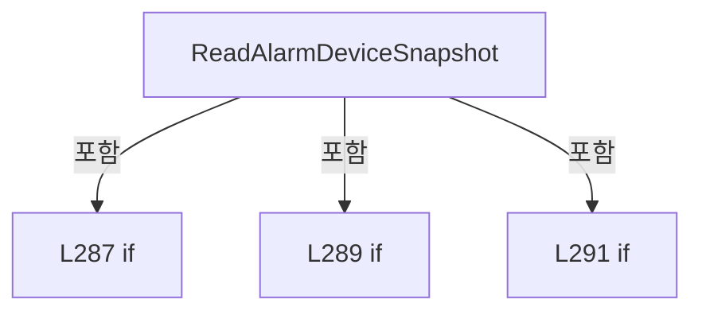

변경 전 점검: 입력/반환 타입, 위 호출자, 예외/취소 경로, 공유 상태와 저장·전송 소비자를 함께 확인합니다. 값의 단위나 물리 방향을 이름만으로 확정하지 않습니다.

### MethodDeclaration `ConnectInterface` · L307–310

[Drilling.Common/Managers/CManager.cs:307–310](https://github.com/kjuws10-rgb/A3Drilling/blob/5aee8e58439c9b455cae7c9593c9be986c3e682e/Drilling.Common/Managers/CManager.cs#L307-L310)

| 항목 | 실제 추출 값 |
| --- | --- |
| 서명 | System.Threading.Tasks.Task<int> Drilling.Common.Managers.CManager.ConnectInterface(System.Threading.CancellationToken) |
| 접근/수식자 | Public / public |
| 반환/값 타입 | System.Threading.Tasks.Task<int> |
| 소속 타입 | NamedType:Drilling.Common.Managers.CManager |

입력 계약:

| 이름 | 타입 | 전달 | 선택/기본값 |
| --- | --- | --- | --- |
| cancellationToken | System.Threading.CancellationToken | None | True / null |

현재 부분 분석에서 직접 연결된 호출자는 없습니다. XAML/이벤트/인터페이스·델리게이트·외부 진입을 추가 확인해야 하며, 미사용으로 판정한 것이 아닙니다.

호출하는 대상과 해석 범위:

| 원본 행 | 표현식 | 분석 상태 | 대상/소스 위치 |
| --- | --- | --- | --- |
| 309 | _interfaceManager.Connect | resolved | System.Threading.Tasks.Task<int> Drilling.Common.Interface.CInterfaceManager.Connect(bool, System.Threading.CancellationToken) · Drilling.Common/Interface/CInterfaceManager.cs:198 |

본문의 실제 연산·분기·예외·반환 순서(원문 위치 순):

| 원본 행 | 종류 | 주석 해설 |
| --- | --- | --- |
| 309 | call | 함수·델리게이트 또는 객체 생성자를 호출합니다: _interfaceManager.Connect(cancellationToken: cancellationToken) |
| 309 | return | 호출자에게 값 또는 제어를 반환합니다: return _interfaceManager.Connect(cancellationToken: cancellationToken); |

변경 전 점검: 입력/반환 타입, 위 호출자, 예외/취소 경로, 공유 상태와 저장·전송 소비자를 함께 확인합니다. 값의 단위나 물리 방향을 이름만으로 확정하지 않습니다.

### MethodDeclaration `DisconnectInterface` · L312–315

[Drilling.Common/Managers/CManager.cs:312–315](https://github.com/kjuws10-rgb/A3Drilling/blob/5aee8e58439c9b455cae7c9593c9be986c3e682e/Drilling.Common/Managers/CManager.cs#L312-L315)

| 항목 | 실제 추출 값 |
| --- | --- |
| 서명 | System.Threading.Tasks.Task<int> Drilling.Common.Managers.CManager.DisconnectInterface(System.Threading.CancellationToken) |
| 접근/수식자 | Public / public |
| 반환/값 타입 | System.Threading.Tasks.Task<int> |
| 소속 타입 | NamedType:Drilling.Common.Managers.CManager |

입력 계약:

| 이름 | 타입 | 전달 | 선택/기본값 |
| --- | --- | --- | --- |
| cancellationToken | System.Threading.CancellationToken | None | True / null |

현재 부분 분석에서 직접 연결된 호출자는 없습니다. XAML/이벤트/인터페이스·델리게이트·외부 진입을 추가 확인해야 하며, 미사용으로 판정한 것이 아닙니다.

호출하는 대상과 해석 범위:

| 원본 행 | 표현식 | 분석 상태 | 대상/소스 위치 |
| --- | --- | --- | --- |
| 314 | _interfaceManager.Disconnect | resolved | System.Threading.Tasks.Task<int> Drilling.Common.Interface.CInterfaceManager.Disconnect(System.Threading.CancellationToken) · Drilling.Common/Interface/CInterfaceManager.cs:237 |

본문의 실제 연산·분기·예외·반환 순서(원문 위치 순):

| 원본 행 | 종류 | 주석 해설 |
| --- | --- | --- |
| 314 | call | 함수·델리게이트 또는 객체 생성자를 호출합니다: _interfaceManager.Disconnect(cancellationToken) |
| 314 | return | 호출자에게 값 또는 제어를 반환합니다: return _interfaceManager.Disconnect(cancellationToken); |

변경 전 점검: 입력/반환 타입, 위 호출자, 예외/취소 경로, 공유 상태와 저장·전송 소비자를 함께 확인합니다. 값의 단위나 물리 방향을 이름만으로 확정하지 않습니다.

### MethodDeclaration `ReconnectInterface` · L317–320

[Drilling.Common/Managers/CManager.cs:317–320](https://github.com/kjuws10-rgb/A3Drilling/blob/5aee8e58439c9b455cae7c9593c9be986c3e682e/Drilling.Common/Managers/CManager.cs#L317-L320)

| 항목 | 실제 추출 값 |
| --- | --- |
| 서명 | System.Threading.Tasks.Task Drilling.Common.Managers.CManager.ReconnectInterface(Drilling.Common.Interface.EN_EQP_MODULE, int, System.Threading.CancellationToken) |
| 접근/수식자 | Public / public |
| 반환/값 타입 | System.Threading.Tasks.Task |
| 소속 타입 | NamedType:Drilling.Common.Managers.CManager |

입력 계약:

| 이름 | 타입 | 전달 | 선택/기본값 |
| --- | --- | --- | --- |
| module | Drilling.Common.Interface.EN_EQP_MODULE | None | False /  |
| number | int | None | False /  |
| cancellationToken | System.Threading.CancellationToken | None | True / null |

현재 부분 분석에서 직접 연결된 호출자는 없습니다. XAML/이벤트/인터페이스·델리게이트·외부 진입을 추가 확인해야 하며, 미사용으로 판정한 것이 아닙니다.

호출하는 대상과 해석 범위:

| 원본 행 | 표현식 | 분석 상태 | 대상/소스 위치 |
| --- | --- | --- | --- |
| 319 | _interfaceManager.Reconnect | resolved | System.Threading.Tasks.Task Drilling.Common.Interface.CInterfaceManager.Reconnect(Drilling.Common.Interface.EN_EQP_MODULE, int, System.Threading.CancellationToken) · Drilling.Common/Interface/CInterfaceManager.cs:292 |

본문의 실제 연산·분기·예외·반환 순서(원문 위치 순):

| 원본 행 | 종류 | 주석 해설 |
| --- | --- | --- |
| 319 | call | 함수·델리게이트 또는 객체 생성자를 호출합니다: _interfaceManager.Reconnect(module, number, cancellationToken) |
| 319 | return | 호출자에게 값 또는 제어를 반환합니다: return _interfaceManager.Reconnect(module, number, cancellationToken); |

변경 전 점검: 입력/반환 타입, 위 호출자, 예외/취소 경로, 공유 상태와 저장·전송 소비자를 함께 확인합니다. 값의 단위나 물리 방향을 이름만으로 확정하지 않습니다.

### MethodDeclaration `Station` · L322–325

[Drilling.Common/Managers/CManager.cs:322–325](https://github.com/kjuws10-rgb/A3Drilling/blob/5aee8e58439c9b455cae7c9593c9be986c3e682e/Drilling.Common/Managers/CManager.cs#L322-L325)

| 항목 | 실제 추출 값 |
| --- | --- |
| 서명 | Drilling.Common.Station.CStationManager Drilling.Common.Managers.CManager.Station() |
| 접근/수식자 | Public / public |
| 반환/값 타입 | Drilling.Common.Station.CStationManager |
| 소속 타입 | NamedType:Drilling.Common.Managers.CManager |

정적 호출자로 확인된 위치:

| 호출 파일/행 | 호출 표현식 | 런타임 분기 가능 |
| --- | --- | --- |
| [Drilling.UI/CAppStartup.cs:55–55](https://github.com/kjuws10-rgb/A3Drilling/blob/5aee8e58439c9b455cae7c9593c9be986c3e682e/Drilling.UI/CAppStartup.cs#L55-L55) | manager.Station | False |
| [Drilling.UI/Menu/Menus/CMenuCorrection.cs:190–190](https://github.com/kjuws10-rgb/A3Drilling/blob/5aee8e58439c9b455cae7c9593c9be986c3e682e/Drilling.UI/Menu/Menus/CMenuCorrection.cs#L190-L190) | .Station | False |
| [Drilling.UI/Menu/Menus/CMenuCorrection.cs:3493–3493](https://github.com/kjuws10-rgb/A3Drilling/blob/5aee8e58439c9b455cae7c9593c9be986c3e682e/Drilling.UI/Menu/Menus/CMenuCorrection.cs#L3493-L3493) | manager.Station | False |
| [Drilling.UI/Menu/Menus/CMenuCorrection.cs:3545–3545](https://github.com/kjuws10-rgb/A3Drilling/blob/5aee8e58439c9b455cae7c9593c9be986c3e682e/Drilling.UI/Menu/Menus/CMenuCorrection.cs#L3545-L3545) | manager.Station | False |
| [Drilling.UI/Menu/Menus/CMenuCorrection.cs:3545–3545](https://github.com/kjuws10-rgb/A3Drilling/blob/5aee8e58439c9b455cae7c9593c9be986c3e682e/Drilling.UI/Menu/Menus/CMenuCorrection.cs#L3545-L3545) | manager.Station | False |
| [Drilling.UI/Menu/Menus/CMenuCorrection.cs:3545–3545](https://github.com/kjuws10-rgb/A3Drilling/blob/5aee8e58439c9b455cae7c9593c9be986c3e682e/Drilling.UI/Menu/Menus/CMenuCorrection.cs#L3545-L3545) | manager.Station | False |
| [Drilling.UI/Menu/Menus/CMenuCorrection.cs:4050–4050](https://github.com/kjuws10-rgb/A3Drilling/blob/5aee8e58439c9b455cae7c9593c9be986c3e682e/Drilling.UI/Menu/Menus/CMenuCorrection.cs#L4050-L4050) | .Station | False |
| [Drilling.UI/Menu/Menus/CMenuManual.cs:443–443](https://github.com/kjuws10-rgb/A3Drilling/blob/5aee8e58439c9b455cae7c9593c9be986c3e682e/Drilling.UI/Menu/Menus/CMenuManual.cs#L443-L443) | _manager.Station | False |
| [Drilling.UI/Menu/Menus/CMenuManual.cs:1293–1293](https://github.com/kjuws10-rgb/A3Drilling/blob/5aee8e58439c9b455cae7c9593c9be986c3e682e/Drilling.UI/Menu/Menus/CMenuManual.cs#L1293-L1293) | _manager.Station | False |
| [Drilling.UI/Menu/Menus/CMenuManual.cs:1333–1333](https://github.com/kjuws10-rgb/A3Drilling/blob/5aee8e58439c9b455cae7c9593c9be986c3e682e/Drilling.UI/Menu/Menus/CMenuManual.cs#L1333-L1333) | _manager.Station | False |
| [Drilling.UI/Menu/Menus/CMenuManual.cs:1911–1911](https://github.com/kjuws10-rgb/A3Drilling/blob/5aee8e58439c9b455cae7c9593c9be986c3e682e/Drilling.UI/Menu/Menus/CMenuManual.cs#L1911-L1911) | _manager.Station | False |
| [Drilling.UI/Menu/Menus/CMenuManual.cs:3292–3292](https://github.com/kjuws10-rgb/A3Drilling/blob/5aee8e58439c9b455cae7c9593c9be986c3e682e/Drilling.UI/Menu/Menus/CMenuManual.cs#L3292-L3292) | _manager.Station | False |
| [Drilling.UI/Menu/Menus/CMenuManual.cs:3292–3292](https://github.com/kjuws10-rgb/A3Drilling/blob/5aee8e58439c9b455cae7c9593c9be986c3e682e/Drilling.UI/Menu/Menus/CMenuManual.cs#L3292-L3292) | _manager.Station | False |
| [Drilling.UI/Menu/Menus/CMenuManual.cs:3332–3332](https://github.com/kjuws10-rgb/A3Drilling/blob/5aee8e58439c9b455cae7c9593c9be986c3e682e/Drilling.UI/Menu/Menus/CMenuManual.cs#L3332-L3332) | _manager.Station | False |
| [Drilling.UI/Menu/Menus/CMenuManual.cs:3337–3337](https://github.com/kjuws10-rgb/A3Drilling/blob/5aee8e58439c9b455cae7c9593c9be986c3e682e/Drilling.UI/Menu/Menus/CMenuManual.cs#L3337-L3337) | _manager.Station | False |
| [Drilling.UI/Menu/Menus/CMenuManual.cs:3372–3372](https://github.com/kjuws10-rgb/A3Drilling/blob/5aee8e58439c9b455cae7c9593c9be986c3e682e/Drilling.UI/Menu/Menus/CMenuManual.cs#L3372-L3372) | _manager.Station | False |
| [Drilling.UI/Menu/Menus/CMenuManual.cs:3380–3380](https://github.com/kjuws10-rgb/A3Drilling/blob/5aee8e58439c9b455cae7c9593c9be986c3e682e/Drilling.UI/Menu/Menus/CMenuManual.cs#L3380-L3380) | _manager.Station | False |
| [Drilling.UI/Menu/Menus/CMenuManual.cs:3403–3403](https://github.com/kjuws10-rgb/A3Drilling/blob/5aee8e58439c9b455cae7c9593c9be986c3e682e/Drilling.UI/Menu/Menus/CMenuManual.cs#L3403-L3403) | _manager.Station | False |
| [Drilling.UI/Menu/Menus/CMenuManual.cs:4788–4788](https://github.com/kjuws10-rgb/A3Drilling/blob/5aee8e58439c9b455cae7c9593c9be986c3e682e/Drilling.UI/Menu/Menus/CMenuManual.cs#L4788-L4788) | _manager.Station | False |
| [Drilling.UI/Menu/Menus/CMenuManual.cs:6334–6334](https://github.com/kjuws10-rgb/A3Drilling/blob/5aee8e58439c9b455cae7c9593c9be986c3e682e/Drilling.UI/Menu/Menus/CMenuManual.cs#L6334-L6334) | _manager.Station | False |
| [Drilling.UI/Menu/Menus/CMenuManual.cs:6334–6334](https://github.com/kjuws10-rgb/A3Drilling/blob/5aee8e58439c9b455cae7c9593c9be986c3e682e/Drilling.UI/Menu/Menus/CMenuManual.cs#L6334-L6334) | _manager.Station | False |
| [Drilling.UI/Menu/Menus/CMenuManual.cs:6334–6334](https://github.com/kjuws10-rgb/A3Drilling/blob/5aee8e58439c9b455cae7c9593c9be986c3e682e/Drilling.UI/Menu/Menus/CMenuManual.cs#L6334-L6334) | _manager.Station | False |

본문의 실제 연산·분기·예외·반환 순서(원문 위치 순):

| 원본 행 | 종류 | 주석 해설 |
| --- | --- | --- |
| 324 | return | 호출자에게 값 또는 제어를 반환합니다: return _stationManager; |

변경 전 점검: 입력/반환 타입, 위 호출자, 예외/취소 경로, 공유 상태와 저장·전송 소비자를 함께 확인합니다. 값의 단위나 물리 방향을 이름만으로 확정하지 않습니다.

### MethodDeclaration `Recipe` · L327–330

[Drilling.Common/Managers/CManager.cs:327–330](https://github.com/kjuws10-rgb/A3Drilling/blob/5aee8e58439c9b455cae7c9593c9be986c3e682e/Drilling.Common/Managers/CManager.cs#L327-L330)

| 항목 | 실제 추출 값 |
| --- | --- |
| 서명 | Drilling.Common.Managers.CRecipeManager Drilling.Common.Managers.CManager.Recipe() |
| 접근/수식자 | Public / public |
| 반환/값 타입 | Drilling.Common.Managers.CRecipeManager |
| 소속 타입 | NamedType:Drilling.Common.Managers.CManager |

정적 호출자로 확인된 위치:

| 호출 파일/행 | 호출 표현식 | 런타임 분기 가능 |
| --- | --- | --- |
| [Drilling.Common/Interface/CPowerMeasureRun.cs:116–116](https://github.com/kjuws10-rgb/A3Drilling/blob/5aee8e58439c9b455cae7c9593c9be986c3e682e/Drilling.Common/Interface/CPowerMeasureRun.cs#L116-L116) | manager.Recipe | False |
| [Drilling.UI/CAppStartup.cs:61–61](https://github.com/kjuws10-rgb/A3Drilling/blob/5aee8e58439c9b455cae7c9593c9be986c3e682e/Drilling.UI/CAppStartup.cs#L61-L61) | manager.Recipe | False |
| [Drilling.UI/Menu/Menus/CMenuManual.cs:1620–1620](https://github.com/kjuws10-rgb/A3Drilling/blob/5aee8e58439c9b455cae7c9593c9be986c3e682e/Drilling.UI/Menu/Menus/CMenuManual.cs#L1620-L1620) | _manager.Recipe | False |

본문의 실제 연산·분기·예외·반환 순서(원문 위치 순):

| 원본 행 | 종류 | 주석 해설 |
| --- | --- | --- |
| 329 | return | 호출자에게 값 또는 제어를 반환합니다: return _recipeManager; |

변경 전 점검: 입력/반환 타입, 위 호출자, 예외/취소 경로, 공유 상태와 저장·전송 소비자를 함께 확인합니다. 값의 단위나 물리 방향을 이름만으로 확정하지 않습니다.

### MethodDeclaration `Setting` · L332–335

[Drilling.Common/Managers/CManager.cs:332–335](https://github.com/kjuws10-rgb/A3Drilling/blob/5aee8e58439c9b455cae7c9593c9be986c3e682e/Drilling.Common/Managers/CManager.cs#L332-L335)

| 항목 | 실제 추출 값 |
| --- | --- |
| 서명 | Drilling.Common.Managers.CSettingManager Drilling.Common.Managers.CManager.Setting() |
| 접근/수식자 | Public / public |
| 반환/값 타입 | Drilling.Common.Managers.CSettingManager |
| 소속 타입 | NamedType:Drilling.Common.Managers.CManager |

정적 호출자로 확인된 위치:

| 호출 파일/행 | 호출 표현식 | 런타임 분기 가능 |
| --- | --- | --- |
| [Drilling.Common/Interface/CPowerMeasureRun.cs:161–161](https://github.com/kjuws10-rgb/A3Drilling/blob/5aee8e58439c9b455cae7c9593c9be986c3e682e/Drilling.Common/Interface/CPowerMeasureRun.cs#L161-L161) | manager.Setting | False |
| [Drilling.Common/Interface/CPowerMeasureRun.cs:162–162](https://github.com/kjuws10-rgb/A3Drilling/blob/5aee8e58439c9b455cae7c9593c9be986c3e682e/Drilling.Common/Interface/CPowerMeasureRun.cs#L162-L162) | manager.Setting | False |
| [Drilling.Common/Interface/CPowerMeasureRun.cs:252–252](https://github.com/kjuws10-rgb/A3Drilling/blob/5aee8e58439c9b455cae7c9593c9be986c3e682e/Drilling.Common/Interface/CPowerMeasureRun.cs#L252-L252) | manager.Setting | False |
| [Drilling.UI/CAppStartup.cs:62–62](https://github.com/kjuws10-rgb/A3Drilling/blob/5aee8e58439c9b455cae7c9593c9be986c3e682e/Drilling.UI/CAppStartup.cs#L62-L62) | manager.Setting | False |
| [Drilling.UI/CRootView.cs:556–556](https://github.com/kjuws10-rgb/A3Drilling/blob/5aee8e58439c9b455cae7c9593c9be986c3e682e/Drilling.UI/CRootView.cs#L556-L556) | _manager.Setting | False |
| [Drilling.UI/CRootView.cs:1399–1399](https://github.com/kjuws10-rgb/A3Drilling/blob/5aee8e58439c9b455cae7c9593c9be986c3e682e/Drilling.UI/CRootView.cs#L1399-L1399) | _manager.Setting | False |
| [Drilling.UI/CRootView.cs:1407–1407](https://github.com/kjuws10-rgb/A3Drilling/blob/5aee8e58439c9b455cae7c9593c9be986c3e682e/Drilling.UI/CRootView.cs#L1407-L1407) | _manager.Setting | False |
| [Drilling.UI/CRootView.cs:1911–1911](https://github.com/kjuws10-rgb/A3Drilling/blob/5aee8e58439c9b455cae7c9593c9be986c3e682e/Drilling.UI/CRootView.cs#L1911-L1911) | _manager.Setting | False |
| [Drilling.UI/CRootView.cs:2783–2783](https://github.com/kjuws10-rgb/A3Drilling/blob/5aee8e58439c9b455cae7c9593c9be986c3e682e/Drilling.UI/CRootView.cs#L2783-L2783) | _manager.Setting | False |
| [Drilling.UI/CRootView.cs:2874–2874](https://github.com/kjuws10-rgb/A3Drilling/blob/5aee8e58439c9b455cae7c9593c9be986c3e682e/Drilling.UI/CRootView.cs#L2874-L2874) | _manager.Setting | False |
| [Drilling.UI/Menu/Menus/CMenuManual.cs:1089–1089](https://github.com/kjuws10-rgb/A3Drilling/blob/5aee8e58439c9b455cae7c9593c9be986c3e682e/Drilling.UI/Menu/Menus/CMenuManual.cs#L1089-L1089) | _manager.Setting | False |
| [Drilling.UI/Menu/Menus/CMenuManual.cs:1096–1096](https://github.com/kjuws10-rgb/A3Drilling/blob/5aee8e58439c9b455cae7c9593c9be986c3e682e/Drilling.UI/Menu/Menus/CMenuManual.cs#L1096-L1096) | _manager.Setting | False |
| [Drilling.UI/Menu/Menus/CMenuManual.cs:1450–1450](https://github.com/kjuws10-rgb/A3Drilling/blob/5aee8e58439c9b455cae7c9593c9be986c3e682e/Drilling.UI/Menu/Menus/CMenuManual.cs#L1450-L1450) | _manager.Setting | False |
| [Drilling.UI/Menu/Menus/CMenuManual.cs:1749–1749](https://github.com/kjuws10-rgb/A3Drilling/blob/5aee8e58439c9b455cae7c9593c9be986c3e682e/Drilling.UI/Menu/Menus/CMenuManual.cs#L1749-L1749) | _manager.Setting | False |
| [Drilling.UI/Menu/Menus/CMenuManual.cs:1794–1794](https://github.com/kjuws10-rgb/A3Drilling/blob/5aee8e58439c9b455cae7c9593c9be986c3e682e/Drilling.UI/Menu/Menus/CMenuManual.cs#L1794-L1794) | _manager.Setting | False |
| [Drilling.UI/Menu/Menus/CMenuManual.cs:1886–1886](https://github.com/kjuws10-rgb/A3Drilling/blob/5aee8e58439c9b455cae7c9593c9be986c3e682e/Drilling.UI/Menu/Menus/CMenuManual.cs#L1886-L1886) | _manager.Setting | False |
| [Drilling.UI/Menu/Menus/CMenuManual.cs:1991–1991](https://github.com/kjuws10-rgb/A3Drilling/blob/5aee8e58439c9b455cae7c9593c9be986c3e682e/Drilling.UI/Menu/Menus/CMenuManual.cs#L1991-L1991) | _manager.Setting | False |
| [Drilling.UI/Menu/Menus/CMenuManual.cs:2007–2007](https://github.com/kjuws10-rgb/A3Drilling/blob/5aee8e58439c9b455cae7c9593c9be986c3e682e/Drilling.UI/Menu/Menus/CMenuManual.cs#L2007-L2007) | _manager.Setting | False |
| [Drilling.UI/Menu/Menus/CMenuManual.cs:2260–2260](https://github.com/kjuws10-rgb/A3Drilling/blob/5aee8e58439c9b455cae7c9593c9be986c3e682e/Drilling.UI/Menu/Menus/CMenuManual.cs#L2260-L2260) | _manager.Setting | False |
| [Drilling.UI/Menu/Menus/CMenuManual.cs:2594–2594](https://github.com/kjuws10-rgb/A3Drilling/blob/5aee8e58439c9b455cae7c9593c9be986c3e682e/Drilling.UI/Menu/Menus/CMenuManual.cs#L2594-L2594) | _manager.Setting | False |
| [Drilling.UI/Menu/Menus/CMenuManual.cs:2781–2781](https://github.com/kjuws10-rgb/A3Drilling/blob/5aee8e58439c9b455cae7c9593c9be986c3e682e/Drilling.UI/Menu/Menus/CMenuManual.cs#L2781-L2781) | _manager.Setting | False |
| [Drilling.UI/Menu/Menus/CMenuManual.cs:3359–3359](https://github.com/kjuws10-rgb/A3Drilling/blob/5aee8e58439c9b455cae7c9593c9be986c3e682e/Drilling.UI/Menu/Menus/CMenuManual.cs#L3359-L3359) | _manager.Setting | False |
| [Drilling.UI/Menu/Menus/CMenuManual.cs:3470–3470](https://github.com/kjuws10-rgb/A3Drilling/blob/5aee8e58439c9b455cae7c9593c9be986c3e682e/Drilling.UI/Menu/Menus/CMenuManual.cs#L3470-L3470) | _manager.Setting | False |
| [Drilling.UI/Menu/Menus/CMenuManual.cs:3612–3612](https://github.com/kjuws10-rgb/A3Drilling/blob/5aee8e58439c9b455cae7c9593c9be986c3e682e/Drilling.UI/Menu/Menus/CMenuManual.cs#L3612-L3612) | _manager.Setting | False |
| [Drilling.UI/Menu/Menus/CMenuManual.cs:3659–3659](https://github.com/kjuws10-rgb/A3Drilling/blob/5aee8e58439c9b455cae7c9593c9be986c3e682e/Drilling.UI/Menu/Menus/CMenuManual.cs#L3659-L3659) | _manager.Setting | False |
| [Drilling.UI/Menu/Menus/CMenuManual.cs:4158–4158](https://github.com/kjuws10-rgb/A3Drilling/blob/5aee8e58439c9b455cae7c9593c9be986c3e682e/Drilling.UI/Menu/Menus/CMenuManual.cs#L4158-L4158) | _manager.Setting | False |
| [Drilling.UI/Menu/Menus/CMenuManual.cs:4393–4393](https://github.com/kjuws10-rgb/A3Drilling/blob/5aee8e58439c9b455cae7c9593c9be986c3e682e/Drilling.UI/Menu/Menus/CMenuManual.cs#L4393-L4393) | _manager.Setting | False |
| [Drilling.UI/Menu/Menus/CMenuManual.cs:4676–4676](https://github.com/kjuws10-rgb/A3Drilling/blob/5aee8e58439c9b455cae7c9593c9be986c3e682e/Drilling.UI/Menu/Menus/CMenuManual.cs#L4676-L4676) | _manager.Setting | False |
| [Drilling.UI/Menu/Menus/CMenuManual.cs:4800–4800](https://github.com/kjuws10-rgb/A3Drilling/blob/5aee8e58439c9b455cae7c9593c9be986c3e682e/Drilling.UI/Menu/Menus/CMenuManual.cs#L4800-L4800) | _manager.Setting | False |
| [Drilling.UI/Menu/Menus/CMenuManual.cs:5301–5301](https://github.com/kjuws10-rgb/A3Drilling/blob/5aee8e58439c9b455cae7c9593c9be986c3e682e/Drilling.UI/Menu/Menus/CMenuManual.cs#L5301-L5301) | _manager.Setting | False |
| [Drilling.UI/Menu/Menus/CMenuManual.cs:5370–5370](https://github.com/kjuws10-rgb/A3Drilling/blob/5aee8e58439c9b455cae7c9593c9be986c3e682e/Drilling.UI/Menu/Menus/CMenuManual.cs#L5370-L5370) | _manager.Setting | False |
| [Drilling.UI/Menu/Menus/CMenuManual.cs:5535–5535](https://github.com/kjuws10-rgb/A3Drilling/blob/5aee8e58439c9b455cae7c9593c9be986c3e682e/Drilling.UI/Menu/Menus/CMenuManual.cs#L5535-L5535) | _manager.Setting | False |

본문의 실제 연산·분기·예외·반환 순서(원문 위치 순):

| 원본 행 | 종류 | 주석 해설 |
| --- | --- | --- |
| 334 | return | 호출자에게 값 또는 제어를 반환합니다: return _settingManager; |

변경 전 점검: 입력/반환 타입, 위 호출자, 예외/취소 경로, 공유 상태와 저장·전송 소비자를 함께 확인합니다. 값의 단위나 물리 방향을 이름만으로 확정하지 않습니다.

### MethodDeclaration `Product` · L337–340

[Drilling.Common/Managers/CManager.cs:337–340](https://github.com/kjuws10-rgb/A3Drilling/blob/5aee8e58439c9b455cae7c9593c9be986c3e682e/Drilling.Common/Managers/CManager.cs#L337-L340)

| 항목 | 실제 추출 값 |
| --- | --- |
| 서명 | Drilling.Common.Product.CProductManager Drilling.Common.Managers.CManager.Product() |
| 접근/수식자 | Public / public |
| 반환/값 타입 | Drilling.Common.Product.CProductManager |
| 소속 타입 | NamedType:Drilling.Common.Managers.CManager |

정적 호출자로 확인된 위치:

| 호출 파일/행 | 호출 표현식 | 런타임 분기 가능 |
| --- | --- | --- |
| [Drilling.UI/CAppStartup.cs:63–63](https://github.com/kjuws10-rgb/A3Drilling/blob/5aee8e58439c9b455cae7c9593c9be986c3e682e/Drilling.UI/CAppStartup.cs#L63-L63) | manager.Product | False |

본문의 실제 연산·분기·예외·반환 순서(원문 위치 순):

| 원본 행 | 종류 | 주석 해설 |
| --- | --- | --- |
| 339 | return | 호출자에게 값 또는 제어를 반환합니다: return _productManager; |

변경 전 점검: 입력/반환 타입, 위 호출자, 예외/취소 경로, 공유 상태와 저장·전송 소비자를 함께 확인합니다. 값의 단위나 물리 방향을 이름만으로 확정하지 않습니다.

### MethodDeclaration `Review` · L342–345

[Drilling.Common/Managers/CManager.cs:342–345](https://github.com/kjuws10-rgb/A3Drilling/blob/5aee8e58439c9b455cae7c9593c9be986c3e682e/Drilling.Common/Managers/CManager.cs#L342-L345)

| 항목 | 실제 추출 값 |
| --- | --- |
| 서명 | Drilling.Common.Review.CReviewManager Drilling.Common.Managers.CManager.Review() |
| 접근/수식자 | Public / public |
| 반환/값 타입 | Drilling.Common.Review.CReviewManager |
| 소속 타입 | NamedType:Drilling.Common.Managers.CManager |

정적 호출자로 확인된 위치:

| 호출 파일/행 | 호출 표현식 | 런타임 분기 가능 |
| --- | --- | --- |
| [Drilling.UI/CAppStartup.cs:64–64](https://github.com/kjuws10-rgb/A3Drilling/blob/5aee8e58439c9b455cae7c9593c9be986c3e682e/Drilling.UI/CAppStartup.cs#L64-L64) | manager.Review | False |
| [Drilling.UI/Menu/Menus/CMenuManual.cs:3294–3294](https://github.com/kjuws10-rgb/A3Drilling/blob/5aee8e58439c9b455cae7c9593c9be986c3e682e/Drilling.UI/Menu/Menus/CMenuManual.cs#L3294-L3294) | _manager.Review | False |

본문의 실제 연산·분기·예외·반환 순서(원문 위치 순):

| 원본 행 | 종류 | 주석 해설 |
| --- | --- | --- |
| 344 | return | 호출자에게 값 또는 제어를 반환합니다: return _reviewManager; |

변경 전 점검: 입력/반환 타입, 위 호출자, 예외/취소 경로, 공유 상태와 저장·전송 소비자를 함께 확인합니다. 값의 단위나 물리 방향을 이름만으로 확정하지 않습니다.

### MethodDeclaration `Interface` · L347–350

[Drilling.Common/Managers/CManager.cs:347–350](https://github.com/kjuws10-rgb/A3Drilling/blob/5aee8e58439c9b455cae7c9593c9be986c3e682e/Drilling.Common/Managers/CManager.cs#L347-L350)

| 항목 | 실제 추출 값 |
| --- | --- |
| 서명 | Drilling.Common.Interface.CInterfaceManager Drilling.Common.Managers.CManager.Interface() |
| 접근/수식자 | Public / public |
| 반환/값 타입 | Drilling.Common.Interface.CInterfaceManager |
| 소속 타입 | NamedType:Drilling.Common.Managers.CManager |

정적 호출자로 확인된 위치:

| 호출 파일/행 | 호출 표현식 | 런타임 분기 가능 |
| --- | --- | --- |
| [Drilling.Common/Interface/CPowerMeasureRun.cs:163–163](https://github.com/kjuws10-rgb/A3Drilling/blob/5aee8e58439c9b455cae7c9593c9be986c3e682e/Drilling.Common/Interface/CPowerMeasureRun.cs#L163-L163) | manager.Interface | False |
| [Drilling.UI/CAppStartup.cs:56–56](https://github.com/kjuws10-rgb/A3Drilling/blob/5aee8e58439c9b455cae7c9593c9be986c3e682e/Drilling.UI/CAppStartup.cs#L56-L56) | manager.Interface | False |
| [Drilling.UI/Menu/Menus/CMenuCorrection.cs:3456–3456](https://github.com/kjuws10-rgb/A3Drilling/blob/5aee8e58439c9b455cae7c9593c9be986c3e682e/Drilling.UI/Menu/Menus/CMenuCorrection.cs#L3456-L3456) | manager.Interface | False |
| [Drilling.UI/Menu/Menus/CMenuCorrection.cs:3464–3464](https://github.com/kjuws10-rgb/A3Drilling/blob/5aee8e58439c9b455cae7c9593c9be986c3e682e/Drilling.UI/Menu/Menus/CMenuCorrection.cs#L3464-L3464) | manager.Interface | False |
| [Drilling.UI/Menu/Menus/CMenuCorrection.cs:3465–3465](https://github.com/kjuws10-rgb/A3Drilling/blob/5aee8e58439c9b455cae7c9593c9be986c3e682e/Drilling.UI/Menu/Menus/CMenuCorrection.cs#L3465-L3465) | manager.Interface | False |
| [Drilling.UI/Menu/Menus/CMenuCorrection.cs:3466–3466](https://github.com/kjuws10-rgb/A3Drilling/blob/5aee8e58439c9b455cae7c9593c9be986c3e682e/Drilling.UI/Menu/Menus/CMenuCorrection.cs#L3466-L3466) | manager.Interface | False |
| [Drilling.UI/Menu/Menus/CMenuCorrection.cs:3468–3468](https://github.com/kjuws10-rgb/A3Drilling/blob/5aee8e58439c9b455cae7c9593c9be986c3e682e/Drilling.UI/Menu/Menus/CMenuCorrection.cs#L3468-L3468) | manager.Interface | False |
| [Drilling.UI/Menu/Menus/CMenuCorrection.cs:3510–3510](https://github.com/kjuws10-rgb/A3Drilling/blob/5aee8e58439c9b455cae7c9593c9be986c3e682e/Drilling.UI/Menu/Menus/CMenuCorrection.cs#L3510-L3510) | manager.Interface | False |
| [Drilling.UI/Menu/Menus/CMenuCorrection.cs:3574–3574](https://github.com/kjuws10-rgb/A3Drilling/blob/5aee8e58439c9b455cae7c9593c9be986c3e682e/Drilling.UI/Menu/Menus/CMenuCorrection.cs#L3574-L3574) | _defaultManager!.Interface | False |
| [Drilling.UI/Menu/Menus/CMenuCorrection.cs:3591–3591](https://github.com/kjuws10-rgb/A3Drilling/blob/5aee8e58439c9b455cae7c9593c9be986c3e682e/Drilling.UI/Menu/Menus/CMenuCorrection.cs#L3591-L3591) | manager.Interface | False |
| [Drilling.UI/Menu/Menus/CMenuCorrection.cs:3599–3599](https://github.com/kjuws10-rgb/A3Drilling/blob/5aee8e58439c9b455cae7c9593c9be986c3e682e/Drilling.UI/Menu/Menus/CMenuCorrection.cs#L3599-L3599) | manager.Interface | False |
| [Drilling.UI/Menu/Menus/CMenuManual.cs:185–185](https://github.com/kjuws10-rgb/A3Drilling/blob/5aee8e58439c9b455cae7c9593c9be986c3e682e/Drilling.UI/Menu/Menus/CMenuManual.cs#L185-L185) | _manager.Interface | False |
| [Drilling.UI/Menu/Menus/CMenuManual.cs:193–193](https://github.com/kjuws10-rgb/A3Drilling/blob/5aee8e58439c9b455cae7c9593c9be986c3e682e/Drilling.UI/Menu/Menus/CMenuManual.cs#L193-L193) | _manager.Interface | False |
| [Drilling.UI/Menu/Menus/CMenuManual.cs:1288–1288](https://github.com/kjuws10-rgb/A3Drilling/blob/5aee8e58439c9b455cae7c9593c9be986c3e682e/Drilling.UI/Menu/Menus/CMenuManual.cs#L1288-L1288) | _manager.Interface | False |
| [Drilling.UI/Menu/Menus/CMenuManual.cs:2245–2245](https://github.com/kjuws10-rgb/A3Drilling/blob/5aee8e58439c9b455cae7c9593c9be986c3e682e/Drilling.UI/Menu/Menus/CMenuManual.cs#L2245-L2245) | _manager.Interface | False |
| [Drilling.UI/Menu/Menus/CMenuManual.cs:3266–3266](https://github.com/kjuws10-rgb/A3Drilling/blob/5aee8e58439c9b455cae7c9593c9be986c3e682e/Drilling.UI/Menu/Menus/CMenuManual.cs#L3266-L3266) | _manager.Interface | False |
| [Drilling.UI/Menu/Menus/CMenuManual.cs:3277–3277](https://github.com/kjuws10-rgb/A3Drilling/blob/5aee8e58439c9b455cae7c9593c9be986c3e682e/Drilling.UI/Menu/Menus/CMenuManual.cs#L3277-L3277) | _manager.Interface | False |
| [Drilling.UI/Menu/Menus/CMenuManual.cs:3282–3282](https://github.com/kjuws10-rgb/A3Drilling/blob/5aee8e58439c9b455cae7c9593c9be986c3e682e/Drilling.UI/Menu/Menus/CMenuManual.cs#L3282-L3282) | _manager.Interface | False |
| [Drilling.UI/Menu/Menus/CMenuManual.cs:3283–3283](https://github.com/kjuws10-rgb/A3Drilling/blob/5aee8e58439c9b455cae7c9593c9be986c3e682e/Drilling.UI/Menu/Menus/CMenuManual.cs#L3283-L3283) | _manager.Interface | False |
| [Drilling.UI/Menu/Menus/CMenuManual.cs:3285–3285](https://github.com/kjuws10-rgb/A3Drilling/blob/5aee8e58439c9b455cae7c9593c9be986c3e682e/Drilling.UI/Menu/Menus/CMenuManual.cs#L3285-L3285) | _manager.Interface | False |
| [Drilling.UI/Menu/Menus/CMenuManual.cs:3293–3293](https://github.com/kjuws10-rgb/A3Drilling/blob/5aee8e58439c9b455cae7c9593c9be986c3e682e/Drilling.UI/Menu/Menus/CMenuManual.cs#L3293-L3293) | _manager.Interface | False |
| [Drilling.UI/Menu/Menus/CMenuManual.cs:3305–3305](https://github.com/kjuws10-rgb/A3Drilling/blob/5aee8e58439c9b455cae7c9593c9be986c3e682e/Drilling.UI/Menu/Menus/CMenuManual.cs#L3305-L3305) | _manager.Interface | False |
| [Drilling.UI/Menu/Menus/CMenuManual.cs:3316–3316](https://github.com/kjuws10-rgb/A3Drilling/blob/5aee8e58439c9b455cae7c9593c9be986c3e682e/Drilling.UI/Menu/Menus/CMenuManual.cs#L3316-L3316) | _manager.Interface | False |
| [Drilling.UI/Menu/Menus/CMenuManual.cs:3324–3324](https://github.com/kjuws10-rgb/A3Drilling/blob/5aee8e58439c9b455cae7c9593c9be986c3e682e/Drilling.UI/Menu/Menus/CMenuManual.cs#L3324-L3324) | _manager.Interface | False |
| [Drilling.UI/Menu/Menus/CMenuManual.cs:4559–4559](https://github.com/kjuws10-rgb/A3Drilling/blob/5aee8e58439c9b455cae7c9593c9be986c3e682e/Drilling.UI/Menu/Menus/CMenuManual.cs#L4559-L4559) | _manager.Interface | False |
| [Drilling.UI/Menu/Menus/CMenuManual.cs:6296–6296](https://github.com/kjuws10-rgb/A3Drilling/blob/5aee8e58439c9b455cae7c9593c9be986c3e682e/Drilling.UI/Menu/Menus/CMenuManual.cs#L6296-L6296) | _manager.Interface | False |
| [Drilling.UI/Menu/Menus/CMenuManual.cs:6300–6300](https://github.com/kjuws10-rgb/A3Drilling/blob/5aee8e58439c9b455cae7c9593c9be986c3e682e/Drilling.UI/Menu/Menus/CMenuManual.cs#L6300-L6300) | _manager.Interface | False |
| [Drilling.UI/Menu/Menus/CMenuManual.cs:6301–6301](https://github.com/kjuws10-rgb/A3Drilling/blob/5aee8e58439c9b455cae7c9593c9be986c3e682e/Drilling.UI/Menu/Menus/CMenuManual.cs#L6301-L6301) | _manager.Interface | False |
| [Drilling.UI/Menu/Menus/CMenuManual.cs:6302–6302](https://github.com/kjuws10-rgb/A3Drilling/blob/5aee8e58439c9b455cae7c9593c9be986c3e682e/Drilling.UI/Menu/Menus/CMenuManual.cs#L6302-L6302) | _manager.Interface | False |
| [Drilling.UI/Menu/Menus/CMenuManual.cs:6432–6432](https://github.com/kjuws10-rgb/A3Drilling/blob/5aee8e58439c9b455cae7c9593c9be986c3e682e/Drilling.UI/Menu/Menus/CMenuManual.cs#L6432-L6432) | _manager.Interface | False |
| [Drilling.UI/Menu/Menus/CMenuManual.cs:6598–6598](https://github.com/kjuws10-rgb/A3Drilling/blob/5aee8e58439c9b455cae7c9593c9be986c3e682e/Drilling.UI/Menu/Menus/CMenuManual.cs#L6598-L6598) | _manager.Interface | False |
| [Drilling.UI/Menu/Menus/CMenuManual.cs:6628–6628](https://github.com/kjuws10-rgb/A3Drilling/blob/5aee8e58439c9b455cae7c9593c9be986c3e682e/Drilling.UI/Menu/Menus/CMenuManual.cs#L6628-L6628) | _manager.Interface | False |
| [Drilling.UI/Menu/Menus/CMenuManual.cs:6642–6642](https://github.com/kjuws10-rgb/A3Drilling/blob/5aee8e58439c9b455cae7c9593c9be986c3e682e/Drilling.UI/Menu/Menus/CMenuManual.cs#L6642-L6642) | _manager.Interface | False |

본문의 실제 연산·분기·예외·반환 순서(원문 위치 순):

| 원본 행 | 종류 | 주석 해설 |
| --- | --- | --- |
| 349 | return | 호출자에게 값 또는 제어를 반환합니다: return _interfaceManager; |

변경 전 점검: 입력/반환 타입, 위 호출자, 예외/취소 경로, 공유 상태와 저장·전송 소비자를 함께 확인합니다. 값의 단위나 물리 방향을 이름만으로 확정하지 않습니다.

### MethodDeclaration `Automation` · L352–355

[Drilling.Common/Managers/CManager.cs:352–355](https://github.com/kjuws10-rgb/A3Drilling/blob/5aee8e58439c9b455cae7c9593c9be986c3e682e/Drilling.Common/Managers/CManager.cs#L352-L355)

| 항목 | 실제 추출 값 |
| --- | --- |
| 서명 | Drilling.Common.Automation.CAutomationManager Drilling.Common.Managers.CManager.Automation() |
| 접근/수식자 | Public / public |
| 반환/값 타입 | Drilling.Common.Automation.CAutomationManager |
| 소속 타입 | NamedType:Drilling.Common.Managers.CManager |

정적 호출자로 확인된 위치:

| 호출 파일/행 | 호출 표현식 | 런타임 분기 가능 |
| --- | --- | --- |
| [Drilling.Common/Interface/CPowerMeasureRun.cs:164–164](https://github.com/kjuws10-rgb/A3Drilling/blob/5aee8e58439c9b455cae7c9593c9be986c3e682e/Drilling.Common/Interface/CPowerMeasureRun.cs#L164-L164) | manager.Automation | False |
| [Drilling.UI/CRootView.cs:2195–2195](https://github.com/kjuws10-rgb/A3Drilling/blob/5aee8e58439c9b455cae7c9593c9be986c3e682e/Drilling.UI/CRootView.cs#L2195-L2195) | _manager.Automation | False |
| [Drilling.UI/Menu/Menus/CMenuManual.cs:184–184](https://github.com/kjuws10-rgb/A3Drilling/blob/5aee8e58439c9b455cae7c9593c9be986c3e682e/Drilling.UI/Menu/Menus/CMenuManual.cs#L184-L184) | _manager.Automation | False |

본문의 실제 연산·분기·예외·반환 순서(원문 위치 순):

| 원본 행 | 종류 | 주석 해설 |
| --- | --- | --- |
| 354 | return | 호출자에게 값 또는 제어를 반환합니다: return _automationManager; |

변경 전 점검: 입력/반환 타입, 위 호출자, 예외/취소 경로, 공유 상태와 저장·전송 소비자를 함께 확인합니다. 값의 단위나 물리 방향을 이름만으로 확정하지 않습니다.

### PropertyDeclaration `automation` · L357–363

[Drilling.Common/Managers/CManager.cs:357–363](https://github.com/kjuws10-rgb/A3Drilling/blob/5aee8e58439c9b455cae7c9593c9be986c3e682e/Drilling.Common/Managers/CManager.cs#L357-L363)

| 항목 | 실제 추출 값 |
| --- | --- |
| 서명 | Drilling.Common.Automation.CAutomationManager Drilling.Common.Managers.CManager.automation |
| 접근/수식자 | Public / public |
| 반환/값 타입 | Drilling.Common.Automation.CAutomationManager |
| 소속 타입 | NamedType:Drilling.Common.Managers.CManager |

현재 부분 분석에서 직접 연결된 호출자는 없습니다. XAML/이벤트/인터페이스·델리게이트·외부 진입을 추가 확인해야 하며, 미사용으로 판정한 것이 아닙니다.

변경 전 점검: 입력/반환 타입, 위 호출자, 예외/취소 경로, 공유 상태와 저장·전송 소비자를 함께 확인합니다. 값의 단위나 물리 방향을 이름만으로 확정하지 않습니다.

### GetAccessorDeclaration `get_automation` · L359–362

[Drilling.Common/Managers/CManager.cs:359–362](https://github.com/kjuws10-rgb/A3Drilling/blob/5aee8e58439c9b455cae7c9593c9be986c3e682e/Drilling.Common/Managers/CManager.cs#L359-L362)

| 항목 | 실제 추출 값 |
| --- | --- |
| 서명 | Drilling.Common.Automation.CAutomationManager Drilling.Common.Managers.CManager.automation.get |
| 접근/수식자 | Public / get |
| 반환/값 타입 | Drilling.Common.Automation.CAutomationManager |
| 소속 타입 | NamedType:Drilling.Common.Managers.CManager |

현재 부분 분석에서 직접 연결된 호출자는 없습니다. XAML/이벤트/인터페이스·델리게이트·외부 진입을 추가 확인해야 하며, 미사용으로 판정한 것이 아닙니다.

본문의 실제 연산·분기·예외·반환 순서(원문 위치 순):

| 원본 행 | 종류 | 주석 해설 |
| --- | --- | --- |
| 361 | return | 호출자에게 값 또는 제어를 반환합니다: return _automationManager; |

변경 전 점검: 입력/반환 타입, 위 호출자, 예외/취소 경로, 공유 상태와 저장·전송 소비자를 함께 확인합니다. 값의 단위나 물리 방향을 이름만으로 확정하지 않습니다.

### MethodDeclaration `Motion` · L365–368

[Drilling.Common/Managers/CManager.cs:365–368](https://github.com/kjuws10-rgb/A3Drilling/blob/5aee8e58439c9b455cae7c9593c9be986c3e682e/Drilling.Common/Managers/CManager.cs#L365-L368)

| 항목 | 실제 추출 값 |
| --- | --- |
| 서명 | Drilling.Common.Motion.CMotionManager Drilling.Common.Managers.CManager.Motion() |
| 접근/수식자 | Public / public |
| 반환/값 타입 | Drilling.Common.Motion.CMotionManager |
| 소속 타입 | NamedType:Drilling.Common.Managers.CManager |

정적 호출자로 확인된 위치:

| 호출 파일/행 | 호출 표현식 | 런타임 분기 가능 |
| --- | --- | --- |
| [Drilling.UI/CAppStartup.cs:57–57](https://github.com/kjuws10-rgb/A3Drilling/blob/5aee8e58439c9b455cae7c9593c9be986c3e682e/Drilling.UI/CAppStartup.cs#L57-L57) | manager.Motion | False |

본문의 실제 연산·분기·예외·반환 순서(원문 위치 순):

| 원본 행 | 종류 | 주석 해설 |
| --- | --- | --- |
| 367 | return | 호출자에게 값 또는 제어를 반환합니다: return _motionManager; |

변경 전 점검: 입력/반환 타입, 위 호출자, 예외/취소 경로, 공유 상태와 저장·전송 소비자를 함께 확인합니다. 값의 단위나 물리 방향을 이름만으로 확정하지 않습니다.

### MethodDeclaration `Alarm` · L370–373

[Drilling.Common/Managers/CManager.cs:370–373](https://github.com/kjuws10-rgb/A3Drilling/blob/5aee8e58439c9b455cae7c9593c9be986c3e682e/Drilling.Common/Managers/CManager.cs#L370-L373)

| 항목 | 실제 추출 값 |
| --- | --- |
| 서명 | Drilling.Common.Alarm.CAlarmManager Drilling.Common.Managers.CManager.Alarm() |
| 접근/수식자 | Public / public |
| 반환/값 타입 | Drilling.Common.Alarm.CAlarmManager |
| 소속 타입 | NamedType:Drilling.Common.Managers.CManager |

정적 호출자로 확인된 위치:

| 호출 파일/행 | 호출 표현식 | 런타임 분기 가능 |
| --- | --- | --- |
| [Drilling.Common/Interface/CPowerMeasureRun.cs:175–175](https://github.com/kjuws10-rgb/A3Drilling/blob/5aee8e58439c9b455cae7c9593c9be986c3e682e/Drilling.Common/Interface/CPowerMeasureRun.cs#L175-L175) | manager.Alarm | False |
| [Drilling.UI/CAppStartup.cs:58–58](https://github.com/kjuws10-rgb/A3Drilling/blob/5aee8e58439c9b455cae7c9593c9be986c3e682e/Drilling.UI/CAppStartup.cs#L58-L58) | manager.Alarm | False |
| [Drilling.UI/Menu/Menus/CMenuCorrection.cs:3546–3546](https://github.com/kjuws10-rgb/A3Drilling/blob/5aee8e58439c9b455cae7c9593c9be986c3e682e/Drilling.UI/Menu/Menus/CMenuCorrection.cs#L3546-L3546) | manager.Alarm | False |
| [Drilling.UI/Menu/Menus/CMenuManual.cs:3271–3271](https://github.com/kjuws10-rgb/A3Drilling/blob/5aee8e58439c9b455cae7c9593c9be986c3e682e/Drilling.UI/Menu/Menus/CMenuManual.cs#L3271-L3271) | _manager.Alarm | False |

본문의 실제 연산·분기·예외·반환 순서(원문 위치 순):

| 원본 행 | 종류 | 주석 해설 |
| --- | --- | --- |
| 372 | return | 호출자에게 값 또는 제어를 반환합니다: return _alarmManager; |

변경 전 점검: 입력/반환 타입, 위 호출자, 예외/취소 경로, 공유 상태와 저장·전송 소비자를 함께 확인합니다. 값의 단위나 물리 방향을 이름만으로 확정하지 않습니다.

### MethodDeclaration `InterLock` · L375–378

[Drilling.Common/Managers/CManager.cs:375–378](https://github.com/kjuws10-rgb/A3Drilling/blob/5aee8e58439c9b455cae7c9593c9be986c3e682e/Drilling.Common/Managers/CManager.cs#L375-L378)

| 항목 | 실제 추출 값 |
| --- | --- |
| 서명 | Drilling.Common.InterLock.CInterLockManager Drilling.Common.Managers.CManager.InterLock() |
| 접근/수식자 | Public / public |
| 반환/값 타입 | Drilling.Common.InterLock.CInterLockManager |
| 소속 타입 | NamedType:Drilling.Common.Managers.CManager |

정적 호출자로 확인된 위치:

| 호출 파일/행 | 호출 표현식 | 런타임 분기 가능 |
| --- | --- | --- |
| [Drilling.UI/CAppStartup.cs:59–59](https://github.com/kjuws10-rgb/A3Drilling/blob/5aee8e58439c9b455cae7c9593c9be986c3e682e/Drilling.UI/CAppStartup.cs#L59-L59) | manager.InterLock | False |

본문의 실제 연산·분기·예외·반환 순서(원문 위치 순):

| 원본 행 | 종류 | 주석 해설 |
| --- | --- | --- |
| 377 | return | 호출자에게 값 또는 제어를 반환합니다: return _interLockManager; |

변경 전 점검: 입력/반환 타입, 위 호출자, 예외/취소 경로, 공유 상태와 저장·전송 소비자를 함께 확인합니다. 값의 단위나 물리 방향을 이름만으로 확정하지 않습니다.

### MethodDeclaration `Log` · L380–383

[Drilling.Common/Managers/CManager.cs:380–383](https://github.com/kjuws10-rgb/A3Drilling/blob/5aee8e58439c9b455cae7c9593c9be986c3e682e/Drilling.Common/Managers/CManager.cs#L380-L383)

| 항목 | 실제 추출 값 |
| --- | --- |
| 서명 | CLogManager Drilling.Common.Managers.CManager.Log() |
| 접근/수식자 | Public / public |
| 반환/값 타입 | CLogManager |
| 소속 타입 | NamedType:Drilling.Common.Managers.CManager |

정적 호출자로 확인된 위치:

| 호출 파일/행 | 호출 표현식 | 런타임 분기 가능 |
| --- | --- | --- |
| [Drilling.Common/Interface/CPowerMeasureRun.cs:146–146](https://github.com/kjuws10-rgb/A3Drilling/blob/5aee8e58439c9b455cae7c9593c9be986c3e682e/Drilling.Common/Interface/CPowerMeasureRun.cs#L146-L146) | manager.Log | False |
| [Drilling.UI/CAppStartup.cs:36–36](https://github.com/kjuws10-rgb/A3Drilling/blob/5aee8e58439c9b455cae7c9593c9be986c3e682e/Drilling.UI/CAppStartup.cs#L36-L36) | manager.Log | False |
| [Drilling.UI/CRootView.cs:1030–1030](https://github.com/kjuws10-rgb/A3Drilling/blob/5aee8e58439c9b455cae7c9593c9be986c3e682e/Drilling.UI/CRootView.cs#L1030-L1030) | _manager.Log | False |
| [Drilling.UI/CRootView.cs:2252–2252](https://github.com/kjuws10-rgb/A3Drilling/blob/5aee8e58439c9b455cae7c9593c9be986c3e682e/Drilling.UI/CRootView.cs#L2252-L2252) | _manager.Log | False |
| [Drilling.UI/CRootView.cs:2714–2714](https://github.com/kjuws10-rgb/A3Drilling/blob/5aee8e58439c9b455cae7c9593c9be986c3e682e/Drilling.UI/CRootView.cs#L2714-L2714) | _manager.Log | False |
| [Drilling.UI/CRootView.cs:2796–2796](https://github.com/kjuws10-rgb/A3Drilling/blob/5aee8e58439c9b455cae7c9593c9be986c3e682e/Drilling.UI/CRootView.cs#L2796-L2796) | _manager.Log | False |
| [Drilling.UI/CRootView.cs:2876–2876](https://github.com/kjuws10-rgb/A3Drilling/blob/5aee8e58439c9b455cae7c9593c9be986c3e682e/Drilling.UI/CRootView.cs#L2876-L2876) | _manager.Log | False |

본문의 실제 연산·분기·예외·반환 순서(원문 위치 순):

| 원본 행 | 종류 | 주석 해설 |
| --- | --- | --- |
| 382 | return | 호출자에게 값 또는 제어를 반환합니다: return _logManager; |

변경 전 점검: 입력/반환 타입, 위 호출자, 예외/취소 경로, 공유 상태와 저장·전송 소비자를 함께 확인합니다. 값의 단위나 물리 방향을 이름만으로 확정하지 않습니다.

### MethodDeclaration `RecipeFile` · L385–388

[Drilling.Common/Managers/CManager.cs:385–388](https://github.com/kjuws10-rgb/A3Drilling/blob/5aee8e58439c9b455cae7c9593c9be986c3e682e/Drilling.Common/Managers/CManager.cs#L385-L388)

| 항목 | 실제 추출 값 |
| --- | --- |
| 서명 | Drilling.Common.Managers.CRecipeFileBase Drilling.Common.Managers.CManager.RecipeFile() |
| 접근/수식자 | Public / public |
| 반환/값 타입 | Drilling.Common.Managers.CRecipeFileBase |
| 소속 타입 | NamedType:Drilling.Common.Managers.CManager |

현재 부분 분석에서 직접 연결된 호출자는 없습니다. XAML/이벤트/인터페이스·델리게이트·외부 진입을 추가 확인해야 하며, 미사용으로 판정한 것이 아닙니다.

본문의 실제 연산·분기·예외·반환 순서(원문 위치 순):

| 원본 행 | 종류 | 주석 해설 |
| --- | --- | --- |
| 387 | return | 호출자에게 값 또는 제어를 반환합니다: return _recipeFile; |

변경 전 점검: 입력/반환 타입, 위 호출자, 예외/취소 경로, 공유 상태와 저장·전송 소비자를 함께 확인합니다. 값의 단위나 물리 방향을 이름만으로 확정하지 않습니다.

### MethodDeclaration `SettingFile` · L390–393

[Drilling.Common/Managers/CManager.cs:390–393](https://github.com/kjuws10-rgb/A3Drilling/blob/5aee8e58439c9b455cae7c9593c9be986c3e682e/Drilling.Common/Managers/CManager.cs#L390-L393)

| 항목 | 실제 추출 값 |
| --- | --- |
| 서명 | Drilling.Common.Managers.CSettingFileBase Drilling.Common.Managers.CManager.SettingFile() |
| 접근/수식자 | Public / public |
| 반환/값 타입 | Drilling.Common.Managers.CSettingFileBase |
| 소속 타입 | NamedType:Drilling.Common.Managers.CManager |

현재 부분 분석에서 직접 연결된 호출자는 없습니다. XAML/이벤트/인터페이스·델리게이트·외부 진입을 추가 확인해야 하며, 미사용으로 판정한 것이 아닙니다.

본문의 실제 연산·분기·예외·반환 순서(원문 위치 순):

| 원본 행 | 종류 | 주석 해설 |
| --- | --- | --- |
| 392 | return | 호출자에게 값 또는 제어를 반환합니다: return _settingFile; |

변경 전 점검: 입력/반환 타입, 위 호출자, 예외/취소 경로, 공유 상태와 저장·전송 소비자를 함께 확인합니다. 값의 단위나 물리 방향을 이름만으로 확정하지 않습니다.

### MethodDeclaration `ManualScanFile` · L395–398

[Drilling.Common/Managers/CManager.cs:395–398](https://github.com/kjuws10-rgb/A3Drilling/blob/5aee8e58439c9b455cae7c9593c9be986c3e682e/Drilling.Common/Managers/CManager.cs#L395-L398)

| 항목 | 실제 추출 값 |
| --- | --- |
| 서명 | Drilling.Common.Managers.CManualScanFileBase Drilling.Common.Managers.CManager.ManualScanFile() |
| 접근/수식자 | Public / public |
| 반환/값 타입 | Drilling.Common.Managers.CManualScanFileBase |
| 소속 타입 | NamedType:Drilling.Common.Managers.CManager |

정적 호출자로 확인된 위치:

| 호출 파일/행 | 호출 표현식 | 런타임 분기 가능 |
| --- | --- | --- |
| [Drilling.UI/CAppStartup.cs:60–60](https://github.com/kjuws10-rgb/A3Drilling/blob/5aee8e58439c9b455cae7c9593c9be986c3e682e/Drilling.UI/CAppStartup.cs#L60-L60) | manager.ManualScanFile | False |

본문의 실제 연산·분기·예외·반환 순서(원문 위치 순):

| 원본 행 | 종류 | 주석 해설 |
| --- | --- | --- |
| 397 | return | 호출자에게 값 또는 제어를 반환합니다: return _manualScanFile; |

변경 전 점검: 입력/반환 타입, 위 호출자, 예외/취소 경로, 공유 상태와 저장·전송 소비자를 함께 확인합니다. 값의 단위나 물리 방향을 이름만으로 확정하지 않습니다.

### MethodDeclaration `InterfaceFile` · L400–403

[Drilling.Common/Managers/CManager.cs:400–403](https://github.com/kjuws10-rgb/A3Drilling/blob/5aee8e58439c9b455cae7c9593c9be986c3e682e/Drilling.Common/Managers/CManager.cs#L400-L403)

| 항목 | 실제 추출 값 |
| --- | --- |
| 서명 | Drilling.Common.Managers.CInterfaceFileBase Drilling.Common.Managers.CManager.InterfaceFile() |
| 접근/수식자 | Public / public |
| 반환/값 타입 | Drilling.Common.Managers.CInterfaceFileBase |
| 소속 타입 | NamedType:Drilling.Common.Managers.CManager |

현재 부분 분석에서 직접 연결된 호출자는 없습니다. XAML/이벤트/인터페이스·델리게이트·외부 진입을 추가 확인해야 하며, 미사용으로 판정한 것이 아닙니다.

본문의 실제 연산·분기·예외·반환 순서(원문 위치 순):

| 원본 행 | 종류 | 주석 해설 |
| --- | --- | --- |
| 402 | return | 호출자에게 값 또는 제어를 반환합니다: return _interfaceFile; |

변경 전 점검: 입력/반환 타입, 위 호출자, 예외/취소 경로, 공유 상태와 저장·전송 소비자를 함께 확인합니다. 값의 단위나 물리 방향을 이름만으로 확정하지 않습니다.

### MethodDeclaration `BETFile` · L405–408

[Drilling.Common/Managers/CManager.cs:405–408](https://github.com/kjuws10-rgb/A3Drilling/blob/5aee8e58439c9b455cae7c9593c9be986c3e682e/Drilling.Common/Managers/CManager.cs#L405-L408)

| 항목 | 실제 추출 값 |
| --- | --- |
| 서명 | Drilling.Common.Interface.CBETFileBase Drilling.Common.Managers.CManager.BETFile() |
| 접근/수식자 | Public / public |
| 반환/값 타입 | Drilling.Common.Interface.CBETFileBase |
| 소속 타입 | NamedType:Drilling.Common.Managers.CManager |

현재 부분 분석에서 직접 연결된 호출자는 없습니다. XAML/이벤트/인터페이스·델리게이트·외부 진입을 추가 확인해야 하며, 미사용으로 판정한 것이 아닙니다.

본문의 실제 연산·분기·예외·반환 순서(원문 위치 순):

| 원본 행 | 종류 | 주석 해설 |
| --- | --- | --- |
| 407 | return | 호출자에게 값 또는 제어를 반환합니다: return _betFile; |

변경 전 점검: 입력/반환 타입, 위 호출자, 예외/취소 경로, 공유 상태와 저장·전송 소비자를 함께 확인합니다. 값의 단위나 물리 방향을 이름만으로 확정하지 않습니다.

### MethodDeclaration `MotorFile` · L410–413

[Drilling.Common/Managers/CManager.cs:410–413](https://github.com/kjuws10-rgb/A3Drilling/blob/5aee8e58439c9b455cae7c9593c9be986c3e682e/Drilling.Common/Managers/CManager.cs#L410-L413)

| 항목 | 실제 추출 값 |
| --- | --- |
| 서명 | Drilling.Common.Motion.CMotorFileBase Drilling.Common.Managers.CManager.MotorFile() |
| 접근/수식자 | Public / public |
| 반환/값 타입 | Drilling.Common.Motion.CMotorFileBase |
| 소속 타입 | NamedType:Drilling.Common.Managers.CManager |

현재 부분 분석에서 직접 연결된 호출자는 없습니다. XAML/이벤트/인터페이스·델리게이트·외부 진입을 추가 확인해야 하며, 미사용으로 판정한 것이 아닙니다.

본문의 실제 연산·분기·예외·반환 순서(원문 위치 순):

| 원본 행 | 종류 | 주석 해설 |
| --- | --- | --- |
| 412 | return | 호출자에게 값 또는 제어를 반환합니다: return _motorFile; |

변경 전 점검: 입력/반환 타입, 위 호출자, 예외/취소 경로, 공유 상태와 저장·전송 소비자를 함께 확인합니다. 값의 단위나 물리 방향을 이름만으로 확정하지 않습니다.

### MethodDeclaration `MelsecMapFile` · L415–418

[Drilling.Common/Managers/CManager.cs:415–418](https://github.com/kjuws10-rgb/A3Drilling/blob/5aee8e58439c9b455cae7c9593c9be986c3e682e/Drilling.Common/Managers/CManager.cs#L415-L418)

| 항목 | 실제 추출 값 |
| --- | --- |
| 서명 | Drilling.Common.Interface.CMelsecMapFileBase Drilling.Common.Managers.CManager.MelsecMapFile() |
| 접근/수식자 | Public / public |
| 반환/값 타입 | Drilling.Common.Interface.CMelsecMapFileBase |
| 소속 타입 | NamedType:Drilling.Common.Managers.CManager |

현재 부분 분석에서 직접 연결된 호출자는 없습니다. XAML/이벤트/인터페이스·델리게이트·외부 진입을 추가 확인해야 하며, 미사용으로 판정한 것이 아닙니다.

본문의 실제 연산·분기·예외·반환 순서(원문 위치 순):

| 원본 행 | 종류 | 주석 해설 |
| --- | --- | --- |
| 417 | return | 호출자에게 값 또는 제어를 반환합니다: return _melsecMapFile; |

변경 전 점검: 입력/반환 타입, 위 호출자, 예외/취소 경로, 공유 상태와 저장·전송 소비자를 함께 확인합니다. 값의 단위나 물리 방향을 이름만으로 확정하지 않습니다.

### MethodDeclaration `ProductFile` · L420–423

[Drilling.Common/Managers/CManager.cs:420–423](https://github.com/kjuws10-rgb/A3Drilling/blob/5aee8e58439c9b455cae7c9593c9be986c3e682e/Drilling.Common/Managers/CManager.cs#L420-L423)

| 항목 | 실제 추출 값 |
| --- | --- |
| 서명 | Drilling.Common.Product.CProductFileBase Drilling.Common.Managers.CManager.ProductFile() |
| 접근/수식자 | Public / public |
| 반환/값 타입 | Drilling.Common.Product.CProductFileBase |
| 소속 타입 | NamedType:Drilling.Common.Managers.CManager |

현재 부분 분석에서 직접 연결된 호출자는 없습니다. XAML/이벤트/인터페이스·델리게이트·외부 진입을 추가 확인해야 하며, 미사용으로 판정한 것이 아닙니다.

본문의 실제 연산·분기·예외·반환 순서(원문 위치 순):

| 원본 행 | 종류 | 주석 해설 |
| --- | --- | --- |
| 422 | return | 호출자에게 값 또는 제어를 반환합니다: return _productFile; |

변경 전 점검: 입력/반환 타입, 위 호출자, 예외/취소 경로, 공유 상태와 저장·전송 소비자를 함께 확인합니다. 값의 단위나 물리 방향을 이름만으로 확정하지 않습니다.

### MethodDeclaration `ReviewResultFile` · L425–428

[Drilling.Common/Managers/CManager.cs:425–428](https://github.com/kjuws10-rgb/A3Drilling/blob/5aee8e58439c9b455cae7c9593c9be986c3e682e/Drilling.Common/Managers/CManager.cs#L425-L428)

| 항목 | 실제 추출 값 |
| --- | --- |
| 서명 | Drilling.Common.Review.CReviewResultFileBase Drilling.Common.Managers.CManager.ReviewResultFile() |
| 접근/수식자 | Public / public |
| 반환/값 타입 | Drilling.Common.Review.CReviewResultFileBase |
| 소속 타입 | NamedType:Drilling.Common.Managers.CManager |

정적 호출자로 확인된 위치:

| 호출 파일/행 | 호출 표현식 | 런타임 분기 가능 |
| --- | --- | --- |
| [Drilling.UI/CRootView.cs:2156–2156](https://github.com/kjuws10-rgb/A3Drilling/blob/5aee8e58439c9b455cae7c9593c9be986c3e682e/Drilling.UI/CRootView.cs#L2156-L2156) | _manager.ReviewResultFile | False |

본문의 실제 연산·분기·예외·반환 순서(원문 위치 순):

| 원본 행 | 종류 | 주석 해설 |
| --- | --- | --- |
| 427 | return | 호출자에게 값 또는 제어를 반환합니다: return _reviewResultFile; |

변경 전 점검: 입력/반환 타입, 위 호출자, 예외/취소 경로, 공유 상태와 저장·전송 소비자를 함께 확인합니다. 값의 단위나 물리 방향을 이름만으로 확정하지 않습니다.

### MethodDeclaration `ReviewOffsetFile` · L430–433

[Drilling.Common/Managers/CManager.cs:430–433](https://github.com/kjuws10-rgb/A3Drilling/blob/5aee8e58439c9b455cae7c9593c9be986c3e682e/Drilling.Common/Managers/CManager.cs#L430-L433)

| 항목 | 실제 추출 값 |
| --- | --- |
| 서명 | Drilling.Common.Review.CReviewOffsetFileBase Drilling.Common.Managers.CManager.ReviewOffsetFile() |
| 접근/수식자 | Public / public |
| 반환/값 타입 | Drilling.Common.Review.CReviewOffsetFileBase |
| 소속 타입 | NamedType:Drilling.Common.Managers.CManager |

정적 호출자로 확인된 위치:

| 호출 파일/행 | 호출 표현식 | 런타임 분기 가능 |
| --- | --- | --- |
| [Drilling.UI/CRootView.cs:2157–2157](https://github.com/kjuws10-rgb/A3Drilling/blob/5aee8e58439c9b455cae7c9593c9be986c3e682e/Drilling.UI/CRootView.cs#L2157-L2157) | _manager.ReviewOffsetFile | False |
| [Drilling.UI/CRootView.cs:2805–2805](https://github.com/kjuws10-rgb/A3Drilling/blob/5aee8e58439c9b455cae7c9593c9be986c3e682e/Drilling.UI/CRootView.cs#L2805-L2805) | _manager.ReviewOffsetFile | False |

본문의 실제 연산·분기·예외·반환 순서(원문 위치 순):

| 원본 행 | 종류 | 주석 해설 |
| --- | --- | --- |
| 432 | return | 호출자에게 값 또는 제어를 반환합니다: return _reviewOffsetFile; |

변경 전 점검: 입력/반환 타입, 위 호출자, 예외/취소 경로, 공유 상태와 저장·전송 소비자를 함께 확인합니다. 값의 단위나 물리 방향을 이름만으로 확정하지 않습니다.

### MethodDeclaration `CheckConfigRoot` · L435–444

[Drilling.Common/Managers/CManager.cs:435–444](https://github.com/kjuws10-rgb/A3Drilling/blob/5aee8e58439c9b455cae7c9593c9be986c3e682e/Drilling.Common/Managers/CManager.cs#L435-L444)

| 항목 | 실제 추출 값 |
| --- | --- |
| 서명 | void Drilling.Common.Managers.CManager.CheckConfigRoot() |
| 접근/수식자 | Private / private |
| 반환/값 타입 | void |
| 소속 타입 | NamedType:Drilling.Common.Managers.CManager |

정적 호출자로 확인된 위치:

| 호출 파일/행 | 호출 표현식 | 런타임 분기 가능 |
| --- | --- | --- |
| [Drilling.Common/Managers/CManager.cs:86–86](https://github.com/kjuws10-rgb/A3Drilling/blob/5aee8e58439c9b455cae7c9593c9be986c3e682e/Drilling.Common/Managers/CManager.cs#L86-L86) | CheckConfigRoot | False |

호출하는 대상과 해석 범위:

| 원본 행 | 표현식 | 분석 상태 | 대상/소스 위치 |
| --- | --- | --- | --- |
| 437 | Directory.Exists | resolved | bool System.IO.Directory.Exists(string?) |
| 439 | AddStartupStep | resolved | void Drilling.Common.Managers.CManager.AddStartupStep(string, Drilling.Common.Managers.EN_MANAGER_STARTUP_RESULT, string) · Drilling.Common/Managers/CManager.cs:573 |
| 443 | AddStartupStep | resolved | void Drilling.Common.Managers.CManager.AddStartupStep(string, Drilling.Common.Managers.EN_MANAGER_STARTUP_RESULT, string) · Drilling.Common/Managers/CManager.cs:573 |

본문의 실제 연산·분기·예외·반환 순서(원문 위치 순):

| 원본 행 | 종류 | 주석 해설 |
| --- | --- | --- |
| 437 | call | 함수·델리게이트 또는 객체 생성자를 호출합니다: Directory.Exists(_configRoot) |
| 437 | if | 조건에 따라 분기합니다: if (Directory.Exists(_configRoot)) |
| 439 | call | 함수·델리게이트 또는 객체 생성자를 호출합니다: AddStartupStep("Check Config Root", EN_MANAGER_STARTUP_RESULT.Ready, _configRoot) |
| 440 | return | 호출자에게 값 또는 제어를 반환합니다: return; |
| 443 | call | 함수·델리게이트 또는 객체 생성자를 호출합니다: AddStartupStep("Check Config Root", EN_MANAGER_STARTUP_RESULT.Warning, $"Config root was not found: {_configRoot}") |

제어 구문의 포함 구조(실제 실행 순서/CFG가 아닌 구문 탐색 그림):

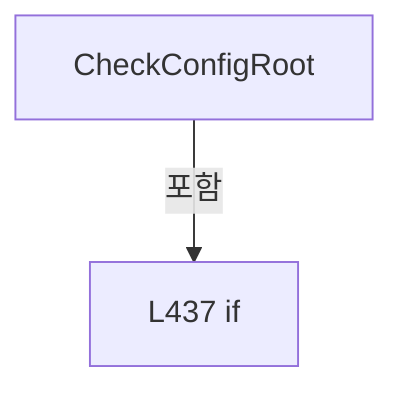

변경 전 점검: 입력/반환 타입, 위 호출자, 예외/취소 경로, 공유 상태와 저장·전송 소비자를 함께 확인합니다. 값의 단위나 물리 방향을 이름만으로 확정하지 않습니다.

### MethodDeclaration `ValidateConfigStructure` · L446–466

[Drilling.Common/Managers/CManager.cs:446–466](https://github.com/kjuws10-rgb/A3Drilling/blob/5aee8e58439c9b455cae7c9593c9be986c3e682e/Drilling.Common/Managers/CManager.cs#L446-L466)

| 항목 | 실제 추출 값 |
| --- | --- |
| 서명 | void Drilling.Common.Managers.CManager.ValidateConfigStructure() |
| 접근/수식자 | Private / private |
| 반환/값 타입 | void |
| 소속 타입 | NamedType:Drilling.Common.Managers.CManager |

정적 호출자로 확인된 위치:

| 호출 파일/행 | 호출 표현식 | 런타임 분기 가능 |
| --- | --- | --- |
| [Drilling.Common/Managers/CManager.cs:93–93](https://github.com/kjuws10-rgb/A3Drilling/blob/5aee8e58439c9b455cae7c9593c9be986c3e682e/Drilling.Common/Managers/CManager.cs#L93-L93) | ValidateConfigStructure | False |

호출하는 대상과 해석 범위:

| 원본 행 | 표현식 | 분석 상태 | 대상/소스 위치 |
| --- | --- | --- | --- |
| 450 | AddStartupStep | resolved | void Drilling.Common.Managers.CManager.AddStartupStep(string, Drilling.Common.Managers.EN_MANAGER_STARTUP_RESULT, string) · Drilling.Common/Managers/CManager.cs:573 |
| 456 | _configStructureFile.Validate().GetAwaiter().GetResult | resolved | System.Collections.Generic.IReadOnlyList<Drilling.Common.Managers.ST_CONFIG_FILE_STATUS> System.Runtime.CompilerServices.TaskAwaiter<System.Collections.Generic.IReadOnlyList<Drilling.Common.Managers.ST_CONFIG_FILE_STATUS>>.GetResult() |
| 456 | _configStructureFile.Validate().GetAwaiter | resolved | System.Runtime.CompilerServices.TaskAwaiter<System.Collections.Generic.IReadOnlyList<Drilling.Common.Managers.ST_CONFIG_FILE_STATUS>> System.Threading.Tasks.Task<System.Collections.Generic.IReadOnlyList<Drilling.Common.Managers.ST_CONFIG_FILE_STATUS>>.GetAwaiter() |
| 456 | _configStructureFile.Validate | resolved | System.Threading.Tasks.Task<System.Collections.Generic.IReadOnlyList<Drilling.Common.Managers.ST_CONFIG_FILE_STATUS>> Drilling.Common.Managers.CConfigStructureFileBase.Validate(System.Threading.CancellationToken) · Drilling.Common/Managers/CManager.cs:768 |
| 459 | AddStartupStep | resolved | void Drilling.Common.Managers.CManager.AddStartupStep(string, Drilling.Common.Managers.EN_MANAGER_STARTUP_RESULT, string) · Drilling.Common/Managers/CManager.cs:573 |
| 459 | ToStartupResult | resolved | Drilling.Common.Managers.EN_MANAGER_STARTUP_RESULT Drilling.Common.Managers.CManager.ToStartupResult(Drilling.Common.Managers.ST_CONFIG_FILE_STATUS) · Drilling.Common/Managers/CManager.cs:627 |
| 459 | FormatConfigStatusMessage | resolved | string Drilling.Common.Managers.CManager.FormatConfigStatusMessage(Drilling.Common.Managers.ST_CONFIG_FILE_STATUS) · Drilling.Common/Managers/CManager.cs:637 |
| 462 | IsStartupDataException | resolved | bool Drilling.Common.Managers.CManager.IsStartupDataException(System.Exception) · Drilling.Common/Managers/CManager.cs:617 |
| 464 | AddStartupFailure | resolved | void Drilling.Common.Managers.CManager.AddStartupFailure(string, System.Exception) · Drilling.Common/Managers/CManager.cs:568 |

본문의 실제 연산·분기·예외·반환 순서(원문 위치 순):

| 원본 행 | 종류 | 주석 해설 |
| --- | --- | --- |
| 448 | if | 조건에 따라 분기합니다: if (_configStructureFile is null) |
| 450 | call | 함수·델리게이트 또는 객체 생성자를 호출합니다: AddStartupStep("Validate Config Structure", EN_MANAGER_STARTUP_RESULT.Warning, "Config structure validator was not registered.") |
| 451 | return | 호출자에게 값 또는 제어를 반환합니다: return; |
| 454 | try | 예외 처리 범위입니다: try |
| 456 | call | 함수·델리게이트 또는 객체 생성자를 호출합니다: _configStructureFile.Validate().GetAwaiter().GetResult() |
| 456 | call | 함수·델리게이트 또는 객체 생성자를 호출합니다: _configStructureFile.Validate().GetAwaiter() |
| 456 | call | 함수·델리게이트 또는 객체 생성자를 호출합니다: _configStructureFile.Validate() |
| 456 | local-declaration | 지역 변수를 선언합니다: var statuses = _configStructureFile.Validate().GetAwaiter().GetResult(); |
| 456 | variable-initializer | 변수의 초기값을 지정합니다: statuses = _configStructureFile.Validate().GetAwaiter().GetResult() |
| 457 | foreach | 컬렉션 요소를 순회합니다: foreach (var status in statuses) |
| 459 | call | 함수·델리게이트 또는 객체 생성자를 호출합니다: AddStartupStep($"Check {status.ItemName}", ToStartupResult(status), FormatConfigStatusMessage(status)) |
| 459 | call | 함수·델리게이트 또는 객체 생성자를 호출합니다: ToStartupResult(status) |
| 459 | call | 함수·델리게이트 또는 객체 생성자를 호출합니다: FormatConfigStatusMessage(status) |
| 462 | call | 함수·델리게이트 또는 객체 생성자를 호출합니다: IsStartupDataException(ex) |
| 462 | catch | 지정 예외를 처리합니다: catch (Exception ex) when (IsStartupDataException(ex)) |
| 464 | call | 함수·델리게이트 또는 객체 생성자를 호출합니다: AddStartupFailure("Validate Config Structure", ex) |

제어 구문의 포함 구조(실제 실행 순서/CFG가 아닌 구문 탐색 그림):

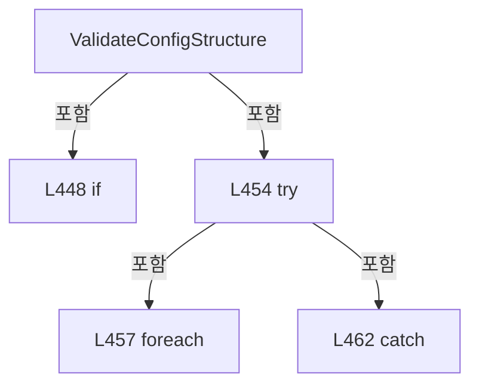

변경 전 점검: 입력/반환 타입, 위 호출자, 예외/취소 경로, 공유 상태와 저장·전송 소비자를 함께 확인합니다. 값의 단위나 물리 방향을 이름만으로 확정하지 않습니다.

### MethodDeclaration `LoadInterfaceList` · L468–482

[Drilling.Common/Managers/CManager.cs:468–482](https://github.com/kjuws10-rgb/A3Drilling/blob/5aee8e58439c9b455cae7c9593c9be986c3e682e/Drilling.Common/Managers/CManager.cs#L468-L482)

| 항목 | 실제 추출 값 |
| --- | --- |
| 서명 | System.Collections.Generic.IReadOnlyList<Drilling.Common.Interface.ST_INTERFACE_DATA> Drilling.Common.Managers.CManager.LoadInterfaceList() |
| 접근/수식자 | Private / private |
| 반환/값 타입 | System.Collections.Generic.IReadOnlyList<Drilling.Common.Interface.ST_INTERFACE_DATA> |
| 소속 타입 | NamedType:Drilling.Common.Managers.CManager |

정적 호출자로 확인된 위치:

| 호출 파일/행 | 호출 표현식 | 런타임 분기 가능 |
| --- | --- | --- |
| [Drilling.Common/Managers/CManager.cs:96–96](https://github.com/kjuws10-rgb/A3Drilling/blob/5aee8e58439c9b455cae7c9593c9be986c3e682e/Drilling.Common/Managers/CManager.cs#L96-L96) | LoadInterfaceList | False |

호출하는 대상과 해석 범위:

| 원본 행 | 표현식 | 분석 상태 | 대상/소스 위치 |
| --- | --- | --- | --- |
| 472 | _interfaceFile.LoadAll | resolved | System.Collections.Generic.IReadOnlyList<Drilling.Common.Interface.ST_INTERFACE_DATA> Drilling.Common.Managers.CInterfaceFileBase.LoadAll(System.Threading.CancellationToken) · Drilling.Common/Managers/CSettingManager.cs:282 |
| 474 | AddStartupStep | resolved | void Drilling.Common.Managers.CManager.AddStartupStep(string, Drilling.Common.Managers.EN_MANAGER_STARTUP_RESULT, string) · Drilling.Common/Managers/CManager.cs:573 |
| 477 | IsStartupDataException | resolved | bool Drilling.Common.Managers.CManager.IsStartupDataException(System.Exception) · Drilling.Common/Managers/CManager.cs:617 |
| 479 | AddStartupFailure | resolved | void Drilling.Common.Managers.CManager.AddStartupFailure(string, System.Exception) · Drilling.Common/Managers/CManager.cs:568 |

본문의 실제 연산·분기·예외·반환 순서(원문 위치 순):

| 원본 행 | 종류 | 주석 해설 |
| --- | --- | --- |
| 470 | try | 예외 처리 범위입니다: try |
| 472 | call | 함수·델리게이트 또는 객체 생성자를 호출합니다: _interfaceFile.LoadAll() |
| 472 | local-declaration | 지역 변수를 선언합니다: var interfaceData = _interfaceFile.LoadAll(); |
| 472 | variable-initializer | 변수의 초기값을 지정합니다: interfaceData = _interfaceFile.LoadAll() |
| 473 | assignment | 값을 대상에 대입합니다: _loadedInterfaceCount = interfaceData.Count |
| 474 | call | 함수·델리게이트 또는 객체 생성자를 호출합니다: AddStartupStep("Load JHMI_INTERFACE", EN_MANAGER_STARTUP_RESULT.Ready, $"Loaded {interfaceData.Count} interface row(s).") |
| 475 | return | 호출자에게 값 또는 제어를 반환합니다: return interfaceData; |
| 477 | call | 함수·델리게이트 또는 객체 생성자를 호출합니다: IsStartupDataException(ex) |
| 477 | catch | 지정 예외를 처리합니다: catch (Exception ex) when (IsStartupDataException(ex)) |
| 479 | call | 함수·델리게이트 또는 객체 생성자를 호출합니다: AddStartupFailure("Load JHMI_INTERFACE", ex) |
| 480 | return | 호출자에게 값 또는 제어를 반환합니다: return[]; |

제어 구문의 포함 구조(실제 실행 순서/CFG가 아닌 구문 탐색 그림):

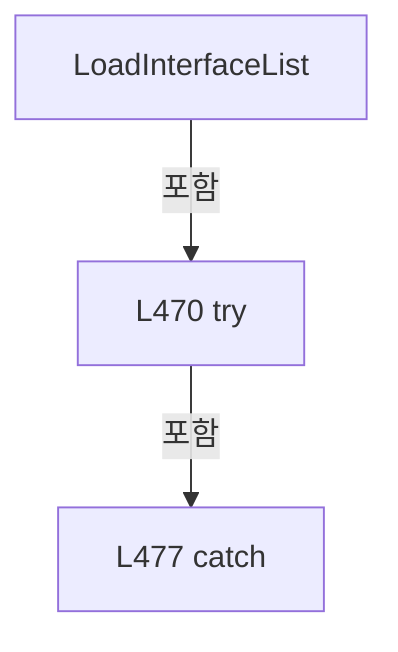

변경 전 점검: 입력/반환 타입, 위 호출자, 예외/취소 경로, 공유 상태와 저장·전송 소비자를 함께 확인합니다. 값의 단위나 물리 방향을 이름만으로 확정하지 않습니다.

### MethodDeclaration `RegisterInterfaceList` · L484–501

[Drilling.Common/Managers/CManager.cs:484–501](https://github.com/kjuws10-rgb/A3Drilling/blob/5aee8e58439c9b455cae7c9593c9be986c3e682e/Drilling.Common/Managers/CManager.cs#L484-L501)

| 항목 | 실제 추출 값 |
| --- | --- |
| 서명 | void Drilling.Common.Managers.CManager.RegisterInterfaceList(System.Collections.Generic.IReadOnlyList<Drilling.Common.Interface.ST_INTERFACE_DATA>) |
| 접근/수식자 | Private / private |
| 반환/값 타입 | void |
| 소속 타입 | NamedType:Drilling.Common.Managers.CManager |

입력 계약:

| 이름 | 타입 | 전달 | 선택/기본값 |
| --- | --- | --- | --- |
| interfaceData | System.Collections.Generic.IReadOnlyList<Drilling.Common.Interface.ST_INTERFACE_DATA> | None | False /  |

정적 호출자로 확인된 위치:

| 호출 파일/행 | 호출 표현식 | 런타임 분기 가능 |
| --- | --- | --- |
| [Drilling.Common/Managers/CManager.cs:97–97](https://github.com/kjuws10-rgb/A3Drilling/blob/5aee8e58439c9b455cae7c9593c9be986c3e682e/Drilling.Common/Managers/CManager.cs#L97-L97) | RegisterInterfaceList | False |

호출하는 대상과 해석 범위:

| 원본 행 | 표현식 | 분석 상태 | 대상/소스 위치 |
| --- | --- | --- | --- |
| 491 | _interfaceManager.Register | resolved | void Drilling.Common.Interface.CInterfaceManager.Register(Drilling.Common.Interface.ST_INTERFACE_DATA) · Drilling.Common/Interface/CInterfaceManager.cs:157 |
| 496 | AddStartupFailure | resolved | void Drilling.Common.Managers.CManager.AddStartupFailure(string, System.Exception) · Drilling.Common/Managers/CManager.cs:568 |
| 500 | AddStartupStep | resolved | void Drilling.Common.Managers.CManager.AddStartupStep(string, Drilling.Common.Managers.EN_MANAGER_STARTUP_RESULT, string) · Drilling.Common/Managers/CManager.cs:573 |

본문의 실제 연산·분기·예외·반환 순서(원문 위치 순):

| 원본 행 | 종류 | 주석 해설 |
| --- | --- | --- |
| 486 | local-declaration | 지역 변수를 선언합니다: var registeredCount = 0; |
| 486 | variable-initializer | 변수의 초기값을 지정합니다: registeredCount = 0 |
| 487 | foreach | 컬렉션 요소를 순회합니다: foreach (var data in interfaceData) |
| 489 | try | 예외 처리 범위입니다: try |
| 491 | call | 함수·델리게이트 또는 객체 생성자를 호출합니다: _interfaceManager.Register(data) |
| 494 | catch | 지정 예외를 처리합니다: catch (Exception ex) when (ex is InvalidOperationException or InvalidDataException) |
| 496 | call | 함수·델리게이트 또는 객체 생성자를 호출합니다: AddStartupFailure($"Register Interface {data.Device}[{data.Number}]", ex) |
| 500 | call | 함수·델리게이트 또는 객체 생성자를 호출합니다: AddStartupStep("Register Interface List", registeredCount == interfaceData.Count ? EN_MANAGER_STARTUP_RESULT.Ready : EN_MANAGER_STARTUP_RESULT.Warning, $"Registered {registeredCount}/{interfaceData.Count} interface devic… |
| 500 | conditional-expression | 조건에 따라 결과식을 선택합니다: registeredCount == interfaceData.Count ? EN_MANAGER_STARTUP_RESULT.Ready : EN_MANAGER_STARTUP_RESULT.Warning |

제어 구문의 포함 구조(실제 실행 순서/CFG가 아닌 구문 탐색 그림):

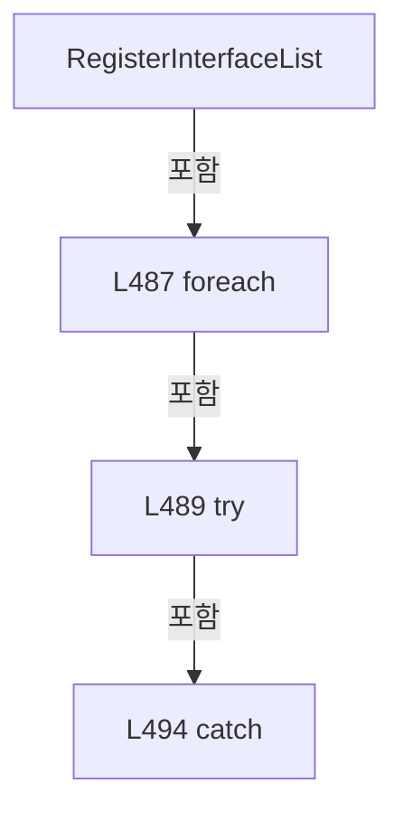

변경 전 점검: 입력/반환 타입, 위 호출자, 예외/취소 경로, 공유 상태와 저장·전송 소비자를 함께 확인합니다. 값의 단위나 물리 방향을 이름만으로 확정하지 않습니다.

### MethodDeclaration `LoadMotorList` · L503–517

[Drilling.Common/Managers/CManager.cs:503–517](https://github.com/kjuws10-rgb/A3Drilling/blob/5aee8e58439c9b455cae7c9593c9be986c3e682e/Drilling.Common/Managers/CManager.cs#L503-L517)

| 항목 | 실제 추출 값 |
| --- | --- |
| 서명 | System.Collections.Generic.IReadOnlyList<Drilling.Common.Motion.ST_MOTOR_DATA> Drilling.Common.Managers.CManager.LoadMotorList() |
| 접근/수식자 | Private / private |
| 반환/값 타입 | System.Collections.Generic.IReadOnlyList<Drilling.Common.Motion.ST_MOTOR_DATA> |
| 소속 타입 | NamedType:Drilling.Common.Managers.CManager |

정적 호출자로 확인된 위치:

| 호출 파일/행 | 호출 표현식 | 런타임 분기 가능 |
| --- | --- | --- |
| [Drilling.Common/Managers/CManager.cs:112–112](https://github.com/kjuws10-rgb/A3Drilling/blob/5aee8e58439c9b455cae7c9593c9be986c3e682e/Drilling.Common/Managers/CManager.cs#L112-L112) | LoadMotorList | False |

호출하는 대상과 해석 범위:

| 원본 행 | 표현식 | 분석 상태 | 대상/소스 위치 |
| --- | --- | --- | --- |
| 507 | _motorFile.LoadAll | resolved | System.Collections.Generic.IReadOnlyList<Drilling.Common.Motion.ST_MOTOR_DATA> Drilling.Common.Motion.CMotorFileBase.LoadAll(System.Threading.CancellationToken) · Drilling.Common/Motion/CMotionManager.cs:1746 |
| 509 | AddStartupStep | resolved | void Drilling.Common.Managers.CManager.AddStartupStep(string, Drilling.Common.Managers.EN_MANAGER_STARTUP_RESULT, string) · Drilling.Common/Managers/CManager.cs:573 |
| 512 | IsStartupDataException | resolved | bool Drilling.Common.Managers.CManager.IsStartupDataException(System.Exception) · Drilling.Common/Managers/CManager.cs:617 |
| 514 | AddStartupFailure | resolved | void Drilling.Common.Managers.CManager.AddStartupFailure(string, System.Exception) · Drilling.Common/Managers/CManager.cs:568 |

본문의 실제 연산·분기·예외·반환 순서(원문 위치 순):

| 원본 행 | 종류 | 주석 해설 |
| --- | --- | --- |
| 505 | try | 예외 처리 범위입니다: try |
| 507 | call | 함수·델리게이트 또는 객체 생성자를 호출합니다: _motorFile.LoadAll() |
| 507 | local-declaration | 지역 변수를 선언합니다: var motorData = _motorFile.LoadAll(); |
| 507 | variable-initializer | 변수의 초기값을 지정합니다: motorData = _motorFile.LoadAll() |
| 508 | assignment | 값을 대상에 대입합니다: _loadedMotorCount = motorData.Count |
| 509 | call | 함수·델리게이트 또는 객체 생성자를 호출합니다: AddStartupStep("Load JHMI_MOTOR", EN_MANAGER_STARTUP_RESULT.Ready, $"Loaded {motorData.Count} motor row(s).") |
| 510 | return | 호출자에게 값 또는 제어를 반환합니다: return motorData; |
| 512 | call | 함수·델리게이트 또는 객체 생성자를 호출합니다: IsStartupDataException(ex) |
| 512 | catch | 지정 예외를 처리합니다: catch (Exception ex) when (IsStartupDataException(ex)) |
| 514 | call | 함수·델리게이트 또는 객체 생성자를 호출합니다: AddStartupFailure("Load JHMI_MOTOR", ex) |
| 515 | return | 호출자에게 값 또는 제어를 반환합니다: return[]; |

제어 구문의 포함 구조(실제 실행 순서/CFG가 아닌 구문 탐색 그림):

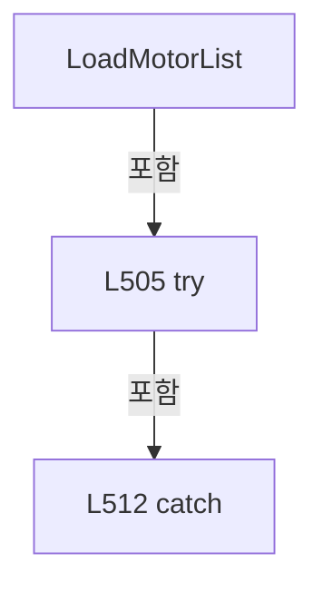

변경 전 점검: 입력/반환 타입, 위 호출자, 예외/취소 경로, 공유 상태와 저장·전송 소비자를 함께 확인합니다. 값의 단위나 물리 방향을 이름만으로 확정하지 않습니다.

### MethodDeclaration `LoadMelsecMapList` · L519–533

[Drilling.Common/Managers/CManager.cs:519–533](https://github.com/kjuws10-rgb/A3Drilling/blob/5aee8e58439c9b455cae7c9593c9be986c3e682e/Drilling.Common/Managers/CManager.cs#L519-L533)

| 항목 | 실제 추출 값 |
| --- | --- |
| 서명 | System.Collections.Generic.IReadOnlyList<Drilling.Common.Interface.ST_MELSEC_MAP_DATA> Drilling.Common.Managers.CManager.LoadMelsecMapList() |
| 접근/수식자 | Private / private |
| 반환/값 타입 | System.Collections.Generic.IReadOnlyList<Drilling.Common.Interface.ST_MELSEC_MAP_DATA> |
| 소속 타입 | NamedType:Drilling.Common.Managers.CManager |

정적 호출자로 확인된 위치:

| 호출 파일/행 | 호출 표현식 | 런타임 분기 가능 |
| --- | --- | --- |
| [Drilling.Common/Managers/CManager.cs:109–109](https://github.com/kjuws10-rgb/A3Drilling/blob/5aee8e58439c9b455cae7c9593c9be986c3e682e/Drilling.Common/Managers/CManager.cs#L109-L109) | LoadMelsecMapList | False |

호출하는 대상과 해석 범위:

| 원본 행 | 표현식 | 분석 상태 | 대상/소스 위치 |
| --- | --- | --- | --- |
| 523 | _melsecMapFile.LoadAll | resolved | System.Collections.Generic.IReadOnlyList<Drilling.Common.Interface.ST_MELSEC_MAP_DATA> Drilling.Common.Interface.CMelsecMapFileBase.LoadAll(System.Threading.CancellationToken) · Drilling.Common/Interface/Melsec/CMelsec.cs:3262 |
| 525 | AddStartupStep | resolved | void Drilling.Common.Managers.CManager.AddStartupStep(string, Drilling.Common.Managers.EN_MANAGER_STARTUP_RESULT, string) · Drilling.Common/Managers/CManager.cs:573 |
| 528 | IsStartupDataException | resolved | bool Drilling.Common.Managers.CManager.IsStartupDataException(System.Exception) · Drilling.Common/Managers/CManager.cs:617 |
| 530 | AddStartupFailure | resolved | void Drilling.Common.Managers.CManager.AddStartupFailure(string, System.Exception) · Drilling.Common/Managers/CManager.cs:568 |

본문의 실제 연산·분기·예외·반환 순서(원문 위치 순):

| 원본 행 | 종류 | 주석 해설 |
| --- | --- | --- |
| 521 | try | 예외 처리 범위입니다: try |
| 523 | call | 함수·델리게이트 또는 객체 생성자를 호출합니다: _melsecMapFile.LoadAll() |
| 523 | local-declaration | 지역 변수를 선언합니다: var melsecMapData = _melsecMapFile.LoadAll(); |
| 523 | variable-initializer | 변수의 초기값을 지정합니다: melsecMapData = _melsecMapFile.LoadAll() |
| 524 | assignment | 값을 대상에 대입합니다: _loadedMelsecMapCount = melsecMapData.Count |
| 525 | call | 함수·델리게이트 또는 객체 생성자를 호출합니다: AddStartupStep("Load JHMI_MELSEC_MAP", EN_MANAGER_STARTUP_RESULT.Ready, $"Loaded {melsecMapData.Count} MELSEC map row(s).") |
| 526 | return | 호출자에게 값 또는 제어를 반환합니다: return melsecMapData; |
| 528 | call | 함수·델리게이트 또는 객체 생성자를 호출합니다: IsStartupDataException(ex) |
| 528 | catch | 지정 예외를 처리합니다: catch (Exception ex) when (IsStartupDataException(ex)) |
| 530 | call | 함수·델리게이트 또는 객체 생성자를 호출합니다: AddStartupFailure("Load JHMI_MELSEC_MAP", ex) |
| 531 | return | 호출자에게 값 또는 제어를 반환합니다: return[]; |

제어 구문의 포함 구조(실제 실행 순서/CFG가 아닌 구문 탐색 그림):

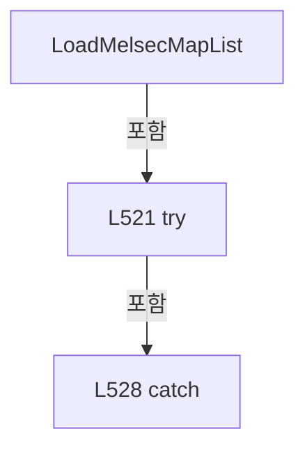

변경 전 점검: 입력/반환 타입, 위 호출자, 예외/취소 경로, 공유 상태와 저장·전송 소비자를 함께 확인합니다. 값의 단위나 물리 방향을 이름만으로 확정하지 않습니다.

### MethodDeclaration `LoadActiveProduct` · L535–548

[Drilling.Common/Managers/CManager.cs:535–548](https://github.com/kjuws10-rgb/A3Drilling/blob/5aee8e58439c9b455cae7c9593c9be986c3e682e/Drilling.Common/Managers/CManager.cs#L535-L548)

| 항목 | 실제 추출 값 |
| --- | --- |
| 서명 | void Drilling.Common.Managers.CManager.LoadActiveProduct() |
| 접근/수식자 | Private / private |
| 반환/값 타입 | void |
| 소속 타입 | NamedType:Drilling.Common.Managers.CManager |

정적 호출자로 확인된 위치:

| 호출 파일/행 | 호출 표현식 | 런타임 분기 가능 |
| --- | --- | --- |
| [Drilling.Common/Managers/CManager.cs:121–121](https://github.com/kjuws10-rgb/A3Drilling/blob/5aee8e58439c9b455cae7c9593c9be986c3e682e/Drilling.Common/Managers/CManager.cs#L121-L121) | LoadActiveProduct | False |

호출하는 대상과 해석 범위:

| 원본 행 | 표현식 | 분석 상태 | 대상/소스 위치 |
| --- | --- | --- | --- |
| 539 | _productManager.LoadActive().GetAwaiter().GetResult | resolved | Drilling.Common.Product.ST_PRODUCT_DATA? System.Runtime.CompilerServices.TaskAwaiter<Drilling.Common.Product.ST_PRODUCT_DATA?>.GetResult() |
| 539 | _productManager.LoadActive().GetAwaiter | resolved | System.Runtime.CompilerServices.TaskAwaiter<Drilling.Common.Product.ST_PRODUCT_DATA?> System.Threading.Tasks.Task<Drilling.Common.Product.ST_PRODUCT_DATA?>.GetAwaiter() |
| 539 | _productManager.LoadActive | resolved | System.Threading.Tasks.Task<Drilling.Common.Product.ST_PRODUCT_DATA?> Drilling.Common.Product.CProductManager.LoadActive(System.Threading.CancellationToken) · Drilling.Common/Product/CProductManager.cs:25 |
| 540 | _productManager.RecoverInterrupted().GetAwaiter().GetResult | resolved | Drilling.Common.Product.ST_PRODUCT_DATA? System.Runtime.CompilerServices.TaskAwaiter<Drilling.Common.Product.ST_PRODUCT_DATA?>.GetResult() |
| 540 | _productManager.RecoverInterrupted().GetAwaiter | resolved | System.Runtime.CompilerServices.TaskAwaiter<Drilling.Common.Product.ST_PRODUCT_DATA?> System.Threading.Tasks.Task<Drilling.Common.Product.ST_PRODUCT_DATA?>.GetAwaiter() |
| 540 | _productManager.RecoverInterrupted | resolved | System.Threading.Tasks.Task<Drilling.Common.Product.ST_PRODUCT_DATA?> Drilling.Common.Product.CProductManager.RecoverInterrupted(System.Threading.CancellationToken) · Drilling.Common/Product/CProductManager.cs:49 |
| 542 | AddStartupStep | resolved | void Drilling.Common.Managers.CManager.AddStartupStep(string, Drilling.Common.Managers.EN_MANAGER_STARTUP_RESULT, string) · Drilling.Common/Managers/CManager.cs:573 |
| 544 | IsStartupDataException | resolved | bool Drilling.Common.Managers.CManager.IsStartupDataException(System.Exception) · Drilling.Common/Managers/CManager.cs:617 |
| 546 | AddStartupFailure | resolved | void Drilling.Common.Managers.CManager.AddStartupFailure(string, System.Exception) · Drilling.Common/Managers/CManager.cs:568 |

본문의 실제 연산·분기·예외·반환 순서(원문 위치 순):

| 원본 행 | 종류 | 주석 해설 |
| --- | --- | --- |
| 537 | try | 예외 처리 범위입니다: try |
| 539 | call | 함수·델리게이트 또는 객체 생성자를 호출합니다: _productManager.LoadActive().GetAwaiter().GetResult() |
| 539 | call | 함수·델리게이트 또는 객체 생성자를 호출합니다: _productManager.LoadActive().GetAwaiter() |
| 539 | call | 함수·델리게이트 또는 객체 생성자를 호출합니다: _productManager.LoadActive() |
| 540 | call | 함수·델리게이트 또는 객체 생성자를 호출합니다: _productManager.RecoverInterrupted().GetAwaiter().GetResult() |
| 540 | call | 함수·델리게이트 또는 객체 생성자를 호출합니다: _productManager.RecoverInterrupted().GetAwaiter() |
| 540 | call | 함수·델리게이트 또는 객체 생성자를 호출합니다: _productManager.RecoverInterrupted() |
| 541 | assignment | 값을 대상에 대입합니다: _activeProductLoaded = true |
| 542 | call | 함수·델리게이트 또는 객체 생성자를 호출합니다: AddStartupStep("Load Active Product", EN_MANAGER_STARTUP_RESULT.Ready, "Active product loaded.") |
| 544 | call | 함수·델리게이트 또는 객체 생성자를 호출합니다: IsStartupDataException(ex) |
| 544 | catch | 지정 예외를 처리합니다: catch (Exception ex) when (IsStartupDataException(ex)) |
| 546 | call | 함수·델리게이트 또는 객체 생성자를 호출합니다: AddStartupFailure("Load Active Product", ex) |

제어 구문의 포함 구조(실제 실행 순서/CFG가 아닌 구문 탐색 그림):

변경 전 점검: 입력/반환 타입, 위 호출자, 예외/취소 경로, 공유 상태와 저장·전송 소비자를 함께 확인합니다. 값의 단위나 물리 방향을 이름만으로 확정하지 않습니다.

### MethodDeclaration `RunInitializeStep` · L550–566

[Drilling.Common/Managers/CManager.cs:550–566](https://github.com/kjuws10-rgb/A3Drilling/blob/5aee8e58439c9b455cae7c9593c9be986c3e682e/Drilling.Common/Managers/CManager.cs#L550-L566)

| 항목 | 실제 추출 값 |
| --- | --- |
| 서명 | System.Threading.Tasks.Task Drilling.Common.Managers.CManager.RunInitializeStep(string, System.Func<System.Threading.Tasks.Task>, System.Threading.CancellationToken) |
| 접근/수식자 | Private / private, async |
| 반환/값 타입 | System.Threading.Tasks.Task |
| 소속 타입 | NamedType:Drilling.Common.Managers.CManager |

입력 계약:

| 이름 | 타입 | 전달 | 선택/기본값 |
| --- | --- | --- | --- |
| stepName | string | None | False /  |
| action | System.Func<System.Threading.Tasks.Task> | None | False /  |
| cancellationToken | System.Threading.CancellationToken | None | False /  |

정적 호출자로 확인된 위치:

| 호출 파일/행 | 호출 표현식 | 런타임 분기 가능 |
| --- | --- | --- |
| [Drilling.Common/Managers/CManager.cs:211–211](https://github.com/kjuws10-rgb/A3Drilling/blob/5aee8e58439c9b455cae7c9593c9be986c3e682e/Drilling.Common/Managers/CManager.cs#L211-L211) | RunInitializeStep | False |
| [Drilling.Common/Managers/CManager.cs:217–217](https://github.com/kjuws10-rgb/A3Drilling/blob/5aee8e58439c9b455cae7c9593c9be986c3e682e/Drilling.Common/Managers/CManager.cs#L217-L217) | RunInitializeStep | False |

호출하는 대상과 해석 범위:

| 원본 행 | 표현식 | 분석 상태 | 대상/소스 위치 |
| --- | --- | --- | --- |
| 554 | cancellationToken.ThrowIfCancellationRequested | resolved | void System.Threading.CancellationToken.ThrowIfCancellationRequested() |
| 555 | action | resolved · 동적 구현 선택 가능 | System.Threading.Tasks.Task System.Func<System.Threading.Tasks.Task>.Invoke() |
| 556 | AddStartupStep | resolved | void Drilling.Common.Managers.CManager.AddStartupStep(string, Drilling.Common.Managers.EN_MANAGER_STARTUP_RESULT, string) · Drilling.Common/Managers/CManager.cs:573 |
| 560 | AddStartupStep | resolved | void Drilling.Common.Managers.CManager.AddStartupStep(string, Drilling.Common.Managers.EN_MANAGER_STARTUP_RESULT, string) · Drilling.Common/Managers/CManager.cs:573 |
| 562 | IsStartupRuntimeException | resolved | bool Drilling.Common.Managers.CManager.IsStartupRuntimeException(System.Exception) · Drilling.Common/Managers/CManager.cs:622 |
| 564 | AddStartupFailure | resolved | void Drilling.Common.Managers.CManager.AddStartupFailure(string, System.Exception) · Drilling.Common/Managers/CManager.cs:568 |

본문의 실제 연산·분기·예외·반환 순서(원문 위치 순):

| 원본 행 | 종류 | 주석 해설 |
| --- | --- | --- |
| 552 | try | 예외 처리 범위입니다: try |
| 554 | call | 함수·델리게이트 또는 객체 생성자를 호출합니다: cancellationToken.ThrowIfCancellationRequested() |
| 555 | await | 비동기 완료를 기다립니다: await action() |
| 555 | call | 함수·델리게이트 또는 객체 생성자를 호출합니다: action() |
| 556 | call | 함수·델리게이트 또는 객체 생성자를 호출합니다: AddStartupStep(stepName, EN_MANAGER_STARTUP_RESULT.Ready, "OK") |
| 558 | catch | 지정 예외를 처리합니다: catch (OperationCanceledException) when (cancellationToken.IsCancellationRequested) |
| 560 | call | 함수·델리게이트 또는 객체 생성자를 호출합니다: AddStartupStep(stepName, EN_MANAGER_STARTUP_RESULT.Warning, "Canceled.") |
| 562 | call | 함수·델리게이트 또는 객체 생성자를 호출합니다: IsStartupRuntimeException(ex) |
| 562 | catch | 지정 예외를 처리합니다: catch (Exception ex) when (IsStartupRuntimeException(ex)) |
| 564 | call | 함수·델리게이트 또는 객체 생성자를 호출합니다: AddStartupFailure(stepName, ex) |

제어 구문의 포함 구조(실제 실행 순서/CFG가 아닌 구문 탐색 그림):

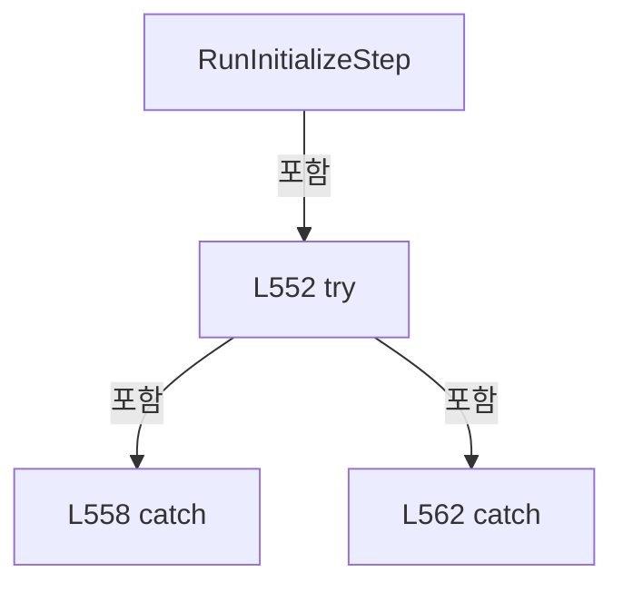

변경 전 점검: 입력/반환 타입, 위 호출자, 예외/취소 경로, 공유 상태와 저장·전송 소비자를 함께 확인합니다. 값의 단위나 물리 방향을 이름만으로 확정하지 않습니다.

### MethodDeclaration `AddStartupFailure` · L568–571

[Drilling.Common/Managers/CManager.cs:568–571](https://github.com/kjuws10-rgb/A3Drilling/blob/5aee8e58439c9b455cae7c9593c9be986c3e682e/Drilling.Common/Managers/CManager.cs#L568-L571)

| 항목 | 실제 추출 값 |
| --- | --- |
| 서명 | void Drilling.Common.Managers.CManager.AddStartupFailure(string, System.Exception) |
| 접근/수식자 | Private / private |
| 반환/값 타입 | void |
| 소속 타입 | NamedType:Drilling.Common.Managers.CManager |

입력 계약:

| 이름 | 타입 | 전달 | 선택/기본값 |
| --- | --- | --- | --- |
| stepName | string | None | False /  |
| exception | System.Exception | None | False /  |

정적 호출자로 확인된 위치:

| 호출 파일/행 | 호출 표현식 | 런타임 분기 가능 |
| --- | --- | --- |
| [Drilling.Common/Managers/CManager.cs:464–464](https://github.com/kjuws10-rgb/A3Drilling/blob/5aee8e58439c9b455cae7c9593c9be986c3e682e/Drilling.Common/Managers/CManager.cs#L464-L464) | AddStartupFailure | False |
| [Drilling.Common/Managers/CManager.cs:479–479](https://github.com/kjuws10-rgb/A3Drilling/blob/5aee8e58439c9b455cae7c9593c9be986c3e682e/Drilling.Common/Managers/CManager.cs#L479-L479) | AddStartupFailure | False |
| [Drilling.Common/Managers/CManager.cs:496–496](https://github.com/kjuws10-rgb/A3Drilling/blob/5aee8e58439c9b455cae7c9593c9be986c3e682e/Drilling.Common/Managers/CManager.cs#L496-L496) | AddStartupFailure | False |
| [Drilling.Common/Managers/CManager.cs:514–514](https://github.com/kjuws10-rgb/A3Drilling/blob/5aee8e58439c9b455cae7c9593c9be986c3e682e/Drilling.Common/Managers/CManager.cs#L514-L514) | AddStartupFailure | False |
| [Drilling.Common/Managers/CManager.cs:530–530](https://github.com/kjuws10-rgb/A3Drilling/blob/5aee8e58439c9b455cae7c9593c9be986c3e682e/Drilling.Common/Managers/CManager.cs#L530-L530) | AddStartupFailure | False |
| [Drilling.Common/Managers/CManager.cs:546–546](https://github.com/kjuws10-rgb/A3Drilling/blob/5aee8e58439c9b455cae7c9593c9be986c3e682e/Drilling.Common/Managers/CManager.cs#L546-L546) | AddStartupFailure | False |
| [Drilling.Common/Managers/CManager.cs:564–564](https://github.com/kjuws10-rgb/A3Drilling/blob/5aee8e58439c9b455cae7c9593c9be986c3e682e/Drilling.Common/Managers/CManager.cs#L564-L564) | AddStartupFailure | False |

호출하는 대상과 해석 범위:

| 원본 행 | 표현식 | 분석 상태 | 대상/소스 위치 |
| --- | --- | --- | --- |
| 570 | AddStartupStep | resolved | void Drilling.Common.Managers.CManager.AddStartupStep(string, Drilling.Common.Managers.EN_MANAGER_STARTUP_RESULT, string) · Drilling.Common/Managers/CManager.cs:573 |

본문의 실제 연산·분기·예외·반환 순서(원문 위치 순):

| 원본 행 | 종류 | 주석 해설 |
| --- | --- | --- |
| 570 | call | 함수·델리게이트 또는 객체 생성자를 호출합니다: AddStartupStep(stepName, EN_MANAGER_STARTUP_RESULT.Failed, exception.Message) |

변경 전 점검: 입력/반환 타입, 위 호출자, 예외/취소 경로, 공유 상태와 저장·전송 소비자를 함께 확인합니다. 값의 단위나 물리 방향을 이름만으로 확정하지 않습니다.

### MethodDeclaration `AddStartupStep` · L573–583

[Drilling.Common/Managers/CManager.cs:573–583](https://github.com/kjuws10-rgb/A3Drilling/blob/5aee8e58439c9b455cae7c9593c9be986c3e682e/Drilling.Common/Managers/CManager.cs#L573-L583)

| 항목 | 실제 추출 값 |
| --- | --- |
| 서명 | void Drilling.Common.Managers.CManager.AddStartupStep(string, Drilling.Common.Managers.EN_MANAGER_STARTUP_RESULT, string) |
| 접근/수식자 | Private / private |
| 반환/값 타입 | void |
| 소속 타입 | NamedType:Drilling.Common.Managers.CManager |

입력 계약:

| 이름 | 타입 | 전달 | 선택/기본값 |
| --- | --- | --- | --- |
| stepName | string | None | False /  |
| result | Drilling.Common.Managers.EN_MANAGER_STARTUP_RESULT | None | False /  |
| message | string | None | False /  |

정적 호출자로 확인된 위치:

| 호출 파일/행 | 호출 표현식 | 런타임 분기 가능 |
| --- | --- | --- |
| [Drilling.Common/Managers/CManager.cs:90–90](https://github.com/kjuws10-rgb/A3Drilling/blob/5aee8e58439c9b455cae7c9593c9be986c3e682e/Drilling.Common/Managers/CManager.cs#L90-L90) | AddStartupStep | False |
| [Drilling.Common/Managers/CManager.cs:95–95](https://github.com/kjuws10-rgb/A3Drilling/blob/5aee8e58439c9b455cae7c9593c9be986c3e682e/Drilling.Common/Managers/CManager.cs#L95-L95) | AddStartupStep | False |
| [Drilling.Common/Managers/CManager.cs:101–102](https://github.com/kjuws10-rgb/A3Drilling/blob/5aee8e58439c9b455cae7c9593c9be986c3e682e/Drilling.Common/Managers/CManager.cs#L101-L102) | AddStartupStep | False |
| [Drilling.Common/Managers/CManager.cs:106–106](https://github.com/kjuws10-rgb/A3Drilling/blob/5aee8e58439c9b455cae7c9593c9be986c3e682e/Drilling.Common/Managers/CManager.cs#L106-L106) | AddStartupStep | False |
| [Drilling.Common/Managers/CManager.cs:108–108](https://github.com/kjuws10-rgb/A3Drilling/blob/5aee8e58439c9b455cae7c9593c9be986c3e682e/Drilling.Common/Managers/CManager.cs#L108-L108) | AddStartupStep | False |
| [Drilling.Common/Managers/CManager.cs:111–111](https://github.com/kjuws10-rgb/A3Drilling/blob/5aee8e58439c9b455cae7c9593c9be986c3e682e/Drilling.Common/Managers/CManager.cs#L111-L111) | AddStartupStep | False |
| [Drilling.Common/Managers/CManager.cs:118–118](https://github.com/kjuws10-rgb/A3Drilling/blob/5aee8e58439c9b455cae7c9593c9be986c3e682e/Drilling.Common/Managers/CManager.cs#L118-L118) | AddStartupStep | False |
| [Drilling.Common/Managers/CManager.cs:120–120](https://github.com/kjuws10-rgb/A3Drilling/blob/5aee8e58439c9b455cae7c9593c9be986c3e682e/Drilling.Common/Managers/CManager.cs#L120-L120) | AddStartupStep | False |
| [Drilling.Common/Managers/CManager.cs:123–123](https://github.com/kjuws10-rgb/A3Drilling/blob/5aee8e58439c9b455cae7c9593c9be986c3e682e/Drilling.Common/Managers/CManager.cs#L123-L123) | AddStartupStep | False |
| [Drilling.Common/Managers/CManager.cs:139–139](https://github.com/kjuws10-rgb/A3Drilling/blob/5aee8e58439c9b455cae7c9593c9be986c3e682e/Drilling.Common/Managers/CManager.cs#L139-L139) | AddStartupStep | False |
| [Drilling.Common/Managers/CManager.cs:142–142](https://github.com/kjuws10-rgb/A3Drilling/blob/5aee8e58439c9b455cae7c9593c9be986c3e682e/Drilling.Common/Managers/CManager.cs#L142-L142) | AddStartupStep | False |
| [Drilling.Common/Managers/CManager.cs:439–439](https://github.com/kjuws10-rgb/A3Drilling/blob/5aee8e58439c9b455cae7c9593c9be986c3e682e/Drilling.Common/Managers/CManager.cs#L439-L439) | AddStartupStep | False |
| [Drilling.Common/Managers/CManager.cs:443–443](https://github.com/kjuws10-rgb/A3Drilling/blob/5aee8e58439c9b455cae7c9593c9be986c3e682e/Drilling.Common/Managers/CManager.cs#L443-L443) | AddStartupStep | False |
| [Drilling.Common/Managers/CManager.cs:450–450](https://github.com/kjuws10-rgb/A3Drilling/blob/5aee8e58439c9b455cae7c9593c9be986c3e682e/Drilling.Common/Managers/CManager.cs#L450-L450) | AddStartupStep | False |
| [Drilling.Common/Managers/CManager.cs:459–459](https://github.com/kjuws10-rgb/A3Drilling/blob/5aee8e58439c9b455cae7c9593c9be986c3e682e/Drilling.Common/Managers/CManager.cs#L459-L459) | AddStartupStep | False |
| [Drilling.Common/Managers/CManager.cs:474–474](https://github.com/kjuws10-rgb/A3Drilling/blob/5aee8e58439c9b455cae7c9593c9be986c3e682e/Drilling.Common/Managers/CManager.cs#L474-L474) | AddStartupStep | False |
| [Drilling.Common/Managers/CManager.cs:500–500](https://github.com/kjuws10-rgb/A3Drilling/blob/5aee8e58439c9b455cae7c9593c9be986c3e682e/Drilling.Common/Managers/CManager.cs#L500-L500) | AddStartupStep | False |
| [Drilling.Common/Managers/CManager.cs:509–509](https://github.com/kjuws10-rgb/A3Drilling/blob/5aee8e58439c9b455cae7c9593c9be986c3e682e/Drilling.Common/Managers/CManager.cs#L509-L509) | AddStartupStep | False |
| [Drilling.Common/Managers/CManager.cs:525–525](https://github.com/kjuws10-rgb/A3Drilling/blob/5aee8e58439c9b455cae7c9593c9be986c3e682e/Drilling.Common/Managers/CManager.cs#L525-L525) | AddStartupStep | False |
| [Drilling.Common/Managers/CManager.cs:542–542](https://github.com/kjuws10-rgb/A3Drilling/blob/5aee8e58439c9b455cae7c9593c9be986c3e682e/Drilling.Common/Managers/CManager.cs#L542-L542) | AddStartupStep | False |
| [Drilling.Common/Managers/CManager.cs:556–556](https://github.com/kjuws10-rgb/A3Drilling/blob/5aee8e58439c9b455cae7c9593c9be986c3e682e/Drilling.Common/Managers/CManager.cs#L556-L556) | AddStartupStep | False |
| [Drilling.Common/Managers/CManager.cs:560–560](https://github.com/kjuws10-rgb/A3Drilling/blob/5aee8e58439c9b455cae7c9593c9be986c3e682e/Drilling.Common/Managers/CManager.cs#L560-L560) | AddStartupStep | False |
| [Drilling.Common/Managers/CManager.cs:570–570](https://github.com/kjuws10-rgb/A3Drilling/blob/5aee8e58439c9b455cae7c9593c9be986c3e682e/Drilling.Common/Managers/CManager.cs#L570-L570) | AddStartupStep | False |

호출하는 대상과 해석 범위:

| 원본 행 | 표현식 | 분석 상태 | 대상/소스 위치 |
| --- | --- | --- | --- |
| 577 | _startupSteps.Add | resolved | void System.Collections.Generic.List<Drilling.Common.Managers.ST_MANAGER_STARTUP_STEP>.Add(Drilling.Common.Managers.ST_MANAGER_STARTUP_STEP) |
| 577 | new ST_MANAGER_STARTUP_STEP | resolved | Drilling.Common.Managers.ST_MANAGER_STARTUP_STEP.ST_MANAGER_STARTUP_STEP(int, string, Drilling.Common.Managers.EN_MANAGER_STARTUP_RESULT, string) · Drilling.Common/Managers/CManager.cs:755 |
| 578 | string.IsNullOrWhiteSpace | resolved | bool string.IsNullOrWhiteSpace(string?) |
| 580 | _startupMessages.Add | resolved | void System.Collections.Generic.List<string>.Add(string) |

본문의 실제 연산·분기·예외·반환 순서(원문 위치 순):

| 원본 행 | 종류 | 주석 해설 |
| --- | --- | --- |
| 575 | lock | 공유 상태의 임계 구역에 진입합니다: lock (_startupLock) |
| 577 | call | 함수·델리게이트 또는 객체 생성자를 호출합니다: _startupSteps.Add(new ST_MANAGER_STARTUP_STEP(++_startupStepNo, stepName, result, message)) |
| 577 | call | 함수·델리게이트 또는 객체 생성자를 호출합니다: new ST_MANAGER_STARTUP_STEP(++_startupStepNo, stepName, result, message) |
| 578 | call | 함수·델리게이트 또는 객체 생성자를 호출합니다: string.IsNullOrWhiteSpace(message) |
| 578 | if | 조건에 따라 분기합니다: if (result != EN_MANAGER_STARTUP_RESULT.Ready && !string.IsNullOrWhiteSpace(message)) |
| 580 | call | 함수·델리게이트 또는 객체 생성자를 호출합니다: _startupMessages.Add($"{stepName}: {message}") |

제어 구문의 포함 구조(실제 실행 순서/CFG가 아닌 구문 탐색 그림):

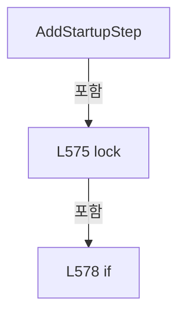

변경 전 점검: 입력/반환 타입, 위 호출자, 예외/취소 경로, 공유 상태와 저장·전송 소비자를 함께 확인합니다. 값의 단위나 물리 방향을 이름만으로 확정하지 않습니다.

### MethodDeclaration `GetMotionSimulationMode` · L585–593

[Drilling.Common/Managers/CManager.cs:585–593](https://github.com/kjuws10-rgb/A3Drilling/blob/5aee8e58439c9b455cae7c9593c9be986c3e682e/Drilling.Common/Managers/CManager.cs#L585-L593)

| 항목 | 실제 추출 값 |
| --- | --- |
| 서명 | bool Drilling.Common.Managers.CManager.GetMotionSimulationMode(bool?) |
| 접근/수식자 | Private / private |
| 반환/값 타입 | bool |
| 소속 타입 | NamedType:Drilling.Common.Managers.CManager |

입력 계약:

| 이름 | 타입 | 전달 | 선택/기본값 |
| --- | --- | --- | --- |
| simulationMode | bool? | None | False /  |

정적 호출자로 확인된 위치:

| 호출 파일/행 | 호출 표현식 | 런타임 분기 가능 |
| --- | --- | --- |
| [Drilling.Common/Managers/CManager.cs:114–114](https://github.com/kjuws10-rgb/A3Drilling/blob/5aee8e58439c9b455cae7c9593c9be986c3e682e/Drilling.Common/Managers/CManager.cs#L114-L114) | GetMotionSimulationMode | False |

호출하는 대상과 해석 범위:

| 원본 행 | 표현식 | 분석 상태 | 대상/소스 위치 |
| --- | --- | --- | --- |
| 592 | _interfaceManager.GetInterfaceList(EN_EQP_MODULE.Motion).DefaultIfEmpty().All | resolved | bool System.Collections.Generic.IEnumerable<Drilling.Common.Interface.ST_INTERFACE_DATA?>.All<Drilling.Common.Interface.ST_INTERFACE_DATA?>(System.Func<Drilling.Common.Interface.ST_INTERFACE_DATA?, bool>) |
| 592 | _interfaceManager.GetInterfaceList(EN_EQP_MODULE.Motion).DefaultIfEmpty | resolved | System.Collections.Generic.IEnumerable<Drilling.Common.Interface.ST_INTERFACE_DATA?> System.Collections.Generic.IEnumerable<Drilling.Common.Interface.ST_INTERFACE_DATA>.DefaultIfEmpty<Drilling.Common.Interface.ST_INTERFACE_DATA>() |
| 592 | _interfaceManager.GetInterfaceList | resolved | System.Collections.Generic.IReadOnlyList<Drilling.Common.Interface.ST_INTERFACE_DATA> Drilling.Common.Interface.CInterfaceManager.GetInterfaceList(Drilling.Common.Interface.EN_EQP_MODULE?) · Drilling.Common/Interface/CInterfaceManager.cs:442 |

본문의 실제 연산·분기·예외·반환 순서(원문 위치 순):

| 원본 행 | 종류 | 주석 해설 |
| --- | --- | --- |
| 592 | call | 함수·델리게이트 또는 객체 생성자를 호출합니다: _interfaceManager.GetInterfaceList(EN_EQP_MODULE.Motion).DefaultIfEmpty().All(MatchesItem) |
| 592 | call | 함수·델리게이트 또는 객체 생성자를 호출합니다: _interfaceManager.GetInterfaceList(EN_EQP_MODULE.Motion).DefaultIfEmpty() |
| 592 | call | 함수·델리게이트 또는 객체 생성자를 호출합니다: _interfaceManager.GetInterfaceList(EN_EQP_MODULE.Motion) |
| 592 | return | 호출자에게 값 또는 제어를 반환합니다: return simulationMode ?? _interfaceManager.GetInterfaceList(EN_EQP_MODULE.Motion).DefaultIfEmpty().All(MatchesItem); |

변경 전 점검: 입력/반환 타입, 위 호출자, 예외/취소 경로, 공유 상태와 저장·전송 소비자를 함께 확인합니다. 값의 단위나 물리 방향을 이름만으로 확정하지 않습니다.

### LocalFunctionStatement `MatchesItem` · L587–590

[Drilling.Common/Managers/CManager.cs:587–590](https://github.com/kjuws10-rgb/A3Drilling/blob/5aee8e58439c9b455cae7c9593c9be986c3e682e/Drilling.Common/Managers/CManager.cs#L587-L590)

| 항목 | 실제 추출 값 |
| --- | --- |
| 서명 | bool MatchesItem(Drilling.Common.Interface.ST_INTERFACE_DATA?) |
| 접근/수식자 | Private /  |
| 반환/값 타입 | bool |
| 소속 타입 | NamedType:Drilling.Common.Managers.CManager |

입력 계약:

| 이름 | 타입 | 전달 | 선택/기본값 |
| --- | --- | --- | --- |
| data | Drilling.Common.Interface.ST_INTERFACE_DATA? | None | False /  |

현재 부분 분석에서 직접 연결된 호출자는 없습니다. XAML/이벤트/인터페이스·델리게이트·외부 진입을 추가 확인해야 하며, 미사용으로 판정한 것이 아닙니다.

본문의 실제 연산·분기·예외·반환 순서(원문 위치 순):

| 원본 행 | 종류 | 주석 해설 |
| --- | --- | --- |
| 589 | return | 호출자에게 값 또는 제어를 반환합니다: return data is null &#124;&#124; data.IsSimulation; |

변경 전 점검: 입력/반환 타입, 위 호출자, 예외/취소 경로, 공유 상태와 저장·전송 소비자를 함께 확인합니다. 값의 단위나 물리 방향을 이름만으로 확정하지 않습니다.

### MethodDeclaration `GetScriptDirectory` · L595–604

[Drilling.Common/Managers/CManager.cs:595–604](https://github.com/kjuws10-rgb/A3Drilling/blob/5aee8e58439c9b455cae7c9593c9be986c3e682e/Drilling.Common/Managers/CManager.cs#L595-L604)

| 항목 | 실제 추출 값 |
| --- | --- |
| 서명 | string Drilling.Common.Managers.CManager.GetScriptDirectory() |
| 접근/수식자 | Private / private |
| 반환/값 타입 | string |
| 소속 타입 | NamedType:Drilling.Common.Managers.CManager |

정적 호출자로 확인된 위치:

| 호출 파일/행 | 호출 표현식 | 런타임 분기 가능 |
| --- | --- | --- |
| [Drilling.Common/Managers/CManager.cs:107–107](https://github.com/kjuws10-rgb/A3Drilling/blob/5aee8e58439c9b455cae7c9593c9be986c3e682e/Drilling.Common/Managers/CManager.cs#L107-L107) | GetScriptDirectory | False |
| [Drilling.Common/Managers/CManager.cs:135–135](https://github.com/kjuws10-rgb/A3Drilling/blob/5aee8e58439c9b455cae7c9593c9be986c3e682e/Drilling.Common/Managers/CManager.cs#L135-L135) | GetScriptDirectory | False |
| [Drilling.Common/Managers/CManager.cs:139–139](https://github.com/kjuws10-rgb/A3Drilling/blob/5aee8e58439c9b455cae7c9593c9be986c3e682e/Drilling.Common/Managers/CManager.cs#L139-L139) | GetScriptDirectory | False |

호출하는 대상과 해석 범위:

| 원본 행 | 표현식 | 분석 상태 | 대상/소스 위치 |
| --- | --- | --- | --- |
| 602 | _settingFile.Load(EN_SETTING_TAB.Option).FirstOrDefault | resolved | Drilling.Common.Managers.ST_SYSTEM_PARAMETER? System.Collections.Generic.IEnumerable<Drilling.Common.Managers.ST_SYSTEM_PARAMETER>.FirstOrDefault<Drilling.Common.Managers.ST_SYSTEM_PARAMETER>(System.Func<Drilling.Common.Managers.ST_SYSTEM_PARAMETER, bool>) |
| 602 | _settingFile.Load | resolved | System.Collections.Generic.IReadOnlyList<Drilling.Common.Managers.ST_SYSTEM_PARAMETER> Drilling.Common.Managers.CSettingFileBase.Load(Drilling.Common.Managers.EN_SETTING_TAB, System.Threading.CancellationToken) · Drilling.Common/Managers/CSettingManager.cs:275 |
| 603 | ResolveProjectPath | resolved | string Drilling.Common.Managers.CManager.ResolveProjectPath(string?, string) · Drilling.Common/Managers/CManager.cs:611 |
| 603 | Path.Combine | resolved | string System.IO.Path.Combine(string, string) |

본문의 실제 연산·분기·예외·반환 순서(원문 위치 순):

| 원본 행 | 종류 | 주석 해설 |
| --- | --- | --- |
| 602 | call | 함수·델리게이트 또는 객체 생성자를 호출합니다: _settingFile.Load(EN_SETTING_TAB.Option).FirstOrDefault(MatchesItem) |
| 602 | call | 함수·델리게이트 또는 객체 생성자를 호출합니다: _settingFile.Load(EN_SETTING_TAB.Option) |
| 602 | local-declaration | 지역 변수를 선언합니다: var settingPath = _settingFile.Load(EN_SETTING_TAB.Option).FirstOrDefault(MatchesItem)?.Value; |
| 602 | variable-initializer | 변수의 초기값을 지정합니다: settingPath = _settingFile.Load(EN_SETTING_TAB.Option).FirstOrDefault(MatchesItem)?.Value |
| 603 | call | 함수·델리게이트 또는 객체 생성자를 호출합니다: ResolveProjectPath(settingPath, Path.Combine("Data", "Script")) |
| 603 | call | 함수·델리게이트 또는 객체 생성자를 호출합니다: Path.Combine("Data", "Script") |
| 603 | return | 호출자에게 값 또는 제어를 반환합니다: return ResolveProjectPath(settingPath, Path.Combine("Data", "Script")); |

변경 전 점검: 입력/반환 타입, 위 호출자, 예외/취소 경로, 공유 상태와 저장·전송 소비자를 함께 확인합니다. 값의 단위나 물리 방향을 이름만으로 확정하지 않습니다.

### LocalFunctionStatement `MatchesItem` · L597–600

[Drilling.Common/Managers/CManager.cs:597–600](https://github.com/kjuws10-rgb/A3Drilling/blob/5aee8e58439c9b455cae7c9593c9be986c3e682e/Drilling.Common/Managers/CManager.cs#L597-L600)

| 항목 | 실제 추출 값 |
| --- | --- |
| 서명 | bool MatchesItem(Drilling.Common.Managers.ST_SYSTEM_PARAMETER) |
| 접근/수식자 | Private /  |
| 반환/값 타입 | bool |
| 소속 타입 | NamedType:Drilling.Common.Managers.CManager |

입력 계약:

| 이름 | 타입 | 전달 | 선택/기본값 |
| --- | --- | --- | --- |
| parameter | Drilling.Common.Managers.ST_SYSTEM_PARAMETER | None | False /  |

현재 부분 분석에서 직접 연결된 호출자는 없습니다. XAML/이벤트/인터페이스·델리게이트·외부 진입을 추가 확인해야 하며, 미사용으로 판정한 것이 아닙니다.

호출하는 대상과 해석 범위:

| 원본 행 | 표현식 | 분석 상태 | 대상/소스 위치 |
| --- | --- | --- | --- |
| 599 | parameter.Key.Equals | resolved | bool string.Equals(string?, System.StringComparison) |
| 599 | parameter.Name.Equals | resolved | bool string.Equals(string?, System.StringComparison) |

본문의 실제 연산·분기·예외·반환 순서(원문 위치 순):

| 원본 행 | 종류 | 주석 해설 |
| --- | --- | --- |
| 599 | call | 함수·델리게이트 또는 객체 생성자를 호출합니다: parameter.Key.Equals("LocalScriptPath", StringComparison.OrdinalIgnoreCase) |
| 599 | call | 함수·델리게이트 또는 객체 생성자를 호출합니다: parameter.Name.Equals("LocalScriptPath", StringComparison.OrdinalIgnoreCase) |
| 599 | return | 호출자에게 값 또는 제어를 반환합니다: return parameter.Key.Equals("LocalScriptPath", StringComparison.OrdinalIgnoreCase) &#124;&#124; parameter.Name.Equals("LocalScriptPath", StringComparison.OrdinalIgnoreCase); |

변경 전 점검: 입력/반환 타입, 위 호출자, 예외/취소 경로, 공유 상태와 저장·전송 소비자를 함께 확인합니다. 값의 단위나 물리 방향을 이름만으로 확정하지 않습니다.

### MethodDeclaration `GetProjectRoot` · L606–609

[Drilling.Common/Managers/CManager.cs:606–609](https://github.com/kjuws10-rgb/A3Drilling/blob/5aee8e58439c9b455cae7c9593c9be986c3e682e/Drilling.Common/Managers/CManager.cs#L606-L609)

| 항목 | 실제 추출 값 |
| --- | --- |
| 서명 | string Drilling.Common.Managers.CManager.GetProjectRoot() |
| 접근/수식자 | Private / private |
| 반환/값 타입 | string |
| 소속 타입 | NamedType:Drilling.Common.Managers.CManager |

정적 호출자로 확인된 위치:

| 호출 파일/행 | 호출 표현식 | 런타임 분기 가능 |
| --- | --- | --- |
| [Drilling.Common/Managers/CManager.cs:107–107](https://github.com/kjuws10-rgb/A3Drilling/blob/5aee8e58439c9b455cae7c9593c9be986c3e682e/Drilling.Common/Managers/CManager.cs#L107-L107) | GetProjectRoot | False |
| [Drilling.Common/Managers/CManager.cs:614–614](https://github.com/kjuws10-rgb/A3Drilling/blob/5aee8e58439c9b455cae7c9593c9be986c3e682e/Drilling.Common/Managers/CManager.cs#L614-L614) | GetProjectRoot | False |

호출하는 대상과 해석 범위:

| 원본 행 | 표현식 | 분석 상태 | 대상/소스 위치 |
| --- | --- | --- | --- |
| 608 | Directory.GetParent | resolved | System.IO.DirectoryInfo? System.IO.Directory.GetParent(string) |

본문의 실제 연산·분기·예외·반환 순서(원문 위치 순):

| 원본 행 | 종류 | 주석 해설 |
| --- | --- | --- |
| 608 | call | 함수·델리게이트 또는 객체 생성자를 호출합니다: Directory.GetParent(_configRoot) |
| 608 | return | 호출자에게 값 또는 제어를 반환합니다: return Directory.GetParent(_configRoot)?.FullName ?? _configRoot; |

변경 전 점검: 입력/반환 타입, 위 호출자, 예외/취소 경로, 공유 상태와 저장·전송 소비자를 함께 확인합니다. 값의 단위나 물리 방향을 이름만으로 확정하지 않습니다.

### MethodDeclaration `ResolveProjectPath` · L611–615

[Drilling.Common/Managers/CManager.cs:611–615](https://github.com/kjuws10-rgb/A3Drilling/blob/5aee8e58439c9b455cae7c9593c9be986c3e682e/Drilling.Common/Managers/CManager.cs#L611-L615)

| 항목 | 실제 추출 값 |
| --- | --- |
| 서명 | string Drilling.Common.Managers.CManager.ResolveProjectPath(string?, string) |
| 접근/수식자 | Private / private |
| 반환/값 타입 | string |
| 소속 타입 | NamedType:Drilling.Common.Managers.CManager |

입력 계약:

| 이름 | 타입 | 전달 | 선택/기본값 |
| --- | --- | --- | --- |
| settingPath | string? | None | False /  |
| defaultRelativePath | string | None | False /  |

정적 호출자로 확인된 위치:

| 호출 파일/행 | 호출 표현식 | 런타임 분기 가능 |
| --- | --- | --- |
| [Drilling.Common/Managers/CManager.cs:603–603](https://github.com/kjuws10-rgb/A3Drilling/blob/5aee8e58439c9b455cae7c9593c9be986c3e682e/Drilling.Common/Managers/CManager.cs#L603-L603) | ResolveProjectPath | False |

호출하는 대상과 해석 범위:

| 원본 행 | 표현식 | 분석 상태 | 대상/소스 위치 |
| --- | --- | --- | --- |
| 613 | string.IsNullOrWhiteSpace | resolved | bool string.IsNullOrWhiteSpace(string?) |
| 613 | settingPath.Trim | resolved | string string.Trim() |
| 614 | Path.IsPathRooted | resolved | bool System.IO.Path.IsPathRooted(string?) |
| 614 | Path.GetFullPath | resolved | string System.IO.Path.GetFullPath(string) |
| 614 | Path.GetFullPath | resolved | string System.IO.Path.GetFullPath(string) |
| 614 | Path.Combine | resolved | string System.IO.Path.Combine(string, string) |
| 614 | GetProjectRoot | resolved | string Drilling.Common.Managers.CManager.GetProjectRoot() · Drilling.Common/Managers/CManager.cs:606 |

본문의 실제 연산·분기·예외·반환 순서(원문 위치 순):

| 원본 행 | 종류 | 주석 해설 |
| --- | --- | --- |
| 613 | call | 함수·델리게이트 또는 객체 생성자를 호출합니다: string.IsNullOrWhiteSpace(settingPath) |
| 613 | call | 함수·델리게이트 또는 객체 생성자를 호출합니다: settingPath.Trim() |
| 613 | conditional-expression | 조건에 따라 결과식을 선택합니다: string.IsNullOrWhiteSpace(settingPath) ? defaultRelativePath : settingPath.Trim() |
| 613 | local-declaration | 지역 변수를 선언합니다: var path = string.IsNullOrWhiteSpace(settingPath) ? defaultRelativePath : settingPath.Trim(); |
| 613 | variable-initializer | 변수의 초기값을 지정합니다: path = string.IsNullOrWhiteSpace(settingPath) ? defaultRelativePath : settingPath.Trim() |
| 614 | call | 함수·델리게이트 또는 객체 생성자를 호출합니다: Path.IsPathRooted(path) |
| 614 | call | 함수·델리게이트 또는 객체 생성자를 호출합니다: Path.GetFullPath(path) |
| 614 | call | 함수·델리게이트 또는 객체 생성자를 호출합니다: Path.GetFullPath(Path.Combine(GetProjectRoot(), path)) |
| 614 | call | 함수·델리게이트 또는 객체 생성자를 호출합니다: Path.Combine(GetProjectRoot(), path) |
| 614 | call | 함수·델리게이트 또는 객체 생성자를 호출합니다: GetProjectRoot() |
| 614 | conditional-expression | 조건에 따라 결과식을 선택합니다: Path.IsPathRooted(path) ? Path.GetFullPath(path) : Path.GetFullPath(Path.Combine(GetProjectRoot(), path)) |
| 614 | return | 호출자에게 값 또는 제어를 반환합니다: return Path.IsPathRooted(path) ? Path.GetFullPath(path) : Path.GetFullPath(Path.Combine(GetProjectRoot(), path)); |

변경 전 점검: 입력/반환 타입, 위 호출자, 예외/취소 경로, 공유 상태와 저장·전송 소비자를 함께 확인합니다. 값의 단위나 물리 방향을 이름만으로 확정하지 않습니다.

### MethodDeclaration `IsStartupDataException` · L617–620

[Drilling.Common/Managers/CManager.cs:617–620](https://github.com/kjuws10-rgb/A3Drilling/blob/5aee8e58439c9b455cae7c9593c9be986c3e682e/Drilling.Common/Managers/CManager.cs#L617-L620)

| 항목 | 실제 추출 값 |
| --- | --- |
| 서명 | bool Drilling.Common.Managers.CManager.IsStartupDataException(System.Exception) |
| 접근/수식자 | Private / private, static |
| 반환/값 타입 | bool |
| 소속 타입 | NamedType:Drilling.Common.Managers.CManager |

입력 계약:

| 이름 | 타입 | 전달 | 선택/기본값 |
| --- | --- | --- | --- |
| exception | System.Exception | None | False /  |

정적 호출자로 확인된 위치:

| 호출 파일/행 | 호출 표현식 | 런타임 분기 가능 |
| --- | --- | --- |
| [Drilling.Common/Managers/CManager.cs:462–462](https://github.com/kjuws10-rgb/A3Drilling/blob/5aee8e58439c9b455cae7c9593c9be986c3e682e/Drilling.Common/Managers/CManager.cs#L462-L462) | IsStartupDataException | False |
| [Drilling.Common/Managers/CManager.cs:477–477](https://github.com/kjuws10-rgb/A3Drilling/blob/5aee8e58439c9b455cae7c9593c9be986c3e682e/Drilling.Common/Managers/CManager.cs#L477-L477) | IsStartupDataException | False |
| [Drilling.Common/Managers/CManager.cs:512–512](https://github.com/kjuws10-rgb/A3Drilling/blob/5aee8e58439c9b455cae7c9593c9be986c3e682e/Drilling.Common/Managers/CManager.cs#L512-L512) | IsStartupDataException | False |
| [Drilling.Common/Managers/CManager.cs:528–528](https://github.com/kjuws10-rgb/A3Drilling/blob/5aee8e58439c9b455cae7c9593c9be986c3e682e/Drilling.Common/Managers/CManager.cs#L528-L528) | IsStartupDataException | False |
| [Drilling.Common/Managers/CManager.cs:544–544](https://github.com/kjuws10-rgb/A3Drilling/blob/5aee8e58439c9b455cae7c9593c9be986c3e682e/Drilling.Common/Managers/CManager.cs#L544-L544) | IsStartupDataException | False |

본문의 실제 연산·분기·예외·반환 순서(원문 위치 순):

| 원본 행 | 종류 | 주석 해설 |
| --- | --- | --- |
| 619 | return | 호출자에게 값 또는 제어를 반환합니다: return exception is InvalidDataException or IOException or UnauthorizedAccessException; |

변경 전 점검: 입력/반환 타입, 위 호출자, 예외/취소 경로, 공유 상태와 저장·전송 소비자를 함께 확인합니다. 값의 단위나 물리 방향을 이름만으로 확정하지 않습니다.

### MethodDeclaration `IsStartupRuntimeException` · L622–625

[Drilling.Common/Managers/CManager.cs:622–625](https://github.com/kjuws10-rgb/A3Drilling/blob/5aee8e58439c9b455cae7c9593c9be986c3e682e/Drilling.Common/Managers/CManager.cs#L622-L625)

| 항목 | 실제 추출 값 |
| --- | --- |
| 서명 | bool Drilling.Common.Managers.CManager.IsStartupRuntimeException(System.Exception) |
| 접근/수식자 | Private / private, static |
| 반환/값 타입 | bool |
| 소속 타입 | NamedType:Drilling.Common.Managers.CManager |

입력 계약:

| 이름 | 타입 | 전달 | 선택/기본값 |
| --- | --- | --- | --- |
| exception | System.Exception | None | False /  |

정적 호출자로 확인된 위치:

| 호출 파일/행 | 호출 표현식 | 런타임 분기 가능 |
| --- | --- | --- |
| [Drilling.Common/Managers/CManager.cs:562–562](https://github.com/kjuws10-rgb/A3Drilling/blob/5aee8e58439c9b455cae7c9593c9be986c3e682e/Drilling.Common/Managers/CManager.cs#L562-L562) | IsStartupRuntimeException | False |

본문의 실제 연산·분기·예외·반환 순서(원문 위치 순):

| 원본 행 | 종류 | 주석 해설 |
| --- | --- | --- |
| 624 | return | 호출자에게 값 또는 제어를 반환합니다: return exception is InvalidOperationException or TimeoutException or IOException or UnauthorizedAccessException; |

변경 전 점검: 입력/반환 타입, 위 호출자, 예외/취소 경로, 공유 상태와 저장·전송 소비자를 함께 확인합니다. 값의 단위나 물리 방향을 이름만으로 확정하지 않습니다.

### MethodDeclaration `ToStartupResult` · L627–635

[Drilling.Common/Managers/CManager.cs:627–635](https://github.com/kjuws10-rgb/A3Drilling/blob/5aee8e58439c9b455cae7c9593c9be986c3e682e/Drilling.Common/Managers/CManager.cs#L627-L635)

| 항목 | 실제 추출 값 |
| --- | --- |
| 서명 | Drilling.Common.Managers.EN_MANAGER_STARTUP_RESULT Drilling.Common.Managers.CManager.ToStartupResult(Drilling.Common.Managers.ST_CONFIG_FILE_STATUS) |
| 접근/수식자 | Private / private, static |
| 반환/값 타입 | Drilling.Common.Managers.EN_MANAGER_STARTUP_RESULT |
| 소속 타입 | NamedType:Drilling.Common.Managers.CManager |

입력 계약:

| 이름 | 타입 | 전달 | 선택/기본값 |
| --- | --- | --- | --- |
| status | Drilling.Common.Managers.ST_CONFIG_FILE_STATUS | None | False /  |

정적 호출자로 확인된 위치:

| 호출 파일/행 | 호출 표현식 | 런타임 분기 가능 |
| --- | --- | --- |
| [Drilling.Common/Managers/CManager.cs:459–459](https://github.com/kjuws10-rgb/A3Drilling/blob/5aee8e58439c9b455cae7c9593c9be986c3e682e/Drilling.Common/Managers/CManager.cs#L459-L459) | ToStartupResult | False |

본문의 실제 연산·분기·예외·반환 순서(원문 위치 순):

| 원본 행 | 종류 | 주석 해설 |
| --- | --- | --- |
| 629 | if | 조건에 따라 분기합니다: if (status.IsValid) |
| 631 | return | 호출자에게 값 또는 제어를 반환합니다: return EN_MANAGER_STARTUP_RESULT.Ready; |
| 634 | conditional-expression | 조건에 따라 결과식을 선택합니다: status.Required ? EN_MANAGER_STARTUP_RESULT.Failed : EN_MANAGER_STARTUP_RESULT.Warning |
| 634 | return | 호출자에게 값 또는 제어를 반환합니다: return status.Required ? EN_MANAGER_STARTUP_RESULT.Failed : EN_MANAGER_STARTUP_RESULT.Warning; |

제어 구문의 포함 구조(실제 실행 순서/CFG가 아닌 구문 탐색 그림):

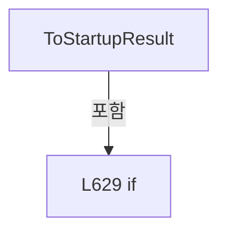

변경 전 점검: 입력/반환 타입, 위 호출자, 예외/취소 경로, 공유 상태와 저장·전송 소비자를 함께 확인합니다. 값의 단위나 물리 방향을 이름만으로 확정하지 않습니다.

### MethodDeclaration `FormatConfigStatusMessage` · L637–642

[Drilling.Common/Managers/CManager.cs:637–642](https://github.com/kjuws10-rgb/A3Drilling/blob/5aee8e58439c9b455cae7c9593c9be986c3e682e/Drilling.Common/Managers/CManager.cs#L637-L642)

| 항목 | 실제 추출 값 |
| --- | --- |
| 서명 | string Drilling.Common.Managers.CManager.FormatConfigStatusMessage(Drilling.Common.Managers.ST_CONFIG_FILE_STATUS) |
| 접근/수식자 | Private / private, static |
| 반환/값 타입 | string |
| 소속 타입 | NamedType:Drilling.Common.Managers.CManager |

입력 계약:

| 이름 | 타입 | 전달 | 선택/기본값 |
| --- | --- | --- | --- |
| status | Drilling.Common.Managers.ST_CONFIG_FILE_STATUS | None | False /  |

정적 호출자로 확인된 위치:

| 호출 파일/행 | 호출 표현식 | 런타임 분기 가능 |
| --- | --- | --- |
| [Drilling.Common/Managers/CManager.cs:459–459](https://github.com/kjuws10-rgb/A3Drilling/blob/5aee8e58439c9b455cae7c9593c9be986c3e682e/Drilling.Common/Managers/CManager.cs#L459-L459) | FormatConfigStatusMessage | False |

본문의 실제 연산·분기·예외·반환 순서(원문 위치 순):

| 원본 행 | 종류 | 주석 해설 |
| --- | --- | --- |
| 639 | conditional-expression | 조건에 따라 결과식을 선택합니다: status.Required ? "Required" : "Optional" |
| 639 | local-declaration | 지역 변수를 선언합니다: var requiredText = status.Required ? "Required" : "Optional"; |
| 639 | variable-initializer | 변수의 초기값을 지정합니다: requiredText = status.Required ? "Required" : "Optional" |
| 640 | conditional-expression | 조건에 따라 결과식을 선택합니다: status.Exists ? "Exists" : "Missing" |
| 640 | local-declaration | 지역 변수를 선언합니다: var existsText = status.Exists ? "Exists" : "Missing"; |
| 640 | variable-initializer | 변수의 초기값을 지정합니다: existsText = status.Exists ? "Exists" : "Missing" |
| 641 | return | 호출자에게 값 또는 제어를 반환합니다: return $"{requiredText}, {existsText}, {status.Message} &#124; {status.Path}"; |

변경 전 점검: 입력/반환 타입, 위 호출자, 예외/취소 경로, 공유 상태와 저장·전송 소비자를 함께 확인합니다. 값의 단위나 물리 방향을 이름만으로 확정하지 않습니다.

### EnumMemberDeclaration `Simulation` · L647–647

[Drilling.Common/Managers/CManager.cs:647–647](https://github.com/kjuws10-rgb/A3Drilling/blob/5aee8e58439c9b455cae7c9593c9be986c3e682e/Drilling.Common/Managers/CManager.cs#L647-L647)

| 항목 | 실제 추출 값 |
| --- | --- |
| 서명 | Drilling.Common.Managers.EN_SYSTEM_MODE.Simulation |
| 접근/수식자 | Public /  |
| 반환/값 타입 | Drilling.Common.Managers.EN_SYSTEM_MODE |
| 소속 타입 | NamedType:Drilling.Common.Managers.EN_SYSTEM_MODE |

현재 부분 분석에서 직접 연결된 호출자는 없습니다. XAML/이벤트/인터페이스·델리게이트·외부 진입을 추가 확인해야 하며, 미사용으로 판정한 것이 아닙니다.

변경 전 점검: 입력/반환 타입, 위 호출자, 예외/취소 경로, 공유 상태와 저장·전송 소비자를 함께 확인합니다. 값의 단위나 물리 방향을 이름만으로 확정하지 않습니다.

### EnumMemberDeclaration `Auto` · L648–648

[Drilling.Common/Managers/CManager.cs:648–648](https://github.com/kjuws10-rgb/A3Drilling/blob/5aee8e58439c9b455cae7c9593c9be986c3e682e/Drilling.Common/Managers/CManager.cs#L648-L648)

| 항목 | 실제 추출 값 |
| --- | --- |
| 서명 | Drilling.Common.Managers.EN_SYSTEM_MODE.Auto |
| 접근/수식자 | Public /  |
| 반환/값 타입 | Drilling.Common.Managers.EN_SYSTEM_MODE |
| 소속 타입 | NamedType:Drilling.Common.Managers.EN_SYSTEM_MODE |

현재 부분 분석에서 직접 연결된 호출자는 없습니다. XAML/이벤트/인터페이스·델리게이트·외부 진입을 추가 확인해야 하며, 미사용으로 판정한 것이 아닙니다.

변경 전 점검: 입력/반환 타입, 위 호출자, 예외/취소 경로, 공유 상태와 저장·전송 소비자를 함께 확인합니다. 값의 단위나 물리 방향을 이름만으로 확정하지 않습니다.

### EnumMemberDeclaration `Manual` · L649–649

[Drilling.Common/Managers/CManager.cs:649–649](https://github.com/kjuws10-rgb/A3Drilling/blob/5aee8e58439c9b455cae7c9593c9be986c3e682e/Drilling.Common/Managers/CManager.cs#L649-L649)

| 항목 | 실제 추출 값 |
| --- | --- |
| 서명 | Drilling.Common.Managers.EN_SYSTEM_MODE.Manual |
| 접근/수식자 | Public /  |
| 반환/값 타입 | Drilling.Common.Managers.EN_SYSTEM_MODE |
| 소속 타입 | NamedType:Drilling.Common.Managers.EN_SYSTEM_MODE |

현재 부분 분석에서 직접 연결된 호출자는 없습니다. XAML/이벤트/인터페이스·델리게이트·외부 진입을 추가 확인해야 하며, 미사용으로 판정한 것이 아닙니다.

변경 전 점검: 입력/반환 타입, 위 호출자, 예외/취소 경로, 공유 상태와 저장·전송 소비자를 함께 확인합니다. 값의 단위나 물리 방향을 이름만으로 확정하지 않습니다.

### EnumMemberDeclaration `Released` · L654–654

[Drilling.Common/Managers/CManager.cs:654–654](https://github.com/kjuws10-rgb/A3Drilling/blob/5aee8e58439c9b455cae7c9593c9be986c3e682e/Drilling.Common/Managers/CManager.cs#L654-L654)

| 항목 | 실제 추출 값 |
| --- | --- |
| 서명 | Drilling.Common.Managers.EN_PM_LOCK_STATE.Released |
| 접근/수식자 | Public /  |
| 반환/값 타입 | Drilling.Common.Managers.EN_PM_LOCK_STATE |
| 소속 타입 | NamedType:Drilling.Common.Managers.EN_PM_LOCK_STATE |

현재 부분 분석에서 직접 연결된 호출자는 없습니다. XAML/이벤트/인터페이스·델리게이트·외부 진입을 추가 확인해야 하며, 미사용으로 판정한 것이 아닙니다.

변경 전 점검: 입력/반환 타입, 위 호출자, 예외/취소 경로, 공유 상태와 저장·전송 소비자를 함께 확인합니다. 값의 단위나 물리 방향을 이름만으로 확정하지 않습니다.

### EnumMemberDeclaration `Locked` · L655–655

[Drilling.Common/Managers/CManager.cs:655–655](https://github.com/kjuws10-rgb/A3Drilling/blob/5aee8e58439c9b455cae7c9593c9be986c3e682e/Drilling.Common/Managers/CManager.cs#L655-L655)

| 항목 | 실제 추출 값 |
| --- | --- |
| 서명 | Drilling.Common.Managers.EN_PM_LOCK_STATE.Locked |
| 접근/수식자 | Public /  |
| 반환/값 타입 | Drilling.Common.Managers.EN_PM_LOCK_STATE |
| 소속 타입 | NamedType:Drilling.Common.Managers.EN_PM_LOCK_STATE |

현재 부분 분석에서 직접 연결된 호출자는 없습니다. XAML/이벤트/인터페이스·델리게이트·외부 진입을 추가 확인해야 하며, 미사용으로 판정한 것이 아닙니다.

변경 전 점검: 입력/반환 타입, 위 호출자, 예외/취소 경로, 공유 상태와 저장·전송 소비자를 함께 확인합니다. 값의 단위나 물리 방향을 이름만으로 확정하지 않습니다.

### EnumMemberDeclaration `Ready` · L660–660

[Drilling.Common/Managers/CManager.cs:660–660](https://github.com/kjuws10-rgb/A3Drilling/blob/5aee8e58439c9b455cae7c9593c9be986c3e682e/Drilling.Common/Managers/CManager.cs#L660-L660)

| 항목 | 실제 추출 값 |
| --- | --- |
| 서명 | Drilling.Common.Managers.EN_MANAGER_STARTUP_RESULT.Ready |
| 접근/수식자 | Public /  |
| 반환/값 타입 | Drilling.Common.Managers.EN_MANAGER_STARTUP_RESULT |
| 소속 타입 | NamedType:Drilling.Common.Managers.EN_MANAGER_STARTUP_RESULT |

현재 부분 분석에서 직접 연결된 호출자는 없습니다. XAML/이벤트/인터페이스·델리게이트·외부 진입을 추가 확인해야 하며, 미사용으로 판정한 것이 아닙니다.

변경 전 점검: 입력/반환 타입, 위 호출자, 예외/취소 경로, 공유 상태와 저장·전송 소비자를 함께 확인합니다. 값의 단위나 물리 방향을 이름만으로 확정하지 않습니다.

### EnumMemberDeclaration `Warning` · L661–661

[Drilling.Common/Managers/CManager.cs:661–661](https://github.com/kjuws10-rgb/A3Drilling/blob/5aee8e58439c9b455cae7c9593c9be986c3e682e/Drilling.Common/Managers/CManager.cs#L661-L661)

| 항목 | 실제 추출 값 |
| --- | --- |
| 서명 | Drilling.Common.Managers.EN_MANAGER_STARTUP_RESULT.Warning |
| 접근/수식자 | Public /  |
| 반환/값 타입 | Drilling.Common.Managers.EN_MANAGER_STARTUP_RESULT |
| 소속 타입 | NamedType:Drilling.Common.Managers.EN_MANAGER_STARTUP_RESULT |

현재 부분 분석에서 직접 연결된 호출자는 없습니다. XAML/이벤트/인터페이스·델리게이트·외부 진입을 추가 확인해야 하며, 미사용으로 판정한 것이 아닙니다.

변경 전 점검: 입력/반환 타입, 위 호출자, 예외/취소 경로, 공유 상태와 저장·전송 소비자를 함께 확인합니다. 값의 단위나 물리 방향을 이름만으로 확정하지 않습니다.

### EnumMemberDeclaration `Failed` · L662–662

[Drilling.Common/Managers/CManager.cs:662–662](https://github.com/kjuws10-rgb/A3Drilling/blob/5aee8e58439c9b455cae7c9593c9be986c3e682e/Drilling.Common/Managers/CManager.cs#L662-L662)

| 항목 | 실제 추출 값 |
| --- | --- |
| 서명 | Drilling.Common.Managers.EN_MANAGER_STARTUP_RESULT.Failed |
| 접근/수식자 | Public /  |
| 반환/값 타입 | Drilling.Common.Managers.EN_MANAGER_STARTUP_RESULT |
| 소속 타입 | NamedType:Drilling.Common.Managers.EN_MANAGER_STARTUP_RESULT |

현재 부분 분석에서 직접 연결된 호출자는 없습니다. XAML/이벤트/인터페이스·델리게이트·외부 진입을 추가 확인해야 하며, 미사용으로 판정한 것이 아닙니다.

변경 전 점검: 입력/반환 타입, 위 호출자, 예외/취소 경로, 공유 상태와 저장·전송 소비자를 함께 확인합니다. 값의 단위나 물리 방향을 이름만으로 확정하지 않습니다.

### PropertyDeclaration `Empty` · L717–723

[Drilling.Common/Managers/CManager.cs:717–723](https://github.com/kjuws10-rgb/A3Drilling/blob/5aee8e58439c9b455cae7c9593c9be986c3e682e/Drilling.Common/Managers/CManager.cs#L717-L723)

| 항목 | 실제 추출 값 |
| --- | --- |
| 서명 | Drilling.Common.Managers.ST_POWER_METER_STATUS Drilling.Common.Managers.ST_POWER_METER_STATUS.Empty |
| 접근/수식자 | Public / public, static |
| 반환/값 타입 | Drilling.Common.Managers.ST_POWER_METER_STATUS |
| 소속 타입 | NamedType:Drilling.Common.Managers.ST_POWER_METER_STATUS |

현재 부분 분석에서 직접 연결된 호출자는 없습니다. XAML/이벤트/인터페이스·델리게이트·외부 진입을 추가 확인해야 하며, 미사용으로 판정한 것이 아닙니다.

변경 전 점검: 입력/반환 타입, 위 호출자, 예외/취소 경로, 공유 상태와 저장·전송 소비자를 함께 확인합니다. 값의 단위나 물리 방향을 이름만으로 확정하지 않습니다.

### GetAccessorDeclaration `get_Empty` · L719–722

[Drilling.Common/Managers/CManager.cs:719–722](https://github.com/kjuws10-rgb/A3Drilling/blob/5aee8e58439c9b455cae7c9593c9be986c3e682e/Drilling.Common/Managers/CManager.cs#L719-L722)

| 항목 | 실제 추출 값 |
| --- | --- |
| 서명 | Drilling.Common.Managers.ST_POWER_METER_STATUS Drilling.Common.Managers.ST_POWER_METER_STATUS.Empty.get |
| 접근/수식자 | Public / get |
| 반환/값 타입 | Drilling.Common.Managers.ST_POWER_METER_STATUS |
| 소속 타입 | NamedType:Drilling.Common.Managers.ST_POWER_METER_STATUS |

현재 부분 분석에서 직접 연결된 호출자는 없습니다. XAML/이벤트/인터페이스·델리게이트·외부 진입을 추가 확인해야 하며, 미사용으로 판정한 것이 아닙니다.

호출하는 대상과 해석 범위:

| 원본 행 | 표현식 | 분석 상태 | 대상/소스 위치 |
| --- | --- | --- | --- |
| 721 | new | resolved | Drilling.Common.Managers.ST_POWER_METER_STATUS.ST_POWER_METER_STATUS(double, string, System.DateTimeOffset, double, double, double, double, double, double, int, bool, string, string, string, Drilling.Common.Interface.EN_POWER_METER_ERROR) · Drilling.Common/Managers/CManager.cs:699 |

본문의 실제 연산·분기·예외·반환 순서(원문 위치 순):

| 원본 행 | 종류 | 주석 해설 |
| --- | --- | --- |
| 721 | call | 함수·델리게이트 또는 객체 생성자를 호출합니다: new(0.0, "W", DateTimeOffset.Now) |
| 721 | return | 호출자에게 값 또는 제어를 반환합니다: return new(0.0, "W", DateTimeOffset.Now); |

변경 전 점검: 입력/반환 타입, 위 호출자, 예외/취소 경로, 공유 상태와 저장·전송 소비자를 함께 확인합니다. 값의 단위나 물리 방향을 이름만으로 확정하지 않습니다.

### PropertyDeclaration `SnapshotError` · L735–735

[Drilling.Common/Managers/CManager.cs:735–735](https://github.com/kjuws10-rgb/A3Drilling/blob/5aee8e58439c9b455cae7c9593c9be986c3e682e/Drilling.Common/Managers/CManager.cs#L735-L735)

| 항목 | 실제 추출 값 |
| --- | --- |
| 서명 | string Drilling.Common.Managers.ST_DEVICE_STATUS.SnapshotError |
| 접근/수식자 | Public / public |
| 반환/값 타입 | string |
| 소속 타입 | NamedType:Drilling.Common.Managers.ST_DEVICE_STATUS |

현재 부분 분석에서 직접 연결된 호출자는 없습니다. XAML/이벤트/인터페이스·델리게이트·외부 진입을 추가 확인해야 하며, 미사용으로 판정한 것이 아닙니다.

변경 전 점검: 입력/반환 타입, 위 호출자, 예외/취소 경로, 공유 상태와 저장·전송 소비자를 함께 확인합니다. 값의 단위나 물리 방향을 이름만으로 확정하지 않습니다.

### GetAccessorDeclaration `get_SnapshotError` · L735–735

[Drilling.Common/Managers/CManager.cs:735–735](https://github.com/kjuws10-rgb/A3Drilling/blob/5aee8e58439c9b455cae7c9593c9be986c3e682e/Drilling.Common/Managers/CManager.cs#L735-L735)

| 항목 | 실제 추출 값 |
| --- | --- |
| 서명 | string Drilling.Common.Managers.ST_DEVICE_STATUS.SnapshotError.get |
| 접근/수식자 | Public / get |
| 반환/값 타입 | string |
| 소속 타입 | NamedType:Drilling.Common.Managers.ST_DEVICE_STATUS |

현재 부분 분석에서 직접 연결된 호출자는 없습니다. XAML/이벤트/인터페이스·델리게이트·외부 진입을 추가 확인해야 하며, 미사용으로 판정한 것이 아닙니다.

변경 전 점검: 입력/반환 타입, 위 호출자, 예외/취소 경로, 공유 상태와 저장·전송 소비자를 함께 확인합니다. 값의 단위나 물리 방향을 이름만으로 확정하지 않습니다.

### InitAccessorDeclaration `set_SnapshotError` · L735–735

[Drilling.Common/Managers/CManager.cs:735–735](https://github.com/kjuws10-rgb/A3Drilling/blob/5aee8e58439c9b455cae7c9593c9be986c3e682e/Drilling.Common/Managers/CManager.cs#L735-L735)

| 항목 | 실제 추출 값 |
| --- | --- |
| 서명 | void Drilling.Common.Managers.ST_DEVICE_STATUS.SnapshotError.init |
| 접근/수식자 | Public / init |
| 반환/값 타입 | void |
| 소속 타입 | NamedType:Drilling.Common.Managers.ST_DEVICE_STATUS |

입력 계약:

| 이름 | 타입 | 전달 | 선택/기본값 |
| --- | --- | --- | --- |
| value | string | None | False /  |

현재 부분 분석에서 직접 연결된 호출자는 없습니다. XAML/이벤트/인터페이스·델리게이트·외부 진입을 추가 확인해야 하며, 미사용으로 판정한 것이 아닙니다.

변경 전 점검: 입력/반환 타입, 위 호출자, 예외/취소 경로, 공유 상태와 저장·전송 소비자를 함께 확인합니다. 값의 단위나 물리 방향을 이름만으로 확정하지 않습니다.

### MethodDeclaration `GetModule` · L740–751

[Drilling.Common/Managers/CManager.cs:740–751](https://github.com/kjuws10-rgb/A3Drilling/blob/5aee8e58439c9b455cae7c9593c9be986c3e682e/Drilling.Common/Managers/CManager.cs#L740-L751)

| 항목 | 실제 추출 값 |
| --- | --- |
| 서명 | Drilling.Common.Interface.ST_DEVICE_COMM_STATUS Drilling.Common.Managers.ST_SYSTEM_STATUS.GetModule(Drilling.Common.Interface.EN_EQP_MODULE) |
| 접근/수식자 | Public / public |
| 반환/값 타입 | Drilling.Common.Interface.ST_DEVICE_COMM_STATUS |
| 소속 타입 | NamedType:Drilling.Common.Managers.ST_SYSTEM_STATUS |

입력 계약:

| 이름 | 타입 | 전달 | 선택/기본값 |
| --- | --- | --- | --- |
| module | Drilling.Common.Interface.EN_EQP_MODULE | None | False /  |

정적 호출자로 확인된 위치:

| 호출 파일/행 | 호출 표현식 | 런타임 분기 가능 |
| --- | --- | --- |
| [Drilling.UI/CRootView.cs:2387–2387](https://github.com/kjuws10-rgb/A3Drilling/blob/5aee8e58439c9b455cae7c9593c9be986c3e682e/Drilling.UI/CRootView.cs#L2387-L2387) | status.GetModule | False |

호출하는 대상과 해석 범위:

| 원본 행 | 표현식 | 분석 상태 | 대상/소스 위치 |
| --- | --- | --- | --- |
| 750 | new ST_DEVICE_COMM_STATUS | resolved | Drilling.Common.Interface.ST_DEVICE_COMM_STATUS.ST_DEVICE_COMM_STATUS(Drilling.Common.Interface.EN_EQP_MODULE, Drilling.Common.Interface.EN_COMM_STATE) · Drilling.Common/Interface/CInterfaceManager.cs:2888 |

본문의 실제 연산·분기·예외·반환 순서(원문 위치 순):

| 원본 행 | 종류 | 주석 해설 |
| --- | --- | --- |
| 742 | foreach | 컬렉션 요소를 순회합니다: foreach (var status in Modules) |
| 744 | if | 조건에 따라 분기합니다: if (status.Module == module) |
| 746 | return | 호출자에게 값 또는 제어를 반환합니다: return status; |
| 750 | call | 함수·델리게이트 또는 객체 생성자를 호출합니다: new ST_DEVICE_COMM_STATUS(module, EN_COMM_STATE.Offline) |
| 750 | return | 호출자에게 값 또는 제어를 반환합니다: return new ST_DEVICE_COMM_STATUS(module, EN_COMM_STATE.Offline); |

제어 구문의 포함 구조(실제 실행 순서/CFG가 아닌 구문 탐색 그림):

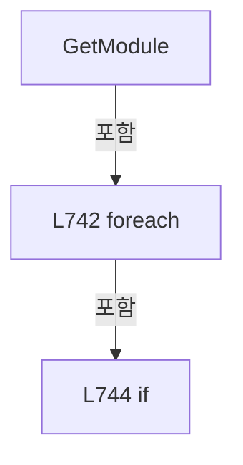

변경 전 점검: 입력/반환 타입, 위 호출자, 예외/취소 경로, 공유 상태와 저장·전송 소비자를 함께 확인합니다. 값의 단위나 물리 방향을 이름만으로 확정하지 않습니다.

### MethodDeclaration `Validate` · L768–768

[Drilling.Common/Managers/CManager.cs:768–768](https://github.com/kjuws10-rgb/A3Drilling/blob/5aee8e58439c9b455cae7c9593c9be986c3e682e/Drilling.Common/Managers/CManager.cs#L768-L768)

| 항목 | 실제 추출 값 |
| --- | --- |
| 서명 | System.Threading.Tasks.Task<System.Collections.Generic.IReadOnlyList<Drilling.Common.Managers.ST_CONFIG_FILE_STATUS>> Drilling.Common.Managers.CConfigStructureFileBase.Validate(System.Threading.CancellationToken) |
| 접근/수식자 | Public / public, abstract |
| 반환/값 타입 | System.Threading.Tasks.Task<System.Collections.Generic.IReadOnlyList<Drilling.Common.Managers.ST_CONFIG_FILE_STATUS>> |
| 소속 타입 | NamedType:Drilling.Common.Managers.CConfigStructureFileBase |

입력 계약:

| 이름 | 타입 | 전달 | 선택/기본값 |
| --- | --- | --- | --- |
| cancellationToken | System.Threading.CancellationToken | None | True / null |

정적 호출자로 확인된 위치:

| 호출 파일/행 | 호출 표현식 | 런타임 분기 가능 |
| --- | --- | --- |
| [Drilling.Common/Managers/CManager.cs:456–456](https://github.com/kjuws10-rgb/A3Drilling/blob/5aee8e58439c9b455cae7c9593c9be986c3e682e/Drilling.Common/Managers/CManager.cs#L456-L456) | _configStructureFile.Validate | False |

변경 전 점검: 입력/반환 타입, 위 호출자, 예외/취소 경로, 공유 상태와 저장·전송 소비자를 함께 확인합니다. 값의 단위나 물리 방향을 이름만으로 확정하지 않습니다.

### MethodDeclaration `List` · L773–773

[Drilling.Common/Managers/CManager.cs:773–773](https://github.com/kjuws10-rgb/A3Drilling/blob/5aee8e58439c9b455cae7c9593c9be986c3e682e/Drilling.Common/Managers/CManager.cs#L773-L773)

| 항목 | 실제 추출 값 |
| --- | --- |
| 서명 | System.Threading.Tasks.Task<System.Collections.Generic.IReadOnlyList<string>> Drilling.Common.Managers.CManualScanFileBase.List(System.Threading.CancellationToken) |
| 접근/수식자 | Public / public, abstract |
| 반환/값 타입 | System.Threading.Tasks.Task<System.Collections.Generic.IReadOnlyList<string>> |
| 소속 타입 | NamedType:Drilling.Common.Managers.CManualScanFileBase |

입력 계약:

| 이름 | 타입 | 전달 | 선택/기본값 |
| --- | --- | --- | --- |
| cancellationToken | System.Threading.CancellationToken | None | True / null |

정적 호출자로 확인된 위치:

| 호출 파일/행 | 호출 표현식 | 런타임 분기 가능 |
| --- | --- | --- |
| [Drilling.UI/Menu/Menus/CMenuManual.cs:1081–1081](https://github.com/kjuws10-rgb/A3Drilling/blob/5aee8e58439c9b455cae7c9593c9be986c3e682e/Drilling.UI/Menu/Menus/CMenuManual.cs#L1081-L1081) | _scanFile.List | False |
| [Drilling.UI/Menu/Menus/CMenuManual.cs:4202–4202](https://github.com/kjuws10-rgb/A3Drilling/blob/5aee8e58439c9b455cae7c9593c9be986c3e682e/Drilling.UI/Menu/Menus/CMenuManual.cs#L4202-L4202) | _scanFile.List | False |
| [Drilling.UI/Menu/Menus/CMenuManual.cs:5006–5006](https://github.com/kjuws10-rgb/A3Drilling/blob/5aee8e58439c9b455cae7c9593c9be986c3e682e/Drilling.UI/Menu/Menus/CMenuManual.cs#L5006-L5006) | _scanFile.List | False |
| [Drilling.UI/Menu/Menus/CMenuManual.cs:5085–5085](https://github.com/kjuws10-rgb/A3Drilling/blob/5aee8e58439c9b455cae7c9593c9be986c3e682e/Drilling.UI/Menu/Menus/CMenuManual.cs#L5085-L5085) | _scanFile.List | False |
| [Drilling.UI/Menu/Menus/CMenuManual.cs:5176–5176](https://github.com/kjuws10-rgb/A3Drilling/blob/5aee8e58439c9b455cae7c9593c9be986c3e682e/Drilling.UI/Menu/Menus/CMenuManual.cs#L5176-L5176) | _scanFile.List | False |

변경 전 점검: 입력/반환 타입, 위 호출자, 예외/취소 경로, 공유 상태와 저장·전송 소비자를 함께 확인합니다. 값의 단위나 물리 방향을 이름만으로 확정하지 않습니다.

### MethodDeclaration `LoadForm` · L774–774

[Drilling.Common/Managers/CManager.cs:774–774](https://github.com/kjuws10-rgb/A3Drilling/blob/5aee8e58439c9b455cae7c9593c9be986c3e682e/Drilling.Common/Managers/CManager.cs#L774-L774)

| 항목 | 실제 추출 값 |
| --- | --- |
| 서명 | System.Threading.Tasks.Task<System.Collections.Generic.IReadOnlyList<Drilling.Common.Managers.ST_MANUAL_SCAN_FORM>> Drilling.Common.Managers.CManualScanFileBase.LoadForm(System.Threading.CancellationToken) |
| 접근/수식자 | Public / public, abstract |
| 반환/값 타입 | System.Threading.Tasks.Task<System.Collections.Generic.IReadOnlyList<Drilling.Common.Managers.ST_MANUAL_SCAN_FORM>> |
| 소속 타입 | NamedType:Drilling.Common.Managers.CManualScanFileBase |

입력 계약:

| 이름 | 타입 | 전달 | 선택/기본값 |
| --- | --- | --- | --- |
| cancellationToken | System.Threading.CancellationToken | None | True / null |

정적 호출자로 확인된 위치:

| 호출 파일/행 | 호출 표현식 | 런타임 분기 가능 |
| --- | --- | --- |
| [Drilling.UI/Menu/Menus/CMenuManual.cs:1084–1084](https://github.com/kjuws10-rgb/A3Drilling/blob/5aee8e58439c9b455cae7c9593c9be986c3e682e/Drilling.UI/Menu/Menus/CMenuManual.cs#L1084-L1084) | _scanFile.LoadForm | False |
| [Drilling.UI/Menu/Menus/CMenuManual.cs:4207–4207](https://github.com/kjuws10-rgb/A3Drilling/blob/5aee8e58439c9b455cae7c9593c9be986c3e682e/Drilling.UI/Menu/Menus/CMenuManual.cs#L4207-L4207) | _scanFile.LoadForm | False |

변경 전 점검: 입력/반환 타입, 위 호출자, 예외/취소 경로, 공유 상태와 저장·전송 소비자를 함께 확인합니다. 값의 단위나 물리 방향을 이름만으로 확정하지 않습니다.

### MethodDeclaration `Load` · L775–775

[Drilling.Common/Managers/CManager.cs:775–775](https://github.com/kjuws10-rgb/A3Drilling/blob/5aee8e58439c9b455cae7c9593c9be986c3e682e/Drilling.Common/Managers/CManager.cs#L775-L775)

| 항목 | 실제 추출 값 |
| --- | --- |
| 서명 | System.Threading.Tasks.Task<Drilling.Common.Managers.ST_MANUAL_SCAN_PARAM> Drilling.Common.Managers.CManualScanFileBase.Load(System.Threading.CancellationToken) |
| 접근/수식자 | Public / public, abstract |
| 반환/값 타입 | System.Threading.Tasks.Task<Drilling.Common.Managers.ST_MANUAL_SCAN_PARAM> |
| 소속 타입 | NamedType:Drilling.Common.Managers.CManualScanFileBase |

입력 계약:

| 이름 | 타입 | 전달 | 선택/기본값 |
| --- | --- | --- | --- |
| cancellationToken | System.Threading.CancellationToken | None | True / null |

현재 부분 분석에서 직접 연결된 호출자는 없습니다. XAML/이벤트/인터페이스·델리게이트·외부 진입을 추가 확인해야 하며, 미사용으로 판정한 것이 아닙니다.

변경 전 점검: 입력/반환 타입, 위 호출자, 예외/취소 경로, 공유 상태와 저장·전송 소비자를 함께 확인합니다. 값의 단위나 물리 방향을 이름만으로 확정하지 않습니다.

### MethodDeclaration `Load` · L776–776

[Drilling.Common/Managers/CManager.cs:776–776](https://github.com/kjuws10-rgb/A3Drilling/blob/5aee8e58439c9b455cae7c9593c9be986c3e682e/Drilling.Common/Managers/CManager.cs#L776-L776)

| 항목 | 실제 추출 값 |
| --- | --- |
| 서명 | System.Threading.Tasks.Task<Drilling.Common.Managers.ST_MANUAL_SCAN_PARAM> Drilling.Common.Managers.CManualScanFileBase.Load(string, System.Threading.CancellationToken) |
| 접근/수식자 | Public / public, abstract |
| 반환/값 타입 | System.Threading.Tasks.Task<Drilling.Common.Managers.ST_MANUAL_SCAN_PARAM> |
| 소속 타입 | NamedType:Drilling.Common.Managers.CManualScanFileBase |

입력 계약:

| 이름 | 타입 | 전달 | 선택/기본값 |
| --- | --- | --- | --- |
| settingName | string | None | False /  |
| cancellationToken | System.Threading.CancellationToken | None | True / null |

정적 호출자로 확인된 위치:

| 호출 파일/행 | 호출 표현식 | 런타임 분기 가능 |
| --- | --- | --- |
| [Drilling.UI/Menu/Menus/CMenuManual.cs:1086–1086](https://github.com/kjuws10-rgb/A3Drilling/blob/5aee8e58439c9b455cae7c9593c9be986c3e682e/Drilling.UI/Menu/Menus/CMenuManual.cs#L1086-L1086) | _scanFile.Load | False |
| [Drilling.UI/Menu/Menus/CMenuManual.cs:4206–4206](https://github.com/kjuws10-rgb/A3Drilling/blob/5aee8e58439c9b455cae7c9593c9be986c3e682e/Drilling.UI/Menu/Menus/CMenuManual.cs#L4206-L4206) | _scanFile.Load | False |

변경 전 점검: 입력/반환 타입, 위 호출자, 예외/취소 경로, 공유 상태와 저장·전송 소비자를 함께 확인합니다. 값의 단위나 물리 방향을 이름만으로 확정하지 않습니다.

### MethodDeclaration `Save` · L777–777

[Drilling.Common/Managers/CManager.cs:777–777](https://github.com/kjuws10-rgb/A3Drilling/blob/5aee8e58439c9b455cae7c9593c9be986c3e682e/Drilling.Common/Managers/CManager.cs#L777-L777)

| 항목 | 실제 추출 값 |
| --- | --- |
| 서명 | System.Threading.Tasks.Task Drilling.Common.Managers.CManualScanFileBase.Save(Drilling.Common.Managers.ST_MANUAL_SCAN_PARAM, System.Threading.CancellationToken) |
| 접근/수식자 | Public / public, abstract |
| 반환/값 타입 | System.Threading.Tasks.Task |
| 소속 타입 | NamedType:Drilling.Common.Managers.CManualScanFileBase |

입력 계약:

| 이름 | 타입 | 전달 | 선택/기본값 |
| --- | --- | --- | --- |
| settings | Drilling.Common.Managers.ST_MANUAL_SCAN_PARAM | None | False /  |
| cancellationToken | System.Threading.CancellationToken | None | True / null |

현재 부분 분석에서 직접 연결된 호출자는 없습니다. XAML/이벤트/인터페이스·델리게이트·외부 진입을 추가 확인해야 하며, 미사용으로 판정한 것이 아닙니다.

변경 전 점검: 입력/반환 타입, 위 호출자, 예외/취소 경로, 공유 상태와 저장·전송 소비자를 함께 확인합니다. 값의 단위나 물리 방향을 이름만으로 확정하지 않습니다.

### MethodDeclaration `Save` · L778–778

[Drilling.Common/Managers/CManager.cs:778–778](https://github.com/kjuws10-rgb/A3Drilling/blob/5aee8e58439c9b455cae7c9593c9be986c3e682e/Drilling.Common/Managers/CManager.cs#L778-L778)

| 항목 | 실제 추출 값 |
| --- | --- |
| 서명 | System.Threading.Tasks.Task Drilling.Common.Managers.CManualScanFileBase.Save(string, Drilling.Common.Managers.ST_MANUAL_SCAN_PARAM, System.Threading.CancellationToken) |
| 접근/수식자 | Public / public, abstract |
| 반환/값 타입 | System.Threading.Tasks.Task |
| 소속 타입 | NamedType:Drilling.Common.Managers.CManualScanFileBase |

입력 계약:

| 이름 | 타입 | 전달 | 선택/기본값 |
| --- | --- | --- | --- |
| settingName | string | None | False /  |
| settings | Drilling.Common.Managers.ST_MANUAL_SCAN_PARAM | None | False /  |
| cancellationToken | System.Threading.CancellationToken | None | True / null |

정적 호출자로 확인된 위치:

| 호출 파일/행 | 호출 표현식 | 런타임 분기 가능 |
| --- | --- | --- |
| [Drilling.UI/Menu/Menus/CMenuManual.cs:5144–5144](https://github.com/kjuws10-rgb/A3Drilling/blob/5aee8e58439c9b455cae7c9593c9be986c3e682e/Drilling.UI/Menu/Menus/CMenuManual.cs#L5144-L5144) | _scanFile.Save | False |

변경 전 점검: 입력/반환 타입, 위 호출자, 예외/취소 경로, 공유 상태와 저장·전송 소비자를 함께 확인합니다. 값의 단위나 물리 방향을 이름만으로 확정하지 않습니다.

### MethodDeclaration `Rename` · L779–779

[Drilling.Common/Managers/CManager.cs:779–779](https://github.com/kjuws10-rgb/A3Drilling/blob/5aee8e58439c9b455cae7c9593c9be986c3e682e/Drilling.Common/Managers/CManager.cs#L779-L779)

| 항목 | 실제 추출 값 |
| --- | --- |
| 서명 | System.Threading.Tasks.Task Drilling.Common.Managers.CManualScanFileBase.Rename(string, string, System.Threading.CancellationToken) |
| 접근/수식자 | Public / public, abstract |
| 반환/값 타입 | System.Threading.Tasks.Task |
| 소속 타입 | NamedType:Drilling.Common.Managers.CManualScanFileBase |

입력 계약:

| 이름 | 타입 | 전달 | 선택/기본값 |
| --- | --- | --- | --- |
| oldSettingName | string | None | False /  |
| newSettingName | string | None | False /  |
| cancellationToken | System.Threading.CancellationToken | None | True / null |

정적 호출자로 확인된 위치:

| 호출 파일/행 | 호출 표현식 | 런타임 분기 가능 |
| --- | --- | --- |
| [Drilling.UI/Menu/Menus/CMenuManual.cs:5125–5125](https://github.com/kjuws10-rgb/A3Drilling/blob/5aee8e58439c9b455cae7c9593c9be986c3e682e/Drilling.UI/Menu/Menus/CMenuManual.cs#L5125-L5125) | _scanFile.Rename | False |

변경 전 점검: 입력/반환 타입, 위 호출자, 예외/취소 경로, 공유 상태와 저장·전송 소비자를 함께 확인합니다. 값의 단위나 물리 방향을 이름만으로 확정하지 않습니다.

### MethodDeclaration `Delete` · L780–780

[Drilling.Common/Managers/CManager.cs:780–780](https://github.com/kjuws10-rgb/A3Drilling/blob/5aee8e58439c9b455cae7c9593c9be986c3e682e/Drilling.Common/Managers/CManager.cs#L780-L780)

| 항목 | 실제 추출 값 |
| --- | --- |
| 서명 | System.Threading.Tasks.Task Drilling.Common.Managers.CManualScanFileBase.Delete(string, System.Threading.CancellationToken) |
| 접근/수식자 | Public / public, abstract |
| 반환/값 타입 | System.Threading.Tasks.Task |
| 소속 타입 | NamedType:Drilling.Common.Managers.CManualScanFileBase |

입력 계약:

| 이름 | 타입 | 전달 | 선택/기본값 |
| --- | --- | --- | --- |
| settingName | string | None | False /  |
| cancellationToken | System.Threading.CancellationToken | None | True / null |

정적 호출자로 확인된 위치:

| 호출 파일/행 | 호출 표현식 | 런타임 분기 가능 |
| --- | --- | --- |
| [Drilling.UI/Menu/Menus/CMenuManual.cs:5175–5175](https://github.com/kjuws10-rgb/A3Drilling/blob/5aee8e58439c9b455cae7c9593c9be986c3e682e/Drilling.UI/Menu/Menus/CMenuManual.cs#L5175-L5175) | _scanFile.Delete | False |

변경 전 점검: 입력/반환 타입, 위 호출자, 예외/취소 경로, 공유 상태와 저장·전송 소비자를 함께 확인합니다. 값의 단위나 물리 방향을 이름만으로 확정하지 않습니다.

## 구문·바인딩 한계

전체 WPF/벤더 SDK/프로젝트별 빌드 조건을 로드한 정식 빌드가 아닙니다. `resolved`는 이 부분 컴파일에서의 심볼 연결이며 virtual/interface/delegate/이벤트/Reflection/XAML의 실제 런타임 구현을 확정하지 않습니다. `candidate`와 `unresolved`는 후속 확인 대상으로 남깁니다.

## 원문 전체 주석 해설본

[원본 모든 행과 행별 해설 보기](../../../annotated/Drilling.Common/Managers/CManager.cs.annotated.txt)

원본을 빠뜨리거나 임의로 줄이지 않았습니다. `L000001 |` 표시는 원본 행 번호, `// 해설`은 별도 설명입니다. 실행용 소스가 아닌 문서입니다.

## 수정·재검증 체크

- 원본 Commit과 현재 작업 파일 SHA가 같은지 먼저 확인합니다. 다르면 이 문서를 과거 버전 자료로 취급합니다.
- 선언·직접 호출·이벤트/인터페이스 경계·설정 소비를 함께 확인합니다. 정적 연결의 빈 곳을 정상 경로로 추정하지 않습니다.
- 저장 형식/단위/식별자·재시도·취소·예외·롤백에 영향을 주는 변경은 상세 해설장과 호출자를 다시 검토합니다.
- 도구의 구문 추출과 별도 정적 추적 해설, 실제 빌드·시뮬레이션·실장비 검증 결과를 분리합니다.
