# Drilling.Common/Managers/CRecipeManager.cs

| 항목 | 내용 |
| --- | --- |
| 원본 저장소 | https://github.com/kjuws10-rgb/A3Drilling.git |
| 원본 Commit | 5aee8e58439c9b455cae7c9593c9be986c3e682e |
| 원본 SHA256 | 489bd204fadb9948929e6d665db38a2e3bc7aa2b0a4343fd74975809c3490106 |
| 파일 분류 | code |
| 원본 크기/행 | 24,590 bytes / 440 physical lines |
| 인코딩 | utf-8-sig |
| 검토 범위 | 구문/부분 의미 분석에서 추출한 사실. 동작·물리 단위·실장비 합격을 보증하지 않습니다. |
| 원본 링크 | [고정 Commit 원본](https://github.com/kjuws10-rgb/A3Drilling/blob/5aee8e58439c9b455cae7c9593c9be986c3e682e/Drilling.Common/Managers/CRecipeManager.cs) |

## 파일의 역할과 읽는 순서

프로그램의 시작·구성·공유 타입 또는 빌드 연결에 사용됩니다. 아래 실제 선언·참조와 원본 근거를 확인합니다.

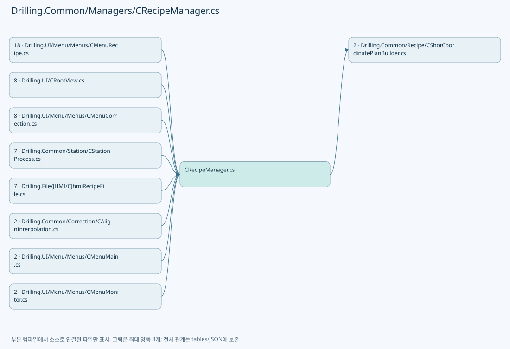

## 네임스페이스·타입·상속

| 타입 | 구분 | 원본 범위 | 선언/상속 |
| --- | --- | --- | --- |
| CRecipeManager | ClassDeclaration | 11–335 | CRecipeManager |
| ST_RECIPE_COMPANION_FOLDER | RecordDeclaration | 337–337 | ST_RECIPE_COMPANION_FOLDER |
| IRecipeCopyStore | InterfaceDeclaration | 339–345 | IRecipeCopyStore |
| EN_RECIPE_DATA_TYPE | EnumDeclaration | 347–353 | EN_RECIPE_DATA_TYPE |
| ST_RECIPE_PARAMETER | RecordDeclaration | 355–373 | ST_RECIPE_PARAMETER |
| ST_RECIPE_HISTORY | RecordDeclaration | 374–384 | ST_RECIPE_HISTORY |
| ST_RECIPE_DEFINITION | RecordDeclaration | 385–385 | ST_RECIPE_DEFINITION |
| ST_RECIPE_FORM_ITEM | RecordDeclaration | 386–404 | ST_RECIPE_FORM_ITEM |
| ST_RECIPE_VALUE | RecordDeclaration | 405–405 | ST_RECIPE_VALUE |
| CRecipeFileBase | ClassDeclaration | 406–418 | CRecipeFileBase |
| CProtectWindowRecipeData | ClassDeclaration | 425–437 | CProtectWindowRecipeData |

## 멤버 빠른 목록

| 이름 | 종류 | 범위 | 서명 |
| --- | --- | --- | --- |
| _cacheLock | FieldDeclaration | L13–13 | object Drilling.Common.Managers.CRecipeManager._cacheLock |
| _recipeOperationGate | FieldDeclaration | L14–14 | System.Threading.SemaphoreSlim Drilling.Common.Managers.CRecipeManager._recipeOperationGate |
| _recipeCache | FieldDeclaration | L15–15 | System.Collections.Generic.IReadOnlyList<Drilling.Common.Managers.ST_RECIPE_DEFINITION>? Drilling.Common.Managers.CRecipeManager._recipeCache |
| _historyGate | FieldDeclaration | L16–16 | System.Threading.SemaphoreSlim Drilling.Common.Managers.CRecipeManager._historyGate |
| _historyCache | FieldDeclaration | L17–17 | System.Collections.Generic.IReadOnlyList<Drilling.Common.Managers.ST_RECIPE_HISTORY>? Drilling.Common.Managers.CRecipeManager._historyCache |
| LoadHistory | MethodDeclaration | L18–18 | System.Threading.Tasks.Task<System.Collections.Generic.IReadOnlyList<Drilling.Common.Managers.ST_RECIPE_HISTORY>> Drilling.Common.Managers.CRecipeManager.LoadHistory(System.Threading.CancellationToken) |
| LoadHistoryCore | MethodDeclaration | L19–32 | System.Threading.Tasks.Task<System.Collections.Generic.IReadOnlyList<Drilling.Common.Managers.ST_RECIPE_HISTORY>> Drilling.Common.Managers.CRecipeManager.LoadHistoryCore(bool, System.Threading.CancellationToken) |
| RecordSelection | MethodDeclaration | L34–38 | System.Threading.Tasks.Task Drilling.Common.Managers.CRecipeManager.RecordSelection(string, string, System.Threading.CancellationToken) |
| LoadRecipes | MethodDeclaration | L40–71 | System.Threading.Tasks.Task<System.Collections.Generic.IReadOnlyList<Drilling.Common.Managers.ST_RECIPE_DEFINITION>> Drilling.Common.Managers.CRecipeManager.LoadRecipes(System.Threading.CancellationToken) |
| SaveRecipe | MethodDeclaration | L73–73 | System.Threading.Tasks.Task Drilling.Common.Managers.CRecipeManager.SaveRecipe(Drilling.Common.Managers.ST_RECIPE_DEFINITION, System.Threading.CancellationToken) |
| SaveParametersIfUnchanged | MethodDeclaration | L74–93 | System.Threading.Tasks.Task<Drilling.Common.Managers.ST_RECIPE_DEFINITION> Drilling.Common.Managers.CRecipeManager.SaveParametersIfUnchanged(Drilling.Common.Managers.ST_RECIPE_DEFINITION, System.Collections.Generic.IReadOnlyDictionary<string, string>, System.Threading.CancellationToken) |
| SaveAlignOffsetsIfUnchanged | MethodDeclaration | L94–109 | System.Threading.Tasks.Task<Drilling.Common.Managers.ST_RECIPE_DEFINITION> Drilling.Common.Managers.CRecipeManager.SaveAlignOffsetsIfUnchanged(Drilling.Common.Managers.ST_RECIPE_DEFINITION, System.Collections.Generic.IReadOnlyList<Drilling.Common.Recipe.ST_ALIGN_SHOT_OFFSET>, System.Threading.CancellationToken) |
| SavePowerMeasureAngles | MethodDeclaration | L112–126 | System.Threading.Tasks.Task Drilling.Common.Managers.CRecipeManager.SavePowerMeasureAngles(string, System.Collections.Generic.IReadOnlyDictionary<int, double>, System.Threading.CancellationToken) |
| ListCompanionFolders | MethodDeclaration | L127–127 | System.Threading.Tasks.Task<System.Collections.Generic.IReadOnlyList<Drilling.Common.Managers.ST_RECIPE_COMPANION_FOLDER>> Drilling.Common.Managers.CRecipeManager.ListCompanionFolders(string, string, System.Threading.CancellationToken) |
| CreateRecipeCopy | MethodDeclaration | L128–144 | System.Threading.Tasks.Task Drilling.Common.Managers.CRecipeManager.CreateRecipeCopy(Drilling.Common.Managers.ST_RECIPE_DEFINITION, string, System.Collections.Generic.IReadOnlyCollection<string>, System.Threading.CancellationToken) |
| SaveRecipeCore | MethodDeclaration | L145–157 | System.Threading.Tasks.Task Drilling.Common.Managers.CRecipeManager.SaveRecipeCore(Drilling.Common.Managers.ST_RECIPE_DEFINITION, System.Threading.CancellationToken) |
| RefreshRecipe | MethodDeclaration | L159–159 | System.Threading.Tasks.Task<Drilling.Common.Managers.ST_RECIPE_DEFINITION?> Drilling.Common.Managers.CRecipeManager.RefreshRecipe(string, System.Threading.CancellationToken) |
| RefreshRecipeCore | MethodDeclaration | L160–168 | System.Threading.Tasks.Task<Drilling.Common.Managers.ST_RECIPE_DEFINITION?> Drilling.Common.Managers.CRecipeManager.RefreshRecipeCore(string, System.Threading.CancellationToken) |
| RenameRecipe | MethodDeclaration | L170–170 | System.Threading.Tasks.Task Drilling.Common.Managers.CRecipeManager.RenameRecipe(string, string, System.Threading.CancellationToken) |
| RenameRecipe | MethodDeclaration | L171–171 | System.Threading.Tasks.Task Drilling.Common.Managers.CRecipeManager.RenameRecipe(string, string, System.Collections.Generic.IReadOnlyCollection<string>, System.Threading.CancellationToken) |
| RenameRecipeCore | MethodDeclaration | L172–188 | System.Threading.Tasks.Task Drilling.Common.Managers.CRecipeManager.RenameRecipeCore(string, string, System.Threading.CancellationToken, System.Collections.Generic.IReadOnlyCollection<string>?) |
| DeleteRecipe | MethodDeclaration | L190–190 | System.Threading.Tasks.Task Drilling.Common.Managers.CRecipeManager.DeleteRecipe(string, System.Threading.CancellationToken) |
| DeleteRecipe | MethodDeclaration | L191–191 | System.Threading.Tasks.Task Drilling.Common.Managers.CRecipeManager.DeleteRecipe(string, System.Collections.Generic.IReadOnlyCollection<string>, System.Threading.CancellationToken) |
| DeleteRecipeCore | MethodDeclaration | L192–205 | System.Threading.Tasks.Task Drilling.Common.Managers.CRecipeManager.DeleteRecipeCore(string, System.Threading.CancellationToken, System.Collections.Generic.IReadOnlyCollection<string>?) |
| IncrementProtectWindowCount | MethodDeclaration | L207–207 | System.Threading.Tasks.Task<int> Drilling.Common.Managers.CRecipeManager.IncrementProtectWindowCount(string, System.Threading.CancellationToken) |
| ResetProtectWindowCount | MethodDeclaration | L208–208 | System.Threading.Tasks.Task<int> Drilling.Common.Managers.CRecipeManager.ResetProtectWindowCount(string, System.Threading.CancellationToken) |
| SetProtectWindowCount | MethodDeclaration | L209–209 | System.Threading.Tasks.Task<int> Drilling.Common.Managers.CRecipeManager.SetProtectWindowCount(string, int, System.Threading.CancellationToken) |
| ChangeProtectWindowCount | MethodDeclaration | L210–221 | System.Threading.Tasks.Task<int> Drilling.Common.Managers.CRecipeManager.ChangeProtectWindowCount(string, System.Func<System.Threading.Tasks.Task<int>>, System.Threading.CancellationToken) |
| WithRecipeOperation | MethodDeclaration | L222–233 | System.Threading.Tasks.Task Drilling.Common.Managers.CRecipeManager.WithRecipeOperation(System.Func<System.Threading.Tasks.Task>, System.Threading.CancellationToken) |
| WithRecipeOperation | MethodDeclaration | L235–246 | System.Threading.Tasks.Task<T> Drilling.Common.Managers.CRecipeManager.WithRecipeOperation<T>(System.Func<System.Threading.Tasks.Task<T>>, System.Threading.CancellationToken) |
| UpdateCachedRecipe | MethodDeclaration | L248–278 | void Drilling.Common.Managers.CRecipeManager.UpdateCachedRecipe(Drilling.Common.Managers.ST_RECIPE_DEFINITION) |
| RenameCachedRecipe | MethodDeclaration | L280–303 | void Drilling.Common.Managers.CRecipeManager.RenameCachedRecipe(string, string) |
| DeleteCachedRecipe | MethodDeclaration | L305–325 | void Drilling.Common.Managers.CRecipeManager.DeleteCachedRecipe(string) |
| CloneRecipe | MethodDeclaration | L327–334 | Drilling.Common.Managers.ST_RECIPE_DEFINITION Drilling.Common.Managers.CRecipeManager.CloneRecipe(Drilling.Common.Managers.ST_RECIPE_DEFINITION) |
| ListCompanionFolders | MethodDeclaration | L341–341 | System.Threading.Tasks.Task<System.Collections.Generic.IReadOnlyList<Drilling.Common.Managers.ST_RECIPE_COMPANION_FOLDER>> Drilling.Common.Managers.IRecipeCopyStore.ListCompanionFolders(string, string, System.Threading.CancellationToken) |
| CreateCopy | MethodDeclaration | L342–342 | System.Threading.Tasks.Task Drilling.Common.Managers.IRecipeCopyStore.CreateCopy(Drilling.Common.Managers.ST_RECIPE_DEFINITION, string, System.Collections.Generic.IReadOnlyCollection<string>, System.Threading.CancellationToken) |
| RenameWithCompanions | MethodDeclaration | L343–343 | System.Threading.Tasks.Task Drilling.Common.Managers.IRecipeCopyStore.RenameWithCompanions(string, string, System.Collections.Generic.IReadOnlyCollection<string>, System.Threading.CancellationToken) |
| DeleteWithCompanions | MethodDeclaration | L344–344 | System.Threading.Tasks.Task Drilling.Common.Managers.IRecipeCopyStore.DeleteWithCompanions(string, System.Collections.Generic.IReadOnlyCollection<string>, System.Threading.CancellationToken) |
| String | EnumMemberDeclaration | L349–349 | Drilling.Common.Managers.EN_RECIPE_DATA_TYPE.String |
| Int | EnumMemberDeclaration | L350–350 | Drilling.Common.Managers.EN_RECIPE_DATA_TYPE.Int |
| Double | EnumMemberDeclaration | L351–351 | Drilling.Common.Managers.EN_RECIPE_DATA_TYPE.Double |
| Bool | EnumMemberDeclaration | L352–352 | Drilling.Common.Managers.EN_RECIPE_DATA_TYPE.Bool |
| LoadAll | MethodDeclaration | L408–408 | System.Threading.Tasks.Task<System.Collections.Generic.IReadOnlyList<Drilling.Common.Managers.ST_RECIPE_DEFINITION>> Drilling.Common.Managers.CRecipeFileBase.LoadAll(System.Threading.CancellationToken) |
| Find | MethodDeclaration | L409–409 | System.Threading.Tasks.Task<Drilling.Common.Managers.ST_RECIPE_DEFINITION?> Drilling.Common.Managers.CRecipeFileBase.Find(string, System.Threading.CancellationToken) |
| Save | MethodDeclaration | L410–410 | System.Threading.Tasks.Task Drilling.Common.Managers.CRecipeFileBase.Save(Drilling.Common.Managers.ST_RECIPE_DEFINITION, System.Threading.CancellationToken) |
| Rename | MethodDeclaration | L411–411 | System.Threading.Tasks.Task Drilling.Common.Managers.CRecipeFileBase.Rename(string, string, System.Threading.CancellationToken) |
| Delete | MethodDeclaration | L412–412 | System.Threading.Tasks.Task Drilling.Common.Managers.CRecipeFileBase.Delete(string, System.Threading.CancellationToken) |
| LoadHistory | MethodDeclaration | L413–413 | System.Threading.Tasks.Task<System.Collections.Generic.IReadOnlyList<Drilling.Common.Managers.ST_RECIPE_HISTORY>> Drilling.Common.Managers.CRecipeFileBase.LoadHistory(System.Threading.CancellationToken) |
| RecordSelection | MethodDeclaration | L414–414 | System.Threading.Tasks.Task Drilling.Common.Managers.CRecipeFileBase.RecordSelection(string, string, System.Threading.CancellationToken) |
| IncrementProtectWindowCount | MethodDeclaration | L415–415 | System.Threading.Tasks.Task<int> Drilling.Common.Managers.CRecipeFileBase.IncrementProtectWindowCount(string, System.Threading.CancellationToken) |
| ResetProtectWindowCount | MethodDeclaration | L416–416 | System.Threading.Tasks.Task<int> Drilling.Common.Managers.CRecipeFileBase.ResetProtectWindowCount(string, System.Threading.CancellationToken) |
| SetProtectWindowCount | MethodDeclaration | L417–417 | System.Threading.Tasks.Task<int> Drilling.Common.Managers.CRecipeFileBase.SetProtectWindowCount(string, int, System.Threading.CancellationToken) |
| Tab | FieldDeclaration | L427–427 | string Drilling.Common.Recipe.CProtectWindowRecipeData.Tab |
| Group | FieldDeclaration | L428–428 | string Drilling.Common.Recipe.CProtectWindowRecipeData.Group |
| MaximumCountKey | FieldDeclaration | L429–429 | string Drilling.Common.Recipe.CProtectWindowRecipeData.MaximumCountKey |
| CurrentCountKey | FieldDeclaration | L430–430 | string Drilling.Common.Recipe.CProtectWindowRecipeData.CurrentCountKey |
| ParseCount | MethodDeclaration | L431–436 | int Drilling.Common.Recipe.CProtectWindowRecipeData.ParseCount(string?, string) |

## 멤버별 상세 계약·호출·처리 해설

### FieldDeclaration `_cacheLock` · L13–13

[Drilling.Common/Managers/CRecipeManager.cs:13–13](https://github.com/kjuws10-rgb/A3Drilling/blob/5aee8e58439c9b455cae7c9593c9be986c3e682e/Drilling.Common/Managers/CRecipeManager.cs#L13-L13)

| 항목 | 실제 추출 값 |
| --- | --- |
| 서명 | object Drilling.Common.Managers.CRecipeManager._cacheLock |
| 접근/수식자 | Private / private, readonly |
| 반환/값 타입 | object |
| 소속 타입 | NamedType:Drilling.Common.Managers.CRecipeManager |

현재 부분 분석에서 직접 연결된 호출자는 없습니다. XAML/이벤트/인터페이스·델리게이트·외부 진입을 추가 확인해야 하며, 미사용으로 판정한 것이 아닙니다.

호출하는 대상과 해석 범위:

| 원본 행 | 표현식 | 분석 상태 | 대상/소스 위치 |
| --- | --- | --- | --- |
| 13 | new | resolved | object.Object() |

본문의 실제 연산·분기·예외·반환 순서(원문 위치 순):

| 원본 행 | 종류 | 주석 해설 |
| --- | --- | --- |
| 13 | call | 함수·델리게이트 또는 객체 생성자를 호출합니다: new() |
| 13 | variable-initializer | 변수의 초기값을 지정합니다: _cacheLock = new() |

변경 전 점검: 입력/반환 타입, 위 호출자, 예외/취소 경로, 공유 상태와 저장·전송 소비자를 함께 확인합니다. 값의 단위나 물리 방향을 이름만으로 확정하지 않습니다.

### FieldDeclaration `_recipeOperationGate` · L14–14

[Drilling.Common/Managers/CRecipeManager.cs:14–14](https://github.com/kjuws10-rgb/A3Drilling/blob/5aee8e58439c9b455cae7c9593c9be986c3e682e/Drilling.Common/Managers/CRecipeManager.cs#L14-L14)

| 항목 | 실제 추출 값 |
| --- | --- |
| 서명 | System.Threading.SemaphoreSlim Drilling.Common.Managers.CRecipeManager._recipeOperationGate |
| 접근/수식자 | Private / private, readonly |
| 반환/값 타입 | System.Threading.SemaphoreSlim |
| 소속 타입 | NamedType:Drilling.Common.Managers.CRecipeManager |

현재 부분 분석에서 직접 연결된 호출자는 없습니다. XAML/이벤트/인터페이스·델리게이트·외부 진입을 추가 확인해야 하며, 미사용으로 판정한 것이 아닙니다.

호출하는 대상과 해석 범위:

| 원본 행 | 표현식 | 분석 상태 | 대상/소스 위치 |
| --- | --- | --- | --- |
| 14 | new | resolved | System.Threading.SemaphoreSlim.SemaphoreSlim(int, int) |

본문의 실제 연산·분기·예외·반환 순서(원문 위치 순):

| 원본 행 | 종류 | 주석 해설 |
| --- | --- | --- |
| 14 | call | 함수·델리게이트 또는 객체 생성자를 호출합니다: new(1, 1) |
| 14 | variable-initializer | 변수의 초기값을 지정합니다: _recipeOperationGate = new(1, 1) |

변경 전 점검: 입력/반환 타입, 위 호출자, 예외/취소 경로, 공유 상태와 저장·전송 소비자를 함께 확인합니다. 값의 단위나 물리 방향을 이름만으로 확정하지 않습니다.

### FieldDeclaration `_recipeCache` · L15–15

[Drilling.Common/Managers/CRecipeManager.cs:15–15](https://github.com/kjuws10-rgb/A3Drilling/blob/5aee8e58439c9b455cae7c9593c9be986c3e682e/Drilling.Common/Managers/CRecipeManager.cs#L15-L15)

| 항목 | 실제 추출 값 |
| --- | --- |
| 서명 | System.Collections.Generic.IReadOnlyList<Drilling.Common.Managers.ST_RECIPE_DEFINITION>? Drilling.Common.Managers.CRecipeManager._recipeCache |
| 접근/수식자 | Private / private |
| 반환/값 타입 | System.Collections.Generic.IReadOnlyList<Drilling.Common.Managers.ST_RECIPE_DEFINITION>? |
| 소속 타입 | NamedType:Drilling.Common.Managers.CRecipeManager |

현재 부분 분석에서 직접 연결된 호출자는 없습니다. XAML/이벤트/인터페이스·델리게이트·외부 진입을 추가 확인해야 하며, 미사용으로 판정한 것이 아닙니다.

변경 전 점검: 입력/반환 타입, 위 호출자, 예외/취소 경로, 공유 상태와 저장·전송 소비자를 함께 확인합니다. 값의 단위나 물리 방향을 이름만으로 확정하지 않습니다.

### FieldDeclaration `_historyGate` · L16–16

[Drilling.Common/Managers/CRecipeManager.cs:16–16](https://github.com/kjuws10-rgb/A3Drilling/blob/5aee8e58439c9b455cae7c9593c9be986c3e682e/Drilling.Common/Managers/CRecipeManager.cs#L16-L16)

| 항목 | 실제 추출 값 |
| --- | --- |
| 서명 | System.Threading.SemaphoreSlim Drilling.Common.Managers.CRecipeManager._historyGate |
| 접근/수식자 | Private / private, readonly |
| 반환/값 타입 | System.Threading.SemaphoreSlim |
| 소속 타입 | NamedType:Drilling.Common.Managers.CRecipeManager |

현재 부분 분석에서 직접 연결된 호출자는 없습니다. XAML/이벤트/인터페이스·델리게이트·외부 진입을 추가 확인해야 하며, 미사용으로 판정한 것이 아닙니다.

호출하는 대상과 해석 범위:

| 원본 행 | 표현식 | 분석 상태 | 대상/소스 위치 |
| --- | --- | --- | --- |
| 16 | new | resolved | System.Threading.SemaphoreSlim.SemaphoreSlim(int, int) |

본문의 실제 연산·분기·예외·반환 순서(원문 위치 순):

| 원본 행 | 종류 | 주석 해설 |
| --- | --- | --- |
| 16 | call | 함수·델리게이트 또는 객체 생성자를 호출합니다: new(1, 1) |
| 16 | variable-initializer | 변수의 초기값을 지정합니다: _historyGate = new(1, 1) |

변경 전 점검: 입력/반환 타입, 위 호출자, 예외/취소 경로, 공유 상태와 저장·전송 소비자를 함께 확인합니다. 값의 단위나 물리 방향을 이름만으로 확정하지 않습니다.

### FieldDeclaration `_historyCache` · L17–17

[Drilling.Common/Managers/CRecipeManager.cs:17–17](https://github.com/kjuws10-rgb/A3Drilling/blob/5aee8e58439c9b455cae7c9593c9be986c3e682e/Drilling.Common/Managers/CRecipeManager.cs#L17-L17)

| 항목 | 실제 추출 값 |
| --- | --- |
| 서명 | System.Collections.Generic.IReadOnlyList<Drilling.Common.Managers.ST_RECIPE_HISTORY>? Drilling.Common.Managers.CRecipeManager._historyCache |
| 접근/수식자 | Private / private |
| 반환/값 타입 | System.Collections.Generic.IReadOnlyList<Drilling.Common.Managers.ST_RECIPE_HISTORY>? |
| 소속 타입 | NamedType:Drilling.Common.Managers.CRecipeManager |

현재 부분 분석에서 직접 연결된 호출자는 없습니다. XAML/이벤트/인터페이스·델리게이트·외부 진입을 추가 확인해야 하며, 미사용으로 판정한 것이 아닙니다.

변경 전 점검: 입력/반환 타입, 위 호출자, 예외/취소 경로, 공유 상태와 저장·전송 소비자를 함께 확인합니다. 값의 단위나 물리 방향을 이름만으로 확정하지 않습니다.

### MethodDeclaration `LoadHistory` · L18–18

[Drilling.Common/Managers/CRecipeManager.cs:18–18](https://github.com/kjuws10-rgb/A3Drilling/blob/5aee8e58439c9b455cae7c9593c9be986c3e682e/Drilling.Common/Managers/CRecipeManager.cs#L18-L18)

| 항목 | 실제 추출 값 |
| --- | --- |
| 서명 | System.Threading.Tasks.Task<System.Collections.Generic.IReadOnlyList<Drilling.Common.Managers.ST_RECIPE_HISTORY>> Drilling.Common.Managers.CRecipeManager.LoadHistory(System.Threading.CancellationToken) |
| 접근/수식자 | Public / public |
| 반환/값 타입 | System.Threading.Tasks.Task<System.Collections.Generic.IReadOnlyList<Drilling.Common.Managers.ST_RECIPE_HISTORY>> |
| 소속 타입 | NamedType:Drilling.Common.Managers.CRecipeManager |

입력 계약:

| 이름 | 타입 | 전달 | 선택/기본값 |
| --- | --- | --- | --- |
| cancellationToken | System.Threading.CancellationToken | None | True / null |

정적 호출자로 확인된 위치:

| 호출 파일/행 | 호출 표현식 | 런타임 분기 가능 |
| --- | --- | --- |
| [Drilling.UI/Menu/Menus/CMenuRecipe.cs:567–567](https://github.com/kjuws10-rgb/A3Drilling/blob/5aee8e58439c9b455cae7c9593c9be986c3e682e/Drilling.UI/Menu/Menus/CMenuRecipe.cs#L567-L567) | _recipeManager.LoadHistory | False |

호출하는 대상과 해석 범위:

| 원본 행 | 표현식 | 분석 상태 | 대상/소스 위치 |
| --- | --- | --- | --- |
| 18 | LoadHistoryCore | resolved | System.Threading.Tasks.Task<System.Collections.Generic.IReadOnlyList<Drilling.Common.Managers.ST_RECIPE_HISTORY>> Drilling.Common.Managers.CRecipeManager.LoadHistoryCore(bool, System.Threading.CancellationToken) · Drilling.Common/Managers/CRecipeManager.cs:19 |

본문의 실제 연산·분기·예외·반환 순서(원문 위치 순):

| 원본 행 | 종류 | 주석 해설 |
| --- | --- | --- |
| 18 | call | 함수·델리게이트 또는 객체 생성자를 호출합니다: LoadHistoryCore(false, cancellationToken) |

변경 전 점검: 입력/반환 타입, 위 호출자, 예외/취소 경로, 공유 상태와 저장·전송 소비자를 함께 확인합니다. 값의 단위나 물리 방향을 이름만으로 확정하지 않습니다.

### MethodDeclaration `LoadHistoryCore` · L19–32

[Drilling.Common/Managers/CRecipeManager.cs:19–32](https://github.com/kjuws10-rgb/A3Drilling/blob/5aee8e58439c9b455cae7c9593c9be986c3e682e/Drilling.Common/Managers/CRecipeManager.cs#L19-L32)

| 항목 | 실제 추출 값 |
| --- | --- |
| 서명 | System.Threading.Tasks.Task<System.Collections.Generic.IReadOnlyList<Drilling.Common.Managers.ST_RECIPE_HISTORY>> Drilling.Common.Managers.CRecipeManager.LoadHistoryCore(bool, System.Threading.CancellationToken) |
| 접근/수식자 | Private / private, async |
| 반환/값 타입 | System.Threading.Tasks.Task<System.Collections.Generic.IReadOnlyList<Drilling.Common.Managers.ST_RECIPE_HISTORY>> |
| 소속 타입 | NamedType:Drilling.Common.Managers.CRecipeManager |

입력 계약:

| 이름 | 타입 | 전달 | 선택/기본값 |
| --- | --- | --- | --- |
| refresh | bool | None | False /  |
| cancellationToken | System.Threading.CancellationToken | None | False /  |

정적 호출자로 확인된 위치:

| 호출 파일/행 | 호출 표현식 | 런타임 분기 가능 |
| --- | --- | --- |
| [Drilling.Common/Managers/CRecipeManager.cs:18–18](https://github.com/kjuws10-rgb/A3Drilling/blob/5aee8e58439c9b455cae7c9593c9be986c3e682e/Drilling.Common/Managers/CRecipeManager.cs#L18-L18) | LoadHistoryCore | False |
| [Drilling.Common/Managers/CRecipeManager.cs:37–37](https://github.com/kjuws10-rgb/A3Drilling/blob/5aee8e58439c9b455cae7c9593c9be986c3e682e/Drilling.Common/Managers/CRecipeManager.cs#L37-L37) | LoadHistoryCore | False |
| [Drilling.Common/Managers/CRecipeManager.cs:90–90](https://github.com/kjuws10-rgb/A3Drilling/blob/5aee8e58439c9b455cae7c9593c9be986c3e682e/Drilling.Common/Managers/CRecipeManager.cs#L90-L90) | LoadHistoryCore | False |
| [Drilling.Common/Managers/CRecipeManager.cs:106–106](https://github.com/kjuws10-rgb/A3Drilling/blob/5aee8e58439c9b455cae7c9593c9be986c3e682e/Drilling.Common/Managers/CRecipeManager.cs#L106-L106) | LoadHistoryCore | False |
| [Drilling.Common/Managers/CRecipeManager.cs:143–143](https://github.com/kjuws10-rgb/A3Drilling/blob/5aee8e58439c9b455cae7c9593c9be986c3e682e/Drilling.Common/Managers/CRecipeManager.cs#L143-L143) | LoadHistoryCore | False |
| [Drilling.Common/Managers/CRecipeManager.cs:156–156](https://github.com/kjuws10-rgb/A3Drilling/blob/5aee8e58439c9b455cae7c9593c9be986c3e682e/Drilling.Common/Managers/CRecipeManager.cs#L156-L156) | LoadHistoryCore | False |
| [Drilling.Common/Managers/CRecipeManager.cs:187–187](https://github.com/kjuws10-rgb/A3Drilling/blob/5aee8e58439c9b455cae7c9593c9be986c3e682e/Drilling.Common/Managers/CRecipeManager.cs#L187-L187) | LoadHistoryCore | False |
| [Drilling.Common/Managers/CRecipeManager.cs:204–204](https://github.com/kjuws10-rgb/A3Drilling/blob/5aee8e58439c9b455cae7c9593c9be986c3e682e/Drilling.Common/Managers/CRecipeManager.cs#L204-L204) | LoadHistoryCore | False |

호출하는 대상과 해석 범위:

| 원본 행 | 표현식 | 분석 상태 | 대상/소스 위치 |
| --- | --- | --- | --- |
| 21 | _historyGate.WaitAsync(cancellationToken).ConfigureAwait | resolved | System.Runtime.CompilerServices.ConfiguredTaskAwaitable System.Threading.Tasks.Task.ConfigureAwait(bool) |
| 21 | _historyGate.WaitAsync | resolved | System.Threading.Tasks.Task System.Threading.SemaphoreSlim.WaitAsync(System.Threading.CancellationToken) |
| 25 | (await recipeFile.LoadHistory(cancellationToken).ConfigureAwait(false)).ToArray | resolved | Drilling.Common.Managers.ST_RECIPE_HISTORY[] System.Collections.Generic.IEnumerable<Drilling.Common.Managers.ST_RECIPE_HISTORY>.ToArray<Drilling.Common.Managers.ST_RECIPE_HISTORY>() |
| 25 | recipeFile.LoadHistory(cancellationToken).ConfigureAwait | resolved | System.Runtime.CompilerServices.ConfiguredTaskAwaitable<System.Collections.Generic.IReadOnlyList<Drilling.Common.Managers.ST_RECIPE_HISTORY>> System.Threading.Tasks.Task<System.Collections.Generic.IReadOnlyList<Drilling.Common.Managers.ST_RECIPE_HISTORY>>.ConfigureAwait(bool) |
| 25 | recipeFile.LoadHistory | resolved | System.Threading.Tasks.Task<System.Collections.Generic.IReadOnlyList<Drilling.Common.Managers.ST_RECIPE_HISTORY>> Drilling.Common.Managers.CRecipeFileBase.LoadHistory(System.Threading.CancellationToken) · Drilling.Common/Managers/CRecipeManager.cs:413 |
| 30 | _historyGate.Release | resolved | int System.Threading.SemaphoreSlim.Release() |

본문의 실제 연산·분기·예외·반환 순서(원문 위치 순):

| 원본 행 | 종류 | 주석 해설 |
| --- | --- | --- |
| 21 | await | 비동기 완료를 기다립니다: await _historyGate.WaitAsync(cancellationToken).ConfigureAwait(false) |
| 21 | call | 함수·델리게이트 또는 객체 생성자를 호출합니다: _historyGate.WaitAsync(cancellationToken).ConfigureAwait(false) |
| 21 | call | 함수·델리게이트 또는 객체 생성자를 호출합니다: _historyGate.WaitAsync(cancellationToken) |
| 22 | try | 예외 처리 범위입니다: try |
| 24 | if | 조건에 따라 분기합니다: if (refresh &#124;&#124; _historyCache is null) |
| 25 | assignment | 값을 대상에 대입합니다: _historyCache = (await recipeFile.LoadHistory(cancellationToken).ConfigureAwait(false)).ToArray() |
| 25 | await | 비동기 완료를 기다립니다: await recipeFile.LoadHistory(cancellationToken).ConfigureAwait(false) |
| 25 | call | 함수·델리게이트 또는 객체 생성자를 호출합니다: (await recipeFile.LoadHistory(cancellationToken).ConfigureAwait(false)).ToArray() |
| 25 | call | 함수·델리게이트 또는 객체 생성자를 호출합니다: recipeFile.LoadHistory(cancellationToken).ConfigureAwait(false) |
| 25 | call | 함수·델리게이트 또는 객체 생성자를 호출합니다: recipeFile.LoadHistory(cancellationToken) |
| 26 | return | 호출자에게 값 또는 제어를 반환합니다: return _historyCache; |
| 28 | finally | 종료 정리 구간입니다: finally |
| 30 | call | 함수·델리게이트 또는 객체 생성자를 호출합니다: _historyGate.Release() |

제어 구문의 포함 구조(실제 실행 순서/CFG가 아닌 구문 탐색 그림):

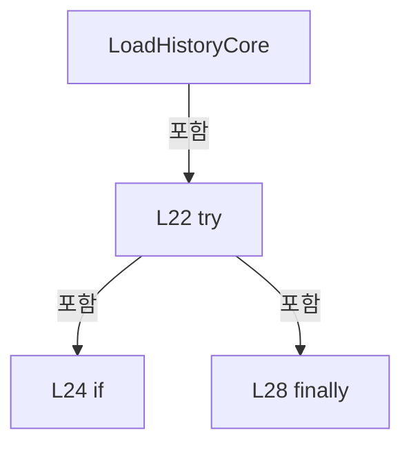

변경 전 점검: 입력/반환 타입, 위 호출자, 예외/취소 경로, 공유 상태와 저장·전송 소비자를 함께 확인합니다. 값의 단위나 물리 방향을 이름만으로 확정하지 않습니다.

### MethodDeclaration `RecordSelection` · L34–38

[Drilling.Common/Managers/CRecipeManager.cs:34–38](https://github.com/kjuws10-rgb/A3Drilling/blob/5aee8e58439c9b455cae7c9593c9be986c3e682e/Drilling.Common/Managers/CRecipeManager.cs#L34-L38)

| 항목 | 실제 추출 값 |
| --- | --- |
| 서명 | System.Threading.Tasks.Task Drilling.Common.Managers.CRecipeManager.RecordSelection(string, string, System.Threading.CancellationToken) |
| 접근/수식자 | Public / public, async |
| 반환/값 타입 | System.Threading.Tasks.Task |
| 소속 타입 | NamedType:Drilling.Common.Managers.CRecipeManager |

입력 계약:

| 이름 | 타입 | 전달 | 선택/기본값 |
| --- | --- | --- | --- |
| previousRecipeId | string | None | False /  |
| recipeId | string | None | False /  |
| cancellationToken | System.Threading.CancellationToken | None | True / null |

정적 호출자로 확인된 위치:

| 호출 파일/행 | 호출 표현식 | 런타임 분기 가능 |
| --- | --- | --- |
| [Drilling.UI/Menu/Menus/CMenuRecipe.cs:769–769](https://github.com/kjuws10-rgb/A3Drilling/blob/5aee8e58439c9b455cae7c9593c9be986c3e682e/Drilling.UI/Menu/Menus/CMenuRecipe.cs#L769-L769) | _recipeManager.RecordSelection | False |

호출하는 대상과 해석 범위:

| 원본 행 | 표현식 | 분석 상태 | 대상/소스 위치 |
| --- | --- | --- | --- |
| 36 | recipeFile.RecordSelection | resolved | System.Threading.Tasks.Task Drilling.Common.Managers.CRecipeFileBase.RecordSelection(string, string, System.Threading.CancellationToken) · Drilling.Common/Managers/CRecipeManager.cs:414 |
| 37 | LoadHistoryCore | resolved | System.Threading.Tasks.Task<System.Collections.Generic.IReadOnlyList<Drilling.Common.Managers.ST_RECIPE_HISTORY>> Drilling.Common.Managers.CRecipeManager.LoadHistoryCore(bool, System.Threading.CancellationToken) · Drilling.Common/Managers/CRecipeManager.cs:19 |

본문의 실제 연산·분기·예외·반환 순서(원문 위치 순):

| 원본 행 | 종류 | 주석 해설 |
| --- | --- | --- |
| 36 | await | 비동기 완료를 기다립니다: await recipeFile.RecordSelection(previousRecipeId, recipeId, cancellationToken) |
| 36 | call | 함수·델리게이트 또는 객체 생성자를 호출합니다: recipeFile.RecordSelection(previousRecipeId, recipeId, cancellationToken) |
| 37 | await | 비동기 완료를 기다립니다: await LoadHistoryCore(true, cancellationToken) |
| 37 | call | 함수·델리게이트 또는 객체 생성자를 호출합니다: LoadHistoryCore(true, cancellationToken) |

변경 전 점검: 입력/반환 타입, 위 호출자, 예외/취소 경로, 공유 상태와 저장·전송 소비자를 함께 확인합니다. 값의 단위나 물리 방향을 이름만으로 확정하지 않습니다.

### MethodDeclaration `LoadRecipes` · L40–71

[Drilling.Common/Managers/CRecipeManager.cs:40–71](https://github.com/kjuws10-rgb/A3Drilling/blob/5aee8e58439c9b455cae7c9593c9be986c3e682e/Drilling.Common/Managers/CRecipeManager.cs#L40-L71)

| 항목 | 실제 추출 값 |
| --- | --- |
| 서명 | System.Threading.Tasks.Task<System.Collections.Generic.IReadOnlyList<Drilling.Common.Managers.ST_RECIPE_DEFINITION>> Drilling.Common.Managers.CRecipeManager.LoadRecipes(System.Threading.CancellationToken) |
| 접근/수식자 | Public / public, async |
| 반환/값 타입 | System.Threading.Tasks.Task<System.Collections.Generic.IReadOnlyList<Drilling.Common.Managers.ST_RECIPE_DEFINITION>> |
| 소속 타입 | NamedType:Drilling.Common.Managers.CRecipeManager |

입력 계약:

| 이름 | 타입 | 전달 | 선택/기본값 |
| --- | --- | --- | --- |
| cancellationToken | System.Threading.CancellationToken | None | True / null |

정적 호출자로 확인된 위치:

| 호출 파일/행 | 호출 표현식 | 런타임 분기 가능 |
| --- | --- | --- |
| [Drilling.Common/Station/CStationProcess.cs:4363–4363](https://github.com/kjuws10-rgb/A3Drilling/blob/5aee8e58439c9b455cae7c9593c9be986c3e682e/Drilling.Common/Station/CStationProcess.cs#L4363-L4363) | recipes.LoadRecipes | False |
| [Drilling.Common/Station/CStationProcess.cs:6088–6088](https://github.com/kjuws10-rgb/A3Drilling/blob/5aee8e58439c9b455cae7c9593c9be986c3e682e/Drilling.Common/Station/CStationProcess.cs#L6088-L6088) | recipes.LoadRecipes | False |
| [Drilling.UI/CRootView.cs:1253–1253](https://github.com/kjuws10-rgb/A3Drilling/blob/5aee8e58439c9b455cae7c9593c9be986c3e682e/Drilling.UI/CRootView.cs#L1253-L1253) | _recipeManager.LoadRecipes | False |
| [Drilling.UI/CRootView.cs:1354–1354](https://github.com/kjuws10-rgb/A3Drilling/blob/5aee8e58439c9b455cae7c9593c9be986c3e682e/Drilling.UI/CRootView.cs#L1354-L1354) | _recipeManager.LoadRecipes | False |
| [Drilling.UI/CRootView.cs:2842–2842](https://github.com/kjuws10-rgb/A3Drilling/blob/5aee8e58439c9b455cae7c9593c9be986c3e682e/Drilling.UI/CRootView.cs#L2842-L2842) | _recipeManager.LoadRecipes | False |
| [Drilling.UI/CRootView.cs:2887–2887](https://github.com/kjuws10-rgb/A3Drilling/blob/5aee8e58439c9b455cae7c9593c9be986c3e682e/Drilling.UI/CRootView.cs#L2887-L2887) | _recipeManager.LoadRecipes | False |
| [Drilling.UI/CRootView.cs:2895–2895](https://github.com/kjuws10-rgb/A3Drilling/blob/5aee8e58439c9b455cae7c9593c9be986c3e682e/Drilling.UI/CRootView.cs#L2895-L2895) | _recipeManager.LoadRecipes | False |
| [Drilling.UI/Menu/Menus/CMenuCorrection.ReviewData.Display.cs:122–122](https://github.com/kjuws10-rgb/A3Drilling/blob/5aee8e58439c9b455cae7c9593c9be986c3e682e/Drilling.UI/Menu/Menus/CMenuCorrection.ReviewData.Display.cs#L122-L122) | _recipeManager.LoadRecipes | False |
| [Drilling.UI/Menu/Menus/CMenuCorrection.cs:711–711](https://github.com/kjuws10-rgb/A3Drilling/blob/5aee8e58439c9b455cae7c9593c9be986c3e682e/Drilling.UI/Menu/Menus/CMenuCorrection.cs#L711-L711) | _recipeManager.LoadRecipes | False |
| [Drilling.UI/Menu/Menus/CMenuCorrection.cs:1793–1793](https://github.com/kjuws10-rgb/A3Drilling/blob/5aee8e58439c9b455cae7c9593c9be986c3e682e/Drilling.UI/Menu/Menus/CMenuCorrection.cs#L1793-L1793) | _recipeManager.LoadRecipes | False |
| [Drilling.UI/Menu/Menus/CMenuCorrection.cs:2719–2719](https://github.com/kjuws10-rgb/A3Drilling/blob/5aee8e58439c9b455cae7c9593c9be986c3e682e/Drilling.UI/Menu/Menus/CMenuCorrection.cs#L2719-L2719) | _recipeManager.LoadRecipes | False |
| [Drilling.UI/Menu/Menus/CMenuMain.cs:2161–2161](https://github.com/kjuws10-rgb/A3Drilling/blob/5aee8e58439c9b455cae7c9593c9be986c3e682e/Drilling.UI/Menu/Menus/CMenuMain.cs#L2161-L2161) | recipeManager.LoadRecipes | False |
| [Drilling.UI/Menu/Menus/CMenuManual.cs:1620–1620](https://github.com/kjuws10-rgb/A3Drilling/blob/5aee8e58439c9b455cae7c9593c9be986c3e682e/Drilling.UI/Menu/Menus/CMenuManual.cs#L1620-L1620) | _manager.Recipe().LoadRecipes | False |
| [Drilling.UI/Menu/Menus/CMenuMonitor.cs:3050–3050](https://github.com/kjuws10-rgb/A3Drilling/blob/5aee8e58439c9b455cae7c9593c9be986c3e682e/Drilling.UI/Menu/Menus/CMenuMonitor.cs#L3050-L3050) | _recipeManager.LoadRecipes | False |
| [Drilling.UI/Menu/Menus/CMenuMonitor.cs:3999–3999](https://github.com/kjuws10-rgb/A3Drilling/blob/5aee8e58439c9b455cae7c9593c9be986c3e682e/Drilling.UI/Menu/Menus/CMenuMonitor.cs#L3999-L3999) | _recipeManager.LoadRecipes | False |
| [Drilling.UI/Menu/Menus/CMenuRecipe.cs:566–566](https://github.com/kjuws10-rgb/A3Drilling/blob/5aee8e58439c9b455cae7c9593c9be986c3e682e/Drilling.UI/Menu/Menus/CMenuRecipe.cs#L566-L566) | _recipeManager.LoadRecipes | False |
| [Drilling.UI/Menu/Menus/CMenuRecipe.cs:1092–1092](https://github.com/kjuws10-rgb/A3Drilling/blob/5aee8e58439c9b455cae7c9593c9be986c3e682e/Drilling.UI/Menu/Menus/CMenuRecipe.cs#L1092-L1092) | _recipeManager.LoadRecipes | False |
| [Drilling.UI/Menu/Menus/CMenuRecipe.cs:1185–1185](https://github.com/kjuws10-rgb/A3Drilling/blob/5aee8e58439c9b455cae7c9593c9be986c3e682e/Drilling.UI/Menu/Menus/CMenuRecipe.cs#L1185-L1185) | _recipeManager.LoadRecipes | False |
| [Drilling.UI/Menu/Menus/CMenuReview.cs:470–470](https://github.com/kjuws10-rgb/A3Drilling/blob/5aee8e58439c9b455cae7c9593c9be986c3e682e/Drilling.UI/Menu/Menus/CMenuReview.cs#L470-L470) | _recipeManager.LoadRecipes | False |

호출하는 대상과 해석 범위:

| 원본 행 | 표현식 | 분석 상태 | 대상/소스 위치 |
| --- | --- | --- | --- |
| 42 | cancellationToken.ThrowIfCancellationRequested | resolved | void System.Threading.CancellationToken.ThrowIfCancellationRequested() |
| 51 | _recipeOperationGate.WaitAsync(cancellationToken).ConfigureAwait | resolved | System.Runtime.CompilerServices.ConfiguredTaskAwaitable System.Threading.Tasks.Task.ConfigureAwait(bool) |
| 51 | _recipeOperationGate.WaitAsync | resolved | System.Threading.Tasks.Task System.Threading.SemaphoreSlim.WaitAsync(System.Threading.CancellationToken) |
| 60 | (await recipeFile.LoadAll(cancellationToken).ConfigureAwait(false)).ToArray | resolved | Drilling.Common.Managers.ST_RECIPE_DEFINITION[] System.Collections.Generic.IEnumerable<Drilling.Common.Managers.ST_RECIPE_DEFINITION>.ToArray<Drilling.Common.Managers.ST_RECIPE_DEFINITION>() |
| 60 | recipeFile.LoadAll(cancellationToken).ConfigureAwait | resolved | System.Runtime.CompilerServices.ConfiguredTaskAwaitable<System.Collections.Generic.IReadOnlyList<Drilling.Common.Managers.ST_RECIPE_DEFINITION>> System.Threading.Tasks.Task<System.Collections.Generic.IReadOnlyList<Drilling.Common.Managers.ST_RECIPE_DEFINITION>>.ConfigureAwait(bool) |
| 60 | recipeFile.LoadAll | resolved | System.Threading.Tasks.Task<System.Collections.Generic.IReadOnlyList<Drilling.Common.Managers.ST_RECIPE_DEFINITION>> Drilling.Common.Managers.CRecipeFileBase.LoadAll(System.Threading.CancellationToken) · Drilling.Common/Managers/CRecipeManager.cs:408 |
| 69 | _recipeOperationGate.Release | resolved | int System.Threading.SemaphoreSlim.Release() |

본문의 실제 연산·분기·예외·반환 순서(원문 위치 순):

| 원본 행 | 종류 | 주석 해설 |
| --- | --- | --- |
| 42 | call | 함수·델리게이트 또는 객체 생성자를 호출합니다: cancellationToken.ThrowIfCancellationRequested() |
| 43 | lock | 공유 상태의 임계 구역에 진입합니다: lock (_cacheLock) |
| 45 | if | 조건에 따라 분기합니다: if (_recipeCache is not null) |
| 47 | return | 호출자에게 값 또는 제어를 반환합니다: return _recipeCache; |
| 51 | await | 비동기 완료를 기다립니다: await _recipeOperationGate.WaitAsync(cancellationToken).ConfigureAwait(false) |
| 51 | call | 함수·델리게이트 또는 객체 생성자를 호출합니다: _recipeOperationGate.WaitAsync(cancellationToken).ConfigureAwait(false) |
| 51 | call | 함수·델리게이트 또는 객체 생성자를 호출합니다: _recipeOperationGate.WaitAsync(cancellationToken) |
| 52 | try | 예외 처리 범위입니다: try |
| 54 | lock | 공유 상태의 임계 구역에 진입합니다: lock (_cacheLock) |
| 56 | if | 조건에 따라 분기합니다: if (_recipeCache is not null) |
| 57 | return | 호출자에게 값 또는 제어를 반환합니다: return _recipeCache; |
| 60 | await | 비동기 완료를 기다립니다: await recipeFile.LoadAll(cancellationToken).ConfigureAwait(false) |
| 60 | call | 함수·델리게이트 또는 객체 생성자를 호출합니다: (await recipeFile.LoadAll(cancellationToken).ConfigureAwait(false)).ToArray() |
| 60 | call | 함수·델리게이트 또는 객체 생성자를 호출합니다: recipeFile.LoadAll(cancellationToken).ConfigureAwait(false) |
| 60 | call | 함수·델리게이트 또는 객체 생성자를 호출합니다: recipeFile.LoadAll(cancellationToken) |
| 60 | local-declaration | 지역 변수를 선언합니다: var recipes = (await recipeFile.LoadAll(cancellationToken).ConfigureAwait(false)).ToArray(); |
| 60 | variable-initializer | 변수의 초기값을 지정합니다: recipes = (await recipeFile.LoadAll(cancellationToken).ConfigureAwait(false)).ToArray() |
| 61 | lock | 공유 상태의 임계 구역에 진입합니다: lock (_cacheLock) |
| 63 | assignment | 값을 대상에 대입합니다: _recipeCache ??= recipes |
| 64 | return | 호출자에게 값 또는 제어를 반환합니다: return _recipeCache; |
| 67 | finally | 종료 정리 구간입니다: finally |
| 69 | call | 함수·델리게이트 또는 객체 생성자를 호출합니다: _recipeOperationGate.Release() |

제어 구문의 포함 구조(실제 실행 순서/CFG가 아닌 구문 탐색 그림):

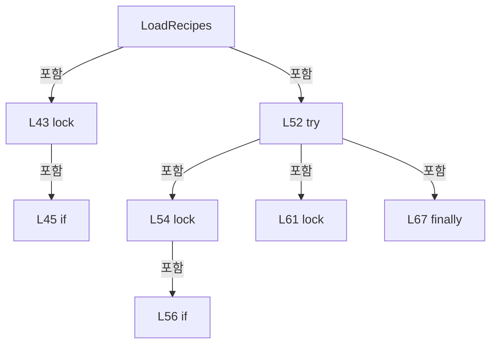

변경 전 점검: 입력/반환 타입, 위 호출자, 예외/취소 경로, 공유 상태와 저장·전송 소비자를 함께 확인합니다. 값의 단위나 물리 방향을 이름만으로 확정하지 않습니다.

### MethodDeclaration `SaveRecipe` · L73–73

[Drilling.Common/Managers/CRecipeManager.cs:73–73](https://github.com/kjuws10-rgb/A3Drilling/blob/5aee8e58439c9b455cae7c9593c9be986c3e682e/Drilling.Common/Managers/CRecipeManager.cs#L73-L73)

| 항목 | 실제 추출 값 |
| --- | --- |
| 서명 | System.Threading.Tasks.Task Drilling.Common.Managers.CRecipeManager.SaveRecipe(Drilling.Common.Managers.ST_RECIPE_DEFINITION, System.Threading.CancellationToken) |
| 접근/수식자 | Public / public, async |
| 반환/값 타입 | System.Threading.Tasks.Task |
| 소속 타입 | NamedType:Drilling.Common.Managers.CRecipeManager |

입력 계약:

| 이름 | 타입 | 전달 | 선택/기본값 |
| --- | --- | --- | --- |
| recipe | Drilling.Common.Managers.ST_RECIPE_DEFINITION | None | False /  |
| cancellationToken | System.Threading.CancellationToken | None | True / null |

정적 호출자로 확인된 위치:

| 호출 파일/행 | 호출 표현식 | 런타임 분기 가능 |
| --- | --- | --- |
| [Drilling.UI/Menu/Menus/CMenuCorrection.cs:2718–2718](https://github.com/kjuws10-rgb/A3Drilling/blob/5aee8e58439c9b455cae7c9593c9be986c3e682e/Drilling.UI/Menu/Menus/CMenuCorrection.cs#L2718-L2718) | _recipeManager.SaveRecipe | False |
| [Drilling.UI/Menu/Menus/CMenuCorrection.cs:2810–2810](https://github.com/kjuws10-rgb/A3Drilling/blob/5aee8e58439c9b455cae7c9593c9be986c3e682e/Drilling.UI/Menu/Menus/CMenuCorrection.cs#L2810-L2810) | _recipeManager.SaveRecipe | False |
| [Drilling.UI/Menu/Menus/CMenuRecipe.cs:1061–1061](https://github.com/kjuws10-rgb/A3Drilling/blob/5aee8e58439c9b455cae7c9593c9be986c3e682e/Drilling.UI/Menu/Menus/CMenuRecipe.cs#L1061-L1061) | _recipeManager.SaveRecipe | False |
| [Drilling.UI/Menu/Menus/CMenuRecipe.cs:1149–1149](https://github.com/kjuws10-rgb/A3Drilling/blob/5aee8e58439c9b455cae7c9593c9be986c3e682e/Drilling.UI/Menu/Menus/CMenuRecipe.cs#L1149-L1149) | _recipeManager.SaveRecipe | False |

호출하는 대상과 해석 범위:

| 원본 행 | 표현식 | 분석 상태 | 대상/소스 위치 |
| --- | --- | --- | --- |
| 73 | WithRecipeOperation(() => SaveRecipeCore(recipe, cancellationToken), cancellationToken).ConfigureAwait | resolved | System.Runtime.CompilerServices.ConfiguredTaskAwaitable System.Threading.Tasks.Task.ConfigureAwait(bool) |
| 73 | WithRecipeOperation | resolved | System.Threading.Tasks.Task Drilling.Common.Managers.CRecipeManager.WithRecipeOperation(System.Func<System.Threading.Tasks.Task>, System.Threading.CancellationToken) · Drilling.Common/Managers/CRecipeManager.cs:222 |
| 73 | SaveRecipeCore | resolved | System.Threading.Tasks.Task Drilling.Common.Managers.CRecipeManager.SaveRecipeCore(Drilling.Common.Managers.ST_RECIPE_DEFINITION, System.Threading.CancellationToken) · Drilling.Common/Managers/CRecipeManager.cs:145 |

본문의 실제 연산·분기·예외·반환 순서(원문 위치 순):

| 원본 행 | 종류 | 주석 해설 |
| --- | --- | --- |
| 73 | await | 비동기 완료를 기다립니다: await WithRecipeOperation(() => SaveRecipeCore(recipe, cancellationToken), cancellationToken).ConfigureAwait(false) |
| 73 | call | 함수·델리게이트 또는 객체 생성자를 호출합니다: WithRecipeOperation(() => SaveRecipeCore(recipe, cancellationToken), cancellationToken).ConfigureAwait(false) |
| 73 | call | 함수·델리게이트 또는 객체 생성자를 호출합니다: WithRecipeOperation(() => SaveRecipeCore(recipe, cancellationToken), cancellationToken) |
| 73 | call | 함수·델리게이트 또는 객체 생성자를 호출합니다: SaveRecipeCore(recipe, cancellationToken) |

변경 전 점검: 입력/반환 타입, 위 호출자, 예외/취소 경로, 공유 상태와 저장·전송 소비자를 함께 확인합니다. 값의 단위나 물리 방향을 이름만으로 확정하지 않습니다.

### MethodDeclaration `SaveParametersIfUnchanged` · L74–93

[Drilling.Common/Managers/CRecipeManager.cs:74–93](https://github.com/kjuws10-rgb/A3Drilling/blob/5aee8e58439c9b455cae7c9593c9be986c3e682e/Drilling.Common/Managers/CRecipeManager.cs#L74-L93)

| 항목 | 실제 추출 값 |
| --- | --- |
| 서명 | System.Threading.Tasks.Task<Drilling.Common.Managers.ST_RECIPE_DEFINITION> Drilling.Common.Managers.CRecipeManager.SaveParametersIfUnchanged(Drilling.Common.Managers.ST_RECIPE_DEFINITION, System.Collections.Generic.IReadOnlyDictionary<string, string>, System.Threading.CancellationToken) |
| 접근/수식자 | Public / public |
| 반환/값 타입 | System.Threading.Tasks.Task<Drilling.Common.Managers.ST_RECIPE_DEFINITION> |
| 소속 타입 | NamedType:Drilling.Common.Managers.CRecipeManager |

입력 계약:

| 이름 | 타입 | 전달 | 선택/기본값 |
| --- | --- | --- | --- |
| expected | Drilling.Common.Managers.ST_RECIPE_DEFINITION | None | False /  |
| changes | System.Collections.Generic.IReadOnlyDictionary<string, string> | None | False /  |
| token | System.Threading.CancellationToken | None | True / null |

정적 호출자로 확인된 위치:

| 호출 파일/행 | 호출 표현식 | 런타임 분기 가능 |
| --- | --- | --- |
| [Drilling.UI/Menu/Menus/CMenuCorrection.cs:3403–3403](https://github.com/kjuws10-rgb/A3Drilling/blob/5aee8e58439c9b455cae7c9593c9be986c3e682e/Drilling.UI/Menu/Menus/CMenuCorrection.cs#L3403-L3403) | _recipeManager.SaveParametersIfUnchanged | False |
| [Drilling.UI/Menu/Menus/CMenuCorrection.cs:3774–3774](https://github.com/kjuws10-rgb/A3Drilling/blob/5aee8e58439c9b455cae7c9593c9be986c3e682e/Drilling.UI/Menu/Menus/CMenuCorrection.cs#L3774-L3774) | _recipeManager.SaveParametersIfUnchanged | False |

호출하는 대상과 해석 범위:

| 원본 행 | 표현식 | 분석 상태 | 대상/소스 위치 |
| --- | --- | --- | --- |
| 74 | WithRecipeOperation | resolved | System.Threading.Tasks.Task<Drilling.Common.Managers.ST_RECIPE_DEFINITION> Drilling.Common.Managers.CRecipeManager.WithRecipeOperation<Drilling.Common.Managers.ST_RECIPE_DEFINITION>(System.Func<System.Threading.Tasks.Task<Drilling.Common.Managers.ST_RECIPE_DEFINITION>>, System.Threading.CancellationToken) · Drilling.Common/Managers/CRecipeManager.cs:235 |
| 76 | recipeFile.Find(expected.Id, token).ConfigureAwait | resolved | System.Runtime.CompilerServices.ConfiguredTaskAwaitable<Drilling.Common.Managers.ST_RECIPE_DEFINITION?> System.Threading.Tasks.Task<Drilling.Common.Managers.ST_RECIPE_DEFINITION?>.ConfigureAwait(bool) |
| 76 | recipeFile.Find | resolved | System.Threading.Tasks.Task<Drilling.Common.Managers.ST_RECIPE_DEFINITION?> Drilling.Common.Managers.CRecipeFileBase.Find(string, System.Threading.CancellationToken) · Drilling.Common/Managers/CRecipeManager.cs:409 |
| 76 | new InvalidOperationException | resolved | System.InvalidOperationException.InvalidOperationException(string?) |
| 77 | expected.Parameters.ToDictionary | resolved | System.Collections.Generic.Dictionary<string, string> System.Collections.Generic.IEnumerable<Drilling.Common.Managers.ST_RECIPE_PARAMETER>.ToDictionary<Drilling.Common.Managers.ST_RECIPE_PARAMETER, string, string>(System.Func<Drilling.Common.Managers.ST_RECIPE_PARAMETER, string>, System.Func<Drilling.Common.Managers.ST_RECIPE_PARAMETER, string>, System.Collections.Generic.IEqualityComparer<string>?) |
| 78 | current.Parameters.ToDictionary | resolved | System.Collections.Generic.Dictionary<string, string> System.Collections.Generic.IEnumerable<Drilling.Common.Managers.ST_RECIPE_PARAMETER>.ToDictionary<Drilling.Common.Managers.ST_RECIPE_PARAMETER, string, string>(System.Func<Drilling.Common.Managers.ST_RECIPE_PARAMETER, string>, System.Func<Drilling.Common.Managers.ST_RECIPE_PARAMETER, string>, System.Collections.Generic.IEqualityComparer<string>?) |
| 80 | before.Remove | resolved | bool System.Collections.Generic.Dictionary<string, string>.Remove(string) |
| 80 | now.Remove | resolved | bool System.Collections.Generic.Dictionary<string, string>.Remove(string) |
| 81 | before.Any | resolved | bool System.Collections.Generic.IEnumerable<System.Collections.Generic.KeyValuePair<string, string>>.Any<System.Collections.Generic.KeyValuePair<string, string>>(System.Func<System.Collections.Generic.KeyValuePair<string, string>, bool>) |
| 81 | now.TryGetValue | resolved | bool System.Collections.Generic.Dictionary<string, string>.TryGetValue(string, out string) |
| 82 | new InvalidOperationException | resolved | System.InvalidOperationException.InvalidOperationException(string?) |
| 83 | changes.Keys.Any | resolved | bool System.Collections.Generic.IEnumerable<string>.Any<string>(System.Func<string, bool>) |
| 83 | now.ContainsKey | resolved | bool System.Collections.Generic.Dictionary<string, string>.ContainsKey(string) |
| 83 | new InvalidOperationException | resolved | System.InvalidOperationException.InvalidOperationException(string?) |
| 84 | current.Parameters.Select(p => changes.TryGetValue(p.Key, out var value) ? p with { Value = value } : p).ToArray | resolved | Drilling.Common.Managers.ST_RECIPE_PARAMETER[] System.Collections.Generic.IEnumerable<Drilling.Common.Managers.ST_RECIPE_PARAMETER>.ToArray<Drilling.Common.Managers.ST_RECIPE_PARAMETER>() |
| 84 | current.Parameters.Select | resolved | System.Collections.Generic.IEnumerable<Drilling.Common.Managers.ST_RECIPE_PARAMETER> System.Collections.Generic.IEnumerable<Drilling.Common.Managers.ST_RECIPE_PARAMETER>.Select<Drilling.Common.Managers.ST_RECIPE_PARAMETER, Drilling.Common.Managers.ST_RECIPE_PARAMETER>(System.Func<Drilling.Common.Managers.ST_RECIPE_PARAMETER, Drilling.Common.Managers.ST_RECIPE_PARAMETER>) |
| 84 | changes.TryGetValue | resolved · 동적 구현 선택 가능 | bool System.Collections.Generic.IReadOnlyDictionary<string, string>.TryGetValue(string, out string) |
| 87 | recipeFile.Save(updated, token).ConfigureAwait | resolved | System.Runtime.CompilerServices.ConfiguredTaskAwaitable System.Threading.Tasks.Task.ConfigureAwait(bool) |
| 87 | recipeFile.Save | resolved | System.Threading.Tasks.Task Drilling.Common.Managers.CRecipeFileBase.Save(Drilling.Common.Managers.ST_RECIPE_DEFINITION, System.Threading.CancellationToken) · Drilling.Common/Managers/CRecipeManager.cs:410 |
| 88 | recipeFile.Find(expected.Id, CancellationToken.None).ConfigureAwait | resolved | System.Runtime.CompilerServices.ConfiguredTaskAwaitable<Drilling.Common.Managers.ST_RECIPE_DEFINITION?> System.Threading.Tasks.Task<Drilling.Common.Managers.ST_RECIPE_DEFINITION?>.ConfigureAwait(bool) |
| 88 | recipeFile.Find | resolved | System.Threading.Tasks.Task<Drilling.Common.Managers.ST_RECIPE_DEFINITION?> Drilling.Common.Managers.CRecipeFileBase.Find(string, System.Threading.CancellationToken) · Drilling.Common/Managers/CRecipeManager.cs:409 |
| 88 | new IOException | resolved | System.IO.IOException.IOException(string?) |
| 89 | UpdateCachedRecipe | resolved | void Drilling.Common.Managers.CRecipeManager.UpdateCachedRecipe(Drilling.Common.Managers.ST_RECIPE_DEFINITION) · Drilling.Common/Managers/CRecipeManager.cs:248 |
| 90 | LoadHistoryCore(true, CancellationToken.None).ConfigureAwait | resolved | System.Runtime.CompilerServices.ConfiguredTaskAwaitable<System.Collections.Generic.IReadOnlyList<Drilling.Common.Managers.ST_RECIPE_HISTORY>> System.Threading.Tasks.Task<System.Collections.Generic.IReadOnlyList<Drilling.Common.Managers.ST_RECIPE_HISTORY>>.ConfigureAwait(bool) |
| 90 | LoadHistoryCore | resolved | System.Threading.Tasks.Task<System.Collections.Generic.IReadOnlyList<Drilling.Common.Managers.ST_RECIPE_HISTORY>> Drilling.Common.Managers.CRecipeManager.LoadHistoryCore(bool, System.Threading.CancellationToken) · Drilling.Common/Managers/CRecipeManager.cs:19 |
| 91 | System.Diagnostics.Trace.TraceError | resolved | void System.Diagnostics.Trace.TraceError(string?) |

본문의 실제 연산·분기·예외·반환 순서(원문 위치 순):

| 원본 행 | 종류 | 주석 해설 |
| --- | --- | --- |
| 74 | call | 함수·델리게이트 또는 객체 생성자를 호출합니다: WithRecipeOperation(async () => { var current = await recipeFile.Find(expected.Id, token).ConfigureAwait(false) ?? throw new InvalidOperationException("현재 레시피가 없습니다."); var before = expected.Parameters.ToDictionary(p => … |
| 76 | await | 비동기 완료를 기다립니다: await recipeFile.Find(expected.Id, token).ConfigureAwait(false) |
| 76 | call | 함수·델리게이트 또는 객체 생성자를 호출합니다: recipeFile.Find(expected.Id, token).ConfigureAwait(false) |
| 76 | call | 함수·델리게이트 또는 객체 생성자를 호출합니다: recipeFile.Find(expected.Id, token) |
| 76 | call | 함수·델리게이트 또는 객체 생성자를 호출합니다: new InvalidOperationException("현재 레시피가 없습니다.") |
| 76 | local-declaration | 지역 변수를 선언합니다: var current = await recipeFile.Find(expected.Id, token).ConfigureAwait(false) ?? throw new InvalidOperationException("현재 레시피가 없습니다."); |
| 76 | throw | 예외를 발생/전달합니다: throw new InvalidOperationException("현재 레시피가 없습니다.") |
| 76 | variable-initializer | 변수의 초기값을 지정합니다: current = await recipeFile.Find(expected.Id, token).ConfigureAwait(false) ?? throw new InvalidOperationException("현재 레시피가 없습니다.") |
| 77 | call | 함수·델리게이트 또는 객체 생성자를 호출합니다: expected.Parameters.ToDictionary(p => p.Key, p => p.Value, StringComparer.OrdinalIgnoreCase) |
| 77 | local-declaration | 지역 변수를 선언합니다: var before = expected.Parameters.ToDictionary(p => p.Key, p => p.Value, StringComparer.OrdinalIgnoreCase); |
| 77 | variable-initializer | 변수의 초기값을 지정합니다: before = expected.Parameters.ToDictionary(p => p.Key, p => p.Value, StringComparer.OrdinalIgnoreCase) |
| 78 | call | 함수·델리게이트 또는 객체 생성자를 호출합니다: current.Parameters.ToDictionary(p => p.Key, p => p.Value, StringComparer.OrdinalIgnoreCase) |
| 78 | local-declaration | 지역 변수를 선언합니다: var now = current.Parameters.ToDictionary(p => p.Key, p => p.Value, StringComparer.OrdinalIgnoreCase); |
| 78 | variable-initializer | 변수의 초기값을 지정합니다: now = current.Parameters.ToDictionary(p => p.Key, p => p.Value, StringComparer.OrdinalIgnoreCase) |
| 80 | call | 함수·델리게이트 또는 객체 생성자를 호출합니다: before.Remove("CURRENT_PROCESS_COUNT") |
| 80 | call | 함수·델리게이트 또는 객체 생성자를 호출합니다: now.Remove("CURRENT_PROCESS_COUNT") |
| 81 | call | 함수·델리게이트 또는 객체 생성자를 호출합니다: before.Any(p => !now.TryGetValue(p.Key, out var value) &#124;&#124; value != p.Value) |
| 81 | call | 함수·델리게이트 또는 객체 생성자를 호출합니다: now.TryGetValue(p.Key, out var value) |
| 81 | if | 조건에 따라 분기합니다: if (before.Count != now.Count &#124;&#124; before.Any(p => !now.TryGetValue(p.Key, out var value) &#124;&#124; value != p.Value)) |
| 82 | call | 함수·델리게이트 또는 객체 생성자를 호출합니다: new InvalidOperationException("측정 후 레시피가 변경되었습니다. 기준을 다시 설정해 주세요.") |
| 82 | throw | 예외를 발생/전달합니다: throw new InvalidOperationException("측정 후 레시피가 변경되었습니다. 기준을 다시 설정해 주세요."); |
| 83 | call | 함수·델리게이트 또는 객체 생성자를 호출합니다: changes.Keys.Any(key => !now.ContainsKey(key)) |
| 83 | call | 함수·델리게이트 또는 객체 생성자를 호출합니다: now.ContainsKey(key) |
| 83 | call | 함수·델리게이트 또는 객체 생성자를 호출합니다: new InvalidOperationException("저장할 레시피 파라미터가 없습니다.") |
| 83 | if | 조건에 따라 분기합니다: if (changes.Keys.Any(key => !now.ContainsKey(key))) |
| 83 | throw | 예외를 발생/전달합니다: throw new InvalidOperationException("저장할 레시피 파라미터가 없습니다."); |
| 84 | assignment | 값을 대상에 대입합니다: Parameters = current.Parameters.Select(p => changes.TryGetValue(p.Key, out var value) ? p with { Value = value } : p).ToArray() |
| 84 | assignment | 값을 대상에 대입합니다: Value = value |
| 84 | call | 함수·델리게이트 또는 객체 생성자를 호출합니다: current.Parameters.Select(p => changes.TryGetValue(p.Key, out var value) ? p with { Value = value } : p).ToArray() |
| 84 | call | 함수·델리게이트 또는 객체 생성자를 호출합니다: current.Parameters.Select(p => changes.TryGetValue(p.Key, out var value) ? p with { Value = value } : p) |
| 84 | call | 함수·델리게이트 또는 객체 생성자를 호출합니다: changes.TryGetValue(p.Key, out var value) |
| 84 | conditional-expression | 조건에 따라 결과식을 선택합니다: changes.TryGetValue(p.Key, out var value) ? p with { Value = value } : p |
| 84 | local-declaration | 지역 변수를 선언합니다: var updated = current with { Parameters = current.Parameters.Select(p => changes.TryGetValue(p.Key, out var value) ? p with { Value = value } : p).ToArray() }; |
| 84 | variable-initializer | 변수의 초기값을 지정합니다: updated = current with { Parameters = current.Parameters.Select(p => changes.TryGetValue(p.Key, out var value) ? p with { Value = value } : p).ToArray() } |
| 87 | await | 비동기 완료를 기다립니다: await recipeFile.Save(updated, token).ConfigureAwait(false) |
| 87 | call | 함수·델리게이트 또는 객체 생성자를 호출합니다: recipeFile.Save(updated, token).ConfigureAwait(false) |
| 87 | call | 함수·델리게이트 또는 객체 생성자를 호출합니다: recipeFile.Save(updated, token) |
| 88 | await | 비동기 완료를 기다립니다: await recipeFile.Find(expected.Id, CancellationToken.None).ConfigureAwait(false) |
| 88 | call | 함수·델리게이트 또는 객체 생성자를 호출합니다: recipeFile.Find(expected.Id, CancellationToken.None).ConfigureAwait(false) |
| 88 | call | 함수·델리게이트 또는 객체 생성자를 호출합니다: recipeFile.Find(expected.Id, CancellationToken.None) |
| 88 | call | 함수·델리게이트 또는 객체 생성자를 호출합니다: new IOException("레시피 저장 명령은 완료됐지만 저장값을 다시 읽을 수 없습니다.") |
| 88 | local-declaration | 지역 변수를 선언합니다: var saved = await recipeFile.Find(expected.Id, CancellationToken.None).ConfigureAwait(false) ?? throw new IOException("레시피 저장 명령은 완료됐지만 저장값을 다시 읽을 수 없습니다."); |
| 88 | throw | 예외를 발생/전달합니다: throw new IOException("레시피 저장 명령은 완료됐지만 저장값을 다시 읽을 수 없습니다.") |
| 88 | variable-initializer | 변수의 초기값을 지정합니다: saved = await recipeFile.Find(expected.Id, CancellationToken.None).ConfigureAwait(false) ?? throw new IOException("레시피 저장 명령은 완료됐지만 저장값을 다시 읽을 수 없습니다.") |
| 89 | call | 함수·델리게이트 또는 객체 생성자를 호출합니다: UpdateCachedRecipe(saved) |
| 90 | await | 비동기 완료를 기다립니다: await LoadHistoryCore(true, CancellationToken.None).ConfigureAwait(false) |
| 90 | call | 함수·델리게이트 또는 객체 생성자를 호출합니다: LoadHistoryCore(true, CancellationToken.None).ConfigureAwait(false) |
| 90 | call | 함수·델리게이트 또는 객체 생성자를 호출합니다: LoadHistoryCore(true, CancellationToken.None) |
| 90 | try | 예외 처리 범위입니다: try |
| 91 | call | 함수·델리게이트 또는 객체 생성자를 호출합니다: System.Diagnostics.Trace.TraceError("Recipe parameter history refresh failed after commit: " + error) |
| 91 | catch | 지정 예외를 처리합니다: catch (Exception error) |
| 92 | return | 호출자에게 값 또는 제어를 반환합니다: return saved; |

제어 구문의 포함 구조(실제 실행 순서/CFG가 아닌 구문 탐색 그림):

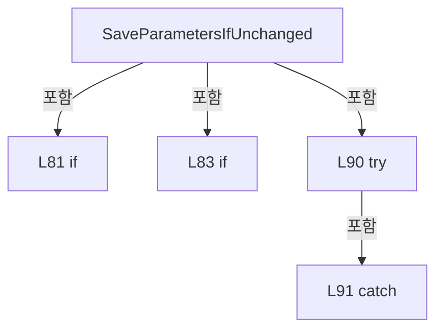

변경 전 점검: 입력/반환 타입, 위 호출자, 예외/취소 경로, 공유 상태와 저장·전송 소비자를 함께 확인합니다. 값의 단위나 물리 방향을 이름만으로 확정하지 않습니다.

### MethodDeclaration `SaveAlignOffsetsIfUnchanged` · L94–109

[Drilling.Common/Managers/CRecipeManager.cs:94–109](https://github.com/kjuws10-rgb/A3Drilling/blob/5aee8e58439c9b455cae7c9593c9be986c3e682e/Drilling.Common/Managers/CRecipeManager.cs#L94-L109)

| 항목 | 실제 추출 값 |
| --- | --- |
| 서명 | System.Threading.Tasks.Task<Drilling.Common.Managers.ST_RECIPE_DEFINITION> Drilling.Common.Managers.CRecipeManager.SaveAlignOffsetsIfUnchanged(Drilling.Common.Managers.ST_RECIPE_DEFINITION, System.Collections.Generic.IReadOnlyList<Drilling.Common.Recipe.ST_ALIGN_SHOT_OFFSET>, System.Threading.CancellationToken) |
| 접근/수식자 | Public / public |
| 반환/값 타입 | System.Threading.Tasks.Task<Drilling.Common.Managers.ST_RECIPE_DEFINITION> |
| 소속 타입 | NamedType:Drilling.Common.Managers.CRecipeManager |

입력 계약:

| 이름 | 타입 | 전달 | 선택/기본값 |
| --- | --- | --- | --- |
| expected | Drilling.Common.Managers.ST_RECIPE_DEFINITION | None | False /  |
| offsets | System.Collections.Generic.IReadOnlyList<Drilling.Common.Recipe.ST_ALIGN_SHOT_OFFSET> | None | False /  |
| token | System.Threading.CancellationToken | None | True / null |

정적 호출자로 확인된 위치:

| 호출 파일/행 | 호출 표현식 | 런타임 분기 가능 |
| --- | --- | --- |
| [Drilling.Common/Correction/CAlignInterpolation.cs:334–334](https://github.com/kjuws10-rgb/A3Drilling/blob/5aee8e58439c9b455cae7c9593c9be986c3e682e/Drilling.Common/Correction/CAlignInterpolation.cs#L334-L334) | recipes.SaveAlignOffsetsIfUnchanged | False |

호출하는 대상과 해석 범위:

| 원본 행 | 표현식 | 분석 상태 | 대상/소스 위치 |
| --- | --- | --- | --- |
| 94 | WithRecipeOperation | resolved | System.Threading.Tasks.Task<Drilling.Common.Managers.ST_RECIPE_DEFINITION> Drilling.Common.Managers.CRecipeManager.WithRecipeOperation<Drilling.Common.Managers.ST_RECIPE_DEFINITION>(System.Func<System.Threading.Tasks.Task<Drilling.Common.Managers.ST_RECIPE_DEFINITION>>, System.Threading.CancellationToken) · Drilling.Common/Managers/CRecipeManager.cs:235 |
| 96 | recipeFile.Find(expected.Id, token).ConfigureAwait | resolved | System.Runtime.CompilerServices.ConfiguredTaskAwaitable<Drilling.Common.Managers.ST_RECIPE_DEFINITION?> System.Threading.Tasks.Task<Drilling.Common.Managers.ST_RECIPE_DEFINITION?>.ConfigureAwait(bool) |
| 96 | recipeFile.Find | resolved | System.Threading.Tasks.Task<Drilling.Common.Managers.ST_RECIPE_DEFINITION?> Drilling.Common.Managers.CRecipeFileBase.Find(string, System.Threading.CancellationToken) · Drilling.Common/Managers/CRecipeManager.cs:409 |
| 96 | new InvalidOperationException | resolved | System.InvalidOperationException.InvalidOperationException(string?) |
| 97 | expected.Parameters.ToDictionary | resolved | System.Collections.Generic.Dictionary<string, string> System.Collections.Generic.IEnumerable<Drilling.Common.Managers.ST_RECIPE_PARAMETER>.ToDictionary<Drilling.Common.Managers.ST_RECIPE_PARAMETER, string, string>(System.Func<Drilling.Common.Managers.ST_RECIPE_PARAMETER, string>, System.Func<Drilling.Common.Managers.ST_RECIPE_PARAMETER, string>, System.Collections.Generic.IEqualityComparer<string>?) |
| 98 | current.Parameters.ToDictionary | resolved | System.Collections.Generic.Dictionary<string, string> System.Collections.Generic.IEnumerable<Drilling.Common.Managers.ST_RECIPE_PARAMETER>.ToDictionary<Drilling.Common.Managers.ST_RECIPE_PARAMETER, string, string>(System.Func<Drilling.Common.Managers.ST_RECIPE_PARAMETER, string>, System.Func<Drilling.Common.Managers.ST_RECIPE_PARAMETER, string>, System.Collections.Generic.IEqualityComparer<string>?) |
| 99 | before.Remove | resolved | bool System.Collections.Generic.Dictionary<string, string>.Remove(string) |
| 99 | now.Remove | resolved | bool System.Collections.Generic.Dictionary<string, string>.Remove(string) |
| 100 | before.Any | resolved | bool System.Collections.Generic.IEnumerable<System.Collections.Generic.KeyValuePair<string, string>>.Any<System.Collections.Generic.KeyValuePair<string, string>>(System.Func<System.Collections.Generic.KeyValuePair<string, string>, bool>) |
| 100 | now.TryGetValue | resolved | bool System.Collections.Generic.Dictionary<string, string>.TryGetValue(string, out string) |
| 101 | new InvalidOperationException | resolved | System.InvalidOperationException.InvalidOperationException(string?) |
| 102 | CAlignShotOffsetData.Apply | resolved | Drilling.Common.Managers.ST_RECIPE_DEFINITION Drilling.Common.Recipe.CAlignShotOffsetData.Apply(Drilling.Common.Managers.ST_RECIPE_DEFINITION, System.Collections.Generic.IReadOnlyList<Drilling.Common.Recipe.ST_ALIGN_SHOT_OFFSET>) · Drilling.Common/Recipe/CShotCoordinatePlanBuilder.cs:707 |
| 103 | recipeFile.Save(updated, token).ConfigureAwait | resolved | System.Runtime.CompilerServices.ConfiguredTaskAwaitable System.Threading.Tasks.Task.ConfigureAwait(bool) |
| 103 | recipeFile.Save | resolved | System.Threading.Tasks.Task Drilling.Common.Managers.CRecipeFileBase.Save(Drilling.Common.Managers.ST_RECIPE_DEFINITION, System.Threading.CancellationToken) · Drilling.Common/Managers/CRecipeManager.cs:410 |
| 104 | recipeFile.Find(expected.Id, CancellationToken.None).ConfigureAwait | resolved | System.Runtime.CompilerServices.ConfiguredTaskAwaitable<Drilling.Common.Managers.ST_RECIPE_DEFINITION?> System.Threading.Tasks.Task<Drilling.Common.Managers.ST_RECIPE_DEFINITION?>.ConfigureAwait(bool) |
| 104 | recipeFile.Find | resolved | System.Threading.Tasks.Task<Drilling.Common.Managers.ST_RECIPE_DEFINITION?> Drilling.Common.Managers.CRecipeFileBase.Find(string, System.Threading.CancellationToken) · Drilling.Common/Managers/CRecipeManager.cs:409 |
| 104 | new IOException | resolved | System.IO.IOException.IOException(string?) |
| 105 | UpdateCachedRecipe | resolved | void Drilling.Common.Managers.CRecipeManager.UpdateCachedRecipe(Drilling.Common.Managers.ST_RECIPE_DEFINITION) · Drilling.Common/Managers/CRecipeManager.cs:248 |
| 106 | LoadHistoryCore(true, CancellationToken.None).ConfigureAwait | resolved | System.Runtime.CompilerServices.ConfiguredTaskAwaitable<System.Collections.Generic.IReadOnlyList<Drilling.Common.Managers.ST_RECIPE_HISTORY>> System.Threading.Tasks.Task<System.Collections.Generic.IReadOnlyList<Drilling.Common.Managers.ST_RECIPE_HISTORY>>.ConfigureAwait(bool) |
| 106 | LoadHistoryCore | resolved | System.Threading.Tasks.Task<System.Collections.Generic.IReadOnlyList<Drilling.Common.Managers.ST_RECIPE_HISTORY>> Drilling.Common.Managers.CRecipeManager.LoadHistoryCore(bool, System.Threading.CancellationToken) · Drilling.Common/Managers/CRecipeManager.cs:19 |
| 107 | System.Diagnostics.Trace.TraceError | resolved | void System.Diagnostics.Trace.TraceError(string?) |

본문의 실제 연산·분기·예외·반환 순서(원문 위치 순):

| 원본 행 | 종류 | 주석 해설 |
| --- | --- | --- |
| 94 | call | 함수·델리게이트 또는 객체 생성자를 호출합니다: WithRecipeOperation(async () => { var current = await recipeFile.Find(expected.Id, token).ConfigureAwait(false) ?? throw new InvalidOperationException("현재 레시피가 없습니다."); var before = expected.Parameters.ToDictionary(p => … |
| 96 | await | 비동기 완료를 기다립니다: await recipeFile.Find(expected.Id, token).ConfigureAwait(false) |
| 96 | call | 함수·델리게이트 또는 객체 생성자를 호출합니다: recipeFile.Find(expected.Id, token).ConfigureAwait(false) |
| 96 | call | 함수·델리게이트 또는 객체 생성자를 호출합니다: recipeFile.Find(expected.Id, token) |
| 96 | call | 함수·델리게이트 또는 객체 생성자를 호출합니다: new InvalidOperationException("현재 레시피가 없습니다.") |
| 96 | local-declaration | 지역 변수를 선언합니다: var current = await recipeFile.Find(expected.Id, token).ConfigureAwait(false) ?? throw new InvalidOperationException("현재 레시피가 없습니다."); |
| 96 | throw | 예외를 발생/전달합니다: throw new InvalidOperationException("현재 레시피가 없습니다.") |
| 96 | variable-initializer | 변수의 초기값을 지정합니다: current = await recipeFile.Find(expected.Id, token).ConfigureAwait(false) ?? throw new InvalidOperationException("현재 레시피가 없습니다.") |
| 97 | call | 함수·델리게이트 또는 객체 생성자를 호출합니다: expected.Parameters.ToDictionary(p => p.Key, p => p.Value, StringComparer.OrdinalIgnoreCase) |
| 97 | local-declaration | 지역 변수를 선언합니다: var before = expected.Parameters.ToDictionary(p => p.Key, p => p.Value, StringComparer.OrdinalIgnoreCase); |
| 97 | variable-initializer | 변수의 초기값을 지정합니다: before = expected.Parameters.ToDictionary(p => p.Key, p => p.Value, StringComparer.OrdinalIgnoreCase) |
| 98 | call | 함수·델리게이트 또는 객체 생성자를 호출합니다: current.Parameters.ToDictionary(p => p.Key, p => p.Value, StringComparer.OrdinalIgnoreCase) |
| 98 | local-declaration | 지역 변수를 선언합니다: var now = current.Parameters.ToDictionary(p => p.Key, p => p.Value, StringComparer.OrdinalIgnoreCase); |
| 98 | variable-initializer | 변수의 초기값을 지정합니다: now = current.Parameters.ToDictionary(p => p.Key, p => p.Value, StringComparer.OrdinalIgnoreCase) |
| 99 | call | 함수·델리게이트 또는 객체 생성자를 호출합니다: before.Remove("CURRENT_PROCESS_COUNT") |
| 99 | call | 함수·델리게이트 또는 객체 생성자를 호출합니다: now.Remove("CURRENT_PROCESS_COUNT") |
| 100 | call | 함수·델리게이트 또는 객체 생성자를 호출합니다: before.Any(p => !now.TryGetValue(p.Key, out var value) &#124;&#124; value != p.Value) |
| 100 | call | 함수·델리게이트 또는 객체 생성자를 호출합니다: now.TryGetValue(p.Key, out var value) |
| 100 | if | 조건에 따라 분기합니다: if (before.Count != now.Count &#124;&#124; before.Any(p => !now.TryGetValue(p.Key, out var value) &#124;&#124; value != p.Value)) |
| 101 | call | 함수·델리게이트 또는 객체 생성자를 호출합니다: new InvalidOperationException("Distortion 측정 중 레시피가 변경되었습니다. 기존 보정값을 유지합니다.") |
| 101 | throw | 예외를 발생/전달합니다: throw new InvalidOperationException("Distortion 측정 중 레시피가 변경되었습니다. 기존 보정값을 유지합니다."); |
| 102 | call | 함수·델리게이트 또는 객체 생성자를 호출합니다: CAlignShotOffsetData.Apply(current, offsets) |
| 102 | local-declaration | 지역 변수를 선언합니다: var updated = CAlignShotOffsetData.Apply(current, offsets); |
| 102 | variable-initializer | 변수의 초기값을 지정합니다: updated = CAlignShotOffsetData.Apply(current, offsets) |
| 103 | await | 비동기 완료를 기다립니다: await recipeFile.Save(updated, token).ConfigureAwait(false) |
| 103 | call | 함수·델리게이트 또는 객체 생성자를 호출합니다: recipeFile.Save(updated, token).ConfigureAwait(false) |
| 103 | call | 함수·델리게이트 또는 객체 생성자를 호출합니다: recipeFile.Save(updated, token) |
| 104 | await | 비동기 완료를 기다립니다: await recipeFile.Find(expected.Id, CancellationToken.None).ConfigureAwait(false) |
| 104 | call | 함수·델리게이트 또는 객체 생성자를 호출합니다: recipeFile.Find(expected.Id, CancellationToken.None).ConfigureAwait(false) |
| 104 | call | 함수·델리게이트 또는 객체 생성자를 호출합니다: recipeFile.Find(expected.Id, CancellationToken.None) |
| 104 | call | 함수·델리게이트 또는 객체 생성자를 호출합니다: new IOException("Align Offset 저장 후 레시피를 다시 읽지 못했습니다.") |
| 104 | local-declaration | 지역 변수를 선언합니다: var saved = await recipeFile.Find(expected.Id, CancellationToken.None).ConfigureAwait(false) ?? throw new IOException("Align Offset 저장 후 레시피를 다시 읽지 못했습니다."); |
| 104 | throw | 예외를 발생/전달합니다: throw new IOException("Align Offset 저장 후 레시피를 다시 읽지 못했습니다.") |
| 104 | variable-initializer | 변수의 초기값을 지정합니다: saved = await recipeFile.Find(expected.Id, CancellationToken.None).ConfigureAwait(false) ?? throw new IOException("Align Offset 저장 후 레시피를 다시 읽지 못했습니다.") |
| 105 | call | 함수·델리게이트 또는 객체 생성자를 호출합니다: UpdateCachedRecipe(saved) |
| 106 | await | 비동기 완료를 기다립니다: await LoadHistoryCore(true, CancellationToken.None).ConfigureAwait(false) |
| 106 | call | 함수·델리게이트 또는 객체 생성자를 호출합니다: LoadHistoryCore(true, CancellationToken.None).ConfigureAwait(false) |
| 106 | call | 함수·델리게이트 또는 객체 생성자를 호출합니다: LoadHistoryCore(true, CancellationToken.None) |
| 106 | try | 예외 처리 범위입니다: try |
| 107 | call | 함수·델리게이트 또는 객체 생성자를 호출합니다: System.Diagnostics.Trace.TraceError("Align Offset history refresh failed after commit: " + error) |
| 107 | catch | 지정 예외를 처리합니다: catch (Exception error) |
| 108 | return | 호출자에게 값 또는 제어를 반환합니다: return saved; |

제어 구문의 포함 구조(실제 실행 순서/CFG가 아닌 구문 탐색 그림):

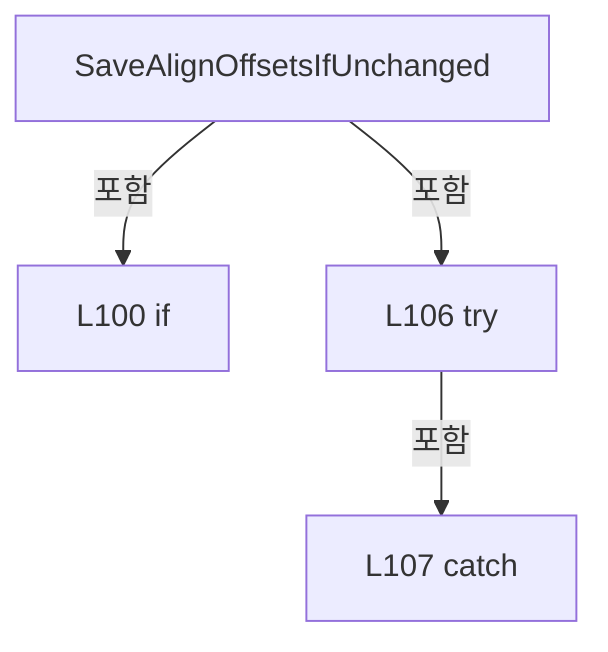

변경 전 점검: 입력/반환 타입, 위 호출자, 예외/취소 경로, 공유 상태와 저장·전송 소비자를 함께 확인합니다. 값의 단위나 물리 방향을 이름만으로 확정하지 않습니다.

### MethodDeclaration `SavePowerMeasureAngles` · L112–126

[Drilling.Common/Managers/CRecipeManager.cs:112–126](https://github.com/kjuws10-rgb/A3Drilling/blob/5aee8e58439c9b455cae7c9593c9be986c3e682e/Drilling.Common/Managers/CRecipeManager.cs#L112-L126)

| 항목 | 실제 추출 값 |
| --- | --- |
| 서명 | System.Threading.Tasks.Task Drilling.Common.Managers.CRecipeManager.SavePowerMeasureAngles(string, System.Collections.Generic.IReadOnlyDictionary<int, double>, System.Threading.CancellationToken) |
| 접근/수식자 | Public / public |
| 반환/값 타입 | System.Threading.Tasks.Task |
| 소속 타입 | NamedType:Drilling.Common.Managers.CRecipeManager |

입력 계약:

| 이름 | 타입 | 전달 | 선택/기본값 |
| --- | --- | --- | --- |
| recipeId | string | None | False /  |
| angles | System.Collections.Generic.IReadOnlyDictionary<int, double> | None | False /  |
| token | System.Threading.CancellationToken | None | True / null |

정적 호출자로 확인된 위치:

| 호출 파일/행 | 호출 표현식 | 런타임 분기 가능 |
| --- | --- | --- |
| [Drilling.Common/Interface/CPowerMeasureRun.cs:116–116](https://github.com/kjuws10-rgb/A3Drilling/blob/5aee8e58439c9b455cae7c9593c9be986c3e682e/Drilling.Common/Interface/CPowerMeasureRun.cs#L116-L116) | manager.Recipe().SavePowerMeasureAngles | False |

호출하는 대상과 해석 범위:

| 원본 행 | 표현식 | 분석 상태 | 대상/소스 위치 |
| --- | --- | --- | --- |
| 112 | WithRecipeOperation | resolved | System.Threading.Tasks.Task Drilling.Common.Managers.CRecipeManager.WithRecipeOperation(System.Func<System.Threading.Tasks.Task>, System.Threading.CancellationToken) · Drilling.Common/Managers/CRecipeManager.cs:222 |
| 114 | angles.Any | resolved | bool System.Collections.Generic.IEnumerable<System.Collections.Generic.KeyValuePair<int, double>>.Any<System.Collections.Generic.KeyValuePair<int, double>>(System.Func<System.Collections.Generic.KeyValuePair<int, double>, bool>) |
| 114 | double.IsFinite | resolved | bool double.IsFinite(double) |
| 115 | new ArgumentException | resolved | System.ArgumentException.ArgumentException(string?) |
| 116 | recipeFile.Find(recipeId, token).ConfigureAwait | resolved | System.Runtime.CompilerServices.ConfiguredTaskAwaitable<Drilling.Common.Managers.ST_RECIPE_DEFINITION?> System.Threading.Tasks.Task<Drilling.Common.Managers.ST_RECIPE_DEFINITION?>.ConfigureAwait(bool) |
| 116 | recipeFile.Find | resolved | System.Threading.Tasks.Task<Drilling.Common.Managers.ST_RECIPE_DEFINITION?> Drilling.Common.Managers.CRecipeFileBase.Find(string, System.Threading.CancellationToken) · Drilling.Common/Managers/CRecipeManager.cs:409 |
| 116 | new InvalidOperationException | resolved | System.InvalidOperationException.InvalidOperationException(string?) |
| 117 | recipe.Parameters.ToList | resolved | System.Collections.Generic.List<Drilling.Common.Managers.ST_RECIPE_PARAMETER> System.Collections.Generic.IEnumerable<Drilling.Common.Managers.ST_RECIPE_PARAMETER>.ToList<Drilling.Common.Managers.ST_RECIPE_PARAMETER>() |
| 121 | values.FindIndex | resolved | int System.Collections.Generic.List<Drilling.Common.Managers.ST_RECIPE_PARAMETER>.FindIndex(System.Predicate<Drilling.Common.Managers.ST_RECIPE_PARAMETER>) |
| 121 | p.Key.Equals | resolved | bool string.Equals(string?, System.StringComparison) |
| 122 | new InvalidOperationException | resolved | System.InvalidOperationException.InvalidOperationException(string?) |
| 123 | angle.ToString | resolved | string double.ToString(string?, System.IFormatProvider?) |
| 125 | SaveRecipeCore(recipe with { Parameters = values }, token).ConfigureAwait | resolved | System.Runtime.CompilerServices.ConfiguredTaskAwaitable System.Threading.Tasks.Task.ConfigureAwait(bool) |
| 125 | SaveRecipeCore | resolved | System.Threading.Tasks.Task Drilling.Common.Managers.CRecipeManager.SaveRecipeCore(Drilling.Common.Managers.ST_RECIPE_DEFINITION, System.Threading.CancellationToken) · Drilling.Common/Managers/CRecipeManager.cs:145 |

본문의 실제 연산·분기·예외·반환 순서(원문 위치 순):

| 원본 행 | 종류 | 주석 해설 |
| --- | --- | --- |
| 112 | call | 함수·델리게이트 또는 객체 생성자를 호출합니다: WithRecipeOperation(async () => { if (angles.Count == 0 &#124;&#124; angles.Any(pair => pair.Key is < 1 or > 8 &#124;&#124; !double.IsFinite(pair.Value) &#124;&#124; pair.Value is < 0 or > 360)) throw new ArgumentException("유효한 Head별 ATT 각도가 필요합니다.")… |
| 114 | call | 함수·델리게이트 또는 객체 생성자를 호출합니다: angles.Any(pair => pair.Key is < 1 or > 8 &#124;&#124; !double.IsFinite(pair.Value) &#124;&#124; pair.Value is < 0 or > 360) |
| 114 | call | 함수·델리게이트 또는 객체 생성자를 호출합니다: double.IsFinite(pair.Value) |
| 114 | if | 조건에 따라 분기합니다: if (angles.Count == 0 &#124;&#124; angles.Any(pair => pair.Key is < 1 or > 8 &#124;&#124; !double.IsFinite(pair.Value) &#124;&#124; pair.Value is < 0 or > 360)) |
| 115 | call | 함수·델리게이트 또는 객체 생성자를 호출합니다: new ArgumentException("유효한 Head별 ATT 각도가 필요합니다.") |
| 115 | throw | 예외를 발생/전달합니다: throw new ArgumentException("유효한 Head별 ATT 각도가 필요합니다."); |
| 116 | await | 비동기 완료를 기다립니다: await recipeFile.Find(recipeId, token).ConfigureAwait(false) |
| 116 | call | 함수·델리게이트 또는 객체 생성자를 호출합니다: recipeFile.Find(recipeId, token).ConfigureAwait(false) |
| 116 | call | 함수·델리게이트 또는 객체 생성자를 호출합니다: recipeFile.Find(recipeId, token) |
| 116 | call | 함수·델리게이트 또는 객체 생성자를 호출합니다: new InvalidOperationException("측정 대상 Recipe가 없습니다.") |
| 116 | local-declaration | 지역 변수를 선언합니다: var recipe = await recipeFile.Find(recipeId, token).ConfigureAwait(false) ?? throw new InvalidOperationException("측정 대상 Recipe가 없습니다."); |
| 116 | throw | 예외를 발생/전달합니다: throw new InvalidOperationException("측정 대상 Recipe가 없습니다.") |
| 116 | variable-initializer | 변수의 초기값을 지정합니다: recipe = await recipeFile.Find(recipeId, token).ConfigureAwait(false) ?? throw new InvalidOperationException("측정 대상 Recipe가 없습니다.") |
| 117 | call | 함수·델리게이트 또는 객체 생성자를 호출합니다: recipe.Parameters.ToList() |
| 117 | local-declaration | 지역 변수를 선언합니다: var values = recipe.Parameters.ToList(); |
| 117 | variable-initializer | 변수의 초기값을 지정합니다: values = recipe.Parameters.ToList() |
| 118 | foreach | 컬렉션 요소를 순회합니다: foreach (var (head, angle) in angles) { var key = $"H{head:00}_ATTENUATOR_POSITION"; var index = values.FindIndex(p => p.Key.Equals(key, StringComparison.OrdinalIgnoreCase)); if (index < 0) throw new InvalidOperationException($"Re |
| 120 | local-declaration | 지역 변수를 선언합니다: var key = $"H{head:00}_ATTENUATOR_POSITION"; |
| 120 | variable-initializer | 변수의 초기값을 지정합니다: key = $"H{head:00}_ATTENUATOR_POSITION" |
| 121 | call | 함수·델리게이트 또는 객체 생성자를 호출합니다: values.FindIndex(p => p.Key.Equals(key, StringComparison.OrdinalIgnoreCase)) |
| 121 | call | 함수·델리게이트 또는 객체 생성자를 호출합니다: p.Key.Equals(key, StringComparison.OrdinalIgnoreCase) |
| 121 | local-declaration | 지역 변수를 선언합니다: var index = values.FindIndex(p => p.Key.Equals(key, StringComparison.OrdinalIgnoreCase)); |
| 121 | variable-initializer | 변수의 초기값을 지정합니다: index = values.FindIndex(p => p.Key.Equals(key, StringComparison.OrdinalIgnoreCase)) |
| 122 | call | 함수·델리게이트 또는 객체 생성자를 호출합니다: new InvalidOperationException($"Recipe ATT 항목이 없습니다: {key}") |
| 122 | if | 조건에 따라 분기합니다: if (index < 0) |
| 122 | throw | 예외를 발생/전달합니다: throw new InvalidOperationException($"Recipe ATT 항목이 없습니다: {key}"); |
| 123 | assignment | 값을 대상에 대입합니다: values[index] = values[index] with { Value = angle.ToString("0.####", System.Globalization.CultureInfo.InvariantCulture) } |
| 123 | assignment | 값을 대상에 대입합니다: Value = angle.ToString("0.####", System.Globalization.CultureInfo.InvariantCulture) |
| 123 | call | 함수·델리게이트 또는 객체 생성자를 호출합니다: angle.ToString("0.####", System.Globalization.CultureInfo.InvariantCulture) |
| 125 | assignment | 값을 대상에 대입합니다: Parameters = values |
| 125 | await | 비동기 완료를 기다립니다: await SaveRecipeCore(recipe with { Parameters = values }, token).ConfigureAwait(false) |
| 125 | call | 함수·델리게이트 또는 객체 생성자를 호출합니다: SaveRecipeCore(recipe with { Parameters = values }, token).ConfigureAwait(false) |
| 125 | call | 함수·델리게이트 또는 객체 생성자를 호출합니다: SaveRecipeCore(recipe with { Parameters = values }, token) |

제어 구문의 포함 구조(실제 실행 순서/CFG가 아닌 구문 탐색 그림):

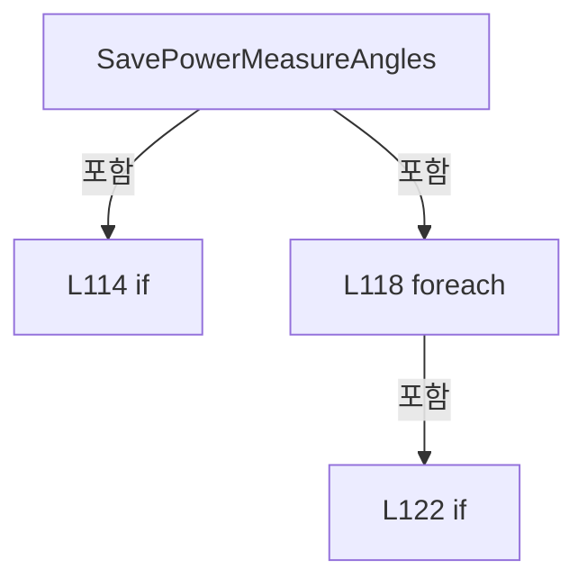

변경 전 점검: 입력/반환 타입, 위 호출자, 예외/취소 경로, 공유 상태와 저장·전송 소비자를 함께 확인합니다. 값의 단위나 물리 방향을 이름만으로 확정하지 않습니다.

### MethodDeclaration `ListCompanionFolders` · L127–127

[Drilling.Common/Managers/CRecipeManager.cs:127–127](https://github.com/kjuws10-rgb/A3Drilling/blob/5aee8e58439c9b455cae7c9593c9be986c3e682e/Drilling.Common/Managers/CRecipeManager.cs#L127-L127)

| 항목 | 실제 추출 값 |
| --- | --- |
| 서명 | System.Threading.Tasks.Task<System.Collections.Generic.IReadOnlyList<Drilling.Common.Managers.ST_RECIPE_COMPANION_FOLDER>> Drilling.Common.Managers.CRecipeManager.ListCompanionFolders(string, string, System.Threading.CancellationToken) |
| 접근/수식자 | Public / public |
| 반환/값 타입 | System.Threading.Tasks.Task<System.Collections.Generic.IReadOnlyList<Drilling.Common.Managers.ST_RECIPE_COMPANION_FOLDER>> |
| 소속 타입 | NamedType:Drilling.Common.Managers.CRecipeManager |

입력 계약:

| 이름 | 타입 | 전달 | 선택/기본값 |
| --- | --- | --- | --- |
| sourceRecipeId | string | None | False /  |
| newRecipeId | string | None | False /  |
| token | System.Threading.CancellationToken | None | True / null |

정적 호출자로 확인된 위치:

| 호출 파일/행 | 호출 표현식 | 런타임 분기 가능 |
| --- | --- | --- |
| [Drilling.UI/Menu/Menus/CMenuRecipe.cs:1133–1133](https://github.com/kjuws10-rgb/A3Drilling/blob/5aee8e58439c9b455cae7c9593c9be986c3e682e/Drilling.UI/Menu/Menus/CMenuRecipe.cs#L1133-L1133) | _recipeManager.ListCompanionFolders | False |
| [Drilling.UI/Menu/Menus/CMenuRecipe.cs:1216–1216](https://github.com/kjuws10-rgb/A3Drilling/blob/5aee8e58439c9b455cae7c9593c9be986c3e682e/Drilling.UI/Menu/Menus/CMenuRecipe.cs#L1216-L1216) | _recipeManager.ListCompanionFolders | False |
| [Drilling.UI/Menu/Menus/CMenuRecipe.cs:1268–1268](https://github.com/kjuws10-rgb/A3Drilling/blob/5aee8e58439c9b455cae7c9593c9be986c3e682e/Drilling.UI/Menu/Menus/CMenuRecipe.cs#L1268-L1268) | _recipeManager.ListCompanionFolders | False |

호출하는 대상과 해석 범위:

| 원본 행 | 표현식 | 분석 상태 | 대상/소스 위치 |
| --- | --- | --- | --- |
| 127 | store.ListCompanionFolders | resolved · 동적 구현 선택 가능 | System.Threading.Tasks.Task<System.Collections.Generic.IReadOnlyList<Drilling.Common.Managers.ST_RECIPE_COMPANION_FOLDER>> Drilling.Common.Managers.IRecipeCopyStore.ListCompanionFolders(string, string, System.Threading.CancellationToken) · Drilling.Common/Managers/CRecipeManager.cs:341 |
| 127 | Task.FromResult<IReadOnlyList<ST_RECIPE_COMPANION_FOLDER>> | resolved | System.Threading.Tasks.Task<System.Collections.Generic.IReadOnlyList<Drilling.Common.Managers.ST_RECIPE_COMPANION_FOLDER>> System.Threading.Tasks.Task.FromResult<System.Collections.Generic.IReadOnlyList<Drilling.Common.Managers.ST_RECIPE_COMPANION_FOLDER>>(System.Collections.Generic.IReadOnlyList<Drilling.Common.Managers.ST_RECIPE_COMPANION_FOLDER>) |

본문의 실제 연산·분기·예외·반환 순서(원문 위치 순):

| 원본 행 | 종류 | 주석 해설 |
| --- | --- | --- |
| 127 | call | 함수·델리게이트 또는 객체 생성자를 호출합니다: store.ListCompanionFolders(sourceRecipeId, newRecipeId, token) |
| 127 | call | 함수·델리게이트 또는 객체 생성자를 호출합니다: Task.FromResult<IReadOnlyList<ST_RECIPE_COMPANION_FOLDER>>([]) |
| 127 | conditional-expression | 조건에 따라 결과식을 선택합니다: recipeFile is IRecipeCopyStore store ? store.ListCompanionFolders(sourceRecipeId, newRecipeId, token) : Task.FromResult<IReadOnlyList<ST_RECIPE_COMPANION_FOLDER>>([]) |

변경 전 점검: 입력/반환 타입, 위 호출자, 예외/취소 경로, 공유 상태와 저장·전송 소비자를 함께 확인합니다. 값의 단위나 물리 방향을 이름만으로 확정하지 않습니다.

### MethodDeclaration `CreateRecipeCopy` · L128–144

[Drilling.Common/Managers/CRecipeManager.cs:128–144](https://github.com/kjuws10-rgb/A3Drilling/blob/5aee8e58439c9b455cae7c9593c9be986c3e682e/Drilling.Common/Managers/CRecipeManager.cs#L128-L144)

| 항목 | 실제 추출 값 |
| --- | --- |
| 서명 | System.Threading.Tasks.Task Drilling.Common.Managers.CRecipeManager.CreateRecipeCopy(Drilling.Common.Managers.ST_RECIPE_DEFINITION, string, System.Collections.Generic.IReadOnlyCollection<string>, System.Threading.CancellationToken) |
| 접근/수식자 | Public / public |
| 반환/값 타입 | System.Threading.Tasks.Task |
| 소속 타입 | NamedType:Drilling.Common.Managers.CRecipeManager |

입력 계약:

| 이름 | 타입 | 전달 | 선택/기본값 |
| --- | --- | --- | --- |
| recipe | Drilling.Common.Managers.ST_RECIPE_DEFINITION | None | False /  |
| sourceRecipeId | string | None | False /  |
| selectedFolders | System.Collections.Generic.IReadOnlyCollection<string> | None | False /  |
| token | System.Threading.CancellationToken | None | True / null |

정적 호출자로 확인된 위치:

| 호출 파일/행 | 호출 표현식 | 런타임 분기 가능 |
| --- | --- | --- |
| [Drilling.UI/Menu/Menus/CMenuRecipe.cs:1218–1218](https://github.com/kjuws10-rgb/A3Drilling/blob/5aee8e58439c9b455cae7c9593c9be986c3e682e/Drilling.UI/Menu/Menus/CMenuRecipe.cs#L1218-L1218) | _recipeManager.CreateRecipeCopy | False |

호출하는 대상과 해석 범위:

| 원본 행 | 표현식 | 분석 상태 | 대상/소스 위치 |
| --- | --- | --- | --- |
| 128 | WithRecipeOperation | resolved | System.Threading.Tasks.Task Drilling.Common.Managers.CRecipeManager.WithRecipeOperation(System.Func<System.Threading.Tasks.Task>, System.Threading.CancellationToken) · Drilling.Common/Managers/CRecipeManager.cs:222 |
| 131 | store.CreateCopy(recipe, sourceRecipeId, selectedFolders, token).ConfigureAwait | resolved | System.Runtime.CompilerServices.ConfiguredTaskAwaitable System.Threading.Tasks.Task.ConfigureAwait(bool) |
| 131 | store.CreateCopy | resolved · 동적 구현 선택 가능 | System.Threading.Tasks.Task Drilling.Common.Managers.IRecipeCopyStore.CreateCopy(Drilling.Common.Managers.ST_RECIPE_DEFINITION, string, System.Collections.Generic.IReadOnlyCollection<string>, System.Threading.CancellationToken) · Drilling.Common/Managers/CRecipeManager.cs:342 |
| 135 | new InvalidOperationException | resolved | System.InvalidOperationException.InvalidOperationException(string?) |
| 136 | recipeFile.Find(recipe.Id, token).ConfigureAwait | resolved | System.Runtime.CompilerServices.ConfiguredTaskAwaitable<Drilling.Common.Managers.ST_RECIPE_DEFINITION?> System.Threading.Tasks.Task<Drilling.Common.Managers.ST_RECIPE_DEFINITION?>.ConfigureAwait(bool) |
| 136 | recipeFile.Find | resolved | System.Threading.Tasks.Task<Drilling.Common.Managers.ST_RECIPE_DEFINITION?> Drilling.Common.Managers.CRecipeFileBase.Find(string, System.Threading.CancellationToken) · Drilling.Common/Managers/CRecipeManager.cs:409 |
| 137 | new IOException | resolved | System.IO.IOException.IOException(string?) |
| 138 | recipeFile.Save(recipe, token).ConfigureAwait | resolved | System.Runtime.CompilerServices.ConfiguredTaskAwaitable System.Threading.Tasks.Task.ConfigureAwait(bool) |
| 138 | recipeFile.Save | resolved | System.Threading.Tasks.Task Drilling.Common.Managers.CRecipeFileBase.Save(Drilling.Common.Managers.ST_RECIPE_DEFINITION, System.Threading.CancellationToken) · Drilling.Common/Managers/CRecipeManager.cs:410 |
| 141 | recipeFile.Find(recipe.Id, token).ConfigureAwait | resolved | System.Runtime.CompilerServices.ConfiguredTaskAwaitable<Drilling.Common.Managers.ST_RECIPE_DEFINITION?> System.Threading.Tasks.Task<Drilling.Common.Managers.ST_RECIPE_DEFINITION?>.ConfigureAwait(bool) |
| 141 | recipeFile.Find | resolved | System.Threading.Tasks.Task<Drilling.Common.Managers.ST_RECIPE_DEFINITION?> Drilling.Common.Managers.CRecipeFileBase.Find(string, System.Threading.CancellationToken) · Drilling.Common/Managers/CRecipeManager.cs:409 |
| 142 | UpdateCachedRecipe | resolved | void Drilling.Common.Managers.CRecipeManager.UpdateCachedRecipe(Drilling.Common.Managers.ST_RECIPE_DEFINITION) · Drilling.Common/Managers/CRecipeManager.cs:248 |
| 143 | LoadHistoryCore(true, token).ConfigureAwait | resolved | System.Runtime.CompilerServices.ConfiguredTaskAwaitable<System.Collections.Generic.IReadOnlyList<Drilling.Common.Managers.ST_RECIPE_HISTORY>> System.Threading.Tasks.Task<System.Collections.Generic.IReadOnlyList<Drilling.Common.Managers.ST_RECIPE_HISTORY>>.ConfigureAwait(bool) |
| 143 | LoadHistoryCore | resolved | System.Threading.Tasks.Task<System.Collections.Generic.IReadOnlyList<Drilling.Common.Managers.ST_RECIPE_HISTORY>> Drilling.Common.Managers.CRecipeManager.LoadHistoryCore(bool, System.Threading.CancellationToken) · Drilling.Common/Managers/CRecipeManager.cs:19 |

본문의 실제 연산·분기·예외·반환 순서(원문 위치 순):

| 원본 행 | 종류 | 주석 해설 |
| --- | --- | --- |
| 128 | call | 함수·델리게이트 또는 객체 생성자를 호출합니다: WithRecipeOperation(async () => { if (recipeFile is IRecipeCopyStore store) await store.CreateCopy(recipe, sourceRecipeId, selectedFolders, token).ConfigureAwait(false); else { if (selectedFolders.Count != 0) throw new I… |
| 130 | if | 조건에 따라 분기합니다: if (recipeFile is IRecipeCopyStore store) |
| 131 | await | 비동기 완료를 기다립니다: await store.CreateCopy(recipe, sourceRecipeId, selectedFolders, token).ConfigureAwait(false) |
| 131 | call | 함수·델리게이트 또는 객체 생성자를 호출합니다: store.CreateCopy(recipe, sourceRecipeId, selectedFolders, token).ConfigureAwait(false) |
| 131 | call | 함수·델리게이트 또는 객체 생성자를 호출합니다: store.CreateCopy(recipe, sourceRecipeId, selectedFolders, token) |
| 132 | else | 앞 조건이 거짓인 경로입니다: else |
| 134 | if | 조건에 따라 분기합니다: if (selectedFolders.Count != 0) |
| 135 | call | 함수·델리게이트 또는 객체 생성자를 호출합니다: new InvalidOperationException("이 레시피 저장소는 부가 폴더 복사를 지원하지 않습니다.") |
| 135 | throw | 예외를 발생/전달합니다: throw new InvalidOperationException("이 레시피 저장소는 부가 폴더 복사를 지원하지 않습니다."); |
| 136 | await | 비동기 완료를 기다립니다: await recipeFile.Find(recipe.Id, token).ConfigureAwait(false) |
| 136 | call | 함수·델리게이트 또는 객체 생성자를 호출합니다: recipeFile.Find(recipe.Id, token).ConfigureAwait(false) |
| 136 | call | 함수·델리게이트 또는 객체 생성자를 호출합니다: recipeFile.Find(recipe.Id, token) |
| 136 | if | 조건에 따라 분기합니다: if (await recipeFile.Find(recipe.Id, token).ConfigureAwait(false)is not null) |
| 137 | call | 함수·델리게이트 또는 객체 생성자를 호출합니다: new IOException($"Recipe already exists: {recipe.Id}") |
| 137 | throw | 예외를 발생/전달합니다: throw new IOException($"Recipe already exists: {recipe.Id}"); |
| 138 | await | 비동기 완료를 기다립니다: await recipeFile.Save(recipe, token).ConfigureAwait(false) |
| 138 | call | 함수·델리게이트 또는 객체 생성자를 호출합니다: recipeFile.Save(recipe, token).ConfigureAwait(false) |
| 138 | call | 함수·델리게이트 또는 객체 생성자를 호출합니다: recipeFile.Save(recipe, token) |
| 141 | await | 비동기 완료를 기다립니다: await recipeFile.Find(recipe.Id, token).ConfigureAwait(false) |
| 141 | call | 함수·델리게이트 또는 객체 생성자를 호출합니다: recipeFile.Find(recipe.Id, token).ConfigureAwait(false) |
| 141 | call | 함수·델리게이트 또는 객체 생성자를 호출합니다: recipeFile.Find(recipe.Id, token) |
| 141 | local-declaration | 지역 변수를 선언합니다: var saved = await recipeFile.Find(recipe.Id, token).ConfigureAwait(false) ?? recipe; |
| 141 | variable-initializer | 변수의 초기값을 지정합니다: saved = await recipeFile.Find(recipe.Id, token).ConfigureAwait(false) ?? recipe |
| 142 | call | 함수·델리게이트 또는 객체 생성자를 호출합니다: UpdateCachedRecipe(saved) |
| 143 | await | 비동기 완료를 기다립니다: await LoadHistoryCore(true, token).ConfigureAwait(false) |
| 143 | call | 함수·델리게이트 또는 객체 생성자를 호출합니다: LoadHistoryCore(true, token).ConfigureAwait(false) |
| 143 | call | 함수·델리게이트 또는 객체 생성자를 호출합니다: LoadHistoryCore(true, token) |

제어 구문의 포함 구조(실제 실행 순서/CFG가 아닌 구문 탐색 그림):

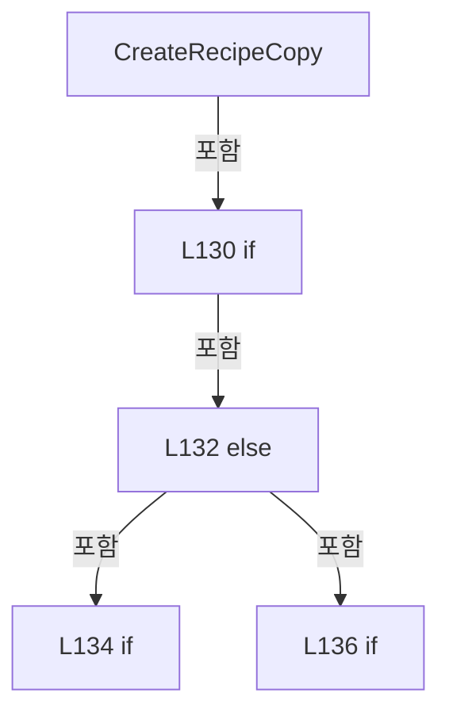

변경 전 점검: 입력/반환 타입, 위 호출자, 예외/취소 경로, 공유 상태와 저장·전송 소비자를 함께 확인합니다. 값의 단위나 물리 방향을 이름만으로 확정하지 않습니다.

### MethodDeclaration `SaveRecipeCore` · L145–157

[Drilling.Common/Managers/CRecipeManager.cs:145–157](https://github.com/kjuws10-rgb/A3Drilling/blob/5aee8e58439c9b455cae7c9593c9be986c3e682e/Drilling.Common/Managers/CRecipeManager.cs#L145-L157)

| 항목 | 실제 추출 값 |
| --- | --- |
| 서명 | System.Threading.Tasks.Task Drilling.Common.Managers.CRecipeManager.SaveRecipeCore(Drilling.Common.Managers.ST_RECIPE_DEFINITION, System.Threading.CancellationToken) |
| 접근/수식자 | Private / private, async |
| 반환/값 타입 | System.Threading.Tasks.Task |
| 소속 타입 | NamedType:Drilling.Common.Managers.CRecipeManager |

입력 계약:

| 이름 | 타입 | 전달 | 선택/기본값 |
| --- | --- | --- | --- |
| recipe | Drilling.Common.Managers.ST_RECIPE_DEFINITION | None | False /  |
| cancellationToken | System.Threading.CancellationToken | None | False /  |

정적 호출자로 확인된 위치:

| 호출 파일/행 | 호출 표현식 | 런타임 분기 가능 |
| --- | --- | --- |
| [Drilling.Common/Managers/CRecipeManager.cs:73–73](https://github.com/kjuws10-rgb/A3Drilling/blob/5aee8e58439c9b455cae7c9593c9be986c3e682e/Drilling.Common/Managers/CRecipeManager.cs#L73-L73) | SaveRecipeCore | False |
| [Drilling.Common/Managers/CRecipeManager.cs:125–125](https://github.com/kjuws10-rgb/A3Drilling/blob/5aee8e58439c9b455cae7c9593c9be986c3e682e/Drilling.Common/Managers/CRecipeManager.cs#L125-L125) | SaveRecipeCore | False |

호출하는 대상과 해석 범위:

| 원본 행 | 표현식 | 분석 상태 | 대상/소스 위치 |
| --- | --- | --- | --- |
| 149 | .FirstOrDefault | resolved | Drilling.Common.Managers.ST_RECIPE_DEFINITION? System.Collections.Generic.IEnumerable<Drilling.Common.Managers.ST_RECIPE_DEFINITION>.FirstOrDefault<Drilling.Common.Managers.ST_RECIPE_DEFINITION>(System.Func<Drilling.Common.Managers.ST_RECIPE_DEFINITION, bool>) |
| 149 | item.Id.Equals | resolved | bool string.Equals(string?, System.StringComparison) |
| 150 | recipeFile.Find | resolved | System.Threading.Tasks.Task<Drilling.Common.Managers.ST_RECIPE_DEFINITION?> Drilling.Common.Managers.CRecipeFileBase.Find(string, System.Threading.CancellationToken) · Drilling.Common/Managers/CRecipeManager.cs:409 |
| 151 | global::Drilling.Common.Recipe.CAlignShotOffsetData.RetainUneditedOffsets | resolved | Drilling.Common.Managers.ST_RECIPE_DEFINITION Drilling.Common.Recipe.CAlignShotOffsetData.RetainUneditedOffsets(Drilling.Common.Managers.ST_RECIPE_DEFINITION, Drilling.Common.Managers.ST_RECIPE_DEFINITION?) · Drilling.Common/Recipe/CShotCoordinatePlanBuilder.cs:754 |
| 152 | recipeFile.Save | resolved | System.Threading.Tasks.Task Drilling.Common.Managers.CRecipeFileBase.Save(Drilling.Common.Managers.ST_RECIPE_DEFINITION, System.Threading.CancellationToken) · Drilling.Common/Managers/CRecipeManager.cs:410 |
| 154 | recipeFile.Find | resolved | System.Threading.Tasks.Task<Drilling.Common.Managers.ST_RECIPE_DEFINITION?> Drilling.Common.Managers.CRecipeFileBase.Find(string, System.Threading.CancellationToken) · Drilling.Common/Managers/CRecipeManager.cs:409 |
| 155 | UpdateCachedRecipe | resolved | void Drilling.Common.Managers.CRecipeManager.UpdateCachedRecipe(Drilling.Common.Managers.ST_RECIPE_DEFINITION) · Drilling.Common/Managers/CRecipeManager.cs:248 |
| 156 | LoadHistoryCore | resolved | System.Threading.Tasks.Task<System.Collections.Generic.IReadOnlyList<Drilling.Common.Managers.ST_RECIPE_HISTORY>> Drilling.Common.Managers.CRecipeManager.LoadHistoryCore(bool, System.Threading.CancellationToken) · Drilling.Common/Managers/CRecipeManager.cs:19 |

본문의 실제 연산·분기·예외·반환 순서(원문 위치 순):

| 원본 행 | 종류 | 주석 해설 |
| --- | --- | --- |
| 147 | local-declaration | 지역 변수를 선언합니다: ST_RECIPE_DEFINITION? current; |
| 148 | lock | 공유 상태의 임계 구역에 진입합니다: lock (_cacheLock) |
| 149 | assignment | 값을 대상에 대입합니다: current = _recipeCache?.FirstOrDefault(item => item.Id.Equals(recipe.Id, StringComparison.OrdinalIgnoreCase)) |
| 149 | call | 함수·델리게이트 또는 객체 생성자를 호출합니다: .FirstOrDefault(item => item.Id.Equals(recipe.Id, StringComparison.OrdinalIgnoreCase)) |
| 149 | call | 함수·델리게이트 또는 객체 생성자를 호출합니다: item.Id.Equals(recipe.Id, StringComparison.OrdinalIgnoreCase) |
| 150 | assignment | 값을 대상에 대입합니다: current ??= await recipeFile.Find(recipe.Id, cancellationToken) |
| 150 | await | 비동기 완료를 기다립니다: await recipeFile.Find(recipe.Id, cancellationToken) |
| 150 | call | 함수·델리게이트 또는 객체 생성자를 호출합니다: recipeFile.Find(recipe.Id, cancellationToken) |
| 151 | assignment | 값을 대상에 대입합니다: recipe = global::Drilling.Common.Recipe.CAlignShotOffsetData.RetainUneditedOffsets(recipe, current) |
| 151 | call | 함수·델리게이트 또는 객체 생성자를 호출합니다: global::Drilling.Common.Recipe.CAlignShotOffsetData.RetainUneditedOffsets(recipe, current) |
| 152 | await | 비동기 완료를 기다립니다: await recipeFile.Save(recipe, cancellationToken) |
| 152 | call | 함수·델리게이트 또는 객체 생성자를 호출합니다: recipeFile.Save(recipe, cancellationToken) |
| 154 | await | 비동기 완료를 기다립니다: await recipeFile.Find(recipe.Id, cancellationToken) |
| 154 | call | 함수·델리게이트 또는 객체 생성자를 호출합니다: recipeFile.Find(recipe.Id, cancellationToken) |
| 154 | local-declaration | 지역 변수를 선언합니다: var savedRecipe = await recipeFile.Find(recipe.Id, cancellationToken) ?? recipe; |
| 154 | variable-initializer | 변수의 초기값을 지정합니다: savedRecipe = await recipeFile.Find(recipe.Id, cancellationToken) ?? recipe |
| 155 | call | 함수·델리게이트 또는 객체 생성자를 호출합니다: UpdateCachedRecipe(savedRecipe) |
| 156 | await | 비동기 완료를 기다립니다: await LoadHistoryCore(true, cancellationToken) |
| 156 | call | 함수·델리게이트 또는 객체 생성자를 호출합니다: LoadHistoryCore(true, cancellationToken) |

제어 구문의 포함 구조(실제 실행 순서/CFG가 아닌 구문 탐색 그림):

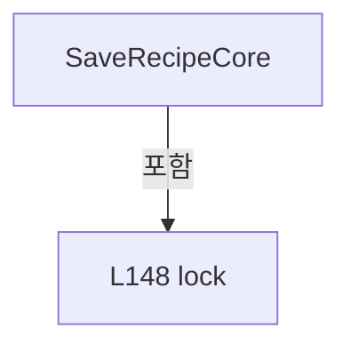

변경 전 점검: 입력/반환 타입, 위 호출자, 예외/취소 경로, 공유 상태와 저장·전송 소비자를 함께 확인합니다. 값의 단위나 물리 방향을 이름만으로 확정하지 않습니다.

### MethodDeclaration `RefreshRecipe` · L159–159

[Drilling.Common/Managers/CRecipeManager.cs:159–159](https://github.com/kjuws10-rgb/A3Drilling/blob/5aee8e58439c9b455cae7c9593c9be986c3e682e/Drilling.Common/Managers/CRecipeManager.cs#L159-L159)

| 항목 | 실제 추출 값 |
| --- | --- |
| 서명 | System.Threading.Tasks.Task<Drilling.Common.Managers.ST_RECIPE_DEFINITION?> Drilling.Common.Managers.CRecipeManager.RefreshRecipe(string, System.Threading.CancellationToken) |
| 접근/수식자 | Public / public, async |
| 반환/값 타입 | System.Threading.Tasks.Task<Drilling.Common.Managers.ST_RECIPE_DEFINITION?> |
| 소속 타입 | NamedType:Drilling.Common.Managers.CRecipeManager |

입력 계약:

| 이름 | 타입 | 전달 | 선택/기본값 |
| --- | --- | --- | --- |
| recipeId | string | None | False /  |
| cancellationToken | System.Threading.CancellationToken | None | True / null |

정적 호출자로 확인된 위치:

| 호출 파일/행 | 호출 표현식 | 런타임 분기 가능 |
| --- | --- | --- |
| [Drilling.Common/Correction/CAlignInterpolation.cs:271–271](https://github.com/kjuws10-rgb/A3Drilling/blob/5aee8e58439c9b455cae7c9593c9be986c3e682e/Drilling.Common/Correction/CAlignInterpolation.cs#L271-L271) | recipes.RefreshRecipe | False |
| [Drilling.UI/CRootView.cs:2782–2782](https://github.com/kjuws10-rgb/A3Drilling/blob/5aee8e58439c9b455cae7c9593c9be986c3e682e/Drilling.UI/CRootView.cs#L2782-L2782) | _recipeManager.RefreshRecipe | False |
| [Drilling.UI/CRootView.cs:2935–2935](https://github.com/kjuws10-rgb/A3Drilling/blob/5aee8e58439c9b455cae7c9593c9be986c3e682e/Drilling.UI/CRootView.cs#L2935-L2935) | _recipeManager.RefreshRecipe | False |
| [Drilling.UI/Menu/Menus/CMenuCorrection.cs:2571–2571](https://github.com/kjuws10-rgb/A3Drilling/blob/5aee8e58439c9b455cae7c9593c9be986c3e682e/Drilling.UI/Menu/Menus/CMenuCorrection.cs#L2571-L2571) | _recipeManager.RefreshRecipe | False |

호출하는 대상과 해석 범위:

| 원본 행 | 표현식 | 분석 상태 | 대상/소스 위치 |
| --- | --- | --- | --- |
| 159 | WithRecipeOperation(() => RefreshRecipeCore(recipeId, cancellationToken), cancellationToken).ConfigureAwait | resolved | System.Runtime.CompilerServices.ConfiguredTaskAwaitable<Drilling.Common.Managers.ST_RECIPE_DEFINITION?> System.Threading.Tasks.Task<Drilling.Common.Managers.ST_RECIPE_DEFINITION?>.ConfigureAwait(bool) |
| 159 | WithRecipeOperation | resolved | System.Threading.Tasks.Task<Drilling.Common.Managers.ST_RECIPE_DEFINITION?> Drilling.Common.Managers.CRecipeManager.WithRecipeOperation<Drilling.Common.Managers.ST_RECIPE_DEFINITION?>(System.Func<System.Threading.Tasks.Task<Drilling.Common.Managers.ST_RECIPE_DEFINITION?>>, System.Threading.CancellationToken) · Drilling.Common/Managers/CRecipeManager.cs:235 |
| 159 | RefreshRecipeCore | resolved | System.Threading.Tasks.Task<Drilling.Common.Managers.ST_RECIPE_DEFINITION?> Drilling.Common.Managers.CRecipeManager.RefreshRecipeCore(string, System.Threading.CancellationToken) · Drilling.Common/Managers/CRecipeManager.cs:160 |

본문의 실제 연산·분기·예외·반환 순서(원문 위치 순):

| 원본 행 | 종류 | 주석 해설 |
| --- | --- | --- |
| 159 | await | 비동기 완료를 기다립니다: await WithRecipeOperation(() => RefreshRecipeCore(recipeId, cancellationToken), cancellationToken).ConfigureAwait(false) |
| 159 | call | 함수·델리게이트 또는 객체 생성자를 호출합니다: WithRecipeOperation(() => RefreshRecipeCore(recipeId, cancellationToken), cancellationToken).ConfigureAwait(false) |
| 159 | call | 함수·델리게이트 또는 객체 생성자를 호출합니다: WithRecipeOperation(() => RefreshRecipeCore(recipeId, cancellationToken), cancellationToken) |
| 159 | call | 함수·델리게이트 또는 객체 생성자를 호출합니다: RefreshRecipeCore(recipeId, cancellationToken) |

변경 전 점검: 입력/반환 타입, 위 호출자, 예외/취소 경로, 공유 상태와 저장·전송 소비자를 함께 확인합니다. 값의 단위나 물리 방향을 이름만으로 확정하지 않습니다.

### MethodDeclaration `RefreshRecipeCore` · L160–168

[Drilling.Common/Managers/CRecipeManager.cs:160–168](https://github.com/kjuws10-rgb/A3Drilling/blob/5aee8e58439c9b455cae7c9593c9be986c3e682e/Drilling.Common/Managers/CRecipeManager.cs#L160-L168)

| 항목 | 실제 추출 값 |
| --- | --- |
| 서명 | System.Threading.Tasks.Task<Drilling.Common.Managers.ST_RECIPE_DEFINITION?> Drilling.Common.Managers.CRecipeManager.RefreshRecipeCore(string, System.Threading.CancellationToken) |
| 접근/수식자 | Private / private, async |
| 반환/값 타입 | System.Threading.Tasks.Task<Drilling.Common.Managers.ST_RECIPE_DEFINITION?> |
| 소속 타입 | NamedType:Drilling.Common.Managers.CRecipeManager |

입력 계약:

| 이름 | 타입 | 전달 | 선택/기본값 |
| --- | --- | --- | --- |
| recipeId | string | None | False /  |
| cancellationToken | System.Threading.CancellationToken | None | False /  |

정적 호출자로 확인된 위치:

| 호출 파일/행 | 호출 표현식 | 런타임 분기 가능 |
| --- | --- | --- |
| [Drilling.Common/Managers/CRecipeManager.cs:159–159](https://github.com/kjuws10-rgb/A3Drilling/blob/5aee8e58439c9b455cae7c9593c9be986c3e682e/Drilling.Common/Managers/CRecipeManager.cs#L159-L159) | RefreshRecipeCore | False |

호출하는 대상과 해석 범위:

| 원본 행 | 표현식 | 분석 상태 | 대상/소스 위치 |
| --- | --- | --- | --- |
| 162 | recipeFile.Find | resolved | System.Threading.Tasks.Task<Drilling.Common.Managers.ST_RECIPE_DEFINITION?> Drilling.Common.Managers.CRecipeFileBase.Find(string, System.Threading.CancellationToken) · Drilling.Common/Managers/CRecipeManager.cs:409 |
| 164 | UpdateCachedRecipe | resolved | void Drilling.Common.Managers.CRecipeManager.UpdateCachedRecipe(Drilling.Common.Managers.ST_RECIPE_DEFINITION) · Drilling.Common/Managers/CRecipeManager.cs:248 |
| 166 | DeleteCachedRecipe | resolved | void Drilling.Common.Managers.CRecipeManager.DeleteCachedRecipe(string) · Drilling.Common/Managers/CRecipeManager.cs:305 |

본문의 실제 연산·분기·예외·반환 순서(원문 위치 순):

| 원본 행 | 종류 | 주석 해설 |
| --- | --- | --- |
| 162 | await | 비동기 완료를 기다립니다: await recipeFile.Find(recipeId, cancellationToken) |
| 162 | call | 함수·델리게이트 또는 객체 생성자를 호출합니다: recipeFile.Find(recipeId, cancellationToken) |
| 162 | local-declaration | 지역 변수를 선언합니다: var recipe = await recipeFile.Find(recipeId, cancellationToken); |
| 162 | variable-initializer | 변수의 초기값을 지정합니다: recipe = await recipeFile.Find(recipeId, cancellationToken) |
| 163 | if | 조건에 따라 분기합니다: if (recipe is not null) |
| 164 | call | 함수·델리게이트 또는 객체 생성자를 호출합니다: UpdateCachedRecipe(recipe) |
| 165 | else | 앞 조건이 거짓인 경로입니다: else |
| 166 | call | 함수·델리게이트 또는 객체 생성자를 호출합니다: DeleteCachedRecipe(recipeId) |
| 167 | return | 호출자에게 값 또는 제어를 반환합니다: return recipe; |

제어 구문의 포함 구조(실제 실행 순서/CFG가 아닌 구문 탐색 그림):

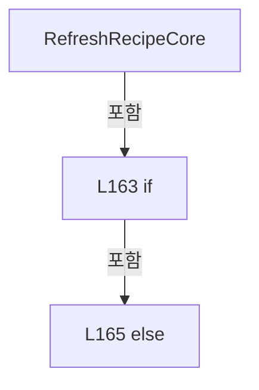

변경 전 점검: 입력/반환 타입, 위 호출자, 예외/취소 경로, 공유 상태와 저장·전송 소비자를 함께 확인합니다. 값의 단위나 물리 방향을 이름만으로 확정하지 않습니다.

### MethodDeclaration `RenameRecipe` · L170–170

[Drilling.Common/Managers/CRecipeManager.cs:170–170](https://github.com/kjuws10-rgb/A3Drilling/blob/5aee8e58439c9b455cae7c9593c9be986c3e682e/Drilling.Common/Managers/CRecipeManager.cs#L170-L170)

| 항목 | 실제 추출 값 |
| --- | --- |
| 서명 | System.Threading.Tasks.Task Drilling.Common.Managers.CRecipeManager.RenameRecipe(string, string, System.Threading.CancellationToken) |
| 접근/수식자 | Public / public, async |
| 반환/값 타입 | System.Threading.Tasks.Task |
| 소속 타입 | NamedType:Drilling.Common.Managers.CRecipeManager |

입력 계약:

| 이름 | 타입 | 전달 | 선택/기본값 |
| --- | --- | --- | --- |
| oldRecipeId | string | None | False /  |
| newRecipeId | string | None | False /  |
| cancellationToken | System.Threading.CancellationToken | None | True / null |

현재 부분 분석에서 직접 연결된 호출자는 없습니다. XAML/이벤트/인터페이스·델리게이트·외부 진입을 추가 확인해야 하며, 미사용으로 판정한 것이 아닙니다.

호출하는 대상과 해석 범위:

| 원본 행 | 표현식 | 분석 상태 | 대상/소스 위치 |
| --- | --- | --- | --- |
| 170 | WithRecipeOperation(() => RenameRecipeCore(oldRecipeId, newRecipeId, cancellationToken), cancellationToken).ConfigureAwait | resolved | System.Runtime.CompilerServices.ConfiguredTaskAwaitable System.Threading.Tasks.Task.ConfigureAwait(bool) |
| 170 | WithRecipeOperation | resolved | System.Threading.Tasks.Task Drilling.Common.Managers.CRecipeManager.WithRecipeOperation(System.Func<System.Threading.Tasks.Task>, System.Threading.CancellationToken) · Drilling.Common/Managers/CRecipeManager.cs:222 |
| 170 | RenameRecipeCore | resolved | System.Threading.Tasks.Task Drilling.Common.Managers.CRecipeManager.RenameRecipeCore(string, string, System.Threading.CancellationToken, System.Collections.Generic.IReadOnlyCollection<string>?) · Drilling.Common/Managers/CRecipeManager.cs:172 |

본문의 실제 연산·분기·예외·반환 순서(원문 위치 순):

| 원본 행 | 종류 | 주석 해설 |
| --- | --- | --- |
| 170 | await | 비동기 완료를 기다립니다: await WithRecipeOperation(() => RenameRecipeCore(oldRecipeId, newRecipeId, cancellationToken), cancellationToken).ConfigureAwait(false) |
| 170 | call | 함수·델리게이트 또는 객체 생성자를 호출합니다: WithRecipeOperation(() => RenameRecipeCore(oldRecipeId, newRecipeId, cancellationToken), cancellationToken).ConfigureAwait(false) |
| 170 | call | 함수·델리게이트 또는 객체 생성자를 호출합니다: WithRecipeOperation(() => RenameRecipeCore(oldRecipeId, newRecipeId, cancellationToken), cancellationToken) |
| 170 | call | 함수·델리게이트 또는 객체 생성자를 호출합니다: RenameRecipeCore(oldRecipeId, newRecipeId, cancellationToken) |

변경 전 점검: 입력/반환 타입, 위 호출자, 예외/취소 경로, 공유 상태와 저장·전송 소비자를 함께 확인합니다. 값의 단위나 물리 방향을 이름만으로 확정하지 않습니다.

### MethodDeclaration `RenameRecipe` · L171–171

[Drilling.Common/Managers/CRecipeManager.cs:171–171](https://github.com/kjuws10-rgb/A3Drilling/blob/5aee8e58439c9b455cae7c9593c9be986c3e682e/Drilling.Common/Managers/CRecipeManager.cs#L171-L171)

| 항목 | 실제 추출 값 |
| --- | --- |
| 서명 | System.Threading.Tasks.Task Drilling.Common.Managers.CRecipeManager.RenameRecipe(string, string, System.Collections.Generic.IReadOnlyCollection<string>, System.Threading.CancellationToken) |
| 접근/수식자 | Public / public |
| 반환/값 타입 | System.Threading.Tasks.Task |
| 소속 타입 | NamedType:Drilling.Common.Managers.CRecipeManager |

입력 계약:

| 이름 | 타입 | 전달 | 선택/기본값 |
| --- | --- | --- | --- |
| oldRecipeId | string | None | False /  |
| newRecipeId | string | None | False /  |
| selectedFolders | System.Collections.Generic.IReadOnlyCollection<string> | None | False /  |
| token | System.Threading.CancellationToken | None | True / null |

정적 호출자로 확인된 위치:

| 호출 파일/행 | 호출 표현식 | 런타임 분기 가능 |
| --- | --- | --- |
| [Drilling.UI/Menu/Menus/CMenuRecipe.cs:1150–1150](https://github.com/kjuws10-rgb/A3Drilling/blob/5aee8e58439c9b455cae7c9593c9be986c3e682e/Drilling.UI/Menu/Menus/CMenuRecipe.cs#L1150-L1150) | _recipeManager.RenameRecipe | False |

호출하는 대상과 해석 범위:

| 원본 행 | 표현식 | 분석 상태 | 대상/소스 위치 |
| --- | --- | --- | --- |
| 171 | WithRecipeOperation | resolved | System.Threading.Tasks.Task Drilling.Common.Managers.CRecipeManager.WithRecipeOperation(System.Func<System.Threading.Tasks.Task>, System.Threading.CancellationToken) · Drilling.Common/Managers/CRecipeManager.cs:222 |
| 171 | RenameRecipeCore | resolved | System.Threading.Tasks.Task Drilling.Common.Managers.CRecipeManager.RenameRecipeCore(string, string, System.Threading.CancellationToken, System.Collections.Generic.IReadOnlyCollection<string>?) · Drilling.Common/Managers/CRecipeManager.cs:172 |

본문의 실제 연산·분기·예외·반환 순서(원문 위치 순):

| 원본 행 | 종류 | 주석 해설 |
| --- | --- | --- |
| 171 | call | 함수·델리게이트 또는 객체 생성자를 호출합니다: WithRecipeOperation(() => RenameRecipeCore(oldRecipeId, newRecipeId, token, selectedFolders), token) |
| 171 | call | 함수·델리게이트 또는 객체 생성자를 호출합니다: RenameRecipeCore(oldRecipeId, newRecipeId, token, selectedFolders) |

변경 전 점검: 입력/반환 타입, 위 호출자, 예외/취소 경로, 공유 상태와 저장·전송 소비자를 함께 확인합니다. 값의 단위나 물리 방향을 이름만으로 확정하지 않습니다.

### MethodDeclaration `RenameRecipeCore` · L172–188

[Drilling.Common/Managers/CRecipeManager.cs:172–188](https://github.com/kjuws10-rgb/A3Drilling/blob/5aee8e58439c9b455cae7c9593c9be986c3e682e/Drilling.Common/Managers/CRecipeManager.cs#L172-L188)

| 항목 | 실제 추출 값 |
| --- | --- |
| 서명 | System.Threading.Tasks.Task Drilling.Common.Managers.CRecipeManager.RenameRecipeCore(string, string, System.Threading.CancellationToken, System.Collections.Generic.IReadOnlyCollection<string>?) |
| 접근/수식자 | Private / private, async |
| 반환/값 타입 | System.Threading.Tasks.Task |
| 소속 타입 | NamedType:Drilling.Common.Managers.CRecipeManager |

입력 계약:

| 이름 | 타입 | 전달 | 선택/기본값 |
| --- | --- | --- | --- |
| oldRecipeId | string | None | False /  |
| newRecipeId | string | None | False /  |
| cancellationToken | System.Threading.CancellationToken | None | False /  |
| folders | System.Collections.Generic.IReadOnlyCollection<string>? | None | True / null |

정적 호출자로 확인된 위치:

| 호출 파일/행 | 호출 표현식 | 런타임 분기 가능 |
| --- | --- | --- |
| [Drilling.Common/Managers/CRecipeManager.cs:170–170](https://github.com/kjuws10-rgb/A3Drilling/blob/5aee8e58439c9b455cae7c9593c9be986c3e682e/Drilling.Common/Managers/CRecipeManager.cs#L170-L170) | RenameRecipeCore | False |
| [Drilling.Common/Managers/CRecipeManager.cs:171–171](https://github.com/kjuws10-rgb/A3Drilling/blob/5aee8e58439c9b455cae7c9593c9be986c3e682e/Drilling.Common/Managers/CRecipeManager.cs#L171-L171) | RenameRecipeCore | False |

호출하는 대상과 해석 범위:

| 원본 행 | 표현식 | 분석 상태 | 대상/소스 위치 |
| --- | --- | --- | --- |
| 175 | store.RenameWithCompanions | resolved · 동적 구현 선택 가능 | System.Threading.Tasks.Task Drilling.Common.Managers.IRecipeCopyStore.RenameWithCompanions(string, string, System.Collections.Generic.IReadOnlyCollection<string>, System.Threading.CancellationToken) · Drilling.Common/Managers/CRecipeManager.cs:343 |
| 179 | new InvalidOperationException | resolved | System.InvalidOperationException.InvalidOperationException(string?) |
| 180 | recipeFile.Rename | resolved | System.Threading.Tasks.Task Drilling.Common.Managers.CRecipeFileBase.Rename(string, string, System.Threading.CancellationToken) · Drilling.Common/Managers/CRecipeManager.cs:411 |
| 183 | RenameCachedRecipe | resolved | void Drilling.Common.Managers.CRecipeManager.RenameCachedRecipe(string, string) · Drilling.Common/Managers/CRecipeManager.cs:280 |
| 184 | recipeFile.Find | resolved | System.Threading.Tasks.Task<Drilling.Common.Managers.ST_RECIPE_DEFINITION?> Drilling.Common.Managers.CRecipeFileBase.Find(string, System.Threading.CancellationToken) · Drilling.Common/Managers/CRecipeManager.cs:409 |
| 186 | UpdateCachedRecipe | resolved | void Drilling.Common.Managers.CRecipeManager.UpdateCachedRecipe(Drilling.Common.Managers.ST_RECIPE_DEFINITION) · Drilling.Common/Managers/CRecipeManager.cs:248 |
| 187 | LoadHistoryCore | resolved | System.Threading.Tasks.Task<System.Collections.Generic.IReadOnlyList<Drilling.Common.Managers.ST_RECIPE_HISTORY>> Drilling.Common.Managers.CRecipeManager.LoadHistoryCore(bool, System.Threading.CancellationToken) · Drilling.Common/Managers/CRecipeManager.cs:19 |

본문의 실제 연산·분기·예외·반환 순서(원문 위치 순):

| 원본 행 | 종류 | 주석 해설 |
| --- | --- | --- |
| 174 | if | 조건에 따라 분기합니다: if (folders is not null && recipeFile is IRecipeCopyStore store) |
| 175 | await | 비동기 완료를 기다립니다: await store.RenameWithCompanions(oldRecipeId, newRecipeId, folders, cancellationToken) |
| 175 | call | 함수·델리게이트 또는 객체 생성자를 호출합니다: store.RenameWithCompanions(oldRecipeId, newRecipeId, folders, cancellationToken) |
| 176 | else | 앞 조건이 거짓인 경로입니다: else |
| 178 | if | 조건에 따라 분기합니다: if (folders?.Count > 0) |
| 179 | call | 함수·델리게이트 또는 객체 생성자를 호출합니다: new InvalidOperationException("이 레시피 저장소는 부가 폴더 이름 변경을 지원하지 않습니다.") |
| 179 | throw | 예외를 발생/전달합니다: throw new InvalidOperationException("이 레시피 저장소는 부가 폴더 이름 변경을 지원하지 않습니다."); |
| 180 | await | 비동기 완료를 기다립니다: await recipeFile.Rename(oldRecipeId, newRecipeId, cancellationToken) |
| 180 | call | 함수·델리게이트 또는 객체 생성자를 호출합니다: recipeFile.Rename(oldRecipeId, newRecipeId, cancellationToken) |
| 183 | call | 함수·델리게이트 또는 객체 생성자를 호출합니다: RenameCachedRecipe(oldRecipeId, newRecipeId) |
| 184 | await | 비동기 완료를 기다립니다: await recipeFile.Find(newRecipeId, cancellationToken) |
| 184 | call | 함수·델리게이트 또는 객체 생성자를 호출합니다: recipeFile.Find(newRecipeId, cancellationToken) |
| 184 | local-declaration | 지역 변수를 선언합니다: var renamedRecipe = await recipeFile.Find(newRecipeId, cancellationToken); |
| 184 | variable-initializer | 변수의 초기값을 지정합니다: renamedRecipe = await recipeFile.Find(newRecipeId, cancellationToken) |
| 185 | if | 조건에 따라 분기합니다: if (renamedRecipe is not null) |
| 186 | call | 함수·델리게이트 또는 객체 생성자를 호출합니다: UpdateCachedRecipe(renamedRecipe) |
| 187 | await | 비동기 완료를 기다립니다: await LoadHistoryCore(true, cancellationToken) |
| 187 | call | 함수·델리게이트 또는 객체 생성자를 호출합니다: LoadHistoryCore(true, cancellationToken) |

제어 구문의 포함 구조(실제 실행 순서/CFG가 아닌 구문 탐색 그림):

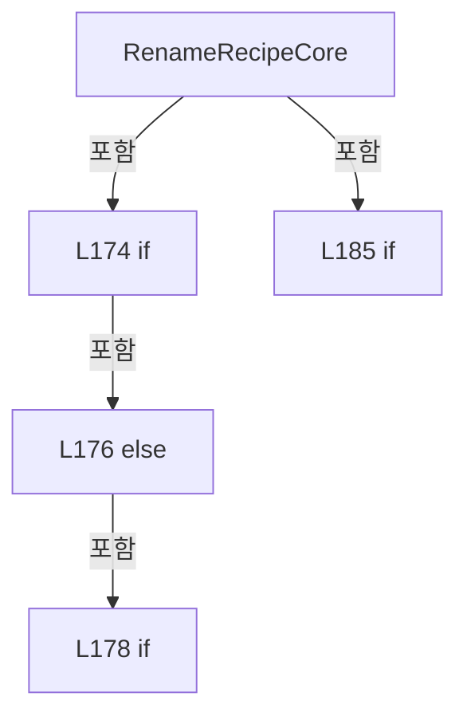

변경 전 점검: 입력/반환 타입, 위 호출자, 예외/취소 경로, 공유 상태와 저장·전송 소비자를 함께 확인합니다. 값의 단위나 물리 방향을 이름만으로 확정하지 않습니다.

### MethodDeclaration `DeleteRecipe` · L190–190

[Drilling.Common/Managers/CRecipeManager.cs:190–190](https://github.com/kjuws10-rgb/A3Drilling/blob/5aee8e58439c9b455cae7c9593c9be986c3e682e/Drilling.Common/Managers/CRecipeManager.cs#L190-L190)

| 항목 | 실제 추출 값 |
| --- | --- |
| 서명 | System.Threading.Tasks.Task Drilling.Common.Managers.CRecipeManager.DeleteRecipe(string, System.Threading.CancellationToken) |
| 접근/수식자 | Public / public, async |
| 반환/값 타입 | System.Threading.Tasks.Task |
| 소속 타입 | NamedType:Drilling.Common.Managers.CRecipeManager |

입력 계약:

| 이름 | 타입 | 전달 | 선택/기본값 |
| --- | --- | --- | --- |
| recipeId | string | None | False /  |
| cancellationToken | System.Threading.CancellationToken | None | True / null |

현재 부분 분석에서 직접 연결된 호출자는 없습니다. XAML/이벤트/인터페이스·델리게이트·외부 진입을 추가 확인해야 하며, 미사용으로 판정한 것이 아닙니다.

호출하는 대상과 해석 범위:

| 원본 행 | 표현식 | 분석 상태 | 대상/소스 위치 |
| --- | --- | --- | --- |
| 190 | WithRecipeOperation(() => DeleteRecipeCore(recipeId, cancellationToken), cancellationToken).ConfigureAwait | resolved | System.Runtime.CompilerServices.ConfiguredTaskAwaitable System.Threading.Tasks.Task.ConfigureAwait(bool) |
| 190 | WithRecipeOperation | resolved | System.Threading.Tasks.Task Drilling.Common.Managers.CRecipeManager.WithRecipeOperation(System.Func<System.Threading.Tasks.Task>, System.Threading.CancellationToken) · Drilling.Common/Managers/CRecipeManager.cs:222 |
| 190 | DeleteRecipeCore | resolved | System.Threading.Tasks.Task Drilling.Common.Managers.CRecipeManager.DeleteRecipeCore(string, System.Threading.CancellationToken, System.Collections.Generic.IReadOnlyCollection<string>?) · Drilling.Common/Managers/CRecipeManager.cs:192 |

본문의 실제 연산·분기·예외·반환 순서(원문 위치 순):

| 원본 행 | 종류 | 주석 해설 |
| --- | --- | --- |
| 190 | await | 비동기 완료를 기다립니다: await WithRecipeOperation(() => DeleteRecipeCore(recipeId, cancellationToken), cancellationToken).ConfigureAwait(false) |
| 190 | call | 함수·델리게이트 또는 객체 생성자를 호출합니다: WithRecipeOperation(() => DeleteRecipeCore(recipeId, cancellationToken), cancellationToken).ConfigureAwait(false) |
| 190 | call | 함수·델리게이트 또는 객체 생성자를 호출합니다: WithRecipeOperation(() => DeleteRecipeCore(recipeId, cancellationToken), cancellationToken) |
| 190 | call | 함수·델리게이트 또는 객체 생성자를 호출합니다: DeleteRecipeCore(recipeId, cancellationToken) |

변경 전 점검: 입력/반환 타입, 위 호출자, 예외/취소 경로, 공유 상태와 저장·전송 소비자를 함께 확인합니다. 값의 단위나 물리 방향을 이름만으로 확정하지 않습니다.

### MethodDeclaration `DeleteRecipe` · L191–191

[Drilling.Common/Managers/CRecipeManager.cs:191–191](https://github.com/kjuws10-rgb/A3Drilling/blob/5aee8e58439c9b455cae7c9593c9be986c3e682e/Drilling.Common/Managers/CRecipeManager.cs#L191-L191)

| 항목 | 실제 추출 값 |
| --- | --- |
| 서명 | System.Threading.Tasks.Task Drilling.Common.Managers.CRecipeManager.DeleteRecipe(string, System.Collections.Generic.IReadOnlyCollection<string>, System.Threading.CancellationToken) |
| 접근/수식자 | Public / public |
| 반환/값 타입 | System.Threading.Tasks.Task |
| 소속 타입 | NamedType:Drilling.Common.Managers.CRecipeManager |

입력 계약:

| 이름 | 타입 | 전달 | 선택/기본값 |
| --- | --- | --- | --- |
| recipeId | string | None | False /  |
| selectedFolders | System.Collections.Generic.IReadOnlyCollection<string> | None | False /  |
| token | System.Threading.CancellationToken | None | True / null |

정적 호출자로 확인된 위치:

| 호출 파일/행 | 호출 표현식 | 런타임 분기 가능 |
| --- | --- | --- |
| [Drilling.UI/Menu/Menus/CMenuRecipe.cs:1270–1270](https://github.com/kjuws10-rgb/A3Drilling/blob/5aee8e58439c9b455cae7c9593c9be986c3e682e/Drilling.UI/Menu/Menus/CMenuRecipe.cs#L1270-L1270) | _recipeManager.DeleteRecipe | False |

호출하는 대상과 해석 범위:

| 원본 행 | 표현식 | 분석 상태 | 대상/소스 위치 |
| --- | --- | --- | --- |
| 191 | WithRecipeOperation | resolved | System.Threading.Tasks.Task Drilling.Common.Managers.CRecipeManager.WithRecipeOperation(System.Func<System.Threading.Tasks.Task>, System.Threading.CancellationToken) · Drilling.Common/Managers/CRecipeManager.cs:222 |
| 191 | DeleteRecipeCore | resolved | System.Threading.Tasks.Task Drilling.Common.Managers.CRecipeManager.DeleteRecipeCore(string, System.Threading.CancellationToken, System.Collections.Generic.IReadOnlyCollection<string>?) · Drilling.Common/Managers/CRecipeManager.cs:192 |

본문의 실제 연산·분기·예외·반환 순서(원문 위치 순):

| 원본 행 | 종류 | 주석 해설 |
| --- | --- | --- |
| 191 | call | 함수·델리게이트 또는 객체 생성자를 호출합니다: WithRecipeOperation(() => DeleteRecipeCore(recipeId, token, selectedFolders), token) |
| 191 | call | 함수·델리게이트 또는 객체 생성자를 호출합니다: DeleteRecipeCore(recipeId, token, selectedFolders) |

변경 전 점검: 입력/반환 타입, 위 호출자, 예외/취소 경로, 공유 상태와 저장·전송 소비자를 함께 확인합니다. 값의 단위나 물리 방향을 이름만으로 확정하지 않습니다.

### MethodDeclaration `DeleteRecipeCore` · L192–205

[Drilling.Common/Managers/CRecipeManager.cs:192–205](https://github.com/kjuws10-rgb/A3Drilling/blob/5aee8e58439c9b455cae7c9593c9be986c3e682e/Drilling.Common/Managers/CRecipeManager.cs#L192-L205)

| 항목 | 실제 추출 값 |
| --- | --- |
| 서명 | System.Threading.Tasks.Task Drilling.Common.Managers.CRecipeManager.DeleteRecipeCore(string, System.Threading.CancellationToken, System.Collections.Generic.IReadOnlyCollection<string>?) |
| 접근/수식자 | Private / private, async |
| 반환/값 타입 | System.Threading.Tasks.Task |
| 소속 타입 | NamedType:Drilling.Common.Managers.CRecipeManager |

입력 계약:

| 이름 | 타입 | 전달 | 선택/기본값 |
| --- | --- | --- | --- |
| recipeId | string | None | False /  |
| cancellationToken | System.Threading.CancellationToken | None | False /  |
| folders | System.Collections.Generic.IReadOnlyCollection<string>? | None | True / null |

정적 호출자로 확인된 위치:

| 호출 파일/행 | 호출 표현식 | 런타임 분기 가능 |
| --- | --- | --- |
| [Drilling.Common/Managers/CRecipeManager.cs:190–190](https://github.com/kjuws10-rgb/A3Drilling/blob/5aee8e58439c9b455cae7c9593c9be986c3e682e/Drilling.Common/Managers/CRecipeManager.cs#L190-L190) | DeleteRecipeCore | False |
| [Drilling.Common/Managers/CRecipeManager.cs:191–191](https://github.com/kjuws10-rgb/A3Drilling/blob/5aee8e58439c9b455cae7c9593c9be986c3e682e/Drilling.Common/Managers/CRecipeManager.cs#L191-L191) | DeleteRecipeCore | False |

호출하는 대상과 해석 범위:

| 원본 행 | 표현식 | 분석 상태 | 대상/소스 위치 |
| --- | --- | --- | --- |
| 195 | store.DeleteWithCompanions | resolved · 동적 구현 선택 가능 | System.Threading.Tasks.Task Drilling.Common.Managers.IRecipeCopyStore.DeleteWithCompanions(string, System.Collections.Generic.IReadOnlyCollection<string>, System.Threading.CancellationToken) · Drilling.Common/Managers/CRecipeManager.cs:344 |
| 199 | new InvalidOperationException | resolved | System.InvalidOperationException.InvalidOperationException(string?) |
| 200 | recipeFile.Delete | resolved | System.Threading.Tasks.Task Drilling.Common.Managers.CRecipeFileBase.Delete(string, System.Threading.CancellationToken) · Drilling.Common/Managers/CRecipeManager.cs:412 |
| 203 | DeleteCachedRecipe | resolved | void Drilling.Common.Managers.CRecipeManager.DeleteCachedRecipe(string) · Drilling.Common/Managers/CRecipeManager.cs:305 |
| 204 | LoadHistoryCore | resolved | System.Threading.Tasks.Task<System.Collections.Generic.IReadOnlyList<Drilling.Common.Managers.ST_RECIPE_HISTORY>> Drilling.Common.Managers.CRecipeManager.LoadHistoryCore(bool, System.Threading.CancellationToken) · Drilling.Common/Managers/CRecipeManager.cs:19 |

본문의 실제 연산·분기·예외·반환 순서(원문 위치 순):

| 원본 행 | 종류 | 주석 해설 |
| --- | --- | --- |
| 194 | if | 조건에 따라 분기합니다: if (folders is not null && recipeFile is IRecipeCopyStore store) |
| 195 | await | 비동기 완료를 기다립니다: await store.DeleteWithCompanions(recipeId, folders, cancellationToken) |
| 195 | call | 함수·델리게이트 또는 객체 생성자를 호출합니다: store.DeleteWithCompanions(recipeId, folders, cancellationToken) |
| 196 | else | 앞 조건이 거짓인 경로입니다: else |
| 198 | if | 조건에 따라 분기합니다: if (folders?.Count > 0) |
| 199 | call | 함수·델리게이트 또는 객체 생성자를 호출합니다: new InvalidOperationException("이 레시피 저장소는 부가 폴더 삭제를 지원하지 않습니다.") |
| 199 | throw | 예외를 발생/전달합니다: throw new InvalidOperationException("이 레시피 저장소는 부가 폴더 삭제를 지원하지 않습니다."); |
| 200 | await | 비동기 완료를 기다립니다: await recipeFile.Delete(recipeId, cancellationToken) |
| 200 | call | 함수·델리게이트 또는 객체 생성자를 호출합니다: recipeFile.Delete(recipeId, cancellationToken) |
| 203 | call | 함수·델리게이트 또는 객체 생성자를 호출합니다: DeleteCachedRecipe(recipeId) |
| 204 | await | 비동기 완료를 기다립니다: await LoadHistoryCore(true, cancellationToken) |
| 204 | call | 함수·델리게이트 또는 객체 생성자를 호출합니다: LoadHistoryCore(true, cancellationToken) |

제어 구문의 포함 구조(실제 실행 순서/CFG가 아닌 구문 탐색 그림):

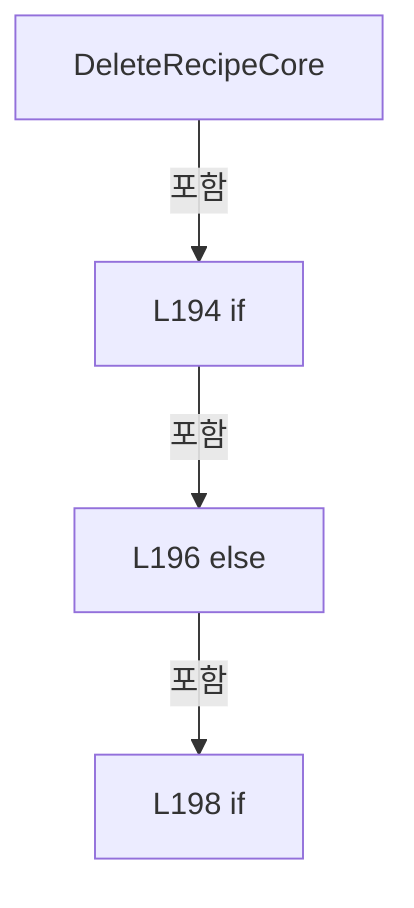

변경 전 점검: 입력/반환 타입, 위 호출자, 예외/취소 경로, 공유 상태와 저장·전송 소비자를 함께 확인합니다. 값의 단위나 물리 방향을 이름만으로 확정하지 않습니다.

### MethodDeclaration `IncrementProtectWindowCount` · L207–207

[Drilling.Common/Managers/CRecipeManager.cs:207–207](https://github.com/kjuws10-rgb/A3Drilling/blob/5aee8e58439c9b455cae7c9593c9be986c3e682e/Drilling.Common/Managers/CRecipeManager.cs#L207-L207)

| 항목 | 실제 추출 값 |
| --- | --- |
| 서명 | System.Threading.Tasks.Task<int> Drilling.Common.Managers.CRecipeManager.IncrementProtectWindowCount(string, System.Threading.CancellationToken) |
| 접근/수식자 | Public / public |
| 반환/값 타입 | System.Threading.Tasks.Task<int> |
| 소속 타입 | NamedType:Drilling.Common.Managers.CRecipeManager |

입력 계약:

| 이름 | 타입 | 전달 | 선택/기본값 |
| --- | --- | --- | --- |
| recipeId | string | None | False /  |
| cancellationToken | System.Threading.CancellationToken | None | True / null |

정적 호출자로 확인된 위치:

| 호출 파일/행 | 호출 표현식 | 런타임 분기 가능 |
| --- | --- | --- |
| [Drilling.Common/Station/CStationProcess.cs:3778–3778](https://github.com/kjuws10-rgb/A3Drilling/blob/5aee8e58439c9b455cae7c9593c9be986c3e682e/Drilling.Common/Station/CStationProcess.cs#L3778-L3778) | _recipeManager.IncrementProtectWindowCount | False |

호출하는 대상과 해석 범위:

| 원본 행 | 표현식 | 분석 상태 | 대상/소스 위치 |
| --- | --- | --- | --- |
| 207 | ChangeProtectWindowCount | resolved | System.Threading.Tasks.Task<int> Drilling.Common.Managers.CRecipeManager.ChangeProtectWindowCount(string, System.Func<System.Threading.Tasks.Task<int>>, System.Threading.CancellationToken) · Drilling.Common/Managers/CRecipeManager.cs:210 |
| 207 | recipeFile.IncrementProtectWindowCount | resolved · 동적 구현 선택 가능 | System.Threading.Tasks.Task<int> Drilling.Common.Managers.CRecipeFileBase.IncrementProtectWindowCount(string, System.Threading.CancellationToken) · Drilling.Common/Managers/CRecipeManager.cs:415 |

본문의 실제 연산·분기·예외·반환 순서(원문 위치 순):

| 원본 행 | 종류 | 주석 해설 |
| --- | --- | --- |
| 207 | call | 함수·델리게이트 또는 객체 생성자를 호출합니다: ChangeProtectWindowCount(recipeId, () => recipeFile.IncrementProtectWindowCount(recipeId, cancellationToken), cancellationToken) |
| 207 | call | 함수·델리게이트 또는 객체 생성자를 호출합니다: recipeFile.IncrementProtectWindowCount(recipeId, cancellationToken) |

변경 전 점검: 입력/반환 타입, 위 호출자, 예외/취소 경로, 공유 상태와 저장·전송 소비자를 함께 확인합니다. 값의 단위나 물리 방향을 이름만으로 확정하지 않습니다.

### MethodDeclaration `ResetProtectWindowCount` · L208–208

[Drilling.Common/Managers/CRecipeManager.cs:208–208](https://github.com/kjuws10-rgb/A3Drilling/blob/5aee8e58439c9b455cae7c9593c9be986c3e682e/Drilling.Common/Managers/CRecipeManager.cs#L208-L208)

| 항목 | 실제 추출 값 |
| --- | --- |
| 서명 | System.Threading.Tasks.Task<int> Drilling.Common.Managers.CRecipeManager.ResetProtectWindowCount(string, System.Threading.CancellationToken) |
| 접근/수식자 | Public / public |
| 반환/값 타입 | System.Threading.Tasks.Task<int> |
| 소속 타입 | NamedType:Drilling.Common.Managers.CRecipeManager |

입력 계약:

| 이름 | 타입 | 전달 | 선택/기본값 |
| --- | --- | --- | --- |
| recipeId | string | None | False /  |
| cancellationToken | System.Threading.CancellationToken | None | True / null |

현재 부분 분석에서 직접 연결된 호출자는 없습니다. XAML/이벤트/인터페이스·델리게이트·외부 진입을 추가 확인해야 하며, 미사용으로 판정한 것이 아닙니다.

호출하는 대상과 해석 범위:

| 원본 행 | 표현식 | 분석 상태 | 대상/소스 위치 |
| --- | --- | --- | --- |
| 208 | ChangeProtectWindowCount | resolved | System.Threading.Tasks.Task<int> Drilling.Common.Managers.CRecipeManager.ChangeProtectWindowCount(string, System.Func<System.Threading.Tasks.Task<int>>, System.Threading.CancellationToken) · Drilling.Common/Managers/CRecipeManager.cs:210 |
| 208 | recipeFile.ResetProtectWindowCount | resolved · 동적 구현 선택 가능 | System.Threading.Tasks.Task<int> Drilling.Common.Managers.CRecipeFileBase.ResetProtectWindowCount(string, System.Threading.CancellationToken) · Drilling.Common/Managers/CRecipeManager.cs:416 |

본문의 실제 연산·분기·예외·반환 순서(원문 위치 순):

| 원본 행 | 종류 | 주석 해설 |
| --- | --- | --- |
| 208 | call | 함수·델리게이트 또는 객체 생성자를 호출합니다: ChangeProtectWindowCount(recipeId, () => recipeFile.ResetProtectWindowCount(recipeId, cancellationToken), cancellationToken) |
| 208 | call | 함수·델리게이트 또는 객체 생성자를 호출합니다: recipeFile.ResetProtectWindowCount(recipeId, cancellationToken) |

변경 전 점검: 입력/반환 타입, 위 호출자, 예외/취소 경로, 공유 상태와 저장·전송 소비자를 함께 확인합니다. 값의 단위나 물리 방향을 이름만으로 확정하지 않습니다.

### MethodDeclaration `SetProtectWindowCount` · L209–209

[Drilling.Common/Managers/CRecipeManager.cs:209–209](https://github.com/kjuws10-rgb/A3Drilling/blob/5aee8e58439c9b455cae7c9593c9be986c3e682e/Drilling.Common/Managers/CRecipeManager.cs#L209-L209)

| 항목 | 실제 추출 값 |
| --- | --- |
| 서명 | System.Threading.Tasks.Task<int> Drilling.Common.Managers.CRecipeManager.SetProtectWindowCount(string, int, System.Threading.CancellationToken) |
| 접근/수식자 | Public / public |
| 반환/값 타입 | System.Threading.Tasks.Task<int> |
| 소속 타입 | NamedType:Drilling.Common.Managers.CRecipeManager |

입력 계약:

| 이름 | 타입 | 전달 | 선택/기본값 |
| --- | --- | --- | --- |
| recipeId | string | None | False /  |
| count | int | None | False /  |
| cancellationToken | System.Threading.CancellationToken | None | True / null |

정적 호출자로 확인된 위치:

| 호출 파일/행 | 호출 표현식 | 런타임 분기 가능 |
| --- | --- | --- |
| [Drilling.Common/Station/CStationProcess.cs:4619–4619](https://github.com/kjuws10-rgb/A3Drilling/blob/5aee8e58439c9b455cae7c9593c9be986c3e682e/Drilling.Common/Station/CStationProcess.cs#L4619-L4619) | recipes.SetProtectWindowCount | False |

호출하는 대상과 해석 범위:

| 원본 행 | 표현식 | 분석 상태 | 대상/소스 위치 |
| --- | --- | --- | --- |
| 209 | Task.FromException<int> | resolved | System.Threading.Tasks.Task<int> System.Threading.Tasks.Task.FromException<int>(System.Exception) |
| 209 | new ArgumentOutOfRangeException | resolved | System.ArgumentOutOfRangeException.ArgumentOutOfRangeException(string?) |
| 209 | nameof | unresolved | None |
| 209 | ChangeProtectWindowCount | resolved | System.Threading.Tasks.Task<int> Drilling.Common.Managers.CRecipeManager.ChangeProtectWindowCount(string, System.Func<System.Threading.Tasks.Task<int>>, System.Threading.CancellationToken) · Drilling.Common/Managers/CRecipeManager.cs:210 |
| 209 | recipeFile.SetProtectWindowCount | resolved · 동적 구현 선택 가능 | System.Threading.Tasks.Task<int> Drilling.Common.Managers.CRecipeFileBase.SetProtectWindowCount(string, int, System.Threading.CancellationToken) · Drilling.Common/Managers/CRecipeManager.cs:417 |

본문의 실제 연산·분기·예외·반환 순서(원문 위치 순):

| 원본 행 | 종류 | 주석 해설 |
| --- | --- | --- |
| 209 | call | 함수·델리게이트 또는 객체 생성자를 호출합니다: Task.FromException<int>(new ArgumentOutOfRangeException(nameof(count))) |
| 209 | call | 함수·델리게이트 또는 객체 생성자를 호출합니다: new ArgumentOutOfRangeException(nameof(count)) |
| 209 | call | 함수·델리게이트 또는 객체 생성자를 호출합니다: nameof(count) |
| 209 | call | 함수·델리게이트 또는 객체 생성자를 호출합니다: ChangeProtectWindowCount(recipeId, () => recipeFile.SetProtectWindowCount(recipeId, count, cancellationToken), cancellationToken) |
| 209 | call | 함수·델리게이트 또는 객체 생성자를 호출합니다: recipeFile.SetProtectWindowCount(recipeId, count, cancellationToken) |
| 209 | conditional-expression | 조건에 따라 결과식을 선택합니다: count < 0 ? Task.FromException<int>(new ArgumentOutOfRangeException(nameof(count))) : ChangeProtectWindowCount(recipeId, () => recipeFile.SetProtectWindowCount(recipeId, count, cancellationToken), cancellationToken) |

변경 전 점검: 입력/반환 타입, 위 호출자, 예외/취소 경로, 공유 상태와 저장·전송 소비자를 함께 확인합니다. 값의 단위나 물리 방향을 이름만으로 확정하지 않습니다.

### MethodDeclaration `ChangeProtectWindowCount` · L210–221

[Drilling.Common/Managers/CRecipeManager.cs:210–221](https://github.com/kjuws10-rgb/A3Drilling/blob/5aee8e58439c9b455cae7c9593c9be986c3e682e/Drilling.Common/Managers/CRecipeManager.cs#L210-L221)

| 항목 | 실제 추출 값 |
| --- | --- |
| 서명 | System.Threading.Tasks.Task<int> Drilling.Common.Managers.CRecipeManager.ChangeProtectWindowCount(string, System.Func<System.Threading.Tasks.Task<int>>, System.Threading.CancellationToken) |
| 접근/수식자 | Private / private |
| 반환/값 타입 | System.Threading.Tasks.Task<int> |
| 소속 타입 | NamedType:Drilling.Common.Managers.CRecipeManager |

입력 계약:

| 이름 | 타입 | 전달 | 선택/기본값 |
| --- | --- | --- | --- |
| recipeId | string | None | False /  |
| commit | System.Func<System.Threading.Tasks.Task<int>> | None | False /  |
| cancellationToken | System.Threading.CancellationToken | None | False /  |

정적 호출자로 확인된 위치:

| 호출 파일/행 | 호출 표현식 | 런타임 분기 가능 |
| --- | --- | --- |
| [Drilling.Common/Managers/CRecipeManager.cs:207–207](https://github.com/kjuws10-rgb/A3Drilling/blob/5aee8e58439c9b455cae7c9593c9be986c3e682e/Drilling.Common/Managers/CRecipeManager.cs#L207-L207) | ChangeProtectWindowCount | False |
| [Drilling.Common/Managers/CRecipeManager.cs:208–208](https://github.com/kjuws10-rgb/A3Drilling/blob/5aee8e58439c9b455cae7c9593c9be986c3e682e/Drilling.Common/Managers/CRecipeManager.cs#L208-L208) | ChangeProtectWindowCount | False |
| [Drilling.Common/Managers/CRecipeManager.cs:209–209](https://github.com/kjuws10-rgb/A3Drilling/blob/5aee8e58439c9b455cae7c9593c9be986c3e682e/Drilling.Common/Managers/CRecipeManager.cs#L209-L209) | ChangeProtectWindowCount | False |

호출하는 대상과 해석 범위:

| 원본 행 | 표현식 | 분석 상태 | 대상/소스 위치 |
| --- | --- | --- | --- |
| 210 | WithRecipeOperation | resolved | System.Threading.Tasks.Task<int> Drilling.Common.Managers.CRecipeManager.WithRecipeOperation<int>(System.Func<System.Threading.Tasks.Task<int>>, System.Threading.CancellationToken) · Drilling.Common/Managers/CRecipeManager.cs:235 |
| 213 | commit().ConfigureAwait | resolved | System.Runtime.CompilerServices.ConfiguredTaskAwaitable<int> System.Threading.Tasks.Task<int>.ConfigureAwait(bool) |
| 213 | commit | resolved · 동적 구현 선택 가능 | System.Threading.Tasks.Task<int> System.Func<System.Threading.Tasks.Task<int>>.Invoke() |
| 217 | _recipeCache.Select(recipe => recipe.Id.Equals(recipeId, StringComparison.OrdinalIgnoreCase) ? recipe with { Parameters = recipe.Parameters.Select(parameter => parameter.Key.Equals(global::Drilling.Common.Recipe.CProtectWindowRecipeData.CurrentCountKey, StringComparison.OrdinalIgnoreCase) ? parameter with { Value = count.ToString(System.Globalizati… | resolved | Drilling.Common.Managers.ST_RECIPE_DEFINITION[] System.Collections.Generic.IEnumerable<Drilling.Common.Managers.ST_RECIPE_DEFINITION>.ToArray<Drilling.Common.Managers.ST_RECIPE_DEFINITION>() |
| 217 | _recipeCache.Select | resolved | System.Collections.Generic.IEnumerable<Drilling.Common.Managers.ST_RECIPE_DEFINITION> System.Collections.Generic.IEnumerable<Drilling.Common.Managers.ST_RECIPE_DEFINITION>.Select<Drilling.Common.Managers.ST_RECIPE_DEFINITION, Drilling.Common.Managers.ST_RECIPE_DEFINITION>(System.Func<Drilling.Common.Managers.ST_RECIPE_DEFINITION, Drilling.Common.Managers.ST_RECIPE_DEFINITION>) |
| 217 | recipe.Id.Equals | resolved | bool string.Equals(string?, System.StringComparison) |
| 217 | recipe.Parameters.Select(parameter => parameter.Key.Equals(global::Drilling.Common.Recipe.CProtectWindowRecipeData.CurrentCountKey, StringComparison.OrdinalIgnoreCase) ? parameter with { Value = count.ToString(System.Globalization.CultureInfo.InvariantCulture) } : parameter).ToArray | resolved | Drilling.Common.Managers.ST_RECIPE_PARAMETER[] System.Collections.Generic.IEnumerable<Drilling.Common.Managers.ST_RECIPE_PARAMETER>.ToArray<Drilling.Common.Managers.ST_RECIPE_PARAMETER>() |
| 217 | recipe.Parameters.Select | resolved | System.Collections.Generic.IEnumerable<Drilling.Common.Managers.ST_RECIPE_PARAMETER> System.Collections.Generic.IEnumerable<Drilling.Common.Managers.ST_RECIPE_PARAMETER>.Select<Drilling.Common.Managers.ST_RECIPE_PARAMETER, Drilling.Common.Managers.ST_RECIPE_PARAMETER>(System.Func<Drilling.Common.Managers.ST_RECIPE_PARAMETER, Drilling.Common.Managers.ST_RECIPE_PARAMETER>) |
| 217 | parameter.Key.Equals | resolved | bool string.Equals(string?, System.StringComparison) |
| 217 | count.ToString | resolved | string int.ToString(System.IFormatProvider?) |

본문의 실제 연산·분기·예외·반환 순서(원문 위치 순):

| 원본 행 | 종류 | 주석 해설 |
| --- | --- | --- |
| 210 | call | 함수·델리게이트 또는 객체 생성자를 호출합니다: WithRecipeOperation(async () => { // The file store commits before the new count is visible to any UI snapshot. var count = await commit().ConfigureAwait(false); lock (_cacheLock) { if (_recipeCache is not null) _recipeC… |
| 213 | await | 비동기 완료를 기다립니다: await commit().ConfigureAwait(false) |
| 213 | call | 함수·델리게이트 또는 객체 생성자를 호출합니다: commit().ConfigureAwait(false) |
| 213 | call | 함수·델리게이트 또는 객체 생성자를 호출합니다: commit() |
| 213 | local-declaration | 지역 변수를 선언합니다: var count = await commit().ConfigureAwait(false); |
| 213 | variable-initializer | 변수의 초기값을 지정합니다: count = await commit().ConfigureAwait(false) |
| 214 | lock | 공유 상태의 임계 구역에 진입합니다: lock (_cacheLock) |
| 216 | if | 조건에 따라 분기합니다: if (_recipeCache is not null) |
| 217 | assignment | 값을 대상에 대입합니다: _recipeCache = _recipeCache.Select(recipe => recipe.Id.Equals(recipeId, StringComparison.OrdinalIgnoreCase) ? recipe with { Parameters = recipe.Parameters.Select(parameter => parameter.Key.Equals(global::Drilling.Common.Recipe.CPr |
| 217 | assignment | 값을 대상에 대입합니다: Parameters = recipe.Parameters.Select(parameter => parameter.Key.Equals(global::Drilling.Common.Recipe.CProtectWindowRecipeData.CurrentCountKey, StringComparison.OrdinalIgnoreCase) ? parameter with { Value = count.ToString(System. |
| 217 | assignment | 값을 대상에 대입합니다: Value = count.ToString(System.Globalization.CultureInfo.InvariantCulture) |
| 217 | call | 함수·델리게이트 또는 객체 생성자를 호출합니다: _recipeCache.Select(recipe => recipe.Id.Equals(recipeId, StringComparison.OrdinalIgnoreCase) ? recipe with { Parameters = recipe.Parameters.Select(parameter => parameter.Key.Equals(global::Drilling.Common.Recipe.CProtect… |
| 217 | call | 함수·델리게이트 또는 객체 생성자를 호출합니다: _recipeCache.Select(recipe => recipe.Id.Equals(recipeId, StringComparison.OrdinalIgnoreCase) ? recipe with { Parameters = recipe.Parameters.Select(parameter => parameter.Key.Equals(global::Drilling.Common.Recipe.CProtect… |
| 217 | call | 함수·델리게이트 또는 객체 생성자를 호출합니다: recipe.Id.Equals(recipeId, StringComparison.OrdinalIgnoreCase) |
| 217 | call | 함수·델리게이트 또는 객체 생성자를 호출합니다: recipe.Parameters.Select(parameter => parameter.Key.Equals(global::Drilling.Common.Recipe.CProtectWindowRecipeData.CurrentCountKey, StringComparison.OrdinalIgnoreCase) ? parameter with { Value = count.ToString(System.Glo… |
| 217 | call | 함수·델리게이트 또는 객체 생성자를 호출합니다: recipe.Parameters.Select(parameter => parameter.Key.Equals(global::Drilling.Common.Recipe.CProtectWindowRecipeData.CurrentCountKey, StringComparison.OrdinalIgnoreCase) ? parameter with { Value = count.ToString(System.Glo… |
| 217 | call | 함수·델리게이트 또는 객체 생성자를 호출합니다: parameter.Key.Equals(global::Drilling.Common.Recipe.CProtectWindowRecipeData.CurrentCountKey, StringComparison.OrdinalIgnoreCase) |
| 217 | call | 함수·델리게이트 또는 객체 생성자를 호출합니다: count.ToString(System.Globalization.CultureInfo.InvariantCulture) |
| 217 | conditional-expression | 조건에 따라 결과식을 선택합니다: recipe.Id.Equals(recipeId, StringComparison.OrdinalIgnoreCase) ? recipe with { Parameters = recipe.Parameters.Select(parameter => parameter.Key.Equals(global::Drilling.Common.Recipe.CProtectWindowRecipeData.CurrentCountKey, String |
| 217 | conditional-expression | 조건에 따라 결과식을 선택합니다: parameter.Key.Equals(global::Drilling.Common.Recipe.CProtectWindowRecipeData.CurrentCountKey, StringComparison.OrdinalIgnoreCase) ? parameter with { Value = count.ToString(System.Globalization.CultureInfo.InvariantCulture) } : par |
| 220 | return | 호출자에게 값 또는 제어를 반환합니다: return count; |

제어 구문의 포함 구조(실제 실행 순서/CFG가 아닌 구문 탐색 그림):

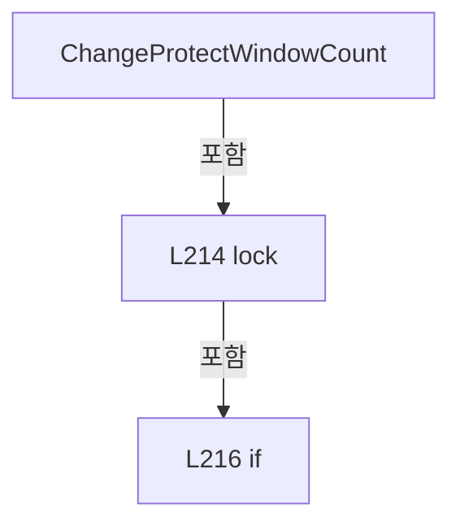

변경 전 점검: 입력/반환 타입, 위 호출자, 예외/취소 경로, 공유 상태와 저장·전송 소비자를 함께 확인합니다. 값의 단위나 물리 방향을 이름만으로 확정하지 않습니다.

### MethodDeclaration `WithRecipeOperation` · L222–233

[Drilling.Common/Managers/CRecipeManager.cs:222–233](https://github.com/kjuws10-rgb/A3Drilling/blob/5aee8e58439c9b455cae7c9593c9be986c3e682e/Drilling.Common/Managers/CRecipeManager.cs#L222-L233)

| 항목 | 실제 추출 값 |
| --- | --- |
| 서명 | System.Threading.Tasks.Task Drilling.Common.Managers.CRecipeManager.WithRecipeOperation(System.Func<System.Threading.Tasks.Task>, System.Threading.CancellationToken) |
| 접근/수식자 | Private / private, async |
| 반환/값 타입 | System.Threading.Tasks.Task |
| 소속 타입 | NamedType:Drilling.Common.Managers.CRecipeManager |

입력 계약:

| 이름 | 타입 | 전달 | 선택/기본값 |
| --- | --- | --- | --- |
| operation | System.Func<System.Threading.Tasks.Task> | None | False /  |
| token | System.Threading.CancellationToken | None | False /  |

정적 호출자로 확인된 위치:

| 호출 파일/행 | 호출 표현식 | 런타임 분기 가능 |
| --- | --- | --- |
| [Drilling.Common/Managers/CRecipeManager.cs:73–73](https://github.com/kjuws10-rgb/A3Drilling/blob/5aee8e58439c9b455cae7c9593c9be986c3e682e/Drilling.Common/Managers/CRecipeManager.cs#L73-L73) | WithRecipeOperation | False |
| [Drilling.Common/Managers/CRecipeManager.cs:112–126](https://github.com/kjuws10-rgb/A3Drilling/blob/5aee8e58439c9b455cae7c9593c9be986c3e682e/Drilling.Common/Managers/CRecipeManager.cs#L112-L126) | WithRecipeOperation | False |
| [Drilling.Common/Managers/CRecipeManager.cs:128–144](https://github.com/kjuws10-rgb/A3Drilling/blob/5aee8e58439c9b455cae7c9593c9be986c3e682e/Drilling.Common/Managers/CRecipeManager.cs#L128-L144) | WithRecipeOperation | False |
| [Drilling.Common/Managers/CRecipeManager.cs:170–170](https://github.com/kjuws10-rgb/A3Drilling/blob/5aee8e58439c9b455cae7c9593c9be986c3e682e/Drilling.Common/Managers/CRecipeManager.cs#L170-L170) | WithRecipeOperation | False |
| [Drilling.Common/Managers/CRecipeManager.cs:171–171](https://github.com/kjuws10-rgb/A3Drilling/blob/5aee8e58439c9b455cae7c9593c9be986c3e682e/Drilling.Common/Managers/CRecipeManager.cs#L171-L171) | WithRecipeOperation | False |
| [Drilling.Common/Managers/CRecipeManager.cs:190–190](https://github.com/kjuws10-rgb/A3Drilling/blob/5aee8e58439c9b455cae7c9593c9be986c3e682e/Drilling.Common/Managers/CRecipeManager.cs#L190-L190) | WithRecipeOperation | False |
| [Drilling.Common/Managers/CRecipeManager.cs:191–191](https://github.com/kjuws10-rgb/A3Drilling/blob/5aee8e58439c9b455cae7c9593c9be986c3e682e/Drilling.Common/Managers/CRecipeManager.cs#L191-L191) | WithRecipeOperation | False |

호출하는 대상과 해석 범위:

| 원본 행 | 표현식 | 분석 상태 | 대상/소스 위치 |
| --- | --- | --- | --- |
| 224 | _recipeOperationGate.WaitAsync(token).ConfigureAwait | resolved | System.Runtime.CompilerServices.ConfiguredTaskAwaitable System.Threading.Tasks.Task.ConfigureAwait(bool) |
| 224 | _recipeOperationGate.WaitAsync | resolved | System.Threading.Tasks.Task System.Threading.SemaphoreSlim.WaitAsync(System.Threading.CancellationToken) |
| 227 | operation().ConfigureAwait | resolved | System.Runtime.CompilerServices.ConfiguredTaskAwaitable System.Threading.Tasks.Task.ConfigureAwait(bool) |
| 227 | operation | resolved · 동적 구현 선택 가능 | System.Threading.Tasks.Task System.Func<System.Threading.Tasks.Task>.Invoke() |
| 231 | _recipeOperationGate.Release | resolved | int System.Threading.SemaphoreSlim.Release() |

본문의 실제 연산·분기·예외·반환 순서(원문 위치 순):

| 원본 행 | 종류 | 주석 해설 |
| --- | --- | --- |
| 224 | await | 비동기 완료를 기다립니다: await _recipeOperationGate.WaitAsync(token).ConfigureAwait(false) |
| 224 | call | 함수·델리게이트 또는 객체 생성자를 호출합니다: _recipeOperationGate.WaitAsync(token).ConfigureAwait(false) |
| 224 | call | 함수·델리게이트 또는 객체 생성자를 호출합니다: _recipeOperationGate.WaitAsync(token) |
| 225 | try | 예외 처리 범위입니다: try |
| 227 | await | 비동기 완료를 기다립니다: await operation().ConfigureAwait(false) |
| 227 | call | 함수·델리게이트 또는 객체 생성자를 호출합니다: operation().ConfigureAwait(false) |
| 227 | call | 함수·델리게이트 또는 객체 생성자를 호출합니다: operation() |
| 229 | finally | 종료 정리 구간입니다: finally |
| 231 | call | 함수·델리게이트 또는 객체 생성자를 호출합니다: _recipeOperationGate.Release() |

제어 구문의 포함 구조(실제 실행 순서/CFG가 아닌 구문 탐색 그림):

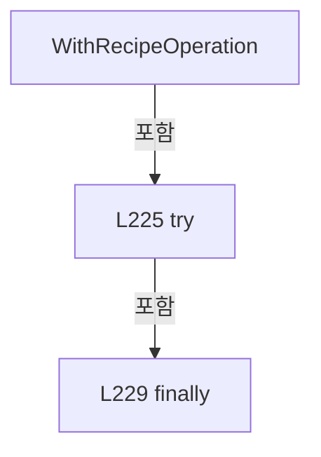

변경 전 점검: 입력/반환 타입, 위 호출자, 예외/취소 경로, 공유 상태와 저장·전송 소비자를 함께 확인합니다. 값의 단위나 물리 방향을 이름만으로 확정하지 않습니다.

### MethodDeclaration `WithRecipeOperation` · L235–246

[Drilling.Common/Managers/CRecipeManager.cs:235–246](https://github.com/kjuws10-rgb/A3Drilling/blob/5aee8e58439c9b455cae7c9593c9be986c3e682e/Drilling.Common/Managers/CRecipeManager.cs#L235-L246)

| 항목 | 실제 추출 값 |
| --- | --- |
| 서명 | System.Threading.Tasks.Task<T> Drilling.Common.Managers.CRecipeManager.WithRecipeOperation<T>(System.Func<System.Threading.Tasks.Task<T>>, System.Threading.CancellationToken) |
| 접근/수식자 | Private / private, async |
| 반환/값 타입 | System.Threading.Tasks.Task<T> |
| 소속 타입 | NamedType:Drilling.Common.Managers.CRecipeManager |

입력 계약:

| 이름 | 타입 | 전달 | 선택/기본값 |
| --- | --- | --- | --- |
| operation | System.Func<System.Threading.Tasks.Task<T>> | None | False /  |
| token | System.Threading.CancellationToken | None | False /  |

정적 호출자로 확인된 위치:

| 호출 파일/행 | 호출 표현식 | 런타임 분기 가능 |
| --- | --- | --- |
| [Drilling.Common/Managers/CRecipeManager.cs:74–93](https://github.com/kjuws10-rgb/A3Drilling/blob/5aee8e58439c9b455cae7c9593c9be986c3e682e/Drilling.Common/Managers/CRecipeManager.cs#L74-L93) | WithRecipeOperation | False |
| [Drilling.Common/Managers/CRecipeManager.cs:94–109](https://github.com/kjuws10-rgb/A3Drilling/blob/5aee8e58439c9b455cae7c9593c9be986c3e682e/Drilling.Common/Managers/CRecipeManager.cs#L94-L109) | WithRecipeOperation | False |
| [Drilling.Common/Managers/CRecipeManager.cs:159–159](https://github.com/kjuws10-rgb/A3Drilling/blob/5aee8e58439c9b455cae7c9593c9be986c3e682e/Drilling.Common/Managers/CRecipeManager.cs#L159-L159) | WithRecipeOperation | False |
| [Drilling.Common/Managers/CRecipeManager.cs:210–221](https://github.com/kjuws10-rgb/A3Drilling/blob/5aee8e58439c9b455cae7c9593c9be986c3e682e/Drilling.Common/Managers/CRecipeManager.cs#L210-L221) | WithRecipeOperation | False |

호출하는 대상과 해석 범위:

| 원본 행 | 표현식 | 분석 상태 | 대상/소스 위치 |
| --- | --- | --- | --- |
| 237 | _recipeOperationGate.WaitAsync(token).ConfigureAwait | resolved | System.Runtime.CompilerServices.ConfiguredTaskAwaitable System.Threading.Tasks.Task.ConfigureAwait(bool) |
| 237 | _recipeOperationGate.WaitAsync | resolved | System.Threading.Tasks.Task System.Threading.SemaphoreSlim.WaitAsync(System.Threading.CancellationToken) |
| 240 | operation().ConfigureAwait | resolved | System.Runtime.CompilerServices.ConfiguredTaskAwaitable<T> System.Threading.Tasks.Task<T>.ConfigureAwait(bool) |
| 240 | operation | resolved · 동적 구현 선택 가능 | System.Threading.Tasks.Task<T> System.Func<System.Threading.Tasks.Task<T>>.Invoke() |
| 244 | _recipeOperationGate.Release | resolved | int System.Threading.SemaphoreSlim.Release() |

본문의 실제 연산·분기·예외·반환 순서(원문 위치 순):

| 원본 행 | 종류 | 주석 해설 |
| --- | --- | --- |
| 237 | await | 비동기 완료를 기다립니다: await _recipeOperationGate.WaitAsync(token).ConfigureAwait(false) |
| 237 | call | 함수·델리게이트 또는 객체 생성자를 호출합니다: _recipeOperationGate.WaitAsync(token).ConfigureAwait(false) |
| 237 | call | 함수·델리게이트 또는 객체 생성자를 호출합니다: _recipeOperationGate.WaitAsync(token) |
| 238 | try | 예외 처리 범위입니다: try |
| 240 | await | 비동기 완료를 기다립니다: await operation().ConfigureAwait(false) |
| 240 | call | 함수·델리게이트 또는 객체 생성자를 호출합니다: operation().ConfigureAwait(false) |
| 240 | call | 함수·델리게이트 또는 객체 생성자를 호출합니다: operation() |
| 240 | return | 호출자에게 값 또는 제어를 반환합니다: return await operation().ConfigureAwait(false); |
| 242 | finally | 종료 정리 구간입니다: finally |
| 244 | call | 함수·델리게이트 또는 객체 생성자를 호출합니다: _recipeOperationGate.Release() |

제어 구문의 포함 구조(실제 실행 순서/CFG가 아닌 구문 탐색 그림):

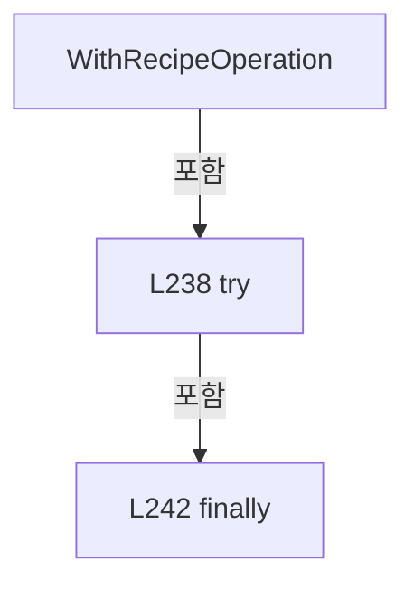

변경 전 점검: 입력/반환 타입, 위 호출자, 예외/취소 경로, 공유 상태와 저장·전송 소비자를 함께 확인합니다. 값의 단위나 물리 방향을 이름만으로 확정하지 않습니다.

### MethodDeclaration `UpdateCachedRecipe` · L248–278

[Drilling.Common/Managers/CRecipeManager.cs:248–278](https://github.com/kjuws10-rgb/A3Drilling/blob/5aee8e58439c9b455cae7c9593c9be986c3e682e/Drilling.Common/Managers/CRecipeManager.cs#L248-L278)

| 항목 | 실제 추출 값 |
| --- | --- |
| 서명 | void Drilling.Common.Managers.CRecipeManager.UpdateCachedRecipe(Drilling.Common.Managers.ST_RECIPE_DEFINITION) |
| 접근/수식자 | Private / private |
| 반환/값 타입 | void |
| 소속 타입 | NamedType:Drilling.Common.Managers.CRecipeManager |

입력 계약:

| 이름 | 타입 | 전달 | 선택/기본값 |
| --- | --- | --- | --- |
| recipe | Drilling.Common.Managers.ST_RECIPE_DEFINITION | None | False /  |

정적 호출자로 확인된 위치:

| 호출 파일/행 | 호출 표현식 | 런타임 분기 가능 |
| --- | --- | --- |
| [Drilling.Common/Managers/CRecipeManager.cs:89–89](https://github.com/kjuws10-rgb/A3Drilling/blob/5aee8e58439c9b455cae7c9593c9be986c3e682e/Drilling.Common/Managers/CRecipeManager.cs#L89-L89) | UpdateCachedRecipe | False |
| [Drilling.Common/Managers/CRecipeManager.cs:105–105](https://github.com/kjuws10-rgb/A3Drilling/blob/5aee8e58439c9b455cae7c9593c9be986c3e682e/Drilling.Common/Managers/CRecipeManager.cs#L105-L105) | UpdateCachedRecipe | False |
| [Drilling.Common/Managers/CRecipeManager.cs:142–142](https://github.com/kjuws10-rgb/A3Drilling/blob/5aee8e58439c9b455cae7c9593c9be986c3e682e/Drilling.Common/Managers/CRecipeManager.cs#L142-L142) | UpdateCachedRecipe | False |
| [Drilling.Common/Managers/CRecipeManager.cs:155–155](https://github.com/kjuws10-rgb/A3Drilling/blob/5aee8e58439c9b455cae7c9593c9be986c3e682e/Drilling.Common/Managers/CRecipeManager.cs#L155-L155) | UpdateCachedRecipe | False |
| [Drilling.Common/Managers/CRecipeManager.cs:164–164](https://github.com/kjuws10-rgb/A3Drilling/blob/5aee8e58439c9b455cae7c9593c9be986c3e682e/Drilling.Common/Managers/CRecipeManager.cs#L164-L164) | UpdateCachedRecipe | False |
| [Drilling.Common/Managers/CRecipeManager.cs:186–186](https://github.com/kjuws10-rgb/A3Drilling/blob/5aee8e58439c9b455cae7c9593c9be986c3e682e/Drilling.Common/Managers/CRecipeManager.cs#L186-L186) | UpdateCachedRecipe | False |

호출하는 대상과 해석 범위:

| 원본 행 | 표현식 | 분석 상태 | 대상/소스 위치 |
| --- | --- | --- | --- |
| 257 | new List<ST_RECIPE_DEFINITION> | resolved | System.Collections.Generic.List<Drilling.Common.Managers.ST_RECIPE_DEFINITION>.List(int) |
| 261 | cachedRecipe.Id.Equals | resolved | bool string.Equals(string?, System.StringComparison) |
| 263 | recipes.Add | resolved | void System.Collections.Generic.List<Drilling.Common.Managers.ST_RECIPE_DEFINITION>.Add(Drilling.Common.Managers.ST_RECIPE_DEFINITION) |
| 263 | CloneRecipe | resolved | Drilling.Common.Managers.ST_RECIPE_DEFINITION Drilling.Common.Managers.CRecipeManager.CloneRecipe(Drilling.Common.Managers.ST_RECIPE_DEFINITION) · Drilling.Common/Managers/CRecipeManager.cs:327 |
| 268 | recipes.Add | resolved | void System.Collections.Generic.List<Drilling.Common.Managers.ST_RECIPE_DEFINITION>.Add(Drilling.Common.Managers.ST_RECIPE_DEFINITION) |
| 273 | recipes.Add | resolved | void System.Collections.Generic.List<Drilling.Common.Managers.ST_RECIPE_DEFINITION>.Add(Drilling.Common.Managers.ST_RECIPE_DEFINITION) |
| 273 | CloneRecipe | resolved | Drilling.Common.Managers.ST_RECIPE_DEFINITION Drilling.Common.Managers.CRecipeManager.CloneRecipe(Drilling.Common.Managers.ST_RECIPE_DEFINITION) · Drilling.Common/Managers/CRecipeManager.cs:327 |
| 276 | recipes.ToArray | resolved | Drilling.Common.Managers.ST_RECIPE_DEFINITION[] System.Collections.Generic.List<Drilling.Common.Managers.ST_RECIPE_DEFINITION>.ToArray() |

본문의 실제 연산·분기·예외·반환 순서(원문 위치 순):

| 원본 행 | 종류 | 주석 해설 |
| --- | --- | --- |
| 250 | lock | 공유 상태의 임계 구역에 진입합니다: lock (_cacheLock) |
| 252 | if | 조건에 따라 분기합니다: if (_recipeCache is null) |
| 254 | return | 호출자에게 값 또는 제어를 반환합니다: return; |
| 257 | call | 함수·델리게이트 또는 객체 생성자를 호출합니다: new List<ST_RECIPE_DEFINITION>(_recipeCache.Count + 1) |
| 257 | local-declaration | 지역 변수를 선언합니다: var recipes = new List<ST_RECIPE_DEFINITION>(_recipeCache.Count + 1); |
| 257 | variable-initializer | 변수의 초기값을 지정합니다: recipes = new List<ST_RECIPE_DEFINITION>(_recipeCache.Count + 1) |
| 258 | local-declaration | 지역 변수를 선언합니다: var updated = false; |
| 258 | variable-initializer | 변수의 초기값을 지정합니다: updated = false |
| 259 | foreach | 컬렉션 요소를 순회합니다: foreach (var cachedRecipe in _recipeCache) |
| 261 | call | 함수·델리게이트 또는 객체 생성자를 호출합니다: cachedRecipe.Id.Equals(recipe.Id, StringComparison.OrdinalIgnoreCase) |
| 261 | if | 조건에 따라 분기합니다: if (cachedRecipe.Id.Equals(recipe.Id, StringComparison.OrdinalIgnoreCase)) |
| 263 | call | 함수·델리게이트 또는 객체 생성자를 호출합니다: recipes.Add(CloneRecipe(recipe)) |
| 263 | call | 함수·델리게이트 또는 객체 생성자를 호출합니다: CloneRecipe(recipe) |
| 264 | assignment | 값을 대상에 대입합니다: updated = true |
| 265 | continue | 다음 반복으로 진행합니다: continue; |
| 268 | call | 함수·델리게이트 또는 객체 생성자를 호출합니다: recipes.Add(cachedRecipe) |
| 271 | if | 조건에 따라 분기합니다: if (!updated) |
| 273 | call | 함수·델리게이트 또는 객체 생성자를 호출합니다: recipes.Add(CloneRecipe(recipe)) |
| 273 | call | 함수·델리게이트 또는 객체 생성자를 호출합니다: CloneRecipe(recipe) |
| 276 | assignment | 값을 대상에 대입합니다: _recipeCache = recipes.ToArray() |
| 276 | call | 함수·델리게이트 또는 객체 생성자를 호출합니다: recipes.ToArray() |

제어 구문의 포함 구조(실제 실행 순서/CFG가 아닌 구문 탐색 그림):

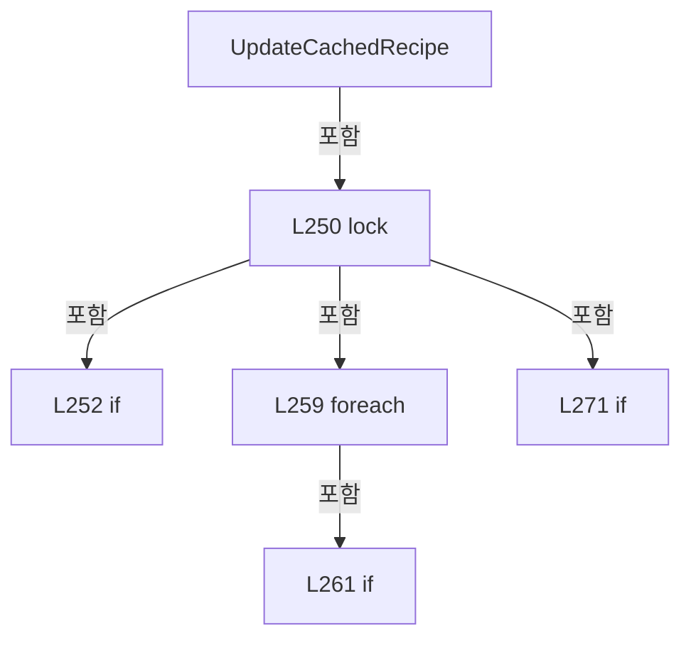

변경 전 점검: 입력/반환 타입, 위 호출자, 예외/취소 경로, 공유 상태와 저장·전송 소비자를 함께 확인합니다. 값의 단위나 물리 방향을 이름만으로 확정하지 않습니다.

### MethodDeclaration `RenameCachedRecipe` · L280–303

[Drilling.Common/Managers/CRecipeManager.cs:280–303](https://github.com/kjuws10-rgb/A3Drilling/blob/5aee8e58439c9b455cae7c9593c9be986c3e682e/Drilling.Common/Managers/CRecipeManager.cs#L280-L303)

| 항목 | 실제 추출 값 |
| --- | --- |
| 서명 | void Drilling.Common.Managers.CRecipeManager.RenameCachedRecipe(string, string) |
| 접근/수식자 | Private / private |
| 반환/값 타입 | void |
| 소속 타입 | NamedType:Drilling.Common.Managers.CRecipeManager |

입력 계약:

| 이름 | 타입 | 전달 | 선택/기본값 |
| --- | --- | --- | --- |
| oldRecipeId | string | None | False /  |
| newRecipeId | string | None | False /  |

정적 호출자로 확인된 위치:

| 호출 파일/행 | 호출 표현식 | 런타임 분기 가능 |
| --- | --- | --- |
| [Drilling.Common/Managers/CRecipeManager.cs:183–183](https://github.com/kjuws10-rgb/A3Drilling/blob/5aee8e58439c9b455cae7c9593c9be986c3e682e/Drilling.Common/Managers/CRecipeManager.cs#L183-L183) | RenameCachedRecipe | False |

호출하는 대상과 해석 범위:

| 원본 행 | 표현식 | 분석 상태 | 대상/소스 위치 |
| --- | --- | --- | --- |
| 289 | new List<ST_RECIPE_DEFINITION> | resolved | System.Collections.Generic.List<Drilling.Common.Managers.ST_RECIPE_DEFINITION>.List(int) |
| 292 | cachedRecipe.Id.Equals | resolved | bool string.Equals(string?, System.StringComparison) |
| 294 | recipes.Add | resolved | void System.Collections.Generic.List<Drilling.Common.Managers.ST_RECIPE_DEFINITION>.Add(Drilling.Common.Managers.ST_RECIPE_DEFINITION) |
| 294 | CloneRecipe | resolved | Drilling.Common.Managers.ST_RECIPE_DEFINITION Drilling.Common.Managers.CRecipeManager.CloneRecipe(Drilling.Common.Managers.ST_RECIPE_DEFINITION) · Drilling.Common/Managers/CRecipeManager.cs:327 |
| 298 | recipes.Add | resolved | void System.Collections.Generic.List<Drilling.Common.Managers.ST_RECIPE_DEFINITION>.Add(Drilling.Common.Managers.ST_RECIPE_DEFINITION) |
| 301 | recipes.ToArray | resolved | Drilling.Common.Managers.ST_RECIPE_DEFINITION[] System.Collections.Generic.List<Drilling.Common.Managers.ST_RECIPE_DEFINITION>.ToArray() |

본문의 실제 연산·분기·예외·반환 순서(원문 위치 순):

| 원본 행 | 종류 | 주석 해설 |
| --- | --- | --- |
| 282 | lock | 공유 상태의 임계 구역에 진입합니다: lock (_cacheLock) |
| 284 | if | 조건에 따라 분기합니다: if (_recipeCache is null) |
| 286 | return | 호출자에게 값 또는 제어를 반환합니다: return; |
| 289 | call | 함수·델리게이트 또는 객체 생성자를 호출합니다: new List<ST_RECIPE_DEFINITION>(_recipeCache.Count) |
| 289 | local-declaration | 지역 변수를 선언합니다: var recipes = new List<ST_RECIPE_DEFINITION>(_recipeCache.Count); |
| 289 | variable-initializer | 변수의 초기값을 지정합니다: recipes = new List<ST_RECIPE_DEFINITION>(_recipeCache.Count) |
| 290 | foreach | 컬렉션 요소를 순회합니다: foreach (var cachedRecipe in _recipeCache) |
| 292 | call | 함수·델리게이트 또는 객체 생성자를 호출합니다: cachedRecipe.Id.Equals(oldRecipeId, StringComparison.OrdinalIgnoreCase) |
| 292 | if | 조건에 따라 분기합니다: if (cachedRecipe.Id.Equals(oldRecipeId, StringComparison.OrdinalIgnoreCase)) |
| 294 | assignment | 값을 대상에 대입합니다: Id = newRecipeId |
| 294 | assignment | 값을 대상에 대입합니다: Name = newRecipeId |
| 294 | call | 함수·델리게이트 또는 객체 생성자를 호출합니다: recipes.Add(CloneRecipe(cachedRecipe with { Id = newRecipeId, Name = newRecipeId })) |
| 294 | call | 함수·델리게이트 또는 객체 생성자를 호출합니다: CloneRecipe(cachedRecipe with { Id = newRecipeId, Name = newRecipeId }) |
| 295 | continue | 다음 반복으로 진행합니다: continue; |
| 298 | call | 함수·델리게이트 또는 객체 생성자를 호출합니다: recipes.Add(cachedRecipe) |
| 301 | assignment | 값을 대상에 대입합니다: _recipeCache = recipes.ToArray() |
| 301 | call | 함수·델리게이트 또는 객체 생성자를 호출합니다: recipes.ToArray() |

제어 구문의 포함 구조(실제 실행 순서/CFG가 아닌 구문 탐색 그림):

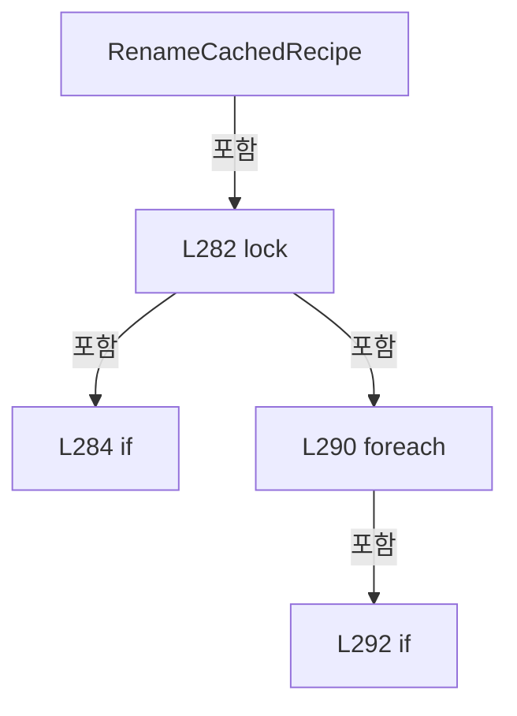

변경 전 점검: 입력/반환 타입, 위 호출자, 예외/취소 경로, 공유 상태와 저장·전송 소비자를 함께 확인합니다. 값의 단위나 물리 방향을 이름만으로 확정하지 않습니다.

### MethodDeclaration `DeleteCachedRecipe` · L305–325

[Drilling.Common/Managers/CRecipeManager.cs:305–325](https://github.com/kjuws10-rgb/A3Drilling/blob/5aee8e58439c9b455cae7c9593c9be986c3e682e/Drilling.Common/Managers/CRecipeManager.cs#L305-L325)

| 항목 | 실제 추출 값 |
| --- | --- |
| 서명 | void Drilling.Common.Managers.CRecipeManager.DeleteCachedRecipe(string) |
| 접근/수식자 | Private / private |
| 반환/값 타입 | void |
| 소속 타입 | NamedType:Drilling.Common.Managers.CRecipeManager |

입력 계약:

| 이름 | 타입 | 전달 | 선택/기본값 |
| --- | --- | --- | --- |
| recipeId | string | None | False /  |

정적 호출자로 확인된 위치:

| 호출 파일/행 | 호출 표현식 | 런타임 분기 가능 |
| --- | --- | --- |
| [Drilling.Common/Managers/CRecipeManager.cs:166–166](https://github.com/kjuws10-rgb/A3Drilling/blob/5aee8e58439c9b455cae7c9593c9be986c3e682e/Drilling.Common/Managers/CRecipeManager.cs#L166-L166) | DeleteCachedRecipe | False |
| [Drilling.Common/Managers/CRecipeManager.cs:203–203](https://github.com/kjuws10-rgb/A3Drilling/blob/5aee8e58439c9b455cae7c9593c9be986c3e682e/Drilling.Common/Managers/CRecipeManager.cs#L203-L203) | DeleteCachedRecipe | False |

호출하는 대상과 해석 범위:

| 원본 행 | 표현식 | 분석 상태 | 대상/소스 위치 |
| --- | --- | --- | --- |
| 314 | new List<ST_RECIPE_DEFINITION> | resolved | System.Collections.Generic.List<Drilling.Common.Managers.ST_RECIPE_DEFINITION>.List(int) |
| 317 | cachedRecipe.Id.Equals | resolved | bool string.Equals(string?, System.StringComparison) |
| 319 | recipes.Add | resolved | void System.Collections.Generic.List<Drilling.Common.Managers.ST_RECIPE_DEFINITION>.Add(Drilling.Common.Managers.ST_RECIPE_DEFINITION) |
| 323 | recipes.ToArray | resolved | Drilling.Common.Managers.ST_RECIPE_DEFINITION[] System.Collections.Generic.List<Drilling.Common.Managers.ST_RECIPE_DEFINITION>.ToArray() |

본문의 실제 연산·분기·예외·반환 순서(원문 위치 순):

| 원본 행 | 종류 | 주석 해설 |
| --- | --- | --- |
| 307 | lock | 공유 상태의 임계 구역에 진입합니다: lock (_cacheLock) |
| 309 | if | 조건에 따라 분기합니다: if (_recipeCache is null) |
| 311 | return | 호출자에게 값 또는 제어를 반환합니다: return; |
| 314 | call | 함수·델리게이트 또는 객체 생성자를 호출합니다: new List<ST_RECIPE_DEFINITION>(_recipeCache.Count) |
| 314 | local-declaration | 지역 변수를 선언합니다: var recipes = new List<ST_RECIPE_DEFINITION>(_recipeCache.Count); |
| 314 | variable-initializer | 변수의 초기값을 지정합니다: recipes = new List<ST_RECIPE_DEFINITION>(_recipeCache.Count) |
| 315 | foreach | 컬렉션 요소를 순회합니다: foreach (var cachedRecipe in _recipeCache) |
| 317 | call | 함수·델리게이트 또는 객체 생성자를 호출합니다: cachedRecipe.Id.Equals(recipeId, StringComparison.OrdinalIgnoreCase) |
| 317 | if | 조건에 따라 분기합니다: if (!cachedRecipe.Id.Equals(recipeId, StringComparison.OrdinalIgnoreCase)) |
| 319 | call | 함수·델리게이트 또는 객체 생성자를 호출합니다: recipes.Add(cachedRecipe) |
| 323 | assignment | 값을 대상에 대입합니다: _recipeCache = recipes.ToArray() |
| 323 | call | 함수·델리게이트 또는 객체 생성자를 호출합니다: recipes.ToArray() |

제어 구문의 포함 구조(실제 실행 순서/CFG가 아닌 구문 탐색 그림):

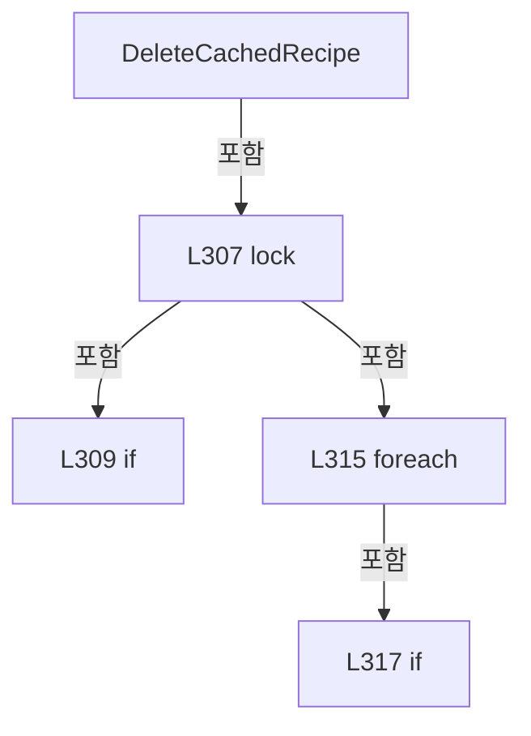

변경 전 점검: 입력/반환 타입, 위 호출자, 예외/취소 경로, 공유 상태와 저장·전송 소비자를 함께 확인합니다. 값의 단위나 물리 방향을 이름만으로 확정하지 않습니다.

### MethodDeclaration `CloneRecipe` · L327–334

[Drilling.Common/Managers/CRecipeManager.cs:327–334](https://github.com/kjuws10-rgb/A3Drilling/blob/5aee8e58439c9b455cae7c9593c9be986c3e682e/Drilling.Common/Managers/CRecipeManager.cs#L327-L334)

| 항목 | 실제 추출 값 |
| --- | --- |
| 서명 | Drilling.Common.Managers.ST_RECIPE_DEFINITION Drilling.Common.Managers.CRecipeManager.CloneRecipe(Drilling.Common.Managers.ST_RECIPE_DEFINITION) |
| 접근/수식자 | Private / private, static |
| 반환/값 타입 | Drilling.Common.Managers.ST_RECIPE_DEFINITION |
| 소속 타입 | NamedType:Drilling.Common.Managers.CRecipeManager |

입력 계약:

| 이름 | 타입 | 전달 | 선택/기본값 |
| --- | --- | --- | --- |
| recipe | Drilling.Common.Managers.ST_RECIPE_DEFINITION | None | False /  |

정적 호출자로 확인된 위치:

| 호출 파일/행 | 호출 표현식 | 런타임 분기 가능 |
| --- | --- | --- |
| [Drilling.Common/Managers/CRecipeManager.cs:263–263](https://github.com/kjuws10-rgb/A3Drilling/blob/5aee8e58439c9b455cae7c9593c9be986c3e682e/Drilling.Common/Managers/CRecipeManager.cs#L263-L263) | CloneRecipe | False |
| [Drilling.Common/Managers/CRecipeManager.cs:273–273](https://github.com/kjuws10-rgb/A3Drilling/blob/5aee8e58439c9b455cae7c9593c9be986c3e682e/Drilling.Common/Managers/CRecipeManager.cs#L273-L273) | CloneRecipe | False |
| [Drilling.Common/Managers/CRecipeManager.cs:294–294](https://github.com/kjuws10-rgb/A3Drilling/blob/5aee8e58439c9b455cae7c9593c9be986c3e682e/Drilling.Common/Managers/CRecipeManager.cs#L294-L294) | CloneRecipe | False |

호출하는 대상과 해석 범위:

| 원본 행 | 표현식 | 분석 상태 | 대상/소스 위치 |
| --- | --- | --- | --- |
| 331 | recipe.Parameters.ToArray | resolved | Drilling.Common.Managers.ST_RECIPE_PARAMETER[] System.Collections.Generic.IEnumerable<Drilling.Common.Managers.ST_RECIPE_PARAMETER>.ToArray<Drilling.Common.Managers.ST_RECIPE_PARAMETER>() |
| 332 | recipe.History.ToArray | resolved | Drilling.Common.Managers.ST_RECIPE_HISTORY[] System.Collections.Generic.IEnumerable<Drilling.Common.Managers.ST_RECIPE_HISTORY>.ToArray<Drilling.Common.Managers.ST_RECIPE_HISTORY>() |

본문의 실제 연산·분기·예외·반환 순서(원문 위치 순):

| 원본 행 | 종류 | 주석 해설 |
| --- | --- | --- |
| 329 | return | 호출자에게 값 또는 제어를 반환합니다: return recipe with { Parameters = recipe.Parameters.ToArray(), History = recipe.History.ToArray() }; |
| 331 | assignment | 값을 대상에 대입합니다: Parameters = recipe.Parameters.ToArray() |
| 331 | call | 함수·델리게이트 또는 객체 생성자를 호출합니다: recipe.Parameters.ToArray() |
| 332 | assignment | 값을 대상에 대입합니다: History = recipe.History.ToArray() |
| 332 | call | 함수·델리게이트 또는 객체 생성자를 호출합니다: recipe.History.ToArray() |

변경 전 점검: 입력/반환 타입, 위 호출자, 예외/취소 경로, 공유 상태와 저장·전송 소비자를 함께 확인합니다. 값의 단위나 물리 방향을 이름만으로 확정하지 않습니다.

### MethodDeclaration `ListCompanionFolders` · L341–341

[Drilling.Common/Managers/CRecipeManager.cs:341–341](https://github.com/kjuws10-rgb/A3Drilling/blob/5aee8e58439c9b455cae7c9593c9be986c3e682e/Drilling.Common/Managers/CRecipeManager.cs#L341-L341)

| 항목 | 실제 추출 값 |
| --- | --- |
| 서명 | System.Threading.Tasks.Task<System.Collections.Generic.IReadOnlyList<Drilling.Common.Managers.ST_RECIPE_COMPANION_FOLDER>> Drilling.Common.Managers.IRecipeCopyStore.ListCompanionFolders(string, string, System.Threading.CancellationToken) |
| 접근/수식자 | Public /  |
| 반환/값 타입 | System.Threading.Tasks.Task<System.Collections.Generic.IReadOnlyList<Drilling.Common.Managers.ST_RECIPE_COMPANION_FOLDER>> |
| 소속 타입 | NamedType:Drilling.Common.Managers.IRecipeCopyStore |

입력 계약:

| 이름 | 타입 | 전달 | 선택/기본값 |
| --- | --- | --- | --- |
| sourceRecipeId | string | None | False /  |
| newRecipeId | string | None | False /  |
| token | System.Threading.CancellationToken | None | True / null |

정적 호출자로 확인된 위치:

| 호출 파일/행 | 호출 표현식 | 런타임 분기 가능 |
| --- | --- | --- |
| [Drilling.Common/Managers/CRecipeManager.cs:127–127](https://github.com/kjuws10-rgb/A3Drilling/blob/5aee8e58439c9b455cae7c9593c9be986c3e682e/Drilling.Common/Managers/CRecipeManager.cs#L127-L127) | store.ListCompanionFolders | True |

변경 전 점검: 입력/반환 타입, 위 호출자, 예외/취소 경로, 공유 상태와 저장·전송 소비자를 함께 확인합니다. 값의 단위나 물리 방향을 이름만으로 확정하지 않습니다.

### MethodDeclaration `CreateCopy` · L342–342

[Drilling.Common/Managers/CRecipeManager.cs:342–342](https://github.com/kjuws10-rgb/A3Drilling/blob/5aee8e58439c9b455cae7c9593c9be986c3e682e/Drilling.Common/Managers/CRecipeManager.cs#L342-L342)

| 항목 | 실제 추출 값 |
| --- | --- |
| 서명 | System.Threading.Tasks.Task Drilling.Common.Managers.IRecipeCopyStore.CreateCopy(Drilling.Common.Managers.ST_RECIPE_DEFINITION, string, System.Collections.Generic.IReadOnlyCollection<string>, System.Threading.CancellationToken) |
| 접근/수식자 | Public /  |
| 반환/값 타입 | System.Threading.Tasks.Task |
| 소속 타입 | NamedType:Drilling.Common.Managers.IRecipeCopyStore |

입력 계약:

| 이름 | 타입 | 전달 | 선택/기본값 |
| --- | --- | --- | --- |
| recipe | Drilling.Common.Managers.ST_RECIPE_DEFINITION | None | False /  |
| sourceRecipeId | string | None | False /  |
| selectedFolders | System.Collections.Generic.IReadOnlyCollection<string> | None | False /  |
| token | System.Threading.CancellationToken | None | True / null |

정적 호출자로 확인된 위치:

| 호출 파일/행 | 호출 표현식 | 런타임 분기 가능 |
| --- | --- | --- |
| [Drilling.Common/Managers/CRecipeManager.cs:131–131](https://github.com/kjuws10-rgb/A3Drilling/blob/5aee8e58439c9b455cae7c9593c9be986c3e682e/Drilling.Common/Managers/CRecipeManager.cs#L131-L131) | store.CreateCopy | True |

변경 전 점검: 입력/반환 타입, 위 호출자, 예외/취소 경로, 공유 상태와 저장·전송 소비자를 함께 확인합니다. 값의 단위나 물리 방향을 이름만으로 확정하지 않습니다.

### MethodDeclaration `RenameWithCompanions` · L343–343

[Drilling.Common/Managers/CRecipeManager.cs:343–343](https://github.com/kjuws10-rgb/A3Drilling/blob/5aee8e58439c9b455cae7c9593c9be986c3e682e/Drilling.Common/Managers/CRecipeManager.cs#L343-L343)

| 항목 | 실제 추출 값 |
| --- | --- |
| 서명 | System.Threading.Tasks.Task Drilling.Common.Managers.IRecipeCopyStore.RenameWithCompanions(string, string, System.Collections.Generic.IReadOnlyCollection<string>, System.Threading.CancellationToken) |
| 접근/수식자 | Public /  |
| 반환/값 타입 | System.Threading.Tasks.Task |
| 소속 타입 | NamedType:Drilling.Common.Managers.IRecipeCopyStore |

입력 계약:

| 이름 | 타입 | 전달 | 선택/기본값 |
| --- | --- | --- | --- |
| oldRecipeId | string | None | False /  |
| newRecipeId | string | None | False /  |
| selectedFolders | System.Collections.Generic.IReadOnlyCollection<string> | None | False /  |
| token | System.Threading.CancellationToken | None | True / null |

정적 호출자로 확인된 위치:

| 호출 파일/행 | 호출 표현식 | 런타임 분기 가능 |
| --- | --- | --- |
| [Drilling.Common/Managers/CRecipeManager.cs:175–175](https://github.com/kjuws10-rgb/A3Drilling/blob/5aee8e58439c9b455cae7c9593c9be986c3e682e/Drilling.Common/Managers/CRecipeManager.cs#L175-L175) | store.RenameWithCompanions | True |

변경 전 점검: 입력/반환 타입, 위 호출자, 예외/취소 경로, 공유 상태와 저장·전송 소비자를 함께 확인합니다. 값의 단위나 물리 방향을 이름만으로 확정하지 않습니다.

### MethodDeclaration `DeleteWithCompanions` · L344–344

[Drilling.Common/Managers/CRecipeManager.cs:344–344](https://github.com/kjuws10-rgb/A3Drilling/blob/5aee8e58439c9b455cae7c9593c9be986c3e682e/Drilling.Common/Managers/CRecipeManager.cs#L344-L344)

| 항목 | 실제 추출 값 |
| --- | --- |
| 서명 | System.Threading.Tasks.Task Drilling.Common.Managers.IRecipeCopyStore.DeleteWithCompanions(string, System.Collections.Generic.IReadOnlyCollection<string>, System.Threading.CancellationToken) |
| 접근/수식자 | Public /  |
| 반환/값 타입 | System.Threading.Tasks.Task |
| 소속 타입 | NamedType:Drilling.Common.Managers.IRecipeCopyStore |

입력 계약:

| 이름 | 타입 | 전달 | 선택/기본값 |
| --- | --- | --- | --- |
| recipeId | string | None | False /  |
| selectedFolders | System.Collections.Generic.IReadOnlyCollection<string> | None | False /  |
| token | System.Threading.CancellationToken | None | True / null |

정적 호출자로 확인된 위치:

| 호출 파일/행 | 호출 표현식 | 런타임 분기 가능 |
| --- | --- | --- |
| [Drilling.Common/Managers/CRecipeManager.cs:195–195](https://github.com/kjuws10-rgb/A3Drilling/blob/5aee8e58439c9b455cae7c9593c9be986c3e682e/Drilling.Common/Managers/CRecipeManager.cs#L195-L195) | store.DeleteWithCompanions | True |

변경 전 점검: 입력/반환 타입, 위 호출자, 예외/취소 경로, 공유 상태와 저장·전송 소비자를 함께 확인합니다. 값의 단위나 물리 방향을 이름만으로 확정하지 않습니다.

### EnumMemberDeclaration `String` · L349–349

[Drilling.Common/Managers/CRecipeManager.cs:349–349](https://github.com/kjuws10-rgb/A3Drilling/blob/5aee8e58439c9b455cae7c9593c9be986c3e682e/Drilling.Common/Managers/CRecipeManager.cs#L349-L349)

| 항목 | 실제 추출 값 |
| --- | --- |
| 서명 | Drilling.Common.Managers.EN_RECIPE_DATA_TYPE.String |
| 접근/수식자 | Public /  |
| 반환/값 타입 | Drilling.Common.Managers.EN_RECIPE_DATA_TYPE |
| 소속 타입 | NamedType:Drilling.Common.Managers.EN_RECIPE_DATA_TYPE |

현재 부분 분석에서 직접 연결된 호출자는 없습니다. XAML/이벤트/인터페이스·델리게이트·외부 진입을 추가 확인해야 하며, 미사용으로 판정한 것이 아닙니다.

변경 전 점검: 입력/반환 타입, 위 호출자, 예외/취소 경로, 공유 상태와 저장·전송 소비자를 함께 확인합니다. 값의 단위나 물리 방향을 이름만으로 확정하지 않습니다.

### EnumMemberDeclaration `Int` · L350–350

[Drilling.Common/Managers/CRecipeManager.cs:350–350](https://github.com/kjuws10-rgb/A3Drilling/blob/5aee8e58439c9b455cae7c9593c9be986c3e682e/Drilling.Common/Managers/CRecipeManager.cs#L350-L350)

| 항목 | 실제 추출 값 |
| --- | --- |
| 서명 | Drilling.Common.Managers.EN_RECIPE_DATA_TYPE.Int |
| 접근/수식자 | Public /  |
| 반환/값 타입 | Drilling.Common.Managers.EN_RECIPE_DATA_TYPE |
| 소속 타입 | NamedType:Drilling.Common.Managers.EN_RECIPE_DATA_TYPE |

현재 부분 분석에서 직접 연결된 호출자는 없습니다. XAML/이벤트/인터페이스·델리게이트·외부 진입을 추가 확인해야 하며, 미사용으로 판정한 것이 아닙니다.

변경 전 점검: 입력/반환 타입, 위 호출자, 예외/취소 경로, 공유 상태와 저장·전송 소비자를 함께 확인합니다. 값의 단위나 물리 방향을 이름만으로 확정하지 않습니다.

### EnumMemberDeclaration `Double` · L351–351

[Drilling.Common/Managers/CRecipeManager.cs:351–351](https://github.com/kjuws10-rgb/A3Drilling/blob/5aee8e58439c9b455cae7c9593c9be986c3e682e/Drilling.Common/Managers/CRecipeManager.cs#L351-L351)

| 항목 | 실제 추출 값 |
| --- | --- |
| 서명 | Drilling.Common.Managers.EN_RECIPE_DATA_TYPE.Double |
| 접근/수식자 | Public /  |
| 반환/값 타입 | Drilling.Common.Managers.EN_RECIPE_DATA_TYPE |
| 소속 타입 | NamedType:Drilling.Common.Managers.EN_RECIPE_DATA_TYPE |

현재 부분 분석에서 직접 연결된 호출자는 없습니다. XAML/이벤트/인터페이스·델리게이트·외부 진입을 추가 확인해야 하며, 미사용으로 판정한 것이 아닙니다.

변경 전 점검: 입력/반환 타입, 위 호출자, 예외/취소 경로, 공유 상태와 저장·전송 소비자를 함께 확인합니다. 값의 단위나 물리 방향을 이름만으로 확정하지 않습니다.

### EnumMemberDeclaration `Bool` · L352–352

[Drilling.Common/Managers/CRecipeManager.cs:352–352](https://github.com/kjuws10-rgb/A3Drilling/blob/5aee8e58439c9b455cae7c9593c9be986c3e682e/Drilling.Common/Managers/CRecipeManager.cs#L352-L352)

| 항목 | 실제 추출 값 |
| --- | --- |
| 서명 | Drilling.Common.Managers.EN_RECIPE_DATA_TYPE.Bool |
| 접근/수식자 | Public /  |
| 반환/값 타입 | Drilling.Common.Managers.EN_RECIPE_DATA_TYPE |
| 소속 타입 | NamedType:Drilling.Common.Managers.EN_RECIPE_DATA_TYPE |

현재 부분 분석에서 직접 연결된 호출자는 없습니다. XAML/이벤트/인터페이스·델리게이트·외부 진입을 추가 확인해야 하며, 미사용으로 판정한 것이 아닙니다.

변경 전 점검: 입력/반환 타입, 위 호출자, 예외/취소 경로, 공유 상태와 저장·전송 소비자를 함께 확인합니다. 값의 단위나 물리 방향을 이름만으로 확정하지 않습니다.

### MethodDeclaration `LoadAll` · L408–408

[Drilling.Common/Managers/CRecipeManager.cs:408–408](https://github.com/kjuws10-rgb/A3Drilling/blob/5aee8e58439c9b455cae7c9593c9be986c3e682e/Drilling.Common/Managers/CRecipeManager.cs#L408-L408)

| 항목 | 실제 추출 값 |
| --- | --- |
| 서명 | System.Threading.Tasks.Task<System.Collections.Generic.IReadOnlyList<Drilling.Common.Managers.ST_RECIPE_DEFINITION>> Drilling.Common.Managers.CRecipeFileBase.LoadAll(System.Threading.CancellationToken) |
| 접근/수식자 | Public / public, abstract |
| 반환/값 타입 | System.Threading.Tasks.Task<System.Collections.Generic.IReadOnlyList<Drilling.Common.Managers.ST_RECIPE_DEFINITION>> |
| 소속 타입 | NamedType:Drilling.Common.Managers.CRecipeFileBase |

입력 계약:

| 이름 | 타입 | 전달 | 선택/기본값 |
| --- | --- | --- | --- |
| cancellationToken | System.Threading.CancellationToken | None | True / null |

정적 호출자로 확인된 위치:

| 호출 파일/행 | 호출 표현식 | 런타임 분기 가능 |
| --- | --- | --- |
| [Drilling.Common/Managers/CRecipeManager.cs:60–60](https://github.com/kjuws10-rgb/A3Drilling/blob/5aee8e58439c9b455cae7c9593c9be986c3e682e/Drilling.Common/Managers/CRecipeManager.cs#L60-L60) | recipeFile.LoadAll | False |

변경 전 점검: 입력/반환 타입, 위 호출자, 예외/취소 경로, 공유 상태와 저장·전송 소비자를 함께 확인합니다. 값의 단위나 물리 방향을 이름만으로 확정하지 않습니다.

### MethodDeclaration `Find` · L409–409

[Drilling.Common/Managers/CRecipeManager.cs:409–409](https://github.com/kjuws10-rgb/A3Drilling/blob/5aee8e58439c9b455cae7c9593c9be986c3e682e/Drilling.Common/Managers/CRecipeManager.cs#L409-L409)

| 항목 | 실제 추출 값 |
| --- | --- |
| 서명 | System.Threading.Tasks.Task<Drilling.Common.Managers.ST_RECIPE_DEFINITION?> Drilling.Common.Managers.CRecipeFileBase.Find(string, System.Threading.CancellationToken) |
| 접근/수식자 | Public / public, abstract |
| 반환/값 타입 | System.Threading.Tasks.Task<Drilling.Common.Managers.ST_RECIPE_DEFINITION?> |
| 소속 타입 | NamedType:Drilling.Common.Managers.CRecipeFileBase |

입력 계약:

| 이름 | 타입 | 전달 | 선택/기본값 |
| --- | --- | --- | --- |
| recipeId | string | None | False /  |
| cancellationToken | System.Threading.CancellationToken | None | True / null |

정적 호출자로 확인된 위치:

| 호출 파일/행 | 호출 표현식 | 런타임 분기 가능 |
| --- | --- | --- |
| [Drilling.Common/Managers/CRecipeManager.cs:76–76](https://github.com/kjuws10-rgb/A3Drilling/blob/5aee8e58439c9b455cae7c9593c9be986c3e682e/Drilling.Common/Managers/CRecipeManager.cs#L76-L76) | recipeFile.Find | False |
| [Drilling.Common/Managers/CRecipeManager.cs:88–88](https://github.com/kjuws10-rgb/A3Drilling/blob/5aee8e58439c9b455cae7c9593c9be986c3e682e/Drilling.Common/Managers/CRecipeManager.cs#L88-L88) | recipeFile.Find | False |
| [Drilling.Common/Managers/CRecipeManager.cs:96–96](https://github.com/kjuws10-rgb/A3Drilling/blob/5aee8e58439c9b455cae7c9593c9be986c3e682e/Drilling.Common/Managers/CRecipeManager.cs#L96-L96) | recipeFile.Find | False |
| [Drilling.Common/Managers/CRecipeManager.cs:104–104](https://github.com/kjuws10-rgb/A3Drilling/blob/5aee8e58439c9b455cae7c9593c9be986c3e682e/Drilling.Common/Managers/CRecipeManager.cs#L104-L104) | recipeFile.Find | False |
| [Drilling.Common/Managers/CRecipeManager.cs:116–116](https://github.com/kjuws10-rgb/A3Drilling/blob/5aee8e58439c9b455cae7c9593c9be986c3e682e/Drilling.Common/Managers/CRecipeManager.cs#L116-L116) | recipeFile.Find | False |
| [Drilling.Common/Managers/CRecipeManager.cs:136–136](https://github.com/kjuws10-rgb/A3Drilling/blob/5aee8e58439c9b455cae7c9593c9be986c3e682e/Drilling.Common/Managers/CRecipeManager.cs#L136-L136) | recipeFile.Find | False |
| [Drilling.Common/Managers/CRecipeManager.cs:141–141](https://github.com/kjuws10-rgb/A3Drilling/blob/5aee8e58439c9b455cae7c9593c9be986c3e682e/Drilling.Common/Managers/CRecipeManager.cs#L141-L141) | recipeFile.Find | False |
| [Drilling.Common/Managers/CRecipeManager.cs:150–150](https://github.com/kjuws10-rgb/A3Drilling/blob/5aee8e58439c9b455cae7c9593c9be986c3e682e/Drilling.Common/Managers/CRecipeManager.cs#L150-L150) | recipeFile.Find | False |
| [Drilling.Common/Managers/CRecipeManager.cs:154–154](https://github.com/kjuws10-rgb/A3Drilling/blob/5aee8e58439c9b455cae7c9593c9be986c3e682e/Drilling.Common/Managers/CRecipeManager.cs#L154-L154) | recipeFile.Find | False |
| [Drilling.Common/Managers/CRecipeManager.cs:162–162](https://github.com/kjuws10-rgb/A3Drilling/blob/5aee8e58439c9b455cae7c9593c9be986c3e682e/Drilling.Common/Managers/CRecipeManager.cs#L162-L162) | recipeFile.Find | False |
| [Drilling.Common/Managers/CRecipeManager.cs:184–184](https://github.com/kjuws10-rgb/A3Drilling/blob/5aee8e58439c9b455cae7c9593c9be986c3e682e/Drilling.Common/Managers/CRecipeManager.cs#L184-L184) | recipeFile.Find | False |

변경 전 점검: 입력/반환 타입, 위 호출자, 예외/취소 경로, 공유 상태와 저장·전송 소비자를 함께 확인합니다. 값의 단위나 물리 방향을 이름만으로 확정하지 않습니다.

### MethodDeclaration `Save` · L410–410

[Drilling.Common/Managers/CRecipeManager.cs:410–410](https://github.com/kjuws10-rgb/A3Drilling/blob/5aee8e58439c9b455cae7c9593c9be986c3e682e/Drilling.Common/Managers/CRecipeManager.cs#L410-L410)

| 항목 | 실제 추출 값 |
| --- | --- |
| 서명 | System.Threading.Tasks.Task Drilling.Common.Managers.CRecipeFileBase.Save(Drilling.Common.Managers.ST_RECIPE_DEFINITION, System.Threading.CancellationToken) |
| 접근/수식자 | Public / public, abstract |
| 반환/값 타입 | System.Threading.Tasks.Task |
| 소속 타입 | NamedType:Drilling.Common.Managers.CRecipeFileBase |

입력 계약:

| 이름 | 타입 | 전달 | 선택/기본값 |
| --- | --- | --- | --- |
| recipe | Drilling.Common.Managers.ST_RECIPE_DEFINITION | None | False /  |
| cancellationToken | System.Threading.CancellationToken | None | True / null |

정적 호출자로 확인된 위치:

| 호출 파일/행 | 호출 표현식 | 런타임 분기 가능 |
| --- | --- | --- |
| [Drilling.Common/Managers/CRecipeManager.cs:87–87](https://github.com/kjuws10-rgb/A3Drilling/blob/5aee8e58439c9b455cae7c9593c9be986c3e682e/Drilling.Common/Managers/CRecipeManager.cs#L87-L87) | recipeFile.Save | False |
| [Drilling.Common/Managers/CRecipeManager.cs:103–103](https://github.com/kjuws10-rgb/A3Drilling/blob/5aee8e58439c9b455cae7c9593c9be986c3e682e/Drilling.Common/Managers/CRecipeManager.cs#L103-L103) | recipeFile.Save | False |
| [Drilling.Common/Managers/CRecipeManager.cs:138–138](https://github.com/kjuws10-rgb/A3Drilling/blob/5aee8e58439c9b455cae7c9593c9be986c3e682e/Drilling.Common/Managers/CRecipeManager.cs#L138-L138) | recipeFile.Save | False |
| [Drilling.Common/Managers/CRecipeManager.cs:152–152](https://github.com/kjuws10-rgb/A3Drilling/blob/5aee8e58439c9b455cae7c9593c9be986c3e682e/Drilling.Common/Managers/CRecipeManager.cs#L152-L152) | recipeFile.Save | False |

변경 전 점검: 입력/반환 타입, 위 호출자, 예외/취소 경로, 공유 상태와 저장·전송 소비자를 함께 확인합니다. 값의 단위나 물리 방향을 이름만으로 확정하지 않습니다.

### MethodDeclaration `Rename` · L411–411

[Drilling.Common/Managers/CRecipeManager.cs:411–411](https://github.com/kjuws10-rgb/A3Drilling/blob/5aee8e58439c9b455cae7c9593c9be986c3e682e/Drilling.Common/Managers/CRecipeManager.cs#L411-L411)

| 항목 | 실제 추출 값 |
| --- | --- |
| 서명 | System.Threading.Tasks.Task Drilling.Common.Managers.CRecipeFileBase.Rename(string, string, System.Threading.CancellationToken) |
| 접근/수식자 | Public / public, abstract |
| 반환/값 타입 | System.Threading.Tasks.Task |
| 소속 타입 | NamedType:Drilling.Common.Managers.CRecipeFileBase |

입력 계약:

| 이름 | 타입 | 전달 | 선택/기본값 |
| --- | --- | --- | --- |
| oldRecipeId | string | None | False /  |
| newRecipeId | string | None | False /  |
| cancellationToken | System.Threading.CancellationToken | None | True / null |

정적 호출자로 확인된 위치:

| 호출 파일/행 | 호출 표현식 | 런타임 분기 가능 |
| --- | --- | --- |
| [Drilling.Common/Managers/CRecipeManager.cs:180–180](https://github.com/kjuws10-rgb/A3Drilling/blob/5aee8e58439c9b455cae7c9593c9be986c3e682e/Drilling.Common/Managers/CRecipeManager.cs#L180-L180) | recipeFile.Rename | False |

변경 전 점검: 입력/반환 타입, 위 호출자, 예외/취소 경로, 공유 상태와 저장·전송 소비자를 함께 확인합니다. 값의 단위나 물리 방향을 이름만으로 확정하지 않습니다.

### MethodDeclaration `Delete` · L412–412

[Drilling.Common/Managers/CRecipeManager.cs:412–412](https://github.com/kjuws10-rgb/A3Drilling/blob/5aee8e58439c9b455cae7c9593c9be986c3e682e/Drilling.Common/Managers/CRecipeManager.cs#L412-L412)

| 항목 | 실제 추출 값 |
| --- | --- |
| 서명 | System.Threading.Tasks.Task Drilling.Common.Managers.CRecipeFileBase.Delete(string, System.Threading.CancellationToken) |
| 접근/수식자 | Public / public, abstract |
| 반환/값 타입 | System.Threading.Tasks.Task |
| 소속 타입 | NamedType:Drilling.Common.Managers.CRecipeFileBase |

입력 계약:

| 이름 | 타입 | 전달 | 선택/기본값 |
| --- | --- | --- | --- |
| recipeId | string | None | False /  |
| cancellationToken | System.Threading.CancellationToken | None | True / null |

정적 호출자로 확인된 위치:

| 호출 파일/행 | 호출 표현식 | 런타임 분기 가능 |
| --- | --- | --- |
| [Drilling.Common/Managers/CRecipeManager.cs:200–200](https://github.com/kjuws10-rgb/A3Drilling/blob/5aee8e58439c9b455cae7c9593c9be986c3e682e/Drilling.Common/Managers/CRecipeManager.cs#L200-L200) | recipeFile.Delete | False |

변경 전 점검: 입력/반환 타입, 위 호출자, 예외/취소 경로, 공유 상태와 저장·전송 소비자를 함께 확인합니다. 값의 단위나 물리 방향을 이름만으로 확정하지 않습니다.

### MethodDeclaration `LoadHistory` · L413–413

[Drilling.Common/Managers/CRecipeManager.cs:413–413](https://github.com/kjuws10-rgb/A3Drilling/blob/5aee8e58439c9b455cae7c9593c9be986c3e682e/Drilling.Common/Managers/CRecipeManager.cs#L413-L413)

| 항목 | 실제 추출 값 |
| --- | --- |
| 서명 | System.Threading.Tasks.Task<System.Collections.Generic.IReadOnlyList<Drilling.Common.Managers.ST_RECIPE_HISTORY>> Drilling.Common.Managers.CRecipeFileBase.LoadHistory(System.Threading.CancellationToken) |
| 접근/수식자 | Public / public, abstract |
| 반환/값 타입 | System.Threading.Tasks.Task<System.Collections.Generic.IReadOnlyList<Drilling.Common.Managers.ST_RECIPE_HISTORY>> |
| 소속 타입 | NamedType:Drilling.Common.Managers.CRecipeFileBase |

입력 계약:

| 이름 | 타입 | 전달 | 선택/기본값 |
| --- | --- | --- | --- |
| cancellationToken | System.Threading.CancellationToken | None | True / null |

정적 호출자로 확인된 위치:

| 호출 파일/행 | 호출 표현식 | 런타임 분기 가능 |
| --- | --- | --- |
| [Drilling.Common/Managers/CRecipeManager.cs:25–25](https://github.com/kjuws10-rgb/A3Drilling/blob/5aee8e58439c9b455cae7c9593c9be986c3e682e/Drilling.Common/Managers/CRecipeManager.cs#L25-L25) | recipeFile.LoadHistory | False |

변경 전 점검: 입력/반환 타입, 위 호출자, 예외/취소 경로, 공유 상태와 저장·전송 소비자를 함께 확인합니다. 값의 단위나 물리 방향을 이름만으로 확정하지 않습니다.

### MethodDeclaration `RecordSelection` · L414–414

[Drilling.Common/Managers/CRecipeManager.cs:414–414](https://github.com/kjuws10-rgb/A3Drilling/blob/5aee8e58439c9b455cae7c9593c9be986c3e682e/Drilling.Common/Managers/CRecipeManager.cs#L414-L414)

| 항목 | 실제 추출 값 |
| --- | --- |
| 서명 | System.Threading.Tasks.Task Drilling.Common.Managers.CRecipeFileBase.RecordSelection(string, string, System.Threading.CancellationToken) |
| 접근/수식자 | Public / public, abstract |
| 반환/값 타입 | System.Threading.Tasks.Task |
| 소속 타입 | NamedType:Drilling.Common.Managers.CRecipeFileBase |

입력 계약:

| 이름 | 타입 | 전달 | 선택/기본값 |
| --- | --- | --- | --- |
| previousRecipeId | string | None | False /  |
| recipeId | string | None | False /  |
| cancellationToken | System.Threading.CancellationToken | None | True / null |

정적 호출자로 확인된 위치:

| 호출 파일/행 | 호출 표현식 | 런타임 분기 가능 |
| --- | --- | --- |
| [Drilling.Common/Managers/CRecipeManager.cs:36–36](https://github.com/kjuws10-rgb/A3Drilling/blob/5aee8e58439c9b455cae7c9593c9be986c3e682e/Drilling.Common/Managers/CRecipeManager.cs#L36-L36) | recipeFile.RecordSelection | False |

변경 전 점검: 입력/반환 타입, 위 호출자, 예외/취소 경로, 공유 상태와 저장·전송 소비자를 함께 확인합니다. 값의 단위나 물리 방향을 이름만으로 확정하지 않습니다.

### MethodDeclaration `IncrementProtectWindowCount` · L415–415

[Drilling.Common/Managers/CRecipeManager.cs:415–415](https://github.com/kjuws10-rgb/A3Drilling/blob/5aee8e58439c9b455cae7c9593c9be986c3e682e/Drilling.Common/Managers/CRecipeManager.cs#L415-L415)

| 항목 | 실제 추출 값 |
| --- | --- |
| 서명 | System.Threading.Tasks.Task<int> Drilling.Common.Managers.CRecipeFileBase.IncrementProtectWindowCount(string, System.Threading.CancellationToken) |
| 접근/수식자 | Public / public, virtual |
| 반환/값 타입 | System.Threading.Tasks.Task<int> |
| 소속 타입 | NamedType:Drilling.Common.Managers.CRecipeFileBase |

입력 계약:

| 이름 | 타입 | 전달 | 선택/기본값 |
| --- | --- | --- | --- |
| recipeId | string | None | False /  |
| cancellationToken | System.Threading.CancellationToken | None | True / null |

정적 호출자로 확인된 위치:

| 호출 파일/행 | 호출 표현식 | 런타임 분기 가능 |
| --- | --- | --- |
| [Drilling.Common/Managers/CRecipeManager.cs:207–207](https://github.com/kjuws10-rgb/A3Drilling/blob/5aee8e58439c9b455cae7c9593c9be986c3e682e/Drilling.Common/Managers/CRecipeManager.cs#L207-L207) | recipeFile.IncrementProtectWindowCount | True |

호출하는 대상과 해석 범위:

| 원본 행 | 표현식 | 분석 상태 | 대상/소스 위치 |
| --- | --- | --- | --- |
| 415 | new NotSupportedException | resolved | System.NotSupportedException.NotSupportedException(string?) |

본문의 실제 연산·분기·예외·반환 순서(원문 위치 순):

| 원본 행 | 종류 | 주석 해설 |
| --- | --- | --- |
| 415 | call | 함수·델리게이트 또는 객체 생성자를 호출합니다: new NotSupportedException("This recipe store does not support persistent Protect Window counts.") |
| 415 | throw | 예외를 발생/전달합니다: throw new NotSupportedException("This recipe store does not support persistent Protect Window counts.") |

변경 전 점검: 입력/반환 타입, 위 호출자, 예외/취소 경로, 공유 상태와 저장·전송 소비자를 함께 확인합니다. 값의 단위나 물리 방향을 이름만으로 확정하지 않습니다.

### MethodDeclaration `ResetProtectWindowCount` · L416–416

[Drilling.Common/Managers/CRecipeManager.cs:416–416](https://github.com/kjuws10-rgb/A3Drilling/blob/5aee8e58439c9b455cae7c9593c9be986c3e682e/Drilling.Common/Managers/CRecipeManager.cs#L416-L416)

| 항목 | 실제 추출 값 |
| --- | --- |
| 서명 | System.Threading.Tasks.Task<int> Drilling.Common.Managers.CRecipeFileBase.ResetProtectWindowCount(string, System.Threading.CancellationToken) |
| 접근/수식자 | Public / public, virtual |
| 반환/값 타입 | System.Threading.Tasks.Task<int> |
| 소속 타입 | NamedType:Drilling.Common.Managers.CRecipeFileBase |

입력 계약:

| 이름 | 타입 | 전달 | 선택/기본값 |
| --- | --- | --- | --- |
| recipeId | string | None | False /  |
| cancellationToken | System.Threading.CancellationToken | None | True / null |

정적 호출자로 확인된 위치:

| 호출 파일/행 | 호출 표현식 | 런타임 분기 가능 |
| --- | --- | --- |
| [Drilling.Common/Managers/CRecipeManager.cs:208–208](https://github.com/kjuws10-rgb/A3Drilling/blob/5aee8e58439c9b455cae7c9593c9be986c3e682e/Drilling.Common/Managers/CRecipeManager.cs#L208-L208) | recipeFile.ResetProtectWindowCount | True |

호출하는 대상과 해석 범위:

| 원본 행 | 표현식 | 분석 상태 | 대상/소스 위치 |
| --- | --- | --- | --- |
| 416 | new NotSupportedException | resolved | System.NotSupportedException.NotSupportedException(string?) |

본문의 실제 연산·분기·예외·반환 순서(원문 위치 순):

| 원본 행 | 종류 | 주석 해설 |
| --- | --- | --- |
| 416 | call | 함수·델리게이트 또는 객체 생성자를 호출합니다: new NotSupportedException("This recipe store does not support resetting Protect Window counts.") |
| 416 | throw | 예외를 발생/전달합니다: throw new NotSupportedException("This recipe store does not support resetting Protect Window counts.") |

변경 전 점검: 입력/반환 타입, 위 호출자, 예외/취소 경로, 공유 상태와 저장·전송 소비자를 함께 확인합니다. 값의 단위나 물리 방향을 이름만으로 확정하지 않습니다.

### MethodDeclaration `SetProtectWindowCount` · L417–417

[Drilling.Common/Managers/CRecipeManager.cs:417–417](https://github.com/kjuws10-rgb/A3Drilling/blob/5aee8e58439c9b455cae7c9593c9be986c3e682e/Drilling.Common/Managers/CRecipeManager.cs#L417-L417)

| 항목 | 실제 추출 값 |
| --- | --- |
| 서명 | System.Threading.Tasks.Task<int> Drilling.Common.Managers.CRecipeFileBase.SetProtectWindowCount(string, int, System.Threading.CancellationToken) |
| 접근/수식자 | Public / public, virtual |
| 반환/값 타입 | System.Threading.Tasks.Task<int> |
| 소속 타입 | NamedType:Drilling.Common.Managers.CRecipeFileBase |

입력 계약:

| 이름 | 타입 | 전달 | 선택/기본값 |
| --- | --- | --- | --- |
| recipeId | string | None | False /  |
| count | int | None | False /  |
| cancellationToken | System.Threading.CancellationToken | None | True / null |

정적 호출자로 확인된 위치:

| 호출 파일/행 | 호출 표현식 | 런타임 분기 가능 |
| --- | --- | --- |
| [Drilling.Common/Managers/CRecipeManager.cs:209–209](https://github.com/kjuws10-rgb/A3Drilling/blob/5aee8e58439c9b455cae7c9593c9be986c3e682e/Drilling.Common/Managers/CRecipeManager.cs#L209-L209) | recipeFile.SetProtectWindowCount | True |

호출하는 대상과 해석 범위:

| 원본 행 | 표현식 | 분석 상태 | 대상/소스 위치 |
| --- | --- | --- | --- |
| 417 | new NotSupportedException | resolved | System.NotSupportedException.NotSupportedException(string?) |

본문의 실제 연산·분기·예외·반환 순서(원문 위치 순):

| 원본 행 | 종류 | 주석 해설 |
| --- | --- | --- |
| 417 | call | 함수·델리게이트 또는 객체 생성자를 호출합니다: new NotSupportedException("This recipe store does not support Protect Window count handover.") |
| 417 | throw | 예외를 발생/전달합니다: throw new NotSupportedException("This recipe store does not support Protect Window count handover.") |

변경 전 점검: 입력/반환 타입, 위 호출자, 예외/취소 경로, 공유 상태와 저장·전송 소비자를 함께 확인합니다. 값의 단위나 물리 방향을 이름만으로 확정하지 않습니다.

### FieldDeclaration `Tab` · L427–427

[Drilling.Common/Managers/CRecipeManager.cs:427–427](https://github.com/kjuws10-rgb/A3Drilling/blob/5aee8e58439c9b455cae7c9593c9be986c3e682e/Drilling.Common/Managers/CRecipeManager.cs#L427-L427)

| 항목 | 실제 추출 값 |
| --- | --- |
| 서명 | string Drilling.Common.Recipe.CProtectWindowRecipeData.Tab |
| 접근/수식자 | Public / public, const |
| 반환/값 타입 | string |
| 소속 타입 | NamedType:Drilling.Common.Recipe.CProtectWindowRecipeData |

현재 부분 분석에서 직접 연결된 호출자는 없습니다. XAML/이벤트/인터페이스·델리게이트·외부 진입을 추가 확인해야 하며, 미사용으로 판정한 것이 아닙니다.

본문의 실제 연산·분기·예외·반환 순서(원문 위치 순):

| 원본 행 | 종류 | 주석 해설 |
| --- | --- | --- |
| 427 | variable-initializer | 변수의 초기값을 지정합니다: Tab = "PROCESS" |

변경 전 점검: 입력/반환 타입, 위 호출자, 예외/취소 경로, 공유 상태와 저장·전송 소비자를 함께 확인합니다. 값의 단위나 물리 방향을 이름만으로 확정하지 않습니다.

### FieldDeclaration `Group` · L428–428

[Drilling.Common/Managers/CRecipeManager.cs:428–428](https://github.com/kjuws10-rgb/A3Drilling/blob/5aee8e58439c9b455cae7c9593c9be986c3e682e/Drilling.Common/Managers/CRecipeManager.cs#L428-L428)

| 항목 | 실제 추출 값 |
| --- | --- |
| 서명 | string Drilling.Common.Recipe.CProtectWindowRecipeData.Group |
| 접근/수식자 | Public / public, const |
| 반환/값 타입 | string |
| 소속 타입 | NamedType:Drilling.Common.Recipe.CProtectWindowRecipeData |

현재 부분 분석에서 직접 연결된 호출자는 없습니다. XAML/이벤트/인터페이스·델리게이트·외부 진입을 추가 확인해야 하며, 미사용으로 판정한 것이 아닙니다.

본문의 실제 연산·분기·예외·반환 순서(원문 위치 순):

| 원본 행 | 종류 | 주석 해설 |
| --- | --- | --- |
| 428 | variable-initializer | 변수의 초기값을 지정합니다: Group = "ProtectWindow" |

변경 전 점검: 입력/반환 타입, 위 호출자, 예외/취소 경로, 공유 상태와 저장·전송 소비자를 함께 확인합니다. 값의 단위나 물리 방향을 이름만으로 확정하지 않습니다.

### FieldDeclaration `MaximumCountKey` · L429–429

[Drilling.Common/Managers/CRecipeManager.cs:429–429](https://github.com/kjuws10-rgb/A3Drilling/blob/5aee8e58439c9b455cae7c9593c9be986c3e682e/Drilling.Common/Managers/CRecipeManager.cs#L429-L429)

| 항목 | 실제 추출 값 |
| --- | --- |
| 서명 | string Drilling.Common.Recipe.CProtectWindowRecipeData.MaximumCountKey |
| 접근/수식자 | Public / public, const |
| 반환/값 타입 | string |
| 소속 타입 | NamedType:Drilling.Common.Recipe.CProtectWindowRecipeData |

현재 부분 분석에서 직접 연결된 호출자는 없습니다. XAML/이벤트/인터페이스·델리게이트·외부 진입을 추가 확인해야 하며, 미사용으로 판정한 것이 아닙니다.

본문의 실제 연산·분기·예외·반환 순서(원문 위치 순):

| 원본 행 | 종류 | 주석 해설 |
| --- | --- | --- |
| 429 | variable-initializer | 변수의 초기값을 지정합니다: MaximumCountKey = "MAX_PROCESS_COUNT" |

변경 전 점검: 입력/반환 타입, 위 호출자, 예외/취소 경로, 공유 상태와 저장·전송 소비자를 함께 확인합니다. 값의 단위나 물리 방향을 이름만으로 확정하지 않습니다.

### FieldDeclaration `CurrentCountKey` · L430–430

[Drilling.Common/Managers/CRecipeManager.cs:430–430](https://github.com/kjuws10-rgb/A3Drilling/blob/5aee8e58439c9b455cae7c9593c9be986c3e682e/Drilling.Common/Managers/CRecipeManager.cs#L430-L430)

| 항목 | 실제 추출 값 |
| --- | --- |
| 서명 | string Drilling.Common.Recipe.CProtectWindowRecipeData.CurrentCountKey |
| 접근/수식자 | Public / public, const |
| 반환/값 타입 | string |
| 소속 타입 | NamedType:Drilling.Common.Recipe.CProtectWindowRecipeData |

현재 부분 분석에서 직접 연결된 호출자는 없습니다. XAML/이벤트/인터페이스·델리게이트·외부 진입을 추가 확인해야 하며, 미사용으로 판정한 것이 아닙니다.

본문의 실제 연산·분기·예외·반환 순서(원문 위치 순):

| 원본 행 | 종류 | 주석 해설 |
| --- | --- | --- |
| 430 | variable-initializer | 변수의 초기값을 지정합니다: CurrentCountKey = "CURRENT_PROCESS_COUNT" |

변경 전 점검: 입력/반환 타입, 위 호출자, 예외/취소 경로, 공유 상태와 저장·전송 소비자를 함께 확인합니다. 값의 단위나 물리 방향을 이름만으로 확정하지 않습니다.

### MethodDeclaration `ParseCount` · L431–436

[Drilling.Common/Managers/CRecipeManager.cs:431–436](https://github.com/kjuws10-rgb/A3Drilling/blob/5aee8e58439c9b455cae7c9593c9be986c3e682e/Drilling.Common/Managers/CRecipeManager.cs#L431-L436)

| 항목 | 실제 추출 값 |
| --- | --- |
| 서명 | int Drilling.Common.Recipe.CProtectWindowRecipeData.ParseCount(string?, string) |
| 접근/수식자 | Public / public, static |
| 반환/값 타입 | int |
| 소속 타입 | NamedType:Drilling.Common.Recipe.CProtectWindowRecipeData |

입력 계약:

| 이름 | 타입 | 전달 | 선택/기본값 |
| --- | --- | --- | --- |
| text | string? | None | False /  |
| key | string | None | True / "CURRENT_PROCESS_COUNT" |

정적 호출자로 확인된 위치:

| 호출 파일/행 | 호출 표현식 | 런타임 분기 가능 |
| --- | --- | --- |
| [Drilling.Common/Station/CStationProcess.cs:4364–4364](https://github.com/kjuws10-rgb/A3Drilling/blob/5aee8e58439c9b455cae7c9593c9be986c3e682e/Drilling.Common/Station/CStationProcess.cs#L4364-L4364) | CProtectWindowRecipeData.ParseCount | False |
| [Drilling.File/JHMI/CJhmiRecipeFile.cs:1420–1420](https://github.com/kjuws10-rgb/A3Drilling/blob/5aee8e58439c9b455cae7c9593c9be986c3e682e/Drilling.File/JHMI/CJhmiRecipeFile.cs#L1420-L1420) | CProtectWindowRecipeData.ParseCount | False |
| [Drilling.UI/Menu/Menus/CMenuMain.cs:2676–2676](https://github.com/kjuws10-rgb/A3Drilling/blob/5aee8e58439c9b455cae7c9593c9be986c3e682e/Drilling.UI/Menu/Menus/CMenuMain.cs#L2676-L2676) | CProtectWindowRecipeData.ParseCount | False |

호출하는 대상과 해석 범위:

| 원본 행 | 표현식 | 분석 상태 | 대상/소스 위치 |
| --- | --- | --- | --- |
| 433 | double.TryParse | resolved | bool double.TryParse(string?, System.Globalization.NumberStyles, System.IFormatProvider?, out double) |
| 433 | double.IsFinite | resolved | bool double.IsFinite(double) |
| 433 | Math.Truncate | resolved | double System.Math.Truncate(double) |
| 434 | new InvalidDataException | resolved | System.IO.InvalidDataException.InvalidDataException(string?) |

본문의 실제 연산·분기·예외·반환 순서(원문 위치 순):

| 원본 행 | 종류 | 주석 해설 |
| --- | --- | --- |
| 433 | call | 함수·델리게이트 또는 객체 생성자를 호출합니다: double.TryParse(text, NumberStyles.Float, CultureInfo.InvariantCulture, out var count) |
| 433 | call | 함수·델리게이트 또는 객체 생성자를 호출합니다: double.IsFinite(count) |
| 433 | call | 함수·델리게이트 또는 객체 생성자를 호출합니다: Math.Truncate(count) |
| 433 | if | 조건에 따라 분기합니다: if (!double.TryParse(text, NumberStyles.Float, CultureInfo.InvariantCulture, out var count) &#124;&#124; !double.IsFinite(count) &#124;&#124; count < 0 &#124;&#124; count > int.MaxValue &#124;&#124; count != Math.Truncate(count)) |
| 434 | call | 함수·델리게이트 또는 객체 생성자를 호출합니다: new InvalidDataException($"{key} must be a nonnegative integer: {text}") |
| 434 | throw | 예외를 발생/전달합니다: throw new InvalidDataException($"{key} must be a nonnegative integer: {text}"); |
| 435 | return | 호출자에게 값 또는 제어를 반환합니다: return (int)count; |

제어 구문의 포함 구조(실제 실행 순서/CFG가 아닌 구문 탐색 그림):

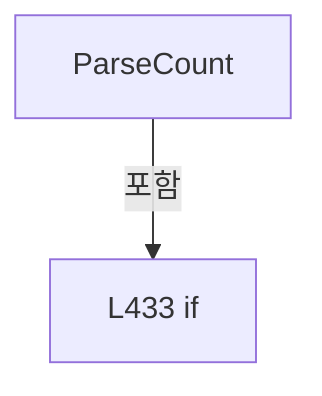

변경 전 점검: 입력/반환 타입, 위 호출자, 예외/취소 경로, 공유 상태와 저장·전송 소비자를 함께 확인합니다. 값의 단위나 물리 방향을 이름만으로 확정하지 않습니다.

## 구문·바인딩 한계

전체 WPF/벤더 SDK/프로젝트별 빌드 조건을 로드한 정식 빌드가 아닙니다. `resolved`는 이 부분 컴파일에서의 심볼 연결이며 virtual/interface/delegate/이벤트/Reflection/XAML의 실제 런타임 구현을 확정하지 않습니다. `candidate`와 `unresolved`는 후속 확인 대상으로 남깁니다.

## 원문 전체 주석 해설본

[원본 모든 행과 행별 해설 보기](../../../annotated/Drilling.Common/Managers/CRecipeManager.cs.annotated.txt)

원본을 빠뜨리거나 임의로 줄이지 않았습니다. `L000001 |` 표시는 원본 행 번호, `// 해설`은 별도 설명입니다. 실행용 소스가 아닌 문서입니다.

## 수정·재검증 체크

- 원본 Commit과 현재 작업 파일 SHA가 같은지 먼저 확인합니다. 다르면 이 문서를 과거 버전 자료로 취급합니다.
- 선언·직접 호출·이벤트/인터페이스 경계·설정 소비를 함께 확인합니다. 정적 연결의 빈 곳을 정상 경로로 추정하지 않습니다.
- 저장 형식/단위/식별자·재시도·취소·예외·롤백에 영향을 주는 변경은 상세 해설장과 호출자를 다시 검토합니다.
- 도구의 구문 추출과 별도 정적 추적 해설, 실제 빌드·시뮬레이션·실장비 검증 결과를 분리합니다.
