# Drilling.Common/Managers/CSettingManager.cs

| 항목 | 내용 |
| --- | --- |
| 원본 저장소 | https://github.com/kjuws10-rgb/A3Drilling.git |
| 원본 Commit | 5aee8e58439c9b455cae7c9593c9be986c3e682e |
| 원본 SHA256 | 0e893139d294e11572f73c72fddd379c521fe16f86d7730c205ed1ec72607b5b |
| 파일 분류 | code |
| 원본 크기/행 | 15,242 bytes / 285 physical lines |
| 인코딩 | utf-8-sig |
| 검토 범위 | 구문/부분 의미 분석에서 추출한 사실. 동작·물리 단위·실장비 합격을 보증하지 않습니다. |
| 원본 링크 | [고정 Commit 원본](https://github.com/kjuws10-rgb/A3Drilling/blob/5aee8e58439c9b455cae7c9593c9be986c3e682e/Drilling.Common/Managers/CSettingManager.cs) |

## 파일의 역할과 읽는 순서

프로그램의 시작·구성·공유 타입 또는 빌드 연결에 사용됩니다. 아래 실제 선언·참조와 원본 근거를 확인합니다.

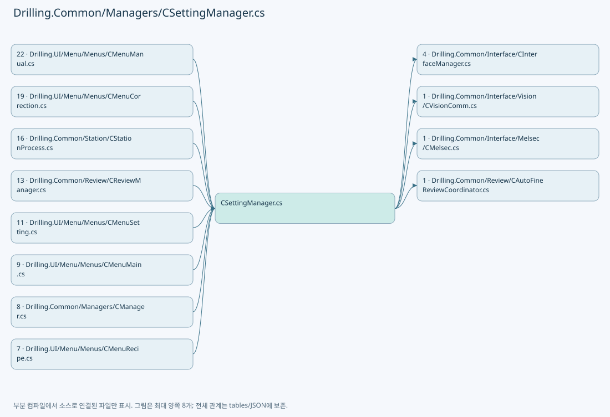

## 네임스페이스·타입·상속

| 타입 | 구분 | 원본 범위 | 선언/상속 |
| --- | --- | --- | --- |
| CSettingManager | ClassDeclaration | 14–180 | CSettingManager |
| CRunOptionSettings | ClassDeclaration | 183–230 | CRunOptionSettings |
| ST_RUN_OPTION_SETTINGS | RecordDeclaration | 232–244 | ST_RUN_OPTION_SETTINGS |
| EN_SETTING_TAB | EnumDeclaration | 246–253 | EN_SETTING_TAB |
| ST_SYSTEM_PARAMETER | RecordDeclaration | 255–271 | ST_SYSTEM_PARAMETER |
| ST_SETTING_HISTORY | RecordDeclaration | 272–272 | ST_SETTING_HISTORY |
| CSettingFileBase | ClassDeclaration | 273–278 | CSettingFileBase |
| CInterfaceFileBase | ClassDeclaration | 280–284 | CInterfaceFileBase |

## 멤버 빠른 목록

| 이름 | 종류 | 범위 | 서명 |
| --- | --- | --- | --- |
| ReviewCameraResolutionKey | FieldDeclaration | L16–16 | string Drilling.Common.Managers.CSettingManager.ReviewCameraResolutionKey |
| VisionCameraResolutionKey | FieldDeclaration | L17–17 | string Drilling.Common.Managers.CSettingManager.VisionCameraResolutionKey |
| DefaultVisionCameraResolution | FieldDeclaration | L18–18 | double Drilling.Common.Managers.CSettingManager.DefaultVisionCameraResolution |
| AlignCameraResolutionKey | FieldDeclaration | L19–19 | string Drilling.Common.Managers.CSettingManager.AlignCameraResolutionKey |
| DefaultAlignCameraResolution | FieldDeclaration | L20–20 | double Drilling.Common.Managers.CSettingManager.DefaultAlignCameraResolution |
| WapageAlignBaseToleranceKey | FieldDeclaration | L21–21 | string Drilling.Common.Managers.CSettingManager.WapageAlignBaseToleranceKey |
| DefaultWapageAlignBaseTolerance | FieldDeclaration | L22–22 | double Drilling.Common.Managers.CSettingManager.DefaultWapageAlignBaseTolerance |
| _cacheLock | FieldDeclaration | L23–23 | object Drilling.Common.Managers.CSettingManager._cacheLock |
| _saveLock | FieldDeclaration | L24–24 | object Drilling.Common.Managers.CSettingManager._saveLock |
| _sectionCache | FieldDeclaration | L25–25 | System.Collections.Generic.Dictionary<Drilling.Common.Managers.EN_SETTING_TAB, System.Collections.Generic.IReadOnlyList<Drilling.Common.Managers.ST_SYSTEM_PARAMETER>> Drilling.Common.Managers.CSettingManager._sectionCache |
| LoadSection | MethodDeclaration | L26–38 | System.Collections.Generic.IReadOnlyList<Drilling.Common.Managers.ST_SYSTEM_PARAMETER> Drilling.Common.Managers.CSettingManager.LoadSection(Drilling.Common.Managers.EN_SETTING_TAB, System.Threading.CancellationToken) |
| ReloadSection | MethodDeclaration | L40–49 | System.Collections.Generic.IReadOnlyList<Drilling.Common.Managers.ST_SYSTEM_PARAMETER> Drilling.Common.Managers.CSettingManager.ReloadSection(Drilling.Common.Managers.EN_SETTING_TAB, System.Threading.CancellationToken) |
| LoadAllSections | MethodDeclaration | L51–57 | void Drilling.Common.Managers.CSettingManager.LoadAllSections(System.Threading.CancellationToken) |
| GetValue | MethodDeclaration | L59–70 | string Drilling.Common.Managers.CSettingManager.GetValue(Drilling.Common.Managers.EN_SETTING_TAB, string, string, System.Threading.CancellationToken) |
| MatchesItem | LocalFunctionStatement | L63–66 | bool MatchesItem(Drilling.Common.Managers.ST_SYSTEM_PARAMETER) |
| SetValue | MethodDeclaration | L72–102 | void Drilling.Common.Managers.CSettingManager.SetValue(Drilling.Common.Managers.EN_SETTING_TAB, string, string, System.Threading.CancellationToken) |
| SelectParameter | LocalFunctionStatement | L79–92 | Drilling.Common.Managers.ST_SYSTEM_PARAMETER SelectParameter(Drilling.Common.Managers.ST_SYSTEM_PARAMETER) |
| GetVisionMaxHoleCountPerLine | MethodDeclaration | L104–111 | int Drilling.Common.Managers.CSettingManager.GetVisionMaxHoleCountPerLine() |
| GetVisionCameraResolution | MethodDeclaration | L113–113 | double Drilling.Common.Managers.CSettingManager.GetVisionCameraResolution() |
| ParseVisionCameraResolution | MethodDeclaration | L115–120 | double Drilling.Common.Managers.CSettingManager.ParseVisionCameraResolution(string) |
| SaveSection | MethodDeclaration | L122–148 | void Drilling.Common.Managers.CSettingManager.SaveSection(Drilling.Common.Managers.EN_SETTING_TAB, System.Collections.Generic.IReadOnlyList<Drilling.Common.Managers.ST_SYSTEM_PARAMETER>, System.Threading.CancellationToken) |
| LoadHistory | MethodDeclaration | L150–153 | System.Collections.Generic.IReadOnlyList<Drilling.Common.Managers.ST_SETTING_HISTORY> Drilling.Common.Managers.CSettingManager.LoadHistory(Drilling.Common.Managers.EN_SETTING_TAB, System.Threading.CancellationToken) |
| LoadInterfaceList | MethodDeclaration | L155–158 | System.Collections.Generic.IReadOnlyList<Drilling.Common.Interface.ST_INTERFACE_DATA> Drilling.Common.Managers.CSettingManager.LoadInterfaceList(System.Threading.CancellationToken) |
| SaveInterfaceList | MethodDeclaration | L160–164 | System.Threading.Tasks.Task Drilling.Common.Managers.CSettingManager.SaveInterfaceList(System.Collections.Generic.IReadOnlyList<Drilling.Common.Interface.ST_INTERFACE_DATA>, System.Threading.CancellationToken) |
| ConnectInterface | MethodDeclaration | L166–169 | System.Threading.Tasks.Task Drilling.Common.Managers.CSettingManager.ConnectInterface(Drilling.Common.Interface.EN_EQP_MODULE, int, System.Threading.CancellationToken) |
| DisconnectInterface | MethodDeclaration | L171–174 | System.Threading.Tasks.Task Drilling.Common.Managers.CSettingManager.DisconnectInterface(Drilling.Common.Interface.EN_EQP_MODULE, int, System.Threading.CancellationToken) |
| ReconnectInterface | MethodDeclaration | L176–179 | System.Threading.Tasks.Task Drilling.Common.Managers.CSettingManager.ReconnectInterface(Drilling.Common.Interface.EN_EQP_MODULE, int, System.Threading.CancellationToken) |
| ZeroDefence | FieldDeclaration | L185–185 | string Drilling.Common.Managers.CRunOptionSettings.ZeroDefence |
| CurrentGroup | FieldDeclaration | L186–186 | string Drilling.Common.Managers.CRunOptionSettings.CurrentGroup |
| FollowUp | FieldDeclaration | L187–187 | string Drilling.Common.Managers.CRunOptionSettings.FollowUp |
| DistortionGroup0 | FieldDeclaration | L188–188 | string Drilling.Common.Managers.CRunOptionSettings.DistortionGroup0 |
| DistortionGroup1 | FieldDeclaration | L189–189 | string Drilling.Common.Managers.CRunOptionSettings.DistortionGroup1 |
| DistortionGroup2 | FieldDeclaration | L190–190 | string Drilling.Common.Managers.CRunOptionSettings.DistortionGroup2 |
| ReviewMethod | FieldDeclaration | L191–191 | string Drilling.Common.Managers.CRunOptionSettings.ReviewMethod |
| ReviewLine | FieldDeclaration | L192–192 | string Drilling.Common.Managers.CRunOptionSettings.ReviewLine |
| ImmediateRetry | FieldDeclaration | L193–193 | string Drilling.Common.Managers.CRunOptionSettings.ImmediateRetry |
| RetryCount | FieldDeclaration | L194–194 | string Drilling.Common.Managers.CRunOptionSettings.RetryCount |
| Keys | FieldDeclaration | L195–195 | System.Collections.Generic.HashSet<string> Drilling.Common.Managers.CRunOptionSettings.Keys |
| IsKey | MethodDeclaration | L196–196 | bool Drilling.Common.Managers.CRunOptionSettings.IsKey(string) |
| Read | MethodDeclaration | L197–197 | Drilling.Common.Managers.ST_RUN_OPTION_SETTINGS Drilling.Common.Managers.CRunOptionSettings.Read(Drilling.Common.Managers.CSettingManager) |
| Read | MethodDeclaration | L198–221 | Drilling.Common.Managers.ST_RUN_OPTION_SETTINGS Drilling.Common.Managers.CRunOptionSettings.Read(System.Collections.Generic.IReadOnlyList<Drilling.Common.Managers.ST_SYSTEM_PARAMETER>) |
| Number | LocalFunctionStatement | L213–220 | int Number(string, int, int, int) |
| EncodeLine | MethodDeclaration | L223–229 | int Drilling.Common.Managers.CRunOptionSettings.EncodeLine(int) |
| DistortionGroupMask | PropertyDeclaration | L234–234 | int Drilling.Common.Managers.ST_RUN_OPTION_SETTINGS.DistortionGroupMask |
| get_DistortionGroupMask | GetAccessorDeclaration | L234–234 | int Drilling.Common.Managers.ST_RUN_OPTION_SETTINGS.DistortionGroupMask.get |
| set_DistortionGroupMask | InitAccessorDeclaration | L234–234 | void Drilling.Common.Managers.ST_RUN_OPTION_SETTINGS.DistortionGroupMask.init |
| DistortionGroups | PropertyDeclaration | L235–235 | System.Collections.Generic.IReadOnlyList<int> Drilling.Common.Managers.ST_RUN_OPTION_SETTINGS.DistortionGroups |
| ReviewLineCount | PropertyDeclaration | L236–242 | int Drilling.Common.Managers.ST_RUN_OPTION_SETTINGS.ReviewLineCount |
| ReviewOptions | PropertyDeclaration | L243–243 | Drilling.Common.Review.ST_AUTO_REVIEW_OPTIONS Drilling.Common.Managers.ST_RUN_OPTION_SETTINGS.ReviewOptions |
| Option | EnumMemberDeclaration | L248–248 | Drilling.Common.Managers.EN_SETTING_TAB.Option |
| Interface | EnumMemberDeclaration | L249–249 | Drilling.Common.Managers.EN_SETTING_TAB.Interface |
| Io | EnumMemberDeclaration | L250–250 | Drilling.Common.Managers.EN_SETTING_TAB.Io |
| Motor | EnumMemberDeclaration | L251–251 | Drilling.Common.Managers.EN_SETTING_TAB.Motor |
| Alarm | EnumMemberDeclaration | L252–252 | Drilling.Common.Managers.EN_SETTING_TAB.Alarm |
| Load | MethodDeclaration | L275–275 | System.Collections.Generic.IReadOnlyList<Drilling.Common.Managers.ST_SYSTEM_PARAMETER> Drilling.Common.Managers.CSettingFileBase.Load(Drilling.Common.Managers.EN_SETTING_TAB, System.Threading.CancellationToken) |
| Save | MethodDeclaration | L276–276 | void Drilling.Common.Managers.CSettingFileBase.Save(Drilling.Common.Managers.EN_SETTING_TAB, System.Collections.Generic.IReadOnlyList<Drilling.Common.Managers.ST_SYSTEM_PARAMETER>, System.Threading.CancellationToken) |
| LoadHistory | MethodDeclaration | L277–277 | System.Collections.Generic.IReadOnlyList<Drilling.Common.Managers.ST_SETTING_HISTORY> Drilling.Common.Managers.CSettingFileBase.LoadHistory(Drilling.Common.Managers.EN_SETTING_TAB, System.Threading.CancellationToken) |
| LoadAll | MethodDeclaration | L282–282 | System.Collections.Generic.IReadOnlyList<Drilling.Common.Interface.ST_INTERFACE_DATA> Drilling.Common.Managers.CInterfaceFileBase.LoadAll(System.Threading.CancellationToken) |
| SaveAll | MethodDeclaration | L283–283 | void Drilling.Common.Managers.CInterfaceFileBase.SaveAll(System.Collections.Generic.IReadOnlyList<Drilling.Common.Interface.ST_INTERFACE_DATA>, System.Threading.CancellationToken) |

## 멤버별 상세 계약·호출·처리 해설

### FieldDeclaration `ReviewCameraResolutionKey` · L16–16

[Drilling.Common/Managers/CSettingManager.cs:16–16](https://github.com/kjuws10-rgb/A3Drilling/blob/5aee8e58439c9b455cae7c9593c9be986c3e682e/Drilling.Common/Managers/CSettingManager.cs#L16-L16)

| 항목 | 실제 추출 값 |
| --- | --- |
| 서명 | string Drilling.Common.Managers.CSettingManager.ReviewCameraResolutionKey |
| 접근/수식자 | Public / public, const |
| 반환/값 타입 | string |
| 소속 타입 | NamedType:Drilling.Common.Managers.CSettingManager |

현재 부분 분석에서 직접 연결된 호출자는 없습니다. XAML/이벤트/인터페이스·델리게이트·외부 진입을 추가 확인해야 하며, 미사용으로 판정한 것이 아닙니다.

본문의 실제 연산·분기·예외·반환 순서(원문 위치 순):

| 원본 행 | 종류 | 주석 해설 |
| --- | --- | --- |
| 16 | variable-initializer | 변수의 초기값을 지정합니다: ReviewCameraResolutionKey = "Review_Camera_Resolution" |

변경 전 점검: 입력/반환 타입, 위 호출자, 예외/취소 경로, 공유 상태와 저장·전송 소비자를 함께 확인합니다. 값의 단위나 물리 방향을 이름만으로 확정하지 않습니다.

### FieldDeclaration `VisionCameraResolutionKey` · L17–17

[Drilling.Common/Managers/CSettingManager.cs:17–17](https://github.com/kjuws10-rgb/A3Drilling/blob/5aee8e58439c9b455cae7c9593c9be986c3e682e/Drilling.Common/Managers/CSettingManager.cs#L17-L17)

| 항목 | 실제 추출 값 |
| --- | --- |
| 서명 | string Drilling.Common.Managers.CSettingManager.VisionCameraResolutionKey |
| 접근/수식자 | Public / public, const |
| 반환/값 타입 | string |
| 소속 타입 | NamedType:Drilling.Common.Managers.CSettingManager |

현재 부분 분석에서 직접 연결된 호출자는 없습니다. XAML/이벤트/인터페이스·델리게이트·외부 진입을 추가 확인해야 하며, 미사용으로 판정한 것이 아닙니다.

본문의 실제 연산·분기·예외·반환 순서(원문 위치 순):

| 원본 행 | 종류 | 주석 해설 |
| --- | --- | --- |
| 17 | variable-initializer | 변수의 초기값을 지정합니다: VisionCameraResolutionKey = ReviewCameraResolutionKey |

변경 전 점검: 입력/반환 타입, 위 호출자, 예외/취소 경로, 공유 상태와 저장·전송 소비자를 함께 확인합니다. 값의 단위나 물리 방향을 이름만으로 확정하지 않습니다.

### FieldDeclaration `DefaultVisionCameraResolution` · L18–18

[Drilling.Common/Managers/CSettingManager.cs:18–18](https://github.com/kjuws10-rgb/A3Drilling/blob/5aee8e58439c9b455cae7c9593c9be986c3e682e/Drilling.Common/Managers/CSettingManager.cs#L18-L18)

| 항목 | 실제 추출 값 |
| --- | --- |
| 서명 | double Drilling.Common.Managers.CSettingManager.DefaultVisionCameraResolution |
| 접근/수식자 | Public / public, const |
| 반환/값 타입 | double |
| 소속 타입 | NamedType:Drilling.Common.Managers.CSettingManager |

현재 부분 분석에서 직접 연결된 호출자는 없습니다. XAML/이벤트/인터페이스·델리게이트·외부 진입을 추가 확인해야 하며, 미사용으로 판정한 것이 아닙니다.

본문의 실제 연산·분기·예외·반환 순서(원문 위치 순):

| 원본 행 | 종류 | 주석 해설 |
| --- | --- | --- |
| 18 | variable-initializer | 변수의 초기값을 지정합니다: DefaultVisionCameraResolution = 0.0025 |

변경 전 점검: 입력/반환 타입, 위 호출자, 예외/취소 경로, 공유 상태와 저장·전송 소비자를 함께 확인합니다. 값의 단위나 물리 방향을 이름만으로 확정하지 않습니다.

### FieldDeclaration `AlignCameraResolutionKey` · L19–19

[Drilling.Common/Managers/CSettingManager.cs:19–19](https://github.com/kjuws10-rgb/A3Drilling/blob/5aee8e58439c9b455cae7c9593c9be986c3e682e/Drilling.Common/Managers/CSettingManager.cs#L19-L19)

| 항목 | 실제 추출 값 |
| --- | --- |
| 서명 | string Drilling.Common.Managers.CSettingManager.AlignCameraResolutionKey |
| 접근/수식자 | Public / public, const |
| 반환/값 타입 | string |
| 소속 타입 | NamedType:Drilling.Common.Managers.CSettingManager |

현재 부분 분석에서 직접 연결된 호출자는 없습니다. XAML/이벤트/인터페이스·델리게이트·외부 진입을 추가 확인해야 하며, 미사용으로 판정한 것이 아닙니다.

본문의 실제 연산·분기·예외·반환 순서(원문 위치 순):

| 원본 행 | 종류 | 주석 해설 |
| --- | --- | --- |
| 19 | variable-initializer | 변수의 초기값을 지정합니다: AlignCameraResolutionKey = "Align_Camera_Resolution" |

변경 전 점검: 입력/반환 타입, 위 호출자, 예외/취소 경로, 공유 상태와 저장·전송 소비자를 함께 확인합니다. 값의 단위나 물리 방향을 이름만으로 확정하지 않습니다.

### FieldDeclaration `DefaultAlignCameraResolution` · L20–20

[Drilling.Common/Managers/CSettingManager.cs:20–20](https://github.com/kjuws10-rgb/A3Drilling/blob/5aee8e58439c9b455cae7c9593c9be986c3e682e/Drilling.Common/Managers/CSettingManager.cs#L20-L20)

| 항목 | 실제 추출 값 |
| --- | --- |
| 서명 | double Drilling.Common.Managers.CSettingManager.DefaultAlignCameraResolution |
| 접근/수식자 | Public / public, const |
| 반환/값 타입 | double |
| 소속 타입 | NamedType:Drilling.Common.Managers.CSettingManager |

현재 부분 분석에서 직접 연결된 호출자는 없습니다. XAML/이벤트/인터페이스·델리게이트·외부 진입을 추가 확인해야 하며, 미사용으로 판정한 것이 아닙니다.

본문의 실제 연산·분기·예외·반환 순서(원문 위치 순):

| 원본 행 | 종류 | 주석 해설 |
| --- | --- | --- |
| 20 | variable-initializer | 변수의 초기값을 지정합니다: DefaultAlignCameraResolution = 0.00345 |

변경 전 점검: 입력/반환 타입, 위 호출자, 예외/취소 경로, 공유 상태와 저장·전송 소비자를 함께 확인합니다. 값의 단위나 물리 방향을 이름만으로 확정하지 않습니다.

### FieldDeclaration `WapageAlignBaseToleranceKey` · L21–21

[Drilling.Common/Managers/CSettingManager.cs:21–21](https://github.com/kjuws10-rgb/A3Drilling/blob/5aee8e58439c9b455cae7c9593c9be986c3e682e/Drilling.Common/Managers/CSettingManager.cs#L21-L21)

| 항목 | 실제 추출 값 |
| --- | --- |
| 서명 | string Drilling.Common.Managers.CSettingManager.WapageAlignBaseToleranceKey |
| 접근/수식자 | Public / public, const |
| 반환/값 타입 | string |
| 소속 타입 | NamedType:Drilling.Common.Managers.CSettingManager |

현재 부분 분석에서 직접 연결된 호출자는 없습니다. XAML/이벤트/인터페이스·델리게이트·외부 진입을 추가 확인해야 하며, 미사용으로 판정한 것이 아닙니다.

본문의 실제 연산·분기·예외·반환 순서(원문 위치 순):

| 원본 행 | 종류 | 주석 해설 |
| --- | --- | --- |
| 21 | variable-initializer | 변수의 초기값을 지정합니다: WapageAlignBaseToleranceKey = "Wapage_AlignBase_Tolerance" |

변경 전 점검: 입력/반환 타입, 위 호출자, 예외/취소 경로, 공유 상태와 저장·전송 소비자를 함께 확인합니다. 값의 단위나 물리 방향을 이름만으로 확정하지 않습니다.

### FieldDeclaration `DefaultWapageAlignBaseTolerance` · L22–22

[Drilling.Common/Managers/CSettingManager.cs:22–22](https://github.com/kjuws10-rgb/A3Drilling/blob/5aee8e58439c9b455cae7c9593c9be986c3e682e/Drilling.Common/Managers/CSettingManager.cs#L22-L22)

| 항목 | 실제 추출 값 |
| --- | --- |
| 서명 | double Drilling.Common.Managers.CSettingManager.DefaultWapageAlignBaseTolerance |
| 접근/수식자 | Public / public, const |
| 반환/값 타입 | double |
| 소속 타입 | NamedType:Drilling.Common.Managers.CSettingManager |

현재 부분 분석에서 직접 연결된 호출자는 없습니다. XAML/이벤트/인터페이스·델리게이트·외부 진입을 추가 확인해야 하며, 미사용으로 판정한 것이 아닙니다.

본문의 실제 연산·분기·예외·반환 순서(원문 위치 순):

| 원본 행 | 종류 | 주석 해설 |
| --- | --- | --- |
| 22 | variable-initializer | 변수의 초기값을 지정합니다: DefaultWapageAlignBaseTolerance = 0.1 |

변경 전 점검: 입력/반환 타입, 위 호출자, 예외/취소 경로, 공유 상태와 저장·전송 소비자를 함께 확인합니다. 값의 단위나 물리 방향을 이름만으로 확정하지 않습니다.

### FieldDeclaration `_cacheLock` · L23–23

[Drilling.Common/Managers/CSettingManager.cs:23–23](https://github.com/kjuws10-rgb/A3Drilling/blob/5aee8e58439c9b455cae7c9593c9be986c3e682e/Drilling.Common/Managers/CSettingManager.cs#L23-L23)

| 항목 | 실제 추출 값 |
| --- | --- |
| 서명 | object Drilling.Common.Managers.CSettingManager._cacheLock |
| 접근/수식자 | Private / private, readonly |
| 반환/값 타입 | object |
| 소속 타입 | NamedType:Drilling.Common.Managers.CSettingManager |

현재 부분 분석에서 직접 연결된 호출자는 없습니다. XAML/이벤트/인터페이스·델리게이트·외부 진입을 추가 확인해야 하며, 미사용으로 판정한 것이 아닙니다.

호출하는 대상과 해석 범위:

| 원본 행 | 표현식 | 분석 상태 | 대상/소스 위치 |
| --- | --- | --- | --- |
| 23 | new | resolved | object.Object() |

본문의 실제 연산·분기·예외·반환 순서(원문 위치 순):

| 원본 행 | 종류 | 주석 해설 |
| --- | --- | --- |
| 23 | call | 함수·델리게이트 또는 객체 생성자를 호출합니다: new() |
| 23 | variable-initializer | 변수의 초기값을 지정합니다: _cacheLock = new() |

변경 전 점검: 입력/반환 타입, 위 호출자, 예외/취소 경로, 공유 상태와 저장·전송 소비자를 함께 확인합니다. 값의 단위나 물리 방향을 이름만으로 확정하지 않습니다.

### FieldDeclaration `_saveLock` · L24–24

[Drilling.Common/Managers/CSettingManager.cs:24–24](https://github.com/kjuws10-rgb/A3Drilling/blob/5aee8e58439c9b455cae7c9593c9be986c3e682e/Drilling.Common/Managers/CSettingManager.cs#L24-L24)

| 항목 | 실제 추출 값 |
| --- | --- |
| 서명 | object Drilling.Common.Managers.CSettingManager._saveLock |
| 접근/수식자 | Private / private, readonly |
| 반환/값 타입 | object |
| 소속 타입 | NamedType:Drilling.Common.Managers.CSettingManager |

현재 부분 분석에서 직접 연결된 호출자는 없습니다. XAML/이벤트/인터페이스·델리게이트·외부 진입을 추가 확인해야 하며, 미사용으로 판정한 것이 아닙니다.

호출하는 대상과 해석 범위:

| 원본 행 | 표현식 | 분석 상태 | 대상/소스 위치 |
| --- | --- | --- | --- |
| 24 | new | resolved | object.Object() |

본문의 실제 연산·분기·예외·반환 순서(원문 위치 순):

| 원본 행 | 종류 | 주석 해설 |
| --- | --- | --- |
| 24 | call | 함수·델리게이트 또는 객체 생성자를 호출합니다: new() |
| 24 | variable-initializer | 변수의 초기값을 지정합니다: _saveLock = new() |

변경 전 점검: 입력/반환 타입, 위 호출자, 예외/취소 경로, 공유 상태와 저장·전송 소비자를 함께 확인합니다. 값의 단위나 물리 방향을 이름만으로 확정하지 않습니다.

### FieldDeclaration `_sectionCache` · L25–25

[Drilling.Common/Managers/CSettingManager.cs:25–25](https://github.com/kjuws10-rgb/A3Drilling/blob/5aee8e58439c9b455cae7c9593c9be986c3e682e/Drilling.Common/Managers/CSettingManager.cs#L25-L25)

| 항목 | 실제 추출 값 |
| --- | --- |
| 서명 | System.Collections.Generic.Dictionary<Drilling.Common.Managers.EN_SETTING_TAB, System.Collections.Generic.IReadOnlyList<Drilling.Common.Managers.ST_SYSTEM_PARAMETER>> Drilling.Common.Managers.CSettingManager._sectionCache |
| 접근/수식자 | Private / private, readonly |
| 반환/값 타입 | System.Collections.Generic.Dictionary<Drilling.Common.Managers.EN_SETTING_TAB, System.Collections.Generic.IReadOnlyList<Drilling.Common.Managers.ST_SYSTEM_PARAMETER>> |
| 소속 타입 | NamedType:Drilling.Common.Managers.CSettingManager |

현재 부분 분석에서 직접 연결된 호출자는 없습니다. XAML/이벤트/인터페이스·델리게이트·외부 진입을 추가 확인해야 하며, 미사용으로 판정한 것이 아닙니다.

호출하는 대상과 해석 범위:

| 원본 행 | 표현식 | 분석 상태 | 대상/소스 위치 |
| --- | --- | --- | --- |
| 25 | new | resolved | System.Collections.Generic.Dictionary<Drilling.Common.Managers.EN_SETTING_TAB, System.Collections.Generic.IReadOnlyList<Drilling.Common.Managers.ST_SYSTEM_PARAMETER>>.Dictionary() |

본문의 실제 연산·분기·예외·반환 순서(원문 위치 순):

| 원본 행 | 종류 | 주석 해설 |
| --- | --- | --- |
| 25 | call | 함수·델리게이트 또는 객체 생성자를 호출합니다: new() |
| 25 | variable-initializer | 변수의 초기값을 지정합니다: _sectionCache = new() |

변경 전 점검: 입력/반환 타입, 위 호출자, 예외/취소 경로, 공유 상태와 저장·전송 소비자를 함께 확인합니다. 값의 단위나 물리 방향을 이름만으로 확정하지 않습니다.

### MethodDeclaration `LoadSection` · L26–38

[Drilling.Common/Managers/CSettingManager.cs:26–38](https://github.com/kjuws10-rgb/A3Drilling/blob/5aee8e58439c9b455cae7c9593c9be986c3e682e/Drilling.Common/Managers/CSettingManager.cs#L26-L38)

| 항목 | 실제 추출 값 |
| --- | --- |
| 서명 | System.Collections.Generic.IReadOnlyList<Drilling.Common.Managers.ST_SYSTEM_PARAMETER> Drilling.Common.Managers.CSettingManager.LoadSection(Drilling.Common.Managers.EN_SETTING_TAB, System.Threading.CancellationToken) |
| 접근/수식자 | Public / public |
| 반환/값 타입 | System.Collections.Generic.IReadOnlyList<Drilling.Common.Managers.ST_SYSTEM_PARAMETER> |
| 소속 타입 | NamedType:Drilling.Common.Managers.CSettingManager |

입력 계약:

| 이름 | 타입 | 전달 | 선택/기본값 |
| --- | --- | --- | --- |
| section | Drilling.Common.Managers.EN_SETTING_TAB | None | False /  |
| cancellationToken | System.Threading.CancellationToken | None | True / null |

정적 호출자로 확인된 위치:

| 호출 파일/행 | 호출 표현식 | 런타임 분기 가능 |
| --- | --- | --- |
| [Drilling.Common/Alarm/CAlarmManager.cs:577–577](https://github.com/kjuws10-rgb/A3Drilling/blob/5aee8e58439c9b455cae7c9593c9be986c3e682e/Drilling.Common/Alarm/CAlarmManager.cs#L577-L577) | settings.LoadSection | False |
| [Drilling.Common/Correction/CAlignInterpolation.cs:272–272](https://github.com/kjuws10-rgb/A3Drilling/blob/5aee8e58439c9b455cae7c9593c9be986c3e682e/Drilling.Common/Correction/CAlignInterpolation.cs#L272-L272) | settings.LoadSection | False |
| [Drilling.Common/Correction/CAlignInterpolation.cs:273–273](https://github.com/kjuws10-rgb/A3Drilling/blob/5aee8e58439c9b455cae7c9593c9be986c3e682e/Drilling.Common/Correction/CAlignInterpolation.cs#L273-L273) | settings.LoadSection | False |
| [Drilling.Common/Interface/CPowerMeasureRun.cs:252–252](https://github.com/kjuws10-rgb/A3Drilling/blob/5aee8e58439c9b455cae7c9593c9be986c3e682e/Drilling.Common/Interface/CPowerMeasureRun.cs#L252-L252) | manager.Setting().LoadSection | False |
| [Drilling.Common/Managers/CManager.cs:100–100](https://github.com/kjuws10-rgb/A3Drilling/blob/5aee8e58439c9b455cae7c9593c9be986c3e682e/Drilling.Common/Managers/CManager.cs#L100-L100) | _settingManager.LoadSection | False |
| [Drilling.Common/Managers/CManager.cs:105–105](https://github.com/kjuws10-rgb/A3Drilling/blob/5aee8e58439c9b455cae7c9593c9be986c3e682e/Drilling.Common/Managers/CManager.cs#L105-L105) | _settingManager.LoadSection | False |
| [Drilling.Common/Managers/CSettingManager.cs:62–62](https://github.com/kjuws10-rgb/A3Drilling/blob/5aee8e58439c9b455cae7c9593c9be986c3e682e/Drilling.Common/Managers/CSettingManager.cs#L62-L62) | LoadSection | False |
| [Drilling.Common/Managers/CSettingManager.cs:77–77](https://github.com/kjuws10-rgb/A3Drilling/blob/5aee8e58439c9b455cae7c9593c9be986c3e682e/Drilling.Common/Managers/CSettingManager.cs#L77-L77) | LoadSection | False |
| [Drilling.Common/Managers/CSettingManager.cs:138–138](https://github.com/kjuws10-rgb/A3Drilling/blob/5aee8e58439c9b455cae7c9593c9be986c3e682e/Drilling.Common/Managers/CSettingManager.cs#L138-L138) | LoadSection | False |
| [Drilling.Common/Managers/CSettingManager.cs:197–197](https://github.com/kjuws10-rgb/A3Drilling/blob/5aee8e58439c9b455cae7c9593c9be986c3e682e/Drilling.Common/Managers/CSettingManager.cs#L197-L197) | settings.LoadSection | False |
| [Drilling.Common/Review/CReviewManager.cs:433–433](https://github.com/kjuws10-rgb/A3Drilling/blob/5aee8e58439c9b455cae7c9593c9be986c3e682e/Drilling.Common/Review/CReviewManager.cs#L433-L433) | settingManager.LoadSection | False |
| [Drilling.Common/Review/CReviewManager.cs:542–542](https://github.com/kjuws10-rgb/A3Drilling/blob/5aee8e58439c9b455cae7c9593c9be986c3e682e/Drilling.Common/Review/CReviewManager.cs#L542-L542) | settingManager.LoadSection | False |
| [Drilling.Common/Review/CReviewManager.cs:556–556](https://github.com/kjuws10-rgb/A3Drilling/blob/5aee8e58439c9b455cae7c9593c9be986c3e682e/Drilling.Common/Review/CReviewManager.cs#L556-L556) | settingManager.LoadSection | False |
| [Drilling.Common/Review/CReviewManager.cs:2499–2499](https://github.com/kjuws10-rgb/A3Drilling/blob/5aee8e58439c9b455cae7c9593c9be986c3e682e/Drilling.Common/Review/CReviewManager.cs#L2499-L2499) | settingManager.LoadSection | False |
| [Drilling.Common/Review/CReviewManager.cs:2499–2499](https://github.com/kjuws10-rgb/A3Drilling/blob/5aee8e58439c9b455cae7c9593c9be986c3e682e/Drilling.Common/Review/CReviewManager.cs#L2499-L2499) | settingManager.LoadSection | False |
| [Drilling.Common/Review/CReviewManager.cs:4263–4263](https://github.com/kjuws10-rgb/A3Drilling/blob/5aee8e58439c9b455cae7c9593c9be986c3e682e/Drilling.Common/Review/CReviewManager.cs#L4263-L4263) | settings.LoadSection | False |
| [Drilling.Common/Station/CStationProcess.cs:1530–1530](https://github.com/kjuws10-rgb/A3Drilling/blob/5aee8e58439c9b455cae7c9593c9be986c3e682e/Drilling.Common/Station/CStationProcess.cs#L1530-L1530) | _settingManager.LoadSection | False |
| [Drilling.Common/Station/CStationProcess.cs:1531–1531](https://github.com/kjuws10-rgb/A3Drilling/blob/5aee8e58439c9b455cae7c9593c9be986c3e682e/Drilling.Common/Station/CStationProcess.cs#L1531-L1531) | _settingManager.LoadSection | False |
| [Drilling.Common/Station/CStationProcess.cs:4237–4237](https://github.com/kjuws10-rgb/A3Drilling/blob/5aee8e58439c9b455cae7c9593c9be986c3e682e/Drilling.Common/Station/CStationProcess.cs#L4237-L4237) | _settingManager.LoadSection | False |
| [Drilling.Common/Station/CStationProcess.cs:4237–4237](https://github.com/kjuws10-rgb/A3Drilling/blob/5aee8e58439c9b455cae7c9593c9be986c3e682e/Drilling.Common/Station/CStationProcess.cs#L4237-L4237) | _settingManager.LoadSection | False |
| [Drilling.Common/Station/CStationProcess.cs:6095–6095](https://github.com/kjuws10-rgb/A3Drilling/blob/5aee8e58439c9b455cae7c9593c9be986c3e682e/Drilling.Common/Station/CStationProcess.cs#L6095-L6095) | settings.LoadSection | False |
| [Drilling.Common/Station/CStationProcess.cs:6095–6095](https://github.com/kjuws10-rgb/A3Drilling/blob/5aee8e58439c9b455cae7c9593c9be986c3e682e/Drilling.Common/Station/CStationProcess.cs#L6095-L6095) | settings.LoadSection | False |
| [Drilling.UI/CRootView.cs:556–556](https://github.com/kjuws10-rgb/A3Drilling/blob/5aee8e58439c9b455cae7c9593c9be986c3e682e/Drilling.UI/CRootView.cs#L556-L556) | _manager.Setting().LoadSection | False |
| [Drilling.UI/CRootView.cs:1399–1399](https://github.com/kjuws10-rgb/A3Drilling/blob/5aee8e58439c9b455cae7c9593c9be986c3e682e/Drilling.UI/CRootView.cs#L1399-L1399) | _manager.Setting().LoadSection | False |
| [Drilling.UI/CRootView.cs:1407–1407](https://github.com/kjuws10-rgb/A3Drilling/blob/5aee8e58439c9b455cae7c9593c9be986c3e682e/Drilling.UI/CRootView.cs#L1407-L1407) | _manager.Setting().LoadSection | False |
| [Drilling.UI/CRootView.cs:1911–1911](https://github.com/kjuws10-rgb/A3Drilling/blob/5aee8e58439c9b455cae7c9593c9be986c3e682e/Drilling.UI/CRootView.cs#L1911-L1911) | _manager.Setting().LoadSection | False |
| [Drilling.UI/Menu/Menus/CMenuCorrection.ReviewData.Display.cs:130–130](https://github.com/kjuws10-rgb/A3Drilling/blob/5aee8e58439c9b455cae7c9593c9be986c3e682e/Drilling.UI/Menu/Menus/CMenuCorrection.ReviewData.Display.cs#L130-L130) | _settingManager.LoadSection | False |
| [Drilling.UI/Menu/Menus/CMenuCorrection.ReviewData.Display.cs:131–131](https://github.com/kjuws10-rgb/A3Drilling/blob/5aee8e58439c9b455cae7c9593c9be986c3e682e/Drilling.UI/Menu/Menus/CMenuCorrection.ReviewData.Display.cs#L131-L131) | _settingManager.LoadSection | False |
| [Drilling.UI/Menu/Menus/CMenuCorrection.cs:379–379](https://github.com/kjuws10-rgb/A3Drilling/blob/5aee8e58439c9b455cae7c9593c9be986c3e682e/Drilling.UI/Menu/Menus/CMenuCorrection.cs#L379-L379) | _settingManager.LoadSection | False |
| [Drilling.UI/Menu/Menus/CMenuCorrection.cs:380–380](https://github.com/kjuws10-rgb/A3Drilling/blob/5aee8e58439c9b455cae7c9593c9be986c3e682e/Drilling.UI/Menu/Menus/CMenuCorrection.cs#L380-L380) | _settingManager.LoadSection | False |
| [Drilling.UI/Menu/Menus/CMenuCorrection.cs:392–392](https://github.com/kjuws10-rgb/A3Drilling/blob/5aee8e58439c9b455cae7c9593c9be986c3e682e/Drilling.UI/Menu/Menus/CMenuCorrection.cs#L392-L392) | _settingManager.LoadSection | False |
| [Drilling.UI/Menu/Menus/CMenuCorrection.cs:409–409](https://github.com/kjuws10-rgb/A3Drilling/blob/5aee8e58439c9b455cae7c9593c9be986c3e682e/Drilling.UI/Menu/Menus/CMenuCorrection.cs#L409-L409) | _settingManager.LoadSection | False |
| [Drilling.UI/Menu/Menus/CMenuCorrection.cs:409–409](https://github.com/kjuws10-rgb/A3Drilling/blob/5aee8e58439c9b455cae7c9593c9be986c3e682e/Drilling.UI/Menu/Menus/CMenuCorrection.cs#L409-L409) | _settingManager.LoadSection | False |
| [Drilling.UI/Menu/Menus/CMenuCorrection.cs:589–589](https://github.com/kjuws10-rgb/A3Drilling/blob/5aee8e58439c9b455cae7c9593c9be986c3e682e/Drilling.UI/Menu/Menus/CMenuCorrection.cs#L589-L589) | _settingManager.LoadSection | False |
| [Drilling.UI/Menu/Menus/CMenuCorrection.cs:590–590](https://github.com/kjuws10-rgb/A3Drilling/blob/5aee8e58439c9b455cae7c9593c9be986c3e682e/Drilling.UI/Menu/Menus/CMenuCorrection.cs#L590-L590) | _settingManager.LoadSection | False |
| [Drilling.UI/Menu/Menus/CMenuCorrection.cs:2194–2194](https://github.com/kjuws10-rgb/A3Drilling/blob/5aee8e58439c9b455cae7c9593c9be986c3e682e/Drilling.UI/Menu/Menus/CMenuCorrection.cs#L2194-L2194) | _settingManager.LoadSection | False |
| [Drilling.UI/Menu/Menus/CMenuCorrection.cs:2640–2640](https://github.com/kjuws10-rgb/A3Drilling/blob/5aee8e58439c9b455cae7c9593c9be986c3e682e/Drilling.UI/Menu/Menus/CMenuCorrection.cs#L2640-L2640) | _settingManager.LoadSection | False |
| [Drilling.UI/Menu/Menus/CMenuCorrection.cs:2745–2745](https://github.com/kjuws10-rgb/A3Drilling/blob/5aee8e58439c9b455cae7c9593c9be986c3e682e/Drilling.UI/Menu/Menus/CMenuCorrection.cs#L2745-L2745) | _settingManager.LoadSection | False |
| [Drilling.UI/Menu/Menus/CMenuCorrection.cs:2745–2745](https://github.com/kjuws10-rgb/A3Drilling/blob/5aee8e58439c9b455cae7c9593c9be986c3e682e/Drilling.UI/Menu/Menus/CMenuCorrection.cs#L2745-L2745) | _settingManager.LoadSection | False |
| [Drilling.UI/Menu/Menus/CMenuCorrection.cs:2832–2832](https://github.com/kjuws10-rgb/A3Drilling/blob/5aee8e58439c9b455cae7c9593c9be986c3e682e/Drilling.UI/Menu/Menus/CMenuCorrection.cs#L2832-L2832) | _settingManager.LoadSection | False |
| [Drilling.UI/Menu/Menus/CMenuCorrection.cs:4186–4186](https://github.com/kjuws10-rgb/A3Drilling/blob/5aee8e58439c9b455cae7c9593c9be986c3e682e/Drilling.UI/Menu/Menus/CMenuCorrection.cs#L4186-L4186) | _settingManager.LoadSection | False |
| [Drilling.UI/Menu/Menus/CMenuCorrection.cs:4186–4186](https://github.com/kjuws10-rgb/A3Drilling/blob/5aee8e58439c9b455cae7c9593c9be986c3e682e/Drilling.UI/Menu/Menus/CMenuCorrection.cs#L4186-L4186) | _settingManager.LoadSection | False |
| [Drilling.UI/Menu/Menus/CMenuMain.cs:2185–2185](https://github.com/kjuws10-rgb/A3Drilling/blob/5aee8e58439c9b455cae7c9593c9be986c3e682e/Drilling.UI/Menu/Menus/CMenuMain.cs#L2185-L2185) | settingManager.LoadSection | False |
| [Drilling.UI/Menu/Menus/CMenuMain.cs:2211–2211](https://github.com/kjuws10-rgb/A3Drilling/blob/5aee8e58439c9b455cae7c9593c9be986c3e682e/Drilling.UI/Menu/Menus/CMenuMain.cs#L2211-L2211) | settingManager.LoadSection | False |
| [Drilling.UI/Menu/Menus/CMenuMain.cs:2875–2875](https://github.com/kjuws10-rgb/A3Drilling/blob/5aee8e58439c9b455cae7c9593c9be986c3e682e/Drilling.UI/Menu/Menus/CMenuMain.cs#L2875-L2875) | _settings.LoadSection | False |
| [Drilling.UI/Menu/Menus/CMenuManual.cs:1089–1089](https://github.com/kjuws10-rgb/A3Drilling/blob/5aee8e58439c9b455cae7c9593c9be986c3e682e/Drilling.UI/Menu/Menus/CMenuManual.cs#L1089-L1089) | _manager.Setting().LoadSection | False |
| [Drilling.UI/Menu/Menus/CMenuManual.cs:1096–1096](https://github.com/kjuws10-rgb/A3Drilling/blob/5aee8e58439c9b455cae7c9593c9be986c3e682e/Drilling.UI/Menu/Menus/CMenuManual.cs#L1096-L1096) | _manager.Setting().LoadSection | False |
| [Drilling.UI/Menu/Menus/CMenuManual.cs:1450–1450](https://github.com/kjuws10-rgb/A3Drilling/blob/5aee8e58439c9b455cae7c9593c9be986c3e682e/Drilling.UI/Menu/Menus/CMenuManual.cs#L1450-L1450) | _manager.Setting().LoadSection | False |
| [Drilling.UI/Menu/Menus/CMenuManual.cs:1749–1749](https://github.com/kjuws10-rgb/A3Drilling/blob/5aee8e58439c9b455cae7c9593c9be986c3e682e/Drilling.UI/Menu/Menus/CMenuManual.cs#L1749-L1749) | _manager.Setting().LoadSection | False |
| [Drilling.UI/Menu/Menus/CMenuManual.cs:1794–1794](https://github.com/kjuws10-rgb/A3Drilling/blob/5aee8e58439c9b455cae7c9593c9be986c3e682e/Drilling.UI/Menu/Menus/CMenuManual.cs#L1794-L1794) | _manager.Setting().LoadSection | False |
| [Drilling.UI/Menu/Menus/CMenuManual.cs:1886–1886](https://github.com/kjuws10-rgb/A3Drilling/blob/5aee8e58439c9b455cae7c9593c9be986c3e682e/Drilling.UI/Menu/Menus/CMenuManual.cs#L1886-L1886) | _manager.Setting().LoadSection | False |
| [Drilling.UI/Menu/Menus/CMenuManual.cs:1991–1991](https://github.com/kjuws10-rgb/A3Drilling/blob/5aee8e58439c9b455cae7c9593c9be986c3e682e/Drilling.UI/Menu/Menus/CMenuManual.cs#L1991-L1991) | _manager.Setting().LoadSection | False |
| [Drilling.UI/Menu/Menus/CMenuManual.cs:2007–2007](https://github.com/kjuws10-rgb/A3Drilling/blob/5aee8e58439c9b455cae7c9593c9be986c3e682e/Drilling.UI/Menu/Menus/CMenuManual.cs#L2007-L2007) | _manager.Setting().LoadSection | False |
| [Drilling.UI/Menu/Menus/CMenuManual.cs:2260–2260](https://github.com/kjuws10-rgb/A3Drilling/blob/5aee8e58439c9b455cae7c9593c9be986c3e682e/Drilling.UI/Menu/Menus/CMenuManual.cs#L2260-L2260) | _manager.Setting().LoadSection | False |
| [Drilling.UI/Menu/Menus/CMenuManual.cs:2594–2594](https://github.com/kjuws10-rgb/A3Drilling/blob/5aee8e58439c9b455cae7c9593c9be986c3e682e/Drilling.UI/Menu/Menus/CMenuManual.cs#L2594-L2594) | _manager.Setting().LoadSection | False |
| [Drilling.UI/Menu/Menus/CMenuManual.cs:2781–2781](https://github.com/kjuws10-rgb/A3Drilling/blob/5aee8e58439c9b455cae7c9593c9be986c3e682e/Drilling.UI/Menu/Menus/CMenuManual.cs#L2781-L2781) | _manager.Setting().LoadSection | False |
| [Drilling.UI/Menu/Menus/CMenuManual.cs:3359–3359](https://github.com/kjuws10-rgb/A3Drilling/blob/5aee8e58439c9b455cae7c9593c9be986c3e682e/Drilling.UI/Menu/Menus/CMenuManual.cs#L3359-L3359) | _manager.Setting().LoadSection | False |
| [Drilling.UI/Menu/Menus/CMenuManual.cs:3470–3470](https://github.com/kjuws10-rgb/A3Drilling/blob/5aee8e58439c9b455cae7c9593c9be986c3e682e/Drilling.UI/Menu/Menus/CMenuManual.cs#L3470-L3470) | _manager.Setting().LoadSection | False |
| [Drilling.UI/Menu/Menus/CMenuManual.cs:3612–3612](https://github.com/kjuws10-rgb/A3Drilling/blob/5aee8e58439c9b455cae7c9593c9be986c3e682e/Drilling.UI/Menu/Menus/CMenuManual.cs#L3612-L3612) | _manager.Setting().LoadSection | False |
| [Drilling.UI/Menu/Menus/CMenuManual.cs:3659–3659](https://github.com/kjuws10-rgb/A3Drilling/blob/5aee8e58439c9b455cae7c9593c9be986c3e682e/Drilling.UI/Menu/Menus/CMenuManual.cs#L3659-L3659) | _manager.Setting().LoadSection | False |
| [Drilling.UI/Menu/Menus/CMenuManual.cs:4158–4158](https://github.com/kjuws10-rgb/A3Drilling/blob/5aee8e58439c9b455cae7c9593c9be986c3e682e/Drilling.UI/Menu/Menus/CMenuManual.cs#L4158-L4158) | _manager.Setting().LoadSection | False |
| [Drilling.UI/Menu/Menus/CMenuManual.cs:4393–4393](https://github.com/kjuws10-rgb/A3Drilling/blob/5aee8e58439c9b455cae7c9593c9be986c3e682e/Drilling.UI/Menu/Menus/CMenuManual.cs#L4393-L4393) | _manager.Setting().LoadSection | False |
| [Drilling.UI/Menu/Menus/CMenuManual.cs:4676–4676](https://github.com/kjuws10-rgb/A3Drilling/blob/5aee8e58439c9b455cae7c9593c9be986c3e682e/Drilling.UI/Menu/Menus/CMenuManual.cs#L4676-L4676) | _manager.Setting().LoadSection | False |
| [Drilling.UI/Menu/Menus/CMenuManual.cs:4800–4800](https://github.com/kjuws10-rgb/A3Drilling/blob/5aee8e58439c9b455cae7c9593c9be986c3e682e/Drilling.UI/Menu/Menus/CMenuManual.cs#L4800-L4800) | _manager.Setting().LoadSection | False |
| [Drilling.UI/Menu/Menus/CMenuManual.cs:5301–5301](https://github.com/kjuws10-rgb/A3Drilling/blob/5aee8e58439c9b455cae7c9593c9be986c3e682e/Drilling.UI/Menu/Menus/CMenuManual.cs#L5301-L5301) | _manager.Setting().LoadSection | False |
| [Drilling.UI/Menu/Menus/CMenuManual.cs:5370–5370](https://github.com/kjuws10-rgb/A3Drilling/blob/5aee8e58439c9b455cae7c9593c9be986c3e682e/Drilling.UI/Menu/Menus/CMenuManual.cs#L5370-L5370) | _manager.Setting().LoadSection | False |
| [Drilling.UI/Menu/Menus/CMenuManual.cs:5535–5535](https://github.com/kjuws10-rgb/A3Drilling/blob/5aee8e58439c9b455cae7c9593c9be986c3e682e/Drilling.UI/Menu/Menus/CMenuManual.cs#L5535-L5535) | _manager.Setting().LoadSection | False |
| [Drilling.UI/Menu/Menus/CMenuMonitor.cs:2297–2297](https://github.com/kjuws10-rgb/A3Drilling/blob/5aee8e58439c9b455cae7c9593c9be986c3e682e/Drilling.UI/Menu/Menus/CMenuMonitor.cs#L2297-L2297) | _settingManager.LoadSection | False |
| [Drilling.UI/Menu/Menus/CMenuMonitor.cs:2907–2907](https://github.com/kjuws10-rgb/A3Drilling/blob/5aee8e58439c9b455cae7c9593c9be986c3e682e/Drilling.UI/Menu/Menus/CMenuMonitor.cs#L2907-L2907) | _settingManager.LoadSection | False |
| [Drilling.UI/Menu/Menus/CMenuMonitor.cs:2908–2908](https://github.com/kjuws10-rgb/A3Drilling/blob/5aee8e58439c9b455cae7c9593c9be986c3e682e/Drilling.UI/Menu/Menus/CMenuMonitor.cs#L2908-L2908) | _settingManager.LoadSection | False |
| [Drilling.UI/Menu/Menus/CMenuMonitor.cs:3034–3034](https://github.com/kjuws10-rgb/A3Drilling/blob/5aee8e58439c9b455cae7c9593c9be986c3e682e/Drilling.UI/Menu/Menus/CMenuMonitor.cs#L3034-L3034) | _settingManager.LoadSection | False |
| [Drilling.UI/Menu/Menus/CMenuRecipe.cs:568–568](https://github.com/kjuws10-rgb/A3Drilling/blob/5aee8e58439c9b455cae7c9593c9be986c3e682e/Drilling.UI/Menu/Menus/CMenuRecipe.cs#L568-L568) | _settingManager.LoadSection | False |
| [Drilling.UI/Menu/Menus/CMenuRecipe.cs:568–568](https://github.com/kjuws10-rgb/A3Drilling/blob/5aee8e58439c9b455cae7c9593c9be986c3e682e/Drilling.UI/Menu/Menus/CMenuRecipe.cs#L568-L568) | _settingManager.LoadSection | False |
| [Drilling.UI/Menu/Menus/CMenuRecipe.cs:660–660](https://github.com/kjuws10-rgb/A3Drilling/blob/5aee8e58439c9b455cae7c9593c9be986c3e682e/Drilling.UI/Menu/Menus/CMenuRecipe.cs#L660-L660) | _settingManager.LoadSection | False |
| [Drilling.UI/Menu/Menus/CMenuRecipe.cs:3091–3091](https://github.com/kjuws10-rgb/A3Drilling/blob/5aee8e58439c9b455cae7c9593c9be986c3e682e/Drilling.UI/Menu/Menus/CMenuRecipe.cs#L3091-L3091) | _settingManager.LoadSection | False |
| [Drilling.UI/Menu/Menus/CMenuRecipe.cs:3091–3091](https://github.com/kjuws10-rgb/A3Drilling/blob/5aee8e58439c9b455cae7c9593c9be986c3e682e/Drilling.UI/Menu/Menus/CMenuRecipe.cs#L3091-L3091) | _settingManager.LoadSection | False |
| [Drilling.UI/Menu/Menus/CMenuReview.cs:1051–1051](https://github.com/kjuws10-rgb/A3Drilling/blob/5aee8e58439c9b455cae7c9593c9be986c3e682e/Drilling.UI/Menu/Menus/CMenuReview.cs#L1051-L1051) | .LoadSection | False |
| [Drilling.UI/Menu/Menus/CMenuReview.cs:2316–2316](https://github.com/kjuws10-rgb/A3Drilling/blob/5aee8e58439c9b455cae7c9593c9be986c3e682e/Drilling.UI/Menu/Menus/CMenuReview.cs#L2316-L2316) | .LoadSection | False |
| [Drilling.UI/Menu/Menus/CMenuReview.cs:2871–2871](https://github.com/kjuws10-rgb/A3Drilling/blob/5aee8e58439c9b455cae7c9593c9be986c3e682e/Drilling.UI/Menu/Menus/CMenuReview.cs#L2871-L2871) | .LoadSection | False |
| [Drilling.UI/Menu/Menus/CMenuReview.cs:3316–3316](https://github.com/kjuws10-rgb/A3Drilling/blob/5aee8e58439c9b455cae7c9593c9be986c3e682e/Drilling.UI/Menu/Menus/CMenuReview.cs#L3316-L3316) | .LoadSection | False |
| [Drilling.UI/Menu/Menus/CMenuReview.cs:3337–3337](https://github.com/kjuws10-rgb/A3Drilling/blob/5aee8e58439c9b455cae7c9593c9be986c3e682e/Drilling.UI/Menu/Menus/CMenuReview.cs#L3337-L3337) | .LoadSection | False |
| [Drilling.UI/Menu/Menus/CMenuReview.cs:3688–3688](https://github.com/kjuws10-rgb/A3Drilling/blob/5aee8e58439c9b455cae7c9593c9be986c3e682e/Drilling.UI/Menu/Menus/CMenuReview.cs#L3688-L3688) | .LoadSection | False |
| [Drilling.UI/Menu/Menus/CMenuSetting.cs:224–224](https://github.com/kjuws10-rgb/A3Drilling/blob/5aee8e58439c9b455cae7c9593c9be986c3e682e/Drilling.UI/Menu/Menus/CMenuSetting.cs#L224-L224) | _settingManager.LoadSection | False |
| [Drilling.UI/Menu/Menus/CMenuSetting.cs:230–230](https://github.com/kjuws10-rgb/A3Drilling/blob/5aee8e58439c9b455cae7c9593c9be986c3e682e/Drilling.UI/Menu/Menus/CMenuSetting.cs#L230-L230) | _settingManager.LoadSection | False |

호출하는 대상과 해석 범위:

| 원본 행 | 표현식 | 분석 상태 | 대상/소스 위치 |
| --- | --- | --- | --- |
| 28 | cancellationToken.ThrowIfCancellationRequested | resolved | void System.Threading.CancellationToken.ThrowIfCancellationRequested() |
| 31 | _sectionCache.TryGetValue | resolved | bool System.Collections.Generic.Dictionary<Drilling.Common.Managers.EN_SETTING_TAB, System.Collections.Generic.IReadOnlyList<Drilling.Common.Managers.ST_SYSTEM_PARAMETER>>.TryGetValue(Drilling.Common.Managers.EN_SETTING_TAB, out System.Collections.Generic.IReadOnlyList<Drilling.Common.Managers.ST_SYSTEM_PARAMETER>) |
| 37 | ReloadSection | resolved | System.Collections.Generic.IReadOnlyList<Drilling.Common.Managers.ST_SYSTEM_PARAMETER> Drilling.Common.Managers.CSettingManager.ReloadSection(Drilling.Common.Managers.EN_SETTING_TAB, System.Threading.CancellationToken) · Drilling.Common/Managers/CSettingManager.cs:40 |

본문의 실제 연산·분기·예외·반환 순서(원문 위치 순):

| 원본 행 | 종류 | 주석 해설 |
| --- | --- | --- |
| 28 | call | 함수·델리게이트 또는 객체 생성자를 호출합니다: cancellationToken.ThrowIfCancellationRequested() |
| 29 | lock | 공유 상태의 임계 구역에 진입합니다: lock (_cacheLock) |
| 31 | call | 함수·델리게이트 또는 객체 생성자를 호출합니다: _sectionCache.TryGetValue(section, out var cachedParameters) |
| 31 | if | 조건에 따라 분기합니다: if (_sectionCache.TryGetValue(section, out var cachedParameters)) |
| 33 | return | 호출자에게 값 또는 제어를 반환합니다: return cachedParameters; |
| 37 | call | 함수·델리게이트 또는 객체 생성자를 호출합니다: ReloadSection(section, cancellationToken) |
| 37 | return | 호출자에게 값 또는 제어를 반환합니다: return ReloadSection(section, cancellationToken); |

제어 구문의 포함 구조(실제 실행 순서/CFG가 아닌 구문 탐색 그림):

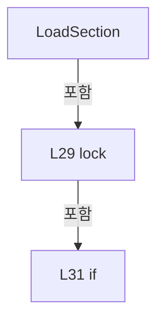

변경 전 점검: 입력/반환 타입, 위 호출자, 예외/취소 경로, 공유 상태와 저장·전송 소비자를 함께 확인합니다. 값의 단위나 물리 방향을 이름만으로 확정하지 않습니다.

### MethodDeclaration `ReloadSection` · L40–49

[Drilling.Common/Managers/CSettingManager.cs:40–49](https://github.com/kjuws10-rgb/A3Drilling/blob/5aee8e58439c9b455cae7c9593c9be986c3e682e/Drilling.Common/Managers/CSettingManager.cs#L40-L49)

| 항목 | 실제 추출 값 |
| --- | --- |
| 서명 | System.Collections.Generic.IReadOnlyList<Drilling.Common.Managers.ST_SYSTEM_PARAMETER> Drilling.Common.Managers.CSettingManager.ReloadSection(Drilling.Common.Managers.EN_SETTING_TAB, System.Threading.CancellationToken) |
| 접근/수식자 | Public / public |
| 반환/값 타입 | System.Collections.Generic.IReadOnlyList<Drilling.Common.Managers.ST_SYSTEM_PARAMETER> |
| 소속 타입 | NamedType:Drilling.Common.Managers.CSettingManager |

입력 계약:

| 이름 | 타입 | 전달 | 선택/기본값 |
| --- | --- | --- | --- |
| section | Drilling.Common.Managers.EN_SETTING_TAB | None | False /  |
| cancellationToken | System.Threading.CancellationToken | None | True / null |

정적 호출자로 확인된 위치:

| 호출 파일/행 | 호출 표현식 | 런타임 분기 가능 |
| --- | --- | --- |
| [Drilling.Common/Managers/CSettingManager.cs:37–37](https://github.com/kjuws10-rgb/A3Drilling/blob/5aee8e58439c9b455cae7c9593c9be986c3e682e/Drilling.Common/Managers/CSettingManager.cs#L37-L37) | ReloadSection | False |
| [Drilling.Common/Managers/CSettingManager.cs:55–55](https://github.com/kjuws10-rgb/A3Drilling/blob/5aee8e58439c9b455cae7c9593c9be986c3e682e/Drilling.Common/Managers/CSettingManager.cs#L55-L55) | ReloadSection | False |
| [Drilling.UI/Menu/Menus/CMenuSetting.cs:512–512](https://github.com/kjuws10-rgb/A3Drilling/blob/5aee8e58439c9b455cae7c9593c9be986c3e682e/Drilling.UI/Menu/Menus/CMenuSetting.cs#L512-L512) | _settingManager.ReloadSection | False |

호출하는 대상과 해석 범위:

| 원본 행 | 표현식 | 분석 상태 | 대상/소스 위치 |
| --- | --- | --- | --- |
| 44 | settingFile.Load(section, cancellationToken).ToArray | resolved | Drilling.Common.Managers.ST_SYSTEM_PARAMETER[] System.Collections.Generic.IEnumerable<Drilling.Common.Managers.ST_SYSTEM_PARAMETER>.ToArray<Drilling.Common.Managers.ST_SYSTEM_PARAMETER>() |
| 44 | settingFile.Load | resolved | System.Collections.Generic.IReadOnlyList<Drilling.Common.Managers.ST_SYSTEM_PARAMETER> Drilling.Common.Managers.CSettingFileBase.Load(Drilling.Common.Managers.EN_SETTING_TAB, System.Threading.CancellationToken) · Drilling.Common/Managers/CSettingManager.cs:275 |

본문의 실제 연산·분기·예외·반환 순서(원문 위치 순):

| 원본 행 | 종류 | 주석 해설 |
| --- | --- | --- |
| 42 | lock | 공유 상태의 임계 구역에 진입합니다: lock (_saveLock) |
| 44 | call | 함수·델리게이트 또는 객체 생성자를 호출합니다: settingFile.Load(section, cancellationToken).ToArray() |
| 44 | call | 함수·델리게이트 또는 객체 생성자를 호출합니다: settingFile.Load(section, cancellationToken) |
| 44 | local-declaration | 지역 변수를 선언합니다: var loadedParameters = settingFile.Load(section, cancellationToken).ToArray(); |
| 44 | variable-initializer | 변수의 초기값을 지정합니다: loadedParameters = settingFile.Load(section, cancellationToken).ToArray() |
| 45 | lock | 공유 상태의 임계 구역에 진입합니다: lock (_cacheLock) |
| 46 | assignment | 값을 대상에 대입합니다: _sectionCache[section] = loadedParameters |
| 47 | return | 호출자에게 값 또는 제어를 반환합니다: return loadedParameters; |

제어 구문의 포함 구조(실제 실행 순서/CFG가 아닌 구문 탐색 그림):

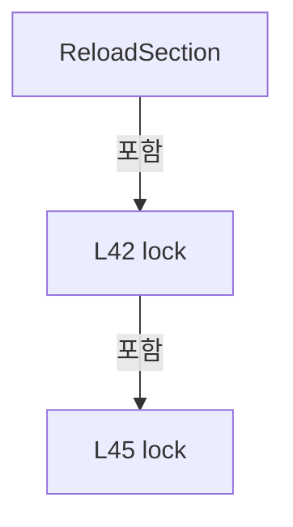

변경 전 점검: 입력/반환 타입, 위 호출자, 예외/취소 경로, 공유 상태와 저장·전송 소비자를 함께 확인합니다. 값의 단위나 물리 방향을 이름만으로 확정하지 않습니다.

### MethodDeclaration `LoadAllSections` · L51–57

[Drilling.Common/Managers/CSettingManager.cs:51–57](https://github.com/kjuws10-rgb/A3Drilling/blob/5aee8e58439c9b455cae7c9593c9be986c3e682e/Drilling.Common/Managers/CSettingManager.cs#L51-L57)

| 항목 | 실제 추출 값 |
| --- | --- |
| 서명 | void Drilling.Common.Managers.CSettingManager.LoadAllSections(System.Threading.CancellationToken) |
| 접근/수식자 | Public / public |
| 반환/값 타입 | void |
| 소속 타입 | NamedType:Drilling.Common.Managers.CSettingManager |

입력 계약:

| 이름 | 타입 | 전달 | 선택/기본값 |
| --- | --- | --- | --- |
| cancellationToken | System.Threading.CancellationToken | None | True / null |

정적 호출자로 확인된 위치:

| 호출 파일/행 | 호출 표현식 | 런타임 분기 가능 |
| --- | --- | --- |
| [Drilling.Common/Managers/CManager.cs:99–99](https://github.com/kjuws10-rgb/A3Drilling/blob/5aee8e58439c9b455cae7c9593c9be986c3e682e/Drilling.Common/Managers/CManager.cs#L99-L99) | _settingManager.LoadAllSections | False |

호출하는 대상과 해석 범위:

| 원본 행 | 표현식 | 분석 상태 | 대상/소스 위치 |
| --- | --- | --- | --- |
| 53 | Enum.GetValues<EN_SETTING_TAB> | resolved | Drilling.Common.Managers.EN_SETTING_TAB[] System.Enum.GetValues<Drilling.Common.Managers.EN_SETTING_TAB>() |
| 55 | ReloadSection | resolved | System.Collections.Generic.IReadOnlyList<Drilling.Common.Managers.ST_SYSTEM_PARAMETER> Drilling.Common.Managers.CSettingManager.ReloadSection(Drilling.Common.Managers.EN_SETTING_TAB, System.Threading.CancellationToken) · Drilling.Common/Managers/CSettingManager.cs:40 |

본문의 실제 연산·분기·예외·반환 순서(원문 위치 순):

| 원본 행 | 종류 | 주석 해설 |
| --- | --- | --- |
| 53 | call | 함수·델리게이트 또는 객체 생성자를 호출합니다: Enum.GetValues<EN_SETTING_TAB>() |
| 53 | foreach | 컬렉션 요소를 순회합니다: foreach (var section in Enum.GetValues<EN_SETTING_TAB>()) |
| 55 | call | 함수·델리게이트 또는 객체 생성자를 호출합니다: ReloadSection(section, cancellationToken) |

제어 구문의 포함 구조(실제 실행 순서/CFG가 아닌 구문 탐색 그림):

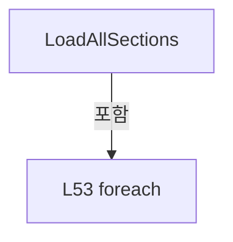

변경 전 점검: 입력/반환 타입, 위 호출자, 예외/취소 경로, 공유 상태와 저장·전송 소비자를 함께 확인합니다. 값의 단위나 물리 방향을 이름만으로 확정하지 않습니다.

### MethodDeclaration `GetValue` · L59–70

[Drilling.Common/Managers/CSettingManager.cs:59–70](https://github.com/kjuws10-rgb/A3Drilling/blob/5aee8e58439c9b455cae7c9593c9be986c3e682e/Drilling.Common/Managers/CSettingManager.cs#L59-L70)

| 항목 | 실제 추출 값 |
| --- | --- |
| 서명 | string Drilling.Common.Managers.CSettingManager.GetValue(Drilling.Common.Managers.EN_SETTING_TAB, string, string, System.Threading.CancellationToken) |
| 접근/수식자 | Public / public |
| 반환/값 타입 | string |
| 소속 타입 | NamedType:Drilling.Common.Managers.CSettingManager |

입력 계약:

| 이름 | 타입 | 전달 | 선택/기본값 |
| --- | --- | --- | --- |
| section | Drilling.Common.Managers.EN_SETTING_TAB | None | False /  |
| name | string | None | False /  |
| defaultValue | string | None | True / "" |
| cancellationToken | System.Threading.CancellationToken | None | True / null |

정적 호출자로 확인된 위치:

| 호출 파일/행 | 호출 표현식 | 런타임 분기 가능 |
| --- | --- | --- |
| [Drilling.Common/Automation/CAutomationManager.cs:1043–1043](https://github.com/kjuws10-rgb/A3Drilling/blob/5aee8e58439c9b455cae7c9593c9be986c3e682e/Drilling.Common/Automation/CAutomationManager.cs#L1043-L1043) | _settingManager.GetValue | False |
| [Drilling.Common/Automation/CAutomationManager.cs:1069–1069](https://github.com/kjuws10-rgb/A3Drilling/blob/5aee8e58439c9b455cae7c9593c9be986c3e682e/Drilling.Common/Automation/CAutomationManager.cs#L1069-L1069) | _settingManager.GetValue | False |
| [Drilling.Common/Interface/CPowerMeasureRun.cs:25–25](https://github.com/kjuws10-rgb/A3Drilling/blob/5aee8e58439c9b455cae7c9593c9be986c3e682e/Drilling.Common/Interface/CPowerMeasureRun.cs#L25-L25) | settings.GetValue | False |
| [Drilling.Common/Interface/CPowerMeasureRun.cs:27–27](https://github.com/kjuws10-rgb/A3Drilling/blob/5aee8e58439c9b455cae7c9593c9be986c3e682e/Drilling.Common/Interface/CPowerMeasureRun.cs#L27-L27) | settings.GetValue | False |
| [Drilling.Common/Interface/CPowerMeasureRun.cs:38–38](https://github.com/kjuws10-rgb/A3Drilling/blob/5aee8e58439c9b455cae7c9593c9be986c3e682e/Drilling.Common/Interface/CPowerMeasureRun.cs#L38-L38) | settings.GetValue | False |
| [Drilling.Common/Managers/CManager.cs:261–261](https://github.com/kjuws10-rgb/A3Drilling/blob/5aee8e58439c9b455cae7c9593c9be986c3e682e/Drilling.Common/Managers/CManager.cs#L261-L261) | _settingManager.GetValue | False |
| [Drilling.Common/Managers/CManager.cs:262–262](https://github.com/kjuws10-rgb/A3Drilling/blob/5aee8e58439c9b455cae7c9593c9be986c3e682e/Drilling.Common/Managers/CManager.cs#L262-L262) | _settingManager.GetValue | False |
| [Drilling.Common/Managers/CSettingManager.cs:107–107](https://github.com/kjuws10-rgb/A3Drilling/blob/5aee8e58439c9b455cae7c9593c9be986c3e682e/Drilling.Common/Managers/CSettingManager.cs#L107-L107) | GetValue | False |
| [Drilling.Common/Managers/CSettingManager.cs:113–113](https://github.com/kjuws10-rgb/A3Drilling/blob/5aee8e58439c9b455cae7c9593c9be986c3e682e/Drilling.Common/Managers/CSettingManager.cs#L113-L113) | GetValue | False |
| [Drilling.Common/Station/CStationProcess.cs:4830–4830](https://github.com/kjuws10-rgb/A3Drilling/blob/5aee8e58439c9b455cae7c9593c9be986c3e682e/Drilling.Common/Station/CStationProcess.cs#L4830-L4830) | settings.GetValue | False |
| [Drilling.UI/CRootView.cs:152–152](https://github.com/kjuws10-rgb/A3Drilling/blob/5aee8e58439c9b455cae7c9593c9be986c3e682e/Drilling.UI/CRootView.cs#L152-L152) | settingManager.GetValue | False |
| [Drilling.UI/Menu/Menus/CMenuCorrection.cs:2169–2169](https://github.com/kjuws10-rgb/A3Drilling/blob/5aee8e58439c9b455cae7c9593c9be986c3e682e/Drilling.UI/Menu/Menus/CMenuCorrection.cs#L2169-L2169) | _settingManager.GetValue | False |
| [Drilling.UI/Menu/Menus/CMenuCorrection.cs:2170–2170](https://github.com/kjuws10-rgb/A3Drilling/blob/5aee8e58439c9b455cae7c9593c9be986c3e682e/Drilling.UI/Menu/Menus/CMenuCorrection.cs#L2170-L2170) | _settingManager.GetValue | False |
| [Drilling.UI/Menu/Menus/CMenuCorrection.cs:2171–2171](https://github.com/kjuws10-rgb/A3Drilling/blob/5aee8e58439c9b455cae7c9593c9be986c3e682e/Drilling.UI/Menu/Menus/CMenuCorrection.cs#L2171-L2171) | _settingManager.GetValue | False |
| [Drilling.UI/Menu/Menus/CMenuCorrection.cs:2839–2839](https://github.com/kjuws10-rgb/A3Drilling/blob/5aee8e58439c9b455cae7c9593c9be986c3e682e/Drilling.UI/Menu/Menus/CMenuCorrection.cs#L2839-L2839) | _settingManager.GetValue | False |
| [Drilling.UI/Menu/Menus/CMenuMain.cs:2901–2901](https://github.com/kjuws10-rgb/A3Drilling/blob/5aee8e58439c9b455cae7c9593c9be986c3e682e/Drilling.UI/Menu/Menus/CMenuMain.cs#L2901-L2901) | _settings.GetValue | False |
| [Drilling.UI/Menu/Menus/CMenuMonitor.cs:5984–5984](https://github.com/kjuws10-rgb/A3Drilling/blob/5aee8e58439c9b455cae7c9593c9be986c3e682e/Drilling.UI/Menu/Menus/CMenuMonitor.cs#L5984-L5984) | _settingManager.GetValue | False |

호출하는 대상과 해석 범위:

| 원본 행 | 표현식 | 분석 상태 | 대상/소스 위치 |
| --- | --- | --- | --- |
| 61 | ArgumentException.ThrowIfNullOrWhiteSpace | resolved | void System.ArgumentException.ThrowIfNullOrWhiteSpace(string?, string?) |
| 62 | LoadSection | resolved | System.Collections.Generic.IReadOnlyList<Drilling.Common.Managers.ST_SYSTEM_PARAMETER> Drilling.Common.Managers.CSettingManager.LoadSection(Drilling.Common.Managers.EN_SETTING_TAB, System.Threading.CancellationToken) · Drilling.Common/Managers/CSettingManager.cs:26 |
| 68 | parameters.FirstOrDefault | resolved | Drilling.Common.Managers.ST_SYSTEM_PARAMETER? System.Collections.Generic.IEnumerable<Drilling.Common.Managers.ST_SYSTEM_PARAMETER>.FirstOrDefault<Drilling.Common.Managers.ST_SYSTEM_PARAMETER>(System.Func<Drilling.Common.Managers.ST_SYSTEM_PARAMETER, bool>) |
| 69 | string.IsNullOrWhiteSpace | resolved | bool string.IsNullOrWhiteSpace(string?) |

본문의 실제 연산·분기·예외·반환 순서(원문 위치 순):

| 원본 행 | 종류 | 주석 해설 |
| --- | --- | --- |
| 61 | call | 함수·델리게이트 또는 객체 생성자를 호출합니다: ArgumentException.ThrowIfNullOrWhiteSpace(name) |
| 62 | call | 함수·델리게이트 또는 객체 생성자를 호출합니다: LoadSection(section, cancellationToken) |
| 62 | local-declaration | 지역 변수를 선언합니다: var parameters = LoadSection(section, cancellationToken); |
| 62 | variable-initializer | 변수의 초기값을 지정합니다: parameters = LoadSection(section, cancellationToken) |
| 68 | call | 함수·델리게이트 또는 객체 생성자를 호출합니다: parameters.FirstOrDefault(MatchesItem) |
| 68 | local-declaration | 지역 변수를 선언합니다: var parameter = parameters.FirstOrDefault(MatchesItem); |
| 68 | variable-initializer | 변수의 초기값을 지정합니다: parameter = parameters.FirstOrDefault(MatchesItem) |
| 69 | call | 함수·델리게이트 또는 객체 생성자를 호출합니다: string.IsNullOrWhiteSpace(parameter.Value) |
| 69 | conditional-expression | 조건에 따라 결과식을 선택합니다: parameter is null &#124;&#124; string.IsNullOrWhiteSpace(parameter.Value) ? defaultValue : parameter.Value |
| 69 | return | 호출자에게 값 또는 제어를 반환합니다: return parameter is null &#124;&#124; string.IsNullOrWhiteSpace(parameter.Value) ? defaultValue : parameter.Value; |

변경 전 점검: 입력/반환 타입, 위 호출자, 예외/취소 경로, 공유 상태와 저장·전송 소비자를 함께 확인합니다. 값의 단위나 물리 방향을 이름만으로 확정하지 않습니다.

### LocalFunctionStatement `MatchesItem` · L63–66

[Drilling.Common/Managers/CSettingManager.cs:63–66](https://github.com/kjuws10-rgb/A3Drilling/blob/5aee8e58439c9b455cae7c9593c9be986c3e682e/Drilling.Common/Managers/CSettingManager.cs#L63-L66)

| 항목 | 실제 추출 값 |
| --- | --- |
| 서명 | bool MatchesItem(Drilling.Common.Managers.ST_SYSTEM_PARAMETER) |
| 접근/수식자 | Private /  |
| 반환/값 타입 | bool |
| 소속 타입 | NamedType:Drilling.Common.Managers.CSettingManager |

입력 계약:

| 이름 | 타입 | 전달 | 선택/기본값 |
| --- | --- | --- | --- |
| item | Drilling.Common.Managers.ST_SYSTEM_PARAMETER | None | False /  |

현재 부분 분석에서 직접 연결된 호출자는 없습니다. XAML/이벤트/인터페이스·델리게이트·외부 진입을 추가 확인해야 하며, 미사용으로 판정한 것이 아닙니다.

호출하는 대상과 해석 범위:

| 원본 행 | 표현식 | 분석 상태 | 대상/소스 위치 |
| --- | --- | --- | --- |
| 65 | item.Key.Equals | resolved | bool string.Equals(string?, System.StringComparison) |
| 65 | item.Name.Equals | resolved | bool string.Equals(string?, System.StringComparison) |

본문의 실제 연산·분기·예외·반환 순서(원문 위치 순):

| 원본 행 | 종류 | 주석 해설 |
| --- | --- | --- |
| 65 | call | 함수·델리게이트 또는 객체 생성자를 호출합니다: item.Key.Equals(name, StringComparison.OrdinalIgnoreCase) |
| 65 | call | 함수·델리게이트 또는 객체 생성자를 호출합니다: item.Name.Equals(name, StringComparison.OrdinalIgnoreCase) |
| 65 | return | 호출자에게 값 또는 제어를 반환합니다: return item.Key.Equals(name, StringComparison.OrdinalIgnoreCase) &#124;&#124; item.Name.Equals(name, StringComparison.OrdinalIgnoreCase); |

변경 전 점검: 입력/반환 타입, 위 호출자, 예외/취소 경로, 공유 상태와 저장·전송 소비자를 함께 확인합니다. 값의 단위나 물리 방향을 이름만으로 확정하지 않습니다.

### MethodDeclaration `SetValue` · L72–102

[Drilling.Common/Managers/CSettingManager.cs:72–102](https://github.com/kjuws10-rgb/A3Drilling/blob/5aee8e58439c9b455cae7c9593c9be986c3e682e/Drilling.Common/Managers/CSettingManager.cs#L72-L102)

| 항목 | 실제 추출 값 |
| --- | --- |
| 서명 | void Drilling.Common.Managers.CSettingManager.SetValue(Drilling.Common.Managers.EN_SETTING_TAB, string, string, System.Threading.CancellationToken) |
| 접근/수식자 | Public / public |
| 반환/값 타입 | void |
| 소속 타입 | NamedType:Drilling.Common.Managers.CSettingManager |

입력 계약:

| 이름 | 타입 | 전달 | 선택/기본값 |
| --- | --- | --- | --- |
| section | Drilling.Common.Managers.EN_SETTING_TAB | None | False /  |
| name | string | None | False /  |
| value | string | None | False /  |
| cancellationToken | System.Threading.CancellationToken | None | True / null |

정적 호출자로 확인된 위치:

| 호출 파일/행 | 호출 표현식 | 런타임 분기 가능 |
| --- | --- | --- |
| [Drilling.Common/Station/CStationProcess.cs:4248–4248](https://github.com/kjuws10-rgb/A3Drilling/blob/5aee8e58439c9b455cae7c9593c9be986c3e682e/Drilling.Common/Station/CStationProcess.cs#L4248-L4248) | _settingManager.SetValue | False |
| [Drilling.Common/Station/CStationProcess.cs:6135–6135](https://github.com/kjuws10-rgb/A3Drilling/blob/5aee8e58439c9b455cae7c9593c9be986c3e682e/Drilling.Common/Station/CStationProcess.cs#L6135-L6135) | settings.SetValue | False |
| [Drilling.Common/Station/CStationProcess.cs:6383–6383](https://github.com/kjuws10-rgb/A3Drilling/blob/5aee8e58439c9b455cae7c9593c9be986c3e682e/Drilling.Common/Station/CStationProcess.cs#L6383-L6383) | settings.SetValue | False |
| [Drilling.UI/Menu/Menus/CMenuMain.cs:2902–2902](https://github.com/kjuws10-rgb/A3Drilling/blob/5aee8e58439c9b455cae7c9593c9be986c3e682e/Drilling.UI/Menu/Menus/CMenuMain.cs#L2902-L2902) | _settings.SetValue | False |
| [Drilling.UI/Menu/Menus/CMenuRecipe.cs:768–768](https://github.com/kjuws10-rgb/A3Drilling/blob/5aee8e58439c9b455cae7c9593c9be986c3e682e/Drilling.UI/Menu/Menus/CMenuRecipe.cs#L768-L768) | _settingManager.SetValue | False |
| [Drilling.UI/Menu/Menus/CMenuRecipe.cs:1161–1161](https://github.com/kjuws10-rgb/A3Drilling/blob/5aee8e58439c9b455cae7c9593c9be986c3e682e/Drilling.UI/Menu/Menus/CMenuRecipe.cs#L1161-L1161) | _settingManager.SetValue | False |

호출하는 대상과 해석 범위:

| 원본 행 | 표현식 | 분석 상태 | 대상/소스 위치 |
| --- | --- | --- | --- |
| 76 | ArgumentException.ThrowIfNullOrWhiteSpace | resolved | void System.ArgumentException.ThrowIfNullOrWhiteSpace(string?, string?) |
| 77 | LoadSection | resolved | System.Collections.Generic.IReadOnlyList<Drilling.Common.Managers.ST_SYSTEM_PARAMETER> Drilling.Common.Managers.CSettingManager.LoadSection(Drilling.Common.Managers.EN_SETTING_TAB, System.Threading.CancellationToken) · Drilling.Common/Managers/CSettingManager.cs:26 |
| 94 | parameters.Select(SelectParameter).ToArray | resolved | Drilling.Common.Managers.ST_SYSTEM_PARAMETER[] System.Collections.Generic.IEnumerable<Drilling.Common.Managers.ST_SYSTEM_PARAMETER>.ToArray<Drilling.Common.Managers.ST_SYSTEM_PARAMETER>() |
| 94 | parameters.Select | resolved | System.Collections.Generic.IEnumerable<Drilling.Common.Managers.ST_SYSTEM_PARAMETER> System.Collections.Generic.IEnumerable<Drilling.Common.Managers.ST_SYSTEM_PARAMETER>.Select<Drilling.Common.Managers.ST_SYSTEM_PARAMETER, Drilling.Common.Managers.ST_SYSTEM_PARAMETER>(System.Func<Drilling.Common.Managers.ST_SYSTEM_PARAMETER, Drilling.Common.Managers.ST_SYSTEM_PARAMETER>) |
| 97 | new InvalidDataException | resolved | System.IO.InvalidDataException.InvalidDataException(string?) |
| 100 | SaveSection | resolved | void Drilling.Common.Managers.CSettingManager.SaveSection(Drilling.Common.Managers.EN_SETTING_TAB, System.Collections.Generic.IReadOnlyList<Drilling.Common.Managers.ST_SYSTEM_PARAMETER>, System.Threading.CancellationToken) · Drilling.Common/Managers/CSettingManager.cs:122 |

본문의 실제 연산·분기·예외·반환 순서(원문 위치 순):

| 원본 행 | 종류 | 주석 해설 |
| --- | --- | --- |
| 74 | lock | 공유 상태의 임계 구역에 진입합니다: lock (_saveLock) |
| 76 | call | 함수·델리게이트 또는 객체 생성자를 호출합니다: ArgumentException.ThrowIfNullOrWhiteSpace(name) |
| 77 | call | 함수·델리게이트 또는 객체 생성자를 호출합니다: LoadSection(section, cancellationToken) |
| 77 | local-declaration | 지역 변수를 선언합니다: var parameters = LoadSection(section, cancellationToken); |
| 77 | variable-initializer | 변수의 초기값을 지정합니다: parameters = LoadSection(section, cancellationToken) |
| 78 | local-declaration | 지역 변수를 선언합니다: var found = false; |
| 78 | variable-initializer | 변수의 초기값을 지정합니다: found = false |
| 94 | call | 함수·델리게이트 또는 객체 생성자를 호출합니다: parameters.Select(SelectParameter).ToArray() |
| 94 | call | 함수·델리게이트 또는 객체 생성자를 호출합니다: parameters.Select(SelectParameter) |
| 94 | local-declaration | 지역 변수를 선언합니다: var editedParameters = parameters.Select(SelectParameter).ToArray(); |
| 94 | variable-initializer | 변수의 초기값을 지정합니다: editedParameters = parameters.Select(SelectParameter).ToArray() |
| 95 | if | 조건에 따라 분기합니다: if (!found) |
| 97 | call | 함수·델리게이트 또는 객체 생성자를 호출합니다: new InvalidDataException($"Setting parameter is not defined: {section}/{name}") |
| 97 | throw | 예외를 발생/전달합니다: throw new InvalidDataException($"Setting parameter is not defined: {section}/{name}"); |
| 100 | call | 함수·델리게이트 또는 객체 생성자를 호출합니다: SaveSection(section, editedParameters, cancellationToken) |

제어 구문의 포함 구조(실제 실행 순서/CFG가 아닌 구문 탐색 그림):

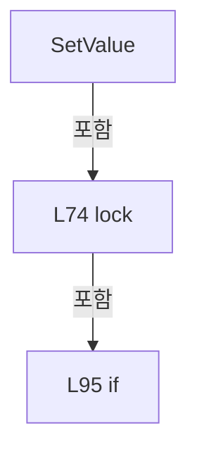

변경 전 점검: 입력/반환 타입, 위 호출자, 예외/취소 경로, 공유 상태와 저장·전송 소비자를 함께 확인합니다. 값의 단위나 물리 방향을 이름만으로 확정하지 않습니다.

### LocalFunctionStatement `SelectParameter` · L79–92

[Drilling.Common/Managers/CSettingManager.cs:79–92](https://github.com/kjuws10-rgb/A3Drilling/blob/5aee8e58439c9b455cae7c9593c9be986c3e682e/Drilling.Common/Managers/CSettingManager.cs#L79-L92)

| 항목 | 실제 추출 값 |
| --- | --- |
| 서명 | Drilling.Common.Managers.ST_SYSTEM_PARAMETER SelectParameter(Drilling.Common.Managers.ST_SYSTEM_PARAMETER) |
| 접근/수식자 | Private /  |
| 반환/값 타입 | Drilling.Common.Managers.ST_SYSTEM_PARAMETER |
| 소속 타입 | NamedType:Drilling.Common.Managers.CSettingManager |

입력 계약:

| 이름 | 타입 | 전달 | 선택/기본값 |
| --- | --- | --- | --- |
| parameter | Drilling.Common.Managers.ST_SYSTEM_PARAMETER | None | False /  |

현재 부분 분석에서 직접 연결된 호출자는 없습니다. XAML/이벤트/인터페이스·델리게이트·외부 진입을 추가 확인해야 하며, 미사용으로 판정한 것이 아닙니다.

호출하는 대상과 해석 범위:

| 원본 행 | 표현식 | 분석 상태 | 대상/소스 위치 |
| --- | --- | --- | --- |
| 81 | parameter.Key.Equals | resolved | bool string.Equals(string?, System.StringComparison) |
| 81 | parameter.Name.Equals | resolved | bool string.Equals(string?, System.StringComparison) |

본문의 실제 연산·분기·예외·반환 순서(원문 위치 순):

| 원본 행 | 종류 | 주석 해설 |
| --- | --- | --- |
| 81 | call | 함수·델리게이트 또는 객체 생성자를 호출합니다: parameter.Key.Equals(name, StringComparison.OrdinalIgnoreCase) |
| 81 | call | 함수·델리게이트 또는 객체 생성자를 호출합니다: parameter.Name.Equals(name, StringComparison.OrdinalIgnoreCase) |
| 81 | local-declaration | 지역 변수를 선언합니다: var isTarget = parameter.Key.Equals(name, StringComparison.OrdinalIgnoreCase) &#124;&#124; parameter.Name.Equals(name, StringComparison.OrdinalIgnoreCase); |
| 81 | variable-initializer | 변수의 초기값을 지정합니다: isTarget = parameter.Key.Equals(name, StringComparison.OrdinalIgnoreCase) &#124;&#124; parameter.Name.Equals(name, StringComparison.OrdinalIgnoreCase) |
| 82 | if | 조건에 따라 분기합니다: if (!isTarget) |
| 84 | return | 호출자에게 값 또는 제어를 반환합니다: return parameter; |
| 87 | assignment | 값을 대상에 대입합니다: found = true |
| 88 | return | 호출자에게 값 또는 제어를 반환합니다: return parameter with { Value = value }; |
| 90 | assignment | 값을 대상에 대입합니다: Value = value |

제어 구문의 포함 구조(실제 실행 순서/CFG가 아닌 구문 탐색 그림):

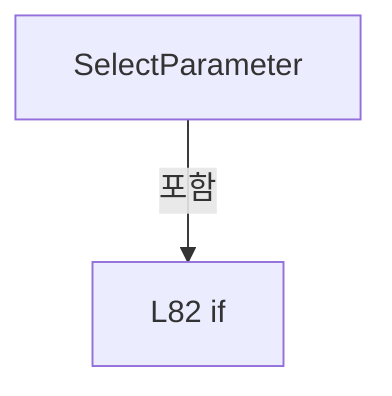

변경 전 점검: 입력/반환 타입, 위 호출자, 예외/취소 경로, 공유 상태와 저장·전송 소비자를 함께 확인합니다. 값의 단위나 물리 방향을 이름만으로 확정하지 않습니다.

### MethodDeclaration `GetVisionMaxHoleCountPerLine` · L104–111

[Drilling.Common/Managers/CSettingManager.cs:104–111](https://github.com/kjuws10-rgb/A3Drilling/blob/5aee8e58439c9b455cae7c9593c9be986c3e682e/Drilling.Common/Managers/CSettingManager.cs#L104-L111)

| 항목 | 실제 추출 값 |
| --- | --- |
| 서명 | int Drilling.Common.Managers.CSettingManager.GetVisionMaxHoleCountPerLine() |
| 접근/수식자 | Public / public |
| 반환/값 타입 | int |
| 소속 타입 | NamedType:Drilling.Common.Managers.CSettingManager |

정적 호출자로 확인된 위치:

| 호출 파일/행 | 호출 표현식 | 런타임 분기 가능 |
| --- | --- | --- |
| [Drilling.Common/Review/CReviewManager.cs:1966–1966](https://github.com/kjuws10-rgb/A3Drilling/blob/5aee8e58439c9b455cae7c9593c9be986c3e682e/Drilling.Common/Review/CReviewManager.cs#L1966-L1966) | settingManager.GetVisionMaxHoleCountPerLine | False |
| [Drilling.Common/Review/CReviewManager.cs:2358–2358](https://github.com/kjuws10-rgb/A3Drilling/blob/5aee8e58439c9b455cae7c9593c9be986c3e682e/Drilling.Common/Review/CReviewManager.cs#L2358-L2358) | settingManager.GetVisionMaxHoleCountPerLine | False |
| [Drilling.Common/Review/CReviewManager.cs:2475–2475](https://github.com/kjuws10-rgb/A3Drilling/blob/5aee8e58439c9b455cae7c9593c9be986c3e682e/Drilling.Common/Review/CReviewManager.cs#L2475-L2475) | settingManager.GetVisionMaxHoleCountPerLine | False |

호출하는 대상과 해석 범위:

| 원본 행 | 표현식 | 분석 상태 | 대상/소스 위치 |
| --- | --- | --- | --- |
| 107 | GetValue | resolved | string Drilling.Common.Managers.CSettingManager.GetValue(Drilling.Common.Managers.EN_SETTING_TAB, string, string, System.Threading.CancellationToken) · Drilling.Common/Managers/CSettingManager.cs:59 |
| 107 | CVisionProtocol.DefaultMaxHoleCountPerLine.ToString | resolved | string int.ToString(System.IFormatProvider?) |
| 108 | int.TryParse | resolved | bool int.TryParse(string?, System.Globalization.NumberStyles, System.IFormatProvider?, out int) |
| 109 | new InvalidDataException | resolved | System.IO.InvalidDataException.InvalidDataException(string?) |
| 110 | CVisionProtocol.ValidateLineCapacity | resolved | int Drilling.Common.Interface.Vision.CVisionProtocol.ValidateLineCapacity(int) · Drilling.Common/Interface/Vision/CVisionComm.cs:568 |

본문의 실제 연산·분기·예외·반환 순서(원문 위치 순):

| 원본 행 | 종류 | 주석 해설 |
| --- | --- | --- |
| 107 | call | 함수·델리게이트 또는 객체 생성자를 호출합니다: GetValue(EN_SETTING_TAB.Option, CVisionProtocol.MaxHoleCountPerLineSettingKey, CVisionProtocol.DefaultMaxHoleCountPerLine.ToString(CultureInfo.InvariantCulture)) |
| 107 | call | 함수·델리게이트 또는 객체 생성자를 호출합니다: CVisionProtocol.DefaultMaxHoleCountPerLine.ToString(CultureInfo.InvariantCulture) |
| 107 | local-declaration | 지역 변수를 선언합니다: var text = GetValue(EN_SETTING_TAB.Option, CVisionProtocol.MaxHoleCountPerLineSettingKey, CVisionProtocol.DefaultMaxHoleCountPerLine.ToString(CultureInfo.InvariantCulture)); |
| 107 | variable-initializer | 변수의 초기값을 지정합니다: text = GetValue(EN_SETTING_TAB.Option, CVisionProtocol.MaxHoleCountPerLineSettingKey, CVisionProtocol.DefaultMaxHoleCountPerLine.ToString(CultureInfo.InvariantCulture)) |
| 108 | call | 함수·델리게이트 또는 객체 생성자를 호출합니다: int.TryParse(text, NumberStyles.Integer, CultureInfo.InvariantCulture, out var value) |
| 108 | if | 조건에 따라 분기합니다: if (!int.TryParse(text, NumberStyles.Integer, CultureInfo.InvariantCulture, out var value)) |
| 109 | call | 함수·델리게이트 또는 객체 생성자를 호출합니다: new InvalidDataException("Setting-Review MaxHoleCountPerLine은 정수여야 합니다.") |
| 109 | throw | 예외를 발생/전달합니다: throw new InvalidDataException("Setting-Review MaxHoleCountPerLine은 정수여야 합니다."); |
| 110 | call | 함수·델리게이트 또는 객체 생성자를 호출합니다: CVisionProtocol.ValidateLineCapacity(value) |
| 110 | return | 호출자에게 값 또는 제어를 반환합니다: return CVisionProtocol.ValidateLineCapacity(value); |

제어 구문의 포함 구조(실제 실행 순서/CFG가 아닌 구문 탐색 그림):

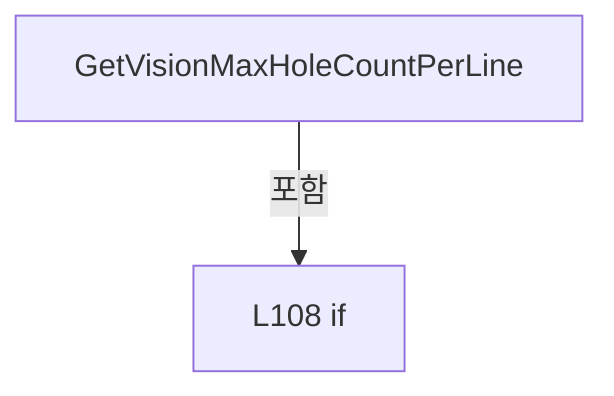

변경 전 점검: 입력/반환 타입, 위 호출자, 예외/취소 경로, 공유 상태와 저장·전송 소비자를 함께 확인합니다. 값의 단위나 물리 방향을 이름만으로 확정하지 않습니다.

### MethodDeclaration `GetVisionCameraResolution` · L113–113

[Drilling.Common/Managers/CSettingManager.cs:113–113](https://github.com/kjuws10-rgb/A3Drilling/blob/5aee8e58439c9b455cae7c9593c9be986c3e682e/Drilling.Common/Managers/CSettingManager.cs#L113-L113)

| 항목 | 실제 추출 값 |
| --- | --- |
| 서명 | double Drilling.Common.Managers.CSettingManager.GetVisionCameraResolution() |
| 접근/수식자 | Public / public |
| 반환/값 타입 | double |
| 소속 타입 | NamedType:Drilling.Common.Managers.CSettingManager |

정적 호출자로 확인된 위치:

| 호출 파일/행 | 호출 표현식 | 런타임 분기 가능 |
| --- | --- | --- |
| [Drilling.Common/Review/CReviewManager.cs:48–48](https://github.com/kjuws10-rgb/A3Drilling/blob/5aee8e58439c9b455cae7c9593c9be986c3e682e/Drilling.Common/Review/CReviewManager.cs#L48-L48) | settingManager.GetVisionCameraResolution | False |
| [Drilling.Common/Review/CReviewManager.cs:2026–2026](https://github.com/kjuws10-rgb/A3Drilling/blob/5aee8e58439c9b455cae7c9593c9be986c3e682e/Drilling.Common/Review/CReviewManager.cs#L2026-L2026) | settingManager.GetVisionCameraResolution | False |
| [Drilling.Common/Review/CReviewManager.cs:2119–2119](https://github.com/kjuws10-rgb/A3Drilling/blob/5aee8e58439c9b455cae7c9593c9be986c3e682e/Drilling.Common/Review/CReviewManager.cs#L2119-L2119) | settingManager.GetVisionCameraResolution | False |
| [Drilling.Common/Review/CReviewManager.cs:2175–2175](https://github.com/kjuws10-rgb/A3Drilling/blob/5aee8e58439c9b455cae7c9593c9be986c3e682e/Drilling.Common/Review/CReviewManager.cs#L2175-L2175) | settingManager.GetVisionCameraResolution | False |

호출하는 대상과 해석 범위:

| 원본 행 | 표현식 | 분석 상태 | 대상/소스 위치 |
| --- | --- | --- | --- |
| 113 | ParseVisionCameraResolution | resolved | double Drilling.Common.Managers.CSettingManager.ParseVisionCameraResolution(string) · Drilling.Common/Managers/CSettingManager.cs:115 |
| 113 | GetValue | resolved | string Drilling.Common.Managers.CSettingManager.GetValue(Drilling.Common.Managers.EN_SETTING_TAB, string, string, System.Threading.CancellationToken) · Drilling.Common/Managers/CSettingManager.cs:59 |
| 113 | DefaultVisionCameraResolution.ToString | resolved | string double.ToString(string?, System.IFormatProvider?) |

본문의 실제 연산·분기·예외·반환 순서(원문 위치 순):

| 원본 행 | 종류 | 주석 해설 |
| --- | --- | --- |
| 113 | call | 함수·델리게이트 또는 객체 생성자를 호출합니다: ParseVisionCameraResolution(GetValue(EN_SETTING_TAB.Option, VisionCameraResolutionKey, DefaultVisionCameraResolution.ToString("R", CultureInfo.InvariantCulture))) |
| 113 | call | 함수·델리게이트 또는 객체 생성자를 호출합니다: GetValue(EN_SETTING_TAB.Option, VisionCameraResolutionKey, DefaultVisionCameraResolution.ToString("R", CultureInfo.InvariantCulture)) |
| 113 | call | 함수·델리게이트 또는 객체 생성자를 호출합니다: DefaultVisionCameraResolution.ToString("R", CultureInfo.InvariantCulture) |

변경 전 점검: 입력/반환 타입, 위 호출자, 예외/취소 경로, 공유 상태와 저장·전송 소비자를 함께 확인합니다. 값의 단위나 물리 방향을 이름만으로 확정하지 않습니다.

### MethodDeclaration `ParseVisionCameraResolution` · L115–120

[Drilling.Common/Managers/CSettingManager.cs:115–120](https://github.com/kjuws10-rgb/A3Drilling/blob/5aee8e58439c9b455cae7c9593c9be986c3e682e/Drilling.Common/Managers/CSettingManager.cs#L115-L120)

| 항목 | 실제 추출 값 |
| --- | --- |
| 서명 | double Drilling.Common.Managers.CSettingManager.ParseVisionCameraResolution(string) |
| 접근/수식자 | Private / private, static |
| 반환/값 타입 | double |
| 소속 타입 | NamedType:Drilling.Common.Managers.CSettingManager |

입력 계약:

| 이름 | 타입 | 전달 | 선택/기본값 |
| --- | --- | --- | --- |
| text | string | None | False /  |

정적 호출자로 확인된 위치:

| 호출 파일/행 | 호출 표현식 | 런타임 분기 가능 |
| --- | --- | --- |
| [Drilling.Common/Managers/CSettingManager.cs:113–113](https://github.com/kjuws10-rgb/A3Drilling/blob/5aee8e58439c9b455cae7c9593c9be986c3e682e/Drilling.Common/Managers/CSettingManager.cs#L113-L113) | ParseVisionCameraResolution | False |
| [Drilling.Common/Managers/CSettingManager.cs:130–130](https://github.com/kjuws10-rgb/A3Drilling/blob/5aee8e58439c9b455cae7c9593c9be986c3e682e/Drilling.Common/Managers/CSettingManager.cs#L130-L130) | ParseVisionCameraResolution | False |

호출하는 대상과 해석 범위:

| 원본 행 | 표현식 | 분석 상태 | 대상/소스 위치 |
| --- | --- | --- | --- |
| 117 | double.TryParse | resolved | bool double.TryParse(string?, System.Globalization.NumberStyles, System.IFormatProvider?, out double) |
| 117 | double.IsFinite | resolved | bool double.IsFinite(double) |
| 118 | new InvalidDataException | resolved | System.IO.InvalidDataException.InvalidDataException(string?) |

본문의 실제 연산·분기·예외·반환 순서(원문 위치 순):

| 원본 행 | 종류 | 주석 해설 |
| --- | --- | --- |
| 117 | call | 함수·델리게이트 또는 객체 생성자를 호출합니다: double.TryParse(text, NumberStyles.Float, CultureInfo.InvariantCulture, out var value) |
| 117 | call | 함수·델리게이트 또는 객체 생성자를 호출합니다: double.IsFinite(value) |
| 117 | if | 조건에 따라 분기합니다: if (!double.TryParse(text, NumberStyles.Float, CultureInfo.InvariantCulture, out var value) &#124;&#124; !double.IsFinite(value) &#124;&#124; value <= 0) |
| 118 | call | 함수·델리게이트 또는 객체 생성자를 호출합니다: new InvalidDataException("Setting-Review Review_Camera_Resolution은 0보다 큰 유한한 mm/pixel 값이어야 합니다.") |
| 118 | throw | 예외를 발생/전달합니다: throw new InvalidDataException("Setting-Review Review_Camera_Resolution은 0보다 큰 유한한 mm/pixel 값이어야 합니다."); |
| 119 | return | 호출자에게 값 또는 제어를 반환합니다: return value; |

제어 구문의 포함 구조(실제 실행 순서/CFG가 아닌 구문 탐색 그림):

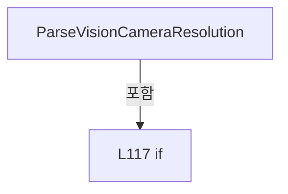

변경 전 점검: 입력/반환 타입, 위 호출자, 예외/취소 경로, 공유 상태와 저장·전송 소비자를 함께 확인합니다. 값의 단위나 물리 방향을 이름만으로 확정하지 않습니다.

### MethodDeclaration `SaveSection` · L122–148

[Drilling.Common/Managers/CSettingManager.cs:122–148](https://github.com/kjuws10-rgb/A3Drilling/blob/5aee8e58439c9b455cae7c9593c9be986c3e682e/Drilling.Common/Managers/CSettingManager.cs#L122-L148)

| 항목 | 실제 추출 값 |
| --- | --- |
| 서명 | void Drilling.Common.Managers.CSettingManager.SaveSection(Drilling.Common.Managers.EN_SETTING_TAB, System.Collections.Generic.IReadOnlyList<Drilling.Common.Managers.ST_SYSTEM_PARAMETER>, System.Threading.CancellationToken) |
| 접근/수식자 | Public / public |
| 반환/값 타입 | void |
| 소속 타입 | NamedType:Drilling.Common.Managers.CSettingManager |

입력 계약:

| 이름 | 타입 | 전달 | 선택/기본값 |
| --- | --- | --- | --- |
| section | Drilling.Common.Managers.EN_SETTING_TAB | None | False /  |
| parameters | System.Collections.Generic.IReadOnlyList<Drilling.Common.Managers.ST_SYSTEM_PARAMETER> | None | False /  |
| cancellationToken | System.Threading.CancellationToken | None | True / null |

정적 호출자로 확인된 위치:

| 호출 파일/행 | 호출 표현식 | 런타임 분기 가능 |
| --- | --- | --- |
| [Drilling.Common/Managers/CSettingManager.cs:100–100](https://github.com/kjuws10-rgb/A3Drilling/blob/5aee8e58439c9b455cae7c9593c9be986c3e682e/Drilling.Common/Managers/CSettingManager.cs#L100-L100) | SaveSection | False |
| [Drilling.UI/Menu/Menus/CMenuSetting.cs:444–444](https://github.com/kjuws10-rgb/A3Drilling/blob/5aee8e58439c9b455cae7c9593c9be986c3e682e/Drilling.UI/Menu/Menus/CMenuSetting.cs#L444-L444) | _settingManager.SaveSection | False |

호출하는 대상과 해석 범위:

| 원본 행 | 표현식 | 분석 상태 | 대상/소스 위치 |
| --- | --- | --- | --- |
| 128 | parameters.FirstOrDefault | resolved | Drilling.Common.Managers.ST_SYSTEM_PARAMETER? System.Collections.Generic.IEnumerable<Drilling.Common.Managers.ST_SYSTEM_PARAMETER>.FirstOrDefault<Drilling.Common.Managers.ST_SYSTEM_PARAMETER>(System.Func<Drilling.Common.Managers.ST_SYSTEM_PARAMETER, bool>) |
| 128 | p.Key.Equals | resolved | bool string.Equals(string?, System.StringComparison) |
| 130 | ParseVisionCameraResolution | resolved | double Drilling.Common.Managers.CSettingManager.ParseVisionCameraResolution(string) · Drilling.Common/Managers/CSettingManager.cs:115 |
| 131 | parameters.FirstOrDefault | resolved | Drilling.Common.Managers.ST_SYSTEM_PARAMETER? System.Collections.Generic.IEnumerable<Drilling.Common.Managers.ST_SYSTEM_PARAMETER>.FirstOrDefault<Drilling.Common.Managers.ST_SYSTEM_PARAMETER>(System.Func<Drilling.Common.Managers.ST_SYSTEM_PARAMETER, bool>) |
| 131 | p.Key.Equals | resolved | bool string.Equals(string?, System.StringComparison) |
| 132 | double.TryParse | resolved | bool double.TryParse(string?, System.Globalization.NumberStyles, System.IFormatProvider?, out double) |
| 132 | double.IsFinite | resolved | bool double.IsFinite(double) |
| 133 | new InvalidDataException | resolved | System.IO.InvalidDataException.InvalidDataException(string?) |
| 134 | parameters.FirstOrDefault | resolved | Drilling.Common.Managers.ST_SYSTEM_PARAMETER? System.Collections.Generic.IEnumerable<Drilling.Common.Managers.ST_SYSTEM_PARAMETER>.FirstOrDefault<Drilling.Common.Managers.ST_SYSTEM_PARAMETER>(System.Func<Drilling.Common.Managers.ST_SYSTEM_PARAMETER, bool>) |
| 134 | p.Key.Equals | resolved | bool string.Equals(string?, System.StringComparison) |
| 135 | double.TryParse | resolved | bool double.TryParse(string?, System.Globalization.NumberStyles, System.IFormatProvider?, out double) |
| 135 | double.IsFinite | resolved | bool double.IsFinite(double) |
| 136 | new InvalidDataException | resolved | System.IO.InvalidDataException.InvalidDataException(string?) |
| 137 | CRunOptionSettings.Read | resolved | Drilling.Common.Managers.ST_RUN_OPTION_SETTINGS Drilling.Common.Managers.CRunOptionSettings.Read(System.Collections.Generic.IReadOnlyList<Drilling.Common.Managers.ST_SYSTEM_PARAMETER>) · Drilling.Common/Managers/CSettingManager.cs:198 |
| 138 | CRunOptionSettings.Read | resolved | Drilling.Common.Managers.ST_RUN_OPTION_SETTINGS Drilling.Common.Managers.CRunOptionSettings.Read(System.Collections.Generic.IReadOnlyList<Drilling.Common.Managers.ST_SYSTEM_PARAMETER>) · Drilling.Common/Managers/CSettingManager.cs:198 |
| 138 | LoadSection | resolved | System.Collections.Generic.IReadOnlyList<Drilling.Common.Managers.ST_SYSTEM_PARAMETER> Drilling.Common.Managers.CSettingManager.LoadSection(Drilling.Common.Managers.EN_SETTING_TAB, System.Threading.CancellationToken) · Drilling.Common/Managers/CSettingManager.cs:26 |
| 139 | .Melsec.GetCachedValue | resolved | Drilling.Common.Interface.ST_MELSEC_CACHED_VALUE? Drilling.Common.Interface.CMelsec.GetCachedValue(string) · Drilling.Common/Interface/Melsec/CMelsec.cs:2568 |
| 140 | Convert.ToDouble | resolved | double System.Convert.ToDouble(object?, System.IFormatProvider?) |
| 141 | new InvalidDataException | resolved | System.IO.InvalidDataException.InvalidDataException(string?) |
| 144 | settingFile.Save | resolved | void Drilling.Common.Managers.CSettingFileBase.Save(Drilling.Common.Managers.EN_SETTING_TAB, System.Collections.Generic.IReadOnlyList<Drilling.Common.Managers.ST_SYSTEM_PARAMETER>, System.Threading.CancellationToken) · Drilling.Common/Managers/CSettingManager.cs:276 |
| 146 | parameters.ToArray | resolved | Drilling.Common.Managers.ST_SYSTEM_PARAMETER[] System.Collections.Generic.IEnumerable<Drilling.Common.Managers.ST_SYSTEM_PARAMETER>.ToArray<Drilling.Common.Managers.ST_SYSTEM_PARAMETER>() |

본문의 실제 연산·분기·예외·반환 순서(원문 위치 순):

| 원본 행 | 종류 | 주석 해설 |
| --- | --- | --- |
| 124 | lock | 공유 상태의 임계 구역에 진입합니다: lock (_saveLock) |
| 126 | if | 조건에 따라 분기합니다: if (section == EN_SETTING_TAB.Option) |
| 128 | call | 함수·델리게이트 또는 객체 생성자를 호출합니다: parameters.FirstOrDefault(p => p.Key.Equals(VisionCameraResolutionKey, StringComparison.OrdinalIgnoreCase)) |
| 128 | call | 함수·델리게이트 또는 객체 생성자를 호출합니다: p.Key.Equals(VisionCameraResolutionKey, StringComparison.OrdinalIgnoreCase) |
| 128 | local-declaration | 지역 변수를 선언합니다: var resolution = parameters.FirstOrDefault(p => p.Key.Equals(VisionCameraResolutionKey, StringComparison.OrdinalIgnoreCase)); |
| 128 | variable-initializer | 변수의 초기값을 지정합니다: resolution = parameters.FirstOrDefault(p => p.Key.Equals(VisionCameraResolutionKey, StringComparison.OrdinalIgnoreCase)) |
| 129 | if | 조건에 따라 분기합니다: if (resolution is not null) |
| 130 | assignment | 값을 대상에 대입합니다: _ = ParseVisionCameraResolution(resolution.Value) |
| 130 | call | 함수·델리게이트 또는 객체 생성자를 호출합니다: ParseVisionCameraResolution(resolution.Value) |
| 131 | call | 함수·델리게이트 또는 객체 생성자를 호출합니다: parameters.FirstOrDefault(p => p.Key.Equals(AlignCameraResolutionKey, StringComparison.OrdinalIgnoreCase)) |
| 131 | call | 함수·델리게이트 또는 객체 생성자를 호출합니다: p.Key.Equals(AlignCameraResolutionKey, StringComparison.OrdinalIgnoreCase) |
| 131 | local-declaration | 지역 변수를 선언합니다: var alignResolution = parameters.FirstOrDefault(p => p.Key.Equals(AlignCameraResolutionKey, StringComparison.OrdinalIgnoreCase)); |
| 131 | variable-initializer | 변수의 초기값을 지정합니다: alignResolution = parameters.FirstOrDefault(p => p.Key.Equals(AlignCameraResolutionKey, StringComparison.OrdinalIgnoreCase)) |
| 132 | call | 함수·델리게이트 또는 객체 생성자를 호출합니다: double.TryParse(alignResolution.Value, NumberStyles.Float, CultureInfo.InvariantCulture, out var alignValue) |
| 132 | call | 함수·델리게이트 또는 객체 생성자를 호출합니다: double.IsFinite(alignValue) |
| 132 | if | 조건에 따라 분기합니다: if (alignResolution is not null && (!double.TryParse(alignResolution.Value, NumberStyles.Float, CultureInfo.InvariantCulture, out var alignValue) &#124;&#124; !double.IsFinite(alignValue) &#124;&#124; alignValue <= 0)) |
| 133 | call | 함수·델리게이트 또는 객체 생성자를 호출합니다: new InvalidDataException("Setting-Align Align_Camera_Resolution은 0보다 큰 유한한 mm/pixel 값이어야 합니다.") |
| 133 | throw | 예외를 발생/전달합니다: throw new InvalidDataException("Setting-Align Align_Camera_Resolution은 0보다 큰 유한한 mm/pixel 값이어야 합니다."); |
| 134 | call | 함수·델리게이트 또는 객체 생성자를 호출합니다: parameters.FirstOrDefault(p => p.Key.Equals(WapageAlignBaseToleranceKey, StringComparison.OrdinalIgnoreCase)) |
| 134 | call | 함수·델리게이트 또는 객체 생성자를 호출합니다: p.Key.Equals(WapageAlignBaseToleranceKey, StringComparison.OrdinalIgnoreCase) |
| 134 | local-declaration | 지역 변수를 선언합니다: var tolerance = parameters.FirstOrDefault(p => p.Key.Equals(WapageAlignBaseToleranceKey, StringComparison.OrdinalIgnoreCase)); |
| 134 | variable-initializer | 변수의 초기값을 지정합니다: tolerance = parameters.FirstOrDefault(p => p.Key.Equals(WapageAlignBaseToleranceKey, StringComparison.OrdinalIgnoreCase)) |
| 135 | call | 함수·델리게이트 또는 객체 생성자를 호출합니다: double.TryParse(tolerance.Value, NumberStyles.Float, CultureInfo.InvariantCulture, out var toleranceValue) |
| 135 | call | 함수·델리게이트 또는 객체 생성자를 호출합니다: double.IsFinite(toleranceValue) |
| 135 | if | 조건에 따라 분기합니다: if (tolerance is not null && (!double.TryParse(tolerance.Value, NumberStyles.Float, CultureInfo.InvariantCulture, out var toleranceValue) &#124;&#124; !double.IsFinite(toleranceValue) &#124;&#124; toleranceValue < 0)) |
| 136 | call | 함수·델리게이트 또는 객체 생성자를 호출합니다: new InvalidDataException("Setting-Align Wapage_AlignBase_Tolerance는 0 이상의 유한한 mm 값이어야 합니다.") |
| 136 | throw | 예외를 발생/전달합니다: throw new InvalidDataException("Setting-Align Wapage_AlignBase_Tolerance는 0 이상의 유한한 mm 값이어야 합니다."); |
| 137 | call | 함수·델리게이트 또는 객체 생성자를 호출합니다: CRunOptionSettings.Read(parameters) |
| 137 | local-declaration | 지역 변수를 선언합니다: var edited = CRunOptionSettings.Read(parameters); |
| 137 | variable-initializer | 변수의 초기값을 지정합니다: edited = CRunOptionSettings.Read(parameters) |
| 138 | call | 함수·델리게이트 또는 객체 생성자를 호출합니다: CRunOptionSettings.Read(LoadSection(section, cancellationToken)) |
| 138 | call | 함수·델리게이트 또는 객체 생성자를 호출합니다: LoadSection(section, cancellationToken) |
| 138 | local-declaration | 지역 변수를 선언합니다: var current = CRunOptionSettings.Read(LoadSection(section, cancellationToken)); |
| 138 | variable-initializer | 변수의 초기값을 지정합니다: current = CRunOptionSettings.Read(LoadSection(section, cancellationToken)) |
| 139 | call | 함수·델리게이트 또는 객체 생성자를 호출합니다: .Melsec.GetCachedValue("HANDSHAKE_PRC_REVIEW_ABLE") |
| 139 | local-declaration | 지역 변수를 선언합니다: var able = interfaceManager?.Melsec.GetCachedValue("HANDSHAKE_PRC_REVIEW_ABLE"); |
| 139 | variable-initializer | 변수의 초기값을 지정합니다: able = interfaceManager?.Melsec.GetCachedValue("HANDSHAKE_PRC_REVIEW_ABLE") |
| 140 | call | 함수·델리게이트 또는 객체 생성자를 호출합니다: Convert.ToDouble(able.Value, System.Globalization.CultureInfo.InvariantCulture) |
| 140 | if | 조건에 따라 분기합니다: if (edited.ReviewOptions != current.ReviewOptions && able?.IsValid == true && Convert.ToDouble(able.Value, System.Globalization.CultureInfo.InvariantCulture) == 1) |
| 141 | call | 함수·델리게이트 또는 객체 생성자를 호출합니다: new InvalidDataException("Review ABLE ON 상태에서는 리뷰 Run Option을 변경할 수 없습니다.") |
| 141 | throw | 예외를 발생/전달합니다: throw new InvalidDataException("Review ABLE ON 상태에서는 리뷰 Run Option을 변경할 수 없습니다."); |
| 144 | call | 함수·델리게이트 또는 객체 생성자를 호출합니다: settingFile.Save(section, parameters, cancellationToken) |
| 145 | lock | 공유 상태의 임계 구역에 진입합니다: lock (_cacheLock) |
| 146 | assignment | 값을 대상에 대입합니다: _sectionCache[section] = parameters.ToArray() |
| 146 | call | 함수·델리게이트 또는 객체 생성자를 호출합니다: parameters.ToArray() |

제어 구문의 포함 구조(실제 실행 순서/CFG가 아닌 구문 탐색 그림):

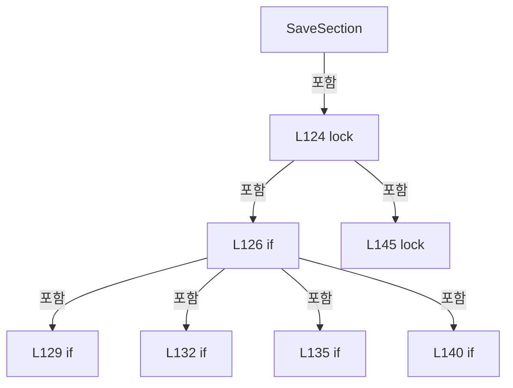

변경 전 점검: 입력/반환 타입, 위 호출자, 예외/취소 경로, 공유 상태와 저장·전송 소비자를 함께 확인합니다. 값의 단위나 물리 방향을 이름만으로 확정하지 않습니다.

### MethodDeclaration `LoadHistory` · L150–153

[Drilling.Common/Managers/CSettingManager.cs:150–153](https://github.com/kjuws10-rgb/A3Drilling/blob/5aee8e58439c9b455cae7c9593c9be986c3e682e/Drilling.Common/Managers/CSettingManager.cs#L150-L153)

| 항목 | 실제 추출 값 |
| --- | --- |
| 서명 | System.Collections.Generic.IReadOnlyList<Drilling.Common.Managers.ST_SETTING_HISTORY> Drilling.Common.Managers.CSettingManager.LoadHistory(Drilling.Common.Managers.EN_SETTING_TAB, System.Threading.CancellationToken) |
| 접근/수식자 | Public / public |
| 반환/값 타입 | System.Collections.Generic.IReadOnlyList<Drilling.Common.Managers.ST_SETTING_HISTORY> |
| 소속 타입 | NamedType:Drilling.Common.Managers.CSettingManager |

입력 계약:

| 이름 | 타입 | 전달 | 선택/기본값 |
| --- | --- | --- | --- |
| section | Drilling.Common.Managers.EN_SETTING_TAB | None | False /  |
| cancellationToken | System.Threading.CancellationToken | None | True / null |

정적 호출자로 확인된 위치:

| 호출 파일/행 | 호출 표현식 | 런타임 분기 가능 |
| --- | --- | --- |
| [Drilling.UI/Menu/Menus/CMenuSetting.cs:255–255](https://github.com/kjuws10-rgb/A3Drilling/blob/5aee8e58439c9b455cae7c9593c9be986c3e682e/Drilling.UI/Menu/Menus/CMenuSetting.cs#L255-L255) | _settingManager.LoadHistory | False |

호출하는 대상과 해석 범위:

| 원본 행 | 표현식 | 분석 상태 | 대상/소스 위치 |
| --- | --- | --- | --- |
| 152 | settingFile.LoadHistory | resolved | System.Collections.Generic.IReadOnlyList<Drilling.Common.Managers.ST_SETTING_HISTORY> Drilling.Common.Managers.CSettingFileBase.LoadHistory(Drilling.Common.Managers.EN_SETTING_TAB, System.Threading.CancellationToken) · Drilling.Common/Managers/CSettingManager.cs:277 |

본문의 실제 연산·분기·예외·반환 순서(원문 위치 순):

| 원본 행 | 종류 | 주석 해설 |
| --- | --- | --- |
| 152 | call | 함수·델리게이트 또는 객체 생성자를 호출합니다: settingFile.LoadHistory(section, cancellationToken) |
| 152 | return | 호출자에게 값 또는 제어를 반환합니다: return settingFile.LoadHistory(section, cancellationToken); |

변경 전 점검: 입력/반환 타입, 위 호출자, 예외/취소 경로, 공유 상태와 저장·전송 소비자를 함께 확인합니다. 값의 단위나 물리 방향을 이름만으로 확정하지 않습니다.

### MethodDeclaration `LoadInterfaceList` · L155–158

[Drilling.Common/Managers/CSettingManager.cs:155–158](https://github.com/kjuws10-rgb/A3Drilling/blob/5aee8e58439c9b455cae7c9593c9be986c3e682e/Drilling.Common/Managers/CSettingManager.cs#L155-L158)

| 항목 | 실제 추출 값 |
| --- | --- |
| 서명 | System.Collections.Generic.IReadOnlyList<Drilling.Common.Interface.ST_INTERFACE_DATA> Drilling.Common.Managers.CSettingManager.LoadInterfaceList(System.Threading.CancellationToken) |
| 접근/수식자 | Public / public |
| 반환/값 타입 | System.Collections.Generic.IReadOnlyList<Drilling.Common.Interface.ST_INTERFACE_DATA> |
| 소속 타입 | NamedType:Drilling.Common.Managers.CSettingManager |

입력 계약:

| 이름 | 타입 | 전달 | 선택/기본값 |
| --- | --- | --- | --- |
| cancellationToken | System.Threading.CancellationToken | None | True / null |

정적 호출자로 확인된 위치:

| 호출 파일/행 | 호출 표현식 | 런타임 분기 가능 |
| --- | --- | --- |
| [Drilling.UI/Menu/Menus/CMenuSetting.cs:232–232](https://github.com/kjuws10-rgb/A3Drilling/blob/5aee8e58439c9b455cae7c9593c9be986c3e682e/Drilling.UI/Menu/Menus/CMenuSetting.cs#L232-L232) | _settingManager.LoadInterfaceList | False |

호출하는 대상과 해석 범위:

| 원본 행 | 표현식 | 분석 상태 | 대상/소스 위치 |
| --- | --- | --- | --- |
| 157 | interfaceFile.LoadAll | resolved | System.Collections.Generic.IReadOnlyList<Drilling.Common.Interface.ST_INTERFACE_DATA> Drilling.Common.Managers.CInterfaceFileBase.LoadAll(System.Threading.CancellationToken) · Drilling.Common/Managers/CSettingManager.cs:282 |

본문의 실제 연산·분기·예외·반환 순서(원문 위치 순):

| 원본 행 | 종류 | 주석 해설 |
| --- | --- | --- |
| 157 | call | 함수·델리게이트 또는 객체 생성자를 호출합니다: interfaceFile.LoadAll(cancellationToken) |
| 157 | return | 호출자에게 값 또는 제어를 반환합니다: return interfaceFile.LoadAll(cancellationToken); |

변경 전 점검: 입력/반환 타입, 위 호출자, 예외/취소 경로, 공유 상태와 저장·전송 소비자를 함께 확인합니다. 값의 단위나 물리 방향을 이름만으로 확정하지 않습니다.

### MethodDeclaration `SaveInterfaceList` · L160–164

[Drilling.Common/Managers/CSettingManager.cs:160–164](https://github.com/kjuws10-rgb/A3Drilling/blob/5aee8e58439c9b455cae7c9593c9be986c3e682e/Drilling.Common/Managers/CSettingManager.cs#L160-L164)

| 항목 | 실제 추출 값 |
| --- | --- |
| 서명 | System.Threading.Tasks.Task Drilling.Common.Managers.CSettingManager.SaveInterfaceList(System.Collections.Generic.IReadOnlyList<Drilling.Common.Interface.ST_INTERFACE_DATA>, System.Threading.CancellationToken) |
| 접근/수식자 | Public / public, async |
| 반환/값 타입 | System.Threading.Tasks.Task |
| 소속 타입 | NamedType:Drilling.Common.Managers.CSettingManager |

입력 계약:

| 이름 | 타입 | 전달 | 선택/기본값 |
| --- | --- | --- | --- |
| interfaces | System.Collections.Generic.IReadOnlyList<Drilling.Common.Interface.ST_INTERFACE_DATA> | None | False /  |
| cancellationToken | System.Threading.CancellationToken | None | True / null |

정적 호출자로 확인된 위치:

| 호출 파일/행 | 호출 표현식 | 런타임 분기 가능 |
| --- | --- | --- |
| [Drilling.UI/Menu/Menus/CMenuSetting.cs:414–414](https://github.com/kjuws10-rgb/A3Drilling/blob/5aee8e58439c9b455cae7c9593c9be986c3e682e/Drilling.UI/Menu/Menus/CMenuSetting.cs#L414-L414) | _settingManager.SaveInterfaceList | False |

호출하는 대상과 해석 범위:

| 원본 행 | 표현식 | 분석 상태 | 대상/소스 위치 |
| --- | --- | --- | --- |
| 162 | interfaceFile.SaveAll | resolved | void Drilling.Common.Managers.CInterfaceFileBase.SaveAll(System.Collections.Generic.IReadOnlyList<Drilling.Common.Interface.ST_INTERFACE_DATA>, System.Threading.CancellationToken) · Drilling.Common/Managers/CSettingManager.cs:283 |
| 163 | interfaceManager.Reload | resolved | System.Threading.Tasks.Task Drilling.Common.Interface.CInterfaceManager.Reload(System.Collections.Generic.IReadOnlyList<Drilling.Common.Interface.ST_INTERFACE_DATA>, bool, System.Threading.CancellationToken) · Drilling.Common/Interface/CInterfaceManager.cs:2057 |

본문의 실제 연산·분기·예외·반환 순서(원문 위치 순):

| 원본 행 | 종류 | 주석 해설 |
| --- | --- | --- |
| 162 | call | 함수·델리게이트 또는 객체 생성자를 호출합니다: interfaceFile.SaveAll(interfaces, cancellationToken) |
| 163 | await | 비동기 완료를 기다립니다: await interfaceManager.Reload(interfaces, reconnect: false, cancellationToken) |
| 163 | call | 함수·델리게이트 또는 객체 생성자를 호출합니다: interfaceManager.Reload(interfaces, reconnect: false, cancellationToken) |

변경 전 점검: 입력/반환 타입, 위 호출자, 예외/취소 경로, 공유 상태와 저장·전송 소비자를 함께 확인합니다. 값의 단위나 물리 방향을 이름만으로 확정하지 않습니다.

### MethodDeclaration `ConnectInterface` · L166–169

[Drilling.Common/Managers/CSettingManager.cs:166–169](https://github.com/kjuws10-rgb/A3Drilling/blob/5aee8e58439c9b455cae7c9593c9be986c3e682e/Drilling.Common/Managers/CSettingManager.cs#L166-L169)

| 항목 | 실제 추출 값 |
| --- | --- |
| 서명 | System.Threading.Tasks.Task Drilling.Common.Managers.CSettingManager.ConnectInterface(Drilling.Common.Interface.EN_EQP_MODULE, int, System.Threading.CancellationToken) |
| 접근/수식자 | Public / public |
| 반환/값 타입 | System.Threading.Tasks.Task |
| 소속 타입 | NamedType:Drilling.Common.Managers.CSettingManager |

입력 계약:

| 이름 | 타입 | 전달 | 선택/기본값 |
| --- | --- | --- | --- |
| module | Drilling.Common.Interface.EN_EQP_MODULE | None | False /  |
| number | int | None | False /  |
| cancellationToken | System.Threading.CancellationToken | None | True / null |

정적 호출자로 확인된 위치:

| 호출 파일/행 | 호출 표현식 | 런타임 분기 가능 |
| --- | --- | --- |
| [Drilling.UI/Menu/Menus/CMenuSetting.cs:346–348](https://github.com/kjuws10-rgb/A3Drilling/blob/5aee8e58439c9b455cae7c9593c9be986c3e682e/Drilling.UI/Menu/Menus/CMenuSetting.cs#L346-L348) | _settingManager.ConnectInterface | False |

호출하는 대상과 해석 범위:

| 원본 행 | 표현식 | 분석 상태 | 대상/소스 위치 |
| --- | --- | --- | --- |
| 168 | interfaceManager.Connect | resolved | System.Threading.Tasks.Task Drilling.Common.Interface.CInterfaceManager.Connect(Drilling.Common.Interface.EN_EQP_MODULE, int, bool, System.Threading.CancellationToken) · Drilling.Common/Interface/CInterfaceManager.cs:262 |

본문의 실제 연산·분기·예외·반환 순서(원문 위치 순):

| 원본 행 | 종류 | 주석 해설 |
| --- | --- | --- |
| 168 | call | 함수·델리게이트 또는 객체 생성자를 호출합니다: interfaceManager.Connect(module, number, cancellationToken: cancellationToken) |
| 168 | return | 호출자에게 값 또는 제어를 반환합니다: return interfaceManager.Connect(module, number, cancellationToken: cancellationToken); |

변경 전 점검: 입력/반환 타입, 위 호출자, 예외/취소 경로, 공유 상태와 저장·전송 소비자를 함께 확인합니다. 값의 단위나 물리 방향을 이름만으로 확정하지 않습니다.

### MethodDeclaration `DisconnectInterface` · L171–174

[Drilling.Common/Managers/CSettingManager.cs:171–174](https://github.com/kjuws10-rgb/A3Drilling/blob/5aee8e58439c9b455cae7c9593c9be986c3e682e/Drilling.Common/Managers/CSettingManager.cs#L171-L174)

| 항목 | 실제 추출 값 |
| --- | --- |
| 서명 | System.Threading.Tasks.Task Drilling.Common.Managers.CSettingManager.DisconnectInterface(Drilling.Common.Interface.EN_EQP_MODULE, int, System.Threading.CancellationToken) |
| 접근/수식자 | Public / public |
| 반환/값 타입 | System.Threading.Tasks.Task |
| 소속 타입 | NamedType:Drilling.Common.Managers.CSettingManager |

입력 계약:

| 이름 | 타입 | 전달 | 선택/기본값 |
| --- | --- | --- | --- |
| module | Drilling.Common.Interface.EN_EQP_MODULE | None | False /  |
| number | int | None | False /  |
| cancellationToken | System.Threading.CancellationToken | None | True / null |

정적 호출자로 확인된 위치:

| 호출 파일/행 | 호출 표현식 | 런타임 분기 가능 |
| --- | --- | --- |
| [Drilling.UI/Menu/Menus/CMenuSetting.cs:388–390](https://github.com/kjuws10-rgb/A3Drilling/blob/5aee8e58439c9b455cae7c9593c9be986c3e682e/Drilling.UI/Menu/Menus/CMenuSetting.cs#L388-L390) | _settingManager.DisconnectInterface | False |

호출하는 대상과 해석 범위:

| 원본 행 | 표현식 | 분석 상태 | 대상/소스 위치 |
| --- | --- | --- | --- |
| 173 | interfaceManager.Disconnect | resolved | System.Threading.Tasks.Task Drilling.Common.Interface.CInterfaceManager.Disconnect(Drilling.Common.Interface.EN_EQP_MODULE, int, System.Threading.CancellationToken) · Drilling.Common/Interface/CInterfaceManager.cs:276 |

본문의 실제 연산·분기·예외·반환 순서(원문 위치 순):

| 원본 행 | 종류 | 주석 해설 |
| --- | --- | --- |
| 173 | call | 함수·델리게이트 또는 객체 생성자를 호출합니다: interfaceManager.Disconnect(module, number, cancellationToken) |
| 173 | return | 호출자에게 값 또는 제어를 반환합니다: return interfaceManager.Disconnect(module, number, cancellationToken); |

변경 전 점검: 입력/반환 타입, 위 호출자, 예외/취소 경로, 공유 상태와 저장·전송 소비자를 함께 확인합니다. 값의 단위나 물리 방향을 이름만으로 확정하지 않습니다.

### MethodDeclaration `ReconnectInterface` · L176–179

[Drilling.Common/Managers/CSettingManager.cs:176–179](https://github.com/kjuws10-rgb/A3Drilling/blob/5aee8e58439c9b455cae7c9593c9be986c3e682e/Drilling.Common/Managers/CSettingManager.cs#L176-L179)

| 항목 | 실제 추출 값 |
| --- | --- |
| 서명 | System.Threading.Tasks.Task Drilling.Common.Managers.CSettingManager.ReconnectInterface(Drilling.Common.Interface.EN_EQP_MODULE, int, System.Threading.CancellationToken) |
| 접근/수식자 | Public / public |
| 반환/값 타입 | System.Threading.Tasks.Task |
| 소속 타입 | NamedType:Drilling.Common.Managers.CSettingManager |

입력 계약:

| 이름 | 타입 | 전달 | 선택/기본값 |
| --- | --- | --- | --- |
| module | Drilling.Common.Interface.EN_EQP_MODULE | None | False /  |
| number | int | None | False /  |
| cancellationToken | System.Threading.CancellationToken | None | True / null |

현재 부분 분석에서 직접 연결된 호출자는 없습니다. XAML/이벤트/인터페이스·델리게이트·외부 진입을 추가 확인해야 하며, 미사용으로 판정한 것이 아닙니다.

호출하는 대상과 해석 범위:

| 원본 행 | 표현식 | 분석 상태 | 대상/소스 위치 |
| --- | --- | --- | --- |
| 178 | interfaceManager.Reconnect | resolved | System.Threading.Tasks.Task Drilling.Common.Interface.CInterfaceManager.Reconnect(Drilling.Common.Interface.EN_EQP_MODULE, int, System.Threading.CancellationToken) · Drilling.Common/Interface/CInterfaceManager.cs:292 |

본문의 실제 연산·분기·예외·반환 순서(원문 위치 순):

| 원본 행 | 종류 | 주석 해설 |
| --- | --- | --- |
| 178 | call | 함수·델리게이트 또는 객체 생성자를 호출합니다: interfaceManager.Reconnect(module, number, cancellationToken) |
| 178 | return | 호출자에게 값 또는 제어를 반환합니다: return interfaceManager.Reconnect(module, number, cancellationToken); |

변경 전 점검: 입력/반환 타입, 위 호출자, 예외/취소 경로, 공유 상태와 저장·전송 소비자를 함께 확인합니다. 값의 단위나 물리 방향을 이름만으로 확정하지 않습니다.

### FieldDeclaration `ZeroDefence` · L185–185

[Drilling.Common/Managers/CSettingManager.cs:185–185](https://github.com/kjuws10-rgb/A3Drilling/blob/5aee8e58439c9b455cae7c9593c9be986c3e682e/Drilling.Common/Managers/CSettingManager.cs#L185-L185)

| 항목 | 실제 추출 값 |
| --- | --- |
| 서명 | string Drilling.Common.Managers.CRunOptionSettings.ZeroDefence |
| 접근/수식자 | Public / public, const |
| 반환/값 타입 | string |
| 소속 타입 | NamedType:Drilling.Common.Managers.CRunOptionSettings |

현재 부분 분석에서 직접 연결된 호출자는 없습니다. XAML/이벤트/인터페이스·델리게이트·외부 진입을 추가 확인해야 하며, 미사용으로 판정한 것이 아닙니다.

본문의 실제 연산·분기·예외·반환 순서(원문 위치 순):

| 원본 행 | 종류 | 주석 해설 |
| --- | --- | --- |
| 185 | variable-initializer | 변수의 초기값을 지정합니다: ZeroDefence = "RUNOPTION_ZERO_DEFENCE_USE" |

변경 전 점검: 입력/반환 타입, 위 호출자, 예외/취소 경로, 공유 상태와 저장·전송 소비자를 함께 확인합니다. 값의 단위나 물리 방향을 이름만으로 확정하지 않습니다.

### FieldDeclaration `CurrentGroup` · L186–186

[Drilling.Common/Managers/CSettingManager.cs:186–186](https://github.com/kjuws10-rgb/A3Drilling/blob/5aee8e58439c9b455cae7c9593c9be986c3e682e/Drilling.Common/Managers/CSettingManager.cs#L186-L186)

| 항목 | 실제 추출 값 |
| --- | --- |
| 서명 | string Drilling.Common.Managers.CRunOptionSettings.CurrentGroup |
| 접근/수식자 | Public / public, const |
| 반환/값 타입 | string |
| 소속 타입 | NamedType:Drilling.Common.Managers.CRunOptionSettings |

현재 부분 분석에서 직접 연결된 호출자는 없습니다. XAML/이벤트/인터페이스·델리게이트·외부 진입을 추가 확인해야 하며, 미사용으로 판정한 것이 아닙니다.

본문의 실제 연산·분기·예외·반환 순서(원문 위치 순):

| 원본 행 | 종류 | 주석 해설 |
| --- | --- | --- |
| 186 | variable-initializer | 변수의 초기값을 지정합니다: CurrentGroup = "RUNOPTION_CURRENT_GROUP" |

변경 전 점검: 입력/반환 타입, 위 호출자, 예외/취소 경로, 공유 상태와 저장·전송 소비자를 함께 확인합니다. 값의 단위나 물리 방향을 이름만으로 확정하지 않습니다.

### FieldDeclaration `FollowUp` · L187–187

[Drilling.Common/Managers/CSettingManager.cs:187–187](https://github.com/kjuws10-rgb/A3Drilling/blob/5aee8e58439c9b455cae7c9593c9be986c3e682e/Drilling.Common/Managers/CSettingManager.cs#L187-L187)

| 항목 | 실제 추출 값 |
| --- | --- |
| 서명 | string Drilling.Common.Managers.CRunOptionSettings.FollowUp |
| 접근/수식자 | Public / public, const |
| 반환/값 타입 | string |
| 소속 타입 | NamedType:Drilling.Common.Managers.CRunOptionSettings |

현재 부분 분석에서 직접 연결된 호출자는 없습니다. XAML/이벤트/인터페이스·델리게이트·외부 진입을 추가 확인해야 하며, 미사용으로 판정한 것이 아닙니다.

본문의 실제 연산·분기·예외·반환 순서(원문 위치 순):

| 원본 행 | 종류 | 주석 해설 |
| --- | --- | --- |
| 187 | variable-initializer | 변수의 초기값을 지정합니다: FollowUp = "RUNOPTION_FOLLOWUP_USE" |

변경 전 점검: 입력/반환 타입, 위 호출자, 예외/취소 경로, 공유 상태와 저장·전송 소비자를 함께 확인합니다. 값의 단위나 물리 방향을 이름만으로 확정하지 않습니다.

### FieldDeclaration `DistortionGroup0` · L188–188

[Drilling.Common/Managers/CSettingManager.cs:188–188](https://github.com/kjuws10-rgb/A3Drilling/blob/5aee8e58439c9b455cae7c9593c9be986c3e682e/Drilling.Common/Managers/CSettingManager.cs#L188-L188)

| 항목 | 실제 추출 값 |
| --- | --- |
| 서명 | string Drilling.Common.Managers.CRunOptionSettings.DistortionGroup0 |
| 접근/수식자 | Public / public, const |
| 반환/값 타입 | string |
| 소속 타입 | NamedType:Drilling.Common.Managers.CRunOptionSettings |

현재 부분 분석에서 직접 연결된 호출자는 없습니다. XAML/이벤트/인터페이스·델리게이트·외부 진입을 추가 확인해야 하며, 미사용으로 판정한 것이 아닙니다.

본문의 실제 연산·분기·예외·반환 순서(원문 위치 순):

| 원본 행 | 종류 | 주석 해설 |
| --- | --- | --- |
| 188 | variable-initializer | 변수의 초기값을 지정합니다: DistortionGroup0 = "RUNOPTION_DISTORTION_GROUP0_USE" |

변경 전 점검: 입력/반환 타입, 위 호출자, 예외/취소 경로, 공유 상태와 저장·전송 소비자를 함께 확인합니다. 값의 단위나 물리 방향을 이름만으로 확정하지 않습니다.

### FieldDeclaration `DistortionGroup1` · L189–189

[Drilling.Common/Managers/CSettingManager.cs:189–189](https://github.com/kjuws10-rgb/A3Drilling/blob/5aee8e58439c9b455cae7c9593c9be986c3e682e/Drilling.Common/Managers/CSettingManager.cs#L189-L189)

| 항목 | 실제 추출 값 |
| --- | --- |
| 서명 | string Drilling.Common.Managers.CRunOptionSettings.DistortionGroup1 |
| 접근/수식자 | Public / public, const |
| 반환/값 타입 | string |
| 소속 타입 | NamedType:Drilling.Common.Managers.CRunOptionSettings |

현재 부분 분석에서 직접 연결된 호출자는 없습니다. XAML/이벤트/인터페이스·델리게이트·외부 진입을 추가 확인해야 하며, 미사용으로 판정한 것이 아닙니다.

본문의 실제 연산·분기·예외·반환 순서(원문 위치 순):

| 원본 행 | 종류 | 주석 해설 |
| --- | --- | --- |
| 189 | variable-initializer | 변수의 초기값을 지정합니다: DistortionGroup1 = "RUNOPTION_DISTORTION_GROUP1_USE" |

변경 전 점검: 입력/반환 타입, 위 호출자, 예외/취소 경로, 공유 상태와 저장·전송 소비자를 함께 확인합니다. 값의 단위나 물리 방향을 이름만으로 확정하지 않습니다.

### FieldDeclaration `DistortionGroup2` · L190–190

[Drilling.Common/Managers/CSettingManager.cs:190–190](https://github.com/kjuws10-rgb/A3Drilling/blob/5aee8e58439c9b455cae7c9593c9be986c3e682e/Drilling.Common/Managers/CSettingManager.cs#L190-L190)

| 항목 | 실제 추출 값 |
| --- | --- |
| 서명 | string Drilling.Common.Managers.CRunOptionSettings.DistortionGroup2 |
| 접근/수식자 | Public / public, const |
| 반환/값 타입 | string |
| 소속 타입 | NamedType:Drilling.Common.Managers.CRunOptionSettings |

현재 부분 분석에서 직접 연결된 호출자는 없습니다. XAML/이벤트/인터페이스·델리게이트·외부 진입을 추가 확인해야 하며, 미사용으로 판정한 것이 아닙니다.

본문의 실제 연산·분기·예외·반환 순서(원문 위치 순):

| 원본 행 | 종류 | 주석 해설 |
| --- | --- | --- |
| 190 | variable-initializer | 변수의 초기값을 지정합니다: DistortionGroup2 = "RUNOPTION_DISTORTION_GROUP2_USE" |

변경 전 점검: 입력/반환 타입, 위 호출자, 예외/취소 경로, 공유 상태와 저장·전송 소비자를 함께 확인합니다. 값의 단위나 물리 방향을 이름만으로 확정하지 않습니다.

### FieldDeclaration `ReviewMethod` · L191–191

[Drilling.Common/Managers/CSettingManager.cs:191–191](https://github.com/kjuws10-rgb/A3Drilling/blob/5aee8e58439c9b455cae7c9593c9be986c3e682e/Drilling.Common/Managers/CSettingManager.cs#L191-L191)

| 항목 | 실제 추출 값 |
| --- | --- |
| 서명 | string Drilling.Common.Managers.CRunOptionSettings.ReviewMethod |
| 접근/수식자 | Public / public, const |
| 반환/값 타입 | string |
| 소속 타입 | NamedType:Drilling.Common.Managers.CRunOptionSettings |

현재 부분 분석에서 직접 연결된 호출자는 없습니다. XAML/이벤트/인터페이스·델리게이트·외부 진입을 추가 확인해야 하며, 미사용으로 판정한 것이 아닙니다.

본문의 실제 연산·분기·예외·반환 순서(원문 위치 순):

| 원본 행 | 종류 | 주석 해설 |
| --- | --- | --- |
| 191 | variable-initializer | 변수의 초기값을 지정합니다: ReviewMethod = "RUNOPTION_REVIEW_METHOD" |

변경 전 점검: 입력/반환 타입, 위 호출자, 예외/취소 경로, 공유 상태와 저장·전송 소비자를 함께 확인합니다. 값의 단위나 물리 방향을 이름만으로 확정하지 않습니다.

### FieldDeclaration `ReviewLine` · L192–192

[Drilling.Common/Managers/CSettingManager.cs:192–192](https://github.com/kjuws10-rgb/A3Drilling/blob/5aee8e58439c9b455cae7c9593c9be986c3e682e/Drilling.Common/Managers/CSettingManager.cs#L192-L192)

| 항목 | 실제 추출 값 |
| --- | --- |
| 서명 | string Drilling.Common.Managers.CRunOptionSettings.ReviewLine |
| 접근/수식자 | Public / public, const |
| 반환/값 타입 | string |
| 소속 타입 | NamedType:Drilling.Common.Managers.CRunOptionSettings |

현재 부분 분석에서 직접 연결된 호출자는 없습니다. XAML/이벤트/인터페이스·델리게이트·외부 진입을 추가 확인해야 하며, 미사용으로 판정한 것이 아닙니다.

본문의 실제 연산·분기·예외·반환 순서(원문 위치 순):

| 원본 행 | 종류 | 주석 해설 |
| --- | --- | --- |
| 192 | variable-initializer | 변수의 초기값을 지정합니다: ReviewLine = "RUNOPTION_REVIEW_LINE" |

변경 전 점검: 입력/반환 타입, 위 호출자, 예외/취소 경로, 공유 상태와 저장·전송 소비자를 함께 확인합니다. 값의 단위나 물리 방향을 이름만으로 확정하지 않습니다.

### FieldDeclaration `ImmediateRetry` · L193–193

[Drilling.Common/Managers/CSettingManager.cs:193–193](https://github.com/kjuws10-rgb/A3Drilling/blob/5aee8e58439c9b455cae7c9593c9be986c3e682e/Drilling.Common/Managers/CSettingManager.cs#L193-L193)

| 항목 | 실제 추출 값 |
| --- | --- |
| 서명 | string Drilling.Common.Managers.CRunOptionSettings.ImmediateRetry |
| 접근/수식자 | Public / public, const |
| 반환/값 타입 | string |
| 소속 타입 | NamedType:Drilling.Common.Managers.CRunOptionSettings |

현재 부분 분석에서 직접 연결된 호출자는 없습니다. XAML/이벤트/인터페이스·델리게이트·외부 진입을 추가 확인해야 하며, 미사용으로 판정한 것이 아닙니다.

본문의 실제 연산·분기·예외·반환 순서(원문 위치 순):

| 원본 행 | 종류 | 주석 해설 |
| --- | --- | --- |
| 193 | variable-initializer | 변수의 초기값을 지정합니다: ImmediateRetry = "RUNOPTION_REVIEW_IMMEDIATE_RETRY" |

변경 전 점검: 입력/반환 타입, 위 호출자, 예외/취소 경로, 공유 상태와 저장·전송 소비자를 함께 확인합니다. 값의 단위나 물리 방향을 이름만으로 확정하지 않습니다.

### FieldDeclaration `RetryCount` · L194–194

[Drilling.Common/Managers/CSettingManager.cs:194–194](https://github.com/kjuws10-rgb/A3Drilling/blob/5aee8e58439c9b455cae7c9593c9be986c3e682e/Drilling.Common/Managers/CSettingManager.cs#L194-L194)

| 항목 | 실제 추출 값 |
| --- | --- |
| 서명 | string Drilling.Common.Managers.CRunOptionSettings.RetryCount |
| 접근/수식자 | Public / public, const |
| 반환/값 타입 | string |
| 소속 타입 | NamedType:Drilling.Common.Managers.CRunOptionSettings |

현재 부분 분석에서 직접 연결된 호출자는 없습니다. XAML/이벤트/인터페이스·델리게이트·외부 진입을 추가 확인해야 하며, 미사용으로 판정한 것이 아닙니다.

본문의 실제 연산·분기·예외·반환 순서(원문 위치 순):

| 원본 행 | 종류 | 주석 해설 |
| --- | --- | --- |
| 194 | variable-initializer | 변수의 초기값을 지정합니다: RetryCount = "RUNOPTION_REVIEW_RETRY_COUNT" |

변경 전 점검: 입력/반환 타입, 위 호출자, 예외/취소 경로, 공유 상태와 저장·전송 소비자를 함께 확인합니다. 값의 단위나 물리 방향을 이름만으로 확정하지 않습니다.

### FieldDeclaration `Keys` · L195–195

[Drilling.Common/Managers/CSettingManager.cs:195–195](https://github.com/kjuws10-rgb/A3Drilling/blob/5aee8e58439c9b455cae7c9593c9be986c3e682e/Drilling.Common/Managers/CSettingManager.cs#L195-L195)

| 항목 | 실제 추출 값 |
| --- | --- |
| 서명 | System.Collections.Generic.HashSet<string> Drilling.Common.Managers.CRunOptionSettings.Keys |
| 접근/수식자 | Private / private, static, readonly |
| 반환/값 타입 | System.Collections.Generic.HashSet<string> |
| 소속 타입 | NamedType:Drilling.Common.Managers.CRunOptionSettings |

현재 부분 분석에서 직접 연결된 호출자는 없습니다. XAML/이벤트/인터페이스·델리게이트·외부 진입을 추가 확인해야 하며, 미사용으로 판정한 것이 아닙니다.

호출하는 대상과 해석 범위:

| 원본 행 | 표현식 | 분석 상태 | 대상/소스 위치 |
| --- | --- | --- | --- |
| 195 | new | resolved | System.Collections.Generic.HashSet<string>.HashSet(System.Collections.Generic.IEnumerable<string>, System.Collections.Generic.IEqualityComparer<string>?) |

본문의 실제 연산·분기·예외·반환 순서(원문 위치 순):

| 원본 행 | 종류 | 주석 해설 |
| --- | --- | --- |
| 195 | call | 함수·델리게이트 또는 객체 생성자를 호출합니다: new([ZeroDefence, CurrentGroup, FollowUp, DistortionGroup0, DistortionGroup1, DistortionGroup2, ReviewMethod, ReviewLine, ImmediateRetry, RetryCount], StringComparer.OrdinalIgnoreCase) |
| 195 | variable-initializer | 변수의 초기값을 지정합니다: Keys = new([ZeroDefence, CurrentGroup, FollowUp, DistortionGroup0, DistortionGroup1, DistortionGroup2, ReviewMethod, ReviewLine, ImmediateRetry, RetryCount], StringComparer.OrdinalIgnoreCase) |

변경 전 점검: 입력/반환 타입, 위 호출자, 예외/취소 경로, 공유 상태와 저장·전송 소비자를 함께 확인합니다. 값의 단위나 물리 방향을 이름만으로 확정하지 않습니다.

### MethodDeclaration `IsKey` · L196–196

[Drilling.Common/Managers/CSettingManager.cs:196–196](https://github.com/kjuws10-rgb/A3Drilling/blob/5aee8e58439c9b455cae7c9593c9be986c3e682e/Drilling.Common/Managers/CSettingManager.cs#L196-L196)

| 항목 | 실제 추출 값 |
| --- | --- |
| 서명 | bool Drilling.Common.Managers.CRunOptionSettings.IsKey(string) |
| 접근/수식자 | Public / public, static |
| 반환/값 타입 | bool |
| 소속 타입 | NamedType:Drilling.Common.Managers.CRunOptionSettings |

입력 계약:

| 이름 | 타입 | 전달 | 선택/기본값 |
| --- | --- | --- | --- |
| key | string | None | False /  |

정적 호출자로 확인된 위치:

| 호출 파일/행 | 호출 표현식 | 런타임 분기 가능 |
| --- | --- | --- |
| [Drilling.Common/Managers/CSettingManager.cs:200–200](https://github.com/kjuws10-rgb/A3Drilling/blob/5aee8e58439c9b455cae7c9593c9be986c3e682e/Drilling.Common/Managers/CSettingManager.cs#L200-L200) | IsKey | False |
| [Drilling.UI/Menu/Menus/CMenuSetting.cs:1195–1195](https://github.com/kjuws10-rgb/A3Drilling/blob/5aee8e58439c9b455cae7c9593c9be986c3e682e/Drilling.UI/Menu/Menus/CMenuSetting.cs#L1195-L1195) | CRunOptionSettings.IsKey | False |

호출하는 대상과 해석 범위:

| 원본 행 | 표현식 | 분석 상태 | 대상/소스 위치 |
| --- | --- | --- | --- |
| 196 | Keys.Contains | resolved | bool System.Collections.Generic.HashSet<string>.Contains(string) |

본문의 실제 연산·분기·예외·반환 순서(원문 위치 순):

| 원본 행 | 종류 | 주석 해설 |
| --- | --- | --- |
| 196 | call | 함수·델리게이트 또는 객체 생성자를 호출합니다: Keys.Contains(key) |

변경 전 점검: 입력/반환 타입, 위 호출자, 예외/취소 경로, 공유 상태와 저장·전송 소비자를 함께 확인합니다. 값의 단위나 물리 방향을 이름만으로 확정하지 않습니다.

### MethodDeclaration `Read` · L197–197

[Drilling.Common/Managers/CSettingManager.cs:197–197](https://github.com/kjuws10-rgb/A3Drilling/blob/5aee8e58439c9b455cae7c9593c9be986c3e682e/Drilling.Common/Managers/CSettingManager.cs#L197-L197)

| 항목 | 실제 추출 값 |
| --- | --- |
| 서명 | Drilling.Common.Managers.ST_RUN_OPTION_SETTINGS Drilling.Common.Managers.CRunOptionSettings.Read(Drilling.Common.Managers.CSettingManager) |
| 접근/수식자 | Public / public, static |
| 반환/값 타입 | Drilling.Common.Managers.ST_RUN_OPTION_SETTINGS |
| 소속 타입 | NamedType:Drilling.Common.Managers.CRunOptionSettings |

입력 계약:

| 이름 | 타입 | 전달 | 선택/기본값 |
| --- | --- | --- | --- |
| settings | Drilling.Common.Managers.CSettingManager | None | False /  |

정적 호출자로 확인된 위치:

| 호출 파일/행 | 호출 표현식 | 런타임 분기 가능 |
| --- | --- | --- |
| [Drilling.Common/Station/CStationProcess.cs:5937–5937](https://github.com/kjuws10-rgb/A3Drilling/blob/5aee8e58439c9b455cae7c9593c9be986c3e682e/Drilling.Common/Station/CStationProcess.cs#L5937-L5937) | CRunOptionSettings.Read | False |
| [Drilling.Common/Station/CStationProcess.cs:6045–6045](https://github.com/kjuws10-rgb/A3Drilling/blob/5aee8e58439c9b455cae7c9593c9be986c3e682e/Drilling.Common/Station/CStationProcess.cs#L6045-L6045) | CRunOptionSettings.Read | False |
| [Drilling.Common/Station/CStationProcess.cs:6140–6140](https://github.com/kjuws10-rgb/A3Drilling/blob/5aee8e58439c9b455cae7c9593c9be986c3e682e/Drilling.Common/Station/CStationProcess.cs#L6140-L6140) | CRunOptionSettings.Read | False |
| [Drilling.Common/Station/CStationProcess.cs:6375–6375](https://github.com/kjuws10-rgb/A3Drilling/blob/5aee8e58439c9b455cae7c9593c9be986c3e682e/Drilling.Common/Station/CStationProcess.cs#L6375-L6375) | CRunOptionSettings.Read | False |
| [Drilling.Common/Station/CStationProcess.cs:6381–6381](https://github.com/kjuws10-rgb/A3Drilling/blob/5aee8e58439c9b455cae7c9593c9be986c3e682e/Drilling.Common/Station/CStationProcess.cs#L6381-L6381) | CRunOptionSettings.Read | False |
| [Drilling.UI/Menu/Menus/CMenuMain.cs:2765–2765](https://github.com/kjuws10-rgb/A3Drilling/blob/5aee8e58439c9b455cae7c9593c9be986c3e682e/Drilling.UI/Menu/Menus/CMenuMain.cs#L2765-L2765) | CRunOptionSettings.Read | False |
| [Drilling.UI/Menu/Menus/CMenuMain.cs:2775–2775](https://github.com/kjuws10-rgb/A3Drilling/blob/5aee8e58439c9b455cae7c9593c9be986c3e682e/Drilling.UI/Menu/Menus/CMenuMain.cs#L2775-L2775) | CRunOptionSettings.Read | False |
| [Drilling.UI/Menu/Menus/CMenuMain.cs:2874–2874](https://github.com/kjuws10-rgb/A3Drilling/blob/5aee8e58439c9b455cae7c9593c9be986c3e682e/Drilling.UI/Menu/Menus/CMenuMain.cs#L2874-L2874) | CRunOptionSettings.Read | False |

호출하는 대상과 해석 범위:

| 원본 행 | 표현식 | 분석 상태 | 대상/소스 위치 |
| --- | --- | --- | --- |
| 197 | Read | resolved | Drilling.Common.Managers.ST_RUN_OPTION_SETTINGS Drilling.Common.Managers.CRunOptionSettings.Read(System.Collections.Generic.IReadOnlyList<Drilling.Common.Managers.ST_SYSTEM_PARAMETER>) · Drilling.Common/Managers/CSettingManager.cs:198 |
| 197 | settings.LoadSection | resolved | System.Collections.Generic.IReadOnlyList<Drilling.Common.Managers.ST_SYSTEM_PARAMETER> Drilling.Common.Managers.CSettingManager.LoadSection(Drilling.Common.Managers.EN_SETTING_TAB, System.Threading.CancellationToken) · Drilling.Common/Managers/CSettingManager.cs:26 |

본문의 실제 연산·분기·예외·반환 순서(원문 위치 순):

| 원본 행 | 종류 | 주석 해설 |
| --- | --- | --- |
| 197 | call | 함수·델리게이트 또는 객체 생성자를 호출합니다: Read(settings.LoadSection(EN_SETTING_TAB.Option)) |
| 197 | call | 함수·델리게이트 또는 객체 생성자를 호출합니다: settings.LoadSection(EN_SETTING_TAB.Option) |

변경 전 점검: 입력/반환 타입, 위 호출자, 예외/취소 경로, 공유 상태와 저장·전송 소비자를 함께 확인합니다. 값의 단위나 물리 방향을 이름만으로 확정하지 않습니다.

### MethodDeclaration `Read` · L198–221

[Drilling.Common/Managers/CSettingManager.cs:198–221](https://github.com/kjuws10-rgb/A3Drilling/blob/5aee8e58439c9b455cae7c9593c9be986c3e682e/Drilling.Common/Managers/CSettingManager.cs#L198-L221)

| 항목 | 실제 추출 값 |
| --- | --- |
| 서명 | Drilling.Common.Managers.ST_RUN_OPTION_SETTINGS Drilling.Common.Managers.CRunOptionSettings.Read(System.Collections.Generic.IReadOnlyList<Drilling.Common.Managers.ST_SYSTEM_PARAMETER>) |
| 접근/수식자 | Public / public, static |
| 반환/값 타입 | Drilling.Common.Managers.ST_RUN_OPTION_SETTINGS |
| 소속 타입 | NamedType:Drilling.Common.Managers.CRunOptionSettings |

입력 계약:

| 이름 | 타입 | 전달 | 선택/기본값 |
| --- | --- | --- | --- |
| parameters | System.Collections.Generic.IReadOnlyList<Drilling.Common.Managers.ST_SYSTEM_PARAMETER> | None | False /  |

정적 호출자로 확인된 위치:

| 호출 파일/행 | 호출 표현식 | 런타임 분기 가능 |
| --- | --- | --- |
| [Drilling.Common/Correction/CAlignInterpolation.cs:274–274](https://github.com/kjuws10-rgb/A3Drilling/blob/5aee8e58439c9b455cae7c9593c9be986c3e682e/Drilling.Common/Correction/CAlignInterpolation.cs#L274-L274) | CRunOptionSettings.Read | False |
| [Drilling.Common/Managers/CSettingManager.cs:137–137](https://github.com/kjuws10-rgb/A3Drilling/blob/5aee8e58439c9b455cae7c9593c9be986c3e682e/Drilling.Common/Managers/CSettingManager.cs#L137-L137) | CRunOptionSettings.Read | False |
| [Drilling.Common/Managers/CSettingManager.cs:138–138](https://github.com/kjuws10-rgb/A3Drilling/blob/5aee8e58439c9b455cae7c9593c9be986c3e682e/Drilling.Common/Managers/CSettingManager.cs#L138-L138) | CRunOptionSettings.Read | False |
| [Drilling.Common/Managers/CSettingManager.cs:197–197](https://github.com/kjuws10-rgb/A3Drilling/blob/5aee8e58439c9b455cae7c9593c9be986c3e682e/Drilling.Common/Managers/CSettingManager.cs#L197-L197) | Read | False |
| [Drilling.Common/Review/CZeroDefenceRecipePlan.cs:266–266](https://github.com/kjuws10-rgb/A3Drilling/blob/5aee8e58439c9b455cae7c9593c9be986c3e682e/Drilling.Common/Review/CZeroDefenceRecipePlan.cs#L266-L266) | CRunOptionSettings.Read | False |
| [Drilling.Common/Station/CStationProcess.cs:4247–4247](https://github.com/kjuws10-rgb/A3Drilling/blob/5aee8e58439c9b455cae7c9593c9be986c3e682e/Drilling.Common/Station/CStationProcess.cs#L4247-L4247) | CRunOptionSettings.Read | False |

호출하는 대상과 해석 범위:

| 원본 행 | 표현식 | 분석 상태 | 대상/소스 위치 |
| --- | --- | --- | --- |
| 200 | parameters.Where(p => IsKey(p.Key)).ToDictionary | resolved | System.Collections.Generic.Dictionary<string, string> System.Collections.Generic.IEnumerable<Drilling.Common.Managers.ST_SYSTEM_PARAMETER>.ToDictionary<Drilling.Common.Managers.ST_SYSTEM_PARAMETER, string, string>(System.Func<Drilling.Common.Managers.ST_SYSTEM_PARAMETER, string>, System.Func<Drilling.Common.Managers.ST_SYSTEM_PARAMETER, string>, System.Collections.Generic.IEqualityComparer<string>?) |
| 200 | parameters.Where | resolved | System.Collections.Generic.IEnumerable<Drilling.Common.Managers.ST_SYSTEM_PARAMETER> System.Collections.Generic.IEnumerable<Drilling.Common.Managers.ST_SYSTEM_PARAMETER>.Where<Drilling.Common.Managers.ST_SYSTEM_PARAMETER>(System.Func<Drilling.Common.Managers.ST_SYSTEM_PARAMETER, bool>) |
| 200 | IsKey | resolved | bool Drilling.Common.Managers.CRunOptionSettings.IsKey(string) · Drilling.Common/Managers/CSettingManager.cs:196 |
| 201 | new | resolved | Drilling.Common.Managers.ST_RUN_OPTION_SETTINGS.ST_RUN_OPTION_SETTINGS(bool, int, bool, int, int, bool, int) · Drilling.Common/Managers/CSettingManager.cs:232 |
| 202 | Number | resolved | int Number(string, int, int, int) · Drilling.Common/Managers/CSettingManager.cs:213 |
| 203 | Number | resolved | int Number(string, int, int, int) · Drilling.Common/Managers/CSettingManager.cs:213 |
| 204 | Number | resolved | int Number(string, int, int, int) · Drilling.Common/Managers/CSettingManager.cs:213 |
| 205 | Number | resolved | int Number(string, int, int, int) · Drilling.Common/Managers/CSettingManager.cs:213 |
| 206 | Number | resolved | int Number(string, int, int, int) · Drilling.Common/Managers/CSettingManager.cs:213 |
| 207 | Number | resolved | int Number(string, int, int, int) · Drilling.Common/Managers/CSettingManager.cs:213 |
| 208 | Number | resolved | int Number(string, int, int, int) · Drilling.Common/Managers/CSettingManager.cs:213 |
| 211 | Number | resolved | int Number(string, int, int, int) · Drilling.Common/Managers/CSettingManager.cs:213 |
| 211 | Number | resolved | int Number(string, int, int, int) · Drilling.Common/Managers/CSettingManager.cs:213 |
| 211 | Number | resolved | int Number(string, int, int, int) · Drilling.Common/Managers/CSettingManager.cs:213 |

본문의 실제 연산·분기·예외·반환 순서(원문 위치 순):

| 원본 행 | 종류 | 주석 해설 |
| --- | --- | --- |
| 200 | call | 함수·델리게이트 또는 객체 생성자를 호출합니다: parameters.Where(p => IsKey(p.Key)).ToDictionary(p => p.Key, p => p.Value, StringComparer.OrdinalIgnoreCase) |
| 200 | call | 함수·델리게이트 또는 객체 생성자를 호출합니다: parameters.Where(p => IsKey(p.Key)) |
| 200 | call | 함수·델리게이트 또는 객체 생성자를 호출합니다: IsKey(p.Key) |
| 200 | local-declaration | 지역 변수를 선언합니다: var values = parameters.Where(p => IsKey(p.Key)).ToDictionary(p => p.Key, p => p.Value, StringComparer.OrdinalIgnoreCase); |
| 200 | variable-initializer | 변수의 초기값을 지정합니다: values = parameters.Where(p => IsKey(p.Key)).ToDictionary(p => p.Key, p => p.Value, StringComparer.OrdinalIgnoreCase) |
| 201 | call | 함수·델리게이트 또는 객체 생성자를 호출합니다: new( Number(ZeroDefence, 0, 0, 1) == 1, Number(CurrentGroup, 1, 1, 4), Number(FollowUp, 0, 0, 1) == 1, Number(ReviewMethod, 1, 0, 1), Number(ReviewLine, 0, 0, 3), Number(ImmediateRetry, 0, 0, 1) == 1, Number(RetryCount, … |
| 201 | return | 호출자에게 값 또는 제어를 반환합니다: return new( Number(ZeroDefence, 0, 0, 1) == 1, Number(CurrentGroup, 1, 1, 4), Number(FollowUp, 0, 0, 1) == 1, Number(ReviewMethod, 1, 0, 1), Number(ReviewLine, 0, 0, 3), Number(ImmediateRetry, 0, 0, 1) == 1, Number(RetryCount, 1,  |
| 202 | call | 함수·델리게이트 또는 객체 생성자를 호출합니다: Number(ZeroDefence, 0, 0, 1) |
| 203 | call | 함수·델리게이트 또는 객체 생성자를 호출합니다: Number(CurrentGroup, 1, 1, 4) |
| 204 | call | 함수·델리게이트 또는 객체 생성자를 호출합니다: Number(FollowUp, 0, 0, 1) |
| 205 | call | 함수·델리게이트 또는 객체 생성자를 호출합니다: Number(ReviewMethod, 1, 0, 1) |
| 206 | call | 함수·델리게이트 또는 객체 생성자를 호출합니다: Number(ReviewLine, 0, 0, 3) |
| 207 | call | 함수·델리게이트 또는 객체 생성자를 호출합니다: Number(ImmediateRetry, 0, 0, 1) |
| 208 | call | 함수·델리게이트 또는 객체 생성자를 호출합니다: Number(RetryCount, 1, 1, 3) |
| 211 | assignment | 값을 대상에 대입합니다: DistortionGroupMask = Number(DistortionGroup0, 0, 0, 1) &#124; Number(DistortionGroup1, 0, 0, 1) << 1 &#124; Number(DistortionGroup2, 0, 0, 1) << 2 |
| 211 | call | 함수·델리게이트 또는 객체 생성자를 호출합니다: Number(DistortionGroup0, 0, 0, 1) |
| 211 | call | 함수·델리게이트 또는 객체 생성자를 호출합니다: Number(DistortionGroup1, 0, 0, 1) |
| 211 | call | 함수·델리게이트 또는 객체 생성자를 호출합니다: Number(DistortionGroup2, 0, 0, 1) |

변경 전 점검: 입력/반환 타입, 위 호출자, 예외/취소 경로, 공유 상태와 저장·전송 소비자를 함께 확인합니다. 값의 단위나 물리 방향을 이름만으로 확정하지 않습니다.

### LocalFunctionStatement `Number` · L213–220

[Drilling.Common/Managers/CSettingManager.cs:213–220](https://github.com/kjuws10-rgb/A3Drilling/blob/5aee8e58439c9b455cae7c9593c9be986c3e682e/Drilling.Common/Managers/CSettingManager.cs#L213-L220)

| 항목 | 실제 추출 값 |
| --- | --- |
| 서명 | int Number(string, int, int, int) |
| 접근/수식자 | Private /  |
| 반환/값 타입 | int |
| 소속 타입 | NamedType:Drilling.Common.Managers.CRunOptionSettings |

입력 계약:

| 이름 | 타입 | 전달 | 선택/기본값 |
| --- | --- | --- | --- |
| key | string | None | False /  |
| fallback | int | None | False /  |
| min | int | None | False /  |
| max | int | None | False /  |

정적 호출자로 확인된 위치:

| 호출 파일/행 | 호출 표현식 | 런타임 분기 가능 |
| --- | --- | --- |
| [Drilling.Common/Managers/CSettingManager.cs:202–202](https://github.com/kjuws10-rgb/A3Drilling/blob/5aee8e58439c9b455cae7c9593c9be986c3e682e/Drilling.Common/Managers/CSettingManager.cs#L202-L202) | Number | False |
| [Drilling.Common/Managers/CSettingManager.cs:203–203](https://github.com/kjuws10-rgb/A3Drilling/blob/5aee8e58439c9b455cae7c9593c9be986c3e682e/Drilling.Common/Managers/CSettingManager.cs#L203-L203) | Number | False |
| [Drilling.Common/Managers/CSettingManager.cs:204–204](https://github.com/kjuws10-rgb/A3Drilling/blob/5aee8e58439c9b455cae7c9593c9be986c3e682e/Drilling.Common/Managers/CSettingManager.cs#L204-L204) | Number | False |
| [Drilling.Common/Managers/CSettingManager.cs:205–205](https://github.com/kjuws10-rgb/A3Drilling/blob/5aee8e58439c9b455cae7c9593c9be986c3e682e/Drilling.Common/Managers/CSettingManager.cs#L205-L205) | Number | False |
| [Drilling.Common/Managers/CSettingManager.cs:206–206](https://github.com/kjuws10-rgb/A3Drilling/blob/5aee8e58439c9b455cae7c9593c9be986c3e682e/Drilling.Common/Managers/CSettingManager.cs#L206-L206) | Number | False |
| [Drilling.Common/Managers/CSettingManager.cs:207–207](https://github.com/kjuws10-rgb/A3Drilling/blob/5aee8e58439c9b455cae7c9593c9be986c3e682e/Drilling.Common/Managers/CSettingManager.cs#L207-L207) | Number | False |
| [Drilling.Common/Managers/CSettingManager.cs:208–208](https://github.com/kjuws10-rgb/A3Drilling/blob/5aee8e58439c9b455cae7c9593c9be986c3e682e/Drilling.Common/Managers/CSettingManager.cs#L208-L208) | Number | False |
| [Drilling.Common/Managers/CSettingManager.cs:211–211](https://github.com/kjuws10-rgb/A3Drilling/blob/5aee8e58439c9b455cae7c9593c9be986c3e682e/Drilling.Common/Managers/CSettingManager.cs#L211-L211) | Number | False |
| [Drilling.Common/Managers/CSettingManager.cs:211–211](https://github.com/kjuws10-rgb/A3Drilling/blob/5aee8e58439c9b455cae7c9593c9be986c3e682e/Drilling.Common/Managers/CSettingManager.cs#L211-L211) | Number | False |
| [Drilling.Common/Managers/CSettingManager.cs:211–211](https://github.com/kjuws10-rgb/A3Drilling/blob/5aee8e58439c9b455cae7c9593c9be986c3e682e/Drilling.Common/Managers/CSettingManager.cs#L211-L211) | Number | False |

호출하는 대상과 해석 범위:

| 원본 행 | 표현식 | 분석 상태 | 대상/소스 위치 |
| --- | --- | --- | --- |
| 215 | values.TryGetValue | resolved | bool System.Collections.Generic.Dictionary<string, string>.TryGetValue(string, out string) |
| 217 | int.TryParse | resolved | bool int.TryParse(string?, System.Globalization.NumberStyles, System.IFormatProvider?, out int) |
| 219 | new InvalidDataException | resolved | System.IO.InvalidDataException.InvalidDataException(string?) |

본문의 실제 연산·분기·예외·반환 순서(원문 위치 순):

| 원본 행 | 종류 | 주석 해설 |
| --- | --- | --- |
| 215 | call | 함수·델리게이트 또는 객체 생성자를 호출합니다: values.TryGetValue(key, out var text) |
| 215 | if | 조건에 따라 분기합니다: if (!values.TryGetValue(key, out var text)) |
| 216 | return | 호출자에게 값 또는 제어를 반환합니다: return fallback; |
| 217 | call | 함수·델리게이트 또는 객체 생성자를 호출합니다: int.TryParse(text, NumberStyles.Integer, CultureInfo.InvariantCulture, out var value) |
| 217 | if | 조건에 따라 분기합니다: if (int.TryParse(text, NumberStyles.Integer, CultureInfo.InvariantCulture, out var value) && value >= min && value <= max) |
| 218 | return | 호출자에게 값 또는 제어를 반환합니다: return value; |
| 219 | call | 함수·델리게이트 또는 객체 생성자를 호출합니다: new InvalidDataException($"{key}: {min}~{max} 범위의 정수를 입력해 주세요.") |
| 219 | throw | 예외를 발생/전달합니다: throw new InvalidDataException($"{key}: {min}~{max} 범위의 정수를 입력해 주세요."); |

제어 구문의 포함 구조(실제 실행 순서/CFG가 아닌 구문 탐색 그림):

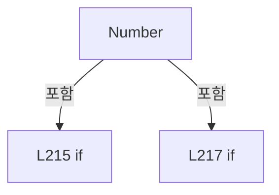

변경 전 점검: 입력/반환 타입, 위 호출자, 예외/취소 경로, 공유 상태와 저장·전송 소비자를 함께 확인합니다. 값의 단위나 물리 방향을 이름만으로 확정하지 않습니다.

### MethodDeclaration `EncodeLine` · L223–229

[Drilling.Common/Managers/CSettingManager.cs:223–229](https://github.com/kjuws10-rgb/A3Drilling/blob/5aee8e58439c9b455cae7c9593c9be986c3e682e/Drilling.Common/Managers/CSettingManager.cs#L223-L229)

| 항목 | 실제 추출 값 |
| --- | --- |
| 서명 | int Drilling.Common.Managers.CRunOptionSettings.EncodeLine(int) |
| 접근/수식자 | Public / public, static |
| 반환/값 타입 | int |
| 소속 타입 | NamedType:Drilling.Common.Managers.CRunOptionSettings |

입력 계약:

| 이름 | 타입 | 전달 | 선택/기본값 |
| --- | --- | --- | --- |
| count | int | None | False /  |

정적 호출자로 확인된 위치:

| 호출 파일/행 | 호출 표현식 | 런타임 분기 가능 |
| --- | --- | --- |
| [Drilling.UI/Menu/Menus/CMenuMain.cs:2845–2845](https://github.com/kjuws10-rgb/A3Drilling/blob/5aee8e58439c9b455cae7c9593c9be986c3e682e/Drilling.UI/Menu/Menus/CMenuMain.cs#L2845-L2845) | CRunOptionSettings.EncodeLine | False |

호출하는 대상과 해석 범위:

| 원본 행 | 표현식 | 분석 상태 | 대상/소스 위치 |
| --- | --- | --- | --- |
| 229 | new ArgumentOutOfRangeException | resolved | System.ArgumentOutOfRangeException.ArgumentOutOfRangeException(string?) |
| 229 | nameof | unresolved | None |

본문의 실제 연산·분기·예외·반환 순서(원문 위치 순):

| 원본 행 | 종류 | 주석 해설 |
| --- | --- | --- |
| 223 | switch-expression | 값별 결과식을 선택합니다: count switch { 1 => 0, 3 => 1, 5 => 2, 7 => 3, _ => throw new ArgumentOutOfRangeException(nameof(count))} |
| 229 | call | 함수·델리게이트 또는 객체 생성자를 호출합니다: new ArgumentOutOfRangeException(nameof(count)) |
| 229 | call | 함수·델리게이트 또는 객체 생성자를 호출합니다: nameof(count) |
| 229 | throw | 예외를 발생/전달합니다: throw new ArgumentOutOfRangeException(nameof(count)) |

제어 구문의 포함 구조(실제 실행 순서/CFG가 아닌 구문 탐색 그림):

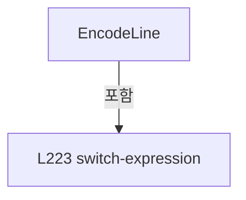

변경 전 점검: 입력/반환 타입, 위 호출자, 예외/취소 경로, 공유 상태와 저장·전송 소비자를 함께 확인합니다. 값의 단위나 물리 방향을 이름만으로 확정하지 않습니다.

### PropertyDeclaration `DistortionGroupMask` · L234–234

[Drilling.Common/Managers/CSettingManager.cs:234–234](https://github.com/kjuws10-rgb/A3Drilling/blob/5aee8e58439c9b455cae7c9593c9be986c3e682e/Drilling.Common/Managers/CSettingManager.cs#L234-L234)

| 항목 | 실제 추출 값 |
| --- | --- |
| 서명 | int Drilling.Common.Managers.ST_RUN_OPTION_SETTINGS.DistortionGroupMask |
| 접근/수식자 | Public / public |
| 반환/값 타입 | int |
| 소속 타입 | NamedType:Drilling.Common.Managers.ST_RUN_OPTION_SETTINGS |

현재 부분 분석에서 직접 연결된 호출자는 없습니다. XAML/이벤트/인터페이스·델리게이트·외부 진입을 추가 확인해야 하며, 미사용으로 판정한 것이 아닙니다.

변경 전 점검: 입력/반환 타입, 위 호출자, 예외/취소 경로, 공유 상태와 저장·전송 소비자를 함께 확인합니다. 값의 단위나 물리 방향을 이름만으로 확정하지 않습니다.

### GetAccessorDeclaration `get_DistortionGroupMask` · L234–234

[Drilling.Common/Managers/CSettingManager.cs:234–234](https://github.com/kjuws10-rgb/A3Drilling/blob/5aee8e58439c9b455cae7c9593c9be986c3e682e/Drilling.Common/Managers/CSettingManager.cs#L234-L234)

| 항목 | 실제 추출 값 |
| --- | --- |
| 서명 | int Drilling.Common.Managers.ST_RUN_OPTION_SETTINGS.DistortionGroupMask.get |
| 접근/수식자 | Public / get |
| 반환/값 타입 | int |
| 소속 타입 | NamedType:Drilling.Common.Managers.ST_RUN_OPTION_SETTINGS |

현재 부분 분석에서 직접 연결된 호출자는 없습니다. XAML/이벤트/인터페이스·델리게이트·외부 진입을 추가 확인해야 하며, 미사용으로 판정한 것이 아닙니다.

변경 전 점검: 입력/반환 타입, 위 호출자, 예외/취소 경로, 공유 상태와 저장·전송 소비자를 함께 확인합니다. 값의 단위나 물리 방향을 이름만으로 확정하지 않습니다.

### InitAccessorDeclaration `set_DistortionGroupMask` · L234–234

[Drilling.Common/Managers/CSettingManager.cs:234–234](https://github.com/kjuws10-rgb/A3Drilling/blob/5aee8e58439c9b455cae7c9593c9be986c3e682e/Drilling.Common/Managers/CSettingManager.cs#L234-L234)

| 항목 | 실제 추출 값 |
| --- | --- |
| 서명 | void Drilling.Common.Managers.ST_RUN_OPTION_SETTINGS.DistortionGroupMask.init |
| 접근/수식자 | Public / init |
| 반환/값 타입 | void |
| 소속 타입 | NamedType:Drilling.Common.Managers.ST_RUN_OPTION_SETTINGS |

입력 계약:

| 이름 | 타입 | 전달 | 선택/기본값 |
| --- | --- | --- | --- |
| value | int | None | False /  |

현재 부분 분석에서 직접 연결된 호출자는 없습니다. XAML/이벤트/인터페이스·델리게이트·외부 진입을 추가 확인해야 하며, 미사용으로 판정한 것이 아닙니다.

변경 전 점검: 입력/반환 타입, 위 호출자, 예외/취소 경로, 공유 상태와 저장·전송 소비자를 함께 확인합니다. 값의 단위나 물리 방향을 이름만으로 확정하지 않습니다.

### PropertyDeclaration `DistortionGroups` · L235–235

[Drilling.Common/Managers/CSettingManager.cs:235–235](https://github.com/kjuws10-rgb/A3Drilling/blob/5aee8e58439c9b455cae7c9593c9be986c3e682e/Drilling.Common/Managers/CSettingManager.cs#L235-L235)

| 항목 | 실제 추출 값 |
| --- | --- |
| 서명 | System.Collections.Generic.IReadOnlyList<int> Drilling.Common.Managers.ST_RUN_OPTION_SETTINGS.DistortionGroups |
| 접근/수식자 | Public / public |
| 반환/값 타입 | System.Collections.Generic.IReadOnlyList<int> |
| 소속 타입 | NamedType:Drilling.Common.Managers.ST_RUN_OPTION_SETTINGS |

현재 부분 분석에서 직접 연결된 호출자는 없습니다. XAML/이벤트/인터페이스·델리게이트·외부 진입을 추가 확인해야 하며, 미사용으로 판정한 것이 아닙니다.

호출하는 대상과 해석 범위:

| 원본 행 | 표현식 | 분석 상태 | 대상/소스 위치 |
| --- | --- | --- | --- |
| 235 | Enumerable.Range(0, 3).Where(index => (DistortionGroupMask & (1 << index)) != 0).ToArray | resolved | int[] System.Collections.Generic.IEnumerable<int>.ToArray<int>() |
| 235 | Enumerable.Range(0, 3).Where | resolved | System.Collections.Generic.IEnumerable<int> System.Collections.Generic.IEnumerable<int>.Where<int>(System.Func<int, bool>) |
| 235 | Enumerable.Range | resolved | System.Collections.Generic.IEnumerable<int> System.Linq.Enumerable.Range(int, int) |

본문의 실제 연산·분기·예외·반환 순서(원문 위치 순):

| 원본 행 | 종류 | 주석 해설 |
| --- | --- | --- |
| 235 | call | 함수·델리게이트 또는 객체 생성자를 호출합니다: Enumerable.Range(0, 3).Where(index => (DistortionGroupMask & (1 << index)) != 0).ToArray() |
| 235 | call | 함수·델리게이트 또는 객체 생성자를 호출합니다: Enumerable.Range(0, 3).Where(index => (DistortionGroupMask & (1 << index)) != 0) |
| 235 | call | 함수·델리게이트 또는 객체 생성자를 호출합니다: Enumerable.Range(0, 3) |

변경 전 점검: 입력/반환 타입, 위 호출자, 예외/취소 경로, 공유 상태와 저장·전송 소비자를 함께 확인합니다. 값의 단위나 물리 방향을 이름만으로 확정하지 않습니다.

### PropertyDeclaration `ReviewLineCount` · L236–242

[Drilling.Common/Managers/CSettingManager.cs:236–242](https://github.com/kjuws10-rgb/A3Drilling/blob/5aee8e58439c9b455cae7c9593c9be986c3e682e/Drilling.Common/Managers/CSettingManager.cs#L236-L242)

| 항목 | 실제 추출 값 |
| --- | --- |
| 서명 | int Drilling.Common.Managers.ST_RUN_OPTION_SETTINGS.ReviewLineCount |
| 접근/수식자 | Public / public |
| 반환/값 타입 | int |
| 소속 타입 | NamedType:Drilling.Common.Managers.ST_RUN_OPTION_SETTINGS |

현재 부분 분석에서 직접 연결된 호출자는 없습니다. XAML/이벤트/인터페이스·델리게이트·외부 진입을 추가 확인해야 하며, 미사용으로 판정한 것이 아닙니다.

호출하는 대상과 해석 범위:

| 원본 행 | 표현식 | 분석 상태 | 대상/소스 위치 |
| --- | --- | --- | --- |
| 242 | new InvalidDataException | resolved | System.IO.InvalidDataException.InvalidDataException(string?) |

본문의 실제 연산·분기·예외·반환 순서(원문 위치 순):

| 원본 행 | 종류 | 주석 해설 |
| --- | --- | --- |
| 236 | switch-expression | 값별 결과식을 선택합니다: ReviewLineIndex switch { 0 => 1, 1 => 3, 2 => 5, 3 => 7, _ => throw new InvalidDataException("Review Line 설정 오류")} |
| 242 | call | 함수·델리게이트 또는 객체 생성자를 호출합니다: new InvalidDataException("Review Line 설정 오류") |
| 242 | throw | 예외를 발생/전달합니다: throw new InvalidDataException("Review Line 설정 오류") |

제어 구문의 포함 구조(실제 실행 순서/CFG가 아닌 구문 탐색 그림):

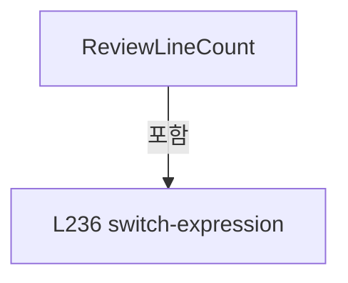

변경 전 점검: 입력/반환 타입, 위 호출자, 예외/취소 경로, 공유 상태와 저장·전송 소비자를 함께 확인합니다. 값의 단위나 물리 방향을 이름만으로 확정하지 않습니다.

### PropertyDeclaration `ReviewOptions` · L243–243

[Drilling.Common/Managers/CSettingManager.cs:243–243](https://github.com/kjuws10-rgb/A3Drilling/blob/5aee8e58439c9b455cae7c9593c9be986c3e682e/Drilling.Common/Managers/CSettingManager.cs#L243-L243)

| 항목 | 실제 추출 값 |
| --- | --- |
| 서명 | Drilling.Common.Review.ST_AUTO_REVIEW_OPTIONS Drilling.Common.Managers.ST_RUN_OPTION_SETTINGS.ReviewOptions |
| 접근/수식자 | Public / public |
| 반환/값 타입 | Drilling.Common.Review.ST_AUTO_REVIEW_OPTIONS |
| 소속 타입 | NamedType:Drilling.Common.Managers.ST_RUN_OPTION_SETTINGS |

현재 부분 분석에서 직접 연결된 호출자는 없습니다. XAML/이벤트/인터페이스·델리게이트·외부 진입을 추가 확인해야 하며, 미사용으로 판정한 것이 아닙니다.

호출하는 대상과 해석 범위:

| 원본 행 | 표현식 | 분석 상태 | 대상/소스 위치 |
| --- | --- | --- | --- |
| 243 | new | resolved | Drilling.Common.Review.ST_AUTO_REVIEW_OPTIONS.ST_AUTO_REVIEW_OPTIONS(int, Drilling.Common.Review.EN_FINE_INSPECTION_METHOD, int, bool) · Drilling.Common/Review/CAutoFineReviewCoordinator.cs:340 |

본문의 실제 연산·분기·예외·반환 순서(원문 위치 순):

| 원본 행 | 종류 | 주석 해설 |
| --- | --- | --- |
| 243 | call | 함수·델리게이트 또는 객체 생성자를 호출합니다: new(ReviewLineCount, ReviewMethod == 0 ? EN_FINE_INSPECTION_METHOD.PtoP : EN_FINE_INSPECTION_METHOD.Flying, RetryCount, ImmediateRetry) |
| 243 | conditional-expression | 조건에 따라 결과식을 선택합니다: ReviewMethod == 0 ? EN_FINE_INSPECTION_METHOD.PtoP : EN_FINE_INSPECTION_METHOD.Flying |

변경 전 점검: 입력/반환 타입, 위 호출자, 예외/취소 경로, 공유 상태와 저장·전송 소비자를 함께 확인합니다. 값의 단위나 물리 방향을 이름만으로 확정하지 않습니다.

### EnumMemberDeclaration `Option` · L248–248

[Drilling.Common/Managers/CSettingManager.cs:248–248](https://github.com/kjuws10-rgb/A3Drilling/blob/5aee8e58439c9b455cae7c9593c9be986c3e682e/Drilling.Common/Managers/CSettingManager.cs#L248-L248)

| 항목 | 실제 추출 값 |
| --- | --- |
| 서명 | Drilling.Common.Managers.EN_SETTING_TAB.Option |
| 접근/수식자 | Public /  |
| 반환/값 타입 | Drilling.Common.Managers.EN_SETTING_TAB |
| 소속 타입 | NamedType:Drilling.Common.Managers.EN_SETTING_TAB |

현재 부분 분석에서 직접 연결된 호출자는 없습니다. XAML/이벤트/인터페이스·델리게이트·외부 진입을 추가 확인해야 하며, 미사용으로 판정한 것이 아닙니다.

변경 전 점검: 입력/반환 타입, 위 호출자, 예외/취소 경로, 공유 상태와 저장·전송 소비자를 함께 확인합니다. 값의 단위나 물리 방향을 이름만으로 확정하지 않습니다.

### EnumMemberDeclaration `Interface` · L249–249

[Drilling.Common/Managers/CSettingManager.cs:249–249](https://github.com/kjuws10-rgb/A3Drilling/blob/5aee8e58439c9b455cae7c9593c9be986c3e682e/Drilling.Common/Managers/CSettingManager.cs#L249-L249)

| 항목 | 실제 추출 값 |
| --- | --- |
| 서명 | Drilling.Common.Managers.EN_SETTING_TAB.Interface |
| 접근/수식자 | Public /  |
| 반환/값 타입 | Drilling.Common.Managers.EN_SETTING_TAB |
| 소속 타입 | NamedType:Drilling.Common.Managers.EN_SETTING_TAB |

현재 부분 분석에서 직접 연결된 호출자는 없습니다. XAML/이벤트/인터페이스·델리게이트·외부 진입을 추가 확인해야 하며, 미사용으로 판정한 것이 아닙니다.

변경 전 점검: 입력/반환 타입, 위 호출자, 예외/취소 경로, 공유 상태와 저장·전송 소비자를 함께 확인합니다. 값의 단위나 물리 방향을 이름만으로 확정하지 않습니다.

### EnumMemberDeclaration `Io` · L250–250

[Drilling.Common/Managers/CSettingManager.cs:250–250](https://github.com/kjuws10-rgb/A3Drilling/blob/5aee8e58439c9b455cae7c9593c9be986c3e682e/Drilling.Common/Managers/CSettingManager.cs#L250-L250)

| 항목 | 실제 추출 값 |
| --- | --- |
| 서명 | Drilling.Common.Managers.EN_SETTING_TAB.Io |
| 접근/수식자 | Public /  |
| 반환/값 타입 | Drilling.Common.Managers.EN_SETTING_TAB |
| 소속 타입 | NamedType:Drilling.Common.Managers.EN_SETTING_TAB |

현재 부분 분석에서 직접 연결된 호출자는 없습니다. XAML/이벤트/인터페이스·델리게이트·외부 진입을 추가 확인해야 하며, 미사용으로 판정한 것이 아닙니다.

변경 전 점검: 입력/반환 타입, 위 호출자, 예외/취소 경로, 공유 상태와 저장·전송 소비자를 함께 확인합니다. 값의 단위나 물리 방향을 이름만으로 확정하지 않습니다.

### EnumMemberDeclaration `Motor` · L251–251

[Drilling.Common/Managers/CSettingManager.cs:251–251](https://github.com/kjuws10-rgb/A3Drilling/blob/5aee8e58439c9b455cae7c9593c9be986c3e682e/Drilling.Common/Managers/CSettingManager.cs#L251-L251)

| 항목 | 실제 추출 값 |
| --- | --- |
| 서명 | Drilling.Common.Managers.EN_SETTING_TAB.Motor |
| 접근/수식자 | Public /  |
| 반환/값 타입 | Drilling.Common.Managers.EN_SETTING_TAB |
| 소속 타입 | NamedType:Drilling.Common.Managers.EN_SETTING_TAB |

현재 부분 분석에서 직접 연결된 호출자는 없습니다. XAML/이벤트/인터페이스·델리게이트·외부 진입을 추가 확인해야 하며, 미사용으로 판정한 것이 아닙니다.

변경 전 점검: 입력/반환 타입, 위 호출자, 예외/취소 경로, 공유 상태와 저장·전송 소비자를 함께 확인합니다. 값의 단위나 물리 방향을 이름만으로 확정하지 않습니다.

### EnumMemberDeclaration `Alarm` · L252–252

[Drilling.Common/Managers/CSettingManager.cs:252–252](https://github.com/kjuws10-rgb/A3Drilling/blob/5aee8e58439c9b455cae7c9593c9be986c3e682e/Drilling.Common/Managers/CSettingManager.cs#L252-L252)

| 항목 | 실제 추출 값 |
| --- | --- |
| 서명 | Drilling.Common.Managers.EN_SETTING_TAB.Alarm |
| 접근/수식자 | Public /  |
| 반환/값 타입 | Drilling.Common.Managers.EN_SETTING_TAB |
| 소속 타입 | NamedType:Drilling.Common.Managers.EN_SETTING_TAB |

현재 부분 분석에서 직접 연결된 호출자는 없습니다. XAML/이벤트/인터페이스·델리게이트·외부 진입을 추가 확인해야 하며, 미사용으로 판정한 것이 아닙니다.

변경 전 점검: 입력/반환 타입, 위 호출자, 예외/취소 경로, 공유 상태와 저장·전송 소비자를 함께 확인합니다. 값의 단위나 물리 방향을 이름만으로 확정하지 않습니다.

### MethodDeclaration `Load` · L275–275

[Drilling.Common/Managers/CSettingManager.cs:275–275](https://github.com/kjuws10-rgb/A3Drilling/blob/5aee8e58439c9b455cae7c9593c9be986c3e682e/Drilling.Common/Managers/CSettingManager.cs#L275-L275)

| 항목 | 실제 추출 값 |
| --- | --- |
| 서명 | System.Collections.Generic.IReadOnlyList<Drilling.Common.Managers.ST_SYSTEM_PARAMETER> Drilling.Common.Managers.CSettingFileBase.Load(Drilling.Common.Managers.EN_SETTING_TAB, System.Threading.CancellationToken) |
| 접근/수식자 | Public / public, abstract |
| 반환/값 타입 | System.Collections.Generic.IReadOnlyList<Drilling.Common.Managers.ST_SYSTEM_PARAMETER> |
| 소속 타입 | NamedType:Drilling.Common.Managers.CSettingFileBase |

입력 계약:

| 이름 | 타입 | 전달 | 선택/기본값 |
| --- | --- | --- | --- |
| section | Drilling.Common.Managers.EN_SETTING_TAB | None | False /  |
| cancellationToken | System.Threading.CancellationToken | None | True / null |

정적 호출자로 확인된 위치:

| 호출 파일/행 | 호출 표현식 | 런타임 분기 가능 |
| --- | --- | --- |
| [Drilling.Common/Managers/CManager.cs:602–602](https://github.com/kjuws10-rgb/A3Drilling/blob/5aee8e58439c9b455cae7c9593c9be986c3e682e/Drilling.Common/Managers/CManager.cs#L602-L602) | _settingFile.Load | False |
| [Drilling.Common/Managers/CSettingManager.cs:44–44](https://github.com/kjuws10-rgb/A3Drilling/blob/5aee8e58439c9b455cae7c9593c9be986c3e682e/Drilling.Common/Managers/CSettingManager.cs#L44-L44) | settingFile.Load | False |

변경 전 점검: 입력/반환 타입, 위 호출자, 예외/취소 경로, 공유 상태와 저장·전송 소비자를 함께 확인합니다. 값의 단위나 물리 방향을 이름만으로 확정하지 않습니다.

### MethodDeclaration `Save` · L276–276

[Drilling.Common/Managers/CSettingManager.cs:276–276](https://github.com/kjuws10-rgb/A3Drilling/blob/5aee8e58439c9b455cae7c9593c9be986c3e682e/Drilling.Common/Managers/CSettingManager.cs#L276-L276)

| 항목 | 실제 추출 값 |
| --- | --- |
| 서명 | void Drilling.Common.Managers.CSettingFileBase.Save(Drilling.Common.Managers.EN_SETTING_TAB, System.Collections.Generic.IReadOnlyList<Drilling.Common.Managers.ST_SYSTEM_PARAMETER>, System.Threading.CancellationToken) |
| 접근/수식자 | Public / public, abstract |
| 반환/값 타입 | void |
| 소속 타입 | NamedType:Drilling.Common.Managers.CSettingFileBase |

입력 계약:

| 이름 | 타입 | 전달 | 선택/기본값 |
| --- | --- | --- | --- |
| section | Drilling.Common.Managers.EN_SETTING_TAB | None | False /  |
| parameters | System.Collections.Generic.IReadOnlyList<Drilling.Common.Managers.ST_SYSTEM_PARAMETER> | None | False /  |
| cancellationToken | System.Threading.CancellationToken | None | True / null |

정적 호출자로 확인된 위치:

| 호출 파일/행 | 호출 표현식 | 런타임 분기 가능 |
| --- | --- | --- |
| [Drilling.Common/Managers/CSettingManager.cs:144–144](https://github.com/kjuws10-rgb/A3Drilling/blob/5aee8e58439c9b455cae7c9593c9be986c3e682e/Drilling.Common/Managers/CSettingManager.cs#L144-L144) | settingFile.Save | False |

변경 전 점검: 입력/반환 타입, 위 호출자, 예외/취소 경로, 공유 상태와 저장·전송 소비자를 함께 확인합니다. 값의 단위나 물리 방향을 이름만으로 확정하지 않습니다.

### MethodDeclaration `LoadHistory` · L277–277

[Drilling.Common/Managers/CSettingManager.cs:277–277](https://github.com/kjuws10-rgb/A3Drilling/blob/5aee8e58439c9b455cae7c9593c9be986c3e682e/Drilling.Common/Managers/CSettingManager.cs#L277-L277)

| 항목 | 실제 추출 값 |
| --- | --- |
| 서명 | System.Collections.Generic.IReadOnlyList<Drilling.Common.Managers.ST_SETTING_HISTORY> Drilling.Common.Managers.CSettingFileBase.LoadHistory(Drilling.Common.Managers.EN_SETTING_TAB, System.Threading.CancellationToken) |
| 접근/수식자 | Public / public, abstract |
| 반환/값 타입 | System.Collections.Generic.IReadOnlyList<Drilling.Common.Managers.ST_SETTING_HISTORY> |
| 소속 타입 | NamedType:Drilling.Common.Managers.CSettingFileBase |

입력 계약:

| 이름 | 타입 | 전달 | 선택/기본값 |
| --- | --- | --- | --- |
| section | Drilling.Common.Managers.EN_SETTING_TAB | None | False /  |
| cancellationToken | System.Threading.CancellationToken | None | True / null |

정적 호출자로 확인된 위치:

| 호출 파일/행 | 호출 표현식 | 런타임 분기 가능 |
| --- | --- | --- |
| [Drilling.Common/Managers/CSettingManager.cs:152–152](https://github.com/kjuws10-rgb/A3Drilling/blob/5aee8e58439c9b455cae7c9593c9be986c3e682e/Drilling.Common/Managers/CSettingManager.cs#L152-L152) | settingFile.LoadHistory | False |

변경 전 점검: 입력/반환 타입, 위 호출자, 예외/취소 경로, 공유 상태와 저장·전송 소비자를 함께 확인합니다. 값의 단위나 물리 방향을 이름만으로 확정하지 않습니다.

### MethodDeclaration `LoadAll` · L282–282

[Drilling.Common/Managers/CSettingManager.cs:282–282](https://github.com/kjuws10-rgb/A3Drilling/blob/5aee8e58439c9b455cae7c9593c9be986c3e682e/Drilling.Common/Managers/CSettingManager.cs#L282-L282)

| 항목 | 실제 추출 값 |
| --- | --- |
| 서명 | System.Collections.Generic.IReadOnlyList<Drilling.Common.Interface.ST_INTERFACE_DATA> Drilling.Common.Managers.CInterfaceFileBase.LoadAll(System.Threading.CancellationToken) |
| 접근/수식자 | Public / public, abstract |
| 반환/값 타입 | System.Collections.Generic.IReadOnlyList<Drilling.Common.Interface.ST_INTERFACE_DATA> |
| 소속 타입 | NamedType:Drilling.Common.Managers.CInterfaceFileBase |

입력 계약:

| 이름 | 타입 | 전달 | 선택/기본값 |
| --- | --- | --- | --- |
| cancellationToken | System.Threading.CancellationToken | None | True / null |

정적 호출자로 확인된 위치:

| 호출 파일/행 | 호출 표현식 | 런타임 분기 가능 |
| --- | --- | --- |
| [Drilling.Common/Managers/CManager.cs:472–472](https://github.com/kjuws10-rgb/A3Drilling/blob/5aee8e58439c9b455cae7c9593c9be986c3e682e/Drilling.Common/Managers/CManager.cs#L472-L472) | _interfaceFile.LoadAll | False |
| [Drilling.Common/Managers/CSettingManager.cs:157–157](https://github.com/kjuws10-rgb/A3Drilling/blob/5aee8e58439c9b455cae7c9593c9be986c3e682e/Drilling.Common/Managers/CSettingManager.cs#L157-L157) | interfaceFile.LoadAll | False |

변경 전 점검: 입력/반환 타입, 위 호출자, 예외/취소 경로, 공유 상태와 저장·전송 소비자를 함께 확인합니다. 값의 단위나 물리 방향을 이름만으로 확정하지 않습니다.

### MethodDeclaration `SaveAll` · L283–283

[Drilling.Common/Managers/CSettingManager.cs:283–283](https://github.com/kjuws10-rgb/A3Drilling/blob/5aee8e58439c9b455cae7c9593c9be986c3e682e/Drilling.Common/Managers/CSettingManager.cs#L283-L283)

| 항목 | 실제 추출 값 |
| --- | --- |
| 서명 | void Drilling.Common.Managers.CInterfaceFileBase.SaveAll(System.Collections.Generic.IReadOnlyList<Drilling.Common.Interface.ST_INTERFACE_DATA>, System.Threading.CancellationToken) |
| 접근/수식자 | Public / public, abstract |
| 반환/값 타입 | void |
| 소속 타입 | NamedType:Drilling.Common.Managers.CInterfaceFileBase |

입력 계약:

| 이름 | 타입 | 전달 | 선택/기본값 |
| --- | --- | --- | --- |
| interfaces | System.Collections.Generic.IReadOnlyList<Drilling.Common.Interface.ST_INTERFACE_DATA> | None | False /  |
| cancellationToken | System.Threading.CancellationToken | None | True / null |

정적 호출자로 확인된 위치:

| 호출 파일/행 | 호출 표현식 | 런타임 분기 가능 |
| --- | --- | --- |
| [Drilling.Common/Managers/CSettingManager.cs:162–162](https://github.com/kjuws10-rgb/A3Drilling/blob/5aee8e58439c9b455cae7c9593c9be986c3e682e/Drilling.Common/Managers/CSettingManager.cs#L162-L162) | interfaceFile.SaveAll | False |

변경 전 점검: 입력/반환 타입, 위 호출자, 예외/취소 경로, 공유 상태와 저장·전송 소비자를 함께 확인합니다. 값의 단위나 물리 방향을 이름만으로 확정하지 않습니다.

## 구문·바인딩 한계

전체 WPF/벤더 SDK/프로젝트별 빌드 조건을 로드한 정식 빌드가 아닙니다. `resolved`는 이 부분 컴파일에서의 심볼 연결이며 virtual/interface/delegate/이벤트/Reflection/XAML의 실제 런타임 구현을 확정하지 않습니다. `candidate`와 `unresolved`는 후속 확인 대상으로 남깁니다.

## 원문 전체 주석 해설본

[원본 모든 행과 행별 해설 보기](../../../annotated/Drilling.Common/Managers/CSettingManager.cs.annotated.txt)

원본을 빠뜨리거나 임의로 줄이지 않았습니다. `L000001 |` 표시는 원본 행 번호, `// 해설`은 별도 설명입니다. 실행용 소스가 아닌 문서입니다.

## 수정·재검증 체크

- 원본 Commit과 현재 작업 파일 SHA가 같은지 먼저 확인합니다. 다르면 이 문서를 과거 버전 자료로 취급합니다.
- 선언·직접 호출·이벤트/인터페이스 경계·설정 소비를 함께 확인합니다. 정적 연결의 빈 곳을 정상 경로로 추정하지 않습니다.
- 저장 형식/단위/식별자·재시도·취소·예외·롤백에 영향을 주는 변경은 상세 해설장과 호출자를 다시 검토합니다.
- 도구의 구문 추출과 별도 정적 추적 해설, 실제 빌드·시뮬레이션·실장비 검증 결과를 분리합니다.
