# Drilling.Common/Managers/CSettingManager.cs

| 항목 | 내용 |
| --- | --- |
| 원본 저장소 | https://github.com/kjuws10-rgb/A3Drilling.git |
| 원본 Commit | 0219666f9053b907d96d7e0aa7d0c6c1be3a73d4 |
| 원본 SHA256 | ab5eedee3d573b21ff626315c37803e06fd4d9d7d0e8709e0bf89e55f838743c |
| 파일 분류 | code |
| 원본 크기/행 | 16,027 bytes / 293 physical lines |
| 인코딩 | utf-8-sig |
| 검토 범위 | 구문/부분 의미 분석에서 추출한 사실. 동작·물리 단위·실장비 합격을 보증하지 않습니다. |
| 원본 링크 | [고정 Commit 원본](https://github.com/kjuws10-rgb/A3Drilling/blob/0219666f9053b907d96d7e0aa7d0c6c1be3a73d4/Drilling.Common/Managers/CSettingManager.cs) |

## 파일의 역할과 읽는 순서

프로그램의 시작·구성·공유 타입 또는 빌드 연결에 사용됩니다. 아래 실제 선언·참조와 원본 근거를 확인합니다.

## 네임스페이스·타입·상속

| 타입 | 구분 | 원본 범위 | 선언/상속 |
| --- | --- | --- | --- |
| CSettingManager | ClassDeclaration | 14–188 | CSettingManager |
| CRunOptionSettings | ClassDeclaration | 191–238 | CRunOptionSettings |
| ST_RUN_OPTION_SETTINGS | RecordDeclaration | 240–252 | ST_RUN_OPTION_SETTINGS |
| EN_SETTING_TAB | EnumDeclaration | 254–261 | EN_SETTING_TAB |
| ST_SYSTEM_PARAMETER | RecordDeclaration | 263–279 | ST_SYSTEM_PARAMETER |
| ST_SETTING_HISTORY | RecordDeclaration | 280–280 | ST_SETTING_HISTORY |
| CSettingFileBase | ClassDeclaration | 281–286 | CSettingFileBase |
| CInterfaceFileBase | ClassDeclaration | 288–292 | CInterfaceFileBase |

## 멤버 빠른 목록

| 이름 | 종류 | 범위 | 서명 |
| --- | --- | --- | --- |
| ReviewCameraResolutionKey | FieldDeclaration | L16–16 | string Drilling.Common.Managers.CSettingManager.ReviewCameraResolutionKey |
| VisionCameraResolutionKey | FieldDeclaration | L17–17 | string Drilling.Common.Managers.CSettingManager.VisionCameraResolutionKey |
| DefaultVisionCameraResolution | FieldDeclaration | L18–18 | double Drilling.Common.Managers.CSettingManager.DefaultVisionCameraResolution |
| AlignCameraResolutionKey | FieldDeclaration | L19–19 | string Drilling.Common.Managers.CSettingManager.AlignCameraResolutionKey |
| DefaultAlignCameraResolution | FieldDeclaration | L20–20 | double Drilling.Common.Managers.CSettingManager.DefaultAlignCameraResolution |
| WapageAlignBaseToleranceKey | FieldDeclaration | L21–21 | string Drilling.Common.Managers.CSettingManager.WapageAlignBaseToleranceKey |
| DefaultWapageAlignBaseTolerance | FieldDeclaration | L22–22 | double Drilling.Common.Managers.CSettingManager.DefaultWapageAlignBaseTolerance |
| _cacheLock | FieldDeclaration | L23–23 | object Drilling.Common.Managers.CSettingManager._cacheLock |
| _saveLock | FieldDeclaration | L24–24 | object Drilling.Common.Managers.CSettingManager._saveLock |
| _sectionCache | FieldDeclaration | L25–25 | System.Collections.Generic.Dictionary<Drilling.Common.Managers.EN_SETTING_TAB, System.Collections.Generic.IReadOnlyList<Drilling.Common.Managers.ST_SYSTEM_PARAMETER>> Drilling.Common.Managers.CSettingManager._sectionCache |
| LoadSection | MethodDeclaration | L26–38 | System.Collections.Generic.IReadOnlyList<Drilling.Common.Managers.ST_SYSTEM_PARAMETER> Drilling.Common.Managers.CSettingManager.LoadSection(Drilling.Common.Managers.EN_SETTING_TAB, System.Threading.CancellationToken) |
| ReloadSection | MethodDeclaration | L40–50 | System.Collections.Generic.IReadOnlyList<Drilling.Common.Managers.ST_SYSTEM_PARAMETER> Drilling.Common.Managers.CSettingManager.ReloadSection(Drilling.Common.Managers.EN_SETTING_TAB, System.Threading.CancellationToken) |
| LoadAllSections | MethodDeclaration | L52–58 | void Drilling.Common.Managers.CSettingManager.LoadAllSections(System.Threading.CancellationToken) |
| GetValue | MethodDeclaration | L60–71 | string Drilling.Common.Managers.CSettingManager.GetValue(Drilling.Common.Managers.EN_SETTING_TAB, string, string, System.Threading.CancellationToken) |
| MatchesItem | LocalFunctionStatement | L64–67 | bool MatchesItem(Drilling.Common.Managers.ST_SYSTEM_PARAMETER) |
| SetValue | MethodDeclaration | L73–103 | void Drilling.Common.Managers.CSettingManager.SetValue(Drilling.Common.Managers.EN_SETTING_TAB, string, string, System.Threading.CancellationToken) |
| SelectParameter | LocalFunctionStatement | L80–93 | Drilling.Common.Managers.ST_SYSTEM_PARAMETER SelectParameter(Drilling.Common.Managers.ST_SYSTEM_PARAMETER) |
| GetVisionMaxHoleCountPerLine | MethodDeclaration | L105–112 | int Drilling.Common.Managers.CSettingManager.GetVisionMaxHoleCountPerLine() |
| GetVisionCameraResolution | MethodDeclaration | L114–114 | double Drilling.Common.Managers.CSettingManager.GetVisionCameraResolution() |
| GetAlignKeyMargins | MethodDeclaration | L116–117 | Drilling.Common.Managers.ST_ALIGN_KEY_MARGINS Drilling.Common.Managers.CSettingManager.GetAlignKeyMargins(System.Threading.CancellationToken) |
| ParseVisionCameraResolution | MethodDeclaration | L119–124 | double Drilling.Common.Managers.CSettingManager.ParseVisionCameraResolution(string) |
| SaveSection | MethodDeclaration | L126–156 | void Drilling.Common.Managers.CSettingManager.SaveSection(Drilling.Common.Managers.EN_SETTING_TAB, System.Collections.Generic.IReadOnlyList<Drilling.Common.Managers.ST_SYSTEM_PARAMETER>, System.Threading.CancellationToken) |
| LoadHistory | MethodDeclaration | L158–161 | System.Collections.Generic.IReadOnlyList<Drilling.Common.Managers.ST_SETTING_HISTORY> Drilling.Common.Managers.CSettingManager.LoadHistory(Drilling.Common.Managers.EN_SETTING_TAB, System.Threading.CancellationToken) |
| LoadInterfaceList | MethodDeclaration | L163–166 | System.Collections.Generic.IReadOnlyList<Drilling.Common.Interface.ST_INTERFACE_DATA> Drilling.Common.Managers.CSettingManager.LoadInterfaceList(System.Threading.CancellationToken) |
| SaveInterfaceList | MethodDeclaration | L168–172 | System.Threading.Tasks.Task Drilling.Common.Managers.CSettingManager.SaveInterfaceList(System.Collections.Generic.IReadOnlyList<Drilling.Common.Interface.ST_INTERFACE_DATA>, System.Threading.CancellationToken) |
| ConnectInterface | MethodDeclaration | L174–177 | System.Threading.Tasks.Task Drilling.Common.Managers.CSettingManager.ConnectInterface(Drilling.Common.Interface.EN_EQP_MODULE, int, System.Threading.CancellationToken) |
| DisconnectInterface | MethodDeclaration | L179–182 | System.Threading.Tasks.Task Drilling.Common.Managers.CSettingManager.DisconnectInterface(Drilling.Common.Interface.EN_EQP_MODULE, int, System.Threading.CancellationToken) |
| ReconnectInterface | MethodDeclaration | L184–187 | System.Threading.Tasks.Task Drilling.Common.Managers.CSettingManager.ReconnectInterface(Drilling.Common.Interface.EN_EQP_MODULE, int, System.Threading.CancellationToken) |
| ZeroDefence | FieldDeclaration | L193–193 | string Drilling.Common.Managers.CRunOptionSettings.ZeroDefence |
| CurrentGroup | FieldDeclaration | L194–194 | string Drilling.Common.Managers.CRunOptionSettings.CurrentGroup |
| FollowUp | FieldDeclaration | L195–195 | string Drilling.Common.Managers.CRunOptionSettings.FollowUp |
| DistortionGroup0 | FieldDeclaration | L196–196 | string Drilling.Common.Managers.CRunOptionSettings.DistortionGroup0 |
| DistortionGroup1 | FieldDeclaration | L197–197 | string Drilling.Common.Managers.CRunOptionSettings.DistortionGroup1 |
| DistortionGroup2 | FieldDeclaration | L198–198 | string Drilling.Common.Managers.CRunOptionSettings.DistortionGroup2 |
| ReviewMethod | FieldDeclaration | L199–199 | string Drilling.Common.Managers.CRunOptionSettings.ReviewMethod |
| ReviewLine | FieldDeclaration | L200–200 | string Drilling.Common.Managers.CRunOptionSettings.ReviewLine |
| ImmediateRetry | FieldDeclaration | L201–201 | string Drilling.Common.Managers.CRunOptionSettings.ImmediateRetry |
| RetryCount | FieldDeclaration | L202–202 | string Drilling.Common.Managers.CRunOptionSettings.RetryCount |
| Keys | FieldDeclaration | L203–203 | System.Collections.Generic.HashSet<string> Drilling.Common.Managers.CRunOptionSettings.Keys |
| IsKey | MethodDeclaration | L204–204 | bool Drilling.Common.Managers.CRunOptionSettings.IsKey(string) |
| Read | MethodDeclaration | L205–205 | Drilling.Common.Managers.ST_RUN_OPTION_SETTINGS Drilling.Common.Managers.CRunOptionSettings.Read(Drilling.Common.Managers.CSettingManager) |
| Read | MethodDeclaration | L206–229 | Drilling.Common.Managers.ST_RUN_OPTION_SETTINGS Drilling.Common.Managers.CRunOptionSettings.Read(System.Collections.Generic.IReadOnlyList<Drilling.Common.Managers.ST_SYSTEM_PARAMETER>) |
| Number | LocalFunctionStatement | L221–228 | int Number(string, int, int, int) |
| EncodeLine | MethodDeclaration | L231–237 | int Drilling.Common.Managers.CRunOptionSettings.EncodeLine(int) |
| DistortionGroupMask | PropertyDeclaration | L242–242 | int Drilling.Common.Managers.ST_RUN_OPTION_SETTINGS.DistortionGroupMask |
| get_DistortionGroupMask | GetAccessorDeclaration | L242–242 | int Drilling.Common.Managers.ST_RUN_OPTION_SETTINGS.DistortionGroupMask.get |
| set_DistortionGroupMask | InitAccessorDeclaration | L242–242 | void Drilling.Common.Managers.ST_RUN_OPTION_SETTINGS.DistortionGroupMask.init |
| DistortionGroups | PropertyDeclaration | L243–243 | System.Collections.Generic.IReadOnlyList<int> Drilling.Common.Managers.ST_RUN_OPTION_SETTINGS.DistortionGroups |
| ReviewLineCount | PropertyDeclaration | L244–250 | int Drilling.Common.Managers.ST_RUN_OPTION_SETTINGS.ReviewLineCount |
| ReviewOptions | PropertyDeclaration | L251–251 | Drilling.Common.Review.ST_AUTO_REVIEW_OPTIONS Drilling.Common.Managers.ST_RUN_OPTION_SETTINGS.ReviewOptions |
| Option | EnumMemberDeclaration | L256–256 | Drilling.Common.Managers.EN_SETTING_TAB.Option |
| Interface | EnumMemberDeclaration | L257–257 | Drilling.Common.Managers.EN_SETTING_TAB.Interface |
| Io | EnumMemberDeclaration | L258–258 | Drilling.Common.Managers.EN_SETTING_TAB.Io |
| Motor | EnumMemberDeclaration | L259–259 | Drilling.Common.Managers.EN_SETTING_TAB.Motor |
| Alarm | EnumMemberDeclaration | L260–260 | Drilling.Common.Managers.EN_SETTING_TAB.Alarm |
| Load | MethodDeclaration | L283–283 | System.Collections.Generic.IReadOnlyList<Drilling.Common.Managers.ST_SYSTEM_PARAMETER> Drilling.Common.Managers.CSettingFileBase.Load(Drilling.Common.Managers.EN_SETTING_TAB, System.Threading.CancellationToken) |
| Save | MethodDeclaration | L284–284 | void Drilling.Common.Managers.CSettingFileBase.Save(Drilling.Common.Managers.EN_SETTING_TAB, System.Collections.Generic.IReadOnlyList<Drilling.Common.Managers.ST_SYSTEM_PARAMETER>, System.Threading.CancellationToken) |
| LoadHistory | MethodDeclaration | L285–285 | System.Collections.Generic.IReadOnlyList<Drilling.Common.Managers.ST_SETTING_HISTORY> Drilling.Common.Managers.CSettingFileBase.LoadHistory(Drilling.Common.Managers.EN_SETTING_TAB, System.Threading.CancellationToken) |
| LoadAll | MethodDeclaration | L290–290 | System.Collections.Generic.IReadOnlyList<Drilling.Common.Interface.ST_INTERFACE_DATA> Drilling.Common.Managers.CInterfaceFileBase.LoadAll(System.Threading.CancellationToken) |
| SaveAll | MethodDeclaration | L291–291 | void Drilling.Common.Managers.CInterfaceFileBase.SaveAll(System.Collections.Generic.IReadOnlyList<Drilling.Common.Interface.ST_INTERFACE_DATA>, System.Threading.CancellationToken) |

## 멤버별 상세 계약·호출·처리 해설

### FieldDeclaration `ReviewCameraResolutionKey` · L16–16

[Drilling.Common/Managers/CSettingManager.cs:16–16](https://github.com/kjuws10-rgb/A3Drilling/blob/0219666f9053b907d96d7e0aa7d0c6c1be3a73d4/Drilling.Common/Managers/CSettingManager.cs#L16-L16)

| 항목 | 실제 추출 값 |
| --- | --- |
| 서명 | string Drilling.Common.Managers.CSettingManager.ReviewCameraResolutionKey |
| 접근/수식자 | Public / public, const |
| 반환/값 타입 | string |
| 소속 타입 | NamedType:Drilling.Common.Managers.CSettingManager |

현재 부분 분석에서 직접 연결된 호출자는 없습니다. XAML/이벤트/인터페이스·델리게이트·외부 진입을 추가 확인해야 하며, 미사용으로 판정한 것이 아닙니다.

본문의 실제 연산·분기·예외·반환 순서(원문 위치 순):

| 원본 행 | 종류 | 주석 해설 |
| --- | --- | --- |
| 16 | variable-initializer | 변수의 초기값을 지정합니다: ReviewCameraResolutionKey = "Review_Camera_Resolution" |

변경 전 점검: 입력/반환 타입, 위 호출자, 예외/취소 경로, 공유 상태와 저장·전송 소비자를 함께 확인합니다. 값의 단위나 물리 방향을 이름만으로 확정하지 않습니다.

### FieldDeclaration `VisionCameraResolutionKey` · L17–17

[Drilling.Common/Managers/CSettingManager.cs:17–17](https://github.com/kjuws10-rgb/A3Drilling/blob/0219666f9053b907d96d7e0aa7d0c6c1be3a73d4/Drilling.Common/Managers/CSettingManager.cs#L17-L17)

| 항목 | 실제 추출 값 |
| --- | --- |
| 서명 | string Drilling.Common.Managers.CSettingManager.VisionCameraResolutionKey |
| 접근/수식자 | Public / public, const |
| 반환/값 타입 | string |
| 소속 타입 | NamedType:Drilling.Common.Managers.CSettingManager |

현재 부분 분석에서 직접 연결된 호출자는 없습니다. XAML/이벤트/인터페이스·델리게이트·외부 진입을 추가 확인해야 하며, 미사용으로 판정한 것이 아닙니다.

본문의 실제 연산·분기·예외·반환 순서(원문 위치 순):

| 원본 행 | 종류 | 주석 해설 |
| --- | --- | --- |
| 17 | variable-initializer | 변수의 초기값을 지정합니다: VisionCameraResolutionKey = ReviewCameraResolutionKey |

변경 전 점검: 입력/반환 타입, 위 호출자, 예외/취소 경로, 공유 상태와 저장·전송 소비자를 함께 확인합니다. 값의 단위나 물리 방향을 이름만으로 확정하지 않습니다.

### FieldDeclaration `DefaultVisionCameraResolution` · L18–18

[Drilling.Common/Managers/CSettingManager.cs:18–18](https://github.com/kjuws10-rgb/A3Drilling/blob/0219666f9053b907d96d7e0aa7d0c6c1be3a73d4/Drilling.Common/Managers/CSettingManager.cs#L18-L18)

| 항목 | 실제 추출 값 |
| --- | --- |
| 서명 | double Drilling.Common.Managers.CSettingManager.DefaultVisionCameraResolution |
| 접근/수식자 | Public / public, const |
| 반환/값 타입 | double |
| 소속 타입 | NamedType:Drilling.Common.Managers.CSettingManager |

현재 부분 분석에서 직접 연결된 호출자는 없습니다. XAML/이벤트/인터페이스·델리게이트·외부 진입을 추가 확인해야 하며, 미사용으로 판정한 것이 아닙니다.

본문의 실제 연산·분기·예외·반환 순서(원문 위치 순):

| 원본 행 | 종류 | 주석 해설 |
| --- | --- | --- |
| 18 | variable-initializer | 변수의 초기값을 지정합니다: DefaultVisionCameraResolution = 0.0025 |

변경 전 점검: 입력/반환 타입, 위 호출자, 예외/취소 경로, 공유 상태와 저장·전송 소비자를 함께 확인합니다. 값의 단위나 물리 방향을 이름만으로 확정하지 않습니다.

### FieldDeclaration `AlignCameraResolutionKey` · L19–19

[Drilling.Common/Managers/CSettingManager.cs:19–19](https://github.com/kjuws10-rgb/A3Drilling/blob/0219666f9053b907d96d7e0aa7d0c6c1be3a73d4/Drilling.Common/Managers/CSettingManager.cs#L19-L19)

| 항목 | 실제 추출 값 |
| --- | --- |
| 서명 | string Drilling.Common.Managers.CSettingManager.AlignCameraResolutionKey |
| 접근/수식자 | Public / public, const |
| 반환/값 타입 | string |
| 소속 타입 | NamedType:Drilling.Common.Managers.CSettingManager |

현재 부분 분석에서 직접 연결된 호출자는 없습니다. XAML/이벤트/인터페이스·델리게이트·외부 진입을 추가 확인해야 하며, 미사용으로 판정한 것이 아닙니다.

본문의 실제 연산·분기·예외·반환 순서(원문 위치 순):

| 원본 행 | 종류 | 주석 해설 |
| --- | --- | --- |
| 19 | variable-initializer | 변수의 초기값을 지정합니다: AlignCameraResolutionKey = "Align_Camera_Resolution" |

변경 전 점검: 입력/반환 타입, 위 호출자, 예외/취소 경로, 공유 상태와 저장·전송 소비자를 함께 확인합니다. 값의 단위나 물리 방향을 이름만으로 확정하지 않습니다.

### FieldDeclaration `DefaultAlignCameraResolution` · L20–20

[Drilling.Common/Managers/CSettingManager.cs:20–20](https://github.com/kjuws10-rgb/A3Drilling/blob/0219666f9053b907d96d7e0aa7d0c6c1be3a73d4/Drilling.Common/Managers/CSettingManager.cs#L20-L20)

| 항목 | 실제 추출 값 |
| --- | --- |
| 서명 | double Drilling.Common.Managers.CSettingManager.DefaultAlignCameraResolution |
| 접근/수식자 | Public / public, const |
| 반환/값 타입 | double |
| 소속 타입 | NamedType:Drilling.Common.Managers.CSettingManager |

현재 부분 분석에서 직접 연결된 호출자는 없습니다. XAML/이벤트/인터페이스·델리게이트·외부 진입을 추가 확인해야 하며, 미사용으로 판정한 것이 아닙니다.

본문의 실제 연산·분기·예외·반환 순서(원문 위치 순):

| 원본 행 | 종류 | 주석 해설 |
| --- | --- | --- |
| 20 | variable-initializer | 변수의 초기값을 지정합니다: DefaultAlignCameraResolution = 0.00345 |

변경 전 점검: 입력/반환 타입, 위 호출자, 예외/취소 경로, 공유 상태와 저장·전송 소비자를 함께 확인합니다. 값의 단위나 물리 방향을 이름만으로 확정하지 않습니다.

### FieldDeclaration `WapageAlignBaseToleranceKey` · L21–21

[Drilling.Common/Managers/CSettingManager.cs:21–21](https://github.com/kjuws10-rgb/A3Drilling/blob/0219666f9053b907d96d7e0aa7d0c6c1be3a73d4/Drilling.Common/Managers/CSettingManager.cs#L21-L21)

| 항목 | 실제 추출 값 |
| --- | --- |
| 서명 | string Drilling.Common.Managers.CSettingManager.WapageAlignBaseToleranceKey |
| 접근/수식자 | Public / public, const |
| 반환/값 타입 | string |
| 소속 타입 | NamedType:Drilling.Common.Managers.CSettingManager |

현재 부분 분석에서 직접 연결된 호출자는 없습니다. XAML/이벤트/인터페이스·델리게이트·외부 진입을 추가 확인해야 하며, 미사용으로 판정한 것이 아닙니다.

본문의 실제 연산·분기·예외·반환 순서(원문 위치 순):

| 원본 행 | 종류 | 주석 해설 |
| --- | --- | --- |
| 21 | variable-initializer | 변수의 초기값을 지정합니다: WapageAlignBaseToleranceKey = "Wapage_AlignBase_Tolerance" |

변경 전 점검: 입력/반환 타입, 위 호출자, 예외/취소 경로, 공유 상태와 저장·전송 소비자를 함께 확인합니다. 값의 단위나 물리 방향을 이름만으로 확정하지 않습니다.

### FieldDeclaration `DefaultWapageAlignBaseTolerance` · L22–22

[Drilling.Common/Managers/CSettingManager.cs:22–22](https://github.com/kjuws10-rgb/A3Drilling/blob/0219666f9053b907d96d7e0aa7d0c6c1be3a73d4/Drilling.Common/Managers/CSettingManager.cs#L22-L22)

| 항목 | 실제 추출 값 |
| --- | --- |
| 서명 | double Drilling.Common.Managers.CSettingManager.DefaultWapageAlignBaseTolerance |
| 접근/수식자 | Public / public, const |
| 반환/값 타입 | double |
| 소속 타입 | NamedType:Drilling.Common.Managers.CSettingManager |

현재 부분 분석에서 직접 연결된 호출자는 없습니다. XAML/이벤트/인터페이스·델리게이트·외부 진입을 추가 확인해야 하며, 미사용으로 판정한 것이 아닙니다.

본문의 실제 연산·분기·예외·반환 순서(원문 위치 순):

| 원본 행 | 종류 | 주석 해설 |
| --- | --- | --- |
| 22 | variable-initializer | 변수의 초기값을 지정합니다: DefaultWapageAlignBaseTolerance = 0.1 |

변경 전 점검: 입력/반환 타입, 위 호출자, 예외/취소 경로, 공유 상태와 저장·전송 소비자를 함께 확인합니다. 값의 단위나 물리 방향을 이름만으로 확정하지 않습니다.

### FieldDeclaration `_cacheLock` · L23–23

[Drilling.Common/Managers/CSettingManager.cs:23–23](https://github.com/kjuws10-rgb/A3Drilling/blob/0219666f9053b907d96d7e0aa7d0c6c1be3a73d4/Drilling.Common/Managers/CSettingManager.cs#L23-L23)

| 항목 | 실제 추출 값 |
| --- | --- |
| 서명 | object Drilling.Common.Managers.CSettingManager._cacheLock |
| 접근/수식자 | Private / private, readonly |
| 반환/값 타입 | object |
| 소속 타입 | NamedType:Drilling.Common.Managers.CSettingManager |

현재 부분 분석에서 직접 연결된 호출자는 없습니다. XAML/이벤트/인터페이스·델리게이트·외부 진입을 추가 확인해야 하며, 미사용으로 판정한 것이 아닙니다.

호출하는 대상과 해석 범위:

| 원본 행 | 표현식 | 분석 상태 | 대상/소스 위치 |
| --- | --- | --- | --- |
| 23 | new | resolved | object.Object() |

본문의 실제 연산·분기·예외·반환 순서(원문 위치 순):

| 원본 행 | 종류 | 주석 해설 |
| --- | --- | --- |
| 23 | call | 함수·델리게이트 또는 객체 생성자를 호출합니다: new() |
| 23 | variable-initializer | 변수의 초기값을 지정합니다: _cacheLock = new() |

변경 전 점검: 입력/반환 타입, 위 호출자, 예외/취소 경로, 공유 상태와 저장·전송 소비자를 함께 확인합니다. 값의 단위나 물리 방향을 이름만으로 확정하지 않습니다.

### FieldDeclaration `_saveLock` · L24–24

[Drilling.Common/Managers/CSettingManager.cs:24–24](https://github.com/kjuws10-rgb/A3Drilling/blob/0219666f9053b907d96d7e0aa7d0c6c1be3a73d4/Drilling.Common/Managers/CSettingManager.cs#L24-L24)

| 항목 | 실제 추출 값 |
| --- | --- |
| 서명 | object Drilling.Common.Managers.CSettingManager._saveLock |
| 접근/수식자 | Private / private, readonly |
| 반환/값 타입 | object |
| 소속 타입 | NamedType:Drilling.Common.Managers.CSettingManager |

현재 부분 분석에서 직접 연결된 호출자는 없습니다. XAML/이벤트/인터페이스·델리게이트·외부 진입을 추가 확인해야 하며, 미사용으로 판정한 것이 아닙니다.

호출하는 대상과 해석 범위:

| 원본 행 | 표현식 | 분석 상태 | 대상/소스 위치 |
| --- | --- | --- | --- |
| 24 | new | resolved | object.Object() |

본문의 실제 연산·분기·예외·반환 순서(원문 위치 순):

| 원본 행 | 종류 | 주석 해설 |
| --- | --- | --- |
| 24 | call | 함수·델리게이트 또는 객체 생성자를 호출합니다: new() |
| 24 | variable-initializer | 변수의 초기값을 지정합니다: _saveLock = new() |

변경 전 점검: 입력/반환 타입, 위 호출자, 예외/취소 경로, 공유 상태와 저장·전송 소비자를 함께 확인합니다. 값의 단위나 물리 방향을 이름만으로 확정하지 않습니다.

### FieldDeclaration `_sectionCache` · L25–25

[Drilling.Common/Managers/CSettingManager.cs:25–25](https://github.com/kjuws10-rgb/A3Drilling/blob/0219666f9053b907d96d7e0aa7d0c6c1be3a73d4/Drilling.Common/Managers/CSettingManager.cs#L25-L25)

| 항목 | 실제 추출 값 |
| --- | --- |
| 서명 | System.Collections.Generic.Dictionary<Drilling.Common.Managers.EN_SETTING_TAB, System.Collections.Generic.IReadOnlyList<Drilling.Common.Managers.ST_SYSTEM_PARAMETER>> Drilling.Common.Managers.CSettingManager._sectionCache |
| 접근/수식자 | Private / private, readonly |
| 반환/값 타입 | System.Collections.Generic.Dictionary<Drilling.Common.Managers.EN_SETTING_TAB, System.Collections.Generic.IReadOnlyList<Drilling.Common.Managers.ST_SYSTEM_PARAMETER>> |
| 소속 타입 | NamedType:Drilling.Common.Managers.CSettingManager |

현재 부분 분석에서 직접 연결된 호출자는 없습니다. XAML/이벤트/인터페이스·델리게이트·외부 진입을 추가 확인해야 하며, 미사용으로 판정한 것이 아닙니다.

호출하는 대상과 해석 범위:

| 원본 행 | 표현식 | 분석 상태 | 대상/소스 위치 |
| --- | --- | --- | --- |
| 25 | new | resolved | System.Collections.Generic.Dictionary<Drilling.Common.Managers.EN_SETTING_TAB, System.Collections.Generic.IReadOnlyList<Drilling.Common.Managers.ST_SYSTEM_PARAMETER>>.Dictionary() |

본문의 실제 연산·분기·예외·반환 순서(원문 위치 순):

| 원본 행 | 종류 | 주석 해설 |
| --- | --- | --- |
| 25 | call | 함수·델리게이트 또는 객체 생성자를 호출합니다: new() |
| 25 | variable-initializer | 변수의 초기값을 지정합니다: _sectionCache = new() |

변경 전 점검: 입력/반환 타입, 위 호출자, 예외/취소 경로, 공유 상태와 저장·전송 소비자를 함께 확인합니다. 값의 단위나 물리 방향을 이름만으로 확정하지 않습니다.

### MethodDeclaration `LoadSection` · L26–38

[Drilling.Common/Managers/CSettingManager.cs:26–38](https://github.com/kjuws10-rgb/A3Drilling/blob/0219666f9053b907d96d7e0aa7d0c6c1be3a73d4/Drilling.Common/Managers/CSettingManager.cs#L26-L38)

| 항목 | 실제 추출 값 |
| --- | --- |
| 서명 | System.Collections.Generic.IReadOnlyList<Drilling.Common.Managers.ST_SYSTEM_PARAMETER> Drilling.Common.Managers.CSettingManager.LoadSection(Drilling.Common.Managers.EN_SETTING_TAB, System.Threading.CancellationToken) |
| 접근/수식자 | Public / public |
| 반환/값 타입 | System.Collections.Generic.IReadOnlyList<Drilling.Common.Managers.ST_SYSTEM_PARAMETER> |
| 소속 타입 | NamedType:Drilling.Common.Managers.CSettingManager |

입력 계약:

| 이름 | 타입 | 전달 | 선택/기본값 |
| --- | --- | --- | --- |
| section | Drilling.Common.Managers.EN_SETTING_TAB | None | False /  |
| cancellationToken | System.Threading.CancellationToken | None | True / null |

정적 호출자로 확인된 위치:

| 호출 파일/행 | 호출 표현식 | 런타임 분기 가능 |
| --- | --- | --- |
| [Drilling.Common/Alarm/CAlarmManager.cs:579–579](https://github.com/kjuws10-rgb/A3Drilling/blob/0219666f9053b907d96d7e0aa7d0c6c1be3a73d4/Drilling.Common/Alarm/CAlarmManager.cs#L579-L579) | settings.LoadSection | False |
| [Drilling.Common/Correction/CAlignInterpolation.cs:283–283](https://github.com/kjuws10-rgb/A3Drilling/blob/0219666f9053b907d96d7e0aa7d0c6c1be3a73d4/Drilling.Common/Correction/CAlignInterpolation.cs#L283-L283) | settings.LoadSection | False |
| [Drilling.Common/Correction/CAlignInterpolation.cs:285–285](https://github.com/kjuws10-rgb/A3Drilling/blob/0219666f9053b907d96d7e0aa7d0c6c1be3a73d4/Drilling.Common/Correction/CAlignInterpolation.cs#L285-L285) | settings.LoadSection | False |
| [Drilling.Common/Interface/CPowerMeasureRun.cs:252–252](https://github.com/kjuws10-rgb/A3Drilling/blob/0219666f9053b907d96d7e0aa7d0c6c1be3a73d4/Drilling.Common/Interface/CPowerMeasureRun.cs#L252-L252) | manager.Setting().LoadSection | False |
| [Drilling.Common/Managers/CManager.cs:100–100](https://github.com/kjuws10-rgb/A3Drilling/blob/0219666f9053b907d96d7e0aa7d0c6c1be3a73d4/Drilling.Common/Managers/CManager.cs#L100-L100) | _settingManager.LoadSection | False |
| [Drilling.Common/Managers/CManager.cs:105–105](https://github.com/kjuws10-rgb/A3Drilling/blob/0219666f9053b907d96d7e0aa7d0c6c1be3a73d4/Drilling.Common/Managers/CManager.cs#L105-L105) | _settingManager.LoadSection | False |
| [Drilling.Common/Managers/CSettingManager.cs:63–63](https://github.com/kjuws10-rgb/A3Drilling/blob/0219666f9053b907d96d7e0aa7d0c6c1be3a73d4/Drilling.Common/Managers/CSettingManager.cs#L63-L63) | LoadSection | False |
| [Drilling.Common/Managers/CSettingManager.cs:78–78](https://github.com/kjuws10-rgb/A3Drilling/blob/0219666f9053b907d96d7e0aa7d0c6c1be3a73d4/Drilling.Common/Managers/CSettingManager.cs#L78-L78) | LoadSection | False |
| [Drilling.Common/Managers/CSettingManager.cs:117–117](https://github.com/kjuws10-rgb/A3Drilling/blob/0219666f9053b907d96d7e0aa7d0c6c1be3a73d4/Drilling.Common/Managers/CSettingManager.cs#L117-L117) | LoadSection | False |
| [Drilling.Common/Managers/CSettingManager.cs:145–145](https://github.com/kjuws10-rgb/A3Drilling/blob/0219666f9053b907d96d7e0aa7d0c6c1be3a73d4/Drilling.Common/Managers/CSettingManager.cs#L145-L145) | LoadSection | False |
| [Drilling.Common/Managers/CSettingManager.cs:205–205](https://github.com/kjuws10-rgb/A3Drilling/blob/0219666f9053b907d96d7e0aa7d0c6c1be3a73d4/Drilling.Common/Managers/CSettingManager.cs#L205-L205) | settings.LoadSection | False |
| [Drilling.Common/Review/CReviewManager.cs:478–478](https://github.com/kjuws10-rgb/A3Drilling/blob/0219666f9053b907d96d7e0aa7d0c6c1be3a73d4/Drilling.Common/Review/CReviewManager.cs#L478-L478) | settingManager.LoadSection | False |
| [Drilling.Common/Review/CReviewManager.cs:588–588](https://github.com/kjuws10-rgb/A3Drilling/blob/0219666f9053b907d96d7e0aa7d0c6c1be3a73d4/Drilling.Common/Review/CReviewManager.cs#L588-L588) | settingManager.LoadSection | False |
| [Drilling.Common/Review/CReviewManager.cs:602–602](https://github.com/kjuws10-rgb/A3Drilling/blob/0219666f9053b907d96d7e0aa7d0c6c1be3a73d4/Drilling.Common/Review/CReviewManager.cs#L602-L602) | settingManager.LoadSection | False |
| [Drilling.Common/Review/CReviewManager.cs:2691–2691](https://github.com/kjuws10-rgb/A3Drilling/blob/0219666f9053b907d96d7e0aa7d0c6c1be3a73d4/Drilling.Common/Review/CReviewManager.cs#L2691-L2691) | settingManager.LoadSection | False |
| [Drilling.Common/Review/CReviewManager.cs:2691–2691](https://github.com/kjuws10-rgb/A3Drilling/blob/0219666f9053b907d96d7e0aa7d0c6c1be3a73d4/Drilling.Common/Review/CReviewManager.cs#L2691-L2691) | settingManager.LoadSection | False |
| [Drilling.Common/Review/CReviewManager.cs:4521–4521](https://github.com/kjuws10-rgb/A3Drilling/blob/0219666f9053b907d96d7e0aa7d0c6c1be3a73d4/Drilling.Common/Review/CReviewManager.cs#L4521-L4521) | settings.LoadSection | False |
| [Drilling.Common/Station/CStationProcess.cs:1533–1533](https://github.com/kjuws10-rgb/A3Drilling/blob/0219666f9053b907d96d7e0aa7d0c6c1be3a73d4/Drilling.Common/Station/CStationProcess.cs#L1533-L1533) | _settingManager.LoadSection | False |
| [Drilling.Common/Station/CStationProcess.cs:1534–1534](https://github.com/kjuws10-rgb/A3Drilling/blob/0219666f9053b907d96d7e0aa7d0c6c1be3a73d4/Drilling.Common/Station/CStationProcess.cs#L1534-L1534) | _settingManager.LoadSection | False |
| [Drilling.Common/Station/CStationProcess.cs:4293–4293](https://github.com/kjuws10-rgb/A3Drilling/blob/0219666f9053b907d96d7e0aa7d0c6c1be3a73d4/Drilling.Common/Station/CStationProcess.cs#L4293-L4293) | _settingManager.LoadSection | False |
| [Drilling.Common/Station/CStationProcess.cs:4293–4293](https://github.com/kjuws10-rgb/A3Drilling/blob/0219666f9053b907d96d7e0aa7d0c6c1be3a73d4/Drilling.Common/Station/CStationProcess.cs#L4293-L4293) | _settingManager.LoadSection | False |
| [Drilling.Common/Station/CStationProcess.cs:6252–6252](https://github.com/kjuws10-rgb/A3Drilling/blob/0219666f9053b907d96d7e0aa7d0c6c1be3a73d4/Drilling.Common/Station/CStationProcess.cs#L6252-L6252) | settings.LoadSection | False |
| [Drilling.Common/Station/CStationProcess.cs:6252–6252](https://github.com/kjuws10-rgb/A3Drilling/blob/0219666f9053b907d96d7e0aa7d0c6c1be3a73d4/Drilling.Common/Station/CStationProcess.cs#L6252-L6252) | settings.LoadSection | False |
| [Drilling.UI/CRootView.cs:672–672](https://github.com/kjuws10-rgb/A3Drilling/blob/0219666f9053b907d96d7e0aa7d0c6c1be3a73d4/Drilling.UI/CRootView.cs#L672-L672) | _manager.Setting().LoadSection | False |
| [Drilling.UI/CRootView.cs:1778–1778](https://github.com/kjuws10-rgb/A3Drilling/blob/0219666f9053b907d96d7e0aa7d0c6c1be3a73d4/Drilling.UI/CRootView.cs#L1778-L1778) | _manager.Setting().LoadSection | False |
| [Drilling.UI/CRootView.cs:1786–1786](https://github.com/kjuws10-rgb/A3Drilling/blob/0219666f9053b907d96d7e0aa7d0c6c1be3a73d4/Drilling.UI/CRootView.cs#L1786-L1786) | _manager.Setting().LoadSection | False |
| [Drilling.UI/CRootView.cs:2283–2283](https://github.com/kjuws10-rgb/A3Drilling/blob/0219666f9053b907d96d7e0aa7d0c6c1be3a73d4/Drilling.UI/CRootView.cs#L2283-L2283) | _manager.Setting().LoadSection | False |
| [Drilling.UI/Menu/Menus/CMenuCorrection.ReviewData.Display.cs:195–195](https://github.com/kjuws10-rgb/A3Drilling/blob/0219666f9053b907d96d7e0aa7d0c6c1be3a73d4/Drilling.UI/Menu/Menus/CMenuCorrection.ReviewData.Display.cs#L195-L195) | _settingManager.LoadSection | False |
| [Drilling.UI/Menu/Menus/CMenuCorrection.ReviewData.Display.cs:196–196](https://github.com/kjuws10-rgb/A3Drilling/blob/0219666f9053b907d96d7e0aa7d0c6c1be3a73d4/Drilling.UI/Menu/Menus/CMenuCorrection.ReviewData.Display.cs#L196-L196) | _settingManager.LoadSection | False |
| [Drilling.UI/Menu/Menus/CMenuCorrection.cs:459–459](https://github.com/kjuws10-rgb/A3Drilling/blob/0219666f9053b907d96d7e0aa7d0c6c1be3a73d4/Drilling.UI/Menu/Menus/CMenuCorrection.cs#L459-L459) | _settingManager.LoadSection | False |
| [Drilling.UI/Menu/Menus/CMenuCorrection.cs:460–460](https://github.com/kjuws10-rgb/A3Drilling/blob/0219666f9053b907d96d7e0aa7d0c6c1be3a73d4/Drilling.UI/Menu/Menus/CMenuCorrection.cs#L460-L460) | _settingManager.LoadSection | False |
| [Drilling.UI/Menu/Menus/CMenuCorrection.cs:528–528](https://github.com/kjuws10-rgb/A3Drilling/blob/0219666f9053b907d96d7e0aa7d0c6c1be3a73d4/Drilling.UI/Menu/Menus/CMenuCorrection.cs#L528-L528) | _settingManager.LoadSection | False |
| [Drilling.UI/Menu/Menus/CMenuCorrection.cs:529–529](https://github.com/kjuws10-rgb/A3Drilling/blob/0219666f9053b907d96d7e0aa7d0c6c1be3a73d4/Drilling.UI/Menu/Menus/CMenuCorrection.cs#L529-L529) | _settingManager.LoadSection | False |
| [Drilling.UI/Menu/Menus/CMenuCorrection.cs:541–541](https://github.com/kjuws10-rgb/A3Drilling/blob/0219666f9053b907d96d7e0aa7d0c6c1be3a73d4/Drilling.UI/Menu/Menus/CMenuCorrection.cs#L541-L541) | _settingManager.LoadSection | False |
| [Drilling.UI/Menu/Menus/CMenuCorrection.cs:731–731](https://github.com/kjuws10-rgb/A3Drilling/blob/0219666f9053b907d96d7e0aa7d0c6c1be3a73d4/Drilling.UI/Menu/Menus/CMenuCorrection.cs#L731-L731) | _settingManager.LoadSection | False |
| [Drilling.UI/Menu/Menus/CMenuCorrection.cs:732–732](https://github.com/kjuws10-rgb/A3Drilling/blob/0219666f9053b907d96d7e0aa7d0c6c1be3a73d4/Drilling.UI/Menu/Menus/CMenuCorrection.cs#L732-L732) | _settingManager.LoadSection | False |
| [Drilling.UI/Menu/Menus/CMenuCorrection.cs:2346–2346](https://github.com/kjuws10-rgb/A3Drilling/blob/0219666f9053b907d96d7e0aa7d0c6c1be3a73d4/Drilling.UI/Menu/Menus/CMenuCorrection.cs#L2346-L2346) | _settingManager.LoadSection | False |
| [Drilling.UI/Menu/Menus/CMenuCorrection.cs:2795–2795](https://github.com/kjuws10-rgb/A3Drilling/blob/0219666f9053b907d96d7e0aa7d0c6c1be3a73d4/Drilling.UI/Menu/Menus/CMenuCorrection.cs#L2795-L2795) | _settingManager.LoadSection | False |
| [Drilling.UI/Menu/Menus/CMenuCorrection.cs:2900–2900](https://github.com/kjuws10-rgb/A3Drilling/blob/0219666f9053b907d96d7e0aa7d0c6c1be3a73d4/Drilling.UI/Menu/Menus/CMenuCorrection.cs#L2900-L2900) | _settingManager.LoadSection | False |
| [Drilling.UI/Menu/Menus/CMenuCorrection.cs:2900–2900](https://github.com/kjuws10-rgb/A3Drilling/blob/0219666f9053b907d96d7e0aa7d0c6c1be3a73d4/Drilling.UI/Menu/Menus/CMenuCorrection.cs#L2900-L2900) | _settingManager.LoadSection | False |
| [Drilling.UI/Menu/Menus/CMenuCorrection.cs:2991–2991](https://github.com/kjuws10-rgb/A3Drilling/blob/0219666f9053b907d96d7e0aa7d0c6c1be3a73d4/Drilling.UI/Menu/Menus/CMenuCorrection.cs#L2991-L2991) | _settingManager.LoadSection | False |
| [Drilling.UI/Menu/Menus/CMenuCorrection.cs:4347–4347](https://github.com/kjuws10-rgb/A3Drilling/blob/0219666f9053b907d96d7e0aa7d0c6c1be3a73d4/Drilling.UI/Menu/Menus/CMenuCorrection.cs#L4347-L4347) | _settingManager.LoadSection | False |
| [Drilling.UI/Menu/Menus/CMenuCorrection.cs:4347–4347](https://github.com/kjuws10-rgb/A3Drilling/blob/0219666f9053b907d96d7e0aa7d0c6c1be3a73d4/Drilling.UI/Menu/Menus/CMenuCorrection.cs#L4347-L4347) | _settingManager.LoadSection | False |
| [Drilling.UI/Menu/Menus/CMenuMain.cs:2185–2185](https://github.com/kjuws10-rgb/A3Drilling/blob/0219666f9053b907d96d7e0aa7d0c6c1be3a73d4/Drilling.UI/Menu/Menus/CMenuMain.cs#L2185-L2185) | settingManager.LoadSection | False |
| [Drilling.UI/Menu/Menus/CMenuMain.cs:2211–2211](https://github.com/kjuws10-rgb/A3Drilling/blob/0219666f9053b907d96d7e0aa7d0c6c1be3a73d4/Drilling.UI/Menu/Menus/CMenuMain.cs#L2211-L2211) | settingManager.LoadSection | False |
| [Drilling.UI/Menu/Menus/CMenuMain.cs:2366–2366](https://github.com/kjuws10-rgb/A3Drilling/blob/0219666f9053b907d96d7e0aa7d0c6c1be3a73d4/Drilling.UI/Menu/Menus/CMenuMain.cs#L2366-L2366) | settingManager.LoadSection | False |
| [Drilling.UI/Menu/Menus/CMenuMain.cs:2972–2972](https://github.com/kjuws10-rgb/A3Drilling/blob/0219666f9053b907d96d7e0aa7d0c6c1be3a73d4/Drilling.UI/Menu/Menus/CMenuMain.cs#L2972-L2972) | _settings.LoadSection | False |
| [Drilling.UI/Menu/Menus/CMenuManual.cs:1087–1087](https://github.com/kjuws10-rgb/A3Drilling/blob/0219666f9053b907d96d7e0aa7d0c6c1be3a73d4/Drilling.UI/Menu/Menus/CMenuManual.cs#L1087-L1087) | _manager.Setting().LoadSection | False |
| [Drilling.UI/Menu/Menus/CMenuManual.cs:1094–1094](https://github.com/kjuws10-rgb/A3Drilling/blob/0219666f9053b907d96d7e0aa7d0c6c1be3a73d4/Drilling.UI/Menu/Menus/CMenuManual.cs#L1094-L1094) | _manager.Setting().LoadSection | False |
| [Drilling.UI/Menu/Menus/CMenuManual.cs:1448–1448](https://github.com/kjuws10-rgb/A3Drilling/blob/0219666f9053b907d96d7e0aa7d0c6c1be3a73d4/Drilling.UI/Menu/Menus/CMenuManual.cs#L1448-L1448) | _manager.Setting().LoadSection | False |
| [Drilling.UI/Menu/Menus/CMenuManual.cs:1747–1747](https://github.com/kjuws10-rgb/A3Drilling/blob/0219666f9053b907d96d7e0aa7d0c6c1be3a73d4/Drilling.UI/Menu/Menus/CMenuManual.cs#L1747-L1747) | _manager.Setting().LoadSection | False |
| [Drilling.UI/Menu/Menus/CMenuManual.cs:1792–1792](https://github.com/kjuws10-rgb/A3Drilling/blob/0219666f9053b907d96d7e0aa7d0c6c1be3a73d4/Drilling.UI/Menu/Menus/CMenuManual.cs#L1792-L1792) | _manager.Setting().LoadSection | False |
| [Drilling.UI/Menu/Menus/CMenuManual.cs:1884–1884](https://github.com/kjuws10-rgb/A3Drilling/blob/0219666f9053b907d96d7e0aa7d0c6c1be3a73d4/Drilling.UI/Menu/Menus/CMenuManual.cs#L1884-L1884) | _manager.Setting().LoadSection | False |
| [Drilling.UI/Menu/Menus/CMenuManual.cs:1989–1989](https://github.com/kjuws10-rgb/A3Drilling/blob/0219666f9053b907d96d7e0aa7d0c6c1be3a73d4/Drilling.UI/Menu/Menus/CMenuManual.cs#L1989-L1989) | _manager.Setting().LoadSection | False |
| [Drilling.UI/Menu/Menus/CMenuManual.cs:2005–2005](https://github.com/kjuws10-rgb/A3Drilling/blob/0219666f9053b907d96d7e0aa7d0c6c1be3a73d4/Drilling.UI/Menu/Menus/CMenuManual.cs#L2005-L2005) | _manager.Setting().LoadSection | False |
| [Drilling.UI/Menu/Menus/CMenuManual.cs:2256–2256](https://github.com/kjuws10-rgb/A3Drilling/blob/0219666f9053b907d96d7e0aa7d0c6c1be3a73d4/Drilling.UI/Menu/Menus/CMenuManual.cs#L2256-L2256) | _manager.Setting().LoadSection | False |
| [Drilling.UI/Menu/Menus/CMenuManual.cs:2590–2590](https://github.com/kjuws10-rgb/A3Drilling/blob/0219666f9053b907d96d7e0aa7d0c6c1be3a73d4/Drilling.UI/Menu/Menus/CMenuManual.cs#L2590-L2590) | _manager.Setting().LoadSection | False |
| [Drilling.UI/Menu/Menus/CMenuManual.cs:2777–2777](https://github.com/kjuws10-rgb/A3Drilling/blob/0219666f9053b907d96d7e0aa7d0c6c1be3a73d4/Drilling.UI/Menu/Menus/CMenuManual.cs#L2777-L2777) | _manager.Setting().LoadSection | False |
| [Drilling.UI/Menu/Menus/CMenuManual.cs:3355–3355](https://github.com/kjuws10-rgb/A3Drilling/blob/0219666f9053b907d96d7e0aa7d0c6c1be3a73d4/Drilling.UI/Menu/Menus/CMenuManual.cs#L3355-L3355) | _manager.Setting().LoadSection | False |
| [Drilling.UI/Menu/Menus/CMenuManual.cs:3466–3466](https://github.com/kjuws10-rgb/A3Drilling/blob/0219666f9053b907d96d7e0aa7d0c6c1be3a73d4/Drilling.UI/Menu/Menus/CMenuManual.cs#L3466-L3466) | _manager.Setting().LoadSection | False |
| [Drilling.UI/Menu/Menus/CMenuManual.cs:3608–3608](https://github.com/kjuws10-rgb/A3Drilling/blob/0219666f9053b907d96d7e0aa7d0c6c1be3a73d4/Drilling.UI/Menu/Menus/CMenuManual.cs#L3608-L3608) | _manager.Setting().LoadSection | False |
| [Drilling.UI/Menu/Menus/CMenuManual.cs:3655–3655](https://github.com/kjuws10-rgb/A3Drilling/blob/0219666f9053b907d96d7e0aa7d0c6c1be3a73d4/Drilling.UI/Menu/Menus/CMenuManual.cs#L3655-L3655) | _manager.Setting().LoadSection | False |
| [Drilling.UI/Menu/Menus/CMenuManual.cs:4154–4154](https://github.com/kjuws10-rgb/A3Drilling/blob/0219666f9053b907d96d7e0aa7d0c6c1be3a73d4/Drilling.UI/Menu/Menus/CMenuManual.cs#L4154-L4154) | _manager.Setting().LoadSection | False |
| [Drilling.UI/Menu/Menus/CMenuManual.cs:4389–4389](https://github.com/kjuws10-rgb/A3Drilling/blob/0219666f9053b907d96d7e0aa7d0c6c1be3a73d4/Drilling.UI/Menu/Menus/CMenuManual.cs#L4389-L4389) | _manager.Setting().LoadSection | False |
| [Drilling.UI/Menu/Menus/CMenuManual.cs:4672–4672](https://github.com/kjuws10-rgb/A3Drilling/blob/0219666f9053b907d96d7e0aa7d0c6c1be3a73d4/Drilling.UI/Menu/Menus/CMenuManual.cs#L4672-L4672) | _manager.Setting().LoadSection | False |
| [Drilling.UI/Menu/Menus/CMenuManual.cs:4796–4796](https://github.com/kjuws10-rgb/A3Drilling/blob/0219666f9053b907d96d7e0aa7d0c6c1be3a73d4/Drilling.UI/Menu/Menus/CMenuManual.cs#L4796-L4796) | _manager.Setting().LoadSection | False |
| [Drilling.UI/Menu/Menus/CMenuManual.cs:5297–5297](https://github.com/kjuws10-rgb/A3Drilling/blob/0219666f9053b907d96d7e0aa7d0c6c1be3a73d4/Drilling.UI/Menu/Menus/CMenuManual.cs#L5297-L5297) | _manager.Setting().LoadSection | False |
| [Drilling.UI/Menu/Menus/CMenuManual.cs:5366–5366](https://github.com/kjuws10-rgb/A3Drilling/blob/0219666f9053b907d96d7e0aa7d0c6c1be3a73d4/Drilling.UI/Menu/Menus/CMenuManual.cs#L5366-L5366) | _manager.Setting().LoadSection | False |
| [Drilling.UI/Menu/Menus/CMenuManual.cs:5531–5531](https://github.com/kjuws10-rgb/A3Drilling/blob/0219666f9053b907d96d7e0aa7d0c6c1be3a73d4/Drilling.UI/Menu/Menus/CMenuManual.cs#L5531-L5531) | _manager.Setting().LoadSection | False |
| [Drilling.UI/Menu/Menus/CMenuMonitor.cs:2389–2389](https://github.com/kjuws10-rgb/A3Drilling/blob/0219666f9053b907d96d7e0aa7d0c6c1be3a73d4/Drilling.UI/Menu/Menus/CMenuMonitor.cs#L2389-L2389) | _settingManager.LoadSection | False |
| [Drilling.UI/Menu/Menus/CMenuMonitor.cs:3108–3108](https://github.com/kjuws10-rgb/A3Drilling/blob/0219666f9053b907d96d7e0aa7d0c6c1be3a73d4/Drilling.UI/Menu/Menus/CMenuMonitor.cs#L3108-L3108) | _settingManager.LoadSection | False |
| [Drilling.UI/Menu/Menus/CMenuMonitor.cs:3109–3109](https://github.com/kjuws10-rgb/A3Drilling/blob/0219666f9053b907d96d7e0aa7d0c6c1be3a73d4/Drilling.UI/Menu/Menus/CMenuMonitor.cs#L3109-L3109) | _settingManager.LoadSection | False |
| [Drilling.UI/Menu/Menus/CMenuRecipe.cs:572–572](https://github.com/kjuws10-rgb/A3Drilling/blob/0219666f9053b907d96d7e0aa7d0c6c1be3a73d4/Drilling.UI/Menu/Menus/CMenuRecipe.cs#L572-L572) | _settingManager.LoadSection | False |
| [Drilling.UI/Menu/Menus/CMenuRecipe.cs:573–573](https://github.com/kjuws10-rgb/A3Drilling/blob/0219666f9053b907d96d7e0aa7d0c6c1be3a73d4/Drilling.UI/Menu/Menus/CMenuRecipe.cs#L573-L573) | _settingManager.LoadSection | False |
| [Drilling.UI/Menu/Menus/CMenuRecipe.cs:666–666](https://github.com/kjuws10-rgb/A3Drilling/blob/0219666f9053b907d96d7e0aa7d0c6c1be3a73d4/Drilling.UI/Menu/Menus/CMenuRecipe.cs#L666-L666) | _settingManager.LoadSection | False |
| [Drilling.UI/Menu/Menus/CMenuRecipe.cs:3108–3108](https://github.com/kjuws10-rgb/A3Drilling/blob/0219666f9053b907d96d7e0aa7d0c6c1be3a73d4/Drilling.UI/Menu/Menus/CMenuRecipe.cs#L3108-L3108) | _settingManager.LoadSection | False |
| [Drilling.UI/Menu/Menus/CMenuRecipe.cs:3108–3108](https://github.com/kjuws10-rgb/A3Drilling/blob/0219666f9053b907d96d7e0aa7d0c6c1be3a73d4/Drilling.UI/Menu/Menus/CMenuRecipe.cs#L3108-L3108) | _settingManager.LoadSection | False |
| [Drilling.UI/Menu/Menus/CMenuReview.cs:609–609](https://github.com/kjuws10-rgb/A3Drilling/blob/0219666f9053b907d96d7e0aa7d0c6c1be3a73d4/Drilling.UI/Menu/Menus/CMenuReview.cs#L609-L609) | _cameraSettings.LoadSection | False |
| [Drilling.UI/Menu/Menus/CMenuReview.cs:610–610](https://github.com/kjuws10-rgb/A3Drilling/blob/0219666f9053b907d96d7e0aa7d0c6c1be3a73d4/Drilling.UI/Menu/Menus/CMenuReview.cs#L610-L610) | _cameraSettings.LoadSection | False |
| [Drilling.UI/Menu/Menus/CMenuReview.cs:4754–4754](https://github.com/kjuws10-rgb/A3Drilling/blob/0219666f9053b907d96d7e0aa7d0c6c1be3a73d4/Drilling.UI/Menu/Menus/CMenuReview.cs#L4754-L4754) | _cameraSettings.LoadSection | False |
| [Drilling.UI/Menu/Menus/CMenuReview.cs:5556–5556](https://github.com/kjuws10-rgb/A3Drilling/blob/0219666f9053b907d96d7e0aa7d0c6c1be3a73d4/Drilling.UI/Menu/Menus/CMenuReview.cs#L5556-L5556) | .LoadSection | False |
| [Drilling.UI/Menu/Menus/CMenuSetting.cs:225–225](https://github.com/kjuws10-rgb/A3Drilling/blob/0219666f9053b907d96d7e0aa7d0c6c1be3a73d4/Drilling.UI/Menu/Menus/CMenuSetting.cs#L225-L225) | _settingManager.LoadSection | False |
| [Drilling.UI/Menu/Menus/CMenuSetting.cs:231–231](https://github.com/kjuws10-rgb/A3Drilling/blob/0219666f9053b907d96d7e0aa7d0c6c1be3a73d4/Drilling.UI/Menu/Menus/CMenuSetting.cs#L231-L231) | _settingManager.LoadSection | False |

호출하는 대상과 해석 범위:

| 원본 행 | 표현식 | 분석 상태 | 대상/소스 위치 |
| --- | --- | --- | --- |
| 28 | cancellationToken.ThrowIfCancellationRequested | resolved | void System.Threading.CancellationToken.ThrowIfCancellationRequested() |
| 31 | _sectionCache.TryGetValue | resolved | bool System.Collections.Generic.Dictionary<Drilling.Common.Managers.EN_SETTING_TAB, System.Collections.Generic.IReadOnlyList<Drilling.Common.Managers.ST_SYSTEM_PARAMETER>>.TryGetValue(Drilling.Common.Managers.EN_SETTING_TAB, out System.Collections.Generic.IReadOnlyList<Drilling.Common.Managers.ST_SYSTEM_PARAMETER>) |
| 37 | ReloadSection | resolved | System.Collections.Generic.IReadOnlyList<Drilling.Common.Managers.ST_SYSTEM_PARAMETER> Drilling.Common.Managers.CSettingManager.ReloadSection(Drilling.Common.Managers.EN_SETTING_TAB, System.Threading.CancellationToken) · Drilling.Common/Managers/CSettingManager.cs:40 |

본문의 실제 연산·분기·예외·반환 순서(원문 위치 순):

| 원본 행 | 종류 | 주석 해설 |
| --- | --- | --- |
| 28 | call | 함수·델리게이트 또는 객체 생성자를 호출합니다: cancellationToken.ThrowIfCancellationRequested() |
| 29 | lock | 공유 상태의 임계 구역에 진입합니다: lock (_cacheLock) |
| 31 | call | 함수·델리게이트 또는 객체 생성자를 호출합니다: _sectionCache.TryGetValue(section, out var cachedParameters) |
| 31 | if | 조건에 따라 분기합니다: if (_sectionCache.TryGetValue(section, out var cachedParameters)) |
| 33 | return | 호출자에게 값 또는 제어를 반환합니다: return cachedParameters; |
| 37 | call | 함수·델리게이트 또는 객체 생성자를 호출합니다: ReloadSection(section, cancellationToken) |
| 37 | return | 호출자에게 값 또는 제어를 반환합니다: return ReloadSection(section, cancellationToken); |

제어 구문의 포함 구조(실제 실행 순서/CFG가 아닌 구문 탐색 그림):

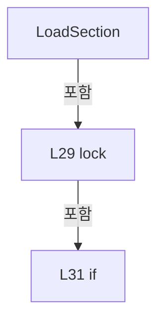

변경 전 점검: 입력/반환 타입, 위 호출자, 예외/취소 경로, 공유 상태와 저장·전송 소비자를 함께 확인합니다. 값의 단위나 물리 방향을 이름만으로 확정하지 않습니다.

### MethodDeclaration `ReloadSection` · L40–50

[Drilling.Common/Managers/CSettingManager.cs:40–50](https://github.com/kjuws10-rgb/A3Drilling/blob/0219666f9053b907d96d7e0aa7d0c6c1be3a73d4/Drilling.Common/Managers/CSettingManager.cs#L40-L50)

| 항목 | 실제 추출 값 |
| --- | --- |
| 서명 | System.Collections.Generic.IReadOnlyList<Drilling.Common.Managers.ST_SYSTEM_PARAMETER> Drilling.Common.Managers.CSettingManager.ReloadSection(Drilling.Common.Managers.EN_SETTING_TAB, System.Threading.CancellationToken) |
| 접근/수식자 | Public / public |
| 반환/값 타입 | System.Collections.Generic.IReadOnlyList<Drilling.Common.Managers.ST_SYSTEM_PARAMETER> |
| 소속 타입 | NamedType:Drilling.Common.Managers.CSettingManager |

입력 계약:

| 이름 | 타입 | 전달 | 선택/기본값 |
| --- | --- | --- | --- |
| section | Drilling.Common.Managers.EN_SETTING_TAB | None | False /  |
| cancellationToken | System.Threading.CancellationToken | None | True / null |

정적 호출자로 확인된 위치:

| 호출 파일/행 | 호출 표현식 | 런타임 분기 가능 |
| --- | --- | --- |
| [Drilling.Common/Managers/CSettingManager.cs:37–37](https://github.com/kjuws10-rgb/A3Drilling/blob/0219666f9053b907d96d7e0aa7d0c6c1be3a73d4/Drilling.Common/Managers/CSettingManager.cs#L37-L37) | ReloadSection | False |
| [Drilling.Common/Managers/CSettingManager.cs:56–56](https://github.com/kjuws10-rgb/A3Drilling/blob/0219666f9053b907d96d7e0aa7d0c6c1be3a73d4/Drilling.Common/Managers/CSettingManager.cs#L56-L56) | ReloadSection | False |
| [Drilling.UI/Menu/Menus/CMenuSetting.cs:516–516](https://github.com/kjuws10-rgb/A3Drilling/blob/0219666f9053b907d96d7e0aa7d0c6c1be3a73d4/Drilling.UI/Menu/Menus/CMenuSetting.cs#L516-L516) | _settingManager.ReloadSection | False |

호출하는 대상과 해석 범위:

| 원본 행 | 표현식 | 분석 상태 | 대상/소스 위치 |
| --- | --- | --- | --- |
| 45 | settingFile.Load(section, cancellationToken).ToArray | resolved | Drilling.Common.Managers.ST_SYSTEM_PARAMETER[] System.Collections.Generic.IEnumerable<Drilling.Common.Managers.ST_SYSTEM_PARAMETER>.ToArray<Drilling.Common.Managers.ST_SYSTEM_PARAMETER>() |
| 45 | settingFile.Load | resolved | System.Collections.Generic.IReadOnlyList<Drilling.Common.Managers.ST_SYSTEM_PARAMETER> Drilling.Common.Managers.CSettingFileBase.Load(Drilling.Common.Managers.EN_SETTING_TAB, System.Threading.CancellationToken) · Drilling.Common/Managers/CSettingManager.cs:283 |

본문의 실제 연산·분기·예외·반환 순서(원문 위치 순):

| 원본 행 | 종류 | 주석 해설 |
| --- | --- | --- |
| 43 | lock | 공유 상태의 임계 구역에 진입합니다: lock (_saveLock) |
| 45 | call | 함수·델리게이트 또는 객체 생성자를 호출합니다: settingFile.Load(section, cancellationToken).ToArray() |
| 45 | call | 함수·델리게이트 또는 객체 생성자를 호출합니다: settingFile.Load(section, cancellationToken) |
| 45 | local-declaration | 지역 변수를 선언합니다: var loadedParameters = settingFile.Load(section, cancellationToken).ToArray(); |
| 45 | variable-initializer | 변수의 초기값을 지정합니다: loadedParameters = settingFile.Load(section, cancellationToken).ToArray() |
| 46 | lock | 공유 상태의 임계 구역에 진입합니다: lock (_cacheLock) |
| 47 | assignment | 값을 대상에 대입합니다: _sectionCache[section] = loadedParameters |
| 48 | return | 호출자에게 값 또는 제어를 반환합니다: return loadedParameters; |

제어 구문의 포함 구조(실제 실행 순서/CFG가 아닌 구문 탐색 그림):

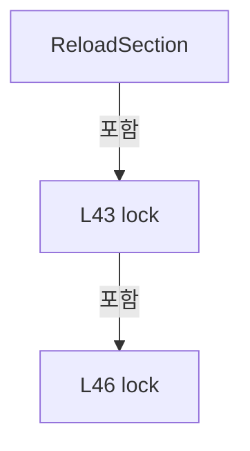

변경 전 점검: 입력/반환 타입, 위 호출자, 예외/취소 경로, 공유 상태와 저장·전송 소비자를 함께 확인합니다. 값의 단위나 물리 방향을 이름만으로 확정하지 않습니다.

### MethodDeclaration `LoadAllSections` · L52–58

[Drilling.Common/Managers/CSettingManager.cs:52–58](https://github.com/kjuws10-rgb/A3Drilling/blob/0219666f9053b907d96d7e0aa7d0c6c1be3a73d4/Drilling.Common/Managers/CSettingManager.cs#L52-L58)

| 항목 | 실제 추출 값 |
| --- | --- |
| 서명 | void Drilling.Common.Managers.CSettingManager.LoadAllSections(System.Threading.CancellationToken) |
| 접근/수식자 | Public / public |
| 반환/값 타입 | void |
| 소속 타입 | NamedType:Drilling.Common.Managers.CSettingManager |

입력 계약:

| 이름 | 타입 | 전달 | 선택/기본값 |
| --- | --- | --- | --- |
| cancellationToken | System.Threading.CancellationToken | None | True / null |

정적 호출자로 확인된 위치:

| 호출 파일/행 | 호출 표현식 | 런타임 분기 가능 |
| --- | --- | --- |
| [Drilling.Common/Managers/CManager.cs:99–99](https://github.com/kjuws10-rgb/A3Drilling/blob/0219666f9053b907d96d7e0aa7d0c6c1be3a73d4/Drilling.Common/Managers/CManager.cs#L99-L99) | _settingManager.LoadAllSections | False |

호출하는 대상과 해석 범위:

| 원본 행 | 표현식 | 분석 상태 | 대상/소스 위치 |
| --- | --- | --- | --- |
| 54 | Enum.GetValues<EN_SETTING_TAB> | resolved | Drilling.Common.Managers.EN_SETTING_TAB[] System.Enum.GetValues<Drilling.Common.Managers.EN_SETTING_TAB>() |
| 56 | ReloadSection | resolved | System.Collections.Generic.IReadOnlyList<Drilling.Common.Managers.ST_SYSTEM_PARAMETER> Drilling.Common.Managers.CSettingManager.ReloadSection(Drilling.Common.Managers.EN_SETTING_TAB, System.Threading.CancellationToken) · Drilling.Common/Managers/CSettingManager.cs:40 |

본문의 실제 연산·분기·예외·반환 순서(원문 위치 순):

| 원본 행 | 종류 | 주석 해설 |
| --- | --- | --- |
| 54 | call | 함수·델리게이트 또는 객체 생성자를 호출합니다: Enum.GetValues<EN_SETTING_TAB>() |
| 54 | foreach | 컬렉션 요소를 순회합니다: foreach (var section in Enum.GetValues<EN_SETTING_TAB>()) |
| 56 | call | 함수·델리게이트 또는 객체 생성자를 호출합니다: ReloadSection(section, cancellationToken) |

제어 구문의 포함 구조(실제 실행 순서/CFG가 아닌 구문 탐색 그림):

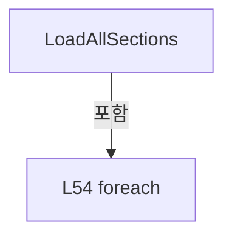

변경 전 점검: 입력/반환 타입, 위 호출자, 예외/취소 경로, 공유 상태와 저장·전송 소비자를 함께 확인합니다. 값의 단위나 물리 방향을 이름만으로 확정하지 않습니다.

### MethodDeclaration `GetValue` · L60–71

[Drilling.Common/Managers/CSettingManager.cs:60–71](https://github.com/kjuws10-rgb/A3Drilling/blob/0219666f9053b907d96d7e0aa7d0c6c1be3a73d4/Drilling.Common/Managers/CSettingManager.cs#L60-L71)

| 항목 | 실제 추출 값 |
| --- | --- |
| 서명 | string Drilling.Common.Managers.CSettingManager.GetValue(Drilling.Common.Managers.EN_SETTING_TAB, string, string, System.Threading.CancellationToken) |
| 접근/수식자 | Public / public |
| 반환/값 타입 | string |
| 소속 타입 | NamedType:Drilling.Common.Managers.CSettingManager |

입력 계약:

| 이름 | 타입 | 전달 | 선택/기본값 |
| --- | --- | --- | --- |
| section | Drilling.Common.Managers.EN_SETTING_TAB | None | False /  |
| name | string | None | False /  |
| defaultValue | string | None | True / "" |
| cancellationToken | System.Threading.CancellationToken | None | True / null |

정적 호출자로 확인된 위치:

| 호출 파일/행 | 호출 표현식 | 런타임 분기 가능 |
| --- | --- | --- |
| [Drilling.Common/Automation/CAutomationManager.cs:1041–1041](https://github.com/kjuws10-rgb/A3Drilling/blob/0219666f9053b907d96d7e0aa7d0c6c1be3a73d4/Drilling.Common/Automation/CAutomationManager.cs#L1041-L1041) | _settingManager.GetValue | False |
| [Drilling.Common/Automation/CAutomationManager.cs:1067–1067](https://github.com/kjuws10-rgb/A3Drilling/blob/0219666f9053b907d96d7e0aa7d0c6c1be3a73d4/Drilling.Common/Automation/CAutomationManager.cs#L1067-L1067) | _settingManager.GetValue | False |
| [Drilling.Common/Interface/CPowerMeasureRun.cs:25–25](https://github.com/kjuws10-rgb/A3Drilling/blob/0219666f9053b907d96d7e0aa7d0c6c1be3a73d4/Drilling.Common/Interface/CPowerMeasureRun.cs#L25-L25) | settings.GetValue | False |
| [Drilling.Common/Interface/CPowerMeasureRun.cs:27–27](https://github.com/kjuws10-rgb/A3Drilling/blob/0219666f9053b907d96d7e0aa7d0c6c1be3a73d4/Drilling.Common/Interface/CPowerMeasureRun.cs#L27-L27) | settings.GetValue | False |
| [Drilling.Common/Interface/CPowerMeasureRun.cs:38–38](https://github.com/kjuws10-rgb/A3Drilling/blob/0219666f9053b907d96d7e0aa7d0c6c1be3a73d4/Drilling.Common/Interface/CPowerMeasureRun.cs#L38-L38) | settings.GetValue | False |
| [Drilling.Common/Managers/CManager.cs:269–269](https://github.com/kjuws10-rgb/A3Drilling/blob/0219666f9053b907d96d7e0aa7d0c6c1be3a73d4/Drilling.Common/Managers/CManager.cs#L269-L269) | _settingManager.GetValue | False |
| [Drilling.Common/Managers/CManager.cs:270–270](https://github.com/kjuws10-rgb/A3Drilling/blob/0219666f9053b907d96d7e0aa7d0c6c1be3a73d4/Drilling.Common/Managers/CManager.cs#L270-L270) | _settingManager.GetValue | False |
| [Drilling.Common/Managers/CSettingManager.cs:108–108](https://github.com/kjuws10-rgb/A3Drilling/blob/0219666f9053b907d96d7e0aa7d0c6c1be3a73d4/Drilling.Common/Managers/CSettingManager.cs#L108-L108) | GetValue | False |
| [Drilling.Common/Managers/CSettingManager.cs:114–114](https://github.com/kjuws10-rgb/A3Drilling/blob/0219666f9053b907d96d7e0aa7d0c6c1be3a73d4/Drilling.Common/Managers/CSettingManager.cs#L114-L114) | GetValue | False |
| [Drilling.Common/Station/CStationProcess.cs:4983–4983](https://github.com/kjuws10-rgb/A3Drilling/blob/0219666f9053b907d96d7e0aa7d0c6c1be3a73d4/Drilling.Common/Station/CStationProcess.cs#L4983-L4983) | settings.GetValue | False |
| [Drilling.UI/CRootView.cs:164–164](https://github.com/kjuws10-rgb/A3Drilling/blob/0219666f9053b907d96d7e0aa7d0c6c1be3a73d4/Drilling.UI/CRootView.cs#L164-L164) | settingManager.GetValue | False |
| [Drilling.UI/CRootView.cs:1455–1455](https://github.com/kjuws10-rgb/A3Drilling/blob/0219666f9053b907d96d7e0aa7d0c6c1be3a73d4/Drilling.UI/CRootView.cs#L1455-L1455) | _manager.Setting().GetValue | False |
| [Drilling.UI/Menu/Menus/CMenuCorrection.cs:2321–2321](https://github.com/kjuws10-rgb/A3Drilling/blob/0219666f9053b907d96d7e0aa7d0c6c1be3a73d4/Drilling.UI/Menu/Menus/CMenuCorrection.cs#L2321-L2321) | _settingManager.GetValue | False |
| [Drilling.UI/Menu/Menus/CMenuCorrection.cs:2322–2322](https://github.com/kjuws10-rgb/A3Drilling/blob/0219666f9053b907d96d7e0aa7d0c6c1be3a73d4/Drilling.UI/Menu/Menus/CMenuCorrection.cs#L2322-L2322) | _settingManager.GetValue | False |
| [Drilling.UI/Menu/Menus/CMenuCorrection.cs:2323–2323](https://github.com/kjuws10-rgb/A3Drilling/blob/0219666f9053b907d96d7e0aa7d0c6c1be3a73d4/Drilling.UI/Menu/Menus/CMenuCorrection.cs#L2323-L2323) | _settingManager.GetValue | False |
| [Drilling.UI/Menu/Menus/CMenuCorrection.cs:2999–2999](https://github.com/kjuws10-rgb/A3Drilling/blob/0219666f9053b907d96d7e0aa7d0c6c1be3a73d4/Drilling.UI/Menu/Menus/CMenuCorrection.cs#L2999-L2999) | _settingManager.GetValue | False |
| [Drilling.UI/Menu/Menus/CMenuMain.cs:2998–2998](https://github.com/kjuws10-rgb/A3Drilling/blob/0219666f9053b907d96d7e0aa7d0c6c1be3a73d4/Drilling.UI/Menu/Menus/CMenuMain.cs#L2998-L2998) | _settings.GetValue | False |
| [Drilling.UI/Menu/Menus/CMenuMonitor.cs:6525–6525](https://github.com/kjuws10-rgb/A3Drilling/blob/0219666f9053b907d96d7e0aa7d0c6c1be3a73d4/Drilling.UI/Menu/Menus/CMenuMonitor.cs#L6525-L6525) | _settingManager.GetValue | False |
| [Drilling.UI/Menu/Menus/CMenuPm.cs:113–113](https://github.com/kjuws10-rgb/A3Drilling/blob/0219666f9053b907d96d7e0aa7d0c6c1be3a73d4/Drilling.UI/Menu/Menus/CMenuPm.cs#L113-L113) | settingManager.GetValue | False |

호출하는 대상과 해석 범위:

| 원본 행 | 표현식 | 분석 상태 | 대상/소스 위치 |
| --- | --- | --- | --- |
| 62 | ArgumentException.ThrowIfNullOrWhiteSpace | resolved | void System.ArgumentException.ThrowIfNullOrWhiteSpace(string?, string?) |
| 63 | LoadSection | resolved | System.Collections.Generic.IReadOnlyList<Drilling.Common.Managers.ST_SYSTEM_PARAMETER> Drilling.Common.Managers.CSettingManager.LoadSection(Drilling.Common.Managers.EN_SETTING_TAB, System.Threading.CancellationToken) · Drilling.Common/Managers/CSettingManager.cs:26 |
| 69 | parameters.FirstOrDefault | resolved | Drilling.Common.Managers.ST_SYSTEM_PARAMETER? System.Collections.Generic.IEnumerable<Drilling.Common.Managers.ST_SYSTEM_PARAMETER>.FirstOrDefault<Drilling.Common.Managers.ST_SYSTEM_PARAMETER>(System.Func<Drilling.Common.Managers.ST_SYSTEM_PARAMETER, bool>) |
| 70 | string.IsNullOrWhiteSpace | resolved | bool string.IsNullOrWhiteSpace(string?) |

본문의 실제 연산·분기·예외·반환 순서(원문 위치 순):

| 원본 행 | 종류 | 주석 해설 |
| --- | --- | --- |
| 62 | call | 함수·델리게이트 또는 객체 생성자를 호출합니다: ArgumentException.ThrowIfNullOrWhiteSpace(name) |
| 63 | call | 함수·델리게이트 또는 객체 생성자를 호출합니다: LoadSection(section, cancellationToken) |
| 63 | local-declaration | 지역 변수를 선언합니다: var parameters = LoadSection(section, cancellationToken); |
| 63 | variable-initializer | 변수의 초기값을 지정합니다: parameters = LoadSection(section, cancellationToken) |
| 69 | call | 함수·델리게이트 또는 객체 생성자를 호출합니다: parameters.FirstOrDefault(MatchesItem) |
| 69 | local-declaration | 지역 변수를 선언합니다: var parameter = parameters.FirstOrDefault(MatchesItem); |
| 69 | variable-initializer | 변수의 초기값을 지정합니다: parameter = parameters.FirstOrDefault(MatchesItem) |
| 70 | call | 함수·델리게이트 또는 객체 생성자를 호출합니다: string.IsNullOrWhiteSpace(parameter.Value) |
| 70 | conditional-expression | 조건에 따라 결과식을 선택합니다: parameter is null &#124;&#124; string.IsNullOrWhiteSpace(parameter.Value) ? defaultValue : parameter.Value |
| 70 | return | 호출자에게 값 또는 제어를 반환합니다: return parameter is null &#124;&#124; string.IsNullOrWhiteSpace(parameter.Value) ? defaultValue : parameter.Value; |

변경 전 점검: 입력/반환 타입, 위 호출자, 예외/취소 경로, 공유 상태와 저장·전송 소비자를 함께 확인합니다. 값의 단위나 물리 방향을 이름만으로 확정하지 않습니다.

### LocalFunctionStatement `MatchesItem` · L64–67

[Drilling.Common/Managers/CSettingManager.cs:64–67](https://github.com/kjuws10-rgb/A3Drilling/blob/0219666f9053b907d96d7e0aa7d0c6c1be3a73d4/Drilling.Common/Managers/CSettingManager.cs#L64-L67)

| 항목 | 실제 추출 값 |
| --- | --- |
| 서명 | bool MatchesItem(Drilling.Common.Managers.ST_SYSTEM_PARAMETER) |
| 접근/수식자 | Private /  |
| 반환/값 타입 | bool |
| 소속 타입 | NamedType:Drilling.Common.Managers.CSettingManager |

입력 계약:

| 이름 | 타입 | 전달 | 선택/기본값 |
| --- | --- | --- | --- |
| item | Drilling.Common.Managers.ST_SYSTEM_PARAMETER | None | False /  |

현재 부분 분석에서 직접 연결된 호출자는 없습니다. XAML/이벤트/인터페이스·델리게이트·외부 진입을 추가 확인해야 하며, 미사용으로 판정한 것이 아닙니다.

호출하는 대상과 해석 범위:

| 원본 행 | 표현식 | 분석 상태 | 대상/소스 위치 |
| --- | --- | --- | --- |
| 66 | item.Key.Equals | resolved | bool string.Equals(string?, System.StringComparison) |
| 66 | item.Name.Equals | resolved | bool string.Equals(string?, System.StringComparison) |

본문의 실제 연산·분기·예외·반환 순서(원문 위치 순):

| 원본 행 | 종류 | 주석 해설 |
| --- | --- | --- |
| 66 | call | 함수·델리게이트 또는 객체 생성자를 호출합니다: item.Key.Equals(name, StringComparison.OrdinalIgnoreCase) |
| 66 | call | 함수·델리게이트 또는 객체 생성자를 호출합니다: item.Name.Equals(name, StringComparison.OrdinalIgnoreCase) |
| 66 | return | 호출자에게 값 또는 제어를 반환합니다: return item.Key.Equals(name, StringComparison.OrdinalIgnoreCase) &#124;&#124; item.Name.Equals(name, StringComparison.OrdinalIgnoreCase); |

변경 전 점검: 입력/반환 타입, 위 호출자, 예외/취소 경로, 공유 상태와 저장·전송 소비자를 함께 확인합니다. 값의 단위나 물리 방향을 이름만으로 확정하지 않습니다.

### MethodDeclaration `SetValue` · L73–103

[Drilling.Common/Managers/CSettingManager.cs:73–103](https://github.com/kjuws10-rgb/A3Drilling/blob/0219666f9053b907d96d7e0aa7d0c6c1be3a73d4/Drilling.Common/Managers/CSettingManager.cs#L73-L103)

| 항목 | 실제 추출 값 |
| --- | --- |
| 서명 | void Drilling.Common.Managers.CSettingManager.SetValue(Drilling.Common.Managers.EN_SETTING_TAB, string, string, System.Threading.CancellationToken) |
| 접근/수식자 | Public / public |
| 반환/값 타입 | void |
| 소속 타입 | NamedType:Drilling.Common.Managers.CSettingManager |

입력 계약:

| 이름 | 타입 | 전달 | 선택/기본값 |
| --- | --- | --- | --- |
| section | Drilling.Common.Managers.EN_SETTING_TAB | None | False /  |
| name | string | None | False /  |
| value | string | None | False /  |
| cancellationToken | System.Threading.CancellationToken | None | True / null |

정적 호출자로 확인된 위치:

| 호출 파일/행 | 호출 표현식 | 런타임 분기 가능 |
| --- | --- | --- |
| [Drilling.Common/Station/CStationProcess.cs:4304–4304](https://github.com/kjuws10-rgb/A3Drilling/blob/0219666f9053b907d96d7e0aa7d0c6c1be3a73d4/Drilling.Common/Station/CStationProcess.cs#L4304-L4304) | _settingManager.SetValue | False |
| [Drilling.Common/Station/CStationProcess.cs:6292–6292](https://github.com/kjuws10-rgb/A3Drilling/blob/0219666f9053b907d96d7e0aa7d0c6c1be3a73d4/Drilling.Common/Station/CStationProcess.cs#L6292-L6292) | settings.SetValue | False |
| [Drilling.Common/Station/CStationProcess.cs:6540–6540](https://github.com/kjuws10-rgb/A3Drilling/blob/0219666f9053b907d96d7e0aa7d0c6c1be3a73d4/Drilling.Common/Station/CStationProcess.cs#L6540-L6540) | settings.SetValue | False |
| [Drilling.UI/Menu/Menus/CMenuMain.cs:2999–2999](https://github.com/kjuws10-rgb/A3Drilling/blob/0219666f9053b907d96d7e0aa7d0c6c1be3a73d4/Drilling.UI/Menu/Menus/CMenuMain.cs#L2999-L2999) | _settings.SetValue | False |
| [Drilling.UI/Menu/Menus/CMenuRecipe.cs:774–774](https://github.com/kjuws10-rgb/A3Drilling/blob/0219666f9053b907d96d7e0aa7d0c6c1be3a73d4/Drilling.UI/Menu/Menus/CMenuRecipe.cs#L774-L774) | _settingManager.SetValue | False |
| [Drilling.UI/Menu/Menus/CMenuRecipe.cs:1167–1167](https://github.com/kjuws10-rgb/A3Drilling/blob/0219666f9053b907d96d7e0aa7d0c6c1be3a73d4/Drilling.UI/Menu/Menus/CMenuRecipe.cs#L1167-L1167) | _settingManager.SetValue | False |

호출하는 대상과 해석 범위:

| 원본 행 | 표현식 | 분석 상태 | 대상/소스 위치 |
| --- | --- | --- | --- |
| 77 | ArgumentException.ThrowIfNullOrWhiteSpace | resolved | void System.ArgumentException.ThrowIfNullOrWhiteSpace(string?, string?) |
| 78 | LoadSection | resolved | System.Collections.Generic.IReadOnlyList<Drilling.Common.Managers.ST_SYSTEM_PARAMETER> Drilling.Common.Managers.CSettingManager.LoadSection(Drilling.Common.Managers.EN_SETTING_TAB, System.Threading.CancellationToken) · Drilling.Common/Managers/CSettingManager.cs:26 |
| 95 | parameters.Select(SelectParameter).ToArray | resolved | Drilling.Common.Managers.ST_SYSTEM_PARAMETER[] System.Collections.Generic.IEnumerable<Drilling.Common.Managers.ST_SYSTEM_PARAMETER>.ToArray<Drilling.Common.Managers.ST_SYSTEM_PARAMETER>() |
| 95 | parameters.Select | resolved | System.Collections.Generic.IEnumerable<Drilling.Common.Managers.ST_SYSTEM_PARAMETER> System.Collections.Generic.IEnumerable<Drilling.Common.Managers.ST_SYSTEM_PARAMETER>.Select<Drilling.Common.Managers.ST_SYSTEM_PARAMETER, Drilling.Common.Managers.ST_SYSTEM_PARAMETER>(System.Func<Drilling.Common.Managers.ST_SYSTEM_PARAMETER, Drilling.Common.Managers.ST_SYSTEM_PARAMETER>) |
| 98 | new InvalidDataException | resolved | System.IO.InvalidDataException.InvalidDataException(string?) |
| 101 | SaveSection | resolved | void Drilling.Common.Managers.CSettingManager.SaveSection(Drilling.Common.Managers.EN_SETTING_TAB, System.Collections.Generic.IReadOnlyList<Drilling.Common.Managers.ST_SYSTEM_PARAMETER>, System.Threading.CancellationToken) · Drilling.Common/Managers/CSettingManager.cs:126 |

본문의 실제 연산·분기·예외·반환 순서(원문 위치 순):

| 원본 행 | 종류 | 주석 해설 |
| --- | --- | --- |
| 75 | lock | 공유 상태의 임계 구역에 진입합니다: lock (_saveLock) |
| 77 | call | 함수·델리게이트 또는 객체 생성자를 호출합니다: ArgumentException.ThrowIfNullOrWhiteSpace(name) |
| 78 | call | 함수·델리게이트 또는 객체 생성자를 호출합니다: LoadSection(section, cancellationToken) |
| 78 | local-declaration | 지역 변수를 선언합니다: var parameters = LoadSection(section, cancellationToken); |
| 78 | variable-initializer | 변수의 초기값을 지정합니다: parameters = LoadSection(section, cancellationToken) |
| 79 | local-declaration | 지역 변수를 선언합니다: var found = false; |
| 79 | variable-initializer | 변수의 초기값을 지정합니다: found = false |
| 95 | call | 함수·델리게이트 또는 객체 생성자를 호출합니다: parameters.Select(SelectParameter).ToArray() |
| 95 | call | 함수·델리게이트 또는 객체 생성자를 호출합니다: parameters.Select(SelectParameter) |
| 95 | local-declaration | 지역 변수를 선언합니다: var editedParameters = parameters.Select(SelectParameter).ToArray(); |
| 95 | variable-initializer | 변수의 초기값을 지정합니다: editedParameters = parameters.Select(SelectParameter).ToArray() |
| 96 | if | 조건에 따라 분기합니다: if (!found) |
| 98 | call | 함수·델리게이트 또는 객체 생성자를 호출합니다: new InvalidDataException($"Setting parameter is not defined: {section}/{name}") |
| 98 | throw | 예외를 발생/전달합니다: throw new InvalidDataException($"Setting parameter is not defined: {section}/{name}"); |
| 101 | call | 함수·델리게이트 또는 객체 생성자를 호출합니다: SaveSection(section, editedParameters, cancellationToken) |

제어 구문의 포함 구조(실제 실행 순서/CFG가 아닌 구문 탐색 그림):

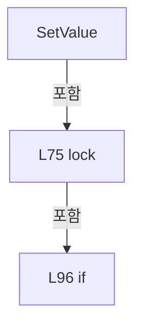

변경 전 점검: 입력/반환 타입, 위 호출자, 예외/취소 경로, 공유 상태와 저장·전송 소비자를 함께 확인합니다. 값의 단위나 물리 방향을 이름만으로 확정하지 않습니다.

### LocalFunctionStatement `SelectParameter` · L80–93

[Drilling.Common/Managers/CSettingManager.cs:80–93](https://github.com/kjuws10-rgb/A3Drilling/blob/0219666f9053b907d96d7e0aa7d0c6c1be3a73d4/Drilling.Common/Managers/CSettingManager.cs#L80-L93)

| 항목 | 실제 추출 값 |
| --- | --- |
| 서명 | Drilling.Common.Managers.ST_SYSTEM_PARAMETER SelectParameter(Drilling.Common.Managers.ST_SYSTEM_PARAMETER) |
| 접근/수식자 | Private /  |
| 반환/값 타입 | Drilling.Common.Managers.ST_SYSTEM_PARAMETER |
| 소속 타입 | NamedType:Drilling.Common.Managers.CSettingManager |

입력 계약:

| 이름 | 타입 | 전달 | 선택/기본값 |
| --- | --- | --- | --- |
| parameter | Drilling.Common.Managers.ST_SYSTEM_PARAMETER | None | False /  |

현재 부분 분석에서 직접 연결된 호출자는 없습니다. XAML/이벤트/인터페이스·델리게이트·외부 진입을 추가 확인해야 하며, 미사용으로 판정한 것이 아닙니다.

호출하는 대상과 해석 범위:

| 원본 행 | 표현식 | 분석 상태 | 대상/소스 위치 |
| --- | --- | --- | --- |
| 82 | parameter.Key.Equals | resolved | bool string.Equals(string?, System.StringComparison) |
| 82 | parameter.Name.Equals | resolved | bool string.Equals(string?, System.StringComparison) |

본문의 실제 연산·분기·예외·반환 순서(원문 위치 순):

| 원본 행 | 종류 | 주석 해설 |
| --- | --- | --- |
| 82 | call | 함수·델리게이트 또는 객체 생성자를 호출합니다: parameter.Key.Equals(name, StringComparison.OrdinalIgnoreCase) |
| 82 | call | 함수·델리게이트 또는 객체 생성자를 호출합니다: parameter.Name.Equals(name, StringComparison.OrdinalIgnoreCase) |
| 82 | local-declaration | 지역 변수를 선언합니다: var isTarget = parameter.Key.Equals(name, StringComparison.OrdinalIgnoreCase) &#124;&#124; parameter.Name.Equals(name, StringComparison.OrdinalIgnoreCase); |
| 82 | variable-initializer | 변수의 초기값을 지정합니다: isTarget = parameter.Key.Equals(name, StringComparison.OrdinalIgnoreCase) &#124;&#124; parameter.Name.Equals(name, StringComparison.OrdinalIgnoreCase) |
| 83 | if | 조건에 따라 분기합니다: if (!isTarget) |
| 85 | return | 호출자에게 값 또는 제어를 반환합니다: return parameter; |
| 88 | assignment | 값을 대상에 대입합니다: found = true |
| 89 | return | 호출자에게 값 또는 제어를 반환합니다: return parameter with { Value = value }; |
| 91 | assignment | 값을 대상에 대입합니다: Value = value |

제어 구문의 포함 구조(실제 실행 순서/CFG가 아닌 구문 탐색 그림):

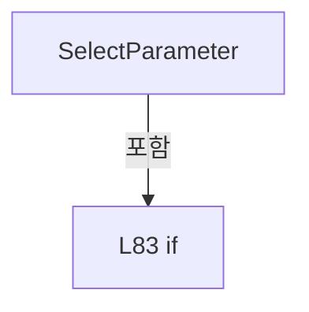

변경 전 점검: 입력/반환 타입, 위 호출자, 예외/취소 경로, 공유 상태와 저장·전송 소비자를 함께 확인합니다. 값의 단위나 물리 방향을 이름만으로 확정하지 않습니다.

### MethodDeclaration `GetVisionMaxHoleCountPerLine` · L105–112

[Drilling.Common/Managers/CSettingManager.cs:105–112](https://github.com/kjuws10-rgb/A3Drilling/blob/0219666f9053b907d96d7e0aa7d0c6c1be3a73d4/Drilling.Common/Managers/CSettingManager.cs#L105-L112)

| 항목 | 실제 추출 값 |
| --- | --- |
| 서명 | int Drilling.Common.Managers.CSettingManager.GetVisionMaxHoleCountPerLine() |
| 접근/수식자 | Public / public |
| 반환/값 타입 | int |
| 소속 타입 | NamedType:Drilling.Common.Managers.CSettingManager |

정적 호출자로 확인된 위치:

| 호출 파일/행 | 호출 표현식 | 런타임 분기 가능 |
| --- | --- | --- |
| [Drilling.Common/Review/CReviewManager.cs:2126–2126](https://github.com/kjuws10-rgb/A3Drilling/blob/0219666f9053b907d96d7e0aa7d0c6c1be3a73d4/Drilling.Common/Review/CReviewManager.cs#L2126-L2126) | settingManager.GetVisionMaxHoleCountPerLine | False |
| [Drilling.Common/Review/CReviewManager.cs:2549–2549](https://github.com/kjuws10-rgb/A3Drilling/blob/0219666f9053b907d96d7e0aa7d0c6c1be3a73d4/Drilling.Common/Review/CReviewManager.cs#L2549-L2549) | settingManager.GetVisionMaxHoleCountPerLine | False |
| [Drilling.Common/Review/CReviewManager.cs:2666–2666](https://github.com/kjuws10-rgb/A3Drilling/blob/0219666f9053b907d96d7e0aa7d0c6c1be3a73d4/Drilling.Common/Review/CReviewManager.cs#L2666-L2666) | settingManager.GetVisionMaxHoleCountPerLine | False |

호출하는 대상과 해석 범위:

| 원본 행 | 표현식 | 분석 상태 | 대상/소스 위치 |
| --- | --- | --- | --- |
| 108 | GetValue | resolved | string Drilling.Common.Managers.CSettingManager.GetValue(Drilling.Common.Managers.EN_SETTING_TAB, string, string, System.Threading.CancellationToken) · Drilling.Common/Managers/CSettingManager.cs:60 |
| 108 | CVisionProtocol.DefaultMaxHoleCountPerLine.ToString | resolved | string int.ToString(System.IFormatProvider?) |
| 109 | int.TryParse | resolved | bool int.TryParse(string?, System.Globalization.NumberStyles, System.IFormatProvider?, out int) |
| 110 | new InvalidDataException | resolved | System.IO.InvalidDataException.InvalidDataException(string?) |
| 111 | CVisionProtocol.ValidateLineCapacity | resolved | int Drilling.Common.Interface.Vision.CVisionProtocol.ValidateLineCapacity(int) · Drilling.Common/Interface/Vision/CVisionComm.cs:573 |

본문의 실제 연산·분기·예외·반환 순서(원문 위치 순):

| 원본 행 | 종류 | 주석 해설 |
| --- | --- | --- |
| 108 | call | 함수·델리게이트 또는 객체 생성자를 호출합니다: GetValue(EN_SETTING_TAB.Option, CVisionProtocol.MaxHoleCountPerLineSettingKey, CVisionProtocol.DefaultMaxHoleCountPerLine.ToString(CultureInfo.InvariantCulture)) |
| 108 | call | 함수·델리게이트 또는 객체 생성자를 호출합니다: CVisionProtocol.DefaultMaxHoleCountPerLine.ToString(CultureInfo.InvariantCulture) |
| 108 | local-declaration | 지역 변수를 선언합니다: var text = GetValue(EN_SETTING_TAB.Option, CVisionProtocol.MaxHoleCountPerLineSettingKey, CVisionProtocol.DefaultMaxHoleCountPerLine.ToString(CultureInfo.InvariantCulture)); |
| 108 | variable-initializer | 변수의 초기값을 지정합니다: text = GetValue(EN_SETTING_TAB.Option, CVisionProtocol.MaxHoleCountPerLineSettingKey, CVisionProtocol.DefaultMaxHoleCountPerLine.ToString(CultureInfo.InvariantCulture)) |
| 109 | call | 함수·델리게이트 또는 객체 생성자를 호출합니다: int.TryParse(text, NumberStyles.Integer, CultureInfo.InvariantCulture, out var value) |
| 109 | if | 조건에 따라 분기합니다: if (!int.TryParse(text, NumberStyles.Integer, CultureInfo.InvariantCulture, out var value)) |
| 110 | call | 함수·델리게이트 또는 객체 생성자를 호출합니다: new InvalidDataException("Setting-Review MaxHoleCountPerLine은 정수여야 합니다.") |
| 110 | throw | 예외를 발생/전달합니다: throw new InvalidDataException("Setting-Review MaxHoleCountPerLine은 정수여야 합니다."); |
| 111 | call | 함수·델리게이트 또는 객체 생성자를 호출합니다: CVisionProtocol.ValidateLineCapacity(value) |
| 111 | return | 호출자에게 값 또는 제어를 반환합니다: return CVisionProtocol.ValidateLineCapacity(value); |

제어 구문의 포함 구조(실제 실행 순서/CFG가 아닌 구문 탐색 그림):

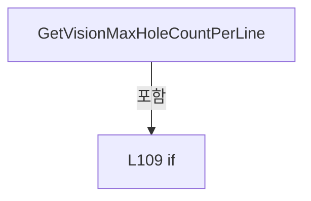

변경 전 점검: 입력/반환 타입, 위 호출자, 예외/취소 경로, 공유 상태와 저장·전송 소비자를 함께 확인합니다. 값의 단위나 물리 방향을 이름만으로 확정하지 않습니다.

### MethodDeclaration `GetVisionCameraResolution` · L114–114

[Drilling.Common/Managers/CSettingManager.cs:114–114](https://github.com/kjuws10-rgb/A3Drilling/blob/0219666f9053b907d96d7e0aa7d0c6c1be3a73d4/Drilling.Common/Managers/CSettingManager.cs#L114-L114)

| 항목 | 실제 추출 값 |
| --- | --- |
| 서명 | double Drilling.Common.Managers.CSettingManager.GetVisionCameraResolution() |
| 접근/수식자 | Public / public |
| 반환/값 타입 | double |
| 소속 타입 | NamedType:Drilling.Common.Managers.CSettingManager |

정적 호출자로 확인된 위치:

| 호출 파일/행 | 호출 표현식 | 런타임 분기 가능 |
| --- | --- | --- |
| [Drilling.Common/Review/CReviewManager.cs:48–48](https://github.com/kjuws10-rgb/A3Drilling/blob/0219666f9053b907d96d7e0aa7d0c6c1be3a73d4/Drilling.Common/Review/CReviewManager.cs#L48-L48) | settingManager.GetVisionCameraResolution | False |
| [Drilling.Common/Review/CReviewManager.cs:2185–2185](https://github.com/kjuws10-rgb/A3Drilling/blob/0219666f9053b907d96d7e0aa7d0c6c1be3a73d4/Drilling.Common/Review/CReviewManager.cs#L2185-L2185) | settingManager.GetVisionCameraResolution | False |
| [Drilling.Common/Review/CReviewManager.cs:2284–2284](https://github.com/kjuws10-rgb/A3Drilling/blob/0219666f9053b907d96d7e0aa7d0c6c1be3a73d4/Drilling.Common/Review/CReviewManager.cs#L2284-L2284) | settingManager.GetVisionCameraResolution | False |
| [Drilling.Common/Review/CReviewManager.cs:2361–2361](https://github.com/kjuws10-rgb/A3Drilling/blob/0219666f9053b907d96d7e0aa7d0c6c1be3a73d4/Drilling.Common/Review/CReviewManager.cs#L2361-L2361) | settingManager.GetVisionCameraResolution | False |

호출하는 대상과 해석 범위:

| 원본 행 | 표현식 | 분석 상태 | 대상/소스 위치 |
| --- | --- | --- | --- |
| 114 | ParseVisionCameraResolution | resolved | double Drilling.Common.Managers.CSettingManager.ParseVisionCameraResolution(string) · Drilling.Common/Managers/CSettingManager.cs:119 |
| 114 | GetValue | resolved | string Drilling.Common.Managers.CSettingManager.GetValue(Drilling.Common.Managers.EN_SETTING_TAB, string, string, System.Threading.CancellationToken) · Drilling.Common/Managers/CSettingManager.cs:60 |
| 114 | DefaultVisionCameraResolution.ToString | resolved | string double.ToString(string?, System.IFormatProvider?) |

본문의 실제 연산·분기·예외·반환 순서(원문 위치 순):

| 원본 행 | 종류 | 주석 해설 |
| --- | --- | --- |
| 114 | call | 함수·델리게이트 또는 객체 생성자를 호출합니다: ParseVisionCameraResolution(GetValue(EN_SETTING_TAB.Option, VisionCameraResolutionKey, DefaultVisionCameraResolution.ToString("R", CultureInfo.InvariantCulture))) |
| 114 | call | 함수·델리게이트 또는 객체 생성자를 호출합니다: GetValue(EN_SETTING_TAB.Option, VisionCameraResolutionKey, DefaultVisionCameraResolution.ToString("R", CultureInfo.InvariantCulture)) |
| 114 | call | 함수·델리게이트 또는 객체 생성자를 호출합니다: DefaultVisionCameraResolution.ToString("R", CultureInfo.InvariantCulture) |

변경 전 점검: 입력/반환 타입, 위 호출자, 예외/취소 경로, 공유 상태와 저장·전송 소비자를 함께 확인합니다. 값의 단위나 물리 방향을 이름만으로 확정하지 않습니다.

### MethodDeclaration `GetAlignKeyMargins` · L116–117

[Drilling.Common/Managers/CSettingManager.cs:116–117](https://github.com/kjuws10-rgb/A3Drilling/blob/0219666f9053b907d96d7e0aa7d0c6c1be3a73d4/Drilling.Common/Managers/CSettingManager.cs#L116-L117)

| 항목 | 실제 추출 값 |
| --- | --- |
| 서명 | Drilling.Common.Managers.ST_ALIGN_KEY_MARGINS Drilling.Common.Managers.CSettingManager.GetAlignKeyMargins(System.Threading.CancellationToken) |
| 접근/수식자 | Public / public |
| 반환/값 타입 | Drilling.Common.Managers.ST_ALIGN_KEY_MARGINS |
| 소속 타입 | NamedType:Drilling.Common.Managers.CSettingManager |

입력 계약:

| 이름 | 타입 | 전달 | 선택/기본값 |
| --- | --- | --- | --- |
| cancellationToken | System.Threading.CancellationToken | None | True / null |

정적 호출자로 확인된 위치:

| 호출 파일/행 | 호출 표현식 | 런타임 분기 가능 |
| --- | --- | --- |
| [Drilling.Common/Review/CReviewManager.cs:49–49](https://github.com/kjuws10-rgb/A3Drilling/blob/0219666f9053b907d96d7e0aa7d0c6c1be3a73d4/Drilling.Common/Review/CReviewManager.cs#L49-L49) | settingManager.GetAlignKeyMargins | False |
| [Drilling.Common/Review/CReviewManager.cs:516–516](https://github.com/kjuws10-rgb/A3Drilling/blob/0219666f9053b907d96d7e0aa7d0c6c1be3a73d4/Drilling.Common/Review/CReviewManager.cs#L516-L516) | settingManager.GetAlignKeyMargins | False |
| [Drilling.Common/Review/CReviewManager.cs:1454–1454](https://github.com/kjuws10-rgb/A3Drilling/blob/0219666f9053b907d96d7e0aa7d0c6c1be3a73d4/Drilling.Common/Review/CReviewManager.cs#L1454-L1454) | settingManager.GetAlignKeyMargins | False |
| [Drilling.UI/Menu/Menus/CMenuCorrection.cs:2918–2918](https://github.com/kjuws10-rgb/A3Drilling/blob/0219666f9053b907d96d7e0aa7d0c6c1be3a73d4/Drilling.UI/Menu/Menus/CMenuCorrection.cs#L2918-L2918) | _settingManager.GetAlignKeyMargins | False |
| [Drilling.UI/Menu/Menus/CMenuCorrection.cs:2992–2992](https://github.com/kjuws10-rgb/A3Drilling/blob/0219666f9053b907d96d7e0aa7d0c6c1be3a73d4/Drilling.UI/Menu/Menus/CMenuCorrection.cs#L2992-L2992) | _settingManager.GetAlignKeyMargins | False |

호출하는 대상과 해석 범위:

| 원본 행 | 표현식 | 분석 상태 | 대상/소스 위치 |
| --- | --- | --- | --- |
| 117 | CAlignKeyMarginSettings.Read | resolved | Drilling.Common.Managers.ST_ALIGN_KEY_MARGINS Drilling.Common.Managers.CAlignKeyMarginSettings.Read(System.Collections.Generic.IReadOnlyList<Drilling.Common.Managers.ST_SYSTEM_PARAMETER>) · Drilling.Common/Managers/CAlignKeyMarginSettings.cs:15 |
| 117 | LoadSection | resolved | System.Collections.Generic.IReadOnlyList<Drilling.Common.Managers.ST_SYSTEM_PARAMETER> Drilling.Common.Managers.CSettingManager.LoadSection(Drilling.Common.Managers.EN_SETTING_TAB, System.Threading.CancellationToken) · Drilling.Common/Managers/CSettingManager.cs:26 |

본문의 실제 연산·분기·예외·반환 순서(원문 위치 순):

| 원본 행 | 종류 | 주석 해설 |
| --- | --- | --- |
| 117 | call | 함수·델리게이트 또는 객체 생성자를 호출합니다: CAlignKeyMarginSettings.Read(LoadSection(EN_SETTING_TAB.Option, cancellationToken)) |
| 117 | call | 함수·델리게이트 또는 객체 생성자를 호출합니다: LoadSection(EN_SETTING_TAB.Option, cancellationToken) |

변경 전 점검: 입력/반환 타입, 위 호출자, 예외/취소 경로, 공유 상태와 저장·전송 소비자를 함께 확인합니다. 값의 단위나 물리 방향을 이름만으로 확정하지 않습니다.

### MethodDeclaration `ParseVisionCameraResolution` · L119–124

[Drilling.Common/Managers/CSettingManager.cs:119–124](https://github.com/kjuws10-rgb/A3Drilling/blob/0219666f9053b907d96d7e0aa7d0c6c1be3a73d4/Drilling.Common/Managers/CSettingManager.cs#L119-L124)

| 항목 | 실제 추출 값 |
| --- | --- |
| 서명 | double Drilling.Common.Managers.CSettingManager.ParseVisionCameraResolution(string) |
| 접근/수식자 | Private / private, static |
| 반환/값 타입 | double |
| 소속 타입 | NamedType:Drilling.Common.Managers.CSettingManager |

입력 계약:

| 이름 | 타입 | 전달 | 선택/기본값 |
| --- | --- | --- | --- |
| text | string | None | False /  |

정적 호출자로 확인된 위치:

| 호출 파일/행 | 호출 표현식 | 런타임 분기 가능 |
| --- | --- | --- |
| [Drilling.Common/Managers/CSettingManager.cs:114–114](https://github.com/kjuws10-rgb/A3Drilling/blob/0219666f9053b907d96d7e0aa7d0c6c1be3a73d4/Drilling.Common/Managers/CSettingManager.cs#L114-L114) | ParseVisionCameraResolution | False |
| [Drilling.Common/Managers/CSettingManager.cs:135–135](https://github.com/kjuws10-rgb/A3Drilling/blob/0219666f9053b907d96d7e0aa7d0c6c1be3a73d4/Drilling.Common/Managers/CSettingManager.cs#L135-L135) | ParseVisionCameraResolution | False |

호출하는 대상과 해석 범위:

| 원본 행 | 표현식 | 분석 상태 | 대상/소스 위치 |
| --- | --- | --- | --- |
| 121 | double.TryParse | resolved | bool double.TryParse(string?, System.Globalization.NumberStyles, System.IFormatProvider?, out double) |
| 121 | double.IsFinite | resolved | bool double.IsFinite(double) |
| 122 | new InvalidDataException | resolved | System.IO.InvalidDataException.InvalidDataException(string?) |

본문의 실제 연산·분기·예외·반환 순서(원문 위치 순):

| 원본 행 | 종류 | 주석 해설 |
| --- | --- | --- |
| 121 | call | 함수·델리게이트 또는 객체 생성자를 호출합니다: double.TryParse(text, NumberStyles.Float, CultureInfo.InvariantCulture, out var value) |
| 121 | call | 함수·델리게이트 또는 객체 생성자를 호출합니다: double.IsFinite(value) |
| 121 | if | 조건에 따라 분기합니다: if (!double.TryParse(text, NumberStyles.Float, CultureInfo.InvariantCulture, out var value) &#124;&#124; !double.IsFinite(value) &#124;&#124; value <= 0) |
| 122 | call | 함수·델리게이트 또는 객체 생성자를 호출합니다: new InvalidDataException("Setting-Review Review_Camera_Resolution은 0보다 큰 유한한 mm/pixel 값이어야 합니다.") |
| 122 | throw | 예외를 발생/전달합니다: throw new InvalidDataException("Setting-Review Review_Camera_Resolution은 0보다 큰 유한한 mm/pixel 값이어야 합니다."); |
| 123 | return | 호출자에게 값 또는 제어를 반환합니다: return value; |

제어 구문의 포함 구조(실제 실행 순서/CFG가 아닌 구문 탐색 그림):

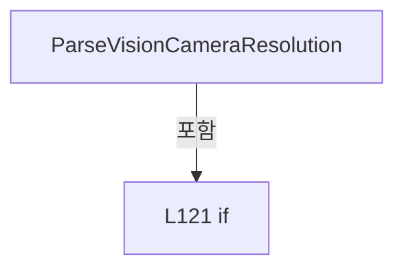

변경 전 점검: 입력/반환 타입, 위 호출자, 예외/취소 경로, 공유 상태와 저장·전송 소비자를 함께 확인합니다. 값의 단위나 물리 방향을 이름만으로 확정하지 않습니다.

### MethodDeclaration `SaveSection` · L126–156

[Drilling.Common/Managers/CSettingManager.cs:126–156](https://github.com/kjuws10-rgb/A3Drilling/blob/0219666f9053b907d96d7e0aa7d0c6c1be3a73d4/Drilling.Common/Managers/CSettingManager.cs#L126-L156)

| 항목 | 실제 추출 값 |
| --- | --- |
| 서명 | void Drilling.Common.Managers.CSettingManager.SaveSection(Drilling.Common.Managers.EN_SETTING_TAB, System.Collections.Generic.IReadOnlyList<Drilling.Common.Managers.ST_SYSTEM_PARAMETER>, System.Threading.CancellationToken) |
| 접근/수식자 | Public / public |
| 반환/값 타입 | void |
| 소속 타입 | NamedType:Drilling.Common.Managers.CSettingManager |

입력 계약:

| 이름 | 타입 | 전달 | 선택/기본값 |
| --- | --- | --- | --- |
| section | Drilling.Common.Managers.EN_SETTING_TAB | None | False /  |
| parameters | System.Collections.Generic.IReadOnlyList<Drilling.Common.Managers.ST_SYSTEM_PARAMETER> | None | False /  |
| cancellationToken | System.Threading.CancellationToken | None | True / null |

정적 호출자로 확인된 위치:

| 호출 파일/행 | 호출 표현식 | 런타임 분기 가능 |
| --- | --- | --- |
| [Drilling.Common/Managers/CSettingManager.cs:101–101](https://github.com/kjuws10-rgb/A3Drilling/blob/0219666f9053b907d96d7e0aa7d0c6c1be3a73d4/Drilling.Common/Managers/CSettingManager.cs#L101-L101) | SaveSection | False |
| [Drilling.UI/Menu/Menus/CMenuSetting.cs:445–445](https://github.com/kjuws10-rgb/A3Drilling/blob/0219666f9053b907d96d7e0aa7d0c6c1be3a73d4/Drilling.UI/Menu/Menus/CMenuSetting.cs#L445-L445) | _settingManager.SaveSection | False |

호출하는 대상과 해석 범위:

| 원본 행 | 표현식 | 분석 상태 | 대상/소스 위치 |
| --- | --- | --- | --- |
| 133 | parameters.FirstOrDefault | resolved | Drilling.Common.Managers.ST_SYSTEM_PARAMETER? System.Collections.Generic.IEnumerable<Drilling.Common.Managers.ST_SYSTEM_PARAMETER>.FirstOrDefault<Drilling.Common.Managers.ST_SYSTEM_PARAMETER>(System.Func<Drilling.Common.Managers.ST_SYSTEM_PARAMETER, bool>) |
| 133 | p.Key.Equals | resolved | bool string.Equals(string?, System.StringComparison) |
| 135 | ParseVisionCameraResolution | resolved | double Drilling.Common.Managers.CSettingManager.ParseVisionCameraResolution(string) · Drilling.Common/Managers/CSettingManager.cs:119 |
| 136 | parameters.FirstOrDefault | resolved | Drilling.Common.Managers.ST_SYSTEM_PARAMETER? System.Collections.Generic.IEnumerable<Drilling.Common.Managers.ST_SYSTEM_PARAMETER>.FirstOrDefault<Drilling.Common.Managers.ST_SYSTEM_PARAMETER>(System.Func<Drilling.Common.Managers.ST_SYSTEM_PARAMETER, bool>) |
| 136 | p.Key.Equals | resolved | bool string.Equals(string?, System.StringComparison) |
| 137 | double.TryParse | resolved | bool double.TryParse(string?, System.Globalization.NumberStyles, System.IFormatProvider?, out double) |
| 137 | double.IsFinite | resolved | bool double.IsFinite(double) |
| 138 | new InvalidDataException | resolved | System.IO.InvalidDataException.InvalidDataException(string?) |
| 139 | parameters.FirstOrDefault | resolved | Drilling.Common.Managers.ST_SYSTEM_PARAMETER? System.Collections.Generic.IEnumerable<Drilling.Common.Managers.ST_SYSTEM_PARAMETER>.FirstOrDefault<Drilling.Common.Managers.ST_SYSTEM_PARAMETER>(System.Func<Drilling.Common.Managers.ST_SYSTEM_PARAMETER, bool>) |
| 139 | p.Key.Equals | resolved | bool string.Equals(string?, System.StringComparison) |
| 140 | double.TryParse | resolved | bool double.TryParse(string?, System.Globalization.NumberStyles, System.IFormatProvider?, out double) |
| 140 | double.IsFinite | resolved | bool double.IsFinite(double) |
| 141 | new InvalidDataException | resolved | System.IO.InvalidDataException.InvalidDataException(string?) |
| 142 | CAlignKeyMarginSettings.Read | resolved | Drilling.Common.Managers.ST_ALIGN_KEY_MARGINS Drilling.Common.Managers.CAlignKeyMarginSettings.Read(System.Collections.Generic.IReadOnlyList<Drilling.Common.Managers.ST_SYSTEM_PARAMETER>) · Drilling.Common/Managers/CAlignKeyMarginSettings.cs:15 |
| 143 | CReviewResultLevelSettings.Read | resolved | Drilling.Common.Review.ST_REVIEW_RESULT_LEVEL_SETTINGS Drilling.Common.Review.CReviewResultLevelSettings.Read(System.Collections.Generic.IEnumerable<Drilling.Common.Managers.ST_SYSTEM_PARAMETER>) · Drilling.Common/Review/CReviewResultLevelSettings.cs:94 |
| 144 | CRunOptionSettings.Read | resolved | Drilling.Common.Managers.ST_RUN_OPTION_SETTINGS Drilling.Common.Managers.CRunOptionSettings.Read(System.Collections.Generic.IReadOnlyList<Drilling.Common.Managers.ST_SYSTEM_PARAMETER>) · Drilling.Common/Managers/CSettingManager.cs:206 |
| 145 | CRunOptionSettings.Read | resolved | Drilling.Common.Managers.ST_RUN_OPTION_SETTINGS Drilling.Common.Managers.CRunOptionSettings.Read(System.Collections.Generic.IReadOnlyList<Drilling.Common.Managers.ST_SYSTEM_PARAMETER>) · Drilling.Common/Managers/CSettingManager.cs:206 |
| 145 | LoadSection | resolved | System.Collections.Generic.IReadOnlyList<Drilling.Common.Managers.ST_SYSTEM_PARAMETER> Drilling.Common.Managers.CSettingManager.LoadSection(Drilling.Common.Managers.EN_SETTING_TAB, System.Threading.CancellationToken) · Drilling.Common/Managers/CSettingManager.cs:26 |
| 146 | .Melsec.GetCachedValue | resolved | Drilling.Common.Interface.ST_MELSEC_CACHED_VALUE? Drilling.Common.Interface.CMelsec.GetCachedValue(string) · Drilling.Common/Interface/Melsec/CMelsec.cs:2569 |
| 147 | Convert.ToDouble | resolved | double System.Convert.ToDouble(object?, System.IFormatProvider?) |
| 148 | new InvalidDataException | resolved | System.IO.InvalidDataException.InvalidDataException(string?) |
| 151 | settingFile.Save | resolved | void Drilling.Common.Managers.CSettingFileBase.Save(Drilling.Common.Managers.EN_SETTING_TAB, System.Collections.Generic.IReadOnlyList<Drilling.Common.Managers.ST_SYSTEM_PARAMETER>, System.Threading.CancellationToken) · Drilling.Common/Managers/CSettingManager.cs:284 |
| 154 | parameters.ToArray | resolved | Drilling.Common.Managers.ST_SYSTEM_PARAMETER[] System.Collections.Generic.IEnumerable<Drilling.Common.Managers.ST_SYSTEM_PARAMETER>.ToArray<Drilling.Common.Managers.ST_SYSTEM_PARAMETER>() |

본문의 실제 연산·분기·예외·반환 순서(원문 위치 순):

| 원본 행 | 종류 | 주석 해설 |
| --- | --- | --- |
| 128 | lock | 공유 상태의 임계 구역에 진입합니다: lock (_saveLock) |
| 131 | if | 조건에 따라 분기합니다: if (section == EN_SETTING_TAB.Option) |
| 133 | call | 함수·델리게이트 또는 객체 생성자를 호출합니다: parameters.FirstOrDefault(p => p.Key.Equals(VisionCameraResolutionKey, StringComparison.OrdinalIgnoreCase)) |
| 133 | call | 함수·델리게이트 또는 객체 생성자를 호출합니다: p.Key.Equals(VisionCameraResolutionKey, StringComparison.OrdinalIgnoreCase) |
| 133 | local-declaration | 지역 변수를 선언합니다: var resolution = parameters.FirstOrDefault(p => p.Key.Equals(VisionCameraResolutionKey, StringComparison.OrdinalIgnoreCase)); |
| 133 | variable-initializer | 변수의 초기값을 지정합니다: resolution = parameters.FirstOrDefault(p => p.Key.Equals(VisionCameraResolutionKey, StringComparison.OrdinalIgnoreCase)) |
| 134 | if | 조건에 따라 분기합니다: if (resolution is not null) |
| 135 | assignment | 값을 대상에 대입합니다: _ = ParseVisionCameraResolution(resolution.Value) |
| 135 | call | 함수·델리게이트 또는 객체 생성자를 호출합니다: ParseVisionCameraResolution(resolution.Value) |
| 136 | call | 함수·델리게이트 또는 객체 생성자를 호출합니다: parameters.FirstOrDefault(p => p.Key.Equals(AlignCameraResolutionKey, StringComparison.OrdinalIgnoreCase)) |
| 136 | call | 함수·델리게이트 또는 객체 생성자를 호출합니다: p.Key.Equals(AlignCameraResolutionKey, StringComparison.OrdinalIgnoreCase) |
| 136 | local-declaration | 지역 변수를 선언합니다: var alignResolution = parameters.FirstOrDefault(p => p.Key.Equals(AlignCameraResolutionKey, StringComparison.OrdinalIgnoreCase)); |
| 136 | variable-initializer | 변수의 초기값을 지정합니다: alignResolution = parameters.FirstOrDefault(p => p.Key.Equals(AlignCameraResolutionKey, StringComparison.OrdinalIgnoreCase)) |
| 137 | call | 함수·델리게이트 또는 객체 생성자를 호출합니다: double.TryParse(alignResolution.Value, NumberStyles.Float, CultureInfo.InvariantCulture, out var alignValue) |
| 137 | call | 함수·델리게이트 또는 객체 생성자를 호출합니다: double.IsFinite(alignValue) |
| 137 | if | 조건에 따라 분기합니다: if (alignResolution is not null && (!double.TryParse(alignResolution.Value, NumberStyles.Float, CultureInfo.InvariantCulture, out var alignValue) &#124;&#124; !double.IsFinite(alignValue) &#124;&#124; alignValue <= 0)) |
| 138 | call | 함수·델리게이트 또는 객체 생성자를 호출합니다: new InvalidDataException("Setting-Align Align_Camera_Resolution은 0보다 큰 유한한 mm/pixel 값이어야 합니다.") |
| 138 | throw | 예외를 발생/전달합니다: throw new InvalidDataException("Setting-Align Align_Camera_Resolution은 0보다 큰 유한한 mm/pixel 값이어야 합니다."); |
| 139 | call | 함수·델리게이트 또는 객체 생성자를 호출합니다: parameters.FirstOrDefault(p => p.Key.Equals(WapageAlignBaseToleranceKey, StringComparison.OrdinalIgnoreCase)) |
| 139 | call | 함수·델리게이트 또는 객체 생성자를 호출합니다: p.Key.Equals(WapageAlignBaseToleranceKey, StringComparison.OrdinalIgnoreCase) |
| 139 | local-declaration | 지역 변수를 선언합니다: var tolerance = parameters.FirstOrDefault(p => p.Key.Equals(WapageAlignBaseToleranceKey, StringComparison.OrdinalIgnoreCase)); |
| 139 | variable-initializer | 변수의 초기값을 지정합니다: tolerance = parameters.FirstOrDefault(p => p.Key.Equals(WapageAlignBaseToleranceKey, StringComparison.OrdinalIgnoreCase)) |
| 140 | call | 함수·델리게이트 또는 객체 생성자를 호출합니다: double.TryParse(tolerance.Value, NumberStyles.Float, CultureInfo.InvariantCulture, out var toleranceValue) |
| 140 | call | 함수·델리게이트 또는 객체 생성자를 호출합니다: double.IsFinite(toleranceValue) |
| 140 | if | 조건에 따라 분기합니다: if (tolerance is not null && (!double.TryParse(tolerance.Value, NumberStyles.Float, CultureInfo.InvariantCulture, out var toleranceValue) &#124;&#124; !double.IsFinite(toleranceValue) &#124;&#124; toleranceValue < 0)) |
| 141 | call | 함수·델리게이트 또는 객체 생성자를 호출합니다: new InvalidDataException("Setting-Align Wapage_AlignBase_Tolerance는 0 이상의 유한한 mm 값이어야 합니다.") |
| 141 | throw | 예외를 발생/전달합니다: throw new InvalidDataException("Setting-Align Wapage_AlignBase_Tolerance는 0 이상의 유한한 mm 값이어야 합니다."); |
| 142 | assignment | 값을 대상에 대입합니다: _ = CAlignKeyMarginSettings.Read(parameters) |
| 142 | call | 함수·델리게이트 또는 객체 생성자를 호출합니다: CAlignKeyMarginSettings.Read(parameters) |
| 143 | assignment | 값을 대상에 대입합니다: _ = CReviewResultLevelSettings.Read(parameters) |
| 143 | call | 함수·델리게이트 또는 객체 생성자를 호출합니다: CReviewResultLevelSettings.Read(parameters) |
| 144 | call | 함수·델리게이트 또는 객체 생성자를 호출합니다: CRunOptionSettings.Read(parameters) |
| 144 | local-declaration | 지역 변수를 선언합니다: var edited = CRunOptionSettings.Read(parameters); |
| 144 | variable-initializer | 변수의 초기값을 지정합니다: edited = CRunOptionSettings.Read(parameters) |
| 145 | call | 함수·델리게이트 또는 객체 생성자를 호출합니다: CRunOptionSettings.Read(LoadSection(section, cancellationToken)) |
| 145 | call | 함수·델리게이트 또는 객체 생성자를 호출합니다: LoadSection(section, cancellationToken) |
| 145 | local-declaration | 지역 변수를 선언합니다: var current = CRunOptionSettings.Read(LoadSection(section, cancellationToken)); |
| 145 | variable-initializer | 변수의 초기값을 지정합니다: current = CRunOptionSettings.Read(LoadSection(section, cancellationToken)) |
| 146 | call | 함수·델리게이트 또는 객체 생성자를 호출합니다: .Melsec.GetCachedValue("HANDSHAKE_PRC_REVIEW_ABLE") |
| 146 | local-declaration | 지역 변수를 선언합니다: var able = interfaceManager?.Melsec.GetCachedValue("HANDSHAKE_PRC_REVIEW_ABLE"); |
| 146 | variable-initializer | 변수의 초기값을 지정합니다: able = interfaceManager?.Melsec.GetCachedValue("HANDSHAKE_PRC_REVIEW_ABLE") |
| 147 | call | 함수·델리게이트 또는 객체 생성자를 호출합니다: Convert.ToDouble(able.Value, System.Globalization.CultureInfo.InvariantCulture) |
| 147 | if | 조건에 따라 분기합니다: if (edited.ReviewOptions != current.ReviewOptions && able?.IsValid == true && Convert.ToDouble(able.Value, System.Globalization.CultureInfo.InvariantCulture) == 1) |
| 148 | call | 함수·델리게이트 또는 객체 생성자를 호출합니다: new InvalidDataException("Review ABLE ON 상태에서는 리뷰 Run Option을 변경할 수 없습니다.") |
| 148 | throw | 예외를 발생/전달합니다: throw new InvalidDataException("Review ABLE ON 상태에서는 리뷰 Run Option을 변경할 수 없습니다."); |
| 151 | call | 함수·델리게이트 또는 객체 생성자를 호출합니다: settingFile.Save(section, parameters, cancellationToken) |
| 153 | lock | 공유 상태의 임계 구역에 진입합니다: lock (_cacheLock) |
| 154 | assignment | 값을 대상에 대입합니다: _sectionCache[section] = parameters.ToArray() |
| 154 | call | 함수·델리게이트 또는 객체 생성자를 호출합니다: parameters.ToArray() |

제어 구문의 포함 구조(실제 실행 순서/CFG가 아닌 구문 탐색 그림):

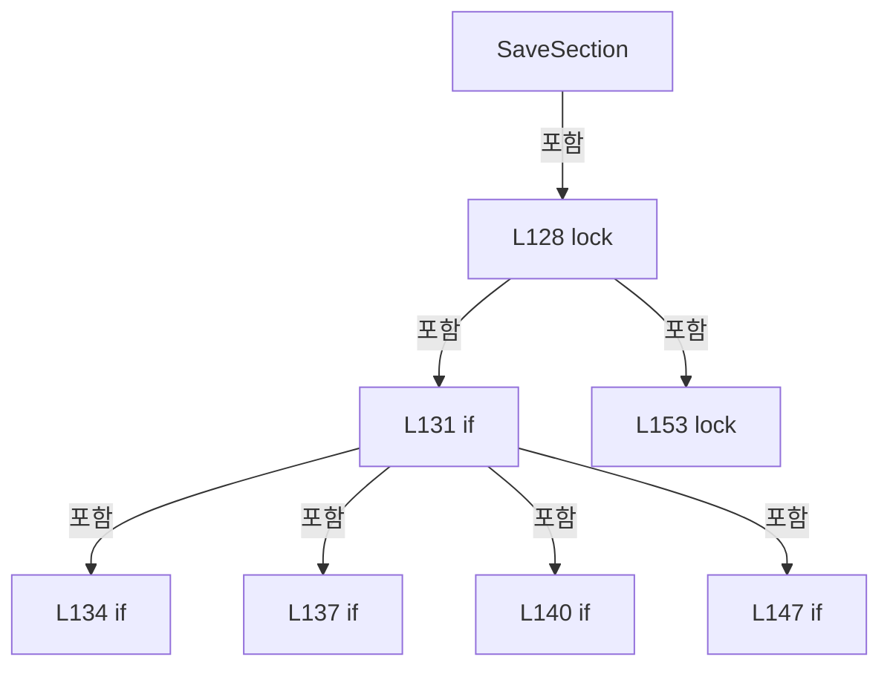

변경 전 점검: 입력/반환 타입, 위 호출자, 예외/취소 경로, 공유 상태와 저장·전송 소비자를 함께 확인합니다. 값의 단위나 물리 방향을 이름만으로 확정하지 않습니다.

### MethodDeclaration `LoadHistory` · L158–161

[Drilling.Common/Managers/CSettingManager.cs:158–161](https://github.com/kjuws10-rgb/A3Drilling/blob/0219666f9053b907d96d7e0aa7d0c6c1be3a73d4/Drilling.Common/Managers/CSettingManager.cs#L158-L161)

| 항목 | 실제 추출 값 |
| --- | --- |
| 서명 | System.Collections.Generic.IReadOnlyList<Drilling.Common.Managers.ST_SETTING_HISTORY> Drilling.Common.Managers.CSettingManager.LoadHistory(Drilling.Common.Managers.EN_SETTING_TAB, System.Threading.CancellationToken) |
| 접근/수식자 | Public / public |
| 반환/값 타입 | System.Collections.Generic.IReadOnlyList<Drilling.Common.Managers.ST_SETTING_HISTORY> |
| 소속 타입 | NamedType:Drilling.Common.Managers.CSettingManager |

입력 계약:

| 이름 | 타입 | 전달 | 선택/기본값 |
| --- | --- | --- | --- |
| section | Drilling.Common.Managers.EN_SETTING_TAB | None | False /  |
| cancellationToken | System.Threading.CancellationToken | None | True / null |

정적 호출자로 확인된 위치:

| 호출 파일/행 | 호출 표현식 | 런타임 분기 가능 |
| --- | --- | --- |
| [Drilling.UI/Menu/Menus/CMenuSetting.cs:256–256](https://github.com/kjuws10-rgb/A3Drilling/blob/0219666f9053b907d96d7e0aa7d0c6c1be3a73d4/Drilling.UI/Menu/Menus/CMenuSetting.cs#L256-L256) | _settingManager.LoadHistory | False |

호출하는 대상과 해석 범위:

| 원본 행 | 표현식 | 분석 상태 | 대상/소스 위치 |
| --- | --- | --- | --- |
| 160 | settingFile.LoadHistory | resolved | System.Collections.Generic.IReadOnlyList<Drilling.Common.Managers.ST_SETTING_HISTORY> Drilling.Common.Managers.CSettingFileBase.LoadHistory(Drilling.Common.Managers.EN_SETTING_TAB, System.Threading.CancellationToken) · Drilling.Common/Managers/CSettingManager.cs:285 |

본문의 실제 연산·분기·예외·반환 순서(원문 위치 순):

| 원본 행 | 종류 | 주석 해설 |
| --- | --- | --- |
| 160 | call | 함수·델리게이트 또는 객체 생성자를 호출합니다: settingFile.LoadHistory(section, cancellationToken) |
| 160 | return | 호출자에게 값 또는 제어를 반환합니다: return settingFile.LoadHistory(section, cancellationToken); |

변경 전 점검: 입력/반환 타입, 위 호출자, 예외/취소 경로, 공유 상태와 저장·전송 소비자를 함께 확인합니다. 값의 단위나 물리 방향을 이름만으로 확정하지 않습니다.

### MethodDeclaration `LoadInterfaceList` · L163–166

[Drilling.Common/Managers/CSettingManager.cs:163–166](https://github.com/kjuws10-rgb/A3Drilling/blob/0219666f9053b907d96d7e0aa7d0c6c1be3a73d4/Drilling.Common/Managers/CSettingManager.cs#L163-L166)

| 항목 | 실제 추출 값 |
| --- | --- |
| 서명 | System.Collections.Generic.IReadOnlyList<Drilling.Common.Interface.ST_INTERFACE_DATA> Drilling.Common.Managers.CSettingManager.LoadInterfaceList(System.Threading.CancellationToken) |
| 접근/수식자 | Public / public |
| 반환/값 타입 | System.Collections.Generic.IReadOnlyList<Drilling.Common.Interface.ST_INTERFACE_DATA> |
| 소속 타입 | NamedType:Drilling.Common.Managers.CSettingManager |

입력 계약:

| 이름 | 타입 | 전달 | 선택/기본값 |
| --- | --- | --- | --- |
| cancellationToken | System.Threading.CancellationToken | None | True / null |

정적 호출자로 확인된 위치:

| 호출 파일/행 | 호출 표현식 | 런타임 분기 가능 |
| --- | --- | --- |
| [Drilling.UI/Menu/Menus/CMenuSetting.cs:233–233](https://github.com/kjuws10-rgb/A3Drilling/blob/0219666f9053b907d96d7e0aa7d0c6c1be3a73d4/Drilling.UI/Menu/Menus/CMenuSetting.cs#L233-L233) | _settingManager.LoadInterfaceList | False |

호출하는 대상과 해석 범위:

| 원본 행 | 표현식 | 분석 상태 | 대상/소스 위치 |
| --- | --- | --- | --- |
| 165 | interfaceFile.LoadAll | resolved | System.Collections.Generic.IReadOnlyList<Drilling.Common.Interface.ST_INTERFACE_DATA> Drilling.Common.Managers.CInterfaceFileBase.LoadAll(System.Threading.CancellationToken) · Drilling.Common/Managers/CSettingManager.cs:290 |

본문의 실제 연산·분기·예외·반환 순서(원문 위치 순):

| 원본 행 | 종류 | 주석 해설 |
| --- | --- | --- |
| 165 | call | 함수·델리게이트 또는 객체 생성자를 호출합니다: interfaceFile.LoadAll(cancellationToken) |
| 165 | return | 호출자에게 값 또는 제어를 반환합니다: return interfaceFile.LoadAll(cancellationToken); |

변경 전 점검: 입력/반환 타입, 위 호출자, 예외/취소 경로, 공유 상태와 저장·전송 소비자를 함께 확인합니다. 값의 단위나 물리 방향을 이름만으로 확정하지 않습니다.

### MethodDeclaration `SaveInterfaceList` · L168–172

[Drilling.Common/Managers/CSettingManager.cs:168–172](https://github.com/kjuws10-rgb/A3Drilling/blob/0219666f9053b907d96d7e0aa7d0c6c1be3a73d4/Drilling.Common/Managers/CSettingManager.cs#L168-L172)

| 항목 | 실제 추출 값 |
| --- | --- |
| 서명 | System.Threading.Tasks.Task Drilling.Common.Managers.CSettingManager.SaveInterfaceList(System.Collections.Generic.IReadOnlyList<Drilling.Common.Interface.ST_INTERFACE_DATA>, System.Threading.CancellationToken) |
| 접근/수식자 | Public / public, async |
| 반환/값 타입 | System.Threading.Tasks.Task |
| 소속 타입 | NamedType:Drilling.Common.Managers.CSettingManager |

입력 계약:

| 이름 | 타입 | 전달 | 선택/기본값 |
| --- | --- | --- | --- |
| interfaces | System.Collections.Generic.IReadOnlyList<Drilling.Common.Interface.ST_INTERFACE_DATA> | None | False /  |
| cancellationToken | System.Threading.CancellationToken | None | True / null |

정적 호출자로 확인된 위치:

| 호출 파일/행 | 호출 표현식 | 런타임 분기 가능 |
| --- | --- | --- |
| [Drilling.UI/Menu/Menus/CMenuSetting.cs:415–415](https://github.com/kjuws10-rgb/A3Drilling/blob/0219666f9053b907d96d7e0aa7d0c6c1be3a73d4/Drilling.UI/Menu/Menus/CMenuSetting.cs#L415-L415) | _settingManager.SaveInterfaceList | False |

호출하는 대상과 해석 범위:

| 원본 행 | 표현식 | 분석 상태 | 대상/소스 위치 |
| --- | --- | --- | --- |
| 170 | interfaceFile.SaveAll | resolved | void Drilling.Common.Managers.CInterfaceFileBase.SaveAll(System.Collections.Generic.IReadOnlyList<Drilling.Common.Interface.ST_INTERFACE_DATA>, System.Threading.CancellationToken) · Drilling.Common/Managers/CSettingManager.cs:291 |
| 171 | interfaceManager.Reload | resolved | System.Threading.Tasks.Task Drilling.Common.Interface.CInterfaceManager.Reload(System.Collections.Generic.IReadOnlyList<Drilling.Common.Interface.ST_INTERFACE_DATA>, bool, System.Threading.CancellationToken) · Drilling.Common/Interface/CInterfaceManager.cs:2060 |

본문의 실제 연산·분기·예외·반환 순서(원문 위치 순):

| 원본 행 | 종류 | 주석 해설 |
| --- | --- | --- |
| 170 | call | 함수·델리게이트 또는 객체 생성자를 호출합니다: interfaceFile.SaveAll(interfaces, cancellationToken) |
| 171 | await | 비동기 완료를 기다립니다: await interfaceManager.Reload(interfaces, reconnect: false, cancellationToken) |
| 171 | call | 함수·델리게이트 또는 객체 생성자를 호출합니다: interfaceManager.Reload(interfaces, reconnect: false, cancellationToken) |

변경 전 점검: 입력/반환 타입, 위 호출자, 예외/취소 경로, 공유 상태와 저장·전송 소비자를 함께 확인합니다. 값의 단위나 물리 방향을 이름만으로 확정하지 않습니다.

### MethodDeclaration `ConnectInterface` · L174–177

[Drilling.Common/Managers/CSettingManager.cs:174–177](https://github.com/kjuws10-rgb/A3Drilling/blob/0219666f9053b907d96d7e0aa7d0c6c1be3a73d4/Drilling.Common/Managers/CSettingManager.cs#L174-L177)

| 항목 | 실제 추출 값 |
| --- | --- |
| 서명 | System.Threading.Tasks.Task Drilling.Common.Managers.CSettingManager.ConnectInterface(Drilling.Common.Interface.EN_EQP_MODULE, int, System.Threading.CancellationToken) |
| 접근/수식자 | Public / public |
| 반환/값 타입 | System.Threading.Tasks.Task |
| 소속 타입 | NamedType:Drilling.Common.Managers.CSettingManager |

입력 계약:

| 이름 | 타입 | 전달 | 선택/기본값 |
| --- | --- | --- | --- |
| module | Drilling.Common.Interface.EN_EQP_MODULE | None | False /  |
| number | int | None | False /  |
| cancellationToken | System.Threading.CancellationToken | None | True / null |

정적 호출자로 확인된 위치:

| 호출 파일/행 | 호출 표현식 | 런타임 분기 가능 |
| --- | --- | --- |
| [Drilling.UI/Menu/Menus/CMenuSetting.cs:347–349](https://github.com/kjuws10-rgb/A3Drilling/blob/0219666f9053b907d96d7e0aa7d0c6c1be3a73d4/Drilling.UI/Menu/Menus/CMenuSetting.cs#L347-L349) | _settingManager.ConnectInterface | False |

호출하는 대상과 해석 범위:

| 원본 행 | 표현식 | 분석 상태 | 대상/소스 위치 |
| --- | --- | --- | --- |
| 176 | interfaceManager.Connect | resolved | System.Threading.Tasks.Task Drilling.Common.Interface.CInterfaceManager.Connect(Drilling.Common.Interface.EN_EQP_MODULE, int, bool, System.Threading.CancellationToken) · Drilling.Common/Interface/CInterfaceManager.cs:262 |

본문의 실제 연산·분기·예외·반환 순서(원문 위치 순):

| 원본 행 | 종류 | 주석 해설 |
| --- | --- | --- |
| 176 | call | 함수·델리게이트 또는 객체 생성자를 호출합니다: interfaceManager.Connect(module, number, cancellationToken: cancellationToken) |
| 176 | return | 호출자에게 값 또는 제어를 반환합니다: return interfaceManager.Connect(module, number, cancellationToken: cancellationToken); |

변경 전 점검: 입력/반환 타입, 위 호출자, 예외/취소 경로, 공유 상태와 저장·전송 소비자를 함께 확인합니다. 값의 단위나 물리 방향을 이름만으로 확정하지 않습니다.

### MethodDeclaration `DisconnectInterface` · L179–182

[Drilling.Common/Managers/CSettingManager.cs:179–182](https://github.com/kjuws10-rgb/A3Drilling/blob/0219666f9053b907d96d7e0aa7d0c6c1be3a73d4/Drilling.Common/Managers/CSettingManager.cs#L179-L182)

| 항목 | 실제 추출 값 |
| --- | --- |
| 서명 | System.Threading.Tasks.Task Drilling.Common.Managers.CSettingManager.DisconnectInterface(Drilling.Common.Interface.EN_EQP_MODULE, int, System.Threading.CancellationToken) |
| 접근/수식자 | Public / public |
| 반환/값 타입 | System.Threading.Tasks.Task |
| 소속 타입 | NamedType:Drilling.Common.Managers.CSettingManager |

입력 계약:

| 이름 | 타입 | 전달 | 선택/기본값 |
| --- | --- | --- | --- |
| module | Drilling.Common.Interface.EN_EQP_MODULE | None | False /  |
| number | int | None | False /  |
| cancellationToken | System.Threading.CancellationToken | None | True / null |

정적 호출자로 확인된 위치:

| 호출 파일/행 | 호출 표현식 | 런타임 분기 가능 |
| --- | --- | --- |
| [Drilling.UI/Menu/Menus/CMenuSetting.cs:389–391](https://github.com/kjuws10-rgb/A3Drilling/blob/0219666f9053b907d96d7e0aa7d0c6c1be3a73d4/Drilling.UI/Menu/Menus/CMenuSetting.cs#L389-L391) | _settingManager.DisconnectInterface | False |

호출하는 대상과 해석 범위:

| 원본 행 | 표현식 | 분석 상태 | 대상/소스 위치 |
| --- | --- | --- | --- |
| 181 | interfaceManager.Disconnect | resolved | System.Threading.Tasks.Task Drilling.Common.Interface.CInterfaceManager.Disconnect(Drilling.Common.Interface.EN_EQP_MODULE, int, System.Threading.CancellationToken) · Drilling.Common/Interface/CInterfaceManager.cs:276 |

본문의 실제 연산·분기·예외·반환 순서(원문 위치 순):

| 원본 행 | 종류 | 주석 해설 |
| --- | --- | --- |
| 181 | call | 함수·델리게이트 또는 객체 생성자를 호출합니다: interfaceManager.Disconnect(module, number, cancellationToken) |
| 181 | return | 호출자에게 값 또는 제어를 반환합니다: return interfaceManager.Disconnect(module, number, cancellationToken); |

변경 전 점검: 입력/반환 타입, 위 호출자, 예외/취소 경로, 공유 상태와 저장·전송 소비자를 함께 확인합니다. 값의 단위나 물리 방향을 이름만으로 확정하지 않습니다.

### MethodDeclaration `ReconnectInterface` · L184–187

[Drilling.Common/Managers/CSettingManager.cs:184–187](https://github.com/kjuws10-rgb/A3Drilling/blob/0219666f9053b907d96d7e0aa7d0c6c1be3a73d4/Drilling.Common/Managers/CSettingManager.cs#L184-L187)

| 항목 | 실제 추출 값 |
| --- | --- |
| 서명 | System.Threading.Tasks.Task Drilling.Common.Managers.CSettingManager.ReconnectInterface(Drilling.Common.Interface.EN_EQP_MODULE, int, System.Threading.CancellationToken) |
| 접근/수식자 | Public / public |
| 반환/값 타입 | System.Threading.Tasks.Task |
| 소속 타입 | NamedType:Drilling.Common.Managers.CSettingManager |

입력 계약:

| 이름 | 타입 | 전달 | 선택/기본값 |
| --- | --- | --- | --- |
| module | Drilling.Common.Interface.EN_EQP_MODULE | None | False /  |
| number | int | None | False /  |
| cancellationToken | System.Threading.CancellationToken | None | True / null |

현재 부분 분석에서 직접 연결된 호출자는 없습니다. XAML/이벤트/인터페이스·델리게이트·외부 진입을 추가 확인해야 하며, 미사용으로 판정한 것이 아닙니다.

호출하는 대상과 해석 범위:

| 원본 행 | 표현식 | 분석 상태 | 대상/소스 위치 |
| --- | --- | --- | --- |
| 186 | interfaceManager.Reconnect | resolved | System.Threading.Tasks.Task Drilling.Common.Interface.CInterfaceManager.Reconnect(Drilling.Common.Interface.EN_EQP_MODULE, int, System.Threading.CancellationToken) · Drilling.Common/Interface/CInterfaceManager.cs:292 |

본문의 실제 연산·분기·예외·반환 순서(원문 위치 순):

| 원본 행 | 종류 | 주석 해설 |
| --- | --- | --- |
| 186 | call | 함수·델리게이트 또는 객체 생성자를 호출합니다: interfaceManager.Reconnect(module, number, cancellationToken) |
| 186 | return | 호출자에게 값 또는 제어를 반환합니다: return interfaceManager.Reconnect(module, number, cancellationToken); |

변경 전 점검: 입력/반환 타입, 위 호출자, 예외/취소 경로, 공유 상태와 저장·전송 소비자를 함께 확인합니다. 값의 단위나 물리 방향을 이름만으로 확정하지 않습니다.

### FieldDeclaration `ZeroDefence` · L193–193

[Drilling.Common/Managers/CSettingManager.cs:193–193](https://github.com/kjuws10-rgb/A3Drilling/blob/0219666f9053b907d96d7e0aa7d0c6c1be3a73d4/Drilling.Common/Managers/CSettingManager.cs#L193-L193)

| 항목 | 실제 추출 값 |
| --- | --- |
| 서명 | string Drilling.Common.Managers.CRunOptionSettings.ZeroDefence |
| 접근/수식자 | Public / public, const |
| 반환/값 타입 | string |
| 소속 타입 | NamedType:Drilling.Common.Managers.CRunOptionSettings |

현재 부분 분석에서 직접 연결된 호출자는 없습니다. XAML/이벤트/인터페이스·델리게이트·외부 진입을 추가 확인해야 하며, 미사용으로 판정한 것이 아닙니다.

본문의 실제 연산·분기·예외·반환 순서(원문 위치 순):

| 원본 행 | 종류 | 주석 해설 |
| --- | --- | --- |
| 193 | variable-initializer | 변수의 초기값을 지정합니다: ZeroDefence = "RUNOPTION_ZERO_DEFENCE_USE" |

변경 전 점검: 입력/반환 타입, 위 호출자, 예외/취소 경로, 공유 상태와 저장·전송 소비자를 함께 확인합니다. 값의 단위나 물리 방향을 이름만으로 확정하지 않습니다.

### FieldDeclaration `CurrentGroup` · L194–194

[Drilling.Common/Managers/CSettingManager.cs:194–194](https://github.com/kjuws10-rgb/A3Drilling/blob/0219666f9053b907d96d7e0aa7d0c6c1be3a73d4/Drilling.Common/Managers/CSettingManager.cs#L194-L194)

| 항목 | 실제 추출 값 |
| --- | --- |
| 서명 | string Drilling.Common.Managers.CRunOptionSettings.CurrentGroup |
| 접근/수식자 | Public / public, const |
| 반환/값 타입 | string |
| 소속 타입 | NamedType:Drilling.Common.Managers.CRunOptionSettings |

현재 부분 분석에서 직접 연결된 호출자는 없습니다. XAML/이벤트/인터페이스·델리게이트·외부 진입을 추가 확인해야 하며, 미사용으로 판정한 것이 아닙니다.

본문의 실제 연산·분기·예외·반환 순서(원문 위치 순):

| 원본 행 | 종류 | 주석 해설 |
| --- | --- | --- |
| 194 | variable-initializer | 변수의 초기값을 지정합니다: CurrentGroup = "RUNOPTION_CURRENT_GROUP" |

변경 전 점검: 입력/반환 타입, 위 호출자, 예외/취소 경로, 공유 상태와 저장·전송 소비자를 함께 확인합니다. 값의 단위나 물리 방향을 이름만으로 확정하지 않습니다.

### FieldDeclaration `FollowUp` · L195–195

[Drilling.Common/Managers/CSettingManager.cs:195–195](https://github.com/kjuws10-rgb/A3Drilling/blob/0219666f9053b907d96d7e0aa7d0c6c1be3a73d4/Drilling.Common/Managers/CSettingManager.cs#L195-L195)

| 항목 | 실제 추출 값 |
| --- | --- |
| 서명 | string Drilling.Common.Managers.CRunOptionSettings.FollowUp |
| 접근/수식자 | Public / public, const |
| 반환/값 타입 | string |
| 소속 타입 | NamedType:Drilling.Common.Managers.CRunOptionSettings |

현재 부분 분석에서 직접 연결된 호출자는 없습니다. XAML/이벤트/인터페이스·델리게이트·외부 진입을 추가 확인해야 하며, 미사용으로 판정한 것이 아닙니다.

본문의 실제 연산·분기·예외·반환 순서(원문 위치 순):

| 원본 행 | 종류 | 주석 해설 |
| --- | --- | --- |
| 195 | variable-initializer | 변수의 초기값을 지정합니다: FollowUp = "RUNOPTION_FOLLOWUP_USE" |

변경 전 점검: 입력/반환 타입, 위 호출자, 예외/취소 경로, 공유 상태와 저장·전송 소비자를 함께 확인합니다. 값의 단위나 물리 방향을 이름만으로 확정하지 않습니다.

### FieldDeclaration `DistortionGroup0` · L196–196

[Drilling.Common/Managers/CSettingManager.cs:196–196](https://github.com/kjuws10-rgb/A3Drilling/blob/0219666f9053b907d96d7e0aa7d0c6c1be3a73d4/Drilling.Common/Managers/CSettingManager.cs#L196-L196)

| 항목 | 실제 추출 값 |
| --- | --- |
| 서명 | string Drilling.Common.Managers.CRunOptionSettings.DistortionGroup0 |
| 접근/수식자 | Public / public, const |
| 반환/값 타입 | string |
| 소속 타입 | NamedType:Drilling.Common.Managers.CRunOptionSettings |

현재 부분 분석에서 직접 연결된 호출자는 없습니다. XAML/이벤트/인터페이스·델리게이트·외부 진입을 추가 확인해야 하며, 미사용으로 판정한 것이 아닙니다.

본문의 실제 연산·분기·예외·반환 순서(원문 위치 순):

| 원본 행 | 종류 | 주석 해설 |
| --- | --- | --- |
| 196 | variable-initializer | 변수의 초기값을 지정합니다: DistortionGroup0 = "RUNOPTION_DISTORTION_GROUP0_USE" |

변경 전 점검: 입력/반환 타입, 위 호출자, 예외/취소 경로, 공유 상태와 저장·전송 소비자를 함께 확인합니다. 값의 단위나 물리 방향을 이름만으로 확정하지 않습니다.

### FieldDeclaration `DistortionGroup1` · L197–197

[Drilling.Common/Managers/CSettingManager.cs:197–197](https://github.com/kjuws10-rgb/A3Drilling/blob/0219666f9053b907d96d7e0aa7d0c6c1be3a73d4/Drilling.Common/Managers/CSettingManager.cs#L197-L197)

| 항목 | 실제 추출 값 |
| --- | --- |
| 서명 | string Drilling.Common.Managers.CRunOptionSettings.DistortionGroup1 |
| 접근/수식자 | Public / public, const |
| 반환/값 타입 | string |
| 소속 타입 | NamedType:Drilling.Common.Managers.CRunOptionSettings |

현재 부분 분석에서 직접 연결된 호출자는 없습니다. XAML/이벤트/인터페이스·델리게이트·외부 진입을 추가 확인해야 하며, 미사용으로 판정한 것이 아닙니다.

본문의 실제 연산·분기·예외·반환 순서(원문 위치 순):

| 원본 행 | 종류 | 주석 해설 |
| --- | --- | --- |
| 197 | variable-initializer | 변수의 초기값을 지정합니다: DistortionGroup1 = "RUNOPTION_DISTORTION_GROUP1_USE" |

변경 전 점검: 입력/반환 타입, 위 호출자, 예외/취소 경로, 공유 상태와 저장·전송 소비자를 함께 확인합니다. 값의 단위나 물리 방향을 이름만으로 확정하지 않습니다.

### FieldDeclaration `DistortionGroup2` · L198–198

[Drilling.Common/Managers/CSettingManager.cs:198–198](https://github.com/kjuws10-rgb/A3Drilling/blob/0219666f9053b907d96d7e0aa7d0c6c1be3a73d4/Drilling.Common/Managers/CSettingManager.cs#L198-L198)

| 항목 | 실제 추출 값 |
| --- | --- |
| 서명 | string Drilling.Common.Managers.CRunOptionSettings.DistortionGroup2 |
| 접근/수식자 | Public / public, const |
| 반환/값 타입 | string |
| 소속 타입 | NamedType:Drilling.Common.Managers.CRunOptionSettings |

현재 부분 분석에서 직접 연결된 호출자는 없습니다. XAML/이벤트/인터페이스·델리게이트·외부 진입을 추가 확인해야 하며, 미사용으로 판정한 것이 아닙니다.

본문의 실제 연산·분기·예외·반환 순서(원문 위치 순):

| 원본 행 | 종류 | 주석 해설 |
| --- | --- | --- |
| 198 | variable-initializer | 변수의 초기값을 지정합니다: DistortionGroup2 = "RUNOPTION_DISTORTION_GROUP2_USE" |

변경 전 점검: 입력/반환 타입, 위 호출자, 예외/취소 경로, 공유 상태와 저장·전송 소비자를 함께 확인합니다. 값의 단위나 물리 방향을 이름만으로 확정하지 않습니다.

### FieldDeclaration `ReviewMethod` · L199–199

[Drilling.Common/Managers/CSettingManager.cs:199–199](https://github.com/kjuws10-rgb/A3Drilling/blob/0219666f9053b907d96d7e0aa7d0c6c1be3a73d4/Drilling.Common/Managers/CSettingManager.cs#L199-L199)

| 항목 | 실제 추출 값 |
| --- | --- |
| 서명 | string Drilling.Common.Managers.CRunOptionSettings.ReviewMethod |
| 접근/수식자 | Public / public, const |
| 반환/값 타입 | string |
| 소속 타입 | NamedType:Drilling.Common.Managers.CRunOptionSettings |

현재 부분 분석에서 직접 연결된 호출자는 없습니다. XAML/이벤트/인터페이스·델리게이트·외부 진입을 추가 확인해야 하며, 미사용으로 판정한 것이 아닙니다.

본문의 실제 연산·분기·예외·반환 순서(원문 위치 순):

| 원본 행 | 종류 | 주석 해설 |
| --- | --- | --- |
| 199 | variable-initializer | 변수의 초기값을 지정합니다: ReviewMethod = "RUNOPTION_REVIEW_METHOD" |

변경 전 점검: 입력/반환 타입, 위 호출자, 예외/취소 경로, 공유 상태와 저장·전송 소비자를 함께 확인합니다. 값의 단위나 물리 방향을 이름만으로 확정하지 않습니다.

### FieldDeclaration `ReviewLine` · L200–200

[Drilling.Common/Managers/CSettingManager.cs:200–200](https://github.com/kjuws10-rgb/A3Drilling/blob/0219666f9053b907d96d7e0aa7d0c6c1be3a73d4/Drilling.Common/Managers/CSettingManager.cs#L200-L200)

| 항목 | 실제 추출 값 |
| --- | --- |
| 서명 | string Drilling.Common.Managers.CRunOptionSettings.ReviewLine |
| 접근/수식자 | Public / public, const |
| 반환/값 타입 | string |
| 소속 타입 | NamedType:Drilling.Common.Managers.CRunOptionSettings |

현재 부분 분석에서 직접 연결된 호출자는 없습니다. XAML/이벤트/인터페이스·델리게이트·외부 진입을 추가 확인해야 하며, 미사용으로 판정한 것이 아닙니다.

본문의 실제 연산·분기·예외·반환 순서(원문 위치 순):

| 원본 행 | 종류 | 주석 해설 |
| --- | --- | --- |
| 200 | variable-initializer | 변수의 초기값을 지정합니다: ReviewLine = "RUNOPTION_REVIEW_LINE" |

변경 전 점검: 입력/반환 타입, 위 호출자, 예외/취소 경로, 공유 상태와 저장·전송 소비자를 함께 확인합니다. 값의 단위나 물리 방향을 이름만으로 확정하지 않습니다.

### FieldDeclaration `ImmediateRetry` · L201–201

[Drilling.Common/Managers/CSettingManager.cs:201–201](https://github.com/kjuws10-rgb/A3Drilling/blob/0219666f9053b907d96d7e0aa7d0c6c1be3a73d4/Drilling.Common/Managers/CSettingManager.cs#L201-L201)

| 항목 | 실제 추출 값 |
| --- | --- |
| 서명 | string Drilling.Common.Managers.CRunOptionSettings.ImmediateRetry |
| 접근/수식자 | Public / public, const |
| 반환/값 타입 | string |
| 소속 타입 | NamedType:Drilling.Common.Managers.CRunOptionSettings |

현재 부분 분석에서 직접 연결된 호출자는 없습니다. XAML/이벤트/인터페이스·델리게이트·외부 진입을 추가 확인해야 하며, 미사용으로 판정한 것이 아닙니다.

본문의 실제 연산·분기·예외·반환 순서(원문 위치 순):

| 원본 행 | 종류 | 주석 해설 |
| --- | --- | --- |
| 201 | variable-initializer | 변수의 초기값을 지정합니다: ImmediateRetry = "RUNOPTION_REVIEW_IMMEDIATE_RETRY" |

변경 전 점검: 입력/반환 타입, 위 호출자, 예외/취소 경로, 공유 상태와 저장·전송 소비자를 함께 확인합니다. 값의 단위나 물리 방향을 이름만으로 확정하지 않습니다.

### FieldDeclaration `RetryCount` · L202–202

[Drilling.Common/Managers/CSettingManager.cs:202–202](https://github.com/kjuws10-rgb/A3Drilling/blob/0219666f9053b907d96d7e0aa7d0c6c1be3a73d4/Drilling.Common/Managers/CSettingManager.cs#L202-L202)

| 항목 | 실제 추출 값 |
| --- | --- |
| 서명 | string Drilling.Common.Managers.CRunOptionSettings.RetryCount |
| 접근/수식자 | Public / public, const |
| 반환/값 타입 | string |
| 소속 타입 | NamedType:Drilling.Common.Managers.CRunOptionSettings |

현재 부분 분석에서 직접 연결된 호출자는 없습니다. XAML/이벤트/인터페이스·델리게이트·외부 진입을 추가 확인해야 하며, 미사용으로 판정한 것이 아닙니다.

본문의 실제 연산·분기·예외·반환 순서(원문 위치 순):

| 원본 행 | 종류 | 주석 해설 |
| --- | --- | --- |
| 202 | variable-initializer | 변수의 초기값을 지정합니다: RetryCount = "RUNOPTION_REVIEW_RETRY_COUNT" |

변경 전 점검: 입력/반환 타입, 위 호출자, 예외/취소 경로, 공유 상태와 저장·전송 소비자를 함께 확인합니다. 값의 단위나 물리 방향을 이름만으로 확정하지 않습니다.

### FieldDeclaration `Keys` · L203–203

[Drilling.Common/Managers/CSettingManager.cs:203–203](https://github.com/kjuws10-rgb/A3Drilling/blob/0219666f9053b907d96d7e0aa7d0c6c1be3a73d4/Drilling.Common/Managers/CSettingManager.cs#L203-L203)

| 항목 | 실제 추출 값 |
| --- | --- |
| 서명 | System.Collections.Generic.HashSet<string> Drilling.Common.Managers.CRunOptionSettings.Keys |
| 접근/수식자 | Private / private, static, readonly |
| 반환/값 타입 | System.Collections.Generic.HashSet<string> |
| 소속 타입 | NamedType:Drilling.Common.Managers.CRunOptionSettings |

현재 부분 분석에서 직접 연결된 호출자는 없습니다. XAML/이벤트/인터페이스·델리게이트·외부 진입을 추가 확인해야 하며, 미사용으로 판정한 것이 아닙니다.

호출하는 대상과 해석 범위:

| 원본 행 | 표현식 | 분석 상태 | 대상/소스 위치 |
| --- | --- | --- | --- |
| 203 | new | resolved | System.Collections.Generic.HashSet<string>.HashSet(System.Collections.Generic.IEnumerable<string>, System.Collections.Generic.IEqualityComparer<string>?) |

본문의 실제 연산·분기·예외·반환 순서(원문 위치 순):

| 원본 행 | 종류 | 주석 해설 |
| --- | --- | --- |
| 203 | call | 함수·델리게이트 또는 객체 생성자를 호출합니다: new([ZeroDefence, CurrentGroup, FollowUp, DistortionGroup0, DistortionGroup1, DistortionGroup2, ReviewMethod, ReviewLine, ImmediateRetry, RetryCount], StringComparer.OrdinalIgnoreCase) |
| 203 | variable-initializer | 변수의 초기값을 지정합니다: Keys = new([ZeroDefence, CurrentGroup, FollowUp, DistortionGroup0, DistortionGroup1, DistortionGroup2, ReviewMethod, ReviewLine, ImmediateRetry, RetryCount], StringComparer.OrdinalIgnoreCase) |

변경 전 점검: 입력/반환 타입, 위 호출자, 예외/취소 경로, 공유 상태와 저장·전송 소비자를 함께 확인합니다. 값의 단위나 물리 방향을 이름만으로 확정하지 않습니다.

### MethodDeclaration `IsKey` · L204–204

[Drilling.Common/Managers/CSettingManager.cs:204–204](https://github.com/kjuws10-rgb/A3Drilling/blob/0219666f9053b907d96d7e0aa7d0c6c1be3a73d4/Drilling.Common/Managers/CSettingManager.cs#L204-L204)

| 항목 | 실제 추출 값 |
| --- | --- |
| 서명 | bool Drilling.Common.Managers.CRunOptionSettings.IsKey(string) |
| 접근/수식자 | Public / public, static |
| 반환/값 타입 | bool |
| 소속 타입 | NamedType:Drilling.Common.Managers.CRunOptionSettings |

입력 계약:

| 이름 | 타입 | 전달 | 선택/기본값 |
| --- | --- | --- | --- |
| key | string | None | False /  |

정적 호출자로 확인된 위치:

| 호출 파일/행 | 호출 표현식 | 런타임 분기 가능 |
| --- | --- | --- |
| [Drilling.Common/Managers/CSettingManager.cs:208–208](https://github.com/kjuws10-rgb/A3Drilling/blob/0219666f9053b907d96d7e0aa7d0c6c1be3a73d4/Drilling.Common/Managers/CSettingManager.cs#L208-L208) | IsKey | False |
| [Drilling.UI/Menu/Menus/CMenuSetting.cs:1225–1225](https://github.com/kjuws10-rgb/A3Drilling/blob/0219666f9053b907d96d7e0aa7d0c6c1be3a73d4/Drilling.UI/Menu/Menus/CMenuSetting.cs#L1225-L1225) | CRunOptionSettings.IsKey | False |

호출하는 대상과 해석 범위:

| 원본 행 | 표현식 | 분석 상태 | 대상/소스 위치 |
| --- | --- | --- | --- |
| 204 | Keys.Contains | resolved | bool System.Collections.Generic.HashSet<string>.Contains(string) |

본문의 실제 연산·분기·예외·반환 순서(원문 위치 순):

| 원본 행 | 종류 | 주석 해설 |
| --- | --- | --- |
| 204 | call | 함수·델리게이트 또는 객체 생성자를 호출합니다: Keys.Contains(key) |

변경 전 점검: 입력/반환 타입, 위 호출자, 예외/취소 경로, 공유 상태와 저장·전송 소비자를 함께 확인합니다. 값의 단위나 물리 방향을 이름만으로 확정하지 않습니다.

### MethodDeclaration `Read` · L205–205

[Drilling.Common/Managers/CSettingManager.cs:205–205](https://github.com/kjuws10-rgb/A3Drilling/blob/0219666f9053b907d96d7e0aa7d0c6c1be3a73d4/Drilling.Common/Managers/CSettingManager.cs#L205-L205)

| 항목 | 실제 추출 값 |
| --- | --- |
| 서명 | Drilling.Common.Managers.ST_RUN_OPTION_SETTINGS Drilling.Common.Managers.CRunOptionSettings.Read(Drilling.Common.Managers.CSettingManager) |
| 접근/수식자 | Public / public, static |
| 반환/값 타입 | Drilling.Common.Managers.ST_RUN_OPTION_SETTINGS |
| 소속 타입 | NamedType:Drilling.Common.Managers.CRunOptionSettings |

입력 계약:

| 이름 | 타입 | 전달 | 선택/기본값 |
| --- | --- | --- | --- |
| settings | Drilling.Common.Managers.CSettingManager | None | False /  |

정적 호출자로 확인된 위치:

| 호출 파일/행 | 호출 표현식 | 런타임 분기 가능 |
| --- | --- | --- |
| [Drilling.Common/Station/CStationProcess.cs:6094–6094](https://github.com/kjuws10-rgb/A3Drilling/blob/0219666f9053b907d96d7e0aa7d0c6c1be3a73d4/Drilling.Common/Station/CStationProcess.cs#L6094-L6094) | CRunOptionSettings.Read | False |
| [Drilling.Common/Station/CStationProcess.cs:6202–6202](https://github.com/kjuws10-rgb/A3Drilling/blob/0219666f9053b907d96d7e0aa7d0c6c1be3a73d4/Drilling.Common/Station/CStationProcess.cs#L6202-L6202) | CRunOptionSettings.Read | False |
| [Drilling.Common/Station/CStationProcess.cs:6297–6297](https://github.com/kjuws10-rgb/A3Drilling/blob/0219666f9053b907d96d7e0aa7d0c6c1be3a73d4/Drilling.Common/Station/CStationProcess.cs#L6297-L6297) | CRunOptionSettings.Read | False |
| [Drilling.Common/Station/CStationProcess.cs:6532–6532](https://github.com/kjuws10-rgb/A3Drilling/blob/0219666f9053b907d96d7e0aa7d0c6c1be3a73d4/Drilling.Common/Station/CStationProcess.cs#L6532-L6532) | CRunOptionSettings.Read | False |
| [Drilling.Common/Station/CStationProcess.cs:6538–6538](https://github.com/kjuws10-rgb/A3Drilling/blob/0219666f9053b907d96d7e0aa7d0c6c1be3a73d4/Drilling.Common/Station/CStationProcess.cs#L6538-L6538) | CRunOptionSettings.Read | False |
| [Drilling.UI/Menu/Menus/CMenuMain.cs:2862–2862](https://github.com/kjuws10-rgb/A3Drilling/blob/0219666f9053b907d96d7e0aa7d0c6c1be3a73d4/Drilling.UI/Menu/Menus/CMenuMain.cs#L2862-L2862) | CRunOptionSettings.Read | False |
| [Drilling.UI/Menu/Menus/CMenuMain.cs:2872–2872](https://github.com/kjuws10-rgb/A3Drilling/blob/0219666f9053b907d96d7e0aa7d0c6c1be3a73d4/Drilling.UI/Menu/Menus/CMenuMain.cs#L2872-L2872) | CRunOptionSettings.Read | False |
| [Drilling.UI/Menu/Menus/CMenuMain.cs:2971–2971](https://github.com/kjuws10-rgb/A3Drilling/blob/0219666f9053b907d96d7e0aa7d0c6c1be3a73d4/Drilling.UI/Menu/Menus/CMenuMain.cs#L2971-L2971) | CRunOptionSettings.Read | False |

호출하는 대상과 해석 범위:

| 원본 행 | 표현식 | 분석 상태 | 대상/소스 위치 |
| --- | --- | --- | --- |
| 205 | Read | resolved | Drilling.Common.Managers.ST_RUN_OPTION_SETTINGS Drilling.Common.Managers.CRunOptionSettings.Read(System.Collections.Generic.IReadOnlyList<Drilling.Common.Managers.ST_SYSTEM_PARAMETER>) · Drilling.Common/Managers/CSettingManager.cs:206 |
| 205 | settings.LoadSection | resolved | System.Collections.Generic.IReadOnlyList<Drilling.Common.Managers.ST_SYSTEM_PARAMETER> Drilling.Common.Managers.CSettingManager.LoadSection(Drilling.Common.Managers.EN_SETTING_TAB, System.Threading.CancellationToken) · Drilling.Common/Managers/CSettingManager.cs:26 |

본문의 실제 연산·분기·예외·반환 순서(원문 위치 순):

| 원본 행 | 종류 | 주석 해설 |
| --- | --- | --- |
| 205 | call | 함수·델리게이트 또는 객체 생성자를 호출합니다: Read(settings.LoadSection(EN_SETTING_TAB.Option)) |
| 205 | call | 함수·델리게이트 또는 객체 생성자를 호출합니다: settings.LoadSection(EN_SETTING_TAB.Option) |

변경 전 점검: 입력/반환 타입, 위 호출자, 예외/취소 경로, 공유 상태와 저장·전송 소비자를 함께 확인합니다. 값의 단위나 물리 방향을 이름만으로 확정하지 않습니다.

### MethodDeclaration `Read` · L206–229

[Drilling.Common/Managers/CSettingManager.cs:206–229](https://github.com/kjuws10-rgb/A3Drilling/blob/0219666f9053b907d96d7e0aa7d0c6c1be3a73d4/Drilling.Common/Managers/CSettingManager.cs#L206-L229)

| 항목 | 실제 추출 값 |
| --- | --- |
| 서명 | Drilling.Common.Managers.ST_RUN_OPTION_SETTINGS Drilling.Common.Managers.CRunOptionSettings.Read(System.Collections.Generic.IReadOnlyList<Drilling.Common.Managers.ST_SYSTEM_PARAMETER>) |
| 접근/수식자 | Public / public, static |
| 반환/값 타입 | Drilling.Common.Managers.ST_RUN_OPTION_SETTINGS |
| 소속 타입 | NamedType:Drilling.Common.Managers.CRunOptionSettings |

입력 계약:

| 이름 | 타입 | 전달 | 선택/기본값 |
| --- | --- | --- | --- |
| parameters | System.Collections.Generic.IReadOnlyList<Drilling.Common.Managers.ST_SYSTEM_PARAMETER> | None | False /  |

정적 호출자로 확인된 위치:

| 호출 파일/행 | 호출 표현식 | 런타임 분기 가능 |
| --- | --- | --- |
| [Drilling.Common/Correction/CAlignInterpolation.cs:286–286](https://github.com/kjuws10-rgb/A3Drilling/blob/0219666f9053b907d96d7e0aa7d0c6c1be3a73d4/Drilling.Common/Correction/CAlignInterpolation.cs#L286-L286) | CRunOptionSettings.Read | False |
| [Drilling.Common/Managers/CSettingManager.cs:144–144](https://github.com/kjuws10-rgb/A3Drilling/blob/0219666f9053b907d96d7e0aa7d0c6c1be3a73d4/Drilling.Common/Managers/CSettingManager.cs#L144-L144) | CRunOptionSettings.Read | False |
| [Drilling.Common/Managers/CSettingManager.cs:145–145](https://github.com/kjuws10-rgb/A3Drilling/blob/0219666f9053b907d96d7e0aa7d0c6c1be3a73d4/Drilling.Common/Managers/CSettingManager.cs#L145-L145) | CRunOptionSettings.Read | False |
| [Drilling.Common/Managers/CSettingManager.cs:205–205](https://github.com/kjuws10-rgb/A3Drilling/blob/0219666f9053b907d96d7e0aa7d0c6c1be3a73d4/Drilling.Common/Managers/CSettingManager.cs#L205-L205) | Read | False |
| [Drilling.Common/Review/CZeroDefenceRecipePlan.cs:268–268](https://github.com/kjuws10-rgb/A3Drilling/blob/0219666f9053b907d96d7e0aa7d0c6c1be3a73d4/Drilling.Common/Review/CZeroDefenceRecipePlan.cs#L268-L268) | CRunOptionSettings.Read | False |
| [Drilling.Common/Station/CStationProcess.cs:4303–4303](https://github.com/kjuws10-rgb/A3Drilling/blob/0219666f9053b907d96d7e0aa7d0c6c1be3a73d4/Drilling.Common/Station/CStationProcess.cs#L4303-L4303) | CRunOptionSettings.Read | False |

호출하는 대상과 해석 범위:

| 원본 행 | 표현식 | 분석 상태 | 대상/소스 위치 |
| --- | --- | --- | --- |
| 208 | parameters.Where(p => IsKey(p.Key)).ToDictionary | resolved | System.Collections.Generic.Dictionary<string, string> System.Collections.Generic.IEnumerable<Drilling.Common.Managers.ST_SYSTEM_PARAMETER>.ToDictionary<Drilling.Common.Managers.ST_SYSTEM_PARAMETER, string, string>(System.Func<Drilling.Common.Managers.ST_SYSTEM_PARAMETER, string>, System.Func<Drilling.Common.Managers.ST_SYSTEM_PARAMETER, string>, System.Collections.Generic.IEqualityComparer<string>?) |
| 208 | parameters.Where | resolved | System.Collections.Generic.IEnumerable<Drilling.Common.Managers.ST_SYSTEM_PARAMETER> System.Collections.Generic.IEnumerable<Drilling.Common.Managers.ST_SYSTEM_PARAMETER>.Where<Drilling.Common.Managers.ST_SYSTEM_PARAMETER>(System.Func<Drilling.Common.Managers.ST_SYSTEM_PARAMETER, bool>) |
| 208 | IsKey | resolved | bool Drilling.Common.Managers.CRunOptionSettings.IsKey(string) · Drilling.Common/Managers/CSettingManager.cs:204 |
| 209 | new | resolved | Drilling.Common.Managers.ST_RUN_OPTION_SETTINGS.ST_RUN_OPTION_SETTINGS(bool, int, bool, int, int, bool, int) · Drilling.Common/Managers/CSettingManager.cs:240 |
| 210 | Number | resolved | int Number(string, int, int, int) · Drilling.Common/Managers/CSettingManager.cs:221 |
| 211 | Number | resolved | int Number(string, int, int, int) · Drilling.Common/Managers/CSettingManager.cs:221 |
| 212 | Number | resolved | int Number(string, int, int, int) · Drilling.Common/Managers/CSettingManager.cs:221 |
| 213 | Number | resolved | int Number(string, int, int, int) · Drilling.Common/Managers/CSettingManager.cs:221 |
| 214 | Number | resolved | int Number(string, int, int, int) · Drilling.Common/Managers/CSettingManager.cs:221 |
| 215 | Number | resolved | int Number(string, int, int, int) · Drilling.Common/Managers/CSettingManager.cs:221 |
| 216 | Number | resolved | int Number(string, int, int, int) · Drilling.Common/Managers/CSettingManager.cs:221 |
| 219 | Number | resolved | int Number(string, int, int, int) · Drilling.Common/Managers/CSettingManager.cs:221 |
| 219 | Number | resolved | int Number(string, int, int, int) · Drilling.Common/Managers/CSettingManager.cs:221 |
| 219 | Number | resolved | int Number(string, int, int, int) · Drilling.Common/Managers/CSettingManager.cs:221 |

본문의 실제 연산·분기·예외·반환 순서(원문 위치 순):

| 원본 행 | 종류 | 주석 해설 |
| --- | --- | --- |
| 208 | call | 함수·델리게이트 또는 객체 생성자를 호출합니다: parameters.Where(p => IsKey(p.Key)).ToDictionary(p => p.Key, p => p.Value, StringComparer.OrdinalIgnoreCase) |
| 208 | call | 함수·델리게이트 또는 객체 생성자를 호출합니다: parameters.Where(p => IsKey(p.Key)) |
| 208 | call | 함수·델리게이트 또는 객체 생성자를 호출합니다: IsKey(p.Key) |
| 208 | local-declaration | 지역 변수를 선언합니다: var values = parameters.Where(p => IsKey(p.Key)).ToDictionary(p => p.Key, p => p.Value, StringComparer.OrdinalIgnoreCase); |
| 208 | variable-initializer | 변수의 초기값을 지정합니다: values = parameters.Where(p => IsKey(p.Key)).ToDictionary(p => p.Key, p => p.Value, StringComparer.OrdinalIgnoreCase) |
| 209 | call | 함수·델리게이트 또는 객체 생성자를 호출합니다: new( Number(ZeroDefence, 0, 0, 1) == 1, Number(CurrentGroup, 1, 1, 4), Number(FollowUp, 0, 0, 1) == 1, Number(ReviewMethod, 1, 0, 1), Number(ReviewLine, 0, 0, 3), Number(ImmediateRetry, 0, 0, 1) == 1, Number(RetryCount, … |
| 209 | return | 호출자에게 값 또는 제어를 반환합니다: return new( Number(ZeroDefence, 0, 0, 1) == 1, Number(CurrentGroup, 1, 1, 4), Number(FollowUp, 0, 0, 1) == 1, Number(ReviewMethod, 1, 0, 1), Number(ReviewLine, 0, 0, 3), Number(ImmediateRetry, 0, 0, 1) == 1, Number(RetryCount, 1,  |
| 210 | call | 함수·델리게이트 또는 객체 생성자를 호출합니다: Number(ZeroDefence, 0, 0, 1) |
| 211 | call | 함수·델리게이트 또는 객체 생성자를 호출합니다: Number(CurrentGroup, 1, 1, 4) |
| 212 | call | 함수·델리게이트 또는 객체 생성자를 호출합니다: Number(FollowUp, 0, 0, 1) |
| 213 | call | 함수·델리게이트 또는 객체 생성자를 호출합니다: Number(ReviewMethod, 1, 0, 1) |
| 214 | call | 함수·델리게이트 또는 객체 생성자를 호출합니다: Number(ReviewLine, 0, 0, 3) |
| 215 | call | 함수·델리게이트 또는 객체 생성자를 호출합니다: Number(ImmediateRetry, 0, 0, 1) |
| 216 | call | 함수·델리게이트 또는 객체 생성자를 호출합니다: Number(RetryCount, 1, 1, 3) |
| 219 | assignment | 값을 대상에 대입합니다: DistortionGroupMask = Number(DistortionGroup0, 0, 0, 1) &#124; Number(DistortionGroup1, 0, 0, 1) << 1 &#124; Number(DistortionGroup2, 0, 0, 1) << 2 |
| 219 | call | 함수·델리게이트 또는 객체 생성자를 호출합니다: Number(DistortionGroup0, 0, 0, 1) |
| 219 | call | 함수·델리게이트 또는 객체 생성자를 호출합니다: Number(DistortionGroup1, 0, 0, 1) |
| 219 | call | 함수·델리게이트 또는 객체 생성자를 호출합니다: Number(DistortionGroup2, 0, 0, 1) |

변경 전 점검: 입력/반환 타입, 위 호출자, 예외/취소 경로, 공유 상태와 저장·전송 소비자를 함께 확인합니다. 값의 단위나 물리 방향을 이름만으로 확정하지 않습니다.

### LocalFunctionStatement `Number` · L221–228

[Drilling.Common/Managers/CSettingManager.cs:221–228](https://github.com/kjuws10-rgb/A3Drilling/blob/0219666f9053b907d96d7e0aa7d0c6c1be3a73d4/Drilling.Common/Managers/CSettingManager.cs#L221-L228)

| 항목 | 실제 추출 값 |
| --- | --- |
| 서명 | int Number(string, int, int, int) |
| 접근/수식자 | Private /  |
| 반환/값 타입 | int |
| 소속 타입 | NamedType:Drilling.Common.Managers.CRunOptionSettings |

입력 계약:

| 이름 | 타입 | 전달 | 선택/기본값 |
| --- | --- | --- | --- |
| key | string | None | False /  |
| fallback | int | None | False /  |
| min | int | None | False /  |
| max | int | None | False /  |

정적 호출자로 확인된 위치:

| 호출 파일/행 | 호출 표현식 | 런타임 분기 가능 |
| --- | --- | --- |
| [Drilling.Common/Managers/CSettingManager.cs:210–210](https://github.com/kjuws10-rgb/A3Drilling/blob/0219666f9053b907d96d7e0aa7d0c6c1be3a73d4/Drilling.Common/Managers/CSettingManager.cs#L210-L210) | Number | False |
| [Drilling.Common/Managers/CSettingManager.cs:211–211](https://github.com/kjuws10-rgb/A3Drilling/blob/0219666f9053b907d96d7e0aa7d0c6c1be3a73d4/Drilling.Common/Managers/CSettingManager.cs#L211-L211) | Number | False |
| [Drilling.Common/Managers/CSettingManager.cs:212–212](https://github.com/kjuws10-rgb/A3Drilling/blob/0219666f9053b907d96d7e0aa7d0c6c1be3a73d4/Drilling.Common/Managers/CSettingManager.cs#L212-L212) | Number | False |
| [Drilling.Common/Managers/CSettingManager.cs:213–213](https://github.com/kjuws10-rgb/A3Drilling/blob/0219666f9053b907d96d7e0aa7d0c6c1be3a73d4/Drilling.Common/Managers/CSettingManager.cs#L213-L213) | Number | False |
| [Drilling.Common/Managers/CSettingManager.cs:214–214](https://github.com/kjuws10-rgb/A3Drilling/blob/0219666f9053b907d96d7e0aa7d0c6c1be3a73d4/Drilling.Common/Managers/CSettingManager.cs#L214-L214) | Number | False |
| [Drilling.Common/Managers/CSettingManager.cs:215–215](https://github.com/kjuws10-rgb/A3Drilling/blob/0219666f9053b907d96d7e0aa7d0c6c1be3a73d4/Drilling.Common/Managers/CSettingManager.cs#L215-L215) | Number | False |
| [Drilling.Common/Managers/CSettingManager.cs:216–216](https://github.com/kjuws10-rgb/A3Drilling/blob/0219666f9053b907d96d7e0aa7d0c6c1be3a73d4/Drilling.Common/Managers/CSettingManager.cs#L216-L216) | Number | False |
| [Drilling.Common/Managers/CSettingManager.cs:219–219](https://github.com/kjuws10-rgb/A3Drilling/blob/0219666f9053b907d96d7e0aa7d0c6c1be3a73d4/Drilling.Common/Managers/CSettingManager.cs#L219-L219) | Number | False |
| [Drilling.Common/Managers/CSettingManager.cs:219–219](https://github.com/kjuws10-rgb/A3Drilling/blob/0219666f9053b907d96d7e0aa7d0c6c1be3a73d4/Drilling.Common/Managers/CSettingManager.cs#L219-L219) | Number | False |
| [Drilling.Common/Managers/CSettingManager.cs:219–219](https://github.com/kjuws10-rgb/A3Drilling/blob/0219666f9053b907d96d7e0aa7d0c6c1be3a73d4/Drilling.Common/Managers/CSettingManager.cs#L219-L219) | Number | False |

호출하는 대상과 해석 범위:

| 원본 행 | 표현식 | 분석 상태 | 대상/소스 위치 |
| --- | --- | --- | --- |
| 223 | values.TryGetValue | resolved | bool System.Collections.Generic.Dictionary<string, string>.TryGetValue(string, out string) |
| 225 | int.TryParse | resolved | bool int.TryParse(string?, System.Globalization.NumberStyles, System.IFormatProvider?, out int) |
| 227 | new InvalidDataException | resolved | System.IO.InvalidDataException.InvalidDataException(string?) |

본문의 실제 연산·분기·예외·반환 순서(원문 위치 순):

| 원본 행 | 종류 | 주석 해설 |
| --- | --- | --- |
| 223 | call | 함수·델리게이트 또는 객체 생성자를 호출합니다: values.TryGetValue(key, out var text) |
| 223 | if | 조건에 따라 분기합니다: if (!values.TryGetValue(key, out var text)) |
| 224 | return | 호출자에게 값 또는 제어를 반환합니다: return fallback; |
| 225 | call | 함수·델리게이트 또는 객체 생성자를 호출합니다: int.TryParse(text, NumberStyles.Integer, CultureInfo.InvariantCulture, out var value) |
| 225 | if | 조건에 따라 분기합니다: if (int.TryParse(text, NumberStyles.Integer, CultureInfo.InvariantCulture, out var value) && value >= min && value <= max) |
| 226 | return | 호출자에게 값 또는 제어를 반환합니다: return value; |
| 227 | call | 함수·델리게이트 또는 객체 생성자를 호출합니다: new InvalidDataException($"{key}: {min}~{max} 범위의 정수를 입력해 주세요.") |
| 227 | throw | 예외를 발생/전달합니다: throw new InvalidDataException($"{key}: {min}~{max} 범위의 정수를 입력해 주세요."); |

제어 구문의 포함 구조(실제 실행 순서/CFG가 아닌 구문 탐색 그림):

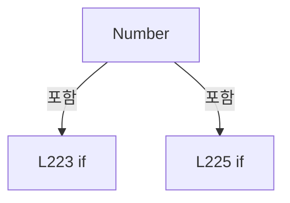

변경 전 점검: 입력/반환 타입, 위 호출자, 예외/취소 경로, 공유 상태와 저장·전송 소비자를 함께 확인합니다. 값의 단위나 물리 방향을 이름만으로 확정하지 않습니다.

### MethodDeclaration `EncodeLine` · L231–237

[Drilling.Common/Managers/CSettingManager.cs:231–237](https://github.com/kjuws10-rgb/A3Drilling/blob/0219666f9053b907d96d7e0aa7d0c6c1be3a73d4/Drilling.Common/Managers/CSettingManager.cs#L231-L237)

| 항목 | 실제 추출 값 |
| --- | --- |
| 서명 | int Drilling.Common.Managers.CRunOptionSettings.EncodeLine(int) |
| 접근/수식자 | Public / public, static |
| 반환/값 타입 | int |
| 소속 타입 | NamedType:Drilling.Common.Managers.CRunOptionSettings |

입력 계약:

| 이름 | 타입 | 전달 | 선택/기본값 |
| --- | --- | --- | --- |
| count | int | None | False /  |

정적 호출자로 확인된 위치:

| 호출 파일/행 | 호출 표현식 | 런타임 분기 가능 |
| --- | --- | --- |
| [Drilling.UI/Menu/Menus/CMenuMain.cs:2942–2942](https://github.com/kjuws10-rgb/A3Drilling/blob/0219666f9053b907d96d7e0aa7d0c6c1be3a73d4/Drilling.UI/Menu/Menus/CMenuMain.cs#L2942-L2942) | CRunOptionSettings.EncodeLine | False |

호출하는 대상과 해석 범위:

| 원본 행 | 표현식 | 분석 상태 | 대상/소스 위치 |
| --- | --- | --- | --- |
| 237 | new ArgumentOutOfRangeException | resolved | System.ArgumentOutOfRangeException.ArgumentOutOfRangeException(string?) |
| 237 | nameof | unresolved | None |

본문의 실제 연산·분기·예외·반환 순서(원문 위치 순):

| 원본 행 | 종류 | 주석 해설 |
| --- | --- | --- |
| 231 | switch-expression | 값별 결과식을 선택합니다: count switch { 1 => 0, 3 => 1, 5 => 2, 7 => 3, _ => throw new ArgumentOutOfRangeException(nameof(count))} |
| 237 | call | 함수·델리게이트 또는 객체 생성자를 호출합니다: new ArgumentOutOfRangeException(nameof(count)) |
| 237 | call | 함수·델리게이트 또는 객체 생성자를 호출합니다: nameof(count) |
| 237 | throw | 예외를 발생/전달합니다: throw new ArgumentOutOfRangeException(nameof(count)) |

제어 구문의 포함 구조(실제 실행 순서/CFG가 아닌 구문 탐색 그림):

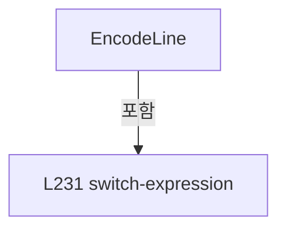

변경 전 점검: 입력/반환 타입, 위 호출자, 예외/취소 경로, 공유 상태와 저장·전송 소비자를 함께 확인합니다. 값의 단위나 물리 방향을 이름만으로 확정하지 않습니다.

### PropertyDeclaration `DistortionGroupMask` · L242–242

[Drilling.Common/Managers/CSettingManager.cs:242–242](https://github.com/kjuws10-rgb/A3Drilling/blob/0219666f9053b907d96d7e0aa7d0c6c1be3a73d4/Drilling.Common/Managers/CSettingManager.cs#L242-L242)

| 항목 | 실제 추출 값 |
| --- | --- |
| 서명 | int Drilling.Common.Managers.ST_RUN_OPTION_SETTINGS.DistortionGroupMask |
| 접근/수식자 | Public / public |
| 반환/값 타입 | int |
| 소속 타입 | NamedType:Drilling.Common.Managers.ST_RUN_OPTION_SETTINGS |

현재 부분 분석에서 직접 연결된 호출자는 없습니다. XAML/이벤트/인터페이스·델리게이트·외부 진입을 추가 확인해야 하며, 미사용으로 판정한 것이 아닙니다.

변경 전 점검: 입력/반환 타입, 위 호출자, 예외/취소 경로, 공유 상태와 저장·전송 소비자를 함께 확인합니다. 값의 단위나 물리 방향을 이름만으로 확정하지 않습니다.

### GetAccessorDeclaration `get_DistortionGroupMask` · L242–242

[Drilling.Common/Managers/CSettingManager.cs:242–242](https://github.com/kjuws10-rgb/A3Drilling/blob/0219666f9053b907d96d7e0aa7d0c6c1be3a73d4/Drilling.Common/Managers/CSettingManager.cs#L242-L242)

| 항목 | 실제 추출 값 |
| --- | --- |
| 서명 | int Drilling.Common.Managers.ST_RUN_OPTION_SETTINGS.DistortionGroupMask.get |
| 접근/수식자 | Public / get |
| 반환/값 타입 | int |
| 소속 타입 | NamedType:Drilling.Common.Managers.ST_RUN_OPTION_SETTINGS |

현재 부분 분석에서 직접 연결된 호출자는 없습니다. XAML/이벤트/인터페이스·델리게이트·외부 진입을 추가 확인해야 하며, 미사용으로 판정한 것이 아닙니다.

변경 전 점검: 입력/반환 타입, 위 호출자, 예외/취소 경로, 공유 상태와 저장·전송 소비자를 함께 확인합니다. 값의 단위나 물리 방향을 이름만으로 확정하지 않습니다.

### InitAccessorDeclaration `set_DistortionGroupMask` · L242–242

[Drilling.Common/Managers/CSettingManager.cs:242–242](https://github.com/kjuws10-rgb/A3Drilling/blob/0219666f9053b907d96d7e0aa7d0c6c1be3a73d4/Drilling.Common/Managers/CSettingManager.cs#L242-L242)

| 항목 | 실제 추출 값 |
| --- | --- |
| 서명 | void Drilling.Common.Managers.ST_RUN_OPTION_SETTINGS.DistortionGroupMask.init |
| 접근/수식자 | Public / init |
| 반환/값 타입 | void |
| 소속 타입 | NamedType:Drilling.Common.Managers.ST_RUN_OPTION_SETTINGS |

입력 계약:

| 이름 | 타입 | 전달 | 선택/기본값 |
| --- | --- | --- | --- |
| value | int | None | False /  |

현재 부분 분석에서 직접 연결된 호출자는 없습니다. XAML/이벤트/인터페이스·델리게이트·외부 진입을 추가 확인해야 하며, 미사용으로 판정한 것이 아닙니다.

변경 전 점검: 입력/반환 타입, 위 호출자, 예외/취소 경로, 공유 상태와 저장·전송 소비자를 함께 확인합니다. 값의 단위나 물리 방향을 이름만으로 확정하지 않습니다.

### PropertyDeclaration `DistortionGroups` · L243–243

[Drilling.Common/Managers/CSettingManager.cs:243–243](https://github.com/kjuws10-rgb/A3Drilling/blob/0219666f9053b907d96d7e0aa7d0c6c1be3a73d4/Drilling.Common/Managers/CSettingManager.cs#L243-L243)

| 항목 | 실제 추출 값 |
| --- | --- |
| 서명 | System.Collections.Generic.IReadOnlyList<int> Drilling.Common.Managers.ST_RUN_OPTION_SETTINGS.DistortionGroups |
| 접근/수식자 | Public / public |
| 반환/값 타입 | System.Collections.Generic.IReadOnlyList<int> |
| 소속 타입 | NamedType:Drilling.Common.Managers.ST_RUN_OPTION_SETTINGS |

현재 부분 분석에서 직접 연결된 호출자는 없습니다. XAML/이벤트/인터페이스·델리게이트·외부 진입을 추가 확인해야 하며, 미사용으로 판정한 것이 아닙니다.

호출하는 대상과 해석 범위:

| 원본 행 | 표현식 | 분석 상태 | 대상/소스 위치 |
| --- | --- | --- | --- |
| 243 | Enumerable.Range(0, 3).Where(index => (DistortionGroupMask & (1 << index)) != 0).ToArray | resolved | int[] System.Collections.Generic.IEnumerable<int>.ToArray<int>() |
| 243 | Enumerable.Range(0, 3).Where | resolved | System.Collections.Generic.IEnumerable<int> System.Collections.Generic.IEnumerable<int>.Where<int>(System.Func<int, bool>) |
| 243 | Enumerable.Range | resolved | System.Collections.Generic.IEnumerable<int> System.Linq.Enumerable.Range(int, int) |

본문의 실제 연산·분기·예외·반환 순서(원문 위치 순):

| 원본 행 | 종류 | 주석 해설 |
| --- | --- | --- |
| 243 | call | 함수·델리게이트 또는 객체 생성자를 호출합니다: Enumerable.Range(0, 3).Where(index => (DistortionGroupMask & (1 << index)) != 0).ToArray() |
| 243 | call | 함수·델리게이트 또는 객체 생성자를 호출합니다: Enumerable.Range(0, 3).Where(index => (DistortionGroupMask & (1 << index)) != 0) |
| 243 | call | 함수·델리게이트 또는 객체 생성자를 호출합니다: Enumerable.Range(0, 3) |

변경 전 점검: 입력/반환 타입, 위 호출자, 예외/취소 경로, 공유 상태와 저장·전송 소비자를 함께 확인합니다. 값의 단위나 물리 방향을 이름만으로 확정하지 않습니다.

### PropertyDeclaration `ReviewLineCount` · L244–250

[Drilling.Common/Managers/CSettingManager.cs:244–250](https://github.com/kjuws10-rgb/A3Drilling/blob/0219666f9053b907d96d7e0aa7d0c6c1be3a73d4/Drilling.Common/Managers/CSettingManager.cs#L244-L250)

| 항목 | 실제 추출 값 |
| --- | --- |
| 서명 | int Drilling.Common.Managers.ST_RUN_OPTION_SETTINGS.ReviewLineCount |
| 접근/수식자 | Public / public |
| 반환/값 타입 | int |
| 소속 타입 | NamedType:Drilling.Common.Managers.ST_RUN_OPTION_SETTINGS |

현재 부분 분석에서 직접 연결된 호출자는 없습니다. XAML/이벤트/인터페이스·델리게이트·외부 진입을 추가 확인해야 하며, 미사용으로 판정한 것이 아닙니다.

호출하는 대상과 해석 범위:

| 원본 행 | 표현식 | 분석 상태 | 대상/소스 위치 |
| --- | --- | --- | --- |
| 250 | new InvalidDataException | resolved | System.IO.InvalidDataException.InvalidDataException(string?) |

본문의 실제 연산·분기·예외·반환 순서(원문 위치 순):

| 원본 행 | 종류 | 주석 해설 |
| --- | --- | --- |
| 244 | switch-expression | 값별 결과식을 선택합니다: ReviewLineIndex switch { 0 => 1, 1 => 3, 2 => 5, 3 => 7, _ => throw new InvalidDataException("Review Line 설정 오류")} |
| 250 | call | 함수·델리게이트 또는 객체 생성자를 호출합니다: new InvalidDataException("Review Line 설정 오류") |
| 250 | throw | 예외를 발생/전달합니다: throw new InvalidDataException("Review Line 설정 오류") |

제어 구문의 포함 구조(실제 실행 순서/CFG가 아닌 구문 탐색 그림):

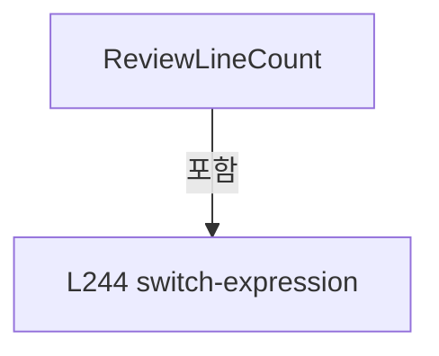

변경 전 점검: 입력/반환 타입, 위 호출자, 예외/취소 경로, 공유 상태와 저장·전송 소비자를 함께 확인합니다. 값의 단위나 물리 방향을 이름만으로 확정하지 않습니다.

### PropertyDeclaration `ReviewOptions` · L251–251

[Drilling.Common/Managers/CSettingManager.cs:251–251](https://github.com/kjuws10-rgb/A3Drilling/blob/0219666f9053b907d96d7e0aa7d0c6c1be3a73d4/Drilling.Common/Managers/CSettingManager.cs#L251-L251)

| 항목 | 실제 추출 값 |
| --- | --- |
| 서명 | Drilling.Common.Review.ST_AUTO_REVIEW_OPTIONS Drilling.Common.Managers.ST_RUN_OPTION_SETTINGS.ReviewOptions |
| 접근/수식자 | Public / public |
| 반환/값 타입 | Drilling.Common.Review.ST_AUTO_REVIEW_OPTIONS |
| 소속 타입 | NamedType:Drilling.Common.Managers.ST_RUN_OPTION_SETTINGS |

현재 부분 분석에서 직접 연결된 호출자는 없습니다. XAML/이벤트/인터페이스·델리게이트·외부 진입을 추가 확인해야 하며, 미사용으로 판정한 것이 아닙니다.

호출하는 대상과 해석 범위:

| 원본 행 | 표현식 | 분석 상태 | 대상/소스 위치 |
| --- | --- | --- | --- |
| 251 | new | resolved | Drilling.Common.Review.ST_AUTO_REVIEW_OPTIONS.ST_AUTO_REVIEW_OPTIONS(int, Drilling.Common.Review.EN_FINE_INSPECTION_METHOD, int, bool) · Drilling.Common/Review/CAutoFineReviewCoordinator.cs:344 |

본문의 실제 연산·분기·예외·반환 순서(원문 위치 순):

| 원본 행 | 종류 | 주석 해설 |
| --- | --- | --- |
| 251 | call | 함수·델리게이트 또는 객체 생성자를 호출합니다: new(ReviewLineCount, ReviewMethod == 0 ? EN_FINE_INSPECTION_METHOD.PtoP : EN_FINE_INSPECTION_METHOD.Flying, RetryCount, ImmediateRetry) |
| 251 | conditional-expression | 조건에 따라 결과식을 선택합니다: ReviewMethod == 0 ? EN_FINE_INSPECTION_METHOD.PtoP : EN_FINE_INSPECTION_METHOD.Flying |

변경 전 점검: 입력/반환 타입, 위 호출자, 예외/취소 경로, 공유 상태와 저장·전송 소비자를 함께 확인합니다. 값의 단위나 물리 방향을 이름만으로 확정하지 않습니다.

### EnumMemberDeclaration `Option` · L256–256

[Drilling.Common/Managers/CSettingManager.cs:256–256](https://github.com/kjuws10-rgb/A3Drilling/blob/0219666f9053b907d96d7e0aa7d0c6c1be3a73d4/Drilling.Common/Managers/CSettingManager.cs#L256-L256)

| 항목 | 실제 추출 값 |
| --- | --- |
| 서명 | Drilling.Common.Managers.EN_SETTING_TAB.Option |
| 접근/수식자 | Public /  |
| 반환/값 타입 | Drilling.Common.Managers.EN_SETTING_TAB |
| 소속 타입 | NamedType:Drilling.Common.Managers.EN_SETTING_TAB |

현재 부분 분석에서 직접 연결된 호출자는 없습니다. XAML/이벤트/인터페이스·델리게이트·외부 진입을 추가 확인해야 하며, 미사용으로 판정한 것이 아닙니다.

변경 전 점검: 입력/반환 타입, 위 호출자, 예외/취소 경로, 공유 상태와 저장·전송 소비자를 함께 확인합니다. 값의 단위나 물리 방향을 이름만으로 확정하지 않습니다.

### EnumMemberDeclaration `Interface` · L257–257

[Drilling.Common/Managers/CSettingManager.cs:257–257](https://github.com/kjuws10-rgb/A3Drilling/blob/0219666f9053b907d96d7e0aa7d0c6c1be3a73d4/Drilling.Common/Managers/CSettingManager.cs#L257-L257)

| 항목 | 실제 추출 값 |
| --- | --- |
| 서명 | Drilling.Common.Managers.EN_SETTING_TAB.Interface |
| 접근/수식자 | Public /  |
| 반환/값 타입 | Drilling.Common.Managers.EN_SETTING_TAB |
| 소속 타입 | NamedType:Drilling.Common.Managers.EN_SETTING_TAB |

현재 부분 분석에서 직접 연결된 호출자는 없습니다. XAML/이벤트/인터페이스·델리게이트·외부 진입을 추가 확인해야 하며, 미사용으로 판정한 것이 아닙니다.

변경 전 점검: 입력/반환 타입, 위 호출자, 예외/취소 경로, 공유 상태와 저장·전송 소비자를 함께 확인합니다. 값의 단위나 물리 방향을 이름만으로 확정하지 않습니다.

### EnumMemberDeclaration `Io` · L258–258

[Drilling.Common/Managers/CSettingManager.cs:258–258](https://github.com/kjuws10-rgb/A3Drilling/blob/0219666f9053b907d96d7e0aa7d0c6c1be3a73d4/Drilling.Common/Managers/CSettingManager.cs#L258-L258)

| 항목 | 실제 추출 값 |
| --- | --- |
| 서명 | Drilling.Common.Managers.EN_SETTING_TAB.Io |
| 접근/수식자 | Public /  |
| 반환/값 타입 | Drilling.Common.Managers.EN_SETTING_TAB |
| 소속 타입 | NamedType:Drilling.Common.Managers.EN_SETTING_TAB |

현재 부분 분석에서 직접 연결된 호출자는 없습니다. XAML/이벤트/인터페이스·델리게이트·외부 진입을 추가 확인해야 하며, 미사용으로 판정한 것이 아닙니다.

변경 전 점검: 입력/반환 타입, 위 호출자, 예외/취소 경로, 공유 상태와 저장·전송 소비자를 함께 확인합니다. 값의 단위나 물리 방향을 이름만으로 확정하지 않습니다.

### EnumMemberDeclaration `Motor` · L259–259

[Drilling.Common/Managers/CSettingManager.cs:259–259](https://github.com/kjuws10-rgb/A3Drilling/blob/0219666f9053b907d96d7e0aa7d0c6c1be3a73d4/Drilling.Common/Managers/CSettingManager.cs#L259-L259)

| 항목 | 실제 추출 값 |
| --- | --- |
| 서명 | Drilling.Common.Managers.EN_SETTING_TAB.Motor |
| 접근/수식자 | Public /  |
| 반환/값 타입 | Drilling.Common.Managers.EN_SETTING_TAB |
| 소속 타입 | NamedType:Drilling.Common.Managers.EN_SETTING_TAB |

현재 부분 분석에서 직접 연결된 호출자는 없습니다. XAML/이벤트/인터페이스·델리게이트·외부 진입을 추가 확인해야 하며, 미사용으로 판정한 것이 아닙니다.

변경 전 점검: 입력/반환 타입, 위 호출자, 예외/취소 경로, 공유 상태와 저장·전송 소비자를 함께 확인합니다. 값의 단위나 물리 방향을 이름만으로 확정하지 않습니다.

### EnumMemberDeclaration `Alarm` · L260–260

[Drilling.Common/Managers/CSettingManager.cs:260–260](https://github.com/kjuws10-rgb/A3Drilling/blob/0219666f9053b907d96d7e0aa7d0c6c1be3a73d4/Drilling.Common/Managers/CSettingManager.cs#L260-L260)

| 항목 | 실제 추출 값 |
| --- | --- |
| 서명 | Drilling.Common.Managers.EN_SETTING_TAB.Alarm |
| 접근/수식자 | Public /  |
| 반환/값 타입 | Drilling.Common.Managers.EN_SETTING_TAB |
| 소속 타입 | NamedType:Drilling.Common.Managers.EN_SETTING_TAB |

현재 부분 분석에서 직접 연결된 호출자는 없습니다. XAML/이벤트/인터페이스·델리게이트·외부 진입을 추가 확인해야 하며, 미사용으로 판정한 것이 아닙니다.

변경 전 점검: 입력/반환 타입, 위 호출자, 예외/취소 경로, 공유 상태와 저장·전송 소비자를 함께 확인합니다. 값의 단위나 물리 방향을 이름만으로 확정하지 않습니다.

### MethodDeclaration `Load` · L283–283

[Drilling.Common/Managers/CSettingManager.cs:283–283](https://github.com/kjuws10-rgb/A3Drilling/blob/0219666f9053b907d96d7e0aa7d0c6c1be3a73d4/Drilling.Common/Managers/CSettingManager.cs#L283-L283)

| 항목 | 실제 추출 값 |
| --- | --- |
| 서명 | System.Collections.Generic.IReadOnlyList<Drilling.Common.Managers.ST_SYSTEM_PARAMETER> Drilling.Common.Managers.CSettingFileBase.Load(Drilling.Common.Managers.EN_SETTING_TAB, System.Threading.CancellationToken) |
| 접근/수식자 | Public / public, abstract |
| 반환/값 타입 | System.Collections.Generic.IReadOnlyList<Drilling.Common.Managers.ST_SYSTEM_PARAMETER> |
| 소속 타입 | NamedType:Drilling.Common.Managers.CSettingFileBase |

입력 계약:

| 이름 | 타입 | 전달 | 선택/기본값 |
| --- | --- | --- | --- |
| section | Drilling.Common.Managers.EN_SETTING_TAB | None | False /  |
| cancellationToken | System.Threading.CancellationToken | None | True / null |

정적 호출자로 확인된 위치:

| 호출 파일/행 | 호출 표현식 | 런타임 분기 가능 |
| --- | --- | --- |
| [Drilling.Common/Managers/CManager.cs:610–610](https://github.com/kjuws10-rgb/A3Drilling/blob/0219666f9053b907d96d7e0aa7d0c6c1be3a73d4/Drilling.Common/Managers/CManager.cs#L610-L610) | _settingFile.Load | False |
| [Drilling.Common/Managers/CSettingManager.cs:45–45](https://github.com/kjuws10-rgb/A3Drilling/blob/0219666f9053b907d96d7e0aa7d0c6c1be3a73d4/Drilling.Common/Managers/CSettingManager.cs#L45-L45) | settingFile.Load | False |

변경 전 점검: 입력/반환 타입, 위 호출자, 예외/취소 경로, 공유 상태와 저장·전송 소비자를 함께 확인합니다. 값의 단위나 물리 방향을 이름만으로 확정하지 않습니다.

### MethodDeclaration `Save` · L284–284

[Drilling.Common/Managers/CSettingManager.cs:284–284](https://github.com/kjuws10-rgb/A3Drilling/blob/0219666f9053b907d96d7e0aa7d0c6c1be3a73d4/Drilling.Common/Managers/CSettingManager.cs#L284-L284)

| 항목 | 실제 추출 값 |
| --- | --- |
| 서명 | void Drilling.Common.Managers.CSettingFileBase.Save(Drilling.Common.Managers.EN_SETTING_TAB, System.Collections.Generic.IReadOnlyList<Drilling.Common.Managers.ST_SYSTEM_PARAMETER>, System.Threading.CancellationToken) |
| 접근/수식자 | Public / public, abstract |
| 반환/값 타입 | void |
| 소속 타입 | NamedType:Drilling.Common.Managers.CSettingFileBase |

입력 계약:

| 이름 | 타입 | 전달 | 선택/기본값 |
| --- | --- | --- | --- |
| section | Drilling.Common.Managers.EN_SETTING_TAB | None | False /  |
| parameters | System.Collections.Generic.IReadOnlyList<Drilling.Common.Managers.ST_SYSTEM_PARAMETER> | None | False /  |
| cancellationToken | System.Threading.CancellationToken | None | True / null |

정적 호출자로 확인된 위치:

| 호출 파일/행 | 호출 표현식 | 런타임 분기 가능 |
| --- | --- | --- |
| [Drilling.Common/Managers/CSettingManager.cs:151–151](https://github.com/kjuws10-rgb/A3Drilling/blob/0219666f9053b907d96d7e0aa7d0c6c1be3a73d4/Drilling.Common/Managers/CSettingManager.cs#L151-L151) | settingFile.Save | False |

변경 전 점검: 입력/반환 타입, 위 호출자, 예외/취소 경로, 공유 상태와 저장·전송 소비자를 함께 확인합니다. 값의 단위나 물리 방향을 이름만으로 확정하지 않습니다.

### MethodDeclaration `LoadHistory` · L285–285

[Drilling.Common/Managers/CSettingManager.cs:285–285](https://github.com/kjuws10-rgb/A3Drilling/blob/0219666f9053b907d96d7e0aa7d0c6c1be3a73d4/Drilling.Common/Managers/CSettingManager.cs#L285-L285)

| 항목 | 실제 추출 값 |
| --- | --- |
| 서명 | System.Collections.Generic.IReadOnlyList<Drilling.Common.Managers.ST_SETTING_HISTORY> Drilling.Common.Managers.CSettingFileBase.LoadHistory(Drilling.Common.Managers.EN_SETTING_TAB, System.Threading.CancellationToken) |
| 접근/수식자 | Public / public, abstract |
| 반환/값 타입 | System.Collections.Generic.IReadOnlyList<Drilling.Common.Managers.ST_SETTING_HISTORY> |
| 소속 타입 | NamedType:Drilling.Common.Managers.CSettingFileBase |

입력 계약:

| 이름 | 타입 | 전달 | 선택/기본값 |
| --- | --- | --- | --- |
| section | Drilling.Common.Managers.EN_SETTING_TAB | None | False /  |
| cancellationToken | System.Threading.CancellationToken | None | True / null |

정적 호출자로 확인된 위치:

| 호출 파일/행 | 호출 표현식 | 런타임 분기 가능 |
| --- | --- | --- |
| [Drilling.Common/Managers/CSettingManager.cs:160–160](https://github.com/kjuws10-rgb/A3Drilling/blob/0219666f9053b907d96d7e0aa7d0c6c1be3a73d4/Drilling.Common/Managers/CSettingManager.cs#L160-L160) | settingFile.LoadHistory | False |

변경 전 점검: 입력/반환 타입, 위 호출자, 예외/취소 경로, 공유 상태와 저장·전송 소비자를 함께 확인합니다. 값의 단위나 물리 방향을 이름만으로 확정하지 않습니다.

### MethodDeclaration `LoadAll` · L290–290

[Drilling.Common/Managers/CSettingManager.cs:290–290](https://github.com/kjuws10-rgb/A3Drilling/blob/0219666f9053b907d96d7e0aa7d0c6c1be3a73d4/Drilling.Common/Managers/CSettingManager.cs#L290-L290)

| 항목 | 실제 추출 값 |
| --- | --- |
| 서명 | System.Collections.Generic.IReadOnlyList<Drilling.Common.Interface.ST_INTERFACE_DATA> Drilling.Common.Managers.CInterfaceFileBase.LoadAll(System.Threading.CancellationToken) |
| 접근/수식자 | Public / public, abstract |
| 반환/값 타입 | System.Collections.Generic.IReadOnlyList<Drilling.Common.Interface.ST_INTERFACE_DATA> |
| 소속 타입 | NamedType:Drilling.Common.Managers.CInterfaceFileBase |

입력 계약:

| 이름 | 타입 | 전달 | 선택/기본값 |
| --- | --- | --- | --- |
| cancellationToken | System.Threading.CancellationToken | None | True / null |

정적 호출자로 확인된 위치:

| 호출 파일/행 | 호출 표현식 | 런타임 분기 가능 |
| --- | --- | --- |
| [Drilling.Common/Managers/CManager.cs:480–480](https://github.com/kjuws10-rgb/A3Drilling/blob/0219666f9053b907d96d7e0aa7d0c6c1be3a73d4/Drilling.Common/Managers/CManager.cs#L480-L480) | _interfaceFile.LoadAll | False |
| [Drilling.Common/Managers/CSettingManager.cs:165–165](https://github.com/kjuws10-rgb/A3Drilling/blob/0219666f9053b907d96d7e0aa7d0c6c1be3a73d4/Drilling.Common/Managers/CSettingManager.cs#L165-L165) | interfaceFile.LoadAll | False |

변경 전 점검: 입력/반환 타입, 위 호출자, 예외/취소 경로, 공유 상태와 저장·전송 소비자를 함께 확인합니다. 값의 단위나 물리 방향을 이름만으로 확정하지 않습니다.

### MethodDeclaration `SaveAll` · L291–291

[Drilling.Common/Managers/CSettingManager.cs:291–291](https://github.com/kjuws10-rgb/A3Drilling/blob/0219666f9053b907d96d7e0aa7d0c6c1be3a73d4/Drilling.Common/Managers/CSettingManager.cs#L291-L291)

| 항목 | 실제 추출 값 |
| --- | --- |
| 서명 | void Drilling.Common.Managers.CInterfaceFileBase.SaveAll(System.Collections.Generic.IReadOnlyList<Drilling.Common.Interface.ST_INTERFACE_DATA>, System.Threading.CancellationToken) |
| 접근/수식자 | Public / public, abstract |
| 반환/값 타입 | void |
| 소속 타입 | NamedType:Drilling.Common.Managers.CInterfaceFileBase |

입력 계약:

| 이름 | 타입 | 전달 | 선택/기본값 |
| --- | --- | --- | --- |
| interfaces | System.Collections.Generic.IReadOnlyList<Drilling.Common.Interface.ST_INTERFACE_DATA> | None | False /  |
| cancellationToken | System.Threading.CancellationToken | None | True / null |

정적 호출자로 확인된 위치:

| 호출 파일/행 | 호출 표현식 | 런타임 분기 가능 |
| --- | --- | --- |
| [Drilling.Common/Managers/CSettingManager.cs:170–170](https://github.com/kjuws10-rgb/A3Drilling/blob/0219666f9053b907d96d7e0aa7d0c6c1be3a73d4/Drilling.Common/Managers/CSettingManager.cs#L170-L170) | interfaceFile.SaveAll | False |

변경 전 점검: 입력/반환 타입, 위 호출자, 예외/취소 경로, 공유 상태와 저장·전송 소비자를 함께 확인합니다. 값의 단위나 물리 방향을 이름만으로 확정하지 않습니다.

## 구문·바인딩 한계

전체 WPF/벤더 SDK/프로젝트별 빌드 조건을 로드한 정식 빌드가 아닙니다. `resolved`는 이 부분 컴파일에서의 심볼 연결이며 virtual/interface/delegate/이벤트/Reflection/XAML의 실제 런타임 구현을 확정하지 않습니다. `candidate`와 `unresolved`는 후속 확인 대상으로 남깁니다.

## 원문 전체 주석 해설본

[원본 모든 행과 행별 해설 보기](../../../annotated/Drilling.Common/Managers/CSettingManager.cs.annotated.txt)

원본을 빠뜨리거나 임의로 줄이지 않았습니다. `L000001 |` 표시는 원본 행 번호, `// 해설`은 별도 설명입니다. 실행용 소스가 아닌 문서입니다.

## 수정·재검증 체크

- 원본 Commit과 현재 작업 파일 SHA가 같은지 먼저 확인합니다. 다르면 이 문서를 과거 버전 자료로 취급합니다.
- 선언·직접 호출·이벤트/인터페이스 경계·설정 소비를 함께 확인합니다. 정적 연결의 빈 곳을 정상 경로로 추정하지 않습니다.
- 저장 형식/단위/식별자·재시도·취소·예외·롤백에 영향을 주는 변경은 상세 해설장과 호출자를 다시 검토합니다.
- 도구의 구문 추출과 별도 정적 추적 해설, 실제 빌드·시뮬레이션·실장비 검증 결과를 분리합니다.
