# Drilling.Common/Motion/ACS/CACSComm.cs

| 항목 | 내용 |
| --- | --- |
| 원본 저장소 | https://github.com/kjuws10-rgb/A3Drilling.git |
| 원본 Commit | 5aee8e58439c9b455cae7c9593c9be986c3e682e |
| 원본 SHA256 | 570d3fa9657629d320c56f68be2638a7f6bb43a9ed539b22b9c9dd9ddaaf62d9 |
| 파일 분류 | code |
| 원본 크기/행 | 8,419 bytes / 260 physical lines |
| 인코딩 | utf-8-sig |
| 검토 범위 | 구문/부분 의미 분석에서 추출한 사실. 동작·물리 단위·실장비 합격을 보증하지 않습니다. |
| 원본 링크 | [고정 Commit 원본](https://github.com/kjuws10-rgb/A3Drilling/blob/5aee8e58439c9b455cae7c9593c9be986c3e682e/Drilling.Common/Motion/ACS/CACSComm.cs) |

## 파일의 역할과 읽는 순서

모션 인터페이스·제어 명령을 정의하거나 전달합니다. 문서 생성 과정에서는 축이나 장비를 움직이지 않았습니다.

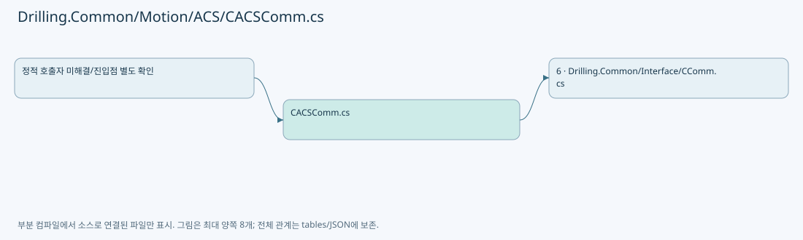

## 네임스페이스·타입·상속

| 타입 | 구분 | 원본 범위 | 선언/상속 |
| --- | --- | --- | --- |
| CACSComm | ClassDeclaration | 11–260 | CACSComm: CCommBase(data, option) |

## 멤버 빠른 목록

| 이름 | 종류 | 범위 | 서명 |
| --- | --- | --- | --- |
| _commLock | FieldDeclaration | L14–14 | System.Threading.SemaphoreSlim Drilling.Common.Motion.CACSComm._commLock |
| _api | FieldDeclaration | L15–15 | Api? Drilling.Common.Motion.CACSComm._api |
| Connect | MethodDeclaration | L16–32 | System.Threading.Tasks.Task Drilling.Common.Motion.CACSComm.Connect(System.Threading.CancellationToken) |
| Disconnect | MethodDeclaration | L34–46 | System.Threading.Tasks.Task Drilling.Common.Motion.CACSComm.Disconnect(System.Threading.CancellationToken) |
| Execute | MethodDeclaration | L48–80 | System.Threading.Tasks.Task<string> Drilling.Common.Motion.CACSComm.Execute(string, System.Threading.CancellationToken) |
| ConnectLocked | MethodDeclaration | L82–103 | void Drilling.Common.Motion.CACSComm.ConnectLocked() |
| ExecuteACSFunction | MethodDeclaration | L105–119 | string Drilling.Common.Motion.CACSComm.ExecuteACSFunction(Api, string) |
| ExecuteAxisFunction | MethodDeclaration | L121–160 | string Drilling.Common.Motion.CACSComm.ExecuteAxisFunction(Api, System.Collections.Generic.IReadOnlyList<string>) |
| ExecuteIoFunction | MethodDeclaration | L162–191 | string Drilling.Common.Motion.CACSComm.ExecuteIoFunction(Api, System.Collections.Generic.IReadOnlyList<string>) |
| ExecuteRawACSCommand | MethodDeclaration | L193–197 | string Drilling.Common.Motion.CACSComm.ExecuteRawACSCommand(Api, string) |
| IsSimulatorEndpoint | MethodDeclaration | L199–202 | bool Drilling.Common.Motion.CACSComm.IsSimulatorEndpoint() |
| CloseApi | MethodDeclaration | L204–223 | void Drilling.Common.Motion.CACSComm.CloseApi() |
| ToAcsAxis | MethodDeclaration | L225–233 | Axis Drilling.Common.Motion.CACSComm.ToAcsAxis(int) |
| ParseIoAddress | MethodDeclaration | L235–244 | (int Port, int Bit) Drilling.Common.Motion.CACSComm.ParseIoAddress(string) |
| ReadInt | MethodDeclaration | L246–249 | int Drilling.Common.Motion.CACSComm.ReadInt(string, string) |
| ReadDouble | MethodDeclaration | L251–259 | double Drilling.Common.Motion.CACSComm.ReadDouble(System.Collections.Generic.IReadOnlyList<string>, int, string) |

## 멤버별 상세 계약·호출·처리 해설

### FieldDeclaration `_commLock` · L14–14

[Drilling.Common/Motion/ACS/CACSComm.cs:14–14](https://github.com/kjuws10-rgb/A3Drilling/blob/5aee8e58439c9b455cae7c9593c9be986c3e682e/Drilling.Common/Motion/ACS/CACSComm.cs#L14-L14)

| 항목 | 실제 추출 값 |
| --- | --- |
| 서명 | System.Threading.SemaphoreSlim Drilling.Common.Motion.CACSComm._commLock |
| 접근/수식자 | Private / private, readonly |
| 반환/값 타입 | System.Threading.SemaphoreSlim |
| 소속 타입 | NamedType:Drilling.Common.Motion.CACSComm |

현재 부분 분석에서 직접 연결된 호출자는 없습니다. XAML/이벤트/인터페이스·델리게이트·외부 진입을 추가 확인해야 하며, 미사용으로 판정한 것이 아닙니다.

호출하는 대상과 해석 범위:

| 원본 행 | 표현식 | 분석 상태 | 대상/소스 위치 |
| --- | --- | --- | --- |
| 14 | new | resolved | System.Threading.SemaphoreSlim.SemaphoreSlim(int, int) |

본문의 실제 연산·분기·예외·반환 순서(원문 위치 순):

| 원본 행 | 종류 | 주석 해설 |
| --- | --- | --- |
| 14 | call | 함수·델리게이트 또는 객체 생성자를 호출합니다: new(1, 1) |
| 14 | variable-initializer | 변수의 초기값을 지정합니다: _commLock = new(1, 1) |

변경 전 점검: 입력/반환 타입, 위 호출자, 예외/취소 경로, 공유 상태와 저장·전송 소비자를 함께 확인합니다. 값의 단위나 물리 방향을 이름만으로 확정하지 않습니다.

### FieldDeclaration `_api` · L15–15

[Drilling.Common/Motion/ACS/CACSComm.cs:15–15](https://github.com/kjuws10-rgb/A3Drilling/blob/5aee8e58439c9b455cae7c9593c9be986c3e682e/Drilling.Common/Motion/ACS/CACSComm.cs#L15-L15)

| 항목 | 실제 추출 값 |
| --- | --- |
| 서명 | Api? Drilling.Common.Motion.CACSComm._api |
| 접근/수식자 | Private / private |
| 반환/값 타입 | Api? |
| 소속 타입 | NamedType:Drilling.Common.Motion.CACSComm |

현재 부분 분석에서 직접 연결된 호출자는 없습니다. XAML/이벤트/인터페이스·델리게이트·외부 진입을 추가 확인해야 하며, 미사용으로 판정한 것이 아닙니다.

변경 전 점검: 입력/반환 타입, 위 호출자, 예외/취소 경로, 공유 상태와 저장·전송 소비자를 함께 확인합니다. 값의 단위나 물리 방향을 이름만으로 확정하지 않습니다.

### MethodDeclaration `Connect` · L16–32

[Drilling.Common/Motion/ACS/CACSComm.cs:16–32](https://github.com/kjuws10-rgb/A3Drilling/blob/5aee8e58439c9b455cae7c9593c9be986c3e682e/Drilling.Common/Motion/ACS/CACSComm.cs#L16-L32)

| 항목 | 실제 추출 값 |
| --- | --- |
| 서명 | System.Threading.Tasks.Task Drilling.Common.Motion.CACSComm.Connect(System.Threading.CancellationToken) |
| 접근/수식자 | Public / public, override, async |
| 반환/값 타입 | System.Threading.Tasks.Task |
| 소속 타입 | NamedType:Drilling.Common.Motion.CACSComm |

입력 계약:

| 이름 | 타입 | 전달 | 선택/기본값 |
| --- | --- | --- | --- |
| cancellationToken | System.Threading.CancellationToken | None | True / null |

현재 부분 분석에서 직접 연결된 호출자는 없습니다. XAML/이벤트/인터페이스·델리게이트·외부 진입을 추가 확인해야 하며, 미사용으로 판정한 것이 아닙니다.

호출하는 대상과 해석 범위:

| 원본 행 | 표현식 | 분석 상태 | 대상/소스 위치 |
| --- | --- | --- | --- |
| 18 | _commLock.WaitAsync | resolved | System.Threading.Tasks.Task System.Threading.SemaphoreSlim.WaitAsync(System.Threading.CancellationToken) |
| 21 | ConnectLocked | resolved | void Drilling.Common.Motion.CACSComm.ConnectLocked() · Drilling.Common/Motion/ACS/CACSComm.cs:82 |
| 25 | CloseApi | resolved | void Drilling.Common.Motion.CACSComm.CloseApi() · Drilling.Common/Motion/ACS/CACSComm.cs:204 |
| 26 | SetError | resolved | void Drilling.Common.Interface.CCommBase.SetError(System.Exception) · Drilling.Common/Interface/CComm.cs:120 |
| 30 | _commLock.Release | resolved | int System.Threading.SemaphoreSlim.Release() |

본문의 실제 연산·분기·예외·반환 순서(원문 위치 순):

| 원본 행 | 종류 | 주석 해설 |
| --- | --- | --- |
| 18 | await | 비동기 완료를 기다립니다: await _commLock.WaitAsync(cancellationToken) |
| 18 | call | 함수·델리게이트 또는 객체 생성자를 호출합니다: _commLock.WaitAsync(cancellationToken) |
| 19 | try | 예외 처리 범위입니다: try |
| 21 | call | 함수·델리게이트 또는 객체 생성자를 호출합니다: ConnectLocked() |
| 23 | catch | 지정 예외를 처리합니다: catch (Exception ex) |
| 25 | call | 함수·델리게이트 또는 객체 생성자를 호출합니다: CloseApi() |
| 26 | call | 함수·델리게이트 또는 객체 생성자를 호출합니다: SetError(ex) |
| 28 | finally | 종료 정리 구간입니다: finally |
| 30 | call | 함수·델리게이트 또는 객체 생성자를 호출합니다: _commLock.Release() |

제어 구문의 포함 구조(실제 실행 순서/CFG가 아닌 구문 탐색 그림):

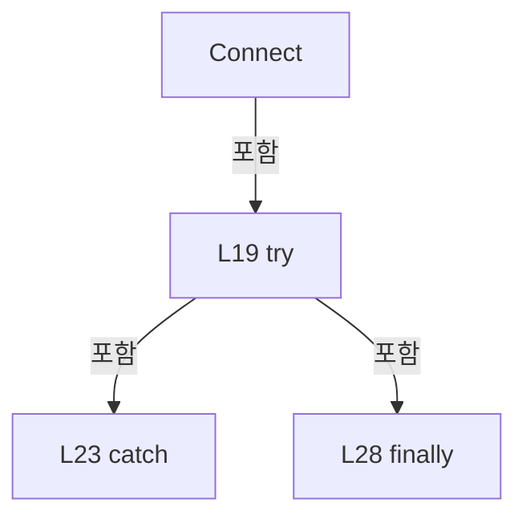

변경 전 점검: 입력/반환 타입, 위 호출자, 예외/취소 경로, 공유 상태와 저장·전송 소비자를 함께 확인합니다. 값의 단위나 물리 방향을 이름만으로 확정하지 않습니다.

### MethodDeclaration `Disconnect` · L34–46

[Drilling.Common/Motion/ACS/CACSComm.cs:34–46](https://github.com/kjuws10-rgb/A3Drilling/blob/5aee8e58439c9b455cae7c9593c9be986c3e682e/Drilling.Common/Motion/ACS/CACSComm.cs#L34-L46)

| 항목 | 실제 추출 값 |
| --- | --- |
| 서명 | System.Threading.Tasks.Task Drilling.Common.Motion.CACSComm.Disconnect(System.Threading.CancellationToken) |
| 접근/수식자 | Public / public, override, async |
| 반환/값 타입 | System.Threading.Tasks.Task |
| 소속 타입 | NamedType:Drilling.Common.Motion.CACSComm |

입력 계약:

| 이름 | 타입 | 전달 | 선택/기본값 |
| --- | --- | --- | --- |
| cancellationToken | System.Threading.CancellationToken | None | True / null |

현재 부분 분석에서 직접 연결된 호출자는 없습니다. XAML/이벤트/인터페이스·델리게이트·외부 진입을 추가 확인해야 하며, 미사용으로 판정한 것이 아닙니다.

호출하는 대상과 해석 범위:

| 원본 행 | 표현식 | 분석 상태 | 대상/소스 위치 |
| --- | --- | --- | --- |
| 36 | _commLock.WaitAsync | resolved | System.Threading.Tasks.Task System.Threading.SemaphoreSlim.WaitAsync(System.Threading.CancellationToken) |
| 39 | CloseApi | resolved | void Drilling.Common.Motion.CACSComm.CloseApi() · Drilling.Common/Motion/ACS/CACSComm.cs:204 |
| 40 | SetState | resolved | void Drilling.Common.Interface.CCommBase.SetState(Drilling.Common.Interface.EN_COMM_STATE) · Drilling.Common/Interface/CComm.cs:114 |
| 44 | _commLock.Release | resolved | int System.Threading.SemaphoreSlim.Release() |

본문의 실제 연산·분기·예외·반환 순서(원문 위치 순):

| 원본 행 | 종류 | 주석 해설 |
| --- | --- | --- |
| 36 | await | 비동기 완료를 기다립니다: await _commLock.WaitAsync(cancellationToken) |
| 36 | call | 함수·델리게이트 또는 객체 생성자를 호출합니다: _commLock.WaitAsync(cancellationToken) |
| 37 | try | 예외 처리 범위입니다: try |
| 39 | call | 함수·델리게이트 또는 객체 생성자를 호출합니다: CloseApi() |
| 40 | call | 함수·델리게이트 또는 객체 생성자를 호출합니다: SetState(EN_COMM_STATE.Offline) |
| 42 | finally | 종료 정리 구간입니다: finally |
| 44 | call | 함수·델리게이트 또는 객체 생성자를 호출합니다: _commLock.Release() |

제어 구문의 포함 구조(실제 실행 순서/CFG가 아닌 구문 탐색 그림):

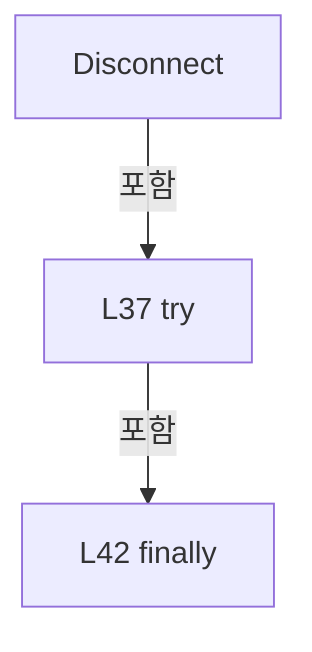

변경 전 점검: 입력/반환 타입, 위 호출자, 예외/취소 경로, 공유 상태와 저장·전송 소비자를 함께 확인합니다. 값의 단위나 물리 방향을 이름만으로 확정하지 않습니다.

### MethodDeclaration `Execute` · L48–80

[Drilling.Common/Motion/ACS/CACSComm.cs:48–80](https://github.com/kjuws10-rgb/A3Drilling/blob/5aee8e58439c9b455cae7c9593c9be986c3e682e/Drilling.Common/Motion/ACS/CACSComm.cs#L48-L80)

| 항목 | 실제 추출 값 |
| --- | --- |
| 서명 | System.Threading.Tasks.Task<string> Drilling.Common.Motion.CACSComm.Execute(string, System.Threading.CancellationToken) |
| 접근/수식자 | Public / public, override, async |
| 반환/값 타입 | System.Threading.Tasks.Task<string> |
| 소속 타입 | NamedType:Drilling.Common.Motion.CACSComm |

입력 계약:

| 이름 | 타입 | 전달 | 선택/기본값 |
| --- | --- | --- | --- |
| function | string | None | False /  |
| cancellationToken | System.Threading.CancellationToken | None | True / null |

현재 부분 분석에서 직접 연결된 호출자는 없습니다. XAML/이벤트/인터페이스·델리게이트·외부 진입을 추가 확인해야 하며, 미사용으로 판정한 것이 아닙니다.

호출하는 대상과 해석 범위:

| 원본 행 | 표현식 | 분석 상태 | 대상/소스 위치 |
| --- | --- | --- | --- |
| 50 | _commLock.WaitAsync | resolved | System.Threading.Tasks.Task System.Threading.SemaphoreSlim.WaitAsync(System.Threading.CancellationToken) |
| 55 | ConnectLocked | resolved | void Drilling.Common.Motion.CACSComm.ConnectLocked() · Drilling.Common/Motion/ACS/CACSComm.cs:82 |
| 63 | cancellationToken.ThrowIfCancellationRequested | resolved | void System.Threading.CancellationToken.ThrowIfCancellationRequested() |
| 65 | ExecuteACSFunction | candidate | OverloadResolutionFailure |
| 67 | SetState | resolved | void Drilling.Common.Interface.CCommBase.SetState(Drilling.Common.Interface.EN_COMM_STATE) · Drilling.Common/Interface/CComm.cs:114 |
| 73 | SetError | resolved | void Drilling.Common.Interface.CCommBase.SetError(System.Exception) · Drilling.Common/Interface/CComm.cs:120 |
| 78 | _commLock.Release | resolved | int System.Threading.SemaphoreSlim.Release() |

본문의 실제 연산·분기·예외·반환 순서(원문 위치 순):

| 원본 행 | 종류 | 주석 해설 |
| --- | --- | --- |
| 50 | await | 비동기 완료를 기다립니다: await _commLock.WaitAsync(cancellationToken) |
| 50 | call | 함수·델리게이트 또는 객체 생성자를 호출합니다: _commLock.WaitAsync(cancellationToken) |
| 51 | try | 예외 처리 범위입니다: try |
| 53 | if | 조건에 따라 분기합니다: if (_api is null &#124;&#124; ConnectionState != EN_COMM_STATE.Online) |
| 55 | call | 함수·델리게이트 또는 객체 생성자를 호출합니다: ConnectLocked() |
| 58 | if | 조건에 따라 분기합니다: if (_api is null &#124;&#124; ConnectionState != EN_COMM_STATE.Online) |
| 60 | return | 호출자에게 값 또는 제어를 반환합니다: return ""; |
| 63 | call | 함수·델리게이트 또는 객체 생성자를 호출합니다: cancellationToken.ThrowIfCancellationRequested() |
| 64 | assignment | 값을 대상에 대입합니다: LastSent = function |
| 65 | assignment | 값을 대상에 대입합니다: LastReceived = ExecuteACSFunction(_api, function) |
| 65 | call | 함수·델리게이트 또는 객체 생성자를 호출합니다: ExecuteACSFunction(_api, function) |
| 66 | assignment | 값을 대상에 대입합니다: LastError = "" |
| 67 | call | 함수·델리게이트 또는 객체 생성자를 호출합니다: SetState(EN_COMM_STATE.Online) |
| 68 | return | 호출자에게 값 또는 제어를 반환합니다: return LastReceived; |
| 70 | catch | 지정 예외를 처리합니다: catch (Exception ex) |
| 72 | assignment | 값을 대상에 대입합니다: LastReceived = "" |
| 73 | call | 함수·델리게이트 또는 객체 생성자를 호출합니다: SetError(ex) |
| 74 | return | 호출자에게 값 또는 제어를 반환합니다: return ""; |
| 76 | finally | 종료 정리 구간입니다: finally |
| 78 | call | 함수·델리게이트 또는 객체 생성자를 호출합니다: _commLock.Release() |

제어 구문의 포함 구조(실제 실행 순서/CFG가 아닌 구문 탐색 그림):

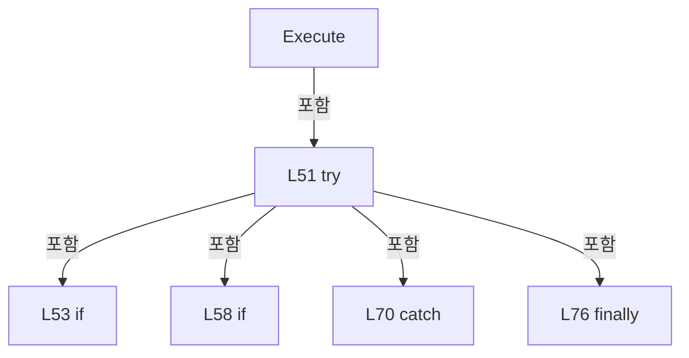

변경 전 점검: 입력/반환 타입, 위 호출자, 예외/취소 경로, 공유 상태와 저장·전송 소비자를 함께 확인합니다. 값의 단위나 물리 방향을 이름만으로 확정하지 않습니다.

### MethodDeclaration `ConnectLocked` · L82–103

[Drilling.Common/Motion/ACS/CACSComm.cs:82–103](https://github.com/kjuws10-rgb/A3Drilling/blob/5aee8e58439c9b455cae7c9593c9be986c3e682e/Drilling.Common/Motion/ACS/CACSComm.cs#L82-L103)

| 항목 | 실제 추출 값 |
| --- | --- |
| 서명 | void Drilling.Common.Motion.CACSComm.ConnectLocked() |
| 접근/수식자 | Private / private |
| 반환/값 타입 | void |
| 소속 타입 | NamedType:Drilling.Common.Motion.CACSComm |

정적 호출자로 확인된 위치:

| 호출 파일/행 | 호출 표현식 | 런타임 분기 가능 |
| --- | --- | --- |
| [Drilling.Common/Motion/ACS/CACSComm.cs:21–21](https://github.com/kjuws10-rgb/A3Drilling/blob/5aee8e58439c9b455cae7c9593c9be986c3e682e/Drilling.Common/Motion/ACS/CACSComm.cs#L21-L21) | ConnectLocked | False |
| [Drilling.Common/Motion/ACS/CACSComm.cs:55–55](https://github.com/kjuws10-rgb/A3Drilling/blob/5aee8e58439c9b455cae7c9593c9be986c3e682e/Drilling.Common/Motion/ACS/CACSComm.cs#L55-L55) | ConnectLocked | False |

호출하는 대상과 해석 범위:

| 원본 행 | 표현식 | 분석 상태 | 대상/소스 위치 |
| --- | --- | --- | --- |
| 84 | CloseApi | resolved | void Drilling.Common.Motion.CACSComm.CloseApi() · Drilling.Common/Motion/ACS/CACSComm.cs:204 |
| 85 | new Api | unresolved | None |
| 86 | IsSimulatorEndpoint | resolved | bool Drilling.Common.Motion.CACSComm.IsSimulatorEndpoint() · Drilling.Common/Motion/ACS/CACSComm.cs:199 |
| 88 | _api.OpenCommSimulator | unresolved | None |
| 92 | string.IsNullOrWhiteSpace | resolved | bool string.IsNullOrWhiteSpace(string?) |
| 94 | SetError | resolved | void Drilling.Common.Interface.CCommBase.SetError(string) · Drilling.Common/Interface/CComm.cs:126 |
| 98 | _api.OpenCommEthernet | unresolved | None |
| 102 | SetState | resolved | void Drilling.Common.Interface.CCommBase.SetState(Drilling.Common.Interface.EN_COMM_STATE) · Drilling.Common/Interface/CComm.cs:114 |

본문의 실제 연산·분기·예외·반환 순서(원문 위치 순):

| 원본 행 | 종류 | 주석 해설 |
| --- | --- | --- |
| 84 | call | 함수·델리게이트 또는 객체 생성자를 호출합니다: CloseApi() |
| 85 | assignment | 값을 대상에 대입합니다: _api = new Api() |
| 85 | call | 함수·델리게이트 또는 객체 생성자를 호출합니다: new Api() |
| 86 | call | 함수·델리게이트 또는 객체 생성자를 호출합니다: IsSimulatorEndpoint() |
| 86 | if | 조건에 따라 분기합니다: if (IsSimulatorEndpoint()) |
| 88 | call | 함수·델리게이트 또는 객체 생성자를 호출합니다: _api.OpenCommSimulator() |
| 90 | else | 앞 조건이 거짓인 경로입니다: else |
| 92 | call | 함수·델리게이트 또는 객체 생성자를 호출합니다: string.IsNullOrWhiteSpace(Option.RemoteAddress) |
| 92 | if | 조건에 따라 분기합니다: if (string.IsNullOrWhiteSpace(Option.RemoteAddress) &#124;&#124; Option.Port <= 0) |
| 94 | call | 함수·델리게이트 또는 객체 생성자를 호출합니다: SetError("ACS endpoint is invalid.") |
| 95 | return | 호출자에게 값 또는 제어를 반환합니다: return; |
| 98 | call | 함수·델리게이트 또는 객체 생성자를 호출합니다: _api.OpenCommEthernet(Option.RemoteAddress, Option.Port) |
| 101 | assignment | 값을 대상에 대입합니다: LastError = "" |
| 102 | call | 함수·델리게이트 또는 객체 생성자를 호출합니다: SetState(EN_COMM_STATE.Online) |

제어 구문의 포함 구조(실제 실행 순서/CFG가 아닌 구문 탐색 그림):

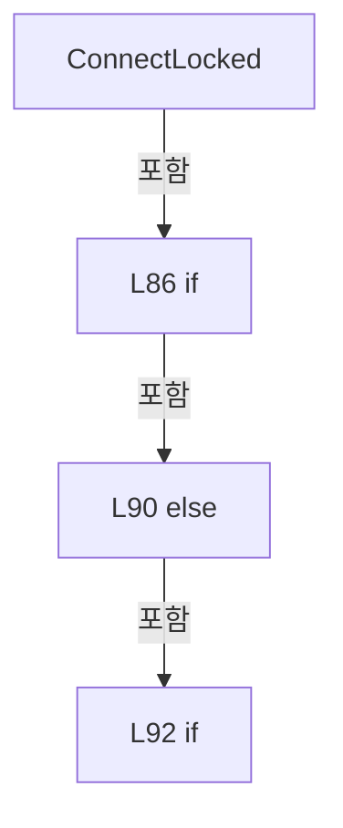

변경 전 점검: 입력/반환 타입, 위 호출자, 예외/취소 경로, 공유 상태와 저장·전송 소비자를 함께 확인합니다. 값의 단위나 물리 방향을 이름만으로 확정하지 않습니다.

### MethodDeclaration `ExecuteACSFunction` · L105–119

[Drilling.Common/Motion/ACS/CACSComm.cs:105–119](https://github.com/kjuws10-rgb/A3Drilling/blob/5aee8e58439c9b455cae7c9593c9be986c3e682e/Drilling.Common/Motion/ACS/CACSComm.cs#L105-L119)

| 항목 | 실제 추출 값 |
| --- | --- |
| 서명 | string Drilling.Common.Motion.CACSComm.ExecuteACSFunction(Api, string) |
| 접근/수식자 | Private / private |
| 반환/값 타입 | string |
| 소속 타입 | NamedType:Drilling.Common.Motion.CACSComm |

입력 계약:

| 이름 | 타입 | 전달 | 선택/기본값 |
| --- | --- | --- | --- |
| api | Api | None | False /  |
| function | string | None | False /  |

현재 부분 분석에서 직접 연결된 호출자는 없습니다. XAML/이벤트/인터페이스·델리게이트·외부 진입을 추가 확인해야 하며, 미사용으로 판정한 것이 아닙니다.

호출하는 대상과 해석 범위:

| 원본 행 | 표현식 | 분석 상태 | 대상/소스 위치 |
| --- | --- | --- | --- |
| 107 | function.Split | resolved | string[] string.Split(char, System.StringSplitOptions) |
| 108 | tokens[0].Equals | resolved | bool string.Equals(string?, System.StringComparison) |
| 110 | api.Command | unresolved | None |
| 114 | tokens[1].ToUpperInvariant | resolved | string string.ToUpperInvariant() |
| 116 | ExecuteAxisFunction | resolved | string Drilling.Common.Motion.CACSComm.ExecuteAxisFunction(Api, System.Collections.Generic.IReadOnlyList<string>) · Drilling.Common/Motion/ACS/CACSComm.cs:121 |
| 117 | ExecuteIoFunction | resolved | string Drilling.Common.Motion.CACSComm.ExecuteIoFunction(Api, System.Collections.Generic.IReadOnlyList<string>) · Drilling.Common/Motion/ACS/CACSComm.cs:162 |
| 118 | ExecuteRawACSCommand | resolved | string Drilling.Common.Motion.CACSComm.ExecuteRawACSCommand(Api, string) · Drilling.Common/Motion/ACS/CACSComm.cs:193 |

본문의 실제 연산·분기·예외·반환 순서(원문 위치 순):

| 원본 행 | 종류 | 주석 해설 |
| --- | --- | --- |
| 107 | call | 함수·델리게이트 또는 객체 생성자를 호출합니다: function.Split(':', StringSplitOptions.TrimEntries &#124; StringSplitOptions.RemoveEmptyEntries) |
| 107 | local-declaration | 지역 변수를 선언합니다: var tokens = function.Split(':', StringSplitOptions.TrimEntries &#124; StringSplitOptions.RemoveEmptyEntries); |
| 107 | variable-initializer | 변수의 초기값을 지정합니다: tokens = function.Split(':', StringSplitOptions.TrimEntries &#124; StringSplitOptions.RemoveEmptyEntries) |
| 108 | call | 함수·델리게이트 또는 객체 생성자를 호출합니다: tokens[0].Equals("ACS", StringComparison.OrdinalIgnoreCase) |
| 108 | if | 조건에 따라 분기합니다: if (tokens.Length < 2 &#124;&#124; !tokens[0].Equals("ACS", StringComparison.OrdinalIgnoreCase)) |
| 110 | call | 함수·델리게이트 또는 객체 생성자를 호출합니다: api.Command(function) |
| 111 | return | 호출자에게 값 또는 제어를 반환합니다: return "OK:COMMAND"; |
| 114 | call | 함수·델리게이트 또는 객체 생성자를 호출합니다: tokens[1].ToUpperInvariant() |
| 114 | return | 호출자에게 값 또는 제어를 반환합니다: return tokens[1].ToUpperInvariant() switch { "AXIS" => ExecuteAxisFunction(api, tokens), "IO" => ExecuteIoFunction(api, tokens), _ => ExecuteRawACSCommand(api, function)}; |
| 114 | switch-expression | 값별 결과식을 선택합니다: tokens[1].ToUpperInvariant() switch { "AXIS" => ExecuteAxisFunction(api, tokens), "IO" => ExecuteIoFunction(api, tokens), _ => ExecuteRawACSCommand(api, function)} |
| 116 | call | 함수·델리게이트 또는 객체 생성자를 호출합니다: ExecuteAxisFunction(api, tokens) |
| 117 | call | 함수·델리게이트 또는 객체 생성자를 호출합니다: ExecuteIoFunction(api, tokens) |
| 118 | call | 함수·델리게이트 또는 객체 생성자를 호출합니다: ExecuteRawACSCommand(api, function) |

제어 구문의 포함 구조(실제 실행 순서/CFG가 아닌 구문 탐색 그림):

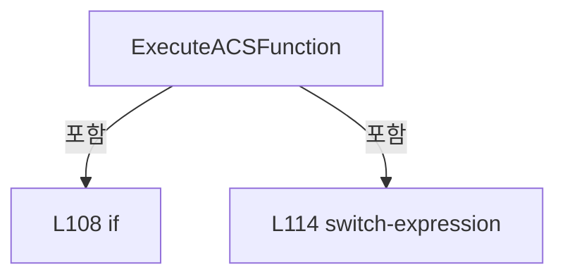

변경 전 점검: 입력/반환 타입, 위 호출자, 예외/취소 경로, 공유 상태와 저장·전송 소비자를 함께 확인합니다. 값의 단위나 물리 방향을 이름만으로 확정하지 않습니다.

### MethodDeclaration `ExecuteAxisFunction` · L121–160

[Drilling.Common/Motion/ACS/CACSComm.cs:121–160](https://github.com/kjuws10-rgb/A3Drilling/blob/5aee8e58439c9b455cae7c9593c9be986c3e682e/Drilling.Common/Motion/ACS/CACSComm.cs#L121-L160)

| 항목 | 실제 추출 값 |
| --- | --- |
| 서명 | string Drilling.Common.Motion.CACSComm.ExecuteAxisFunction(Api, System.Collections.Generic.IReadOnlyList<string>) |
| 접근/수식자 | Private / private, static |
| 반환/값 타입 | string |
| 소속 타입 | NamedType:Drilling.Common.Motion.CACSComm |

입력 계약:

| 이름 | 타입 | 전달 | 선택/기본값 |
| --- | --- | --- | --- |
| api | Api | None | False /  |
| tokens | System.Collections.Generic.IReadOnlyList<string> | None | False /  |

정적 호출자로 확인된 위치:

| 호출 파일/행 | 호출 표현식 | 런타임 분기 가능 |
| --- | --- | --- |
| [Drilling.Common/Motion/ACS/CACSComm.cs:116–116](https://github.com/kjuws10-rgb/A3Drilling/blob/5aee8e58439c9b455cae7c9593c9be986c3e682e/Drilling.Common/Motion/ACS/CACSComm.cs#L116-L116) | ExecuteAxisFunction | False |

호출하는 대상과 해석 범위:

| 원본 행 | 표현식 | 분석 상태 | 대상/소스 위치 |
| --- | --- | --- | --- |
| 125 | new InvalidOperationException | resolved | System.InvalidOperationException.InvalidOperationException(string?) |
| 128 | ReadInt | resolved | int Drilling.Common.Motion.CACSComm.ReadInt(string, string) · Drilling.Common/Motion/ACS/CACSComm.cs:246 |
| 129 | ToAcsAxis | resolved | Axis Drilling.Common.Motion.CACSComm.ToAcsAxis(int) · Drilling.Common/Motion/ACS/CACSComm.cs:225 |
| 131 | tokens[4].ToUpperInvariant | resolved | string string.ToUpperInvariant() |
| 135 | api.Enable | unresolved | None |
| 138 | api.Disable | unresolved | None |
| 141 | api.Command | unresolved | None |
| 144 | api.ToPoint | unresolved | None |
| 144 | ReadDouble | resolved | double Drilling.Common.Motion.CACSComm.ReadDouble(System.Collections.Generic.IReadOnlyList<string>, int, string) · Drilling.Common/Motion/ACS/CACSComm.cs:251 |
| 147 | api.ToPoint | unresolved | None |
| 147 | ReadDouble | resolved | double Drilling.Common.Motion.CACSComm.ReadDouble(System.Collections.Generic.IReadOnlyList<string>, int, string) · Drilling.Common/Motion/ACS/CACSComm.cs:251 |
| 150 | api.Halt | unresolved | None |
| 153 | api.FaultClear | unresolved | None |
| 156 | api.GetFPosition | unresolved | None |
| 158 | new InvalidOperationException | resolved | System.InvalidOperationException.InvalidOperationException(string?) |

본문의 실제 연산·분기·예외·반환 순서(원문 위치 순):

| 원본 행 | 종류 | 주석 해설 |
| --- | --- | --- |
| 123 | if | 조건에 따라 분기합니다: if (tokens.Count < 5) |
| 125 | call | 함수·델리게이트 또는 객체 생성자를 호출합니다: new InvalidOperationException("ACS axis command is invalid.") |
| 125 | throw | 예외를 발생/전달합니다: throw new InvalidOperationException("ACS axis command is invalid."); |
| 128 | call | 함수·델리게이트 또는 객체 생성자를 호출합니다: ReadInt(tokens[2], "AXIS") |
| 128 | local-declaration | 지역 변수를 선언합니다: var axisNo = ReadInt(tokens[2], "AXIS"); |
| 128 | variable-initializer | 변수의 초기값을 지정합니다: axisNo = ReadInt(tokens[2], "AXIS") |
| 129 | call | 함수·델리게이트 또는 객체 생성자를 호출합니다: ToAcsAxis(axisNo) |
| 129 | local-declaration | 지역 변수를 선언합니다: var axis = ToAcsAxis(axisNo); |
| 129 | variable-initializer | 변수의 초기값을 지정합니다: axis = ToAcsAxis(axisNo) |
| 130 | local-declaration | 지역 변수를 선언합니다: var axisName = tokens[3]; |
| 130 | variable-initializer | 변수의 초기값을 지정합니다: axisName = tokens[3] |
| 131 | call | 함수·델리게이트 또는 객체 생성자를 호출합니다: tokens[4].ToUpperInvariant() |
| 131 | local-declaration | 지역 변수를 선언합니다: var command = tokens[4].ToUpperInvariant(); |
| 131 | variable-initializer | 변수의 초기값을 지정합니다: command = tokens[4].ToUpperInvariant() |
| 132 | switch | 값에 따라 분기합니다: switch (command) |
| 134 | case | 분기값/패턴의 구간입니다: case "SERVO_ON": |
| 135 | call | 함수·델리게이트 또는 객체 생성자를 호출합니다: api.Enable(axis) |
| 136 | return | 호출자에게 값 또는 제어를 반환합니다: return $"OK:AXIS:{axisName}:SERVO_ON"; |
| 137 | case | 분기값/패턴의 구간입니다: case "SERVO_OFF": |
| 138 | call | 함수·델리게이트 또는 객체 생성자를 호출합니다: api.Disable(axis) |
| 139 | return | 호출자에게 값 또는 제어를 반환합니다: return $"OK:AXIS:{axisName}:SERVO_OFF"; |
| 140 | case | 분기값/패턴의 구간입니다: case "HOME": |
| 141 | call | 함수·델리게이트 또는 객체 생성자를 호출합니다: api.Command($"HOME {axisNo}") |
| 142 | return | 호출자에게 값 또는 제어를 반환합니다: return $"OK:AXIS:{axisName}:HOME"; |
| 143 | case | 분기값/패턴의 구간입니다: case "MOVE_ABS": |
| 144 | call | 함수·델리게이트 또는 객체 생성자를 호출합니다: api.ToPoint(MotionFlags.ACSC_AMF_WAIT, axis, ReadDouble(tokens, 5, "MOVE_ABS")) |
| 144 | call | 함수·델리게이트 또는 객체 생성자를 호출합니다: ReadDouble(tokens, 5, "MOVE_ABS") |
| 145 | return | 호출자에게 값 또는 제어를 반환합니다: return $"OK:AXIS:{axisName}:MOVE_ABS"; |
| 146 | case | 분기값/패턴의 구간입니다: case "MOVE_REL": |
| 147 | call | 함수·델리게이트 또는 객체 생성자를 호출합니다: api.ToPoint(MotionFlags.ACSC_AMF_WAIT &#124; MotionFlags.ACSC_AMF_RELATIVE, axis, ReadDouble(tokens, 5, "MOVE_REL")) |
| 147 | call | 함수·델리게이트 또는 객체 생성자를 호출합니다: ReadDouble(tokens, 5, "MOVE_REL") |
| 148 | return | 호출자에게 값 또는 제어를 반환합니다: return $"OK:AXIS:{axisName}:MOVE_REL"; |
| 149 | case | 분기값/패턴의 구간입니다: case "STOP": |
| 150 | call | 함수·델리게이트 또는 객체 생성자를 호출합니다: api.Halt(axis) |
| 151 | return | 호출자에게 값 또는 제어를 반환합니다: return $"OK:AXIS:{axisName}:STOP"; |
| 152 | case | 분기값/패턴의 구간입니다: case "RESET_ALARM": |
| 153 | call | 함수·델리게이트 또는 객체 생성자를 호출합니다: api.FaultClear(axis) |
| 154 | return | 호출자에게 값 또는 제어를 반환합니다: return $"OK:AXIS:{axisName}:RESET_ALARM"; |
| 155 | case | 분기값/패턴의 구간입니다: case "READ": |
| 156 | call | 함수·델리게이트 또는 객체 생성자를 호출합니다: api.GetFPosition(axis) |
| 156 | return | 호출자에게 값 또는 제어를 반환합니다: return $"OK:AXIS:{axisName}:FPOS:{api.GetFPosition(axis):F6}"; |
| 157 | case | 분기값/패턴의 구간입니다: default: |
| 158 | call | 함수·델리게이트 또는 객체 생성자를 호출합니다: new InvalidOperationException($"ACS axis command is unknown: {command}") |
| 158 | throw | 예외를 발생/전달합니다: throw new InvalidOperationException($"ACS axis command is unknown: {command}"); |

제어 구문의 포함 구조(실제 실행 순서/CFG가 아닌 구문 탐색 그림):

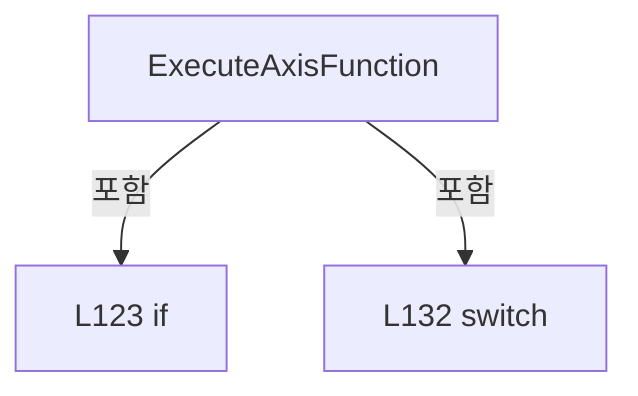

변경 전 점검: 입력/반환 타입, 위 호출자, 예외/취소 경로, 공유 상태와 저장·전송 소비자를 함께 확인합니다. 값의 단위나 물리 방향을 이름만으로 확정하지 않습니다.

### MethodDeclaration `ExecuteIoFunction` · L162–191

[Drilling.Common/Motion/ACS/CACSComm.cs:162–191](https://github.com/kjuws10-rgb/A3Drilling/blob/5aee8e58439c9b455cae7c9593c9be986c3e682e/Drilling.Common/Motion/ACS/CACSComm.cs#L162-L191)

| 항목 | 실제 추출 값 |
| --- | --- |
| 서명 | string Drilling.Common.Motion.CACSComm.ExecuteIoFunction(Api, System.Collections.Generic.IReadOnlyList<string>) |
| 접근/수식자 | Private / private, static |
| 반환/값 타입 | string |
| 소속 타입 | NamedType:Drilling.Common.Motion.CACSComm |

입력 계약:

| 이름 | 타입 | 전달 | 선택/기본값 |
| --- | --- | --- | --- |
| api | Api | None | False /  |
| tokens | System.Collections.Generic.IReadOnlyList<string> | None | False /  |

정적 호출자로 확인된 위치:

| 호출 파일/행 | 호출 표현식 | 런타임 분기 가능 |
| --- | --- | --- |
| [Drilling.Common/Motion/ACS/CACSComm.cs:117–117](https://github.com/kjuws10-rgb/A3Drilling/blob/5aee8e58439c9b455cae7c9593c9be986c3e682e/Drilling.Common/Motion/ACS/CACSComm.cs#L117-L117) | ExecuteIoFunction | False |

호출하는 대상과 해석 범위:

| 원본 행 | 표현식 | 분석 상태 | 대상/소스 위치 |
| --- | --- | --- | --- |
| 166 | new InvalidOperationException | resolved | System.InvalidOperationException.InvalidOperationException(string?) |
| 169 | tokens[2].Trim().ToUpperInvariant | resolved | string string.ToUpperInvariant() |
| 169 | tokens[2].Trim | resolved | string string.Trim() |
| 170 | ParseIoAddress | resolved | (int Port, int Bit) Drilling.Common.Motion.CACSComm.ParseIoAddress(string) · Drilling.Common/Motion/ACS/CACSComm.cs:235 |
| 171 | tokens[3].ToUpperInvariant | resolved | string string.ToUpperInvariant() |
| 174 | address.StartsWith | resolved | bool string.StartsWith(char) |
| 174 | api.GetOutput | unresolved | None |
| 174 | api.GetInput | unresolved | None |
| 180 | new InvalidOperationException | resolved | System.InvalidOperationException.InvalidOperationException(string?) |
| 184 | address.StartsWith | resolved | bool string.StartsWith(char) |
| 186 | new InvalidOperationException | resolved | System.InvalidOperationException.InvalidOperationException(string?) |
| 189 | api.SetOutput | unresolved | None |

본문의 실제 연산·분기·예외·반환 순서(원문 위치 순):

| 원본 행 | 종류 | 주석 해설 |
| --- | --- | --- |
| 164 | if | 조건에 따라 분기합니다: if (tokens.Count < 4) |
| 166 | call | 함수·델리게이트 또는 객체 생성자를 호출합니다: new InvalidOperationException("ACS IO command is invalid.") |
| 166 | throw | 예외를 발생/전달합니다: throw new InvalidOperationException("ACS IO command is invalid."); |
| 169 | call | 함수·델리게이트 또는 객체 생성자를 호출합니다: tokens[2].Trim().ToUpperInvariant() |
| 169 | call | 함수·델리게이트 또는 객체 생성자를 호출합니다: tokens[2].Trim() |
| 169 | local-declaration | 지역 변수를 선언합니다: var address = tokens[2].Trim().ToUpperInvariant(); |
| 169 | variable-initializer | 변수의 초기값을 지정합니다: address = tokens[2].Trim().ToUpperInvariant() |
| 170 | assignment | 값을 대상에 대입합니다: var(port, bit) = ParseIoAddress(address) |
| 170 | call | 함수·델리게이트 또는 객체 생성자를 호출합니다: ParseIoAddress(address) |
| 171 | call | 함수·델리게이트 또는 객체 생성자를 호출합니다: tokens[3].ToUpperInvariant() |
| 171 | local-declaration | 지역 변수를 선언합니다: var command = tokens[3].ToUpperInvariant(); |
| 171 | variable-initializer | 변수의 초기값을 지정합니다: command = tokens[3].ToUpperInvariant() |
| 172 | if | 조건에 따라 분기합니다: if (command == "READ") |
| 174 | call | 함수·델리게이트 또는 객체 생성자를 호출합니다: address.StartsWith('Y') |
| 174 | call | 함수·델리게이트 또는 객체 생성자를 호출합니다: api.GetOutput(port, bit) |
| 174 | call | 함수·델리게이트 또는 객체 생성자를 호출합니다: api.GetInput(port, bit) |
| 174 | conditional-expression | 조건에 따라 결과식을 선택합니다: address.StartsWith('Y') ? api.GetOutput(port, bit) : api.GetInput(port, bit) |
| 174 | local-declaration | 지역 변수를 선언합니다: var value = address.StartsWith('Y') ? api.GetOutput(port, bit) : api.GetInput(port, bit); |
| 174 | variable-initializer | 변수의 초기값을 지정합니다: value = address.StartsWith('Y') ? api.GetOutput(port, bit) : api.GetInput(port, bit) |
| 175 | conditional-expression | 조건에 따라 결과식을 선택합니다: value != 0 ? "ON" : "OFF" |
| 175 | return | 호출자에게 값 또는 제어를 반환합니다: return $"OK:IO:{address}:{(value != 0 ? "ON" : "OFF")}"; |
| 178 | if | 조건에 따라 분기합니다: if (command is not ("ON" or "OFF")) |
| 180 | call | 함수·델리게이트 또는 객체 생성자를 호출합니다: new InvalidOperationException($"ACS IO command is unknown: {command}") |
| 180 | throw | 예외를 발생/전달합니다: throw new InvalidOperationException($"ACS IO command is unknown: {command}"); |
| 183 | local-declaration | 지역 변수를 선언합니다: var isOn = command == "ON"; |
| 183 | variable-initializer | 변수의 초기값을 지정합니다: isOn = command == "ON" |
| 184 | call | 함수·델리게이트 또는 객체 생성자를 호출합니다: address.StartsWith('Y') |
| 184 | if | 조건에 따라 분기합니다: if (!address.StartsWith('Y')) |
| 186 | call | 함수·델리게이트 또는 객체 생성자를 호출합니다: new InvalidOperationException($"ACS IO output command can use Y address only: {address}") |
| 186 | throw | 예외를 발생/전달합니다: throw new InvalidOperationException($"ACS IO output command can use Y address only: {address}"); |
| 189 | call | 함수·델리게이트 또는 객체 생성자를 호출합니다: api.SetOutput(port, bit, isOn ? 1 : 0) |
| 189 | conditional-expression | 조건에 따라 결과식을 선택합니다: isOn ? 1 : 0 |
| 190 | conditional-expression | 조건에 따라 결과식을 선택합니다: isOn ? "ON" : "OFF" |
| 190 | return | 호출자에게 값 또는 제어를 반환합니다: return $"OK:IO:{address}:{(isOn ? "ON" : "OFF")}"; |

제어 구문의 포함 구조(실제 실행 순서/CFG가 아닌 구문 탐색 그림):

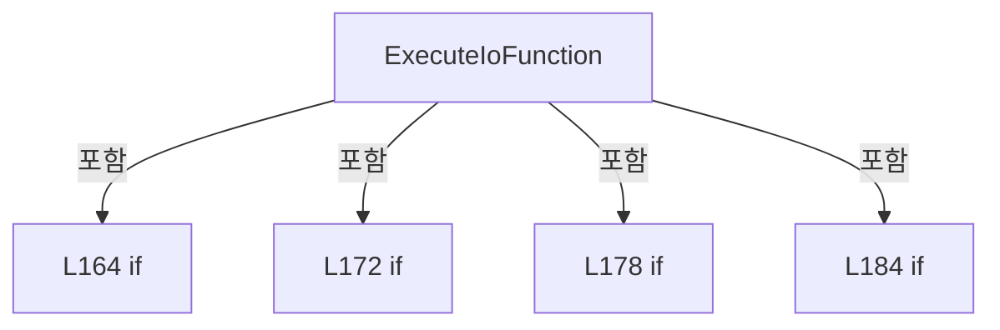

변경 전 점검: 입력/반환 타입, 위 호출자, 예외/취소 경로, 공유 상태와 저장·전송 소비자를 함께 확인합니다. 값의 단위나 물리 방향을 이름만으로 확정하지 않습니다.

### MethodDeclaration `ExecuteRawACSCommand` · L193–197

[Drilling.Common/Motion/ACS/CACSComm.cs:193–197](https://github.com/kjuws10-rgb/A3Drilling/blob/5aee8e58439c9b455cae7c9593c9be986c3e682e/Drilling.Common/Motion/ACS/CACSComm.cs#L193-L197)

| 항목 | 실제 추출 값 |
| --- | --- |
| 서명 | string Drilling.Common.Motion.CACSComm.ExecuteRawACSCommand(Api, string) |
| 접근/수식자 | Private / private, static |
| 반환/값 타입 | string |
| 소속 타입 | NamedType:Drilling.Common.Motion.CACSComm |

입력 계약:

| 이름 | 타입 | 전달 | 선택/기본값 |
| --- | --- | --- | --- |
| api | Api | None | False /  |
| function | string | None | False /  |

정적 호출자로 확인된 위치:

| 호출 파일/행 | 호출 표현식 | 런타임 분기 가능 |
| --- | --- | --- |
| [Drilling.Common/Motion/ACS/CACSComm.cs:118–118](https://github.com/kjuws10-rgb/A3Drilling/blob/5aee8e58439c9b455cae7c9593c9be986c3e682e/Drilling.Common/Motion/ACS/CACSComm.cs#L118-L118) | ExecuteRawACSCommand | False |

호출하는 대상과 해석 범위:

| 원본 행 | 표현식 | 분석 상태 | 대상/소스 위치 |
| --- | --- | --- | --- |
| 195 | api.Command | unresolved | None |

본문의 실제 연산·분기·예외·반환 순서(원문 위치 순):

| 원본 행 | 종류 | 주석 해설 |
| --- | --- | --- |
| 195 | call | 함수·델리게이트 또는 객체 생성자를 호출합니다: api.Command(function) |
| 196 | return | 호출자에게 값 또는 제어를 반환합니다: return "OK:COMMAND"; |

변경 전 점검: 입력/반환 타입, 위 호출자, 예외/취소 경로, 공유 상태와 저장·전송 소비자를 함께 확인합니다. 값의 단위나 물리 방향을 이름만으로 확정하지 않습니다.

### MethodDeclaration `IsSimulatorEndpoint` · L199–202

[Drilling.Common/Motion/ACS/CACSComm.cs:199–202](https://github.com/kjuws10-rgb/A3Drilling/blob/5aee8e58439c9b455cae7c9593c9be986c3e682e/Drilling.Common/Motion/ACS/CACSComm.cs#L199-L202)

| 항목 | 실제 추출 값 |
| --- | --- |
| 서명 | bool Drilling.Common.Motion.CACSComm.IsSimulatorEndpoint() |
| 접근/수식자 | Private / private |
| 반환/값 타입 | bool |
| 소속 타입 | NamedType:Drilling.Common.Motion.CACSComm |

정적 호출자로 확인된 위치:

| 호출 파일/행 | 호출 표현식 | 런타임 분기 가능 |
| --- | --- | --- |
| [Drilling.Common/Motion/ACS/CACSComm.cs:86–86](https://github.com/kjuws10-rgb/A3Drilling/blob/5aee8e58439c9b455cae7c9593c9be986c3e682e/Drilling.Common/Motion/ACS/CACSComm.cs#L86-L86) | IsSimulatorEndpoint | False |

호출하는 대상과 해석 범위:

| 원본 행 | 표현식 | 분석 상태 | 대상/소스 위치 |
| --- | --- | --- | --- |
| 201 | Option.RemoteAddress.Equals | resolved | bool string.Equals(string?, System.StringComparison) |
| 201 | Option.RemoteAddress.Equals | resolved | bool string.Equals(string?, System.StringComparison) |
| 201 | Option.RemoteAddress.Equals | resolved | bool string.Equals(string?, System.StringComparison) |

본문의 실제 연산·분기·예외·반환 순서(원문 위치 순):

| 원본 행 | 종류 | 주석 해설 |
| --- | --- | --- |
| 201 | call | 함수·델리게이트 또는 객체 생성자를 호출합니다: Option.RemoteAddress.Equals("SIM", StringComparison.OrdinalIgnoreCase) |
| 201 | call | 함수·델리게이트 또는 객체 생성자를 호출합니다: Option.RemoteAddress.Equals("SIMUL", StringComparison.OrdinalIgnoreCase) |
| 201 | call | 함수·델리게이트 또는 객체 생성자를 호출합니다: Option.RemoteAddress.Equals("SIMULATOR", StringComparison.OrdinalIgnoreCase) |
| 201 | return | 호출자에게 값 또는 제어를 반환합니다: return Option.RemoteAddress.Equals("SIM", StringComparison.OrdinalIgnoreCase) &#124;&#124; Option.RemoteAddress.Equals("SIMUL", StringComparison.OrdinalIgnoreCase) &#124;&#124; Option.RemoteAddress.Equals("SIMULATOR", StringComparison.OrdinalIgnoreCa |

변경 전 점검: 입력/반환 타입, 위 호출자, 예외/취소 경로, 공유 상태와 저장·전송 소비자를 함께 확인합니다. 값의 단위나 물리 방향을 이름만으로 확정하지 않습니다.

### MethodDeclaration `CloseApi` · L204–223

[Drilling.Common/Motion/ACS/CACSComm.cs:204–223](https://github.com/kjuws10-rgb/A3Drilling/blob/5aee8e58439c9b455cae7c9593c9be986c3e682e/Drilling.Common/Motion/ACS/CACSComm.cs#L204-L223)

| 항목 | 실제 추출 값 |
| --- | --- |
| 서명 | void Drilling.Common.Motion.CACSComm.CloseApi() |
| 접근/수식자 | Private / private |
| 반환/값 타입 | void |
| 소속 타입 | NamedType:Drilling.Common.Motion.CACSComm |

정적 호출자로 확인된 위치:

| 호출 파일/행 | 호출 표현식 | 런타임 분기 가능 |
| --- | --- | --- |
| [Drilling.Common/Motion/ACS/CACSComm.cs:25–25](https://github.com/kjuws10-rgb/A3Drilling/blob/5aee8e58439c9b455cae7c9593c9be986c3e682e/Drilling.Common/Motion/ACS/CACSComm.cs#L25-L25) | CloseApi | False |
| [Drilling.Common/Motion/ACS/CACSComm.cs:39–39](https://github.com/kjuws10-rgb/A3Drilling/blob/5aee8e58439c9b455cae7c9593c9be986c3e682e/Drilling.Common/Motion/ACS/CACSComm.cs#L39-L39) | CloseApi | False |
| [Drilling.Common/Motion/ACS/CACSComm.cs:84–84](https://github.com/kjuws10-rgb/A3Drilling/blob/5aee8e58439c9b455cae7c9593c9be986c3e682e/Drilling.Common/Motion/ACS/CACSComm.cs#L84-L84) | CloseApi | False |

호출하는 대상과 해석 범위:

| 원본 행 | 표현식 | 분석 상태 | 대상/소스 위치 |
| --- | --- | --- | --- |
| 213 | _api.CloseComm | unresolved | None |

본문의 실제 연산·분기·예외·반환 순서(원문 위치 순):

| 원본 행 | 종류 | 주석 해설 |
| --- | --- | --- |
| 206 | if | 조건에 따라 분기합니다: if (_api is null) |
| 208 | return | 호출자에게 값 또는 제어를 반환합니다: return; |
| 211 | try | 예외 처리 범위입니다: try |
| 213 | call | 함수·델리게이트 또는 객체 생성자를 호출합니다: _api.CloseComm() |
| 215 | catch | 지정 예외를 처리합니다: catch  |
| 219 | finally | 종료 정리 구간입니다: finally |
| 221 | assignment | 값을 대상에 대입합니다: _api = null |

제어 구문의 포함 구조(실제 실행 순서/CFG가 아닌 구문 탐색 그림):

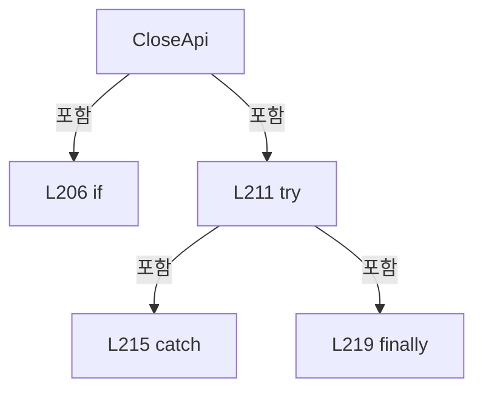

변경 전 점검: 입력/반환 타입, 위 호출자, 예외/취소 경로, 공유 상태와 저장·전송 소비자를 함께 확인합니다. 값의 단위나 물리 방향을 이름만으로 확정하지 않습니다.

### MethodDeclaration `ToAcsAxis` · L225–233

[Drilling.Common/Motion/ACS/CACSComm.cs:225–233](https://github.com/kjuws10-rgb/A3Drilling/blob/5aee8e58439c9b455cae7c9593c9be986c3e682e/Drilling.Common/Motion/ACS/CACSComm.cs#L225-L233)

| 항목 | 실제 추출 값 |
| --- | --- |
| 서명 | Axis Drilling.Common.Motion.CACSComm.ToAcsAxis(int) |
| 접근/수식자 | Private / private, static |
| 반환/값 타입 | Axis |
| 소속 타입 | NamedType:Drilling.Common.Motion.CACSComm |

입력 계약:

| 이름 | 타입 | 전달 | 선택/기본값 |
| --- | --- | --- | --- |
| axisNo | int | None | False /  |

정적 호출자로 확인된 위치:

| 호출 파일/행 | 호출 표현식 | 런타임 분기 가능 |
| --- | --- | --- |
| [Drilling.Common/Motion/ACS/CACSComm.cs:129–129](https://github.com/kjuws10-rgb/A3Drilling/blob/5aee8e58439c9b455cae7c9593c9be986c3e682e/Drilling.Common/Motion/ACS/CACSComm.cs#L129-L129) | ToAcsAxis | False |

호출하는 대상과 해석 범위:

| 원본 행 | 표현식 | 분석 상태 | 대상/소스 위치 |
| --- | --- | --- | --- |
| 229 | new ArgumentOutOfRangeException | resolved | System.ArgumentOutOfRangeException.ArgumentOutOfRangeException(string?, object?, string?) |
| 229 | nameof | unresolved | None |

본문의 실제 연산·분기·예외·반환 순서(원문 위치 순):

| 원본 행 | 종류 | 주석 해설 |
| --- | --- | --- |
| 227 | if | 조건에 따라 분기합니다: if (axisNo < 0 &#124;&#124; axisNo > 63) |
| 229 | call | 함수·델리게이트 또는 객체 생성자를 호출합니다: new ArgumentOutOfRangeException(nameof(axisNo), axisNo, "ACS axis number is out of range.") |
| 229 | call | 함수·델리게이트 또는 객체 생성자를 호출합니다: nameof(axisNo) |
| 229 | throw | 예외를 발생/전달합니다: throw new ArgumentOutOfRangeException(nameof(axisNo), axisNo, "ACS axis number is out of range."); |
| 232 | return | 호출자에게 값 또는 제어를 반환합니다: return (Axis)axisNo; |

제어 구문의 포함 구조(실제 실행 순서/CFG가 아닌 구문 탐색 그림):

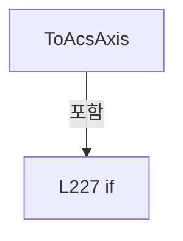

변경 전 점검: 입력/반환 타입, 위 호출자, 예외/취소 경로, 공유 상태와 저장·전송 소비자를 함께 확인합니다. 값의 단위나 물리 방향을 이름만으로 확정하지 않습니다.

### MethodDeclaration `ParseIoAddress` · L235–244

[Drilling.Common/Motion/ACS/CACSComm.cs:235–244](https://github.com/kjuws10-rgb/A3Drilling/blob/5aee8e58439c9b455cae7c9593c9be986c3e682e/Drilling.Common/Motion/ACS/CACSComm.cs#L235-L244)

| 항목 | 실제 추출 값 |
| --- | --- |
| 서명 | (int Port, int Bit) Drilling.Common.Motion.CACSComm.ParseIoAddress(string) |
| 접근/수식자 | Private / private, static |
| 반환/값 타입 | (int Port, int Bit) |
| 소속 타입 | NamedType:Drilling.Common.Motion.CACSComm |

입력 계약:

| 이름 | 타입 | 전달 | 선택/기본값 |
| --- | --- | --- | --- |
| address | string | None | False /  |

정적 호출자로 확인된 위치:

| 호출 파일/행 | 호출 표현식 | 런타임 분기 가능 |
| --- | --- | --- |
| [Drilling.Common/Motion/ACS/CACSComm.cs:170–170](https://github.com/kjuws10-rgb/A3Drilling/blob/5aee8e58439c9b455cae7c9593c9be986c3e682e/Drilling.Common/Motion/ACS/CACSComm.cs#L170-L170) | ParseIoAddress | False |

호출하는 대상과 해석 범위:

| 원본 행 | 표현식 | 분석 상태 | 대상/소스 위치 |
| --- | --- | --- | --- |
| 237 | address.Trim().ToUpperInvariant | resolved | string string.ToUpperInvariant() |
| 237 | address.Trim | resolved | string string.Trim() |
| 238 | int.TryParse | resolved | bool int.TryParse(string?, System.Globalization.NumberStyles, System.IFormatProvider?, out int) |
| 240 | new InvalidOperationException | resolved | System.InvalidOperationException.InvalidOperationException(string?) |

본문의 실제 연산·분기·예외·반환 순서(원문 위치 순):

| 원본 행 | 종류 | 주석 해설 |
| --- | --- | --- |
| 237 | call | 함수·델리게이트 또는 객체 생성자를 호출합니다: address.Trim().ToUpperInvariant() |
| 237 | call | 함수·델리게이트 또는 객체 생성자를 호출합니다: address.Trim() |
| 237 | local-declaration | 지역 변수를 선언합니다: var normalized = address.Trim().ToUpperInvariant(); |
| 237 | variable-initializer | 변수의 초기값을 지정합니다: normalized = address.Trim().ToUpperInvariant() |
| 238 | call | 함수·델리게이트 또는 객체 생성자를 호출합니다: int.TryParse(normalized[1..], NumberStyles.Integer, CultureInfo.InvariantCulture, out var number) |
| 238 | if | 조건에 따라 분기합니다: if (normalized.Length < 2 &#124;&#124; normalized[0] is not ('X' or 'Y') &#124;&#124; !int.TryParse(normalized[1..], NumberStyles.Integer, CultureInfo.InvariantCulture, out var number)) |
| 240 | call | 함수·델리게이트 또는 객체 생성자를 호출합니다: new InvalidOperationException($"ACS IO address is invalid: {address}") |
| 240 | throw | 예외를 발생/전달합니다: throw new InvalidOperationException($"ACS IO address is invalid: {address}"); |
| 243 | return | 호출자에게 값 또는 제어를 반환합니다: return (number / 8, number % 8); |

제어 구문의 포함 구조(실제 실행 순서/CFG가 아닌 구문 탐색 그림):

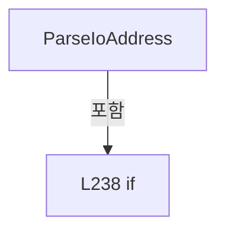

변경 전 점검: 입력/반환 타입, 위 호출자, 예외/취소 경로, 공유 상태와 저장·전송 소비자를 함께 확인합니다. 값의 단위나 물리 방향을 이름만으로 확정하지 않습니다.

### MethodDeclaration `ReadInt` · L246–249

[Drilling.Common/Motion/ACS/CACSComm.cs:246–249](https://github.com/kjuws10-rgb/A3Drilling/blob/5aee8e58439c9b455cae7c9593c9be986c3e682e/Drilling.Common/Motion/ACS/CACSComm.cs#L246-L249)

| 항목 | 실제 추출 값 |
| --- | --- |
| 서명 | int Drilling.Common.Motion.CACSComm.ReadInt(string, string) |
| 접근/수식자 | Private / private, static |
| 반환/값 타입 | int |
| 소속 타입 | NamedType:Drilling.Common.Motion.CACSComm |

입력 계약:

| 이름 | 타입 | 전달 | 선택/기본값 |
| --- | --- | --- | --- |
| value | string | None | False /  |
| fieldName | string | None | False /  |

정적 호출자로 확인된 위치:

| 호출 파일/행 | 호출 표현식 | 런타임 분기 가능 |
| --- | --- | --- |
| [Drilling.Common/Motion/ACS/CACSComm.cs:128–128](https://github.com/kjuws10-rgb/A3Drilling/blob/5aee8e58439c9b455cae7c9593c9be986c3e682e/Drilling.Common/Motion/ACS/CACSComm.cs#L128-L128) | ReadInt | False |

호출하는 대상과 해석 범위:

| 원본 행 | 표현식 | 분석 상태 | 대상/소스 위치 |
| --- | --- | --- | --- |
| 248 | int.TryParse | resolved | bool int.TryParse(string?, System.Globalization.NumberStyles, System.IFormatProvider?, out int) |
| 248 | new InvalidOperationException | resolved | System.InvalidOperationException.InvalidOperationException(string?) |

본문의 실제 연산·분기·예외·반환 순서(원문 위치 순):

| 원본 행 | 종류 | 주석 해설 |
| --- | --- | --- |
| 248 | call | 함수·델리게이트 또는 객체 생성자를 호출합니다: int.TryParse(value, NumberStyles.Integer, CultureInfo.InvariantCulture, out var result) |
| 248 | call | 함수·델리게이트 또는 객체 생성자를 호출합니다: new InvalidOperationException($"ACS {fieldName} value is invalid: {value}") |
| 248 | conditional-expression | 조건에 따라 결과식을 선택합니다: int.TryParse(value, NumberStyles.Integer, CultureInfo.InvariantCulture, out var result) ? result : throw new InvalidOperationException($"ACS {fieldName} value is invalid: {value}") |
| 248 | return | 호출자에게 값 또는 제어를 반환합니다: return int.TryParse(value, NumberStyles.Integer, CultureInfo.InvariantCulture, out var result) ? result : throw new InvalidOperationException($"ACS {fieldName} value is invalid: {value}"); |
| 248 | throw | 예외를 발생/전달합니다: throw new InvalidOperationException($"ACS {fieldName} value is invalid: {value}") |

변경 전 점검: 입력/반환 타입, 위 호출자, 예외/취소 경로, 공유 상태와 저장·전송 소비자를 함께 확인합니다. 값의 단위나 물리 방향을 이름만으로 확정하지 않습니다.

### MethodDeclaration `ReadDouble` · L251–259

[Drilling.Common/Motion/ACS/CACSComm.cs:251–259](https://github.com/kjuws10-rgb/A3Drilling/blob/5aee8e58439c9b455cae7c9593c9be986c3e682e/Drilling.Common/Motion/ACS/CACSComm.cs#L251-L259)

| 항목 | 실제 추출 값 |
| --- | --- |
| 서명 | double Drilling.Common.Motion.CACSComm.ReadDouble(System.Collections.Generic.IReadOnlyList<string>, int, string) |
| 접근/수식자 | Private / private, static |
| 반환/값 타입 | double |
| 소속 타입 | NamedType:Drilling.Common.Motion.CACSComm |

입력 계약:

| 이름 | 타입 | 전달 | 선택/기본값 |
| --- | --- | --- | --- |
| tokens | System.Collections.Generic.IReadOnlyList<string> | None | False /  |
| index | int | None | False /  |
| command | string | None | False /  |

정적 호출자로 확인된 위치:

| 호출 파일/행 | 호출 표현식 | 런타임 분기 가능 |
| --- | --- | --- |
| [Drilling.Common/Motion/ACS/CACSComm.cs:144–144](https://github.com/kjuws10-rgb/A3Drilling/blob/5aee8e58439c9b455cae7c9593c9be986c3e682e/Drilling.Common/Motion/ACS/CACSComm.cs#L144-L144) | ReadDouble | False |
| [Drilling.Common/Motion/ACS/CACSComm.cs:147–147](https://github.com/kjuws10-rgb/A3Drilling/blob/5aee8e58439c9b455cae7c9593c9be986c3e682e/Drilling.Common/Motion/ACS/CACSComm.cs#L147-L147) | ReadDouble | False |

호출하는 대상과 해석 범위:

| 원본 행 | 표현식 | 분석 상태 | 대상/소스 위치 |
| --- | --- | --- | --- |
| 253 | double.TryParse | resolved | bool double.TryParse(string?, System.Globalization.NumberStyles, System.IFormatProvider?, out double) |
| 255 | new InvalidOperationException | resolved | System.InvalidOperationException.InvalidOperationException(string?) |

본문의 실제 연산·분기·예외·반환 순서(원문 위치 순):

| 원본 행 | 종류 | 주석 해설 |
| --- | --- | --- |
| 253 | call | 함수·델리게이트 또는 객체 생성자를 호출합니다: double.TryParse(tokens[index], NumberStyles.Float, CultureInfo.InvariantCulture, out var result) |
| 253 | if | 조건에 따라 분기합니다: if (tokens.Count <= index &#124;&#124; !double.TryParse(tokens[index], NumberStyles.Float, CultureInfo.InvariantCulture, out var result)) |
| 255 | call | 함수·델리게이트 또는 객체 생성자를 호출합니다: new InvalidOperationException($"ACS {command} position is invalid.") |
| 255 | throw | 예외를 발생/전달합니다: throw new InvalidOperationException($"ACS {command} position is invalid."); |
| 258 | return | 호출자에게 값 또는 제어를 반환합니다: return result; |

제어 구문의 포함 구조(실제 실행 순서/CFG가 아닌 구문 탐색 그림):

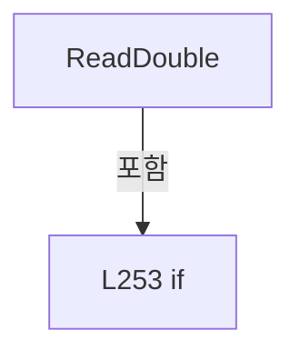

변경 전 점검: 입력/반환 타입, 위 호출자, 예외/취소 경로, 공유 상태와 저장·전송 소비자를 함께 확인합니다. 값의 단위나 물리 방향을 이름만으로 확정하지 않습니다.

## 구문·바인딩 한계

전체 WPF/벤더 SDK/프로젝트별 빌드 조건을 로드한 정식 빌드가 아닙니다. `resolved`는 이 부분 컴파일에서의 심볼 연결이며 virtual/interface/delegate/이벤트/Reflection/XAML의 실제 런타임 구현을 확정하지 않습니다. `candidate`와 `unresolved`는 후속 확인 대상으로 남깁니다.

## 원문 전체 주석 해설본

[원본 모든 행과 행별 해설 보기](../../../../annotated/Drilling.Common/Motion/ACS/CACSComm.cs.annotated.txt)

원본을 빠뜨리거나 임의로 줄이지 않았습니다. `L000001 |` 표시는 원본 행 번호, `// 해설`은 별도 설명입니다. 실행용 소스가 아닌 문서입니다.

## 수정·재검증 체크

- 원본 Commit과 현재 작업 파일 SHA가 같은지 먼저 확인합니다. 다르면 이 문서를 과거 버전 자료로 취급합니다.
- 선언·직접 호출·이벤트/인터페이스 경계·설정 소비를 함께 확인합니다. 정적 연결의 빈 곳을 정상 경로로 추정하지 않습니다.
- 저장 형식/단위/식별자·재시도·취소·예외·롤백에 영향을 주는 변경은 상세 해설장과 호출자를 다시 검토합니다.
- 도구의 구문 추출과 별도 정적 추적 해설, 실제 빌드·시뮬레이션·실장비 검증 결과를 분리합니다.
