# Drilling.Common/Motion/CMotionManager.cs

| 항목 | 내용 |
| --- | --- |
| 원본 저장소 | https://github.com/kjuws10-rgb/A3Drilling.git |
| 원본 Commit | 5aee8e58439c9b455cae7c9593c9be986c3e682e |
| 원본 SHA256 | 893675dbcdfcd93124de264b55511666a561a2dc747eba79a07e13e6c8be02c7 |
| 파일 분류 | code |
| 원본 크기/행 | 79,542 bytes / 1,806 physical lines |
| 인코딩 | utf-8-sig |
| 검토 범위 | 구문/부분 의미 분석에서 추출한 사실. 동작·물리 단위·실장비 합격을 보증하지 않습니다. |
| 원본 링크 | [고정 Commit 원본](https://github.com/kjuws10-rgb/A3Drilling/blob/5aee8e58439c9b455cae7c9593c9be986c3e682e/Drilling.Common/Motion/CMotionManager.cs) |

## 파일의 역할과 읽는 순서

모션 인터페이스·제어 명령을 정의하거나 전달합니다. 문서 생성 과정에서는 축이나 장비를 움직이지 않았습니다.

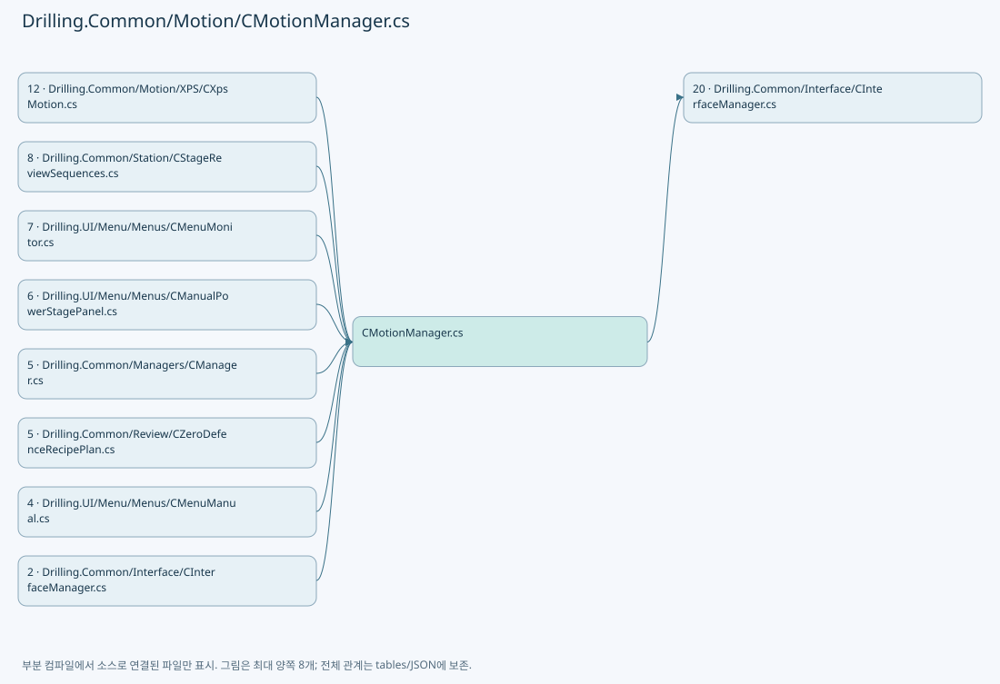

## 네임스페이스·타입·상속

| 타입 | 구분 | 원본 범위 | 선언/상속 |
| --- | --- | --- | --- |
| CMotionManager | ClassDeclaration | 13–1172 | CMotionManager |
| ST_PRE_CHECK_IO | RecordDeclaration | 1129–1129 | ST_PRE_CHECK_IO |
| ST_AXIS_STATE | ClassDeclaration | 1130–1158 | ST_AXIS_STATE |
| ST_IO_STATE | ClassDeclaration | 1160–1171 | ST_IO_STATE |
| EN_MANUAL_STAGE_AXIS | EnumDeclaration | 1174–1178 | EN_MANUAL_STAGE_AXIS |
| ST_MANUAL_STAGE_SIMULATION_AXIS | RecordDeclaration | 1180–1183 | ST_MANUAL_STAGE_SIMULATION_AXIS |
| CManualStageMotionSimulation | ClassDeclaration | 1186–1390 | CManualStageMotionSimulation |
| AxisState | ClassDeclaration | 1350–1358 | AxisState |
| MotionLease | ClassDeclaration | 1360–1389 | MotionLease: IDisposable |
| CMotionControllerTypeAttribute | ClassDeclaration | 1392–1401 | CMotionControllerTypeAttribute: Attribute |
| CMotionController | ClassDeclaration | 1403–1665 | CMotionController |
| EN_MOTION_COMMAND | EnumDeclaration | 1667–1681 | EN_MOTION_COMMAND |
| ST_IO_STATUS | RecordDeclaration | 1683–1683 | ST_IO_STATUS |
| ST_IO_DATA | RecordDeclaration | 1684–1684 | ST_IO_DATA |
| ST_MOTOR_AXIS_STATUS | RecordDeclaration | 1685–1699 | ST_MOTOR_AXIS_STATUS |
| ST_MOTOR_DATA | RecordDeclaration | 1700–1740 | ST_MOTOR_DATA |
| ST_MOTION_STATION_STATUS | RecordDeclaration | 1741–1741 | ST_MOTION_STATION_STATUS |
| ST_MOTION_CONTROLLER_STATUS | RecordDeclaration | 1742–1742 | ST_MOTION_CONTROLLER_STATUS |
| ST_MOTION_ABS_MOVE_REQUEST | RecordDeclaration | 1743–1743 | ST_MOTION_ABS_MOVE_REQUEST |
| CMotorFileBase | ClassDeclaration | 1744–1747 | CMotorFileBase |
| CTrapezoidalMotion | ClassDeclaration | 1750–1805 | CTrapezoidalMotion |

## 멤버 빠른 목록

| 이름 | 종류 | 범위 | 서명 |
| --- | --- | --- | --- |
| DefaultControllerName | FieldDeclaration | L15–15 | string Drilling.Common.Motion.CMotionManager.DefaultControllerName |
| MotionControllerTypes | FieldDeclaration | L16–16 | System.Collections.Generic.IReadOnlyDictionary<string, System.Type> Drilling.Common.Motion.CMotionManager.MotionControllerTypes |
| _interfaceManager | FieldDeclaration | L17–17 | Drilling.Common.Interface.CInterfaceManager? Drilling.Common.Motion.CMotionManager._interfaceManager |
| _motors | FieldDeclaration | L18–18 | System.Collections.Generic.IReadOnlyList<Drilling.Common.Motion.ST_MOTOR_DATA> Drilling.Common.Motion.CMotionManager._motors |
| _axisData | FieldDeclaration | L19–19 | System.Collections.Generic.Dictionary<string, Drilling.Common.Motion.ST_MOTOR_DATA> Drilling.Common.Motion.CMotionManager._axisData |
| _axes | FieldDeclaration | L20–20 | System.Collections.Generic.Dictionary<string, Drilling.Common.Motion.CMotionManager.ST_AXIS_STATE> Drilling.Common.Motion.CMotionManager._axes |
| _io | FieldDeclaration | L21–21 | System.Collections.Generic.Dictionary<string, Drilling.Common.Motion.CMotionManager.ST_IO_STATE> Drilling.Common.Motion.CMotionManager._io |
| _controllers | FieldDeclaration | L22–22 | System.Collections.Generic.Dictionary<string, Drilling.Common.Motion.CMotionController> Drilling.Common.Motion.CMotionManager._controllers |
| _simulationMode | FieldDeclaration | L23–23 | bool Drilling.Common.Motion.CMotionManager._simulationMode |
| .ctor | ConstructorDeclaration | L24–26 | Drilling.Common.Motion.CMotionManager.CMotionManager(bool) |
| .ctor | ConstructorDeclaration | L28–71 | Drilling.Common.Motion.CMotionManager.CMotionManager(Drilling.Common.Interface.CInterfaceManager?, System.Collections.Generic.IReadOnlyList<Drilling.Common.Motion.ST_MOTOR_DATA>?, System.Collections.Generic.IReadOnlyList<Drilling.Common.Motion.ST_IO_DATA>?, bool) |
| IsUse | LocalFunctionStatement | L33–36 | bool IsUse(Drilling.Common.Motion.ST_MOTOR_DATA) |
| SelectDictionaryKey | LocalFunctionStatement | L38–41 | string SelectDictionaryKey(Drilling.Common.Motion.ST_MOTOR_DATA) |
| SelectAxisControllerRequest | LocalFunctionStatement | L46–49 | (string DevType, int DevNo) SelectAxisControllerRequest(Drilling.Common.Motion.ST_MOTOR_DATA) |
| SelectIoControllerRequest | LocalFunctionStatement | L51–54 | (string DevType, int DevNo) SelectIoControllerRequest(Drilling.Common.Motion.CMotionManager.ST_IO_STATE) |
| SelectGroupKey | LocalFunctionStatement | L56–59 | string SelectGroupKey((string DevType, int DevNo)) |
| IsSimulation | PropertyDeclaration | L73–84 | bool Drilling.Common.Motion.CMotionManager.IsSimulation |
| get_IsSimulation | GetAccessorDeclaration | L75–83 | bool Drilling.Common.Motion.CMotionManager.IsSimulation.get |
| MatchesItem | LocalFunctionStatement | L77–80 | bool MatchesItem(Drilling.Common.Motion.CMotionController) |
| SetSimulationMode | MethodDeclaration | L86–94 | void Drilling.Common.Motion.CMotionManager.SetSimulationMode(bool) |
| Initialize | MethodDeclaration | L96–124 | System.Threading.Tasks.Task Drilling.Common.Motion.CMotionManager.Initialize(System.Threading.CancellationToken) |
| SelectGroupKey | LocalFunctionStatement | L99–102 | string SelectGroupKey(Drilling.Common.Motion.ST_MOTOR_DATA) |
| Destroy | MethodDeclaration | L126–133 | System.Threading.Tasks.Task Drilling.Common.Motion.CMotionManager.Destroy(System.Threading.CancellationToken) |
| RefreshStatus | MethodDeclaration | L135–144 | void Drilling.Common.Motion.CMotionManager.RefreshStatus(System.Threading.CancellationToken) |
| GetAxisStatus | MethodDeclaration | L146–151 | System.Collections.Generic.IReadOnlyList<Drilling.Common.Motion.ST_MOTOR_AXIS_STATUS> Drilling.Common.Motion.CMotionManager.GetAxisStatus(System.Threading.CancellationToken) |
| GetAxisStatusAsync | MethodDeclaration | L153–174 | System.Threading.Tasks.Task<System.Collections.Generic.IReadOnlyList<Drilling.Common.Motion.ST_MOTOR_AXIS_STATUS>> Drilling.Common.Motion.CMotionManager.GetAxisStatusAsync(System.Threading.CancellationToken) |
| GetCachedAxisStatus | MethodDeclaration | L176–205 | System.Collections.Generic.IReadOnlyList<Drilling.Common.Motion.ST_MOTOR_AXIS_STATUS> Drilling.Common.Motion.CMotionManager.GetCachedAxisStatus() |
| SelectDisplayOrder | LocalFunctionStatement | L179–182 | int SelectDisplayOrder(Drilling.Common.Motion.CMotionManager.ST_AXIS_STATE) |
| BuildMotor | LocalFunctionStatement | L184–201 | Drilling.Common.Motion.ST_MOTOR_AXIS_STATUS BuildMotor(Drilling.Common.Motion.CMotionManager.ST_AXIS_STATE) |
| GetIoStatus | MethodDeclaration | L207–222 | System.Collections.Generic.IReadOnlyList<Drilling.Common.Motion.ST_IO_STATUS> Drilling.Common.Motion.CMotionManager.GetIoStatus(System.Threading.CancellationToken) |
| SelectDisplayOrder | LocalFunctionStatement | L210–213 | int SelectDisplayOrder(Drilling.Common.Motion.CMotionManager.ST_IO_STATE) |
| BuildIo | LocalFunctionStatement | L215–218 | Drilling.Common.Motion.ST_IO_STATUS BuildIo(Drilling.Common.Motion.CMotionManager.ST_IO_STATE) |
| GetStationStatus | MethodDeclaration | L224–280 | System.Collections.Generic.IReadOnlyList<Drilling.Common.Motion.ST_MOTION_STATION_STATUS> Drilling.Common.Motion.CMotionManager.GetStationStatus(System.Threading.CancellationToken) |
| SelectAxisId | LocalFunctionStatement | L227–230 | string SelectAxisId(Drilling.Common.Motion.ST_MOTOR_AXIS_STATUS) |
| SelectValue | LocalFunctionStatement | L233–236 | string SelectValue(Drilling.Common.Motion.ST_MOTOR_DATA) |
| SelectKey | LocalFunctionStatement | L238–241 | string SelectKey(System.Linq.IGrouping<string, Drilling.Common.Motion.ST_MOTOR_DATA>) |
| SelectMotor | LocalFunctionStatement | L243–246 | Drilling.Common.Motion.ST_MOTOR_AXIS_STATUS? SelectMotor(Drilling.Common.Motion.ST_MOTOR_DATA) |
| MatchesMotor | LocalFunctionStatement | L248–251 | bool MatchesMotor(Drilling.Common.Motion.ST_MOTOR_AXIS_STATUS?) |
| SelectAxisId2 | LocalFunctionStatement | L253–256 | string SelectAxisId2(Drilling.Common.Motion.ST_MOTOR_AXIS_STATUS) |
| SelectSystem | LocalFunctionStatement | L258–261 | string SelectSystem(Drilling.Common.Motion.ST_MOTOR_DATA) |
| MatchesItem | LocalFunctionStatement | L263–266 | bool MatchesItem(string) |
| IsAlarmOn | LocalFunctionStatement | L268–271 | bool IsAlarmOn(Drilling.Common.Motion.ST_MOTOR_AXIS_STATUS) |
| BuildMOTION_STATION_STATUS | LocalFunctionStatement | L273–277 | Drilling.Common.Motion.ST_MOTION_STATION_STATUS BuildMOTION_STATION_STATUS(System.Linq.IGrouping<string, Drilling.Common.Motion.ST_MOTOR_DATA>) |
| GetControllerStatus | MethodDeclaration | L282–320 | System.Threading.Tasks.Task<System.Collections.Generic.IReadOnlyList<Drilling.Common.Motion.ST_MOTION_CONTROLLER_STATUS>> Drilling.Common.Motion.CMotionManager.GetControllerStatus(System.Threading.CancellationToken) |
| SelectValue | LocalFunctionStatement | L285–288 | string SelectValue(Drilling.Common.Motion.ST_MOTOR_DATA) |
| SelectItem | LocalFunctionStatement | L290–293 | string SelectItem(Drilling.Common.Motion.ST_MOTOR_DATA) |
| SelectAxis | LocalFunctionStatement | L295–298 | string SelectAxis(string) |
| BuildMOTION_CONTROLLER_STATUS | LocalFunctionStatement | L300–306 | Drilling.Common.Motion.ST_MOTION_CONTROLLER_STATUS BuildMOTION_CONTROLLER_STATUS(System.Linq.IGrouping<string, Drilling.Common.Motion.ST_MOTOR_DATA>) |
| SelectDevType | LocalFunctionStatement | L308–311 | string SelectDevType(Drilling.Common.Motion.ST_MOTION_CONTROLLER_STATUS) |
| SelectDevNo | LocalFunctionStatement | L313–316 | int SelectDevNo(Drilling.Common.Motion.ST_MOTION_CONTROLLER_STATUS) |
| MoveAxis | MethodDeclaration | L322–325 | System.Threading.Tasks.Task Drilling.Common.Motion.CMotionManager.MoveAxis(string, double, System.Threading.CancellationToken) |
| ServoOn | MethodDeclaration | L327–330 | System.Threading.Tasks.Task Drilling.Common.Motion.CMotionManager.ServoOn(string, System.Threading.CancellationToken) |
| ServoOff | MethodDeclaration | L332–335 | System.Threading.Tasks.Task Drilling.Common.Motion.CMotionManager.ServoOff(string, System.Threading.CancellationToken) |
| Home | MethodDeclaration | L337–340 | System.Threading.Tasks.Task Drilling.Common.Motion.CMotionManager.Home(string, System.Threading.CancellationToken) |
| Move | MethodDeclaration | L342–345 | System.Threading.Tasks.Task Drilling.Common.Motion.CMotionManager.Move(string, double, System.Threading.CancellationToken) |
| MoveRel | MethodDeclaration | L347–350 | System.Threading.Tasks.Task Drilling.Common.Motion.CMotionManager.MoveRel(string, double, System.Threading.CancellationToken) |
| Stop | MethodDeclaration | L352–355 | System.Threading.Tasks.Task Drilling.Common.Motion.CMotionManager.Stop(string, System.Threading.CancellationToken) |
| ResetAlarm | MethodDeclaration | L357–360 | System.Threading.Tasks.Task Drilling.Common.Motion.CMotionManager.ResetAlarm(string, System.Threading.CancellationToken) |
| ExecuteAxisCommand | MethodDeclaration | L362–397 | System.Threading.Tasks.Task Drilling.Common.Motion.CMotionManager.ExecuteAxisCommand(string, Drilling.Common.Motion.EN_MOTION_COMMAND, double, System.Threading.CancellationToken, double?) |
| StopMotion | MethodDeclaration | L399–402 | System.Threading.Tasks.Task Drilling.Common.Motion.CMotionManager.StopMotion(string, System.Threading.CancellationToken) |
| SetOutput | MethodDeclaration | L404–425 | System.Threading.Tasks.Task Drilling.Common.Motion.CMotionManager.SetOutput(string, bool, System.Threading.CancellationToken) |
| ExecuteMotionCommand | MethodDeclaration | L427–438 | System.Threading.Tasks.Task<Drilling.Common.Interface.ST_DEVICE_COMMAND_RESULT> Drilling.Common.Motion.CMotionManager.ExecuteMotionCommand(string, Drilling.Common.Motion.EN_MOTION_COMMAND, double, System.Threading.CancellationToken, double?) |
| ExecuteAbsoluteMoves | MethodDeclaration | L440–517 | System.Threading.Tasks.Task<Drilling.Common.Interface.ST_DEVICE_COMMAND_RESULT> Drilling.Common.Motion.CMotionManager.ExecuteAbsoluteMoves(System.Collections.Generic.IReadOnlyList<Drilling.Common.Motion.ST_MOTION_ABS_MOVE_REQUEST>, System.Threading.CancellationToken) |
| SelectAxisId | LocalFunctionStatement | L451–454 | string SelectAxisId(Drilling.Common.Motion.ST_MOTION_ABS_MOVE_REQUEST) |
| SetOutputCommand | MethodDeclaration | L519–532 | System.Threading.Tasks.Task<Drilling.Common.Interface.ST_DEVICE_COMMAND_RESULT> Drilling.Common.Motion.CMotionManager.SetOutputCommand(string, bool, System.Threading.CancellationToken) |
| GetMotionController | MethodDeclaration | L534–537 | Drilling.Common.Motion.CMotionController? Drilling.Common.Motion.CMotionManager.GetMotionController(string, int) |
| IsAxisSimulation | MethodDeclaration | L539–542 | bool Drilling.Common.Motion.CMotionManager.IsAxisSimulation(Drilling.Common.Motion.ST_MOTOR_DATA) |
| StopStartedAxes | MethodDeclaration | L544–565 | System.Threading.Tasks.Task<System.AggregateException?> Drilling.Common.Motion.CMotionManager.StopStartedAxes(System.Collections.Generic.IReadOnlyList<string>) |
| RefreshAxisStatus | MethodDeclaration | L567–589 | void Drilling.Common.Motion.CMotionManager.RefreshAxisStatus(System.Threading.CancellationToken) |
| ApplyAxisStatus | MethodDeclaration | L591–610 | void Drilling.Common.Motion.CMotionManager.ApplyAxisStatus(Drilling.Common.Motion.ST_MOTOR_AXIS_STATUS) |
| UpdateSimulatedAxisPositions | MethodDeclaration | L612–624 | void Drilling.Common.Motion.CMotionManager.UpdateSimulatedAxisPositions() |
| UpdateSimulatedAxisPosition | MethodDeclaration | L626–668 | void Drilling.Common.Motion.CMotionManager.UpdateSimulatedAxisPosition(Drilling.Common.Motion.ST_MOTOR_DATA, Drilling.Common.Motion.CMotionManager.ST_AXIS_STATE, long) |
| MarkAxisAlarm | MethodDeclaration | L670–677 | void Drilling.Common.Motion.CMotionManager.MarkAxisAlarm(string) |
| CreateMotionController | MethodDeclaration | L679–688 | Drilling.Common.Motion.CMotionController? Drilling.Common.Motion.CMotionManager.CreateMotionController(string, int) |
| ValidateAxisCommand | MethodDeclaration | L690–714 | void Drilling.Common.Motion.CMotionManager.ValidateAxisCommand(Drilling.Common.Motion.ST_MOTOR_DATA, Drilling.Common.Motion.CMotionManager.ST_AXIS_STATE, Drilling.Common.Motion.EN_MOTION_COMMAND, double, double?) |
| ValidateAxisCommandParameters | MethodDeclaration | L716–737 | void Drilling.Common.Motion.CMotionManager.ValidateAxisCommandParameters(Drilling.Common.Motion.ST_MOTOR_DATA, Drilling.Common.Motion.EN_MOTION_COMMAND, double, double?) |
| ValidatePreCheckIo | MethodDeclaration | L739–754 | void Drilling.Common.Motion.CMotionManager.ValidatePreCheckIo(Drilling.Common.Motion.ST_MOTOR_DATA) |
| SplitPreCheckIo | MethodDeclaration | L756–765 | System.Collections.Generic.IEnumerable<Drilling.Common.Motion.CMotionManager.ST_PRE_CHECK_IO> Drilling.Common.Motion.CMotionManager.SplitPreCheckIo(string) |
| ApplyAxisCommand | MethodDeclaration | L767–843 | void Drilling.Common.Motion.CMotionManager.ApplyAxisCommand(string, Drilling.Common.Motion.EN_MOTION_COMMAND, double, double, bool) |
| UpdateAxisPosition | MethodDeclaration | L845–853 | void Drilling.Common.Motion.CMotionManager.UpdateAxisPosition(Drilling.Common.Motion.CMotionManager.ST_AXIS_STATE, double) |
| NormalizeMotors | MethodDeclaration | L855–864 | System.Collections.Generic.IReadOnlyList<Drilling.Common.Motion.ST_MOTOR_DATA> Drilling.Common.Motion.CMotionManager.NormalizeMotors(System.Collections.Generic.IReadOnlyList<Drilling.Common.Motion.ST_MOTOR_DATA>?) |
| ShouldIncludeItem | LocalFunctionStatement | L857–860 | bool ShouldIncludeItem(Drilling.Common.Motion.ST_MOTOR_DATA) |
| CreateAxes | MethodDeclaration | L866–885 | System.Collections.Generic.Dictionary<string, Drilling.Common.Motion.CMotionManager.ST_AXIS_STATE> Drilling.Common.Motion.CMotionManager.CreateAxes(System.Collections.Generic.IReadOnlyList<Drilling.Common.Motion.ST_MOTOR_DATA>) |
| IsUse | LocalFunctionStatement | L868–871 | bool IsUse(Drilling.Common.Motion.ST_MOTOR_DATA) |
| BuildAxis | LocalFunctionStatement | L873–877 | Drilling.Common.Motion.CMotionManager.ST_AXIS_STATE BuildAxis(Drilling.Common.Motion.ST_MOTOR_DATA) |
| SelectAxisId | LocalFunctionStatement | L879–882 | string SelectAxisId(Drilling.Common.Motion.CMotionManager.ST_AXIS_STATE) |
| CreateDefaultMotorData | MethodDeclaration | L887–890 | System.Collections.Generic.IReadOnlyList<Drilling.Common.Motion.ST_MOTOR_DATA> Drilling.Common.Motion.CMotionManager.CreateDefaultMotorData() |
| Motor | MethodDeclaration | L892–936 | Drilling.Common.Motion.ST_MOTOR_DATA Drilling.Common.Motion.CMotionManager.Motor(string, int, string, double, string) |
| GetInitialPosition | MethodDeclaration | L938–953 | double Drilling.Common.Motion.CMotionManager.GetInitialPosition(string) |
| NormalizeAxisId | MethodDeclaration | L955–958 | string Drilling.Common.Motion.CMotionManager.NormalizeAxisId(string) |
| NormalizeAddress | MethodDeclaration | L960–963 | string Drilling.Common.Motion.CMotionManager.NormalizeAddress(string) |
| GetIoChannelOrThrow | MethodDeclaration | L965–1013 | Drilling.Common.Motion.CMotionManager.ST_IO_STATE Drilling.Common.Motion.CMotionManager.GetIoChannelOrThrow(string) |
| ShouldIncludeItem | LocalFunctionStatement | L979–982 | bool ShouldIncludeItem(Drilling.Common.Motion.CMotionManager.ST_IO_STATE) |
| ShouldIncludeIo | LocalFunctionStatement | L991–994 | bool ShouldIncludeIo(Drilling.Common.Motion.CMotionManager.ST_IO_STATE) |
| SelectDisplayOrder | LocalFunctionStatement | L1007–1010 | int SelectDisplayOrder(Drilling.Common.Motion.CMotionManager.ST_IO_STATE) |
| FormatIoReference | MethodDeclaration | L1015–1018 | string Drilling.Common.Motion.CMotionManager.FormatIoReference(Drilling.Common.Motion.CMotionManager.ST_IO_STATE) |
| NormalizeIoName | MethodDeclaration | L1020–1035 | string Drilling.Common.Motion.CMotionManager.NormalizeIoName(string) |
| SelectItem | LocalFunctionStatement | L1022–1025 | char SelectItem(char) |
| CreateIo | MethodDeclaration | L1037–1065 | System.Collections.Generic.Dictionary<string, Drilling.Common.Motion.CMotionManager.ST_IO_STATE> Drilling.Common.Motion.CMotionManager.CreateIo(System.Collections.Generic.IReadOnlyList<Drilling.Common.Motion.ST_IO_DATA>?) |
| IsUse | LocalFunctionStatement | L1039–1042 | bool IsUse(Drilling.Common.Motion.ST_IO_DATA) |
| BuildIo | LocalFunctionStatement | L1044–1057 | Drilling.Common.Motion.CMotionManager.ST_IO_STATE BuildIo(Drilling.Common.Motion.ST_IO_DATA) |
| SelectId | LocalFunctionStatement | L1059–1062 | string SelectId(Drilling.Common.Motion.CMotionManager.ST_IO_STATE) |
| NormalizeStationName | MethodDeclaration | L1067–1070 | string Drilling.Common.Motion.CMotionManager.NormalizeStationName(string) |
| GetControllerKey | MethodDeclaration | L1072–1075 | string Drilling.Common.Motion.CMotionManager.GetControllerKey(string, int) |
| LoadMotionControllerTypes | MethodDeclaration | L1077–1085 | System.Collections.Generic.IReadOnlyDictionary<string, System.Type> Drilling.Common.Motion.CMotionManager.LoadMotionControllerTypes() |
| ShouldIncludeItem | LocalFunctionStatement | L1079–1082 | bool ShouldIncludeItem(System.Type) |
| CreateMotionControllerNotRegisteredException | MethodDeclaration | L1087–1090 | System.InvalidOperationException Drilling.Common.Motion.CMotionManager.CreateMotionControllerNotRegisteredException(string, int) |
| NormalizeControllerName | MethodDeclaration | L1092–1095 | string Drilling.Common.Motion.CMotionManager.NormalizeControllerName(string) |
| FormatMotionCommand | MethodDeclaration | L1097–1111 | string Drilling.Common.Motion.CMotionManager.FormatMotionCommand(Drilling.Common.Motion.EN_MOTION_COMMAND) |
| FormatAggregateException | MethodDeclaration | L1113–1122 | string Drilling.Common.Motion.CMotionManager.FormatAggregateException(System.AggregateException) |
| IsOnText | MethodDeclaration | L1124–1127 | bool Drilling.Common.Motion.CMotionManager.IsOnText(string) |
| AxisId | PropertyDeclaration | L1144–1144 | string Drilling.Common.Motion.CMotionManager.ST_AXIS_STATE.AxisId |
| get_AxisId | GetAccessorDeclaration | L1144–1144 | string Drilling.Common.Motion.CMotionManager.ST_AXIS_STATE.AxisId.get |
| Name | PropertyDeclaration | L1145–1145 | string Drilling.Common.Motion.CMotionManager.ST_AXIS_STATE.Name |
| get_Name | GetAccessorDeclaration | L1145–1145 | string Drilling.Common.Motion.CMotionManager.ST_AXIS_STATE.Name.get |
| CurrentPosition | PropertyDeclaration | L1146–1146 | double Drilling.Common.Motion.CMotionManager.ST_AXIS_STATE.CurrentPosition |
| get_CurrentPosition | GetAccessorDeclaration | L1146–1146 | double Drilling.Common.Motion.CMotionManager.ST_AXIS_STATE.CurrentPosition.get |
| set_CurrentPosition | SetAccessorDeclaration | L1146–1146 | void Drilling.Common.Motion.CMotionManager.ST_AXIS_STATE.CurrentPosition.set |
| TargetPosition | PropertyDeclaration | L1147–1147 | double Drilling.Common.Motion.CMotionManager.ST_AXIS_STATE.TargetPosition |
| get_TargetPosition | GetAccessorDeclaration | L1147–1147 | double Drilling.Common.Motion.CMotionManager.ST_AXIS_STATE.TargetPosition.get |
| set_TargetPosition | SetAccessorDeclaration | L1147–1147 | void Drilling.Common.Motion.CMotionManager.ST_AXIS_STATE.TargetPosition.set |
| CommandPosition | PropertyDeclaration | L1148–1148 | double Drilling.Common.Motion.CMotionManager.ST_AXIS_STATE.CommandPosition |
| get_CommandPosition | GetAccessorDeclaration | L1148–1148 | double Drilling.Common.Motion.CMotionManager.ST_AXIS_STATE.CommandPosition.get |
| set_CommandPosition | SetAccessorDeclaration | L1148–1148 | void Drilling.Common.Motion.CMotionManager.ST_AXIS_STATE.CommandPosition.set |
| FeedbackVelocity | PropertyDeclaration | L1149–1149 | double Drilling.Common.Motion.CMotionManager.ST_AXIS_STATE.FeedbackVelocity |
| get_FeedbackVelocity | GetAccessorDeclaration | L1149–1149 | double Drilling.Common.Motion.CMotionManager.ST_AXIS_STATE.FeedbackVelocity.get |
| set_FeedbackVelocity | SetAccessorDeclaration | L1149–1149 | void Drilling.Common.Motion.CMotionManager.ST_AXIS_STATE.FeedbackVelocity.set |
| FeedbackAcceleration | PropertyDeclaration | L1150–1150 | double Drilling.Common.Motion.CMotionManager.ST_AXIS_STATE.FeedbackAcceleration |
| get_FeedbackAcceleration | GetAccessorDeclaration | L1150–1150 | double Drilling.Common.Motion.CMotionManager.ST_AXIS_STATE.FeedbackAcceleration.get |
| set_FeedbackAcceleration | SetAccessorDeclaration | L1150–1150 | void Drilling.Common.Motion.CMotionManager.ST_AXIS_STATE.FeedbackAcceleration.set |
| SimulationLastTimestamp | PropertyDeclaration | L1151–1151 | long Drilling.Common.Motion.CMotionManager.ST_AXIS_STATE.SimulationLastTimestamp |
| get_SimulationLastTimestamp | GetAccessorDeclaration | L1151–1151 | long Drilling.Common.Motion.CMotionManager.ST_AXIS_STATE.SimulationLastTimestamp.get |
| set_SimulationLastTimestamp | SetAccessorDeclaration | L1151–1151 | void Drilling.Common.Motion.CMotionManager.ST_AXIS_STATE.SimulationLastTimestamp.set |
| ServoOn | PropertyDeclaration | L1152–1152 | bool Drilling.Common.Motion.CMotionManager.ST_AXIS_STATE.ServoOn |
| get_ServoOn | GetAccessorDeclaration | L1152–1152 | bool Drilling.Common.Motion.CMotionManager.ST_AXIS_STATE.ServoOn.get |
| set_ServoOn | SetAccessorDeclaration | L1152–1152 | void Drilling.Common.Motion.CMotionManager.ST_AXIS_STATE.ServoOn.set |
| HomeCompleted | PropertyDeclaration | L1153–1153 | bool Drilling.Common.Motion.CMotionManager.ST_AXIS_STATE.HomeCompleted |
| get_HomeCompleted | GetAccessorDeclaration | L1153–1153 | bool Drilling.Common.Motion.CMotionManager.ST_AXIS_STATE.HomeCompleted.get |
| set_HomeCompleted | SetAccessorDeclaration | L1153–1153 | void Drilling.Common.Motion.CMotionManager.ST_AXIS_STATE.HomeCompleted.set |
| LimitPlusOn | PropertyDeclaration | L1154–1154 | bool Drilling.Common.Motion.CMotionManager.ST_AXIS_STATE.LimitPlusOn |
| get_LimitPlusOn | GetAccessorDeclaration | L1154–1154 | bool Drilling.Common.Motion.CMotionManager.ST_AXIS_STATE.LimitPlusOn.get |
| set_LimitPlusOn | SetAccessorDeclaration | L1154–1154 | void Drilling.Common.Motion.CMotionManager.ST_AXIS_STATE.LimitPlusOn.set |
| LimitMinusOn | PropertyDeclaration | L1155–1155 | bool Drilling.Common.Motion.CMotionManager.ST_AXIS_STATE.LimitMinusOn |
| get_LimitMinusOn | GetAccessorDeclaration | L1155–1155 | bool Drilling.Common.Motion.CMotionManager.ST_AXIS_STATE.LimitMinusOn.get |
| set_LimitMinusOn | SetAccessorDeclaration | L1155–1155 | void Drilling.Common.Motion.CMotionManager.ST_AXIS_STATE.LimitMinusOn.set |
| AlarmOn | PropertyDeclaration | L1156–1156 | bool Drilling.Common.Motion.CMotionManager.ST_AXIS_STATE.AlarmOn |
| get_AlarmOn | GetAccessorDeclaration | L1156–1156 | bool Drilling.Common.Motion.CMotionManager.ST_AXIS_STATE.AlarmOn.get |
| set_AlarmOn | SetAccessorDeclaration | L1156–1156 | void Drilling.Common.Motion.CMotionManager.ST_AXIS_STATE.AlarmOn.set |
| DisplayOrder | PropertyDeclaration | L1157–1157 | int Drilling.Common.Motion.CMotionManager.ST_AXIS_STATE.DisplayOrder |
| get_DisplayOrder | GetAccessorDeclaration | L1157–1157 | int Drilling.Common.Motion.CMotionManager.ST_AXIS_STATE.DisplayOrder.get |
| Id | PropertyDeclaration | L1162–1162 | string Drilling.Common.Motion.CMotionManager.ST_IO_STATE.Id |
| get_Id | GetAccessorDeclaration | L1162–1162 | string Drilling.Common.Motion.CMotionManager.ST_IO_STATE.Id.get |
| Address | PropertyDeclaration | L1163–1163 | string Drilling.Common.Motion.CMotionManager.ST_IO_STATE.Address |
| get_Address | GetAccessorDeclaration | L1163–1163 | string Drilling.Common.Motion.CMotionManager.ST_IO_STATE.Address.get |
| Name | PropertyDeclaration | L1164–1164 | string Drilling.Common.Motion.CMotionManager.ST_IO_STATE.Name |
| get_Name | GetAccessorDeclaration | L1164–1164 | string Drilling.Common.Motion.CMotionManager.ST_IO_STATE.Name.get |
| IsOn | PropertyDeclaration | L1165–1165 | bool Drilling.Common.Motion.CMotionManager.ST_IO_STATE.IsOn |
| get_IsOn | GetAccessorDeclaration | L1165–1165 | bool Drilling.Common.Motion.CMotionManager.ST_IO_STATE.IsOn.get |
| set_IsOn | SetAccessorDeclaration | L1165–1165 | void Drilling.Common.Motion.CMotionManager.ST_IO_STATE.IsOn.set |
| IsOutput | PropertyDeclaration | L1166–1166 | bool Drilling.Common.Motion.CMotionManager.ST_IO_STATE.IsOutput |
| get_IsOutput | GetAccessorDeclaration | L1166–1166 | bool Drilling.Common.Motion.CMotionManager.ST_IO_STATE.IsOutput.get |
| DevType | PropertyDeclaration | L1167–1167 | string Drilling.Common.Motion.CMotionManager.ST_IO_STATE.DevType |
| get_DevType | GetAccessorDeclaration | L1167–1167 | string Drilling.Common.Motion.CMotionManager.ST_IO_STATE.DevType.get |
| DevNo | PropertyDeclaration | L1168–1168 | int Drilling.Common.Motion.CMotionManager.ST_IO_STATE.DevNo |
| get_DevNo | GetAccessorDeclaration | L1168–1168 | int Drilling.Common.Motion.CMotionManager.ST_IO_STATE.DevNo.get |
| DisplayOrder | PropertyDeclaration | L1169–1169 | int Drilling.Common.Motion.CMotionManager.ST_IO_STATE.DisplayOrder |
| get_DisplayOrder | GetAccessorDeclaration | L1169–1169 | int Drilling.Common.Motion.CMotionManager.ST_IO_STATE.DisplayOrder.get |
| Description | PropertyDeclaration | L1170–1170 | string Drilling.Common.Motion.CMotionManager.ST_IO_STATE.Description |
| get_Description | GetAccessorDeclaration | L1170–1170 | string Drilling.Common.Motion.CMotionManager.ST_IO_STATE.Description.get |
| StageY | EnumMemberDeclaration | L1176–1176 | Drilling.Common.Motion.EN_MANUAL_STAGE_AXIS.StageY |
| ReviewX | EnumMemberDeclaration | L1177–1177 | Drilling.Common.Motion.EN_MANUAL_STAGE_AXIS.ReviewX |
| IsMoving | PropertyDeclaration | L1182–1182 | bool Drilling.Common.Motion.ST_MANUAL_STAGE_SIMULATION_AXIS.IsMoving |
| get_IsMoving | GetAccessorDeclaration | L1182–1182 | bool Drilling.Common.Motion.ST_MANUAL_STAGE_SIMULATION_AXIS.IsMoving.get |
| set_IsMoving | InitAccessorDeclaration | L1182–1182 | void Drilling.Common.Motion.ST_MANUAL_STAGE_SIMULATION_AXIS.IsMoving.init |
| MoveSpeed | FieldDeclaration | L1188–1188 | double Drilling.Common.Motion.CManualStageMotionSimulation.MoveSpeed |
| _sync | FieldDeclaration | L1189–1189 | object Drilling.Common.Motion.CManualStageMotionSimulation._sync |
| _clock | FieldDeclaration | L1190–1190 | System.Func<double> Drilling.Common.Motion.CManualStageMotionSimulation._clock |
| _axes | FieldDeclaration | L1191–1195 | System.Collections.Generic.Dictionary<Drilling.Common.Motion.EN_MANUAL_STAGE_AXIS, Drilling.Common.Motion.CManualStageMotionSimulation.AxisState> Drilling.Common.Motion.CManualStageMotionSimulation._axes |
| _updatedAt | FieldDeclaration | L1196–1196 | double? Drilling.Common.Motion.CManualStageMotionSimulation._updatedAt |
| _lease | FieldDeclaration | L1197–1197 | Drilling.Common.Motion.CManualStageMotionSimulation.MotionLease? Drilling.Common.Motion.CManualStageMotionSimulation._lease |
| IsReserved | PropertyDeclaration | L1198–1205 | bool Drilling.Common.Motion.CManualStageMotionSimulation.IsReserved |
| get_IsReserved | GetAccessorDeclaration | L1200–1204 | bool Drilling.Common.Motion.CManualStageMotionSimulation.IsReserved.get |
| AcquireExclusiveMotion | MethodDeclaration | L1207–1216 | Drilling.Common.Motion.CManualStageMotionSimulation.MotionLease Drilling.Common.Motion.CManualStageMotionSimulation.AcquireExclusiveMotion(bool) |
| GetSnapshot | MethodDeclaration | L1218–1225 | System.Collections.Generic.IReadOnlyList<Drilling.Common.Motion.ST_MANUAL_STAGE_SIMULATION_AXIS> Drilling.Common.Motion.CManualStageMotionSimulation.GetSnapshot() |
| Move | MethodDeclaration | L1227–1227 | void Drilling.Common.Motion.CManualStageMotionSimulation.Move(Drilling.Common.Motion.EN_MANUAL_STAGE_AXIS, double, bool, double) |
| MoveCore | MethodDeclaration | L1228–1250 | void Drilling.Common.Motion.CManualStageMotionSimulation.MoveCore(Drilling.Common.Motion.EN_MANUAL_STAGE_AXIS, double, bool, double, Drilling.Common.Motion.CManualStageMotionSimulation.MotionLease?, double?) |
| StartJog | MethodDeclaration | L1252–1270 | void Drilling.Common.Motion.CManualStageMotionSimulation.StartJog(Drilling.Common.Motion.EN_MANUAL_STAGE_AXIS, int) |
| Stop | MethodDeclaration | L1272–1284 | void Drilling.Common.Motion.CManualStageMotionSimulation.Stop() |
| StopJog | MethodDeclaration | L1286–1294 | void Drilling.Common.Motion.CManualStageMotionSimulation.StopJog() |
| Stop | MethodDeclaration | L1296–1305 | void Drilling.Common.Motion.CManualStageMotionSimulation.Stop(Drilling.Common.Motion.EN_MANUAL_STAGE_AXIS) |
| Advance | MethodDeclaration | L1307–1348 | void Drilling.Common.Motion.CManualStageMotionSimulation.Advance() |
| Position | FieldDeclaration | L1352–1352 | double Drilling.Common.Motion.CManualStageMotionSimulation.AxisState.Position |
| Speed | FieldDeclaration | L1353–1353 | double Drilling.Common.Motion.CManualStageMotionSimulation.AxisState.Speed |
| Target | FieldDeclaration | L1354–1354 | double? Drilling.Common.Motion.CManualStageMotionSimulation.AxisState.Target |
| Profile | FieldDeclaration | L1355–1355 | Drilling.Common.Motion.CTrapezoidalMotion? Drilling.Common.Motion.CManualStageMotionSimulation.AxisState.Profile |
| ProfileStart | FieldDeclaration | L1356–1356 | double Drilling.Common.Motion.CManualStageMotionSimulation.AxisState.ProfileStart |
| ProfileOrigin | FieldDeclaration | L1357–1357 | double Drilling.Common.Motion.CManualStageMotionSimulation.AxisState.ProfileOrigin |
| _owner | FieldDeclaration | L1362–1362 | Drilling.Common.Motion.CManualStageMotionSimulation Drilling.Common.Motion.CManualStageMotionSimulation.MotionLease._owner |
| .ctor | ConstructorDeclaration | L1363–1363 | Drilling.Common.Motion.CManualStageMotionSimulation.MotionLease.MotionLease(Drilling.Common.Motion.CManualStageMotionSimulation) |
| Move | MethodDeclaration | L1364–1364 | void Drilling.Common.Motion.CManualStageMotionSimulation.MotionLease.Move(Drilling.Common.Motion.EN_MANUAL_STAGE_AXIS, double, double, double?) |
| SetReportedPosition | MethodDeclaration | L1366–1381 | void Drilling.Common.Motion.CManualStageMotionSimulation.MotionLease.SetReportedPosition(Drilling.Common.Motion.EN_MANUAL_STAGE_AXIS, double) |
| Dispose | MethodDeclaration | L1383–1388 | void Drilling.Common.Motion.CManualStageMotionSimulation.MotionLease.Dispose() |
| ControllerNames | PropertyDeclaration | L1395–1395 | System.Collections.Generic.IReadOnlyList<string> Drilling.Common.Motion.CMotionControllerTypeAttribute.ControllerNames |
| get_ControllerNames | GetAccessorDeclaration | L1395–1395 | System.Collections.Generic.IReadOnlyList<string> Drilling.Common.Motion.CMotionControllerTypeAttribute.ControllerNames.get |
| NormalizeControllerName | MethodDeclaration | L1397–1400 | string Drilling.Common.Motion.CMotionControllerTypeAttribute.NormalizeControllerName(string) |
| _interfaceManager | FieldDeclaration | L1405–1405 | Drilling.Common.Interface.CInterfaceManager? Drilling.Common.Motion.CMotionController._interfaceManager |
| Controller | PropertyDeclaration | L1406–1406 | string Drilling.Common.Motion.CMotionController.Controller |
| get_Controller | GetAccessorDeclaration | L1406–1406 | string Drilling.Common.Motion.CMotionController.Controller.get |
| DeviceNo | PropertyDeclaration | L1407–1407 | int Drilling.Common.Motion.CMotionController.DeviceNo |
| get_DeviceNo | GetAccessorDeclaration | L1407–1407 | int Drilling.Common.Motion.CMotionController.DeviceNo.get |
| PrimaryModule | PropertyDeclaration | L1409–1415 | Drilling.Common.Interface.EN_EQP_MODULE Drilling.Common.Motion.CMotionController.PrimaryModule |
| get_PrimaryModule | GetAccessorDeclaration | L1411–1414 | Drilling.Common.Interface.EN_EQP_MODULE Drilling.Common.Motion.CMotionController.PrimaryModule.get |
| CommandPrefix | PropertyDeclaration | L1417–1417 | string Drilling.Common.Motion.CMotionController.CommandPrefix |
| get_CommandPrefix | GetAccessorDeclaration | L1417–1417 | string Drilling.Common.Motion.CMotionController.CommandPrefix.get |
| IsSimulation | MethodDeclaration | L1419–1423 | bool Drilling.Common.Motion.CMotionController.IsSimulation() |
| Initialize | MethodDeclaration | L1425–1438 | System.Threading.Tasks.Task Drilling.Common.Motion.CMotionController.Initialize(System.Collections.Generic.IReadOnlyList<Drilling.Common.Motion.ST_MOTOR_DATA>, System.Threading.CancellationToken) |
| Destroy | MethodDeclaration | L1440–1453 | System.Threading.Tasks.Task Drilling.Common.Motion.CMotionController.Destroy(System.Threading.CancellationToken) |
| ExecuteAxisCommand | MethodDeclaration | L1455–1458 | System.Threading.Tasks.Task Drilling.Common.Motion.CMotionController.ExecuteAxisCommand(Drilling.Common.Motion.ST_MOTOR_DATA, Drilling.Common.Motion.EN_MOTION_COMMAND, double, System.Threading.CancellationToken, double?) |
| SetOutput | MethodDeclaration | L1460–1463 | System.Threading.Tasks.Task Drilling.Common.Motion.CMotionController.SetOutput(string, bool, System.Threading.CancellationToken) |
| ReadAxisStatus | MethodDeclaration | L1465–1469 | Drilling.Common.Motion.ST_MOTOR_AXIS_STATUS? Drilling.Common.Motion.CMotionController.ReadAxisStatus(Drilling.Common.Motion.ST_MOTOR_DATA, System.Threading.CancellationToken) |
| ReadAxisStatusAsync | MethodDeclaration | L1471–1480 | System.Threading.Tasks.Task<Drilling.Common.Motion.ST_MOTOR_AXIS_STATUS?> Drilling.Common.Motion.CMotionController.ReadAxisStatusAsync(Drilling.Common.Motion.ST_MOTOR_DATA, System.Threading.CancellationToken) |
| ReadIo | MethodDeclaration | L1482–1487 | System.Threading.Tasks.Task<bool?> Drilling.Common.Motion.CMotionController.ReadIo(string, bool, System.Threading.CancellationToken) |
| BuildAxisCommand | MethodDeclaration | L1489–1508 | string Drilling.Common.Motion.CMotionController.BuildAxisCommand(Drilling.Common.Motion.ST_MOTOR_DATA, Drilling.Common.Motion.EN_MOTION_COMMAND, double, double?) |
| FormatProtocolDouble | MethodDeclaration | L1510–1518 | string Drilling.Common.Motion.CMotionController.FormatProtocolDouble(double, string) |
| RequireSecondaryParameter | MethodDeclaration | L1520–1528 | double Drilling.Common.Motion.CMotionController.RequireSecondaryParameter(Drilling.Common.Motion.EN_MOTION_COMMAND, double?) |
| Send | MethodDeclaration | L1530–1594 | System.Threading.Tasks.Task<string> Drilling.Common.Motion.CMotionController.Send(string, System.Threading.CancellationToken) |
| GetPriorityStopTimeoutMs | MethodDeclaration | L1596–1605 | int Drilling.Common.Motion.CMotionController.GetPriorityStopTimeoutMs(Drilling.Common.Interface.ST_INTERFACE_DATA) |
| MatchesItem | LocalFunctionStatement | L1598–1601 | bool MatchesItem(Drilling.Common.Interface.CInterfaceDevice) |
| IsPriorityXpsStopCommand | MethodDeclaration | L1607–1610 | bool Drilling.Common.Motion.CMotionController.IsPriorityXpsStopCommand(string) |
| TryParseAxisStatus | MethodDeclaration | L1612–1628 | Drilling.Common.Motion.ST_MOTOR_AXIS_STATUS? Drilling.Common.Motion.CMotionController.TryParseAxisStatus(Drilling.Common.Motion.ST_MOTOR_DATA, string) |
| GetInterfaceData | MethodDeclaration | L1630–1664 | Drilling.Common.Interface.ST_INTERFACE_DATA? Drilling.Common.Motion.CMotionController.GetInterfaceData() |
| ShouldIncludeItem | LocalFunctionStatement | L1637–1640 | bool ShouldIncludeItem(Drilling.Common.Interface.ST_INTERFACE_DATA) |
| SelectNickName | LocalFunctionStatement | L1642–1645 | string SelectNickName(Drilling.Common.Interface.ST_INTERFACE_DATA) |
| MatchesNumber | LocalFunctionStatement | L1653–1656 | bool MatchesNumber(Drilling.Common.Interface.ST_INTERFACE_DATA) |
| SelectNickName2 | LocalFunctionStatement | L1658–1661 | string SelectNickName2(Drilling.Common.Interface.ST_INTERFACE_DATA) |
| ServoOn | EnumMemberDeclaration | L1669–1669 | Drilling.Common.Motion.EN_MOTION_COMMAND.ServoOn |
| ServoOff | EnumMemberDeclaration | L1670–1670 | Drilling.Common.Motion.EN_MOTION_COMMAND.ServoOff |
| Home | EnumMemberDeclaration | L1671–1671 | Drilling.Common.Motion.EN_MOTION_COMMAND.Home |
| MoveAbs | EnumMemberDeclaration | L1672–1672 | Drilling.Common.Motion.EN_MOTION_COMMAND.MoveAbs |
| MoveRel | EnumMemberDeclaration | L1673–1673 | Drilling.Common.Motion.EN_MOTION_COMMAND.MoveRel |
| Stop | EnumMemberDeclaration | L1674–1674 | Drilling.Common.Motion.EN_MOTION_COMMAND.Stop |
| ResetAlarm | EnumMemberDeclaration | L1675–1675 | Drilling.Common.Motion.EN_MOTION_COMMAND.ResetAlarm |
| SetProfile | EnumMemberDeclaration | L1676–1676 | Drilling.Common.Motion.EN_MOTION_COMMAND.SetProfile |
| JogPositive | EnumMemberDeclaration | L1677–1677 | Drilling.Common.Motion.EN_MOTION_COMMAND.JogPositive |
| JogNegative | EnumMemberDeclaration | L1678–1678 | Drilling.Common.Motion.EN_MOTION_COMMAND.JogNegative |
| JogStop | EnumMemberDeclaration | L1679–1679 | Drilling.Common.Motion.EN_MOTION_COMMAND.JogStop |
| Refresh | EnumMemberDeclaration | L1680–1680 | Drilling.Common.Motion.EN_MOTION_COMMAND.Refresh |
| LoadAll | MethodDeclaration | L1746–1746 | System.Collections.Generic.IReadOnlyList<Drilling.Common.Motion.ST_MOTOR_DATA> Drilling.Common.Motion.CMotorFileBase.LoadAll(System.Threading.CancellationToken) |
| .ctor | ConstructorDeclaration | L1752–1767 | Drilling.Common.Motion.CTrapezoidalMotion.CTrapezoidalMotion(double, double, double, double?) |
| Distance | PropertyDeclaration | L1769–1769 | double Drilling.Common.Motion.CTrapezoidalMotion.Distance |
| get_Distance | GetAccessorDeclaration | L1769–1769 | double Drilling.Common.Motion.CTrapezoidalMotion.Distance.get |
| PeakSpeed | PropertyDeclaration | L1770–1770 | double Drilling.Common.Motion.CTrapezoidalMotion.PeakSpeed |
| get_PeakSpeed | GetAccessorDeclaration | L1770–1770 | double Drilling.Common.Motion.CTrapezoidalMotion.PeakSpeed.get |
| Acceleration | PropertyDeclaration | L1771–1771 | double Drilling.Common.Motion.CTrapezoidalMotion.Acceleration |
| get_Acceleration | GetAccessorDeclaration | L1771–1771 | double Drilling.Common.Motion.CTrapezoidalMotion.Acceleration.get |
| Deceleration | PropertyDeclaration | L1772–1772 | double Drilling.Common.Motion.CTrapezoidalMotion.Deceleration |
| get_Deceleration | GetAccessorDeclaration | L1772–1772 | double Drilling.Common.Motion.CTrapezoidalMotion.Deceleration.get |
| AccelerationDistance | PropertyDeclaration | L1773–1773 | double Drilling.Common.Motion.CTrapezoidalMotion.AccelerationDistance |
| get_AccelerationDistance | GetAccessorDeclaration | L1773–1773 | double Drilling.Common.Motion.CTrapezoidalMotion.AccelerationDistance.get |
| DecelerationDistance | PropertyDeclaration | L1774–1774 | double Drilling.Common.Motion.CTrapezoidalMotion.DecelerationDistance |
| get_DecelerationDistance | GetAccessorDeclaration | L1774–1774 | double Drilling.Common.Motion.CTrapezoidalMotion.DecelerationDistance.get |
| CruiseDistance | PropertyDeclaration | L1775–1775 | double Drilling.Common.Motion.CTrapezoidalMotion.CruiseDistance |
| get_CruiseDistance | GetAccessorDeclaration | L1775–1775 | double Drilling.Common.Motion.CTrapezoidalMotion.CruiseDistance.get |
| AccelerationTime | PropertyDeclaration | L1776–1776 | double Drilling.Common.Motion.CTrapezoidalMotion.AccelerationTime |
| get_AccelerationTime | GetAccessorDeclaration | L1776–1776 | double Drilling.Common.Motion.CTrapezoidalMotion.AccelerationTime.get |
| CruiseTime | PropertyDeclaration | L1777–1777 | double Drilling.Common.Motion.CTrapezoidalMotion.CruiseTime |
| get_CruiseTime | GetAccessorDeclaration | L1777–1777 | double Drilling.Common.Motion.CTrapezoidalMotion.CruiseTime.get |
| Duration | PropertyDeclaration | L1778–1778 | double Drilling.Common.Motion.CTrapezoidalMotion.Duration |
| get_Duration | GetAccessorDeclaration | L1778–1778 | double Drilling.Common.Motion.CTrapezoidalMotion.Duration.get |
| TimeAt | MethodDeclaration | L1780–1790 | double Drilling.Common.Motion.CTrapezoidalMotion.TimeAt(double) |
| At | MethodDeclaration | L1792–1804 | (double Position, double Speed) Drilling.Common.Motion.CTrapezoidalMotion.At(double) |

## 멤버별 상세 계약·호출·처리 해설

### FieldDeclaration `DefaultControllerName` · L15–15

[Drilling.Common/Motion/CMotionManager.cs:15–15](https://github.com/kjuws10-rgb/A3Drilling/blob/5aee8e58439c9b455cae7c9593c9be986c3e682e/Drilling.Common/Motion/CMotionManager.cs#L15-L15)

| 항목 | 실제 추출 값 |
| --- | --- |
| 서명 | string Drilling.Common.Motion.CMotionManager.DefaultControllerName |
| 접근/수식자 | Private / private, const |
| 반환/값 타입 | string |
| 소속 타입 | NamedType:Drilling.Common.Motion.CMotionManager |

현재 부분 분석에서 직접 연결된 호출자는 없습니다. XAML/이벤트/인터페이스·델리게이트·외부 진입을 추가 확인해야 하며, 미사용으로 판정한 것이 아닙니다.

본문의 실제 연산·분기·예외·반환 순서(원문 위치 순):

| 원본 행 | 종류 | 주석 해설 |
| --- | --- | --- |
| 15 | variable-initializer | 변수의 초기값을 지정합니다: DefaultControllerName = "XPS" |

변경 전 점검: 입력/반환 타입, 위 호출자, 예외/취소 경로, 공유 상태와 저장·전송 소비자를 함께 확인합니다. 값의 단위나 물리 방향을 이름만으로 확정하지 않습니다.

### FieldDeclaration `MotionControllerTypes` · L16–16

[Drilling.Common/Motion/CMotionManager.cs:16–16](https://github.com/kjuws10-rgb/A3Drilling/blob/5aee8e58439c9b455cae7c9593c9be986c3e682e/Drilling.Common/Motion/CMotionManager.cs#L16-L16)

| 항목 | 실제 추출 값 |
| --- | --- |
| 서명 | System.Collections.Generic.IReadOnlyDictionary<string, System.Type> Drilling.Common.Motion.CMotionManager.MotionControllerTypes |
| 접근/수식자 | Private / private, static, readonly |
| 반환/값 타입 | System.Collections.Generic.IReadOnlyDictionary<string, System.Type> |
| 소속 타입 | NamedType:Drilling.Common.Motion.CMotionManager |

현재 부분 분석에서 직접 연결된 호출자는 없습니다. XAML/이벤트/인터페이스·델리게이트·외부 진입을 추가 확인해야 하며, 미사용으로 판정한 것이 아닙니다.

호출하는 대상과 해석 범위:

| 원본 행 | 표현식 | 분석 상태 | 대상/소스 위치 |
| --- | --- | --- | --- |
| 16 | LoadMotionControllerTypes | resolved | System.Collections.Generic.IReadOnlyDictionary<string, System.Type> Drilling.Common.Motion.CMotionManager.LoadMotionControllerTypes() · Drilling.Common/Motion/CMotionManager.cs:1077 |

본문의 실제 연산·분기·예외·반환 순서(원문 위치 순):

| 원본 행 | 종류 | 주석 해설 |
| --- | --- | --- |
| 16 | call | 함수·델리게이트 또는 객체 생성자를 호출합니다: LoadMotionControllerTypes() |
| 16 | variable-initializer | 변수의 초기값을 지정합니다: MotionControllerTypes = LoadMotionControllerTypes() |

변경 전 점검: 입력/반환 타입, 위 호출자, 예외/취소 경로, 공유 상태와 저장·전송 소비자를 함께 확인합니다. 값의 단위나 물리 방향을 이름만으로 확정하지 않습니다.

### FieldDeclaration `_interfaceManager` · L17–17

[Drilling.Common/Motion/CMotionManager.cs:17–17](https://github.com/kjuws10-rgb/A3Drilling/blob/5aee8e58439c9b455cae7c9593c9be986c3e682e/Drilling.Common/Motion/CMotionManager.cs#L17-L17)

| 항목 | 실제 추출 값 |
| --- | --- |
| 서명 | Drilling.Common.Interface.CInterfaceManager? Drilling.Common.Motion.CMotionManager._interfaceManager |
| 접근/수식자 | Private / private, readonly |
| 반환/값 타입 | Drilling.Common.Interface.CInterfaceManager? |
| 소속 타입 | NamedType:Drilling.Common.Motion.CMotionManager |

현재 부분 분석에서 직접 연결된 호출자는 없습니다. XAML/이벤트/인터페이스·델리게이트·외부 진입을 추가 확인해야 하며, 미사용으로 판정한 것이 아닙니다.

변경 전 점검: 입력/반환 타입, 위 호출자, 예외/취소 경로, 공유 상태와 저장·전송 소비자를 함께 확인합니다. 값의 단위나 물리 방향을 이름만으로 확정하지 않습니다.

### FieldDeclaration `_motors` · L18–18

[Drilling.Common/Motion/CMotionManager.cs:18–18](https://github.com/kjuws10-rgb/A3Drilling/blob/5aee8e58439c9b455cae7c9593c9be986c3e682e/Drilling.Common/Motion/CMotionManager.cs#L18-L18)

| 항목 | 실제 추출 값 |
| --- | --- |
| 서명 | System.Collections.Generic.IReadOnlyList<Drilling.Common.Motion.ST_MOTOR_DATA> Drilling.Common.Motion.CMotionManager._motors |
| 접근/수식자 | Private / private, readonly |
| 반환/값 타입 | System.Collections.Generic.IReadOnlyList<Drilling.Common.Motion.ST_MOTOR_DATA> |
| 소속 타입 | NamedType:Drilling.Common.Motion.CMotionManager |

현재 부분 분석에서 직접 연결된 호출자는 없습니다. XAML/이벤트/인터페이스·델리게이트·외부 진입을 추가 확인해야 하며, 미사용으로 판정한 것이 아닙니다.

변경 전 점검: 입력/반환 타입, 위 호출자, 예외/취소 경로, 공유 상태와 저장·전송 소비자를 함께 확인합니다. 값의 단위나 물리 방향을 이름만으로 확정하지 않습니다.

### FieldDeclaration `_axisData` · L19–19

[Drilling.Common/Motion/CMotionManager.cs:19–19](https://github.com/kjuws10-rgb/A3Drilling/blob/5aee8e58439c9b455cae7c9593c9be986c3e682e/Drilling.Common/Motion/CMotionManager.cs#L19-L19)

| 항목 | 실제 추출 값 |
| --- | --- |
| 서명 | System.Collections.Generic.Dictionary<string, Drilling.Common.Motion.ST_MOTOR_DATA> Drilling.Common.Motion.CMotionManager._axisData |
| 접근/수식자 | Private / private, readonly |
| 반환/값 타입 | System.Collections.Generic.Dictionary<string, Drilling.Common.Motion.ST_MOTOR_DATA> |
| 소속 타입 | NamedType:Drilling.Common.Motion.CMotionManager |

현재 부분 분석에서 직접 연결된 호출자는 없습니다. XAML/이벤트/인터페이스·델리게이트·외부 진입을 추가 확인해야 하며, 미사용으로 판정한 것이 아닙니다.

변경 전 점검: 입력/반환 타입, 위 호출자, 예외/취소 경로, 공유 상태와 저장·전송 소비자를 함께 확인합니다. 값의 단위나 물리 방향을 이름만으로 확정하지 않습니다.

### FieldDeclaration `_axes` · L20–20

[Drilling.Common/Motion/CMotionManager.cs:20–20](https://github.com/kjuws10-rgb/A3Drilling/blob/5aee8e58439c9b455cae7c9593c9be986c3e682e/Drilling.Common/Motion/CMotionManager.cs#L20-L20)

| 항목 | 실제 추출 값 |
| --- | --- |
| 서명 | System.Collections.Generic.Dictionary<string, Drilling.Common.Motion.CMotionManager.ST_AXIS_STATE> Drilling.Common.Motion.CMotionManager._axes |
| 접근/수식자 | Private / private, readonly |
| 반환/값 타입 | System.Collections.Generic.Dictionary<string, Drilling.Common.Motion.CMotionManager.ST_AXIS_STATE> |
| 소속 타입 | NamedType:Drilling.Common.Motion.CMotionManager |

현재 부분 분석에서 직접 연결된 호출자는 없습니다. XAML/이벤트/인터페이스·델리게이트·외부 진입을 추가 확인해야 하며, 미사용으로 판정한 것이 아닙니다.

변경 전 점검: 입력/반환 타입, 위 호출자, 예외/취소 경로, 공유 상태와 저장·전송 소비자를 함께 확인합니다. 값의 단위나 물리 방향을 이름만으로 확정하지 않습니다.

### FieldDeclaration `_io` · L21–21

[Drilling.Common/Motion/CMotionManager.cs:21–21](https://github.com/kjuws10-rgb/A3Drilling/blob/5aee8e58439c9b455cae7c9593c9be986c3e682e/Drilling.Common/Motion/CMotionManager.cs#L21-L21)

| 항목 | 실제 추출 값 |
| --- | --- |
| 서명 | System.Collections.Generic.Dictionary<string, Drilling.Common.Motion.CMotionManager.ST_IO_STATE> Drilling.Common.Motion.CMotionManager._io |
| 접근/수식자 | Private / private, readonly |
| 반환/값 타입 | System.Collections.Generic.Dictionary<string, Drilling.Common.Motion.CMotionManager.ST_IO_STATE> |
| 소속 타입 | NamedType:Drilling.Common.Motion.CMotionManager |

현재 부분 분석에서 직접 연결된 호출자는 없습니다. XAML/이벤트/인터페이스·델리게이트·외부 진입을 추가 확인해야 하며, 미사용으로 판정한 것이 아닙니다.

변경 전 점검: 입력/반환 타입, 위 호출자, 예외/취소 경로, 공유 상태와 저장·전송 소비자를 함께 확인합니다. 값의 단위나 물리 방향을 이름만으로 확정하지 않습니다.

### FieldDeclaration `_controllers` · L22–22

[Drilling.Common/Motion/CMotionManager.cs:22–22](https://github.com/kjuws10-rgb/A3Drilling/blob/5aee8e58439c9b455cae7c9593c9be986c3e682e/Drilling.Common/Motion/CMotionManager.cs#L22-L22)

| 항목 | 실제 추출 값 |
| --- | --- |
| 서명 | System.Collections.Generic.Dictionary<string, Drilling.Common.Motion.CMotionController> Drilling.Common.Motion.CMotionManager._controllers |
| 접근/수식자 | Private / private, readonly |
| 반환/값 타입 | System.Collections.Generic.Dictionary<string, Drilling.Common.Motion.CMotionController> |
| 소속 타입 | NamedType:Drilling.Common.Motion.CMotionManager |

현재 부분 분석에서 직접 연결된 호출자는 없습니다. XAML/이벤트/인터페이스·델리게이트·외부 진입을 추가 확인해야 하며, 미사용으로 판정한 것이 아닙니다.

호출하는 대상과 해석 범위:

| 원본 행 | 표현식 | 분석 상태 | 대상/소스 위치 |
| --- | --- | --- | --- |
| 22 | new | resolved | System.Collections.Generic.Dictionary<string, Drilling.Common.Motion.CMotionController>.Dictionary(System.Collections.Generic.IEqualityComparer<string>?) |

본문의 실제 연산·분기·예외·반환 순서(원문 위치 순):

| 원본 행 | 종류 | 주석 해설 |
| --- | --- | --- |
| 22 | call | 함수·델리게이트 또는 객체 생성자를 호출합니다: new(StringComparer.OrdinalIgnoreCase) |
| 22 | variable-initializer | 변수의 초기값을 지정합니다: _controllers = new(StringComparer.OrdinalIgnoreCase) |

변경 전 점검: 입력/반환 타입, 위 호출자, 예외/취소 경로, 공유 상태와 저장·전송 소비자를 함께 확인합니다. 값의 단위나 물리 방향을 이름만으로 확정하지 않습니다.

### FieldDeclaration `_simulationMode` · L23–23

[Drilling.Common/Motion/CMotionManager.cs:23–23](https://github.com/kjuws10-rgb/A3Drilling/blob/5aee8e58439c9b455cae7c9593c9be986c3e682e/Drilling.Common/Motion/CMotionManager.cs#L23-L23)

| 항목 | 실제 추출 값 |
| --- | --- |
| 서명 | bool Drilling.Common.Motion.CMotionManager._simulationMode |
| 접근/수식자 | Private / private |
| 반환/값 타입 | bool |
| 소속 타입 | NamedType:Drilling.Common.Motion.CMotionManager |

현재 부분 분석에서 직접 연결된 호출자는 없습니다. XAML/이벤트/인터페이스·델리게이트·외부 진입을 추가 확인해야 하며, 미사용으로 판정한 것이 아닙니다.

변경 전 점검: 입력/반환 타입, 위 호출자, 예외/취소 경로, 공유 상태와 저장·전송 소비자를 함께 확인합니다. 값의 단위나 물리 방향을 이름만으로 확정하지 않습니다.

### ConstructorDeclaration `.ctor` · L24–26

[Drilling.Common/Motion/CMotionManager.cs:24–26](https://github.com/kjuws10-rgb/A3Drilling/blob/5aee8e58439c9b455cae7c9593c9be986c3e682e/Drilling.Common/Motion/CMotionManager.cs#L24-L26)

| 항목 | 실제 추출 값 |
| --- | --- |
| 서명 | Drilling.Common.Motion.CMotionManager.CMotionManager(bool) |
| 접근/수식자 | Public / public |
| 반환/값 타입 | void |
| 소속 타입 | NamedType:Drilling.Common.Motion.CMotionManager |

입력 계약:

| 이름 | 타입 | 전달 | 선택/기본값 |
| --- | --- | --- | --- |
| isSimulation | bool | None | True / true |

현재 부분 분석에서 직접 연결된 호출자는 없습니다. XAML/이벤트/인터페이스·델리게이트·외부 진입을 추가 확인해야 하며, 미사용으로 판정한 것이 아닙니다.

변경 전 점검: 입력/반환 타입, 위 호출자, 예외/취소 경로, 공유 상태와 저장·전송 소비자를 함께 확인합니다. 값의 단위나 물리 방향을 이름만으로 확정하지 않습니다.

### ConstructorDeclaration `.ctor` · L28–71

[Drilling.Common/Motion/CMotionManager.cs:28–71](https://github.com/kjuws10-rgb/A3Drilling/blob/5aee8e58439c9b455cae7c9593c9be986c3e682e/Drilling.Common/Motion/CMotionManager.cs#L28-L71)

| 항목 | 실제 추출 값 |
| --- | --- |
| 서명 | Drilling.Common.Motion.CMotionManager.CMotionManager(Drilling.Common.Interface.CInterfaceManager?, System.Collections.Generic.IReadOnlyList<Drilling.Common.Motion.ST_MOTOR_DATA>?, System.Collections.Generic.IReadOnlyList<Drilling.Common.Motion.ST_IO_DATA>?, bool) |
| 접근/수식자 | Public / public |
| 반환/값 타입 | void |
| 소속 타입 | NamedType:Drilling.Common.Motion.CMotionManager |

입력 계약:

| 이름 | 타입 | 전달 | 선택/기본값 |
| --- | --- | --- | --- |
| interfaceManager | Drilling.Common.Interface.CInterfaceManager? | None | False /  |
| motors | System.Collections.Generic.IReadOnlyList<Drilling.Common.Motion.ST_MOTOR_DATA>? | None | True / null |
| ioData | System.Collections.Generic.IReadOnlyList<Drilling.Common.Motion.ST_IO_DATA>? | None | True / null |
| isSimulation | bool | None | True / true |

정적 호출자로 확인된 위치:

| 호출 파일/행 | 호출 표현식 | 런타임 분기 가능 |
| --- | --- | --- |
| [Drilling.Common/Managers/CManager.cs:114–114](https://github.com/kjuws10-rgb/A3Drilling/blob/5aee8e58439c9b455cae7c9593c9be986c3e682e/Drilling.Common/Managers/CManager.cs#L114-L114) | new CMotionManager | False |

호출하는 대상과 해석 범위:

| 원본 행 | 표현식 | 분석 상태 | 대상/소스 위치 |
| --- | --- | --- | --- |
| 32 | NormalizeMotors | resolved | System.Collections.Generic.IReadOnlyList<Drilling.Common.Motion.ST_MOTOR_DATA> Drilling.Common.Motion.CMotionManager.NormalizeMotors(System.Collections.Generic.IReadOnlyList<Drilling.Common.Motion.ST_MOTOR_DATA>?) · Drilling.Common/Motion/CMotionManager.cs:855 |
| 43 | _motors.Where(IsUse).ToDictionary | resolved | System.Collections.Generic.Dictionary<string, Drilling.Common.Motion.ST_MOTOR_DATA> System.Collections.Generic.IEnumerable<Drilling.Common.Motion.ST_MOTOR_DATA>.ToDictionary<Drilling.Common.Motion.ST_MOTOR_DATA, string>(System.Func<Drilling.Common.Motion.ST_MOTOR_DATA, string>, System.Collections.Generic.IEqualityComparer<string>?) |
| 43 | _motors.Where | resolved | System.Collections.Generic.IEnumerable<Drilling.Common.Motion.ST_MOTOR_DATA> System.Collections.Generic.IEnumerable<Drilling.Common.Motion.ST_MOTOR_DATA>.Where<Drilling.Common.Motion.ST_MOTOR_DATA>(System.Func<Drilling.Common.Motion.ST_MOTOR_DATA, bool>) |
| 44 | CreateAxes | resolved | System.Collections.Generic.Dictionary<string, Drilling.Common.Motion.CMotionManager.ST_AXIS_STATE> Drilling.Common.Motion.CMotionManager.CreateAxes(System.Collections.Generic.IReadOnlyList<Drilling.Common.Motion.ST_MOTOR_DATA>) · Drilling.Common/Motion/CMotionManager.cs:866 |
| 45 | CreateIo | resolved | System.Collections.Generic.Dictionary<string, Drilling.Common.Motion.CMotionManager.ST_IO_STATE> Drilling.Common.Motion.CMotionManager.CreateIo(System.Collections.Generic.IReadOnlyList<Drilling.Common.Motion.ST_IO_DATA>?) · Drilling.Common/Motion/CMotionManager.cs:1037 |
| 61 | _axisData.Values.Select(SelectAxisControllerRequest).Concat(_io.Values.Select(SelectIoControllerRequest)).GroupBy | resolved | System.Collections.Generic.IEnumerable<System.Linq.IGrouping<string, (string DevType, int DevNo)>> System.Collections.Generic.IEnumerable<(string DevType, int DevNo)>.GroupBy<(string DevType, int DevNo), string>(System.Func<(string DevType, int DevNo), string>) |
| 61 | _axisData.Values.Select(SelectAxisControllerRequest).Concat | resolved | System.Collections.Generic.IEnumerable<(string DevType, int DevNo)> System.Collections.Generic.IEnumerable<(string DevType, int DevNo)>.Concat<(string DevType, int DevNo)>(System.Collections.Generic.IEnumerable<(string DevType, int DevNo)>) |
| 61 | _axisData.Values.Select | resolved | System.Collections.Generic.IEnumerable<(string DevType, int DevNo)> System.Collections.Generic.IEnumerable<Drilling.Common.Motion.ST_MOTOR_DATA>.Select<Drilling.Common.Motion.ST_MOTOR_DATA, (string DevType, int DevNo)>(System.Func<Drilling.Common.Motion.ST_MOTOR_DATA, (string DevType, int DevNo)>) |
| 61 | _io.Values.Select | resolved | System.Collections.Generic.IEnumerable<(string DevType, int DevNo)> System.Collections.Generic.IEnumerable<Drilling.Common.Motion.CMotionManager.ST_IO_STATE>.Select<Drilling.Common.Motion.CMotionManager.ST_IO_STATE, (string DevType, int DevNo)>(System.Func<Drilling.Common.Motion.CMotionManager.ST_IO_STATE, (string DevType, int DevNo)>) |
| 64 | group.First | resolved | (string DevType, int DevNo) System.Collections.Generic.IEnumerable<(string DevType, int DevNo)>.First<(string DevType, int DevNo)>() |
| 65 | CreateMotionController | resolved | Drilling.Common.Motion.CMotionController? Drilling.Common.Motion.CMotionManager.CreateMotionController(string, int) · Drilling.Common/Motion/CMotionManager.cs:679 |

본문의 실제 연산·분기·예외·반환 순서(원문 위치 순):

| 원본 행 | 종류 | 주석 해설 |
| --- | --- | --- |
| 30 | assignment | 값을 대상에 대입합니다: _interfaceManager = interfaceManager |
| 31 | assignment | 값을 대상에 대입합니다: _simulationMode = isSimulation |
| 32 | assignment | 값을 대상에 대입합니다: _motors = NormalizeMotors(motors) |
| 32 | call | 함수·델리게이트 또는 객체 생성자를 호출합니다: NormalizeMotors(motors) |
| 43 | assignment | 값을 대상에 대입합니다: _axisData = _motors.Where(IsUse).ToDictionary(SelectDictionaryKey, StringComparer.OrdinalIgnoreCase) |
| 43 | call | 함수·델리게이트 또는 객체 생성자를 호출합니다: _motors.Where(IsUse).ToDictionary(SelectDictionaryKey, StringComparer.OrdinalIgnoreCase) |
| 43 | call | 함수·델리게이트 또는 객체 생성자를 호출합니다: _motors.Where(IsUse) |
| 44 | assignment | 값을 대상에 대입합니다: _axes = CreateAxes(_motors) |
| 44 | call | 함수·델리게이트 또는 객체 생성자를 호출합니다: CreateAxes(_motors) |
| 45 | assignment | 값을 대상에 대입합니다: _io = CreateIo(ioData) |
| 45 | call | 함수·델리게이트 또는 객체 생성자를 호출합니다: CreateIo(ioData) |
| 61 | call | 함수·델리게이트 또는 객체 생성자를 호출합니다: _axisData.Values.Select(SelectAxisControllerRequest).Concat(_io.Values.Select(SelectIoControllerRequest)).GroupBy(SelectGroupKey) |
| 61 | call | 함수·델리게이트 또는 객체 생성자를 호출합니다: _axisData.Values.Select(SelectAxisControllerRequest).Concat(_io.Values.Select(SelectIoControllerRequest)) |
| 61 | call | 함수·델리게이트 또는 객체 생성자를 호출합니다: _axisData.Values.Select(SelectAxisControllerRequest) |
| 61 | call | 함수·델리게이트 또는 객체 생성자를 호출합니다: _io.Values.Select(SelectIoControllerRequest) |
| 61 | local-declaration | 지역 변수를 선언합니다: var controllerRequests = _axisData.Values.Select(SelectAxisControllerRequest).Concat(_io.Values.Select(SelectIoControllerRequest)).GroupBy(SelectGroupKey); |
| 61 | variable-initializer | 변수의 초기값을 지정합니다: controllerRequests = _axisData.Values.Select(SelectAxisControllerRequest).Concat(_io.Values.Select(SelectIoControllerRequest)).GroupBy(SelectGroupKey) |
| 62 | foreach | 컬렉션 요소를 순회합니다: foreach (var group in controllerRequests) |
| 64 | call | 함수·델리게이트 또는 객체 생성자를 호출합니다: group.First() |
| 64 | local-declaration | 지역 변수를 선언합니다: var controllerData = group.First(); |
| 64 | variable-initializer | 변수의 초기값을 지정합니다: controllerData = group.First() |
| 65 | call | 함수·델리게이트 또는 객체 생성자를 호출합니다: CreateMotionController(controllerData.DevType, controllerData.DevNo) |
| 65 | local-declaration | 지역 변수를 선언합니다: var controller = CreateMotionController(controllerData.DevType, controllerData.DevNo); |
| 65 | variable-initializer | 변수의 초기값을 지정합니다: controller = CreateMotionController(controllerData.DevType, controllerData.DevNo) |
| 66 | if | 조건에 따라 분기합니다: if (controller is not null) |
| 68 | assignment | 값을 대상에 대입합니다: _controllers[group.Key] = controller |

제어 구문의 포함 구조(실제 실행 순서/CFG가 아닌 구문 탐색 그림):

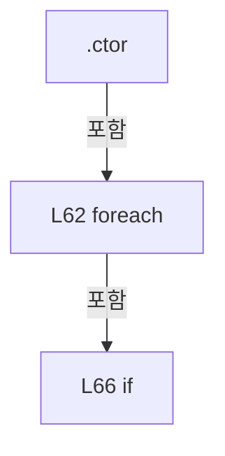

변경 전 점검: 입력/반환 타입, 위 호출자, 예외/취소 경로, 공유 상태와 저장·전송 소비자를 함께 확인합니다. 값의 단위나 물리 방향을 이름만으로 확정하지 않습니다.

### LocalFunctionStatement `IsUse` · L33–36

[Drilling.Common/Motion/CMotionManager.cs:33–36](https://github.com/kjuws10-rgb/A3Drilling/blob/5aee8e58439c9b455cae7c9593c9be986c3e682e/Drilling.Common/Motion/CMotionManager.cs#L33-L36)

| 항목 | 실제 추출 값 |
| --- | --- |
| 서명 | bool IsUse(Drilling.Common.Motion.ST_MOTOR_DATA) |
| 접근/수식자 | Private /  |
| 반환/값 타입 | bool |
| 소속 타입 | NamedType:Drilling.Common.Motion.CMotionManager |

입력 계약:

| 이름 | 타입 | 전달 | 선택/기본값 |
| --- | --- | --- | --- |
| axis | Drilling.Common.Motion.ST_MOTOR_DATA | None | False /  |

현재 부분 분석에서 직접 연결된 호출자는 없습니다. XAML/이벤트/인터페이스·델리게이트·외부 진입을 추가 확인해야 하며, 미사용으로 판정한 것이 아닙니다.

본문의 실제 연산·분기·예외·반환 순서(원문 위치 순):

| 원본 행 | 종류 | 주석 해설 |
| --- | --- | --- |
| 35 | return | 호출자에게 값 또는 제어를 반환합니다: return axis.Use; |

변경 전 점검: 입력/반환 타입, 위 호출자, 예외/취소 경로, 공유 상태와 저장·전송 소비자를 함께 확인합니다. 값의 단위나 물리 방향을 이름만으로 확정하지 않습니다.

### LocalFunctionStatement `SelectDictionaryKey` · L38–41

[Drilling.Common/Motion/CMotionManager.cs:38–41](https://github.com/kjuws10-rgb/A3Drilling/blob/5aee8e58439c9b455cae7c9593c9be986c3e682e/Drilling.Common/Motion/CMotionManager.cs#L38-L41)

| 항목 | 실제 추출 값 |
| --- | --- |
| 서명 | string SelectDictionaryKey(Drilling.Common.Motion.ST_MOTOR_DATA) |
| 접근/수식자 | Private /  |
| 반환/값 타입 | string |
| 소속 타입 | NamedType:Drilling.Common.Motion.CMotionManager |

입력 계약:

| 이름 | 타입 | 전달 | 선택/기본값 |
| --- | --- | --- | --- |
| axis | Drilling.Common.Motion.ST_MOTOR_DATA | None | False /  |

현재 부분 분석에서 직접 연결된 호출자는 없습니다. XAML/이벤트/인터페이스·델리게이트·외부 진입을 추가 확인해야 하며, 미사용으로 판정한 것이 아닙니다.

호출하는 대상과 해석 범위:

| 원본 행 | 표현식 | 분석 상태 | 대상/소스 위치 |
| --- | --- | --- | --- |
| 40 | NormalizeAxisId | resolved | string Drilling.Common.Motion.CMotionManager.NormalizeAxisId(string) · Drilling.Common/Motion/CMotionManager.cs:955 |

본문의 실제 연산·분기·예외·반환 순서(원문 위치 순):

| 원본 행 | 종류 | 주석 해설 |
| --- | --- | --- |
| 40 | call | 함수·델리게이트 또는 객체 생성자를 호출합니다: NormalizeAxisId(axis.Name) |
| 40 | return | 호출자에게 값 또는 제어를 반환합니다: return NormalizeAxisId(axis.Name); |

변경 전 점검: 입력/반환 타입, 위 호출자, 예외/취소 경로, 공유 상태와 저장·전송 소비자를 함께 확인합니다. 값의 단위나 물리 방향을 이름만으로 확정하지 않습니다.

### LocalFunctionStatement `SelectAxisControllerRequest` · L46–49

[Drilling.Common/Motion/CMotionManager.cs:46–49](https://github.com/kjuws10-rgb/A3Drilling/blob/5aee8e58439c9b455cae7c9593c9be986c3e682e/Drilling.Common/Motion/CMotionManager.cs#L46-L49)

| 항목 | 실제 추출 값 |
| --- | --- |
| 서명 | (string DevType, int DevNo) SelectAxisControllerRequest(Drilling.Common.Motion.ST_MOTOR_DATA) |
| 접근/수식자 | Private /  |
| 반환/값 타입 | (string DevType, int DevNo) |
| 소속 타입 | NamedType:Drilling.Common.Motion.CMotionManager |

입력 계약:

| 이름 | 타입 | 전달 | 선택/기본값 |
| --- | --- | --- | --- |
| axis | Drilling.Common.Motion.ST_MOTOR_DATA | None | False /  |

현재 부분 분석에서 직접 연결된 호출자는 없습니다. XAML/이벤트/인터페이스·델리게이트·외부 진입을 추가 확인해야 하며, 미사용으로 판정한 것이 아닙니다.

본문의 실제 연산·분기·예외·반환 순서(원문 위치 순):

| 원본 행 | 종류 | 주석 해설 |
| --- | --- | --- |
| 48 | return | 호출자에게 값 또는 제어를 반환합니다: return (axis.DevType, axis.DevNo); |

변경 전 점검: 입력/반환 타입, 위 호출자, 예외/취소 경로, 공유 상태와 저장·전송 소비자를 함께 확인합니다. 값의 단위나 물리 방향을 이름만으로 확정하지 않습니다.

### LocalFunctionStatement `SelectIoControllerRequest` · L51–54

[Drilling.Common/Motion/CMotionManager.cs:51–54](https://github.com/kjuws10-rgb/A3Drilling/blob/5aee8e58439c9b455cae7c9593c9be986c3e682e/Drilling.Common/Motion/CMotionManager.cs#L51-L54)

| 항목 | 실제 추출 값 |
| --- | --- |
| 서명 | (string DevType, int DevNo) SelectIoControllerRequest(Drilling.Common.Motion.CMotionManager.ST_IO_STATE) |
| 접근/수식자 | Private /  |
| 반환/값 타입 | (string DevType, int DevNo) |
| 소속 타입 | NamedType:Drilling.Common.Motion.CMotionManager |

입력 계약:

| 이름 | 타입 | 전달 | 선택/기본값 |
| --- | --- | --- | --- |
| channel | Drilling.Common.Motion.CMotionManager.ST_IO_STATE | None | False /  |

현재 부분 분석에서 직접 연결된 호출자는 없습니다. XAML/이벤트/인터페이스·델리게이트·외부 진입을 추가 확인해야 하며, 미사용으로 판정한 것이 아닙니다.

본문의 실제 연산·분기·예외·반환 순서(원문 위치 순):

| 원본 행 | 종류 | 주석 해설 |
| --- | --- | --- |
| 53 | return | 호출자에게 값 또는 제어를 반환합니다: return (channel.DevType, channel.DevNo); |

변경 전 점검: 입력/반환 타입, 위 호출자, 예외/취소 경로, 공유 상태와 저장·전송 소비자를 함께 확인합니다. 값의 단위나 물리 방향을 이름만으로 확정하지 않습니다.

### LocalFunctionStatement `SelectGroupKey` · L56–59

[Drilling.Common/Motion/CMotionManager.cs:56–59](https://github.com/kjuws10-rgb/A3Drilling/blob/5aee8e58439c9b455cae7c9593c9be986c3e682e/Drilling.Common/Motion/CMotionManager.cs#L56-L59)

| 항목 | 실제 추출 값 |
| --- | --- |
| 서명 | string SelectGroupKey((string DevType, int DevNo)) |
| 접근/수식자 | Private /  |
| 반환/값 타입 | string |
| 소속 타입 | NamedType:Drilling.Common.Motion.CMotionManager |

입력 계약:

| 이름 | 타입 | 전달 | 선택/기본값 |
| --- | --- | --- | --- |
| item | (string DevType, int DevNo) | None | False /  |

현재 부분 분석에서 직접 연결된 호출자는 없습니다. XAML/이벤트/인터페이스·델리게이트·외부 진입을 추가 확인해야 하며, 미사용으로 판정한 것이 아닙니다.

호출하는 대상과 해석 범위:

| 원본 행 | 표현식 | 분석 상태 | 대상/소스 위치 |
| --- | --- | --- | --- |
| 58 | GetControllerKey | resolved | string Drilling.Common.Motion.CMotionManager.GetControllerKey(string, int) · Drilling.Common/Motion/CMotionManager.cs:1072 |

본문의 실제 연산·분기·예외·반환 순서(원문 위치 순):

| 원본 행 | 종류 | 주석 해설 |
| --- | --- | --- |
| 58 | call | 함수·델리게이트 또는 객체 생성자를 호출합니다: GetControllerKey(item.DevType, item.DevNo) |
| 58 | return | 호출자에게 값 또는 제어를 반환합니다: return GetControllerKey(item.DevType, item.DevNo); |

변경 전 점검: 입력/반환 타입, 위 호출자, 예외/취소 경로, 공유 상태와 저장·전송 소비자를 함께 확인합니다. 값의 단위나 물리 방향을 이름만으로 확정하지 않습니다.

### PropertyDeclaration `IsSimulation` · L73–84

[Drilling.Common/Motion/CMotionManager.cs:73–84](https://github.com/kjuws10-rgb/A3Drilling/blob/5aee8e58439c9b455cae7c9593c9be986c3e682e/Drilling.Common/Motion/CMotionManager.cs#L73-L84)

| 항목 | 실제 추출 값 |
| --- | --- |
| 서명 | bool Drilling.Common.Motion.CMotionManager.IsSimulation |
| 접근/수식자 | Public / public |
| 반환/값 타입 | bool |
| 소속 타입 | NamedType:Drilling.Common.Motion.CMotionManager |

현재 부분 분석에서 직접 연결된 호출자는 없습니다. XAML/이벤트/인터페이스·델리게이트·외부 진입을 추가 확인해야 하며, 미사용으로 판정한 것이 아닙니다.

변경 전 점검: 입력/반환 타입, 위 호출자, 예외/취소 경로, 공유 상태와 저장·전송 소비자를 함께 확인합니다. 값의 단위나 물리 방향을 이름만으로 확정하지 않습니다.

### GetAccessorDeclaration `get_IsSimulation` · L75–83

[Drilling.Common/Motion/CMotionManager.cs:75–83](https://github.com/kjuws10-rgb/A3Drilling/blob/5aee8e58439c9b455cae7c9593c9be986c3e682e/Drilling.Common/Motion/CMotionManager.cs#L75-L83)

| 항목 | 실제 추출 값 |
| --- | --- |
| 서명 | bool Drilling.Common.Motion.CMotionManager.IsSimulation.get |
| 접근/수식자 | Public / get |
| 반환/값 타입 | bool |
| 소속 타입 | NamedType:Drilling.Common.Motion.CMotionManager |

현재 부분 분석에서 직접 연결된 호출자는 없습니다. XAML/이벤트/인터페이스·델리게이트·외부 진입을 추가 확인해야 하며, 미사용으로 판정한 것이 아닙니다.

호출하는 대상과 해석 범위:

| 원본 행 | 표현식 | 분석 상태 | 대상/소스 위치 |
| --- | --- | --- | --- |
| 82 | _controllers.Values.All | resolved | bool System.Collections.Generic.IEnumerable<Drilling.Common.Motion.CMotionController>.All<Drilling.Common.Motion.CMotionController>(System.Func<Drilling.Common.Motion.CMotionController, bool>) |

본문의 실제 연산·분기·예외·반환 순서(원문 위치 순):

| 원본 행 | 종류 | 주석 해설 |
| --- | --- | --- |
| 82 | call | 함수·델리게이트 또는 객체 생성자를 호출합니다: _controllers.Values.All(MatchesItem) |
| 82 | return | 호출자에게 값 또는 제어를 반환합니다: return _simulationMode &#124;&#124; _controllers.Values.All(MatchesItem); |

변경 전 점검: 입력/반환 타입, 위 호출자, 예외/취소 경로, 공유 상태와 저장·전송 소비자를 함께 확인합니다. 값의 단위나 물리 방향을 이름만으로 확정하지 않습니다.

### LocalFunctionStatement `MatchesItem` · L77–80

[Drilling.Common/Motion/CMotionManager.cs:77–80](https://github.com/kjuws10-rgb/A3Drilling/blob/5aee8e58439c9b455cae7c9593c9be986c3e682e/Drilling.Common/Motion/CMotionManager.cs#L77-L80)

| 항목 | 실제 추출 값 |
| --- | --- |
| 서명 | bool MatchesItem(Drilling.Common.Motion.CMotionController) |
| 접근/수식자 | Private /  |
| 반환/값 타입 | bool |
| 소속 타입 | NamedType:Drilling.Common.Motion.CMotionManager |

입력 계약:

| 이름 | 타입 | 전달 | 선택/기본값 |
| --- | --- | --- | --- |
| controller | Drilling.Common.Motion.CMotionController | None | False /  |

현재 부분 분석에서 직접 연결된 호출자는 없습니다. XAML/이벤트/인터페이스·델리게이트·외부 진입을 추가 확인해야 하며, 미사용으로 판정한 것이 아닙니다.

호출하는 대상과 해석 범위:

| 원본 행 | 표현식 | 분석 상태 | 대상/소스 위치 |
| --- | --- | --- | --- |
| 79 | controller.IsSimulation | resolved | bool Drilling.Common.Motion.CMotionController.IsSimulation() · Drilling.Common/Motion/CMotionManager.cs:1419 |

본문의 실제 연산·분기·예외·반환 순서(원문 위치 순):

| 원본 행 | 종류 | 주석 해설 |
| --- | --- | --- |
| 79 | call | 함수·델리게이트 또는 객체 생성자를 호출합니다: controller.IsSimulation() |
| 79 | return | 호출자에게 값 또는 제어를 반환합니다: return controller.IsSimulation(); |

변경 전 점검: 입력/반환 타입, 위 호출자, 예외/취소 경로, 공유 상태와 저장·전송 소비자를 함께 확인합니다. 값의 단위나 물리 방향을 이름만으로 확정하지 않습니다.

### MethodDeclaration `SetSimulationMode` · L86–94

[Drilling.Common/Motion/CMotionManager.cs:86–94](https://github.com/kjuws10-rgb/A3Drilling/blob/5aee8e58439c9b455cae7c9593c9be986c3e682e/Drilling.Common/Motion/CMotionManager.cs#L86-L94)

| 항목 | 실제 추출 값 |
| --- | --- |
| 서명 | void Drilling.Common.Motion.CMotionManager.SetSimulationMode(bool) |
| 접근/수식자 | Public / public |
| 반환/값 타입 | void |
| 소속 타입 | NamedType:Drilling.Common.Motion.CMotionManager |

입력 계약:

| 이름 | 타입 | 전달 | 선택/기본값 |
| --- | --- | --- | --- |
| enabled | bool | None | False /  |

정적 호출자로 확인된 위치:

| 호출 파일/행 | 호출 표현식 | 런타임 분기 가능 |
| --- | --- | --- |
| [Drilling.Common/Managers/CManager.cs:196–196](https://github.com/kjuws10-rgb/A3Drilling/blob/5aee8e58439c9b455cae7c9593c9be986c3e682e/Drilling.Common/Managers/CManager.cs#L196-L196) | _motionManager.SetSimulationMode | False |

호출하는 대상과 해석 범위:

| 원본 행 | 표현식 | 분석 상태 | 대상/소스 위치 |
| --- | --- | --- | --- |
| 89 | Stopwatch.GetTimestamp | resolved | long System.Diagnostics.Stopwatch.GetTimestamp() |

본문의 실제 연산·분기·예외·반환 순서(원문 위치 순):

| 원본 행 | 종류 | 주석 해설 |
| --- | --- | --- |
| 88 | assignment | 값을 대상에 대입합니다: _simulationMode = enabled |
| 89 | call | 함수·델리게이트 또는 객체 생성자를 호출합니다: Stopwatch.GetTimestamp() |
| 89 | local-declaration | 지역 변수를 선언합니다: var timestamp = Stopwatch.GetTimestamp(); |
| 89 | variable-initializer | 변수의 초기값을 지정합니다: timestamp = Stopwatch.GetTimestamp() |
| 90 | foreach | 컬렉션 요소를 순회합니다: foreach (var axis in _axes.Values) |
| 92 | assignment | 값을 대상에 대입합니다: axis.SimulationLastTimestamp = timestamp |

제어 구문의 포함 구조(실제 실행 순서/CFG가 아닌 구문 탐색 그림):

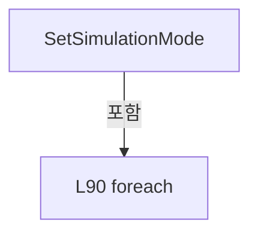

변경 전 점검: 입력/반환 타입, 위 호출자, 예외/취소 경로, 공유 상태와 저장·전송 소비자를 함께 확인합니다. 값의 단위나 물리 방향을 이름만으로 확정하지 않습니다.

### MethodDeclaration `Initialize` · L96–124

[Drilling.Common/Motion/CMotionManager.cs:96–124](https://github.com/kjuws10-rgb/A3Drilling/blob/5aee8e58439c9b455cae7c9593c9be986c3e682e/Drilling.Common/Motion/CMotionManager.cs#L96-L124)

| 항목 | 실제 추출 값 |
| --- | --- |
| 서명 | System.Threading.Tasks.Task Drilling.Common.Motion.CMotionManager.Initialize(System.Threading.CancellationToken) |
| 접근/수식자 | Public / public, async |
| 반환/값 타입 | System.Threading.Tasks.Task |
| 소속 타입 | NamedType:Drilling.Common.Motion.CMotionManager |

입력 계약:

| 이름 | 타입 | 전달 | 선택/기본값 |
| --- | --- | --- | --- |
| cancellationToken | System.Threading.CancellationToken | None | True / null |

정적 호출자로 확인된 위치:

| 호출 파일/행 | 호출 표현식 | 런타임 분기 가능 |
| --- | --- | --- |
| [Drilling.Common/Managers/CManager.cs:214–214](https://github.com/kjuws10-rgb/A3Drilling/blob/5aee8e58439c9b455cae7c9593c9be986c3e682e/Drilling.Common/Managers/CManager.cs#L214-L214) | _motionManager.Initialize | False |

호출하는 대상과 해석 범위:

| 원본 행 | 표현식 | 분석 상태 | 대상/소스 위치 |
| --- | --- | --- | --- |
| 98 | cancellationToken.ThrowIfCancellationRequested | resolved | void System.Threading.CancellationToken.ThrowIfCancellationRequested() |
| 104 | _axisData.Values.GroupBy | resolved | System.Collections.Generic.IEnumerable<System.Linq.IGrouping<string, Drilling.Common.Motion.ST_MOTOR_DATA>> System.Collections.Generic.IEnumerable<Drilling.Common.Motion.ST_MOTOR_DATA>.GroupBy<Drilling.Common.Motion.ST_MOTOR_DATA, string>(System.Func<Drilling.Common.Motion.ST_MOTOR_DATA, string>) |
| 111 | group.First | resolved | Drilling.Common.Motion.ST_MOTOR_DATA System.Collections.Generic.IEnumerable<Drilling.Common.Motion.ST_MOTOR_DATA>.First<Drilling.Common.Motion.ST_MOTOR_DATA>() |
| 112 | _controllers.TryGetValue | resolved | bool System.Collections.Generic.Dictionary<string, Drilling.Common.Motion.CMotionController>.TryGetValue(string, out Drilling.Common.Motion.CMotionController) |
| 114 | CreateMotionControllerNotRegisteredException | resolved | System.InvalidOperationException Drilling.Common.Motion.CMotionManager.CreateMotionControllerNotRegisteredException(string, int) · Drilling.Common/Motion/CMotionManager.cs:1087 |
| 117 | controller.IsSimulation | resolved | bool Drilling.Common.Motion.CMotionController.IsSimulation() · Drilling.Common/Motion/CMotionManager.cs:1419 |
| 122 | controller.Initialize | resolved · 동적 구현 선택 가능 | System.Threading.Tasks.Task Drilling.Common.Motion.CMotionController.Initialize(System.Collections.Generic.IReadOnlyList<Drilling.Common.Motion.ST_MOTOR_DATA>, System.Threading.CancellationToken) · Drilling.Common/Motion/CMotionManager.cs:1425 |
| 122 | group.ToArray | resolved | Drilling.Common.Motion.ST_MOTOR_DATA[] System.Collections.Generic.IEnumerable<Drilling.Common.Motion.ST_MOTOR_DATA>.ToArray<Drilling.Common.Motion.ST_MOTOR_DATA>() |

본문의 실제 연산·분기·예외·반환 순서(원문 위치 순):

| 원본 행 | 종류 | 주석 해설 |
| --- | --- | --- |
| 98 | call | 함수·델리게이트 또는 객체 생성자를 호출합니다: cancellationToken.ThrowIfCancellationRequested() |
| 104 | call | 함수·델리게이트 또는 객체 생성자를 호출합니다: _axisData.Values.GroupBy(SelectGroupKey) |
| 104 | foreach | 컬렉션 요소를 순회합니다: foreach (var group in _axisData.Values.GroupBy(SelectGroupKey)) |
| 106 | if | 조건에 따라 분기합니다: if (_simulationMode) |
| 108 | continue | 다음 반복으로 진행합니다: continue; |
| 111 | call | 함수·델리게이트 또는 객체 생성자를 호출합니다: group.First() |
| 111 | local-declaration | 지역 변수를 선언합니다: var axis = group.First(); |
| 111 | variable-initializer | 변수의 초기값을 지정합니다: axis = group.First() |
| 112 | call | 함수·델리게이트 또는 객체 생성자를 호출합니다: _controllers.TryGetValue(group.Key, out var controller) |
| 112 | if | 조건에 따라 분기합니다: if (!_controllers.TryGetValue(group.Key, out var controller)) |
| 114 | call | 함수·델리게이트 또는 객체 생성자를 호출합니다: CreateMotionControllerNotRegisteredException(axis.DevType, axis.DevNo) |
| 114 | throw | 예외를 발생/전달합니다: throw CreateMotionControllerNotRegisteredException(axis.DevType, axis.DevNo); |
| 117 | call | 함수·델리게이트 또는 객체 생성자를 호출합니다: controller.IsSimulation() |
| 117 | if | 조건에 따라 분기합니다: if (controller.IsSimulation()) |
| 119 | continue | 다음 반복으로 진행합니다: continue; |
| 122 | await | 비동기 완료를 기다립니다: await controller.Initialize(group.ToArray(), cancellationToken) |
| 122 | call | 함수·델리게이트 또는 객체 생성자를 호출합니다: controller.Initialize(group.ToArray(), cancellationToken) |
| 122 | call | 함수·델리게이트 또는 객체 생성자를 호출합니다: group.ToArray() |

제어 구문의 포함 구조(실제 실행 순서/CFG가 아닌 구문 탐색 그림):

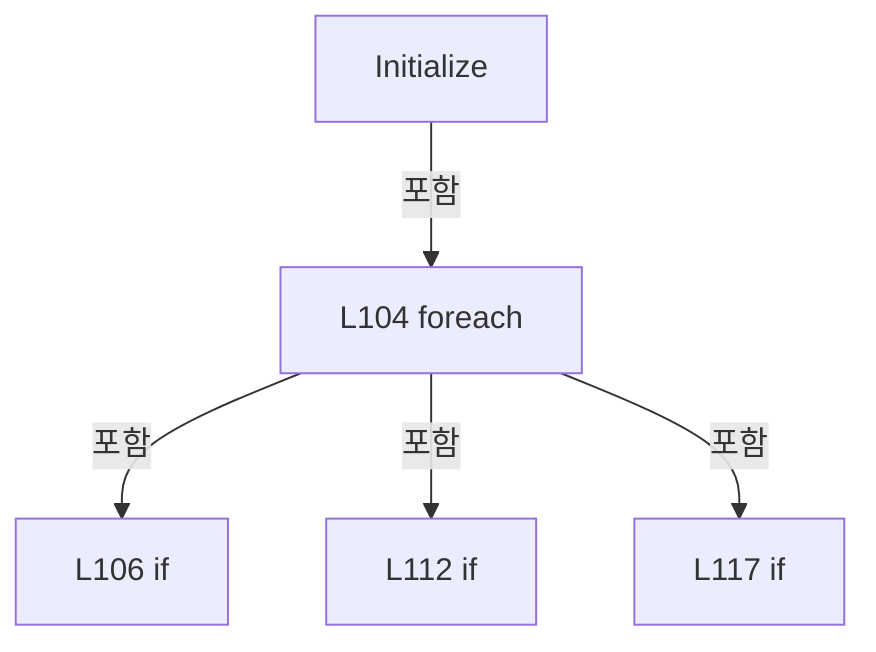

변경 전 점검: 입력/반환 타입, 위 호출자, 예외/취소 경로, 공유 상태와 저장·전송 소비자를 함께 확인합니다. 값의 단위나 물리 방향을 이름만으로 확정하지 않습니다.

### LocalFunctionStatement `SelectGroupKey` · L99–102

[Drilling.Common/Motion/CMotionManager.cs:99–102](https://github.com/kjuws10-rgb/A3Drilling/blob/5aee8e58439c9b455cae7c9593c9be986c3e682e/Drilling.Common/Motion/CMotionManager.cs#L99-L102)

| 항목 | 실제 추출 값 |
| --- | --- |
| 서명 | string SelectGroupKey(Drilling.Common.Motion.ST_MOTOR_DATA) |
| 접근/수식자 | Private /  |
| 반환/값 타입 | string |
| 소속 타입 | NamedType:Drilling.Common.Motion.CMotionManager |

입력 계약:

| 이름 | 타입 | 전달 | 선택/기본값 |
| --- | --- | --- | --- |
| axis | Drilling.Common.Motion.ST_MOTOR_DATA | None | False /  |

현재 부분 분석에서 직접 연결된 호출자는 없습니다. XAML/이벤트/인터페이스·델리게이트·외부 진입을 추가 확인해야 하며, 미사용으로 판정한 것이 아닙니다.

호출하는 대상과 해석 범위:

| 원본 행 | 표현식 | 분석 상태 | 대상/소스 위치 |
| --- | --- | --- | --- |
| 101 | GetControllerKey | resolved | string Drilling.Common.Motion.CMotionManager.GetControllerKey(string, int) · Drilling.Common/Motion/CMotionManager.cs:1072 |

본문의 실제 연산·분기·예외·반환 순서(원문 위치 순):

| 원본 행 | 종류 | 주석 해설 |
| --- | --- | --- |
| 101 | call | 함수·델리게이트 또는 객체 생성자를 호출합니다: GetControllerKey(axis.DevType, axis.DevNo) |
| 101 | return | 호출자에게 값 또는 제어를 반환합니다: return GetControllerKey(axis.DevType, axis.DevNo); |

변경 전 점검: 입력/반환 타입, 위 호출자, 예외/취소 경로, 공유 상태와 저장·전송 소비자를 함께 확인합니다. 값의 단위나 물리 방향을 이름만으로 확정하지 않습니다.

### MethodDeclaration `Destroy` · L126–133

[Drilling.Common/Motion/CMotionManager.cs:126–133](https://github.com/kjuws10-rgb/A3Drilling/blob/5aee8e58439c9b455cae7c9593c9be986c3e682e/Drilling.Common/Motion/CMotionManager.cs#L126-L133)

| 항목 | 실제 추출 값 |
| --- | --- |
| 서명 | System.Threading.Tasks.Task Drilling.Common.Motion.CMotionManager.Destroy(System.Threading.CancellationToken) |
| 접근/수식자 | Public / public, async |
| 반환/값 타입 | System.Threading.Tasks.Task |
| 소속 타입 | NamedType:Drilling.Common.Motion.CMotionManager |

입력 계약:

| 이름 | 타입 | 전달 | 선택/기본값 |
| --- | --- | --- | --- |
| cancellationToken | System.Threading.CancellationToken | None | True / null |

정적 호출자로 확인된 위치:

| 호출 파일/행 | 호출 표현식 | 런타임 분기 가능 |
| --- | --- | --- |
| [Drilling.Common/Managers/CManager.cs:235–235](https://github.com/kjuws10-rgb/A3Drilling/blob/5aee8e58439c9b455cae7c9593c9be986c3e682e/Drilling.Common/Managers/CManager.cs#L235-L235) | _motionManager.Destroy | False |

호출하는 대상과 해석 범위:

| 원본 행 | 표현식 | 분석 상태 | 대상/소스 위치 |
| --- | --- | --- | --- |
| 128 | cancellationToken.ThrowIfCancellationRequested | resolved | void System.Threading.CancellationToken.ThrowIfCancellationRequested() |
| 131 | controller.Destroy | resolved · 동적 구현 선택 가능 | System.Threading.Tasks.Task Drilling.Common.Motion.CMotionController.Destroy(System.Threading.CancellationToken) · Drilling.Common/Motion/CMotionManager.cs:1440 |

본문의 실제 연산·분기·예외·반환 순서(원문 위치 순):

| 원본 행 | 종류 | 주석 해설 |
| --- | --- | --- |
| 128 | call | 함수·델리게이트 또는 객체 생성자를 호출합니다: cancellationToken.ThrowIfCancellationRequested() |
| 129 | foreach | 컬렉션 요소를 순회합니다: foreach (var controller in _controllers.Values) |
| 131 | await | 비동기 완료를 기다립니다: await controller.Destroy(cancellationToken) |
| 131 | call | 함수·델리게이트 또는 객체 생성자를 호출합니다: controller.Destroy(cancellationToken) |

제어 구문의 포함 구조(실제 실행 순서/CFG가 아닌 구문 탐색 그림):

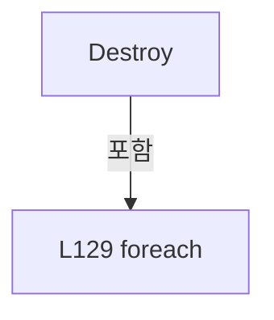

변경 전 점검: 입력/반환 타입, 위 호출자, 예외/취소 경로, 공유 상태와 저장·전송 소비자를 함께 확인합니다. 값의 단위나 물리 방향을 이름만으로 확정하지 않습니다.

### MethodDeclaration `RefreshStatus` · L135–144

[Drilling.Common/Motion/CMotionManager.cs:135–144](https://github.com/kjuws10-rgb/A3Drilling/blob/5aee8e58439c9b455cae7c9593c9be986c3e682e/Drilling.Common/Motion/CMotionManager.cs#L135-L144)

| 항목 | 실제 추출 값 |
| --- | --- |
| 서명 | void Drilling.Common.Motion.CMotionManager.RefreshStatus(System.Threading.CancellationToken) |
| 접근/수식자 | Public / public |
| 반환/값 타입 | void |
| 소속 타입 | NamedType:Drilling.Common.Motion.CMotionManager |

입력 계약:

| 이름 | 타입 | 전달 | 선택/기본값 |
| --- | --- | --- | --- |
| cancellationToken | System.Threading.CancellationToken | None | True / null |

정적 호출자로 확인된 위치:

| 호출 파일/행 | 호출 표현식 | 런타임 분기 가능 |
| --- | --- | --- |
| [Drilling.Common/Motion/CMotionManager.cs:149–149](https://github.com/kjuws10-rgb/A3Drilling/blob/5aee8e58439c9b455cae7c9593c9be986c3e682e/Drilling.Common/Motion/CMotionManager.cs#L149-L149) | RefreshStatus | False |

호출하는 대상과 해석 범위:

| 원본 행 | 표현식 | 분석 상태 | 대상/소스 위치 |
| --- | --- | --- | --- |
| 137 | cancellationToken.ThrowIfCancellationRequested | resolved | void System.Threading.CancellationToken.ThrowIfCancellationRequested() |
| 143 | RefreshAxisStatus | resolved | void Drilling.Common.Motion.CMotionManager.RefreshAxisStatus(System.Threading.CancellationToken) · Drilling.Common/Motion/CMotionManager.cs:567 |

본문의 실제 연산·분기·예외·반환 순서(원문 위치 순):

| 원본 행 | 종류 | 주석 해설 |
| --- | --- | --- |
| 137 | call | 함수·델리게이트 또는 객체 생성자를 호출합니다: cancellationToken.ThrowIfCancellationRequested() |
| 138 | if | 조건에 따라 분기합니다: if (_simulationMode) |
| 140 | return | 호출자에게 값 또는 제어를 반환합니다: return; |
| 143 | call | 함수·델리게이트 또는 객체 생성자를 호출합니다: RefreshAxisStatus(cancellationToken) |

제어 구문의 포함 구조(실제 실행 순서/CFG가 아닌 구문 탐색 그림):

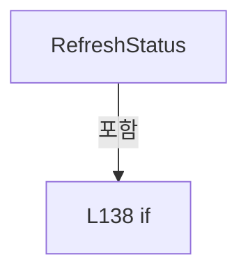

변경 전 점검: 입력/반환 타입, 위 호출자, 예외/취소 경로, 공유 상태와 저장·전송 소비자를 함께 확인합니다. 값의 단위나 물리 방향을 이름만으로 확정하지 않습니다.

### MethodDeclaration `GetAxisStatus` · L146–151

[Drilling.Common/Motion/CMotionManager.cs:146–151](https://github.com/kjuws10-rgb/A3Drilling/blob/5aee8e58439c9b455cae7c9593c9be986c3e682e/Drilling.Common/Motion/CMotionManager.cs#L146-L151)

| 항목 | 실제 추출 값 |
| --- | --- |
| 서명 | System.Collections.Generic.IReadOnlyList<Drilling.Common.Motion.ST_MOTOR_AXIS_STATUS> Drilling.Common.Motion.CMotionManager.GetAxisStatus(System.Threading.CancellationToken) |
| 접근/수식자 | Public / public |
| 반환/값 타입 | System.Collections.Generic.IReadOnlyList<Drilling.Common.Motion.ST_MOTOR_AXIS_STATUS> |
| 소속 타입 | NamedType:Drilling.Common.Motion.CMotionManager |

입력 계약:

| 이름 | 타입 | 전달 | 선택/기본값 |
| --- | --- | --- | --- |
| cancellationToken | System.Threading.CancellationToken | None | True / null |

정적 호출자로 확인된 위치:

| 호출 파일/행 | 호출 표현식 | 런타임 분기 가능 |
| --- | --- | --- |
| [Drilling.Common/Motion/CMotionManager.cs:226–226](https://github.com/kjuws10-rgb/A3Drilling/blob/5aee8e58439c9b455cae7c9593c9be986c3e682e/Drilling.Common/Motion/CMotionManager.cs#L226-L226) | GetAxisStatus | False |
| [Drilling.Common/Station/CStationProcess.cs:1403–1403](https://github.com/kjuws10-rgb/A3Drilling/blob/5aee8e58439c9b455cae7c9593c9be986c3e682e/Drilling.Common/Station/CStationProcess.cs#L1403-L1403) | _motionManager.GetAxisStatus | False |
| [Drilling.UI/Menu/Menus/CMenuMonitor.cs:1057–1057](https://github.com/kjuws10-rgb/A3Drilling/blob/5aee8e58439c9b455cae7c9593c9be986c3e682e/Drilling.UI/Menu/Menus/CMenuMonitor.cs#L1057-L1057) | _motionManager.GetAxisStatus | False |
| [Drilling.UI/Menu/Menus/CMonitorStatusPollingService.cs:190–190](https://github.com/kjuws10-rgb/A3Drilling/blob/5aee8e58439c9b455cae7c9593c9be986c3e682e/Drilling.UI/Menu/Menus/CMonitorStatusPollingService.cs#L190-L190) | motionManager.GetAxisStatus | False |

호출하는 대상과 해석 범위:

| 원본 행 | 표현식 | 분석 상태 | 대상/소스 위치 |
| --- | --- | --- | --- |
| 148 | cancellationToken.ThrowIfCancellationRequested | resolved | void System.Threading.CancellationToken.ThrowIfCancellationRequested() |
| 149 | RefreshStatus | resolved | void Drilling.Common.Motion.CMotionManager.RefreshStatus(System.Threading.CancellationToken) · Drilling.Common/Motion/CMotionManager.cs:135 |
| 150 | GetCachedAxisStatus | resolved | System.Collections.Generic.IReadOnlyList<Drilling.Common.Motion.ST_MOTOR_AXIS_STATUS> Drilling.Common.Motion.CMotionManager.GetCachedAxisStatus() · Drilling.Common/Motion/CMotionManager.cs:176 |

본문의 실제 연산·분기·예외·반환 순서(원문 위치 순):

| 원본 행 | 종류 | 주석 해설 |
| --- | --- | --- |
| 148 | call | 함수·델리게이트 또는 객체 생성자를 호출합니다: cancellationToken.ThrowIfCancellationRequested() |
| 149 | call | 함수·델리게이트 또는 객체 생성자를 호출합니다: RefreshStatus(cancellationToken) |
| 150 | call | 함수·델리게이트 또는 객체 생성자를 호출합니다: GetCachedAxisStatus() |
| 150 | return | 호출자에게 값 또는 제어를 반환합니다: return GetCachedAxisStatus(); |

변경 전 점검: 입력/반환 타입, 위 호출자, 예외/취소 경로, 공유 상태와 저장·전송 소비자를 함께 확인합니다. 값의 단위나 물리 방향을 이름만으로 확정하지 않습니다.

### MethodDeclaration `GetAxisStatusAsync` · L153–174

[Drilling.Common/Motion/CMotionManager.cs:153–174](https://github.com/kjuws10-rgb/A3Drilling/blob/5aee8e58439c9b455cae7c9593c9be986c3e682e/Drilling.Common/Motion/CMotionManager.cs#L153-L174)

| 항목 | 실제 추출 값 |
| --- | --- |
| 서명 | System.Threading.Tasks.Task<System.Collections.Generic.IReadOnlyList<Drilling.Common.Motion.ST_MOTOR_AXIS_STATUS>> Drilling.Common.Motion.CMotionManager.GetAxisStatusAsync(System.Threading.CancellationToken) |
| 접근/수식자 | Public / public, async |
| 반환/값 타입 | System.Threading.Tasks.Task<System.Collections.Generic.IReadOnlyList<Drilling.Common.Motion.ST_MOTOR_AXIS_STATUS>> |
| 소속 타입 | NamedType:Drilling.Common.Motion.CMotionManager |

입력 계약:

| 이름 | 타입 | 전달 | 선택/기본값 |
| --- | --- | --- | --- |
| cancellationToken | System.Threading.CancellationToken | None | True / null |

현재 부분 분석에서 직접 연결된 호출자는 없습니다. XAML/이벤트/인터페이스·델리게이트·외부 진입을 추가 확인해야 하며, 미사용으로 판정한 것이 아닙니다.

호출하는 대상과 해석 범위:

| 원본 행 | 표현식 | 분석 상태 | 대상/소스 위치 |
| --- | --- | --- | --- |
| 157 | cancellationToken.ThrowIfCancellationRequested | resolved | void System.Threading.CancellationToken.ThrowIfCancellationRequested() |
| 158 | _controllers.TryGetValue | resolved | bool System.Collections.Generic.Dictionary<string, Drilling.Common.Motion.CMotionController>.TryGetValue(string, out Drilling.Common.Motion.CMotionController) |
| 158 | GetControllerKey | resolved | string Drilling.Common.Motion.CMotionManager.GetControllerKey(string, int) · Drilling.Common/Motion/CMotionManager.cs:1072 |
| 158 | controller.IsSimulation | resolved | bool Drilling.Common.Motion.CMotionController.IsSimulation() · Drilling.Common/Motion/CMotionManager.cs:1419 |
| 162 | controller.ReadAxisStatusAsync(axisData, cancellationToken).ConfigureAwait | resolved | System.Runtime.CompilerServices.ConfiguredTaskAwaitable<Drilling.Common.Motion.ST_MOTOR_AXIS_STATUS?> System.Threading.Tasks.Task<Drilling.Common.Motion.ST_MOTOR_AXIS_STATUS?>.ConfigureAwait(bool) |
| 162 | controller.ReadAxisStatusAsync | resolved | System.Threading.Tasks.Task<Drilling.Common.Motion.ST_MOTOR_AXIS_STATUS?> Drilling.Common.Motion.CMotionController.ReadAxisStatusAsync(Drilling.Common.Motion.ST_MOTOR_DATA, System.Threading.CancellationToken) · Drilling.Common/Motion/CMotionManager.cs:1471 |
| 164 | ApplyAxisStatus | resolved | void Drilling.Common.Motion.CMotionManager.ApplyAxisStatus(Drilling.Common.Motion.ST_MOTOR_AXIS_STATUS) · Drilling.Common/Motion/CMotionManager.cs:591 |
| 168 | MarkAxisAlarm | resolved | void Drilling.Common.Motion.CMotionManager.MarkAxisAlarm(string) · Drilling.Common/Motion/CMotionManager.cs:670 |
| 172 | cancellationToken.ThrowIfCancellationRequested | resolved | void System.Threading.CancellationToken.ThrowIfCancellationRequested() |
| 173 | GetCachedAxisStatus | resolved | System.Collections.Generic.IReadOnlyList<Drilling.Common.Motion.ST_MOTOR_AXIS_STATUS> Drilling.Common.Motion.CMotionManager.GetCachedAxisStatus() · Drilling.Common/Motion/CMotionManager.cs:176 |

본문의 실제 연산·분기·예외·반환 순서(원문 위치 순):

| 원본 행 | 종류 | 주석 해설 |
| --- | --- | --- |
| 155 | foreach | 컬렉션 요소를 순회합니다: foreach (var axisData in _axisData.Values) |
| 157 | call | 함수·델리게이트 또는 객체 생성자를 호출합니다: cancellationToken.ThrowIfCancellationRequested() |
| 158 | call | 함수·델리게이트 또는 객체 생성자를 호출합니다: _controllers.TryGetValue(GetControllerKey(axisData.DevType, axisData.DevNo), out var controller) |
| 158 | call | 함수·델리게이트 또는 객체 생성자를 호출합니다: GetControllerKey(axisData.DevType, axisData.DevNo) |
| 158 | call | 함수·델리게이트 또는 객체 생성자를 호출합니다: controller.IsSimulation() |
| 158 | if | 조건에 따라 분기합니다: if (_simulationMode &#124;&#124; !_controllers.TryGetValue(GetControllerKey(axisData.DevType, axisData.DevNo), out var controller) &#124;&#124; controller.IsSimulation()) |
| 159 | continue | 다음 반복으로 진행합니다: continue; |
| 160 | try | 예외 처리 범위입니다: try |
| 162 | await | 비동기 완료를 기다립니다: await controller.ReadAxisStatusAsync(axisData, cancellationToken).ConfigureAwait(false) |
| 162 | call | 함수·델리게이트 또는 객체 생성자를 호출합니다: controller.ReadAxisStatusAsync(axisData, cancellationToken).ConfigureAwait(false) |
| 162 | call | 함수·델리게이트 또는 객체 생성자를 호출합니다: controller.ReadAxisStatusAsync(axisData, cancellationToken) |
| 162 | local-declaration | 지역 변수를 선언합니다: var status = await controller.ReadAxisStatusAsync(axisData, cancellationToken).ConfigureAwait(false); |
| 162 | variable-initializer | 변수의 초기값을 지정합니다: status = await controller.ReadAxisStatusAsync(axisData, cancellationToken).ConfigureAwait(false) |
| 163 | if | 조건에 따라 분기합니다: if (status is not null) |
| 164 | call | 함수·델리게이트 또는 객체 생성자를 호출합니다: ApplyAxisStatus(status) |
| 166 | catch | 지정 예외를 처리합니다: catch (Exception exception) when (exception is InvalidOperationException or TimeoutException or IOException) |
| 168 | call | 함수·델리게이트 또는 객체 생성자를 호출합니다: MarkAxisAlarm(axisData.Name) |
| 172 | call | 함수·델리게이트 또는 객체 생성자를 호출합니다: cancellationToken.ThrowIfCancellationRequested() |
| 173 | call | 함수·델리게이트 또는 객체 생성자를 호출합니다: GetCachedAxisStatus() |
| 173 | return | 호출자에게 값 또는 제어를 반환합니다: return GetCachedAxisStatus(); |

제어 구문의 포함 구조(실제 실행 순서/CFG가 아닌 구문 탐색 그림):

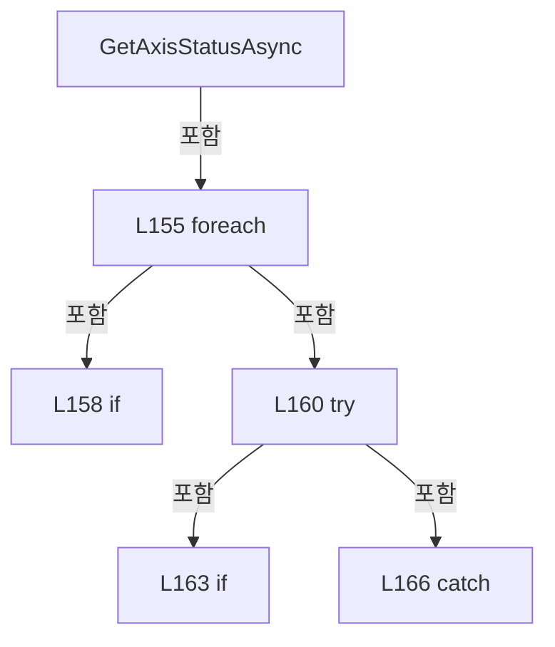

변경 전 점검: 입력/반환 타입, 위 호출자, 예외/취소 경로, 공유 상태와 저장·전송 소비자를 함께 확인합니다. 값의 단위나 물리 방향을 이름만으로 확정하지 않습니다.

### MethodDeclaration `GetCachedAxisStatus` · L176–205

[Drilling.Common/Motion/CMotionManager.cs:176–205](https://github.com/kjuws10-rgb/A3Drilling/blob/5aee8e58439c9b455cae7c9593c9be986c3e682e/Drilling.Common/Motion/CMotionManager.cs#L176-L205)

| 항목 | 실제 추출 값 |
| --- | --- |
| 서명 | System.Collections.Generic.IReadOnlyList<Drilling.Common.Motion.ST_MOTOR_AXIS_STATUS> Drilling.Common.Motion.CMotionManager.GetCachedAxisStatus() |
| 접근/수식자 | Public / public |
| 반환/값 타입 | System.Collections.Generic.IReadOnlyList<Drilling.Common.Motion.ST_MOTOR_AXIS_STATUS> |
| 소속 타입 | NamedType:Drilling.Common.Motion.CMotionManager |

정적 호출자로 확인된 위치:

| 호출 파일/행 | 호출 표현식 | 런타임 분기 가능 |
| --- | --- | --- |
| [Drilling.Common/Motion/CMotionManager.cs:150–150](https://github.com/kjuws10-rgb/A3Drilling/blob/5aee8e58439c9b455cae7c9593c9be986c3e682e/Drilling.Common/Motion/CMotionManager.cs#L150-L150) | GetCachedAxisStatus | False |
| [Drilling.Common/Motion/CMotionManager.cs:173–173](https://github.com/kjuws10-rgb/A3Drilling/blob/5aee8e58439c9b455cae7c9593c9be986c3e682e/Drilling.Common/Motion/CMotionManager.cs#L173-L173) | GetCachedAxisStatus | False |
| [Drilling.Common/Station/CStationProcess.cs:1403–1403](https://github.com/kjuws10-rgb/A3Drilling/blob/5aee8e58439c9b455cae7c9593c9be986c3e682e/Drilling.Common/Station/CStationProcess.cs#L1403-L1403) | _motionManager.GetCachedAxisStatus | False |

호출하는 대상과 해석 범위:

| 원본 행 | 표현식 | 분석 상태 | 대상/소스 위치 |
| --- | --- | --- | --- |
| 178 | UpdateSimulatedAxisPositions | resolved | void Drilling.Common.Motion.CMotionManager.UpdateSimulatedAxisPositions() · Drilling.Common/Motion/CMotionManager.cs:612 |
| 203 | _axes.Values.OrderBy(SelectDisplayOrder).Select(BuildMotor).ToArray | resolved | Drilling.Common.Motion.ST_MOTOR_AXIS_STATUS[] System.Collections.Generic.IEnumerable<Drilling.Common.Motion.ST_MOTOR_AXIS_STATUS>.ToArray<Drilling.Common.Motion.ST_MOTOR_AXIS_STATUS>() |
| 203 | _axes.Values.OrderBy(SelectDisplayOrder).Select | resolved | System.Collections.Generic.IEnumerable<Drilling.Common.Motion.ST_MOTOR_AXIS_STATUS> System.Collections.Generic.IEnumerable<Drilling.Common.Motion.CMotionManager.ST_AXIS_STATE>.Select<Drilling.Common.Motion.CMotionManager.ST_AXIS_STATE, Drilling.Common.Motion.ST_MOTOR_AXIS_STATUS>(System.Func<Drilling.Common.Motion.CMotionManager.ST_AXIS_STATE, Drilling.Common.Motion.ST_MOTOR_AXIS_STATUS>) |
| 203 | _axes.Values.OrderBy | resolved | System.Linq.IOrderedEnumerable<Drilling.Common.Motion.CMotionManager.ST_AXIS_STATE> System.Collections.Generic.IEnumerable<Drilling.Common.Motion.CMotionManager.ST_AXIS_STATE>.OrderBy<Drilling.Common.Motion.CMotionManager.ST_AXIS_STATE, int>(System.Func<Drilling.Common.Motion.CMotionManager.ST_AXIS_STATE, int>) |

본문의 실제 연산·분기·예외·반환 순서(원문 위치 순):

| 원본 행 | 종류 | 주석 해설 |
| --- | --- | --- |
| 178 | call | 함수·델리게이트 또는 객체 생성자를 호출합니다: UpdateSimulatedAxisPositions() |
| 203 | call | 함수·델리게이트 또는 객체 생성자를 호출합니다: _axes.Values.OrderBy(SelectDisplayOrder).Select(BuildMotor).ToArray() |
| 203 | call | 함수·델리게이트 또는 객체 생성자를 호출합니다: _axes.Values.OrderBy(SelectDisplayOrder).Select(BuildMotor) |
| 203 | call | 함수·델리게이트 또는 객체 생성자를 호출합니다: _axes.Values.OrderBy(SelectDisplayOrder) |
| 203 | local-declaration | 지역 변수를 선언합니다: var axes = _axes.Values.OrderBy(SelectDisplayOrder).Select(BuildMotor).ToArray(); |
| 203 | variable-initializer | 변수의 초기값을 지정합니다: axes = _axes.Values.OrderBy(SelectDisplayOrder).Select(BuildMotor).ToArray() |
| 204 | return | 호출자에게 값 또는 제어를 반환합니다: return axes; |

변경 전 점검: 입력/반환 타입, 위 호출자, 예외/취소 경로, 공유 상태와 저장·전송 소비자를 함께 확인합니다. 값의 단위나 물리 방향을 이름만으로 확정하지 않습니다.

### LocalFunctionStatement `SelectDisplayOrder` · L179–182

[Drilling.Common/Motion/CMotionManager.cs:179–182](https://github.com/kjuws10-rgb/A3Drilling/blob/5aee8e58439c9b455cae7c9593c9be986c3e682e/Drilling.Common/Motion/CMotionManager.cs#L179-L182)

| 항목 | 실제 추출 값 |
| --- | --- |
| 서명 | int SelectDisplayOrder(Drilling.Common.Motion.CMotionManager.ST_AXIS_STATE) |
| 접근/수식자 | Private /  |
| 반환/값 타입 | int |
| 소속 타입 | NamedType:Drilling.Common.Motion.CMotionManager |

입력 계약:

| 이름 | 타입 | 전달 | 선택/기본값 |
| --- | --- | --- | --- |
| axis | Drilling.Common.Motion.CMotionManager.ST_AXIS_STATE | None | False /  |

현재 부분 분석에서 직접 연결된 호출자는 없습니다. XAML/이벤트/인터페이스·델리게이트·외부 진입을 추가 확인해야 하며, 미사용으로 판정한 것이 아닙니다.

본문의 실제 연산·분기·예외·반환 순서(원문 위치 순):

| 원본 행 | 종류 | 주석 해설 |
| --- | --- | --- |
| 181 | return | 호출자에게 값 또는 제어를 반환합니다: return axis.DisplayOrder; |

변경 전 점검: 입력/반환 타입, 위 호출자, 예외/취소 경로, 공유 상태와 저장·전송 소비자를 함께 확인합니다. 값의 단위나 물리 방향을 이름만으로 확정하지 않습니다.

### LocalFunctionStatement `BuildMotor` · L184–201

[Drilling.Common/Motion/CMotionManager.cs:184–201](https://github.com/kjuws10-rgb/A3Drilling/blob/5aee8e58439c9b455cae7c9593c9be986c3e682e/Drilling.Common/Motion/CMotionManager.cs#L184-L201)

| 항목 | 실제 추출 값 |
| --- | --- |
| 서명 | Drilling.Common.Motion.ST_MOTOR_AXIS_STATUS BuildMotor(Drilling.Common.Motion.CMotionManager.ST_AXIS_STATE) |
| 접근/수식자 | Private /  |
| 반환/값 타입 | Drilling.Common.Motion.ST_MOTOR_AXIS_STATUS |
| 소속 타입 | NamedType:Drilling.Common.Motion.CMotionManager |

입력 계약:

| 이름 | 타입 | 전달 | 선택/기본값 |
| --- | --- | --- | --- |
| axis | Drilling.Common.Motion.CMotionManager.ST_AXIS_STATE | None | False /  |

현재 부분 분석에서 직접 연결된 호출자는 없습니다. XAML/이벤트/인터페이스·델리게이트·외부 진입을 추가 확인해야 하며, 미사용으로 판정한 것이 아닙니다.

호출하는 대상과 해석 범위:

| 원본 행 | 표현식 | 분석 상태 | 대상/소스 위치 |
| --- | --- | --- | --- |
| 186 | new ST_MOTOR_AXIS_STATUS | resolved | Drilling.Common.Motion.ST_MOTOR_AXIS_STATUS.ST_MOTOR_AXIS_STATUS(string, string, double, double, double, bool, bool, bool, bool, bool, double, double, int) · Drilling.Common/Motion/CMotionManager.cs:1685 |

본문의 실제 연산·분기·예외·반환 순서(원문 위치 순):

| 원본 행 | 종류 | 주석 해설 |
| --- | --- | --- |
| 186 | call | 함수·델리게이트 또는 객체 생성자를 호출합니다: new ST_MOTOR_AXIS_STATUS( axis.AxisId, axis.Name, axis.CurrentPosition, axis.TargetPosition, axis.CommandPosition, axis.ServoOn, axis.HomeCompleted, axis.LimitPlusOn, axis.LimitMinusOn, axis.AlarmOn, axis.FeedbackVelocit… |
| 186 | return | 호출자에게 값 또는 제어를 반환합니다: return new ST_MOTOR_AXIS_STATUS( axis.AxisId, axis.Name, axis.CurrentPosition, axis.TargetPosition, axis.CommandPosition, axis.ServoOn, axis.HomeCompleted, axis.LimitPlusOn, axis.LimitMinusOn, axis.AlarmOn, axis.FeedbackVelocity,  |

변경 전 점검: 입력/반환 타입, 위 호출자, 예외/취소 경로, 공유 상태와 저장·전송 소비자를 함께 확인합니다. 값의 단위나 물리 방향을 이름만으로 확정하지 않습니다.

### MethodDeclaration `GetIoStatus` · L207–222

[Drilling.Common/Motion/CMotionManager.cs:207–222](https://github.com/kjuws10-rgb/A3Drilling/blob/5aee8e58439c9b455cae7c9593c9be986c3e682e/Drilling.Common/Motion/CMotionManager.cs#L207-L222)

| 항목 | 실제 추출 값 |
| --- | --- |
| 서명 | System.Collections.Generic.IReadOnlyList<Drilling.Common.Motion.ST_IO_STATUS> Drilling.Common.Motion.CMotionManager.GetIoStatus(System.Threading.CancellationToken) |
| 접근/수식자 | Public / public |
| 반환/값 타입 | System.Collections.Generic.IReadOnlyList<Drilling.Common.Motion.ST_IO_STATUS> |
| 소속 타입 | NamedType:Drilling.Common.Motion.CMotionManager |

입력 계약:

| 이름 | 타입 | 전달 | 선택/기본값 |
| --- | --- | --- | --- |
| cancellationToken | System.Threading.CancellationToken | None | True / null |

현재 부분 분석에서 직접 연결된 호출자는 없습니다. XAML/이벤트/인터페이스·델리게이트·외부 진입을 추가 확인해야 하며, 미사용으로 판정한 것이 아닙니다.

호출하는 대상과 해석 범위:

| 원본 행 | 표현식 | 분석 상태 | 대상/소스 위치 |
| --- | --- | --- | --- |
| 209 | cancellationToken.ThrowIfCancellationRequested | resolved | void System.Threading.CancellationToken.ThrowIfCancellationRequested() |
| 220 | _io.Values.OrderBy(SelectDisplayOrder).Select(BuildIo).ToArray | resolved | Drilling.Common.Motion.ST_IO_STATUS[] System.Collections.Generic.IEnumerable<Drilling.Common.Motion.ST_IO_STATUS>.ToArray<Drilling.Common.Motion.ST_IO_STATUS>() |
| 220 | _io.Values.OrderBy(SelectDisplayOrder).Select | resolved | System.Collections.Generic.IEnumerable<Drilling.Common.Motion.ST_IO_STATUS> System.Collections.Generic.IEnumerable<Drilling.Common.Motion.CMotionManager.ST_IO_STATE>.Select<Drilling.Common.Motion.CMotionManager.ST_IO_STATE, Drilling.Common.Motion.ST_IO_STATUS>(System.Func<Drilling.Common.Motion.CMotionManager.ST_IO_STATE, Drilling.Common.Motion.ST_IO_STATUS>) |
| 220 | _io.Values.OrderBy | resolved | System.Linq.IOrderedEnumerable<Drilling.Common.Motion.CMotionManager.ST_IO_STATE> System.Collections.Generic.IEnumerable<Drilling.Common.Motion.CMotionManager.ST_IO_STATE>.OrderBy<Drilling.Common.Motion.CMotionManager.ST_IO_STATE, int>(System.Func<Drilling.Common.Motion.CMotionManager.ST_IO_STATE, int>) |

본문의 실제 연산·분기·예외·반환 순서(원문 위치 순):

| 원본 행 | 종류 | 주석 해설 |
| --- | --- | --- |
| 209 | call | 함수·델리게이트 또는 객체 생성자를 호출합니다: cancellationToken.ThrowIfCancellationRequested() |
| 220 | call | 함수·델리게이트 또는 객체 생성자를 호출합니다: _io.Values.OrderBy(SelectDisplayOrder).Select(BuildIo).ToArray() |
| 220 | call | 함수·델리게이트 또는 객체 생성자를 호출합니다: _io.Values.OrderBy(SelectDisplayOrder).Select(BuildIo) |
| 220 | call | 함수·델리게이트 또는 객체 생성자를 호출합니다: _io.Values.OrderBy(SelectDisplayOrder) |
| 220 | local-declaration | 지역 변수를 선언합니다: var io = _io.Values.OrderBy(SelectDisplayOrder).Select(BuildIo).ToArray(); |
| 220 | variable-initializer | 변수의 초기값을 지정합니다: io = _io.Values.OrderBy(SelectDisplayOrder).Select(BuildIo).ToArray() |
| 221 | return | 호출자에게 값 또는 제어를 반환합니다: return io; |

변경 전 점검: 입력/반환 타입, 위 호출자, 예외/취소 경로, 공유 상태와 저장·전송 소비자를 함께 확인합니다. 값의 단위나 물리 방향을 이름만으로 확정하지 않습니다.

### LocalFunctionStatement `SelectDisplayOrder` · L210–213

[Drilling.Common/Motion/CMotionManager.cs:210–213](https://github.com/kjuws10-rgb/A3Drilling/blob/5aee8e58439c9b455cae7c9593c9be986c3e682e/Drilling.Common/Motion/CMotionManager.cs#L210-L213)

| 항목 | 실제 추출 값 |
| --- | --- |
| 서명 | int SelectDisplayOrder(Drilling.Common.Motion.CMotionManager.ST_IO_STATE) |
| 접근/수식자 | Private /  |
| 반환/값 타입 | int |
| 소속 타입 | NamedType:Drilling.Common.Motion.CMotionManager |

입력 계약:

| 이름 | 타입 | 전달 | 선택/기본값 |
| --- | --- | --- | --- |
| channel | Drilling.Common.Motion.CMotionManager.ST_IO_STATE | None | False /  |

현재 부분 분석에서 직접 연결된 호출자는 없습니다. XAML/이벤트/인터페이스·델리게이트·외부 진입을 추가 확인해야 하며, 미사용으로 판정한 것이 아닙니다.

본문의 실제 연산·분기·예외·반환 순서(원문 위치 순):

| 원본 행 | 종류 | 주석 해설 |
| --- | --- | --- |
| 212 | return | 호출자에게 값 또는 제어를 반환합니다: return channel.DisplayOrder; |

변경 전 점검: 입력/반환 타입, 위 호출자, 예외/취소 경로, 공유 상태와 저장·전송 소비자를 함께 확인합니다. 값의 단위나 물리 방향을 이름만으로 확정하지 않습니다.

### LocalFunctionStatement `BuildIo` · L215–218

[Drilling.Common/Motion/CMotionManager.cs:215–218](https://github.com/kjuws10-rgb/A3Drilling/blob/5aee8e58439c9b455cae7c9593c9be986c3e682e/Drilling.Common/Motion/CMotionManager.cs#L215-L218)

| 항목 | 실제 추출 값 |
| --- | --- |
| 서명 | Drilling.Common.Motion.ST_IO_STATUS BuildIo(Drilling.Common.Motion.CMotionManager.ST_IO_STATE) |
| 접근/수식자 | Private /  |
| 반환/값 타입 | Drilling.Common.Motion.ST_IO_STATUS |
| 소속 타입 | NamedType:Drilling.Common.Motion.CMotionManager |

입력 계약:

| 이름 | 타입 | 전달 | 선택/기본값 |
| --- | --- | --- | --- |
| channel | Drilling.Common.Motion.CMotionManager.ST_IO_STATE | None | False /  |

현재 부분 분석에서 직접 연결된 호출자는 없습니다. XAML/이벤트/인터페이스·델리게이트·외부 진입을 추가 확인해야 하며, 미사용으로 판정한 것이 아닙니다.

호출하는 대상과 해석 범위:

| 원본 행 | 표현식 | 분석 상태 | 대상/소스 위치 |
| --- | --- | --- | --- |
| 217 | new ST_IO_STATUS | resolved | Drilling.Common.Motion.ST_IO_STATUS.ST_IO_STATUS(string, string, string, bool, bool) · Drilling.Common/Motion/CMotionManager.cs:1683 |

본문의 실제 연산·분기·예외·반환 순서(원문 위치 순):

| 원본 행 | 종류 | 주석 해설 |
| --- | --- | --- |
| 217 | call | 함수·델리게이트 또는 객체 생성자를 호출합니다: new ST_IO_STATUS(channel.Id, channel.Address, channel.Name, channel.IsOn, channel.IsOutput) |
| 217 | return | 호출자에게 값 또는 제어를 반환합니다: return new ST_IO_STATUS(channel.Id, channel.Address, channel.Name, channel.IsOn, channel.IsOutput); |

변경 전 점검: 입력/반환 타입, 위 호출자, 예외/취소 경로, 공유 상태와 저장·전송 소비자를 함께 확인합니다. 값의 단위나 물리 방향을 이름만으로 확정하지 않습니다.

### MethodDeclaration `GetStationStatus` · L224–280

[Drilling.Common/Motion/CMotionManager.cs:224–280](https://github.com/kjuws10-rgb/A3Drilling/blob/5aee8e58439c9b455cae7c9593c9be986c3e682e/Drilling.Common/Motion/CMotionManager.cs#L224-L280)

| 항목 | 실제 추출 값 |
| --- | --- |
| 서명 | System.Collections.Generic.IReadOnlyList<Drilling.Common.Motion.ST_MOTION_STATION_STATUS> Drilling.Common.Motion.CMotionManager.GetStationStatus(System.Threading.CancellationToken) |
| 접근/수식자 | Public / public |
| 반환/값 타입 | System.Collections.Generic.IReadOnlyList<Drilling.Common.Motion.ST_MOTION_STATION_STATUS> |
| 소속 타입 | NamedType:Drilling.Common.Motion.CMotionManager |

입력 계약:

| 이름 | 타입 | 전달 | 선택/기본값 |
| --- | --- | --- | --- |
| cancellationToken | System.Threading.CancellationToken | None | True / null |

현재 부분 분석에서 직접 연결된 호출자는 없습니다. XAML/이벤트/인터페이스·델리게이트·외부 진입을 추가 확인해야 하며, 미사용으로 판정한 것이 아닙니다.

호출하는 대상과 해석 범위:

| 원본 행 | 표현식 | 분석 상태 | 대상/소스 위치 |
| --- | --- | --- | --- |
| 226 | GetAxisStatus | resolved | System.Collections.Generic.IReadOnlyList<Drilling.Common.Motion.ST_MOTOR_AXIS_STATUS> Drilling.Common.Motion.CMotionManager.GetAxisStatus(System.Threading.CancellationToken) · Drilling.Common/Motion/CMotionManager.cs:146 |
| 232 | axes.ToDictionary | resolved | System.Collections.Generic.Dictionary<string, Drilling.Common.Motion.ST_MOTOR_AXIS_STATUS> System.Collections.Generic.IEnumerable<Drilling.Common.Motion.ST_MOTOR_AXIS_STATUS>.ToDictionary<Drilling.Common.Motion.ST_MOTOR_AXIS_STATUS, string>(System.Func<Drilling.Common.Motion.ST_MOTOR_AXIS_STATUS, string>, System.Collections.Generic.IEqualityComparer<string>?) |
| 279 | _axisData.Values.GroupBy(SelectValue).OrderBy(SelectKey, StringComparer.OrdinalIgnoreCase).Select(BuildMOTION_STATION_STATUS).ToArray | resolved | Drilling.Common.Motion.ST_MOTION_STATION_STATUS[] System.Collections.Generic.IEnumerable<Drilling.Common.Motion.ST_MOTION_STATION_STATUS>.ToArray<Drilling.Common.Motion.ST_MOTION_STATION_STATUS>() |
| 279 | _axisData.Values.GroupBy(SelectValue).OrderBy(SelectKey, StringComparer.OrdinalIgnoreCase).Select | resolved | System.Collections.Generic.IEnumerable<Drilling.Common.Motion.ST_MOTION_STATION_STATUS> System.Collections.Generic.IEnumerable<System.Linq.IGrouping<string, Drilling.Common.Motion.ST_MOTOR_DATA>>.Select<System.Linq.IGrouping<string, Drilling.Common.Motion.ST_MOTOR_DATA>, Drilling.Common.Motion.ST_MOTION_STATION_STATUS>(System.Func<System.Linq.IGrouping<string, Drilling.Common.Motion.ST_MOTOR_DATA>, Drilling.Common.Motion.ST_MOTION_STATION_STATUS>) |
| 279 | _axisData.Values.GroupBy(SelectValue).OrderBy | resolved | System.Linq.IOrderedEnumerable<System.Linq.IGrouping<string, Drilling.Common.Motion.ST_MOTOR_DATA>> System.Collections.Generic.IEnumerable<System.Linq.IGrouping<string, Drilling.Common.Motion.ST_MOTOR_DATA>>.OrderBy<System.Linq.IGrouping<string, Drilling.Common.Motion.ST_MOTOR_DATA>, string>(System.Func<System.Linq.IGrouping<string, Drilling.Common.Motion.ST_MOTOR_DATA>, string>, System.Collections.Generic.IComparer<string>?) |
| 279 | _axisData.Values.GroupBy | resolved | System.Collections.Generic.IEnumerable<System.Linq.IGrouping<string, Drilling.Common.Motion.ST_MOTOR_DATA>> System.Collections.Generic.IEnumerable<Drilling.Common.Motion.ST_MOTOR_DATA>.GroupBy<Drilling.Common.Motion.ST_MOTOR_DATA, string>(System.Func<Drilling.Common.Motion.ST_MOTOR_DATA, string>) |

본문의 실제 연산·분기·예외·반환 순서(원문 위치 순):

| 원본 행 | 종류 | 주석 해설 |
| --- | --- | --- |
| 226 | call | 함수·델리게이트 또는 객체 생성자를 호출합니다: GetAxisStatus(cancellationToken) |
| 226 | local-declaration | 지역 변수를 선언합니다: var axes = GetAxisStatus(cancellationToken); |
| 226 | variable-initializer | 변수의 초기값을 지정합니다: axes = GetAxisStatus(cancellationToken) |
| 232 | call | 함수·델리게이트 또는 객체 생성자를 호출합니다: axes.ToDictionary(SelectAxisId, StringComparer.OrdinalIgnoreCase) |
| 232 | local-declaration | 지역 변수를 선언합니다: var statusMap = axes.ToDictionary(SelectAxisId, StringComparer.OrdinalIgnoreCase); |
| 232 | variable-initializer | 변수의 초기값을 지정합니다: statusMap = axes.ToDictionary(SelectAxisId, StringComparer.OrdinalIgnoreCase) |
| 279 | call | 함수·델리게이트 또는 객체 생성자를 호출합니다: _axisData.Values.GroupBy(SelectValue).OrderBy(SelectKey, StringComparer.OrdinalIgnoreCase).Select(BuildMOTION_STATION_STATUS).ToArray() |
| 279 | call | 함수·델리게이트 또는 객체 생성자를 호출합니다: _axisData.Values.GroupBy(SelectValue).OrderBy(SelectKey, StringComparer.OrdinalIgnoreCase).Select(BuildMOTION_STATION_STATUS) |
| 279 | call | 함수·델리게이트 또는 객체 생성자를 호출합니다: _axisData.Values.GroupBy(SelectValue).OrderBy(SelectKey, StringComparer.OrdinalIgnoreCase) |
| 279 | call | 함수·델리게이트 또는 객체 생성자를 호출합니다: _axisData.Values.GroupBy(SelectValue) |
| 279 | return | 호출자에게 값 또는 제어를 반환합니다: return _axisData.Values.GroupBy(SelectValue).OrderBy(SelectKey, StringComparer.OrdinalIgnoreCase).Select(BuildMOTION_STATION_STATUS).ToArray(); |

변경 전 점검: 입력/반환 타입, 위 호출자, 예외/취소 경로, 공유 상태와 저장·전송 소비자를 함께 확인합니다. 값의 단위나 물리 방향을 이름만으로 확정하지 않습니다.

### LocalFunctionStatement `SelectAxisId` · L227–230

[Drilling.Common/Motion/CMotionManager.cs:227–230](https://github.com/kjuws10-rgb/A3Drilling/blob/5aee8e58439c9b455cae7c9593c9be986c3e682e/Drilling.Common/Motion/CMotionManager.cs#L227-L230)

| 항목 | 실제 추출 값 |
| --- | --- |
| 서명 | string SelectAxisId(Drilling.Common.Motion.ST_MOTOR_AXIS_STATUS) |
| 접근/수식자 | Private /  |
| 반환/값 타입 | string |
| 소속 타입 | NamedType:Drilling.Common.Motion.CMotionManager |

입력 계약:

| 이름 | 타입 | 전달 | 선택/기본값 |
| --- | --- | --- | --- |
| axis | Drilling.Common.Motion.ST_MOTOR_AXIS_STATUS | None | False /  |

현재 부분 분석에서 직접 연결된 호출자는 없습니다. XAML/이벤트/인터페이스·델리게이트·외부 진입을 추가 확인해야 하며, 미사용으로 판정한 것이 아닙니다.

본문의 실제 연산·분기·예외·반환 순서(원문 위치 순):

| 원본 행 | 종류 | 주석 해설 |
| --- | --- | --- |
| 229 | return | 호출자에게 값 또는 제어를 반환합니다: return axis.AxisId; |

변경 전 점검: 입력/반환 타입, 위 호출자, 예외/취소 경로, 공유 상태와 저장·전송 소비자를 함께 확인합니다. 값의 단위나 물리 방향을 이름만으로 확정하지 않습니다.

### LocalFunctionStatement `SelectValue` · L233–236

[Drilling.Common/Motion/CMotionManager.cs:233–236](https://github.com/kjuws10-rgb/A3Drilling/blob/5aee8e58439c9b455cae7c9593c9be986c3e682e/Drilling.Common/Motion/CMotionManager.cs#L233-L236)

| 항목 | 실제 추출 값 |
| --- | --- |
| 서명 | string SelectValue(Drilling.Common.Motion.ST_MOTOR_DATA) |
| 접근/수식자 | Private /  |
| 반환/값 타입 | string |
| 소속 타입 | NamedType:Drilling.Common.Motion.CMotionManager |

입력 계약:

| 이름 | 타입 | 전달 | 선택/기본값 |
| --- | --- | --- | --- |
| axis | Drilling.Common.Motion.ST_MOTOR_DATA | None | False /  |

현재 부분 분석에서 직접 연결된 호출자는 없습니다. XAML/이벤트/인터페이스·델리게이트·외부 진입을 추가 확인해야 하며, 미사용으로 판정한 것이 아닙니다.

호출하는 대상과 해석 범위:

| 원본 행 | 표현식 | 분석 상태 | 대상/소스 위치 |
| --- | --- | --- | --- |
| 235 | NormalizeStationName | resolved | string Drilling.Common.Motion.CMotionManager.NormalizeStationName(string) · Drilling.Common/Motion/CMotionManager.cs:1067 |

본문의 실제 연산·분기·예외·반환 순서(원문 위치 순):

| 원본 행 | 종류 | 주석 해설 |
| --- | --- | --- |
| 235 | call | 함수·델리게이트 또는 객체 생성자를 호출합니다: NormalizeStationName(axis.StationName) |
| 235 | return | 호출자에게 값 또는 제어를 반환합니다: return NormalizeStationName(axis.StationName); |

변경 전 점검: 입력/반환 타입, 위 호출자, 예외/취소 경로, 공유 상태와 저장·전송 소비자를 함께 확인합니다. 값의 단위나 물리 방향을 이름만으로 확정하지 않습니다.

### LocalFunctionStatement `SelectKey` · L238–241

[Drilling.Common/Motion/CMotionManager.cs:238–241](https://github.com/kjuws10-rgb/A3Drilling/blob/5aee8e58439c9b455cae7c9593c9be986c3e682e/Drilling.Common/Motion/CMotionManager.cs#L238-L241)

| 항목 | 실제 추출 값 |
| --- | --- |
| 서명 | string SelectKey(System.Linq.IGrouping<string, Drilling.Common.Motion.ST_MOTOR_DATA>) |
| 접근/수식자 | Private /  |
| 반환/값 타입 | string |
| 소속 타입 | NamedType:Drilling.Common.Motion.CMotionManager |

입력 계약:

| 이름 | 타입 | 전달 | 선택/기본값 |
| --- | --- | --- | --- |
| group | System.Linq.IGrouping<string, Drilling.Common.Motion.ST_MOTOR_DATA> | None | False /  |

현재 부분 분석에서 직접 연결된 호출자는 없습니다. XAML/이벤트/인터페이스·델리게이트·외부 진입을 추가 확인해야 하며, 미사용으로 판정한 것이 아닙니다.

본문의 실제 연산·분기·예외·반환 순서(원문 위치 순):

| 원본 행 | 종류 | 주석 해설 |
| --- | --- | --- |
| 240 | return | 호출자에게 값 또는 제어를 반환합니다: return group.Key; |

변경 전 점검: 입력/반환 타입, 위 호출자, 예외/취소 경로, 공유 상태와 저장·전송 소비자를 함께 확인합니다. 값의 단위나 물리 방향을 이름만으로 확정하지 않습니다.

### LocalFunctionStatement `SelectMotor` · L243–246

[Drilling.Common/Motion/CMotionManager.cs:243–246](https://github.com/kjuws10-rgb/A3Drilling/blob/5aee8e58439c9b455cae7c9593c9be986c3e682e/Drilling.Common/Motion/CMotionManager.cs#L243-L246)

| 항목 | 실제 추출 값 |
| --- | --- |
| 서명 | Drilling.Common.Motion.ST_MOTOR_AXIS_STATUS? SelectMotor(Drilling.Common.Motion.ST_MOTOR_DATA) |
| 접근/수식자 | Private /  |
| 반환/값 타입 | Drilling.Common.Motion.ST_MOTOR_AXIS_STATUS? |
| 소속 타입 | NamedType:Drilling.Common.Motion.CMotionManager |

입력 계약:

| 이름 | 타입 | 전달 | 선택/기본값 |
| --- | --- | --- | --- |
| axis | Drilling.Common.Motion.ST_MOTOR_DATA | None | False /  |

현재 부분 분석에서 직접 연결된 호출자는 없습니다. XAML/이벤트/인터페이스·델리게이트·외부 진입을 추가 확인해야 하며, 미사용으로 판정한 것이 아닙니다.

호출하는 대상과 해석 범위:

| 원본 행 | 표현식 | 분석 상태 | 대상/소스 위치 |
| --- | --- | --- | --- |
| 245 | statusMap.TryGetValue | resolved | bool System.Collections.Generic.Dictionary<string, Drilling.Common.Motion.ST_MOTOR_AXIS_STATUS>.TryGetValue(string, out Drilling.Common.Motion.ST_MOTOR_AXIS_STATUS) |
| 245 | NormalizeAxisId | resolved | string Drilling.Common.Motion.CMotionManager.NormalizeAxisId(string) · Drilling.Common/Motion/CMotionManager.cs:955 |

본문의 실제 연산·분기·예외·반환 순서(원문 위치 순):

| 원본 행 | 종류 | 주석 해설 |
| --- | --- | --- |
| 245 | call | 함수·델리게이트 또는 객체 생성자를 호출합니다: statusMap.TryGetValue(NormalizeAxisId(axis.Name), out var status) |
| 245 | call | 함수·델리게이트 또는 객체 생성자를 호출합니다: NormalizeAxisId(axis.Name) |
| 245 | conditional-expression | 조건에 따라 결과식을 선택합니다: statusMap.TryGetValue(NormalizeAxisId(axis.Name), out var status) ? status : null |
| 245 | return | 호출자에게 값 또는 제어를 반환합니다: return statusMap.TryGetValue(NormalizeAxisId(axis.Name), out var status) ? status : null; |

변경 전 점검: 입력/반환 타입, 위 호출자, 예외/취소 경로, 공유 상태와 저장·전송 소비자를 함께 확인합니다. 값의 단위나 물리 방향을 이름만으로 확정하지 않습니다.

### LocalFunctionStatement `MatchesMotor` · L248–251

[Drilling.Common/Motion/CMotionManager.cs:248–251](https://github.com/kjuws10-rgb/A3Drilling/blob/5aee8e58439c9b455cae7c9593c9be986c3e682e/Drilling.Common/Motion/CMotionManager.cs#L248-L251)

| 항목 | 실제 추출 값 |
| --- | --- |
| 서명 | bool MatchesMotor(Drilling.Common.Motion.ST_MOTOR_AXIS_STATUS?) |
| 접근/수식자 | Private /  |
| 반환/값 타입 | bool |
| 소속 타입 | NamedType:Drilling.Common.Motion.CMotionManager |

입력 계약:

| 이름 | 타입 | 전달 | 선택/기본값 |
| --- | --- | --- | --- |
| status | Drilling.Common.Motion.ST_MOTOR_AXIS_STATUS? | None | False /  |

현재 부분 분석에서 직접 연결된 호출자는 없습니다. XAML/이벤트/인터페이스·델리게이트·외부 진입을 추가 확인해야 하며, 미사용으로 판정한 것이 아닙니다.

본문의 실제 연산·분기·예외·반환 순서(원문 위치 순):

| 원본 행 | 종류 | 주석 해설 |
| --- | --- | --- |
| 250 | return | 호출자에게 값 또는 제어를 반환합니다: return status is not null; |

변경 전 점검: 입력/반환 타입, 위 호출자, 예외/취소 경로, 공유 상태와 저장·전송 소비자를 함께 확인합니다. 값의 단위나 물리 방향을 이름만으로 확정하지 않습니다.

### LocalFunctionStatement `SelectAxisId2` · L253–256

[Drilling.Common/Motion/CMotionManager.cs:253–256](https://github.com/kjuws10-rgb/A3Drilling/blob/5aee8e58439c9b455cae7c9593c9be986c3e682e/Drilling.Common/Motion/CMotionManager.cs#L253-L256)

| 항목 | 실제 추출 값 |
| --- | --- |
| 서명 | string SelectAxisId2(Drilling.Common.Motion.ST_MOTOR_AXIS_STATUS) |
| 접근/수식자 | Private /  |
| 반환/값 타입 | string |
| 소속 타입 | NamedType:Drilling.Common.Motion.CMotionManager |

입력 계약:

| 이름 | 타입 | 전달 | 선택/기본값 |
| --- | --- | --- | --- |
| status | Drilling.Common.Motion.ST_MOTOR_AXIS_STATUS | None | False /  |

현재 부분 분석에서 직접 연결된 호출자는 없습니다. XAML/이벤트/인터페이스·델리게이트·외부 진입을 추가 확인해야 하며, 미사용으로 판정한 것이 아닙니다.

본문의 실제 연산·분기·예외·반환 순서(원문 위치 순):

| 원본 행 | 종류 | 주석 해설 |
| --- | --- | --- |
| 255 | return | 호출자에게 값 또는 제어를 반환합니다: return status.AxisId; |

변경 전 점검: 입력/반환 타입, 위 호출자, 예외/취소 경로, 공유 상태와 저장·전송 소비자를 함께 확인합니다. 값의 단위나 물리 방향을 이름만으로 확정하지 않습니다.

### LocalFunctionStatement `SelectSystem` · L258–261

[Drilling.Common/Motion/CMotionManager.cs:258–261](https://github.com/kjuws10-rgb/A3Drilling/blob/5aee8e58439c9b455cae7c9593c9be986c3e682e/Drilling.Common/Motion/CMotionManager.cs#L258-L261)

| 항목 | 실제 추출 값 |
| --- | --- |
| 서명 | string SelectSystem(Drilling.Common.Motion.ST_MOTOR_DATA) |
| 접근/수식자 | Private /  |
| 반환/값 타입 | string |
| 소속 타입 | NamedType:Drilling.Common.Motion.CMotionManager |

입력 계약:

| 이름 | 타입 | 전달 | 선택/기본값 |
| --- | --- | --- | --- |
| axis | Drilling.Common.Motion.ST_MOTOR_DATA | None | False /  |

현재 부분 분석에서 직접 연결된 호출자는 없습니다. XAML/이벤트/인터페이스·델리게이트·외부 진입을 추가 확인해야 하며, 미사용으로 판정한 것이 아닙니다.

본문의 실제 연산·분기·예외·반환 순서(원문 위치 순):

| 원본 행 | 종류 | 주석 해설 |
| --- | --- | --- |
| 260 | return | 호출자에게 값 또는 제어를 반환합니다: return axis.System; |

변경 전 점검: 입력/반환 타입, 위 호출자, 예외/취소 경로, 공유 상태와 저장·전송 소비자를 함께 확인합니다. 값의 단위나 물리 방향을 이름만으로 확정하지 않습니다.

### LocalFunctionStatement `MatchesItem` · L263–266

[Drilling.Common/Motion/CMotionManager.cs:263–266](https://github.com/kjuws10-rgb/A3Drilling/blob/5aee8e58439c9b455cae7c9593c9be986c3e682e/Drilling.Common/Motion/CMotionManager.cs#L263-L266)

| 항목 | 실제 추출 값 |
| --- | --- |
| 서명 | bool MatchesItem(string) |
| 접근/수식자 | Private /  |
| 반환/값 타입 | bool |
| 소속 타입 | NamedType:Drilling.Common.Motion.CMotionManager |

입력 계약:

| 이름 | 타입 | 전달 | 선택/기본값 |
| --- | --- | --- | --- |
| system | string | None | False /  |

현재 부분 분석에서 직접 연결된 호출자는 없습니다. XAML/이벤트/인터페이스·델리게이트·외부 진입을 추가 확인해야 하며, 미사용으로 판정한 것이 아닙니다.

호출하는 대상과 해석 범위:

| 원본 행 | 표현식 | 분석 상태 | 대상/소스 위치 |
| --- | --- | --- | --- |
| 265 | string.IsNullOrWhiteSpace | resolved | bool string.IsNullOrWhiteSpace(string?) |

본문의 실제 연산·분기·예외·반환 순서(원문 위치 순):

| 원본 행 | 종류 | 주석 해설 |
| --- | --- | --- |
| 265 | call | 함수·델리게이트 또는 객체 생성자를 호출합니다: string.IsNullOrWhiteSpace(system) |
| 265 | return | 호출자에게 값 또는 제어를 반환합니다: return !string.IsNullOrWhiteSpace(system); |

변경 전 점검: 입력/반환 타입, 위 호출자, 예외/취소 경로, 공유 상태와 저장·전송 소비자를 함께 확인합니다. 값의 단위나 물리 방향을 이름만으로 확정하지 않습니다.

### LocalFunctionStatement `IsAlarmOn` · L268–271

[Drilling.Common/Motion/CMotionManager.cs:268–271](https://github.com/kjuws10-rgb/A3Drilling/blob/5aee8e58439c9b455cae7c9593c9be986c3e682e/Drilling.Common/Motion/CMotionManager.cs#L268-L271)

| 항목 | 실제 추출 값 |
| --- | --- |
| 서명 | bool IsAlarmOn(Drilling.Common.Motion.ST_MOTOR_AXIS_STATUS) |
| 접근/수식자 | Private /  |
| 반환/값 타입 | bool |
| 소속 타입 | NamedType:Drilling.Common.Motion.CMotionManager |

입력 계약:

| 이름 | 타입 | 전달 | 선택/기본값 |
| --- | --- | --- | --- |
| axis | Drilling.Common.Motion.ST_MOTOR_AXIS_STATUS | None | False /  |

현재 부분 분석에서 직접 연결된 호출자는 없습니다. XAML/이벤트/인터페이스·델리게이트·외부 진입을 추가 확인해야 하며, 미사용으로 판정한 것이 아닙니다.

본문의 실제 연산·분기·예외·반환 순서(원문 위치 순):

| 원본 행 | 종류 | 주석 해설 |
| --- | --- | --- |
| 270 | return | 호출자에게 값 또는 제어를 반환합니다: return axis.AlarmOn; |

변경 전 점검: 입력/반환 타입, 위 호출자, 예외/취소 경로, 공유 상태와 저장·전송 소비자를 함께 확인합니다. 값의 단위나 물리 방향을 이름만으로 확정하지 않습니다.

### LocalFunctionStatement `BuildMOTION_STATION_STATUS` · L273–277

[Drilling.Common/Motion/CMotionManager.cs:273–277](https://github.com/kjuws10-rgb/A3Drilling/blob/5aee8e58439c9b455cae7c9593c9be986c3e682e/Drilling.Common/Motion/CMotionManager.cs#L273-L277)

| 항목 | 실제 추출 값 |
| --- | --- |
| 서명 | Drilling.Common.Motion.ST_MOTION_STATION_STATUS BuildMOTION_STATION_STATUS(System.Linq.IGrouping<string, Drilling.Common.Motion.ST_MOTOR_DATA>) |
| 접근/수식자 | Private /  |
| 반환/값 타입 | Drilling.Common.Motion.ST_MOTION_STATION_STATUS |
| 소속 타입 | NamedType:Drilling.Common.Motion.CMotionManager |

입력 계약:

| 이름 | 타입 | 전달 | 선택/기본값 |
| --- | --- | --- | --- |
| group | System.Linq.IGrouping<string, Drilling.Common.Motion.ST_MOTOR_DATA> | None | False /  |

현재 부분 분석에서 직접 연결된 호출자는 없습니다. XAML/이벤트/인터페이스·델리게이트·외부 진입을 추가 확인해야 하며, 미사용으로 판정한 것이 아닙니다.

호출하는 대상과 해석 범위:

| 원본 행 | 표현식 | 분석 상태 | 대상/소스 위치 |
| --- | --- | --- | --- |
| 275 | group.Select(SelectMotor).Where(MatchesMotor).Cast<ST_MOTOR_AXIS_STATUS>().OrderBy(SelectAxisId2, StringComparer.OrdinalIgnoreCase).ToArray | resolved | Drilling.Common.Motion.ST_MOTOR_AXIS_STATUS[] System.Collections.Generic.IEnumerable<Drilling.Common.Motion.ST_MOTOR_AXIS_STATUS>.ToArray<Drilling.Common.Motion.ST_MOTOR_AXIS_STATUS>() |
| 275 | group.Select(SelectMotor).Where(MatchesMotor).Cast<ST_MOTOR_AXIS_STATUS>().OrderBy | resolved | System.Linq.IOrderedEnumerable<Drilling.Common.Motion.ST_MOTOR_AXIS_STATUS> System.Collections.Generic.IEnumerable<Drilling.Common.Motion.ST_MOTOR_AXIS_STATUS>.OrderBy<Drilling.Common.Motion.ST_MOTOR_AXIS_STATUS, string>(System.Func<Drilling.Common.Motion.ST_MOTOR_AXIS_STATUS, string>, System.Collections.Generic.IComparer<string>?) |
| 275 | group.Select(SelectMotor).Where(MatchesMotor).Cast<ST_MOTOR_AXIS_STATUS> | resolved | System.Collections.Generic.IEnumerable<Drilling.Common.Motion.ST_MOTOR_AXIS_STATUS> System.Collections.IEnumerable.Cast<Drilling.Common.Motion.ST_MOTOR_AXIS_STATUS>() |
| 275 | group.Select(SelectMotor).Where | resolved | System.Collections.Generic.IEnumerable<Drilling.Common.Motion.ST_MOTOR_AXIS_STATUS?> System.Collections.Generic.IEnumerable<Drilling.Common.Motion.ST_MOTOR_AXIS_STATUS?>.Where<Drilling.Common.Motion.ST_MOTOR_AXIS_STATUS?>(System.Func<Drilling.Common.Motion.ST_MOTOR_AXIS_STATUS?, bool>) |
| 275 | group.Select | resolved | System.Collections.Generic.IEnumerable<Drilling.Common.Motion.ST_MOTOR_AXIS_STATUS?> System.Collections.Generic.IEnumerable<Drilling.Common.Motion.ST_MOTOR_DATA>.Select<Drilling.Common.Motion.ST_MOTOR_DATA, Drilling.Common.Motion.ST_MOTOR_AXIS_STATUS?>(System.Func<Drilling.Common.Motion.ST_MOTOR_DATA, Drilling.Common.Motion.ST_MOTOR_AXIS_STATUS?>) |
| 276 | new ST_MOTION_STATION_STATUS | resolved | Drilling.Common.Motion.ST_MOTION_STATION_STATUS.ST_MOTION_STATION_STATUS(string, string, bool, System.Collections.Generic.IReadOnlyList<Drilling.Common.Motion.ST_MOTOR_AXIS_STATUS>) · Drilling.Common/Motion/CMotionManager.cs:1741 |
| 276 | group.Select(SelectSystem).FirstOrDefault | resolved | string? System.Collections.Generic.IEnumerable<string>.FirstOrDefault<string>(System.Func<string, bool>) |
| 276 | group.Select | resolved | System.Collections.Generic.IEnumerable<string> System.Collections.Generic.IEnumerable<Drilling.Common.Motion.ST_MOTOR_DATA>.Select<Drilling.Common.Motion.ST_MOTOR_DATA, string>(System.Func<Drilling.Common.Motion.ST_MOTOR_DATA, string>) |
| 276 | stationAxes.Any | resolved | bool System.Collections.Generic.IEnumerable<Drilling.Common.Motion.ST_MOTOR_AXIS_STATUS>.Any<Drilling.Common.Motion.ST_MOTOR_AXIS_STATUS>(System.Func<Drilling.Common.Motion.ST_MOTOR_AXIS_STATUS, bool>) |

본문의 실제 연산·분기·예외·반환 순서(원문 위치 순):

| 원본 행 | 종류 | 주석 해설 |
| --- | --- | --- |
| 275 | call | 함수·델리게이트 또는 객체 생성자를 호출합니다: group.Select(SelectMotor).Where(MatchesMotor).Cast<ST_MOTOR_AXIS_STATUS>().OrderBy(SelectAxisId2, StringComparer.OrdinalIgnoreCase).ToArray() |
| 275 | call | 함수·델리게이트 또는 객체 생성자를 호출합니다: group.Select(SelectMotor).Where(MatchesMotor).Cast<ST_MOTOR_AXIS_STATUS>().OrderBy(SelectAxisId2, StringComparer.OrdinalIgnoreCase) |
| 275 | call | 함수·델리게이트 또는 객체 생성자를 호출합니다: group.Select(SelectMotor).Where(MatchesMotor).Cast<ST_MOTOR_AXIS_STATUS>() |
| 275 | call | 함수·델리게이트 또는 객체 생성자를 호출합니다: group.Select(SelectMotor).Where(MatchesMotor) |
| 275 | call | 함수·델리게이트 또는 객체 생성자를 호출합니다: group.Select(SelectMotor) |
| 275 | local-declaration | 지역 변수를 선언합니다: var stationAxes = group.Select(SelectMotor).Where(MatchesMotor).Cast<ST_MOTOR_AXIS_STATUS>().OrderBy(SelectAxisId2, StringComparer.OrdinalIgnoreCase).ToArray(); |
| 275 | variable-initializer | 변수의 초기값을 지정합니다: stationAxes = group.Select(SelectMotor).Where(MatchesMotor).Cast<ST_MOTOR_AXIS_STATUS>().OrderBy(SelectAxisId2, StringComparer.OrdinalIgnoreCase).ToArray() |
| 276 | call | 함수·델리게이트 또는 객체 생성자를 호출합니다: new ST_MOTION_STATION_STATUS(group.Key, group.Select(SelectSystem).FirstOrDefault(MatchesItem) ?? "", stationAxes.Any(IsAlarmOn), stationAxes) |
| 276 | call | 함수·델리게이트 또는 객체 생성자를 호출합니다: group.Select(SelectSystem).FirstOrDefault(MatchesItem) |
| 276 | call | 함수·델리게이트 또는 객체 생성자를 호출합니다: group.Select(SelectSystem) |
| 276 | call | 함수·델리게이트 또는 객체 생성자를 호출합니다: stationAxes.Any(IsAlarmOn) |
| 276 | return | 호출자에게 값 또는 제어를 반환합니다: return new ST_MOTION_STATION_STATUS(group.Key, group.Select(SelectSystem).FirstOrDefault(MatchesItem) ?? "", stationAxes.Any(IsAlarmOn), stationAxes); |

변경 전 점검: 입력/반환 타입, 위 호출자, 예외/취소 경로, 공유 상태와 저장·전송 소비자를 함께 확인합니다. 값의 단위나 물리 방향을 이름만으로 확정하지 않습니다.

### MethodDeclaration `GetControllerStatus` · L282–320

[Drilling.Common/Motion/CMotionManager.cs:282–320](https://github.com/kjuws10-rgb/A3Drilling/blob/5aee8e58439c9b455cae7c9593c9be986c3e682e/Drilling.Common/Motion/CMotionManager.cs#L282-L320)

| 항목 | 실제 추출 값 |
| --- | --- |
| 서명 | System.Threading.Tasks.Task<System.Collections.Generic.IReadOnlyList<Drilling.Common.Motion.ST_MOTION_CONTROLLER_STATUS>> Drilling.Common.Motion.CMotionManager.GetControllerStatus(System.Threading.CancellationToken) |
| 접근/수식자 | Public / public |
| 반환/값 타입 | System.Threading.Tasks.Task<System.Collections.Generic.IReadOnlyList<Drilling.Common.Motion.ST_MOTION_CONTROLLER_STATUS>> |
| 소속 타입 | NamedType:Drilling.Common.Motion.CMotionManager |

입력 계약:

| 이름 | 타입 | 전달 | 선택/기본값 |
| --- | --- | --- | --- |
| cancellationToken | System.Threading.CancellationToken | None | True / null |

현재 부분 분석에서 직접 연결된 호출자는 없습니다. XAML/이벤트/인터페이스·델리게이트·외부 진입을 추가 확인해야 하며, 미사용으로 판정한 것이 아닙니다.

호출하는 대상과 해석 범위:

| 원본 행 | 표현식 | 분석 상태 | 대상/소스 위치 |
| --- | --- | --- | --- |
| 284 | cancellationToken.ThrowIfCancellationRequested | resolved | void System.Threading.CancellationToken.ThrowIfCancellationRequested() |
| 318 | _axisData.Values.GroupBy(SelectValue, StringComparer.OrdinalIgnoreCase).Select(BuildMOTION_CONTROLLER_STATUS).OrderBy(SelectDevType, StringComparer.OrdinalIgnoreCase).ThenBy(SelectDevNo).ToArray | resolved | Drilling.Common.Motion.ST_MOTION_CONTROLLER_STATUS[] System.Collections.Generic.IEnumerable<Drilling.Common.Motion.ST_MOTION_CONTROLLER_STATUS>.ToArray<Drilling.Common.Motion.ST_MOTION_CONTROLLER_STATUS>() |
| 318 | _axisData.Values.GroupBy(SelectValue, StringComparer.OrdinalIgnoreCase).Select(BuildMOTION_CONTROLLER_STATUS).OrderBy(SelectDevType, StringComparer.OrdinalIgnoreCase).ThenBy | resolved | System.Linq.IOrderedEnumerable<Drilling.Common.Motion.ST_MOTION_CONTROLLER_STATUS> System.Linq.IOrderedEnumerable<Drilling.Common.Motion.ST_MOTION_CONTROLLER_STATUS>.ThenBy<Drilling.Common.Motion.ST_MOTION_CONTROLLER_STATUS, int>(System.Func<Drilling.Common.Motion.ST_MOTION_CONTROLLER_STATUS, int>) |
| 318 | _axisData.Values.GroupBy(SelectValue, StringComparer.OrdinalIgnoreCase).Select(BuildMOTION_CONTROLLER_STATUS).OrderBy | resolved | System.Linq.IOrderedEnumerable<Drilling.Common.Motion.ST_MOTION_CONTROLLER_STATUS> System.Collections.Generic.IEnumerable<Drilling.Common.Motion.ST_MOTION_CONTROLLER_STATUS>.OrderBy<Drilling.Common.Motion.ST_MOTION_CONTROLLER_STATUS, string>(System.Func<Drilling.Common.Motion.ST_MOTION_CONTROLLER_STATUS, string>, System.Collections.Generic.IComparer<string>?) |
| 318 | _axisData.Values.GroupBy(SelectValue, StringComparer.OrdinalIgnoreCase).Select | resolved | System.Collections.Generic.IEnumerable<Drilling.Common.Motion.ST_MOTION_CONTROLLER_STATUS> System.Collections.Generic.IEnumerable<System.Linq.IGrouping<string, Drilling.Common.Motion.ST_MOTOR_DATA>>.Select<System.Linq.IGrouping<string, Drilling.Common.Motion.ST_MOTOR_DATA>, Drilling.Common.Motion.ST_MOTION_CONTROLLER_STATUS>(System.Func<System.Linq.IGrouping<string, Drilling.Common.Motion.ST_MOTOR_DATA>, Drilling.Common.Motion.ST_MOTION_CONTROLLER_STATUS>) |
| 318 | _axisData.Values.GroupBy | resolved | System.Collections.Generic.IEnumerable<System.Linq.IGrouping<string, Drilling.Common.Motion.ST_MOTOR_DATA>> System.Collections.Generic.IEnumerable<Drilling.Common.Motion.ST_MOTOR_DATA>.GroupBy<Drilling.Common.Motion.ST_MOTOR_DATA, string>(System.Func<Drilling.Common.Motion.ST_MOTOR_DATA, string>, System.Collections.Generic.IEqualityComparer<string>?) |
| 319 | Task.FromResult<IReadOnlyList<ST_MOTION_CONTROLLER_STATUS>> | resolved | System.Threading.Tasks.Task<System.Collections.Generic.IReadOnlyList<Drilling.Common.Motion.ST_MOTION_CONTROLLER_STATUS>> System.Threading.Tasks.Task.FromResult<System.Collections.Generic.IReadOnlyList<Drilling.Common.Motion.ST_MOTION_CONTROLLER_STATUS>>(System.Collections.Generic.IReadOnlyList<Drilling.Common.Motion.ST_MOTION_CONTROLLER_STATUS>) |

본문의 실제 연산·분기·예외·반환 순서(원문 위치 순):

| 원본 행 | 종류 | 주석 해설 |
| --- | --- | --- |
| 284 | call | 함수·델리게이트 또는 객체 생성자를 호출합니다: cancellationToken.ThrowIfCancellationRequested() |
| 318 | call | 함수·델리게이트 또는 객체 생성자를 호출합니다: _axisData.Values.GroupBy(SelectValue, StringComparer.OrdinalIgnoreCase).Select(BuildMOTION_CONTROLLER_STATUS).OrderBy(SelectDevType, StringComparer.OrdinalIgnoreCase).ThenBy(SelectDevNo).ToArray() |
| 318 | call | 함수·델리게이트 또는 객체 생성자를 호출합니다: _axisData.Values.GroupBy(SelectValue, StringComparer.OrdinalIgnoreCase).Select(BuildMOTION_CONTROLLER_STATUS).OrderBy(SelectDevType, StringComparer.OrdinalIgnoreCase).ThenBy(SelectDevNo) |
| 318 | call | 함수·델리게이트 또는 객체 생성자를 호출합니다: _axisData.Values.GroupBy(SelectValue, StringComparer.OrdinalIgnoreCase).Select(BuildMOTION_CONTROLLER_STATUS).OrderBy(SelectDevType, StringComparer.OrdinalIgnoreCase) |
| 318 | call | 함수·델리게이트 또는 객체 생성자를 호출합니다: _axisData.Values.GroupBy(SelectValue, StringComparer.OrdinalIgnoreCase).Select(BuildMOTION_CONTROLLER_STATUS) |
| 318 | call | 함수·델리게이트 또는 객체 생성자를 호출합니다: _axisData.Values.GroupBy(SelectValue, StringComparer.OrdinalIgnoreCase) |
| 318 | local-declaration | 지역 변수를 선언합니다: var status = _axisData.Values.GroupBy(SelectValue, StringComparer.OrdinalIgnoreCase).Select(BuildMOTION_CONTROLLER_STATUS).OrderBy(SelectDevType, StringComparer.OrdinalIgnoreCase).ThenBy(SelectDevNo).ToArray(); |
| 318 | variable-initializer | 변수의 초기값을 지정합니다: status = _axisData.Values.GroupBy(SelectValue, StringComparer.OrdinalIgnoreCase).Select(BuildMOTION_CONTROLLER_STATUS).OrderBy(SelectDevType, StringComparer.OrdinalIgnoreCase).ThenBy(SelectDevNo).ToArray() |
| 319 | call | 함수·델리게이트 또는 객체 생성자를 호출합니다: Task.FromResult<IReadOnlyList<ST_MOTION_CONTROLLER_STATUS>>(status) |
| 319 | return | 호출자에게 값 또는 제어를 반환합니다: return Task.FromResult<IReadOnlyList<ST_MOTION_CONTROLLER_STATUS>>(status); |

변경 전 점검: 입력/반환 타입, 위 호출자, 예외/취소 경로, 공유 상태와 저장·전송 소비자를 함께 확인합니다. 값의 단위나 물리 방향을 이름만으로 확정하지 않습니다.

### LocalFunctionStatement `SelectValue` · L285–288

[Drilling.Common/Motion/CMotionManager.cs:285–288](https://github.com/kjuws10-rgb/A3Drilling/blob/5aee8e58439c9b455cae7c9593c9be986c3e682e/Drilling.Common/Motion/CMotionManager.cs#L285-L288)

| 항목 | 실제 추출 값 |
| --- | --- |
| 서명 | string SelectValue(Drilling.Common.Motion.ST_MOTOR_DATA) |
| 접근/수식자 | Private /  |
| 반환/값 타입 | string |
| 소속 타입 | NamedType:Drilling.Common.Motion.CMotionManager |

입력 계약:

| 이름 | 타입 | 전달 | 선택/기본값 |
| --- | --- | --- | --- |
| axis | Drilling.Common.Motion.ST_MOTOR_DATA | None | False /  |

현재 부분 분석에서 직접 연결된 호출자는 없습니다. XAML/이벤트/인터페이스·델리게이트·외부 진입을 추가 확인해야 하며, 미사용으로 판정한 것이 아닙니다.

호출하는 대상과 해석 범위:

| 원본 행 | 표현식 | 분석 상태 | 대상/소스 위치 |
| --- | --- | --- | --- |
| 287 | GetControllerKey | resolved | string Drilling.Common.Motion.CMotionManager.GetControllerKey(string, int) · Drilling.Common/Motion/CMotionManager.cs:1072 |

본문의 실제 연산·분기·예외·반환 순서(원문 위치 순):

| 원본 행 | 종류 | 주석 해설 |
| --- | --- | --- |
| 287 | call | 함수·델리게이트 또는 객체 생성자를 호출합니다: GetControllerKey(axis.DevType, axis.DevNo) |
| 287 | return | 호출자에게 값 또는 제어를 반환합니다: return GetControllerKey(axis.DevType, axis.DevNo); |

변경 전 점검: 입력/반환 타입, 위 호출자, 예외/취소 경로, 공유 상태와 저장·전송 소비자를 함께 확인합니다. 값의 단위나 물리 방향을 이름만으로 확정하지 않습니다.

### LocalFunctionStatement `SelectItem` · L290–293

[Drilling.Common/Motion/CMotionManager.cs:290–293](https://github.com/kjuws10-rgb/A3Drilling/blob/5aee8e58439c9b455cae7c9593c9be986c3e682e/Drilling.Common/Motion/CMotionManager.cs#L290-L293)

| 항목 | 실제 추출 값 |
| --- | --- |
| 서명 | string SelectItem(Drilling.Common.Motion.ST_MOTOR_DATA) |
| 접근/수식자 | Private /  |
| 반환/값 타입 | string |
| 소속 타입 | NamedType:Drilling.Common.Motion.CMotionManager |

입력 계약:

| 이름 | 타입 | 전달 | 선택/기본값 |
| --- | --- | --- | --- |
| axis | Drilling.Common.Motion.ST_MOTOR_DATA | None | False /  |

현재 부분 분석에서 직접 연결된 호출자는 없습니다. XAML/이벤트/인터페이스·델리게이트·외부 진입을 추가 확인해야 하며, 미사용으로 판정한 것이 아닙니다.

호출하는 대상과 해석 범위:

| 원본 행 | 표현식 | 분석 상태 | 대상/소스 위치 |
| --- | --- | --- | --- |
| 292 | NormalizeAxisId | resolved | string Drilling.Common.Motion.CMotionManager.NormalizeAxisId(string) · Drilling.Common/Motion/CMotionManager.cs:955 |

본문의 실제 연산·분기·예외·반환 순서(원문 위치 순):

| 원본 행 | 종류 | 주석 해설 |
| --- | --- | --- |
| 292 | call | 함수·델리게이트 또는 객체 생성자를 호출합니다: NormalizeAxisId(axis.Name) |
| 292 | return | 호출자에게 값 또는 제어를 반환합니다: return NormalizeAxisId(axis.Name); |

변경 전 점검: 입력/반환 타입, 위 호출자, 예외/취소 경로, 공유 상태와 저장·전송 소비자를 함께 확인합니다. 값의 단위나 물리 방향을 이름만으로 확정하지 않습니다.

### LocalFunctionStatement `SelectAxis` · L295–298

[Drilling.Common/Motion/CMotionManager.cs:295–298](https://github.com/kjuws10-rgb/A3Drilling/blob/5aee8e58439c9b455cae7c9593c9be986c3e682e/Drilling.Common/Motion/CMotionManager.cs#L295-L298)

| 항목 | 실제 추출 값 |
| --- | --- |
| 서명 | string SelectAxis(string) |
| 접근/수식자 | Private /  |
| 반환/값 타입 | string |
| 소속 타입 | NamedType:Drilling.Common.Motion.CMotionManager |

입력 계약:

| 이름 | 타입 | 전달 | 선택/기본값 |
| --- | --- | --- | --- |
| axis | string | None | False /  |

현재 부분 분석에서 직접 연결된 호출자는 없습니다. XAML/이벤트/인터페이스·델리게이트·외부 진입을 추가 확인해야 하며, 미사용으로 판정한 것이 아닙니다.

본문의 실제 연산·분기·예외·반환 순서(원문 위치 순):

| 원본 행 | 종류 | 주석 해설 |
| --- | --- | --- |
| 297 | return | 호출자에게 값 또는 제어를 반환합니다: return axis; |

변경 전 점검: 입력/반환 타입, 위 호출자, 예외/취소 경로, 공유 상태와 저장·전송 소비자를 함께 확인합니다. 값의 단위나 물리 방향을 이름만으로 확정하지 않습니다.

### LocalFunctionStatement `BuildMOTION_CONTROLLER_STATUS` · L300–306

[Drilling.Common/Motion/CMotionManager.cs:300–306](https://github.com/kjuws10-rgb/A3Drilling/blob/5aee8e58439c9b455cae7c9593c9be986c3e682e/Drilling.Common/Motion/CMotionManager.cs#L300-L306)

| 항목 | 실제 추출 값 |
| --- | --- |
| 서명 | Drilling.Common.Motion.ST_MOTION_CONTROLLER_STATUS BuildMOTION_CONTROLLER_STATUS(System.Linq.IGrouping<string, Drilling.Common.Motion.ST_MOTOR_DATA>) |
| 접근/수식자 | Private /  |
| 반환/값 타입 | Drilling.Common.Motion.ST_MOTION_CONTROLLER_STATUS |
| 소속 타입 | NamedType:Drilling.Common.Motion.CMotionManager |

입력 계약:

| 이름 | 타입 | 전달 | 선택/기본값 |
| --- | --- | --- | --- |
| group | System.Linq.IGrouping<string, Drilling.Common.Motion.ST_MOTOR_DATA> | None | False /  |

현재 부분 분석에서 직접 연결된 호출자는 없습니다. XAML/이벤트/인터페이스·델리게이트·외부 진입을 추가 확인해야 하며, 미사용으로 판정한 것이 아닙니다.

호출하는 대상과 해석 범위:

| 원본 행 | 표현식 | 분석 상태 | 대상/소스 위치 |
| --- | --- | --- | --- |
| 302 | group.First | resolved | Drilling.Common.Motion.ST_MOTOR_DATA System.Collections.Generic.IEnumerable<Drilling.Common.Motion.ST_MOTOR_DATA>.First<Drilling.Common.Motion.ST_MOTOR_DATA>() |
| 303 | _controllers.TryGetValue | resolved | bool System.Collections.Generic.Dictionary<string, Drilling.Common.Motion.CMotionController>.TryGetValue(string, out Drilling.Common.Motion.CMotionController) |
| 304 | group.Select(SelectItem).OrderBy(SelectAxis, StringComparer.OrdinalIgnoreCase).ToArray | resolved | string[] System.Collections.Generic.IEnumerable<string>.ToArray<string>() |
| 304 | group.Select(SelectItem).OrderBy | resolved | System.Linq.IOrderedEnumerable<string> System.Collections.Generic.IEnumerable<string>.OrderBy<string, string>(System.Func<string, string>, System.Collections.Generic.IComparer<string>?) |
| 304 | group.Select | resolved | System.Collections.Generic.IEnumerable<string> System.Collections.Generic.IEnumerable<Drilling.Common.Motion.ST_MOTOR_DATA>.Select<Drilling.Common.Motion.ST_MOTOR_DATA, string>(System.Func<Drilling.Common.Motion.ST_MOTOR_DATA, string>) |
| 305 | new ST_MOTION_CONTROLLER_STATUS | resolved | Drilling.Common.Motion.ST_MOTION_CONTROLLER_STATUS.ST_MOTION_CONTROLLER_STATUS(string, int, bool, bool, int, System.Collections.Generic.IReadOnlyList<string>) · Drilling.Common/Motion/CMotionManager.cs:1742 |
| 305 | NormalizeControllerName | resolved | string Drilling.Common.Motion.CMotionManager.NormalizeControllerName(string) · Drilling.Common/Motion/CMotionManager.cs:1092 |
| 305 | .IsSimulation | resolved | bool Drilling.Common.Motion.CMotionController.IsSimulation() · Drilling.Common/Motion/CMotionManager.cs:1419 |

본문의 실제 연산·분기·예외·반환 순서(원문 위치 순):

| 원본 행 | 종류 | 주석 해설 |
| --- | --- | --- |
| 302 | call | 함수·델리게이트 또는 객체 생성자를 호출합니다: group.First() |
| 302 | local-declaration | 지역 변수를 선언합니다: var first = group.First(); |
| 302 | variable-initializer | 변수의 초기값을 지정합니다: first = group.First() |
| 303 | call | 함수·델리게이트 또는 객체 생성자를 호출합니다: _controllers.TryGetValue(group.Key, out var controller) |
| 303 | local-declaration | 지역 변수를 선언합니다: var registered = _controllers.TryGetValue(group.Key, out var controller); |
| 303 | variable-initializer | 변수의 초기값을 지정합니다: registered = _controllers.TryGetValue(group.Key, out var controller) |
| 304 | call | 함수·델리게이트 또는 객체 생성자를 호출합니다: group.Select(SelectItem).OrderBy(SelectAxis, StringComparer.OrdinalIgnoreCase).ToArray() |
| 304 | call | 함수·델리게이트 또는 객체 생성자를 호출합니다: group.Select(SelectItem).OrderBy(SelectAxis, StringComparer.OrdinalIgnoreCase) |
| 304 | call | 함수·델리게이트 또는 객체 생성자를 호출합니다: group.Select(SelectItem) |
| 304 | local-declaration | 지역 변수를 선언합니다: var axes = group.Select(SelectItem).OrderBy(SelectAxis, StringComparer.OrdinalIgnoreCase).ToArray(); |
| 304 | variable-initializer | 변수의 초기값을 지정합니다: axes = group.Select(SelectItem).OrderBy(SelectAxis, StringComparer.OrdinalIgnoreCase).ToArray() |
| 305 | call | 함수·델리게이트 또는 객체 생성자를 호출합니다: new ST_MOTION_CONTROLLER_STATUS(NormalizeControllerName(first.DevType), first.DevNo, registered, controller?.IsSimulation() ?? true, axes.Length, axes) |
| 305 | call | 함수·델리게이트 또는 객체 생성자를 호출합니다: NormalizeControllerName(first.DevType) |
| 305 | call | 함수·델리게이트 또는 객체 생성자를 호출합니다: .IsSimulation() |
| 305 | return | 호출자에게 값 또는 제어를 반환합니다: return new ST_MOTION_CONTROLLER_STATUS(NormalizeControllerName(first.DevType), first.DevNo, registered, controller?.IsSimulation() ?? true, axes.Length, axes); |

변경 전 점검: 입력/반환 타입, 위 호출자, 예외/취소 경로, 공유 상태와 저장·전송 소비자를 함께 확인합니다. 값의 단위나 물리 방향을 이름만으로 확정하지 않습니다.

### LocalFunctionStatement `SelectDevType` · L308–311

[Drilling.Common/Motion/CMotionManager.cs:308–311](https://github.com/kjuws10-rgb/A3Drilling/blob/5aee8e58439c9b455cae7c9593c9be986c3e682e/Drilling.Common/Motion/CMotionManager.cs#L308-L311)

| 항목 | 실제 추출 값 |
| --- | --- |
| 서명 | string SelectDevType(Drilling.Common.Motion.ST_MOTION_CONTROLLER_STATUS) |
| 접근/수식자 | Private /  |
| 반환/값 타입 | string |
| 소속 타입 | NamedType:Drilling.Common.Motion.CMotionManager |

입력 계약:

| 이름 | 타입 | 전달 | 선택/기본값 |
| --- | --- | --- | --- |
| item | Drilling.Common.Motion.ST_MOTION_CONTROLLER_STATUS | None | False /  |

현재 부분 분석에서 직접 연결된 호출자는 없습니다. XAML/이벤트/인터페이스·델리게이트·외부 진입을 추가 확인해야 하며, 미사용으로 판정한 것이 아닙니다.

본문의 실제 연산·분기·예외·반환 순서(원문 위치 순):

| 원본 행 | 종류 | 주석 해설 |
| --- | --- | --- |
| 310 | return | 호출자에게 값 또는 제어를 반환합니다: return item.DevType; |

변경 전 점검: 입력/반환 타입, 위 호출자, 예외/취소 경로, 공유 상태와 저장·전송 소비자를 함께 확인합니다. 값의 단위나 물리 방향을 이름만으로 확정하지 않습니다.

### LocalFunctionStatement `SelectDevNo` · L313–316

[Drilling.Common/Motion/CMotionManager.cs:313–316](https://github.com/kjuws10-rgb/A3Drilling/blob/5aee8e58439c9b455cae7c9593c9be986c3e682e/Drilling.Common/Motion/CMotionManager.cs#L313-L316)

| 항목 | 실제 추출 값 |
| --- | --- |
| 서명 | int SelectDevNo(Drilling.Common.Motion.ST_MOTION_CONTROLLER_STATUS) |
| 접근/수식자 | Private /  |
| 반환/값 타입 | int |
| 소속 타입 | NamedType:Drilling.Common.Motion.CMotionManager |

입력 계약:

| 이름 | 타입 | 전달 | 선택/기본값 |
| --- | --- | --- | --- |
| item | Drilling.Common.Motion.ST_MOTION_CONTROLLER_STATUS | None | False /  |

현재 부분 분석에서 직접 연결된 호출자는 없습니다. XAML/이벤트/인터페이스·델리게이트·외부 진입을 추가 확인해야 하며, 미사용으로 판정한 것이 아닙니다.

본문의 실제 연산·분기·예외·반환 순서(원문 위치 순):

| 원본 행 | 종류 | 주석 해설 |
| --- | --- | --- |
| 315 | return | 호출자에게 값 또는 제어를 반환합니다: return item.DevNo; |

변경 전 점검: 입력/반환 타입, 위 호출자, 예외/취소 경로, 공유 상태와 저장·전송 소비자를 함께 확인합니다. 값의 단위나 물리 방향을 이름만으로 확정하지 않습니다.

### MethodDeclaration `MoveAxis` · L322–325

[Drilling.Common/Motion/CMotionManager.cs:322–325](https://github.com/kjuws10-rgb/A3Drilling/blob/5aee8e58439c9b455cae7c9593c9be986c3e682e/Drilling.Common/Motion/CMotionManager.cs#L322-L325)

| 항목 | 실제 추출 값 |
| --- | --- |
| 서명 | System.Threading.Tasks.Task Drilling.Common.Motion.CMotionManager.MoveAxis(string, double, System.Threading.CancellationToken) |
| 접근/수식자 | Public / public, async |
| 반환/값 타입 | System.Threading.Tasks.Task |
| 소속 타입 | NamedType:Drilling.Common.Motion.CMotionManager |

입력 계약:

| 이름 | 타입 | 전달 | 선택/기본값 |
| --- | --- | --- | --- |
| axisId | string | None | False /  |
| targetPosition | double | None | False /  |
| cancellationToken | System.Threading.CancellationToken | None | True / null |

현재 부분 분석에서 직접 연결된 호출자는 없습니다. XAML/이벤트/인터페이스·델리게이트·외부 진입을 추가 확인해야 하며, 미사용으로 판정한 것이 아닙니다.

호출하는 대상과 해석 범위:

| 원본 행 | 표현식 | 분석 상태 | 대상/소스 위치 |
| --- | --- | --- | --- |
| 324 | Move | resolved | System.Threading.Tasks.Task Drilling.Common.Motion.CMotionManager.Move(string, double, System.Threading.CancellationToken) · Drilling.Common/Motion/CMotionManager.cs:342 |

본문의 실제 연산·분기·예외·반환 순서(원문 위치 순):

| 원본 행 | 종류 | 주석 해설 |
| --- | --- | --- |
| 324 | await | 비동기 완료를 기다립니다: await Move(axisId, targetPosition, cancellationToken) |
| 324 | call | 함수·델리게이트 또는 객체 생성자를 호출합니다: Move(axisId, targetPosition, cancellationToken) |

변경 전 점검: 입력/반환 타입, 위 호출자, 예외/취소 경로, 공유 상태와 저장·전송 소비자를 함께 확인합니다. 값의 단위나 물리 방향을 이름만으로 확정하지 않습니다.

### MethodDeclaration `ServoOn` · L327–330

[Drilling.Common/Motion/CMotionManager.cs:327–330](https://github.com/kjuws10-rgb/A3Drilling/blob/5aee8e58439c9b455cae7c9593c9be986c3e682e/Drilling.Common/Motion/CMotionManager.cs#L327-L330)

| 항목 | 실제 추출 값 |
| --- | --- |
| 서명 | System.Threading.Tasks.Task Drilling.Common.Motion.CMotionManager.ServoOn(string, System.Threading.CancellationToken) |
| 접근/수식자 | Public / public |
| 반환/값 타입 | System.Threading.Tasks.Task |
| 소속 타입 | NamedType:Drilling.Common.Motion.CMotionManager |

입력 계약:

| 이름 | 타입 | 전달 | 선택/기본값 |
| --- | --- | --- | --- |
| axisId | string | None | False /  |
| cancellationToken | System.Threading.CancellationToken | None | True / null |

현재 부분 분석에서 직접 연결된 호출자는 없습니다. XAML/이벤트/인터페이스·델리게이트·외부 진입을 추가 확인해야 하며, 미사용으로 판정한 것이 아닙니다.

호출하는 대상과 해석 범위:

| 원본 행 | 표현식 | 분석 상태 | 대상/소스 위치 |
| --- | --- | --- | --- |
| 329 | ExecuteAxisCommand | resolved | System.Threading.Tasks.Task Drilling.Common.Motion.CMotionManager.ExecuteAxisCommand(string, Drilling.Common.Motion.EN_MOTION_COMMAND, double, System.Threading.CancellationToken, double?) · Drilling.Common/Motion/CMotionManager.cs:362 |

본문의 실제 연산·분기·예외·반환 순서(원문 위치 순):

| 원본 행 | 종류 | 주석 해설 |
| --- | --- | --- |
| 329 | call | 함수·델리게이트 또는 객체 생성자를 호출합니다: ExecuteAxisCommand(axisId, EN_MOTION_COMMAND.ServoOn, cancellationToken: cancellationToken) |
| 329 | return | 호출자에게 값 또는 제어를 반환합니다: return ExecuteAxisCommand(axisId, EN_MOTION_COMMAND.ServoOn, cancellationToken: cancellationToken); |

변경 전 점검: 입력/반환 타입, 위 호출자, 예외/취소 경로, 공유 상태와 저장·전송 소비자를 함께 확인합니다. 값의 단위나 물리 방향을 이름만으로 확정하지 않습니다.

### MethodDeclaration `ServoOff` · L332–335

[Drilling.Common/Motion/CMotionManager.cs:332–335](https://github.com/kjuws10-rgb/A3Drilling/blob/5aee8e58439c9b455cae7c9593c9be986c3e682e/Drilling.Common/Motion/CMotionManager.cs#L332-L335)

| 항목 | 실제 추출 값 |
| --- | --- |
| 서명 | System.Threading.Tasks.Task Drilling.Common.Motion.CMotionManager.ServoOff(string, System.Threading.CancellationToken) |
| 접근/수식자 | Public / public |
| 반환/값 타입 | System.Threading.Tasks.Task |
| 소속 타입 | NamedType:Drilling.Common.Motion.CMotionManager |

입력 계약:

| 이름 | 타입 | 전달 | 선택/기본값 |
| --- | --- | --- | --- |
| axisId | string | None | False /  |
| cancellationToken | System.Threading.CancellationToken | None | True / null |

현재 부분 분석에서 직접 연결된 호출자는 없습니다. XAML/이벤트/인터페이스·델리게이트·외부 진입을 추가 확인해야 하며, 미사용으로 판정한 것이 아닙니다.

호출하는 대상과 해석 범위:

| 원본 행 | 표현식 | 분석 상태 | 대상/소스 위치 |
| --- | --- | --- | --- |
| 334 | ExecuteAxisCommand | resolved | System.Threading.Tasks.Task Drilling.Common.Motion.CMotionManager.ExecuteAxisCommand(string, Drilling.Common.Motion.EN_MOTION_COMMAND, double, System.Threading.CancellationToken, double?) · Drilling.Common/Motion/CMotionManager.cs:362 |

본문의 실제 연산·분기·예외·반환 순서(원문 위치 순):

| 원본 행 | 종류 | 주석 해설 |
| --- | --- | --- |
| 334 | call | 함수·델리게이트 또는 객체 생성자를 호출합니다: ExecuteAxisCommand(axisId, EN_MOTION_COMMAND.ServoOff, cancellationToken: cancellationToken) |
| 334 | return | 호출자에게 값 또는 제어를 반환합니다: return ExecuteAxisCommand(axisId, EN_MOTION_COMMAND.ServoOff, cancellationToken: cancellationToken); |

변경 전 점검: 입력/반환 타입, 위 호출자, 예외/취소 경로, 공유 상태와 저장·전송 소비자를 함께 확인합니다. 값의 단위나 물리 방향을 이름만으로 확정하지 않습니다.

### MethodDeclaration `Home` · L337–340

[Drilling.Common/Motion/CMotionManager.cs:337–340](https://github.com/kjuws10-rgb/A3Drilling/blob/5aee8e58439c9b455cae7c9593c9be986c3e682e/Drilling.Common/Motion/CMotionManager.cs#L337-L340)

| 항목 | 실제 추출 값 |
| --- | --- |
| 서명 | System.Threading.Tasks.Task Drilling.Common.Motion.CMotionManager.Home(string, System.Threading.CancellationToken) |
| 접근/수식자 | Public / public |
| 반환/값 타입 | System.Threading.Tasks.Task |
| 소속 타입 | NamedType:Drilling.Common.Motion.CMotionManager |

입력 계약:

| 이름 | 타입 | 전달 | 선택/기본값 |
| --- | --- | --- | --- |
| axisId | string | None | False /  |
| cancellationToken | System.Threading.CancellationToken | None | True / null |

현재 부분 분석에서 직접 연결된 호출자는 없습니다. XAML/이벤트/인터페이스·델리게이트·외부 진입을 추가 확인해야 하며, 미사용으로 판정한 것이 아닙니다.

호출하는 대상과 해석 범위:

| 원본 행 | 표현식 | 분석 상태 | 대상/소스 위치 |
| --- | --- | --- | --- |
| 339 | ExecuteAxisCommand | resolved | System.Threading.Tasks.Task Drilling.Common.Motion.CMotionManager.ExecuteAxisCommand(string, Drilling.Common.Motion.EN_MOTION_COMMAND, double, System.Threading.CancellationToken, double?) · Drilling.Common/Motion/CMotionManager.cs:362 |

본문의 실제 연산·분기·예외·반환 순서(원문 위치 순):

| 원본 행 | 종류 | 주석 해설 |
| --- | --- | --- |
| 339 | call | 함수·델리게이트 또는 객체 생성자를 호출합니다: ExecuteAxisCommand(axisId, EN_MOTION_COMMAND.Home, cancellationToken: cancellationToken) |
| 339 | return | 호출자에게 값 또는 제어를 반환합니다: return ExecuteAxisCommand(axisId, EN_MOTION_COMMAND.Home, cancellationToken: cancellationToken); |

변경 전 점검: 입력/반환 타입, 위 호출자, 예외/취소 경로, 공유 상태와 저장·전송 소비자를 함께 확인합니다. 값의 단위나 물리 방향을 이름만으로 확정하지 않습니다.

### MethodDeclaration `Move` · L342–345

[Drilling.Common/Motion/CMotionManager.cs:342–345](https://github.com/kjuws10-rgb/A3Drilling/blob/5aee8e58439c9b455cae7c9593c9be986c3e682e/Drilling.Common/Motion/CMotionManager.cs#L342-L345)

| 항목 | 실제 추출 값 |
| --- | --- |
| 서명 | System.Threading.Tasks.Task Drilling.Common.Motion.CMotionManager.Move(string, double, System.Threading.CancellationToken) |
| 접근/수식자 | Public / public |
| 반환/값 타입 | System.Threading.Tasks.Task |
| 소속 타입 | NamedType:Drilling.Common.Motion.CMotionManager |

입력 계약:

| 이름 | 타입 | 전달 | 선택/기본값 |
| --- | --- | --- | --- |
| axisId | string | None | False /  |
| targetPosition | double | None | False /  |
| cancellationToken | System.Threading.CancellationToken | None | True / null |

정적 호출자로 확인된 위치:

| 호출 파일/행 | 호출 표현식 | 런타임 분기 가능 |
| --- | --- | --- |
| [Drilling.Common/Motion/CMotionManager.cs:324–324](https://github.com/kjuws10-rgb/A3Drilling/blob/5aee8e58439c9b455cae7c9593c9be986c3e682e/Drilling.Common/Motion/CMotionManager.cs#L324-L324) | Move | False |

호출하는 대상과 해석 범위:

| 원본 행 | 표현식 | 분석 상태 | 대상/소스 위치 |
| --- | --- | --- | --- |
| 344 | ExecuteAxisCommand | resolved | System.Threading.Tasks.Task Drilling.Common.Motion.CMotionManager.ExecuteAxisCommand(string, Drilling.Common.Motion.EN_MOTION_COMMAND, double, System.Threading.CancellationToken, double?) · Drilling.Common/Motion/CMotionManager.cs:362 |

본문의 실제 연산·분기·예외·반환 순서(원문 위치 순):

| 원본 행 | 종류 | 주석 해설 |
| --- | --- | --- |
| 344 | call | 함수·델리게이트 또는 객체 생성자를 호출합니다: ExecuteAxisCommand(axisId, EN_MOTION_COMMAND.MoveAbs, targetPosition, cancellationToken) |
| 344 | return | 호출자에게 값 또는 제어를 반환합니다: return ExecuteAxisCommand(axisId, EN_MOTION_COMMAND.MoveAbs, targetPosition, cancellationToken); |

변경 전 점검: 입력/반환 타입, 위 호출자, 예외/취소 경로, 공유 상태와 저장·전송 소비자를 함께 확인합니다. 값의 단위나 물리 방향을 이름만으로 확정하지 않습니다.

### MethodDeclaration `MoveRel` · L347–350

[Drilling.Common/Motion/CMotionManager.cs:347–350](https://github.com/kjuws10-rgb/A3Drilling/blob/5aee8e58439c9b455cae7c9593c9be986c3e682e/Drilling.Common/Motion/CMotionManager.cs#L347-L350)

| 항목 | 실제 추출 값 |
| --- | --- |
| 서명 | System.Threading.Tasks.Task Drilling.Common.Motion.CMotionManager.MoveRel(string, double, System.Threading.CancellationToken) |
| 접근/수식자 | Public / public |
| 반환/값 타입 | System.Threading.Tasks.Task |
| 소속 타입 | NamedType:Drilling.Common.Motion.CMotionManager |

입력 계약:

| 이름 | 타입 | 전달 | 선택/기본값 |
| --- | --- | --- | --- |
| axisId | string | None | False /  |
| distance | double | None | False /  |
| cancellationToken | System.Threading.CancellationToken | None | True / null |

현재 부분 분석에서 직접 연결된 호출자는 없습니다. XAML/이벤트/인터페이스·델리게이트·외부 진입을 추가 확인해야 하며, 미사용으로 판정한 것이 아닙니다.

호출하는 대상과 해석 범위:

| 원본 행 | 표현식 | 분석 상태 | 대상/소스 위치 |
| --- | --- | --- | --- |
| 349 | ExecuteAxisCommand | resolved | System.Threading.Tasks.Task Drilling.Common.Motion.CMotionManager.ExecuteAxisCommand(string, Drilling.Common.Motion.EN_MOTION_COMMAND, double, System.Threading.CancellationToken, double?) · Drilling.Common/Motion/CMotionManager.cs:362 |

본문의 실제 연산·분기·예외·반환 순서(원문 위치 순):

| 원본 행 | 종류 | 주석 해설 |
| --- | --- | --- |
| 349 | call | 함수·델리게이트 또는 객체 생성자를 호출합니다: ExecuteAxisCommand(axisId, EN_MOTION_COMMAND.MoveRel, distance, cancellationToken) |
| 349 | return | 호출자에게 값 또는 제어를 반환합니다: return ExecuteAxisCommand(axisId, EN_MOTION_COMMAND.MoveRel, distance, cancellationToken); |

변경 전 점검: 입력/반환 타입, 위 호출자, 예외/취소 경로, 공유 상태와 저장·전송 소비자를 함께 확인합니다. 값의 단위나 물리 방향을 이름만으로 확정하지 않습니다.

### MethodDeclaration `Stop` · L352–355

[Drilling.Common/Motion/CMotionManager.cs:352–355](https://github.com/kjuws10-rgb/A3Drilling/blob/5aee8e58439c9b455cae7c9593c9be986c3e682e/Drilling.Common/Motion/CMotionManager.cs#L352-L355)

| 항목 | 실제 추출 값 |
| --- | --- |
| 서명 | System.Threading.Tasks.Task Drilling.Common.Motion.CMotionManager.Stop(string, System.Threading.CancellationToken) |
| 접근/수식자 | Public / public |
| 반환/값 타입 | System.Threading.Tasks.Task |
| 소속 타입 | NamedType:Drilling.Common.Motion.CMotionManager |

입력 계약:

| 이름 | 타입 | 전달 | 선택/기본값 |
| --- | --- | --- | --- |
| axisId | string | None | False /  |
| cancellationToken | System.Threading.CancellationToken | None | True / null |

정적 호출자로 확인된 위치:

| 호출 파일/행 | 호출 표현식 | 런타임 분기 가능 |
| --- | --- | --- |
| [Drilling.Common/Motion/CMotionManager.cs:401–401](https://github.com/kjuws10-rgb/A3Drilling/blob/5aee8e58439c9b455cae7c9593c9be986c3e682e/Drilling.Common/Motion/CMotionManager.cs#L401-L401) | Stop | False |

호출하는 대상과 해석 범위:

| 원본 행 | 표현식 | 분석 상태 | 대상/소스 위치 |
| --- | --- | --- | --- |
| 354 | ExecuteAxisCommand | resolved | System.Threading.Tasks.Task Drilling.Common.Motion.CMotionManager.ExecuteAxisCommand(string, Drilling.Common.Motion.EN_MOTION_COMMAND, double, System.Threading.CancellationToken, double?) · Drilling.Common/Motion/CMotionManager.cs:362 |

본문의 실제 연산·분기·예외·반환 순서(원문 위치 순):

| 원본 행 | 종류 | 주석 해설 |
| --- | --- | --- |
| 354 | call | 함수·델리게이트 또는 객체 생성자를 호출합니다: ExecuteAxisCommand(axisId, EN_MOTION_COMMAND.Stop, cancellationToken: cancellationToken) |
| 354 | return | 호출자에게 값 또는 제어를 반환합니다: return ExecuteAxisCommand(axisId, EN_MOTION_COMMAND.Stop, cancellationToken: cancellationToken); |

변경 전 점검: 입력/반환 타입, 위 호출자, 예외/취소 경로, 공유 상태와 저장·전송 소비자를 함께 확인합니다. 값의 단위나 물리 방향을 이름만으로 확정하지 않습니다.

### MethodDeclaration `ResetAlarm` · L357–360

[Drilling.Common/Motion/CMotionManager.cs:357–360](https://github.com/kjuws10-rgb/A3Drilling/blob/5aee8e58439c9b455cae7c9593c9be986c3e682e/Drilling.Common/Motion/CMotionManager.cs#L357-L360)

| 항목 | 실제 추출 값 |
| --- | --- |
| 서명 | System.Threading.Tasks.Task Drilling.Common.Motion.CMotionManager.ResetAlarm(string, System.Threading.CancellationToken) |
| 접근/수식자 | Public / public |
| 반환/값 타입 | System.Threading.Tasks.Task |
| 소속 타입 | NamedType:Drilling.Common.Motion.CMotionManager |

입력 계약:

| 이름 | 타입 | 전달 | 선택/기본값 |
| --- | --- | --- | --- |
| axisId | string | None | False /  |
| cancellationToken | System.Threading.CancellationToken | None | True / null |

현재 부분 분석에서 직접 연결된 호출자는 없습니다. XAML/이벤트/인터페이스·델리게이트·외부 진입을 추가 확인해야 하며, 미사용으로 판정한 것이 아닙니다.

호출하는 대상과 해석 범위:

| 원본 행 | 표현식 | 분석 상태 | 대상/소스 위치 |
| --- | --- | --- | --- |
| 359 | ExecuteAxisCommand | resolved | System.Threading.Tasks.Task Drilling.Common.Motion.CMotionManager.ExecuteAxisCommand(string, Drilling.Common.Motion.EN_MOTION_COMMAND, double, System.Threading.CancellationToken, double?) · Drilling.Common/Motion/CMotionManager.cs:362 |

본문의 실제 연산·분기·예외·반환 순서(원문 위치 순):

| 원본 행 | 종류 | 주석 해설 |
| --- | --- | --- |
| 359 | call | 함수·델리게이트 또는 객체 생성자를 호출합니다: ExecuteAxisCommand(axisId, EN_MOTION_COMMAND.ResetAlarm, cancellationToken: cancellationToken) |
| 359 | return | 호출자에게 값 또는 제어를 반환합니다: return ExecuteAxisCommand(axisId, EN_MOTION_COMMAND.ResetAlarm, cancellationToken: cancellationToken); |

변경 전 점검: 입력/반환 타입, 위 호출자, 예외/취소 경로, 공유 상태와 저장·전송 소비자를 함께 확인합니다. 값의 단위나 물리 방향을 이름만으로 확정하지 않습니다.

### MethodDeclaration `ExecuteAxisCommand` · L362–397

[Drilling.Common/Motion/CMotionManager.cs:362–397](https://github.com/kjuws10-rgb/A3Drilling/blob/5aee8e58439c9b455cae7c9593c9be986c3e682e/Drilling.Common/Motion/CMotionManager.cs#L362-L397)

| 항목 | 실제 추출 값 |
| --- | --- |
| 서명 | System.Threading.Tasks.Task Drilling.Common.Motion.CMotionManager.ExecuteAxisCommand(string, Drilling.Common.Motion.EN_MOTION_COMMAND, double, System.Threading.CancellationToken, double?) |
| 접근/수식자 | Public / public, async |
| 반환/값 타입 | System.Threading.Tasks.Task |
| 소속 타입 | NamedType:Drilling.Common.Motion.CMotionManager |

입력 계약:

| 이름 | 타입 | 전달 | 선택/기본값 |
| --- | --- | --- | --- |
| axisId | string | None | False /  |
| command | Drilling.Common.Motion.EN_MOTION_COMMAND | None | False /  |
| parameter | double | None | True / 0 |
| cancellationToken | System.Threading.CancellationToken | None | True / null |
| parameter2 | double? | None | True / null |

정적 호출자로 확인된 위치:

| 호출 파일/행 | 호출 표현식 | 런타임 분기 가능 |
| --- | --- | --- |
| [Drilling.Common/Motion/CMotionManager.cs:329–329](https://github.com/kjuws10-rgb/A3Drilling/blob/5aee8e58439c9b455cae7c9593c9be986c3e682e/Drilling.Common/Motion/CMotionManager.cs#L329-L329) | ExecuteAxisCommand | False |
| [Drilling.Common/Motion/CMotionManager.cs:334–334](https://github.com/kjuws10-rgb/A3Drilling/blob/5aee8e58439c9b455cae7c9593c9be986c3e682e/Drilling.Common/Motion/CMotionManager.cs#L334-L334) | ExecuteAxisCommand | False |
| [Drilling.Common/Motion/CMotionManager.cs:339–339](https://github.com/kjuws10-rgb/A3Drilling/blob/5aee8e58439c9b455cae7c9593c9be986c3e682e/Drilling.Common/Motion/CMotionManager.cs#L339-L339) | ExecuteAxisCommand | False |
| [Drilling.Common/Motion/CMotionManager.cs:344–344](https://github.com/kjuws10-rgb/A3Drilling/blob/5aee8e58439c9b455cae7c9593c9be986c3e682e/Drilling.Common/Motion/CMotionManager.cs#L344-L344) | ExecuteAxisCommand | False |
| [Drilling.Common/Motion/CMotionManager.cs:349–349](https://github.com/kjuws10-rgb/A3Drilling/blob/5aee8e58439c9b455cae7c9593c9be986c3e682e/Drilling.Common/Motion/CMotionManager.cs#L349-L349) | ExecuteAxisCommand | False |
| [Drilling.Common/Motion/CMotionManager.cs:354–354](https://github.com/kjuws10-rgb/A3Drilling/blob/5aee8e58439c9b455cae7c9593c9be986c3e682e/Drilling.Common/Motion/CMotionManager.cs#L354-L354) | ExecuteAxisCommand | False |
| [Drilling.Common/Motion/CMotionManager.cs:359–359](https://github.com/kjuws10-rgb/A3Drilling/blob/5aee8e58439c9b455cae7c9593c9be986c3e682e/Drilling.Common/Motion/CMotionManager.cs#L359-L359) | ExecuteAxisCommand | False |
| [Drilling.Common/Motion/CMotionManager.cs:431–431](https://github.com/kjuws10-rgb/A3Drilling/blob/5aee8e58439c9b455cae7c9593c9be986c3e682e/Drilling.Common/Motion/CMotionManager.cs#L431-L431) | ExecuteAxisCommand | False |
| [Drilling.Common/Motion/CMotionManager.cs:489–489](https://github.com/kjuws10-rgb/A3Drilling/blob/5aee8e58439c9b455cae7c9593c9be986c3e682e/Drilling.Common/Motion/CMotionManager.cs#L489-L489) | ExecuteAxisCommand | False |
| [Drilling.Common/Motion/CMotionManager.cs:496–496](https://github.com/kjuws10-rgb/A3Drilling/blob/5aee8e58439c9b455cae7c9593c9be986c3e682e/Drilling.Common/Motion/CMotionManager.cs#L496-L496) | ExecuteAxisCommand | False |
| [Drilling.Common/Motion/CMotionManager.cs:551–551](https://github.com/kjuws10-rgb/A3Drilling/blob/5aee8e58439c9b455cae7c9593c9be986c3e682e/Drilling.Common/Motion/CMotionManager.cs#L551-L551) | ExecuteAxisCommand | False |

호출하는 대상과 해석 범위:

| 원본 행 | 표현식 | 분석 상태 | 대상/소스 위치 |
| --- | --- | --- | --- |
| 364 | cancellationToken.ThrowIfCancellationRequested | resolved | void System.Threading.CancellationToken.ThrowIfCancellationRequested() |
| 365 | NormalizeAxisId | resolved | string Drilling.Common.Motion.CMotionManager.NormalizeAxisId(string) · Drilling.Common/Motion/CMotionManager.cs:955 |
| 366 | _axisData.TryGetValue | resolved | bool System.Collections.Generic.Dictionary<string, Drilling.Common.Motion.ST_MOTOR_DATA>.TryGetValue(string, out Drilling.Common.Motion.ST_MOTOR_DATA) |
| 368 | new InvalidOperationException | resolved | System.InvalidOperationException.InvalidOperationException(string?) |
| 371 | _axes.TryGetValue | resolved | bool System.Collections.Generic.Dictionary<string, Drilling.Common.Motion.CMotionManager.ST_AXIS_STATE>.TryGetValue(string, out Drilling.Common.Motion.CMotionManager.ST_AXIS_STATE) |
| 373 | new InvalidOperationException | resolved | System.InvalidOperationException.InvalidOperationException(string?) |
| 376 | IsAxisSimulation | resolved | bool Drilling.Common.Motion.CMotionManager.IsAxisSimulation(Drilling.Common.Motion.ST_MOTOR_DATA) · Drilling.Common/Motion/CMotionManager.cs:539 |
| 379 | UpdateSimulatedAxisPosition | resolved | void Drilling.Common.Motion.CMotionManager.UpdateSimulatedAxisPosition(Drilling.Common.Motion.ST_MOTOR_DATA, Drilling.Common.Motion.CMotionManager.ST_AXIS_STATE, long) · Drilling.Common/Motion/CMotionManager.cs:626 |
| 379 | Stopwatch.GetTimestamp | resolved | long System.Diagnostics.Stopwatch.GetTimestamp() |
| 382 | ValidateAxisCommand | resolved | void Drilling.Common.Motion.CMotionManager.ValidateAxisCommand(Drilling.Common.Motion.ST_MOTOR_DATA, Drilling.Common.Motion.CMotionManager.ST_AXIS_STATE, Drilling.Common.Motion.EN_MOTION_COMMAND, double, double?) · Drilling.Common/Motion/CMotionManager.cs:690 |
| 385 | _controllers.TryGetValue | resolved | bool System.Collections.Generic.Dictionary<string, Drilling.Common.Motion.CMotionController>.TryGetValue(string, out Drilling.Common.Motion.CMotionController) |
| 385 | GetControllerKey | resolved | string Drilling.Common.Motion.CMotionManager.GetControllerKey(string, int) · Drilling.Common/Motion/CMotionManager.cs:1072 |
| 387 | CreateMotionControllerNotRegisteredException | resolved | System.InvalidOperationException Drilling.Common.Motion.CMotionManager.CreateMotionControllerNotRegisteredException(string, int) · Drilling.Common/Motion/CMotionManager.cs:1087 |
| 390 | controller.IsSimulation | resolved | bool Drilling.Common.Motion.CMotionController.IsSimulation() · Drilling.Common/Motion/CMotionManager.cs:1419 |
| 392 | controller.ExecuteAxisCommand | resolved · 동적 구현 선택 가능 | System.Threading.Tasks.Task Drilling.Common.Motion.CMotionController.ExecuteAxisCommand(Drilling.Common.Motion.ST_MOTOR_DATA, Drilling.Common.Motion.EN_MOTION_COMMAND, double, System.Threading.CancellationToken, double?) · Drilling.Common/Motion/CMotionManager.cs:1455 |
| 396 | ApplyAxisCommand | resolved | void Drilling.Common.Motion.CMotionManager.ApplyAxisCommand(string, Drilling.Common.Motion.EN_MOTION_COMMAND, double, double, bool) · Drilling.Common/Motion/CMotionManager.cs:767 |

본문의 실제 연산·분기·예외·반환 순서(원문 위치 순):

| 원본 행 | 종류 | 주석 해설 |
| --- | --- | --- |
| 364 | call | 함수·델리게이트 또는 객체 생성자를 호출합니다: cancellationToken.ThrowIfCancellationRequested() |
| 365 | call | 함수·델리게이트 또는 객체 생성자를 호출합니다: NormalizeAxisId(axisId) |
| 365 | local-declaration | 지역 변수를 선언합니다: var normalizedAxisId = NormalizeAxisId(axisId); |
| 365 | variable-initializer | 변수의 초기값을 지정합니다: normalizedAxisId = NormalizeAxisId(axisId) |
| 366 | call | 함수·델리게이트 또는 객체 생성자를 호출합니다: _axisData.TryGetValue(normalizedAxisId, out var axisData) |
| 366 | if | 조건에 따라 분기합니다: if (!_axisData.TryGetValue(normalizedAxisId, out var axisData)) |
| 368 | call | 함수·델리게이트 또는 객체 생성자를 호출합니다: new InvalidOperationException($"Motion axis was not registered in JHMI_MOTOR.csv: {axisId}") |
| 368 | throw | 예외를 발생/전달합니다: throw new InvalidOperationException($"Motion axis was not registered in JHMI_MOTOR.csv: {axisId}"); |
| 371 | call | 함수·델리게이트 또는 객체 생성자를 호출합니다: _axes.TryGetValue(normalizedAxisId, out var axisState) |
| 371 | if | 조건에 따라 분기합니다: if (!_axes.TryGetValue(normalizedAxisId, out var axisState)) |
| 373 | call | 함수·델리게이트 또는 객체 생성자를 호출합니다: new InvalidOperationException($"Motion axis state was not registered: {axisId}") |
| 373 | throw | 예외를 발생/전달합니다: throw new InvalidOperationException($"Motion axis state was not registered: {axisId}"); |
| 376 | call | 함수·델리게이트 또는 객체 생성자를 호출합니다: IsAxisSimulation(axisData) |
| 376 | local-declaration | 지역 변수를 선언합니다: var isSimulation = IsAxisSimulation(axisData); |
| 376 | variable-initializer | 변수의 초기값을 지정합니다: isSimulation = IsAxisSimulation(axisData) |
| 377 | if | 조건에 따라 분기합니다: if (isSimulation) |
| 379 | call | 함수·델리게이트 또는 객체 생성자를 호출합니다: UpdateSimulatedAxisPosition(axisData, axisState, Stopwatch.GetTimestamp()) |
| 379 | call | 함수·델리게이트 또는 객체 생성자를 호출합니다: Stopwatch.GetTimestamp() |
| 382 | call | 함수·델리게이트 또는 객체 생성자를 호출합니다: ValidateAxisCommand(axisData, axisState, command, parameter, parameter2) |
| 383 | if | 조건에 따라 분기합니다: if (!_simulationMode) |
| 385 | call | 함수·델리게이트 또는 객체 생성자를 호출합니다: _controllers.TryGetValue(GetControllerKey(axisData.DevType, axisData.DevNo), out var controller) |
| 385 | call | 함수·델리게이트 또는 객체 생성자를 호출합니다: GetControllerKey(axisData.DevType, axisData.DevNo) |
| 385 | if | 조건에 따라 분기합니다: if (!_controllers.TryGetValue(GetControllerKey(axisData.DevType, axisData.DevNo), out var controller)) |
| 387 | call | 함수·델리게이트 또는 객체 생성자를 호출합니다: CreateMotionControllerNotRegisteredException(axisData.DevType, axisData.DevNo) |
| 387 | throw | 예외를 발생/전달합니다: throw CreateMotionControllerNotRegisteredException(axisData.DevType, axisData.DevNo); |
| 390 | call | 함수·델리게이트 또는 객체 생성자를 호출합니다: controller.IsSimulation() |
| 390 | if | 조건에 따라 분기합니다: if (!controller.IsSimulation()) |
| 392 | await | 비동기 완료를 기다립니다: await controller.ExecuteAxisCommand(axisData, command, parameter, cancellationToken, parameter2) |
| 392 | call | 함수·델리게이트 또는 객체 생성자를 호출합니다: controller.ExecuteAxisCommand(axisData, command, parameter, cancellationToken, parameter2) |
| 396 | call | 함수·델리게이트 또는 객체 생성자를 호출합니다: ApplyAxisCommand(normalizedAxisId, command, parameter, parameter2 ?? 0.0, isSimulation) |

제어 구문의 포함 구조(실제 실행 순서/CFG가 아닌 구문 탐색 그림):

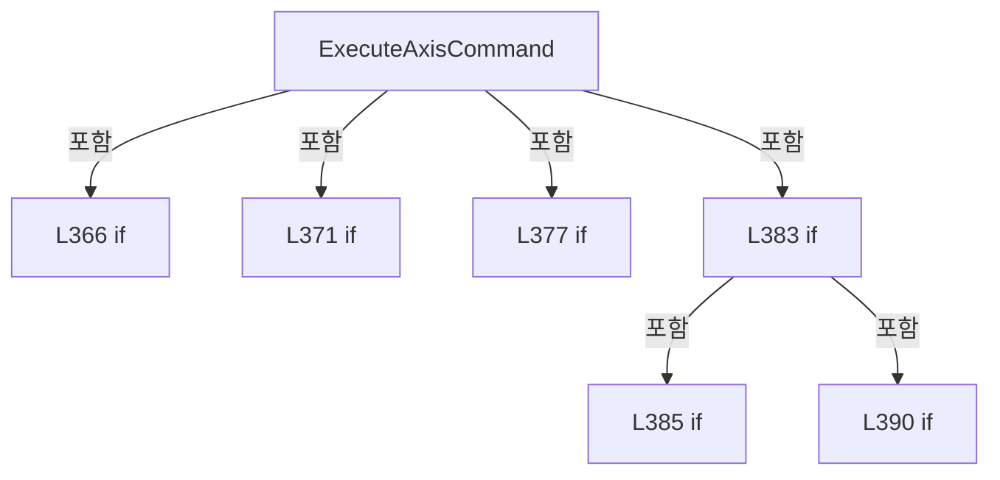

변경 전 점검: 입력/반환 타입, 위 호출자, 예외/취소 경로, 공유 상태와 저장·전송 소비자를 함께 확인합니다. 값의 단위나 물리 방향을 이름만으로 확정하지 않습니다.

### MethodDeclaration `StopMotion` · L399–402

[Drilling.Common/Motion/CMotionManager.cs:399–402](https://github.com/kjuws10-rgb/A3Drilling/blob/5aee8e58439c9b455cae7c9593c9be986c3e682e/Drilling.Common/Motion/CMotionManager.cs#L399-L402)

| 항목 | 실제 추출 값 |
| --- | --- |
| 서명 | System.Threading.Tasks.Task Drilling.Common.Motion.CMotionManager.StopMotion(string, System.Threading.CancellationToken) |
| 접근/수식자 | Public / public, async |
| 반환/값 타입 | System.Threading.Tasks.Task |
| 소속 타입 | NamedType:Drilling.Common.Motion.CMotionManager |

입력 계약:

| 이름 | 타입 | 전달 | 선택/기본값 |
| --- | --- | --- | --- |
| axisId | string | None | False /  |
| cancellationToken | System.Threading.CancellationToken | None | True / null |

현재 부분 분석에서 직접 연결된 호출자는 없습니다. XAML/이벤트/인터페이스·델리게이트·외부 진입을 추가 확인해야 하며, 미사용으로 판정한 것이 아닙니다.

호출하는 대상과 해석 범위:

| 원본 행 | 표현식 | 분석 상태 | 대상/소스 위치 |
| --- | --- | --- | --- |
| 401 | Stop | resolved | System.Threading.Tasks.Task Drilling.Common.Motion.CMotionManager.Stop(string, System.Threading.CancellationToken) · Drilling.Common/Motion/CMotionManager.cs:352 |

본문의 실제 연산·분기·예외·반환 순서(원문 위치 순):

| 원본 행 | 종류 | 주석 해설 |
| --- | --- | --- |
| 401 | await | 비동기 완료를 기다립니다: await Stop(axisId, cancellationToken) |
| 401 | call | 함수·델리게이트 또는 객체 생성자를 호출합니다: Stop(axisId, cancellationToken) |

변경 전 점검: 입력/반환 타입, 위 호출자, 예외/취소 경로, 공유 상태와 저장·전송 소비자를 함께 확인합니다. 값의 단위나 물리 방향을 이름만으로 확정하지 않습니다.

### MethodDeclaration `SetOutput` · L404–425

[Drilling.Common/Motion/CMotionManager.cs:404–425](https://github.com/kjuws10-rgb/A3Drilling/blob/5aee8e58439c9b455cae7c9593c9be986c3e682e/Drilling.Common/Motion/CMotionManager.cs#L404-L425)

| 항목 | 실제 추출 값 |
| --- | --- |
| 서명 | System.Threading.Tasks.Task Drilling.Common.Motion.CMotionManager.SetOutput(string, bool, System.Threading.CancellationToken) |
| 접근/수식자 | Public / public, async |
| 반환/값 타입 | System.Threading.Tasks.Task |
| 소속 타입 | NamedType:Drilling.Common.Motion.CMotionManager |

입력 계약:

| 이름 | 타입 | 전달 | 선택/기본값 |
| --- | --- | --- | --- |
| ioName | string | None | False /  |
| isOn | bool | None | False /  |
| cancellationToken | System.Threading.CancellationToken | None | True / null |

정적 호출자로 확인된 위치:

| 호출 파일/행 | 호출 표현식 | 런타임 분기 가능 |
| --- | --- | --- |
| [Drilling.Common/Motion/CMotionManager.cs:525–525](https://github.com/kjuws10-rgb/A3Drilling/blob/5aee8e58439c9b455cae7c9593c9be986c3e682e/Drilling.Common/Motion/CMotionManager.cs#L525-L525) | SetOutput | False |

호출하는 대상과 해석 범위:

| 원본 행 | 표현식 | 분석 상태 | 대상/소스 위치 |
| --- | --- | --- | --- |
| 406 | cancellationToken.ThrowIfCancellationRequested | resolved | void System.Threading.CancellationToken.ThrowIfCancellationRequested() |
| 407 | GetIoChannelOrThrow | resolved | Drilling.Common.Motion.CMotionManager.ST_IO_STATE Drilling.Common.Motion.CMotionManager.GetIoChannelOrThrow(string) · Drilling.Common/Motion/CMotionManager.cs:965 |
| 410 | new InvalidOperationException | resolved | System.InvalidOperationException.InvalidOperationException(string?) |
| 410 | FormatIoReference | resolved | string Drilling.Common.Motion.CMotionManager.FormatIoReference(Drilling.Common.Motion.CMotionManager.ST_IO_STATE) · Drilling.Common/Motion/CMotionManager.cs:1015 |
| 413 | GetMotionController | resolved | Drilling.Common.Motion.CMotionController? Drilling.Common.Motion.CMotionManager.GetMotionController(string, int) · Drilling.Common/Motion/CMotionManager.cs:534 |
| 416 | CreateMotionControllerNotRegisteredException | resolved | System.InvalidOperationException Drilling.Common.Motion.CMotionManager.CreateMotionControllerNotRegisteredException(string, int) · Drilling.Common/Motion/CMotionManager.cs:1087 |
| 419 | controller.IsSimulation | resolved | bool Drilling.Common.Motion.CMotionController.IsSimulation() · Drilling.Common/Motion/CMotionManager.cs:1419 |
| 421 | controller.SetOutput | resolved · 동적 구현 선택 가능 | System.Threading.Tasks.Task Drilling.Common.Motion.CMotionController.SetOutput(string, bool, System.Threading.CancellationToken) · Drilling.Common/Motion/CMotionManager.cs:1460 |

본문의 실제 연산·분기·예외·반환 순서(원문 위치 순):

| 원본 행 | 종류 | 주석 해설 |
| --- | --- | --- |
| 406 | call | 함수·델리게이트 또는 객체 생성자를 호출합니다: cancellationToken.ThrowIfCancellationRequested() |
| 407 | call | 함수·델리게이트 또는 객체 생성자를 호출합니다: GetIoChannelOrThrow(ioName) |
| 407 | local-declaration | 지역 변수를 선언합니다: var channel = GetIoChannelOrThrow(ioName); |
| 407 | variable-initializer | 변수의 초기값을 지정합니다: channel = GetIoChannelOrThrow(ioName) |
| 408 | if | 조건에 따라 분기합니다: if (!channel.IsOutput) |
| 410 | call | 함수·델리게이트 또는 객체 생성자를 호출합니다: new InvalidOperationException($"Motion IO is input only: {FormatIoReference(channel)}") |
| 410 | call | 함수·델리게이트 또는 객체 생성자를 호출합니다: FormatIoReference(channel) |
| 410 | throw | 예외를 발생/전달합니다: throw new InvalidOperationException($"Motion IO is input only: {FormatIoReference(channel)}"); |
| 413 | call | 함수·델리게이트 또는 객체 생성자를 호출합니다: GetMotionController(channel.DevType, channel.DevNo) |
| 413 | local-declaration | 지역 변수를 선언합니다: var controller = GetMotionController(channel.DevType, channel.DevNo); |
| 413 | variable-initializer | 변수의 초기값을 지정합니다: controller = GetMotionController(channel.DevType, channel.DevNo) |
| 414 | if | 조건에 따라 분기합니다: if (!_simulationMode && controller is null) |
| 416 | call | 함수·델리게이트 또는 객체 생성자를 호출합니다: CreateMotionControllerNotRegisteredException(channel.DevType, channel.DevNo) |
| 416 | throw | 예외를 발생/전달합니다: throw CreateMotionControllerNotRegisteredException(channel.DevType, channel.DevNo); |
| 419 | call | 함수·델리게이트 또는 객체 생성자를 호출합니다: controller.IsSimulation() |
| 419 | if | 조건에 따라 분기합니다: if (!_simulationMode && controller is not null && !controller.IsSimulation()) |
| 421 | await | 비동기 완료를 기다립니다: await controller.SetOutput(channel.Address, isOn, cancellationToken) |
| 421 | call | 함수·델리게이트 또는 객체 생성자를 호출합니다: controller.SetOutput(channel.Address, isOn, cancellationToken) |
| 424 | assignment | 값을 대상에 대입합니다: channel.IsOn = isOn |

제어 구문의 포함 구조(실제 실행 순서/CFG가 아닌 구문 탐색 그림):

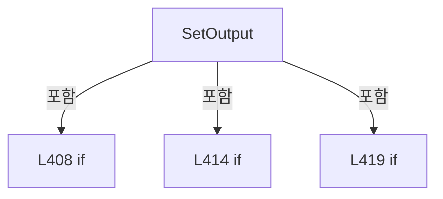

변경 전 점검: 입력/반환 타입, 위 호출자, 예외/취소 경로, 공유 상태와 저장·전송 소비자를 함께 확인합니다. 값의 단위나 물리 방향을 이름만으로 확정하지 않습니다.

### MethodDeclaration `ExecuteMotionCommand` · L427–438

[Drilling.Common/Motion/CMotionManager.cs:427–438](https://github.com/kjuws10-rgb/A3Drilling/blob/5aee8e58439c9b455cae7c9593c9be986c3e682e/Drilling.Common/Motion/CMotionManager.cs#L427-L438)

| 항목 | 실제 추출 값 |
| --- | --- |
| 서명 | System.Threading.Tasks.Task<Drilling.Common.Interface.ST_DEVICE_COMMAND_RESULT> Drilling.Common.Motion.CMotionManager.ExecuteMotionCommand(string, Drilling.Common.Motion.EN_MOTION_COMMAND, double, System.Threading.CancellationToken, double?) |
| 접근/수식자 | Public / public, async |
| 반환/값 타입 | System.Threading.Tasks.Task<Drilling.Common.Interface.ST_DEVICE_COMMAND_RESULT> |
| 소속 타입 | NamedType:Drilling.Common.Motion.CMotionManager |

입력 계약:

| 이름 | 타입 | 전달 | 선택/기본값 |
| --- | --- | --- | --- |
| axisId | string | None | False /  |
| command | Drilling.Common.Motion.EN_MOTION_COMMAND | None | False /  |
| parameter | double | None | True / 0 |
| cancellationToken | System.Threading.CancellationToken | None | True / null |
| parameter2 | double? | None | True / null |

정적 호출자로 확인된 위치:

| 호출 파일/행 | 호출 표현식 | 런타임 분기 가능 |
| --- | --- | --- |
| [Drilling.UI/Menu/Menus/CMenuMonitor.cs:4358–4358](https://github.com/kjuws10-rgb/A3Drilling/blob/5aee8e58439c9b455cae7c9593c9be986c3e682e/Drilling.UI/Menu/Menus/CMenuMonitor.cs#L4358-L4358) | _motionManager.ExecuteMotionCommand | False |
| [Drilling.UI/Menu/Menus/CMenuMonitor.cs:4445–4445](https://github.com/kjuws10-rgb/A3Drilling/blob/5aee8e58439c9b455cae7c9593c9be986c3e682e/Drilling.UI/Menu/Menus/CMenuMonitor.cs#L4445-L4445) | _motionManager.ExecuteMotionCommand | False |
| [Drilling.UI/Menu/Menus/CMenuMonitor.cs:4492–4492](https://github.com/kjuws10-rgb/A3Drilling/blob/5aee8e58439c9b455cae7c9593c9be986c3e682e/Drilling.UI/Menu/Menus/CMenuMonitor.cs#L4492-L4492) | _motionManager.ExecuteMotionCommand | False |
| [Drilling.UI/Menu/Menus/CMenuMonitor.cs:4522–4522](https://github.com/kjuws10-rgb/A3Drilling/blob/5aee8e58439c9b455cae7c9593c9be986c3e682e/Drilling.UI/Menu/Menus/CMenuMonitor.cs#L4522-L4522) | _motionManager.ExecuteMotionCommand | False |

호출하는 대상과 해석 범위:

| 원본 행 | 표현식 | 분석 상태 | 대상/소스 위치 |
| --- | --- | --- | --- |
| 431 | ExecuteAxisCommand | resolved | System.Threading.Tasks.Task Drilling.Common.Motion.CMotionManager.ExecuteAxisCommand(string, Drilling.Common.Motion.EN_MOTION_COMMAND, double, System.Threading.CancellationToken, double?) · Drilling.Common/Motion/CMotionManager.cs:362 |
| 432 | new ST_DEVICE_COMMAND_RESULT | resolved | Drilling.Common.Interface.ST_DEVICE_COMMAND_RESULT.ST_DEVICE_COMMAND_RESULT(bool, string) · Drilling.Common/Interface/CInterfaceManager.cs:2961 |
| 432 | FormatMotionCommand | resolved | string Drilling.Common.Motion.CMotionManager.FormatMotionCommand(Drilling.Common.Motion.EN_MOTION_COMMAND) · Drilling.Common/Motion/CMotionManager.cs:1097 |
| 436 | new ST_DEVICE_COMMAND_RESULT | resolved | Drilling.Common.Interface.ST_DEVICE_COMMAND_RESULT.ST_DEVICE_COMMAND_RESULT(bool, string) · Drilling.Common/Interface/CInterfaceManager.cs:2961 |
| 436 | FormatMotionCommand | resolved | string Drilling.Common.Motion.CMotionManager.FormatMotionCommand(Drilling.Common.Motion.EN_MOTION_COMMAND) · Drilling.Common/Motion/CMotionManager.cs:1097 |

본문의 실제 연산·분기·예외·반환 순서(원문 위치 순):

| 원본 행 | 종류 | 주석 해설 |
| --- | --- | --- |
| 429 | try | 예외 처리 범위입니다: try |
| 431 | await | 비동기 완료를 기다립니다: await ExecuteAxisCommand(axisId, command, parameter, cancellationToken, parameter2) |
| 431 | call | 함수·델리게이트 또는 객체 생성자를 호출합니다: ExecuteAxisCommand(axisId, command, parameter, cancellationToken, parameter2) |
| 432 | call | 함수·델리게이트 또는 객체 생성자를 호출합니다: new ST_DEVICE_COMMAND_RESULT(true, $"Motion {axisId} {FormatMotionCommand(command)} OK.") |
| 432 | call | 함수·델리게이트 또는 객체 생성자를 호출합니다: FormatMotionCommand(command) |
| 432 | return | 호출자에게 값 또는 제어를 반환합니다: return new ST_DEVICE_COMMAND_RESULT(true, $"Motion {axisId} {FormatMotionCommand(command)} OK."); |
| 434 | catch | 지정 예외를 처리합니다: catch (Exception exception) when (exception is InvalidOperationException or TimeoutException or IOException) |
| 436 | call | 함수·델리게이트 또는 객체 생성자를 호출합니다: new ST_DEVICE_COMMAND_RESULT(false, $"Motion {axisId} {FormatMotionCommand(command)} failed. {exception.Message}") |
| 436 | call | 함수·델리게이트 또는 객체 생성자를 호출합니다: FormatMotionCommand(command) |
| 436 | return | 호출자에게 값 또는 제어를 반환합니다: return new ST_DEVICE_COMMAND_RESULT(false, $"Motion {axisId} {FormatMotionCommand(command)} failed. {exception.Message}"); |

제어 구문의 포함 구조(실제 실행 순서/CFG가 아닌 구문 탐색 그림):

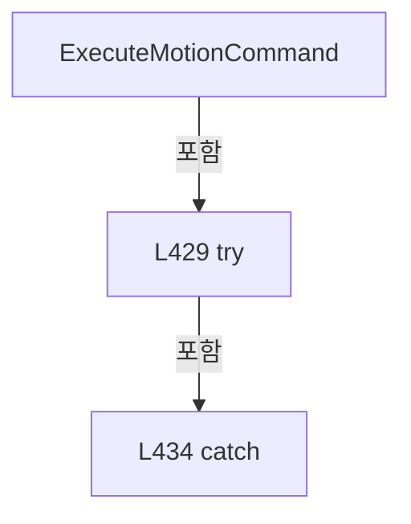

변경 전 점검: 입력/반환 타입, 위 호출자, 예외/취소 경로, 공유 상태와 저장·전송 소비자를 함께 확인합니다. 값의 단위나 물리 방향을 이름만으로 확정하지 않습니다.

### MethodDeclaration `ExecuteAbsoluteMoves` · L440–517

[Drilling.Common/Motion/CMotionManager.cs:440–517](https://github.com/kjuws10-rgb/A3Drilling/blob/5aee8e58439c9b455cae7c9593c9be986c3e682e/Drilling.Common/Motion/CMotionManager.cs#L440-L517)

| 항목 | 실제 추출 값 |
| --- | --- |
| 서명 | System.Threading.Tasks.Task<Drilling.Common.Interface.ST_DEVICE_COMMAND_RESULT> Drilling.Common.Motion.CMotionManager.ExecuteAbsoluteMoves(System.Collections.Generic.IReadOnlyList<Drilling.Common.Motion.ST_MOTION_ABS_MOVE_REQUEST>, System.Threading.CancellationToken) |
| 접근/수식자 | Public / public, async |
| 반환/값 타입 | System.Threading.Tasks.Task<Drilling.Common.Interface.ST_DEVICE_COMMAND_RESULT> |
| 소속 타입 | NamedType:Drilling.Common.Motion.CMotionManager |

입력 계약:

| 이름 | 타입 | 전달 | 선택/기본값 |
| --- | --- | --- | --- |
| requests | System.Collections.Generic.IReadOnlyList<Drilling.Common.Motion.ST_MOTION_ABS_MOVE_REQUEST> | None | False /  |
| cancellationToken | System.Threading.CancellationToken | None | True / null |

정적 호출자로 확인된 위치:

| 호출 파일/행 | 호출 표현식 | 런타임 분기 가능 |
| --- | --- | --- |
| [Drilling.UI/Menu/Menus/CMenuMonitor.cs:4398–4398](https://github.com/kjuws10-rgb/A3Drilling/blob/5aee8e58439c9b455cae7c9593c9be986c3e682e/Drilling.UI/Menu/Menus/CMenuMonitor.cs#L4398-L4398) | _motionManager.ExecuteAbsoluteMoves | False |

호출하는 대상과 해석 범위:

| 원본 행 | 표현식 | 분석 상태 | 대상/소스 위치 |
| --- | --- | --- | --- |
| 442 | cancellationToken.ThrowIfCancellationRequested | resolved | void System.Threading.CancellationToken.ThrowIfCancellationRequested() |
| 445 | new ST_DEVICE_COMMAND_RESULT | resolved | Drilling.Common.Interface.ST_DEVICE_COMMAND_RESULT.ST_DEVICE_COMMAND_RESULT(bool, string) · Drilling.Common/Interface/CInterfaceManager.cs:2961 |
| 448 | new List<ST_MOTION_ABS_MOVE_REQUEST> | resolved | System.Collections.Generic.List<Drilling.Common.Motion.ST_MOTION_ABS_MOVE_REQUEST>.List(int) |
| 449 | new HashSet<string> | resolved | System.Collections.Generic.HashSet<string>.HashSet(System.Collections.Generic.IEqualityComparer<string>?) |
| 450 | new List<string> | resolved | System.Collections.Generic.List<string>.List(int) |
| 460 | cancellationToken.ThrowIfCancellationRequested | resolved | void System.Threading.CancellationToken.ThrowIfCancellationRequested() |
| 461 | NormalizeAxisId | resolved | string Drilling.Common.Motion.CMotionManager.NormalizeAxisId(string) · Drilling.Common/Motion/CMotionManager.cs:955 |
| 462 | uniqueAxisIds.Add | resolved | bool System.Collections.Generic.HashSet<string>.Add(string) |
| 464 | new InvalidOperationException | resolved | System.InvalidOperationException.InvalidOperationException(string?) |
| 467 | double.IsFinite | resolved | bool double.IsFinite(double) |
| 467 | double.IsFinite | resolved | bool double.IsFinite(double) |
| 467 | double.IsFinite | resolved | bool double.IsFinite(double) |
| 469 | new InvalidOperationException | resolved | System.InvalidOperationException.InvalidOperationException(string?) |
| 472 | _axisData.TryGetValue | resolved | bool System.Collections.Generic.Dictionary<string, Drilling.Common.Motion.ST_MOTOR_DATA>.TryGetValue(string, out Drilling.Common.Motion.ST_MOTOR_DATA) |
| 472 | _axes.TryGetValue | resolved | bool System.Collections.Generic.Dictionary<string, Drilling.Common.Motion.CMotionManager.ST_AXIS_STATE>.TryGetValue(string, out Drilling.Common.Motion.CMotionManager.ST_AXIS_STATE) |
| 474 | new InvalidOperationException | resolved | System.InvalidOperationException.InvalidOperationException(string?) |
| 477 | IsAxisSimulation | resolved | bool Drilling.Common.Motion.CMotionManager.IsAxisSimulation(Drilling.Common.Motion.ST_MOTOR_DATA) · Drilling.Common/Motion/CMotionManager.cs:539 |
| 479 | UpdateSimulatedAxisPosition | resolved | void Drilling.Common.Motion.CMotionManager.UpdateSimulatedAxisPosition(Drilling.Common.Motion.ST_MOTOR_DATA, Drilling.Common.Motion.CMotionManager.ST_AXIS_STATE, long) · Drilling.Common/Motion/CMotionManager.cs:626 |
| 479 | Stopwatch.GetTimestamp | resolved | long System.Diagnostics.Stopwatch.GetTimestamp() |
| 482 | ValidateAxisCommand | resolved | void Drilling.Common.Motion.CMotionManager.ValidateAxisCommand(Drilling.Common.Motion.ST_MOTOR_DATA, Drilling.Common.Motion.CMotionManager.ST_AXIS_STATE, Drilling.Common.Motion.EN_MOTION_COMMAND, double, double?) · Drilling.Common/Motion/CMotionManager.cs:690 |
| 483 | normalizedRequests.Add | resolved | void System.Collections.Generic.List<Drilling.Common.Motion.ST_MOTION_ABS_MOVE_REQUEST>.Add(Drilling.Common.Motion.ST_MOTION_ABS_MOVE_REQUEST) |
| 489 | ExecuteAxisCommand | resolved | System.Threading.Tasks.Task Drilling.Common.Motion.CMotionManager.ExecuteAxisCommand(string, Drilling.Common.Motion.EN_MOTION_COMMAND, double, System.Threading.CancellationToken, double?) · Drilling.Common/Motion/CMotionManager.cs:362 |
| 495 | startedAxisIds.Add | resolved | void System.Collections.Generic.List<string>.Add(string) |
| 496 | ExecuteAxisCommand | resolved | System.Threading.Tasks.Task Drilling.Common.Motion.CMotionManager.ExecuteAxisCommand(string, Drilling.Common.Motion.EN_MOTION_COMMAND, double, System.Threading.CancellationToken, double?) · Drilling.Common/Motion/CMotionManager.cs:362 |
| 499 | new ST_DEVICE_COMMAND_RESULT | resolved | Drilling.Common.Interface.ST_DEVICE_COMMAND_RESULT.ST_DEVICE_COMMAND_RESULT(bool, string) · Drilling.Common/Interface/CInterfaceManager.cs:2961 |
| 499 | string.Join | resolved | string string.Join(string?, System.Collections.Generic.IEnumerable<string?>) |
| 499 | normalizedRequests.Select | resolved | System.Collections.Generic.IEnumerable<string> System.Collections.Generic.IEnumerable<Drilling.Common.Motion.ST_MOTION_ABS_MOVE_REQUEST>.Select<Drilling.Common.Motion.ST_MOTION_ABS_MOVE_REQUEST, string>(System.Func<Drilling.Common.Motion.ST_MOTION_ABS_MOVE_REQUEST, string>) |
| 503 | StopStartedAxes | resolved | System.Threading.Tasks.Task<System.AggregateException?> Drilling.Common.Motion.CMotionManager.StopStartedAxes(System.Collections.Generic.IReadOnlyList<string>) · Drilling.Common/Motion/CMotionManager.cs:544 |
| 506 | new AggregateException | resolved | System.AggregateException.AggregateException(string?, params System.Exception[]) |
| 513 | StopStartedAxes | resolved | System.Threading.Tasks.Task<System.AggregateException?> Drilling.Common.Motion.CMotionManager.StopStartedAxes(System.Collections.Generic.IReadOnlyList<string>) · Drilling.Common/Motion/CMotionManager.cs:544 |
| 514 | FormatAggregateException | resolved | string Drilling.Common.Motion.CMotionManager.FormatAggregateException(System.AggregateException) · Drilling.Common/Motion/CMotionManager.cs:1113 |
| 515 | new ST_DEVICE_COMMAND_RESULT | resolved | Drilling.Common.Interface.ST_DEVICE_COMMAND_RESULT.ST_DEVICE_COMMAND_RESULT(bool, string) · Drilling.Common/Interface/CInterfaceManager.cs:2961 |

본문의 실제 연산·분기·예외·반환 순서(원문 위치 순):

| 원본 행 | 종류 | 주석 해설 |
| --- | --- | --- |
| 442 | call | 함수·델리게이트 또는 객체 생성자를 호출합니다: cancellationToken.ThrowIfCancellationRequested() |
| 443 | if | 조건에 따라 분기합니다: if (requests is null &#124;&#124; requests.Count == 0) |
| 445 | call | 함수·델리게이트 또는 객체 생성자를 호출합니다: new ST_DEVICE_COMMAND_RESULT(false, "XPS MULTI MOVE requires at least one axis.") |
| 445 | return | 호출자에게 값 또는 제어를 반환합니다: return new ST_DEVICE_COMMAND_RESULT(false, "XPS MULTI MOVE requires at least one axis."); |
| 448 | call | 함수·델리게이트 또는 객체 생성자를 호출합니다: new List<ST_MOTION_ABS_MOVE_REQUEST>(requests.Count) |
| 448 | local-declaration | 지역 변수를 선언합니다: var normalizedRequests = new List<ST_MOTION_ABS_MOVE_REQUEST>(requests.Count); |
| 448 | variable-initializer | 변수의 초기값을 지정합니다: normalizedRequests = new List<ST_MOTION_ABS_MOVE_REQUEST>(requests.Count) |
| 449 | call | 함수·델리게이트 또는 객체 생성자를 호출합니다: new HashSet<string>(StringComparer.OrdinalIgnoreCase) |
| 449 | local-declaration | 지역 변수를 선언합니다: var uniqueAxisIds = new HashSet<string>(StringComparer.OrdinalIgnoreCase); |
| 449 | variable-initializer | 변수의 초기값을 지정합니다: uniqueAxisIds = new HashSet<string>(StringComparer.OrdinalIgnoreCase) |
| 450 | call | 함수·델리게이트 또는 객체 생성자를 호출합니다: new List<string>(requests.Count) |
| 450 | local-declaration | 지역 변수를 선언합니다: var startedAxisIds = new List<string>(requests.Count); |
| 450 | variable-initializer | 변수의 초기값을 지정합니다: startedAxisIds = new List<string>(requests.Count) |
| 456 | try | 예외 처리 범위입니다: try |
| 458 | foreach | 컬렉션 요소를 순회합니다: foreach (var request in requests) |
| 460 | call | 함수·델리게이트 또는 객체 생성자를 호출합니다: cancellationToken.ThrowIfCancellationRequested() |
| 461 | call | 함수·델리게이트 또는 객체 생성자를 호출합니다: NormalizeAxisId(request.AxisId) |
| 461 | local-declaration | 지역 변수를 선언합니다: var axisId = NormalizeAxisId(request.AxisId); |
| 461 | variable-initializer | 변수의 초기값을 지정합니다: axisId = NormalizeAxisId(request.AxisId) |
| 462 | call | 함수·델리게이트 또는 객체 생성자를 호출합니다: uniqueAxisIds.Add(axisId) |
| 462 | if | 조건에 따라 분기합니다: if (!uniqueAxisIds.Add(axisId)) |
| 464 | call | 함수·델리게이트 또는 객체 생성자를 호출합니다: new InvalidOperationException($"XPS MULTI MOVE contains a duplicate axis: {axisId}") |
| 464 | throw | 예외를 발생/전달합니다: throw new InvalidOperationException($"XPS MULTI MOVE contains a duplicate axis: {axisId}"); |
| 467 | call | 함수·델리게이트 또는 객체 생성자를 호출합니다: double.IsFinite(request.TargetPosition) |
| 467 | call | 함수·델리게이트 또는 객체 생성자를 호출합니다: double.IsFinite(request.Speed) |
| 467 | call | 함수·델리게이트 또는 객체 생성자를 호출합니다: double.IsFinite(request.Acceleration) |
| 467 | if | 조건에 따라 분기합니다: if (!double.IsFinite(request.TargetPosition) &#124;&#124; !double.IsFinite(request.Speed) &#124;&#124; !double.IsFinite(request.Acceleration) &#124;&#124; request.Speed <= 0.0 &#124;&#124; request.Acceleration <= 0.0) |
| 469 | call | 함수·델리게이트 또는 객체 생성자를 호출합니다: new InvalidOperationException($"XPS MULTI MOVE values are invalid. Axis={axisId}, Target={request.TargetPosition}, Speed={request.Speed}, Acc={request.Acceleration}") |
| 469 | throw | 예외를 발생/전달합니다: throw new InvalidOperationException($"XPS MULTI MOVE values are invalid. Axis={axisId}, Target={request.TargetPosition}, Speed={request.Speed}, Acc={request.Acceleration}"); |
| 472 | call | 함수·델리게이트 또는 객체 생성자를 호출합니다: _axisData.TryGetValue(axisId, out var axisData) |
| 472 | call | 함수·델리게이트 또는 객체 생성자를 호출합니다: _axes.TryGetValue(axisId, out var axisState) |
| 472 | if | 조건에 따라 분기합니다: if (!_axisData.TryGetValue(axisId, out var axisData) &#124;&#124; !_axes.TryGetValue(axisId, out var axisState)) |
| 474 | call | 함수·델리게이트 또는 객체 생성자를 호출합니다: new InvalidOperationException($"Motion axis was not registered in JHMI_MOTOR.csv: {request.AxisId}") |
| 474 | throw | 예외를 발생/전달합니다: throw new InvalidOperationException($"Motion axis was not registered in JHMI_MOTOR.csv: {request.AxisId}"); |
| 477 | call | 함수·델리게이트 또는 객체 생성자를 호출합니다: IsAxisSimulation(axisData) |
| 477 | if | 조건에 따라 분기합니다: if (IsAxisSimulation(axisData)) |
| 479 | call | 함수·델리게이트 또는 객체 생성자를 호출합니다: UpdateSimulatedAxisPosition(axisData, axisState, Stopwatch.GetTimestamp()) |
| 479 | call | 함수·델리게이트 또는 객체 생성자를 호출합니다: Stopwatch.GetTimestamp() |
| 482 | call | 함수·델리게이트 또는 객체 생성자를 호출합니다: ValidateAxisCommand(axisData, axisState, EN_MOTION_COMMAND.MoveAbs, request.TargetPosition, parameter2: null) |
| 483 | assignment | 값을 대상에 대입합니다: AxisId = axisId |
| 483 | call | 함수·델리게이트 또는 객체 생성자를 호출합니다: normalizedRequests.Add(request with { AxisId = axisId }) |
| 487 | foreach | 컬렉션 요소를 순회합니다: foreach (var request in normalizedRequests) |
| 489 | await | 비동기 완료를 기다립니다: await ExecuteAxisCommand(request.AxisId, EN_MOTION_COMMAND.SetProfile, request.Speed, cancellationToken, request.Acceleration) |
| 489 | call | 함수·델리게이트 또는 객체 생성자를 호출합니다: ExecuteAxisCommand(request.AxisId, EN_MOTION_COMMAND.SetProfile, request.Speed, cancellationToken, request.Acceleration) |
| 492 | foreach | 컬렉션 요소를 순회합니다: foreach (var request in normalizedRequests) |
| 495 | call | 함수·델리게이트 또는 객체 생성자를 호출합니다: startedAxisIds.Add(request.AxisId) |
| 496 | await | 비동기 완료를 기다립니다: await ExecuteAxisCommand(request.AxisId, EN_MOTION_COMMAND.MoveAbs, request.TargetPosition, cancellationToken) |
| 496 | call | 함수·델리게이트 또는 객체 생성자를 호출합니다: ExecuteAxisCommand(request.AxisId, EN_MOTION_COMMAND.MoveAbs, request.TargetPosition, cancellationToken) |
| 499 | call | 함수·델리게이트 또는 객체 생성자를 호출합니다: new ST_DEVICE_COMMAND_RESULT(true, $"XPS MULTI ABS MOVE OK. Axes={string.Join(",", normalizedRequests.Select(SelectAxisId))}") |
| 499 | call | 함수·델리게이트 또는 객체 생성자를 호출합니다: string.Join(",", normalizedRequests.Select(SelectAxisId)) |
| 499 | call | 함수·델리게이트 또는 객체 생성자를 호출합니다: normalizedRequests.Select(SelectAxisId) |
| 499 | return | 호출자에게 값 또는 제어를 반환합니다: return new ST_DEVICE_COMMAND_RESULT(true, $"XPS MULTI ABS MOVE OK. Axes={string.Join(",", normalizedRequests.Select(SelectAxisId))}"); |
| 501 | catch | 지정 예외를 처리합니다: catch (OperationCanceledException cancellationException) |
| 503 | await | 비동기 완료를 기다립니다: await StopStartedAxes(startedAxisIds) |
| 503 | call | 함수·델리게이트 또는 객체 생성자를 호출합니다: StopStartedAxes(startedAxisIds) |
| 503 | local-declaration | 지역 변수를 선언합니다: var stopFailure = await StopStartedAxes(startedAxisIds); |
| 503 | variable-initializer | 변수의 초기값을 지정합니다: stopFailure = await StopStartedAxes(startedAxisIds) |
| 504 | if | 조건에 따라 분기합니다: if (stopFailure is not null) |
| 506 | call | 함수·델리게이트 또는 객체 생성자를 호출합니다: new AggregateException("XPS MULTI ABS MOVE was cancelled and one or more safety stops failed.", cancellationException, stopFailure) |
| 506 | throw | 예외를 발생/전달합니다: throw new AggregateException("XPS MULTI ABS MOVE was cancelled and one or more safety stops failed.", cancellationException, stopFailure); |
| 509 | throw | 예외를 발생/전달합니다: throw; |
| 511 | catch | 지정 예외를 처리합니다: catch (Exception exception) when (exception is InvalidOperationException or TimeoutException or IOException) |
| 513 | await | 비동기 완료를 기다립니다: await StopStartedAxes(startedAxisIds) |
| 513 | call | 함수·델리게이트 또는 객체 생성자를 호출합니다: StopStartedAxes(startedAxisIds) |
| 513 | local-declaration | 지역 변수를 선언합니다: var stopFailure = await StopStartedAxes(startedAxisIds); |
| 513 | variable-initializer | 변수의 초기값을 지정합니다: stopFailure = await StopStartedAxes(startedAxisIds) |
| 514 | call | 함수·델리게이트 또는 객체 생성자를 호출합니다: FormatAggregateException(stopFailure) |
| 514 | conditional-expression | 조건에 따라 결과식을 선택합니다: stopFailure is null ? "" : $" SAFETY STOP FAILED. {FormatAggregateException(stopFailure)}" |
| 514 | local-declaration | 지역 변수를 선언합니다: var stopFailureMessage = stopFailure is null ? "" : $" SAFETY STOP FAILED. {FormatAggregateException(stopFailure)}"; |
| 514 | variable-initializer | 변수의 초기값을 지정합니다: stopFailureMessage = stopFailure is null ? "" : $" SAFETY STOP FAILED. {FormatAggregateException(stopFailure)}" |
| 515 | call | 함수·델리게이트 또는 객체 생성자를 호출합니다: new ST_DEVICE_COMMAND_RESULT(false, $"XPS MULTI ABS MOVE failed. {exception.Message}{stopFailureMessage}") |
| 515 | return | 호출자에게 값 또는 제어를 반환합니다: return new ST_DEVICE_COMMAND_RESULT(false, $"XPS MULTI ABS MOVE failed. {exception.Message}{stopFailureMessage}"); |

제어 구문의 포함 구조(실제 실행 순서/CFG가 아닌 구문 탐색 그림):

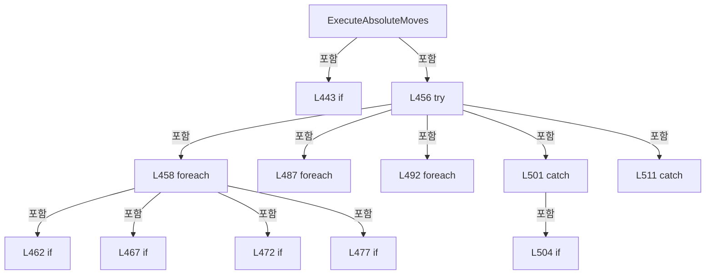

변경 전 점검: 입력/반환 타입, 위 호출자, 예외/취소 경로, 공유 상태와 저장·전송 소비자를 함께 확인합니다. 값의 단위나 물리 방향을 이름만으로 확정하지 않습니다.

### LocalFunctionStatement `SelectAxisId` · L451–454

[Drilling.Common/Motion/CMotionManager.cs:451–454](https://github.com/kjuws10-rgb/A3Drilling/blob/5aee8e58439c9b455cae7c9593c9be986c3e682e/Drilling.Common/Motion/CMotionManager.cs#L451-L454)

| 항목 | 실제 추출 값 |
| --- | --- |
| 서명 | string SelectAxisId(Drilling.Common.Motion.ST_MOTION_ABS_MOVE_REQUEST) |
| 접근/수식자 | Private /  |
| 반환/값 타입 | string |
| 소속 타입 | NamedType:Drilling.Common.Motion.CMotionManager |

입력 계약:

| 이름 | 타입 | 전달 | 선택/기본값 |
| --- | --- | --- | --- |
| request | Drilling.Common.Motion.ST_MOTION_ABS_MOVE_REQUEST | None | False /  |

현재 부분 분석에서 직접 연결된 호출자는 없습니다. XAML/이벤트/인터페이스·델리게이트·외부 진입을 추가 확인해야 하며, 미사용으로 판정한 것이 아닙니다.

본문의 실제 연산·분기·예외·반환 순서(원문 위치 순):

| 원본 행 | 종류 | 주석 해설 |
| --- | --- | --- |
| 453 | return | 호출자에게 값 또는 제어를 반환합니다: return request.AxisId; |

변경 전 점검: 입력/반환 타입, 위 호출자, 예외/취소 경로, 공유 상태와 저장·전송 소비자를 함께 확인합니다. 값의 단위나 물리 방향을 이름만으로 확정하지 않습니다.

### MethodDeclaration `SetOutputCommand` · L519–532

[Drilling.Common/Motion/CMotionManager.cs:519–532](https://github.com/kjuws10-rgb/A3Drilling/blob/5aee8e58439c9b455cae7c9593c9be986c3e682e/Drilling.Common/Motion/CMotionManager.cs#L519-L532)

| 항목 | 실제 추출 값 |
| --- | --- |
| 서명 | System.Threading.Tasks.Task<Drilling.Common.Interface.ST_DEVICE_COMMAND_RESULT> Drilling.Common.Motion.CMotionManager.SetOutputCommand(string, bool, System.Threading.CancellationToken) |
| 접근/수식자 | Public / public, async |
| 반환/값 타입 | System.Threading.Tasks.Task<Drilling.Common.Interface.ST_DEVICE_COMMAND_RESULT> |
| 소속 타입 | NamedType:Drilling.Common.Motion.CMotionManager |

입력 계약:

| 이름 | 타입 | 전달 | 선택/기본값 |
| --- | --- | --- | --- |
| ioName | string | None | False /  |
| isOn | bool | None | False /  |
| cancellationToken | System.Threading.CancellationToken | None | True / null |

현재 부분 분석에서 직접 연결된 호출자는 없습니다. XAML/이벤트/인터페이스·델리게이트·외부 진입을 추가 확인해야 하며, 미사용으로 판정한 것이 아닙니다.

호출하는 대상과 해석 범위:

| 원본 행 | 표현식 | 분석 상태 | 대상/소스 위치 |
| --- | --- | --- | --- |
| 524 | GetIoChannelOrThrow | resolved | Drilling.Common.Motion.CMotionManager.ST_IO_STATE Drilling.Common.Motion.CMotionManager.GetIoChannelOrThrow(string) · Drilling.Common/Motion/CMotionManager.cs:965 |
| 525 | SetOutput | resolved | System.Threading.Tasks.Task Drilling.Common.Motion.CMotionManager.SetOutput(string, bool, System.Threading.CancellationToken) · Drilling.Common/Motion/CMotionManager.cs:404 |
| 526 | new ST_DEVICE_COMMAND_RESULT | resolved | Drilling.Common.Interface.ST_DEVICE_COMMAND_RESULT.ST_DEVICE_COMMAND_RESULT(bool, string) · Drilling.Common/Interface/CInterfaceManager.cs:2961 |
| 526 | FormatIoReference | resolved | string Drilling.Common.Motion.CMotionManager.FormatIoReference(Drilling.Common.Motion.CMotionManager.ST_IO_STATE) · Drilling.Common/Motion/CMotionManager.cs:1015 |
| 530 | new ST_DEVICE_COMMAND_RESULT | resolved | Drilling.Common.Interface.ST_DEVICE_COMMAND_RESULT.ST_DEVICE_COMMAND_RESULT(bool, string) · Drilling.Common/Interface/CInterfaceManager.cs:2961 |

본문의 실제 연산·분기·예외·반환 순서(원문 위치 순):

| 원본 행 | 종류 | 주석 해설 |
| --- | --- | --- |
| 521 | conditional-expression | 조건에 따라 결과식을 선택합니다: isOn ? "ON" : "OFF" |
| 521 | local-declaration | 지역 변수를 선언합니다: var command = isOn ? "ON" : "OFF"; |
| 521 | variable-initializer | 변수의 초기값을 지정합니다: command = isOn ? "ON" : "OFF" |
| 522 | try | 예외 처리 범위입니다: try |
| 524 | call | 함수·델리게이트 또는 객체 생성자를 호출합니다: GetIoChannelOrThrow(ioName) |
| 524 | local-declaration | 지역 변수를 선언합니다: var channel = GetIoChannelOrThrow(ioName); |
| 524 | variable-initializer | 변수의 초기값을 지정합니다: channel = GetIoChannelOrThrow(ioName) |
| 525 | await | 비동기 완료를 기다립니다: await SetOutput(channel.Address, isOn, cancellationToken) |
| 525 | call | 함수·델리게이트 또는 객체 생성자를 호출합니다: SetOutput(channel.Address, isOn, cancellationToken) |
| 526 | call | 함수·델리게이트 또는 객체 생성자를 호출합니다: new ST_DEVICE_COMMAND_RESULT(true, $"Motion IO {FormatIoReference(channel)} {command} OK.") |
| 526 | call | 함수·델리게이트 또는 객체 생성자를 호출합니다: FormatIoReference(channel) |
| 526 | return | 호출자에게 값 또는 제어를 반환합니다: return new ST_DEVICE_COMMAND_RESULT(true, $"Motion IO {FormatIoReference(channel)} {command} OK."); |
| 528 | catch | 지정 예외를 처리합니다: catch (Exception exception) when (exception is InvalidOperationException or TimeoutException or IOException) |
| 530 | call | 함수·델리게이트 또는 객체 생성자를 호출합니다: new ST_DEVICE_COMMAND_RESULT(false, $"Motion IO {ioName} {command} failed. {exception.Message}") |
| 530 | return | 호출자에게 값 또는 제어를 반환합니다: return new ST_DEVICE_COMMAND_RESULT(false, $"Motion IO {ioName} {command} failed. {exception.Message}"); |

제어 구문의 포함 구조(실제 실행 순서/CFG가 아닌 구문 탐색 그림):

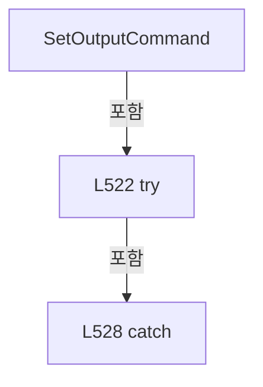

변경 전 점검: 입력/반환 타입, 위 호출자, 예외/취소 경로, 공유 상태와 저장·전송 소비자를 함께 확인합니다. 값의 단위나 물리 방향을 이름만으로 확정하지 않습니다.

### MethodDeclaration `GetMotionController` · L534–537

[Drilling.Common/Motion/CMotionManager.cs:534–537](https://github.com/kjuws10-rgb/A3Drilling/blob/5aee8e58439c9b455cae7c9593c9be986c3e682e/Drilling.Common/Motion/CMotionManager.cs#L534-L537)

| 항목 | 실제 추출 값 |
| --- | --- |
| 서명 | Drilling.Common.Motion.CMotionController? Drilling.Common.Motion.CMotionManager.GetMotionController(string, int) |
| 접근/수식자 | Private / private |
| 반환/값 타입 | Drilling.Common.Motion.CMotionController? |
| 소속 타입 | NamedType:Drilling.Common.Motion.CMotionManager |

입력 계약:

| 이름 | 타입 | 전달 | 선택/기본값 |
| --- | --- | --- | --- |
| devType | string | None | False /  |
| devNo | int | None | False /  |

정적 호출자로 확인된 위치:

| 호출 파일/행 | 호출 표현식 | 런타임 분기 가능 |
| --- | --- | --- |
| [Drilling.Common/Motion/CMotionManager.cs:413–413](https://github.com/kjuws10-rgb/A3Drilling/blob/5aee8e58439c9b455cae7c9593c9be986c3e682e/Drilling.Common/Motion/CMotionManager.cs#L413-L413) | GetMotionController | False |

호출하는 대상과 해석 범위:

| 원본 행 | 표현식 | 분석 상태 | 대상/소스 위치 |
| --- | --- | --- | --- |
| 536 | _controllers.TryGetValue | resolved | bool System.Collections.Generic.Dictionary<string, Drilling.Common.Motion.CMotionController>.TryGetValue(string, out Drilling.Common.Motion.CMotionController) |
| 536 | GetControllerKey | resolved | string Drilling.Common.Motion.CMotionManager.GetControllerKey(string, int) · Drilling.Common/Motion/CMotionManager.cs:1072 |

본문의 실제 연산·분기·예외·반환 순서(원문 위치 순):

| 원본 행 | 종류 | 주석 해설 |
| --- | --- | --- |
| 536 | call | 함수·델리게이트 또는 객체 생성자를 호출합니다: _controllers.TryGetValue(GetControllerKey(devType, devNo), out var controller) |
| 536 | call | 함수·델리게이트 또는 객체 생성자를 호출합니다: GetControllerKey(devType, devNo) |
| 536 | conditional-expression | 조건에 따라 결과식을 선택합니다: _controllers.TryGetValue(GetControllerKey(devType, devNo), out var controller) ? controller : null |
| 536 | return | 호출자에게 값 또는 제어를 반환합니다: return _controllers.TryGetValue(GetControllerKey(devType, devNo), out var controller) ? controller : null; |

변경 전 점검: 입력/반환 타입, 위 호출자, 예외/취소 경로, 공유 상태와 저장·전송 소비자를 함께 확인합니다. 값의 단위나 물리 방향을 이름만으로 확정하지 않습니다.

### MethodDeclaration `IsAxisSimulation` · L539–542

[Drilling.Common/Motion/CMotionManager.cs:539–542](https://github.com/kjuws10-rgb/A3Drilling/blob/5aee8e58439c9b455cae7c9593c9be986c3e682e/Drilling.Common/Motion/CMotionManager.cs#L539-L542)

| 항목 | 실제 추출 값 |
| --- | --- |
| 서명 | bool Drilling.Common.Motion.CMotionManager.IsAxisSimulation(Drilling.Common.Motion.ST_MOTOR_DATA) |
| 접근/수식자 | Private / private |
| 반환/값 타입 | bool |
| 소속 타입 | NamedType:Drilling.Common.Motion.CMotionManager |

입력 계약:

| 이름 | 타입 | 전달 | 선택/기본값 |
| --- | --- | --- | --- |
| axisData | Drilling.Common.Motion.ST_MOTOR_DATA | None | False /  |

정적 호출자로 확인된 위치:

| 호출 파일/행 | 호출 표현식 | 런타임 분기 가능 |
| --- | --- | --- |
| [Drilling.Common/Motion/CMotionManager.cs:376–376](https://github.com/kjuws10-rgb/A3Drilling/blob/5aee8e58439c9b455cae7c9593c9be986c3e682e/Drilling.Common/Motion/CMotionManager.cs#L376-L376) | IsAxisSimulation | False |
| [Drilling.Common/Motion/CMotionManager.cs:477–477](https://github.com/kjuws10-rgb/A3Drilling/blob/5aee8e58439c9b455cae7c9593c9be986c3e682e/Drilling.Common/Motion/CMotionManager.cs#L477-L477) | IsAxisSimulation | False |
| [Drilling.Common/Motion/CMotionManager.cs:617–617](https://github.com/kjuws10-rgb/A3Drilling/blob/5aee8e58439c9b455cae7c9593c9be986c3e682e/Drilling.Common/Motion/CMotionManager.cs#L617-L617) | IsAxisSimulation | False |

호출하는 대상과 해석 범위:

| 원본 행 | 표현식 | 분석 상태 | 대상/소스 위치 |
| --- | --- | --- | --- |
| 541 | _controllers.TryGetValue | resolved | bool System.Collections.Generic.Dictionary<string, Drilling.Common.Motion.CMotionController>.TryGetValue(string, out Drilling.Common.Motion.CMotionController) |
| 541 | GetControllerKey | resolved | string Drilling.Common.Motion.CMotionManager.GetControllerKey(string, int) · Drilling.Common/Motion/CMotionManager.cs:1072 |
| 541 | controller.IsSimulation | resolved | bool Drilling.Common.Motion.CMotionController.IsSimulation() · Drilling.Common/Motion/CMotionManager.cs:1419 |

본문의 실제 연산·분기·예외·반환 순서(원문 위치 순):

| 원본 행 | 종류 | 주석 해설 |
| --- | --- | --- |
| 541 | call | 함수·델리게이트 또는 객체 생성자를 호출합니다: _controllers.TryGetValue(GetControllerKey(axisData.DevType, axisData.DevNo), out var controller) |
| 541 | call | 함수·델리게이트 또는 객체 생성자를 호출합니다: GetControllerKey(axisData.DevType, axisData.DevNo) |
| 541 | call | 함수·델리게이트 또는 객체 생성자를 호출합니다: controller.IsSimulation() |
| 541 | return | 호출자에게 값 또는 제어를 반환합니다: return _simulationMode &#124;&#124; (_controllers.TryGetValue(GetControllerKey(axisData.DevType, axisData.DevNo), out var controller) && controller.IsSimulation()); |

변경 전 점검: 입력/반환 타입, 위 호출자, 예외/취소 경로, 공유 상태와 저장·전송 소비자를 함께 확인합니다. 값의 단위나 물리 방향을 이름만으로 확정하지 않습니다.

### MethodDeclaration `StopStartedAxes` · L544–565

[Drilling.Common/Motion/CMotionManager.cs:544–565](https://github.com/kjuws10-rgb/A3Drilling/blob/5aee8e58439c9b455cae7c9593c9be986c3e682e/Drilling.Common/Motion/CMotionManager.cs#L544-L565)

| 항목 | 실제 추출 값 |
| --- | --- |
| 서명 | System.Threading.Tasks.Task<System.AggregateException?> Drilling.Common.Motion.CMotionManager.StopStartedAxes(System.Collections.Generic.IReadOnlyList<string>) |
| 접근/수식자 | Private / private, async |
| 반환/값 타입 | System.Threading.Tasks.Task<System.AggregateException?> |
| 소속 타입 | NamedType:Drilling.Common.Motion.CMotionManager |

입력 계약:

| 이름 | 타입 | 전달 | 선택/기본값 |
| --- | --- | --- | --- |
| axisIds | System.Collections.Generic.IReadOnlyList<string> | None | False /  |

정적 호출자로 확인된 위치:

| 호출 파일/행 | 호출 표현식 | 런타임 분기 가능 |
| --- | --- | --- |
| [Drilling.Common/Motion/CMotionManager.cs:503–503](https://github.com/kjuws10-rgb/A3Drilling/blob/5aee8e58439c9b455cae7c9593c9be986c3e682e/Drilling.Common/Motion/CMotionManager.cs#L503-L503) | StopStartedAxes | False |
| [Drilling.Common/Motion/CMotionManager.cs:513–513](https://github.com/kjuws10-rgb/A3Drilling/blob/5aee8e58439c9b455cae7c9593c9be986c3e682e/Drilling.Common/Motion/CMotionManager.cs#L513-L513) | StopStartedAxes | False |

호출하는 대상과 해석 범위:

| 원본 행 | 표현식 | 분석 상태 | 대상/소스 위치 |
| --- | --- | --- | --- |
| 546 | new List<Exception> | resolved | System.Collections.Generic.List<System.Exception>.List() |
| 551 | ExecuteAxisCommand | resolved | System.Threading.Tasks.Task Drilling.Common.Motion.CMotionManager.ExecuteAxisCommand(string, Drilling.Common.Motion.EN_MOTION_COMMAND, double, System.Threading.CancellationToken, double?) · Drilling.Common/Motion/CMotionManager.cs:362 |
| 555 | _axes.TryGetValue | resolved | bool System.Collections.Generic.Dictionary<string, Drilling.Common.Motion.CMotionManager.ST_AXIS_STATE>.TryGetValue(string, out Drilling.Common.Motion.CMotionManager.ST_AXIS_STATE) |
| 555 | NormalizeAxisId | resolved | string Drilling.Common.Motion.CMotionManager.NormalizeAxisId(string) · Drilling.Common/Motion/CMotionManager.cs:955 |
| 560 | failures.Add | resolved | void System.Collections.Generic.List<System.Exception>.Add(System.Exception) |
| 560 | new InvalidOperationException | resolved | System.InvalidOperationException.InvalidOperationException(string?, System.Exception?) |
| 564 | new AggregateException | resolved | System.AggregateException.AggregateException(string?, System.Collections.Generic.IEnumerable<System.Exception>) |

본문의 실제 연산·분기·예외·반환 순서(원문 위치 순):

| 원본 행 | 종류 | 주석 해설 |
| --- | --- | --- |
| 546 | call | 함수·델리게이트 또는 객체 생성자를 호출합니다: new List<Exception>() |
| 546 | local-declaration | 지역 변수를 선언합니다: var failures = new List<Exception>(); |
| 546 | variable-initializer | 변수의 초기값을 지정합니다: failures = new List<Exception>() |
| 547 | foreach | 컬렉션 요소를 순회합니다: foreach (var axisId in axisIds) |
| 549 | try | 예외 처리 범위입니다: try |
| 551 | await | 비동기 완료를 기다립니다: await ExecuteAxisCommand(axisId, EN_MOTION_COMMAND.Stop, cancellationToken: CancellationToken.None) |
| 551 | call | 함수·델리게이트 또는 객체 생성자를 호출합니다: ExecuteAxisCommand(axisId, EN_MOTION_COMMAND.Stop, cancellationToken: CancellationToken.None) |
| 553 | catch | 지정 예외를 처리합니다: catch (Exception exception) |
| 555 | call | 함수·델리게이트 또는 객체 생성자를 호출합니다: _axes.TryGetValue(NormalizeAxisId(axisId), out var axis) |
| 555 | call | 함수·델리게이트 또는 객체 생성자를 호출합니다: NormalizeAxisId(axisId) |
| 555 | if | 조건에 따라 분기합니다: if (_axes.TryGetValue(NormalizeAxisId(axisId), out var axis)) |
| 557 | assignment | 값을 대상에 대입합니다: axis.AlarmOn = true |
| 560 | call | 함수·델리게이트 또는 객체 생성자를 호출합니다: failures.Add(new InvalidOperationException($"XPS safety stop failed. Axis={axisId}. {exception.Message}", exception)) |
| 560 | call | 함수·델리게이트 또는 객체 생성자를 호출합니다: new InvalidOperationException($"XPS safety stop failed. Axis={axisId}. {exception.Message}", exception) |
| 564 | call | 함수·델리게이트 또는 객체 생성자를 호출합니다: new AggregateException("One or more XPS safety stops failed.", failures) |
| 564 | conditional-expression | 조건에 따라 결과식을 선택합니다: failures.Count == 0 ? null : new AggregateException("One or more XPS safety stops failed.", failures) |
| 564 | return | 호출자에게 값 또는 제어를 반환합니다: return failures.Count == 0 ? null : new AggregateException("One or more XPS safety stops failed.", failures); |

제어 구문의 포함 구조(실제 실행 순서/CFG가 아닌 구문 탐색 그림):

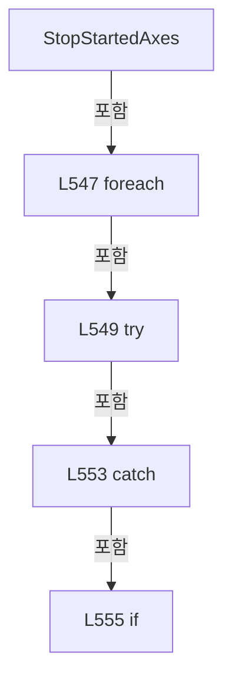

변경 전 점검: 입력/반환 타입, 위 호출자, 예외/취소 경로, 공유 상태와 저장·전송 소비자를 함께 확인합니다. 값의 단위나 물리 방향을 이름만으로 확정하지 않습니다.

### MethodDeclaration `RefreshAxisStatus` · L567–589

[Drilling.Common/Motion/CMotionManager.cs:567–589](https://github.com/kjuws10-rgb/A3Drilling/blob/5aee8e58439c9b455cae7c9593c9be986c3e682e/Drilling.Common/Motion/CMotionManager.cs#L567-L589)

| 항목 | 실제 추출 값 |
| --- | --- |
| 서명 | void Drilling.Common.Motion.CMotionManager.RefreshAxisStatus(System.Threading.CancellationToken) |
| 접근/수식자 | Private / private |
| 반환/값 타입 | void |
| 소속 타입 | NamedType:Drilling.Common.Motion.CMotionManager |

입력 계약:

| 이름 | 타입 | 전달 | 선택/기본값 |
| --- | --- | --- | --- |
| cancellationToken | System.Threading.CancellationToken | None | False /  |

정적 호출자로 확인된 위치:

| 호출 파일/행 | 호출 표현식 | 런타임 분기 가능 |
| --- | --- | --- |
| [Drilling.Common/Motion/CMotionManager.cs:143–143](https://github.com/kjuws10-rgb/A3Drilling/blob/5aee8e58439c9b455cae7c9593c9be986c3e682e/Drilling.Common/Motion/CMotionManager.cs#L143-L143) | RefreshAxisStatus | False |

호출하는 대상과 해석 범위:

| 원본 행 | 표현식 | 분석 상태 | 대상/소스 위치 |
| --- | --- | --- | --- |
| 571 | _controllers.TryGetValue | resolved | bool System.Collections.Generic.Dictionary<string, Drilling.Common.Motion.CMotionController>.TryGetValue(string, out Drilling.Common.Motion.CMotionController) |
| 571 | GetControllerKey | resolved | string Drilling.Common.Motion.CMotionManager.GetControllerKey(string, int) · Drilling.Common/Motion/CMotionManager.cs:1072 |
| 571 | controller.IsSimulation | resolved | bool Drilling.Common.Motion.CMotionController.IsSimulation() · Drilling.Common/Motion/CMotionManager.cs:1419 |
| 578 | controller.ReadAxisStatus | resolved · 동적 구현 선택 가능 | Drilling.Common.Motion.ST_MOTOR_AXIS_STATUS? Drilling.Common.Motion.CMotionController.ReadAxisStatus(Drilling.Common.Motion.ST_MOTOR_DATA, System.Threading.CancellationToken) · Drilling.Common/Motion/CMotionManager.cs:1465 |
| 581 | ApplyAxisStatus | resolved | void Drilling.Common.Motion.CMotionManager.ApplyAxisStatus(Drilling.Common.Motion.ST_MOTOR_AXIS_STATUS) · Drilling.Common/Motion/CMotionManager.cs:591 |
| 586 | MarkAxisAlarm | resolved | void Drilling.Common.Motion.CMotionManager.MarkAxisAlarm(string) · Drilling.Common/Motion/CMotionManager.cs:670 |

본문의 실제 연산·분기·예외·반환 순서(원문 위치 순):

| 원본 행 | 종류 | 주석 해설 |
| --- | --- | --- |
| 569 | foreach | 컬렉션 요소를 순회합니다: foreach (var axisData in _axisData.Values) |
| 571 | call | 함수·델리게이트 또는 객체 생성자를 호출합니다: _controllers.TryGetValue(GetControllerKey(axisData.DevType, axisData.DevNo), out var controller) |
| 571 | call | 함수·델리게이트 또는 객체 생성자를 호출합니다: GetControllerKey(axisData.DevType, axisData.DevNo) |
| 571 | call | 함수·델리게이트 또는 객체 생성자를 호출합니다: controller.IsSimulation() |
| 571 | if | 조건에 따라 분기합니다: if (!_controllers.TryGetValue(GetControllerKey(axisData.DevType, axisData.DevNo), out var controller) &#124;&#124; controller.IsSimulation()) |
| 573 | continue | 다음 반복으로 진행합니다: continue; |
| 576 | try | 예외 처리 범위입니다: try |
| 578 | call | 함수·델리게이트 또는 객체 생성자를 호출합니다: controller.ReadAxisStatus(axisData, cancellationToken) |
| 578 | local-declaration | 지역 변수를 선언합니다: var status = controller.ReadAxisStatus(axisData, cancellationToken); |
| 578 | variable-initializer | 변수의 초기값을 지정합니다: status = controller.ReadAxisStatus(axisData, cancellationToken) |
| 579 | if | 조건에 따라 분기합니다: if (status is not null) |
| 581 | call | 함수·델리게이트 또는 객체 생성자를 호출합니다: ApplyAxisStatus(status) |
| 584 | catch | 지정 예외를 처리합니다: catch (Exception exception) when (exception is InvalidOperationException or TimeoutException or IOException) |
| 586 | call | 함수·델리게이트 또는 객체 생성자를 호출합니다: MarkAxisAlarm(axisData.Name) |

제어 구문의 포함 구조(실제 실행 순서/CFG가 아닌 구문 탐색 그림):

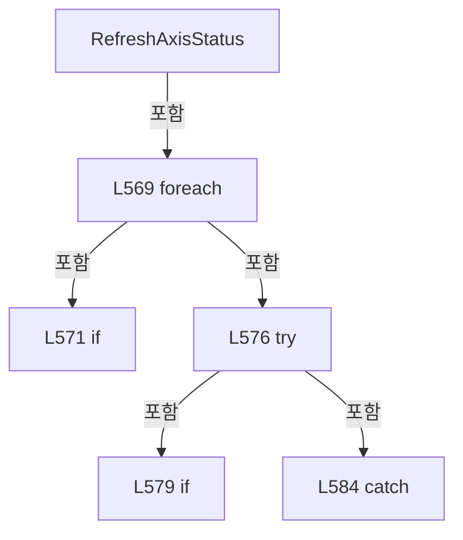

변경 전 점검: 입력/반환 타입, 위 호출자, 예외/취소 경로, 공유 상태와 저장·전송 소비자를 함께 확인합니다. 값의 단위나 물리 방향을 이름만으로 확정하지 않습니다.

### MethodDeclaration `ApplyAxisStatus` · L591–610

[Drilling.Common/Motion/CMotionManager.cs:591–610](https://github.com/kjuws10-rgb/A3Drilling/blob/5aee8e58439c9b455cae7c9593c9be986c3e682e/Drilling.Common/Motion/CMotionManager.cs#L591-L610)

| 항목 | 실제 추출 값 |
| --- | --- |
| 서명 | void Drilling.Common.Motion.CMotionManager.ApplyAxisStatus(Drilling.Common.Motion.ST_MOTOR_AXIS_STATUS) |
| 접근/수식자 | Private / private |
| 반환/값 타입 | void |
| 소속 타입 | NamedType:Drilling.Common.Motion.CMotionManager |

입력 계약:

| 이름 | 타입 | 전달 | 선택/기본값 |
| --- | --- | --- | --- |
| status | Drilling.Common.Motion.ST_MOTOR_AXIS_STATUS | None | False /  |

정적 호출자로 확인된 위치:

| 호출 파일/행 | 호출 표현식 | 런타임 분기 가능 |
| --- | --- | --- |
| [Drilling.Common/Motion/CMotionManager.cs:164–164](https://github.com/kjuws10-rgb/A3Drilling/blob/5aee8e58439c9b455cae7c9593c9be986c3e682e/Drilling.Common/Motion/CMotionManager.cs#L164-L164) | ApplyAxisStatus | False |
| [Drilling.Common/Motion/CMotionManager.cs:581–581](https://github.com/kjuws10-rgb/A3Drilling/blob/5aee8e58439c9b455cae7c9593c9be986c3e682e/Drilling.Common/Motion/CMotionManager.cs#L581-L581) | ApplyAxisStatus | False |

호출하는 대상과 해석 범위:

| 원본 행 | 표현식 | 분석 상태 | 대상/소스 위치 |
| --- | --- | --- | --- |
| 593 | NormalizeAxisId | resolved | string Drilling.Common.Motion.CMotionManager.NormalizeAxisId(string) · Drilling.Common/Motion/CMotionManager.cs:955 |
| 594 | _axes.TryGetValue | resolved | bool System.Collections.Generic.Dictionary<string, Drilling.Common.Motion.CMotionManager.ST_AXIS_STATE>.TryGetValue(string, out Drilling.Common.Motion.CMotionManager.ST_AXIS_STATE) |
| 609 | Stopwatch.GetTimestamp | resolved | long System.Diagnostics.Stopwatch.GetTimestamp() |

본문의 실제 연산·분기·예외·반환 순서(원문 위치 순):

| 원본 행 | 종류 | 주석 해설 |
| --- | --- | --- |
| 593 | call | 함수·델리게이트 또는 객체 생성자를 호출합니다: NormalizeAxisId(status.AxisId) |
| 593 | local-declaration | 지역 변수를 선언합니다: var axisId = NormalizeAxisId(status.AxisId); |
| 593 | variable-initializer | 변수의 초기값을 지정합니다: axisId = NormalizeAxisId(status.AxisId) |
| 594 | call | 함수·델리게이트 또는 객체 생성자를 호출합니다: _axes.TryGetValue(axisId, out var axis) |
| 594 | if | 조건에 따라 분기합니다: if (!_axes.TryGetValue(axisId, out var axis)) |
| 596 | return | 호출자에게 값 또는 제어를 반환합니다: return; |
| 599 | assignment | 값을 대상에 대입합니다: axis.CurrentPosition = status.CurrentPosition |
| 600 | assignment | 값을 대상에 대입합니다: axis.TargetPosition = status.TargetPosition |
| 601 | assignment | 값을 대상에 대입합니다: axis.CommandPosition = status.CommandPosition |
| 602 | assignment | 값을 대상에 대입합니다: axis.ServoOn = status.ServoOn |
| 603 | assignment | 값을 대상에 대입합니다: axis.HomeCompleted = status.HomeCompleted |
| 604 | assignment | 값을 대상에 대입합니다: axis.LimitPlusOn = status.LimitPlusOn |
| 605 | assignment | 값을 대상에 대입합니다: axis.LimitMinusOn = status.LimitMinusOn |
| 606 | assignment | 값을 대상에 대입합니다: axis.AlarmOn = status.AlarmOn |
| 607 | assignment | 값을 대상에 대입합니다: axis.FeedbackVelocity = status.FeedbackVelocity |
| 608 | assignment | 값을 대상에 대입합니다: axis.FeedbackAcceleration = status.FeedbackAcceleration |
| 609 | assignment | 값을 대상에 대입합니다: axis.SimulationLastTimestamp = Stopwatch.GetTimestamp() |
| 609 | call | 함수·델리게이트 또는 객체 생성자를 호출합니다: Stopwatch.GetTimestamp() |

제어 구문의 포함 구조(실제 실행 순서/CFG가 아닌 구문 탐색 그림):

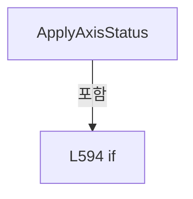

변경 전 점검: 입력/반환 타입, 위 호출자, 예외/취소 경로, 공유 상태와 저장·전송 소비자를 함께 확인합니다. 값의 단위나 물리 방향을 이름만으로 확정하지 않습니다.

### MethodDeclaration `UpdateSimulatedAxisPositions` · L612–624

[Drilling.Common/Motion/CMotionManager.cs:612–624](https://github.com/kjuws10-rgb/A3Drilling/blob/5aee8e58439c9b455cae7c9593c9be986c3e682e/Drilling.Common/Motion/CMotionManager.cs#L612-L624)

| 항목 | 실제 추출 값 |
| --- | --- |
| 서명 | void Drilling.Common.Motion.CMotionManager.UpdateSimulatedAxisPositions() |
| 접근/수식자 | Private / private |
| 반환/값 타입 | void |
| 소속 타입 | NamedType:Drilling.Common.Motion.CMotionManager |

정적 호출자로 확인된 위치:

| 호출 파일/행 | 호출 표현식 | 런타임 분기 가능 |
| --- | --- | --- |
| [Drilling.Common/Motion/CMotionManager.cs:178–178](https://github.com/kjuws10-rgb/A3Drilling/blob/5aee8e58439c9b455cae7c9593c9be986c3e682e/Drilling.Common/Motion/CMotionManager.cs#L178-L178) | UpdateSimulatedAxisPositions | False |

호출하는 대상과 해석 범위:

| 원본 행 | 표현식 | 분석 상태 | 대상/소스 위치 |
| --- | --- | --- | --- |
| 614 | Stopwatch.GetTimestamp | resolved | long System.Diagnostics.Stopwatch.GetTimestamp() |
| 617 | IsAxisSimulation | resolved | bool Drilling.Common.Motion.CMotionManager.IsAxisSimulation(Drilling.Common.Motion.ST_MOTOR_DATA) · Drilling.Common/Motion/CMotionManager.cs:539 |
| 617 | _axes.TryGetValue | resolved | bool System.Collections.Generic.Dictionary<string, Drilling.Common.Motion.CMotionManager.ST_AXIS_STATE>.TryGetValue(string, out Drilling.Common.Motion.CMotionManager.ST_AXIS_STATE) |
| 617 | NormalizeAxisId | resolved | string Drilling.Common.Motion.CMotionManager.NormalizeAxisId(string) · Drilling.Common/Motion/CMotionManager.cs:955 |
| 622 | UpdateSimulatedAxisPosition | resolved | void Drilling.Common.Motion.CMotionManager.UpdateSimulatedAxisPosition(Drilling.Common.Motion.ST_MOTOR_DATA, Drilling.Common.Motion.CMotionManager.ST_AXIS_STATE, long) · Drilling.Common/Motion/CMotionManager.cs:626 |

본문의 실제 연산·분기·예외·반환 순서(원문 위치 순):

| 원본 행 | 종류 | 주석 해설 |
| --- | --- | --- |
| 614 | call | 함수·델리게이트 또는 객체 생성자를 호출합니다: Stopwatch.GetTimestamp() |
| 614 | local-declaration | 지역 변수를 선언합니다: var timestamp = Stopwatch.GetTimestamp(); |
| 614 | variable-initializer | 변수의 초기값을 지정합니다: timestamp = Stopwatch.GetTimestamp() |
| 615 | foreach | 컬렉션 요소를 순회합니다: foreach (var axisData in _axisData.Values) |
| 617 | call | 함수·델리게이트 또는 객체 생성자를 호출합니다: IsAxisSimulation(axisData) |
| 617 | call | 함수·델리게이트 또는 객체 생성자를 호출합니다: _axes.TryGetValue(NormalizeAxisId(axisData.Name), out var axisState) |
| 617 | call | 함수·델리게이트 또는 객체 생성자를 호출합니다: NormalizeAxisId(axisData.Name) |
| 617 | if | 조건에 따라 분기합니다: if (!IsAxisSimulation(axisData) &#124;&#124; !_axes.TryGetValue(NormalizeAxisId(axisData.Name), out var axisState)) |
| 619 | continue | 다음 반복으로 진행합니다: continue; |
| 622 | call | 함수·델리게이트 또는 객체 생성자를 호출합니다: UpdateSimulatedAxisPosition(axisData, axisState, timestamp) |

제어 구문의 포함 구조(실제 실행 순서/CFG가 아닌 구문 탐색 그림):

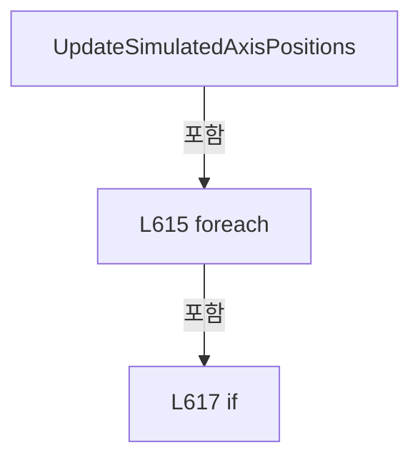

변경 전 점검: 입력/반환 타입, 위 호출자, 예외/취소 경로, 공유 상태와 저장·전송 소비자를 함께 확인합니다. 값의 단위나 물리 방향을 이름만으로 확정하지 않습니다.

### MethodDeclaration `UpdateSimulatedAxisPosition` · L626–668

[Drilling.Common/Motion/CMotionManager.cs:626–668](https://github.com/kjuws10-rgb/A3Drilling/blob/5aee8e58439c9b455cae7c9593c9be986c3e682e/Drilling.Common/Motion/CMotionManager.cs#L626-L668)

| 항목 | 실제 추출 값 |
| --- | --- |
| 서명 | void Drilling.Common.Motion.CMotionManager.UpdateSimulatedAxisPosition(Drilling.Common.Motion.ST_MOTOR_DATA, Drilling.Common.Motion.CMotionManager.ST_AXIS_STATE, long) |
| 접근/수식자 | Private / private, static |
| 반환/값 타입 | void |
| 소속 타입 | NamedType:Drilling.Common.Motion.CMotionManager |

입력 계약:

| 이름 | 타입 | 전달 | 선택/기본값 |
| --- | --- | --- | --- |
| axisData | Drilling.Common.Motion.ST_MOTOR_DATA | None | False /  |
| axis | Drilling.Common.Motion.CMotionManager.ST_AXIS_STATE | None | False /  |
| timestamp | long | None | False /  |

정적 호출자로 확인된 위치:

| 호출 파일/행 | 호출 표현식 | 런타임 분기 가능 |
| --- | --- | --- |
| [Drilling.Common/Motion/CMotionManager.cs:379–379](https://github.com/kjuws10-rgb/A3Drilling/blob/5aee8e58439c9b455cae7c9593c9be986c3e682e/Drilling.Common/Motion/CMotionManager.cs#L379-L379) | UpdateSimulatedAxisPosition | False |
| [Drilling.Common/Motion/CMotionManager.cs:479–479](https://github.com/kjuws10-rgb/A3Drilling/blob/5aee8e58439c9b455cae7c9593c9be986c3e682e/Drilling.Common/Motion/CMotionManager.cs#L479-L479) | UpdateSimulatedAxisPosition | False |
| [Drilling.Common/Motion/CMotionManager.cs:622–622](https://github.com/kjuws10-rgb/A3Drilling/blob/5aee8e58439c9b455cae7c9593c9be986c3e682e/Drilling.Common/Motion/CMotionManager.cs#L622-L622) | UpdateSimulatedAxisPosition | False |

호출하는 대상과 해석 범위:

| 원본 행 | 표현식 | 분석 상태 | 대상/소스 위치 |
| --- | --- | --- | --- |
| 634 | Stopwatch.GetElapsedTime | resolved | System.TimeSpan System.Diagnostics.Stopwatch.GetElapsedTime(long, long) |
| 636 | Math.Abs | resolved | double System.Math.Abs(double) |

본문의 실제 연산·분기·예외·반환 순서(원문 위치 순):

| 원본 행 | 종류 | 주석 해설 |
| --- | --- | --- |
| 628 | if | 조건에 따라 분기합니다: if (axis.SimulationLastTimestamp <= 0) |
| 630 | assignment | 값을 대상에 대입합니다: axis.SimulationLastTimestamp = timestamp |
| 631 | return | 호출자에게 값 또는 제어를 반환합니다: return; |
| 634 | call | 함수·델리게이트 또는 객체 생성자를 호출합니다: Stopwatch.GetElapsedTime(axis.SimulationLastTimestamp, timestamp) |
| 634 | local-declaration | 지역 변수를 선언합니다: var elapsedSeconds = Stopwatch.GetElapsedTime(axis.SimulationLastTimestamp, timestamp).TotalSeconds; |
| 634 | variable-initializer | 변수의 초기값을 지정합니다: elapsedSeconds = Stopwatch.GetElapsedTime(axis.SimulationLastTimestamp, timestamp).TotalSeconds |
| 635 | assignment | 값을 대상에 대입합니다: axis.SimulationLastTimestamp = timestamp |
| 636 | call | 함수·델리게이트 또는 객체 생성자를 호출합니다: Math.Abs(axis.FeedbackVelocity) |
| 636 | if | 조건에 따라 분기합니다: if (elapsedSeconds <= 0.0 &#124;&#124; Math.Abs(axis.FeedbackVelocity) <= double.Epsilon) |
| 638 | return | 호출자에게 값 또는 제어를 반환합니다: return; |
| 641 | local-declaration | 지역 변수를 선언합니다: var nextPosition = axis.CurrentPosition + (axis.FeedbackVelocity * elapsedSeconds); |
| 641 | variable-initializer | 변수의 초기값을 지정합니다: nextPosition = axis.CurrentPosition + (axis.FeedbackVelocity * elapsedSeconds) |
| 642 | local-declaration | 지역 변수를 선언합니다: var hasSoftwareLimits = axisData.Min < axisData.Max; |
| 642 | variable-initializer | 변수의 초기값을 지정합니다: hasSoftwareLimits = axisData.Min < axisData.Max |
| 643 | if | 조건에 따라 분기합니다: if (hasSoftwareLimits && nextPosition > axisData.Max) |
| 645 | assignment | 값을 대상에 대입합니다: nextPosition = axisData.Max |
| 646 | assignment | 값을 대상에 대입합니다: axis.LimitPlusOn = true |
| 647 | assignment | 값을 대상에 대입합니다: axis.LimitMinusOn = false |
| 648 | assignment | 값을 대상에 대입합니다: axis.FeedbackVelocity = 0.0 |
| 649 | assignment | 값을 대상에 대입합니다: axis.FeedbackAcceleration = 0.0 |
| 651 | else | 앞 조건이 거짓인 경로입니다: else |
| 651 | if | 조건에 따라 분기합니다: if (hasSoftwareLimits && nextPosition < axisData.Min) |
| 653 | assignment | 값을 대상에 대입합니다: nextPosition = axisData.Min |
| 654 | assignment | 값을 대상에 대입합니다: axis.LimitPlusOn = false |
| 655 | assignment | 값을 대상에 대입합니다: axis.LimitMinusOn = true |
| 656 | assignment | 값을 대상에 대입합니다: axis.FeedbackVelocity = 0.0 |
| 657 | assignment | 값을 대상에 대입합니다: axis.FeedbackAcceleration = 0.0 |
| 659 | else | 앞 조건이 거짓인 경로입니다: else |
| 661 | assignment | 값을 대상에 대입합니다: axis.LimitPlusOn = false |
| 662 | assignment | 값을 대상에 대입합니다: axis.LimitMinusOn = false |
| 665 | assignment | 값을 대상에 대입합니다: axis.CurrentPosition = nextPosition |
| 666 | assignment | 값을 대상에 대입합니다: axis.TargetPosition = nextPosition |
| 667 | assignment | 값을 대상에 대입합니다: axis.CommandPosition = nextPosition |

제어 구문의 포함 구조(실제 실행 순서/CFG가 아닌 구문 탐색 그림):

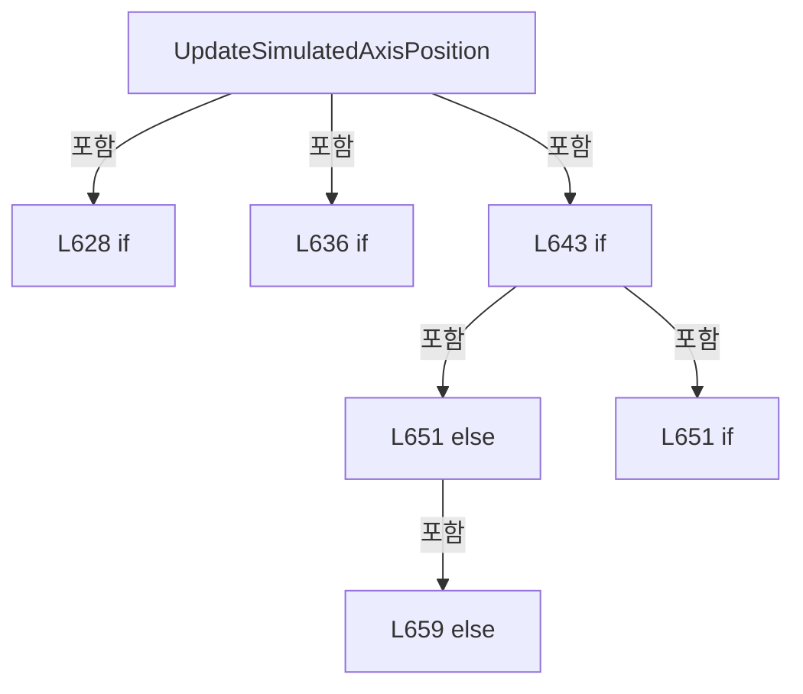

변경 전 점검: 입력/반환 타입, 위 호출자, 예외/취소 경로, 공유 상태와 저장·전송 소비자를 함께 확인합니다. 값의 단위나 물리 방향을 이름만으로 확정하지 않습니다.

### MethodDeclaration `MarkAxisAlarm` · L670–677

[Drilling.Common/Motion/CMotionManager.cs:670–677](https://github.com/kjuws10-rgb/A3Drilling/blob/5aee8e58439c9b455cae7c9593c9be986c3e682e/Drilling.Common/Motion/CMotionManager.cs#L670-L677)

| 항목 | 실제 추출 값 |
| --- | --- |
| 서명 | void Drilling.Common.Motion.CMotionManager.MarkAxisAlarm(string) |
| 접근/수식자 | Private / private |
| 반환/값 타입 | void |
| 소속 타입 | NamedType:Drilling.Common.Motion.CMotionManager |

입력 계약:

| 이름 | 타입 | 전달 | 선택/기본값 |
| --- | --- | --- | --- |
| axisId | string | None | False /  |

정적 호출자로 확인된 위치:

| 호출 파일/행 | 호출 표현식 | 런타임 분기 가능 |
| --- | --- | --- |
| [Drilling.Common/Motion/CMotionManager.cs:168–168](https://github.com/kjuws10-rgb/A3Drilling/blob/5aee8e58439c9b455cae7c9593c9be986c3e682e/Drilling.Common/Motion/CMotionManager.cs#L168-L168) | MarkAxisAlarm | False |
| [Drilling.Common/Motion/CMotionManager.cs:586–586](https://github.com/kjuws10-rgb/A3Drilling/blob/5aee8e58439c9b455cae7c9593c9be986c3e682e/Drilling.Common/Motion/CMotionManager.cs#L586-L586) | MarkAxisAlarm | False |

호출하는 대상과 해석 범위:

| 원본 행 | 표현식 | 분석 상태 | 대상/소스 위치 |
| --- | --- | --- | --- |
| 672 | NormalizeAxisId | resolved | string Drilling.Common.Motion.CMotionManager.NormalizeAxisId(string) · Drilling.Common/Motion/CMotionManager.cs:955 |
| 673 | _axes.TryGetValue | resolved | bool System.Collections.Generic.Dictionary<string, Drilling.Common.Motion.CMotionManager.ST_AXIS_STATE>.TryGetValue(string, out Drilling.Common.Motion.CMotionManager.ST_AXIS_STATE) |

본문의 실제 연산·분기·예외·반환 순서(원문 위치 순):

| 원본 행 | 종류 | 주석 해설 |
| --- | --- | --- |
| 672 | call | 함수·델리게이트 또는 객체 생성자를 호출합니다: NormalizeAxisId(axisId) |
| 672 | local-declaration | 지역 변수를 선언합니다: var normalizedAxisId = NormalizeAxisId(axisId); |
| 672 | variable-initializer | 변수의 초기값을 지정합니다: normalizedAxisId = NormalizeAxisId(axisId) |
| 673 | call | 함수·델리게이트 또는 객체 생성자를 호출합니다: _axes.TryGetValue(normalizedAxisId, out var axis) |
| 673 | if | 조건에 따라 분기합니다: if (_axes.TryGetValue(normalizedAxisId, out var axis)) |
| 675 | assignment | 값을 대상에 대입합니다: axis.AlarmOn = true |

제어 구문의 포함 구조(실제 실행 순서/CFG가 아닌 구문 탐색 그림):

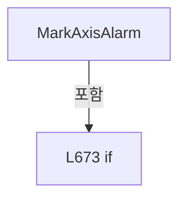

변경 전 점검: 입력/반환 타입, 위 호출자, 예외/취소 경로, 공유 상태와 저장·전송 소비자를 함께 확인합니다. 값의 단위나 물리 방향을 이름만으로 확정하지 않습니다.

### MethodDeclaration `CreateMotionController` · L679–688

[Drilling.Common/Motion/CMotionManager.cs:679–688](https://github.com/kjuws10-rgb/A3Drilling/blob/5aee8e58439c9b455cae7c9593c9be986c3e682e/Drilling.Common/Motion/CMotionManager.cs#L679-L688)

| 항목 | 실제 추출 값 |
| --- | --- |
| 서명 | Drilling.Common.Motion.CMotionController? Drilling.Common.Motion.CMotionManager.CreateMotionController(string, int) |
| 접근/수식자 | Private / private |
| 반환/값 타입 | Drilling.Common.Motion.CMotionController? |
| 소속 타입 | NamedType:Drilling.Common.Motion.CMotionManager |

입력 계약:

| 이름 | 타입 | 전달 | 선택/기본값 |
| --- | --- | --- | --- |
| controller | string | None | False /  |
| deviceNo | int | None | False /  |

정적 호출자로 확인된 위치:

| 호출 파일/행 | 호출 표현식 | 런타임 분기 가능 |
| --- | --- | --- |
| [Drilling.Common/Motion/CMotionManager.cs:65–65](https://github.com/kjuws10-rgb/A3Drilling/blob/5aee8e58439c9b455cae7c9593c9be986c3e682e/Drilling.Common/Motion/CMotionManager.cs#L65-L65) | CreateMotionController | False |

호출하는 대상과 해석 범위:

| 원본 행 | 표현식 | 분석 상태 | 대상/소스 위치 |
| --- | --- | --- | --- |
| 681 | NormalizeControllerName | resolved | string Drilling.Common.Motion.CMotionManager.NormalizeControllerName(string) · Drilling.Common/Motion/CMotionManager.cs:1092 |
| 682 | MotionControllerTypes.TryGetValue | resolved · 동적 구현 선택 가능 | bool System.Collections.Generic.IReadOnlyDictionary<string, System.Type>.TryGetValue(string, out System.Type) |
| 687 | Activator.CreateInstance | resolved | object? System.Activator.CreateInstance(System.Type, params object?[]?) |
| 687 | new InvalidOperationException | resolved | System.InvalidOperationException.InvalidOperationException(string?) |

본문의 실제 연산·분기·예외·반환 순서(원문 위치 순):

| 원본 행 | 종류 | 주석 해설 |
| --- | --- | --- |
| 681 | call | 함수·델리게이트 또는 객체 생성자를 호출합니다: NormalizeControllerName(controller) |
| 681 | local-declaration | 지역 변수를 선언합니다: var controllerName = NormalizeControllerName(controller); |
| 681 | variable-initializer | 변수의 초기값을 지정합니다: controllerName = NormalizeControllerName(controller) |
| 682 | call | 함수·델리게이트 또는 객체 생성자를 호출합니다: MotionControllerTypes.TryGetValue(controllerName, out var controllerType) |
| 682 | if | 조건에 따라 분기합니다: if (!MotionControllerTypes.TryGetValue(controllerName, out var controllerType)) |
| 684 | return | 호출자에게 값 또는 제어를 반환합니다: return null; |
| 687 | call | 함수·델리게이트 또는 객체 생성자를 호출합니다: Activator.CreateInstance(controllerType, _interfaceManager, deviceNo) |
| 687 | call | 함수·델리게이트 또는 객체 생성자를 호출합니다: new InvalidOperationException($"Motion controller creation failed: {controllerName}") |
| 687 | return | 호출자에게 값 또는 제어를 반환합니다: return Activator.CreateInstance(controllerType, _interfaceManager, deviceNo) as CMotionController ?? throw new InvalidOperationException($"Motion controller creation failed: {controllerName}"); |
| 687 | throw | 예외를 발생/전달합니다: throw new InvalidOperationException($"Motion controller creation failed: {controllerName}") |

제어 구문의 포함 구조(실제 실행 순서/CFG가 아닌 구문 탐색 그림):

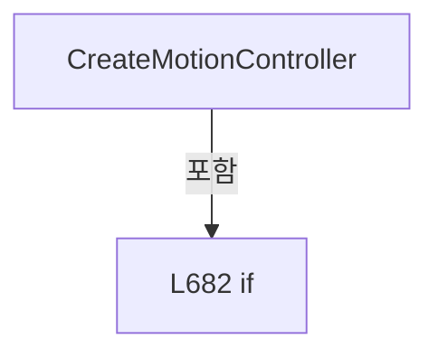

변경 전 점검: 입력/반환 타입, 위 호출자, 예외/취소 경로, 공유 상태와 저장·전송 소비자를 함께 확인합니다. 값의 단위나 물리 방향을 이름만으로 확정하지 않습니다.

### MethodDeclaration `ValidateAxisCommand` · L690–714

[Drilling.Common/Motion/CMotionManager.cs:690–714](https://github.com/kjuws10-rgb/A3Drilling/blob/5aee8e58439c9b455cae7c9593c9be986c3e682e/Drilling.Common/Motion/CMotionManager.cs#L690-L714)

| 항목 | 실제 추출 값 |
| --- | --- |
| 서명 | void Drilling.Common.Motion.CMotionManager.ValidateAxisCommand(Drilling.Common.Motion.ST_MOTOR_DATA, Drilling.Common.Motion.CMotionManager.ST_AXIS_STATE, Drilling.Common.Motion.EN_MOTION_COMMAND, double, double?) |
| 접근/수식자 | Private / private |
| 반환/값 타입 | void |
| 소속 타입 | NamedType:Drilling.Common.Motion.CMotionManager |

입력 계약:

| 이름 | 타입 | 전달 | 선택/기본값 |
| --- | --- | --- | --- |
| axisData | Drilling.Common.Motion.ST_MOTOR_DATA | None | False /  |
| axisState | Drilling.Common.Motion.CMotionManager.ST_AXIS_STATE | None | False /  |
| command | Drilling.Common.Motion.EN_MOTION_COMMAND | None | False /  |
| parameter | double | None | False /  |
| parameter2 | double? | None | False /  |

정적 호출자로 확인된 위치:

| 호출 파일/행 | 호출 표현식 | 런타임 분기 가능 |
| --- | --- | --- |
| [Drilling.Common/Motion/CMotionManager.cs:382–382](https://github.com/kjuws10-rgb/A3Drilling/blob/5aee8e58439c9b455cae7c9593c9be986c3e682e/Drilling.Common/Motion/CMotionManager.cs#L382-L382) | ValidateAxisCommand | False |
| [Drilling.Common/Motion/CMotionManager.cs:482–482](https://github.com/kjuws10-rgb/A3Drilling/blob/5aee8e58439c9b455cae7c9593c9be986c3e682e/Drilling.Common/Motion/CMotionManager.cs#L482-L482) | ValidateAxisCommand | False |

호출하는 대상과 해석 범위:

| 원본 행 | 표현식 | 분석 상태 | 대상/소스 위치 |
| --- | --- | --- | --- |
| 692 | ValidateAxisCommandParameters | resolved | void Drilling.Common.Motion.CMotionManager.ValidateAxisCommandParameters(Drilling.Common.Motion.ST_MOTOR_DATA, Drilling.Common.Motion.EN_MOTION_COMMAND, double, double?) · Drilling.Common/Motion/CMotionManager.cs:716 |
| 698 | ValidatePreCheckIo | resolved | void Drilling.Common.Motion.CMotionManager.ValidatePreCheckIo(Drilling.Common.Motion.ST_MOTOR_DATA) · Drilling.Common/Motion/CMotionManager.cs:739 |
| 712 | new InvalidOperationException | resolved | System.InvalidOperationException.InvalidOperationException(string?) |
| 712 | NormalizeStationName | resolved | string Drilling.Common.Motion.CMotionManager.NormalizeStationName(string) · Drilling.Common/Motion/CMotionManager.cs:1067 |

본문의 실제 연산·분기·예외·반환 순서(원문 위치 순):

| 원본 행 | 종류 | 주석 해설 |
| --- | --- | --- |
| 692 | call | 함수·델리게이트 또는 객체 생성자를 호출합니다: ValidateAxisCommandParameters(axisData, command, parameter, parameter2) |
| 693 | if | 조건에 따라 분기합니다: if (command is not (EN_MOTION_COMMAND.Home or EN_MOTION_COMMAND.MoveAbs or EN_MOTION_COMMAND.MoveRel or EN_MOTION_COMMAND.JogPositive or EN_MOTION_COMMAND.JogNegative)) |
| 695 | return | 호출자에게 값 또는 제어를 반환합니다: return; |
| 698 | call | 함수·델리게이트 또는 객체 생성자를 호출합니다: ValidatePreCheckIo(axisData) |
| 699 | if | 조건에 따라 분기합니다: if (command is EN_MOTION_COMMAND.JogPositive or EN_MOTION_COMMAND.JogNegative) |
| 701 | return | 호출자에게 값 또는 제어를 반환합니다: return; |
| 704 | conditional-expression | 조건에 따라 결과식을 선택합니다: command == EN_MOTION_COMMAND.MoveRel ? axisState.CurrentPosition + parameter : parameter |
| 704 | local-declaration | 지역 변수를 선언합니다: var targetPosition = command == EN_MOTION_COMMAND.MoveRel ? axisState.CurrentPosition + parameter : parameter; |
| 704 | variable-initializer | 변수의 초기값을 지정합니다: targetPosition = command == EN_MOTION_COMMAND.MoveRel ? axisState.CurrentPosition + parameter : parameter |
| 705 | if | 조건에 따라 분기합니다: if (command == EN_MOTION_COMMAND.Home &#124;&#124; axisData.Min >= axisData.Max) |
| 707 | return | 호출자에게 값 또는 제어를 반환합니다: return; |
| 710 | if | 조건에 따라 분기합니다: if (targetPosition < axisData.Min &#124;&#124; targetPosition > axisData.Max) |
| 712 | call | 함수·델리게이트 또는 객체 생성자를 호출합니다: new InvalidOperationException($"Motion target is out of range. Axis={axisData.Name}, Station={NormalizeStationName(axisData.StationName)}, Target={targetPosition:F3}, Range={axisData.Min:F3}~{axisData.Max:F3}") |
| 712 | call | 함수·델리게이트 또는 객체 생성자를 호출합니다: NormalizeStationName(axisData.StationName) |
| 712 | throw | 예외를 발생/전달합니다: throw new InvalidOperationException($"Motion target is out of range. Axis={axisData.Name}, Station={NormalizeStationName(axisData.StationName)}, Target={targetPosition:F3}, Range={axisData.Min:F3}~{axisData.Max:F3}"); |

제어 구문의 포함 구조(실제 실행 순서/CFG가 아닌 구문 탐색 그림):

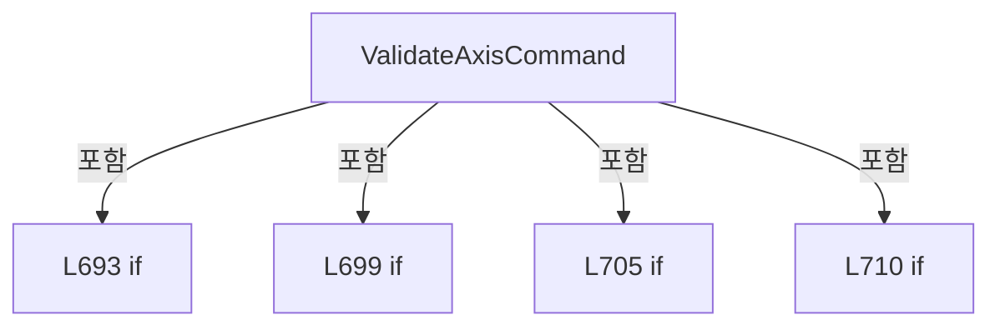

변경 전 점검: 입력/반환 타입, 위 호출자, 예외/취소 경로, 공유 상태와 저장·전송 소비자를 함께 확인합니다. 값의 단위나 물리 방향을 이름만으로 확정하지 않습니다.

### MethodDeclaration `ValidateAxisCommandParameters` · L716–737

[Drilling.Common/Motion/CMotionManager.cs:716–737](https://github.com/kjuws10-rgb/A3Drilling/blob/5aee8e58439c9b455cae7c9593c9be986c3e682e/Drilling.Common/Motion/CMotionManager.cs#L716-L737)

| 항목 | 실제 추출 값 |
| --- | --- |
| 서명 | void Drilling.Common.Motion.CMotionManager.ValidateAxisCommandParameters(Drilling.Common.Motion.ST_MOTOR_DATA, Drilling.Common.Motion.EN_MOTION_COMMAND, double, double?) |
| 접근/수식자 | Private / private, static |
| 반환/값 타입 | void |
| 소속 타입 | NamedType:Drilling.Common.Motion.CMotionManager |

입력 계약:

| 이름 | 타입 | 전달 | 선택/기본값 |
| --- | --- | --- | --- |
| axisData | Drilling.Common.Motion.ST_MOTOR_DATA | None | False /  |
| command | Drilling.Common.Motion.EN_MOTION_COMMAND | None | False /  |
| parameter | double | None | False /  |
| parameter2 | double? | None | False /  |

정적 호출자로 확인된 위치:

| 호출 파일/행 | 호출 표현식 | 런타임 분기 가능 |
| --- | --- | --- |
| [Drilling.Common/Motion/CMotionManager.cs:692–692](https://github.com/kjuws10-rgb/A3Drilling/blob/5aee8e58439c9b455cae7c9593c9be986c3e682e/Drilling.Common/Motion/CMotionManager.cs#L692-L692) | ValidateAxisCommandParameters | False |

호출하는 대상과 해석 범위:

| 원본 행 | 표현식 | 분석 상태 | 대상/소스 위치 |
| --- | --- | --- | --- |
| 718 | double.IsFinite | resolved | bool double.IsFinite(double) |
| 720 | new InvalidOperationException | resolved | System.InvalidOperationException.InvalidOperationException(string?) |
| 728 | double.IsFinite | resolved | bool double.IsFinite(double) |
| 730 | new InvalidOperationException | resolved | System.InvalidOperationException.InvalidOperationException(string?) |
| 733 | double.IsFinite | resolved | bool double.IsFinite(double) |
| 735 | new InvalidOperationException | resolved | System.InvalidOperationException.InvalidOperationException(string?) |

본문의 실제 연산·분기·예외·반환 순서(원문 위치 순):

| 원본 행 | 종류 | 주석 해설 |
| --- | --- | --- |
| 718 | call | 함수·델리게이트 또는 객체 생성자를 호출합니다: double.IsFinite(parameter) |
| 718 | if | 조건에 따라 분기합니다: if (command is (EN_MOTION_COMMAND.MoveAbs or EN_MOTION_COMMAND.MoveRel) && !double.IsFinite(parameter)) |
| 720 | call | 함수·델리게이트 또는 객체 생성자를 호출합니다: new InvalidOperationException($"Motion position must be finite. Axis={axisData.Name}") |
| 720 | throw | 예외를 발생/전달합니다: throw new InvalidOperationException($"Motion position must be finite. Axis={axisData.Name}"); |
| 723 | if | 조건에 따라 분기합니다: if (command is not (EN_MOTION_COMMAND.SetProfile or EN_MOTION_COMMAND.JogPositive or EN_MOTION_COMMAND.JogNegative)) |
| 725 | return | 호출자에게 값 또는 제어를 반환합니다: return; |
| 728 | call | 함수·델리게이트 또는 객체 생성자를 호출합니다: double.IsFinite(parameter) |
| 728 | if | 조건에 따라 분기합니다: if (!double.IsFinite(parameter) &#124;&#124; parameter <= 0.0) |
| 730 | call | 함수·델리게이트 또는 객체 생성자를 호출합니다: new InvalidOperationException($"Motion velocity must be a finite value greater than 0. Axis={axisData.Name}") |
| 730 | throw | 예외를 발생/전달합니다: throw new InvalidOperationException($"Motion velocity must be a finite value greater than 0. Axis={axisData.Name}"); |
| 733 | call | 함수·델리게이트 또는 객체 생성자를 호출합니다: double.IsFinite(parameter2.Value) |
| 733 | if | 조건에 따라 분기합니다: if (!parameter2.HasValue &#124;&#124; !double.IsFinite(parameter2.Value) &#124;&#124; parameter2.Value <= 0.0) |
| 735 | call | 함수·델리게이트 또는 객체 생성자를 호출합니다: new InvalidOperationException($"Motion acceleration must be specified as a finite value greater than 0. Axis={axisData.Name}") |
| 735 | throw | 예외를 발생/전달합니다: throw new InvalidOperationException($"Motion acceleration must be specified as a finite value greater than 0. Axis={axisData.Name}"); |

제어 구문의 포함 구조(실제 실행 순서/CFG가 아닌 구문 탐색 그림):

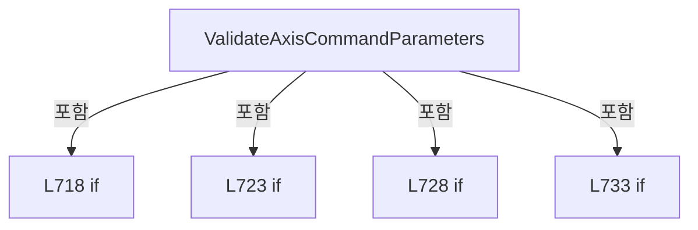

변경 전 점검: 입력/반환 타입, 위 호출자, 예외/취소 경로, 공유 상태와 저장·전송 소비자를 함께 확인합니다. 값의 단위나 물리 방향을 이름만으로 확정하지 않습니다.

### MethodDeclaration `ValidatePreCheckIo` · L739–754

[Drilling.Common/Motion/CMotionManager.cs:739–754](https://github.com/kjuws10-rgb/A3Drilling/blob/5aee8e58439c9b455cae7c9593c9be986c3e682e/Drilling.Common/Motion/CMotionManager.cs#L739-L754)

| 항목 | 실제 추출 값 |
| --- | --- |
| 서명 | void Drilling.Common.Motion.CMotionManager.ValidatePreCheckIo(Drilling.Common.Motion.ST_MOTOR_DATA) |
| 접근/수식자 | Private / private |
| 반환/값 타입 | void |
| 소속 타입 | NamedType:Drilling.Common.Motion.CMotionManager |

입력 계약:

| 이름 | 타입 | 전달 | 선택/기본값 |
| --- | --- | --- | --- |
| axisData | Drilling.Common.Motion.ST_MOTOR_DATA | None | False /  |

정적 호출자로 확인된 위치:

| 호출 파일/행 | 호출 표현식 | 런타임 분기 가능 |
| --- | --- | --- |
| [Drilling.Common/Motion/CMotionManager.cs:698–698](https://github.com/kjuws10-rgb/A3Drilling/blob/5aee8e58439c9b455cae7c9593c9be986c3e682e/Drilling.Common/Motion/CMotionManager.cs#L698-L698) | ValidatePreCheckIo | False |

호출하는 대상과 해석 범위:

| 원본 행 | 표현식 | 분석 상태 | 대상/소스 위치 |
| --- | --- | --- | --- |
| 741 | string.IsNullOrWhiteSpace | resolved | bool string.IsNullOrWhiteSpace(string?) |
| 746 | SplitPreCheckIo | resolved | System.Collections.Generic.IEnumerable<Drilling.Common.Motion.CMotionManager.ST_PRE_CHECK_IO> Drilling.Common.Motion.CMotionManager.SplitPreCheckIo(string) · Drilling.Common/Motion/CMotionManager.cs:756 |
| 748 | GetIoChannelOrThrow | resolved | Drilling.Common.Motion.CMotionManager.ST_IO_STATE Drilling.Common.Motion.CMotionManager.GetIoChannelOrThrow(string) · Drilling.Common/Motion/CMotionManager.cs:965 |
| 751 | new InvalidOperationException | resolved | System.InvalidOperationException.InvalidOperationException(string?) |
| 751 | FormatIoReference | resolved | string Drilling.Common.Motion.CMotionManager.FormatIoReference(Drilling.Common.Motion.CMotionManager.ST_IO_STATE) · Drilling.Common/Motion/CMotionManager.cs:1015 |

본문의 실제 연산·분기·예외·반환 순서(원문 위치 순):

| 원본 행 | 종류 | 주석 해설 |
| --- | --- | --- |
| 741 | call | 함수·델리게이트 또는 객체 생성자를 호출합니다: string.IsNullOrWhiteSpace(axisData.PreCheckIo) |
| 741 | if | 조건에 따라 분기합니다: if (string.IsNullOrWhiteSpace(axisData.PreCheckIo)) |
| 743 | return | 호출자에게 값 또는 제어를 반환합니다: return; |
| 746 | call | 함수·델리게이트 또는 객체 생성자를 호출합니다: SplitPreCheckIo(axisData.PreCheckIo) |
| 746 | foreach | 컬렉션 요소를 순회합니다: foreach (var condition in SplitPreCheckIo(axisData.PreCheckIo)) |
| 748 | call | 함수·델리게이트 또는 객체 생성자를 호출합니다: GetIoChannelOrThrow(condition.IoName) |
| 748 | local-declaration | 지역 변수를 선언합니다: var channel = GetIoChannelOrThrow(condition.IoName); |
| 748 | variable-initializer | 변수의 초기값을 지정합니다: channel = GetIoChannelOrThrow(condition.IoName) |
| 749 | if | 조건에 따라 분기합니다: if (channel.IsOn != condition.ExpectedOn) |
| 751 | call | 함수·델리게이트 또는 객체 생성자를 호출합니다: new InvalidOperationException($"Motion pre-check IO failed. Axis={axisData.Name}, IO={FormatIoReference(channel)}, Expected={(condition.ExpectedOn ? "ON" : "OFF")}, Current={(channel.IsOn ? "ON" : "OFF")}") |
| 751 | call | 함수·델리게이트 또는 객체 생성자를 호출합니다: FormatIoReference(channel) |
| 751 | conditional-expression | 조건에 따라 결과식을 선택합니다: condition.ExpectedOn ? "ON" : "OFF" |
| 751 | conditional-expression | 조건에 따라 결과식을 선택합니다: channel.IsOn ? "ON" : "OFF" |
| 751 | throw | 예외를 발생/전달합니다: throw new InvalidOperationException($"Motion pre-check IO failed. Axis={axisData.Name}, IO={FormatIoReference(channel)}, Expected={(condition.ExpectedOn ? "ON" : "OFF")}, Current={(channel.IsOn ? "ON" : "OFF")}"); |

제어 구문의 포함 구조(실제 실행 순서/CFG가 아닌 구문 탐색 그림):

```mermaid
flowchart TD
 M["ValidatePreCheckIo"]
 N0["L741 if"]
 M -->|포함| N0
 N1["L746 foreach"]
 M -->|포함| N1
 N2["L749 if"]
 N1 -->|포함| N2
```

변경 전 점검: 입력/반환 타입, 위 호출자, 예외/취소 경로, 공유 상태와 저장·전송 소비자를 함께 확인합니다. 값의 단위나 물리 방향을 이름만으로 확정하지 않습니다.

### MethodDeclaration `SplitPreCheckIo` · L756–765

[Drilling.Common/Motion/CMotionManager.cs:756–765](https://github.com/kjuws10-rgb/A3Drilling/blob/5aee8e58439c9b455cae7c9593c9be986c3e682e/Drilling.Common/Motion/CMotionManager.cs#L756-L765)

| 항목 | 실제 추출 값 |
| --- | --- |
| 서명 | System.Collections.Generic.IEnumerable<Drilling.Common.Motion.CMotionManager.ST_PRE_CHECK_IO> Drilling.Common.Motion.CMotionManager.SplitPreCheckIo(string) |
| 접근/수식자 | Private / private, static |
| 반환/값 타입 | System.Collections.Generic.IEnumerable<Drilling.Common.Motion.CMotionManager.ST_PRE_CHECK_IO> |
| 소속 타입 | NamedType:Drilling.Common.Motion.CMotionManager |

입력 계약:

| 이름 | 타입 | 전달 | 선택/기본값 |
| --- | --- | --- | --- |
| preCheckIo | string | None | False /  |

정적 호출자로 확인된 위치:

| 호출 파일/행 | 호출 표현식 | 런타임 분기 가능 |
| --- | --- | --- |
| [Drilling.Common/Motion/CMotionManager.cs:746–746](https://github.com/kjuws10-rgb/A3Drilling/blob/5aee8e58439c9b455cae7c9593c9be986c3e682e/Drilling.Common/Motion/CMotionManager.cs#L746-L746) | SplitPreCheckIo | False |

호출하는 대상과 해석 범위:

| 원본 행 | 표현식 | 분석 상태 | 대상/소스 위치 |
| --- | --- | --- | --- |
| 758 | preCheckIo.Split | resolved | string[] string.Split(char[]?, System.StringSplitOptions) |
| 760 | token.Split | resolved | string[] string.Split(char[]?, System.StringSplitOptions) |
| 761 | parts[0].Trim | resolved | string string.Trim() |
| 762 | IsOnText | resolved | bool Drilling.Common.Motion.CMotionManager.IsOnText(string) · Drilling.Common/Motion/CMotionManager.cs:1124 |
| 763 | new ST_PRE_CHECK_IO | resolved | Drilling.Common.Motion.CMotionManager.ST_PRE_CHECK_IO.ST_PRE_CHECK_IO(string, bool) · Drilling.Common/Motion/CMotionManager.cs:1129 |

본문의 실제 연산·분기·예외·반환 순서(원문 위치 순):

| 원본 행 | 종류 | 주석 해설 |
| --- | --- | --- |
| 758 | call | 함수·델리게이트 또는 객체 생성자를 호출합니다: preCheckIo.Split([';', ',', '&#124;'], StringSplitOptions.TrimEntries &#124; StringSplitOptions.RemoveEmptyEntries) |
| 758 | foreach | 컬렉션 요소를 순회합니다: foreach (var token in preCheckIo.Split([';', ',', '&#124;'], StringSplitOptions.TrimEntries &#124; StringSplitOptions.RemoveEmptyEntries)) |
| 760 | call | 함수·델리게이트 또는 객체 생성자를 호출합니다: token.Split(['=', ':'], StringSplitOptions.TrimEntries &#124; StringSplitOptions.RemoveEmptyEntries) |
| 760 | local-declaration | 지역 변수를 선언합니다: var parts = token.Split(['=', ':'], StringSplitOptions.TrimEntries &#124; StringSplitOptions.RemoveEmptyEntries); |
| 760 | variable-initializer | 변수의 초기값을 지정합니다: parts = token.Split(['=', ':'], StringSplitOptions.TrimEntries &#124; StringSplitOptions.RemoveEmptyEntries) |
| 761 | call | 함수·델리게이트 또는 객체 생성자를 호출합니다: parts[0].Trim() |
| 761 | local-declaration | 지역 변수를 선언합니다: var ioName = parts[0].Trim(); |
| 761 | variable-initializer | 변수의 초기값을 지정합니다: ioName = parts[0].Trim() |
| 762 | call | 함수·델리게이트 또는 객체 생성자를 호출합니다: IsOnText(parts[1]) |
| 762 | local-declaration | 지역 변수를 선언합니다: var expectedOn = parts.Length < 2 &#124;&#124; IsOnText(parts[1]); |
| 762 | variable-initializer | 변수의 초기값을 지정합니다: expectedOn = parts.Length < 2 &#124;&#124; IsOnText(parts[1]) |
| 763 | call | 함수·델리게이트 또는 객체 생성자를 호출합니다: new ST_PRE_CHECK_IO(ioName, expectedOn) |
| 763 | yield | 열거값/종료를 전달합니다: yield return new ST_PRE_CHECK_IO(ioName, expectedOn); |

제어 구문의 포함 구조(실제 실행 순서/CFG가 아닌 구문 탐색 그림):

```mermaid
flowchart TD
 M["SplitPreCheckIo"]
 N0["L758 foreach"]
 M -->|포함| N0
```

변경 전 점검: 입력/반환 타입, 위 호출자, 예외/취소 경로, 공유 상태와 저장·전송 소비자를 함께 확인합니다. 값의 단위나 물리 방향을 이름만으로 확정하지 않습니다.

### MethodDeclaration `ApplyAxisCommand` · L767–843

[Drilling.Common/Motion/CMotionManager.cs:767–843](https://github.com/kjuws10-rgb/A3Drilling/blob/5aee8e58439c9b455cae7c9593c9be986c3e682e/Drilling.Common/Motion/CMotionManager.cs#L767-L843)

| 항목 | 실제 추출 값 |
| --- | --- |
| 서명 | void Drilling.Common.Motion.CMotionManager.ApplyAxisCommand(string, Drilling.Common.Motion.EN_MOTION_COMMAND, double, double, bool) |
| 접근/수식자 | Private / private |
| 반환/값 타입 | void |
| 소속 타입 | NamedType:Drilling.Common.Motion.CMotionManager |

입력 계약:

| 이름 | 타입 | 전달 | 선택/기본값 |
| --- | --- | --- | --- |
| axisId | string | None | False /  |
| command | Drilling.Common.Motion.EN_MOTION_COMMAND | None | False /  |
| parameter | double | None | False /  |
| parameter2 | double | None | False /  |
| isSimulation | bool | None | False /  |

정적 호출자로 확인된 위치:

| 호출 파일/행 | 호출 표현식 | 런타임 분기 가능 |
| --- | --- | --- |
| [Drilling.Common/Motion/CMotionManager.cs:396–396](https://github.com/kjuws10-rgb/A3Drilling/blob/5aee8e58439c9b455cae7c9593c9be986c3e682e/Drilling.Common/Motion/CMotionManager.cs#L396-L396) | ApplyAxisCommand | False |

호출하는 대상과 해석 범위:

| 원본 행 | 표현식 | 분석 상태 | 대상/소스 위치 |
| --- | --- | --- | --- |
| 769 | _axes.TryGetValue | resolved | bool System.Collections.Generic.Dictionary<string, Drilling.Common.Motion.CMotionManager.ST_AXIS_STATE>.TryGetValue(string, out Drilling.Common.Motion.CMotionManager.ST_AXIS_STATE) |
| 785 | Stopwatch.GetTimestamp | resolved | long System.Diagnostics.Stopwatch.GetTimestamp() |
| 795 | Stopwatch.GetTimestamp | resolved | long System.Diagnostics.Stopwatch.GetTimestamp() |
| 798 | UpdateAxisPosition | resolved | void Drilling.Common.Motion.CMotionManager.UpdateAxisPosition(Drilling.Common.Motion.CMotionManager.ST_AXIS_STATE, double) · Drilling.Common/Motion/CMotionManager.cs:845 |
| 801 | UpdateAxisPosition | resolved | void Drilling.Common.Motion.CMotionManager.UpdateAxisPosition(Drilling.Common.Motion.CMotionManager.ST_AXIS_STATE, double) · Drilling.Common/Motion/CMotionManager.cs:845 |
| 804 | Math.Abs | resolved | double System.Math.Abs(double) |
| 805 | Math.Abs | resolved | double System.Math.Abs(double) |
| 810 | Stopwatch.GetTimestamp | resolved | long System.Diagnostics.Stopwatch.GetTimestamp() |
| 815 | Math.Abs | resolved | double System.Math.Abs(double) |
| 816 | Math.Abs | resolved | double System.Math.Abs(double) |
| 821 | Stopwatch.GetTimestamp | resolved | long System.Diagnostics.Stopwatch.GetTimestamp() |
| 830 | Stopwatch.GetTimestamp | resolved | long System.Diagnostics.Stopwatch.GetTimestamp() |
| 837 | Stopwatch.GetTimestamp | resolved | long System.Diagnostics.Stopwatch.GetTimestamp() |

본문의 실제 연산·분기·예외·반환 순서(원문 위치 순):

| 원본 행 | 종류 | 주석 해설 |
| --- | --- | --- |
| 769 | call | 함수·델리게이트 또는 객체 생성자를 호출합니다: _axes.TryGetValue(axisId, out var axis) |
| 769 | if | 조건에 따라 분기합니다: if (!_axes.TryGetValue(axisId, out var axis)) |
| 771 | return | 호출자에게 값 또는 제어를 반환합니다: return; |
| 774 | switch | 값에 따라 분기합니다: switch (command) |
| 776 | case | 분기값/패턴의 구간입니다: case EN_MOTION_COMMAND.ServoOn: |
| 777 | assignment | 값을 대상에 대입합니다: axis.ServoOn = true |
| 778 | break | 해당 반복/분기 구간을 종료합니다: break; |
| 779 | case | 분기값/패턴의 구간입니다: case EN_MOTION_COMMAND.ServoOff: |
| 780 | assignment | 값을 대상에 대입합니다: axis.ServoOn = false |
| 781 | assignment | 값을 대상에 대입합니다: axis.FeedbackVelocity = 0.0 |
| 782 | assignment | 값을 대상에 대입합니다: axis.FeedbackAcceleration = 0.0 |
| 783 | assignment | 값을 대상에 대입합니다: axis.CommandPosition = axis.CurrentPosition |
| 784 | assignment | 값을 대상에 대입합니다: axis.TargetPosition = axis.CurrentPosition |
| 785 | assignment | 값을 대상에 대입합니다: axis.SimulationLastTimestamp = Stopwatch.GetTimestamp() |
| 785 | call | 함수·델리게이트 또는 객체 생성자를 호출합니다: Stopwatch.GetTimestamp() |
| 786 | break | 해당 반복/분기 구간을 종료합니다: break; |
| 787 | case | 분기값/패턴의 구간입니다: case EN_MOTION_COMMAND.Home: |
| 788 | assignment | 값을 대상에 대입합니다: axis.CurrentPosition = 0.0 |
| 789 | assignment | 값을 대상에 대입합니다: axis.TargetPosition = 0.0 |
| 790 | assignment | 값을 대상에 대입합니다: axis.CommandPosition = 0.0 |
| 791 | assignment | 값을 대상에 대입합니다: axis.HomeCompleted = true |
| 792 | assignment | 값을 대상에 대입합니다: axis.AlarmOn = false |
| 793 | assignment | 값을 대상에 대입합니다: axis.FeedbackVelocity = 0.0 |
| 794 | assignment | 값을 대상에 대입합니다: axis.FeedbackAcceleration = 0.0 |
| 795 | assignment | 값을 대상에 대입합니다: axis.SimulationLastTimestamp = Stopwatch.GetTimestamp() |
| 795 | call | 함수·델리게이트 또는 객체 생성자를 호출합니다: Stopwatch.GetTimestamp() |
| 796 | break | 해당 반복/분기 구간을 종료합니다: break; |
| 797 | case | 분기값/패턴의 구간입니다: case EN_MOTION_COMMAND.MoveAbs: |
| 798 | call | 함수·델리게이트 또는 객체 생성자를 호출합니다: UpdateAxisPosition(axis, parameter) |
| 799 | break | 해당 반복/분기 구간을 종료합니다: break; |
| 800 | case | 분기값/패턴의 구간입니다: case EN_MOTION_COMMAND.MoveRel: |
| 801 | call | 함수·델리게이트 또는 객체 생성자를 호출합니다: UpdateAxisPosition(axis, axis.CurrentPosition + parameter) |
| 802 | break | 해당 반복/분기 구간을 종료합니다: break; |
| 803 | case | 분기값/패턴의 구간입니다: case EN_MOTION_COMMAND.JogPositive: |
| 804 | assignment | 값을 대상에 대입합니다: axis.FeedbackVelocity = Math.Abs(parameter) |
| 804 | call | 함수·델리게이트 또는 객체 생성자를 호출합니다: Math.Abs(parameter) |
| 805 | assignment | 값을 대상에 대입합니다: axis.FeedbackAcceleration = Math.Abs(parameter2) |
| 805 | call | 함수·델리게이트 또는 객체 생성자를 호출합니다: Math.Abs(parameter2) |
| 806 | assignment | 값을 대상에 대입합니다: axis.CommandPosition = axis.CurrentPosition |
| 807 | assignment | 값을 대상에 대입합니다: axis.TargetPosition = axis.CurrentPosition |
| 808 | if | 조건에 따라 분기합니다: if (isSimulation) |
| 810 | assignment | 값을 대상에 대입합니다: axis.SimulationLastTimestamp = Stopwatch.GetTimestamp() |
| 810 | call | 함수·델리게이트 또는 객체 생성자를 호출합니다: Stopwatch.GetTimestamp() |
| 813 | break | 해당 반복/분기 구간을 종료합니다: break; |
| 814 | case | 분기값/패턴의 구간입니다: case EN_MOTION_COMMAND.JogNegative: |
| 815 | assignment | 값을 대상에 대입합니다: axis.FeedbackVelocity = -Math.Abs(parameter) |
| 815 | call | 함수·델리게이트 또는 객체 생성자를 호출합니다: Math.Abs(parameter) |
| 816 | assignment | 값을 대상에 대입합니다: axis.FeedbackAcceleration = Math.Abs(parameter2) |
| 816 | call | 함수·델리게이트 또는 객체 생성자를 호출합니다: Math.Abs(parameter2) |
| 817 | assignment | 값을 대상에 대입합니다: axis.CommandPosition = axis.CurrentPosition |
| 818 | assignment | 값을 대상에 대입합니다: axis.TargetPosition = axis.CurrentPosition |
| 819 | if | 조건에 따라 분기합니다: if (isSimulation) |
| 821 | assignment | 값을 대상에 대입합니다: axis.SimulationLastTimestamp = Stopwatch.GetTimestamp() |
| 821 | call | 함수·델리게이트 또는 객체 생성자를 호출합니다: Stopwatch.GetTimestamp() |
| 824 | break | 해당 반복/분기 구간을 종료합니다: break; |
| 825 | case | 분기값/패턴의 구간입니다: case EN_MOTION_COMMAND.JogStop: |
| 826 | assignment | 값을 대상에 대입합니다: axis.FeedbackVelocity = 0.0 |
| 827 | assignment | 값을 대상에 대입합니다: axis.FeedbackAcceleration = 0.0 |
| 828 | assignment | 값을 대상에 대입합니다: axis.CommandPosition = axis.CurrentPosition |
| 829 | assignment | 값을 대상에 대입합니다: axis.TargetPosition = axis.CurrentPosition |
| 830 | assignment | 값을 대상에 대입합니다: axis.SimulationLastTimestamp = Stopwatch.GetTimestamp() |
| 830 | call | 함수·델리게이트 또는 객체 생성자를 호출합니다: Stopwatch.GetTimestamp() |
| 831 | break | 해당 반복/분기 구간을 종료합니다: break; |
| 832 | case | 분기값/패턴의 구간입니다: case EN_MOTION_COMMAND.Stop: |
| 833 | assignment | 값을 대상에 대입합니다: axis.CommandPosition = axis.CurrentPosition |
| 834 | assignment | 값을 대상에 대입합니다: axis.TargetPosition = axis.CurrentPosition |
| 835 | assignment | 값을 대상에 대입합니다: axis.FeedbackVelocity = 0.0 |
| 836 | assignment | 값을 대상에 대입합니다: axis.FeedbackAcceleration = 0.0 |
| 837 | assignment | 값을 대상에 대입합니다: axis.SimulationLastTimestamp = Stopwatch.GetTimestamp() |
| 837 | call | 함수·델리게이트 또는 객체 생성자를 호출합니다: Stopwatch.GetTimestamp() |
| 838 | break | 해당 반복/분기 구간을 종료합니다: break; |
| 839 | case | 분기값/패턴의 구간입니다: case EN_MOTION_COMMAND.ResetAlarm: |
| 840 | assignment | 값을 대상에 대입합니다: axis.AlarmOn = false |
| 841 | break | 해당 반복/분기 구간을 종료합니다: break; |

제어 구문의 포함 구조(실제 실행 순서/CFG가 아닌 구문 탐색 그림):

```mermaid
flowchart TD
 M["ApplyAxisCommand"]
 N0["L769 if"]
 M -->|포함| N0
 N1["L774 switch"]
 M -->|포함| N1
 N2["L808 if"]
 N1 -->|포함| N2
 N3["L819 if"]
 N1 -->|포함| N3
```

변경 전 점검: 입력/반환 타입, 위 호출자, 예외/취소 경로, 공유 상태와 저장·전송 소비자를 함께 확인합니다. 값의 단위나 물리 방향을 이름만으로 확정하지 않습니다.

### MethodDeclaration `UpdateAxisPosition` · L845–853

[Drilling.Common/Motion/CMotionManager.cs:845–853](https://github.com/kjuws10-rgb/A3Drilling/blob/5aee8e58439c9b455cae7c9593c9be986c3e682e/Drilling.Common/Motion/CMotionManager.cs#L845-L853)

| 항목 | 실제 추출 값 |
| --- | --- |
| 서명 | void Drilling.Common.Motion.CMotionManager.UpdateAxisPosition(Drilling.Common.Motion.CMotionManager.ST_AXIS_STATE, double) |
| 접근/수식자 | Private / private, static |
| 반환/값 타입 | void |
| 소속 타입 | NamedType:Drilling.Common.Motion.CMotionManager |

입력 계약:

| 이름 | 타입 | 전달 | 선택/기본값 |
| --- | --- | --- | --- |
| axis | Drilling.Common.Motion.CMotionManager.ST_AXIS_STATE | None | False /  |
| targetPosition | double | None | False /  |

정적 호출자로 확인된 위치:

| 호출 파일/행 | 호출 표현식 | 런타임 분기 가능 |
| --- | --- | --- |
| [Drilling.Common/Motion/CMotionManager.cs:798–798](https://github.com/kjuws10-rgb/A3Drilling/blob/5aee8e58439c9b455cae7c9593c9be986c3e682e/Drilling.Common/Motion/CMotionManager.cs#L798-L798) | UpdateAxisPosition | False |
| [Drilling.Common/Motion/CMotionManager.cs:801–801](https://github.com/kjuws10-rgb/A3Drilling/blob/5aee8e58439c9b455cae7c9593c9be986c3e682e/Drilling.Common/Motion/CMotionManager.cs#L801-L801) | UpdateAxisPosition | False |

호출하는 대상과 해석 범위:

| 원본 행 | 표현식 | 분석 상태 | 대상/소스 위치 |
| --- | --- | --- | --- |
| 852 | Stopwatch.GetTimestamp | resolved | long System.Diagnostics.Stopwatch.GetTimestamp() |

본문의 실제 연산·분기·예외·반환 순서(원문 위치 순):

| 원본 행 | 종류 | 주석 해설 |
| --- | --- | --- |
| 847 | assignment | 값을 대상에 대입합니다: axis.TargetPosition = targetPosition |
| 848 | assignment | 값을 대상에 대입합니다: axis.CommandPosition = targetPosition |
| 849 | assignment | 값을 대상에 대입합니다: axis.CurrentPosition = targetPosition |
| 850 | assignment | 값을 대상에 대입합니다: axis.FeedbackVelocity = 0.0 |
| 851 | assignment | 값을 대상에 대입합니다: axis.FeedbackAcceleration = 0.0 |
| 852 | assignment | 값을 대상에 대입합니다: axis.SimulationLastTimestamp = Stopwatch.GetTimestamp() |
| 852 | call | 함수·델리게이트 또는 객체 생성자를 호출합니다: Stopwatch.GetTimestamp() |

변경 전 점검: 입력/반환 타입, 위 호출자, 예외/취소 경로, 공유 상태와 저장·전송 소비자를 함께 확인합니다. 값의 단위나 물리 방향을 이름만으로 확정하지 않습니다.

### MethodDeclaration `NormalizeMotors` · L855–864

[Drilling.Common/Motion/CMotionManager.cs:855–864](https://github.com/kjuws10-rgb/A3Drilling/blob/5aee8e58439c9b455cae7c9593c9be986c3e682e/Drilling.Common/Motion/CMotionManager.cs#L855-L864)

| 항목 | 실제 추출 값 |
| --- | --- |
| 서명 | System.Collections.Generic.IReadOnlyList<Drilling.Common.Motion.ST_MOTOR_DATA> Drilling.Common.Motion.CMotionManager.NormalizeMotors(System.Collections.Generic.IReadOnlyList<Drilling.Common.Motion.ST_MOTOR_DATA>?) |
| 접근/수식자 | Private / private, static |
| 반환/값 타입 | System.Collections.Generic.IReadOnlyList<Drilling.Common.Motion.ST_MOTOR_DATA> |
| 소속 타입 | NamedType:Drilling.Common.Motion.CMotionManager |

입력 계약:

| 이름 | 타입 | 전달 | 선택/기본값 |
| --- | --- | --- | --- |
| motors | System.Collections.Generic.IReadOnlyList<Drilling.Common.Motion.ST_MOTOR_DATA>? | None | False /  |

정적 호출자로 확인된 위치:

| 호출 파일/행 | 호출 표현식 | 런타임 분기 가능 |
| --- | --- | --- |
| [Drilling.Common/Motion/CMotionManager.cs:32–32](https://github.com/kjuws10-rgb/A3Drilling/blob/5aee8e58439c9b455cae7c9593c9be986c3e682e/Drilling.Common/Motion/CMotionManager.cs#L32-L32) | NormalizeMotors | False |

호출하는 대상과 해석 범위:

| 원본 행 | 표현식 | 분석 상태 | 대상/소스 위치 |
| --- | --- | --- | --- |
| 862 | .Where(ShouldIncludeItem).ToArray | resolved | Drilling.Common.Motion.ST_MOTOR_DATA[] System.Collections.Generic.IEnumerable<Drilling.Common.Motion.ST_MOTOR_DATA>.ToArray<Drilling.Common.Motion.ST_MOTOR_DATA>() |
| 862 | .Where | resolved | System.Collections.Generic.IEnumerable<Drilling.Common.Motion.ST_MOTOR_DATA> System.Collections.Generic.IEnumerable<Drilling.Common.Motion.ST_MOTOR_DATA>.Where<Drilling.Common.Motion.ST_MOTOR_DATA>(System.Func<Drilling.Common.Motion.ST_MOTOR_DATA, bool>) |
| 863 | CreateDefaultMotorData | resolved | System.Collections.Generic.IReadOnlyList<Drilling.Common.Motion.ST_MOTOR_DATA> Drilling.Common.Motion.CMotionManager.CreateDefaultMotorData() · Drilling.Common/Motion/CMotionManager.cs:887 |

본문의 실제 연산·분기·예외·반환 순서(원문 위치 순):

| 원본 행 | 종류 | 주석 해설 |
| --- | --- | --- |
| 862 | call | 함수·델리게이트 또는 객체 생성자를 호출합니다: .Where(ShouldIncludeItem).ToArray() |
| 862 | call | 함수·델리게이트 또는 객체 생성자를 호출합니다: .Where(ShouldIncludeItem) |
| 862 | local-declaration | 지역 변수를 선언합니다: var loaded = motors?.Where(ShouldIncludeItem).ToArray(); |
| 862 | variable-initializer | 변수의 초기값을 지정합니다: loaded = motors?.Where(ShouldIncludeItem).ToArray() |
| 863 | call | 함수·델리게이트 또는 객체 생성자를 호출합니다: CreateDefaultMotorData() |
| 863 | conditional-expression | 조건에 따라 결과식을 선택합니다: loaded is { Length: > 0 } ? loaded : CreateDefaultMotorData() |
| 863 | return | 호출자에게 값 또는 제어를 반환합니다: return loaded is { Length: > 0 } ? loaded : CreateDefaultMotorData(); |

변경 전 점검: 입력/반환 타입, 위 호출자, 예외/취소 경로, 공유 상태와 저장·전송 소비자를 함께 확인합니다. 값의 단위나 물리 방향을 이름만으로 확정하지 않습니다.

### LocalFunctionStatement `ShouldIncludeItem` · L857–860

[Drilling.Common/Motion/CMotionManager.cs:857–860](https://github.com/kjuws10-rgb/A3Drilling/blob/5aee8e58439c9b455cae7c9593c9be986c3e682e/Drilling.Common/Motion/CMotionManager.cs#L857-L860)

| 항목 | 실제 추출 값 |
| --- | --- |
| 서명 | bool ShouldIncludeItem(Drilling.Common.Motion.ST_MOTOR_DATA) |
| 접근/수식자 | Private /  |
| 반환/값 타입 | bool |
| 소속 타입 | NamedType:Drilling.Common.Motion.CMotionManager |

입력 계약:

| 이름 | 타입 | 전달 | 선택/기본값 |
| --- | --- | --- | --- |
| axis | Drilling.Common.Motion.ST_MOTOR_DATA | None | False /  |

현재 부분 분석에서 직접 연결된 호출자는 없습니다. XAML/이벤트/인터페이스·델리게이트·외부 진입을 추가 확인해야 하며, 미사용으로 판정한 것이 아닙니다.

호출하는 대상과 해석 범위:

| 원본 행 | 표현식 | 분석 상태 | 대상/소스 위치 |
| --- | --- | --- | --- |
| 859 | string.IsNullOrWhiteSpace | resolved | bool string.IsNullOrWhiteSpace(string?) |

본문의 실제 연산·분기·예외·반환 순서(원문 위치 순):

| 원본 행 | 종류 | 주석 해설 |
| --- | --- | --- |
| 859 | call | 함수·델리게이트 또는 객체 생성자를 호출합니다: string.IsNullOrWhiteSpace(axis.Name) |
| 859 | return | 호출자에게 값 또는 제어를 반환합니다: return !string.IsNullOrWhiteSpace(axis.Name); |

변경 전 점검: 입력/반환 타입, 위 호출자, 예외/취소 경로, 공유 상태와 저장·전송 소비자를 함께 확인합니다. 값의 단위나 물리 방향을 이름만으로 확정하지 않습니다.

### MethodDeclaration `CreateAxes` · L866–885

[Drilling.Common/Motion/CMotionManager.cs:866–885](https://github.com/kjuws10-rgb/A3Drilling/blob/5aee8e58439c9b455cae7c9593c9be986c3e682e/Drilling.Common/Motion/CMotionManager.cs#L866-L885)

| 항목 | 실제 추출 값 |
| --- | --- |
| 서명 | System.Collections.Generic.Dictionary<string, Drilling.Common.Motion.CMotionManager.ST_AXIS_STATE> Drilling.Common.Motion.CMotionManager.CreateAxes(System.Collections.Generic.IReadOnlyList<Drilling.Common.Motion.ST_MOTOR_DATA>) |
| 접근/수식자 | Private / private, static |
| 반환/값 타입 | System.Collections.Generic.Dictionary<string, Drilling.Common.Motion.CMotionManager.ST_AXIS_STATE> |
| 소속 타입 | NamedType:Drilling.Common.Motion.CMotionManager |

입력 계약:

| 이름 | 타입 | 전달 | 선택/기본값 |
| --- | --- | --- | --- |
| motors | System.Collections.Generic.IReadOnlyList<Drilling.Common.Motion.ST_MOTOR_DATA> | None | False /  |

정적 호출자로 확인된 위치:

| 호출 파일/행 | 호출 표현식 | 런타임 분기 가능 |
| --- | --- | --- |
| [Drilling.Common/Motion/CMotionManager.cs:44–44](https://github.com/kjuws10-rgb/A3Drilling/blob/5aee8e58439c9b455cae7c9593c9be986c3e682e/Drilling.Common/Motion/CMotionManager.cs#L44-L44) | CreateAxes | False |

호출하는 대상과 해석 범위:

| 원본 행 | 표현식 | 분석 상태 | 대상/소스 위치 |
| --- | --- | --- | --- |
| 884 | motors.Where(IsUse).Select(BuildAxis).ToDictionary | resolved | System.Collections.Generic.Dictionary<string, Drilling.Common.Motion.CMotionManager.ST_AXIS_STATE> System.Collections.Generic.IEnumerable<Drilling.Common.Motion.CMotionManager.ST_AXIS_STATE>.ToDictionary<Drilling.Common.Motion.CMotionManager.ST_AXIS_STATE, string>(System.Func<Drilling.Common.Motion.CMotionManager.ST_AXIS_STATE, string>, System.Collections.Generic.IEqualityComparer<string>?) |
| 884 | motors.Where(IsUse).Select | resolved | System.Collections.Generic.IEnumerable<Drilling.Common.Motion.CMotionManager.ST_AXIS_STATE> System.Collections.Generic.IEnumerable<Drilling.Common.Motion.ST_MOTOR_DATA>.Select<Drilling.Common.Motion.ST_MOTOR_DATA, Drilling.Common.Motion.CMotionManager.ST_AXIS_STATE>(System.Func<Drilling.Common.Motion.ST_MOTOR_DATA, Drilling.Common.Motion.CMotionManager.ST_AXIS_STATE>) |
| 884 | motors.Where | resolved | System.Collections.Generic.IEnumerable<Drilling.Common.Motion.ST_MOTOR_DATA> System.Collections.Generic.IEnumerable<Drilling.Common.Motion.ST_MOTOR_DATA>.Where<Drilling.Common.Motion.ST_MOTOR_DATA>(System.Func<Drilling.Common.Motion.ST_MOTOR_DATA, bool>) |

본문의 실제 연산·분기·예외·반환 순서(원문 위치 순):

| 원본 행 | 종류 | 주석 해설 |
| --- | --- | --- |
| 884 | call | 함수·델리게이트 또는 객체 생성자를 호출합니다: motors.Where(IsUse).Select(BuildAxis).ToDictionary(SelectAxisId, StringComparer.OrdinalIgnoreCase) |
| 884 | call | 함수·델리게이트 또는 객체 생성자를 호출합니다: motors.Where(IsUse).Select(BuildAxis) |
| 884 | call | 함수·델리게이트 또는 객체 생성자를 호출합니다: motors.Where(IsUse) |
| 884 | return | 호출자에게 값 또는 제어를 반환합니다: return motors.Where(IsUse).Select(BuildAxis).ToDictionary(SelectAxisId, StringComparer.OrdinalIgnoreCase); |

변경 전 점검: 입력/반환 타입, 위 호출자, 예외/취소 경로, 공유 상태와 저장·전송 소비자를 함께 확인합니다. 값의 단위나 물리 방향을 이름만으로 확정하지 않습니다.

### LocalFunctionStatement `IsUse` · L868–871

[Drilling.Common/Motion/CMotionManager.cs:868–871](https://github.com/kjuws10-rgb/A3Drilling/blob/5aee8e58439c9b455cae7c9593c9be986c3e682e/Drilling.Common/Motion/CMotionManager.cs#L868-L871)

| 항목 | 실제 추출 값 |
| --- | --- |
| 서명 | bool IsUse(Drilling.Common.Motion.ST_MOTOR_DATA) |
| 접근/수식자 | Private /  |
| 반환/값 타입 | bool |
| 소속 타입 | NamedType:Drilling.Common.Motion.CMotionManager |

입력 계약:

| 이름 | 타입 | 전달 | 선택/기본값 |
| --- | --- | --- | --- |
| axis | Drilling.Common.Motion.ST_MOTOR_DATA | None | False /  |

현재 부분 분석에서 직접 연결된 호출자는 없습니다. XAML/이벤트/인터페이스·델리게이트·외부 진입을 추가 확인해야 하며, 미사용으로 판정한 것이 아닙니다.

본문의 실제 연산·분기·예외·반환 순서(원문 위치 순):

| 원본 행 | 종류 | 주석 해설 |
| --- | --- | --- |
| 870 | return | 호출자에게 값 또는 제어를 반환합니다: return axis.Use; |

변경 전 점검: 입력/반환 타입, 위 호출자, 예외/취소 경로, 공유 상태와 저장·전송 소비자를 함께 확인합니다. 값의 단위나 물리 방향을 이름만으로 확정하지 않습니다.

### LocalFunctionStatement `BuildAxis` · L873–877

[Drilling.Common/Motion/CMotionManager.cs:873–877](https://github.com/kjuws10-rgb/A3Drilling/blob/5aee8e58439c9b455cae7c9593c9be986c3e682e/Drilling.Common/Motion/CMotionManager.cs#L873-L877)

| 항목 | 실제 추출 값 |
| --- | --- |
| 서명 | Drilling.Common.Motion.CMotionManager.ST_AXIS_STATE BuildAxis(Drilling.Common.Motion.ST_MOTOR_DATA) |
| 접근/수식자 | Private /  |
| 반환/값 타입 | Drilling.Common.Motion.CMotionManager.ST_AXIS_STATE |
| 소속 타입 | NamedType:Drilling.Common.Motion.CMotionManager |

입력 계약:

| 이름 | 타입 | 전달 | 선택/기본값 |
| --- | --- | --- | --- |
| axis | Drilling.Common.Motion.ST_MOTOR_DATA | None | False /  |

현재 부분 분석에서 직접 연결된 호출자는 없습니다. XAML/이벤트/인터페이스·델리게이트·외부 진입을 추가 확인해야 하며, 미사용으로 판정한 것이 아닙니다.

호출하는 대상과 해석 범위:

| 원본 행 | 표현식 | 분석 상태 | 대상/소스 위치 |
| --- | --- | --- | --- |
| 875 | GetInitialPosition | resolved | double Drilling.Common.Motion.CMotionManager.GetInitialPosition(string) · Drilling.Common/Motion/CMotionManager.cs:938 |
| 876 | new ST_AXIS_STATE | resolved | Drilling.Common.Motion.CMotionManager.ST_AXIS_STATE.ST_AXIS_STATE(string, string, double, double, double, bool, bool, bool, bool, bool, int) · Drilling.Common/Motion/CMotionManager.cs:1130 |
| 876 | NormalizeAxisId | resolved | string Drilling.Common.Motion.CMotionManager.NormalizeAxisId(string) · Drilling.Common/Motion/CMotionManager.cs:955 |
| 876 | string.IsNullOrWhiteSpace | resolved | bool string.IsNullOrWhiteSpace(string?) |

본문의 실제 연산·분기·예외·반환 순서(원문 위치 순):

| 원본 행 | 종류 | 주석 해설 |
| --- | --- | --- |
| 875 | call | 함수·델리게이트 또는 객체 생성자를 호출합니다: GetInitialPosition(axis.Name) |
| 875 | local-declaration | 지역 변수를 선언합니다: var position = GetInitialPosition(axis.Name); |
| 875 | variable-initializer | 변수의 초기값을 지정합니다: position = GetInitialPosition(axis.Name) |
| 876 | call | 함수·델리게이트 또는 객체 생성자를 호출합니다: new ST_AXIS_STATE(NormalizeAxisId(axis.Name), string.IsNullOrWhiteSpace(axis.DisplayName) ? axis.Name : axis.DisplayName, position, position, position, true, true, false, false, false, axis.Axis) |
| 876 | call | 함수·델리게이트 또는 객체 생성자를 호출합니다: NormalizeAxisId(axis.Name) |
| 876 | call | 함수·델리게이트 또는 객체 생성자를 호출합니다: string.IsNullOrWhiteSpace(axis.DisplayName) |
| 876 | conditional-expression | 조건에 따라 결과식을 선택합니다: string.IsNullOrWhiteSpace(axis.DisplayName) ? axis.Name : axis.DisplayName |
| 876 | return | 호출자에게 값 또는 제어를 반환합니다: return new ST_AXIS_STATE(NormalizeAxisId(axis.Name), string.IsNullOrWhiteSpace(axis.DisplayName) ? axis.Name : axis.DisplayName, position, position, position, true, true, false, false, false, axis.Axis); |

변경 전 점검: 입력/반환 타입, 위 호출자, 예외/취소 경로, 공유 상태와 저장·전송 소비자를 함께 확인합니다. 값의 단위나 물리 방향을 이름만으로 확정하지 않습니다.

### LocalFunctionStatement `SelectAxisId` · L879–882

[Drilling.Common/Motion/CMotionManager.cs:879–882](https://github.com/kjuws10-rgb/A3Drilling/blob/5aee8e58439c9b455cae7c9593c9be986c3e682e/Drilling.Common/Motion/CMotionManager.cs#L879-L882)

| 항목 | 실제 추출 값 |
| --- | --- |
| 서명 | string SelectAxisId(Drilling.Common.Motion.CMotionManager.ST_AXIS_STATE) |
| 접근/수식자 | Private /  |
| 반환/값 타입 | string |
| 소속 타입 | NamedType:Drilling.Common.Motion.CMotionManager |

입력 계약:

| 이름 | 타입 | 전달 | 선택/기본값 |
| --- | --- | --- | --- |
| axis | Drilling.Common.Motion.CMotionManager.ST_AXIS_STATE | None | False /  |

현재 부분 분석에서 직접 연결된 호출자는 없습니다. XAML/이벤트/인터페이스·델리게이트·외부 진입을 추가 확인해야 하며, 미사용으로 판정한 것이 아닙니다.

본문의 실제 연산·분기·예외·반환 순서(원문 위치 순):

| 원본 행 | 종류 | 주석 해설 |
| --- | --- | --- |
| 881 | return | 호출자에게 값 또는 제어를 반환합니다: return axis.AxisId; |

변경 전 점검: 입력/반환 타입, 위 호출자, 예외/취소 경로, 공유 상태와 저장·전송 소비자를 함께 확인합니다. 값의 단위나 물리 방향을 이름만으로 확정하지 않습니다.

### MethodDeclaration `CreateDefaultMotorData` · L887–890

[Drilling.Common/Motion/CMotionManager.cs:887–890](https://github.com/kjuws10-rgb/A3Drilling/blob/5aee8e58439c9b455cae7c9593c9be986c3e682e/Drilling.Common/Motion/CMotionManager.cs#L887-L890)

| 항목 | 실제 추출 값 |
| --- | --- |
| 서명 | System.Collections.Generic.IReadOnlyList<Drilling.Common.Motion.ST_MOTOR_DATA> Drilling.Common.Motion.CMotionManager.CreateDefaultMotorData() |
| 접근/수식자 | Private / private, static |
| 반환/값 타입 | System.Collections.Generic.IReadOnlyList<Drilling.Common.Motion.ST_MOTOR_DATA> |
| 소속 타입 | NamedType:Drilling.Common.Motion.CMotionManager |

정적 호출자로 확인된 위치:

| 호출 파일/행 | 호출 표현식 | 런타임 분기 가능 |
| --- | --- | --- |
| [Drilling.Common/Motion/CMotionManager.cs:863–863](https://github.com/kjuws10-rgb/A3Drilling/blob/5aee8e58439c9b455cae7c9593c9be986c3e682e/Drilling.Common/Motion/CMotionManager.cs#L863-L863) | CreateDefaultMotorData | False |

본문의 실제 연산·분기·예외·반환 순서(원문 위치 순):

| 원본 행 | 종류 | 주석 해설 |
| --- | --- | --- |
| 889 | return | 호출자에게 값 또는 제어를 반환합니다: return[]; |

변경 전 점검: 입력/반환 타입, 위 호출자, 예외/취소 경로, 공유 상태와 저장·전송 소비자를 함께 확인합니다. 값의 단위나 물리 방향을 이름만으로 확정하지 않습니다.

### MethodDeclaration `Motor` · L892–936

[Drilling.Common/Motion/CMotionManager.cs:892–936](https://github.com/kjuws10-rgb/A3Drilling/blob/5aee8e58439c9b455cae7c9593c9be986c3e682e/Drilling.Common/Motion/CMotionManager.cs#L892-L936)

| 항목 | 실제 추출 값 |
| --- | --- |
| 서명 | Drilling.Common.Motion.ST_MOTOR_DATA Drilling.Common.Motion.CMotionManager.Motor(string, int, string, double, string) |
| 접근/수식자 | Private / private, static |
| 반환/값 타입 | Drilling.Common.Motion.ST_MOTOR_DATA |
| 소속 타입 | NamedType:Drilling.Common.Motion.CMotionManager |

입력 계약:

| 이름 | 타입 | 전달 | 선택/기본값 |
| --- | --- | --- | --- |
| name | string | None | False /  |
| axis | int | None | False /  |
| displayName | string | None | False /  |
| initialPosition | double | None | False /  |
| unit | string | None | False /  |

현재 부분 분석에서 직접 연결된 호출자는 없습니다. XAML/이벤트/인터페이스·델리게이트·외부 진입을 추가 확인해야 하며, 미사용으로 판정한 것이 아닙니다.

호출하는 대상과 해석 범위:

| 원본 행 | 표현식 | 분석 상태 | 대상/소스 위치 |
| --- | --- | --- | --- |
| 895 | new ST_MOTOR_DATA | resolved | Drilling.Common.Motion.ST_MOTOR_DATA.ST_MOTOR_DATA(string, bool, int, int, string, int, int, int, double, string, string, string, string, string, bool, bool, string, string, string, bool, double, double, double, double, double, double, double, string, double, double, double, double, double, int, int, string, string, double, string) · Drilling.Common/Motion/CMotionManager.cs:1700 |

본문의 실제 연산·분기·예외·반환 순서(원문 위치 순):

| 원본 행 | 종류 | 주석 해설 |
| --- | --- | --- |
| 894 | assignment | 값을 대상에 대입합니다: _ = initialPosition |
| 895 | call | 함수·델리게이트 또는 객체 생성자를 호출합니다: new ST_MOTOR_DATA( name, true, axis, -1, DefaultControllerName, 0, 0, 0, 1000.0, "MOTION", "DRILLING", "", displayName, "", false, false, "", "", "CYAN", false, 0.0, 0.0, 0.0, 0.0, 0.0, 0.0, 0.0, unit, 300.0, 300.0, 500.… |
| 895 | return | 호출자에게 값 또는 제어를 반환합니다: return new ST_MOTOR_DATA( name, true, axis, -1, DefaultControllerName, 0, 0, 0, 1000.0, "MOTION", "DRILLING", "", displayName, "", false, false, "", "", "CYAN", false, 0.0, 0.0, 0.0, 0.0, 0.0, 0.0, 0.0, unit, 300.0, 300.0, 500.0,  |

변경 전 점검: 입력/반환 타입, 위 호출자, 예외/취소 경로, 공유 상태와 저장·전송 소비자를 함께 확인합니다. 값의 단위나 물리 방향을 이름만으로 확정하지 않습니다.

### MethodDeclaration `GetInitialPosition` · L938–953

[Drilling.Common/Motion/CMotionManager.cs:938–953](https://github.com/kjuws10-rgb/A3Drilling/blob/5aee8e58439c9b455cae7c9593c9be986c3e682e/Drilling.Common/Motion/CMotionManager.cs#L938-L953)

| 항목 | 실제 추출 값 |
| --- | --- |
| 서명 | double Drilling.Common.Motion.CMotionManager.GetInitialPosition(string) |
| 접근/수식자 | Private / private, static |
| 반환/값 타입 | double |
| 소속 타입 | NamedType:Drilling.Common.Motion.CMotionManager |

입력 계약:

| 이름 | 타입 | 전달 | 선택/기본값 |
| --- | --- | --- | --- |
| axisName | string | None | False /  |

정적 호출자로 확인된 위치:

| 호출 파일/행 | 호출 표현식 | 런타임 분기 가능 |
| --- | --- | --- |
| [Drilling.Common/Motion/CMotionManager.cs:875–875](https://github.com/kjuws10-rgb/A3Drilling/blob/5aee8e58439c9b455cae7c9593c9be986c3e682e/Drilling.Common/Motion/CMotionManager.cs#L875-L875) | GetInitialPosition | False |

호출하는 대상과 해석 범위:

| 원본 행 | 표현식 | 분석 상태 | 대상/소스 위치 |
| --- | --- | --- | --- |
| 940 | NormalizeAxisId | resolved | string Drilling.Common.Motion.CMotionManager.NormalizeAxisId(string) · Drilling.Common/Motion/CMotionManager.cs:955 |

본문의 실제 연산·분기·예외·반환 순서(원문 위치 순):

| 원본 행 | 종류 | 주석 해설 |
| --- | --- | --- |
| 940 | call | 함수·델리게이트 또는 객체 생성자를 호출합니다: NormalizeAxisId(axisName) |
| 940 | return | 호출자에게 값 또는 제어를 반환합니다: return NormalizeAxisId(axisName) switch { "GX" => 12.340, "GY" => -8.960, "X" => 125.000, "Y" => -75.000, "Z" => 23.500, "THETA" => 0.002, "ATTENUATOR" => 55.000, "BET_MAG" => 1.000, "BET_DIV" => 1.000, _ => 0.0 }; |
| 940 | switch-expression | 값별 결과식을 선택합니다: NormalizeAxisId(axisName) switch { "GX" => 12.340, "GY" => -8.960, "X" => 125.000, "Y" => -75.000, "Z" => 23.500, "THETA" => 0.002, "ATTENUATOR" => 55.000, "BET_MAG" => 1.000, "BET_DIV" => 1.000, _ => 0.0 } |

제어 구문의 포함 구조(실제 실행 순서/CFG가 아닌 구문 탐색 그림):

```mermaid
flowchart TD
 M["GetInitialPosition"]
 N0["L940 switch-expression"]
 M -->|포함| N0
```

변경 전 점검: 입력/반환 타입, 위 호출자, 예외/취소 경로, 공유 상태와 저장·전송 소비자를 함께 확인합니다. 값의 단위나 물리 방향을 이름만으로 확정하지 않습니다.

### MethodDeclaration `NormalizeAxisId` · L955–958

[Drilling.Common/Motion/CMotionManager.cs:955–958](https://github.com/kjuws10-rgb/A3Drilling/blob/5aee8e58439c9b455cae7c9593c9be986c3e682e/Drilling.Common/Motion/CMotionManager.cs#L955-L958)

| 항목 | 실제 추출 값 |
| --- | --- |
| 서명 | string Drilling.Common.Motion.CMotionManager.NormalizeAxisId(string) |
| 접근/수식자 | Private / private, static |
| 반환/값 타입 | string |
| 소속 타입 | NamedType:Drilling.Common.Motion.CMotionManager |

입력 계약:

| 이름 | 타입 | 전달 | 선택/기본값 |
| --- | --- | --- | --- |
| axisId | string | None | False /  |

정적 호출자로 확인된 위치:

| 호출 파일/행 | 호출 표현식 | 런타임 분기 가능 |
| --- | --- | --- |
| [Drilling.Common/Motion/CMotionManager.cs:40–40](https://github.com/kjuws10-rgb/A3Drilling/blob/5aee8e58439c9b455cae7c9593c9be986c3e682e/Drilling.Common/Motion/CMotionManager.cs#L40-L40) | NormalizeAxisId | False |
| [Drilling.Common/Motion/CMotionManager.cs:245–245](https://github.com/kjuws10-rgb/A3Drilling/blob/5aee8e58439c9b455cae7c9593c9be986c3e682e/Drilling.Common/Motion/CMotionManager.cs#L245-L245) | NormalizeAxisId | False |
| [Drilling.Common/Motion/CMotionManager.cs:292–292](https://github.com/kjuws10-rgb/A3Drilling/blob/5aee8e58439c9b455cae7c9593c9be986c3e682e/Drilling.Common/Motion/CMotionManager.cs#L292-L292) | NormalizeAxisId | False |
| [Drilling.Common/Motion/CMotionManager.cs:365–365](https://github.com/kjuws10-rgb/A3Drilling/blob/5aee8e58439c9b455cae7c9593c9be986c3e682e/Drilling.Common/Motion/CMotionManager.cs#L365-L365) | NormalizeAxisId | False |
| [Drilling.Common/Motion/CMotionManager.cs:461–461](https://github.com/kjuws10-rgb/A3Drilling/blob/5aee8e58439c9b455cae7c9593c9be986c3e682e/Drilling.Common/Motion/CMotionManager.cs#L461-L461) | NormalizeAxisId | False |
| [Drilling.Common/Motion/CMotionManager.cs:555–555](https://github.com/kjuws10-rgb/A3Drilling/blob/5aee8e58439c9b455cae7c9593c9be986c3e682e/Drilling.Common/Motion/CMotionManager.cs#L555-L555) | NormalizeAxisId | False |
| [Drilling.Common/Motion/CMotionManager.cs:593–593](https://github.com/kjuws10-rgb/A3Drilling/blob/5aee8e58439c9b455cae7c9593c9be986c3e682e/Drilling.Common/Motion/CMotionManager.cs#L593-L593) | NormalizeAxisId | False |
| [Drilling.Common/Motion/CMotionManager.cs:617–617](https://github.com/kjuws10-rgb/A3Drilling/blob/5aee8e58439c9b455cae7c9593c9be986c3e682e/Drilling.Common/Motion/CMotionManager.cs#L617-L617) | NormalizeAxisId | False |
| [Drilling.Common/Motion/CMotionManager.cs:672–672](https://github.com/kjuws10-rgb/A3Drilling/blob/5aee8e58439c9b455cae7c9593c9be986c3e682e/Drilling.Common/Motion/CMotionManager.cs#L672-L672) | NormalizeAxisId | False |
| [Drilling.Common/Motion/CMotionManager.cs:876–876](https://github.com/kjuws10-rgb/A3Drilling/blob/5aee8e58439c9b455cae7c9593c9be986c3e682e/Drilling.Common/Motion/CMotionManager.cs#L876-L876) | NormalizeAxisId | False |
| [Drilling.Common/Motion/CMotionManager.cs:940–940](https://github.com/kjuws10-rgb/A3Drilling/blob/5aee8e58439c9b455cae7c9593c9be986c3e682e/Drilling.Common/Motion/CMotionManager.cs#L940-L940) | NormalizeAxisId | False |

호출하는 대상과 해석 범위:

| 원본 행 | 표현식 | 분석 상태 | 대상/소스 위치 |
| --- | --- | --- | --- |
| 957 | axisId.Trim().ToUpperInvariant | resolved | string string.ToUpperInvariant() |
| 957 | axisId.Trim | resolved | string string.Trim() |

본문의 실제 연산·분기·예외·반환 순서(원문 위치 순):

| 원본 행 | 종류 | 주석 해설 |
| --- | --- | --- |
| 957 | call | 함수·델리게이트 또는 객체 생성자를 호출합니다: axisId.Trim().ToUpperInvariant() |
| 957 | call | 함수·델리게이트 또는 객체 생성자를 호출합니다: axisId.Trim() |
| 957 | return | 호출자에게 값 또는 제어를 반환합니다: return axisId.Trim().ToUpperInvariant(); |

변경 전 점검: 입력/반환 타입, 위 호출자, 예외/취소 경로, 공유 상태와 저장·전송 소비자를 함께 확인합니다. 값의 단위나 물리 방향을 이름만으로 확정하지 않습니다.

### MethodDeclaration `NormalizeAddress` · L960–963

[Drilling.Common/Motion/CMotionManager.cs:960–963](https://github.com/kjuws10-rgb/A3Drilling/blob/5aee8e58439c9b455cae7c9593c9be986c3e682e/Drilling.Common/Motion/CMotionManager.cs#L960-L963)

| 항목 | 실제 추출 값 |
| --- | --- |
| 서명 | string Drilling.Common.Motion.CMotionManager.NormalizeAddress(string) |
| 접근/수식자 | Private / private, static |
| 반환/값 타입 | string |
| 소속 타입 | NamedType:Drilling.Common.Motion.CMotionManager |

입력 계약:

| 이름 | 타입 | 전달 | 선택/기본값 |
| --- | --- | --- | --- |
| address | string | None | False /  |

정적 호출자로 확인된 위치:

| 호출 파일/행 | 호출 표현식 | 런타임 분기 가능 |
| --- | --- | --- |
| [Drilling.Common/Motion/CMotionManager.cs:973–973](https://github.com/kjuws10-rgb/A3Drilling/blob/5aee8e58439c9b455cae7c9593c9be986c3e682e/Drilling.Common/Motion/CMotionManager.cs#L973-L973) | NormalizeAddress | False |
| [Drilling.Common/Motion/CMotionManager.cs:1048–1048](https://github.com/kjuws10-rgb/A3Drilling/blob/5aee8e58439c9b455cae7c9593c9be986c3e682e/Drilling.Common/Motion/CMotionManager.cs#L1048-L1048) | NormalizeAddress | False |

호출하는 대상과 해석 범위:

| 원본 행 | 표현식 | 분석 상태 | 대상/소스 위치 |
| --- | --- | --- | --- |
| 962 | address.Trim().ToUpperInvariant | resolved | string string.ToUpperInvariant() |
| 962 | address.Trim | resolved | string string.Trim() |

본문의 실제 연산·분기·예외·반환 순서(원문 위치 순):

| 원본 행 | 종류 | 주석 해설 |
| --- | --- | --- |
| 962 | call | 함수·델리게이트 또는 객체 생성자를 호출합니다: address.Trim().ToUpperInvariant() |
| 962 | call | 함수·델리게이트 또는 객체 생성자를 호출합니다: address.Trim() |
| 962 | return | 호출자에게 값 또는 제어를 반환합니다: return address.Trim().ToUpperInvariant(); |

변경 전 점검: 입력/반환 타입, 위 호출자, 예외/취소 경로, 공유 상태와 저장·전송 소비자를 함께 확인합니다. 값의 단위나 물리 방향을 이름만으로 확정하지 않습니다.

### MethodDeclaration `GetIoChannelOrThrow` · L965–1013

[Drilling.Common/Motion/CMotionManager.cs:965–1013](https://github.com/kjuws10-rgb/A3Drilling/blob/5aee8e58439c9b455cae7c9593c9be986c3e682e/Drilling.Common/Motion/CMotionManager.cs#L965-L1013)

| 항목 | 실제 추출 값 |
| --- | --- |
| 서명 | Drilling.Common.Motion.CMotionManager.ST_IO_STATE Drilling.Common.Motion.CMotionManager.GetIoChannelOrThrow(string) |
| 접근/수식자 | Private / private |
| 반환/값 타입 | Drilling.Common.Motion.CMotionManager.ST_IO_STATE |
| 소속 타입 | NamedType:Drilling.Common.Motion.CMotionManager |

입력 계약:

| 이름 | 타입 | 전달 | 선택/기본값 |
| --- | --- | --- | --- |
| ioName | string | None | False /  |

정적 호출자로 확인된 위치:

| 호출 파일/행 | 호출 표현식 | 런타임 분기 가능 |
| --- | --- | --- |
| [Drilling.Common/Motion/CMotionManager.cs:407–407](https://github.com/kjuws10-rgb/A3Drilling/blob/5aee8e58439c9b455cae7c9593c9be986c3e682e/Drilling.Common/Motion/CMotionManager.cs#L407-L407) | GetIoChannelOrThrow | False |
| [Drilling.Common/Motion/CMotionManager.cs:524–524](https://github.com/kjuws10-rgb/A3Drilling/blob/5aee8e58439c9b455cae7c9593c9be986c3e682e/Drilling.Common/Motion/CMotionManager.cs#L524-L524) | GetIoChannelOrThrow | False |
| [Drilling.Common/Motion/CMotionManager.cs:748–748](https://github.com/kjuws10-rgb/A3Drilling/blob/5aee8e58439c9b455cae7c9593c9be986c3e682e/Drilling.Common/Motion/CMotionManager.cs#L748-L748) | GetIoChannelOrThrow | False |

호출하는 대상과 해석 범위:

| 원본 행 | 표현식 | 분석 상태 | 대상/소스 위치 |
| --- | --- | --- | --- |
| 967 | string.IsNullOrWhiteSpace | resolved | bool string.IsNullOrWhiteSpace(string?) |
| 969 | new InvalidOperationException | resolved | System.InvalidOperationException.InvalidOperationException(string?) |
| 973 | NormalizeAddress | resolved | string Drilling.Common.Motion.CMotionManager.NormalizeAddress(string) · Drilling.Common/Motion/CMotionManager.cs:960 |
| 974 | _io.TryGetValue | resolved | bool System.Collections.Generic.Dictionary<string, Drilling.Common.Motion.CMotionManager.ST_IO_STATE>.TryGetValue(string, out Drilling.Common.Motion.CMotionManager.ST_IO_STATE) |
| 974 | NormalizeIoName | resolved | string Drilling.Common.Motion.CMotionManager.NormalizeIoName(string) · Drilling.Common/Motion/CMotionManager.cs:1020 |
| 984 | _io.Values.Where(ShouldIncludeItem).ToArray | resolved | Drilling.Common.Motion.CMotionManager.ST_IO_STATE[] System.Collections.Generic.IEnumerable<Drilling.Common.Motion.CMotionManager.ST_IO_STATE>.ToArray<Drilling.Common.Motion.CMotionManager.ST_IO_STATE>() |
| 984 | _io.Values.Where | resolved | System.Collections.Generic.IEnumerable<Drilling.Common.Motion.CMotionManager.ST_IO_STATE> System.Collections.Generic.IEnumerable<Drilling.Common.Motion.CMotionManager.ST_IO_STATE>.Where<Drilling.Common.Motion.CMotionManager.ST_IO_STATE>(System.Func<Drilling.Common.Motion.CMotionManager.ST_IO_STATE, bool>) |
| 990 | NormalizeIoName | resolved | string Drilling.Common.Motion.CMotionManager.NormalizeIoName(string) · Drilling.Common/Motion/CMotionManager.cs:1020 |
| 996 | _io.Values.Where(ShouldIncludeIo).ToArray | resolved | Drilling.Common.Motion.CMotionManager.ST_IO_STATE[] System.Collections.Generic.IEnumerable<Drilling.Common.Motion.CMotionManager.ST_IO_STATE>.ToArray<Drilling.Common.Motion.CMotionManager.ST_IO_STATE>() |
| 996 | _io.Values.Where | resolved | System.Collections.Generic.IEnumerable<Drilling.Common.Motion.CMotionManager.ST_IO_STATE> System.Collections.Generic.IEnumerable<Drilling.Common.Motion.CMotionManager.ST_IO_STATE>.Where<Drilling.Common.Motion.CMotionManager.ST_IO_STATE>(System.Func<Drilling.Common.Motion.CMotionManager.ST_IO_STATE, bool>) |
| 1004 | new InvalidOperationException | resolved | System.InvalidOperationException.InvalidOperationException(string?) |
| 1004 | string.Join | resolved | string string.Join(string?, System.Collections.Generic.IEnumerable<string?>) |
| 1004 | matches.Select | resolved | System.Collections.Generic.IEnumerable<string> System.Collections.Generic.IEnumerable<Drilling.Common.Motion.CMotionManager.ST_IO_STATE>.Select<Drilling.Common.Motion.CMotionManager.ST_IO_STATE, string>(System.Func<Drilling.Common.Motion.CMotionManager.ST_IO_STATE, string>) |
| 1012 | new InvalidOperationException | resolved | System.InvalidOperationException.InvalidOperationException(string?) |
| 1012 | string.Join | resolved | string string.Join(string?, System.Collections.Generic.IEnumerable<string?>) |
| 1012 | _io.Values.OrderBy(SelectDisplayOrder).Select | resolved | System.Collections.Generic.IEnumerable<string> System.Collections.Generic.IEnumerable<Drilling.Common.Motion.CMotionManager.ST_IO_STATE>.Select<Drilling.Common.Motion.CMotionManager.ST_IO_STATE, string>(System.Func<Drilling.Common.Motion.CMotionManager.ST_IO_STATE, string>) |
| 1012 | _io.Values.OrderBy | resolved | System.Linq.IOrderedEnumerable<Drilling.Common.Motion.CMotionManager.ST_IO_STATE> System.Collections.Generic.IEnumerable<Drilling.Common.Motion.CMotionManager.ST_IO_STATE>.OrderBy<Drilling.Common.Motion.CMotionManager.ST_IO_STATE, int>(System.Func<Drilling.Common.Motion.CMotionManager.ST_IO_STATE, int>) |

본문의 실제 연산·분기·예외·반환 순서(원문 위치 순):

| 원본 행 | 종류 | 주석 해설 |
| --- | --- | --- |
| 967 | call | 함수·델리게이트 또는 객체 생성자를 호출합니다: string.IsNullOrWhiteSpace(ioName) |
| 967 | if | 조건에 따라 분기합니다: if (string.IsNullOrWhiteSpace(ioName)) |
| 969 | call | 함수·델리게이트 또는 객체 생성자를 호출합니다: new InvalidOperationException("Motion IO name is empty.") |
| 969 | throw | 예외를 발생/전달합니다: throw new InvalidOperationException("Motion IO name is empty."); |
| 973 | call | 함수·델리게이트 또는 객체 생성자를 호출합니다: NormalizeAddress(ioName) |
| 973 | local-declaration | 지역 변수를 선언합니다: var normalizedAddress = NormalizeAddress(ioName); |
| 973 | variable-initializer | 변수의 초기값을 지정합니다: normalizedAddress = NormalizeAddress(ioName) |
| 974 | call | 함수·델리게이트 또는 객체 생성자를 호출합니다: _io.TryGetValue(NormalizeIoName(ioName), out var channel) |
| 974 | call | 함수·델리게이트 또는 객체 생성자를 호출합니다: NormalizeIoName(ioName) |
| 974 | if | 조건에 따라 분기합니다: if (_io.TryGetValue(NormalizeIoName(ioName), out var channel)) |
| 976 | return | 호출자에게 값 또는 제어를 반환합니다: return channel; |
| 984 | call | 함수·델리게이트 또는 객체 생성자를 호출합니다: _io.Values.Where(ShouldIncludeItem).ToArray() |
| 984 | call | 함수·델리게이트 또는 객체 생성자를 호출합니다: _io.Values.Where(ShouldIncludeItem) |
| 984 | local-declaration | 지역 변수를 선언합니다: var addressMatches = _io.Values.Where(ShouldIncludeItem).ToArray(); |
| 984 | variable-initializer | 변수의 초기값을 지정합니다: addressMatches = _io.Values.Where(ShouldIncludeItem).ToArray() |
| 985 | if | 조건에 따라 분기합니다: if (addressMatches.Length == 1) |
| 987 | return | 호출자에게 값 또는 제어를 반환합니다: return addressMatches[0]; |
| 990 | call | 함수·델리게이트 또는 객체 생성자를 호출합니다: NormalizeIoName(ioName) |
| 990 | local-declaration | 지역 변수를 선언합니다: var normalizedName = NormalizeIoName(ioName); |
| 990 | variable-initializer | 변수의 초기값을 지정합니다: normalizedName = NormalizeIoName(ioName) |
| 996 | call | 함수·델리게이트 또는 객체 생성자를 호출합니다: _io.Values.Where(ShouldIncludeIo).ToArray() |
| 996 | call | 함수·델리게이트 또는 객체 생성자를 호출합니다: _io.Values.Where(ShouldIncludeIo) |
| 996 | local-declaration | 지역 변수를 선언합니다: var matches = _io.Values.Where(ShouldIncludeIo).ToArray(); |
| 996 | variable-initializer | 변수의 초기값을 지정합니다: matches = _io.Values.Where(ShouldIncludeIo).ToArray() |
| 997 | if | 조건에 따라 분기합니다: if (matches.Length == 1) |
| 999 | return | 호출자에게 값 또는 제어를 반환합니다: return matches[0]; |
| 1002 | if | 조건에 따라 분기합니다: if (matches.Length > 1) |
| 1004 | call | 함수·델리게이트 또는 객체 생성자를 호출합니다: new InvalidOperationException($"Motion IO name is ambiguous: {ioName}. Matches={string.Join(", ", matches.Select(FormatIoReference))}") |
| 1004 | call | 함수·델리게이트 또는 객체 생성자를 호출합니다: string.Join(", ", matches.Select(FormatIoReference)) |
| 1004 | call | 함수·델리게이트 또는 객체 생성자를 호출합니다: matches.Select(FormatIoReference) |
| 1004 | throw | 예외를 발생/전달합니다: throw new InvalidOperationException($"Motion IO name is ambiguous: {ioName}. Matches={string.Join(", ", matches.Select(FormatIoReference))}"); |
| 1012 | call | 함수·델리게이트 또는 객체 생성자를 호출합니다: new InvalidOperationException($"Motion IO was not registered: {ioName}. Available={string.Join(", ", _io.Values.OrderBy(SelectDisplayOrder).Select(FormatIoReference))}") |
| 1012 | call | 함수·델리게이트 또는 객체 생성자를 호출합니다: string.Join(", ", _io.Values.OrderBy(SelectDisplayOrder).Select(FormatIoReference)) |
| 1012 | call | 함수·델리게이트 또는 객체 생성자를 호출합니다: _io.Values.OrderBy(SelectDisplayOrder).Select(FormatIoReference) |
| 1012 | call | 함수·델리게이트 또는 객체 생성자를 호출합니다: _io.Values.OrderBy(SelectDisplayOrder) |
| 1012 | throw | 예외를 발생/전달합니다: throw new InvalidOperationException($"Motion IO was not registered: {ioName}. Available={string.Join(", ", _io.Values.OrderBy(SelectDisplayOrder).Select(FormatIoReference))}"); |

제어 구문의 포함 구조(실제 실행 순서/CFG가 아닌 구문 탐색 그림):

```mermaid
flowchart TD
 M["GetIoChannelOrThrow"]
 N0["L967 if"]
 M -->|포함| N0
 N1["L974 if"]
 M -->|포함| N1
 N2["L985 if"]
 M -->|포함| N2
 N3["L997 if"]
 M -->|포함| N3
 N4["L1002 if"]
 M -->|포함| N4
```

변경 전 점검: 입력/반환 타입, 위 호출자, 예외/취소 경로, 공유 상태와 저장·전송 소비자를 함께 확인합니다. 값의 단위나 물리 방향을 이름만으로 확정하지 않습니다.

### LocalFunctionStatement `ShouldIncludeItem` · L979–982

[Drilling.Common/Motion/CMotionManager.cs:979–982](https://github.com/kjuws10-rgb/A3Drilling/blob/5aee8e58439c9b455cae7c9593c9be986c3e682e/Drilling.Common/Motion/CMotionManager.cs#L979-L982)

| 항목 | 실제 추출 값 |
| --- | --- |
| 서명 | bool ShouldIncludeItem(Drilling.Common.Motion.CMotionManager.ST_IO_STATE) |
| 접근/수식자 | Private /  |
| 반환/값 타입 | bool |
| 소속 타입 | NamedType:Drilling.Common.Motion.CMotionManager |

입력 계약:

| 이름 | 타입 | 전달 | 선택/기본값 |
| --- | --- | --- | --- |
| item | Drilling.Common.Motion.CMotionManager.ST_IO_STATE | None | False /  |

현재 부분 분석에서 직접 연결된 호출자는 없습니다. XAML/이벤트/인터페이스·델리게이트·외부 진입을 추가 확인해야 하며, 미사용으로 판정한 것이 아닙니다.

호출하는 대상과 해석 범위:

| 원본 행 | 표현식 | 분석 상태 | 대상/소스 위치 |
| --- | --- | --- | --- |
| 981 | item.Address.Equals | resolved | bool string.Equals(string?, System.StringComparison) |

본문의 실제 연산·분기·예외·반환 순서(원문 위치 순):

| 원본 행 | 종류 | 주석 해설 |
| --- | --- | --- |
| 981 | call | 함수·델리게이트 또는 객체 생성자를 호출합니다: item.Address.Equals(normalizedAddress, StringComparison.OrdinalIgnoreCase) |
| 981 | return | 호출자에게 값 또는 제어를 반환합니다: return item.Address.Equals(normalizedAddress, StringComparison.OrdinalIgnoreCase); |

변경 전 점검: 입력/반환 타입, 위 호출자, 예외/취소 경로, 공유 상태와 저장·전송 소비자를 함께 확인합니다. 값의 단위나 물리 방향을 이름만으로 확정하지 않습니다.

### LocalFunctionStatement `ShouldIncludeIo` · L991–994

[Drilling.Common/Motion/CMotionManager.cs:991–994](https://github.com/kjuws10-rgb/A3Drilling/blob/5aee8e58439c9b455cae7c9593c9be986c3e682e/Drilling.Common/Motion/CMotionManager.cs#L991-L994)

| 항목 | 실제 추출 값 |
| --- | --- |
| 서명 | bool ShouldIncludeIo(Drilling.Common.Motion.CMotionManager.ST_IO_STATE) |
| 접근/수식자 | Private /  |
| 반환/값 타입 | bool |
| 소속 타입 | NamedType:Drilling.Common.Motion.CMotionManager |

입력 계약:

| 이름 | 타입 | 전달 | 선택/기본값 |
| --- | --- | --- | --- |
| item | Drilling.Common.Motion.CMotionManager.ST_IO_STATE | None | False /  |

현재 부분 분석에서 직접 연결된 호출자는 없습니다. XAML/이벤트/인터페이스·델리게이트·외부 진입을 추가 확인해야 하며, 미사용으로 판정한 것이 아닙니다.

호출하는 대상과 해석 범위:

| 원본 행 | 표현식 | 분석 상태 | 대상/소스 위치 |
| --- | --- | --- | --- |
| 993 | NormalizeIoName(item.Name).Equals | resolved | bool string.Equals(string?, System.StringComparison) |
| 993 | NormalizeIoName | resolved | string Drilling.Common.Motion.CMotionManager.NormalizeIoName(string) · Drilling.Common/Motion/CMotionManager.cs:1020 |

본문의 실제 연산·분기·예외·반환 순서(원문 위치 순):

| 원본 행 | 종류 | 주석 해설 |
| --- | --- | --- |
| 993 | call | 함수·델리게이트 또는 객체 생성자를 호출합니다: NormalizeIoName(item.Name).Equals(normalizedName, StringComparison.OrdinalIgnoreCase) |
| 993 | call | 함수·델리게이트 또는 객체 생성자를 호출합니다: NormalizeIoName(item.Name) |
| 993 | return | 호출자에게 값 또는 제어를 반환합니다: return NormalizeIoName(item.Name).Equals(normalizedName, StringComparison.OrdinalIgnoreCase); |

변경 전 점검: 입력/반환 타입, 위 호출자, 예외/취소 경로, 공유 상태와 저장·전송 소비자를 함께 확인합니다. 값의 단위나 물리 방향을 이름만으로 확정하지 않습니다.

### LocalFunctionStatement `SelectDisplayOrder` · L1007–1010

[Drilling.Common/Motion/CMotionManager.cs:1007–1010](https://github.com/kjuws10-rgb/A3Drilling/blob/5aee8e58439c9b455cae7c9593c9be986c3e682e/Drilling.Common/Motion/CMotionManager.cs#L1007-L1010)

| 항목 | 실제 추출 값 |
| --- | --- |
| 서명 | int SelectDisplayOrder(Drilling.Common.Motion.CMotionManager.ST_IO_STATE) |
| 접근/수식자 | Private /  |
| 반환/값 타입 | int |
| 소속 타입 | NamedType:Drilling.Common.Motion.CMotionManager |

입력 계약:

| 이름 | 타입 | 전달 | 선택/기본값 |
| --- | --- | --- | --- |
| item | Drilling.Common.Motion.CMotionManager.ST_IO_STATE | None | False /  |

현재 부분 분석에서 직접 연결된 호출자는 없습니다. XAML/이벤트/인터페이스·델리게이트·외부 진입을 추가 확인해야 하며, 미사용으로 판정한 것이 아닙니다.

본문의 실제 연산·분기·예외·반환 순서(원문 위치 순):

| 원본 행 | 종류 | 주석 해설 |
| --- | --- | --- |
| 1009 | return | 호출자에게 값 또는 제어를 반환합니다: return item.DisplayOrder; |

변경 전 점검: 입력/반환 타입, 위 호출자, 예외/취소 경로, 공유 상태와 저장·전송 소비자를 함께 확인합니다. 값의 단위나 물리 방향을 이름만으로 확정하지 않습니다.

### MethodDeclaration `FormatIoReference` · L1015–1018

[Drilling.Common/Motion/CMotionManager.cs:1015–1018](https://github.com/kjuws10-rgb/A3Drilling/blob/5aee8e58439c9b455cae7c9593c9be986c3e682e/Drilling.Common/Motion/CMotionManager.cs#L1015-L1018)

| 항목 | 실제 추출 값 |
| --- | --- |
| 서명 | string Drilling.Common.Motion.CMotionManager.FormatIoReference(Drilling.Common.Motion.CMotionManager.ST_IO_STATE) |
| 접근/수식자 | Private / private, static |
| 반환/값 타입 | string |
| 소속 타입 | NamedType:Drilling.Common.Motion.CMotionManager |

입력 계약:

| 이름 | 타입 | 전달 | 선택/기본값 |
| --- | --- | --- | --- |
| channel | Drilling.Common.Motion.CMotionManager.ST_IO_STATE | None | False /  |

정적 호출자로 확인된 위치:

| 호출 파일/행 | 호출 표현식 | 런타임 분기 가능 |
| --- | --- | --- |
| [Drilling.Common/Motion/CMotionManager.cs:410–410](https://github.com/kjuws10-rgb/A3Drilling/blob/5aee8e58439c9b455cae7c9593c9be986c3e682e/Drilling.Common/Motion/CMotionManager.cs#L410-L410) | FormatIoReference | False |
| [Drilling.Common/Motion/CMotionManager.cs:526–526](https://github.com/kjuws10-rgb/A3Drilling/blob/5aee8e58439c9b455cae7c9593c9be986c3e682e/Drilling.Common/Motion/CMotionManager.cs#L526-L526) | FormatIoReference | False |
| [Drilling.Common/Motion/CMotionManager.cs:751–751](https://github.com/kjuws10-rgb/A3Drilling/blob/5aee8e58439c9b455cae7c9593c9be986c3e682e/Drilling.Common/Motion/CMotionManager.cs#L751-L751) | FormatIoReference | False |

본문의 실제 연산·분기·예외·반환 순서(원문 위치 순):

| 원본 행 | 종류 | 주석 해설 |
| --- | --- | --- |
| 1017 | return | 호출자에게 값 또는 제어를 반환합니다: return $"{channel.Id}({channel.Address})"; |

변경 전 점검: 입력/반환 타입, 위 호출자, 예외/취소 경로, 공유 상태와 저장·전송 소비자를 함께 확인합니다. 값의 단위나 물리 방향을 이름만으로 확정하지 않습니다.

### MethodDeclaration `NormalizeIoName` · L1020–1035

[Drilling.Common/Motion/CMotionManager.cs:1020–1035](https://github.com/kjuws10-rgb/A3Drilling/blob/5aee8e58439c9b455cae7c9593c9be986c3e682e/Drilling.Common/Motion/CMotionManager.cs#L1020-L1035)

| 항목 | 실제 추출 값 |
| --- | --- |
| 서명 | string Drilling.Common.Motion.CMotionManager.NormalizeIoName(string) |
| 접근/수식자 | Private / private, static |
| 반환/값 타입 | string |
| 소속 타입 | NamedType:Drilling.Common.Motion.CMotionManager |

입력 계약:

| 이름 | 타입 | 전달 | 선택/기본값 |
| --- | --- | --- | --- |
| value | string | None | False /  |

정적 호출자로 확인된 위치:

| 호출 파일/행 | 호출 표현식 | 런타임 분기 가능 |
| --- | --- | --- |
| [Drilling.Common/Motion/CMotionManager.cs:974–974](https://github.com/kjuws10-rgb/A3Drilling/blob/5aee8e58439c9b455cae7c9593c9be986c3e682e/Drilling.Common/Motion/CMotionManager.cs#L974-L974) | NormalizeIoName | False |
| [Drilling.Common/Motion/CMotionManager.cs:990–990](https://github.com/kjuws10-rgb/A3Drilling/blob/5aee8e58439c9b455cae7c9593c9be986c3e682e/Drilling.Common/Motion/CMotionManager.cs#L990-L990) | NormalizeIoName | False |
| [Drilling.Common/Motion/CMotionManager.cs:993–993](https://github.com/kjuws10-rgb/A3Drilling/blob/5aee8e58439c9b455cae7c9593c9be986c3e682e/Drilling.Common/Motion/CMotionManager.cs#L993-L993) | NormalizeIoName | False |
| [Drilling.Common/Motion/CMotionManager.cs:1047–1047](https://github.com/kjuws10-rgb/A3Drilling/blob/5aee8e58439c9b455cae7c9593c9be986c3e682e/Drilling.Common/Motion/CMotionManager.cs#L1047-L1047) | NormalizeIoName | False |

호출하는 대상과 해석 범위:

| 원본 행 | 표현식 | 분석 상태 | 대상/소스 위치 |
| --- | --- | --- | --- |
| 1027 | value.Trim().ToUpperInvariant().Select(SelectItem).ToArray | resolved | char[] System.Collections.Generic.IEnumerable<char>.ToArray<char>() |
| 1027 | value.Trim().ToUpperInvariant().Select | resolved | System.Collections.Generic.IEnumerable<char> System.Collections.Generic.IEnumerable<char>.Select<char, char>(System.Func<char, char>) |
| 1027 | value.Trim().ToUpperInvariant | resolved | string string.ToUpperInvariant() |
| 1027 | value.Trim | resolved | string string.Trim() |
| 1028 | new string | resolved | string.String(char[]?) |
| 1029 | compact.Contains | resolved | bool string.Contains(string, System.StringComparison) |
| 1031 | compact.Replace | resolved | string string.Replace(string, string?, System.StringComparison) |
| 1034 | compact.Trim | resolved | string string.Trim(char) |

본문의 실제 연산·분기·예외·반환 순서(원문 위치 순):

| 원본 행 | 종류 | 주석 해설 |
| --- | --- | --- |
| 1027 | call | 함수·델리게이트 또는 객체 생성자를 호출합니다: value.Trim().ToUpperInvariant().Select(SelectItem).ToArray() |
| 1027 | call | 함수·델리게이트 또는 객체 생성자를 호출합니다: value.Trim().ToUpperInvariant().Select(SelectItem) |
| 1027 | call | 함수·델리게이트 또는 객체 생성자를 호출합니다: value.Trim().ToUpperInvariant() |
| 1027 | call | 함수·델리게이트 또는 객체 생성자를 호출합니다: value.Trim() |
| 1027 | local-declaration | 지역 변수를 선언합니다: var chars = value.Trim().ToUpperInvariant().Select(SelectItem).ToArray(); |
| 1027 | variable-initializer | 변수의 초기값을 지정합니다: chars = value.Trim().ToUpperInvariant().Select(SelectItem).ToArray() |
| 1028 | call | 함수·델리게이트 또는 객체 생성자를 호출합니다: new string (chars) |
| 1028 | local-declaration | 지역 변수를 선언합니다: var compact = new string (chars); |
| 1028 | variable-initializer | 변수의 초기값을 지정합니다: compact = new string (chars) |
| 1029 | call | 함수·델리게이트 또는 객체 생성자를 호출합니다: compact.Contains("__", StringComparison.Ordinal) |
| 1029 | while | 조건을 먼저 확인하며 반복합니다: while (compact.Contains("__", StringComparison.Ordinal)) |
| 1031 | assignment | 값을 대상에 대입합니다: compact = compact.Replace("__", "_", StringComparison.Ordinal) |
| 1031 | call | 함수·델리게이트 또는 객체 생성자를 호출합니다: compact.Replace("__", "_", StringComparison.Ordinal) |
| 1034 | call | 함수·델리게이트 또는 객체 생성자를 호출합니다: compact.Trim('_') |
| 1034 | return | 호출자에게 값 또는 제어를 반환합니다: return compact.Trim('_'); |

제어 구문의 포함 구조(실제 실행 순서/CFG가 아닌 구문 탐색 그림):

```mermaid
flowchart TD
 M["NormalizeIoName"]
 N0["L1029 while"]
 M -->|포함| N0
```

변경 전 점검: 입력/반환 타입, 위 호출자, 예외/취소 경로, 공유 상태와 저장·전송 소비자를 함께 확인합니다. 값의 단위나 물리 방향을 이름만으로 확정하지 않습니다.

### LocalFunctionStatement `SelectItem` · L1022–1025

[Drilling.Common/Motion/CMotionManager.cs:1022–1025](https://github.com/kjuws10-rgb/A3Drilling/blob/5aee8e58439c9b455cae7c9593c9be986c3e682e/Drilling.Common/Motion/CMotionManager.cs#L1022-L1025)

| 항목 | 실제 추출 값 |
| --- | --- |
| 서명 | char SelectItem(char) |
| 접근/수식자 | Private /  |
| 반환/값 타입 | char |
| 소속 타입 | NamedType:Drilling.Common.Motion.CMotionManager |

입력 계약:

| 이름 | 타입 | 전달 | 선택/기본값 |
| --- | --- | --- | --- |
| ch | char | None | False /  |

현재 부분 분석에서 직접 연결된 호출자는 없습니다. XAML/이벤트/인터페이스·델리게이트·외부 진입을 추가 확인해야 하며, 미사용으로 판정한 것이 아닙니다.

호출하는 대상과 해석 범위:

| 원본 행 | 표현식 | 분석 상태 | 대상/소스 위치 |
| --- | --- | --- | --- |
| 1024 | char.IsLetterOrDigit | resolved | bool char.IsLetterOrDigit(char) |

본문의 실제 연산·분기·예외·반환 순서(원문 위치 순):

| 원본 행 | 종류 | 주석 해설 |
| --- | --- | --- |
| 1024 | call | 함수·델리게이트 또는 객체 생성자를 호출합니다: char.IsLetterOrDigit(ch) |
| 1024 | conditional-expression | 조건에 따라 결과식을 선택합니다: char.IsLetterOrDigit(ch) ? ch : '_' |
| 1024 | return | 호출자에게 값 또는 제어를 반환합니다: return char.IsLetterOrDigit(ch) ? ch : '_'; |

변경 전 점검: 입력/반환 타입, 위 호출자, 예외/취소 경로, 공유 상태와 저장·전송 소비자를 함께 확인합니다. 값의 단위나 물리 방향을 이름만으로 확정하지 않습니다.

### MethodDeclaration `CreateIo` · L1037–1065

[Drilling.Common/Motion/CMotionManager.cs:1037–1065](https://github.com/kjuws10-rgb/A3Drilling/blob/5aee8e58439c9b455cae7c9593c9be986c3e682e/Drilling.Common/Motion/CMotionManager.cs#L1037-L1065)

| 항목 | 실제 추출 값 |
| --- | --- |
| 서명 | System.Collections.Generic.Dictionary<string, Drilling.Common.Motion.CMotionManager.ST_IO_STATE> Drilling.Common.Motion.CMotionManager.CreateIo(System.Collections.Generic.IReadOnlyList<Drilling.Common.Motion.ST_IO_DATA>?) |
| 접근/수식자 | Private / private, static |
| 반환/값 타입 | System.Collections.Generic.Dictionary<string, Drilling.Common.Motion.CMotionManager.ST_IO_STATE> |
| 소속 타입 | NamedType:Drilling.Common.Motion.CMotionManager |

입력 계약:

| 이름 | 타입 | 전달 | 선택/기본값 |
| --- | --- | --- | --- |
| ioData | System.Collections.Generic.IReadOnlyList<Drilling.Common.Motion.ST_IO_DATA>? | None | False /  |

정적 호출자로 확인된 위치:

| 호출 파일/행 | 호출 표현식 | 런타임 분기 가능 |
| --- | --- | --- |
| [Drilling.Common/Motion/CMotionManager.cs:45–45](https://github.com/kjuws10-rgb/A3Drilling/blob/5aee8e58439c9b455cae7c9593c9be986c3e682e/Drilling.Common/Motion/CMotionManager.cs#L45-L45) | CreateIo | False |

호출하는 대상과 해석 범위:

| 원본 행 | 표현식 | 분석 상태 | 대상/소스 위치 |
| --- | --- | --- | --- |
| 1064 | (ioData ?? []).Where(IsUse).Select(BuildIo).ToDictionary | resolved | System.Collections.Generic.Dictionary<string, Drilling.Common.Motion.CMotionManager.ST_IO_STATE> System.Collections.Generic.IEnumerable<Drilling.Common.Motion.CMotionManager.ST_IO_STATE>.ToDictionary<Drilling.Common.Motion.CMotionManager.ST_IO_STATE, string>(System.Func<Drilling.Common.Motion.CMotionManager.ST_IO_STATE, string>, System.Collections.Generic.IEqualityComparer<string>?) |
| 1064 | (ioData ?? []).Where(IsUse).Select | resolved | System.Collections.Generic.IEnumerable<Drilling.Common.Motion.CMotionManager.ST_IO_STATE> System.Collections.Generic.IEnumerable<Drilling.Common.Motion.ST_IO_DATA>.Select<Drilling.Common.Motion.ST_IO_DATA, Drilling.Common.Motion.CMotionManager.ST_IO_STATE>(System.Func<Drilling.Common.Motion.ST_IO_DATA, Drilling.Common.Motion.CMotionManager.ST_IO_STATE>) |
| 1064 | (ioData ?? []).Where | resolved | System.Collections.Generic.IEnumerable<Drilling.Common.Motion.ST_IO_DATA> System.Collections.Generic.IEnumerable<Drilling.Common.Motion.ST_IO_DATA>.Where<Drilling.Common.Motion.ST_IO_DATA>(System.Func<Drilling.Common.Motion.ST_IO_DATA, bool>) |

본문의 실제 연산·분기·예외·반환 순서(원문 위치 순):

| 원본 행 | 종류 | 주석 해설 |
| --- | --- | --- |
| 1064 | call | 함수·델리게이트 또는 객체 생성자를 호출합니다: (ioData ?? []).Where(IsUse).Select(BuildIo).ToDictionary(SelectId, StringComparer.OrdinalIgnoreCase) |
| 1064 | call | 함수·델리게이트 또는 객체 생성자를 호출합니다: (ioData ?? []).Where(IsUse).Select(BuildIo) |
| 1064 | call | 함수·델리게이트 또는 객체 생성자를 호출합니다: (ioData ?? []).Where(IsUse) |
| 1064 | return | 호출자에게 값 또는 제어를 반환합니다: return (ioData ?? []).Where(IsUse).Select(BuildIo).ToDictionary(SelectId, StringComparer.OrdinalIgnoreCase); |

변경 전 점검: 입력/반환 타입, 위 호출자, 예외/취소 경로, 공유 상태와 저장·전송 소비자를 함께 확인합니다. 값의 단위나 물리 방향을 이름만으로 확정하지 않습니다.

### LocalFunctionStatement `IsUse` · L1039–1042

[Drilling.Common/Motion/CMotionManager.cs:1039–1042](https://github.com/kjuws10-rgb/A3Drilling/blob/5aee8e58439c9b455cae7c9593c9be986c3e682e/Drilling.Common/Motion/CMotionManager.cs#L1039-L1042)

| 항목 | 실제 추출 값 |
| --- | --- |
| 서명 | bool IsUse(Drilling.Common.Motion.ST_IO_DATA) |
| 접근/수식자 | Private /  |
| 반환/값 타입 | bool |
| 소속 타입 | NamedType:Drilling.Common.Motion.CMotionManager |

입력 계약:

| 이름 | 타입 | 전달 | 선택/기본값 |
| --- | --- | --- | --- |
| channel | Drilling.Common.Motion.ST_IO_DATA | None | False /  |

현재 부분 분석에서 직접 연결된 호출자는 없습니다. XAML/이벤트/인터페이스·델리게이트·외부 진입을 추가 확인해야 하며, 미사용으로 판정한 것이 아닙니다.

본문의 실제 연산·분기·예외·반환 순서(원문 위치 순):

| 원본 행 | 종류 | 주석 해설 |
| --- | --- | --- |
| 1041 | return | 호출자에게 값 또는 제어를 반환합니다: return channel.Use; |

변경 전 점검: 입력/반환 타입, 위 호출자, 예외/취소 경로, 공유 상태와 저장·전송 소비자를 함께 확인합니다. 값의 단위나 물리 방향을 이름만으로 확정하지 않습니다.

### LocalFunctionStatement `BuildIo` · L1044–1057

[Drilling.Common/Motion/CMotionManager.cs:1044–1057](https://github.com/kjuws10-rgb/A3Drilling/blob/5aee8e58439c9b455cae7c9593c9be986c3e682e/Drilling.Common/Motion/CMotionManager.cs#L1044-L1057)

| 항목 | 실제 추출 값 |
| --- | --- |
| 서명 | Drilling.Common.Motion.CMotionManager.ST_IO_STATE BuildIo(Drilling.Common.Motion.ST_IO_DATA) |
| 접근/수식자 | Private /  |
| 반환/값 타입 | Drilling.Common.Motion.CMotionManager.ST_IO_STATE |
| 소속 타입 | NamedType:Drilling.Common.Motion.CMotionManager |

입력 계약:

| 이름 | 타입 | 전달 | 선택/기본값 |
| --- | --- | --- | --- |
| channel | Drilling.Common.Motion.ST_IO_DATA | None | False /  |

현재 부분 분석에서 직접 연결된 호출자는 없습니다. XAML/이벤트/인터페이스·델리게이트·외부 진입을 추가 확인해야 하며, 미사용으로 판정한 것이 아닙니다.

호출하는 대상과 해석 범위:

| 원본 행 | 표현식 | 분석 상태 | 대상/소스 위치 |
| --- | --- | --- | --- |
| 1046 | new ST_IO_STATE | resolved | Drilling.Common.Motion.CMotionManager.ST_IO_STATE.ST_IO_STATE(string, string, string, bool, bool, string, int, int, string) · Drilling.Common/Motion/CMotionManager.cs:1160 |
| 1047 | NormalizeIoName | resolved | string Drilling.Common.Motion.CMotionManager.NormalizeIoName(string) · Drilling.Common/Motion/CMotionManager.cs:1020 |
| 1048 | NormalizeAddress | resolved | string Drilling.Common.Motion.CMotionManager.NormalizeAddress(string) · Drilling.Common/Motion/CMotionManager.cs:960 |
| 1049 | string.IsNullOrWhiteSpace | resolved | bool string.IsNullOrWhiteSpace(string?) |
| 1049 | channel.Name.Trim | resolved | string string.Trim() |
| 1052 | NormalizeControllerName | resolved | string Drilling.Common.Motion.CMotionManager.NormalizeControllerName(string) · Drilling.Common/Motion/CMotionManager.cs:1092 |

본문의 실제 연산·분기·예외·반환 순서(원문 위치 순):

| 원본 행 | 종류 | 주석 해설 |
| --- | --- | --- |
| 1046 | call | 함수·델리게이트 또는 객체 생성자를 호출합니다: new ST_IO_STATE( NormalizeIoName(channel.Id), NormalizeAddress(channel.Address), string.IsNullOrWhiteSpace(channel.Name) ? channel.Id : channel.Name.Trim(), channel.InitialState, channel.IsOutput, NormalizeControllerName… |
| 1046 | return | 호출자에게 값 또는 제어를 반환합니다: return new ST_IO_STATE( NormalizeIoName(channel.Id), NormalizeAddress(channel.Address), string.IsNullOrWhiteSpace(channel.Name) ? channel.Id : channel.Name.Trim(), channel.InitialState, channel.IsOutput, NormalizeControllerName(ch |
| 1047 | call | 함수·델리게이트 또는 객체 생성자를 호출합니다: NormalizeIoName(channel.Id) |
| 1048 | call | 함수·델리게이트 또는 객체 생성자를 호출합니다: NormalizeAddress(channel.Address) |
| 1049 | call | 함수·델리게이트 또는 객체 생성자를 호출합니다: string.IsNullOrWhiteSpace(channel.Name) |
| 1049 | call | 함수·델리게이트 또는 객체 생성자를 호출합니다: channel.Name.Trim() |
| 1049 | conditional-expression | 조건에 따라 결과식을 선택합니다: string.IsNullOrWhiteSpace(channel.Name) ? channel.Id : channel.Name.Trim() |
| 1052 | call | 함수·델리게이트 또는 객체 생성자를 호출합니다: NormalizeControllerName(channel.DevType) |

변경 전 점검: 입력/반환 타입, 위 호출자, 예외/취소 경로, 공유 상태와 저장·전송 소비자를 함께 확인합니다. 값의 단위나 물리 방향을 이름만으로 확정하지 않습니다.

### LocalFunctionStatement `SelectId` · L1059–1062

[Drilling.Common/Motion/CMotionManager.cs:1059–1062](https://github.com/kjuws10-rgb/A3Drilling/blob/5aee8e58439c9b455cae7c9593c9be986c3e682e/Drilling.Common/Motion/CMotionManager.cs#L1059-L1062)

| 항목 | 실제 추출 값 |
| --- | --- |
| 서명 | string SelectId(Drilling.Common.Motion.CMotionManager.ST_IO_STATE) |
| 접근/수식자 | Private /  |
| 반환/값 타입 | string |
| 소속 타입 | NamedType:Drilling.Common.Motion.CMotionManager |

입력 계약:

| 이름 | 타입 | 전달 | 선택/기본값 |
| --- | --- | --- | --- |
| channel | Drilling.Common.Motion.CMotionManager.ST_IO_STATE | None | False /  |

현재 부분 분석에서 직접 연결된 호출자는 없습니다. XAML/이벤트/인터페이스·델리게이트·외부 진입을 추가 확인해야 하며, 미사용으로 판정한 것이 아닙니다.

본문의 실제 연산·분기·예외·반환 순서(원문 위치 순):

| 원본 행 | 종류 | 주석 해설 |
| --- | --- | --- |
| 1061 | return | 호출자에게 값 또는 제어를 반환합니다: return channel.Id; |

변경 전 점검: 입력/반환 타입, 위 호출자, 예외/취소 경로, 공유 상태와 저장·전송 소비자를 함께 확인합니다. 값의 단위나 물리 방향을 이름만으로 확정하지 않습니다.

### MethodDeclaration `NormalizeStationName` · L1067–1070

[Drilling.Common/Motion/CMotionManager.cs:1067–1070](https://github.com/kjuws10-rgb/A3Drilling/blob/5aee8e58439c9b455cae7c9593c9be986c3e682e/Drilling.Common/Motion/CMotionManager.cs#L1067-L1070)

| 항목 | 실제 추출 값 |
| --- | --- |
| 서명 | string Drilling.Common.Motion.CMotionManager.NormalizeStationName(string) |
| 접근/수식자 | Private / private, static |
| 반환/값 타입 | string |
| 소속 타입 | NamedType:Drilling.Common.Motion.CMotionManager |

입력 계약:

| 이름 | 타입 | 전달 | 선택/기본값 |
| --- | --- | --- | --- |
| stationName | string | None | False /  |

정적 호출자로 확인된 위치:

| 호출 파일/행 | 호출 표현식 | 런타임 분기 가능 |
| --- | --- | --- |
| [Drilling.Common/Motion/CMotionManager.cs:235–235](https://github.com/kjuws10-rgb/A3Drilling/blob/5aee8e58439c9b455cae7c9593c9be986c3e682e/Drilling.Common/Motion/CMotionManager.cs#L235-L235) | NormalizeStationName | False |
| [Drilling.Common/Motion/CMotionManager.cs:712–712](https://github.com/kjuws10-rgb/A3Drilling/blob/5aee8e58439c9b455cae7c9593c9be986c3e682e/Drilling.Common/Motion/CMotionManager.cs#L712-L712) | NormalizeStationName | False |

호출하는 대상과 해석 범위:

| 원본 행 | 표현식 | 분석 상태 | 대상/소스 위치 |
| --- | --- | --- | --- |
| 1069 | string.IsNullOrWhiteSpace | resolved | bool string.IsNullOrWhiteSpace(string?) |
| 1069 | stationName.Trim().ToUpperInvariant | resolved | string string.ToUpperInvariant() |
| 1069 | stationName.Trim | resolved | string string.Trim() |

본문의 실제 연산·분기·예외·반환 순서(원문 위치 순):

| 원본 행 | 종류 | 주석 해설 |
| --- | --- | --- |
| 1069 | call | 함수·델리게이트 또는 객체 생성자를 호출합니다: string.IsNullOrWhiteSpace(stationName) |
| 1069 | call | 함수·델리게이트 또는 객체 생성자를 호출합니다: stationName.Trim().ToUpperInvariant() |
| 1069 | call | 함수·델리게이트 또는 객체 생성자를 호출합니다: stationName.Trim() |
| 1069 | conditional-expression | 조건에 따라 결과식을 선택합니다: string.IsNullOrWhiteSpace(stationName) ? "DRILLING" : stationName.Trim().ToUpperInvariant() |
| 1069 | return | 호출자에게 값 또는 제어를 반환합니다: return string.IsNullOrWhiteSpace(stationName) ? "DRILLING" : stationName.Trim().ToUpperInvariant(); |

변경 전 점검: 입력/반환 타입, 위 호출자, 예외/취소 경로, 공유 상태와 저장·전송 소비자를 함께 확인합니다. 값의 단위나 물리 방향을 이름만으로 확정하지 않습니다.

### MethodDeclaration `GetControllerKey` · L1072–1075

[Drilling.Common/Motion/CMotionManager.cs:1072–1075](https://github.com/kjuws10-rgb/A3Drilling/blob/5aee8e58439c9b455cae7c9593c9be986c3e682e/Drilling.Common/Motion/CMotionManager.cs#L1072-L1075)

| 항목 | 실제 추출 값 |
| --- | --- |
| 서명 | string Drilling.Common.Motion.CMotionManager.GetControllerKey(string, int) |
| 접근/수식자 | Private / private, static |
| 반환/값 타입 | string |
| 소속 타입 | NamedType:Drilling.Common.Motion.CMotionManager |

입력 계약:

| 이름 | 타입 | 전달 | 선택/기본값 |
| --- | --- | --- | --- |
| controller | string | None | False /  |
| deviceNo | int | None | False /  |

정적 호출자로 확인된 위치:

| 호출 파일/행 | 호출 표현식 | 런타임 분기 가능 |
| --- | --- | --- |
| [Drilling.Common/Motion/CMotionManager.cs:58–58](https://github.com/kjuws10-rgb/A3Drilling/blob/5aee8e58439c9b455cae7c9593c9be986c3e682e/Drilling.Common/Motion/CMotionManager.cs#L58-L58) | GetControllerKey | False |
| [Drilling.Common/Motion/CMotionManager.cs:101–101](https://github.com/kjuws10-rgb/A3Drilling/blob/5aee8e58439c9b455cae7c9593c9be986c3e682e/Drilling.Common/Motion/CMotionManager.cs#L101-L101) | GetControllerKey | False |
| [Drilling.Common/Motion/CMotionManager.cs:158–158](https://github.com/kjuws10-rgb/A3Drilling/blob/5aee8e58439c9b455cae7c9593c9be986c3e682e/Drilling.Common/Motion/CMotionManager.cs#L158-L158) | GetControllerKey | False |
| [Drilling.Common/Motion/CMotionManager.cs:287–287](https://github.com/kjuws10-rgb/A3Drilling/blob/5aee8e58439c9b455cae7c9593c9be986c3e682e/Drilling.Common/Motion/CMotionManager.cs#L287-L287) | GetControllerKey | False |
| [Drilling.Common/Motion/CMotionManager.cs:385–385](https://github.com/kjuws10-rgb/A3Drilling/blob/5aee8e58439c9b455cae7c9593c9be986c3e682e/Drilling.Common/Motion/CMotionManager.cs#L385-L385) | GetControllerKey | False |
| [Drilling.Common/Motion/CMotionManager.cs:536–536](https://github.com/kjuws10-rgb/A3Drilling/blob/5aee8e58439c9b455cae7c9593c9be986c3e682e/Drilling.Common/Motion/CMotionManager.cs#L536-L536) | GetControllerKey | False |
| [Drilling.Common/Motion/CMotionManager.cs:541–541](https://github.com/kjuws10-rgb/A3Drilling/blob/5aee8e58439c9b455cae7c9593c9be986c3e682e/Drilling.Common/Motion/CMotionManager.cs#L541-L541) | GetControllerKey | False |
| [Drilling.Common/Motion/CMotionManager.cs:571–571](https://github.com/kjuws10-rgb/A3Drilling/blob/5aee8e58439c9b455cae7c9593c9be986c3e682e/Drilling.Common/Motion/CMotionManager.cs#L571-L571) | GetControllerKey | False |

호출하는 대상과 해석 범위:

| 원본 행 | 표현식 | 분석 상태 | 대상/소스 위치 |
| --- | --- | --- | --- |
| 1074 | NormalizeControllerName | resolved | string Drilling.Common.Motion.CMotionManager.NormalizeControllerName(string) · Drilling.Common/Motion/CMotionManager.cs:1092 |

본문의 실제 연산·분기·예외·반환 순서(원문 위치 순):

| 원본 행 | 종류 | 주석 해설 |
| --- | --- | --- |
| 1074 | call | 함수·델리게이트 또는 객체 생성자를 호출합니다: NormalizeControllerName(controller) |
| 1074 | return | 호출자에게 값 또는 제어를 반환합니다: return $"{NormalizeControllerName(controller)}:{deviceNo}"; |

변경 전 점검: 입력/반환 타입, 위 호출자, 예외/취소 경로, 공유 상태와 저장·전송 소비자를 함께 확인합니다. 값의 단위나 물리 방향을 이름만으로 확정하지 않습니다.

### MethodDeclaration `LoadMotionControllerTypes` · L1077–1085

[Drilling.Common/Motion/CMotionManager.cs:1077–1085](https://github.com/kjuws10-rgb/A3Drilling/blob/5aee8e58439c9b455cae7c9593c9be986c3e682e/Drilling.Common/Motion/CMotionManager.cs#L1077-L1085)

| 항목 | 실제 추출 값 |
| --- | --- |
| 서명 | System.Collections.Generic.IReadOnlyDictionary<string, System.Type> Drilling.Common.Motion.CMotionManager.LoadMotionControllerTypes() |
| 접근/수식자 | Private / private, static |
| 반환/값 타입 | System.Collections.Generic.IReadOnlyDictionary<string, System.Type> |
| 소속 타입 | NamedType:Drilling.Common.Motion.CMotionManager |

정적 호출자로 확인된 위치:

| 호출 파일/행 | 호출 표현식 | 런타임 분기 가능 |
| --- | --- | --- |
| [Drilling.Common/Motion/CMotionManager.cs:16–16](https://github.com/kjuws10-rgb/A3Drilling/blob/5aee8e58439c9b455cae7c9593c9be986c3e682e/Drilling.Common/Motion/CMotionManager.cs#L16-L16) | LoadMotionControllerTypes | False |

호출하는 대상과 해석 범위:

| 원본 행 | 표현식 | 분석 상태 | 대상/소스 위치 |
| --- | --- | --- | --- |
| 1084 | typeof(CMotionController).Assembly.GetTypes().Where(ShouldIncludeItem).Select(type => new { Type = type, Attribute = type.GetCustomAttribute<CMotionControllerTypeAttribute>() }).Where(item => item.Attribute is not null && item.Attribute.ControllerNames.Count > 0).SelectMany(item => item.Attribute!.ControllerNames.Select(controller => new { Controll… | resolved | System.Collections.Generic.Dictionary<string, System.Type> System.Collections.Generic.IEnumerable<System.Linq.IGrouping<string, <anonymous type: string Controller, System.Type Type>>>.ToDictionary<System.Linq.IGrouping<string, <anonymous type: string Controller, System.Type Type>>, string, System.Type>(System.Func<System.Linq.IGrouping<string, <anonymous type: string Controller, System.Type Type>>, string>, System.Func<System.Linq.IGrouping<string, <anonymous type: string Controller, System.Type Type>>, System.Type>, System.Collections.Generic.IEqualityComparer<string>?) |
| 1084 | typeof(CMotionController).Assembly.GetTypes().Where(ShouldIncludeItem).Select(type => new { Type = type, Attribute = type.GetCustomAttribute<CMotionControllerTypeAttribute>() }).Where(item => item.Attribute is not null && item.Attribute.ControllerNames.Count > 0).SelectMany(item => item.Attribute!.ControllerNames.Select(controller => new { Controll… | resolved | System.Collections.Generic.IEnumerable<System.Linq.IGrouping<string, <anonymous type: string Controller, System.Type Type>>> System.Collections.Generic.IEnumerable<<anonymous type: string Controller, System.Type Type>>.GroupBy<<anonymous type: string Controller, System.Type Type>, string>(System.Func<<anonymous type: string Controller, System.Type Type>, string>, System.Collections.Generic.IEqualityComparer<string>?) |
| 1084 | typeof(CMotionController).Assembly.GetTypes().Where(ShouldIncludeItem).Select(type => new { Type = type, Attribute = type.GetCustomAttribute<CMotionControllerTypeAttribute>() }).Where(item => item.Attribute is not null && item.Attribute.ControllerNames.Count > 0).SelectMany | resolved | System.Collections.Generic.IEnumerable<<anonymous type: string Controller, System.Type Type>> System.Collections.Generic.IEnumerable<<anonymous type: System.Type Type, Drilling.Common.Motion.CMotionControllerTypeAttribute? Attribute>>.SelectMany<<anonymous type: System.Type Type, Drilling.Common.Motion.CMotionControllerTypeAttribute? Attribute>, <anonymous type: string Controller, System.Type Type>>(System.Func<<anonymous type: System.Type Type, Drilling.Common.Motion.CMotionControllerTypeAttribute? Attribute>, System.Collections.Generic.IEnumerable<<anonymous type: string Controller, System.Type Type>>>) |
| 1084 | typeof(CMotionController).Assembly.GetTypes().Where(ShouldIncludeItem).Select(type => new { Type = type, Attribute = type.GetCustomAttribute<CMotionControllerTypeAttribute>() }).Where | resolved | System.Collections.Generic.IEnumerable<<anonymous type: System.Type Type, Drilling.Common.Motion.CMotionControllerTypeAttribute? Attribute>> System.Collections.Generic.IEnumerable<<anonymous type: System.Type Type, Drilling.Common.Motion.CMotionControllerTypeAttribute? Attribute>>.Where<<anonymous type: System.Type Type, Drilling.Common.Motion.CMotionControllerTypeAttribute? Attribute>>(System.Func<<anonymous type: System.Type Type, Drilling.Common.Motion.CMotionControllerTypeAttribute? Attribute>, bool>) |
| 1084 | typeof(CMotionController).Assembly.GetTypes().Where(ShouldIncludeItem).Select | resolved | System.Collections.Generic.IEnumerable<<anonymous type: System.Type Type, Drilling.Common.Motion.CMotionControllerTypeAttribute? Attribute>> System.Collections.Generic.IEnumerable<System.Type>.Select<System.Type, <anonymous type: System.Type Type, Drilling.Common.Motion.CMotionControllerTypeAttribute? Attribute>>(System.Func<System.Type, <anonymous type: System.Type Type, Drilling.Common.Motion.CMotionControllerTypeAttribute? Attribute>>) |
| 1084 | typeof(CMotionController).Assembly.GetTypes().Where | resolved | System.Collections.Generic.IEnumerable<System.Type> System.Collections.Generic.IEnumerable<System.Type>.Where<System.Type>(System.Func<System.Type, bool>) |
| 1084 | typeof(CMotionController).Assembly.GetTypes | resolved · 동적 구현 선택 가능 | System.Type[] System.Reflection.Assembly.GetTypes() |
| 1084 | type.GetCustomAttribute<CMotionControllerTypeAttribute> | resolved | Drilling.Common.Motion.CMotionControllerTypeAttribute? System.Reflection.MemberInfo.GetCustomAttribute<Drilling.Common.Motion.CMotionControllerTypeAttribute>() |
| 1084 | item.Attribute!.ControllerNames.Select | resolved | System.Collections.Generic.IEnumerable<<anonymous type: string Controller, System.Type Type>> System.Collections.Generic.IEnumerable<string>.Select<string, <anonymous type: string Controller, System.Type Type>>(System.Func<string, <anonymous type: string Controller, System.Type Type>>) |
| 1084 | NormalizeControllerName | resolved | string Drilling.Common.Motion.CMotionManager.NormalizeControllerName(string) · Drilling.Common/Motion/CMotionManager.cs:1092 |
| 1084 | group.First | resolved | <anonymous type: string Controller, System.Type Type> System.Collections.Generic.IEnumerable<<anonymous type: string Controller, System.Type Type>>.First<<anonymous type: string Controller, System.Type Type>>() |

본문의 실제 연산·분기·예외·반환 순서(원문 위치 순):

| 원본 행 | 종류 | 주석 해설 |
| --- | --- | --- |
| 1084 | call | 함수·델리게이트 또는 객체 생성자를 호출합니다: typeof(CMotionController).Assembly.GetTypes().Where(ShouldIncludeItem).Select(type => new { Type = type, Attribute = type.GetCustomAttribute<CMotionControllerTypeAttribute>() }).Where(item => item.Attribute is not null &… |
| 1084 | call | 함수·델리게이트 또는 객체 생성자를 호출합니다: typeof(CMotionController).Assembly.GetTypes().Where(ShouldIncludeItem).Select(type => new { Type = type, Attribute = type.GetCustomAttribute<CMotionControllerTypeAttribute>() }).Where(item => item.Attribute is not null &… |
| 1084 | call | 함수·델리게이트 또는 객체 생성자를 호출합니다: typeof(CMotionController).Assembly.GetTypes().Where(ShouldIncludeItem).Select(type => new { Type = type, Attribute = type.GetCustomAttribute<CMotionControllerTypeAttribute>() }).Where(item => item.Attribute is not null &… |
| 1084 | call | 함수·델리게이트 또는 객체 생성자를 호출합니다: typeof(CMotionController).Assembly.GetTypes().Where(ShouldIncludeItem).Select(type => new { Type = type, Attribute = type.GetCustomAttribute<CMotionControllerTypeAttribute>() }).Where(item => item.Attribute is not null &… |
| 1084 | call | 함수·델리게이트 또는 객체 생성자를 호출합니다: typeof(CMotionController).Assembly.GetTypes().Where(ShouldIncludeItem).Select(type => new { Type = type, Attribute = type.GetCustomAttribute<CMotionControllerTypeAttribute>() }) |
| 1084 | call | 함수·델리게이트 또는 객체 생성자를 호출합니다: typeof(CMotionController).Assembly.GetTypes().Where(ShouldIncludeItem) |
| 1084 | call | 함수·델리게이트 또는 객체 생성자를 호출합니다: typeof(CMotionController).Assembly.GetTypes() |
| 1084 | call | 함수·델리게이트 또는 객체 생성자를 호출합니다: type.GetCustomAttribute<CMotionControllerTypeAttribute>() |
| 1084 | call | 함수·델리게이트 또는 객체 생성자를 호출합니다: item.Attribute!.ControllerNames.Select(controller => new { Controller = NormalizeControllerName(controller), item.Type }) |
| 1084 | call | 함수·델리게이트 또는 객체 생성자를 호출합니다: NormalizeControllerName(controller) |
| 1084 | call | 함수·델리게이트 또는 객체 생성자를 호출합니다: group.First() |
| 1084 | return | 호출자에게 값 또는 제어를 반환합니다: return typeof(CMotionController).Assembly.GetTypes().Where(ShouldIncludeItem).Select(type => new { Type = type, Attribute = type.GetCustomAttribute<CMotionControllerTypeAttribute>() }).Where(item => item.Attribute is not null && i |

변경 전 점검: 입력/반환 타입, 위 호출자, 예외/취소 경로, 공유 상태와 저장·전송 소비자를 함께 확인합니다. 값의 단위나 물리 방향을 이름만으로 확정하지 않습니다.

### LocalFunctionStatement `ShouldIncludeItem` · L1079–1082

[Drilling.Common/Motion/CMotionManager.cs:1079–1082](https://github.com/kjuws10-rgb/A3Drilling/blob/5aee8e58439c9b455cae7c9593c9be986c3e682e/Drilling.Common/Motion/CMotionManager.cs#L1079-L1082)

| 항목 | 실제 추출 값 |
| --- | --- |
| 서명 | bool ShouldIncludeItem(System.Type) |
| 접근/수식자 | Private /  |
| 반환/값 타입 | bool |
| 소속 타입 | NamedType:Drilling.Common.Motion.CMotionManager |

입력 계약:

| 이름 | 타입 | 전달 | 선택/기본값 |
| --- | --- | --- | --- |
| type | System.Type | None | False /  |

현재 부분 분석에서 직접 연결된 호출자는 없습니다. XAML/이벤트/인터페이스·델리게이트·외부 진입을 추가 확인해야 하며, 미사용으로 판정한 것이 아닙니다.

호출하는 대상과 해석 범위:

| 원본 행 | 표현식 | 분석 상태 | 대상/소스 위치 |
| --- | --- | --- | --- |
| 1081 | typeof(CMotionController).IsAssignableFrom | resolved · 동적 구현 선택 가능 | bool System.Type.IsAssignableFrom(System.Type?) |

본문의 실제 연산·분기·예외·반환 순서(원문 위치 순):

| 원본 행 | 종류 | 주석 해설 |
| --- | --- | --- |
| 1081 | call | 함수·델리게이트 또는 객체 생성자를 호출합니다: typeof(CMotionController).IsAssignableFrom(type) |
| 1081 | return | 호출자에게 값 또는 제어를 반환합니다: return !type.IsAbstract && typeof(CMotionController).IsAssignableFrom(type); |

변경 전 점검: 입력/반환 타입, 위 호출자, 예외/취소 경로, 공유 상태와 저장·전송 소비자를 함께 확인합니다. 값의 단위나 물리 방향을 이름만으로 확정하지 않습니다.

### MethodDeclaration `CreateMotionControllerNotRegisteredException` · L1087–1090

[Drilling.Common/Motion/CMotionManager.cs:1087–1090](https://github.com/kjuws10-rgb/A3Drilling/blob/5aee8e58439c9b455cae7c9593c9be986c3e682e/Drilling.Common/Motion/CMotionManager.cs#L1087-L1090)

| 항목 | 실제 추출 값 |
| --- | --- |
| 서명 | System.InvalidOperationException Drilling.Common.Motion.CMotionManager.CreateMotionControllerNotRegisteredException(string, int) |
| 접근/수식자 | Private / private, static |
| 반환/값 타입 | System.InvalidOperationException |
| 소속 타입 | NamedType:Drilling.Common.Motion.CMotionManager |

입력 계약:

| 이름 | 타입 | 전달 | 선택/기본값 |
| --- | --- | --- | --- |
| controller | string | None | False /  |
| deviceNo | int | None | False /  |

정적 호출자로 확인된 위치:

| 호출 파일/행 | 호출 표현식 | 런타임 분기 가능 |
| --- | --- | --- |
| [Drilling.Common/Motion/CMotionManager.cs:114–114](https://github.com/kjuws10-rgb/A3Drilling/blob/5aee8e58439c9b455cae7c9593c9be986c3e682e/Drilling.Common/Motion/CMotionManager.cs#L114-L114) | CreateMotionControllerNotRegisteredException | False |
| [Drilling.Common/Motion/CMotionManager.cs:387–387](https://github.com/kjuws10-rgb/A3Drilling/blob/5aee8e58439c9b455cae7c9593c9be986c3e682e/Drilling.Common/Motion/CMotionManager.cs#L387-L387) | CreateMotionControllerNotRegisteredException | False |
| [Drilling.Common/Motion/CMotionManager.cs:416–416](https://github.com/kjuws10-rgb/A3Drilling/blob/5aee8e58439c9b455cae7c9593c9be986c3e682e/Drilling.Common/Motion/CMotionManager.cs#L416-L416) | CreateMotionControllerNotRegisteredException | False |

호출하는 대상과 해석 범위:

| 원본 행 | 표현식 | 분석 상태 | 대상/소스 위치 |
| --- | --- | --- | --- |
| 1089 | new InvalidOperationException | resolved | System.InvalidOperationException.InvalidOperationException(string?) |

본문의 실제 연산·분기·예외·반환 순서(원문 위치 순):

| 원본 행 | 종류 | 주석 해설 |
| --- | --- | --- |
| 1089 | call | 함수·델리게이트 또는 객체 생성자를 호출합니다: new InvalidOperationException($"Motion controller is not registered. DevType={controller}, DevNo={deviceNo}. Add a C*Motion.cs class with CMotionControllerType.") |
| 1089 | return | 호출자에게 값 또는 제어를 반환합니다: return new InvalidOperationException($"Motion controller is not registered. DevType={controller}, DevNo={deviceNo}. Add a C*Motion.cs class with CMotionControllerType."); |

변경 전 점검: 입력/반환 타입, 위 호출자, 예외/취소 경로, 공유 상태와 저장·전송 소비자를 함께 확인합니다. 값의 단위나 물리 방향을 이름만으로 확정하지 않습니다.

### MethodDeclaration `NormalizeControllerName` · L1092–1095

[Drilling.Common/Motion/CMotionManager.cs:1092–1095](https://github.com/kjuws10-rgb/A3Drilling/blob/5aee8e58439c9b455cae7c9593c9be986c3e682e/Drilling.Common/Motion/CMotionManager.cs#L1092-L1095)

| 항목 | 실제 추출 값 |
| --- | --- |
| 서명 | string Drilling.Common.Motion.CMotionManager.NormalizeControllerName(string) |
| 접근/수식자 | Internal / internal, static |
| 반환/값 타입 | string |
| 소속 타입 | NamedType:Drilling.Common.Motion.CMotionManager |

입력 계약:

| 이름 | 타입 | 전달 | 선택/기본값 |
| --- | --- | --- | --- |
| value | string | None | False /  |

정적 호출자로 확인된 위치:

| 호출 파일/행 | 호출 표현식 | 런타임 분기 가능 |
| --- | --- | --- |
| [Drilling.Common/Motion/CMotionManager.cs:305–305](https://github.com/kjuws10-rgb/A3Drilling/blob/5aee8e58439c9b455cae7c9593c9be986c3e682e/Drilling.Common/Motion/CMotionManager.cs#L305-L305) | NormalizeControllerName | False |
| [Drilling.Common/Motion/CMotionManager.cs:681–681](https://github.com/kjuws10-rgb/A3Drilling/blob/5aee8e58439c9b455cae7c9593c9be986c3e682e/Drilling.Common/Motion/CMotionManager.cs#L681-L681) | NormalizeControllerName | False |
| [Drilling.Common/Motion/CMotionManager.cs:1052–1052](https://github.com/kjuws10-rgb/A3Drilling/blob/5aee8e58439c9b455cae7c9593c9be986c3e682e/Drilling.Common/Motion/CMotionManager.cs#L1052-L1052) | NormalizeControllerName | False |
| [Drilling.Common/Motion/CMotionManager.cs:1074–1074](https://github.com/kjuws10-rgb/A3Drilling/blob/5aee8e58439c9b455cae7c9593c9be986c3e682e/Drilling.Common/Motion/CMotionManager.cs#L1074-L1074) | NormalizeControllerName | False |
| [Drilling.Common/Motion/CMotionManager.cs:1084–1084](https://github.com/kjuws10-rgb/A3Drilling/blob/5aee8e58439c9b455cae7c9593c9be986c3e682e/Drilling.Common/Motion/CMotionManager.cs#L1084-L1084) | NormalizeControllerName | False |

호출하는 대상과 해석 범위:

| 원본 행 | 표현식 | 분석 상태 | 대상/소스 위치 |
| --- | --- | --- | --- |
| 1094 | string.IsNullOrWhiteSpace | resolved | bool string.IsNullOrWhiteSpace(string?) |
| 1094 | value.Trim().ToUpperInvariant().Replace | resolved | string string.Replace(string, string?, System.StringComparison) |
| 1094 | value.Trim().ToUpperInvariant | resolved | string string.ToUpperInvariant() |
| 1094 | value.Trim | resolved | string string.Trim() |

본문의 실제 연산·분기·예외·반환 순서(원문 위치 순):

| 원본 행 | 종류 | 주석 해설 |
| --- | --- | --- |
| 1094 | call | 함수·델리게이트 또는 객체 생성자를 호출합니다: string.IsNullOrWhiteSpace(value) |
| 1094 | call | 함수·델리게이트 또는 객체 생성자를 호출합니다: value.Trim().ToUpperInvariant().Replace(" ", "", StringComparison.OrdinalIgnoreCase) |
| 1094 | call | 함수·델리게이트 또는 객체 생성자를 호출합니다: value.Trim().ToUpperInvariant() |
| 1094 | call | 함수·델리게이트 또는 객체 생성자를 호출합니다: value.Trim() |
| 1094 | conditional-expression | 조건에 따라 결과식을 선택합니다: string.IsNullOrWhiteSpace(value) ? DefaultControllerName : value.Trim().ToUpperInvariant().Replace(" ", "", StringComparison.OrdinalIgnoreCase) |
| 1094 | return | 호출자에게 값 또는 제어를 반환합니다: return string.IsNullOrWhiteSpace(value) ? DefaultControllerName : value.Trim().ToUpperInvariant().Replace(" ", "", StringComparison.OrdinalIgnoreCase); |

변경 전 점검: 입력/반환 타입, 위 호출자, 예외/취소 경로, 공유 상태와 저장·전송 소비자를 함께 확인합니다. 값의 단위나 물리 방향을 이름만으로 확정하지 않습니다.

### MethodDeclaration `FormatMotionCommand` · L1097–1111

[Drilling.Common/Motion/CMotionManager.cs:1097–1111](https://github.com/kjuws10-rgb/A3Drilling/blob/5aee8e58439c9b455cae7c9593c9be986c3e682e/Drilling.Common/Motion/CMotionManager.cs#L1097-L1111)

| 항목 | 실제 추출 값 |
| --- | --- |
| 서명 | string Drilling.Common.Motion.CMotionManager.FormatMotionCommand(Drilling.Common.Motion.EN_MOTION_COMMAND) |
| 접근/수식자 | Private / private, static |
| 반환/값 타입 | string |
| 소속 타입 | NamedType:Drilling.Common.Motion.CMotionManager |

입력 계약:

| 이름 | 타입 | 전달 | 선택/기본값 |
| --- | --- | --- | --- |
| command | Drilling.Common.Motion.EN_MOTION_COMMAND | None | False /  |

정적 호출자로 확인된 위치:

| 호출 파일/행 | 호출 표현식 | 런타임 분기 가능 |
| --- | --- | --- |
| [Drilling.Common/Motion/CMotionManager.cs:432–432](https://github.com/kjuws10-rgb/A3Drilling/blob/5aee8e58439c9b455cae7c9593c9be986c3e682e/Drilling.Common/Motion/CMotionManager.cs#L432-L432) | FormatMotionCommand | False |
| [Drilling.Common/Motion/CMotionManager.cs:436–436](https://github.com/kjuws10-rgb/A3Drilling/blob/5aee8e58439c9b455cae7c9593c9be986c3e682e/Drilling.Common/Motion/CMotionManager.cs#L436-L436) | FormatMotionCommand | False |

호출하는 대상과 해석 범위:

| 원본 행 | 표현식 | 분석 상태 | 대상/소스 위치 |
| --- | --- | --- | --- |
| 1110 | command.ToString().ToUpperInvariant | resolved | string string.ToUpperInvariant() |
| 1110 | command.ToString | resolved · 동적 구현 선택 가능 | string System.Enum.ToString() |

본문의 실제 연산·분기·예외·반환 순서(원문 위치 순):

| 원본 행 | 종류 | 주석 해설 |
| --- | --- | --- |
| 1099 | return | 호출자에게 값 또는 제어를 반환합니다: return command switch { EN_MOTION_COMMAND.ServoOn => "SERVO ON", EN_MOTION_COMMAND.ServoOff => "SERVO OFF", EN_MOTION_COMMAND.MoveAbs => "ABS MOVE", EN_MOTION_COMMAND.MoveRel => "REL MOVE", EN_MOTION_COMMAND.ResetAlarm => "RESET A |
| 1099 | switch-expression | 값별 결과식을 선택합니다: command switch { EN_MOTION_COMMAND.ServoOn => "SERVO ON", EN_MOTION_COMMAND.ServoOff => "SERVO OFF", EN_MOTION_COMMAND.MoveAbs => "ABS MOVE", EN_MOTION_COMMAND.MoveRel => "REL MOVE", EN_MOTION_COMMAND.ResetAlarm => "RESET ALARM",  |
| 1110 | call | 함수·델리게이트 또는 객체 생성자를 호출합니다: command.ToString().ToUpperInvariant() |
| 1110 | call | 함수·델리게이트 또는 객체 생성자를 호출합니다: command.ToString() |

제어 구문의 포함 구조(실제 실행 순서/CFG가 아닌 구문 탐색 그림):

```mermaid
flowchart TD
 M["FormatMotionCommand"]
 N0["L1099 switch-expression"]
 M -->|포함| N0
```

변경 전 점검: 입력/반환 타입, 위 호출자, 예외/취소 경로, 공유 상태와 저장·전송 소비자를 함께 확인합니다. 값의 단위나 물리 방향을 이름만으로 확정하지 않습니다.

### MethodDeclaration `FormatAggregateException` · L1113–1122

[Drilling.Common/Motion/CMotionManager.cs:1113–1122](https://github.com/kjuws10-rgb/A3Drilling/blob/5aee8e58439c9b455cae7c9593c9be986c3e682e/Drilling.Common/Motion/CMotionManager.cs#L1113-L1122)

| 항목 | 실제 추출 값 |
| --- | --- |
| 서명 | string Drilling.Common.Motion.CMotionManager.FormatAggregateException(System.AggregateException) |
| 접근/수식자 | Private / private, static |
| 반환/값 타입 | string |
| 소속 타입 | NamedType:Drilling.Common.Motion.CMotionManager |

입력 계약:

| 이름 | 타입 | 전달 | 선택/기본값 |
| --- | --- | --- | --- |
| exception | System.AggregateException | None | False /  |

정적 호출자로 확인된 위치:

| 호출 파일/행 | 호출 표현식 | 런타임 분기 가능 |
| --- | --- | --- |
| [Drilling.Common/Motion/CMotionManager.cs:514–514](https://github.com/kjuws10-rgb/A3Drilling/blob/5aee8e58439c9b455cae7c9593c9be986c3e682e/Drilling.Common/Motion/CMotionManager.cs#L514-L514) | FormatAggregateException | False |

호출하는 대상과 해석 범위:

| 원본 행 | 표현식 | 분석 상태 | 대상/소스 위치 |
| --- | --- | --- | --- |
| 1115 | new List<string> | resolved | System.Collections.Generic.List<string>.List() |
| 1116 | exception.Flatten | resolved | System.AggregateException System.AggregateException.Flatten() |
| 1118 | messages.Add | resolved | void System.Collections.Generic.List<string>.Add(string) |
| 1121 | string.Join | resolved | string string.Join(string?, System.Collections.Generic.IEnumerable<string?>) |

본문의 실제 연산·분기·예외·반환 순서(원문 위치 순):

| 원본 행 | 종류 | 주석 해설 |
| --- | --- | --- |
| 1115 | call | 함수·델리게이트 또는 객체 생성자를 호출합니다: new List<string>() |
| 1115 | local-declaration | 지역 변수를 선언합니다: var messages = new List<string>(); |
| 1115 | variable-initializer | 변수의 초기값을 지정합니다: messages = new List<string>() |
| 1116 | call | 함수·델리게이트 또는 객체 생성자를 호출합니다: exception.Flatten() |
| 1116 | foreach | 컬렉션 요소를 순회합니다: foreach (var innerException in exception.Flatten().InnerExceptions) |
| 1118 | call | 함수·델리게이트 또는 객체 생성자를 호출합니다: messages.Add(innerException.Message) |
| 1121 | call | 함수·델리게이트 또는 객체 생성자를 호출합니다: string.Join(" &#124; ", messages) |
| 1121 | return | 호출자에게 값 또는 제어를 반환합니다: return string.Join(" &#124; ", messages); |

제어 구문의 포함 구조(실제 실행 순서/CFG가 아닌 구문 탐색 그림):

```mermaid
flowchart TD
 M["FormatAggregateException"]
 N0["L1116 foreach"]
 M -->|포함| N0
```

변경 전 점검: 입력/반환 타입, 위 호출자, 예외/취소 경로, 공유 상태와 저장·전송 소비자를 함께 확인합니다. 값의 단위나 물리 방향을 이름만으로 확정하지 않습니다.

### MethodDeclaration `IsOnText` · L1124–1127

[Drilling.Common/Motion/CMotionManager.cs:1124–1127](https://github.com/kjuws10-rgb/A3Drilling/blob/5aee8e58439c9b455cae7c9593c9be986c3e682e/Drilling.Common/Motion/CMotionManager.cs#L1124-L1127)

| 항목 | 실제 추출 값 |
| --- | --- |
| 서명 | bool Drilling.Common.Motion.CMotionManager.IsOnText(string) |
| 접근/수식자 | Private / private, static |
| 반환/값 타입 | bool |
| 소속 타입 | NamedType:Drilling.Common.Motion.CMotionManager |

입력 계약:

| 이름 | 타입 | 전달 | 선택/기본값 |
| --- | --- | --- | --- |
| value | string | None | False /  |

정적 호출자로 확인된 위치:

| 호출 파일/행 | 호출 표현식 | 런타임 분기 가능 |
| --- | --- | --- |
| [Drilling.Common/Motion/CMotionManager.cs:762–762](https://github.com/kjuws10-rgb/A3Drilling/blob/5aee8e58439c9b455cae7c9593c9be986c3e682e/Drilling.Common/Motion/CMotionManager.cs#L762-L762) | IsOnText | False |

호출하는 대상과 해석 범위:

| 원본 행 | 표현식 | 분석 상태 | 대상/소스 위치 |
| --- | --- | --- | --- |
| 1126 | value.Trim().ToUpperInvariant | resolved | string string.ToUpperInvariant() |
| 1126 | value.Trim | resolved | string string.Trim() |

본문의 실제 연산·분기·예외·반환 순서(원문 위치 순):

| 원본 행 | 종류 | 주석 해설 |
| --- | --- | --- |
| 1126 | call | 함수·델리게이트 또는 객체 생성자를 호출합니다: value.Trim().ToUpperInvariant() |
| 1126 | call | 함수·델리게이트 또는 객체 생성자를 호출합니다: value.Trim() |
| 1126 | return | 호출자에게 값 또는 제어를 반환합니다: return value.Trim().ToUpperInvariant()is "1" or "ON" or "TRUE" or "YES"; |

변경 전 점검: 입력/반환 타입, 위 호출자, 예외/취소 경로, 공유 상태와 저장·전송 소비자를 함께 확인합니다. 값의 단위나 물리 방향을 이름만으로 확정하지 않습니다.

### PropertyDeclaration `AxisId` · L1144–1144

[Drilling.Common/Motion/CMotionManager.cs:1144–1144](https://github.com/kjuws10-rgb/A3Drilling/blob/5aee8e58439c9b455cae7c9593c9be986c3e682e/Drilling.Common/Motion/CMotionManager.cs#L1144-L1144)

| 항목 | 실제 추출 값 |
| --- | --- |
| 서명 | string Drilling.Common.Motion.CMotionManager.ST_AXIS_STATE.AxisId |
| 접근/수식자 | Public / public |
| 반환/값 타입 | string |
| 소속 타입 | NamedType:Drilling.Common.Motion.CMotionManager.ST_AXIS_STATE |

현재 부분 분석에서 직접 연결된 호출자는 없습니다. XAML/이벤트/인터페이스·델리게이트·외부 진입을 추가 확인해야 하며, 미사용으로 판정한 것이 아닙니다.

변경 전 점검: 입력/반환 타입, 위 호출자, 예외/취소 경로, 공유 상태와 저장·전송 소비자를 함께 확인합니다. 값의 단위나 물리 방향을 이름만으로 확정하지 않습니다.

### GetAccessorDeclaration `get_AxisId` · L1144–1144

[Drilling.Common/Motion/CMotionManager.cs:1144–1144](https://github.com/kjuws10-rgb/A3Drilling/blob/5aee8e58439c9b455cae7c9593c9be986c3e682e/Drilling.Common/Motion/CMotionManager.cs#L1144-L1144)

| 항목 | 실제 추출 값 |
| --- | --- |
| 서명 | string Drilling.Common.Motion.CMotionManager.ST_AXIS_STATE.AxisId.get |
| 접근/수식자 | Public / get |
| 반환/값 타입 | string |
| 소속 타입 | NamedType:Drilling.Common.Motion.CMotionManager.ST_AXIS_STATE |

현재 부분 분석에서 직접 연결된 호출자는 없습니다. XAML/이벤트/인터페이스·델리게이트·외부 진입을 추가 확인해야 하며, 미사용으로 판정한 것이 아닙니다.

변경 전 점검: 입력/반환 타입, 위 호출자, 예외/취소 경로, 공유 상태와 저장·전송 소비자를 함께 확인합니다. 값의 단위나 물리 방향을 이름만으로 확정하지 않습니다.

### PropertyDeclaration `Name` · L1145–1145

[Drilling.Common/Motion/CMotionManager.cs:1145–1145](https://github.com/kjuws10-rgb/A3Drilling/blob/5aee8e58439c9b455cae7c9593c9be986c3e682e/Drilling.Common/Motion/CMotionManager.cs#L1145-L1145)

| 항목 | 실제 추출 값 |
| --- | --- |
| 서명 | string Drilling.Common.Motion.CMotionManager.ST_AXIS_STATE.Name |
| 접근/수식자 | Public / public |
| 반환/값 타입 | string |
| 소속 타입 | NamedType:Drilling.Common.Motion.CMotionManager.ST_AXIS_STATE |

현재 부분 분석에서 직접 연결된 호출자는 없습니다. XAML/이벤트/인터페이스·델리게이트·외부 진입을 추가 확인해야 하며, 미사용으로 판정한 것이 아닙니다.

변경 전 점검: 입력/반환 타입, 위 호출자, 예외/취소 경로, 공유 상태와 저장·전송 소비자를 함께 확인합니다. 값의 단위나 물리 방향을 이름만으로 확정하지 않습니다.

### GetAccessorDeclaration `get_Name` · L1145–1145

[Drilling.Common/Motion/CMotionManager.cs:1145–1145](https://github.com/kjuws10-rgb/A3Drilling/blob/5aee8e58439c9b455cae7c9593c9be986c3e682e/Drilling.Common/Motion/CMotionManager.cs#L1145-L1145)

| 항목 | 실제 추출 값 |
| --- | --- |
| 서명 | string Drilling.Common.Motion.CMotionManager.ST_AXIS_STATE.Name.get |
| 접근/수식자 | Public / get |
| 반환/값 타입 | string |
| 소속 타입 | NamedType:Drilling.Common.Motion.CMotionManager.ST_AXIS_STATE |

현재 부분 분석에서 직접 연결된 호출자는 없습니다. XAML/이벤트/인터페이스·델리게이트·외부 진입을 추가 확인해야 하며, 미사용으로 판정한 것이 아닙니다.

변경 전 점검: 입력/반환 타입, 위 호출자, 예외/취소 경로, 공유 상태와 저장·전송 소비자를 함께 확인합니다. 값의 단위나 물리 방향을 이름만으로 확정하지 않습니다.

### PropertyDeclaration `CurrentPosition` · L1146–1146

[Drilling.Common/Motion/CMotionManager.cs:1146–1146](https://github.com/kjuws10-rgb/A3Drilling/blob/5aee8e58439c9b455cae7c9593c9be986c3e682e/Drilling.Common/Motion/CMotionManager.cs#L1146-L1146)

| 항목 | 실제 추출 값 |
| --- | --- |
| 서명 | double Drilling.Common.Motion.CMotionManager.ST_AXIS_STATE.CurrentPosition |
| 접근/수식자 | Public / public |
| 반환/값 타입 | double |
| 소속 타입 | NamedType:Drilling.Common.Motion.CMotionManager.ST_AXIS_STATE |

현재 부분 분석에서 직접 연결된 호출자는 없습니다. XAML/이벤트/인터페이스·델리게이트·외부 진입을 추가 확인해야 하며, 미사용으로 판정한 것이 아닙니다.

변경 전 점검: 입력/반환 타입, 위 호출자, 예외/취소 경로, 공유 상태와 저장·전송 소비자를 함께 확인합니다. 값의 단위나 물리 방향을 이름만으로 확정하지 않습니다.

### GetAccessorDeclaration `get_CurrentPosition` · L1146–1146

[Drilling.Common/Motion/CMotionManager.cs:1146–1146](https://github.com/kjuws10-rgb/A3Drilling/blob/5aee8e58439c9b455cae7c9593c9be986c3e682e/Drilling.Common/Motion/CMotionManager.cs#L1146-L1146)

| 항목 | 실제 추출 값 |
| --- | --- |
| 서명 | double Drilling.Common.Motion.CMotionManager.ST_AXIS_STATE.CurrentPosition.get |
| 접근/수식자 | Public / get |
| 반환/값 타입 | double |
| 소속 타입 | NamedType:Drilling.Common.Motion.CMotionManager.ST_AXIS_STATE |

현재 부분 분석에서 직접 연결된 호출자는 없습니다. XAML/이벤트/인터페이스·델리게이트·외부 진입을 추가 확인해야 하며, 미사용으로 판정한 것이 아닙니다.

변경 전 점검: 입력/반환 타입, 위 호출자, 예외/취소 경로, 공유 상태와 저장·전송 소비자를 함께 확인합니다. 값의 단위나 물리 방향을 이름만으로 확정하지 않습니다.

### SetAccessorDeclaration `set_CurrentPosition` · L1146–1146

[Drilling.Common/Motion/CMotionManager.cs:1146–1146](https://github.com/kjuws10-rgb/A3Drilling/blob/5aee8e58439c9b455cae7c9593c9be986c3e682e/Drilling.Common/Motion/CMotionManager.cs#L1146-L1146)

| 항목 | 실제 추출 값 |
| --- | --- |
| 서명 | void Drilling.Common.Motion.CMotionManager.ST_AXIS_STATE.CurrentPosition.set |
| 접근/수식자 | Public / set |
| 반환/값 타입 | void |
| 소속 타입 | NamedType:Drilling.Common.Motion.CMotionManager.ST_AXIS_STATE |

입력 계약:

| 이름 | 타입 | 전달 | 선택/기본값 |
| --- | --- | --- | --- |
| value | double | None | False /  |

현재 부분 분석에서 직접 연결된 호출자는 없습니다. XAML/이벤트/인터페이스·델리게이트·외부 진입을 추가 확인해야 하며, 미사용으로 판정한 것이 아닙니다.

변경 전 점검: 입력/반환 타입, 위 호출자, 예외/취소 경로, 공유 상태와 저장·전송 소비자를 함께 확인합니다. 값의 단위나 물리 방향을 이름만으로 확정하지 않습니다.

### PropertyDeclaration `TargetPosition` · L1147–1147

[Drilling.Common/Motion/CMotionManager.cs:1147–1147](https://github.com/kjuws10-rgb/A3Drilling/blob/5aee8e58439c9b455cae7c9593c9be986c3e682e/Drilling.Common/Motion/CMotionManager.cs#L1147-L1147)

| 항목 | 실제 추출 값 |
| --- | --- |
| 서명 | double Drilling.Common.Motion.CMotionManager.ST_AXIS_STATE.TargetPosition |
| 접근/수식자 | Public / public |
| 반환/값 타입 | double |
| 소속 타입 | NamedType:Drilling.Common.Motion.CMotionManager.ST_AXIS_STATE |

현재 부분 분석에서 직접 연결된 호출자는 없습니다. XAML/이벤트/인터페이스·델리게이트·외부 진입을 추가 확인해야 하며, 미사용으로 판정한 것이 아닙니다.

변경 전 점검: 입력/반환 타입, 위 호출자, 예외/취소 경로, 공유 상태와 저장·전송 소비자를 함께 확인합니다. 값의 단위나 물리 방향을 이름만으로 확정하지 않습니다.

### GetAccessorDeclaration `get_TargetPosition` · L1147–1147

[Drilling.Common/Motion/CMotionManager.cs:1147–1147](https://github.com/kjuws10-rgb/A3Drilling/blob/5aee8e58439c9b455cae7c9593c9be986c3e682e/Drilling.Common/Motion/CMotionManager.cs#L1147-L1147)

| 항목 | 실제 추출 값 |
| --- | --- |
| 서명 | double Drilling.Common.Motion.CMotionManager.ST_AXIS_STATE.TargetPosition.get |
| 접근/수식자 | Public / get |
| 반환/값 타입 | double |
| 소속 타입 | NamedType:Drilling.Common.Motion.CMotionManager.ST_AXIS_STATE |

현재 부분 분석에서 직접 연결된 호출자는 없습니다. XAML/이벤트/인터페이스·델리게이트·외부 진입을 추가 확인해야 하며, 미사용으로 판정한 것이 아닙니다.

변경 전 점검: 입력/반환 타입, 위 호출자, 예외/취소 경로, 공유 상태와 저장·전송 소비자를 함께 확인합니다. 값의 단위나 물리 방향을 이름만으로 확정하지 않습니다.

### SetAccessorDeclaration `set_TargetPosition` · L1147–1147

[Drilling.Common/Motion/CMotionManager.cs:1147–1147](https://github.com/kjuws10-rgb/A3Drilling/blob/5aee8e58439c9b455cae7c9593c9be986c3e682e/Drilling.Common/Motion/CMotionManager.cs#L1147-L1147)

| 항목 | 실제 추출 값 |
| --- | --- |
| 서명 | void Drilling.Common.Motion.CMotionManager.ST_AXIS_STATE.TargetPosition.set |
| 접근/수식자 | Public / set |
| 반환/값 타입 | void |
| 소속 타입 | NamedType:Drilling.Common.Motion.CMotionManager.ST_AXIS_STATE |

입력 계약:

| 이름 | 타입 | 전달 | 선택/기본값 |
| --- | --- | --- | --- |
| value | double | None | False /  |

현재 부분 분석에서 직접 연결된 호출자는 없습니다. XAML/이벤트/인터페이스·델리게이트·외부 진입을 추가 확인해야 하며, 미사용으로 판정한 것이 아닙니다.

변경 전 점검: 입력/반환 타입, 위 호출자, 예외/취소 경로, 공유 상태와 저장·전송 소비자를 함께 확인합니다. 값의 단위나 물리 방향을 이름만으로 확정하지 않습니다.

### PropertyDeclaration `CommandPosition` · L1148–1148

[Drilling.Common/Motion/CMotionManager.cs:1148–1148](https://github.com/kjuws10-rgb/A3Drilling/blob/5aee8e58439c9b455cae7c9593c9be986c3e682e/Drilling.Common/Motion/CMotionManager.cs#L1148-L1148)

| 항목 | 실제 추출 값 |
| --- | --- |
| 서명 | double Drilling.Common.Motion.CMotionManager.ST_AXIS_STATE.CommandPosition |
| 접근/수식자 | Public / public |
| 반환/값 타입 | double |
| 소속 타입 | NamedType:Drilling.Common.Motion.CMotionManager.ST_AXIS_STATE |

현재 부분 분석에서 직접 연결된 호출자는 없습니다. XAML/이벤트/인터페이스·델리게이트·외부 진입을 추가 확인해야 하며, 미사용으로 판정한 것이 아닙니다.

변경 전 점검: 입력/반환 타입, 위 호출자, 예외/취소 경로, 공유 상태와 저장·전송 소비자를 함께 확인합니다. 값의 단위나 물리 방향을 이름만으로 확정하지 않습니다.

### GetAccessorDeclaration `get_CommandPosition` · L1148–1148

[Drilling.Common/Motion/CMotionManager.cs:1148–1148](https://github.com/kjuws10-rgb/A3Drilling/blob/5aee8e58439c9b455cae7c9593c9be986c3e682e/Drilling.Common/Motion/CMotionManager.cs#L1148-L1148)

| 항목 | 실제 추출 값 |
| --- | --- |
| 서명 | double Drilling.Common.Motion.CMotionManager.ST_AXIS_STATE.CommandPosition.get |
| 접근/수식자 | Public / get |
| 반환/값 타입 | double |
| 소속 타입 | NamedType:Drilling.Common.Motion.CMotionManager.ST_AXIS_STATE |

현재 부분 분석에서 직접 연결된 호출자는 없습니다. XAML/이벤트/인터페이스·델리게이트·외부 진입을 추가 확인해야 하며, 미사용으로 판정한 것이 아닙니다.

변경 전 점검: 입력/반환 타입, 위 호출자, 예외/취소 경로, 공유 상태와 저장·전송 소비자를 함께 확인합니다. 값의 단위나 물리 방향을 이름만으로 확정하지 않습니다.

### SetAccessorDeclaration `set_CommandPosition` · L1148–1148

[Drilling.Common/Motion/CMotionManager.cs:1148–1148](https://github.com/kjuws10-rgb/A3Drilling/blob/5aee8e58439c9b455cae7c9593c9be986c3e682e/Drilling.Common/Motion/CMotionManager.cs#L1148-L1148)

| 항목 | 실제 추출 값 |
| --- | --- |
| 서명 | void Drilling.Common.Motion.CMotionManager.ST_AXIS_STATE.CommandPosition.set |
| 접근/수식자 | Public / set |
| 반환/값 타입 | void |
| 소속 타입 | NamedType:Drilling.Common.Motion.CMotionManager.ST_AXIS_STATE |

입력 계약:

| 이름 | 타입 | 전달 | 선택/기본값 |
| --- | --- | --- | --- |
| value | double | None | False /  |

현재 부분 분석에서 직접 연결된 호출자는 없습니다. XAML/이벤트/인터페이스·델리게이트·외부 진입을 추가 확인해야 하며, 미사용으로 판정한 것이 아닙니다.

변경 전 점검: 입력/반환 타입, 위 호출자, 예외/취소 경로, 공유 상태와 저장·전송 소비자를 함께 확인합니다. 값의 단위나 물리 방향을 이름만으로 확정하지 않습니다.

### PropertyDeclaration `FeedbackVelocity` · L1149–1149

[Drilling.Common/Motion/CMotionManager.cs:1149–1149](https://github.com/kjuws10-rgb/A3Drilling/blob/5aee8e58439c9b455cae7c9593c9be986c3e682e/Drilling.Common/Motion/CMotionManager.cs#L1149-L1149)

| 항목 | 실제 추출 값 |
| --- | --- |
| 서명 | double Drilling.Common.Motion.CMotionManager.ST_AXIS_STATE.FeedbackVelocity |
| 접근/수식자 | Public / public |
| 반환/값 타입 | double |
| 소속 타입 | NamedType:Drilling.Common.Motion.CMotionManager.ST_AXIS_STATE |

현재 부분 분석에서 직접 연결된 호출자는 없습니다. XAML/이벤트/인터페이스·델리게이트·외부 진입을 추가 확인해야 하며, 미사용으로 판정한 것이 아닙니다.

변경 전 점검: 입력/반환 타입, 위 호출자, 예외/취소 경로, 공유 상태와 저장·전송 소비자를 함께 확인합니다. 값의 단위나 물리 방향을 이름만으로 확정하지 않습니다.

### GetAccessorDeclaration `get_FeedbackVelocity` · L1149–1149

[Drilling.Common/Motion/CMotionManager.cs:1149–1149](https://github.com/kjuws10-rgb/A3Drilling/blob/5aee8e58439c9b455cae7c9593c9be986c3e682e/Drilling.Common/Motion/CMotionManager.cs#L1149-L1149)

| 항목 | 실제 추출 값 |
| --- | --- |
| 서명 | double Drilling.Common.Motion.CMotionManager.ST_AXIS_STATE.FeedbackVelocity.get |
| 접근/수식자 | Public / get |
| 반환/값 타입 | double |
| 소속 타입 | NamedType:Drilling.Common.Motion.CMotionManager.ST_AXIS_STATE |

현재 부분 분석에서 직접 연결된 호출자는 없습니다. XAML/이벤트/인터페이스·델리게이트·외부 진입을 추가 확인해야 하며, 미사용으로 판정한 것이 아닙니다.

변경 전 점검: 입력/반환 타입, 위 호출자, 예외/취소 경로, 공유 상태와 저장·전송 소비자를 함께 확인합니다. 값의 단위나 물리 방향을 이름만으로 확정하지 않습니다.

### SetAccessorDeclaration `set_FeedbackVelocity` · L1149–1149

[Drilling.Common/Motion/CMotionManager.cs:1149–1149](https://github.com/kjuws10-rgb/A3Drilling/blob/5aee8e58439c9b455cae7c9593c9be986c3e682e/Drilling.Common/Motion/CMotionManager.cs#L1149-L1149)

| 항목 | 실제 추출 값 |
| --- | --- |
| 서명 | void Drilling.Common.Motion.CMotionManager.ST_AXIS_STATE.FeedbackVelocity.set |
| 접근/수식자 | Public / set |
| 반환/값 타입 | void |
| 소속 타입 | NamedType:Drilling.Common.Motion.CMotionManager.ST_AXIS_STATE |

입력 계약:

| 이름 | 타입 | 전달 | 선택/기본값 |
| --- | --- | --- | --- |
| value | double | None | False /  |

현재 부분 분석에서 직접 연결된 호출자는 없습니다. XAML/이벤트/인터페이스·델리게이트·외부 진입을 추가 확인해야 하며, 미사용으로 판정한 것이 아닙니다.

변경 전 점검: 입력/반환 타입, 위 호출자, 예외/취소 경로, 공유 상태와 저장·전송 소비자를 함께 확인합니다. 값의 단위나 물리 방향을 이름만으로 확정하지 않습니다.

### PropertyDeclaration `FeedbackAcceleration` · L1150–1150

[Drilling.Common/Motion/CMotionManager.cs:1150–1150](https://github.com/kjuws10-rgb/A3Drilling/blob/5aee8e58439c9b455cae7c9593c9be986c3e682e/Drilling.Common/Motion/CMotionManager.cs#L1150-L1150)

| 항목 | 실제 추출 값 |
| --- | --- |
| 서명 | double Drilling.Common.Motion.CMotionManager.ST_AXIS_STATE.FeedbackAcceleration |
| 접근/수식자 | Public / public |
| 반환/값 타입 | double |
| 소속 타입 | NamedType:Drilling.Common.Motion.CMotionManager.ST_AXIS_STATE |

현재 부분 분석에서 직접 연결된 호출자는 없습니다. XAML/이벤트/인터페이스·델리게이트·외부 진입을 추가 확인해야 하며, 미사용으로 판정한 것이 아닙니다.

변경 전 점검: 입력/반환 타입, 위 호출자, 예외/취소 경로, 공유 상태와 저장·전송 소비자를 함께 확인합니다. 값의 단위나 물리 방향을 이름만으로 확정하지 않습니다.

### GetAccessorDeclaration `get_FeedbackAcceleration` · L1150–1150

[Drilling.Common/Motion/CMotionManager.cs:1150–1150](https://github.com/kjuws10-rgb/A3Drilling/blob/5aee8e58439c9b455cae7c9593c9be986c3e682e/Drilling.Common/Motion/CMotionManager.cs#L1150-L1150)

| 항목 | 실제 추출 값 |
| --- | --- |
| 서명 | double Drilling.Common.Motion.CMotionManager.ST_AXIS_STATE.FeedbackAcceleration.get |
| 접근/수식자 | Public / get |
| 반환/값 타입 | double |
| 소속 타입 | NamedType:Drilling.Common.Motion.CMotionManager.ST_AXIS_STATE |

현재 부분 분석에서 직접 연결된 호출자는 없습니다. XAML/이벤트/인터페이스·델리게이트·외부 진입을 추가 확인해야 하며, 미사용으로 판정한 것이 아닙니다.

변경 전 점검: 입력/반환 타입, 위 호출자, 예외/취소 경로, 공유 상태와 저장·전송 소비자를 함께 확인합니다. 값의 단위나 물리 방향을 이름만으로 확정하지 않습니다.

### SetAccessorDeclaration `set_FeedbackAcceleration` · L1150–1150

[Drilling.Common/Motion/CMotionManager.cs:1150–1150](https://github.com/kjuws10-rgb/A3Drilling/blob/5aee8e58439c9b455cae7c9593c9be986c3e682e/Drilling.Common/Motion/CMotionManager.cs#L1150-L1150)

| 항목 | 실제 추출 값 |
| --- | --- |
| 서명 | void Drilling.Common.Motion.CMotionManager.ST_AXIS_STATE.FeedbackAcceleration.set |
| 접근/수식자 | Public / set |
| 반환/값 타입 | void |
| 소속 타입 | NamedType:Drilling.Common.Motion.CMotionManager.ST_AXIS_STATE |

입력 계약:

| 이름 | 타입 | 전달 | 선택/기본값 |
| --- | --- | --- | --- |
| value | double | None | False /  |

현재 부분 분석에서 직접 연결된 호출자는 없습니다. XAML/이벤트/인터페이스·델리게이트·외부 진입을 추가 확인해야 하며, 미사용으로 판정한 것이 아닙니다.

변경 전 점검: 입력/반환 타입, 위 호출자, 예외/취소 경로, 공유 상태와 저장·전송 소비자를 함께 확인합니다. 값의 단위나 물리 방향을 이름만으로 확정하지 않습니다.

### PropertyDeclaration `SimulationLastTimestamp` · L1151–1151

[Drilling.Common/Motion/CMotionManager.cs:1151–1151](https://github.com/kjuws10-rgb/A3Drilling/blob/5aee8e58439c9b455cae7c9593c9be986c3e682e/Drilling.Common/Motion/CMotionManager.cs#L1151-L1151)

| 항목 | 실제 추출 값 |
| --- | --- |
| 서명 | long Drilling.Common.Motion.CMotionManager.ST_AXIS_STATE.SimulationLastTimestamp |
| 접근/수식자 | Public / public |
| 반환/값 타입 | long |
| 소속 타입 | NamedType:Drilling.Common.Motion.CMotionManager.ST_AXIS_STATE |

현재 부분 분석에서 직접 연결된 호출자는 없습니다. XAML/이벤트/인터페이스·델리게이트·외부 진입을 추가 확인해야 하며, 미사용으로 판정한 것이 아닙니다.

호출하는 대상과 해석 범위:

| 원본 행 | 표현식 | 분석 상태 | 대상/소스 위치 |
| --- | --- | --- | --- |
| 1151 | Stopwatch.GetTimestamp | resolved | long System.Diagnostics.Stopwatch.GetTimestamp() |

본문의 실제 연산·분기·예외·반환 순서(원문 위치 순):

| 원본 행 | 종류 | 주석 해설 |
| --- | --- | --- |
| 1151 | call | 함수·델리게이트 또는 객체 생성자를 호출합니다: Stopwatch.GetTimestamp() |

변경 전 점검: 입력/반환 타입, 위 호출자, 예외/취소 경로, 공유 상태와 저장·전송 소비자를 함께 확인합니다. 값의 단위나 물리 방향을 이름만으로 확정하지 않습니다.

### GetAccessorDeclaration `get_SimulationLastTimestamp` · L1151–1151

[Drilling.Common/Motion/CMotionManager.cs:1151–1151](https://github.com/kjuws10-rgb/A3Drilling/blob/5aee8e58439c9b455cae7c9593c9be986c3e682e/Drilling.Common/Motion/CMotionManager.cs#L1151-L1151)

| 항목 | 실제 추출 값 |
| --- | --- |
| 서명 | long Drilling.Common.Motion.CMotionManager.ST_AXIS_STATE.SimulationLastTimestamp.get |
| 접근/수식자 | Public / get |
| 반환/값 타입 | long |
| 소속 타입 | NamedType:Drilling.Common.Motion.CMotionManager.ST_AXIS_STATE |

현재 부분 분석에서 직접 연결된 호출자는 없습니다. XAML/이벤트/인터페이스·델리게이트·외부 진입을 추가 확인해야 하며, 미사용으로 판정한 것이 아닙니다.

변경 전 점검: 입력/반환 타입, 위 호출자, 예외/취소 경로, 공유 상태와 저장·전송 소비자를 함께 확인합니다. 값의 단위나 물리 방향을 이름만으로 확정하지 않습니다.

### SetAccessorDeclaration `set_SimulationLastTimestamp` · L1151–1151

[Drilling.Common/Motion/CMotionManager.cs:1151–1151](https://github.com/kjuws10-rgb/A3Drilling/blob/5aee8e58439c9b455cae7c9593c9be986c3e682e/Drilling.Common/Motion/CMotionManager.cs#L1151-L1151)

| 항목 | 실제 추출 값 |
| --- | --- |
| 서명 | void Drilling.Common.Motion.CMotionManager.ST_AXIS_STATE.SimulationLastTimestamp.set |
| 접근/수식자 | Public / set |
| 반환/값 타입 | void |
| 소속 타입 | NamedType:Drilling.Common.Motion.CMotionManager.ST_AXIS_STATE |

입력 계약:

| 이름 | 타입 | 전달 | 선택/기본값 |
| --- | --- | --- | --- |
| value | long | None | False /  |

현재 부분 분석에서 직접 연결된 호출자는 없습니다. XAML/이벤트/인터페이스·델리게이트·외부 진입을 추가 확인해야 하며, 미사용으로 판정한 것이 아닙니다.

변경 전 점검: 입력/반환 타입, 위 호출자, 예외/취소 경로, 공유 상태와 저장·전송 소비자를 함께 확인합니다. 값의 단위나 물리 방향을 이름만으로 확정하지 않습니다.

### PropertyDeclaration `ServoOn` · L1152–1152

[Drilling.Common/Motion/CMotionManager.cs:1152–1152](https://github.com/kjuws10-rgb/A3Drilling/blob/5aee8e58439c9b455cae7c9593c9be986c3e682e/Drilling.Common/Motion/CMotionManager.cs#L1152-L1152)

| 항목 | 실제 추출 값 |
| --- | --- |
| 서명 | bool Drilling.Common.Motion.CMotionManager.ST_AXIS_STATE.ServoOn |
| 접근/수식자 | Public / public |
| 반환/값 타입 | bool |
| 소속 타입 | NamedType:Drilling.Common.Motion.CMotionManager.ST_AXIS_STATE |

현재 부분 분석에서 직접 연결된 호출자는 없습니다. XAML/이벤트/인터페이스·델리게이트·외부 진입을 추가 확인해야 하며, 미사용으로 판정한 것이 아닙니다.

변경 전 점검: 입력/반환 타입, 위 호출자, 예외/취소 경로, 공유 상태와 저장·전송 소비자를 함께 확인합니다. 값의 단위나 물리 방향을 이름만으로 확정하지 않습니다.

### GetAccessorDeclaration `get_ServoOn` · L1152–1152

[Drilling.Common/Motion/CMotionManager.cs:1152–1152](https://github.com/kjuws10-rgb/A3Drilling/blob/5aee8e58439c9b455cae7c9593c9be986c3e682e/Drilling.Common/Motion/CMotionManager.cs#L1152-L1152)

| 항목 | 실제 추출 값 |
| --- | --- |
| 서명 | bool Drilling.Common.Motion.CMotionManager.ST_AXIS_STATE.ServoOn.get |
| 접근/수식자 | Public / get |
| 반환/값 타입 | bool |
| 소속 타입 | NamedType:Drilling.Common.Motion.CMotionManager.ST_AXIS_STATE |

현재 부분 분석에서 직접 연결된 호출자는 없습니다. XAML/이벤트/인터페이스·델리게이트·외부 진입을 추가 확인해야 하며, 미사용으로 판정한 것이 아닙니다.

변경 전 점검: 입력/반환 타입, 위 호출자, 예외/취소 경로, 공유 상태와 저장·전송 소비자를 함께 확인합니다. 값의 단위나 물리 방향을 이름만으로 확정하지 않습니다.

### SetAccessorDeclaration `set_ServoOn` · L1152–1152

[Drilling.Common/Motion/CMotionManager.cs:1152–1152](https://github.com/kjuws10-rgb/A3Drilling/blob/5aee8e58439c9b455cae7c9593c9be986c3e682e/Drilling.Common/Motion/CMotionManager.cs#L1152-L1152)

| 항목 | 실제 추출 값 |
| --- | --- |
| 서명 | void Drilling.Common.Motion.CMotionManager.ST_AXIS_STATE.ServoOn.set |
| 접근/수식자 | Public / set |
| 반환/값 타입 | void |
| 소속 타입 | NamedType:Drilling.Common.Motion.CMotionManager.ST_AXIS_STATE |

입력 계약:

| 이름 | 타입 | 전달 | 선택/기본값 |
| --- | --- | --- | --- |
| value | bool | None | False /  |

현재 부분 분석에서 직접 연결된 호출자는 없습니다. XAML/이벤트/인터페이스·델리게이트·외부 진입을 추가 확인해야 하며, 미사용으로 판정한 것이 아닙니다.

변경 전 점검: 입력/반환 타입, 위 호출자, 예외/취소 경로, 공유 상태와 저장·전송 소비자를 함께 확인합니다. 값의 단위나 물리 방향을 이름만으로 확정하지 않습니다.

### PropertyDeclaration `HomeCompleted` · L1153–1153

[Drilling.Common/Motion/CMotionManager.cs:1153–1153](https://github.com/kjuws10-rgb/A3Drilling/blob/5aee8e58439c9b455cae7c9593c9be986c3e682e/Drilling.Common/Motion/CMotionManager.cs#L1153-L1153)

| 항목 | 실제 추출 값 |
| --- | --- |
| 서명 | bool Drilling.Common.Motion.CMotionManager.ST_AXIS_STATE.HomeCompleted |
| 접근/수식자 | Public / public |
| 반환/값 타입 | bool |
| 소속 타입 | NamedType:Drilling.Common.Motion.CMotionManager.ST_AXIS_STATE |

현재 부분 분석에서 직접 연결된 호출자는 없습니다. XAML/이벤트/인터페이스·델리게이트·외부 진입을 추가 확인해야 하며, 미사용으로 판정한 것이 아닙니다.

변경 전 점검: 입력/반환 타입, 위 호출자, 예외/취소 경로, 공유 상태와 저장·전송 소비자를 함께 확인합니다. 값의 단위나 물리 방향을 이름만으로 확정하지 않습니다.

### GetAccessorDeclaration `get_HomeCompleted` · L1153–1153

[Drilling.Common/Motion/CMotionManager.cs:1153–1153](https://github.com/kjuws10-rgb/A3Drilling/blob/5aee8e58439c9b455cae7c9593c9be986c3e682e/Drilling.Common/Motion/CMotionManager.cs#L1153-L1153)

| 항목 | 실제 추출 값 |
| --- | --- |
| 서명 | bool Drilling.Common.Motion.CMotionManager.ST_AXIS_STATE.HomeCompleted.get |
| 접근/수식자 | Public / get |
| 반환/값 타입 | bool |
| 소속 타입 | NamedType:Drilling.Common.Motion.CMotionManager.ST_AXIS_STATE |

현재 부분 분석에서 직접 연결된 호출자는 없습니다. XAML/이벤트/인터페이스·델리게이트·외부 진입을 추가 확인해야 하며, 미사용으로 판정한 것이 아닙니다.

변경 전 점검: 입력/반환 타입, 위 호출자, 예외/취소 경로, 공유 상태와 저장·전송 소비자를 함께 확인합니다. 값의 단위나 물리 방향을 이름만으로 확정하지 않습니다.

### SetAccessorDeclaration `set_HomeCompleted` · L1153–1153

[Drilling.Common/Motion/CMotionManager.cs:1153–1153](https://github.com/kjuws10-rgb/A3Drilling/blob/5aee8e58439c9b455cae7c9593c9be986c3e682e/Drilling.Common/Motion/CMotionManager.cs#L1153-L1153)

| 항목 | 실제 추출 값 |
| --- | --- |
| 서명 | void Drilling.Common.Motion.CMotionManager.ST_AXIS_STATE.HomeCompleted.set |
| 접근/수식자 | Public / set |
| 반환/값 타입 | void |
| 소속 타입 | NamedType:Drilling.Common.Motion.CMotionManager.ST_AXIS_STATE |

입력 계약:

| 이름 | 타입 | 전달 | 선택/기본값 |
| --- | --- | --- | --- |
| value | bool | None | False /  |

현재 부분 분석에서 직접 연결된 호출자는 없습니다. XAML/이벤트/인터페이스·델리게이트·외부 진입을 추가 확인해야 하며, 미사용으로 판정한 것이 아닙니다.

변경 전 점검: 입력/반환 타입, 위 호출자, 예외/취소 경로, 공유 상태와 저장·전송 소비자를 함께 확인합니다. 값의 단위나 물리 방향을 이름만으로 확정하지 않습니다.

### PropertyDeclaration `LimitPlusOn` · L1154–1154

[Drilling.Common/Motion/CMotionManager.cs:1154–1154](https://github.com/kjuws10-rgb/A3Drilling/blob/5aee8e58439c9b455cae7c9593c9be986c3e682e/Drilling.Common/Motion/CMotionManager.cs#L1154-L1154)

| 항목 | 실제 추출 값 |
| --- | --- |
| 서명 | bool Drilling.Common.Motion.CMotionManager.ST_AXIS_STATE.LimitPlusOn |
| 접근/수식자 | Public / public |
| 반환/값 타입 | bool |
| 소속 타입 | NamedType:Drilling.Common.Motion.CMotionManager.ST_AXIS_STATE |

현재 부분 분석에서 직접 연결된 호출자는 없습니다. XAML/이벤트/인터페이스·델리게이트·외부 진입을 추가 확인해야 하며, 미사용으로 판정한 것이 아닙니다.

변경 전 점검: 입력/반환 타입, 위 호출자, 예외/취소 경로, 공유 상태와 저장·전송 소비자를 함께 확인합니다. 값의 단위나 물리 방향을 이름만으로 확정하지 않습니다.

### GetAccessorDeclaration `get_LimitPlusOn` · L1154–1154

[Drilling.Common/Motion/CMotionManager.cs:1154–1154](https://github.com/kjuws10-rgb/A3Drilling/blob/5aee8e58439c9b455cae7c9593c9be986c3e682e/Drilling.Common/Motion/CMotionManager.cs#L1154-L1154)

| 항목 | 실제 추출 값 |
| --- | --- |
| 서명 | bool Drilling.Common.Motion.CMotionManager.ST_AXIS_STATE.LimitPlusOn.get |
| 접근/수식자 | Public / get |
| 반환/값 타입 | bool |
| 소속 타입 | NamedType:Drilling.Common.Motion.CMotionManager.ST_AXIS_STATE |

현재 부분 분석에서 직접 연결된 호출자는 없습니다. XAML/이벤트/인터페이스·델리게이트·외부 진입을 추가 확인해야 하며, 미사용으로 판정한 것이 아닙니다.

변경 전 점검: 입력/반환 타입, 위 호출자, 예외/취소 경로, 공유 상태와 저장·전송 소비자를 함께 확인합니다. 값의 단위나 물리 방향을 이름만으로 확정하지 않습니다.

### SetAccessorDeclaration `set_LimitPlusOn` · L1154–1154

[Drilling.Common/Motion/CMotionManager.cs:1154–1154](https://github.com/kjuws10-rgb/A3Drilling/blob/5aee8e58439c9b455cae7c9593c9be986c3e682e/Drilling.Common/Motion/CMotionManager.cs#L1154-L1154)

| 항목 | 실제 추출 값 |
| --- | --- |
| 서명 | void Drilling.Common.Motion.CMotionManager.ST_AXIS_STATE.LimitPlusOn.set |
| 접근/수식자 | Public / set |
| 반환/값 타입 | void |
| 소속 타입 | NamedType:Drilling.Common.Motion.CMotionManager.ST_AXIS_STATE |

입력 계약:

| 이름 | 타입 | 전달 | 선택/기본값 |
| --- | --- | --- | --- |
| value | bool | None | False /  |

현재 부분 분석에서 직접 연결된 호출자는 없습니다. XAML/이벤트/인터페이스·델리게이트·외부 진입을 추가 확인해야 하며, 미사용으로 판정한 것이 아닙니다.

변경 전 점검: 입력/반환 타입, 위 호출자, 예외/취소 경로, 공유 상태와 저장·전송 소비자를 함께 확인합니다. 값의 단위나 물리 방향을 이름만으로 확정하지 않습니다.

### PropertyDeclaration `LimitMinusOn` · L1155–1155

[Drilling.Common/Motion/CMotionManager.cs:1155–1155](https://github.com/kjuws10-rgb/A3Drilling/blob/5aee8e58439c9b455cae7c9593c9be986c3e682e/Drilling.Common/Motion/CMotionManager.cs#L1155-L1155)

| 항목 | 실제 추출 값 |
| --- | --- |
| 서명 | bool Drilling.Common.Motion.CMotionManager.ST_AXIS_STATE.LimitMinusOn |
| 접근/수식자 | Public / public |
| 반환/값 타입 | bool |
| 소속 타입 | NamedType:Drilling.Common.Motion.CMotionManager.ST_AXIS_STATE |

현재 부분 분석에서 직접 연결된 호출자는 없습니다. XAML/이벤트/인터페이스·델리게이트·외부 진입을 추가 확인해야 하며, 미사용으로 판정한 것이 아닙니다.

변경 전 점검: 입력/반환 타입, 위 호출자, 예외/취소 경로, 공유 상태와 저장·전송 소비자를 함께 확인합니다. 값의 단위나 물리 방향을 이름만으로 확정하지 않습니다.

### GetAccessorDeclaration `get_LimitMinusOn` · L1155–1155

[Drilling.Common/Motion/CMotionManager.cs:1155–1155](https://github.com/kjuws10-rgb/A3Drilling/blob/5aee8e58439c9b455cae7c9593c9be986c3e682e/Drilling.Common/Motion/CMotionManager.cs#L1155-L1155)

| 항목 | 실제 추출 값 |
| --- | --- |
| 서명 | bool Drilling.Common.Motion.CMotionManager.ST_AXIS_STATE.LimitMinusOn.get |
| 접근/수식자 | Public / get |
| 반환/값 타입 | bool |
| 소속 타입 | NamedType:Drilling.Common.Motion.CMotionManager.ST_AXIS_STATE |

현재 부분 분석에서 직접 연결된 호출자는 없습니다. XAML/이벤트/인터페이스·델리게이트·외부 진입을 추가 확인해야 하며, 미사용으로 판정한 것이 아닙니다.

변경 전 점검: 입력/반환 타입, 위 호출자, 예외/취소 경로, 공유 상태와 저장·전송 소비자를 함께 확인합니다. 값의 단위나 물리 방향을 이름만으로 확정하지 않습니다.

### SetAccessorDeclaration `set_LimitMinusOn` · L1155–1155

[Drilling.Common/Motion/CMotionManager.cs:1155–1155](https://github.com/kjuws10-rgb/A3Drilling/blob/5aee8e58439c9b455cae7c9593c9be986c3e682e/Drilling.Common/Motion/CMotionManager.cs#L1155-L1155)

| 항목 | 실제 추출 값 |
| --- | --- |
| 서명 | void Drilling.Common.Motion.CMotionManager.ST_AXIS_STATE.LimitMinusOn.set |
| 접근/수식자 | Public / set |
| 반환/값 타입 | void |
| 소속 타입 | NamedType:Drilling.Common.Motion.CMotionManager.ST_AXIS_STATE |

입력 계약:

| 이름 | 타입 | 전달 | 선택/기본값 |
| --- | --- | --- | --- |
| value | bool | None | False /  |

현재 부분 분석에서 직접 연결된 호출자는 없습니다. XAML/이벤트/인터페이스·델리게이트·외부 진입을 추가 확인해야 하며, 미사용으로 판정한 것이 아닙니다.

변경 전 점검: 입력/반환 타입, 위 호출자, 예외/취소 경로, 공유 상태와 저장·전송 소비자를 함께 확인합니다. 값의 단위나 물리 방향을 이름만으로 확정하지 않습니다.

### PropertyDeclaration `AlarmOn` · L1156–1156

[Drilling.Common/Motion/CMotionManager.cs:1156–1156](https://github.com/kjuws10-rgb/A3Drilling/blob/5aee8e58439c9b455cae7c9593c9be986c3e682e/Drilling.Common/Motion/CMotionManager.cs#L1156-L1156)

| 항목 | 실제 추출 값 |
| --- | --- |
| 서명 | bool Drilling.Common.Motion.CMotionManager.ST_AXIS_STATE.AlarmOn |
| 접근/수식자 | Public / public |
| 반환/값 타입 | bool |
| 소속 타입 | NamedType:Drilling.Common.Motion.CMotionManager.ST_AXIS_STATE |

현재 부분 분석에서 직접 연결된 호출자는 없습니다. XAML/이벤트/인터페이스·델리게이트·외부 진입을 추가 확인해야 하며, 미사용으로 판정한 것이 아닙니다.

변경 전 점검: 입력/반환 타입, 위 호출자, 예외/취소 경로, 공유 상태와 저장·전송 소비자를 함께 확인합니다. 값의 단위나 물리 방향을 이름만으로 확정하지 않습니다.

### GetAccessorDeclaration `get_AlarmOn` · L1156–1156

[Drilling.Common/Motion/CMotionManager.cs:1156–1156](https://github.com/kjuws10-rgb/A3Drilling/blob/5aee8e58439c9b455cae7c9593c9be986c3e682e/Drilling.Common/Motion/CMotionManager.cs#L1156-L1156)

| 항목 | 실제 추출 값 |
| --- | --- |
| 서명 | bool Drilling.Common.Motion.CMotionManager.ST_AXIS_STATE.AlarmOn.get |
| 접근/수식자 | Public / get |
| 반환/값 타입 | bool |
| 소속 타입 | NamedType:Drilling.Common.Motion.CMotionManager.ST_AXIS_STATE |

현재 부분 분석에서 직접 연결된 호출자는 없습니다. XAML/이벤트/인터페이스·델리게이트·외부 진입을 추가 확인해야 하며, 미사용으로 판정한 것이 아닙니다.

변경 전 점검: 입력/반환 타입, 위 호출자, 예외/취소 경로, 공유 상태와 저장·전송 소비자를 함께 확인합니다. 값의 단위나 물리 방향을 이름만으로 확정하지 않습니다.

### SetAccessorDeclaration `set_AlarmOn` · L1156–1156

[Drilling.Common/Motion/CMotionManager.cs:1156–1156](https://github.com/kjuws10-rgb/A3Drilling/blob/5aee8e58439c9b455cae7c9593c9be986c3e682e/Drilling.Common/Motion/CMotionManager.cs#L1156-L1156)

| 항목 | 실제 추출 값 |
| --- | --- |
| 서명 | void Drilling.Common.Motion.CMotionManager.ST_AXIS_STATE.AlarmOn.set |
| 접근/수식자 | Public / set |
| 반환/값 타입 | void |
| 소속 타입 | NamedType:Drilling.Common.Motion.CMotionManager.ST_AXIS_STATE |

입력 계약:

| 이름 | 타입 | 전달 | 선택/기본값 |
| --- | --- | --- | --- |
| value | bool | None | False /  |

현재 부분 분석에서 직접 연결된 호출자는 없습니다. XAML/이벤트/인터페이스·델리게이트·외부 진입을 추가 확인해야 하며, 미사용으로 판정한 것이 아닙니다.

변경 전 점검: 입력/반환 타입, 위 호출자, 예외/취소 경로, 공유 상태와 저장·전송 소비자를 함께 확인합니다. 값의 단위나 물리 방향을 이름만으로 확정하지 않습니다.

### PropertyDeclaration `DisplayOrder` · L1157–1157

[Drilling.Common/Motion/CMotionManager.cs:1157–1157](https://github.com/kjuws10-rgb/A3Drilling/blob/5aee8e58439c9b455cae7c9593c9be986c3e682e/Drilling.Common/Motion/CMotionManager.cs#L1157-L1157)

| 항목 | 실제 추출 값 |
| --- | --- |
| 서명 | int Drilling.Common.Motion.CMotionManager.ST_AXIS_STATE.DisplayOrder |
| 접근/수식자 | Public / public |
| 반환/값 타입 | int |
| 소속 타입 | NamedType:Drilling.Common.Motion.CMotionManager.ST_AXIS_STATE |

현재 부분 분석에서 직접 연결된 호출자는 없습니다. XAML/이벤트/인터페이스·델리게이트·외부 진입을 추가 확인해야 하며, 미사용으로 판정한 것이 아닙니다.

변경 전 점검: 입력/반환 타입, 위 호출자, 예외/취소 경로, 공유 상태와 저장·전송 소비자를 함께 확인합니다. 값의 단위나 물리 방향을 이름만으로 확정하지 않습니다.

### GetAccessorDeclaration `get_DisplayOrder` · L1157–1157

[Drilling.Common/Motion/CMotionManager.cs:1157–1157](https://github.com/kjuws10-rgb/A3Drilling/blob/5aee8e58439c9b455cae7c9593c9be986c3e682e/Drilling.Common/Motion/CMotionManager.cs#L1157-L1157)

| 항목 | 실제 추출 값 |
| --- | --- |
| 서명 | int Drilling.Common.Motion.CMotionManager.ST_AXIS_STATE.DisplayOrder.get |
| 접근/수식자 | Public / get |
| 반환/값 타입 | int |
| 소속 타입 | NamedType:Drilling.Common.Motion.CMotionManager.ST_AXIS_STATE |

현재 부분 분석에서 직접 연결된 호출자는 없습니다. XAML/이벤트/인터페이스·델리게이트·외부 진입을 추가 확인해야 하며, 미사용으로 판정한 것이 아닙니다.

변경 전 점검: 입력/반환 타입, 위 호출자, 예외/취소 경로, 공유 상태와 저장·전송 소비자를 함께 확인합니다. 값의 단위나 물리 방향을 이름만으로 확정하지 않습니다.

### PropertyDeclaration `Id` · L1162–1162

[Drilling.Common/Motion/CMotionManager.cs:1162–1162](https://github.com/kjuws10-rgb/A3Drilling/blob/5aee8e58439c9b455cae7c9593c9be986c3e682e/Drilling.Common/Motion/CMotionManager.cs#L1162-L1162)

| 항목 | 실제 추출 값 |
| --- | --- |
| 서명 | string Drilling.Common.Motion.CMotionManager.ST_IO_STATE.Id |
| 접근/수식자 | Public / public |
| 반환/값 타입 | string |
| 소속 타입 | NamedType:Drilling.Common.Motion.CMotionManager.ST_IO_STATE |

현재 부분 분석에서 직접 연결된 호출자는 없습니다. XAML/이벤트/인터페이스·델리게이트·외부 진입을 추가 확인해야 하며, 미사용으로 판정한 것이 아닙니다.

변경 전 점검: 입력/반환 타입, 위 호출자, 예외/취소 경로, 공유 상태와 저장·전송 소비자를 함께 확인합니다. 값의 단위나 물리 방향을 이름만으로 확정하지 않습니다.

### GetAccessorDeclaration `get_Id` · L1162–1162

[Drilling.Common/Motion/CMotionManager.cs:1162–1162](https://github.com/kjuws10-rgb/A3Drilling/blob/5aee8e58439c9b455cae7c9593c9be986c3e682e/Drilling.Common/Motion/CMotionManager.cs#L1162-L1162)

| 항목 | 실제 추출 값 |
| --- | --- |
| 서명 | string Drilling.Common.Motion.CMotionManager.ST_IO_STATE.Id.get |
| 접근/수식자 | Public / get |
| 반환/값 타입 | string |
| 소속 타입 | NamedType:Drilling.Common.Motion.CMotionManager.ST_IO_STATE |

현재 부분 분석에서 직접 연결된 호출자는 없습니다. XAML/이벤트/인터페이스·델리게이트·외부 진입을 추가 확인해야 하며, 미사용으로 판정한 것이 아닙니다.

변경 전 점검: 입력/반환 타입, 위 호출자, 예외/취소 경로, 공유 상태와 저장·전송 소비자를 함께 확인합니다. 값의 단위나 물리 방향을 이름만으로 확정하지 않습니다.

### PropertyDeclaration `Address` · L1163–1163

[Drilling.Common/Motion/CMotionManager.cs:1163–1163](https://github.com/kjuws10-rgb/A3Drilling/blob/5aee8e58439c9b455cae7c9593c9be986c3e682e/Drilling.Common/Motion/CMotionManager.cs#L1163-L1163)

| 항목 | 실제 추출 값 |
| --- | --- |
| 서명 | string Drilling.Common.Motion.CMotionManager.ST_IO_STATE.Address |
| 접근/수식자 | Public / public |
| 반환/값 타입 | string |
| 소속 타입 | NamedType:Drilling.Common.Motion.CMotionManager.ST_IO_STATE |

현재 부분 분석에서 직접 연결된 호출자는 없습니다. XAML/이벤트/인터페이스·델리게이트·외부 진입을 추가 확인해야 하며, 미사용으로 판정한 것이 아닙니다.

변경 전 점검: 입력/반환 타입, 위 호출자, 예외/취소 경로, 공유 상태와 저장·전송 소비자를 함께 확인합니다. 값의 단위나 물리 방향을 이름만으로 확정하지 않습니다.

### GetAccessorDeclaration `get_Address` · L1163–1163

[Drilling.Common/Motion/CMotionManager.cs:1163–1163](https://github.com/kjuws10-rgb/A3Drilling/blob/5aee8e58439c9b455cae7c9593c9be986c3e682e/Drilling.Common/Motion/CMotionManager.cs#L1163-L1163)

| 항목 | 실제 추출 값 |
| --- | --- |
| 서명 | string Drilling.Common.Motion.CMotionManager.ST_IO_STATE.Address.get |
| 접근/수식자 | Public / get |
| 반환/값 타입 | string |
| 소속 타입 | NamedType:Drilling.Common.Motion.CMotionManager.ST_IO_STATE |

현재 부분 분석에서 직접 연결된 호출자는 없습니다. XAML/이벤트/인터페이스·델리게이트·외부 진입을 추가 확인해야 하며, 미사용으로 판정한 것이 아닙니다.

변경 전 점검: 입력/반환 타입, 위 호출자, 예외/취소 경로, 공유 상태와 저장·전송 소비자를 함께 확인합니다. 값의 단위나 물리 방향을 이름만으로 확정하지 않습니다.

### PropertyDeclaration `Name` · L1164–1164

[Drilling.Common/Motion/CMotionManager.cs:1164–1164](https://github.com/kjuws10-rgb/A3Drilling/blob/5aee8e58439c9b455cae7c9593c9be986c3e682e/Drilling.Common/Motion/CMotionManager.cs#L1164-L1164)

| 항목 | 실제 추출 값 |
| --- | --- |
| 서명 | string Drilling.Common.Motion.CMotionManager.ST_IO_STATE.Name |
| 접근/수식자 | Public / public |
| 반환/값 타입 | string |
| 소속 타입 | NamedType:Drilling.Common.Motion.CMotionManager.ST_IO_STATE |

현재 부분 분석에서 직접 연결된 호출자는 없습니다. XAML/이벤트/인터페이스·델리게이트·외부 진입을 추가 확인해야 하며, 미사용으로 판정한 것이 아닙니다.

변경 전 점검: 입력/반환 타입, 위 호출자, 예외/취소 경로, 공유 상태와 저장·전송 소비자를 함께 확인합니다. 값의 단위나 물리 방향을 이름만으로 확정하지 않습니다.

### GetAccessorDeclaration `get_Name` · L1164–1164

[Drilling.Common/Motion/CMotionManager.cs:1164–1164](https://github.com/kjuws10-rgb/A3Drilling/blob/5aee8e58439c9b455cae7c9593c9be986c3e682e/Drilling.Common/Motion/CMotionManager.cs#L1164-L1164)

| 항목 | 실제 추출 값 |
| --- | --- |
| 서명 | string Drilling.Common.Motion.CMotionManager.ST_IO_STATE.Name.get |
| 접근/수식자 | Public / get |
| 반환/값 타입 | string |
| 소속 타입 | NamedType:Drilling.Common.Motion.CMotionManager.ST_IO_STATE |

현재 부분 분석에서 직접 연결된 호출자는 없습니다. XAML/이벤트/인터페이스·델리게이트·외부 진입을 추가 확인해야 하며, 미사용으로 판정한 것이 아닙니다.

변경 전 점검: 입력/반환 타입, 위 호출자, 예외/취소 경로, 공유 상태와 저장·전송 소비자를 함께 확인합니다. 값의 단위나 물리 방향을 이름만으로 확정하지 않습니다.

### PropertyDeclaration `IsOn` · L1165–1165

[Drilling.Common/Motion/CMotionManager.cs:1165–1165](https://github.com/kjuws10-rgb/A3Drilling/blob/5aee8e58439c9b455cae7c9593c9be986c3e682e/Drilling.Common/Motion/CMotionManager.cs#L1165-L1165)

| 항목 | 실제 추출 값 |
| --- | --- |
| 서명 | bool Drilling.Common.Motion.CMotionManager.ST_IO_STATE.IsOn |
| 접근/수식자 | Public / public |
| 반환/값 타입 | bool |
| 소속 타입 | NamedType:Drilling.Common.Motion.CMotionManager.ST_IO_STATE |

현재 부분 분석에서 직접 연결된 호출자는 없습니다. XAML/이벤트/인터페이스·델리게이트·외부 진입을 추가 확인해야 하며, 미사용으로 판정한 것이 아닙니다.

변경 전 점검: 입력/반환 타입, 위 호출자, 예외/취소 경로, 공유 상태와 저장·전송 소비자를 함께 확인합니다. 값의 단위나 물리 방향을 이름만으로 확정하지 않습니다.

### GetAccessorDeclaration `get_IsOn` · L1165–1165

[Drilling.Common/Motion/CMotionManager.cs:1165–1165](https://github.com/kjuws10-rgb/A3Drilling/blob/5aee8e58439c9b455cae7c9593c9be986c3e682e/Drilling.Common/Motion/CMotionManager.cs#L1165-L1165)

| 항목 | 실제 추출 값 |
| --- | --- |
| 서명 | bool Drilling.Common.Motion.CMotionManager.ST_IO_STATE.IsOn.get |
| 접근/수식자 | Public / get |
| 반환/값 타입 | bool |
| 소속 타입 | NamedType:Drilling.Common.Motion.CMotionManager.ST_IO_STATE |

현재 부분 분석에서 직접 연결된 호출자는 없습니다. XAML/이벤트/인터페이스·델리게이트·외부 진입을 추가 확인해야 하며, 미사용으로 판정한 것이 아닙니다.

변경 전 점검: 입력/반환 타입, 위 호출자, 예외/취소 경로, 공유 상태와 저장·전송 소비자를 함께 확인합니다. 값의 단위나 물리 방향을 이름만으로 확정하지 않습니다.

### SetAccessorDeclaration `set_IsOn` · L1165–1165

[Drilling.Common/Motion/CMotionManager.cs:1165–1165](https://github.com/kjuws10-rgb/A3Drilling/blob/5aee8e58439c9b455cae7c9593c9be986c3e682e/Drilling.Common/Motion/CMotionManager.cs#L1165-L1165)

| 항목 | 실제 추출 값 |
| --- | --- |
| 서명 | void Drilling.Common.Motion.CMotionManager.ST_IO_STATE.IsOn.set |
| 접근/수식자 | Public / set |
| 반환/값 타입 | void |
| 소속 타입 | NamedType:Drilling.Common.Motion.CMotionManager.ST_IO_STATE |

입력 계약:

| 이름 | 타입 | 전달 | 선택/기본값 |
| --- | --- | --- | --- |
| value | bool | None | False /  |

현재 부분 분석에서 직접 연결된 호출자는 없습니다. XAML/이벤트/인터페이스·델리게이트·외부 진입을 추가 확인해야 하며, 미사용으로 판정한 것이 아닙니다.

변경 전 점검: 입력/반환 타입, 위 호출자, 예외/취소 경로, 공유 상태와 저장·전송 소비자를 함께 확인합니다. 값의 단위나 물리 방향을 이름만으로 확정하지 않습니다.

### PropertyDeclaration `IsOutput` · L1166–1166

[Drilling.Common/Motion/CMotionManager.cs:1166–1166](https://github.com/kjuws10-rgb/A3Drilling/blob/5aee8e58439c9b455cae7c9593c9be986c3e682e/Drilling.Common/Motion/CMotionManager.cs#L1166-L1166)

| 항목 | 실제 추출 값 |
| --- | --- |
| 서명 | bool Drilling.Common.Motion.CMotionManager.ST_IO_STATE.IsOutput |
| 접근/수식자 | Public / public |
| 반환/값 타입 | bool |
| 소속 타입 | NamedType:Drilling.Common.Motion.CMotionManager.ST_IO_STATE |

현재 부분 분석에서 직접 연결된 호출자는 없습니다. XAML/이벤트/인터페이스·델리게이트·외부 진입을 추가 확인해야 하며, 미사용으로 판정한 것이 아닙니다.

변경 전 점검: 입력/반환 타입, 위 호출자, 예외/취소 경로, 공유 상태와 저장·전송 소비자를 함께 확인합니다. 값의 단위나 물리 방향을 이름만으로 확정하지 않습니다.

### GetAccessorDeclaration `get_IsOutput` · L1166–1166

[Drilling.Common/Motion/CMotionManager.cs:1166–1166](https://github.com/kjuws10-rgb/A3Drilling/blob/5aee8e58439c9b455cae7c9593c9be986c3e682e/Drilling.Common/Motion/CMotionManager.cs#L1166-L1166)

| 항목 | 실제 추출 값 |
| --- | --- |
| 서명 | bool Drilling.Common.Motion.CMotionManager.ST_IO_STATE.IsOutput.get |
| 접근/수식자 | Public / get |
| 반환/값 타입 | bool |
| 소속 타입 | NamedType:Drilling.Common.Motion.CMotionManager.ST_IO_STATE |

현재 부분 분석에서 직접 연결된 호출자는 없습니다. XAML/이벤트/인터페이스·델리게이트·외부 진입을 추가 확인해야 하며, 미사용으로 판정한 것이 아닙니다.

변경 전 점검: 입력/반환 타입, 위 호출자, 예외/취소 경로, 공유 상태와 저장·전송 소비자를 함께 확인합니다. 값의 단위나 물리 방향을 이름만으로 확정하지 않습니다.

### PropertyDeclaration `DevType` · L1167–1167

[Drilling.Common/Motion/CMotionManager.cs:1167–1167](https://github.com/kjuws10-rgb/A3Drilling/blob/5aee8e58439c9b455cae7c9593c9be986c3e682e/Drilling.Common/Motion/CMotionManager.cs#L1167-L1167)

| 항목 | 실제 추출 값 |
| --- | --- |
| 서명 | string Drilling.Common.Motion.CMotionManager.ST_IO_STATE.DevType |
| 접근/수식자 | Public / public |
| 반환/값 타입 | string |
| 소속 타입 | NamedType:Drilling.Common.Motion.CMotionManager.ST_IO_STATE |

현재 부분 분석에서 직접 연결된 호출자는 없습니다. XAML/이벤트/인터페이스·델리게이트·외부 진입을 추가 확인해야 하며, 미사용으로 판정한 것이 아닙니다.

변경 전 점검: 입력/반환 타입, 위 호출자, 예외/취소 경로, 공유 상태와 저장·전송 소비자를 함께 확인합니다. 값의 단위나 물리 방향을 이름만으로 확정하지 않습니다.

### GetAccessorDeclaration `get_DevType` · L1167–1167

[Drilling.Common/Motion/CMotionManager.cs:1167–1167](https://github.com/kjuws10-rgb/A3Drilling/blob/5aee8e58439c9b455cae7c9593c9be986c3e682e/Drilling.Common/Motion/CMotionManager.cs#L1167-L1167)

| 항목 | 실제 추출 값 |
| --- | --- |
| 서명 | string Drilling.Common.Motion.CMotionManager.ST_IO_STATE.DevType.get |
| 접근/수식자 | Public / get |
| 반환/값 타입 | string |
| 소속 타입 | NamedType:Drilling.Common.Motion.CMotionManager.ST_IO_STATE |

현재 부분 분석에서 직접 연결된 호출자는 없습니다. XAML/이벤트/인터페이스·델리게이트·외부 진입을 추가 확인해야 하며, 미사용으로 판정한 것이 아닙니다.

변경 전 점검: 입력/반환 타입, 위 호출자, 예외/취소 경로, 공유 상태와 저장·전송 소비자를 함께 확인합니다. 값의 단위나 물리 방향을 이름만으로 확정하지 않습니다.

### PropertyDeclaration `DevNo` · L1168–1168

[Drilling.Common/Motion/CMotionManager.cs:1168–1168](https://github.com/kjuws10-rgb/A3Drilling/blob/5aee8e58439c9b455cae7c9593c9be986c3e682e/Drilling.Common/Motion/CMotionManager.cs#L1168-L1168)

| 항목 | 실제 추출 값 |
| --- | --- |
| 서명 | int Drilling.Common.Motion.CMotionManager.ST_IO_STATE.DevNo |
| 접근/수식자 | Public / public |
| 반환/값 타입 | int |
| 소속 타입 | NamedType:Drilling.Common.Motion.CMotionManager.ST_IO_STATE |

현재 부분 분석에서 직접 연결된 호출자는 없습니다. XAML/이벤트/인터페이스·델리게이트·외부 진입을 추가 확인해야 하며, 미사용으로 판정한 것이 아닙니다.

변경 전 점검: 입력/반환 타입, 위 호출자, 예외/취소 경로, 공유 상태와 저장·전송 소비자를 함께 확인합니다. 값의 단위나 물리 방향을 이름만으로 확정하지 않습니다.

### GetAccessorDeclaration `get_DevNo` · L1168–1168

[Drilling.Common/Motion/CMotionManager.cs:1168–1168](https://github.com/kjuws10-rgb/A3Drilling/blob/5aee8e58439c9b455cae7c9593c9be986c3e682e/Drilling.Common/Motion/CMotionManager.cs#L1168-L1168)

| 항목 | 실제 추출 값 |
| --- | --- |
| 서명 | int Drilling.Common.Motion.CMotionManager.ST_IO_STATE.DevNo.get |
| 접근/수식자 | Public / get |
| 반환/값 타입 | int |
| 소속 타입 | NamedType:Drilling.Common.Motion.CMotionManager.ST_IO_STATE |

현재 부분 분석에서 직접 연결된 호출자는 없습니다. XAML/이벤트/인터페이스·델리게이트·외부 진입을 추가 확인해야 하며, 미사용으로 판정한 것이 아닙니다.

변경 전 점검: 입력/반환 타입, 위 호출자, 예외/취소 경로, 공유 상태와 저장·전송 소비자를 함께 확인합니다. 값의 단위나 물리 방향을 이름만으로 확정하지 않습니다.

### PropertyDeclaration `DisplayOrder` · L1169–1169

[Drilling.Common/Motion/CMotionManager.cs:1169–1169](https://github.com/kjuws10-rgb/A3Drilling/blob/5aee8e58439c9b455cae7c9593c9be986c3e682e/Drilling.Common/Motion/CMotionManager.cs#L1169-L1169)

| 항목 | 실제 추출 값 |
| --- | --- |
| 서명 | int Drilling.Common.Motion.CMotionManager.ST_IO_STATE.DisplayOrder |
| 접근/수식자 | Public / public |
| 반환/값 타입 | int |
| 소속 타입 | NamedType:Drilling.Common.Motion.CMotionManager.ST_IO_STATE |

현재 부분 분석에서 직접 연결된 호출자는 없습니다. XAML/이벤트/인터페이스·델리게이트·외부 진입을 추가 확인해야 하며, 미사용으로 판정한 것이 아닙니다.

변경 전 점검: 입력/반환 타입, 위 호출자, 예외/취소 경로, 공유 상태와 저장·전송 소비자를 함께 확인합니다. 값의 단위나 물리 방향을 이름만으로 확정하지 않습니다.

### GetAccessorDeclaration `get_DisplayOrder` · L1169–1169

[Drilling.Common/Motion/CMotionManager.cs:1169–1169](https://github.com/kjuws10-rgb/A3Drilling/blob/5aee8e58439c9b455cae7c9593c9be986c3e682e/Drilling.Common/Motion/CMotionManager.cs#L1169-L1169)

| 항목 | 실제 추출 값 |
| --- | --- |
| 서명 | int Drilling.Common.Motion.CMotionManager.ST_IO_STATE.DisplayOrder.get |
| 접근/수식자 | Public / get |
| 반환/값 타입 | int |
| 소속 타입 | NamedType:Drilling.Common.Motion.CMotionManager.ST_IO_STATE |

현재 부분 분석에서 직접 연결된 호출자는 없습니다. XAML/이벤트/인터페이스·델리게이트·외부 진입을 추가 확인해야 하며, 미사용으로 판정한 것이 아닙니다.

변경 전 점검: 입력/반환 타입, 위 호출자, 예외/취소 경로, 공유 상태와 저장·전송 소비자를 함께 확인합니다. 값의 단위나 물리 방향을 이름만으로 확정하지 않습니다.

### PropertyDeclaration `Description` · L1170–1170

[Drilling.Common/Motion/CMotionManager.cs:1170–1170](https://github.com/kjuws10-rgb/A3Drilling/blob/5aee8e58439c9b455cae7c9593c9be986c3e682e/Drilling.Common/Motion/CMotionManager.cs#L1170-L1170)

| 항목 | 실제 추출 값 |
| --- | --- |
| 서명 | string Drilling.Common.Motion.CMotionManager.ST_IO_STATE.Description |
| 접근/수식자 | Public / public |
| 반환/값 타입 | string |
| 소속 타입 | NamedType:Drilling.Common.Motion.CMotionManager.ST_IO_STATE |

현재 부분 분석에서 직접 연결된 호출자는 없습니다. XAML/이벤트/인터페이스·델리게이트·외부 진입을 추가 확인해야 하며, 미사용으로 판정한 것이 아닙니다.

변경 전 점검: 입력/반환 타입, 위 호출자, 예외/취소 경로, 공유 상태와 저장·전송 소비자를 함께 확인합니다. 값의 단위나 물리 방향을 이름만으로 확정하지 않습니다.

### GetAccessorDeclaration `get_Description` · L1170–1170

[Drilling.Common/Motion/CMotionManager.cs:1170–1170](https://github.com/kjuws10-rgb/A3Drilling/blob/5aee8e58439c9b455cae7c9593c9be986c3e682e/Drilling.Common/Motion/CMotionManager.cs#L1170-L1170)

| 항목 | 실제 추출 값 |
| --- | --- |
| 서명 | string Drilling.Common.Motion.CMotionManager.ST_IO_STATE.Description.get |
| 접근/수식자 | Public / get |
| 반환/값 타입 | string |
| 소속 타입 | NamedType:Drilling.Common.Motion.CMotionManager.ST_IO_STATE |

현재 부분 분석에서 직접 연결된 호출자는 없습니다. XAML/이벤트/인터페이스·델리게이트·외부 진입을 추가 확인해야 하며, 미사용으로 판정한 것이 아닙니다.

변경 전 점검: 입력/반환 타입, 위 호출자, 예외/취소 경로, 공유 상태와 저장·전송 소비자를 함께 확인합니다. 값의 단위나 물리 방향을 이름만으로 확정하지 않습니다.

### EnumMemberDeclaration `StageY` · L1176–1176

[Drilling.Common/Motion/CMotionManager.cs:1176–1176](https://github.com/kjuws10-rgb/A3Drilling/blob/5aee8e58439c9b455cae7c9593c9be986c3e682e/Drilling.Common/Motion/CMotionManager.cs#L1176-L1176)

| 항목 | 실제 추출 값 |
| --- | --- |
| 서명 | Drilling.Common.Motion.EN_MANUAL_STAGE_AXIS.StageY |
| 접근/수식자 | Public /  |
| 반환/값 타입 | Drilling.Common.Motion.EN_MANUAL_STAGE_AXIS |
| 소속 타입 | NamedType:Drilling.Common.Motion.EN_MANUAL_STAGE_AXIS |

현재 부분 분석에서 직접 연결된 호출자는 없습니다. XAML/이벤트/인터페이스·델리게이트·외부 진입을 추가 확인해야 하며, 미사용으로 판정한 것이 아닙니다.

변경 전 점검: 입력/반환 타입, 위 호출자, 예외/취소 경로, 공유 상태와 저장·전송 소비자를 함께 확인합니다. 값의 단위나 물리 방향을 이름만으로 확정하지 않습니다.

### EnumMemberDeclaration `ReviewX` · L1177–1177

[Drilling.Common/Motion/CMotionManager.cs:1177–1177](https://github.com/kjuws10-rgb/A3Drilling/blob/5aee8e58439c9b455cae7c9593c9be986c3e682e/Drilling.Common/Motion/CMotionManager.cs#L1177-L1177)

| 항목 | 실제 추출 값 |
| --- | --- |
| 서명 | Drilling.Common.Motion.EN_MANUAL_STAGE_AXIS.ReviewX |
| 접근/수식자 | Public /  |
| 반환/값 타입 | Drilling.Common.Motion.EN_MANUAL_STAGE_AXIS |
| 소속 타입 | NamedType:Drilling.Common.Motion.EN_MANUAL_STAGE_AXIS |

현재 부분 분석에서 직접 연결된 호출자는 없습니다. XAML/이벤트/인터페이스·델리게이트·외부 진입을 추가 확인해야 하며, 미사용으로 판정한 것이 아닙니다.

변경 전 점검: 입력/반환 타입, 위 호출자, 예외/취소 경로, 공유 상태와 저장·전송 소비자를 함께 확인합니다. 값의 단위나 물리 방향을 이름만으로 확정하지 않습니다.

### PropertyDeclaration `IsMoving` · L1182–1182

[Drilling.Common/Motion/CMotionManager.cs:1182–1182](https://github.com/kjuws10-rgb/A3Drilling/blob/5aee8e58439c9b455cae7c9593c9be986c3e682e/Drilling.Common/Motion/CMotionManager.cs#L1182-L1182)

| 항목 | 실제 추출 값 |
| --- | --- |
| 서명 | bool Drilling.Common.Motion.ST_MANUAL_STAGE_SIMULATION_AXIS.IsMoving |
| 접근/수식자 | Public / public |
| 반환/값 타입 | bool |
| 소속 타입 | NamedType:Drilling.Common.Motion.ST_MANUAL_STAGE_SIMULATION_AXIS |

현재 부분 분석에서 직접 연결된 호출자는 없습니다. XAML/이벤트/인터페이스·델리게이트·외부 진입을 추가 확인해야 하며, 미사용으로 판정한 것이 아닙니다.

변경 전 점검: 입력/반환 타입, 위 호출자, 예외/취소 경로, 공유 상태와 저장·전송 소비자를 함께 확인합니다. 값의 단위나 물리 방향을 이름만으로 확정하지 않습니다.

### GetAccessorDeclaration `get_IsMoving` · L1182–1182

[Drilling.Common/Motion/CMotionManager.cs:1182–1182](https://github.com/kjuws10-rgb/A3Drilling/blob/5aee8e58439c9b455cae7c9593c9be986c3e682e/Drilling.Common/Motion/CMotionManager.cs#L1182-L1182)

| 항목 | 실제 추출 값 |
| --- | --- |
| 서명 | bool Drilling.Common.Motion.ST_MANUAL_STAGE_SIMULATION_AXIS.IsMoving.get |
| 접근/수식자 | Public / get |
| 반환/값 타입 | bool |
| 소속 타입 | NamedType:Drilling.Common.Motion.ST_MANUAL_STAGE_SIMULATION_AXIS |

현재 부분 분석에서 직접 연결된 호출자는 없습니다. XAML/이벤트/인터페이스·델리게이트·외부 진입을 추가 확인해야 하며, 미사용으로 판정한 것이 아닙니다.

변경 전 점검: 입력/반환 타입, 위 호출자, 예외/취소 경로, 공유 상태와 저장·전송 소비자를 함께 확인합니다. 값의 단위나 물리 방향을 이름만으로 확정하지 않습니다.

### InitAccessorDeclaration `set_IsMoving` · L1182–1182

[Drilling.Common/Motion/CMotionManager.cs:1182–1182](https://github.com/kjuws10-rgb/A3Drilling/blob/5aee8e58439c9b455cae7c9593c9be986c3e682e/Drilling.Common/Motion/CMotionManager.cs#L1182-L1182)

| 항목 | 실제 추출 값 |
| --- | --- |
| 서명 | void Drilling.Common.Motion.ST_MANUAL_STAGE_SIMULATION_AXIS.IsMoving.init |
| 접근/수식자 | Public / init |
| 반환/값 타입 | void |
| 소속 타입 | NamedType:Drilling.Common.Motion.ST_MANUAL_STAGE_SIMULATION_AXIS |

입력 계약:

| 이름 | 타입 | 전달 | 선택/기본값 |
| --- | --- | --- | --- |
| value | bool | None | False /  |

현재 부분 분석에서 직접 연결된 호출자는 없습니다. XAML/이벤트/인터페이스·델리게이트·외부 진입을 추가 확인해야 하며, 미사용으로 판정한 것이 아닙니다.

변경 전 점검: 입력/반환 타입, 위 호출자, 예외/취소 경로, 공유 상태와 저장·전송 소비자를 함께 확인합니다. 값의 단위나 물리 방향을 이름만으로 확정하지 않습니다.

### FieldDeclaration `MoveSpeed` · L1188–1188

[Drilling.Common/Motion/CMotionManager.cs:1188–1188](https://github.com/kjuws10-rgb/A3Drilling/blob/5aee8e58439c9b455cae7c9593c9be986c3e682e/Drilling.Common/Motion/CMotionManager.cs#L1188-L1188)

| 항목 | 실제 추출 값 |
| --- | --- |
| 서명 | double Drilling.Common.Motion.CManualStageMotionSimulation.MoveSpeed |
| 접근/수식자 | Public / public, const |
| 반환/값 타입 | double |
| 소속 타입 | NamedType:Drilling.Common.Motion.CManualStageMotionSimulation |

현재 부분 분석에서 직접 연결된 호출자는 없습니다. XAML/이벤트/인터페이스·델리게이트·외부 진입을 추가 확인해야 하며, 미사용으로 판정한 것이 아닙니다.

본문의 실제 연산·분기·예외·반환 순서(원문 위치 순):

| 원본 행 | 종류 | 주석 해설 |
| --- | --- | --- |
| 1188 | variable-initializer | 변수의 초기값을 지정합니다: MoveSpeed = 5.0 |

변경 전 점검: 입력/반환 타입, 위 호출자, 예외/취소 경로, 공유 상태와 저장·전송 소비자를 함께 확인합니다. 값의 단위나 물리 방향을 이름만으로 확정하지 않습니다.

### FieldDeclaration `_sync` · L1189–1189

[Drilling.Common/Motion/CMotionManager.cs:1189–1189](https://github.com/kjuws10-rgb/A3Drilling/blob/5aee8e58439c9b455cae7c9593c9be986c3e682e/Drilling.Common/Motion/CMotionManager.cs#L1189-L1189)

| 항목 | 실제 추출 값 |
| --- | --- |
| 서명 | object Drilling.Common.Motion.CManualStageMotionSimulation._sync |
| 접근/수식자 | Private / private, readonly |
| 반환/값 타입 | object |
| 소속 타입 | NamedType:Drilling.Common.Motion.CManualStageMotionSimulation |

현재 부분 분석에서 직접 연결된 호출자는 없습니다. XAML/이벤트/인터페이스·델리게이트·외부 진입을 추가 확인해야 하며, 미사용으로 판정한 것이 아닙니다.

호출하는 대상과 해석 범위:

| 원본 행 | 표현식 | 분석 상태 | 대상/소스 위치 |
| --- | --- | --- | --- |
| 1189 | new | resolved | object.Object() |

본문의 실제 연산·분기·예외·반환 순서(원문 위치 순):

| 원본 행 | 종류 | 주석 해설 |
| --- | --- | --- |
| 1189 | call | 함수·델리게이트 또는 객체 생성자를 호출합니다: new() |
| 1189 | variable-initializer | 변수의 초기값을 지정합니다: _sync = new() |

변경 전 점검: 입력/반환 타입, 위 호출자, 예외/취소 경로, 공유 상태와 저장·전송 소비자를 함께 확인합니다. 값의 단위나 물리 방향을 이름만으로 확정하지 않습니다.

### FieldDeclaration `_clock` · L1190–1190

[Drilling.Common/Motion/CMotionManager.cs:1190–1190](https://github.com/kjuws10-rgb/A3Drilling/blob/5aee8e58439c9b455cae7c9593c9be986c3e682e/Drilling.Common/Motion/CMotionManager.cs#L1190-L1190)

| 항목 | 실제 추출 값 |
| --- | --- |
| 서명 | System.Func<double> Drilling.Common.Motion.CManualStageMotionSimulation._clock |
| 접근/수식자 | Private / private, readonly |
| 반환/값 타입 | System.Func<double> |
| 소속 타입 | NamedType:Drilling.Common.Motion.CManualStageMotionSimulation |

현재 부분 분석에서 직접 연결된 호출자는 없습니다. XAML/이벤트/인터페이스·델리게이트·외부 진입을 추가 확인해야 하며, 미사용으로 판정한 것이 아닙니다.

호출하는 대상과 해석 범위:

| 원본 행 | 표현식 | 분석 상태 | 대상/소스 위치 |
| --- | --- | --- | --- |
| 1190 | Stopwatch.GetTimestamp | resolved | long System.Diagnostics.Stopwatch.GetTimestamp() |

본문의 실제 연산·분기·예외·반환 순서(원문 위치 순):

| 원본 행 | 종류 | 주석 해설 |
| --- | --- | --- |
| 1190 | call | 함수·델리게이트 또는 객체 생성자를 호출합니다: Stopwatch.GetTimestamp() |
| 1190 | variable-initializer | 변수의 초기값을 지정합니다: _clock = elapsedSeconds ?? (() => (double)Stopwatch.GetTimestamp() / Stopwatch.Frequency) |

변경 전 점검: 입력/반환 타입, 위 호출자, 예외/취소 경로, 공유 상태와 저장·전송 소비자를 함께 확인합니다. 값의 단위나 물리 방향을 이름만으로 확정하지 않습니다.

### FieldDeclaration `_axes` · L1191–1195

[Drilling.Common/Motion/CMotionManager.cs:1191–1195](https://github.com/kjuws10-rgb/A3Drilling/blob/5aee8e58439c9b455cae7c9593c9be986c3e682e/Drilling.Common/Motion/CMotionManager.cs#L1191-L1195)

| 항목 | 실제 추출 값 |
| --- | --- |
| 서명 | System.Collections.Generic.Dictionary<Drilling.Common.Motion.EN_MANUAL_STAGE_AXIS, Drilling.Common.Motion.CManualStageMotionSimulation.AxisState> Drilling.Common.Motion.CManualStageMotionSimulation._axes |
| 접근/수식자 | Private / private, readonly |
| 반환/값 타입 | System.Collections.Generic.Dictionary<Drilling.Common.Motion.EN_MANUAL_STAGE_AXIS, Drilling.Common.Motion.CManualStageMotionSimulation.AxisState> |
| 소속 타입 | NamedType:Drilling.Common.Motion.CManualStageMotionSimulation |

현재 부분 분석에서 직접 연결된 호출자는 없습니다. XAML/이벤트/인터페이스·델리게이트·외부 진입을 추가 확인해야 하며, 미사용으로 판정한 것이 아닙니다.

호출하는 대상과 해석 범위:

| 원본 행 | 표현식 | 분석 상태 | 대상/소스 위치 |
| --- | --- | --- | --- |
| 1191 | new | resolved | System.Collections.Generic.Dictionary<Drilling.Common.Motion.EN_MANUAL_STAGE_AXIS, Drilling.Common.Motion.CManualStageMotionSimulation.AxisState>.Dictionary() |
| 1193 | new | resolved | Drilling.Common.Motion.CManualStageMotionSimulation.AxisState.AxisState() · Drilling.Common/Motion/CMotionManager.cs:1350 |
| 1194 | new | resolved | Drilling.Common.Motion.CManualStageMotionSimulation.AxisState.AxisState() · Drilling.Common/Motion/CMotionManager.cs:1350 |

본문의 실제 연산·분기·예외·반환 순서(원문 위치 순):

| 원본 행 | 종류 | 주석 해설 |
| --- | --- | --- |
| 1191 | call | 함수·델리게이트 또는 객체 생성자를 호출합니다: new() { [EN_MANUAL_STAGE_AXIS.StageY] = new(), [EN_MANUAL_STAGE_AXIS.ReviewX] = new() } |
| 1191 | variable-initializer | 변수의 초기값을 지정합니다: _axes = new() { [EN_MANUAL_STAGE_AXIS.StageY] = new(), [EN_MANUAL_STAGE_AXIS.ReviewX] = new() } |
| 1193 | assignment | 값을 대상에 대입합니다: [EN_MANUAL_STAGE_AXIS.StageY] = new() |
| 1193 | call | 함수·델리게이트 또는 객체 생성자를 호출합니다: new() |
| 1194 | assignment | 값을 대상에 대입합니다: [EN_MANUAL_STAGE_AXIS.ReviewX] = new() |
| 1194 | call | 함수·델리게이트 또는 객체 생성자를 호출합니다: new() |

변경 전 점검: 입력/반환 타입, 위 호출자, 예외/취소 경로, 공유 상태와 저장·전송 소비자를 함께 확인합니다. 값의 단위나 물리 방향을 이름만으로 확정하지 않습니다.

### FieldDeclaration `_updatedAt` · L1196–1196

[Drilling.Common/Motion/CMotionManager.cs:1196–1196](https://github.com/kjuws10-rgb/A3Drilling/blob/5aee8e58439c9b455cae7c9593c9be986c3e682e/Drilling.Common/Motion/CMotionManager.cs#L1196-L1196)

| 항목 | 실제 추출 값 |
| --- | --- |
| 서명 | double? Drilling.Common.Motion.CManualStageMotionSimulation._updatedAt |
| 접근/수식자 | Private / private |
| 반환/값 타입 | double? |
| 소속 타입 | NamedType:Drilling.Common.Motion.CManualStageMotionSimulation |

현재 부분 분석에서 직접 연결된 호출자는 없습니다. XAML/이벤트/인터페이스·델리게이트·외부 진입을 추가 확인해야 하며, 미사용으로 판정한 것이 아닙니다.

변경 전 점검: 입력/반환 타입, 위 호출자, 예외/취소 경로, 공유 상태와 저장·전송 소비자를 함께 확인합니다. 값의 단위나 물리 방향을 이름만으로 확정하지 않습니다.

### FieldDeclaration `_lease` · L1197–1197

[Drilling.Common/Motion/CMotionManager.cs:1197–1197](https://github.com/kjuws10-rgb/A3Drilling/blob/5aee8e58439c9b455cae7c9593c9be986c3e682e/Drilling.Common/Motion/CMotionManager.cs#L1197-L1197)

| 항목 | 실제 추출 값 |
| --- | --- |
| 서명 | Drilling.Common.Motion.CManualStageMotionSimulation.MotionLease? Drilling.Common.Motion.CManualStageMotionSimulation._lease |
| 접근/수식자 | Private / private |
| 반환/값 타입 | Drilling.Common.Motion.CManualStageMotionSimulation.MotionLease? |
| 소속 타입 | NamedType:Drilling.Common.Motion.CManualStageMotionSimulation |

현재 부분 분석에서 직접 연결된 호출자는 없습니다. XAML/이벤트/인터페이스·델리게이트·외부 진입을 추가 확인해야 하며, 미사용으로 판정한 것이 아닙니다.

변경 전 점검: 입력/반환 타입, 위 호출자, 예외/취소 경로, 공유 상태와 저장·전송 소비자를 함께 확인합니다. 값의 단위나 물리 방향을 이름만으로 확정하지 않습니다.

### PropertyDeclaration `IsReserved` · L1198–1205

[Drilling.Common/Motion/CMotionManager.cs:1198–1205](https://github.com/kjuws10-rgb/A3Drilling/blob/5aee8e58439c9b455cae7c9593c9be986c3e682e/Drilling.Common/Motion/CMotionManager.cs#L1198-L1205)

| 항목 | 실제 추출 값 |
| --- | --- |
| 서명 | bool Drilling.Common.Motion.CManualStageMotionSimulation.IsReserved |
| 접근/수식자 | Public / public |
| 반환/값 타입 | bool |
| 소속 타입 | NamedType:Drilling.Common.Motion.CManualStageMotionSimulation |

현재 부분 분석에서 직접 연결된 호출자는 없습니다. XAML/이벤트/인터페이스·델리게이트·외부 진입을 추가 확인해야 하며, 미사용으로 판정한 것이 아닙니다.

변경 전 점검: 입력/반환 타입, 위 호출자, 예외/취소 경로, 공유 상태와 저장·전송 소비자를 함께 확인합니다. 값의 단위나 물리 방향을 이름만으로 확정하지 않습니다.

### GetAccessorDeclaration `get_IsReserved` · L1200–1204

[Drilling.Common/Motion/CMotionManager.cs:1200–1204](https://github.com/kjuws10-rgb/A3Drilling/blob/5aee8e58439c9b455cae7c9593c9be986c3e682e/Drilling.Common/Motion/CMotionManager.cs#L1200-L1204)

| 항목 | 실제 추출 값 |
| --- | --- |
| 서명 | bool Drilling.Common.Motion.CManualStageMotionSimulation.IsReserved.get |
| 접근/수식자 | Public / get |
| 반환/값 타입 | bool |
| 소속 타입 | NamedType:Drilling.Common.Motion.CManualStageMotionSimulation |

현재 부분 분석에서 직접 연결된 호출자는 없습니다. XAML/이벤트/인터페이스·델리게이트·외부 진입을 추가 확인해야 하며, 미사용으로 판정한 것이 아닙니다.

본문의 실제 연산·분기·예외·반환 순서(원문 위치 순):

| 원본 행 | 종류 | 주석 해설 |
| --- | --- | --- |
| 1202 | lock | 공유 상태의 임계 구역에 진입합니다: lock (_sync) |
| 1203 | return | 호출자에게 값 또는 제어를 반환합니다: return _lease is not null; |

제어 구문의 포함 구조(실제 실행 순서/CFG가 아닌 구문 탐색 그림):

```mermaid
flowchart TD
 M["get_IsReserved"]
 N0["L1202 lock"]
 M -->|포함| N0
```

변경 전 점검: 입력/반환 타입, 위 호출자, 예외/취소 경로, 공유 상태와 저장·전송 소비자를 함께 확인합니다. 값의 단위나 물리 방향을 이름만으로 확정하지 않습니다.

### MethodDeclaration `AcquireExclusiveMotion` · L1207–1216

[Drilling.Common/Motion/CMotionManager.cs:1207–1216](https://github.com/kjuws10-rgb/A3Drilling/blob/5aee8e58439c9b455cae7c9593c9be986c3e682e/Drilling.Common/Motion/CMotionManager.cs#L1207-L1216)

| 항목 | 실제 추출 값 |
| --- | --- |
| 서명 | Drilling.Common.Motion.CManualStageMotionSimulation.MotionLease Drilling.Common.Motion.CManualStageMotionSimulation.AcquireExclusiveMotion(bool) |
| 접근/수식자 | Public / public |
| 반환/값 타입 | Drilling.Common.Motion.CManualStageMotionSimulation.MotionLease |
| 소속 타입 | NamedType:Drilling.Common.Motion.CManualStageMotionSimulation |

입력 계약:

| 이름 | 타입 | 전달 | 선택/기본값 |
| --- | --- | --- | --- |
| allowStageYMoving | bool | None | True / false |

정적 호출자로 확인된 위치:

| 호출 파일/행 | 호출 표현식 | 런타임 분기 가능 |
| --- | --- | --- |
| [Drilling.Common/Station/CStageReviewSequences.cs:257–257](https://github.com/kjuws10-rgb/A3Drilling/blob/5aee8e58439c9b455cae7c9593c9be986c3e682e/Drilling.Common/Station/CStageReviewSequences.cs#L257-L257) | _motion.AcquireExclusiveMotion | False |

호출하는 대상과 해석 범위:

| 원본 행 | 표현식 | 분석 상태 | 대상/소스 위치 |
| --- | --- | --- | --- |
| 1211 | Advance | resolved | void Drilling.Common.Motion.CManualStageMotionSimulation.Advance() · Drilling.Common/Motion/CMotionManager.cs:1307 |
| 1212 | _axes.Where(pair => !allowStageYMoving &#124;&#124; pair.Key == EN_MANUAL_STAGE_AXIS.ReviewX).Any | resolved | bool System.Collections.Generic.IEnumerable<System.Collections.Generic.KeyValuePair<Drilling.Common.Motion.EN_MANUAL_STAGE_AXIS, Drilling.Common.Motion.CManualStageMotionSimulation.AxisState>>.Any<System.Collections.Generic.KeyValuePair<Drilling.Common.Motion.EN_MANUAL_STAGE_AXIS, Drilling.Common.Motion.CManualStageMotionSimulation.AxisState>>(System.Func<System.Collections.Generic.KeyValuePair<Drilling.Common.Motion.EN_MANUAL_STAGE_AXIS, Drilling.Common.Motion.CManualStageMotionSimulation.AxisState>, bool>) |
| 1212 | _axes.Where | resolved | System.Collections.Generic.IEnumerable<System.Collections.Generic.KeyValuePair<Drilling.Common.Motion.EN_MANUAL_STAGE_AXIS, Drilling.Common.Motion.CManualStageMotionSimulation.AxisState>> System.Collections.Generic.IEnumerable<System.Collections.Generic.KeyValuePair<Drilling.Common.Motion.EN_MANUAL_STAGE_AXIS, Drilling.Common.Motion.CManualStageMotionSimulation.AxisState>>.Where<System.Collections.Generic.KeyValuePair<Drilling.Common.Motion.EN_MANUAL_STAGE_AXIS, Drilling.Common.Motion.CManualStageMotionSimulation.AxisState>>(System.Func<System.Collections.Generic.KeyValuePair<Drilling.Common.Motion.EN_MANUAL_STAGE_AXIS, Drilling.Common.Motion.CManualStageMotionSimulation.AxisState>, bool>) |
| 1213 | new InvalidOperationException | resolved | System.InvalidOperationException.InvalidOperationException(string?) |
| 1214 | new MotionLease | resolved | Drilling.Common.Motion.CManualStageMotionSimulation.MotionLease.MotionLease(Drilling.Common.Motion.CManualStageMotionSimulation) · Drilling.Common/Motion/CMotionManager.cs:1363 |

본문의 실제 연산·분기·예외·반환 순서(원문 위치 순):

| 원본 행 | 종류 | 주석 해설 |
| --- | --- | --- |
| 1209 | lock | 공유 상태의 임계 구역에 진입합니다: lock (_sync) |
| 1211 | call | 함수·델리게이트 또는 객체 생성자를 호출합니다: Advance() |
| 1212 | call | 함수·델리게이트 또는 객체 생성자를 호출합니다: _axes.Where(pair => !allowStageYMoving &#124;&#124; pair.Key == EN_MANUAL_STAGE_AXIS.ReviewX).Any(pair => pair.Value.Speed != 0 &#124;&#124; pair.Value.Target.HasValue) |
| 1212 | call | 함수·델리게이트 또는 객체 생성자를 호출합니다: _axes.Where(pair => !allowStageYMoving &#124;&#124; pair.Key == EN_MANUAL_STAGE_AXIS.ReviewX) |
| 1212 | if | 조건에 따라 분기합니다: if (_lease is not null &#124;&#124; _axes.Where(pair => !allowStageYMoving &#124;&#124; pair.Key == EN_MANUAL_STAGE_AXIS.ReviewX).Any(pair => pair.Value.Speed != 0 &#124;&#124; pair.Value.Target.HasValue)) |
| 1213 | call | 함수·델리게이트 또는 객체 생성자를 호출합니다: new InvalidOperationException("Stage가 사용 중입니다. 정지 후 다시 실행해 주세요.") |
| 1213 | throw | 예외를 발생/전달합니다: throw new InvalidOperationException("Stage가 사용 중입니다. 정지 후 다시 실행해 주세요."); |
| 1214 | assignment | 값을 대상에 대입합니다: _lease = new MotionLease(this) |
| 1214 | call | 함수·델리게이트 또는 객체 생성자를 호출합니다: new MotionLease(this) |
| 1214 | return | 호출자에게 값 또는 제어를 반환합니다: return _lease = new MotionLease(this); |

제어 구문의 포함 구조(실제 실행 순서/CFG가 아닌 구문 탐색 그림):

```mermaid
flowchart TD
 M["AcquireExclusiveMotion"]
 N0["L1209 lock"]
 M -->|포함| N0
 N1["L1212 if"]
 N0 -->|포함| N1
```

변경 전 점검: 입력/반환 타입, 위 호출자, 예외/취소 경로, 공유 상태와 저장·전송 소비자를 함께 확인합니다. 값의 단위나 물리 방향을 이름만으로 확정하지 않습니다.

### MethodDeclaration `GetSnapshot` · L1218–1225

[Drilling.Common/Motion/CMotionManager.cs:1218–1225](https://github.com/kjuws10-rgb/A3Drilling/blob/5aee8e58439c9b455cae7c9593c9be986c3e682e/Drilling.Common/Motion/CMotionManager.cs#L1218-L1225)

| 항목 | 실제 추출 값 |
| --- | --- |
| 서명 | System.Collections.Generic.IReadOnlyList<Drilling.Common.Motion.ST_MANUAL_STAGE_SIMULATION_AXIS> Drilling.Common.Motion.CManualStageMotionSimulation.GetSnapshot() |
| 접근/수식자 | Public / public |
| 반환/값 타입 | System.Collections.Generic.IReadOnlyList<Drilling.Common.Motion.ST_MANUAL_STAGE_SIMULATION_AXIS> |
| 소속 타입 | NamedType:Drilling.Common.Motion.CManualStageMotionSimulation |

정적 호출자로 확인된 위치:

| 호출 파일/행 | 호출 표현식 | 런타임 분기 가능 |
| --- | --- | --- |
| [Drilling.Common/Interface/CInterfaceManager.cs:2170–2170](https://github.com/kjuws10-rgb/A3Drilling/blob/5aee8e58439c9b455cae7c9593c9be986c3e682e/Drilling.Common/Interface/CInterfaceManager.cs#L2170-L2170) | GetStageMotionSimulation(deviceNo).GetSnapshot | False |
| [Drilling.UI/Menu/Menus/CManualPowerStagePanel.cs:193–193](https://github.com/kjuws10-rgb/A3Drilling/blob/5aee8e58439c9b455cae7c9593c9be986c3e682e/Drilling.UI/Menu/Menus/CManualPowerStagePanel.cs#L193-L193) | _simulation.GetSnapshot | False |
| [Drilling.UI/Menu/Menus/CMenuManual.cs:7429–7429](https://github.com/kjuws10-rgb/A3Drilling/blob/5aee8e58439c9b455cae7c9593c9be986c3e682e/Drilling.UI/Menu/Menus/CMenuManual.cs#L7429-L7429) | _simulation().GetSnapshot | False |
| [Drilling.UI/Menu/Menus/CMenuManual.cs:7463–7463](https://github.com/kjuws10-rgb/A3Drilling/blob/5aee8e58439c9b455cae7c9593c9be986c3e682e/Drilling.UI/Menu/Menus/CMenuManual.cs#L7463-L7463) | _simulation().GetSnapshot | False |

호출하는 대상과 해석 범위:

| 원본 행 | 표현식 | 분석 상태 | 대상/소스 위치 |
| --- | --- | --- | --- |
| 1222 | Advance | resolved | void Drilling.Common.Motion.CManualStageMotionSimulation.Advance() · Drilling.Common/Motion/CMotionManager.cs:1307 |
| 1223 | _axes.Select(pair => new ST_MANUAL_STAGE_SIMULATION_AXIS(pair.Key, pair.Value.Position, pair.Value.Speed) { IsMoving = pair.Value.Target.HasValue &#124;&#124; pair.Value.Speed != 0 }).ToArray | resolved | Drilling.Common.Motion.ST_MANUAL_STAGE_SIMULATION_AXIS[] System.Collections.Generic.IEnumerable<Drilling.Common.Motion.ST_MANUAL_STAGE_SIMULATION_AXIS>.ToArray<Drilling.Common.Motion.ST_MANUAL_STAGE_SIMULATION_AXIS>() |
| 1223 | _axes.Select | resolved | System.Collections.Generic.IEnumerable<Drilling.Common.Motion.ST_MANUAL_STAGE_SIMULATION_AXIS> System.Collections.Generic.IEnumerable<System.Collections.Generic.KeyValuePair<Drilling.Common.Motion.EN_MANUAL_STAGE_AXIS, Drilling.Common.Motion.CManualStageMotionSimulation.AxisState>>.Select<System.Collections.Generic.KeyValuePair<Drilling.Common.Motion.EN_MANUAL_STAGE_AXIS, Drilling.Common.Motion.CManualStageMotionSimulation.AxisState>, Drilling.Common.Motion.ST_MANUAL_STAGE_SIMULATION_AXIS>(System.Func<System.Collections.Generic.KeyValuePair<Drilling.Common.Motion.EN_MANUAL_STAGE_AXIS, Drilling.Common.Motion.CManualStageMotionSimulation.AxisState>, Drilling.Common.Motion.ST_MANUAL_STAGE_SIMULATION_AXIS>) |
| 1223 | new ST_MANUAL_STAGE_SIMULATION_AXIS | resolved | Drilling.Common.Motion.ST_MANUAL_STAGE_SIMULATION_AXIS.ST_MANUAL_STAGE_SIMULATION_AXIS(Drilling.Common.Motion.EN_MANUAL_STAGE_AXIS, double, double) · Drilling.Common/Motion/CMotionManager.cs:1180 |

본문의 실제 연산·분기·예외·반환 순서(원문 위치 순):

| 원본 행 | 종류 | 주석 해설 |
| --- | --- | --- |
| 1220 | lock | 공유 상태의 임계 구역에 진입합니다: lock (_sync) |
| 1222 | call | 함수·델리게이트 또는 객체 생성자를 호출합니다: Advance() |
| 1223 | assignment | 값을 대상에 대입합니다: IsMoving = pair.Value.Target.HasValue &#124;&#124; pair.Value.Speed != 0 |
| 1223 | call | 함수·델리게이트 또는 객체 생성자를 호출합니다: _axes.Select(pair => new ST_MANUAL_STAGE_SIMULATION_AXIS(pair.Key, pair.Value.Position, pair.Value.Speed) { IsMoving = pair.Value.Target.HasValue &#124;&#124; pair.Value.Speed != 0 }).ToArray() |
| 1223 | call | 함수·델리게이트 또는 객체 생성자를 호출합니다: _axes.Select(pair => new ST_MANUAL_STAGE_SIMULATION_AXIS(pair.Key, pair.Value.Position, pair.Value.Speed) { IsMoving = pair.Value.Target.HasValue &#124;&#124; pair.Value.Speed != 0 }) |
| 1223 | call | 함수·델리게이트 또는 객체 생성자를 호출합니다: new ST_MANUAL_STAGE_SIMULATION_AXIS(pair.Key, pair.Value.Position, pair.Value.Speed) { IsMoving = pair.Value.Target.HasValue &#124;&#124; pair.Value.Speed != 0 } |
| 1223 | return | 호출자에게 값 또는 제어를 반환합니다: return _axes.Select(pair => new ST_MANUAL_STAGE_SIMULATION_AXIS(pair.Key, pair.Value.Position, pair.Value.Speed) { IsMoving = pair.Value.Target.HasValue &#124;&#124; pair.Value.Speed != 0 }).ToArray(); |

제어 구문의 포함 구조(실제 실행 순서/CFG가 아닌 구문 탐색 그림):

```mermaid
flowchart TD
 M["GetSnapshot"]
 N0["L1220 lock"]
 M -->|포함| N0
```

변경 전 점검: 입력/반환 타입, 위 호출자, 예외/취소 경로, 공유 상태와 저장·전송 소비자를 함께 확인합니다. 값의 단위나 물리 방향을 이름만으로 확정하지 않습니다.

### MethodDeclaration `Move` · L1227–1227

[Drilling.Common/Motion/CMotionManager.cs:1227–1227](https://github.com/kjuws10-rgb/A3Drilling/blob/5aee8e58439c9b455cae7c9593c9be986c3e682e/Drilling.Common/Motion/CMotionManager.cs#L1227-L1227)

| 항목 | 실제 추출 값 |
| --- | --- |
| 서명 | void Drilling.Common.Motion.CManualStageMotionSimulation.Move(Drilling.Common.Motion.EN_MANUAL_STAGE_AXIS, double, bool, double) |
| 접근/수식자 | Public / public |
| 반환/값 타입 | void |
| 소속 타입 | NamedType:Drilling.Common.Motion.CManualStageMotionSimulation |

입력 계약:

| 이름 | 타입 | 전달 | 선택/기본값 |
| --- | --- | --- | --- |
| axis | Drilling.Common.Motion.EN_MANUAL_STAGE_AXIS | None | False /  |
| value | double | None | False /  |
| relative | bool | None | False /  |
| speed | double | None | True / 5 |

정적 호출자로 확인된 위치:

| 호출 파일/행 | 호출 표현식 | 런타임 분기 가능 |
| --- | --- | --- |
| [Drilling.UI/Menu/Menus/CManualPowerStagePanel.cs:226–226](https://github.com/kjuws10-rgb/A3Drilling/blob/5aee8e58439c9b455cae7c9593c9be986c3e682e/Drilling.UI/Menu/Menus/CManualPowerStagePanel.cs#L226-L226) | _simulation.Move | False |
| [Drilling.UI/Menu/Menus/CMenuManual.cs:7472–7472](https://github.com/kjuws10-rgb/A3Drilling/blob/5aee8e58439c9b455cae7c9593c9be986c3e682e/Drilling.UI/Menu/Menus/CMenuManual.cs#L7472-L7472) | _simulation!().Move | False |

호출하는 대상과 해석 범위:

| 원본 행 | 표현식 | 분석 상태 | 대상/소스 위치 |
| --- | --- | --- | --- |
| 1227 | MoveCore | resolved | void Drilling.Common.Motion.CManualStageMotionSimulation.MoveCore(Drilling.Common.Motion.EN_MANUAL_STAGE_AXIS, double, bool, double, Drilling.Common.Motion.CManualStageMotionSimulation.MotionLease?, double?) · Drilling.Common/Motion/CMotionManager.cs:1228 |

본문의 실제 연산·분기·예외·반환 순서(원문 위치 순):

| 원본 행 | 종류 | 주석 해설 |
| --- | --- | --- |
| 1227 | call | 함수·델리게이트 또는 객체 생성자를 호출합니다: MoveCore(axis, value, relative, speed, null) |

변경 전 점검: 입력/반환 타입, 위 호출자, 예외/취소 경로, 공유 상태와 저장·전송 소비자를 함께 확인합니다. 값의 단위나 물리 방향을 이름만으로 확정하지 않습니다.

### MethodDeclaration `MoveCore` · L1228–1250

[Drilling.Common/Motion/CMotionManager.cs:1228–1250](https://github.com/kjuws10-rgb/A3Drilling/blob/5aee8e58439c9b455cae7c9593c9be986c3e682e/Drilling.Common/Motion/CMotionManager.cs#L1228-L1250)

| 항목 | 실제 추출 값 |
| --- | --- |
| 서명 | void Drilling.Common.Motion.CManualStageMotionSimulation.MoveCore(Drilling.Common.Motion.EN_MANUAL_STAGE_AXIS, double, bool, double, Drilling.Common.Motion.CManualStageMotionSimulation.MotionLease?, double?) |
| 접근/수식자 | Private / private |
| 반환/값 타입 | void |
| 소속 타입 | NamedType:Drilling.Common.Motion.CManualStageMotionSimulation |

입력 계약:

| 이름 | 타입 | 전달 | 선택/기본값 |
| --- | --- | --- | --- |
| axis | Drilling.Common.Motion.EN_MANUAL_STAGE_AXIS | None | False /  |
| value | double | None | False /  |
| relative | bool | None | False /  |
| speed | double | None | False /  |
| owner | Drilling.Common.Motion.CManualStageMotionSimulation.MotionLease? | None | False /  |
| acceleration | double? | None | True / null |

정적 호출자로 확인된 위치:

| 호출 파일/행 | 호출 표현식 | 런타임 분기 가능 |
| --- | --- | --- |
| [Drilling.Common/Motion/CMotionManager.cs:1227–1227](https://github.com/kjuws10-rgb/A3Drilling/blob/5aee8e58439c9b455cae7c9593c9be986c3e682e/Drilling.Common/Motion/CMotionManager.cs#L1227-L1227) | MoveCore | False |
| [Drilling.Common/Motion/CMotionManager.cs:1364–1364](https://github.com/kjuws10-rgb/A3Drilling/blob/5aee8e58439c9b455cae7c9593c9be986c3e682e/Drilling.Common/Motion/CMotionManager.cs#L1364-L1364) | _owner.MoveCore | False |

호출하는 대상과 해석 범위:

| 원본 행 | 표현식 | 분석 상태 | 대상/소스 위치 |
| --- | --- | --- | --- |
| 1230 | double.IsFinite | resolved | bool double.IsFinite(double) |
| 1231 | new ArgumentException | resolved | System.ArgumentException.ArgumentException(string?) |
| 1232 | double.IsFinite | resolved | bool double.IsFinite(double) |
| 1233 | new ArgumentException | resolved | System.ArgumentException.ArgumentException(string?) |
| 1236 | ReferenceEquals | resolved | bool object.ReferenceEquals(object?, object?) |
| 1237 | new InvalidOperationException | resolved | System.InvalidOperationException.InvalidOperationException(string?) |
| 1238 | Advance | resolved | void Drilling.Common.Motion.CManualStageMotionSimulation.Advance() · Drilling.Common/Motion/CMotionManager.cs:1307 |
| 1241 | double.IsFinite | resolved | bool double.IsFinite(double) |
| 1242 | new ArgumentException | resolved | System.ArgumentException.ArgumentException(string?) |
| 1243 | new CTrapezoidalMotion | resolved | Drilling.Common.Motion.CTrapezoidalMotion.CTrapezoidalMotion(double, double, double, double?) · Drilling.Common/Motion/CMotionManager.cs:1752 |
| 1243 | Math.Abs | resolved | double System.Math.Abs(double) |
| 1245 | Math.Sign | resolved | int System.Math.Sign(double) |
| 1247 | _clock | resolved · 동적 구현 선택 가능 | double System.Func<double>.Invoke() |

본문의 실제 연산·분기·예외·반환 순서(원문 위치 순):

| 원본 행 | 종류 | 주석 해설 |
| --- | --- | --- |
| 1230 | call | 함수·델리게이트 또는 객체 생성자를 호출합니다: double.IsFinite(value) |
| 1230 | if | 조건에 따라 분기합니다: if (!double.IsFinite(value)) |
| 1231 | call | 함수·델리게이트 또는 객체 생성자를 호출합니다: new ArgumentException("이동값은 유한한 숫자로 입력해 주세요.") |
| 1231 | throw | 예외를 발생/전달합니다: throw new ArgumentException("이동값은 유한한 숫자로 입력해 주세요."); |
| 1232 | call | 함수·델리게이트 또는 객체 생성자를 호출합니다: double.IsFinite(speed) |
| 1232 | if | 조건에 따라 분기합니다: if (!double.IsFinite(speed) &#124;&#124; speed <= 0) |
| 1233 | call | 함수·델리게이트 또는 객체 생성자를 호출합니다: new ArgumentException("이동 속도는 0보다 큰 유한한 숫자로 입력해 주세요.") |
| 1233 | throw | 예외를 발생/전달합니다: throw new ArgumentException("이동 속도는 0보다 큰 유한한 숫자로 입력해 주세요."); |
| 1234 | lock | 공유 상태의 임계 구역에 진입합니다: lock (_sync) |
| 1236 | call | 함수·델리게이트 또는 객체 생성자를 호출합니다: ReferenceEquals(_lease, owner) |
| 1236 | if | 조건에 따라 분기합니다: if (!ReferenceEquals(_lease, owner)) |
| 1237 | call | 함수·델리게이트 또는 객체 생성자를 호출합니다: new InvalidOperationException("MOF 실행 중에는 Stage 이동값을 변경할 수 없습니다.") |
| 1237 | throw | 예외를 발생/전달합니다: throw new InvalidOperationException("MOF 실행 중에는 Stage 이동값을 변경할 수 없습니다."); |
| 1238 | call | 함수·델리게이트 또는 객체 생성자를 호출합니다: Advance() |
| 1239 | local-declaration | 지역 변수를 선언합니다: var state = _axes[axis]; |
| 1239 | variable-initializer | 변수의 초기값을 지정합니다: state = _axes[axis] |
| 1240 | conditional-expression | 조건에 따라 결과식을 선택합니다: relative ? state.Position + value : value |
| 1240 | local-declaration | 지역 변수를 선언합니다: var target = relative ? state.Position + value : value; |
| 1240 | variable-initializer | 변수의 초기값을 지정합니다: target = relative ? state.Position + value : value |
| 1241 | call | 함수·델리게이트 또는 객체 생성자를 호출합니다: double.IsFinite(target) |
| 1241 | if | 조건에 따라 분기합니다: if (!double.IsFinite(target)) |
| 1242 | call | 함수·델리게이트 또는 객체 생성자를 호출합니다: new ArgumentException("계산된 목표 위치가 범위를 벗어났습니다.") |
| 1242 | throw | 예외를 발생/전달합니다: throw new ArgumentException("계산된 목표 위치가 범위를 벗어났습니다."); |
| 1243 | call | 함수·델리게이트 또는 객체 생성자를 호출합니다: new CTrapezoidalMotion(Math.Abs(target - state.Position), speed, acceleration.Value) |
| 1243 | call | 함수·델리게이트 또는 객체 생성자를 호출합니다: Math.Abs(target - state.Position) |
| 1243 | conditional-expression | 조건에 따라 결과식을 선택합니다: acceleration.HasValue ? new CTrapezoidalMotion(Math.Abs(target - state.Position), speed, acceleration.Value) : null |
| 1243 | local-declaration | 지역 변수를 선언합니다: var profile = acceleration.HasValue ? new CTrapezoidalMotion(Math.Abs(target - state.Position), speed, acceleration.Value) : null; |
| 1243 | variable-initializer | 변수의 초기값을 지정합니다: profile = acceleration.HasValue ? new CTrapezoidalMotion(Math.Abs(target - state.Position), speed, acceleration.Value) : null |
| 1244 | assignment | 값을 대상에 대입합니다: state.Target = target == state.Position ? null : target |
| 1244 | conditional-expression | 조건에 따라 결과식을 선택합니다: target == state.Position ? null : target |
| 1245 | assignment | 값을 대상에 대입합니다: state.Speed = Math.Sign(target - state.Position) * speed |
| 1245 | call | 함수·델리게이트 또는 객체 생성자를 호출합니다: Math.Sign(target - state.Position) |
| 1246 | assignment | 값을 대상에 대입합니다: state.Profile = state.Target.HasValue ? profile : null |
| 1246 | conditional-expression | 조건에 따라 결과식을 선택합니다: state.Target.HasValue ? profile : null |
| 1247 | assignment | 값을 대상에 대입합니다: state.ProfileStart = _clock() |
| 1247 | call | 함수·델리게이트 또는 객체 생성자를 호출합니다: _clock() |
| 1248 | assignment | 값을 대상에 대입합니다: state.ProfileOrigin = state.Position |

제어 구문의 포함 구조(실제 실행 순서/CFG가 아닌 구문 탐색 그림):

```mermaid
flowchart TD
 M["MoveCore"]
 N0["L1230 if"]
 M -->|포함| N0
 N1["L1232 if"]
 M -->|포함| N1
 N2["L1234 lock"]
 M -->|포함| N2
 N3["L1236 if"]
 N2 -->|포함| N3
 N4["L1241 if"]
 N2 -->|포함| N4
```

변경 전 점검: 입력/반환 타입, 위 호출자, 예외/취소 경로, 공유 상태와 저장·전송 소비자를 함께 확인합니다. 값의 단위나 물리 방향을 이름만으로 확정하지 않습니다.

### MethodDeclaration `StartJog` · L1252–1270

[Drilling.Common/Motion/CMotionManager.cs:1252–1270](https://github.com/kjuws10-rgb/A3Drilling/blob/5aee8e58439c9b455cae7c9593c9be986c3e682e/Drilling.Common/Motion/CMotionManager.cs#L1252-L1270)

| 항목 | 실제 추출 값 |
| --- | --- |
| 서명 | void Drilling.Common.Motion.CManualStageMotionSimulation.StartJog(Drilling.Common.Motion.EN_MANUAL_STAGE_AXIS, int) |
| 접근/수식자 | Public / public |
| 반환/값 타입 | void |
| 소속 타입 | NamedType:Drilling.Common.Motion.CManualStageMotionSimulation |

입력 계약:

| 이름 | 타입 | 전달 | 선택/기본값 |
| --- | --- | --- | --- |
| axis | Drilling.Common.Motion.EN_MANUAL_STAGE_AXIS | None | False /  |
| direction | int | None | False /  |

정적 호출자로 확인된 위치:

| 호출 파일/행 | 호출 표현식 | 런타임 분기 가능 |
| --- | --- | --- |
| [Drilling.UI/Menu/Menus/CManualPowerStagePanel.cs:246–246](https://github.com/kjuws10-rgb/A3Drilling/blob/5aee8e58439c9b455cae7c9593c9be986c3e682e/Drilling.UI/Menu/Menus/CManualPowerStagePanel.cs#L246-L246) | _simulation.StartJog | False |

호출하는 대상과 해석 범위:

| 원본 행 | 표현식 | 분석 상태 | 대상/소스 위치 |
| --- | --- | --- | --- |
| 1255 | new ArgumentException | resolved | System.ArgumentException.ArgumentException(string?) |
| 1259 | new InvalidOperationException | resolved | System.InvalidOperationException.InvalidOperationException(string?) |
| 1260 | Advance | resolved | void Drilling.Common.Motion.CManualStageMotionSimulation.Advance() · Drilling.Common/Motion/CMotionManager.cs:1307 |

본문의 실제 연산·분기·예외·반환 순서(원문 위치 순):

| 원본 행 | 종류 | 주석 해설 |
| --- | --- | --- |
| 1254 | if | 조건에 따라 분기합니다: if (direction is not (-1 or 1)) |
| 1255 | call | 함수·델리게이트 또는 객체 생성자를 호출합니다: new ArgumentException("JOG 방향을 확인해 주세요.") |
| 1255 | throw | 예외를 발생/전달합니다: throw new ArgumentException("JOG 방향을 확인해 주세요."); |
| 1256 | lock | 공유 상태의 임계 구역에 진입합니다: lock (_sync) |
| 1258 | if | 조건에 따라 분기합니다: if (_lease is not null) |
| 1259 | call | 함수·델리게이트 또는 객체 생성자를 호출합니다: new InvalidOperationException("MOF 실행 중에는 JOG를 사용할 수 없습니다.") |
| 1259 | throw | 예외를 발생/전달합니다: throw new InvalidOperationException("MOF 실행 중에는 JOG를 사용할 수 없습니다."); |
| 1260 | call | 함수·델리게이트 또는 객체 생성자를 호출합니다: Advance() |
| 1261 | foreach | 컬렉션 요소를 순회합니다: foreach (var state in _axes.Values) |
| 1263 | assignment | 값을 대상에 대입합니다: state.Speed = 0 |
| 1264 | assignment | 값을 대상에 대입합니다: state.Target = null |
| 1265 | assignment | 값을 대상에 대입합니다: state.Profile = null |
| 1268 | assignment | 값을 대상에 대입합니다: _axes[axis].Speed = direction * MoveSpeed |

제어 구문의 포함 구조(실제 실행 순서/CFG가 아닌 구문 탐색 그림):

```mermaid
flowchart TD
 M["StartJog"]
 N0["L1254 if"]
 M -->|포함| N0
 N1["L1256 lock"]
 M -->|포함| N1
 N2["L1258 if"]
 N1 -->|포함| N2
 N3["L1261 foreach"]
 N1 -->|포함| N3
```

변경 전 점검: 입력/반환 타입, 위 호출자, 예외/취소 경로, 공유 상태와 저장·전송 소비자를 함께 확인합니다. 값의 단위나 물리 방향을 이름만으로 확정하지 않습니다.

### MethodDeclaration `Stop` · L1272–1284

[Drilling.Common/Motion/CMotionManager.cs:1272–1284](https://github.com/kjuws10-rgb/A3Drilling/blob/5aee8e58439c9b455cae7c9593c9be986c3e682e/Drilling.Common/Motion/CMotionManager.cs#L1272-L1284)

| 항목 | 실제 추출 값 |
| --- | --- |
| 서명 | void Drilling.Common.Motion.CManualStageMotionSimulation.Stop() |
| 접근/수식자 | Public / public |
| 반환/값 타입 | void |
| 소속 타입 | NamedType:Drilling.Common.Motion.CManualStageMotionSimulation |

정적 호출자로 확인된 위치:

| 호출 파일/행 | 호출 표현식 | 런타임 분기 가능 |
| --- | --- | --- |
| [Drilling.UI/Menu/Menus/CManualPowerStagePanel.cs:254–254](https://github.com/kjuws10-rgb/A3Drilling/blob/5aee8e58439c9b455cae7c9593c9be986c3e682e/Drilling.UI/Menu/Menus/CManualPowerStagePanel.cs#L254-L254) | _simulation.Stop | False |

호출하는 대상과 해석 범위:

| 원본 행 | 표현식 | 분석 상태 | 대상/소스 위치 |
| --- | --- | --- | --- |
| 1276 | Advance | resolved | void Drilling.Common.Motion.CManualStageMotionSimulation.Advance() · Drilling.Common/Motion/CMotionManager.cs:1307 |

본문의 실제 연산·분기·예외·반환 순서(원문 위치 순):

| 원본 행 | 종류 | 주석 해설 |
| --- | --- | --- |
| 1274 | lock | 공유 상태의 임계 구역에 진입합니다: lock (_sync) |
| 1276 | call | 함수·델리게이트 또는 객체 생성자를 호출합니다: Advance() |
| 1277 | foreach | 컬렉션 요소를 순회합니다: foreach (var state in _axes.Values) |
| 1279 | assignment | 값을 대상에 대입합니다: state.Speed = 0 |
| 1280 | assignment | 값을 대상에 대입합니다: state.Target = null |
| 1281 | assignment | 값을 대상에 대입합니다: state.Profile = null |

제어 구문의 포함 구조(실제 실행 순서/CFG가 아닌 구문 탐색 그림):

```mermaid
flowchart TD
 M["Stop"]
 N0["L1274 lock"]
 M -->|포함| N0
 N1["L1277 foreach"]
 N0 -->|포함| N1
```

변경 전 점검: 입력/반환 타입, 위 호출자, 예외/취소 경로, 공유 상태와 저장·전송 소비자를 함께 확인합니다. 값의 단위나 물리 방향을 이름만으로 확정하지 않습니다.

### MethodDeclaration `StopJog` · L1286–1294

[Drilling.Common/Motion/CMotionManager.cs:1286–1294](https://github.com/kjuws10-rgb/A3Drilling/blob/5aee8e58439c9b455cae7c9593c9be986c3e682e/Drilling.Common/Motion/CMotionManager.cs#L1286-L1294)

| 항목 | 실제 추출 값 |
| --- | --- |
| 서명 | void Drilling.Common.Motion.CManualStageMotionSimulation.StopJog() |
| 접근/수식자 | Public / public |
| 반환/값 타입 | void |
| 소속 타입 | NamedType:Drilling.Common.Motion.CManualStageMotionSimulation |

정적 호출자로 확인된 위치:

| 호출 파일/행 | 호출 표현식 | 런타임 분기 가능 |
| --- | --- | --- |
| [Drilling.UI/Menu/Menus/CManualPowerStagePanel.cs:151–151](https://github.com/kjuws10-rgb/A3Drilling/blob/5aee8e58439c9b455cae7c9593c9be986c3e682e/Drilling.UI/Menu/Menus/CManualPowerStagePanel.cs#L151-L151) | _simulation.StopJog | False |

호출하는 대상과 해석 범위:

| 원본 행 | 표현식 | 분석 상태 | 대상/소스 위치 |
| --- | --- | --- | --- |
| 1290 | Advance | resolved | void Drilling.Common.Motion.CManualStageMotionSimulation.Advance() · Drilling.Common/Motion/CMotionManager.cs:1307 |
| 1291 | _axes.Values.Where | resolved | System.Collections.Generic.IEnumerable<Drilling.Common.Motion.CManualStageMotionSimulation.AxisState> System.Collections.Generic.IEnumerable<Drilling.Common.Motion.CManualStageMotionSimulation.AxisState>.Where<Drilling.Common.Motion.CManualStageMotionSimulation.AxisState>(System.Func<Drilling.Common.Motion.CManualStageMotionSimulation.AxisState, bool>) |

본문의 실제 연산·분기·예외·반환 순서(원문 위치 순):

| 원본 행 | 종류 | 주석 해설 |
| --- | --- | --- |
| 1288 | lock | 공유 상태의 임계 구역에 진입합니다: lock (_sync) |
| 1290 | call | 함수·델리게이트 또는 객체 생성자를 호출합니다: Advance() |
| 1291 | call | 함수·델리게이트 또는 객체 생성자를 호출합니다: _axes.Values.Where(state => state.Target is null) |
| 1291 | foreach | 컬렉션 요소를 순회합니다: foreach (var state in _axes.Values.Where(state => state.Target is null)) |
| 1292 | assignment | 값을 대상에 대입합니다: state.Speed = 0 |

제어 구문의 포함 구조(실제 실행 순서/CFG가 아닌 구문 탐색 그림):

```mermaid
flowchart TD
 M["StopJog"]
 N0["L1288 lock"]
 M -->|포함| N0
 N1["L1291 foreach"]
 N0 -->|포함| N1
```

변경 전 점검: 입력/반환 타입, 위 호출자, 예외/취소 경로, 공유 상태와 저장·전송 소비자를 함께 확인합니다. 값의 단위나 물리 방향을 이름만으로 확정하지 않습니다.

### MethodDeclaration `Stop` · L1296–1305

[Drilling.Common/Motion/CMotionManager.cs:1296–1305](https://github.com/kjuws10-rgb/A3Drilling/blob/5aee8e58439c9b455cae7c9593c9be986c3e682e/Drilling.Common/Motion/CMotionManager.cs#L1296-L1305)

| 항목 | 실제 추출 값 |
| --- | --- |
| 서명 | void Drilling.Common.Motion.CManualStageMotionSimulation.Stop(Drilling.Common.Motion.EN_MANUAL_STAGE_AXIS) |
| 접근/수식자 | Public / public |
| 반환/값 타입 | void |
| 소속 타입 | NamedType:Drilling.Common.Motion.CManualStageMotionSimulation |

입력 계약:

| 이름 | 타입 | 전달 | 선택/기본값 |
| --- | --- | --- | --- |
| axis | Drilling.Common.Motion.EN_MANUAL_STAGE_AXIS | None | False /  |

정적 호출자로 확인된 위치:

| 호출 파일/행 | 호출 표현식 | 런타임 분기 가능 |
| --- | --- | --- |
| [Drilling.Common/Station/CStageReviewSequences.cs:495–495](https://github.com/kjuws10-rgb/A3Drilling/blob/5aee8e58439c9b455cae7c9593c9be986c3e682e/Drilling.Common/Station/CStageReviewSequences.cs#L495-L495) | .Stop | False |
| [Drilling.Common/Station/CStageReviewSequences.cs:497–497](https://github.com/kjuws10-rgb/A3Drilling/blob/5aee8e58439c9b455cae7c9593c9be986c3e682e/Drilling.Common/Station/CStageReviewSequences.cs#L497-L497) | .Stop | False |
| [Drilling.UI/Menu/Menus/CMenuManual.cs:7497–7497](https://github.com/kjuws10-rgb/A3Drilling/blob/5aee8e58439c9b455cae7c9593c9be986c3e682e/Drilling.UI/Menu/Menus/CMenuManual.cs#L7497-L7497) | _simulation!().Stop | False |

호출하는 대상과 해석 범위:

| 원본 행 | 표현식 | 분석 상태 | 대상/소스 위치 |
| --- | --- | --- | --- |
| 1300 | Advance | resolved | void Drilling.Common.Motion.CManualStageMotionSimulation.Advance() · Drilling.Common/Motion/CMotionManager.cs:1307 |

본문의 실제 연산·분기·예외·반환 순서(원문 위치 순):

| 원본 행 | 종류 | 주석 해설 |
| --- | --- | --- |
| 1298 | lock | 공유 상태의 임계 구역에 진입합니다: lock (_sync) |
| 1300 | call | 함수·델리게이트 또는 객체 생성자를 호출합니다: Advance() |
| 1301 | assignment | 값을 대상에 대입합니다: _axes[axis].Speed = 0 |
| 1302 | assignment | 값을 대상에 대입합니다: _axes[axis].Target = null |
| 1303 | assignment | 값을 대상에 대입합니다: _axes[axis].Profile = null |

제어 구문의 포함 구조(실제 실행 순서/CFG가 아닌 구문 탐색 그림):

```mermaid
flowchart TD
 M["Stop"]
 N0["L1298 lock"]
 M -->|포함| N0
```

변경 전 점검: 입력/반환 타입, 위 호출자, 예외/취소 경로, 공유 상태와 저장·전송 소비자를 함께 확인합니다. 값의 단위나 물리 방향을 이름만으로 확정하지 않습니다.

### MethodDeclaration `Advance` · L1307–1348

[Drilling.Common/Motion/CMotionManager.cs:1307–1348](https://github.com/kjuws10-rgb/A3Drilling/blob/5aee8e58439c9b455cae7c9593c9be986c3e682e/Drilling.Common/Motion/CMotionManager.cs#L1307-L1348)

| 항목 | 실제 추출 값 |
| --- | --- |
| 서명 | void Drilling.Common.Motion.CManualStageMotionSimulation.Advance() |
| 접근/수식자 | Private / private |
| 반환/값 타입 | void |
| 소속 타입 | NamedType:Drilling.Common.Motion.CManualStageMotionSimulation |

정적 호출자로 확인된 위치:

| 호출 파일/행 | 호출 표현식 | 런타임 분기 가능 |
| --- | --- | --- |
| [Drilling.Common/Motion/CMotionManager.cs:1211–1211](https://github.com/kjuws10-rgb/A3Drilling/blob/5aee8e58439c9b455cae7c9593c9be986c3e682e/Drilling.Common/Motion/CMotionManager.cs#L1211-L1211) | Advance | False |
| [Drilling.Common/Motion/CMotionManager.cs:1222–1222](https://github.com/kjuws10-rgb/A3Drilling/blob/5aee8e58439c9b455cae7c9593c9be986c3e682e/Drilling.Common/Motion/CMotionManager.cs#L1222-L1222) | Advance | False |
| [Drilling.Common/Motion/CMotionManager.cs:1238–1238](https://github.com/kjuws10-rgb/A3Drilling/blob/5aee8e58439c9b455cae7c9593c9be986c3e682e/Drilling.Common/Motion/CMotionManager.cs#L1238-L1238) | Advance | False |
| [Drilling.Common/Motion/CMotionManager.cs:1260–1260](https://github.com/kjuws10-rgb/A3Drilling/blob/5aee8e58439c9b455cae7c9593c9be986c3e682e/Drilling.Common/Motion/CMotionManager.cs#L1260-L1260) | Advance | False |
| [Drilling.Common/Motion/CMotionManager.cs:1276–1276](https://github.com/kjuws10-rgb/A3Drilling/blob/5aee8e58439c9b455cae7c9593c9be986c3e682e/Drilling.Common/Motion/CMotionManager.cs#L1276-L1276) | Advance | False |
| [Drilling.Common/Motion/CMotionManager.cs:1290–1290](https://github.com/kjuws10-rgb/A3Drilling/blob/5aee8e58439c9b455cae7c9593c9be986c3e682e/Drilling.Common/Motion/CMotionManager.cs#L1290-L1290) | Advance | False |
| [Drilling.Common/Motion/CMotionManager.cs:1300–1300](https://github.com/kjuws10-rgb/A3Drilling/blob/5aee8e58439c9b455cae7c9593c9be986c3e682e/Drilling.Common/Motion/CMotionManager.cs#L1300-L1300) | Advance | False |
| [Drilling.Common/Motion/CMotionManager.cs:1374–1374](https://github.com/kjuws10-rgb/A3Drilling/blob/5aee8e58439c9b455cae7c9593c9be986c3e682e/Drilling.Common/Motion/CMotionManager.cs#L1374-L1374) | _owner.Advance | False |

호출하는 대상과 해석 범위:

| 원본 행 | 표현식 | 분석 상태 | 대상/소스 위치 |
| --- | --- | --- | --- |
| 1309 | _clock | resolved · 동적 구현 선택 가능 | double System.Func<double>.Invoke() |
| 1310 | Math.Max | resolved | double System.Math.Max(double, double) |
| 1316 | Math.Max | resolved | double System.Math.Max(double, double) |
| 1317 | profile.At | resolved | (double Position, double Speed) Drilling.Common.Motion.CTrapezoidalMotion.At(double) · Drilling.Common/Motion/CMotionManager.cs:1792 |
| 1318 | Math.Sign | resolved | int System.Math.Sign(double) |
| 1340 | double.IsFinite | resolved | bool double.IsFinite(double) |

본문의 실제 연산·분기·예외·반환 순서(원문 위치 순):

| 원본 행 | 종류 | 주석 해설 |
| --- | --- | --- |
| 1309 | call | 함수·델리게이트 또는 객체 생성자를 호출합니다: _clock() |
| 1309 | local-declaration | 지역 변수를 선언합니다: var now = _clock(); |
| 1309 | variable-initializer | 변수의 초기값을 지정합니다: now = _clock() |
| 1310 | call | 함수·델리게이트 또는 객체 생성자를 호출합니다: Math.Max(0, now - _updatedAt.Value) |
| 1310 | conditional-expression | 조건에 따라 결과식을 선택합니다: _updatedAt.HasValue ? Math.Max(0, now - _updatedAt.Value) : 0 |
| 1310 | local-declaration | 지역 변수를 선언합니다: var seconds = _updatedAt.HasValue ? Math.Max(0, now - _updatedAt.Value) : 0; |
| 1310 | variable-initializer | 변수의 초기값을 지정합니다: seconds = _updatedAt.HasValue ? Math.Max(0, now - _updatedAt.Value) : 0 |
| 1311 | assignment | 값을 대상에 대입합니다: _updatedAt = now |
| 1312 | foreach | 컬렉션 요소를 순회합니다: foreach (var state in _axes.Values) |
| 1314 | if | 조건에 따라 분기합니다: if (state.Profile is { } profile && state.Target is { } profileTarget) |
| 1316 | call | 함수·델리게이트 또는 객체 생성자를 호출합니다: Math.Max(0, now - state.ProfileStart) |
| 1316 | local-declaration | 지역 변수를 선언합니다: var elapsed = Math.Max(0, now - state.ProfileStart); |
| 1316 | variable-initializer | 변수의 초기값을 지정합니다: elapsed = Math.Max(0, now - state.ProfileStart) |
| 1317 | call | 함수·델리게이트 또는 객체 생성자를 호출합니다: profile.At(elapsed) |
| 1317 | local-declaration | 지역 변수를 선언합니다: var sample = profile.At(elapsed); |
| 1317 | variable-initializer | 변수의 초기값을 지정합니다: sample = profile.At(elapsed) |
| 1318 | call | 함수·델리게이트 또는 객체 생성자를 호출합니다: Math.Sign(profileTarget - state.ProfileOrigin) |
| 1318 | local-declaration | 지역 변수를 선언합니다: var direction = Math.Sign(profileTarget - state.ProfileOrigin); |
| 1318 | variable-initializer | 변수의 초기값을 지정합니다: direction = Math.Sign(profileTarget - state.ProfileOrigin) |
| 1319 | assignment | 값을 대상에 대입합니다: state.Position = state.ProfileOrigin + direction * sample.Position |
| 1320 | assignment | 값을 대상에 대입합니다: state.Speed = direction * sample.Speed |
| 1321 | if | 조건에 따라 분기합니다: if (elapsed >= profile.Duration) |
| 1323 | assignment | 값을 대상에 대입합니다: state.Position = profileTarget |
| 1324 | assignment | 값을 대상에 대입합니다: state.Target = null |
| 1325 | assignment | 값을 대상에 대입합니다: state.Profile = null |
| 1328 | continue | 다음 반복으로 진행합니다: continue; |
| 1331 | if | 조건에 따라 분기합니다: if (state.Speed == 0) |
| 1332 | continue | 다음 반복으로 진행합니다: continue; |
| 1333 | local-declaration | 지역 변수를 선언합니다: var next = state.Position + state.Speed * seconds; |
| 1333 | variable-initializer | 변수의 초기값을 지정합니다: next = state.Position + state.Speed * seconds |
| 1334 | conditional-expression | 조건에 따라 결과식을 선택합니다: state.Speed > 0 ? next >= target : next <= target |
| 1334 | if | 조건에 따라 분기합니다: if (state.Target is { } target && (state.Speed > 0 ? next >= target : next <= target)) |
| 1336 | assignment | 값을 대상에 대입합니다: state.Position = target |
| 1337 | assignment | 값을 대상에 대입합니다: state.Speed = 0 |
| 1338 | assignment | 값을 대상에 대입합니다: state.Target = null |
| 1340 | call | 함수·델리게이트 또는 객체 생성자를 호출합니다: double.IsFinite(next) |
| 1340 | else | 앞 조건이 거짓인 경로입니다: else |
| 1340 | if | 조건에 따라 분기합니다: if (double.IsFinite(next)) |
| 1341 | assignment | 값을 대상에 대입합니다: state.Position = next |
| 1342 | else | 앞 조건이 거짓인 경로입니다: else |
| 1344 | assignment | 값을 대상에 대입합니다: state.Speed = 0 |
| 1345 | assignment | 값을 대상에 대입합니다: state.Target = null |

제어 구문의 포함 구조(실제 실행 순서/CFG가 아닌 구문 탐색 그림):

```mermaid
flowchart TD
 M["Advance"]
 N0["L1312 foreach"]
 M -->|포함| N0
 N1["L1314 if"]
 N0 -->|포함| N1
 N2["L1321 if"]
 N1 -->|포함| N2
 N3["L1331 if"]
 N0 -->|포함| N3
 N4["L1334 if"]
 N0 -->|포함| N4
 N5["L1340 else"]
 N4 -->|포함| N5
 N6["L1340 if"]
 N4 -->|포함| N6
 N7["L1342 else"]
 N5 -->|포함| N7
```

변경 전 점검: 입력/반환 타입, 위 호출자, 예외/취소 경로, 공유 상태와 저장·전송 소비자를 함께 확인합니다. 값의 단위나 물리 방향을 이름만으로 확정하지 않습니다.

### FieldDeclaration `Position` · L1352–1352

[Drilling.Common/Motion/CMotionManager.cs:1352–1352](https://github.com/kjuws10-rgb/A3Drilling/blob/5aee8e58439c9b455cae7c9593c9be986c3e682e/Drilling.Common/Motion/CMotionManager.cs#L1352-L1352)

| 항목 | 실제 추출 값 |
| --- | --- |
| 서명 | double Drilling.Common.Motion.CManualStageMotionSimulation.AxisState.Position |
| 접근/수식자 | Public / public |
| 반환/값 타입 | double |
| 소속 타입 | NamedType:Drilling.Common.Motion.CManualStageMotionSimulation.AxisState |

현재 부분 분석에서 직접 연결된 호출자는 없습니다. XAML/이벤트/인터페이스·델리게이트·외부 진입을 추가 확인해야 하며, 미사용으로 판정한 것이 아닙니다.

변경 전 점검: 입력/반환 타입, 위 호출자, 예외/취소 경로, 공유 상태와 저장·전송 소비자를 함께 확인합니다. 값의 단위나 물리 방향을 이름만으로 확정하지 않습니다.

### FieldDeclaration `Speed` · L1353–1353

[Drilling.Common/Motion/CMotionManager.cs:1353–1353](https://github.com/kjuws10-rgb/A3Drilling/blob/5aee8e58439c9b455cae7c9593c9be986c3e682e/Drilling.Common/Motion/CMotionManager.cs#L1353-L1353)

| 항목 | 실제 추출 값 |
| --- | --- |
| 서명 | double Drilling.Common.Motion.CManualStageMotionSimulation.AxisState.Speed |
| 접근/수식자 | Public / public |
| 반환/값 타입 | double |
| 소속 타입 | NamedType:Drilling.Common.Motion.CManualStageMotionSimulation.AxisState |

현재 부분 분석에서 직접 연결된 호출자는 없습니다. XAML/이벤트/인터페이스·델리게이트·외부 진입을 추가 확인해야 하며, 미사용으로 판정한 것이 아닙니다.

변경 전 점검: 입력/반환 타입, 위 호출자, 예외/취소 경로, 공유 상태와 저장·전송 소비자를 함께 확인합니다. 값의 단위나 물리 방향을 이름만으로 확정하지 않습니다.

### FieldDeclaration `Target` · L1354–1354

[Drilling.Common/Motion/CMotionManager.cs:1354–1354](https://github.com/kjuws10-rgb/A3Drilling/blob/5aee8e58439c9b455cae7c9593c9be986c3e682e/Drilling.Common/Motion/CMotionManager.cs#L1354-L1354)

| 항목 | 실제 추출 값 |
| --- | --- |
| 서명 | double? Drilling.Common.Motion.CManualStageMotionSimulation.AxisState.Target |
| 접근/수식자 | Public / public |
| 반환/값 타입 | double? |
| 소속 타입 | NamedType:Drilling.Common.Motion.CManualStageMotionSimulation.AxisState |

현재 부분 분석에서 직접 연결된 호출자는 없습니다. XAML/이벤트/인터페이스·델리게이트·외부 진입을 추가 확인해야 하며, 미사용으로 판정한 것이 아닙니다.

변경 전 점검: 입력/반환 타입, 위 호출자, 예외/취소 경로, 공유 상태와 저장·전송 소비자를 함께 확인합니다. 값의 단위나 물리 방향을 이름만으로 확정하지 않습니다.

### FieldDeclaration `Profile` · L1355–1355

[Drilling.Common/Motion/CMotionManager.cs:1355–1355](https://github.com/kjuws10-rgb/A3Drilling/blob/5aee8e58439c9b455cae7c9593c9be986c3e682e/Drilling.Common/Motion/CMotionManager.cs#L1355-L1355)

| 항목 | 실제 추출 값 |
| --- | --- |
| 서명 | Drilling.Common.Motion.CTrapezoidalMotion? Drilling.Common.Motion.CManualStageMotionSimulation.AxisState.Profile |
| 접근/수식자 | Public / public |
| 반환/값 타입 | Drilling.Common.Motion.CTrapezoidalMotion? |
| 소속 타입 | NamedType:Drilling.Common.Motion.CManualStageMotionSimulation.AxisState |

현재 부분 분석에서 직접 연결된 호출자는 없습니다. XAML/이벤트/인터페이스·델리게이트·외부 진입을 추가 확인해야 하며, 미사용으로 판정한 것이 아닙니다.

변경 전 점검: 입력/반환 타입, 위 호출자, 예외/취소 경로, 공유 상태와 저장·전송 소비자를 함께 확인합니다. 값의 단위나 물리 방향을 이름만으로 확정하지 않습니다.

### FieldDeclaration `ProfileStart` · L1356–1356

[Drilling.Common/Motion/CMotionManager.cs:1356–1356](https://github.com/kjuws10-rgb/A3Drilling/blob/5aee8e58439c9b455cae7c9593c9be986c3e682e/Drilling.Common/Motion/CMotionManager.cs#L1356-L1356)

| 항목 | 실제 추출 값 |
| --- | --- |
| 서명 | double Drilling.Common.Motion.CManualStageMotionSimulation.AxisState.ProfileStart |
| 접근/수식자 | Public / public |
| 반환/값 타입 | double |
| 소속 타입 | NamedType:Drilling.Common.Motion.CManualStageMotionSimulation.AxisState |

현재 부분 분석에서 직접 연결된 호출자는 없습니다. XAML/이벤트/인터페이스·델리게이트·외부 진입을 추가 확인해야 하며, 미사용으로 판정한 것이 아닙니다.

변경 전 점검: 입력/반환 타입, 위 호출자, 예외/취소 경로, 공유 상태와 저장·전송 소비자를 함께 확인합니다. 값의 단위나 물리 방향을 이름만으로 확정하지 않습니다.

### FieldDeclaration `ProfileOrigin` · L1357–1357

[Drilling.Common/Motion/CMotionManager.cs:1357–1357](https://github.com/kjuws10-rgb/A3Drilling/blob/5aee8e58439c9b455cae7c9593c9be986c3e682e/Drilling.Common/Motion/CMotionManager.cs#L1357-L1357)

| 항목 | 실제 추출 값 |
| --- | --- |
| 서명 | double Drilling.Common.Motion.CManualStageMotionSimulation.AxisState.ProfileOrigin |
| 접근/수식자 | Public / public |
| 반환/값 타입 | double |
| 소속 타입 | NamedType:Drilling.Common.Motion.CManualStageMotionSimulation.AxisState |

현재 부분 분석에서 직접 연결된 호출자는 없습니다. XAML/이벤트/인터페이스·델리게이트·외부 진입을 추가 확인해야 하며, 미사용으로 판정한 것이 아닙니다.

변경 전 점검: 입력/반환 타입, 위 호출자, 예외/취소 경로, 공유 상태와 저장·전송 소비자를 함께 확인합니다. 값의 단위나 물리 방향을 이름만으로 확정하지 않습니다.

### FieldDeclaration `_owner` · L1362–1362

[Drilling.Common/Motion/CMotionManager.cs:1362–1362](https://github.com/kjuws10-rgb/A3Drilling/blob/5aee8e58439c9b455cae7c9593c9be986c3e682e/Drilling.Common/Motion/CMotionManager.cs#L1362-L1362)

| 항목 | 실제 추출 값 |
| --- | --- |
| 서명 | Drilling.Common.Motion.CManualStageMotionSimulation Drilling.Common.Motion.CManualStageMotionSimulation.MotionLease._owner |
| 접근/수식자 | Private / private, readonly |
| 반환/값 타입 | Drilling.Common.Motion.CManualStageMotionSimulation |
| 소속 타입 | NamedType:Drilling.Common.Motion.CManualStageMotionSimulation.MotionLease |

현재 부분 분석에서 직접 연결된 호출자는 없습니다. XAML/이벤트/인터페이스·델리게이트·외부 진입을 추가 확인해야 하며, 미사용으로 판정한 것이 아닙니다.

변경 전 점검: 입력/반환 타입, 위 호출자, 예외/취소 경로, 공유 상태와 저장·전송 소비자를 함께 확인합니다. 값의 단위나 물리 방향을 이름만으로 확정하지 않습니다.

### ConstructorDeclaration `.ctor` · L1363–1363

[Drilling.Common/Motion/CMotionManager.cs:1363–1363](https://github.com/kjuws10-rgb/A3Drilling/blob/5aee8e58439c9b455cae7c9593c9be986c3e682e/Drilling.Common/Motion/CMotionManager.cs#L1363-L1363)

| 항목 | 실제 추출 값 |
| --- | --- |
| 서명 | Drilling.Common.Motion.CManualStageMotionSimulation.MotionLease.MotionLease(Drilling.Common.Motion.CManualStageMotionSimulation) |
| 접근/수식자 | Internal / internal |
| 반환/값 타입 | void |
| 소속 타입 | NamedType:Drilling.Common.Motion.CManualStageMotionSimulation.MotionLease |

입력 계약:

| 이름 | 타입 | 전달 | 선택/기본값 |
| --- | --- | --- | --- |
| owner | Drilling.Common.Motion.CManualStageMotionSimulation | None | False /  |

정적 호출자로 확인된 위치:

| 호출 파일/행 | 호출 표현식 | 런타임 분기 가능 |
| --- | --- | --- |
| [Drilling.Common/Motion/CMotionManager.cs:1214–1214](https://github.com/kjuws10-rgb/A3Drilling/blob/5aee8e58439c9b455cae7c9593c9be986c3e682e/Drilling.Common/Motion/CMotionManager.cs#L1214-L1214) | new MotionLease | False |

본문의 실제 연산·분기·예외·반환 순서(원문 위치 순):

| 원본 행 | 종류 | 주석 해설 |
| --- | --- | --- |
| 1363 | assignment | 값을 대상에 대입합니다: _owner = owner |

변경 전 점검: 입력/반환 타입, 위 호출자, 예외/취소 경로, 공유 상태와 저장·전송 소비자를 함께 확인합니다. 값의 단위나 물리 방향을 이름만으로 확정하지 않습니다.

### MethodDeclaration `Move` · L1364–1364

[Drilling.Common/Motion/CMotionManager.cs:1364–1364](https://github.com/kjuws10-rgb/A3Drilling/blob/5aee8e58439c9b455cae7c9593c9be986c3e682e/Drilling.Common/Motion/CMotionManager.cs#L1364-L1364)

| 항목 | 실제 추출 값 |
| --- | --- |
| 서명 | void Drilling.Common.Motion.CManualStageMotionSimulation.MotionLease.Move(Drilling.Common.Motion.EN_MANUAL_STAGE_AXIS, double, double, double?) |
| 접근/수식자 | Public / public |
| 반환/값 타입 | void |
| 소속 타입 | NamedType:Drilling.Common.Motion.CManualStageMotionSimulation.MotionLease |

입력 계약:

| 이름 | 타입 | 전달 | 선택/기본값 |
| --- | --- | --- | --- |
| axis | Drilling.Common.Motion.EN_MANUAL_STAGE_AXIS | None | False /  |
| value | double | None | False /  |
| speed | double | None | False /  |
| acceleration | double? | None | True / null |

정적 호출자로 확인된 위치:

| 호출 파일/행 | 호출 표현식 | 런타임 분기 가능 |
| --- | --- | --- |
| [Drilling.Common/Station/CStageReviewSequences.cs:595–595](https://github.com/kjuws10-rgb/A3Drilling/blob/5aee8e58439c9b455cae7c9593c9be986c3e682e/Drilling.Common/Station/CStageReviewSequences.cs#L595-L595) | _lease!.Move | False |
| [Drilling.Common/Station/CStageReviewSequences.cs:597–597](https://github.com/kjuws10-rgb/A3Drilling/blob/5aee8e58439c9b455cae7c9593c9be986c3e682e/Drilling.Common/Station/CStageReviewSequences.cs#L597-L597) | _lease!.Move | False |
| [Drilling.Common/Station/CStageReviewSequences.cs:853–853](https://github.com/kjuws10-rgb/A3Drilling/blob/5aee8e58439c9b455cae7c9593c9be986c3e682e/Drilling.Common/Station/CStageReviewSequences.cs#L853-L853) | _lease!.Move | False |

호출하는 대상과 해석 범위:

| 원본 행 | 표현식 | 분석 상태 | 대상/소스 위치 |
| --- | --- | --- | --- |
| 1364 | _owner.MoveCore | resolved | void Drilling.Common.Motion.CManualStageMotionSimulation.MoveCore(Drilling.Common.Motion.EN_MANUAL_STAGE_AXIS, double, bool, double, Drilling.Common.Motion.CManualStageMotionSimulation.MotionLease?, double?) · Drilling.Common/Motion/CMotionManager.cs:1228 |

본문의 실제 연산·분기·예외·반환 순서(원문 위치 순):

| 원본 행 | 종류 | 주석 해설 |
| --- | --- | --- |
| 1364 | call | 함수·델리게이트 또는 객체 생성자를 호출합니다: _owner.MoveCore(axis, value, false, speed, this, acceleration) |

변경 전 점검: 입력/반환 타입, 위 호출자, 예외/취소 경로, 공유 상태와 저장·전송 소비자를 함께 확인합니다. 값의 단위나 물리 방향을 이름만으로 확정하지 않습니다.

### MethodDeclaration `SetReportedPosition` · L1366–1381

[Drilling.Common/Motion/CMotionManager.cs:1366–1381](https://github.com/kjuws10-rgb/A3Drilling/blob/5aee8e58439c9b455cae7c9593c9be986c3e682e/Drilling.Common/Motion/CMotionManager.cs#L1366-L1381)

| 항목 | 실제 추출 값 |
| --- | --- |
| 서명 | void Drilling.Common.Motion.CManualStageMotionSimulation.MotionLease.SetReportedPosition(Drilling.Common.Motion.EN_MANUAL_STAGE_AXIS, double) |
| 접근/수식자 | Public / public |
| 반환/값 타입 | void |
| 소속 타입 | NamedType:Drilling.Common.Motion.CManualStageMotionSimulation.MotionLease |

원본 XML 주석:

````xml
/// <summary>Simulator-only authoritative Stage arrival, e.g. the next glass's DoReady arrival. No device command.</summary>
````

입력 계약:

| 이름 | 타입 | 전달 | 선택/기본값 |
| --- | --- | --- | --- |
| axis | Drilling.Common.Motion.EN_MANUAL_STAGE_AXIS | None | False /  |
| position | double | None | False /  |

정적 호출자로 확인된 위치:

| 호출 파일/행 | 호출 표현식 | 런타임 분기 가능 |
| --- | --- | --- |
| [Drilling.Common/Station/CStageReviewSequences.cs:835–835](https://github.com/kjuws10-rgb/A3Drilling/blob/5aee8e58439c9b455cae7c9593c9be986c3e682e/Drilling.Common/Station/CStageReviewSequences.cs#L835-L835) | _lease!.SetReportedPosition | False |

호출하는 대상과 해석 범위:

| 원본 행 | 표현식 | 분석 상태 | 대상/소스 위치 |
| --- | --- | --- | --- |
| 1368 | double.IsFinite | resolved | bool double.IsFinite(double) |
| 1369 | new ArgumentOutOfRangeException | resolved | System.ArgumentOutOfRangeException.ArgumentOutOfRangeException(string?) |
| 1369 | nameof | unresolved | None |
| 1372 | ReferenceEquals | resolved | bool object.ReferenceEquals(object?, object?) |
| 1373 | new InvalidOperationException | resolved | System.InvalidOperationException.InvalidOperationException(string?) |
| 1374 | _owner.Advance | resolved | void Drilling.Common.Motion.CManualStageMotionSimulation.Advance() · Drilling.Common/Motion/CMotionManager.cs:1307 |

본문의 실제 연산·분기·예외·반환 순서(원문 위치 순):

| 원본 행 | 종류 | 주석 해설 |
| --- | --- | --- |
| 1368 | call | 함수·델리게이트 또는 객체 생성자를 호출합니다: double.IsFinite(position) |
| 1368 | if | 조건에 따라 분기합니다: if (!double.IsFinite(position)) |
| 1369 | call | 함수·델리게이트 또는 객체 생성자를 호출합니다: new ArgumentOutOfRangeException(nameof(position)) |
| 1369 | call | 함수·델리게이트 또는 객체 생성자를 호출합니다: nameof(position) |
| 1369 | throw | 예외를 발생/전달합니다: throw new ArgumentOutOfRangeException(nameof(position)); |
| 1370 | lock | 공유 상태의 임계 구역에 진입합니다: lock (_owner._sync) |
| 1372 | call | 함수·델리게이트 또는 객체 생성자를 호출합니다: ReferenceEquals(_owner._lease, this) |
| 1372 | if | 조건에 따라 분기합니다: if (!ReferenceEquals(_owner._lease, this)) |
| 1373 | call | 함수·델리게이트 또는 객체 생성자를 호출합니다: new InvalidOperationException("Stage 소유권이 없습니다.") |
| 1373 | throw | 예외를 발생/전달합니다: throw new InvalidOperationException("Stage 소유권이 없습니다."); |
| 1374 | call | 함수·델리게이트 또는 객체 생성자를 호출합니다: _owner.Advance() |
| 1375 | local-declaration | 지역 변수를 선언합니다: var state = _owner._axes[axis]; |
| 1375 | variable-initializer | 변수의 초기값을 지정합니다: state = _owner._axes[axis] |
| 1376 | assignment | 값을 대상에 대입합니다: state.Position = position |
| 1377 | assignment | 값을 대상에 대입합니다: state.Target = null |
| 1378 | assignment | 값을 대상에 대입합니다: state.Speed = 0 |
| 1379 | assignment | 값을 대상에 대입합니다: state.Profile = null |

제어 구문의 포함 구조(실제 실행 순서/CFG가 아닌 구문 탐색 그림):

```mermaid
flowchart TD
 M["SetReportedPosition"]
 N0["L1368 if"]
 M -->|포함| N0
 N1["L1370 lock"]
 M -->|포함| N1
 N2["L1372 if"]
 N1 -->|포함| N2
```

변경 전 점검: 입력/반환 타입, 위 호출자, 예외/취소 경로, 공유 상태와 저장·전송 소비자를 함께 확인합니다. 값의 단위나 물리 방향을 이름만으로 확정하지 않습니다.

### MethodDeclaration `Dispose` · L1383–1388

[Drilling.Common/Motion/CMotionManager.cs:1383–1388](https://github.com/kjuws10-rgb/A3Drilling/blob/5aee8e58439c9b455cae7c9593c9be986c3e682e/Drilling.Common/Motion/CMotionManager.cs#L1383-L1388)

| 항목 | 실제 추출 값 |
| --- | --- |
| 서명 | void Drilling.Common.Motion.CManualStageMotionSimulation.MotionLease.Dispose() |
| 접근/수식자 | Public / public |
| 반환/값 타입 | void |
| 소속 타입 | NamedType:Drilling.Common.Motion.CManualStageMotionSimulation.MotionLease |

정적 호출자로 확인된 위치:

| 호출 파일/행 | 호출 표현식 | 런타임 분기 가능 |
| --- | --- | --- |
| [Drilling.Common/Station/CStageReviewSequences.cs:505–505](https://github.com/kjuws10-rgb/A3Drilling/blob/5aee8e58439c9b455cae7c9593c9be986c3e682e/Drilling.Common/Station/CStageReviewSequences.cs#L505-L505) | .Dispose | False |

호출하는 대상과 해석 범위:

| 원본 행 | 표현식 | 분석 상태 | 대상/소스 위치 |
| --- | --- | --- | --- |
| 1386 | ReferenceEquals | resolved | bool object.ReferenceEquals(object?, object?) |

본문의 실제 연산·분기·예외·반환 순서(원문 위치 순):

| 원본 행 | 종류 | 주석 해설 |
| --- | --- | --- |
| 1385 | lock | 공유 상태의 임계 구역에 진입합니다: lock (_owner._sync) |
| 1386 | call | 함수·델리게이트 또는 객체 생성자를 호출합니다: ReferenceEquals(_owner._lease, this) |
| 1386 | if | 조건에 따라 분기합니다: if (ReferenceEquals(_owner._lease, this)) |
| 1387 | assignment | 값을 대상에 대입합니다: _owner._lease = null |

제어 구문의 포함 구조(실제 실행 순서/CFG가 아닌 구문 탐색 그림):

```mermaid
flowchart TD
 M["Dispose"]
 N0["L1385 lock"]
 M -->|포함| N0
 N1["L1386 if"]
 N0 -->|포함| N1
```

변경 전 점검: 입력/반환 타입, 위 호출자, 예외/취소 경로, 공유 상태와 저장·전송 소비자를 함께 확인합니다. 값의 단위나 물리 방향을 이름만으로 확정하지 않습니다.

### PropertyDeclaration `ControllerNames` · L1395–1395

[Drilling.Common/Motion/CMotionManager.cs:1395–1395](https://github.com/kjuws10-rgb/A3Drilling/blob/5aee8e58439c9b455cae7c9593c9be986c3e682e/Drilling.Common/Motion/CMotionManager.cs#L1395-L1395)

| 항목 | 실제 추출 값 |
| --- | --- |
| 서명 | System.Collections.Generic.IReadOnlyList<string> Drilling.Common.Motion.CMotionControllerTypeAttribute.ControllerNames |
| 접근/수식자 | Public / public |
| 반환/값 타입 | System.Collections.Generic.IReadOnlyList<string> |
| 소속 타입 | NamedType:Drilling.Common.Motion.CMotionControllerTypeAttribute |

현재 부분 분석에서 직접 연결된 호출자는 없습니다. XAML/이벤트/인터페이스·델리게이트·외부 진입을 추가 확인해야 하며, 미사용으로 판정한 것이 아닙니다.

호출하는 대상과 해석 범위:

| 원본 행 | 표현식 | 분석 상태 | 대상/소스 위치 |
| --- | --- | --- | --- |
| 1395 | controllerNames.Where(name => !string.IsNullOrWhiteSpace(name)).Select(NormalizeControllerName).Distinct(StringComparer.OrdinalIgnoreCase).ToArray | resolved | string[] System.Collections.Generic.IEnumerable<string>.ToArray<string>() |
| 1395 | controllerNames.Where(name => !string.IsNullOrWhiteSpace(name)).Select(NormalizeControllerName).Distinct | resolved | System.Collections.Generic.IEnumerable<string> System.Collections.Generic.IEnumerable<string>.Distinct<string>(System.Collections.Generic.IEqualityComparer<string>?) |
| 1395 | controllerNames.Where(name => !string.IsNullOrWhiteSpace(name)).Select | resolved | System.Collections.Generic.IEnumerable<string> System.Collections.Generic.IEnumerable<string>.Select<string, string>(System.Func<string, string>) |
| 1395 | controllerNames.Where | resolved | System.Collections.Generic.IEnumerable<string> System.Collections.Generic.IEnumerable<string>.Where<string>(System.Func<string, bool>) |
| 1395 | string.IsNullOrWhiteSpace | resolved | bool string.IsNullOrWhiteSpace(string?) |

본문의 실제 연산·분기·예외·반환 순서(원문 위치 순):

| 원본 행 | 종류 | 주석 해설 |
| --- | --- | --- |
| 1395 | call | 함수·델리게이트 또는 객체 생성자를 호출합니다: controllerNames.Where(name => !string.IsNullOrWhiteSpace(name)).Select(NormalizeControllerName).Distinct(StringComparer.OrdinalIgnoreCase).ToArray() |
| 1395 | call | 함수·델리게이트 또는 객체 생성자를 호출합니다: controllerNames.Where(name => !string.IsNullOrWhiteSpace(name)).Select(NormalizeControllerName).Distinct(StringComparer.OrdinalIgnoreCase) |
| 1395 | call | 함수·델리게이트 또는 객체 생성자를 호출합니다: controllerNames.Where(name => !string.IsNullOrWhiteSpace(name)).Select(NormalizeControllerName) |
| 1395 | call | 함수·델리게이트 또는 객체 생성자를 호출합니다: controllerNames.Where(name => !string.IsNullOrWhiteSpace(name)) |
| 1395 | call | 함수·델리게이트 또는 객체 생성자를 호출합니다: string.IsNullOrWhiteSpace(name) |

변경 전 점검: 입력/반환 타입, 위 호출자, 예외/취소 경로, 공유 상태와 저장·전송 소비자를 함께 확인합니다. 값의 단위나 물리 방향을 이름만으로 확정하지 않습니다.

### GetAccessorDeclaration `get_ControllerNames` · L1395–1395

[Drilling.Common/Motion/CMotionManager.cs:1395–1395](https://github.com/kjuws10-rgb/A3Drilling/blob/5aee8e58439c9b455cae7c9593c9be986c3e682e/Drilling.Common/Motion/CMotionManager.cs#L1395-L1395)

| 항목 | 실제 추출 값 |
| --- | --- |
| 서명 | System.Collections.Generic.IReadOnlyList<string> Drilling.Common.Motion.CMotionControllerTypeAttribute.ControllerNames.get |
| 접근/수식자 | Public / get |
| 반환/값 타입 | System.Collections.Generic.IReadOnlyList<string> |
| 소속 타입 | NamedType:Drilling.Common.Motion.CMotionControllerTypeAttribute |

현재 부분 분석에서 직접 연결된 호출자는 없습니다. XAML/이벤트/인터페이스·델리게이트·외부 진입을 추가 확인해야 하며, 미사용으로 판정한 것이 아닙니다.

변경 전 점검: 입력/반환 타입, 위 호출자, 예외/취소 경로, 공유 상태와 저장·전송 소비자를 함께 확인합니다. 값의 단위나 물리 방향을 이름만으로 확정하지 않습니다.

### MethodDeclaration `NormalizeControllerName` · L1397–1400

[Drilling.Common/Motion/CMotionManager.cs:1397–1400](https://github.com/kjuws10-rgb/A3Drilling/blob/5aee8e58439c9b455cae7c9593c9be986c3e682e/Drilling.Common/Motion/CMotionManager.cs#L1397-L1400)

| 항목 | 실제 추출 값 |
| --- | --- |
| 서명 | string Drilling.Common.Motion.CMotionControllerTypeAttribute.NormalizeControllerName(string) |
| 접근/수식자 | Private / private, static |
| 반환/값 타입 | string |
| 소속 타입 | NamedType:Drilling.Common.Motion.CMotionControllerTypeAttribute |

입력 계약:

| 이름 | 타입 | 전달 | 선택/기본값 |
| --- | --- | --- | --- |
| value | string | None | False /  |

현재 부분 분석에서 직접 연결된 호출자는 없습니다. XAML/이벤트/인터페이스·델리게이트·외부 진입을 추가 확인해야 하며, 미사용으로 판정한 것이 아닙니다.

호출하는 대상과 해석 범위:

| 원본 행 | 표현식 | 분석 상태 | 대상/소스 위치 |
| --- | --- | --- | --- |
| 1399 | value.Trim().ToUpperInvariant().Replace | resolved | string string.Replace(string, string?, System.StringComparison) |
| 1399 | value.Trim().ToUpperInvariant | resolved | string string.ToUpperInvariant() |
| 1399 | value.Trim | resolved | string string.Trim() |

본문의 실제 연산·분기·예외·반환 순서(원문 위치 순):

| 원본 행 | 종류 | 주석 해설 |
| --- | --- | --- |
| 1399 | call | 함수·델리게이트 또는 객체 생성자를 호출합니다: value.Trim().ToUpperInvariant().Replace(" ", "", StringComparison.OrdinalIgnoreCase) |
| 1399 | call | 함수·델리게이트 또는 객체 생성자를 호출합니다: value.Trim().ToUpperInvariant() |
| 1399 | call | 함수·델리게이트 또는 객체 생성자를 호출합니다: value.Trim() |
| 1399 | return | 호출자에게 값 또는 제어를 반환합니다: return value.Trim().ToUpperInvariant().Replace(" ", "", StringComparison.OrdinalIgnoreCase); |

변경 전 점검: 입력/반환 타입, 위 호출자, 예외/취소 경로, 공유 상태와 저장·전송 소비자를 함께 확인합니다. 값의 단위나 물리 방향을 이름만으로 확정하지 않습니다.

### FieldDeclaration `_interfaceManager` · L1405–1405

[Drilling.Common/Motion/CMotionManager.cs:1405–1405](https://github.com/kjuws10-rgb/A3Drilling/blob/5aee8e58439c9b455cae7c9593c9be986c3e682e/Drilling.Common/Motion/CMotionManager.cs#L1405-L1405)

| 항목 | 실제 추출 값 |
| --- | --- |
| 서명 | Drilling.Common.Interface.CInterfaceManager? Drilling.Common.Motion.CMotionController._interfaceManager |
| 접근/수식자 | Private / private, readonly |
| 반환/값 타입 | Drilling.Common.Interface.CInterfaceManager? |
| 소속 타입 | NamedType:Drilling.Common.Motion.CMotionController |

현재 부분 분석에서 직접 연결된 호출자는 없습니다. XAML/이벤트/인터페이스·델리게이트·외부 진입을 추가 확인해야 하며, 미사용으로 판정한 것이 아닙니다.

본문의 실제 연산·분기·예외·반환 순서(원문 위치 순):

| 원본 행 | 종류 | 주석 해설 |
| --- | --- | --- |
| 1405 | variable-initializer | 변수의 초기값을 지정합니다: _interfaceManager = interfaceManager |

변경 전 점검: 입력/반환 타입, 위 호출자, 예외/취소 경로, 공유 상태와 저장·전송 소비자를 함께 확인합니다. 값의 단위나 물리 방향을 이름만으로 확정하지 않습니다.

### PropertyDeclaration `Controller` · L1406–1406

[Drilling.Common/Motion/CMotionManager.cs:1406–1406](https://github.com/kjuws10-rgb/A3Drilling/blob/5aee8e58439c9b455cae7c9593c9be986c3e682e/Drilling.Common/Motion/CMotionManager.cs#L1406-L1406)

| 항목 | 실제 추출 값 |
| --- | --- |
| 서명 | string Drilling.Common.Motion.CMotionController.Controller |
| 접근/수식자 | Public / public |
| 반환/값 타입 | string |
| 소속 타입 | NamedType:Drilling.Common.Motion.CMotionController |

현재 부분 분석에서 직접 연결된 호출자는 없습니다. XAML/이벤트/인터페이스·델리게이트·외부 진입을 추가 확인해야 하며, 미사용으로 판정한 것이 아닙니다.

호출하는 대상과 해석 범위:

| 원본 행 | 표현식 | 분석 상태 | 대상/소스 위치 |
| --- | --- | --- | --- |
| 1406 | controller.Trim().ToUpperInvariant | resolved | string string.ToUpperInvariant() |
| 1406 | controller.Trim | resolved | string string.Trim() |

본문의 실제 연산·분기·예외·반환 순서(원문 위치 순):

| 원본 행 | 종류 | 주석 해설 |
| --- | --- | --- |
| 1406 | call | 함수·델리게이트 또는 객체 생성자를 호출합니다: controller.Trim().ToUpperInvariant() |
| 1406 | call | 함수·델리게이트 또는 객체 생성자를 호출합니다: controller.Trim() |

변경 전 점검: 입력/반환 타입, 위 호출자, 예외/취소 경로, 공유 상태와 저장·전송 소비자를 함께 확인합니다. 값의 단위나 물리 방향을 이름만으로 확정하지 않습니다.

### GetAccessorDeclaration `get_Controller` · L1406–1406

[Drilling.Common/Motion/CMotionManager.cs:1406–1406](https://github.com/kjuws10-rgb/A3Drilling/blob/5aee8e58439c9b455cae7c9593c9be986c3e682e/Drilling.Common/Motion/CMotionManager.cs#L1406-L1406)

| 항목 | 실제 추출 값 |
| --- | --- |
| 서명 | string Drilling.Common.Motion.CMotionController.Controller.get |
| 접근/수식자 | Public / get |
| 반환/값 타입 | string |
| 소속 타입 | NamedType:Drilling.Common.Motion.CMotionController |

현재 부분 분석에서 직접 연결된 호출자는 없습니다. XAML/이벤트/인터페이스·델리게이트·외부 진입을 추가 확인해야 하며, 미사용으로 판정한 것이 아닙니다.

변경 전 점검: 입력/반환 타입, 위 호출자, 예외/취소 경로, 공유 상태와 저장·전송 소비자를 함께 확인합니다. 값의 단위나 물리 방향을 이름만으로 확정하지 않습니다.

### PropertyDeclaration `DeviceNo` · L1407–1407

[Drilling.Common/Motion/CMotionManager.cs:1407–1407](https://github.com/kjuws10-rgb/A3Drilling/blob/5aee8e58439c9b455cae7c9593c9be986c3e682e/Drilling.Common/Motion/CMotionManager.cs#L1407-L1407)

| 항목 | 실제 추출 값 |
| --- | --- |
| 서명 | int Drilling.Common.Motion.CMotionController.DeviceNo |
| 접근/수식자 | Public / public |
| 반환/값 타입 | int |
| 소속 타입 | NamedType:Drilling.Common.Motion.CMotionController |

현재 부분 분석에서 직접 연결된 호출자는 없습니다. XAML/이벤트/인터페이스·델리게이트·외부 진입을 추가 확인해야 하며, 미사용으로 판정한 것이 아닙니다.

변경 전 점검: 입력/반환 타입, 위 호출자, 예외/취소 경로, 공유 상태와 저장·전송 소비자를 함께 확인합니다. 값의 단위나 물리 방향을 이름만으로 확정하지 않습니다.

### GetAccessorDeclaration `get_DeviceNo` · L1407–1407

[Drilling.Common/Motion/CMotionManager.cs:1407–1407](https://github.com/kjuws10-rgb/A3Drilling/blob/5aee8e58439c9b455cae7c9593c9be986c3e682e/Drilling.Common/Motion/CMotionManager.cs#L1407-L1407)

| 항목 | 실제 추출 값 |
| --- | --- |
| 서명 | int Drilling.Common.Motion.CMotionController.DeviceNo.get |
| 접근/수식자 | Public / get |
| 반환/값 타입 | int |
| 소속 타입 | NamedType:Drilling.Common.Motion.CMotionController |

현재 부분 분석에서 직접 연결된 호출자는 없습니다. XAML/이벤트/인터페이스·델리게이트·외부 진입을 추가 확인해야 하며, 미사용으로 판정한 것이 아닙니다.

변경 전 점검: 입력/반환 타입, 위 호출자, 예외/취소 경로, 공유 상태와 저장·전송 소비자를 함께 확인합니다. 값의 단위나 물리 방향을 이름만으로 확정하지 않습니다.

### PropertyDeclaration `PrimaryModule` · L1409–1415

[Drilling.Common/Motion/CMotionManager.cs:1409–1415](https://github.com/kjuws10-rgb/A3Drilling/blob/5aee8e58439c9b455cae7c9593c9be986c3e682e/Drilling.Common/Motion/CMotionManager.cs#L1409-L1415)

| 항목 | 실제 추출 값 |
| --- | --- |
| 서명 | Drilling.Common.Interface.EN_EQP_MODULE Drilling.Common.Motion.CMotionController.PrimaryModule |
| 접근/수식자 | Protected / protected, virtual |
| 반환/값 타입 | Drilling.Common.Interface.EN_EQP_MODULE |
| 소속 타입 | NamedType:Drilling.Common.Motion.CMotionController |

현재 부분 분석에서 직접 연결된 호출자는 없습니다. XAML/이벤트/인터페이스·델리게이트·외부 진입을 추가 확인해야 하며, 미사용으로 판정한 것이 아닙니다.

변경 전 점검: 입력/반환 타입, 위 호출자, 예외/취소 경로, 공유 상태와 저장·전송 소비자를 함께 확인합니다. 값의 단위나 물리 방향을 이름만으로 확정하지 않습니다.

### GetAccessorDeclaration `get_PrimaryModule` · L1411–1414

[Drilling.Common/Motion/CMotionManager.cs:1411–1414](https://github.com/kjuws10-rgb/A3Drilling/blob/5aee8e58439c9b455cae7c9593c9be986c3e682e/Drilling.Common/Motion/CMotionManager.cs#L1411-L1414)

| 항목 | 실제 추출 값 |
| --- | --- |
| 서명 | Drilling.Common.Interface.EN_EQP_MODULE Drilling.Common.Motion.CMotionController.PrimaryModule.get |
| 접근/수식자 | Protected / get |
| 반환/값 타입 | Drilling.Common.Interface.EN_EQP_MODULE |
| 소속 타입 | NamedType:Drilling.Common.Motion.CMotionController |

현재 부분 분석에서 직접 연결된 호출자는 없습니다. XAML/이벤트/인터페이스·델리게이트·외부 진입을 추가 확인해야 하며, 미사용으로 판정한 것이 아닙니다.

본문의 실제 연산·분기·예외·반환 순서(원문 위치 순):

| 원본 행 | 종류 | 주석 해설 |
| --- | --- | --- |
| 1413 | return | 호출자에게 값 또는 제어를 반환합니다: return EN_EQP_MODULE.Motion; |

변경 전 점검: 입력/반환 타입, 위 호출자, 예외/취소 경로, 공유 상태와 저장·전송 소비자를 함께 확인합니다. 값의 단위나 물리 방향을 이름만으로 확정하지 않습니다.

### PropertyDeclaration `CommandPrefix` · L1417–1417

[Drilling.Common/Motion/CMotionManager.cs:1417–1417](https://github.com/kjuws10-rgb/A3Drilling/blob/5aee8e58439c9b455cae7c9593c9be986c3e682e/Drilling.Common/Motion/CMotionManager.cs#L1417-L1417)

| 항목 | 실제 추출 값 |
| --- | --- |
| 서명 | string Drilling.Common.Motion.CMotionController.CommandPrefix |
| 접근/수식자 | Protected / protected, abstract |
| 반환/값 타입 | string |
| 소속 타입 | NamedType:Drilling.Common.Motion.CMotionController |

현재 부분 분석에서 직접 연결된 호출자는 없습니다. XAML/이벤트/인터페이스·델리게이트·외부 진입을 추가 확인해야 하며, 미사용으로 판정한 것이 아닙니다.

변경 전 점검: 입력/반환 타입, 위 호출자, 예외/취소 경로, 공유 상태와 저장·전송 소비자를 함께 확인합니다. 값의 단위나 물리 방향을 이름만으로 확정하지 않습니다.

### GetAccessorDeclaration `get_CommandPrefix` · L1417–1417

[Drilling.Common/Motion/CMotionManager.cs:1417–1417](https://github.com/kjuws10-rgb/A3Drilling/blob/5aee8e58439c9b455cae7c9593c9be986c3e682e/Drilling.Common/Motion/CMotionManager.cs#L1417-L1417)

| 항목 | 실제 추출 값 |
| --- | --- |
| 서명 | string Drilling.Common.Motion.CMotionController.CommandPrefix.get |
| 접근/수식자 | Protected / get |
| 반환/값 타입 | string |
| 소속 타입 | NamedType:Drilling.Common.Motion.CMotionController |

현재 부분 분석에서 직접 연결된 호출자는 없습니다. XAML/이벤트/인터페이스·델리게이트·외부 진입을 추가 확인해야 하며, 미사용으로 판정한 것이 아닙니다.

변경 전 점검: 입력/반환 타입, 위 호출자, 예외/취소 경로, 공유 상태와 저장·전송 소비자를 함께 확인합니다. 값의 단위나 물리 방향을 이름만으로 확정하지 않습니다.

### MethodDeclaration `IsSimulation` · L1419–1423

[Drilling.Common/Motion/CMotionManager.cs:1419–1423](https://github.com/kjuws10-rgb/A3Drilling/blob/5aee8e58439c9b455cae7c9593c9be986c3e682e/Drilling.Common/Motion/CMotionManager.cs#L1419-L1423)

| 항목 | 실제 추출 값 |
| --- | --- |
| 서명 | bool Drilling.Common.Motion.CMotionController.IsSimulation() |
| 접근/수식자 | Public / public |
| 반환/값 타입 | bool |
| 소속 타입 | NamedType:Drilling.Common.Motion.CMotionController |

정적 호출자로 확인된 위치:

| 호출 파일/행 | 호출 표현식 | 런타임 분기 가능 |
| --- | --- | --- |
| [Drilling.Common/Motion/CMotionManager.cs:79–79](https://github.com/kjuws10-rgb/A3Drilling/blob/5aee8e58439c9b455cae7c9593c9be986c3e682e/Drilling.Common/Motion/CMotionManager.cs#L79-L79) | controller.IsSimulation | False |
| [Drilling.Common/Motion/CMotionManager.cs:117–117](https://github.com/kjuws10-rgb/A3Drilling/blob/5aee8e58439c9b455cae7c9593c9be986c3e682e/Drilling.Common/Motion/CMotionManager.cs#L117-L117) | controller.IsSimulation | False |
| [Drilling.Common/Motion/CMotionManager.cs:158–158](https://github.com/kjuws10-rgb/A3Drilling/blob/5aee8e58439c9b455cae7c9593c9be986c3e682e/Drilling.Common/Motion/CMotionManager.cs#L158-L158) | controller.IsSimulation | False |
| [Drilling.Common/Motion/CMotionManager.cs:305–305](https://github.com/kjuws10-rgb/A3Drilling/blob/5aee8e58439c9b455cae7c9593c9be986c3e682e/Drilling.Common/Motion/CMotionManager.cs#L305-L305) | .IsSimulation | False |
| [Drilling.Common/Motion/CMotionManager.cs:390–390](https://github.com/kjuws10-rgb/A3Drilling/blob/5aee8e58439c9b455cae7c9593c9be986c3e682e/Drilling.Common/Motion/CMotionManager.cs#L390-L390) | controller.IsSimulation | False |
| [Drilling.Common/Motion/CMotionManager.cs:419–419](https://github.com/kjuws10-rgb/A3Drilling/blob/5aee8e58439c9b455cae7c9593c9be986c3e682e/Drilling.Common/Motion/CMotionManager.cs#L419-L419) | controller.IsSimulation | False |
| [Drilling.Common/Motion/CMotionManager.cs:541–541](https://github.com/kjuws10-rgb/A3Drilling/blob/5aee8e58439c9b455cae7c9593c9be986c3e682e/Drilling.Common/Motion/CMotionManager.cs#L541-L541) | controller.IsSimulation | False |
| [Drilling.Common/Motion/CMotionManager.cs:571–571](https://github.com/kjuws10-rgb/A3Drilling/blob/5aee8e58439c9b455cae7c9593c9be986c3e682e/Drilling.Common/Motion/CMotionManager.cs#L571-L571) | controller.IsSimulation | False |

호출하는 대상과 해석 범위:

| 원본 행 | 표현식 | 분석 상태 | 대상/소스 위치 |
| --- | --- | --- | --- |
| 1421 | GetInterfaceData | resolved | Drilling.Common.Interface.ST_INTERFACE_DATA? Drilling.Common.Motion.CMotionController.GetInterfaceData() · Drilling.Common/Motion/CMotionManager.cs:1630 |
| 1422 | .IsSimul | resolved | bool Drilling.Common.Interface.CInterfaceManager.IsSimul(Drilling.Common.Interface.EN_EQP_MODULE, int) · Drilling.Common/Interface/CInterfaceManager.cs:343 |

본문의 실제 연산·분기·예외·반환 순서(원문 위치 순):

| 원본 행 | 종류 | 주석 해설 |
| --- | --- | --- |
| 1421 | call | 함수·델리게이트 또는 객체 생성자를 호출합니다: GetInterfaceData() |
| 1421 | local-declaration | 지역 변수를 선언합니다: var interfaceData = GetInterfaceData(); |
| 1421 | variable-initializer | 변수의 초기값을 지정합니다: interfaceData = GetInterfaceData() |
| 1422 | call | 함수·델리게이트 또는 객체 생성자를 호출합니다: .IsSimul(interfaceData.Device, interfaceData.Number) |
| 1422 | return | 호출자에게 값 또는 제어를 반환합니다: return interfaceData is null &#124;&#124; _interfaceManager?.IsSimul(interfaceData.Device, interfaceData.Number) != false; |

변경 전 점검: 입력/반환 타입, 위 호출자, 예외/취소 경로, 공유 상태와 저장·전송 소비자를 함께 확인합니다. 값의 단위나 물리 방향을 이름만으로 확정하지 않습니다.

### MethodDeclaration `Initialize` · L1425–1438

[Drilling.Common/Motion/CMotionManager.cs:1425–1438](https://github.com/kjuws10-rgb/A3Drilling/blob/5aee8e58439c9b455cae7c9593c9be986c3e682e/Drilling.Common/Motion/CMotionManager.cs#L1425-L1438)

| 항목 | 실제 추출 값 |
| --- | --- |
| 서명 | System.Threading.Tasks.Task Drilling.Common.Motion.CMotionController.Initialize(System.Collections.Generic.IReadOnlyList<Drilling.Common.Motion.ST_MOTOR_DATA>, System.Threading.CancellationToken) |
| 접근/수식자 | Public / public, virtual, async |
| 반환/값 타입 | System.Threading.Tasks.Task |
| 소속 타입 | NamedType:Drilling.Common.Motion.CMotionController |

입력 계약:

| 이름 | 타입 | 전달 | 선택/기본값 |
| --- | --- | --- | --- |
| axes | System.Collections.Generic.IReadOnlyList<Drilling.Common.Motion.ST_MOTOR_DATA> | None | False /  |
| cancellationToken | System.Threading.CancellationToken | None | True / null |

정적 호출자로 확인된 위치:

| 호출 파일/행 | 호출 표현식 | 런타임 분기 가능 |
| --- | --- | --- |
| [Drilling.Common/Motion/CMotionManager.cs:122–122](https://github.com/kjuws10-rgb/A3Drilling/blob/5aee8e58439c9b455cae7c9593c9be986c3e682e/Drilling.Common/Motion/CMotionManager.cs#L122-L122) | controller.Initialize | True |

호출하는 대상과 해석 범위:

| 원본 행 | 표현식 | 분석 상태 | 대상/소스 위치 |
| --- | --- | --- | --- |
| 1427 | cancellationToken.ThrowIfCancellationRequested | resolved | void System.Threading.CancellationToken.ThrowIfCancellationRequested() |
| 1428 | GetInterfaceData | resolved | Drilling.Common.Interface.ST_INTERFACE_DATA? Drilling.Common.Motion.CMotionController.GetInterfaceData() · Drilling.Common/Motion/CMotionManager.cs:1630 |
| 1434 | _interfaceManager.IsConnect | resolved | bool Drilling.Common.Interface.CInterfaceManager.IsConnect(Drilling.Common.Interface.EN_EQP_MODULE, int) · Drilling.Common/Interface/CInterfaceManager.cs:338 |
| 1436 | _interfaceManager.Connect | resolved | System.Threading.Tasks.Task Drilling.Common.Interface.CInterfaceManager.Connect(Drilling.Common.Interface.EN_EQP_MODULE, int, bool, System.Threading.CancellationToken) · Drilling.Common/Interface/CInterfaceManager.cs:262 |

본문의 실제 연산·분기·예외·반환 순서(원문 위치 순):

| 원본 행 | 종류 | 주석 해설 |
| --- | --- | --- |
| 1427 | call | 함수·델리게이트 또는 객체 생성자를 호출합니다: cancellationToken.ThrowIfCancellationRequested() |
| 1428 | call | 함수·델리게이트 또는 객체 생성자를 호출합니다: GetInterfaceData() |
| 1428 | local-declaration | 지역 변수를 선언합니다: var interfaceData = GetInterfaceData(); |
| 1428 | variable-initializer | 변수의 초기값을 지정합니다: interfaceData = GetInterfaceData() |
| 1429 | if | 조건에 따라 분기합니다: if (_interfaceManager is null &#124;&#124; interfaceData is null) |
| 1431 | return | 호출자에게 값 또는 제어를 반환합니다: return; |
| 1434 | call | 함수·델리게이트 또는 객체 생성자를 호출합니다: _interfaceManager.IsConnect(interfaceData.Device, interfaceData.Number) |
| 1434 | if | 조건에 따라 분기합니다: if (!_interfaceManager.IsConnect(interfaceData.Device, interfaceData.Number)) |
| 1436 | await | 비동기 완료를 기다립니다: await _interfaceManager.Connect(interfaceData.Device, interfaceData.Number, cancellationToken: cancellationToken) |
| 1436 | call | 함수·델리게이트 또는 객체 생성자를 호출합니다: _interfaceManager.Connect(interfaceData.Device, interfaceData.Number, cancellationToken: cancellationToken) |

제어 구문의 포함 구조(실제 실행 순서/CFG가 아닌 구문 탐색 그림):

```mermaid
flowchart TD
 M["Initialize"]
 N0["L1429 if"]
 M -->|포함| N0
 N1["L1434 if"]
 M -->|포함| N1
```

변경 전 점검: 입력/반환 타입, 위 호출자, 예외/취소 경로, 공유 상태와 저장·전송 소비자를 함께 확인합니다. 값의 단위나 물리 방향을 이름만으로 확정하지 않습니다.

### MethodDeclaration `Destroy` · L1440–1453

[Drilling.Common/Motion/CMotionManager.cs:1440–1453](https://github.com/kjuws10-rgb/A3Drilling/blob/5aee8e58439c9b455cae7c9593c9be986c3e682e/Drilling.Common/Motion/CMotionManager.cs#L1440-L1453)

| 항목 | 실제 추출 값 |
| --- | --- |
| 서명 | System.Threading.Tasks.Task Drilling.Common.Motion.CMotionController.Destroy(System.Threading.CancellationToken) |
| 접근/수식자 | Public / public, virtual, async |
| 반환/값 타입 | System.Threading.Tasks.Task |
| 소속 타입 | NamedType:Drilling.Common.Motion.CMotionController |

입력 계약:

| 이름 | 타입 | 전달 | 선택/기본값 |
| --- | --- | --- | --- |
| cancellationToken | System.Threading.CancellationToken | None | True / null |

정적 호출자로 확인된 위치:

| 호출 파일/행 | 호출 표현식 | 런타임 분기 가능 |
| --- | --- | --- |
| [Drilling.Common/Motion/CMotionManager.cs:131–131](https://github.com/kjuws10-rgb/A3Drilling/blob/5aee8e58439c9b455cae7c9593c9be986c3e682e/Drilling.Common/Motion/CMotionManager.cs#L131-L131) | controller.Destroy | True |

호출하는 대상과 해석 범위:

| 원본 행 | 표현식 | 분석 상태 | 대상/소스 위치 |
| --- | --- | --- | --- |
| 1442 | cancellationToken.ThrowIfCancellationRequested | resolved | void System.Threading.CancellationToken.ThrowIfCancellationRequested() |
| 1443 | GetInterfaceData | resolved | Drilling.Common.Interface.ST_INTERFACE_DATA? Drilling.Common.Motion.CMotionController.GetInterfaceData() · Drilling.Common/Motion/CMotionManager.cs:1630 |
| 1449 | _interfaceManager.IsConnect | resolved | bool Drilling.Common.Interface.CInterfaceManager.IsConnect(Drilling.Common.Interface.EN_EQP_MODULE, int) · Drilling.Common/Interface/CInterfaceManager.cs:338 |
| 1451 | _interfaceManager.Disconnect | resolved | System.Threading.Tasks.Task Drilling.Common.Interface.CInterfaceManager.Disconnect(Drilling.Common.Interface.EN_EQP_MODULE, int, System.Threading.CancellationToken) · Drilling.Common/Interface/CInterfaceManager.cs:276 |

본문의 실제 연산·분기·예외·반환 순서(원문 위치 순):

| 원본 행 | 종류 | 주석 해설 |
| --- | --- | --- |
| 1442 | call | 함수·델리게이트 또는 객체 생성자를 호출합니다: cancellationToken.ThrowIfCancellationRequested() |
| 1443 | call | 함수·델리게이트 또는 객체 생성자를 호출합니다: GetInterfaceData() |
| 1443 | local-declaration | 지역 변수를 선언합니다: var interfaceData = GetInterfaceData(); |
| 1443 | variable-initializer | 변수의 초기값을 지정합니다: interfaceData = GetInterfaceData() |
| 1444 | if | 조건에 따라 분기합니다: if (_interfaceManager is null &#124;&#124; interfaceData is null) |
| 1446 | return | 호출자에게 값 또는 제어를 반환합니다: return; |
| 1449 | call | 함수·델리게이트 또는 객체 생성자를 호출합니다: _interfaceManager.IsConnect(interfaceData.Device, interfaceData.Number) |
| 1449 | if | 조건에 따라 분기합니다: if (_interfaceManager.IsConnect(interfaceData.Device, interfaceData.Number)) |
| 1451 | await | 비동기 완료를 기다립니다: await _interfaceManager.Disconnect(interfaceData.Device, interfaceData.Number, cancellationToken) |
| 1451 | call | 함수·델리게이트 또는 객체 생성자를 호출합니다: _interfaceManager.Disconnect(interfaceData.Device, interfaceData.Number, cancellationToken) |

제어 구문의 포함 구조(실제 실행 순서/CFG가 아닌 구문 탐색 그림):

```mermaid
flowchart TD
 M["Destroy"]
 N0["L1444 if"]
 M -->|포함| N0
 N1["L1449 if"]
 M -->|포함| N1
```

변경 전 점검: 입력/반환 타입, 위 호출자, 예외/취소 경로, 공유 상태와 저장·전송 소비자를 함께 확인합니다. 값의 단위나 물리 방향을 이름만으로 확정하지 않습니다.

### MethodDeclaration `ExecuteAxisCommand` · L1455–1458

[Drilling.Common/Motion/CMotionManager.cs:1455–1458](https://github.com/kjuws10-rgb/A3Drilling/blob/5aee8e58439c9b455cae7c9593c9be986c3e682e/Drilling.Common/Motion/CMotionManager.cs#L1455-L1458)

| 항목 | 실제 추출 값 |
| --- | --- |
| 서명 | System.Threading.Tasks.Task Drilling.Common.Motion.CMotionController.ExecuteAxisCommand(Drilling.Common.Motion.ST_MOTOR_DATA, Drilling.Common.Motion.EN_MOTION_COMMAND, double, System.Threading.CancellationToken, double?) |
| 접근/수식자 | Public / public, virtual, async |
| 반환/값 타입 | System.Threading.Tasks.Task |
| 소속 타입 | NamedType:Drilling.Common.Motion.CMotionController |

입력 계약:

| 이름 | 타입 | 전달 | 선택/기본값 |
| --- | --- | --- | --- |
| axis | Drilling.Common.Motion.ST_MOTOR_DATA | None | False /  |
| command | Drilling.Common.Motion.EN_MOTION_COMMAND | None | False /  |
| parameter | double | None | False /  |
| cancellationToken | System.Threading.CancellationToken | None | True / null |
| parameter2 | double? | None | True / null |

정적 호출자로 확인된 위치:

| 호출 파일/행 | 호출 표현식 | 런타임 분기 가능 |
| --- | --- | --- |
| [Drilling.Common/Motion/CMotionManager.cs:392–392](https://github.com/kjuws10-rgb/A3Drilling/blob/5aee8e58439c9b455cae7c9593c9be986c3e682e/Drilling.Common/Motion/CMotionManager.cs#L392-L392) | controller.ExecuteAxisCommand | True |

호출하는 대상과 해석 범위:

| 원본 행 | 표현식 | 분석 상태 | 대상/소스 위치 |
| --- | --- | --- | --- |
| 1457 | Send | resolved | System.Threading.Tasks.Task<string> Drilling.Common.Motion.CMotionController.Send(string, System.Threading.CancellationToken) · Drilling.Common/Motion/CMotionManager.cs:1530 |
| 1457 | BuildAxisCommand | resolved · 동적 구현 선택 가능 | string Drilling.Common.Motion.CMotionController.BuildAxisCommand(Drilling.Common.Motion.ST_MOTOR_DATA, Drilling.Common.Motion.EN_MOTION_COMMAND, double, double?) · Drilling.Common/Motion/CMotionManager.cs:1489 |

본문의 실제 연산·분기·예외·반환 순서(원문 위치 순):

| 원본 행 | 종류 | 주석 해설 |
| --- | --- | --- |
| 1457 | await | 비동기 완료를 기다립니다: await Send(BuildAxisCommand(axis, command, parameter, parameter2), cancellationToken) |
| 1457 | call | 함수·델리게이트 또는 객체 생성자를 호출합니다: Send(BuildAxisCommand(axis, command, parameter, parameter2), cancellationToken) |
| 1457 | call | 함수·델리게이트 또는 객체 생성자를 호출합니다: BuildAxisCommand(axis, command, parameter, parameter2) |

변경 전 점검: 입력/반환 타입, 위 호출자, 예외/취소 경로, 공유 상태와 저장·전송 소비자를 함께 확인합니다. 값의 단위나 물리 방향을 이름만으로 확정하지 않습니다.

### MethodDeclaration `SetOutput` · L1460–1463

[Drilling.Common/Motion/CMotionManager.cs:1460–1463](https://github.com/kjuws10-rgb/A3Drilling/blob/5aee8e58439c9b455cae7c9593c9be986c3e682e/Drilling.Common/Motion/CMotionManager.cs#L1460-L1463)

| 항목 | 실제 추출 값 |
| --- | --- |
| 서명 | System.Threading.Tasks.Task Drilling.Common.Motion.CMotionController.SetOutput(string, bool, System.Threading.CancellationToken) |
| 접근/수식자 | Public / public, virtual, async |
| 반환/값 타입 | System.Threading.Tasks.Task |
| 소속 타입 | NamedType:Drilling.Common.Motion.CMotionController |

입력 계약:

| 이름 | 타입 | 전달 | 선택/기본값 |
| --- | --- | --- | --- |
| address | string | None | False /  |
| isOn | bool | None | False /  |
| cancellationToken | System.Threading.CancellationToken | None | True / null |

정적 호출자로 확인된 위치:

| 호출 파일/행 | 호출 표현식 | 런타임 분기 가능 |
| --- | --- | --- |
| [Drilling.Common/Motion/CMotionManager.cs:421–421](https://github.com/kjuws10-rgb/A3Drilling/blob/5aee8e58439c9b455cae7c9593c9be986c3e682e/Drilling.Common/Motion/CMotionManager.cs#L421-L421) | controller.SetOutput | True |

호출하는 대상과 해석 범위:

| 원본 행 | 표현식 | 분석 상태 | 대상/소스 위치 |
| --- | --- | --- | --- |
| 1462 | Send | resolved | System.Threading.Tasks.Task<string> Drilling.Common.Motion.CMotionController.Send(string, System.Threading.CancellationToken) · Drilling.Common/Motion/CMotionManager.cs:1530 |

본문의 실제 연산·분기·예외·반환 순서(원문 위치 순):

| 원본 행 | 종류 | 주석 해설 |
| --- | --- | --- |
| 1462 | await | 비동기 완료를 기다립니다: await Send($"{CommandPrefix}:IO:{address}:{(isOn ? "ON" : "OFF")}", cancellationToken) |
| 1462 | call | 함수·델리게이트 또는 객체 생성자를 호출합니다: Send($"{CommandPrefix}:IO:{address}:{(isOn ? "ON" : "OFF")}", cancellationToken) |
| 1462 | conditional-expression | 조건에 따라 결과식을 선택합니다: isOn ? "ON" : "OFF" |

변경 전 점검: 입력/반환 타입, 위 호출자, 예외/취소 경로, 공유 상태와 저장·전송 소비자를 함께 확인합니다. 값의 단위나 물리 방향을 이름만으로 확정하지 않습니다.

### MethodDeclaration `ReadAxisStatus` · L1465–1469

[Drilling.Common/Motion/CMotionManager.cs:1465–1469](https://github.com/kjuws10-rgb/A3Drilling/blob/5aee8e58439c9b455cae7c9593c9be986c3e682e/Drilling.Common/Motion/CMotionManager.cs#L1465-L1469)

| 항목 | 실제 추출 값 |
| --- | --- |
| 서명 | Drilling.Common.Motion.ST_MOTOR_AXIS_STATUS? Drilling.Common.Motion.CMotionController.ReadAxisStatus(Drilling.Common.Motion.ST_MOTOR_DATA, System.Threading.CancellationToken) |
| 접근/수식자 | Public / public, virtual |
| 반환/값 타입 | Drilling.Common.Motion.ST_MOTOR_AXIS_STATUS? |
| 소속 타입 | NamedType:Drilling.Common.Motion.CMotionController |

입력 계약:

| 이름 | 타입 | 전달 | 선택/기본값 |
| --- | --- | --- | --- |
| axis | Drilling.Common.Motion.ST_MOTOR_DATA | None | False /  |
| cancellationToken | System.Threading.CancellationToken | None | True / null |

정적 호출자로 확인된 위치:

| 호출 파일/행 | 호출 표현식 | 런타임 분기 가능 |
| --- | --- | --- |
| [Drilling.Common/Motion/CMotionManager.cs:578–578](https://github.com/kjuws10-rgb/A3Drilling/blob/5aee8e58439c9b455cae7c9593c9be986c3e682e/Drilling.Common/Motion/CMotionManager.cs#L578-L578) | controller.ReadAxisStatus | True |

호출하는 대상과 해석 범위:

| 원본 행 | 표현식 | 분석 상태 | 대상/소스 위치 |
| --- | --- | --- | --- |
| 1467 | Send(BuildAxisCommand(axis, EN_MOTION_COMMAND.Refresh, 0.0), cancellationToken).GetAwaiter().GetResult | resolved | string System.Runtime.CompilerServices.TaskAwaiter<string>.GetResult() |
| 1467 | Send(BuildAxisCommand(axis, EN_MOTION_COMMAND.Refresh, 0.0), cancellationToken).GetAwaiter | resolved | System.Runtime.CompilerServices.TaskAwaiter<string> System.Threading.Tasks.Task<string>.GetAwaiter() |
| 1467 | Send | resolved | System.Threading.Tasks.Task<string> Drilling.Common.Motion.CMotionController.Send(string, System.Threading.CancellationToken) · Drilling.Common/Motion/CMotionManager.cs:1530 |
| 1467 | BuildAxisCommand | resolved · 동적 구현 선택 가능 | string Drilling.Common.Motion.CMotionController.BuildAxisCommand(Drilling.Common.Motion.ST_MOTOR_DATA, Drilling.Common.Motion.EN_MOTION_COMMAND, double, double?) · Drilling.Common/Motion/CMotionManager.cs:1489 |
| 1468 | TryParseAxisStatus | resolved · 동적 구현 선택 가능 | Drilling.Common.Motion.ST_MOTOR_AXIS_STATUS? Drilling.Common.Motion.CMotionController.TryParseAxisStatus(Drilling.Common.Motion.ST_MOTOR_DATA, string) · Drilling.Common/Motion/CMotionManager.cs:1612 |

본문의 실제 연산·분기·예외·반환 순서(원문 위치 순):

| 원본 행 | 종류 | 주석 해설 |
| --- | --- | --- |
| 1467 | call | 함수·델리게이트 또는 객체 생성자를 호출합니다: Send(BuildAxisCommand(axis, EN_MOTION_COMMAND.Refresh, 0.0), cancellationToken).GetAwaiter().GetResult() |
| 1467 | call | 함수·델리게이트 또는 객체 생성자를 호출합니다: Send(BuildAxisCommand(axis, EN_MOTION_COMMAND.Refresh, 0.0), cancellationToken).GetAwaiter() |
| 1467 | call | 함수·델리게이트 또는 객체 생성자를 호출합니다: Send(BuildAxisCommand(axis, EN_MOTION_COMMAND.Refresh, 0.0), cancellationToken) |
| 1467 | call | 함수·델리게이트 또는 객체 생성자를 호출합니다: BuildAxisCommand(axis, EN_MOTION_COMMAND.Refresh, 0.0) |
| 1467 | local-declaration | 지역 변수를 선언합니다: var response = Send(BuildAxisCommand(axis, EN_MOTION_COMMAND.Refresh, 0.0), cancellationToken).GetAwaiter().GetResult(); |
| 1467 | variable-initializer | 변수의 초기값을 지정합니다: response = Send(BuildAxisCommand(axis, EN_MOTION_COMMAND.Refresh, 0.0), cancellationToken).GetAwaiter().GetResult() |
| 1468 | call | 함수·델리게이트 또는 객체 생성자를 호출합니다: TryParseAxisStatus(axis, response) |
| 1468 | return | 호출자에게 값 또는 제어를 반환합니다: return TryParseAxisStatus(axis, response); |

변경 전 점검: 입력/반환 타입, 위 호출자, 예외/취소 경로, 공유 상태와 저장·전송 소비자를 함께 확인합니다. 값의 단위나 물리 방향을 이름만으로 확정하지 않습니다.

### MethodDeclaration `ReadAxisStatusAsync` · L1471–1480

[Drilling.Common/Motion/CMotionManager.cs:1471–1480](https://github.com/kjuws10-rgb/A3Drilling/blob/5aee8e58439c9b455cae7c9593c9be986c3e682e/Drilling.Common/Motion/CMotionManager.cs#L1471-L1480)

| 항목 | 실제 추출 값 |
| --- | --- |
| 서명 | System.Threading.Tasks.Task<Drilling.Common.Motion.ST_MOTOR_AXIS_STATUS?> Drilling.Common.Motion.CMotionController.ReadAxisStatusAsync(Drilling.Common.Motion.ST_MOTOR_DATA, System.Threading.CancellationToken) |
| 접근/수식자 | Public / public, async |
| 반환/값 타입 | System.Threading.Tasks.Task<Drilling.Common.Motion.ST_MOTOR_AXIS_STATUS?> |
| 소속 타입 | NamedType:Drilling.Common.Motion.CMotionController |

입력 계약:

| 이름 | 타입 | 전달 | 선택/기본값 |
| --- | --- | --- | --- |
| axis | Drilling.Common.Motion.ST_MOTOR_DATA | None | False /  |
| cancellationToken | System.Threading.CancellationToken | None | False /  |

정적 호출자로 확인된 위치:

| 호출 파일/행 | 호출 표현식 | 런타임 분기 가능 |
| --- | --- | --- |
| [Drilling.Common/Motion/CMotionManager.cs:162–162](https://github.com/kjuws10-rgb/A3Drilling/blob/5aee8e58439c9b455cae7c9593c9be986c3e682e/Drilling.Common/Motion/CMotionManager.cs#L162-L162) | controller.ReadAxisStatusAsync | False |

호출하는 대상과 해석 범위:

| 원본 행 | 표현식 | 분석 상태 | 대상/소스 위치 |
| --- | --- | --- | --- |
| 1473 | cancellationToken.ThrowIfCancellationRequested | resolved | void System.Threading.CancellationToken.ThrowIfCancellationRequested() |
| 1474 | GetInterfaceData | resolved | Drilling.Common.Interface.ST_INTERFACE_DATA? Drilling.Common.Motion.CMotionController.GetInterfaceData() · Drilling.Common/Motion/CMotionManager.cs:1630 |
| 1475 | .IsConnect | resolved | bool Drilling.Common.Interface.CInterfaceManager.IsConnect(Drilling.Common.Interface.EN_EQP_MODULE, int) · Drilling.Common/Interface/CInterfaceManager.cs:338 |
| 1476 | new IOException | resolved | System.IO.IOException.IOException(string?) |
| 1477 | Send(BuildAxisCommand(axis, EN_MOTION_COMMAND.Refresh, 0.0), cancellationToken).ConfigureAwait | resolved | System.Runtime.CompilerServices.ConfiguredTaskAwaitable<string> System.Threading.Tasks.Task<string>.ConfigureAwait(bool) |
| 1477 | Send | resolved | System.Threading.Tasks.Task<string> Drilling.Common.Motion.CMotionController.Send(string, System.Threading.CancellationToken) · Drilling.Common/Motion/CMotionManager.cs:1530 |
| 1477 | BuildAxisCommand | resolved · 동적 구현 선택 가능 | string Drilling.Common.Motion.CMotionController.BuildAxisCommand(Drilling.Common.Motion.ST_MOTOR_DATA, Drilling.Common.Motion.EN_MOTION_COMMAND, double, double?) · Drilling.Common/Motion/CMotionManager.cs:1489 |
| 1478 | cancellationToken.ThrowIfCancellationRequested | resolved | void System.Threading.CancellationToken.ThrowIfCancellationRequested() |
| 1479 | TryParseAxisStatus | resolved · 동적 구현 선택 가능 | Drilling.Common.Motion.ST_MOTOR_AXIS_STATUS? Drilling.Common.Motion.CMotionController.TryParseAxisStatus(Drilling.Common.Motion.ST_MOTOR_DATA, string) · Drilling.Common/Motion/CMotionManager.cs:1612 |

본문의 실제 연산·분기·예외·반환 순서(원문 위치 순):

| 원본 행 | 종류 | 주석 해설 |
| --- | --- | --- |
| 1473 | call | 함수·델리게이트 또는 객체 생성자를 호출합니다: cancellationToken.ThrowIfCancellationRequested() |
| 1474 | call | 함수·델리게이트 또는 객체 생성자를 호출합니다: GetInterfaceData() |
| 1474 | local-declaration | 지역 변수를 선언합니다: var data = GetInterfaceData(); |
| 1474 | variable-initializer | 변수의 초기값을 지정합니다: data = GetInterfaceData() |
| 1475 | call | 함수·델리게이트 또는 객체 생성자를 호출합니다: .IsConnect(data.Device, data.Number) |
| 1475 | if | 조건에 따라 분기합니다: if (data is null &#124;&#124; _interfaceManager?.IsConnect(data.Device, data.Number) != true) |
| 1476 | call | 함수·델리게이트 또는 객체 생성자를 호출합니다: new IOException($"{Controller} 상태 조회 대상이 연결되어 있지 않습니다.") |
| 1476 | throw | 예외를 발생/전달합니다: throw new IOException($"{Controller} 상태 조회 대상이 연결되어 있지 않습니다."); |
| 1477 | await | 비동기 완료를 기다립니다: await Send(BuildAxisCommand(axis, EN_MOTION_COMMAND.Refresh, 0.0), cancellationToken).ConfigureAwait(false) |
| 1477 | call | 함수·델리게이트 또는 객체 생성자를 호출합니다: Send(BuildAxisCommand(axis, EN_MOTION_COMMAND.Refresh, 0.0), cancellationToken).ConfigureAwait(false) |
| 1477 | call | 함수·델리게이트 또는 객체 생성자를 호출합니다: Send(BuildAxisCommand(axis, EN_MOTION_COMMAND.Refresh, 0.0), cancellationToken) |
| 1477 | call | 함수·델리게이트 또는 객체 생성자를 호출합니다: BuildAxisCommand(axis, EN_MOTION_COMMAND.Refresh, 0.0) |
| 1477 | local-declaration | 지역 변수를 선언합니다: var response = await Send(BuildAxisCommand(axis, EN_MOTION_COMMAND.Refresh, 0.0), cancellationToken).ConfigureAwait(false); |
| 1477 | variable-initializer | 변수의 초기값을 지정합니다: response = await Send(BuildAxisCommand(axis, EN_MOTION_COMMAND.Refresh, 0.0), cancellationToken).ConfigureAwait(false) |
| 1478 | call | 함수·델리게이트 또는 객체 생성자를 호출합니다: cancellationToken.ThrowIfCancellationRequested() |
| 1479 | call | 함수·델리게이트 또는 객체 생성자를 호출합니다: TryParseAxisStatus(axis, response) |
| 1479 | return | 호출자에게 값 또는 제어를 반환합니다: return TryParseAxisStatus(axis, response); |

제어 구문의 포함 구조(실제 실행 순서/CFG가 아닌 구문 탐색 그림):

```mermaid
flowchart TD
 M["ReadAxisStatusAsync"]
 N0["L1475 if"]
 M -->|포함| N0
```

변경 전 점검: 입력/반환 타입, 위 호출자, 예외/취소 경로, 공유 상태와 저장·전송 소비자를 함께 확인합니다. 값의 단위나 물리 방향을 이름만으로 확정하지 않습니다.

### MethodDeclaration `ReadIo` · L1482–1487

[Drilling.Common/Motion/CMotionManager.cs:1482–1487](https://github.com/kjuws10-rgb/A3Drilling/blob/5aee8e58439c9b455cae7c9593c9be986c3e682e/Drilling.Common/Motion/CMotionManager.cs#L1482-L1487)

| 항목 | 실제 추출 값 |
| --- | --- |
| 서명 | System.Threading.Tasks.Task<bool?> Drilling.Common.Motion.CMotionController.ReadIo(string, bool, System.Threading.CancellationToken) |
| 접근/수식자 | Public / public, virtual, async |
| 반환/값 타입 | System.Threading.Tasks.Task<bool?> |
| 소속 타입 | NamedType:Drilling.Common.Motion.CMotionController |

입력 계약:

| 이름 | 타입 | 전달 | 선택/기본값 |
| --- | --- | --- | --- |
| address | string | None | False /  |
| isOutput | bool | None | False /  |
| cancellationToken | System.Threading.CancellationToken | None | True / null |

현재 부분 분석에서 직접 연결된 호출자는 없습니다. XAML/이벤트/인터페이스·델리게이트·외부 진입을 추가 확인해야 하며, 미사용으로 판정한 것이 아닙니다.

호출하는 대상과 해석 범위:

| 원본 행 | 표현식 | 분석 상태 | 대상/소스 위치 |
| --- | --- | --- | --- |
| 1484 | Send | resolved | System.Threading.Tasks.Task<string> Drilling.Common.Motion.CMotionController.Send(string, System.Threading.CancellationToken) · Drilling.Common/Motion/CMotionManager.cs:1530 |
| 1485 | response.Split | resolved | string[] string.Split(char, System.StringSplitOptions) |
| 1486 | tokens[0].Equals | resolved | bool string.Equals(string?, System.StringComparison) |
| 1486 | tokens[1].Equals | resolved | bool string.Equals(string?, System.StringComparison) |
| 1486 | tokens[2].Equals | resolved | bool string.Equals(string?, System.StringComparison) |
| 1486 | tokens[3].Equals | resolved | bool string.Equals(string?, System.StringComparison) |

본문의 실제 연산·분기·예외·반환 순서(원문 위치 순):

| 원본 행 | 종류 | 주석 해설 |
| --- | --- | --- |
| 1484 | await | 비동기 완료를 기다립니다: await Send($"{CommandPrefix}:IO:{address}:READ", cancellationToken) |
| 1484 | call | 함수·델리게이트 또는 객체 생성자를 호출합니다: Send($"{CommandPrefix}:IO:{address}:READ", cancellationToken) |
| 1484 | local-declaration | 지역 변수를 선언합니다: var response = await Send($"{CommandPrefix}:IO:{address}:READ", cancellationToken); |
| 1484 | variable-initializer | 변수의 초기값을 지정합니다: response = await Send($"{CommandPrefix}:IO:{address}:READ", cancellationToken) |
| 1485 | call | 함수·델리게이트 또는 객체 생성자를 호출합니다: response.Split(':', StringSplitOptions.TrimEntries &#124; StringSplitOptions.RemoveEmptyEntries) |
| 1485 | local-declaration | 지역 변수를 선언합니다: var tokens = response.Split(':', StringSplitOptions.TrimEntries &#124; StringSplitOptions.RemoveEmptyEntries); |
| 1485 | variable-initializer | 변수의 초기값을 지정합니다: tokens = response.Split(':', StringSplitOptions.TrimEntries &#124; StringSplitOptions.RemoveEmptyEntries) |
| 1486 | call | 함수·델리게이트 또는 객체 생성자를 호출합니다: tokens[0].Equals("OK", StringComparison.OrdinalIgnoreCase) |
| 1486 | call | 함수·델리게이트 또는 객체 생성자를 호출합니다: tokens[1].Equals("IO", StringComparison.OrdinalIgnoreCase) |
| 1486 | call | 함수·델리게이트 또는 객체 생성자를 호출합니다: tokens[2].Equals(address, StringComparison.OrdinalIgnoreCase) |
| 1486 | call | 함수·델리게이트 또는 객체 생성자를 호출합니다: tokens[3].Equals("ON", StringComparison.OrdinalIgnoreCase) |
| 1486 | conditional-expression | 조건에 따라 결과식을 선택합니다: tokens.Length >= 4 && tokens[0].Equals("OK", StringComparison.OrdinalIgnoreCase) && tokens[1].Equals("IO", StringComparison.OrdinalIgnoreCase) && tokens[2].Equals(address, StringComparison.OrdinalIgnoreCase) ? tokens[3].Equals("ON |
| 1486 | return | 호출자에게 값 또는 제어를 반환합니다: return tokens.Length >= 4 && tokens[0].Equals("OK", StringComparison.OrdinalIgnoreCase) && tokens[1].Equals("IO", StringComparison.OrdinalIgnoreCase) && tokens[2].Equals(address, StringComparison.OrdinalIgnoreCase) ? tokens[3].Equ |

변경 전 점검: 입력/반환 타입, 위 호출자, 예외/취소 경로, 공유 상태와 저장·전송 소비자를 함께 확인합니다. 값의 단위나 물리 방향을 이름만으로 확정하지 않습니다.

### MethodDeclaration `BuildAxisCommand` · L1489–1508

[Drilling.Common/Motion/CMotionManager.cs:1489–1508](https://github.com/kjuws10-rgb/A3Drilling/blob/5aee8e58439c9b455cae7c9593c9be986c3e682e/Drilling.Common/Motion/CMotionManager.cs#L1489-L1508)

| 항목 | 실제 추출 값 |
| --- | --- |
| 서명 | string Drilling.Common.Motion.CMotionController.BuildAxisCommand(Drilling.Common.Motion.ST_MOTOR_DATA, Drilling.Common.Motion.EN_MOTION_COMMAND, double, double?) |
| 접근/수식자 | Protected / protected, virtual |
| 반환/값 타입 | string |
| 소속 타입 | NamedType:Drilling.Common.Motion.CMotionController |

입력 계약:

| 이름 | 타입 | 전달 | 선택/기본값 |
| --- | --- | --- | --- |
| axis | Drilling.Common.Motion.ST_MOTOR_DATA | None | False /  |
| command | Drilling.Common.Motion.EN_MOTION_COMMAND | None | False /  |
| parameter | double | None | False /  |
| parameter2 | double? | None | True / null |

정적 호출자로 확인된 위치:

| 호출 파일/행 | 호출 표현식 | 런타임 분기 가능 |
| --- | --- | --- |
| [Drilling.Common/Motion/CMotionManager.cs:1457–1457](https://github.com/kjuws10-rgb/A3Drilling/blob/5aee8e58439c9b455cae7c9593c9be986c3e682e/Drilling.Common/Motion/CMotionManager.cs#L1457-L1457) | BuildAxisCommand | True |
| [Drilling.Common/Motion/CMotionManager.cs:1467–1467](https://github.com/kjuws10-rgb/A3Drilling/blob/5aee8e58439c9b455cae7c9593c9be986c3e682e/Drilling.Common/Motion/CMotionManager.cs#L1467-L1467) | BuildAxisCommand | True |
| [Drilling.Common/Motion/CMotionManager.cs:1477–1477](https://github.com/kjuws10-rgb/A3Drilling/blob/5aee8e58439c9b455cae7c9593c9be986c3e682e/Drilling.Common/Motion/CMotionManager.cs#L1477-L1477) | BuildAxisCommand | True |

호출하는 대상과 해석 범위:

| 원본 행 | 표현식 | 분석 상태 | 대상/소스 위치 |
| --- | --- | --- | --- |
| 1496 | FormatProtocolDouble | resolved | string Drilling.Common.Motion.CMotionController.FormatProtocolDouble(double, string) · Drilling.Common/Motion/CMotionManager.cs:1510 |
| 1497 | FormatProtocolDouble | resolved | string Drilling.Common.Motion.CMotionController.FormatProtocolDouble(double, string) · Drilling.Common/Motion/CMotionManager.cs:1510 |
| 1498 | FormatProtocolDouble | resolved | string Drilling.Common.Motion.CMotionController.FormatProtocolDouble(double, string) · Drilling.Common/Motion/CMotionManager.cs:1510 |
| 1498 | FormatProtocolDouble | resolved | string Drilling.Common.Motion.CMotionController.FormatProtocolDouble(double, string) · Drilling.Common/Motion/CMotionManager.cs:1510 |
| 1498 | RequireSecondaryParameter | resolved | double Drilling.Common.Motion.CMotionController.RequireSecondaryParameter(Drilling.Common.Motion.EN_MOTION_COMMAND, double?) · Drilling.Common/Motion/CMotionManager.cs:1520 |
| 1499 | FormatProtocolDouble | resolved | string Drilling.Common.Motion.CMotionController.FormatProtocolDouble(double, string) · Drilling.Common/Motion/CMotionManager.cs:1510 |
| 1499 | Math.Abs | resolved | double System.Math.Abs(double) |
| 1499 | FormatProtocolDouble | resolved | string Drilling.Common.Motion.CMotionController.FormatProtocolDouble(double, string) · Drilling.Common/Motion/CMotionManager.cs:1510 |
| 1499 | Math.Abs | resolved | double System.Math.Abs(double) |
| 1499 | RequireSecondaryParameter | resolved | double Drilling.Common.Motion.CMotionController.RequireSecondaryParameter(Drilling.Common.Motion.EN_MOTION_COMMAND, double?) · Drilling.Common/Motion/CMotionManager.cs:1520 |
| 1500 | FormatProtocolDouble | resolved | string Drilling.Common.Motion.CMotionController.FormatProtocolDouble(double, string) · Drilling.Common/Motion/CMotionManager.cs:1510 |
| 1500 | Math.Abs | resolved | double System.Math.Abs(double) |
| 1500 | FormatProtocolDouble | resolved | string Drilling.Common.Motion.CMotionController.FormatProtocolDouble(double, string) · Drilling.Common/Motion/CMotionManager.cs:1510 |
| 1500 | Math.Abs | resolved | double System.Math.Abs(double) |
| 1500 | RequireSecondaryParameter | resolved | double Drilling.Common.Motion.CMotionController.RequireSecondaryParameter(Drilling.Common.Motion.EN_MOTION_COMMAND, double?) · Drilling.Common/Motion/CMotionManager.cs:1520 |

본문의 실제 연산·분기·예외·반환 순서(원문 위치 순):

| 원본 행 | 종류 | 주석 해설 |
| --- | --- | --- |
| 1491 | local-declaration | 지역 변수를 선언합니다: var commandText = command switch { EN_MOTION_COMMAND.ServoOn => "SERVO_ON", EN_MOTION_COMMAND.ServoOff => "SERVO_OFF", EN_MOTION_COMMAND.Home => "HOME", EN_MOTION_COMMAND.MoveAbs => $"MOVE_ABS:{FormatProtocolDouble(parameter, "F3" |
| 1491 | switch-expression | 값별 결과식을 선택합니다: command switch { EN_MOTION_COMMAND.ServoOn => "SERVO_ON", EN_MOTION_COMMAND.ServoOff => "SERVO_OFF", EN_MOTION_COMMAND.Home => "HOME", EN_MOTION_COMMAND.MoveAbs => $"MOVE_ABS:{FormatProtocolDouble(parameter, "F3")}", EN_MOTION_COM |
| 1491 | variable-initializer | 변수의 초기값을 지정합니다: commandText = command switch { EN_MOTION_COMMAND.ServoOn => "SERVO_ON", EN_MOTION_COMMAND.ServoOff => "SERVO_OFF", EN_MOTION_COMMAND.Home => "HOME", EN_MOTION_COMMAND.MoveAbs => $"MOVE_ABS:{FormatProtocolDouble(parameter, "F3")}", |
| 1496 | call | 함수·델리게이트 또는 객체 생성자를 호출합니다: FormatProtocolDouble(parameter, "F3") |
| 1497 | call | 함수·델리게이트 또는 객체 생성자를 호출합니다: FormatProtocolDouble(parameter, "F3") |
| 1498 | call | 함수·델리게이트 또는 객체 생성자를 호출합니다: FormatProtocolDouble(parameter, "F3") |
| 1498 | call | 함수·델리게이트 또는 객체 생성자를 호출합니다: FormatProtocolDouble(RequireSecondaryParameter(command, parameter2), "F3") |
| 1498 | call | 함수·델리게이트 또는 객체 생성자를 호출합니다: RequireSecondaryParameter(command, parameter2) |
| 1499 | call | 함수·델리게이트 또는 객체 생성자를 호출합니다: FormatProtocolDouble(Math.Abs(parameter), "F3") |
| 1499 | call | 함수·델리게이트 또는 객체 생성자를 호출합니다: Math.Abs(parameter) |
| 1499 | call | 함수·델리게이트 또는 객체 생성자를 호출합니다: FormatProtocolDouble(Math.Abs(RequireSecondaryParameter(command, parameter2)), "F3") |
| 1499 | call | 함수·델리게이트 또는 객체 생성자를 호출합니다: Math.Abs(RequireSecondaryParameter(command, parameter2)) |
| 1499 | call | 함수·델리게이트 또는 객체 생성자를 호출합니다: RequireSecondaryParameter(command, parameter2) |
| 1500 | call | 함수·델리게이트 또는 객체 생성자를 호출합니다: FormatProtocolDouble(-Math.Abs(parameter), "F3") |
| 1500 | call | 함수·델리게이트 또는 객체 생성자를 호출합니다: Math.Abs(parameter) |
| 1500 | call | 함수·델리게이트 또는 객체 생성자를 호출합니다: FormatProtocolDouble(Math.Abs(RequireSecondaryParameter(command, parameter2)), "F3") |
| 1500 | call | 함수·델리게이트 또는 객체 생성자를 호출합니다: Math.Abs(RequireSecondaryParameter(command, parameter2)) |
| 1500 | call | 함수·델리게이트 또는 객체 생성자를 호출합니다: RequireSecondaryParameter(command, parameter2) |
| 1507 | return | 호출자에게 값 또는 제어를 반환합니다: return $"{CommandPrefix}:AXIS:{axis.Axis}:{axis.Name}:{commandText}"; |

제어 구문의 포함 구조(실제 실행 순서/CFG가 아닌 구문 탐색 그림):

```mermaid
flowchart TD
 M["BuildAxisCommand"]
 N0["L1491 switch-expression"]
 M -->|포함| N0
```

변경 전 점검: 입력/반환 타입, 위 호출자, 예외/취소 경로, 공유 상태와 저장·전송 소비자를 함께 확인합니다. 값의 단위나 물리 방향을 이름만으로 확정하지 않습니다.

### MethodDeclaration `FormatProtocolDouble` · L1510–1518

[Drilling.Common/Motion/CMotionManager.cs:1510–1518](https://github.com/kjuws10-rgb/A3Drilling/blob/5aee8e58439c9b455cae7c9593c9be986c3e682e/Drilling.Common/Motion/CMotionManager.cs#L1510-L1518)

| 항목 | 실제 추출 값 |
| --- | --- |
| 서명 | string Drilling.Common.Motion.CMotionController.FormatProtocolDouble(double, string) |
| 접근/수식자 | Protected / protected, static |
| 반환/값 타입 | string |
| 소속 타입 | NamedType:Drilling.Common.Motion.CMotionController |

입력 계약:

| 이름 | 타입 | 전달 | 선택/기본값 |
| --- | --- | --- | --- |
| value | double | None | False /  |
| format | string | None | False /  |

정적 호출자로 확인된 위치:

| 호출 파일/행 | 호출 표현식 | 런타임 분기 가능 |
| --- | --- | --- |
| [Drilling.Common/Motion/CMotionManager.cs:1496–1496](https://github.com/kjuws10-rgb/A3Drilling/blob/5aee8e58439c9b455cae7c9593c9be986c3e682e/Drilling.Common/Motion/CMotionManager.cs#L1496-L1496) | FormatProtocolDouble | False |
| [Drilling.Common/Motion/CMotionManager.cs:1497–1497](https://github.com/kjuws10-rgb/A3Drilling/blob/5aee8e58439c9b455cae7c9593c9be986c3e682e/Drilling.Common/Motion/CMotionManager.cs#L1497-L1497) | FormatProtocolDouble | False |
| [Drilling.Common/Motion/CMotionManager.cs:1498–1498](https://github.com/kjuws10-rgb/A3Drilling/blob/5aee8e58439c9b455cae7c9593c9be986c3e682e/Drilling.Common/Motion/CMotionManager.cs#L1498-L1498) | FormatProtocolDouble | False |
| [Drilling.Common/Motion/CMotionManager.cs:1498–1498](https://github.com/kjuws10-rgb/A3Drilling/blob/5aee8e58439c9b455cae7c9593c9be986c3e682e/Drilling.Common/Motion/CMotionManager.cs#L1498-L1498) | FormatProtocolDouble | False |
| [Drilling.Common/Motion/CMotionManager.cs:1499–1499](https://github.com/kjuws10-rgb/A3Drilling/blob/5aee8e58439c9b455cae7c9593c9be986c3e682e/Drilling.Common/Motion/CMotionManager.cs#L1499-L1499) | FormatProtocolDouble | False |
| [Drilling.Common/Motion/CMotionManager.cs:1499–1499](https://github.com/kjuws10-rgb/A3Drilling/blob/5aee8e58439c9b455cae7c9593c9be986c3e682e/Drilling.Common/Motion/CMotionManager.cs#L1499-L1499) | FormatProtocolDouble | False |
| [Drilling.Common/Motion/CMotionManager.cs:1500–1500](https://github.com/kjuws10-rgb/A3Drilling/blob/5aee8e58439c9b455cae7c9593c9be986c3e682e/Drilling.Common/Motion/CMotionManager.cs#L1500-L1500) | FormatProtocolDouble | False |
| [Drilling.Common/Motion/CMotionManager.cs:1500–1500](https://github.com/kjuws10-rgb/A3Drilling/blob/5aee8e58439c9b455cae7c9593c9be986c3e682e/Drilling.Common/Motion/CMotionManager.cs#L1500-L1500) | FormatProtocolDouble | False |
| [Drilling.Common/Motion/XPS/CXpsMotion.cs:29–29](https://github.com/kjuws10-rgb/A3Drilling/blob/5aee8e58439c9b455cae7c9593c9be986c3e682e/Drilling.Common/Motion/XPS/CXpsMotion.cs#L29-L29) | FormatProtocolDouble | False |
| [Drilling.Common/Motion/XPS/CXpsMotion.cs:30–30](https://github.com/kjuws10-rgb/A3Drilling/blob/5aee8e58439c9b455cae7c9593c9be986c3e682e/Drilling.Common/Motion/XPS/CXpsMotion.cs#L30-L30) | FormatProtocolDouble | False |
| [Drilling.Common/Motion/XPS/CXpsMotion.cs:31–31](https://github.com/kjuws10-rgb/A3Drilling/blob/5aee8e58439c9b455cae7c9593c9be986c3e682e/Drilling.Common/Motion/XPS/CXpsMotion.cs#L31-L31) | FormatProtocolDouble | False |
| [Drilling.Common/Motion/XPS/CXpsMotion.cs:31–31](https://github.com/kjuws10-rgb/A3Drilling/blob/5aee8e58439c9b455cae7c9593c9be986c3e682e/Drilling.Common/Motion/XPS/CXpsMotion.cs#L31-L31) | FormatProtocolDouble | False |
| [Drilling.Common/Motion/XPS/CXpsMotion.cs:32–32](https://github.com/kjuws10-rgb/A3Drilling/blob/5aee8e58439c9b455cae7c9593c9be986c3e682e/Drilling.Common/Motion/XPS/CXpsMotion.cs#L32-L32) | FormatProtocolDouble | False |
| [Drilling.Common/Motion/XPS/CXpsMotion.cs:32–32](https://github.com/kjuws10-rgb/A3Drilling/blob/5aee8e58439c9b455cae7c9593c9be986c3e682e/Drilling.Common/Motion/XPS/CXpsMotion.cs#L32-L32) | FormatProtocolDouble | False |
| [Drilling.Common/Motion/XPS/CXpsMotion.cs:33–33](https://github.com/kjuws10-rgb/A3Drilling/blob/5aee8e58439c9b455cae7c9593c9be986c3e682e/Drilling.Common/Motion/XPS/CXpsMotion.cs#L33-L33) | FormatProtocolDouble | False |
| [Drilling.Common/Motion/XPS/CXpsMotion.cs:33–33](https://github.com/kjuws10-rgb/A3Drilling/blob/5aee8e58439c9b455cae7c9593c9be986c3e682e/Drilling.Common/Motion/XPS/CXpsMotion.cs#L33-L33) | FormatProtocolDouble | False |

호출하는 대상과 해석 범위:

| 원본 행 | 표현식 | 분석 상태 | 대상/소스 위치 |
| --- | --- | --- | --- |
| 1512 | double.IsFinite | resolved | bool double.IsFinite(double) |
| 1514 | new InvalidOperationException | resolved | System.InvalidOperationException.InvalidOperationException(string?) |
| 1517 | value.ToString | resolved | string double.ToString(string?, System.IFormatProvider?) |

본문의 실제 연산·분기·예외·반환 순서(원문 위치 순):

| 원본 행 | 종류 | 주석 해설 |
| --- | --- | --- |
| 1512 | call | 함수·델리게이트 또는 객체 생성자를 호출합니다: double.IsFinite(value) |
| 1512 | if | 조건에 따라 분기합니다: if (!double.IsFinite(value)) |
| 1514 | call | 함수·델리게이트 또는 객체 생성자를 호출합니다: new InvalidOperationException("Motion command parameter must be finite.") |
| 1514 | throw | 예외를 발생/전달합니다: throw new InvalidOperationException("Motion command parameter must be finite."); |
| 1517 | call | 함수·델리게이트 또는 객체 생성자를 호출합니다: value.ToString(format, CultureInfo.InvariantCulture) |
| 1517 | return | 호출자에게 값 또는 제어를 반환합니다: return value.ToString(format, CultureInfo.InvariantCulture); |

제어 구문의 포함 구조(실제 실행 순서/CFG가 아닌 구문 탐색 그림):

```mermaid
flowchart TD
 M["FormatProtocolDouble"]
 N0["L1512 if"]
 M -->|포함| N0
```

변경 전 점검: 입력/반환 타입, 위 호출자, 예외/취소 경로, 공유 상태와 저장·전송 소비자를 함께 확인합니다. 값의 단위나 물리 방향을 이름만으로 확정하지 않습니다.

### MethodDeclaration `RequireSecondaryParameter` · L1520–1528

[Drilling.Common/Motion/CMotionManager.cs:1520–1528](https://github.com/kjuws10-rgb/A3Drilling/blob/5aee8e58439c9b455cae7c9593c9be986c3e682e/Drilling.Common/Motion/CMotionManager.cs#L1520-L1528)

| 항목 | 실제 추출 값 |
| --- | --- |
| 서명 | double Drilling.Common.Motion.CMotionController.RequireSecondaryParameter(Drilling.Common.Motion.EN_MOTION_COMMAND, double?) |
| 접근/수식자 | Protected / protected, static |
| 반환/값 타입 | double |
| 소속 타입 | NamedType:Drilling.Common.Motion.CMotionController |

입력 계약:

| 이름 | 타입 | 전달 | 선택/기본값 |
| --- | --- | --- | --- |
| command | Drilling.Common.Motion.EN_MOTION_COMMAND | None | False /  |
| parameter | double? | None | False /  |

정적 호출자로 확인된 위치:

| 호출 파일/행 | 호출 표현식 | 런타임 분기 가능 |
| --- | --- | --- |
| [Drilling.Common/Motion/CMotionManager.cs:1498–1498](https://github.com/kjuws10-rgb/A3Drilling/blob/5aee8e58439c9b455cae7c9593c9be986c3e682e/Drilling.Common/Motion/CMotionManager.cs#L1498-L1498) | RequireSecondaryParameter | False |
| [Drilling.Common/Motion/CMotionManager.cs:1499–1499](https://github.com/kjuws10-rgb/A3Drilling/blob/5aee8e58439c9b455cae7c9593c9be986c3e682e/Drilling.Common/Motion/CMotionManager.cs#L1499-L1499) | RequireSecondaryParameter | False |
| [Drilling.Common/Motion/CMotionManager.cs:1500–1500](https://github.com/kjuws10-rgb/A3Drilling/blob/5aee8e58439c9b455cae7c9593c9be986c3e682e/Drilling.Common/Motion/CMotionManager.cs#L1500-L1500) | RequireSecondaryParameter | False |
| [Drilling.Common/Motion/XPS/CXpsMotion.cs:31–31](https://github.com/kjuws10-rgb/A3Drilling/blob/5aee8e58439c9b455cae7c9593c9be986c3e682e/Drilling.Common/Motion/XPS/CXpsMotion.cs#L31-L31) | RequireSecondaryParameter | False |
| [Drilling.Common/Motion/XPS/CXpsMotion.cs:32–32](https://github.com/kjuws10-rgb/A3Drilling/blob/5aee8e58439c9b455cae7c9593c9be986c3e682e/Drilling.Common/Motion/XPS/CXpsMotion.cs#L32-L32) | RequireSecondaryParameter | False |
| [Drilling.Common/Motion/XPS/CXpsMotion.cs:33–33](https://github.com/kjuws10-rgb/A3Drilling/blob/5aee8e58439c9b455cae7c9593c9be986c3e682e/Drilling.Common/Motion/XPS/CXpsMotion.cs#L33-L33) | RequireSecondaryParameter | False |

호출하는 대상과 해석 범위:

| 원본 행 | 표현식 | 분석 상태 | 대상/소스 위치 |
| --- | --- | --- | --- |
| 1524 | new InvalidOperationException | resolved | System.InvalidOperationException.InvalidOperationException(string?) |

본문의 실제 연산·분기·예외·반환 순서(원문 위치 순):

| 원본 행 | 종류 | 주석 해설 |
| --- | --- | --- |
| 1522 | if | 조건에 따라 분기합니다: if (!parameter.HasValue) |
| 1524 | call | 함수·델리게이트 또는 객체 생성자를 호출합니다: new InvalidOperationException($"Motion {command} requires an acceleration parameter.") |
| 1524 | throw | 예외를 발생/전달합니다: throw new InvalidOperationException($"Motion {command} requires an acceleration parameter."); |
| 1527 | return | 호출자에게 값 또는 제어를 반환합니다: return parameter.Value; |

제어 구문의 포함 구조(실제 실행 순서/CFG가 아닌 구문 탐색 그림):

```mermaid
flowchart TD
 M["RequireSecondaryParameter"]
 N0["L1522 if"]
 M -->|포함| N0
```

변경 전 점검: 입력/반환 타입, 위 호출자, 예외/취소 경로, 공유 상태와 저장·전송 소비자를 함께 확인합니다. 값의 단위나 물리 방향을 이름만으로 확정하지 않습니다.

### MethodDeclaration `Send` · L1530–1594

[Drilling.Common/Motion/CMotionManager.cs:1530–1594](https://github.com/kjuws10-rgb/A3Drilling/blob/5aee8e58439c9b455cae7c9593c9be986c3e682e/Drilling.Common/Motion/CMotionManager.cs#L1530-L1594)

| 항목 | 실제 추출 값 |
| --- | --- |
| 서명 | System.Threading.Tasks.Task<string> Drilling.Common.Motion.CMotionController.Send(string, System.Threading.CancellationToken) |
| 접근/수식자 | Protected / protected, async |
| 반환/값 타입 | System.Threading.Tasks.Task<string> |
| 소속 타입 | NamedType:Drilling.Common.Motion.CMotionController |

입력 계약:

| 이름 | 타입 | 전달 | 선택/기본값 |
| --- | --- | --- | --- |
| command | string | None | False /  |
| cancellationToken | System.Threading.CancellationToken | None | False /  |

정적 호출자로 확인된 위치:

| 호출 파일/행 | 호출 표현식 | 런타임 분기 가능 |
| --- | --- | --- |
| [Drilling.Common/Motion/CMotionManager.cs:1457–1457](https://github.com/kjuws10-rgb/A3Drilling/blob/5aee8e58439c9b455cae7c9593c9be986c3e682e/Drilling.Common/Motion/CMotionManager.cs#L1457-L1457) | Send | False |
| [Drilling.Common/Motion/CMotionManager.cs:1462–1462](https://github.com/kjuws10-rgb/A3Drilling/blob/5aee8e58439c9b455cae7c9593c9be986c3e682e/Drilling.Common/Motion/CMotionManager.cs#L1462-L1462) | Send | False |
| [Drilling.Common/Motion/CMotionManager.cs:1467–1467](https://github.com/kjuws10-rgb/A3Drilling/blob/5aee8e58439c9b455cae7c9593c9be986c3e682e/Drilling.Common/Motion/CMotionManager.cs#L1467-L1467) | Send | False |
| [Drilling.Common/Motion/CMotionManager.cs:1477–1477](https://github.com/kjuws10-rgb/A3Drilling/blob/5aee8e58439c9b455cae7c9593c9be986c3e682e/Drilling.Common/Motion/CMotionManager.cs#L1477-L1477) | Send | False |
| [Drilling.Common/Motion/CMotionManager.cs:1484–1484](https://github.com/kjuws10-rgb/A3Drilling/blob/5aee8e58439c9b455cae7c9593c9be986c3e682e/Drilling.Common/Motion/CMotionManager.cs#L1484-L1484) | Send | False |

호출하는 대상과 해석 범위:

| 원본 행 | 표현식 | 분석 상태 | 대상/소스 위치 |
| --- | --- | --- | --- |
| 1532 | IsPriorityXpsStopCommand | resolved | bool Drilling.Common.Motion.CMotionController.IsPriorityXpsStopCommand(string) · Drilling.Common/Motion/CMotionManager.cs:1607 |
| 1535 | cancellationToken.ThrowIfCancellationRequested | resolved | void System.Threading.CancellationToken.ThrowIfCancellationRequested() |
| 1538 | GetInterfaceData | resolved | Drilling.Common.Interface.ST_INTERFACE_DATA? Drilling.Common.Motion.CMotionController.GetInterfaceData() · Drilling.Common/Motion/CMotionManager.cs:1630 |
| 1541 | new InvalidOperationException | resolved | System.InvalidOperationException.InvalidOperationException(string?) |
| 1544 | _interfaceManager.IsConnect | resolved | bool Drilling.Common.Interface.CInterfaceManager.IsConnect(Drilling.Common.Interface.EN_EQP_MODULE, int) · Drilling.Common/Interface/CInterfaceManager.cs:338 |
| 1546 | new InvalidOperationException | resolved | System.InvalidOperationException.InvalidOperationException(string?) |
| 1549 | _interfaceManager.IsConnect | resolved | bool Drilling.Common.Interface.CInterfaceManager.IsConnect(Drilling.Common.Interface.EN_EQP_MODULE, int) · Drilling.Common/Interface/CInterfaceManager.cs:338 |
| 1551 | _interfaceManager.Connect | resolved | System.Threading.Tasks.Task Drilling.Common.Interface.CInterfaceManager.Connect(Drilling.Common.Interface.EN_EQP_MODULE, int, bool, System.Threading.CancellationToken) · Drilling.Common/Interface/CInterfaceManager.cs:262 |
| 1554 | _interfaceManager.IsConnect | resolved | bool Drilling.Common.Interface.CInterfaceManager.IsConnect(Drilling.Common.Interface.EN_EQP_MODULE, int) · Drilling.Common/Interface/CInterfaceManager.cs:338 |
| 1556 | new InvalidOperationException | resolved | System.InvalidOperationException.InvalidOperationException(string?) |
| 1564 | GetPriorityStopTimeoutMs | resolved | int Drilling.Common.Motion.CMotionController.GetPriorityStopTimeoutMs(Drilling.Common.Interface.ST_INTERFACE_DATA) · Drilling.Common/Motion/CMotionManager.cs:1596 |
| 1565 | new CancellationTokenSource | resolved | System.Threading.CancellationTokenSource.CancellationTokenSource(System.TimeSpan) |
| 1565 | TimeSpan.FromMilliseconds | resolved | System.TimeSpan System.TimeSpan.FromMilliseconds(long) |
| 1572 | _interfaceManager.ExecuteFunction | resolved · 동적 구현 선택 가능 | System.Threading.Tasks.Task<string> Drilling.Common.Interface.CInterfaceManager.ExecuteFunction(Drilling.Common.Interface.EN_EQP_MODULE, int, string, System.Threading.CancellationToken) · Drilling.Common/Interface/CInterfaceManager.cs:320 |
| 1576 | new TimeoutException | resolved | System.TimeoutException.TimeoutException(string?, System.Exception?) |
| 1580 | .Dispose | resolved | void System.Threading.CancellationTokenSource.Dispose() |
| 1583 | string.IsNullOrWhiteSpace | resolved | bool string.IsNullOrWhiteSpace(string?) |
| 1585 | new TimeoutException | resolved | System.TimeoutException.TimeoutException(string?) |
| 1588 | response.StartsWith | resolved | bool string.StartsWith(string, System.StringComparison) |
| 1590 | new InvalidOperationException | resolved | System.InvalidOperationException.InvalidOperationException(string?) |

본문의 실제 연산·분기·예외·반환 순서(원문 위치 순):

| 원본 행 | 종류 | 주석 해설 |
| --- | --- | --- |
| 1532 | call | 함수·델리게이트 또는 객체 생성자를 호출합니다: IsPriorityXpsStopCommand(command) |
| 1532 | local-declaration | 지역 변수를 선언합니다: var isPriorityXpsStop = IsPriorityXpsStopCommand(command); |
| 1532 | variable-initializer | 변수의 초기값을 지정합니다: isPriorityXpsStop = IsPriorityXpsStopCommand(command) |
| 1533 | if | 조건에 따라 분기합니다: if (!isPriorityXpsStop) |
| 1535 | call | 함수·델리게이트 또는 객체 생성자를 호출합니다: cancellationToken.ThrowIfCancellationRequested() |
| 1538 | call | 함수·델리게이트 또는 객체 생성자를 호출합니다: GetInterfaceData() |
| 1538 | local-declaration | 지역 변수를 선언합니다: var interfaceData = GetInterfaceData(); |
| 1538 | variable-initializer | 변수의 초기값을 지정합니다: interfaceData = GetInterfaceData() |
| 1539 | if | 조건에 따라 분기합니다: if (_interfaceManager is null &#124;&#124; interfaceData is null) |
| 1541 | call | 함수·델리게이트 또는 객체 생성자를 호출합니다: new InvalidOperationException($"{Controller} motion interface is not registered.") |
| 1541 | throw | 예외를 발생/전달합니다: throw new InvalidOperationException($"{Controller} motion interface is not registered."); |
| 1544 | call | 함수·델리게이트 또는 객체 생성자를 호출합니다: _interfaceManager.IsConnect(interfaceData.Device, interfaceData.Number) |
| 1544 | if | 조건에 따라 분기합니다: if (isPriorityXpsStop && !_interfaceManager.IsConnect(interfaceData.Device, interfaceData.Number)) |
| 1546 | call | 함수·델리게이트 또는 객체 생성자를 호출합니다: new InvalidOperationException($"{Controller} priority stop failed because the interface is offline: " + $"{interfaceData.Device}[{interfaceData.Number}]/{interfaceData.NickName}") |
| 1546 | throw | 예외를 발생/전달합니다: throw new InvalidOperationException($"{Controller} priority stop failed because the interface is offline: " + $"{interfaceData.Device}[{interfaceData.Number}]/{interfaceData.NickName}"); |
| 1549 | call | 함수·델리게이트 또는 객체 생성자를 호출합니다: _interfaceManager.IsConnect(interfaceData.Device, interfaceData.Number) |
| 1549 | if | 조건에 따라 분기합니다: if (!isPriorityXpsStop && !_interfaceManager.IsConnect(interfaceData.Device, interfaceData.Number)) |
| 1551 | await | 비동기 완료를 기다립니다: await _interfaceManager.Connect(interfaceData.Device, interfaceData.Number, cancellationToken: cancellationToken) |
| 1551 | call | 함수·델리게이트 또는 객체 생성자를 호출합니다: _interfaceManager.Connect(interfaceData.Device, interfaceData.Number, cancellationToken: cancellationToken) |
| 1554 | call | 함수·델리게이트 또는 객체 생성자를 호출합니다: _interfaceManager.IsConnect(interfaceData.Device, interfaceData.Number) |
| 1554 | if | 조건에 따라 분기합니다: if (!isPriorityXpsStop && !_interfaceManager.IsConnect(interfaceData.Device, interfaceData.Number)) |
| 1556 | call | 함수·델리게이트 또는 객체 생성자를 호출합니다: new InvalidOperationException($"{Controller} motion interface is offline: {interfaceData.Device}[{interfaceData.Number}]/{interfaceData.NickName}") |
| 1556 | throw | 예외를 발생/전달합니다: throw new InvalidOperationException($"{Controller} motion interface is offline: {interfaceData.Device}[{interfaceData.Number}]/{interfaceData.NickName}"); |
| 1559 | local-declaration | 지역 변수를 선언합니다: CancellationTokenSource? priorityStopTimeout = null; |
| 1559 | variable-initializer | 변수의 초기값을 지정합니다: priorityStopTimeout = null |
| 1560 | local-declaration | 지역 변수를 선언합니다: var commandCancellationToken = cancellationToken; |
| 1560 | variable-initializer | 변수의 초기값을 지정합니다: commandCancellationToken = cancellationToken |
| 1561 | local-declaration | 지역 변수를 선언합니다: var priorityStopTimeoutMs = 0; |
| 1561 | variable-initializer | 변수의 초기값을 지정합니다: priorityStopTimeoutMs = 0 |
| 1562 | if | 조건에 따라 분기합니다: if (isPriorityXpsStop) |
| 1564 | assignment | 값을 대상에 대입합니다: priorityStopTimeoutMs = GetPriorityStopTimeoutMs(interfaceData) |
| 1564 | call | 함수·델리게이트 또는 객체 생성자를 호출합니다: GetPriorityStopTimeoutMs(interfaceData) |
| 1565 | assignment | 값을 대상에 대입합니다: priorityStopTimeout = new CancellationTokenSource(TimeSpan.FromMilliseconds(priorityStopTimeoutMs)) |
| 1565 | call | 함수·델리게이트 또는 객체 생성자를 호출합니다: new CancellationTokenSource(TimeSpan.FromMilliseconds(priorityStopTimeoutMs)) |
| 1565 | call | 함수·델리게이트 또는 객체 생성자를 호출합니다: TimeSpan.FromMilliseconds(priorityStopTimeoutMs) |
| 1566 | assignment | 값을 대상에 대입합니다: commandCancellationToken = priorityStopTimeout.Token |
| 1569 | local-declaration | 지역 변수를 선언합니다: string response; |
| 1570 | try | 예외 처리 범위입니다: try |
| 1572 | assignment | 값을 대상에 대입합니다: response = await _interfaceManager.ExecuteFunction(interfaceData.Device, interfaceData.Number, command, commandCancellationToken) |
| 1572 | await | 비동기 완료를 기다립니다: await _interfaceManager.ExecuteFunction(interfaceData.Device, interfaceData.Number, command, commandCancellationToken) |
| 1572 | call | 함수·델리게이트 또는 객체 생성자를 호출합니다: _interfaceManager.ExecuteFunction(interfaceData.Device, interfaceData.Number, command, commandCancellationToken) |
| 1574 | catch | 지정 예외를 처리합니다: catch (OperationCanceledException exception) when (isPriorityXpsStop && priorityStopTimeout?.IsCancellationRequested == true) |
| 1576 | call | 함수·델리게이트 또는 객체 생성자를 호출합니다: new TimeoutException($"{Controller} priority stop timed out after {priorityStopTimeoutMs} ms: {command}", exception) |
| 1576 | throw | 예외를 발생/전달합니다: throw new TimeoutException($"{Controller} priority stop timed out after {priorityStopTimeoutMs} ms: {command}", exception); |
| 1578 | finally | 종료 정리 구간입니다: finally |
| 1580 | call | 함수·델리게이트 또는 객체 생성자를 호출합니다: .Dispose() |
| 1583 | call | 함수·델리게이트 또는 객체 생성자를 호출합니다: string.IsNullOrWhiteSpace(response) |
| 1583 | if | 조건에 따라 분기합니다: if (string.IsNullOrWhiteSpace(response)) |
| 1585 | call | 함수·델리게이트 또는 객체 생성자를 호출합니다: new TimeoutException($"{Controller} motion command timeout: {command}") |
| 1585 | throw | 예외를 발생/전달합니다: throw new TimeoutException($"{Controller} motion command timeout: {command}"); |
| 1588 | call | 함수·델리게이트 또는 객체 생성자를 호출합니다: response.StartsWith("ERR", StringComparison.OrdinalIgnoreCase) |
| 1588 | if | 조건에 따라 분기합니다: if (response.StartsWith("ERR", StringComparison.OrdinalIgnoreCase)) |
| 1590 | call | 함수·델리게이트 또는 객체 생성자를 호출합니다: new InvalidOperationException($"{Controller} motion command failed. Command={command}, Response={response}") |
| 1590 | throw | 예외를 발생/전달합니다: throw new InvalidOperationException($"{Controller} motion command failed. Command={command}, Response={response}"); |
| 1593 | return | 호출자에게 값 또는 제어를 반환합니다: return response; |

제어 구문의 포함 구조(실제 실행 순서/CFG가 아닌 구문 탐색 그림):

```mermaid
flowchart TD
 M["Send"]
 N0["L1533 if"]
 M -->|포함| N0
 N1["L1539 if"]
 M -->|포함| N1
 N2["L1544 if"]
 M -->|포함| N2
 N3["L1549 if"]
 M -->|포함| N3
 N4["L1554 if"]
 M -->|포함| N4
 N5["L1562 if"]
 M -->|포함| N5
 N6["L1570 try"]
 M -->|포함| N6
 N7["L1574 catch"]
 N6 -->|포함| N7
 N8["L1578 finally"]
 N6 -->|포함| N8
 N9["L1583 if"]
 M -->|포함| N9
 N10["L1588 if"]
 M -->|포함| N10
```

변경 전 점검: 입력/반환 타입, 위 호출자, 예외/취소 경로, 공유 상태와 저장·전송 소비자를 함께 확인합니다. 값의 단위나 물리 방향을 이름만으로 확정하지 않습니다.

### MethodDeclaration `GetPriorityStopTimeoutMs` · L1596–1605

[Drilling.Common/Motion/CMotionManager.cs:1596–1605](https://github.com/kjuws10-rgb/A3Drilling/blob/5aee8e58439c9b455cae7c9593c9be986c3e682e/Drilling.Common/Motion/CMotionManager.cs#L1596-L1605)

| 항목 | 실제 추출 값 |
| --- | --- |
| 서명 | int Drilling.Common.Motion.CMotionController.GetPriorityStopTimeoutMs(Drilling.Common.Interface.ST_INTERFACE_DATA) |
| 접근/수식자 | Private / private |
| 반환/값 타입 | int |
| 소속 타입 | NamedType:Drilling.Common.Motion.CMotionController |

입력 계약:

| 이름 | 타입 | 전달 | 선택/기본값 |
| --- | --- | --- | --- |
| interfaceData | Drilling.Common.Interface.ST_INTERFACE_DATA | None | False /  |

정적 호출자로 확인된 위치:

| 호출 파일/행 | 호출 표현식 | 런타임 분기 가능 |
| --- | --- | --- |
| [Drilling.Common/Motion/CMotionManager.cs:1564–1564](https://github.com/kjuws10-rgb/A3Drilling/blob/5aee8e58439c9b455cae7c9593c9be986c3e682e/Drilling.Common/Motion/CMotionManager.cs#L1564-L1564) | GetPriorityStopTimeoutMs | False |

호출하는 대상과 해석 범위:

| 원본 행 | 표현식 | 분석 상태 | 대상/소스 위치 |
| --- | --- | --- | --- |
| 1603 | .Devices.FirstOrDefault | resolved | Drilling.Common.Interface.CInterfaceDevice? System.Collections.Generic.IEnumerable<Drilling.Common.Interface.CInterfaceDevice>.FirstOrDefault<Drilling.Common.Interface.CInterfaceDevice>(System.Func<Drilling.Common.Interface.CInterfaceDevice, bool>) |

본문의 실제 연산·분기·예외·반환 순서(원문 위치 순):

| 원본 행 | 종류 | 주석 해설 |
| --- | --- | --- |
| 1603 | call | 함수·델리게이트 또는 객체 생성자를 호출합니다: .Devices.FirstOrDefault(MatchesItem) |
| 1603 | local-declaration | 지역 변수를 선언합니다: var configuredTimeoutMs = _interfaceManager?.Devices.FirstOrDefault(MatchesItem)?.ConnectOption.TimeoutMs ?? 0; |
| 1603 | variable-initializer | 변수의 초기값을 지정합니다: configuredTimeoutMs = _interfaceManager?.Devices.FirstOrDefault(MatchesItem)?.ConnectOption.TimeoutMs ?? 0 |
| 1604 | conditional-expression | 조건에 따라 결과식을 선택합니다: configuredTimeoutMs > 0 ? configuredTimeoutMs : 5000 |
| 1604 | return | 호출자에게 값 또는 제어를 반환합니다: return configuredTimeoutMs > 0 ? configuredTimeoutMs : 5000; |

변경 전 점검: 입력/반환 타입, 위 호출자, 예외/취소 경로, 공유 상태와 저장·전송 소비자를 함께 확인합니다. 값의 단위나 물리 방향을 이름만으로 확정하지 않습니다.

### LocalFunctionStatement `MatchesItem` · L1598–1601

[Drilling.Common/Motion/CMotionManager.cs:1598–1601](https://github.com/kjuws10-rgb/A3Drilling/blob/5aee8e58439c9b455cae7c9593c9be986c3e682e/Drilling.Common/Motion/CMotionManager.cs#L1598-L1601)

| 항목 | 실제 추출 값 |
| --- | --- |
| 서명 | bool MatchesItem(Drilling.Common.Interface.CInterfaceDevice) |
| 접근/수식자 | Private /  |
| 반환/값 타입 | bool |
| 소속 타입 | NamedType:Drilling.Common.Motion.CMotionController |

입력 계약:

| 이름 | 타입 | 전달 | 선택/기본값 |
| --- | --- | --- | --- |
| device | Drilling.Common.Interface.CInterfaceDevice | None | False /  |

현재 부분 분석에서 직접 연결된 호출자는 없습니다. XAML/이벤트/인터페이스·델리게이트·외부 진입을 추가 확인해야 하며, 미사용으로 판정한 것이 아닙니다.

본문의 실제 연산·분기·예외·반환 순서(원문 위치 순):

| 원본 행 | 종류 | 주석 해설 |
| --- | --- | --- |
| 1600 | return | 호출자에게 값 또는 제어를 반환합니다: return device.Data.Device == interfaceData.Device && device.Data.Number == interfaceData.Number && device.Data.InterfaceType == interfaceData.InterfaceType; |

변경 전 점검: 입력/반환 타입, 위 호출자, 예외/취소 경로, 공유 상태와 저장·전송 소비자를 함께 확인합니다. 값의 단위나 물리 방향을 이름만으로 확정하지 않습니다.

### MethodDeclaration `IsPriorityXpsStopCommand` · L1607–1610

[Drilling.Common/Motion/CMotionManager.cs:1607–1610](https://github.com/kjuws10-rgb/A3Drilling/blob/5aee8e58439c9b455cae7c9593c9be986c3e682e/Drilling.Common/Motion/CMotionManager.cs#L1607-L1610)

| 항목 | 실제 추출 값 |
| --- | --- |
| 서명 | bool Drilling.Common.Motion.CMotionController.IsPriorityXpsStopCommand(string) |
| 접근/수식자 | Private / private, static |
| 반환/값 타입 | bool |
| 소속 타입 | NamedType:Drilling.Common.Motion.CMotionController |

입력 계약:

| 이름 | 타입 | 전달 | 선택/기본값 |
| --- | --- | --- | --- |
| command | string | None | False /  |

정적 호출자로 확인된 위치:

| 호출 파일/행 | 호출 표현식 | 런타임 분기 가능 |
| --- | --- | --- |
| [Drilling.Common/Motion/CMotionManager.cs:1532–1532](https://github.com/kjuws10-rgb/A3Drilling/blob/5aee8e58439c9b455cae7c9593c9be986c3e682e/Drilling.Common/Motion/CMotionManager.cs#L1532-L1532) | IsPriorityXpsStopCommand | False |

호출하는 대상과 해석 범위:

| 원본 행 | 표현식 | 분석 상태 | 대상/소스 위치 |
| --- | --- | --- | --- |
| 1609 | command.StartsWith | resolved | bool string.StartsWith(string, System.StringComparison) |
| 1609 | command.EndsWith | resolved | bool string.EndsWith(string, System.StringComparison) |
| 1609 | command.EndsWith | resolved | bool string.EndsWith(string, System.StringComparison) |

본문의 실제 연산·분기·예외·반환 순서(원문 위치 순):

| 원본 행 | 종류 | 주석 해설 |
| --- | --- | --- |
| 1609 | call | 함수·델리게이트 또는 객체 생성자를 호출합니다: command.StartsWith("XPS:AXIS:", StringComparison.OrdinalIgnoreCase) |
| 1609 | call | 함수·델리게이트 또는 객체 생성자를 호출합니다: command.EndsWith(":JOG_STOP", StringComparison.OrdinalIgnoreCase) |
| 1609 | call | 함수·델리게이트 또는 객체 생성자를 호출합니다: command.EndsWith(":STOP", StringComparison.OrdinalIgnoreCase) |
| 1609 | return | 호출자에게 값 또는 제어를 반환합니다: return command.StartsWith("XPS:AXIS:", StringComparison.OrdinalIgnoreCase) && (command.EndsWith(":JOG_STOP", StringComparison.OrdinalIgnoreCase) &#124;&#124; command.EndsWith(":STOP", StringComparison.OrdinalIgnoreCase)); |

변경 전 점검: 입력/반환 타입, 위 호출자, 예외/취소 경로, 공유 상태와 저장·전송 소비자를 함께 확인합니다. 값의 단위나 물리 방향을 이름만으로 확정하지 않습니다.

### MethodDeclaration `TryParseAxisStatus` · L1612–1628

[Drilling.Common/Motion/CMotionManager.cs:1612–1628](https://github.com/kjuws10-rgb/A3Drilling/blob/5aee8e58439c9b455cae7c9593c9be986c3e682e/Drilling.Common/Motion/CMotionManager.cs#L1612-L1628)

| 항목 | 실제 추출 값 |
| --- | --- |
| 서명 | Drilling.Common.Motion.ST_MOTOR_AXIS_STATUS? Drilling.Common.Motion.CMotionController.TryParseAxisStatus(Drilling.Common.Motion.ST_MOTOR_DATA, string) |
| 접근/수식자 | Protected / protected, virtual |
| 반환/값 타입 | Drilling.Common.Motion.ST_MOTOR_AXIS_STATUS? |
| 소속 타입 | NamedType:Drilling.Common.Motion.CMotionController |

입력 계약:

| 이름 | 타입 | 전달 | 선택/기본값 |
| --- | --- | --- | --- |
| axis | Drilling.Common.Motion.ST_MOTOR_DATA | None | False /  |
| response | string | None | False /  |

정적 호출자로 확인된 위치:

| 호출 파일/행 | 호출 표현식 | 런타임 분기 가능 |
| --- | --- | --- |
| [Drilling.Common/Motion/CMotionManager.cs:1468–1468](https://github.com/kjuws10-rgb/A3Drilling/blob/5aee8e58439c9b455cae7c9593c9be986c3e682e/Drilling.Common/Motion/CMotionManager.cs#L1468-L1468) | TryParseAxisStatus | True |
| [Drilling.Common/Motion/CMotionManager.cs:1479–1479](https://github.com/kjuws10-rgb/A3Drilling/blob/5aee8e58439c9b455cae7c9593c9be986c3e682e/Drilling.Common/Motion/CMotionManager.cs#L1479-L1479) | TryParseAxisStatus | True |

호출하는 대상과 해석 범위:

| 원본 행 | 표현식 | 분석 상태 | 대상/소스 위치 |
| --- | --- | --- | --- |
| 1614 | response.Split | resolved | string[] string.Split(char, System.StringSplitOptions) |
| 1615 | tokens[0].Equals | resolved | bool string.Equals(string?, System.StringComparison) |
| 1615 | tokens[1].Equals | resolved | bool string.Equals(string?, System.StringComparison) |
| 1620 | tokens[3].ToUpperInvariant | resolved | string string.ToUpperInvariant() |
| 1621 | double.TryParse | resolved | bool double.TryParse(string?, System.Globalization.NumberStyles, System.IFormatProvider?, out double) |
| 1621 | double.IsFinite | resolved | bool double.IsFinite(double) |
| 1626 | string.IsNullOrWhiteSpace | resolved | bool string.IsNullOrWhiteSpace(string?) |
| 1626 | axis.Axis.ToString | resolved · 동적 구현 선택 가능 | string int.ToString() |
| 1626 | axis.Name.Trim().ToUpperInvariant | resolved | string string.ToUpperInvariant() |
| 1626 | axis.Name.Trim | resolved | string string.Trim() |
| 1627 | new ST_MOTOR_AXIS_STATUS | resolved | Drilling.Common.Motion.ST_MOTOR_AXIS_STATUS.ST_MOTOR_AXIS_STATUS(string, string, double, double, double, bool, bool, bool, bool, bool, double, double, int) · Drilling.Common/Motion/CMotionManager.cs:1685 |
| 1627 | string.IsNullOrWhiteSpace | resolved | bool string.IsNullOrWhiteSpace(string?) |

본문의 실제 연산·분기·예외·반환 순서(원문 위치 순):

| 원본 행 | 종류 | 주석 해설 |
| --- | --- | --- |
| 1614 | call | 함수·델리게이트 또는 객체 생성자를 호출합니다: response.Split(':', StringSplitOptions.TrimEntries &#124; StringSplitOptions.RemoveEmptyEntries) |
| 1614 | local-declaration | 지역 변수를 선언합니다: var tokens = response.Split(':', StringSplitOptions.TrimEntries &#124; StringSplitOptions.RemoveEmptyEntries); |
| 1614 | variable-initializer | 변수의 초기값을 지정합니다: tokens = response.Split(':', StringSplitOptions.TrimEntries &#124; StringSplitOptions.RemoveEmptyEntries) |
| 1615 | call | 함수·델리게이트 또는 객체 생성자를 호출합니다: tokens[0].Equals("OK", StringComparison.OrdinalIgnoreCase) |
| 1615 | call | 함수·델리게이트 또는 객체 생성자를 호출합니다: tokens[1].Equals("AXIS", StringComparison.OrdinalIgnoreCase) |
| 1615 | if | 조건에 따라 분기합니다: if (tokens.Length < 5 &#124;&#124; !tokens[0].Equals("OK", StringComparison.OrdinalIgnoreCase) &#124;&#124; !tokens[1].Equals("AXIS", StringComparison.OrdinalIgnoreCase)) |
| 1617 | return | 호출자에게 값 또는 제어를 반환합니다: return null; |
| 1620 | call | 함수·델리게이트 또는 객체 생성자를 호출합니다: tokens[3].ToUpperInvariant() |
| 1620 | local-declaration | 지역 변수를 선언합니다: var command = tokens[3].ToUpperInvariant(); |
| 1620 | variable-initializer | 변수의 초기값을 지정합니다: command = tokens[3].ToUpperInvariant() |
| 1621 | call | 함수·델리게이트 또는 객체 생성자를 호출합니다: double.TryParse(tokens[4], NumberStyles.Float, CultureInfo.InvariantCulture, out var position) |
| 1621 | call | 함수·델리게이트 또는 객체 생성자를 호출합니다: double.IsFinite(position) |
| 1621 | if | 조건에 따라 분기합니다: if (command != "FPOS" &#124;&#124; !double.TryParse(tokens[4], NumberStyles.Float, CultureInfo.InvariantCulture, out var position) &#124;&#124; !double.IsFinite(position)) |
| 1623 | return | 호출자에게 값 또는 제어를 반환합니다: return null; |
| 1626 | call | 함수·델리게이트 또는 객체 생성자를 호출합니다: string.IsNullOrWhiteSpace(axis.Name) |
| 1626 | call | 함수·델리게이트 또는 객체 생성자를 호출합니다: axis.Axis.ToString() |
| 1626 | call | 함수·델리게이트 또는 객체 생성자를 호출합니다: axis.Name.Trim().ToUpperInvariant() |
| 1626 | call | 함수·델리게이트 또는 객체 생성자를 호출합니다: axis.Name.Trim() |
| 1626 | conditional-expression | 조건에 따라 결과식을 선택합니다: string.IsNullOrWhiteSpace(axis.Name) ? axis.Axis.ToString() : axis.Name.Trim().ToUpperInvariant() |
| 1626 | local-declaration | 지역 변수를 선언합니다: var axisId = string.IsNullOrWhiteSpace(axis.Name) ? axis.Axis.ToString() : axis.Name.Trim().ToUpperInvariant(); |
| 1626 | variable-initializer | 변수의 초기값을 지정합니다: axisId = string.IsNullOrWhiteSpace(axis.Name) ? axis.Axis.ToString() : axis.Name.Trim().ToUpperInvariant() |
| 1627 | call | 함수·델리게이트 또는 객체 생성자를 호출합니다: new ST_MOTOR_AXIS_STATUS(axisId, string.IsNullOrWhiteSpace(axis.DisplayName) ? axisId : axis.DisplayName, position, position, position, true, true, false, false, false, AxisNo: axis.Axis) |
| 1627 | call | 함수·델리게이트 또는 객체 생성자를 호출합니다: string.IsNullOrWhiteSpace(axis.DisplayName) |
| 1627 | conditional-expression | 조건에 따라 결과식을 선택합니다: string.IsNullOrWhiteSpace(axis.DisplayName) ? axisId : axis.DisplayName |
| 1627 | return | 호출자에게 값 또는 제어를 반환합니다: return new ST_MOTOR_AXIS_STATUS(axisId, string.IsNullOrWhiteSpace(axis.DisplayName) ? axisId : axis.DisplayName, position, position, position, true, true, false, false, false, AxisNo: axis.Axis); |

제어 구문의 포함 구조(실제 실행 순서/CFG가 아닌 구문 탐색 그림):

```mermaid
flowchart TD
 M["TryParseAxisStatus"]
 N0["L1615 if"]
 M -->|포함| N0
 N1["L1621 if"]
 M -->|포함| N1
```

변경 전 점검: 입력/반환 타입, 위 호출자, 예외/취소 경로, 공유 상태와 저장·전송 소비자를 함께 확인합니다. 값의 단위나 물리 방향을 이름만으로 확정하지 않습니다.

### MethodDeclaration `GetInterfaceData` · L1630–1664

[Drilling.Common/Motion/CMotionManager.cs:1630–1664](https://github.com/kjuws10-rgb/A3Drilling/blob/5aee8e58439c9b455cae7c9593c9be986c3e682e/Drilling.Common/Motion/CMotionManager.cs#L1630-L1664)

| 항목 | 실제 추출 값 |
| --- | --- |
| 서명 | Drilling.Common.Interface.ST_INTERFACE_DATA? Drilling.Common.Motion.CMotionController.GetInterfaceData() |
| 접근/수식자 | Private / private |
| 반환/값 타입 | Drilling.Common.Interface.ST_INTERFACE_DATA? |
| 소속 타입 | NamedType:Drilling.Common.Motion.CMotionController |

정적 호출자로 확인된 위치:

| 호출 파일/행 | 호출 표현식 | 런타임 분기 가능 |
| --- | --- | --- |
| [Drilling.Common/Motion/CMotionManager.cs:1421–1421](https://github.com/kjuws10-rgb/A3Drilling/blob/5aee8e58439c9b455cae7c9593c9be986c3e682e/Drilling.Common/Motion/CMotionManager.cs#L1421-L1421) | GetInterfaceData | False |
| [Drilling.Common/Motion/CMotionManager.cs:1428–1428](https://github.com/kjuws10-rgb/A3Drilling/blob/5aee8e58439c9b455cae7c9593c9be986c3e682e/Drilling.Common/Motion/CMotionManager.cs#L1428-L1428) | GetInterfaceData | False |
| [Drilling.Common/Motion/CMotionManager.cs:1443–1443](https://github.com/kjuws10-rgb/A3Drilling/blob/5aee8e58439c9b455cae7c9593c9be986c3e682e/Drilling.Common/Motion/CMotionManager.cs#L1443-L1443) | GetInterfaceData | False |
| [Drilling.Common/Motion/CMotionManager.cs:1474–1474](https://github.com/kjuws10-rgb/A3Drilling/blob/5aee8e58439c9b455cae7c9593c9be986c3e682e/Drilling.Common/Motion/CMotionManager.cs#L1474-L1474) | GetInterfaceData | False |
| [Drilling.Common/Motion/CMotionManager.cs:1538–1538](https://github.com/kjuws10-rgb/A3Drilling/blob/5aee8e58439c9b455cae7c9593c9be986c3e682e/Drilling.Common/Motion/CMotionManager.cs#L1538-L1538) | GetInterfaceData | False |

호출하는 대상과 해석 범위:

| 원본 행 | 표현식 | 분석 상태 | 대상/소스 위치 |
| --- | --- | --- | --- |
| 1647 | _interfaceManager.GetInterfaceList(PrimaryModule).Where(ShouldIncludeItem).OrderBy(SelectNickName, StringComparer.OrdinalIgnoreCase).FirstOrDefault | resolved | Drilling.Common.Interface.ST_INTERFACE_DATA? System.Collections.Generic.IEnumerable<Drilling.Common.Interface.ST_INTERFACE_DATA>.FirstOrDefault<Drilling.Common.Interface.ST_INTERFACE_DATA>() |
| 1647 | _interfaceManager.GetInterfaceList(PrimaryModule).Where(ShouldIncludeItem).OrderBy | resolved | System.Linq.IOrderedEnumerable<Drilling.Common.Interface.ST_INTERFACE_DATA> System.Collections.Generic.IEnumerable<Drilling.Common.Interface.ST_INTERFACE_DATA>.OrderBy<Drilling.Common.Interface.ST_INTERFACE_DATA, string>(System.Func<Drilling.Common.Interface.ST_INTERFACE_DATA, string>, System.Collections.Generic.IComparer<string>?) |
| 1647 | _interfaceManager.GetInterfaceList(PrimaryModule).Where | resolved | System.Collections.Generic.IEnumerable<Drilling.Common.Interface.ST_INTERFACE_DATA> System.Collections.Generic.IEnumerable<Drilling.Common.Interface.ST_INTERFACE_DATA>.Where<Drilling.Common.Interface.ST_INTERFACE_DATA>(System.Func<Drilling.Common.Interface.ST_INTERFACE_DATA, bool>) |
| 1647 | _interfaceManager.GetInterfaceList | resolved | System.Collections.Generic.IReadOnlyList<Drilling.Common.Interface.ST_INTERFACE_DATA> Drilling.Common.Interface.CInterfaceManager.GetInterfaceList(Drilling.Common.Interface.EN_EQP_MODULE?) · Drilling.Common/Interface/CInterfaceManager.cs:442 |
| 1663 | _interfaceManager.GetInterfaceList(EN_EQP_MODULE.Motion).Where(MatchesNumber).OrderBy(SelectNickName2, StringComparer.OrdinalIgnoreCase).FirstOrDefault | resolved | Drilling.Common.Interface.ST_INTERFACE_DATA? System.Collections.Generic.IEnumerable<Drilling.Common.Interface.ST_INTERFACE_DATA>.FirstOrDefault<Drilling.Common.Interface.ST_INTERFACE_DATA>() |
| 1663 | _interfaceManager.GetInterfaceList(EN_EQP_MODULE.Motion).Where(MatchesNumber).OrderBy | resolved | System.Linq.IOrderedEnumerable<Drilling.Common.Interface.ST_INTERFACE_DATA> System.Collections.Generic.IEnumerable<Drilling.Common.Interface.ST_INTERFACE_DATA>.OrderBy<Drilling.Common.Interface.ST_INTERFACE_DATA, string>(System.Func<Drilling.Common.Interface.ST_INTERFACE_DATA, string>, System.Collections.Generic.IComparer<string>?) |
| 1663 | _interfaceManager.GetInterfaceList(EN_EQP_MODULE.Motion).Where | resolved | System.Collections.Generic.IEnumerable<Drilling.Common.Interface.ST_INTERFACE_DATA> System.Collections.Generic.IEnumerable<Drilling.Common.Interface.ST_INTERFACE_DATA>.Where<Drilling.Common.Interface.ST_INTERFACE_DATA>(System.Func<Drilling.Common.Interface.ST_INTERFACE_DATA, bool>) |
| 1663 | _interfaceManager.GetInterfaceList | resolved | System.Collections.Generic.IReadOnlyList<Drilling.Common.Interface.ST_INTERFACE_DATA> Drilling.Common.Interface.CInterfaceManager.GetInterfaceList(Drilling.Common.Interface.EN_EQP_MODULE?) · Drilling.Common/Interface/CInterfaceManager.cs:442 |

본문의 실제 연산·분기·예외·반환 순서(원문 위치 순):

| 원본 행 | 종류 | 주석 해설 |
| --- | --- | --- |
| 1632 | if | 조건에 따라 분기합니다: if (_interfaceManager is null) |
| 1634 | return | 호출자에게 값 또는 제어를 반환합니다: return null; |
| 1647 | call | 함수·델리게이트 또는 객체 생성자를 호출합니다: _interfaceManager.GetInterfaceList(PrimaryModule).Where(ShouldIncludeItem).OrderBy(SelectNickName, StringComparer.OrdinalIgnoreCase).FirstOrDefault() |
| 1647 | call | 함수·델리게이트 또는 객체 생성자를 호출합니다: _interfaceManager.GetInterfaceList(PrimaryModule).Where(ShouldIncludeItem).OrderBy(SelectNickName, StringComparer.OrdinalIgnoreCase) |
| 1647 | call | 함수·델리게이트 또는 객체 생성자를 호출합니다: _interfaceManager.GetInterfaceList(PrimaryModule).Where(ShouldIncludeItem) |
| 1647 | call | 함수·델리게이트 또는 객체 생성자를 호출합니다: _interfaceManager.GetInterfaceList(PrimaryModule) |
| 1647 | local-declaration | 지역 변수를 선언합니다: var primary = _interfaceManager.GetInterfaceList(PrimaryModule).Where(ShouldIncludeItem).OrderBy(SelectNickName, StringComparer.OrdinalIgnoreCase).FirstOrDefault(); |
| 1647 | variable-initializer | 변수의 초기값을 지정합니다: primary = _interfaceManager.GetInterfaceList(PrimaryModule).Where(ShouldIncludeItem).OrderBy(SelectNickName, StringComparer.OrdinalIgnoreCase).FirstOrDefault() |
| 1648 | if | 조건에 따라 분기합니다: if (primary is not null) |
| 1650 | return | 호출자에게 값 또는 제어를 반환합니다: return primary; |
| 1663 | call | 함수·델리게이트 또는 객체 생성자를 호출합니다: _interfaceManager.GetInterfaceList(EN_EQP_MODULE.Motion).Where(MatchesNumber).OrderBy(SelectNickName2, StringComparer.OrdinalIgnoreCase).FirstOrDefault() |
| 1663 | call | 함수·델리게이트 또는 객체 생성자를 호출합니다: _interfaceManager.GetInterfaceList(EN_EQP_MODULE.Motion).Where(MatchesNumber).OrderBy(SelectNickName2, StringComparer.OrdinalIgnoreCase) |
| 1663 | call | 함수·델리게이트 또는 객체 생성자를 호출합니다: _interfaceManager.GetInterfaceList(EN_EQP_MODULE.Motion).Where(MatchesNumber) |
| 1663 | call | 함수·델리게이트 또는 객체 생성자를 호출합니다: _interfaceManager.GetInterfaceList(EN_EQP_MODULE.Motion) |
| 1663 | return | 호출자에게 값 또는 제어를 반환합니다: return _interfaceManager.GetInterfaceList(EN_EQP_MODULE.Motion).Where(MatchesNumber).OrderBy(SelectNickName2, StringComparer.OrdinalIgnoreCase).FirstOrDefault(); |

제어 구문의 포함 구조(실제 실행 순서/CFG가 아닌 구문 탐색 그림):

```mermaid
flowchart TD
 M["GetInterfaceData"]
 N0["L1632 if"]
 M -->|포함| N0
 N1["L1648 if"]
 M -->|포함| N1
```

변경 전 점검: 입력/반환 타입, 위 호출자, 예외/취소 경로, 공유 상태와 저장·전송 소비자를 함께 확인합니다. 값의 단위나 물리 방향을 이름만으로 확정하지 않습니다.

### LocalFunctionStatement `ShouldIncludeItem` · L1637–1640

[Drilling.Common/Motion/CMotionManager.cs:1637–1640](https://github.com/kjuws10-rgb/A3Drilling/blob/5aee8e58439c9b455cae7c9593c9be986c3e682e/Drilling.Common/Motion/CMotionManager.cs#L1637-L1640)

| 항목 | 실제 추출 값 |
| --- | --- |
| 서명 | bool ShouldIncludeItem(Drilling.Common.Interface.ST_INTERFACE_DATA) |
| 접근/수식자 | Private /  |
| 반환/값 타입 | bool |
| 소속 타입 | NamedType:Drilling.Common.Motion.CMotionController |

입력 계약:

| 이름 | 타입 | 전달 | 선택/기본값 |
| --- | --- | --- | --- |
| data | Drilling.Common.Interface.ST_INTERFACE_DATA | None | False /  |

현재 부분 분석에서 직접 연결된 호출자는 없습니다. XAML/이벤트/인터페이스·델리게이트·외부 진입을 추가 확인해야 하며, 미사용으로 판정한 것이 아닙니다.

본문의 실제 연산·분기·예외·반환 순서(원문 위치 순):

| 원본 행 | 종류 | 주석 해설 |
| --- | --- | --- |
| 1639 | return | 호출자에게 값 또는 제어를 반환합니다: return data.Number == DeviceNo; |

변경 전 점검: 입력/반환 타입, 위 호출자, 예외/취소 경로, 공유 상태와 저장·전송 소비자를 함께 확인합니다. 값의 단위나 물리 방향을 이름만으로 확정하지 않습니다.

### LocalFunctionStatement `SelectNickName` · L1642–1645

[Drilling.Common/Motion/CMotionManager.cs:1642–1645](https://github.com/kjuws10-rgb/A3Drilling/blob/5aee8e58439c9b455cae7c9593c9be986c3e682e/Drilling.Common/Motion/CMotionManager.cs#L1642-L1645)

| 항목 | 실제 추출 값 |
| --- | --- |
| 서명 | string SelectNickName(Drilling.Common.Interface.ST_INTERFACE_DATA) |
| 접근/수식자 | Private /  |
| 반환/값 타입 | string |
| 소속 타입 | NamedType:Drilling.Common.Motion.CMotionController |

입력 계약:

| 이름 | 타입 | 전달 | 선택/기본값 |
| --- | --- | --- | --- |
| data | Drilling.Common.Interface.ST_INTERFACE_DATA | None | False /  |

현재 부분 분석에서 직접 연결된 호출자는 없습니다. XAML/이벤트/인터페이스·델리게이트·외부 진입을 추가 확인해야 하며, 미사용으로 판정한 것이 아닙니다.

본문의 실제 연산·분기·예외·반환 순서(원문 위치 순):

| 원본 행 | 종류 | 주석 해설 |
| --- | --- | --- |
| 1644 | return | 호출자에게 값 또는 제어를 반환합니다: return data.NickName; |

변경 전 점검: 입력/반환 타입, 위 호출자, 예외/취소 경로, 공유 상태와 저장·전송 소비자를 함께 확인합니다. 값의 단위나 물리 방향을 이름만으로 확정하지 않습니다.

### LocalFunctionStatement `MatchesNumber` · L1653–1656

[Drilling.Common/Motion/CMotionManager.cs:1653–1656](https://github.com/kjuws10-rgb/A3Drilling/blob/5aee8e58439c9b455cae7c9593c9be986c3e682e/Drilling.Common/Motion/CMotionManager.cs#L1653-L1656)

| 항목 | 실제 추출 값 |
| --- | --- |
| 서명 | bool MatchesNumber(Drilling.Common.Interface.ST_INTERFACE_DATA) |
| 접근/수식자 | Private /  |
| 반환/값 타입 | bool |
| 소속 타입 | NamedType:Drilling.Common.Motion.CMotionController |

입력 계약:

| 이름 | 타입 | 전달 | 선택/기본값 |
| --- | --- | --- | --- |
| data | Drilling.Common.Interface.ST_INTERFACE_DATA | None | False /  |

현재 부분 분석에서 직접 연결된 호출자는 없습니다. XAML/이벤트/인터페이스·델리게이트·외부 진입을 추가 확인해야 하며, 미사용으로 판정한 것이 아닙니다.

본문의 실제 연산·분기·예외·반환 순서(원문 위치 순):

| 원본 행 | 종류 | 주석 해설 |
| --- | --- | --- |
| 1655 | return | 호출자에게 값 또는 제어를 반환합니다: return data.Number == DeviceNo; |

변경 전 점검: 입력/반환 타입, 위 호출자, 예외/취소 경로, 공유 상태와 저장·전송 소비자를 함께 확인합니다. 값의 단위나 물리 방향을 이름만으로 확정하지 않습니다.

### LocalFunctionStatement `SelectNickName2` · L1658–1661

[Drilling.Common/Motion/CMotionManager.cs:1658–1661](https://github.com/kjuws10-rgb/A3Drilling/blob/5aee8e58439c9b455cae7c9593c9be986c3e682e/Drilling.Common/Motion/CMotionManager.cs#L1658-L1661)

| 항목 | 실제 추출 값 |
| --- | --- |
| 서명 | string SelectNickName2(Drilling.Common.Interface.ST_INTERFACE_DATA) |
| 접근/수식자 | Private /  |
| 반환/값 타입 | string |
| 소속 타입 | NamedType:Drilling.Common.Motion.CMotionController |

입력 계약:

| 이름 | 타입 | 전달 | 선택/기본값 |
| --- | --- | --- | --- |
| data | Drilling.Common.Interface.ST_INTERFACE_DATA | None | False /  |

현재 부분 분석에서 직접 연결된 호출자는 없습니다. XAML/이벤트/인터페이스·델리게이트·외부 진입을 추가 확인해야 하며, 미사용으로 판정한 것이 아닙니다.

본문의 실제 연산·분기·예외·반환 순서(원문 위치 순):

| 원본 행 | 종류 | 주석 해설 |
| --- | --- | --- |
| 1660 | return | 호출자에게 값 또는 제어를 반환합니다: return data.NickName; |

변경 전 점검: 입력/반환 타입, 위 호출자, 예외/취소 경로, 공유 상태와 저장·전송 소비자를 함께 확인합니다. 값의 단위나 물리 방향을 이름만으로 확정하지 않습니다.

### EnumMemberDeclaration `ServoOn` · L1669–1669

[Drilling.Common/Motion/CMotionManager.cs:1669–1669](https://github.com/kjuws10-rgb/A3Drilling/blob/5aee8e58439c9b455cae7c9593c9be986c3e682e/Drilling.Common/Motion/CMotionManager.cs#L1669-L1669)

| 항목 | 실제 추출 값 |
| --- | --- |
| 서명 | Drilling.Common.Motion.EN_MOTION_COMMAND.ServoOn |
| 접근/수식자 | Public /  |
| 반환/값 타입 | Drilling.Common.Motion.EN_MOTION_COMMAND |
| 소속 타입 | NamedType:Drilling.Common.Motion.EN_MOTION_COMMAND |

현재 부분 분석에서 직접 연결된 호출자는 없습니다. XAML/이벤트/인터페이스·델리게이트·외부 진입을 추가 확인해야 하며, 미사용으로 판정한 것이 아닙니다.

변경 전 점검: 입력/반환 타입, 위 호출자, 예외/취소 경로, 공유 상태와 저장·전송 소비자를 함께 확인합니다. 값의 단위나 물리 방향을 이름만으로 확정하지 않습니다.

### EnumMemberDeclaration `ServoOff` · L1670–1670

[Drilling.Common/Motion/CMotionManager.cs:1670–1670](https://github.com/kjuws10-rgb/A3Drilling/blob/5aee8e58439c9b455cae7c9593c9be986c3e682e/Drilling.Common/Motion/CMotionManager.cs#L1670-L1670)

| 항목 | 실제 추출 값 |
| --- | --- |
| 서명 | Drilling.Common.Motion.EN_MOTION_COMMAND.ServoOff |
| 접근/수식자 | Public /  |
| 반환/값 타입 | Drilling.Common.Motion.EN_MOTION_COMMAND |
| 소속 타입 | NamedType:Drilling.Common.Motion.EN_MOTION_COMMAND |

현재 부분 분석에서 직접 연결된 호출자는 없습니다. XAML/이벤트/인터페이스·델리게이트·외부 진입을 추가 확인해야 하며, 미사용으로 판정한 것이 아닙니다.

변경 전 점검: 입력/반환 타입, 위 호출자, 예외/취소 경로, 공유 상태와 저장·전송 소비자를 함께 확인합니다. 값의 단위나 물리 방향을 이름만으로 확정하지 않습니다.

### EnumMemberDeclaration `Home` · L1671–1671

[Drilling.Common/Motion/CMotionManager.cs:1671–1671](https://github.com/kjuws10-rgb/A3Drilling/blob/5aee8e58439c9b455cae7c9593c9be986c3e682e/Drilling.Common/Motion/CMotionManager.cs#L1671-L1671)

| 항목 | 실제 추출 값 |
| --- | --- |
| 서명 | Drilling.Common.Motion.EN_MOTION_COMMAND.Home |
| 접근/수식자 | Public /  |
| 반환/값 타입 | Drilling.Common.Motion.EN_MOTION_COMMAND |
| 소속 타입 | NamedType:Drilling.Common.Motion.EN_MOTION_COMMAND |

현재 부분 분석에서 직접 연결된 호출자는 없습니다. XAML/이벤트/인터페이스·델리게이트·외부 진입을 추가 확인해야 하며, 미사용으로 판정한 것이 아닙니다.

변경 전 점검: 입력/반환 타입, 위 호출자, 예외/취소 경로, 공유 상태와 저장·전송 소비자를 함께 확인합니다. 값의 단위나 물리 방향을 이름만으로 확정하지 않습니다.

### EnumMemberDeclaration `MoveAbs` · L1672–1672

[Drilling.Common/Motion/CMotionManager.cs:1672–1672](https://github.com/kjuws10-rgb/A3Drilling/blob/5aee8e58439c9b455cae7c9593c9be986c3e682e/Drilling.Common/Motion/CMotionManager.cs#L1672-L1672)

| 항목 | 실제 추출 값 |
| --- | --- |
| 서명 | Drilling.Common.Motion.EN_MOTION_COMMAND.MoveAbs |
| 접근/수식자 | Public /  |
| 반환/값 타입 | Drilling.Common.Motion.EN_MOTION_COMMAND |
| 소속 타입 | NamedType:Drilling.Common.Motion.EN_MOTION_COMMAND |

현재 부분 분석에서 직접 연결된 호출자는 없습니다. XAML/이벤트/인터페이스·델리게이트·외부 진입을 추가 확인해야 하며, 미사용으로 판정한 것이 아닙니다.

변경 전 점검: 입력/반환 타입, 위 호출자, 예외/취소 경로, 공유 상태와 저장·전송 소비자를 함께 확인합니다. 값의 단위나 물리 방향을 이름만으로 확정하지 않습니다.

### EnumMemberDeclaration `MoveRel` · L1673–1673

[Drilling.Common/Motion/CMotionManager.cs:1673–1673](https://github.com/kjuws10-rgb/A3Drilling/blob/5aee8e58439c9b455cae7c9593c9be986c3e682e/Drilling.Common/Motion/CMotionManager.cs#L1673-L1673)

| 항목 | 실제 추출 값 |
| --- | --- |
| 서명 | Drilling.Common.Motion.EN_MOTION_COMMAND.MoveRel |
| 접근/수식자 | Public /  |
| 반환/값 타입 | Drilling.Common.Motion.EN_MOTION_COMMAND |
| 소속 타입 | NamedType:Drilling.Common.Motion.EN_MOTION_COMMAND |

현재 부분 분석에서 직접 연결된 호출자는 없습니다. XAML/이벤트/인터페이스·델리게이트·외부 진입을 추가 확인해야 하며, 미사용으로 판정한 것이 아닙니다.

변경 전 점검: 입력/반환 타입, 위 호출자, 예외/취소 경로, 공유 상태와 저장·전송 소비자를 함께 확인합니다. 값의 단위나 물리 방향을 이름만으로 확정하지 않습니다.

### EnumMemberDeclaration `Stop` · L1674–1674

[Drilling.Common/Motion/CMotionManager.cs:1674–1674](https://github.com/kjuws10-rgb/A3Drilling/blob/5aee8e58439c9b455cae7c9593c9be986c3e682e/Drilling.Common/Motion/CMotionManager.cs#L1674-L1674)

| 항목 | 실제 추출 값 |
| --- | --- |
| 서명 | Drilling.Common.Motion.EN_MOTION_COMMAND.Stop |
| 접근/수식자 | Public /  |
| 반환/값 타입 | Drilling.Common.Motion.EN_MOTION_COMMAND |
| 소속 타입 | NamedType:Drilling.Common.Motion.EN_MOTION_COMMAND |

현재 부분 분석에서 직접 연결된 호출자는 없습니다. XAML/이벤트/인터페이스·델리게이트·외부 진입을 추가 확인해야 하며, 미사용으로 판정한 것이 아닙니다.

변경 전 점검: 입력/반환 타입, 위 호출자, 예외/취소 경로, 공유 상태와 저장·전송 소비자를 함께 확인합니다. 값의 단위나 물리 방향을 이름만으로 확정하지 않습니다.

### EnumMemberDeclaration `ResetAlarm` · L1675–1675

[Drilling.Common/Motion/CMotionManager.cs:1675–1675](https://github.com/kjuws10-rgb/A3Drilling/blob/5aee8e58439c9b455cae7c9593c9be986c3e682e/Drilling.Common/Motion/CMotionManager.cs#L1675-L1675)

| 항목 | 실제 추출 값 |
| --- | --- |
| 서명 | Drilling.Common.Motion.EN_MOTION_COMMAND.ResetAlarm |
| 접근/수식자 | Public /  |
| 반환/값 타입 | Drilling.Common.Motion.EN_MOTION_COMMAND |
| 소속 타입 | NamedType:Drilling.Common.Motion.EN_MOTION_COMMAND |

현재 부분 분석에서 직접 연결된 호출자는 없습니다. XAML/이벤트/인터페이스·델리게이트·외부 진입을 추가 확인해야 하며, 미사용으로 판정한 것이 아닙니다.

변경 전 점검: 입력/반환 타입, 위 호출자, 예외/취소 경로, 공유 상태와 저장·전송 소비자를 함께 확인합니다. 값의 단위나 물리 방향을 이름만으로 확정하지 않습니다.

### EnumMemberDeclaration `SetProfile` · L1676–1676

[Drilling.Common/Motion/CMotionManager.cs:1676–1676](https://github.com/kjuws10-rgb/A3Drilling/blob/5aee8e58439c9b455cae7c9593c9be986c3e682e/Drilling.Common/Motion/CMotionManager.cs#L1676-L1676)

| 항목 | 실제 추출 값 |
| --- | --- |
| 서명 | Drilling.Common.Motion.EN_MOTION_COMMAND.SetProfile |
| 접근/수식자 | Public /  |
| 반환/값 타입 | Drilling.Common.Motion.EN_MOTION_COMMAND |
| 소속 타입 | NamedType:Drilling.Common.Motion.EN_MOTION_COMMAND |

현재 부분 분석에서 직접 연결된 호출자는 없습니다. XAML/이벤트/인터페이스·델리게이트·외부 진입을 추가 확인해야 하며, 미사용으로 판정한 것이 아닙니다.

변경 전 점검: 입력/반환 타입, 위 호출자, 예외/취소 경로, 공유 상태와 저장·전송 소비자를 함께 확인합니다. 값의 단위나 물리 방향을 이름만으로 확정하지 않습니다.

### EnumMemberDeclaration `JogPositive` · L1677–1677

[Drilling.Common/Motion/CMotionManager.cs:1677–1677](https://github.com/kjuws10-rgb/A3Drilling/blob/5aee8e58439c9b455cae7c9593c9be986c3e682e/Drilling.Common/Motion/CMotionManager.cs#L1677-L1677)

| 항목 | 실제 추출 값 |
| --- | --- |
| 서명 | Drilling.Common.Motion.EN_MOTION_COMMAND.JogPositive |
| 접근/수식자 | Public /  |
| 반환/값 타입 | Drilling.Common.Motion.EN_MOTION_COMMAND |
| 소속 타입 | NamedType:Drilling.Common.Motion.EN_MOTION_COMMAND |

현재 부분 분석에서 직접 연결된 호출자는 없습니다. XAML/이벤트/인터페이스·델리게이트·외부 진입을 추가 확인해야 하며, 미사용으로 판정한 것이 아닙니다.

변경 전 점검: 입력/반환 타입, 위 호출자, 예외/취소 경로, 공유 상태와 저장·전송 소비자를 함께 확인합니다. 값의 단위나 물리 방향을 이름만으로 확정하지 않습니다.

### EnumMemberDeclaration `JogNegative` · L1678–1678

[Drilling.Common/Motion/CMotionManager.cs:1678–1678](https://github.com/kjuws10-rgb/A3Drilling/blob/5aee8e58439c9b455cae7c9593c9be986c3e682e/Drilling.Common/Motion/CMotionManager.cs#L1678-L1678)

| 항목 | 실제 추출 값 |
| --- | --- |
| 서명 | Drilling.Common.Motion.EN_MOTION_COMMAND.JogNegative |
| 접근/수식자 | Public /  |
| 반환/값 타입 | Drilling.Common.Motion.EN_MOTION_COMMAND |
| 소속 타입 | NamedType:Drilling.Common.Motion.EN_MOTION_COMMAND |

현재 부분 분석에서 직접 연결된 호출자는 없습니다. XAML/이벤트/인터페이스·델리게이트·외부 진입을 추가 확인해야 하며, 미사용으로 판정한 것이 아닙니다.

변경 전 점검: 입력/반환 타입, 위 호출자, 예외/취소 경로, 공유 상태와 저장·전송 소비자를 함께 확인합니다. 값의 단위나 물리 방향을 이름만으로 확정하지 않습니다.

### EnumMemberDeclaration `JogStop` · L1679–1679

[Drilling.Common/Motion/CMotionManager.cs:1679–1679](https://github.com/kjuws10-rgb/A3Drilling/blob/5aee8e58439c9b455cae7c9593c9be986c3e682e/Drilling.Common/Motion/CMotionManager.cs#L1679-L1679)

| 항목 | 실제 추출 값 |
| --- | --- |
| 서명 | Drilling.Common.Motion.EN_MOTION_COMMAND.JogStop |
| 접근/수식자 | Public /  |
| 반환/값 타입 | Drilling.Common.Motion.EN_MOTION_COMMAND |
| 소속 타입 | NamedType:Drilling.Common.Motion.EN_MOTION_COMMAND |

현재 부분 분석에서 직접 연결된 호출자는 없습니다. XAML/이벤트/인터페이스·델리게이트·외부 진입을 추가 확인해야 하며, 미사용으로 판정한 것이 아닙니다.

변경 전 점검: 입력/반환 타입, 위 호출자, 예외/취소 경로, 공유 상태와 저장·전송 소비자를 함께 확인합니다. 값의 단위나 물리 방향을 이름만으로 확정하지 않습니다.

### EnumMemberDeclaration `Refresh` · L1680–1680

[Drilling.Common/Motion/CMotionManager.cs:1680–1680](https://github.com/kjuws10-rgb/A3Drilling/blob/5aee8e58439c9b455cae7c9593c9be986c3e682e/Drilling.Common/Motion/CMotionManager.cs#L1680-L1680)

| 항목 | 실제 추출 값 |
| --- | --- |
| 서명 | Drilling.Common.Motion.EN_MOTION_COMMAND.Refresh |
| 접근/수식자 | Public /  |
| 반환/값 타입 | Drilling.Common.Motion.EN_MOTION_COMMAND |
| 소속 타입 | NamedType:Drilling.Common.Motion.EN_MOTION_COMMAND |

현재 부분 분석에서 직접 연결된 호출자는 없습니다. XAML/이벤트/인터페이스·델리게이트·외부 진입을 추가 확인해야 하며, 미사용으로 판정한 것이 아닙니다.

변경 전 점검: 입력/반환 타입, 위 호출자, 예외/취소 경로, 공유 상태와 저장·전송 소비자를 함께 확인합니다. 값의 단위나 물리 방향을 이름만으로 확정하지 않습니다.

### MethodDeclaration `LoadAll` · L1746–1746

[Drilling.Common/Motion/CMotionManager.cs:1746–1746](https://github.com/kjuws10-rgb/A3Drilling/blob/5aee8e58439c9b455cae7c9593c9be986c3e682e/Drilling.Common/Motion/CMotionManager.cs#L1746-L1746)

| 항목 | 실제 추출 값 |
| --- | --- |
| 서명 | System.Collections.Generic.IReadOnlyList<Drilling.Common.Motion.ST_MOTOR_DATA> Drilling.Common.Motion.CMotorFileBase.LoadAll(System.Threading.CancellationToken) |
| 접근/수식자 | Public / public, abstract |
| 반환/값 타입 | System.Collections.Generic.IReadOnlyList<Drilling.Common.Motion.ST_MOTOR_DATA> |
| 소속 타입 | NamedType:Drilling.Common.Motion.CMotorFileBase |

입력 계약:

| 이름 | 타입 | 전달 | 선택/기본값 |
| --- | --- | --- | --- |
| cancellationToken | System.Threading.CancellationToken | None | True / null |

정적 호출자로 확인된 위치:

| 호출 파일/행 | 호출 표현식 | 런타임 분기 가능 |
| --- | --- | --- |
| [Drilling.Common/Managers/CManager.cs:507–507](https://github.com/kjuws10-rgb/A3Drilling/blob/5aee8e58439c9b455cae7c9593c9be986c3e682e/Drilling.Common/Managers/CManager.cs#L507-L507) | _motorFile.LoadAll | False |

변경 전 점검: 입력/반환 타입, 위 호출자, 예외/취소 경로, 공유 상태와 저장·전송 소비자를 함께 확인합니다. 값의 단위나 물리 방향을 이름만으로 확정하지 않습니다.

### ConstructorDeclaration `.ctor` · L1752–1767

[Drilling.Common/Motion/CMotionManager.cs:1752–1767](https://github.com/kjuws10-rgb/A3Drilling/blob/5aee8e58439c9b455cae7c9593c9be986c3e682e/Drilling.Common/Motion/CMotionManager.cs#L1752-L1767)

| 항목 | 실제 추출 값 |
| --- | --- |
| 서명 | Drilling.Common.Motion.CTrapezoidalMotion.CTrapezoidalMotion(double, double, double, double?) |
| 접근/수식자 | Public / public |
| 반환/값 타입 | void |
| 소속 타입 | NamedType:Drilling.Common.Motion.CTrapezoidalMotion |

입력 계약:

| 이름 | 타입 | 전달 | 선택/기본값 |
| --- | --- | --- | --- |
| distance | double | None | False /  |
| speed | double | None | False /  |
| acceleration | double | None | False /  |
| deceleration | double? | None | True / null |

정적 호출자로 확인된 위치:

| 호출 파일/행 | 호출 표현식 | 런타임 분기 가능 |
| --- | --- | --- |
| [Drilling.Common/Motion/CMotionManager.cs:1243–1243](https://github.com/kjuws10-rgb/A3Drilling/blob/5aee8e58439c9b455cae7c9593c9be986c3e682e/Drilling.Common/Motion/CMotionManager.cs#L1243-L1243) | new CTrapezoidalMotion | False |
| [Drilling.Common/Review/CZeroDefenceRecipePlan.cs:185–185](https://github.com/kjuws10-rgb/A3Drilling/blob/5aee8e58439c9b455cae7c9593c9be986c3e682e/Drilling.Common/Review/CZeroDefenceRecipePlan.cs#L185-L185) | new CTrapezoidalMotion | False |
| [Drilling.Common/Review/CZeroDefenceRecipePlan.cs:186–186](https://github.com/kjuws10-rgb/A3Drilling/blob/5aee8e58439c9b455cae7c9593c9be986c3e682e/Drilling.Common/Review/CZeroDefenceRecipePlan.cs#L186-L186) | new CTrapezoidalMotion | False |
| [Drilling.Common/Review/CZeroDefenceRecipePlan.cs:215–215](https://github.com/kjuws10-rgb/A3Drilling/blob/5aee8e58439c9b455cae7c9593c9be986c3e682e/Drilling.Common/Review/CZeroDefenceRecipePlan.cs#L215-L215) | new CTrapezoidalMotion | False |

호출하는 대상과 해석 범위:

| 원본 행 | 표현식 | 분석 상태 | 대상/소스 위치 |
| --- | --- | --- | --- |
| 1755 | double.IsFinite | resolved | bool double.IsFinite(double) |
| 1755 | double.IsFinite | resolved | bool double.IsFinite(double) |
| 1755 | double.IsFinite | resolved | bool double.IsFinite(double) |
| 1755 | double.IsFinite | resolved | bool double.IsFinite(double) |
| 1756 | new ArgumentException | resolved | System.ArgumentException.ArgumentException(string?) |
| 1760 | Math.Min | resolved | double System.Math.Min(double, double) |
| 1760 | Math.Sqrt | resolved | double System.Math.Sqrt(double) |
| 1763 | Math.Max | resolved | double System.Math.Max(double, double) |

본문의 실제 연산·분기·예외·반환 순서(원문 위치 순):

| 원본 행 | 종류 | 주석 해설 |
| --- | --- | --- |
| 1754 | local-declaration | 지역 변수를 선언합니다: var dec = deceleration ?? acceleration; |
| 1754 | variable-initializer | 변수의 초기값을 지정합니다: dec = deceleration ?? acceleration |
| 1755 | call | 함수·델리게이트 또는 객체 생성자를 호출합니다: double.IsFinite(distance) |
| 1755 | call | 함수·델리게이트 또는 객체 생성자를 호출합니다: double.IsFinite(speed) |
| 1755 | call | 함수·델리게이트 또는 객체 생성자를 호출합니다: double.IsFinite(acceleration) |
| 1755 | call | 함수·델리게이트 또는 객체 생성자를 호출합니다: double.IsFinite(dec) |
| 1755 | if | 조건에 따라 분기합니다: if (!double.IsFinite(distance) &#124;&#124; distance < 0 &#124;&#124; !double.IsFinite(speed) &#124;&#124; speed <= 0 &#124;&#124; !double.IsFinite(acceleration) &#124;&#124; acceleration <= 0 &#124;&#124; !double.IsFinite(dec) &#124;&#124; dec <= 0) |
| 1756 | call | 함수·델리게이트 또는 객체 생성자를 호출합니다: new ArgumentException("이동 거리·속도·가감속 값을 확인해 주세요.") |
| 1756 | throw | 예외를 발생/전달합니다: throw new ArgumentException("이동 거리·속도·가감속 값을 확인해 주세요."); |
| 1757 | assignment | 값을 대상에 대입합니다: Distance = distance |
| 1758 | assignment | 값을 대상에 대입합니다: Acceleration = acceleration |
| 1759 | assignment | 값을 대상에 대입합니다: Deceleration = dec |
| 1760 | assignment | 값을 대상에 대입합니다: PeakSpeed = Math.Min(speed, Math.Sqrt(2 * distance / (1 / acceleration + 1 / dec))) |
| 1760 | call | 함수·델리게이트 또는 객체 생성자를 호출합니다: Math.Min(speed, Math.Sqrt(2 * distance / (1 / acceleration + 1 / dec))) |
| 1760 | call | 함수·델리게이트 또는 객체 생성자를 호출합니다: Math.Sqrt(2 * distance / (1 / acceleration + 1 / dec)) |
| 1761 | assignment | 값을 대상에 대입합니다: AccelerationDistance = PeakSpeed * PeakSpeed / (2 * acceleration) |
| 1762 | assignment | 값을 대상에 대입합니다: DecelerationDistance = PeakSpeed * PeakSpeed / (2 * dec) |
| 1763 | assignment | 값을 대상에 대입합니다: CruiseDistance = Math.Max(0, distance - AccelerationDistance - DecelerationDistance) |
| 1763 | call | 함수·델리게이트 또는 객체 생성자를 호출합니다: Math.Max(0, distance - AccelerationDistance - DecelerationDistance) |
| 1764 | assignment | 값을 대상에 대입합니다: AccelerationTime = PeakSpeed / acceleration |
| 1765 | assignment | 값을 대상에 대입합니다: CruiseTime = PeakSpeed == 0 ? 0 : CruiseDistance / PeakSpeed |
| 1765 | conditional-expression | 조건에 따라 결과식을 선택합니다: PeakSpeed == 0 ? 0 : CruiseDistance / PeakSpeed |
| 1766 | assignment | 값을 대상에 대입합니다: Duration = AccelerationTime + CruiseTime + PeakSpeed / dec |

제어 구문의 포함 구조(실제 실행 순서/CFG가 아닌 구문 탐색 그림):

```mermaid
flowchart TD
 M[".ctor"]
 N0["L1755 if"]
 M -->|포함| N0
```

변경 전 점검: 입력/반환 타입, 위 호출자, 예외/취소 경로, 공유 상태와 저장·전송 소비자를 함께 확인합니다. 값의 단위나 물리 방향을 이름만으로 확정하지 않습니다.

### PropertyDeclaration `Distance` · L1769–1769

[Drilling.Common/Motion/CMotionManager.cs:1769–1769](https://github.com/kjuws10-rgb/A3Drilling/blob/5aee8e58439c9b455cae7c9593c9be986c3e682e/Drilling.Common/Motion/CMotionManager.cs#L1769-L1769)

| 항목 | 실제 추출 값 |
| --- | --- |
| 서명 | double Drilling.Common.Motion.CTrapezoidalMotion.Distance |
| 접근/수식자 | Public / public |
| 반환/값 타입 | double |
| 소속 타입 | NamedType:Drilling.Common.Motion.CTrapezoidalMotion |

현재 부분 분석에서 직접 연결된 호출자는 없습니다. XAML/이벤트/인터페이스·델리게이트·외부 진입을 추가 확인해야 하며, 미사용으로 판정한 것이 아닙니다.

변경 전 점검: 입력/반환 타입, 위 호출자, 예외/취소 경로, 공유 상태와 저장·전송 소비자를 함께 확인합니다. 값의 단위나 물리 방향을 이름만으로 확정하지 않습니다.

### GetAccessorDeclaration `get_Distance` · L1769–1769

[Drilling.Common/Motion/CMotionManager.cs:1769–1769](https://github.com/kjuws10-rgb/A3Drilling/blob/5aee8e58439c9b455cae7c9593c9be986c3e682e/Drilling.Common/Motion/CMotionManager.cs#L1769-L1769)

| 항목 | 실제 추출 값 |
| --- | --- |
| 서명 | double Drilling.Common.Motion.CTrapezoidalMotion.Distance.get |
| 접근/수식자 | Public / get |
| 반환/값 타입 | double |
| 소속 타입 | NamedType:Drilling.Common.Motion.CTrapezoidalMotion |

현재 부분 분석에서 직접 연결된 호출자는 없습니다. XAML/이벤트/인터페이스·델리게이트·외부 진입을 추가 확인해야 하며, 미사용으로 판정한 것이 아닙니다.

변경 전 점검: 입력/반환 타입, 위 호출자, 예외/취소 경로, 공유 상태와 저장·전송 소비자를 함께 확인합니다. 값의 단위나 물리 방향을 이름만으로 확정하지 않습니다.

### PropertyDeclaration `PeakSpeed` · L1770–1770

[Drilling.Common/Motion/CMotionManager.cs:1770–1770](https://github.com/kjuws10-rgb/A3Drilling/blob/5aee8e58439c9b455cae7c9593c9be986c3e682e/Drilling.Common/Motion/CMotionManager.cs#L1770-L1770)

| 항목 | 실제 추출 값 |
| --- | --- |
| 서명 | double Drilling.Common.Motion.CTrapezoidalMotion.PeakSpeed |
| 접근/수식자 | Public / public |
| 반환/값 타입 | double |
| 소속 타입 | NamedType:Drilling.Common.Motion.CTrapezoidalMotion |

현재 부분 분석에서 직접 연결된 호출자는 없습니다. XAML/이벤트/인터페이스·델리게이트·외부 진입을 추가 확인해야 하며, 미사용으로 판정한 것이 아닙니다.

변경 전 점검: 입력/반환 타입, 위 호출자, 예외/취소 경로, 공유 상태와 저장·전송 소비자를 함께 확인합니다. 값의 단위나 물리 방향을 이름만으로 확정하지 않습니다.

### GetAccessorDeclaration `get_PeakSpeed` · L1770–1770

[Drilling.Common/Motion/CMotionManager.cs:1770–1770](https://github.com/kjuws10-rgb/A3Drilling/blob/5aee8e58439c9b455cae7c9593c9be986c3e682e/Drilling.Common/Motion/CMotionManager.cs#L1770-L1770)

| 항목 | 실제 추출 값 |
| --- | --- |
| 서명 | double Drilling.Common.Motion.CTrapezoidalMotion.PeakSpeed.get |
| 접근/수식자 | Public / get |
| 반환/값 타입 | double |
| 소속 타입 | NamedType:Drilling.Common.Motion.CTrapezoidalMotion |

현재 부분 분석에서 직접 연결된 호출자는 없습니다. XAML/이벤트/인터페이스·델리게이트·외부 진입을 추가 확인해야 하며, 미사용으로 판정한 것이 아닙니다.

변경 전 점검: 입력/반환 타입, 위 호출자, 예외/취소 경로, 공유 상태와 저장·전송 소비자를 함께 확인합니다. 값의 단위나 물리 방향을 이름만으로 확정하지 않습니다.

### PropertyDeclaration `Acceleration` · L1771–1771

[Drilling.Common/Motion/CMotionManager.cs:1771–1771](https://github.com/kjuws10-rgb/A3Drilling/blob/5aee8e58439c9b455cae7c9593c9be986c3e682e/Drilling.Common/Motion/CMotionManager.cs#L1771-L1771)

| 항목 | 실제 추출 값 |
| --- | --- |
| 서명 | double Drilling.Common.Motion.CTrapezoidalMotion.Acceleration |
| 접근/수식자 | Public / public |
| 반환/값 타입 | double |
| 소속 타입 | NamedType:Drilling.Common.Motion.CTrapezoidalMotion |

현재 부분 분석에서 직접 연결된 호출자는 없습니다. XAML/이벤트/인터페이스·델리게이트·외부 진입을 추가 확인해야 하며, 미사용으로 판정한 것이 아닙니다.

변경 전 점검: 입력/반환 타입, 위 호출자, 예외/취소 경로, 공유 상태와 저장·전송 소비자를 함께 확인합니다. 값의 단위나 물리 방향을 이름만으로 확정하지 않습니다.

### GetAccessorDeclaration `get_Acceleration` · L1771–1771

[Drilling.Common/Motion/CMotionManager.cs:1771–1771](https://github.com/kjuws10-rgb/A3Drilling/blob/5aee8e58439c9b455cae7c9593c9be986c3e682e/Drilling.Common/Motion/CMotionManager.cs#L1771-L1771)

| 항목 | 실제 추출 값 |
| --- | --- |
| 서명 | double Drilling.Common.Motion.CTrapezoidalMotion.Acceleration.get |
| 접근/수식자 | Public / get |
| 반환/값 타입 | double |
| 소속 타입 | NamedType:Drilling.Common.Motion.CTrapezoidalMotion |

현재 부분 분석에서 직접 연결된 호출자는 없습니다. XAML/이벤트/인터페이스·델리게이트·외부 진입을 추가 확인해야 하며, 미사용으로 판정한 것이 아닙니다.

변경 전 점검: 입력/반환 타입, 위 호출자, 예외/취소 경로, 공유 상태와 저장·전송 소비자를 함께 확인합니다. 값의 단위나 물리 방향을 이름만으로 확정하지 않습니다.

### PropertyDeclaration `Deceleration` · L1772–1772

[Drilling.Common/Motion/CMotionManager.cs:1772–1772](https://github.com/kjuws10-rgb/A3Drilling/blob/5aee8e58439c9b455cae7c9593c9be986c3e682e/Drilling.Common/Motion/CMotionManager.cs#L1772-L1772)

| 항목 | 실제 추출 값 |
| --- | --- |
| 서명 | double Drilling.Common.Motion.CTrapezoidalMotion.Deceleration |
| 접근/수식자 | Public / public |
| 반환/값 타입 | double |
| 소속 타입 | NamedType:Drilling.Common.Motion.CTrapezoidalMotion |

현재 부분 분석에서 직접 연결된 호출자는 없습니다. XAML/이벤트/인터페이스·델리게이트·외부 진입을 추가 확인해야 하며, 미사용으로 판정한 것이 아닙니다.

변경 전 점검: 입력/반환 타입, 위 호출자, 예외/취소 경로, 공유 상태와 저장·전송 소비자를 함께 확인합니다. 값의 단위나 물리 방향을 이름만으로 확정하지 않습니다.

### GetAccessorDeclaration `get_Deceleration` · L1772–1772

[Drilling.Common/Motion/CMotionManager.cs:1772–1772](https://github.com/kjuws10-rgb/A3Drilling/blob/5aee8e58439c9b455cae7c9593c9be986c3e682e/Drilling.Common/Motion/CMotionManager.cs#L1772-L1772)

| 항목 | 실제 추출 값 |
| --- | --- |
| 서명 | double Drilling.Common.Motion.CTrapezoidalMotion.Deceleration.get |
| 접근/수식자 | Public / get |
| 반환/값 타입 | double |
| 소속 타입 | NamedType:Drilling.Common.Motion.CTrapezoidalMotion |

현재 부분 분석에서 직접 연결된 호출자는 없습니다. XAML/이벤트/인터페이스·델리게이트·외부 진입을 추가 확인해야 하며, 미사용으로 판정한 것이 아닙니다.

변경 전 점검: 입력/반환 타입, 위 호출자, 예외/취소 경로, 공유 상태와 저장·전송 소비자를 함께 확인합니다. 값의 단위나 물리 방향을 이름만으로 확정하지 않습니다.

### PropertyDeclaration `AccelerationDistance` · L1773–1773

[Drilling.Common/Motion/CMotionManager.cs:1773–1773](https://github.com/kjuws10-rgb/A3Drilling/blob/5aee8e58439c9b455cae7c9593c9be986c3e682e/Drilling.Common/Motion/CMotionManager.cs#L1773-L1773)

| 항목 | 실제 추출 값 |
| --- | --- |
| 서명 | double Drilling.Common.Motion.CTrapezoidalMotion.AccelerationDistance |
| 접근/수식자 | Public / public |
| 반환/값 타입 | double |
| 소속 타입 | NamedType:Drilling.Common.Motion.CTrapezoidalMotion |

현재 부분 분석에서 직접 연결된 호출자는 없습니다. XAML/이벤트/인터페이스·델리게이트·외부 진입을 추가 확인해야 하며, 미사용으로 판정한 것이 아닙니다.

변경 전 점검: 입력/반환 타입, 위 호출자, 예외/취소 경로, 공유 상태와 저장·전송 소비자를 함께 확인합니다. 값의 단위나 물리 방향을 이름만으로 확정하지 않습니다.

### GetAccessorDeclaration `get_AccelerationDistance` · L1773–1773

[Drilling.Common/Motion/CMotionManager.cs:1773–1773](https://github.com/kjuws10-rgb/A3Drilling/blob/5aee8e58439c9b455cae7c9593c9be986c3e682e/Drilling.Common/Motion/CMotionManager.cs#L1773-L1773)

| 항목 | 실제 추출 값 |
| --- | --- |
| 서명 | double Drilling.Common.Motion.CTrapezoidalMotion.AccelerationDistance.get |
| 접근/수식자 | Public / get |
| 반환/값 타입 | double |
| 소속 타입 | NamedType:Drilling.Common.Motion.CTrapezoidalMotion |

현재 부분 분석에서 직접 연결된 호출자는 없습니다. XAML/이벤트/인터페이스·델리게이트·외부 진입을 추가 확인해야 하며, 미사용으로 판정한 것이 아닙니다.

변경 전 점검: 입력/반환 타입, 위 호출자, 예외/취소 경로, 공유 상태와 저장·전송 소비자를 함께 확인합니다. 값의 단위나 물리 방향을 이름만으로 확정하지 않습니다.

### PropertyDeclaration `DecelerationDistance` · L1774–1774

[Drilling.Common/Motion/CMotionManager.cs:1774–1774](https://github.com/kjuws10-rgb/A3Drilling/blob/5aee8e58439c9b455cae7c9593c9be986c3e682e/Drilling.Common/Motion/CMotionManager.cs#L1774-L1774)

| 항목 | 실제 추출 값 |
| --- | --- |
| 서명 | double Drilling.Common.Motion.CTrapezoidalMotion.DecelerationDistance |
| 접근/수식자 | Public / public |
| 반환/값 타입 | double |
| 소속 타입 | NamedType:Drilling.Common.Motion.CTrapezoidalMotion |

현재 부분 분석에서 직접 연결된 호출자는 없습니다. XAML/이벤트/인터페이스·델리게이트·외부 진입을 추가 확인해야 하며, 미사용으로 판정한 것이 아닙니다.

변경 전 점검: 입력/반환 타입, 위 호출자, 예외/취소 경로, 공유 상태와 저장·전송 소비자를 함께 확인합니다. 값의 단위나 물리 방향을 이름만으로 확정하지 않습니다.

### GetAccessorDeclaration `get_DecelerationDistance` · L1774–1774

[Drilling.Common/Motion/CMotionManager.cs:1774–1774](https://github.com/kjuws10-rgb/A3Drilling/blob/5aee8e58439c9b455cae7c9593c9be986c3e682e/Drilling.Common/Motion/CMotionManager.cs#L1774-L1774)

| 항목 | 실제 추출 값 |
| --- | --- |
| 서명 | double Drilling.Common.Motion.CTrapezoidalMotion.DecelerationDistance.get |
| 접근/수식자 | Public / get |
| 반환/값 타입 | double |
| 소속 타입 | NamedType:Drilling.Common.Motion.CTrapezoidalMotion |

현재 부분 분석에서 직접 연결된 호출자는 없습니다. XAML/이벤트/인터페이스·델리게이트·외부 진입을 추가 확인해야 하며, 미사용으로 판정한 것이 아닙니다.

변경 전 점검: 입력/반환 타입, 위 호출자, 예외/취소 경로, 공유 상태와 저장·전송 소비자를 함께 확인합니다. 값의 단위나 물리 방향을 이름만으로 확정하지 않습니다.

### PropertyDeclaration `CruiseDistance` · L1775–1775

[Drilling.Common/Motion/CMotionManager.cs:1775–1775](https://github.com/kjuws10-rgb/A3Drilling/blob/5aee8e58439c9b455cae7c9593c9be986c3e682e/Drilling.Common/Motion/CMotionManager.cs#L1775-L1775)

| 항목 | 실제 추출 값 |
| --- | --- |
| 서명 | double Drilling.Common.Motion.CTrapezoidalMotion.CruiseDistance |
| 접근/수식자 | Public / public |
| 반환/값 타입 | double |
| 소속 타입 | NamedType:Drilling.Common.Motion.CTrapezoidalMotion |

현재 부분 분석에서 직접 연결된 호출자는 없습니다. XAML/이벤트/인터페이스·델리게이트·외부 진입을 추가 확인해야 하며, 미사용으로 판정한 것이 아닙니다.

변경 전 점검: 입력/반환 타입, 위 호출자, 예외/취소 경로, 공유 상태와 저장·전송 소비자를 함께 확인합니다. 값의 단위나 물리 방향을 이름만으로 확정하지 않습니다.

### GetAccessorDeclaration `get_CruiseDistance` · L1775–1775

[Drilling.Common/Motion/CMotionManager.cs:1775–1775](https://github.com/kjuws10-rgb/A3Drilling/blob/5aee8e58439c9b455cae7c9593c9be986c3e682e/Drilling.Common/Motion/CMotionManager.cs#L1775-L1775)

| 항목 | 실제 추출 값 |
| --- | --- |
| 서명 | double Drilling.Common.Motion.CTrapezoidalMotion.CruiseDistance.get |
| 접근/수식자 | Public / get |
| 반환/값 타입 | double |
| 소속 타입 | NamedType:Drilling.Common.Motion.CTrapezoidalMotion |

현재 부분 분석에서 직접 연결된 호출자는 없습니다. XAML/이벤트/인터페이스·델리게이트·외부 진입을 추가 확인해야 하며, 미사용으로 판정한 것이 아닙니다.

변경 전 점검: 입력/반환 타입, 위 호출자, 예외/취소 경로, 공유 상태와 저장·전송 소비자를 함께 확인합니다. 값의 단위나 물리 방향을 이름만으로 확정하지 않습니다.

### PropertyDeclaration `AccelerationTime` · L1776–1776

[Drilling.Common/Motion/CMotionManager.cs:1776–1776](https://github.com/kjuws10-rgb/A3Drilling/blob/5aee8e58439c9b455cae7c9593c9be986c3e682e/Drilling.Common/Motion/CMotionManager.cs#L1776-L1776)

| 항목 | 실제 추출 값 |
| --- | --- |
| 서명 | double Drilling.Common.Motion.CTrapezoidalMotion.AccelerationTime |
| 접근/수식자 | Public / public |
| 반환/값 타입 | double |
| 소속 타입 | NamedType:Drilling.Common.Motion.CTrapezoidalMotion |

현재 부분 분석에서 직접 연결된 호출자는 없습니다. XAML/이벤트/인터페이스·델리게이트·외부 진입을 추가 확인해야 하며, 미사용으로 판정한 것이 아닙니다.

변경 전 점검: 입력/반환 타입, 위 호출자, 예외/취소 경로, 공유 상태와 저장·전송 소비자를 함께 확인합니다. 값의 단위나 물리 방향을 이름만으로 확정하지 않습니다.

### GetAccessorDeclaration `get_AccelerationTime` · L1776–1776

[Drilling.Common/Motion/CMotionManager.cs:1776–1776](https://github.com/kjuws10-rgb/A3Drilling/blob/5aee8e58439c9b455cae7c9593c9be986c3e682e/Drilling.Common/Motion/CMotionManager.cs#L1776-L1776)

| 항목 | 실제 추출 값 |
| --- | --- |
| 서명 | double Drilling.Common.Motion.CTrapezoidalMotion.AccelerationTime.get |
| 접근/수식자 | Public / get |
| 반환/값 타입 | double |
| 소속 타입 | NamedType:Drilling.Common.Motion.CTrapezoidalMotion |

현재 부분 분석에서 직접 연결된 호출자는 없습니다. XAML/이벤트/인터페이스·델리게이트·외부 진입을 추가 확인해야 하며, 미사용으로 판정한 것이 아닙니다.

변경 전 점검: 입력/반환 타입, 위 호출자, 예외/취소 경로, 공유 상태와 저장·전송 소비자를 함께 확인합니다. 값의 단위나 물리 방향을 이름만으로 확정하지 않습니다.

### PropertyDeclaration `CruiseTime` · L1777–1777

[Drilling.Common/Motion/CMotionManager.cs:1777–1777](https://github.com/kjuws10-rgb/A3Drilling/blob/5aee8e58439c9b455cae7c9593c9be986c3e682e/Drilling.Common/Motion/CMotionManager.cs#L1777-L1777)

| 항목 | 실제 추출 값 |
| --- | --- |
| 서명 | double Drilling.Common.Motion.CTrapezoidalMotion.CruiseTime |
| 접근/수식자 | Public / public |
| 반환/값 타입 | double |
| 소속 타입 | NamedType:Drilling.Common.Motion.CTrapezoidalMotion |

현재 부분 분석에서 직접 연결된 호출자는 없습니다. XAML/이벤트/인터페이스·델리게이트·외부 진입을 추가 확인해야 하며, 미사용으로 판정한 것이 아닙니다.

변경 전 점검: 입력/반환 타입, 위 호출자, 예외/취소 경로, 공유 상태와 저장·전송 소비자를 함께 확인합니다. 값의 단위나 물리 방향을 이름만으로 확정하지 않습니다.

### GetAccessorDeclaration `get_CruiseTime` · L1777–1777

[Drilling.Common/Motion/CMotionManager.cs:1777–1777](https://github.com/kjuws10-rgb/A3Drilling/blob/5aee8e58439c9b455cae7c9593c9be986c3e682e/Drilling.Common/Motion/CMotionManager.cs#L1777-L1777)

| 항목 | 실제 추출 값 |
| --- | --- |
| 서명 | double Drilling.Common.Motion.CTrapezoidalMotion.CruiseTime.get |
| 접근/수식자 | Public / get |
| 반환/값 타입 | double |
| 소속 타입 | NamedType:Drilling.Common.Motion.CTrapezoidalMotion |

현재 부분 분석에서 직접 연결된 호출자는 없습니다. XAML/이벤트/인터페이스·델리게이트·외부 진입을 추가 확인해야 하며, 미사용으로 판정한 것이 아닙니다.

변경 전 점검: 입력/반환 타입, 위 호출자, 예외/취소 경로, 공유 상태와 저장·전송 소비자를 함께 확인합니다. 값의 단위나 물리 방향을 이름만으로 확정하지 않습니다.

### PropertyDeclaration `Duration` · L1778–1778

[Drilling.Common/Motion/CMotionManager.cs:1778–1778](https://github.com/kjuws10-rgb/A3Drilling/blob/5aee8e58439c9b455cae7c9593c9be986c3e682e/Drilling.Common/Motion/CMotionManager.cs#L1778-L1778)

| 항목 | 실제 추출 값 |
| --- | --- |
| 서명 | double Drilling.Common.Motion.CTrapezoidalMotion.Duration |
| 접근/수식자 | Public / public |
| 반환/값 타입 | double |
| 소속 타입 | NamedType:Drilling.Common.Motion.CTrapezoidalMotion |

현재 부분 분석에서 직접 연결된 호출자는 없습니다. XAML/이벤트/인터페이스·델리게이트·외부 진입을 추가 확인해야 하며, 미사용으로 판정한 것이 아닙니다.

변경 전 점검: 입력/반환 타입, 위 호출자, 예외/취소 경로, 공유 상태와 저장·전송 소비자를 함께 확인합니다. 값의 단위나 물리 방향을 이름만으로 확정하지 않습니다.

### GetAccessorDeclaration `get_Duration` · L1778–1778

[Drilling.Common/Motion/CMotionManager.cs:1778–1778](https://github.com/kjuws10-rgb/A3Drilling/blob/5aee8e58439c9b455cae7c9593c9be986c3e682e/Drilling.Common/Motion/CMotionManager.cs#L1778-L1778)

| 항목 | 실제 추출 값 |
| --- | --- |
| 서명 | double Drilling.Common.Motion.CTrapezoidalMotion.Duration.get |
| 접근/수식자 | Public / get |
| 반환/값 타입 | double |
| 소속 타입 | NamedType:Drilling.Common.Motion.CTrapezoidalMotion |

현재 부분 분석에서 직접 연결된 호출자는 없습니다. XAML/이벤트/인터페이스·델리게이트·외부 진입을 추가 확인해야 하며, 미사용으로 판정한 것이 아닙니다.

변경 전 점검: 입력/반환 타입, 위 호출자, 예외/취소 경로, 공유 상태와 저장·전송 소비자를 함께 확인합니다. 값의 단위나 물리 방향을 이름만으로 확정하지 않습니다.

### MethodDeclaration `TimeAt` · L1780–1790

[Drilling.Common/Motion/CMotionManager.cs:1780–1790](https://github.com/kjuws10-rgb/A3Drilling/blob/5aee8e58439c9b455cae7c9593c9be986c3e682e/Drilling.Common/Motion/CMotionManager.cs#L1780-L1790)

| 항목 | 실제 추출 값 |
| --- | --- |
| 서명 | double Drilling.Common.Motion.CTrapezoidalMotion.TimeAt(double) |
| 접근/수식자 | Public / public |
| 반환/값 타입 | double |
| 소속 타입 | NamedType:Drilling.Common.Motion.CTrapezoidalMotion |

입력 계약:

| 이름 | 타입 | 전달 | 선택/기본값 |
| --- | --- | --- | --- |
| distance | double | None | False /  |

정적 호출자로 확인된 위치:

| 호출 파일/행 | 호출 표현식 | 런타임 분기 가능 |
| --- | --- | --- |
| [Drilling.Common/Review/CZeroDefenceRecipePlan.cs:198–198](https://github.com/kjuws10-rgb/A3Drilling/blob/5aee8e58439c9b455cae7c9593c9be986c3e682e/Drilling.Common/Review/CZeroDefenceRecipePlan.cs#L198-L198) | stage.TimeAt | False |
| [Drilling.Common/Review/CZeroDefenceRecipePlan.cs:199–199](https://github.com/kjuws10-rgb/A3Drilling/blob/5aee8e58439c9b455cae7c9593c9be986c3e682e/Drilling.Common/Review/CZeroDefenceRecipePlan.cs#L199-L199) | stage.TimeAt | False |

호출하는 대상과 해석 범위:

| 원본 행 | 표현식 | 분석 상태 | 대상/소스 위치 |
| --- | --- | --- | --- |
| 1782 | double.IsFinite | resolved | bool double.IsFinite(double) |
| 1783 | new ArgumentOutOfRangeException | resolved | System.ArgumentOutOfRangeException.ArgumentOutOfRangeException(string?, string?) |
| 1783 | nameof | unresolved | None |
| 1784 | Math.Clamp | resolved | double System.Math.Clamp(double, double, double) |
| 1786 | Math.Sqrt | resolved | double System.Math.Sqrt(double) |
| 1789 | Math.Sqrt | resolved | double System.Math.Sqrt(double) |

본문의 실제 연산·분기·예외·반환 순서(원문 위치 순):

| 원본 행 | 종류 | 주석 해설 |
| --- | --- | --- |
| 1782 | call | 함수·델리게이트 또는 객체 생성자를 호출합니다: double.IsFinite(distance) |
| 1782 | if | 조건에 따라 분기합니다: if (!double.IsFinite(distance) &#124;&#124; distance < -1e-8 &#124;&#124; distance > Distance + 1e-8) |
| 1783 | call | 함수·델리게이트 또는 객체 생성자를 호출합니다: new ArgumentOutOfRangeException(nameof(distance), "MCC 이동 구간 밖입니다.") |
| 1783 | call | 함수·델리게이트 또는 객체 생성자를 호출합니다: nameof(distance) |
| 1783 | throw | 예외를 발생/전달합니다: throw new ArgumentOutOfRangeException(nameof(distance), "MCC 이동 구간 밖입니다."); |
| 1784 | assignment | 값을 대상에 대입합니다: distance = Math.Clamp(distance, 0, Distance) |
| 1784 | call | 함수·델리게이트 또는 객체 생성자를 호출합니다: Math.Clamp(distance, 0, Distance) |
| 1785 | if | 조건에 따라 분기합니다: if (distance <= AccelerationDistance) |
| 1786 | call | 함수·델리게이트 또는 객체 생성자를 호출합니다: Math.Sqrt(2 * distance / Acceleration) |
| 1786 | return | 호출자에게 값 또는 제어를 반환합니다: return Math.Sqrt(2 * distance / Acceleration); |
| 1787 | if | 조건에 따라 분기합니다: if (distance <= AccelerationDistance + CruiseDistance) |
| 1788 | return | 호출자에게 값 또는 제어를 반환합니다: return AccelerationTime + (distance - AccelerationDistance) / PeakSpeed; |
| 1789 | call | 함수·델리게이트 또는 객체 생성자를 호출합니다: Math.Sqrt(2 * (Distance - distance) / Deceleration) |
| 1789 | return | 호출자에게 값 또는 제어를 반환합니다: return Duration - Math.Sqrt(2 * (Distance - distance) / Deceleration); |

제어 구문의 포함 구조(실제 실행 순서/CFG가 아닌 구문 탐색 그림):

```mermaid
flowchart TD
 M["TimeAt"]
 N0["L1782 if"]
 M -->|포함| N0
 N1["L1785 if"]
 M -->|포함| N1
 N2["L1787 if"]
 M -->|포함| N2
```

변경 전 점검: 입력/반환 타입, 위 호출자, 예외/취소 경로, 공유 상태와 저장·전송 소비자를 함께 확인합니다. 값의 단위나 물리 방향을 이름만으로 확정하지 않습니다.

### MethodDeclaration `At` · L1792–1804

[Drilling.Common/Motion/CMotionManager.cs:1792–1804](https://github.com/kjuws10-rgb/A3Drilling/blob/5aee8e58439c9b455cae7c9593c9be986c3e682e/Drilling.Common/Motion/CMotionManager.cs#L1792-L1804)

| 항목 | 실제 추출 값 |
| --- | --- |
| 서명 | (double Position, double Speed) Drilling.Common.Motion.CTrapezoidalMotion.At(double) |
| 접근/수식자 | Public / public |
| 반환/값 타입 | (double Position, double Speed) |
| 소속 타입 | NamedType:Drilling.Common.Motion.CTrapezoidalMotion |

입력 계약:

| 이름 | 타입 | 전달 | 선택/기본값 |
| --- | --- | --- | --- |
| seconds | double | None | False /  |

정적 호출자로 확인된 위치:

| 호출 파일/행 | 호출 표현식 | 런타임 분기 가능 |
| --- | --- | --- |
| [Drilling.Common/Motion/CMotionManager.cs:1317–1317](https://github.com/kjuws10-rgb/A3Drilling/blob/5aee8e58439c9b455cae7c9593c9be986c3e682e/Drilling.Common/Motion/CMotionManager.cs#L1317-L1317) | profile.At | False |

본문의 실제 연산·분기·예외·반환 순서(원문 위치 순):

| 원본 행 | 종류 | 주석 해설 |
| --- | --- | --- |
| 1794 | if | 조건에 따라 분기합니다: if (seconds >= Duration) |
| 1795 | return | 호출자에게 값 또는 제어를 반환합니다: return (Distance, 0); |
| 1796 | if | 조건에 따라 분기합니다: if (seconds <= 0) |
| 1797 | return | 호출자에게 값 또는 제어를 반환합니다: return (0, 0); |
| 1798 | if | 조건에 따라 분기합니다: if (seconds < AccelerationTime) |
| 1799 | return | 호출자에게 값 또는 제어를 반환합니다: return (0.5 * Acceleration * seconds * seconds, Acceleration * seconds); |
| 1800 | if | 조건에 따라 분기합니다: if (seconds < AccelerationTime + CruiseTime) |
| 1801 | return | 호출자에게 값 또는 제어를 반환합니다: return (AccelerationDistance + PeakSpeed * (seconds - AccelerationTime), PeakSpeed); |
| 1802 | local-declaration | 지역 변수를 선언합니다: var left = Duration - seconds; |
| 1802 | variable-initializer | 변수의 초기값을 지정합니다: left = Duration - seconds |
| 1803 | return | 호출자에게 값 또는 제어를 반환합니다: return (Distance - 0.5 * Deceleration * left * left, Deceleration * left); |

제어 구문의 포함 구조(실제 실행 순서/CFG가 아닌 구문 탐색 그림):

```mermaid
flowchart TD
 M["At"]
 N0["L1794 if"]
 M -->|포함| N0
 N1["L1796 if"]
 M -->|포함| N1
 N2["L1798 if"]
 M -->|포함| N2
 N3["L1800 if"]
 M -->|포함| N3
```

변경 전 점검: 입력/반환 타입, 위 호출자, 예외/취소 경로, 공유 상태와 저장·전송 소비자를 함께 확인합니다. 값의 단위나 물리 방향을 이름만으로 확정하지 않습니다.

## 구문·바인딩 한계

전체 WPF/벤더 SDK/프로젝트별 빌드 조건을 로드한 정식 빌드가 아닙니다. `resolved`는 이 부분 컴파일에서의 심볼 연결이며 virtual/interface/delegate/이벤트/Reflection/XAML의 실제 런타임 구현을 확정하지 않습니다. `candidate`와 `unresolved`는 후속 확인 대상으로 남깁니다.

## 원문 전체 주석 해설본

[원본 모든 행과 행별 해설 보기](../../../annotated/Drilling.Common/Motion/CMotionManager.cs.annotated.txt)

원본을 빠뜨리거나 임의로 줄이지 않았습니다. `L000001 |` 표시는 원본 행 번호, `// 해설`은 별도 설명입니다. 실행용 소스가 아닌 문서입니다.

## 수정·재검증 체크

- 원본 Commit과 현재 작업 파일 SHA가 같은지 먼저 확인합니다. 다르면 이 문서를 과거 버전 자료로 취급합니다.
- 선언·직접 호출·이벤트/인터페이스 경계·설정 소비를 함께 확인합니다. 정적 연결의 빈 곳을 정상 경로로 추정하지 않습니다.
- 저장 형식/단위/식별자·재시도·취소·예외·롤백에 영향을 주는 변경은 상세 해설장과 호출자를 다시 검토합니다.
- 도구의 구문 추출과 별도 정적 추적 해설, 실제 빌드·시뮬레이션·실장비 검증 결과를 분리합니다.
