# Drilling.Common/Motion/XPS/CXpsComm.cs

| 항목 | 내용 |
| --- | --- |
| 원본 저장소 | https://github.com/kjuws10-rgb/A3Drilling.git |
| 원본 Commit | 5aee8e58439c9b455cae7c9593c9be986c3e682e |
| 원본 SHA256 | fb8437e505770f0e968b5f9f4a04c1860f3f79bc3e030c29faa51327a33131c1 |
| 파일 분류 | code |
| 원본 크기/행 | 24,133 bytes / 622 physical lines |
| 인코딩 | utf-8-sig |
| 검토 범위 | 구문/부분 의미 분석에서 추출한 사실. 동작·물리 단위·실장비 합격을 보증하지 않습니다. |
| 원본 링크 | [고정 Commit 원본](https://github.com/kjuws10-rgb/A3Drilling/blob/5aee8e58439c9b455cae7c9593c9be986c3e682e/Drilling.Common/Motion/XPS/CXpsComm.cs) |

## 파일의 역할과 읽는 순서

모션 인터페이스·제어 명령을 정의하거나 전달합니다. 문서 생성 과정에서는 축이나 장비를 움직이지 않았습니다.

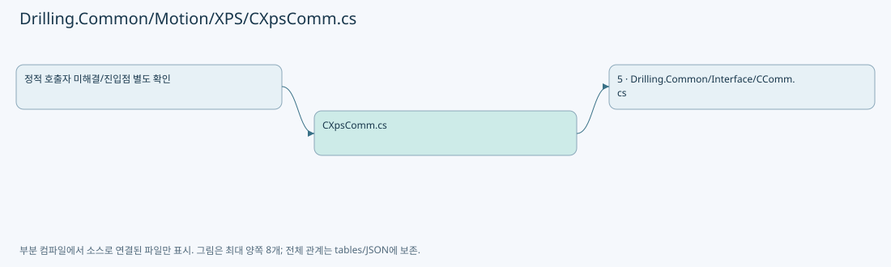

## 네임스페이스·타입·상속

| 타입 | 구분 | 원본 범위 | 선언/상속 |
| --- | --- | --- | --- |
| CXpsComm | ClassDeclaration | 12–622 | CXpsComm: CCommBase(data, option) |

## 멤버 빠른 목록

| 이름 | 종류 | 범위 | 서명 |
| --- | --- | --- | --- |
| _commLock | FieldDeclaration | L15–15 | System.Threading.SemaphoreSlim Drilling.Common.Motion.CXpsComm._commLock |
| _diagnosticLock | FieldDeclaration | L16–16 | object Drilling.Common.Motion.CXpsComm._diagnosticLock |
| _diagnosticSequence | FieldDeclaration | L17–17 | long Drilling.Common.Motion.CXpsComm._diagnosticSequence |
| _lastAppliedDiagnosticSequence | FieldDeclaration | L18–18 | long Drilling.Common.Motion.CXpsComm._lastAppliedDiagnosticSequence |
| _priorityStopGeneration | FieldDeclaration | L19–19 | long Drilling.Common.Motion.CXpsComm._priorityStopGeneration |
| _api | FieldDeclaration | L20–20 | XPS? Drilling.Common.Motion.CXpsComm._api |
| Connect | MethodDeclaration | L21–37 | System.Threading.Tasks.Task Drilling.Common.Motion.CXpsComm.Connect(System.Threading.CancellationToken) |
| Disconnect | MethodDeclaration | L39–51 | System.Threading.Tasks.Task Drilling.Common.Motion.CXpsComm.Disconnect(System.Threading.CancellationToken) |
| Execute | MethodDeclaration | L53–107 | System.Threading.Tasks.Task<string> Drilling.Common.Motion.CXpsComm.Execute(string, System.Threading.CancellationToken) |
| ThrowIfPriorityStopOccurredCallback | LocalFunctionStatement | L63–66 | void ThrowIfPriorityStopOccurredCallback() |
| ConnectLocked | MethodDeclaration | L109–121 | void Drilling.Common.Motion.CXpsComm.ConnectLocked() |
| ExecuteXpsFunction | MethodDeclaration | L123–138 | string Drilling.Common.Motion.CXpsComm.ExecuteXpsFunction(XPS, string, System.Threading.CancellationToken, System.Action?) |
| ExecuteAxisFunction | MethodDeclaration | L140–254 | string Drilling.Common.Motion.CXpsComm.ExecuteAxisFunction(XPS, System.Collections.Generic.IReadOnlyList<string>, System.Threading.CancellationToken, System.Action?) |
| ExecuteIoFunction | MethodDeclaration | L256–281 | string Drilling.Common.Motion.CXpsComm.ExecuteIoFunction(XPS, System.Collections.Generic.IReadOnlyList<string>) |
| ExecuteRawCommand | MethodDeclaration | L283–302 | string Drilling.Common.Motion.CXpsComm.ExecuteRawCommand(XPS, string) |
| ExecuteStatus | LocalFunctionStatement | L290–295 | string ExecuteStatus(XPS) |
| ExecuteSockets | LocalFunctionStatement | L297–301 | string ExecuteSockets(XPS) |
| CloseApi | MethodDeclaration | L304–323 | void Drilling.Common.Motion.CXpsComm.CloseApi() |
| CheckResult | MethodDeclaration | L325–344 | void Drilling.Common.Motion.CXpsComm.CheckResult(XPS, int, string) |
| ReadDouble | MethodDeclaration | L346–354 | double Drilling.Common.Motion.CXpsComm.ReadDouble(System.Collections.Generic.IReadOnlyList<string>, int, string) |
| ExecutePriorityStop | MethodDeclaration | L356–385 | System.Threading.Tasks.Task<string> Drilling.Common.Motion.CXpsComm.ExecutePriorityStop(string, System.Threading.CancellationToken) |
| SelectValue | LocalFunctionStatement | L359–362 | string SelectValue() |
| SelectAggregateexception | LocalFunctionStatement | L364–367 | System.AggregateException? SelectAggregateexception(System.Threading.Tasks.Task<string>) |
| BeginCommandDiagnostic | MethodDeclaration | L387–398 | long Drilling.Common.Motion.CXpsComm.BeginCommandDiagnostic(string) |
| CompletePrimaryCommand | MethodDeclaration | L400–413 | void Drilling.Common.Motion.CXpsComm.CompletePrimaryCommand(long, string) |
| FailPrimaryCommand | MethodDeclaration | L415–430 | string Drilling.Common.Motion.CXpsComm.FailPrimaryCommand(long, System.Exception) |
| CompletePriorityStop | MethodDeclaration | L432–444 | void Drilling.Common.Motion.CXpsComm.CompletePriorityStop(long, string) |
| FailPriorityStop | MethodDeclaration | L446–461 | string Drilling.Common.Motion.CXpsComm.FailPriorityStop(long, System.Exception) |
| CreateErrorResponse | MethodDeclaration | L463–466 | string Drilling.Common.Motion.CXpsComm.CreateErrorResponse(System.Exception) |
| CreateErrorResponse | MethodDeclaration | L468–472 | string Drilling.Common.Motion.CXpsComm.CreateErrorResponse(string) |
| ThrowIfPriorityStopOccurred | MethodDeclaration | L474–480 | void Drilling.Common.Motion.CXpsComm.ThrowIfPriorityStopOccurred(long) |
| SetPrimaryConnected | MethodDeclaration | L482–489 | void Drilling.Common.Motion.CXpsComm.SetPrimaryConnected() |
| SetPrimaryState | MethodDeclaration | L491–497 | void Drilling.Common.Motion.CXpsComm.SetPrimaryState(Drilling.Common.Interface.EN_COMM_STATE) |
| SetPrimaryError | MethodDeclaration | L499–505 | void Drilling.Common.Motion.CXpsComm.SetPrimaryError(System.Exception) |
| ExecutePriorityStopCore | MethodDeclaration | L507–531 | string Drilling.Common.Motion.CXpsComm.ExecutePriorityStopCore(string) |
| IsPriorityStopCommand | MethodDeclaration | L533–543 | bool Drilling.Common.Motion.CXpsComm.IsPriorityStopCommand(string) |
| StopJogAndDisable | MethodDeclaration | L545–569 | void Drilling.Common.Motion.CXpsComm.StopJogAndDisable(XPS, string) |
| IsGroupJogging | MethodDeclaration | L571–576 | bool Drilling.Common.Motion.CXpsComm.IsGroupJogging(XPS, string) |
| ReadPositiveDouble | MethodDeclaration | L578–587 | double Drilling.Common.Motion.CXpsComm.ReadPositiveDouble(System.Collections.Generic.IReadOnlyList<string>, int, string) |
| ReadRequiredFirst | MethodDeclaration | L589–597 | double Drilling.Common.Motion.CXpsComm.ReadRequiredFirst(double[]?, string) |
| ParseDigitalIoAddress | MethodDeclaration | L599–616 | (string GpioName, int BitNo) Drilling.Common.Motion.CXpsComm.ParseDigitalIoAddress(string) |
| SanitizeResponseText | MethodDeclaration | L618–621 | string Drilling.Common.Motion.CXpsComm.SanitizeResponseText(string) |

## 멤버별 상세 계약·호출·처리 해설

### FieldDeclaration `_commLock` · L15–15

[Drilling.Common/Motion/XPS/CXpsComm.cs:15–15](https://github.com/kjuws10-rgb/A3Drilling/blob/5aee8e58439c9b455cae7c9593c9be986c3e682e/Drilling.Common/Motion/XPS/CXpsComm.cs#L15-L15)

| 항목 | 실제 추출 값 |
| --- | --- |
| 서명 | System.Threading.SemaphoreSlim Drilling.Common.Motion.CXpsComm._commLock |
| 접근/수식자 | Private / private, readonly |
| 반환/값 타입 | System.Threading.SemaphoreSlim |
| 소속 타입 | NamedType:Drilling.Common.Motion.CXpsComm |

현재 부분 분석에서 직접 연결된 호출자는 없습니다. XAML/이벤트/인터페이스·델리게이트·외부 진입을 추가 확인해야 하며, 미사용으로 판정한 것이 아닙니다.

호출하는 대상과 해석 범위:

| 원본 행 | 표현식 | 분석 상태 | 대상/소스 위치 |
| --- | --- | --- | --- |
| 15 | new | resolved | System.Threading.SemaphoreSlim.SemaphoreSlim(int, int) |

본문의 실제 연산·분기·예외·반환 순서(원문 위치 순):

| 원본 행 | 종류 | 주석 해설 |
| --- | --- | --- |
| 15 | call | 함수·델리게이트 또는 객체 생성자를 호출합니다: new(1, 1) |
| 15 | variable-initializer | 변수의 초기값을 지정합니다: _commLock = new(1, 1) |

변경 전 점검: 입력/반환 타입, 위 호출자, 예외/취소 경로, 공유 상태와 저장·전송 소비자를 함께 확인합니다. 값의 단위나 물리 방향을 이름만으로 확정하지 않습니다.

### FieldDeclaration `_diagnosticLock` · L16–16

[Drilling.Common/Motion/XPS/CXpsComm.cs:16–16](https://github.com/kjuws10-rgb/A3Drilling/blob/5aee8e58439c9b455cae7c9593c9be986c3e682e/Drilling.Common/Motion/XPS/CXpsComm.cs#L16-L16)

| 항목 | 실제 추출 값 |
| --- | --- |
| 서명 | object Drilling.Common.Motion.CXpsComm._diagnosticLock |
| 접근/수식자 | Private / private, readonly |
| 반환/값 타입 | object |
| 소속 타입 | NamedType:Drilling.Common.Motion.CXpsComm |

현재 부분 분석에서 직접 연결된 호출자는 없습니다. XAML/이벤트/인터페이스·델리게이트·외부 진입을 추가 확인해야 하며, 미사용으로 판정한 것이 아닙니다.

호출하는 대상과 해석 범위:

| 원본 행 | 표현식 | 분석 상태 | 대상/소스 위치 |
| --- | --- | --- | --- |
| 16 | new | resolved | object.Object() |

본문의 실제 연산·분기·예외·반환 순서(원문 위치 순):

| 원본 행 | 종류 | 주석 해설 |
| --- | --- | --- |
| 16 | call | 함수·델리게이트 또는 객체 생성자를 호출합니다: new() |
| 16 | variable-initializer | 변수의 초기값을 지정합니다: _diagnosticLock = new() |

변경 전 점검: 입력/반환 타입, 위 호출자, 예외/취소 경로, 공유 상태와 저장·전송 소비자를 함께 확인합니다. 값의 단위나 물리 방향을 이름만으로 확정하지 않습니다.

### FieldDeclaration `_diagnosticSequence` · L17–17

[Drilling.Common/Motion/XPS/CXpsComm.cs:17–17](https://github.com/kjuws10-rgb/A3Drilling/blob/5aee8e58439c9b455cae7c9593c9be986c3e682e/Drilling.Common/Motion/XPS/CXpsComm.cs#L17-L17)

| 항목 | 실제 추출 값 |
| --- | --- |
| 서명 | long Drilling.Common.Motion.CXpsComm._diagnosticSequence |
| 접근/수식자 | Private / private |
| 반환/값 타입 | long |
| 소속 타입 | NamedType:Drilling.Common.Motion.CXpsComm |

현재 부분 분석에서 직접 연결된 호출자는 없습니다. XAML/이벤트/인터페이스·델리게이트·외부 진입을 추가 확인해야 하며, 미사용으로 판정한 것이 아닙니다.

변경 전 점검: 입력/반환 타입, 위 호출자, 예외/취소 경로, 공유 상태와 저장·전송 소비자를 함께 확인합니다. 값의 단위나 물리 방향을 이름만으로 확정하지 않습니다.

### FieldDeclaration `_lastAppliedDiagnosticSequence` · L18–18

[Drilling.Common/Motion/XPS/CXpsComm.cs:18–18](https://github.com/kjuws10-rgb/A3Drilling/blob/5aee8e58439c9b455cae7c9593c9be986c3e682e/Drilling.Common/Motion/XPS/CXpsComm.cs#L18-L18)

| 항목 | 실제 추출 값 |
| --- | --- |
| 서명 | long Drilling.Common.Motion.CXpsComm._lastAppliedDiagnosticSequence |
| 접근/수식자 | Private / private |
| 반환/값 타입 | long |
| 소속 타입 | NamedType:Drilling.Common.Motion.CXpsComm |

현재 부분 분석에서 직접 연결된 호출자는 없습니다. XAML/이벤트/인터페이스·델리게이트·외부 진입을 추가 확인해야 하며, 미사용으로 판정한 것이 아닙니다.

변경 전 점검: 입력/반환 타입, 위 호출자, 예외/취소 경로, 공유 상태와 저장·전송 소비자를 함께 확인합니다. 값의 단위나 물리 방향을 이름만으로 확정하지 않습니다.

### FieldDeclaration `_priorityStopGeneration` · L19–19

[Drilling.Common/Motion/XPS/CXpsComm.cs:19–19](https://github.com/kjuws10-rgb/A3Drilling/blob/5aee8e58439c9b455cae7c9593c9be986c3e682e/Drilling.Common/Motion/XPS/CXpsComm.cs#L19-L19)

| 항목 | 실제 추출 값 |
| --- | --- |
| 서명 | long Drilling.Common.Motion.CXpsComm._priorityStopGeneration |
| 접근/수식자 | Private / private |
| 반환/값 타입 | long |
| 소속 타입 | NamedType:Drilling.Common.Motion.CXpsComm |

현재 부분 분석에서 직접 연결된 호출자는 없습니다. XAML/이벤트/인터페이스·델리게이트·외부 진입을 추가 확인해야 하며, 미사용으로 판정한 것이 아닙니다.

변경 전 점검: 입력/반환 타입, 위 호출자, 예외/취소 경로, 공유 상태와 저장·전송 소비자를 함께 확인합니다. 값의 단위나 물리 방향을 이름만으로 확정하지 않습니다.

### FieldDeclaration `_api` · L20–20

[Drilling.Common/Motion/XPS/CXpsComm.cs:20–20](https://github.com/kjuws10-rgb/A3Drilling/blob/5aee8e58439c9b455cae7c9593c9be986c3e682e/Drilling.Common/Motion/XPS/CXpsComm.cs#L20-L20)

| 항목 | 실제 추출 값 |
| --- | --- |
| 서명 | XPS? Drilling.Common.Motion.CXpsComm._api |
| 접근/수식자 | Private / private |
| 반환/값 타입 | XPS? |
| 소속 타입 | NamedType:Drilling.Common.Motion.CXpsComm |

현재 부분 분석에서 직접 연결된 호출자는 없습니다. XAML/이벤트/인터페이스·델리게이트·외부 진입을 추가 확인해야 하며, 미사용으로 판정한 것이 아닙니다.

변경 전 점검: 입력/반환 타입, 위 호출자, 예외/취소 경로, 공유 상태와 저장·전송 소비자를 함께 확인합니다. 값의 단위나 물리 방향을 이름만으로 확정하지 않습니다.

### MethodDeclaration `Connect` · L21–37

[Drilling.Common/Motion/XPS/CXpsComm.cs:21–37](https://github.com/kjuws10-rgb/A3Drilling/blob/5aee8e58439c9b455cae7c9593c9be986c3e682e/Drilling.Common/Motion/XPS/CXpsComm.cs#L21-L37)

| 항목 | 실제 추출 값 |
| --- | --- |
| 서명 | System.Threading.Tasks.Task Drilling.Common.Motion.CXpsComm.Connect(System.Threading.CancellationToken) |
| 접근/수식자 | Public / public, override, async |
| 반환/값 타입 | System.Threading.Tasks.Task |
| 소속 타입 | NamedType:Drilling.Common.Motion.CXpsComm |

입력 계약:

| 이름 | 타입 | 전달 | 선택/기본값 |
| --- | --- | --- | --- |
| cancellationToken | System.Threading.CancellationToken | None | True / null |

현재 부분 분석에서 직접 연결된 호출자는 없습니다. XAML/이벤트/인터페이스·델리게이트·외부 진입을 추가 확인해야 하며, 미사용으로 판정한 것이 아닙니다.

호출하는 대상과 해석 범위:

| 원본 행 | 표현식 | 분석 상태 | 대상/소스 위치 |
| --- | --- | --- | --- |
| 23 | _commLock.WaitAsync | resolved | System.Threading.Tasks.Task System.Threading.SemaphoreSlim.WaitAsync(System.Threading.CancellationToken) |
| 26 | ConnectLocked | resolved | void Drilling.Common.Motion.CXpsComm.ConnectLocked() · Drilling.Common/Motion/XPS/CXpsComm.cs:109 |
| 30 | CloseApi | resolved | void Drilling.Common.Motion.CXpsComm.CloseApi() · Drilling.Common/Motion/XPS/CXpsComm.cs:304 |
| 31 | SetPrimaryError | resolved | void Drilling.Common.Motion.CXpsComm.SetPrimaryError(System.Exception) · Drilling.Common/Motion/XPS/CXpsComm.cs:499 |
| 35 | _commLock.Release | resolved | int System.Threading.SemaphoreSlim.Release() |

본문의 실제 연산·분기·예외·반환 순서(원문 위치 순):

| 원본 행 | 종류 | 주석 해설 |
| --- | --- | --- |
| 23 | await | 비동기 완료를 기다립니다: await _commLock.WaitAsync(cancellationToken) |
| 23 | call | 함수·델리게이트 또는 객체 생성자를 호출합니다: _commLock.WaitAsync(cancellationToken) |
| 24 | try | 예외 처리 범위입니다: try |
| 26 | call | 함수·델리게이트 또는 객체 생성자를 호출합니다: ConnectLocked() |
| 28 | catch | 지정 예외를 처리합니다: catch (Exception ex) |
| 30 | call | 함수·델리게이트 또는 객체 생성자를 호출합니다: CloseApi() |
| 31 | call | 함수·델리게이트 또는 객체 생성자를 호출합니다: SetPrimaryError(ex) |
| 33 | finally | 종료 정리 구간입니다: finally |
| 35 | call | 함수·델리게이트 또는 객체 생성자를 호출합니다: _commLock.Release() |

제어 구문의 포함 구조(실제 실행 순서/CFG가 아닌 구문 탐색 그림):

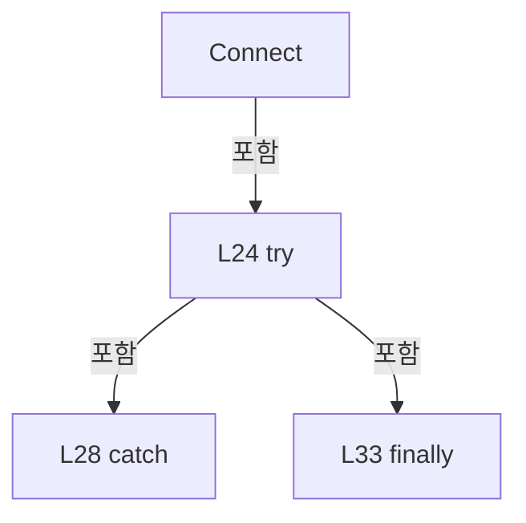

변경 전 점검: 입력/반환 타입, 위 호출자, 예외/취소 경로, 공유 상태와 저장·전송 소비자를 함께 확인합니다. 값의 단위나 물리 방향을 이름만으로 확정하지 않습니다.

### MethodDeclaration `Disconnect` · L39–51

[Drilling.Common/Motion/XPS/CXpsComm.cs:39–51](https://github.com/kjuws10-rgb/A3Drilling/blob/5aee8e58439c9b455cae7c9593c9be986c3e682e/Drilling.Common/Motion/XPS/CXpsComm.cs#L39-L51)

| 항목 | 실제 추출 값 |
| --- | --- |
| 서명 | System.Threading.Tasks.Task Drilling.Common.Motion.CXpsComm.Disconnect(System.Threading.CancellationToken) |
| 접근/수식자 | Public / public, override, async |
| 반환/값 타입 | System.Threading.Tasks.Task |
| 소속 타입 | NamedType:Drilling.Common.Motion.CXpsComm |

입력 계약:

| 이름 | 타입 | 전달 | 선택/기본값 |
| --- | --- | --- | --- |
| cancellationToken | System.Threading.CancellationToken | None | True / null |

현재 부분 분석에서 직접 연결된 호출자는 없습니다. XAML/이벤트/인터페이스·델리게이트·외부 진입을 추가 확인해야 하며, 미사용으로 판정한 것이 아닙니다.

호출하는 대상과 해석 범위:

| 원본 행 | 표현식 | 분석 상태 | 대상/소스 위치 |
| --- | --- | --- | --- |
| 41 | _commLock.WaitAsync | resolved | System.Threading.Tasks.Task System.Threading.SemaphoreSlim.WaitAsync(System.Threading.CancellationToken) |
| 44 | CloseApi | resolved | void Drilling.Common.Motion.CXpsComm.CloseApi() · Drilling.Common/Motion/XPS/CXpsComm.cs:304 |
| 45 | SetPrimaryState | resolved | void Drilling.Common.Motion.CXpsComm.SetPrimaryState(Drilling.Common.Interface.EN_COMM_STATE) · Drilling.Common/Motion/XPS/CXpsComm.cs:491 |
| 49 | _commLock.Release | resolved | int System.Threading.SemaphoreSlim.Release() |

본문의 실제 연산·분기·예외·반환 순서(원문 위치 순):

| 원본 행 | 종류 | 주석 해설 |
| --- | --- | --- |
| 41 | await | 비동기 완료를 기다립니다: await _commLock.WaitAsync(cancellationToken) |
| 41 | call | 함수·델리게이트 또는 객체 생성자를 호출합니다: _commLock.WaitAsync(cancellationToken) |
| 42 | try | 예외 처리 범위입니다: try |
| 44 | call | 함수·델리게이트 또는 객체 생성자를 호출합니다: CloseApi() |
| 45 | call | 함수·델리게이트 또는 객체 생성자를 호출합니다: SetPrimaryState(EN_COMM_STATE.Offline) |
| 47 | finally | 종료 정리 구간입니다: finally |
| 49 | call | 함수·델리게이트 또는 객체 생성자를 호출합니다: _commLock.Release() |

제어 구문의 포함 구조(실제 실행 순서/CFG가 아닌 구문 탐색 그림):

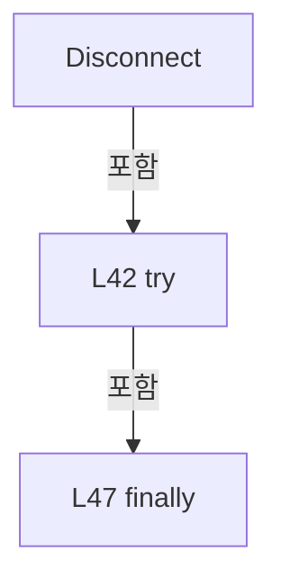

변경 전 점검: 입력/반환 타입, 위 호출자, 예외/취소 경로, 공유 상태와 저장·전송 소비자를 함께 확인합니다. 값의 단위나 물리 방향을 이름만으로 확정하지 않습니다.

### MethodDeclaration `Execute` · L53–107

[Drilling.Common/Motion/XPS/CXpsComm.cs:53–107](https://github.com/kjuws10-rgb/A3Drilling/blob/5aee8e58439c9b455cae7c9593c9be986c3e682e/Drilling.Common/Motion/XPS/CXpsComm.cs#L53-L107)

| 항목 | 실제 추출 값 |
| --- | --- |
| 서명 | System.Threading.Tasks.Task<string> Drilling.Common.Motion.CXpsComm.Execute(string, System.Threading.CancellationToken) |
| 접근/수식자 | Public / public, override, async |
| 반환/값 타입 | System.Threading.Tasks.Task<string> |
| 소속 타입 | NamedType:Drilling.Common.Motion.CXpsComm |

입력 계약:

| 이름 | 타입 | 전달 | 선택/기본값 |
| --- | --- | --- | --- |
| function | string | None | False /  |
| cancellationToken | System.Threading.CancellationToken | None | True / null |

현재 부분 분석에서 직접 연결된 호출자는 없습니다. XAML/이벤트/인터페이스·델리게이트·외부 진입을 추가 확인해야 하며, 미사용으로 판정한 것이 아닙니다.

호출하는 대상과 해석 범위:

| 원본 행 | 표현식 | 분석 상태 | 대상/소스 위치 |
| --- | --- | --- | --- |
| 55 | Volatile.Read | resolved | long System.Threading.Volatile.Read(ref readonly long) |
| 56 | IsPriorityStopCommand | resolved | bool Drilling.Common.Motion.CXpsComm.IsPriorityStopCommand(string) · Drilling.Common/Motion/XPS/CXpsComm.cs:533 |
| 58 | Interlocked.Increment | resolved | long System.Threading.Interlocked.Increment(ref long) |
| 59 | ExecutePriorityStop | resolved | System.Threading.Tasks.Task<string> Drilling.Common.Motion.CXpsComm.ExecutePriorityStop(string, System.Threading.CancellationToken) · Drilling.Common/Motion/XPS/CXpsComm.cs:356 |
| 62 | _commLock.WaitAsync | resolved | System.Threading.Tasks.Task System.Threading.SemaphoreSlim.WaitAsync(System.Threading.CancellationToken) |
| 70 | Volatile.Read | resolved | long System.Threading.Volatile.Read(ref readonly long) |
| 72 | CreateErrorResponse | resolved | string Drilling.Common.Motion.CXpsComm.CreateErrorResponse(string) · Drilling.Common/Motion/XPS/CXpsComm.cs:468 |
| 75 | BeginCommandDiagnostic | resolved | long Drilling.Common.Motion.CXpsComm.BeginCommandDiagnostic(string) · Drilling.Common/Motion/XPS/CXpsComm.cs:387 |
| 80 | ConnectLocked | resolved | void Drilling.Common.Motion.CXpsComm.ConnectLocked() · Drilling.Common/Motion/XPS/CXpsComm.cs:109 |
| 85 | new InvalidOperationException | resolved | System.InvalidOperationException.InvalidOperationException(string?) |
| 88 | cancellationToken.ThrowIfCancellationRequested | resolved | void System.Threading.CancellationToken.ThrowIfCancellationRequested() |
| 89 | ThrowIfPriorityStopOccurred | resolved | void Drilling.Common.Motion.CXpsComm.ThrowIfPriorityStopOccurred(long) · Drilling.Common/Motion/XPS/CXpsComm.cs:474 |
| 90 | ExecuteXpsFunction | candidate | OverloadResolutionFailure |
| 91 | CompletePrimaryCommand | resolved | void Drilling.Common.Motion.CXpsComm.CompletePrimaryCommand(long, string) · Drilling.Common/Motion/XPS/CXpsComm.cs:400 |
| 100 | FailPrimaryCommand | resolved | string Drilling.Common.Motion.CXpsComm.FailPrimaryCommand(long, System.Exception) · Drilling.Common/Motion/XPS/CXpsComm.cs:415 |
| 105 | _commLock.Release | resolved | int System.Threading.SemaphoreSlim.Release() |

본문의 실제 연산·분기·예외·반환 순서(원문 위치 순):

| 원본 행 | 종류 | 주석 해설 |
| --- | --- | --- |
| 55 | call | 함수·델리게이트 또는 객체 생성자를 호출합니다: Volatile.Read(ref _priorityStopGeneration) |
| 55 | local-declaration | 지역 변수를 선언합니다: var observedStopGeneration = Volatile.Read(ref _priorityStopGeneration); |
| 55 | variable-initializer | 변수의 초기값을 지정합니다: observedStopGeneration = Volatile.Read(ref _priorityStopGeneration) |
| 56 | call | 함수·델리게이트 또는 객체 생성자를 호출합니다: IsPriorityStopCommand(function) |
| 56 | if | 조건에 따라 분기합니다: if (IsPriorityStopCommand(function)) |
| 58 | call | 함수·델리게이트 또는 객체 생성자를 호출합니다: Interlocked.Increment(ref _priorityStopGeneration) |
| 59 | await | 비동기 완료를 기다립니다: await ExecutePriorityStop(function, cancellationToken) |
| 59 | call | 함수·델리게이트 또는 객체 생성자를 호출합니다: ExecutePriorityStop(function, cancellationToken) |
| 59 | return | 호출자에게 값 또는 제어를 반환합니다: return await ExecutePriorityStop(function, cancellationToken); |
| 62 | await | 비동기 완료를 기다립니다: await _commLock.WaitAsync(cancellationToken) |
| 62 | call | 함수·델리게이트 또는 객체 생성자를 호출합니다: _commLock.WaitAsync(cancellationToken) |
| 68 | try | 예외 처리 범위입니다: try |
| 70 | call | 함수·델리게이트 또는 객체 생성자를 호출합니다: Volatile.Read(ref _priorityStopGeneration) |
| 70 | if | 조건에 따라 분기합니다: if (observedStopGeneration != Volatile.Read(ref _priorityStopGeneration)) |
| 72 | call | 함수·델리게이트 또는 객체 생성자를 호출합니다: CreateErrorResponse("XPS command invalidated by priority stop.") |
| 72 | return | 호출자에게 값 또는 제어를 반환합니다: return CreateErrorResponse("XPS command invalidated by priority stop."); |
| 75 | call | 함수·델리게이트 또는 객체 생성자를 호출합니다: BeginCommandDiagnostic(function) |
| 75 | local-declaration | 지역 변수를 선언합니다: var diagnosticSequence = BeginCommandDiagnostic(function); |
| 75 | variable-initializer | 변수의 초기값을 지정합니다: diagnosticSequence = BeginCommandDiagnostic(function) |
| 76 | try | 예외 처리 범위입니다: try |
| 78 | if | 조건에 따라 분기합니다: if (_api is null &#124;&#124; ConnectionState != EN_COMM_STATE.Online) |
| 80 | call | 함수·델리게이트 또는 객체 생성자를 호출합니다: ConnectLocked() |
| 83 | if | 조건에 따라 분기합니다: if (_api is null &#124;&#124; ConnectionState != EN_COMM_STATE.Online) |
| 85 | call | 함수·델리게이트 또는 객체 생성자를 호출합니다: new InvalidOperationException("XPS primary connection is offline.") |
| 85 | throw | 예외를 발생/전달합니다: throw new InvalidOperationException("XPS primary connection is offline."); |
| 88 | call | 함수·델리게이트 또는 객체 생성자를 호출합니다: cancellationToken.ThrowIfCancellationRequested() |
| 89 | call | 함수·델리게이트 또는 객체 생성자를 호출합니다: ThrowIfPriorityStopOccurred(observedStopGeneration) |
| 90 | call | 함수·델리게이트 또는 객체 생성자를 호출합니다: ExecuteXpsFunction(_api, function, cancellationToken, ThrowIfPriorityStopOccurredCallback) |
| 90 | local-declaration | 지역 변수를 선언합니다: var response = ExecuteXpsFunction(_api, function, cancellationToken, ThrowIfPriorityStopOccurredCallback); |
| 90 | variable-initializer | 변수의 초기값을 지정합니다: response = ExecuteXpsFunction(_api, function, cancellationToken, ThrowIfPriorityStopOccurredCallback) |
| 91 | call | 함수·델리게이트 또는 객체 생성자를 호출합니다: CompletePrimaryCommand(diagnosticSequence, response) |
| 92 | return | 호출자에게 값 또는 제어를 반환합니다: return response; |
| 94 | catch | 지정 예외를 처리합니다: catch (OperationCanceledException) when (cancellationToken.IsCancellationRequested) |
| 96 | throw | 예외를 발생/전달합니다: throw; |
| 98 | catch | 지정 예외를 처리합니다: catch (Exception ex) |
| 100 | call | 함수·델리게이트 또는 객체 생성자를 호출합니다: FailPrimaryCommand(diagnosticSequence, ex) |
| 100 | return | 호출자에게 값 또는 제어를 반환합니다: return FailPrimaryCommand(diagnosticSequence, ex); |
| 103 | finally | 종료 정리 구간입니다: finally |
| 105 | call | 함수·델리게이트 또는 객체 생성자를 호출합니다: _commLock.Release() |

제어 구문의 포함 구조(실제 실행 순서/CFG가 아닌 구문 탐색 그림):

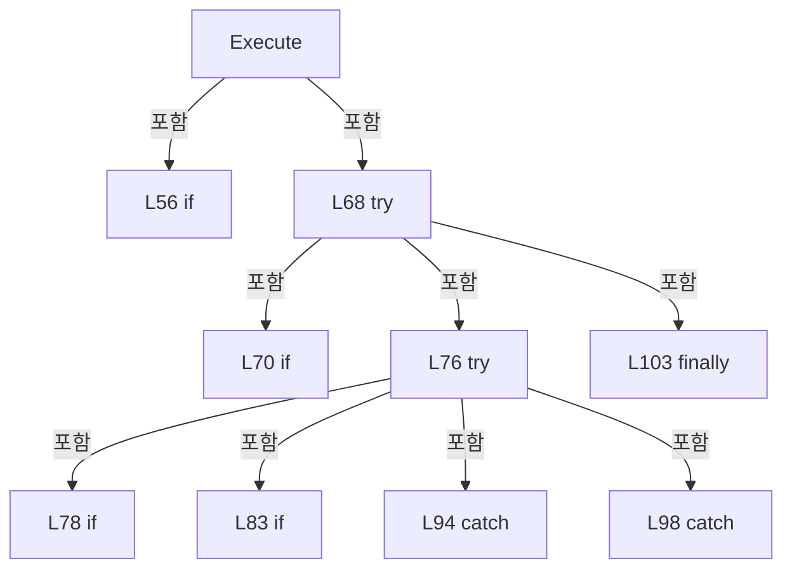

변경 전 점검: 입력/반환 타입, 위 호출자, 예외/취소 경로, 공유 상태와 저장·전송 소비자를 함께 확인합니다. 값의 단위나 물리 방향을 이름만으로 확정하지 않습니다.

### LocalFunctionStatement `ThrowIfPriorityStopOccurredCallback` · L63–66

[Drilling.Common/Motion/XPS/CXpsComm.cs:63–66](https://github.com/kjuws10-rgb/A3Drilling/blob/5aee8e58439c9b455cae7c9593c9be986c3e682e/Drilling.Common/Motion/XPS/CXpsComm.cs#L63-L66)

| 항목 | 실제 추출 값 |
| --- | --- |
| 서명 | void ThrowIfPriorityStopOccurredCallback() |
| 접근/수식자 | Private /  |
| 반환/값 타입 | void |
| 소속 타입 | NamedType:Drilling.Common.Motion.CXpsComm |

현재 부분 분석에서 직접 연결된 호출자는 없습니다. XAML/이벤트/인터페이스·델리게이트·외부 진입을 추가 확인해야 하며, 미사용으로 판정한 것이 아닙니다.

호출하는 대상과 해석 범위:

| 원본 행 | 표현식 | 분석 상태 | 대상/소스 위치 |
| --- | --- | --- | --- |
| 65 | ThrowIfPriorityStopOccurred | resolved | void Drilling.Common.Motion.CXpsComm.ThrowIfPriorityStopOccurred(long) · Drilling.Common/Motion/XPS/CXpsComm.cs:474 |

본문의 실제 연산·분기·예외·반환 순서(원문 위치 순):

| 원본 행 | 종류 | 주석 해설 |
| --- | --- | --- |
| 65 | call | 함수·델리게이트 또는 객체 생성자를 호출합니다: ThrowIfPriorityStopOccurred(observedStopGeneration) |

변경 전 점검: 입력/반환 타입, 위 호출자, 예외/취소 경로, 공유 상태와 저장·전송 소비자를 함께 확인합니다. 값의 단위나 물리 방향을 이름만으로 확정하지 않습니다.

### MethodDeclaration `ConnectLocked` · L109–121

[Drilling.Common/Motion/XPS/CXpsComm.cs:109–121](https://github.com/kjuws10-rgb/A3Drilling/blob/5aee8e58439c9b455cae7c9593c9be986c3e682e/Drilling.Common/Motion/XPS/CXpsComm.cs#L109-L121)

| 항목 | 실제 추출 값 |
| --- | --- |
| 서명 | void Drilling.Common.Motion.CXpsComm.ConnectLocked() |
| 접근/수식자 | Private / private |
| 반환/값 타입 | void |
| 소속 타입 | NamedType:Drilling.Common.Motion.CXpsComm |

정적 호출자로 확인된 위치:

| 호출 파일/행 | 호출 표현식 | 런타임 분기 가능 |
| --- | --- | --- |
| [Drilling.Common/Motion/XPS/CXpsComm.cs:26–26](https://github.com/kjuws10-rgb/A3Drilling/blob/5aee8e58439c9b455cae7c9593c9be986c3e682e/Drilling.Common/Motion/XPS/CXpsComm.cs#L26-L26) | ConnectLocked | False |
| [Drilling.Common/Motion/XPS/CXpsComm.cs:80–80](https://github.com/kjuws10-rgb/A3Drilling/blob/5aee8e58439c9b455cae7c9593c9be986c3e682e/Drilling.Common/Motion/XPS/CXpsComm.cs#L80-L80) | ConnectLocked | False |

호출하는 대상과 해석 범위:

| 원본 행 | 표현식 | 분석 상태 | 대상/소스 위치 |
| --- | --- | --- | --- |
| 111 | CloseApi | resolved | void Drilling.Common.Motion.CXpsComm.CloseApi() · Drilling.Common/Motion/XPS/CXpsComm.cs:304 |
| 112 | string.IsNullOrWhiteSpace | resolved | bool string.IsNullOrWhiteSpace(string?) |
| 114 | new InvalidOperationException | resolved | System.InvalidOperationException.InvalidOperationException(string?) |
| 117 | new XPS | unresolved | None |
| 118 | _api.OpenInstrument | unresolved | None |
| 119 | CheckResult | candidate | OverloadResolutionFailure |
| 120 | SetPrimaryConnected | resolved | void Drilling.Common.Motion.CXpsComm.SetPrimaryConnected() · Drilling.Common/Motion/XPS/CXpsComm.cs:482 |

본문의 실제 연산·분기·예외·반환 순서(원문 위치 순):

| 원본 행 | 종류 | 주석 해설 |
| --- | --- | --- |
| 111 | call | 함수·델리게이트 또는 객체 생성자를 호출합니다: CloseApi() |
| 112 | call | 함수·델리게이트 또는 객체 생성자를 호출합니다: string.IsNullOrWhiteSpace(Option.RemoteAddress) |
| 112 | if | 조건에 따라 분기합니다: if (string.IsNullOrWhiteSpace(Option.RemoteAddress) &#124;&#124; Option.Port <= 0) |
| 114 | call | 함수·델리게이트 또는 객체 생성자를 호출합니다: new InvalidOperationException("XPS endpoint is invalid.") |
| 114 | throw | 예외를 발생/전달합니다: throw new InvalidOperationException("XPS endpoint is invalid."); |
| 117 | assignment | 값을 대상에 대입합니다: _api = new XPS() |
| 117 | call | 함수·델리게이트 또는 객체 생성자를 호출합니다: new XPS() |
| 118 | call | 함수·델리게이트 또는 객체 생성자를 호출합니다: _api.OpenInstrument(Option.RemoteAddress, Option.Port, Option.TimeoutMs) |
| 118 | local-declaration | 지역 변수를 선언합니다: var result = _api.OpenInstrument(Option.RemoteAddress, Option.Port, Option.TimeoutMs); |
| 118 | variable-initializer | 변수의 초기값을 지정합니다: result = _api.OpenInstrument(Option.RemoteAddress, Option.Port, Option.TimeoutMs) |
| 119 | call | 함수·델리게이트 또는 객체 생성자를 호출합니다: CheckResult(_api, result, "OpenInstrument") |
| 120 | call | 함수·델리게이트 또는 객체 생성자를 호출합니다: SetPrimaryConnected() |

제어 구문의 포함 구조(실제 실행 순서/CFG가 아닌 구문 탐색 그림):

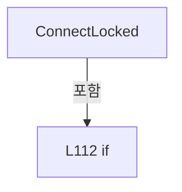

변경 전 점검: 입력/반환 타입, 위 호출자, 예외/취소 경로, 공유 상태와 저장·전송 소비자를 함께 확인합니다. 값의 단위나 물리 방향을 이름만으로 확정하지 않습니다.

### MethodDeclaration `ExecuteXpsFunction` · L123–138

[Drilling.Common/Motion/XPS/CXpsComm.cs:123–138](https://github.com/kjuws10-rgb/A3Drilling/blob/5aee8e58439c9b455cae7c9593c9be986c3e682e/Drilling.Common/Motion/XPS/CXpsComm.cs#L123-L138)

| 항목 | 실제 추출 값 |
| --- | --- |
| 서명 | string Drilling.Common.Motion.CXpsComm.ExecuteXpsFunction(XPS, string, System.Threading.CancellationToken, System.Action?) |
| 접근/수식자 | Private / private, static |
| 반환/값 타입 | string |
| 소속 타입 | NamedType:Drilling.Common.Motion.CXpsComm |

입력 계약:

| 이름 | 타입 | 전달 | 선택/기본값 |
| --- | --- | --- | --- |
| api | XPS | None | False /  |
| function | string | None | False /  |
| cancellationToken | System.Threading.CancellationToken | None | False /  |
| validateCommandGeneration | System.Action? | None | True / null |

정적 호출자로 확인된 위치:

| 호출 파일/행 | 호출 표현식 | 런타임 분기 가능 |
| --- | --- | --- |
| [Drilling.Common/Motion/XPS/CXpsComm.cs:518–518](https://github.com/kjuws10-rgb/A3Drilling/blob/5aee8e58439c9b455cae7c9593c9be986c3e682e/Drilling.Common/Motion/XPS/CXpsComm.cs#L518-L518) | ExecuteXpsFunction | False |

호출하는 대상과 해석 범위:

| 원본 행 | 표현식 | 분석 상태 | 대상/소스 위치 |
| --- | --- | --- | --- |
| 125 | cancellationToken.ThrowIfCancellationRequested | resolved | void System.Threading.CancellationToken.ThrowIfCancellationRequested() |
| 126 | .Invoke | resolved · 동적 구현 선택 가능 | void System.Action.Invoke() |
| 127 | function.Split | resolved | string[] string.Split(char, System.StringSplitOptions) |
| 128 | tokens[0].Equals | resolved | bool string.Equals(string?, System.StringComparison) |
| 130 | ExecuteRawCommand | resolved | string Drilling.Common.Motion.CXpsComm.ExecuteRawCommand(XPS, string) · Drilling.Common/Motion/XPS/CXpsComm.cs:283 |
| 133 | tokens[1].ToUpperInvariant | resolved | string string.ToUpperInvariant() |
| 135 | ExecuteAxisFunction | resolved | string Drilling.Common.Motion.CXpsComm.ExecuteAxisFunction(XPS, System.Collections.Generic.IReadOnlyList<string>, System.Threading.CancellationToken, System.Action?) · Drilling.Common/Motion/XPS/CXpsComm.cs:140 |
| 136 | ExecuteIoFunction | resolved | string Drilling.Common.Motion.CXpsComm.ExecuteIoFunction(XPS, System.Collections.Generic.IReadOnlyList<string>) · Drilling.Common/Motion/XPS/CXpsComm.cs:256 |
| 137 | ExecuteRawCommand | resolved | string Drilling.Common.Motion.CXpsComm.ExecuteRawCommand(XPS, string) · Drilling.Common/Motion/XPS/CXpsComm.cs:283 |

본문의 실제 연산·분기·예외·반환 순서(원문 위치 순):

| 원본 행 | 종류 | 주석 해설 |
| --- | --- | --- |
| 125 | call | 함수·델리게이트 또는 객체 생성자를 호출합니다: cancellationToken.ThrowIfCancellationRequested() |
| 126 | call | 함수·델리게이트 또는 객체 생성자를 호출합니다: .Invoke() |
| 127 | call | 함수·델리게이트 또는 객체 생성자를 호출합니다: function.Split(':', StringSplitOptions.TrimEntries &#124; StringSplitOptions.RemoveEmptyEntries) |
| 127 | local-declaration | 지역 변수를 선언합니다: var tokens = function.Split(':', StringSplitOptions.TrimEntries &#124; StringSplitOptions.RemoveEmptyEntries); |
| 127 | variable-initializer | 변수의 초기값을 지정합니다: tokens = function.Split(':', StringSplitOptions.TrimEntries &#124; StringSplitOptions.RemoveEmptyEntries) |
| 128 | call | 함수·델리게이트 또는 객체 생성자를 호출합니다: tokens[0].Equals("XPS", StringComparison.OrdinalIgnoreCase) |
| 128 | if | 조건에 따라 분기합니다: if (tokens.Length < 2 &#124;&#124; !tokens[0].Equals("XPS", StringComparison.OrdinalIgnoreCase)) |
| 130 | call | 함수·델리게이트 또는 객체 생성자를 호출합니다: ExecuteRawCommand(api, function) |
| 130 | return | 호출자에게 값 또는 제어를 반환합니다: return ExecuteRawCommand(api, function); |
| 133 | call | 함수·델리게이트 또는 객체 생성자를 호출합니다: tokens[1].ToUpperInvariant() |
| 133 | return | 호출자에게 값 또는 제어를 반환합니다: return tokens[1].ToUpperInvariant() switch { "AXIS" => ExecuteAxisFunction(api, tokens, cancellationToken, validateCommandGeneration), "IO" => ExecuteIoFunction(api, tokens), _ => ExecuteRawCommand(api, function)}; |
| 133 | switch-expression | 값별 결과식을 선택합니다: tokens[1].ToUpperInvariant() switch { "AXIS" => ExecuteAxisFunction(api, tokens, cancellationToken, validateCommandGeneration), "IO" => ExecuteIoFunction(api, tokens), _ => ExecuteRawCommand(api, function)} |
| 135 | call | 함수·델리게이트 또는 객체 생성자를 호출합니다: ExecuteAxisFunction(api, tokens, cancellationToken, validateCommandGeneration) |
| 136 | call | 함수·델리게이트 또는 객체 생성자를 호출합니다: ExecuteIoFunction(api, tokens) |
| 137 | call | 함수·델리게이트 또는 객체 생성자를 호출합니다: ExecuteRawCommand(api, function) |

제어 구문의 포함 구조(실제 실행 순서/CFG가 아닌 구문 탐색 그림):

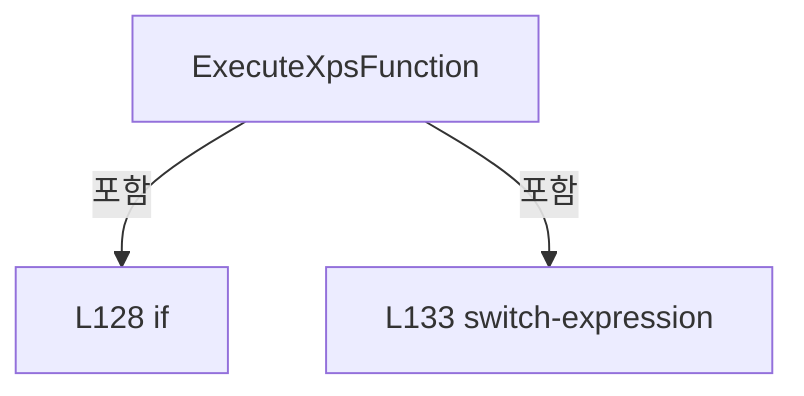

변경 전 점검: 입력/반환 타입, 위 호출자, 예외/취소 경로, 공유 상태와 저장·전송 소비자를 함께 확인합니다. 값의 단위나 물리 방향을 이름만으로 확정하지 않습니다.

### MethodDeclaration `ExecuteAxisFunction` · L140–254

[Drilling.Common/Motion/XPS/CXpsComm.cs:140–254](https://github.com/kjuws10-rgb/A3Drilling/blob/5aee8e58439c9b455cae7c9593c9be986c3e682e/Drilling.Common/Motion/XPS/CXpsComm.cs#L140-L254)

| 항목 | 실제 추출 값 |
| --- | --- |
| 서명 | string Drilling.Common.Motion.CXpsComm.ExecuteAxisFunction(XPS, System.Collections.Generic.IReadOnlyList<string>, System.Threading.CancellationToken, System.Action?) |
| 접근/수식자 | Private / private, static |
| 반환/값 타입 | string |
| 소속 타입 | NamedType:Drilling.Common.Motion.CXpsComm |

입력 계약:

| 이름 | 타입 | 전달 | 선택/기본값 |
| --- | --- | --- | --- |
| api | XPS | None | False /  |
| tokens | System.Collections.Generic.IReadOnlyList<string> | None | False /  |
| cancellationToken | System.Threading.CancellationToken | None | False /  |
| validateCommandGeneration | System.Action? | None | False /  |

정적 호출자로 확인된 위치:

| 호출 파일/행 | 호출 표현식 | 런타임 분기 가능 |
| --- | --- | --- |
| [Drilling.Common/Motion/XPS/CXpsComm.cs:135–135](https://github.com/kjuws10-rgb/A3Drilling/blob/5aee8e58439c9b455cae7c9593c9be986c3e682e/Drilling.Common/Motion/XPS/CXpsComm.cs#L135-L135) | ExecuteAxisFunction | False |

호출하는 대상과 해석 범위:

| 원본 행 | 표현식 | 분석 상태 | 대상/소스 위치 |
| --- | --- | --- | --- |
| 144 | new InvalidOperationException | resolved | System.InvalidOperationException.InvalidOperationException(string?) |
| 150 | tokens[commandIndex].ToUpperInvariant | resolved | string string.ToUpperInvariant() |
| 151 | cancellationToken.ThrowIfCancellationRequested | resolved | void System.Threading.CancellationToken.ThrowIfCancellationRequested() |
| 152 | .Invoke | resolved · 동적 구현 선택 가능 | void System.Action.Invoke() |
| 156 | CheckResult | candidate | OverloadResolutionFailure |
| 156 | api.GroupMotionEnable | unresolved | None |
| 159 | CheckResult | candidate | OverloadResolutionFailure |
| 159 | api.GroupMotionDisable | unresolved | None |
| 162 | CheckResult | candidate | OverloadResolutionFailure |
| 162 | api.GroupInitialize | unresolved | None |
| 163 | .Invoke | resolved · 동적 구현 선택 가능 | void System.Action.Invoke() |
| 164 | CheckResult | candidate | OverloadResolutionFailure |
| 164 | api.GroupHomeSearch | unresolved | None |
| 167 | CheckResult | candidate | OverloadResolutionFailure |
| 167 | api.GroupMoveAbsolute | unresolved | None |
| 167 | ReadDouble | resolved | double Drilling.Common.Motion.CXpsComm.ReadDouble(System.Collections.Generic.IReadOnlyList<string>, int, string) · Drilling.Common/Motion/XPS/CXpsComm.cs:346 |
| 170 | CheckResult | candidate | OverloadResolutionFailure |
| 170 | api.GroupMoveRelative | unresolved | None |
| 170 | ReadDouble | resolved | double Drilling.Common.Motion.CXpsComm.ReadDouble(System.Collections.Generic.IReadOnlyList<string>, int, string) · Drilling.Common/Motion/XPS/CXpsComm.cs:346 |
| 173 | CheckResult | candidate | OverloadResolutionFailure |
| 173 | api.PositionerSGammaVelocityAndAccelerationSet | unresolved | None |
| 173 | ReadPositiveDouble | resolved | double Drilling.Common.Motion.CXpsComm.ReadPositiveDouble(System.Collections.Generic.IReadOnlyList<string>, int, string) · Drilling.Common/Motion/XPS/CXpsComm.cs:578 |
| 173 | ReadPositiveDouble | resolved | double Drilling.Common.Motion.CXpsComm.ReadPositiveDouble(System.Collections.Generic.IReadOnlyList<string>, int, string) · Drilling.Common/Motion/XPS/CXpsComm.cs:578 |
| 176 | ReadDouble | resolved | double Drilling.Common.Motion.CXpsComm.ReadDouble(System.Collections.Generic.IReadOnlyList<string>, int, string) · Drilling.Common/Motion/XPS/CXpsComm.cs:346 |
| 177 | ReadPositiveDouble | resolved | double Drilling.Common.Motion.CXpsComm.ReadPositiveDouble(System.Collections.Generic.IReadOnlyList<string>, int, string) · Drilling.Common/Motion/XPS/CXpsComm.cs:578 |
| 178 | Math.Abs | resolved | double System.Math.Abs(double) |
| 180 | new InvalidOperationException | resolved | System.InvalidOperationException.InvalidOperationException(string?) |
| 185 | .Invoke | resolved · 동적 구현 선택 가능 | void System.Action.Invoke() |
| 186 | CheckResult | candidate | OverloadResolutionFailure |
| 186 | api.GroupJogModeEnable | unresolved | None |
| 187 | cancellationToken.ThrowIfCancellationRequested | resolved | void System.Threading.CancellationToken.ThrowIfCancellationRequested() |
| 188 | .Invoke | resolved · 동적 구현 선택 가능 | void System.Action.Invoke() |
| 189 | CheckResult | candidate | OverloadResolutionFailure |
| 189 | api.GroupJogParametersSet | unresolved | None |
| 190 | cancellationToken.ThrowIfCancellationRequested | resolved | void System.Threading.CancellationToken.ThrowIfCancellationRequested() |
| 191 | .Invoke | resolved · 동적 구현 선택 가능 | void System.Action.Invoke() |
| 197 | StopJogAndDisable | resolved | void Drilling.Common.Motion.CXpsComm.StopJogAndDisable(XPS, string) · Drilling.Common/Motion/XPS/CXpsComm.cs:545 |
| 201 | new AggregateException | resolved | System.AggregateException.AggregateException(string?, params System.Exception[]) |
| 209 | StopJogAndDisable | resolved | void Drilling.Common.Motion.CXpsComm.StopJogAndDisable(XPS, string) · Drilling.Common/Motion/XPS/CXpsComm.cs:545 |
| 212 | CheckResult | candidate | OverloadResolutionFailure |
| 212 | api.GroupMoveAbort | unresolved | None |
| 215 | CheckResult | candidate | OverloadResolutionFailure |
| 215 | api.GroupInitialize | unresolved | None |
| 218 | CheckResult | candidate | OverloadResolutionFailure |
| 218 | api.GroupPositionCurrentGet | unresolved | None |
| 219 | ReadRequiredFirst | candidate | OverloadResolutionFailure |
| 220 | CheckResult | candidate | OverloadResolutionFailure |
| 220 | api.GroupStatusGet | unresolved | None |
| 221 | CheckResult | candidate | OverloadResolutionFailure |
| 221 | api.GroupStatusStringGet | unresolved | None |
| 222 | CheckResult | candidate | OverloadResolutionFailure |
| 222 | api.GroupMotionStatusGet | unresolved | None |
| 225 | new InvalidOperationException | resolved | System.InvalidOperationException.InvalidOperationException(string?) |
| 228 | CheckResult | candidate | OverloadResolutionFailure |
| 228 | api.PositionerHardwareStatusGet | unresolved | None |
| 229 | CheckResult | candidate | OverloadResolutionFailure |
| 229 | api.GroupVelocityCurrentGet | unresolved | None |
| 230 | ReadRequiredFirst | candidate | OverloadResolutionFailure |
| 231 | CheckResult | candidate | OverloadResolutionFailure |
| 231 | api.GroupAccelerationCurrentGet | unresolved | None |
| 232 | ReadRequiredFirst | candidate | OverloadResolutionFailure |
| 233 | string.Join | candidate | OverloadResolutionFailure |
| 239 | positionValue.ToString | resolved | string double.ToString(string?, System.IFormatProvider?) |
| 241 | SanitizeResponseText | candidate | OverloadResolutionFailure |
| 243 | motionStatus[0].ToString | unresolved | None |
| 245 | hardwareStatus.ToString | unresolved | None |
| 247 | velocity.ToString | resolved | string double.ToString(string?, System.IFormatProvider?) |
| 249 | acceleration.ToString | resolved | string double.ToString(string?, System.IFormatProvider?) |
| 252 | new InvalidOperationException | resolved | System.InvalidOperationException.InvalidOperationException(string?) |

본문의 실제 연산·분기·예외·반환 순서(원문 위치 순):

| 원본 행 | 종류 | 주석 해설 |
| --- | --- | --- |
| 142 | if | 조건에 따라 분기합니다: if (tokens.Count < 5) |
| 144 | call | 함수·델리게이트 또는 객체 생성자를 호출합니다: new InvalidOperationException("XPS axis command is invalid.") |
| 144 | throw | 예외를 발생/전달합니다: throw new InvalidOperationException("XPS axis command is invalid."); |
| 147 | local-declaration | 지역 변수를 선언합니다: var axisName = tokens[3]; |
| 147 | variable-initializer | 변수의 초기값을 지정합니다: axisName = tokens[3] |
| 148 | conditional-expression | 조건에 따라 결과식을 선택합니다: tokens.Count >= 6 ? tokens[4] : axisName |
| 148 | local-declaration | 지역 변수를 선언합니다: var groupName = tokens.Count >= 6 ? tokens[4] : axisName; |
| 148 | variable-initializer | 변수의 초기값을 지정합니다: groupName = tokens.Count >= 6 ? tokens[4] : axisName |
| 149 | conditional-expression | 조건에 따라 결과식을 선택합니다: tokens.Count >= 6 ? 5 : 4 |
| 149 | local-declaration | 지역 변수를 선언합니다: var commandIndex = tokens.Count >= 6 ? 5 : 4; |
| 149 | variable-initializer | 변수의 초기값을 지정합니다: commandIndex = tokens.Count >= 6 ? 5 : 4 |
| 150 | call | 함수·델리게이트 또는 객체 생성자를 호출합니다: tokens[commandIndex].ToUpperInvariant() |
| 150 | local-declaration | 지역 변수를 선언합니다: var command = tokens[commandIndex].ToUpperInvariant(); |
| 150 | variable-initializer | 변수의 초기값을 지정합니다: command = tokens[commandIndex].ToUpperInvariant() |
| 151 | call | 함수·델리게이트 또는 객체 생성자를 호출합니다: cancellationToken.ThrowIfCancellationRequested() |
| 152 | call | 함수·델리게이트 또는 객체 생성자를 호출합니다: .Invoke() |
| 153 | switch | 값에 따라 분기합니다: switch (command) |
| 155 | case | 분기값/패턴의 구간입니다: case "SERVO_ON": |
| 156 | call | 함수·델리게이트 또는 객체 생성자를 호출합니다: CheckResult(api, api.GroupMotionEnable(groupName, out var servoOnError), servoOnError) |
| 156 | call | 함수·델리게이트 또는 객체 생성자를 호출합니다: api.GroupMotionEnable(groupName, out var servoOnError) |
| 157 | return | 호출자에게 값 또는 제어를 반환합니다: return $"OK:AXIS:{axisName}:SERVO_ON"; |
| 158 | case | 분기값/패턴의 구간입니다: case "SERVO_OFF": |
| 159 | call | 함수·델리게이트 또는 객체 생성자를 호출합니다: CheckResult(api, api.GroupMotionDisable(groupName, out var servoOffError), servoOffError) |
| 159 | call | 함수·델리게이트 또는 객체 생성자를 호출합니다: api.GroupMotionDisable(groupName, out var servoOffError) |
| 160 | return | 호출자에게 값 또는 제어를 반환합니다: return $"OK:AXIS:{axisName}:SERVO_OFF"; |
| 161 | case | 분기값/패턴의 구간입니다: case "HOME": |
| 162 | call | 함수·델리게이트 또는 객체 생성자를 호출합니다: CheckResult(api, api.GroupInitialize(groupName, out var initializeError), initializeError) |
| 162 | call | 함수·델리게이트 또는 객체 생성자를 호출합니다: api.GroupInitialize(groupName, out var initializeError) |
| 163 | call | 함수·델리게이트 또는 객체 생성자를 호출합니다: .Invoke() |
| 164 | call | 함수·델리게이트 또는 객체 생성자를 호출합니다: CheckResult(api, api.GroupHomeSearch(groupName, out var homeError), homeError) |
| 164 | call | 함수·델리게이트 또는 객체 생성자를 호출합니다: api.GroupHomeSearch(groupName, out var homeError) |
| 165 | return | 호출자에게 값 또는 제어를 반환합니다: return $"OK:AXIS:{axisName}:HOME"; |
| 166 | case | 분기값/패턴의 구간입니다: case "MOVE_ABS": |
| 167 | call | 함수·델리게이트 또는 객체 생성자를 호출합니다: CheckResult(api, api.GroupMoveAbsolute(groupName, [ReadDouble(tokens, commandIndex + 1, "MOVE_ABS")], 1, out var moveAbsError), moveAbsError) |
| 167 | call | 함수·델리게이트 또는 객체 생성자를 호출합니다: api.GroupMoveAbsolute(groupName, [ReadDouble(tokens, commandIndex + 1, "MOVE_ABS")], 1, out var moveAbsError) |
| 167 | call | 함수·델리게이트 또는 객체 생성자를 호출합니다: ReadDouble(tokens, commandIndex + 1, "MOVE_ABS") |
| 168 | return | 호출자에게 값 또는 제어를 반환합니다: return $"OK:AXIS:{axisName}:MOVE_ABS"; |
| 169 | case | 분기값/패턴의 구간입니다: case "MOVE_REL": |
| 170 | call | 함수·델리게이트 또는 객체 생성자를 호출합니다: CheckResult(api, api.GroupMoveRelative(groupName, [ReadDouble(tokens, commandIndex + 1, "MOVE_REL")], 1, out var moveRelError), moveRelError) |
| 170 | call | 함수·델리게이트 또는 객체 생성자를 호출합니다: api.GroupMoveRelative(groupName, [ReadDouble(tokens, commandIndex + 1, "MOVE_REL")], 1, out var moveRelError) |
| 170 | call | 함수·델리게이트 또는 객체 생성자를 호출합니다: ReadDouble(tokens, commandIndex + 1, "MOVE_REL") |
| 171 | return | 호출자에게 값 또는 제어를 반환합니다: return $"OK:AXIS:{axisName}:MOVE_REL"; |
| 172 | case | 분기값/패턴의 구간입니다: case "SET_PROFILE": |
| 173 | call | 함수·델리게이트 또는 객체 생성자를 호출합니다: CheckResult(api, api.PositionerSGammaVelocityAndAccelerationSet(axisName, ReadPositiveDouble(tokens, commandIndex + 1, "SET_PROFILE VELOCITY"), ReadPositiveDouble(tokens, commandIndex + 2, "SET_PROFILE ACCELERATION"), ou… |
| 173 | call | 함수·델리게이트 또는 객체 생성자를 호출합니다: api.PositionerSGammaVelocityAndAccelerationSet(axisName, ReadPositiveDouble(tokens, commandIndex + 1, "SET_PROFILE VELOCITY"), ReadPositiveDouble(tokens, commandIndex + 2, "SET_PROFILE ACCELERATION"), out var profileErro… |
| 173 | call | 함수·델리게이트 또는 객체 생성자를 호출합니다: ReadPositiveDouble(tokens, commandIndex + 1, "SET_PROFILE VELOCITY") |
| 173 | call | 함수·델리게이트 또는 객체 생성자를 호출합니다: ReadPositiveDouble(tokens, commandIndex + 2, "SET_PROFILE ACCELERATION") |
| 174 | return | 호출자에게 값 또는 제어를 반환합니다: return $"OK:AXIS:{axisName}:SET_PROFILE"; |
| 175 | case | 분기값/패턴의 구간입니다: case "JOG": |
| 176 | call | 함수·델리게이트 또는 객체 생성자를 호출합니다: ReadDouble(tokens, commandIndex + 1, "JOG VELOCITY") |
| 176 | local-declaration | 지역 변수를 선언합니다: var jogVelocity = ReadDouble(tokens, commandIndex + 1, "JOG VELOCITY"); |
| 176 | variable-initializer | 변수의 초기값을 지정합니다: jogVelocity = ReadDouble(tokens, commandIndex + 1, "JOG VELOCITY") |
| 177 | call | 함수·델리게이트 또는 객체 생성자를 호출합니다: ReadPositiveDouble(tokens, commandIndex + 2, "JOG ACCELERATION") |
| 177 | local-declaration | 지역 변수를 선언합니다: var jogAcceleration = ReadPositiveDouble(tokens, commandIndex + 2, "JOG ACCELERATION"); |
| 177 | variable-initializer | 변수의 초기값을 지정합니다: jogAcceleration = ReadPositiveDouble(tokens, commandIndex + 2, "JOG ACCELERATION") |
| 178 | call | 함수·델리게이트 또는 객체 생성자를 호출합니다: Math.Abs(jogVelocity) |
| 178 | if | 조건에 따라 분기합니다: if (Math.Abs(jogVelocity) <= double.Epsilon) |
| 180 | call | 함수·델리게이트 또는 객체 생성자를 호출합니다: new InvalidOperationException("XPS JOG velocity must not be zero.") |
| 180 | throw | 예외를 발생/전달합니다: throw new InvalidOperationException("XPS JOG velocity must not be zero."); |
| 183 | try | 예외 처리 범위입니다: try |
| 185 | call | 함수·델리게이트 또는 객체 생성자를 호출합니다: .Invoke() |
| 186 | call | 함수·델리게이트 또는 객체 생성자를 호출합니다: CheckResult(api, api.GroupJogModeEnable(groupName, out var jogEnableError), jogEnableError) |
| 186 | call | 함수·델리게이트 또는 객체 생성자를 호출합니다: api.GroupJogModeEnable(groupName, out var jogEnableError) |
| 187 | call | 함수·델리게이트 또는 객체 생성자를 호출합니다: cancellationToken.ThrowIfCancellationRequested() |
| 188 | call | 함수·델리게이트 또는 객체 생성자를 호출합니다: .Invoke() |
| 189 | call | 함수·델리게이트 또는 객체 생성자를 호출합니다: CheckResult(api, api.GroupJogParametersSet(groupName, [jogVelocity], [jogAcceleration], 1, out var jogSetError), jogSetError) |
| 189 | call | 함수·델리게이트 또는 객체 생성자를 호출합니다: api.GroupJogParametersSet(groupName, [jogVelocity], [jogAcceleration], 1, out var jogSetError) |
| 190 | call | 함수·델리게이트 또는 객체 생성자를 호출합니다: cancellationToken.ThrowIfCancellationRequested() |
| 191 | call | 함수·델리게이트 또는 객체 생성자를 호출합니다: .Invoke() |
| 193 | catch | 지정 예외를 처리합니다: catch (Exception jogException) |
| 195 | try | 예외 처리 범위입니다: try |
| 197 | call | 함수·델리게이트 또는 객체 생성자를 호출합니다: StopJogAndDisable(api, groupName) |
| 199 | catch | 지정 예외를 처리합니다: catch (Exception cleanupException) |
| 201 | call | 함수·델리게이트 또는 객체 생성자를 호출합니다: new AggregateException("XPS jog start and cleanup both failed.", jogException, cleanupException) |
| 201 | throw | 예외를 발생/전달합니다: throw new AggregateException("XPS jog start and cleanup both failed.", jogException, cleanupException); |
| 204 | throw | 예외를 발생/전달합니다: throw; |
| 207 | return | 호출자에게 값 또는 제어를 반환합니다: return $"OK:AXIS:{axisName}:JOG"; |
| 208 | case | 분기값/패턴의 구간입니다: case "JOG_STOP": |
| 209 | call | 함수·델리게이트 또는 객체 생성자를 호출합니다: StopJogAndDisable(api, groupName) |
| 210 | return | 호출자에게 값 또는 제어를 반환합니다: return $"OK:AXIS:{axisName}:JOG_STOP"; |
| 211 | case | 분기값/패턴의 구간입니다: case "STOP": |
| 212 | call | 함수·델리게이트 또는 객체 생성자를 호출합니다: CheckResult(api, api.GroupMoveAbort(groupName, out var stopError), stopError) |
| 212 | call | 함수·델리게이트 또는 객체 생성자를 호출합니다: api.GroupMoveAbort(groupName, out var stopError) |
| 213 | return | 호출자에게 값 또는 제어를 반환합니다: return $"OK:AXIS:{axisName}:STOP"; |
| 214 | case | 분기값/패턴의 구간입니다: case "RESET_ALARM": |
| 215 | call | 함수·델리게이트 또는 객체 생성자를 호출합니다: CheckResult(api, api.GroupInitialize(groupName, out var resetError), resetError) |
| 215 | call | 함수·델리게이트 또는 객체 생성자를 호출합니다: api.GroupInitialize(groupName, out var resetError) |
| 216 | return | 호출자에게 값 또는 제어를 반환합니다: return $"OK:AXIS:{axisName}:RESET_ALARM"; |
| 217 | case | 분기값/패턴의 구간입니다: case "READ": |
| 218 | call | 함수·델리게이트 또는 객체 생성자를 호출합니다: CheckResult(api, api.GroupPositionCurrentGet(groupName, out var position, 1, out var readError), readError) |
| 218 | call | 함수·델리게이트 또는 객체 생성자를 호출합니다: api.GroupPositionCurrentGet(groupName, out var position, 1, out var readError) |
| 219 | call | 함수·델리게이트 또는 객체 생성자를 호출합니다: ReadRequiredFirst(position, "position") |
| 219 | local-declaration | 지역 변수를 선언합니다: var positionValue = ReadRequiredFirst(position, "position"); |
| 219 | variable-initializer | 변수의 초기값을 지정합니다: positionValue = ReadRequiredFirst(position, "position") |
| 220 | call | 함수·델리게이트 또는 객체 생성자를 호출합니다: CheckResult(api, api.GroupStatusGet(groupName, out var groupStatus, out var groupStatusError), groupStatusError) |
| 220 | call | 함수·델리게이트 또는 객체 생성자를 호출합니다: api.GroupStatusGet(groupName, out var groupStatus, out var groupStatusError) |
| 221 | call | 함수·델리게이트 또는 객체 생성자를 호출합니다: CheckResult(api, api.GroupStatusStringGet(groupStatus, out var groupStatusText, out var groupStatusTextError), groupStatusTextError) |
| 221 | call | 함수·델리게이트 또는 객체 생성자를 호출합니다: api.GroupStatusStringGet(groupStatus, out var groupStatusText, out var groupStatusTextError) |
| 222 | call | 함수·델리게이트 또는 객체 생성자를 호출합니다: CheckResult(api, api.GroupMotionStatusGet(groupName, out var motionStatus, 1, out var motionStatusError), motionStatusError) |
| 222 | call | 함수·델리게이트 또는 객체 생성자를 호출합니다: api.GroupMotionStatusGet(groupName, out var motionStatus, 1, out var motionStatusError) |
| 223 | if | 조건에 따라 분기합니다: if (motionStatus.Length == 0) |
| 225 | call | 함수·델리게이트 또는 객체 생성자를 호출합니다: new InvalidOperationException("XPS motion status response is empty.") |
| 225 | throw | 예외를 발생/전달합니다: throw new InvalidOperationException("XPS motion status response is empty."); |
| 228 | call | 함수·델리게이트 또는 객체 생성자를 호출합니다: CheckResult(api, api.PositionerHardwareStatusGet(axisName, out var hardwareStatus, out var hardwareStatusError), hardwareStatusError) |
| 228 | call | 함수·델리게이트 또는 객체 생성자를 호출합니다: api.PositionerHardwareStatusGet(axisName, out var hardwareStatus, out var hardwareStatusError) |
| 229 | call | 함수·델리게이트 또는 객체 생성자를 호출합니다: CheckResult(api, api.GroupVelocityCurrentGet(groupName, out var currentVelocity, 1, out var velocityError), velocityError) |
| 229 | call | 함수·델리게이트 또는 객체 생성자를 호출합니다: api.GroupVelocityCurrentGet(groupName, out var currentVelocity, 1, out var velocityError) |
| 230 | call | 함수·델리게이트 또는 객체 생성자를 호출합니다: ReadRequiredFirst(currentVelocity, "velocity") |
| 230 | local-declaration | 지역 변수를 선언합니다: var velocity = ReadRequiredFirst(currentVelocity, "velocity"); |
| 230 | variable-initializer | 변수의 초기값을 지정합니다: velocity = ReadRequiredFirst(currentVelocity, "velocity") |
| 231 | call | 함수·델리게이트 또는 객체 생성자를 호출합니다: CheckResult(api, api.GroupAccelerationCurrentGet(groupName, out var currentAcceleration, 1, out var accelerationError), accelerationError) |
| 231 | call | 함수·델리게이트 또는 객체 생성자를 호출합니다: api.GroupAccelerationCurrentGet(groupName, out var currentAcceleration, 1, out var accelerationError) |
| 232 | call | 함수·델리게이트 또는 객체 생성자를 호출합니다: ReadRequiredFirst(currentAcceleration, "acceleration") |
| 232 | local-declaration | 지역 변수를 선언합니다: var acceleration = ReadRequiredFirst(currentAcceleration, "acceleration"); |
| 232 | variable-initializer | 변수의 초기값을 지정합니다: acceleration = ReadRequiredFirst(currentAcceleration, "acceleration") |
| 233 | call | 함수·델리게이트 또는 객체 생성자를 호출합니다: string.Join( ":", "OK", "AXIS", axisName, "FPOS", positionValue.ToString("F6", CultureInfo.InvariantCulture), "GROUP_STATUS_TEXT", SanitizeResponseText(groupStatusText), "MOTION_STATUS", motionStatus[0].ToString(CultureI… |
| 233 | return | 호출자에게 값 또는 제어를 반환합니다: return string.Join( ":", "OK", "AXIS", axisName, "FPOS", positionValue.ToString("F6", CultureInfo.InvariantCulture), "GROUP_STATUS_TEXT", SanitizeResponseText(groupStatusText), "MOTION_STATUS", motionStatus[0].ToString(CultureInfo |
| 239 | call | 함수·델리게이트 또는 객체 생성자를 호출합니다: positionValue.ToString("F6", CultureInfo.InvariantCulture) |
| 241 | call | 함수·델리게이트 또는 객체 생성자를 호출합니다: SanitizeResponseText(groupStatusText) |
| 243 | call | 함수·델리게이트 또는 객체 생성자를 호출합니다: motionStatus[0].ToString(CultureInfo.InvariantCulture) |
| 245 | call | 함수·델리게이트 또는 객체 생성자를 호출합니다: hardwareStatus.ToString(CultureInfo.InvariantCulture) |
| 247 | call | 함수·델리게이트 또는 객체 생성자를 호출합니다: velocity.ToString("F6", CultureInfo.InvariantCulture) |
| 249 | call | 함수·델리게이트 또는 객체 생성자를 호출합니다: acceleration.ToString("F6", CultureInfo.InvariantCulture) |
| 251 | case | 분기값/패턴의 구간입니다: default: |
| 252 | call | 함수·델리게이트 또는 객체 생성자를 호출합니다: new InvalidOperationException($"XPS axis command is unknown: {command}") |
| 252 | throw | 예외를 발생/전달합니다: throw new InvalidOperationException($"XPS axis command is unknown: {command}"); |

제어 구문의 포함 구조(실제 실행 순서/CFG가 아닌 구문 탐색 그림):

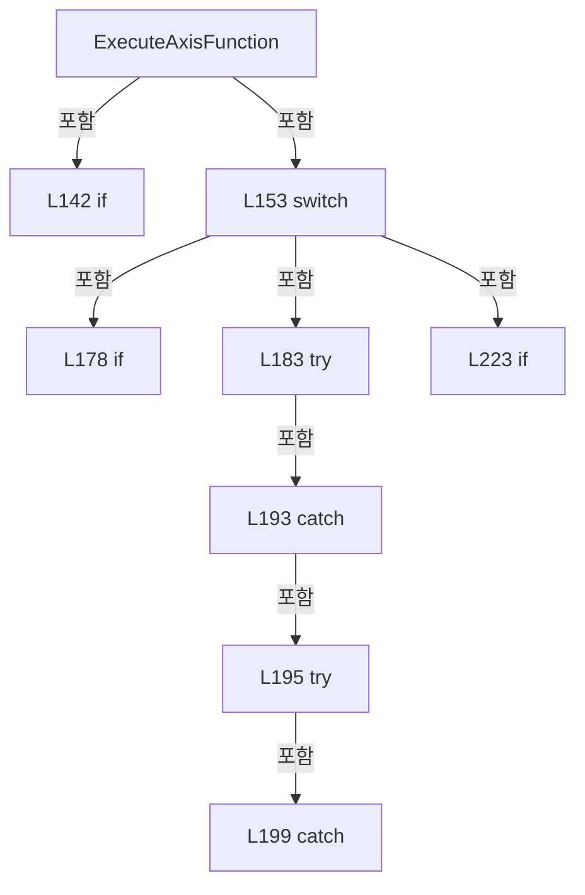

변경 전 점검: 입력/반환 타입, 위 호출자, 예외/취소 경로, 공유 상태와 저장·전송 소비자를 함께 확인합니다. 값의 단위나 물리 방향을 이름만으로 확정하지 않습니다.

### MethodDeclaration `ExecuteIoFunction` · L256–281

[Drilling.Common/Motion/XPS/CXpsComm.cs:256–281](https://github.com/kjuws10-rgb/A3Drilling/blob/5aee8e58439c9b455cae7c9593c9be986c3e682e/Drilling.Common/Motion/XPS/CXpsComm.cs#L256-L281)

| 항목 | 실제 추출 값 |
| --- | --- |
| 서명 | string Drilling.Common.Motion.CXpsComm.ExecuteIoFunction(XPS, System.Collections.Generic.IReadOnlyList<string>) |
| 접근/수식자 | Private / private, static |
| 반환/값 타입 | string |
| 소속 타입 | NamedType:Drilling.Common.Motion.CXpsComm |

입력 계약:

| 이름 | 타입 | 전달 | 선택/기본값 |
| --- | --- | --- | --- |
| api | XPS | None | False /  |
| tokens | System.Collections.Generic.IReadOnlyList<string> | None | False /  |

정적 호출자로 확인된 위치:

| 호출 파일/행 | 호출 표현식 | 런타임 분기 가능 |
| --- | --- | --- |
| [Drilling.Common/Motion/XPS/CXpsComm.cs:136–136](https://github.com/kjuws10-rgb/A3Drilling/blob/5aee8e58439c9b455cae7c9593c9be986c3e682e/Drilling.Common/Motion/XPS/CXpsComm.cs#L136-L136) | ExecuteIoFunction | False |

호출하는 대상과 해석 범위:

| 원본 행 | 표현식 | 분석 상태 | 대상/소스 위치 |
| --- | --- | --- | --- |
| 260 | new InvalidOperationException | resolved | System.InvalidOperationException.InvalidOperationException(string?) |
| 263 | tokens[2].Trim().ToUpperInvariant | resolved | string string.ToUpperInvariant() |
| 263 | tokens[2].Trim | resolved | string string.Trim() |
| 264 | ParseDigitalIoAddress | resolved | (string GpioName, int BitNo) Drilling.Common.Motion.CXpsComm.ParseDigitalIoAddress(string) · Drilling.Common/Motion/XPS/CXpsComm.cs:599 |
| 265 | tokens[3].ToUpperInvariant | resolved | string string.ToUpperInvariant() |
| 269 | CheckResult | candidate | OverloadResolutionFailure |
| 269 | api.GPIODigitalGet | unresolved | None |
| 275 | new InvalidOperationException | resolved | System.InvalidOperationException.InvalidOperationException(string?) |
| 279 | CheckResult | candidate | OverloadResolutionFailure |
| 279 | api.GPIODigitalSet | unresolved | None |

본문의 실제 연산·분기·예외·반환 순서(원문 위치 순):

| 원본 행 | 종류 | 주석 해설 |
| --- | --- | --- |
| 258 | if | 조건에 따라 분기합니다: if (tokens.Count < 4) |
| 260 | call | 함수·델리게이트 또는 객체 생성자를 호출합니다: new InvalidOperationException("XPS IO command is invalid.") |
| 260 | throw | 예외를 발생/전달합니다: throw new InvalidOperationException("XPS IO command is invalid."); |
| 263 | call | 함수·델리게이트 또는 객체 생성자를 호출합니다: tokens[2].Trim().ToUpperInvariant() |
| 263 | call | 함수·델리게이트 또는 객체 생성자를 호출합니다: tokens[2].Trim() |
| 263 | local-declaration | 지역 변수를 선언합니다: var address = tokens[2].Trim().ToUpperInvariant(); |
| 263 | variable-initializer | 변수의 초기값을 지정합니다: address = tokens[2].Trim().ToUpperInvariant() |
| 264 | assignment | 값을 대상에 대입합니다: var(gpioName, bitNo) = ParseDigitalIoAddress(address) |
| 264 | call | 함수·델리게이트 또는 객체 생성자를 호출합니다: ParseDigitalIoAddress(address) |
| 265 | call | 함수·델리게이트 또는 객체 생성자를 호출합니다: tokens[3].ToUpperInvariant() |
| 265 | local-declaration | 지역 변수를 선언합니다: var command = tokens[3].ToUpperInvariant(); |
| 265 | variable-initializer | 변수의 초기값을 지정합니다: command = tokens[3].ToUpperInvariant() |
| 266 | local-declaration | 지역 변수를 선언합니다: var mask = checked((ushort)(1 << bitNo)); |
| 266 | variable-initializer | 변수의 초기값을 지정합니다: mask = checked((ushort)(1 << bitNo)) |
| 267 | if | 조건에 따라 분기합니다: if (command == "READ") |
| 269 | call | 함수·델리게이트 또는 객체 생성자를 호출합니다: CheckResult(api, api.GPIODigitalGet(gpioName, out var value, out var readError), readError) |
| 269 | call | 함수·델리게이트 또는 객체 생성자를 호출합니다: api.GPIODigitalGet(gpioName, out var value, out var readError) |
| 270 | conditional-expression | 조건에 따라 결과식을 선택합니다: (value & mask) != 0 ? "ON" : "OFF" |
| 270 | return | 호출자에게 값 또는 제어를 반환합니다: return $"OK:IO:{address}:{((value & mask) != 0 ? "ON" : "OFF")}"; |
| 273 | if | 조건에 따라 분기합니다: if (command is not ("ON" or "OFF")) |
| 275 | call | 함수·델리게이트 또는 객체 생성자를 호출합니다: new InvalidOperationException($"XPS IO command is unknown: {command}") |
| 275 | throw | 예외를 발생/전달합니다: throw new InvalidOperationException($"XPS IO command is unknown: {command}"); |
| 278 | conditional-expression | 조건에 따라 결과식을 선택합니다: command == "ON" ? mask : (ushort)0 |
| 278 | local-declaration | 지역 변수를 선언합니다: var output = command == "ON" ? mask : (ushort)0; |
| 278 | variable-initializer | 변수의 초기값을 지정합니다: output = command == "ON" ? mask : (ushort)0 |
| 279 | call | 함수·델리게이트 또는 객체 생성자를 호출합니다: CheckResult(api, api.GPIODigitalSet(gpioName, mask, output, out var writeError), writeError) |
| 279 | call | 함수·델리게이트 또는 객체 생성자를 호출합니다: api.GPIODigitalSet(gpioName, mask, output, out var writeError) |
| 280 | return | 호출자에게 값 또는 제어를 반환합니다: return $"OK:IO:{address}:{command}"; |

제어 구문의 포함 구조(실제 실행 순서/CFG가 아닌 구문 탐색 그림):

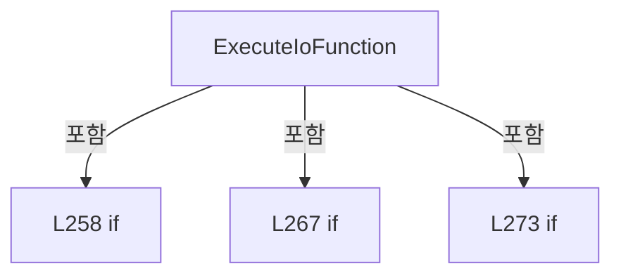

변경 전 점검: 입력/반환 타입, 위 호출자, 예외/취소 경로, 공유 상태와 저장·전송 소비자를 함께 확인합니다. 값의 단위나 물리 방향을 이름만으로 확정하지 않습니다.

### MethodDeclaration `ExecuteRawCommand` · L283–302

[Drilling.Common/Motion/XPS/CXpsComm.cs:283–302](https://github.com/kjuws10-rgb/A3Drilling/blob/5aee8e58439c9b455cae7c9593c9be986c3e682e/Drilling.Common/Motion/XPS/CXpsComm.cs#L283-L302)

| 항목 | 실제 추출 값 |
| --- | --- |
| 서명 | string Drilling.Common.Motion.CXpsComm.ExecuteRawCommand(XPS, string) |
| 접근/수식자 | Private / private, static |
| 반환/값 타입 | string |
| 소속 타입 | NamedType:Drilling.Common.Motion.CXpsComm |

입력 계약:

| 이름 | 타입 | 전달 | 선택/기본값 |
| --- | --- | --- | --- |
| api | XPS | None | False /  |
| function | string | None | False /  |

정적 호출자로 확인된 위치:

| 호출 파일/행 | 호출 표현식 | 런타임 분기 가능 |
| --- | --- | --- |
| [Drilling.Common/Motion/XPS/CXpsComm.cs:130–130](https://github.com/kjuws10-rgb/A3Drilling/blob/5aee8e58439c9b455cae7c9593c9be986c3e682e/Drilling.Common/Motion/XPS/CXpsComm.cs#L130-L130) | ExecuteRawCommand | False |
| [Drilling.Common/Motion/XPS/CXpsComm.cs:137–137](https://github.com/kjuws10-rgb/A3Drilling/blob/5aee8e58439c9b455cae7c9593c9be986c3e682e/Drilling.Common/Motion/XPS/CXpsComm.cs#L137-L137) | ExecuteRawCommand | False |

호출하는 대상과 해석 범위:

| 원본 행 | 표현식 | 분석 상태 | 대상/소스 위치 |
| --- | --- | --- | --- |
| 285 | function.Trim().ToUpperInvariant | resolved | string string.ToUpperInvariant() |
| 285 | function.Trim | resolved | string string.Trim() |
| 287 | ExecuteStatus | resolved | string ExecuteStatus(XPS) · Drilling.Common/Motion/XPS/CXpsComm.cs:290 |
| 288 | ExecuteSockets | resolved | string ExecuteSockets(XPS) · Drilling.Common/Motion/XPS/CXpsComm.cs:297 |
| 289 | new InvalidOperationException | resolved | System.InvalidOperationException.InvalidOperationException(string?) |

본문의 실제 연산·분기·예외·반환 순서(원문 위치 순):

| 원본 행 | 종류 | 주석 해설 |
| --- | --- | --- |
| 285 | call | 함수·델리게이트 또는 객체 생성자를 호출합니다: function.Trim().ToUpperInvariant() |
| 285 | call | 함수·델리게이트 또는 객체 생성자를 호출합니다: function.Trim() |
| 285 | return | 호출자에게 값 또는 제어를 반환합니다: return function.Trim().ToUpperInvariant() switch { "STATUS" => ExecuteStatus(api), "SOCKETS" => ExecuteSockets(api), _ => throw new InvalidOperationException($"XPS raw command is not supported yet: {function}")}; |
| 285 | switch-expression | 값별 결과식을 선택합니다: function.Trim().ToUpperInvariant() switch { "STATUS" => ExecuteStatus(api), "SOCKETS" => ExecuteSockets(api), _ => throw new InvalidOperationException($"XPS raw command is not supported yet: {function}")} |
| 287 | call | 함수·델리게이트 또는 객체 생성자를 호출합니다: ExecuteStatus(api) |
| 288 | call | 함수·델리게이트 또는 객체 생성자를 호출합니다: ExecuteSockets(api) |
| 289 | call | 함수·델리게이트 또는 객체 생성자를 호출합니다: new InvalidOperationException($"XPS raw command is not supported yet: {function}") |
| 289 | throw | 예외를 발생/전달합니다: throw new InvalidOperationException($"XPS raw command is not supported yet: {function}") |

제어 구문의 포함 구조(실제 실행 순서/CFG가 아닌 구문 탐색 그림):

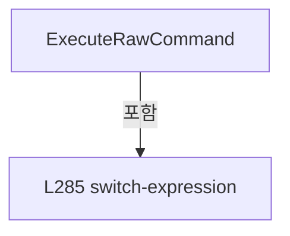

변경 전 점검: 입력/반환 타입, 위 호출자, 예외/취소 경로, 공유 상태와 저장·전송 소비자를 함께 확인합니다. 값의 단위나 물리 방향을 이름만으로 확정하지 않습니다.

### LocalFunctionStatement `ExecuteStatus` · L290–295

[Drilling.Common/Motion/XPS/CXpsComm.cs:290–295](https://github.com/kjuws10-rgb/A3Drilling/blob/5aee8e58439c9b455cae7c9593c9be986c3e682e/Drilling.Common/Motion/XPS/CXpsComm.cs#L290-L295)

| 항목 | 실제 추출 값 |
| --- | --- |
| 서명 | string ExecuteStatus(XPS) |
| 접근/수식자 | Private /  |
| 반환/값 타입 | string |
| 소속 타입 | NamedType:Drilling.Common.Motion.CXpsComm |

입력 계약:

| 이름 | 타입 | 전달 | 선택/기본값 |
| --- | --- | --- | --- |
| xps | XPS | None | False /  |

정적 호출자로 확인된 위치:

| 호출 파일/행 | 호출 표현식 | 런타임 분기 가능 |
| --- | --- | --- |
| [Drilling.Common/Motion/XPS/CXpsComm.cs:287–287](https://github.com/kjuws10-rgb/A3Drilling/blob/5aee8e58439c9b455cae7c9593c9be986c3e682e/Drilling.Common/Motion/XPS/CXpsComm.cs#L287-L287) | ExecuteStatus | False |

호출하는 대상과 해석 범위:

| 원본 행 | 표현식 | 분석 상태 | 대상/소스 위치 |
| --- | --- | --- | --- |
| 292 | CheckResult | candidate | OverloadResolutionFailure |
| 292 | xps.ControllerStatusGet | unresolved | None |
| 293 | CheckResult | candidate | OverloadResolutionFailure |
| 293 | xps.ControllerStatusStringGet | unresolved | None |

본문의 실제 연산·분기·예외·반환 순서(원문 위치 순):

| 원본 행 | 종류 | 주석 해설 |
| --- | --- | --- |
| 292 | call | 함수·델리게이트 또는 객체 생성자를 호출합니다: CheckResult(xps, xps.ControllerStatusGet(out var status, out var statusError), statusError) |
| 292 | call | 함수·델리게이트 또는 객체 생성자를 호출합니다: xps.ControllerStatusGet(out var status, out var statusError) |
| 293 | call | 함수·델리게이트 또는 객체 생성자를 호출합니다: CheckResult(xps, xps.ControllerStatusStringGet(status, out var statusText, out var statusTextError), statusTextError) |
| 293 | call | 함수·델리게이트 또는 객체 생성자를 호출합니다: xps.ControllerStatusStringGet(status, out var statusText, out var statusTextError) |
| 294 | return | 호출자에게 값 또는 제어를 반환합니다: return $"OK:STATUS:{status}:{statusText}"; |

변경 전 점검: 입력/반환 타입, 위 호출자, 예외/취소 경로, 공유 상태와 저장·전송 소비자를 함께 확인합니다. 값의 단위나 물리 방향을 이름만으로 확정하지 않습니다.

### LocalFunctionStatement `ExecuteSockets` · L297–301

[Drilling.Common/Motion/XPS/CXpsComm.cs:297–301](https://github.com/kjuws10-rgb/A3Drilling/blob/5aee8e58439c9b455cae7c9593c9be986c3e682e/Drilling.Common/Motion/XPS/CXpsComm.cs#L297-L301)

| 항목 | 실제 추출 값 |
| --- | --- |
| 서명 | string ExecuteSockets(XPS) |
| 접근/수식자 | Private /  |
| 반환/값 타입 | string |
| 소속 타입 | NamedType:Drilling.Common.Motion.CXpsComm |

입력 계약:

| 이름 | 타입 | 전달 | 선택/기본값 |
| --- | --- | --- | --- |
| xps | XPS | None | False /  |

정적 호출자로 확인된 위치:

| 호출 파일/행 | 호출 표현식 | 런타임 분기 가능 |
| --- | --- | --- |
| [Drilling.Common/Motion/XPS/CXpsComm.cs:288–288](https://github.com/kjuws10-rgb/A3Drilling/blob/5aee8e58439c9b455cae7c9593c9be986c3e682e/Drilling.Common/Motion/XPS/CXpsComm.cs#L288-L288) | ExecuteSockets | False |

호출하는 대상과 해석 범위:

| 원본 행 | 표현식 | 분석 상태 | 대상/소스 위치 |
| --- | --- | --- | --- |
| 299 | CheckResult | candidate | OverloadResolutionFailure |
| 299 | xps.SocketsStatusGet | unresolved | None |

본문의 실제 연산·분기·예외·반환 순서(원문 위치 순):

| 원본 행 | 종류 | 주석 해설 |
| --- | --- | --- |
| 299 | call | 함수·델리게이트 또는 객체 생성자를 호출합니다: CheckResult(xps, xps.SocketsStatusGet(out var result, out var socketError), socketError) |
| 299 | call | 함수·델리게이트 또는 객체 생성자를 호출합니다: xps.SocketsStatusGet(out var result, out var socketError) |
| 300 | return | 호출자에게 값 또는 제어를 반환합니다: return $"OK:SOCKETS:{result}"; |

변경 전 점검: 입력/반환 타입, 위 호출자, 예외/취소 경로, 공유 상태와 저장·전송 소비자를 함께 확인합니다. 값의 단위나 물리 방향을 이름만으로 확정하지 않습니다.

### MethodDeclaration `CloseApi` · L304–323

[Drilling.Common/Motion/XPS/CXpsComm.cs:304–323](https://github.com/kjuws10-rgb/A3Drilling/blob/5aee8e58439c9b455cae7c9593c9be986c3e682e/Drilling.Common/Motion/XPS/CXpsComm.cs#L304-L323)

| 항목 | 실제 추출 값 |
| --- | --- |
| 서명 | void Drilling.Common.Motion.CXpsComm.CloseApi() |
| 접근/수식자 | Private / private |
| 반환/값 타입 | void |
| 소속 타입 | NamedType:Drilling.Common.Motion.CXpsComm |

정적 호출자로 확인된 위치:

| 호출 파일/행 | 호출 표현식 | 런타임 분기 가능 |
| --- | --- | --- |
| [Drilling.Common/Motion/XPS/CXpsComm.cs:30–30](https://github.com/kjuws10-rgb/A3Drilling/blob/5aee8e58439c9b455cae7c9593c9be986c3e682e/Drilling.Common/Motion/XPS/CXpsComm.cs#L30-L30) | CloseApi | False |
| [Drilling.Common/Motion/XPS/CXpsComm.cs:44–44](https://github.com/kjuws10-rgb/A3Drilling/blob/5aee8e58439c9b455cae7c9593c9be986c3e682e/Drilling.Common/Motion/XPS/CXpsComm.cs#L44-L44) | CloseApi | False |
| [Drilling.Common/Motion/XPS/CXpsComm.cs:111–111](https://github.com/kjuws10-rgb/A3Drilling/blob/5aee8e58439c9b455cae7c9593c9be986c3e682e/Drilling.Common/Motion/XPS/CXpsComm.cs#L111-L111) | CloseApi | False |

호출하는 대상과 해석 범위:

| 원본 행 | 표현식 | 분석 상태 | 대상/소스 위치 |
| --- | --- | --- | --- |
| 313 | _api.CloseInstrument | unresolved | None |

본문의 실제 연산·분기·예외·반환 순서(원문 위치 순):

| 원본 행 | 종류 | 주석 해설 |
| --- | --- | --- |
| 306 | if | 조건에 따라 분기합니다: if (_api is null) |
| 308 | return | 호출자에게 값 또는 제어를 반환합니다: return; |
| 311 | try | 예외 처리 범위입니다: try |
| 313 | call | 함수·델리게이트 또는 객체 생성자를 호출합니다: _api.CloseInstrument() |
| 315 | catch | 지정 예외를 처리합니다: catch  |
| 319 | finally | 종료 정리 구간입니다: finally |
| 321 | assignment | 값을 대상에 대입합니다: _api = null |

제어 구문의 포함 구조(실제 실행 순서/CFG가 아닌 구문 탐색 그림):

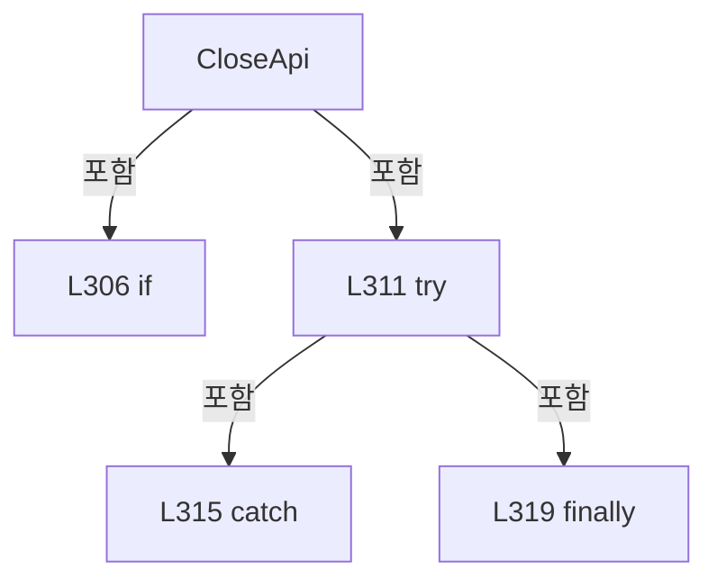

변경 전 점검: 입력/반환 타입, 위 호출자, 예외/취소 경로, 공유 상태와 저장·전송 소비자를 함께 확인합니다. 값의 단위나 물리 방향을 이름만으로 확정하지 않습니다.

### MethodDeclaration `CheckResult` · L325–344

[Drilling.Common/Motion/XPS/CXpsComm.cs:325–344](https://github.com/kjuws10-rgb/A3Drilling/blob/5aee8e58439c9b455cae7c9593c9be986c3e682e/Drilling.Common/Motion/XPS/CXpsComm.cs#L325-L344)

| 항목 | 실제 추출 값 |
| --- | --- |
| 서명 | void Drilling.Common.Motion.CXpsComm.CheckResult(XPS, int, string) |
| 접근/수식자 | Private / private, static |
| 반환/값 타입 | void |
| 소속 타입 | NamedType:Drilling.Common.Motion.CXpsComm |

입력 계약:

| 이름 | 타입 | 전달 | 선택/기본값 |
| --- | --- | --- | --- |
| api | XPS | None | False /  |
| result | int | None | False /  |
| detail | string | None | False /  |

현재 부분 분석에서 직접 연결된 호출자는 없습니다. XAML/이벤트/인터페이스·델리게이트·외부 진입을 추가 확인해야 하며, 미사용으로 판정한 것이 아닙니다.

호출하는 대상과 해석 범위:

| 원본 행 | 표현식 | 분석 상태 | 대상/소스 위치 |
| --- | --- | --- | --- |
| 335 | api.ErrorStringGet | unresolved | None |
| 342 | string.IsNullOrWhiteSpace | resolved | bool string.IsNullOrWhiteSpace(string?) |
| 343 | new InvalidOperationException | resolved | System.InvalidOperationException.InvalidOperationException(string?) |

본문의 실제 연산·분기·예외·반환 순서(원문 위치 순):

| 원본 행 | 종류 | 주석 해설 |
| --- | --- | --- |
| 327 | if | 조건에 따라 분기합니다: if (result == 0) |
| 329 | return | 호출자에게 값 또는 제어를 반환합니다: return; |
| 332 | local-declaration | 지역 변수를 선언합니다: var error = ""; |
| 332 | variable-initializer | 변수의 초기값을 지정합니다: error = "" |
| 333 | try | 예외 처리 범위입니다: try |
| 335 | assignment | 값을 대상에 대입합니다: _ = api.ErrorStringGet(result, out error, out _) |
| 335 | call | 함수·델리게이트 또는 객체 생성자를 호출합니다: api.ErrorStringGet(result, out error, out _) |
| 337 | catch | 지정 예외를 처리합니다: catch  |
| 339 | assignment | 값을 대상에 대입합니다: error = "" |
| 342 | call | 함수·델리게이트 또는 객체 생성자를 호출합니다: string.IsNullOrWhiteSpace(error) |
| 342 | conditional-expression | 조건에 따라 결과식을 선택합니다: string.IsNullOrWhiteSpace(error) ? detail : error |
| 342 | local-declaration | 지역 변수를 선언합니다: var message = string.IsNullOrWhiteSpace(error) ? detail : error; |
| 342 | variable-initializer | 변수의 초기값을 지정합니다: message = string.IsNullOrWhiteSpace(error) ? detail : error |
| 343 | call | 함수·델리게이트 또는 객체 생성자를 호출합니다: new InvalidOperationException($"XPS command failed. Code={result}, Detail={message}") |
| 343 | throw | 예외를 발생/전달합니다: throw new InvalidOperationException($"XPS command failed. Code={result}, Detail={message}"); |

제어 구문의 포함 구조(실제 실행 순서/CFG가 아닌 구문 탐색 그림):

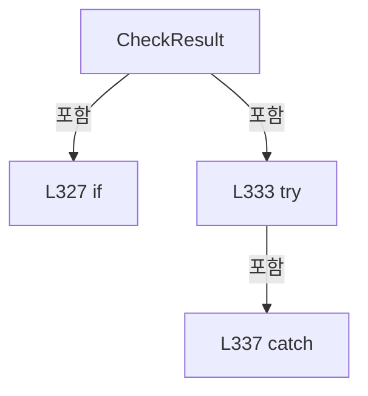

변경 전 점검: 입력/반환 타입, 위 호출자, 예외/취소 경로, 공유 상태와 저장·전송 소비자를 함께 확인합니다. 값의 단위나 물리 방향을 이름만으로 확정하지 않습니다.

### MethodDeclaration `ReadDouble` · L346–354

[Drilling.Common/Motion/XPS/CXpsComm.cs:346–354](https://github.com/kjuws10-rgb/A3Drilling/blob/5aee8e58439c9b455cae7c9593c9be986c3e682e/Drilling.Common/Motion/XPS/CXpsComm.cs#L346-L354)

| 항목 | 실제 추출 값 |
| --- | --- |
| 서명 | double Drilling.Common.Motion.CXpsComm.ReadDouble(System.Collections.Generic.IReadOnlyList<string>, int, string) |
| 접근/수식자 | Private / private, static |
| 반환/값 타입 | double |
| 소속 타입 | NamedType:Drilling.Common.Motion.CXpsComm |

입력 계약:

| 이름 | 타입 | 전달 | 선택/기본값 |
| --- | --- | --- | --- |
| tokens | System.Collections.Generic.IReadOnlyList<string> | None | False /  |
| index | int | None | False /  |
| command | string | None | False /  |

정적 호출자로 확인된 위치:

| 호출 파일/행 | 호출 표현식 | 런타임 분기 가능 |
| --- | --- | --- |
| [Drilling.Common/Motion/XPS/CXpsComm.cs:167–167](https://github.com/kjuws10-rgb/A3Drilling/blob/5aee8e58439c9b455cae7c9593c9be986c3e682e/Drilling.Common/Motion/XPS/CXpsComm.cs#L167-L167) | ReadDouble | False |
| [Drilling.Common/Motion/XPS/CXpsComm.cs:170–170](https://github.com/kjuws10-rgb/A3Drilling/blob/5aee8e58439c9b455cae7c9593c9be986c3e682e/Drilling.Common/Motion/XPS/CXpsComm.cs#L170-L170) | ReadDouble | False |
| [Drilling.Common/Motion/XPS/CXpsComm.cs:176–176](https://github.com/kjuws10-rgb/A3Drilling/blob/5aee8e58439c9b455cae7c9593c9be986c3e682e/Drilling.Common/Motion/XPS/CXpsComm.cs#L176-L176) | ReadDouble | False |
| [Drilling.Common/Motion/XPS/CXpsComm.cs:580–580](https://github.com/kjuws10-rgb/A3Drilling/blob/5aee8e58439c9b455cae7c9593c9be986c3e682e/Drilling.Common/Motion/XPS/CXpsComm.cs#L580-L580) | ReadDouble | False |

호출하는 대상과 해석 범위:

| 원본 행 | 표현식 | 분석 상태 | 대상/소스 위치 |
| --- | --- | --- | --- |
| 348 | double.TryParse | resolved | bool double.TryParse(string?, System.Globalization.NumberStyles, System.IFormatProvider?, out double) |
| 348 | double.IsFinite | resolved | bool double.IsFinite(double) |
| 350 | new InvalidOperationException | resolved | System.InvalidOperationException.InvalidOperationException(string?) |

본문의 실제 연산·분기·예외·반환 순서(원문 위치 순):

| 원본 행 | 종류 | 주석 해설 |
| --- | --- | --- |
| 348 | call | 함수·델리게이트 또는 객체 생성자를 호출합니다: double.TryParse(tokens[index], NumberStyles.Float, CultureInfo.InvariantCulture, out var result) |
| 348 | call | 함수·델리게이트 또는 객체 생성자를 호출합니다: double.IsFinite(result) |
| 348 | if | 조건에 따라 분기합니다: if (tokens.Count <= index &#124;&#124; !double.TryParse(tokens[index], NumberStyles.Float, CultureInfo.InvariantCulture, out var result) &#124;&#124; !double.IsFinite(result)) |
| 350 | call | 함수·델리게이트 또는 객체 생성자를 호출합니다: new InvalidOperationException($"XPS {command} parameter must be finite.") |
| 350 | throw | 예외를 발생/전달합니다: throw new InvalidOperationException($"XPS {command} parameter must be finite."); |
| 353 | return | 호출자에게 값 또는 제어를 반환합니다: return result; |

제어 구문의 포함 구조(실제 실행 순서/CFG가 아닌 구문 탐색 그림):

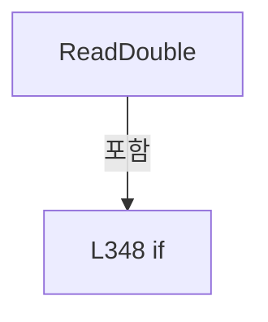

변경 전 점검: 입력/반환 타입, 위 호출자, 예외/취소 경로, 공유 상태와 저장·전송 소비자를 함께 확인합니다. 값의 단위나 물리 방향을 이름만으로 확정하지 않습니다.

### MethodDeclaration `ExecutePriorityStop` · L356–385

[Drilling.Common/Motion/XPS/CXpsComm.cs:356–385](https://github.com/kjuws10-rgb/A3Drilling/blob/5aee8e58439c9b455cae7c9593c9be986c3e682e/Drilling.Common/Motion/XPS/CXpsComm.cs#L356-L385)

| 항목 | 실제 추출 값 |
| --- | --- |
| 서명 | System.Threading.Tasks.Task<string> Drilling.Common.Motion.CXpsComm.ExecutePriorityStop(string, System.Threading.CancellationToken) |
| 접근/수식자 | Private / private, async |
| 반환/값 타입 | System.Threading.Tasks.Task<string> |
| 소속 타입 | NamedType:Drilling.Common.Motion.CXpsComm |

입력 계약:

| 이름 | 타입 | 전달 | 선택/기본값 |
| --- | --- | --- | --- |
| function | string | None | False /  |
| cancellationToken | System.Threading.CancellationToken | None | False /  |

정적 호출자로 확인된 위치:

| 호출 파일/행 | 호출 표현식 | 런타임 분기 가능 |
| --- | --- | --- |
| [Drilling.Common/Motion/XPS/CXpsComm.cs:59–59](https://github.com/kjuws10-rgb/A3Drilling/blob/5aee8e58439c9b455cae7c9593c9be986c3e682e/Drilling.Common/Motion/XPS/CXpsComm.cs#L59-L59) | ExecutePriorityStop | False |

호출하는 대상과 해석 범위:

| 원본 행 | 표현식 | 분석 상태 | 대상/소스 위치 |
| --- | --- | --- | --- |
| 358 | BeginCommandDiagnostic | resolved | long Drilling.Common.Motion.CXpsComm.BeginCommandDiagnostic(string) · Drilling.Common/Motion/XPS/CXpsComm.cs:387 |
| 371 | Task.Factory.StartNew | resolved | System.Threading.Tasks.Task<string> System.Threading.Tasks.TaskFactory.StartNew<string>(System.Func<string>, System.Threading.CancellationToken, System.Threading.Tasks.TaskCreationOptions, System.Threading.Tasks.TaskScheduler) |
| 372 | stopTask.ContinueWith | resolved | System.Threading.Tasks.Task<System.AggregateException?> System.Threading.Tasks.Task<string>.ContinueWith<System.AggregateException?>(System.Func<System.Threading.Tasks.Task<string>, System.AggregateException?>, System.Threading.CancellationToken, System.Threading.Tasks.TaskContinuationOptions, System.Threading.Tasks.TaskScheduler) |
| 373 | stopTask.WaitAsync | resolved | System.Threading.Tasks.Task<string> System.Threading.Tasks.Task<string>.WaitAsync(System.Threading.CancellationToken) |
| 374 | CompletePriorityStop | resolved | void Drilling.Common.Motion.CXpsComm.CompletePriorityStop(long, string) · Drilling.Common/Motion/XPS/CXpsComm.cs:432 |
| 379 | FailPriorityStop | resolved | string Drilling.Common.Motion.CXpsComm.FailPriorityStop(long, System.Exception) · Drilling.Common/Motion/XPS/CXpsComm.cs:446 |
| 379 | new TimeoutException | resolved | System.TimeoutException.TimeoutException(string?, System.Exception?) |
| 383 | FailPriorityStop | resolved | string Drilling.Common.Motion.CXpsComm.FailPriorityStop(long, System.Exception) · Drilling.Common/Motion/XPS/CXpsComm.cs:446 |

본문의 실제 연산·분기·예외·반환 순서(원문 위치 순):

| 원본 행 | 종류 | 주석 해설 |
| --- | --- | --- |
| 358 | call | 함수·델리게이트 또는 객체 생성자를 호출합니다: BeginCommandDiagnostic(function) |
| 358 | local-declaration | 지역 변수를 선언합니다: var diagnosticSequence = BeginCommandDiagnostic(function); |
| 358 | variable-initializer | 변수의 초기값을 지정합니다: diagnosticSequence = BeginCommandDiagnostic(function) |
| 369 | try | 예외 처리 범위입니다: try |
| 371 | call | 함수·델리게이트 또는 객체 생성자를 호출합니다: Task.Factory.StartNew(SelectValue, CancellationToken.None, TaskCreationOptions.LongRunning &#124; TaskCreationOptions.DenyChildAttach, TaskScheduler.Default) |
| 371 | local-declaration | 지역 변수를 선언합니다: var stopTask = Task.Factory.StartNew(SelectValue, CancellationToken.None, TaskCreationOptions.LongRunning &#124; TaskCreationOptions.DenyChildAttach, TaskScheduler.Default); |
| 371 | variable-initializer | 변수의 초기값을 지정합니다: stopTask = Task.Factory.StartNew(SelectValue, CancellationToken.None, TaskCreationOptions.LongRunning &#124; TaskCreationOptions.DenyChildAttach, TaskScheduler.Default) |
| 372 | assignment | 값을 대상에 대입합니다: _ = stopTask.ContinueWith(SelectAggregateexception, CancellationToken.None, TaskContinuationOptions.OnlyOnFaulted &#124; TaskContinuationOptions.ExecuteSynchronously, TaskScheduler.Default) |
| 372 | call | 함수·델리게이트 또는 객체 생성자를 호출합니다: stopTask.ContinueWith(SelectAggregateexception, CancellationToken.None, TaskContinuationOptions.OnlyOnFaulted &#124; TaskContinuationOptions.ExecuteSynchronously, TaskScheduler.Default) |
| 373 | await | 비동기 완료를 기다립니다: await stopTask.WaitAsync(cancellationToken) |
| 373 | call | 함수·델리게이트 또는 객체 생성자를 호출합니다: stopTask.WaitAsync(cancellationToken) |
| 373 | local-declaration | 지역 변수를 선언합니다: var response = await stopTask.WaitAsync(cancellationToken); |
| 373 | variable-initializer | 변수의 초기값을 지정합니다: response = await stopTask.WaitAsync(cancellationToken) |
| 374 | call | 함수·델리게이트 또는 객체 생성자를 호출합니다: CompletePriorityStop(diagnosticSequence, response) |
| 375 | return | 호출자에게 값 또는 제어를 반환합니다: return response; |
| 377 | catch | 지정 예외를 처리합니다: catch (OperationCanceledException exception) when (cancellationToken.IsCancellationRequested) |
| 379 | call | 함수·델리게이트 또는 객체 생성자를 호출합니다: FailPriorityStop(diagnosticSequence, new TimeoutException($"XPS priority stop timed out after {(Option.TimeoutMs > 0 ? Option.TimeoutMs : 5000)} ms.", exception)) |
| 379 | call | 함수·델리게이트 또는 객체 생성자를 호출합니다: new TimeoutException($"XPS priority stop timed out after {(Option.TimeoutMs > 0 ? Option.TimeoutMs : 5000)} ms.", exception) |
| 379 | conditional-expression | 조건에 따라 결과식을 선택합니다: Option.TimeoutMs > 0 ? Option.TimeoutMs : 5000 |
| 379 | return | 호출자에게 값 또는 제어를 반환합니다: return FailPriorityStop(diagnosticSequence, new TimeoutException($"XPS priority stop timed out after {(Option.TimeoutMs > 0 ? Option.TimeoutMs : 5000)} ms.", exception)); |
| 381 | catch | 지정 예외를 처리합니다: catch (Exception ex) |
| 383 | call | 함수·델리게이트 또는 객체 생성자를 호출합니다: FailPriorityStop(diagnosticSequence, ex) |
| 383 | return | 호출자에게 값 또는 제어를 반환합니다: return FailPriorityStop(diagnosticSequence, ex); |

제어 구문의 포함 구조(실제 실행 순서/CFG가 아닌 구문 탐색 그림):

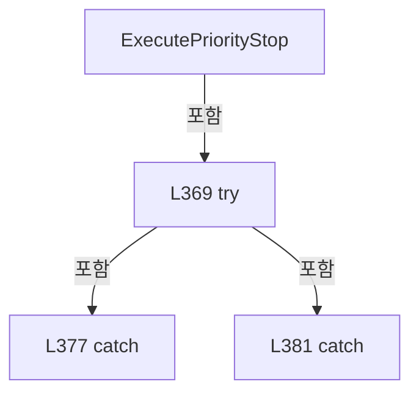

변경 전 점검: 입력/반환 타입, 위 호출자, 예외/취소 경로, 공유 상태와 저장·전송 소비자를 함께 확인합니다. 값의 단위나 물리 방향을 이름만으로 확정하지 않습니다.

### LocalFunctionStatement `SelectValue` · L359–362

[Drilling.Common/Motion/XPS/CXpsComm.cs:359–362](https://github.com/kjuws10-rgb/A3Drilling/blob/5aee8e58439c9b455cae7c9593c9be986c3e682e/Drilling.Common/Motion/XPS/CXpsComm.cs#L359-L362)

| 항목 | 실제 추출 값 |
| --- | --- |
| 서명 | string SelectValue() |
| 접근/수식자 | Private /  |
| 반환/값 타입 | string |
| 소속 타입 | NamedType:Drilling.Common.Motion.CXpsComm |

현재 부분 분석에서 직접 연결된 호출자는 없습니다. XAML/이벤트/인터페이스·델리게이트·외부 진입을 추가 확인해야 하며, 미사용으로 판정한 것이 아닙니다.

호출하는 대상과 해석 범위:

| 원본 행 | 표현식 | 분석 상태 | 대상/소스 위치 |
| --- | --- | --- | --- |
| 361 | ExecutePriorityStopCore | resolved | string Drilling.Common.Motion.CXpsComm.ExecutePriorityStopCore(string) · Drilling.Common/Motion/XPS/CXpsComm.cs:507 |

본문의 실제 연산·분기·예외·반환 순서(원문 위치 순):

| 원본 행 | 종류 | 주석 해설 |
| --- | --- | --- |
| 361 | call | 함수·델리게이트 또는 객체 생성자를 호출합니다: ExecutePriorityStopCore(function) |
| 361 | return | 호출자에게 값 또는 제어를 반환합니다: return ExecutePriorityStopCore(function); |

변경 전 점검: 입력/반환 타입, 위 호출자, 예외/취소 경로, 공유 상태와 저장·전송 소비자를 함께 확인합니다. 값의 단위나 물리 방향을 이름만으로 확정하지 않습니다.

### LocalFunctionStatement `SelectAggregateexception` · L364–367

[Drilling.Common/Motion/XPS/CXpsComm.cs:364–367](https://github.com/kjuws10-rgb/A3Drilling/blob/5aee8e58439c9b455cae7c9593c9be986c3e682e/Drilling.Common/Motion/XPS/CXpsComm.cs#L364-L367)

| 항목 | 실제 추출 값 |
| --- | --- |
| 서명 | System.AggregateException? SelectAggregateexception(System.Threading.Tasks.Task<string>) |
| 접근/수식자 | Private /  |
| 반환/값 타입 | System.AggregateException? |
| 소속 타입 | NamedType:Drilling.Common.Motion.CXpsComm |

입력 계약:

| 이름 | 타입 | 전달 | 선택/기본값 |
| --- | --- | --- | --- |
| task | System.Threading.Tasks.Task<string> | None | False /  |

현재 부분 분석에서 직접 연결된 호출자는 없습니다. XAML/이벤트/인터페이스·델리게이트·외부 진입을 추가 확인해야 하며, 미사용으로 판정한 것이 아닙니다.

본문의 실제 연산·분기·예외·반환 순서(원문 위치 순):

| 원본 행 | 종류 | 주석 해설 |
| --- | --- | --- |
| 366 | assignment | 값을 대상에 대입합니다: _ = task.Exception |
| 366 | return | 호출자에게 값 또는 제어를 반환합니다: return _ = task.Exception; |

변경 전 점검: 입력/반환 타입, 위 호출자, 예외/취소 경로, 공유 상태와 저장·전송 소비자를 함께 확인합니다. 값의 단위나 물리 방향을 이름만으로 확정하지 않습니다.

### MethodDeclaration `BeginCommandDiagnostic` · L387–398

[Drilling.Common/Motion/XPS/CXpsComm.cs:387–398](https://github.com/kjuws10-rgb/A3Drilling/blob/5aee8e58439c9b455cae7c9593c9be986c3e682e/Drilling.Common/Motion/XPS/CXpsComm.cs#L387-L398)

| 항목 | 실제 추출 값 |
| --- | --- |
| 서명 | long Drilling.Common.Motion.CXpsComm.BeginCommandDiagnostic(string) |
| 접근/수식자 | Private / private |
| 반환/값 타입 | long |
| 소속 타입 | NamedType:Drilling.Common.Motion.CXpsComm |

입력 계약:

| 이름 | 타입 | 전달 | 선택/기본값 |
| --- | --- | --- | --- |
| function | string | None | False /  |

정적 호출자로 확인된 위치:

| 호출 파일/행 | 호출 표현식 | 런타임 분기 가능 |
| --- | --- | --- |
| [Drilling.Common/Motion/XPS/CXpsComm.cs:75–75](https://github.com/kjuws10-rgb/A3Drilling/blob/5aee8e58439c9b455cae7c9593c9be986c3e682e/Drilling.Common/Motion/XPS/CXpsComm.cs#L75-L75) | BeginCommandDiagnostic | False |
| [Drilling.Common/Motion/XPS/CXpsComm.cs:358–358](https://github.com/kjuws10-rgb/A3Drilling/blob/5aee8e58439c9b455cae7c9593c9be986c3e682e/Drilling.Common/Motion/XPS/CXpsComm.cs#L358-L358) | BeginCommandDiagnostic | False |

본문의 실제 연산·분기·예외·반환 순서(원문 위치 순):

| 원본 행 | 종류 | 주석 해설 |
| --- | --- | --- |
| 389 | lock | 공유 상태의 임계 구역에 진입합니다: lock (_diagnosticLock) |
| 391 | local-declaration | 지역 변수를 선언합니다: var sequence = ++_diagnosticSequence; |
| 391 | variable-initializer | 변수의 초기값을 지정합니다: sequence = ++_diagnosticSequence |
| 392 | assignment | 값을 대상에 대입합니다: _lastAppliedDiagnosticSequence = sequence |
| 393 | assignment | 값을 대상에 대입합니다: LastSent = function |
| 394 | assignment | 값을 대상에 대입합니다: LastReceived = "" |
| 395 | assignment | 값을 대상에 대입합니다: LastChangedAt = DateTimeOffset.Now |
| 396 | return | 호출자에게 값 또는 제어를 반환합니다: return sequence; |

제어 구문의 포함 구조(실제 실행 순서/CFG가 아닌 구문 탐색 그림):

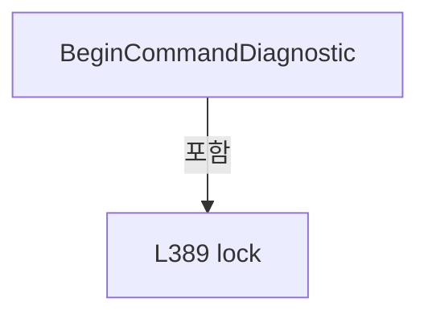

변경 전 점검: 입력/반환 타입, 위 호출자, 예외/취소 경로, 공유 상태와 저장·전송 소비자를 함께 확인합니다. 값의 단위나 물리 방향을 이름만으로 확정하지 않습니다.

### MethodDeclaration `CompletePrimaryCommand` · L400–413

[Drilling.Common/Motion/XPS/CXpsComm.cs:400–413](https://github.com/kjuws10-rgb/A3Drilling/blob/5aee8e58439c9b455cae7c9593c9be986c3e682e/Drilling.Common/Motion/XPS/CXpsComm.cs#L400-L413)

| 항목 | 실제 추출 값 |
| --- | --- |
| 서명 | void Drilling.Common.Motion.CXpsComm.CompletePrimaryCommand(long, string) |
| 접근/수식자 | Private / private |
| 반환/값 타입 | void |
| 소속 타입 | NamedType:Drilling.Common.Motion.CXpsComm |

입력 계약:

| 이름 | 타입 | 전달 | 선택/기본값 |
| --- | --- | --- | --- |
| sequence | long | None | False /  |
| response | string | None | False /  |

정적 호출자로 확인된 위치:

| 호출 파일/행 | 호출 표현식 | 런타임 분기 가능 |
| --- | --- | --- |
| [Drilling.Common/Motion/XPS/CXpsComm.cs:91–91](https://github.com/kjuws10-rgb/A3Drilling/blob/5aee8e58439c9b455cae7c9593c9be986c3e682e/Drilling.Common/Motion/XPS/CXpsComm.cs#L91-L91) | CompletePrimaryCommand | False |

호출하는 대상과 해석 범위:

| 원본 행 | 표현식 | 분석 상태 | 대상/소스 위치 |
| --- | --- | --- | --- |
| 411 | SetState | resolved | void Drilling.Common.Interface.CCommBase.SetState(Drilling.Common.Interface.EN_COMM_STATE) · Drilling.Common/Interface/CComm.cs:114 |

본문의 실제 연산·분기·예외·반환 순서(원문 위치 순):

| 원본 행 | 종류 | 주석 해설 |
| --- | --- | --- |
| 402 | lock | 공유 상태의 임계 구역에 진입합니다: lock (_diagnosticLock) |
| 404 | if | 조건에 따라 분기합니다: if (sequence < _lastAppliedDiagnosticSequence) |
| 406 | return | 호출자에게 값 또는 제어를 반환합니다: return; |
| 409 | assignment | 값을 대상에 대입합니다: LastReceived = response |
| 410 | assignment | 값을 대상에 대입합니다: LastError = "" |
| 411 | call | 함수·델리게이트 또는 객체 생성자를 호출합니다: SetState(EN_COMM_STATE.Online) |

제어 구문의 포함 구조(실제 실행 순서/CFG가 아닌 구문 탐색 그림):

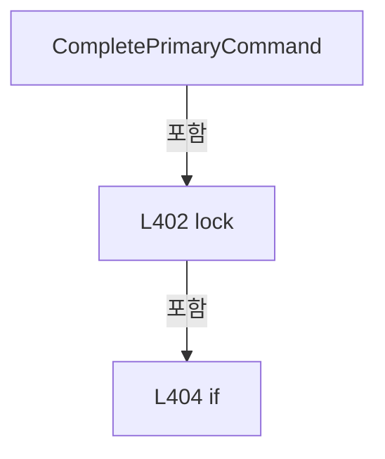

변경 전 점검: 입력/반환 타입, 위 호출자, 예외/취소 경로, 공유 상태와 저장·전송 소비자를 함께 확인합니다. 값의 단위나 물리 방향을 이름만으로 확정하지 않습니다.

### MethodDeclaration `FailPrimaryCommand` · L415–430

[Drilling.Common/Motion/XPS/CXpsComm.cs:415–430](https://github.com/kjuws10-rgb/A3Drilling/blob/5aee8e58439c9b455cae7c9593c9be986c3e682e/Drilling.Common/Motion/XPS/CXpsComm.cs#L415-L430)

| 항목 | 실제 추출 값 |
| --- | --- |
| 서명 | string Drilling.Common.Motion.CXpsComm.FailPrimaryCommand(long, System.Exception) |
| 접근/수식자 | Private / private |
| 반환/값 타입 | string |
| 소속 타입 | NamedType:Drilling.Common.Motion.CXpsComm |

입력 계약:

| 이름 | 타입 | 전달 | 선택/기본값 |
| --- | --- | --- | --- |
| sequence | long | None | False /  |
| exception | System.Exception | None | False /  |

정적 호출자로 확인된 위치:

| 호출 파일/행 | 호출 표현식 | 런타임 분기 가능 |
| --- | --- | --- |
| [Drilling.Common/Motion/XPS/CXpsComm.cs:100–100](https://github.com/kjuws10-rgb/A3Drilling/blob/5aee8e58439c9b455cae7c9593c9be986c3e682e/Drilling.Common/Motion/XPS/CXpsComm.cs#L100-L100) | FailPrimaryCommand | False |

호출하는 대상과 해석 범위:

| 원본 행 | 표현식 | 분석 상태 | 대상/소스 위치 |
| --- | --- | --- | --- |
| 417 | CreateErrorResponse | resolved | string Drilling.Common.Motion.CXpsComm.CreateErrorResponse(System.Exception) · Drilling.Common/Motion/XPS/CXpsComm.cs:463 |
| 427 | SetState | resolved | void Drilling.Common.Interface.CCommBase.SetState(Drilling.Common.Interface.EN_COMM_STATE) · Drilling.Common/Interface/CComm.cs:114 |

본문의 실제 연산·분기·예외·반환 순서(원문 위치 순):

| 원본 행 | 종류 | 주석 해설 |
| --- | --- | --- |
| 417 | call | 함수·델리게이트 또는 객체 생성자를 호출합니다: CreateErrorResponse(exception) |
| 417 | local-declaration | 지역 변수를 선언합니다: var response = CreateErrorResponse(exception); |
| 417 | variable-initializer | 변수의 초기값을 지정합니다: response = CreateErrorResponse(exception) |
| 418 | lock | 공유 상태의 임계 구역에 진입합니다: lock (_diagnosticLock) |
| 420 | if | 조건에 따라 분기합니다: if (sequence < _lastAppliedDiagnosticSequence) |
| 422 | return | 호출자에게 값 또는 제어를 반환합니다: return response; |
| 425 | assignment | 값을 대상에 대입합니다: LastReceived = response |
| 426 | assignment | 값을 대상에 대입합니다: LastError = exception.Message |
| 427 | call | 함수·델리게이트 또는 객체 생성자를 호출합니다: SetState(EN_COMM_STATE.Offline) |
| 428 | return | 호출자에게 값 또는 제어를 반환합니다: return response; |

제어 구문의 포함 구조(실제 실행 순서/CFG가 아닌 구문 탐색 그림):

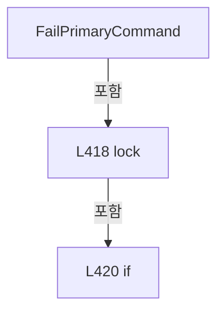

변경 전 점검: 입력/반환 타입, 위 호출자, 예외/취소 경로, 공유 상태와 저장·전송 소비자를 함께 확인합니다. 값의 단위나 물리 방향을 이름만으로 확정하지 않습니다.

### MethodDeclaration `CompletePriorityStop` · L432–444

[Drilling.Common/Motion/XPS/CXpsComm.cs:432–444](https://github.com/kjuws10-rgb/A3Drilling/blob/5aee8e58439c9b455cae7c9593c9be986c3e682e/Drilling.Common/Motion/XPS/CXpsComm.cs#L432-L444)

| 항목 | 실제 추출 값 |
| --- | --- |
| 서명 | void Drilling.Common.Motion.CXpsComm.CompletePriorityStop(long, string) |
| 접근/수식자 | Private / private |
| 반환/값 타입 | void |
| 소속 타입 | NamedType:Drilling.Common.Motion.CXpsComm |

입력 계약:

| 이름 | 타입 | 전달 | 선택/기본값 |
| --- | --- | --- | --- |
| sequence | long | None | False /  |
| response | string | None | False /  |

정적 호출자로 확인된 위치:

| 호출 파일/행 | 호출 표현식 | 런타임 분기 가능 |
| --- | --- | --- |
| [Drilling.Common/Motion/XPS/CXpsComm.cs:374–374](https://github.com/kjuws10-rgb/A3Drilling/blob/5aee8e58439c9b455cae7c9593c9be986c3e682e/Drilling.Common/Motion/XPS/CXpsComm.cs#L374-L374) | CompletePriorityStop | False |

본문의 실제 연산·분기·예외·반환 순서(원문 위치 순):

| 원본 행 | 종류 | 주석 해설 |
| --- | --- | --- |
| 434 | lock | 공유 상태의 임계 구역에 진입합니다: lock (_diagnosticLock) |
| 436 | if | 조건에 따라 분기합니다: if (sequence < _lastAppliedDiagnosticSequence) |
| 438 | return | 호출자에게 값 또는 제어를 반환합니다: return; |
| 441 | assignment | 값을 대상에 대입합니다: LastReceived = response |
| 442 | assignment | 값을 대상에 대입합니다: LastChangedAt = DateTimeOffset.Now |

제어 구문의 포함 구조(실제 실행 순서/CFG가 아닌 구문 탐색 그림):

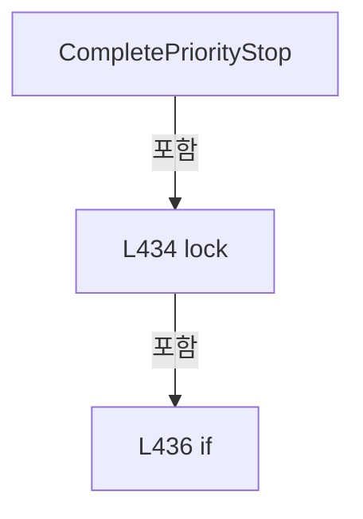

변경 전 점검: 입력/반환 타입, 위 호출자, 예외/취소 경로, 공유 상태와 저장·전송 소비자를 함께 확인합니다. 값의 단위나 물리 방향을 이름만으로 확정하지 않습니다.

### MethodDeclaration `FailPriorityStop` · L446–461

[Drilling.Common/Motion/XPS/CXpsComm.cs:446–461](https://github.com/kjuws10-rgb/A3Drilling/blob/5aee8e58439c9b455cae7c9593c9be986c3e682e/Drilling.Common/Motion/XPS/CXpsComm.cs#L446-L461)

| 항목 | 실제 추출 값 |
| --- | --- |
| 서명 | string Drilling.Common.Motion.CXpsComm.FailPriorityStop(long, System.Exception) |
| 접근/수식자 | Private / private |
| 반환/값 타입 | string |
| 소속 타입 | NamedType:Drilling.Common.Motion.CXpsComm |

입력 계약:

| 이름 | 타입 | 전달 | 선택/기본값 |
| --- | --- | --- | --- |
| sequence | long | None | False /  |
| exception | System.Exception | None | False /  |

정적 호출자로 확인된 위치:

| 호출 파일/행 | 호출 표현식 | 런타임 분기 가능 |
| --- | --- | --- |
| [Drilling.Common/Motion/XPS/CXpsComm.cs:379–379](https://github.com/kjuws10-rgb/A3Drilling/blob/5aee8e58439c9b455cae7c9593c9be986c3e682e/Drilling.Common/Motion/XPS/CXpsComm.cs#L379-L379) | FailPriorityStop | False |
| [Drilling.Common/Motion/XPS/CXpsComm.cs:383–383](https://github.com/kjuws10-rgb/A3Drilling/blob/5aee8e58439c9b455cae7c9593c9be986c3e682e/Drilling.Common/Motion/XPS/CXpsComm.cs#L383-L383) | FailPriorityStop | False |

호출하는 대상과 해석 범위:

| 원본 행 | 표현식 | 분석 상태 | 대상/소스 위치 |
| --- | --- | --- | --- |
| 448 | CreateErrorResponse | resolved | string Drilling.Common.Motion.CXpsComm.CreateErrorResponse(System.Exception) · Drilling.Common/Motion/XPS/CXpsComm.cs:463 |

본문의 실제 연산·분기·예외·반환 순서(원문 위치 순):

| 원본 행 | 종류 | 주석 해설 |
| --- | --- | --- |
| 448 | call | 함수·델리게이트 또는 객체 생성자를 호출합니다: CreateErrorResponse(exception) |
| 448 | local-declaration | 지역 변수를 선언합니다: var response = CreateErrorResponse(exception); |
| 448 | variable-initializer | 변수의 초기값을 지정합니다: response = CreateErrorResponse(exception) |
| 449 | lock | 공유 상태의 임계 구역에 진입합니다: lock (_diagnosticLock) |
| 451 | if | 조건에 따라 분기합니다: if (sequence < _lastAppliedDiagnosticSequence) |
| 453 | return | 호출자에게 값 또는 제어를 반환합니다: return response; |
| 456 | assignment | 값을 대상에 대입합니다: LastReceived = response |
| 457 | assignment | 값을 대상에 대입합니다: LastError = $"XPS priority stop failed. {exception.Message}" |
| 458 | assignment | 값을 대상에 대입합니다: LastChangedAt = DateTimeOffset.Now |
| 459 | return | 호출자에게 값 또는 제어를 반환합니다: return response; |

제어 구문의 포함 구조(실제 실행 순서/CFG가 아닌 구문 탐색 그림):

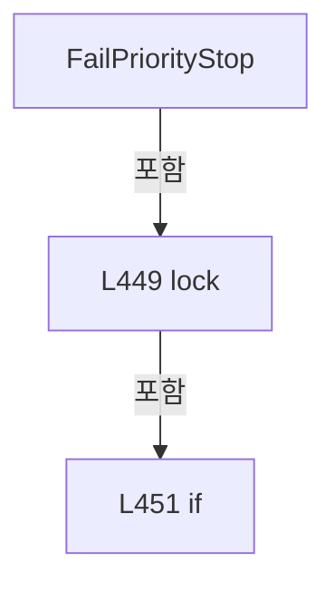

변경 전 점검: 입력/반환 타입, 위 호출자, 예외/취소 경로, 공유 상태와 저장·전송 소비자를 함께 확인합니다. 값의 단위나 물리 방향을 이름만으로 확정하지 않습니다.

### MethodDeclaration `CreateErrorResponse` · L463–466

[Drilling.Common/Motion/XPS/CXpsComm.cs:463–466](https://github.com/kjuws10-rgb/A3Drilling/blob/5aee8e58439c9b455cae7c9593c9be986c3e682e/Drilling.Common/Motion/XPS/CXpsComm.cs#L463-L466)

| 항목 | 실제 추출 값 |
| --- | --- |
| 서명 | string Drilling.Common.Motion.CXpsComm.CreateErrorResponse(System.Exception) |
| 접근/수식자 | Private / private, static |
| 반환/값 타입 | string |
| 소속 타입 | NamedType:Drilling.Common.Motion.CXpsComm |

입력 계약:

| 이름 | 타입 | 전달 | 선택/기본값 |
| --- | --- | --- | --- |
| exception | System.Exception | None | False /  |

정적 호출자로 확인된 위치:

| 호출 파일/행 | 호출 표현식 | 런타임 분기 가능 |
| --- | --- | --- |
| [Drilling.Common/Motion/XPS/CXpsComm.cs:417–417](https://github.com/kjuws10-rgb/A3Drilling/blob/5aee8e58439c9b455cae7c9593c9be986c3e682e/Drilling.Common/Motion/XPS/CXpsComm.cs#L417-L417) | CreateErrorResponse | False |
| [Drilling.Common/Motion/XPS/CXpsComm.cs:448–448](https://github.com/kjuws10-rgb/A3Drilling/blob/5aee8e58439c9b455cae7c9593c9be986c3e682e/Drilling.Common/Motion/XPS/CXpsComm.cs#L448-L448) | CreateErrorResponse | False |

호출하는 대상과 해석 범위:

| 원본 행 | 표현식 | 분석 상태 | 대상/소스 위치 |
| --- | --- | --- | --- |
| 465 | CreateErrorResponse | resolved | string Drilling.Common.Motion.CXpsComm.CreateErrorResponse(string) · Drilling.Common/Motion/XPS/CXpsComm.cs:468 |

본문의 실제 연산·분기·예외·반환 순서(원문 위치 순):

| 원본 행 | 종류 | 주석 해설 |
| --- | --- | --- |
| 465 | call | 함수·델리게이트 또는 객체 생성자를 호출합니다: CreateErrorResponse(exception.Message) |
| 465 | return | 호출자에게 값 또는 제어를 반환합니다: return CreateErrorResponse(exception.Message); |

변경 전 점검: 입력/반환 타입, 위 호출자, 예외/취소 경로, 공유 상태와 저장·전송 소비자를 함께 확인합니다. 값의 단위나 물리 방향을 이름만으로 확정하지 않습니다.

### MethodDeclaration `CreateErrorResponse` · L468–472

[Drilling.Common/Motion/XPS/CXpsComm.cs:468–472](https://github.com/kjuws10-rgb/A3Drilling/blob/5aee8e58439c9b455cae7c9593c9be986c3e682e/Drilling.Common/Motion/XPS/CXpsComm.cs#L468-L472)

| 항목 | 실제 추출 값 |
| --- | --- |
| 서명 | string Drilling.Common.Motion.CXpsComm.CreateErrorResponse(string) |
| 접근/수식자 | Private / private, static |
| 반환/값 타입 | string |
| 소속 타입 | NamedType:Drilling.Common.Motion.CXpsComm |

입력 계약:

| 이름 | 타입 | 전달 | 선택/기본값 |
| --- | --- | --- | --- |
| message | string | None | False /  |

정적 호출자로 확인된 위치:

| 호출 파일/행 | 호출 표현식 | 런타임 분기 가능 |
| --- | --- | --- |
| [Drilling.Common/Motion/XPS/CXpsComm.cs:72–72](https://github.com/kjuws10-rgb/A3Drilling/blob/5aee8e58439c9b455cae7c9593c9be986c3e682e/Drilling.Common/Motion/XPS/CXpsComm.cs#L72-L72) | CreateErrorResponse | False |
| [Drilling.Common/Motion/XPS/CXpsComm.cs:465–465](https://github.com/kjuws10-rgb/A3Drilling/blob/5aee8e58439c9b455cae7c9593c9be986c3e682e/Drilling.Common/Motion/XPS/CXpsComm.cs#L465-L465) | CreateErrorResponse | False |

호출하는 대상과 해석 범위:

| 원본 행 | 표현식 | 분석 상태 | 대상/소스 위치 |
| --- | --- | --- | --- |
| 470 | SanitizeResponseText | resolved | string Drilling.Common.Motion.CXpsComm.SanitizeResponseText(string) · Drilling.Common/Motion/XPS/CXpsComm.cs:618 |
| 471 | string.IsNullOrWhiteSpace | resolved | bool string.IsNullOrWhiteSpace(string?) |

본문의 실제 연산·분기·예외·반환 순서(원문 위치 순):

| 원본 행 | 종류 | 주석 해설 |
| --- | --- | --- |
| 470 | call | 함수·델리게이트 또는 객체 생성자를 호출합니다: SanitizeResponseText(message) |
| 470 | local-declaration | 지역 변수를 선언합니다: var detail = SanitizeResponseText(message); |
| 470 | variable-initializer | 변수의 초기값을 지정합니다: detail = SanitizeResponseText(message) |
| 471 | call | 함수·델리게이트 또는 객체 생성자를 호출합니다: string.IsNullOrWhiteSpace(detail) |
| 471 | conditional-expression | 조건에 따라 결과식을 선택합니다: string.IsNullOrWhiteSpace(detail) ? "UNKNOWN" : detail |
| 471 | return | 호출자에게 값 또는 제어를 반환합니다: return $"ERR:XPS:{(string.IsNullOrWhiteSpace(detail) ? "UNKNOWN" : detail)}"; |

변경 전 점검: 입력/반환 타입, 위 호출자, 예외/취소 경로, 공유 상태와 저장·전송 소비자를 함께 확인합니다. 값의 단위나 물리 방향을 이름만으로 확정하지 않습니다.

### MethodDeclaration `ThrowIfPriorityStopOccurred` · L474–480

[Drilling.Common/Motion/XPS/CXpsComm.cs:474–480](https://github.com/kjuws10-rgb/A3Drilling/blob/5aee8e58439c9b455cae7c9593c9be986c3e682e/Drilling.Common/Motion/XPS/CXpsComm.cs#L474-L480)

| 항목 | 실제 추출 값 |
| --- | --- |
| 서명 | void Drilling.Common.Motion.CXpsComm.ThrowIfPriorityStopOccurred(long) |
| 접근/수식자 | Private / private |
| 반환/값 타입 | void |
| 소속 타입 | NamedType:Drilling.Common.Motion.CXpsComm |

입력 계약:

| 이름 | 타입 | 전달 | 선택/기본값 |
| --- | --- | --- | --- |
| observedStopGeneration | long | None | False /  |

정적 호출자로 확인된 위치:

| 호출 파일/행 | 호출 표현식 | 런타임 분기 가능 |
| --- | --- | --- |
| [Drilling.Common/Motion/XPS/CXpsComm.cs:65–65](https://github.com/kjuws10-rgb/A3Drilling/blob/5aee8e58439c9b455cae7c9593c9be986c3e682e/Drilling.Common/Motion/XPS/CXpsComm.cs#L65-L65) | ThrowIfPriorityStopOccurred | False |
| [Drilling.Common/Motion/XPS/CXpsComm.cs:89–89](https://github.com/kjuws10-rgb/A3Drilling/blob/5aee8e58439c9b455cae7c9593c9be986c3e682e/Drilling.Common/Motion/XPS/CXpsComm.cs#L89-L89) | ThrowIfPriorityStopOccurred | False |

호출하는 대상과 해석 범위:

| 원본 행 | 표현식 | 분석 상태 | 대상/소스 위치 |
| --- | --- | --- | --- |
| 476 | Volatile.Read | resolved | long System.Threading.Volatile.Read(ref readonly long) |
| 478 | new InvalidOperationException | resolved | System.InvalidOperationException.InvalidOperationException(string?) |

본문의 실제 연산·분기·예외·반환 순서(원문 위치 순):

| 원본 행 | 종류 | 주석 해설 |
| --- | --- | --- |
| 476 | call | 함수·델리게이트 또는 객체 생성자를 호출합니다: Volatile.Read(ref _priorityStopGeneration) |
| 476 | if | 조건에 따라 분기합니다: if (observedStopGeneration != Volatile.Read(ref _priorityStopGeneration)) |
| 478 | call | 함수·델리게이트 또는 객체 생성자를 호출합니다: new InvalidOperationException("XPS command invalidated by priority stop.") |
| 478 | throw | 예외를 발생/전달합니다: throw new InvalidOperationException("XPS command invalidated by priority stop."); |

제어 구문의 포함 구조(실제 실행 순서/CFG가 아닌 구문 탐색 그림):

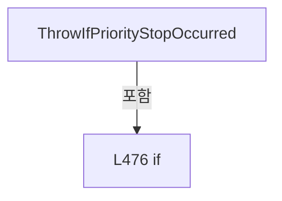

변경 전 점검: 입력/반환 타입, 위 호출자, 예외/취소 경로, 공유 상태와 저장·전송 소비자를 함께 확인합니다. 값의 단위나 물리 방향을 이름만으로 확정하지 않습니다.

### MethodDeclaration `SetPrimaryConnected` · L482–489

[Drilling.Common/Motion/XPS/CXpsComm.cs:482–489](https://github.com/kjuws10-rgb/A3Drilling/blob/5aee8e58439c9b455cae7c9593c9be986c3e682e/Drilling.Common/Motion/XPS/CXpsComm.cs#L482-L489)

| 항목 | 실제 추출 값 |
| --- | --- |
| 서명 | void Drilling.Common.Motion.CXpsComm.SetPrimaryConnected() |
| 접근/수식자 | Private / private |
| 반환/값 타입 | void |
| 소속 타입 | NamedType:Drilling.Common.Motion.CXpsComm |

정적 호출자로 확인된 위치:

| 호출 파일/행 | 호출 표현식 | 런타임 분기 가능 |
| --- | --- | --- |
| [Drilling.Common/Motion/XPS/CXpsComm.cs:120–120](https://github.com/kjuws10-rgb/A3Drilling/blob/5aee8e58439c9b455cae7c9593c9be986c3e682e/Drilling.Common/Motion/XPS/CXpsComm.cs#L120-L120) | SetPrimaryConnected | False |

호출하는 대상과 해석 범위:

| 원본 행 | 표현식 | 분석 상태 | 대상/소스 위치 |
| --- | --- | --- | --- |
| 487 | SetState | resolved | void Drilling.Common.Interface.CCommBase.SetState(Drilling.Common.Interface.EN_COMM_STATE) · Drilling.Common/Interface/CComm.cs:114 |

본문의 실제 연산·분기·예외·반환 순서(원문 위치 순):

| 원본 행 | 종류 | 주석 해설 |
| --- | --- | --- |
| 484 | lock | 공유 상태의 임계 구역에 진입합니다: lock (_diagnosticLock) |
| 486 | assignment | 값을 대상에 대입합니다: LastError = "" |
| 487 | call | 함수·델리게이트 또는 객체 생성자를 호출합니다: SetState(EN_COMM_STATE.Online) |

제어 구문의 포함 구조(실제 실행 순서/CFG가 아닌 구문 탐색 그림):

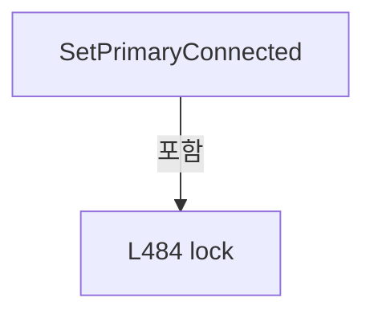

변경 전 점검: 입력/반환 타입, 위 호출자, 예외/취소 경로, 공유 상태와 저장·전송 소비자를 함께 확인합니다. 값의 단위나 물리 방향을 이름만으로 확정하지 않습니다.

### MethodDeclaration `SetPrimaryState` · L491–497

[Drilling.Common/Motion/XPS/CXpsComm.cs:491–497](https://github.com/kjuws10-rgb/A3Drilling/blob/5aee8e58439c9b455cae7c9593c9be986c3e682e/Drilling.Common/Motion/XPS/CXpsComm.cs#L491-L497)

| 항목 | 실제 추출 값 |
| --- | --- |
| 서명 | void Drilling.Common.Motion.CXpsComm.SetPrimaryState(Drilling.Common.Interface.EN_COMM_STATE) |
| 접근/수식자 | Private / private |
| 반환/값 타입 | void |
| 소속 타입 | NamedType:Drilling.Common.Motion.CXpsComm |

입력 계약:

| 이름 | 타입 | 전달 | 선택/기본값 |
| --- | --- | --- | --- |
| state | Drilling.Common.Interface.EN_COMM_STATE | None | False /  |

정적 호출자로 확인된 위치:

| 호출 파일/행 | 호출 표현식 | 런타임 분기 가능 |
| --- | --- | --- |
| [Drilling.Common/Motion/XPS/CXpsComm.cs:45–45](https://github.com/kjuws10-rgb/A3Drilling/blob/5aee8e58439c9b455cae7c9593c9be986c3e682e/Drilling.Common/Motion/XPS/CXpsComm.cs#L45-L45) | SetPrimaryState | False |

호출하는 대상과 해석 범위:

| 원본 행 | 표현식 | 분석 상태 | 대상/소스 위치 |
| --- | --- | --- | --- |
| 495 | SetState | resolved | void Drilling.Common.Interface.CCommBase.SetState(Drilling.Common.Interface.EN_COMM_STATE) · Drilling.Common/Interface/CComm.cs:114 |

본문의 실제 연산·분기·예외·반환 순서(원문 위치 순):

| 원본 행 | 종류 | 주석 해설 |
| --- | --- | --- |
| 493 | lock | 공유 상태의 임계 구역에 진입합니다: lock (_diagnosticLock) |
| 495 | call | 함수·델리게이트 또는 객체 생성자를 호출합니다: SetState(state) |

제어 구문의 포함 구조(실제 실행 순서/CFG가 아닌 구문 탐색 그림):

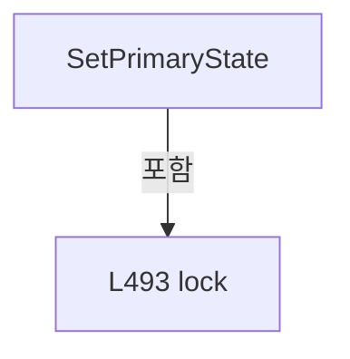

변경 전 점검: 입력/반환 타입, 위 호출자, 예외/취소 경로, 공유 상태와 저장·전송 소비자를 함께 확인합니다. 값의 단위나 물리 방향을 이름만으로 확정하지 않습니다.

### MethodDeclaration `SetPrimaryError` · L499–505

[Drilling.Common/Motion/XPS/CXpsComm.cs:499–505](https://github.com/kjuws10-rgb/A3Drilling/blob/5aee8e58439c9b455cae7c9593c9be986c3e682e/Drilling.Common/Motion/XPS/CXpsComm.cs#L499-L505)

| 항목 | 실제 추출 값 |
| --- | --- |
| 서명 | void Drilling.Common.Motion.CXpsComm.SetPrimaryError(System.Exception) |
| 접근/수식자 | Private / private |
| 반환/값 타입 | void |
| 소속 타입 | NamedType:Drilling.Common.Motion.CXpsComm |

입력 계약:

| 이름 | 타입 | 전달 | 선택/기본값 |
| --- | --- | --- | --- |
| exception | System.Exception | None | False /  |

정적 호출자로 확인된 위치:

| 호출 파일/행 | 호출 표현식 | 런타임 분기 가능 |
| --- | --- | --- |
| [Drilling.Common/Motion/XPS/CXpsComm.cs:31–31](https://github.com/kjuws10-rgb/A3Drilling/blob/5aee8e58439c9b455cae7c9593c9be986c3e682e/Drilling.Common/Motion/XPS/CXpsComm.cs#L31-L31) | SetPrimaryError | False |

호출하는 대상과 해석 범위:

| 원본 행 | 표현식 | 분석 상태 | 대상/소스 위치 |
| --- | --- | --- | --- |
| 503 | SetError | resolved | void Drilling.Common.Interface.CCommBase.SetError(System.Exception) · Drilling.Common/Interface/CComm.cs:120 |

본문의 실제 연산·분기·예외·반환 순서(원문 위치 순):

| 원본 행 | 종류 | 주석 해설 |
| --- | --- | --- |
| 501 | lock | 공유 상태의 임계 구역에 진입합니다: lock (_diagnosticLock) |
| 503 | call | 함수·델리게이트 또는 객체 생성자를 호출합니다: SetError(exception) |

제어 구문의 포함 구조(실제 실행 순서/CFG가 아닌 구문 탐색 그림):

```mermaid
flowchart TD
 M["SetPrimaryError"]
 N0["L501 lock"]
 M -->|포함| N0
```

변경 전 점검: 입력/반환 타입, 위 호출자, 예외/취소 경로, 공유 상태와 저장·전송 소비자를 함께 확인합니다. 값의 단위나 물리 방향을 이름만으로 확정하지 않습니다.

### MethodDeclaration `ExecutePriorityStopCore` · L507–531

[Drilling.Common/Motion/XPS/CXpsComm.cs:507–531](https://github.com/kjuws10-rgb/A3Drilling/blob/5aee8e58439c9b455cae7c9593c9be986c3e682e/Drilling.Common/Motion/XPS/CXpsComm.cs#L507-L531)

| 항목 | 실제 추출 값 |
| --- | --- |
| 서명 | string Drilling.Common.Motion.CXpsComm.ExecutePriorityStopCore(string) |
| 접근/수식자 | Private / private |
| 반환/값 타입 | string |
| 소속 타입 | NamedType:Drilling.Common.Motion.CXpsComm |

입력 계약:

| 이름 | 타입 | 전달 | 선택/기본값 |
| --- | --- | --- | --- |
| function | string | None | False /  |

정적 호출자로 확인된 위치:

| 호출 파일/행 | 호출 표현식 | 런타임 분기 가능 |
| --- | --- | --- |
| [Drilling.Common/Motion/XPS/CXpsComm.cs:361–361](https://github.com/kjuws10-rgb/A3Drilling/blob/5aee8e58439c9b455cae7c9593c9be986c3e682e/Drilling.Common/Motion/XPS/CXpsComm.cs#L361-L361) | ExecutePriorityStopCore | False |

호출하는 대상과 해석 범위:

| 원본 행 | 표현식 | 분석 상태 | 대상/소스 위치 |
| --- | --- | --- | --- |
| 509 | string.IsNullOrWhiteSpace | resolved | bool string.IsNullOrWhiteSpace(string?) |
| 511 | new InvalidOperationException | resolved | System.InvalidOperationException.InvalidOperationException(string?) |
| 514 | new XPS | unresolved | None |
| 517 | CheckResult | candidate | OverloadResolutionFailure |
| 517 | stopApi.OpenInstrument | unresolved | None |
| 518 | ExecuteXpsFunction | resolved | string Drilling.Common.Motion.CXpsComm.ExecuteXpsFunction(XPS, string, System.Threading.CancellationToken, System.Action?) · Drilling.Common/Motion/XPS/CXpsComm.cs:123 |
| 524 | stopApi.CloseInstrument | unresolved | None |

본문의 실제 연산·분기·예외·반환 순서(원문 위치 순):

| 원본 행 | 종류 | 주석 해설 |
| --- | --- | --- |
| 509 | call | 함수·델리게이트 또는 객체 생성자를 호출합니다: string.IsNullOrWhiteSpace(Option.RemoteAddress) |
| 509 | if | 조건에 따라 분기합니다: if (string.IsNullOrWhiteSpace(Option.RemoteAddress) &#124;&#124; Option.Port <= 0) |
| 511 | call | 함수·델리게이트 또는 객체 생성자를 호출합니다: new InvalidOperationException("XPS endpoint is invalid.") |
| 511 | throw | 예외를 발생/전달합니다: throw new InvalidOperationException("XPS endpoint is invalid."); |
| 514 | call | 함수·델리게이트 또는 객체 생성자를 호출합니다: new XPS() |
| 514 | local-declaration | 지역 변수를 선언합니다: var stopApi = new XPS(); |
| 514 | variable-initializer | 변수의 초기값을 지정합니다: stopApi = new XPS() |
| 515 | try | 예외 처리 범위입니다: try |
| 517 | call | 함수·델리게이트 또는 객체 생성자를 호출합니다: CheckResult(stopApi, stopApi.OpenInstrument(Option.RemoteAddress, Option.Port, Option.TimeoutMs), "OpenInstrument for priority stop") |
| 517 | call | 함수·델리게이트 또는 객체 생성자를 호출합니다: stopApi.OpenInstrument(Option.RemoteAddress, Option.Port, Option.TimeoutMs) |
| 518 | call | 함수·델리게이트 또는 객체 생성자를 호출합니다: ExecuteXpsFunction(stopApi, function, CancellationToken.None) |
| 518 | return | 호출자에게 값 또는 제어를 반환합니다: return ExecuteXpsFunction(stopApi, function, CancellationToken.None); |
| 520 | finally | 종료 정리 구간입니다: finally |
| 522 | try | 예외 처리 범위입니다: try |
| 524 | call | 함수·델리게이트 또는 객체 생성자를 호출합니다: stopApi.CloseInstrument() |
| 526 | catch | 지정 예외를 처리합니다: catch  |

제어 구문의 포함 구조(실제 실행 순서/CFG가 아닌 구문 탐색 그림):

```mermaid
flowchart TD
 M["ExecutePriorityStopCore"]
 N0["L509 if"]
 M -->|포함| N0
 N1["L515 try"]
 M -->|포함| N1
 N2["L520 finally"]
 N1 -->|포함| N2
 N3["L522 try"]
 N2 -->|포함| N3
 N4["L526 catch"]
 N3 -->|포함| N4
```

변경 전 점검: 입력/반환 타입, 위 호출자, 예외/취소 경로, 공유 상태와 저장·전송 소비자를 함께 확인합니다. 값의 단위나 물리 방향을 이름만으로 확정하지 않습니다.

### MethodDeclaration `IsPriorityStopCommand` · L533–543

[Drilling.Common/Motion/XPS/CXpsComm.cs:533–543](https://github.com/kjuws10-rgb/A3Drilling/blob/5aee8e58439c9b455cae7c9593c9be986c3e682e/Drilling.Common/Motion/XPS/CXpsComm.cs#L533-L543)

| 항목 | 실제 추출 값 |
| --- | --- |
| 서명 | bool Drilling.Common.Motion.CXpsComm.IsPriorityStopCommand(string) |
| 접근/수식자 | Private / private, static |
| 반환/값 타입 | bool |
| 소속 타입 | NamedType:Drilling.Common.Motion.CXpsComm |

입력 계약:

| 이름 | 타입 | 전달 | 선택/기본값 |
| --- | --- | --- | --- |
| function | string | None | False /  |

정적 호출자로 확인된 위치:

| 호출 파일/행 | 호출 표현식 | 런타임 분기 가능 |
| --- | --- | --- |
| [Drilling.Common/Motion/XPS/CXpsComm.cs:56–56](https://github.com/kjuws10-rgb/A3Drilling/blob/5aee8e58439c9b455cae7c9593c9be986c3e682e/Drilling.Common/Motion/XPS/CXpsComm.cs#L56-L56) | IsPriorityStopCommand | False |

호출하는 대상과 해석 범위:

| 원본 행 | 표현식 | 분석 상태 | 대상/소스 위치 |
| --- | --- | --- | --- |
| 535 | function.Split | resolved | string[] string.Split(char, System.StringSplitOptions) |
| 536 | tokens[0].Equals | resolved | bool string.Equals(string?, System.StringComparison) |
| 536 | tokens[1].Equals | resolved | bool string.Equals(string?, System.StringComparison) |
| 542 | tokens[commandIndex].Equals | resolved | bool string.Equals(string?, System.StringComparison) |
| 542 | tokens[commandIndex].Equals | resolved | bool string.Equals(string?, System.StringComparison) |

본문의 실제 연산·분기·예외·반환 순서(원문 위치 순):

| 원본 행 | 종류 | 주석 해설 |
| --- | --- | --- |
| 535 | call | 함수·델리게이트 또는 객체 생성자를 호출합니다: function.Split(':', StringSplitOptions.TrimEntries &#124; StringSplitOptions.RemoveEmptyEntries) |
| 535 | local-declaration | 지역 변수를 선언합니다: var tokens = function.Split(':', StringSplitOptions.TrimEntries &#124; StringSplitOptions.RemoveEmptyEntries); |
| 535 | variable-initializer | 변수의 초기값을 지정합니다: tokens = function.Split(':', StringSplitOptions.TrimEntries &#124; StringSplitOptions.RemoveEmptyEntries) |
| 536 | call | 함수·델리게이트 또는 객체 생성자를 호출합니다: tokens[0].Equals("XPS", StringComparison.OrdinalIgnoreCase) |
| 536 | call | 함수·델리게이트 또는 객체 생성자를 호출합니다: tokens[1].Equals("AXIS", StringComparison.OrdinalIgnoreCase) |
| 536 | if | 조건에 따라 분기합니다: if (tokens.Length < 5 &#124;&#124; !tokens[0].Equals("XPS", StringComparison.OrdinalIgnoreCase) &#124;&#124; !tokens[1].Equals("AXIS", StringComparison.OrdinalIgnoreCase)) |
| 538 | return | 호출자에게 값 또는 제어를 반환합니다: return false; |
| 541 | conditional-expression | 조건에 따라 결과식을 선택합니다: tokens.Length >= 6 ? 5 : 4 |
| 541 | local-declaration | 지역 변수를 선언합니다: var commandIndex = tokens.Length >= 6 ? 5 : 4; |
| 541 | variable-initializer | 변수의 초기값을 지정합니다: commandIndex = tokens.Length >= 6 ? 5 : 4 |
| 542 | call | 함수·델리게이트 또는 객체 생성자를 호출합니다: tokens[commandIndex].Equals("JOG_STOP", StringComparison.OrdinalIgnoreCase) |
| 542 | call | 함수·델리게이트 또는 객체 생성자를 호출합니다: tokens[commandIndex].Equals("STOP", StringComparison.OrdinalIgnoreCase) |
| 542 | return | 호출자에게 값 또는 제어를 반환합니다: return tokens[commandIndex].Equals("JOG_STOP", StringComparison.OrdinalIgnoreCase) &#124;&#124; tokens[commandIndex].Equals("STOP", StringComparison.OrdinalIgnoreCase); |

제어 구문의 포함 구조(실제 실행 순서/CFG가 아닌 구문 탐색 그림):

```mermaid
flowchart TD
 M["IsPriorityStopCommand"]
 N0["L536 if"]
 M -->|포함| N0
```

변경 전 점검: 입력/반환 타입, 위 호출자, 예외/취소 경로, 공유 상태와 저장·전송 소비자를 함께 확인합니다. 값의 단위나 물리 방향을 이름만으로 확정하지 않습니다.

### MethodDeclaration `StopJogAndDisable` · L545–569

[Drilling.Common/Motion/XPS/CXpsComm.cs:545–569](https://github.com/kjuws10-rgb/A3Drilling/blob/5aee8e58439c9b455cae7c9593c9be986c3e682e/Drilling.Common/Motion/XPS/CXpsComm.cs#L545-L569)

| 항목 | 실제 추출 값 |
| --- | --- |
| 서명 | void Drilling.Common.Motion.CXpsComm.StopJogAndDisable(XPS, string) |
| 접근/수식자 | Private / private, static |
| 반환/값 타입 | void |
| 소속 타입 | NamedType:Drilling.Common.Motion.CXpsComm |

입력 계약:

| 이름 | 타입 | 전달 | 선택/기본값 |
| --- | --- | --- | --- |
| api | XPS | None | False /  |
| groupName | string | None | False /  |

정적 호출자로 확인된 위치:

| 호출 파일/행 | 호출 표현식 | 런타임 분기 가능 |
| --- | --- | --- |
| [Drilling.Common/Motion/XPS/CXpsComm.cs:197–197](https://github.com/kjuws10-rgb/A3Drilling/blob/5aee8e58439c9b455cae7c9593c9be986c3e682e/Drilling.Common/Motion/XPS/CXpsComm.cs#L197-L197) | StopJogAndDisable | False |
| [Drilling.Common/Motion/XPS/CXpsComm.cs:209–209](https://github.com/kjuws10-rgb/A3Drilling/blob/5aee8e58439c9b455cae7c9593c9be986c3e682e/Drilling.Common/Motion/XPS/CXpsComm.cs#L209-L209) | StopJogAndDisable | False |

호출하는 대상과 해석 범위:

| 원본 행 | 표현식 | 분석 상태 | 대상/소스 위치 |
| --- | --- | --- | --- |
| 547 | CheckResult | candidate | OverloadResolutionFailure |
| 547 | api.GroupMoveAbort | unresolved | None |
| 548 | Stopwatch.GetTimestamp | resolved | long System.Diagnostics.Stopwatch.GetTimestamp() |
| 551 | api.GroupJogModeDisable | unresolved | None |
| 557 | IsGroupJogging | resolved | bool Drilling.Common.Motion.CXpsComm.IsGroupJogging(XPS, string) · Drilling.Common/Motion/XPS/CXpsComm.cs:571 |
| 562 | Stopwatch.GetElapsedTime | resolved | System.TimeSpan System.Diagnostics.Stopwatch.GetElapsedTime(long) |
| 562 | TimeSpan.FromSeconds | resolved | System.TimeSpan System.TimeSpan.FromSeconds(long) |
| 564 | CheckResult | candidate | OverloadResolutionFailure |
| 567 | Thread.Sleep | resolved | void System.Threading.Thread.Sleep(int) |

본문의 실제 연산·분기·예외·반환 순서(원문 위치 순):

| 원본 행 | 종류 | 주석 해설 |
| --- | --- | --- |
| 547 | call | 함수·델리게이트 또는 객체 생성자를 호출합니다: CheckResult(api, api.GroupMoveAbort(groupName, out var abortError), abortError) |
| 547 | call | 함수·델리게이트 또는 객체 생성자를 호출합니다: api.GroupMoveAbort(groupName, out var abortError) |
| 548 | call | 함수·델리게이트 또는 객체 생성자를 호출합니다: Stopwatch.GetTimestamp() |
| 548 | local-declaration | 지역 변수를 선언합니다: var startedAt = Stopwatch.GetTimestamp(); |
| 548 | variable-initializer | 변수의 초기값을 지정합니다: startedAt = Stopwatch.GetTimestamp() |
| 549 | while | 조건을 먼저 확인하며 반복합니다: while (true) |
| 551 | call | 함수·델리게이트 또는 객체 생성자를 호출합니다: api.GroupJogModeDisable(groupName, out var disableError) |
| 551 | local-declaration | 지역 변수를 선언합니다: var disableResult = api.GroupJogModeDisable(groupName, out var disableError); |
| 551 | variable-initializer | 변수의 초기값을 지정합니다: disableResult = api.GroupJogModeDisable(groupName, out var disableError) |
| 552 | if | 조건에 따라 분기합니다: if (disableResult == 0) |
| 554 | return | 호출자에게 값 또는 제어를 반환합니다: return; |
| 557 | call | 함수·델리게이트 또는 객체 생성자를 호출합니다: IsGroupJogging(api, groupName) |
| 557 | if | 조건에 따라 분기합니다: if (!IsGroupJogging(api, groupName)) |
| 559 | return | 호출자에게 값 또는 제어를 반환합니다: return; |
| 562 | call | 함수·델리게이트 또는 객체 생성자를 호출합니다: Stopwatch.GetElapsedTime(startedAt) |
| 562 | call | 함수·델리게이트 또는 객체 생성자를 호출합니다: TimeSpan.FromSeconds(2) |
| 562 | if | 조건에 따라 분기합니다: if (Stopwatch.GetElapsedTime(startedAt) >= TimeSpan.FromSeconds(2)) |
| 564 | call | 함수·델리게이트 또는 객체 생성자를 호출합니다: CheckResult(api, disableResult, disableError) |
| 567 | call | 함수·델리게이트 또는 객체 생성자를 호출합니다: Thread.Sleep(20) |

제어 구문의 포함 구조(실제 실행 순서/CFG가 아닌 구문 탐색 그림):

```mermaid
flowchart TD
 M["StopJogAndDisable"]
 N0["L549 while"]
 M -->|포함| N0
 N1["L552 if"]
 N0 -->|포함| N1
 N2["L557 if"]
 N0 -->|포함| N2
 N3["L562 if"]
 N0 -->|포함| N3
```

변경 전 점검: 입력/반환 타입, 위 호출자, 예외/취소 경로, 공유 상태와 저장·전송 소비자를 함께 확인합니다. 값의 단위나 물리 방향을 이름만으로 확정하지 않습니다.

### MethodDeclaration `IsGroupJogging` · L571–576

[Drilling.Common/Motion/XPS/CXpsComm.cs:571–576](https://github.com/kjuws10-rgb/A3Drilling/blob/5aee8e58439c9b455cae7c9593c9be986c3e682e/Drilling.Common/Motion/XPS/CXpsComm.cs#L571-L576)

| 항목 | 실제 추출 값 |
| --- | --- |
| 서명 | bool Drilling.Common.Motion.CXpsComm.IsGroupJogging(XPS, string) |
| 접근/수식자 | Private / private, static |
| 반환/값 타입 | bool |
| 소속 타입 | NamedType:Drilling.Common.Motion.CXpsComm |

입력 계약:

| 이름 | 타입 | 전달 | 선택/기본값 |
| --- | --- | --- | --- |
| api | XPS | None | False /  |
| groupName | string | None | False /  |

정적 호출자로 확인된 위치:

| 호출 파일/행 | 호출 표현식 | 런타임 분기 가능 |
| --- | --- | --- |
| [Drilling.Common/Motion/XPS/CXpsComm.cs:557–557](https://github.com/kjuws10-rgb/A3Drilling/blob/5aee8e58439c9b455cae7c9593c9be986c3e682e/Drilling.Common/Motion/XPS/CXpsComm.cs#L557-L557) | IsGroupJogging | False |

호출하는 대상과 해석 범위:

| 원본 행 | 표현식 | 분석 상태 | 대상/소스 위치 |
| --- | --- | --- | --- |
| 573 | CheckResult | candidate | OverloadResolutionFailure |
| 573 | api.GroupStatusGet | unresolved | None |
| 574 | CheckResult | candidate | OverloadResolutionFailure |
| 574 | api.GroupStatusStringGet | unresolved | None |
| 575 | statusText.Contains | unresolved | None |

본문의 실제 연산·분기·예외·반환 순서(원문 위치 순):

| 원본 행 | 종류 | 주석 해설 |
| --- | --- | --- |
| 573 | call | 함수·델리게이트 또는 객체 생성자를 호출합니다: CheckResult(api, api.GroupStatusGet(groupName, out var status, out var statusError), statusError) |
| 573 | call | 함수·델리게이트 또는 객체 생성자를 호출합니다: api.GroupStatusGet(groupName, out var status, out var statusError) |
| 574 | call | 함수·델리게이트 또는 객체 생성자를 호출합니다: CheckResult(api, api.GroupStatusStringGet(status, out var statusText, out var statusTextError), statusTextError) |
| 574 | call | 함수·델리게이트 또는 객체 생성자를 호출합니다: api.GroupStatusStringGet(status, out var statusText, out var statusTextError) |
| 575 | call | 함수·델리게이트 또는 객체 생성자를 호출합니다: statusText.Contains("JOGGING", StringComparison.OrdinalIgnoreCase) |
| 575 | return | 호출자에게 값 또는 제어를 반환합니다: return statusText.Contains("JOGGING", StringComparison.OrdinalIgnoreCase); |

변경 전 점검: 입력/반환 타입, 위 호출자, 예외/취소 경로, 공유 상태와 저장·전송 소비자를 함께 확인합니다. 값의 단위나 물리 방향을 이름만으로 확정하지 않습니다.

### MethodDeclaration `ReadPositiveDouble` · L578–587

[Drilling.Common/Motion/XPS/CXpsComm.cs:578–587](https://github.com/kjuws10-rgb/A3Drilling/blob/5aee8e58439c9b455cae7c9593c9be986c3e682e/Drilling.Common/Motion/XPS/CXpsComm.cs#L578-L587)

| 항목 | 실제 추출 값 |
| --- | --- |
| 서명 | double Drilling.Common.Motion.CXpsComm.ReadPositiveDouble(System.Collections.Generic.IReadOnlyList<string>, int, string) |
| 접근/수식자 | Private / private, static |
| 반환/값 타입 | double |
| 소속 타입 | NamedType:Drilling.Common.Motion.CXpsComm |

입력 계약:

| 이름 | 타입 | 전달 | 선택/기본값 |
| --- | --- | --- | --- |
| tokens | System.Collections.Generic.IReadOnlyList<string> | None | False /  |
| index | int | None | False /  |
| command | string | None | False /  |

정적 호출자로 확인된 위치:

| 호출 파일/행 | 호출 표현식 | 런타임 분기 가능 |
| --- | --- | --- |
| [Drilling.Common/Motion/XPS/CXpsComm.cs:173–173](https://github.com/kjuws10-rgb/A3Drilling/blob/5aee8e58439c9b455cae7c9593c9be986c3e682e/Drilling.Common/Motion/XPS/CXpsComm.cs#L173-L173) | ReadPositiveDouble | False |
| [Drilling.Common/Motion/XPS/CXpsComm.cs:173–173](https://github.com/kjuws10-rgb/A3Drilling/blob/5aee8e58439c9b455cae7c9593c9be986c3e682e/Drilling.Common/Motion/XPS/CXpsComm.cs#L173-L173) | ReadPositiveDouble | False |
| [Drilling.Common/Motion/XPS/CXpsComm.cs:177–177](https://github.com/kjuws10-rgb/A3Drilling/blob/5aee8e58439c9b455cae7c9593c9be986c3e682e/Drilling.Common/Motion/XPS/CXpsComm.cs#L177-L177) | ReadPositiveDouble | False |

호출하는 대상과 해석 범위:

| 원본 행 | 표현식 | 분석 상태 | 대상/소스 위치 |
| --- | --- | --- | --- |
| 580 | ReadDouble | resolved | double Drilling.Common.Motion.CXpsComm.ReadDouble(System.Collections.Generic.IReadOnlyList<string>, int, string) · Drilling.Common/Motion/XPS/CXpsComm.cs:346 |
| 583 | new InvalidOperationException | resolved | System.InvalidOperationException.InvalidOperationException(string?) |

본문의 실제 연산·분기·예외·반환 순서(원문 위치 순):

| 원본 행 | 종류 | 주석 해설 |
| --- | --- | --- |
| 580 | call | 함수·델리게이트 또는 객체 생성자를 호출합니다: ReadDouble(tokens, index, command) |
| 580 | local-declaration | 지역 변수를 선언합니다: var value = ReadDouble(tokens, index, command); |
| 580 | variable-initializer | 변수의 초기값을 지정합니다: value = ReadDouble(tokens, index, command) |
| 581 | if | 조건에 따라 분기합니다: if (value <= 0.0) |
| 583 | call | 함수·델리게이트 또는 객체 생성자를 호출합니다: new InvalidOperationException($"XPS {command} must be greater than 0.") |
| 583 | throw | 예외를 발생/전달합니다: throw new InvalidOperationException($"XPS {command} must be greater than 0."); |
| 586 | return | 호출자에게 값 또는 제어를 반환합니다: return value; |

제어 구문의 포함 구조(실제 실행 순서/CFG가 아닌 구문 탐색 그림):

```mermaid
flowchart TD
 M["ReadPositiveDouble"]
 N0["L581 if"]
 M -->|포함| N0
```

변경 전 점검: 입력/반환 타입, 위 호출자, 예외/취소 경로, 공유 상태와 저장·전송 소비자를 함께 확인합니다. 값의 단위나 물리 방향을 이름만으로 확정하지 않습니다.

### MethodDeclaration `ReadRequiredFirst` · L589–597

[Drilling.Common/Motion/XPS/CXpsComm.cs:589–597](https://github.com/kjuws10-rgb/A3Drilling/blob/5aee8e58439c9b455cae7c9593c9be986c3e682e/Drilling.Common/Motion/XPS/CXpsComm.cs#L589-L597)

| 항목 | 실제 추출 값 |
| --- | --- |
| 서명 | double Drilling.Common.Motion.CXpsComm.ReadRequiredFirst(double[]?, string) |
| 접근/수식자 | Private / private, static |
| 반환/값 타입 | double |
| 소속 타입 | NamedType:Drilling.Common.Motion.CXpsComm |

입력 계약:

| 이름 | 타입 | 전달 | 선택/기본값 |
| --- | --- | --- | --- |
| values | double[]? | None | False /  |
| valueName | string | None | False /  |

현재 부분 분석에서 직접 연결된 호출자는 없습니다. XAML/이벤트/인터페이스·델리게이트·외부 진입을 추가 확인해야 하며, 미사용으로 판정한 것이 아닙니다.

호출하는 대상과 해석 범위:

| 원본 행 | 표현식 | 분석 상태 | 대상/소스 위치 |
| --- | --- | --- | --- |
| 591 | double.IsFinite | resolved | bool double.IsFinite(double) |
| 593 | new InvalidOperationException | resolved | System.InvalidOperationException.InvalidOperationException(string?) |

본문의 실제 연산·분기·예외·반환 순서(원문 위치 순):

| 원본 행 | 종류 | 주석 해설 |
| --- | --- | --- |
| 591 | call | 함수·델리게이트 또는 객체 생성자를 호출합니다: double.IsFinite(values[0]) |
| 591 | if | 조건에 따라 분기합니다: if (values is not { Length: > 0 } &#124;&#124; !double.IsFinite(values[0])) |
| 593 | call | 함수·델리게이트 또는 객체 생성자를 호출합니다: new InvalidOperationException($"XPS {valueName} status response is empty or non-finite.") |
| 593 | throw | 예외를 발생/전달합니다: throw new InvalidOperationException($"XPS {valueName} status response is empty or non-finite."); |
| 596 | return | 호출자에게 값 또는 제어를 반환합니다: return values[0]; |

제어 구문의 포함 구조(실제 실행 순서/CFG가 아닌 구문 탐색 그림):

```mermaid
flowchart TD
 M["ReadRequiredFirst"]
 N0["L591 if"]
 M -->|포함| N0
```

변경 전 점검: 입력/반환 타입, 위 호출자, 예외/취소 경로, 공유 상태와 저장·전송 소비자를 함께 확인합니다. 값의 단위나 물리 방향을 이름만으로 확정하지 않습니다.

### MethodDeclaration `ParseDigitalIoAddress` · L599–616

[Drilling.Common/Motion/XPS/CXpsComm.cs:599–616](https://github.com/kjuws10-rgb/A3Drilling/blob/5aee8e58439c9b455cae7c9593c9be986c3e682e/Drilling.Common/Motion/XPS/CXpsComm.cs#L599-L616)

| 항목 | 실제 추출 값 |
| --- | --- |
| 서명 | (string GpioName, int BitNo) Drilling.Common.Motion.CXpsComm.ParseDigitalIoAddress(string) |
| 접근/수식자 | Private / private, static |
| 반환/값 타입 | (string GpioName, int BitNo) |
| 소속 타입 | NamedType:Drilling.Common.Motion.CXpsComm |

입력 계약:

| 이름 | 타입 | 전달 | 선택/기본값 |
| --- | --- | --- | --- |
| address | string | None | False /  |

정적 호출자로 확인된 위치:

| 호출 파일/행 | 호출 표현식 | 런타임 분기 가능 |
| --- | --- | --- |
| [Drilling.Common/Motion/XPS/CXpsComm.cs:264–264](https://github.com/kjuws10-rgb/A3Drilling/blob/5aee8e58439c9b455cae7c9593c9be986c3e682e/Drilling.Common/Motion/XPS/CXpsComm.cs#L264-L264) | ParseDigitalIoAddress | False |

호출하는 대상과 해석 범위:

| 원본 행 | 표현식 | 분석 상태 | 대상/소스 위치 |
| --- | --- | --- | --- |
| 601 | address.Trim().ToUpperInvariant | resolved | string string.ToUpperInvariant() |
| 601 | address.Trim | resolved | string string.Trim() |
| 602 | normalized.LastIndexOfAny | resolved | int string.LastIndexOfAny(char[]) |
| 605 | new InvalidOperationException | resolved | System.InvalidOperationException.InvalidOperationException(string?) |
| 608 | normalized[..separatorIndex].TrimEnd | resolved | string string.TrimEnd(char) |
| 609 | normalized[(separatorIndex + 1)..].TrimEnd | resolved | string string.TrimEnd(char) |
| 610 | string.IsNullOrWhiteSpace | resolved | bool string.IsNullOrWhiteSpace(string?) |
| 610 | int.TryParse | resolved | bool int.TryParse(string?, System.Globalization.NumberStyles, System.IFormatProvider?, out int) |
| 612 | new InvalidOperationException | resolved | System.InvalidOperationException.InvalidOperationException(string?) |

본문의 실제 연산·분기·예외·반환 순서(원문 위치 순):

| 원본 행 | 종류 | 주석 해설 |
| --- | --- | --- |
| 601 | call | 함수·델리게이트 또는 객체 생성자를 호출합니다: address.Trim().ToUpperInvariant() |
| 601 | call | 함수·델리게이트 또는 객체 생성자를 호출합니다: address.Trim() |
| 601 | local-declaration | 지역 변수를 선언합니다: var normalized = address.Trim().ToUpperInvariant(); |
| 601 | variable-initializer | 변수의 초기값을 지정합니다: normalized = address.Trim().ToUpperInvariant() |
| 602 | call | 함수·델리게이트 또는 객체 생성자를 호출합니다: normalized.LastIndexOfAny(['.', ':', '/', '[']) |
| 602 | local-declaration | 지역 변수를 선언합니다: var separatorIndex = normalized.LastIndexOfAny(['.', ':', '/', '[']); |
| 602 | variable-initializer | 변수의 초기값을 지정합니다: separatorIndex = normalized.LastIndexOfAny(['.', ':', '/', '[']) |
| 603 | if | 조건에 따라 분기합니다: if (separatorIndex < 1) |
| 605 | call | 함수·델리게이트 또는 객체 생성자를 호출합니다: new InvalidOperationException($"XPS digital IO address is invalid: {address}. Use GPIOName.BitNo, for example GPIO1.0") |
| 605 | throw | 예외를 발생/전달합니다: throw new InvalidOperationException($"XPS digital IO address is invalid: {address}. Use GPIOName.BitNo, for example GPIO1.0"); |
| 608 | call | 함수·델리게이트 또는 객체 생성자를 호출합니다: normalized[..separatorIndex].TrimEnd(']') |
| 608 | local-declaration | 지역 변수를 선언합니다: var gpioName = normalized[..separatorIndex].TrimEnd(']'); |
| 608 | variable-initializer | 변수의 초기값을 지정합니다: gpioName = normalized[..separatorIndex].TrimEnd(']') |
| 609 | call | 함수·델리게이트 또는 객체 생성자를 호출합니다: normalized[(separatorIndex + 1)..].TrimEnd(']') |
| 609 | local-declaration | 지역 변수를 선언합니다: var bitText = normalized[(separatorIndex + 1)..].TrimEnd(']'); |
| 609 | variable-initializer | 변수의 초기값을 지정합니다: bitText = normalized[(separatorIndex + 1)..].TrimEnd(']') |
| 610 | call | 함수·델리게이트 또는 객체 생성자를 호출합니다: string.IsNullOrWhiteSpace(gpioName) |
| 610 | call | 함수·델리게이트 또는 객체 생성자를 호출합니다: int.TryParse(bitText, NumberStyles.Integer, CultureInfo.InvariantCulture, out var bitNo) |
| 610 | if | 조건에 따라 분기합니다: if (string.IsNullOrWhiteSpace(gpioName) &#124;&#124; !int.TryParse(bitText, NumberStyles.Integer, CultureInfo.InvariantCulture, out var bitNo) &#124;&#124; bitNo < 0 &#124;&#124; bitNo > 15) |
| 612 | call | 함수·델리게이트 또는 객체 생성자를 호출합니다: new InvalidOperationException($"XPS digital IO address is invalid: {address}. Bit number must be 0~15.") |
| 612 | throw | 예외를 발생/전달합니다: throw new InvalidOperationException($"XPS digital IO address is invalid: {address}. Bit number must be 0~15."); |
| 615 | return | 호출자에게 값 또는 제어를 반환합니다: return (gpioName, bitNo); |

제어 구문의 포함 구조(실제 실행 순서/CFG가 아닌 구문 탐색 그림):

```mermaid
flowchart TD
 M["ParseDigitalIoAddress"]
 N0["L603 if"]
 M -->|포함| N0
 N1["L610 if"]
 M -->|포함| N1
```

변경 전 점검: 입력/반환 타입, 위 호출자, 예외/취소 경로, 공유 상태와 저장·전송 소비자를 함께 확인합니다. 값의 단위나 물리 방향을 이름만으로 확정하지 않습니다.

### MethodDeclaration `SanitizeResponseText` · L618–621

[Drilling.Common/Motion/XPS/CXpsComm.cs:618–621](https://github.com/kjuws10-rgb/A3Drilling/blob/5aee8e58439c9b455cae7c9593c9be986c3e682e/Drilling.Common/Motion/XPS/CXpsComm.cs#L618-L621)

| 항목 | 실제 추출 값 |
| --- | --- |
| 서명 | string Drilling.Common.Motion.CXpsComm.SanitizeResponseText(string) |
| 접근/수식자 | Private / private, static |
| 반환/값 타입 | string |
| 소속 타입 | NamedType:Drilling.Common.Motion.CXpsComm |

입력 계약:

| 이름 | 타입 | 전달 | 선택/기본값 |
| --- | --- | --- | --- |
| value | string | None | False /  |

정적 호출자로 확인된 위치:

| 호출 파일/행 | 호출 표현식 | 런타임 분기 가능 |
| --- | --- | --- |
| [Drilling.Common/Motion/XPS/CXpsComm.cs:470–470](https://github.com/kjuws10-rgb/A3Drilling/blob/5aee8e58439c9b455cae7c9593c9be986c3e682e/Drilling.Common/Motion/XPS/CXpsComm.cs#L470-L470) | SanitizeResponseText | False |

호출하는 대상과 해석 범위:

| 원본 행 | 표현식 | 분석 상태 | 대상/소스 위치 |
| --- | --- | --- | --- |
| 620 | value.Replace(":", " ", StringComparison.Ordinal).Replace("\r", " ", StringComparison.Ordinal).Replace("\n", " ", StringComparison.Ordinal).Trim | resolved | string string.Trim() |
| 620 | value.Replace(":", " ", StringComparison.Ordinal).Replace("\r", " ", StringComparison.Ordinal).Replace | resolved | string string.Replace(string, string?, System.StringComparison) |
| 620 | value.Replace(":", " ", StringComparison.Ordinal).Replace | resolved | string string.Replace(string, string?, System.StringComparison) |
| 620 | value.Replace | resolved | string string.Replace(string, string?, System.StringComparison) |

본문의 실제 연산·분기·예외·반환 순서(원문 위치 순):

| 원본 행 | 종류 | 주석 해설 |
| --- | --- | --- |
| 620 | call | 함수·델리게이트 또는 객체 생성자를 호출합니다: value.Replace(":", " ", StringComparison.Ordinal).Replace("\r", " ", StringComparison.Ordinal).Replace("\n", " ", StringComparison.Ordinal).Trim() |
| 620 | call | 함수·델리게이트 또는 객체 생성자를 호출합니다: value.Replace(":", " ", StringComparison.Ordinal).Replace("\r", " ", StringComparison.Ordinal).Replace("\n", " ", StringComparison.Ordinal) |
| 620 | call | 함수·델리게이트 또는 객체 생성자를 호출합니다: value.Replace(":", " ", StringComparison.Ordinal).Replace("\r", " ", StringComparison.Ordinal) |
| 620 | call | 함수·델리게이트 또는 객체 생성자를 호출합니다: value.Replace(":", " ", StringComparison.Ordinal) |
| 620 | return | 호출자에게 값 또는 제어를 반환합니다: return value.Replace(":", " ", StringComparison.Ordinal).Replace("\r", " ", StringComparison.Ordinal).Replace("\n", " ", StringComparison.Ordinal).Trim(); |

변경 전 점검: 입력/반환 타입, 위 호출자, 예외/취소 경로, 공유 상태와 저장·전송 소비자를 함께 확인합니다. 값의 단위나 물리 방향을 이름만으로 확정하지 않습니다.

## 구문·바인딩 한계

전체 WPF/벤더 SDK/프로젝트별 빌드 조건을 로드한 정식 빌드가 아닙니다. `resolved`는 이 부분 컴파일에서의 심볼 연결이며 virtual/interface/delegate/이벤트/Reflection/XAML의 실제 런타임 구현을 확정하지 않습니다. `candidate`와 `unresolved`는 후속 확인 대상으로 남깁니다.

## 원문 전체 주석 해설본

[원본 모든 행과 행별 해설 보기](../../../../annotated/Drilling.Common/Motion/XPS/CXpsComm.cs.annotated.txt)

원본을 빠뜨리거나 임의로 줄이지 않았습니다. `L000001 |` 표시는 원본 행 번호, `// 해설`은 별도 설명입니다. 실행용 소스가 아닌 문서입니다.

## 수정·재검증 체크

- 원본 Commit과 현재 작업 파일 SHA가 같은지 먼저 확인합니다. 다르면 이 문서를 과거 버전 자료로 취급합니다.
- 선언·직접 호출·이벤트/인터페이스 경계·설정 소비를 함께 확인합니다. 정적 연결의 빈 곳을 정상 경로로 추정하지 않습니다.
- 저장 형식/단위/식별자·재시도·취소·예외·롤백에 영향을 주는 변경은 상세 해설장과 호출자를 다시 검토합니다.
- 도구의 구문 추출과 별도 정적 추적 해설, 실제 빌드·시뮬레이션·실장비 검증 결과를 분리합니다.
