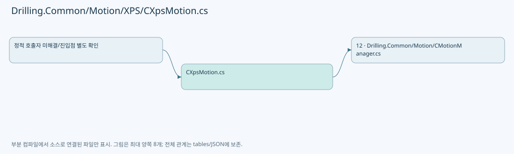
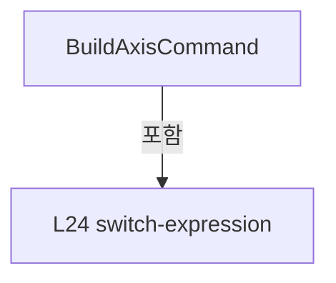
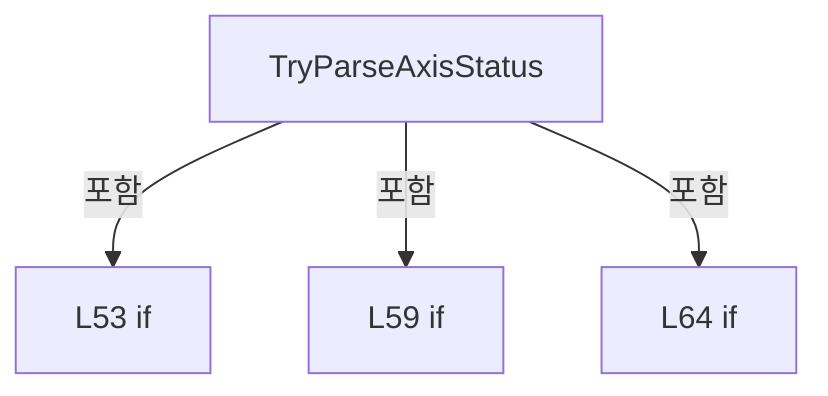
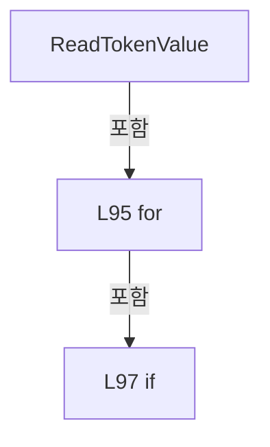

# Drilling.Common/Motion/XPS/CXpsMotion.cs

| 항목 | 내용 |
| --- | --- |
| 원본 저장소 | https://github.com/kjuws10-rgb/A3Drilling.git |
| 원본 Commit | 5aee8e58439c9b455cae7c9593c9be986c3e682e |
| 원본 SHA256 | 12ab7c97f0ebda44599e20f36ca37bf9e24d8c8eaf7c5d6f9cde0d7865b69c5d |
| 파일 분류 | code |
| 원본 크기/행 | 5,847 bytes / 125 physical lines |
| 인코딩 | utf-8-sig |
| 검토 범위 | 구문/부분 의미 분석에서 추출한 사실. 동작·물리 단위·실장비 합격을 보증하지 않습니다. |
| 원본 링크 | [고정 Commit 원본](https://github.com/kjuws10-rgb/A3Drilling/blob/5aee8e58439c9b455cae7c9593c9be986c3e682e/Drilling.Common/Motion/XPS/CXpsMotion.cs) |

## 파일의 역할과 읽는 순서

모션 인터페이스·제어 명령을 정의하거나 전달합니다. 문서 생성 과정에서는 축이나 장비를 움직이지 않았습니다.

## 네임스페이스·타입·상속

| 타입 | 구분 | 원본 범위 | 선언/상속 |
| --- | --- | --- | --- |
| CXpsMotion | ClassDeclaration | 9–125 | CXpsMotion: CMotionController("XPS", interfaceManager, deviceNo) |

## 멤버 빠른 목록

| 이름 | 종류 | 범위 | 서명 |
| --- | --- | --- | --- |
| MinusEndOfRunMask | FieldDeclaration | L12–12 | int Drilling.Common.Motion.CXpsMotion.MinusEndOfRunMask |
| PlusEndOfRunMask | FieldDeclaration | L13–13 | int Drilling.Common.Motion.CXpsMotion.PlusEndOfRunMask |
| CommandPrefix | PropertyDeclaration | L14–20 | string Drilling.Common.Motion.CXpsMotion.CommandPrefix |
| get_CommandPrefix | GetAccessorDeclaration | L16–19 | string Drilling.Common.Motion.CXpsMotion.CommandPrefix.get |
| BuildAxisCommand | MethodDeclaration | L22–41 | string Drilling.Common.Motion.CXpsMotion.BuildAxisCommand(Drilling.Common.Motion.ST_MOTOR_DATA, Drilling.Common.Motion.EN_MOTION_COMMAND, double, double?) |
| GetGroupName | MethodDeclaration | L43–48 | string Drilling.Common.Motion.CXpsMotion.GetGroupName(Drilling.Common.Motion.ST_MOTOR_DATA) |
| TryParseAxisStatus | MethodDeclaration | L50–91 | Drilling.Common.Motion.ST_MOTOR_AXIS_STATUS? Drilling.Common.Motion.CXpsMotion.TryParseAxisStatus(Drilling.Common.Motion.ST_MOTOR_DATA, string) |
| ReadTokenValue | MethodDeclaration | L93–104 | string Drilling.Common.Motion.CXpsMotion.ReadTokenValue(System.Collections.Generic.IReadOnlyList<string>, string) |
| TryReadTokenDouble | MethodDeclaration | L106–109 | bool Drilling.Common.Motion.CXpsMotion.TryReadTokenDouble(System.Collections.Generic.IReadOnlyList<string>, string, out double) |
| TryReadTokenInt | MethodDeclaration | L111–114 | bool Drilling.Common.Motion.CXpsMotion.TryReadTokenInt(System.Collections.Generic.IReadOnlyList<string>, string, out int) |
| ContainsAny | MethodDeclaration | L116–124 | bool Drilling.Common.Motion.CXpsMotion.ContainsAny(string, params string[]) |
| MatchesItem | LocalFunctionStatement | L118–121 | bool MatchesItem(string) |

## 멤버별 상세 계약·호출·처리 해설

### FieldDeclaration `MinusEndOfRunMask` · L12–12

[Drilling.Common/Motion/XPS/CXpsMotion.cs:12–12](https://github.com/kjuws10-rgb/A3Drilling/blob/5aee8e58439c9b455cae7c9593c9be986c3e682e/Drilling.Common/Motion/XPS/CXpsMotion.cs#L12-L12)

| 항목 | 실제 추출 값 |
| --- | --- |
| 서명 | int Drilling.Common.Motion.CXpsMotion.MinusEndOfRunMask |
| 접근/수식자 | Private / private, const |
| 반환/값 타입 | int |
| 소속 타입 | NamedType:Drilling.Common.Motion.CXpsMotion |

현재 부분 분석에서 직접 연결된 호출자는 없습니다. XAML/이벤트/인터페이스·델리게이트·외부 진입을 추가 확인해야 하며, 미사용으로 판정한 것이 아닙니다.

본문의 실제 연산·분기·예외·반환 순서(원문 위치 순):

| 원본 행 | 종류 | 주석 해설 |
| --- | --- | --- |
| 12 | variable-initializer | 변수의 초기값을 지정합니다: MinusEndOfRunMask = 1 << 8 |

변경 전 점검: 입력/반환 타입, 위 호출자, 예외/취소 경로, 공유 상태와 저장·전송 소비자를 함께 확인합니다. 값의 단위나 물리 방향을 이름만으로 확정하지 않습니다.

### FieldDeclaration `PlusEndOfRunMask` · L13–13

[Drilling.Common/Motion/XPS/CXpsMotion.cs:13–13](https://github.com/kjuws10-rgb/A3Drilling/blob/5aee8e58439c9b455cae7c9593c9be986c3e682e/Drilling.Common/Motion/XPS/CXpsMotion.cs#L13-L13)

| 항목 | 실제 추출 값 |
| --- | --- |
| 서명 | int Drilling.Common.Motion.CXpsMotion.PlusEndOfRunMask |
| 접근/수식자 | Private / private, const |
| 반환/값 타입 | int |
| 소속 타입 | NamedType:Drilling.Common.Motion.CXpsMotion |

현재 부분 분석에서 직접 연결된 호출자는 없습니다. XAML/이벤트/인터페이스·델리게이트·외부 진입을 추가 확인해야 하며, 미사용으로 판정한 것이 아닙니다.

본문의 실제 연산·분기·예외·반환 순서(원문 위치 순):

| 원본 행 | 종류 | 주석 해설 |
| --- | --- | --- |
| 13 | variable-initializer | 변수의 초기값을 지정합니다: PlusEndOfRunMask = 1 << 9 |

변경 전 점검: 입력/반환 타입, 위 호출자, 예외/취소 경로, 공유 상태와 저장·전송 소비자를 함께 확인합니다. 값의 단위나 물리 방향을 이름만으로 확정하지 않습니다.

### PropertyDeclaration `CommandPrefix` · L14–20

[Drilling.Common/Motion/XPS/CXpsMotion.cs:14–20](https://github.com/kjuws10-rgb/A3Drilling/blob/5aee8e58439c9b455cae7c9593c9be986c3e682e/Drilling.Common/Motion/XPS/CXpsMotion.cs#L14-L20)

| 항목 | 실제 추출 값 |
| --- | --- |
| 서명 | string Drilling.Common.Motion.CXpsMotion.CommandPrefix |
| 접근/수식자 | Protected / protected, override |
| 반환/값 타입 | string |
| 소속 타입 | NamedType:Drilling.Common.Motion.CXpsMotion |

현재 부분 분석에서 직접 연결된 호출자는 없습니다. XAML/이벤트/인터페이스·델리게이트·외부 진입을 추가 확인해야 하며, 미사용으로 판정한 것이 아닙니다.

변경 전 점검: 입력/반환 타입, 위 호출자, 예외/취소 경로, 공유 상태와 저장·전송 소비자를 함께 확인합니다. 값의 단위나 물리 방향을 이름만으로 확정하지 않습니다.

### GetAccessorDeclaration `get_CommandPrefix` · L16–19

[Drilling.Common/Motion/XPS/CXpsMotion.cs:16–19](https://github.com/kjuws10-rgb/A3Drilling/blob/5aee8e58439c9b455cae7c9593c9be986c3e682e/Drilling.Common/Motion/XPS/CXpsMotion.cs#L16-L19)

| 항목 | 실제 추출 값 |
| --- | --- |
| 서명 | string Drilling.Common.Motion.CXpsMotion.CommandPrefix.get |
| 접근/수식자 | Protected / get |
| 반환/값 타입 | string |
| 소속 타입 | NamedType:Drilling.Common.Motion.CXpsMotion |

현재 부분 분석에서 직접 연결된 호출자는 없습니다. XAML/이벤트/인터페이스·델리게이트·외부 진입을 추가 확인해야 하며, 미사용으로 판정한 것이 아닙니다.

본문의 실제 연산·분기·예외·반환 순서(원문 위치 순):

| 원본 행 | 종류 | 주석 해설 |
| --- | --- | --- |
| 18 | return | 호출자에게 값 또는 제어를 반환합니다: return "XPS"; |

변경 전 점검: 입력/반환 타입, 위 호출자, 예외/취소 경로, 공유 상태와 저장·전송 소비자를 함께 확인합니다. 값의 단위나 물리 방향을 이름만으로 확정하지 않습니다.

### MethodDeclaration `BuildAxisCommand` · L22–41

[Drilling.Common/Motion/XPS/CXpsMotion.cs:22–41](https://github.com/kjuws10-rgb/A3Drilling/blob/5aee8e58439c9b455cae7c9593c9be986c3e682e/Drilling.Common/Motion/XPS/CXpsMotion.cs#L22-L41)

| 항목 | 실제 추출 값 |
| --- | --- |
| 서명 | string Drilling.Common.Motion.CXpsMotion.BuildAxisCommand(Drilling.Common.Motion.ST_MOTOR_DATA, Drilling.Common.Motion.EN_MOTION_COMMAND, double, double?) |
| 접근/수식자 | Protected / protected, override |
| 반환/값 타입 | string |
| 소속 타입 | NamedType:Drilling.Common.Motion.CXpsMotion |

입력 계약:

| 이름 | 타입 | 전달 | 선택/기본값 |
| --- | --- | --- | --- |
| axis | Drilling.Common.Motion.ST_MOTOR_DATA | None | False /  |
| command | Drilling.Common.Motion.EN_MOTION_COMMAND | None | False /  |
| parameter | double | None | False /  |
| parameter2 | double? | None | True / null |

현재 부분 분석에서 직접 연결된 호출자는 없습니다. XAML/이벤트/인터페이스·델리게이트·외부 진입을 추가 확인해야 하며, 미사용으로 판정한 것이 아닙니다.

호출하는 대상과 해석 범위:

| 원본 행 | 표현식 | 분석 상태 | 대상/소스 위치 |
| --- | --- | --- | --- |
| 29 | FormatProtocolDouble | resolved | string Drilling.Common.Motion.CMotionController.FormatProtocolDouble(double, string) · Drilling.Common/Motion/CMotionManager.cs:1510 |
| 30 | FormatProtocolDouble | resolved | string Drilling.Common.Motion.CMotionController.FormatProtocolDouble(double, string) · Drilling.Common/Motion/CMotionManager.cs:1510 |
| 31 | FormatProtocolDouble | resolved | string Drilling.Common.Motion.CMotionController.FormatProtocolDouble(double, string) · Drilling.Common/Motion/CMotionManager.cs:1510 |
| 31 | FormatProtocolDouble | resolved | string Drilling.Common.Motion.CMotionController.FormatProtocolDouble(double, string) · Drilling.Common/Motion/CMotionManager.cs:1510 |
| 31 | RequireSecondaryParameter | resolved | double Drilling.Common.Motion.CMotionController.RequireSecondaryParameter(Drilling.Common.Motion.EN_MOTION_COMMAND, double?) · Drilling.Common/Motion/CMotionManager.cs:1520 |
| 32 | FormatProtocolDouble | resolved | string Drilling.Common.Motion.CMotionController.FormatProtocolDouble(double, string) · Drilling.Common/Motion/CMotionManager.cs:1510 |
| 32 | Math.Abs | resolved | double System.Math.Abs(double) |
| 32 | FormatProtocolDouble | resolved | string Drilling.Common.Motion.CMotionController.FormatProtocolDouble(double, string) · Drilling.Common/Motion/CMotionManager.cs:1510 |
| 32 | Math.Abs | resolved | double System.Math.Abs(double) |
| 32 | RequireSecondaryParameter | resolved | double Drilling.Common.Motion.CMotionController.RequireSecondaryParameter(Drilling.Common.Motion.EN_MOTION_COMMAND, double?) · Drilling.Common/Motion/CMotionManager.cs:1520 |
| 33 | FormatProtocolDouble | resolved | string Drilling.Common.Motion.CMotionController.FormatProtocolDouble(double, string) · Drilling.Common/Motion/CMotionManager.cs:1510 |
| 33 | Math.Abs | resolved | double System.Math.Abs(double) |
| 33 | FormatProtocolDouble | resolved | string Drilling.Common.Motion.CMotionController.FormatProtocolDouble(double, string) · Drilling.Common/Motion/CMotionManager.cs:1510 |
| 33 | Math.Abs | resolved | double System.Math.Abs(double) |
| 33 | RequireSecondaryParameter | resolved | double Drilling.Common.Motion.CMotionController.RequireSecondaryParameter(Drilling.Common.Motion.EN_MOTION_COMMAND, double?) · Drilling.Common/Motion/CMotionManager.cs:1520 |
| 40 | GetGroupName | resolved | string Drilling.Common.Motion.CXpsMotion.GetGroupName(Drilling.Common.Motion.ST_MOTOR_DATA) · Drilling.Common/Motion/XPS/CXpsMotion.cs:43 |

본문의 실제 연산·분기·예외·반환 순서(원문 위치 순):

| 원본 행 | 종류 | 주석 해설 |
| --- | --- | --- |
| 24 | local-declaration | 지역 변수를 선언합니다: var commandText = command switch { EN_MOTION_COMMAND.ServoOn => "SERVO_ON", EN_MOTION_COMMAND.ServoOff => "SERVO_OFF", EN_MOTION_COMMAND.Home => "HOME", EN_MOTION_COMMAND.MoveAbs => $"MOVE_ABS:{FormatProtocolDouble(parameter, "F6" |
| 24 | switch-expression | 값별 결과식을 선택합니다: command switch { EN_MOTION_COMMAND.ServoOn => "SERVO_ON", EN_MOTION_COMMAND.ServoOff => "SERVO_OFF", EN_MOTION_COMMAND.Home => "HOME", EN_MOTION_COMMAND.MoveAbs => $"MOVE_ABS:{FormatProtocolDouble(parameter, "F6")}", EN_MOTION_COM |
| 24 | variable-initializer | 변수의 초기값을 지정합니다: commandText = command switch { EN_MOTION_COMMAND.ServoOn => "SERVO_ON", EN_MOTION_COMMAND.ServoOff => "SERVO_OFF", EN_MOTION_COMMAND.Home => "HOME", EN_MOTION_COMMAND.MoveAbs => $"MOVE_ABS:{FormatProtocolDouble(parameter, "F6")}", |
| 29 | call | 함수·델리게이트 또는 객체 생성자를 호출합니다: FormatProtocolDouble(parameter, "F6") |
| 30 | call | 함수·델리게이트 또는 객체 생성자를 호출합니다: FormatProtocolDouble(parameter, "F6") |
| 31 | call | 함수·델리게이트 또는 객체 생성자를 호출합니다: FormatProtocolDouble(parameter, "F6") |
| 31 | call | 함수·델리게이트 또는 객체 생성자를 호출합니다: FormatProtocolDouble(RequireSecondaryParameter(command, parameter2), "F6") |
| 31 | call | 함수·델리게이트 또는 객체 생성자를 호출합니다: RequireSecondaryParameter(command, parameter2) |
| 32 | call | 함수·델리게이트 또는 객체 생성자를 호출합니다: FormatProtocolDouble(Math.Abs(parameter), "F6") |
| 32 | call | 함수·델리게이트 또는 객체 생성자를 호출합니다: Math.Abs(parameter) |
| 32 | call | 함수·델리게이트 또는 객체 생성자를 호출합니다: FormatProtocolDouble(Math.Abs(RequireSecondaryParameter(command, parameter2)), "F6") |
| 32 | call | 함수·델리게이트 또는 객체 생성자를 호출합니다: Math.Abs(RequireSecondaryParameter(command, parameter2)) |
| 32 | call | 함수·델리게이트 또는 객체 생성자를 호출합니다: RequireSecondaryParameter(command, parameter2) |
| 33 | call | 함수·델리게이트 또는 객체 생성자를 호출합니다: FormatProtocolDouble(-Math.Abs(parameter), "F6") |
| 33 | call | 함수·델리게이트 또는 객체 생성자를 호출합니다: Math.Abs(parameter) |
| 33 | call | 함수·델리게이트 또는 객체 생성자를 호출합니다: FormatProtocolDouble(Math.Abs(RequireSecondaryParameter(command, parameter2)), "F6") |
| 33 | call | 함수·델리게이트 또는 객체 생성자를 호출합니다: Math.Abs(RequireSecondaryParameter(command, parameter2)) |
| 33 | call | 함수·델리게이트 또는 객체 생성자를 호출합니다: RequireSecondaryParameter(command, parameter2) |
| 40 | call | 함수·델리게이트 또는 객체 생성자를 호출합니다: GetGroupName(axis) |
| 40 | return | 호출자에게 값 또는 제어를 반환합니다: return $"{CommandPrefix}:AXIS:{axis.Axis}:{axis.Name}:{GetGroupName(axis)}:{commandText}"; |

제어 구문의 포함 구조(실제 실행 순서/CFG가 아닌 구문 탐색 그림):

변경 전 점검: 입력/반환 타입, 위 호출자, 예외/취소 경로, 공유 상태와 저장·전송 소비자를 함께 확인합니다. 값의 단위나 물리 방향을 이름만으로 확정하지 않습니다.

### MethodDeclaration `GetGroupName` · L43–48

[Drilling.Common/Motion/XPS/CXpsMotion.cs:43–48](https://github.com/kjuws10-rgb/A3Drilling/blob/5aee8e58439c9b455cae7c9593c9be986c3e682e/Drilling.Common/Motion/XPS/CXpsMotion.cs#L43-L48)

| 항목 | 실제 추출 값 |
| --- | --- |
| 서명 | string Drilling.Common.Motion.CXpsMotion.GetGroupName(Drilling.Common.Motion.ST_MOTOR_DATA) |
| 접근/수식자 | Private / private, static |
| 반환/값 타입 | string |
| 소속 타입 | NamedType:Drilling.Common.Motion.CXpsMotion |

입력 계약:

| 이름 | 타입 | 전달 | 선택/기본값 |
| --- | --- | --- | --- |
| axis | Drilling.Common.Motion.ST_MOTOR_DATA | None | False /  |

정적 호출자로 확인된 위치:

| 호출 파일/행 | 호출 표현식 | 런타임 분기 가능 |
| --- | --- | --- |
| [Drilling.Common/Motion/XPS/CXpsMotion.cs:40–40](https://github.com/kjuws10-rgb/A3Drilling/blob/5aee8e58439c9b455cae7c9593c9be986c3e682e/Drilling.Common/Motion/XPS/CXpsMotion.cs#L40-L40) | GetGroupName | False |

호출하는 대상과 해석 범위:

| 원본 행 | 표현식 | 분석 상태 | 대상/소스 위치 |
| --- | --- | --- | --- |
| 45 | axis.Name.Trim | resolved | string string.Trim() |
| 46 | axisName.IndexOf | resolved | int string.IndexOf(char, System.StringComparison) |

본문의 실제 연산·분기·예외·반환 순서(원문 위치 순):

| 원본 행 | 종류 | 주석 해설 |
| --- | --- | --- |
| 45 | call | 함수·델리게이트 또는 객체 생성자를 호출합니다: axis.Name.Trim() |
| 45 | local-declaration | 지역 변수를 선언합니다: var axisName = axis.Name.Trim(); |
| 45 | variable-initializer | 변수의 초기값을 지정합니다: axisName = axis.Name.Trim() |
| 46 | call | 함수·델리게이트 또는 객체 생성자를 호출합니다: axisName.IndexOf('.', StringComparison.Ordinal) |
| 46 | local-declaration | 지역 변수를 선언합니다: var dotIndex = axisName.IndexOf('.', StringComparison.Ordinal); |
| 46 | variable-initializer | 변수의 초기값을 지정합니다: dotIndex = axisName.IndexOf('.', StringComparison.Ordinal) |
| 47 | conditional-expression | 조건에 따라 결과식을 선택합니다: dotIndex > 0 ? axisName[..dotIndex] : axisName |
| 47 | return | 호출자에게 값 또는 제어를 반환합니다: return dotIndex > 0 ? axisName[..dotIndex] : axisName; |

변경 전 점검: 입력/반환 타입, 위 호출자, 예외/취소 경로, 공유 상태와 저장·전송 소비자를 함께 확인합니다. 값의 단위나 물리 방향을 이름만으로 확정하지 않습니다.

### MethodDeclaration `TryParseAxisStatus` · L50–91

[Drilling.Common/Motion/XPS/CXpsMotion.cs:50–91](https://github.com/kjuws10-rgb/A3Drilling/blob/5aee8e58439c9b455cae7c9593c9be986c3e682e/Drilling.Common/Motion/XPS/CXpsMotion.cs#L50-L91)

| 항목 | 실제 추출 값 |
| --- | --- |
| 서명 | Drilling.Common.Motion.ST_MOTOR_AXIS_STATUS? Drilling.Common.Motion.CXpsMotion.TryParseAxisStatus(Drilling.Common.Motion.ST_MOTOR_DATA, string) |
| 접근/수식자 | Protected / protected, override |
| 반환/값 타입 | Drilling.Common.Motion.ST_MOTOR_AXIS_STATUS? |
| 소속 타입 | NamedType:Drilling.Common.Motion.CXpsMotion |

입력 계약:

| 이름 | 타입 | 전달 | 선택/기본값 |
| --- | --- | --- | --- |
| axis | Drilling.Common.Motion.ST_MOTOR_DATA | None | False /  |
| response | string | None | False /  |

현재 부분 분석에서 직접 연결된 호출자는 없습니다. XAML/이벤트/인터페이스·델리게이트·외부 진입을 추가 확인해야 하며, 미사용으로 판정한 것이 아닙니다.

호출하는 대상과 해석 범위:

| 원본 행 | 표현식 | 분석 상태 | 대상/소스 위치 |
| --- | --- | --- | --- |
| 52 | response.Split | resolved | string[] string.Split(char, System.StringSplitOptions) |
| 53 | tokens[0].Equals | resolved | bool string.Equals(string?, System.StringComparison) |
| 53 | tokens[1].Equals | resolved | bool string.Equals(string?, System.StringComparison) |
| 53 | tokens[3].Equals | resolved | bool string.Equals(string?, System.StringComparison) |
| 53 | double.TryParse | resolved | bool double.TryParse(string?, System.Globalization.NumberStyles, System.IFormatProvider?, out double) |
| 53 | double.IsFinite | resolved | bool double.IsFinite(double) |
| 58 | ReadTokenValue | resolved | string Drilling.Common.Motion.CXpsMotion.ReadTokenValue(System.Collections.Generic.IReadOnlyList<string>, string) · Drilling.Common/Motion/XPS/CXpsMotion.cs:93 |
| 59 | string.IsNullOrWhiteSpace | resolved | bool string.IsNullOrWhiteSpace(string?) |
| 59 | TryReadTokenInt | resolved | bool Drilling.Common.Motion.CXpsMotion.TryReadTokenInt(System.Collections.Generic.IReadOnlyList<string>, string, out int) · Drilling.Common/Motion/XPS/CXpsMotion.cs:111 |
| 59 | TryReadTokenInt | resolved | bool Drilling.Common.Motion.CXpsMotion.TryReadTokenInt(System.Collections.Generic.IReadOnlyList<string>, string, out int) · Drilling.Common/Motion/XPS/CXpsMotion.cs:111 |
| 64 | TryReadTokenDouble | resolved | bool Drilling.Common.Motion.CXpsMotion.TryReadTokenDouble(System.Collections.Generic.IReadOnlyList<string>, string, out double) · Drilling.Common/Motion/XPS/CXpsMotion.cs:106 |
| 64 | TryReadTokenDouble | resolved | bool Drilling.Common.Motion.CXpsMotion.TryReadTokenDouble(System.Collections.Generic.IReadOnlyList<string>, string, out double) · Drilling.Common/Motion/XPS/CXpsMotion.cs:106 |
| 69 | ContainsAny | resolved | bool Drilling.Common.Motion.CXpsMotion.ContainsAny(string, params string[]) · Drilling.Common/Motion/XPS/CXpsMotion.cs:116 |
| 70 | ContainsAny | resolved | bool Drilling.Common.Motion.CXpsMotion.ContainsAny(string, params string[]) · Drilling.Common/Motion/XPS/CXpsMotion.cs:116 |
| 71 | ContainsAny | resolved | bool Drilling.Common.Motion.CXpsMotion.ContainsAny(string, params string[]) · Drilling.Common/Motion/XPS/CXpsMotion.cs:116 |
| 75 | axis.Name.Trim().ToUpperInvariant | resolved | string string.ToUpperInvariant() |
| 75 | axis.Name.Trim | resolved | string string.Trim() |
| 76 | new ST_MOTOR_AXIS_STATUS | resolved | Drilling.Common.Motion.ST_MOTOR_AXIS_STATUS.ST_MOTOR_AXIS_STATUS(string, string, double, double, double, bool, bool, bool, bool, bool, double, double, int) · Drilling.Common/Motion/CMotionManager.cs:1685 |
| 78 | string.IsNullOrWhiteSpace | resolved | bool string.IsNullOrWhiteSpace(string?) |

본문의 실제 연산·분기·예외·반환 순서(원문 위치 순):

| 원본 행 | 종류 | 주석 해설 |
| --- | --- | --- |
| 52 | call | 함수·델리게이트 또는 객체 생성자를 호출합니다: response.Split(':', StringSplitOptions.TrimEntries &#124; StringSplitOptions.RemoveEmptyEntries) |
| 52 | local-declaration | 지역 변수를 선언합니다: var tokens = response.Split(':', StringSplitOptions.TrimEntries &#124; StringSplitOptions.RemoveEmptyEntries); |
| 52 | variable-initializer | 변수의 초기값을 지정합니다: tokens = response.Split(':', StringSplitOptions.TrimEntries &#124; StringSplitOptions.RemoveEmptyEntries) |
| 53 | call | 함수·델리게이트 또는 객체 생성자를 호출합니다: tokens[0].Equals("OK", StringComparison.OrdinalIgnoreCase) |
| 53 | call | 함수·델리게이트 또는 객체 생성자를 호출합니다: tokens[1].Equals("AXIS", StringComparison.OrdinalIgnoreCase) |
| 53 | call | 함수·델리게이트 또는 객체 생성자를 호출합니다: tokens[3].Equals("FPOS", StringComparison.OrdinalIgnoreCase) |
| 53 | call | 함수·델리게이트 또는 객체 생성자를 호출합니다: double.TryParse(tokens[4], System.Globalization.NumberStyles.Float, System.Globalization.CultureInfo.InvariantCulture, out var position) |
| 53 | call | 함수·델리게이트 또는 객체 생성자를 호출합니다: double.IsFinite(position) |
| 53 | if | 조건에 따라 분기합니다: if (tokens.Length < 5 &#124;&#124; !tokens[0].Equals("OK", StringComparison.OrdinalIgnoreCase) &#124;&#124; !tokens[1].Equals("AXIS", StringComparison.OrdinalIgnoreCase) &#124;&#124; !tokens[3].Equals("FPOS", StringComparison.OrdinalIgnoreCase) &#124;&#124; !doubl…) |
| 55 | return | 호출자에게 값 또는 제어를 반환합니다: return null; |
| 58 | call | 함수·델리게이트 또는 객체 생성자를 호출합니다: ReadTokenValue(tokens, "GROUP_STATUS_TEXT") |
| 58 | local-declaration | 지역 변수를 선언합니다: var statusText = ReadTokenValue(tokens, "GROUP_STATUS_TEXT"); |
| 58 | variable-initializer | 변수의 초기값을 지정합니다: statusText = ReadTokenValue(tokens, "GROUP_STATUS_TEXT") |
| 59 | call | 함수·델리게이트 또는 객체 생성자를 호출합니다: string.IsNullOrWhiteSpace(statusText) |
| 59 | call | 함수·델리게이트 또는 객체 생성자를 호출합니다: TryReadTokenInt(tokens, "MOTION_STATUS", out var motionStatus) |
| 59 | call | 함수·델리게이트 또는 객체 생성자를 호출합니다: TryReadTokenInt(tokens, "HARDWARE_STATUS", out var hardwareStatus) |
| 59 | if | 조건에 따라 분기합니다: if (string.IsNullOrWhiteSpace(statusText) &#124;&#124; !TryReadTokenInt(tokens, "MOTION_STATUS", out var motionStatus) &#124;&#124; motionStatus is not (0 or 1) &#124;&#124; !TryReadTokenInt(tokens, "HARDWARE_STATUS", out var hardwareStatus)) |
| 61 | return | 호출자에게 값 또는 제어를 반환합니다: return null; |
| 64 | call | 함수·델리게이트 또는 객체 생성자를 호출합니다: TryReadTokenDouble(tokens, "FVEL", out var feedbackVelocity) |
| 64 | call | 함수·델리게이트 또는 객체 생성자를 호출합니다: TryReadTokenDouble(tokens, "FACCEL", out var feedbackAcceleration) |
| 64 | if | 조건에 따라 분기합니다: if (!TryReadTokenDouble(tokens, "FVEL", out var feedbackVelocity) &#124;&#124; !TryReadTokenDouble(tokens, "FACCEL", out var feedbackAcceleration)) |
| 66 | return | 호출자에게 값 또는 제어를 반환합니다: return null; |
| 69 | call | 함수·델리게이트 또는 객체 생성자를 호출합니다: ContainsAny(statusText, "FAULT", "ERROR", "ALARM", "KILLED") |
| 69 | local-declaration | 지역 변수를 선언합니다: var alarmOn = ContainsAny(statusText, "FAULT", "ERROR", "ALARM", "KILLED"); |
| 69 | variable-initializer | 변수의 초기값을 지정합니다: alarmOn = ContainsAny(statusText, "FAULT", "ERROR", "ALARM", "KILLED") |
| 70 | call | 함수·델리게이트 또는 객체 생성자를 호출합니다: ContainsAny(statusText, "DISABLE", "NOT INITIALIZED", "KILLED") |
| 70 | local-declaration | 지역 변수를 선언합니다: var servoOn = !ContainsAny(statusText, "DISABLE", "NOT INITIALIZED", "KILLED"); |
| 70 | variable-initializer | 변수의 초기값을 지정합니다: servoOn = !ContainsAny(statusText, "DISABLE", "NOT INITIALIZED", "KILLED") |
| 71 | call | 함수·델리게이트 또는 객체 생성자를 호출합니다: ContainsAny(statusText, "NOT REFERENCED", "NOT INITIALIZED", "HOMING") |
| 71 | local-declaration | 지역 변수를 선언합니다: var homeCompleted = !ContainsAny(statusText, "NOT REFERENCED", "NOT INITIALIZED", "HOMING"); |
| 71 | variable-initializer | 변수의 초기값을 지정합니다: homeCompleted = !ContainsAny(statusText, "NOT REFERENCED", "NOT INITIALIZED", "HOMING") |
| 72 | local-declaration | 지역 변수를 선언합니다: var moving = motionStatus == 1; |
| 72 | variable-initializer | 변수의 초기값을 지정합니다: moving = motionStatus == 1 |
| 73 | local-declaration | 지역 변수를 선언합니다: var limitMinusOn = (hardwareStatus & MinusEndOfRunMask) != 0; |
| 73 | variable-initializer | 변수의 초기값을 지정합니다: limitMinusOn = (hardwareStatus & MinusEndOfRunMask) != 0 |
| 74 | local-declaration | 지역 변수를 선언합니다: var limitPlusOn = (hardwareStatus & PlusEndOfRunMask) != 0; |
| 74 | variable-initializer | 변수의 초기값을 지정합니다: limitPlusOn = (hardwareStatus & PlusEndOfRunMask) != 0 |
| 75 | call | 함수·델리게이트 또는 객체 생성자를 호출합니다: axis.Name.Trim().ToUpperInvariant() |
| 75 | call | 함수·델리게이트 또는 객체 생성자를 호출합니다: axis.Name.Trim() |
| 75 | local-declaration | 지역 변수를 선언합니다: var axisId = axis.Name.Trim().ToUpperInvariant(); |
| 75 | variable-initializer | 변수의 초기값을 지정합니다: axisId = axis.Name.Trim().ToUpperInvariant() |
| 76 | call | 함수·델리게이트 또는 객체 생성자를 호출합니다: new ST_MOTOR_AXIS_STATUS( axisId, string.IsNullOrWhiteSpace(axis.DisplayName) ? axisId : axis.DisplayName, position, position, moving ? double.NaN : position, servoOn, homeCompleted, limitPlusOn, limitMinusOn, alarmOn, f… |
| 76 | return | 호출자에게 값 또는 제어를 반환합니다: return new ST_MOTOR_AXIS_STATUS( axisId, string.IsNullOrWhiteSpace(axis.DisplayName) ? axisId : axis.DisplayName, position, position, moving ? double.NaN : position, servoOn, homeCompleted, limitPlusOn, limitMinusOn, alarmOn, feed |
| 78 | call | 함수·델리게이트 또는 객체 생성자를 호출합니다: string.IsNullOrWhiteSpace(axis.DisplayName) |
| 78 | conditional-expression | 조건에 따라 결과식을 선택합니다: string.IsNullOrWhiteSpace(axis.DisplayName) ? axisId : axis.DisplayName |
| 81 | conditional-expression | 조건에 따라 결과식을 선택합니다: moving ? double.NaN : position |

제어 구문의 포함 구조(실제 실행 순서/CFG가 아닌 구문 탐색 그림):

변경 전 점검: 입력/반환 타입, 위 호출자, 예외/취소 경로, 공유 상태와 저장·전송 소비자를 함께 확인합니다. 값의 단위나 물리 방향을 이름만으로 확정하지 않습니다.

### MethodDeclaration `ReadTokenValue` · L93–104

[Drilling.Common/Motion/XPS/CXpsMotion.cs:93–104](https://github.com/kjuws10-rgb/A3Drilling/blob/5aee8e58439c9b455cae7c9593c9be986c3e682e/Drilling.Common/Motion/XPS/CXpsMotion.cs#L93-L104)

| 항목 | 실제 추출 값 |
| --- | --- |
| 서명 | string Drilling.Common.Motion.CXpsMotion.ReadTokenValue(System.Collections.Generic.IReadOnlyList<string>, string) |
| 접근/수식자 | Private / private, static |
| 반환/값 타입 | string |
| 소속 타입 | NamedType:Drilling.Common.Motion.CXpsMotion |

입력 계약:

| 이름 | 타입 | 전달 | 선택/기본값 |
| --- | --- | --- | --- |
| tokens | System.Collections.Generic.IReadOnlyList<string> | None | False /  |
| name | string | None | False /  |

정적 호출자로 확인된 위치:

| 호출 파일/행 | 호출 표현식 | 런타임 분기 가능 |
| --- | --- | --- |
| [Drilling.Common/Motion/XPS/CXpsMotion.cs:58–58](https://github.com/kjuws10-rgb/A3Drilling/blob/5aee8e58439c9b455cae7c9593c9be986c3e682e/Drilling.Common/Motion/XPS/CXpsMotion.cs#L58-L58) | ReadTokenValue | False |
| [Drilling.Common/Motion/XPS/CXpsMotion.cs:108–108](https://github.com/kjuws10-rgb/A3Drilling/blob/5aee8e58439c9b455cae7c9593c9be986c3e682e/Drilling.Common/Motion/XPS/CXpsMotion.cs#L108-L108) | ReadTokenValue | False |
| [Drilling.Common/Motion/XPS/CXpsMotion.cs:113–113](https://github.com/kjuws10-rgb/A3Drilling/blob/5aee8e58439c9b455cae7c9593c9be986c3e682e/Drilling.Common/Motion/XPS/CXpsMotion.cs#L113-L113) | ReadTokenValue | False |

호출하는 대상과 해석 범위:

| 원본 행 | 표현식 | 분석 상태 | 대상/소스 위치 |
| --- | --- | --- | --- |
| 97 | tokens[index].Equals | resolved | bool string.Equals(string?, System.StringComparison) |

본문의 실제 연산·분기·예외·반환 순서(원문 위치 순):

| 원본 행 | 종류 | 주석 해설 |
| --- | --- | --- |
| 95 | variable-initializer | 변수의 초기값을 지정합니다: index = 0 |
| 95 | for | 초기화·조건·증감이 있는 반복입니다: for (var index = 0; index < tokens.Count - 1; index++) |
| 97 | call | 함수·델리게이트 또는 객체 생성자를 호출합니다: tokens[index].Equals(name, StringComparison.OrdinalIgnoreCase) |
| 97 | if | 조건에 따라 분기합니다: if (tokens[index].Equals(name, StringComparison.OrdinalIgnoreCase)) |
| 99 | return | 호출자에게 값 또는 제어를 반환합니다: return tokens[index + 1]; |
| 103 | return | 호출자에게 값 또는 제어를 반환합니다: return ""; |

제어 구문의 포함 구조(실제 실행 순서/CFG가 아닌 구문 탐색 그림):

변경 전 점검: 입력/반환 타입, 위 호출자, 예외/취소 경로, 공유 상태와 저장·전송 소비자를 함께 확인합니다. 값의 단위나 물리 방향을 이름만으로 확정하지 않습니다.

### MethodDeclaration `TryReadTokenDouble` · L106–109

[Drilling.Common/Motion/XPS/CXpsMotion.cs:106–109](https://github.com/kjuws10-rgb/A3Drilling/blob/5aee8e58439c9b455cae7c9593c9be986c3e682e/Drilling.Common/Motion/XPS/CXpsMotion.cs#L106-L109)

| 항목 | 실제 추출 값 |
| --- | --- |
| 서명 | bool Drilling.Common.Motion.CXpsMotion.TryReadTokenDouble(System.Collections.Generic.IReadOnlyList<string>, string, out double) |
| 접근/수식자 | Private / private, static |
| 반환/값 타입 | bool |
| 소속 타입 | NamedType:Drilling.Common.Motion.CXpsMotion |

입력 계약:

| 이름 | 타입 | 전달 | 선택/기본값 |
| --- | --- | --- | --- |
| tokens | System.Collections.Generic.IReadOnlyList<string> | None | False /  |
| name | string | None | False /  |
| value | double | Out | False /  |

정적 호출자로 확인된 위치:

| 호출 파일/행 | 호출 표현식 | 런타임 분기 가능 |
| --- | --- | --- |
| [Drilling.Common/Motion/XPS/CXpsMotion.cs:64–64](https://github.com/kjuws10-rgb/A3Drilling/blob/5aee8e58439c9b455cae7c9593c9be986c3e682e/Drilling.Common/Motion/XPS/CXpsMotion.cs#L64-L64) | TryReadTokenDouble | False |
| [Drilling.Common/Motion/XPS/CXpsMotion.cs:64–64](https://github.com/kjuws10-rgb/A3Drilling/blob/5aee8e58439c9b455cae7c9593c9be986c3e682e/Drilling.Common/Motion/XPS/CXpsMotion.cs#L64-L64) | TryReadTokenDouble | False |

호출하는 대상과 해석 범위:

| 원본 행 | 표현식 | 분석 상태 | 대상/소스 위치 |
| --- | --- | --- | --- |
| 108 | double.TryParse | resolved | bool double.TryParse(string?, System.Globalization.NumberStyles, System.IFormatProvider?, out double) |
| 108 | ReadTokenValue | resolved | string Drilling.Common.Motion.CXpsMotion.ReadTokenValue(System.Collections.Generic.IReadOnlyList<string>, string) · Drilling.Common/Motion/XPS/CXpsMotion.cs:93 |
| 108 | double.IsFinite | resolved | bool double.IsFinite(double) |

본문의 실제 연산·분기·예외·반환 순서(원문 위치 순):

| 원본 행 | 종류 | 주석 해설 |
| --- | --- | --- |
| 108 | call | 함수·델리게이트 또는 객체 생성자를 호출합니다: double.TryParse(ReadTokenValue(tokens, name), System.Globalization.NumberStyles.Float, System.Globalization.CultureInfo.InvariantCulture, out value) |
| 108 | call | 함수·델리게이트 또는 객체 생성자를 호출합니다: ReadTokenValue(tokens, name) |
| 108 | call | 함수·델리게이트 또는 객체 생성자를 호출합니다: double.IsFinite(value) |
| 108 | return | 호출자에게 값 또는 제어를 반환합니다: return double.TryParse(ReadTokenValue(tokens, name), System.Globalization.NumberStyles.Float, System.Globalization.CultureInfo.InvariantCulture, out value) && double.IsFinite(value); |

변경 전 점검: 입력/반환 타입, 위 호출자, 예외/취소 경로, 공유 상태와 저장·전송 소비자를 함께 확인합니다. 값의 단위나 물리 방향을 이름만으로 확정하지 않습니다.

### MethodDeclaration `TryReadTokenInt` · L111–114

[Drilling.Common/Motion/XPS/CXpsMotion.cs:111–114](https://github.com/kjuws10-rgb/A3Drilling/blob/5aee8e58439c9b455cae7c9593c9be986c3e682e/Drilling.Common/Motion/XPS/CXpsMotion.cs#L111-L114)

| 항목 | 실제 추출 값 |
| --- | --- |
| 서명 | bool Drilling.Common.Motion.CXpsMotion.TryReadTokenInt(System.Collections.Generic.IReadOnlyList<string>, string, out int) |
| 접근/수식자 | Private / private, static |
| 반환/값 타입 | bool |
| 소속 타입 | NamedType:Drilling.Common.Motion.CXpsMotion |

입력 계약:

| 이름 | 타입 | 전달 | 선택/기본값 |
| --- | --- | --- | --- |
| tokens | System.Collections.Generic.IReadOnlyList<string> | None | False /  |
| name | string | None | False /  |
| value | int | Out | False /  |

정적 호출자로 확인된 위치:

| 호출 파일/행 | 호출 표현식 | 런타임 분기 가능 |
| --- | --- | --- |
| [Drilling.Common/Motion/XPS/CXpsMotion.cs:59–59](https://github.com/kjuws10-rgb/A3Drilling/blob/5aee8e58439c9b455cae7c9593c9be986c3e682e/Drilling.Common/Motion/XPS/CXpsMotion.cs#L59-L59) | TryReadTokenInt | False |
| [Drilling.Common/Motion/XPS/CXpsMotion.cs:59–59](https://github.com/kjuws10-rgb/A3Drilling/blob/5aee8e58439c9b455cae7c9593c9be986c3e682e/Drilling.Common/Motion/XPS/CXpsMotion.cs#L59-L59) | TryReadTokenInt | False |

호출하는 대상과 해석 범위:

| 원본 행 | 표현식 | 분석 상태 | 대상/소스 위치 |
| --- | --- | --- | --- |
| 113 | int.TryParse | resolved | bool int.TryParse(string?, System.Globalization.NumberStyles, System.IFormatProvider?, out int) |
| 113 | ReadTokenValue | resolved | string Drilling.Common.Motion.CXpsMotion.ReadTokenValue(System.Collections.Generic.IReadOnlyList<string>, string) · Drilling.Common/Motion/XPS/CXpsMotion.cs:93 |

본문의 실제 연산·분기·예외·반환 순서(원문 위치 순):

| 원본 행 | 종류 | 주석 해설 |
| --- | --- | --- |
| 113 | call | 함수·델리게이트 또는 객체 생성자를 호출합니다: int.TryParse(ReadTokenValue(tokens, name), System.Globalization.NumberStyles.Integer, System.Globalization.CultureInfo.InvariantCulture, out value) |
| 113 | call | 함수·델리게이트 또는 객체 생성자를 호출합니다: ReadTokenValue(tokens, name) |
| 113 | return | 호출자에게 값 또는 제어를 반환합니다: return int.TryParse(ReadTokenValue(tokens, name), System.Globalization.NumberStyles.Integer, System.Globalization.CultureInfo.InvariantCulture, out value); |

변경 전 점검: 입력/반환 타입, 위 호출자, 예외/취소 경로, 공유 상태와 저장·전송 소비자를 함께 확인합니다. 값의 단위나 물리 방향을 이름만으로 확정하지 않습니다.

### MethodDeclaration `ContainsAny` · L116–124

[Drilling.Common/Motion/XPS/CXpsMotion.cs:116–124](https://github.com/kjuws10-rgb/A3Drilling/blob/5aee8e58439c9b455cae7c9593c9be986c3e682e/Drilling.Common/Motion/XPS/CXpsMotion.cs#L116-L124)

| 항목 | 실제 추출 값 |
| --- | --- |
| 서명 | bool Drilling.Common.Motion.CXpsMotion.ContainsAny(string, params string[]) |
| 접근/수식자 | Private / private, static |
| 반환/값 타입 | bool |
| 소속 타입 | NamedType:Drilling.Common.Motion.CXpsMotion |

입력 계약:

| 이름 | 타입 | 전달 | 선택/기본값 |
| --- | --- | --- | --- |
| value | string | None | False /  |
| patterns | string[] | None | False /  |

정적 호출자로 확인된 위치:

| 호출 파일/행 | 호출 표현식 | 런타임 분기 가능 |
| --- | --- | --- |
| [Drilling.Common/Motion/XPS/CXpsMotion.cs:69–69](https://github.com/kjuws10-rgb/A3Drilling/blob/5aee8e58439c9b455cae7c9593c9be986c3e682e/Drilling.Common/Motion/XPS/CXpsMotion.cs#L69-L69) | ContainsAny | False |
| [Drilling.Common/Motion/XPS/CXpsMotion.cs:70–70](https://github.com/kjuws10-rgb/A3Drilling/blob/5aee8e58439c9b455cae7c9593c9be986c3e682e/Drilling.Common/Motion/XPS/CXpsMotion.cs#L70-L70) | ContainsAny | False |
| [Drilling.Common/Motion/XPS/CXpsMotion.cs:71–71](https://github.com/kjuws10-rgb/A3Drilling/blob/5aee8e58439c9b455cae7c9593c9be986c3e682e/Drilling.Common/Motion/XPS/CXpsMotion.cs#L71-L71) | ContainsAny | False |

호출하는 대상과 해석 범위:

| 원본 행 | 표현식 | 분석 상태 | 대상/소스 위치 |
| --- | --- | --- | --- |
| 123 | patterns.Any | resolved | bool System.Collections.Generic.IEnumerable<string>.Any<string>(System.Func<string, bool>) |

본문의 실제 연산·분기·예외·반환 순서(원문 위치 순):

| 원본 행 | 종류 | 주석 해설 |
| --- | --- | --- |
| 123 | call | 함수·델리게이트 또는 객체 생성자를 호출합니다: patterns.Any(MatchesItem) |
| 123 | return | 호출자에게 값 또는 제어를 반환합니다: return patterns.Any(MatchesItem); |

변경 전 점검: 입력/반환 타입, 위 호출자, 예외/취소 경로, 공유 상태와 저장·전송 소비자를 함께 확인합니다. 값의 단위나 물리 방향을 이름만으로 확정하지 않습니다.

### LocalFunctionStatement `MatchesItem` · L118–121

[Drilling.Common/Motion/XPS/CXpsMotion.cs:118–121](https://github.com/kjuws10-rgb/A3Drilling/blob/5aee8e58439c9b455cae7c9593c9be986c3e682e/Drilling.Common/Motion/XPS/CXpsMotion.cs#L118-L121)

| 항목 | 실제 추출 값 |
| --- | --- |
| 서명 | bool MatchesItem(string) |
| 접근/수식자 | Private /  |
| 반환/값 타입 | bool |
| 소속 타입 | NamedType:Drilling.Common.Motion.CXpsMotion |

입력 계약:

| 이름 | 타입 | 전달 | 선택/기본값 |
| --- | --- | --- | --- |
| pattern | string | None | False /  |

현재 부분 분석에서 직접 연결된 호출자는 없습니다. XAML/이벤트/인터페이스·델리게이트·외부 진입을 추가 확인해야 하며, 미사용으로 판정한 것이 아닙니다.

호출하는 대상과 해석 범위:

| 원본 행 | 표현식 | 분석 상태 | 대상/소스 위치 |
| --- | --- | --- | --- |
| 120 | value.Contains | resolved | bool string.Contains(string, System.StringComparison) |

본문의 실제 연산·분기·예외·반환 순서(원문 위치 순):

| 원본 행 | 종류 | 주석 해설 |
| --- | --- | --- |
| 120 | call | 함수·델리게이트 또는 객체 생성자를 호출합니다: value.Contains(pattern, StringComparison.OrdinalIgnoreCase) |
| 120 | return | 호출자에게 값 또는 제어를 반환합니다: return value.Contains(pattern, StringComparison.OrdinalIgnoreCase); |

변경 전 점검: 입력/반환 타입, 위 호출자, 예외/취소 경로, 공유 상태와 저장·전송 소비자를 함께 확인합니다. 값의 단위나 물리 방향을 이름만으로 확정하지 않습니다.

## 구문·바인딩 한계

전체 WPF/벤더 SDK/프로젝트별 빌드 조건을 로드한 정식 빌드가 아닙니다. `resolved`는 이 부분 컴파일에서의 심볼 연결이며 virtual/interface/delegate/이벤트/Reflection/XAML의 실제 런타임 구현을 확정하지 않습니다. `candidate`와 `unresolved`는 후속 확인 대상으로 남깁니다.

## 원문 전체 주석 해설본

[원본 모든 행과 행별 해설 보기](../../../../annotated/Drilling.Common/Motion/XPS/CXpsMotion.cs.annotated.txt)

원본을 빠뜨리거나 임의로 줄이지 않았습니다. `L000001 |` 표시는 원본 행 번호, `// 해설`은 별도 설명입니다. 실행용 소스가 아닌 문서입니다.

## 수정·재검증 체크

- 원본 Commit과 현재 작업 파일 SHA가 같은지 먼저 확인합니다. 다르면 이 문서를 과거 버전 자료로 취급합니다.
- 선언·직접 호출·이벤트/인터페이스 경계·설정 소비를 함께 확인합니다. 정적 연결의 빈 곳을 정상 경로로 추정하지 않습니다.
- 저장 형식/단위/식별자·재시도·취소·예외·롤백에 영향을 주는 변경은 상세 해설장과 호출자를 다시 검토합니다.
- 도구의 구문 추출과 별도 정적 추적 해설, 실제 빌드·시뮬레이션·실장비 검증 결과를 분리합니다.
