# Drilling.Common/Product/CProductManager.cs

| 항목 | 내용 |
| --- | --- |
| 원본 저장소 | https://github.com/kjuws10-rgb/A3Drilling.git |
| 원본 Commit | 5aee8e58439c9b455cae7c9593c9be986c3e682e |
| 원본 SHA256 | 262b986df8da1e5a582659ef4133d1035dab8ea718565c3ac3b0a38b4ce3afb7 |
| 파일 분류 | code |
| 원본 크기/행 | 43,011 bytes / 1,170 physical lines |
| 인코딩 | utf-8-sig |
| 검토 범위 | 구문/부분 의미 분석에서 추출한 사실. 동작·물리 단위·실장비 합격을 보증하지 않습니다. |
| 원본 링크 | [고정 Commit 원본](https://github.com/kjuws10-rgb/A3Drilling/blob/5aee8e58439c9b455cae7c9593c9be986c3e682e/Drilling.Common/Product/CProductManager.cs) |

## 파일의 역할과 읽는 순서

프로그램의 시작·구성·공유 타입 또는 빌드 연결에 사용됩니다. 아래 실제 선언·참조와 원본 근거를 확인합니다.

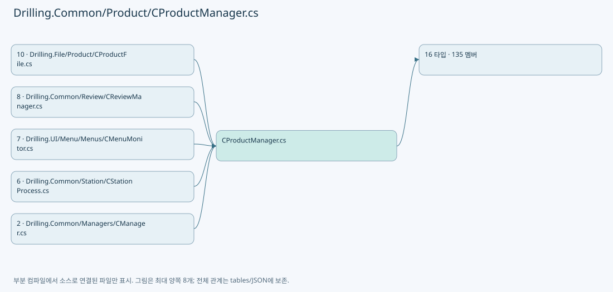

## 네임스페이스·타입·상속

| 타입 | 구분 | 원본 범위 | 선언/상속 |
| --- | --- | --- | --- |
| CProductManager | ClassDeclaration | 4–957 | CProductManager |
| EN_PRODUCT_STATE | EnumDeclaration | 959–967 | EN_PRODUCT_STATE |
| EN_PRODUCT_RESULT | EnumDeclaration | 969–975 | EN_PRODUCT_RESULT |
| EN_PRODUCT_HEAD_STATE | EnumDeclaration | 977–985 | EN_PRODUCT_HEAD_STATE |
| EN_PRODUCT_PROCESS_STATE | EnumDeclaration | 987–994 | EN_PRODUCT_PROCESS_STATE |
| ST_PRODUCT_ALIGN_DATA | RecordDeclaration | 996–996 | ST_PRODUCT_ALIGN_DATA |
| ST_PRODUCT_DISTORTION_DATA | RecordDeclaration | 997–997 | ST_PRODUCT_DISTORTION_DATA |
| ST_PRODUCT_REVIEW_RESULT | RecordDeclaration | 998–998 | ST_PRODUCT_REVIEW_RESULT |
| ST_PRODUCT_REVIEW_DATA | RecordDeclaration | 999–1011 | ST_PRODUCT_REVIEW_DATA |
| ST_PRODUCT_INFO | RecordDeclaration | 1013–1028 | ST_PRODUCT_INFO |
| ST_PRODUCT_RECIPE_DATA | RecordDeclaration | 1030–1030 | ST_PRODUCT_RECIPE_DATA |
| ST_PRODUCT_RUNTIME_DATA | RecordDeclaration | 1031–1031 | ST_PRODUCT_RUNTIME_DATA |
| ST_PRODUCT_HEAD_RESULT | RecordDeclaration | 1032–1042 | ST_PRODUCT_HEAD_RESULT |
| ST_PRODUCT_DATA | RecordDeclaration | 1043–1160 | ST_PRODUCT_DATA |
| ST_PRODUCT_HISTORY | RecordDeclaration | 1162–1162 | ST_PRODUCT_HISTORY |
| CProductFileBase | ClassDeclaration | 1163–1170 | CProductFileBase |

## 멤버 빠른 목록

| 이름 | 종류 | 범위 | 서명 |
| --- | --- | --- | --- |
| _updateGate | FieldDeclaration | L6–6 | System.Threading.SemaphoreSlim Drilling.Common.Product.CProductManager._updateGate |
| _current | FieldDeclaration | L7–7 | Drilling.Common.Product.ST_PRODUCT_DATA? Drilling.Common.Product.CProductManager._current |
| _hasActiveDataLoadError | FieldDeclaration | L8–8 | int Drilling.Common.Product.CProductManager._hasActiveDataLoadError |
| Current | PropertyDeclaration | L9–15 | Drilling.Common.Product.ST_PRODUCT_DATA? Drilling.Common.Product.CProductManager.Current |
| get_Current | GetAccessorDeclaration | L11–14 | Drilling.Common.Product.ST_PRODUCT_DATA? Drilling.Common.Product.CProductManager.Current.get |
| HasActiveDataLoadError | PropertyDeclaration | L17–23 | bool Drilling.Common.Product.CProductManager.HasActiveDataLoadError |
| get_HasActiveDataLoadError | GetAccessorDeclaration | L19–22 | bool Drilling.Common.Product.CProductManager.HasActiveDataLoadError.get |
| LoadActive | MethodDeclaration | L25–47 | System.Threading.Tasks.Task<Drilling.Common.Product.ST_PRODUCT_DATA?> Drilling.Common.Product.CProductManager.LoadActive(System.Threading.CancellationToken) |
| RecoverInterrupted | MethodDeclaration | L49–127 | System.Threading.Tasks.Task<Drilling.Common.Product.ST_PRODUCT_DATA?> Drilling.Common.Product.CProductManager.RecoverInterrupted(System.Threading.CancellationToken) |
| MatchesState | LocalFunctionStatement | L53–56 | bool MatchesState(Drilling.Common.Product.ST_PRODUCT_HEAD_RESULT) |
| SelectValue | LocalFunctionStatement | L80–91 | Drilling.Common.Product.ST_PRODUCT_HEAD_RESULT SelectValue(Drilling.Common.Product.ST_PRODUCT_HEAD_RESULT) |
| CreateProduct | MethodDeclaration | L129–200 | System.Threading.Tasks.Task<Drilling.Common.Product.ST_PRODUCT_DATA> Drilling.Common.Product.CProductManager.CreateProduct(string, string, string, string, System.Collections.Generic.IReadOnlyDictionary<string, string>, System.Collections.Generic.IReadOnlyDictionary<int, int>, System.Threading.CancellationToken) |
| SelectKey | LocalFunctionStatement | L141–144 | int SelectKey(System.Collections.Generic.KeyValuePair<int, int>) |
| BuildProduct | LocalFunctionStatement | L146–149 | Drilling.Common.Product.ST_PRODUCT_HEAD_RESULT BuildProduct(System.Collections.Generic.KeyValuePair<int, int>) |
| PrepareProductForProcess | MethodDeclaration | L202–237 | System.Threading.Tasks.Task<Drilling.Common.Product.ST_PRODUCT_DATA> Drilling.Common.Product.CProductManager.PrepareProductForProcess(string, string, string, System.Collections.Generic.IReadOnlyDictionary<string, string>, System.Collections.Generic.IReadOnlyDictionary<int, int>, System.Threading.CancellationToken) |
| StartProduct | MethodDeclaration | L239–275 | System.Threading.Tasks.Task<Drilling.Common.Product.ST_PRODUCT_DATA> Drilling.Common.Product.CProductManager.StartProduct(string, System.Threading.CancellationToken) |
| SelectItem | LocalFunctionStatement | L247–259 | Drilling.Common.Product.ST_PRODUCT_HEAD_RESULT SelectItem(Drilling.Common.Product.ST_PRODUCT_HEAD_RESULT) |
| SetProductInfo | MethodDeclaration | L277–311 | System.Threading.Tasks.Task<Drilling.Common.Product.ST_PRODUCT_DATA> Drilling.Common.Product.CProductManager.SetProductInfo(string, System.Collections.Generic.IReadOnlyDictionary<string, string>, System.Threading.CancellationToken) |
| ShouldIncludeItem | LocalFunctionStatement | L281–284 | bool ShouldIncludeItem(string) |
| SetHeadRunning | MethodDeclaration | L313–345 | System.Threading.Tasks.Task<Drilling.Common.Product.ST_PRODUCT_DATA> Drilling.Common.Product.CProductManager.SetHeadRunning(string, int, System.Threading.CancellationToken) |
| SelectItem | LocalFunctionStatement | L321–330 | Drilling.Common.Product.ST_PRODUCT_HEAD_RESULT SelectItem(Drilling.Common.Product.ST_PRODUCT_HEAD_RESULT) |
| SetHeadResult | MethodDeclaration | L347–384 | System.Threading.Tasks.Task<Drilling.Common.Product.ST_PRODUCT_DATA> Drilling.Common.Product.CProductManager.SetHeadResult(string, int, bool, string, string, System.Threading.CancellationToken) |
| SelectItem | LocalFunctionStatement | L355–369 | Drilling.Common.Product.ST_PRODUCT_HEAD_RESULT SelectItem(Drilling.Common.Product.ST_PRODUCT_HEAD_RESULT) |
| SetAlign | MethodDeclaration | L386–403 | System.Threading.Tasks.Task<Drilling.Common.Product.ST_PRODUCT_DATA> Drilling.Common.Product.CProductManager.SetAlign(string, Drilling.Common.Product.ST_PRODUCT_ALIGN_DATA, System.Threading.CancellationToken) |
| SetDistortion | MethodDeclaration | L405–422 | System.Threading.Tasks.Task<Drilling.Common.Product.ST_PRODUCT_DATA> Drilling.Common.Product.CProductManager.SetDistortion(string, Drilling.Common.Product.ST_PRODUCT_DISTORTION_DATA, System.Threading.CancellationToken) |
| SetAlignment | MethodDeclaration | L424–442 | System.Threading.Tasks.Task<Drilling.Common.Product.ST_PRODUCT_DATA> Drilling.Common.Product.CProductManager.SetAlignment(string, Drilling.Common.Product.ST_PRODUCT_ALIGN_DATA, Drilling.Common.Product.ST_PRODUCT_DISTORTION_DATA, System.Threading.CancellationToken) |
| SetReviewRunning | MethodDeclaration | L444–464 | System.Threading.Tasks.Task<Drilling.Common.Product.ST_PRODUCT_DATA> Drilling.Common.Product.CProductManager.SetReviewRunning(string, Drilling.Common.Product.ST_PRODUCT_REVIEW_DATA, System.Threading.CancellationToken) |
| SetReviewProgress | MethodDeclaration | L466–488 | System.Threading.Tasks.Task<Drilling.Common.Product.ST_PRODUCT_DATA> Drilling.Common.Product.CProductManager.SetReviewProgress(string, Drilling.Common.Product.ST_PRODUCT_REVIEW_DATA, System.Threading.CancellationToken) |
| SetReviewCompleted | MethodDeclaration | L490–512 | System.Threading.Tasks.Task<Drilling.Common.Product.ST_PRODUCT_DATA> Drilling.Common.Product.CProductManager.SetReviewCompleted(string, System.DateTimeOffset, System.Collections.Generic.IReadOnlyList<Drilling.Common.Product.ST_PRODUCT_REVIEW_RESULT>, System.Threading.CancellationToken) |
| SetReviewStopped | MethodDeclaration | L514–534 | System.Threading.Tasks.Task<Drilling.Common.Product.ST_PRODUCT_DATA> Drilling.Common.Product.CProductManager.SetReviewStopped(string, string, System.Threading.CancellationToken) |
| SetReviewError | MethodDeclaration | L536–556 | System.Threading.Tasks.Task<Drilling.Common.Product.ST_PRODUCT_DATA> Drilling.Common.Product.CProductManager.SetReviewError(string, string, System.Threading.CancellationToken) |
| CompleteProduct | MethodDeclaration | L558–608 | System.Threading.Tasks.Task<Drilling.Common.Product.ST_PRODUCT_DATA> Drilling.Common.Product.CProductManager.CompleteProduct(string, bool, bool, string, System.Threading.CancellationToken) |
| SelectItem | LocalFunctionStatement | L566–592 | Drilling.Common.Product.ST_PRODUCT_HEAD_RESULT SelectItem(Drilling.Common.Product.ST_PRODUCT_HEAD_RESULT) |
| StopProduct | MethodDeclaration | L610–645 | System.Threading.Tasks.Task<Drilling.Common.Product.ST_PRODUCT_DATA> Drilling.Common.Product.CProductManager.StopProduct(string, string, System.Threading.CancellationToken) |
| SelectItem | LocalFunctionStatement | L618–629 | Drilling.Common.Product.ST_PRODUCT_HEAD_RESULT SelectItem(Drilling.Common.Product.ST_PRODUCT_HEAD_RESULT) |
| SetError | MethodDeclaration | L647–683 | System.Threading.Tasks.Task<Drilling.Common.Product.ST_PRODUCT_DATA> Drilling.Common.Product.CProductManager.SetError(string, string, System.Threading.CancellationToken) |
| SelectItem | LocalFunctionStatement | L655–667 | Drilling.Common.Product.ST_PRODUCT_HEAD_RESULT SelectItem(Drilling.Common.Product.ST_PRODUCT_HEAD_RESULT) |
| ScrapProduct | MethodDeclaration | L685–702 | System.Threading.Tasks.Task<Drilling.Common.Product.ST_PRODUCT_DATA> Drilling.Common.Product.CProductManager.ScrapProduct(string, string, System.Threading.CancellationToken) |
| DeleteProduct | MethodDeclaration | L704–738 | System.Threading.Tasks.Task Drilling.Common.Product.CProductManager.DeleteProduct(string, System.Threading.CancellationToken) |
| ReleaseCompletedProduct | MethodDeclaration | L740–759 | System.Threading.Tasks.Task Drilling.Common.Product.CProductManager.ReleaseCompletedProduct(string, System.Threading.CancellationToken) |
| LoadHistory | MethodDeclaration | L761–772 | System.Threading.Tasks.Task<System.Collections.Generic.IReadOnlyList<Drilling.Common.Product.ST_PRODUCT_HISTORY>> Drilling.Common.Product.CProductManager.LoadHistory(int, int, System.Threading.CancellationToken) |
| GetCurrent | MethodDeclaration | L774–787 | Drilling.Common.Product.ST_PRODUCT_DATA Drilling.Common.Product.CProductManager.GetCurrent(string) |
| PersistAndLog | MethodDeclaration | L789–820 | System.Threading.Tasks.Task<Drilling.Common.Product.ST_PRODUCT_DATA> Drilling.Common.Product.CProductManager.PersistAndLog(Drilling.Common.Product.ST_PRODUCT_DATA, string, string, System.Threading.CancellationToken) |
| CreateProductInfo | MethodDeclaration | L822–851 | Drilling.Common.Product.ST_PRODUCT_INFO Drilling.Common.Product.CProductManager.CreateProductInfo(string, string, string, string, System.Collections.Generic.IReadOnlyDictionary<string, string>, System.DateTimeOffset) |
| SelectName | LocalFunctionStatement | L824–827 | string SelectName(string) |
| SelectValue | LocalFunctionStatement | L829–832 | string SelectValue(string) |
| SetProductState | MethodDeclaration | L853–856 | Drilling.Common.Product.ST_PRODUCT_INFO Drilling.Common.Product.CProductManager.SetProductState(Drilling.Common.Product.ST_PRODUCT_INFO, Drilling.Common.Product.EN_PRODUCT_STATE, Drilling.Common.Product.EN_PRODUCT_RESULT, System.DateTimeOffset?, System.DateTimeOffset?) |
| HostWritableProductFieldNames | FieldDeclaration | L858–890 | System.Collections.Generic.IReadOnlySet<string> Drilling.Common.Product.CProductManager.HostWritableProductFieldNames |
| ProductFieldNames | FieldDeclaration | L891–930 | System.Collections.Generic.IReadOnlyList<string> Drilling.Common.Product.CProductManager.ProductFieldNames |
| ChooseGlassId | MethodDeclaration | L931–956 | string Drilling.Common.Product.CProductManager.ChooseGlassId(string, string, System.Collections.Generic.IReadOnlyDictionary<string, string>) |
| Created | EnumMemberDeclaration | L961–961 | Drilling.Common.Product.EN_PRODUCT_STATE.Created |
| Running | EnumMemberDeclaration | L962–962 | Drilling.Common.Product.EN_PRODUCT_STATE.Running |
| Completed | EnumMemberDeclaration | L963–963 | Drilling.Common.Product.EN_PRODUCT_STATE.Completed |
| Stopped | EnumMemberDeclaration | L964–964 | Drilling.Common.Product.EN_PRODUCT_STATE.Stopped |
| Error | EnumMemberDeclaration | L965–965 | Drilling.Common.Product.EN_PRODUCT_STATE.Error |
| Scrapped | EnumMemberDeclaration | L966–966 | Drilling.Common.Product.EN_PRODUCT_STATE.Scrapped |
| Pending | EnumMemberDeclaration | L971–971 | Drilling.Common.Product.EN_PRODUCT_RESULT.Pending |
| Skipped | EnumMemberDeclaration | L972–972 | Drilling.Common.Product.EN_PRODUCT_RESULT.Skipped |
| OK | EnumMemberDeclaration | L973–973 | Drilling.Common.Product.EN_PRODUCT_RESULT.OK |
| NG | EnumMemberDeclaration | L974–974 | Drilling.Common.Product.EN_PRODUCT_RESULT.NG |
| Ready | EnumMemberDeclaration | L979–979 | Drilling.Common.Product.EN_PRODUCT_HEAD_STATE.Ready |
| Running | EnumMemberDeclaration | L980–980 | Drilling.Common.Product.EN_PRODUCT_HEAD_STATE.Running |
| Completed | EnumMemberDeclaration | L981–981 | Drilling.Common.Product.EN_PRODUCT_HEAD_STATE.Completed |
| Stopped | EnumMemberDeclaration | L982–982 | Drilling.Common.Product.EN_PRODUCT_HEAD_STATE.Stopped |
| Error | EnumMemberDeclaration | L983–983 | Drilling.Common.Product.EN_PRODUCT_HEAD_STATE.Error |
| Disabled | EnumMemberDeclaration | L984–984 | Drilling.Common.Product.EN_PRODUCT_HEAD_STATE.Disabled |
| NotStarted | EnumMemberDeclaration | L989–989 | Drilling.Common.Product.EN_PRODUCT_PROCESS_STATE.NotStarted |
| Running | EnumMemberDeclaration | L990–990 | Drilling.Common.Product.EN_PRODUCT_PROCESS_STATE.Running |
| Completed | EnumMemberDeclaration | L991–991 | Drilling.Common.Product.EN_PRODUCT_PROCESS_STATE.Completed |
| Stopped | EnumMemberDeclaration | L992–992 | Drilling.Common.Product.EN_PRODUCT_PROCESS_STATE.Stopped |
| Error | EnumMemberDeclaration | L993–993 | Drilling.Common.Product.EN_PRODUCT_PROCESS_STATE.Error |
| InspectionMethod | PropertyDeclaration | L1001–1001 | string Drilling.Common.Product.ST_PRODUCT_REVIEW_DATA.InspectionMethod |
| get_InspectionMethod | GetAccessorDeclaration | L1001–1001 | string Drilling.Common.Product.ST_PRODUCT_REVIEW_DATA.InspectionMethod.get |
| set_InspectionMethod | InitAccessorDeclaration | L1001–1001 | void Drilling.Common.Product.ST_PRODUCT_REVIEW_DATA.InspectionMethod.init |
| RecipeId | PropertyDeclaration | L1002–1002 | string Drilling.Common.Product.ST_PRODUCT_REVIEW_DATA.RecipeId |
| get_RecipeId | GetAccessorDeclaration | L1002–1002 | string Drilling.Common.Product.ST_PRODUCT_REVIEW_DATA.RecipeId.get |
| set_RecipeId | InitAccessorDeclaration | L1002–1002 | void Drilling.Common.Product.ST_PRODUCT_REVIEW_DATA.RecipeId.init |
| Rule | PropertyDeclaration | L1003–1003 | string Drilling.Common.Product.ST_PRODUCT_REVIEW_DATA.Rule |
| get_Rule | GetAccessorDeclaration | L1003–1003 | string Drilling.Common.Product.ST_PRODUCT_REVIEW_DATA.Rule.get |
| set_Rule | InitAccessorDeclaration | L1003–1003 | void Drilling.Common.Product.ST_PRODUCT_REVIEW_DATA.Rule.init |
| RuleScope | PropertyDeclaration | L1004–1004 | string Drilling.Common.Product.ST_PRODUCT_REVIEW_DATA.RuleScope |
| get_RuleScope | GetAccessorDeclaration | L1004–1004 | string Drilling.Common.Product.ST_PRODUCT_REVIEW_DATA.RuleScope.get |
| set_RuleScope | InitAccessorDeclaration | L1004–1004 | void Drilling.Common.Product.ST_PRODUCT_REVIEW_DATA.RuleScope.init |
| BeamNo | PropertyDeclaration | L1005–1005 | int Drilling.Common.Product.ST_PRODUCT_REVIEW_DATA.BeamNo |
| get_BeamNo | GetAccessorDeclaration | L1005–1005 | int Drilling.Common.Product.ST_PRODUCT_REVIEW_DATA.BeamNo.get |
| set_BeamNo | InitAccessorDeclaration | L1005–1005 | void Drilling.Common.Product.ST_PRODUCT_REVIEW_DATA.BeamNo.init |
| ReferenceCellNo | PropertyDeclaration | L1006–1006 | int? Drilling.Common.Product.ST_PRODUCT_REVIEW_DATA.ReferenceCellNo |
| get_ReferenceCellNo | GetAccessorDeclaration | L1006–1006 | int? Drilling.Common.Product.ST_PRODUCT_REVIEW_DATA.ReferenceCellNo.get |
| set_ReferenceCellNo | InitAccessorDeclaration | L1006–1006 | void Drilling.Common.Product.ST_PRODUCT_REVIEW_DATA.ReferenceCellNo.init |
| ReferenceShot | PropertyDeclaration | L1007–1007 | string Drilling.Common.Product.ST_PRODUCT_REVIEW_DATA.ReferenceShot |
| get_ReferenceShot | GetAccessorDeclaration | L1007–1007 | string Drilling.Common.Product.ST_PRODUCT_REVIEW_DATA.ReferenceShot.get |
| set_ReferenceShot | InitAccessorDeclaration | L1007–1007 | void Drilling.Common.Product.ST_PRODUCT_REVIEW_DATA.ReferenceShot.init |
| RoughReference | PropertyDeclaration | L1008–1008 | string Drilling.Common.Product.ST_PRODUCT_REVIEW_DATA.RoughReference |
| get_RoughReference | GetAccessorDeclaration | L1008–1008 | string Drilling.Common.Product.ST_PRODUCT_REVIEW_DATA.RoughReference.get |
| set_RoughReference | InitAccessorDeclaration | L1008–1008 | void Drilling.Common.Product.ST_PRODUCT_REVIEW_DATA.RoughReference.init |
| FineLineCount | PropertyDeclaration | L1009–1009 | int Drilling.Common.Product.ST_PRODUCT_REVIEW_DATA.FineLineCount |
| get_FineLineCount | GetAccessorDeclaration | L1009–1009 | int Drilling.Common.Product.ST_PRODUCT_REVIEW_DATA.FineLineCount.get |
| set_FineLineCount | InitAccessorDeclaration | L1009–1009 | void Drilling.Common.Product.ST_PRODUCT_REVIEW_DATA.FineLineCount.init |
| TotalCount | PropertyDeclaration | L1010–1010 | int Drilling.Common.Product.ST_PRODUCT_REVIEW_DATA.TotalCount |
| get_TotalCount | GetAccessorDeclaration | L1010–1010 | int Drilling.Common.Product.ST_PRODUCT_REVIEW_DATA.TotalCount.get |
| set_TotalCount | InitAccessorDeclaration | L1010–1010 | void Drilling.Common.Product.ST_PRODUCT_REVIEW_DATA.TotalCount.init |
| Get | MethodDeclaration | L1015–1018 | string Drilling.Common.Product.ST_PRODUCT_INFO.Get(string) |
| Set | MethodDeclaration | L1020–1027 | Drilling.Common.Product.ST_PRODUCT_INFO Drilling.Common.Product.ST_PRODUCT_INFO.Set(string, string) |
| GlassId | PropertyDeclaration | L1052–1052 | string Drilling.Common.Product.ST_PRODUCT_DATA.GlassId |
| ProductId | PropertyDeclaration | L1054–1060 | string Drilling.Common.Product.ST_PRODUCT_DATA.ProductId |
| get_ProductId | GetAccessorDeclaration | L1056–1059 | string Drilling.Common.Product.ST_PRODUCT_DATA.ProductId.get |
| PanelId | PropertyDeclaration | L1062–1068 | string Drilling.Common.Product.ST_PRODUCT_DATA.PanelId |
| get_PanelId | GetAccessorDeclaration | L1064–1067 | string Drilling.Common.Product.ST_PRODUCT_DATA.PanelId.get |
| LotId | PropertyDeclaration | L1070–1076 | string Drilling.Common.Product.ST_PRODUCT_DATA.LotId |
| get_LotId | GetAccessorDeclaration | L1072–1075 | string Drilling.Common.Product.ST_PRODUCT_DATA.LotId.get |
| ProcessId | PropertyDeclaration | L1078–1084 | string Drilling.Common.Product.ST_PRODUCT_DATA.ProcessId |
| get_ProcessId | GetAccessorDeclaration | L1080–1083 | string Drilling.Common.Product.ST_PRODUCT_DATA.ProcessId.get |
| RecipeId | PropertyDeclaration | L1086–1092 | string Drilling.Common.Product.ST_PRODUCT_DATA.RecipeId |
| get_RecipeId | GetAccessorDeclaration | L1088–1091 | string Drilling.Common.Product.ST_PRODUCT_DATA.RecipeId.get |
| State | PropertyDeclaration | L1094–1100 | Drilling.Common.Product.EN_PRODUCT_STATE Drilling.Common.Product.ST_PRODUCT_DATA.State |
| get_State | GetAccessorDeclaration | L1096–1099 | Drilling.Common.Product.EN_PRODUCT_STATE Drilling.Common.Product.ST_PRODUCT_DATA.State.get |
| Result | PropertyDeclaration | L1102–1108 | Drilling.Common.Product.EN_PRODUCT_RESULT Drilling.Common.Product.ST_PRODUCT_DATA.Result |
| get_Result | GetAccessorDeclaration | L1104–1107 | Drilling.Common.Product.EN_PRODUCT_RESULT Drilling.Common.Product.ST_PRODUCT_DATA.Result.get |
| CreatedAt | PropertyDeclaration | L1110–1116 | System.DateTimeOffset? Drilling.Common.Product.ST_PRODUCT_DATA.CreatedAt |
| get_CreatedAt | GetAccessorDeclaration | L1112–1115 | System.DateTimeOffset? Drilling.Common.Product.ST_PRODUCT_DATA.CreatedAt.get |
| StartedAt | PropertyDeclaration | L1118–1124 | System.DateTimeOffset? Drilling.Common.Product.ST_PRODUCT_DATA.StartedAt |
| get_StartedAt | GetAccessorDeclaration | L1120–1123 | System.DateTimeOffset? Drilling.Common.Product.ST_PRODUCT_DATA.StartedAt.get |
| CompletedAt | PropertyDeclaration | L1126–1132 | System.DateTimeOffset? Drilling.Common.Product.ST_PRODUCT_DATA.CompletedAt |
| get_CompletedAt | GetAccessorDeclaration | L1128–1131 | System.DateTimeOffset? Drilling.Common.Product.ST_PRODUCT_DATA.CompletedAt.get |
| Parameters | PropertyDeclaration | L1134–1140 | System.Collections.Generic.IReadOnlyDictionary<string, string> Drilling.Common.Product.ST_PRODUCT_DATA.Parameters |
| get_Parameters | GetAccessorDeclaration | L1136–1139 | System.Collections.Generic.IReadOnlyDictionary<string, string> Drilling.Common.Product.ST_PRODUCT_DATA.Parameters.get |
| Heads | PropertyDeclaration | L1142–1148 | System.Collections.Generic.IReadOnlyList<Drilling.Common.Product.ST_PRODUCT_HEAD_RESULT> Drilling.Common.Product.ST_PRODUCT_DATA.Heads |
| get_Heads | GetAccessorDeclaration | L1144–1147 | System.Collections.Generic.IReadOnlyList<Drilling.Common.Product.ST_PRODUCT_HEAD_RESULT> Drilling.Common.Product.ST_PRODUCT_DATA.Heads.get |
| ParseEnum | MethodDeclaration | L1150–1154 | T Drilling.Common.Product.ST_PRODUCT_DATA.ParseEnum<T>(string, T) |
| ParseDate | MethodDeclaration | L1156–1159 | System.DateTimeOffset? Drilling.Common.Product.ST_PRODUCT_DATA.ParseDate(string) |
| LoadActive | MethodDeclaration | L1165–1165 | System.Threading.Tasks.Task<Drilling.Common.Product.ST_PRODUCT_DATA?> Drilling.Common.Product.CProductFileBase.LoadActive(System.Threading.CancellationToken) |
| SaveActive | MethodDeclaration | L1166–1166 | System.Threading.Tasks.Task Drilling.Common.Product.CProductFileBase.SaveActive(Drilling.Common.Product.ST_PRODUCT_DATA, System.Threading.CancellationToken) |
| ClearActive | MethodDeclaration | L1167–1167 | System.Threading.Tasks.Task Drilling.Common.Product.CProductFileBase.ClearActive(System.Threading.CancellationToken) |
| AppendHistory | MethodDeclaration | L1168–1168 | System.Threading.Tasks.Task Drilling.Common.Product.CProductFileBase.AppendHistory(Drilling.Common.Product.ST_PRODUCT_HISTORY, System.Threading.CancellationToken) |
| LoadHistory | MethodDeclaration | L1169–1169 | System.Threading.Tasks.Task<System.Collections.Generic.IReadOnlyList<Drilling.Common.Product.ST_PRODUCT_HISTORY>> Drilling.Common.Product.CProductFileBase.LoadHistory(int, int, System.Threading.CancellationToken) |

## 멤버별 상세 계약·호출·처리 해설

### FieldDeclaration `_updateGate` · L6–6

[Drilling.Common/Product/CProductManager.cs:6–6](https://github.com/kjuws10-rgb/A3Drilling/blob/5aee8e58439c9b455cae7c9593c9be986c3e682e/Drilling.Common/Product/CProductManager.cs#L6-L6)

| 항목 | 실제 추출 값 |
| --- | --- |
| 서명 | System.Threading.SemaphoreSlim Drilling.Common.Product.CProductManager._updateGate |
| 접근/수식자 | Private / private, readonly |
| 반환/값 타입 | System.Threading.SemaphoreSlim |
| 소속 타입 | NamedType:Drilling.Common.Product.CProductManager |

현재 부분 분석에서 직접 연결된 호출자는 없습니다. XAML/이벤트/인터페이스·델리게이트·외부 진입을 추가 확인해야 하며, 미사용으로 판정한 것이 아닙니다.

호출하는 대상과 해석 범위:

| 원본 행 | 표현식 | 분석 상태 | 대상/소스 위치 |
| --- | --- | --- | --- |
| 6 | new | resolved | System.Threading.SemaphoreSlim.SemaphoreSlim(int, int) |

본문의 실제 연산·분기·예외·반환 순서(원문 위치 순):

| 원본 행 | 종류 | 주석 해설 |
| --- | --- | --- |
| 6 | call | 함수·델리게이트 또는 객체 생성자를 호출합니다: new(1, 1) |
| 6 | variable-initializer | 변수의 초기값을 지정합니다: _updateGate = new(1, 1) |

변경 전 점검: 입력/반환 타입, 위 호출자, 예외/취소 경로, 공유 상태와 저장·전송 소비자를 함께 확인합니다. 값의 단위나 물리 방향을 이름만으로 확정하지 않습니다.

### FieldDeclaration `_current` · L7–7

[Drilling.Common/Product/CProductManager.cs:7–7](https://github.com/kjuws10-rgb/A3Drilling/blob/5aee8e58439c9b455cae7c9593c9be986c3e682e/Drilling.Common/Product/CProductManager.cs#L7-L7)

| 항목 | 실제 추출 값 |
| --- | --- |
| 서명 | Drilling.Common.Product.ST_PRODUCT_DATA? Drilling.Common.Product.CProductManager._current |
| 접근/수식자 | Private / private |
| 반환/값 타입 | Drilling.Common.Product.ST_PRODUCT_DATA? |
| 소속 타입 | NamedType:Drilling.Common.Product.CProductManager |

현재 부분 분석에서 직접 연결된 호출자는 없습니다. XAML/이벤트/인터페이스·델리게이트·외부 진입을 추가 확인해야 하며, 미사용으로 판정한 것이 아닙니다.

변경 전 점검: 입력/반환 타입, 위 호출자, 예외/취소 경로, 공유 상태와 저장·전송 소비자를 함께 확인합니다. 값의 단위나 물리 방향을 이름만으로 확정하지 않습니다.

### FieldDeclaration `_hasActiveDataLoadError` · L8–8

[Drilling.Common/Product/CProductManager.cs:8–8](https://github.com/kjuws10-rgb/A3Drilling/blob/5aee8e58439c9b455cae7c9593c9be986c3e682e/Drilling.Common/Product/CProductManager.cs#L8-L8)

| 항목 | 실제 추출 값 |
| --- | --- |
| 서명 | int Drilling.Common.Product.CProductManager._hasActiveDataLoadError |
| 접근/수식자 | Private / private |
| 반환/값 타입 | int |
| 소속 타입 | NamedType:Drilling.Common.Product.CProductManager |

현재 부분 분석에서 직접 연결된 호출자는 없습니다. XAML/이벤트/인터페이스·델리게이트·외부 진입을 추가 확인해야 하며, 미사용으로 판정한 것이 아닙니다.

변경 전 점검: 입력/반환 타입, 위 호출자, 예외/취소 경로, 공유 상태와 저장·전송 소비자를 함께 확인합니다. 값의 단위나 물리 방향을 이름만으로 확정하지 않습니다.

### PropertyDeclaration `Current` · L9–15

[Drilling.Common/Product/CProductManager.cs:9–15](https://github.com/kjuws10-rgb/A3Drilling/blob/5aee8e58439c9b455cae7c9593c9be986c3e682e/Drilling.Common/Product/CProductManager.cs#L9-L15)

| 항목 | 실제 추출 값 |
| --- | --- |
| 서명 | Drilling.Common.Product.ST_PRODUCT_DATA? Drilling.Common.Product.CProductManager.Current |
| 접근/수식자 | Public / public |
| 반환/값 타입 | Drilling.Common.Product.ST_PRODUCT_DATA? |
| 소속 타입 | NamedType:Drilling.Common.Product.CProductManager |

현재 부분 분석에서 직접 연결된 호출자는 없습니다. XAML/이벤트/인터페이스·델리게이트·외부 진입을 추가 확인해야 하며, 미사용으로 판정한 것이 아닙니다.

변경 전 점검: 입력/반환 타입, 위 호출자, 예외/취소 경로, 공유 상태와 저장·전송 소비자를 함께 확인합니다. 값의 단위나 물리 방향을 이름만으로 확정하지 않습니다.

### GetAccessorDeclaration `get_Current` · L11–14

[Drilling.Common/Product/CProductManager.cs:11–14](https://github.com/kjuws10-rgb/A3Drilling/blob/5aee8e58439c9b455cae7c9593c9be986c3e682e/Drilling.Common/Product/CProductManager.cs#L11-L14)

| 항목 | 실제 추출 값 |
| --- | --- |
| 서명 | Drilling.Common.Product.ST_PRODUCT_DATA? Drilling.Common.Product.CProductManager.Current.get |
| 접근/수식자 | Public / get |
| 반환/값 타입 | Drilling.Common.Product.ST_PRODUCT_DATA? |
| 소속 타입 | NamedType:Drilling.Common.Product.CProductManager |

현재 부분 분석에서 직접 연결된 호출자는 없습니다. XAML/이벤트/인터페이스·델리게이트·외부 진입을 추가 확인해야 하며, 미사용으로 판정한 것이 아닙니다.

호출하는 대상과 해석 범위:

| 원본 행 | 표현식 | 분석 상태 | 대상/소스 위치 |
| --- | --- | --- | --- |
| 13 | Volatile.Read | resolved | Drilling.Common.Product.ST_PRODUCT_DATA? System.Threading.Volatile.Read<Drilling.Common.Product.ST_PRODUCT_DATA?>(ref readonly Drilling.Common.Product.ST_PRODUCT_DATA?) |

본문의 실제 연산·분기·예외·반환 순서(원문 위치 순):

| 원본 행 | 종류 | 주석 해설 |
| --- | --- | --- |
| 13 | call | 함수·델리게이트 또는 객체 생성자를 호출합니다: Volatile.Read(ref _current) |
| 13 | return | 호출자에게 값 또는 제어를 반환합니다: return Volatile.Read(ref _current); |

변경 전 점검: 입력/반환 타입, 위 호출자, 예외/취소 경로, 공유 상태와 저장·전송 소비자를 함께 확인합니다. 값의 단위나 물리 방향을 이름만으로 확정하지 않습니다.

### PropertyDeclaration `HasActiveDataLoadError` · L17–23

[Drilling.Common/Product/CProductManager.cs:17–23](https://github.com/kjuws10-rgb/A3Drilling/blob/5aee8e58439c9b455cae7c9593c9be986c3e682e/Drilling.Common/Product/CProductManager.cs#L17-L23)

| 항목 | 실제 추출 값 |
| --- | --- |
| 서명 | bool Drilling.Common.Product.CProductManager.HasActiveDataLoadError |
| 접근/수식자 | Public / public |
| 반환/값 타입 | bool |
| 소속 타입 | NamedType:Drilling.Common.Product.CProductManager |

현재 부분 분석에서 직접 연결된 호출자는 없습니다. XAML/이벤트/인터페이스·델리게이트·외부 진입을 추가 확인해야 하며, 미사용으로 판정한 것이 아닙니다.

변경 전 점검: 입력/반환 타입, 위 호출자, 예외/취소 경로, 공유 상태와 저장·전송 소비자를 함께 확인합니다. 값의 단위나 물리 방향을 이름만으로 확정하지 않습니다.

### GetAccessorDeclaration `get_HasActiveDataLoadError` · L19–22

[Drilling.Common/Product/CProductManager.cs:19–22](https://github.com/kjuws10-rgb/A3Drilling/blob/5aee8e58439c9b455cae7c9593c9be986c3e682e/Drilling.Common/Product/CProductManager.cs#L19-L22)

| 항목 | 실제 추출 값 |
| --- | --- |
| 서명 | bool Drilling.Common.Product.CProductManager.HasActiveDataLoadError.get |
| 접근/수식자 | Public / get |
| 반환/값 타입 | bool |
| 소속 타입 | NamedType:Drilling.Common.Product.CProductManager |

현재 부분 분석에서 직접 연결된 호출자는 없습니다. XAML/이벤트/인터페이스·델리게이트·외부 진입을 추가 확인해야 하며, 미사용으로 판정한 것이 아닙니다.

호출하는 대상과 해석 범위:

| 원본 행 | 표현식 | 분석 상태 | 대상/소스 위치 |
| --- | --- | --- | --- |
| 21 | Volatile.Read | resolved | int System.Threading.Volatile.Read(ref readonly int) |

본문의 실제 연산·분기·예외·반환 순서(원문 위치 순):

| 원본 행 | 종류 | 주석 해설 |
| --- | --- | --- |
| 21 | call | 함수·델리게이트 또는 객체 생성자를 호출합니다: Volatile.Read(ref _hasActiveDataLoadError) |
| 21 | return | 호출자에게 값 또는 제어를 반환합니다: return Volatile.Read(ref _hasActiveDataLoadError) != 0; |

변경 전 점검: 입력/반환 타입, 위 호출자, 예외/취소 경로, 공유 상태와 저장·전송 소비자를 함께 확인합니다. 값의 단위나 물리 방향을 이름만으로 확정하지 않습니다.

### MethodDeclaration `LoadActive` · L25–47

[Drilling.Common/Product/CProductManager.cs:25–47](https://github.com/kjuws10-rgb/A3Drilling/blob/5aee8e58439c9b455cae7c9593c9be986c3e682e/Drilling.Common/Product/CProductManager.cs#L25-L47)

| 항목 | 실제 추출 값 |
| --- | --- |
| 서명 | System.Threading.Tasks.Task<Drilling.Common.Product.ST_PRODUCT_DATA?> Drilling.Common.Product.CProductManager.LoadActive(System.Threading.CancellationToken) |
| 접근/수식자 | Public / public, async |
| 반환/값 타입 | System.Threading.Tasks.Task<Drilling.Common.Product.ST_PRODUCT_DATA?> |
| 소속 타입 | NamedType:Drilling.Common.Product.CProductManager |

입력 계약:

| 이름 | 타입 | 전달 | 선택/기본값 |
| --- | --- | --- | --- |
| cancellationToken | System.Threading.CancellationToken | None | True / null |

정적 호출자로 확인된 위치:

| 호출 파일/행 | 호출 표현식 | 런타임 분기 가능 |
| --- | --- | --- |
| [Drilling.Common/Managers/CManager.cs:539–539](https://github.com/kjuws10-rgb/A3Drilling/blob/5aee8e58439c9b455cae7c9593c9be986c3e682e/Drilling.Common/Managers/CManager.cs#L539-L539) | _productManager.LoadActive | False |
| [Drilling.UI/Menu/Menus/CMenuMonitor.cs:3906–3906](https://github.com/kjuws10-rgb/A3Drilling/blob/5aee8e58439c9b455cae7c9593c9be986c3e682e/Drilling.UI/Menu/Menus/CMenuMonitor.cs#L3906-L3906) | _productManager.LoadActive | False |
| [Drilling.UI/Menu/Menus/CMenuMonitor.cs:3930–3930](https://github.com/kjuws10-rgb/A3Drilling/blob/5aee8e58439c9b455cae7c9593c9be986c3e682e/Drilling.UI/Menu/Menus/CMenuMonitor.cs#L3930-L3930) | _productManager.LoadActive | False |
| [Drilling.UI/Menu/Menus/CMenuMonitor.cs:3962–3962](https://github.com/kjuws10-rgb/A3Drilling/blob/5aee8e58439c9b455cae7c9593c9be986c3e682e/Drilling.UI/Menu/Menus/CMenuMonitor.cs#L3962-L3962) | _productManager.LoadActive | False |

호출하는 대상과 해석 범위:

| 원본 행 | 표현식 | 분석 상태 | 대상/소스 위치 |
| --- | --- | --- | --- |
| 27 | cancellationToken.ThrowIfCancellationRequested | resolved | void System.Threading.CancellationToken.ThrowIfCancellationRequested() |
| 28 | _updateGate.WaitAsync(cancellationToken).ConfigureAwait | resolved | System.Runtime.CompilerServices.ConfiguredTaskAwaitable System.Threading.Tasks.Task.ConfigureAwait(bool) |
| 28 | _updateGate.WaitAsync | resolved | System.Threading.Tasks.Task System.Threading.SemaphoreSlim.WaitAsync(System.Threading.CancellationToken) |
| 33 | productFile.LoadActive(cancellationToken).ConfigureAwait | resolved | System.Runtime.CompilerServices.ConfiguredTaskAwaitable<Drilling.Common.Product.ST_PRODUCT_DATA?> System.Threading.Tasks.Task<Drilling.Common.Product.ST_PRODUCT_DATA?>.ConfigureAwait(bool) |
| 33 | productFile.LoadActive | resolved | System.Threading.Tasks.Task<Drilling.Common.Product.ST_PRODUCT_DATA?> Drilling.Common.Product.CProductFileBase.LoadActive(System.Threading.CancellationToken) · Drilling.Common/Product/CProductManager.cs:1165 |
| 34 | Volatile.Write | resolved | void System.Threading.Volatile.Write(ref int, int) |
| 39 | Volatile.Write | resolved | void System.Threading.Volatile.Write(ref int, int) |
| 45 | _updateGate.Release | resolved | int System.Threading.SemaphoreSlim.Release() |

본문의 실제 연산·분기·예외·반환 순서(원문 위치 순):

| 원본 행 | 종류 | 주석 해설 |
| --- | --- | --- |
| 27 | call | 함수·델리게이트 또는 객체 생성자를 호출합니다: cancellationToken.ThrowIfCancellationRequested() |
| 28 | await | 비동기 완료를 기다립니다: await _updateGate.WaitAsync(cancellationToken).ConfigureAwait(false) |
| 28 | call | 함수·델리게이트 또는 객체 생성자를 호출합니다: _updateGate.WaitAsync(cancellationToken).ConfigureAwait(false) |
| 28 | call | 함수·델리게이트 또는 객체 생성자를 호출합니다: _updateGate.WaitAsync(cancellationToken) |
| 29 | try | 예외 처리 범위입니다: try |
| 31 | try | 예외 처리 범위입니다: try |
| 33 | assignment | 값을 대상에 대입합니다: _current = await productFile.LoadActive(cancellationToken).ConfigureAwait(false) |
| 33 | await | 비동기 완료를 기다립니다: await productFile.LoadActive(cancellationToken).ConfigureAwait(false) |
| 33 | call | 함수·델리게이트 또는 객체 생성자를 호출합니다: productFile.LoadActive(cancellationToken).ConfigureAwait(false) |
| 33 | call | 함수·델리게이트 또는 객체 생성자를 호출합니다: productFile.LoadActive(cancellationToken) |
| 34 | call | 함수·델리게이트 또는 객체 생성자를 호출합니다: Volatile.Write(ref _hasActiveDataLoadError, 0) |
| 35 | return | 호출자에게 값 또는 제어를 반환합니다: return _current; |
| 37 | catch | 지정 예외를 처리합니다: catch  |
| 39 | call | 함수·델리게이트 또는 객체 생성자를 호출합니다: Volatile.Write(ref _hasActiveDataLoadError, 1) |
| 40 | throw | 예외를 발생/전달합니다: throw; |
| 43 | finally | 종료 정리 구간입니다: finally |
| 45 | call | 함수·델리게이트 또는 객체 생성자를 호출합니다: _updateGate.Release() |

제어 구문의 포함 구조(실제 실행 순서/CFG가 아닌 구문 탐색 그림):

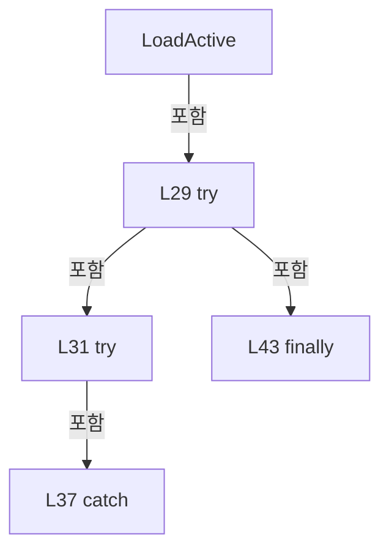

변경 전 점검: 입력/반환 타입, 위 호출자, 예외/취소 경로, 공유 상태와 저장·전송 소비자를 함께 확인합니다. 값의 단위나 물리 방향을 이름만으로 확정하지 않습니다.

### MethodDeclaration `RecoverInterrupted` · L49–127

[Drilling.Common/Product/CProductManager.cs:49–127](https://github.com/kjuws10-rgb/A3Drilling/blob/5aee8e58439c9b455cae7c9593c9be986c3e682e/Drilling.Common/Product/CProductManager.cs#L49-L127)

| 항목 | 실제 추출 값 |
| --- | --- |
| 서명 | System.Threading.Tasks.Task<Drilling.Common.Product.ST_PRODUCT_DATA?> Drilling.Common.Product.CProductManager.RecoverInterrupted(System.Threading.CancellationToken) |
| 접근/수식자 | Public / public, async |
| 반환/값 타입 | System.Threading.Tasks.Task<Drilling.Common.Product.ST_PRODUCT_DATA?> |
| 소속 타입 | NamedType:Drilling.Common.Product.CProductManager |

입력 계약:

| 이름 | 타입 | 전달 | 선택/기본값 |
| --- | --- | --- | --- |
| cancellationToken | System.Threading.CancellationToken | None | True / null |

정적 호출자로 확인된 위치:

| 호출 파일/행 | 호출 표현식 | 런타임 분기 가능 |
| --- | --- | --- |
| [Drilling.Common/Managers/CManager.cs:540–540](https://github.com/kjuws10-rgb/A3Drilling/blob/5aee8e58439c9b455cae7c9593c9be986c3e682e/Drilling.Common/Managers/CManager.cs#L540-L540) | _productManager.RecoverInterrupted | False |

호출하는 대상과 해석 범위:

| 원본 행 | 표현식 | 분석 상태 | 대상/소스 위치 |
| --- | --- | --- | --- |
| 51 | cancellationToken.ThrowIfCancellationRequested | resolved | void System.Threading.CancellationToken.ThrowIfCancellationRequested() |
| 52 | _updateGate.WaitAsync(cancellationToken).ConfigureAwait | resolved | System.Runtime.CompilerServices.ConfiguredTaskAwaitable System.Threading.Tasks.Task.ConfigureAwait(bool) |
| 52 | _updateGate.WaitAsync | resolved | System.Threading.Tasks.Task System.Threading.SemaphoreSlim.WaitAsync(System.Threading.CancellationToken) |
| 73 | product.Heads.Any | resolved | bool System.Collections.Generic.IEnumerable<Drilling.Common.Product.ST_PRODUCT_HEAD_RESULT>.Any<Drilling.Common.Product.ST_PRODUCT_HEAD_RESULT>(System.Func<Drilling.Common.Product.ST_PRODUCT_HEAD_RESULT, bool>) |
| 95 | SetProductState | resolved | Drilling.Common.Product.ST_PRODUCT_INFO Drilling.Common.Product.CProductManager.SetProductState(Drilling.Common.Product.ST_PRODUCT_INFO, Drilling.Common.Product.EN_PRODUCT_STATE, Drilling.Common.Product.EN_PRODUCT_RESULT, System.DateTimeOffset?, System.DateTimeOffset?) · Drilling.Common/Product/CProductManager.cs:853 |
| 118 | product.Heads.Select(SelectValue).ToArray | resolved | Drilling.Common.Product.ST_PRODUCT_HEAD_RESULT[] System.Collections.Generic.IEnumerable<Drilling.Common.Product.ST_PRODUCT_HEAD_RESULT>.ToArray<Drilling.Common.Product.ST_PRODUCT_HEAD_RESULT>() |
| 118 | product.Heads.Select | resolved | System.Collections.Generic.IEnumerable<Drilling.Common.Product.ST_PRODUCT_HEAD_RESULT> System.Collections.Generic.IEnumerable<Drilling.Common.Product.ST_PRODUCT_HEAD_RESULT>.Select<Drilling.Common.Product.ST_PRODUCT_HEAD_RESULT, Drilling.Common.Product.ST_PRODUCT_HEAD_RESULT>(System.Func<Drilling.Common.Product.ST_PRODUCT_HEAD_RESULT, Drilling.Common.Product.ST_PRODUCT_HEAD_RESULT>) |
| 121 | PersistAndLog | resolved | System.Threading.Tasks.Task<Drilling.Common.Product.ST_PRODUCT_DATA> Drilling.Common.Product.CProductManager.PersistAndLog(Drilling.Common.Product.ST_PRODUCT_DATA, string, string, System.Threading.CancellationToken) · Drilling.Common/Product/CProductManager.cs:789 |
| 125 | _updateGate.Release | resolved | int System.Threading.SemaphoreSlim.Release() |

본문의 실제 연산·분기·예외·반환 순서(원문 위치 순):

| 원본 행 | 종류 | 주석 해설 |
| --- | --- | --- |
| 51 | call | 함수·델리게이트 또는 객체 생성자를 호출합니다: cancellationToken.ThrowIfCancellationRequested() |
| 52 | await | 비동기 완료를 기다립니다: await _updateGate.WaitAsync(cancellationToken).ConfigureAwait(false) |
| 52 | call | 함수·델리게이트 또는 객체 생성자를 호출합니다: _updateGate.WaitAsync(cancellationToken).ConfigureAwait(false) |
| 52 | call | 함수·델리게이트 또는 객체 생성자를 호출합니다: _updateGate.WaitAsync(cancellationToken) |
| 58 | try | 예외 처리 범위입니다: try |
| 60 | local-declaration | 지역 변수를 선언합니다: var product = _current; |
| 60 | variable-initializer | 변수의 초기값을 지정합니다: product = _current |
| 61 | if | 조건에 따라 분기합니다: if (product is null) |
| 63 | return | 호출자에게 값 또는 제어를 반환합니다: return null; |
| 69 | local-declaration | 지역 변수를 선언합니다: var productInterrupted = product.State == EN_PRODUCT_STATE.Running; |
| 69 | variable-initializer | 변수의 초기값을 지정합니다: productInterrupted = product.State == EN_PRODUCT_STATE.Running |
| 70 | local-declaration | 지역 변수를 선언합니다: var alignInterrupted = product.Align.State == EN_PRODUCT_PROCESS_STATE.Running; |
| 70 | variable-initializer | 변수의 초기값을 지정합니다: alignInterrupted = product.Align.State == EN_PRODUCT_PROCESS_STATE.Running |
| 71 | local-declaration | 지역 변수를 선언합니다: var distortionInterrupted = product.Distortion.State == EN_PRODUCT_PROCESS_STATE.Running; |
| 71 | variable-initializer | 변수의 초기값을 지정합니다: distortionInterrupted = product.Distortion.State == EN_PRODUCT_PROCESS_STATE.Running |
| 72 | local-declaration | 지역 변수를 선언합니다: var reviewInterrupted = product.Review.State == EN_PRODUCT_PROCESS_STATE.Running; |
| 72 | variable-initializer | 변수의 초기값을 지정합니다: reviewInterrupted = product.Review.State == EN_PRODUCT_PROCESS_STATE.Running |
| 73 | call | 함수·델리게이트 또는 객체 생성자를 호출합니다: product.Heads.Any(MatchesState) |
| 73 | local-declaration | 지역 변수를 선언합니다: var headInterrupted = product.Heads.Any(MatchesState); |
| 73 | variable-initializer | 변수의 초기값을 지정합니다: headInterrupted = product.Heads.Any(MatchesState) |
| 74 | if | 조건에 따라 분기합니다: if (!productInterrupted && !alignInterrupted && !distortionInterrupted && !reviewInterrupted && !headInterrupted) |
| 76 | return | 호출자에게 값 또는 제어를 반환합니다: return product; |
| 79 | local-declaration | 지역 변수를 선언합니다: var now = DateTimeOffset.Now; |
| 79 | variable-initializer | 변수의 초기값을 지정합니다: now = DateTimeOffset.Now |
| 93 | local-declaration | 지역 변수를 선언합니다: var next = product with { Product = productInterrupted ? SetProductState(product.Product, EN_PRODUCT_STATE.Stopped, EN_PRODUCT_RESULT.NG, product.StartedAt, now) : product.Product, Align = alignInterrupted ? product.Align with { S |
| 93 | variable-initializer | 변수의 초기값을 지정합니다: next = product with { Product = productInterrupted ? SetProductState(product.Product, EN_PRODUCT_STATE.Stopped, EN_PRODUCT_RESULT.NG, product.StartedAt, now) : product.Product, Align = alignInterrupted ? product.Align with { State |
| 95 | assignment | 값을 대상에 대입합니다: Product = productInterrupted ? SetProductState(product.Product, EN_PRODUCT_STATE.Stopped, EN_PRODUCT_RESULT.NG, product.StartedAt, now) : product.Product |
| 95 | call | 함수·델리게이트 또는 객체 생성자를 호출합니다: SetProductState(product.Product, EN_PRODUCT_STATE.Stopped, EN_PRODUCT_RESULT.NG, product.StartedAt, now) |
| 95 | conditional-expression | 조건에 따라 결과식을 선택합니다: productInterrupted ? SetProductState(product.Product, EN_PRODUCT_STATE.Stopped, EN_PRODUCT_RESULT.NG, product.StartedAt, now) : product.Product |
| 96 | assignment | 값을 대상에 대입합니다: Align = alignInterrupted ? product.Align with { State = EN_PRODUCT_PROCESS_STATE.Stopped, Result = "INTERRUPTED" } : product.Align |
| 96 | conditional-expression | 조건에 따라 결과식을 선택합니다: alignInterrupted ? product.Align with { State = EN_PRODUCT_PROCESS_STATE.Stopped, Result = "INTERRUPTED" } : product.Align |
| 98 | assignment | 값을 대상에 대입합니다: State = EN_PRODUCT_PROCESS_STATE.Stopped |
| 99 | assignment | 값을 대상에 대입합니다: Result = "INTERRUPTED" |
| 103 | assignment | 값을 대상에 대입합니다: Distortion = distortionInterrupted ? product.Distortion with { State = EN_PRODUCT_PROCESS_STATE.Stopped, Result = "INTERRUPTED" } : product.Distortion |
| 103 | conditional-expression | 조건에 따라 결과식을 선택합니다: distortionInterrupted ? product.Distortion with { State = EN_PRODUCT_PROCESS_STATE.Stopped, Result = "INTERRUPTED" } : product.Distortion |
| 105 | assignment | 값을 대상에 대입합니다: State = EN_PRODUCT_PROCESS_STATE.Stopped |
| 106 | assignment | 값을 대상에 대입합니다: Result = "INTERRUPTED" |
| 110 | assignment | 값을 대상에 대입합니다: Review = reviewInterrupted ? product.Review with { State = EN_PRODUCT_PROCESS_STATE.Stopped } : product.Review |
| 110 | conditional-expression | 조건에 따라 결과식을 선택합니다: reviewInterrupted ? product.Review with { State = EN_PRODUCT_PROCESS_STATE.Stopped } : product.Review |
| 112 | assignment | 값을 대상에 대입합니다: State = EN_PRODUCT_PROCESS_STATE.Stopped |
| 116 | assignment | 값을 대상에 대입합니다: Runtime = product.Runtime with { Heads = product.Heads.Select(SelectValue).ToArray() } |
| 118 | assignment | 값을 대상에 대입합니다: Heads = product.Heads.Select(SelectValue).ToArray() |
| 118 | call | 함수·델리게이트 또는 객체 생성자를 호출합니다: product.Heads.Select(SelectValue).ToArray() |
| 118 | call | 함수·델리게이트 또는 객체 생성자를 호출합니다: product.Heads.Select(SelectValue) |
| 121 | await | 비동기 완료를 기다립니다: await PersistAndLog(next, "RECOVERY", "Interrupted Product state recovered during application startup.", cancellationToken) |
| 121 | call | 함수·델리게이트 또는 객체 생성자를 호출합니다: PersistAndLog(next, "RECOVERY", "Interrupted Product state recovered during application startup.", cancellationToken) |
| 121 | return | 호출자에게 값 또는 제어를 반환합니다: return await PersistAndLog(next, "RECOVERY", "Interrupted Product state recovered during application startup.", cancellationToken); |
| 123 | finally | 종료 정리 구간입니다: finally |
| 125 | call | 함수·델리게이트 또는 객체 생성자를 호출합니다: _updateGate.Release() |

제어 구문의 포함 구조(실제 실행 순서/CFG가 아닌 구문 탐색 그림):

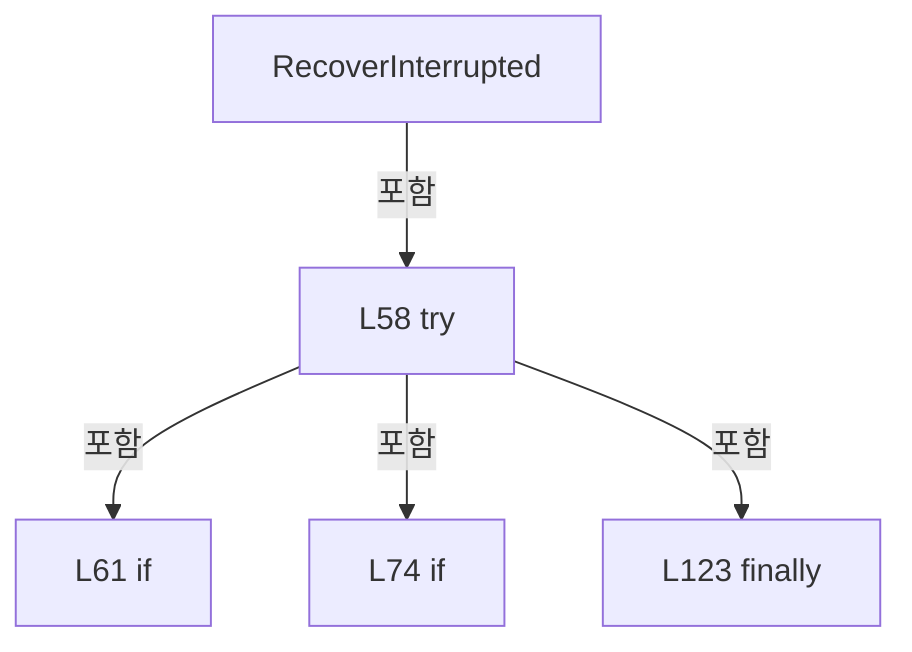

변경 전 점검: 입력/반환 타입, 위 호출자, 예외/취소 경로, 공유 상태와 저장·전송 소비자를 함께 확인합니다. 값의 단위나 물리 방향을 이름만으로 확정하지 않습니다.

### LocalFunctionStatement `MatchesState` · L53–56

[Drilling.Common/Product/CProductManager.cs:53–56](https://github.com/kjuws10-rgb/A3Drilling/blob/5aee8e58439c9b455cae7c9593c9be986c3e682e/Drilling.Common/Product/CProductManager.cs#L53-L56)

| 항목 | 실제 추출 값 |
| --- | --- |
| 서명 | bool MatchesState(Drilling.Common.Product.ST_PRODUCT_HEAD_RESULT) |
| 접근/수식자 | Private /  |
| 반환/값 타입 | bool |
| 소속 타입 | NamedType:Drilling.Common.Product.CProductManager |

입력 계약:

| 이름 | 타입 | 전달 | 선택/기본값 |
| --- | --- | --- | --- |
| head | Drilling.Common.Product.ST_PRODUCT_HEAD_RESULT | None | False /  |

현재 부분 분석에서 직접 연결된 호출자는 없습니다. XAML/이벤트/인터페이스·델리게이트·외부 진입을 추가 확인해야 하며, 미사용으로 판정한 것이 아닙니다.

본문의 실제 연산·분기·예외·반환 순서(원문 위치 순):

| 원본 행 | 종류 | 주석 해설 |
| --- | --- | --- |
| 55 | return | 호출자에게 값 또는 제어를 반환합니다: return head.State == EN_PRODUCT_HEAD_STATE.Running; |

변경 전 점검: 입력/반환 타입, 위 호출자, 예외/취소 경로, 공유 상태와 저장·전송 소비자를 함께 확인합니다. 값의 단위나 물리 방향을 이름만으로 확정하지 않습니다.

### LocalFunctionStatement `SelectValue` · L80–91

[Drilling.Common/Product/CProductManager.cs:80–91](https://github.com/kjuws10-rgb/A3Drilling/blob/5aee8e58439c9b455cae7c9593c9be986c3e682e/Drilling.Common/Product/CProductManager.cs#L80-L91)

| 항목 | 실제 추출 값 |
| --- | --- |
| 서명 | Drilling.Common.Product.ST_PRODUCT_HEAD_RESULT SelectValue(Drilling.Common.Product.ST_PRODUCT_HEAD_RESULT) |
| 접근/수식자 | Private /  |
| 반환/값 타입 | Drilling.Common.Product.ST_PRODUCT_HEAD_RESULT |
| 소속 타입 | NamedType:Drilling.Common.Product.CProductManager |

입력 계약:

| 이름 | 타입 | 전달 | 선택/기본값 |
| --- | --- | --- | --- |
| head | Drilling.Common.Product.ST_PRODUCT_HEAD_RESULT | None | False /  |

현재 부분 분석에서 직접 연결된 호출자는 없습니다. XAML/이벤트/인터페이스·델리게이트·외부 진입을 추가 확인해야 하며, 미사용으로 판정한 것이 아닙니다.

본문의 실제 연산·분기·예외·반환 순서(원문 위치 순):

| 원본 행 | 종류 | 주석 해설 |
| --- | --- | --- |
| 82 | conditional-expression | 조건에 따라 결과식을 선택합니다: head.State == EN_PRODUCT_HEAD_STATE.Running ? head with { State = EN_PRODUCT_HEAD_STATE.Stopped, Result = EN_PRODUCT_RESULT.NG, Message = "Interrupted by application restart.", CompletedAt = now } : head |
| 82 | return | 호출자에게 값 또는 제어를 반환합니다: return head.State == EN_PRODUCT_HEAD_STATE.Running ? head with { State = EN_PRODUCT_HEAD_STATE.Stopped, Result = EN_PRODUCT_RESULT.NG, Message = "Interrupted by application restart.", CompletedAt = now } : head; |
| 84 | assignment | 값을 대상에 대입합니다: State = EN_PRODUCT_HEAD_STATE.Stopped |
| 85 | assignment | 값을 대상에 대입합니다: Result = EN_PRODUCT_RESULT.NG |
| 86 | assignment | 값을 대상에 대입합니다: Message = "Interrupted by application restart." |
| 87 | assignment | 값을 대상에 대입합니다: CompletedAt = now |

변경 전 점검: 입력/반환 타입, 위 호출자, 예외/취소 경로, 공유 상태와 저장·전송 소비자를 함께 확인합니다. 값의 단위나 물리 방향을 이름만으로 확정하지 않습니다.

### MethodDeclaration `CreateProduct` · L129–200

[Drilling.Common/Product/CProductManager.cs:129–200](https://github.com/kjuws10-rgb/A3Drilling/blob/5aee8e58439c9b455cae7c9593c9be986c3e682e/Drilling.Common/Product/CProductManager.cs#L129-L200)

| 항목 | 실제 추출 값 |
| --- | --- |
| 서명 | System.Threading.Tasks.Task<Drilling.Common.Product.ST_PRODUCT_DATA> Drilling.Common.Product.CProductManager.CreateProduct(string, string, string, string, System.Collections.Generic.IReadOnlyDictionary<string, string>, System.Collections.Generic.IReadOnlyDictionary<int, int>, System.Threading.CancellationToken) |
| 접근/수식자 | Public / public, async |
| 반환/값 타입 | System.Threading.Tasks.Task<Drilling.Common.Product.ST_PRODUCT_DATA> |
| 소속 타입 | NamedType:Drilling.Common.Product.CProductManager |

입력 계약:

| 이름 | 타입 | 전달 | 선택/기본값 |
| --- | --- | --- | --- |
| processId | string | None | False /  |
| glassId | string | None | False /  |
| lotId | string | None | False /  |
| recipeId | string | None | False /  |
| parameters | System.Collections.Generic.IReadOnlyDictionary<string, string> | None | False /  |
| headPointCounts | System.Collections.Generic.IReadOnlyDictionary<int, int> | None | False /  |
| cancellationToken | System.Threading.CancellationToken | None | True / null |

정적 호출자로 확인된 위치:

| 호출 파일/행 | 호출 표현식 | 런타임 분기 가능 |
| --- | --- | --- |
| [Drilling.UI/Menu/Menus/CMenuMonitor.cs:3943–3943](https://github.com/kjuws10-rgb/A3Drilling/blob/5aee8e58439c9b455cae7c9593c9be986c3e682e/Drilling.UI/Menu/Menus/CMenuMonitor.cs#L3943-L3943) | _productManager.CreateProduct | False |

호출하는 대상과 해석 범위:

| 원본 행 | 표현식 | 분석 상태 | 대상/소스 위치 |
| --- | --- | --- | --- |
| 139 | cancellationToken.ThrowIfCancellationRequested | resolved | void System.Threading.CancellationToken.ThrowIfCancellationRequested() |
| 140 | _updateGate.WaitAsync(cancellationToken).ConfigureAwait | resolved | System.Runtime.CompilerServices.ConfiguredTaskAwaitable System.Threading.Tasks.Task.ConfigureAwait(bool) |
| 140 | _updateGate.WaitAsync | resolved | System.Threading.Tasks.Task System.Threading.SemaphoreSlim.WaitAsync(System.Threading.CancellationToken) |
| 155 | new InvalidOperationException | resolved | System.InvalidOperationException.InvalidOperationException(string?) |
| 163 | productFile.LoadActive(cancellationToken).ConfigureAwait | resolved | System.Runtime.CompilerServices.ConfiguredTaskAwaitable<Drilling.Common.Product.ST_PRODUCT_DATA?> System.Threading.Tasks.Task<Drilling.Common.Product.ST_PRODUCT_DATA?>.ConfigureAwait(bool) |
| 163 | productFile.LoadActive | resolved | System.Threading.Tasks.Task<Drilling.Common.Product.ST_PRODUCT_DATA?> Drilling.Common.Product.CProductFileBase.LoadActive(System.Threading.CancellationToken) · Drilling.Common/Product/CProductManager.cs:1165 |
| 164 | Volatile.Write | resolved | void System.Threading.Volatile.Write(ref int, int) |
| 168 | Volatile.Write | resolved | void System.Threading.Volatile.Write(ref int, int) |
| 174 | Volatile.Write | resolved | void System.Threading.Volatile.Write<Drilling.Common.Product.ST_PRODUCT_DATA?>(ref Drilling.Common.Product.ST_PRODUCT_DATA?, Drilling.Common.Product.ST_PRODUCT_DATA?) |
| 180 | new InvalidOperationException | resolved | System.InvalidOperationException.InvalidOperationException(string?) |
| 183 | ChooseGlassId | resolved | string Drilling.Common.Product.CProductManager.ChooseGlassId(string, string, System.Collections.Generic.IReadOnlyDictionary<string, string>) · Drilling.Common/Product/CProductManager.cs:931 |
| 185 | headPointCounts.OrderBy(SelectKey).Select(BuildProduct).ToArray | resolved | Drilling.Common.Product.ST_PRODUCT_HEAD_RESULT[] System.Collections.Generic.IEnumerable<Drilling.Common.Product.ST_PRODUCT_HEAD_RESULT>.ToArray<Drilling.Common.Product.ST_PRODUCT_HEAD_RESULT>() |
| 185 | headPointCounts.OrderBy(SelectKey).Select | resolved | System.Collections.Generic.IEnumerable<Drilling.Common.Product.ST_PRODUCT_HEAD_RESULT> System.Collections.Generic.IEnumerable<System.Collections.Generic.KeyValuePair<int, int>>.Select<System.Collections.Generic.KeyValuePair<int, int>, Drilling.Common.Product.ST_PRODUCT_HEAD_RESULT>(System.Func<System.Collections.Generic.KeyValuePair<int, int>, Drilling.Common.Product.ST_PRODUCT_HEAD_RESULT>) |
| 185 | headPointCounts.OrderBy | resolved | System.Linq.IOrderedEnumerable<System.Collections.Generic.KeyValuePair<int, int>> System.Collections.Generic.IEnumerable<System.Collections.Generic.KeyValuePair<int, int>>.OrderBy<System.Collections.Generic.KeyValuePair<int, int>, int>(System.Func<System.Collections.Generic.KeyValuePair<int, int>, int>) |
| 186 | new ST_PRODUCT_DATA | resolved | Drilling.Common.Product.ST_PRODUCT_DATA.ST_PRODUCT_DATA(Drilling.Common.Product.ST_PRODUCT_INFO, Drilling.Common.Product.ST_PRODUCT_RECIPE_DATA, Drilling.Common.Product.ST_PRODUCT_ALIGN_DATA, Drilling.Common.Product.ST_PRODUCT_DISTORTION_DATA, Drilling.Common.Product.ST_PRODUCT_REVIEW_DATA, Drilling.Common.Product.ST_PRODUCT_RUNTIME_DATA) · Drilling.Common/Product/CProductManager.cs:1043 |
| 187 | CreateProductInfo | resolved | Drilling.Common.Product.ST_PRODUCT_INFO Drilling.Common.Product.CProductManager.CreateProductInfo(string, string, string, string, System.Collections.Generic.IReadOnlyDictionary<string, string>, System.DateTimeOffset) · Drilling.Common/Product/CProductManager.cs:822 |
| 188 | new ST_PRODUCT_RECIPE_DATA | resolved | Drilling.Common.Product.ST_PRODUCT_RECIPE_DATA.ST_PRODUCT_RECIPE_DATA(System.Collections.Generic.IReadOnlyDictionary<string, string>) · Drilling.Common/Product/CProductManager.cs:1030 |
| 188 | new Dictionary<string, string> | resolved | System.Collections.Generic.Dictionary<string, string>.Dictionary(System.Collections.Generic.IEnumerable<System.Collections.Generic.KeyValuePair<string, string>>, System.Collections.Generic.IEqualityComparer<string>?) |
| 189 | new ST_PRODUCT_ALIGN_DATA | resolved | Drilling.Common.Product.ST_PRODUCT_ALIGN_DATA.ST_PRODUCT_ALIGN_DATA(Drilling.Common.Product.EN_PRODUCT_PROCESS_STATE, string, double?, double?, double?) · Drilling.Common/Product/CProductManager.cs:996 |
| 190 | new ST_PRODUCT_DISTORTION_DATA | resolved | Drilling.Common.Product.ST_PRODUCT_DISTORTION_DATA.ST_PRODUCT_DISTORTION_DATA(Drilling.Common.Product.EN_PRODUCT_PROCESS_STATE, string, double?) · Drilling.Common/Product/CProductManager.cs:997 |
| 191 | new ST_PRODUCT_REVIEW_DATA | resolved | Drilling.Common.Product.ST_PRODUCT_REVIEW_DATA.ST_PRODUCT_REVIEW_DATA(Drilling.Common.Product.EN_PRODUCT_PROCESS_STATE, System.DateTimeOffset?, System.Collections.Generic.IReadOnlyList<Drilling.Common.Product.ST_PRODUCT_REVIEW_RESULT>) · Drilling.Common/Product/CProductManager.cs:999 |
| 192 | new ST_PRODUCT_RUNTIME_DATA | resolved | Drilling.Common.Product.ST_PRODUCT_RUNTIME_DATA.ST_PRODUCT_RUNTIME_DATA(System.Collections.Generic.IReadOnlyList<Drilling.Common.Product.ST_PRODUCT_HEAD_RESULT>) · Drilling.Common/Product/CProductManager.cs:1031 |
| 194 | PersistAndLog | resolved | System.Threading.Tasks.Task<Drilling.Common.Product.ST_PRODUCT_DATA> Drilling.Common.Product.CProductManager.PersistAndLog(Drilling.Common.Product.ST_PRODUCT_DATA, string, string, System.Threading.CancellationToken) · Drilling.Common/Product/CProductManager.cs:789 |
| 198 | _updateGate.Release | resolved | int System.Threading.SemaphoreSlim.Release() |

본문의 실제 연산·분기·예외·반환 순서(원문 위치 순):

| 원본 행 | 종류 | 주석 해설 |
| --- | --- | --- |
| 139 | call | 함수·델리게이트 또는 객체 생성자를 호출합니다: cancellationToken.ThrowIfCancellationRequested() |
| 140 | await | 비동기 완료를 기다립니다: await _updateGate.WaitAsync(cancellationToken).ConfigureAwait(false) |
| 140 | call | 함수·델리게이트 또는 객체 생성자를 호출합니다: _updateGate.WaitAsync(cancellationToken).ConfigureAwait(false) |
| 140 | call | 함수·델리게이트 또는 객체 생성자를 호출합니다: _updateGate.WaitAsync(cancellationToken) |
| 151 | try | 예외 처리 범위입니다: try |
| 153 | if | 조건에 따라 분기합니다: if (HasActiveDataLoadError) |
| 155 | call | 함수·델리게이트 또는 객체 생성자를 호출합니다: new InvalidOperationException("A new Product cannot be created because ActiveProduct.csv failed to load. Back up or repair the file and restart the application.") |
| 155 | throw | 예외를 발생/전달합니다: throw new InvalidOperationException("A new Product cannot be created because ActiveProduct.csv failed to load. Back up or repair the file and restart the application."); |
| 158 | local-declaration | 지역 변수를 선언합니다: var activeProduct = _current; |
| 158 | variable-initializer | 변수의 초기값을 지정합니다: activeProduct = _current |
| 159 | if | 조건에 따라 분기합니다: if (activeProduct is null) |
| 161 | try | 예외 처리 범위입니다: try |
| 163 | assignment | 값을 대상에 대입합니다: activeProduct = await productFile.LoadActive(cancellationToken).ConfigureAwait(false) |
| 163 | await | 비동기 완료를 기다립니다: await productFile.LoadActive(cancellationToken).ConfigureAwait(false) |
| 163 | call | 함수·델리게이트 또는 객체 생성자를 호출합니다: productFile.LoadActive(cancellationToken).ConfigureAwait(false) |
| 163 | call | 함수·델리게이트 또는 객체 생성자를 호출합니다: productFile.LoadActive(cancellationToken) |
| 164 | call | 함수·델리게이트 또는 객체 생성자를 호출합니다: Volatile.Write(ref _hasActiveDataLoadError, 0) |
| 166 | catch | 지정 예외를 처리합니다: catch  |
| 168 | call | 함수·델리게이트 또는 객체 생성자를 호출합니다: Volatile.Write(ref _hasActiveDataLoadError, 1) |
| 169 | throw | 예외를 발생/전달합니다: throw; |
| 172 | if | 조건에 따라 분기합니다: if (activeProduct is not null) |
| 174 | call | 함수·델리게이트 또는 객체 생성자를 호출합니다: Volatile.Write(ref _current, activeProduct) |
| 178 | if | 조건에 따라 분기합니다: if (activeProduct is not null && activeProduct.State != EN_PRODUCT_STATE.Completed) |
| 180 | call | 함수·델리게이트 또는 객체 생성자를 호출합니다: new InvalidOperationException($"A Glass is already active: {activeProduct.GlassId}. Delete the current Glass before creating another one.") |
| 180 | throw | 예외를 발생/전달합니다: throw new InvalidOperationException($"A Glass is already active: {activeProduct.GlassId}. Delete the current Glass before creating another one."); |
| 183 | call | 함수·델리게이트 또는 객체 생성자를 호출합니다: ChooseGlassId(processId, glassId, parameters) |
| 183 | local-declaration | 지역 변수를 선언합니다: var resolvedGlassId = ChooseGlassId(processId, glassId, parameters); |
| 183 | variable-initializer | 변수의 초기값을 지정합니다: resolvedGlassId = ChooseGlassId(processId, glassId, parameters) |
| 184 | local-declaration | 지역 변수를 선언합니다: var now = DateTimeOffset.Now; |
| 184 | variable-initializer | 변수의 초기값을 지정합니다: now = DateTimeOffset.Now |
| 185 | call | 함수·델리게이트 또는 객체 생성자를 호출합니다: headPointCounts.OrderBy(SelectKey).Select(BuildProduct).ToArray() |
| 185 | call | 함수·델리게이트 또는 객체 생성자를 호출합니다: headPointCounts.OrderBy(SelectKey).Select(BuildProduct) |
| 185 | call | 함수·델리게이트 또는 객체 생성자를 호출합니다: headPointCounts.OrderBy(SelectKey) |
| 185 | local-declaration | 지역 변수를 선언합니다: var heads = headPointCounts.OrderBy(SelectKey).Select(BuildProduct).ToArray(); |
| 185 | variable-initializer | 변수의 초기값을 지정합니다: heads = headPointCounts.OrderBy(SelectKey).Select(BuildProduct).ToArray() |
| 186 | call | 함수·델리게이트 또는 객체 생성자를 호출합니다: new ST_PRODUCT_DATA( CreateProductInfo(resolvedGlassId, lotId, processId, recipeId, parameters, now), new ST_PRODUCT_RECIPE_DATA(new Dictionary<string, string>(parameters, StringComparer.OrdinalIgnoreCase)), new ST_PRODU… |
| 186 | local-declaration | 지역 변수를 선언합니다: var next = new ST_PRODUCT_DATA( CreateProductInfo(resolvedGlassId, lotId, processId, recipeId, parameters, now), new ST_PRODUCT_RECIPE_DATA(new Dictionary<string, string>(parameters, StringComparer.OrdinalIgnoreCase)), new ST_PROD |
| 186 | variable-initializer | 변수의 초기값을 지정합니다: next = new ST_PRODUCT_DATA( CreateProductInfo(resolvedGlassId, lotId, processId, recipeId, parameters, now), new ST_PRODUCT_RECIPE_DATA(new Dictionary<string, string>(parameters, StringComparer.OrdinalIgnoreCase)), new ST_PRODUCT_ |
| 187 | call | 함수·델리게이트 또는 객체 생성자를 호출합니다: CreateProductInfo(resolvedGlassId, lotId, processId, recipeId, parameters, now) |
| 188 | call | 함수·델리게이트 또는 객체 생성자를 호출합니다: new ST_PRODUCT_RECIPE_DATA(new Dictionary<string, string>(parameters, StringComparer.OrdinalIgnoreCase)) |
| 188 | call | 함수·델리게이트 또는 객체 생성자를 호출합니다: new Dictionary<string, string>(parameters, StringComparer.OrdinalIgnoreCase) |
| 189 | call | 함수·델리게이트 또는 객체 생성자를 호출합니다: new ST_PRODUCT_ALIGN_DATA(EN_PRODUCT_PROCESS_STATE.NotStarted, "PENDING", null, null, null) |
| 190 | call | 함수·델리게이트 또는 객체 생성자를 호출합니다: new ST_PRODUCT_DISTORTION_DATA(EN_PRODUCT_PROCESS_STATE.NotStarted, "PENDING", null) |
| 191 | call | 함수·델리게이트 또는 객체 생성자를 호출합니다: new ST_PRODUCT_REVIEW_DATA(EN_PRODUCT_PROCESS_STATE.NotStarted, null, []) |
| 192 | call | 함수·델리게이트 또는 객체 생성자를 호출합니다: new ST_PRODUCT_RUNTIME_DATA(heads) |
| 194 | await | 비동기 완료를 기다립니다: await PersistAndLog(next, activeProduct is null ? "CREATE" : "REPLACE", activeProduct is null ? "Product created." : $"Completed Glass {activeProduct.GlassId} replaced with a new Glass.", cancellationToken) |
| 194 | call | 함수·델리게이트 또는 객체 생성자를 호출합니다: PersistAndLog(next, activeProduct is null ? "CREATE" : "REPLACE", activeProduct is null ? "Product created." : $"Completed Glass {activeProduct.GlassId} replaced with a new Glass.", cancellationToken) |
| 194 | conditional-expression | 조건에 따라 결과식을 선택합니다: activeProduct is null ? "CREATE" : "REPLACE" |
| 194 | conditional-expression | 조건에 따라 결과식을 선택합니다: activeProduct is null ? "Product created." : $"Completed Glass {activeProduct.GlassId} replaced with a new Glass." |
| 194 | return | 호출자에게 값 또는 제어를 반환합니다: return await PersistAndLog(next, activeProduct is null ? "CREATE" : "REPLACE", activeProduct is null ? "Product created." : $"Completed Glass {activeProduct.GlassId} replaced with a new Glass.", cancellationToken); |
| 196 | finally | 종료 정리 구간입니다: finally |
| 198 | call | 함수·델리게이트 또는 객체 생성자를 호출합니다: _updateGate.Release() |

제어 구문의 포함 구조(실제 실행 순서/CFG가 아닌 구문 탐색 그림):

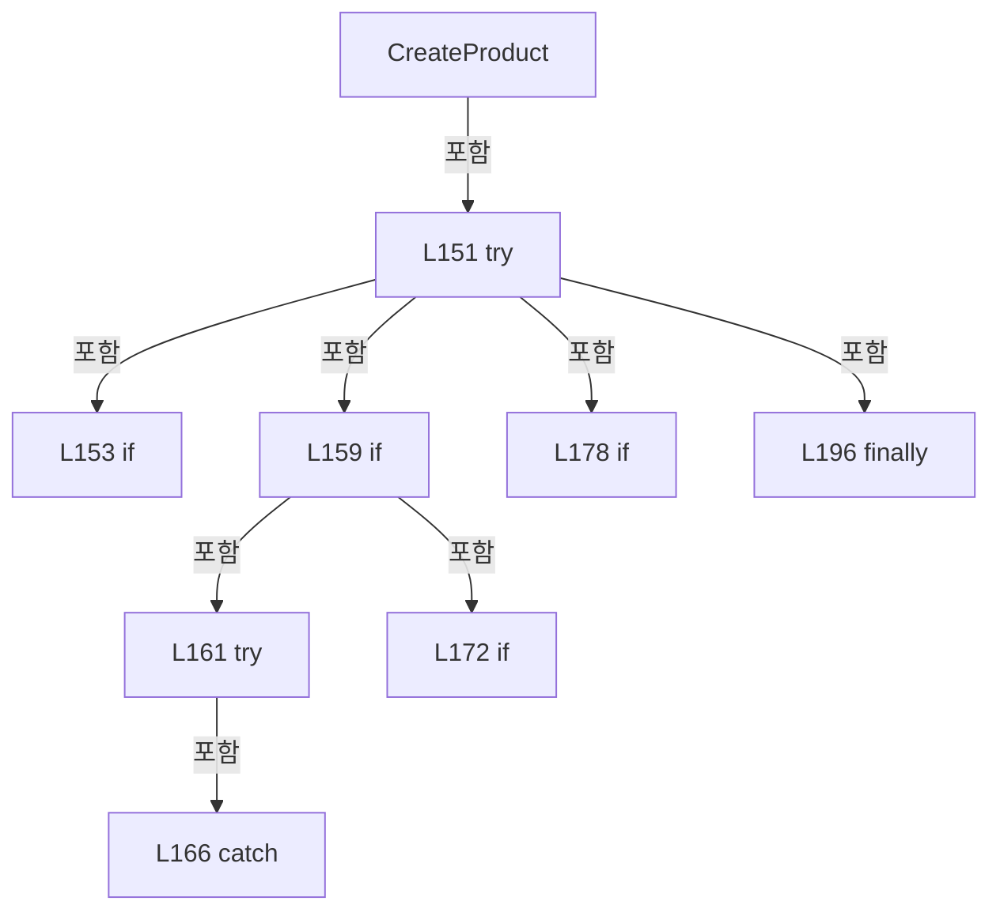

변경 전 점검: 입력/반환 타입, 위 호출자, 예외/취소 경로, 공유 상태와 저장·전송 소비자를 함께 확인합니다. 값의 단위나 물리 방향을 이름만으로 확정하지 않습니다.

### LocalFunctionStatement `SelectKey` · L141–144

[Drilling.Common/Product/CProductManager.cs:141–144](https://github.com/kjuws10-rgb/A3Drilling/blob/5aee8e58439c9b455cae7c9593c9be986c3e682e/Drilling.Common/Product/CProductManager.cs#L141-L144)

| 항목 | 실제 추출 값 |
| --- | --- |
| 서명 | int SelectKey(System.Collections.Generic.KeyValuePair<int, int>) |
| 접근/수식자 | Private /  |
| 반환/값 타입 | int |
| 소속 타입 | NamedType:Drilling.Common.Product.CProductManager |

입력 계약:

| 이름 | 타입 | 전달 | 선택/기본값 |
| --- | --- | --- | --- |
| item | System.Collections.Generic.KeyValuePair<int, int> | None | False /  |

현재 부분 분석에서 직접 연결된 호출자는 없습니다. XAML/이벤트/인터페이스·델리게이트·외부 진입을 추가 확인해야 하며, 미사용으로 판정한 것이 아닙니다.

본문의 실제 연산·분기·예외·반환 순서(원문 위치 순):

| 원본 행 | 종류 | 주석 해설 |
| --- | --- | --- |
| 143 | return | 호출자에게 값 또는 제어를 반환합니다: return item.Key; |

변경 전 점검: 입력/반환 타입, 위 호출자, 예외/취소 경로, 공유 상태와 저장·전송 소비자를 함께 확인합니다. 값의 단위나 물리 방향을 이름만으로 확정하지 않습니다.

### LocalFunctionStatement `BuildProduct` · L146–149

[Drilling.Common/Product/CProductManager.cs:146–149](https://github.com/kjuws10-rgb/A3Drilling/blob/5aee8e58439c9b455cae7c9593c9be986c3e682e/Drilling.Common/Product/CProductManager.cs#L146-L149)

| 항목 | 실제 추출 값 |
| --- | --- |
| 서명 | Drilling.Common.Product.ST_PRODUCT_HEAD_RESULT BuildProduct(System.Collections.Generic.KeyValuePair<int, int>) |
| 접근/수식자 | Private /  |
| 반환/값 타입 | Drilling.Common.Product.ST_PRODUCT_HEAD_RESULT |
| 소속 타입 | NamedType:Drilling.Common.Product.CProductManager |

입력 계약:

| 이름 | 타입 | 전달 | 선택/기본값 |
| --- | --- | --- | --- |
| item | System.Collections.Generic.KeyValuePair<int, int> | None | False /  |

현재 부분 분석에서 직접 연결된 호출자는 없습니다. XAML/이벤트/인터페이스·델리게이트·외부 진입을 추가 확인해야 하며, 미사용으로 판정한 것이 아닙니다.

호출하는 대상과 해석 범위:

| 원본 행 | 표현식 | 분석 상태 | 대상/소스 위치 |
| --- | --- | --- | --- |
| 148 | new ST_PRODUCT_HEAD_RESULT | resolved | Drilling.Common.Product.ST_PRODUCT_HEAD_RESULT.ST_PRODUCT_HEAD_RESULT(int, Drilling.Common.Product.EN_PRODUCT_HEAD_STATE, int, int, Drilling.Common.Product.EN_PRODUCT_RESULT, string, string, System.DateTimeOffset?, System.DateTimeOffset?) · Drilling.Common/Product/CProductManager.cs:1032 |
| 148 | Math.Max | resolved | int System.Math.Max(int, int) |

본문의 실제 연산·분기·예외·반환 순서(원문 위치 순):

| 원본 행 | 종류 | 주석 해설 |
| --- | --- | --- |
| 148 | call | 함수·델리게이트 또는 객체 생성자를 호출합니다: new ST_PRODUCT_HEAD_RESULT(item.Key, item.Value > 0 ? EN_PRODUCT_HEAD_STATE.Ready : EN_PRODUCT_HEAD_STATE.Disabled, Math.Max(0, item.Value), 0, EN_PRODUCT_RESULT.Pending, "", "", null, null) |
| 148 | call | 함수·델리게이트 또는 객체 생성자를 호출합니다: Math.Max(0, item.Value) |
| 148 | conditional-expression | 조건에 따라 결과식을 선택합니다: item.Value > 0 ? EN_PRODUCT_HEAD_STATE.Ready : EN_PRODUCT_HEAD_STATE.Disabled |
| 148 | return | 호출자에게 값 또는 제어를 반환합니다: return new ST_PRODUCT_HEAD_RESULT(item.Key, item.Value > 0 ? EN_PRODUCT_HEAD_STATE.Ready : EN_PRODUCT_HEAD_STATE.Disabled, Math.Max(0, item.Value), 0, EN_PRODUCT_RESULT.Pending, "", "", null, null); |

변경 전 점검: 입력/반환 타입, 위 호출자, 예외/취소 경로, 공유 상태와 저장·전송 소비자를 함께 확인합니다. 값의 단위나 물리 방향을 이름만으로 확정하지 않습니다.

### MethodDeclaration `PrepareProductForProcess` · L202–237

[Drilling.Common/Product/CProductManager.cs:202–237](https://github.com/kjuws10-rgb/A3Drilling/blob/5aee8e58439c9b455cae7c9593c9be986c3e682e/Drilling.Common/Product/CProductManager.cs#L202-L237)

| 항목 | 실제 추출 값 |
| --- | --- |
| 서명 | System.Threading.Tasks.Task<Drilling.Common.Product.ST_PRODUCT_DATA> Drilling.Common.Product.CProductManager.PrepareProductForProcess(string, string, string, System.Collections.Generic.IReadOnlyDictionary<string, string>, System.Collections.Generic.IReadOnlyDictionary<int, int>, System.Threading.CancellationToken) |
| 접근/수식자 | Public / public, async |
| 반환/값 타입 | System.Threading.Tasks.Task<Drilling.Common.Product.ST_PRODUCT_DATA> |
| 소속 타입 | NamedType:Drilling.Common.Product.CProductManager |

입력 계약:

| 이름 | 타입 | 전달 | 선택/기본값 |
| --- | --- | --- | --- |
| productId | string | None | False /  |
| processId | string | None | False /  |
| recipeId | string | None | False /  |
| parameters | System.Collections.Generic.IReadOnlyDictionary<string, string> | None | False /  |
| headPointCounts | System.Collections.Generic.IReadOnlyDictionary<int, int> | None | False /  |
| cancellationToken | System.Threading.CancellationToken | None | True / null |

현재 부분 분석에서 직접 연결된 호출자는 없습니다. XAML/이벤트/인터페이스·델리게이트·외부 진입을 추가 확인해야 하며, 미사용으로 판정한 것이 아닙니다.

호출하는 대상과 해석 범위:

| 원본 행 | 표현식 | 분석 상태 | 대상/소스 위치 |
| --- | --- | --- | --- |
| 211 | cancellationToken.ThrowIfCancellationRequested | resolved | void System.Threading.CancellationToken.ThrowIfCancellationRequested() |
| 212 | _updateGate.WaitAsync(cancellationToken).ConfigureAwait | resolved | System.Runtime.CompilerServices.ConfiguredTaskAwaitable System.Threading.Tasks.Task.ConfigureAwait(bool) |
| 212 | _updateGate.WaitAsync | resolved | System.Threading.Tasks.Task System.Threading.SemaphoreSlim.WaitAsync(System.Threading.CancellationToken) |
| 215 | GetCurrent | resolved | Drilling.Common.Product.ST_PRODUCT_DATA Drilling.Common.Product.CProductManager.GetCurrent(string) · Drilling.Common/Product/CProductManager.cs:774 |
| 218 | new InvalidOperationException | resolved | System.InvalidOperationException.InvalidOperationException(string?) |
| 221 | headPointCounts.OrderBy(item => item.Key).Select(item => new ST_PRODUCT_HEAD_RESULT(item.Key, item.Value > 0 ? EN_PRODUCT_HEAD_STATE.Ready : EN_PRODUCT_HEAD_STATE.Disabled, Math.Max(0, item.Value), 0, EN_PRODUCT_RESULT.Pending, "", "", null, null)).ToArray | resolved | Drilling.Common.Product.ST_PRODUCT_HEAD_RESULT[] System.Collections.Generic.IEnumerable<Drilling.Common.Product.ST_PRODUCT_HEAD_RESULT>.ToArray<Drilling.Common.Product.ST_PRODUCT_HEAD_RESULT>() |
| 221 | headPointCounts.OrderBy(item => item.Key).Select | resolved | System.Collections.Generic.IEnumerable<Drilling.Common.Product.ST_PRODUCT_HEAD_RESULT> System.Collections.Generic.IEnumerable<System.Collections.Generic.KeyValuePair<int, int>>.Select<System.Collections.Generic.KeyValuePair<int, int>, Drilling.Common.Product.ST_PRODUCT_HEAD_RESULT>(System.Func<System.Collections.Generic.KeyValuePair<int, int>, Drilling.Common.Product.ST_PRODUCT_HEAD_RESULT>) |
| 221 | headPointCounts.OrderBy | resolved | System.Linq.IOrderedEnumerable<System.Collections.Generic.KeyValuePair<int, int>> System.Collections.Generic.IEnumerable<System.Collections.Generic.KeyValuePair<int, int>>.OrderBy<System.Collections.Generic.KeyValuePair<int, int>, int>(System.Func<System.Collections.Generic.KeyValuePair<int, int>, int>) |
| 221 | new ST_PRODUCT_HEAD_RESULT | resolved | Drilling.Common.Product.ST_PRODUCT_HEAD_RESULT.ST_PRODUCT_HEAD_RESULT(int, Drilling.Common.Product.EN_PRODUCT_HEAD_STATE, int, int, Drilling.Common.Product.EN_PRODUCT_RESULT, string, string, System.DateTimeOffset?, System.DateTimeOffset?) · Drilling.Common/Product/CProductManager.cs:1032 |
| 221 | Math.Max | resolved | int System.Math.Max(int, int) |
| 224 | SetProductState | resolved | Drilling.Common.Product.ST_PRODUCT_INFO Drilling.Common.Product.CProductManager.SetProductState(Drilling.Common.Product.ST_PRODUCT_INFO, Drilling.Common.Product.EN_PRODUCT_STATE, Drilling.Common.Product.EN_PRODUCT_RESULT, System.DateTimeOffset?, System.DateTimeOffset?) · Drilling.Common/Product/CProductManager.cs:853 |
| 224 | product.Product.Set("PROCESS_ID", processId).Set | resolved | Drilling.Common.Product.ST_PRODUCT_INFO Drilling.Common.Product.ST_PRODUCT_INFO.Set(string, string) · Drilling.Common/Product/CProductManager.cs:1020 |
| 224 | product.Product.Set | resolved | Drilling.Common.Product.ST_PRODUCT_INFO Drilling.Common.Product.ST_PRODUCT_INFO.Set(string, string) · Drilling.Common/Product/CProductManager.cs:1020 |
| 225 | new ST_PRODUCT_RECIPE_DATA | resolved | Drilling.Common.Product.ST_PRODUCT_RECIPE_DATA.ST_PRODUCT_RECIPE_DATA(System.Collections.Generic.IReadOnlyDictionary<string, string>) · Drilling.Common/Product/CProductManager.cs:1030 |
| 225 | new Dictionary<string, string> | resolved | System.Collections.Generic.Dictionary<string, string>.Dictionary(System.Collections.Generic.IEnumerable<System.Collections.Generic.KeyValuePair<string, string>>, System.Collections.Generic.IEqualityComparer<string>?) |
| 226 | new ST_PRODUCT_ALIGN_DATA | resolved | Drilling.Common.Product.ST_PRODUCT_ALIGN_DATA.ST_PRODUCT_ALIGN_DATA(Drilling.Common.Product.EN_PRODUCT_PROCESS_STATE, string, double?, double?, double?) · Drilling.Common/Product/CProductManager.cs:996 |
| 227 | new ST_PRODUCT_DISTORTION_DATA | resolved | Drilling.Common.Product.ST_PRODUCT_DISTORTION_DATA.ST_PRODUCT_DISTORTION_DATA(Drilling.Common.Product.EN_PRODUCT_PROCESS_STATE, string, double?) · Drilling.Common/Product/CProductManager.cs:997 |
| 228 | new ST_PRODUCT_REVIEW_DATA | resolved | Drilling.Common.Product.ST_PRODUCT_REVIEW_DATA.ST_PRODUCT_REVIEW_DATA(Drilling.Common.Product.EN_PRODUCT_PROCESS_STATE, System.DateTimeOffset?, System.Collections.Generic.IReadOnlyList<Drilling.Common.Product.ST_PRODUCT_REVIEW_RESULT>) · Drilling.Common/Product/CProductManager.cs:999 |
| 229 | new ST_PRODUCT_RUNTIME_DATA | resolved | Drilling.Common.Product.ST_PRODUCT_RUNTIME_DATA.ST_PRODUCT_RUNTIME_DATA(System.Collections.Generic.IReadOnlyList<Drilling.Common.Product.ST_PRODUCT_HEAD_RESULT>) · Drilling.Common/Product/CProductManager.cs:1031 |
| 231 | PersistAndLog | resolved | System.Threading.Tasks.Task<Drilling.Common.Product.ST_PRODUCT_DATA> Drilling.Common.Product.CProductManager.PersistAndLog(Drilling.Common.Product.ST_PRODUCT_DATA, string, string, System.Threading.CancellationToken) · Drilling.Common/Product/CProductManager.cs:789 |
| 235 | _updateGate.Release | resolved | int System.Threading.SemaphoreSlim.Release() |

본문의 실제 연산·분기·예외·반환 순서(원문 위치 순):

| 원본 행 | 종류 | 주석 해설 |
| --- | --- | --- |
| 211 | call | 함수·델리게이트 또는 객체 생성자를 호출합니다: cancellationToken.ThrowIfCancellationRequested() |
| 212 | await | 비동기 완료를 기다립니다: await _updateGate.WaitAsync(cancellationToken).ConfigureAwait(false) |
| 212 | call | 함수·델리게이트 또는 객체 생성자를 호출합니다: _updateGate.WaitAsync(cancellationToken).ConfigureAwait(false) |
| 212 | call | 함수·델리게이트 또는 객체 생성자를 호출합니다: _updateGate.WaitAsync(cancellationToken) |
| 213 | try | 예외 처리 범위입니다: try |
| 215 | call | 함수·델리게이트 또는 객체 생성자를 호출합니다: GetCurrent(productId) |
| 215 | local-declaration | 지역 변수를 선언합니다: var product = GetCurrent(productId); |
| 215 | variable-initializer | 변수의 초기값을 지정합니다: product = GetCurrent(productId) |
| 216 | if | 조건에 따라 분기합니다: if (product.State is EN_PRODUCT_STATE.Running or EN_PRODUCT_STATE.Scrapped) |
| 218 | call | 함수·델리게이트 또는 객체 생성자를 호출합니다: new InvalidOperationException($"Product '{productId}' cannot be assigned to a process while its state is {product.State}.") |
| 218 | throw | 예외를 발생/전달합니다: throw new InvalidOperationException($"Product '{productId}' cannot be assigned to a process while its state is {product.State}."); |
| 221 | call | 함수·델리게이트 또는 객체 생성자를 호출합니다: headPointCounts.OrderBy(item => item.Key).Select(item => new ST_PRODUCT_HEAD_RESULT(item.Key, item.Value > 0 ? EN_PRODUCT_HEAD_STATE.Ready : EN_PRODUCT_HEAD_STATE.Disabled, Math.Max(0, item.Value), 0, EN_PRODUCT_RESULT.P… |
| 221 | call | 함수·델리게이트 또는 객체 생성자를 호출합니다: headPointCounts.OrderBy(item => item.Key).Select(item => new ST_PRODUCT_HEAD_RESULT(item.Key, item.Value > 0 ? EN_PRODUCT_HEAD_STATE.Ready : EN_PRODUCT_HEAD_STATE.Disabled, Math.Max(0, item.Value), 0, EN_PRODUCT_RESULT.P… |
| 221 | call | 함수·델리게이트 또는 객체 생성자를 호출합니다: headPointCounts.OrderBy(item => item.Key) |
| 221 | call | 함수·델리게이트 또는 객체 생성자를 호출합니다: new ST_PRODUCT_HEAD_RESULT(item.Key, item.Value > 0 ? EN_PRODUCT_HEAD_STATE.Ready : EN_PRODUCT_HEAD_STATE.Disabled, Math.Max(0, item.Value), 0, EN_PRODUCT_RESULT.Pending, "", "", null, null) |
| 221 | call | 함수·델리게이트 또는 객체 생성자를 호출합니다: Math.Max(0, item.Value) |
| 221 | conditional-expression | 조건에 따라 결과식을 선택합니다: item.Value > 0 ? EN_PRODUCT_HEAD_STATE.Ready : EN_PRODUCT_HEAD_STATE.Disabled |
| 221 | local-declaration | 지역 변수를 선언합니다: var heads = headPointCounts.OrderBy(item => item.Key).Select(item => new ST_PRODUCT_HEAD_RESULT(item.Key, item.Value > 0 ? EN_PRODUCT_HEAD_STATE.Ready : EN_PRODUCT_HEAD_STATE.Disabled, Math.Max(0, item.Value), 0, EN_PRODUCT_RESULT |
| 221 | variable-initializer | 변수의 초기값을 지정합니다: heads = headPointCounts.OrderBy(item => item.Key).Select(item => new ST_PRODUCT_HEAD_RESULT(item.Key, item.Value > 0 ? EN_PRODUCT_HEAD_STATE.Ready : EN_PRODUCT_HEAD_STATE.Disabled, Math.Max(0, item.Value), 0, EN_PRODUCT_RESULT.Pen |
| 222 | local-declaration | 지역 변수를 선언합니다: var next = product with { Product = SetProductState(product.Product.Set("PROCESS_ID", processId).Set("PPID", recipeId), EN_PRODUCT_STATE.Created, EN_PRODUCT_RESULT.Pending, null, null), Recipe = new ST_PRODUCT_RECIPE_DATA(new Dict |
| 222 | variable-initializer | 변수의 초기값을 지정합니다: next = product with { Product = SetProductState(product.Product.Set("PROCESS_ID", processId).Set("PPID", recipeId), EN_PRODUCT_STATE.Created, EN_PRODUCT_RESULT.Pending, null, null), Recipe = new ST_PRODUCT_RECIPE_DATA(new Dictiona |
| 224 | assignment | 값을 대상에 대입합니다: Product = SetProductState(product.Product.Set("PROCESS_ID", processId).Set("PPID", recipeId), EN_PRODUCT_STATE.Created, EN_PRODUCT_RESULT.Pending, null, null) |
| 224 | call | 함수·델리게이트 또는 객체 생성자를 호출합니다: SetProductState(product.Product.Set("PROCESS_ID", processId).Set("PPID", recipeId), EN_PRODUCT_STATE.Created, EN_PRODUCT_RESULT.Pending, null, null) |
| 224 | call | 함수·델리게이트 또는 객체 생성자를 호출합니다: product.Product.Set("PROCESS_ID", processId).Set("PPID", recipeId) |
| 224 | call | 함수·델리게이트 또는 객체 생성자를 호출합니다: product.Product.Set("PROCESS_ID", processId) |
| 225 | assignment | 값을 대상에 대입합니다: Recipe = new ST_PRODUCT_RECIPE_DATA(new Dictionary<string, string>(parameters, StringComparer.OrdinalIgnoreCase)) |
| 225 | call | 함수·델리게이트 또는 객체 생성자를 호출합니다: new ST_PRODUCT_RECIPE_DATA(new Dictionary<string, string>(parameters, StringComparer.OrdinalIgnoreCase)) |
| 225 | call | 함수·델리게이트 또는 객체 생성자를 호출합니다: new Dictionary<string, string>(parameters, StringComparer.OrdinalIgnoreCase) |
| 226 | assignment | 값을 대상에 대입합니다: Align = new ST_PRODUCT_ALIGN_DATA(EN_PRODUCT_PROCESS_STATE.NotStarted, "PENDING", null, null, null) |
| 226 | call | 함수·델리게이트 또는 객체 생성자를 호출합니다: new ST_PRODUCT_ALIGN_DATA(EN_PRODUCT_PROCESS_STATE.NotStarted, "PENDING", null, null, null) |
| 227 | assignment | 값을 대상에 대입합니다: Distortion = new ST_PRODUCT_DISTORTION_DATA(EN_PRODUCT_PROCESS_STATE.NotStarted, "PENDING", null) |
| 227 | call | 함수·델리게이트 또는 객체 생성자를 호출합니다: new ST_PRODUCT_DISTORTION_DATA(EN_PRODUCT_PROCESS_STATE.NotStarted, "PENDING", null) |
| 228 | assignment | 값을 대상에 대입합니다: Review = new ST_PRODUCT_REVIEW_DATA(EN_PRODUCT_PROCESS_STATE.NotStarted, null, []) |
| 228 | call | 함수·델리게이트 또는 객체 생성자를 호출합니다: new ST_PRODUCT_REVIEW_DATA(EN_PRODUCT_PROCESS_STATE.NotStarted, null, []) |
| 229 | assignment | 값을 대상에 대입합니다: Runtime = new ST_PRODUCT_RUNTIME_DATA(heads) |
| 229 | call | 함수·델리게이트 또는 객체 생성자를 호출합니다: new ST_PRODUCT_RUNTIME_DATA(heads) |
| 231 | await | 비동기 완료를 기다립니다: await PersistAndLog(next, "PROCESS ASSIGN", $"Product assigned to process {processId}.", cancellationToken) |
| 231 | call | 함수·델리게이트 또는 객체 생성자를 호출합니다: PersistAndLog(next, "PROCESS ASSIGN", $"Product assigned to process {processId}.", cancellationToken) |
| 231 | return | 호출자에게 값 또는 제어를 반환합니다: return await PersistAndLog(next, "PROCESS ASSIGN", $"Product assigned to process {processId}.", cancellationToken); |
| 233 | finally | 종료 정리 구간입니다: finally |
| 235 | call | 함수·델리게이트 또는 객체 생성자를 호출합니다: _updateGate.Release() |

제어 구문의 포함 구조(실제 실행 순서/CFG가 아닌 구문 탐색 그림):

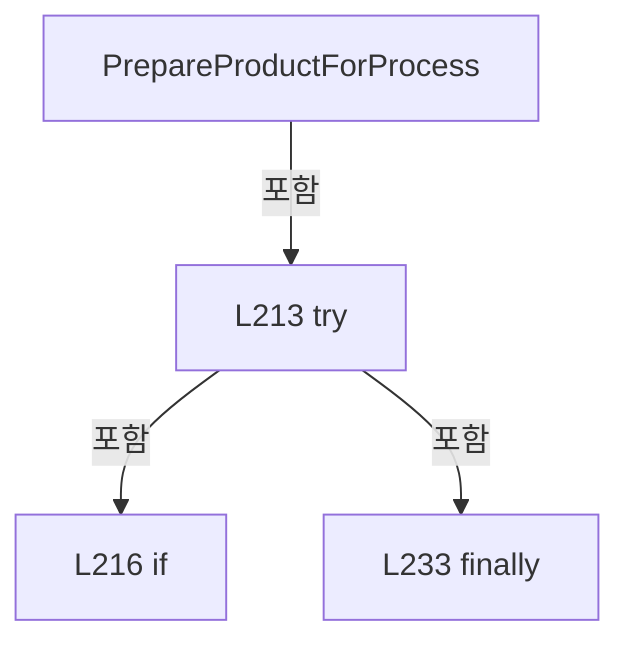

변경 전 점검: 입력/반환 타입, 위 호출자, 예외/취소 경로, 공유 상태와 저장·전송 소비자를 함께 확인합니다. 값의 단위나 물리 방향을 이름만으로 확정하지 않습니다.

### MethodDeclaration `StartProduct` · L239–275

[Drilling.Common/Product/CProductManager.cs:239–275](https://github.com/kjuws10-rgb/A3Drilling/blob/5aee8e58439c9b455cae7c9593c9be986c3e682e/Drilling.Common/Product/CProductManager.cs#L239-L275)

| 항목 | 실제 추출 값 |
| --- | --- |
| 서명 | System.Threading.Tasks.Task<Drilling.Common.Product.ST_PRODUCT_DATA> Drilling.Common.Product.CProductManager.StartProduct(string, System.Threading.CancellationToken) |
| 접근/수식자 | Public / public, async |
| 반환/값 타입 | System.Threading.Tasks.Task<Drilling.Common.Product.ST_PRODUCT_DATA> |
| 소속 타입 | NamedType:Drilling.Common.Product.CProductManager |

입력 계약:

| 이름 | 타입 | 전달 | 선택/기본값 |
| --- | --- | --- | --- |
| productId | string | None | False /  |
| cancellationToken | System.Threading.CancellationToken | None | True / null |

현재 부분 분석에서 직접 연결된 호출자는 없습니다. XAML/이벤트/인터페이스·델리게이트·외부 진입을 추가 확인해야 하며, 미사용으로 판정한 것이 아닙니다.

호출하는 대상과 해석 범위:

| 원본 행 | 표현식 | 분석 상태 | 대상/소스 위치 |
| --- | --- | --- | --- |
| 241 | cancellationToken.ThrowIfCancellationRequested | resolved | void System.Threading.CancellationToken.ThrowIfCancellationRequested() |
| 242 | _updateGate.WaitAsync(cancellationToken).ConfigureAwait | resolved | System.Runtime.CompilerServices.ConfiguredTaskAwaitable System.Threading.Tasks.Task.ConfigureAwait(bool) |
| 242 | _updateGate.WaitAsync | resolved | System.Threading.Tasks.Task System.Threading.SemaphoreSlim.WaitAsync(System.Threading.CancellationToken) |
| 245 | GetCurrent | resolved | Drilling.Common.Product.ST_PRODUCT_DATA Drilling.Common.Product.CProductManager.GetCurrent(string) · Drilling.Common/Product/CProductManager.cs:774 |
| 263 | SetProductState | resolved | Drilling.Common.Product.ST_PRODUCT_INFO Drilling.Common.Product.CProductManager.SetProductState(Drilling.Common.Product.ST_PRODUCT_INFO, Drilling.Common.Product.EN_PRODUCT_STATE, Drilling.Common.Product.EN_PRODUCT_RESULT, System.DateTimeOffset?, System.DateTimeOffset?) · Drilling.Common/Product/CProductManager.cs:853 |
| 266 | product.Heads.Select(SelectItem).ToArray | resolved | Drilling.Common.Product.ST_PRODUCT_HEAD_RESULT[] System.Collections.Generic.IEnumerable<Drilling.Common.Product.ST_PRODUCT_HEAD_RESULT>.ToArray<Drilling.Common.Product.ST_PRODUCT_HEAD_RESULT>() |
| 266 | product.Heads.Select | resolved | System.Collections.Generic.IEnumerable<Drilling.Common.Product.ST_PRODUCT_HEAD_RESULT> System.Collections.Generic.IEnumerable<Drilling.Common.Product.ST_PRODUCT_HEAD_RESULT>.Select<Drilling.Common.Product.ST_PRODUCT_HEAD_RESULT, Drilling.Common.Product.ST_PRODUCT_HEAD_RESULT>(System.Func<Drilling.Common.Product.ST_PRODUCT_HEAD_RESULT, Drilling.Common.Product.ST_PRODUCT_HEAD_RESULT>) |
| 269 | PersistAndLog | resolved | System.Threading.Tasks.Task<Drilling.Common.Product.ST_PRODUCT_DATA> Drilling.Common.Product.CProductManager.PersistAndLog(Drilling.Common.Product.ST_PRODUCT_DATA, string, string, System.Threading.CancellationToken) · Drilling.Common/Product/CProductManager.cs:789 |
| 273 | _updateGate.Release | resolved | int System.Threading.SemaphoreSlim.Release() |

본문의 실제 연산·분기·예외·반환 순서(원문 위치 순):

| 원본 행 | 종류 | 주석 해설 |
| --- | --- | --- |
| 241 | call | 함수·델리게이트 또는 객체 생성자를 호출합니다: cancellationToken.ThrowIfCancellationRequested() |
| 242 | await | 비동기 완료를 기다립니다: await _updateGate.WaitAsync(cancellationToken).ConfigureAwait(false) |
| 242 | call | 함수·델리게이트 또는 객체 생성자를 호출합니다: _updateGate.WaitAsync(cancellationToken).ConfigureAwait(false) |
| 242 | call | 함수·델리게이트 또는 객체 생성자를 호출합니다: _updateGate.WaitAsync(cancellationToken) |
| 243 | try | 예외 처리 범위입니다: try |
| 245 | call | 함수·델리게이트 또는 객체 생성자를 호출합니다: GetCurrent(productId) |
| 245 | local-declaration | 지역 변수를 선언합니다: var product = GetCurrent(productId); |
| 245 | variable-initializer | 변수의 초기값을 지정합니다: product = GetCurrent(productId) |
| 246 | local-declaration | 지역 변수를 선언합니다: var now = DateTimeOffset.Now; |
| 246 | variable-initializer | 변수의 초기값을 지정합니다: now = DateTimeOffset.Now |
| 261 | local-declaration | 지역 변수를 선언합니다: var next = product with { Product = SetProductState(product.Product, EN_PRODUCT_STATE.Running, EN_PRODUCT_RESULT.Pending, product.StartedAt ?? now, null), Runtime = product.Runtime with { Heads = product.Heads.Select(SelectItem).T |
| 261 | variable-initializer | 변수의 초기값을 지정합니다: next = product with { Product = SetProductState(product.Product, EN_PRODUCT_STATE.Running, EN_PRODUCT_RESULT.Pending, product.StartedAt ?? now, null), Runtime = product.Runtime with { Heads = product.Heads.Select(SelectItem).ToArr |
| 263 | assignment | 값을 대상에 대입합니다: Product = SetProductState(product.Product, EN_PRODUCT_STATE.Running, EN_PRODUCT_RESULT.Pending, product.StartedAt ?? now, null) |
| 263 | call | 함수·델리게이트 또는 객체 생성자를 호출합니다: SetProductState(product.Product, EN_PRODUCT_STATE.Running, EN_PRODUCT_RESULT.Pending, product.StartedAt ?? now, null) |
| 264 | assignment | 값을 대상에 대입합니다: Runtime = product.Runtime with { Heads = product.Heads.Select(SelectItem).ToArray() } |
| 266 | assignment | 값을 대상에 대입합니다: Heads = product.Heads.Select(SelectItem).ToArray() |
| 266 | call | 함수·델리게이트 또는 객체 생성자를 호출합니다: product.Heads.Select(SelectItem).ToArray() |
| 266 | call | 함수·델리게이트 또는 객체 생성자를 호출합니다: product.Heads.Select(SelectItem) |
| 269 | await | 비동기 완료를 기다립니다: await PersistAndLog(next, "START", "Product started.", cancellationToken) |
| 269 | call | 함수·델리게이트 또는 객체 생성자를 호출합니다: PersistAndLog(next, "START", "Product started.", cancellationToken) |
| 269 | return | 호출자에게 값 또는 제어를 반환합니다: return await PersistAndLog(next, "START", "Product started.", cancellationToken); |
| 271 | finally | 종료 정리 구간입니다: finally |
| 273 | call | 함수·델리게이트 또는 객체 생성자를 호출합니다: _updateGate.Release() |

제어 구문의 포함 구조(실제 실행 순서/CFG가 아닌 구문 탐색 그림):

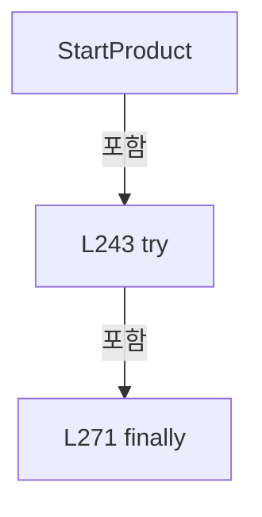

변경 전 점검: 입력/반환 타입, 위 호출자, 예외/취소 경로, 공유 상태와 저장·전송 소비자를 함께 확인합니다. 값의 단위나 물리 방향을 이름만으로 확정하지 않습니다.

### LocalFunctionStatement `SelectItem` · L247–259

[Drilling.Common/Product/CProductManager.cs:247–259](https://github.com/kjuws10-rgb/A3Drilling/blob/5aee8e58439c9b455cae7c9593c9be986c3e682e/Drilling.Common/Product/CProductManager.cs#L247-L259)

| 항목 | 실제 추출 값 |
| --- | --- |
| 서명 | Drilling.Common.Product.ST_PRODUCT_HEAD_RESULT SelectItem(Drilling.Common.Product.ST_PRODUCT_HEAD_RESULT) |
| 접근/수식자 | Private /  |
| 반환/값 타입 | Drilling.Common.Product.ST_PRODUCT_HEAD_RESULT |
| 소속 타입 | NamedType:Drilling.Common.Product.CProductManager |

입력 계약:

| 이름 | 타입 | 전달 | 선택/기본값 |
| --- | --- | --- | --- |
| head | Drilling.Common.Product.ST_PRODUCT_HEAD_RESULT | None | False /  |

현재 부분 분석에서 직접 연결된 호출자는 없습니다. XAML/이벤트/인터페이스·델리게이트·외부 진입을 추가 확인해야 하며, 미사용으로 판정한 것이 아닙니다.

본문의 실제 연산·분기·예외·반환 순서(원문 위치 순):

| 원본 행 | 종류 | 주석 해설 |
| --- | --- | --- |
| 249 | conditional-expression | 조건에 따라 결과식을 선택합니다: head.TotalPoints > 0 ? head with { State = EN_PRODUCT_HEAD_STATE.Running, StartedAt = head.StartedAt ?? now } : head with { State = EN_PRODUCT_HEAD_STATE.Disabled } |
| 249 | return | 호출자에게 값 또는 제어를 반환합니다: return head.TotalPoints > 0 ? head with { State = EN_PRODUCT_HEAD_STATE.Running, StartedAt = head.StartedAt ?? now } : head with { State = EN_PRODUCT_HEAD_STATE.Disabled }; |
| 251 | assignment | 값을 대상에 대입합니다: State = EN_PRODUCT_HEAD_STATE.Running |
| 252 | assignment | 값을 대상에 대입합니다: StartedAt = head.StartedAt ?? now |
| 257 | assignment | 값을 대상에 대입합니다: State = EN_PRODUCT_HEAD_STATE.Disabled |

변경 전 점검: 입력/반환 타입, 위 호출자, 예외/취소 경로, 공유 상태와 저장·전송 소비자를 함께 확인합니다. 값의 단위나 물리 방향을 이름만으로 확정하지 않습니다.

### MethodDeclaration `SetProductInfo` · L277–311

[Drilling.Common/Product/CProductManager.cs:277–311](https://github.com/kjuws10-rgb/A3Drilling/blob/5aee8e58439c9b455cae7c9593c9be986c3e682e/Drilling.Common/Product/CProductManager.cs#L277-L311)

| 항목 | 실제 추출 값 |
| --- | --- |
| 서명 | System.Threading.Tasks.Task<Drilling.Common.Product.ST_PRODUCT_DATA> Drilling.Common.Product.CProductManager.SetProductInfo(string, System.Collections.Generic.IReadOnlyDictionary<string, string>, System.Threading.CancellationToken) |
| 접근/수식자 | Public / public, async |
| 반환/값 타입 | System.Threading.Tasks.Task<Drilling.Common.Product.ST_PRODUCT_DATA> |
| 소속 타입 | NamedType:Drilling.Common.Product.CProductManager |

입력 계약:

| 이름 | 타입 | 전달 | 선택/기본값 |
| --- | --- | --- | --- |
| productId | string | None | False /  |
| values | System.Collections.Generic.IReadOnlyDictionary<string, string> | None | False /  |
| cancellationToken | System.Threading.CancellationToken | None | True / null |

현재 부분 분석에서 직접 연결된 호출자는 없습니다. XAML/이벤트/인터페이스·델리게이트·외부 진입을 추가 확인해야 하며, 미사용으로 판정한 것이 아닙니다.

호출하는 대상과 해석 범위:

| 원본 행 | 표현식 | 분석 상태 | 대상/소스 위치 |
| --- | --- | --- | --- |
| 279 | cancellationToken.ThrowIfCancellationRequested | resolved | void System.Threading.CancellationToken.ThrowIfCancellationRequested() |
| 280 | _updateGate.WaitAsync(cancellationToken).ConfigureAwait | resolved | System.Runtime.CompilerServices.ConfiguredTaskAwaitable System.Threading.Tasks.Task.ConfigureAwait(bool) |
| 280 | _updateGate.WaitAsync | resolved | System.Threading.Tasks.Task System.Threading.SemaphoreSlim.WaitAsync(System.Threading.CancellationToken) |
| 288 | values.Keys.Where(ShouldIncludeItem).ToArray | resolved | string[] System.Collections.Generic.IEnumerable<string>.ToArray<string>() |
| 288 | values.Keys.Where | resolved | System.Collections.Generic.IEnumerable<string> System.Collections.Generic.IEnumerable<string>.Where<string>(System.Func<string, bool>) |
| 291 | new ArgumentException | resolved | System.ArgumentException.ArgumentException(string?, string?) |
| 291 | string.Join | resolved | string string.Join(string?, params string?[]) |
| 291 | nameof | unresolved | None |
| 294 | GetCurrent | resolved | Drilling.Common.Product.ST_PRODUCT_DATA Drilling.Common.Product.CProductManager.GetCurrent(string) · Drilling.Common/Product/CProductManager.cs:774 |
| 298 | productInfo.Set | resolved | Drilling.Common.Product.ST_PRODUCT_INFO Drilling.Common.Product.ST_PRODUCT_INFO.Set(string, string) · Drilling.Common/Product/CProductManager.cs:1020 |
| 305 | PersistAndLog | resolved | System.Threading.Tasks.Task<Drilling.Common.Product.ST_PRODUCT_DATA> Drilling.Common.Product.CProductManager.PersistAndLog(Drilling.Common.Product.ST_PRODUCT_DATA, string, string, System.Threading.CancellationToken) · Drilling.Common/Product/CProductManager.cs:789 |
| 309 | _updateGate.Release | resolved | int System.Threading.SemaphoreSlim.Release() |

본문의 실제 연산·분기·예외·반환 순서(원문 위치 순):

| 원본 행 | 종류 | 주석 해설 |
| --- | --- | --- |
| 279 | call | 함수·델리게이트 또는 객체 생성자를 호출합니다: cancellationToken.ThrowIfCancellationRequested() |
| 280 | await | 비동기 완료를 기다립니다: await _updateGate.WaitAsync(cancellationToken).ConfigureAwait(false) |
| 280 | call | 함수·델리게이트 또는 객체 생성자를 호출합니다: _updateGate.WaitAsync(cancellationToken).ConfigureAwait(false) |
| 280 | call | 함수·델리게이트 또는 객체 생성자를 호출합니다: _updateGate.WaitAsync(cancellationToken) |
| 286 | try | 예외 처리 범위입니다: try |
| 288 | call | 함수·델리게이트 또는 객체 생성자를 호출합니다: values.Keys.Where(ShouldIncludeItem).ToArray() |
| 288 | call | 함수·델리게이트 또는 객체 생성자를 호출합니다: values.Keys.Where(ShouldIncludeItem) |
| 288 | local-declaration | 지역 변수를 선언합니다: var invalidFields = values.Keys.Where(ShouldIncludeItem).ToArray(); |
| 288 | variable-initializer | 변수의 초기값을 지정합니다: invalidFields = values.Keys.Where(ShouldIncludeItem).ToArray() |
| 289 | if | 조건에 따라 분기합니다: if (invalidFields.Length > 0) |
| 291 | call | 함수·델리게이트 또는 객체 생성자를 호출합니다: new ArgumentException($"Product information contains fields that cannot be changed by SetProductInfo: {string.Join(", ", invalidFields)}", nameof(values)) |
| 291 | call | 함수·델리게이트 또는 객체 생성자를 호출합니다: string.Join(", ", invalidFields) |
| 291 | call | 함수·델리게이트 또는 객체 생성자를 호출합니다: nameof(values) |
| 291 | throw | 예외를 발생/전달합니다: throw new ArgumentException($"Product information contains fields that cannot be changed by SetProductInfo: {string.Join(", ", invalidFields)}", nameof(values)); |
| 294 | call | 함수·델리게이트 또는 객체 생성자를 호출합니다: GetCurrent(productId) |
| 294 | local-declaration | 지역 변수를 선언합니다: var product = GetCurrent(productId); |
| 294 | variable-initializer | 변수의 초기값을 지정합니다: product = GetCurrent(productId) |
| 295 | local-declaration | 지역 변수를 선언합니다: var productInfo = product.Product; |
| 295 | variable-initializer | 변수의 초기값을 지정합니다: productInfo = product.Product |
| 296 | foreach | 컬렉션 요소를 순회합니다: foreach (var item in values) |
| 298 | assignment | 값을 대상에 대입합니다: productInfo = productInfo.Set(item.Key, item.Value) |
| 298 | call | 함수·델리게이트 또는 객체 생성자를 호출합니다: productInfo.Set(item.Key, item.Value) |
| 301 | local-declaration | 지역 변수를 선언합니다: var next = product with { Product = productInfo }; |
| 301 | variable-initializer | 변수의 초기값을 지정합니다: next = product with { Product = productInfo } |
| 303 | assignment | 값을 대상에 대입합니다: Product = productInfo |
| 305 | await | 비동기 완료를 기다립니다: await PersistAndLog(next, "PRODUCT INFO UPDATE", "Product information updated.", cancellationToken) |
| 305 | call | 함수·델리게이트 또는 객체 생성자를 호출합니다: PersistAndLog(next, "PRODUCT INFO UPDATE", "Product information updated.", cancellationToken) |
| 305 | return | 호출자에게 값 또는 제어를 반환합니다: return await PersistAndLog(next, "PRODUCT INFO UPDATE", "Product information updated.", cancellationToken); |
| 307 | finally | 종료 정리 구간입니다: finally |
| 309 | call | 함수·델리게이트 또는 객체 생성자를 호출합니다: _updateGate.Release() |

제어 구문의 포함 구조(실제 실행 순서/CFG가 아닌 구문 탐색 그림):

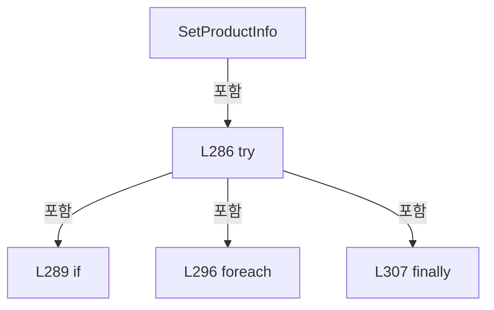

변경 전 점검: 입력/반환 타입, 위 호출자, 예외/취소 경로, 공유 상태와 저장·전송 소비자를 함께 확인합니다. 값의 단위나 물리 방향을 이름만으로 확정하지 않습니다.

### LocalFunctionStatement `ShouldIncludeItem` · L281–284

[Drilling.Common/Product/CProductManager.cs:281–284](https://github.com/kjuws10-rgb/A3Drilling/blob/5aee8e58439c9b455cae7c9593c9be986c3e682e/Drilling.Common/Product/CProductManager.cs#L281-L284)

| 항목 | 실제 추출 값 |
| --- | --- |
| 서명 | bool ShouldIncludeItem(string) |
| 접근/수식자 | Private /  |
| 반환/값 타입 | bool |
| 소속 타입 | NamedType:Drilling.Common.Product.CProductManager |

입력 계약:

| 이름 | 타입 | 전달 | 선택/기본값 |
| --- | --- | --- | --- |
| key | string | None | False /  |

현재 부분 분석에서 직접 연결된 호출자는 없습니다. XAML/이벤트/인터페이스·델리게이트·외부 진입을 추가 확인해야 하며, 미사용으로 판정한 것이 아닙니다.

호출하는 대상과 해석 범위:

| 원본 행 | 표현식 | 분석 상태 | 대상/소스 위치 |
| --- | --- | --- | --- |
| 283 | HostWritableProductFieldNames.Contains | resolved · 동적 구현 선택 가능 | bool System.Collections.Generic.IReadOnlySet<string>.Contains(string) |

본문의 실제 연산·분기·예외·반환 순서(원문 위치 순):

| 원본 행 | 종류 | 주석 해설 |
| --- | --- | --- |
| 283 | call | 함수·델리게이트 또는 객체 생성자를 호출합니다: HostWritableProductFieldNames.Contains(key) |
| 283 | return | 호출자에게 값 또는 제어를 반환합니다: return !HostWritableProductFieldNames.Contains(key); |

변경 전 점검: 입력/반환 타입, 위 호출자, 예외/취소 경로, 공유 상태와 저장·전송 소비자를 함께 확인합니다. 값의 단위나 물리 방향을 이름만으로 확정하지 않습니다.

### MethodDeclaration `SetHeadRunning` · L313–345

[Drilling.Common/Product/CProductManager.cs:313–345](https://github.com/kjuws10-rgb/A3Drilling/blob/5aee8e58439c9b455cae7c9593c9be986c3e682e/Drilling.Common/Product/CProductManager.cs#L313-L345)

| 항목 | 실제 추출 값 |
| --- | --- |
| 서명 | System.Threading.Tasks.Task<Drilling.Common.Product.ST_PRODUCT_DATA> Drilling.Common.Product.CProductManager.SetHeadRunning(string, int, System.Threading.CancellationToken) |
| 접근/수식자 | Public / public, async |
| 반환/값 타입 | System.Threading.Tasks.Task<Drilling.Common.Product.ST_PRODUCT_DATA> |
| 소속 타입 | NamedType:Drilling.Common.Product.CProductManager |

입력 계약:

| 이름 | 타입 | 전달 | 선택/기본값 |
| --- | --- | --- | --- |
| productId | string | None | False /  |
| headNo | int | None | False /  |
| cancellationToken | System.Threading.CancellationToken | None | True / null |

현재 부분 분석에서 직접 연결된 호출자는 없습니다. XAML/이벤트/인터페이스·델리게이트·외부 진입을 추가 확인해야 하며, 미사용으로 판정한 것이 아닙니다.

호출하는 대상과 해석 범위:

| 원본 행 | 표현식 | 분석 상태 | 대상/소스 위치 |
| --- | --- | --- | --- |
| 315 | cancellationToken.ThrowIfCancellationRequested | resolved | void System.Threading.CancellationToken.ThrowIfCancellationRequested() |
| 316 | _updateGate.WaitAsync(cancellationToken).ConfigureAwait | resolved | System.Runtime.CompilerServices.ConfiguredTaskAwaitable System.Threading.Tasks.Task.ConfigureAwait(bool) |
| 316 | _updateGate.WaitAsync | resolved | System.Threading.Tasks.Task System.Threading.SemaphoreSlim.WaitAsync(System.Threading.CancellationToken) |
| 319 | GetCurrent | resolved | Drilling.Common.Product.ST_PRODUCT_DATA Drilling.Common.Product.CProductManager.GetCurrent(string) · Drilling.Common/Product/CProductManager.cs:774 |
| 336 | product.Heads.Select(SelectItem).ToArray | resolved | Drilling.Common.Product.ST_PRODUCT_HEAD_RESULT[] System.Collections.Generic.IEnumerable<Drilling.Common.Product.ST_PRODUCT_HEAD_RESULT>.ToArray<Drilling.Common.Product.ST_PRODUCT_HEAD_RESULT>() |
| 336 | product.Heads.Select | resolved | System.Collections.Generic.IEnumerable<Drilling.Common.Product.ST_PRODUCT_HEAD_RESULT> System.Collections.Generic.IEnumerable<Drilling.Common.Product.ST_PRODUCT_HEAD_RESULT>.Select<Drilling.Common.Product.ST_PRODUCT_HEAD_RESULT, Drilling.Common.Product.ST_PRODUCT_HEAD_RESULT>(System.Func<Drilling.Common.Product.ST_PRODUCT_HEAD_RESULT, Drilling.Common.Product.ST_PRODUCT_HEAD_RESULT>) |
| 339 | PersistAndLog | resolved | System.Threading.Tasks.Task<Drilling.Common.Product.ST_PRODUCT_DATA> Drilling.Common.Product.CProductManager.PersistAndLog(Drilling.Common.Product.ST_PRODUCT_DATA, string, string, System.Threading.CancellationToken) · Drilling.Common/Product/CProductManager.cs:789 |
| 343 | _updateGate.Release | resolved | int System.Threading.SemaphoreSlim.Release() |

본문의 실제 연산·분기·예외·반환 순서(원문 위치 순):

| 원본 행 | 종류 | 주석 해설 |
| --- | --- | --- |
| 315 | call | 함수·델리게이트 또는 객체 생성자를 호출합니다: cancellationToken.ThrowIfCancellationRequested() |
| 316 | await | 비동기 완료를 기다립니다: await _updateGate.WaitAsync(cancellationToken).ConfigureAwait(false) |
| 316 | call | 함수·델리게이트 또는 객체 생성자를 호출합니다: _updateGate.WaitAsync(cancellationToken).ConfigureAwait(false) |
| 316 | call | 함수·델리게이트 또는 객체 생성자를 호출합니다: _updateGate.WaitAsync(cancellationToken) |
| 317 | try | 예외 처리 범위입니다: try |
| 319 | call | 함수·델리게이트 또는 객체 생성자를 호출합니다: GetCurrent(productId) |
| 319 | local-declaration | 지역 변수를 선언합니다: var product = GetCurrent(productId); |
| 319 | variable-initializer | 변수의 초기값을 지정합니다: product = GetCurrent(productId) |
| 320 | local-declaration | 지역 변수를 선언합니다: var now = DateTimeOffset.Now; |
| 320 | variable-initializer | 변수의 초기값을 지정합니다: now = DateTimeOffset.Now |
| 332 | local-declaration | 지역 변수를 선언합니다: var next = product with { Runtime = product.Runtime with { Heads = product.Heads.Select(SelectItem).ToArray() } }; |
| 332 | variable-initializer | 변수의 초기값을 지정합니다: next = product with { Runtime = product.Runtime with { Heads = product.Heads.Select(SelectItem).ToArray() } } |
| 334 | assignment | 값을 대상에 대입합니다: Runtime = product.Runtime with { Heads = product.Heads.Select(SelectItem).ToArray() } |
| 336 | assignment | 값을 대상에 대입합니다: Heads = product.Heads.Select(SelectItem).ToArray() |
| 336 | call | 함수·델리게이트 또는 객체 생성자를 호출합니다: product.Heads.Select(SelectItem).ToArray() |
| 336 | call | 함수·델리게이트 또는 객체 생성자를 호출합니다: product.Heads.Select(SelectItem) |
| 339 | await | 비동기 완료를 기다립니다: await PersistAndLog(next, "HEAD START", $"Head {headNo:00} started.", cancellationToken) |
| 339 | call | 함수·델리게이트 또는 객체 생성자를 호출합니다: PersistAndLog(next, "HEAD START", $"Head {headNo:00} started.", cancellationToken) |
| 339 | return | 호출자에게 값 또는 제어를 반환합니다: return await PersistAndLog(next, "HEAD START", $"Head {headNo:00} started.", cancellationToken); |
| 341 | finally | 종료 정리 구간입니다: finally |
| 343 | call | 함수·델리게이트 또는 객체 생성자를 호출합니다: _updateGate.Release() |

제어 구문의 포함 구조(실제 실행 순서/CFG가 아닌 구문 탐색 그림):

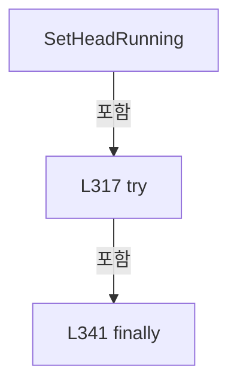

변경 전 점검: 입력/반환 타입, 위 호출자, 예외/취소 경로, 공유 상태와 저장·전송 소비자를 함께 확인합니다. 값의 단위나 물리 방향을 이름만으로 확정하지 않습니다.

### LocalFunctionStatement `SelectItem` · L321–330

[Drilling.Common/Product/CProductManager.cs:321–330](https://github.com/kjuws10-rgb/A3Drilling/blob/5aee8e58439c9b455cae7c9593c9be986c3e682e/Drilling.Common/Product/CProductManager.cs#L321-L330)

| 항목 | 실제 추출 값 |
| --- | --- |
| 서명 | Drilling.Common.Product.ST_PRODUCT_HEAD_RESULT SelectItem(Drilling.Common.Product.ST_PRODUCT_HEAD_RESULT) |
| 접근/수식자 | Private /  |
| 반환/값 타입 | Drilling.Common.Product.ST_PRODUCT_HEAD_RESULT |
| 소속 타입 | NamedType:Drilling.Common.Product.CProductManager |

입력 계약:

| 이름 | 타입 | 전달 | 선택/기본값 |
| --- | --- | --- | --- |
| head | Drilling.Common.Product.ST_PRODUCT_HEAD_RESULT | None | False /  |

현재 부분 분석에서 직접 연결된 호출자는 없습니다. XAML/이벤트/인터페이스·델리게이트·외부 진입을 추가 확인해야 하며, 미사용으로 판정한 것이 아닙니다.

본문의 실제 연산·분기·예외·반환 순서(원문 위치 순):

| 원본 행 | 종류 | 주석 해설 |
| --- | --- | --- |
| 323 | conditional-expression | 조건에 따라 결과식을 선택합니다: head.HeadNo == headNo ? head with { State = EN_PRODUCT_HEAD_STATE.Running, StartedAt = head.StartedAt ?? now } : head |
| 323 | return | 호출자에게 값 또는 제어를 반환합니다: return head.HeadNo == headNo ? head with { State = EN_PRODUCT_HEAD_STATE.Running, StartedAt = head.StartedAt ?? now } : head; |
| 325 | assignment | 값을 대상에 대입합니다: State = EN_PRODUCT_HEAD_STATE.Running |
| 326 | assignment | 값을 대상에 대입합니다: StartedAt = head.StartedAt ?? now |

변경 전 점검: 입력/반환 타입, 위 호출자, 예외/취소 경로, 공유 상태와 저장·전송 소비자를 함께 확인합니다. 값의 단위나 물리 방향을 이름만으로 확정하지 않습니다.

### MethodDeclaration `SetHeadResult` · L347–384

[Drilling.Common/Product/CProductManager.cs:347–384](https://github.com/kjuws10-rgb/A3Drilling/blob/5aee8e58439c9b455cae7c9593c9be986c3e682e/Drilling.Common/Product/CProductManager.cs#L347-L384)

| 항목 | 실제 추출 값 |
| --- | --- |
| 서명 | System.Threading.Tasks.Task<Drilling.Common.Product.ST_PRODUCT_DATA> Drilling.Common.Product.CProductManager.SetHeadResult(string, int, bool, string, string, System.Threading.CancellationToken) |
| 접근/수식자 | Public / public, async |
| 반환/값 타입 | System.Threading.Tasks.Task<Drilling.Common.Product.ST_PRODUCT_DATA> |
| 소속 타입 | NamedType:Drilling.Common.Product.CProductManager |

입력 계약:

| 이름 | 타입 | 전달 | 선택/기본값 |
| --- | --- | --- | --- |
| productId | string | None | False /  |
| headNo | int | None | False /  |
| isOk | bool | None | False /  |
| errorCode | string | None | True / "" |
| message | string | None | True / "" |
| cancellationToken | System.Threading.CancellationToken | None | True / null |

현재 부분 분석에서 직접 연결된 호출자는 없습니다. XAML/이벤트/인터페이스·델리게이트·외부 진입을 추가 확인해야 하며, 미사용으로 판정한 것이 아닙니다.

호출하는 대상과 해석 범위:

| 원본 행 | 표현식 | 분석 상태 | 대상/소스 위치 |
| --- | --- | --- | --- |
| 349 | cancellationToken.ThrowIfCancellationRequested | resolved | void System.Threading.CancellationToken.ThrowIfCancellationRequested() |
| 350 | _updateGate.WaitAsync(cancellationToken).ConfigureAwait | resolved | System.Runtime.CompilerServices.ConfiguredTaskAwaitable System.Threading.Tasks.Task.ConfigureAwait(bool) |
| 350 | _updateGate.WaitAsync | resolved | System.Threading.Tasks.Task System.Threading.SemaphoreSlim.WaitAsync(System.Threading.CancellationToken) |
| 353 | GetCurrent | resolved | Drilling.Common.Product.ST_PRODUCT_DATA Drilling.Common.Product.CProductManager.GetCurrent(string) · Drilling.Common/Product/CProductManager.cs:774 |
| 375 | product.Heads.Select(SelectItem).ToArray | resolved | Drilling.Common.Product.ST_PRODUCT_HEAD_RESULT[] System.Collections.Generic.IEnumerable<Drilling.Common.Product.ST_PRODUCT_HEAD_RESULT>.ToArray<Drilling.Common.Product.ST_PRODUCT_HEAD_RESULT>() |
| 375 | product.Heads.Select | resolved | System.Collections.Generic.IEnumerable<Drilling.Common.Product.ST_PRODUCT_HEAD_RESULT> System.Collections.Generic.IEnumerable<Drilling.Common.Product.ST_PRODUCT_HEAD_RESULT>.Select<Drilling.Common.Product.ST_PRODUCT_HEAD_RESULT, Drilling.Common.Product.ST_PRODUCT_HEAD_RESULT>(System.Func<Drilling.Common.Product.ST_PRODUCT_HEAD_RESULT, Drilling.Common.Product.ST_PRODUCT_HEAD_RESULT>) |
| 378 | PersistAndLog | resolved | System.Threading.Tasks.Task<Drilling.Common.Product.ST_PRODUCT_DATA> Drilling.Common.Product.CProductManager.PersistAndLog(Drilling.Common.Product.ST_PRODUCT_DATA, string, string, System.Threading.CancellationToken) · Drilling.Common/Product/CProductManager.cs:789 |
| 378 | $"Head {headNo:00}: {(isOk ? "OK" : "NG")} {message}".Trim | resolved | string string.Trim() |
| 382 | _updateGate.Release | resolved | int System.Threading.SemaphoreSlim.Release() |

본문의 실제 연산·분기·예외·반환 순서(원문 위치 순):

| 원본 행 | 종류 | 주석 해설 |
| --- | --- | --- |
| 349 | call | 함수·델리게이트 또는 객체 생성자를 호출합니다: cancellationToken.ThrowIfCancellationRequested() |
| 350 | await | 비동기 완료를 기다립니다: await _updateGate.WaitAsync(cancellationToken).ConfigureAwait(false) |
| 350 | call | 함수·델리게이트 또는 객체 생성자를 호출합니다: _updateGate.WaitAsync(cancellationToken).ConfigureAwait(false) |
| 350 | call | 함수·델리게이트 또는 객체 생성자를 호출합니다: _updateGate.WaitAsync(cancellationToken) |
| 351 | try | 예외 처리 범위입니다: try |
| 353 | call | 함수·델리게이트 또는 객체 생성자를 호출합니다: GetCurrent(productId) |
| 353 | local-declaration | 지역 변수를 선언합니다: var product = GetCurrent(productId); |
| 353 | variable-initializer | 변수의 초기값을 지정합니다: product = GetCurrent(productId) |
| 354 | local-declaration | 지역 변수를 선언합니다: var now = DateTimeOffset.Now; |
| 354 | variable-initializer | 변수의 초기값을 지정합니다: now = DateTimeOffset.Now |
| 371 | local-declaration | 지역 변수를 선언합니다: var next = product with { Runtime = product.Runtime with { Heads = product.Heads.Select(SelectItem).ToArray() } }; |
| 371 | variable-initializer | 변수의 초기값을 지정합니다: next = product with { Runtime = product.Runtime with { Heads = product.Heads.Select(SelectItem).ToArray() } } |
| 373 | assignment | 값을 대상에 대입합니다: Runtime = product.Runtime with { Heads = product.Heads.Select(SelectItem).ToArray() } |
| 375 | assignment | 값을 대상에 대입합니다: Heads = product.Heads.Select(SelectItem).ToArray() |
| 375 | call | 함수·델리게이트 또는 객체 생성자를 호출합니다: product.Heads.Select(SelectItem).ToArray() |
| 375 | call | 함수·델리게이트 또는 객체 생성자를 호출합니다: product.Heads.Select(SelectItem) |
| 378 | await | 비동기 완료를 기다립니다: await PersistAndLog(next, isOk ? "HEAD COMPLETE" : "HEAD ERROR", $"Head {headNo:00}: {(isOk ? "OK" : "NG")} {message}".Trim(), cancellationToken) |
| 378 | call | 함수·델리게이트 또는 객체 생성자를 호출합니다: PersistAndLog(next, isOk ? "HEAD COMPLETE" : "HEAD ERROR", $"Head {headNo:00}: {(isOk ? "OK" : "NG")} {message}".Trim(), cancellationToken) |
| 378 | call | 함수·델리게이트 또는 객체 생성자를 호출합니다: $"Head {headNo:00}: {(isOk ? "OK" : "NG")} {message}".Trim() |
| 378 | conditional-expression | 조건에 따라 결과식을 선택합니다: isOk ? "HEAD COMPLETE" : "HEAD ERROR" |
| 378 | conditional-expression | 조건에 따라 결과식을 선택합니다: isOk ? "OK" : "NG" |
| 378 | return | 호출자에게 값 또는 제어를 반환합니다: return await PersistAndLog(next, isOk ? "HEAD COMPLETE" : "HEAD ERROR", $"Head {headNo:00}: {(isOk ? "OK" : "NG")} {message}".Trim(), cancellationToken); |
| 380 | finally | 종료 정리 구간입니다: finally |
| 382 | call | 함수·델리게이트 또는 객체 생성자를 호출합니다: _updateGate.Release() |

제어 구문의 포함 구조(실제 실행 순서/CFG가 아닌 구문 탐색 그림):

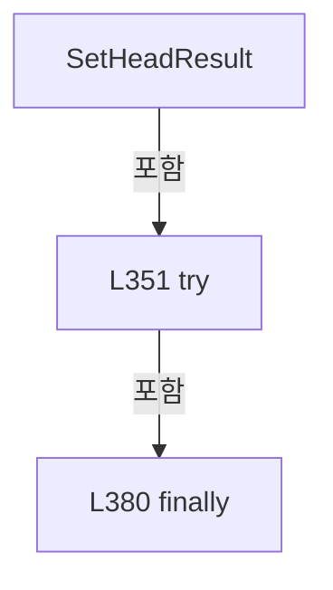

변경 전 점검: 입력/반환 타입, 위 호출자, 예외/취소 경로, 공유 상태와 저장·전송 소비자를 함께 확인합니다. 값의 단위나 물리 방향을 이름만으로 확정하지 않습니다.

### LocalFunctionStatement `SelectItem` · L355–369

[Drilling.Common/Product/CProductManager.cs:355–369](https://github.com/kjuws10-rgb/A3Drilling/blob/5aee8e58439c9b455cae7c9593c9be986c3e682e/Drilling.Common/Product/CProductManager.cs#L355-L369)

| 항목 | 실제 추출 값 |
| --- | --- |
| 서명 | Drilling.Common.Product.ST_PRODUCT_HEAD_RESULT SelectItem(Drilling.Common.Product.ST_PRODUCT_HEAD_RESULT) |
| 접근/수식자 | Private /  |
| 반환/값 타입 | Drilling.Common.Product.ST_PRODUCT_HEAD_RESULT |
| 소속 타입 | NamedType:Drilling.Common.Product.CProductManager |

입력 계약:

| 이름 | 타입 | 전달 | 선택/기본값 |
| --- | --- | --- | --- |
| head | Drilling.Common.Product.ST_PRODUCT_HEAD_RESULT | None | False /  |

현재 부분 분석에서 직접 연결된 호출자는 없습니다. XAML/이벤트/인터페이스·델리게이트·외부 진입을 추가 확인해야 하며, 미사용으로 판정한 것이 아닙니다.

본문의 실제 연산·분기·예외·반환 순서(원문 위치 순):

| 원본 행 | 종류 | 주석 해설 |
| --- | --- | --- |
| 357 | conditional-expression | 조건에 따라 결과식을 선택합니다: head.HeadNo == headNo ? head with { State = isOk ? EN_PRODUCT_HEAD_STATE.Completed : EN_PRODUCT_HEAD_STATE.Error, CompletedPoints = isOk ? head.TotalPoints : head.CompletedPoints, Result = isOk ? EN_PRODUCT_RESULT.OK : EN_PRODUCT_ |
| 357 | return | 호출자에게 값 또는 제어를 반환합니다: return head.HeadNo == headNo ? head with { State = isOk ? EN_PRODUCT_HEAD_STATE.Completed : EN_PRODUCT_HEAD_STATE.Error, CompletedPoints = isOk ? head.TotalPoints : head.CompletedPoints, Result = isOk ? EN_PRODUCT_RESULT.OK : EN_P |
| 359 | assignment | 값을 대상에 대입합니다: State = isOk ? EN_PRODUCT_HEAD_STATE.Completed : EN_PRODUCT_HEAD_STATE.Error |
| 359 | conditional-expression | 조건에 따라 결과식을 선택합니다: isOk ? EN_PRODUCT_HEAD_STATE.Completed : EN_PRODUCT_HEAD_STATE.Error |
| 360 | assignment | 값을 대상에 대입합니다: CompletedPoints = isOk ? head.TotalPoints : head.CompletedPoints |
| 360 | conditional-expression | 조건에 따라 결과식을 선택합니다: isOk ? head.TotalPoints : head.CompletedPoints |
| 361 | assignment | 값을 대상에 대입합니다: Result = isOk ? EN_PRODUCT_RESULT.OK : EN_PRODUCT_RESULT.NG |
| 361 | conditional-expression | 조건에 따라 결과식을 선택합니다: isOk ? EN_PRODUCT_RESULT.OK : EN_PRODUCT_RESULT.NG |
| 362 | assignment | 값을 대상에 대입합니다: ErrorCode = errorCode |
| 363 | assignment | 값을 대상에 대입합니다: Message = message |
| 364 | assignment | 값을 대상에 대입합니다: StartedAt = head.StartedAt ?? now |
| 365 | assignment | 값을 대상에 대입합니다: CompletedAt = now |

변경 전 점검: 입력/반환 타입, 위 호출자, 예외/취소 경로, 공유 상태와 저장·전송 소비자를 함께 확인합니다. 값의 단위나 물리 방향을 이름만으로 확정하지 않습니다.

### MethodDeclaration `SetAlign` · L386–403

[Drilling.Common/Product/CProductManager.cs:386–403](https://github.com/kjuws10-rgb/A3Drilling/blob/5aee8e58439c9b455cae7c9593c9be986c3e682e/Drilling.Common/Product/CProductManager.cs#L386-L403)

| 항목 | 실제 추출 값 |
| --- | --- |
| 서명 | System.Threading.Tasks.Task<Drilling.Common.Product.ST_PRODUCT_DATA> Drilling.Common.Product.CProductManager.SetAlign(string, Drilling.Common.Product.ST_PRODUCT_ALIGN_DATA, System.Threading.CancellationToken) |
| 접근/수식자 | Public / public, async |
| 반환/값 타입 | System.Threading.Tasks.Task<Drilling.Common.Product.ST_PRODUCT_DATA> |
| 소속 타입 | NamedType:Drilling.Common.Product.CProductManager |

입력 계약:

| 이름 | 타입 | 전달 | 선택/기본값 |
| --- | --- | --- | --- |
| productId | string | None | False /  |
| align | Drilling.Common.Product.ST_PRODUCT_ALIGN_DATA | None | False /  |
| cancellationToken | System.Threading.CancellationToken | None | True / null |

현재 부분 분석에서 직접 연결된 호출자는 없습니다. XAML/이벤트/인터페이스·델리게이트·외부 진입을 추가 확인해야 하며, 미사용으로 판정한 것이 아닙니다.

호출하는 대상과 해석 범위:

| 원본 행 | 표현식 | 분석 상태 | 대상/소스 위치 |
| --- | --- | --- | --- |
| 388 | cancellationToken.ThrowIfCancellationRequested | resolved | void System.Threading.CancellationToken.ThrowIfCancellationRequested() |
| 389 | _updateGate.WaitAsync(cancellationToken).ConfigureAwait | resolved | System.Runtime.CompilerServices.ConfiguredTaskAwaitable System.Threading.Tasks.Task.ConfigureAwait(bool) |
| 389 | _updateGate.WaitAsync | resolved | System.Threading.Tasks.Task System.Threading.SemaphoreSlim.WaitAsync(System.Threading.CancellationToken) |
| 392 | GetCurrent | resolved | Drilling.Common.Product.ST_PRODUCT_DATA Drilling.Common.Product.CProductManager.GetCurrent(string) · Drilling.Common/Product/CProductManager.cs:774 |
| 397 | PersistAndLog | resolved | System.Threading.Tasks.Task<Drilling.Common.Product.ST_PRODUCT_DATA> Drilling.Common.Product.CProductManager.PersistAndLog(Drilling.Common.Product.ST_PRODUCT_DATA, string, string, System.Threading.CancellationToken) · Drilling.Common/Product/CProductManager.cs:789 |
| 401 | _updateGate.Release | resolved | int System.Threading.SemaphoreSlim.Release() |

본문의 실제 연산·분기·예외·반환 순서(원문 위치 순):

| 원본 행 | 종류 | 주석 해설 |
| --- | --- | --- |
| 388 | call | 함수·델리게이트 또는 객체 생성자를 호출합니다: cancellationToken.ThrowIfCancellationRequested() |
| 389 | await | 비동기 완료를 기다립니다: await _updateGate.WaitAsync(cancellationToken).ConfigureAwait(false) |
| 389 | call | 함수·델리게이트 또는 객체 생성자를 호출합니다: _updateGate.WaitAsync(cancellationToken).ConfigureAwait(false) |
| 389 | call | 함수·델리게이트 또는 객체 생성자를 호출합니다: _updateGate.WaitAsync(cancellationToken) |
| 390 | try | 예외 처리 범위입니다: try |
| 392 | call | 함수·델리게이트 또는 객체 생성자를 호출합니다: GetCurrent(productId) |
| 392 | local-declaration | 지역 변수를 선언합니다: var product = GetCurrent(productId); |
| 392 | variable-initializer | 변수의 초기값을 지정합니다: product = GetCurrent(productId) |
| 393 | local-declaration | 지역 변수를 선언합니다: var next = product with { Align = align }; |
| 393 | variable-initializer | 변수의 초기값을 지정합니다: next = product with { Align = align } |
| 395 | assignment | 값을 대상에 대입합니다: Align = align |
| 397 | await | 비동기 완료를 기다립니다: await PersistAndLog(next, "ALIGN UPDATE", $"Align state={align.State}, result={align.Result}.", cancellationToken) |
| 397 | call | 함수·델리게이트 또는 객체 생성자를 호출합니다: PersistAndLog(next, "ALIGN UPDATE", $"Align state={align.State}, result={align.Result}.", cancellationToken) |
| 397 | return | 호출자에게 값 또는 제어를 반환합니다: return await PersistAndLog(next, "ALIGN UPDATE", $"Align state={align.State}, result={align.Result}.", cancellationToken); |
| 399 | finally | 종료 정리 구간입니다: finally |
| 401 | call | 함수·델리게이트 또는 객체 생성자를 호출합니다: _updateGate.Release() |

제어 구문의 포함 구조(실제 실행 순서/CFG가 아닌 구문 탐색 그림):

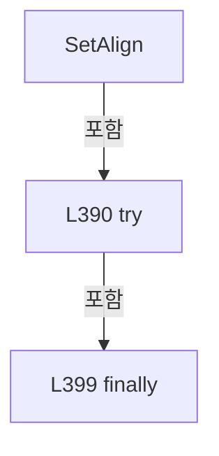

변경 전 점검: 입력/반환 타입, 위 호출자, 예외/취소 경로, 공유 상태와 저장·전송 소비자를 함께 확인합니다. 값의 단위나 물리 방향을 이름만으로 확정하지 않습니다.

### MethodDeclaration `SetDistortion` · L405–422

[Drilling.Common/Product/CProductManager.cs:405–422](https://github.com/kjuws10-rgb/A3Drilling/blob/5aee8e58439c9b455cae7c9593c9be986c3e682e/Drilling.Common/Product/CProductManager.cs#L405-L422)

| 항목 | 실제 추출 값 |
| --- | --- |
| 서명 | System.Threading.Tasks.Task<Drilling.Common.Product.ST_PRODUCT_DATA> Drilling.Common.Product.CProductManager.SetDistortion(string, Drilling.Common.Product.ST_PRODUCT_DISTORTION_DATA, System.Threading.CancellationToken) |
| 접근/수식자 | Public / public, async |
| 반환/값 타입 | System.Threading.Tasks.Task<Drilling.Common.Product.ST_PRODUCT_DATA> |
| 소속 타입 | NamedType:Drilling.Common.Product.CProductManager |

입력 계약:

| 이름 | 타입 | 전달 | 선택/기본값 |
| --- | --- | --- | --- |
| productId | string | None | False /  |
| distortion | Drilling.Common.Product.ST_PRODUCT_DISTORTION_DATA | None | False /  |
| cancellationToken | System.Threading.CancellationToken | None | True / null |

현재 부분 분석에서 직접 연결된 호출자는 없습니다. XAML/이벤트/인터페이스·델리게이트·외부 진입을 추가 확인해야 하며, 미사용으로 판정한 것이 아닙니다.

호출하는 대상과 해석 범위:

| 원본 행 | 표현식 | 분석 상태 | 대상/소스 위치 |
| --- | --- | --- | --- |
| 407 | cancellationToken.ThrowIfCancellationRequested | resolved | void System.Threading.CancellationToken.ThrowIfCancellationRequested() |
| 408 | _updateGate.WaitAsync(cancellationToken).ConfigureAwait | resolved | System.Runtime.CompilerServices.ConfiguredTaskAwaitable System.Threading.Tasks.Task.ConfigureAwait(bool) |
| 408 | _updateGate.WaitAsync | resolved | System.Threading.Tasks.Task System.Threading.SemaphoreSlim.WaitAsync(System.Threading.CancellationToken) |
| 411 | GetCurrent | resolved | Drilling.Common.Product.ST_PRODUCT_DATA Drilling.Common.Product.CProductManager.GetCurrent(string) · Drilling.Common/Product/CProductManager.cs:774 |
| 416 | PersistAndLog | resolved | System.Threading.Tasks.Task<Drilling.Common.Product.ST_PRODUCT_DATA> Drilling.Common.Product.CProductManager.PersistAndLog(Drilling.Common.Product.ST_PRODUCT_DATA, string, string, System.Threading.CancellationToken) · Drilling.Common/Product/CProductManager.cs:789 |
| 420 | _updateGate.Release | resolved | int System.Threading.SemaphoreSlim.Release() |

본문의 실제 연산·분기·예외·반환 순서(원문 위치 순):

| 원본 행 | 종류 | 주석 해설 |
| --- | --- | --- |
| 407 | call | 함수·델리게이트 또는 객체 생성자를 호출합니다: cancellationToken.ThrowIfCancellationRequested() |
| 408 | await | 비동기 완료를 기다립니다: await _updateGate.WaitAsync(cancellationToken).ConfigureAwait(false) |
| 408 | call | 함수·델리게이트 또는 객체 생성자를 호출합니다: _updateGate.WaitAsync(cancellationToken).ConfigureAwait(false) |
| 408 | call | 함수·델리게이트 또는 객체 생성자를 호출합니다: _updateGate.WaitAsync(cancellationToken) |
| 409 | try | 예외 처리 범위입니다: try |
| 411 | call | 함수·델리게이트 또는 객체 생성자를 호출합니다: GetCurrent(productId) |
| 411 | local-declaration | 지역 변수를 선언합니다: var product = GetCurrent(productId); |
| 411 | variable-initializer | 변수의 초기값을 지정합니다: product = GetCurrent(productId) |
| 412 | local-declaration | 지역 변수를 선언합니다: var next = product with { Distortion = distortion }; |
| 412 | variable-initializer | 변수의 초기값을 지정합니다: next = product with { Distortion = distortion } |
| 414 | assignment | 값을 대상에 대입합니다: Distortion = distortion |
| 416 | await | 비동기 완료를 기다립니다: await PersistAndLog(next, "DISTORTION UPDATE", $"Distortion state={distortion.State}, result={distortion.Result}.", cancellationToken) |
| 416 | call | 함수·델리게이트 또는 객체 생성자를 호출합니다: PersistAndLog(next, "DISTORTION UPDATE", $"Distortion state={distortion.State}, result={distortion.Result}.", cancellationToken) |
| 416 | return | 호출자에게 값 또는 제어를 반환합니다: return await PersistAndLog(next, "DISTORTION UPDATE", $"Distortion state={distortion.State}, result={distortion.Result}.", cancellationToken); |
| 418 | finally | 종료 정리 구간입니다: finally |
| 420 | call | 함수·델리게이트 또는 객체 생성자를 호출합니다: _updateGate.Release() |

제어 구문의 포함 구조(실제 실행 순서/CFG가 아닌 구문 탐색 그림):

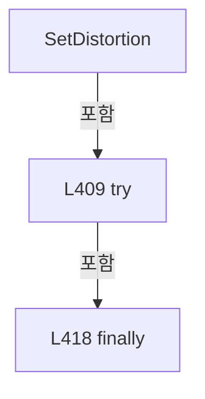

변경 전 점검: 입력/반환 타입, 위 호출자, 예외/취소 경로, 공유 상태와 저장·전송 소비자를 함께 확인합니다. 값의 단위나 물리 방향을 이름만으로 확정하지 않습니다.

### MethodDeclaration `SetAlignment` · L424–442

[Drilling.Common/Product/CProductManager.cs:424–442](https://github.com/kjuws10-rgb/A3Drilling/blob/5aee8e58439c9b455cae7c9593c9be986c3e682e/Drilling.Common/Product/CProductManager.cs#L424-L442)

| 항목 | 실제 추출 값 |
| --- | --- |
| 서명 | System.Threading.Tasks.Task<Drilling.Common.Product.ST_PRODUCT_DATA> Drilling.Common.Product.CProductManager.SetAlignment(string, Drilling.Common.Product.ST_PRODUCT_ALIGN_DATA, Drilling.Common.Product.ST_PRODUCT_DISTORTION_DATA, System.Threading.CancellationToken) |
| 접근/수식자 | Public / public, async |
| 반환/값 타입 | System.Threading.Tasks.Task<Drilling.Common.Product.ST_PRODUCT_DATA> |
| 소속 타입 | NamedType:Drilling.Common.Product.CProductManager |

입력 계약:

| 이름 | 타입 | 전달 | 선택/기본값 |
| --- | --- | --- | --- |
| productId | string | None | False /  |
| align | Drilling.Common.Product.ST_PRODUCT_ALIGN_DATA | None | False /  |
| distortion | Drilling.Common.Product.ST_PRODUCT_DISTORTION_DATA | None | False /  |
| cancellationToken | System.Threading.CancellationToken | None | True / null |

정적 호출자로 확인된 위치:

| 호출 파일/행 | 호출 표현식 | 런타임 분기 가능 |
| --- | --- | --- |
| [Drilling.Common/Station/CStationProcess.cs:536–547](https://github.com/kjuws10-rgb/A3Drilling/blob/5aee8e58439c9b455cae7c9593c9be986c3e682e/Drilling.Common/Station/CStationProcess.cs#L536-L547) | _productManager.SetAlignment | False |

호출하는 대상과 해석 범위:

| 원본 행 | 표현식 | 분석 상태 | 대상/소스 위치 |
| --- | --- | --- | --- |
| 426 | cancellationToken.ThrowIfCancellationRequested | resolved | void System.Threading.CancellationToken.ThrowIfCancellationRequested() |
| 427 | _updateGate.WaitAsync(cancellationToken).ConfigureAwait | resolved | System.Runtime.CompilerServices.ConfiguredTaskAwaitable System.Threading.Tasks.Task.ConfigureAwait(bool) |
| 427 | _updateGate.WaitAsync | resolved | System.Threading.Tasks.Task System.Threading.SemaphoreSlim.WaitAsync(System.Threading.CancellationToken) |
| 430 | GetCurrent | resolved | Drilling.Common.Product.ST_PRODUCT_DATA Drilling.Common.Product.CProductManager.GetCurrent(string) · Drilling.Common/Product/CProductManager.cs:774 |
| 436 | PersistAndLog | resolved | System.Threading.Tasks.Task<Drilling.Common.Product.ST_PRODUCT_DATA> Drilling.Common.Product.CProductManager.PersistAndLog(Drilling.Common.Product.ST_PRODUCT_DATA, string, string, System.Threading.CancellationToken) · Drilling.Common/Product/CProductManager.cs:789 |
| 440 | _updateGate.Release | resolved | int System.Threading.SemaphoreSlim.Release() |

본문의 실제 연산·분기·예외·반환 순서(원문 위치 순):

| 원본 행 | 종류 | 주석 해설 |
| --- | --- | --- |
| 426 | call | 함수·델리게이트 또는 객체 생성자를 호출합니다: cancellationToken.ThrowIfCancellationRequested() |
| 427 | await | 비동기 완료를 기다립니다: await _updateGate.WaitAsync(cancellationToken).ConfigureAwait(false) |
| 427 | call | 함수·델리게이트 또는 객체 생성자를 호출합니다: _updateGate.WaitAsync(cancellationToken).ConfigureAwait(false) |
| 427 | call | 함수·델리게이트 또는 객체 생성자를 호출합니다: _updateGate.WaitAsync(cancellationToken) |
| 428 | try | 예외 처리 범위입니다: try |
| 430 | call | 함수·델리게이트 또는 객체 생성자를 호출합니다: GetCurrent(productId) |
| 430 | local-declaration | 지역 변수를 선언합니다: var product = GetCurrent(productId); |
| 430 | variable-initializer | 변수의 초기값을 지정합니다: product = GetCurrent(productId) |
| 431 | local-declaration | 지역 변수를 선언합니다: var next = product with { Align = align, Distortion = distortion }; |
| 431 | variable-initializer | 변수의 초기값을 지정합니다: next = product with { Align = align, Distortion = distortion } |
| 433 | assignment | 값을 대상에 대입합니다: Align = align |
| 434 | assignment | 값을 대상에 대입합니다: Distortion = distortion |
| 436 | await | 비동기 완료를 기다립니다: await PersistAndLog(next, "ALIGNMENT UPDATE", $"Align state={align.State}, result={align.Result}; Distortion state={distortion.State}, result={distortion.Result}.", cancellationToken) |
| 436 | call | 함수·델리게이트 또는 객체 생성자를 호출합니다: PersistAndLog(next, "ALIGNMENT UPDATE", $"Align state={align.State}, result={align.Result}; Distortion state={distortion.State}, result={distortion.Result}.", cancellationToken) |
| 436 | return | 호출자에게 값 또는 제어를 반환합니다: return await PersistAndLog(next, "ALIGNMENT UPDATE", $"Align state={align.State}, result={align.Result}; Distortion state={distortion.State}, result={distortion.Result}.", cancellationToken); |
| 438 | finally | 종료 정리 구간입니다: finally |
| 440 | call | 함수·델리게이트 또는 객체 생성자를 호출합니다: _updateGate.Release() |

제어 구문의 포함 구조(실제 실행 순서/CFG가 아닌 구문 탐색 그림):

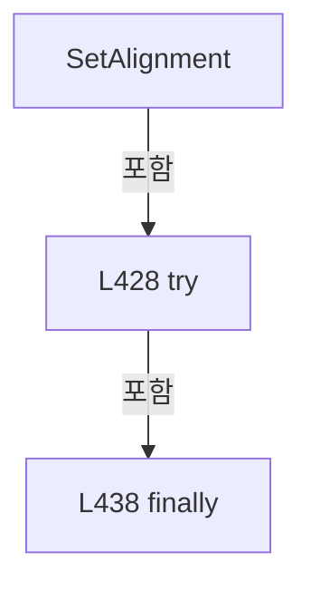

변경 전 점검: 입력/반환 타입, 위 호출자, 예외/취소 경로, 공유 상태와 저장·전송 소비자를 함께 확인합니다. 값의 단위나 물리 방향을 이름만으로 확정하지 않습니다.

### MethodDeclaration `SetReviewRunning` · L444–464

[Drilling.Common/Product/CProductManager.cs:444–464](https://github.com/kjuws10-rgb/A3Drilling/blob/5aee8e58439c9b455cae7c9593c9be986c3e682e/Drilling.Common/Product/CProductManager.cs#L444-L464)

| 항목 | 실제 추출 값 |
| --- | --- |
| 서명 | System.Threading.Tasks.Task<Drilling.Common.Product.ST_PRODUCT_DATA> Drilling.Common.Product.CProductManager.SetReviewRunning(string, Drilling.Common.Product.ST_PRODUCT_REVIEW_DATA, System.Threading.CancellationToken) |
| 접근/수식자 | Public / public, async |
| 반환/값 타입 | System.Threading.Tasks.Task<Drilling.Common.Product.ST_PRODUCT_DATA> |
| 소속 타입 | NamedType:Drilling.Common.Product.CProductManager |

입력 계약:

| 이름 | 타입 | 전달 | 선택/기본값 |
| --- | --- | --- | --- |
| productId | string | None | False /  |
| review | Drilling.Common.Product.ST_PRODUCT_REVIEW_DATA | None | False /  |
| cancellationToken | System.Threading.CancellationToken | None | True / null |

정적 호출자로 확인된 위치:

| 호출 파일/행 | 호출 표현식 | 런타임 분기 가능 |
| --- | --- | --- |
| [Drilling.Common/Review/CReviewManager.cs:301–301](https://github.com/kjuws10-rgb/A3Drilling/blob/5aee8e58439c9b455cae7c9593c9be986c3e682e/Drilling.Common/Review/CReviewManager.cs#L301-L301) | productManager.SetReviewRunning | False |
| [Drilling.Common/Review/CReviewManager.cs:2254–2254](https://github.com/kjuws10-rgb/A3Drilling/blob/5aee8e58439c9b455cae7c9593c9be986c3e682e/Drilling.Common/Review/CReviewManager.cs#L2254-L2254) | productManager.SetReviewRunning | False |

호출하는 대상과 해석 범위:

| 원본 행 | 표현식 | 분석 상태 | 대상/소스 위치 |
| --- | --- | --- | --- |
| 446 | cancellationToken.ThrowIfCancellationRequested | resolved | void System.Threading.CancellationToken.ThrowIfCancellationRequested() |
| 447 | _updateGate.WaitAsync(cancellationToken).ConfigureAwait | resolved | System.Runtime.CompilerServices.ConfiguredTaskAwaitable System.Threading.Tasks.Task.ConfigureAwait(bool) |
| 447 | _updateGate.WaitAsync | resolved | System.Threading.Tasks.Task System.Threading.SemaphoreSlim.WaitAsync(System.Threading.CancellationToken) |
| 450 | GetCurrent | resolved | Drilling.Common.Product.ST_PRODUCT_DATA Drilling.Common.Product.CProductManager.GetCurrent(string) · Drilling.Common/Product/CProductManager.cs:774 |
| 458 | PersistAndLog | resolved | System.Threading.Tasks.Task<Drilling.Common.Product.ST_PRODUCT_DATA> Drilling.Common.Product.CProductManager.PersistAndLog(Drilling.Common.Product.ST_PRODUCT_DATA, string, string, System.Threading.CancellationToken) · Drilling.Common/Product/CProductManager.cs:789 |
| 462 | _updateGate.Release | resolved | int System.Threading.SemaphoreSlim.Release() |

본문의 실제 연산·분기·예외·반환 순서(원문 위치 순):

| 원본 행 | 종류 | 주석 해설 |
| --- | --- | --- |
| 446 | call | 함수·델리게이트 또는 객체 생성자를 호출합니다: cancellationToken.ThrowIfCancellationRequested() |
| 447 | await | 비동기 완료를 기다립니다: await _updateGate.WaitAsync(cancellationToken).ConfigureAwait(false) |
| 447 | call | 함수·델리게이트 또는 객체 생성자를 호출합니다: _updateGate.WaitAsync(cancellationToken).ConfigureAwait(false) |
| 447 | call | 함수·델리게이트 또는 객체 생성자를 호출합니다: _updateGate.WaitAsync(cancellationToken) |
| 448 | try | 예외 처리 범위입니다: try |
| 450 | call | 함수·델리게이트 또는 객체 생성자를 호출합니다: GetCurrent(productId) |
| 450 | local-declaration | 지역 변수를 선언합니다: var product = GetCurrent(productId); |
| 450 | variable-initializer | 변수의 초기값을 지정합니다: product = GetCurrent(productId) |
| 451 | local-declaration | 지역 변수를 선언합니다: var next = product with { Review = review with { State = EN_PRODUCT_PROCESS_STATE.Running } }; |
| 451 | variable-initializer | 변수의 초기값을 지정합니다: next = product with { Review = review with { State = EN_PRODUCT_PROCESS_STATE.Running } } |
| 453 | assignment | 값을 대상에 대입합니다: Review = review with { State = EN_PRODUCT_PROCESS_STATE.Running } |
| 455 | assignment | 값을 대상에 대입합니다: State = EN_PRODUCT_PROCESS_STATE.Running |
| 458 | await | 비동기 완료를 기다립니다: await PersistAndLog(next, "REVIEW START", "Review started.", cancellationToken) |
| 458 | call | 함수·델리게이트 또는 객체 생성자를 호출합니다: PersistAndLog(next, "REVIEW START", "Review started.", cancellationToken) |
| 458 | return | 호출자에게 값 또는 제어를 반환합니다: return await PersistAndLog(next, "REVIEW START", "Review started.", cancellationToken); |
| 460 | finally | 종료 정리 구간입니다: finally |
| 462 | call | 함수·델리게이트 또는 객체 생성자를 호출합니다: _updateGate.Release() |

제어 구문의 포함 구조(실제 실행 순서/CFG가 아닌 구문 탐색 그림):

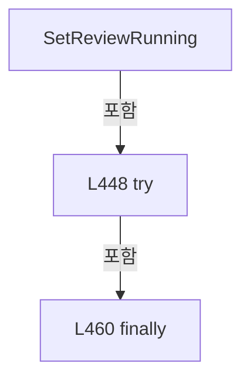

변경 전 점검: 입력/반환 타입, 위 호출자, 예외/취소 경로, 공유 상태와 저장·전송 소비자를 함께 확인합니다. 값의 단위나 물리 방향을 이름만으로 확정하지 않습니다.

### MethodDeclaration `SetReviewProgress` · L466–488

[Drilling.Common/Product/CProductManager.cs:466–488](https://github.com/kjuws10-rgb/A3Drilling/blob/5aee8e58439c9b455cae7c9593c9be986c3e682e/Drilling.Common/Product/CProductManager.cs#L466-L488)

| 항목 | 실제 추출 값 |
| --- | --- |
| 서명 | System.Threading.Tasks.Task<Drilling.Common.Product.ST_PRODUCT_DATA> Drilling.Common.Product.CProductManager.SetReviewProgress(string, Drilling.Common.Product.ST_PRODUCT_REVIEW_DATA, System.Threading.CancellationToken) |
| 접근/수식자 | Public / public, async |
| 반환/값 타입 | System.Threading.Tasks.Task<Drilling.Common.Product.ST_PRODUCT_DATA> |
| 소속 타입 | NamedType:Drilling.Common.Product.CProductManager |

입력 계약:

| 이름 | 타입 | 전달 | 선택/기본값 |
| --- | --- | --- | --- |
| productId | string | None | False /  |
| review | Drilling.Common.Product.ST_PRODUCT_REVIEW_DATA | None | False /  |
| cancellationToken | System.Threading.CancellationToken | None | True / null |

정적 호출자로 확인된 위치:

| 호출 파일/행 | 호출 표현식 | 런타임 분기 가능 |
| --- | --- | --- |
| [Drilling.Common/Review/CReviewManager.cs:1488–1488](https://github.com/kjuws10-rgb/A3Drilling/blob/5aee8e58439c9b455cae7c9593c9be986c3e682e/Drilling.Common/Review/CReviewManager.cs#L1488-L1488) | productManager.SetReviewProgress | False |

호출하는 대상과 해석 범위:

| 원본 행 | 표현식 | 분석 상태 | 대상/소스 위치 |
| --- | --- | --- | --- |
| 468 | cancellationToken.ThrowIfCancellationRequested | resolved | void System.Threading.CancellationToken.ThrowIfCancellationRequested() |
| 469 | _updateGate.WaitAsync(cancellationToken).ConfigureAwait | resolved | System.Runtime.CompilerServices.ConfiguredTaskAwaitable System.Threading.Tasks.Task.ConfigureAwait(bool) |
| 469 | _updateGate.WaitAsync | resolved | System.Threading.Tasks.Task System.Threading.SemaphoreSlim.WaitAsync(System.Threading.CancellationToken) |
| 472 | GetCurrent | resolved | Drilling.Common.Product.ST_PRODUCT_DATA Drilling.Common.Product.CProductManager.GetCurrent(string) · Drilling.Common/Product/CProductManager.cs:774 |
| 480 | productFile.SaveActive(next, cancellationToken).ConfigureAwait | resolved | System.Runtime.CompilerServices.ConfiguredTaskAwaitable System.Threading.Tasks.Task.ConfigureAwait(bool) |
| 480 | productFile.SaveActive | resolved | System.Threading.Tasks.Task Drilling.Common.Product.CProductFileBase.SaveActive(Drilling.Common.Product.ST_PRODUCT_DATA, System.Threading.CancellationToken) · Drilling.Common/Product/CProductManager.cs:1166 |
| 481 | Volatile.Write | resolved | void System.Threading.Volatile.Write<Drilling.Common.Product.ST_PRODUCT_DATA?>(ref Drilling.Common.Product.ST_PRODUCT_DATA?, Drilling.Common.Product.ST_PRODUCT_DATA?) |
| 486 | _updateGate.Release | resolved | int System.Threading.SemaphoreSlim.Release() |

본문의 실제 연산·분기·예외·반환 순서(원문 위치 순):

| 원본 행 | 종류 | 주석 해설 |
| --- | --- | --- |
| 468 | call | 함수·델리게이트 또는 객체 생성자를 호출합니다: cancellationToken.ThrowIfCancellationRequested() |
| 469 | await | 비동기 완료를 기다립니다: await _updateGate.WaitAsync(cancellationToken).ConfigureAwait(false) |
| 469 | call | 함수·델리게이트 또는 객체 생성자를 호출합니다: _updateGate.WaitAsync(cancellationToken).ConfigureAwait(false) |
| 469 | call | 함수·델리게이트 또는 객체 생성자를 호출합니다: _updateGate.WaitAsync(cancellationToken) |
| 470 | try | 예외 처리 범위입니다: try |
| 472 | call | 함수·델리게이트 또는 객체 생성자를 호출합니다: GetCurrent(productId) |
| 472 | local-declaration | 지역 변수를 선언합니다: var product = GetCurrent(productId); |
| 472 | variable-initializer | 변수의 초기값을 지정합니다: product = GetCurrent(productId) |
| 473 | local-declaration | 지역 변수를 선언합니다: var next = product with { Review = review with { State = EN_PRODUCT_PROCESS_STATE.Running } }; |
| 473 | variable-initializer | 변수의 초기값을 지정합니다: next = product with { Review = review with { State = EN_PRODUCT_PROCESS_STATE.Running } } |
| 475 | assignment | 값을 대상에 대입합니다: Review = review with { State = EN_PRODUCT_PROCESS_STATE.Running } |
| 477 | assignment | 값을 대상에 대입합니다: State = EN_PRODUCT_PROCESS_STATE.Running |
| 480 | await | 비동기 완료를 기다립니다: await productFile.SaveActive(next, cancellationToken).ConfigureAwait(false) |
| 480 | call | 함수·델리게이트 또는 객체 생성자를 호출합니다: productFile.SaveActive(next, cancellationToken).ConfigureAwait(false) |
| 480 | call | 함수·델리게이트 또는 객체 생성자를 호출합니다: productFile.SaveActive(next, cancellationToken) |
| 481 | call | 함수·델리게이트 또는 객체 생성자를 호출합니다: Volatile.Write(ref _current, next) |
| 482 | return | 호출자에게 값 또는 제어를 반환합니다: return next; |
| 484 | finally | 종료 정리 구간입니다: finally |
| 486 | call | 함수·델리게이트 또는 객체 생성자를 호출합니다: _updateGate.Release() |

제어 구문의 포함 구조(실제 실행 순서/CFG가 아닌 구문 탐색 그림):

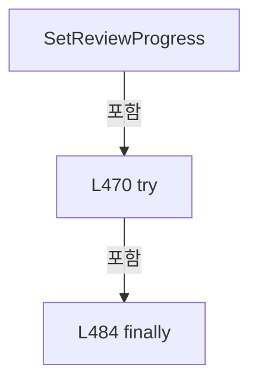

변경 전 점검: 입력/반환 타입, 위 호출자, 예외/취소 경로, 공유 상태와 저장·전송 소비자를 함께 확인합니다. 값의 단위나 물리 방향을 이름만으로 확정하지 않습니다.

### MethodDeclaration `SetReviewCompleted` · L490–512

[Drilling.Common/Product/CProductManager.cs:490–512](https://github.com/kjuws10-rgb/A3Drilling/blob/5aee8e58439c9b455cae7c9593c9be986c3e682e/Drilling.Common/Product/CProductManager.cs#L490-L512)

| 항목 | 실제 추출 값 |
| --- | --- |
| 서명 | System.Threading.Tasks.Task<Drilling.Common.Product.ST_PRODUCT_DATA> Drilling.Common.Product.CProductManager.SetReviewCompleted(string, System.DateTimeOffset, System.Collections.Generic.IReadOnlyList<Drilling.Common.Product.ST_PRODUCT_REVIEW_RESULT>, System.Threading.CancellationToken) |
| 접근/수식자 | Public / public, async |
| 반환/값 타입 | System.Threading.Tasks.Task<Drilling.Common.Product.ST_PRODUCT_DATA> |
| 소속 타입 | NamedType:Drilling.Common.Product.CProductManager |

입력 계약:

| 이름 | 타입 | 전달 | 선택/기본값 |
| --- | --- | --- | --- |
| productId | string | None | False /  |
| savedAt | System.DateTimeOffset | None | False /  |
| results | System.Collections.Generic.IReadOnlyList<Drilling.Common.Product.ST_PRODUCT_REVIEW_RESULT> | None | False /  |
| cancellationToken | System.Threading.CancellationToken | None | True / null |

정적 호출자로 확인된 위치:

| 호출 파일/행 | 호출 표현식 | 런타임 분기 가능 |
| --- | --- | --- |
| [Drilling.Common/Review/CReviewManager.cs:1478–1478](https://github.com/kjuws10-rgb/A3Drilling/blob/5aee8e58439c9b455cae7c9593c9be986c3e682e/Drilling.Common/Review/CReviewManager.cs#L1478-L1478) | productManager.SetReviewCompleted | False |

호출하는 대상과 해석 범위:

| 원본 행 | 표현식 | 분석 상태 | 대상/소스 위치 |
| --- | --- | --- | --- |
| 492 | cancellationToken.ThrowIfCancellationRequested | resolved | void System.Threading.CancellationToken.ThrowIfCancellationRequested() |
| 493 | _updateGate.WaitAsync(cancellationToken).ConfigureAwait | resolved | System.Runtime.CompilerServices.ConfiguredTaskAwaitable System.Threading.Tasks.Task.ConfigureAwait(bool) |
| 493 | _updateGate.WaitAsync | resolved | System.Threading.Tasks.Task System.Threading.SemaphoreSlim.WaitAsync(System.Threading.CancellationToken) |
| 496 | GetCurrent | resolved | Drilling.Common.Product.ST_PRODUCT_DATA Drilling.Common.Product.CProductManager.GetCurrent(string) · Drilling.Common/Product/CProductManager.cs:774 |
| 503 | results.ToArray | resolved | Drilling.Common.Product.ST_PRODUCT_REVIEW_RESULT[] System.Collections.Generic.IEnumerable<Drilling.Common.Product.ST_PRODUCT_REVIEW_RESULT>.ToArray<Drilling.Common.Product.ST_PRODUCT_REVIEW_RESULT>() |
| 506 | PersistAndLog | resolved | System.Threading.Tasks.Task<Drilling.Common.Product.ST_PRODUCT_DATA> Drilling.Common.Product.CProductManager.PersistAndLog(Drilling.Common.Product.ST_PRODUCT_DATA, string, string, System.Threading.CancellationToken) · Drilling.Common/Product/CProductManager.cs:789 |
| 510 | _updateGate.Release | resolved | int System.Threading.SemaphoreSlim.Release() |

본문의 실제 연산·분기·예외·반환 순서(원문 위치 순):

| 원본 행 | 종류 | 주석 해설 |
| --- | --- | --- |
| 492 | call | 함수·델리게이트 또는 객체 생성자를 호출합니다: cancellationToken.ThrowIfCancellationRequested() |
| 493 | await | 비동기 완료를 기다립니다: await _updateGate.WaitAsync(cancellationToken).ConfigureAwait(false) |
| 493 | call | 함수·델리게이트 또는 객체 생성자를 호출합니다: _updateGate.WaitAsync(cancellationToken).ConfigureAwait(false) |
| 493 | call | 함수·델리게이트 또는 객체 생성자를 호출합니다: _updateGate.WaitAsync(cancellationToken) |
| 494 | try | 예외 처리 범위입니다: try |
| 496 | call | 함수·델리게이트 또는 객체 생성자를 호출합니다: GetCurrent(productId) |
| 496 | local-declaration | 지역 변수를 선언합니다: var product = GetCurrent(productId); |
| 496 | variable-initializer | 변수의 초기값을 지정합니다: product = GetCurrent(productId) |
| 497 | local-declaration | 지역 변수를 선언합니다: var next = product with { Review = product.Review with { State = EN_PRODUCT_PROCESS_STATE.Completed, SavedAt = savedAt, Results = results.ToArray() } }; |
| 497 | variable-initializer | 변수의 초기값을 지정합니다: next = product with { Review = product.Review with { State = EN_PRODUCT_PROCESS_STATE.Completed, SavedAt = savedAt, Results = results.ToArray() } } |
| 499 | assignment | 값을 대상에 대입합니다: Review = product.Review with { State = EN_PRODUCT_PROCESS_STATE.Completed, SavedAt = savedAt, Results = results.ToArray() } |
| 501 | assignment | 값을 대상에 대입합니다: State = EN_PRODUCT_PROCESS_STATE.Completed |
| 502 | assignment | 값을 대상에 대입합니다: SavedAt = savedAt |
| 503 | assignment | 값을 대상에 대입합니다: Results = results.ToArray() |
| 503 | call | 함수·델리게이트 또는 객체 생성자를 호출합니다: results.ToArray() |
| 506 | await | 비동기 완료를 기다립니다: await PersistAndLog(next, "REVIEW COMPLETE", $"Review completed. Result count={results.Count}.", cancellationToken) |
| 506 | call | 함수·델리게이트 또는 객체 생성자를 호출합니다: PersistAndLog(next, "REVIEW COMPLETE", $"Review completed. Result count={results.Count}.", cancellationToken) |
| 506 | return | 호출자에게 값 또는 제어를 반환합니다: return await PersistAndLog(next, "REVIEW COMPLETE", $"Review completed. Result count={results.Count}.", cancellationToken); |
| 508 | finally | 종료 정리 구간입니다: finally |
| 510 | call | 함수·델리게이트 또는 객체 생성자를 호출합니다: _updateGate.Release() |

제어 구문의 포함 구조(실제 실행 순서/CFG가 아닌 구문 탐색 그림):

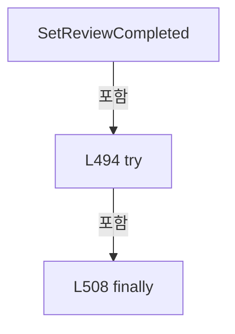

변경 전 점검: 입력/반환 타입, 위 호출자, 예외/취소 경로, 공유 상태와 저장·전송 소비자를 함께 확인합니다. 값의 단위나 물리 방향을 이름만으로 확정하지 않습니다.

### MethodDeclaration `SetReviewStopped` · L514–534

[Drilling.Common/Product/CProductManager.cs:514–534](https://github.com/kjuws10-rgb/A3Drilling/blob/5aee8e58439c9b455cae7c9593c9be986c3e682e/Drilling.Common/Product/CProductManager.cs#L514-L534)

| 항목 | 실제 추출 값 |
| --- | --- |
| 서명 | System.Threading.Tasks.Task<Drilling.Common.Product.ST_PRODUCT_DATA> Drilling.Common.Product.CProductManager.SetReviewStopped(string, string, System.Threading.CancellationToken) |
| 접근/수식자 | Public / public, async |
| 반환/값 타입 | System.Threading.Tasks.Task<Drilling.Common.Product.ST_PRODUCT_DATA> |
| 소속 타입 | NamedType:Drilling.Common.Product.CProductManager |

입력 계약:

| 이름 | 타입 | 전달 | 선택/기본값 |
| --- | --- | --- | --- |
| productId | string | None | False /  |
| message | string | None | False /  |
| cancellationToken | System.Threading.CancellationToken | None | True / null |

정적 호출자로 확인된 위치:

| 호출 파일/행 | 호출 표현식 | 런타임 분기 가능 |
| --- | --- | --- |
| [Drilling.Common/Review/CReviewManager.cs:1700–1700](https://github.com/kjuws10-rgb/A3Drilling/blob/5aee8e58439c9b455cae7c9593c9be986c3e682e/Drilling.Common/Review/CReviewManager.cs#L1700-L1700) | productManager.SetReviewStopped | False |

호출하는 대상과 해석 범위:

| 원본 행 | 표현식 | 분석 상태 | 대상/소스 위치 |
| --- | --- | --- | --- |
| 516 | cancellationToken.ThrowIfCancellationRequested | resolved | void System.Threading.CancellationToken.ThrowIfCancellationRequested() |
| 517 | _updateGate.WaitAsync(cancellationToken).ConfigureAwait | resolved | System.Runtime.CompilerServices.ConfiguredTaskAwaitable System.Threading.Tasks.Task.ConfigureAwait(bool) |
| 517 | _updateGate.WaitAsync | resolved | System.Threading.Tasks.Task System.Threading.SemaphoreSlim.WaitAsync(System.Threading.CancellationToken) |
| 520 | GetCurrent | resolved | Drilling.Common.Product.ST_PRODUCT_DATA Drilling.Common.Product.CProductManager.GetCurrent(string) · Drilling.Common/Product/CProductManager.cs:774 |
| 528 | PersistAndLog | resolved | System.Threading.Tasks.Task<Drilling.Common.Product.ST_PRODUCT_DATA> Drilling.Common.Product.CProductManager.PersistAndLog(Drilling.Common.Product.ST_PRODUCT_DATA, string, string, System.Threading.CancellationToken) · Drilling.Common/Product/CProductManager.cs:789 |
| 532 | _updateGate.Release | resolved | int System.Threading.SemaphoreSlim.Release() |

본문의 실제 연산·분기·예외·반환 순서(원문 위치 순):

| 원본 행 | 종류 | 주석 해설 |
| --- | --- | --- |
| 516 | call | 함수·델리게이트 또는 객체 생성자를 호출합니다: cancellationToken.ThrowIfCancellationRequested() |
| 517 | await | 비동기 완료를 기다립니다: await _updateGate.WaitAsync(cancellationToken).ConfigureAwait(false) |
| 517 | call | 함수·델리게이트 또는 객체 생성자를 호출합니다: _updateGate.WaitAsync(cancellationToken).ConfigureAwait(false) |
| 517 | call | 함수·델리게이트 또는 객체 생성자를 호출합니다: _updateGate.WaitAsync(cancellationToken) |
| 518 | try | 예외 처리 범위입니다: try |
| 520 | call | 함수·델리게이트 또는 객체 생성자를 호출합니다: GetCurrent(productId) |
| 520 | local-declaration | 지역 변수를 선언합니다: var product = GetCurrent(productId); |
| 520 | variable-initializer | 변수의 초기값을 지정합니다: product = GetCurrent(productId) |
| 521 | local-declaration | 지역 변수를 선언합니다: var next = product with { Review = product.Review with { State = EN_PRODUCT_PROCESS_STATE.Stopped } }; |
| 521 | variable-initializer | 변수의 초기값을 지정합니다: next = product with { Review = product.Review with { State = EN_PRODUCT_PROCESS_STATE.Stopped } } |
| 523 | assignment | 값을 대상에 대입합니다: Review = product.Review with { State = EN_PRODUCT_PROCESS_STATE.Stopped } |
| 525 | assignment | 값을 대상에 대입합니다: State = EN_PRODUCT_PROCESS_STATE.Stopped |
| 528 | await | 비동기 완료를 기다립니다: await PersistAndLog(next, "REVIEW STOP", message, cancellationToken) |
| 528 | call | 함수·델리게이트 또는 객체 생성자를 호출합니다: PersistAndLog(next, "REVIEW STOP", message, cancellationToken) |
| 528 | return | 호출자에게 값 또는 제어를 반환합니다: return await PersistAndLog(next, "REVIEW STOP", message, cancellationToken); |
| 530 | finally | 종료 정리 구간입니다: finally |
| 532 | call | 함수·델리게이트 또는 객체 생성자를 호출합니다: _updateGate.Release() |

제어 구문의 포함 구조(실제 실행 순서/CFG가 아닌 구문 탐색 그림):

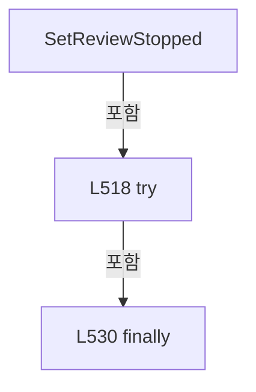

변경 전 점검: 입력/반환 타입, 위 호출자, 예외/취소 경로, 공유 상태와 저장·전송 소비자를 함께 확인합니다. 값의 단위나 물리 방향을 이름만으로 확정하지 않습니다.

### MethodDeclaration `SetReviewError` · L536–556

[Drilling.Common/Product/CProductManager.cs:536–556](https://github.com/kjuws10-rgb/A3Drilling/blob/5aee8e58439c9b455cae7c9593c9be986c3e682e/Drilling.Common/Product/CProductManager.cs#L536-L556)

| 항목 | 실제 추출 값 |
| --- | --- |
| 서명 | System.Threading.Tasks.Task<Drilling.Common.Product.ST_PRODUCT_DATA> Drilling.Common.Product.CProductManager.SetReviewError(string, string, System.Threading.CancellationToken) |
| 접근/수식자 | Public / public, async |
| 반환/값 타입 | System.Threading.Tasks.Task<Drilling.Common.Product.ST_PRODUCT_DATA> |
| 소속 타입 | NamedType:Drilling.Common.Product.CProductManager |

입력 계약:

| 이름 | 타입 | 전달 | 선택/기본값 |
| --- | --- | --- | --- |
| productId | string | None | False /  |
| message | string | None | False /  |
| cancellationToken | System.Threading.CancellationToken | None | True / null |

정적 호출자로 확인된 위치:

| 호출 파일/행 | 호출 표현식 | 런타임 분기 가능 |
| --- | --- | --- |
| [Drilling.Common/Review/CReviewManager.cs:1682–1682](https://github.com/kjuws10-rgb/A3Drilling/blob/5aee8e58439c9b455cae7c9593c9be986c3e682e/Drilling.Common/Review/CReviewManager.cs#L1682-L1682) | productManager.SetReviewError | False |

호출하는 대상과 해석 범위:

| 원본 행 | 표현식 | 분석 상태 | 대상/소스 위치 |
| --- | --- | --- | --- |
| 538 | cancellationToken.ThrowIfCancellationRequested | resolved | void System.Threading.CancellationToken.ThrowIfCancellationRequested() |
| 539 | _updateGate.WaitAsync(cancellationToken).ConfigureAwait | resolved | System.Runtime.CompilerServices.ConfiguredTaskAwaitable System.Threading.Tasks.Task.ConfigureAwait(bool) |
| 539 | _updateGate.WaitAsync | resolved | System.Threading.Tasks.Task System.Threading.SemaphoreSlim.WaitAsync(System.Threading.CancellationToken) |
| 542 | GetCurrent | resolved | Drilling.Common.Product.ST_PRODUCT_DATA Drilling.Common.Product.CProductManager.GetCurrent(string) · Drilling.Common/Product/CProductManager.cs:774 |
| 550 | PersistAndLog | resolved | System.Threading.Tasks.Task<Drilling.Common.Product.ST_PRODUCT_DATA> Drilling.Common.Product.CProductManager.PersistAndLog(Drilling.Common.Product.ST_PRODUCT_DATA, string, string, System.Threading.CancellationToken) · Drilling.Common/Product/CProductManager.cs:789 |
| 554 | _updateGate.Release | resolved | int System.Threading.SemaphoreSlim.Release() |

본문의 실제 연산·분기·예외·반환 순서(원문 위치 순):

| 원본 행 | 종류 | 주석 해설 |
| --- | --- | --- |
| 538 | call | 함수·델리게이트 또는 객체 생성자를 호출합니다: cancellationToken.ThrowIfCancellationRequested() |
| 539 | await | 비동기 완료를 기다립니다: await _updateGate.WaitAsync(cancellationToken).ConfigureAwait(false) |
| 539 | call | 함수·델리게이트 또는 객체 생성자를 호출합니다: _updateGate.WaitAsync(cancellationToken).ConfigureAwait(false) |
| 539 | call | 함수·델리게이트 또는 객체 생성자를 호출합니다: _updateGate.WaitAsync(cancellationToken) |
| 540 | try | 예외 처리 범위입니다: try |
| 542 | call | 함수·델리게이트 또는 객체 생성자를 호출합니다: GetCurrent(productId) |
| 542 | local-declaration | 지역 변수를 선언합니다: var product = GetCurrent(productId); |
| 542 | variable-initializer | 변수의 초기값을 지정합니다: product = GetCurrent(productId) |
| 543 | local-declaration | 지역 변수를 선언합니다: var next = product with { Review = product.Review with { State = EN_PRODUCT_PROCESS_STATE.Error } }; |
| 543 | variable-initializer | 변수의 초기값을 지정합니다: next = product with { Review = product.Review with { State = EN_PRODUCT_PROCESS_STATE.Error } } |
| 545 | assignment | 값을 대상에 대입합니다: Review = product.Review with { State = EN_PRODUCT_PROCESS_STATE.Error } |
| 547 | assignment | 값을 대상에 대입합니다: State = EN_PRODUCT_PROCESS_STATE.Error |
| 550 | await | 비동기 완료를 기다립니다: await PersistAndLog(next, "REVIEW ERROR", message, cancellationToken) |
| 550 | call | 함수·델리게이트 또는 객체 생성자를 호출합니다: PersistAndLog(next, "REVIEW ERROR", message, cancellationToken) |
| 550 | return | 호출자에게 값 또는 제어를 반환합니다: return await PersistAndLog(next, "REVIEW ERROR", message, cancellationToken); |
| 552 | finally | 종료 정리 구간입니다: finally |
| 554 | call | 함수·델리게이트 또는 객체 생성자를 호출합니다: _updateGate.Release() |

제어 구문의 포함 구조(실제 실행 순서/CFG가 아닌 구문 탐색 그림):

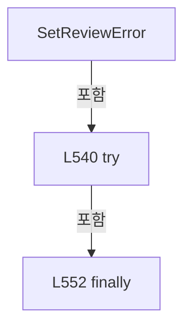

변경 전 점검: 입력/반환 타입, 위 호출자, 예외/취소 경로, 공유 상태와 저장·전송 소비자를 함께 확인합니다. 값의 단위나 물리 방향을 이름만으로 확정하지 않습니다.

### MethodDeclaration `CompleteProduct` · L558–608

[Drilling.Common/Product/CProductManager.cs:558–608](https://github.com/kjuws10-rgb/A3Drilling/blob/5aee8e58439c9b455cae7c9593c9be986c3e682e/Drilling.Common/Product/CProductManager.cs#L558-L608)

| 항목 | 실제 추출 값 |
| --- | --- |
| 서명 | System.Threading.Tasks.Task<Drilling.Common.Product.ST_PRODUCT_DATA> Drilling.Common.Product.CProductManager.CompleteProduct(string, bool, bool, string, System.Threading.CancellationToken) |
| 접근/수식자 | Public / public, async |
| 반환/값 타입 | System.Threading.Tasks.Task<Drilling.Common.Product.ST_PRODUCT_DATA> |
| 소속 타입 | NamedType:Drilling.Common.Product.CProductManager |

입력 계약:

| 이름 | 타입 | 전달 | 선택/기본값 |
| --- | --- | --- | --- |
| productId | string | None | False /  |
| isOk | bool | None | False /  |
| processExecuted | bool | None | False /  |
| message | string | None | False /  |
| cancellationToken | System.Threading.CancellationToken | None | True / null |

정적 호출자로 확인된 위치:

| 호출 파일/행 | 호출 표현식 | 런타임 분기 가능 |
| --- | --- | --- |
| [Drilling.Common/Station/CStationProcess.cs:1421–1421](https://github.com/kjuws10-rgb/A3Drilling/blob/5aee8e58439c9b455cae7c9593c9be986c3e682e/Drilling.Common/Station/CStationProcess.cs#L1421-L1421) | _productManager.CompleteProduct | False |

호출하는 대상과 해석 범위:

| 원본 행 | 표현식 | 분석 상태 | 대상/소스 위치 |
| --- | --- | --- | --- |
| 560 | cancellationToken.ThrowIfCancellationRequested | resolved | void System.Threading.CancellationToken.ThrowIfCancellationRequested() |
| 561 | _updateGate.WaitAsync(cancellationToken).ConfigureAwait | resolved | System.Runtime.CompilerServices.ConfiguredTaskAwaitable System.Threading.Tasks.Task.ConfigureAwait(bool) |
| 561 | _updateGate.WaitAsync | resolved | System.Threading.Tasks.Task System.Threading.SemaphoreSlim.WaitAsync(System.Threading.CancellationToken) |
| 564 | GetCurrent | resolved | Drilling.Common.Product.ST_PRODUCT_DATA Drilling.Common.Product.CProductManager.GetCurrent(string) · Drilling.Common/Product/CProductManager.cs:774 |
| 596 | SetProductState | resolved | Drilling.Common.Product.ST_PRODUCT_INFO Drilling.Common.Product.CProductManager.SetProductState(Drilling.Common.Product.ST_PRODUCT_INFO, Drilling.Common.Product.EN_PRODUCT_STATE, Drilling.Common.Product.EN_PRODUCT_RESULT, System.DateTimeOffset?, System.DateTimeOffset?) · Drilling.Common/Product/CProductManager.cs:853 |
| 599 | product.Heads.Select(SelectItem).ToArray | resolved | Drilling.Common.Product.ST_PRODUCT_HEAD_RESULT[] System.Collections.Generic.IEnumerable<Drilling.Common.Product.ST_PRODUCT_HEAD_RESULT>.ToArray<Drilling.Common.Product.ST_PRODUCT_HEAD_RESULT>() |
| 599 | product.Heads.Select | resolved | System.Collections.Generic.IEnumerable<Drilling.Common.Product.ST_PRODUCT_HEAD_RESULT> System.Collections.Generic.IEnumerable<Drilling.Common.Product.ST_PRODUCT_HEAD_RESULT>.Select<Drilling.Common.Product.ST_PRODUCT_HEAD_RESULT, Drilling.Common.Product.ST_PRODUCT_HEAD_RESULT>(System.Func<Drilling.Common.Product.ST_PRODUCT_HEAD_RESULT, Drilling.Common.Product.ST_PRODUCT_HEAD_RESULT>) |
| 602 | PersistAndLog | resolved | System.Threading.Tasks.Task<Drilling.Common.Product.ST_PRODUCT_DATA> Drilling.Common.Product.CProductManager.PersistAndLog(Drilling.Common.Product.ST_PRODUCT_DATA, string, string, System.Threading.CancellationToken) · Drilling.Common/Product/CProductManager.cs:789 |
| 606 | _updateGate.Release | resolved | int System.Threading.SemaphoreSlim.Release() |

본문의 실제 연산·분기·예외·반환 순서(원문 위치 순):

| 원본 행 | 종류 | 주석 해설 |
| --- | --- | --- |
| 560 | call | 함수·델리게이트 또는 객체 생성자를 호출합니다: cancellationToken.ThrowIfCancellationRequested() |
| 561 | await | 비동기 완료를 기다립니다: await _updateGate.WaitAsync(cancellationToken).ConfigureAwait(false) |
| 561 | call | 함수·델리게이트 또는 객체 생성자를 호출합니다: _updateGate.WaitAsync(cancellationToken).ConfigureAwait(false) |
| 561 | call | 함수·델리게이트 또는 객체 생성자를 호출합니다: _updateGate.WaitAsync(cancellationToken) |
| 562 | try | 예외 처리 범위입니다: try |
| 564 | call | 함수·델리게이트 또는 객체 생성자를 호출합니다: GetCurrent(productId) |
| 564 | local-declaration | 지역 변수를 선언합니다: var product = GetCurrent(productId); |
| 564 | variable-initializer | 변수의 초기값을 지정합니다: product = GetCurrent(productId) |
| 565 | local-declaration | 지역 변수를 선언합니다: var now = DateTimeOffset.Now; |
| 565 | variable-initializer | 변수의 초기값을 지정합니다: now = DateTimeOffset.Now |
| 594 | local-declaration | 지역 변수를 선언합니다: var next = product with { Product = SetProductState(product.Product, EN_PRODUCT_STATE.Completed, !processExecuted ? EN_PRODUCT_RESULT.Skipped : isOk ? EN_PRODUCT_RESULT.OK : EN_PRODUCT_RESULT.NG, product.StartedAt, now), Runtime = |
| 594 | variable-initializer | 변수의 초기값을 지정합니다: next = product with { Product = SetProductState(product.Product, EN_PRODUCT_STATE.Completed, !processExecuted ? EN_PRODUCT_RESULT.Skipped : isOk ? EN_PRODUCT_RESULT.OK : EN_PRODUCT_RESULT.NG, product.StartedAt, now), Runtime = pro |
| 596 | assignment | 값을 대상에 대입합니다: Product = SetProductState(product.Product, EN_PRODUCT_STATE.Completed, !processExecuted ? EN_PRODUCT_RESULT.Skipped : isOk ? EN_PRODUCT_RESULT.OK : EN_PRODUCT_RESULT.NG, product.StartedAt, now) |
| 596 | call | 함수·델리게이트 또는 객체 생성자를 호출합니다: SetProductState(product.Product, EN_PRODUCT_STATE.Completed, !processExecuted ? EN_PRODUCT_RESULT.Skipped : isOk ? EN_PRODUCT_RESULT.OK : EN_PRODUCT_RESULT.NG, product.StartedAt, now) |
| 596 | conditional-expression | 조건에 따라 결과식을 선택합니다: !processExecuted ? EN_PRODUCT_RESULT.Skipped : isOk ? EN_PRODUCT_RESULT.OK : EN_PRODUCT_RESULT.NG |
| 596 | conditional-expression | 조건에 따라 결과식을 선택합니다: isOk ? EN_PRODUCT_RESULT.OK : EN_PRODUCT_RESULT.NG |
| 597 | assignment | 값을 대상에 대입합니다: Runtime = product.Runtime with { Heads = product.Heads.Select(SelectItem).ToArray() } |
| 599 | assignment | 값을 대상에 대입합니다: Heads = product.Heads.Select(SelectItem).ToArray() |
| 599 | call | 함수·델리게이트 또는 객체 생성자를 호출합니다: product.Heads.Select(SelectItem).ToArray() |
| 599 | call | 함수·델리게이트 또는 객체 생성자를 호출합니다: product.Heads.Select(SelectItem) |
| 602 | await | 비동기 완료를 기다립니다: await PersistAndLog(next, "COMPLETE", message, cancellationToken) |
| 602 | call | 함수·델리게이트 또는 객체 생성자를 호출합니다: PersistAndLog(next, "COMPLETE", message, cancellationToken) |
| 602 | return | 호출자에게 값 또는 제어를 반환합니다: return await PersistAndLog(next, "COMPLETE", message, cancellationToken); |
| 604 | finally | 종료 정리 구간입니다: finally |
| 606 | call | 함수·델리게이트 또는 객체 생성자를 호출합니다: _updateGate.Release() |

제어 구문의 포함 구조(실제 실행 순서/CFG가 아닌 구문 탐색 그림):

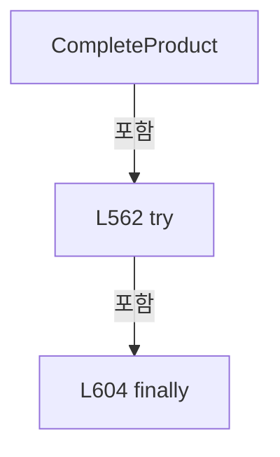

변경 전 점검: 입력/반환 타입, 위 호출자, 예외/취소 경로, 공유 상태와 저장·전송 소비자를 함께 확인합니다. 값의 단위나 물리 방향을 이름만으로 확정하지 않습니다.

### LocalFunctionStatement `SelectItem` · L566–592

[Drilling.Common/Product/CProductManager.cs:566–592](https://github.com/kjuws10-rgb/A3Drilling/blob/5aee8e58439c9b455cae7c9593c9be986c3e682e/Drilling.Common/Product/CProductManager.cs#L566-L592)

| 항목 | 실제 추출 값 |
| --- | --- |
| 서명 | Drilling.Common.Product.ST_PRODUCT_HEAD_RESULT SelectItem(Drilling.Common.Product.ST_PRODUCT_HEAD_RESULT) |
| 접근/수식자 | Private /  |
| 반환/값 타입 | Drilling.Common.Product.ST_PRODUCT_HEAD_RESULT |
| 소속 타입 | NamedType:Drilling.Common.Product.CProductManager |

입력 계약:

| 이름 | 타입 | 전달 | 선택/기본값 |
| --- | --- | --- | --- |
| head | Drilling.Common.Product.ST_PRODUCT_HEAD_RESULT | None | False /  |

현재 부분 분석에서 직접 연결된 호출자는 없습니다. XAML/이벤트/인터페이스·델리게이트·외부 진입을 추가 확인해야 하며, 미사용으로 판정한 것이 아닙니다.

본문의 실제 연산·분기·예외·반환 순서(원문 위치 순):

| 원본 행 | 종류 | 주석 해설 |
| --- | --- | --- |
| 568 | conditional-expression | 조건에 따라 결과식을 선택합니다: head.TotalPoints <= 0 ? head with { State = EN_PRODUCT_HEAD_STATE.Disabled } : !processExecuted ? head with { State = EN_PRODUCT_HEAD_STATE.Disabled, CompletedPoints = 0, Result = EN_PRODUCT_RESULT.Skipped, ErrorCode = "", Message |
| 568 | return | 호출자에게 값 또는 제어를 반환합니다: return head.TotalPoints <= 0 ? head with { State = EN_PRODUCT_HEAD_STATE.Disabled } : !processExecuted ? head with { State = EN_PRODUCT_HEAD_STATE.Disabled, CompletedPoints = 0, Result = EN_PRODUCT_RESULT.Skipped, ErrorCode = "",  |
| 570 | assignment | 값을 대상에 대입합니다: State = EN_PRODUCT_HEAD_STATE.Disabled |
| 573 | conditional-expression | 조건에 따라 결과식을 선택합니다: !processExecuted ? head with { State = EN_PRODUCT_HEAD_STATE.Disabled, CompletedPoints = 0, Result = EN_PRODUCT_RESULT.Skipped, ErrorCode = "", Message = "Process step skipped.", CompletedAt = now } : head with { State = isOk ? EN |
| 575 | assignment | 값을 대상에 대입합니다: State = EN_PRODUCT_HEAD_STATE.Disabled |
| 576 | assignment | 값을 대상에 대입합니다: CompletedPoints = 0 |
| 577 | assignment | 값을 대상에 대입합니다: Result = EN_PRODUCT_RESULT.Skipped |
| 578 | assignment | 값을 대상에 대입합니다: ErrorCode = "" |
| 579 | assignment | 값을 대상에 대입합니다: Message = "Process step skipped." |
| 580 | assignment | 값을 대상에 대입합니다: CompletedAt = now |
| 585 | assignment | 값을 대상에 대입합니다: State = isOk ? EN_PRODUCT_HEAD_STATE.Completed : EN_PRODUCT_HEAD_STATE.Error |
| 585 | conditional-expression | 조건에 따라 결과식을 선택합니다: isOk ? EN_PRODUCT_HEAD_STATE.Completed : EN_PRODUCT_HEAD_STATE.Error |
| 586 | assignment | 값을 대상에 대입합니다: CompletedPoints = isOk ? head.TotalPoints : head.CompletedPoints |
| 586 | conditional-expression | 조건에 따라 결과식을 선택합니다: isOk ? head.TotalPoints : head.CompletedPoints |
| 587 | assignment | 값을 대상에 대입합니다: Result = isOk ? EN_PRODUCT_RESULT.OK : EN_PRODUCT_RESULT.NG |
| 587 | conditional-expression | 조건에 따라 결과식을 선택합니다: isOk ? EN_PRODUCT_RESULT.OK : EN_PRODUCT_RESULT.NG |
| 588 | assignment | 값을 대상에 대입합니다: ErrorCode = isOk ? "" : "1" |
| 588 | conditional-expression | 조건에 따라 결과식을 선택합니다: isOk ? "" : "1" |
| 589 | assignment | 값을 대상에 대입합니다: Message = message |
| 590 | assignment | 값을 대상에 대입합니다: CompletedAt = now |

변경 전 점검: 입력/반환 타입, 위 호출자, 예외/취소 경로, 공유 상태와 저장·전송 소비자를 함께 확인합니다. 값의 단위나 물리 방향을 이름만으로 확정하지 않습니다.

### MethodDeclaration `StopProduct` · L610–645

[Drilling.Common/Product/CProductManager.cs:610–645](https://github.com/kjuws10-rgb/A3Drilling/blob/5aee8e58439c9b455cae7c9593c9be986c3e682e/Drilling.Common/Product/CProductManager.cs#L610-L645)

| 항목 | 실제 추출 값 |
| --- | --- |
| 서명 | System.Threading.Tasks.Task<Drilling.Common.Product.ST_PRODUCT_DATA> Drilling.Common.Product.CProductManager.StopProduct(string, string, System.Threading.CancellationToken) |
| 접근/수식자 | Public / public, async |
| 반환/값 타입 | System.Threading.Tasks.Task<Drilling.Common.Product.ST_PRODUCT_DATA> |
| 소속 타입 | NamedType:Drilling.Common.Product.CProductManager |

입력 계약:

| 이름 | 타입 | 전달 | 선택/기본값 |
| --- | --- | --- | --- |
| productId | string | None | False /  |
| message | string | None | False /  |
| cancellationToken | System.Threading.CancellationToken | None | True / null |

정적 호출자로 확인된 위치:

| 호출 파일/행 | 호출 표현식 | 런타임 분기 가능 |
| --- | --- | --- |
| [Drilling.Common/Station/CStationProcess.cs:1433–1433](https://github.com/kjuws10-rgb/A3Drilling/blob/5aee8e58439c9b455cae7c9593c9be986c3e682e/Drilling.Common/Station/CStationProcess.cs#L1433-L1433) | _productManager.StopProduct | False |

호출하는 대상과 해석 범위:

| 원본 행 | 표현식 | 분석 상태 | 대상/소스 위치 |
| --- | --- | --- | --- |
| 612 | cancellationToken.ThrowIfCancellationRequested | resolved | void System.Threading.CancellationToken.ThrowIfCancellationRequested() |
| 613 | _updateGate.WaitAsync(cancellationToken).ConfigureAwait | resolved | System.Runtime.CompilerServices.ConfiguredTaskAwaitable System.Threading.Tasks.Task.ConfigureAwait(bool) |
| 613 | _updateGate.WaitAsync | resolved | System.Threading.Tasks.Task System.Threading.SemaphoreSlim.WaitAsync(System.Threading.CancellationToken) |
| 616 | GetCurrent | resolved | Drilling.Common.Product.ST_PRODUCT_DATA Drilling.Common.Product.CProductManager.GetCurrent(string) · Drilling.Common/Product/CProductManager.cs:774 |
| 633 | SetProductState | resolved | Drilling.Common.Product.ST_PRODUCT_INFO Drilling.Common.Product.CProductManager.SetProductState(Drilling.Common.Product.ST_PRODUCT_INFO, Drilling.Common.Product.EN_PRODUCT_STATE, Drilling.Common.Product.EN_PRODUCT_RESULT, System.DateTimeOffset?, System.DateTimeOffset?) · Drilling.Common/Product/CProductManager.cs:853 |
| 636 | product.Heads.Select(SelectItem).ToArray | resolved | Drilling.Common.Product.ST_PRODUCT_HEAD_RESULT[] System.Collections.Generic.IEnumerable<Drilling.Common.Product.ST_PRODUCT_HEAD_RESULT>.ToArray<Drilling.Common.Product.ST_PRODUCT_HEAD_RESULT>() |
| 636 | product.Heads.Select | resolved | System.Collections.Generic.IEnumerable<Drilling.Common.Product.ST_PRODUCT_HEAD_RESULT> System.Collections.Generic.IEnumerable<Drilling.Common.Product.ST_PRODUCT_HEAD_RESULT>.Select<Drilling.Common.Product.ST_PRODUCT_HEAD_RESULT, Drilling.Common.Product.ST_PRODUCT_HEAD_RESULT>(System.Func<Drilling.Common.Product.ST_PRODUCT_HEAD_RESULT, Drilling.Common.Product.ST_PRODUCT_HEAD_RESULT>) |
| 639 | PersistAndLog | resolved | System.Threading.Tasks.Task<Drilling.Common.Product.ST_PRODUCT_DATA> Drilling.Common.Product.CProductManager.PersistAndLog(Drilling.Common.Product.ST_PRODUCT_DATA, string, string, System.Threading.CancellationToken) · Drilling.Common/Product/CProductManager.cs:789 |
| 643 | _updateGate.Release | resolved | int System.Threading.SemaphoreSlim.Release() |

본문의 실제 연산·분기·예외·반환 순서(원문 위치 순):

| 원본 행 | 종류 | 주석 해설 |
| --- | --- | --- |
| 612 | call | 함수·델리게이트 또는 객체 생성자를 호출합니다: cancellationToken.ThrowIfCancellationRequested() |
| 613 | await | 비동기 완료를 기다립니다: await _updateGate.WaitAsync(cancellationToken).ConfigureAwait(false) |
| 613 | call | 함수·델리게이트 또는 객체 생성자를 호출합니다: _updateGate.WaitAsync(cancellationToken).ConfigureAwait(false) |
| 613 | call | 함수·델리게이트 또는 객체 생성자를 호출합니다: _updateGate.WaitAsync(cancellationToken) |
| 614 | try | 예외 처리 범위입니다: try |
| 616 | call | 함수·델리게이트 또는 객체 생성자를 호출합니다: GetCurrent(productId) |
| 616 | local-declaration | 지역 변수를 선언합니다: var product = GetCurrent(productId); |
| 616 | variable-initializer | 변수의 초기값을 지정합니다: product = GetCurrent(productId) |
| 617 | local-declaration | 지역 변수를 선언합니다: var now = DateTimeOffset.Now; |
| 617 | variable-initializer | 변수의 초기값을 지정합니다: now = DateTimeOffset.Now |
| 631 | local-declaration | 지역 변수를 선언합니다: var next = product with { Product = SetProductState(product.Product, EN_PRODUCT_STATE.Stopped, EN_PRODUCT_RESULT.NG, product.StartedAt, now), Runtime = product.Runtime with { Heads = product.Heads.Select(SelectItem).ToArray() } }; |
| 631 | variable-initializer | 변수의 초기값을 지정합니다: next = product with { Product = SetProductState(product.Product, EN_PRODUCT_STATE.Stopped, EN_PRODUCT_RESULT.NG, product.StartedAt, now), Runtime = product.Runtime with { Heads = product.Heads.Select(SelectItem).ToArray() } } |
| 633 | assignment | 값을 대상에 대입합니다: Product = SetProductState(product.Product, EN_PRODUCT_STATE.Stopped, EN_PRODUCT_RESULT.NG, product.StartedAt, now) |
| 633 | call | 함수·델리게이트 또는 객체 생성자를 호출합니다: SetProductState(product.Product, EN_PRODUCT_STATE.Stopped, EN_PRODUCT_RESULT.NG, product.StartedAt, now) |
| 634 | assignment | 값을 대상에 대입합니다: Runtime = product.Runtime with { Heads = product.Heads.Select(SelectItem).ToArray() } |
| 636 | assignment | 값을 대상에 대입합니다: Heads = product.Heads.Select(SelectItem).ToArray() |
| 636 | call | 함수·델리게이트 또는 객체 생성자를 호출합니다: product.Heads.Select(SelectItem).ToArray() |
| 636 | call | 함수·델리게이트 또는 객체 생성자를 호출합니다: product.Heads.Select(SelectItem) |
| 639 | await | 비동기 완료를 기다립니다: await PersistAndLog(next, "STOP", message, cancellationToken) |
| 639 | call | 함수·델리게이트 또는 객체 생성자를 호출합니다: PersistAndLog(next, "STOP", message, cancellationToken) |
| 639 | return | 호출자에게 값 또는 제어를 반환합니다: return await PersistAndLog(next, "STOP", message, cancellationToken); |
| 641 | finally | 종료 정리 구간입니다: finally |
| 643 | call | 함수·델리게이트 또는 객체 생성자를 호출합니다: _updateGate.Release() |

제어 구문의 포함 구조(실제 실행 순서/CFG가 아닌 구문 탐색 그림):

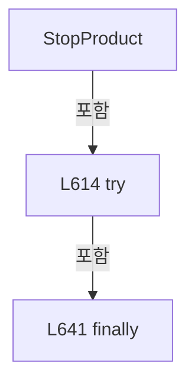

변경 전 점검: 입력/반환 타입, 위 호출자, 예외/취소 경로, 공유 상태와 저장·전송 소비자를 함께 확인합니다. 값의 단위나 물리 방향을 이름만으로 확정하지 않습니다.

### LocalFunctionStatement `SelectItem` · L618–629

[Drilling.Common/Product/CProductManager.cs:618–629](https://github.com/kjuws10-rgb/A3Drilling/blob/5aee8e58439c9b455cae7c9593c9be986c3e682e/Drilling.Common/Product/CProductManager.cs#L618-L629)

| 항목 | 실제 추출 값 |
| --- | --- |
| 서명 | Drilling.Common.Product.ST_PRODUCT_HEAD_RESULT SelectItem(Drilling.Common.Product.ST_PRODUCT_HEAD_RESULT) |
| 접근/수식자 | Private /  |
| 반환/값 타입 | Drilling.Common.Product.ST_PRODUCT_HEAD_RESULT |
| 소속 타입 | NamedType:Drilling.Common.Product.CProductManager |

입력 계약:

| 이름 | 타입 | 전달 | 선택/기본값 |
| --- | --- | --- | --- |
| head | Drilling.Common.Product.ST_PRODUCT_HEAD_RESULT | None | False /  |

현재 부분 분석에서 직접 연결된 호출자는 없습니다. XAML/이벤트/인터페이스·델리게이트·외부 진입을 추가 확인해야 하며, 미사용으로 판정한 것이 아닙니다.

본문의 실제 연산·분기·예외·반환 순서(원문 위치 순):

| 원본 행 | 종류 | 주석 해설 |
| --- | --- | --- |
| 620 | conditional-expression | 조건에 따라 결과식을 선택합니다: head.State == EN_PRODUCT_HEAD_STATE.Running ? head with { State = EN_PRODUCT_HEAD_STATE.Stopped, Result = EN_PRODUCT_RESULT.NG, Message = message, CompletedAt = now } : head |
| 620 | return | 호출자에게 값 또는 제어를 반환합니다: return head.State == EN_PRODUCT_HEAD_STATE.Running ? head with { State = EN_PRODUCT_HEAD_STATE.Stopped, Result = EN_PRODUCT_RESULT.NG, Message = message, CompletedAt = now } : head; |
| 622 | assignment | 값을 대상에 대입합니다: State = EN_PRODUCT_HEAD_STATE.Stopped |
| 623 | assignment | 값을 대상에 대입합니다: Result = EN_PRODUCT_RESULT.NG |
| 624 | assignment | 값을 대상에 대입합니다: Message = message |
| 625 | assignment | 값을 대상에 대입합니다: CompletedAt = now |

변경 전 점검: 입력/반환 타입, 위 호출자, 예외/취소 경로, 공유 상태와 저장·전송 소비자를 함께 확인합니다. 값의 단위나 물리 방향을 이름만으로 확정하지 않습니다.

### MethodDeclaration `SetError` · L647–683

[Drilling.Common/Product/CProductManager.cs:647–683](https://github.com/kjuws10-rgb/A3Drilling/blob/5aee8e58439c9b455cae7c9593c9be986c3e682e/Drilling.Common/Product/CProductManager.cs#L647-L683)

| 항목 | 실제 추출 값 |
| --- | --- |
| 서명 | System.Threading.Tasks.Task<Drilling.Common.Product.ST_PRODUCT_DATA> Drilling.Common.Product.CProductManager.SetError(string, string, System.Threading.CancellationToken) |
| 접근/수식자 | Public / public, async |
| 반환/값 타입 | System.Threading.Tasks.Task<Drilling.Common.Product.ST_PRODUCT_DATA> |
| 소속 타입 | NamedType:Drilling.Common.Product.CProductManager |

입력 계약:

| 이름 | 타입 | 전달 | 선택/기본값 |
| --- | --- | --- | --- |
| productId | string | None | False /  |
| message | string | None | False /  |
| cancellationToken | System.Threading.CancellationToken | None | True / null |

정적 호출자로 확인된 위치:

| 호출 파일/행 | 호출 표현식 | 런타임 분기 가능 |
| --- | --- | --- |
| [Drilling.Common/Station/CStationProcess.cs:1457–1457](https://github.com/kjuws10-rgb/A3Drilling/blob/5aee8e58439c9b455cae7c9593c9be986c3e682e/Drilling.Common/Station/CStationProcess.cs#L1457-L1457) | _productManager.SetError | False |

호출하는 대상과 해석 범위:

| 원본 행 | 표현식 | 분석 상태 | 대상/소스 위치 |
| --- | --- | --- | --- |
| 649 | cancellationToken.ThrowIfCancellationRequested | resolved | void System.Threading.CancellationToken.ThrowIfCancellationRequested() |
| 650 | _updateGate.WaitAsync(cancellationToken).ConfigureAwait | resolved | System.Runtime.CompilerServices.ConfiguredTaskAwaitable System.Threading.Tasks.Task.ConfigureAwait(bool) |
| 650 | _updateGate.WaitAsync | resolved | System.Threading.Tasks.Task System.Threading.SemaphoreSlim.WaitAsync(System.Threading.CancellationToken) |
| 653 | GetCurrent | resolved | Drilling.Common.Product.ST_PRODUCT_DATA Drilling.Common.Product.CProductManager.GetCurrent(string) · Drilling.Common/Product/CProductManager.cs:774 |
| 671 | SetProductState | resolved | Drilling.Common.Product.ST_PRODUCT_INFO Drilling.Common.Product.CProductManager.SetProductState(Drilling.Common.Product.ST_PRODUCT_INFO, Drilling.Common.Product.EN_PRODUCT_STATE, Drilling.Common.Product.EN_PRODUCT_RESULT, System.DateTimeOffset?, System.DateTimeOffset?) · Drilling.Common/Product/CProductManager.cs:853 |
| 674 | product.Heads.Select(SelectItem).ToArray | resolved | Drilling.Common.Product.ST_PRODUCT_HEAD_RESULT[] System.Collections.Generic.IEnumerable<Drilling.Common.Product.ST_PRODUCT_HEAD_RESULT>.ToArray<Drilling.Common.Product.ST_PRODUCT_HEAD_RESULT>() |
| 674 | product.Heads.Select | resolved | System.Collections.Generic.IEnumerable<Drilling.Common.Product.ST_PRODUCT_HEAD_RESULT> System.Collections.Generic.IEnumerable<Drilling.Common.Product.ST_PRODUCT_HEAD_RESULT>.Select<Drilling.Common.Product.ST_PRODUCT_HEAD_RESULT, Drilling.Common.Product.ST_PRODUCT_HEAD_RESULT>(System.Func<Drilling.Common.Product.ST_PRODUCT_HEAD_RESULT, Drilling.Common.Product.ST_PRODUCT_HEAD_RESULT>) |
| 677 | PersistAndLog | resolved | System.Threading.Tasks.Task<Drilling.Common.Product.ST_PRODUCT_DATA> Drilling.Common.Product.CProductManager.PersistAndLog(Drilling.Common.Product.ST_PRODUCT_DATA, string, string, System.Threading.CancellationToken) · Drilling.Common/Product/CProductManager.cs:789 |
| 681 | _updateGate.Release | resolved | int System.Threading.SemaphoreSlim.Release() |

본문의 실제 연산·분기·예외·반환 순서(원문 위치 순):

| 원본 행 | 종류 | 주석 해설 |
| --- | --- | --- |
| 649 | call | 함수·델리게이트 또는 객체 생성자를 호출합니다: cancellationToken.ThrowIfCancellationRequested() |
| 650 | await | 비동기 완료를 기다립니다: await _updateGate.WaitAsync(cancellationToken).ConfigureAwait(false) |
| 650 | call | 함수·델리게이트 또는 객체 생성자를 호출합니다: _updateGate.WaitAsync(cancellationToken).ConfigureAwait(false) |
| 650 | call | 함수·델리게이트 또는 객체 생성자를 호출합니다: _updateGate.WaitAsync(cancellationToken) |
| 651 | try | 예외 처리 범위입니다: try |
| 653 | call | 함수·델리게이트 또는 객체 생성자를 호출합니다: GetCurrent(productId) |
| 653 | local-declaration | 지역 변수를 선언합니다: var product = GetCurrent(productId); |
| 653 | variable-initializer | 변수의 초기값을 지정합니다: product = GetCurrent(productId) |
| 654 | local-declaration | 지역 변수를 선언합니다: var now = DateTimeOffset.Now; |
| 654 | variable-initializer | 변수의 초기값을 지정합니다: now = DateTimeOffset.Now |
| 669 | local-declaration | 지역 변수를 선언합니다: var next = product with { Product = SetProductState(product.Product, EN_PRODUCT_STATE.Error, EN_PRODUCT_RESULT.NG, product.StartedAt, now), Runtime = product.Runtime with { Heads = product.Heads.Select(SelectItem).ToArray() } }; |
| 669 | variable-initializer | 변수의 초기값을 지정합니다: next = product with { Product = SetProductState(product.Product, EN_PRODUCT_STATE.Error, EN_PRODUCT_RESULT.NG, product.StartedAt, now), Runtime = product.Runtime with { Heads = product.Heads.Select(SelectItem).ToArray() } } |
| 671 | assignment | 값을 대상에 대입합니다: Product = SetProductState(product.Product, EN_PRODUCT_STATE.Error, EN_PRODUCT_RESULT.NG, product.StartedAt, now) |
| 671 | call | 함수·델리게이트 또는 객체 생성자를 호출합니다: SetProductState(product.Product, EN_PRODUCT_STATE.Error, EN_PRODUCT_RESULT.NG, product.StartedAt, now) |
| 672 | assignment | 값을 대상에 대입합니다: Runtime = product.Runtime with { Heads = product.Heads.Select(SelectItem).ToArray() } |
| 674 | assignment | 값을 대상에 대입합니다: Heads = product.Heads.Select(SelectItem).ToArray() |
| 674 | call | 함수·델리게이트 또는 객체 생성자를 호출합니다: product.Heads.Select(SelectItem).ToArray() |
| 674 | call | 함수·델리게이트 또는 객체 생성자를 호출합니다: product.Heads.Select(SelectItem) |
| 677 | await | 비동기 완료를 기다립니다: await PersistAndLog(next, "ERROR", message, cancellationToken) |
| 677 | call | 함수·델리게이트 또는 객체 생성자를 호출합니다: PersistAndLog(next, "ERROR", message, cancellationToken) |
| 677 | return | 호출자에게 값 또는 제어를 반환합니다: return await PersistAndLog(next, "ERROR", message, cancellationToken); |
| 679 | finally | 종료 정리 구간입니다: finally |
| 681 | call | 함수·델리게이트 또는 객체 생성자를 호출합니다: _updateGate.Release() |

제어 구문의 포함 구조(실제 실행 순서/CFG가 아닌 구문 탐색 그림):

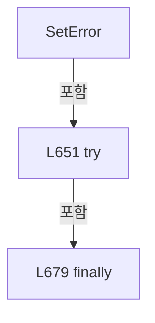

변경 전 점검: 입력/반환 타입, 위 호출자, 예외/취소 경로, 공유 상태와 저장·전송 소비자를 함께 확인합니다. 값의 단위나 물리 방향을 이름만으로 확정하지 않습니다.

### LocalFunctionStatement `SelectItem` · L655–667

[Drilling.Common/Product/CProductManager.cs:655–667](https://github.com/kjuws10-rgb/A3Drilling/blob/5aee8e58439c9b455cae7c9593c9be986c3e682e/Drilling.Common/Product/CProductManager.cs#L655-L667)

| 항목 | 실제 추출 값 |
| --- | --- |
| 서명 | Drilling.Common.Product.ST_PRODUCT_HEAD_RESULT SelectItem(Drilling.Common.Product.ST_PRODUCT_HEAD_RESULT) |
| 접근/수식자 | Private /  |
| 반환/값 타입 | Drilling.Common.Product.ST_PRODUCT_HEAD_RESULT |
| 소속 타입 | NamedType:Drilling.Common.Product.CProductManager |

입력 계약:

| 이름 | 타입 | 전달 | 선택/기본값 |
| --- | --- | --- | --- |
| head | Drilling.Common.Product.ST_PRODUCT_HEAD_RESULT | None | False /  |

현재 부분 분석에서 직접 연결된 호출자는 없습니다. XAML/이벤트/인터페이스·델리게이트·외부 진입을 추가 확인해야 하며, 미사용으로 판정한 것이 아닙니다.

본문의 실제 연산·분기·예외·반환 순서(원문 위치 순):

| 원본 행 | 종류 | 주석 해설 |
| --- | --- | --- |
| 657 | conditional-expression | 조건에 따라 결과식을 선택합니다: head.State == EN_PRODUCT_HEAD_STATE.Running ? head with { State = EN_PRODUCT_HEAD_STATE.Error, Result = EN_PRODUCT_RESULT.NG, ErrorCode = "1", Message = message, CompletedAt = now } : head |
| 657 | return | 호출자에게 값 또는 제어를 반환합니다: return head.State == EN_PRODUCT_HEAD_STATE.Running ? head with { State = EN_PRODUCT_HEAD_STATE.Error, Result = EN_PRODUCT_RESULT.NG, ErrorCode = "1", Message = message, CompletedAt = now } : head; |
| 659 | assignment | 값을 대상에 대입합니다: State = EN_PRODUCT_HEAD_STATE.Error |
| 660 | assignment | 값을 대상에 대입합니다: Result = EN_PRODUCT_RESULT.NG |
| 661 | assignment | 값을 대상에 대입합니다: ErrorCode = "1" |
| 662 | assignment | 값을 대상에 대입합니다: Message = message |
| 663 | assignment | 값을 대상에 대입합니다: CompletedAt = now |

변경 전 점검: 입력/반환 타입, 위 호출자, 예외/취소 경로, 공유 상태와 저장·전송 소비자를 함께 확인합니다. 값의 단위나 물리 방향을 이름만으로 확정하지 않습니다.

### MethodDeclaration `ScrapProduct` · L685–702

[Drilling.Common/Product/CProductManager.cs:685–702](https://github.com/kjuws10-rgb/A3Drilling/blob/5aee8e58439c9b455cae7c9593c9be986c3e682e/Drilling.Common/Product/CProductManager.cs#L685-L702)

| 항목 | 실제 추출 값 |
| --- | --- |
| 서명 | System.Threading.Tasks.Task<Drilling.Common.Product.ST_PRODUCT_DATA> Drilling.Common.Product.CProductManager.ScrapProduct(string, string, System.Threading.CancellationToken) |
| 접근/수식자 | Public / public, async |
| 반환/값 타입 | System.Threading.Tasks.Task<Drilling.Common.Product.ST_PRODUCT_DATA> |
| 소속 타입 | NamedType:Drilling.Common.Product.CProductManager |

입력 계약:

| 이름 | 타입 | 전달 | 선택/기본값 |
| --- | --- | --- | --- |
| productId | string | None | False /  |
| reason | string | None | False /  |
| cancellationToken | System.Threading.CancellationToken | None | True / null |

현재 부분 분석에서 직접 연결된 호출자는 없습니다. XAML/이벤트/인터페이스·델리게이트·외부 진입을 추가 확인해야 하며, 미사용으로 판정한 것이 아닙니다.

호출하는 대상과 해석 범위:

| 원본 행 | 표현식 | 분석 상태 | 대상/소스 위치 |
| --- | --- | --- | --- |
| 687 | cancellationToken.ThrowIfCancellationRequested | resolved | void System.Threading.CancellationToken.ThrowIfCancellationRequested() |
| 688 | _updateGate.WaitAsync(cancellationToken).ConfigureAwait | resolved | System.Runtime.CompilerServices.ConfiguredTaskAwaitable System.Threading.Tasks.Task.ConfigureAwait(bool) |
| 688 | _updateGate.WaitAsync | resolved | System.Threading.Tasks.Task System.Threading.SemaphoreSlim.WaitAsync(System.Threading.CancellationToken) |
| 691 | GetCurrent | resolved | Drilling.Common.Product.ST_PRODUCT_DATA Drilling.Common.Product.CProductManager.GetCurrent(string) · Drilling.Common/Product/CProductManager.cs:774 |
| 694 | SetProductState | resolved | Drilling.Common.Product.ST_PRODUCT_INFO Drilling.Common.Product.CProductManager.SetProductState(Drilling.Common.Product.ST_PRODUCT_INFO, Drilling.Common.Product.EN_PRODUCT_STATE, Drilling.Common.Product.EN_PRODUCT_RESULT, System.DateTimeOffset?, System.DateTimeOffset?) · Drilling.Common/Product/CProductManager.cs:853 |
| 696 | PersistAndLog | resolved | System.Threading.Tasks.Task<Drilling.Common.Product.ST_PRODUCT_DATA> Drilling.Common.Product.CProductManager.PersistAndLog(Drilling.Common.Product.ST_PRODUCT_DATA, string, string, System.Threading.CancellationToken) · Drilling.Common/Product/CProductManager.cs:789 |
| 700 | _updateGate.Release | resolved | int System.Threading.SemaphoreSlim.Release() |

본문의 실제 연산·분기·예외·반환 순서(원문 위치 순):

| 원본 행 | 종류 | 주석 해설 |
| --- | --- | --- |
| 687 | call | 함수·델리게이트 또는 객체 생성자를 호출합니다: cancellationToken.ThrowIfCancellationRequested() |
| 688 | await | 비동기 완료를 기다립니다: await _updateGate.WaitAsync(cancellationToken).ConfigureAwait(false) |
| 688 | call | 함수·델리게이트 또는 객체 생성자를 호출합니다: _updateGate.WaitAsync(cancellationToken).ConfigureAwait(false) |
| 688 | call | 함수·델리게이트 또는 객체 생성자를 호출합니다: _updateGate.WaitAsync(cancellationToken) |
| 689 | try | 예외 처리 범위입니다: try |
| 691 | call | 함수·델리게이트 또는 객체 생성자를 호출합니다: GetCurrent(productId) |
| 691 | local-declaration | 지역 변수를 선언합니다: var product = GetCurrent(productId); |
| 691 | variable-initializer | 변수의 초기값을 지정합니다: product = GetCurrent(productId) |
| 692 | local-declaration | 지역 변수를 선언합니다: var next = product with { Product = SetProductState(product.Product, EN_PRODUCT_STATE.Scrapped, EN_PRODUCT_RESULT.NG, product.StartedAt, DateTimeOffset.Now) }; |
| 692 | variable-initializer | 변수의 초기값을 지정합니다: next = product with { Product = SetProductState(product.Product, EN_PRODUCT_STATE.Scrapped, EN_PRODUCT_RESULT.NG, product.StartedAt, DateTimeOffset.Now) } |
| 694 | assignment | 값을 대상에 대입합니다: Product = SetProductState(product.Product, EN_PRODUCT_STATE.Scrapped, EN_PRODUCT_RESULT.NG, product.StartedAt, DateTimeOffset.Now) |
| 694 | call | 함수·델리게이트 또는 객체 생성자를 호출합니다: SetProductState(product.Product, EN_PRODUCT_STATE.Scrapped, EN_PRODUCT_RESULT.NG, product.StartedAt, DateTimeOffset.Now) |
| 696 | await | 비동기 완료를 기다립니다: await PersistAndLog(next, "SCRAP", reason, cancellationToken) |
| 696 | call | 함수·델리게이트 또는 객체 생성자를 호출합니다: PersistAndLog(next, "SCRAP", reason, cancellationToken) |
| 696 | return | 호출자에게 값 또는 제어를 반환합니다: return await PersistAndLog(next, "SCRAP", reason, cancellationToken); |
| 698 | finally | 종료 정리 구간입니다: finally |
| 700 | call | 함수·델리게이트 또는 객체 생성자를 호출합니다: _updateGate.Release() |

제어 구문의 포함 구조(실제 실행 순서/CFG가 아닌 구문 탐색 그림):

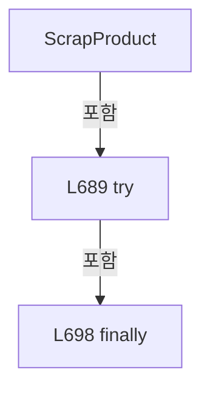

변경 전 점검: 입력/반환 타입, 위 호출자, 예외/취소 경로, 공유 상태와 저장·전송 소비자를 함께 확인합니다. 값의 단위나 물리 방향을 이름만으로 확정하지 않습니다.

### MethodDeclaration `DeleteProduct` · L704–738

[Drilling.Common/Product/CProductManager.cs:704–738](https://github.com/kjuws10-rgb/A3Drilling/blob/5aee8e58439c9b455cae7c9593c9be986c3e682e/Drilling.Common/Product/CProductManager.cs#L704-L738)

| 항목 | 실제 추출 값 |
| --- | --- |
| 서명 | System.Threading.Tasks.Task Drilling.Common.Product.CProductManager.DeleteProduct(string, System.Threading.CancellationToken) |
| 접근/수식자 | Public / public, async |
| 반환/값 타입 | System.Threading.Tasks.Task |
| 소속 타입 | NamedType:Drilling.Common.Product.CProductManager |

입력 계약:

| 이름 | 타입 | 전달 | 선택/기본값 |
| --- | --- | --- | --- |
| productId | string | None | False /  |
| cancellationToken | System.Threading.CancellationToken | None | True / null |

정적 호출자로 확인된 위치:

| 호출 파일/행 | 호출 표현식 | 런타임 분기 가능 |
| --- | --- | --- |
| [Drilling.UI/Menu/Menus/CMenuMonitor.cs:3975–3975](https://github.com/kjuws10-rgb/A3Drilling/blob/5aee8e58439c9b455cae7c9593c9be986c3e682e/Drilling.UI/Menu/Menus/CMenuMonitor.cs#L3975-L3975) | _productManager.DeleteProduct | False |

호출하는 대상과 해석 범위:

| 원본 행 | 표현식 | 분석 상태 | 대상/소스 위치 |
| --- | --- | --- | --- |
| 706 | cancellationToken.ThrowIfCancellationRequested | resolved | void System.Threading.CancellationToken.ThrowIfCancellationRequested() |
| 707 | _updateGate.WaitAsync(cancellationToken).ConfigureAwait | resolved | System.Runtime.CompilerServices.ConfiguredTaskAwaitable System.Threading.Tasks.Task.ConfigureAwait(bool) |
| 707 | _updateGate.WaitAsync | resolved | System.Threading.Tasks.Task System.Threading.SemaphoreSlim.WaitAsync(System.Threading.CancellationToken) |
| 710 | GetCurrent | resolved | Drilling.Common.Product.ST_PRODUCT_DATA Drilling.Common.Product.CProductManager.GetCurrent(string) · Drilling.Common/Product/CProductManager.cs:774 |
| 713 | new InvalidOperationException | resolved | System.InvalidOperationException.InvalidOperationException(string?) |
| 716 | productFile.ClearActive(cancellationToken).ConfigureAwait | resolved | System.Runtime.CompilerServices.ConfiguredTaskAwaitable System.Threading.Tasks.Task.ConfigureAwait(bool) |
| 716 | productFile.ClearActive | resolved | System.Threading.Tasks.Task Drilling.Common.Product.CProductFileBase.ClearActive(System.Threading.CancellationToken) · Drilling.Common/Product/CProductManager.cs:1167 |
| 717 | Volatile.Write | resolved | void System.Threading.Volatile.Write<Drilling.Common.Product.ST_PRODUCT_DATA?>(ref Drilling.Common.Product.ST_PRODUCT_DATA?, Drilling.Common.Product.ST_PRODUCT_DATA?) |
| 720 | productFile.AppendHistory(new ST_PRODUCT_HISTORY(DateTimeOffset.Now, product.GlassId, product.ProcessId, product.RecipeId, "DELETE", product.State.ToString().ToUpperInvariant(), product.Result.ToString().ToUpperInvariant(), "Product deleted."), CancellationToken.None).ConfigureAwait | resolved | System.Runtime.CompilerServices.ConfiguredTaskAwaitable System.Threading.Tasks.Task.ConfigureAwait(bool) |
| 720 | productFile.AppendHistory | resolved | System.Threading.Tasks.Task Drilling.Common.Product.CProductFileBase.AppendHistory(Drilling.Common.Product.ST_PRODUCT_HISTORY, System.Threading.CancellationToken) · Drilling.Common/Product/CProductManager.cs:1168 |
| 720 | new ST_PRODUCT_HISTORY | resolved | Drilling.Common.Product.ST_PRODUCT_HISTORY.ST_PRODUCT_HISTORY(System.DateTimeOffset, string, string, string, string, string, string, string) · Drilling.Common/Product/CProductManager.cs:1162 |
| 720 | product.State.ToString().ToUpperInvariant | resolved | string string.ToUpperInvariant() |
| 720 | product.State.ToString | resolved · 동적 구현 선택 가능 | string System.Enum.ToString() |
| 720 | product.Result.ToString().ToUpperInvariant | resolved | string string.ToUpperInvariant() |
| 720 | product.Result.ToString | resolved · 동적 구현 선택 가능 | string System.Enum.ToString() |
| 726 | .WriteProductEvent | unresolved | None |
| 726 | product.State.ToString().ToUpperInvariant | resolved | string string.ToUpperInvariant() |
| 726 | product.State.ToString | resolved · 동적 구현 선택 가능 | string System.Enum.ToString() |
| 726 | product.Result.ToString().ToUpperInvariant | resolved | string string.ToUpperInvariant() |
| 726 | product.Result.ToString | resolved · 동적 구현 선택 가능 | string System.Enum.ToString() |
| 736 | _updateGate.Release | resolved | int System.Threading.SemaphoreSlim.Release() |

본문의 실제 연산·분기·예외·반환 순서(원문 위치 순):

| 원본 행 | 종류 | 주석 해설 |
| --- | --- | --- |
| 706 | call | 함수·델리게이트 또는 객체 생성자를 호출합니다: cancellationToken.ThrowIfCancellationRequested() |
| 707 | await | 비동기 완료를 기다립니다: await _updateGate.WaitAsync(cancellationToken).ConfigureAwait(false) |
| 707 | call | 함수·델리게이트 또는 객체 생성자를 호출합니다: _updateGate.WaitAsync(cancellationToken).ConfigureAwait(false) |
| 707 | call | 함수·델리게이트 또는 객체 생성자를 호출합니다: _updateGate.WaitAsync(cancellationToken) |
| 708 | try | 예외 처리 범위입니다: try |
| 710 | call | 함수·델리게이트 또는 객체 생성자를 호출합니다: GetCurrent(productId) |
| 710 | local-declaration | 지역 변수를 선언합니다: var product = GetCurrent(productId); |
| 710 | variable-initializer | 변수의 초기값을 지정합니다: product = GetCurrent(productId) |
| 711 | if | 조건에 따라 분기합니다: if (product.State == EN_PRODUCT_STATE.Running) |
| 713 | call | 함수·델리게이트 또는 객체 생성자를 호출합니다: new InvalidOperationException($"Running Glass '{product.GlassId}' cannot be deleted.") |
| 713 | throw | 예외를 발생/전달합니다: throw new InvalidOperationException($"Running Glass '{product.GlassId}' cannot be deleted."); |
| 716 | await | 비동기 완료를 기다립니다: await productFile.ClearActive(cancellationToken).ConfigureAwait(false) |
| 716 | call | 함수·델리게이트 또는 객체 생성자를 호출합니다: productFile.ClearActive(cancellationToken).ConfigureAwait(false) |
| 716 | call | 함수·델리게이트 또는 객체 생성자를 호출합니다: productFile.ClearActive(cancellationToken) |
| 717 | call | 함수·델리게이트 또는 객체 생성자를 호출합니다: Volatile.Write(ref _current, null) |
| 718 | try | 예외 처리 범위입니다: try |
| 720 | await | 비동기 완료를 기다립니다: await productFile.AppendHistory(new ST_PRODUCT_HISTORY(DateTimeOffset.Now, product.GlassId, product.ProcessId, product.RecipeId, "DELETE", product.State.ToString().ToUpperInvariant(), product.Result.ToString().ToUpperInvariant(),  |
| 720 | call | 함수·델리게이트 또는 객체 생성자를 호출합니다: productFile.AppendHistory(new ST_PRODUCT_HISTORY(DateTimeOffset.Now, product.GlassId, product.ProcessId, product.RecipeId, "DELETE", product.State.ToString().ToUpperInvariant(), product.Result.ToString().ToUpperInvariant… |
| 720 | call | 함수·델리게이트 또는 객체 생성자를 호출합니다: productFile.AppendHistory(new ST_PRODUCT_HISTORY(DateTimeOffset.Now, product.GlassId, product.ProcessId, product.RecipeId, "DELETE", product.State.ToString().ToUpperInvariant(), product.Result.ToString().ToUpperInvariant… |
| 720 | call | 함수·델리게이트 또는 객체 생성자를 호출합니다: new ST_PRODUCT_HISTORY(DateTimeOffset.Now, product.GlassId, product.ProcessId, product.RecipeId, "DELETE", product.State.ToString().ToUpperInvariant(), product.Result.ToString().ToUpperInvariant(), "Product deleted.") |
| 720 | call | 함수·델리게이트 또는 객체 생성자를 호출합니다: product.State.ToString().ToUpperInvariant() |
| 720 | call | 함수·델리게이트 또는 객체 생성자를 호출합니다: product.State.ToString() |
| 720 | call | 함수·델리게이트 또는 객체 생성자를 호출합니다: product.Result.ToString().ToUpperInvariant() |
| 720 | call | 함수·델리게이트 또는 객체 생성자를 호출합니다: product.Result.ToString() |
| 722 | catch | 지정 예외를 처리합니다: catch (Exception historyException) |
| 724 | try | 예외 처리 범위입니다: try |
| 726 | call | 함수·델리게이트 또는 객체 생성자를 호출합니다: .WriteProductEvent(product.GlassId, "HISTORY ERROR", product.State.ToString().ToUpperInvariant(), product.Result.ToString().ToUpperInvariant(), $"DELETE: {historyException.Message}") |
| 726 | call | 함수·델리게이트 또는 객체 생성자를 호출합니다: product.State.ToString().ToUpperInvariant() |
| 726 | call | 함수·델리게이트 또는 객체 생성자를 호출합니다: product.State.ToString() |
| 726 | call | 함수·델리게이트 또는 객체 생성자를 호출합니다: product.Result.ToString().ToUpperInvariant() |
| 726 | call | 함수·델리게이트 또는 객체 생성자를 호출합니다: product.Result.ToString() |
| 728 | catch | 지정 예외를 처리합니다: catch  |
| 734 | finally | 종료 정리 구간입니다: finally |
| 736 | call | 함수·델리게이트 또는 객체 생성자를 호출합니다: _updateGate.Release() |

제어 구문의 포함 구조(실제 실행 순서/CFG가 아닌 구문 탐색 그림):

```mermaid
flowchart TD
 M["DeleteProduct"]
 N0["L708 try"]
 M -->|포함| N0
 N1["L711 if"]
 N0 -->|포함| N1
 N2["L718 try"]
 N0 -->|포함| N2
 N3["L722 catch"]
 N2 -->|포함| N3
 N4["L724 try"]
 N3 -->|포함| N4
 N5["L728 catch"]
 N4 -->|포함| N5
 N6["L734 finally"]
 N0 -->|포함| N6
```

변경 전 점검: 입력/반환 타입, 위 호출자, 예외/취소 경로, 공유 상태와 저장·전송 소비자를 함께 확인합니다. 값의 단위나 물리 방향을 이름만으로 확정하지 않습니다.

### MethodDeclaration `ReleaseCompletedProduct` · L740–759

[Drilling.Common/Product/CProductManager.cs:740–759](https://github.com/kjuws10-rgb/A3Drilling/blob/5aee8e58439c9b455cae7c9593c9be986c3e682e/Drilling.Common/Product/CProductManager.cs#L740-L759)

| 항목 | 실제 추출 값 |
| --- | --- |
| 서명 | System.Threading.Tasks.Task Drilling.Common.Product.CProductManager.ReleaseCompletedProduct(string, System.Threading.CancellationToken) |
| 접근/수식자 | Public / public, async |
| 반환/값 타입 | System.Threading.Tasks.Task |
| 소속 타입 | NamedType:Drilling.Common.Product.CProductManager |

입력 계약:

| 이름 | 타입 | 전달 | 선택/기본값 |
| --- | --- | --- | --- |
| productId | string | None | False /  |
| cancellationToken | System.Threading.CancellationToken | None | True / null |

현재 부분 분석에서 직접 연결된 호출자는 없습니다. XAML/이벤트/인터페이스·델리게이트·외부 진입을 추가 확인해야 하며, 미사용으로 판정한 것이 아닙니다.

호출하는 대상과 해석 범위:

| 원본 행 | 표현식 | 분석 상태 | 대상/소스 위치 |
| --- | --- | --- | --- |
| 742 | cancellationToken.ThrowIfCancellationRequested | resolved | void System.Threading.CancellationToken.ThrowIfCancellationRequested() |
| 743 | _updateGate.WaitAsync(cancellationToken).ConfigureAwait | resolved | System.Runtime.CompilerServices.ConfiguredTaskAwaitable System.Threading.Tasks.Task.ConfigureAwait(bool) |
| 743 | _updateGate.WaitAsync | resolved | System.Threading.Tasks.Task System.Threading.SemaphoreSlim.WaitAsync(System.Threading.CancellationToken) |
| 746 | GetCurrent | resolved | Drilling.Common.Product.ST_PRODUCT_DATA Drilling.Common.Product.CProductManager.GetCurrent(string) · Drilling.Common/Product/CProductManager.cs:774 |
| 749 | new InvalidOperationException | resolved | System.InvalidOperationException.InvalidOperationException(string?) |
| 752 | productFile.ClearActive(cancellationToken).ConfigureAwait | resolved | System.Runtime.CompilerServices.ConfiguredTaskAwaitable System.Threading.Tasks.Task.ConfigureAwait(bool) |
| 752 | productFile.ClearActive | resolved | System.Threading.Tasks.Task Drilling.Common.Product.CProductFileBase.ClearActive(System.Threading.CancellationToken) · Drilling.Common/Product/CProductManager.cs:1167 |
| 753 | Volatile.Write | resolved | void System.Threading.Volatile.Write<Drilling.Common.Product.ST_PRODUCT_DATA?>(ref Drilling.Common.Product.ST_PRODUCT_DATA?, Drilling.Common.Product.ST_PRODUCT_DATA?) |
| 757 | _updateGate.Release | resolved | int System.Threading.SemaphoreSlim.Release() |

본문의 실제 연산·분기·예외·반환 순서(원문 위치 순):

| 원본 행 | 종류 | 주석 해설 |
| --- | --- | --- |
| 742 | call | 함수·델리게이트 또는 객체 생성자를 호출합니다: cancellationToken.ThrowIfCancellationRequested() |
| 743 | await | 비동기 완료를 기다립니다: await _updateGate.WaitAsync(cancellationToken).ConfigureAwait(false) |
| 743 | call | 함수·델리게이트 또는 객체 생성자를 호출합니다: _updateGate.WaitAsync(cancellationToken).ConfigureAwait(false) |
| 743 | call | 함수·델리게이트 또는 객체 생성자를 호출합니다: _updateGate.WaitAsync(cancellationToken) |
| 744 | try | 예외 처리 범위입니다: try |
| 746 | call | 함수·델리게이트 또는 객체 생성자를 호출합니다: GetCurrent(productId) |
| 746 | local-declaration | 지역 변수를 선언합니다: var product = GetCurrent(productId); |
| 746 | variable-initializer | 변수의 초기값을 지정합니다: product = GetCurrent(productId) |
| 747 | if | 조건에 따라 분기합니다: if (product.State != EN_PRODUCT_STATE.Completed) |
| 749 | call | 함수·델리게이트 또는 객체 생성자를 호출합니다: new InvalidOperationException($"Only a completed Product can be released. Current state={product.State}") |
| 749 | throw | 예외를 발생/전달합니다: throw new InvalidOperationException($"Only a completed Product can be released. Current state={product.State}"); |
| 752 | await | 비동기 완료를 기다립니다: await productFile.ClearActive(cancellationToken).ConfigureAwait(false) |
| 752 | call | 함수·델리게이트 또는 객체 생성자를 호출합니다: productFile.ClearActive(cancellationToken).ConfigureAwait(false) |
| 752 | call | 함수·델리게이트 또는 객체 생성자를 호출합니다: productFile.ClearActive(cancellationToken) |
| 753 | call | 함수·델리게이트 또는 객체 생성자를 호출합니다: Volatile.Write(ref _current, null) |
| 755 | finally | 종료 정리 구간입니다: finally |
| 757 | call | 함수·델리게이트 또는 객체 생성자를 호출합니다: _updateGate.Release() |

제어 구문의 포함 구조(실제 실행 순서/CFG가 아닌 구문 탐색 그림):

```mermaid
flowchart TD
 M["ReleaseCompletedProduct"]
 N0["L744 try"]
 M -->|포함| N0
 N1["L747 if"]
 N0 -->|포함| N1
 N2["L755 finally"]
 N0 -->|포함| N2
```

변경 전 점검: 입력/반환 타입, 위 호출자, 예외/취소 경로, 공유 상태와 저장·전송 소비자를 함께 확인합니다. 값의 단위나 물리 방향을 이름만으로 확정하지 않습니다.

### MethodDeclaration `LoadHistory` · L761–772

[Drilling.Common/Product/CProductManager.cs:761–772](https://github.com/kjuws10-rgb/A3Drilling/blob/5aee8e58439c9b455cae7c9593c9be986c3e682e/Drilling.Common/Product/CProductManager.cs#L761-L772)

| 항목 | 실제 추출 값 |
| --- | --- |
| 서명 | System.Threading.Tasks.Task<System.Collections.Generic.IReadOnlyList<Drilling.Common.Product.ST_PRODUCT_HISTORY>> Drilling.Common.Product.CProductManager.LoadHistory(int, int, System.Threading.CancellationToken) |
| 접근/수식자 | Public / public, async |
| 반환/값 타입 | System.Threading.Tasks.Task<System.Collections.Generic.IReadOnlyList<Drilling.Common.Product.ST_PRODUCT_HISTORY>> |
| 소속 타입 | NamedType:Drilling.Common.Product.CProductManager |

입력 계약:

| 이름 | 타입 | 전달 | 선택/기본값 |
| --- | --- | --- | --- |
| maxRows | int | None | True / 100 |
| days | int | None | True / 14 |
| cancellationToken | System.Threading.CancellationToken | None | True / null |

정적 호출자로 확인된 위치:

| 호출 파일/행 | 호출 표현식 | 런타임 분기 가능 |
| --- | --- | --- |
| [Drilling.UI/Menu/Menus/CMenuMonitor.cs:3908–3908](https://github.com/kjuws10-rgb/A3Drilling/blob/5aee8e58439c9b455cae7c9593c9be986c3e682e/Drilling.UI/Menu/Menus/CMenuMonitor.cs#L3908-L3908) | _productManager.LoadHistory | False |

호출하는 대상과 해석 범위:

| 원본 행 | 표현식 | 분석 상태 | 대상/소스 위치 |
| --- | --- | --- | --- |
| 763 | _updateGate.WaitAsync(cancellationToken).ConfigureAwait | resolved | System.Runtime.CompilerServices.ConfiguredTaskAwaitable System.Threading.Tasks.Task.ConfigureAwait(bool) |
| 763 | _updateGate.WaitAsync | resolved | System.Threading.Tasks.Task System.Threading.SemaphoreSlim.WaitAsync(System.Threading.CancellationToken) |
| 766 | productFile.LoadHistory(maxRows, days, cancellationToken).ConfigureAwait | resolved | System.Runtime.CompilerServices.ConfiguredTaskAwaitable<System.Collections.Generic.IReadOnlyList<Drilling.Common.Product.ST_PRODUCT_HISTORY>> System.Threading.Tasks.Task<System.Collections.Generic.IReadOnlyList<Drilling.Common.Product.ST_PRODUCT_HISTORY>>.ConfigureAwait(bool) |
| 766 | productFile.LoadHistory | resolved | System.Threading.Tasks.Task<System.Collections.Generic.IReadOnlyList<Drilling.Common.Product.ST_PRODUCT_HISTORY>> Drilling.Common.Product.CProductFileBase.LoadHistory(int, int, System.Threading.CancellationToken) · Drilling.Common/Product/CProductManager.cs:1169 |
| 770 | _updateGate.Release | resolved | int System.Threading.SemaphoreSlim.Release() |

본문의 실제 연산·분기·예외·반환 순서(원문 위치 순):

| 원본 행 | 종류 | 주석 해설 |
| --- | --- | --- |
| 763 | await | 비동기 완료를 기다립니다: await _updateGate.WaitAsync(cancellationToken).ConfigureAwait(false) |
| 763 | call | 함수·델리게이트 또는 객체 생성자를 호출합니다: _updateGate.WaitAsync(cancellationToken).ConfigureAwait(false) |
| 763 | call | 함수·델리게이트 또는 객체 생성자를 호출합니다: _updateGate.WaitAsync(cancellationToken) |
| 764 | try | 예외 처리 범위입니다: try |
| 766 | await | 비동기 완료를 기다립니다: await productFile.LoadHistory(maxRows, days, cancellationToken).ConfigureAwait(false) |
| 766 | call | 함수·델리게이트 또는 객체 생성자를 호출합니다: productFile.LoadHistory(maxRows, days, cancellationToken).ConfigureAwait(false) |
| 766 | call | 함수·델리게이트 또는 객체 생성자를 호출합니다: productFile.LoadHistory(maxRows, days, cancellationToken) |
| 766 | return | 호출자에게 값 또는 제어를 반환합니다: return await productFile.LoadHistory(maxRows, days, cancellationToken).ConfigureAwait(false); |
| 768 | finally | 종료 정리 구간입니다: finally |
| 770 | call | 함수·델리게이트 또는 객체 생성자를 호출합니다: _updateGate.Release() |

제어 구문의 포함 구조(실제 실행 순서/CFG가 아닌 구문 탐색 그림):

```mermaid
flowchart TD
 M["LoadHistory"]
 N0["L764 try"]
 M -->|포함| N0
 N1["L768 finally"]
 N0 -->|포함| N1
```

변경 전 점검: 입력/반환 타입, 위 호출자, 예외/취소 경로, 공유 상태와 저장·전송 소비자를 함께 확인합니다. 값의 단위나 물리 방향을 이름만으로 확정하지 않습니다.

### MethodDeclaration `GetCurrent` · L774–787

[Drilling.Common/Product/CProductManager.cs:774–787](https://github.com/kjuws10-rgb/A3Drilling/blob/5aee8e58439c9b455cae7c9593c9be986c3e682e/Drilling.Common/Product/CProductManager.cs#L774-L787)

| 항목 | 실제 추출 값 |
| --- | --- |
| 서명 | Drilling.Common.Product.ST_PRODUCT_DATA Drilling.Common.Product.CProductManager.GetCurrent(string) |
| 접근/수식자 | Private / private |
| 반환/값 타입 | Drilling.Common.Product.ST_PRODUCT_DATA |
| 소속 타입 | NamedType:Drilling.Common.Product.CProductManager |

입력 계약:

| 이름 | 타입 | 전달 | 선택/기본값 |
| --- | --- | --- | --- |
| productId | string | None | False /  |

정적 호출자로 확인된 위치:

| 호출 파일/행 | 호출 표현식 | 런타임 분기 가능 |
| --- | --- | --- |
| [Drilling.Common/Product/CProductManager.cs:215–215](https://github.com/kjuws10-rgb/A3Drilling/blob/5aee8e58439c9b455cae7c9593c9be986c3e682e/Drilling.Common/Product/CProductManager.cs#L215-L215) | GetCurrent | False |
| [Drilling.Common/Product/CProductManager.cs:245–245](https://github.com/kjuws10-rgb/A3Drilling/blob/5aee8e58439c9b455cae7c9593c9be986c3e682e/Drilling.Common/Product/CProductManager.cs#L245-L245) | GetCurrent | False |
| [Drilling.Common/Product/CProductManager.cs:294–294](https://github.com/kjuws10-rgb/A3Drilling/blob/5aee8e58439c9b455cae7c9593c9be986c3e682e/Drilling.Common/Product/CProductManager.cs#L294-L294) | GetCurrent | False |
| [Drilling.Common/Product/CProductManager.cs:319–319](https://github.com/kjuws10-rgb/A3Drilling/blob/5aee8e58439c9b455cae7c9593c9be986c3e682e/Drilling.Common/Product/CProductManager.cs#L319-L319) | GetCurrent | False |
| [Drilling.Common/Product/CProductManager.cs:353–353](https://github.com/kjuws10-rgb/A3Drilling/blob/5aee8e58439c9b455cae7c9593c9be986c3e682e/Drilling.Common/Product/CProductManager.cs#L353-L353) | GetCurrent | False |
| [Drilling.Common/Product/CProductManager.cs:392–392](https://github.com/kjuws10-rgb/A3Drilling/blob/5aee8e58439c9b455cae7c9593c9be986c3e682e/Drilling.Common/Product/CProductManager.cs#L392-L392) | GetCurrent | False |
| [Drilling.Common/Product/CProductManager.cs:411–411](https://github.com/kjuws10-rgb/A3Drilling/blob/5aee8e58439c9b455cae7c9593c9be986c3e682e/Drilling.Common/Product/CProductManager.cs#L411-L411) | GetCurrent | False |
| [Drilling.Common/Product/CProductManager.cs:430–430](https://github.com/kjuws10-rgb/A3Drilling/blob/5aee8e58439c9b455cae7c9593c9be986c3e682e/Drilling.Common/Product/CProductManager.cs#L430-L430) | GetCurrent | False |
| [Drilling.Common/Product/CProductManager.cs:450–450](https://github.com/kjuws10-rgb/A3Drilling/blob/5aee8e58439c9b455cae7c9593c9be986c3e682e/Drilling.Common/Product/CProductManager.cs#L450-L450) | GetCurrent | False |
| [Drilling.Common/Product/CProductManager.cs:472–472](https://github.com/kjuws10-rgb/A3Drilling/blob/5aee8e58439c9b455cae7c9593c9be986c3e682e/Drilling.Common/Product/CProductManager.cs#L472-L472) | GetCurrent | False |
| [Drilling.Common/Product/CProductManager.cs:496–496](https://github.com/kjuws10-rgb/A3Drilling/blob/5aee8e58439c9b455cae7c9593c9be986c3e682e/Drilling.Common/Product/CProductManager.cs#L496-L496) | GetCurrent | False |
| [Drilling.Common/Product/CProductManager.cs:520–520](https://github.com/kjuws10-rgb/A3Drilling/blob/5aee8e58439c9b455cae7c9593c9be986c3e682e/Drilling.Common/Product/CProductManager.cs#L520-L520) | GetCurrent | False |
| [Drilling.Common/Product/CProductManager.cs:542–542](https://github.com/kjuws10-rgb/A3Drilling/blob/5aee8e58439c9b455cae7c9593c9be986c3e682e/Drilling.Common/Product/CProductManager.cs#L542-L542) | GetCurrent | False |
| [Drilling.Common/Product/CProductManager.cs:564–564](https://github.com/kjuws10-rgb/A3Drilling/blob/5aee8e58439c9b455cae7c9593c9be986c3e682e/Drilling.Common/Product/CProductManager.cs#L564-L564) | GetCurrent | False |
| [Drilling.Common/Product/CProductManager.cs:616–616](https://github.com/kjuws10-rgb/A3Drilling/blob/5aee8e58439c9b455cae7c9593c9be986c3e682e/Drilling.Common/Product/CProductManager.cs#L616-L616) | GetCurrent | False |
| [Drilling.Common/Product/CProductManager.cs:653–653](https://github.com/kjuws10-rgb/A3Drilling/blob/5aee8e58439c9b455cae7c9593c9be986c3e682e/Drilling.Common/Product/CProductManager.cs#L653-L653) | GetCurrent | False |
| [Drilling.Common/Product/CProductManager.cs:691–691](https://github.com/kjuws10-rgb/A3Drilling/blob/5aee8e58439c9b455cae7c9593c9be986c3e682e/Drilling.Common/Product/CProductManager.cs#L691-L691) | GetCurrent | False |
| [Drilling.Common/Product/CProductManager.cs:710–710](https://github.com/kjuws10-rgb/A3Drilling/blob/5aee8e58439c9b455cae7c9593c9be986c3e682e/Drilling.Common/Product/CProductManager.cs#L710-L710) | GetCurrent | False |
| [Drilling.Common/Product/CProductManager.cs:746–746](https://github.com/kjuws10-rgb/A3Drilling/blob/5aee8e58439c9b455cae7c9593c9be986c3e682e/Drilling.Common/Product/CProductManager.cs#L746-L746) | GetCurrent | False |

호출하는 대상과 해석 범위:

| 원본 행 | 표현식 | 분석 상태 | 대상/소스 위치 |
| --- | --- | --- | --- |
| 778 | new InvalidOperationException | resolved | System.InvalidOperationException.InvalidOperationException(string?) |
| 781 | _current.GlassId.Equals | resolved | bool string.Equals(string?, System.StringComparison) |
| 783 | new InvalidOperationException | resolved | System.InvalidOperationException.InvalidOperationException(string?) |

본문의 실제 연산·분기·예외·반환 순서(원문 위치 순):

| 원본 행 | 종류 | 주석 해설 |
| --- | --- | --- |
| 776 | if | 조건에 따라 분기합니다: if (_current is null) |
| 778 | call | 함수·델리게이트 또는 객체 생성자를 호출합니다: new InvalidOperationException("Product is not loaded.") |
| 778 | throw | 예외를 발생/전달합니다: throw new InvalidOperationException("Product is not loaded."); |
| 781 | call | 함수·델리게이트 또는 객체 생성자를 호출합니다: _current.GlassId.Equals(productId, StringComparison.OrdinalIgnoreCase) |
| 781 | if | 조건에 따라 분기합니다: if (!_current.GlassId.Equals(productId, StringComparison.OrdinalIgnoreCase)) |
| 783 | call | 함수·델리게이트 또는 객체 생성자를 호출합니다: new InvalidOperationException($"Glass ID mismatch. Current={_current.GlassId}, Input={productId}") |
| 783 | throw | 예외를 발생/전달합니다: throw new InvalidOperationException($"Glass ID mismatch. Current={_current.GlassId}, Input={productId}"); |
| 786 | return | 호출자에게 값 또는 제어를 반환합니다: return _current; |

제어 구문의 포함 구조(실제 실행 순서/CFG가 아닌 구문 탐색 그림):

```mermaid
flowchart TD
 M["GetCurrent"]
 N0["L776 if"]
 M -->|포함| N0
 N1["L781 if"]
 M -->|포함| N1
```

변경 전 점검: 입력/반환 타입, 위 호출자, 예외/취소 경로, 공유 상태와 저장·전송 소비자를 함께 확인합니다. 값의 단위나 물리 방향을 이름만으로 확정하지 않습니다.

### MethodDeclaration `PersistAndLog` · L789–820

[Drilling.Common/Product/CProductManager.cs:789–820](https://github.com/kjuws10-rgb/A3Drilling/blob/5aee8e58439c9b455cae7c9593c9be986c3e682e/Drilling.Common/Product/CProductManager.cs#L789-L820)

| 항목 | 실제 추출 값 |
| --- | --- |
| 서명 | System.Threading.Tasks.Task<Drilling.Common.Product.ST_PRODUCT_DATA> Drilling.Common.Product.CProductManager.PersistAndLog(Drilling.Common.Product.ST_PRODUCT_DATA, string, string, System.Threading.CancellationToken) |
| 접근/수식자 | Private / private, async |
| 반환/값 타입 | System.Threading.Tasks.Task<Drilling.Common.Product.ST_PRODUCT_DATA> |
| 소속 타입 | NamedType:Drilling.Common.Product.CProductManager |

입력 계약:

| 이름 | 타입 | 전달 | 선택/기본값 |
| --- | --- | --- | --- |
| product | Drilling.Common.Product.ST_PRODUCT_DATA | None | False /  |
| action | string | None | False /  |
| detail | string | None | False /  |
| cancellationToken | System.Threading.CancellationToken | None | False /  |

정적 호출자로 확인된 위치:

| 호출 파일/행 | 호출 표현식 | 런타임 분기 가능 |
| --- | --- | --- |
| [Drilling.Common/Product/CProductManager.cs:121–121](https://github.com/kjuws10-rgb/A3Drilling/blob/5aee8e58439c9b455cae7c9593c9be986c3e682e/Drilling.Common/Product/CProductManager.cs#L121-L121) | PersistAndLog | False |
| [Drilling.Common/Product/CProductManager.cs:194–194](https://github.com/kjuws10-rgb/A3Drilling/blob/5aee8e58439c9b455cae7c9593c9be986c3e682e/Drilling.Common/Product/CProductManager.cs#L194-L194) | PersistAndLog | False |
| [Drilling.Common/Product/CProductManager.cs:231–231](https://github.com/kjuws10-rgb/A3Drilling/blob/5aee8e58439c9b455cae7c9593c9be986c3e682e/Drilling.Common/Product/CProductManager.cs#L231-L231) | PersistAndLog | False |
| [Drilling.Common/Product/CProductManager.cs:269–269](https://github.com/kjuws10-rgb/A3Drilling/blob/5aee8e58439c9b455cae7c9593c9be986c3e682e/Drilling.Common/Product/CProductManager.cs#L269-L269) | PersistAndLog | False |
| [Drilling.Common/Product/CProductManager.cs:305–305](https://github.com/kjuws10-rgb/A3Drilling/blob/5aee8e58439c9b455cae7c9593c9be986c3e682e/Drilling.Common/Product/CProductManager.cs#L305-L305) | PersistAndLog | False |
| [Drilling.Common/Product/CProductManager.cs:339–339](https://github.com/kjuws10-rgb/A3Drilling/blob/5aee8e58439c9b455cae7c9593c9be986c3e682e/Drilling.Common/Product/CProductManager.cs#L339-L339) | PersistAndLog | False |
| [Drilling.Common/Product/CProductManager.cs:378–378](https://github.com/kjuws10-rgb/A3Drilling/blob/5aee8e58439c9b455cae7c9593c9be986c3e682e/Drilling.Common/Product/CProductManager.cs#L378-L378) | PersistAndLog | False |
| [Drilling.Common/Product/CProductManager.cs:397–397](https://github.com/kjuws10-rgb/A3Drilling/blob/5aee8e58439c9b455cae7c9593c9be986c3e682e/Drilling.Common/Product/CProductManager.cs#L397-L397) | PersistAndLog | False |
| [Drilling.Common/Product/CProductManager.cs:416–416](https://github.com/kjuws10-rgb/A3Drilling/blob/5aee8e58439c9b455cae7c9593c9be986c3e682e/Drilling.Common/Product/CProductManager.cs#L416-L416) | PersistAndLog | False |
| [Drilling.Common/Product/CProductManager.cs:436–436](https://github.com/kjuws10-rgb/A3Drilling/blob/5aee8e58439c9b455cae7c9593c9be986c3e682e/Drilling.Common/Product/CProductManager.cs#L436-L436) | PersistAndLog | False |
| [Drilling.Common/Product/CProductManager.cs:458–458](https://github.com/kjuws10-rgb/A3Drilling/blob/5aee8e58439c9b455cae7c9593c9be986c3e682e/Drilling.Common/Product/CProductManager.cs#L458-L458) | PersistAndLog | False |
| [Drilling.Common/Product/CProductManager.cs:506–506](https://github.com/kjuws10-rgb/A3Drilling/blob/5aee8e58439c9b455cae7c9593c9be986c3e682e/Drilling.Common/Product/CProductManager.cs#L506-L506) | PersistAndLog | False |
| [Drilling.Common/Product/CProductManager.cs:528–528](https://github.com/kjuws10-rgb/A3Drilling/blob/5aee8e58439c9b455cae7c9593c9be986c3e682e/Drilling.Common/Product/CProductManager.cs#L528-L528) | PersistAndLog | False |
| [Drilling.Common/Product/CProductManager.cs:550–550](https://github.com/kjuws10-rgb/A3Drilling/blob/5aee8e58439c9b455cae7c9593c9be986c3e682e/Drilling.Common/Product/CProductManager.cs#L550-L550) | PersistAndLog | False |
| [Drilling.Common/Product/CProductManager.cs:602–602](https://github.com/kjuws10-rgb/A3Drilling/blob/5aee8e58439c9b455cae7c9593c9be986c3e682e/Drilling.Common/Product/CProductManager.cs#L602-L602) | PersistAndLog | False |
| [Drilling.Common/Product/CProductManager.cs:639–639](https://github.com/kjuws10-rgb/A3Drilling/blob/5aee8e58439c9b455cae7c9593c9be986c3e682e/Drilling.Common/Product/CProductManager.cs#L639-L639) | PersistAndLog | False |
| [Drilling.Common/Product/CProductManager.cs:677–677](https://github.com/kjuws10-rgb/A3Drilling/blob/5aee8e58439c9b455cae7c9593c9be986c3e682e/Drilling.Common/Product/CProductManager.cs#L677-L677) | PersistAndLog | False |
| [Drilling.Common/Product/CProductManager.cs:696–696](https://github.com/kjuws10-rgb/A3Drilling/blob/5aee8e58439c9b455cae7c9593c9be986c3e682e/Drilling.Common/Product/CProductManager.cs#L696-L696) | PersistAndLog | False |

호출하는 대상과 해석 범위:

| 원본 행 | 표현식 | 분석 상태 | 대상/소스 위치 |
| --- | --- | --- | --- |
| 791 | productFile.SaveActive(product, cancellationToken).ConfigureAwait | resolved | System.Runtime.CompilerServices.ConfiguredTaskAwaitable System.Threading.Tasks.Task.ConfigureAwait(bool) |
| 791 | productFile.SaveActive | resolved | System.Threading.Tasks.Task Drilling.Common.Product.CProductFileBase.SaveActive(Drilling.Common.Product.ST_PRODUCT_DATA, System.Threading.CancellationToken) · Drilling.Common/Product/CProductManager.cs:1166 |
| 792 | Volatile.Write | resolved | void System.Threading.Volatile.Write<Drilling.Common.Product.ST_PRODUCT_DATA?>(ref Drilling.Common.Product.ST_PRODUCT_DATA?, Drilling.Common.Product.ST_PRODUCT_DATA?) |
| 793 | new ST_PRODUCT_HISTORY | resolved | Drilling.Common.Product.ST_PRODUCT_HISTORY.ST_PRODUCT_HISTORY(System.DateTimeOffset, string, string, string, string, string, string, string) · Drilling.Common/Product/CProductManager.cs:1162 |
| 793 | product.State.ToString().ToUpperInvariant | resolved | string string.ToUpperInvariant() |
| 793 | product.State.ToString | resolved · 동적 구현 선택 가능 | string System.Enum.ToString() |
| 793 | product.Result.ToString().ToUpperInvariant | resolved | string string.ToUpperInvariant() |
| 793 | product.Result.ToString | resolved · 동적 구현 선택 가능 | string System.Enum.ToString() |
| 796 | productFile.AppendHistory(history, CancellationToken.None).ConfigureAwait | resolved | System.Runtime.CompilerServices.ConfiguredTaskAwaitable System.Threading.Tasks.Task.ConfigureAwait(bool) |
| 796 | productFile.AppendHistory | resolved | System.Threading.Tasks.Task Drilling.Common.Product.CProductFileBase.AppendHistory(Drilling.Common.Product.ST_PRODUCT_HISTORY, System.Threading.CancellationToken) · Drilling.Common/Product/CProductManager.cs:1168 |
| 802 | .WriteProductEvent | unresolved | None |
| 802 | product.State.ToString().ToUpperInvariant | resolved | string string.ToUpperInvariant() |
| 802 | product.State.ToString | resolved · 동적 구현 선택 가능 | string System.Enum.ToString() |
| 802 | product.Result.ToString().ToUpperInvariant | resolved | string string.ToUpperInvariant() |
| 802 | product.Result.ToString | resolved · 동적 구현 선택 가능 | string System.Enum.ToString() |
| 812 | .WriteProductEvent | unresolved | None |
| 812 | product.State.ToString().ToUpperInvariant | resolved | string string.ToUpperInvariant() |
| 812 | product.State.ToString | resolved · 동적 구현 선택 가능 | string System.Enum.ToString() |
| 812 | product.Result.ToString().ToUpperInvariant | resolved | string string.ToUpperInvariant() |
| 812 | product.Result.ToString | resolved · 동적 구현 선택 가능 | string System.Enum.ToString() |

본문의 실제 연산·분기·예외·반환 순서(원문 위치 순):

| 원본 행 | 종류 | 주석 해설 |
| --- | --- | --- |
| 791 | await | 비동기 완료를 기다립니다: await productFile.SaveActive(product, cancellationToken).ConfigureAwait(false) |
| 791 | call | 함수·델리게이트 또는 객체 생성자를 호출합니다: productFile.SaveActive(product, cancellationToken).ConfigureAwait(false) |
| 791 | call | 함수·델리게이트 또는 객체 생성자를 호출합니다: productFile.SaveActive(product, cancellationToken) |
| 792 | call | 함수·델리게이트 또는 객체 생성자를 호출합니다: Volatile.Write(ref _current, product) |
| 793 | call | 함수·델리게이트 또는 객체 생성자를 호출합니다: new ST_PRODUCT_HISTORY(DateTimeOffset.Now, product.GlassId, product.ProcessId, product.RecipeId, action, product.State.ToString().ToUpperInvariant(), product.Result.ToString().ToUpperInvariant(), detail) |
| 793 | call | 함수·델리게이트 또는 객체 생성자를 호출합니다: product.State.ToString().ToUpperInvariant() |
| 793 | call | 함수·델리게이트 또는 객체 생성자를 호출합니다: product.State.ToString() |
| 793 | call | 함수·델리게이트 또는 객체 생성자를 호출합니다: product.Result.ToString().ToUpperInvariant() |
| 793 | call | 함수·델리게이트 또는 객체 생성자를 호출합니다: product.Result.ToString() |
| 793 | local-declaration | 지역 변수를 선언합니다: var history = new ST_PRODUCT_HISTORY(DateTimeOffset.Now, product.GlassId, product.ProcessId, product.RecipeId, action, product.State.ToString().ToUpperInvariant(), product.Result.ToString().ToUpperInvariant(), detail); |
| 793 | variable-initializer | 변수의 초기값을 지정합니다: history = new ST_PRODUCT_HISTORY(DateTimeOffset.Now, product.GlassId, product.ProcessId, product.RecipeId, action, product.State.ToString().ToUpperInvariant(), product.Result.ToString().ToUpperInvariant(), detail) |
| 794 | try | 예외 처리 범위입니다: try |
| 796 | await | 비동기 완료를 기다립니다: await productFile.AppendHistory(history, CancellationToken.None).ConfigureAwait(false) |
| 796 | call | 함수·델리게이트 또는 객체 생성자를 호출합니다: productFile.AppendHistory(history, CancellationToken.None).ConfigureAwait(false) |
| 796 | call | 함수·델리게이트 또는 객체 생성자를 호출합니다: productFile.AppendHistory(history, CancellationToken.None) |
| 798 | catch | 지정 예외를 처리합니다: catch (Exception historyException) |
| 800 | try | 예외 처리 범위입니다: try |
| 802 | call | 함수·델리게이트 또는 객체 생성자를 호출합니다: .WriteProductEvent(product.GlassId, "HISTORY ERROR", product.State.ToString().ToUpperInvariant(), product.Result.ToString().ToUpperInvariant(), $"{action}: {historyException.Message}") |
| 802 | call | 함수·델리게이트 또는 객체 생성자를 호출합니다: product.State.ToString().ToUpperInvariant() |
| 802 | call | 함수·델리게이트 또는 객체 생성자를 호출합니다: product.State.ToString() |
| 802 | call | 함수·델리게이트 또는 객체 생성자를 호출합니다: product.Result.ToString().ToUpperInvariant() |
| 802 | call | 함수·델리게이트 또는 객체 생성자를 호출합니다: product.Result.ToString() |
| 804 | catch | 지정 예외를 처리합니다: catch  |
| 810 | try | 예외 처리 범위입니다: try |
| 812 | call | 함수·델리게이트 또는 객체 생성자를 호출합니다: .WriteProductEvent(product.GlassId, action, product.State.ToString().ToUpperInvariant(), product.Result.ToString().ToUpperInvariant(), detail) |
| 812 | call | 함수·델리게이트 또는 객체 생성자를 호출합니다: product.State.ToString().ToUpperInvariant() |
| 812 | call | 함수·델리게이트 또는 객체 생성자를 호출합니다: product.State.ToString() |
| 812 | call | 함수·델리게이트 또는 객체 생성자를 호출합니다: product.Result.ToString().ToUpperInvariant() |
| 812 | call | 함수·델리게이트 또는 객체 생성자를 호출합니다: product.Result.ToString() |
| 814 | catch | 지정 예외를 처리합니다: catch  |
| 819 | return | 호출자에게 값 또는 제어를 반환합니다: return product; |

제어 구문의 포함 구조(실제 실행 순서/CFG가 아닌 구문 탐색 그림):

```mermaid
flowchart TD
 M["PersistAndLog"]
 N0["L794 try"]
 M -->|포함| N0
 N1["L798 catch"]
 N0 -->|포함| N1
 N2["L800 try"]
 N1 -->|포함| N2
 N3["L804 catch"]
 N2 -->|포함| N3
 N4["L810 try"]
 M -->|포함| N4
 N5["L814 catch"]
 N4 -->|포함| N5
```

변경 전 점검: 입력/반환 타입, 위 호출자, 예외/취소 경로, 공유 상태와 저장·전송 소비자를 함께 확인합니다. 값의 단위나 물리 방향을 이름만으로 확정하지 않습니다.

### MethodDeclaration `CreateProductInfo` · L822–851

[Drilling.Common/Product/CProductManager.cs:822–851](https://github.com/kjuws10-rgb/A3Drilling/blob/5aee8e58439c9b455cae7c9593c9be986c3e682e/Drilling.Common/Product/CProductManager.cs#L822-L851)

| 항목 | 실제 추출 값 |
| --- | --- |
| 서명 | Drilling.Common.Product.ST_PRODUCT_INFO Drilling.Common.Product.CProductManager.CreateProductInfo(string, string, string, string, System.Collections.Generic.IReadOnlyDictionary<string, string>, System.DateTimeOffset) |
| 접근/수식자 | Private / private, static |
| 반환/값 타입 | Drilling.Common.Product.ST_PRODUCT_INFO |
| 소속 타입 | NamedType:Drilling.Common.Product.CProductManager |

입력 계약:

| 이름 | 타입 | 전달 | 선택/기본값 |
| --- | --- | --- | --- |
| hGlassId | string | None | False /  |
| lotId | string | None | False /  |
| processId | string | None | False /  |
| ppid | string | None | False /  |
| parameters | System.Collections.Generic.IReadOnlyDictionary<string, string> | None | False /  |
| createdAt | System.DateTimeOffset | None | False /  |

정적 호출자로 확인된 위치:

| 호출 파일/행 | 호출 표현식 | 런타임 분기 가능 |
| --- | --- | --- |
| [Drilling.Common/Product/CProductManager.cs:187–187](https://github.com/kjuws10-rgb/A3Drilling/blob/5aee8e58439c9b455cae7c9593c9be986c3e682e/Drilling.Common/Product/CProductManager.cs#L187-L187) | CreateProductInfo | False |

호출하는 대상과 해석 범위:

| 원본 행 | 표현식 | 분석 상태 | 대상/소스 위치 |
| --- | --- | --- | --- |
| 834 | ProductFieldNames.ToDictionary | resolved | System.Collections.Generic.Dictionary<string, string> System.Collections.Generic.IEnumerable<string>.ToDictionary<string, string, string>(System.Func<string, string>, System.Func<string, string>, System.Collections.Generic.IEqualityComparer<string>?) |
| 837 | HostWritableProductFieldNames.Contains | resolved · 동적 구현 선택 가능 | bool System.Collections.Generic.IReadOnlySet<string>.Contains(string) |
| 839 | .Trim | resolved | string string.Trim() |
| 847 | EN_PRODUCT_STATE.Created.ToString().ToUpperInvariant | resolved | string string.ToUpperInvariant() |
| 847 | EN_PRODUCT_STATE.Created.ToString | resolved · 동적 구현 선택 가능 | string System.Enum.ToString() |
| 848 | EN_PRODUCT_RESULT.Pending.ToString().ToUpperInvariant | resolved | string string.ToUpperInvariant() |
| 848 | EN_PRODUCT_RESULT.Pending.ToString | resolved · 동적 구현 선택 가능 | string System.Enum.ToString() |
| 849 | createdAt.ToString | resolved | string System.DateTimeOffset.ToString(string?, System.IFormatProvider?) |
| 850 | new ST_PRODUCT_INFO | resolved | Drilling.Common.Product.ST_PRODUCT_INFO.ST_PRODUCT_INFO(System.Collections.Generic.IReadOnlyDictionary<string, string>) · Drilling.Common/Product/CProductManager.cs:1013 |

본문의 실제 연산·분기·예외·반환 순서(원문 위치 순):

| 원본 행 | 종류 | 주석 해설 |
| --- | --- | --- |
| 834 | call | 함수·델리게이트 또는 객체 생성자를 호출합니다: ProductFieldNames.ToDictionary(SelectName, SelectValue, StringComparer.OrdinalIgnoreCase) |
| 834 | local-declaration | 지역 변수를 선언합니다: var values = ProductFieldNames.ToDictionary(SelectName, SelectValue, StringComparer.OrdinalIgnoreCase); |
| 834 | variable-initializer | 변수의 초기값을 지정합니다: values = ProductFieldNames.ToDictionary(SelectName, SelectValue, StringComparer.OrdinalIgnoreCase) |
| 835 | foreach | 컬렉션 요소를 순회합니다: foreach (var item in parameters) |
| 837 | call | 함수·델리게이트 또는 객체 생성자를 호출합니다: HostWritableProductFieldNames.Contains(item.Key) |
| 837 | if | 조건에 따라 분기합니다: if (HostWritableProductFieldNames.Contains(item.Key)) |
| 839 | assignment | 값을 대상에 대입합니다: values[item.Key] = item.Value?.Trim() ?? "" |
| 839 | call | 함수·델리게이트 또는 객체 생성자를 호출합니다: .Trim() |
| 843 | assignment | 값을 대상에 대입합니다: values["H_GLASSID"] = hGlassId |
| 844 | assignment | 값을 대상에 대입합니다: values["LOTID"] = lotId |
| 845 | assignment | 값을 대상에 대입합니다: values["PROCESS_ID"] = processId |
| 846 | assignment | 값을 대상에 대입합니다: values["PPID"] = ppid |
| 847 | assignment | 값을 대상에 대입합니다: values["PRODUCT_STATE"] = EN_PRODUCT_STATE.Created.ToString().ToUpperInvariant() |
| 847 | call | 함수·델리게이트 또는 객체 생성자를 호출합니다: EN_PRODUCT_STATE.Created.ToString().ToUpperInvariant() |
| 847 | call | 함수·델리게이트 또는 객체 생성자를 호출합니다: EN_PRODUCT_STATE.Created.ToString() |
| 848 | assignment | 값을 대상에 대입합니다: values["JUDGEMENT"] = EN_PRODUCT_RESULT.Pending.ToString().ToUpperInvariant() |
| 848 | call | 함수·델리게이트 또는 객체 생성자를 호출합니다: EN_PRODUCT_RESULT.Pending.ToString().ToUpperInvariant() |
| 848 | call | 함수·델리게이트 또는 객체 생성자를 호출합니다: EN_PRODUCT_RESULT.Pending.ToString() |
| 849 | assignment | 값을 대상에 대입합니다: values["CREATED_AT"] = createdAt.ToString("O", System.Globalization.CultureInfo.InvariantCulture) |
| 849 | call | 함수·델리게이트 또는 객체 생성자를 호출합니다: createdAt.ToString("O", System.Globalization.CultureInfo.InvariantCulture) |
| 850 | call | 함수·델리게이트 또는 객체 생성자를 호출합니다: new ST_PRODUCT_INFO(values) |
| 850 | return | 호출자에게 값 또는 제어를 반환합니다: return new ST_PRODUCT_INFO(values); |

제어 구문의 포함 구조(실제 실행 순서/CFG가 아닌 구문 탐색 그림):

```mermaid
flowchart TD
 M["CreateProductInfo"]
 N0["L835 foreach"]
 M -->|포함| N0
 N1["L837 if"]
 N0 -->|포함| N1
```

변경 전 점검: 입력/반환 타입, 위 호출자, 예외/취소 경로, 공유 상태와 저장·전송 소비자를 함께 확인합니다. 값의 단위나 물리 방향을 이름만으로 확정하지 않습니다.

### LocalFunctionStatement `SelectName` · L824–827

[Drilling.Common/Product/CProductManager.cs:824–827](https://github.com/kjuws10-rgb/A3Drilling/blob/5aee8e58439c9b455cae7c9593c9be986c3e682e/Drilling.Common/Product/CProductManager.cs#L824-L827)

| 항목 | 실제 추출 값 |
| --- | --- |
| 서명 | string SelectName(string) |
| 접근/수식자 | Private /  |
| 반환/값 타입 | string |
| 소속 타입 | NamedType:Drilling.Common.Product.CProductManager |

입력 계약:

| 이름 | 타입 | 전달 | 선택/기본값 |
| --- | --- | --- | --- |
| name | string | None | False /  |

현재 부분 분석에서 직접 연결된 호출자는 없습니다. XAML/이벤트/인터페이스·델리게이트·외부 진입을 추가 확인해야 하며, 미사용으로 판정한 것이 아닙니다.

본문의 실제 연산·분기·예외·반환 순서(원문 위치 순):

| 원본 행 | 종류 | 주석 해설 |
| --- | --- | --- |
| 826 | return | 호출자에게 값 또는 제어를 반환합니다: return name; |

변경 전 점검: 입력/반환 타입, 위 호출자, 예외/취소 경로, 공유 상태와 저장·전송 소비자를 함께 확인합니다. 값의 단위나 물리 방향을 이름만으로 확정하지 않습니다.

### LocalFunctionStatement `SelectValue` · L829–832

[Drilling.Common/Product/CProductManager.cs:829–832](https://github.com/kjuws10-rgb/A3Drilling/blob/5aee8e58439c9b455cae7c9593c9be986c3e682e/Drilling.Common/Product/CProductManager.cs#L829-L832)

| 항목 | 실제 추출 값 |
| --- | --- |
| 서명 | string SelectValue(string) |
| 접근/수식자 | Private /  |
| 반환/값 타입 | string |
| 소속 타입 | NamedType:Drilling.Common.Product.CProductManager |

입력 계약:

| 이름 | 타입 | 전달 | 선택/기본값 |
| --- | --- | --- | --- |
| arg0 | string | None | False /  |

현재 부분 분석에서 직접 연결된 호출자는 없습니다. XAML/이벤트/인터페이스·델리게이트·외부 진입을 추가 확인해야 하며, 미사용으로 판정한 것이 아닙니다.

본문의 실제 연산·분기·예외·반환 순서(원문 위치 순):

| 원본 행 | 종류 | 주석 해설 |
| --- | --- | --- |
| 831 | return | 호출자에게 값 또는 제어를 반환합니다: return ""; |

변경 전 점검: 입력/반환 타입, 위 호출자, 예외/취소 경로, 공유 상태와 저장·전송 소비자를 함께 확인합니다. 값의 단위나 물리 방향을 이름만으로 확정하지 않습니다.

### MethodDeclaration `SetProductState` · L853–856

[Drilling.Common/Product/CProductManager.cs:853–856](https://github.com/kjuws10-rgb/A3Drilling/blob/5aee8e58439c9b455cae7c9593c9be986c3e682e/Drilling.Common/Product/CProductManager.cs#L853-L856)

| 항목 | 실제 추출 값 |
| --- | --- |
| 서명 | Drilling.Common.Product.ST_PRODUCT_INFO Drilling.Common.Product.CProductManager.SetProductState(Drilling.Common.Product.ST_PRODUCT_INFO, Drilling.Common.Product.EN_PRODUCT_STATE, Drilling.Common.Product.EN_PRODUCT_RESULT, System.DateTimeOffset?, System.DateTimeOffset?) |
| 접근/수식자 | Private / private, static |
| 반환/값 타입 | Drilling.Common.Product.ST_PRODUCT_INFO |
| 소속 타입 | NamedType:Drilling.Common.Product.CProductManager |

입력 계약:

| 이름 | 타입 | 전달 | 선택/기본값 |
| --- | --- | --- | --- |
| product | Drilling.Common.Product.ST_PRODUCT_INFO | None | False /  |
| state | Drilling.Common.Product.EN_PRODUCT_STATE | None | False /  |
| result | Drilling.Common.Product.EN_PRODUCT_RESULT | None | False /  |
| startedAt | System.DateTimeOffset? | None | False /  |
| completedAt | System.DateTimeOffset? | None | False /  |

정적 호출자로 확인된 위치:

| 호출 파일/행 | 호출 표현식 | 런타임 분기 가능 |
| --- | --- | --- |
| [Drilling.Common/Product/CProductManager.cs:95–95](https://github.com/kjuws10-rgb/A3Drilling/blob/5aee8e58439c9b455cae7c9593c9be986c3e682e/Drilling.Common/Product/CProductManager.cs#L95-L95) | SetProductState | False |
| [Drilling.Common/Product/CProductManager.cs:224–224](https://github.com/kjuws10-rgb/A3Drilling/blob/5aee8e58439c9b455cae7c9593c9be986c3e682e/Drilling.Common/Product/CProductManager.cs#L224-L224) | SetProductState | False |
| [Drilling.Common/Product/CProductManager.cs:263–263](https://github.com/kjuws10-rgb/A3Drilling/blob/5aee8e58439c9b455cae7c9593c9be986c3e682e/Drilling.Common/Product/CProductManager.cs#L263-L263) | SetProductState | False |
| [Drilling.Common/Product/CProductManager.cs:596–596](https://github.com/kjuws10-rgb/A3Drilling/blob/5aee8e58439c9b455cae7c9593c9be986c3e682e/Drilling.Common/Product/CProductManager.cs#L596-L596) | SetProductState | False |
| [Drilling.Common/Product/CProductManager.cs:633–633](https://github.com/kjuws10-rgb/A3Drilling/blob/5aee8e58439c9b455cae7c9593c9be986c3e682e/Drilling.Common/Product/CProductManager.cs#L633-L633) | SetProductState | False |
| [Drilling.Common/Product/CProductManager.cs:671–671](https://github.com/kjuws10-rgb/A3Drilling/blob/5aee8e58439c9b455cae7c9593c9be986c3e682e/Drilling.Common/Product/CProductManager.cs#L671-L671) | SetProductState | False |
| [Drilling.Common/Product/CProductManager.cs:694–694](https://github.com/kjuws10-rgb/A3Drilling/blob/5aee8e58439c9b455cae7c9593c9be986c3e682e/Drilling.Common/Product/CProductManager.cs#L694-L694) | SetProductState | False |

호출하는 대상과 해석 범위:

| 원본 행 | 표현식 | 분석 상태 | 대상/소스 위치 |
| --- | --- | --- | --- |
| 855 | product.Set("PRODUCT_STATE", state.ToString().ToUpperInvariant()).Set("JUDGEMENT", result.ToString().ToUpperInvariant()).Set("STARTED_AT", startedAt?.ToString("O", System.Globalization.CultureInfo.InvariantCulture) ?? "").Set | resolved | Drilling.Common.Product.ST_PRODUCT_INFO Drilling.Common.Product.ST_PRODUCT_INFO.Set(string, string) · Drilling.Common/Product/CProductManager.cs:1020 |
| 855 | product.Set("PRODUCT_STATE", state.ToString().ToUpperInvariant()).Set("JUDGEMENT", result.ToString().ToUpperInvariant()).Set | resolved | Drilling.Common.Product.ST_PRODUCT_INFO Drilling.Common.Product.ST_PRODUCT_INFO.Set(string, string) · Drilling.Common/Product/CProductManager.cs:1020 |
| 855 | product.Set("PRODUCT_STATE", state.ToString().ToUpperInvariant()).Set | resolved | Drilling.Common.Product.ST_PRODUCT_INFO Drilling.Common.Product.ST_PRODUCT_INFO.Set(string, string) · Drilling.Common/Product/CProductManager.cs:1020 |
| 855 | product.Set | resolved | Drilling.Common.Product.ST_PRODUCT_INFO Drilling.Common.Product.ST_PRODUCT_INFO.Set(string, string) · Drilling.Common/Product/CProductManager.cs:1020 |
| 855 | state.ToString().ToUpperInvariant | resolved | string string.ToUpperInvariant() |
| 855 | state.ToString | resolved · 동적 구현 선택 가능 | string System.Enum.ToString() |
| 855 | result.ToString().ToUpperInvariant | resolved | string string.ToUpperInvariant() |
| 855 | result.ToString | resolved · 동적 구현 선택 가능 | string System.Enum.ToString() |
| 855 | .ToString | resolved | string System.DateTimeOffset.ToString(string?, System.IFormatProvider?) |
| 855 | .ToString | resolved | string System.DateTimeOffset.ToString(string?, System.IFormatProvider?) |

본문의 실제 연산·분기·예외·반환 순서(원문 위치 순):

| 원본 행 | 종류 | 주석 해설 |
| --- | --- | --- |
| 855 | call | 함수·델리게이트 또는 객체 생성자를 호출합니다: product.Set("PRODUCT_STATE", state.ToString().ToUpperInvariant()).Set("JUDGEMENT", result.ToString().ToUpperInvariant()).Set("STARTED_AT", startedAt?.ToString("O", System.Globalization.CultureInfo.InvariantCulture) ?? ""… |
| 855 | call | 함수·델리게이트 또는 객체 생성자를 호출합니다: product.Set("PRODUCT_STATE", state.ToString().ToUpperInvariant()).Set("JUDGEMENT", result.ToString().ToUpperInvariant()).Set("STARTED_AT", startedAt?.ToString("O", System.Globalization.CultureInfo.InvariantCulture) ?? ""… |
| 855 | call | 함수·델리게이트 또는 객체 생성자를 호출합니다: product.Set("PRODUCT_STATE", state.ToString().ToUpperInvariant()).Set("JUDGEMENT", result.ToString().ToUpperInvariant()) |
| 855 | call | 함수·델리게이트 또는 객체 생성자를 호출합니다: product.Set("PRODUCT_STATE", state.ToString().ToUpperInvariant()) |
| 855 | call | 함수·델리게이트 또는 객체 생성자를 호출합니다: state.ToString().ToUpperInvariant() |
| 855 | call | 함수·델리게이트 또는 객체 생성자를 호출합니다: state.ToString() |
| 855 | call | 함수·델리게이트 또는 객체 생성자를 호출합니다: result.ToString().ToUpperInvariant() |
| 855 | call | 함수·델리게이트 또는 객체 생성자를 호출합니다: result.ToString() |
| 855 | call | 함수·델리게이트 또는 객체 생성자를 호출합니다: .ToString("O", System.Globalization.CultureInfo.InvariantCulture) |
| 855 | call | 함수·델리게이트 또는 객체 생성자를 호출합니다: .ToString("O", System.Globalization.CultureInfo.InvariantCulture) |
| 855 | return | 호출자에게 값 또는 제어를 반환합니다: return product.Set("PRODUCT_STATE", state.ToString().ToUpperInvariant()).Set("JUDGEMENT", result.ToString().ToUpperInvariant()).Set("STARTED_AT", startedAt?.ToString("O", System.Globalization.CultureInfo.InvariantCulture) ?? "").S |

변경 전 점검: 입력/반환 타입, 위 호출자, 예외/취소 경로, 공유 상태와 저장·전송 소비자를 함께 확인합니다. 값의 단위나 물리 방향을 이름만으로 확정하지 않습니다.

### FieldDeclaration `HostWritableProductFieldNames` · L858–890

[Drilling.Common/Product/CProductManager.cs:858–890](https://github.com/kjuws10-rgb/A3Drilling/blob/5aee8e58439c9b455cae7c9593c9be986c3e682e/Drilling.Common/Product/CProductManager.cs#L858-L890)

| 항목 | 실제 추출 값 |
| --- | --- |
| 서명 | System.Collections.Generic.IReadOnlySet<string> Drilling.Common.Product.CProductManager.HostWritableProductFieldNames |
| 접근/수식자 | Private / private, static, readonly |
| 반환/값 타입 | System.Collections.Generic.IReadOnlySet<string> |
| 소속 타입 | NamedType:Drilling.Common.Product.CProductManager |

현재 부분 분석에서 직접 연결된 호출자는 없습니다. XAML/이벤트/인터페이스·델리게이트·외부 진입을 추가 확인해야 하며, 미사용으로 판정한 것이 아닙니다.

호출하는 대상과 해석 범위:

| 원본 행 | 표현식 | 분석 상태 | 대상/소스 위치 |
| --- | --- | --- | --- |
| 858 | new HashSet<string> | resolved | System.Collections.Generic.HashSet<string>.HashSet(System.Collections.Generic.IEqualityComparer<string>?) |

본문의 실제 연산·분기·예외·반환 순서(원문 위치 순):

| 원본 행 | 종류 | 주석 해설 |
| --- | --- | --- |
| 858 | call | 함수·델리게이트 또는 객체 생성자를 호출합니다: new HashSet<string>(StringComparer.OrdinalIgnoreCase) { "H_GLASSID", "E_GLASSID", "LOTID", "BATCHID", "JOBID", "PORTID", "SLOTNO", "PRODUCT_TYPE", "PRODUCT_KIND", "PRODUCTID", "RUNSPECID", "LAYERID", "STEPID", "FLOWID", … |
| 858 | variable-initializer | 변수의 초기값을 지정합니다: HostWritableProductFieldNames = new HashSet<string>(StringComparer.OrdinalIgnoreCase) { "H_GLASSID", "E_GLASSID", "LOTID", "BATCHID", "JOBID", "PORTID", "SLOTNO", "PRODUCT_TYPE", "PRODUCT_KIND", "PRODUCTID", "RUNSPECID", "LAYERID" |

변경 전 점검: 입력/반환 타입, 위 호출자, 예외/취소 경로, 공유 상태와 저장·전송 소비자를 함께 확인합니다. 값의 단위나 물리 방향을 이름만으로 확정하지 않습니다.

### FieldDeclaration `ProductFieldNames` · L891–930

[Drilling.Common/Product/CProductManager.cs:891–930](https://github.com/kjuws10-rgb/A3Drilling/blob/5aee8e58439c9b455cae7c9593c9be986c3e682e/Drilling.Common/Product/CProductManager.cs#L891-L930)

| 항목 | 실제 추출 값 |
| --- | --- |
| 서명 | System.Collections.Generic.IReadOnlyList<string> Drilling.Common.Product.CProductManager.ProductFieldNames |
| 접근/수식자 | Public / public, static, readonly |
| 반환/값 타입 | System.Collections.Generic.IReadOnlyList<string> |
| 소속 타입 | NamedType:Drilling.Common.Product.CProductManager |

현재 부분 분석에서 직접 연결된 호출자는 없습니다. XAML/이벤트/인터페이스·델리게이트·외부 진입을 추가 확인해야 하며, 미사용으로 판정한 것이 아닙니다.

본문의 실제 연산·분기·예외·반환 순서(원문 위치 순):

| 원본 행 | 종류 | 주석 해설 |
| --- | --- | --- |
| 891 | variable-initializer | 변수의 초기값을 지정합니다: ProductFieldNames = [ "H_GLASSID", "E_GLASSID", "LOTID", "BATCHID", "JOBID", "PORTID", "SLOTNO", "PRODUCT_TYPE", "PRODUCT_KIND", "PRODUCTID", "RUNSPECID", "LAYERID", "STEPID", "PROCESS_ID", "PPID", "FLOWID", "GLASS_SIZE", "GLASS_T |

변경 전 점검: 입력/반환 타입, 위 호출자, 예외/취소 경로, 공유 상태와 저장·전송 소비자를 함께 확인합니다. 값의 단위나 물리 방향을 이름만으로 확정하지 않습니다.

### MethodDeclaration `ChooseGlassId` · L931–956

[Drilling.Common/Product/CProductManager.cs:931–956](https://github.com/kjuws10-rgb/A3Drilling/blob/5aee8e58439c9b455cae7c9593c9be986c3e682e/Drilling.Common/Product/CProductManager.cs#L931-L956)

| 항목 | 실제 추출 값 |
| --- | --- |
| 서명 | string Drilling.Common.Product.CProductManager.ChooseGlassId(string, string, System.Collections.Generic.IReadOnlyDictionary<string, string>) |
| 접근/수식자 | Private / private, static |
| 반환/값 타입 | string |
| 소속 타입 | NamedType:Drilling.Common.Product.CProductManager |

입력 계약:

| 이름 | 타입 | 전달 | 선택/기본값 |
| --- | --- | --- | --- |
| processId | string | None | False /  |
| glassId | string | None | False /  |
| parameters | System.Collections.Generic.IReadOnlyDictionary<string, string> | None | False /  |

정적 호출자로 확인된 위치:

| 호출 파일/행 | 호출 표현식 | 런타임 분기 가능 |
| --- | --- | --- |
| [Drilling.Common/Product/CProductManager.cs:183–183](https://github.com/kjuws10-rgb/A3Drilling/blob/5aee8e58439c9b455cae7c9593c9be986c3e682e/Drilling.Common/Product/CProductManager.cs#L183-L183) | ChooseGlassId | False |

호출하는 대상과 해석 범위:

| 원본 행 | 표현식 | 분석 상태 | 대상/소스 위치 |
| --- | --- | --- | --- |
| 933 | string.IsNullOrWhiteSpace | resolved | bool string.IsNullOrWhiteSpace(string?) |
| 935 | glassId.Trim | resolved | string string.Trim() |
| 949 | parameters.TryGetValue | resolved · 동적 구현 선택 가능 | bool System.Collections.Generic.IReadOnlyDictionary<string, string>.TryGetValue(string, out string) |
| 949 | string.IsNullOrWhiteSpace | resolved | bool string.IsNullOrWhiteSpace(string?) |
| 951 | value.Trim | resolved | string string.Trim() |
| 955 | string.IsNullOrWhiteSpace | resolved | bool string.IsNullOrWhiteSpace(string?) |
| 955 | processId.Trim().Replace | resolved | string string.Replace(char, char) |
| 955 | processId.Trim | resolved | string string.Trim() |

본문의 실제 연산·분기·예외·반환 순서(원문 위치 순):

| 원본 행 | 종류 | 주석 해설 |
| --- | --- | --- |
| 933 | call | 함수·델리게이트 또는 객체 생성자를 호출합니다: string.IsNullOrWhiteSpace(glassId) |
| 933 | if | 조건에 따라 분기합니다: if (!string.IsNullOrWhiteSpace(glassId)) |
| 935 | call | 함수·델리게이트 또는 객체 생성자를 호출합니다: glassId.Trim() |
| 935 | return | 호출자에게 값 또는 제어를 반환합니다: return glassId.Trim(); |
| 938 | foreach | 컬렉션 요소를 순회합니다: foreach (var key in new[] { "HGlassId", "H_GLASSID", "PanelId", "PANEL_ID", "PanelID" }) |
| 949 | call | 함수·델리게이트 또는 객체 생성자를 호출합니다: parameters.TryGetValue(key, out var value) |
| 949 | call | 함수·델리게이트 또는 객체 생성자를 호출합니다: string.IsNullOrWhiteSpace(value) |
| 949 | if | 조건에 따라 분기합니다: if (parameters.TryGetValue(key, out var value) && !string.IsNullOrWhiteSpace(value)) |
| 951 | call | 함수·델리게이트 또는 객체 생성자를 호출합니다: value.Trim() |
| 951 | return | 호출자에게 값 또는 제어를 반환합니다: return value.Trim(); |
| 955 | call | 함수·델리게이트 또는 객체 생성자를 호출합니다: string.IsNullOrWhiteSpace(processId) |
| 955 | call | 함수·델리게이트 또는 객체 생성자를 호출합니다: processId.Trim().Replace('-', '_') |
| 955 | call | 함수·델리게이트 또는 객체 생성자를 호출합니다: processId.Trim() |
| 955 | conditional-expression | 조건에 따라 결과식을 선택합니다: string.IsNullOrWhiteSpace(processId) ? $"GLASS_{DateTime.Now:yyyyMMddHHmmssfff}" : processId.Trim().Replace('-', '_') |
| 955 | return | 호출자에게 값 또는 제어를 반환합니다: return string.IsNullOrWhiteSpace(processId) ? $"GLASS_{DateTime.Now:yyyyMMddHHmmssfff}" : processId.Trim().Replace('-', '_'); |

제어 구문의 포함 구조(실제 실행 순서/CFG가 아닌 구문 탐색 그림):

```mermaid
flowchart TD
 M["ChooseGlassId"]
 N0["L933 if"]
 M -->|포함| N0
 N1["L938 foreach"]
 M -->|포함| N1
 N2["L949 if"]
 N1 -->|포함| N2
```

변경 전 점검: 입력/반환 타입, 위 호출자, 예외/취소 경로, 공유 상태와 저장·전송 소비자를 함께 확인합니다. 값의 단위나 물리 방향을 이름만으로 확정하지 않습니다.

### EnumMemberDeclaration `Created` · L961–961

[Drilling.Common/Product/CProductManager.cs:961–961](https://github.com/kjuws10-rgb/A3Drilling/blob/5aee8e58439c9b455cae7c9593c9be986c3e682e/Drilling.Common/Product/CProductManager.cs#L961-L961)

| 항목 | 실제 추출 값 |
| --- | --- |
| 서명 | Drilling.Common.Product.EN_PRODUCT_STATE.Created |
| 접근/수식자 | Public /  |
| 반환/값 타입 | Drilling.Common.Product.EN_PRODUCT_STATE |
| 소속 타입 | NamedType:Drilling.Common.Product.EN_PRODUCT_STATE |

현재 부분 분석에서 직접 연결된 호출자는 없습니다. XAML/이벤트/인터페이스·델리게이트·외부 진입을 추가 확인해야 하며, 미사용으로 판정한 것이 아닙니다.

변경 전 점검: 입력/반환 타입, 위 호출자, 예외/취소 경로, 공유 상태와 저장·전송 소비자를 함께 확인합니다. 값의 단위나 물리 방향을 이름만으로 확정하지 않습니다.

### EnumMemberDeclaration `Running` · L962–962

[Drilling.Common/Product/CProductManager.cs:962–962](https://github.com/kjuws10-rgb/A3Drilling/blob/5aee8e58439c9b455cae7c9593c9be986c3e682e/Drilling.Common/Product/CProductManager.cs#L962-L962)

| 항목 | 실제 추출 값 |
| --- | --- |
| 서명 | Drilling.Common.Product.EN_PRODUCT_STATE.Running |
| 접근/수식자 | Public /  |
| 반환/값 타입 | Drilling.Common.Product.EN_PRODUCT_STATE |
| 소속 타입 | NamedType:Drilling.Common.Product.EN_PRODUCT_STATE |

현재 부분 분석에서 직접 연결된 호출자는 없습니다. XAML/이벤트/인터페이스·델리게이트·외부 진입을 추가 확인해야 하며, 미사용으로 판정한 것이 아닙니다.

변경 전 점검: 입력/반환 타입, 위 호출자, 예외/취소 경로, 공유 상태와 저장·전송 소비자를 함께 확인합니다. 값의 단위나 물리 방향을 이름만으로 확정하지 않습니다.

### EnumMemberDeclaration `Completed` · L963–963

[Drilling.Common/Product/CProductManager.cs:963–963](https://github.com/kjuws10-rgb/A3Drilling/blob/5aee8e58439c9b455cae7c9593c9be986c3e682e/Drilling.Common/Product/CProductManager.cs#L963-L963)

| 항목 | 실제 추출 값 |
| --- | --- |
| 서명 | Drilling.Common.Product.EN_PRODUCT_STATE.Completed |
| 접근/수식자 | Public /  |
| 반환/값 타입 | Drilling.Common.Product.EN_PRODUCT_STATE |
| 소속 타입 | NamedType:Drilling.Common.Product.EN_PRODUCT_STATE |

현재 부분 분석에서 직접 연결된 호출자는 없습니다. XAML/이벤트/인터페이스·델리게이트·외부 진입을 추가 확인해야 하며, 미사용으로 판정한 것이 아닙니다.

변경 전 점검: 입력/반환 타입, 위 호출자, 예외/취소 경로, 공유 상태와 저장·전송 소비자를 함께 확인합니다. 값의 단위나 물리 방향을 이름만으로 확정하지 않습니다.

### EnumMemberDeclaration `Stopped` · L964–964

[Drilling.Common/Product/CProductManager.cs:964–964](https://github.com/kjuws10-rgb/A3Drilling/blob/5aee8e58439c9b455cae7c9593c9be986c3e682e/Drilling.Common/Product/CProductManager.cs#L964-L964)

| 항목 | 실제 추출 값 |
| --- | --- |
| 서명 | Drilling.Common.Product.EN_PRODUCT_STATE.Stopped |
| 접근/수식자 | Public /  |
| 반환/값 타입 | Drilling.Common.Product.EN_PRODUCT_STATE |
| 소속 타입 | NamedType:Drilling.Common.Product.EN_PRODUCT_STATE |

현재 부분 분석에서 직접 연결된 호출자는 없습니다. XAML/이벤트/인터페이스·델리게이트·외부 진입을 추가 확인해야 하며, 미사용으로 판정한 것이 아닙니다.

변경 전 점검: 입력/반환 타입, 위 호출자, 예외/취소 경로, 공유 상태와 저장·전송 소비자를 함께 확인합니다. 값의 단위나 물리 방향을 이름만으로 확정하지 않습니다.

### EnumMemberDeclaration `Error` · L965–965

[Drilling.Common/Product/CProductManager.cs:965–965](https://github.com/kjuws10-rgb/A3Drilling/blob/5aee8e58439c9b455cae7c9593c9be986c3e682e/Drilling.Common/Product/CProductManager.cs#L965-L965)

| 항목 | 실제 추출 값 |
| --- | --- |
| 서명 | Drilling.Common.Product.EN_PRODUCT_STATE.Error |
| 접근/수식자 | Public /  |
| 반환/값 타입 | Drilling.Common.Product.EN_PRODUCT_STATE |
| 소속 타입 | NamedType:Drilling.Common.Product.EN_PRODUCT_STATE |

현재 부분 분석에서 직접 연결된 호출자는 없습니다. XAML/이벤트/인터페이스·델리게이트·외부 진입을 추가 확인해야 하며, 미사용으로 판정한 것이 아닙니다.

변경 전 점검: 입력/반환 타입, 위 호출자, 예외/취소 경로, 공유 상태와 저장·전송 소비자를 함께 확인합니다. 값의 단위나 물리 방향을 이름만으로 확정하지 않습니다.

### EnumMemberDeclaration `Scrapped` · L966–966

[Drilling.Common/Product/CProductManager.cs:966–966](https://github.com/kjuws10-rgb/A3Drilling/blob/5aee8e58439c9b455cae7c9593c9be986c3e682e/Drilling.Common/Product/CProductManager.cs#L966-L966)

| 항목 | 실제 추출 값 |
| --- | --- |
| 서명 | Drilling.Common.Product.EN_PRODUCT_STATE.Scrapped |
| 접근/수식자 | Public /  |
| 반환/값 타입 | Drilling.Common.Product.EN_PRODUCT_STATE |
| 소속 타입 | NamedType:Drilling.Common.Product.EN_PRODUCT_STATE |

현재 부분 분석에서 직접 연결된 호출자는 없습니다. XAML/이벤트/인터페이스·델리게이트·외부 진입을 추가 확인해야 하며, 미사용으로 판정한 것이 아닙니다.

변경 전 점검: 입력/반환 타입, 위 호출자, 예외/취소 경로, 공유 상태와 저장·전송 소비자를 함께 확인합니다. 값의 단위나 물리 방향을 이름만으로 확정하지 않습니다.

### EnumMemberDeclaration `Pending` · L971–971

[Drilling.Common/Product/CProductManager.cs:971–971](https://github.com/kjuws10-rgb/A3Drilling/blob/5aee8e58439c9b455cae7c9593c9be986c3e682e/Drilling.Common/Product/CProductManager.cs#L971-L971)

| 항목 | 실제 추출 값 |
| --- | --- |
| 서명 | Drilling.Common.Product.EN_PRODUCT_RESULT.Pending |
| 접근/수식자 | Public /  |
| 반환/값 타입 | Drilling.Common.Product.EN_PRODUCT_RESULT |
| 소속 타입 | NamedType:Drilling.Common.Product.EN_PRODUCT_RESULT |

현재 부분 분석에서 직접 연결된 호출자는 없습니다. XAML/이벤트/인터페이스·델리게이트·외부 진입을 추가 확인해야 하며, 미사용으로 판정한 것이 아닙니다.

변경 전 점검: 입력/반환 타입, 위 호출자, 예외/취소 경로, 공유 상태와 저장·전송 소비자를 함께 확인합니다. 값의 단위나 물리 방향을 이름만으로 확정하지 않습니다.

### EnumMemberDeclaration `Skipped` · L972–972

[Drilling.Common/Product/CProductManager.cs:972–972](https://github.com/kjuws10-rgb/A3Drilling/blob/5aee8e58439c9b455cae7c9593c9be986c3e682e/Drilling.Common/Product/CProductManager.cs#L972-L972)

| 항목 | 실제 추출 값 |
| --- | --- |
| 서명 | Drilling.Common.Product.EN_PRODUCT_RESULT.Skipped |
| 접근/수식자 | Public /  |
| 반환/값 타입 | Drilling.Common.Product.EN_PRODUCT_RESULT |
| 소속 타입 | NamedType:Drilling.Common.Product.EN_PRODUCT_RESULT |

현재 부분 분석에서 직접 연결된 호출자는 없습니다. XAML/이벤트/인터페이스·델리게이트·외부 진입을 추가 확인해야 하며, 미사용으로 판정한 것이 아닙니다.

변경 전 점검: 입력/반환 타입, 위 호출자, 예외/취소 경로, 공유 상태와 저장·전송 소비자를 함께 확인합니다. 값의 단위나 물리 방향을 이름만으로 확정하지 않습니다.

### EnumMemberDeclaration `OK` · L973–973

[Drilling.Common/Product/CProductManager.cs:973–973](https://github.com/kjuws10-rgb/A3Drilling/blob/5aee8e58439c9b455cae7c9593c9be986c3e682e/Drilling.Common/Product/CProductManager.cs#L973-L973)

| 항목 | 실제 추출 값 |
| --- | --- |
| 서명 | Drilling.Common.Product.EN_PRODUCT_RESULT.OK |
| 접근/수식자 | Public /  |
| 반환/값 타입 | Drilling.Common.Product.EN_PRODUCT_RESULT |
| 소속 타입 | NamedType:Drilling.Common.Product.EN_PRODUCT_RESULT |

현재 부분 분석에서 직접 연결된 호출자는 없습니다. XAML/이벤트/인터페이스·델리게이트·외부 진입을 추가 확인해야 하며, 미사용으로 판정한 것이 아닙니다.

변경 전 점검: 입력/반환 타입, 위 호출자, 예외/취소 경로, 공유 상태와 저장·전송 소비자를 함께 확인합니다. 값의 단위나 물리 방향을 이름만으로 확정하지 않습니다.

### EnumMemberDeclaration `NG` · L974–974

[Drilling.Common/Product/CProductManager.cs:974–974](https://github.com/kjuws10-rgb/A3Drilling/blob/5aee8e58439c9b455cae7c9593c9be986c3e682e/Drilling.Common/Product/CProductManager.cs#L974-L974)

| 항목 | 실제 추출 값 |
| --- | --- |
| 서명 | Drilling.Common.Product.EN_PRODUCT_RESULT.NG |
| 접근/수식자 | Public /  |
| 반환/값 타입 | Drilling.Common.Product.EN_PRODUCT_RESULT |
| 소속 타입 | NamedType:Drilling.Common.Product.EN_PRODUCT_RESULT |

현재 부분 분석에서 직접 연결된 호출자는 없습니다. XAML/이벤트/인터페이스·델리게이트·외부 진입을 추가 확인해야 하며, 미사용으로 판정한 것이 아닙니다.

변경 전 점검: 입력/반환 타입, 위 호출자, 예외/취소 경로, 공유 상태와 저장·전송 소비자를 함께 확인합니다. 값의 단위나 물리 방향을 이름만으로 확정하지 않습니다.

### EnumMemberDeclaration `Ready` · L979–979

[Drilling.Common/Product/CProductManager.cs:979–979](https://github.com/kjuws10-rgb/A3Drilling/blob/5aee8e58439c9b455cae7c9593c9be986c3e682e/Drilling.Common/Product/CProductManager.cs#L979-L979)

| 항목 | 실제 추출 값 |
| --- | --- |
| 서명 | Drilling.Common.Product.EN_PRODUCT_HEAD_STATE.Ready |
| 접근/수식자 | Public /  |
| 반환/값 타입 | Drilling.Common.Product.EN_PRODUCT_HEAD_STATE |
| 소속 타입 | NamedType:Drilling.Common.Product.EN_PRODUCT_HEAD_STATE |

현재 부분 분석에서 직접 연결된 호출자는 없습니다. XAML/이벤트/인터페이스·델리게이트·외부 진입을 추가 확인해야 하며, 미사용으로 판정한 것이 아닙니다.

변경 전 점검: 입력/반환 타입, 위 호출자, 예외/취소 경로, 공유 상태와 저장·전송 소비자를 함께 확인합니다. 값의 단위나 물리 방향을 이름만으로 확정하지 않습니다.

### EnumMemberDeclaration `Running` · L980–980

[Drilling.Common/Product/CProductManager.cs:980–980](https://github.com/kjuws10-rgb/A3Drilling/blob/5aee8e58439c9b455cae7c9593c9be986c3e682e/Drilling.Common/Product/CProductManager.cs#L980-L980)

| 항목 | 실제 추출 값 |
| --- | --- |
| 서명 | Drilling.Common.Product.EN_PRODUCT_HEAD_STATE.Running |
| 접근/수식자 | Public /  |
| 반환/값 타입 | Drilling.Common.Product.EN_PRODUCT_HEAD_STATE |
| 소속 타입 | NamedType:Drilling.Common.Product.EN_PRODUCT_HEAD_STATE |

현재 부분 분석에서 직접 연결된 호출자는 없습니다. XAML/이벤트/인터페이스·델리게이트·외부 진입을 추가 확인해야 하며, 미사용으로 판정한 것이 아닙니다.

변경 전 점검: 입력/반환 타입, 위 호출자, 예외/취소 경로, 공유 상태와 저장·전송 소비자를 함께 확인합니다. 값의 단위나 물리 방향을 이름만으로 확정하지 않습니다.

### EnumMemberDeclaration `Completed` · L981–981

[Drilling.Common/Product/CProductManager.cs:981–981](https://github.com/kjuws10-rgb/A3Drilling/blob/5aee8e58439c9b455cae7c9593c9be986c3e682e/Drilling.Common/Product/CProductManager.cs#L981-L981)

| 항목 | 실제 추출 값 |
| --- | --- |
| 서명 | Drilling.Common.Product.EN_PRODUCT_HEAD_STATE.Completed |
| 접근/수식자 | Public /  |
| 반환/값 타입 | Drilling.Common.Product.EN_PRODUCT_HEAD_STATE |
| 소속 타입 | NamedType:Drilling.Common.Product.EN_PRODUCT_HEAD_STATE |

현재 부분 분석에서 직접 연결된 호출자는 없습니다. XAML/이벤트/인터페이스·델리게이트·외부 진입을 추가 확인해야 하며, 미사용으로 판정한 것이 아닙니다.

변경 전 점검: 입력/반환 타입, 위 호출자, 예외/취소 경로, 공유 상태와 저장·전송 소비자를 함께 확인합니다. 값의 단위나 물리 방향을 이름만으로 확정하지 않습니다.

### EnumMemberDeclaration `Stopped` · L982–982

[Drilling.Common/Product/CProductManager.cs:982–982](https://github.com/kjuws10-rgb/A3Drilling/blob/5aee8e58439c9b455cae7c9593c9be986c3e682e/Drilling.Common/Product/CProductManager.cs#L982-L982)

| 항목 | 실제 추출 값 |
| --- | --- |
| 서명 | Drilling.Common.Product.EN_PRODUCT_HEAD_STATE.Stopped |
| 접근/수식자 | Public /  |
| 반환/값 타입 | Drilling.Common.Product.EN_PRODUCT_HEAD_STATE |
| 소속 타입 | NamedType:Drilling.Common.Product.EN_PRODUCT_HEAD_STATE |

현재 부분 분석에서 직접 연결된 호출자는 없습니다. XAML/이벤트/인터페이스·델리게이트·외부 진입을 추가 확인해야 하며, 미사용으로 판정한 것이 아닙니다.

변경 전 점검: 입력/반환 타입, 위 호출자, 예외/취소 경로, 공유 상태와 저장·전송 소비자를 함께 확인합니다. 값의 단위나 물리 방향을 이름만으로 확정하지 않습니다.

### EnumMemberDeclaration `Error` · L983–983

[Drilling.Common/Product/CProductManager.cs:983–983](https://github.com/kjuws10-rgb/A3Drilling/blob/5aee8e58439c9b455cae7c9593c9be986c3e682e/Drilling.Common/Product/CProductManager.cs#L983-L983)

| 항목 | 실제 추출 값 |
| --- | --- |
| 서명 | Drilling.Common.Product.EN_PRODUCT_HEAD_STATE.Error |
| 접근/수식자 | Public /  |
| 반환/값 타입 | Drilling.Common.Product.EN_PRODUCT_HEAD_STATE |
| 소속 타입 | NamedType:Drilling.Common.Product.EN_PRODUCT_HEAD_STATE |

현재 부분 분석에서 직접 연결된 호출자는 없습니다. XAML/이벤트/인터페이스·델리게이트·외부 진입을 추가 확인해야 하며, 미사용으로 판정한 것이 아닙니다.

변경 전 점검: 입력/반환 타입, 위 호출자, 예외/취소 경로, 공유 상태와 저장·전송 소비자를 함께 확인합니다. 값의 단위나 물리 방향을 이름만으로 확정하지 않습니다.

### EnumMemberDeclaration `Disabled` · L984–984

[Drilling.Common/Product/CProductManager.cs:984–984](https://github.com/kjuws10-rgb/A3Drilling/blob/5aee8e58439c9b455cae7c9593c9be986c3e682e/Drilling.Common/Product/CProductManager.cs#L984-L984)

| 항목 | 실제 추출 값 |
| --- | --- |
| 서명 | Drilling.Common.Product.EN_PRODUCT_HEAD_STATE.Disabled |
| 접근/수식자 | Public /  |
| 반환/값 타입 | Drilling.Common.Product.EN_PRODUCT_HEAD_STATE |
| 소속 타입 | NamedType:Drilling.Common.Product.EN_PRODUCT_HEAD_STATE |

현재 부분 분석에서 직접 연결된 호출자는 없습니다. XAML/이벤트/인터페이스·델리게이트·외부 진입을 추가 확인해야 하며, 미사용으로 판정한 것이 아닙니다.

변경 전 점검: 입력/반환 타입, 위 호출자, 예외/취소 경로, 공유 상태와 저장·전송 소비자를 함께 확인합니다. 값의 단위나 물리 방향을 이름만으로 확정하지 않습니다.

### EnumMemberDeclaration `NotStarted` · L989–989

[Drilling.Common/Product/CProductManager.cs:989–989](https://github.com/kjuws10-rgb/A3Drilling/blob/5aee8e58439c9b455cae7c9593c9be986c3e682e/Drilling.Common/Product/CProductManager.cs#L989-L989)

| 항목 | 실제 추출 값 |
| --- | --- |
| 서명 | Drilling.Common.Product.EN_PRODUCT_PROCESS_STATE.NotStarted |
| 접근/수식자 | Public /  |
| 반환/값 타입 | Drilling.Common.Product.EN_PRODUCT_PROCESS_STATE |
| 소속 타입 | NamedType:Drilling.Common.Product.EN_PRODUCT_PROCESS_STATE |

현재 부분 분석에서 직접 연결된 호출자는 없습니다. XAML/이벤트/인터페이스·델리게이트·외부 진입을 추가 확인해야 하며, 미사용으로 판정한 것이 아닙니다.

변경 전 점검: 입력/반환 타입, 위 호출자, 예외/취소 경로, 공유 상태와 저장·전송 소비자를 함께 확인합니다. 값의 단위나 물리 방향을 이름만으로 확정하지 않습니다.

### EnumMemberDeclaration `Running` · L990–990

[Drilling.Common/Product/CProductManager.cs:990–990](https://github.com/kjuws10-rgb/A3Drilling/blob/5aee8e58439c9b455cae7c9593c9be986c3e682e/Drilling.Common/Product/CProductManager.cs#L990-L990)

| 항목 | 실제 추출 값 |
| --- | --- |
| 서명 | Drilling.Common.Product.EN_PRODUCT_PROCESS_STATE.Running |
| 접근/수식자 | Public /  |
| 반환/값 타입 | Drilling.Common.Product.EN_PRODUCT_PROCESS_STATE |
| 소속 타입 | NamedType:Drilling.Common.Product.EN_PRODUCT_PROCESS_STATE |

현재 부분 분석에서 직접 연결된 호출자는 없습니다. XAML/이벤트/인터페이스·델리게이트·외부 진입을 추가 확인해야 하며, 미사용으로 판정한 것이 아닙니다.

변경 전 점검: 입력/반환 타입, 위 호출자, 예외/취소 경로, 공유 상태와 저장·전송 소비자를 함께 확인합니다. 값의 단위나 물리 방향을 이름만으로 확정하지 않습니다.

### EnumMemberDeclaration `Completed` · L991–991

[Drilling.Common/Product/CProductManager.cs:991–991](https://github.com/kjuws10-rgb/A3Drilling/blob/5aee8e58439c9b455cae7c9593c9be986c3e682e/Drilling.Common/Product/CProductManager.cs#L991-L991)

| 항목 | 실제 추출 값 |
| --- | --- |
| 서명 | Drilling.Common.Product.EN_PRODUCT_PROCESS_STATE.Completed |
| 접근/수식자 | Public /  |
| 반환/값 타입 | Drilling.Common.Product.EN_PRODUCT_PROCESS_STATE |
| 소속 타입 | NamedType:Drilling.Common.Product.EN_PRODUCT_PROCESS_STATE |

현재 부분 분석에서 직접 연결된 호출자는 없습니다. XAML/이벤트/인터페이스·델리게이트·외부 진입을 추가 확인해야 하며, 미사용으로 판정한 것이 아닙니다.

변경 전 점검: 입력/반환 타입, 위 호출자, 예외/취소 경로, 공유 상태와 저장·전송 소비자를 함께 확인합니다. 값의 단위나 물리 방향을 이름만으로 확정하지 않습니다.

### EnumMemberDeclaration `Stopped` · L992–992

[Drilling.Common/Product/CProductManager.cs:992–992](https://github.com/kjuws10-rgb/A3Drilling/blob/5aee8e58439c9b455cae7c9593c9be986c3e682e/Drilling.Common/Product/CProductManager.cs#L992-L992)

| 항목 | 실제 추출 값 |
| --- | --- |
| 서명 | Drilling.Common.Product.EN_PRODUCT_PROCESS_STATE.Stopped |
| 접근/수식자 | Public /  |
| 반환/값 타입 | Drilling.Common.Product.EN_PRODUCT_PROCESS_STATE |
| 소속 타입 | NamedType:Drilling.Common.Product.EN_PRODUCT_PROCESS_STATE |

현재 부분 분석에서 직접 연결된 호출자는 없습니다. XAML/이벤트/인터페이스·델리게이트·외부 진입을 추가 확인해야 하며, 미사용으로 판정한 것이 아닙니다.

변경 전 점검: 입력/반환 타입, 위 호출자, 예외/취소 경로, 공유 상태와 저장·전송 소비자를 함께 확인합니다. 값의 단위나 물리 방향을 이름만으로 확정하지 않습니다.

### EnumMemberDeclaration `Error` · L993–993

[Drilling.Common/Product/CProductManager.cs:993–993](https://github.com/kjuws10-rgb/A3Drilling/blob/5aee8e58439c9b455cae7c9593c9be986c3e682e/Drilling.Common/Product/CProductManager.cs#L993-L993)

| 항목 | 실제 추출 값 |
| --- | --- |
| 서명 | Drilling.Common.Product.EN_PRODUCT_PROCESS_STATE.Error |
| 접근/수식자 | Public /  |
| 반환/값 타입 | Drilling.Common.Product.EN_PRODUCT_PROCESS_STATE |
| 소속 타입 | NamedType:Drilling.Common.Product.EN_PRODUCT_PROCESS_STATE |

현재 부분 분석에서 직접 연결된 호출자는 없습니다. XAML/이벤트/인터페이스·델리게이트·외부 진입을 추가 확인해야 하며, 미사용으로 판정한 것이 아닙니다.

변경 전 점검: 입력/반환 타입, 위 호출자, 예외/취소 경로, 공유 상태와 저장·전송 소비자를 함께 확인합니다. 값의 단위나 물리 방향을 이름만으로 확정하지 않습니다.

### PropertyDeclaration `InspectionMethod` · L1001–1001

[Drilling.Common/Product/CProductManager.cs:1001–1001](https://github.com/kjuws10-rgb/A3Drilling/blob/5aee8e58439c9b455cae7c9593c9be986c3e682e/Drilling.Common/Product/CProductManager.cs#L1001-L1001)

| 항목 | 실제 추출 값 |
| --- | --- |
| 서명 | string Drilling.Common.Product.ST_PRODUCT_REVIEW_DATA.InspectionMethod |
| 접근/수식자 | Public / public |
| 반환/값 타입 | string |
| 소속 타입 | NamedType:Drilling.Common.Product.ST_PRODUCT_REVIEW_DATA |

현재 부분 분석에서 직접 연결된 호출자는 없습니다. XAML/이벤트/인터페이스·델리게이트·외부 진입을 추가 확인해야 하며, 미사용으로 판정한 것이 아닙니다.

변경 전 점검: 입력/반환 타입, 위 호출자, 예외/취소 경로, 공유 상태와 저장·전송 소비자를 함께 확인합니다. 값의 단위나 물리 방향을 이름만으로 확정하지 않습니다.

### GetAccessorDeclaration `get_InspectionMethod` · L1001–1001

[Drilling.Common/Product/CProductManager.cs:1001–1001](https://github.com/kjuws10-rgb/A3Drilling/blob/5aee8e58439c9b455cae7c9593c9be986c3e682e/Drilling.Common/Product/CProductManager.cs#L1001-L1001)

| 항목 | 실제 추출 값 |
| --- | --- |
| 서명 | string Drilling.Common.Product.ST_PRODUCT_REVIEW_DATA.InspectionMethod.get |
| 접근/수식자 | Public / get |
| 반환/값 타입 | string |
| 소속 타입 | NamedType:Drilling.Common.Product.ST_PRODUCT_REVIEW_DATA |

현재 부분 분석에서 직접 연결된 호출자는 없습니다. XAML/이벤트/인터페이스·델리게이트·외부 진입을 추가 확인해야 하며, 미사용으로 판정한 것이 아닙니다.

변경 전 점검: 입력/반환 타입, 위 호출자, 예외/취소 경로, 공유 상태와 저장·전송 소비자를 함께 확인합니다. 값의 단위나 물리 방향을 이름만으로 확정하지 않습니다.

### InitAccessorDeclaration `set_InspectionMethod` · L1001–1001

[Drilling.Common/Product/CProductManager.cs:1001–1001](https://github.com/kjuws10-rgb/A3Drilling/blob/5aee8e58439c9b455cae7c9593c9be986c3e682e/Drilling.Common/Product/CProductManager.cs#L1001-L1001)

| 항목 | 실제 추출 값 |
| --- | --- |
| 서명 | void Drilling.Common.Product.ST_PRODUCT_REVIEW_DATA.InspectionMethod.init |
| 접근/수식자 | Public / init |
| 반환/값 타입 | void |
| 소속 타입 | NamedType:Drilling.Common.Product.ST_PRODUCT_REVIEW_DATA |

입력 계약:

| 이름 | 타입 | 전달 | 선택/기본값 |
| --- | --- | --- | --- |
| value | string | None | False /  |

현재 부분 분석에서 직접 연결된 호출자는 없습니다. XAML/이벤트/인터페이스·델리게이트·외부 진입을 추가 확인해야 하며, 미사용으로 판정한 것이 아닙니다.

변경 전 점검: 입력/반환 타입, 위 호출자, 예외/취소 경로, 공유 상태와 저장·전송 소비자를 함께 확인합니다. 값의 단위나 물리 방향을 이름만으로 확정하지 않습니다.

### PropertyDeclaration `RecipeId` · L1002–1002

[Drilling.Common/Product/CProductManager.cs:1002–1002](https://github.com/kjuws10-rgb/A3Drilling/blob/5aee8e58439c9b455cae7c9593c9be986c3e682e/Drilling.Common/Product/CProductManager.cs#L1002-L1002)

| 항목 | 실제 추출 값 |
| --- | --- |
| 서명 | string Drilling.Common.Product.ST_PRODUCT_REVIEW_DATA.RecipeId |
| 접근/수식자 | Public / public |
| 반환/값 타입 | string |
| 소속 타입 | NamedType:Drilling.Common.Product.ST_PRODUCT_REVIEW_DATA |

현재 부분 분석에서 직접 연결된 호출자는 없습니다. XAML/이벤트/인터페이스·델리게이트·외부 진입을 추가 확인해야 하며, 미사용으로 판정한 것이 아닙니다.

변경 전 점검: 입력/반환 타입, 위 호출자, 예외/취소 경로, 공유 상태와 저장·전송 소비자를 함께 확인합니다. 값의 단위나 물리 방향을 이름만으로 확정하지 않습니다.

### GetAccessorDeclaration `get_RecipeId` · L1002–1002

[Drilling.Common/Product/CProductManager.cs:1002–1002](https://github.com/kjuws10-rgb/A3Drilling/blob/5aee8e58439c9b455cae7c9593c9be986c3e682e/Drilling.Common/Product/CProductManager.cs#L1002-L1002)

| 항목 | 실제 추출 값 |
| --- | --- |
| 서명 | string Drilling.Common.Product.ST_PRODUCT_REVIEW_DATA.RecipeId.get |
| 접근/수식자 | Public / get |
| 반환/값 타입 | string |
| 소속 타입 | NamedType:Drilling.Common.Product.ST_PRODUCT_REVIEW_DATA |

현재 부분 분석에서 직접 연결된 호출자는 없습니다. XAML/이벤트/인터페이스·델리게이트·외부 진입을 추가 확인해야 하며, 미사용으로 판정한 것이 아닙니다.

변경 전 점검: 입력/반환 타입, 위 호출자, 예외/취소 경로, 공유 상태와 저장·전송 소비자를 함께 확인합니다. 값의 단위나 물리 방향을 이름만으로 확정하지 않습니다.

### InitAccessorDeclaration `set_RecipeId` · L1002–1002

[Drilling.Common/Product/CProductManager.cs:1002–1002](https://github.com/kjuws10-rgb/A3Drilling/blob/5aee8e58439c9b455cae7c9593c9be986c3e682e/Drilling.Common/Product/CProductManager.cs#L1002-L1002)

| 항목 | 실제 추출 값 |
| --- | --- |
| 서명 | void Drilling.Common.Product.ST_PRODUCT_REVIEW_DATA.RecipeId.init |
| 접근/수식자 | Public / init |
| 반환/값 타입 | void |
| 소속 타입 | NamedType:Drilling.Common.Product.ST_PRODUCT_REVIEW_DATA |

입력 계약:

| 이름 | 타입 | 전달 | 선택/기본값 |
| --- | --- | --- | --- |
| value | string | None | False /  |

현재 부분 분석에서 직접 연결된 호출자는 없습니다. XAML/이벤트/인터페이스·델리게이트·외부 진입을 추가 확인해야 하며, 미사용으로 판정한 것이 아닙니다.

변경 전 점검: 입력/반환 타입, 위 호출자, 예외/취소 경로, 공유 상태와 저장·전송 소비자를 함께 확인합니다. 값의 단위나 물리 방향을 이름만으로 확정하지 않습니다.

### PropertyDeclaration `Rule` · L1003–1003

[Drilling.Common/Product/CProductManager.cs:1003–1003](https://github.com/kjuws10-rgb/A3Drilling/blob/5aee8e58439c9b455cae7c9593c9be986c3e682e/Drilling.Common/Product/CProductManager.cs#L1003-L1003)

| 항목 | 실제 추출 값 |
| --- | --- |
| 서명 | string Drilling.Common.Product.ST_PRODUCT_REVIEW_DATA.Rule |
| 접근/수식자 | Public / public |
| 반환/값 타입 | string |
| 소속 타입 | NamedType:Drilling.Common.Product.ST_PRODUCT_REVIEW_DATA |

현재 부분 분석에서 직접 연결된 호출자는 없습니다. XAML/이벤트/인터페이스·델리게이트·외부 진입을 추가 확인해야 하며, 미사용으로 판정한 것이 아닙니다.

변경 전 점검: 입력/반환 타입, 위 호출자, 예외/취소 경로, 공유 상태와 저장·전송 소비자를 함께 확인합니다. 값의 단위나 물리 방향을 이름만으로 확정하지 않습니다.

### GetAccessorDeclaration `get_Rule` · L1003–1003

[Drilling.Common/Product/CProductManager.cs:1003–1003](https://github.com/kjuws10-rgb/A3Drilling/blob/5aee8e58439c9b455cae7c9593c9be986c3e682e/Drilling.Common/Product/CProductManager.cs#L1003-L1003)

| 항목 | 실제 추출 값 |
| --- | --- |
| 서명 | string Drilling.Common.Product.ST_PRODUCT_REVIEW_DATA.Rule.get |
| 접근/수식자 | Public / get |
| 반환/값 타입 | string |
| 소속 타입 | NamedType:Drilling.Common.Product.ST_PRODUCT_REVIEW_DATA |

현재 부분 분석에서 직접 연결된 호출자는 없습니다. XAML/이벤트/인터페이스·델리게이트·외부 진입을 추가 확인해야 하며, 미사용으로 판정한 것이 아닙니다.

변경 전 점검: 입력/반환 타입, 위 호출자, 예외/취소 경로, 공유 상태와 저장·전송 소비자를 함께 확인합니다. 값의 단위나 물리 방향을 이름만으로 확정하지 않습니다.

### InitAccessorDeclaration `set_Rule` · L1003–1003

[Drilling.Common/Product/CProductManager.cs:1003–1003](https://github.com/kjuws10-rgb/A3Drilling/blob/5aee8e58439c9b455cae7c9593c9be986c3e682e/Drilling.Common/Product/CProductManager.cs#L1003-L1003)

| 항목 | 실제 추출 값 |
| --- | --- |
| 서명 | void Drilling.Common.Product.ST_PRODUCT_REVIEW_DATA.Rule.init |
| 접근/수식자 | Public / init |
| 반환/값 타입 | void |
| 소속 타입 | NamedType:Drilling.Common.Product.ST_PRODUCT_REVIEW_DATA |

입력 계약:

| 이름 | 타입 | 전달 | 선택/기본값 |
| --- | --- | --- | --- |
| value | string | None | False /  |

현재 부분 분석에서 직접 연결된 호출자는 없습니다. XAML/이벤트/인터페이스·델리게이트·외부 진입을 추가 확인해야 하며, 미사용으로 판정한 것이 아닙니다.

변경 전 점검: 입력/반환 타입, 위 호출자, 예외/취소 경로, 공유 상태와 저장·전송 소비자를 함께 확인합니다. 값의 단위나 물리 방향을 이름만으로 확정하지 않습니다.

### PropertyDeclaration `RuleScope` · L1004–1004

[Drilling.Common/Product/CProductManager.cs:1004–1004](https://github.com/kjuws10-rgb/A3Drilling/blob/5aee8e58439c9b455cae7c9593c9be986c3e682e/Drilling.Common/Product/CProductManager.cs#L1004-L1004)

| 항목 | 실제 추출 값 |
| --- | --- |
| 서명 | string Drilling.Common.Product.ST_PRODUCT_REVIEW_DATA.RuleScope |
| 접근/수식자 | Public / public |
| 반환/값 타입 | string |
| 소속 타입 | NamedType:Drilling.Common.Product.ST_PRODUCT_REVIEW_DATA |

현재 부분 분석에서 직접 연결된 호출자는 없습니다. XAML/이벤트/인터페이스·델리게이트·외부 진입을 추가 확인해야 하며, 미사용으로 판정한 것이 아닙니다.

변경 전 점검: 입력/반환 타입, 위 호출자, 예외/취소 경로, 공유 상태와 저장·전송 소비자를 함께 확인합니다. 값의 단위나 물리 방향을 이름만으로 확정하지 않습니다.

### GetAccessorDeclaration `get_RuleScope` · L1004–1004

[Drilling.Common/Product/CProductManager.cs:1004–1004](https://github.com/kjuws10-rgb/A3Drilling/blob/5aee8e58439c9b455cae7c9593c9be986c3e682e/Drilling.Common/Product/CProductManager.cs#L1004-L1004)

| 항목 | 실제 추출 값 |
| --- | --- |
| 서명 | string Drilling.Common.Product.ST_PRODUCT_REVIEW_DATA.RuleScope.get |
| 접근/수식자 | Public / get |
| 반환/값 타입 | string |
| 소속 타입 | NamedType:Drilling.Common.Product.ST_PRODUCT_REVIEW_DATA |

현재 부분 분석에서 직접 연결된 호출자는 없습니다. XAML/이벤트/인터페이스·델리게이트·외부 진입을 추가 확인해야 하며, 미사용으로 판정한 것이 아닙니다.

변경 전 점검: 입력/반환 타입, 위 호출자, 예외/취소 경로, 공유 상태와 저장·전송 소비자를 함께 확인합니다. 값의 단위나 물리 방향을 이름만으로 확정하지 않습니다.

### InitAccessorDeclaration `set_RuleScope` · L1004–1004

[Drilling.Common/Product/CProductManager.cs:1004–1004](https://github.com/kjuws10-rgb/A3Drilling/blob/5aee8e58439c9b455cae7c9593c9be986c3e682e/Drilling.Common/Product/CProductManager.cs#L1004-L1004)

| 항목 | 실제 추출 값 |
| --- | --- |
| 서명 | void Drilling.Common.Product.ST_PRODUCT_REVIEW_DATA.RuleScope.init |
| 접근/수식자 | Public / init |
| 반환/값 타입 | void |
| 소속 타입 | NamedType:Drilling.Common.Product.ST_PRODUCT_REVIEW_DATA |

입력 계약:

| 이름 | 타입 | 전달 | 선택/기본값 |
| --- | --- | --- | --- |
| value | string | None | False /  |

현재 부분 분석에서 직접 연결된 호출자는 없습니다. XAML/이벤트/인터페이스·델리게이트·외부 진입을 추가 확인해야 하며, 미사용으로 판정한 것이 아닙니다.

변경 전 점검: 입력/반환 타입, 위 호출자, 예외/취소 경로, 공유 상태와 저장·전송 소비자를 함께 확인합니다. 값의 단위나 물리 방향을 이름만으로 확정하지 않습니다.

### PropertyDeclaration `BeamNo` · L1005–1005

[Drilling.Common/Product/CProductManager.cs:1005–1005](https://github.com/kjuws10-rgb/A3Drilling/blob/5aee8e58439c9b455cae7c9593c9be986c3e682e/Drilling.Common/Product/CProductManager.cs#L1005-L1005)

| 항목 | 실제 추출 값 |
| --- | --- |
| 서명 | int Drilling.Common.Product.ST_PRODUCT_REVIEW_DATA.BeamNo |
| 접근/수식자 | Public / public |
| 반환/값 타입 | int |
| 소속 타입 | NamedType:Drilling.Common.Product.ST_PRODUCT_REVIEW_DATA |

현재 부분 분석에서 직접 연결된 호출자는 없습니다. XAML/이벤트/인터페이스·델리게이트·외부 진입을 추가 확인해야 하며, 미사용으로 판정한 것이 아닙니다.

변경 전 점검: 입력/반환 타입, 위 호출자, 예외/취소 경로, 공유 상태와 저장·전송 소비자를 함께 확인합니다. 값의 단위나 물리 방향을 이름만으로 확정하지 않습니다.

### GetAccessorDeclaration `get_BeamNo` · L1005–1005

[Drilling.Common/Product/CProductManager.cs:1005–1005](https://github.com/kjuws10-rgb/A3Drilling/blob/5aee8e58439c9b455cae7c9593c9be986c3e682e/Drilling.Common/Product/CProductManager.cs#L1005-L1005)

| 항목 | 실제 추출 값 |
| --- | --- |
| 서명 | int Drilling.Common.Product.ST_PRODUCT_REVIEW_DATA.BeamNo.get |
| 접근/수식자 | Public / get |
| 반환/값 타입 | int |
| 소속 타입 | NamedType:Drilling.Common.Product.ST_PRODUCT_REVIEW_DATA |

현재 부분 분석에서 직접 연결된 호출자는 없습니다. XAML/이벤트/인터페이스·델리게이트·외부 진입을 추가 확인해야 하며, 미사용으로 판정한 것이 아닙니다.

변경 전 점검: 입력/반환 타입, 위 호출자, 예외/취소 경로, 공유 상태와 저장·전송 소비자를 함께 확인합니다. 값의 단위나 물리 방향을 이름만으로 확정하지 않습니다.

### InitAccessorDeclaration `set_BeamNo` · L1005–1005

[Drilling.Common/Product/CProductManager.cs:1005–1005](https://github.com/kjuws10-rgb/A3Drilling/blob/5aee8e58439c9b455cae7c9593c9be986c3e682e/Drilling.Common/Product/CProductManager.cs#L1005-L1005)

| 항목 | 실제 추출 값 |
| --- | --- |
| 서명 | void Drilling.Common.Product.ST_PRODUCT_REVIEW_DATA.BeamNo.init |
| 접근/수식자 | Public / init |
| 반환/값 타입 | void |
| 소속 타입 | NamedType:Drilling.Common.Product.ST_PRODUCT_REVIEW_DATA |

입력 계약:

| 이름 | 타입 | 전달 | 선택/기본값 |
| --- | --- | --- | --- |
| value | int | None | False /  |

현재 부분 분석에서 직접 연결된 호출자는 없습니다. XAML/이벤트/인터페이스·델리게이트·외부 진입을 추가 확인해야 하며, 미사용으로 판정한 것이 아닙니다.

변경 전 점검: 입력/반환 타입, 위 호출자, 예외/취소 경로, 공유 상태와 저장·전송 소비자를 함께 확인합니다. 값의 단위나 물리 방향을 이름만으로 확정하지 않습니다.

### PropertyDeclaration `ReferenceCellNo` · L1006–1006

[Drilling.Common/Product/CProductManager.cs:1006–1006](https://github.com/kjuws10-rgb/A3Drilling/blob/5aee8e58439c9b455cae7c9593c9be986c3e682e/Drilling.Common/Product/CProductManager.cs#L1006-L1006)

| 항목 | 실제 추출 값 |
| --- | --- |
| 서명 | int? Drilling.Common.Product.ST_PRODUCT_REVIEW_DATA.ReferenceCellNo |
| 접근/수식자 | Public / public |
| 반환/값 타입 | int? |
| 소속 타입 | NamedType:Drilling.Common.Product.ST_PRODUCT_REVIEW_DATA |

현재 부분 분석에서 직접 연결된 호출자는 없습니다. XAML/이벤트/인터페이스·델리게이트·외부 진입을 추가 확인해야 하며, 미사용으로 판정한 것이 아닙니다.

변경 전 점검: 입력/반환 타입, 위 호출자, 예외/취소 경로, 공유 상태와 저장·전송 소비자를 함께 확인합니다. 값의 단위나 물리 방향을 이름만으로 확정하지 않습니다.

### GetAccessorDeclaration `get_ReferenceCellNo` · L1006–1006

[Drilling.Common/Product/CProductManager.cs:1006–1006](https://github.com/kjuws10-rgb/A3Drilling/blob/5aee8e58439c9b455cae7c9593c9be986c3e682e/Drilling.Common/Product/CProductManager.cs#L1006-L1006)

| 항목 | 실제 추출 값 |
| --- | --- |
| 서명 | int? Drilling.Common.Product.ST_PRODUCT_REVIEW_DATA.ReferenceCellNo.get |
| 접근/수식자 | Public / get |
| 반환/값 타입 | int? |
| 소속 타입 | NamedType:Drilling.Common.Product.ST_PRODUCT_REVIEW_DATA |

현재 부분 분석에서 직접 연결된 호출자는 없습니다. XAML/이벤트/인터페이스·델리게이트·외부 진입을 추가 확인해야 하며, 미사용으로 판정한 것이 아닙니다.

변경 전 점검: 입력/반환 타입, 위 호출자, 예외/취소 경로, 공유 상태와 저장·전송 소비자를 함께 확인합니다. 값의 단위나 물리 방향을 이름만으로 확정하지 않습니다.

### InitAccessorDeclaration `set_ReferenceCellNo` · L1006–1006

[Drilling.Common/Product/CProductManager.cs:1006–1006](https://github.com/kjuws10-rgb/A3Drilling/blob/5aee8e58439c9b455cae7c9593c9be986c3e682e/Drilling.Common/Product/CProductManager.cs#L1006-L1006)

| 항목 | 실제 추출 값 |
| --- | --- |
| 서명 | void Drilling.Common.Product.ST_PRODUCT_REVIEW_DATA.ReferenceCellNo.init |
| 접근/수식자 | Public / init |
| 반환/값 타입 | void |
| 소속 타입 | NamedType:Drilling.Common.Product.ST_PRODUCT_REVIEW_DATA |

입력 계약:

| 이름 | 타입 | 전달 | 선택/기본값 |
| --- | --- | --- | --- |
| value | int? | None | False /  |

현재 부분 분석에서 직접 연결된 호출자는 없습니다. XAML/이벤트/인터페이스·델리게이트·외부 진입을 추가 확인해야 하며, 미사용으로 판정한 것이 아닙니다.

변경 전 점검: 입력/반환 타입, 위 호출자, 예외/취소 경로, 공유 상태와 저장·전송 소비자를 함께 확인합니다. 값의 단위나 물리 방향을 이름만으로 확정하지 않습니다.

### PropertyDeclaration `ReferenceShot` · L1007–1007

[Drilling.Common/Product/CProductManager.cs:1007–1007](https://github.com/kjuws10-rgb/A3Drilling/blob/5aee8e58439c9b455cae7c9593c9be986c3e682e/Drilling.Common/Product/CProductManager.cs#L1007-L1007)

| 항목 | 실제 추출 값 |
| --- | --- |
| 서명 | string Drilling.Common.Product.ST_PRODUCT_REVIEW_DATA.ReferenceShot |
| 접근/수식자 | Public / public |
| 반환/값 타입 | string |
| 소속 타입 | NamedType:Drilling.Common.Product.ST_PRODUCT_REVIEW_DATA |

현재 부분 분석에서 직접 연결된 호출자는 없습니다. XAML/이벤트/인터페이스·델리게이트·외부 진입을 추가 확인해야 하며, 미사용으로 판정한 것이 아닙니다.

변경 전 점검: 입력/반환 타입, 위 호출자, 예외/취소 경로, 공유 상태와 저장·전송 소비자를 함께 확인합니다. 값의 단위나 물리 방향을 이름만으로 확정하지 않습니다.

### GetAccessorDeclaration `get_ReferenceShot` · L1007–1007

[Drilling.Common/Product/CProductManager.cs:1007–1007](https://github.com/kjuws10-rgb/A3Drilling/blob/5aee8e58439c9b455cae7c9593c9be986c3e682e/Drilling.Common/Product/CProductManager.cs#L1007-L1007)

| 항목 | 실제 추출 값 |
| --- | --- |
| 서명 | string Drilling.Common.Product.ST_PRODUCT_REVIEW_DATA.ReferenceShot.get |
| 접근/수식자 | Public / get |
| 반환/값 타입 | string |
| 소속 타입 | NamedType:Drilling.Common.Product.ST_PRODUCT_REVIEW_DATA |

현재 부분 분석에서 직접 연결된 호출자는 없습니다. XAML/이벤트/인터페이스·델리게이트·외부 진입을 추가 확인해야 하며, 미사용으로 판정한 것이 아닙니다.

변경 전 점검: 입력/반환 타입, 위 호출자, 예외/취소 경로, 공유 상태와 저장·전송 소비자를 함께 확인합니다. 값의 단위나 물리 방향을 이름만으로 확정하지 않습니다.

### InitAccessorDeclaration `set_ReferenceShot` · L1007–1007

[Drilling.Common/Product/CProductManager.cs:1007–1007](https://github.com/kjuws10-rgb/A3Drilling/blob/5aee8e58439c9b455cae7c9593c9be986c3e682e/Drilling.Common/Product/CProductManager.cs#L1007-L1007)

| 항목 | 실제 추출 값 |
| --- | --- |
| 서명 | void Drilling.Common.Product.ST_PRODUCT_REVIEW_DATA.ReferenceShot.init |
| 접근/수식자 | Public / init |
| 반환/값 타입 | void |
| 소속 타입 | NamedType:Drilling.Common.Product.ST_PRODUCT_REVIEW_DATA |

입력 계약:

| 이름 | 타입 | 전달 | 선택/기본값 |
| --- | --- | --- | --- |
| value | string | None | False /  |

현재 부분 분석에서 직접 연결된 호출자는 없습니다. XAML/이벤트/인터페이스·델리게이트·외부 진입을 추가 확인해야 하며, 미사용으로 판정한 것이 아닙니다.

변경 전 점검: 입력/반환 타입, 위 호출자, 예외/취소 경로, 공유 상태와 저장·전송 소비자를 함께 확인합니다. 값의 단위나 물리 방향을 이름만으로 확정하지 않습니다.

### PropertyDeclaration `RoughReference` · L1008–1008

[Drilling.Common/Product/CProductManager.cs:1008–1008](https://github.com/kjuws10-rgb/A3Drilling/blob/5aee8e58439c9b455cae7c9593c9be986c3e682e/Drilling.Common/Product/CProductManager.cs#L1008-L1008)

| 항목 | 실제 추출 값 |
| --- | --- |
| 서명 | string Drilling.Common.Product.ST_PRODUCT_REVIEW_DATA.RoughReference |
| 접근/수식자 | Public / public |
| 반환/값 타입 | string |
| 소속 타입 | NamedType:Drilling.Common.Product.ST_PRODUCT_REVIEW_DATA |

현재 부분 분석에서 직접 연결된 호출자는 없습니다. XAML/이벤트/인터페이스·델리게이트·외부 진입을 추가 확인해야 하며, 미사용으로 판정한 것이 아닙니다.

변경 전 점검: 입력/반환 타입, 위 호출자, 예외/취소 경로, 공유 상태와 저장·전송 소비자를 함께 확인합니다. 값의 단위나 물리 방향을 이름만으로 확정하지 않습니다.

### GetAccessorDeclaration `get_RoughReference` · L1008–1008

[Drilling.Common/Product/CProductManager.cs:1008–1008](https://github.com/kjuws10-rgb/A3Drilling/blob/5aee8e58439c9b455cae7c9593c9be986c3e682e/Drilling.Common/Product/CProductManager.cs#L1008-L1008)

| 항목 | 실제 추출 값 |
| --- | --- |
| 서명 | string Drilling.Common.Product.ST_PRODUCT_REVIEW_DATA.RoughReference.get |
| 접근/수식자 | Public / get |
| 반환/값 타입 | string |
| 소속 타입 | NamedType:Drilling.Common.Product.ST_PRODUCT_REVIEW_DATA |

현재 부분 분석에서 직접 연결된 호출자는 없습니다. XAML/이벤트/인터페이스·델리게이트·외부 진입을 추가 확인해야 하며, 미사용으로 판정한 것이 아닙니다.

변경 전 점검: 입력/반환 타입, 위 호출자, 예외/취소 경로, 공유 상태와 저장·전송 소비자를 함께 확인합니다. 값의 단위나 물리 방향을 이름만으로 확정하지 않습니다.

### InitAccessorDeclaration `set_RoughReference` · L1008–1008

[Drilling.Common/Product/CProductManager.cs:1008–1008](https://github.com/kjuws10-rgb/A3Drilling/blob/5aee8e58439c9b455cae7c9593c9be986c3e682e/Drilling.Common/Product/CProductManager.cs#L1008-L1008)

| 항목 | 실제 추출 값 |
| --- | --- |
| 서명 | void Drilling.Common.Product.ST_PRODUCT_REVIEW_DATA.RoughReference.init |
| 접근/수식자 | Public / init |
| 반환/값 타입 | void |
| 소속 타입 | NamedType:Drilling.Common.Product.ST_PRODUCT_REVIEW_DATA |

입력 계약:

| 이름 | 타입 | 전달 | 선택/기본값 |
| --- | --- | --- | --- |
| value | string | None | False /  |

현재 부분 분석에서 직접 연결된 호출자는 없습니다. XAML/이벤트/인터페이스·델리게이트·외부 진입을 추가 확인해야 하며, 미사용으로 판정한 것이 아닙니다.

변경 전 점검: 입력/반환 타입, 위 호출자, 예외/취소 경로, 공유 상태와 저장·전송 소비자를 함께 확인합니다. 값의 단위나 물리 방향을 이름만으로 확정하지 않습니다.

### PropertyDeclaration `FineLineCount` · L1009–1009

[Drilling.Common/Product/CProductManager.cs:1009–1009](https://github.com/kjuws10-rgb/A3Drilling/blob/5aee8e58439c9b455cae7c9593c9be986c3e682e/Drilling.Common/Product/CProductManager.cs#L1009-L1009)

| 항목 | 실제 추출 값 |
| --- | --- |
| 서명 | int Drilling.Common.Product.ST_PRODUCT_REVIEW_DATA.FineLineCount |
| 접근/수식자 | Public / public |
| 반환/값 타입 | int |
| 소속 타입 | NamedType:Drilling.Common.Product.ST_PRODUCT_REVIEW_DATA |

현재 부분 분석에서 직접 연결된 호출자는 없습니다. XAML/이벤트/인터페이스·델리게이트·외부 진입을 추가 확인해야 하며, 미사용으로 판정한 것이 아닙니다.

변경 전 점검: 입력/반환 타입, 위 호출자, 예외/취소 경로, 공유 상태와 저장·전송 소비자를 함께 확인합니다. 값의 단위나 물리 방향을 이름만으로 확정하지 않습니다.

### GetAccessorDeclaration `get_FineLineCount` · L1009–1009

[Drilling.Common/Product/CProductManager.cs:1009–1009](https://github.com/kjuws10-rgb/A3Drilling/blob/5aee8e58439c9b455cae7c9593c9be986c3e682e/Drilling.Common/Product/CProductManager.cs#L1009-L1009)

| 항목 | 실제 추출 값 |
| --- | --- |
| 서명 | int Drilling.Common.Product.ST_PRODUCT_REVIEW_DATA.FineLineCount.get |
| 접근/수식자 | Public / get |
| 반환/값 타입 | int |
| 소속 타입 | NamedType:Drilling.Common.Product.ST_PRODUCT_REVIEW_DATA |

현재 부분 분석에서 직접 연결된 호출자는 없습니다. XAML/이벤트/인터페이스·델리게이트·외부 진입을 추가 확인해야 하며, 미사용으로 판정한 것이 아닙니다.

변경 전 점검: 입력/반환 타입, 위 호출자, 예외/취소 경로, 공유 상태와 저장·전송 소비자를 함께 확인합니다. 값의 단위나 물리 방향을 이름만으로 확정하지 않습니다.

### InitAccessorDeclaration `set_FineLineCount` · L1009–1009

[Drilling.Common/Product/CProductManager.cs:1009–1009](https://github.com/kjuws10-rgb/A3Drilling/blob/5aee8e58439c9b455cae7c9593c9be986c3e682e/Drilling.Common/Product/CProductManager.cs#L1009-L1009)

| 항목 | 실제 추출 값 |
| --- | --- |
| 서명 | void Drilling.Common.Product.ST_PRODUCT_REVIEW_DATA.FineLineCount.init |
| 접근/수식자 | Public / init |
| 반환/값 타입 | void |
| 소속 타입 | NamedType:Drilling.Common.Product.ST_PRODUCT_REVIEW_DATA |

입력 계약:

| 이름 | 타입 | 전달 | 선택/기본값 |
| --- | --- | --- | --- |
| value | int | None | False /  |

현재 부분 분석에서 직접 연결된 호출자는 없습니다. XAML/이벤트/인터페이스·델리게이트·외부 진입을 추가 확인해야 하며, 미사용으로 판정한 것이 아닙니다.

변경 전 점검: 입력/반환 타입, 위 호출자, 예외/취소 경로, 공유 상태와 저장·전송 소비자를 함께 확인합니다. 값의 단위나 물리 방향을 이름만으로 확정하지 않습니다.

### PropertyDeclaration `TotalCount` · L1010–1010

[Drilling.Common/Product/CProductManager.cs:1010–1010](https://github.com/kjuws10-rgb/A3Drilling/blob/5aee8e58439c9b455cae7c9593c9be986c3e682e/Drilling.Common/Product/CProductManager.cs#L1010-L1010)

| 항목 | 실제 추출 값 |
| --- | --- |
| 서명 | int Drilling.Common.Product.ST_PRODUCT_REVIEW_DATA.TotalCount |
| 접근/수식자 | Public / public |
| 반환/값 타입 | int |
| 소속 타입 | NamedType:Drilling.Common.Product.ST_PRODUCT_REVIEW_DATA |

현재 부분 분석에서 직접 연결된 호출자는 없습니다. XAML/이벤트/인터페이스·델리게이트·외부 진입을 추가 확인해야 하며, 미사용으로 판정한 것이 아닙니다.

변경 전 점검: 입력/반환 타입, 위 호출자, 예외/취소 경로, 공유 상태와 저장·전송 소비자를 함께 확인합니다. 값의 단위나 물리 방향을 이름만으로 확정하지 않습니다.

### GetAccessorDeclaration `get_TotalCount` · L1010–1010

[Drilling.Common/Product/CProductManager.cs:1010–1010](https://github.com/kjuws10-rgb/A3Drilling/blob/5aee8e58439c9b455cae7c9593c9be986c3e682e/Drilling.Common/Product/CProductManager.cs#L1010-L1010)

| 항목 | 실제 추출 값 |
| --- | --- |
| 서명 | int Drilling.Common.Product.ST_PRODUCT_REVIEW_DATA.TotalCount.get |
| 접근/수식자 | Public / get |
| 반환/값 타입 | int |
| 소속 타입 | NamedType:Drilling.Common.Product.ST_PRODUCT_REVIEW_DATA |

현재 부분 분석에서 직접 연결된 호출자는 없습니다. XAML/이벤트/인터페이스·델리게이트·외부 진입을 추가 확인해야 하며, 미사용으로 판정한 것이 아닙니다.

변경 전 점검: 입력/반환 타입, 위 호출자, 예외/취소 경로, 공유 상태와 저장·전송 소비자를 함께 확인합니다. 값의 단위나 물리 방향을 이름만으로 확정하지 않습니다.

### InitAccessorDeclaration `set_TotalCount` · L1010–1010

[Drilling.Common/Product/CProductManager.cs:1010–1010](https://github.com/kjuws10-rgb/A3Drilling/blob/5aee8e58439c9b455cae7c9593c9be986c3e682e/Drilling.Common/Product/CProductManager.cs#L1010-L1010)

| 항목 | 실제 추출 값 |
| --- | --- |
| 서명 | void Drilling.Common.Product.ST_PRODUCT_REVIEW_DATA.TotalCount.init |
| 접근/수식자 | Public / init |
| 반환/값 타입 | void |
| 소속 타입 | NamedType:Drilling.Common.Product.ST_PRODUCT_REVIEW_DATA |

입력 계약:

| 이름 | 타입 | 전달 | 선택/기본값 |
| --- | --- | --- | --- |
| value | int | None | False /  |

현재 부분 분석에서 직접 연결된 호출자는 없습니다. XAML/이벤트/인터페이스·델리게이트·외부 진입을 추가 확인해야 하며, 미사용으로 판정한 것이 아닙니다.

변경 전 점검: 입력/반환 타입, 위 호출자, 예외/취소 경로, 공유 상태와 저장·전송 소비자를 함께 확인합니다. 값의 단위나 물리 방향을 이름만으로 확정하지 않습니다.

### MethodDeclaration `Get` · L1015–1018

[Drilling.Common/Product/CProductManager.cs:1015–1018](https://github.com/kjuws10-rgb/A3Drilling/blob/5aee8e58439c9b455cae7c9593c9be986c3e682e/Drilling.Common/Product/CProductManager.cs#L1015-L1018)

| 항목 | 실제 추출 값 |
| --- | --- |
| 서명 | string Drilling.Common.Product.ST_PRODUCT_INFO.Get(string) |
| 접근/수식자 | Public / public |
| 반환/값 타입 | string |
| 소속 타입 | NamedType:Drilling.Common.Product.ST_PRODUCT_INFO |

입력 계약:

| 이름 | 타입 | 전달 | 선택/기본값 |
| --- | --- | --- | --- |
| name | string | None | False /  |

정적 호출자로 확인된 위치:

| 호출 파일/행 | 호출 표현식 | 런타임 분기 가능 |
| --- | --- | --- |
| [Drilling.Common/Product/CProductManager.cs:1052–1052](https://github.com/kjuws10-rgb/A3Drilling/blob/5aee8e58439c9b455cae7c9593c9be986c3e682e/Drilling.Common/Product/CProductManager.cs#L1052-L1052) | Product.Get | False |
| [Drilling.Common/Product/CProductManager.cs:1058–1058](https://github.com/kjuws10-rgb/A3Drilling/blob/5aee8e58439c9b455cae7c9593c9be986c3e682e/Drilling.Common/Product/CProductManager.cs#L1058-L1058) | Product.Get | False |
| [Drilling.Common/Product/CProductManager.cs:1066–1066](https://github.com/kjuws10-rgb/A3Drilling/blob/5aee8e58439c9b455cae7c9593c9be986c3e682e/Drilling.Common/Product/CProductManager.cs#L1066-L1066) | Product.Get | False |
| [Drilling.Common/Product/CProductManager.cs:1074–1074](https://github.com/kjuws10-rgb/A3Drilling/blob/5aee8e58439c9b455cae7c9593c9be986c3e682e/Drilling.Common/Product/CProductManager.cs#L1074-L1074) | Product.Get | False |
| [Drilling.Common/Product/CProductManager.cs:1082–1082](https://github.com/kjuws10-rgb/A3Drilling/blob/5aee8e58439c9b455cae7c9593c9be986c3e682e/Drilling.Common/Product/CProductManager.cs#L1082-L1082) | Product.Get | False |
| [Drilling.Common/Product/CProductManager.cs:1090–1090](https://github.com/kjuws10-rgb/A3Drilling/blob/5aee8e58439c9b455cae7c9593c9be986c3e682e/Drilling.Common/Product/CProductManager.cs#L1090-L1090) | Product.Get | False |
| [Drilling.Common/Product/CProductManager.cs:1098–1098](https://github.com/kjuws10-rgb/A3Drilling/blob/5aee8e58439c9b455cae7c9593c9be986c3e682e/Drilling.Common/Product/CProductManager.cs#L1098-L1098) | Product.Get | False |
| [Drilling.Common/Product/CProductManager.cs:1106–1106](https://github.com/kjuws10-rgb/A3Drilling/blob/5aee8e58439c9b455cae7c9593c9be986c3e682e/Drilling.Common/Product/CProductManager.cs#L1106-L1106) | Product.Get | False |
| [Drilling.Common/Product/CProductManager.cs:1114–1114](https://github.com/kjuws10-rgb/A3Drilling/blob/5aee8e58439c9b455cae7c9593c9be986c3e682e/Drilling.Common/Product/CProductManager.cs#L1114-L1114) | Product.Get | False |
| [Drilling.Common/Product/CProductManager.cs:1122–1122](https://github.com/kjuws10-rgb/A3Drilling/blob/5aee8e58439c9b455cae7c9593c9be986c3e682e/Drilling.Common/Product/CProductManager.cs#L1122-L1122) | Product.Get | False |
| [Drilling.Common/Product/CProductManager.cs:1130–1130](https://github.com/kjuws10-rgb/A3Drilling/blob/5aee8e58439c9b455cae7c9593c9be986c3e682e/Drilling.Common/Product/CProductManager.cs#L1130-L1130) | Product.Get | False |
| [Drilling.File/Product/CProductFile.cs:115–115](https://github.com/kjuws10-rgb/A3Drilling/blob/5aee8e58439c9b455cae7c9593c9be986c3e682e/Drilling.File/Product/CProductFile.cs#L115-L115) | product.Product.Get | False |
| [Drilling.UI/Menu/Menus/CMenuMonitor.cs:4070–4070](https://github.com/kjuws10-rgb/A3Drilling/blob/5aee8e58439c9b455cae7c9593c9be986c3e682e/Drilling.UI/Menu/Menus/CMenuMonitor.cs#L4070-L4070) | product.Product.Get | False |

호출하는 대상과 해석 범위:

| 원본 행 | 표현식 | 분석 상태 | 대상/소스 위치 |
| --- | --- | --- | --- |
| 1017 | Values.TryGetValue | resolved · 동적 구현 선택 가능 | bool System.Collections.Generic.IReadOnlyDictionary<string, string>.TryGetValue(string, out string) |

본문의 실제 연산·분기·예외·반환 순서(원문 위치 순):

| 원본 행 | 종류 | 주석 해설 |
| --- | --- | --- |
| 1017 | call | 함수·델리게이트 또는 객체 생성자를 호출합니다: Values.TryGetValue(name, out var value) |
| 1017 | conditional-expression | 조건에 따라 결과식을 선택합니다: Values.TryGetValue(name, out var value) ? value : "" |
| 1017 | return | 호출자에게 값 또는 제어를 반환합니다: return Values.TryGetValue(name, out var value) ? value : ""; |

변경 전 점검: 입력/반환 타입, 위 호출자, 예외/취소 경로, 공유 상태와 저장·전송 소비자를 함께 확인합니다. 값의 단위나 물리 방향을 이름만으로 확정하지 않습니다.

### MethodDeclaration `Set` · L1020–1027

[Drilling.Common/Product/CProductManager.cs:1020–1027](https://github.com/kjuws10-rgb/A3Drilling/blob/5aee8e58439c9b455cae7c9593c9be986c3e682e/Drilling.Common/Product/CProductManager.cs#L1020-L1027)

| 항목 | 실제 추출 값 |
| --- | --- |
| 서명 | Drilling.Common.Product.ST_PRODUCT_INFO Drilling.Common.Product.ST_PRODUCT_INFO.Set(string, string) |
| 접근/수식자 | Public / public |
| 반환/값 타입 | Drilling.Common.Product.ST_PRODUCT_INFO |
| 소속 타입 | NamedType:Drilling.Common.Product.ST_PRODUCT_INFO |

입력 계약:

| 이름 | 타입 | 전달 | 선택/기본값 |
| --- | --- | --- | --- |
| name | string | None | False /  |
| value | string | None | False /  |

정적 호출자로 확인된 위치:

| 호출 파일/행 | 호출 표현식 | 런타임 분기 가능 |
| --- | --- | --- |
| [Drilling.Common/Product/CProductManager.cs:224–224](https://github.com/kjuws10-rgb/A3Drilling/blob/5aee8e58439c9b455cae7c9593c9be986c3e682e/Drilling.Common/Product/CProductManager.cs#L224-L224) | product.Product.Set("PROCESS_ID", processId).Set | False |
| [Drilling.Common/Product/CProductManager.cs:224–224](https://github.com/kjuws10-rgb/A3Drilling/blob/5aee8e58439c9b455cae7c9593c9be986c3e682e/Drilling.Common/Product/CProductManager.cs#L224-L224) | product.Product.Set | False |
| [Drilling.Common/Product/CProductManager.cs:298–298](https://github.com/kjuws10-rgb/A3Drilling/blob/5aee8e58439c9b455cae7c9593c9be986c3e682e/Drilling.Common/Product/CProductManager.cs#L298-L298) | productInfo.Set | False |
| [Drilling.Common/Product/CProductManager.cs:855–855](https://github.com/kjuws10-rgb/A3Drilling/blob/5aee8e58439c9b455cae7c9593c9be986c3e682e/Drilling.Common/Product/CProductManager.cs#L855-L855) | product.Set("PRODUCT_STATE", state.ToString().ToUpperInvariant()).Set("JUDGEMENT", result.ToString().ToUpperInvariant()).Set("STARTED_AT", startedAt?.ToString("O", System.Globalization.CultureInfo.InvariantCulture) ?? "").Set | False |
| [Drilling.Common/Product/CProductManager.cs:855–855](https://github.com/kjuws10-rgb/A3Drilling/blob/5aee8e58439c9b455cae7c9593c9be986c3e682e/Drilling.Common/Product/CProductManager.cs#L855-L855) | product.Set("PRODUCT_STATE", state.ToString().ToUpperInvariant()).Set("JUDGEMENT", result.ToString().ToUpperInvariant()).Set | False |
| [Drilling.Common/Product/CProductManager.cs:855–855](https://github.com/kjuws10-rgb/A3Drilling/blob/5aee8e58439c9b455cae7c9593c9be986c3e682e/Drilling.Common/Product/CProductManager.cs#L855-L855) | product.Set("PRODUCT_STATE", state.ToString().ToUpperInvariant()).Set | False |
| [Drilling.Common/Product/CProductManager.cs:855–855](https://github.com/kjuws10-rgb/A3Drilling/blob/5aee8e58439c9b455cae7c9593c9be986c3e682e/Drilling.Common/Product/CProductManager.cs#L855-L855) | product.Set | False |

호출하는 대상과 해석 범위:

| 원본 행 | 표현식 | 분석 상태 | 대상/소스 위치 |
| --- | --- | --- | --- |
| 1022 | new Dictionary<string, string> | resolved | System.Collections.Generic.Dictionary<string, string>.Dictionary(System.Collections.Generic.IEnumerable<System.Collections.Generic.KeyValuePair<string, string>>, System.Collections.Generic.IEqualityComparer<string>?) |
| 1026 | new ST_PRODUCT_INFO | resolved | Drilling.Common.Product.ST_PRODUCT_INFO.ST_PRODUCT_INFO(System.Collections.Generic.IReadOnlyDictionary<string, string>) · Drilling.Common/Product/CProductManager.cs:1013 |

본문의 실제 연산·분기·예외·반환 순서(원문 위치 순):

| 원본 행 | 종류 | 주석 해설 |
| --- | --- | --- |
| 1022 | call | 함수·델리게이트 또는 객체 생성자를 호출합니다: new Dictionary<string, string>(Values, StringComparer.OrdinalIgnoreCase) { [name] = value } |
| 1022 | local-declaration | 지역 변수를 선언합니다: var values = new Dictionary<string, string>(Values, StringComparer.OrdinalIgnoreCase) { [name] = value }; |
| 1022 | variable-initializer | 변수의 초기값을 지정합니다: values = new Dictionary<string, string>(Values, StringComparer.OrdinalIgnoreCase) { [name] = value } |
| 1024 | assignment | 값을 대상에 대입합니다: [name] = value |
| 1026 | call | 함수·델리게이트 또는 객체 생성자를 호출합니다: new ST_PRODUCT_INFO(values) |
| 1026 | return | 호출자에게 값 또는 제어를 반환합니다: return new ST_PRODUCT_INFO(values); |

변경 전 점검: 입력/반환 타입, 위 호출자, 예외/취소 경로, 공유 상태와 저장·전송 소비자를 함께 확인합니다. 값의 단위나 물리 방향을 이름만으로 확정하지 않습니다.

### PropertyDeclaration `GlassId` · L1052–1052

[Drilling.Common/Product/CProductManager.cs:1052–1052](https://github.com/kjuws10-rgb/A3Drilling/blob/5aee8e58439c9b455cae7c9593c9be986c3e682e/Drilling.Common/Product/CProductManager.cs#L1052-L1052)

| 항목 | 실제 추출 값 |
| --- | --- |
| 서명 | string Drilling.Common.Product.ST_PRODUCT_DATA.GlassId |
| 접근/수식자 | Public / public |
| 반환/값 타입 | string |
| 소속 타입 | NamedType:Drilling.Common.Product.ST_PRODUCT_DATA |

현재 부분 분석에서 직접 연결된 호출자는 없습니다. XAML/이벤트/인터페이스·델리게이트·외부 진입을 추가 확인해야 하며, 미사용으로 판정한 것이 아닙니다.

호출하는 대상과 해석 범위:

| 원본 행 | 표현식 | 분석 상태 | 대상/소스 위치 |
| --- | --- | --- | --- |
| 1052 | Product.Get | resolved | string Drilling.Common.Product.ST_PRODUCT_INFO.Get(string) · Drilling.Common/Product/CProductManager.cs:1015 |

본문의 실제 연산·분기·예외·반환 순서(원문 위치 순):

| 원본 행 | 종류 | 주석 해설 |
| --- | --- | --- |
| 1052 | call | 함수·델리게이트 또는 객체 생성자를 호출합니다: Product.Get("H_GLASSID") |

변경 전 점검: 입력/반환 타입, 위 호출자, 예외/취소 경로, 공유 상태와 저장·전송 소비자를 함께 확인합니다. 값의 단위나 물리 방향을 이름만으로 확정하지 않습니다.

### PropertyDeclaration `ProductId` · L1054–1060

[Drilling.Common/Product/CProductManager.cs:1054–1060](https://github.com/kjuws10-rgb/A3Drilling/blob/5aee8e58439c9b455cae7c9593c9be986c3e682e/Drilling.Common/Product/CProductManager.cs#L1054-L1060)

| 항목 | 실제 추출 값 |
| --- | --- |
| 서명 | string Drilling.Common.Product.ST_PRODUCT_DATA.ProductId |
| 접근/수식자 | Public / public |
| 반환/값 타입 | string |
| 소속 타입 | NamedType:Drilling.Common.Product.ST_PRODUCT_DATA |

현재 부분 분석에서 직접 연결된 호출자는 없습니다. XAML/이벤트/인터페이스·델리게이트·외부 진입을 추가 확인해야 하며, 미사용으로 판정한 것이 아닙니다.

변경 전 점검: 입력/반환 타입, 위 호출자, 예외/취소 경로, 공유 상태와 저장·전송 소비자를 함께 확인합니다. 값의 단위나 물리 방향을 이름만으로 확정하지 않습니다.

### GetAccessorDeclaration `get_ProductId` · L1056–1059

[Drilling.Common/Product/CProductManager.cs:1056–1059](https://github.com/kjuws10-rgb/A3Drilling/blob/5aee8e58439c9b455cae7c9593c9be986c3e682e/Drilling.Common/Product/CProductManager.cs#L1056-L1059)

| 항목 | 실제 추출 값 |
| --- | --- |
| 서명 | string Drilling.Common.Product.ST_PRODUCT_DATA.ProductId.get |
| 접근/수식자 | Public / get |
| 반환/값 타입 | string |
| 소속 타입 | NamedType:Drilling.Common.Product.ST_PRODUCT_DATA |

현재 부분 분석에서 직접 연결된 호출자는 없습니다. XAML/이벤트/인터페이스·델리게이트·외부 진입을 추가 확인해야 하며, 미사용으로 판정한 것이 아닙니다.

호출하는 대상과 해석 범위:

| 원본 행 | 표현식 | 분석 상태 | 대상/소스 위치 |
| --- | --- | --- | --- |
| 1058 | Product.Get | resolved | string Drilling.Common.Product.ST_PRODUCT_INFO.Get(string) · Drilling.Common/Product/CProductManager.cs:1015 |

본문의 실제 연산·분기·예외·반환 순서(원문 위치 순):

| 원본 행 | 종류 | 주석 해설 |
| --- | --- | --- |
| 1058 | call | 함수·델리게이트 또는 객체 생성자를 호출합니다: Product.Get("PRODUCTID") |
| 1058 | return | 호출자에게 값 또는 제어를 반환합니다: return Product.Get("PRODUCTID"); |

변경 전 점검: 입력/반환 타입, 위 호출자, 예외/취소 경로, 공유 상태와 저장·전송 소비자를 함께 확인합니다. 값의 단위나 물리 방향을 이름만으로 확정하지 않습니다.

### PropertyDeclaration `PanelId` · L1062–1068

[Drilling.Common/Product/CProductManager.cs:1062–1068](https://github.com/kjuws10-rgb/A3Drilling/blob/5aee8e58439c9b455cae7c9593c9be986c3e682e/Drilling.Common/Product/CProductManager.cs#L1062-L1068)

| 항목 | 실제 추출 값 |
| --- | --- |
| 서명 | string Drilling.Common.Product.ST_PRODUCT_DATA.PanelId |
| 접근/수식자 | Public / public |
| 반환/값 타입 | string |
| 소속 타입 | NamedType:Drilling.Common.Product.ST_PRODUCT_DATA |

현재 부분 분석에서 직접 연결된 호출자는 없습니다. XAML/이벤트/인터페이스·델리게이트·외부 진입을 추가 확인해야 하며, 미사용으로 판정한 것이 아닙니다.

변경 전 점검: 입력/반환 타입, 위 호출자, 예외/취소 경로, 공유 상태와 저장·전송 소비자를 함께 확인합니다. 값의 단위나 물리 방향을 이름만으로 확정하지 않습니다.

### GetAccessorDeclaration `get_PanelId` · L1064–1067

[Drilling.Common/Product/CProductManager.cs:1064–1067](https://github.com/kjuws10-rgb/A3Drilling/blob/5aee8e58439c9b455cae7c9593c9be986c3e682e/Drilling.Common/Product/CProductManager.cs#L1064-L1067)

| 항목 | 실제 추출 값 |
| --- | --- |
| 서명 | string Drilling.Common.Product.ST_PRODUCT_DATA.PanelId.get |
| 접근/수식자 | Public / get |
| 반환/값 타입 | string |
| 소속 타입 | NamedType:Drilling.Common.Product.ST_PRODUCT_DATA |

현재 부분 분석에서 직접 연결된 호출자는 없습니다. XAML/이벤트/인터페이스·델리게이트·외부 진입을 추가 확인해야 하며, 미사용으로 판정한 것이 아닙니다.

호출하는 대상과 해석 범위:

| 원본 행 | 표현식 | 분석 상태 | 대상/소스 위치 |
| --- | --- | --- | --- |
| 1066 | Product.Get | resolved | string Drilling.Common.Product.ST_PRODUCT_INFO.Get(string) · Drilling.Common/Product/CProductManager.cs:1015 |

본문의 실제 연산·분기·예외·반환 순서(원문 위치 순):

| 원본 행 | 종류 | 주석 해설 |
| --- | --- | --- |
| 1066 | call | 함수·델리게이트 또는 객체 생성자를 호출합니다: Product.Get("H_GLASSID") |
| 1066 | return | 호출자에게 값 또는 제어를 반환합니다: return Product.Get("H_GLASSID"); |

변경 전 점검: 입력/반환 타입, 위 호출자, 예외/취소 경로, 공유 상태와 저장·전송 소비자를 함께 확인합니다. 값의 단위나 물리 방향을 이름만으로 확정하지 않습니다.

### PropertyDeclaration `LotId` · L1070–1076

[Drilling.Common/Product/CProductManager.cs:1070–1076](https://github.com/kjuws10-rgb/A3Drilling/blob/5aee8e58439c9b455cae7c9593c9be986c3e682e/Drilling.Common/Product/CProductManager.cs#L1070-L1076)

| 항목 | 실제 추출 값 |
| --- | --- |
| 서명 | string Drilling.Common.Product.ST_PRODUCT_DATA.LotId |
| 접근/수식자 | Public / public |
| 반환/값 타입 | string |
| 소속 타입 | NamedType:Drilling.Common.Product.ST_PRODUCT_DATA |

현재 부분 분석에서 직접 연결된 호출자는 없습니다. XAML/이벤트/인터페이스·델리게이트·외부 진입을 추가 확인해야 하며, 미사용으로 판정한 것이 아닙니다.

변경 전 점검: 입력/반환 타입, 위 호출자, 예외/취소 경로, 공유 상태와 저장·전송 소비자를 함께 확인합니다. 값의 단위나 물리 방향을 이름만으로 확정하지 않습니다.

### GetAccessorDeclaration `get_LotId` · L1072–1075

[Drilling.Common/Product/CProductManager.cs:1072–1075](https://github.com/kjuws10-rgb/A3Drilling/blob/5aee8e58439c9b455cae7c9593c9be986c3e682e/Drilling.Common/Product/CProductManager.cs#L1072-L1075)

| 항목 | 실제 추출 값 |
| --- | --- |
| 서명 | string Drilling.Common.Product.ST_PRODUCT_DATA.LotId.get |
| 접근/수식자 | Public / get |
| 반환/값 타입 | string |
| 소속 타입 | NamedType:Drilling.Common.Product.ST_PRODUCT_DATA |

현재 부분 분석에서 직접 연결된 호출자는 없습니다. XAML/이벤트/인터페이스·델리게이트·외부 진입을 추가 확인해야 하며, 미사용으로 판정한 것이 아닙니다.

호출하는 대상과 해석 범위:

| 원본 행 | 표현식 | 분석 상태 | 대상/소스 위치 |
| --- | --- | --- | --- |
| 1074 | Product.Get | resolved | string Drilling.Common.Product.ST_PRODUCT_INFO.Get(string) · Drilling.Common/Product/CProductManager.cs:1015 |

본문의 실제 연산·분기·예외·반환 순서(원문 위치 순):

| 원본 행 | 종류 | 주석 해설 |
| --- | --- | --- |
| 1074 | call | 함수·델리게이트 또는 객체 생성자를 호출합니다: Product.Get("LOTID") |
| 1074 | return | 호출자에게 값 또는 제어를 반환합니다: return Product.Get("LOTID"); |

변경 전 점검: 입력/반환 타입, 위 호출자, 예외/취소 경로, 공유 상태와 저장·전송 소비자를 함께 확인합니다. 값의 단위나 물리 방향을 이름만으로 확정하지 않습니다.

### PropertyDeclaration `ProcessId` · L1078–1084

[Drilling.Common/Product/CProductManager.cs:1078–1084](https://github.com/kjuws10-rgb/A3Drilling/blob/5aee8e58439c9b455cae7c9593c9be986c3e682e/Drilling.Common/Product/CProductManager.cs#L1078-L1084)

| 항목 | 실제 추출 값 |
| --- | --- |
| 서명 | string Drilling.Common.Product.ST_PRODUCT_DATA.ProcessId |
| 접근/수식자 | Public / public |
| 반환/값 타입 | string |
| 소속 타입 | NamedType:Drilling.Common.Product.ST_PRODUCT_DATA |

현재 부분 분석에서 직접 연결된 호출자는 없습니다. XAML/이벤트/인터페이스·델리게이트·외부 진입을 추가 확인해야 하며, 미사용으로 판정한 것이 아닙니다.

변경 전 점검: 입력/반환 타입, 위 호출자, 예외/취소 경로, 공유 상태와 저장·전송 소비자를 함께 확인합니다. 값의 단위나 물리 방향을 이름만으로 확정하지 않습니다.

### GetAccessorDeclaration `get_ProcessId` · L1080–1083

[Drilling.Common/Product/CProductManager.cs:1080–1083](https://github.com/kjuws10-rgb/A3Drilling/blob/5aee8e58439c9b455cae7c9593c9be986c3e682e/Drilling.Common/Product/CProductManager.cs#L1080-L1083)

| 항목 | 실제 추출 값 |
| --- | --- |
| 서명 | string Drilling.Common.Product.ST_PRODUCT_DATA.ProcessId.get |
| 접근/수식자 | Public / get |
| 반환/값 타입 | string |
| 소속 타입 | NamedType:Drilling.Common.Product.ST_PRODUCT_DATA |

현재 부분 분석에서 직접 연결된 호출자는 없습니다. XAML/이벤트/인터페이스·델리게이트·외부 진입을 추가 확인해야 하며, 미사용으로 판정한 것이 아닙니다.

호출하는 대상과 해석 범위:

| 원본 행 | 표현식 | 분석 상태 | 대상/소스 위치 |
| --- | --- | --- | --- |
| 1082 | Product.Get | resolved | string Drilling.Common.Product.ST_PRODUCT_INFO.Get(string) · Drilling.Common/Product/CProductManager.cs:1015 |

본문의 실제 연산·분기·예외·반환 순서(원문 위치 순):

| 원본 행 | 종류 | 주석 해설 |
| --- | --- | --- |
| 1082 | call | 함수·델리게이트 또는 객체 생성자를 호출합니다: Product.Get("PROCESS_ID") |
| 1082 | return | 호출자에게 값 또는 제어를 반환합니다: return Product.Get("PROCESS_ID"); |

변경 전 점검: 입력/반환 타입, 위 호출자, 예외/취소 경로, 공유 상태와 저장·전송 소비자를 함께 확인합니다. 값의 단위나 물리 방향을 이름만으로 확정하지 않습니다.

### PropertyDeclaration `RecipeId` · L1086–1092

[Drilling.Common/Product/CProductManager.cs:1086–1092](https://github.com/kjuws10-rgb/A3Drilling/blob/5aee8e58439c9b455cae7c9593c9be986c3e682e/Drilling.Common/Product/CProductManager.cs#L1086-L1092)

| 항목 | 실제 추출 값 |
| --- | --- |
| 서명 | string Drilling.Common.Product.ST_PRODUCT_DATA.RecipeId |
| 접근/수식자 | Public / public |
| 반환/값 타입 | string |
| 소속 타입 | NamedType:Drilling.Common.Product.ST_PRODUCT_DATA |

현재 부분 분석에서 직접 연결된 호출자는 없습니다. XAML/이벤트/인터페이스·델리게이트·외부 진입을 추가 확인해야 하며, 미사용으로 판정한 것이 아닙니다.

변경 전 점검: 입력/반환 타입, 위 호출자, 예외/취소 경로, 공유 상태와 저장·전송 소비자를 함께 확인합니다. 값의 단위나 물리 방향을 이름만으로 확정하지 않습니다.

### GetAccessorDeclaration `get_RecipeId` · L1088–1091

[Drilling.Common/Product/CProductManager.cs:1088–1091](https://github.com/kjuws10-rgb/A3Drilling/blob/5aee8e58439c9b455cae7c9593c9be986c3e682e/Drilling.Common/Product/CProductManager.cs#L1088-L1091)

| 항목 | 실제 추출 값 |
| --- | --- |
| 서명 | string Drilling.Common.Product.ST_PRODUCT_DATA.RecipeId.get |
| 접근/수식자 | Public / get |
| 반환/값 타입 | string |
| 소속 타입 | NamedType:Drilling.Common.Product.ST_PRODUCT_DATA |

현재 부분 분석에서 직접 연결된 호출자는 없습니다. XAML/이벤트/인터페이스·델리게이트·외부 진입을 추가 확인해야 하며, 미사용으로 판정한 것이 아닙니다.

호출하는 대상과 해석 범위:

| 원본 행 | 표현식 | 분석 상태 | 대상/소스 위치 |
| --- | --- | --- | --- |
| 1090 | Product.Get | resolved | string Drilling.Common.Product.ST_PRODUCT_INFO.Get(string) · Drilling.Common/Product/CProductManager.cs:1015 |

본문의 실제 연산·분기·예외·반환 순서(원문 위치 순):

| 원본 행 | 종류 | 주석 해설 |
| --- | --- | --- |
| 1090 | call | 함수·델리게이트 또는 객체 생성자를 호출합니다: Product.Get("PPID") |
| 1090 | return | 호출자에게 값 또는 제어를 반환합니다: return Product.Get("PPID"); |

변경 전 점검: 입력/반환 타입, 위 호출자, 예외/취소 경로, 공유 상태와 저장·전송 소비자를 함께 확인합니다. 값의 단위나 물리 방향을 이름만으로 확정하지 않습니다.

### PropertyDeclaration `State` · L1094–1100

[Drilling.Common/Product/CProductManager.cs:1094–1100](https://github.com/kjuws10-rgb/A3Drilling/blob/5aee8e58439c9b455cae7c9593c9be986c3e682e/Drilling.Common/Product/CProductManager.cs#L1094-L1100)

| 항목 | 실제 추출 값 |
| --- | --- |
| 서명 | Drilling.Common.Product.EN_PRODUCT_STATE Drilling.Common.Product.ST_PRODUCT_DATA.State |
| 접근/수식자 | Public / public |
| 반환/값 타입 | Drilling.Common.Product.EN_PRODUCT_STATE |
| 소속 타입 | NamedType:Drilling.Common.Product.ST_PRODUCT_DATA |

현재 부분 분석에서 직접 연결된 호출자는 없습니다. XAML/이벤트/인터페이스·델리게이트·외부 진입을 추가 확인해야 하며, 미사용으로 판정한 것이 아닙니다.

변경 전 점검: 입력/반환 타입, 위 호출자, 예외/취소 경로, 공유 상태와 저장·전송 소비자를 함께 확인합니다. 값의 단위나 물리 방향을 이름만으로 확정하지 않습니다.

### GetAccessorDeclaration `get_State` · L1096–1099

[Drilling.Common/Product/CProductManager.cs:1096–1099](https://github.com/kjuws10-rgb/A3Drilling/blob/5aee8e58439c9b455cae7c9593c9be986c3e682e/Drilling.Common/Product/CProductManager.cs#L1096-L1099)

| 항목 | 실제 추출 값 |
| --- | --- |
| 서명 | Drilling.Common.Product.EN_PRODUCT_STATE Drilling.Common.Product.ST_PRODUCT_DATA.State.get |
| 접근/수식자 | Public / get |
| 반환/값 타입 | Drilling.Common.Product.EN_PRODUCT_STATE |
| 소속 타입 | NamedType:Drilling.Common.Product.ST_PRODUCT_DATA |

현재 부분 분석에서 직접 연결된 호출자는 없습니다. XAML/이벤트/인터페이스·델리게이트·외부 진입을 추가 확인해야 하며, 미사용으로 판정한 것이 아닙니다.

호출하는 대상과 해석 범위:

| 원본 행 | 표현식 | 분석 상태 | 대상/소스 위치 |
| --- | --- | --- | --- |
| 1098 | ParseEnum | resolved | Drilling.Common.Product.EN_PRODUCT_STATE Drilling.Common.Product.ST_PRODUCT_DATA.ParseEnum<Drilling.Common.Product.EN_PRODUCT_STATE>(string, Drilling.Common.Product.EN_PRODUCT_STATE) · Drilling.Common/Product/CProductManager.cs:1150 |
| 1098 | Product.Get | resolved | string Drilling.Common.Product.ST_PRODUCT_INFO.Get(string) · Drilling.Common/Product/CProductManager.cs:1015 |

본문의 실제 연산·분기·예외·반환 순서(원문 위치 순):

| 원본 행 | 종류 | 주석 해설 |
| --- | --- | --- |
| 1098 | call | 함수·델리게이트 또는 객체 생성자를 호출합니다: ParseEnum(Product.Get("PRODUCT_STATE"), EN_PRODUCT_STATE.Created) |
| 1098 | call | 함수·델리게이트 또는 객체 생성자를 호출합니다: Product.Get("PRODUCT_STATE") |
| 1098 | return | 호출자에게 값 또는 제어를 반환합니다: return ParseEnum(Product.Get("PRODUCT_STATE"), EN_PRODUCT_STATE.Created); |

변경 전 점검: 입력/반환 타입, 위 호출자, 예외/취소 경로, 공유 상태와 저장·전송 소비자를 함께 확인합니다. 값의 단위나 물리 방향을 이름만으로 확정하지 않습니다.

### PropertyDeclaration `Result` · L1102–1108

[Drilling.Common/Product/CProductManager.cs:1102–1108](https://github.com/kjuws10-rgb/A3Drilling/blob/5aee8e58439c9b455cae7c9593c9be986c3e682e/Drilling.Common/Product/CProductManager.cs#L1102-L1108)

| 항목 | 실제 추출 값 |
| --- | --- |
| 서명 | Drilling.Common.Product.EN_PRODUCT_RESULT Drilling.Common.Product.ST_PRODUCT_DATA.Result |
| 접근/수식자 | Public / public |
| 반환/값 타입 | Drilling.Common.Product.EN_PRODUCT_RESULT |
| 소속 타입 | NamedType:Drilling.Common.Product.ST_PRODUCT_DATA |

현재 부분 분석에서 직접 연결된 호출자는 없습니다. XAML/이벤트/인터페이스·델리게이트·외부 진입을 추가 확인해야 하며, 미사용으로 판정한 것이 아닙니다.

변경 전 점검: 입력/반환 타입, 위 호출자, 예외/취소 경로, 공유 상태와 저장·전송 소비자를 함께 확인합니다. 값의 단위나 물리 방향을 이름만으로 확정하지 않습니다.

### GetAccessorDeclaration `get_Result` · L1104–1107

[Drilling.Common/Product/CProductManager.cs:1104–1107](https://github.com/kjuws10-rgb/A3Drilling/blob/5aee8e58439c9b455cae7c9593c9be986c3e682e/Drilling.Common/Product/CProductManager.cs#L1104-L1107)

| 항목 | 실제 추출 값 |
| --- | --- |
| 서명 | Drilling.Common.Product.EN_PRODUCT_RESULT Drilling.Common.Product.ST_PRODUCT_DATA.Result.get |
| 접근/수식자 | Public / get |
| 반환/값 타입 | Drilling.Common.Product.EN_PRODUCT_RESULT |
| 소속 타입 | NamedType:Drilling.Common.Product.ST_PRODUCT_DATA |

현재 부분 분석에서 직접 연결된 호출자는 없습니다. XAML/이벤트/인터페이스·델리게이트·외부 진입을 추가 확인해야 하며, 미사용으로 판정한 것이 아닙니다.

호출하는 대상과 해석 범위:

| 원본 행 | 표현식 | 분석 상태 | 대상/소스 위치 |
| --- | --- | --- | --- |
| 1106 | ParseEnum | resolved | Drilling.Common.Product.EN_PRODUCT_RESULT Drilling.Common.Product.ST_PRODUCT_DATA.ParseEnum<Drilling.Common.Product.EN_PRODUCT_RESULT>(string, Drilling.Common.Product.EN_PRODUCT_RESULT) · Drilling.Common/Product/CProductManager.cs:1150 |
| 1106 | Product.Get | resolved | string Drilling.Common.Product.ST_PRODUCT_INFO.Get(string) · Drilling.Common/Product/CProductManager.cs:1015 |

본문의 실제 연산·분기·예외·반환 순서(원문 위치 순):

| 원본 행 | 종류 | 주석 해설 |
| --- | --- | --- |
| 1106 | call | 함수·델리게이트 또는 객체 생성자를 호출합니다: ParseEnum(Product.Get("JUDGEMENT"), EN_PRODUCT_RESULT.Pending) |
| 1106 | call | 함수·델리게이트 또는 객체 생성자를 호출합니다: Product.Get("JUDGEMENT") |
| 1106 | return | 호출자에게 값 또는 제어를 반환합니다: return ParseEnum(Product.Get("JUDGEMENT"), EN_PRODUCT_RESULT.Pending); |

변경 전 점검: 입력/반환 타입, 위 호출자, 예외/취소 경로, 공유 상태와 저장·전송 소비자를 함께 확인합니다. 값의 단위나 물리 방향을 이름만으로 확정하지 않습니다.

### PropertyDeclaration `CreatedAt` · L1110–1116

[Drilling.Common/Product/CProductManager.cs:1110–1116](https://github.com/kjuws10-rgb/A3Drilling/blob/5aee8e58439c9b455cae7c9593c9be986c3e682e/Drilling.Common/Product/CProductManager.cs#L1110-L1116)

| 항목 | 실제 추출 값 |
| --- | --- |
| 서명 | System.DateTimeOffset? Drilling.Common.Product.ST_PRODUCT_DATA.CreatedAt |
| 접근/수식자 | Public / public |
| 반환/값 타입 | System.DateTimeOffset? |
| 소속 타입 | NamedType:Drilling.Common.Product.ST_PRODUCT_DATA |

현재 부분 분석에서 직접 연결된 호출자는 없습니다. XAML/이벤트/인터페이스·델리게이트·외부 진입을 추가 확인해야 하며, 미사용으로 판정한 것이 아닙니다.

변경 전 점검: 입력/반환 타입, 위 호출자, 예외/취소 경로, 공유 상태와 저장·전송 소비자를 함께 확인합니다. 값의 단위나 물리 방향을 이름만으로 확정하지 않습니다.

### GetAccessorDeclaration `get_CreatedAt` · L1112–1115

[Drilling.Common/Product/CProductManager.cs:1112–1115](https://github.com/kjuws10-rgb/A3Drilling/blob/5aee8e58439c9b455cae7c9593c9be986c3e682e/Drilling.Common/Product/CProductManager.cs#L1112-L1115)

| 항목 | 실제 추출 값 |
| --- | --- |
| 서명 | System.DateTimeOffset? Drilling.Common.Product.ST_PRODUCT_DATA.CreatedAt.get |
| 접근/수식자 | Public / get |
| 반환/값 타입 | System.DateTimeOffset? |
| 소속 타입 | NamedType:Drilling.Common.Product.ST_PRODUCT_DATA |

현재 부분 분석에서 직접 연결된 호출자는 없습니다. XAML/이벤트/인터페이스·델리게이트·외부 진입을 추가 확인해야 하며, 미사용으로 판정한 것이 아닙니다.

호출하는 대상과 해석 범위:

| 원본 행 | 표현식 | 분석 상태 | 대상/소스 위치 |
| --- | --- | --- | --- |
| 1114 | ParseDate | resolved | System.DateTimeOffset? Drilling.Common.Product.ST_PRODUCT_DATA.ParseDate(string) · Drilling.Common/Product/CProductManager.cs:1156 |
| 1114 | Product.Get | resolved | string Drilling.Common.Product.ST_PRODUCT_INFO.Get(string) · Drilling.Common/Product/CProductManager.cs:1015 |

본문의 실제 연산·분기·예외·반환 순서(원문 위치 순):

| 원본 행 | 종류 | 주석 해설 |
| --- | --- | --- |
| 1114 | call | 함수·델리게이트 또는 객체 생성자를 호출합니다: ParseDate(Product.Get("CREATED_AT")) |
| 1114 | call | 함수·델리게이트 또는 객체 생성자를 호출합니다: Product.Get("CREATED_AT") |
| 1114 | return | 호출자에게 값 또는 제어를 반환합니다: return ParseDate(Product.Get("CREATED_AT")); |

변경 전 점검: 입력/반환 타입, 위 호출자, 예외/취소 경로, 공유 상태와 저장·전송 소비자를 함께 확인합니다. 값의 단위나 물리 방향을 이름만으로 확정하지 않습니다.

### PropertyDeclaration `StartedAt` · L1118–1124

[Drilling.Common/Product/CProductManager.cs:1118–1124](https://github.com/kjuws10-rgb/A3Drilling/blob/5aee8e58439c9b455cae7c9593c9be986c3e682e/Drilling.Common/Product/CProductManager.cs#L1118-L1124)

| 항목 | 실제 추출 값 |
| --- | --- |
| 서명 | System.DateTimeOffset? Drilling.Common.Product.ST_PRODUCT_DATA.StartedAt |
| 접근/수식자 | Public / public |
| 반환/값 타입 | System.DateTimeOffset? |
| 소속 타입 | NamedType:Drilling.Common.Product.ST_PRODUCT_DATA |

현재 부분 분석에서 직접 연결된 호출자는 없습니다. XAML/이벤트/인터페이스·델리게이트·외부 진입을 추가 확인해야 하며, 미사용으로 판정한 것이 아닙니다.

변경 전 점검: 입력/반환 타입, 위 호출자, 예외/취소 경로, 공유 상태와 저장·전송 소비자를 함께 확인합니다. 값의 단위나 물리 방향을 이름만으로 확정하지 않습니다.

### GetAccessorDeclaration `get_StartedAt` · L1120–1123

[Drilling.Common/Product/CProductManager.cs:1120–1123](https://github.com/kjuws10-rgb/A3Drilling/blob/5aee8e58439c9b455cae7c9593c9be986c3e682e/Drilling.Common/Product/CProductManager.cs#L1120-L1123)

| 항목 | 실제 추출 값 |
| --- | --- |
| 서명 | System.DateTimeOffset? Drilling.Common.Product.ST_PRODUCT_DATA.StartedAt.get |
| 접근/수식자 | Public / get |
| 반환/값 타입 | System.DateTimeOffset? |
| 소속 타입 | NamedType:Drilling.Common.Product.ST_PRODUCT_DATA |

현재 부분 분석에서 직접 연결된 호출자는 없습니다. XAML/이벤트/인터페이스·델리게이트·외부 진입을 추가 확인해야 하며, 미사용으로 판정한 것이 아닙니다.

호출하는 대상과 해석 범위:

| 원본 행 | 표현식 | 분석 상태 | 대상/소스 위치 |
| --- | --- | --- | --- |
| 1122 | ParseDate | resolved | System.DateTimeOffset? Drilling.Common.Product.ST_PRODUCT_DATA.ParseDate(string) · Drilling.Common/Product/CProductManager.cs:1156 |
| 1122 | Product.Get | resolved | string Drilling.Common.Product.ST_PRODUCT_INFO.Get(string) · Drilling.Common/Product/CProductManager.cs:1015 |

본문의 실제 연산·분기·예외·반환 순서(원문 위치 순):

| 원본 행 | 종류 | 주석 해설 |
| --- | --- | --- |
| 1122 | call | 함수·델리게이트 또는 객체 생성자를 호출합니다: ParseDate(Product.Get("STARTED_AT")) |
| 1122 | call | 함수·델리게이트 또는 객체 생성자를 호출합니다: Product.Get("STARTED_AT") |
| 1122 | return | 호출자에게 값 또는 제어를 반환합니다: return ParseDate(Product.Get("STARTED_AT")); |

변경 전 점검: 입력/반환 타입, 위 호출자, 예외/취소 경로, 공유 상태와 저장·전송 소비자를 함께 확인합니다. 값의 단위나 물리 방향을 이름만으로 확정하지 않습니다.

### PropertyDeclaration `CompletedAt` · L1126–1132

[Drilling.Common/Product/CProductManager.cs:1126–1132](https://github.com/kjuws10-rgb/A3Drilling/blob/5aee8e58439c9b455cae7c9593c9be986c3e682e/Drilling.Common/Product/CProductManager.cs#L1126-L1132)

| 항목 | 실제 추출 값 |
| --- | --- |
| 서명 | System.DateTimeOffset? Drilling.Common.Product.ST_PRODUCT_DATA.CompletedAt |
| 접근/수식자 | Public / public |
| 반환/값 타입 | System.DateTimeOffset? |
| 소속 타입 | NamedType:Drilling.Common.Product.ST_PRODUCT_DATA |

현재 부분 분석에서 직접 연결된 호출자는 없습니다. XAML/이벤트/인터페이스·델리게이트·외부 진입을 추가 확인해야 하며, 미사용으로 판정한 것이 아닙니다.

변경 전 점검: 입력/반환 타입, 위 호출자, 예외/취소 경로, 공유 상태와 저장·전송 소비자를 함께 확인합니다. 값의 단위나 물리 방향을 이름만으로 확정하지 않습니다.

### GetAccessorDeclaration `get_CompletedAt` · L1128–1131

[Drilling.Common/Product/CProductManager.cs:1128–1131](https://github.com/kjuws10-rgb/A3Drilling/blob/5aee8e58439c9b455cae7c9593c9be986c3e682e/Drilling.Common/Product/CProductManager.cs#L1128-L1131)

| 항목 | 실제 추출 값 |
| --- | --- |
| 서명 | System.DateTimeOffset? Drilling.Common.Product.ST_PRODUCT_DATA.CompletedAt.get |
| 접근/수식자 | Public / get |
| 반환/값 타입 | System.DateTimeOffset? |
| 소속 타입 | NamedType:Drilling.Common.Product.ST_PRODUCT_DATA |

현재 부분 분석에서 직접 연결된 호출자는 없습니다. XAML/이벤트/인터페이스·델리게이트·외부 진입을 추가 확인해야 하며, 미사용으로 판정한 것이 아닙니다.

호출하는 대상과 해석 범위:

| 원본 행 | 표현식 | 분석 상태 | 대상/소스 위치 |
| --- | --- | --- | --- |
| 1130 | ParseDate | resolved | System.DateTimeOffset? Drilling.Common.Product.ST_PRODUCT_DATA.ParseDate(string) · Drilling.Common/Product/CProductManager.cs:1156 |
| 1130 | Product.Get | resolved | string Drilling.Common.Product.ST_PRODUCT_INFO.Get(string) · Drilling.Common/Product/CProductManager.cs:1015 |

본문의 실제 연산·분기·예외·반환 순서(원문 위치 순):

| 원본 행 | 종류 | 주석 해설 |
| --- | --- | --- |
| 1130 | call | 함수·델리게이트 또는 객체 생성자를 호출합니다: ParseDate(Product.Get("COMPLETED_AT")) |
| 1130 | call | 함수·델리게이트 또는 객체 생성자를 호출합니다: Product.Get("COMPLETED_AT") |
| 1130 | return | 호출자에게 값 또는 제어를 반환합니다: return ParseDate(Product.Get("COMPLETED_AT")); |

변경 전 점검: 입력/반환 타입, 위 호출자, 예외/취소 경로, 공유 상태와 저장·전송 소비자를 함께 확인합니다. 값의 단위나 물리 방향을 이름만으로 확정하지 않습니다.

### PropertyDeclaration `Parameters` · L1134–1140

[Drilling.Common/Product/CProductManager.cs:1134–1140](https://github.com/kjuws10-rgb/A3Drilling/blob/5aee8e58439c9b455cae7c9593c9be986c3e682e/Drilling.Common/Product/CProductManager.cs#L1134-L1140)

| 항목 | 실제 추출 값 |
| --- | --- |
| 서명 | System.Collections.Generic.IReadOnlyDictionary<string, string> Drilling.Common.Product.ST_PRODUCT_DATA.Parameters |
| 접근/수식자 | Public / public |
| 반환/값 타입 | System.Collections.Generic.IReadOnlyDictionary<string, string> |
| 소속 타입 | NamedType:Drilling.Common.Product.ST_PRODUCT_DATA |

현재 부분 분석에서 직접 연결된 호출자는 없습니다. XAML/이벤트/인터페이스·델리게이트·외부 진입을 추가 확인해야 하며, 미사용으로 판정한 것이 아닙니다.

변경 전 점검: 입력/반환 타입, 위 호출자, 예외/취소 경로, 공유 상태와 저장·전송 소비자를 함께 확인합니다. 값의 단위나 물리 방향을 이름만으로 확정하지 않습니다.

### GetAccessorDeclaration `get_Parameters` · L1136–1139

[Drilling.Common/Product/CProductManager.cs:1136–1139](https://github.com/kjuws10-rgb/A3Drilling/blob/5aee8e58439c9b455cae7c9593c9be986c3e682e/Drilling.Common/Product/CProductManager.cs#L1136-L1139)

| 항목 | 실제 추출 값 |
| --- | --- |
| 서명 | System.Collections.Generic.IReadOnlyDictionary<string, string> Drilling.Common.Product.ST_PRODUCT_DATA.Parameters.get |
| 접근/수식자 | Public / get |
| 반환/값 타입 | System.Collections.Generic.IReadOnlyDictionary<string, string> |
| 소속 타입 | NamedType:Drilling.Common.Product.ST_PRODUCT_DATA |

현재 부분 분석에서 직접 연결된 호출자는 없습니다. XAML/이벤트/인터페이스·델리게이트·외부 진입을 추가 확인해야 하며, 미사용으로 판정한 것이 아닙니다.

본문의 실제 연산·분기·예외·반환 순서(원문 위치 순):

| 원본 행 | 종류 | 주석 해설 |
| --- | --- | --- |
| 1138 | return | 호출자에게 값 또는 제어를 반환합니다: return Recipe.Parameters; |

변경 전 점검: 입력/반환 타입, 위 호출자, 예외/취소 경로, 공유 상태와 저장·전송 소비자를 함께 확인합니다. 값의 단위나 물리 방향을 이름만으로 확정하지 않습니다.

### PropertyDeclaration `Heads` · L1142–1148

[Drilling.Common/Product/CProductManager.cs:1142–1148](https://github.com/kjuws10-rgb/A3Drilling/blob/5aee8e58439c9b455cae7c9593c9be986c3e682e/Drilling.Common/Product/CProductManager.cs#L1142-L1148)

| 항목 | 실제 추출 값 |
| --- | --- |
| 서명 | System.Collections.Generic.IReadOnlyList<Drilling.Common.Product.ST_PRODUCT_HEAD_RESULT> Drilling.Common.Product.ST_PRODUCT_DATA.Heads |
| 접근/수식자 | Public / public |
| 반환/값 타입 | System.Collections.Generic.IReadOnlyList<Drilling.Common.Product.ST_PRODUCT_HEAD_RESULT> |
| 소속 타입 | NamedType:Drilling.Common.Product.ST_PRODUCT_DATA |

현재 부분 분석에서 직접 연결된 호출자는 없습니다. XAML/이벤트/인터페이스·델리게이트·외부 진입을 추가 확인해야 하며, 미사용으로 판정한 것이 아닙니다.

변경 전 점검: 입력/반환 타입, 위 호출자, 예외/취소 경로, 공유 상태와 저장·전송 소비자를 함께 확인합니다. 값의 단위나 물리 방향을 이름만으로 확정하지 않습니다.

### GetAccessorDeclaration `get_Heads` · L1144–1147

[Drilling.Common/Product/CProductManager.cs:1144–1147](https://github.com/kjuws10-rgb/A3Drilling/blob/5aee8e58439c9b455cae7c9593c9be986c3e682e/Drilling.Common/Product/CProductManager.cs#L1144-L1147)

| 항목 | 실제 추출 값 |
| --- | --- |
| 서명 | System.Collections.Generic.IReadOnlyList<Drilling.Common.Product.ST_PRODUCT_HEAD_RESULT> Drilling.Common.Product.ST_PRODUCT_DATA.Heads.get |
| 접근/수식자 | Public / get |
| 반환/값 타입 | System.Collections.Generic.IReadOnlyList<Drilling.Common.Product.ST_PRODUCT_HEAD_RESULT> |
| 소속 타입 | NamedType:Drilling.Common.Product.ST_PRODUCT_DATA |

현재 부분 분석에서 직접 연결된 호출자는 없습니다. XAML/이벤트/인터페이스·델리게이트·외부 진입을 추가 확인해야 하며, 미사용으로 판정한 것이 아닙니다.

본문의 실제 연산·분기·예외·반환 순서(원문 위치 순):

| 원본 행 | 종류 | 주석 해설 |
| --- | --- | --- |
| 1146 | return | 호출자에게 값 또는 제어를 반환합니다: return Runtime.Heads; |

변경 전 점검: 입력/반환 타입, 위 호출자, 예외/취소 경로, 공유 상태와 저장·전송 소비자를 함께 확인합니다. 값의 단위나 물리 방향을 이름만으로 확정하지 않습니다.

### MethodDeclaration `ParseEnum` · L1150–1154

[Drilling.Common/Product/CProductManager.cs:1150–1154](https://github.com/kjuws10-rgb/A3Drilling/blob/5aee8e58439c9b455cae7c9593c9be986c3e682e/Drilling.Common/Product/CProductManager.cs#L1150-L1154)

| 항목 | 실제 추출 값 |
| --- | --- |
| 서명 | T Drilling.Common.Product.ST_PRODUCT_DATA.ParseEnum<T>(string, T) |
| 접근/수식자 | Private / private, static |
| 반환/값 타입 | T |
| 소속 타입 | NamedType:Drilling.Common.Product.ST_PRODUCT_DATA |

입력 계약:

| 이름 | 타입 | 전달 | 선택/기본값 |
| --- | --- | --- | --- |
| value | string | None | False /  |
| defaultValue | T | None | False /  |

정적 호출자로 확인된 위치:

| 호출 파일/행 | 호출 표현식 | 런타임 분기 가능 |
| --- | --- | --- |
| [Drilling.Common/Product/CProductManager.cs:1098–1098](https://github.com/kjuws10-rgb/A3Drilling/blob/5aee8e58439c9b455cae7c9593c9be986c3e682e/Drilling.Common/Product/CProductManager.cs#L1098-L1098) | ParseEnum | False |
| [Drilling.Common/Product/CProductManager.cs:1106–1106](https://github.com/kjuws10-rgb/A3Drilling/blob/5aee8e58439c9b455cae7c9593c9be986c3e682e/Drilling.Common/Product/CProductManager.cs#L1106-L1106) | ParseEnum | False |

호출하는 대상과 해석 범위:

| 원본 행 | 표현식 | 분석 상태 | 대상/소스 위치 |
| --- | --- | --- | --- |
| 1153 | Enum.TryParse<T> | resolved | bool System.Enum.TryParse<T>(string?, bool, out T) |

본문의 실제 연산·분기·예외·반환 순서(원문 위치 순):

| 원본 행 | 종류 | 주석 해설 |
| --- | --- | --- |
| 1153 | call | 함수·델리게이트 또는 객체 생성자를 호출합니다: Enum.TryParse<T>(value, true, out var parsed) |
| 1153 | conditional-expression | 조건에 따라 결과식을 선택합니다: Enum.TryParse<T>(value, true, out var parsed) ? parsed : defaultValue |
| 1153 | return | 호출자에게 값 또는 제어를 반환합니다: return Enum.TryParse<T>(value, true, out var parsed) ? parsed : defaultValue; |

변경 전 점검: 입력/반환 타입, 위 호출자, 예외/취소 경로, 공유 상태와 저장·전송 소비자를 함께 확인합니다. 값의 단위나 물리 방향을 이름만으로 확정하지 않습니다.

### MethodDeclaration `ParseDate` · L1156–1159

[Drilling.Common/Product/CProductManager.cs:1156–1159](https://github.com/kjuws10-rgb/A3Drilling/blob/5aee8e58439c9b455cae7c9593c9be986c3e682e/Drilling.Common/Product/CProductManager.cs#L1156-L1159)

| 항목 | 실제 추출 값 |
| --- | --- |
| 서명 | System.DateTimeOffset? Drilling.Common.Product.ST_PRODUCT_DATA.ParseDate(string) |
| 접근/수식자 | Private / private, static |
| 반환/값 타입 | System.DateTimeOffset? |
| 소속 타입 | NamedType:Drilling.Common.Product.ST_PRODUCT_DATA |

입력 계약:

| 이름 | 타입 | 전달 | 선택/기본값 |
| --- | --- | --- | --- |
| value | string | None | False /  |

정적 호출자로 확인된 위치:

| 호출 파일/행 | 호출 표현식 | 런타임 분기 가능 |
| --- | --- | --- |
| [Drilling.Common/Product/CProductManager.cs:1114–1114](https://github.com/kjuws10-rgb/A3Drilling/blob/5aee8e58439c9b455cae7c9593c9be986c3e682e/Drilling.Common/Product/CProductManager.cs#L1114-L1114) | ParseDate | False |
| [Drilling.Common/Product/CProductManager.cs:1122–1122](https://github.com/kjuws10-rgb/A3Drilling/blob/5aee8e58439c9b455cae7c9593c9be986c3e682e/Drilling.Common/Product/CProductManager.cs#L1122-L1122) | ParseDate | False |
| [Drilling.Common/Product/CProductManager.cs:1130–1130](https://github.com/kjuws10-rgb/A3Drilling/blob/5aee8e58439c9b455cae7c9593c9be986c3e682e/Drilling.Common/Product/CProductManager.cs#L1130-L1130) | ParseDate | False |

호출하는 대상과 해석 범위:

| 원본 행 | 표현식 | 분석 상태 | 대상/소스 위치 |
| --- | --- | --- | --- |
| 1158 | DateTimeOffset.TryParse | resolved | bool System.DateTimeOffset.TryParse(string?, out System.DateTimeOffset) |

본문의 실제 연산·분기·예외·반환 순서(원문 위치 순):

| 원본 행 | 종류 | 주석 해설 |
| --- | --- | --- |
| 1158 | call | 함수·델리게이트 또는 객체 생성자를 호출합니다: DateTimeOffset.TryParse(value, out var parsed) |
| 1158 | conditional-expression | 조건에 따라 결과식을 선택합니다: DateTimeOffset.TryParse(value, out var parsed) ? parsed : null |
| 1158 | return | 호출자에게 값 또는 제어를 반환합니다: return DateTimeOffset.TryParse(value, out var parsed) ? parsed : null; |

변경 전 점검: 입력/반환 타입, 위 호출자, 예외/취소 경로, 공유 상태와 저장·전송 소비자를 함께 확인합니다. 값의 단위나 물리 방향을 이름만으로 확정하지 않습니다.

### MethodDeclaration `LoadActive` · L1165–1165

[Drilling.Common/Product/CProductManager.cs:1165–1165](https://github.com/kjuws10-rgb/A3Drilling/blob/5aee8e58439c9b455cae7c9593c9be986c3e682e/Drilling.Common/Product/CProductManager.cs#L1165-L1165)

| 항목 | 실제 추출 값 |
| --- | --- |
| 서명 | System.Threading.Tasks.Task<Drilling.Common.Product.ST_PRODUCT_DATA?> Drilling.Common.Product.CProductFileBase.LoadActive(System.Threading.CancellationToken) |
| 접근/수식자 | Public / public, abstract |
| 반환/값 타입 | System.Threading.Tasks.Task<Drilling.Common.Product.ST_PRODUCT_DATA?> |
| 소속 타입 | NamedType:Drilling.Common.Product.CProductFileBase |

입력 계약:

| 이름 | 타입 | 전달 | 선택/기본값 |
| --- | --- | --- | --- |
| cancellationToken | System.Threading.CancellationToken | None | True / null |

정적 호출자로 확인된 위치:

| 호출 파일/행 | 호출 표현식 | 런타임 분기 가능 |
| --- | --- | --- |
| [Drilling.Common/Product/CProductManager.cs:33–33](https://github.com/kjuws10-rgb/A3Drilling/blob/5aee8e58439c9b455cae7c9593c9be986c3e682e/Drilling.Common/Product/CProductManager.cs#L33-L33) | productFile.LoadActive | False |
| [Drilling.Common/Product/CProductManager.cs:163–163](https://github.com/kjuws10-rgb/A3Drilling/blob/5aee8e58439c9b455cae7c9593c9be986c3e682e/Drilling.Common/Product/CProductManager.cs#L163-L163) | productFile.LoadActive | False |

변경 전 점검: 입력/반환 타입, 위 호출자, 예외/취소 경로, 공유 상태와 저장·전송 소비자를 함께 확인합니다. 값의 단위나 물리 방향을 이름만으로 확정하지 않습니다.

### MethodDeclaration `SaveActive` · L1166–1166

[Drilling.Common/Product/CProductManager.cs:1166–1166](https://github.com/kjuws10-rgb/A3Drilling/blob/5aee8e58439c9b455cae7c9593c9be986c3e682e/Drilling.Common/Product/CProductManager.cs#L1166-L1166)

| 항목 | 실제 추출 값 |
| --- | --- |
| 서명 | System.Threading.Tasks.Task Drilling.Common.Product.CProductFileBase.SaveActive(Drilling.Common.Product.ST_PRODUCT_DATA, System.Threading.CancellationToken) |
| 접근/수식자 | Public / public, abstract |
| 반환/값 타입 | System.Threading.Tasks.Task |
| 소속 타입 | NamedType:Drilling.Common.Product.CProductFileBase |

입력 계약:

| 이름 | 타입 | 전달 | 선택/기본값 |
| --- | --- | --- | --- |
| product | Drilling.Common.Product.ST_PRODUCT_DATA | None | False /  |
| cancellationToken | System.Threading.CancellationToken | None | True / null |

정적 호출자로 확인된 위치:

| 호출 파일/행 | 호출 표현식 | 런타임 분기 가능 |
| --- | --- | --- |
| [Drilling.Common/Product/CProductManager.cs:480–480](https://github.com/kjuws10-rgb/A3Drilling/blob/5aee8e58439c9b455cae7c9593c9be986c3e682e/Drilling.Common/Product/CProductManager.cs#L480-L480) | productFile.SaveActive | False |
| [Drilling.Common/Product/CProductManager.cs:791–791](https://github.com/kjuws10-rgb/A3Drilling/blob/5aee8e58439c9b455cae7c9593c9be986c3e682e/Drilling.Common/Product/CProductManager.cs#L791-L791) | productFile.SaveActive | False |

변경 전 점검: 입력/반환 타입, 위 호출자, 예외/취소 경로, 공유 상태와 저장·전송 소비자를 함께 확인합니다. 값의 단위나 물리 방향을 이름만으로 확정하지 않습니다.

### MethodDeclaration `ClearActive` · L1167–1167

[Drilling.Common/Product/CProductManager.cs:1167–1167](https://github.com/kjuws10-rgb/A3Drilling/blob/5aee8e58439c9b455cae7c9593c9be986c3e682e/Drilling.Common/Product/CProductManager.cs#L1167-L1167)

| 항목 | 실제 추출 값 |
| --- | --- |
| 서명 | System.Threading.Tasks.Task Drilling.Common.Product.CProductFileBase.ClearActive(System.Threading.CancellationToken) |
| 접근/수식자 | Public / public, abstract |
| 반환/값 타입 | System.Threading.Tasks.Task |
| 소속 타입 | NamedType:Drilling.Common.Product.CProductFileBase |

입력 계약:

| 이름 | 타입 | 전달 | 선택/기본값 |
| --- | --- | --- | --- |
| cancellationToken | System.Threading.CancellationToken | None | True / null |

정적 호출자로 확인된 위치:

| 호출 파일/행 | 호출 표현식 | 런타임 분기 가능 |
| --- | --- | --- |
| [Drilling.Common/Product/CProductManager.cs:716–716](https://github.com/kjuws10-rgb/A3Drilling/blob/5aee8e58439c9b455cae7c9593c9be986c3e682e/Drilling.Common/Product/CProductManager.cs#L716-L716) | productFile.ClearActive | False |
| [Drilling.Common/Product/CProductManager.cs:752–752](https://github.com/kjuws10-rgb/A3Drilling/blob/5aee8e58439c9b455cae7c9593c9be986c3e682e/Drilling.Common/Product/CProductManager.cs#L752-L752) | productFile.ClearActive | False |

변경 전 점검: 입력/반환 타입, 위 호출자, 예외/취소 경로, 공유 상태와 저장·전송 소비자를 함께 확인합니다. 값의 단위나 물리 방향을 이름만으로 확정하지 않습니다.

### MethodDeclaration `AppendHistory` · L1168–1168

[Drilling.Common/Product/CProductManager.cs:1168–1168](https://github.com/kjuws10-rgb/A3Drilling/blob/5aee8e58439c9b455cae7c9593c9be986c3e682e/Drilling.Common/Product/CProductManager.cs#L1168-L1168)

| 항목 | 실제 추출 값 |
| --- | --- |
| 서명 | System.Threading.Tasks.Task Drilling.Common.Product.CProductFileBase.AppendHistory(Drilling.Common.Product.ST_PRODUCT_HISTORY, System.Threading.CancellationToken) |
| 접근/수식자 | Public / public, abstract |
| 반환/값 타입 | System.Threading.Tasks.Task |
| 소속 타입 | NamedType:Drilling.Common.Product.CProductFileBase |

입력 계약:

| 이름 | 타입 | 전달 | 선택/기본값 |
| --- | --- | --- | --- |
| history | Drilling.Common.Product.ST_PRODUCT_HISTORY | None | False /  |
| cancellationToken | System.Threading.CancellationToken | None | True / null |

정적 호출자로 확인된 위치:

| 호출 파일/행 | 호출 표현식 | 런타임 분기 가능 |
| --- | --- | --- |
| [Drilling.Common/Product/CProductManager.cs:720–720](https://github.com/kjuws10-rgb/A3Drilling/blob/5aee8e58439c9b455cae7c9593c9be986c3e682e/Drilling.Common/Product/CProductManager.cs#L720-L720) | productFile.AppendHistory | False |
| [Drilling.Common/Product/CProductManager.cs:796–796](https://github.com/kjuws10-rgb/A3Drilling/blob/5aee8e58439c9b455cae7c9593c9be986c3e682e/Drilling.Common/Product/CProductManager.cs#L796-L796) | productFile.AppendHistory | False |

변경 전 점검: 입력/반환 타입, 위 호출자, 예외/취소 경로, 공유 상태와 저장·전송 소비자를 함께 확인합니다. 값의 단위나 물리 방향을 이름만으로 확정하지 않습니다.

### MethodDeclaration `LoadHistory` · L1169–1169

[Drilling.Common/Product/CProductManager.cs:1169–1169](https://github.com/kjuws10-rgb/A3Drilling/blob/5aee8e58439c9b455cae7c9593c9be986c3e682e/Drilling.Common/Product/CProductManager.cs#L1169-L1169)

| 항목 | 실제 추출 값 |
| --- | --- |
| 서명 | System.Threading.Tasks.Task<System.Collections.Generic.IReadOnlyList<Drilling.Common.Product.ST_PRODUCT_HISTORY>> Drilling.Common.Product.CProductFileBase.LoadHistory(int, int, System.Threading.CancellationToken) |
| 접근/수식자 | Public / public, abstract |
| 반환/값 타입 | System.Threading.Tasks.Task<System.Collections.Generic.IReadOnlyList<Drilling.Common.Product.ST_PRODUCT_HISTORY>> |
| 소속 타입 | NamedType:Drilling.Common.Product.CProductFileBase |

입력 계약:

| 이름 | 타입 | 전달 | 선택/기본값 |
| --- | --- | --- | --- |
| maxRows | int | None | True / 100 |
| days | int | None | True / 14 |
| cancellationToken | System.Threading.CancellationToken | None | True / null |

정적 호출자로 확인된 위치:

| 호출 파일/행 | 호출 표현식 | 런타임 분기 가능 |
| --- | --- | --- |
| [Drilling.Common/Product/CProductManager.cs:766–766](https://github.com/kjuws10-rgb/A3Drilling/blob/5aee8e58439c9b455cae7c9593c9be986c3e682e/Drilling.Common/Product/CProductManager.cs#L766-L766) | productFile.LoadHistory | False |

변경 전 점검: 입력/반환 타입, 위 호출자, 예외/취소 경로, 공유 상태와 저장·전송 소비자를 함께 확인합니다. 값의 단위나 물리 방향을 이름만으로 확정하지 않습니다.

## 구문·바인딩 한계

전체 WPF/벤더 SDK/프로젝트별 빌드 조건을 로드한 정식 빌드가 아닙니다. `resolved`는 이 부분 컴파일에서의 심볼 연결이며 virtual/interface/delegate/이벤트/Reflection/XAML의 실제 런타임 구현을 확정하지 않습니다. `candidate`와 `unresolved`는 후속 확인 대상으로 남깁니다.

## 원문 전체 주석 해설본

[원본 모든 행과 행별 해설 보기](../../../annotated/Drilling.Common/Product/CProductManager.cs.annotated.txt)

원본을 빠뜨리거나 임의로 줄이지 않았습니다. `L000001 |` 표시는 원본 행 번호, `// 해설`은 별도 설명입니다. 실행용 소스가 아닌 문서입니다.

## 수정·재검증 체크

- 원본 Commit과 현재 작업 파일 SHA가 같은지 먼저 확인합니다. 다르면 이 문서를 과거 버전 자료로 취급합니다.
- 선언·직접 호출·이벤트/인터페이스 경계·설정 소비를 함께 확인합니다. 정적 연결의 빈 곳을 정상 경로로 추정하지 않습니다.
- 저장 형식/단위/식별자·재시도·취소·예외·롤백에 영향을 주는 변경은 상세 해설장과 호출자를 다시 검토합니다.
- 도구의 구문 추출과 별도 정적 추적 해설, 실제 빌드·시뮬레이션·실장비 검증 결과를 분리합니다.
