# Drilling.Common/Product/CProductManager.cs

| 항목 | 내용 |
| --- | --- |
| 원본 저장소 | https://github.com/kjuws10-rgb/A3Drilling.git |
| 원본 Commit | 0219666f9053b907d96d7e0aa7d0c6c1be3a73d4 |
| 원본 SHA256 | 2bf74d7b1467df2ed769d1c20caa241b871981c39407b1e261f9c7009bff4869 |
| 파일 분류 | code |
| 원본 크기/행 | 42,309 bytes / 1,120 physical lines |
| 인코딩 | utf-8-sig |
| 검토 범위 | 구문/부분 의미 분석에서 추출한 사실. 동작·물리 단위·실장비 합격을 보증하지 않습니다. |
| 원본 링크 | [고정 Commit 원본](https://github.com/kjuws10-rgb/A3Drilling/blob/0219666f9053b907d96d7e0aa7d0c6c1be3a73d4/Drilling.Common/Product/CProductManager.cs) |

## 파일의 역할과 읽는 순서

프로그램의 시작·구성·공유 타입 또는 빌드 연결에 사용됩니다. 아래 실제 선언·참조와 원본 근거를 확인합니다.

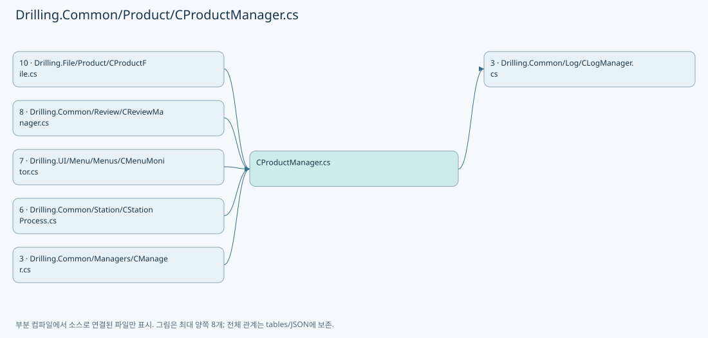

## 네임스페이스·타입·상속

| 타입 | 구분 | 원본 범위 | 선언/상속 |
| --- | --- | --- | --- |
| CProductManager | ClassDeclaration | 4–901 | CProductManager |
| EN_PRODUCT_STATE | EnumDeclaration | 903–911 | EN_PRODUCT_STATE |
| EN_PRODUCT_RESULT | EnumDeclaration | 913–919 | EN_PRODUCT_RESULT |
| EN_PRODUCT_HEAD_STATE | EnumDeclaration | 921–929 | EN_PRODUCT_HEAD_STATE |
| EN_PRODUCT_PROCESS_STATE | EnumDeclaration | 931–938 | EN_PRODUCT_PROCESS_STATE |
| ST_PRODUCT_ALIGN_DATA | RecordDeclaration | 940–940 | ST_PRODUCT_ALIGN_DATA |
| ST_PRODUCT_DISTORTION_DATA | RecordDeclaration | 941–941 | ST_PRODUCT_DISTORTION_DATA |
| ST_PRODUCT_REVIEW_RESULT | RecordDeclaration | 942–946 | ST_PRODUCT_REVIEW_RESULT |
| ST_PRODUCT_REVIEW_DATA | RecordDeclaration | 947–959 | ST_PRODUCT_REVIEW_DATA |
| ST_PRODUCT_INFO | RecordDeclaration | 961–976 | ST_PRODUCT_INFO |
| ST_PRODUCT_RECIPE_DATA | RecordDeclaration | 978–978 | ST_PRODUCT_RECIPE_DATA |
| ST_PRODUCT_RUNTIME_DATA | RecordDeclaration | 979–979 | ST_PRODUCT_RUNTIME_DATA |
| ST_PRODUCT_HEAD_RESULT | RecordDeclaration | 980–990 | ST_PRODUCT_HEAD_RESULT |
| ST_PRODUCT_DATA | RecordDeclaration | 991–1110 | ST_PRODUCT_DATA |
| ST_PRODUCT_HISTORY | RecordDeclaration | 1112–1112 | ST_PRODUCT_HISTORY |
| CProductFileBase | ClassDeclaration | 1113–1120 | CProductFileBase |

## 멤버 빠른 목록

| 이름 | 종류 | 범위 | 서명 |
| --- | --- | --- | --- |
| _updateGate | FieldDeclaration | L6–6 | System.Threading.SemaphoreSlim Drilling.Common.Product.CProductManager._updateGate |
| _current | FieldDeclaration | L7–7 | Drilling.Common.Product.ST_PRODUCT_DATA? Drilling.Common.Product.CProductManager._current |
| _hasActiveDataLoadError | FieldDeclaration | L8–8 | int Drilling.Common.Product.CProductManager._hasActiveDataLoadError |
| Current | PropertyDeclaration | L9–15 | Drilling.Common.Product.ST_PRODUCT_DATA? Drilling.Common.Product.CProductManager.Current |
| get_Current | GetAccessorDeclaration | L11–14 | Drilling.Common.Product.ST_PRODUCT_DATA? Drilling.Common.Product.CProductManager.Current.get |
| HasActiveDataLoadError | PropertyDeclaration | L17–23 | bool Drilling.Common.Product.CProductManager.HasActiveDataLoadError |
| get_HasActiveDataLoadError | GetAccessorDeclaration | L19–22 | bool Drilling.Common.Product.CProductManager.HasActiveDataLoadError.get |
| LoadActive | MethodDeclaration | L25–47 | System.Threading.Tasks.Task<Drilling.Common.Product.ST_PRODUCT_DATA?> Drilling.Common.Product.CProductManager.LoadActive(System.Threading.CancellationToken) |
| RecoverInterrupted | MethodDeclaration | L49–127 | System.Threading.Tasks.Task<Drilling.Common.Product.ST_PRODUCT_DATA?> Drilling.Common.Product.CProductManager.RecoverInterrupted(System.Threading.CancellationToken) |
| MatchesState | LocalFunctionStatement | L53–56 | bool MatchesState(Drilling.Common.Product.ST_PRODUCT_HEAD_RESULT) |
| SelectValue | LocalFunctionStatement | L80–91 | Drilling.Common.Product.ST_PRODUCT_HEAD_RESULT SelectValue(Drilling.Common.Product.ST_PRODUCT_HEAD_RESULT) |
| CreateProduct | MethodDeclaration | L129–201 | System.Threading.Tasks.Task<Drilling.Common.Product.ST_PRODUCT_DATA> Drilling.Common.Product.CProductManager.CreateProduct(string, string, string, string, System.Collections.Generic.IReadOnlyDictionary<string, string>, System.Collections.Generic.IReadOnlyDictionary<int, int>, System.Threading.CancellationToken, System.Collections.Generic.IReadOnlyDictionary<string, string>?) |
| SelectKey | LocalFunctionStatement | L142–145 | int SelectKey(System.Collections.Generic.KeyValuePair<int, int>) |
| BuildProduct | LocalFunctionStatement | L147–150 | Drilling.Common.Product.ST_PRODUCT_HEAD_RESULT BuildProduct(System.Collections.Generic.KeyValuePair<int, int>) |
| PrepareProductForProcess | MethodDeclaration | L203–238 | System.Threading.Tasks.Task<Drilling.Common.Product.ST_PRODUCT_DATA> Drilling.Common.Product.CProductManager.PrepareProductForProcess(string, string, string, System.Collections.Generic.IReadOnlyDictionary<string, string>, System.Collections.Generic.IReadOnlyDictionary<int, int>, System.Threading.CancellationToken) |
| StartProduct | MethodDeclaration | L240–276 | System.Threading.Tasks.Task<Drilling.Common.Product.ST_PRODUCT_DATA> Drilling.Common.Product.CProductManager.StartProduct(string, System.Threading.CancellationToken) |
| SelectItem | LocalFunctionStatement | L248–260 | Drilling.Common.Product.ST_PRODUCT_HEAD_RESULT SelectItem(Drilling.Common.Product.ST_PRODUCT_HEAD_RESULT) |
| SetProductInfo | MethodDeclaration | L278–312 | System.Threading.Tasks.Task<Drilling.Common.Product.ST_PRODUCT_DATA> Drilling.Common.Product.CProductManager.SetProductInfo(string, System.Collections.Generic.IReadOnlyDictionary<string, string>, System.Threading.CancellationToken) |
| ShouldIncludeItem | LocalFunctionStatement | L282–285 | bool ShouldIncludeItem(string) |
| SetHeadRunning | MethodDeclaration | L314–346 | System.Threading.Tasks.Task<Drilling.Common.Product.ST_PRODUCT_DATA> Drilling.Common.Product.CProductManager.SetHeadRunning(string, int, System.Threading.CancellationToken) |
| SelectItem | LocalFunctionStatement | L322–331 | Drilling.Common.Product.ST_PRODUCT_HEAD_RESULT SelectItem(Drilling.Common.Product.ST_PRODUCT_HEAD_RESULT) |
| SetHeadResult | MethodDeclaration | L348–385 | System.Threading.Tasks.Task<Drilling.Common.Product.ST_PRODUCT_DATA> Drilling.Common.Product.CProductManager.SetHeadResult(string, int, bool, string, string, System.Threading.CancellationToken) |
| SelectItem | LocalFunctionStatement | L356–370 | Drilling.Common.Product.ST_PRODUCT_HEAD_RESULT SelectItem(Drilling.Common.Product.ST_PRODUCT_HEAD_RESULT) |
| SetAlign | MethodDeclaration | L387–404 | System.Threading.Tasks.Task<Drilling.Common.Product.ST_PRODUCT_DATA> Drilling.Common.Product.CProductManager.SetAlign(string, Drilling.Common.Product.ST_PRODUCT_ALIGN_DATA, System.Threading.CancellationToken) |
| SetDistortion | MethodDeclaration | L406–423 | System.Threading.Tasks.Task<Drilling.Common.Product.ST_PRODUCT_DATA> Drilling.Common.Product.CProductManager.SetDistortion(string, Drilling.Common.Product.ST_PRODUCT_DISTORTION_DATA, System.Threading.CancellationToken) |
| SetAlignment | MethodDeclaration | L425–443 | System.Threading.Tasks.Task<Drilling.Common.Product.ST_PRODUCT_DATA> Drilling.Common.Product.CProductManager.SetAlignment(string, Drilling.Common.Product.ST_PRODUCT_ALIGN_DATA, Drilling.Common.Product.ST_PRODUCT_DISTORTION_DATA, System.Threading.CancellationToken) |
| SetReviewRunning | MethodDeclaration | L445–465 | System.Threading.Tasks.Task<Drilling.Common.Product.ST_PRODUCT_DATA> Drilling.Common.Product.CProductManager.SetReviewRunning(string, Drilling.Common.Product.ST_PRODUCT_REVIEW_DATA, System.Threading.CancellationToken) |
| SetReviewProgress | MethodDeclaration | L467–489 | System.Threading.Tasks.Task<Drilling.Common.Product.ST_PRODUCT_DATA> Drilling.Common.Product.CProductManager.SetReviewProgress(string, Drilling.Common.Product.ST_PRODUCT_REVIEW_DATA, System.Threading.CancellationToken) |
| SetReviewCompleted | MethodDeclaration | L491–513 | System.Threading.Tasks.Task<Drilling.Common.Product.ST_PRODUCT_DATA> Drilling.Common.Product.CProductManager.SetReviewCompleted(string, System.DateTimeOffset, System.Collections.Generic.IReadOnlyList<Drilling.Common.Product.ST_PRODUCT_REVIEW_RESULT>, System.Threading.CancellationToken) |
| SetReviewStopped | MethodDeclaration | L515–535 | System.Threading.Tasks.Task<Drilling.Common.Product.ST_PRODUCT_DATA> Drilling.Common.Product.CProductManager.SetReviewStopped(string, string, System.Threading.CancellationToken) |
| SetReviewError | MethodDeclaration | L537–557 | System.Threading.Tasks.Task<Drilling.Common.Product.ST_PRODUCT_DATA> Drilling.Common.Product.CProductManager.SetReviewError(string, string, System.Threading.CancellationToken) |
| CompleteProduct | MethodDeclaration | L559–609 | System.Threading.Tasks.Task<Drilling.Common.Product.ST_PRODUCT_DATA> Drilling.Common.Product.CProductManager.CompleteProduct(string, bool, bool, string, System.Threading.CancellationToken) |
| SelectItem | LocalFunctionStatement | L567–593 | Drilling.Common.Product.ST_PRODUCT_HEAD_RESULT SelectItem(Drilling.Common.Product.ST_PRODUCT_HEAD_RESULT) |
| StopProduct | MethodDeclaration | L611–646 | System.Threading.Tasks.Task<Drilling.Common.Product.ST_PRODUCT_DATA> Drilling.Common.Product.CProductManager.StopProduct(string, string, System.Threading.CancellationToken) |
| SelectItem | LocalFunctionStatement | L619–630 | Drilling.Common.Product.ST_PRODUCT_HEAD_RESULT SelectItem(Drilling.Common.Product.ST_PRODUCT_HEAD_RESULT) |
| SetError | MethodDeclaration | L648–684 | System.Threading.Tasks.Task<Drilling.Common.Product.ST_PRODUCT_DATA> Drilling.Common.Product.CProductManager.SetError(string, string, System.Threading.CancellationToken) |
| SelectItem | LocalFunctionStatement | L656–668 | Drilling.Common.Product.ST_PRODUCT_HEAD_RESULT SelectItem(Drilling.Common.Product.ST_PRODUCT_HEAD_RESULT) |
| ScrapProduct | MethodDeclaration | L686–703 | System.Threading.Tasks.Task<Drilling.Common.Product.ST_PRODUCT_DATA> Drilling.Common.Product.CProductManager.ScrapProduct(string, string, System.Threading.CancellationToken) |
| DeleteProduct | MethodDeclaration | L705–739 | System.Threading.Tasks.Task Drilling.Common.Product.CProductManager.DeleteProduct(string, System.Threading.CancellationToken) |
| ReleaseCompletedProduct | MethodDeclaration | L741–760 | System.Threading.Tasks.Task Drilling.Common.Product.CProductManager.ReleaseCompletedProduct(string, System.Threading.CancellationToken) |
| LoadHistory | MethodDeclaration | L762–773 | System.Threading.Tasks.Task<System.Collections.Generic.IReadOnlyList<Drilling.Common.Product.ST_PRODUCT_HISTORY>> Drilling.Common.Product.CProductManager.LoadHistory(int, int, System.Threading.CancellationToken) |
| GetCurrent | MethodDeclaration | L775–788 | Drilling.Common.Product.ST_PRODUCT_DATA Drilling.Common.Product.CProductManager.GetCurrent(string) |
| PersistAndLog | MethodDeclaration | L790–821 | System.Threading.Tasks.Task<Drilling.Common.Product.ST_PRODUCT_DATA> Drilling.Common.Product.CProductManager.PersistAndLog(Drilling.Common.Product.ST_PRODUCT_DATA, string, string, System.Threading.CancellationToken) |
| CreateProductInfo | MethodDeclaration | L823–855 | Drilling.Common.Product.ST_PRODUCT_INFO Drilling.Common.Product.CProductManager.CreateProductInfo(string, string, string, string, System.Collections.Generic.IReadOnlyDictionary<string, string>, System.DateTimeOffset) |
| SelectName | LocalFunctionStatement | L825–828 | string SelectName(string) |
| SelectValue | LocalFunctionStatement | L830–833 | string SelectValue(string) |
| SetProductState | MethodDeclaration | L857–860 | Drilling.Common.Product.ST_PRODUCT_INFO Drilling.Common.Product.CProductManager.SetProductState(Drilling.Common.Product.ST_PRODUCT_INFO, Drilling.Common.Product.EN_PRODUCT_STATE, Drilling.Common.Product.EN_PRODUCT_RESULT, System.DateTimeOffset?, System.DateTimeOffset?) |
| HostWritableProductFieldNames | FieldDeclaration | L862–864 | System.Collections.Generic.IReadOnlySet<string> Drilling.Common.Product.CProductManager.HostWritableProductFieldNames |
| ProductFieldNames | FieldDeclaration | L865–874 | System.Collections.Generic.IReadOnlyList<string> Drilling.Common.Product.CProductManager.ProductFieldNames |
| ChooseGlassId | MethodDeclaration | L875–900 | string Drilling.Common.Product.CProductManager.ChooseGlassId(string, string, System.Collections.Generic.IReadOnlyDictionary<string, string>) |
| Created | EnumMemberDeclaration | L905–905 | Drilling.Common.Product.EN_PRODUCT_STATE.Created |
| Running | EnumMemberDeclaration | L906–906 | Drilling.Common.Product.EN_PRODUCT_STATE.Running |
| Completed | EnumMemberDeclaration | L907–907 | Drilling.Common.Product.EN_PRODUCT_STATE.Completed |
| Stopped | EnumMemberDeclaration | L908–908 | Drilling.Common.Product.EN_PRODUCT_STATE.Stopped |
| Error | EnumMemberDeclaration | L909–909 | Drilling.Common.Product.EN_PRODUCT_STATE.Error |
| Scrapped | EnumMemberDeclaration | L910–910 | Drilling.Common.Product.EN_PRODUCT_STATE.Scrapped |
| Pending | EnumMemberDeclaration | L915–915 | Drilling.Common.Product.EN_PRODUCT_RESULT.Pending |
| Skipped | EnumMemberDeclaration | L916–916 | Drilling.Common.Product.EN_PRODUCT_RESULT.Skipped |
| OK | EnumMemberDeclaration | L917–917 | Drilling.Common.Product.EN_PRODUCT_RESULT.OK |
| NG | EnumMemberDeclaration | L918–918 | Drilling.Common.Product.EN_PRODUCT_RESULT.NG |
| Ready | EnumMemberDeclaration | L923–923 | Drilling.Common.Product.EN_PRODUCT_HEAD_STATE.Ready |
| Running | EnumMemberDeclaration | L924–924 | Drilling.Common.Product.EN_PRODUCT_HEAD_STATE.Running |
| Completed | EnumMemberDeclaration | L925–925 | Drilling.Common.Product.EN_PRODUCT_HEAD_STATE.Completed |
| Stopped | EnumMemberDeclaration | L926–926 | Drilling.Common.Product.EN_PRODUCT_HEAD_STATE.Stopped |
| Error | EnumMemberDeclaration | L927–927 | Drilling.Common.Product.EN_PRODUCT_HEAD_STATE.Error |
| Disabled | EnumMemberDeclaration | L928–928 | Drilling.Common.Product.EN_PRODUCT_HEAD_STATE.Disabled |
| NotStarted | EnumMemberDeclaration | L933–933 | Drilling.Common.Product.EN_PRODUCT_PROCESS_STATE.NotStarted |
| Running | EnumMemberDeclaration | L934–934 | Drilling.Common.Product.EN_PRODUCT_PROCESS_STATE.Running |
| Completed | EnumMemberDeclaration | L935–935 | Drilling.Common.Product.EN_PRODUCT_PROCESS_STATE.Completed |
| Stopped | EnumMemberDeclaration | L936–936 | Drilling.Common.Product.EN_PRODUCT_PROCESS_STATE.Stopped |
| Error | EnumMemberDeclaration | L937–937 | Drilling.Common.Product.EN_PRODUCT_PROCESS_STATE.Error |
| VisionResultCode | PropertyDeclaration | L944–944 | int? Drilling.Common.Product.ST_PRODUCT_REVIEW_RESULT.VisionResultCode |
| get_VisionResultCode | GetAccessorDeclaration | L944–944 | int? Drilling.Common.Product.ST_PRODUCT_REVIEW_RESULT.VisionResultCode.get |
| set_VisionResultCode | InitAccessorDeclaration | L944–944 | void Drilling.Common.Product.ST_PRODUCT_REVIEW_RESULT.VisionResultCode.init |
| NgReason | PropertyDeclaration | L945–945 | string Drilling.Common.Product.ST_PRODUCT_REVIEW_RESULT.NgReason |
| get_NgReason | GetAccessorDeclaration | L945–945 | string Drilling.Common.Product.ST_PRODUCT_REVIEW_RESULT.NgReason.get |
| set_NgReason | InitAccessorDeclaration | L945–945 | void Drilling.Common.Product.ST_PRODUCT_REVIEW_RESULT.NgReason.init |
| InspectionMethod | PropertyDeclaration | L949–949 | string Drilling.Common.Product.ST_PRODUCT_REVIEW_DATA.InspectionMethod |
| get_InspectionMethod | GetAccessorDeclaration | L949–949 | string Drilling.Common.Product.ST_PRODUCT_REVIEW_DATA.InspectionMethod.get |
| set_InspectionMethod | InitAccessorDeclaration | L949–949 | void Drilling.Common.Product.ST_PRODUCT_REVIEW_DATA.InspectionMethod.init |
| RecipeId | PropertyDeclaration | L950–950 | string Drilling.Common.Product.ST_PRODUCT_REVIEW_DATA.RecipeId |
| get_RecipeId | GetAccessorDeclaration | L950–950 | string Drilling.Common.Product.ST_PRODUCT_REVIEW_DATA.RecipeId.get |
| set_RecipeId | InitAccessorDeclaration | L950–950 | void Drilling.Common.Product.ST_PRODUCT_REVIEW_DATA.RecipeId.init |
| Rule | PropertyDeclaration | L951–951 | string Drilling.Common.Product.ST_PRODUCT_REVIEW_DATA.Rule |
| get_Rule | GetAccessorDeclaration | L951–951 | string Drilling.Common.Product.ST_PRODUCT_REVIEW_DATA.Rule.get |
| set_Rule | InitAccessorDeclaration | L951–951 | void Drilling.Common.Product.ST_PRODUCT_REVIEW_DATA.Rule.init |
| RuleScope | PropertyDeclaration | L952–952 | string Drilling.Common.Product.ST_PRODUCT_REVIEW_DATA.RuleScope |
| get_RuleScope | GetAccessorDeclaration | L952–952 | string Drilling.Common.Product.ST_PRODUCT_REVIEW_DATA.RuleScope.get |
| set_RuleScope | InitAccessorDeclaration | L952–952 | void Drilling.Common.Product.ST_PRODUCT_REVIEW_DATA.RuleScope.init |
| BeamNo | PropertyDeclaration | L953–953 | int Drilling.Common.Product.ST_PRODUCT_REVIEW_DATA.BeamNo |
| get_BeamNo | GetAccessorDeclaration | L953–953 | int Drilling.Common.Product.ST_PRODUCT_REVIEW_DATA.BeamNo.get |
| set_BeamNo | InitAccessorDeclaration | L953–953 | void Drilling.Common.Product.ST_PRODUCT_REVIEW_DATA.BeamNo.init |
| ReferenceCellNo | PropertyDeclaration | L954–954 | int? Drilling.Common.Product.ST_PRODUCT_REVIEW_DATA.ReferenceCellNo |
| get_ReferenceCellNo | GetAccessorDeclaration | L954–954 | int? Drilling.Common.Product.ST_PRODUCT_REVIEW_DATA.ReferenceCellNo.get |
| set_ReferenceCellNo | InitAccessorDeclaration | L954–954 | void Drilling.Common.Product.ST_PRODUCT_REVIEW_DATA.ReferenceCellNo.init |
| ReferenceShot | PropertyDeclaration | L955–955 | string Drilling.Common.Product.ST_PRODUCT_REVIEW_DATA.ReferenceShot |
| get_ReferenceShot | GetAccessorDeclaration | L955–955 | string Drilling.Common.Product.ST_PRODUCT_REVIEW_DATA.ReferenceShot.get |
| set_ReferenceShot | InitAccessorDeclaration | L955–955 | void Drilling.Common.Product.ST_PRODUCT_REVIEW_DATA.ReferenceShot.init |
| RoughReference | PropertyDeclaration | L956–956 | string Drilling.Common.Product.ST_PRODUCT_REVIEW_DATA.RoughReference |
| get_RoughReference | GetAccessorDeclaration | L956–956 | string Drilling.Common.Product.ST_PRODUCT_REVIEW_DATA.RoughReference.get |
| set_RoughReference | InitAccessorDeclaration | L956–956 | void Drilling.Common.Product.ST_PRODUCT_REVIEW_DATA.RoughReference.init |
| FineLineCount | PropertyDeclaration | L957–957 | int Drilling.Common.Product.ST_PRODUCT_REVIEW_DATA.FineLineCount |
| get_FineLineCount | GetAccessorDeclaration | L957–957 | int Drilling.Common.Product.ST_PRODUCT_REVIEW_DATA.FineLineCount.get |
| set_FineLineCount | InitAccessorDeclaration | L957–957 | void Drilling.Common.Product.ST_PRODUCT_REVIEW_DATA.FineLineCount.init |
| TotalCount | PropertyDeclaration | L958–958 | int Drilling.Common.Product.ST_PRODUCT_REVIEW_DATA.TotalCount |
| get_TotalCount | GetAccessorDeclaration | L958–958 | int Drilling.Common.Product.ST_PRODUCT_REVIEW_DATA.TotalCount.get |
| set_TotalCount | InitAccessorDeclaration | L958–958 | void Drilling.Common.Product.ST_PRODUCT_REVIEW_DATA.TotalCount.init |
| Get | MethodDeclaration | L963–966 | string Drilling.Common.Product.ST_PRODUCT_INFO.Get(string) |
| Set | MethodDeclaration | L968–975 | Drilling.Common.Product.ST_PRODUCT_INFO Drilling.Common.Product.ST_PRODUCT_INFO.Set(string, string) |
| GlassId | PropertyDeclaration | L1000–1000 | string Drilling.Common.Product.ST_PRODUCT_DATA.GlassId |
| ProductId | PropertyDeclaration | L1002–1008 | string Drilling.Common.Product.ST_PRODUCT_DATA.ProductId |
| get_ProductId | GetAccessorDeclaration | L1004–1007 | string Drilling.Common.Product.ST_PRODUCT_DATA.ProductId.get |
| PanelId | PropertyDeclaration | L1010–1016 | string Drilling.Common.Product.ST_PRODUCT_DATA.PanelId |
| get_PanelId | GetAccessorDeclaration | L1012–1015 | string Drilling.Common.Product.ST_PRODUCT_DATA.PanelId.get |
| LotId | PropertyDeclaration | L1018–1024 | string Drilling.Common.Product.ST_PRODUCT_DATA.LotId |
| get_LotId | GetAccessorDeclaration | L1020–1023 | string Drilling.Common.Product.ST_PRODUCT_DATA.LotId.get |
| ProcessId | PropertyDeclaration | L1026–1032 | string Drilling.Common.Product.ST_PRODUCT_DATA.ProcessId |
| get_ProcessId | GetAccessorDeclaration | L1028–1031 | string Drilling.Common.Product.ST_PRODUCT_DATA.ProcessId.get |
| RecipeId | PropertyDeclaration | L1034–1040 | string Drilling.Common.Product.ST_PRODUCT_DATA.RecipeId |
| get_RecipeId | GetAccessorDeclaration | L1036–1039 | string Drilling.Common.Product.ST_PRODUCT_DATA.RecipeId.get |
| State | PropertyDeclaration | L1042–1048 | Drilling.Common.Product.EN_PRODUCT_STATE Drilling.Common.Product.ST_PRODUCT_DATA.State |
| get_State | GetAccessorDeclaration | L1044–1047 | Drilling.Common.Product.EN_PRODUCT_STATE Drilling.Common.Product.ST_PRODUCT_DATA.State.get |
| Result | PropertyDeclaration | L1050–1058 | Drilling.Common.Product.EN_PRODUCT_RESULT Drilling.Common.Product.ST_PRODUCT_DATA.Result |
| get_Result | GetAccessorDeclaration | L1052–1057 | Drilling.Common.Product.EN_PRODUCT_RESULT Drilling.Common.Product.ST_PRODUCT_DATA.Result.get |
| CreatedAt | PropertyDeclaration | L1060–1066 | System.DateTimeOffset? Drilling.Common.Product.ST_PRODUCT_DATA.CreatedAt |
| get_CreatedAt | GetAccessorDeclaration | L1062–1065 | System.DateTimeOffset? Drilling.Common.Product.ST_PRODUCT_DATA.CreatedAt.get |
| StartedAt | PropertyDeclaration | L1068–1074 | System.DateTimeOffset? Drilling.Common.Product.ST_PRODUCT_DATA.StartedAt |
| get_StartedAt | GetAccessorDeclaration | L1070–1073 | System.DateTimeOffset? Drilling.Common.Product.ST_PRODUCT_DATA.StartedAt.get |
| CompletedAt | PropertyDeclaration | L1076–1082 | System.DateTimeOffset? Drilling.Common.Product.ST_PRODUCT_DATA.CompletedAt |
| get_CompletedAt | GetAccessorDeclaration | L1078–1081 | System.DateTimeOffset? Drilling.Common.Product.ST_PRODUCT_DATA.CompletedAt.get |
| Parameters | PropertyDeclaration | L1084–1090 | System.Collections.Generic.IReadOnlyDictionary<string, string> Drilling.Common.Product.ST_PRODUCT_DATA.Parameters |
| get_Parameters | GetAccessorDeclaration | L1086–1089 | System.Collections.Generic.IReadOnlyDictionary<string, string> Drilling.Common.Product.ST_PRODUCT_DATA.Parameters.get |
| Heads | PropertyDeclaration | L1092–1098 | System.Collections.Generic.IReadOnlyList<Drilling.Common.Product.ST_PRODUCT_HEAD_RESULT> Drilling.Common.Product.ST_PRODUCT_DATA.Heads |
| get_Heads | GetAccessorDeclaration | L1094–1097 | System.Collections.Generic.IReadOnlyList<Drilling.Common.Product.ST_PRODUCT_HEAD_RESULT> Drilling.Common.Product.ST_PRODUCT_DATA.Heads.get |
| ParseEnum | MethodDeclaration | L1100–1104 | T Drilling.Common.Product.ST_PRODUCT_DATA.ParseEnum<T>(string, T) |
| ParseDate | MethodDeclaration | L1106–1109 | System.DateTimeOffset? Drilling.Common.Product.ST_PRODUCT_DATA.ParseDate(string) |
| LoadActive | MethodDeclaration | L1115–1115 | System.Threading.Tasks.Task<Drilling.Common.Product.ST_PRODUCT_DATA?> Drilling.Common.Product.CProductFileBase.LoadActive(System.Threading.CancellationToken) |
| SaveActive | MethodDeclaration | L1116–1116 | System.Threading.Tasks.Task Drilling.Common.Product.CProductFileBase.SaveActive(Drilling.Common.Product.ST_PRODUCT_DATA, System.Threading.CancellationToken) |
| ClearActive | MethodDeclaration | L1117–1117 | System.Threading.Tasks.Task Drilling.Common.Product.CProductFileBase.ClearActive(System.Threading.CancellationToken) |
| AppendHistory | MethodDeclaration | L1118–1118 | System.Threading.Tasks.Task Drilling.Common.Product.CProductFileBase.AppendHistory(Drilling.Common.Product.ST_PRODUCT_HISTORY, System.Threading.CancellationToken) |
| LoadHistory | MethodDeclaration | L1119–1119 | System.Threading.Tasks.Task<System.Collections.Generic.IReadOnlyList<Drilling.Common.Product.ST_PRODUCT_HISTORY>> Drilling.Common.Product.CProductFileBase.LoadHistory(int, int, System.Threading.CancellationToken) |

## 멤버별 상세 계약·호출·처리 해설

### FieldDeclaration `_updateGate` · L6–6

[Drilling.Common/Product/CProductManager.cs:6–6](https://github.com/kjuws10-rgb/A3Drilling/blob/0219666f9053b907d96d7e0aa7d0c6c1be3a73d4/Drilling.Common/Product/CProductManager.cs#L6-L6)

| 항목 | 실제 추출 값 |
| --- | --- |
| 서명 | System.Threading.SemaphoreSlim Drilling.Common.Product.CProductManager._updateGate |
| 접근/수식자 | Private / private, readonly |
| 반환/값 타입 | System.Threading.SemaphoreSlim |
| 소속 타입 | NamedType:Drilling.Common.Product.CProductManager |

현재 부분 분석에서 직접 연결된 호출자는 없습니다. XAML/이벤트/인터페이스·델리게이트·외부 진입을 추가 확인해야 하며, 미사용으로 판정한 것이 아닙니다.

호출하는 대상과 해석 범위:

| 원본 행 | 표현식 | 분석 상태 | 대상/소스 위치 |
| --- | --- | --- | --- |
| 6 | new | resolved | System.Threading.SemaphoreSlim.SemaphoreSlim(int, int) |

본문의 실제 연산·분기·예외·반환 순서(원문 위치 순):

| 원본 행 | 종류 | 주석 해설 |
| --- | --- | --- |
| 6 | call | 함수·델리게이트 또는 객체 생성자를 호출합니다: new(1, 1) |
| 6 | variable-initializer | 변수의 초기값을 지정합니다: _updateGate = new(1, 1) |

변경 전 점검: 입력/반환 타입, 위 호출자, 예외/취소 경로, 공유 상태와 저장·전송 소비자를 함께 확인합니다. 값의 단위나 물리 방향을 이름만으로 확정하지 않습니다.

### FieldDeclaration `_current` · L7–7

[Drilling.Common/Product/CProductManager.cs:7–7](https://github.com/kjuws10-rgb/A3Drilling/blob/0219666f9053b907d96d7e0aa7d0c6c1be3a73d4/Drilling.Common/Product/CProductManager.cs#L7-L7)

| 항목 | 실제 추출 값 |
| --- | --- |
| 서명 | Drilling.Common.Product.ST_PRODUCT_DATA? Drilling.Common.Product.CProductManager._current |
| 접근/수식자 | Private / private |
| 반환/값 타입 | Drilling.Common.Product.ST_PRODUCT_DATA? |
| 소속 타입 | NamedType:Drilling.Common.Product.CProductManager |

현재 부분 분석에서 직접 연결된 호출자는 없습니다. XAML/이벤트/인터페이스·델리게이트·외부 진입을 추가 확인해야 하며, 미사용으로 판정한 것이 아닙니다.

변경 전 점검: 입력/반환 타입, 위 호출자, 예외/취소 경로, 공유 상태와 저장·전송 소비자를 함께 확인합니다. 값의 단위나 물리 방향을 이름만으로 확정하지 않습니다.

### FieldDeclaration `_hasActiveDataLoadError` · L8–8

[Drilling.Common/Product/CProductManager.cs:8–8](https://github.com/kjuws10-rgb/A3Drilling/blob/0219666f9053b907d96d7e0aa7d0c6c1be3a73d4/Drilling.Common/Product/CProductManager.cs#L8-L8)

| 항목 | 실제 추출 값 |
| --- | --- |
| 서명 | int Drilling.Common.Product.CProductManager._hasActiveDataLoadError |
| 접근/수식자 | Private / private |
| 반환/값 타입 | int |
| 소속 타입 | NamedType:Drilling.Common.Product.CProductManager |

현재 부분 분석에서 직접 연결된 호출자는 없습니다. XAML/이벤트/인터페이스·델리게이트·외부 진입을 추가 확인해야 하며, 미사용으로 판정한 것이 아닙니다.

변경 전 점검: 입력/반환 타입, 위 호출자, 예외/취소 경로, 공유 상태와 저장·전송 소비자를 함께 확인합니다. 값의 단위나 물리 방향을 이름만으로 확정하지 않습니다.

### PropertyDeclaration `Current` · L9–15

[Drilling.Common/Product/CProductManager.cs:9–15](https://github.com/kjuws10-rgb/A3Drilling/blob/0219666f9053b907d96d7e0aa7d0c6c1be3a73d4/Drilling.Common/Product/CProductManager.cs#L9-L15)

| 항목 | 실제 추출 값 |
| --- | --- |
| 서명 | Drilling.Common.Product.ST_PRODUCT_DATA? Drilling.Common.Product.CProductManager.Current |
| 접근/수식자 | Public / public |
| 반환/값 타입 | Drilling.Common.Product.ST_PRODUCT_DATA? |
| 소속 타입 | NamedType:Drilling.Common.Product.CProductManager |

현재 부분 분석에서 직접 연결된 호출자는 없습니다. XAML/이벤트/인터페이스·델리게이트·외부 진입을 추가 확인해야 하며, 미사용으로 판정한 것이 아닙니다.

변경 전 점검: 입력/반환 타입, 위 호출자, 예외/취소 경로, 공유 상태와 저장·전송 소비자를 함께 확인합니다. 값의 단위나 물리 방향을 이름만으로 확정하지 않습니다.

### GetAccessorDeclaration `get_Current` · L11–14

[Drilling.Common/Product/CProductManager.cs:11–14](https://github.com/kjuws10-rgb/A3Drilling/blob/0219666f9053b907d96d7e0aa7d0c6c1be3a73d4/Drilling.Common/Product/CProductManager.cs#L11-L14)

| 항목 | 실제 추출 값 |
| --- | --- |
| 서명 | Drilling.Common.Product.ST_PRODUCT_DATA? Drilling.Common.Product.CProductManager.Current.get |
| 접근/수식자 | Public / get |
| 반환/값 타입 | Drilling.Common.Product.ST_PRODUCT_DATA? |
| 소속 타입 | NamedType:Drilling.Common.Product.CProductManager |

현재 부분 분석에서 직접 연결된 호출자는 없습니다. XAML/이벤트/인터페이스·델리게이트·외부 진입을 추가 확인해야 하며, 미사용으로 판정한 것이 아닙니다.

호출하는 대상과 해석 범위:

| 원본 행 | 표현식 | 분석 상태 | 대상/소스 위치 |
| --- | --- | --- | --- |
| 13 | Volatile.Read | resolved | Drilling.Common.Product.ST_PRODUCT_DATA? System.Threading.Volatile.Read<Drilling.Common.Product.ST_PRODUCT_DATA?>(ref readonly Drilling.Common.Product.ST_PRODUCT_DATA?) |

본문의 실제 연산·분기·예외·반환 순서(원문 위치 순):

| 원본 행 | 종류 | 주석 해설 |
| --- | --- | --- |
| 13 | call | 함수·델리게이트 또는 객체 생성자를 호출합니다: Volatile.Read(ref _current) |
| 13 | return | 호출자에게 값 또는 제어를 반환합니다: return Volatile.Read(ref _current); |

변경 전 점검: 입력/반환 타입, 위 호출자, 예외/취소 경로, 공유 상태와 저장·전송 소비자를 함께 확인합니다. 값의 단위나 물리 방향을 이름만으로 확정하지 않습니다.

### PropertyDeclaration `HasActiveDataLoadError` · L17–23

[Drilling.Common/Product/CProductManager.cs:17–23](https://github.com/kjuws10-rgb/A3Drilling/blob/0219666f9053b907d96d7e0aa7d0c6c1be3a73d4/Drilling.Common/Product/CProductManager.cs#L17-L23)

| 항목 | 실제 추출 값 |
| --- | --- |
| 서명 | bool Drilling.Common.Product.CProductManager.HasActiveDataLoadError |
| 접근/수식자 | Public / public |
| 반환/값 타입 | bool |
| 소속 타입 | NamedType:Drilling.Common.Product.CProductManager |

현재 부분 분석에서 직접 연결된 호출자는 없습니다. XAML/이벤트/인터페이스·델리게이트·외부 진입을 추가 확인해야 하며, 미사용으로 판정한 것이 아닙니다.

변경 전 점검: 입력/반환 타입, 위 호출자, 예외/취소 경로, 공유 상태와 저장·전송 소비자를 함께 확인합니다. 값의 단위나 물리 방향을 이름만으로 확정하지 않습니다.

### GetAccessorDeclaration `get_HasActiveDataLoadError` · L19–22

[Drilling.Common/Product/CProductManager.cs:19–22](https://github.com/kjuws10-rgb/A3Drilling/blob/0219666f9053b907d96d7e0aa7d0c6c1be3a73d4/Drilling.Common/Product/CProductManager.cs#L19-L22)

| 항목 | 실제 추출 값 |
| --- | --- |
| 서명 | bool Drilling.Common.Product.CProductManager.HasActiveDataLoadError.get |
| 접근/수식자 | Public / get |
| 반환/값 타입 | bool |
| 소속 타입 | NamedType:Drilling.Common.Product.CProductManager |

현재 부분 분석에서 직접 연결된 호출자는 없습니다. XAML/이벤트/인터페이스·델리게이트·외부 진입을 추가 확인해야 하며, 미사용으로 판정한 것이 아닙니다.

호출하는 대상과 해석 범위:

| 원본 행 | 표현식 | 분석 상태 | 대상/소스 위치 |
| --- | --- | --- | --- |
| 21 | Volatile.Read | resolved | int System.Threading.Volatile.Read(ref readonly int) |

본문의 실제 연산·분기·예외·반환 순서(원문 위치 순):

| 원본 행 | 종류 | 주석 해설 |
| --- | --- | --- |
| 21 | call | 함수·델리게이트 또는 객체 생성자를 호출합니다: Volatile.Read(ref _hasActiveDataLoadError) |
| 21 | return | 호출자에게 값 또는 제어를 반환합니다: return Volatile.Read(ref _hasActiveDataLoadError) != 0; |

변경 전 점검: 입력/반환 타입, 위 호출자, 예외/취소 경로, 공유 상태와 저장·전송 소비자를 함께 확인합니다. 값의 단위나 물리 방향을 이름만으로 확정하지 않습니다.

### MethodDeclaration `LoadActive` · L25–47

[Drilling.Common/Product/CProductManager.cs:25–47](https://github.com/kjuws10-rgb/A3Drilling/blob/0219666f9053b907d96d7e0aa7d0c6c1be3a73d4/Drilling.Common/Product/CProductManager.cs#L25-L47)

| 항목 | 실제 추출 값 |
| --- | --- |
| 서명 | System.Threading.Tasks.Task<Drilling.Common.Product.ST_PRODUCT_DATA?> Drilling.Common.Product.CProductManager.LoadActive(System.Threading.CancellationToken) |
| 접근/수식자 | Public / public, async |
| 반환/값 타입 | System.Threading.Tasks.Task<Drilling.Common.Product.ST_PRODUCT_DATA?> |
| 소속 타입 | NamedType:Drilling.Common.Product.CProductManager |

입력 계약:

| 이름 | 타입 | 전달 | 선택/기본값 |
| --- | --- | --- | --- |
| cancellationToken | System.Threading.CancellationToken | None | True / null |

정적 호출자로 확인된 위치:

| 호출 파일/행 | 호출 표현식 | 런타임 분기 가능 |
| --- | --- | --- |
| [Drilling.Common/Managers/CManager.cs:547–547](https://github.com/kjuws10-rgb/A3Drilling/blob/0219666f9053b907d96d7e0aa7d0c6c1be3a73d4/Drilling.Common/Managers/CManager.cs#L547-L547) | _productManager.LoadActive | False |
| [Drilling.UI/Menu/Menus/CMenuMonitor.cs:4414–4414](https://github.com/kjuws10-rgb/A3Drilling/blob/0219666f9053b907d96d7e0aa7d0c6c1be3a73d4/Drilling.UI/Menu/Menus/CMenuMonitor.cs#L4414-L4414) | _productManager.LoadActive | False |
| [Drilling.UI/Menu/Menus/CMenuMonitor.cs:4438–4438](https://github.com/kjuws10-rgb/A3Drilling/blob/0219666f9053b907d96d7e0aa7d0c6c1be3a73d4/Drilling.UI/Menu/Menus/CMenuMonitor.cs#L4438-L4438) | _productManager.LoadActive | False |
| [Drilling.UI/Menu/Menus/CMenuMonitor.cs:4507–4507](https://github.com/kjuws10-rgb/A3Drilling/blob/0219666f9053b907d96d7e0aa7d0c6c1be3a73d4/Drilling.UI/Menu/Menus/CMenuMonitor.cs#L4507-L4507) | _productManager.LoadActive | False |

호출하는 대상과 해석 범위:

| 원본 행 | 표현식 | 분석 상태 | 대상/소스 위치 |
| --- | --- | --- | --- |
| 27 | cancellationToken.ThrowIfCancellationRequested | resolved | void System.Threading.CancellationToken.ThrowIfCancellationRequested() |
| 28 | _updateGate.WaitAsync(cancellationToken).ConfigureAwait | resolved | System.Runtime.CompilerServices.ConfiguredTaskAwaitable System.Threading.Tasks.Task.ConfigureAwait(bool) |
| 28 | _updateGate.WaitAsync | resolved | System.Threading.Tasks.Task System.Threading.SemaphoreSlim.WaitAsync(System.Threading.CancellationToken) |
| 33 | productFile.LoadActive(cancellationToken).ConfigureAwait | resolved | System.Runtime.CompilerServices.ConfiguredTaskAwaitable<Drilling.Common.Product.ST_PRODUCT_DATA?> System.Threading.Tasks.Task<Drilling.Common.Product.ST_PRODUCT_DATA?>.ConfigureAwait(bool) |
| 33 | productFile.LoadActive | resolved | System.Threading.Tasks.Task<Drilling.Common.Product.ST_PRODUCT_DATA?> Drilling.Common.Product.CProductFileBase.LoadActive(System.Threading.CancellationToken) · Drilling.Common/Product/CProductManager.cs:1115 |
| 34 | Volatile.Write | resolved | void System.Threading.Volatile.Write(ref int, int) |
| 39 | Volatile.Write | resolved | void System.Threading.Volatile.Write(ref int, int) |
| 45 | _updateGate.Release | resolved | int System.Threading.SemaphoreSlim.Release() |

본문의 실제 연산·분기·예외·반환 순서(원문 위치 순):

| 원본 행 | 종류 | 주석 해설 |
| --- | --- | --- |
| 27 | call | 함수·델리게이트 또는 객체 생성자를 호출합니다: cancellationToken.ThrowIfCancellationRequested() |
| 28 | await | 비동기 완료를 기다립니다: await _updateGate.WaitAsync(cancellationToken).ConfigureAwait(false) |
| 28 | call | 함수·델리게이트 또는 객체 생성자를 호출합니다: _updateGate.WaitAsync(cancellationToken).ConfigureAwait(false) |
| 28 | call | 함수·델리게이트 또는 객체 생성자를 호출합니다: _updateGate.WaitAsync(cancellationToken) |
| 29 | try | 예외 처리 범위입니다: try |
| 31 | try | 예외 처리 범위입니다: try |
| 33 | assignment | 값을 대상에 대입합니다: _current = await productFile.LoadActive(cancellationToken).ConfigureAwait(false) |
| 33 | await | 비동기 완료를 기다립니다: await productFile.LoadActive(cancellationToken).ConfigureAwait(false) |
| 33 | call | 함수·델리게이트 또는 객체 생성자를 호출합니다: productFile.LoadActive(cancellationToken).ConfigureAwait(false) |
| 33 | call | 함수·델리게이트 또는 객체 생성자를 호출합니다: productFile.LoadActive(cancellationToken) |
| 34 | call | 함수·델리게이트 또는 객체 생성자를 호출합니다: Volatile.Write(ref _hasActiveDataLoadError, 0) |
| 35 | return | 호출자에게 값 또는 제어를 반환합니다: return _current; |
| 37 | catch | 지정 예외를 처리합니다: catch  |
| 39 | call | 함수·델리게이트 또는 객체 생성자를 호출합니다: Volatile.Write(ref _hasActiveDataLoadError, 1) |
| 40 | throw | 예외를 발생/전달합니다: throw; |
| 43 | finally | 종료 정리 구간입니다: finally |
| 45 | call | 함수·델리게이트 또는 객체 생성자를 호출합니다: _updateGate.Release() |

제어 구문의 포함 구조(실제 실행 순서/CFG가 아닌 구문 탐색 그림):

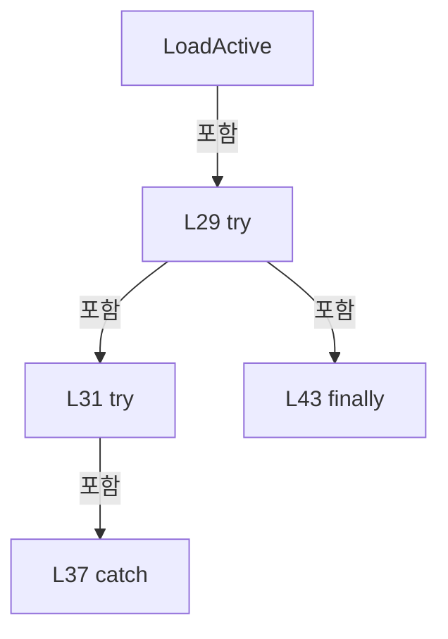

변경 전 점검: 입력/반환 타입, 위 호출자, 예외/취소 경로, 공유 상태와 저장·전송 소비자를 함께 확인합니다. 값의 단위나 물리 방향을 이름만으로 확정하지 않습니다.

### MethodDeclaration `RecoverInterrupted` · L49–127

[Drilling.Common/Product/CProductManager.cs:49–127](https://github.com/kjuws10-rgb/A3Drilling/blob/0219666f9053b907d96d7e0aa7d0c6c1be3a73d4/Drilling.Common/Product/CProductManager.cs#L49-L127)

| 항목 | 실제 추출 값 |
| --- | --- |
| 서명 | System.Threading.Tasks.Task<Drilling.Common.Product.ST_PRODUCT_DATA?> Drilling.Common.Product.CProductManager.RecoverInterrupted(System.Threading.CancellationToken) |
| 접근/수식자 | Public / public, async |
| 반환/값 타입 | System.Threading.Tasks.Task<Drilling.Common.Product.ST_PRODUCT_DATA?> |
| 소속 타입 | NamedType:Drilling.Common.Product.CProductManager |

입력 계약:

| 이름 | 타입 | 전달 | 선택/기본값 |
| --- | --- | --- | --- |
| cancellationToken | System.Threading.CancellationToken | None | True / null |

정적 호출자로 확인된 위치:

| 호출 파일/행 | 호출 표현식 | 런타임 분기 가능 |
| --- | --- | --- |
| [Drilling.Common/Managers/CManager.cs:548–548](https://github.com/kjuws10-rgb/A3Drilling/blob/0219666f9053b907d96d7e0aa7d0c6c1be3a73d4/Drilling.Common/Managers/CManager.cs#L548-L548) | _productManager.RecoverInterrupted | False |

호출하는 대상과 해석 범위:

| 원본 행 | 표현식 | 분석 상태 | 대상/소스 위치 |
| --- | --- | --- | --- |
| 51 | cancellationToken.ThrowIfCancellationRequested | resolved | void System.Threading.CancellationToken.ThrowIfCancellationRequested() |
| 52 | _updateGate.WaitAsync(cancellationToken).ConfigureAwait | resolved | System.Runtime.CompilerServices.ConfiguredTaskAwaitable System.Threading.Tasks.Task.ConfigureAwait(bool) |
| 52 | _updateGate.WaitAsync | resolved | System.Threading.Tasks.Task System.Threading.SemaphoreSlim.WaitAsync(System.Threading.CancellationToken) |
| 73 | product.Heads.Any | resolved | bool System.Collections.Generic.IEnumerable<Drilling.Common.Product.ST_PRODUCT_HEAD_RESULT>.Any<Drilling.Common.Product.ST_PRODUCT_HEAD_RESULT>(System.Func<Drilling.Common.Product.ST_PRODUCT_HEAD_RESULT, bool>) |
| 95 | SetProductState | resolved | Drilling.Common.Product.ST_PRODUCT_INFO Drilling.Common.Product.CProductManager.SetProductState(Drilling.Common.Product.ST_PRODUCT_INFO, Drilling.Common.Product.EN_PRODUCT_STATE, Drilling.Common.Product.EN_PRODUCT_RESULT, System.DateTimeOffset?, System.DateTimeOffset?) · Drilling.Common/Product/CProductManager.cs:857 |
| 118 | product.Heads.Select(SelectValue).ToArray | resolved | Drilling.Common.Product.ST_PRODUCT_HEAD_RESULT[] System.Collections.Generic.IEnumerable<Drilling.Common.Product.ST_PRODUCT_HEAD_RESULT>.ToArray<Drilling.Common.Product.ST_PRODUCT_HEAD_RESULT>() |
| 118 | product.Heads.Select | resolved | System.Collections.Generic.IEnumerable<Drilling.Common.Product.ST_PRODUCT_HEAD_RESULT> System.Collections.Generic.IEnumerable<Drilling.Common.Product.ST_PRODUCT_HEAD_RESULT>.Select<Drilling.Common.Product.ST_PRODUCT_HEAD_RESULT, Drilling.Common.Product.ST_PRODUCT_HEAD_RESULT>(System.Func<Drilling.Common.Product.ST_PRODUCT_HEAD_RESULT, Drilling.Common.Product.ST_PRODUCT_HEAD_RESULT>) |
| 121 | PersistAndLog | resolved | System.Threading.Tasks.Task<Drilling.Common.Product.ST_PRODUCT_DATA> Drilling.Common.Product.CProductManager.PersistAndLog(Drilling.Common.Product.ST_PRODUCT_DATA, string, string, System.Threading.CancellationToken) · Drilling.Common/Product/CProductManager.cs:790 |
| 125 | _updateGate.Release | resolved | int System.Threading.SemaphoreSlim.Release() |

본문의 실제 연산·분기·예외·반환 순서(원문 위치 순):

| 원본 행 | 종류 | 주석 해설 |
| --- | --- | --- |
| 51 | call | 함수·델리게이트 또는 객체 생성자를 호출합니다: cancellationToken.ThrowIfCancellationRequested() |
| 52 | await | 비동기 완료를 기다립니다: await _updateGate.WaitAsync(cancellationToken).ConfigureAwait(false) |
| 52 | call | 함수·델리게이트 또는 객체 생성자를 호출합니다: _updateGate.WaitAsync(cancellationToken).ConfigureAwait(false) |
| 52 | call | 함수·델리게이트 또는 객체 생성자를 호출합니다: _updateGate.WaitAsync(cancellationToken) |
| 58 | try | 예외 처리 범위입니다: try |
| 60 | local-declaration | 지역 변수를 선언합니다: var product = _current; |
| 60 | variable-initializer | 변수의 초기값을 지정합니다: product = _current |
| 61 | if | 조건에 따라 분기합니다: if (product is null) |
| 63 | return | 호출자에게 값 또는 제어를 반환합니다: return null; |
| 69 | local-declaration | 지역 변수를 선언합니다: var productInterrupted = product.State == EN_PRODUCT_STATE.Running; |
| 69 | variable-initializer | 변수의 초기값을 지정합니다: productInterrupted = product.State == EN_PRODUCT_STATE.Running |
| 70 | local-declaration | 지역 변수를 선언합니다: var alignInterrupted = product.Align.State == EN_PRODUCT_PROCESS_STATE.Running; |
| 70 | variable-initializer | 변수의 초기값을 지정합니다: alignInterrupted = product.Align.State == EN_PRODUCT_PROCESS_STATE.Running |
| 71 | local-declaration | 지역 변수를 선언합니다: var distortionInterrupted = product.Distortion.State == EN_PRODUCT_PROCESS_STATE.Running; |
| 71 | variable-initializer | 변수의 초기값을 지정합니다: distortionInterrupted = product.Distortion.State == EN_PRODUCT_PROCESS_STATE.Running |
| 72 | local-declaration | 지역 변수를 선언합니다: var reviewInterrupted = product.Review.State == EN_PRODUCT_PROCESS_STATE.Running; |
| 72 | variable-initializer | 변수의 초기값을 지정합니다: reviewInterrupted = product.Review.State == EN_PRODUCT_PROCESS_STATE.Running |
| 73 | call | 함수·델리게이트 또는 객체 생성자를 호출합니다: product.Heads.Any(MatchesState) |
| 73 | local-declaration | 지역 변수를 선언합니다: var headInterrupted = product.Heads.Any(MatchesState); |
| 73 | variable-initializer | 변수의 초기값을 지정합니다: headInterrupted = product.Heads.Any(MatchesState) |
| 74 | if | 조건에 따라 분기합니다: if (!productInterrupted && !alignInterrupted && !distortionInterrupted && !reviewInterrupted && !headInterrupted) |
| 76 | return | 호출자에게 값 또는 제어를 반환합니다: return product; |
| 79 | local-declaration | 지역 변수를 선언합니다: var now = DateTimeOffset.Now; |
| 79 | variable-initializer | 변수의 초기값을 지정합니다: now = DateTimeOffset.Now |
| 93 | local-declaration | 지역 변수를 선언합니다: var next = product with { Product = productInterrupted ? SetProductState(product.Product, EN_PRODUCT_STATE.Stopped, EN_PRODUCT_RESULT.NG, product.StartedAt, now) : product.Product, Align = alignInterrupted ? product.Align with { S |
| 93 | variable-initializer | 변수의 초기값을 지정합니다: next = product with { Product = productInterrupted ? SetProductState(product.Product, EN_PRODUCT_STATE.Stopped, EN_PRODUCT_RESULT.NG, product.StartedAt, now) : product.Product, Align = alignInterrupted ? product.Align with { State |
| 95 | assignment | 값을 대상에 대입합니다: Product = productInterrupted ? SetProductState(product.Product, EN_PRODUCT_STATE.Stopped, EN_PRODUCT_RESULT.NG, product.StartedAt, now) : product.Product |
| 95 | call | 함수·델리게이트 또는 객체 생성자를 호출합니다: SetProductState(product.Product, EN_PRODUCT_STATE.Stopped, EN_PRODUCT_RESULT.NG, product.StartedAt, now) |
| 95 | conditional-expression | 조건에 따라 결과식을 선택합니다: productInterrupted ? SetProductState(product.Product, EN_PRODUCT_STATE.Stopped, EN_PRODUCT_RESULT.NG, product.StartedAt, now) : product.Product |
| 96 | assignment | 값을 대상에 대입합니다: Align = alignInterrupted ? product.Align with { State = EN_PRODUCT_PROCESS_STATE.Stopped, Result = "INTERRUPTED" } : product.Align |
| 96 | conditional-expression | 조건에 따라 결과식을 선택합니다: alignInterrupted ? product.Align with { State = EN_PRODUCT_PROCESS_STATE.Stopped, Result = "INTERRUPTED" } : product.Align |
| 98 | assignment | 값을 대상에 대입합니다: State = EN_PRODUCT_PROCESS_STATE.Stopped |
| 99 | assignment | 값을 대상에 대입합니다: Result = "INTERRUPTED" |
| 103 | assignment | 값을 대상에 대입합니다: Distortion = distortionInterrupted ? product.Distortion with { State = EN_PRODUCT_PROCESS_STATE.Stopped, Result = "INTERRUPTED" } : product.Distortion |
| 103 | conditional-expression | 조건에 따라 결과식을 선택합니다: distortionInterrupted ? product.Distortion with { State = EN_PRODUCT_PROCESS_STATE.Stopped, Result = "INTERRUPTED" } : product.Distortion |
| 105 | assignment | 값을 대상에 대입합니다: State = EN_PRODUCT_PROCESS_STATE.Stopped |
| 106 | assignment | 값을 대상에 대입합니다: Result = "INTERRUPTED" |
| 110 | assignment | 값을 대상에 대입합니다: Review = reviewInterrupted ? product.Review with { State = EN_PRODUCT_PROCESS_STATE.Stopped } : product.Review |
| 110 | conditional-expression | 조건에 따라 결과식을 선택합니다: reviewInterrupted ? product.Review with { State = EN_PRODUCT_PROCESS_STATE.Stopped } : product.Review |
| 112 | assignment | 값을 대상에 대입합니다: State = EN_PRODUCT_PROCESS_STATE.Stopped |
| 116 | assignment | 값을 대상에 대입합니다: Runtime = product.Runtime with { Heads = product.Heads.Select(SelectValue).ToArray() } |
| 118 | assignment | 값을 대상에 대입합니다: Heads = product.Heads.Select(SelectValue).ToArray() |
| 118 | call | 함수·델리게이트 또는 객체 생성자를 호출합니다: product.Heads.Select(SelectValue).ToArray() |
| 118 | call | 함수·델리게이트 또는 객체 생성자를 호출합니다: product.Heads.Select(SelectValue) |
| 121 | await | 비동기 완료를 기다립니다: await PersistAndLog(next, "RECOVERY", "Interrupted Product state recovered during application startup.", cancellationToken) |
| 121 | call | 함수·델리게이트 또는 객체 생성자를 호출합니다: PersistAndLog(next, "RECOVERY", "Interrupted Product state recovered during application startup.", cancellationToken) |
| 121 | return | 호출자에게 값 또는 제어를 반환합니다: return await PersistAndLog(next, "RECOVERY", "Interrupted Product state recovered during application startup.", cancellationToken); |
| 123 | finally | 종료 정리 구간입니다: finally |
| 125 | call | 함수·델리게이트 또는 객체 생성자를 호출합니다: _updateGate.Release() |

제어 구문의 포함 구조(실제 실행 순서/CFG가 아닌 구문 탐색 그림):

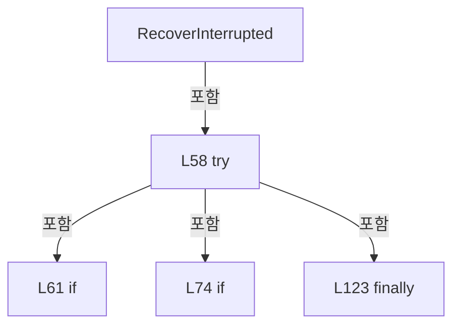

변경 전 점검: 입력/반환 타입, 위 호출자, 예외/취소 경로, 공유 상태와 저장·전송 소비자를 함께 확인합니다. 값의 단위나 물리 방향을 이름만으로 확정하지 않습니다.

### LocalFunctionStatement `MatchesState` · L53–56

[Drilling.Common/Product/CProductManager.cs:53–56](https://github.com/kjuws10-rgb/A3Drilling/blob/0219666f9053b907d96d7e0aa7d0c6c1be3a73d4/Drilling.Common/Product/CProductManager.cs#L53-L56)

| 항목 | 실제 추출 값 |
| --- | --- |
| 서명 | bool MatchesState(Drilling.Common.Product.ST_PRODUCT_HEAD_RESULT) |
| 접근/수식자 | Private /  |
| 반환/값 타입 | bool |
| 소속 타입 | NamedType:Drilling.Common.Product.CProductManager |

입력 계약:

| 이름 | 타입 | 전달 | 선택/기본값 |
| --- | --- | --- | --- |
| head | Drilling.Common.Product.ST_PRODUCT_HEAD_RESULT | None | False /  |

현재 부분 분석에서 직접 연결된 호출자는 없습니다. XAML/이벤트/인터페이스·델리게이트·외부 진입을 추가 확인해야 하며, 미사용으로 판정한 것이 아닙니다.

본문의 실제 연산·분기·예외·반환 순서(원문 위치 순):

| 원본 행 | 종류 | 주석 해설 |
| --- | --- | --- |
| 55 | return | 호출자에게 값 또는 제어를 반환합니다: return head.State == EN_PRODUCT_HEAD_STATE.Running; |

변경 전 점검: 입력/반환 타입, 위 호출자, 예외/취소 경로, 공유 상태와 저장·전송 소비자를 함께 확인합니다. 값의 단위나 물리 방향을 이름만으로 확정하지 않습니다.

### LocalFunctionStatement `SelectValue` · L80–91

[Drilling.Common/Product/CProductManager.cs:80–91](https://github.com/kjuws10-rgb/A3Drilling/blob/0219666f9053b907d96d7e0aa7d0c6c1be3a73d4/Drilling.Common/Product/CProductManager.cs#L80-L91)

| 항목 | 실제 추출 값 |
| --- | --- |
| 서명 | Drilling.Common.Product.ST_PRODUCT_HEAD_RESULT SelectValue(Drilling.Common.Product.ST_PRODUCT_HEAD_RESULT) |
| 접근/수식자 | Private /  |
| 반환/값 타입 | Drilling.Common.Product.ST_PRODUCT_HEAD_RESULT |
| 소속 타입 | NamedType:Drilling.Common.Product.CProductManager |

입력 계약:

| 이름 | 타입 | 전달 | 선택/기본값 |
| --- | --- | --- | --- |
| head | Drilling.Common.Product.ST_PRODUCT_HEAD_RESULT | None | False /  |

현재 부분 분석에서 직접 연결된 호출자는 없습니다. XAML/이벤트/인터페이스·델리게이트·외부 진입을 추가 확인해야 하며, 미사용으로 판정한 것이 아닙니다.

본문의 실제 연산·분기·예외·반환 순서(원문 위치 순):

| 원본 행 | 종류 | 주석 해설 |
| --- | --- | --- |
| 82 | conditional-expression | 조건에 따라 결과식을 선택합니다: head.State == EN_PRODUCT_HEAD_STATE.Running ? head with { State = EN_PRODUCT_HEAD_STATE.Stopped, Result = EN_PRODUCT_RESULT.NG, Message = "Interrupted by application restart.", CompletedAt = now } : head |
| 82 | return | 호출자에게 값 또는 제어를 반환합니다: return head.State == EN_PRODUCT_HEAD_STATE.Running ? head with { State = EN_PRODUCT_HEAD_STATE.Stopped, Result = EN_PRODUCT_RESULT.NG, Message = "Interrupted by application restart.", CompletedAt = now } : head; |
| 84 | assignment | 값을 대상에 대입합니다: State = EN_PRODUCT_HEAD_STATE.Stopped |
| 85 | assignment | 값을 대상에 대입합니다: Result = EN_PRODUCT_RESULT.NG |
| 86 | assignment | 값을 대상에 대입합니다: Message = "Interrupted by application restart." |
| 87 | assignment | 값을 대상에 대입합니다: CompletedAt = now |

변경 전 점검: 입력/반환 타입, 위 호출자, 예외/취소 경로, 공유 상태와 저장·전송 소비자를 함께 확인합니다. 값의 단위나 물리 방향을 이름만으로 확정하지 않습니다.

### MethodDeclaration `CreateProduct` · L129–201

[Drilling.Common/Product/CProductManager.cs:129–201](https://github.com/kjuws10-rgb/A3Drilling/blob/0219666f9053b907d96d7e0aa7d0c6c1be3a73d4/Drilling.Common/Product/CProductManager.cs#L129-L201)

| 항목 | 실제 추출 값 |
| --- | --- |
| 서명 | System.Threading.Tasks.Task<Drilling.Common.Product.ST_PRODUCT_DATA> Drilling.Common.Product.CProductManager.CreateProduct(string, string, string, string, System.Collections.Generic.IReadOnlyDictionary<string, string>, System.Collections.Generic.IReadOnlyDictionary<int, int>, System.Threading.CancellationToken, System.Collections.Generic.IReadOnlyDictionary<string, string>?) |
| 접근/수식자 | Public / public, async |
| 반환/값 타입 | System.Threading.Tasks.Task<Drilling.Common.Product.ST_PRODUCT_DATA> |
| 소속 타입 | NamedType:Drilling.Common.Product.CProductManager |

입력 계약:

| 이름 | 타입 | 전달 | 선택/기본값 |
| --- | --- | --- | --- |
| processId | string | None | False /  |
| glassId | string | None | False /  |
| lotId | string | None | False /  |
| recipeId | string | None | False /  |
| parameters | System.Collections.Generic.IReadOnlyDictionary<string, string> | None | False /  |
| headPointCounts | System.Collections.Generic.IReadOnlyDictionary<int, int> | None | False /  |
| cancellationToken | System.Threading.CancellationToken | None | True / null |
| productFields | System.Collections.Generic.IReadOnlyDictionary<string, string>? | None | True / null |

정적 호출자로 확인된 위치:

| 호출 파일/행 | 호출 표현식 | 런타임 분기 가능 |
| --- | --- | --- |
| [Drilling.UI/Menu/Menus/CMenuMonitor.cs:4480–4488](https://github.com/kjuws10-rgb/A3Drilling/blob/0219666f9053b907d96d7e0aa7d0c6c1be3a73d4/Drilling.UI/Menu/Menus/CMenuMonitor.cs#L4480-L4488) | _productManager.CreateProduct | False |

호출하는 대상과 해석 범위:

| 원본 행 | 표현식 | 분석 상태 | 대상/소스 위치 |
| --- | --- | --- | --- |
| 140 | cancellationToken.ThrowIfCancellationRequested | resolved | void System.Threading.CancellationToken.ThrowIfCancellationRequested() |
| 141 | _updateGate.WaitAsync(cancellationToken).ConfigureAwait | resolved | System.Runtime.CompilerServices.ConfiguredTaskAwaitable System.Threading.Tasks.Task.ConfigureAwait(bool) |
| 141 | _updateGate.WaitAsync | resolved | System.Threading.Tasks.Task System.Threading.SemaphoreSlim.WaitAsync(System.Threading.CancellationToken) |
| 156 | new InvalidOperationException | resolved | System.InvalidOperationException.InvalidOperationException(string?) |
| 164 | productFile.LoadActive(cancellationToken).ConfigureAwait | resolved | System.Runtime.CompilerServices.ConfiguredTaskAwaitable<Drilling.Common.Product.ST_PRODUCT_DATA?> System.Threading.Tasks.Task<Drilling.Common.Product.ST_PRODUCT_DATA?>.ConfigureAwait(bool) |
| 164 | productFile.LoadActive | resolved | System.Threading.Tasks.Task<Drilling.Common.Product.ST_PRODUCT_DATA?> Drilling.Common.Product.CProductFileBase.LoadActive(System.Threading.CancellationToken) · Drilling.Common/Product/CProductManager.cs:1115 |
| 165 | Volatile.Write | resolved | void System.Threading.Volatile.Write(ref int, int) |
| 169 | Volatile.Write | resolved | void System.Threading.Volatile.Write(ref int, int) |
| 175 | Volatile.Write | resolved | void System.Threading.Volatile.Write<Drilling.Common.Product.ST_PRODUCT_DATA?>(ref Drilling.Common.Product.ST_PRODUCT_DATA?, Drilling.Common.Product.ST_PRODUCT_DATA?) |
| 181 | new InvalidOperationException | resolved | System.InvalidOperationException.InvalidOperationException(string?) |
| 184 | ChooseGlassId | resolved | string Drilling.Common.Product.CProductManager.ChooseGlassId(string, string, System.Collections.Generic.IReadOnlyDictionary<string, string>) · Drilling.Common/Product/CProductManager.cs:875 |
| 186 | headPointCounts.OrderBy(SelectKey).Select(BuildProduct).ToArray | resolved | Drilling.Common.Product.ST_PRODUCT_HEAD_RESULT[] System.Collections.Generic.IEnumerable<Drilling.Common.Product.ST_PRODUCT_HEAD_RESULT>.ToArray<Drilling.Common.Product.ST_PRODUCT_HEAD_RESULT>() |
| 186 | headPointCounts.OrderBy(SelectKey).Select | resolved | System.Collections.Generic.IEnumerable<Drilling.Common.Product.ST_PRODUCT_HEAD_RESULT> System.Collections.Generic.IEnumerable<System.Collections.Generic.KeyValuePair<int, int>>.Select<System.Collections.Generic.KeyValuePair<int, int>, Drilling.Common.Product.ST_PRODUCT_HEAD_RESULT>(System.Func<System.Collections.Generic.KeyValuePair<int, int>, Drilling.Common.Product.ST_PRODUCT_HEAD_RESULT>) |
| 186 | headPointCounts.OrderBy | resolved | System.Linq.IOrderedEnumerable<System.Collections.Generic.KeyValuePair<int, int>> System.Collections.Generic.IEnumerable<System.Collections.Generic.KeyValuePair<int, int>>.OrderBy<System.Collections.Generic.KeyValuePair<int, int>, int>(System.Func<System.Collections.Generic.KeyValuePair<int, int>, int>) |
| 187 | new ST_PRODUCT_DATA | resolved | Drilling.Common.Product.ST_PRODUCT_DATA.ST_PRODUCT_DATA(Drilling.Common.Product.ST_PRODUCT_INFO, Drilling.Common.Product.ST_PRODUCT_RECIPE_DATA, Drilling.Common.Product.ST_PRODUCT_ALIGN_DATA, Drilling.Common.Product.ST_PRODUCT_DISTORTION_DATA, Drilling.Common.Product.ST_PRODUCT_REVIEW_DATA, Drilling.Common.Product.ST_PRODUCT_RUNTIME_DATA) · Drilling.Common/Product/CProductManager.cs:991 |
| 188 | CreateProductInfo | resolved | Drilling.Common.Product.ST_PRODUCT_INFO Drilling.Common.Product.CProductManager.CreateProductInfo(string, string, string, string, System.Collections.Generic.IReadOnlyDictionary<string, string>, System.DateTimeOffset) · Drilling.Common/Product/CProductManager.cs:823 |
| 189 | new ST_PRODUCT_RECIPE_DATA | resolved | Drilling.Common.Product.ST_PRODUCT_RECIPE_DATA.ST_PRODUCT_RECIPE_DATA(System.Collections.Generic.IReadOnlyDictionary<string, string>) · Drilling.Common/Product/CProductManager.cs:978 |
| 189 | new Dictionary<string, string> | resolved | System.Collections.Generic.Dictionary<string, string>.Dictionary(System.Collections.Generic.IEnumerable<System.Collections.Generic.KeyValuePair<string, string>>, System.Collections.Generic.IEqualityComparer<string>?) |
| 190 | new ST_PRODUCT_ALIGN_DATA | resolved | Drilling.Common.Product.ST_PRODUCT_ALIGN_DATA.ST_PRODUCT_ALIGN_DATA(Drilling.Common.Product.EN_PRODUCT_PROCESS_STATE, string, double?, double?, double?) · Drilling.Common/Product/CProductManager.cs:940 |
| 191 | new ST_PRODUCT_DISTORTION_DATA | resolved | Drilling.Common.Product.ST_PRODUCT_DISTORTION_DATA.ST_PRODUCT_DISTORTION_DATA(Drilling.Common.Product.EN_PRODUCT_PROCESS_STATE, string, double?) · Drilling.Common/Product/CProductManager.cs:941 |
| 192 | new ST_PRODUCT_REVIEW_DATA | resolved | Drilling.Common.Product.ST_PRODUCT_REVIEW_DATA.ST_PRODUCT_REVIEW_DATA(Drilling.Common.Product.EN_PRODUCT_PROCESS_STATE, System.DateTimeOffset?, System.Collections.Generic.IReadOnlyList<Drilling.Common.Product.ST_PRODUCT_REVIEW_RESULT>) · Drilling.Common/Product/CProductManager.cs:947 |
| 193 | new ST_PRODUCT_RUNTIME_DATA | resolved | Drilling.Common.Product.ST_PRODUCT_RUNTIME_DATA.ST_PRODUCT_RUNTIME_DATA(System.Collections.Generic.IReadOnlyList<Drilling.Common.Product.ST_PRODUCT_HEAD_RESULT>) · Drilling.Common/Product/CProductManager.cs:979 |
| 195 | PersistAndLog | resolved | System.Threading.Tasks.Task<Drilling.Common.Product.ST_PRODUCT_DATA> Drilling.Common.Product.CProductManager.PersistAndLog(Drilling.Common.Product.ST_PRODUCT_DATA, string, string, System.Threading.CancellationToken) · Drilling.Common/Product/CProductManager.cs:790 |
| 199 | _updateGate.Release | resolved | int System.Threading.SemaphoreSlim.Release() |

본문의 실제 연산·분기·예외·반환 순서(원문 위치 순):

| 원본 행 | 종류 | 주석 해설 |
| --- | --- | --- |
| 140 | call | 함수·델리게이트 또는 객체 생성자를 호출합니다: cancellationToken.ThrowIfCancellationRequested() |
| 141 | await | 비동기 완료를 기다립니다: await _updateGate.WaitAsync(cancellationToken).ConfigureAwait(false) |
| 141 | call | 함수·델리게이트 또는 객체 생성자를 호출합니다: _updateGate.WaitAsync(cancellationToken).ConfigureAwait(false) |
| 141 | call | 함수·델리게이트 또는 객체 생성자를 호출합니다: _updateGate.WaitAsync(cancellationToken) |
| 152 | try | 예외 처리 범위입니다: try |
| 154 | if | 조건에 따라 분기합니다: if (HasActiveDataLoadError) |
| 156 | call | 함수·델리게이트 또는 객체 생성자를 호출합니다: new InvalidOperationException("A new Product cannot be created because ActiveProduct.csv failed to load. Back up or repair the file and restart the application.") |
| 156 | throw | 예외를 발생/전달합니다: throw new InvalidOperationException("A new Product cannot be created because ActiveProduct.csv failed to load. Back up or repair the file and restart the application."); |
| 159 | local-declaration | 지역 변수를 선언합니다: var activeProduct = _current; |
| 159 | variable-initializer | 변수의 초기값을 지정합니다: activeProduct = _current |
| 160 | if | 조건에 따라 분기합니다: if (activeProduct is null) |
| 162 | try | 예외 처리 범위입니다: try |
| 164 | assignment | 값을 대상에 대입합니다: activeProduct = await productFile.LoadActive(cancellationToken).ConfigureAwait(false) |
| 164 | await | 비동기 완료를 기다립니다: await productFile.LoadActive(cancellationToken).ConfigureAwait(false) |
| 164 | call | 함수·델리게이트 또는 객체 생성자를 호출합니다: productFile.LoadActive(cancellationToken).ConfigureAwait(false) |
| 164 | call | 함수·델리게이트 또는 객체 생성자를 호출합니다: productFile.LoadActive(cancellationToken) |
| 165 | call | 함수·델리게이트 또는 객체 생성자를 호출합니다: Volatile.Write(ref _hasActiveDataLoadError, 0) |
| 167 | catch | 지정 예외를 처리합니다: catch  |
| 169 | call | 함수·델리게이트 또는 객체 생성자를 호출합니다: Volatile.Write(ref _hasActiveDataLoadError, 1) |
| 170 | throw | 예외를 발생/전달합니다: throw; |
| 173 | if | 조건에 따라 분기합니다: if (activeProduct is not null) |
| 175 | call | 함수·델리게이트 또는 객체 생성자를 호출합니다: Volatile.Write(ref _current, activeProduct) |
| 179 | if | 조건에 따라 분기합니다: if (activeProduct is not null && activeProduct.State != EN_PRODUCT_STATE.Completed) |
| 181 | call | 함수·델리게이트 또는 객체 생성자를 호출합니다: new InvalidOperationException($"A Glass is already active: {activeProduct.GlassId}. Delete the current Glass before creating another one.") |
| 181 | throw | 예외를 발생/전달합니다: throw new InvalidOperationException($"A Glass is already active: {activeProduct.GlassId}. Delete the current Glass before creating another one."); |
| 184 | call | 함수·델리게이트 또는 객체 생성자를 호출합니다: ChooseGlassId(processId, glassId, parameters) |
| 184 | local-declaration | 지역 변수를 선언합니다: var resolvedGlassId = ChooseGlassId(processId, glassId, parameters); |
| 184 | variable-initializer | 변수의 초기값을 지정합니다: resolvedGlassId = ChooseGlassId(processId, glassId, parameters) |
| 185 | local-declaration | 지역 변수를 선언합니다: var now = DateTimeOffset.Now; |
| 185 | variable-initializer | 변수의 초기값을 지정합니다: now = DateTimeOffset.Now |
| 186 | call | 함수·델리게이트 또는 객체 생성자를 호출합니다: headPointCounts.OrderBy(SelectKey).Select(BuildProduct).ToArray() |
| 186 | call | 함수·델리게이트 또는 객체 생성자를 호출합니다: headPointCounts.OrderBy(SelectKey).Select(BuildProduct) |
| 186 | call | 함수·델리게이트 또는 객체 생성자를 호출합니다: headPointCounts.OrderBy(SelectKey) |
| 186 | local-declaration | 지역 변수를 선언합니다: var heads = headPointCounts.OrderBy(SelectKey).Select(BuildProduct).ToArray(); |
| 186 | variable-initializer | 변수의 초기값을 지정합니다: heads = headPointCounts.OrderBy(SelectKey).Select(BuildProduct).ToArray() |
| 187 | call | 함수·델리게이트 또는 객체 생성자를 호출합니다: new ST_PRODUCT_DATA( CreateProductInfo(resolvedGlassId, lotId, processId, recipeId, productFields ?? parameters, now), new ST_PRODUCT_RECIPE_DATA(new Dictionary<string, string>(parameters, StringComparer.OrdinalIgnoreCas… |
| 187 | local-declaration | 지역 변수를 선언합니다: var next = new ST_PRODUCT_DATA( CreateProductInfo(resolvedGlassId, lotId, processId, recipeId, productFields ?? parameters, now), new ST_PRODUCT_RECIPE_DATA(new Dictionary<string, string>(parameters, StringComparer.OrdinalIgnoreCa |
| 187 | variable-initializer | 변수의 초기값을 지정합니다: next = new ST_PRODUCT_DATA( CreateProductInfo(resolvedGlassId, lotId, processId, recipeId, productFields ?? parameters, now), new ST_PRODUCT_RECIPE_DATA(new Dictionary<string, string>(parameters, StringComparer.OrdinalIgnoreCase)) |
| 188 | call | 함수·델리게이트 또는 객체 생성자를 호출합니다: CreateProductInfo(resolvedGlassId, lotId, processId, recipeId, productFields ?? parameters, now) |
| 189 | call | 함수·델리게이트 또는 객체 생성자를 호출합니다: new ST_PRODUCT_RECIPE_DATA(new Dictionary<string, string>(parameters, StringComparer.OrdinalIgnoreCase)) |
| 189 | call | 함수·델리게이트 또는 객체 생성자를 호출합니다: new Dictionary<string, string>(parameters, StringComparer.OrdinalIgnoreCase) |
| 190 | call | 함수·델리게이트 또는 객체 생성자를 호출합니다: new ST_PRODUCT_ALIGN_DATA(EN_PRODUCT_PROCESS_STATE.NotStarted, "PENDING", null, null, null) |
| 191 | call | 함수·델리게이트 또는 객체 생성자를 호출합니다: new ST_PRODUCT_DISTORTION_DATA(EN_PRODUCT_PROCESS_STATE.NotStarted, "PENDING", null) |
| 192 | call | 함수·델리게이트 또는 객체 생성자를 호출합니다: new ST_PRODUCT_REVIEW_DATA(EN_PRODUCT_PROCESS_STATE.NotStarted, null, []) |
| 193 | call | 함수·델리게이트 또는 객체 생성자를 호출합니다: new ST_PRODUCT_RUNTIME_DATA(heads) |
| 195 | await | 비동기 완료를 기다립니다: await PersistAndLog(next, activeProduct is null ? "CREATE" : "REPLACE", activeProduct is null ? "Product created." : $"Completed Glass {activeProduct.GlassId} replaced with a new Glass.", cancellationToken) |
| 195 | call | 함수·델리게이트 또는 객체 생성자를 호출합니다: PersistAndLog(next, activeProduct is null ? "CREATE" : "REPLACE", activeProduct is null ? "Product created." : $"Completed Glass {activeProduct.GlassId} replaced with a new Glass.", cancellationToken) |
| 195 | conditional-expression | 조건에 따라 결과식을 선택합니다: activeProduct is null ? "CREATE" : "REPLACE" |
| 195 | conditional-expression | 조건에 따라 결과식을 선택합니다: activeProduct is null ? "Product created." : $"Completed Glass {activeProduct.GlassId} replaced with a new Glass." |
| 195 | return | 호출자에게 값 또는 제어를 반환합니다: return await PersistAndLog(next, activeProduct is null ? "CREATE" : "REPLACE", activeProduct is null ? "Product created." : $"Completed Glass {activeProduct.GlassId} replaced with a new Glass.", cancellationToken); |
| 197 | finally | 종료 정리 구간입니다: finally |
| 199 | call | 함수·델리게이트 또는 객체 생성자를 호출합니다: _updateGate.Release() |

제어 구문의 포함 구조(실제 실행 순서/CFG가 아닌 구문 탐색 그림):

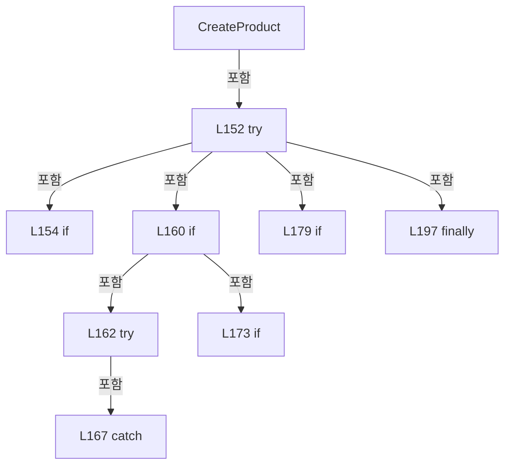

변경 전 점검: 입력/반환 타입, 위 호출자, 예외/취소 경로, 공유 상태와 저장·전송 소비자를 함께 확인합니다. 값의 단위나 물리 방향을 이름만으로 확정하지 않습니다.

### LocalFunctionStatement `SelectKey` · L142–145

[Drilling.Common/Product/CProductManager.cs:142–145](https://github.com/kjuws10-rgb/A3Drilling/blob/0219666f9053b907d96d7e0aa7d0c6c1be3a73d4/Drilling.Common/Product/CProductManager.cs#L142-L145)

| 항목 | 실제 추출 값 |
| --- | --- |
| 서명 | int SelectKey(System.Collections.Generic.KeyValuePair<int, int>) |
| 접근/수식자 | Private /  |
| 반환/값 타입 | int |
| 소속 타입 | NamedType:Drilling.Common.Product.CProductManager |

입력 계약:

| 이름 | 타입 | 전달 | 선택/기본값 |
| --- | --- | --- | --- |
| item | System.Collections.Generic.KeyValuePair<int, int> | None | False /  |

현재 부분 분석에서 직접 연결된 호출자는 없습니다. XAML/이벤트/인터페이스·델리게이트·외부 진입을 추가 확인해야 하며, 미사용으로 판정한 것이 아닙니다.

본문의 실제 연산·분기·예외·반환 순서(원문 위치 순):

| 원본 행 | 종류 | 주석 해설 |
| --- | --- | --- |
| 144 | return | 호출자에게 값 또는 제어를 반환합니다: return item.Key; |

변경 전 점검: 입력/반환 타입, 위 호출자, 예외/취소 경로, 공유 상태와 저장·전송 소비자를 함께 확인합니다. 값의 단위나 물리 방향을 이름만으로 확정하지 않습니다.

### LocalFunctionStatement `BuildProduct` · L147–150

[Drilling.Common/Product/CProductManager.cs:147–150](https://github.com/kjuws10-rgb/A3Drilling/blob/0219666f9053b907d96d7e0aa7d0c6c1be3a73d4/Drilling.Common/Product/CProductManager.cs#L147-L150)

| 항목 | 실제 추출 값 |
| --- | --- |
| 서명 | Drilling.Common.Product.ST_PRODUCT_HEAD_RESULT BuildProduct(System.Collections.Generic.KeyValuePair<int, int>) |
| 접근/수식자 | Private /  |
| 반환/값 타입 | Drilling.Common.Product.ST_PRODUCT_HEAD_RESULT |
| 소속 타입 | NamedType:Drilling.Common.Product.CProductManager |

입력 계약:

| 이름 | 타입 | 전달 | 선택/기본값 |
| --- | --- | --- | --- |
| item | System.Collections.Generic.KeyValuePair<int, int> | None | False /  |

현재 부분 분석에서 직접 연결된 호출자는 없습니다. XAML/이벤트/인터페이스·델리게이트·외부 진입을 추가 확인해야 하며, 미사용으로 판정한 것이 아닙니다.

호출하는 대상과 해석 범위:

| 원본 행 | 표현식 | 분석 상태 | 대상/소스 위치 |
| --- | --- | --- | --- |
| 149 | new ST_PRODUCT_HEAD_RESULT | resolved | Drilling.Common.Product.ST_PRODUCT_HEAD_RESULT.ST_PRODUCT_HEAD_RESULT(int, Drilling.Common.Product.EN_PRODUCT_HEAD_STATE, int, int, Drilling.Common.Product.EN_PRODUCT_RESULT, string, string, System.DateTimeOffset?, System.DateTimeOffset?) · Drilling.Common/Product/CProductManager.cs:980 |
| 149 | Math.Max | resolved | int System.Math.Max(int, int) |

본문의 실제 연산·분기·예외·반환 순서(원문 위치 순):

| 원본 행 | 종류 | 주석 해설 |
| --- | --- | --- |
| 149 | call | 함수·델리게이트 또는 객체 생성자를 호출합니다: new ST_PRODUCT_HEAD_RESULT(item.Key, item.Value > 0 ? EN_PRODUCT_HEAD_STATE.Ready : EN_PRODUCT_HEAD_STATE.Disabled, Math.Max(0, item.Value), 0, EN_PRODUCT_RESULT.Pending, "", "", null, null) |
| 149 | call | 함수·델리게이트 또는 객체 생성자를 호출합니다: Math.Max(0, item.Value) |
| 149 | conditional-expression | 조건에 따라 결과식을 선택합니다: item.Value > 0 ? EN_PRODUCT_HEAD_STATE.Ready : EN_PRODUCT_HEAD_STATE.Disabled |
| 149 | return | 호출자에게 값 또는 제어를 반환합니다: return new ST_PRODUCT_HEAD_RESULT(item.Key, item.Value > 0 ? EN_PRODUCT_HEAD_STATE.Ready : EN_PRODUCT_HEAD_STATE.Disabled, Math.Max(0, item.Value), 0, EN_PRODUCT_RESULT.Pending, "", "", null, null); |

변경 전 점검: 입력/반환 타입, 위 호출자, 예외/취소 경로, 공유 상태와 저장·전송 소비자를 함께 확인합니다. 값의 단위나 물리 방향을 이름만으로 확정하지 않습니다.

### MethodDeclaration `PrepareProductForProcess` · L203–238

[Drilling.Common/Product/CProductManager.cs:203–238](https://github.com/kjuws10-rgb/A3Drilling/blob/0219666f9053b907d96d7e0aa7d0c6c1be3a73d4/Drilling.Common/Product/CProductManager.cs#L203-L238)

| 항목 | 실제 추출 값 |
| --- | --- |
| 서명 | System.Threading.Tasks.Task<Drilling.Common.Product.ST_PRODUCT_DATA> Drilling.Common.Product.CProductManager.PrepareProductForProcess(string, string, string, System.Collections.Generic.IReadOnlyDictionary<string, string>, System.Collections.Generic.IReadOnlyDictionary<int, int>, System.Threading.CancellationToken) |
| 접근/수식자 | Public / public, async |
| 반환/값 타입 | System.Threading.Tasks.Task<Drilling.Common.Product.ST_PRODUCT_DATA> |
| 소속 타입 | NamedType:Drilling.Common.Product.CProductManager |

입력 계약:

| 이름 | 타입 | 전달 | 선택/기본값 |
| --- | --- | --- | --- |
| productId | string | None | False /  |
| processId | string | None | False /  |
| recipeId | string | None | False /  |
| parameters | System.Collections.Generic.IReadOnlyDictionary<string, string> | None | False /  |
| headPointCounts | System.Collections.Generic.IReadOnlyDictionary<int, int> | None | False /  |
| cancellationToken | System.Threading.CancellationToken | None | True / null |

현재 부분 분석에서 직접 연결된 호출자는 없습니다. XAML/이벤트/인터페이스·델리게이트·외부 진입을 추가 확인해야 하며, 미사용으로 판정한 것이 아닙니다.

호출하는 대상과 해석 범위:

| 원본 행 | 표현식 | 분석 상태 | 대상/소스 위치 |
| --- | --- | --- | --- |
| 212 | cancellationToken.ThrowIfCancellationRequested | resolved | void System.Threading.CancellationToken.ThrowIfCancellationRequested() |
| 213 | _updateGate.WaitAsync(cancellationToken).ConfigureAwait | resolved | System.Runtime.CompilerServices.ConfiguredTaskAwaitable System.Threading.Tasks.Task.ConfigureAwait(bool) |
| 213 | _updateGate.WaitAsync | resolved | System.Threading.Tasks.Task System.Threading.SemaphoreSlim.WaitAsync(System.Threading.CancellationToken) |
| 216 | GetCurrent | resolved | Drilling.Common.Product.ST_PRODUCT_DATA Drilling.Common.Product.CProductManager.GetCurrent(string) · Drilling.Common/Product/CProductManager.cs:775 |
| 219 | new InvalidOperationException | resolved | System.InvalidOperationException.InvalidOperationException(string?) |
| 222 | headPointCounts.OrderBy(item => item.Key).Select(item => new ST_PRODUCT_HEAD_RESULT(item.Key, item.Value > 0 ? EN_PRODUCT_HEAD_STATE.Ready : EN_PRODUCT_HEAD_STATE.Disabled, Math.Max(0, item.Value), 0, EN_PRODUCT_RESULT.Pending, "", "", null, null)).ToArray | resolved | Drilling.Common.Product.ST_PRODUCT_HEAD_RESULT[] System.Collections.Generic.IEnumerable<Drilling.Common.Product.ST_PRODUCT_HEAD_RESULT>.ToArray<Drilling.Common.Product.ST_PRODUCT_HEAD_RESULT>() |
| 222 | headPointCounts.OrderBy(item => item.Key).Select | resolved | System.Collections.Generic.IEnumerable<Drilling.Common.Product.ST_PRODUCT_HEAD_RESULT> System.Collections.Generic.IEnumerable<System.Collections.Generic.KeyValuePair<int, int>>.Select<System.Collections.Generic.KeyValuePair<int, int>, Drilling.Common.Product.ST_PRODUCT_HEAD_RESULT>(System.Func<System.Collections.Generic.KeyValuePair<int, int>, Drilling.Common.Product.ST_PRODUCT_HEAD_RESULT>) |
| 222 | headPointCounts.OrderBy | resolved | System.Linq.IOrderedEnumerable<System.Collections.Generic.KeyValuePair<int, int>> System.Collections.Generic.IEnumerable<System.Collections.Generic.KeyValuePair<int, int>>.OrderBy<System.Collections.Generic.KeyValuePair<int, int>, int>(System.Func<System.Collections.Generic.KeyValuePair<int, int>, int>) |
| 222 | new ST_PRODUCT_HEAD_RESULT | resolved | Drilling.Common.Product.ST_PRODUCT_HEAD_RESULT.ST_PRODUCT_HEAD_RESULT(int, Drilling.Common.Product.EN_PRODUCT_HEAD_STATE, int, int, Drilling.Common.Product.EN_PRODUCT_RESULT, string, string, System.DateTimeOffset?, System.DateTimeOffset?) · Drilling.Common/Product/CProductManager.cs:980 |
| 222 | Math.Max | resolved | int System.Math.Max(int, int) |
| 225 | SetProductState | resolved | Drilling.Common.Product.ST_PRODUCT_INFO Drilling.Common.Product.CProductManager.SetProductState(Drilling.Common.Product.ST_PRODUCT_INFO, Drilling.Common.Product.EN_PRODUCT_STATE, Drilling.Common.Product.EN_PRODUCT_RESULT, System.DateTimeOffset?, System.DateTimeOffset?) · Drilling.Common/Product/CProductManager.cs:857 |
| 225 | product.Product.Set("PROCESS_ID", processId).Set | resolved | Drilling.Common.Product.ST_PRODUCT_INFO Drilling.Common.Product.ST_PRODUCT_INFO.Set(string, string) · Drilling.Common/Product/CProductManager.cs:968 |
| 225 | product.Product.Set | resolved | Drilling.Common.Product.ST_PRODUCT_INFO Drilling.Common.Product.ST_PRODUCT_INFO.Set(string, string) · Drilling.Common/Product/CProductManager.cs:968 |
| 226 | new ST_PRODUCT_RECIPE_DATA | resolved | Drilling.Common.Product.ST_PRODUCT_RECIPE_DATA.ST_PRODUCT_RECIPE_DATA(System.Collections.Generic.IReadOnlyDictionary<string, string>) · Drilling.Common/Product/CProductManager.cs:978 |
| 226 | new Dictionary<string, string> | resolved | System.Collections.Generic.Dictionary<string, string>.Dictionary(System.Collections.Generic.IEnumerable<System.Collections.Generic.KeyValuePair<string, string>>, System.Collections.Generic.IEqualityComparer<string>?) |
| 227 | new ST_PRODUCT_ALIGN_DATA | resolved | Drilling.Common.Product.ST_PRODUCT_ALIGN_DATA.ST_PRODUCT_ALIGN_DATA(Drilling.Common.Product.EN_PRODUCT_PROCESS_STATE, string, double?, double?, double?) · Drilling.Common/Product/CProductManager.cs:940 |
| 228 | new ST_PRODUCT_DISTORTION_DATA | resolved | Drilling.Common.Product.ST_PRODUCT_DISTORTION_DATA.ST_PRODUCT_DISTORTION_DATA(Drilling.Common.Product.EN_PRODUCT_PROCESS_STATE, string, double?) · Drilling.Common/Product/CProductManager.cs:941 |
| 229 | new ST_PRODUCT_REVIEW_DATA | resolved | Drilling.Common.Product.ST_PRODUCT_REVIEW_DATA.ST_PRODUCT_REVIEW_DATA(Drilling.Common.Product.EN_PRODUCT_PROCESS_STATE, System.DateTimeOffset?, System.Collections.Generic.IReadOnlyList<Drilling.Common.Product.ST_PRODUCT_REVIEW_RESULT>) · Drilling.Common/Product/CProductManager.cs:947 |
| 230 | new ST_PRODUCT_RUNTIME_DATA | resolved | Drilling.Common.Product.ST_PRODUCT_RUNTIME_DATA.ST_PRODUCT_RUNTIME_DATA(System.Collections.Generic.IReadOnlyList<Drilling.Common.Product.ST_PRODUCT_HEAD_RESULT>) · Drilling.Common/Product/CProductManager.cs:979 |
| 232 | PersistAndLog | resolved | System.Threading.Tasks.Task<Drilling.Common.Product.ST_PRODUCT_DATA> Drilling.Common.Product.CProductManager.PersistAndLog(Drilling.Common.Product.ST_PRODUCT_DATA, string, string, System.Threading.CancellationToken) · Drilling.Common/Product/CProductManager.cs:790 |
| 236 | _updateGate.Release | resolved | int System.Threading.SemaphoreSlim.Release() |

본문의 실제 연산·분기·예외·반환 순서(원문 위치 순):

| 원본 행 | 종류 | 주석 해설 |
| --- | --- | --- |
| 212 | call | 함수·델리게이트 또는 객체 생성자를 호출합니다: cancellationToken.ThrowIfCancellationRequested() |
| 213 | await | 비동기 완료를 기다립니다: await _updateGate.WaitAsync(cancellationToken).ConfigureAwait(false) |
| 213 | call | 함수·델리게이트 또는 객체 생성자를 호출합니다: _updateGate.WaitAsync(cancellationToken).ConfigureAwait(false) |
| 213 | call | 함수·델리게이트 또는 객체 생성자를 호출합니다: _updateGate.WaitAsync(cancellationToken) |
| 214 | try | 예외 처리 범위입니다: try |
| 216 | call | 함수·델리게이트 또는 객체 생성자를 호출합니다: GetCurrent(productId) |
| 216 | local-declaration | 지역 변수를 선언합니다: var product = GetCurrent(productId); |
| 216 | variable-initializer | 변수의 초기값을 지정합니다: product = GetCurrent(productId) |
| 217 | if | 조건에 따라 분기합니다: if (product.State is EN_PRODUCT_STATE.Running or EN_PRODUCT_STATE.Scrapped) |
| 219 | call | 함수·델리게이트 또는 객체 생성자를 호출합니다: new InvalidOperationException($"Product '{productId}' cannot be assigned to a process while its state is {product.State}.") |
| 219 | throw | 예외를 발생/전달합니다: throw new InvalidOperationException($"Product '{productId}' cannot be assigned to a process while its state is {product.State}."); |
| 222 | call | 함수·델리게이트 또는 객체 생성자를 호출합니다: headPointCounts.OrderBy(item => item.Key).Select(item => new ST_PRODUCT_HEAD_RESULT(item.Key, item.Value > 0 ? EN_PRODUCT_HEAD_STATE.Ready : EN_PRODUCT_HEAD_STATE.Disabled, Math.Max(0, item.Value), 0, EN_PRODUCT_RESULT.P… |
| 222 | call | 함수·델리게이트 또는 객체 생성자를 호출합니다: headPointCounts.OrderBy(item => item.Key).Select(item => new ST_PRODUCT_HEAD_RESULT(item.Key, item.Value > 0 ? EN_PRODUCT_HEAD_STATE.Ready : EN_PRODUCT_HEAD_STATE.Disabled, Math.Max(0, item.Value), 0, EN_PRODUCT_RESULT.P… |
| 222 | call | 함수·델리게이트 또는 객체 생성자를 호출합니다: headPointCounts.OrderBy(item => item.Key) |
| 222 | call | 함수·델리게이트 또는 객체 생성자를 호출합니다: new ST_PRODUCT_HEAD_RESULT(item.Key, item.Value > 0 ? EN_PRODUCT_HEAD_STATE.Ready : EN_PRODUCT_HEAD_STATE.Disabled, Math.Max(0, item.Value), 0, EN_PRODUCT_RESULT.Pending, "", "", null, null) |
| 222 | call | 함수·델리게이트 또는 객체 생성자를 호출합니다: Math.Max(0, item.Value) |
| 222 | conditional-expression | 조건에 따라 결과식을 선택합니다: item.Value > 0 ? EN_PRODUCT_HEAD_STATE.Ready : EN_PRODUCT_HEAD_STATE.Disabled |
| 222 | local-declaration | 지역 변수를 선언합니다: var heads = headPointCounts.OrderBy(item => item.Key).Select(item => new ST_PRODUCT_HEAD_RESULT(item.Key, item.Value > 0 ? EN_PRODUCT_HEAD_STATE.Ready : EN_PRODUCT_HEAD_STATE.Disabled, Math.Max(0, item.Value), 0, EN_PRODUCT_RESULT |
| 222 | variable-initializer | 변수의 초기값을 지정합니다: heads = headPointCounts.OrderBy(item => item.Key).Select(item => new ST_PRODUCT_HEAD_RESULT(item.Key, item.Value > 0 ? EN_PRODUCT_HEAD_STATE.Ready : EN_PRODUCT_HEAD_STATE.Disabled, Math.Max(0, item.Value), 0, EN_PRODUCT_RESULT.Pen |
| 223 | local-declaration | 지역 변수를 선언합니다: var next = product with { Product = SetProductState(product.Product.Set("PROCESS_ID", processId).Set("PPID", recipeId), EN_PRODUCT_STATE.Created, EN_PRODUCT_RESULT.Pending, null, null), Recipe = new ST_PRODUCT_RECIPE_DATA(new Dict |
| 223 | variable-initializer | 변수의 초기값을 지정합니다: next = product with { Product = SetProductState(product.Product.Set("PROCESS_ID", processId).Set("PPID", recipeId), EN_PRODUCT_STATE.Created, EN_PRODUCT_RESULT.Pending, null, null), Recipe = new ST_PRODUCT_RECIPE_DATA(new Dictiona |
| 225 | assignment | 값을 대상에 대입합니다: Product = SetProductState(product.Product.Set("PROCESS_ID", processId).Set("PPID", recipeId), EN_PRODUCT_STATE.Created, EN_PRODUCT_RESULT.Pending, null, null) |
| 225 | call | 함수·델리게이트 또는 객체 생성자를 호출합니다: SetProductState(product.Product.Set("PROCESS_ID", processId).Set("PPID", recipeId), EN_PRODUCT_STATE.Created, EN_PRODUCT_RESULT.Pending, null, null) |
| 225 | call | 함수·델리게이트 또는 객체 생성자를 호출합니다: product.Product.Set("PROCESS_ID", processId).Set("PPID", recipeId) |
| 225 | call | 함수·델리게이트 또는 객체 생성자를 호출합니다: product.Product.Set("PROCESS_ID", processId) |
| 226 | assignment | 값을 대상에 대입합니다: Recipe = new ST_PRODUCT_RECIPE_DATA(new Dictionary<string, string>(parameters, StringComparer.OrdinalIgnoreCase)) |
| 226 | call | 함수·델리게이트 또는 객체 생성자를 호출합니다: new ST_PRODUCT_RECIPE_DATA(new Dictionary<string, string>(parameters, StringComparer.OrdinalIgnoreCase)) |
| 226 | call | 함수·델리게이트 또는 객체 생성자를 호출합니다: new Dictionary<string, string>(parameters, StringComparer.OrdinalIgnoreCase) |
| 227 | assignment | 값을 대상에 대입합니다: Align = new ST_PRODUCT_ALIGN_DATA(EN_PRODUCT_PROCESS_STATE.NotStarted, "PENDING", null, null, null) |
| 227 | call | 함수·델리게이트 또는 객체 생성자를 호출합니다: new ST_PRODUCT_ALIGN_DATA(EN_PRODUCT_PROCESS_STATE.NotStarted, "PENDING", null, null, null) |
| 228 | assignment | 값을 대상에 대입합니다: Distortion = new ST_PRODUCT_DISTORTION_DATA(EN_PRODUCT_PROCESS_STATE.NotStarted, "PENDING", null) |
| 228 | call | 함수·델리게이트 또는 객체 생성자를 호출합니다: new ST_PRODUCT_DISTORTION_DATA(EN_PRODUCT_PROCESS_STATE.NotStarted, "PENDING", null) |
| 229 | assignment | 값을 대상에 대입합니다: Review = new ST_PRODUCT_REVIEW_DATA(EN_PRODUCT_PROCESS_STATE.NotStarted, null, []) |
| 229 | call | 함수·델리게이트 또는 객체 생성자를 호출합니다: new ST_PRODUCT_REVIEW_DATA(EN_PRODUCT_PROCESS_STATE.NotStarted, null, []) |
| 230 | assignment | 값을 대상에 대입합니다: Runtime = new ST_PRODUCT_RUNTIME_DATA(heads) |
| 230 | call | 함수·델리게이트 또는 객체 생성자를 호출합니다: new ST_PRODUCT_RUNTIME_DATA(heads) |
| 232 | await | 비동기 완료를 기다립니다: await PersistAndLog(next, "PROCESS ASSIGN", $"Product assigned to process {processId}.", cancellationToken) |
| 232 | call | 함수·델리게이트 또는 객체 생성자를 호출합니다: PersistAndLog(next, "PROCESS ASSIGN", $"Product assigned to process {processId}.", cancellationToken) |
| 232 | return | 호출자에게 값 또는 제어를 반환합니다: return await PersistAndLog(next, "PROCESS ASSIGN", $"Product assigned to process {processId}.", cancellationToken); |
| 234 | finally | 종료 정리 구간입니다: finally |
| 236 | call | 함수·델리게이트 또는 객체 생성자를 호출합니다: _updateGate.Release() |

제어 구문의 포함 구조(실제 실행 순서/CFG가 아닌 구문 탐색 그림):

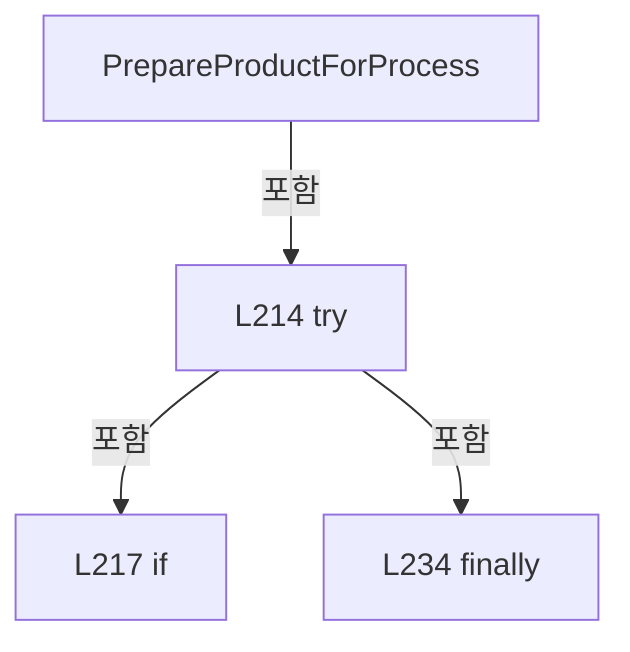

변경 전 점검: 입력/반환 타입, 위 호출자, 예외/취소 경로, 공유 상태와 저장·전송 소비자를 함께 확인합니다. 값의 단위나 물리 방향을 이름만으로 확정하지 않습니다.

### MethodDeclaration `StartProduct` · L240–276

[Drilling.Common/Product/CProductManager.cs:240–276](https://github.com/kjuws10-rgb/A3Drilling/blob/0219666f9053b907d96d7e0aa7d0c6c1be3a73d4/Drilling.Common/Product/CProductManager.cs#L240-L276)

| 항목 | 실제 추출 값 |
| --- | --- |
| 서명 | System.Threading.Tasks.Task<Drilling.Common.Product.ST_PRODUCT_DATA> Drilling.Common.Product.CProductManager.StartProduct(string, System.Threading.CancellationToken) |
| 접근/수식자 | Public / public, async |
| 반환/값 타입 | System.Threading.Tasks.Task<Drilling.Common.Product.ST_PRODUCT_DATA> |
| 소속 타입 | NamedType:Drilling.Common.Product.CProductManager |

입력 계약:

| 이름 | 타입 | 전달 | 선택/기본값 |
| --- | --- | --- | --- |
| productId | string | None | False /  |
| cancellationToken | System.Threading.CancellationToken | None | True / null |

현재 부분 분석에서 직접 연결된 호출자는 없습니다. XAML/이벤트/인터페이스·델리게이트·외부 진입을 추가 확인해야 하며, 미사용으로 판정한 것이 아닙니다.

호출하는 대상과 해석 범위:

| 원본 행 | 표현식 | 분석 상태 | 대상/소스 위치 |
| --- | --- | --- | --- |
| 242 | cancellationToken.ThrowIfCancellationRequested | resolved | void System.Threading.CancellationToken.ThrowIfCancellationRequested() |
| 243 | _updateGate.WaitAsync(cancellationToken).ConfigureAwait | resolved | System.Runtime.CompilerServices.ConfiguredTaskAwaitable System.Threading.Tasks.Task.ConfigureAwait(bool) |
| 243 | _updateGate.WaitAsync | resolved | System.Threading.Tasks.Task System.Threading.SemaphoreSlim.WaitAsync(System.Threading.CancellationToken) |
| 246 | GetCurrent | resolved | Drilling.Common.Product.ST_PRODUCT_DATA Drilling.Common.Product.CProductManager.GetCurrent(string) · Drilling.Common/Product/CProductManager.cs:775 |
| 264 | SetProductState | resolved | Drilling.Common.Product.ST_PRODUCT_INFO Drilling.Common.Product.CProductManager.SetProductState(Drilling.Common.Product.ST_PRODUCT_INFO, Drilling.Common.Product.EN_PRODUCT_STATE, Drilling.Common.Product.EN_PRODUCT_RESULT, System.DateTimeOffset?, System.DateTimeOffset?) · Drilling.Common/Product/CProductManager.cs:857 |
| 267 | product.Heads.Select(SelectItem).ToArray | resolved | Drilling.Common.Product.ST_PRODUCT_HEAD_RESULT[] System.Collections.Generic.IEnumerable<Drilling.Common.Product.ST_PRODUCT_HEAD_RESULT>.ToArray<Drilling.Common.Product.ST_PRODUCT_HEAD_RESULT>() |
| 267 | product.Heads.Select | resolved | System.Collections.Generic.IEnumerable<Drilling.Common.Product.ST_PRODUCT_HEAD_RESULT> System.Collections.Generic.IEnumerable<Drilling.Common.Product.ST_PRODUCT_HEAD_RESULT>.Select<Drilling.Common.Product.ST_PRODUCT_HEAD_RESULT, Drilling.Common.Product.ST_PRODUCT_HEAD_RESULT>(System.Func<Drilling.Common.Product.ST_PRODUCT_HEAD_RESULT, Drilling.Common.Product.ST_PRODUCT_HEAD_RESULT>) |
| 270 | PersistAndLog | resolved | System.Threading.Tasks.Task<Drilling.Common.Product.ST_PRODUCT_DATA> Drilling.Common.Product.CProductManager.PersistAndLog(Drilling.Common.Product.ST_PRODUCT_DATA, string, string, System.Threading.CancellationToken) · Drilling.Common/Product/CProductManager.cs:790 |
| 274 | _updateGate.Release | resolved | int System.Threading.SemaphoreSlim.Release() |

본문의 실제 연산·분기·예외·반환 순서(원문 위치 순):

| 원본 행 | 종류 | 주석 해설 |
| --- | --- | --- |
| 242 | call | 함수·델리게이트 또는 객체 생성자를 호출합니다: cancellationToken.ThrowIfCancellationRequested() |
| 243 | await | 비동기 완료를 기다립니다: await _updateGate.WaitAsync(cancellationToken).ConfigureAwait(false) |
| 243 | call | 함수·델리게이트 또는 객체 생성자를 호출합니다: _updateGate.WaitAsync(cancellationToken).ConfigureAwait(false) |
| 243 | call | 함수·델리게이트 또는 객체 생성자를 호출합니다: _updateGate.WaitAsync(cancellationToken) |
| 244 | try | 예외 처리 범위입니다: try |
| 246 | call | 함수·델리게이트 또는 객체 생성자를 호출합니다: GetCurrent(productId) |
| 246 | local-declaration | 지역 변수를 선언합니다: var product = GetCurrent(productId); |
| 246 | variable-initializer | 변수의 초기값을 지정합니다: product = GetCurrent(productId) |
| 247 | local-declaration | 지역 변수를 선언합니다: var now = DateTimeOffset.Now; |
| 247 | variable-initializer | 변수의 초기값을 지정합니다: now = DateTimeOffset.Now |
| 262 | local-declaration | 지역 변수를 선언합니다: var next = product with { Product = SetProductState(product.Product, EN_PRODUCT_STATE.Running, EN_PRODUCT_RESULT.Pending, product.StartedAt ?? now, null), Runtime = product.Runtime with { Heads = product.Heads.Select(SelectItem).T |
| 262 | variable-initializer | 변수의 초기값을 지정합니다: next = product with { Product = SetProductState(product.Product, EN_PRODUCT_STATE.Running, EN_PRODUCT_RESULT.Pending, product.StartedAt ?? now, null), Runtime = product.Runtime with { Heads = product.Heads.Select(SelectItem).ToArr |
| 264 | assignment | 값을 대상에 대입합니다: Product = SetProductState(product.Product, EN_PRODUCT_STATE.Running, EN_PRODUCT_RESULT.Pending, product.StartedAt ?? now, null) |
| 264 | call | 함수·델리게이트 또는 객체 생성자를 호출합니다: SetProductState(product.Product, EN_PRODUCT_STATE.Running, EN_PRODUCT_RESULT.Pending, product.StartedAt ?? now, null) |
| 265 | assignment | 값을 대상에 대입합니다: Runtime = product.Runtime with { Heads = product.Heads.Select(SelectItem).ToArray() } |
| 267 | assignment | 값을 대상에 대입합니다: Heads = product.Heads.Select(SelectItem).ToArray() |
| 267 | call | 함수·델리게이트 또는 객체 생성자를 호출합니다: product.Heads.Select(SelectItem).ToArray() |
| 267 | call | 함수·델리게이트 또는 객체 생성자를 호출합니다: product.Heads.Select(SelectItem) |
| 270 | await | 비동기 완료를 기다립니다: await PersistAndLog(next, "START", "Product started.", cancellationToken) |
| 270 | call | 함수·델리게이트 또는 객체 생성자를 호출합니다: PersistAndLog(next, "START", "Product started.", cancellationToken) |
| 270 | return | 호출자에게 값 또는 제어를 반환합니다: return await PersistAndLog(next, "START", "Product started.", cancellationToken); |
| 272 | finally | 종료 정리 구간입니다: finally |
| 274 | call | 함수·델리게이트 또는 객체 생성자를 호출합니다: _updateGate.Release() |

제어 구문의 포함 구조(실제 실행 순서/CFG가 아닌 구문 탐색 그림):

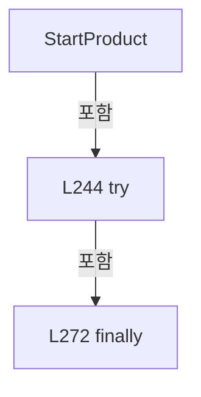

변경 전 점검: 입력/반환 타입, 위 호출자, 예외/취소 경로, 공유 상태와 저장·전송 소비자를 함께 확인합니다. 값의 단위나 물리 방향을 이름만으로 확정하지 않습니다.

### LocalFunctionStatement `SelectItem` · L248–260

[Drilling.Common/Product/CProductManager.cs:248–260](https://github.com/kjuws10-rgb/A3Drilling/blob/0219666f9053b907d96d7e0aa7d0c6c1be3a73d4/Drilling.Common/Product/CProductManager.cs#L248-L260)

| 항목 | 실제 추출 값 |
| --- | --- |
| 서명 | Drilling.Common.Product.ST_PRODUCT_HEAD_RESULT SelectItem(Drilling.Common.Product.ST_PRODUCT_HEAD_RESULT) |
| 접근/수식자 | Private /  |
| 반환/값 타입 | Drilling.Common.Product.ST_PRODUCT_HEAD_RESULT |
| 소속 타입 | NamedType:Drilling.Common.Product.CProductManager |

입력 계약:

| 이름 | 타입 | 전달 | 선택/기본값 |
| --- | --- | --- | --- |
| head | Drilling.Common.Product.ST_PRODUCT_HEAD_RESULT | None | False /  |

현재 부분 분석에서 직접 연결된 호출자는 없습니다. XAML/이벤트/인터페이스·델리게이트·외부 진입을 추가 확인해야 하며, 미사용으로 판정한 것이 아닙니다.

본문의 실제 연산·분기·예외·반환 순서(원문 위치 순):

| 원본 행 | 종류 | 주석 해설 |
| --- | --- | --- |
| 250 | conditional-expression | 조건에 따라 결과식을 선택합니다: head.TotalPoints > 0 ? head with { State = EN_PRODUCT_HEAD_STATE.Running, StartedAt = head.StartedAt ?? now } : head with { State = EN_PRODUCT_HEAD_STATE.Disabled } |
| 250 | return | 호출자에게 값 또는 제어를 반환합니다: return head.TotalPoints > 0 ? head with { State = EN_PRODUCT_HEAD_STATE.Running, StartedAt = head.StartedAt ?? now } : head with { State = EN_PRODUCT_HEAD_STATE.Disabled }; |
| 252 | assignment | 값을 대상에 대입합니다: State = EN_PRODUCT_HEAD_STATE.Running |
| 253 | assignment | 값을 대상에 대입합니다: StartedAt = head.StartedAt ?? now |
| 258 | assignment | 값을 대상에 대입합니다: State = EN_PRODUCT_HEAD_STATE.Disabled |

변경 전 점검: 입력/반환 타입, 위 호출자, 예외/취소 경로, 공유 상태와 저장·전송 소비자를 함께 확인합니다. 값의 단위나 물리 방향을 이름만으로 확정하지 않습니다.

### MethodDeclaration `SetProductInfo` · L278–312

[Drilling.Common/Product/CProductManager.cs:278–312](https://github.com/kjuws10-rgb/A3Drilling/blob/0219666f9053b907d96d7e0aa7d0c6c1be3a73d4/Drilling.Common/Product/CProductManager.cs#L278-L312)

| 항목 | 실제 추출 값 |
| --- | --- |
| 서명 | System.Threading.Tasks.Task<Drilling.Common.Product.ST_PRODUCT_DATA> Drilling.Common.Product.CProductManager.SetProductInfo(string, System.Collections.Generic.IReadOnlyDictionary<string, string>, System.Threading.CancellationToken) |
| 접근/수식자 | Public / public, async |
| 반환/값 타입 | System.Threading.Tasks.Task<Drilling.Common.Product.ST_PRODUCT_DATA> |
| 소속 타입 | NamedType:Drilling.Common.Product.CProductManager |

입력 계약:

| 이름 | 타입 | 전달 | 선택/기본값 |
| --- | --- | --- | --- |
| productId | string | None | False /  |
| values | System.Collections.Generic.IReadOnlyDictionary<string, string> | None | False /  |
| cancellationToken | System.Threading.CancellationToken | None | True / null |

현재 부분 분석에서 직접 연결된 호출자는 없습니다. XAML/이벤트/인터페이스·델리게이트·외부 진입을 추가 확인해야 하며, 미사용으로 판정한 것이 아닙니다.

호출하는 대상과 해석 범위:

| 원본 행 | 표현식 | 분석 상태 | 대상/소스 위치 |
| --- | --- | --- | --- |
| 280 | cancellationToken.ThrowIfCancellationRequested | resolved | void System.Threading.CancellationToken.ThrowIfCancellationRequested() |
| 281 | _updateGate.WaitAsync(cancellationToken).ConfigureAwait | resolved | System.Runtime.CompilerServices.ConfiguredTaskAwaitable System.Threading.Tasks.Task.ConfigureAwait(bool) |
| 281 | _updateGate.WaitAsync | resolved | System.Threading.Tasks.Task System.Threading.SemaphoreSlim.WaitAsync(System.Threading.CancellationToken) |
| 289 | values.Keys.Where(ShouldIncludeItem).ToArray | resolved | string[] System.Collections.Generic.IEnumerable<string>.ToArray<string>() |
| 289 | values.Keys.Where | resolved | System.Collections.Generic.IEnumerable<string> System.Collections.Generic.IEnumerable<string>.Where<string>(System.Func<string, bool>) |
| 292 | new ArgumentException | resolved | System.ArgumentException.ArgumentException(string?, string?) |
| 292 | string.Join | resolved | string string.Join(string?, params string?[]) |
| 292 | nameof | unresolved | None |
| 295 | GetCurrent | resolved | Drilling.Common.Product.ST_PRODUCT_DATA Drilling.Common.Product.CProductManager.GetCurrent(string) · Drilling.Common/Product/CProductManager.cs:775 |
| 299 | productInfo.Set | resolved | Drilling.Common.Product.ST_PRODUCT_INFO Drilling.Common.Product.ST_PRODUCT_INFO.Set(string, string) · Drilling.Common/Product/CProductManager.cs:968 |
| 306 | PersistAndLog | resolved | System.Threading.Tasks.Task<Drilling.Common.Product.ST_PRODUCT_DATA> Drilling.Common.Product.CProductManager.PersistAndLog(Drilling.Common.Product.ST_PRODUCT_DATA, string, string, System.Threading.CancellationToken) · Drilling.Common/Product/CProductManager.cs:790 |
| 310 | _updateGate.Release | resolved | int System.Threading.SemaphoreSlim.Release() |

본문의 실제 연산·분기·예외·반환 순서(원문 위치 순):

| 원본 행 | 종류 | 주석 해설 |
| --- | --- | --- |
| 280 | call | 함수·델리게이트 또는 객체 생성자를 호출합니다: cancellationToken.ThrowIfCancellationRequested() |
| 281 | await | 비동기 완료를 기다립니다: await _updateGate.WaitAsync(cancellationToken).ConfigureAwait(false) |
| 281 | call | 함수·델리게이트 또는 객체 생성자를 호출합니다: _updateGate.WaitAsync(cancellationToken).ConfigureAwait(false) |
| 281 | call | 함수·델리게이트 또는 객체 생성자를 호출합니다: _updateGate.WaitAsync(cancellationToken) |
| 287 | try | 예외 처리 범위입니다: try |
| 289 | call | 함수·델리게이트 또는 객체 생성자를 호출합니다: values.Keys.Where(ShouldIncludeItem).ToArray() |
| 289 | call | 함수·델리게이트 또는 객체 생성자를 호출합니다: values.Keys.Where(ShouldIncludeItem) |
| 289 | local-declaration | 지역 변수를 선언합니다: var invalidFields = values.Keys.Where(ShouldIncludeItem).ToArray(); |
| 289 | variable-initializer | 변수의 초기값을 지정합니다: invalidFields = values.Keys.Where(ShouldIncludeItem).ToArray() |
| 290 | if | 조건에 따라 분기합니다: if (invalidFields.Length > 0) |
| 292 | call | 함수·델리게이트 또는 객체 생성자를 호출합니다: new ArgumentException($"Product information contains fields that cannot be changed by SetProductInfo: {string.Join(", ", invalidFields)}", nameof(values)) |
| 292 | call | 함수·델리게이트 또는 객체 생성자를 호출합니다: string.Join(", ", invalidFields) |
| 292 | call | 함수·델리게이트 또는 객체 생성자를 호출합니다: nameof(values) |
| 292 | throw | 예외를 발생/전달합니다: throw new ArgumentException($"Product information contains fields that cannot be changed by SetProductInfo: {string.Join(", ", invalidFields)}", nameof(values)); |
| 295 | call | 함수·델리게이트 또는 객체 생성자를 호출합니다: GetCurrent(productId) |
| 295 | local-declaration | 지역 변수를 선언합니다: var product = GetCurrent(productId); |
| 295 | variable-initializer | 변수의 초기값을 지정합니다: product = GetCurrent(productId) |
| 296 | local-declaration | 지역 변수를 선언합니다: var productInfo = product.Product; |
| 296 | variable-initializer | 변수의 초기값을 지정합니다: productInfo = product.Product |
| 297 | foreach | 컬렉션 요소를 순회합니다: foreach (var item in values) |
| 299 | assignment | 값을 대상에 대입합니다: productInfo = productInfo.Set(item.Key, item.Value) |
| 299 | call | 함수·델리게이트 또는 객체 생성자를 호출합니다: productInfo.Set(item.Key, item.Value) |
| 302 | local-declaration | 지역 변수를 선언합니다: var next = product with { Product = productInfo }; |
| 302 | variable-initializer | 변수의 초기값을 지정합니다: next = product with { Product = productInfo } |
| 304 | assignment | 값을 대상에 대입합니다: Product = productInfo |
| 306 | await | 비동기 완료를 기다립니다: await PersistAndLog(next, "PRODUCT INFO UPDATE", "Product information updated.", cancellationToken) |
| 306 | call | 함수·델리게이트 또는 객체 생성자를 호출합니다: PersistAndLog(next, "PRODUCT INFO UPDATE", "Product information updated.", cancellationToken) |
| 306 | return | 호출자에게 값 또는 제어를 반환합니다: return await PersistAndLog(next, "PRODUCT INFO UPDATE", "Product information updated.", cancellationToken); |
| 308 | finally | 종료 정리 구간입니다: finally |
| 310 | call | 함수·델리게이트 또는 객체 생성자를 호출합니다: _updateGate.Release() |

제어 구문의 포함 구조(실제 실행 순서/CFG가 아닌 구문 탐색 그림):

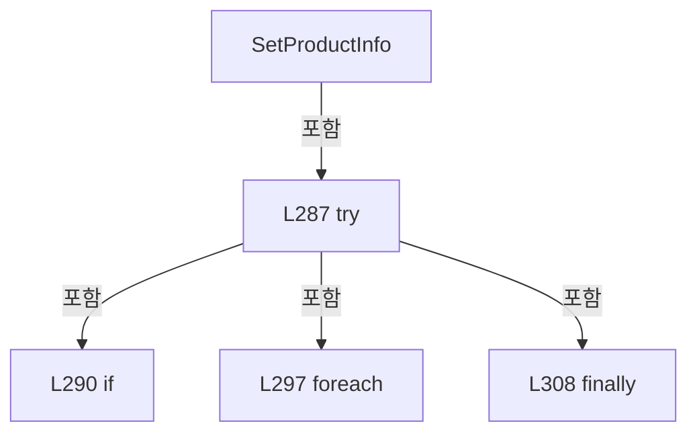

변경 전 점검: 입력/반환 타입, 위 호출자, 예외/취소 경로, 공유 상태와 저장·전송 소비자를 함께 확인합니다. 값의 단위나 물리 방향을 이름만으로 확정하지 않습니다.

### LocalFunctionStatement `ShouldIncludeItem` · L282–285

[Drilling.Common/Product/CProductManager.cs:282–285](https://github.com/kjuws10-rgb/A3Drilling/blob/0219666f9053b907d96d7e0aa7d0c6c1be3a73d4/Drilling.Common/Product/CProductManager.cs#L282-L285)

| 항목 | 실제 추출 값 |
| --- | --- |
| 서명 | bool ShouldIncludeItem(string) |
| 접근/수식자 | Private /  |
| 반환/값 타입 | bool |
| 소속 타입 | NamedType:Drilling.Common.Product.CProductManager |

입력 계약:

| 이름 | 타입 | 전달 | 선택/기본값 |
| --- | --- | --- | --- |
| key | string | None | False /  |

현재 부분 분석에서 직접 연결된 호출자는 없습니다. XAML/이벤트/인터페이스·델리게이트·외부 진입을 추가 확인해야 하며, 미사용으로 판정한 것이 아닙니다.

호출하는 대상과 해석 범위:

| 원본 행 | 표현식 | 분석 상태 | 대상/소스 위치 |
| --- | --- | --- | --- |
| 284 | HostWritableProductFieldNames.Contains | resolved · 동적 구현 선택 가능 | bool System.Collections.Generic.IReadOnlySet<string>.Contains(string) |

본문의 실제 연산·분기·예외·반환 순서(원문 위치 순):

| 원본 행 | 종류 | 주석 해설 |
| --- | --- | --- |
| 284 | call | 함수·델리게이트 또는 객체 생성자를 호출합니다: HostWritableProductFieldNames.Contains(key) |
| 284 | return | 호출자에게 값 또는 제어를 반환합니다: return !HostWritableProductFieldNames.Contains(key); |

변경 전 점검: 입력/반환 타입, 위 호출자, 예외/취소 경로, 공유 상태와 저장·전송 소비자를 함께 확인합니다. 값의 단위나 물리 방향을 이름만으로 확정하지 않습니다.

### MethodDeclaration `SetHeadRunning` · L314–346

[Drilling.Common/Product/CProductManager.cs:314–346](https://github.com/kjuws10-rgb/A3Drilling/blob/0219666f9053b907d96d7e0aa7d0c6c1be3a73d4/Drilling.Common/Product/CProductManager.cs#L314-L346)

| 항목 | 실제 추출 값 |
| --- | --- |
| 서명 | System.Threading.Tasks.Task<Drilling.Common.Product.ST_PRODUCT_DATA> Drilling.Common.Product.CProductManager.SetHeadRunning(string, int, System.Threading.CancellationToken) |
| 접근/수식자 | Public / public, async |
| 반환/값 타입 | System.Threading.Tasks.Task<Drilling.Common.Product.ST_PRODUCT_DATA> |
| 소속 타입 | NamedType:Drilling.Common.Product.CProductManager |

입력 계약:

| 이름 | 타입 | 전달 | 선택/기본값 |
| --- | --- | --- | --- |
| productId | string | None | False /  |
| headNo | int | None | False /  |
| cancellationToken | System.Threading.CancellationToken | None | True / null |

현재 부분 분석에서 직접 연결된 호출자는 없습니다. XAML/이벤트/인터페이스·델리게이트·외부 진입을 추가 확인해야 하며, 미사용으로 판정한 것이 아닙니다.

호출하는 대상과 해석 범위:

| 원본 행 | 표현식 | 분석 상태 | 대상/소스 위치 |
| --- | --- | --- | --- |
| 316 | cancellationToken.ThrowIfCancellationRequested | resolved | void System.Threading.CancellationToken.ThrowIfCancellationRequested() |
| 317 | _updateGate.WaitAsync(cancellationToken).ConfigureAwait | resolved | System.Runtime.CompilerServices.ConfiguredTaskAwaitable System.Threading.Tasks.Task.ConfigureAwait(bool) |
| 317 | _updateGate.WaitAsync | resolved | System.Threading.Tasks.Task System.Threading.SemaphoreSlim.WaitAsync(System.Threading.CancellationToken) |
| 320 | GetCurrent | resolved | Drilling.Common.Product.ST_PRODUCT_DATA Drilling.Common.Product.CProductManager.GetCurrent(string) · Drilling.Common/Product/CProductManager.cs:775 |
| 337 | product.Heads.Select(SelectItem).ToArray | resolved | Drilling.Common.Product.ST_PRODUCT_HEAD_RESULT[] System.Collections.Generic.IEnumerable<Drilling.Common.Product.ST_PRODUCT_HEAD_RESULT>.ToArray<Drilling.Common.Product.ST_PRODUCT_HEAD_RESULT>() |
| 337 | product.Heads.Select | resolved | System.Collections.Generic.IEnumerable<Drilling.Common.Product.ST_PRODUCT_HEAD_RESULT> System.Collections.Generic.IEnumerable<Drilling.Common.Product.ST_PRODUCT_HEAD_RESULT>.Select<Drilling.Common.Product.ST_PRODUCT_HEAD_RESULT, Drilling.Common.Product.ST_PRODUCT_HEAD_RESULT>(System.Func<Drilling.Common.Product.ST_PRODUCT_HEAD_RESULT, Drilling.Common.Product.ST_PRODUCT_HEAD_RESULT>) |
| 340 | PersistAndLog | resolved | System.Threading.Tasks.Task<Drilling.Common.Product.ST_PRODUCT_DATA> Drilling.Common.Product.CProductManager.PersistAndLog(Drilling.Common.Product.ST_PRODUCT_DATA, string, string, System.Threading.CancellationToken) · Drilling.Common/Product/CProductManager.cs:790 |
| 344 | _updateGate.Release | resolved | int System.Threading.SemaphoreSlim.Release() |

본문의 실제 연산·분기·예외·반환 순서(원문 위치 순):

| 원본 행 | 종류 | 주석 해설 |
| --- | --- | --- |
| 316 | call | 함수·델리게이트 또는 객체 생성자를 호출합니다: cancellationToken.ThrowIfCancellationRequested() |
| 317 | await | 비동기 완료를 기다립니다: await _updateGate.WaitAsync(cancellationToken).ConfigureAwait(false) |
| 317 | call | 함수·델리게이트 또는 객체 생성자를 호출합니다: _updateGate.WaitAsync(cancellationToken).ConfigureAwait(false) |
| 317 | call | 함수·델리게이트 또는 객체 생성자를 호출합니다: _updateGate.WaitAsync(cancellationToken) |
| 318 | try | 예외 처리 범위입니다: try |
| 320 | call | 함수·델리게이트 또는 객체 생성자를 호출합니다: GetCurrent(productId) |
| 320 | local-declaration | 지역 변수를 선언합니다: var product = GetCurrent(productId); |
| 320 | variable-initializer | 변수의 초기값을 지정합니다: product = GetCurrent(productId) |
| 321 | local-declaration | 지역 변수를 선언합니다: var now = DateTimeOffset.Now; |
| 321 | variable-initializer | 변수의 초기값을 지정합니다: now = DateTimeOffset.Now |
| 333 | local-declaration | 지역 변수를 선언합니다: var next = product with { Runtime = product.Runtime with { Heads = product.Heads.Select(SelectItem).ToArray() } }; |
| 333 | variable-initializer | 변수의 초기값을 지정합니다: next = product with { Runtime = product.Runtime with { Heads = product.Heads.Select(SelectItem).ToArray() } } |
| 335 | assignment | 값을 대상에 대입합니다: Runtime = product.Runtime with { Heads = product.Heads.Select(SelectItem).ToArray() } |
| 337 | assignment | 값을 대상에 대입합니다: Heads = product.Heads.Select(SelectItem).ToArray() |
| 337 | call | 함수·델리게이트 또는 객체 생성자를 호출합니다: product.Heads.Select(SelectItem).ToArray() |
| 337 | call | 함수·델리게이트 또는 객체 생성자를 호출합니다: product.Heads.Select(SelectItem) |
| 340 | await | 비동기 완료를 기다립니다: await PersistAndLog(next, "HEAD START", $"Head {headNo:00} started.", cancellationToken) |
| 340 | call | 함수·델리게이트 또는 객체 생성자를 호출합니다: PersistAndLog(next, "HEAD START", $"Head {headNo:00} started.", cancellationToken) |
| 340 | return | 호출자에게 값 또는 제어를 반환합니다: return await PersistAndLog(next, "HEAD START", $"Head {headNo:00} started.", cancellationToken); |
| 342 | finally | 종료 정리 구간입니다: finally |
| 344 | call | 함수·델리게이트 또는 객체 생성자를 호출합니다: _updateGate.Release() |

제어 구문의 포함 구조(실제 실행 순서/CFG가 아닌 구문 탐색 그림):

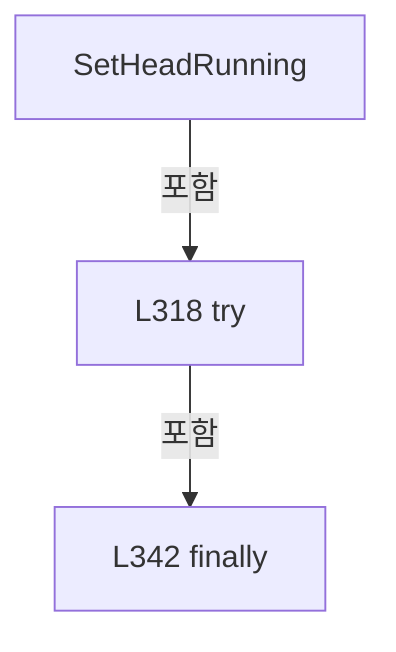

변경 전 점검: 입력/반환 타입, 위 호출자, 예외/취소 경로, 공유 상태와 저장·전송 소비자를 함께 확인합니다. 값의 단위나 물리 방향을 이름만으로 확정하지 않습니다.

### LocalFunctionStatement `SelectItem` · L322–331

[Drilling.Common/Product/CProductManager.cs:322–331](https://github.com/kjuws10-rgb/A3Drilling/blob/0219666f9053b907d96d7e0aa7d0c6c1be3a73d4/Drilling.Common/Product/CProductManager.cs#L322-L331)

| 항목 | 실제 추출 값 |
| --- | --- |
| 서명 | Drilling.Common.Product.ST_PRODUCT_HEAD_RESULT SelectItem(Drilling.Common.Product.ST_PRODUCT_HEAD_RESULT) |
| 접근/수식자 | Private /  |
| 반환/값 타입 | Drilling.Common.Product.ST_PRODUCT_HEAD_RESULT |
| 소속 타입 | NamedType:Drilling.Common.Product.CProductManager |

입력 계약:

| 이름 | 타입 | 전달 | 선택/기본값 |
| --- | --- | --- | --- |
| head | Drilling.Common.Product.ST_PRODUCT_HEAD_RESULT | None | False /  |

현재 부분 분석에서 직접 연결된 호출자는 없습니다. XAML/이벤트/인터페이스·델리게이트·외부 진입을 추가 확인해야 하며, 미사용으로 판정한 것이 아닙니다.

본문의 실제 연산·분기·예외·반환 순서(원문 위치 순):

| 원본 행 | 종류 | 주석 해설 |
| --- | --- | --- |
| 324 | conditional-expression | 조건에 따라 결과식을 선택합니다: head.HeadNo == headNo ? head with { State = EN_PRODUCT_HEAD_STATE.Running, StartedAt = head.StartedAt ?? now } : head |
| 324 | return | 호출자에게 값 또는 제어를 반환합니다: return head.HeadNo == headNo ? head with { State = EN_PRODUCT_HEAD_STATE.Running, StartedAt = head.StartedAt ?? now } : head; |
| 326 | assignment | 값을 대상에 대입합니다: State = EN_PRODUCT_HEAD_STATE.Running |
| 327 | assignment | 값을 대상에 대입합니다: StartedAt = head.StartedAt ?? now |

변경 전 점검: 입력/반환 타입, 위 호출자, 예외/취소 경로, 공유 상태와 저장·전송 소비자를 함께 확인합니다. 값의 단위나 물리 방향을 이름만으로 확정하지 않습니다.

### MethodDeclaration `SetHeadResult` · L348–385

[Drilling.Common/Product/CProductManager.cs:348–385](https://github.com/kjuws10-rgb/A3Drilling/blob/0219666f9053b907d96d7e0aa7d0c6c1be3a73d4/Drilling.Common/Product/CProductManager.cs#L348-L385)

| 항목 | 실제 추출 값 |
| --- | --- |
| 서명 | System.Threading.Tasks.Task<Drilling.Common.Product.ST_PRODUCT_DATA> Drilling.Common.Product.CProductManager.SetHeadResult(string, int, bool, string, string, System.Threading.CancellationToken) |
| 접근/수식자 | Public / public, async |
| 반환/값 타입 | System.Threading.Tasks.Task<Drilling.Common.Product.ST_PRODUCT_DATA> |
| 소속 타입 | NamedType:Drilling.Common.Product.CProductManager |

입력 계약:

| 이름 | 타입 | 전달 | 선택/기본값 |
| --- | --- | --- | --- |
| productId | string | None | False /  |
| headNo | int | None | False /  |
| isOk | bool | None | False /  |
| errorCode | string | None | True / "" |
| message | string | None | True / "" |
| cancellationToken | System.Threading.CancellationToken | None | True / null |

현재 부분 분석에서 직접 연결된 호출자는 없습니다. XAML/이벤트/인터페이스·델리게이트·외부 진입을 추가 확인해야 하며, 미사용으로 판정한 것이 아닙니다.

호출하는 대상과 해석 범위:

| 원본 행 | 표현식 | 분석 상태 | 대상/소스 위치 |
| --- | --- | --- | --- |
| 350 | cancellationToken.ThrowIfCancellationRequested | resolved | void System.Threading.CancellationToken.ThrowIfCancellationRequested() |
| 351 | _updateGate.WaitAsync(cancellationToken).ConfigureAwait | resolved | System.Runtime.CompilerServices.ConfiguredTaskAwaitable System.Threading.Tasks.Task.ConfigureAwait(bool) |
| 351 | _updateGate.WaitAsync | resolved | System.Threading.Tasks.Task System.Threading.SemaphoreSlim.WaitAsync(System.Threading.CancellationToken) |
| 354 | GetCurrent | resolved | Drilling.Common.Product.ST_PRODUCT_DATA Drilling.Common.Product.CProductManager.GetCurrent(string) · Drilling.Common/Product/CProductManager.cs:775 |
| 376 | product.Heads.Select(SelectItem).ToArray | resolved | Drilling.Common.Product.ST_PRODUCT_HEAD_RESULT[] System.Collections.Generic.IEnumerable<Drilling.Common.Product.ST_PRODUCT_HEAD_RESULT>.ToArray<Drilling.Common.Product.ST_PRODUCT_HEAD_RESULT>() |
| 376 | product.Heads.Select | resolved | System.Collections.Generic.IEnumerable<Drilling.Common.Product.ST_PRODUCT_HEAD_RESULT> System.Collections.Generic.IEnumerable<Drilling.Common.Product.ST_PRODUCT_HEAD_RESULT>.Select<Drilling.Common.Product.ST_PRODUCT_HEAD_RESULT, Drilling.Common.Product.ST_PRODUCT_HEAD_RESULT>(System.Func<Drilling.Common.Product.ST_PRODUCT_HEAD_RESULT, Drilling.Common.Product.ST_PRODUCT_HEAD_RESULT>) |
| 379 | PersistAndLog | resolved | System.Threading.Tasks.Task<Drilling.Common.Product.ST_PRODUCT_DATA> Drilling.Common.Product.CProductManager.PersistAndLog(Drilling.Common.Product.ST_PRODUCT_DATA, string, string, System.Threading.CancellationToken) · Drilling.Common/Product/CProductManager.cs:790 |
| 379 | $"Head {headNo:00}: {(isOk ? "OK" : "NG")} {message}".Trim | resolved | string string.Trim() |
| 383 | _updateGate.Release | resolved | int System.Threading.SemaphoreSlim.Release() |

본문의 실제 연산·분기·예외·반환 순서(원문 위치 순):

| 원본 행 | 종류 | 주석 해설 |
| --- | --- | --- |
| 350 | call | 함수·델리게이트 또는 객체 생성자를 호출합니다: cancellationToken.ThrowIfCancellationRequested() |
| 351 | await | 비동기 완료를 기다립니다: await _updateGate.WaitAsync(cancellationToken).ConfigureAwait(false) |
| 351 | call | 함수·델리게이트 또는 객체 생성자를 호출합니다: _updateGate.WaitAsync(cancellationToken).ConfigureAwait(false) |
| 351 | call | 함수·델리게이트 또는 객체 생성자를 호출합니다: _updateGate.WaitAsync(cancellationToken) |
| 352 | try | 예외 처리 범위입니다: try |
| 354 | call | 함수·델리게이트 또는 객체 생성자를 호출합니다: GetCurrent(productId) |
| 354 | local-declaration | 지역 변수를 선언합니다: var product = GetCurrent(productId); |
| 354 | variable-initializer | 변수의 초기값을 지정합니다: product = GetCurrent(productId) |
| 355 | local-declaration | 지역 변수를 선언합니다: var now = DateTimeOffset.Now; |
| 355 | variable-initializer | 변수의 초기값을 지정합니다: now = DateTimeOffset.Now |
| 372 | local-declaration | 지역 변수를 선언합니다: var next = product with { Runtime = product.Runtime with { Heads = product.Heads.Select(SelectItem).ToArray() } }; |
| 372 | variable-initializer | 변수의 초기값을 지정합니다: next = product with { Runtime = product.Runtime with { Heads = product.Heads.Select(SelectItem).ToArray() } } |
| 374 | assignment | 값을 대상에 대입합니다: Runtime = product.Runtime with { Heads = product.Heads.Select(SelectItem).ToArray() } |
| 376 | assignment | 값을 대상에 대입합니다: Heads = product.Heads.Select(SelectItem).ToArray() |
| 376 | call | 함수·델리게이트 또는 객체 생성자를 호출합니다: product.Heads.Select(SelectItem).ToArray() |
| 376 | call | 함수·델리게이트 또는 객체 생성자를 호출합니다: product.Heads.Select(SelectItem) |
| 379 | await | 비동기 완료를 기다립니다: await PersistAndLog(next, isOk ? "HEAD COMPLETE" : "HEAD ERROR", $"Head {headNo:00}: {(isOk ? "OK" : "NG")} {message}".Trim(), cancellationToken) |
| 379 | call | 함수·델리게이트 또는 객체 생성자를 호출합니다: PersistAndLog(next, isOk ? "HEAD COMPLETE" : "HEAD ERROR", $"Head {headNo:00}: {(isOk ? "OK" : "NG")} {message}".Trim(), cancellationToken) |
| 379 | call | 함수·델리게이트 또는 객체 생성자를 호출합니다: $"Head {headNo:00}: {(isOk ? "OK" : "NG")} {message}".Trim() |
| 379 | conditional-expression | 조건에 따라 결과식을 선택합니다: isOk ? "HEAD COMPLETE" : "HEAD ERROR" |
| 379 | conditional-expression | 조건에 따라 결과식을 선택합니다: isOk ? "OK" : "NG" |
| 379 | return | 호출자에게 값 또는 제어를 반환합니다: return await PersistAndLog(next, isOk ? "HEAD COMPLETE" : "HEAD ERROR", $"Head {headNo:00}: {(isOk ? "OK" : "NG")} {message}".Trim(), cancellationToken); |
| 381 | finally | 종료 정리 구간입니다: finally |
| 383 | call | 함수·델리게이트 또는 객체 생성자를 호출합니다: _updateGate.Release() |

제어 구문의 포함 구조(실제 실행 순서/CFG가 아닌 구문 탐색 그림):

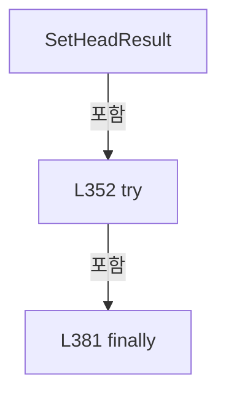

변경 전 점검: 입력/반환 타입, 위 호출자, 예외/취소 경로, 공유 상태와 저장·전송 소비자를 함께 확인합니다. 값의 단위나 물리 방향을 이름만으로 확정하지 않습니다.

### LocalFunctionStatement `SelectItem` · L356–370

[Drilling.Common/Product/CProductManager.cs:356–370](https://github.com/kjuws10-rgb/A3Drilling/blob/0219666f9053b907d96d7e0aa7d0c6c1be3a73d4/Drilling.Common/Product/CProductManager.cs#L356-L370)

| 항목 | 실제 추출 값 |
| --- | --- |
| 서명 | Drilling.Common.Product.ST_PRODUCT_HEAD_RESULT SelectItem(Drilling.Common.Product.ST_PRODUCT_HEAD_RESULT) |
| 접근/수식자 | Private /  |
| 반환/값 타입 | Drilling.Common.Product.ST_PRODUCT_HEAD_RESULT |
| 소속 타입 | NamedType:Drilling.Common.Product.CProductManager |

입력 계약:

| 이름 | 타입 | 전달 | 선택/기본값 |
| --- | --- | --- | --- |
| head | Drilling.Common.Product.ST_PRODUCT_HEAD_RESULT | None | False /  |

현재 부분 분석에서 직접 연결된 호출자는 없습니다. XAML/이벤트/인터페이스·델리게이트·외부 진입을 추가 확인해야 하며, 미사용으로 판정한 것이 아닙니다.

본문의 실제 연산·분기·예외·반환 순서(원문 위치 순):

| 원본 행 | 종류 | 주석 해설 |
| --- | --- | --- |
| 358 | conditional-expression | 조건에 따라 결과식을 선택합니다: head.HeadNo == headNo ? head with { State = isOk ? EN_PRODUCT_HEAD_STATE.Completed : EN_PRODUCT_HEAD_STATE.Error, CompletedPoints = isOk ? head.TotalPoints : head.CompletedPoints, Result = isOk ? EN_PRODUCT_RESULT.OK : EN_PRODUCT_ |
| 358 | return | 호출자에게 값 또는 제어를 반환합니다: return head.HeadNo == headNo ? head with { State = isOk ? EN_PRODUCT_HEAD_STATE.Completed : EN_PRODUCT_HEAD_STATE.Error, CompletedPoints = isOk ? head.TotalPoints : head.CompletedPoints, Result = isOk ? EN_PRODUCT_RESULT.OK : EN_P |
| 360 | assignment | 값을 대상에 대입합니다: State = isOk ? EN_PRODUCT_HEAD_STATE.Completed : EN_PRODUCT_HEAD_STATE.Error |
| 360 | conditional-expression | 조건에 따라 결과식을 선택합니다: isOk ? EN_PRODUCT_HEAD_STATE.Completed : EN_PRODUCT_HEAD_STATE.Error |
| 361 | assignment | 값을 대상에 대입합니다: CompletedPoints = isOk ? head.TotalPoints : head.CompletedPoints |
| 361 | conditional-expression | 조건에 따라 결과식을 선택합니다: isOk ? head.TotalPoints : head.CompletedPoints |
| 362 | assignment | 값을 대상에 대입합니다: Result = isOk ? EN_PRODUCT_RESULT.OK : EN_PRODUCT_RESULT.NG |
| 362 | conditional-expression | 조건에 따라 결과식을 선택합니다: isOk ? EN_PRODUCT_RESULT.OK : EN_PRODUCT_RESULT.NG |
| 363 | assignment | 값을 대상에 대입합니다: ErrorCode = errorCode |
| 364 | assignment | 값을 대상에 대입합니다: Message = message |
| 365 | assignment | 값을 대상에 대입합니다: StartedAt = head.StartedAt ?? now |
| 366 | assignment | 값을 대상에 대입합니다: CompletedAt = now |

변경 전 점검: 입력/반환 타입, 위 호출자, 예외/취소 경로, 공유 상태와 저장·전송 소비자를 함께 확인합니다. 값의 단위나 물리 방향을 이름만으로 확정하지 않습니다.

### MethodDeclaration `SetAlign` · L387–404

[Drilling.Common/Product/CProductManager.cs:387–404](https://github.com/kjuws10-rgb/A3Drilling/blob/0219666f9053b907d96d7e0aa7d0c6c1be3a73d4/Drilling.Common/Product/CProductManager.cs#L387-L404)

| 항목 | 실제 추출 값 |
| --- | --- |
| 서명 | System.Threading.Tasks.Task<Drilling.Common.Product.ST_PRODUCT_DATA> Drilling.Common.Product.CProductManager.SetAlign(string, Drilling.Common.Product.ST_PRODUCT_ALIGN_DATA, System.Threading.CancellationToken) |
| 접근/수식자 | Public / public, async |
| 반환/값 타입 | System.Threading.Tasks.Task<Drilling.Common.Product.ST_PRODUCT_DATA> |
| 소속 타입 | NamedType:Drilling.Common.Product.CProductManager |

입력 계약:

| 이름 | 타입 | 전달 | 선택/기본값 |
| --- | --- | --- | --- |
| productId | string | None | False /  |
| align | Drilling.Common.Product.ST_PRODUCT_ALIGN_DATA | None | False /  |
| cancellationToken | System.Threading.CancellationToken | None | True / null |

현재 부분 분석에서 직접 연결된 호출자는 없습니다. XAML/이벤트/인터페이스·델리게이트·외부 진입을 추가 확인해야 하며, 미사용으로 판정한 것이 아닙니다.

호출하는 대상과 해석 범위:

| 원본 행 | 표현식 | 분석 상태 | 대상/소스 위치 |
| --- | --- | --- | --- |
| 389 | cancellationToken.ThrowIfCancellationRequested | resolved | void System.Threading.CancellationToken.ThrowIfCancellationRequested() |
| 390 | _updateGate.WaitAsync(cancellationToken).ConfigureAwait | resolved | System.Runtime.CompilerServices.ConfiguredTaskAwaitable System.Threading.Tasks.Task.ConfigureAwait(bool) |
| 390 | _updateGate.WaitAsync | resolved | System.Threading.Tasks.Task System.Threading.SemaphoreSlim.WaitAsync(System.Threading.CancellationToken) |
| 393 | GetCurrent | resolved | Drilling.Common.Product.ST_PRODUCT_DATA Drilling.Common.Product.CProductManager.GetCurrent(string) · Drilling.Common/Product/CProductManager.cs:775 |
| 398 | PersistAndLog | resolved | System.Threading.Tasks.Task<Drilling.Common.Product.ST_PRODUCT_DATA> Drilling.Common.Product.CProductManager.PersistAndLog(Drilling.Common.Product.ST_PRODUCT_DATA, string, string, System.Threading.CancellationToken) · Drilling.Common/Product/CProductManager.cs:790 |
| 402 | _updateGate.Release | resolved | int System.Threading.SemaphoreSlim.Release() |

본문의 실제 연산·분기·예외·반환 순서(원문 위치 순):

| 원본 행 | 종류 | 주석 해설 |
| --- | --- | --- |
| 389 | call | 함수·델리게이트 또는 객체 생성자를 호출합니다: cancellationToken.ThrowIfCancellationRequested() |
| 390 | await | 비동기 완료를 기다립니다: await _updateGate.WaitAsync(cancellationToken).ConfigureAwait(false) |
| 390 | call | 함수·델리게이트 또는 객체 생성자를 호출합니다: _updateGate.WaitAsync(cancellationToken).ConfigureAwait(false) |
| 390 | call | 함수·델리게이트 또는 객체 생성자를 호출합니다: _updateGate.WaitAsync(cancellationToken) |
| 391 | try | 예외 처리 범위입니다: try |
| 393 | call | 함수·델리게이트 또는 객체 생성자를 호출합니다: GetCurrent(productId) |
| 393 | local-declaration | 지역 변수를 선언합니다: var product = GetCurrent(productId); |
| 393 | variable-initializer | 변수의 초기값을 지정합니다: product = GetCurrent(productId) |
| 394 | local-declaration | 지역 변수를 선언합니다: var next = product with { Align = align }; |
| 394 | variable-initializer | 변수의 초기값을 지정합니다: next = product with { Align = align } |
| 396 | assignment | 값을 대상에 대입합니다: Align = align |
| 398 | await | 비동기 완료를 기다립니다: await PersistAndLog(next, "ALIGN UPDATE", $"Align state={align.State}, result={align.Result}.", cancellationToken) |
| 398 | call | 함수·델리게이트 또는 객체 생성자를 호출합니다: PersistAndLog(next, "ALIGN UPDATE", $"Align state={align.State}, result={align.Result}.", cancellationToken) |
| 398 | return | 호출자에게 값 또는 제어를 반환합니다: return await PersistAndLog(next, "ALIGN UPDATE", $"Align state={align.State}, result={align.Result}.", cancellationToken); |
| 400 | finally | 종료 정리 구간입니다: finally |
| 402 | call | 함수·델리게이트 또는 객체 생성자를 호출합니다: _updateGate.Release() |

제어 구문의 포함 구조(실제 실행 순서/CFG가 아닌 구문 탐색 그림):

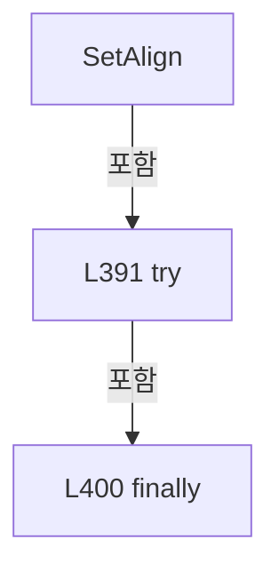

변경 전 점검: 입력/반환 타입, 위 호출자, 예외/취소 경로, 공유 상태와 저장·전송 소비자를 함께 확인합니다. 값의 단위나 물리 방향을 이름만으로 확정하지 않습니다.

### MethodDeclaration `SetDistortion` · L406–423

[Drilling.Common/Product/CProductManager.cs:406–423](https://github.com/kjuws10-rgb/A3Drilling/blob/0219666f9053b907d96d7e0aa7d0c6c1be3a73d4/Drilling.Common/Product/CProductManager.cs#L406-L423)

| 항목 | 실제 추출 값 |
| --- | --- |
| 서명 | System.Threading.Tasks.Task<Drilling.Common.Product.ST_PRODUCT_DATA> Drilling.Common.Product.CProductManager.SetDistortion(string, Drilling.Common.Product.ST_PRODUCT_DISTORTION_DATA, System.Threading.CancellationToken) |
| 접근/수식자 | Public / public, async |
| 반환/값 타입 | System.Threading.Tasks.Task<Drilling.Common.Product.ST_PRODUCT_DATA> |
| 소속 타입 | NamedType:Drilling.Common.Product.CProductManager |

입력 계약:

| 이름 | 타입 | 전달 | 선택/기본값 |
| --- | --- | --- | --- |
| productId | string | None | False /  |
| distortion | Drilling.Common.Product.ST_PRODUCT_DISTORTION_DATA | None | False /  |
| cancellationToken | System.Threading.CancellationToken | None | True / null |

현재 부분 분석에서 직접 연결된 호출자는 없습니다. XAML/이벤트/인터페이스·델리게이트·외부 진입을 추가 확인해야 하며, 미사용으로 판정한 것이 아닙니다.

호출하는 대상과 해석 범위:

| 원본 행 | 표현식 | 분석 상태 | 대상/소스 위치 |
| --- | --- | --- | --- |
| 408 | cancellationToken.ThrowIfCancellationRequested | resolved | void System.Threading.CancellationToken.ThrowIfCancellationRequested() |
| 409 | _updateGate.WaitAsync(cancellationToken).ConfigureAwait | resolved | System.Runtime.CompilerServices.ConfiguredTaskAwaitable System.Threading.Tasks.Task.ConfigureAwait(bool) |
| 409 | _updateGate.WaitAsync | resolved | System.Threading.Tasks.Task System.Threading.SemaphoreSlim.WaitAsync(System.Threading.CancellationToken) |
| 412 | GetCurrent | resolved | Drilling.Common.Product.ST_PRODUCT_DATA Drilling.Common.Product.CProductManager.GetCurrent(string) · Drilling.Common/Product/CProductManager.cs:775 |
| 417 | PersistAndLog | resolved | System.Threading.Tasks.Task<Drilling.Common.Product.ST_PRODUCT_DATA> Drilling.Common.Product.CProductManager.PersistAndLog(Drilling.Common.Product.ST_PRODUCT_DATA, string, string, System.Threading.CancellationToken) · Drilling.Common/Product/CProductManager.cs:790 |
| 421 | _updateGate.Release | resolved | int System.Threading.SemaphoreSlim.Release() |

본문의 실제 연산·분기·예외·반환 순서(원문 위치 순):

| 원본 행 | 종류 | 주석 해설 |
| --- | --- | --- |
| 408 | call | 함수·델리게이트 또는 객체 생성자를 호출합니다: cancellationToken.ThrowIfCancellationRequested() |
| 409 | await | 비동기 완료를 기다립니다: await _updateGate.WaitAsync(cancellationToken).ConfigureAwait(false) |
| 409 | call | 함수·델리게이트 또는 객체 생성자를 호출합니다: _updateGate.WaitAsync(cancellationToken).ConfigureAwait(false) |
| 409 | call | 함수·델리게이트 또는 객체 생성자를 호출합니다: _updateGate.WaitAsync(cancellationToken) |
| 410 | try | 예외 처리 범위입니다: try |
| 412 | call | 함수·델리게이트 또는 객체 생성자를 호출합니다: GetCurrent(productId) |
| 412 | local-declaration | 지역 변수를 선언합니다: var product = GetCurrent(productId); |
| 412 | variable-initializer | 변수의 초기값을 지정합니다: product = GetCurrent(productId) |
| 413 | local-declaration | 지역 변수를 선언합니다: var next = product with { Distortion = distortion }; |
| 413 | variable-initializer | 변수의 초기값을 지정합니다: next = product with { Distortion = distortion } |
| 415 | assignment | 값을 대상에 대입합니다: Distortion = distortion |
| 417 | await | 비동기 완료를 기다립니다: await PersistAndLog(next, "DISTORTION UPDATE", $"Distortion state={distortion.State}, result={distortion.Result}.", cancellationToken) |
| 417 | call | 함수·델리게이트 또는 객체 생성자를 호출합니다: PersistAndLog(next, "DISTORTION UPDATE", $"Distortion state={distortion.State}, result={distortion.Result}.", cancellationToken) |
| 417 | return | 호출자에게 값 또는 제어를 반환합니다: return await PersistAndLog(next, "DISTORTION UPDATE", $"Distortion state={distortion.State}, result={distortion.Result}.", cancellationToken); |
| 419 | finally | 종료 정리 구간입니다: finally |
| 421 | call | 함수·델리게이트 또는 객체 생성자를 호출합니다: _updateGate.Release() |

제어 구문의 포함 구조(실제 실행 순서/CFG가 아닌 구문 탐색 그림):

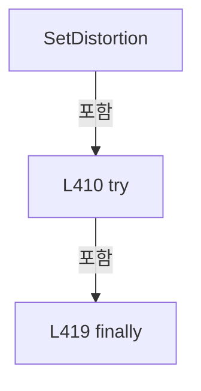

변경 전 점검: 입력/반환 타입, 위 호출자, 예외/취소 경로, 공유 상태와 저장·전송 소비자를 함께 확인합니다. 값의 단위나 물리 방향을 이름만으로 확정하지 않습니다.

### MethodDeclaration `SetAlignment` · L425–443

[Drilling.Common/Product/CProductManager.cs:425–443](https://github.com/kjuws10-rgb/A3Drilling/blob/0219666f9053b907d96d7e0aa7d0c6c1be3a73d4/Drilling.Common/Product/CProductManager.cs#L425-L443)

| 항목 | 실제 추출 값 |
| --- | --- |
| 서명 | System.Threading.Tasks.Task<Drilling.Common.Product.ST_PRODUCT_DATA> Drilling.Common.Product.CProductManager.SetAlignment(string, Drilling.Common.Product.ST_PRODUCT_ALIGN_DATA, Drilling.Common.Product.ST_PRODUCT_DISTORTION_DATA, System.Threading.CancellationToken) |
| 접근/수식자 | Public / public, async |
| 반환/값 타입 | System.Threading.Tasks.Task<Drilling.Common.Product.ST_PRODUCT_DATA> |
| 소속 타입 | NamedType:Drilling.Common.Product.CProductManager |

입력 계약:

| 이름 | 타입 | 전달 | 선택/기본값 |
| --- | --- | --- | --- |
| productId | string | None | False /  |
| align | Drilling.Common.Product.ST_PRODUCT_ALIGN_DATA | None | False /  |
| distortion | Drilling.Common.Product.ST_PRODUCT_DISTORTION_DATA | None | False /  |
| cancellationToken | System.Threading.CancellationToken | None | True / null |

정적 호출자로 확인된 위치:

| 호출 파일/행 | 호출 표현식 | 런타임 분기 가능 |
| --- | --- | --- |
| [Drilling.Common/Station/CStationProcess.cs:538–549](https://github.com/kjuws10-rgb/A3Drilling/blob/0219666f9053b907d96d7e0aa7d0c6c1be3a73d4/Drilling.Common/Station/CStationProcess.cs#L538-L549) | _productManager.SetAlignment | False |

호출하는 대상과 해석 범위:

| 원본 행 | 표현식 | 분석 상태 | 대상/소스 위치 |
| --- | --- | --- | --- |
| 427 | cancellationToken.ThrowIfCancellationRequested | resolved | void System.Threading.CancellationToken.ThrowIfCancellationRequested() |
| 428 | _updateGate.WaitAsync(cancellationToken).ConfigureAwait | resolved | System.Runtime.CompilerServices.ConfiguredTaskAwaitable System.Threading.Tasks.Task.ConfigureAwait(bool) |
| 428 | _updateGate.WaitAsync | resolved | System.Threading.Tasks.Task System.Threading.SemaphoreSlim.WaitAsync(System.Threading.CancellationToken) |
| 431 | GetCurrent | resolved | Drilling.Common.Product.ST_PRODUCT_DATA Drilling.Common.Product.CProductManager.GetCurrent(string) · Drilling.Common/Product/CProductManager.cs:775 |
| 437 | PersistAndLog | resolved | System.Threading.Tasks.Task<Drilling.Common.Product.ST_PRODUCT_DATA> Drilling.Common.Product.CProductManager.PersistAndLog(Drilling.Common.Product.ST_PRODUCT_DATA, string, string, System.Threading.CancellationToken) · Drilling.Common/Product/CProductManager.cs:790 |
| 441 | _updateGate.Release | resolved | int System.Threading.SemaphoreSlim.Release() |

본문의 실제 연산·분기·예외·반환 순서(원문 위치 순):

| 원본 행 | 종류 | 주석 해설 |
| --- | --- | --- |
| 427 | call | 함수·델리게이트 또는 객체 생성자를 호출합니다: cancellationToken.ThrowIfCancellationRequested() |
| 428 | await | 비동기 완료를 기다립니다: await _updateGate.WaitAsync(cancellationToken).ConfigureAwait(false) |
| 428 | call | 함수·델리게이트 또는 객체 생성자를 호출합니다: _updateGate.WaitAsync(cancellationToken).ConfigureAwait(false) |
| 428 | call | 함수·델리게이트 또는 객체 생성자를 호출합니다: _updateGate.WaitAsync(cancellationToken) |
| 429 | try | 예외 처리 범위입니다: try |
| 431 | call | 함수·델리게이트 또는 객체 생성자를 호출합니다: GetCurrent(productId) |
| 431 | local-declaration | 지역 변수를 선언합니다: var product = GetCurrent(productId); |
| 431 | variable-initializer | 변수의 초기값을 지정합니다: product = GetCurrent(productId) |
| 432 | local-declaration | 지역 변수를 선언합니다: var next = product with { Align = align, Distortion = distortion }; |
| 432 | variable-initializer | 변수의 초기값을 지정합니다: next = product with { Align = align, Distortion = distortion } |
| 434 | assignment | 값을 대상에 대입합니다: Align = align |
| 435 | assignment | 값을 대상에 대입합니다: Distortion = distortion |
| 437 | await | 비동기 완료를 기다립니다: await PersistAndLog(next, "ALIGNMENT UPDATE", $"Align state={align.State}, result={align.Result}; Distortion state={distortion.State}, result={distortion.Result}.", cancellationToken) |
| 437 | call | 함수·델리게이트 또는 객체 생성자를 호출합니다: PersistAndLog(next, "ALIGNMENT UPDATE", $"Align state={align.State}, result={align.Result}; Distortion state={distortion.State}, result={distortion.Result}.", cancellationToken) |
| 437 | return | 호출자에게 값 또는 제어를 반환합니다: return await PersistAndLog(next, "ALIGNMENT UPDATE", $"Align state={align.State}, result={align.Result}; Distortion state={distortion.State}, result={distortion.Result}.", cancellationToken); |
| 439 | finally | 종료 정리 구간입니다: finally |
| 441 | call | 함수·델리게이트 또는 객체 생성자를 호출합니다: _updateGate.Release() |

제어 구문의 포함 구조(실제 실행 순서/CFG가 아닌 구문 탐색 그림):

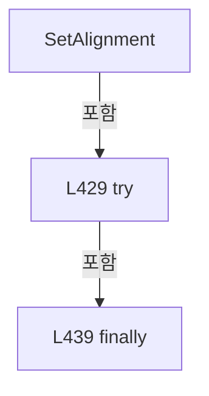

변경 전 점검: 입력/반환 타입, 위 호출자, 예외/취소 경로, 공유 상태와 저장·전송 소비자를 함께 확인합니다. 값의 단위나 물리 방향을 이름만으로 확정하지 않습니다.

### MethodDeclaration `SetReviewRunning` · L445–465

[Drilling.Common/Product/CProductManager.cs:445–465](https://github.com/kjuws10-rgb/A3Drilling/blob/0219666f9053b907d96d7e0aa7d0c6c1be3a73d4/Drilling.Common/Product/CProductManager.cs#L445-L465)

| 항목 | 실제 추출 값 |
| --- | --- |
| 서명 | System.Threading.Tasks.Task<Drilling.Common.Product.ST_PRODUCT_DATA> Drilling.Common.Product.CProductManager.SetReviewRunning(string, Drilling.Common.Product.ST_PRODUCT_REVIEW_DATA, System.Threading.CancellationToken) |
| 접근/수식자 | Public / public, async |
| 반환/값 타입 | System.Threading.Tasks.Task<Drilling.Common.Product.ST_PRODUCT_DATA> |
| 소속 타입 | NamedType:Drilling.Common.Product.CProductManager |

입력 계약:

| 이름 | 타입 | 전달 | 선택/기본값 |
| --- | --- | --- | --- |
| productId | string | None | False /  |
| review | Drilling.Common.Product.ST_PRODUCT_REVIEW_DATA | None | False /  |
| cancellationToken | System.Threading.CancellationToken | None | True / null |

정적 호출자로 확인된 위치:

| 호출 파일/행 | 호출 표현식 | 런타임 분기 가능 |
| --- | --- | --- |
| [Drilling.Common/Review/CReviewManager.cs:343–343](https://github.com/kjuws10-rgb/A3Drilling/blob/0219666f9053b907d96d7e0aa7d0c6c1be3a73d4/Drilling.Common/Review/CReviewManager.cs#L343-L343) | productManager.SetReviewRunning | False |
| [Drilling.Common/Review/CReviewManager.cs:2443–2443](https://github.com/kjuws10-rgb/A3Drilling/blob/0219666f9053b907d96d7e0aa7d0c6c1be3a73d4/Drilling.Common/Review/CReviewManager.cs#L2443-L2443) | productManager.SetReviewRunning | False |

호출하는 대상과 해석 범위:

| 원본 행 | 표현식 | 분석 상태 | 대상/소스 위치 |
| --- | --- | --- | --- |
| 447 | cancellationToken.ThrowIfCancellationRequested | resolved | void System.Threading.CancellationToken.ThrowIfCancellationRequested() |
| 448 | _updateGate.WaitAsync(cancellationToken).ConfigureAwait | resolved | System.Runtime.CompilerServices.ConfiguredTaskAwaitable System.Threading.Tasks.Task.ConfigureAwait(bool) |
| 448 | _updateGate.WaitAsync | resolved | System.Threading.Tasks.Task System.Threading.SemaphoreSlim.WaitAsync(System.Threading.CancellationToken) |
| 451 | GetCurrent | resolved | Drilling.Common.Product.ST_PRODUCT_DATA Drilling.Common.Product.CProductManager.GetCurrent(string) · Drilling.Common/Product/CProductManager.cs:775 |
| 459 | PersistAndLog | resolved | System.Threading.Tasks.Task<Drilling.Common.Product.ST_PRODUCT_DATA> Drilling.Common.Product.CProductManager.PersistAndLog(Drilling.Common.Product.ST_PRODUCT_DATA, string, string, System.Threading.CancellationToken) · Drilling.Common/Product/CProductManager.cs:790 |
| 463 | _updateGate.Release | resolved | int System.Threading.SemaphoreSlim.Release() |

본문의 실제 연산·분기·예외·반환 순서(원문 위치 순):

| 원본 행 | 종류 | 주석 해설 |
| --- | --- | --- |
| 447 | call | 함수·델리게이트 또는 객체 생성자를 호출합니다: cancellationToken.ThrowIfCancellationRequested() |
| 448 | await | 비동기 완료를 기다립니다: await _updateGate.WaitAsync(cancellationToken).ConfigureAwait(false) |
| 448 | call | 함수·델리게이트 또는 객체 생성자를 호출합니다: _updateGate.WaitAsync(cancellationToken).ConfigureAwait(false) |
| 448 | call | 함수·델리게이트 또는 객체 생성자를 호출합니다: _updateGate.WaitAsync(cancellationToken) |
| 449 | try | 예외 처리 범위입니다: try |
| 451 | call | 함수·델리게이트 또는 객체 생성자를 호출합니다: GetCurrent(productId) |
| 451 | local-declaration | 지역 변수를 선언합니다: var product = GetCurrent(productId); |
| 451 | variable-initializer | 변수의 초기값을 지정합니다: product = GetCurrent(productId) |
| 452 | local-declaration | 지역 변수를 선언합니다: var next = product with { Review = review with { State = EN_PRODUCT_PROCESS_STATE.Running } }; |
| 452 | variable-initializer | 변수의 초기값을 지정합니다: next = product with { Review = review with { State = EN_PRODUCT_PROCESS_STATE.Running } } |
| 454 | assignment | 값을 대상에 대입합니다: Review = review with { State = EN_PRODUCT_PROCESS_STATE.Running } |
| 456 | assignment | 값을 대상에 대입합니다: State = EN_PRODUCT_PROCESS_STATE.Running |
| 459 | await | 비동기 완료를 기다립니다: await PersistAndLog(next, "REVIEW START", "Review started.", cancellationToken) |
| 459 | call | 함수·델리게이트 또는 객체 생성자를 호출합니다: PersistAndLog(next, "REVIEW START", "Review started.", cancellationToken) |
| 459 | return | 호출자에게 값 또는 제어를 반환합니다: return await PersistAndLog(next, "REVIEW START", "Review started.", cancellationToken); |
| 461 | finally | 종료 정리 구간입니다: finally |
| 463 | call | 함수·델리게이트 또는 객체 생성자를 호출합니다: _updateGate.Release() |

제어 구문의 포함 구조(실제 실행 순서/CFG가 아닌 구문 탐색 그림):

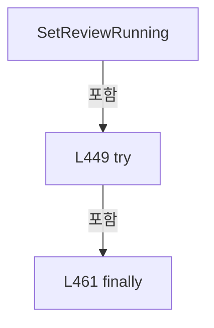

변경 전 점검: 입력/반환 타입, 위 호출자, 예외/취소 경로, 공유 상태와 저장·전송 소비자를 함께 확인합니다. 값의 단위나 물리 방향을 이름만으로 확정하지 않습니다.

### MethodDeclaration `SetReviewProgress` · L467–489

[Drilling.Common/Product/CProductManager.cs:467–489](https://github.com/kjuws10-rgb/A3Drilling/blob/0219666f9053b907d96d7e0aa7d0c6c1be3a73d4/Drilling.Common/Product/CProductManager.cs#L467-L489)

| 항목 | 실제 추출 값 |
| --- | --- |
| 서명 | System.Threading.Tasks.Task<Drilling.Common.Product.ST_PRODUCT_DATA> Drilling.Common.Product.CProductManager.SetReviewProgress(string, Drilling.Common.Product.ST_PRODUCT_REVIEW_DATA, System.Threading.CancellationToken) |
| 접근/수식자 | Public / public, async |
| 반환/값 타입 | System.Threading.Tasks.Task<Drilling.Common.Product.ST_PRODUCT_DATA> |
| 소속 타입 | NamedType:Drilling.Common.Product.CProductManager |

입력 계약:

| 이름 | 타입 | 전달 | 선택/기본값 |
| --- | --- | --- | --- |
| productId | string | None | False /  |
| review | Drilling.Common.Product.ST_PRODUCT_REVIEW_DATA | None | False /  |
| cancellationToken | System.Threading.CancellationToken | None | True / null |

정적 호출자로 확인된 위치:

| 호출 파일/행 | 호출 표현식 | 런타임 분기 가능 |
| --- | --- | --- |
| [Drilling.Common/Review/CReviewManager.cs:1636–1636](https://github.com/kjuws10-rgb/A3Drilling/blob/0219666f9053b907d96d7e0aa7d0c6c1be3a73d4/Drilling.Common/Review/CReviewManager.cs#L1636-L1636) | productManager.SetReviewProgress | False |

호출하는 대상과 해석 범위:

| 원본 행 | 표현식 | 분석 상태 | 대상/소스 위치 |
| --- | --- | --- | --- |
| 469 | cancellationToken.ThrowIfCancellationRequested | resolved | void System.Threading.CancellationToken.ThrowIfCancellationRequested() |
| 470 | _updateGate.WaitAsync(cancellationToken).ConfigureAwait | resolved | System.Runtime.CompilerServices.ConfiguredTaskAwaitable System.Threading.Tasks.Task.ConfigureAwait(bool) |
| 470 | _updateGate.WaitAsync | resolved | System.Threading.Tasks.Task System.Threading.SemaphoreSlim.WaitAsync(System.Threading.CancellationToken) |
| 473 | GetCurrent | resolved | Drilling.Common.Product.ST_PRODUCT_DATA Drilling.Common.Product.CProductManager.GetCurrent(string) · Drilling.Common/Product/CProductManager.cs:775 |
| 481 | productFile.SaveActive(next, cancellationToken).ConfigureAwait | resolved | System.Runtime.CompilerServices.ConfiguredTaskAwaitable System.Threading.Tasks.Task.ConfigureAwait(bool) |
| 481 | productFile.SaveActive | resolved | System.Threading.Tasks.Task Drilling.Common.Product.CProductFileBase.SaveActive(Drilling.Common.Product.ST_PRODUCT_DATA, System.Threading.CancellationToken) · Drilling.Common/Product/CProductManager.cs:1116 |
| 482 | Volatile.Write | resolved | void System.Threading.Volatile.Write<Drilling.Common.Product.ST_PRODUCT_DATA?>(ref Drilling.Common.Product.ST_PRODUCT_DATA?, Drilling.Common.Product.ST_PRODUCT_DATA?) |
| 487 | _updateGate.Release | resolved | int System.Threading.SemaphoreSlim.Release() |

본문의 실제 연산·분기·예외·반환 순서(원문 위치 순):

| 원본 행 | 종류 | 주석 해설 |
| --- | --- | --- |
| 469 | call | 함수·델리게이트 또는 객체 생성자를 호출합니다: cancellationToken.ThrowIfCancellationRequested() |
| 470 | await | 비동기 완료를 기다립니다: await _updateGate.WaitAsync(cancellationToken).ConfigureAwait(false) |
| 470 | call | 함수·델리게이트 또는 객체 생성자를 호출합니다: _updateGate.WaitAsync(cancellationToken).ConfigureAwait(false) |
| 470 | call | 함수·델리게이트 또는 객체 생성자를 호출합니다: _updateGate.WaitAsync(cancellationToken) |
| 471 | try | 예외 처리 범위입니다: try |
| 473 | call | 함수·델리게이트 또는 객체 생성자를 호출합니다: GetCurrent(productId) |
| 473 | local-declaration | 지역 변수를 선언합니다: var product = GetCurrent(productId); |
| 473 | variable-initializer | 변수의 초기값을 지정합니다: product = GetCurrent(productId) |
| 474 | local-declaration | 지역 변수를 선언합니다: var next = product with { Review = review with { State = EN_PRODUCT_PROCESS_STATE.Running } }; |
| 474 | variable-initializer | 변수의 초기값을 지정합니다: next = product with { Review = review with { State = EN_PRODUCT_PROCESS_STATE.Running } } |
| 476 | assignment | 값을 대상에 대입합니다: Review = review with { State = EN_PRODUCT_PROCESS_STATE.Running } |
| 478 | assignment | 값을 대상에 대입합니다: State = EN_PRODUCT_PROCESS_STATE.Running |
| 481 | await | 비동기 완료를 기다립니다: await productFile.SaveActive(next, cancellationToken).ConfigureAwait(false) |
| 481 | call | 함수·델리게이트 또는 객체 생성자를 호출합니다: productFile.SaveActive(next, cancellationToken).ConfigureAwait(false) |
| 481 | call | 함수·델리게이트 또는 객체 생성자를 호출합니다: productFile.SaveActive(next, cancellationToken) |
| 482 | call | 함수·델리게이트 또는 객체 생성자를 호출합니다: Volatile.Write(ref _current, next) |
| 483 | return | 호출자에게 값 또는 제어를 반환합니다: return next; |
| 485 | finally | 종료 정리 구간입니다: finally |
| 487 | call | 함수·델리게이트 또는 객체 생성자를 호출합니다: _updateGate.Release() |

제어 구문의 포함 구조(실제 실행 순서/CFG가 아닌 구문 탐색 그림):

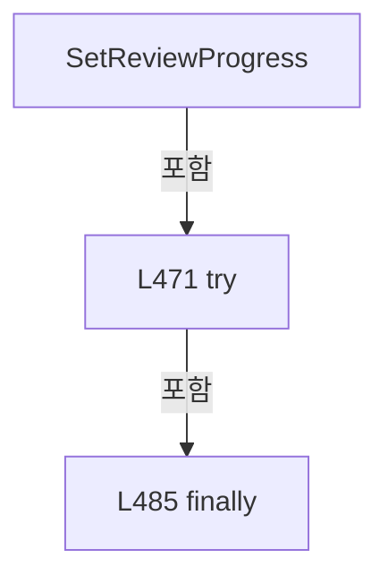

변경 전 점검: 입력/반환 타입, 위 호출자, 예외/취소 경로, 공유 상태와 저장·전송 소비자를 함께 확인합니다. 값의 단위나 물리 방향을 이름만으로 확정하지 않습니다.

### MethodDeclaration `SetReviewCompleted` · L491–513

[Drilling.Common/Product/CProductManager.cs:491–513](https://github.com/kjuws10-rgb/A3Drilling/blob/0219666f9053b907d96d7e0aa7d0c6c1be3a73d4/Drilling.Common/Product/CProductManager.cs#L491-L513)

| 항목 | 실제 추출 값 |
| --- | --- |
| 서명 | System.Threading.Tasks.Task<Drilling.Common.Product.ST_PRODUCT_DATA> Drilling.Common.Product.CProductManager.SetReviewCompleted(string, System.DateTimeOffset, System.Collections.Generic.IReadOnlyList<Drilling.Common.Product.ST_PRODUCT_REVIEW_RESULT>, System.Threading.CancellationToken) |
| 접근/수식자 | Public / public, async |
| 반환/값 타입 | System.Threading.Tasks.Task<Drilling.Common.Product.ST_PRODUCT_DATA> |
| 소속 타입 | NamedType:Drilling.Common.Product.CProductManager |

입력 계약:

| 이름 | 타입 | 전달 | 선택/기본값 |
| --- | --- | --- | --- |
| productId | string | None | False /  |
| savedAt | System.DateTimeOffset | None | False /  |
| results | System.Collections.Generic.IReadOnlyList<Drilling.Common.Product.ST_PRODUCT_REVIEW_RESULT> | None | False /  |
| cancellationToken | System.Threading.CancellationToken | None | True / null |

정적 호출자로 확인된 위치:

| 호출 파일/행 | 호출 표현식 | 런타임 분기 가능 |
| --- | --- | --- |
| [Drilling.Common/Review/CReviewManager.cs:1626–1626](https://github.com/kjuws10-rgb/A3Drilling/blob/0219666f9053b907d96d7e0aa7d0c6c1be3a73d4/Drilling.Common/Review/CReviewManager.cs#L1626-L1626) | productManager.SetReviewCompleted | False |

호출하는 대상과 해석 범위:

| 원본 행 | 표현식 | 분석 상태 | 대상/소스 위치 |
| --- | --- | --- | --- |
| 493 | cancellationToken.ThrowIfCancellationRequested | resolved | void System.Threading.CancellationToken.ThrowIfCancellationRequested() |
| 494 | _updateGate.WaitAsync(cancellationToken).ConfigureAwait | resolved | System.Runtime.CompilerServices.ConfiguredTaskAwaitable System.Threading.Tasks.Task.ConfigureAwait(bool) |
| 494 | _updateGate.WaitAsync | resolved | System.Threading.Tasks.Task System.Threading.SemaphoreSlim.WaitAsync(System.Threading.CancellationToken) |
| 497 | GetCurrent | resolved | Drilling.Common.Product.ST_PRODUCT_DATA Drilling.Common.Product.CProductManager.GetCurrent(string) · Drilling.Common/Product/CProductManager.cs:775 |
| 504 | results.ToArray | resolved | Drilling.Common.Product.ST_PRODUCT_REVIEW_RESULT[] System.Collections.Generic.IEnumerable<Drilling.Common.Product.ST_PRODUCT_REVIEW_RESULT>.ToArray<Drilling.Common.Product.ST_PRODUCT_REVIEW_RESULT>() |
| 507 | PersistAndLog | resolved | System.Threading.Tasks.Task<Drilling.Common.Product.ST_PRODUCT_DATA> Drilling.Common.Product.CProductManager.PersistAndLog(Drilling.Common.Product.ST_PRODUCT_DATA, string, string, System.Threading.CancellationToken) · Drilling.Common/Product/CProductManager.cs:790 |
| 511 | _updateGate.Release | resolved | int System.Threading.SemaphoreSlim.Release() |

본문의 실제 연산·분기·예외·반환 순서(원문 위치 순):

| 원본 행 | 종류 | 주석 해설 |
| --- | --- | --- |
| 493 | call | 함수·델리게이트 또는 객체 생성자를 호출합니다: cancellationToken.ThrowIfCancellationRequested() |
| 494 | await | 비동기 완료를 기다립니다: await _updateGate.WaitAsync(cancellationToken).ConfigureAwait(false) |
| 494 | call | 함수·델리게이트 또는 객체 생성자를 호출합니다: _updateGate.WaitAsync(cancellationToken).ConfigureAwait(false) |
| 494 | call | 함수·델리게이트 또는 객체 생성자를 호출합니다: _updateGate.WaitAsync(cancellationToken) |
| 495 | try | 예외 처리 범위입니다: try |
| 497 | call | 함수·델리게이트 또는 객체 생성자를 호출합니다: GetCurrent(productId) |
| 497 | local-declaration | 지역 변수를 선언합니다: var product = GetCurrent(productId); |
| 497 | variable-initializer | 변수의 초기값을 지정합니다: product = GetCurrent(productId) |
| 498 | local-declaration | 지역 변수를 선언합니다: var next = product with { Review = product.Review with { State = EN_PRODUCT_PROCESS_STATE.Completed, SavedAt = savedAt, Results = results.ToArray() } }; |
| 498 | variable-initializer | 변수의 초기값을 지정합니다: next = product with { Review = product.Review with { State = EN_PRODUCT_PROCESS_STATE.Completed, SavedAt = savedAt, Results = results.ToArray() } } |
| 500 | assignment | 값을 대상에 대입합니다: Review = product.Review with { State = EN_PRODUCT_PROCESS_STATE.Completed, SavedAt = savedAt, Results = results.ToArray() } |
| 502 | assignment | 값을 대상에 대입합니다: State = EN_PRODUCT_PROCESS_STATE.Completed |
| 503 | assignment | 값을 대상에 대입합니다: SavedAt = savedAt |
| 504 | assignment | 값을 대상에 대입합니다: Results = results.ToArray() |
| 504 | call | 함수·델리게이트 또는 객체 생성자를 호출합니다: results.ToArray() |
| 507 | await | 비동기 완료를 기다립니다: await PersistAndLog(next, "REVIEW COMPLETE", $"Review completed. Result count={results.Count}.", cancellationToken) |
| 507 | call | 함수·델리게이트 또는 객체 생성자를 호출합니다: PersistAndLog(next, "REVIEW COMPLETE", $"Review completed. Result count={results.Count}.", cancellationToken) |
| 507 | return | 호출자에게 값 또는 제어를 반환합니다: return await PersistAndLog(next, "REVIEW COMPLETE", $"Review completed. Result count={results.Count}.", cancellationToken); |
| 509 | finally | 종료 정리 구간입니다: finally |
| 511 | call | 함수·델리게이트 또는 객체 생성자를 호출합니다: _updateGate.Release() |

제어 구문의 포함 구조(실제 실행 순서/CFG가 아닌 구문 탐색 그림):

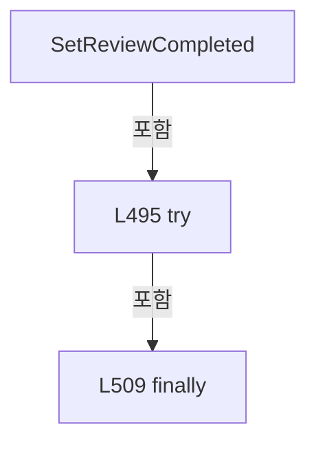

변경 전 점검: 입력/반환 타입, 위 호출자, 예외/취소 경로, 공유 상태와 저장·전송 소비자를 함께 확인합니다. 값의 단위나 물리 방향을 이름만으로 확정하지 않습니다.

### MethodDeclaration `SetReviewStopped` · L515–535

[Drilling.Common/Product/CProductManager.cs:515–535](https://github.com/kjuws10-rgb/A3Drilling/blob/0219666f9053b907d96d7e0aa7d0c6c1be3a73d4/Drilling.Common/Product/CProductManager.cs#L515-L535)

| 항목 | 실제 추출 값 |
| --- | --- |
| 서명 | System.Threading.Tasks.Task<Drilling.Common.Product.ST_PRODUCT_DATA> Drilling.Common.Product.CProductManager.SetReviewStopped(string, string, System.Threading.CancellationToken) |
| 접근/수식자 | Public / public, async |
| 반환/값 타입 | System.Threading.Tasks.Task<Drilling.Common.Product.ST_PRODUCT_DATA> |
| 소속 타입 | NamedType:Drilling.Common.Product.CProductManager |

입력 계약:

| 이름 | 타입 | 전달 | 선택/기본값 |
| --- | --- | --- | --- |
| productId | string | None | False /  |
| message | string | None | False /  |
| cancellationToken | System.Threading.CancellationToken | None | True / null |

정적 호출자로 확인된 위치:

| 호출 파일/행 | 호출 표현식 | 런타임 분기 가능 |
| --- | --- | --- |
| [Drilling.Common/Review/CReviewManager.cs:1856–1856](https://github.com/kjuws10-rgb/A3Drilling/blob/0219666f9053b907d96d7e0aa7d0c6c1be3a73d4/Drilling.Common/Review/CReviewManager.cs#L1856-L1856) | productManager.SetReviewStopped | False |

호출하는 대상과 해석 범위:

| 원본 행 | 표현식 | 분석 상태 | 대상/소스 위치 |
| --- | --- | --- | --- |
| 517 | cancellationToken.ThrowIfCancellationRequested | resolved | void System.Threading.CancellationToken.ThrowIfCancellationRequested() |
| 518 | _updateGate.WaitAsync(cancellationToken).ConfigureAwait | resolved | System.Runtime.CompilerServices.ConfiguredTaskAwaitable System.Threading.Tasks.Task.ConfigureAwait(bool) |
| 518 | _updateGate.WaitAsync | resolved | System.Threading.Tasks.Task System.Threading.SemaphoreSlim.WaitAsync(System.Threading.CancellationToken) |
| 521 | GetCurrent | resolved | Drilling.Common.Product.ST_PRODUCT_DATA Drilling.Common.Product.CProductManager.GetCurrent(string) · Drilling.Common/Product/CProductManager.cs:775 |
| 529 | PersistAndLog | resolved | System.Threading.Tasks.Task<Drilling.Common.Product.ST_PRODUCT_DATA> Drilling.Common.Product.CProductManager.PersistAndLog(Drilling.Common.Product.ST_PRODUCT_DATA, string, string, System.Threading.CancellationToken) · Drilling.Common/Product/CProductManager.cs:790 |
| 533 | _updateGate.Release | resolved | int System.Threading.SemaphoreSlim.Release() |

본문의 실제 연산·분기·예외·반환 순서(원문 위치 순):

| 원본 행 | 종류 | 주석 해설 |
| --- | --- | --- |
| 517 | call | 함수·델리게이트 또는 객체 생성자를 호출합니다: cancellationToken.ThrowIfCancellationRequested() |
| 518 | await | 비동기 완료를 기다립니다: await _updateGate.WaitAsync(cancellationToken).ConfigureAwait(false) |
| 518 | call | 함수·델리게이트 또는 객체 생성자를 호출합니다: _updateGate.WaitAsync(cancellationToken).ConfigureAwait(false) |
| 518 | call | 함수·델리게이트 또는 객체 생성자를 호출합니다: _updateGate.WaitAsync(cancellationToken) |
| 519 | try | 예외 처리 범위입니다: try |
| 521 | call | 함수·델리게이트 또는 객체 생성자를 호출합니다: GetCurrent(productId) |
| 521 | local-declaration | 지역 변수를 선언합니다: var product = GetCurrent(productId); |
| 521 | variable-initializer | 변수의 초기값을 지정합니다: product = GetCurrent(productId) |
| 522 | local-declaration | 지역 변수를 선언합니다: var next = product with { Review = product.Review with { State = EN_PRODUCT_PROCESS_STATE.Stopped } }; |
| 522 | variable-initializer | 변수의 초기값을 지정합니다: next = product with { Review = product.Review with { State = EN_PRODUCT_PROCESS_STATE.Stopped } } |
| 524 | assignment | 값을 대상에 대입합니다: Review = product.Review with { State = EN_PRODUCT_PROCESS_STATE.Stopped } |
| 526 | assignment | 값을 대상에 대입합니다: State = EN_PRODUCT_PROCESS_STATE.Stopped |
| 529 | await | 비동기 완료를 기다립니다: await PersistAndLog(next, "REVIEW STOP", message, cancellationToken) |
| 529 | call | 함수·델리게이트 또는 객체 생성자를 호출합니다: PersistAndLog(next, "REVIEW STOP", message, cancellationToken) |
| 529 | return | 호출자에게 값 또는 제어를 반환합니다: return await PersistAndLog(next, "REVIEW STOP", message, cancellationToken); |
| 531 | finally | 종료 정리 구간입니다: finally |
| 533 | call | 함수·델리게이트 또는 객체 생성자를 호출합니다: _updateGate.Release() |

제어 구문의 포함 구조(실제 실행 순서/CFG가 아닌 구문 탐색 그림):

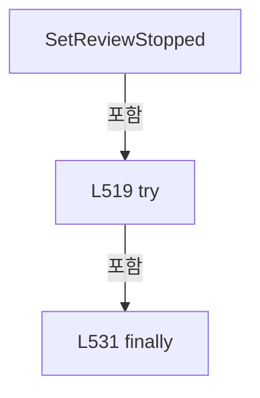

변경 전 점검: 입력/반환 타입, 위 호출자, 예외/취소 경로, 공유 상태와 저장·전송 소비자를 함께 확인합니다. 값의 단위나 물리 방향을 이름만으로 확정하지 않습니다.

### MethodDeclaration `SetReviewError` · L537–557

[Drilling.Common/Product/CProductManager.cs:537–557](https://github.com/kjuws10-rgb/A3Drilling/blob/0219666f9053b907d96d7e0aa7d0c6c1be3a73d4/Drilling.Common/Product/CProductManager.cs#L537-L557)

| 항목 | 실제 추출 값 |
| --- | --- |
| 서명 | System.Threading.Tasks.Task<Drilling.Common.Product.ST_PRODUCT_DATA> Drilling.Common.Product.CProductManager.SetReviewError(string, string, System.Threading.CancellationToken) |
| 접근/수식자 | Public / public, async |
| 반환/값 타입 | System.Threading.Tasks.Task<Drilling.Common.Product.ST_PRODUCT_DATA> |
| 소속 타입 | NamedType:Drilling.Common.Product.CProductManager |

입력 계약:

| 이름 | 타입 | 전달 | 선택/기본값 |
| --- | --- | --- | --- |
| productId | string | None | False /  |
| message | string | None | False /  |
| cancellationToken | System.Threading.CancellationToken | None | True / null |

정적 호출자로 확인된 위치:

| 호출 파일/행 | 호출 표현식 | 런타임 분기 가능 |
| --- | --- | --- |
| [Drilling.Common/Review/CReviewManager.cs:1838–1838](https://github.com/kjuws10-rgb/A3Drilling/blob/0219666f9053b907d96d7e0aa7d0c6c1be3a73d4/Drilling.Common/Review/CReviewManager.cs#L1838-L1838) | productManager.SetReviewError | False |

호출하는 대상과 해석 범위:

| 원본 행 | 표현식 | 분석 상태 | 대상/소스 위치 |
| --- | --- | --- | --- |
| 539 | cancellationToken.ThrowIfCancellationRequested | resolved | void System.Threading.CancellationToken.ThrowIfCancellationRequested() |
| 540 | _updateGate.WaitAsync(cancellationToken).ConfigureAwait | resolved | System.Runtime.CompilerServices.ConfiguredTaskAwaitable System.Threading.Tasks.Task.ConfigureAwait(bool) |
| 540 | _updateGate.WaitAsync | resolved | System.Threading.Tasks.Task System.Threading.SemaphoreSlim.WaitAsync(System.Threading.CancellationToken) |
| 543 | GetCurrent | resolved | Drilling.Common.Product.ST_PRODUCT_DATA Drilling.Common.Product.CProductManager.GetCurrent(string) · Drilling.Common/Product/CProductManager.cs:775 |
| 551 | PersistAndLog | resolved | System.Threading.Tasks.Task<Drilling.Common.Product.ST_PRODUCT_DATA> Drilling.Common.Product.CProductManager.PersistAndLog(Drilling.Common.Product.ST_PRODUCT_DATA, string, string, System.Threading.CancellationToken) · Drilling.Common/Product/CProductManager.cs:790 |
| 555 | _updateGate.Release | resolved | int System.Threading.SemaphoreSlim.Release() |

본문의 실제 연산·분기·예외·반환 순서(원문 위치 순):

| 원본 행 | 종류 | 주석 해설 |
| --- | --- | --- |
| 539 | call | 함수·델리게이트 또는 객체 생성자를 호출합니다: cancellationToken.ThrowIfCancellationRequested() |
| 540 | await | 비동기 완료를 기다립니다: await _updateGate.WaitAsync(cancellationToken).ConfigureAwait(false) |
| 540 | call | 함수·델리게이트 또는 객체 생성자를 호출합니다: _updateGate.WaitAsync(cancellationToken).ConfigureAwait(false) |
| 540 | call | 함수·델리게이트 또는 객체 생성자를 호출합니다: _updateGate.WaitAsync(cancellationToken) |
| 541 | try | 예외 처리 범위입니다: try |
| 543 | call | 함수·델리게이트 또는 객체 생성자를 호출합니다: GetCurrent(productId) |
| 543 | local-declaration | 지역 변수를 선언합니다: var product = GetCurrent(productId); |
| 543 | variable-initializer | 변수의 초기값을 지정합니다: product = GetCurrent(productId) |
| 544 | local-declaration | 지역 변수를 선언합니다: var next = product with { Review = product.Review with { State = EN_PRODUCT_PROCESS_STATE.Error } }; |
| 544 | variable-initializer | 변수의 초기값을 지정합니다: next = product with { Review = product.Review with { State = EN_PRODUCT_PROCESS_STATE.Error } } |
| 546 | assignment | 값을 대상에 대입합니다: Review = product.Review with { State = EN_PRODUCT_PROCESS_STATE.Error } |
| 548 | assignment | 값을 대상에 대입합니다: State = EN_PRODUCT_PROCESS_STATE.Error |
| 551 | await | 비동기 완료를 기다립니다: await PersistAndLog(next, "REVIEW ERROR", message, cancellationToken) |
| 551 | call | 함수·델리게이트 또는 객체 생성자를 호출합니다: PersistAndLog(next, "REVIEW ERROR", message, cancellationToken) |
| 551 | return | 호출자에게 값 또는 제어를 반환합니다: return await PersistAndLog(next, "REVIEW ERROR", message, cancellationToken); |
| 553 | finally | 종료 정리 구간입니다: finally |
| 555 | call | 함수·델리게이트 또는 객체 생성자를 호출합니다: _updateGate.Release() |

제어 구문의 포함 구조(실제 실행 순서/CFG가 아닌 구문 탐색 그림):

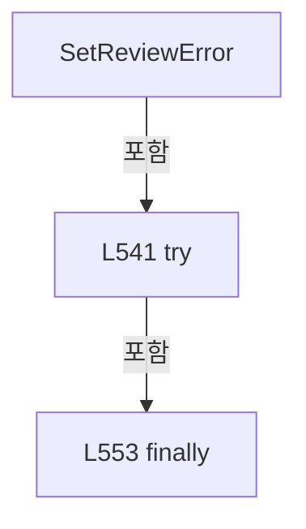

변경 전 점검: 입력/반환 타입, 위 호출자, 예외/취소 경로, 공유 상태와 저장·전송 소비자를 함께 확인합니다. 값의 단위나 물리 방향을 이름만으로 확정하지 않습니다.

### MethodDeclaration `CompleteProduct` · L559–609

[Drilling.Common/Product/CProductManager.cs:559–609](https://github.com/kjuws10-rgb/A3Drilling/blob/0219666f9053b907d96d7e0aa7d0c6c1be3a73d4/Drilling.Common/Product/CProductManager.cs#L559-L609)

| 항목 | 실제 추출 값 |
| --- | --- |
| 서명 | System.Threading.Tasks.Task<Drilling.Common.Product.ST_PRODUCT_DATA> Drilling.Common.Product.CProductManager.CompleteProduct(string, bool, bool, string, System.Threading.CancellationToken) |
| 접근/수식자 | Public / public, async |
| 반환/값 타입 | System.Threading.Tasks.Task<Drilling.Common.Product.ST_PRODUCT_DATA> |
| 소속 타입 | NamedType:Drilling.Common.Product.CProductManager |

입력 계약:

| 이름 | 타입 | 전달 | 선택/기본값 |
| --- | --- | --- | --- |
| productId | string | None | False /  |
| isOk | bool | None | False /  |
| processExecuted | bool | None | False /  |
| message | string | None | False /  |
| cancellationToken | System.Threading.CancellationToken | None | True / null |

정적 호출자로 확인된 위치:

| 호출 파일/행 | 호출 표현식 | 런타임 분기 가능 |
| --- | --- | --- |
| [Drilling.Common/Station/CStationProcess.cs:1423–1423](https://github.com/kjuws10-rgb/A3Drilling/blob/0219666f9053b907d96d7e0aa7d0c6c1be3a73d4/Drilling.Common/Station/CStationProcess.cs#L1423-L1423) | _productManager.CompleteProduct | False |

호출하는 대상과 해석 범위:

| 원본 행 | 표현식 | 분석 상태 | 대상/소스 위치 |
| --- | --- | --- | --- |
| 561 | cancellationToken.ThrowIfCancellationRequested | resolved | void System.Threading.CancellationToken.ThrowIfCancellationRequested() |
| 562 | _updateGate.WaitAsync(cancellationToken).ConfigureAwait | resolved | System.Runtime.CompilerServices.ConfiguredTaskAwaitable System.Threading.Tasks.Task.ConfigureAwait(bool) |
| 562 | _updateGate.WaitAsync | resolved | System.Threading.Tasks.Task System.Threading.SemaphoreSlim.WaitAsync(System.Threading.CancellationToken) |
| 565 | GetCurrent | resolved | Drilling.Common.Product.ST_PRODUCT_DATA Drilling.Common.Product.CProductManager.GetCurrent(string) · Drilling.Common/Product/CProductManager.cs:775 |
| 597 | SetProductState | resolved | Drilling.Common.Product.ST_PRODUCT_INFO Drilling.Common.Product.CProductManager.SetProductState(Drilling.Common.Product.ST_PRODUCT_INFO, Drilling.Common.Product.EN_PRODUCT_STATE, Drilling.Common.Product.EN_PRODUCT_RESULT, System.DateTimeOffset?, System.DateTimeOffset?) · Drilling.Common/Product/CProductManager.cs:857 |
| 600 | product.Heads.Select(SelectItem).ToArray | resolved | Drilling.Common.Product.ST_PRODUCT_HEAD_RESULT[] System.Collections.Generic.IEnumerable<Drilling.Common.Product.ST_PRODUCT_HEAD_RESULT>.ToArray<Drilling.Common.Product.ST_PRODUCT_HEAD_RESULT>() |
| 600 | product.Heads.Select | resolved | System.Collections.Generic.IEnumerable<Drilling.Common.Product.ST_PRODUCT_HEAD_RESULT> System.Collections.Generic.IEnumerable<Drilling.Common.Product.ST_PRODUCT_HEAD_RESULT>.Select<Drilling.Common.Product.ST_PRODUCT_HEAD_RESULT, Drilling.Common.Product.ST_PRODUCT_HEAD_RESULT>(System.Func<Drilling.Common.Product.ST_PRODUCT_HEAD_RESULT, Drilling.Common.Product.ST_PRODUCT_HEAD_RESULT>) |
| 603 | PersistAndLog | resolved | System.Threading.Tasks.Task<Drilling.Common.Product.ST_PRODUCT_DATA> Drilling.Common.Product.CProductManager.PersistAndLog(Drilling.Common.Product.ST_PRODUCT_DATA, string, string, System.Threading.CancellationToken) · Drilling.Common/Product/CProductManager.cs:790 |
| 607 | _updateGate.Release | resolved | int System.Threading.SemaphoreSlim.Release() |

본문의 실제 연산·분기·예외·반환 순서(원문 위치 순):

| 원본 행 | 종류 | 주석 해설 |
| --- | --- | --- |
| 561 | call | 함수·델리게이트 또는 객체 생성자를 호출합니다: cancellationToken.ThrowIfCancellationRequested() |
| 562 | await | 비동기 완료를 기다립니다: await _updateGate.WaitAsync(cancellationToken).ConfigureAwait(false) |
| 562 | call | 함수·델리게이트 또는 객체 생성자를 호출합니다: _updateGate.WaitAsync(cancellationToken).ConfigureAwait(false) |
| 562 | call | 함수·델리게이트 또는 객체 생성자를 호출합니다: _updateGate.WaitAsync(cancellationToken) |
| 563 | try | 예외 처리 범위입니다: try |
| 565 | call | 함수·델리게이트 또는 객체 생성자를 호출합니다: GetCurrent(productId) |
| 565 | local-declaration | 지역 변수를 선언합니다: var product = GetCurrent(productId); |
| 565 | variable-initializer | 변수의 초기값을 지정합니다: product = GetCurrent(productId) |
| 566 | local-declaration | 지역 변수를 선언합니다: var now = DateTimeOffset.Now; |
| 566 | variable-initializer | 변수의 초기값을 지정합니다: now = DateTimeOffset.Now |
| 595 | local-declaration | 지역 변수를 선언합니다: var next = product with { Product = SetProductState(product.Product, EN_PRODUCT_STATE.Completed, !processExecuted ? EN_PRODUCT_RESULT.Skipped : isOk ? EN_PRODUCT_RESULT.OK : EN_PRODUCT_RESULT.NG, product.StartedAt, now), Runtime = |
| 595 | variable-initializer | 변수의 초기값을 지정합니다: next = product with { Product = SetProductState(product.Product, EN_PRODUCT_STATE.Completed, !processExecuted ? EN_PRODUCT_RESULT.Skipped : isOk ? EN_PRODUCT_RESULT.OK : EN_PRODUCT_RESULT.NG, product.StartedAt, now), Runtime = pro |
| 597 | assignment | 값을 대상에 대입합니다: Product = SetProductState(product.Product, EN_PRODUCT_STATE.Completed, !processExecuted ? EN_PRODUCT_RESULT.Skipped : isOk ? EN_PRODUCT_RESULT.OK : EN_PRODUCT_RESULT.NG, product.StartedAt, now) |
| 597 | call | 함수·델리게이트 또는 객체 생성자를 호출합니다: SetProductState(product.Product, EN_PRODUCT_STATE.Completed, !processExecuted ? EN_PRODUCT_RESULT.Skipped : isOk ? EN_PRODUCT_RESULT.OK : EN_PRODUCT_RESULT.NG, product.StartedAt, now) |
| 597 | conditional-expression | 조건에 따라 결과식을 선택합니다: !processExecuted ? EN_PRODUCT_RESULT.Skipped : isOk ? EN_PRODUCT_RESULT.OK : EN_PRODUCT_RESULT.NG |
| 597 | conditional-expression | 조건에 따라 결과식을 선택합니다: isOk ? EN_PRODUCT_RESULT.OK : EN_PRODUCT_RESULT.NG |
| 598 | assignment | 값을 대상에 대입합니다: Runtime = product.Runtime with { Heads = product.Heads.Select(SelectItem).ToArray() } |
| 600 | assignment | 값을 대상에 대입합니다: Heads = product.Heads.Select(SelectItem).ToArray() |
| 600 | call | 함수·델리게이트 또는 객체 생성자를 호출합니다: product.Heads.Select(SelectItem).ToArray() |
| 600 | call | 함수·델리게이트 또는 객체 생성자를 호출합니다: product.Heads.Select(SelectItem) |
| 603 | await | 비동기 완료를 기다립니다: await PersistAndLog(next, "COMPLETE", message, cancellationToken) |
| 603 | call | 함수·델리게이트 또는 객체 생성자를 호출합니다: PersistAndLog(next, "COMPLETE", message, cancellationToken) |
| 603 | return | 호출자에게 값 또는 제어를 반환합니다: return await PersistAndLog(next, "COMPLETE", message, cancellationToken); |
| 605 | finally | 종료 정리 구간입니다: finally |
| 607 | call | 함수·델리게이트 또는 객체 생성자를 호출합니다: _updateGate.Release() |

제어 구문의 포함 구조(실제 실행 순서/CFG가 아닌 구문 탐색 그림):

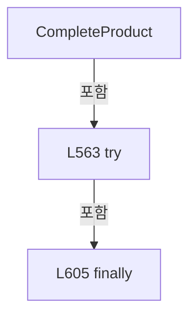

변경 전 점검: 입력/반환 타입, 위 호출자, 예외/취소 경로, 공유 상태와 저장·전송 소비자를 함께 확인합니다. 값의 단위나 물리 방향을 이름만으로 확정하지 않습니다.

### LocalFunctionStatement `SelectItem` · L567–593

[Drilling.Common/Product/CProductManager.cs:567–593](https://github.com/kjuws10-rgb/A3Drilling/blob/0219666f9053b907d96d7e0aa7d0c6c1be3a73d4/Drilling.Common/Product/CProductManager.cs#L567-L593)

| 항목 | 실제 추출 값 |
| --- | --- |
| 서명 | Drilling.Common.Product.ST_PRODUCT_HEAD_RESULT SelectItem(Drilling.Common.Product.ST_PRODUCT_HEAD_RESULT) |
| 접근/수식자 | Private /  |
| 반환/값 타입 | Drilling.Common.Product.ST_PRODUCT_HEAD_RESULT |
| 소속 타입 | NamedType:Drilling.Common.Product.CProductManager |

입력 계약:

| 이름 | 타입 | 전달 | 선택/기본값 |
| --- | --- | --- | --- |
| head | Drilling.Common.Product.ST_PRODUCT_HEAD_RESULT | None | False /  |

현재 부분 분석에서 직접 연결된 호출자는 없습니다. XAML/이벤트/인터페이스·델리게이트·외부 진입을 추가 확인해야 하며, 미사용으로 판정한 것이 아닙니다.

본문의 실제 연산·분기·예외·반환 순서(원문 위치 순):

| 원본 행 | 종류 | 주석 해설 |
| --- | --- | --- |
| 569 | conditional-expression | 조건에 따라 결과식을 선택합니다: head.TotalPoints <= 0 ? head with { State = EN_PRODUCT_HEAD_STATE.Disabled } : !processExecuted ? head with { State = EN_PRODUCT_HEAD_STATE.Disabled, CompletedPoints = 0, Result = EN_PRODUCT_RESULT.Skipped, ErrorCode = "", Message |
| 569 | return | 호출자에게 값 또는 제어를 반환합니다: return head.TotalPoints <= 0 ? head with { State = EN_PRODUCT_HEAD_STATE.Disabled } : !processExecuted ? head with { State = EN_PRODUCT_HEAD_STATE.Disabled, CompletedPoints = 0, Result = EN_PRODUCT_RESULT.Skipped, ErrorCode = "",  |
| 571 | assignment | 값을 대상에 대입합니다: State = EN_PRODUCT_HEAD_STATE.Disabled |
| 574 | conditional-expression | 조건에 따라 결과식을 선택합니다: !processExecuted ? head with { State = EN_PRODUCT_HEAD_STATE.Disabled, CompletedPoints = 0, Result = EN_PRODUCT_RESULT.Skipped, ErrorCode = "", Message = "Process step skipped.", CompletedAt = now } : head with { State = isOk ? EN |
| 576 | assignment | 값을 대상에 대입합니다: State = EN_PRODUCT_HEAD_STATE.Disabled |
| 577 | assignment | 값을 대상에 대입합니다: CompletedPoints = 0 |
| 578 | assignment | 값을 대상에 대입합니다: Result = EN_PRODUCT_RESULT.Skipped |
| 579 | assignment | 값을 대상에 대입합니다: ErrorCode = "" |
| 580 | assignment | 값을 대상에 대입합니다: Message = "Process step skipped." |
| 581 | assignment | 값을 대상에 대입합니다: CompletedAt = now |
| 586 | assignment | 값을 대상에 대입합니다: State = isOk ? EN_PRODUCT_HEAD_STATE.Completed : EN_PRODUCT_HEAD_STATE.Error |
| 586 | conditional-expression | 조건에 따라 결과식을 선택합니다: isOk ? EN_PRODUCT_HEAD_STATE.Completed : EN_PRODUCT_HEAD_STATE.Error |
| 587 | assignment | 값을 대상에 대입합니다: CompletedPoints = isOk ? head.TotalPoints : head.CompletedPoints |
| 587 | conditional-expression | 조건에 따라 결과식을 선택합니다: isOk ? head.TotalPoints : head.CompletedPoints |
| 588 | assignment | 값을 대상에 대입합니다: Result = isOk ? EN_PRODUCT_RESULT.OK : EN_PRODUCT_RESULT.NG |
| 588 | conditional-expression | 조건에 따라 결과식을 선택합니다: isOk ? EN_PRODUCT_RESULT.OK : EN_PRODUCT_RESULT.NG |
| 589 | assignment | 값을 대상에 대입합니다: ErrorCode = isOk ? "" : "1" |
| 589 | conditional-expression | 조건에 따라 결과식을 선택합니다: isOk ? "" : "1" |
| 590 | assignment | 값을 대상에 대입합니다: Message = message |
| 591 | assignment | 값을 대상에 대입합니다: CompletedAt = now |

변경 전 점검: 입력/반환 타입, 위 호출자, 예외/취소 경로, 공유 상태와 저장·전송 소비자를 함께 확인합니다. 값의 단위나 물리 방향을 이름만으로 확정하지 않습니다.

### MethodDeclaration `StopProduct` · L611–646

[Drilling.Common/Product/CProductManager.cs:611–646](https://github.com/kjuws10-rgb/A3Drilling/blob/0219666f9053b907d96d7e0aa7d0c6c1be3a73d4/Drilling.Common/Product/CProductManager.cs#L611-L646)

| 항목 | 실제 추출 값 |
| --- | --- |
| 서명 | System.Threading.Tasks.Task<Drilling.Common.Product.ST_PRODUCT_DATA> Drilling.Common.Product.CProductManager.StopProduct(string, string, System.Threading.CancellationToken) |
| 접근/수식자 | Public / public, async |
| 반환/값 타입 | System.Threading.Tasks.Task<Drilling.Common.Product.ST_PRODUCT_DATA> |
| 소속 타입 | NamedType:Drilling.Common.Product.CProductManager |

입력 계약:

| 이름 | 타입 | 전달 | 선택/기본값 |
| --- | --- | --- | --- |
| productId | string | None | False /  |
| message | string | None | False /  |
| cancellationToken | System.Threading.CancellationToken | None | True / null |

정적 호출자로 확인된 위치:

| 호출 파일/행 | 호출 표현식 | 런타임 분기 가능 |
| --- | --- | --- |
| [Drilling.Common/Station/CStationProcess.cs:1435–1435](https://github.com/kjuws10-rgb/A3Drilling/blob/0219666f9053b907d96d7e0aa7d0c6c1be3a73d4/Drilling.Common/Station/CStationProcess.cs#L1435-L1435) | _productManager.StopProduct | False |

호출하는 대상과 해석 범위:

| 원본 행 | 표현식 | 분석 상태 | 대상/소스 위치 |
| --- | --- | --- | --- |
| 613 | cancellationToken.ThrowIfCancellationRequested | resolved | void System.Threading.CancellationToken.ThrowIfCancellationRequested() |
| 614 | _updateGate.WaitAsync(cancellationToken).ConfigureAwait | resolved | System.Runtime.CompilerServices.ConfiguredTaskAwaitable System.Threading.Tasks.Task.ConfigureAwait(bool) |
| 614 | _updateGate.WaitAsync | resolved | System.Threading.Tasks.Task System.Threading.SemaphoreSlim.WaitAsync(System.Threading.CancellationToken) |
| 617 | GetCurrent | resolved | Drilling.Common.Product.ST_PRODUCT_DATA Drilling.Common.Product.CProductManager.GetCurrent(string) · Drilling.Common/Product/CProductManager.cs:775 |
| 634 | SetProductState | resolved | Drilling.Common.Product.ST_PRODUCT_INFO Drilling.Common.Product.CProductManager.SetProductState(Drilling.Common.Product.ST_PRODUCT_INFO, Drilling.Common.Product.EN_PRODUCT_STATE, Drilling.Common.Product.EN_PRODUCT_RESULT, System.DateTimeOffset?, System.DateTimeOffset?) · Drilling.Common/Product/CProductManager.cs:857 |
| 637 | product.Heads.Select(SelectItem).ToArray | resolved | Drilling.Common.Product.ST_PRODUCT_HEAD_RESULT[] System.Collections.Generic.IEnumerable<Drilling.Common.Product.ST_PRODUCT_HEAD_RESULT>.ToArray<Drilling.Common.Product.ST_PRODUCT_HEAD_RESULT>() |
| 637 | product.Heads.Select | resolved | System.Collections.Generic.IEnumerable<Drilling.Common.Product.ST_PRODUCT_HEAD_RESULT> System.Collections.Generic.IEnumerable<Drilling.Common.Product.ST_PRODUCT_HEAD_RESULT>.Select<Drilling.Common.Product.ST_PRODUCT_HEAD_RESULT, Drilling.Common.Product.ST_PRODUCT_HEAD_RESULT>(System.Func<Drilling.Common.Product.ST_PRODUCT_HEAD_RESULT, Drilling.Common.Product.ST_PRODUCT_HEAD_RESULT>) |
| 640 | PersistAndLog | resolved | System.Threading.Tasks.Task<Drilling.Common.Product.ST_PRODUCT_DATA> Drilling.Common.Product.CProductManager.PersistAndLog(Drilling.Common.Product.ST_PRODUCT_DATA, string, string, System.Threading.CancellationToken) · Drilling.Common/Product/CProductManager.cs:790 |
| 644 | _updateGate.Release | resolved | int System.Threading.SemaphoreSlim.Release() |

본문의 실제 연산·분기·예외·반환 순서(원문 위치 순):

| 원본 행 | 종류 | 주석 해설 |
| --- | --- | --- |
| 613 | call | 함수·델리게이트 또는 객체 생성자를 호출합니다: cancellationToken.ThrowIfCancellationRequested() |
| 614 | await | 비동기 완료를 기다립니다: await _updateGate.WaitAsync(cancellationToken).ConfigureAwait(false) |
| 614 | call | 함수·델리게이트 또는 객체 생성자를 호출합니다: _updateGate.WaitAsync(cancellationToken).ConfigureAwait(false) |
| 614 | call | 함수·델리게이트 또는 객체 생성자를 호출합니다: _updateGate.WaitAsync(cancellationToken) |
| 615 | try | 예외 처리 범위입니다: try |
| 617 | call | 함수·델리게이트 또는 객체 생성자를 호출합니다: GetCurrent(productId) |
| 617 | local-declaration | 지역 변수를 선언합니다: var product = GetCurrent(productId); |
| 617 | variable-initializer | 변수의 초기값을 지정합니다: product = GetCurrent(productId) |
| 618 | local-declaration | 지역 변수를 선언합니다: var now = DateTimeOffset.Now; |
| 618 | variable-initializer | 변수의 초기값을 지정합니다: now = DateTimeOffset.Now |
| 632 | local-declaration | 지역 변수를 선언합니다: var next = product with { Product = SetProductState(product.Product, EN_PRODUCT_STATE.Stopped, EN_PRODUCT_RESULT.NG, product.StartedAt, now), Runtime = product.Runtime with { Heads = product.Heads.Select(SelectItem).ToArray() } }; |
| 632 | variable-initializer | 변수의 초기값을 지정합니다: next = product with { Product = SetProductState(product.Product, EN_PRODUCT_STATE.Stopped, EN_PRODUCT_RESULT.NG, product.StartedAt, now), Runtime = product.Runtime with { Heads = product.Heads.Select(SelectItem).ToArray() } } |
| 634 | assignment | 값을 대상에 대입합니다: Product = SetProductState(product.Product, EN_PRODUCT_STATE.Stopped, EN_PRODUCT_RESULT.NG, product.StartedAt, now) |
| 634 | call | 함수·델리게이트 또는 객체 생성자를 호출합니다: SetProductState(product.Product, EN_PRODUCT_STATE.Stopped, EN_PRODUCT_RESULT.NG, product.StartedAt, now) |
| 635 | assignment | 값을 대상에 대입합니다: Runtime = product.Runtime with { Heads = product.Heads.Select(SelectItem).ToArray() } |
| 637 | assignment | 값을 대상에 대입합니다: Heads = product.Heads.Select(SelectItem).ToArray() |
| 637 | call | 함수·델리게이트 또는 객체 생성자를 호출합니다: product.Heads.Select(SelectItem).ToArray() |
| 637 | call | 함수·델리게이트 또는 객체 생성자를 호출합니다: product.Heads.Select(SelectItem) |
| 640 | await | 비동기 완료를 기다립니다: await PersistAndLog(next, "STOP", message, cancellationToken) |
| 640 | call | 함수·델리게이트 또는 객체 생성자를 호출합니다: PersistAndLog(next, "STOP", message, cancellationToken) |
| 640 | return | 호출자에게 값 또는 제어를 반환합니다: return await PersistAndLog(next, "STOP", message, cancellationToken); |
| 642 | finally | 종료 정리 구간입니다: finally |
| 644 | call | 함수·델리게이트 또는 객체 생성자를 호출합니다: _updateGate.Release() |

제어 구문의 포함 구조(실제 실행 순서/CFG가 아닌 구문 탐색 그림):

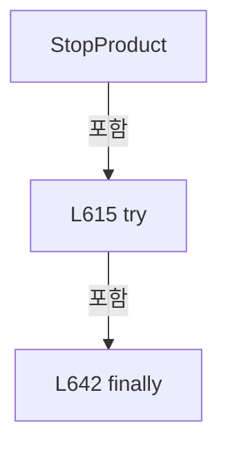

변경 전 점검: 입력/반환 타입, 위 호출자, 예외/취소 경로, 공유 상태와 저장·전송 소비자를 함께 확인합니다. 값의 단위나 물리 방향을 이름만으로 확정하지 않습니다.

### LocalFunctionStatement `SelectItem` · L619–630

[Drilling.Common/Product/CProductManager.cs:619–630](https://github.com/kjuws10-rgb/A3Drilling/blob/0219666f9053b907d96d7e0aa7d0c6c1be3a73d4/Drilling.Common/Product/CProductManager.cs#L619-L630)

| 항목 | 실제 추출 값 |
| --- | --- |
| 서명 | Drilling.Common.Product.ST_PRODUCT_HEAD_RESULT SelectItem(Drilling.Common.Product.ST_PRODUCT_HEAD_RESULT) |
| 접근/수식자 | Private /  |
| 반환/값 타입 | Drilling.Common.Product.ST_PRODUCT_HEAD_RESULT |
| 소속 타입 | NamedType:Drilling.Common.Product.CProductManager |

입력 계약:

| 이름 | 타입 | 전달 | 선택/기본값 |
| --- | --- | --- | --- |
| head | Drilling.Common.Product.ST_PRODUCT_HEAD_RESULT | None | False /  |

현재 부분 분석에서 직접 연결된 호출자는 없습니다. XAML/이벤트/인터페이스·델리게이트·외부 진입을 추가 확인해야 하며, 미사용으로 판정한 것이 아닙니다.

본문의 실제 연산·분기·예외·반환 순서(원문 위치 순):

| 원본 행 | 종류 | 주석 해설 |
| --- | --- | --- |
| 621 | conditional-expression | 조건에 따라 결과식을 선택합니다: head.State == EN_PRODUCT_HEAD_STATE.Running ? head with { State = EN_PRODUCT_HEAD_STATE.Stopped, Result = EN_PRODUCT_RESULT.NG, Message = message, CompletedAt = now } : head |
| 621 | return | 호출자에게 값 또는 제어를 반환합니다: return head.State == EN_PRODUCT_HEAD_STATE.Running ? head with { State = EN_PRODUCT_HEAD_STATE.Stopped, Result = EN_PRODUCT_RESULT.NG, Message = message, CompletedAt = now } : head; |
| 623 | assignment | 값을 대상에 대입합니다: State = EN_PRODUCT_HEAD_STATE.Stopped |
| 624 | assignment | 값을 대상에 대입합니다: Result = EN_PRODUCT_RESULT.NG |
| 625 | assignment | 값을 대상에 대입합니다: Message = message |
| 626 | assignment | 값을 대상에 대입합니다: CompletedAt = now |

변경 전 점검: 입력/반환 타입, 위 호출자, 예외/취소 경로, 공유 상태와 저장·전송 소비자를 함께 확인합니다. 값의 단위나 물리 방향을 이름만으로 확정하지 않습니다.

### MethodDeclaration `SetError` · L648–684

[Drilling.Common/Product/CProductManager.cs:648–684](https://github.com/kjuws10-rgb/A3Drilling/blob/0219666f9053b907d96d7e0aa7d0c6c1be3a73d4/Drilling.Common/Product/CProductManager.cs#L648-L684)

| 항목 | 실제 추출 값 |
| --- | --- |
| 서명 | System.Threading.Tasks.Task<Drilling.Common.Product.ST_PRODUCT_DATA> Drilling.Common.Product.CProductManager.SetError(string, string, System.Threading.CancellationToken) |
| 접근/수식자 | Public / public, async |
| 반환/값 타입 | System.Threading.Tasks.Task<Drilling.Common.Product.ST_PRODUCT_DATA> |
| 소속 타입 | NamedType:Drilling.Common.Product.CProductManager |

입력 계약:

| 이름 | 타입 | 전달 | 선택/기본값 |
| --- | --- | --- | --- |
| productId | string | None | False /  |
| message | string | None | False /  |
| cancellationToken | System.Threading.CancellationToken | None | True / null |

정적 호출자로 확인된 위치:

| 호출 파일/행 | 호출 표현식 | 런타임 분기 가능 |
| --- | --- | --- |
| [Drilling.Common/Station/CStationProcess.cs:1459–1459](https://github.com/kjuws10-rgb/A3Drilling/blob/0219666f9053b907d96d7e0aa7d0c6c1be3a73d4/Drilling.Common/Station/CStationProcess.cs#L1459-L1459) | _productManager.SetError | False |

호출하는 대상과 해석 범위:

| 원본 행 | 표현식 | 분석 상태 | 대상/소스 위치 |
| --- | --- | --- | --- |
| 650 | cancellationToken.ThrowIfCancellationRequested | resolved | void System.Threading.CancellationToken.ThrowIfCancellationRequested() |
| 651 | _updateGate.WaitAsync(cancellationToken).ConfigureAwait | resolved | System.Runtime.CompilerServices.ConfiguredTaskAwaitable System.Threading.Tasks.Task.ConfigureAwait(bool) |
| 651 | _updateGate.WaitAsync | resolved | System.Threading.Tasks.Task System.Threading.SemaphoreSlim.WaitAsync(System.Threading.CancellationToken) |
| 654 | GetCurrent | resolved | Drilling.Common.Product.ST_PRODUCT_DATA Drilling.Common.Product.CProductManager.GetCurrent(string) · Drilling.Common/Product/CProductManager.cs:775 |
| 672 | SetProductState | resolved | Drilling.Common.Product.ST_PRODUCT_INFO Drilling.Common.Product.CProductManager.SetProductState(Drilling.Common.Product.ST_PRODUCT_INFO, Drilling.Common.Product.EN_PRODUCT_STATE, Drilling.Common.Product.EN_PRODUCT_RESULT, System.DateTimeOffset?, System.DateTimeOffset?) · Drilling.Common/Product/CProductManager.cs:857 |
| 675 | product.Heads.Select(SelectItem).ToArray | resolved | Drilling.Common.Product.ST_PRODUCT_HEAD_RESULT[] System.Collections.Generic.IEnumerable<Drilling.Common.Product.ST_PRODUCT_HEAD_RESULT>.ToArray<Drilling.Common.Product.ST_PRODUCT_HEAD_RESULT>() |
| 675 | product.Heads.Select | resolved | System.Collections.Generic.IEnumerable<Drilling.Common.Product.ST_PRODUCT_HEAD_RESULT> System.Collections.Generic.IEnumerable<Drilling.Common.Product.ST_PRODUCT_HEAD_RESULT>.Select<Drilling.Common.Product.ST_PRODUCT_HEAD_RESULT, Drilling.Common.Product.ST_PRODUCT_HEAD_RESULT>(System.Func<Drilling.Common.Product.ST_PRODUCT_HEAD_RESULT, Drilling.Common.Product.ST_PRODUCT_HEAD_RESULT>) |
| 678 | PersistAndLog | resolved | System.Threading.Tasks.Task<Drilling.Common.Product.ST_PRODUCT_DATA> Drilling.Common.Product.CProductManager.PersistAndLog(Drilling.Common.Product.ST_PRODUCT_DATA, string, string, System.Threading.CancellationToken) · Drilling.Common/Product/CProductManager.cs:790 |
| 682 | _updateGate.Release | resolved | int System.Threading.SemaphoreSlim.Release() |

본문의 실제 연산·분기·예외·반환 순서(원문 위치 순):

| 원본 행 | 종류 | 주석 해설 |
| --- | --- | --- |
| 650 | call | 함수·델리게이트 또는 객체 생성자를 호출합니다: cancellationToken.ThrowIfCancellationRequested() |
| 651 | await | 비동기 완료를 기다립니다: await _updateGate.WaitAsync(cancellationToken).ConfigureAwait(false) |
| 651 | call | 함수·델리게이트 또는 객체 생성자를 호출합니다: _updateGate.WaitAsync(cancellationToken).ConfigureAwait(false) |
| 651 | call | 함수·델리게이트 또는 객체 생성자를 호출합니다: _updateGate.WaitAsync(cancellationToken) |
| 652 | try | 예외 처리 범위입니다: try |
| 654 | call | 함수·델리게이트 또는 객체 생성자를 호출합니다: GetCurrent(productId) |
| 654 | local-declaration | 지역 변수를 선언합니다: var product = GetCurrent(productId); |
| 654 | variable-initializer | 변수의 초기값을 지정합니다: product = GetCurrent(productId) |
| 655 | local-declaration | 지역 변수를 선언합니다: var now = DateTimeOffset.Now; |
| 655 | variable-initializer | 변수의 초기값을 지정합니다: now = DateTimeOffset.Now |
| 670 | local-declaration | 지역 변수를 선언합니다: var next = product with { Product = SetProductState(product.Product, EN_PRODUCT_STATE.Error, EN_PRODUCT_RESULT.NG, product.StartedAt, now), Runtime = product.Runtime with { Heads = product.Heads.Select(SelectItem).ToArray() } }; |
| 670 | variable-initializer | 변수의 초기값을 지정합니다: next = product with { Product = SetProductState(product.Product, EN_PRODUCT_STATE.Error, EN_PRODUCT_RESULT.NG, product.StartedAt, now), Runtime = product.Runtime with { Heads = product.Heads.Select(SelectItem).ToArray() } } |
| 672 | assignment | 값을 대상에 대입합니다: Product = SetProductState(product.Product, EN_PRODUCT_STATE.Error, EN_PRODUCT_RESULT.NG, product.StartedAt, now) |
| 672 | call | 함수·델리게이트 또는 객체 생성자를 호출합니다: SetProductState(product.Product, EN_PRODUCT_STATE.Error, EN_PRODUCT_RESULT.NG, product.StartedAt, now) |
| 673 | assignment | 값을 대상에 대입합니다: Runtime = product.Runtime with { Heads = product.Heads.Select(SelectItem).ToArray() } |
| 675 | assignment | 값을 대상에 대입합니다: Heads = product.Heads.Select(SelectItem).ToArray() |
| 675 | call | 함수·델리게이트 또는 객체 생성자를 호출합니다: product.Heads.Select(SelectItem).ToArray() |
| 675 | call | 함수·델리게이트 또는 객체 생성자를 호출합니다: product.Heads.Select(SelectItem) |
| 678 | await | 비동기 완료를 기다립니다: await PersistAndLog(next, "ERROR", message, cancellationToken) |
| 678 | call | 함수·델리게이트 또는 객체 생성자를 호출합니다: PersistAndLog(next, "ERROR", message, cancellationToken) |
| 678 | return | 호출자에게 값 또는 제어를 반환합니다: return await PersistAndLog(next, "ERROR", message, cancellationToken); |
| 680 | finally | 종료 정리 구간입니다: finally |
| 682 | call | 함수·델리게이트 또는 객체 생성자를 호출합니다: _updateGate.Release() |

제어 구문의 포함 구조(실제 실행 순서/CFG가 아닌 구문 탐색 그림):

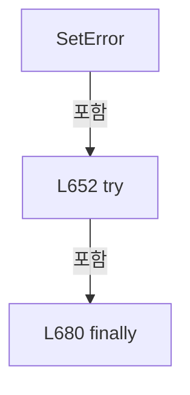

변경 전 점검: 입력/반환 타입, 위 호출자, 예외/취소 경로, 공유 상태와 저장·전송 소비자를 함께 확인합니다. 값의 단위나 물리 방향을 이름만으로 확정하지 않습니다.

### LocalFunctionStatement `SelectItem` · L656–668

[Drilling.Common/Product/CProductManager.cs:656–668](https://github.com/kjuws10-rgb/A3Drilling/blob/0219666f9053b907d96d7e0aa7d0c6c1be3a73d4/Drilling.Common/Product/CProductManager.cs#L656-L668)

| 항목 | 실제 추출 값 |
| --- | --- |
| 서명 | Drilling.Common.Product.ST_PRODUCT_HEAD_RESULT SelectItem(Drilling.Common.Product.ST_PRODUCT_HEAD_RESULT) |
| 접근/수식자 | Private /  |
| 반환/값 타입 | Drilling.Common.Product.ST_PRODUCT_HEAD_RESULT |
| 소속 타입 | NamedType:Drilling.Common.Product.CProductManager |

입력 계약:

| 이름 | 타입 | 전달 | 선택/기본값 |
| --- | --- | --- | --- |
| head | Drilling.Common.Product.ST_PRODUCT_HEAD_RESULT | None | False /  |

현재 부분 분석에서 직접 연결된 호출자는 없습니다. XAML/이벤트/인터페이스·델리게이트·외부 진입을 추가 확인해야 하며, 미사용으로 판정한 것이 아닙니다.

본문의 실제 연산·분기·예외·반환 순서(원문 위치 순):

| 원본 행 | 종류 | 주석 해설 |
| --- | --- | --- |
| 658 | conditional-expression | 조건에 따라 결과식을 선택합니다: head.State == EN_PRODUCT_HEAD_STATE.Running ? head with { State = EN_PRODUCT_HEAD_STATE.Error, Result = EN_PRODUCT_RESULT.NG, ErrorCode = "1", Message = message, CompletedAt = now } : head |
| 658 | return | 호출자에게 값 또는 제어를 반환합니다: return head.State == EN_PRODUCT_HEAD_STATE.Running ? head with { State = EN_PRODUCT_HEAD_STATE.Error, Result = EN_PRODUCT_RESULT.NG, ErrorCode = "1", Message = message, CompletedAt = now } : head; |
| 660 | assignment | 값을 대상에 대입합니다: State = EN_PRODUCT_HEAD_STATE.Error |
| 661 | assignment | 값을 대상에 대입합니다: Result = EN_PRODUCT_RESULT.NG |
| 662 | assignment | 값을 대상에 대입합니다: ErrorCode = "1" |
| 663 | assignment | 값을 대상에 대입합니다: Message = message |
| 664 | assignment | 값을 대상에 대입합니다: CompletedAt = now |

변경 전 점검: 입력/반환 타입, 위 호출자, 예외/취소 경로, 공유 상태와 저장·전송 소비자를 함께 확인합니다. 값의 단위나 물리 방향을 이름만으로 확정하지 않습니다.

### MethodDeclaration `ScrapProduct` · L686–703

[Drilling.Common/Product/CProductManager.cs:686–703](https://github.com/kjuws10-rgb/A3Drilling/blob/0219666f9053b907d96d7e0aa7d0c6c1be3a73d4/Drilling.Common/Product/CProductManager.cs#L686-L703)

| 항목 | 실제 추출 값 |
| --- | --- |
| 서명 | System.Threading.Tasks.Task<Drilling.Common.Product.ST_PRODUCT_DATA> Drilling.Common.Product.CProductManager.ScrapProduct(string, string, System.Threading.CancellationToken) |
| 접근/수식자 | Public / public, async |
| 반환/값 타입 | System.Threading.Tasks.Task<Drilling.Common.Product.ST_PRODUCT_DATA> |
| 소속 타입 | NamedType:Drilling.Common.Product.CProductManager |

입력 계약:

| 이름 | 타입 | 전달 | 선택/기본값 |
| --- | --- | --- | --- |
| productId | string | None | False /  |
| reason | string | None | False /  |
| cancellationToken | System.Threading.CancellationToken | None | True / null |

현재 부분 분석에서 직접 연결된 호출자는 없습니다. XAML/이벤트/인터페이스·델리게이트·외부 진입을 추가 확인해야 하며, 미사용으로 판정한 것이 아닙니다.

호출하는 대상과 해석 범위:

| 원본 행 | 표현식 | 분석 상태 | 대상/소스 위치 |
| --- | --- | --- | --- |
| 688 | cancellationToken.ThrowIfCancellationRequested | resolved | void System.Threading.CancellationToken.ThrowIfCancellationRequested() |
| 689 | _updateGate.WaitAsync(cancellationToken).ConfigureAwait | resolved | System.Runtime.CompilerServices.ConfiguredTaskAwaitable System.Threading.Tasks.Task.ConfigureAwait(bool) |
| 689 | _updateGate.WaitAsync | resolved | System.Threading.Tasks.Task System.Threading.SemaphoreSlim.WaitAsync(System.Threading.CancellationToken) |
| 692 | GetCurrent | resolved | Drilling.Common.Product.ST_PRODUCT_DATA Drilling.Common.Product.CProductManager.GetCurrent(string) · Drilling.Common/Product/CProductManager.cs:775 |
| 695 | SetProductState | resolved | Drilling.Common.Product.ST_PRODUCT_INFO Drilling.Common.Product.CProductManager.SetProductState(Drilling.Common.Product.ST_PRODUCT_INFO, Drilling.Common.Product.EN_PRODUCT_STATE, Drilling.Common.Product.EN_PRODUCT_RESULT, System.DateTimeOffset?, System.DateTimeOffset?) · Drilling.Common/Product/CProductManager.cs:857 |
| 697 | PersistAndLog | resolved | System.Threading.Tasks.Task<Drilling.Common.Product.ST_PRODUCT_DATA> Drilling.Common.Product.CProductManager.PersistAndLog(Drilling.Common.Product.ST_PRODUCT_DATA, string, string, System.Threading.CancellationToken) · Drilling.Common/Product/CProductManager.cs:790 |
| 701 | _updateGate.Release | resolved | int System.Threading.SemaphoreSlim.Release() |

본문의 실제 연산·분기·예외·반환 순서(원문 위치 순):

| 원본 행 | 종류 | 주석 해설 |
| --- | --- | --- |
| 688 | call | 함수·델리게이트 또는 객체 생성자를 호출합니다: cancellationToken.ThrowIfCancellationRequested() |
| 689 | await | 비동기 완료를 기다립니다: await _updateGate.WaitAsync(cancellationToken).ConfigureAwait(false) |
| 689 | call | 함수·델리게이트 또는 객체 생성자를 호출합니다: _updateGate.WaitAsync(cancellationToken).ConfigureAwait(false) |
| 689 | call | 함수·델리게이트 또는 객체 생성자를 호출합니다: _updateGate.WaitAsync(cancellationToken) |
| 690 | try | 예외 처리 범위입니다: try |
| 692 | call | 함수·델리게이트 또는 객체 생성자를 호출합니다: GetCurrent(productId) |
| 692 | local-declaration | 지역 변수를 선언합니다: var product = GetCurrent(productId); |
| 692 | variable-initializer | 변수의 초기값을 지정합니다: product = GetCurrent(productId) |
| 693 | local-declaration | 지역 변수를 선언합니다: var next = product with { Product = SetProductState(product.Product, EN_PRODUCT_STATE.Scrapped, EN_PRODUCT_RESULT.NG, product.StartedAt, DateTimeOffset.Now) }; |
| 693 | variable-initializer | 변수의 초기값을 지정합니다: next = product with { Product = SetProductState(product.Product, EN_PRODUCT_STATE.Scrapped, EN_PRODUCT_RESULT.NG, product.StartedAt, DateTimeOffset.Now) } |
| 695 | assignment | 값을 대상에 대입합니다: Product = SetProductState(product.Product, EN_PRODUCT_STATE.Scrapped, EN_PRODUCT_RESULT.NG, product.StartedAt, DateTimeOffset.Now) |
| 695 | call | 함수·델리게이트 또는 객체 생성자를 호출합니다: SetProductState(product.Product, EN_PRODUCT_STATE.Scrapped, EN_PRODUCT_RESULT.NG, product.StartedAt, DateTimeOffset.Now) |
| 697 | await | 비동기 완료를 기다립니다: await PersistAndLog(next, "SCRAP", reason, cancellationToken) |
| 697 | call | 함수·델리게이트 또는 객체 생성자를 호출합니다: PersistAndLog(next, "SCRAP", reason, cancellationToken) |
| 697 | return | 호출자에게 값 또는 제어를 반환합니다: return await PersistAndLog(next, "SCRAP", reason, cancellationToken); |
| 699 | finally | 종료 정리 구간입니다: finally |
| 701 | call | 함수·델리게이트 또는 객체 생성자를 호출합니다: _updateGate.Release() |

제어 구문의 포함 구조(실제 실행 순서/CFG가 아닌 구문 탐색 그림):

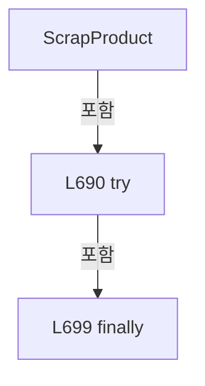

변경 전 점검: 입력/반환 타입, 위 호출자, 예외/취소 경로, 공유 상태와 저장·전송 소비자를 함께 확인합니다. 값의 단위나 물리 방향을 이름만으로 확정하지 않습니다.

### MethodDeclaration `DeleteProduct` · L705–739

[Drilling.Common/Product/CProductManager.cs:705–739](https://github.com/kjuws10-rgb/A3Drilling/blob/0219666f9053b907d96d7e0aa7d0c6c1be3a73d4/Drilling.Common/Product/CProductManager.cs#L705-L739)

| 항목 | 실제 추출 값 |
| --- | --- |
| 서명 | System.Threading.Tasks.Task Drilling.Common.Product.CProductManager.DeleteProduct(string, System.Threading.CancellationToken) |
| 접근/수식자 | Public / public, async |
| 반환/값 타입 | System.Threading.Tasks.Task |
| 소속 타입 | NamedType:Drilling.Common.Product.CProductManager |

입력 계약:

| 이름 | 타입 | 전달 | 선택/기본값 |
| --- | --- | --- | --- |
| productId | string | None | False /  |
| cancellationToken | System.Threading.CancellationToken | None | True / null |

정적 호출자로 확인된 위치:

| 호출 파일/행 | 호출 표현식 | 런타임 분기 가능 |
| --- | --- | --- |
| [Drilling.UI/Menu/Menus/CMenuMonitor.cs:4520–4520](https://github.com/kjuws10-rgb/A3Drilling/blob/0219666f9053b907d96d7e0aa7d0c6c1be3a73d4/Drilling.UI/Menu/Menus/CMenuMonitor.cs#L4520-L4520) | _productManager.DeleteProduct | False |

호출하는 대상과 해석 범위:

| 원본 행 | 표현식 | 분석 상태 | 대상/소스 위치 |
| --- | --- | --- | --- |
| 707 | cancellationToken.ThrowIfCancellationRequested | resolved | void System.Threading.CancellationToken.ThrowIfCancellationRequested() |
| 708 | _updateGate.WaitAsync(cancellationToken).ConfigureAwait | resolved | System.Runtime.CompilerServices.ConfiguredTaskAwaitable System.Threading.Tasks.Task.ConfigureAwait(bool) |
| 708 | _updateGate.WaitAsync | resolved | System.Threading.Tasks.Task System.Threading.SemaphoreSlim.WaitAsync(System.Threading.CancellationToken) |
| 711 | GetCurrent | resolved | Drilling.Common.Product.ST_PRODUCT_DATA Drilling.Common.Product.CProductManager.GetCurrent(string) · Drilling.Common/Product/CProductManager.cs:775 |
| 714 | new InvalidOperationException | resolved | System.InvalidOperationException.InvalidOperationException(string?) |
| 717 | productFile.ClearActive(cancellationToken).ConfigureAwait | resolved | System.Runtime.CompilerServices.ConfiguredTaskAwaitable System.Threading.Tasks.Task.ConfigureAwait(bool) |
| 717 | productFile.ClearActive | resolved | System.Threading.Tasks.Task Drilling.Common.Product.CProductFileBase.ClearActive(System.Threading.CancellationToken) · Drilling.Common/Product/CProductManager.cs:1117 |
| 718 | Volatile.Write | resolved | void System.Threading.Volatile.Write<Drilling.Common.Product.ST_PRODUCT_DATA?>(ref Drilling.Common.Product.ST_PRODUCT_DATA?, Drilling.Common.Product.ST_PRODUCT_DATA?) |
| 721 | productFile.AppendHistory(new ST_PRODUCT_HISTORY(DateTimeOffset.Now, product.GlassId, product.ProcessId, product.RecipeId, "DELETE", product.State.ToString().ToUpperInvariant(), product.Result.ToString().ToUpperInvariant(), "Product deleted."), CancellationToken.None).ConfigureAwait | resolved | System.Runtime.CompilerServices.ConfiguredTaskAwaitable System.Threading.Tasks.Task.ConfigureAwait(bool) |
| 721 | productFile.AppendHistory | resolved | System.Threading.Tasks.Task Drilling.Common.Product.CProductFileBase.AppendHistory(Drilling.Common.Product.ST_PRODUCT_HISTORY, System.Threading.CancellationToken) · Drilling.Common/Product/CProductManager.cs:1118 |
| 721 | new ST_PRODUCT_HISTORY | resolved | Drilling.Common.Product.ST_PRODUCT_HISTORY.ST_PRODUCT_HISTORY(System.DateTimeOffset, string, string, string, string, string, string, string) · Drilling.Common/Product/CProductManager.cs:1112 |
| 721 | product.State.ToString().ToUpperInvariant | resolved | string string.ToUpperInvariant() |
| 721 | product.State.ToString | resolved · 동적 구현 선택 가능 | string System.Enum.ToString() |
| 721 | product.Result.ToString().ToUpperInvariant | resolved | string string.ToUpperInvariant() |
| 721 | product.Result.ToString | resolved · 동적 구현 선택 가능 | string System.Enum.ToString() |
| 727 | .WriteProductEvent | resolved | void Drilling.Common.Log.CLogManager.WriteProductEvent(string, string, string, string, string) · Drilling.Common/Log/CLogManager.cs:341 |
| 727 | product.State.ToString().ToUpperInvariant | resolved | string string.ToUpperInvariant() |
| 727 | product.State.ToString | resolved · 동적 구현 선택 가능 | string System.Enum.ToString() |
| 727 | product.Result.ToString().ToUpperInvariant | resolved | string string.ToUpperInvariant() |
| 727 | product.Result.ToString | resolved · 동적 구현 선택 가능 | string System.Enum.ToString() |
| 737 | _updateGate.Release | resolved | int System.Threading.SemaphoreSlim.Release() |

본문의 실제 연산·분기·예외·반환 순서(원문 위치 순):

| 원본 행 | 종류 | 주석 해설 |
| --- | --- | --- |
| 707 | call | 함수·델리게이트 또는 객체 생성자를 호출합니다: cancellationToken.ThrowIfCancellationRequested() |
| 708 | await | 비동기 완료를 기다립니다: await _updateGate.WaitAsync(cancellationToken).ConfigureAwait(false) |
| 708 | call | 함수·델리게이트 또는 객체 생성자를 호출합니다: _updateGate.WaitAsync(cancellationToken).ConfigureAwait(false) |
| 708 | call | 함수·델리게이트 또는 객체 생성자를 호출합니다: _updateGate.WaitAsync(cancellationToken) |
| 709 | try | 예외 처리 범위입니다: try |
| 711 | call | 함수·델리게이트 또는 객체 생성자를 호출합니다: GetCurrent(productId) |
| 711 | local-declaration | 지역 변수를 선언합니다: var product = GetCurrent(productId); |
| 711 | variable-initializer | 변수의 초기값을 지정합니다: product = GetCurrent(productId) |
| 712 | if | 조건에 따라 분기합니다: if (product.State == EN_PRODUCT_STATE.Running) |
| 714 | call | 함수·델리게이트 또는 객체 생성자를 호출합니다: new InvalidOperationException($"Running Glass '{product.GlassId}' cannot be deleted.") |
| 714 | throw | 예외를 발생/전달합니다: throw new InvalidOperationException($"Running Glass '{product.GlassId}' cannot be deleted."); |
| 717 | await | 비동기 완료를 기다립니다: await productFile.ClearActive(cancellationToken).ConfigureAwait(false) |
| 717 | call | 함수·델리게이트 또는 객체 생성자를 호출합니다: productFile.ClearActive(cancellationToken).ConfigureAwait(false) |
| 717 | call | 함수·델리게이트 또는 객체 생성자를 호출합니다: productFile.ClearActive(cancellationToken) |
| 718 | call | 함수·델리게이트 또는 객체 생성자를 호출합니다: Volatile.Write(ref _current, null) |
| 719 | try | 예외 처리 범위입니다: try |
| 721 | await | 비동기 완료를 기다립니다: await productFile.AppendHistory(new ST_PRODUCT_HISTORY(DateTimeOffset.Now, product.GlassId, product.ProcessId, product.RecipeId, "DELETE", product.State.ToString().ToUpperInvariant(), product.Result.ToString().ToUpperInvariant(),  |
| 721 | call | 함수·델리게이트 또는 객체 생성자를 호출합니다: productFile.AppendHistory(new ST_PRODUCT_HISTORY(DateTimeOffset.Now, product.GlassId, product.ProcessId, product.RecipeId, "DELETE", product.State.ToString().ToUpperInvariant(), product.Result.ToString().ToUpperInvariant… |
| 721 | call | 함수·델리게이트 또는 객체 생성자를 호출합니다: productFile.AppendHistory(new ST_PRODUCT_HISTORY(DateTimeOffset.Now, product.GlassId, product.ProcessId, product.RecipeId, "DELETE", product.State.ToString().ToUpperInvariant(), product.Result.ToString().ToUpperInvariant… |
| 721 | call | 함수·델리게이트 또는 객체 생성자를 호출합니다: new ST_PRODUCT_HISTORY(DateTimeOffset.Now, product.GlassId, product.ProcessId, product.RecipeId, "DELETE", product.State.ToString().ToUpperInvariant(), product.Result.ToString().ToUpperInvariant(), "Product deleted.") |
| 721 | call | 함수·델리게이트 또는 객체 생성자를 호출합니다: product.State.ToString().ToUpperInvariant() |
| 721 | call | 함수·델리게이트 또는 객체 생성자를 호출합니다: product.State.ToString() |
| 721 | call | 함수·델리게이트 또는 객체 생성자를 호출합니다: product.Result.ToString().ToUpperInvariant() |
| 721 | call | 함수·델리게이트 또는 객체 생성자를 호출합니다: product.Result.ToString() |
| 723 | catch | 지정 예외를 처리합니다: catch (Exception historyException) |
| 725 | try | 예외 처리 범위입니다: try |
| 727 | call | 함수·델리게이트 또는 객체 생성자를 호출합니다: .WriteProductEvent(product.GlassId, "HISTORY ERROR", product.State.ToString().ToUpperInvariant(), product.Result.ToString().ToUpperInvariant(), $"DELETE: {historyException.Message}") |
| 727 | call | 함수·델리게이트 또는 객체 생성자를 호출합니다: product.State.ToString().ToUpperInvariant() |
| 727 | call | 함수·델리게이트 또는 객체 생성자를 호출합니다: product.State.ToString() |
| 727 | call | 함수·델리게이트 또는 객체 생성자를 호출합니다: product.Result.ToString().ToUpperInvariant() |
| 727 | call | 함수·델리게이트 또는 객체 생성자를 호출합니다: product.Result.ToString() |
| 729 | catch | 지정 예외를 처리합니다: catch  |
| 735 | finally | 종료 정리 구간입니다: finally |
| 737 | call | 함수·델리게이트 또는 객체 생성자를 호출합니다: _updateGate.Release() |

제어 구문의 포함 구조(실제 실행 순서/CFG가 아닌 구문 탐색 그림):

```mermaid
flowchart TD
 M["DeleteProduct"]
 N0["L709 try"]
 M -->|포함| N0
 N1["L712 if"]
 N0 -->|포함| N1
 N2["L719 try"]
 N0 -->|포함| N2
 N3["L723 catch"]
 N2 -->|포함| N3
 N4["L725 try"]
 N3 -->|포함| N4
 N5["L729 catch"]
 N4 -->|포함| N5
 N6["L735 finally"]
 N0 -->|포함| N6
```

변경 전 점검: 입력/반환 타입, 위 호출자, 예외/취소 경로, 공유 상태와 저장·전송 소비자를 함께 확인합니다. 값의 단위나 물리 방향을 이름만으로 확정하지 않습니다.

### MethodDeclaration `ReleaseCompletedProduct` · L741–760

[Drilling.Common/Product/CProductManager.cs:741–760](https://github.com/kjuws10-rgb/A3Drilling/blob/0219666f9053b907d96d7e0aa7d0c6c1be3a73d4/Drilling.Common/Product/CProductManager.cs#L741-L760)

| 항목 | 실제 추출 값 |
| --- | --- |
| 서명 | System.Threading.Tasks.Task Drilling.Common.Product.CProductManager.ReleaseCompletedProduct(string, System.Threading.CancellationToken) |
| 접근/수식자 | Public / public, async |
| 반환/값 타입 | System.Threading.Tasks.Task |
| 소속 타입 | NamedType:Drilling.Common.Product.CProductManager |

입력 계약:

| 이름 | 타입 | 전달 | 선택/기본값 |
| --- | --- | --- | --- |
| productId | string | None | False /  |
| cancellationToken | System.Threading.CancellationToken | None | True / null |

현재 부분 분석에서 직접 연결된 호출자는 없습니다. XAML/이벤트/인터페이스·델리게이트·외부 진입을 추가 확인해야 하며, 미사용으로 판정한 것이 아닙니다.

호출하는 대상과 해석 범위:

| 원본 행 | 표현식 | 분석 상태 | 대상/소스 위치 |
| --- | --- | --- | --- |
| 743 | cancellationToken.ThrowIfCancellationRequested | resolved | void System.Threading.CancellationToken.ThrowIfCancellationRequested() |
| 744 | _updateGate.WaitAsync(cancellationToken).ConfigureAwait | resolved | System.Runtime.CompilerServices.ConfiguredTaskAwaitable System.Threading.Tasks.Task.ConfigureAwait(bool) |
| 744 | _updateGate.WaitAsync | resolved | System.Threading.Tasks.Task System.Threading.SemaphoreSlim.WaitAsync(System.Threading.CancellationToken) |
| 747 | GetCurrent | resolved | Drilling.Common.Product.ST_PRODUCT_DATA Drilling.Common.Product.CProductManager.GetCurrent(string) · Drilling.Common/Product/CProductManager.cs:775 |
| 750 | new InvalidOperationException | resolved | System.InvalidOperationException.InvalidOperationException(string?) |
| 753 | productFile.ClearActive(cancellationToken).ConfigureAwait | resolved | System.Runtime.CompilerServices.ConfiguredTaskAwaitable System.Threading.Tasks.Task.ConfigureAwait(bool) |
| 753 | productFile.ClearActive | resolved | System.Threading.Tasks.Task Drilling.Common.Product.CProductFileBase.ClearActive(System.Threading.CancellationToken) · Drilling.Common/Product/CProductManager.cs:1117 |
| 754 | Volatile.Write | resolved | void System.Threading.Volatile.Write<Drilling.Common.Product.ST_PRODUCT_DATA?>(ref Drilling.Common.Product.ST_PRODUCT_DATA?, Drilling.Common.Product.ST_PRODUCT_DATA?) |
| 758 | _updateGate.Release | resolved | int System.Threading.SemaphoreSlim.Release() |

본문의 실제 연산·분기·예외·반환 순서(원문 위치 순):

| 원본 행 | 종류 | 주석 해설 |
| --- | --- | --- |
| 743 | call | 함수·델리게이트 또는 객체 생성자를 호출합니다: cancellationToken.ThrowIfCancellationRequested() |
| 744 | await | 비동기 완료를 기다립니다: await _updateGate.WaitAsync(cancellationToken).ConfigureAwait(false) |
| 744 | call | 함수·델리게이트 또는 객체 생성자를 호출합니다: _updateGate.WaitAsync(cancellationToken).ConfigureAwait(false) |
| 744 | call | 함수·델리게이트 또는 객체 생성자를 호출합니다: _updateGate.WaitAsync(cancellationToken) |
| 745 | try | 예외 처리 범위입니다: try |
| 747 | call | 함수·델리게이트 또는 객체 생성자를 호출합니다: GetCurrent(productId) |
| 747 | local-declaration | 지역 변수를 선언합니다: var product = GetCurrent(productId); |
| 747 | variable-initializer | 변수의 초기값을 지정합니다: product = GetCurrent(productId) |
| 748 | if | 조건에 따라 분기합니다: if (product.State != EN_PRODUCT_STATE.Completed) |
| 750 | call | 함수·델리게이트 또는 객체 생성자를 호출합니다: new InvalidOperationException($"Only a completed Product can be released. Current state={product.State}") |
| 750 | throw | 예외를 발생/전달합니다: throw new InvalidOperationException($"Only a completed Product can be released. Current state={product.State}"); |
| 753 | await | 비동기 완료를 기다립니다: await productFile.ClearActive(cancellationToken).ConfigureAwait(false) |
| 753 | call | 함수·델리게이트 또는 객체 생성자를 호출합니다: productFile.ClearActive(cancellationToken).ConfigureAwait(false) |
| 753 | call | 함수·델리게이트 또는 객체 생성자를 호출합니다: productFile.ClearActive(cancellationToken) |
| 754 | call | 함수·델리게이트 또는 객체 생성자를 호출합니다: Volatile.Write(ref _current, null) |
| 756 | finally | 종료 정리 구간입니다: finally |
| 758 | call | 함수·델리게이트 또는 객체 생성자를 호출합니다: _updateGate.Release() |

제어 구문의 포함 구조(실제 실행 순서/CFG가 아닌 구문 탐색 그림):

```mermaid
flowchart TD
 M["ReleaseCompletedProduct"]
 N0["L745 try"]
 M -->|포함| N0
 N1["L748 if"]
 N0 -->|포함| N1
 N2["L756 finally"]
 N0 -->|포함| N2
```

변경 전 점검: 입력/반환 타입, 위 호출자, 예외/취소 경로, 공유 상태와 저장·전송 소비자를 함께 확인합니다. 값의 단위나 물리 방향을 이름만으로 확정하지 않습니다.

### MethodDeclaration `LoadHistory` · L762–773

[Drilling.Common/Product/CProductManager.cs:762–773](https://github.com/kjuws10-rgb/A3Drilling/blob/0219666f9053b907d96d7e0aa7d0c6c1be3a73d4/Drilling.Common/Product/CProductManager.cs#L762-L773)

| 항목 | 실제 추출 값 |
| --- | --- |
| 서명 | System.Threading.Tasks.Task<System.Collections.Generic.IReadOnlyList<Drilling.Common.Product.ST_PRODUCT_HISTORY>> Drilling.Common.Product.CProductManager.LoadHistory(int, int, System.Threading.CancellationToken) |
| 접근/수식자 | Public / public, async |
| 반환/값 타입 | System.Threading.Tasks.Task<System.Collections.Generic.IReadOnlyList<Drilling.Common.Product.ST_PRODUCT_HISTORY>> |
| 소속 타입 | NamedType:Drilling.Common.Product.CProductManager |

입력 계약:

| 이름 | 타입 | 전달 | 선택/기본값 |
| --- | --- | --- | --- |
| maxRows | int | None | True / 100 |
| days | int | None | True / 14 |
| cancellationToken | System.Threading.CancellationToken | None | True / null |

정적 호출자로 확인된 위치:

| 호출 파일/행 | 호출 표현식 | 런타임 분기 가능 |
| --- | --- | --- |
| [Drilling.UI/Menu/Menus/CMenuMonitor.cs:4416–4416](https://github.com/kjuws10-rgb/A3Drilling/blob/0219666f9053b907d96d7e0aa7d0c6c1be3a73d4/Drilling.UI/Menu/Menus/CMenuMonitor.cs#L4416-L4416) | _productManager.LoadHistory | False |

호출하는 대상과 해석 범위:

| 원본 행 | 표현식 | 분석 상태 | 대상/소스 위치 |
| --- | --- | --- | --- |
| 764 | _updateGate.WaitAsync(cancellationToken).ConfigureAwait | resolved | System.Runtime.CompilerServices.ConfiguredTaskAwaitable System.Threading.Tasks.Task.ConfigureAwait(bool) |
| 764 | _updateGate.WaitAsync | resolved | System.Threading.Tasks.Task System.Threading.SemaphoreSlim.WaitAsync(System.Threading.CancellationToken) |
| 767 | productFile.LoadHistory(maxRows, days, cancellationToken).ConfigureAwait | resolved | System.Runtime.CompilerServices.ConfiguredTaskAwaitable<System.Collections.Generic.IReadOnlyList<Drilling.Common.Product.ST_PRODUCT_HISTORY>> System.Threading.Tasks.Task<System.Collections.Generic.IReadOnlyList<Drilling.Common.Product.ST_PRODUCT_HISTORY>>.ConfigureAwait(bool) |
| 767 | productFile.LoadHistory | resolved | System.Threading.Tasks.Task<System.Collections.Generic.IReadOnlyList<Drilling.Common.Product.ST_PRODUCT_HISTORY>> Drilling.Common.Product.CProductFileBase.LoadHistory(int, int, System.Threading.CancellationToken) · Drilling.Common/Product/CProductManager.cs:1119 |
| 771 | _updateGate.Release | resolved | int System.Threading.SemaphoreSlim.Release() |

본문의 실제 연산·분기·예외·반환 순서(원문 위치 순):

| 원본 행 | 종류 | 주석 해설 |
| --- | --- | --- |
| 764 | await | 비동기 완료를 기다립니다: await _updateGate.WaitAsync(cancellationToken).ConfigureAwait(false) |
| 764 | call | 함수·델리게이트 또는 객체 생성자를 호출합니다: _updateGate.WaitAsync(cancellationToken).ConfigureAwait(false) |
| 764 | call | 함수·델리게이트 또는 객체 생성자를 호출합니다: _updateGate.WaitAsync(cancellationToken) |
| 765 | try | 예외 처리 범위입니다: try |
| 767 | await | 비동기 완료를 기다립니다: await productFile.LoadHistory(maxRows, days, cancellationToken).ConfigureAwait(false) |
| 767 | call | 함수·델리게이트 또는 객체 생성자를 호출합니다: productFile.LoadHistory(maxRows, days, cancellationToken).ConfigureAwait(false) |
| 767 | call | 함수·델리게이트 또는 객체 생성자를 호출합니다: productFile.LoadHistory(maxRows, days, cancellationToken) |
| 767 | return | 호출자에게 값 또는 제어를 반환합니다: return await productFile.LoadHistory(maxRows, days, cancellationToken).ConfigureAwait(false); |
| 769 | finally | 종료 정리 구간입니다: finally |
| 771 | call | 함수·델리게이트 또는 객체 생성자를 호출합니다: _updateGate.Release() |

제어 구문의 포함 구조(실제 실행 순서/CFG가 아닌 구문 탐색 그림):

```mermaid
flowchart TD
 M["LoadHistory"]
 N0["L765 try"]
 M -->|포함| N0
 N1["L769 finally"]
 N0 -->|포함| N1
```

변경 전 점검: 입력/반환 타입, 위 호출자, 예외/취소 경로, 공유 상태와 저장·전송 소비자를 함께 확인합니다. 값의 단위나 물리 방향을 이름만으로 확정하지 않습니다.

### MethodDeclaration `GetCurrent` · L775–788

[Drilling.Common/Product/CProductManager.cs:775–788](https://github.com/kjuws10-rgb/A3Drilling/blob/0219666f9053b907d96d7e0aa7d0c6c1be3a73d4/Drilling.Common/Product/CProductManager.cs#L775-L788)

| 항목 | 실제 추출 값 |
| --- | --- |
| 서명 | Drilling.Common.Product.ST_PRODUCT_DATA Drilling.Common.Product.CProductManager.GetCurrent(string) |
| 접근/수식자 | Private / private |
| 반환/값 타입 | Drilling.Common.Product.ST_PRODUCT_DATA |
| 소속 타입 | NamedType:Drilling.Common.Product.CProductManager |

입력 계약:

| 이름 | 타입 | 전달 | 선택/기본값 |
| --- | --- | --- | --- |
| productId | string | None | False /  |

정적 호출자로 확인된 위치:

| 호출 파일/행 | 호출 표현식 | 런타임 분기 가능 |
| --- | --- | --- |
| [Drilling.Common/Product/CProductManager.cs:216–216](https://github.com/kjuws10-rgb/A3Drilling/blob/0219666f9053b907d96d7e0aa7d0c6c1be3a73d4/Drilling.Common/Product/CProductManager.cs#L216-L216) | GetCurrent | False |
| [Drilling.Common/Product/CProductManager.cs:246–246](https://github.com/kjuws10-rgb/A3Drilling/blob/0219666f9053b907d96d7e0aa7d0c6c1be3a73d4/Drilling.Common/Product/CProductManager.cs#L246-L246) | GetCurrent | False |
| [Drilling.Common/Product/CProductManager.cs:295–295](https://github.com/kjuws10-rgb/A3Drilling/blob/0219666f9053b907d96d7e0aa7d0c6c1be3a73d4/Drilling.Common/Product/CProductManager.cs#L295-L295) | GetCurrent | False |
| [Drilling.Common/Product/CProductManager.cs:320–320](https://github.com/kjuws10-rgb/A3Drilling/blob/0219666f9053b907d96d7e0aa7d0c6c1be3a73d4/Drilling.Common/Product/CProductManager.cs#L320-L320) | GetCurrent | False |
| [Drilling.Common/Product/CProductManager.cs:354–354](https://github.com/kjuws10-rgb/A3Drilling/blob/0219666f9053b907d96d7e0aa7d0c6c1be3a73d4/Drilling.Common/Product/CProductManager.cs#L354-L354) | GetCurrent | False |
| [Drilling.Common/Product/CProductManager.cs:393–393](https://github.com/kjuws10-rgb/A3Drilling/blob/0219666f9053b907d96d7e0aa7d0c6c1be3a73d4/Drilling.Common/Product/CProductManager.cs#L393-L393) | GetCurrent | False |
| [Drilling.Common/Product/CProductManager.cs:412–412](https://github.com/kjuws10-rgb/A3Drilling/blob/0219666f9053b907d96d7e0aa7d0c6c1be3a73d4/Drilling.Common/Product/CProductManager.cs#L412-L412) | GetCurrent | False |
| [Drilling.Common/Product/CProductManager.cs:431–431](https://github.com/kjuws10-rgb/A3Drilling/blob/0219666f9053b907d96d7e0aa7d0c6c1be3a73d4/Drilling.Common/Product/CProductManager.cs#L431-L431) | GetCurrent | False |
| [Drilling.Common/Product/CProductManager.cs:451–451](https://github.com/kjuws10-rgb/A3Drilling/blob/0219666f9053b907d96d7e0aa7d0c6c1be3a73d4/Drilling.Common/Product/CProductManager.cs#L451-L451) | GetCurrent | False |
| [Drilling.Common/Product/CProductManager.cs:473–473](https://github.com/kjuws10-rgb/A3Drilling/blob/0219666f9053b907d96d7e0aa7d0c6c1be3a73d4/Drilling.Common/Product/CProductManager.cs#L473-L473) | GetCurrent | False |
| [Drilling.Common/Product/CProductManager.cs:497–497](https://github.com/kjuws10-rgb/A3Drilling/blob/0219666f9053b907d96d7e0aa7d0c6c1be3a73d4/Drilling.Common/Product/CProductManager.cs#L497-L497) | GetCurrent | False |
| [Drilling.Common/Product/CProductManager.cs:521–521](https://github.com/kjuws10-rgb/A3Drilling/blob/0219666f9053b907d96d7e0aa7d0c6c1be3a73d4/Drilling.Common/Product/CProductManager.cs#L521-L521) | GetCurrent | False |
| [Drilling.Common/Product/CProductManager.cs:543–543](https://github.com/kjuws10-rgb/A3Drilling/blob/0219666f9053b907d96d7e0aa7d0c6c1be3a73d4/Drilling.Common/Product/CProductManager.cs#L543-L543) | GetCurrent | False |
| [Drilling.Common/Product/CProductManager.cs:565–565](https://github.com/kjuws10-rgb/A3Drilling/blob/0219666f9053b907d96d7e0aa7d0c6c1be3a73d4/Drilling.Common/Product/CProductManager.cs#L565-L565) | GetCurrent | False |
| [Drilling.Common/Product/CProductManager.cs:617–617](https://github.com/kjuws10-rgb/A3Drilling/blob/0219666f9053b907d96d7e0aa7d0c6c1be3a73d4/Drilling.Common/Product/CProductManager.cs#L617-L617) | GetCurrent | False |
| [Drilling.Common/Product/CProductManager.cs:654–654](https://github.com/kjuws10-rgb/A3Drilling/blob/0219666f9053b907d96d7e0aa7d0c6c1be3a73d4/Drilling.Common/Product/CProductManager.cs#L654-L654) | GetCurrent | False |
| [Drilling.Common/Product/CProductManager.cs:692–692](https://github.com/kjuws10-rgb/A3Drilling/blob/0219666f9053b907d96d7e0aa7d0c6c1be3a73d4/Drilling.Common/Product/CProductManager.cs#L692-L692) | GetCurrent | False |
| [Drilling.Common/Product/CProductManager.cs:711–711](https://github.com/kjuws10-rgb/A3Drilling/blob/0219666f9053b907d96d7e0aa7d0c6c1be3a73d4/Drilling.Common/Product/CProductManager.cs#L711-L711) | GetCurrent | False |
| [Drilling.Common/Product/CProductManager.cs:747–747](https://github.com/kjuws10-rgb/A3Drilling/blob/0219666f9053b907d96d7e0aa7d0c6c1be3a73d4/Drilling.Common/Product/CProductManager.cs#L747-L747) | GetCurrent | False |

호출하는 대상과 해석 범위:

| 원본 행 | 표현식 | 분석 상태 | 대상/소스 위치 |
| --- | --- | --- | --- |
| 779 | new InvalidOperationException | resolved | System.InvalidOperationException.InvalidOperationException(string?) |
| 782 | _current.GlassId.Equals | resolved | bool string.Equals(string?, System.StringComparison) |
| 784 | new InvalidOperationException | resolved | System.InvalidOperationException.InvalidOperationException(string?) |

본문의 실제 연산·분기·예외·반환 순서(원문 위치 순):

| 원본 행 | 종류 | 주석 해설 |
| --- | --- | --- |
| 777 | if | 조건에 따라 분기합니다: if (_current is null) |
| 779 | call | 함수·델리게이트 또는 객체 생성자를 호출합니다: new InvalidOperationException("Product is not loaded.") |
| 779 | throw | 예외를 발생/전달합니다: throw new InvalidOperationException("Product is not loaded."); |
| 782 | call | 함수·델리게이트 또는 객체 생성자를 호출합니다: _current.GlassId.Equals(productId, StringComparison.OrdinalIgnoreCase) |
| 782 | if | 조건에 따라 분기합니다: if (!_current.GlassId.Equals(productId, StringComparison.OrdinalIgnoreCase)) |
| 784 | call | 함수·델리게이트 또는 객체 생성자를 호출합니다: new InvalidOperationException($"Glass ID mismatch. Current={_current.GlassId}, Input={productId}") |
| 784 | throw | 예외를 발생/전달합니다: throw new InvalidOperationException($"Glass ID mismatch. Current={_current.GlassId}, Input={productId}"); |
| 787 | return | 호출자에게 값 또는 제어를 반환합니다: return _current; |

제어 구문의 포함 구조(실제 실행 순서/CFG가 아닌 구문 탐색 그림):

```mermaid
flowchart TD
 M["GetCurrent"]
 N0["L777 if"]
 M -->|포함| N0
 N1["L782 if"]
 M -->|포함| N1
```

변경 전 점검: 입력/반환 타입, 위 호출자, 예외/취소 경로, 공유 상태와 저장·전송 소비자를 함께 확인합니다. 값의 단위나 물리 방향을 이름만으로 확정하지 않습니다.

### MethodDeclaration `PersistAndLog` · L790–821

[Drilling.Common/Product/CProductManager.cs:790–821](https://github.com/kjuws10-rgb/A3Drilling/blob/0219666f9053b907d96d7e0aa7d0c6c1be3a73d4/Drilling.Common/Product/CProductManager.cs#L790-L821)

| 항목 | 실제 추출 값 |
| --- | --- |
| 서명 | System.Threading.Tasks.Task<Drilling.Common.Product.ST_PRODUCT_DATA> Drilling.Common.Product.CProductManager.PersistAndLog(Drilling.Common.Product.ST_PRODUCT_DATA, string, string, System.Threading.CancellationToken) |
| 접근/수식자 | Private / private, async |
| 반환/값 타입 | System.Threading.Tasks.Task<Drilling.Common.Product.ST_PRODUCT_DATA> |
| 소속 타입 | NamedType:Drilling.Common.Product.CProductManager |

입력 계약:

| 이름 | 타입 | 전달 | 선택/기본값 |
| --- | --- | --- | --- |
| product | Drilling.Common.Product.ST_PRODUCT_DATA | None | False /  |
| action | string | None | False /  |
| detail | string | None | False /  |
| cancellationToken | System.Threading.CancellationToken | None | False /  |

정적 호출자로 확인된 위치:

| 호출 파일/행 | 호출 표현식 | 런타임 분기 가능 |
| --- | --- | --- |
| [Drilling.Common/Product/CProductManager.cs:121–121](https://github.com/kjuws10-rgb/A3Drilling/blob/0219666f9053b907d96d7e0aa7d0c6c1be3a73d4/Drilling.Common/Product/CProductManager.cs#L121-L121) | PersistAndLog | False |
| [Drilling.Common/Product/CProductManager.cs:195–195](https://github.com/kjuws10-rgb/A3Drilling/blob/0219666f9053b907d96d7e0aa7d0c6c1be3a73d4/Drilling.Common/Product/CProductManager.cs#L195-L195) | PersistAndLog | False |
| [Drilling.Common/Product/CProductManager.cs:232–232](https://github.com/kjuws10-rgb/A3Drilling/blob/0219666f9053b907d96d7e0aa7d0c6c1be3a73d4/Drilling.Common/Product/CProductManager.cs#L232-L232) | PersistAndLog | False |
| [Drilling.Common/Product/CProductManager.cs:270–270](https://github.com/kjuws10-rgb/A3Drilling/blob/0219666f9053b907d96d7e0aa7d0c6c1be3a73d4/Drilling.Common/Product/CProductManager.cs#L270-L270) | PersistAndLog | False |
| [Drilling.Common/Product/CProductManager.cs:306–306](https://github.com/kjuws10-rgb/A3Drilling/blob/0219666f9053b907d96d7e0aa7d0c6c1be3a73d4/Drilling.Common/Product/CProductManager.cs#L306-L306) | PersistAndLog | False |
| [Drilling.Common/Product/CProductManager.cs:340–340](https://github.com/kjuws10-rgb/A3Drilling/blob/0219666f9053b907d96d7e0aa7d0c6c1be3a73d4/Drilling.Common/Product/CProductManager.cs#L340-L340) | PersistAndLog | False |
| [Drilling.Common/Product/CProductManager.cs:379–379](https://github.com/kjuws10-rgb/A3Drilling/blob/0219666f9053b907d96d7e0aa7d0c6c1be3a73d4/Drilling.Common/Product/CProductManager.cs#L379-L379) | PersistAndLog | False |
| [Drilling.Common/Product/CProductManager.cs:398–398](https://github.com/kjuws10-rgb/A3Drilling/blob/0219666f9053b907d96d7e0aa7d0c6c1be3a73d4/Drilling.Common/Product/CProductManager.cs#L398-L398) | PersistAndLog | False |
| [Drilling.Common/Product/CProductManager.cs:417–417](https://github.com/kjuws10-rgb/A3Drilling/blob/0219666f9053b907d96d7e0aa7d0c6c1be3a73d4/Drilling.Common/Product/CProductManager.cs#L417-L417) | PersistAndLog | False |
| [Drilling.Common/Product/CProductManager.cs:437–437](https://github.com/kjuws10-rgb/A3Drilling/blob/0219666f9053b907d96d7e0aa7d0c6c1be3a73d4/Drilling.Common/Product/CProductManager.cs#L437-L437) | PersistAndLog | False |
| [Drilling.Common/Product/CProductManager.cs:459–459](https://github.com/kjuws10-rgb/A3Drilling/blob/0219666f9053b907d96d7e0aa7d0c6c1be3a73d4/Drilling.Common/Product/CProductManager.cs#L459-L459) | PersistAndLog | False |
| [Drilling.Common/Product/CProductManager.cs:507–507](https://github.com/kjuws10-rgb/A3Drilling/blob/0219666f9053b907d96d7e0aa7d0c6c1be3a73d4/Drilling.Common/Product/CProductManager.cs#L507-L507) | PersistAndLog | False |
| [Drilling.Common/Product/CProductManager.cs:529–529](https://github.com/kjuws10-rgb/A3Drilling/blob/0219666f9053b907d96d7e0aa7d0c6c1be3a73d4/Drilling.Common/Product/CProductManager.cs#L529-L529) | PersistAndLog | False |
| [Drilling.Common/Product/CProductManager.cs:551–551](https://github.com/kjuws10-rgb/A3Drilling/blob/0219666f9053b907d96d7e0aa7d0c6c1be3a73d4/Drilling.Common/Product/CProductManager.cs#L551-L551) | PersistAndLog | False |
| [Drilling.Common/Product/CProductManager.cs:603–603](https://github.com/kjuws10-rgb/A3Drilling/blob/0219666f9053b907d96d7e0aa7d0c6c1be3a73d4/Drilling.Common/Product/CProductManager.cs#L603-L603) | PersistAndLog | False |
| [Drilling.Common/Product/CProductManager.cs:640–640](https://github.com/kjuws10-rgb/A3Drilling/blob/0219666f9053b907d96d7e0aa7d0c6c1be3a73d4/Drilling.Common/Product/CProductManager.cs#L640-L640) | PersistAndLog | False |
| [Drilling.Common/Product/CProductManager.cs:678–678](https://github.com/kjuws10-rgb/A3Drilling/blob/0219666f9053b907d96d7e0aa7d0c6c1be3a73d4/Drilling.Common/Product/CProductManager.cs#L678-L678) | PersistAndLog | False |
| [Drilling.Common/Product/CProductManager.cs:697–697](https://github.com/kjuws10-rgb/A3Drilling/blob/0219666f9053b907d96d7e0aa7d0c6c1be3a73d4/Drilling.Common/Product/CProductManager.cs#L697-L697) | PersistAndLog | False |

호출하는 대상과 해석 범위:

| 원본 행 | 표현식 | 분석 상태 | 대상/소스 위치 |
| --- | --- | --- | --- |
| 792 | productFile.SaveActive(product, cancellationToken).ConfigureAwait | resolved | System.Runtime.CompilerServices.ConfiguredTaskAwaitable System.Threading.Tasks.Task.ConfigureAwait(bool) |
| 792 | productFile.SaveActive | resolved | System.Threading.Tasks.Task Drilling.Common.Product.CProductFileBase.SaveActive(Drilling.Common.Product.ST_PRODUCT_DATA, System.Threading.CancellationToken) · Drilling.Common/Product/CProductManager.cs:1116 |
| 793 | Volatile.Write | resolved | void System.Threading.Volatile.Write<Drilling.Common.Product.ST_PRODUCT_DATA?>(ref Drilling.Common.Product.ST_PRODUCT_DATA?, Drilling.Common.Product.ST_PRODUCT_DATA?) |
| 794 | new ST_PRODUCT_HISTORY | resolved | Drilling.Common.Product.ST_PRODUCT_HISTORY.ST_PRODUCT_HISTORY(System.DateTimeOffset, string, string, string, string, string, string, string) · Drilling.Common/Product/CProductManager.cs:1112 |
| 794 | product.State.ToString().ToUpperInvariant | resolved | string string.ToUpperInvariant() |
| 794 | product.State.ToString | resolved · 동적 구현 선택 가능 | string System.Enum.ToString() |
| 794 | product.Result.ToString().ToUpperInvariant | resolved | string string.ToUpperInvariant() |
| 794 | product.Result.ToString | resolved · 동적 구현 선택 가능 | string System.Enum.ToString() |
| 797 | productFile.AppendHistory(history, CancellationToken.None).ConfigureAwait | resolved | System.Runtime.CompilerServices.ConfiguredTaskAwaitable System.Threading.Tasks.Task.ConfigureAwait(bool) |
| 797 | productFile.AppendHistory | resolved | System.Threading.Tasks.Task Drilling.Common.Product.CProductFileBase.AppendHistory(Drilling.Common.Product.ST_PRODUCT_HISTORY, System.Threading.CancellationToken) · Drilling.Common/Product/CProductManager.cs:1118 |
| 803 | .WriteProductEvent | resolved | void Drilling.Common.Log.CLogManager.WriteProductEvent(string, string, string, string, string) · Drilling.Common/Log/CLogManager.cs:341 |
| 803 | product.State.ToString().ToUpperInvariant | resolved | string string.ToUpperInvariant() |
| 803 | product.State.ToString | resolved · 동적 구현 선택 가능 | string System.Enum.ToString() |
| 803 | product.Result.ToString().ToUpperInvariant | resolved | string string.ToUpperInvariant() |
| 803 | product.Result.ToString | resolved · 동적 구현 선택 가능 | string System.Enum.ToString() |
| 813 | .WriteProductEvent | resolved | void Drilling.Common.Log.CLogManager.WriteProductEvent(string, string, string, string, string) · Drilling.Common/Log/CLogManager.cs:341 |
| 813 | product.State.ToString().ToUpperInvariant | resolved | string string.ToUpperInvariant() |
| 813 | product.State.ToString | resolved · 동적 구현 선택 가능 | string System.Enum.ToString() |
| 813 | product.Result.ToString().ToUpperInvariant | resolved | string string.ToUpperInvariant() |
| 813 | product.Result.ToString | resolved · 동적 구현 선택 가능 | string System.Enum.ToString() |

본문의 실제 연산·분기·예외·반환 순서(원문 위치 순):

| 원본 행 | 종류 | 주석 해설 |
| --- | --- | --- |
| 792 | await | 비동기 완료를 기다립니다: await productFile.SaveActive(product, cancellationToken).ConfigureAwait(false) |
| 792 | call | 함수·델리게이트 또는 객체 생성자를 호출합니다: productFile.SaveActive(product, cancellationToken).ConfigureAwait(false) |
| 792 | call | 함수·델리게이트 또는 객체 생성자를 호출합니다: productFile.SaveActive(product, cancellationToken) |
| 793 | call | 함수·델리게이트 또는 객체 생성자를 호출합니다: Volatile.Write(ref _current, product) |
| 794 | call | 함수·델리게이트 또는 객체 생성자를 호출합니다: new ST_PRODUCT_HISTORY(DateTimeOffset.Now, product.GlassId, product.ProcessId, product.RecipeId, action, product.State.ToString().ToUpperInvariant(), product.Result.ToString().ToUpperInvariant(), detail) |
| 794 | call | 함수·델리게이트 또는 객체 생성자를 호출합니다: product.State.ToString().ToUpperInvariant() |
| 794 | call | 함수·델리게이트 또는 객체 생성자를 호출합니다: product.State.ToString() |
| 794 | call | 함수·델리게이트 또는 객체 생성자를 호출합니다: product.Result.ToString().ToUpperInvariant() |
| 794 | call | 함수·델리게이트 또는 객체 생성자를 호출합니다: product.Result.ToString() |
| 794 | local-declaration | 지역 변수를 선언합니다: var history = new ST_PRODUCT_HISTORY(DateTimeOffset.Now, product.GlassId, product.ProcessId, product.RecipeId, action, product.State.ToString().ToUpperInvariant(), product.Result.ToString().ToUpperInvariant(), detail); |
| 794 | variable-initializer | 변수의 초기값을 지정합니다: history = new ST_PRODUCT_HISTORY(DateTimeOffset.Now, product.GlassId, product.ProcessId, product.RecipeId, action, product.State.ToString().ToUpperInvariant(), product.Result.ToString().ToUpperInvariant(), detail) |
| 795 | try | 예외 처리 범위입니다: try |
| 797 | await | 비동기 완료를 기다립니다: await productFile.AppendHistory(history, CancellationToken.None).ConfigureAwait(false) |
| 797 | call | 함수·델리게이트 또는 객체 생성자를 호출합니다: productFile.AppendHistory(history, CancellationToken.None).ConfigureAwait(false) |
| 797 | call | 함수·델리게이트 또는 객체 생성자를 호출합니다: productFile.AppendHistory(history, CancellationToken.None) |
| 799 | catch | 지정 예외를 처리합니다: catch (Exception historyException) |
| 801 | try | 예외 처리 범위입니다: try |
| 803 | call | 함수·델리게이트 또는 객체 생성자를 호출합니다: .WriteProductEvent(product.GlassId, "HISTORY ERROR", product.State.ToString().ToUpperInvariant(), product.Result.ToString().ToUpperInvariant(), $"{action}: {historyException.Message}") |
| 803 | call | 함수·델리게이트 또는 객체 생성자를 호출합니다: product.State.ToString().ToUpperInvariant() |
| 803 | call | 함수·델리게이트 또는 객체 생성자를 호출합니다: product.State.ToString() |
| 803 | call | 함수·델리게이트 또는 객체 생성자를 호출합니다: product.Result.ToString().ToUpperInvariant() |
| 803 | call | 함수·델리게이트 또는 객체 생성자를 호출합니다: product.Result.ToString() |
| 805 | catch | 지정 예외를 처리합니다: catch  |
| 811 | try | 예외 처리 범위입니다: try |
| 813 | call | 함수·델리게이트 또는 객체 생성자를 호출합니다: .WriteProductEvent(product.GlassId, action, product.State.ToString().ToUpperInvariant(), product.Result.ToString().ToUpperInvariant(), detail) |
| 813 | call | 함수·델리게이트 또는 객체 생성자를 호출합니다: product.State.ToString().ToUpperInvariant() |
| 813 | call | 함수·델리게이트 또는 객체 생성자를 호출합니다: product.State.ToString() |
| 813 | call | 함수·델리게이트 또는 객체 생성자를 호출합니다: product.Result.ToString().ToUpperInvariant() |
| 813 | call | 함수·델리게이트 또는 객체 생성자를 호출합니다: product.Result.ToString() |
| 815 | catch | 지정 예외를 처리합니다: catch  |
| 820 | return | 호출자에게 값 또는 제어를 반환합니다: return product; |

제어 구문의 포함 구조(실제 실행 순서/CFG가 아닌 구문 탐색 그림):

```mermaid
flowchart TD
 M["PersistAndLog"]
 N0["L795 try"]
 M -->|포함| N0
 N1["L799 catch"]
 N0 -->|포함| N1
 N2["L801 try"]
 N1 -->|포함| N2
 N3["L805 catch"]
 N2 -->|포함| N3
 N4["L811 try"]
 M -->|포함| N4
 N5["L815 catch"]
 N4 -->|포함| N5
```

변경 전 점검: 입력/반환 타입, 위 호출자, 예외/취소 경로, 공유 상태와 저장·전송 소비자를 함께 확인합니다. 값의 단위나 물리 방향을 이름만으로 확정하지 않습니다.

### MethodDeclaration `CreateProductInfo` · L823–855

[Drilling.Common/Product/CProductManager.cs:823–855](https://github.com/kjuws10-rgb/A3Drilling/blob/0219666f9053b907d96d7e0aa7d0c6c1be3a73d4/Drilling.Common/Product/CProductManager.cs#L823-L855)

| 항목 | 실제 추출 값 |
| --- | --- |
| 서명 | Drilling.Common.Product.ST_PRODUCT_INFO Drilling.Common.Product.CProductManager.CreateProductInfo(string, string, string, string, System.Collections.Generic.IReadOnlyDictionary<string, string>, System.DateTimeOffset) |
| 접근/수식자 | Private / private, static |
| 반환/값 타입 | Drilling.Common.Product.ST_PRODUCT_INFO |
| 소속 타입 | NamedType:Drilling.Common.Product.CProductManager |

입력 계약:

| 이름 | 타입 | 전달 | 선택/기본값 |
| --- | --- | --- | --- |
| hGlassId | string | None | False /  |
| lotId | string | None | False /  |
| processId | string | None | False /  |
| ppid | string | None | False /  |
| productFields | System.Collections.Generic.IReadOnlyDictionary<string, string> | None | False /  |
| createdAt | System.DateTimeOffset | None | False /  |

정적 호출자로 확인된 위치:

| 호출 파일/행 | 호출 표현식 | 런타임 분기 가능 |
| --- | --- | --- |
| [Drilling.Common/Product/CProductManager.cs:188–188](https://github.com/kjuws10-rgb/A3Drilling/blob/0219666f9053b907d96d7e0aa7d0c6c1be3a73d4/Drilling.Common/Product/CProductManager.cs#L188-L188) | CreateProductInfo | False |

호출하는 대상과 해석 범위:

| 원본 행 | 표현식 | 분석 상태 | 대상/소스 위치 |
| --- | --- | --- | --- |
| 835 | ProductFieldNames.ToDictionary | resolved | System.Collections.Generic.Dictionary<string, string> System.Collections.Generic.IEnumerable<string>.ToDictionary<string, string, string>(System.Func<string, string>, System.Func<string, string>, System.Collections.Generic.IEqualityComparer<string>?) |
| 838 | HostWritableProductFieldNames.Contains | resolved · 동적 구현 선택 가능 | bool System.Collections.Generic.IReadOnlySet<string>.Contains(string) |
| 840 | .Trim | resolved | string string.Trim() |
| 847 | string.IsNullOrWhiteSpace | resolved | bool string.IsNullOrWhiteSpace(string?) |
| 851 | EN_PRODUCT_STATE.Created.ToString().ToUpperInvariant | resolved | string string.ToUpperInvariant() |
| 851 | EN_PRODUCT_STATE.Created.ToString | resolved · 동적 구현 선택 가능 | string System.Enum.ToString() |
| 852 | EN_PRODUCT_RESULT.Pending.ToString().ToUpperInvariant | resolved | string string.ToUpperInvariant() |
| 852 | EN_PRODUCT_RESULT.Pending.ToString | resolved · 동적 구현 선택 가능 | string System.Enum.ToString() |
| 853 | createdAt.ToString | resolved | string System.DateTimeOffset.ToString(string?, System.IFormatProvider?) |
| 854 | new ST_PRODUCT_INFO | resolved | Drilling.Common.Product.ST_PRODUCT_INFO.ST_PRODUCT_INFO(System.Collections.Generic.IReadOnlyDictionary<string, string>) · Drilling.Common/Product/CProductManager.cs:961 |

본문의 실제 연산·분기·예외·반환 순서(원문 위치 순):

| 원본 행 | 종류 | 주석 해설 |
| --- | --- | --- |
| 835 | call | 함수·델리게이트 또는 객체 생성자를 호출합니다: ProductFieldNames.ToDictionary(SelectName, SelectValue, StringComparer.OrdinalIgnoreCase) |
| 835 | local-declaration | 지역 변수를 선언합니다: var values = ProductFieldNames.ToDictionary(SelectName, SelectValue, StringComparer.OrdinalIgnoreCase); |
| 835 | variable-initializer | 변수의 초기값을 지정합니다: values = ProductFieldNames.ToDictionary(SelectName, SelectValue, StringComparer.OrdinalIgnoreCase) |
| 836 | foreach | 컬렉션 요소를 순회합니다: foreach (var item in productFields) |
| 838 | call | 함수·델리게이트 또는 객체 생성자를 호출합니다: HostWritableProductFieldNames.Contains(item.Key) |
| 838 | if | 조건에 따라 분기합니다: if (HostWritableProductFieldNames.Contains(item.Key)) |
| 840 | assignment | 값을 대상에 대입합니다: values[item.Key] = item.Value?.Trim() ?? "" |
| 840 | call | 함수·델리게이트 또는 객체 생성자를 호출합니다: .Trim() |
| 844 | assignment | 값을 대상에 대입합니다: values["H_GLASSID"] = hGlassId |
| 845 | assignment | 값을 대상에 대입합니다: values["LOTID"] = lotId |
| 846 | assignment | 값을 대상에 대입합니다: values["PROCESS_ID"] = processId |
| 847 | call | 함수·델리게이트 또는 객체 생성자를 호출합니다: string.IsNullOrWhiteSpace(ppid) |
| 847 | if | 조건에 따라 분기합니다: if (!string.IsNullOrWhiteSpace(ppid)) |
| 849 | assignment | 값을 대상에 대입합니다: values["PPID"] = ppid |
| 851 | assignment | 값을 대상에 대입합니다: values["PRODUCT_STATE"] = EN_PRODUCT_STATE.Created.ToString().ToUpperInvariant() |
| 851 | call | 함수·델리게이트 또는 객체 생성자를 호출합니다: EN_PRODUCT_STATE.Created.ToString().ToUpperInvariant() |
| 851 | call | 함수·델리게이트 또는 객체 생성자를 호출합니다: EN_PRODUCT_STATE.Created.ToString() |
| 852 | assignment | 값을 대상에 대입합니다: values["PRODUCT_RESULT"] = EN_PRODUCT_RESULT.Pending.ToString().ToUpperInvariant() |
| 852 | call | 함수·델리게이트 또는 객체 생성자를 호출합니다: EN_PRODUCT_RESULT.Pending.ToString().ToUpperInvariant() |
| 852 | call | 함수·델리게이트 또는 객체 생성자를 호출합니다: EN_PRODUCT_RESULT.Pending.ToString() |
| 853 | assignment | 값을 대상에 대입합니다: values["CREATED_AT"] = createdAt.ToString("O", System.Globalization.CultureInfo.InvariantCulture) |
| 853 | call | 함수·델리게이트 또는 객체 생성자를 호출합니다: createdAt.ToString("O", System.Globalization.CultureInfo.InvariantCulture) |
| 854 | call | 함수·델리게이트 또는 객체 생성자를 호출합니다: new ST_PRODUCT_INFO(values) |
| 854 | return | 호출자에게 값 또는 제어를 반환합니다: return new ST_PRODUCT_INFO(values); |

제어 구문의 포함 구조(실제 실행 순서/CFG가 아닌 구문 탐색 그림):

```mermaid
flowchart TD
 M["CreateProductInfo"]
 N0["L836 foreach"]
 M -->|포함| N0
 N1["L838 if"]
 N0 -->|포함| N1
 N2["L847 if"]
 M -->|포함| N2
```

변경 전 점검: 입력/반환 타입, 위 호출자, 예외/취소 경로, 공유 상태와 저장·전송 소비자를 함께 확인합니다. 값의 단위나 물리 방향을 이름만으로 확정하지 않습니다.

### LocalFunctionStatement `SelectName` · L825–828

[Drilling.Common/Product/CProductManager.cs:825–828](https://github.com/kjuws10-rgb/A3Drilling/blob/0219666f9053b907d96d7e0aa7d0c6c1be3a73d4/Drilling.Common/Product/CProductManager.cs#L825-L828)

| 항목 | 실제 추출 값 |
| --- | --- |
| 서명 | string SelectName(string) |
| 접근/수식자 | Private /  |
| 반환/값 타입 | string |
| 소속 타입 | NamedType:Drilling.Common.Product.CProductManager |

입력 계약:

| 이름 | 타입 | 전달 | 선택/기본값 |
| --- | --- | --- | --- |
| name | string | None | False /  |

현재 부분 분석에서 직접 연결된 호출자는 없습니다. XAML/이벤트/인터페이스·델리게이트·외부 진입을 추가 확인해야 하며, 미사용으로 판정한 것이 아닙니다.

본문의 실제 연산·분기·예외·반환 순서(원문 위치 순):

| 원본 행 | 종류 | 주석 해설 |
| --- | --- | --- |
| 827 | return | 호출자에게 값 또는 제어를 반환합니다: return name; |

변경 전 점검: 입력/반환 타입, 위 호출자, 예외/취소 경로, 공유 상태와 저장·전송 소비자를 함께 확인합니다. 값의 단위나 물리 방향을 이름만으로 확정하지 않습니다.

### LocalFunctionStatement `SelectValue` · L830–833

[Drilling.Common/Product/CProductManager.cs:830–833](https://github.com/kjuws10-rgb/A3Drilling/blob/0219666f9053b907d96d7e0aa7d0c6c1be3a73d4/Drilling.Common/Product/CProductManager.cs#L830-L833)

| 항목 | 실제 추출 값 |
| --- | --- |
| 서명 | string SelectValue(string) |
| 접근/수식자 | Private /  |
| 반환/값 타입 | string |
| 소속 타입 | NamedType:Drilling.Common.Product.CProductManager |

입력 계약:

| 이름 | 타입 | 전달 | 선택/기본값 |
| --- | --- | --- | --- |
| arg0 | string | None | False /  |

현재 부분 분석에서 직접 연결된 호출자는 없습니다. XAML/이벤트/인터페이스·델리게이트·외부 진입을 추가 확인해야 하며, 미사용으로 판정한 것이 아닙니다.

본문의 실제 연산·분기·예외·반환 순서(원문 위치 순):

| 원본 행 | 종류 | 주석 해설 |
| --- | --- | --- |
| 832 | return | 호출자에게 값 또는 제어를 반환합니다: return ""; |

변경 전 점검: 입력/반환 타입, 위 호출자, 예외/취소 경로, 공유 상태와 저장·전송 소비자를 함께 확인합니다. 값의 단위나 물리 방향을 이름만으로 확정하지 않습니다.

### MethodDeclaration `SetProductState` · L857–860

[Drilling.Common/Product/CProductManager.cs:857–860](https://github.com/kjuws10-rgb/A3Drilling/blob/0219666f9053b907d96d7e0aa7d0c6c1be3a73d4/Drilling.Common/Product/CProductManager.cs#L857-L860)

| 항목 | 실제 추출 값 |
| --- | --- |
| 서명 | Drilling.Common.Product.ST_PRODUCT_INFO Drilling.Common.Product.CProductManager.SetProductState(Drilling.Common.Product.ST_PRODUCT_INFO, Drilling.Common.Product.EN_PRODUCT_STATE, Drilling.Common.Product.EN_PRODUCT_RESULT, System.DateTimeOffset?, System.DateTimeOffset?) |
| 접근/수식자 | Private / private, static |
| 반환/값 타입 | Drilling.Common.Product.ST_PRODUCT_INFO |
| 소속 타입 | NamedType:Drilling.Common.Product.CProductManager |

입력 계약:

| 이름 | 타입 | 전달 | 선택/기본값 |
| --- | --- | --- | --- |
| product | Drilling.Common.Product.ST_PRODUCT_INFO | None | False /  |
| state | Drilling.Common.Product.EN_PRODUCT_STATE | None | False /  |
| result | Drilling.Common.Product.EN_PRODUCT_RESULT | None | False /  |
| startedAt | System.DateTimeOffset? | None | False /  |
| completedAt | System.DateTimeOffset? | None | False /  |

정적 호출자로 확인된 위치:

| 호출 파일/행 | 호출 표현식 | 런타임 분기 가능 |
| --- | --- | --- |
| [Drilling.Common/Product/CProductManager.cs:95–95](https://github.com/kjuws10-rgb/A3Drilling/blob/0219666f9053b907d96d7e0aa7d0c6c1be3a73d4/Drilling.Common/Product/CProductManager.cs#L95-L95) | SetProductState | False |
| [Drilling.Common/Product/CProductManager.cs:225–225](https://github.com/kjuws10-rgb/A3Drilling/blob/0219666f9053b907d96d7e0aa7d0c6c1be3a73d4/Drilling.Common/Product/CProductManager.cs#L225-L225) | SetProductState | False |
| [Drilling.Common/Product/CProductManager.cs:264–264](https://github.com/kjuws10-rgb/A3Drilling/blob/0219666f9053b907d96d7e0aa7d0c6c1be3a73d4/Drilling.Common/Product/CProductManager.cs#L264-L264) | SetProductState | False |
| [Drilling.Common/Product/CProductManager.cs:597–597](https://github.com/kjuws10-rgb/A3Drilling/blob/0219666f9053b907d96d7e0aa7d0c6c1be3a73d4/Drilling.Common/Product/CProductManager.cs#L597-L597) | SetProductState | False |
| [Drilling.Common/Product/CProductManager.cs:634–634](https://github.com/kjuws10-rgb/A3Drilling/blob/0219666f9053b907d96d7e0aa7d0c6c1be3a73d4/Drilling.Common/Product/CProductManager.cs#L634-L634) | SetProductState | False |
| [Drilling.Common/Product/CProductManager.cs:672–672](https://github.com/kjuws10-rgb/A3Drilling/blob/0219666f9053b907d96d7e0aa7d0c6c1be3a73d4/Drilling.Common/Product/CProductManager.cs#L672-L672) | SetProductState | False |
| [Drilling.Common/Product/CProductManager.cs:695–695](https://github.com/kjuws10-rgb/A3Drilling/blob/0219666f9053b907d96d7e0aa7d0c6c1be3a73d4/Drilling.Common/Product/CProductManager.cs#L695-L695) | SetProductState | False |

호출하는 대상과 해석 범위:

| 원본 행 | 표현식 | 분석 상태 | 대상/소스 위치 |
| --- | --- | --- | --- |
| 859 | product.Set("PRODUCT_STATE", state.ToString().ToUpperInvariant()).Set("PRODUCT_RESULT", result.ToString().ToUpperInvariant()).Set("STARTED_AT", startedAt?.ToString("O", System.Globalization.CultureInfo.InvariantCulture) ?? "").Set | resolved | Drilling.Common.Product.ST_PRODUCT_INFO Drilling.Common.Product.ST_PRODUCT_INFO.Set(string, string) · Drilling.Common/Product/CProductManager.cs:968 |
| 859 | product.Set("PRODUCT_STATE", state.ToString().ToUpperInvariant()).Set("PRODUCT_RESULT", result.ToString().ToUpperInvariant()).Set | resolved | Drilling.Common.Product.ST_PRODUCT_INFO Drilling.Common.Product.ST_PRODUCT_INFO.Set(string, string) · Drilling.Common/Product/CProductManager.cs:968 |
| 859 | product.Set("PRODUCT_STATE", state.ToString().ToUpperInvariant()).Set | resolved | Drilling.Common.Product.ST_PRODUCT_INFO Drilling.Common.Product.ST_PRODUCT_INFO.Set(string, string) · Drilling.Common/Product/CProductManager.cs:968 |
| 859 | product.Set | resolved | Drilling.Common.Product.ST_PRODUCT_INFO Drilling.Common.Product.ST_PRODUCT_INFO.Set(string, string) · Drilling.Common/Product/CProductManager.cs:968 |
| 859 | state.ToString().ToUpperInvariant | resolved | string string.ToUpperInvariant() |
| 859 | state.ToString | resolved · 동적 구현 선택 가능 | string System.Enum.ToString() |
| 859 | result.ToString().ToUpperInvariant | resolved | string string.ToUpperInvariant() |
| 859 | result.ToString | resolved · 동적 구현 선택 가능 | string System.Enum.ToString() |
| 859 | .ToString | resolved | string System.DateTimeOffset.ToString(string?, System.IFormatProvider?) |
| 859 | .ToString | resolved | string System.DateTimeOffset.ToString(string?, System.IFormatProvider?) |

본문의 실제 연산·분기·예외·반환 순서(원문 위치 순):

| 원본 행 | 종류 | 주석 해설 |
| --- | --- | --- |
| 859 | call | 함수·델리게이트 또는 객체 생성자를 호출합니다: product.Set("PRODUCT_STATE", state.ToString().ToUpperInvariant()).Set("PRODUCT_RESULT", result.ToString().ToUpperInvariant()).Set("STARTED_AT", startedAt?.ToString("O", System.Globalization.CultureInfo.InvariantCulture) … |
| 859 | call | 함수·델리게이트 또는 객체 생성자를 호출합니다: product.Set("PRODUCT_STATE", state.ToString().ToUpperInvariant()).Set("PRODUCT_RESULT", result.ToString().ToUpperInvariant()).Set("STARTED_AT", startedAt?.ToString("O", System.Globalization.CultureInfo.InvariantCulture) … |
| 859 | call | 함수·델리게이트 또는 객체 생성자를 호출합니다: product.Set("PRODUCT_STATE", state.ToString().ToUpperInvariant()).Set("PRODUCT_RESULT", result.ToString().ToUpperInvariant()) |
| 859 | call | 함수·델리게이트 또는 객체 생성자를 호출합니다: product.Set("PRODUCT_STATE", state.ToString().ToUpperInvariant()) |
| 859 | call | 함수·델리게이트 또는 객체 생성자를 호출합니다: state.ToString().ToUpperInvariant() |
| 859 | call | 함수·델리게이트 또는 객체 생성자를 호출합니다: state.ToString() |
| 859 | call | 함수·델리게이트 또는 객체 생성자를 호출합니다: result.ToString().ToUpperInvariant() |
| 859 | call | 함수·델리게이트 또는 객체 생성자를 호출합니다: result.ToString() |
| 859 | call | 함수·델리게이트 또는 객체 생성자를 호출합니다: .ToString("O", System.Globalization.CultureInfo.InvariantCulture) |
| 859 | call | 함수·델리게이트 또는 객체 생성자를 호출합니다: .ToString("O", System.Globalization.CultureInfo.InvariantCulture) |
| 859 | return | 호출자에게 값 또는 제어를 반환합니다: return product.Set("PRODUCT_STATE", state.ToString().ToUpperInvariant()).Set("PRODUCT_RESULT", result.ToString().ToUpperInvariant()).Set("STARTED_AT", startedAt?.ToString("O", System.Globalization.CultureInfo.InvariantCulture) ??  |

변경 전 점검: 입력/반환 타입, 위 호출자, 예외/취소 경로, 공유 상태와 저장·전송 소비자를 함께 확인합니다. 값의 단위나 물리 방향을 이름만으로 확정하지 않습니다.

### FieldDeclaration `HostWritableProductFieldNames` · L862–864

[Drilling.Common/Product/CProductManager.cs:862–864](https://github.com/kjuws10-rgb/A3Drilling/blob/0219666f9053b907d96d7e0aa7d0c6c1be3a73d4/Drilling.Common/Product/CProductManager.cs#L862-L864)

| 항목 | 실제 추출 값 |
| --- | --- |
| 서명 | System.Collections.Generic.IReadOnlySet<string> Drilling.Common.Product.CProductManager.HostWritableProductFieldNames |
| 접근/수식자 | Private / private, static, readonly |
| 반환/값 타입 | System.Collections.Generic.IReadOnlySet<string> |
| 소속 타입 | NamedType:Drilling.Common.Product.CProductManager |

현재 부분 분석에서 직접 연결된 호출자는 없습니다. XAML/이벤트/인터페이스·델리게이트·외부 진입을 추가 확인해야 하며, 미사용으로 판정한 것이 아닙니다.

호출하는 대상과 해석 범위:

| 원본 행 | 표현식 | 분석 상태 | 대상/소스 위치 |
| --- | --- | --- | --- |
| 862 | new HashSet<string> | resolved | System.Collections.Generic.HashSet<string>.HashSet(System.Collections.Generic.IEnumerable<string>, System.Collections.Generic.IEqualityComparer<string>?) |

본문의 실제 연산·분기·예외·반환 순서(원문 위치 순):

| 원본 행 | 종류 | 주석 해설 |
| --- | --- | --- |
| 862 | call | 함수·델리게이트 또는 객체 생성자를 호출합니다: new HashSet<string>( global::Drilling.Common.Interface.CStageGlassDataMap.ProductFieldNames, StringComparer.OrdinalIgnoreCase) |
| 862 | variable-initializer | 변수의 초기값을 지정합니다: HostWritableProductFieldNames = new HashSet<string>( global::Drilling.Common.Interface.CStageGlassDataMap.ProductFieldNames, StringComparer.OrdinalIgnoreCase) |

변경 전 점검: 입력/반환 타입, 위 호출자, 예외/취소 경로, 공유 상태와 저장·전송 소비자를 함께 확인합니다. 값의 단위나 물리 방향을 이름만으로 확정하지 않습니다.

### FieldDeclaration `ProductFieldNames` · L865–874

[Drilling.Common/Product/CProductManager.cs:865–874](https://github.com/kjuws10-rgb/A3Drilling/blob/0219666f9053b907d96d7e0aa7d0c6c1be3a73d4/Drilling.Common/Product/CProductManager.cs#L865-L874)

| 항목 | 실제 추출 값 |
| --- | --- |
| 서명 | System.Collections.Generic.IReadOnlyList<string> Drilling.Common.Product.CProductManager.ProductFieldNames |
| 접근/수식자 | Public / public, static, readonly |
| 반환/값 타입 | System.Collections.Generic.IReadOnlyList<string> |
| 소속 타입 | NamedType:Drilling.Common.Product.CProductManager |

현재 부분 분석에서 직접 연결된 호출자는 없습니다. XAML/이벤트/인터페이스·델리게이트·외부 진입을 추가 확인해야 하며, 미사용으로 판정한 것이 아닙니다.

본문의 실제 연산·분기·예외·반환 순서(원문 위치 순):

| 원본 행 | 종류 | 주석 해설 |
| --- | --- | --- |
| 865 | variable-initializer | 변수의 초기값을 지정합니다: ProductFieldNames = [ .. global::Drilling.Common.Interface.CStageGlassDataMap.ProductFieldNames, "PROCESS_ID", "PRODUCT_STATE", "PRODUCT_RESULT", "CREATED_AT", "STARTED_AT", "COMPLETED_AT", "PROCESS_STEP" ] |

변경 전 점검: 입력/반환 타입, 위 호출자, 예외/취소 경로, 공유 상태와 저장·전송 소비자를 함께 확인합니다. 값의 단위나 물리 방향을 이름만으로 확정하지 않습니다.

### MethodDeclaration `ChooseGlassId` · L875–900

[Drilling.Common/Product/CProductManager.cs:875–900](https://github.com/kjuws10-rgb/A3Drilling/blob/0219666f9053b907d96d7e0aa7d0c6c1be3a73d4/Drilling.Common/Product/CProductManager.cs#L875-L900)

| 항목 | 실제 추출 값 |
| --- | --- |
| 서명 | string Drilling.Common.Product.CProductManager.ChooseGlassId(string, string, System.Collections.Generic.IReadOnlyDictionary<string, string>) |
| 접근/수식자 | Private / private, static |
| 반환/값 타입 | string |
| 소속 타입 | NamedType:Drilling.Common.Product.CProductManager |

입력 계약:

| 이름 | 타입 | 전달 | 선택/기본값 |
| --- | --- | --- | --- |
| processId | string | None | False /  |
| glassId | string | None | False /  |
| parameters | System.Collections.Generic.IReadOnlyDictionary<string, string> | None | False /  |

정적 호출자로 확인된 위치:

| 호출 파일/행 | 호출 표현식 | 런타임 분기 가능 |
| --- | --- | --- |
| [Drilling.Common/Product/CProductManager.cs:184–184](https://github.com/kjuws10-rgb/A3Drilling/blob/0219666f9053b907d96d7e0aa7d0c6c1be3a73d4/Drilling.Common/Product/CProductManager.cs#L184-L184) | ChooseGlassId | False |

호출하는 대상과 해석 범위:

| 원본 행 | 표현식 | 분석 상태 | 대상/소스 위치 |
| --- | --- | --- | --- |
| 877 | string.IsNullOrWhiteSpace | resolved | bool string.IsNullOrWhiteSpace(string?) |
| 879 | glassId.Trim | resolved | string string.Trim() |
| 893 | parameters.TryGetValue | resolved · 동적 구현 선택 가능 | bool System.Collections.Generic.IReadOnlyDictionary<string, string>.TryGetValue(string, out string) |
| 893 | string.IsNullOrWhiteSpace | resolved | bool string.IsNullOrWhiteSpace(string?) |
| 895 | value.Trim | resolved | string string.Trim() |
| 899 | string.IsNullOrWhiteSpace | resolved | bool string.IsNullOrWhiteSpace(string?) |
| 899 | processId.Trim().Replace | resolved | string string.Replace(char, char) |
| 899 | processId.Trim | resolved | string string.Trim() |

본문의 실제 연산·분기·예외·반환 순서(원문 위치 순):

| 원본 행 | 종류 | 주석 해설 |
| --- | --- | --- |
| 877 | call | 함수·델리게이트 또는 객체 생성자를 호출합니다: string.IsNullOrWhiteSpace(glassId) |
| 877 | if | 조건에 따라 분기합니다: if (!string.IsNullOrWhiteSpace(glassId)) |
| 879 | call | 함수·델리게이트 또는 객체 생성자를 호출합니다: glassId.Trim() |
| 879 | return | 호출자에게 값 또는 제어를 반환합니다: return glassId.Trim(); |
| 882 | foreach | 컬렉션 요소를 순회합니다: foreach (var key in new[] { "HGlassId", "H_GLASSID", "PanelId", "PANEL_ID", "PanelID" }) |
| 893 | call | 함수·델리게이트 또는 객체 생성자를 호출합니다: parameters.TryGetValue(key, out var value) |
| 893 | call | 함수·델리게이트 또는 객체 생성자를 호출합니다: string.IsNullOrWhiteSpace(value) |
| 893 | if | 조건에 따라 분기합니다: if (parameters.TryGetValue(key, out var value) && !string.IsNullOrWhiteSpace(value)) |
| 895 | call | 함수·델리게이트 또는 객체 생성자를 호출합니다: value.Trim() |
| 895 | return | 호출자에게 값 또는 제어를 반환합니다: return value.Trim(); |
| 899 | call | 함수·델리게이트 또는 객체 생성자를 호출합니다: string.IsNullOrWhiteSpace(processId) |
| 899 | call | 함수·델리게이트 또는 객체 생성자를 호출합니다: processId.Trim().Replace('-', '_') |
| 899 | call | 함수·델리게이트 또는 객체 생성자를 호출합니다: processId.Trim() |
| 899 | conditional-expression | 조건에 따라 결과식을 선택합니다: string.IsNullOrWhiteSpace(processId) ? $"GLASS_{DateTime.Now:yyyyMMddHHmmssfff}" : processId.Trim().Replace('-', '_') |
| 899 | return | 호출자에게 값 또는 제어를 반환합니다: return string.IsNullOrWhiteSpace(processId) ? $"GLASS_{DateTime.Now:yyyyMMddHHmmssfff}" : processId.Trim().Replace('-', '_'); |

제어 구문의 포함 구조(실제 실행 순서/CFG가 아닌 구문 탐색 그림):

```mermaid
flowchart TD
 M["ChooseGlassId"]
 N0["L877 if"]
 M -->|포함| N0
 N1["L882 foreach"]
 M -->|포함| N1
 N2["L893 if"]
 N1 -->|포함| N2
```

변경 전 점검: 입력/반환 타입, 위 호출자, 예외/취소 경로, 공유 상태와 저장·전송 소비자를 함께 확인합니다. 값의 단위나 물리 방향을 이름만으로 확정하지 않습니다.

### EnumMemberDeclaration `Created` · L905–905

[Drilling.Common/Product/CProductManager.cs:905–905](https://github.com/kjuws10-rgb/A3Drilling/blob/0219666f9053b907d96d7e0aa7d0c6c1be3a73d4/Drilling.Common/Product/CProductManager.cs#L905-L905)

| 항목 | 실제 추출 값 |
| --- | --- |
| 서명 | Drilling.Common.Product.EN_PRODUCT_STATE.Created |
| 접근/수식자 | Public /  |
| 반환/값 타입 | Drilling.Common.Product.EN_PRODUCT_STATE |
| 소속 타입 | NamedType:Drilling.Common.Product.EN_PRODUCT_STATE |

현재 부분 분석에서 직접 연결된 호출자는 없습니다. XAML/이벤트/인터페이스·델리게이트·외부 진입을 추가 확인해야 하며, 미사용으로 판정한 것이 아닙니다.

변경 전 점검: 입력/반환 타입, 위 호출자, 예외/취소 경로, 공유 상태와 저장·전송 소비자를 함께 확인합니다. 값의 단위나 물리 방향을 이름만으로 확정하지 않습니다.

### EnumMemberDeclaration `Running` · L906–906

[Drilling.Common/Product/CProductManager.cs:906–906](https://github.com/kjuws10-rgb/A3Drilling/blob/0219666f9053b907d96d7e0aa7d0c6c1be3a73d4/Drilling.Common/Product/CProductManager.cs#L906-L906)

| 항목 | 실제 추출 값 |
| --- | --- |
| 서명 | Drilling.Common.Product.EN_PRODUCT_STATE.Running |
| 접근/수식자 | Public /  |
| 반환/값 타입 | Drilling.Common.Product.EN_PRODUCT_STATE |
| 소속 타입 | NamedType:Drilling.Common.Product.EN_PRODUCT_STATE |

현재 부분 분석에서 직접 연결된 호출자는 없습니다. XAML/이벤트/인터페이스·델리게이트·외부 진입을 추가 확인해야 하며, 미사용으로 판정한 것이 아닙니다.

변경 전 점검: 입력/반환 타입, 위 호출자, 예외/취소 경로, 공유 상태와 저장·전송 소비자를 함께 확인합니다. 값의 단위나 물리 방향을 이름만으로 확정하지 않습니다.

### EnumMemberDeclaration `Completed` · L907–907

[Drilling.Common/Product/CProductManager.cs:907–907](https://github.com/kjuws10-rgb/A3Drilling/blob/0219666f9053b907d96d7e0aa7d0c6c1be3a73d4/Drilling.Common/Product/CProductManager.cs#L907-L907)

| 항목 | 실제 추출 값 |
| --- | --- |
| 서명 | Drilling.Common.Product.EN_PRODUCT_STATE.Completed |
| 접근/수식자 | Public /  |
| 반환/값 타입 | Drilling.Common.Product.EN_PRODUCT_STATE |
| 소속 타입 | NamedType:Drilling.Common.Product.EN_PRODUCT_STATE |

현재 부분 분석에서 직접 연결된 호출자는 없습니다. XAML/이벤트/인터페이스·델리게이트·외부 진입을 추가 확인해야 하며, 미사용으로 판정한 것이 아닙니다.

변경 전 점검: 입력/반환 타입, 위 호출자, 예외/취소 경로, 공유 상태와 저장·전송 소비자를 함께 확인합니다. 값의 단위나 물리 방향을 이름만으로 확정하지 않습니다.

### EnumMemberDeclaration `Stopped` · L908–908

[Drilling.Common/Product/CProductManager.cs:908–908](https://github.com/kjuws10-rgb/A3Drilling/blob/0219666f9053b907d96d7e0aa7d0c6c1be3a73d4/Drilling.Common/Product/CProductManager.cs#L908-L908)

| 항목 | 실제 추출 값 |
| --- | --- |
| 서명 | Drilling.Common.Product.EN_PRODUCT_STATE.Stopped |
| 접근/수식자 | Public /  |
| 반환/값 타입 | Drilling.Common.Product.EN_PRODUCT_STATE |
| 소속 타입 | NamedType:Drilling.Common.Product.EN_PRODUCT_STATE |

현재 부분 분석에서 직접 연결된 호출자는 없습니다. XAML/이벤트/인터페이스·델리게이트·외부 진입을 추가 확인해야 하며, 미사용으로 판정한 것이 아닙니다.

변경 전 점검: 입력/반환 타입, 위 호출자, 예외/취소 경로, 공유 상태와 저장·전송 소비자를 함께 확인합니다. 값의 단위나 물리 방향을 이름만으로 확정하지 않습니다.

### EnumMemberDeclaration `Error` · L909–909

[Drilling.Common/Product/CProductManager.cs:909–909](https://github.com/kjuws10-rgb/A3Drilling/blob/0219666f9053b907d96d7e0aa7d0c6c1be3a73d4/Drilling.Common/Product/CProductManager.cs#L909-L909)

| 항목 | 실제 추출 값 |
| --- | --- |
| 서명 | Drilling.Common.Product.EN_PRODUCT_STATE.Error |
| 접근/수식자 | Public /  |
| 반환/값 타입 | Drilling.Common.Product.EN_PRODUCT_STATE |
| 소속 타입 | NamedType:Drilling.Common.Product.EN_PRODUCT_STATE |

현재 부분 분석에서 직접 연결된 호출자는 없습니다. XAML/이벤트/인터페이스·델리게이트·외부 진입을 추가 확인해야 하며, 미사용으로 판정한 것이 아닙니다.

변경 전 점검: 입력/반환 타입, 위 호출자, 예외/취소 경로, 공유 상태와 저장·전송 소비자를 함께 확인합니다. 값의 단위나 물리 방향을 이름만으로 확정하지 않습니다.

### EnumMemberDeclaration `Scrapped` · L910–910

[Drilling.Common/Product/CProductManager.cs:910–910](https://github.com/kjuws10-rgb/A3Drilling/blob/0219666f9053b907d96d7e0aa7d0c6c1be3a73d4/Drilling.Common/Product/CProductManager.cs#L910-L910)

| 항목 | 실제 추출 값 |
| --- | --- |
| 서명 | Drilling.Common.Product.EN_PRODUCT_STATE.Scrapped |
| 접근/수식자 | Public /  |
| 반환/값 타입 | Drilling.Common.Product.EN_PRODUCT_STATE |
| 소속 타입 | NamedType:Drilling.Common.Product.EN_PRODUCT_STATE |

현재 부분 분석에서 직접 연결된 호출자는 없습니다. XAML/이벤트/인터페이스·델리게이트·외부 진입을 추가 확인해야 하며, 미사용으로 판정한 것이 아닙니다.

변경 전 점검: 입력/반환 타입, 위 호출자, 예외/취소 경로, 공유 상태와 저장·전송 소비자를 함께 확인합니다. 값의 단위나 물리 방향을 이름만으로 확정하지 않습니다.

### EnumMemberDeclaration `Pending` · L915–915

[Drilling.Common/Product/CProductManager.cs:915–915](https://github.com/kjuws10-rgb/A3Drilling/blob/0219666f9053b907d96d7e0aa7d0c6c1be3a73d4/Drilling.Common/Product/CProductManager.cs#L915-L915)

| 항목 | 실제 추출 값 |
| --- | --- |
| 서명 | Drilling.Common.Product.EN_PRODUCT_RESULT.Pending |
| 접근/수식자 | Public /  |
| 반환/값 타입 | Drilling.Common.Product.EN_PRODUCT_RESULT |
| 소속 타입 | NamedType:Drilling.Common.Product.EN_PRODUCT_RESULT |

현재 부분 분석에서 직접 연결된 호출자는 없습니다. XAML/이벤트/인터페이스·델리게이트·외부 진입을 추가 확인해야 하며, 미사용으로 판정한 것이 아닙니다.

변경 전 점검: 입력/반환 타입, 위 호출자, 예외/취소 경로, 공유 상태와 저장·전송 소비자를 함께 확인합니다. 값의 단위나 물리 방향을 이름만으로 확정하지 않습니다.

### EnumMemberDeclaration `Skipped` · L916–916

[Drilling.Common/Product/CProductManager.cs:916–916](https://github.com/kjuws10-rgb/A3Drilling/blob/0219666f9053b907d96d7e0aa7d0c6c1be3a73d4/Drilling.Common/Product/CProductManager.cs#L916-L916)

| 항목 | 실제 추출 값 |
| --- | --- |
| 서명 | Drilling.Common.Product.EN_PRODUCT_RESULT.Skipped |
| 접근/수식자 | Public /  |
| 반환/값 타입 | Drilling.Common.Product.EN_PRODUCT_RESULT |
| 소속 타입 | NamedType:Drilling.Common.Product.EN_PRODUCT_RESULT |

현재 부분 분석에서 직접 연결된 호출자는 없습니다. XAML/이벤트/인터페이스·델리게이트·외부 진입을 추가 확인해야 하며, 미사용으로 판정한 것이 아닙니다.

변경 전 점검: 입력/반환 타입, 위 호출자, 예외/취소 경로, 공유 상태와 저장·전송 소비자를 함께 확인합니다. 값의 단위나 물리 방향을 이름만으로 확정하지 않습니다.

### EnumMemberDeclaration `OK` · L917–917

[Drilling.Common/Product/CProductManager.cs:917–917](https://github.com/kjuws10-rgb/A3Drilling/blob/0219666f9053b907d96d7e0aa7d0c6c1be3a73d4/Drilling.Common/Product/CProductManager.cs#L917-L917)

| 항목 | 실제 추출 값 |
| --- | --- |
| 서명 | Drilling.Common.Product.EN_PRODUCT_RESULT.OK |
| 접근/수식자 | Public /  |
| 반환/값 타입 | Drilling.Common.Product.EN_PRODUCT_RESULT |
| 소속 타입 | NamedType:Drilling.Common.Product.EN_PRODUCT_RESULT |

현재 부분 분석에서 직접 연결된 호출자는 없습니다. XAML/이벤트/인터페이스·델리게이트·외부 진입을 추가 확인해야 하며, 미사용으로 판정한 것이 아닙니다.

변경 전 점검: 입력/반환 타입, 위 호출자, 예외/취소 경로, 공유 상태와 저장·전송 소비자를 함께 확인합니다. 값의 단위나 물리 방향을 이름만으로 확정하지 않습니다.

### EnumMemberDeclaration `NG` · L918–918

[Drilling.Common/Product/CProductManager.cs:918–918](https://github.com/kjuws10-rgb/A3Drilling/blob/0219666f9053b907d96d7e0aa7d0c6c1be3a73d4/Drilling.Common/Product/CProductManager.cs#L918-L918)

| 항목 | 실제 추출 값 |
| --- | --- |
| 서명 | Drilling.Common.Product.EN_PRODUCT_RESULT.NG |
| 접근/수식자 | Public /  |
| 반환/값 타입 | Drilling.Common.Product.EN_PRODUCT_RESULT |
| 소속 타입 | NamedType:Drilling.Common.Product.EN_PRODUCT_RESULT |

현재 부분 분석에서 직접 연결된 호출자는 없습니다. XAML/이벤트/인터페이스·델리게이트·외부 진입을 추가 확인해야 하며, 미사용으로 판정한 것이 아닙니다.

변경 전 점검: 입력/반환 타입, 위 호출자, 예외/취소 경로, 공유 상태와 저장·전송 소비자를 함께 확인합니다. 값의 단위나 물리 방향을 이름만으로 확정하지 않습니다.

### EnumMemberDeclaration `Ready` · L923–923

[Drilling.Common/Product/CProductManager.cs:923–923](https://github.com/kjuws10-rgb/A3Drilling/blob/0219666f9053b907d96d7e0aa7d0c6c1be3a73d4/Drilling.Common/Product/CProductManager.cs#L923-L923)

| 항목 | 실제 추출 값 |
| --- | --- |
| 서명 | Drilling.Common.Product.EN_PRODUCT_HEAD_STATE.Ready |
| 접근/수식자 | Public /  |
| 반환/값 타입 | Drilling.Common.Product.EN_PRODUCT_HEAD_STATE |
| 소속 타입 | NamedType:Drilling.Common.Product.EN_PRODUCT_HEAD_STATE |

현재 부분 분석에서 직접 연결된 호출자는 없습니다. XAML/이벤트/인터페이스·델리게이트·외부 진입을 추가 확인해야 하며, 미사용으로 판정한 것이 아닙니다.

변경 전 점검: 입력/반환 타입, 위 호출자, 예외/취소 경로, 공유 상태와 저장·전송 소비자를 함께 확인합니다. 값의 단위나 물리 방향을 이름만으로 확정하지 않습니다.

### EnumMemberDeclaration `Running` · L924–924

[Drilling.Common/Product/CProductManager.cs:924–924](https://github.com/kjuws10-rgb/A3Drilling/blob/0219666f9053b907d96d7e0aa7d0c6c1be3a73d4/Drilling.Common/Product/CProductManager.cs#L924-L924)

| 항목 | 실제 추출 값 |
| --- | --- |
| 서명 | Drilling.Common.Product.EN_PRODUCT_HEAD_STATE.Running |
| 접근/수식자 | Public /  |
| 반환/값 타입 | Drilling.Common.Product.EN_PRODUCT_HEAD_STATE |
| 소속 타입 | NamedType:Drilling.Common.Product.EN_PRODUCT_HEAD_STATE |

현재 부분 분석에서 직접 연결된 호출자는 없습니다. XAML/이벤트/인터페이스·델리게이트·외부 진입을 추가 확인해야 하며, 미사용으로 판정한 것이 아닙니다.

변경 전 점검: 입력/반환 타입, 위 호출자, 예외/취소 경로, 공유 상태와 저장·전송 소비자를 함께 확인합니다. 값의 단위나 물리 방향을 이름만으로 확정하지 않습니다.

### EnumMemberDeclaration `Completed` · L925–925

[Drilling.Common/Product/CProductManager.cs:925–925](https://github.com/kjuws10-rgb/A3Drilling/blob/0219666f9053b907d96d7e0aa7d0c6c1be3a73d4/Drilling.Common/Product/CProductManager.cs#L925-L925)

| 항목 | 실제 추출 값 |
| --- | --- |
| 서명 | Drilling.Common.Product.EN_PRODUCT_HEAD_STATE.Completed |
| 접근/수식자 | Public /  |
| 반환/값 타입 | Drilling.Common.Product.EN_PRODUCT_HEAD_STATE |
| 소속 타입 | NamedType:Drilling.Common.Product.EN_PRODUCT_HEAD_STATE |

현재 부분 분석에서 직접 연결된 호출자는 없습니다. XAML/이벤트/인터페이스·델리게이트·외부 진입을 추가 확인해야 하며, 미사용으로 판정한 것이 아닙니다.

변경 전 점검: 입력/반환 타입, 위 호출자, 예외/취소 경로, 공유 상태와 저장·전송 소비자를 함께 확인합니다. 값의 단위나 물리 방향을 이름만으로 확정하지 않습니다.

### EnumMemberDeclaration `Stopped` · L926–926

[Drilling.Common/Product/CProductManager.cs:926–926](https://github.com/kjuws10-rgb/A3Drilling/blob/0219666f9053b907d96d7e0aa7d0c6c1be3a73d4/Drilling.Common/Product/CProductManager.cs#L926-L926)

| 항목 | 실제 추출 값 |
| --- | --- |
| 서명 | Drilling.Common.Product.EN_PRODUCT_HEAD_STATE.Stopped |
| 접근/수식자 | Public /  |
| 반환/값 타입 | Drilling.Common.Product.EN_PRODUCT_HEAD_STATE |
| 소속 타입 | NamedType:Drilling.Common.Product.EN_PRODUCT_HEAD_STATE |

현재 부분 분석에서 직접 연결된 호출자는 없습니다. XAML/이벤트/인터페이스·델리게이트·외부 진입을 추가 확인해야 하며, 미사용으로 판정한 것이 아닙니다.

변경 전 점검: 입력/반환 타입, 위 호출자, 예외/취소 경로, 공유 상태와 저장·전송 소비자를 함께 확인합니다. 값의 단위나 물리 방향을 이름만으로 확정하지 않습니다.

### EnumMemberDeclaration `Error` · L927–927

[Drilling.Common/Product/CProductManager.cs:927–927](https://github.com/kjuws10-rgb/A3Drilling/blob/0219666f9053b907d96d7e0aa7d0c6c1be3a73d4/Drilling.Common/Product/CProductManager.cs#L927-L927)

| 항목 | 실제 추출 값 |
| --- | --- |
| 서명 | Drilling.Common.Product.EN_PRODUCT_HEAD_STATE.Error |
| 접근/수식자 | Public /  |
| 반환/값 타입 | Drilling.Common.Product.EN_PRODUCT_HEAD_STATE |
| 소속 타입 | NamedType:Drilling.Common.Product.EN_PRODUCT_HEAD_STATE |

현재 부분 분석에서 직접 연결된 호출자는 없습니다. XAML/이벤트/인터페이스·델리게이트·외부 진입을 추가 확인해야 하며, 미사용으로 판정한 것이 아닙니다.

변경 전 점검: 입력/반환 타입, 위 호출자, 예외/취소 경로, 공유 상태와 저장·전송 소비자를 함께 확인합니다. 값의 단위나 물리 방향을 이름만으로 확정하지 않습니다.

### EnumMemberDeclaration `Disabled` · L928–928

[Drilling.Common/Product/CProductManager.cs:928–928](https://github.com/kjuws10-rgb/A3Drilling/blob/0219666f9053b907d96d7e0aa7d0c6c1be3a73d4/Drilling.Common/Product/CProductManager.cs#L928-L928)

| 항목 | 실제 추출 값 |
| --- | --- |
| 서명 | Drilling.Common.Product.EN_PRODUCT_HEAD_STATE.Disabled |
| 접근/수식자 | Public /  |
| 반환/값 타입 | Drilling.Common.Product.EN_PRODUCT_HEAD_STATE |
| 소속 타입 | NamedType:Drilling.Common.Product.EN_PRODUCT_HEAD_STATE |

현재 부분 분석에서 직접 연결된 호출자는 없습니다. XAML/이벤트/인터페이스·델리게이트·외부 진입을 추가 확인해야 하며, 미사용으로 판정한 것이 아닙니다.

변경 전 점검: 입력/반환 타입, 위 호출자, 예외/취소 경로, 공유 상태와 저장·전송 소비자를 함께 확인합니다. 값의 단위나 물리 방향을 이름만으로 확정하지 않습니다.

### EnumMemberDeclaration `NotStarted` · L933–933

[Drilling.Common/Product/CProductManager.cs:933–933](https://github.com/kjuws10-rgb/A3Drilling/blob/0219666f9053b907d96d7e0aa7d0c6c1be3a73d4/Drilling.Common/Product/CProductManager.cs#L933-L933)

| 항목 | 실제 추출 값 |
| --- | --- |
| 서명 | Drilling.Common.Product.EN_PRODUCT_PROCESS_STATE.NotStarted |
| 접근/수식자 | Public /  |
| 반환/값 타입 | Drilling.Common.Product.EN_PRODUCT_PROCESS_STATE |
| 소속 타입 | NamedType:Drilling.Common.Product.EN_PRODUCT_PROCESS_STATE |

현재 부분 분석에서 직접 연결된 호출자는 없습니다. XAML/이벤트/인터페이스·델리게이트·외부 진입을 추가 확인해야 하며, 미사용으로 판정한 것이 아닙니다.

변경 전 점검: 입력/반환 타입, 위 호출자, 예외/취소 경로, 공유 상태와 저장·전송 소비자를 함께 확인합니다. 값의 단위나 물리 방향을 이름만으로 확정하지 않습니다.

### EnumMemberDeclaration `Running` · L934–934

[Drilling.Common/Product/CProductManager.cs:934–934](https://github.com/kjuws10-rgb/A3Drilling/blob/0219666f9053b907d96d7e0aa7d0c6c1be3a73d4/Drilling.Common/Product/CProductManager.cs#L934-L934)

| 항목 | 실제 추출 값 |
| --- | --- |
| 서명 | Drilling.Common.Product.EN_PRODUCT_PROCESS_STATE.Running |
| 접근/수식자 | Public /  |
| 반환/값 타입 | Drilling.Common.Product.EN_PRODUCT_PROCESS_STATE |
| 소속 타입 | NamedType:Drilling.Common.Product.EN_PRODUCT_PROCESS_STATE |

현재 부분 분석에서 직접 연결된 호출자는 없습니다. XAML/이벤트/인터페이스·델리게이트·외부 진입을 추가 확인해야 하며, 미사용으로 판정한 것이 아닙니다.

변경 전 점검: 입력/반환 타입, 위 호출자, 예외/취소 경로, 공유 상태와 저장·전송 소비자를 함께 확인합니다. 값의 단위나 물리 방향을 이름만으로 확정하지 않습니다.

### EnumMemberDeclaration `Completed` · L935–935

[Drilling.Common/Product/CProductManager.cs:935–935](https://github.com/kjuws10-rgb/A3Drilling/blob/0219666f9053b907d96d7e0aa7d0c6c1be3a73d4/Drilling.Common/Product/CProductManager.cs#L935-L935)

| 항목 | 실제 추출 값 |
| --- | --- |
| 서명 | Drilling.Common.Product.EN_PRODUCT_PROCESS_STATE.Completed |
| 접근/수식자 | Public /  |
| 반환/값 타입 | Drilling.Common.Product.EN_PRODUCT_PROCESS_STATE |
| 소속 타입 | NamedType:Drilling.Common.Product.EN_PRODUCT_PROCESS_STATE |

현재 부분 분석에서 직접 연결된 호출자는 없습니다. XAML/이벤트/인터페이스·델리게이트·외부 진입을 추가 확인해야 하며, 미사용으로 판정한 것이 아닙니다.

변경 전 점검: 입력/반환 타입, 위 호출자, 예외/취소 경로, 공유 상태와 저장·전송 소비자를 함께 확인합니다. 값의 단위나 물리 방향을 이름만으로 확정하지 않습니다.

### EnumMemberDeclaration `Stopped` · L936–936

[Drilling.Common/Product/CProductManager.cs:936–936](https://github.com/kjuws10-rgb/A3Drilling/blob/0219666f9053b907d96d7e0aa7d0c6c1be3a73d4/Drilling.Common/Product/CProductManager.cs#L936-L936)

| 항목 | 실제 추출 값 |
| --- | --- |
| 서명 | Drilling.Common.Product.EN_PRODUCT_PROCESS_STATE.Stopped |
| 접근/수식자 | Public /  |
| 반환/값 타입 | Drilling.Common.Product.EN_PRODUCT_PROCESS_STATE |
| 소속 타입 | NamedType:Drilling.Common.Product.EN_PRODUCT_PROCESS_STATE |

현재 부분 분석에서 직접 연결된 호출자는 없습니다. XAML/이벤트/인터페이스·델리게이트·외부 진입을 추가 확인해야 하며, 미사용으로 판정한 것이 아닙니다.

변경 전 점검: 입력/반환 타입, 위 호출자, 예외/취소 경로, 공유 상태와 저장·전송 소비자를 함께 확인합니다. 값의 단위나 물리 방향을 이름만으로 확정하지 않습니다.

### EnumMemberDeclaration `Error` · L937–937

[Drilling.Common/Product/CProductManager.cs:937–937](https://github.com/kjuws10-rgb/A3Drilling/blob/0219666f9053b907d96d7e0aa7d0c6c1be3a73d4/Drilling.Common/Product/CProductManager.cs#L937-L937)

| 항목 | 실제 추출 값 |
| --- | --- |
| 서명 | Drilling.Common.Product.EN_PRODUCT_PROCESS_STATE.Error |
| 접근/수식자 | Public /  |
| 반환/값 타입 | Drilling.Common.Product.EN_PRODUCT_PROCESS_STATE |
| 소속 타입 | NamedType:Drilling.Common.Product.EN_PRODUCT_PROCESS_STATE |

현재 부분 분석에서 직접 연결된 호출자는 없습니다. XAML/이벤트/인터페이스·델리게이트·외부 진입을 추가 확인해야 하며, 미사용으로 판정한 것이 아닙니다.

변경 전 점검: 입력/반환 타입, 위 호출자, 예외/취소 경로, 공유 상태와 저장·전송 소비자를 함께 확인합니다. 값의 단위나 물리 방향을 이름만으로 확정하지 않습니다.

### PropertyDeclaration `VisionResultCode` · L944–944

[Drilling.Common/Product/CProductManager.cs:944–944](https://github.com/kjuws10-rgb/A3Drilling/blob/0219666f9053b907d96d7e0aa7d0c6c1be3a73d4/Drilling.Common/Product/CProductManager.cs#L944-L944)

| 항목 | 실제 추출 값 |
| --- | --- |
| 서명 | int? Drilling.Common.Product.ST_PRODUCT_REVIEW_RESULT.VisionResultCode |
| 접근/수식자 | Public / public |
| 반환/값 타입 | int? |
| 소속 타입 | NamedType:Drilling.Common.Product.ST_PRODUCT_REVIEW_RESULT |

현재 부분 분석에서 직접 연결된 호출자는 없습니다. XAML/이벤트/인터페이스·델리게이트·외부 진입을 추가 확인해야 하며, 미사용으로 판정한 것이 아닙니다.

변경 전 점검: 입력/반환 타입, 위 호출자, 예외/취소 경로, 공유 상태와 저장·전송 소비자를 함께 확인합니다. 값의 단위나 물리 방향을 이름만으로 확정하지 않습니다.

### GetAccessorDeclaration `get_VisionResultCode` · L944–944

[Drilling.Common/Product/CProductManager.cs:944–944](https://github.com/kjuws10-rgb/A3Drilling/blob/0219666f9053b907d96d7e0aa7d0c6c1be3a73d4/Drilling.Common/Product/CProductManager.cs#L944-L944)

| 항목 | 실제 추출 값 |
| --- | --- |
| 서명 | int? Drilling.Common.Product.ST_PRODUCT_REVIEW_RESULT.VisionResultCode.get |
| 접근/수식자 | Public / get |
| 반환/값 타입 | int? |
| 소속 타입 | NamedType:Drilling.Common.Product.ST_PRODUCT_REVIEW_RESULT |

현재 부분 분석에서 직접 연결된 호출자는 없습니다. XAML/이벤트/인터페이스·델리게이트·외부 진입을 추가 확인해야 하며, 미사용으로 판정한 것이 아닙니다.

변경 전 점검: 입력/반환 타입, 위 호출자, 예외/취소 경로, 공유 상태와 저장·전송 소비자를 함께 확인합니다. 값의 단위나 물리 방향을 이름만으로 확정하지 않습니다.

### InitAccessorDeclaration `set_VisionResultCode` · L944–944

[Drilling.Common/Product/CProductManager.cs:944–944](https://github.com/kjuws10-rgb/A3Drilling/blob/0219666f9053b907d96d7e0aa7d0c6c1be3a73d4/Drilling.Common/Product/CProductManager.cs#L944-L944)

| 항목 | 실제 추출 값 |
| --- | --- |
| 서명 | void Drilling.Common.Product.ST_PRODUCT_REVIEW_RESULT.VisionResultCode.init |
| 접근/수식자 | Public / init |
| 반환/값 타입 | void |
| 소속 타입 | NamedType:Drilling.Common.Product.ST_PRODUCT_REVIEW_RESULT |

입력 계약:

| 이름 | 타입 | 전달 | 선택/기본값 |
| --- | --- | --- | --- |
| value | int? | None | False /  |

현재 부분 분석에서 직접 연결된 호출자는 없습니다. XAML/이벤트/인터페이스·델리게이트·외부 진입을 추가 확인해야 하며, 미사용으로 판정한 것이 아닙니다.

변경 전 점검: 입력/반환 타입, 위 호출자, 예외/취소 경로, 공유 상태와 저장·전송 소비자를 함께 확인합니다. 값의 단위나 물리 방향을 이름만으로 확정하지 않습니다.

### PropertyDeclaration `NgReason` · L945–945

[Drilling.Common/Product/CProductManager.cs:945–945](https://github.com/kjuws10-rgb/A3Drilling/blob/0219666f9053b907d96d7e0aa7d0c6c1be3a73d4/Drilling.Common/Product/CProductManager.cs#L945-L945)

| 항목 | 실제 추출 값 |
| --- | --- |
| 서명 | string Drilling.Common.Product.ST_PRODUCT_REVIEW_RESULT.NgReason |
| 접근/수식자 | Public / public |
| 반환/값 타입 | string |
| 소속 타입 | NamedType:Drilling.Common.Product.ST_PRODUCT_REVIEW_RESULT |

현재 부분 분석에서 직접 연결된 호출자는 없습니다. XAML/이벤트/인터페이스·델리게이트·외부 진입을 추가 확인해야 하며, 미사용으로 판정한 것이 아닙니다.

변경 전 점검: 입력/반환 타입, 위 호출자, 예외/취소 경로, 공유 상태와 저장·전송 소비자를 함께 확인합니다. 값의 단위나 물리 방향을 이름만으로 확정하지 않습니다.

### GetAccessorDeclaration `get_NgReason` · L945–945

[Drilling.Common/Product/CProductManager.cs:945–945](https://github.com/kjuws10-rgb/A3Drilling/blob/0219666f9053b907d96d7e0aa7d0c6c1be3a73d4/Drilling.Common/Product/CProductManager.cs#L945-L945)

| 항목 | 실제 추출 값 |
| --- | --- |
| 서명 | string Drilling.Common.Product.ST_PRODUCT_REVIEW_RESULT.NgReason.get |
| 접근/수식자 | Public / get |
| 반환/값 타입 | string |
| 소속 타입 | NamedType:Drilling.Common.Product.ST_PRODUCT_REVIEW_RESULT |

현재 부분 분석에서 직접 연결된 호출자는 없습니다. XAML/이벤트/인터페이스·델리게이트·외부 진입을 추가 확인해야 하며, 미사용으로 판정한 것이 아닙니다.

변경 전 점검: 입력/반환 타입, 위 호출자, 예외/취소 경로, 공유 상태와 저장·전송 소비자를 함께 확인합니다. 값의 단위나 물리 방향을 이름만으로 확정하지 않습니다.

### InitAccessorDeclaration `set_NgReason` · L945–945

[Drilling.Common/Product/CProductManager.cs:945–945](https://github.com/kjuws10-rgb/A3Drilling/blob/0219666f9053b907d96d7e0aa7d0c6c1be3a73d4/Drilling.Common/Product/CProductManager.cs#L945-L945)

| 항목 | 실제 추출 값 |
| --- | --- |
| 서명 | void Drilling.Common.Product.ST_PRODUCT_REVIEW_RESULT.NgReason.init |
| 접근/수식자 | Public / init |
| 반환/값 타입 | void |
| 소속 타입 | NamedType:Drilling.Common.Product.ST_PRODUCT_REVIEW_RESULT |

입력 계약:

| 이름 | 타입 | 전달 | 선택/기본값 |
| --- | --- | --- | --- |
| value | string | None | False /  |

현재 부분 분석에서 직접 연결된 호출자는 없습니다. XAML/이벤트/인터페이스·델리게이트·외부 진입을 추가 확인해야 하며, 미사용으로 판정한 것이 아닙니다.

변경 전 점검: 입력/반환 타입, 위 호출자, 예외/취소 경로, 공유 상태와 저장·전송 소비자를 함께 확인합니다. 값의 단위나 물리 방향을 이름만으로 확정하지 않습니다.

### PropertyDeclaration `InspectionMethod` · L949–949

[Drilling.Common/Product/CProductManager.cs:949–949](https://github.com/kjuws10-rgb/A3Drilling/blob/0219666f9053b907d96d7e0aa7d0c6c1be3a73d4/Drilling.Common/Product/CProductManager.cs#L949-L949)

| 항목 | 실제 추출 값 |
| --- | --- |
| 서명 | string Drilling.Common.Product.ST_PRODUCT_REVIEW_DATA.InspectionMethod |
| 접근/수식자 | Public / public |
| 반환/값 타입 | string |
| 소속 타입 | NamedType:Drilling.Common.Product.ST_PRODUCT_REVIEW_DATA |

현재 부분 분석에서 직접 연결된 호출자는 없습니다. XAML/이벤트/인터페이스·델리게이트·외부 진입을 추가 확인해야 하며, 미사용으로 판정한 것이 아닙니다.

변경 전 점검: 입력/반환 타입, 위 호출자, 예외/취소 경로, 공유 상태와 저장·전송 소비자를 함께 확인합니다. 값의 단위나 물리 방향을 이름만으로 확정하지 않습니다.

### GetAccessorDeclaration `get_InspectionMethod` · L949–949

[Drilling.Common/Product/CProductManager.cs:949–949](https://github.com/kjuws10-rgb/A3Drilling/blob/0219666f9053b907d96d7e0aa7d0c6c1be3a73d4/Drilling.Common/Product/CProductManager.cs#L949-L949)

| 항목 | 실제 추출 값 |
| --- | --- |
| 서명 | string Drilling.Common.Product.ST_PRODUCT_REVIEW_DATA.InspectionMethod.get |
| 접근/수식자 | Public / get |
| 반환/값 타입 | string |
| 소속 타입 | NamedType:Drilling.Common.Product.ST_PRODUCT_REVIEW_DATA |

현재 부분 분석에서 직접 연결된 호출자는 없습니다. XAML/이벤트/인터페이스·델리게이트·외부 진입을 추가 확인해야 하며, 미사용으로 판정한 것이 아닙니다.

변경 전 점검: 입력/반환 타입, 위 호출자, 예외/취소 경로, 공유 상태와 저장·전송 소비자를 함께 확인합니다. 값의 단위나 물리 방향을 이름만으로 확정하지 않습니다.

### InitAccessorDeclaration `set_InspectionMethod` · L949–949

[Drilling.Common/Product/CProductManager.cs:949–949](https://github.com/kjuws10-rgb/A3Drilling/blob/0219666f9053b907d96d7e0aa7d0c6c1be3a73d4/Drilling.Common/Product/CProductManager.cs#L949-L949)

| 항목 | 실제 추출 값 |
| --- | --- |
| 서명 | void Drilling.Common.Product.ST_PRODUCT_REVIEW_DATA.InspectionMethod.init |
| 접근/수식자 | Public / init |
| 반환/값 타입 | void |
| 소속 타입 | NamedType:Drilling.Common.Product.ST_PRODUCT_REVIEW_DATA |

입력 계약:

| 이름 | 타입 | 전달 | 선택/기본값 |
| --- | --- | --- | --- |
| value | string | None | False /  |

현재 부분 분석에서 직접 연결된 호출자는 없습니다. XAML/이벤트/인터페이스·델리게이트·외부 진입을 추가 확인해야 하며, 미사용으로 판정한 것이 아닙니다.

변경 전 점검: 입력/반환 타입, 위 호출자, 예외/취소 경로, 공유 상태와 저장·전송 소비자를 함께 확인합니다. 값의 단위나 물리 방향을 이름만으로 확정하지 않습니다.

### PropertyDeclaration `RecipeId` · L950–950

[Drilling.Common/Product/CProductManager.cs:950–950](https://github.com/kjuws10-rgb/A3Drilling/blob/0219666f9053b907d96d7e0aa7d0c6c1be3a73d4/Drilling.Common/Product/CProductManager.cs#L950-L950)

| 항목 | 실제 추출 값 |
| --- | --- |
| 서명 | string Drilling.Common.Product.ST_PRODUCT_REVIEW_DATA.RecipeId |
| 접근/수식자 | Public / public |
| 반환/값 타입 | string |
| 소속 타입 | NamedType:Drilling.Common.Product.ST_PRODUCT_REVIEW_DATA |

현재 부분 분석에서 직접 연결된 호출자는 없습니다. XAML/이벤트/인터페이스·델리게이트·외부 진입을 추가 확인해야 하며, 미사용으로 판정한 것이 아닙니다.

변경 전 점검: 입력/반환 타입, 위 호출자, 예외/취소 경로, 공유 상태와 저장·전송 소비자를 함께 확인합니다. 값의 단위나 물리 방향을 이름만으로 확정하지 않습니다.

### GetAccessorDeclaration `get_RecipeId` · L950–950

[Drilling.Common/Product/CProductManager.cs:950–950](https://github.com/kjuws10-rgb/A3Drilling/blob/0219666f9053b907d96d7e0aa7d0c6c1be3a73d4/Drilling.Common/Product/CProductManager.cs#L950-L950)

| 항목 | 실제 추출 값 |
| --- | --- |
| 서명 | string Drilling.Common.Product.ST_PRODUCT_REVIEW_DATA.RecipeId.get |
| 접근/수식자 | Public / get |
| 반환/값 타입 | string |
| 소속 타입 | NamedType:Drilling.Common.Product.ST_PRODUCT_REVIEW_DATA |

현재 부분 분석에서 직접 연결된 호출자는 없습니다. XAML/이벤트/인터페이스·델리게이트·외부 진입을 추가 확인해야 하며, 미사용으로 판정한 것이 아닙니다.

변경 전 점검: 입력/반환 타입, 위 호출자, 예외/취소 경로, 공유 상태와 저장·전송 소비자를 함께 확인합니다. 값의 단위나 물리 방향을 이름만으로 확정하지 않습니다.

### InitAccessorDeclaration `set_RecipeId` · L950–950

[Drilling.Common/Product/CProductManager.cs:950–950](https://github.com/kjuws10-rgb/A3Drilling/blob/0219666f9053b907d96d7e0aa7d0c6c1be3a73d4/Drilling.Common/Product/CProductManager.cs#L950-L950)

| 항목 | 실제 추출 값 |
| --- | --- |
| 서명 | void Drilling.Common.Product.ST_PRODUCT_REVIEW_DATA.RecipeId.init |
| 접근/수식자 | Public / init |
| 반환/값 타입 | void |
| 소속 타입 | NamedType:Drilling.Common.Product.ST_PRODUCT_REVIEW_DATA |

입력 계약:

| 이름 | 타입 | 전달 | 선택/기본값 |
| --- | --- | --- | --- |
| value | string | None | False /  |

현재 부분 분석에서 직접 연결된 호출자는 없습니다. XAML/이벤트/인터페이스·델리게이트·외부 진입을 추가 확인해야 하며, 미사용으로 판정한 것이 아닙니다.

변경 전 점검: 입력/반환 타입, 위 호출자, 예외/취소 경로, 공유 상태와 저장·전송 소비자를 함께 확인합니다. 값의 단위나 물리 방향을 이름만으로 확정하지 않습니다.

### PropertyDeclaration `Rule` · L951–951

[Drilling.Common/Product/CProductManager.cs:951–951](https://github.com/kjuws10-rgb/A3Drilling/blob/0219666f9053b907d96d7e0aa7d0c6c1be3a73d4/Drilling.Common/Product/CProductManager.cs#L951-L951)

| 항목 | 실제 추출 값 |
| --- | --- |
| 서명 | string Drilling.Common.Product.ST_PRODUCT_REVIEW_DATA.Rule |
| 접근/수식자 | Public / public |
| 반환/값 타입 | string |
| 소속 타입 | NamedType:Drilling.Common.Product.ST_PRODUCT_REVIEW_DATA |

현재 부분 분석에서 직접 연결된 호출자는 없습니다. XAML/이벤트/인터페이스·델리게이트·외부 진입을 추가 확인해야 하며, 미사용으로 판정한 것이 아닙니다.

변경 전 점검: 입력/반환 타입, 위 호출자, 예외/취소 경로, 공유 상태와 저장·전송 소비자를 함께 확인합니다. 값의 단위나 물리 방향을 이름만으로 확정하지 않습니다.

### GetAccessorDeclaration `get_Rule` · L951–951

[Drilling.Common/Product/CProductManager.cs:951–951](https://github.com/kjuws10-rgb/A3Drilling/blob/0219666f9053b907d96d7e0aa7d0c6c1be3a73d4/Drilling.Common/Product/CProductManager.cs#L951-L951)

| 항목 | 실제 추출 값 |
| --- | --- |
| 서명 | string Drilling.Common.Product.ST_PRODUCT_REVIEW_DATA.Rule.get |
| 접근/수식자 | Public / get |
| 반환/값 타입 | string |
| 소속 타입 | NamedType:Drilling.Common.Product.ST_PRODUCT_REVIEW_DATA |

현재 부분 분석에서 직접 연결된 호출자는 없습니다. XAML/이벤트/인터페이스·델리게이트·외부 진입을 추가 확인해야 하며, 미사용으로 판정한 것이 아닙니다.

변경 전 점검: 입력/반환 타입, 위 호출자, 예외/취소 경로, 공유 상태와 저장·전송 소비자를 함께 확인합니다. 값의 단위나 물리 방향을 이름만으로 확정하지 않습니다.

### InitAccessorDeclaration `set_Rule` · L951–951

[Drilling.Common/Product/CProductManager.cs:951–951](https://github.com/kjuws10-rgb/A3Drilling/blob/0219666f9053b907d96d7e0aa7d0c6c1be3a73d4/Drilling.Common/Product/CProductManager.cs#L951-L951)

| 항목 | 실제 추출 값 |
| --- | --- |
| 서명 | void Drilling.Common.Product.ST_PRODUCT_REVIEW_DATA.Rule.init |
| 접근/수식자 | Public / init |
| 반환/값 타입 | void |
| 소속 타입 | NamedType:Drilling.Common.Product.ST_PRODUCT_REVIEW_DATA |

입력 계약:

| 이름 | 타입 | 전달 | 선택/기본값 |
| --- | --- | --- | --- |
| value | string | None | False /  |

현재 부분 분석에서 직접 연결된 호출자는 없습니다. XAML/이벤트/인터페이스·델리게이트·외부 진입을 추가 확인해야 하며, 미사용으로 판정한 것이 아닙니다.

변경 전 점검: 입력/반환 타입, 위 호출자, 예외/취소 경로, 공유 상태와 저장·전송 소비자를 함께 확인합니다. 값의 단위나 물리 방향을 이름만으로 확정하지 않습니다.

### PropertyDeclaration `RuleScope` · L952–952

[Drilling.Common/Product/CProductManager.cs:952–952](https://github.com/kjuws10-rgb/A3Drilling/blob/0219666f9053b907d96d7e0aa7d0c6c1be3a73d4/Drilling.Common/Product/CProductManager.cs#L952-L952)

| 항목 | 실제 추출 값 |
| --- | --- |
| 서명 | string Drilling.Common.Product.ST_PRODUCT_REVIEW_DATA.RuleScope |
| 접근/수식자 | Public / public |
| 반환/값 타입 | string |
| 소속 타입 | NamedType:Drilling.Common.Product.ST_PRODUCT_REVIEW_DATA |

현재 부분 분석에서 직접 연결된 호출자는 없습니다. XAML/이벤트/인터페이스·델리게이트·외부 진입을 추가 확인해야 하며, 미사용으로 판정한 것이 아닙니다.

변경 전 점검: 입력/반환 타입, 위 호출자, 예외/취소 경로, 공유 상태와 저장·전송 소비자를 함께 확인합니다. 값의 단위나 물리 방향을 이름만으로 확정하지 않습니다.

### GetAccessorDeclaration `get_RuleScope` · L952–952

[Drilling.Common/Product/CProductManager.cs:952–952](https://github.com/kjuws10-rgb/A3Drilling/blob/0219666f9053b907d96d7e0aa7d0c6c1be3a73d4/Drilling.Common/Product/CProductManager.cs#L952-L952)

| 항목 | 실제 추출 값 |
| --- | --- |
| 서명 | string Drilling.Common.Product.ST_PRODUCT_REVIEW_DATA.RuleScope.get |
| 접근/수식자 | Public / get |
| 반환/값 타입 | string |
| 소속 타입 | NamedType:Drilling.Common.Product.ST_PRODUCT_REVIEW_DATA |

현재 부분 분석에서 직접 연결된 호출자는 없습니다. XAML/이벤트/인터페이스·델리게이트·외부 진입을 추가 확인해야 하며, 미사용으로 판정한 것이 아닙니다.

변경 전 점검: 입력/반환 타입, 위 호출자, 예외/취소 경로, 공유 상태와 저장·전송 소비자를 함께 확인합니다. 값의 단위나 물리 방향을 이름만으로 확정하지 않습니다.

### InitAccessorDeclaration `set_RuleScope` · L952–952

[Drilling.Common/Product/CProductManager.cs:952–952](https://github.com/kjuws10-rgb/A3Drilling/blob/0219666f9053b907d96d7e0aa7d0c6c1be3a73d4/Drilling.Common/Product/CProductManager.cs#L952-L952)

| 항목 | 실제 추출 값 |
| --- | --- |
| 서명 | void Drilling.Common.Product.ST_PRODUCT_REVIEW_DATA.RuleScope.init |
| 접근/수식자 | Public / init |
| 반환/값 타입 | void |
| 소속 타입 | NamedType:Drilling.Common.Product.ST_PRODUCT_REVIEW_DATA |

입력 계약:

| 이름 | 타입 | 전달 | 선택/기본값 |
| --- | --- | --- | --- |
| value | string | None | False /  |

현재 부분 분석에서 직접 연결된 호출자는 없습니다. XAML/이벤트/인터페이스·델리게이트·외부 진입을 추가 확인해야 하며, 미사용으로 판정한 것이 아닙니다.

변경 전 점검: 입력/반환 타입, 위 호출자, 예외/취소 경로, 공유 상태와 저장·전송 소비자를 함께 확인합니다. 값의 단위나 물리 방향을 이름만으로 확정하지 않습니다.

### PropertyDeclaration `BeamNo` · L953–953

[Drilling.Common/Product/CProductManager.cs:953–953](https://github.com/kjuws10-rgb/A3Drilling/blob/0219666f9053b907d96d7e0aa7d0c6c1be3a73d4/Drilling.Common/Product/CProductManager.cs#L953-L953)

| 항목 | 실제 추출 값 |
| --- | --- |
| 서명 | int Drilling.Common.Product.ST_PRODUCT_REVIEW_DATA.BeamNo |
| 접근/수식자 | Public / public |
| 반환/값 타입 | int |
| 소속 타입 | NamedType:Drilling.Common.Product.ST_PRODUCT_REVIEW_DATA |

현재 부분 분석에서 직접 연결된 호출자는 없습니다. XAML/이벤트/인터페이스·델리게이트·외부 진입을 추가 확인해야 하며, 미사용으로 판정한 것이 아닙니다.

변경 전 점검: 입력/반환 타입, 위 호출자, 예외/취소 경로, 공유 상태와 저장·전송 소비자를 함께 확인합니다. 값의 단위나 물리 방향을 이름만으로 확정하지 않습니다.

### GetAccessorDeclaration `get_BeamNo` · L953–953

[Drilling.Common/Product/CProductManager.cs:953–953](https://github.com/kjuws10-rgb/A3Drilling/blob/0219666f9053b907d96d7e0aa7d0c6c1be3a73d4/Drilling.Common/Product/CProductManager.cs#L953-L953)

| 항목 | 실제 추출 값 |
| --- | --- |
| 서명 | int Drilling.Common.Product.ST_PRODUCT_REVIEW_DATA.BeamNo.get |
| 접근/수식자 | Public / get |
| 반환/값 타입 | int |
| 소속 타입 | NamedType:Drilling.Common.Product.ST_PRODUCT_REVIEW_DATA |

현재 부분 분석에서 직접 연결된 호출자는 없습니다. XAML/이벤트/인터페이스·델리게이트·외부 진입을 추가 확인해야 하며, 미사용으로 판정한 것이 아닙니다.

변경 전 점검: 입력/반환 타입, 위 호출자, 예외/취소 경로, 공유 상태와 저장·전송 소비자를 함께 확인합니다. 값의 단위나 물리 방향을 이름만으로 확정하지 않습니다.

### InitAccessorDeclaration `set_BeamNo` · L953–953

[Drilling.Common/Product/CProductManager.cs:953–953](https://github.com/kjuws10-rgb/A3Drilling/blob/0219666f9053b907d96d7e0aa7d0c6c1be3a73d4/Drilling.Common/Product/CProductManager.cs#L953-L953)

| 항목 | 실제 추출 값 |
| --- | --- |
| 서명 | void Drilling.Common.Product.ST_PRODUCT_REVIEW_DATA.BeamNo.init |
| 접근/수식자 | Public / init |
| 반환/값 타입 | void |
| 소속 타입 | NamedType:Drilling.Common.Product.ST_PRODUCT_REVIEW_DATA |

입력 계약:

| 이름 | 타입 | 전달 | 선택/기본값 |
| --- | --- | --- | --- |
| value | int | None | False /  |

현재 부분 분석에서 직접 연결된 호출자는 없습니다. XAML/이벤트/인터페이스·델리게이트·외부 진입을 추가 확인해야 하며, 미사용으로 판정한 것이 아닙니다.

변경 전 점검: 입력/반환 타입, 위 호출자, 예외/취소 경로, 공유 상태와 저장·전송 소비자를 함께 확인합니다. 값의 단위나 물리 방향을 이름만으로 확정하지 않습니다.

### PropertyDeclaration `ReferenceCellNo` · L954–954

[Drilling.Common/Product/CProductManager.cs:954–954](https://github.com/kjuws10-rgb/A3Drilling/blob/0219666f9053b907d96d7e0aa7d0c6c1be3a73d4/Drilling.Common/Product/CProductManager.cs#L954-L954)

| 항목 | 실제 추출 값 |
| --- | --- |
| 서명 | int? Drilling.Common.Product.ST_PRODUCT_REVIEW_DATA.ReferenceCellNo |
| 접근/수식자 | Public / public |
| 반환/값 타입 | int? |
| 소속 타입 | NamedType:Drilling.Common.Product.ST_PRODUCT_REVIEW_DATA |

현재 부분 분석에서 직접 연결된 호출자는 없습니다. XAML/이벤트/인터페이스·델리게이트·외부 진입을 추가 확인해야 하며, 미사용으로 판정한 것이 아닙니다.

변경 전 점검: 입력/반환 타입, 위 호출자, 예외/취소 경로, 공유 상태와 저장·전송 소비자를 함께 확인합니다. 값의 단위나 물리 방향을 이름만으로 확정하지 않습니다.

### GetAccessorDeclaration `get_ReferenceCellNo` · L954–954

[Drilling.Common/Product/CProductManager.cs:954–954](https://github.com/kjuws10-rgb/A3Drilling/blob/0219666f9053b907d96d7e0aa7d0c6c1be3a73d4/Drilling.Common/Product/CProductManager.cs#L954-L954)

| 항목 | 실제 추출 값 |
| --- | --- |
| 서명 | int? Drilling.Common.Product.ST_PRODUCT_REVIEW_DATA.ReferenceCellNo.get |
| 접근/수식자 | Public / get |
| 반환/값 타입 | int? |
| 소속 타입 | NamedType:Drilling.Common.Product.ST_PRODUCT_REVIEW_DATA |

현재 부분 분석에서 직접 연결된 호출자는 없습니다. XAML/이벤트/인터페이스·델리게이트·외부 진입을 추가 확인해야 하며, 미사용으로 판정한 것이 아닙니다.

변경 전 점검: 입력/반환 타입, 위 호출자, 예외/취소 경로, 공유 상태와 저장·전송 소비자를 함께 확인합니다. 값의 단위나 물리 방향을 이름만으로 확정하지 않습니다.

### InitAccessorDeclaration `set_ReferenceCellNo` · L954–954

[Drilling.Common/Product/CProductManager.cs:954–954](https://github.com/kjuws10-rgb/A3Drilling/blob/0219666f9053b907d96d7e0aa7d0c6c1be3a73d4/Drilling.Common/Product/CProductManager.cs#L954-L954)

| 항목 | 실제 추출 값 |
| --- | --- |
| 서명 | void Drilling.Common.Product.ST_PRODUCT_REVIEW_DATA.ReferenceCellNo.init |
| 접근/수식자 | Public / init |
| 반환/값 타입 | void |
| 소속 타입 | NamedType:Drilling.Common.Product.ST_PRODUCT_REVIEW_DATA |

입력 계약:

| 이름 | 타입 | 전달 | 선택/기본값 |
| --- | --- | --- | --- |
| value | int? | None | False /  |

현재 부분 분석에서 직접 연결된 호출자는 없습니다. XAML/이벤트/인터페이스·델리게이트·외부 진입을 추가 확인해야 하며, 미사용으로 판정한 것이 아닙니다.

변경 전 점검: 입력/반환 타입, 위 호출자, 예외/취소 경로, 공유 상태와 저장·전송 소비자를 함께 확인합니다. 값의 단위나 물리 방향을 이름만으로 확정하지 않습니다.

### PropertyDeclaration `ReferenceShot` · L955–955

[Drilling.Common/Product/CProductManager.cs:955–955](https://github.com/kjuws10-rgb/A3Drilling/blob/0219666f9053b907d96d7e0aa7d0c6c1be3a73d4/Drilling.Common/Product/CProductManager.cs#L955-L955)

| 항목 | 실제 추출 값 |
| --- | --- |
| 서명 | string Drilling.Common.Product.ST_PRODUCT_REVIEW_DATA.ReferenceShot |
| 접근/수식자 | Public / public |
| 반환/값 타입 | string |
| 소속 타입 | NamedType:Drilling.Common.Product.ST_PRODUCT_REVIEW_DATA |

현재 부분 분석에서 직접 연결된 호출자는 없습니다. XAML/이벤트/인터페이스·델리게이트·외부 진입을 추가 확인해야 하며, 미사용으로 판정한 것이 아닙니다.

변경 전 점검: 입력/반환 타입, 위 호출자, 예외/취소 경로, 공유 상태와 저장·전송 소비자를 함께 확인합니다. 값의 단위나 물리 방향을 이름만으로 확정하지 않습니다.

### GetAccessorDeclaration `get_ReferenceShot` · L955–955

[Drilling.Common/Product/CProductManager.cs:955–955](https://github.com/kjuws10-rgb/A3Drilling/blob/0219666f9053b907d96d7e0aa7d0c6c1be3a73d4/Drilling.Common/Product/CProductManager.cs#L955-L955)

| 항목 | 실제 추출 값 |
| --- | --- |
| 서명 | string Drilling.Common.Product.ST_PRODUCT_REVIEW_DATA.ReferenceShot.get |
| 접근/수식자 | Public / get |
| 반환/값 타입 | string |
| 소속 타입 | NamedType:Drilling.Common.Product.ST_PRODUCT_REVIEW_DATA |

현재 부분 분석에서 직접 연결된 호출자는 없습니다. XAML/이벤트/인터페이스·델리게이트·외부 진입을 추가 확인해야 하며, 미사용으로 판정한 것이 아닙니다.

변경 전 점검: 입력/반환 타입, 위 호출자, 예외/취소 경로, 공유 상태와 저장·전송 소비자를 함께 확인합니다. 값의 단위나 물리 방향을 이름만으로 확정하지 않습니다.

### InitAccessorDeclaration `set_ReferenceShot` · L955–955

[Drilling.Common/Product/CProductManager.cs:955–955](https://github.com/kjuws10-rgb/A3Drilling/blob/0219666f9053b907d96d7e0aa7d0c6c1be3a73d4/Drilling.Common/Product/CProductManager.cs#L955-L955)

| 항목 | 실제 추출 값 |
| --- | --- |
| 서명 | void Drilling.Common.Product.ST_PRODUCT_REVIEW_DATA.ReferenceShot.init |
| 접근/수식자 | Public / init |
| 반환/값 타입 | void |
| 소속 타입 | NamedType:Drilling.Common.Product.ST_PRODUCT_REVIEW_DATA |

입력 계약:

| 이름 | 타입 | 전달 | 선택/기본값 |
| --- | --- | --- | --- |
| value | string | None | False /  |

현재 부분 분석에서 직접 연결된 호출자는 없습니다. XAML/이벤트/인터페이스·델리게이트·외부 진입을 추가 확인해야 하며, 미사용으로 판정한 것이 아닙니다.

변경 전 점검: 입력/반환 타입, 위 호출자, 예외/취소 경로, 공유 상태와 저장·전송 소비자를 함께 확인합니다. 값의 단위나 물리 방향을 이름만으로 확정하지 않습니다.

### PropertyDeclaration `RoughReference` · L956–956

[Drilling.Common/Product/CProductManager.cs:956–956](https://github.com/kjuws10-rgb/A3Drilling/blob/0219666f9053b907d96d7e0aa7d0c6c1be3a73d4/Drilling.Common/Product/CProductManager.cs#L956-L956)

| 항목 | 실제 추출 값 |
| --- | --- |
| 서명 | string Drilling.Common.Product.ST_PRODUCT_REVIEW_DATA.RoughReference |
| 접근/수식자 | Public / public |
| 반환/값 타입 | string |
| 소속 타입 | NamedType:Drilling.Common.Product.ST_PRODUCT_REVIEW_DATA |

현재 부분 분석에서 직접 연결된 호출자는 없습니다. XAML/이벤트/인터페이스·델리게이트·외부 진입을 추가 확인해야 하며, 미사용으로 판정한 것이 아닙니다.

변경 전 점검: 입력/반환 타입, 위 호출자, 예외/취소 경로, 공유 상태와 저장·전송 소비자를 함께 확인합니다. 값의 단위나 물리 방향을 이름만으로 확정하지 않습니다.

### GetAccessorDeclaration `get_RoughReference` · L956–956

[Drilling.Common/Product/CProductManager.cs:956–956](https://github.com/kjuws10-rgb/A3Drilling/blob/0219666f9053b907d96d7e0aa7d0c6c1be3a73d4/Drilling.Common/Product/CProductManager.cs#L956-L956)

| 항목 | 실제 추출 값 |
| --- | --- |
| 서명 | string Drilling.Common.Product.ST_PRODUCT_REVIEW_DATA.RoughReference.get |
| 접근/수식자 | Public / get |
| 반환/값 타입 | string |
| 소속 타입 | NamedType:Drilling.Common.Product.ST_PRODUCT_REVIEW_DATA |

현재 부분 분석에서 직접 연결된 호출자는 없습니다. XAML/이벤트/인터페이스·델리게이트·외부 진입을 추가 확인해야 하며, 미사용으로 판정한 것이 아닙니다.

변경 전 점검: 입력/반환 타입, 위 호출자, 예외/취소 경로, 공유 상태와 저장·전송 소비자를 함께 확인합니다. 값의 단위나 물리 방향을 이름만으로 확정하지 않습니다.

### InitAccessorDeclaration `set_RoughReference` · L956–956

[Drilling.Common/Product/CProductManager.cs:956–956](https://github.com/kjuws10-rgb/A3Drilling/blob/0219666f9053b907d96d7e0aa7d0c6c1be3a73d4/Drilling.Common/Product/CProductManager.cs#L956-L956)

| 항목 | 실제 추출 값 |
| --- | --- |
| 서명 | void Drilling.Common.Product.ST_PRODUCT_REVIEW_DATA.RoughReference.init |
| 접근/수식자 | Public / init |
| 반환/값 타입 | void |
| 소속 타입 | NamedType:Drilling.Common.Product.ST_PRODUCT_REVIEW_DATA |

입력 계약:

| 이름 | 타입 | 전달 | 선택/기본값 |
| --- | --- | --- | --- |
| value | string | None | False /  |

현재 부분 분석에서 직접 연결된 호출자는 없습니다. XAML/이벤트/인터페이스·델리게이트·외부 진입을 추가 확인해야 하며, 미사용으로 판정한 것이 아닙니다.

변경 전 점검: 입력/반환 타입, 위 호출자, 예외/취소 경로, 공유 상태와 저장·전송 소비자를 함께 확인합니다. 값의 단위나 물리 방향을 이름만으로 확정하지 않습니다.

### PropertyDeclaration `FineLineCount` · L957–957

[Drilling.Common/Product/CProductManager.cs:957–957](https://github.com/kjuws10-rgb/A3Drilling/blob/0219666f9053b907d96d7e0aa7d0c6c1be3a73d4/Drilling.Common/Product/CProductManager.cs#L957-L957)

| 항목 | 실제 추출 값 |
| --- | --- |
| 서명 | int Drilling.Common.Product.ST_PRODUCT_REVIEW_DATA.FineLineCount |
| 접근/수식자 | Public / public |
| 반환/값 타입 | int |
| 소속 타입 | NamedType:Drilling.Common.Product.ST_PRODUCT_REVIEW_DATA |

현재 부분 분석에서 직접 연결된 호출자는 없습니다. XAML/이벤트/인터페이스·델리게이트·외부 진입을 추가 확인해야 하며, 미사용으로 판정한 것이 아닙니다.

변경 전 점검: 입력/반환 타입, 위 호출자, 예외/취소 경로, 공유 상태와 저장·전송 소비자를 함께 확인합니다. 값의 단위나 물리 방향을 이름만으로 확정하지 않습니다.

### GetAccessorDeclaration `get_FineLineCount` · L957–957

[Drilling.Common/Product/CProductManager.cs:957–957](https://github.com/kjuws10-rgb/A3Drilling/blob/0219666f9053b907d96d7e0aa7d0c6c1be3a73d4/Drilling.Common/Product/CProductManager.cs#L957-L957)

| 항목 | 실제 추출 값 |
| --- | --- |
| 서명 | int Drilling.Common.Product.ST_PRODUCT_REVIEW_DATA.FineLineCount.get |
| 접근/수식자 | Public / get |
| 반환/값 타입 | int |
| 소속 타입 | NamedType:Drilling.Common.Product.ST_PRODUCT_REVIEW_DATA |

현재 부분 분석에서 직접 연결된 호출자는 없습니다. XAML/이벤트/인터페이스·델리게이트·외부 진입을 추가 확인해야 하며, 미사용으로 판정한 것이 아닙니다.

변경 전 점검: 입력/반환 타입, 위 호출자, 예외/취소 경로, 공유 상태와 저장·전송 소비자를 함께 확인합니다. 값의 단위나 물리 방향을 이름만으로 확정하지 않습니다.

### InitAccessorDeclaration `set_FineLineCount` · L957–957

[Drilling.Common/Product/CProductManager.cs:957–957](https://github.com/kjuws10-rgb/A3Drilling/blob/0219666f9053b907d96d7e0aa7d0c6c1be3a73d4/Drilling.Common/Product/CProductManager.cs#L957-L957)

| 항목 | 실제 추출 값 |
| --- | --- |
| 서명 | void Drilling.Common.Product.ST_PRODUCT_REVIEW_DATA.FineLineCount.init |
| 접근/수식자 | Public / init |
| 반환/값 타입 | void |
| 소속 타입 | NamedType:Drilling.Common.Product.ST_PRODUCT_REVIEW_DATA |

입력 계약:

| 이름 | 타입 | 전달 | 선택/기본값 |
| --- | --- | --- | --- |
| value | int | None | False /  |

현재 부분 분석에서 직접 연결된 호출자는 없습니다. XAML/이벤트/인터페이스·델리게이트·외부 진입을 추가 확인해야 하며, 미사용으로 판정한 것이 아닙니다.

변경 전 점검: 입력/반환 타입, 위 호출자, 예외/취소 경로, 공유 상태와 저장·전송 소비자를 함께 확인합니다. 값의 단위나 물리 방향을 이름만으로 확정하지 않습니다.

### PropertyDeclaration `TotalCount` · L958–958

[Drilling.Common/Product/CProductManager.cs:958–958](https://github.com/kjuws10-rgb/A3Drilling/blob/0219666f9053b907d96d7e0aa7d0c6c1be3a73d4/Drilling.Common/Product/CProductManager.cs#L958-L958)

| 항목 | 실제 추출 값 |
| --- | --- |
| 서명 | int Drilling.Common.Product.ST_PRODUCT_REVIEW_DATA.TotalCount |
| 접근/수식자 | Public / public |
| 반환/값 타입 | int |
| 소속 타입 | NamedType:Drilling.Common.Product.ST_PRODUCT_REVIEW_DATA |

현재 부분 분석에서 직접 연결된 호출자는 없습니다. XAML/이벤트/인터페이스·델리게이트·외부 진입을 추가 확인해야 하며, 미사용으로 판정한 것이 아닙니다.

변경 전 점검: 입력/반환 타입, 위 호출자, 예외/취소 경로, 공유 상태와 저장·전송 소비자를 함께 확인합니다. 값의 단위나 물리 방향을 이름만으로 확정하지 않습니다.

### GetAccessorDeclaration `get_TotalCount` · L958–958

[Drilling.Common/Product/CProductManager.cs:958–958](https://github.com/kjuws10-rgb/A3Drilling/blob/0219666f9053b907d96d7e0aa7d0c6c1be3a73d4/Drilling.Common/Product/CProductManager.cs#L958-L958)

| 항목 | 실제 추출 값 |
| --- | --- |
| 서명 | int Drilling.Common.Product.ST_PRODUCT_REVIEW_DATA.TotalCount.get |
| 접근/수식자 | Public / get |
| 반환/값 타입 | int |
| 소속 타입 | NamedType:Drilling.Common.Product.ST_PRODUCT_REVIEW_DATA |

현재 부분 분석에서 직접 연결된 호출자는 없습니다. XAML/이벤트/인터페이스·델리게이트·외부 진입을 추가 확인해야 하며, 미사용으로 판정한 것이 아닙니다.

변경 전 점검: 입력/반환 타입, 위 호출자, 예외/취소 경로, 공유 상태와 저장·전송 소비자를 함께 확인합니다. 값의 단위나 물리 방향을 이름만으로 확정하지 않습니다.

### InitAccessorDeclaration `set_TotalCount` · L958–958

[Drilling.Common/Product/CProductManager.cs:958–958](https://github.com/kjuws10-rgb/A3Drilling/blob/0219666f9053b907d96d7e0aa7d0c6c1be3a73d4/Drilling.Common/Product/CProductManager.cs#L958-L958)

| 항목 | 실제 추출 값 |
| --- | --- |
| 서명 | void Drilling.Common.Product.ST_PRODUCT_REVIEW_DATA.TotalCount.init |
| 접근/수식자 | Public / init |
| 반환/값 타입 | void |
| 소속 타입 | NamedType:Drilling.Common.Product.ST_PRODUCT_REVIEW_DATA |

입력 계약:

| 이름 | 타입 | 전달 | 선택/기본값 |
| --- | --- | --- | --- |
| value | int | None | False /  |

현재 부분 분석에서 직접 연결된 호출자는 없습니다. XAML/이벤트/인터페이스·델리게이트·외부 진입을 추가 확인해야 하며, 미사용으로 판정한 것이 아닙니다.

변경 전 점검: 입력/반환 타입, 위 호출자, 예외/취소 경로, 공유 상태와 저장·전송 소비자를 함께 확인합니다. 값의 단위나 물리 방향을 이름만으로 확정하지 않습니다.

### MethodDeclaration `Get` · L963–966

[Drilling.Common/Product/CProductManager.cs:963–966](https://github.com/kjuws10-rgb/A3Drilling/blob/0219666f9053b907d96d7e0aa7d0c6c1be3a73d4/Drilling.Common/Product/CProductManager.cs#L963-L966)

| 항목 | 실제 추출 값 |
| --- | --- |
| 서명 | string Drilling.Common.Product.ST_PRODUCT_INFO.Get(string) |
| 접근/수식자 | Public / public |
| 반환/값 타입 | string |
| 소속 타입 | NamedType:Drilling.Common.Product.ST_PRODUCT_INFO |

입력 계약:

| 이름 | 타입 | 전달 | 선택/기본값 |
| --- | --- | --- | --- |
| name | string | None | False /  |

정적 호출자로 확인된 위치:

| 호출 파일/행 | 호출 표현식 | 런타임 분기 가능 |
| --- | --- | --- |
| [Drilling.Common/Product/CProductManager.cs:1000–1000](https://github.com/kjuws10-rgb/A3Drilling/blob/0219666f9053b907d96d7e0aa7d0c6c1be3a73d4/Drilling.Common/Product/CProductManager.cs#L1000-L1000) | Product.Get | False |
| [Drilling.Common/Product/CProductManager.cs:1006–1006](https://github.com/kjuws10-rgb/A3Drilling/blob/0219666f9053b907d96d7e0aa7d0c6c1be3a73d4/Drilling.Common/Product/CProductManager.cs#L1006-L1006) | Product.Get | False |
| [Drilling.Common/Product/CProductManager.cs:1014–1014](https://github.com/kjuws10-rgb/A3Drilling/blob/0219666f9053b907d96d7e0aa7d0c6c1be3a73d4/Drilling.Common/Product/CProductManager.cs#L1014-L1014) | Product.Get | False |
| [Drilling.Common/Product/CProductManager.cs:1022–1022](https://github.com/kjuws10-rgb/A3Drilling/blob/0219666f9053b907d96d7e0aa7d0c6c1be3a73d4/Drilling.Common/Product/CProductManager.cs#L1022-L1022) | Product.Get | False |
| [Drilling.Common/Product/CProductManager.cs:1030–1030](https://github.com/kjuws10-rgb/A3Drilling/blob/0219666f9053b907d96d7e0aa7d0c6c1be3a73d4/Drilling.Common/Product/CProductManager.cs#L1030-L1030) | Product.Get | False |
| [Drilling.Common/Product/CProductManager.cs:1038–1038](https://github.com/kjuws10-rgb/A3Drilling/blob/0219666f9053b907d96d7e0aa7d0c6c1be3a73d4/Drilling.Common/Product/CProductManager.cs#L1038-L1038) | Product.Get | False |
| [Drilling.Common/Product/CProductManager.cs:1046–1046](https://github.com/kjuws10-rgb/A3Drilling/blob/0219666f9053b907d96d7e0aa7d0c6c1be3a73d4/Drilling.Common/Product/CProductManager.cs#L1046-L1046) | Product.Get | False |
| [Drilling.Common/Product/CProductManager.cs:1054–1054](https://github.com/kjuws10-rgb/A3Drilling/blob/0219666f9053b907d96d7e0aa7d0c6c1be3a73d4/Drilling.Common/Product/CProductManager.cs#L1054-L1054) | Product.Get | False |
| [Drilling.Common/Product/CProductManager.cs:1056–1056](https://github.com/kjuws10-rgb/A3Drilling/blob/0219666f9053b907d96d7e0aa7d0c6c1be3a73d4/Drilling.Common/Product/CProductManager.cs#L1056-L1056) | Product.Get | False |
| [Drilling.Common/Product/CProductManager.cs:1064–1064](https://github.com/kjuws10-rgb/A3Drilling/blob/0219666f9053b907d96d7e0aa7d0c6c1be3a73d4/Drilling.Common/Product/CProductManager.cs#L1064-L1064) | Product.Get | False |
| [Drilling.Common/Product/CProductManager.cs:1072–1072](https://github.com/kjuws10-rgb/A3Drilling/blob/0219666f9053b907d96d7e0aa7d0c6c1be3a73d4/Drilling.Common/Product/CProductManager.cs#L1072-L1072) | Product.Get | False |
| [Drilling.Common/Product/CProductManager.cs:1080–1080](https://github.com/kjuws10-rgb/A3Drilling/blob/0219666f9053b907d96d7e0aa7d0c6c1be3a73d4/Drilling.Common/Product/CProductManager.cs#L1080-L1080) | Product.Get | False |
| [Drilling.File/Product/CProductFile.cs:104–104](https://github.com/kjuws10-rgb/A3Drilling/blob/0219666f9053b907d96d7e0aa7d0c6c1be3a73d4/Drilling.File/Product/CProductFile.cs#L104-L104) | product.Product.Get | False |
| [Drilling.UI/Menu/Menus/CMenuMonitor.cs:4615–4615](https://github.com/kjuws10-rgb/A3Drilling/blob/0219666f9053b907d96d7e0aa7d0c6c1be3a73d4/Drilling.UI/Menu/Menus/CMenuMonitor.cs#L4615-L4615) | product.Product.Get | False |

호출하는 대상과 해석 범위:

| 원본 행 | 표현식 | 분석 상태 | 대상/소스 위치 |
| --- | --- | --- | --- |
| 965 | Values.TryGetValue | resolved · 동적 구현 선택 가능 | bool System.Collections.Generic.IReadOnlyDictionary<string, string>.TryGetValue(string, out string) |

본문의 실제 연산·분기·예외·반환 순서(원문 위치 순):

| 원본 행 | 종류 | 주석 해설 |
| --- | --- | --- |
| 965 | call | 함수·델리게이트 또는 객체 생성자를 호출합니다: Values.TryGetValue(name, out var value) |
| 965 | conditional-expression | 조건에 따라 결과식을 선택합니다: Values.TryGetValue(name, out var value) ? value : "" |
| 965 | return | 호출자에게 값 또는 제어를 반환합니다: return Values.TryGetValue(name, out var value) ? value : ""; |

변경 전 점검: 입력/반환 타입, 위 호출자, 예외/취소 경로, 공유 상태와 저장·전송 소비자를 함께 확인합니다. 값의 단위나 물리 방향을 이름만으로 확정하지 않습니다.

### MethodDeclaration `Set` · L968–975

[Drilling.Common/Product/CProductManager.cs:968–975](https://github.com/kjuws10-rgb/A3Drilling/blob/0219666f9053b907d96d7e0aa7d0c6c1be3a73d4/Drilling.Common/Product/CProductManager.cs#L968-L975)

| 항목 | 실제 추출 값 |
| --- | --- |
| 서명 | Drilling.Common.Product.ST_PRODUCT_INFO Drilling.Common.Product.ST_PRODUCT_INFO.Set(string, string) |
| 접근/수식자 | Public / public |
| 반환/값 타입 | Drilling.Common.Product.ST_PRODUCT_INFO |
| 소속 타입 | NamedType:Drilling.Common.Product.ST_PRODUCT_INFO |

입력 계약:

| 이름 | 타입 | 전달 | 선택/기본값 |
| --- | --- | --- | --- |
| name | string | None | False /  |
| value | string | None | False /  |

정적 호출자로 확인된 위치:

| 호출 파일/행 | 호출 표현식 | 런타임 분기 가능 |
| --- | --- | --- |
| [Drilling.Common/Product/CProductManager.cs:225–225](https://github.com/kjuws10-rgb/A3Drilling/blob/0219666f9053b907d96d7e0aa7d0c6c1be3a73d4/Drilling.Common/Product/CProductManager.cs#L225-L225) | product.Product.Set("PROCESS_ID", processId).Set | False |
| [Drilling.Common/Product/CProductManager.cs:225–225](https://github.com/kjuws10-rgb/A3Drilling/blob/0219666f9053b907d96d7e0aa7d0c6c1be3a73d4/Drilling.Common/Product/CProductManager.cs#L225-L225) | product.Product.Set | False |
| [Drilling.Common/Product/CProductManager.cs:299–299](https://github.com/kjuws10-rgb/A3Drilling/blob/0219666f9053b907d96d7e0aa7d0c6c1be3a73d4/Drilling.Common/Product/CProductManager.cs#L299-L299) | productInfo.Set | False |
| [Drilling.Common/Product/CProductManager.cs:859–859](https://github.com/kjuws10-rgb/A3Drilling/blob/0219666f9053b907d96d7e0aa7d0c6c1be3a73d4/Drilling.Common/Product/CProductManager.cs#L859-L859) | product.Set("PRODUCT_STATE", state.ToString().ToUpperInvariant()).Set("PRODUCT_RESULT", result.ToString().ToUpperInvariant()).Set("STARTED_AT", startedAt?.ToString("O", System.Globalization.CultureInfo.InvariantCulture) ?? "").Set | False |
| [Drilling.Common/Product/CProductManager.cs:859–859](https://github.com/kjuws10-rgb/A3Drilling/blob/0219666f9053b907d96d7e0aa7d0c6c1be3a73d4/Drilling.Common/Product/CProductManager.cs#L859-L859) | product.Set("PRODUCT_STATE", state.ToString().ToUpperInvariant()).Set("PRODUCT_RESULT", result.ToString().ToUpperInvariant()).Set | False |
| [Drilling.Common/Product/CProductManager.cs:859–859](https://github.com/kjuws10-rgb/A3Drilling/blob/0219666f9053b907d96d7e0aa7d0c6c1be3a73d4/Drilling.Common/Product/CProductManager.cs#L859-L859) | product.Set("PRODUCT_STATE", state.ToString().ToUpperInvariant()).Set | False |
| [Drilling.Common/Product/CProductManager.cs:859–859](https://github.com/kjuws10-rgb/A3Drilling/blob/0219666f9053b907d96d7e0aa7d0c6c1be3a73d4/Drilling.Common/Product/CProductManager.cs#L859-L859) | product.Set | False |

호출하는 대상과 해석 범위:

| 원본 행 | 표현식 | 분석 상태 | 대상/소스 위치 |
| --- | --- | --- | --- |
| 970 | new Dictionary<string, string> | resolved | System.Collections.Generic.Dictionary<string, string>.Dictionary(System.Collections.Generic.IEnumerable<System.Collections.Generic.KeyValuePair<string, string>>, System.Collections.Generic.IEqualityComparer<string>?) |
| 974 | new ST_PRODUCT_INFO | resolved | Drilling.Common.Product.ST_PRODUCT_INFO.ST_PRODUCT_INFO(System.Collections.Generic.IReadOnlyDictionary<string, string>) · Drilling.Common/Product/CProductManager.cs:961 |

본문의 실제 연산·분기·예외·반환 순서(원문 위치 순):

| 원본 행 | 종류 | 주석 해설 |
| --- | --- | --- |
| 970 | call | 함수·델리게이트 또는 객체 생성자를 호출합니다: new Dictionary<string, string>(Values, StringComparer.OrdinalIgnoreCase) { [name] = value } |
| 970 | local-declaration | 지역 변수를 선언합니다: var values = new Dictionary<string, string>(Values, StringComparer.OrdinalIgnoreCase) { [name] = value }; |
| 970 | variable-initializer | 변수의 초기값을 지정합니다: values = new Dictionary<string, string>(Values, StringComparer.OrdinalIgnoreCase) { [name] = value } |
| 972 | assignment | 값을 대상에 대입합니다: [name] = value |
| 974 | call | 함수·델리게이트 또는 객체 생성자를 호출합니다: new ST_PRODUCT_INFO(values) |
| 974 | return | 호출자에게 값 또는 제어를 반환합니다: return new ST_PRODUCT_INFO(values); |

변경 전 점검: 입력/반환 타입, 위 호출자, 예외/취소 경로, 공유 상태와 저장·전송 소비자를 함께 확인합니다. 값의 단위나 물리 방향을 이름만으로 확정하지 않습니다.

### PropertyDeclaration `GlassId` · L1000–1000

[Drilling.Common/Product/CProductManager.cs:1000–1000](https://github.com/kjuws10-rgb/A3Drilling/blob/0219666f9053b907d96d7e0aa7d0c6c1be3a73d4/Drilling.Common/Product/CProductManager.cs#L1000-L1000)

| 항목 | 실제 추출 값 |
| --- | --- |
| 서명 | string Drilling.Common.Product.ST_PRODUCT_DATA.GlassId |
| 접근/수식자 | Public / public |
| 반환/값 타입 | string |
| 소속 타입 | NamedType:Drilling.Common.Product.ST_PRODUCT_DATA |

현재 부분 분석에서 직접 연결된 호출자는 없습니다. XAML/이벤트/인터페이스·델리게이트·외부 진입을 추가 확인해야 하며, 미사용으로 판정한 것이 아닙니다.

호출하는 대상과 해석 범위:

| 원본 행 | 표현식 | 분석 상태 | 대상/소스 위치 |
| --- | --- | --- | --- |
| 1000 | Product.Get | resolved | string Drilling.Common.Product.ST_PRODUCT_INFO.Get(string) · Drilling.Common/Product/CProductManager.cs:963 |

본문의 실제 연산·분기·예외·반환 순서(원문 위치 순):

| 원본 행 | 종류 | 주석 해설 |
| --- | --- | --- |
| 1000 | call | 함수·델리게이트 또는 객체 생성자를 호출합니다: Product.Get("H_GLASSID") |

변경 전 점검: 입력/반환 타입, 위 호출자, 예외/취소 경로, 공유 상태와 저장·전송 소비자를 함께 확인합니다. 값의 단위나 물리 방향을 이름만으로 확정하지 않습니다.

### PropertyDeclaration `ProductId` · L1002–1008

[Drilling.Common/Product/CProductManager.cs:1002–1008](https://github.com/kjuws10-rgb/A3Drilling/blob/0219666f9053b907d96d7e0aa7d0c6c1be3a73d4/Drilling.Common/Product/CProductManager.cs#L1002-L1008)

| 항목 | 실제 추출 값 |
| --- | --- |
| 서명 | string Drilling.Common.Product.ST_PRODUCT_DATA.ProductId |
| 접근/수식자 | Public / public |
| 반환/값 타입 | string |
| 소속 타입 | NamedType:Drilling.Common.Product.ST_PRODUCT_DATA |

현재 부분 분석에서 직접 연결된 호출자는 없습니다. XAML/이벤트/인터페이스·델리게이트·외부 진입을 추가 확인해야 하며, 미사용으로 판정한 것이 아닙니다.

변경 전 점검: 입력/반환 타입, 위 호출자, 예외/취소 경로, 공유 상태와 저장·전송 소비자를 함께 확인합니다. 값의 단위나 물리 방향을 이름만으로 확정하지 않습니다.

### GetAccessorDeclaration `get_ProductId` · L1004–1007

[Drilling.Common/Product/CProductManager.cs:1004–1007](https://github.com/kjuws10-rgb/A3Drilling/blob/0219666f9053b907d96d7e0aa7d0c6c1be3a73d4/Drilling.Common/Product/CProductManager.cs#L1004-L1007)

| 항목 | 실제 추출 값 |
| --- | --- |
| 서명 | string Drilling.Common.Product.ST_PRODUCT_DATA.ProductId.get |
| 접근/수식자 | Public / get |
| 반환/값 타입 | string |
| 소속 타입 | NamedType:Drilling.Common.Product.ST_PRODUCT_DATA |

현재 부분 분석에서 직접 연결된 호출자는 없습니다. XAML/이벤트/인터페이스·델리게이트·외부 진입을 추가 확인해야 하며, 미사용으로 판정한 것이 아닙니다.

호출하는 대상과 해석 범위:

| 원본 행 | 표현식 | 분석 상태 | 대상/소스 위치 |
| --- | --- | --- | --- |
| 1006 | Product.Get | resolved | string Drilling.Common.Product.ST_PRODUCT_INFO.Get(string) · Drilling.Common/Product/CProductManager.cs:963 |

본문의 실제 연산·분기·예외·반환 순서(원문 위치 순):

| 원본 행 | 종류 | 주석 해설 |
| --- | --- | --- |
| 1006 | call | 함수·델리게이트 또는 객체 생성자를 호출합니다: Product.Get("PRODUCTID") |
| 1006 | return | 호출자에게 값 또는 제어를 반환합니다: return Product.Get("PRODUCTID"); |

변경 전 점검: 입력/반환 타입, 위 호출자, 예외/취소 경로, 공유 상태와 저장·전송 소비자를 함께 확인합니다. 값의 단위나 물리 방향을 이름만으로 확정하지 않습니다.

### PropertyDeclaration `PanelId` · L1010–1016

[Drilling.Common/Product/CProductManager.cs:1010–1016](https://github.com/kjuws10-rgb/A3Drilling/blob/0219666f9053b907d96d7e0aa7d0c6c1be3a73d4/Drilling.Common/Product/CProductManager.cs#L1010-L1016)

| 항목 | 실제 추출 값 |
| --- | --- |
| 서명 | string Drilling.Common.Product.ST_PRODUCT_DATA.PanelId |
| 접근/수식자 | Public / public |
| 반환/값 타입 | string |
| 소속 타입 | NamedType:Drilling.Common.Product.ST_PRODUCT_DATA |

현재 부분 분석에서 직접 연결된 호출자는 없습니다. XAML/이벤트/인터페이스·델리게이트·외부 진입을 추가 확인해야 하며, 미사용으로 판정한 것이 아닙니다.

변경 전 점검: 입력/반환 타입, 위 호출자, 예외/취소 경로, 공유 상태와 저장·전송 소비자를 함께 확인합니다. 값의 단위나 물리 방향을 이름만으로 확정하지 않습니다.

### GetAccessorDeclaration `get_PanelId` · L1012–1015

[Drilling.Common/Product/CProductManager.cs:1012–1015](https://github.com/kjuws10-rgb/A3Drilling/blob/0219666f9053b907d96d7e0aa7d0c6c1be3a73d4/Drilling.Common/Product/CProductManager.cs#L1012-L1015)

| 항목 | 실제 추출 값 |
| --- | --- |
| 서명 | string Drilling.Common.Product.ST_PRODUCT_DATA.PanelId.get |
| 접근/수식자 | Public / get |
| 반환/값 타입 | string |
| 소속 타입 | NamedType:Drilling.Common.Product.ST_PRODUCT_DATA |

현재 부분 분석에서 직접 연결된 호출자는 없습니다. XAML/이벤트/인터페이스·델리게이트·외부 진입을 추가 확인해야 하며, 미사용으로 판정한 것이 아닙니다.

호출하는 대상과 해석 범위:

| 원본 행 | 표현식 | 분석 상태 | 대상/소스 위치 |
| --- | --- | --- | --- |
| 1014 | Product.Get | resolved | string Drilling.Common.Product.ST_PRODUCT_INFO.Get(string) · Drilling.Common/Product/CProductManager.cs:963 |

본문의 실제 연산·분기·예외·반환 순서(원문 위치 순):

| 원본 행 | 종류 | 주석 해설 |
| --- | --- | --- |
| 1014 | call | 함수·델리게이트 또는 객체 생성자를 호출합니다: Product.Get("H_GLASSID") |
| 1014 | return | 호출자에게 값 또는 제어를 반환합니다: return Product.Get("H_GLASSID"); |

변경 전 점검: 입력/반환 타입, 위 호출자, 예외/취소 경로, 공유 상태와 저장·전송 소비자를 함께 확인합니다. 값의 단위나 물리 방향을 이름만으로 확정하지 않습니다.

### PropertyDeclaration `LotId` · L1018–1024

[Drilling.Common/Product/CProductManager.cs:1018–1024](https://github.com/kjuws10-rgb/A3Drilling/blob/0219666f9053b907d96d7e0aa7d0c6c1be3a73d4/Drilling.Common/Product/CProductManager.cs#L1018-L1024)

| 항목 | 실제 추출 값 |
| --- | --- |
| 서명 | string Drilling.Common.Product.ST_PRODUCT_DATA.LotId |
| 접근/수식자 | Public / public |
| 반환/값 타입 | string |
| 소속 타입 | NamedType:Drilling.Common.Product.ST_PRODUCT_DATA |

현재 부분 분석에서 직접 연결된 호출자는 없습니다. XAML/이벤트/인터페이스·델리게이트·외부 진입을 추가 확인해야 하며, 미사용으로 판정한 것이 아닙니다.

변경 전 점검: 입력/반환 타입, 위 호출자, 예외/취소 경로, 공유 상태와 저장·전송 소비자를 함께 확인합니다. 값의 단위나 물리 방향을 이름만으로 확정하지 않습니다.

### GetAccessorDeclaration `get_LotId` · L1020–1023

[Drilling.Common/Product/CProductManager.cs:1020–1023](https://github.com/kjuws10-rgb/A3Drilling/blob/0219666f9053b907d96d7e0aa7d0c6c1be3a73d4/Drilling.Common/Product/CProductManager.cs#L1020-L1023)

| 항목 | 실제 추출 값 |
| --- | --- |
| 서명 | string Drilling.Common.Product.ST_PRODUCT_DATA.LotId.get |
| 접근/수식자 | Public / get |
| 반환/값 타입 | string |
| 소속 타입 | NamedType:Drilling.Common.Product.ST_PRODUCT_DATA |

현재 부분 분석에서 직접 연결된 호출자는 없습니다. XAML/이벤트/인터페이스·델리게이트·외부 진입을 추가 확인해야 하며, 미사용으로 판정한 것이 아닙니다.

호출하는 대상과 해석 범위:

| 원본 행 | 표현식 | 분석 상태 | 대상/소스 위치 |
| --- | --- | --- | --- |
| 1022 | Product.Get | resolved | string Drilling.Common.Product.ST_PRODUCT_INFO.Get(string) · Drilling.Common/Product/CProductManager.cs:963 |

본문의 실제 연산·분기·예외·반환 순서(원문 위치 순):

| 원본 행 | 종류 | 주석 해설 |
| --- | --- | --- |
| 1022 | call | 함수·델리게이트 또는 객체 생성자를 호출합니다: Product.Get("LOTID") |
| 1022 | return | 호출자에게 값 또는 제어를 반환합니다: return Product.Get("LOTID"); |

변경 전 점검: 입력/반환 타입, 위 호출자, 예외/취소 경로, 공유 상태와 저장·전송 소비자를 함께 확인합니다. 값의 단위나 물리 방향을 이름만으로 확정하지 않습니다.

### PropertyDeclaration `ProcessId` · L1026–1032

[Drilling.Common/Product/CProductManager.cs:1026–1032](https://github.com/kjuws10-rgb/A3Drilling/blob/0219666f9053b907d96d7e0aa7d0c6c1be3a73d4/Drilling.Common/Product/CProductManager.cs#L1026-L1032)

| 항목 | 실제 추출 값 |
| --- | --- |
| 서명 | string Drilling.Common.Product.ST_PRODUCT_DATA.ProcessId |
| 접근/수식자 | Public / public |
| 반환/값 타입 | string |
| 소속 타입 | NamedType:Drilling.Common.Product.ST_PRODUCT_DATA |

현재 부분 분석에서 직접 연결된 호출자는 없습니다. XAML/이벤트/인터페이스·델리게이트·외부 진입을 추가 확인해야 하며, 미사용으로 판정한 것이 아닙니다.

변경 전 점검: 입력/반환 타입, 위 호출자, 예외/취소 경로, 공유 상태와 저장·전송 소비자를 함께 확인합니다. 값의 단위나 물리 방향을 이름만으로 확정하지 않습니다.

### GetAccessorDeclaration `get_ProcessId` · L1028–1031

[Drilling.Common/Product/CProductManager.cs:1028–1031](https://github.com/kjuws10-rgb/A3Drilling/blob/0219666f9053b907d96d7e0aa7d0c6c1be3a73d4/Drilling.Common/Product/CProductManager.cs#L1028-L1031)

| 항목 | 실제 추출 값 |
| --- | --- |
| 서명 | string Drilling.Common.Product.ST_PRODUCT_DATA.ProcessId.get |
| 접근/수식자 | Public / get |
| 반환/값 타입 | string |
| 소속 타입 | NamedType:Drilling.Common.Product.ST_PRODUCT_DATA |

현재 부분 분석에서 직접 연결된 호출자는 없습니다. XAML/이벤트/인터페이스·델리게이트·외부 진입을 추가 확인해야 하며, 미사용으로 판정한 것이 아닙니다.

호출하는 대상과 해석 범위:

| 원본 행 | 표현식 | 분석 상태 | 대상/소스 위치 |
| --- | --- | --- | --- |
| 1030 | Product.Get | resolved | string Drilling.Common.Product.ST_PRODUCT_INFO.Get(string) · Drilling.Common/Product/CProductManager.cs:963 |

본문의 실제 연산·분기·예외·반환 순서(원문 위치 순):

| 원본 행 | 종류 | 주석 해설 |
| --- | --- | --- |
| 1030 | call | 함수·델리게이트 또는 객체 생성자를 호출합니다: Product.Get("PROCESS_ID") |
| 1030 | return | 호출자에게 값 또는 제어를 반환합니다: return Product.Get("PROCESS_ID"); |

변경 전 점검: 입력/반환 타입, 위 호출자, 예외/취소 경로, 공유 상태와 저장·전송 소비자를 함께 확인합니다. 값의 단위나 물리 방향을 이름만으로 확정하지 않습니다.

### PropertyDeclaration `RecipeId` · L1034–1040

[Drilling.Common/Product/CProductManager.cs:1034–1040](https://github.com/kjuws10-rgb/A3Drilling/blob/0219666f9053b907d96d7e0aa7d0c6c1be3a73d4/Drilling.Common/Product/CProductManager.cs#L1034-L1040)

| 항목 | 실제 추출 값 |
| --- | --- |
| 서명 | string Drilling.Common.Product.ST_PRODUCT_DATA.RecipeId |
| 접근/수식자 | Public / public |
| 반환/값 타입 | string |
| 소속 타입 | NamedType:Drilling.Common.Product.ST_PRODUCT_DATA |

현재 부분 분석에서 직접 연결된 호출자는 없습니다. XAML/이벤트/인터페이스·델리게이트·외부 진입을 추가 확인해야 하며, 미사용으로 판정한 것이 아닙니다.

변경 전 점검: 입력/반환 타입, 위 호출자, 예외/취소 경로, 공유 상태와 저장·전송 소비자를 함께 확인합니다. 값의 단위나 물리 방향을 이름만으로 확정하지 않습니다.

### GetAccessorDeclaration `get_RecipeId` · L1036–1039

[Drilling.Common/Product/CProductManager.cs:1036–1039](https://github.com/kjuws10-rgb/A3Drilling/blob/0219666f9053b907d96d7e0aa7d0c6c1be3a73d4/Drilling.Common/Product/CProductManager.cs#L1036-L1039)

| 항목 | 실제 추출 값 |
| --- | --- |
| 서명 | string Drilling.Common.Product.ST_PRODUCT_DATA.RecipeId.get |
| 접근/수식자 | Public / get |
| 반환/값 타입 | string |
| 소속 타입 | NamedType:Drilling.Common.Product.ST_PRODUCT_DATA |

현재 부분 분석에서 직접 연결된 호출자는 없습니다. XAML/이벤트/인터페이스·델리게이트·외부 진입을 추가 확인해야 하며, 미사용으로 판정한 것이 아닙니다.

호출하는 대상과 해석 범위:

| 원본 행 | 표현식 | 분석 상태 | 대상/소스 위치 |
| --- | --- | --- | --- |
| 1038 | Product.Get | resolved | string Drilling.Common.Product.ST_PRODUCT_INFO.Get(string) · Drilling.Common/Product/CProductManager.cs:963 |

본문의 실제 연산·분기·예외·반환 순서(원문 위치 순):

| 원본 행 | 종류 | 주석 해설 |
| --- | --- | --- |
| 1038 | call | 함수·델리게이트 또는 객체 생성자를 호출합니다: Product.Get("PPID") |
| 1038 | return | 호출자에게 값 또는 제어를 반환합니다: return Product.Get("PPID"); |

변경 전 점검: 입력/반환 타입, 위 호출자, 예외/취소 경로, 공유 상태와 저장·전송 소비자를 함께 확인합니다. 값의 단위나 물리 방향을 이름만으로 확정하지 않습니다.

### PropertyDeclaration `State` · L1042–1048

[Drilling.Common/Product/CProductManager.cs:1042–1048](https://github.com/kjuws10-rgb/A3Drilling/blob/0219666f9053b907d96d7e0aa7d0c6c1be3a73d4/Drilling.Common/Product/CProductManager.cs#L1042-L1048)

| 항목 | 실제 추출 값 |
| --- | --- |
| 서명 | Drilling.Common.Product.EN_PRODUCT_STATE Drilling.Common.Product.ST_PRODUCT_DATA.State |
| 접근/수식자 | Public / public |
| 반환/값 타입 | Drilling.Common.Product.EN_PRODUCT_STATE |
| 소속 타입 | NamedType:Drilling.Common.Product.ST_PRODUCT_DATA |

현재 부분 분석에서 직접 연결된 호출자는 없습니다. XAML/이벤트/인터페이스·델리게이트·외부 진입을 추가 확인해야 하며, 미사용으로 판정한 것이 아닙니다.

변경 전 점검: 입력/반환 타입, 위 호출자, 예외/취소 경로, 공유 상태와 저장·전송 소비자를 함께 확인합니다. 값의 단위나 물리 방향을 이름만으로 확정하지 않습니다.

### GetAccessorDeclaration `get_State` · L1044–1047

[Drilling.Common/Product/CProductManager.cs:1044–1047](https://github.com/kjuws10-rgb/A3Drilling/blob/0219666f9053b907d96d7e0aa7d0c6c1be3a73d4/Drilling.Common/Product/CProductManager.cs#L1044-L1047)

| 항목 | 실제 추출 값 |
| --- | --- |
| 서명 | Drilling.Common.Product.EN_PRODUCT_STATE Drilling.Common.Product.ST_PRODUCT_DATA.State.get |
| 접근/수식자 | Public / get |
| 반환/값 타입 | Drilling.Common.Product.EN_PRODUCT_STATE |
| 소속 타입 | NamedType:Drilling.Common.Product.ST_PRODUCT_DATA |

현재 부분 분석에서 직접 연결된 호출자는 없습니다. XAML/이벤트/인터페이스·델리게이트·외부 진입을 추가 확인해야 하며, 미사용으로 판정한 것이 아닙니다.

호출하는 대상과 해석 범위:

| 원본 행 | 표현식 | 분석 상태 | 대상/소스 위치 |
| --- | --- | --- | --- |
| 1046 | ParseEnum | resolved | Drilling.Common.Product.EN_PRODUCT_STATE Drilling.Common.Product.ST_PRODUCT_DATA.ParseEnum<Drilling.Common.Product.EN_PRODUCT_STATE>(string, Drilling.Common.Product.EN_PRODUCT_STATE) · Drilling.Common/Product/CProductManager.cs:1100 |
| 1046 | Product.Get | resolved | string Drilling.Common.Product.ST_PRODUCT_INFO.Get(string) · Drilling.Common/Product/CProductManager.cs:963 |

본문의 실제 연산·분기·예외·반환 순서(원문 위치 순):

| 원본 행 | 종류 | 주석 해설 |
| --- | --- | --- |
| 1046 | call | 함수·델리게이트 또는 객체 생성자를 호출합니다: ParseEnum(Product.Get("PRODUCT_STATE"), EN_PRODUCT_STATE.Created) |
| 1046 | call | 함수·델리게이트 또는 객체 생성자를 호출합니다: Product.Get("PRODUCT_STATE") |
| 1046 | return | 호출자에게 값 또는 제어를 반환합니다: return ParseEnum(Product.Get("PRODUCT_STATE"), EN_PRODUCT_STATE.Created); |

변경 전 점검: 입력/반환 타입, 위 호출자, 예외/취소 경로, 공유 상태와 저장·전송 소비자를 함께 확인합니다. 값의 단위나 물리 방향을 이름만으로 확정하지 않습니다.

### PropertyDeclaration `Result` · L1050–1058

[Drilling.Common/Product/CProductManager.cs:1050–1058](https://github.com/kjuws10-rgb/A3Drilling/blob/0219666f9053b907d96d7e0aa7d0c6c1be3a73d4/Drilling.Common/Product/CProductManager.cs#L1050-L1058)

| 항목 | 실제 추출 값 |
| --- | --- |
| 서명 | Drilling.Common.Product.EN_PRODUCT_RESULT Drilling.Common.Product.ST_PRODUCT_DATA.Result |
| 접근/수식자 | Public / public |
| 반환/값 타입 | Drilling.Common.Product.EN_PRODUCT_RESULT |
| 소속 타입 | NamedType:Drilling.Common.Product.ST_PRODUCT_DATA |

현재 부분 분석에서 직접 연결된 호출자는 없습니다. XAML/이벤트/인터페이스·델리게이트·외부 진입을 추가 확인해야 하며, 미사용으로 판정한 것이 아닙니다.

변경 전 점검: 입력/반환 타입, 위 호출자, 예외/취소 경로, 공유 상태와 저장·전송 소비자를 함께 확인합니다. 값의 단위나 물리 방향을 이름만으로 확정하지 않습니다.

### GetAccessorDeclaration `get_Result` · L1052–1057

[Drilling.Common/Product/CProductManager.cs:1052–1057](https://github.com/kjuws10-rgb/A3Drilling/blob/0219666f9053b907d96d7e0aa7d0c6c1be3a73d4/Drilling.Common/Product/CProductManager.cs#L1052-L1057)

| 항목 | 실제 추출 값 |
| --- | --- |
| 서명 | Drilling.Common.Product.EN_PRODUCT_RESULT Drilling.Common.Product.ST_PRODUCT_DATA.Result.get |
| 접근/수식자 | Public / get |
| 반환/값 타입 | Drilling.Common.Product.EN_PRODUCT_RESULT |
| 소속 타입 | NamedType:Drilling.Common.Product.ST_PRODUCT_DATA |

현재 부분 분석에서 직접 연결된 호출자는 없습니다. XAML/이벤트/인터페이스·델리게이트·외부 진입을 추가 확인해야 하며, 미사용으로 판정한 것이 아닙니다.

호출하는 대상과 해석 범위:

| 원본 행 | 표현식 | 분석 상태 | 대상/소스 위치 |
| --- | --- | --- | --- |
| 1054 | Product.Get | resolved | string Drilling.Common.Product.ST_PRODUCT_INFO.Get(string) · Drilling.Common/Product/CProductManager.cs:963 |
| 1056 | ParseEnum | resolved | Drilling.Common.Product.EN_PRODUCT_RESULT Drilling.Common.Product.ST_PRODUCT_DATA.ParseEnum<Drilling.Common.Product.EN_PRODUCT_RESULT>(string, Drilling.Common.Product.EN_PRODUCT_RESULT) · Drilling.Common/Product/CProductManager.cs:1100 |
| 1056 | string.IsNullOrWhiteSpace | resolved | bool string.IsNullOrWhiteSpace(string?) |
| 1056 | Product.Get | resolved | string Drilling.Common.Product.ST_PRODUCT_INFO.Get(string) · Drilling.Common/Product/CProductManager.cs:963 |

본문의 실제 연산·분기·예외·반환 순서(원문 위치 순):

| 원본 행 | 종류 | 주석 해설 |
| --- | --- | --- |
| 1054 | call | 함수·델리게이트 또는 객체 생성자를 호출합니다: Product.Get("PRODUCT_RESULT") |
| 1054 | local-declaration | 지역 변수를 선언합니다: var result = Product.Get("PRODUCT_RESULT"); |
| 1054 | variable-initializer | 변수의 초기값을 지정합니다: result = Product.Get("PRODUCT_RESULT") |
| 1056 | call | 함수·델리게이트 또는 객체 생성자를 호출합니다: ParseEnum(string.IsNullOrWhiteSpace(result) ? Product.Get("JUDGEMENT") : result, EN_PRODUCT_RESULT.Pending) |
| 1056 | call | 함수·델리게이트 또는 객체 생성자를 호출합니다: string.IsNullOrWhiteSpace(result) |
| 1056 | call | 함수·델리게이트 또는 객체 생성자를 호출합니다: Product.Get("JUDGEMENT") |
| 1056 | conditional-expression | 조건에 따라 결과식을 선택합니다: string.IsNullOrWhiteSpace(result) ? Product.Get("JUDGEMENT") : result |
| 1056 | return | 호출자에게 값 또는 제어를 반환합니다: return ParseEnum(string.IsNullOrWhiteSpace(result) ? Product.Get("JUDGEMENT") : result, EN_PRODUCT_RESULT.Pending); |

변경 전 점검: 입력/반환 타입, 위 호출자, 예외/취소 경로, 공유 상태와 저장·전송 소비자를 함께 확인합니다. 값의 단위나 물리 방향을 이름만으로 확정하지 않습니다.

### PropertyDeclaration `CreatedAt` · L1060–1066

[Drilling.Common/Product/CProductManager.cs:1060–1066](https://github.com/kjuws10-rgb/A3Drilling/blob/0219666f9053b907d96d7e0aa7d0c6c1be3a73d4/Drilling.Common/Product/CProductManager.cs#L1060-L1066)

| 항목 | 실제 추출 값 |
| --- | --- |
| 서명 | System.DateTimeOffset? Drilling.Common.Product.ST_PRODUCT_DATA.CreatedAt |
| 접근/수식자 | Public / public |
| 반환/값 타입 | System.DateTimeOffset? |
| 소속 타입 | NamedType:Drilling.Common.Product.ST_PRODUCT_DATA |

현재 부분 분석에서 직접 연결된 호출자는 없습니다. XAML/이벤트/인터페이스·델리게이트·외부 진입을 추가 확인해야 하며, 미사용으로 판정한 것이 아닙니다.

변경 전 점검: 입력/반환 타입, 위 호출자, 예외/취소 경로, 공유 상태와 저장·전송 소비자를 함께 확인합니다. 값의 단위나 물리 방향을 이름만으로 확정하지 않습니다.

### GetAccessorDeclaration `get_CreatedAt` · L1062–1065

[Drilling.Common/Product/CProductManager.cs:1062–1065](https://github.com/kjuws10-rgb/A3Drilling/blob/0219666f9053b907d96d7e0aa7d0c6c1be3a73d4/Drilling.Common/Product/CProductManager.cs#L1062-L1065)

| 항목 | 실제 추출 값 |
| --- | --- |
| 서명 | System.DateTimeOffset? Drilling.Common.Product.ST_PRODUCT_DATA.CreatedAt.get |
| 접근/수식자 | Public / get |
| 반환/값 타입 | System.DateTimeOffset? |
| 소속 타입 | NamedType:Drilling.Common.Product.ST_PRODUCT_DATA |

현재 부분 분석에서 직접 연결된 호출자는 없습니다. XAML/이벤트/인터페이스·델리게이트·외부 진입을 추가 확인해야 하며, 미사용으로 판정한 것이 아닙니다.

호출하는 대상과 해석 범위:

| 원본 행 | 표현식 | 분석 상태 | 대상/소스 위치 |
| --- | --- | --- | --- |
| 1064 | ParseDate | resolved | System.DateTimeOffset? Drilling.Common.Product.ST_PRODUCT_DATA.ParseDate(string) · Drilling.Common/Product/CProductManager.cs:1106 |
| 1064 | Product.Get | resolved | string Drilling.Common.Product.ST_PRODUCT_INFO.Get(string) · Drilling.Common/Product/CProductManager.cs:963 |

본문의 실제 연산·분기·예외·반환 순서(원문 위치 순):

| 원본 행 | 종류 | 주석 해설 |
| --- | --- | --- |
| 1064 | call | 함수·델리게이트 또는 객체 생성자를 호출합니다: ParseDate(Product.Get("CREATED_AT")) |
| 1064 | call | 함수·델리게이트 또는 객체 생성자를 호출합니다: Product.Get("CREATED_AT") |
| 1064 | return | 호출자에게 값 또는 제어를 반환합니다: return ParseDate(Product.Get("CREATED_AT")); |

변경 전 점검: 입력/반환 타입, 위 호출자, 예외/취소 경로, 공유 상태와 저장·전송 소비자를 함께 확인합니다. 값의 단위나 물리 방향을 이름만으로 확정하지 않습니다.

### PropertyDeclaration `StartedAt` · L1068–1074

[Drilling.Common/Product/CProductManager.cs:1068–1074](https://github.com/kjuws10-rgb/A3Drilling/blob/0219666f9053b907d96d7e0aa7d0c6c1be3a73d4/Drilling.Common/Product/CProductManager.cs#L1068-L1074)

| 항목 | 실제 추출 값 |
| --- | --- |
| 서명 | System.DateTimeOffset? Drilling.Common.Product.ST_PRODUCT_DATA.StartedAt |
| 접근/수식자 | Public / public |
| 반환/값 타입 | System.DateTimeOffset? |
| 소속 타입 | NamedType:Drilling.Common.Product.ST_PRODUCT_DATA |

현재 부분 분석에서 직접 연결된 호출자는 없습니다. XAML/이벤트/인터페이스·델리게이트·외부 진입을 추가 확인해야 하며, 미사용으로 판정한 것이 아닙니다.

변경 전 점검: 입력/반환 타입, 위 호출자, 예외/취소 경로, 공유 상태와 저장·전송 소비자를 함께 확인합니다. 값의 단위나 물리 방향을 이름만으로 확정하지 않습니다.

### GetAccessorDeclaration `get_StartedAt` · L1070–1073

[Drilling.Common/Product/CProductManager.cs:1070–1073](https://github.com/kjuws10-rgb/A3Drilling/blob/0219666f9053b907d96d7e0aa7d0c6c1be3a73d4/Drilling.Common/Product/CProductManager.cs#L1070-L1073)

| 항목 | 실제 추출 값 |
| --- | --- |
| 서명 | System.DateTimeOffset? Drilling.Common.Product.ST_PRODUCT_DATA.StartedAt.get |
| 접근/수식자 | Public / get |
| 반환/값 타입 | System.DateTimeOffset? |
| 소속 타입 | NamedType:Drilling.Common.Product.ST_PRODUCT_DATA |

현재 부분 분석에서 직접 연결된 호출자는 없습니다. XAML/이벤트/인터페이스·델리게이트·외부 진입을 추가 확인해야 하며, 미사용으로 판정한 것이 아닙니다.

호출하는 대상과 해석 범위:

| 원본 행 | 표현식 | 분석 상태 | 대상/소스 위치 |
| --- | --- | --- | --- |
| 1072 | ParseDate | resolved | System.DateTimeOffset? Drilling.Common.Product.ST_PRODUCT_DATA.ParseDate(string) · Drilling.Common/Product/CProductManager.cs:1106 |
| 1072 | Product.Get | resolved | string Drilling.Common.Product.ST_PRODUCT_INFO.Get(string) · Drilling.Common/Product/CProductManager.cs:963 |

본문의 실제 연산·분기·예외·반환 순서(원문 위치 순):

| 원본 행 | 종류 | 주석 해설 |
| --- | --- | --- |
| 1072 | call | 함수·델리게이트 또는 객체 생성자를 호출합니다: ParseDate(Product.Get("STARTED_AT")) |
| 1072 | call | 함수·델리게이트 또는 객체 생성자를 호출합니다: Product.Get("STARTED_AT") |
| 1072 | return | 호출자에게 값 또는 제어를 반환합니다: return ParseDate(Product.Get("STARTED_AT")); |

변경 전 점검: 입력/반환 타입, 위 호출자, 예외/취소 경로, 공유 상태와 저장·전송 소비자를 함께 확인합니다. 값의 단위나 물리 방향을 이름만으로 확정하지 않습니다.

### PropertyDeclaration `CompletedAt` · L1076–1082

[Drilling.Common/Product/CProductManager.cs:1076–1082](https://github.com/kjuws10-rgb/A3Drilling/blob/0219666f9053b907d96d7e0aa7d0c6c1be3a73d4/Drilling.Common/Product/CProductManager.cs#L1076-L1082)

| 항목 | 실제 추출 값 |
| --- | --- |
| 서명 | System.DateTimeOffset? Drilling.Common.Product.ST_PRODUCT_DATA.CompletedAt |
| 접근/수식자 | Public / public |
| 반환/값 타입 | System.DateTimeOffset? |
| 소속 타입 | NamedType:Drilling.Common.Product.ST_PRODUCT_DATA |

현재 부분 분석에서 직접 연결된 호출자는 없습니다. XAML/이벤트/인터페이스·델리게이트·외부 진입을 추가 확인해야 하며, 미사용으로 판정한 것이 아닙니다.

변경 전 점검: 입력/반환 타입, 위 호출자, 예외/취소 경로, 공유 상태와 저장·전송 소비자를 함께 확인합니다. 값의 단위나 물리 방향을 이름만으로 확정하지 않습니다.

### GetAccessorDeclaration `get_CompletedAt` · L1078–1081

[Drilling.Common/Product/CProductManager.cs:1078–1081](https://github.com/kjuws10-rgb/A3Drilling/blob/0219666f9053b907d96d7e0aa7d0c6c1be3a73d4/Drilling.Common/Product/CProductManager.cs#L1078-L1081)

| 항목 | 실제 추출 값 |
| --- | --- |
| 서명 | System.DateTimeOffset? Drilling.Common.Product.ST_PRODUCT_DATA.CompletedAt.get |
| 접근/수식자 | Public / get |
| 반환/값 타입 | System.DateTimeOffset? |
| 소속 타입 | NamedType:Drilling.Common.Product.ST_PRODUCT_DATA |

현재 부분 분석에서 직접 연결된 호출자는 없습니다. XAML/이벤트/인터페이스·델리게이트·외부 진입을 추가 확인해야 하며, 미사용으로 판정한 것이 아닙니다.

호출하는 대상과 해석 범위:

| 원본 행 | 표현식 | 분석 상태 | 대상/소스 위치 |
| --- | --- | --- | --- |
| 1080 | ParseDate | resolved | System.DateTimeOffset? Drilling.Common.Product.ST_PRODUCT_DATA.ParseDate(string) · Drilling.Common/Product/CProductManager.cs:1106 |
| 1080 | Product.Get | resolved | string Drilling.Common.Product.ST_PRODUCT_INFO.Get(string) · Drilling.Common/Product/CProductManager.cs:963 |

본문의 실제 연산·분기·예외·반환 순서(원문 위치 순):

| 원본 행 | 종류 | 주석 해설 |
| --- | --- | --- |
| 1080 | call | 함수·델리게이트 또는 객체 생성자를 호출합니다: ParseDate(Product.Get("COMPLETED_AT")) |
| 1080 | call | 함수·델리게이트 또는 객체 생성자를 호출합니다: Product.Get("COMPLETED_AT") |
| 1080 | return | 호출자에게 값 또는 제어를 반환합니다: return ParseDate(Product.Get("COMPLETED_AT")); |

변경 전 점검: 입력/반환 타입, 위 호출자, 예외/취소 경로, 공유 상태와 저장·전송 소비자를 함께 확인합니다. 값의 단위나 물리 방향을 이름만으로 확정하지 않습니다.

### PropertyDeclaration `Parameters` · L1084–1090

[Drilling.Common/Product/CProductManager.cs:1084–1090](https://github.com/kjuws10-rgb/A3Drilling/blob/0219666f9053b907d96d7e0aa7d0c6c1be3a73d4/Drilling.Common/Product/CProductManager.cs#L1084-L1090)

| 항목 | 실제 추출 값 |
| --- | --- |
| 서명 | System.Collections.Generic.IReadOnlyDictionary<string, string> Drilling.Common.Product.ST_PRODUCT_DATA.Parameters |
| 접근/수식자 | Public / public |
| 반환/값 타입 | System.Collections.Generic.IReadOnlyDictionary<string, string> |
| 소속 타입 | NamedType:Drilling.Common.Product.ST_PRODUCT_DATA |

현재 부분 분석에서 직접 연결된 호출자는 없습니다. XAML/이벤트/인터페이스·델리게이트·외부 진입을 추가 확인해야 하며, 미사용으로 판정한 것이 아닙니다.

변경 전 점검: 입력/반환 타입, 위 호출자, 예외/취소 경로, 공유 상태와 저장·전송 소비자를 함께 확인합니다. 값의 단위나 물리 방향을 이름만으로 확정하지 않습니다.

### GetAccessorDeclaration `get_Parameters` · L1086–1089

[Drilling.Common/Product/CProductManager.cs:1086–1089](https://github.com/kjuws10-rgb/A3Drilling/blob/0219666f9053b907d96d7e0aa7d0c6c1be3a73d4/Drilling.Common/Product/CProductManager.cs#L1086-L1089)

| 항목 | 실제 추출 값 |
| --- | --- |
| 서명 | System.Collections.Generic.IReadOnlyDictionary<string, string> Drilling.Common.Product.ST_PRODUCT_DATA.Parameters.get |
| 접근/수식자 | Public / get |
| 반환/값 타입 | System.Collections.Generic.IReadOnlyDictionary<string, string> |
| 소속 타입 | NamedType:Drilling.Common.Product.ST_PRODUCT_DATA |

현재 부분 분석에서 직접 연결된 호출자는 없습니다. XAML/이벤트/인터페이스·델리게이트·외부 진입을 추가 확인해야 하며, 미사용으로 판정한 것이 아닙니다.

본문의 실제 연산·분기·예외·반환 순서(원문 위치 순):

| 원본 행 | 종류 | 주석 해설 |
| --- | --- | --- |
| 1088 | return | 호출자에게 값 또는 제어를 반환합니다: return Recipe.Parameters; |

변경 전 점검: 입력/반환 타입, 위 호출자, 예외/취소 경로, 공유 상태와 저장·전송 소비자를 함께 확인합니다. 값의 단위나 물리 방향을 이름만으로 확정하지 않습니다.

### PropertyDeclaration `Heads` · L1092–1098

[Drilling.Common/Product/CProductManager.cs:1092–1098](https://github.com/kjuws10-rgb/A3Drilling/blob/0219666f9053b907d96d7e0aa7d0c6c1be3a73d4/Drilling.Common/Product/CProductManager.cs#L1092-L1098)

| 항목 | 실제 추출 값 |
| --- | --- |
| 서명 | System.Collections.Generic.IReadOnlyList<Drilling.Common.Product.ST_PRODUCT_HEAD_RESULT> Drilling.Common.Product.ST_PRODUCT_DATA.Heads |
| 접근/수식자 | Public / public |
| 반환/값 타입 | System.Collections.Generic.IReadOnlyList<Drilling.Common.Product.ST_PRODUCT_HEAD_RESULT> |
| 소속 타입 | NamedType:Drilling.Common.Product.ST_PRODUCT_DATA |

현재 부분 분석에서 직접 연결된 호출자는 없습니다. XAML/이벤트/인터페이스·델리게이트·외부 진입을 추가 확인해야 하며, 미사용으로 판정한 것이 아닙니다.

변경 전 점검: 입력/반환 타입, 위 호출자, 예외/취소 경로, 공유 상태와 저장·전송 소비자를 함께 확인합니다. 값의 단위나 물리 방향을 이름만으로 확정하지 않습니다.

### GetAccessorDeclaration `get_Heads` · L1094–1097

[Drilling.Common/Product/CProductManager.cs:1094–1097](https://github.com/kjuws10-rgb/A3Drilling/blob/0219666f9053b907d96d7e0aa7d0c6c1be3a73d4/Drilling.Common/Product/CProductManager.cs#L1094-L1097)

| 항목 | 실제 추출 값 |
| --- | --- |
| 서명 | System.Collections.Generic.IReadOnlyList<Drilling.Common.Product.ST_PRODUCT_HEAD_RESULT> Drilling.Common.Product.ST_PRODUCT_DATA.Heads.get |
| 접근/수식자 | Public / get |
| 반환/값 타입 | System.Collections.Generic.IReadOnlyList<Drilling.Common.Product.ST_PRODUCT_HEAD_RESULT> |
| 소속 타입 | NamedType:Drilling.Common.Product.ST_PRODUCT_DATA |

현재 부분 분석에서 직접 연결된 호출자는 없습니다. XAML/이벤트/인터페이스·델리게이트·외부 진입을 추가 확인해야 하며, 미사용으로 판정한 것이 아닙니다.

본문의 실제 연산·분기·예외·반환 순서(원문 위치 순):

| 원본 행 | 종류 | 주석 해설 |
| --- | --- | --- |
| 1096 | return | 호출자에게 값 또는 제어를 반환합니다: return Runtime.Heads; |

변경 전 점검: 입력/반환 타입, 위 호출자, 예외/취소 경로, 공유 상태와 저장·전송 소비자를 함께 확인합니다. 값의 단위나 물리 방향을 이름만으로 확정하지 않습니다.

### MethodDeclaration `ParseEnum` · L1100–1104

[Drilling.Common/Product/CProductManager.cs:1100–1104](https://github.com/kjuws10-rgb/A3Drilling/blob/0219666f9053b907d96d7e0aa7d0c6c1be3a73d4/Drilling.Common/Product/CProductManager.cs#L1100-L1104)

| 항목 | 실제 추출 값 |
| --- | --- |
| 서명 | T Drilling.Common.Product.ST_PRODUCT_DATA.ParseEnum<T>(string, T) |
| 접근/수식자 | Private / private, static |
| 반환/값 타입 | T |
| 소속 타입 | NamedType:Drilling.Common.Product.ST_PRODUCT_DATA |

입력 계약:

| 이름 | 타입 | 전달 | 선택/기본값 |
| --- | --- | --- | --- |
| value | string | None | False /  |
| defaultValue | T | None | False /  |

정적 호출자로 확인된 위치:

| 호출 파일/행 | 호출 표현식 | 런타임 분기 가능 |
| --- | --- | --- |
| [Drilling.Common/Product/CProductManager.cs:1046–1046](https://github.com/kjuws10-rgb/A3Drilling/blob/0219666f9053b907d96d7e0aa7d0c6c1be3a73d4/Drilling.Common/Product/CProductManager.cs#L1046-L1046) | ParseEnum | False |
| [Drilling.Common/Product/CProductManager.cs:1056–1056](https://github.com/kjuws10-rgb/A3Drilling/blob/0219666f9053b907d96d7e0aa7d0c6c1be3a73d4/Drilling.Common/Product/CProductManager.cs#L1056-L1056) | ParseEnum | False |

호출하는 대상과 해석 범위:

| 원본 행 | 표현식 | 분석 상태 | 대상/소스 위치 |
| --- | --- | --- | --- |
| 1103 | Enum.TryParse<T> | resolved | bool System.Enum.TryParse<T>(string?, bool, out T) |

본문의 실제 연산·분기·예외·반환 순서(원문 위치 순):

| 원본 행 | 종류 | 주석 해설 |
| --- | --- | --- |
| 1103 | call | 함수·델리게이트 또는 객체 생성자를 호출합니다: Enum.TryParse<T>(value, true, out var parsed) |
| 1103 | conditional-expression | 조건에 따라 결과식을 선택합니다: Enum.TryParse<T>(value, true, out var parsed) ? parsed : defaultValue |
| 1103 | return | 호출자에게 값 또는 제어를 반환합니다: return Enum.TryParse<T>(value, true, out var parsed) ? parsed : defaultValue; |

변경 전 점검: 입력/반환 타입, 위 호출자, 예외/취소 경로, 공유 상태와 저장·전송 소비자를 함께 확인합니다. 값의 단위나 물리 방향을 이름만으로 확정하지 않습니다.

### MethodDeclaration `ParseDate` · L1106–1109

[Drilling.Common/Product/CProductManager.cs:1106–1109](https://github.com/kjuws10-rgb/A3Drilling/blob/0219666f9053b907d96d7e0aa7d0c6c1be3a73d4/Drilling.Common/Product/CProductManager.cs#L1106-L1109)

| 항목 | 실제 추출 값 |
| --- | --- |
| 서명 | System.DateTimeOffset? Drilling.Common.Product.ST_PRODUCT_DATA.ParseDate(string) |
| 접근/수식자 | Private / private, static |
| 반환/값 타입 | System.DateTimeOffset? |
| 소속 타입 | NamedType:Drilling.Common.Product.ST_PRODUCT_DATA |

입력 계약:

| 이름 | 타입 | 전달 | 선택/기본값 |
| --- | --- | --- | --- |
| value | string | None | False /  |

정적 호출자로 확인된 위치:

| 호출 파일/행 | 호출 표현식 | 런타임 분기 가능 |
| --- | --- | --- |
| [Drilling.Common/Product/CProductManager.cs:1064–1064](https://github.com/kjuws10-rgb/A3Drilling/blob/0219666f9053b907d96d7e0aa7d0c6c1be3a73d4/Drilling.Common/Product/CProductManager.cs#L1064-L1064) | ParseDate | False |
| [Drilling.Common/Product/CProductManager.cs:1072–1072](https://github.com/kjuws10-rgb/A3Drilling/blob/0219666f9053b907d96d7e0aa7d0c6c1be3a73d4/Drilling.Common/Product/CProductManager.cs#L1072-L1072) | ParseDate | False |
| [Drilling.Common/Product/CProductManager.cs:1080–1080](https://github.com/kjuws10-rgb/A3Drilling/blob/0219666f9053b907d96d7e0aa7d0c6c1be3a73d4/Drilling.Common/Product/CProductManager.cs#L1080-L1080) | ParseDate | False |

호출하는 대상과 해석 범위:

| 원본 행 | 표현식 | 분석 상태 | 대상/소스 위치 |
| --- | --- | --- | --- |
| 1108 | DateTimeOffset.TryParse | resolved | bool System.DateTimeOffset.TryParse(string?, out System.DateTimeOffset) |

본문의 실제 연산·분기·예외·반환 순서(원문 위치 순):

| 원본 행 | 종류 | 주석 해설 |
| --- | --- | --- |
| 1108 | call | 함수·델리게이트 또는 객체 생성자를 호출합니다: DateTimeOffset.TryParse(value, out var parsed) |
| 1108 | conditional-expression | 조건에 따라 결과식을 선택합니다: DateTimeOffset.TryParse(value, out var parsed) ? parsed : null |
| 1108 | return | 호출자에게 값 또는 제어를 반환합니다: return DateTimeOffset.TryParse(value, out var parsed) ? parsed : null; |

변경 전 점검: 입력/반환 타입, 위 호출자, 예외/취소 경로, 공유 상태와 저장·전송 소비자를 함께 확인합니다. 값의 단위나 물리 방향을 이름만으로 확정하지 않습니다.

### MethodDeclaration `LoadActive` · L1115–1115

[Drilling.Common/Product/CProductManager.cs:1115–1115](https://github.com/kjuws10-rgb/A3Drilling/blob/0219666f9053b907d96d7e0aa7d0c6c1be3a73d4/Drilling.Common/Product/CProductManager.cs#L1115-L1115)

| 항목 | 실제 추출 값 |
| --- | --- |
| 서명 | System.Threading.Tasks.Task<Drilling.Common.Product.ST_PRODUCT_DATA?> Drilling.Common.Product.CProductFileBase.LoadActive(System.Threading.CancellationToken) |
| 접근/수식자 | Public / public, abstract |
| 반환/값 타입 | System.Threading.Tasks.Task<Drilling.Common.Product.ST_PRODUCT_DATA?> |
| 소속 타입 | NamedType:Drilling.Common.Product.CProductFileBase |

입력 계약:

| 이름 | 타입 | 전달 | 선택/기본값 |
| --- | --- | --- | --- |
| cancellationToken | System.Threading.CancellationToken | None | True / null |

정적 호출자로 확인된 위치:

| 호출 파일/행 | 호출 표현식 | 런타임 분기 가능 |
| --- | --- | --- |
| [Drilling.Common/Product/CProductManager.cs:33–33](https://github.com/kjuws10-rgb/A3Drilling/blob/0219666f9053b907d96d7e0aa7d0c6c1be3a73d4/Drilling.Common/Product/CProductManager.cs#L33-L33) | productFile.LoadActive | False |
| [Drilling.Common/Product/CProductManager.cs:164–164](https://github.com/kjuws10-rgb/A3Drilling/blob/0219666f9053b907d96d7e0aa7d0c6c1be3a73d4/Drilling.Common/Product/CProductManager.cs#L164-L164) | productFile.LoadActive | False |

변경 전 점검: 입력/반환 타입, 위 호출자, 예외/취소 경로, 공유 상태와 저장·전송 소비자를 함께 확인합니다. 값의 단위나 물리 방향을 이름만으로 확정하지 않습니다.

### MethodDeclaration `SaveActive` · L1116–1116

[Drilling.Common/Product/CProductManager.cs:1116–1116](https://github.com/kjuws10-rgb/A3Drilling/blob/0219666f9053b907d96d7e0aa7d0c6c1be3a73d4/Drilling.Common/Product/CProductManager.cs#L1116-L1116)

| 항목 | 실제 추출 값 |
| --- | --- |
| 서명 | System.Threading.Tasks.Task Drilling.Common.Product.CProductFileBase.SaveActive(Drilling.Common.Product.ST_PRODUCT_DATA, System.Threading.CancellationToken) |
| 접근/수식자 | Public / public, abstract |
| 반환/값 타입 | System.Threading.Tasks.Task |
| 소속 타입 | NamedType:Drilling.Common.Product.CProductFileBase |

입력 계약:

| 이름 | 타입 | 전달 | 선택/기본값 |
| --- | --- | --- | --- |
| product | Drilling.Common.Product.ST_PRODUCT_DATA | None | False /  |
| cancellationToken | System.Threading.CancellationToken | None | True / null |

정적 호출자로 확인된 위치:

| 호출 파일/행 | 호출 표현식 | 런타임 분기 가능 |
| --- | --- | --- |
| [Drilling.Common/Product/CProductManager.cs:481–481](https://github.com/kjuws10-rgb/A3Drilling/blob/0219666f9053b907d96d7e0aa7d0c6c1be3a73d4/Drilling.Common/Product/CProductManager.cs#L481-L481) | productFile.SaveActive | False |
| [Drilling.Common/Product/CProductManager.cs:792–792](https://github.com/kjuws10-rgb/A3Drilling/blob/0219666f9053b907d96d7e0aa7d0c6c1be3a73d4/Drilling.Common/Product/CProductManager.cs#L792-L792) | productFile.SaveActive | False |

변경 전 점검: 입력/반환 타입, 위 호출자, 예외/취소 경로, 공유 상태와 저장·전송 소비자를 함께 확인합니다. 값의 단위나 물리 방향을 이름만으로 확정하지 않습니다.

### MethodDeclaration `ClearActive` · L1117–1117

[Drilling.Common/Product/CProductManager.cs:1117–1117](https://github.com/kjuws10-rgb/A3Drilling/blob/0219666f9053b907d96d7e0aa7d0c6c1be3a73d4/Drilling.Common/Product/CProductManager.cs#L1117-L1117)

| 항목 | 실제 추출 값 |
| --- | --- |
| 서명 | System.Threading.Tasks.Task Drilling.Common.Product.CProductFileBase.ClearActive(System.Threading.CancellationToken) |
| 접근/수식자 | Public / public, abstract |
| 반환/값 타입 | System.Threading.Tasks.Task |
| 소속 타입 | NamedType:Drilling.Common.Product.CProductFileBase |

입력 계약:

| 이름 | 타입 | 전달 | 선택/기본값 |
| --- | --- | --- | --- |
| cancellationToken | System.Threading.CancellationToken | None | True / null |

정적 호출자로 확인된 위치:

| 호출 파일/행 | 호출 표현식 | 런타임 분기 가능 |
| --- | --- | --- |
| [Drilling.Common/Product/CProductManager.cs:717–717](https://github.com/kjuws10-rgb/A3Drilling/blob/0219666f9053b907d96d7e0aa7d0c6c1be3a73d4/Drilling.Common/Product/CProductManager.cs#L717-L717) | productFile.ClearActive | False |
| [Drilling.Common/Product/CProductManager.cs:753–753](https://github.com/kjuws10-rgb/A3Drilling/blob/0219666f9053b907d96d7e0aa7d0c6c1be3a73d4/Drilling.Common/Product/CProductManager.cs#L753-L753) | productFile.ClearActive | False |

변경 전 점검: 입력/반환 타입, 위 호출자, 예외/취소 경로, 공유 상태와 저장·전송 소비자를 함께 확인합니다. 값의 단위나 물리 방향을 이름만으로 확정하지 않습니다.

### MethodDeclaration `AppendHistory` · L1118–1118

[Drilling.Common/Product/CProductManager.cs:1118–1118](https://github.com/kjuws10-rgb/A3Drilling/blob/0219666f9053b907d96d7e0aa7d0c6c1be3a73d4/Drilling.Common/Product/CProductManager.cs#L1118-L1118)

| 항목 | 실제 추출 값 |
| --- | --- |
| 서명 | System.Threading.Tasks.Task Drilling.Common.Product.CProductFileBase.AppendHistory(Drilling.Common.Product.ST_PRODUCT_HISTORY, System.Threading.CancellationToken) |
| 접근/수식자 | Public / public, abstract |
| 반환/값 타입 | System.Threading.Tasks.Task |
| 소속 타입 | NamedType:Drilling.Common.Product.CProductFileBase |

입력 계약:

| 이름 | 타입 | 전달 | 선택/기본값 |
| --- | --- | --- | --- |
| history | Drilling.Common.Product.ST_PRODUCT_HISTORY | None | False /  |
| cancellationToken | System.Threading.CancellationToken | None | True / null |

정적 호출자로 확인된 위치:

| 호출 파일/행 | 호출 표현식 | 런타임 분기 가능 |
| --- | --- | --- |
| [Drilling.Common/Product/CProductManager.cs:721–721](https://github.com/kjuws10-rgb/A3Drilling/blob/0219666f9053b907d96d7e0aa7d0c6c1be3a73d4/Drilling.Common/Product/CProductManager.cs#L721-L721) | productFile.AppendHistory | False |
| [Drilling.Common/Product/CProductManager.cs:797–797](https://github.com/kjuws10-rgb/A3Drilling/blob/0219666f9053b907d96d7e0aa7d0c6c1be3a73d4/Drilling.Common/Product/CProductManager.cs#L797-L797) | productFile.AppendHistory | False |

변경 전 점검: 입력/반환 타입, 위 호출자, 예외/취소 경로, 공유 상태와 저장·전송 소비자를 함께 확인합니다. 값의 단위나 물리 방향을 이름만으로 확정하지 않습니다.

### MethodDeclaration `LoadHistory` · L1119–1119

[Drilling.Common/Product/CProductManager.cs:1119–1119](https://github.com/kjuws10-rgb/A3Drilling/blob/0219666f9053b907d96d7e0aa7d0c6c1be3a73d4/Drilling.Common/Product/CProductManager.cs#L1119-L1119)

| 항목 | 실제 추출 값 |
| --- | --- |
| 서명 | System.Threading.Tasks.Task<System.Collections.Generic.IReadOnlyList<Drilling.Common.Product.ST_PRODUCT_HISTORY>> Drilling.Common.Product.CProductFileBase.LoadHistory(int, int, System.Threading.CancellationToken) |
| 접근/수식자 | Public / public, abstract |
| 반환/값 타입 | System.Threading.Tasks.Task<System.Collections.Generic.IReadOnlyList<Drilling.Common.Product.ST_PRODUCT_HISTORY>> |
| 소속 타입 | NamedType:Drilling.Common.Product.CProductFileBase |

입력 계약:

| 이름 | 타입 | 전달 | 선택/기본값 |
| --- | --- | --- | --- |
| maxRows | int | None | True / 100 |
| days | int | None | True / 14 |
| cancellationToken | System.Threading.CancellationToken | None | True / null |

정적 호출자로 확인된 위치:

| 호출 파일/행 | 호출 표현식 | 런타임 분기 가능 |
| --- | --- | --- |
| [Drilling.Common/Product/CProductManager.cs:767–767](https://github.com/kjuws10-rgb/A3Drilling/blob/0219666f9053b907d96d7e0aa7d0c6c1be3a73d4/Drilling.Common/Product/CProductManager.cs#L767-L767) | productFile.LoadHistory | False |

변경 전 점검: 입력/반환 타입, 위 호출자, 예외/취소 경로, 공유 상태와 저장·전송 소비자를 함께 확인합니다. 값의 단위나 물리 방향을 이름만으로 확정하지 않습니다.

## 구문·바인딩 한계

전체 WPF/벤더 SDK/프로젝트별 빌드 조건을 로드한 정식 빌드가 아닙니다. `resolved`는 이 부분 컴파일에서의 심볼 연결이며 virtual/interface/delegate/이벤트/Reflection/XAML의 실제 런타임 구현을 확정하지 않습니다. `candidate`와 `unresolved`는 후속 확인 대상으로 남깁니다.

## 원문 전체 주석 해설본

[원본 모든 행과 행별 해설 보기](../../../annotated/Drilling.Common/Product/CProductManager.cs.annotated.txt)

원본을 빠뜨리거나 임의로 줄이지 않았습니다. `L000001 |` 표시는 원본 행 번호, `// 해설`은 별도 설명입니다. 실행용 소스가 아닌 문서입니다.

## 수정·재검증 체크

- 원본 Commit과 현재 작업 파일 SHA가 같은지 먼저 확인합니다. 다르면 이 문서를 과거 버전 자료로 취급합니다.
- 선언·직접 호출·이벤트/인터페이스 경계·설정 소비를 함께 확인합니다. 정적 연결의 빈 곳을 정상 경로로 추정하지 않습니다.
- 저장 형식/단위/식별자·재시도·취소·예외·롤백에 영향을 주는 변경은 상세 해설장과 호출자를 다시 검토합니다.
- 도구의 구문 추출과 별도 정적 추적 해설, 실제 빌드·시뮬레이션·실장비 검증 결과를 분리합니다.
