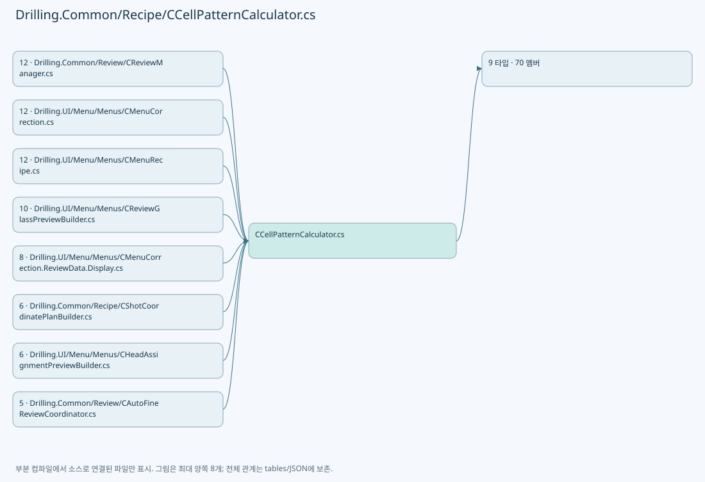
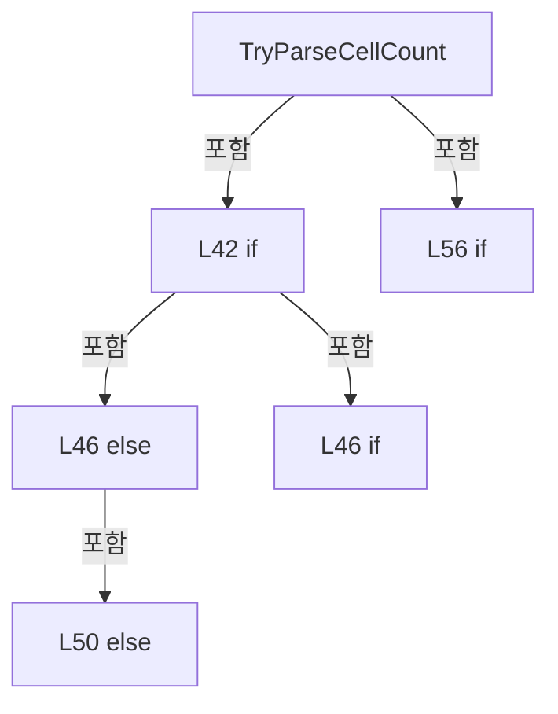
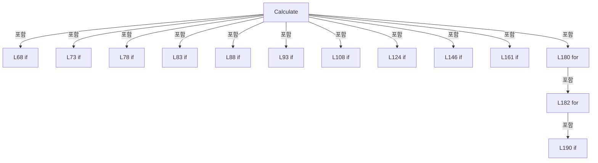
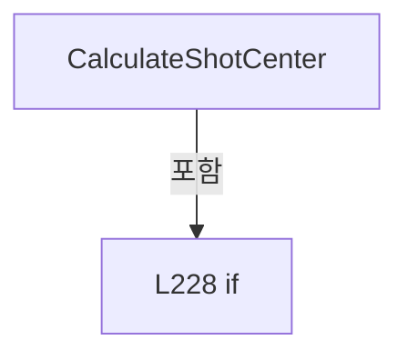
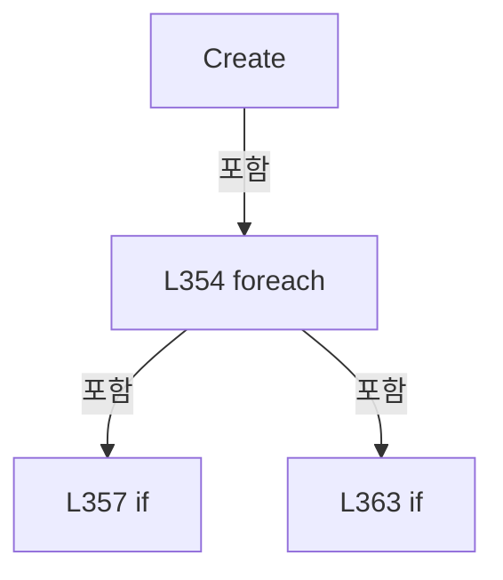
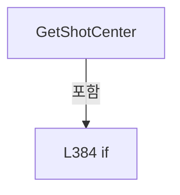
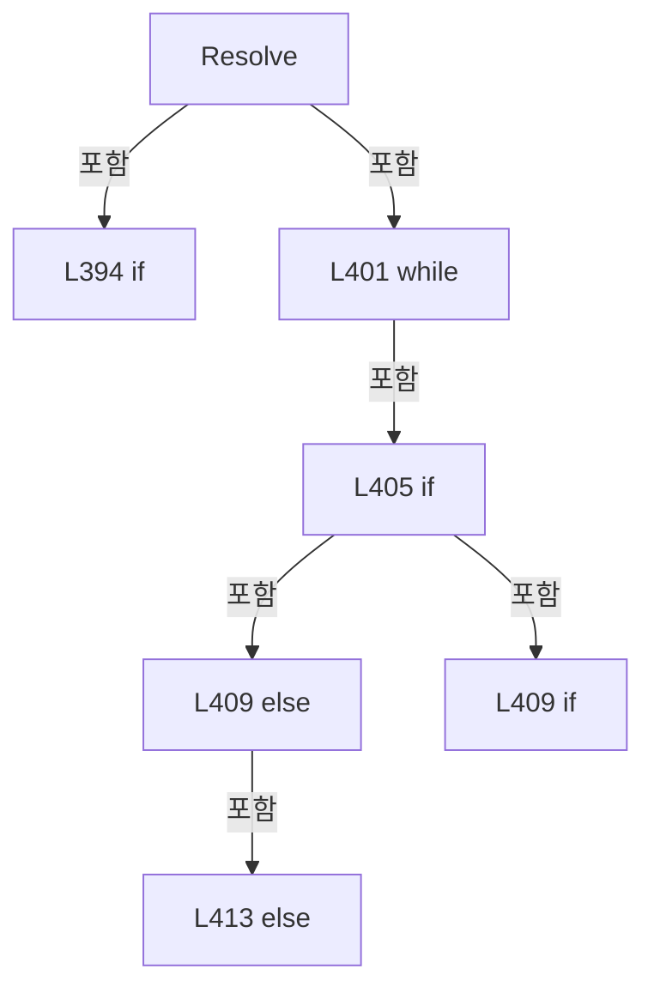
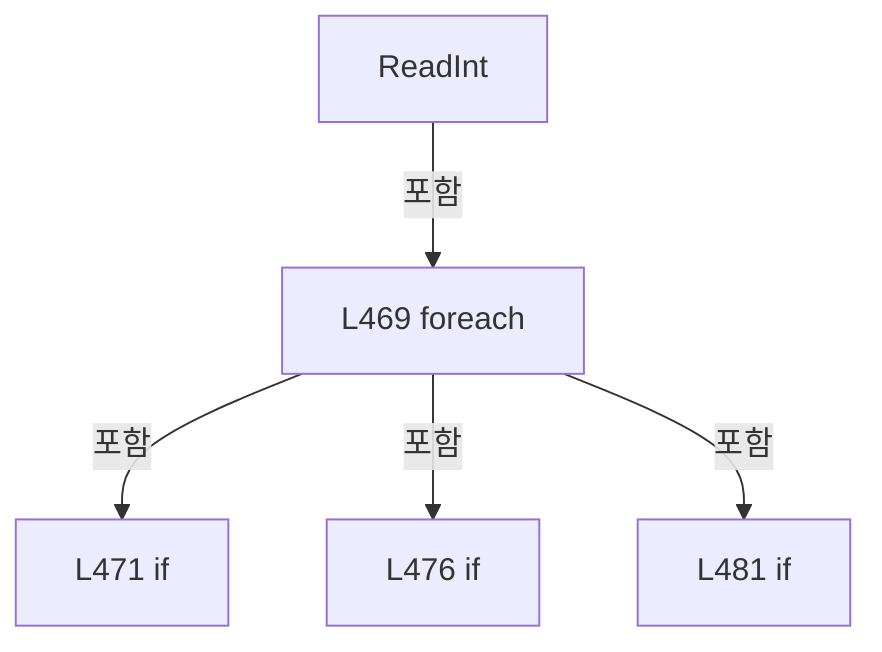

# Drilling.Common/Recipe/CCellPatternCalculator.cs

| 항목 | 내용 |
| --- | --- |
| 원본 저장소 | https://github.com/kjuws10-rgb/A3Drilling.git |
| 원본 Commit | 5aee8e58439c9b455cae7c9593c9be986c3e682e |
| 원본 SHA256 | 2d09557b69d8cf7e03b380e9adf01f5938a8d0b9f7bdf79dff397778013431fd |
| 파일 분류 | code |
| 원본 크기/행 | 23,539 bytes / 490 physical lines |
| 인코딩 | utf-8-sig |
| 검토 범위 | 구문/부분 의미 분석에서 추출한 사실. 동작·물리 단위·실장비 합격을 보증하지 않습니다. |
| 원본 링크 | [고정 Commit 원본](https://github.com/kjuws10-rgb/A3Drilling/blob/5aee8e58439c9b455cae7c9593c9be986c3e682e/Drilling.Common/Recipe/CCellPatternCalculator.cs) |

## 파일의 역할과 읽는 순서

프로그램의 시작·구성·공유 타입 또는 빌드 연결에 사용됩니다. 아래 실제 선언·참조와 원본 근거를 확인합니다.

## 네임스페이스·타입·상속

| 타입 | 구분 | 원본 범위 | 선언/상속 |
| --- | --- | --- | --- |
| CCellPatternCalculator | ClassDeclaration | 5–275 | CCellPatternCalculator |
| ST_CELL_PATTERN_DEFINITION | RecordDeclaration | 277–289 | ST_CELL_PATTERN_DEFINITION |
| ST_SHOT_GROUP_CENTER | RecordDeclaration | 290–290 | ST_SHOT_GROUP_CENTER |
| ST_CELL_PATTERN_LAYOUT | RecordDeclaration | 291–328 | ST_CELL_PATTERN_LAYOUT |
| ST_RECIPE_CELL_PATTERN_ENTRY | RecordDeclaration | 330–330 | ST_RECIPE_CELL_PATTERN_ENTRY |
| CRecipeCellPatternCatalog | ClassDeclaration | 336–421 | CRecipeCellPatternCatalog |
| ST_RECIPE_MODEL_PIXEL_COUNT | RecordStructDeclaration | 423–423 | ST_RECIPE_MODEL_PIXEL_COUNT |
| ST_RECIPE_MODEL_PATTERN | RecordStructDeclaration | 424–424 | ST_RECIPE_MODEL_PATTERN |
| CRecipeModelPixelCountReader | ClassDeclaration | 425–489 | CRecipeModelPixelCountReader |

## 멤버 빠른 목록

| 이름 | 종류 | 범위 | 서명 |
| --- | --- | --- | --- |
| MinCellCount | FieldDeclaration | L7–7 | int Drilling.Common.Recipe.CCellPatternCalculator.MinCellCount |
| MaxTotalShotGroupCount | FieldDeclaration | L8–8 | int Drilling.Common.Recipe.CCellPatternCalculator.MaxTotalShotGroupCount |
| MaxGroupCountPerCell | FieldDeclaration | L9–9 | int Drilling.Common.Recipe.CCellPatternCalculator.MaxGroupCountPerCell |
| MaximumPreviewPointsPerCell | FieldDeclaration | L12–12 | int Drilling.Common.Recipe.CCellPatternCalculator.MaximumPreviewPointsPerCell |
| MinimumPreviewPointSize | FieldDeclaration | L13–13 | double Drilling.Common.Recipe.CCellPatternCalculator.MinimumPreviewPointSize |
| MaximumPreviewPointSize | FieldDeclaration | L14–14 | double Drilling.Common.Recipe.CCellPatternCalculator.MaximumPreviewPointSize |
| IsSupportedSplitBeamCount | MethodDeclaration | L15–18 | bool Drilling.Common.Recipe.CCellPatternCalculator.IsSupportedSplitBeamCount(int) |
| CalculatePreviewPointSize | MethodDeclaration | L20–20 | double Drilling.Common.Recipe.CCellPatternCalculator.CalculatePreviewPointSize(Drilling.Common.Recipe.ST_CELL_PATTERN_LAYOUT, double) |
| CalculatePreviewSampleStep | MethodDeclaration | L21–27 | int Drilling.Common.Recipe.CCellPatternCalculator.CalculatePreviewSampleStep(Drilling.Common.Recipe.ST_CELL_PATTERN_LAYOUT, double) |
| CalculatePreviewBeamHalfSpan | MethodDeclaration | L29–29 | double Drilling.Common.Recipe.CCellPatternCalculator.CalculatePreviewBeamHalfSpan(Drilling.Common.Recipe.ST_CELL_PATTERN_LAYOUT, int) |
| TryParseCellCount | MethodDeclaration | L30–33 | bool Drilling.Common.Recipe.CCellPatternCalculator.TryParseCellCount(string?, out int, out string) |
| TryParseCellCount | MethodDeclaration | L35–63 | bool Drilling.Common.Recipe.CCellPatternCalculator.TryParseCellCount(string?, int, int?, out int, out string) |
| Calculate | MethodDeclaration | L65–65 | Drilling.Common.Recipe.ST_CELL_PATTERN_LAYOUT Drilling.Common.Recipe.CCellPatternCalculator.Calculate(Drilling.Common.Recipe.ST_CELL_PATTERN_DEFINITION) |
| Calculate | MethodDeclaration | L66–222 | Drilling.Common.Recipe.ST_CELL_PATTERN_LAYOUT Drilling.Common.Recipe.CCellPatternCalculator.Calculate(Drilling.Common.Recipe.ST_CELL_PATTERN_DEFINITION, bool) |
| CalculateShotCenter | MethodDeclaration | L224–248 | Drilling.Common.Recipe.ST_SHOT_GROUP_CENTER Drilling.Common.Recipe.CCellPatternCalculator.CalculateShotCenter(Drilling.Common.Recipe.ST_CELL_PATTERN_DEFINITION, int, int, Drilling.Common.Recipe.ST_CELL_PATTERN_LAYOUT) |
| Invalid | MethodDeclaration | L250–269 | Drilling.Common.Recipe.ST_CELL_PATTERN_LAYOUT Drilling.Common.Recipe.CCellPatternCalculator.Invalid(string, int, int, int, int, int, int, int, int) |
| FormatCurrentValue | MethodDeclaration | L271–274 | string Drilling.Common.Recipe.CCellPatternCalculator.FormatCurrentValue(string) |
| IsValid | PropertyDeclaration | L302–308 | bool Drilling.Common.Recipe.ST_CELL_PATTERN_LAYOUT.IsValid |
| get_IsValid | GetAccessorDeclaration | L304–307 | bool Drilling.Common.Recipe.ST_CELL_PATTERN_LAYOUT.IsValid.get |
| ProcessedTargetCountX | PropertyDeclaration | L310–310 | int Drilling.Common.Recipe.ST_CELL_PATTERN_LAYOUT.ProcessedTargetCountX |
| get_ProcessedTargetCountX | GetAccessorDeclaration | L310–310 | int Drilling.Common.Recipe.ST_CELL_PATTERN_LAYOUT.ProcessedTargetCountX.get |
| set_ProcessedTargetCountX | InitAccessorDeclaration | L310–310 | void Drilling.Common.Recipe.ST_CELL_PATTERN_LAYOUT.ProcessedTargetCountX.init |
| ProcessedTargetCountY | PropertyDeclaration | L311–311 | int Drilling.Common.Recipe.ST_CELL_PATTERN_LAYOUT.ProcessedTargetCountY |
| get_ProcessedTargetCountY | GetAccessorDeclaration | L311–311 | int Drilling.Common.Recipe.ST_CELL_PATTERN_LAYOUT.ProcessedTargetCountY.get |
| set_ProcessedTargetCountY | InitAccessorDeclaration | L311–311 | void Drilling.Common.Recipe.ST_CELL_PATTERN_LAYOUT.ProcessedTargetCountY.init |
| ExcludedTargetCountX | PropertyDeclaration | L312–312 | int Drilling.Common.Recipe.ST_CELL_PATTERN_LAYOUT.ExcludedTargetCountX |
| get_ExcludedTargetCountX | GetAccessorDeclaration | L312–312 | int Drilling.Common.Recipe.ST_CELL_PATTERN_LAYOUT.ExcludedTargetCountX.get |
| set_ExcludedTargetCountX | InitAccessorDeclaration | L312–312 | void Drilling.Common.Recipe.ST_CELL_PATTERN_LAYOUT.ExcludedTargetCountX.init |
| ExcludedTargetCountY | PropertyDeclaration | L313–313 | int Drilling.Common.Recipe.ST_CELL_PATTERN_LAYOUT.ExcludedTargetCountY |
| get_ExcludedTargetCountY | GetAccessorDeclaration | L313–313 | int Drilling.Common.Recipe.ST_CELL_PATTERN_LAYOUT.ExcludedTargetCountY.get |
| set_ExcludedTargetCountY | InitAccessorDeclaration | L313–313 | void Drilling.Common.Recipe.ST_CELL_PATTERN_LAYOUT.ExcludedTargetCountY.init |
| PixelCountX | PropertyDeclaration | L314–314 | int Drilling.Common.Recipe.ST_CELL_PATTERN_LAYOUT.PixelCountX |
| get_PixelCountX | GetAccessorDeclaration | L314–314 | int Drilling.Common.Recipe.ST_CELL_PATTERN_LAYOUT.PixelCountX.get |
| set_PixelCountX | InitAccessorDeclaration | L314–314 | void Drilling.Common.Recipe.ST_CELL_PATTERN_LAYOUT.PixelCountX.init |
| PixelCountY | PropertyDeclaration | L315–315 | int Drilling.Common.Recipe.ST_CELL_PATTERN_LAYOUT.PixelCountY |
| get_PixelCountY | GetAccessorDeclaration | L315–315 | int Drilling.Common.Recipe.ST_CELL_PATTERN_LAYOUT.PixelCountY.get |
| set_PixelCountY | InitAccessorDeclaration | L315–315 | void Drilling.Common.Recipe.ST_CELL_PATTERN_LAYOUT.PixelCountY.init |
| ProcessedPixelCountX | PropertyDeclaration | L316–316 | int Drilling.Common.Recipe.ST_CELL_PATTERN_LAYOUT.ProcessedPixelCountX |
| get_ProcessedPixelCountX | GetAccessorDeclaration | L316–316 | int Drilling.Common.Recipe.ST_CELL_PATTERN_LAYOUT.ProcessedPixelCountX.get |
| set_ProcessedPixelCountX | InitAccessorDeclaration | L316–316 | void Drilling.Common.Recipe.ST_CELL_PATTERN_LAYOUT.ProcessedPixelCountX.init |
| ProcessedPixelCountY | PropertyDeclaration | L317–317 | int Drilling.Common.Recipe.ST_CELL_PATTERN_LAYOUT.ProcessedPixelCountY |
| get_ProcessedPixelCountY | GetAccessorDeclaration | L317–317 | int Drilling.Common.Recipe.ST_CELL_PATTERN_LAYOUT.ProcessedPixelCountY.get |
| set_ProcessedPixelCountY | InitAccessorDeclaration | L317–317 | void Drilling.Common.Recipe.ST_CELL_PATTERN_LAYOUT.ProcessedPixelCountY.init |
| BeamPitchMillimeters | PropertyDeclaration | L318–318 | double Drilling.Common.Recipe.ST_CELL_PATTERN_LAYOUT.BeamPitchMillimeters |
| get_BeamPitchMillimeters | GetAccessorDeclaration | L318–318 | double Drilling.Common.Recipe.ST_CELL_PATTERN_LAYOUT.BeamPitchMillimeters.get |
| set_BeamPitchMillimeters | InitAccessorDeclaration | L318–318 | void Drilling.Common.Recipe.ST_CELL_PATTERN_LAYOUT.BeamPitchMillimeters.init |
| BeamHalfSpanMillimeters | PropertyDeclaration | L319–319 | double Drilling.Common.Recipe.ST_CELL_PATTERN_LAYOUT.BeamHalfSpanMillimeters |
| get_BeamHalfSpanMillimeters | GetAccessorDeclaration | L319–319 | double Drilling.Common.Recipe.ST_CELL_PATTERN_LAYOUT.BeamHalfSpanMillimeters.get |
| set_BeamHalfSpanMillimeters | InitAccessorDeclaration | L319–319 | void Drilling.Common.Recipe.ST_CELL_PATTERN_LAYOUT.BeamHalfSpanMillimeters.init |
| HasExcludedTargets | PropertyDeclaration | L321–327 | bool Drilling.Common.Recipe.ST_CELL_PATTERN_LAYOUT.HasExcludedTargets |
| get_HasExcludedTargets | GetAccessorDeclaration | L323–326 | bool Drilling.Common.Recipe.ST_CELL_PATTERN_LAYOUT.HasExcludedTargets.get |
| _cells | FieldDeclaration | L338–338 | System.Collections.Generic.IReadOnlyList<Drilling.Common.Recipe.ST_RECIPE_CELL_PATTERN_ENTRY> Drilling.Common.Recipe.CRecipeCellPatternCatalog._cells |
| .ctor | ConstructorDeclaration | L339–343 | Drilling.Common.Recipe.CRecipeCellPatternCatalog.CRecipeCellPatternCatalog(System.Collections.Generic.IReadOnlyList<Drilling.Common.Recipe.ST_RECIPE_CELL_PATTERN_ENTRY>, int) |
| Count | PropertyDeclaration | L345–345 | int Drilling.Common.Recipe.CRecipeCellPatternCatalog.Count |
| get_Count | GetAccessorDeclaration | L345–345 | int Drilling.Common.Recipe.CRecipeCellPatternCatalog.Count.get |
| CellCount | PropertyDeclaration | L346–346 | int Drilling.Common.Recipe.CRecipeCellPatternCatalog.CellCount |
| Cells | PropertyDeclaration | L347–347 | System.Collections.Generic.IReadOnlyList<Drilling.Common.Recipe.ST_RECIPE_CELL_PATTERN_ENTRY> Drilling.Common.Recipe.CRecipeCellPatternCatalog.Cells |
| Create | MethodDeclaration | L349–373 | Drilling.Common.Recipe.CRecipeCellPatternCatalog Drilling.Common.Recipe.CRecipeCellPatternCatalog.Create(System.Collections.Generic.IEnumerable<Drilling.Common.Recipe.ST_CELL_PATTERN_DEFINITION>) |
| GetCell | MethodDeclaration | L375–375 | Drilling.Common.Recipe.ST_RECIPE_CELL_PATTERN_ENTRY Drilling.Common.Recipe.CRecipeCellPatternCatalog.GetCell(int) |
| GetShotCenter | MethodDeclaration | L376–380 | Drilling.Common.Recipe.ST_SHOT_GROUP_CENTER Drilling.Common.Recipe.CRecipeCellPatternCatalog.GetShotCenter(int) |
| GetShotCenter | MethodDeclaration | L382–390 | Drilling.Common.Recipe.ST_SHOT_GROUP_CENTER Drilling.Common.Recipe.CRecipeCellPatternCatalog.GetShotCenter(Drilling.Common.Recipe.ST_RECIPE_CELL_PATTERN_ENTRY, int) |
| Resolve | MethodDeclaration | L392–420 | (Drilling.Common.Recipe.ST_RECIPE_CELL_PATTERN_ENTRY Cell, int PointIndex) Drilling.Common.Recipe.CRecipeCellPatternCatalog.Resolve(int) |
| MaximumCellModelTypeCount | FieldDeclaration | L427–427 | int Drilling.Common.Recipe.CRecipeModelPixelCountReader.MaximumCellModelTypeCount |
| ReadModelTypeCount | MethodDeclaration | L428–431 | int Drilling.Common.Recipe.CRecipeModelPixelCountReader.ReadModelTypeCount(System.Collections.Generic.IReadOnlyDictionary<string, string>) |
| ReadCellModelType | MethodDeclaration | L433–437 | int Drilling.Common.Recipe.CRecipeModelPixelCountReader.ReadCellModelType(System.Collections.Generic.IReadOnlyDictionary<string, string>, int, int) |
| ReadForCell | MethodDeclaration | L439–442 | Drilling.Common.Recipe.ST_RECIPE_MODEL_PIXEL_COUNT Drilling.Common.Recipe.CRecipeModelPixelCountReader.ReadForCell(System.Collections.Generic.IReadOnlyDictionary<string, string>, int) |
| ReadPatternForCell | MethodDeclaration | L444–447 | Drilling.Common.Recipe.ST_RECIPE_MODEL_PATTERN Drilling.Common.Recipe.CRecipeModelPixelCountReader.ReadPatternForCell(System.Collections.Generic.IReadOnlyDictionary<string, string>, int) |
| ReadForModel | MethodDeclaration | L449–453 | Drilling.Common.Recipe.ST_RECIPE_MODEL_PIXEL_COUNT Drilling.Common.Recipe.CRecipeModelPixelCountReader.ReadForModel(System.Collections.Generic.IReadOnlyDictionary<string, string>, int) |
| ReadPatternForModel | MethodDeclaration | L455–465 | Drilling.Common.Recipe.ST_RECIPE_MODEL_PATTERN Drilling.Common.Recipe.CRecipeModelPixelCountReader.ReadPatternForModel(System.Collections.Generic.IReadOnlyDictionary<string, string>, int) |
| ReadInt | MethodDeclaration | L467–488 | int Drilling.Common.Recipe.CRecipeModelPixelCountReader.ReadInt(System.Collections.Generic.IReadOnlyDictionary<string, string>, int, params string[]) |

## 멤버별 상세 계약·호출·처리 해설

### FieldDeclaration `MinCellCount` · L7–7

[Drilling.Common/Recipe/CCellPatternCalculator.cs:7–7](https://github.com/kjuws10-rgb/A3Drilling/blob/5aee8e58439c9b455cae7c9593c9be986c3e682e/Drilling.Common/Recipe/CCellPatternCalculator.cs#L7-L7)

| 항목 | 실제 추출 값 |
| --- | --- |
| 서명 | int Drilling.Common.Recipe.CCellPatternCalculator.MinCellCount |
| 접근/수식자 | Public / public, const |
| 반환/값 타입 | int |
| 소속 타입 | NamedType:Drilling.Common.Recipe.CCellPatternCalculator |

현재 부분 분석에서 직접 연결된 호출자는 없습니다. XAML/이벤트/인터페이스·델리게이트·외부 진입을 추가 확인해야 하며, 미사용으로 판정한 것이 아닙니다.

본문의 실제 연산·분기·예외·반환 순서(원문 위치 순):

| 원본 행 | 종류 | 주석 해설 |
| --- | --- | --- |
| 7 | variable-initializer | 변수의 초기값을 지정합니다: MinCellCount = 1 |

변경 전 점검: 입력/반환 타입, 위 호출자, 예외/취소 경로, 공유 상태와 저장·전송 소비자를 함께 확인합니다. 값의 단위나 물리 방향을 이름만으로 확정하지 않습니다.

### FieldDeclaration `MaxTotalShotGroupCount` · L8–8

[Drilling.Common/Recipe/CCellPatternCalculator.cs:8–8](https://github.com/kjuws10-rgb/A3Drilling/blob/5aee8e58439c9b455cae7c9593c9be986c3e682e/Drilling.Common/Recipe/CCellPatternCalculator.cs#L8-L8)

| 항목 | 실제 추출 값 |
| --- | --- |
| 서명 | int Drilling.Common.Recipe.CCellPatternCalculator.MaxTotalShotGroupCount |
| 접근/수식자 | Public / public, const |
| 반환/값 타입 | int |
| 소속 타입 | NamedType:Drilling.Common.Recipe.CCellPatternCalculator |

현재 부분 분석에서 직접 연결된 호출자는 없습니다. XAML/이벤트/인터페이스·델리게이트·외부 진입을 추가 확인해야 하며, 미사용으로 판정한 것이 아닙니다.

본문의 실제 연산·분기·예외·반환 순서(원문 위치 순):

| 원본 행 | 종류 | 주석 해설 |
| --- | --- | --- |
| 8 | variable-initializer | 변수의 초기값을 지정합니다: MaxTotalShotGroupCount = 500_000 |

변경 전 점검: 입력/반환 타입, 위 호출자, 예외/취소 경로, 공유 상태와 저장·전송 소비자를 함께 확인합니다. 값의 단위나 물리 방향을 이름만으로 확정하지 않습니다.

### FieldDeclaration `MaxGroupCountPerCell` · L9–9

[Drilling.Common/Recipe/CCellPatternCalculator.cs:9–9](https://github.com/kjuws10-rgb/A3Drilling/blob/5aee8e58439c9b455cae7c9593c9be986c3e682e/Drilling.Common/Recipe/CCellPatternCalculator.cs#L9-L9)

| 항목 | 실제 추출 값 |
| --- | --- |
| 서명 | int Drilling.Common.Recipe.CCellPatternCalculator.MaxGroupCountPerCell |
| 접근/수식자 | Public / public, const |
| 반환/값 타입 | int |
| 소속 타입 | NamedType:Drilling.Common.Recipe.CCellPatternCalculator |

현재 부분 분석에서 직접 연결된 호출자는 없습니다. XAML/이벤트/인터페이스·델리게이트·외부 진입을 추가 확인해야 하며, 미사용으로 판정한 것이 아닙니다.

본문의 실제 연산·분기·예외·반환 순서(원문 위치 순):

| 원본 행 | 종류 | 주석 해설 |
| --- | --- | --- |
| 9 | variable-initializer | 변수의 초기값을 지정합니다: MaxGroupCountPerCell = MaxTotalShotGroupCount |

변경 전 점검: 입력/반환 타입, 위 호출자, 예외/취소 경로, 공유 상태와 저장·전송 소비자를 함께 확인합니다. 값의 단위나 물리 방향을 이름만으로 확정하지 않습니다.

### FieldDeclaration `MaximumPreviewPointsPerCell` · L12–12

[Drilling.Common/Recipe/CCellPatternCalculator.cs:12–12](https://github.com/kjuws10-rgb/A3Drilling/blob/5aee8e58439c9b455cae7c9593c9be986c3e682e/Drilling.Common/Recipe/CCellPatternCalculator.cs#L12-L12)

| 항목 | 실제 추출 값 |
| --- | --- |
| 서명 | int Drilling.Common.Recipe.CCellPatternCalculator.MaximumPreviewPointsPerCell |
| 접근/수식자 | Public / public, const |
| 반환/값 타입 | int |
| 소속 타입 | NamedType:Drilling.Common.Recipe.CCellPatternCalculator |

현재 부분 분석에서 직접 연결된 호출자는 없습니다. XAML/이벤트/인터페이스·델리게이트·외부 진입을 추가 확인해야 하며, 미사용으로 판정한 것이 아닙니다.

본문의 실제 연산·분기·예외·반환 순서(원문 위치 순):

| 원본 행 | 종류 | 주석 해설 |
| --- | --- | --- |
| 12 | variable-initializer | 변수의 초기값을 지정합니다: MaximumPreviewPointsPerCell = 6_000 |

변경 전 점검: 입력/반환 타입, 위 호출자, 예외/취소 경로, 공유 상태와 저장·전송 소비자를 함께 확인합니다. 값의 단위나 물리 방향을 이름만으로 확정하지 않습니다.

### FieldDeclaration `MinimumPreviewPointSize` · L13–13

[Drilling.Common/Recipe/CCellPatternCalculator.cs:13–13](https://github.com/kjuws10-rgb/A3Drilling/blob/5aee8e58439c9b455cae7c9593c9be986c3e682e/Drilling.Common/Recipe/CCellPatternCalculator.cs#L13-L13)

| 항목 | 실제 추출 값 |
| --- | --- |
| 서명 | double Drilling.Common.Recipe.CCellPatternCalculator.MinimumPreviewPointSize |
| 접근/수식자 | Public / public, const |
| 반환/값 타입 | double |
| 소속 타입 | NamedType:Drilling.Common.Recipe.CCellPatternCalculator |

현재 부분 분석에서 직접 연결된 호출자는 없습니다. XAML/이벤트/인터페이스·델리게이트·외부 진입을 추가 확인해야 하며, 미사용으로 판정한 것이 아닙니다.

본문의 실제 연산·분기·예외·반환 순서(원문 위치 순):

| 원본 행 | 종류 | 주석 해설 |
| --- | --- | --- |
| 13 | variable-initializer | 변수의 초기값을 지정합니다: MinimumPreviewPointSize = 2.0 |

변경 전 점검: 입력/반환 타입, 위 호출자, 예외/취소 경로, 공유 상태와 저장·전송 소비자를 함께 확인합니다. 값의 단위나 물리 방향을 이름만으로 확정하지 않습니다.

### FieldDeclaration `MaximumPreviewPointSize` · L14–14

[Drilling.Common/Recipe/CCellPatternCalculator.cs:14–14](https://github.com/kjuws10-rgb/A3Drilling/blob/5aee8e58439c9b455cae7c9593c9be986c3e682e/Drilling.Common/Recipe/CCellPatternCalculator.cs#L14-L14)

| 항목 | 실제 추출 값 |
| --- | --- |
| 서명 | double Drilling.Common.Recipe.CCellPatternCalculator.MaximumPreviewPointSize |
| 접근/수식자 | Public / public, const |
| 반환/값 타입 | double |
| 소속 타입 | NamedType:Drilling.Common.Recipe.CCellPatternCalculator |

현재 부분 분석에서 직접 연결된 호출자는 없습니다. XAML/이벤트/인터페이스·델리게이트·외부 진입을 추가 확인해야 하며, 미사용으로 판정한 것이 아닙니다.

본문의 실제 연산·분기·예외·반환 순서(원문 위치 순):

| 원본 행 | 종류 | 주석 해설 |
| --- | --- | --- |
| 14 | variable-initializer | 변수의 초기값을 지정합니다: MaximumPreviewPointSize = 8.0 |

변경 전 점검: 입력/반환 타입, 위 호출자, 예외/취소 경로, 공유 상태와 저장·전송 소비자를 함께 확인합니다. 값의 단위나 물리 방향을 이름만으로 확정하지 않습니다.

### MethodDeclaration `IsSupportedSplitBeamCount` · L15–18

[Drilling.Common/Recipe/CCellPatternCalculator.cs:15–18](https://github.com/kjuws10-rgb/A3Drilling/blob/5aee8e58439c9b455cae7c9593c9be986c3e682e/Drilling.Common/Recipe/CCellPatternCalculator.cs#L15-L18)

| 항목 | 실제 추출 값 |
| --- | --- |
| 서명 | bool Drilling.Common.Recipe.CCellPatternCalculator.IsSupportedSplitBeamCount(int) |
| 접근/수식자 | Public / public, static |
| 반환/값 타입 | bool |
| 소속 타입 | NamedType:Drilling.Common.Recipe.CCellPatternCalculator |

입력 계약:

| 이름 | 타입 | 전달 | 선택/기본값 |
| --- | --- | --- | --- |
| splitBeamCount | int | None | False /  |

정적 호출자로 확인된 위치:

| 호출 파일/행 | 호출 표현식 | 런타임 분기 가능 |
| --- | --- | --- |
| [Drilling.Common/Recipe/CCellPatternCalculator.cs:93–93](https://github.com/kjuws10-rgb/A3Drilling/blob/5aee8e58439c9b455cae7c9593c9be986c3e682e/Drilling.Common/Recipe/CCellPatternCalculator.cs#L93-L93) | IsSupportedSplitBeamCount | False |
| [Drilling.Common/Review/CReviewManager.cs:935–935](https://github.com/kjuws10-rgb/A3Drilling/blob/5aee8e58439c9b455cae7c9593c9be986c3e682e/Drilling.Common/Review/CReviewManager.cs#L935-L935) | CCellPatternCalculator.IsSupportedSplitBeamCount | False |
| [Drilling.UI/Menu/Menus/CMenuCorrection.cs:5985–5985](https://github.com/kjuws10-rgb/A3Drilling/blob/5aee8e58439c9b455cae7c9593c9be986c3e682e/Drilling.UI/Menu/Menus/CMenuCorrection.cs#L5985-L5985) | CCellPatternCalculator.IsSupportedSplitBeamCount | False |
| [Drilling.UI/Menu/Menus/CMenuReview.cs:561–561](https://github.com/kjuws10-rgb/A3Drilling/blob/5aee8e58439c9b455cae7c9593c9be986c3e682e/Drilling.UI/Menu/Menus/CMenuReview.cs#L561-L561) | CCellPatternCalculator.IsSupportedSplitBeamCount | False |
| [Drilling.UI/Menu/Menus/CRecipeCellPatternPreviewDrawing.cs:74–74](https://github.com/kjuws10-rgb/A3Drilling/blob/5aee8e58439c9b455cae7c9593c9be986c3e682e/Drilling.UI/Menu/Menus/CRecipeCellPatternPreviewDrawing.cs#L74-L74) | CCellPatternCalculator.IsSupportedSplitBeamCount | False |

본문의 실제 연산·분기·예외·반환 순서(원문 위치 순):

| 원본 행 | 종류 | 주석 해설 |
| --- | --- | --- |
| 17 | return | 호출자에게 값 또는 제어를 반환합니다: return splitBeamCount is 1 or 4; |

변경 전 점검: 입력/반환 타입, 위 호출자, 예외/취소 경로, 공유 상태와 저장·전송 소비자를 함께 확인합니다. 값의 단위나 물리 방향을 이름만으로 확정하지 않습니다.

### MethodDeclaration `CalculatePreviewPointSize` · L20–20

[Drilling.Common/Recipe/CCellPatternCalculator.cs:20–20](https://github.com/kjuws10-rgb/A3Drilling/blob/5aee8e58439c9b455cae7c9593c9be986c3e682e/Drilling.Common/Recipe/CCellPatternCalculator.cs#L20-L20)

| 항목 | 실제 추출 값 |
| --- | --- |
| 서명 | double Drilling.Common.Recipe.CCellPatternCalculator.CalculatePreviewPointSize(Drilling.Common.Recipe.ST_CELL_PATTERN_LAYOUT, double) |
| 접근/수식자 | Public / public, static |
| 반환/값 타입 | double |
| 소속 타입 | NamedType:Drilling.Common.Recipe.CCellPatternCalculator |

입력 계약:

| 이름 | 타입 | 전달 | 선택/기본값 |
| --- | --- | --- | --- |
| layout | Drilling.Common.Recipe.ST_CELL_PATTERN_LAYOUT | None | False /  |
| scale | double | None | False /  |

정적 호출자로 확인된 위치:

| 호출 파일/행 | 호출 표현식 | 런타임 분기 가능 |
| --- | --- | --- |
| [Drilling.UI/Menu/Menus/CReviewGlassPreviewBuilder.cs:452–452](https://github.com/kjuws10-rgb/A3Drilling/blob/5aee8e58439c9b455cae7c9593c9be986c3e682e/Drilling.UI/Menu/Menus/CReviewGlassPreviewBuilder.cs#L452-L452) | CCellPatternCalculator.CalculatePreviewPointSize | False |

호출하는 대상과 해석 범위:

| 원본 행 | 표현식 | 분석 상태 | 대상/소스 위치 |
| --- | --- | --- | --- |
| 20 | Math.Clamp | resolved | double System.Math.Clamp(double, double, double) |

본문의 실제 연산·분기·예외·반환 순서(원문 위치 순):

| 원본 행 | 종류 | 주석 해설 |
| --- | --- | --- |
| 20 | call | 함수·델리게이트 또는 객체 생성자를 호출합니다: Math.Clamp(layout.GroupPitchMillimeters * scale, MinimumPreviewPointSize, MaximumPreviewPointSize) |

변경 전 점검: 입력/반환 타입, 위 호출자, 예외/취소 경로, 공유 상태와 저장·전송 소비자를 함께 확인합니다. 값의 단위나 물리 방향을 이름만으로 확정하지 않습니다.

### MethodDeclaration `CalculatePreviewSampleStep` · L21–27

[Drilling.Common/Recipe/CCellPatternCalculator.cs:21–27](https://github.com/kjuws10-rgb/A3Drilling/blob/5aee8e58439c9b455cae7c9593c9be986c3e682e/Drilling.Common/Recipe/CCellPatternCalculator.cs#L21-L27)

| 항목 | 실제 추출 값 |
| --- | --- |
| 서명 | int Drilling.Common.Recipe.CCellPatternCalculator.CalculatePreviewSampleStep(Drilling.Common.Recipe.ST_CELL_PATTERN_LAYOUT, double) |
| 접근/수식자 | Public / public, static |
| 반환/값 타입 | int |
| 소속 타입 | NamedType:Drilling.Common.Recipe.CCellPatternCalculator |

입력 계약:

| 이름 | 타입 | 전달 | 선택/기본값 |
| --- | --- | --- | --- |
| layout | Drilling.Common.Recipe.ST_CELL_PATTERN_LAYOUT | None | False /  |
| scale | double | None | False /  |

정적 호출자로 확인된 위치:

| 호출 파일/행 | 호출 표현식 | 런타임 분기 가능 |
| --- | --- | --- |
| [Drilling.UI/Menu/Menus/CReviewGlassPreviewBuilder.cs:471–471](https://github.com/kjuws10-rgb/A3Drilling/blob/5aee8e58439c9b455cae7c9593c9be986c3e682e/Drilling.UI/Menu/Menus/CReviewGlassPreviewBuilder.cs#L471-L471) | CCellPatternCalculator.CalculatePreviewSampleStep | False |

호출하는 대상과 해석 범위:

| 원본 행 | 표현식 | 분석 상태 | 대상/소스 위치 |
| --- | --- | --- | --- |
| 24 | Math.Ceiling | resolved | double System.Math.Ceiling(double) |
| 24 | Math.Sqrt | resolved | double System.Math.Sqrt(double) |
| 25 | Math.Ceiling | resolved | double System.Math.Ceiling(double) |
| 25 | Math.Max | resolved | double System.Math.Max(double, double) |
| 26 | Math.Max | resolved | int System.Math.Max(int, int) |
| 26 | Math.Max | resolved | int System.Math.Max(int, int) |

본문의 실제 연산·분기·예외·반환 순서(원문 위치 순):

| 원본 행 | 종류 | 주석 해설 |
| --- | --- | --- |
| 23 | local-declaration | 지역 변수를 선언합니다: var total = (long)layout.GroupCountX * layout.GroupCountY; |
| 23 | variable-initializer | 변수의 초기값을 지정합니다: total = (long)layout.GroupCountX * layout.GroupCountY |
| 24 | call | 함수·델리게이트 또는 객체 생성자를 호출합니다: Math.Ceiling(Math.Sqrt(total / (double)MaximumPreviewPointsPerCell)) |
| 24 | call | 함수·델리게이트 또는 객체 생성자를 호출합니다: Math.Sqrt(total / (double)MaximumPreviewPointsPerCell) |
| 24 | conditional-expression | 조건에 따라 결과식을 선택합니다: total <= MaximumPreviewPointsPerCell ? 1 : (int)Math.Ceiling(Math.Sqrt(total / (double)MaximumPreviewPointsPerCell)) |
| 24 | local-declaration | 지역 변수를 선언합니다: var countStep = total <= MaximumPreviewPointsPerCell ? 1 : (int)Math.Ceiling(Math.Sqrt(total / (double)MaximumPreviewPointsPerCell)); |
| 24 | variable-initializer | 변수의 초기값을 지정합니다: countStep = total <= MaximumPreviewPointsPerCell ? 1 : (int)Math.Ceiling(Math.Sqrt(total / (double)MaximumPreviewPointsPerCell)) |
| 25 | call | 함수·델리게이트 또는 객체 생성자를 호출합니다: Math.Ceiling(1.0 / Math.Max(0.000001, layout.GroupPitchMillimeters * scale)) |
| 25 | call | 함수·델리게이트 또는 객체 생성자를 호출합니다: Math.Max(0.000001, layout.GroupPitchMillimeters * scale) |
| 25 | conditional-expression | 조건에 따라 결과식을 선택합니다: layout.GroupPitchMillimeters * scale >= 1.0 ? 1 : (int)Math.Ceiling(1.0 / Math.Max(0.000001, layout.GroupPitchMillimeters * scale)) |
| 25 | local-declaration | 지역 변수를 선언합니다: var pixelStep = layout.GroupPitchMillimeters * scale >= 1.0 ? 1 : (int)Math.Ceiling(1.0 / Math.Max(0.000001, layout.GroupPitchMillimeters * scale)); |
| 25 | variable-initializer | 변수의 초기값을 지정합니다: pixelStep = layout.GroupPitchMillimeters * scale >= 1.0 ? 1 : (int)Math.Ceiling(1.0 / Math.Max(0.000001, layout.GroupPitchMillimeters * scale)) |
| 26 | call | 함수·델리게이트 또는 객체 생성자를 호출합니다: Math.Max(1, Math.Max(countStep, pixelStep)) |
| 26 | call | 함수·델리게이트 또는 객체 생성자를 호출합니다: Math.Max(countStep, pixelStep) |
| 26 | return | 호출자에게 값 또는 제어를 반환합니다: return Math.Max(1, Math.Max(countStep, pixelStep)); |

변경 전 점검: 입력/반환 타입, 위 호출자, 예외/취소 경로, 공유 상태와 저장·전송 소비자를 함께 확인합니다. 값의 단위나 물리 방향을 이름만으로 확정하지 않습니다.

### MethodDeclaration `CalculatePreviewBeamHalfSpan` · L29–29

[Drilling.Common/Recipe/CCellPatternCalculator.cs:29–29](https://github.com/kjuws10-rgb/A3Drilling/blob/5aee8e58439c9b455cae7c9593c9be986c3e682e/Drilling.Common/Recipe/CCellPatternCalculator.cs#L29-L29)

| 항목 | 실제 추출 값 |
| --- | --- |
| 서명 | double Drilling.Common.Recipe.CCellPatternCalculator.CalculatePreviewBeamHalfSpan(Drilling.Common.Recipe.ST_CELL_PATTERN_LAYOUT, int) |
| 접근/수식자 | Public / public, static |
| 반환/값 타입 | double |
| 소속 타입 | NamedType:Drilling.Common.Recipe.CCellPatternCalculator |

입력 계약:

| 이름 | 타입 | 전달 | 선택/기본값 |
| --- | --- | --- | --- |
| layout | Drilling.Common.Recipe.ST_CELL_PATTERN_LAYOUT | None | False /  |
| splitBeamCount | int | None | False /  |

정적 호출자로 확인된 위치:

| 호출 파일/행 | 호출 표현식 | 런타임 분기 가능 |
| --- | --- | --- |
| [Drilling.UI/Menu/Menus/CReviewGlassPreviewBuilder.cs:453–453](https://github.com/kjuws10-rgb/A3Drilling/blob/5aee8e58439c9b455cae7c9593c9be986c3e682e/Drilling.UI/Menu/Menus/CReviewGlassPreviewBuilder.cs#L453-L453) | CCellPatternCalculator.CalculatePreviewBeamHalfSpan | False |

호출하는 대상과 해석 범위:

| 원본 행 | 표현식 | 분석 상태 | 대상/소스 위치 |
| --- | --- | --- | --- |
| 29 | Math.Max | resolved | double System.Math.Max(double, double) |

본문의 실제 연산·분기·예외·반환 순서(원문 위치 순):

| 원본 행 | 종류 | 주석 해설 |
| --- | --- | --- |
| 29 | call | 함수·델리게이트 또는 객체 생성자를 호출합니다: Math.Max(0.0, layout.BeamHalfSpanMillimeters) |

변경 전 점검: 입력/반환 타입, 위 호출자, 예외/취소 경로, 공유 상태와 저장·전송 소비자를 함께 확인합니다. 값의 단위나 물리 방향을 이름만으로 확정하지 않습니다.

### MethodDeclaration `TryParseCellCount` · L30–33

[Drilling.Common/Recipe/CCellPatternCalculator.cs:30–33](https://github.com/kjuws10-rgb/A3Drilling/blob/5aee8e58439c9b455cae7c9593c9be986c3e682e/Drilling.Common/Recipe/CCellPatternCalculator.cs#L30-L33)

| 항목 | 실제 추출 값 |
| --- | --- |
| 서명 | bool Drilling.Common.Recipe.CCellPatternCalculator.TryParseCellCount(string?, out int, out string) |
| 접근/수식자 | Public / public, static |
| 반환/값 타입 | bool |
| 소속 타입 | NamedType:Drilling.Common.Recipe.CCellPatternCalculator |

입력 계약:

| 이름 | 타입 | 전달 | 선택/기본값 |
| --- | --- | --- | --- |
| text | string? | None | False /  |
| cellCount | int | Out | False /  |
| validationMessage | string | Out | False /  |

정적 호출자로 확인된 위치:

| 호출 파일/행 | 호출 표현식 | 런타임 분기 가능 |
| --- | --- | --- |
| [Drilling.UI/Menu/Menus/CHeadAssignmentPreviewBuilder.cs:100–100](https://github.com/kjuws10-rgb/A3Drilling/blob/5aee8e58439c9b455cae7c9593c9be986c3e682e/Drilling.UI/Menu/Menus/CHeadAssignmentPreviewBuilder.cs#L100-L100) | CCellPatternCalculator.TryParseCellCount | False |

호출하는 대상과 해석 범위:

| 원본 행 | 표현식 | 분석 상태 | 대상/소스 위치 |
| --- | --- | --- | --- |
| 32 | TryParseCellCount | resolved | bool Drilling.Common.Recipe.CCellPatternCalculator.TryParseCellCount(string?, int, int?, out int, out string) · Drilling.Common/Recipe/CCellPatternCalculator.cs:35 |

본문의 실제 연산·분기·예외·반환 순서(원문 위치 순):

| 원본 행 | 종류 | 주석 해설 |
| --- | --- | --- |
| 32 | call | 함수·델리게이트 또는 객체 생성자를 호출합니다: TryParseCellCount(text, MinCellCount, null, out cellCount, out validationMessage) |
| 32 | return | 호출자에게 값 또는 제어를 반환합니다: return TryParseCellCount(text, MinCellCount, null, out cellCount, out validationMessage); |

변경 전 점검: 입력/반환 타입, 위 호출자, 예외/취소 경로, 공유 상태와 저장·전송 소비자를 함께 확인합니다. 값의 단위나 물리 방향을 이름만으로 확정하지 않습니다.

### MethodDeclaration `TryParseCellCount` · L35–63

[Drilling.Common/Recipe/CCellPatternCalculator.cs:35–63](https://github.com/kjuws10-rgb/A3Drilling/blob/5aee8e58439c9b455cae7c9593c9be986c3e682e/Drilling.Common/Recipe/CCellPatternCalculator.cs#L35-L63)

| 항목 | 실제 추출 값 |
| --- | --- |
| 서명 | bool Drilling.Common.Recipe.CCellPatternCalculator.TryParseCellCount(string?, int, int?, out int, out string) |
| 접근/수식자 | Public / public, static |
| 반환/값 타입 | bool |
| 소속 타입 | NamedType:Drilling.Common.Recipe.CCellPatternCalculator |

입력 계약:

| 이름 | 타입 | 전달 | 선택/기본값 |
| --- | --- | --- | --- |
| text | string? | None | False /  |
| minimum | int | None | False /  |
| maximum | int? | None | False /  |
| cellCount | int | Out | False /  |
| validationMessage | string | Out | False /  |

정적 호출자로 확인된 위치:

| 호출 파일/행 | 호출 표현식 | 런타임 분기 가능 |
| --- | --- | --- |
| [Drilling.Common/Recipe/CCellPatternCalculator.cs:32–32](https://github.com/kjuws10-rgb/A3Drilling/blob/5aee8e58439c9b455cae7c9593c9be986c3e682e/Drilling.Common/Recipe/CCellPatternCalculator.cs#L32-L32) | TryParseCellCount | False |
| [Drilling.Common/Review/CReviewManager.cs:1219–1219](https://github.com/kjuws10-rgb/A3Drilling/blob/5aee8e58439c9b455cae7c9593c9be986c3e682e/Drilling.Common/Review/CReviewManager.cs#L1219-L1219) | CCellPatternCalculator.TryParseCellCount | False |
| [Drilling.File/JHMI/CJhmiRecipeFile.cs:676–676](https://github.com/kjuws10-rgb/A3Drilling/blob/5aee8e58439c9b455cae7c9593c9be986c3e682e/Drilling.File/JHMI/CJhmiRecipeFile.cs#L676-L676) | CCellPatternCalculator.TryParseCellCount | False |
| [Drilling.UI/Menu/Menus/CReviewGlassPreviewBuilder.cs:120–125](https://github.com/kjuws10-rgb/A3Drilling/blob/5aee8e58439c9b455cae7c9593c9be986c3e682e/Drilling.UI/Menu/Menus/CReviewGlassPreviewBuilder.cs#L120-L125) | CCellPatternCalculator.TryParseCellCount | False |

호출하는 대상과 해석 범위:

| 원본 행 | 표현식 | 분석 상태 | 대상/소스 위치 |
| --- | --- | --- | --- |
| 37 | .Trim | resolved | string string.Trim() |
| 40 | Math.Max | resolved | int System.Math.Max(int, int) |
| 42 | int.TryParse | resolved | bool int.TryParse(string?, System.Globalization.NumberStyles, System.IFormatProvider?, out int) |
| 46 | double.TryParse | resolved | bool double.TryParse(string?, System.Globalization.NumberStyles, System.IFormatProvider?, out double) |
| 46 | double.IsFinite | resolved | bool double.IsFinite(double) |
| 46 | Math.Truncate | resolved | double System.Math.Truncate(double) |
| 52 | FormatCurrentValue | resolved | string Drilling.Common.Recipe.CCellPatternCalculator.FormatCurrentValue(string) · Drilling.Common/Recipe/CCellPatternCalculator.cs:271 |
| 52 | FormatCurrentValue | resolved | string Drilling.Common.Recipe.CCellPatternCalculator.FormatCurrentValue(string) · Drilling.Common/Recipe/CCellPatternCalculator.cs:271 |

본문의 실제 연산·분기·예외·반환 순서(원문 위치 순):

| 원본 행 | 종류 | 주석 해설 |
| --- | --- | --- |
| 37 | call | 함수·델리게이트 또는 객체 생성자를 호출합니다: .Trim() |
| 37 | local-declaration | 지역 변수를 선언합니다: var normalized = text?.Trim() ?? ""; |
| 37 | variable-initializer | 변수의 초기값을 지정합니다: normalized = text?.Trim() ?? "" |
| 38 | assignment | 값을 대상에 대입합니다: cellCount = 0 |
| 39 | assignment | 값을 대상에 대입합니다: validationMessage = "" |
| 40 | call | 함수·델리게이트 또는 객체 생성자를 호출합니다: Math.Max(MinCellCount, minimum) |
| 40 | local-declaration | 지역 변수를 선언합니다: var effectiveMinimum = Math.Max(MinCellCount, minimum); |
| 40 | variable-initializer | 변수의 초기값을 지정합니다: effectiveMinimum = Math.Max(MinCellCount, minimum) |
| 41 | conditional-expression | 조건에 따라 결과식을 선택합니다: maximum is { } value && value >= effectiveMinimum ? value : (int? )null |
| 41 | local-declaration | 지역 변수를 선언합니다: var effectiveMaximum = maximum is { } value && value >= effectiveMinimum ? value : (int? )null; |
| 41 | variable-initializer | 변수의 초기값을 지정합니다: effectiveMaximum = maximum is { } value && value >= effectiveMinimum ? value : (int? )null |
| 42 | call | 함수·델리게이트 또는 객체 생성자를 호출합니다: int.TryParse(normalized, NumberStyles.Integer, CultureInfo.InvariantCulture, out var intValue) |
| 42 | if | 조건에 따라 분기합니다: if (int.TryParse(normalized, NumberStyles.Integer, CultureInfo.InvariantCulture, out var intValue)) |
| 44 | assignment | 값을 대상에 대입합니다: cellCount = intValue |
| 46 | call | 함수·델리게이트 또는 객체 생성자를 호출합니다: double.TryParse(normalized, NumberStyles.Float, CultureInfo.InvariantCulture, out var doubleValue) |
| 46 | call | 함수·델리게이트 또는 객체 생성자를 호출합니다: double.IsFinite(doubleValue) |
| 46 | call | 함수·델리게이트 또는 객체 생성자를 호출합니다: Math.Truncate(doubleValue) |
| 46 | else | 앞 조건이 거짓인 경로입니다: else |
| 46 | if | 조건에 따라 분기합니다: if (double.TryParse(normalized, NumberStyles.Float, CultureInfo.InvariantCulture, out var doubleValue) && double.IsFinite(doubleValue) && doubleValue >= int.MinValue && doubleValue <= int.MaxValue && doubleValue == Math.Trun…) |
| 48 | assignment | 값을 대상에 대입합니다: cellCount = checked((int)doubleValue) |
| 50 | else | 앞 조건이 거짓인 경로입니다: else |
| 52 | assignment | 값을 대상에 대입합니다: validationMessage = effectiveMaximum.HasValue ? $"MAX_CELL_NUMBER must be an integer between {effectiveMinimum} and {effectiveMaximum.Value}. Current value: {FormatCurrentValue(normalized)}" : $"MAX_CELL_NUMBER must be an integer  |
| 52 | call | 함수·델리게이트 또는 객체 생성자를 호출합니다: FormatCurrentValue(normalized) |
| 52 | call | 함수·델리게이트 또는 객체 생성자를 호출합니다: FormatCurrentValue(normalized) |
| 52 | conditional-expression | 조건에 따라 결과식을 선택합니다: effectiveMaximum.HasValue ? $"MAX_CELL_NUMBER must be an integer between {effectiveMinimum} and {effectiveMaximum.Value}. Current value: {FormatCurrentValue(normalized)}" : $"MAX_CELL_NUMBER must be an integer greater than or equa |
| 53 | return | 호출자에게 값 또는 제어를 반환합니다: return false; |
| 56 | if | 조건에 따라 분기합니다: if (cellCount < effectiveMinimum &#124;&#124; effectiveMaximum.HasValue && cellCount > effectiveMaximum.Value) |
| 58 | assignment | 값을 대상에 대입합니다: validationMessage = effectiveMaximum.HasValue ? $"MAX_CELL_NUMBER must be between {effectiveMinimum} and {effectiveMaximum.Value}. Current value: {cellCount}" : $"MAX_CELL_NUMBER must be greater than or equal to {effectiveMinimum} |
| 58 | conditional-expression | 조건에 따라 결과식을 선택합니다: effectiveMaximum.HasValue ? $"MAX_CELL_NUMBER must be between {effectiveMinimum} and {effectiveMaximum.Value}. Current value: {cellCount}" : $"MAX_CELL_NUMBER must be greater than or equal to {effectiveMinimum}. Current value: {ce |
| 59 | return | 호출자에게 값 또는 제어를 반환합니다: return false; |
| 62 | return | 호출자에게 값 또는 제어를 반환합니다: return true; |

제어 구문의 포함 구조(실제 실행 순서/CFG가 아닌 구문 탐색 그림):

변경 전 점검: 입력/반환 타입, 위 호출자, 예외/취소 경로, 공유 상태와 저장·전송 소비자를 함께 확인합니다. 값의 단위나 물리 방향을 이름만으로 확정하지 않습니다.

### MethodDeclaration `Calculate` · L65–65

[Drilling.Common/Recipe/CCellPatternCalculator.cs:65–65](https://github.com/kjuws10-rgb/A3Drilling/blob/5aee8e58439c9b455cae7c9593c9be986c3e682e/Drilling.Common/Recipe/CCellPatternCalculator.cs#L65-L65)

| 항목 | 실제 추출 값 |
| --- | --- |
| 서명 | Drilling.Common.Recipe.ST_CELL_PATTERN_LAYOUT Drilling.Common.Recipe.CCellPatternCalculator.Calculate(Drilling.Common.Recipe.ST_CELL_PATTERN_DEFINITION) |
| 접근/수식자 | Public / public, static |
| 반환/값 타입 | Drilling.Common.Recipe.ST_CELL_PATTERN_LAYOUT |
| 소속 타입 | NamedType:Drilling.Common.Recipe.CCellPatternCalculator |

입력 계약:

| 이름 | 타입 | 전달 | 선택/기본값 |
| --- | --- | --- | --- |
| input | Drilling.Common.Recipe.ST_CELL_PATTERN_DEFINITION | None | False /  |

정적 호출자로 확인된 위치:

| 호출 파일/행 | 호출 표현식 | 런타임 분기 가능 |
| --- | --- | --- |
| [Drilling.Common/Recipe/CCellPatternCalculator.cs:356–356](https://github.com/kjuws10-rgb/A3Drilling/blob/5aee8e58439c9b455cae7c9593c9be986c3e682e/Drilling.Common/Recipe/CCellPatternCalculator.cs#L356-L356) | CCellPatternCalculator.Calculate | False |
| [Drilling.Common/Recipe/CShotCoordinatePlanBuilder.cs:234–246](https://github.com/kjuws10-rgb/A3Drilling/blob/5aee8e58439c9b455cae7c9593c9be986c3e682e/Drilling.Common/Recipe/CShotCoordinatePlanBuilder.cs#L234-L246) | CCellPatternCalculator.Calculate | False |
| [Drilling.UI/Menu/Menus/CHeadAssignmentPreviewBuilder.cs:154–154](https://github.com/kjuws10-rgb/A3Drilling/blob/5aee8e58439c9b455cae7c9593c9be986c3e682e/Drilling.UI/Menu/Menus/CHeadAssignmentPreviewBuilder.cs#L154-L154) | CCellPatternCalculator.Calculate | False |
| [Drilling.UI/Menu/Menus/CMenuRecipe.cs:1499–1509](https://github.com/kjuws10-rgb/A3Drilling/blob/5aee8e58439c9b455cae7c9593c9be986c3e682e/Drilling.UI/Menu/Menus/CMenuRecipe.cs#L1499-L1509) | CCellPatternCalculator.Calculate | False |
| [Drilling.UI/Menu/Menus/CMenuRecipe.cs:2855–2865](https://github.com/kjuws10-rgb/A3Drilling/blob/5aee8e58439c9b455cae7c9593c9be986c3e682e/Drilling.UI/Menu/Menus/CMenuRecipe.cs#L2855-L2865) | CCellPatternCalculator.Calculate | False |
| [Drilling.UI/Menu/Menus/CMenuRecipe.cs:3225–3235](https://github.com/kjuws10-rgb/A3Drilling/blob/5aee8e58439c9b455cae7c9593c9be986c3e682e/Drilling.UI/Menu/Menus/CMenuRecipe.cs#L3225-L3235) | CCellPatternCalculator.Calculate | False |

호출하는 대상과 해석 범위:

| 원본 행 | 표현식 | 분석 상태 | 대상/소스 위치 |
| --- | --- | --- | --- |
| 65 | Calculate | resolved | Drilling.Common.Recipe.ST_CELL_PATTERN_LAYOUT Drilling.Common.Recipe.CCellPatternCalculator.Calculate(Drilling.Common.Recipe.ST_CELL_PATTERN_DEFINITION, bool) · Drilling.Common/Recipe/CCellPatternCalculator.cs:66 |

본문의 실제 연산·분기·예외·반환 순서(원문 위치 순):

| 원본 행 | 종류 | 주석 해설 |
| --- | --- | --- |
| 65 | call | 함수·델리게이트 또는 객체 생성자를 호출합니다: Calculate(input, includeShotCenters: true) |

변경 전 점검: 입력/반환 타입, 위 호출자, 예외/취소 경로, 공유 상태와 저장·전송 소비자를 함께 확인합니다. 값의 단위나 물리 방향을 이름만으로 확정하지 않습니다.

### MethodDeclaration `Calculate` · L66–222

[Drilling.Common/Recipe/CCellPatternCalculator.cs:66–222](https://github.com/kjuws10-rgb/A3Drilling/blob/5aee8e58439c9b455cae7c9593c9be986c3e682e/Drilling.Common/Recipe/CCellPatternCalculator.cs#L66-L222)

| 항목 | 실제 추출 값 |
| --- | --- |
| 서명 | Drilling.Common.Recipe.ST_CELL_PATTERN_LAYOUT Drilling.Common.Recipe.CCellPatternCalculator.Calculate(Drilling.Common.Recipe.ST_CELL_PATTERN_DEFINITION, bool) |
| 접근/수식자 | Public / public, static |
| 반환/값 타입 | Drilling.Common.Recipe.ST_CELL_PATTERN_LAYOUT |
| 소속 타입 | NamedType:Drilling.Common.Recipe.CCellPatternCalculator |

입력 계약:

| 이름 | 타입 | 전달 | 선택/기본값 |
| --- | --- | --- | --- |
| input | Drilling.Common.Recipe.ST_CELL_PATTERN_DEFINITION | None | False /  |
| includeShotCenters | bool | None | False /  |

정적 호출자로 확인된 위치:

| 호출 파일/행 | 호출 표현식 | 런타임 분기 가능 |
| --- | --- | --- |
| [Drilling.Common/Recipe/CCellPatternCalculator.cs:65–65](https://github.com/kjuws10-rgb/A3Drilling/blob/5aee8e58439c9b455cae7c9593c9be986c3e682e/Drilling.Common/Recipe/CCellPatternCalculator.cs#L65-L65) | Calculate | False |
| [Drilling.Common/Review/CAutoFineReviewCoordinator.cs:323–323](https://github.com/kjuws10-rgb/A3Drilling/blob/5aee8e58439c9b455cae7c9593c9be986c3e682e/Drilling.Common/Review/CAutoFineReviewCoordinator.cs#L323-L323) | CCellPatternCalculator.Calculate | False |
| [Drilling.Common/Review/CReviewManager.cs:174–174](https://github.com/kjuws10-rgb/A3Drilling/blob/5aee8e58439c9b455cae7c9593c9be986c3e682e/Drilling.Common/Review/CReviewManager.cs#L174-L174) | CCellPatternCalculator.Calculate | False |
| [Drilling.UI/Menu/Menus/CMenuCorrection.ReviewData.Display.cs:316–329](https://github.com/kjuws10-rgb/A3Drilling/blob/5aee8e58439c9b455cae7c9593c9be986c3e682e/Drilling.UI/Menu/Menus/CMenuCorrection.ReviewData.Display.cs#L316-L329) | CCellPatternCalculator.Calculate | False |
| [Drilling.UI/Menu/Menus/CMenuCorrection.cs:1025–1025](https://github.com/kjuws10-rgb/A3Drilling/blob/5aee8e58439c9b455cae7c9593c9be986c3e682e/Drilling.UI/Menu/Menus/CMenuCorrection.cs#L1025-L1025) | CCellPatternCalculator.Calculate | False |
| [Drilling.UI/Menu/Menus/CMenuCorrection.cs:4631–4632](https://github.com/kjuws10-rgb/A3Drilling/blob/5aee8e58439c9b455cae7c9593c9be986c3e682e/Drilling.UI/Menu/Menus/CMenuCorrection.cs#L4631-L4632) | CCellPatternCalculator.Calculate | False |
| [Drilling.UI/Menu/Menus/CMenuRecipe.cs:1866–1866](https://github.com/kjuws10-rgb/A3Drilling/blob/5aee8e58439c9b455cae7c9593c9be986c3e682e/Drilling.UI/Menu/Menus/CMenuRecipe.cs#L1866-L1866) | CCellPatternCalculator.Calculate | False |
| [Drilling.UI/Menu/Menus/CMenuRecipe.cs:2688–2688](https://github.com/kjuws10-rgb/A3Drilling/blob/5aee8e58439c9b455cae7c9593c9be986c3e682e/Drilling.UI/Menu/Menus/CMenuRecipe.cs#L2688-L2688) | CCellPatternCalculator.Calculate | False |
| [Drilling.UI/Menu/Menus/CReviewGlassPreviewBuilder.cs:307–307](https://github.com/kjuws10-rgb/A3Drilling/blob/5aee8e58439c9b455cae7c9593c9be986c3e682e/Drilling.UI/Menu/Menus/CReviewGlassPreviewBuilder.cs#L307-L307) | CCellPatternCalculator.Calculate | False |

호출하는 대상과 해석 범위:

| 원본 행 | 표현식 | 분석 상태 | 대상/소스 위치 |
| --- | --- | --- | --- |
| 70 | Invalid | resolved | Drilling.Common.Recipe.ST_CELL_PATTERN_LAYOUT Drilling.Common.Recipe.CCellPatternCalculator.Invalid(string, int, int, int, int, int, int, int, int) · Drilling.Common/Recipe/CCellPatternCalculator.cs:250 |
| 73 | double.IsFinite | resolved | bool double.IsFinite(double) |
| 73 | double.IsFinite | resolved | bool double.IsFinite(double) |
| 73 | double.IsFinite | resolved | bool double.IsFinite(double) |
| 73 | double.IsFinite | resolved | bool double.IsFinite(double) |
| 73 | double.IsFinite | resolved | bool double.IsFinite(double) |
| 73 | double.IsFinite | resolved | bool double.IsFinite(double) |
| 75 | Invalid | resolved | Drilling.Common.Recipe.ST_CELL_PATTERN_LAYOUT Drilling.Common.Recipe.CCellPatternCalculator.Invalid(string, int, int, int, int, int, int, int, int) · Drilling.Common/Recipe/CCellPatternCalculator.cs:250 |
| 80 | Invalid | resolved | Drilling.Common.Recipe.ST_CELL_PATTERN_LAYOUT Drilling.Common.Recipe.CCellPatternCalculator.Invalid(string, int, int, int, int, int, int, int, int) · Drilling.Common/Recipe/CCellPatternCalculator.cs:250 |
| 85 | Invalid | resolved | Drilling.Common.Recipe.ST_CELL_PATTERN_LAYOUT Drilling.Common.Recipe.CCellPatternCalculator.Invalid(string, int, int, int, int, int, int, int, int) · Drilling.Common/Recipe/CCellPatternCalculator.cs:250 |
| 90 | Invalid | resolved | Drilling.Common.Recipe.ST_CELL_PATTERN_LAYOUT Drilling.Common.Recipe.CCellPatternCalculator.Invalid(string, int, int, int, int, int, int, int, int) · Drilling.Common/Recipe/CCellPatternCalculator.cs:250 |
| 93 | IsSupportedSplitBeamCount | resolved | bool Drilling.Common.Recipe.CCellPatternCalculator.IsSupportedSplitBeamCount(int) · Drilling.Common/Recipe/CCellPatternCalculator.cs:15 |
| 95 | Invalid | resolved | Drilling.Common.Recipe.ST_CELL_PATTERN_LAYOUT Drilling.Common.Recipe.CCellPatternCalculator.Invalid(string, int, int, int, int, int, int, int, int) · Drilling.Common/Recipe/CCellPatternCalculator.cs:250 |
| 110 | Invalid | resolved | Drilling.Common.Recipe.ST_CELL_PATTERN_LAYOUT Drilling.Common.Recipe.CCellPatternCalculator.Invalid(string, int, int, int, int, int, int, int, int) · Drilling.Common/Recipe/CCellPatternCalculator.cs:250 |
| 126 | Invalid | resolved | Drilling.Common.Recipe.ST_CELL_PATTERN_LAYOUT Drilling.Common.Recipe.CCellPatternCalculator.Invalid(string, int, int, int, int, int, int, int, int) · Drilling.Common/Recipe/CCellPatternCalculator.cs:250 |
| 144 | Math.Cos | resolved | double System.Math.Cos(double) |
| 145 | Math.Sin | resolved | double System.Math.Sin(double) |
| 146 | double.IsFinite | resolved | bool double.IsFinite(double) |
| 146 | double.IsFinite | resolved | bool double.IsFinite(double) |
| 146 | double.IsFinite | resolved | bool double.IsFinite(double) |
| 146 | double.IsFinite | resolved | bool double.IsFinite(double) |
| 146 | double.IsFinite | resolved | bool double.IsFinite(double) |
| 146 | double.IsFinite | resolved | bool double.IsFinite(double) |
| 146 | double.IsFinite | resolved | bool double.IsFinite(double) |
| 148 | Invalid | resolved | Drilling.Common.Recipe.ST_CELL_PATTERN_LAYOUT Drilling.Common.Recipe.CCellPatternCalculator.Invalid(string, int, int, int, int, int, int, int, int) · Drilling.Common/Recipe/CCellPatternCalculator.cs:250 |
| 163 | new ST_CELL_PATTERN_LAYOUT | resolved | Drilling.Common.Recipe.ST_CELL_PATTERN_LAYOUT.ST_CELL_PATTERN_LAYOUT(System.Collections.Generic.IReadOnlyList<Drilling.Common.Recipe.ST_SHOT_GROUP_CENTER>, int, int, int, int, double, double, string) · Drilling.Common/Recipe/CCellPatternCalculator.cs:291 |
| 178 | new List<ST_SHOT_GROUP_CENTER> | resolved | System.Collections.Generic.List<Drilling.Common.Recipe.ST_SHOT_GROUP_CENTER>.List(int) |
| 190 | double.IsFinite | resolved | bool double.IsFinite(double) |
| 190 | double.IsFinite | resolved | bool double.IsFinite(double) |
| 190 | double.IsFinite | resolved | bool double.IsFinite(double) |
| 190 | double.IsFinite | resolved | bool double.IsFinite(double) |
| 192 | Invalid | resolved | Drilling.Common.Recipe.ST_CELL_PATTERN_LAYOUT Drilling.Common.Recipe.CCellPatternCalculator.Invalid(string, int, int, int, int, int, int, int, int) · Drilling.Common/Recipe/CCellPatternCalculator.cs:250 |
| 205 | .Add | resolved | void System.Collections.Generic.List<Drilling.Common.Recipe.ST_SHOT_GROUP_CENTER>.Add(Drilling.Common.Recipe.ST_SHOT_GROUP_CENTER) |
| 205 | new ST_SHOT_GROUP_CENTER | resolved | Drilling.Common.Recipe.ST_SHOT_GROUP_CENTER.ST_SHOT_GROUP_CENTER(int, int, int, int, int, int, double, double) · Drilling.Common/Recipe/CCellPatternCalculator.cs:290 |
| 209 | new ST_CELL_PATTERN_LAYOUT | resolved | Drilling.Common.Recipe.ST_CELL_PATTERN_LAYOUT.ST_CELL_PATTERN_LAYOUT(System.Collections.Generic.IReadOnlyList<Drilling.Common.Recipe.ST_SHOT_GROUP_CENTER>, int, int, int, int, double, double, string) · Drilling.Common/Recipe/CCellPatternCalculator.cs:291 |

본문의 실제 연산·분기·예외·반환 순서(원문 위치 순):

| 원본 행 | 종류 | 주석 해설 |
| --- | --- | --- |
| 68 | if | 조건에 따라 분기합니다: if (input.CellNo <= 0) |
| 70 | call | 함수·델리게이트 또는 객체 생성자를 호출합니다: Invalid("Cell number must be greater than zero.") |
| 70 | return | 호출자에게 값 또는 제어를 반환합니다: return Invalid("Cell number must be greater than zero."); |
| 73 | call | 함수·델리게이트 또는 객체 생성자를 호출합니다: double.IsFinite(input.FirstTargetX) |
| 73 | call | 함수·델리게이트 또는 객체 생성자를 호출합니다: double.IsFinite(input.FirstTargetY) |
| 73 | call | 함수·델리게이트 또는 객체 생성자를 호출합니다: double.IsFinite(input.RotationDegrees) |
| 73 | call | 함수·델리게이트 또는 객체 생성자를 호출합니다: double.IsFinite(input.PixelSizeMillimeters) |
| 73 | call | 함수·델리게이트 또는 객체 생성자를 호출합니다: double.IsFinite(input.OriginX) |
| 73 | call | 함수·델리게이트 또는 객체 생성자를 호출합니다: double.IsFinite(input.OriginY) |
| 73 | if | 조건에 따라 분기합니다: if (!double.IsFinite(input.FirstTargetX) &#124;&#124; !double.IsFinite(input.FirstTargetY) &#124;&#124; !double.IsFinite(input.RotationDegrees) &#124;&#124; !double.IsFinite(input.PixelSizeMillimeters) &#124;&#124; !double.IsFinite(input.OriginX) &#124;&#124; !double.IsFini…) |
| 75 | call | 함수·델리게이트 또는 객체 생성자를 호출합니다: Invalid($"Cell{input.CellNo}: Shot group coordinates must be finite values.") |
| 75 | return | 호출자에게 값 또는 제어를 반환합니다: return Invalid($"Cell{input.CellNo}: Shot group coordinates must be finite values."); |
| 78 | if | 조건에 따라 분기합니다: if (input.PixelSizeMillimeters <= 0.0) |
| 80 | call | 함수·델리게이트 또는 객체 생성자를 호출합니다: Invalid($"Cell{input.CellNo}: Pixel Size must be greater than zero.") |
| 80 | return | 호출자에게 값 또는 제어를 반환합니다: return Invalid($"Cell{input.CellNo}: Pixel Size must be greater than zero."); |
| 83 | if | 조건에 따라 분기합니다: if (input.PixelCountX <= 0 &#124;&#124; input.PixelCountY <= 0) |
| 85 | call | 함수·델리게이트 또는 객체 생성자를 호출합니다: Invalid($"Cell{input.CellNo}: Pixel Count X/Y must be greater than zero.") |
| 85 | return | 호출자에게 값 또는 제어를 반환합니다: return Invalid($"Cell{input.CellNo}: Pixel Count X/Y must be greater than zero."); |
| 88 | if | 조건에 따라 분기합니다: if (input.ProcessPitch <= 0) |
| 90 | call | 함수·델리게이트 또는 객체 생성자를 호출합니다: Invalid($"Cell{input.CellNo}: Process Pitch must be greater than zero.") |
| 90 | return | 호출자에게 값 또는 제어를 반환합니다: return Invalid($"Cell{input.CellNo}: Process Pitch must be greater than zero."); |
| 93 | call | 함수·델리게이트 또는 객체 생성자를 호출합니다: IsSupportedSplitBeamCount(input.SplitBeamCount) |
| 93 | if | 조건에 따라 분기합니다: if (!IsSupportedSplitBeamCount(input.SplitBeamCount)) |
| 95 | call | 함수·델리게이트 또는 객체 생성자를 호출합니다: Invalid($"Cell{input.CellNo}: DOE Beam Count must be either 1 or 4.") |
| 95 | return | 호출자에게 값 또는 제어를 반환합니다: return Invalid($"Cell{input.CellNo}: DOE Beam Count must be either 1 or 4."); |
| 98 | local-declaration | 지역 변수를 선언합니다: var targetCountX = input.PixelCountX / input.ProcessPitch; |
| 98 | variable-initializer | 변수의 초기값을 지정합니다: targetCountX = input.PixelCountX / input.ProcessPitch |
| 99 | local-declaration | 지역 변수를 선언합니다: var targetCountY = input.PixelCountY / input.ProcessPitch; |
| 99 | variable-initializer | 변수의 초기값을 지정합니다: targetCountY = input.PixelCountY / input.ProcessPitch |
| 100 | local-declaration | 지역 변수를 선언합니다: var groupCountX = targetCountX; |
| 100 | variable-initializer | 변수의 초기값을 지정합니다: groupCountX = targetCountX |
| 101 | local-declaration | 지역 변수를 선언합니다: var groupCountY = targetCountY; |
| 101 | variable-initializer | 변수의 초기값을 지정합니다: groupCountY = targetCountY |
| 102 | local-declaration | 지역 변수를 선언합니다: var processedTargetCountX = targetCountX; |
| 102 | variable-initializer | 변수의 초기값을 지정합니다: processedTargetCountX = targetCountX |
| 103 | local-declaration | 지역 변수를 선언합니다: var processedTargetCountY = targetCountY; |
| 103 | variable-initializer | 변수의 초기값을 지정합니다: processedTargetCountY = targetCountY |
| 104 | local-declaration | 지역 변수를 선언합니다: var processedPixelCountX = targetCountX * input.ProcessPitch; |
| 104 | variable-initializer | 변수의 초기값을 지정합니다: processedPixelCountX = targetCountX * input.ProcessPitch |
| 105 | local-declaration | 지역 변수를 선언합니다: var processedPixelCountY = targetCountY * input.ProcessPitch; |
| 105 | variable-initializer | 변수의 초기값을 지정합니다: processedPixelCountY = targetCountY * input.ProcessPitch |
| 106 | local-declaration | 지역 변수를 선언합니다: var excludedTargetCountX = input.PixelCountX - processedPixelCountX; |
| 106 | variable-initializer | 변수의 초기값을 지정합니다: excludedTargetCountX = input.PixelCountX - processedPixelCountX |
| 107 | local-declaration | 지역 변수를 선언합니다: var excludedTargetCountY = input.PixelCountY - processedPixelCountY; |
| 107 | variable-initializer | 변수의 초기값을 지정합니다: excludedTargetCountY = input.PixelCountY - processedPixelCountY |
| 108 | if | 조건에 따라 분기합니다: if (groupCountX <= 0 &#124;&#124; groupCountY <= 0) |
| 110 | call | 함수·델리게이트 또는 객체 생성자를 호출합니다: Invalid( $"Cell{input.CellNo}: Pixel Count {input.PixelCountX} x {input.PixelCountY} does not contain a process pitch interval {input.ProcessPitch}.", targetCountX, targetCountY, groupCountX, groupCountY, processedTarget… |
| 110 | return | 호출자에게 값 또는 제어를 반환합니다: return Invalid( $"Cell{input.CellNo}: Pixel Count {input.PixelCountX} x {input.PixelCountY} does not contain a process pitch interval {input.ProcessPitch}.", targetCountX, targetCountY, groupCountX, groupCountY, processedTargetCou |
| 123 | local-declaration | 지역 변수를 선언합니다: var groupCount = (long)groupCountX * groupCountY; |
| 123 | variable-initializer | 변수의 초기값을 지정합니다: groupCount = (long)groupCountX * groupCountY |
| 124 | if | 조건에 따라 분기합니다: if (groupCount > MaxGroupCountPerCell) |
| 126 | call | 함수·델리게이트 또는 객체 생성자를 호출합니다: Invalid( $"Cell{input.CellNo}: Shot Group Count {groupCount:N0} exceeds the limit " + $"{MaxGroupCountPerCell:N0}.", targetCountX, targetCountY, groupCountX, groupCountY, processedTargetCountX, processedTargetCountY, exc… |
| 126 | return | 호출자에게 값 또는 제어를 반환합니다: return Invalid( $"Cell{input.CellNo}: Shot Group Count {groupCount:N0} exceeds the limit " + $"{MaxGroupCountPerCell:N0}.", targetCountX, targetCountY, groupCountX, groupCountY, processedTargetCountX, processedTargetCountY, exclud |
| 139 | local-declaration | 지역 변수를 선언합니다: var targetPitchMillimeters = input.PixelSizeMillimeters * input.ProcessPitch; |
| 139 | variable-initializer | 변수의 초기값을 지정합니다: targetPitchMillimeters = input.PixelSizeMillimeters * input.ProcessPitch |
| 140 | local-declaration | 지역 변수를 선언합니다: var groupPitchMillimeters = targetPitchMillimeters; |
| 140 | variable-initializer | 변수의 초기값을 지정합니다: groupPitchMillimeters = targetPitchMillimeters |
| 141 | local-declaration | 지역 변수를 선언합니다: var beamPitchMillimeters = targetPitchMillimeters / input.SplitBeamCount; |
| 141 | variable-initializer | 변수의 초기값을 지정합니다: beamPitchMillimeters = targetPitchMillimeters / input.SplitBeamCount |
| 142 | local-declaration | 지역 변수를 선언합니다: var beamHalfSpanMillimeters = beamPitchMillimeters * (input.SplitBeamCount - 1) / 2.0; |
| 142 | variable-initializer | 변수의 초기값을 지정합니다: beamHalfSpanMillimeters = beamPitchMillimeters * (input.SplitBeamCount - 1) / 2.0 |
| 143 | local-declaration | 지역 변수를 선언합니다: var radians = input.RotationDegrees * Math.PI / 180.0; |
| 143 | variable-initializer | 변수의 초기값을 지정합니다: radians = input.RotationDegrees * Math.PI / 180.0 |
| 144 | call | 함수·델리게이트 또는 객체 생성자를 호출합니다: Math.Cos(radians) |
| 144 | local-declaration | 지역 변수를 선언합니다: var cos = Math.Cos(radians); |
| 144 | variable-initializer | 변수의 초기값을 지정합니다: cos = Math.Cos(radians) |
| 145 | call | 함수·델리게이트 또는 객체 생성자를 호출합니다: Math.Sin(radians) |
| 145 | local-declaration | 지역 변수를 선언합니다: var sin = Math.Sin(radians); |
| 145 | variable-initializer | 변수의 초기값을 지정합니다: sin = Math.Sin(radians) |
| 146 | call | 함수·델리게이트 또는 객체 생성자를 호출합니다: double.IsFinite(targetPitchMillimeters) |
| 146 | call | 함수·델리게이트 또는 객체 생성자를 호출합니다: double.IsFinite(groupPitchMillimeters) |
| 146 | call | 함수·델리게이트 또는 객체 생성자를 호출합니다: double.IsFinite(beamPitchMillimeters) |
| 146 | call | 함수·델리게이트 또는 객체 생성자를 호출합니다: double.IsFinite(beamHalfSpanMillimeters) |
| 146 | call | 함수·델리게이트 또는 객체 생성자를 호출합니다: double.IsFinite(radians) |
| 146 | call | 함수·델리게이트 또는 객체 생성자를 호출합니다: double.IsFinite(cos) |
| 146 | call | 함수·델리게이트 또는 객체 생성자를 호출합니다: double.IsFinite(sin) |
| 146 | if | 조건에 따라 분기합니다: if (!double.IsFinite(targetPitchMillimeters) &#124;&#124; !double.IsFinite(groupPitchMillimeters) &#124;&#124; !double.IsFinite(beamPitchMillimeters) &#124;&#124; !double.IsFinite(beamHalfSpanMillimeters) &#124;&#124; !double.IsFinite(radians) &#124;&#124; !double.IsFinite(…) |
| 148 | call | 함수·델리게이트 또는 객체 생성자를 호출합니다: Invalid( $"Cell{input.CellNo}: Shot group pitch or rotation calculation produced a non-finite value.", targetCountX, targetCountY, groupCountX, groupCountY, processedTargetCountX, processedTargetCountY, excludedTargetCou… |
| 148 | return | 호출자에게 값 또는 제어를 반환합니다: return Invalid( $"Cell{input.CellNo}: Shot group pitch or rotation calculation produced a non-finite value.", targetCountX, targetCountY, groupCountX, groupCountY, processedTargetCountX, processedTargetCountY, excludedTargetCountX |
| 161 | if | 조건에 따라 분기합니다: if (!includeShotCenters) |
| 163 | call | 함수·델리게이트 또는 객체 생성자를 호출합니다: new ST_CELL_PATTERN_LAYOUT([], targetCountX, targetCountY, groupCountX, groupCountY, targetPitchMillimeters, groupPitchMillimeters, "") { ProcessedTargetCountX = processedTargetCountX, ProcessedTargetCountY = processedTa… |
| 163 | return | 호출자에게 값 또는 제어를 반환합니다: return new ST_CELL_PATTERN_LAYOUT([], targetCountX, targetCountY, groupCountX, groupCountY, targetPitchMillimeters, groupPitchMillimeters, "") { ProcessedTargetCountX = processedTargetCountX, ProcessedTargetCountY = processedTarge |
| 165 | assignment | 값을 대상에 대입합니다: ProcessedTargetCountX = processedTargetCountX |
| 166 | assignment | 값을 대상에 대입합니다: ProcessedTargetCountY = processedTargetCountY |
| 167 | assignment | 값을 대상에 대입합니다: ExcludedTargetCountX = excludedTargetCountX |
| 168 | assignment | 값을 대상에 대입합니다: ExcludedTargetCountY = excludedTargetCountY |
| 169 | assignment | 값을 대상에 대입합니다: PixelCountX = input.PixelCountX |
| 170 | assignment | 값을 대상에 대입합니다: PixelCountY = input.PixelCountY |
| 171 | assignment | 값을 대상에 대입합니다: ProcessedPixelCountX = processedPixelCountX |
| 172 | assignment | 값을 대상에 대입합니다: ProcessedPixelCountY = processedPixelCountY |
| 173 | assignment | 값을 대상에 대입합니다: BeamPitchMillimeters = beamPitchMillimeters |
| 174 | assignment | 값을 대상에 대입합니다: BeamHalfSpanMillimeters = beamHalfSpanMillimeters |
| 178 | call | 함수·델리게이트 또는 객체 생성자를 호출합니다: new List<ST_SHOT_GROUP_CENTER>((int)groupCount) |
| 178 | conditional-expression | 조건에 따라 결과식을 선택합니다: includeShotCenters ? new List<ST_SHOT_GROUP_CENTER>((int)groupCount) : null |
| 178 | local-declaration | 지역 변수를 선언합니다: var shotCenters = includeShotCenters ? new List<ST_SHOT_GROUP_CENTER>((int)groupCount) : null; |
| 178 | variable-initializer | 변수의 초기값을 지정합니다: shotCenters = includeShotCenters ? new List<ST_SHOT_GROUP_CENTER>((int)groupCount) : null |
| 179 | local-declaration | 지역 변수를 선언합니다: var cellShotNo = 1; |
| 179 | variable-initializer | 변수의 초기값을 지정합니다: cellShotNo = 1 |
| 180 | variable-initializer | 변수의 초기값을 지정합니다: row = 0 |
| 180 | for | 초기화·조건·증감이 있는 반복입니다: for (var row = 0; row < groupCountY; row++) |
| 182 | variable-initializer | 변수의 초기값을 지정합니다: column = 0 |
| 182 | for | 초기화·조건·증감이 있는 반복입니다: for (var column = 0; column < groupCountX; column++) |
| 184 | local-declaration | 지역 변수를 선언합니다: var firstTargetColumn = column * input.ProcessPitch; |
| 184 | variable-initializer | 변수의 초기값을 지정합니다: firstTargetColumn = column * input.ProcessPitch |
| 185 | local-declaration | 지역 변수를 선언합니다: var firstTargetRow = row * input.ProcessPitch; |
| 185 | variable-initializer | 변수의 초기값을 지정합니다: firstTargetRow = row * input.ProcessPitch |
| 186 | local-declaration | 지역 변수를 선언합니다: var localX = (column * targetPitchMillimeters) + beamHalfSpanMillimeters; |
| 186 | variable-initializer | 변수의 초기값을 지정합니다: localX = (column * targetPitchMillimeters) + beamHalfSpanMillimeters |
| 187 | local-declaration | 지역 변수를 선언합니다: var localY = (row * targetPitchMillimeters) + beamHalfSpanMillimeters; |
| 187 | variable-initializer | 변수의 초기값을 지정합니다: localY = (row * targetPitchMillimeters) + beamHalfSpanMillimeters |
| 188 | local-declaration | 지역 변수를 선언합니다: var x = input.OriginX + input.FirstTargetX + (localX * cos) - (localY * sin); |
| 188 | variable-initializer | 변수의 초기값을 지정합니다: x = input.OriginX + input.FirstTargetX + (localX * cos) - (localY * sin) |
| 189 | local-declaration | 지역 변수를 선언합니다: var y = input.OriginY + input.FirstTargetY + (localX * sin) + (localY * cos); |
| 189 | variable-initializer | 변수의 초기값을 지정합니다: y = input.OriginY + input.FirstTargetY + (localX * sin) + (localY * cos) |
| 190 | call | 함수·델리게이트 또는 객체 생성자를 호출합니다: double.IsFinite(localX) |
| 190 | call | 함수·델리게이트 또는 객체 생성자를 호출합니다: double.IsFinite(localY) |
| 190 | call | 함수·델리게이트 또는 객체 생성자를 호출합니다: double.IsFinite(x) |
| 190 | call | 함수·델리게이트 또는 객체 생성자를 호출합니다: double.IsFinite(y) |
| 190 | if | 조건에 따라 분기합니다: if (!double.IsFinite(localX) &#124;&#124; !double.IsFinite(localY) &#124;&#124; !double.IsFinite(x) &#124;&#124; !double.IsFinite(y)) |
| 192 | call | 함수·델리게이트 또는 객체 생성자를 호출합니다: Invalid( $"Cell{input.CellNo}: Shot group coordinate calculation produced a non-finite value " + $"at column {column}, row {row}.", targetCountX, targetCountY, groupCountX, groupCountY, processedTargetCountX, processedTa… |
| 192 | return | 호출자에게 값 또는 제어를 반환합니다: return Invalid( $"Cell{input.CellNo}: Shot group coordinate calculation produced a non-finite value " + $"at column {column}, row {row}.", targetCountX, targetCountY, groupCountX, groupCountY, processedTargetCountX, processedTarge |
| 205 | call | 함수·델리게이트 또는 객체 생성자를 호출합니다: .Add(new ST_SHOT_GROUP_CENTER(input.CellNo, cellShotNo++, column, row, firstTargetColumn, firstTargetRow, x, y)) |
| 205 | call | 함수·델리게이트 또는 객체 생성자를 호출합니다: new ST_SHOT_GROUP_CENTER(input.CellNo, cellShotNo++, column, row, firstTargetColumn, firstTargetRow, x, y) |
| 209 | call | 함수·델리게이트 또는 객체 생성자를 호출합니다: new ST_CELL_PATTERN_LAYOUT(shotCenters ?? [], targetCountX, targetCountY, groupCountX, groupCountY, targetPitchMillimeters, groupPitchMillimeters, "") { ProcessedTargetCountX = processedTargetCountX, ProcessedTargetCount… |
| 209 | return | 호출자에게 값 또는 제어를 반환합니다: return new ST_CELL_PATTERN_LAYOUT(shotCenters ?? [], targetCountX, targetCountY, groupCountX, groupCountY, targetPitchMillimeters, groupPitchMillimeters, "") { ProcessedTargetCountX = processedTargetCountX, ProcessedTargetCountY = |
| 211 | assignment | 값을 대상에 대입합니다: ProcessedTargetCountX = processedTargetCountX |
| 212 | assignment | 값을 대상에 대입합니다: ProcessedTargetCountY = processedTargetCountY |
| 213 | assignment | 값을 대상에 대입합니다: ExcludedTargetCountX = excludedTargetCountX |
| 214 | assignment | 값을 대상에 대입합니다: ExcludedTargetCountY = excludedTargetCountY |
| 215 | assignment | 값을 대상에 대입합니다: PixelCountX = input.PixelCountX |
| 216 | assignment | 값을 대상에 대입합니다: PixelCountY = input.PixelCountY |
| 217 | assignment | 값을 대상에 대입합니다: ProcessedPixelCountX = processedPixelCountX |
| 218 | assignment | 값을 대상에 대입합니다: ProcessedPixelCountY = processedPixelCountY |
| 219 | assignment | 값을 대상에 대입합니다: BeamPitchMillimeters = beamPitchMillimeters |
| 220 | assignment | 값을 대상에 대입합니다: BeamHalfSpanMillimeters = beamHalfSpanMillimeters |

제어 구문의 포함 구조(실제 실행 순서/CFG가 아닌 구문 탐색 그림):

변경 전 점검: 입력/반환 타입, 위 호출자, 예외/취소 경로, 공유 상태와 저장·전송 소비자를 함께 확인합니다. 값의 단위나 물리 방향을 이름만으로 확정하지 않습니다.

### MethodDeclaration `CalculateShotCenter` · L224–248

[Drilling.Common/Recipe/CCellPatternCalculator.cs:224–248](https://github.com/kjuws10-rgb/A3Drilling/blob/5aee8e58439c9b455cae7c9593c9be986c3e682e/Drilling.Common/Recipe/CCellPatternCalculator.cs#L224-L248)

| 항목 | 실제 추출 값 |
| --- | --- |
| 서명 | Drilling.Common.Recipe.ST_SHOT_GROUP_CENTER Drilling.Common.Recipe.CCellPatternCalculator.CalculateShotCenter(Drilling.Common.Recipe.ST_CELL_PATTERN_DEFINITION, int, int, Drilling.Common.Recipe.ST_CELL_PATTERN_LAYOUT) |
| 접근/수식자 | Public / public, static |
| 반환/값 타입 | Drilling.Common.Recipe.ST_SHOT_GROUP_CENTER |
| 소속 타입 | NamedType:Drilling.Common.Recipe.CCellPatternCalculator |

입력 계약:

| 이름 | 타입 | 전달 | 선택/기본값 |
| --- | --- | --- | --- |
| input | Drilling.Common.Recipe.ST_CELL_PATTERN_DEFINITION | None | False /  |
| column | int | None | False /  |
| row | int | None | False /  |
| layout | Drilling.Common.Recipe.ST_CELL_PATTERN_LAYOUT | None | False /  |

정적 호출자로 확인된 위치:

| 호출 파일/행 | 호출 표현식 | 런타임 분기 가능 |
| --- | --- | --- |
| [Drilling.Common/Recipe/CCellPatternCalculator.cs:389–389](https://github.com/kjuws10-rgb/A3Drilling/blob/5aee8e58439c9b455cae7c9593c9be986c3e682e/Drilling.Common/Recipe/CCellPatternCalculator.cs#L389-L389) | CCellPatternCalculator.CalculateShotCenter | False |
| [Drilling.Common/Review/CAutoFineReviewCoordinator.cs:329–329](https://github.com/kjuws10-rgb/A3Drilling/blob/5aee8e58439c9b455cae7c9593c9be986c3e682e/Drilling.Common/Review/CAutoFineReviewCoordinator.cs#L329-L329) | CCellPatternCalculator.CalculateShotCenter | False |
| [Drilling.UI/Menu/Menus/CReviewGlassPreviewBuilder.cs:478–482](https://github.com/kjuws10-rgb/A3Drilling/blob/5aee8e58439c9b455cae7c9593c9be986c3e682e/Drilling.UI/Menu/Menus/CReviewGlassPreviewBuilder.cs#L478-L482) | CCellPatternCalculator.CalculateShotCenter | False |

호출하는 대상과 해석 범위:

| 원본 행 | 표현식 | 분석 상태 | 대상/소스 위치 |
| --- | --- | --- | --- |
| 226 | ArgumentNullException.ThrowIfNull | resolved | void System.ArgumentNullException.ThrowIfNull(object?, string?) |
| 227 | ArgumentNullException.ThrowIfNull | resolved | void System.ArgumentNullException.ThrowIfNull(object?, string?) |
| 230 | new ArgumentOutOfRangeException | resolved | System.ArgumentOutOfRangeException.ArgumentOutOfRangeException(string?, string?) |
| 230 | nameof | unresolved | None |
| 236 | Math.Cos | resolved | double System.Math.Cos(double) |
| 237 | Math.Sin | resolved | double System.Math.Sin(double) |
| 238 | new ST_SHOT_GROUP_CENTER | resolved | Drilling.Common.Recipe.ST_SHOT_GROUP_CENTER.ST_SHOT_GROUP_CENTER(int, int, int, int, int, int, double, double) · Drilling.Common/Recipe/CCellPatternCalculator.cs:290 |

본문의 실제 연산·분기·예외·반환 순서(원문 위치 순):

| 원본 행 | 종류 | 주석 해설 |
| --- | --- | --- |
| 226 | call | 함수·델리게이트 또는 객체 생성자를 호출합니다: ArgumentNullException.ThrowIfNull(input) |
| 227 | call | 함수·델리게이트 또는 객체 생성자를 호출합니다: ArgumentNullException.ThrowIfNull(layout) |
| 228 | if | 조건에 따라 분기합니다: if (column < 0 &#124;&#124; column >= layout.GroupCountX &#124;&#124; row < 0 &#124;&#124; row >= layout.GroupCountY) |
| 230 | call | 함수·델리게이트 또는 객체 생성자를 호출합니다: new ArgumentOutOfRangeException(nameof(column), "Shot group row or column is outside the layout.") |
| 230 | call | 함수·델리게이트 또는 객체 생성자를 호출합니다: nameof(column) |
| 230 | throw | 예외를 발생/전달합니다: throw new ArgumentOutOfRangeException(nameof(column), "Shot group row or column is outside the layout."); |
| 233 | local-declaration | 지역 변수를 선언합니다: var radians = input.RotationDegrees * Math.PI / 180.0; |
| 233 | variable-initializer | 변수의 초기값을 지정합니다: radians = input.RotationDegrees * Math.PI / 180.0 |
| 234 | local-declaration | 지역 변수를 선언합니다: var localX = (column * layout.TargetPitchMillimeters) + layout.BeamHalfSpanMillimeters; |
| 234 | variable-initializer | 변수의 초기값을 지정합니다: localX = (column * layout.TargetPitchMillimeters) + layout.BeamHalfSpanMillimeters |
| 235 | local-declaration | 지역 변수를 선언합니다: var localY = (row * layout.TargetPitchMillimeters) + layout.BeamHalfSpanMillimeters; |
| 235 | variable-initializer | 변수의 초기값을 지정합니다: localY = (row * layout.TargetPitchMillimeters) + layout.BeamHalfSpanMillimeters |
| 236 | call | 함수·델리게이트 또는 객체 생성자를 호출합니다: Math.Cos(radians) |
| 236 | local-declaration | 지역 변수를 선언합니다: var cos = Math.Cos(radians); |
| 236 | variable-initializer | 변수의 초기값을 지정합니다: cos = Math.Cos(radians) |
| 237 | call | 함수·델리게이트 또는 객체 생성자를 호출합니다: Math.Sin(radians) |
| 237 | local-declaration | 지역 변수를 선언합니다: var sin = Math.Sin(radians); |
| 237 | variable-initializer | 변수의 초기값을 지정합니다: sin = Math.Sin(radians) |
| 238 | call | 함수·델리게이트 또는 객체 생성자를 호출합니다: new ST_SHOT_GROUP_CENTER( input.CellNo, (row * layout.GroupCountX) + column + 1, column, row, column * input.ProcessPitch, row * input.ProcessPitch, input.OriginX + input.FirstTargetX + (localX * cos) - (localY * sin), i… |
| 238 | return | 호출자에게 값 또는 제어를 반환합니다: return new ST_SHOT_GROUP_CENTER( input.CellNo, (row * layout.GroupCountX) + column + 1, column, row, column * input.ProcessPitch, row * input.ProcessPitch, input.OriginX + input.FirstTargetX + (localX * cos) - (localY * sin), inpu |

제어 구문의 포함 구조(실제 실행 순서/CFG가 아닌 구문 탐색 그림):

변경 전 점검: 입력/반환 타입, 위 호출자, 예외/취소 경로, 공유 상태와 저장·전송 소비자를 함께 확인합니다. 값의 단위나 물리 방향을 이름만으로 확정하지 않습니다.

### MethodDeclaration `Invalid` · L250–269

[Drilling.Common/Recipe/CCellPatternCalculator.cs:250–269](https://github.com/kjuws10-rgb/A3Drilling/blob/5aee8e58439c9b455cae7c9593c9be986c3e682e/Drilling.Common/Recipe/CCellPatternCalculator.cs#L250-L269)

| 항목 | 실제 추출 값 |
| --- | --- |
| 서명 | Drilling.Common.Recipe.ST_CELL_PATTERN_LAYOUT Drilling.Common.Recipe.CCellPatternCalculator.Invalid(string, int, int, int, int, int, int, int, int) |
| 접근/수식자 | Private / private, static |
| 반환/값 타입 | Drilling.Common.Recipe.ST_CELL_PATTERN_LAYOUT |
| 소속 타입 | NamedType:Drilling.Common.Recipe.CCellPatternCalculator |

입력 계약:

| 이름 | 타입 | 전달 | 선택/기본값 |
| --- | --- | --- | --- |
| message | string | None | False /  |
| targetCountX | int | None | True / 0 |
| targetCountY | int | None | True / 0 |
| groupCountX | int | None | True / 0 |
| groupCountY | int | None | True / 0 |
| processedTargetCountX | int | None | True / 0 |
| processedTargetCountY | int | None | True / 0 |
| excludedTargetCountX | int | None | True / 0 |
| excludedTargetCountY | int | None | True / 0 |

정적 호출자로 확인된 위치:

| 호출 파일/행 | 호출 표현식 | 런타임 분기 가능 |
| --- | --- | --- |
| [Drilling.Common/Recipe/CCellPatternCalculator.cs:70–70](https://github.com/kjuws10-rgb/A3Drilling/blob/5aee8e58439c9b455cae7c9593c9be986c3e682e/Drilling.Common/Recipe/CCellPatternCalculator.cs#L70-L70) | Invalid | False |
| [Drilling.Common/Recipe/CCellPatternCalculator.cs:75–75](https://github.com/kjuws10-rgb/A3Drilling/blob/5aee8e58439c9b455cae7c9593c9be986c3e682e/Drilling.Common/Recipe/CCellPatternCalculator.cs#L75-L75) | Invalid | False |
| [Drilling.Common/Recipe/CCellPatternCalculator.cs:80–80](https://github.com/kjuws10-rgb/A3Drilling/blob/5aee8e58439c9b455cae7c9593c9be986c3e682e/Drilling.Common/Recipe/CCellPatternCalculator.cs#L80-L80) | Invalid | False |
| [Drilling.Common/Recipe/CCellPatternCalculator.cs:85–85](https://github.com/kjuws10-rgb/A3Drilling/blob/5aee8e58439c9b455cae7c9593c9be986c3e682e/Drilling.Common/Recipe/CCellPatternCalculator.cs#L85-L85) | Invalid | False |
| [Drilling.Common/Recipe/CCellPatternCalculator.cs:90–90](https://github.com/kjuws10-rgb/A3Drilling/blob/5aee8e58439c9b455cae7c9593c9be986c3e682e/Drilling.Common/Recipe/CCellPatternCalculator.cs#L90-L90) | Invalid | False |
| [Drilling.Common/Recipe/CCellPatternCalculator.cs:95–95](https://github.com/kjuws10-rgb/A3Drilling/blob/5aee8e58439c9b455cae7c9593c9be986c3e682e/Drilling.Common/Recipe/CCellPatternCalculator.cs#L95-L95) | Invalid | False |
| [Drilling.Common/Recipe/CCellPatternCalculator.cs:110–120](https://github.com/kjuws10-rgb/A3Drilling/blob/5aee8e58439c9b455cae7c9593c9be986c3e682e/Drilling.Common/Recipe/CCellPatternCalculator.cs#L110-L120) | Invalid | False |
| [Drilling.Common/Recipe/CCellPatternCalculator.cs:126–136](https://github.com/kjuws10-rgb/A3Drilling/blob/5aee8e58439c9b455cae7c9593c9be986c3e682e/Drilling.Common/Recipe/CCellPatternCalculator.cs#L126-L136) | Invalid | False |
| [Drilling.Common/Recipe/CCellPatternCalculator.cs:148–158](https://github.com/kjuws10-rgb/A3Drilling/blob/5aee8e58439c9b455cae7c9593c9be986c3e682e/Drilling.Common/Recipe/CCellPatternCalculator.cs#L148-L158) | Invalid | False |
| [Drilling.Common/Recipe/CCellPatternCalculator.cs:192–202](https://github.com/kjuws10-rgb/A3Drilling/blob/5aee8e58439c9b455cae7c9593c9be986c3e682e/Drilling.Common/Recipe/CCellPatternCalculator.cs#L192-L202) | Invalid | False |

호출하는 대상과 해석 범위:

| 원본 행 | 표현식 | 분석 상태 | 대상/소스 위치 |
| --- | --- | --- | --- |
| 262 | new ST_CELL_PATTERN_LAYOUT | resolved | Drilling.Common.Recipe.ST_CELL_PATTERN_LAYOUT.ST_CELL_PATTERN_LAYOUT(System.Collections.Generic.IReadOnlyList<Drilling.Common.Recipe.ST_SHOT_GROUP_CENTER>, int, int, int, int, double, double, string) · Drilling.Common/Recipe/CCellPatternCalculator.cs:291 |

본문의 실제 연산·분기·예외·반환 순서(원문 위치 순):

| 원본 행 | 종류 | 주석 해설 |
| --- | --- | --- |
| 262 | call | 함수·델리게이트 또는 객체 생성자를 호출합니다: new ST_CELL_PATTERN_LAYOUT([], targetCountX, targetCountY, groupCountX, groupCountY, 0.0, 0.0, message) { ProcessedTargetCountX = processedTargetCountX, ProcessedTargetCountY = processedTargetCountY, ExcludedTargetCountX… |
| 262 | return | 호출자에게 값 또는 제어를 반환합니다: return new ST_CELL_PATTERN_LAYOUT([], targetCountX, targetCountY, groupCountX, groupCountY, 0.0, 0.0, message) { ProcessedTargetCountX = processedTargetCountX, ProcessedTargetCountY = processedTargetCountY, ExcludedTargetCountX =  |
| 264 | assignment | 값을 대상에 대입합니다: ProcessedTargetCountX = processedTargetCountX |
| 265 | assignment | 값을 대상에 대입합니다: ProcessedTargetCountY = processedTargetCountY |
| 266 | assignment | 값을 대상에 대입합니다: ExcludedTargetCountX = excludedTargetCountX |
| 267 | assignment | 값을 대상에 대입합니다: ExcludedTargetCountY = excludedTargetCountY |

변경 전 점검: 입력/반환 타입, 위 호출자, 예외/취소 경로, 공유 상태와 저장·전송 소비자를 함께 확인합니다. 값의 단위나 물리 방향을 이름만으로 확정하지 않습니다.

### MethodDeclaration `FormatCurrentValue` · L271–274

[Drilling.Common/Recipe/CCellPatternCalculator.cs:271–274](https://github.com/kjuws10-rgb/A3Drilling/blob/5aee8e58439c9b455cae7c9593c9be986c3e682e/Drilling.Common/Recipe/CCellPatternCalculator.cs#L271-L274)

| 항목 | 실제 추출 값 |
| --- | --- |
| 서명 | string Drilling.Common.Recipe.CCellPatternCalculator.FormatCurrentValue(string) |
| 접근/수식자 | Private / private, static |
| 반환/값 타입 | string |
| 소속 타입 | NamedType:Drilling.Common.Recipe.CCellPatternCalculator |

입력 계약:

| 이름 | 타입 | 전달 | 선택/기본값 |
| --- | --- | --- | --- |
| value | string | None | False /  |

정적 호출자로 확인된 위치:

| 호출 파일/행 | 호출 표현식 | 런타임 분기 가능 |
| --- | --- | --- |
| [Drilling.Common/Recipe/CCellPatternCalculator.cs:52–52](https://github.com/kjuws10-rgb/A3Drilling/blob/5aee8e58439c9b455cae7c9593c9be986c3e682e/Drilling.Common/Recipe/CCellPatternCalculator.cs#L52-L52) | FormatCurrentValue | False |
| [Drilling.Common/Recipe/CCellPatternCalculator.cs:52–52](https://github.com/kjuws10-rgb/A3Drilling/blob/5aee8e58439c9b455cae7c9593c9be986c3e682e/Drilling.Common/Recipe/CCellPatternCalculator.cs#L52-L52) | FormatCurrentValue | False |

호출하는 대상과 해석 범위:

| 원본 행 | 표현식 | 분석 상태 | 대상/소스 위치 |
| --- | --- | --- | --- |
| 273 | string.IsNullOrWhiteSpace | resolved | bool string.IsNullOrWhiteSpace(string?) |

본문의 실제 연산·분기·예외·반환 순서(원문 위치 순):

| 원본 행 | 종류 | 주석 해설 |
| --- | --- | --- |
| 273 | call | 함수·델리게이트 또는 객체 생성자를 호출합니다: string.IsNullOrWhiteSpace(value) |
| 273 | conditional-expression | 조건에 따라 결과식을 선택합니다: string.IsNullOrWhiteSpace(value) ? "(empty)" : value |
| 273 | return | 호출자에게 값 또는 제어를 반환합니다: return string.IsNullOrWhiteSpace(value) ? "(empty)" : value; |

변경 전 점검: 입력/반환 타입, 위 호출자, 예외/취소 경로, 공유 상태와 저장·전송 소비자를 함께 확인합니다. 값의 단위나 물리 방향을 이름만으로 확정하지 않습니다.

### PropertyDeclaration `IsValid` · L302–308

[Drilling.Common/Recipe/CCellPatternCalculator.cs:302–308](https://github.com/kjuws10-rgb/A3Drilling/blob/5aee8e58439c9b455cae7c9593c9be986c3e682e/Drilling.Common/Recipe/CCellPatternCalculator.cs#L302-L308)

| 항목 | 실제 추출 값 |
| --- | --- |
| 서명 | bool Drilling.Common.Recipe.ST_CELL_PATTERN_LAYOUT.IsValid |
| 접근/수식자 | Public / public |
| 반환/값 타입 | bool |
| 소속 타입 | NamedType:Drilling.Common.Recipe.ST_CELL_PATTERN_LAYOUT |

현재 부분 분석에서 직접 연결된 호출자는 없습니다. XAML/이벤트/인터페이스·델리게이트·외부 진입을 추가 확인해야 하며, 미사용으로 판정한 것이 아닙니다.

변경 전 점검: 입력/반환 타입, 위 호출자, 예외/취소 경로, 공유 상태와 저장·전송 소비자를 함께 확인합니다. 값의 단위나 물리 방향을 이름만으로 확정하지 않습니다.

### GetAccessorDeclaration `get_IsValid` · L304–307

[Drilling.Common/Recipe/CCellPatternCalculator.cs:304–307](https://github.com/kjuws10-rgb/A3Drilling/blob/5aee8e58439c9b455cae7c9593c9be986c3e682e/Drilling.Common/Recipe/CCellPatternCalculator.cs#L304-L307)

| 항목 | 실제 추출 값 |
| --- | --- |
| 서명 | bool Drilling.Common.Recipe.ST_CELL_PATTERN_LAYOUT.IsValid.get |
| 접근/수식자 | Public / get |
| 반환/값 타입 | bool |
| 소속 타입 | NamedType:Drilling.Common.Recipe.ST_CELL_PATTERN_LAYOUT |

현재 부분 분석에서 직접 연결된 호출자는 없습니다. XAML/이벤트/인터페이스·델리게이트·외부 진입을 추가 확인해야 하며, 미사용으로 판정한 것이 아닙니다.

호출하는 대상과 해석 범위:

| 원본 행 | 표현식 | 분석 상태 | 대상/소스 위치 |
| --- | --- | --- | --- |
| 306 | string.IsNullOrWhiteSpace | resolved | bool string.IsNullOrWhiteSpace(string?) |

본문의 실제 연산·분기·예외·반환 순서(원문 위치 순):

| 원본 행 | 종류 | 주석 해설 |
| --- | --- | --- |
| 306 | call | 함수·델리게이트 또는 객체 생성자를 호출합니다: string.IsNullOrWhiteSpace(ValidationMessage) |
| 306 | return | 호출자에게 값 또는 제어를 반환합니다: return string.IsNullOrWhiteSpace(ValidationMessage); |

변경 전 점검: 입력/반환 타입, 위 호출자, 예외/취소 경로, 공유 상태와 저장·전송 소비자를 함께 확인합니다. 값의 단위나 물리 방향을 이름만으로 확정하지 않습니다.

### PropertyDeclaration `ProcessedTargetCountX` · L310–310

[Drilling.Common/Recipe/CCellPatternCalculator.cs:310–310](https://github.com/kjuws10-rgb/A3Drilling/blob/5aee8e58439c9b455cae7c9593c9be986c3e682e/Drilling.Common/Recipe/CCellPatternCalculator.cs#L310-L310)

| 항목 | 실제 추출 값 |
| --- | --- |
| 서명 | int Drilling.Common.Recipe.ST_CELL_PATTERN_LAYOUT.ProcessedTargetCountX |
| 접근/수식자 | Public / public |
| 반환/값 타입 | int |
| 소속 타입 | NamedType:Drilling.Common.Recipe.ST_CELL_PATTERN_LAYOUT |

현재 부분 분석에서 직접 연결된 호출자는 없습니다. XAML/이벤트/인터페이스·델리게이트·외부 진입을 추가 확인해야 하며, 미사용으로 판정한 것이 아닙니다.

변경 전 점검: 입력/반환 타입, 위 호출자, 예외/취소 경로, 공유 상태와 저장·전송 소비자를 함께 확인합니다. 값의 단위나 물리 방향을 이름만으로 확정하지 않습니다.

### GetAccessorDeclaration `get_ProcessedTargetCountX` · L310–310

[Drilling.Common/Recipe/CCellPatternCalculator.cs:310–310](https://github.com/kjuws10-rgb/A3Drilling/blob/5aee8e58439c9b455cae7c9593c9be986c3e682e/Drilling.Common/Recipe/CCellPatternCalculator.cs#L310-L310)

| 항목 | 실제 추출 값 |
| --- | --- |
| 서명 | int Drilling.Common.Recipe.ST_CELL_PATTERN_LAYOUT.ProcessedTargetCountX.get |
| 접근/수식자 | Public / get |
| 반환/값 타입 | int |
| 소속 타입 | NamedType:Drilling.Common.Recipe.ST_CELL_PATTERN_LAYOUT |

현재 부분 분석에서 직접 연결된 호출자는 없습니다. XAML/이벤트/인터페이스·델리게이트·외부 진입을 추가 확인해야 하며, 미사용으로 판정한 것이 아닙니다.

변경 전 점검: 입력/반환 타입, 위 호출자, 예외/취소 경로, 공유 상태와 저장·전송 소비자를 함께 확인합니다. 값의 단위나 물리 방향을 이름만으로 확정하지 않습니다.

### InitAccessorDeclaration `set_ProcessedTargetCountX` · L310–310

[Drilling.Common/Recipe/CCellPatternCalculator.cs:310–310](https://github.com/kjuws10-rgb/A3Drilling/blob/5aee8e58439c9b455cae7c9593c9be986c3e682e/Drilling.Common/Recipe/CCellPatternCalculator.cs#L310-L310)

| 항목 | 실제 추출 값 |
| --- | --- |
| 서명 | void Drilling.Common.Recipe.ST_CELL_PATTERN_LAYOUT.ProcessedTargetCountX.init |
| 접근/수식자 | Public / init |
| 반환/값 타입 | void |
| 소속 타입 | NamedType:Drilling.Common.Recipe.ST_CELL_PATTERN_LAYOUT |

입력 계약:

| 이름 | 타입 | 전달 | 선택/기본값 |
| --- | --- | --- | --- |
| value | int | None | False /  |

현재 부분 분석에서 직접 연결된 호출자는 없습니다. XAML/이벤트/인터페이스·델리게이트·외부 진입을 추가 확인해야 하며, 미사용으로 판정한 것이 아닙니다.

변경 전 점검: 입력/반환 타입, 위 호출자, 예외/취소 경로, 공유 상태와 저장·전송 소비자를 함께 확인합니다. 값의 단위나 물리 방향을 이름만으로 확정하지 않습니다.

### PropertyDeclaration `ProcessedTargetCountY` · L311–311

[Drilling.Common/Recipe/CCellPatternCalculator.cs:311–311](https://github.com/kjuws10-rgb/A3Drilling/blob/5aee8e58439c9b455cae7c9593c9be986c3e682e/Drilling.Common/Recipe/CCellPatternCalculator.cs#L311-L311)

| 항목 | 실제 추출 값 |
| --- | --- |
| 서명 | int Drilling.Common.Recipe.ST_CELL_PATTERN_LAYOUT.ProcessedTargetCountY |
| 접근/수식자 | Public / public |
| 반환/값 타입 | int |
| 소속 타입 | NamedType:Drilling.Common.Recipe.ST_CELL_PATTERN_LAYOUT |

현재 부분 분석에서 직접 연결된 호출자는 없습니다. XAML/이벤트/인터페이스·델리게이트·외부 진입을 추가 확인해야 하며, 미사용으로 판정한 것이 아닙니다.

변경 전 점검: 입력/반환 타입, 위 호출자, 예외/취소 경로, 공유 상태와 저장·전송 소비자를 함께 확인합니다. 값의 단위나 물리 방향을 이름만으로 확정하지 않습니다.

### GetAccessorDeclaration `get_ProcessedTargetCountY` · L311–311

[Drilling.Common/Recipe/CCellPatternCalculator.cs:311–311](https://github.com/kjuws10-rgb/A3Drilling/blob/5aee8e58439c9b455cae7c9593c9be986c3e682e/Drilling.Common/Recipe/CCellPatternCalculator.cs#L311-L311)

| 항목 | 실제 추출 값 |
| --- | --- |
| 서명 | int Drilling.Common.Recipe.ST_CELL_PATTERN_LAYOUT.ProcessedTargetCountY.get |
| 접근/수식자 | Public / get |
| 반환/값 타입 | int |
| 소속 타입 | NamedType:Drilling.Common.Recipe.ST_CELL_PATTERN_LAYOUT |

현재 부분 분석에서 직접 연결된 호출자는 없습니다. XAML/이벤트/인터페이스·델리게이트·외부 진입을 추가 확인해야 하며, 미사용으로 판정한 것이 아닙니다.

변경 전 점검: 입력/반환 타입, 위 호출자, 예외/취소 경로, 공유 상태와 저장·전송 소비자를 함께 확인합니다. 값의 단위나 물리 방향을 이름만으로 확정하지 않습니다.

### InitAccessorDeclaration `set_ProcessedTargetCountY` · L311–311

[Drilling.Common/Recipe/CCellPatternCalculator.cs:311–311](https://github.com/kjuws10-rgb/A3Drilling/blob/5aee8e58439c9b455cae7c9593c9be986c3e682e/Drilling.Common/Recipe/CCellPatternCalculator.cs#L311-L311)

| 항목 | 실제 추출 값 |
| --- | --- |
| 서명 | void Drilling.Common.Recipe.ST_CELL_PATTERN_LAYOUT.ProcessedTargetCountY.init |
| 접근/수식자 | Public / init |
| 반환/값 타입 | void |
| 소속 타입 | NamedType:Drilling.Common.Recipe.ST_CELL_PATTERN_LAYOUT |

입력 계약:

| 이름 | 타입 | 전달 | 선택/기본값 |
| --- | --- | --- | --- |
| value | int | None | False /  |

현재 부분 분석에서 직접 연결된 호출자는 없습니다. XAML/이벤트/인터페이스·델리게이트·외부 진입을 추가 확인해야 하며, 미사용으로 판정한 것이 아닙니다.

변경 전 점검: 입력/반환 타입, 위 호출자, 예외/취소 경로, 공유 상태와 저장·전송 소비자를 함께 확인합니다. 값의 단위나 물리 방향을 이름만으로 확정하지 않습니다.

### PropertyDeclaration `ExcludedTargetCountX` · L312–312

[Drilling.Common/Recipe/CCellPatternCalculator.cs:312–312](https://github.com/kjuws10-rgb/A3Drilling/blob/5aee8e58439c9b455cae7c9593c9be986c3e682e/Drilling.Common/Recipe/CCellPatternCalculator.cs#L312-L312)

| 항목 | 실제 추출 값 |
| --- | --- |
| 서명 | int Drilling.Common.Recipe.ST_CELL_PATTERN_LAYOUT.ExcludedTargetCountX |
| 접근/수식자 | Public / public |
| 반환/값 타입 | int |
| 소속 타입 | NamedType:Drilling.Common.Recipe.ST_CELL_PATTERN_LAYOUT |

현재 부분 분석에서 직접 연결된 호출자는 없습니다. XAML/이벤트/인터페이스·델리게이트·외부 진입을 추가 확인해야 하며, 미사용으로 판정한 것이 아닙니다.

변경 전 점검: 입력/반환 타입, 위 호출자, 예외/취소 경로, 공유 상태와 저장·전송 소비자를 함께 확인합니다. 값의 단위나 물리 방향을 이름만으로 확정하지 않습니다.

### GetAccessorDeclaration `get_ExcludedTargetCountX` · L312–312

[Drilling.Common/Recipe/CCellPatternCalculator.cs:312–312](https://github.com/kjuws10-rgb/A3Drilling/blob/5aee8e58439c9b455cae7c9593c9be986c3e682e/Drilling.Common/Recipe/CCellPatternCalculator.cs#L312-L312)

| 항목 | 실제 추출 값 |
| --- | --- |
| 서명 | int Drilling.Common.Recipe.ST_CELL_PATTERN_LAYOUT.ExcludedTargetCountX.get |
| 접근/수식자 | Public / get |
| 반환/값 타입 | int |
| 소속 타입 | NamedType:Drilling.Common.Recipe.ST_CELL_PATTERN_LAYOUT |

현재 부분 분석에서 직접 연결된 호출자는 없습니다. XAML/이벤트/인터페이스·델리게이트·외부 진입을 추가 확인해야 하며, 미사용으로 판정한 것이 아닙니다.

변경 전 점검: 입력/반환 타입, 위 호출자, 예외/취소 경로, 공유 상태와 저장·전송 소비자를 함께 확인합니다. 값의 단위나 물리 방향을 이름만으로 확정하지 않습니다.

### InitAccessorDeclaration `set_ExcludedTargetCountX` · L312–312

[Drilling.Common/Recipe/CCellPatternCalculator.cs:312–312](https://github.com/kjuws10-rgb/A3Drilling/blob/5aee8e58439c9b455cae7c9593c9be986c3e682e/Drilling.Common/Recipe/CCellPatternCalculator.cs#L312-L312)

| 항목 | 실제 추출 값 |
| --- | --- |
| 서명 | void Drilling.Common.Recipe.ST_CELL_PATTERN_LAYOUT.ExcludedTargetCountX.init |
| 접근/수식자 | Public / init |
| 반환/값 타입 | void |
| 소속 타입 | NamedType:Drilling.Common.Recipe.ST_CELL_PATTERN_LAYOUT |

입력 계약:

| 이름 | 타입 | 전달 | 선택/기본값 |
| --- | --- | --- | --- |
| value | int | None | False /  |

현재 부분 분석에서 직접 연결된 호출자는 없습니다. XAML/이벤트/인터페이스·델리게이트·외부 진입을 추가 확인해야 하며, 미사용으로 판정한 것이 아닙니다.

변경 전 점검: 입력/반환 타입, 위 호출자, 예외/취소 경로, 공유 상태와 저장·전송 소비자를 함께 확인합니다. 값의 단위나 물리 방향을 이름만으로 확정하지 않습니다.

### PropertyDeclaration `ExcludedTargetCountY` · L313–313

[Drilling.Common/Recipe/CCellPatternCalculator.cs:313–313](https://github.com/kjuws10-rgb/A3Drilling/blob/5aee8e58439c9b455cae7c9593c9be986c3e682e/Drilling.Common/Recipe/CCellPatternCalculator.cs#L313-L313)

| 항목 | 실제 추출 값 |
| --- | --- |
| 서명 | int Drilling.Common.Recipe.ST_CELL_PATTERN_LAYOUT.ExcludedTargetCountY |
| 접근/수식자 | Public / public |
| 반환/값 타입 | int |
| 소속 타입 | NamedType:Drilling.Common.Recipe.ST_CELL_PATTERN_LAYOUT |

현재 부분 분석에서 직접 연결된 호출자는 없습니다. XAML/이벤트/인터페이스·델리게이트·외부 진입을 추가 확인해야 하며, 미사용으로 판정한 것이 아닙니다.

변경 전 점검: 입력/반환 타입, 위 호출자, 예외/취소 경로, 공유 상태와 저장·전송 소비자를 함께 확인합니다. 값의 단위나 물리 방향을 이름만으로 확정하지 않습니다.

### GetAccessorDeclaration `get_ExcludedTargetCountY` · L313–313

[Drilling.Common/Recipe/CCellPatternCalculator.cs:313–313](https://github.com/kjuws10-rgb/A3Drilling/blob/5aee8e58439c9b455cae7c9593c9be986c3e682e/Drilling.Common/Recipe/CCellPatternCalculator.cs#L313-L313)

| 항목 | 실제 추출 값 |
| --- | --- |
| 서명 | int Drilling.Common.Recipe.ST_CELL_PATTERN_LAYOUT.ExcludedTargetCountY.get |
| 접근/수식자 | Public / get |
| 반환/값 타입 | int |
| 소속 타입 | NamedType:Drilling.Common.Recipe.ST_CELL_PATTERN_LAYOUT |

현재 부분 분석에서 직접 연결된 호출자는 없습니다. XAML/이벤트/인터페이스·델리게이트·외부 진입을 추가 확인해야 하며, 미사용으로 판정한 것이 아닙니다.

변경 전 점검: 입력/반환 타입, 위 호출자, 예외/취소 경로, 공유 상태와 저장·전송 소비자를 함께 확인합니다. 값의 단위나 물리 방향을 이름만으로 확정하지 않습니다.

### InitAccessorDeclaration `set_ExcludedTargetCountY` · L313–313

[Drilling.Common/Recipe/CCellPatternCalculator.cs:313–313](https://github.com/kjuws10-rgb/A3Drilling/blob/5aee8e58439c9b455cae7c9593c9be986c3e682e/Drilling.Common/Recipe/CCellPatternCalculator.cs#L313-L313)

| 항목 | 실제 추출 값 |
| --- | --- |
| 서명 | void Drilling.Common.Recipe.ST_CELL_PATTERN_LAYOUT.ExcludedTargetCountY.init |
| 접근/수식자 | Public / init |
| 반환/값 타입 | void |
| 소속 타입 | NamedType:Drilling.Common.Recipe.ST_CELL_PATTERN_LAYOUT |

입력 계약:

| 이름 | 타입 | 전달 | 선택/기본값 |
| --- | --- | --- | --- |
| value | int | None | False /  |

현재 부분 분석에서 직접 연결된 호출자는 없습니다. XAML/이벤트/인터페이스·델리게이트·외부 진입을 추가 확인해야 하며, 미사용으로 판정한 것이 아닙니다.

변경 전 점검: 입력/반환 타입, 위 호출자, 예외/취소 경로, 공유 상태와 저장·전송 소비자를 함께 확인합니다. 값의 단위나 물리 방향을 이름만으로 확정하지 않습니다.

### PropertyDeclaration `PixelCountX` · L314–314

[Drilling.Common/Recipe/CCellPatternCalculator.cs:314–314](https://github.com/kjuws10-rgb/A3Drilling/blob/5aee8e58439c9b455cae7c9593c9be986c3e682e/Drilling.Common/Recipe/CCellPatternCalculator.cs#L314-L314)

| 항목 | 실제 추출 값 |
| --- | --- |
| 서명 | int Drilling.Common.Recipe.ST_CELL_PATTERN_LAYOUT.PixelCountX |
| 접근/수식자 | Public / public |
| 반환/값 타입 | int |
| 소속 타입 | NamedType:Drilling.Common.Recipe.ST_CELL_PATTERN_LAYOUT |

현재 부분 분석에서 직접 연결된 호출자는 없습니다. XAML/이벤트/인터페이스·델리게이트·외부 진입을 추가 확인해야 하며, 미사용으로 판정한 것이 아닙니다.

변경 전 점검: 입력/반환 타입, 위 호출자, 예외/취소 경로, 공유 상태와 저장·전송 소비자를 함께 확인합니다. 값의 단위나 물리 방향을 이름만으로 확정하지 않습니다.

### GetAccessorDeclaration `get_PixelCountX` · L314–314

[Drilling.Common/Recipe/CCellPatternCalculator.cs:314–314](https://github.com/kjuws10-rgb/A3Drilling/blob/5aee8e58439c9b455cae7c9593c9be986c3e682e/Drilling.Common/Recipe/CCellPatternCalculator.cs#L314-L314)

| 항목 | 실제 추출 값 |
| --- | --- |
| 서명 | int Drilling.Common.Recipe.ST_CELL_PATTERN_LAYOUT.PixelCountX.get |
| 접근/수식자 | Public / get |
| 반환/값 타입 | int |
| 소속 타입 | NamedType:Drilling.Common.Recipe.ST_CELL_PATTERN_LAYOUT |

현재 부분 분석에서 직접 연결된 호출자는 없습니다. XAML/이벤트/인터페이스·델리게이트·외부 진입을 추가 확인해야 하며, 미사용으로 판정한 것이 아닙니다.

변경 전 점검: 입력/반환 타입, 위 호출자, 예외/취소 경로, 공유 상태와 저장·전송 소비자를 함께 확인합니다. 값의 단위나 물리 방향을 이름만으로 확정하지 않습니다.

### InitAccessorDeclaration `set_PixelCountX` · L314–314

[Drilling.Common/Recipe/CCellPatternCalculator.cs:314–314](https://github.com/kjuws10-rgb/A3Drilling/blob/5aee8e58439c9b455cae7c9593c9be986c3e682e/Drilling.Common/Recipe/CCellPatternCalculator.cs#L314-L314)

| 항목 | 실제 추출 값 |
| --- | --- |
| 서명 | void Drilling.Common.Recipe.ST_CELL_PATTERN_LAYOUT.PixelCountX.init |
| 접근/수식자 | Public / init |
| 반환/값 타입 | void |
| 소속 타입 | NamedType:Drilling.Common.Recipe.ST_CELL_PATTERN_LAYOUT |

입력 계약:

| 이름 | 타입 | 전달 | 선택/기본값 |
| --- | --- | --- | --- |
| value | int | None | False /  |

현재 부분 분석에서 직접 연결된 호출자는 없습니다. XAML/이벤트/인터페이스·델리게이트·외부 진입을 추가 확인해야 하며, 미사용으로 판정한 것이 아닙니다.

변경 전 점검: 입력/반환 타입, 위 호출자, 예외/취소 경로, 공유 상태와 저장·전송 소비자를 함께 확인합니다. 값의 단위나 물리 방향을 이름만으로 확정하지 않습니다.

### PropertyDeclaration `PixelCountY` · L315–315

[Drilling.Common/Recipe/CCellPatternCalculator.cs:315–315](https://github.com/kjuws10-rgb/A3Drilling/blob/5aee8e58439c9b455cae7c9593c9be986c3e682e/Drilling.Common/Recipe/CCellPatternCalculator.cs#L315-L315)

| 항목 | 실제 추출 값 |
| --- | --- |
| 서명 | int Drilling.Common.Recipe.ST_CELL_PATTERN_LAYOUT.PixelCountY |
| 접근/수식자 | Public / public |
| 반환/값 타입 | int |
| 소속 타입 | NamedType:Drilling.Common.Recipe.ST_CELL_PATTERN_LAYOUT |

현재 부분 분석에서 직접 연결된 호출자는 없습니다. XAML/이벤트/인터페이스·델리게이트·외부 진입을 추가 확인해야 하며, 미사용으로 판정한 것이 아닙니다.

변경 전 점검: 입력/반환 타입, 위 호출자, 예외/취소 경로, 공유 상태와 저장·전송 소비자를 함께 확인합니다. 값의 단위나 물리 방향을 이름만으로 확정하지 않습니다.

### GetAccessorDeclaration `get_PixelCountY` · L315–315

[Drilling.Common/Recipe/CCellPatternCalculator.cs:315–315](https://github.com/kjuws10-rgb/A3Drilling/blob/5aee8e58439c9b455cae7c9593c9be986c3e682e/Drilling.Common/Recipe/CCellPatternCalculator.cs#L315-L315)

| 항목 | 실제 추출 값 |
| --- | --- |
| 서명 | int Drilling.Common.Recipe.ST_CELL_PATTERN_LAYOUT.PixelCountY.get |
| 접근/수식자 | Public / get |
| 반환/값 타입 | int |
| 소속 타입 | NamedType:Drilling.Common.Recipe.ST_CELL_PATTERN_LAYOUT |

현재 부분 분석에서 직접 연결된 호출자는 없습니다. XAML/이벤트/인터페이스·델리게이트·외부 진입을 추가 확인해야 하며, 미사용으로 판정한 것이 아닙니다.

변경 전 점검: 입력/반환 타입, 위 호출자, 예외/취소 경로, 공유 상태와 저장·전송 소비자를 함께 확인합니다. 값의 단위나 물리 방향을 이름만으로 확정하지 않습니다.

### InitAccessorDeclaration `set_PixelCountY` · L315–315

[Drilling.Common/Recipe/CCellPatternCalculator.cs:315–315](https://github.com/kjuws10-rgb/A3Drilling/blob/5aee8e58439c9b455cae7c9593c9be986c3e682e/Drilling.Common/Recipe/CCellPatternCalculator.cs#L315-L315)

| 항목 | 실제 추출 값 |
| --- | --- |
| 서명 | void Drilling.Common.Recipe.ST_CELL_PATTERN_LAYOUT.PixelCountY.init |
| 접근/수식자 | Public / init |
| 반환/값 타입 | void |
| 소속 타입 | NamedType:Drilling.Common.Recipe.ST_CELL_PATTERN_LAYOUT |

입력 계약:

| 이름 | 타입 | 전달 | 선택/기본값 |
| --- | --- | --- | --- |
| value | int | None | False /  |

현재 부분 분석에서 직접 연결된 호출자는 없습니다. XAML/이벤트/인터페이스·델리게이트·외부 진입을 추가 확인해야 하며, 미사용으로 판정한 것이 아닙니다.

변경 전 점검: 입력/반환 타입, 위 호출자, 예외/취소 경로, 공유 상태와 저장·전송 소비자를 함께 확인합니다. 값의 단위나 물리 방향을 이름만으로 확정하지 않습니다.

### PropertyDeclaration `ProcessedPixelCountX` · L316–316

[Drilling.Common/Recipe/CCellPatternCalculator.cs:316–316](https://github.com/kjuws10-rgb/A3Drilling/blob/5aee8e58439c9b455cae7c9593c9be986c3e682e/Drilling.Common/Recipe/CCellPatternCalculator.cs#L316-L316)

| 항목 | 실제 추출 값 |
| --- | --- |
| 서명 | int Drilling.Common.Recipe.ST_CELL_PATTERN_LAYOUT.ProcessedPixelCountX |
| 접근/수식자 | Public / public |
| 반환/값 타입 | int |
| 소속 타입 | NamedType:Drilling.Common.Recipe.ST_CELL_PATTERN_LAYOUT |

현재 부분 분석에서 직접 연결된 호출자는 없습니다. XAML/이벤트/인터페이스·델리게이트·외부 진입을 추가 확인해야 하며, 미사용으로 판정한 것이 아닙니다.

변경 전 점검: 입력/반환 타입, 위 호출자, 예외/취소 경로, 공유 상태와 저장·전송 소비자를 함께 확인합니다. 값의 단위나 물리 방향을 이름만으로 확정하지 않습니다.

### GetAccessorDeclaration `get_ProcessedPixelCountX` · L316–316

[Drilling.Common/Recipe/CCellPatternCalculator.cs:316–316](https://github.com/kjuws10-rgb/A3Drilling/blob/5aee8e58439c9b455cae7c9593c9be986c3e682e/Drilling.Common/Recipe/CCellPatternCalculator.cs#L316-L316)

| 항목 | 실제 추출 값 |
| --- | --- |
| 서명 | int Drilling.Common.Recipe.ST_CELL_PATTERN_LAYOUT.ProcessedPixelCountX.get |
| 접근/수식자 | Public / get |
| 반환/값 타입 | int |
| 소속 타입 | NamedType:Drilling.Common.Recipe.ST_CELL_PATTERN_LAYOUT |

현재 부분 분석에서 직접 연결된 호출자는 없습니다. XAML/이벤트/인터페이스·델리게이트·외부 진입을 추가 확인해야 하며, 미사용으로 판정한 것이 아닙니다.

변경 전 점검: 입력/반환 타입, 위 호출자, 예외/취소 경로, 공유 상태와 저장·전송 소비자를 함께 확인합니다. 값의 단위나 물리 방향을 이름만으로 확정하지 않습니다.

### InitAccessorDeclaration `set_ProcessedPixelCountX` · L316–316

[Drilling.Common/Recipe/CCellPatternCalculator.cs:316–316](https://github.com/kjuws10-rgb/A3Drilling/blob/5aee8e58439c9b455cae7c9593c9be986c3e682e/Drilling.Common/Recipe/CCellPatternCalculator.cs#L316-L316)

| 항목 | 실제 추출 값 |
| --- | --- |
| 서명 | void Drilling.Common.Recipe.ST_CELL_PATTERN_LAYOUT.ProcessedPixelCountX.init |
| 접근/수식자 | Public / init |
| 반환/값 타입 | void |
| 소속 타입 | NamedType:Drilling.Common.Recipe.ST_CELL_PATTERN_LAYOUT |

입력 계약:

| 이름 | 타입 | 전달 | 선택/기본값 |
| --- | --- | --- | --- |
| value | int | None | False /  |

현재 부분 분석에서 직접 연결된 호출자는 없습니다. XAML/이벤트/인터페이스·델리게이트·외부 진입을 추가 확인해야 하며, 미사용으로 판정한 것이 아닙니다.

변경 전 점검: 입력/반환 타입, 위 호출자, 예외/취소 경로, 공유 상태와 저장·전송 소비자를 함께 확인합니다. 값의 단위나 물리 방향을 이름만으로 확정하지 않습니다.

### PropertyDeclaration `ProcessedPixelCountY` · L317–317

[Drilling.Common/Recipe/CCellPatternCalculator.cs:317–317](https://github.com/kjuws10-rgb/A3Drilling/blob/5aee8e58439c9b455cae7c9593c9be986c3e682e/Drilling.Common/Recipe/CCellPatternCalculator.cs#L317-L317)

| 항목 | 실제 추출 값 |
| --- | --- |
| 서명 | int Drilling.Common.Recipe.ST_CELL_PATTERN_LAYOUT.ProcessedPixelCountY |
| 접근/수식자 | Public / public |
| 반환/값 타입 | int |
| 소속 타입 | NamedType:Drilling.Common.Recipe.ST_CELL_PATTERN_LAYOUT |

현재 부분 분석에서 직접 연결된 호출자는 없습니다. XAML/이벤트/인터페이스·델리게이트·외부 진입을 추가 확인해야 하며, 미사용으로 판정한 것이 아닙니다.

변경 전 점검: 입력/반환 타입, 위 호출자, 예외/취소 경로, 공유 상태와 저장·전송 소비자를 함께 확인합니다. 값의 단위나 물리 방향을 이름만으로 확정하지 않습니다.

### GetAccessorDeclaration `get_ProcessedPixelCountY` · L317–317

[Drilling.Common/Recipe/CCellPatternCalculator.cs:317–317](https://github.com/kjuws10-rgb/A3Drilling/blob/5aee8e58439c9b455cae7c9593c9be986c3e682e/Drilling.Common/Recipe/CCellPatternCalculator.cs#L317-L317)

| 항목 | 실제 추출 값 |
| --- | --- |
| 서명 | int Drilling.Common.Recipe.ST_CELL_PATTERN_LAYOUT.ProcessedPixelCountY.get |
| 접근/수식자 | Public / get |
| 반환/값 타입 | int |
| 소속 타입 | NamedType:Drilling.Common.Recipe.ST_CELL_PATTERN_LAYOUT |

현재 부분 분석에서 직접 연결된 호출자는 없습니다. XAML/이벤트/인터페이스·델리게이트·외부 진입을 추가 확인해야 하며, 미사용으로 판정한 것이 아닙니다.

변경 전 점검: 입력/반환 타입, 위 호출자, 예외/취소 경로, 공유 상태와 저장·전송 소비자를 함께 확인합니다. 값의 단위나 물리 방향을 이름만으로 확정하지 않습니다.

### InitAccessorDeclaration `set_ProcessedPixelCountY` · L317–317

[Drilling.Common/Recipe/CCellPatternCalculator.cs:317–317](https://github.com/kjuws10-rgb/A3Drilling/blob/5aee8e58439c9b455cae7c9593c9be986c3e682e/Drilling.Common/Recipe/CCellPatternCalculator.cs#L317-L317)

| 항목 | 실제 추출 값 |
| --- | --- |
| 서명 | void Drilling.Common.Recipe.ST_CELL_PATTERN_LAYOUT.ProcessedPixelCountY.init |
| 접근/수식자 | Public / init |
| 반환/값 타입 | void |
| 소속 타입 | NamedType:Drilling.Common.Recipe.ST_CELL_PATTERN_LAYOUT |

입력 계약:

| 이름 | 타입 | 전달 | 선택/기본값 |
| --- | --- | --- | --- |
| value | int | None | False /  |

현재 부분 분석에서 직접 연결된 호출자는 없습니다. XAML/이벤트/인터페이스·델리게이트·외부 진입을 추가 확인해야 하며, 미사용으로 판정한 것이 아닙니다.

변경 전 점검: 입력/반환 타입, 위 호출자, 예외/취소 경로, 공유 상태와 저장·전송 소비자를 함께 확인합니다. 값의 단위나 물리 방향을 이름만으로 확정하지 않습니다.

### PropertyDeclaration `BeamPitchMillimeters` · L318–318

[Drilling.Common/Recipe/CCellPatternCalculator.cs:318–318](https://github.com/kjuws10-rgb/A3Drilling/blob/5aee8e58439c9b455cae7c9593c9be986c3e682e/Drilling.Common/Recipe/CCellPatternCalculator.cs#L318-L318)

| 항목 | 실제 추출 값 |
| --- | --- |
| 서명 | double Drilling.Common.Recipe.ST_CELL_PATTERN_LAYOUT.BeamPitchMillimeters |
| 접근/수식자 | Public / public |
| 반환/값 타입 | double |
| 소속 타입 | NamedType:Drilling.Common.Recipe.ST_CELL_PATTERN_LAYOUT |

현재 부분 분석에서 직접 연결된 호출자는 없습니다. XAML/이벤트/인터페이스·델리게이트·외부 진입을 추가 확인해야 하며, 미사용으로 판정한 것이 아닙니다.

변경 전 점검: 입력/반환 타입, 위 호출자, 예외/취소 경로, 공유 상태와 저장·전송 소비자를 함께 확인합니다. 값의 단위나 물리 방향을 이름만으로 확정하지 않습니다.

### GetAccessorDeclaration `get_BeamPitchMillimeters` · L318–318

[Drilling.Common/Recipe/CCellPatternCalculator.cs:318–318](https://github.com/kjuws10-rgb/A3Drilling/blob/5aee8e58439c9b455cae7c9593c9be986c3e682e/Drilling.Common/Recipe/CCellPatternCalculator.cs#L318-L318)

| 항목 | 실제 추출 값 |
| --- | --- |
| 서명 | double Drilling.Common.Recipe.ST_CELL_PATTERN_LAYOUT.BeamPitchMillimeters.get |
| 접근/수식자 | Public / get |
| 반환/값 타입 | double |
| 소속 타입 | NamedType:Drilling.Common.Recipe.ST_CELL_PATTERN_LAYOUT |

현재 부분 분석에서 직접 연결된 호출자는 없습니다. XAML/이벤트/인터페이스·델리게이트·외부 진입을 추가 확인해야 하며, 미사용으로 판정한 것이 아닙니다.

변경 전 점검: 입력/반환 타입, 위 호출자, 예외/취소 경로, 공유 상태와 저장·전송 소비자를 함께 확인합니다. 값의 단위나 물리 방향을 이름만으로 확정하지 않습니다.

### InitAccessorDeclaration `set_BeamPitchMillimeters` · L318–318

[Drilling.Common/Recipe/CCellPatternCalculator.cs:318–318](https://github.com/kjuws10-rgb/A3Drilling/blob/5aee8e58439c9b455cae7c9593c9be986c3e682e/Drilling.Common/Recipe/CCellPatternCalculator.cs#L318-L318)

| 항목 | 실제 추출 값 |
| --- | --- |
| 서명 | void Drilling.Common.Recipe.ST_CELL_PATTERN_LAYOUT.BeamPitchMillimeters.init |
| 접근/수식자 | Public / init |
| 반환/값 타입 | void |
| 소속 타입 | NamedType:Drilling.Common.Recipe.ST_CELL_PATTERN_LAYOUT |

입력 계약:

| 이름 | 타입 | 전달 | 선택/기본값 |
| --- | --- | --- | --- |
| value | double | None | False /  |

현재 부분 분석에서 직접 연결된 호출자는 없습니다. XAML/이벤트/인터페이스·델리게이트·외부 진입을 추가 확인해야 하며, 미사용으로 판정한 것이 아닙니다.

변경 전 점검: 입력/반환 타입, 위 호출자, 예외/취소 경로, 공유 상태와 저장·전송 소비자를 함께 확인합니다. 값의 단위나 물리 방향을 이름만으로 확정하지 않습니다.

### PropertyDeclaration `BeamHalfSpanMillimeters` · L319–319

[Drilling.Common/Recipe/CCellPatternCalculator.cs:319–319](https://github.com/kjuws10-rgb/A3Drilling/blob/5aee8e58439c9b455cae7c9593c9be986c3e682e/Drilling.Common/Recipe/CCellPatternCalculator.cs#L319-L319)

| 항목 | 실제 추출 값 |
| --- | --- |
| 서명 | double Drilling.Common.Recipe.ST_CELL_PATTERN_LAYOUT.BeamHalfSpanMillimeters |
| 접근/수식자 | Public / public |
| 반환/값 타입 | double |
| 소속 타입 | NamedType:Drilling.Common.Recipe.ST_CELL_PATTERN_LAYOUT |

현재 부분 분석에서 직접 연결된 호출자는 없습니다. XAML/이벤트/인터페이스·델리게이트·외부 진입을 추가 확인해야 하며, 미사용으로 판정한 것이 아닙니다.

변경 전 점검: 입력/반환 타입, 위 호출자, 예외/취소 경로, 공유 상태와 저장·전송 소비자를 함께 확인합니다. 값의 단위나 물리 방향을 이름만으로 확정하지 않습니다.

### GetAccessorDeclaration `get_BeamHalfSpanMillimeters` · L319–319

[Drilling.Common/Recipe/CCellPatternCalculator.cs:319–319](https://github.com/kjuws10-rgb/A3Drilling/blob/5aee8e58439c9b455cae7c9593c9be986c3e682e/Drilling.Common/Recipe/CCellPatternCalculator.cs#L319-L319)

| 항목 | 실제 추출 값 |
| --- | --- |
| 서명 | double Drilling.Common.Recipe.ST_CELL_PATTERN_LAYOUT.BeamHalfSpanMillimeters.get |
| 접근/수식자 | Public / get |
| 반환/값 타입 | double |
| 소속 타입 | NamedType:Drilling.Common.Recipe.ST_CELL_PATTERN_LAYOUT |

현재 부분 분석에서 직접 연결된 호출자는 없습니다. XAML/이벤트/인터페이스·델리게이트·외부 진입을 추가 확인해야 하며, 미사용으로 판정한 것이 아닙니다.

변경 전 점검: 입력/반환 타입, 위 호출자, 예외/취소 경로, 공유 상태와 저장·전송 소비자를 함께 확인합니다. 값의 단위나 물리 방향을 이름만으로 확정하지 않습니다.

### InitAccessorDeclaration `set_BeamHalfSpanMillimeters` · L319–319

[Drilling.Common/Recipe/CCellPatternCalculator.cs:319–319](https://github.com/kjuws10-rgb/A3Drilling/blob/5aee8e58439c9b455cae7c9593c9be986c3e682e/Drilling.Common/Recipe/CCellPatternCalculator.cs#L319-L319)

| 항목 | 실제 추출 값 |
| --- | --- |
| 서명 | void Drilling.Common.Recipe.ST_CELL_PATTERN_LAYOUT.BeamHalfSpanMillimeters.init |
| 접근/수식자 | Public / init |
| 반환/값 타입 | void |
| 소속 타입 | NamedType:Drilling.Common.Recipe.ST_CELL_PATTERN_LAYOUT |

입력 계약:

| 이름 | 타입 | 전달 | 선택/기본값 |
| --- | --- | --- | --- |
| value | double | None | False /  |

현재 부분 분석에서 직접 연결된 호출자는 없습니다. XAML/이벤트/인터페이스·델리게이트·외부 진입을 추가 확인해야 하며, 미사용으로 판정한 것이 아닙니다.

변경 전 점검: 입력/반환 타입, 위 호출자, 예외/취소 경로, 공유 상태와 저장·전송 소비자를 함께 확인합니다. 값의 단위나 물리 방향을 이름만으로 확정하지 않습니다.

### PropertyDeclaration `HasExcludedTargets` · L321–327

[Drilling.Common/Recipe/CCellPatternCalculator.cs:321–327](https://github.com/kjuws10-rgb/A3Drilling/blob/5aee8e58439c9b455cae7c9593c9be986c3e682e/Drilling.Common/Recipe/CCellPatternCalculator.cs#L321-L327)

| 항목 | 실제 추출 값 |
| --- | --- |
| 서명 | bool Drilling.Common.Recipe.ST_CELL_PATTERN_LAYOUT.HasExcludedTargets |
| 접근/수식자 | Public / public |
| 반환/값 타입 | bool |
| 소속 타입 | NamedType:Drilling.Common.Recipe.ST_CELL_PATTERN_LAYOUT |

현재 부분 분석에서 직접 연결된 호출자는 없습니다. XAML/이벤트/인터페이스·델리게이트·외부 진입을 추가 확인해야 하며, 미사용으로 판정한 것이 아닙니다.

변경 전 점검: 입력/반환 타입, 위 호출자, 예외/취소 경로, 공유 상태와 저장·전송 소비자를 함께 확인합니다. 값의 단위나 물리 방향을 이름만으로 확정하지 않습니다.

### GetAccessorDeclaration `get_HasExcludedTargets` · L323–326

[Drilling.Common/Recipe/CCellPatternCalculator.cs:323–326](https://github.com/kjuws10-rgb/A3Drilling/blob/5aee8e58439c9b455cae7c9593c9be986c3e682e/Drilling.Common/Recipe/CCellPatternCalculator.cs#L323-L326)

| 항목 | 실제 추출 값 |
| --- | --- |
| 서명 | bool Drilling.Common.Recipe.ST_CELL_PATTERN_LAYOUT.HasExcludedTargets.get |
| 접근/수식자 | Public / get |
| 반환/값 타입 | bool |
| 소속 타입 | NamedType:Drilling.Common.Recipe.ST_CELL_PATTERN_LAYOUT |

현재 부분 분석에서 직접 연결된 호출자는 없습니다. XAML/이벤트/인터페이스·델리게이트·외부 진입을 추가 확인해야 하며, 미사용으로 판정한 것이 아닙니다.

본문의 실제 연산·분기·예외·반환 순서(원문 위치 순):

| 원본 행 | 종류 | 주석 해설 |
| --- | --- | --- |
| 325 | return | 호출자에게 값 또는 제어를 반환합니다: return ExcludedTargetCountX > 0 &#124;&#124; ExcludedTargetCountY > 0; |

변경 전 점검: 입력/반환 타입, 위 호출자, 예외/취소 경로, 공유 상태와 저장·전송 소비자를 함께 확인합니다. 값의 단위나 물리 방향을 이름만으로 확정하지 않습니다.

### FieldDeclaration `_cells` · L338–338

[Drilling.Common/Recipe/CCellPatternCalculator.cs:338–338](https://github.com/kjuws10-rgb/A3Drilling/blob/5aee8e58439c9b455cae7c9593c9be986c3e682e/Drilling.Common/Recipe/CCellPatternCalculator.cs#L338-L338)

| 항목 | 실제 추출 값 |
| --- | --- |
| 서명 | System.Collections.Generic.IReadOnlyList<Drilling.Common.Recipe.ST_RECIPE_CELL_PATTERN_ENTRY> Drilling.Common.Recipe.CRecipeCellPatternCatalog._cells |
| 접근/수식자 | Private / private, readonly |
| 반환/값 타입 | System.Collections.Generic.IReadOnlyList<Drilling.Common.Recipe.ST_RECIPE_CELL_PATTERN_ENTRY> |
| 소속 타입 | NamedType:Drilling.Common.Recipe.CRecipeCellPatternCatalog |

현재 부분 분석에서 직접 연결된 호출자는 없습니다. XAML/이벤트/인터페이스·델리게이트·외부 진입을 추가 확인해야 하며, 미사용으로 판정한 것이 아닙니다.

변경 전 점검: 입력/반환 타입, 위 호출자, 예외/취소 경로, 공유 상태와 저장·전송 소비자를 함께 확인합니다. 값의 단위나 물리 방향을 이름만으로 확정하지 않습니다.

### ConstructorDeclaration `.ctor` · L339–343

[Drilling.Common/Recipe/CCellPatternCalculator.cs:339–343](https://github.com/kjuws10-rgb/A3Drilling/blob/5aee8e58439c9b455cae7c9593c9be986c3e682e/Drilling.Common/Recipe/CCellPatternCalculator.cs#L339-L343)

| 항목 | 실제 추출 값 |
| --- | --- |
| 서명 | Drilling.Common.Recipe.CRecipeCellPatternCatalog.CRecipeCellPatternCatalog(System.Collections.Generic.IReadOnlyList<Drilling.Common.Recipe.ST_RECIPE_CELL_PATTERN_ENTRY>, int) |
| 접근/수식자 | Private / private |
| 반환/값 타입 | void |
| 소속 타입 | NamedType:Drilling.Common.Recipe.CRecipeCellPatternCatalog |

입력 계약:

| 이름 | 타입 | 전달 | 선택/기본값 |
| --- | --- | --- | --- |
| cells | System.Collections.Generic.IReadOnlyList<Drilling.Common.Recipe.ST_RECIPE_CELL_PATTERN_ENTRY> | None | False /  |
| count | int | None | False /  |

정적 호출자로 확인된 위치:

| 호출 파일/행 | 호출 표현식 | 런타임 분기 가능 |
| --- | --- | --- |
| [Drilling.Common/Recipe/CCellPatternCalculator.cs:372–372](https://github.com/kjuws10-rgb/A3Drilling/blob/5aee8e58439c9b455cae7c9593c9be986c3e682e/Drilling.Common/Recipe/CCellPatternCalculator.cs#L372-L372) | new CRecipeCellPatternCatalog | False |

본문의 실제 연산·분기·예외·반환 순서(원문 위치 순):

| 원본 행 | 종류 | 주석 해설 |
| --- | --- | --- |
| 341 | assignment | 값을 대상에 대입합니다: _cells = cells |
| 342 | assignment | 값을 대상에 대입합니다: Count = count |

변경 전 점검: 입력/반환 타입, 위 호출자, 예외/취소 경로, 공유 상태와 저장·전송 소비자를 함께 확인합니다. 값의 단위나 물리 방향을 이름만으로 확정하지 않습니다.

### PropertyDeclaration `Count` · L345–345

[Drilling.Common/Recipe/CCellPatternCalculator.cs:345–345](https://github.com/kjuws10-rgb/A3Drilling/blob/5aee8e58439c9b455cae7c9593c9be986c3e682e/Drilling.Common/Recipe/CCellPatternCalculator.cs#L345-L345)

| 항목 | 실제 추출 값 |
| --- | --- |
| 서명 | int Drilling.Common.Recipe.CRecipeCellPatternCatalog.Count |
| 접근/수식자 | Public / public |
| 반환/값 타입 | int |
| 소속 타입 | NamedType:Drilling.Common.Recipe.CRecipeCellPatternCatalog |

현재 부분 분석에서 직접 연결된 호출자는 없습니다. XAML/이벤트/인터페이스·델리게이트·외부 진입을 추가 확인해야 하며, 미사용으로 판정한 것이 아닙니다.

변경 전 점검: 입력/반환 타입, 위 호출자, 예외/취소 경로, 공유 상태와 저장·전송 소비자를 함께 확인합니다. 값의 단위나 물리 방향을 이름만으로 확정하지 않습니다.

### GetAccessorDeclaration `get_Count` · L345–345

[Drilling.Common/Recipe/CCellPatternCalculator.cs:345–345](https://github.com/kjuws10-rgb/A3Drilling/blob/5aee8e58439c9b455cae7c9593c9be986c3e682e/Drilling.Common/Recipe/CCellPatternCalculator.cs#L345-L345)

| 항목 | 실제 추출 값 |
| --- | --- |
| 서명 | int Drilling.Common.Recipe.CRecipeCellPatternCatalog.Count.get |
| 접근/수식자 | Public / get |
| 반환/값 타입 | int |
| 소속 타입 | NamedType:Drilling.Common.Recipe.CRecipeCellPatternCatalog |

현재 부분 분석에서 직접 연결된 호출자는 없습니다. XAML/이벤트/인터페이스·델리게이트·외부 진입을 추가 확인해야 하며, 미사용으로 판정한 것이 아닙니다.

변경 전 점검: 입력/반환 타입, 위 호출자, 예외/취소 경로, 공유 상태와 저장·전송 소비자를 함께 확인합니다. 값의 단위나 물리 방향을 이름만으로 확정하지 않습니다.

### PropertyDeclaration `CellCount` · L346–346

[Drilling.Common/Recipe/CCellPatternCalculator.cs:346–346](https://github.com/kjuws10-rgb/A3Drilling/blob/5aee8e58439c9b455cae7c9593c9be986c3e682e/Drilling.Common/Recipe/CCellPatternCalculator.cs#L346-L346)

| 항목 | 실제 추출 값 |
| --- | --- |
| 서명 | int Drilling.Common.Recipe.CRecipeCellPatternCatalog.CellCount |
| 접근/수식자 | Public / public |
| 반환/값 타입 | int |
| 소속 타입 | NamedType:Drilling.Common.Recipe.CRecipeCellPatternCatalog |

현재 부분 분석에서 직접 연결된 호출자는 없습니다. XAML/이벤트/인터페이스·델리게이트·외부 진입을 추가 확인해야 하며, 미사용으로 판정한 것이 아닙니다.

변경 전 점검: 입력/반환 타입, 위 호출자, 예외/취소 경로, 공유 상태와 저장·전송 소비자를 함께 확인합니다. 값의 단위나 물리 방향을 이름만으로 확정하지 않습니다.

### PropertyDeclaration `Cells` · L347–347

[Drilling.Common/Recipe/CCellPatternCalculator.cs:347–347](https://github.com/kjuws10-rgb/A3Drilling/blob/5aee8e58439c9b455cae7c9593c9be986c3e682e/Drilling.Common/Recipe/CCellPatternCalculator.cs#L347-L347)

| 항목 | 실제 추출 값 |
| --- | --- |
| 서명 | System.Collections.Generic.IReadOnlyList<Drilling.Common.Recipe.ST_RECIPE_CELL_PATTERN_ENTRY> Drilling.Common.Recipe.CRecipeCellPatternCatalog.Cells |
| 접근/수식자 | Public / public |
| 반환/값 타입 | System.Collections.Generic.IReadOnlyList<Drilling.Common.Recipe.ST_RECIPE_CELL_PATTERN_ENTRY> |
| 소속 타입 | NamedType:Drilling.Common.Recipe.CRecipeCellPatternCatalog |

현재 부분 분석에서 직접 연결된 호출자는 없습니다. XAML/이벤트/인터페이스·델리게이트·외부 진입을 추가 확인해야 하며, 미사용으로 판정한 것이 아닙니다.

변경 전 점검: 입력/반환 타입, 위 호출자, 예외/취소 경로, 공유 상태와 저장·전송 소비자를 함께 확인합니다. 값의 단위나 물리 방향을 이름만으로 확정하지 않습니다.

### MethodDeclaration `Create` · L349–373

[Drilling.Common/Recipe/CCellPatternCalculator.cs:349–373](https://github.com/kjuws10-rgb/A3Drilling/blob/5aee8e58439c9b455cae7c9593c9be986c3e682e/Drilling.Common/Recipe/CCellPatternCalculator.cs#L349-L373)

| 항목 | 실제 추출 값 |
| --- | --- |
| 서명 | Drilling.Common.Recipe.CRecipeCellPatternCatalog Drilling.Common.Recipe.CRecipeCellPatternCatalog.Create(System.Collections.Generic.IEnumerable<Drilling.Common.Recipe.ST_CELL_PATTERN_DEFINITION>) |
| 접근/수식자 | Public / public, static |
| 반환/값 타입 | Drilling.Common.Recipe.CRecipeCellPatternCatalog |
| 소속 타입 | NamedType:Drilling.Common.Recipe.CRecipeCellPatternCatalog |

입력 계약:

| 이름 | 타입 | 전달 | 선택/기본값 |
| --- | --- | --- | --- |
| definitions | System.Collections.Generic.IEnumerable<Drilling.Common.Recipe.ST_CELL_PATTERN_DEFINITION> | None | False /  |

정적 호출자로 확인된 위치:

| 호출 파일/행 | 호출 표현식 | 런타임 분기 가능 |
| --- | --- | --- |
| [Drilling.Common/Review/CReviewManager.cs:670–670](https://github.com/kjuws10-rgb/A3Drilling/blob/5aee8e58439c9b455cae7c9593c9be986c3e682e/Drilling.Common/Review/CReviewManager.cs#L670-L670) | CRecipeCellPatternCatalog.Create | False |

호출하는 대상과 해석 범위:

| 원본 행 | 표현식 | 분석 상태 | 대상/소스 위치 |
| --- | --- | --- | --- |
| 351 | ArgumentNullException.ThrowIfNull | resolved | void System.ArgumentNullException.ThrowIfNull(object?, string?) |
| 352 | new List<ST_RECIPE_CELL_PATTERN_ENTRY> | resolved | System.Collections.Generic.List<Drilling.Common.Recipe.ST_RECIPE_CELL_PATTERN_ENTRY>.List() |
| 354 | definitions.OrderBy | resolved | System.Linq.IOrderedEnumerable<Drilling.Common.Recipe.ST_CELL_PATTERN_DEFINITION> System.Collections.Generic.IEnumerable<Drilling.Common.Recipe.ST_CELL_PATTERN_DEFINITION>.OrderBy<Drilling.Common.Recipe.ST_CELL_PATTERN_DEFINITION, int>(System.Func<Drilling.Common.Recipe.ST_CELL_PATTERN_DEFINITION, int>) |
| 356 | CCellPatternCalculator.Calculate | resolved | Drilling.Common.Recipe.ST_CELL_PATTERN_LAYOUT Drilling.Common.Recipe.CCellPatternCalculator.Calculate(Drilling.Common.Recipe.ST_CELL_PATTERN_DEFINITION) · Drilling.Common/Recipe/CCellPatternCalculator.cs:65 |
| 359 | new InvalidOperationException | resolved | System.InvalidOperationException.InvalidOperationException(string?) |
| 365 | new InvalidOperationException | resolved | System.InvalidOperationException.InvalidOperationException(string?) |
| 368 | cells.Add | resolved | void System.Collections.Generic.List<Drilling.Common.Recipe.ST_RECIPE_CELL_PATTERN_ENTRY>.Add(Drilling.Common.Recipe.ST_RECIPE_CELL_PATTERN_ENTRY) |
| 368 | new ST_RECIPE_CELL_PATTERN_ENTRY | resolved | Drilling.Common.Recipe.ST_RECIPE_CELL_PATTERN_ENTRY.ST_RECIPE_CELL_PATTERN_ENTRY(Drilling.Common.Recipe.ST_CELL_PATTERN_DEFINITION, Drilling.Common.Recipe.ST_CELL_PATTERN_LAYOUT, int, int) · Drilling.Common/Recipe/CCellPatternCalculator.cs:330 |
| 372 | new CRecipeCellPatternCatalog | resolved | Drilling.Common.Recipe.CRecipeCellPatternCatalog.CRecipeCellPatternCatalog(System.Collections.Generic.IReadOnlyList<Drilling.Common.Recipe.ST_RECIPE_CELL_PATTERN_ENTRY>, int) · Drilling.Common/Recipe/CCellPatternCalculator.cs:339 |

본문의 실제 연산·분기·예외·반환 순서(원문 위치 순):

| 원본 행 | 종류 | 주석 해설 |
| --- | --- | --- |
| 351 | call | 함수·델리게이트 또는 객체 생성자를 호출합니다: ArgumentNullException.ThrowIfNull(definitions) |
| 352 | call | 함수·델리게이트 또는 객체 생성자를 호출합니다: new List<ST_RECIPE_CELL_PATTERN_ENTRY>() |
| 352 | local-declaration | 지역 변수를 선언합니다: var cells = new List<ST_RECIPE_CELL_PATTERN_ENTRY>(); |
| 352 | variable-initializer | 변수의 초기값을 지정합니다: cells = new List<ST_RECIPE_CELL_PATTERN_ENTRY>() |
| 353 | local-declaration | 지역 변수를 선언합니다: var totalCount = 0; |
| 353 | variable-initializer | 변수의 초기값을 지정합니다: totalCount = 0 |
| 354 | call | 함수·델리게이트 또는 객체 생성자를 호출합니다: definitions.OrderBy(item => item.CellNo) |
| 354 | foreach | 컬렉션 요소를 순회합니다: foreach (var definition in definitions.OrderBy(item => item.CellNo)) |
| 356 | call | 함수·델리게이트 또는 객체 생성자를 호출합니다: CCellPatternCalculator.Calculate(definition) |
| 356 | local-declaration | 지역 변수를 선언합니다: var layout = CCellPatternCalculator.Calculate(definition); |
| 356 | variable-initializer | 변수의 초기값을 지정합니다: layout = CCellPatternCalculator.Calculate(definition) |
| 357 | if | 조건에 따라 분기합니다: if (!layout.IsValid) |
| 359 | call | 함수·델리게이트 또는 객체 생성자를 호출합니다: new InvalidOperationException(layout.ValidationMessage) |
| 359 | throw | 예외를 발생/전달합니다: throw new InvalidOperationException(layout.ValidationMessage); |
| 362 | local-declaration | 지역 변수를 선언합니다: var cellCount = checked(layout.GroupCountX * layout.GroupCountY); |
| 362 | variable-initializer | 변수의 초기값을 지정합니다: cellCount = checked(layout.GroupCountX * layout.GroupCountY) |
| 363 | if | 조건에 따라 분기합니다: if (cellCount > int.MaxValue - totalCount) |
| 365 | call | 함수·델리게이트 또는 객체 생성자를 호출합니다: new InvalidOperationException($"Recipe Cell point count {(long)totalCount + cellCount:N0} exceeds the supported list size.") |
| 365 | throw | 예외를 발생/전달합니다: throw new InvalidOperationException($"Recipe Cell point count {(long)totalCount + cellCount:N0} exceeds the supported list size."); |
| 368 | call | 함수·델리게이트 또는 객체 생성자를 호출합니다: cells.Add(new ST_RECIPE_CELL_PATTERN_ENTRY(definition, layout, totalCount, cellCount)) |
| 368 | call | 함수·델리게이트 또는 객체 생성자를 호출합니다: new ST_RECIPE_CELL_PATTERN_ENTRY(definition, layout, totalCount, cellCount) |
| 369 | compound-assignment-or-event-subscription | 복합 대입 또는 이벤트 구독/해지 표현입니다: totalCount += cellCount |
| 372 | call | 함수·델리게이트 또는 객체 생성자를 호출합니다: new CRecipeCellPatternCatalog(cells, totalCount) |
| 372 | return | 호출자에게 값 또는 제어를 반환합니다: return new CRecipeCellPatternCatalog(cells, totalCount); |

제어 구문의 포함 구조(실제 실행 순서/CFG가 아닌 구문 탐색 그림):

변경 전 점검: 입력/반환 타입, 위 호출자, 예외/취소 경로, 공유 상태와 저장·전송 소비자를 함께 확인합니다. 값의 단위나 물리 방향을 이름만으로 확정하지 않습니다.

### MethodDeclaration `GetCell` · L375–375

[Drilling.Common/Recipe/CCellPatternCalculator.cs:375–375](https://github.com/kjuws10-rgb/A3Drilling/blob/5aee8e58439c9b455cae7c9593c9be986c3e682e/Drilling.Common/Recipe/CCellPatternCalculator.cs#L375-L375)

| 항목 | 실제 추출 값 |
| --- | --- |
| 서명 | Drilling.Common.Recipe.ST_RECIPE_CELL_PATTERN_ENTRY Drilling.Common.Recipe.CRecipeCellPatternCatalog.GetCell(int) |
| 접근/수식자 | Public / public |
| 반환/값 타입 | Drilling.Common.Recipe.ST_RECIPE_CELL_PATTERN_ENTRY |
| 소속 타입 | NamedType:Drilling.Common.Recipe.CRecipeCellPatternCatalog |

입력 계약:

| 이름 | 타입 | 전달 | 선택/기본값 |
| --- | --- | --- | --- |
| cellNo | int | None | False /  |

현재 부분 분석에서 직접 연결된 호출자는 없습니다. XAML/이벤트/인터페이스·델리게이트·외부 진입을 추가 확인해야 하며, 미사용으로 판정한 것이 아닙니다.

호출하는 대상과 해석 범위:

| 원본 행 | 표현식 | 분석 상태 | 대상/소스 위치 |
| --- | --- | --- | --- |
| 375 | _cells.FirstOrDefault | resolved | Drilling.Common.Recipe.ST_RECIPE_CELL_PATTERN_ENTRY? System.Collections.Generic.IEnumerable<Drilling.Common.Recipe.ST_RECIPE_CELL_PATTERN_ENTRY>.FirstOrDefault<Drilling.Common.Recipe.ST_RECIPE_CELL_PATTERN_ENTRY>(System.Func<Drilling.Common.Recipe.ST_RECIPE_CELL_PATTERN_ENTRY, bool>) |
| 375 | new ArgumentOutOfRangeException | resolved | System.ArgumentOutOfRangeException.ArgumentOutOfRangeException(string?) |
| 375 | nameof | unresolved | None |

본문의 실제 연산·분기·예외·반환 순서(원문 위치 순):

| 원본 행 | 종류 | 주석 해설 |
| --- | --- | --- |
| 375 | call | 함수·델리게이트 또는 객체 생성자를 호출합니다: _cells.FirstOrDefault(cell => cell.Definition.CellNo == cellNo) |
| 375 | call | 함수·델리게이트 또는 객체 생성자를 호출합니다: new ArgumentOutOfRangeException(nameof(cellNo)) |
| 375 | call | 함수·델리게이트 또는 객체 생성자를 호출합니다: nameof(cellNo) |
| 375 | throw | 예외를 발생/전달합니다: throw new ArgumentOutOfRangeException(nameof(cellNo)) |

변경 전 점검: 입력/반환 타입, 위 호출자, 예외/취소 경로, 공유 상태와 저장·전송 소비자를 함께 확인합니다. 값의 단위나 물리 방향을 이름만으로 확정하지 않습니다.

### MethodDeclaration `GetShotCenter` · L376–380

[Drilling.Common/Recipe/CCellPatternCalculator.cs:376–380](https://github.com/kjuws10-rgb/A3Drilling/blob/5aee8e58439c9b455cae7c9593c9be986c3e682e/Drilling.Common/Recipe/CCellPatternCalculator.cs#L376-L380)

| 항목 | 실제 추출 값 |
| --- | --- |
| 서명 | Drilling.Common.Recipe.ST_SHOT_GROUP_CENTER Drilling.Common.Recipe.CRecipeCellPatternCatalog.GetShotCenter(int) |
| 접근/수식자 | Public / public |
| 반환/값 타입 | Drilling.Common.Recipe.ST_SHOT_GROUP_CENTER |
| 소속 타입 | NamedType:Drilling.Common.Recipe.CRecipeCellPatternCatalog |

입력 계약:

| 이름 | 타입 | 전달 | 선택/기본값 |
| --- | --- | --- | --- |
| index | int | None | False /  |

현재 부분 분석에서 직접 연결된 호출자는 없습니다. XAML/이벤트/인터페이스·델리게이트·외부 진입을 추가 확인해야 하며, 미사용으로 판정한 것이 아닙니다.

호출하는 대상과 해석 범위:

| 원본 행 | 표현식 | 분석 상태 | 대상/소스 위치 |
| --- | --- | --- | --- |
| 378 | Resolve | resolved | (Drilling.Common.Recipe.ST_RECIPE_CELL_PATTERN_ENTRY Cell, int PointIndex) Drilling.Common.Recipe.CRecipeCellPatternCatalog.Resolve(int) · Drilling.Common/Recipe/CCellPatternCalculator.cs:392 |
| 379 | GetShotCenter | resolved | Drilling.Common.Recipe.ST_SHOT_GROUP_CENTER Drilling.Common.Recipe.CRecipeCellPatternCatalog.GetShotCenter(Drilling.Common.Recipe.ST_RECIPE_CELL_PATTERN_ENTRY, int) · Drilling.Common/Recipe/CCellPatternCalculator.cs:382 |

본문의 실제 연산·분기·예외·반환 순서(원문 위치 순):

| 원본 행 | 종류 | 주석 해설 |
| --- | --- | --- |
| 378 | assignment | 값을 대상에 대입합니다: var(cell, pointIndex) = Resolve(index) |
| 378 | call | 함수·델리게이트 또는 객체 생성자를 호출합니다: Resolve(index) |
| 379 | call | 함수·델리게이트 또는 객체 생성자를 호출합니다: GetShotCenter(cell, pointIndex) |
| 379 | return | 호출자에게 값 또는 제어를 반환합니다: return GetShotCenter(cell, pointIndex); |

변경 전 점검: 입력/반환 타입, 위 호출자, 예외/취소 경로, 공유 상태와 저장·전송 소비자를 함께 확인합니다. 값의 단위나 물리 방향을 이름만으로 확정하지 않습니다.

### MethodDeclaration `GetShotCenter` · L382–390

[Drilling.Common/Recipe/CCellPatternCalculator.cs:382–390](https://github.com/kjuws10-rgb/A3Drilling/blob/5aee8e58439c9b455cae7c9593c9be986c3e682e/Drilling.Common/Recipe/CCellPatternCalculator.cs#L382-L390)

| 항목 | 실제 추출 값 |
| --- | --- |
| 서명 | Drilling.Common.Recipe.ST_SHOT_GROUP_CENTER Drilling.Common.Recipe.CRecipeCellPatternCatalog.GetShotCenter(Drilling.Common.Recipe.ST_RECIPE_CELL_PATTERN_ENTRY, int) |
| 접근/수식자 | Public / public, static |
| 반환/값 타입 | Drilling.Common.Recipe.ST_SHOT_GROUP_CENTER |
| 소속 타입 | NamedType:Drilling.Common.Recipe.CRecipeCellPatternCatalog |

입력 계약:

| 이름 | 타입 | 전달 | 선택/기본값 |
| --- | --- | --- | --- |
| cell | Drilling.Common.Recipe.ST_RECIPE_CELL_PATTERN_ENTRY | None | False /  |
| pointIndex | int | None | False /  |

정적 호출자로 확인된 위치:

| 호출 파일/행 | 호출 표현식 | 런타임 분기 가능 |
| --- | --- | --- |
| [Drilling.Common/Recipe/CCellPatternCalculator.cs:379–379](https://github.com/kjuws10-rgb/A3Drilling/blob/5aee8e58439c9b455cae7c9593c9be986c3e682e/Drilling.Common/Recipe/CCellPatternCalculator.cs#L379-L379) | GetShotCenter | False |
| [Drilling.Common/Review/CReviewManager.cs:682–682](https://github.com/kjuws10-rgb/A3Drilling/blob/5aee8e58439c9b455cae7c9593c9be986c3e682e/Drilling.Common/Review/CReviewManager.cs#L682-L682) | CRecipeCellPatternCatalog.GetShotCenter | False |

호출하는 대상과 해석 범위:

| 원본 행 | 표현식 | 분석 상태 | 대상/소스 위치 |
| --- | --- | --- | --- |
| 386 | new ArgumentOutOfRangeException | resolved | System.ArgumentOutOfRangeException.ArgumentOutOfRangeException(string?) |
| 386 | nameof | unresolved | None |
| 389 | CCellPatternCalculator.CalculateShotCenter | resolved | Drilling.Common.Recipe.ST_SHOT_GROUP_CENTER Drilling.Common.Recipe.CCellPatternCalculator.CalculateShotCenter(Drilling.Common.Recipe.ST_CELL_PATTERN_DEFINITION, int, int, Drilling.Common.Recipe.ST_CELL_PATTERN_LAYOUT) · Drilling.Common/Recipe/CCellPatternCalculator.cs:224 |

본문의 실제 연산·분기·예외·반환 순서(원문 위치 순):

| 원본 행 | 종류 | 주석 해설 |
| --- | --- | --- |
| 384 | if | 조건에 따라 분기합니다: if ((uint)pointIndex >= (uint)cell.Count) |
| 386 | call | 함수·델리게이트 또는 객체 생성자를 호출합니다: new ArgumentOutOfRangeException(nameof(pointIndex)) |
| 386 | call | 함수·델리게이트 또는 객체 생성자를 호출합니다: nameof(pointIndex) |
| 386 | throw | 예외를 발생/전달합니다: throw new ArgumentOutOfRangeException(nameof(pointIndex)); |
| 389 | call | 함수·델리게이트 또는 객체 생성자를 호출합니다: CCellPatternCalculator.CalculateShotCenter(cell.Definition, pointIndex % cell.Layout.GroupCountX, pointIndex / cell.Layout.GroupCountX, cell.Layout) |
| 389 | return | 호출자에게 값 또는 제어를 반환합니다: return CCellPatternCalculator.CalculateShotCenter(cell.Definition, pointIndex % cell.Layout.GroupCountX, pointIndex / cell.Layout.GroupCountX, cell.Layout); |

제어 구문의 포함 구조(실제 실행 순서/CFG가 아닌 구문 탐색 그림):

변경 전 점검: 입력/반환 타입, 위 호출자, 예외/취소 경로, 공유 상태와 저장·전송 소비자를 함께 확인합니다. 값의 단위나 물리 방향을 이름만으로 확정하지 않습니다.

### MethodDeclaration `Resolve` · L392–420

[Drilling.Common/Recipe/CCellPatternCalculator.cs:392–420](https://github.com/kjuws10-rgb/A3Drilling/blob/5aee8e58439c9b455cae7c9593c9be986c3e682e/Drilling.Common/Recipe/CCellPatternCalculator.cs#L392-L420)

| 항목 | 실제 추출 값 |
| --- | --- |
| 서명 | (Drilling.Common.Recipe.ST_RECIPE_CELL_PATTERN_ENTRY Cell, int PointIndex) Drilling.Common.Recipe.CRecipeCellPatternCatalog.Resolve(int) |
| 접근/수식자 | Public / public |
| 반환/값 타입 | (Drilling.Common.Recipe.ST_RECIPE_CELL_PATTERN_ENTRY Cell, int PointIndex) |
| 소속 타입 | NamedType:Drilling.Common.Recipe.CRecipeCellPatternCatalog |

입력 계약:

| 이름 | 타입 | 전달 | 선택/기본값 |
| --- | --- | --- | --- |
| index | int | None | False /  |

정적 호출자로 확인된 위치:

| 호출 파일/행 | 호출 표현식 | 런타임 분기 가능 |
| --- | --- | --- |
| [Drilling.Common/Recipe/CCellPatternCalculator.cs:378–378](https://github.com/kjuws10-rgb/A3Drilling/blob/5aee8e58439c9b455cae7c9593c9be986c3e682e/Drilling.Common/Recipe/CCellPatternCalculator.cs#L378-L378) | Resolve | False |
| [Drilling.Common/Review/CReviewManager.cs:894–894](https://github.com/kjuws10-rgb/A3Drilling/blob/5aee8e58439c9b455cae7c9593c9be986c3e682e/Drilling.Common/Review/CReviewManager.cs#L894-L894) | catalog.Resolve | False |

호출하는 대상과 해석 범위:

| 원본 행 | 표현식 | 분석 상태 | 대상/소스 위치 |
| --- | --- | --- | --- |
| 396 | new ArgumentOutOfRangeException | resolved | System.ArgumentOutOfRangeException.ArgumentOutOfRangeException(string?) |
| 396 | nameof | unresolved | None |
| 419 | new ArgumentOutOfRangeException | resolved | System.ArgumentOutOfRangeException.ArgumentOutOfRangeException(string?) |
| 419 | nameof | unresolved | None |

본문의 실제 연산·분기·예외·반환 순서(원문 위치 순):

| 원본 행 | 종류 | 주석 해설 |
| --- | --- | --- |
| 394 | if | 조건에 따라 분기합니다: if ((uint)index >= (uint)Count) |
| 396 | call | 함수·델리게이트 또는 객체 생성자를 호출합니다: new ArgumentOutOfRangeException(nameof(index)) |
| 396 | call | 함수·델리게이트 또는 객체 생성자를 호출합니다: nameof(index) |
| 396 | throw | 예외를 발생/전달합니다: throw new ArgumentOutOfRangeException(nameof(index)); |
| 399 | local-declaration | 지역 변수를 선언합니다: var low = 0; |
| 399 | variable-initializer | 변수의 초기값을 지정합니다: low = 0 |
| 400 | local-declaration | 지역 변수를 선언합니다: var high = _cells.Count - 1; |
| 400 | variable-initializer | 변수의 초기값을 지정합니다: high = _cells.Count - 1 |
| 401 | while | 조건을 먼저 확인하며 반복합니다: while (low <= high) |
| 403 | local-declaration | 지역 변수를 선언합니다: var middle = low + ((high - low) / 2); |
| 403 | variable-initializer | 변수의 초기값을 지정합니다: middle = low + ((high - low) / 2) |
| 404 | local-declaration | 지역 변수를 선언합니다: var cell = _cells[middle]; |
| 404 | variable-initializer | 변수의 초기값을 지정합니다: cell = _cells[middle] |
| 405 | if | 조건에 따라 분기합니다: if (index < cell.StartIndex) |
| 407 | assignment | 값을 대상에 대입합니다: high = middle - 1 |
| 409 | else | 앞 조건이 거짓인 경로입니다: else |
| 409 | if | 조건에 따라 분기합니다: if (index >= cell.StartIndex + cell.Count) |
| 411 | assignment | 값을 대상에 대입합니다: low = middle + 1 |
| 413 | else | 앞 조건이 거짓인 경로입니다: else |
| 415 | return | 호출자에게 값 또는 제어를 반환합니다: return (cell, index - cell.StartIndex); |
| 419 | call | 함수·델리게이트 또는 객체 생성자를 호출합니다: new ArgumentOutOfRangeException(nameof(index)) |
| 419 | call | 함수·델리게이트 또는 객체 생성자를 호출합니다: nameof(index) |
| 419 | throw | 예외를 발생/전달합니다: throw new ArgumentOutOfRangeException(nameof(index)); |

제어 구문의 포함 구조(실제 실행 순서/CFG가 아닌 구문 탐색 그림):

변경 전 점검: 입력/반환 타입, 위 호출자, 예외/취소 경로, 공유 상태와 저장·전송 소비자를 함께 확인합니다. 값의 단위나 물리 방향을 이름만으로 확정하지 않습니다.

### FieldDeclaration `MaximumCellModelTypeCount` · L427–427

[Drilling.Common/Recipe/CCellPatternCalculator.cs:427–427](https://github.com/kjuws10-rgb/A3Drilling/blob/5aee8e58439c9b455cae7c9593c9be986c3e682e/Drilling.Common/Recipe/CCellPatternCalculator.cs#L427-L427)

| 항목 | 실제 추출 값 |
| --- | --- |
| 서명 | int Drilling.Common.Recipe.CRecipeModelPixelCountReader.MaximumCellModelTypeCount |
| 접근/수식자 | Public / public, const |
| 반환/값 타입 | int |
| 소속 타입 | NamedType:Drilling.Common.Recipe.CRecipeModelPixelCountReader |

현재 부분 분석에서 직접 연결된 호출자는 없습니다. XAML/이벤트/인터페이스·델리게이트·외부 진입을 추가 확인해야 하며, 미사용으로 판정한 것이 아닙니다.

본문의 실제 연산·분기·예외·반환 순서(원문 위치 순):

| 원본 행 | 종류 | 주석 해설 |
| --- | --- | --- |
| 427 | variable-initializer | 변수의 초기값을 지정합니다: MaximumCellModelTypeCount = 5 |

변경 전 점검: 입력/반환 타입, 위 호출자, 예외/취소 경로, 공유 상태와 저장·전송 소비자를 함께 확인합니다. 값의 단위나 물리 방향을 이름만으로 확정하지 않습니다.

### MethodDeclaration `ReadModelTypeCount` · L428–431

[Drilling.Common/Recipe/CCellPatternCalculator.cs:428–431](https://github.com/kjuws10-rgb/A3Drilling/blob/5aee8e58439c9b455cae7c9593c9be986c3e682e/Drilling.Common/Recipe/CCellPatternCalculator.cs#L428-L431)

| 항목 | 실제 추출 값 |
| --- | --- |
| 서명 | int Drilling.Common.Recipe.CRecipeModelPixelCountReader.ReadModelTypeCount(System.Collections.Generic.IReadOnlyDictionary<string, string>) |
| 접근/수식자 | Public / public, static |
| 반환/값 타입 | int |
| 소속 타입 | NamedType:Drilling.Common.Recipe.CRecipeModelPixelCountReader |

입력 계약:

| 이름 | 타입 | 전달 | 선택/기본값 |
| --- | --- | --- | --- |
| parameters | System.Collections.Generic.IReadOnlyDictionary<string, string> | None | False /  |

정적 호출자로 확인된 위치:

| 호출 파일/행 | 호출 표현식 | 런타임 분기 가능 |
| --- | --- | --- |
| [Drilling.Common/Recipe/CCellPatternCalculator.cs:435–435](https://github.com/kjuws10-rgb/A3Drilling/blob/5aee8e58439c9b455cae7c9593c9be986c3e682e/Drilling.Common/Recipe/CCellPatternCalculator.cs#L435-L435) | ReadModelTypeCount | False |
| [Drilling.Common/Recipe/CShotCoordinatePlanBuilder.cs:228–228](https://github.com/kjuws10-rgb/A3Drilling/blob/5aee8e58439c9b455cae7c9593c9be986c3e682e/Drilling.Common/Recipe/CShotCoordinatePlanBuilder.cs#L228-L228) | CRecipeModelPixelCountReader.ReadModelTypeCount | False |
| [Drilling.Common/Review/CReviewManager.cs:656–656](https://github.com/kjuws10-rgb/A3Drilling/blob/5aee8e58439c9b455cae7c9593c9be986c3e682e/Drilling.Common/Review/CReviewManager.cs#L656-L656) | CRecipeModelPixelCountReader.ReadModelTypeCount | False |
| [Drilling.UI/Menu/Menus/CHeadAssignmentPreviewBuilder.cs:113–113](https://github.com/kjuws10-rgb/A3Drilling/blob/5aee8e58439c9b455cae7c9593c9be986c3e682e/Drilling.UI/Menu/Menus/CHeadAssignmentPreviewBuilder.cs#L113-L113) | CRecipeModelPixelCountReader.ReadModelTypeCount | False |
| [Drilling.UI/Menu/Menus/CMenuCorrection.ReviewData.Display.cs:313–313](https://github.com/kjuws10-rgb/A3Drilling/blob/5aee8e58439c9b455cae7c9593c9be986c3e682e/Drilling.UI/Menu/Menus/CMenuCorrection.ReviewData.Display.cs#L313-L313) | CRecipeModelPixelCountReader.ReadModelTypeCount | False |
| [Drilling.UI/Menu/Menus/CMenuCorrection.ReviewData.Display.cs:684–684](https://github.com/kjuws10-rgb/A3Drilling/blob/5aee8e58439c9b455cae7c9593c9be986c3e682e/Drilling.UI/Menu/Menus/CMenuCorrection.ReviewData.Display.cs#L684-L684) | CRecipeModelPixelCountReader.ReadModelTypeCount | False |
| [Drilling.UI/Menu/Menus/CMenuCorrection.cs:990–990](https://github.com/kjuws10-rgb/A3Drilling/blob/5aee8e58439c9b455cae7c9593c9be986c3e682e/Drilling.UI/Menu/Menus/CMenuCorrection.cs#L990-L990) | CRecipeModelPixelCountReader.ReadModelTypeCount | False |
| [Drilling.UI/Menu/Menus/CMenuCorrection.cs:4430–4430](https://github.com/kjuws10-rgb/A3Drilling/blob/5aee8e58439c9b455cae7c9593c9be986c3e682e/Drilling.UI/Menu/Menus/CMenuCorrection.cs#L4430-L4430) | CRecipeModelPixelCountReader.ReadModelTypeCount | False |
| [Drilling.UI/Menu/Menus/CReviewGlassPreviewBuilder.cs:143–143](https://github.com/kjuws10-rgb/A3Drilling/blob/5aee8e58439c9b455cae7c9593c9be986c3e682e/Drilling.UI/Menu/Menus/CReviewGlassPreviewBuilder.cs#L143-L143) | CRecipeModelPixelCountReader.ReadModelTypeCount | False |

호출하는 대상과 해석 범위:

| 원본 행 | 표현식 | 분석 상태 | 대상/소스 위치 |
| --- | --- | --- | --- |
| 430 | Math.Clamp | resolved | int System.Math.Clamp(int, int, int) |
| 430 | ReadInt | resolved | int Drilling.Common.Recipe.CRecipeModelPixelCountReader.ReadInt(System.Collections.Generic.IReadOnlyDictionary<string, string>, int, params string[]) · Drilling.Common/Recipe/CCellPatternCalculator.cs:467 |

본문의 실제 연산·분기·예외·반환 순서(원문 위치 순):

| 원본 행 | 종류 | 주석 해설 |
| --- | --- | --- |
| 430 | call | 함수·델리게이트 또는 객체 생성자를 호출합니다: Math.Clamp(ReadInt(parameters, 1, "CELL_MODEL_TYPE_COUNT"), 1, MaximumCellModelTypeCount) |
| 430 | call | 함수·델리게이트 또는 객체 생성자를 호출합니다: ReadInt(parameters, 1, "CELL_MODEL_TYPE_COUNT") |
| 430 | return | 호출자에게 값 또는 제어를 반환합니다: return Math.Clamp(ReadInt(parameters, 1, "CELL_MODEL_TYPE_COUNT"), 1, MaximumCellModelTypeCount); |

변경 전 점검: 입력/반환 타입, 위 호출자, 예외/취소 경로, 공유 상태와 저장·전송 소비자를 함께 확인합니다. 값의 단위나 물리 방향을 이름만으로 확정하지 않습니다.

### MethodDeclaration `ReadCellModelType` · L433–437

[Drilling.Common/Recipe/CCellPatternCalculator.cs:433–437](https://github.com/kjuws10-rgb/A3Drilling/blob/5aee8e58439c9b455cae7c9593c9be986c3e682e/Drilling.Common/Recipe/CCellPatternCalculator.cs#L433-L437)

| 항목 | 실제 추출 값 |
| --- | --- |
| 서명 | int Drilling.Common.Recipe.CRecipeModelPixelCountReader.ReadCellModelType(System.Collections.Generic.IReadOnlyDictionary<string, string>, int, int) |
| 접근/수식자 | Public / public, static |
| 반환/값 타입 | int |
| 소속 타입 | NamedType:Drilling.Common.Recipe.CRecipeModelPixelCountReader |

입력 계약:

| 이름 | 타입 | 전달 | 선택/기본값 |
| --- | --- | --- | --- |
| parameters | System.Collections.Generic.IReadOnlyDictionary<string, string> | None | False /  |
| cellNo | int | None | False /  |
| modelTypeCount | int | None | True / 0 |

정적 호출자로 확인된 위치:

| 호출 파일/행 | 호출 표현식 | 런타임 분기 가능 |
| --- | --- | --- |
| [Drilling.Common/Recipe/CCellPatternCalculator.cs:441–441](https://github.com/kjuws10-rgb/A3Drilling/blob/5aee8e58439c9b455cae7c9593c9be986c3e682e/Drilling.Common/Recipe/CCellPatternCalculator.cs#L441-L441) | ReadCellModelType | False |
| [Drilling.Common/Recipe/CCellPatternCalculator.cs:446–446](https://github.com/kjuws10-rgb/A3Drilling/blob/5aee8e58439c9b455cae7c9593c9be986c3e682e/Drilling.Common/Recipe/CCellPatternCalculator.cs#L446-L446) | ReadCellModelType | False |
| [Drilling.Common/Recipe/CShotCoordinatePlanBuilder.cs:232–232](https://github.com/kjuws10-rgb/A3Drilling/blob/5aee8e58439c9b455cae7c9593c9be986c3e682e/Drilling.Common/Recipe/CShotCoordinatePlanBuilder.cs#L232-L232) | CRecipeModelPixelCountReader.ReadCellModelType | False |
| [Drilling.Common/Review/CAutoFineReviewCoordinator.cs:258–258](https://github.com/kjuws10-rgb/A3Drilling/blob/5aee8e58439c9b455cae7c9593c9be986c3e682e/Drilling.Common/Review/CAutoFineReviewCoordinator.cs#L258-L258) | CRecipeModelPixelCountReader.ReadCellModelType | False |
| [Drilling.Common/Review/CReviewManager.cs:664–664](https://github.com/kjuws10-rgb/A3Drilling/blob/5aee8e58439c9b455cae7c9593c9be986c3e682e/Drilling.Common/Review/CReviewManager.cs#L664-L664) | CRecipeModelPixelCountReader.ReadCellModelType | False |
| [Drilling.UI/Menu/Menus/CHeadAssignmentPreviewBuilder.cs:152–152](https://github.com/kjuws10-rgb/A3Drilling/blob/5aee8e58439c9b455cae7c9593c9be986c3e682e/Drilling.UI/Menu/Menus/CHeadAssignmentPreviewBuilder.cs#L152-L152) | CRecipeModelPixelCountReader.ReadCellModelType | False |
| [Drilling.UI/Menu/Menus/CMenuCorrection.ReviewData.Display.cs:314–314](https://github.com/kjuws10-rgb/A3Drilling/blob/5aee8e58439c9b455cae7c9593c9be986c3e682e/Drilling.UI/Menu/Menus/CMenuCorrection.ReviewData.Display.cs#L314-L314) | CRecipeModelPixelCountReader.ReadCellModelType | False |
| [Drilling.UI/Menu/Menus/CMenuCorrection.ReviewData.Display.cs:694–694](https://github.com/kjuws10-rgb/A3Drilling/blob/5aee8e58439c9b455cae7c9593c9be986c3e682e/Drilling.UI/Menu/Menus/CMenuCorrection.ReviewData.Display.cs#L694-L694) | CRecipeModelPixelCountReader.ReadCellModelType | False |
| [Drilling.UI/Menu/Menus/CMenuCorrection.cs:1023–1023](https://github.com/kjuws10-rgb/A3Drilling/blob/5aee8e58439c9b455cae7c9593c9be986c3e682e/Drilling.UI/Menu/Menus/CMenuCorrection.cs#L1023-L1023) | CRecipeModelPixelCountReader.ReadCellModelType | False |
| [Drilling.UI/Menu/Menus/CMenuCorrection.cs:6084–6084](https://github.com/kjuws10-rgb/A3Drilling/blob/5aee8e58439c9b455cae7c9593c9be986c3e682e/Drilling.UI/Menu/Menus/CMenuCorrection.cs#L6084-L6084) | CRecipeModelPixelCountReader.ReadCellModelType | False |
| [Drilling.UI/Menu/Menus/CMenuCorrection.cs:6352–6352](https://github.com/kjuws10-rgb/A3Drilling/blob/5aee8e58439c9b455cae7c9593c9be986c3e682e/Drilling.UI/Menu/Menus/CMenuCorrection.cs#L6352-L6352) | CRecipeModelPixelCountReader.ReadCellModelType | False |
| [Drilling.UI/Menu/Menus/CReviewGlassPreviewBuilder.cs:281–281](https://github.com/kjuws10-rgb/A3Drilling/blob/5aee8e58439c9b455cae7c9593c9be986c3e682e/Drilling.UI/Menu/Menus/CReviewGlassPreviewBuilder.cs#L281-L281) | CRecipeModelPixelCountReader.ReadCellModelType | False |

호출하는 대상과 해석 범위:

| 원본 행 | 표현식 | 분석 상태 | 대상/소스 위치 |
| --- | --- | --- | --- |
| 435 | Math.Min | resolved | int System.Math.Min(int, int) |
| 435 | ReadModelTypeCount | resolved | int Drilling.Common.Recipe.CRecipeModelPixelCountReader.ReadModelTypeCount(System.Collections.Generic.IReadOnlyDictionary<string, string>) · Drilling.Common/Recipe/CCellPatternCalculator.cs:428 |
| 436 | Math.Clamp | resolved | int System.Math.Clamp(int, int, int) |
| 436 | ReadInt | resolved | int Drilling.Common.Recipe.CRecipeModelPixelCountReader.ReadInt(System.Collections.Generic.IReadOnlyDictionary<string, string>, int, params string[]) · Drilling.Common/Recipe/CCellPatternCalculator.cs:467 |
| 436 | Math.Max | resolved | int System.Math.Max(int, int) |

본문의 실제 연산·분기·예외·반환 순서(원문 위치 순):

| 원본 행 | 종류 | 주석 해설 |
| --- | --- | --- |
| 435 | call | 함수·델리게이트 또는 객체 생성자를 호출합니다: Math.Min(modelTypeCount, MaximumCellModelTypeCount) |
| 435 | call | 함수·델리게이트 또는 객체 생성자를 호출합니다: ReadModelTypeCount(parameters) |
| 435 | conditional-expression | 조건에 따라 결과식을 선택합니다: modelTypeCount > 0 ? Math.Min(modelTypeCount, MaximumCellModelTypeCount) : ReadModelTypeCount(parameters) |
| 435 | local-declaration | 지역 변수를 선언합니다: var maximum = modelTypeCount > 0 ? Math.Min(modelTypeCount, MaximumCellModelTypeCount) : ReadModelTypeCount(parameters); |
| 435 | variable-initializer | 변수의 초기값을 지정합니다: maximum = modelTypeCount > 0 ? Math.Min(modelTypeCount, MaximumCellModelTypeCount) : ReadModelTypeCount(parameters) |
| 436 | call | 함수·델리게이트 또는 객체 생성자를 호출합니다: Math.Clamp(ReadInt(parameters, 1, $"CELL{cellNo}_MODEL_TYPE"), 1, Math.Max(1, maximum)) |
| 436 | call | 함수·델리게이트 또는 객체 생성자를 호출합니다: ReadInt(parameters, 1, $"CELL{cellNo}_MODEL_TYPE") |
| 436 | call | 함수·델리게이트 또는 객체 생성자를 호출합니다: Math.Max(1, maximum) |
| 436 | return | 호출자에게 값 또는 제어를 반환합니다: return Math.Clamp(ReadInt(parameters, 1, $"CELL{cellNo}_MODEL_TYPE"), 1, Math.Max(1, maximum)); |

변경 전 점검: 입력/반환 타입, 위 호출자, 예외/취소 경로, 공유 상태와 저장·전송 소비자를 함께 확인합니다. 값의 단위나 물리 방향을 이름만으로 확정하지 않습니다.

### MethodDeclaration `ReadForCell` · L439–442

[Drilling.Common/Recipe/CCellPatternCalculator.cs:439–442](https://github.com/kjuws10-rgb/A3Drilling/blob/5aee8e58439c9b455cae7c9593c9be986c3e682e/Drilling.Common/Recipe/CCellPatternCalculator.cs#L439-L442)

| 항목 | 실제 추출 값 |
| --- | --- |
| 서명 | Drilling.Common.Recipe.ST_RECIPE_MODEL_PIXEL_COUNT Drilling.Common.Recipe.CRecipeModelPixelCountReader.ReadForCell(System.Collections.Generic.IReadOnlyDictionary<string, string>, int) |
| 접근/수식자 | Public / public, static |
| 반환/값 타입 | Drilling.Common.Recipe.ST_RECIPE_MODEL_PIXEL_COUNT |
| 소속 타입 | NamedType:Drilling.Common.Recipe.CRecipeModelPixelCountReader |

입력 계약:

| 이름 | 타입 | 전달 | 선택/기본값 |
| --- | --- | --- | --- |
| parameters | System.Collections.Generic.IReadOnlyDictionary<string, string> | None | False /  |
| cellNo | int | None | False /  |

현재 부분 분석에서 직접 연결된 호출자는 없습니다. XAML/이벤트/인터페이스·델리게이트·외부 진입을 추가 확인해야 하며, 미사용으로 판정한 것이 아닙니다.

호출하는 대상과 해석 범위:

| 원본 행 | 표현식 | 분석 상태 | 대상/소스 위치 |
| --- | --- | --- | --- |
| 441 | ReadForModel | resolved | Drilling.Common.Recipe.ST_RECIPE_MODEL_PIXEL_COUNT Drilling.Common.Recipe.CRecipeModelPixelCountReader.ReadForModel(System.Collections.Generic.IReadOnlyDictionary<string, string>, int) · Drilling.Common/Recipe/CCellPatternCalculator.cs:449 |
| 441 | ReadCellModelType | resolved | int Drilling.Common.Recipe.CRecipeModelPixelCountReader.ReadCellModelType(System.Collections.Generic.IReadOnlyDictionary<string, string>, int, int) · Drilling.Common/Recipe/CCellPatternCalculator.cs:433 |

본문의 실제 연산·분기·예외·반환 순서(원문 위치 순):

| 원본 행 | 종류 | 주석 해설 |
| --- | --- | --- |
| 441 | call | 함수·델리게이트 또는 객체 생성자를 호출합니다: ReadForModel(parameters, ReadCellModelType(parameters, cellNo)) |
| 441 | call | 함수·델리게이트 또는 객체 생성자를 호출합니다: ReadCellModelType(parameters, cellNo) |
| 441 | return | 호출자에게 값 또는 제어를 반환합니다: return ReadForModel(parameters, ReadCellModelType(parameters, cellNo)); |

변경 전 점검: 입력/반환 타입, 위 호출자, 예외/취소 경로, 공유 상태와 저장·전송 소비자를 함께 확인합니다. 값의 단위나 물리 방향을 이름만으로 확정하지 않습니다.

### MethodDeclaration `ReadPatternForCell` · L444–447

[Drilling.Common/Recipe/CCellPatternCalculator.cs:444–447](https://github.com/kjuws10-rgb/A3Drilling/blob/5aee8e58439c9b455cae7c9593c9be986c3e682e/Drilling.Common/Recipe/CCellPatternCalculator.cs#L444-L447)

| 항목 | 실제 추출 값 |
| --- | --- |
| 서명 | Drilling.Common.Recipe.ST_RECIPE_MODEL_PATTERN Drilling.Common.Recipe.CRecipeModelPixelCountReader.ReadPatternForCell(System.Collections.Generic.IReadOnlyDictionary<string, string>, int) |
| 접근/수식자 | Public / public, static |
| 반환/값 타입 | Drilling.Common.Recipe.ST_RECIPE_MODEL_PATTERN |
| 소속 타입 | NamedType:Drilling.Common.Recipe.CRecipeModelPixelCountReader |

입력 계약:

| 이름 | 타입 | 전달 | 선택/기본값 |
| --- | --- | --- | --- |
| parameters | System.Collections.Generic.IReadOnlyDictionary<string, string> | None | False /  |
| cellNo | int | None | False /  |

정적 호출자로 확인된 위치:

| 호출 파일/행 | 호출 표현식 | 런타임 분기 가능 |
| --- | --- | --- |
| [Drilling.Common/Review/CAutoFineReviewCoordinator.cs:321–321](https://github.com/kjuws10-rgb/A3Drilling/blob/5aee8e58439c9b455cae7c9593c9be986c3e682e/Drilling.Common/Review/CAutoFineReviewCoordinator.cs#L321-L321) | CRecipeModelPixelCountReader.ReadPatternForCell | False |
| [Drilling.Common/Review/CReviewManager.cs:172–172](https://github.com/kjuws10-rgb/A3Drilling/blob/5aee8e58439c9b455cae7c9593c9be986c3e682e/Drilling.Common/Review/CReviewManager.cs#L172-L172) | CRecipeModelPixelCountReader.ReadPatternForCell | False |

호출하는 대상과 해석 범위:

| 원본 행 | 표현식 | 분석 상태 | 대상/소스 위치 |
| --- | --- | --- | --- |
| 446 | ReadPatternForModel | resolved | Drilling.Common.Recipe.ST_RECIPE_MODEL_PATTERN Drilling.Common.Recipe.CRecipeModelPixelCountReader.ReadPatternForModel(System.Collections.Generic.IReadOnlyDictionary<string, string>, int) · Drilling.Common/Recipe/CCellPatternCalculator.cs:455 |
| 446 | ReadCellModelType | resolved | int Drilling.Common.Recipe.CRecipeModelPixelCountReader.ReadCellModelType(System.Collections.Generic.IReadOnlyDictionary<string, string>, int, int) · Drilling.Common/Recipe/CCellPatternCalculator.cs:433 |

본문의 실제 연산·분기·예외·반환 순서(원문 위치 순):

| 원본 행 | 종류 | 주석 해설 |
| --- | --- | --- |
| 446 | call | 함수·델리게이트 또는 객체 생성자를 호출합니다: ReadPatternForModel(parameters, ReadCellModelType(parameters, cellNo)) |
| 446 | call | 함수·델리게이트 또는 객체 생성자를 호출합니다: ReadCellModelType(parameters, cellNo) |
| 446 | return | 호출자에게 값 또는 제어를 반환합니다: return ReadPatternForModel(parameters, ReadCellModelType(parameters, cellNo)); |

변경 전 점검: 입력/반환 타입, 위 호출자, 예외/취소 경로, 공유 상태와 저장·전송 소비자를 함께 확인합니다. 값의 단위나 물리 방향을 이름만으로 확정하지 않습니다.

### MethodDeclaration `ReadForModel` · L449–453

[Drilling.Common/Recipe/CCellPatternCalculator.cs:449–453](https://github.com/kjuws10-rgb/A3Drilling/blob/5aee8e58439c9b455cae7c9593c9be986c3e682e/Drilling.Common/Recipe/CCellPatternCalculator.cs#L449-L453)

| 항목 | 실제 추출 값 |
| --- | --- |
| 서명 | Drilling.Common.Recipe.ST_RECIPE_MODEL_PIXEL_COUNT Drilling.Common.Recipe.CRecipeModelPixelCountReader.ReadForModel(System.Collections.Generic.IReadOnlyDictionary<string, string>, int) |
| 접근/수식자 | Public / public, static |
| 반환/값 타입 | Drilling.Common.Recipe.ST_RECIPE_MODEL_PIXEL_COUNT |
| 소속 타입 | NamedType:Drilling.Common.Recipe.CRecipeModelPixelCountReader |

입력 계약:

| 이름 | 타입 | 전달 | 선택/기본값 |
| --- | --- | --- | --- |
| parameters | System.Collections.Generic.IReadOnlyDictionary<string, string> | None | False /  |
| modelType | int | None | False /  |

정적 호출자로 확인된 위치:

| 호출 파일/행 | 호출 표현식 | 런타임 분기 가능 |
| --- | --- | --- |
| [Drilling.Common/Recipe/CCellPatternCalculator.cs:441–441](https://github.com/kjuws10-rgb/A3Drilling/blob/5aee8e58439c9b455cae7c9593c9be986c3e682e/Drilling.Common/Recipe/CCellPatternCalculator.cs#L441-L441) | ReadForModel | False |

호출하는 대상과 해석 범위:

| 원본 행 | 표현식 | 분석 상태 | 대상/소스 위치 |
| --- | --- | --- | --- |
| 451 | Math.Clamp | resolved | int System.Math.Clamp(int, int, int) |
| 452 | new ST_RECIPE_MODEL_PIXEL_COUNT | resolved | Drilling.Common.Recipe.ST_RECIPE_MODEL_PIXEL_COUNT.ST_RECIPE_MODEL_PIXEL_COUNT(int, int) · Drilling.Common/Recipe/CCellPatternCalculator.cs:423 |
| 452 | ReadInt | resolved | int Drilling.Common.Recipe.CRecipeModelPixelCountReader.ReadInt(System.Collections.Generic.IReadOnlyDictionary<string, string>, int, params string[]) · Drilling.Common/Recipe/CCellPatternCalculator.cs:467 |
| 452 | ReadInt | resolved | int Drilling.Common.Recipe.CRecipeModelPixelCountReader.ReadInt(System.Collections.Generic.IReadOnlyDictionary<string, string>, int, params string[]) · Drilling.Common/Recipe/CCellPatternCalculator.cs:467 |

본문의 실제 연산·분기·예외·반환 순서(원문 위치 순):

| 원본 행 | 종류 | 주석 해설 |
| --- | --- | --- |
| 451 | call | 함수·델리게이트 또는 객체 생성자를 호출합니다: Math.Clamp(modelType, 1, MaximumCellModelTypeCount) |
| 451 | local-declaration | 지역 변수를 선언합니다: var prefix = $"MODEL{Math.Clamp(modelType, 1, MaximumCellModelTypeCount)}_"; |
| 451 | variable-initializer | 변수의 초기값을 지정합니다: prefix = $"MODEL{Math.Clamp(modelType, 1, MaximumCellModelTypeCount)}_" |
| 452 | call | 함수·델리게이트 또는 객체 생성자를 호출합니다: new ST_RECIPE_MODEL_PIXEL_COUNT(ReadInt(parameters, 0, $"{prefix}NUM_OF_PIXEL_X"), ReadInt(parameters, 0, $"{prefix}NUM_OF_PIXEL_Y")) |
| 452 | call | 함수·델리게이트 또는 객체 생성자를 호출합니다: ReadInt(parameters, 0, $"{prefix}NUM_OF_PIXEL_X") |
| 452 | call | 함수·델리게이트 또는 객체 생성자를 호출합니다: ReadInt(parameters, 0, $"{prefix}NUM_OF_PIXEL_Y") |
| 452 | return | 호출자에게 값 또는 제어를 반환합니다: return new ST_RECIPE_MODEL_PIXEL_COUNT(ReadInt(parameters, 0, $"{prefix}NUM_OF_PIXEL_X"), ReadInt(parameters, 0, $"{prefix}NUM_OF_PIXEL_Y")); |

변경 전 점검: 입력/반환 타입, 위 호출자, 예외/취소 경로, 공유 상태와 저장·전송 소비자를 함께 확인합니다. 값의 단위나 물리 방향을 이름만으로 확정하지 않습니다.

### MethodDeclaration `ReadPatternForModel` · L455–465

[Drilling.Common/Recipe/CCellPatternCalculator.cs:455–465](https://github.com/kjuws10-rgb/A3Drilling/blob/5aee8e58439c9b455cae7c9593c9be986c3e682e/Drilling.Common/Recipe/CCellPatternCalculator.cs#L455-L465)

| 항목 | 실제 추출 값 |
| --- | --- |
| 서명 | Drilling.Common.Recipe.ST_RECIPE_MODEL_PATTERN Drilling.Common.Recipe.CRecipeModelPixelCountReader.ReadPatternForModel(System.Collections.Generic.IReadOnlyDictionary<string, string>, int) |
| 접근/수식자 | Public / public, static |
| 반환/값 타입 | Drilling.Common.Recipe.ST_RECIPE_MODEL_PATTERN |
| 소속 타입 | NamedType:Drilling.Common.Recipe.CRecipeModelPixelCountReader |

입력 계약:

| 이름 | 타입 | 전달 | 선택/기본값 |
| --- | --- | --- | --- |
| parameters | System.Collections.Generic.IReadOnlyDictionary<string, string> | None | False /  |
| modelType | int | None | False /  |

정적 호출자로 확인된 위치:

| 호출 파일/행 | 호출 표현식 | 런타임 분기 가능 |
| --- | --- | --- |
| [Drilling.Common/Correction/CDefaultOffsetCalibration.cs:110–110](https://github.com/kjuws10-rgb/A3Drilling/blob/5aee8e58439c9b455cae7c9593c9be986c3e682e/Drilling.Common/Correction/CDefaultOffsetCalibration.cs#L110-L110) | CRecipeModelPixelCountReader.ReadPatternForModel | False |
| [Drilling.Common/Recipe/CCellPatternCalculator.cs:446–446](https://github.com/kjuws10-rgb/A3Drilling/blob/5aee8e58439c9b455cae7c9593c9be986c3e682e/Drilling.Common/Recipe/CCellPatternCalculator.cs#L446-L446) | ReadPatternForModel | False |
| [Drilling.Common/Recipe/CShotCoordinatePlanBuilder.cs:233–233](https://github.com/kjuws10-rgb/A3Drilling/blob/5aee8e58439c9b455cae7c9593c9be986c3e682e/Drilling.Common/Recipe/CShotCoordinatePlanBuilder.cs#L233-L233) | CRecipeModelPixelCountReader.ReadPatternForModel | False |
| [Drilling.Common/Recipe/CShotCoordinatePlanBuilder.cs:823–823](https://github.com/kjuws10-rgb/A3Drilling/blob/5aee8e58439c9b455cae7c9593c9be986c3e682e/Drilling.Common/Recipe/CShotCoordinatePlanBuilder.cs#L823-L823) | CRecipeModelPixelCountReader.ReadPatternForModel | False |
| [Drilling.Common/Review/CReviewManager.cs:665–665](https://github.com/kjuws10-rgb/A3Drilling/blob/5aee8e58439c9b455cae7c9593c9be986c3e682e/Drilling.Common/Review/CReviewManager.cs#L665-L665) | CRecipeModelPixelCountReader.ReadPatternForModel | False |
| [Drilling.UI/Menu/Menus/CHeadAssignmentPreviewBuilder.cs:153–153](https://github.com/kjuws10-rgb/A3Drilling/blob/5aee8e58439c9b455cae7c9593c9be986c3e682e/Drilling.UI/Menu/Menus/CHeadAssignmentPreviewBuilder.cs#L153-L153) | CRecipeModelPixelCountReader.ReadPatternForModel | False |
| [Drilling.UI/Menu/Menus/CMenuCorrection.ReviewData.Display.cs:315–315](https://github.com/kjuws10-rgb/A3Drilling/blob/5aee8e58439c9b455cae7c9593c9be986c3e682e/Drilling.UI/Menu/Menus/CMenuCorrection.ReviewData.Display.cs#L315-L315) | CRecipeModelPixelCountReader.ReadPatternForModel | False |
| [Drilling.UI/Menu/Menus/CMenuCorrection.ReviewData.Display.cs:695–695](https://github.com/kjuws10-rgb/A3Drilling/blob/5aee8e58439c9b455cae7c9593c9be986c3e682e/Drilling.UI/Menu/Menus/CMenuCorrection.ReviewData.Display.cs#L695-L695) | CRecipeModelPixelCountReader.ReadPatternForModel | False |
| [Drilling.UI/Menu/Menus/CMenuCorrection.cs:1024–1024](https://github.com/kjuws10-rgb/A3Drilling/blob/5aee8e58439c9b455cae7c9593c9be986c3e682e/Drilling.UI/Menu/Menus/CMenuCorrection.cs#L1024-L1024) | CRecipeModelPixelCountReader.ReadPatternForModel | False |
| [Drilling.UI/Menu/Menus/CMenuCorrection.cs:4630–4630](https://github.com/kjuws10-rgb/A3Drilling/blob/5aee8e58439c9b455cae7c9593c9be986c3e682e/Drilling.UI/Menu/Menus/CMenuCorrection.cs#L4630-L4630) | CRecipeModelPixelCountReader.ReadPatternForModel | False |
| [Drilling.UI/Menu/Menus/CReviewGlassPreviewBuilder.cs:282–282](https://github.com/kjuws10-rgb/A3Drilling/blob/5aee8e58439c9b455cae7c9593c9be986c3e682e/Drilling.UI/Menu/Menus/CReviewGlassPreviewBuilder.cs#L282-L282) | CRecipeModelPixelCountReader.ReadPatternForModel | False |

호출하는 대상과 해석 범위:

| 원본 행 | 표현식 | 분석 상태 | 대상/소스 위치 |
| --- | --- | --- | --- |
| 457 | Math.Clamp | resolved | int System.Math.Clamp(int, int, int) |
| 458 | new ST_RECIPE_MODEL_PATTERN | resolved | Drilling.Common.Recipe.ST_RECIPE_MODEL_PATTERN.ST_RECIPE_MODEL_PATTERN(int, int, int, int, int) · Drilling.Common/Recipe/CCellPatternCalculator.cs:424 |
| 459 | ReadInt | resolved | int Drilling.Common.Recipe.CRecipeModelPixelCountReader.ReadInt(System.Collections.Generic.IReadOnlyDictionary<string, string>, int, params string[]) · Drilling.Common/Recipe/CCellPatternCalculator.cs:467 |
| 460 | ReadInt | resolved | int Drilling.Common.Recipe.CRecipeModelPixelCountReader.ReadInt(System.Collections.Generic.IReadOnlyDictionary<string, string>, int, params string[]) · Drilling.Common/Recipe/CCellPatternCalculator.cs:467 |
| 461 | ReadInt | resolved | int Drilling.Common.Recipe.CRecipeModelPixelCountReader.ReadInt(System.Collections.Generic.IReadOnlyDictionary<string, string>, int, params string[]) · Drilling.Common/Recipe/CCellPatternCalculator.cs:467 |
| 462 | Math.Clamp | resolved | int System.Math.Clamp(int, int, int) |
| 462 | ReadInt | resolved | int Drilling.Common.Recipe.CRecipeModelPixelCountReader.ReadInt(System.Collections.Generic.IReadOnlyDictionary<string, string>, int, params string[]) · Drilling.Common/Recipe/CCellPatternCalculator.cs:467 |
| 463 | Math.Clamp | resolved | int System.Math.Clamp(int, int, int) |
| 463 | ReadInt | resolved | int Drilling.Common.Recipe.CRecipeModelPixelCountReader.ReadInt(System.Collections.Generic.IReadOnlyDictionary<string, string>, int, params string[]) · Drilling.Common/Recipe/CCellPatternCalculator.cs:467 |

본문의 실제 연산·분기·예외·반환 순서(원문 위치 순):

| 원본 행 | 종류 | 주석 해설 |
| --- | --- | --- |
| 457 | call | 함수·델리게이트 또는 객체 생성자를 호출합니다: Math.Clamp(modelType, 1, MaximumCellModelTypeCount) |
| 457 | local-declaration | 지역 변수를 선언합니다: var prefix = $"MODEL{Math.Clamp(modelType, 1, MaximumCellModelTypeCount)}_"; |
| 457 | variable-initializer | 변수의 초기값을 지정합니다: prefix = $"MODEL{Math.Clamp(modelType, 1, MaximumCellModelTypeCount)}_" |
| 458 | call | 함수·델리게이트 또는 객체 생성자를 호출합니다: new ST_RECIPE_MODEL_PATTERN( ReadInt(parameters, 0, $"{prefix}NUM_OF_PIXEL_X"), ReadInt(parameters, 0, $"{prefix}NUM_OF_PIXEL_Y"), ReadInt(parameters, 1, $"{prefix}PITCH"), Math.Clamp(ReadInt(parameters, 1, $"{prefix}CHE… |
| 458 | return | 호출자에게 값 또는 제어를 반환합니다: return new ST_RECIPE_MODEL_PATTERN( ReadInt(parameters, 0, $"{prefix}NUM_OF_PIXEL_X"), ReadInt(parameters, 0, $"{prefix}NUM_OF_PIXEL_Y"), ReadInt(parameters, 1, $"{prefix}PITCH"), Math.Clamp(ReadInt(parameters, 1, $"{prefix}CHESS" |
| 459 | call | 함수·델리게이트 또는 객체 생성자를 호출합니다: ReadInt(parameters, 0, $"{prefix}NUM_OF_PIXEL_X") |
| 460 | call | 함수·델리게이트 또는 객체 생성자를 호출합니다: ReadInt(parameters, 0, $"{prefix}NUM_OF_PIXEL_Y") |
| 461 | call | 함수·델리게이트 또는 객체 생성자를 호출합니다: ReadInt(parameters, 1, $"{prefix}PITCH") |
| 462 | call | 함수·델리게이트 또는 객체 생성자를 호출합니다: Math.Clamp(ReadInt(parameters, 1, $"{prefix}CHESS"), 1, 4) |
| 462 | call | 함수·델리게이트 또는 객체 생성자를 호출합니다: ReadInt(parameters, 1, $"{prefix}CHESS") |
| 463 | call | 함수·델리게이트 또는 객체 생성자를 호출합니다: Math.Clamp(ReadInt(parameters, 1, $"{prefix}CHESS_TYPE"), 0, 1) |
| 463 | call | 함수·델리게이트 또는 객체 생성자를 호출합니다: ReadInt(parameters, 1, $"{prefix}CHESS_TYPE") |

변경 전 점검: 입력/반환 타입, 위 호출자, 예외/취소 경로, 공유 상태와 저장·전송 소비자를 함께 확인합니다. 값의 단위나 물리 방향을 이름만으로 확정하지 않습니다.

### MethodDeclaration `ReadInt` · L467–488

[Drilling.Common/Recipe/CCellPatternCalculator.cs:467–488](https://github.com/kjuws10-rgb/A3Drilling/blob/5aee8e58439c9b455cae7c9593c9be986c3e682e/Drilling.Common/Recipe/CCellPatternCalculator.cs#L467-L488)

| 항목 | 실제 추출 값 |
| --- | --- |
| 서명 | int Drilling.Common.Recipe.CRecipeModelPixelCountReader.ReadInt(System.Collections.Generic.IReadOnlyDictionary<string, string>, int, params string[]) |
| 접근/수식자 | Private / private, static |
| 반환/값 타입 | int |
| 소속 타입 | NamedType:Drilling.Common.Recipe.CRecipeModelPixelCountReader |

입력 계약:

| 이름 | 타입 | 전달 | 선택/기본값 |
| --- | --- | --- | --- |
| parameters | System.Collections.Generic.IReadOnlyDictionary<string, string> | None | False /  |
| defaultValue | int | None | False /  |
| keys | string[] | None | False /  |

정적 호출자로 확인된 위치:

| 호출 파일/행 | 호출 표현식 | 런타임 분기 가능 |
| --- | --- | --- |
| [Drilling.Common/Recipe/CCellPatternCalculator.cs:430–430](https://github.com/kjuws10-rgb/A3Drilling/blob/5aee8e58439c9b455cae7c9593c9be986c3e682e/Drilling.Common/Recipe/CCellPatternCalculator.cs#L430-L430) | ReadInt | False |
| [Drilling.Common/Recipe/CCellPatternCalculator.cs:436–436](https://github.com/kjuws10-rgb/A3Drilling/blob/5aee8e58439c9b455cae7c9593c9be986c3e682e/Drilling.Common/Recipe/CCellPatternCalculator.cs#L436-L436) | ReadInt | False |
| [Drilling.Common/Recipe/CCellPatternCalculator.cs:452–452](https://github.com/kjuws10-rgb/A3Drilling/blob/5aee8e58439c9b455cae7c9593c9be986c3e682e/Drilling.Common/Recipe/CCellPatternCalculator.cs#L452-L452) | ReadInt | False |
| [Drilling.Common/Recipe/CCellPatternCalculator.cs:452–452](https://github.com/kjuws10-rgb/A3Drilling/blob/5aee8e58439c9b455cae7c9593c9be986c3e682e/Drilling.Common/Recipe/CCellPatternCalculator.cs#L452-L452) | ReadInt | False |
| [Drilling.Common/Recipe/CCellPatternCalculator.cs:459–459](https://github.com/kjuws10-rgb/A3Drilling/blob/5aee8e58439c9b455cae7c9593c9be986c3e682e/Drilling.Common/Recipe/CCellPatternCalculator.cs#L459-L459) | ReadInt | False |
| [Drilling.Common/Recipe/CCellPatternCalculator.cs:460–460](https://github.com/kjuws10-rgb/A3Drilling/blob/5aee8e58439c9b455cae7c9593c9be986c3e682e/Drilling.Common/Recipe/CCellPatternCalculator.cs#L460-L460) | ReadInt | False |
| [Drilling.Common/Recipe/CCellPatternCalculator.cs:461–461](https://github.com/kjuws10-rgb/A3Drilling/blob/5aee8e58439c9b455cae7c9593c9be986c3e682e/Drilling.Common/Recipe/CCellPatternCalculator.cs#L461-L461) | ReadInt | False |
| [Drilling.Common/Recipe/CCellPatternCalculator.cs:462–462](https://github.com/kjuws10-rgb/A3Drilling/blob/5aee8e58439c9b455cae7c9593c9be986c3e682e/Drilling.Common/Recipe/CCellPatternCalculator.cs#L462-L462) | ReadInt | False |
| [Drilling.Common/Recipe/CCellPatternCalculator.cs:463–463](https://github.com/kjuws10-rgb/A3Drilling/blob/5aee8e58439c9b455cae7c9593c9be986c3e682e/Drilling.Common/Recipe/CCellPatternCalculator.cs#L463-L463) | ReadInt | False |

호출하는 대상과 해석 범위:

| 원본 행 | 표현식 | 분석 상태 | 대상/소스 위치 |
| --- | --- | --- | --- |
| 471 | parameters.TryGetValue | resolved · 동적 구현 선택 가능 | bool System.Collections.Generic.IReadOnlyDictionary<string, string>.TryGetValue(string, out string) |
| 476 | int.TryParse | resolved | bool int.TryParse(string?, System.Globalization.NumberStyles, System.IFormatProvider?, out int) |
| 481 | double.TryParse | resolved | bool double.TryParse(string?, System.Globalization.NumberStyles, System.IFormatProvider?, out double) |
| 483 | Math.Round | resolved | double System.Math.Round(double) |

본문의 실제 연산·분기·예외·반환 순서(원문 위치 순):

| 원본 행 | 종류 | 주석 해설 |
| --- | --- | --- |
| 469 | foreach | 컬렉션 요소를 순회합니다: foreach (var key in keys) |
| 471 | call | 함수·델리게이트 또는 객체 생성자를 호출합니다: parameters.TryGetValue(key, out var value) |
| 471 | if | 조건에 따라 분기합니다: if (!parameters.TryGetValue(key, out var value)) |
| 473 | continue | 다음 반복으로 진행합니다: continue; |
| 476 | call | 함수·델리게이트 또는 객체 생성자를 호출합니다: int.TryParse(value, NumberStyles.Integer, CultureInfo.InvariantCulture, out var intResult) |
| 476 | if | 조건에 따라 분기합니다: if (int.TryParse(value, NumberStyles.Integer, CultureInfo.InvariantCulture, out var intResult)) |
| 478 | return | 호출자에게 값 또는 제어를 반환합니다: return intResult; |
| 481 | call | 함수·델리게이트 또는 객체 생성자를 호출합니다: double.TryParse(value, NumberStyles.Float, CultureInfo.InvariantCulture, out var doubleResult) |
| 481 | if | 조건에 따라 분기합니다: if (double.TryParse(value, NumberStyles.Float, CultureInfo.InvariantCulture, out var doubleResult)) |
| 483 | call | 함수·델리게이트 또는 객체 생성자를 호출합니다: Math.Round(doubleResult) |
| 483 | return | 호출자에게 값 또는 제어를 반환합니다: return (int)Math.Round(doubleResult); |
| 487 | return | 호출자에게 값 또는 제어를 반환합니다: return defaultValue; |

제어 구문의 포함 구조(실제 실행 순서/CFG가 아닌 구문 탐색 그림):

변경 전 점검: 입력/반환 타입, 위 호출자, 예외/취소 경로, 공유 상태와 저장·전송 소비자를 함께 확인합니다. 값의 단위나 물리 방향을 이름만으로 확정하지 않습니다.

## 구문·바인딩 한계

전체 WPF/벤더 SDK/프로젝트별 빌드 조건을 로드한 정식 빌드가 아닙니다. `resolved`는 이 부분 컴파일에서의 심볼 연결이며 virtual/interface/delegate/이벤트/Reflection/XAML의 실제 런타임 구현을 확정하지 않습니다. `candidate`와 `unresolved`는 후속 확인 대상으로 남깁니다.

## 원문 전체 주석 해설본

[원본 모든 행과 행별 해설 보기](../../../annotated/Drilling.Common/Recipe/CCellPatternCalculator.cs.annotated.txt)

원본을 빠뜨리거나 임의로 줄이지 않았습니다. `L000001 |` 표시는 원본 행 번호, `// 해설`은 별도 설명입니다. 실행용 소스가 아닌 문서입니다.

## 수정·재검증 체크

- 원본 Commit과 현재 작업 파일 SHA가 같은지 먼저 확인합니다. 다르면 이 문서를 과거 버전 자료로 취급합니다.
- 선언·직접 호출·이벤트/인터페이스 경계·설정 소비를 함께 확인합니다. 정적 연결의 빈 곳을 정상 경로로 추정하지 않습니다.
- 저장 형식/단위/식별자·재시도·취소·예외·롤백에 영향을 주는 변경은 상세 해설장과 호출자를 다시 검토합니다.
- 도구의 구문 추출과 별도 정적 추적 해설, 실제 빌드·시뮬레이션·실장비 검증 결과를 분리합니다.
