# Drilling.Common/Recipe/CShotCoordinatePlanBuilder.cs

| 항목 | 내용 |
| --- | --- |
| 원본 저장소 | https://github.com/kjuws10-rgb/A3Drilling.git |
| 원본 Commit | 5aee8e58439c9b455cae7c9593c9be986c3e682e |
| 원본 SHA256 | b3ef33b6730ad5543213def4ca3b239fae82634ff288777d2ff05af311cd1b16 |
| 파일 분류 | code |
| 원본 크기/행 | 70,005 bytes / 1,408 physical lines |
| 인코딩 | utf-8-sig |
| 검토 범위 | 구문/부분 의미 분석에서 추출한 사실. 동작·물리 단위·실장비 합격을 보증하지 않습니다. |
| 원본 링크 | [고정 Commit 원본](https://github.com/kjuws10-rgb/A3Drilling/blob/5aee8e58439c9b455cae7c9593c9be986c3e682e/Drilling.Common/Recipe/CShotCoordinatePlanBuilder.cs) |

## 파일의 역할과 읽는 순서

프로그램의 시작·구성·공유 타입 또는 빌드 연결에 사용됩니다. 아래 실제 선언·참조와 원본 근거를 확인합니다.

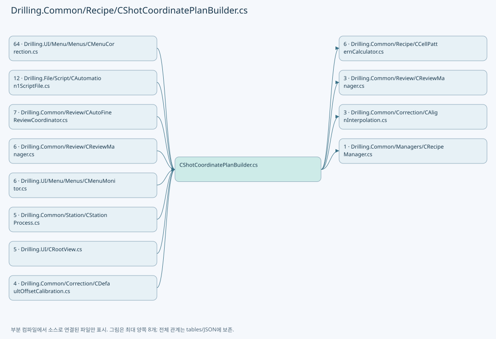

## 네임스페이스·타입·상속

| 타입 | 구분 | 원본 범위 | 선언/상속 |
| --- | --- | --- | --- |
| CShotCoordinatePlanBuilder | ClassDeclaration | 9–650 | CShotCoordinatePlanBuilder |
| ST_ALIGN_SHOT_OFFSET | RecordDeclaration | 652–652 | ST_ALIGN_SHOT_OFFSET |
| CAlignShotOffsetData | ClassDeclaration | 653–765 | CAlignShotOffsetData |
| ST_RECIPE_SHOT_MASKING_RESULT | RecordDeclaration | 767–786 | ST_RECIPE_SHOT_MASKING_RESULT |
| CRecipeShotMaskingPlan | ClassDeclaration | 788–1111 | CRecipeShotMaskingPlan |
| ST_MASKING_POINT | RecordStructDeclaration | 1017–1023 | ST_MASKING_POINT |
| ST_EDGE_CORNER_MASKING_AREA | RecordDeclaration | 1025–1031 | ST_EDGE_CORNER_MASKING_AREA |
| ST_MODEL_PATTERN_AREA | RecordDeclaration | 1033–1042 | ST_MODEL_PATTERN_AREA |
| ST_MODEL_MASKING_AREA | RecordDeclaration | 1043–1052 | ST_MODEL_MASKING_AREA |
| ST_MASKING_RECT | RecordStructDeclaration | 1054–1070 | ST_MASKING_RECT |
| ST_MASKING_HOLE_AREA | RecordDeclaration | 1072–1078 | ST_MASKING_HOLE_AREA |
| ST_EDGE_MASKING_AREA | RecordDeclaration | 1080–1110 | ST_EDGE_MASKING_AREA |
| CReviewOffsetData | ClassDeclaration | 1114–1194 | CReviewOffsetData |
| CReviewOffsetValidationException | ClassDeclaration | 1196–1206 | CReviewOffsetValidationException: IOException |
| ST_SCANNER_AXIS_TRANSFORM | RecordStructDeclaration | 1208–1229 | ST_SCANNER_AXIS_TRANSFORM |
| CScannerAxisTransform | ClassDeclaration | 1231–1327 | CScannerAxisTransform |
| ST_HEAD_SHOT_POINT | RecordDeclaration | 1329–1366 | ST_HEAD_SHOT_POINT |
| ST_SHOT_COORDINATE_PLAN | RecordDeclaration | 1368–1368 | ST_SHOT_COORDINATE_PLAN |
| ST_DESIGN_SHOT_POINT | RecordDeclaration | 1369–1388 | ST_DESIGN_SHOT_POINT |
| ST_HEAD_ASSIGNMENT_CANDIDATE | RecordStructDeclaration | 1390–1390 | ST_HEAD_ASSIGNMENT_CANDIDATE |
| ST_PREPARED_SHOT_POINT | RecordDeclaration | 1391–1407 | ST_PREPARED_SHOT_POINT |

## 멤버 빠른 목록

| 이름 | 종류 | 범위 | 서명 |
| --- | --- | --- | --- |
| Build | MethodDeclaration | L11–201 | Drilling.Common.Recipe.ST_SHOT_COORDINATE_PLAN Drilling.Common.Recipe.CShotCoordinatePlanBuilder.Build(System.Collections.Generic.IReadOnlyDictionary<string, string>) |
| SelectHeadNo | LocalFunctionStatement | L35–38 | int SelectHeadNo(int) |
| SelectValue | LocalFunctionStatement | L40–43 | int SelectValue(int) |
| SelectItem | LocalFunctionStatement | L191–197 | Drilling.Common.Recipe.ST_HEAD_SHOT_POINT SelectItem(Drilling.Common.Recipe.ST_HEAD_SHOT_POINT, int) |
| ReadOffsetScale | MethodDeclaration | L203–210 | double Drilling.Common.Recipe.CShotCoordinatePlanBuilder.ReadOffsetScale(System.Collections.Generic.IReadOnlyDictionary<string, string>, string) |
| BuildDesignShots | MethodDeclaration | L214–220 | System.Collections.Generic.IReadOnlyList<Drilling.Common.Recipe.ST_DESIGN_SHOT_POINT> Drilling.Common.Recipe.CShotCoordinatePlanBuilder.BuildDesignShots(System.Collections.Generic.IReadOnlyDictionary<string, string>) |
| BuildDesignShots | MethodDeclaration | L222–286 | System.Collections.Generic.IReadOnlyList<Drilling.Common.Recipe.ST_DESIGN_SHOT_POINT> Drilling.Common.Recipe.CShotCoordinatePlanBuilder.BuildDesignShots(System.Collections.Generic.IReadOnlyDictionary<string, string>, int) |
| OrderShots | MethodDeclaration | L288–351 | System.Collections.Generic.IReadOnlyList<Drilling.Common.Recipe.ST_HEAD_SHOT_POINT> Drilling.Common.Recipe.CShotCoordinatePlanBuilder.OrderShots(System.Collections.Generic.IReadOnlyList<Drilling.Common.Recipe.ST_HEAD_SHOT_POINT>, double) |
| SelectGroupKey | LocalFunctionStatement | L290–293 | double SelectGroupKey(Drilling.Common.Recipe.ST_HEAD_SHOT_POINT) |
| SelectDescendingRowKey | LocalFunctionStatement | L296–299 | double SelectDescendingRowKey(System.Linq.IGrouping<double, Drilling.Common.Recipe.ST_HEAD_SHOT_POINT>) |
| SelectAscendingRowKey | LocalFunctionStatement | L301–304 | double SelectAscendingRowKey(System.Linq.IGrouping<double, Drilling.Common.Recipe.ST_HEAD_SHOT_POINT>) |
| SelectHeadNo | LocalFunctionStatement | L308–311 | int SelectHeadNo(Drilling.Common.Recipe.ST_HEAD_SHOT_POINT) |
| SelectHeadGroupKey | LocalFunctionStatement | L313–316 | int SelectHeadGroupKey(System.Linq.IGrouping<int, Drilling.Common.Recipe.ST_HEAD_SHOT_POINT>) |
| SelectScannerGx | LocalFunctionStatement | L318–321 | double SelectScannerGx(Drilling.Common.Recipe.ST_HEAD_SHOT_POINT) |
| SelectScannerGy | LocalFunctionStatement | L323–326 | double SelectScannerGy(Drilling.Common.Recipe.ST_HEAD_SHOT_POINT) |
| SelectCellNo | LocalFunctionStatement | L328–331 | int SelectCellNo(Drilling.Common.Recipe.ST_HEAD_SHOT_POINT) |
| SelectCellShotNo | LocalFunctionStatement | L333–336 | int SelectCellShotNo(Drilling.Common.Recipe.ST_HEAD_SHOT_POINT) |
| UseScannerGyForMachiningSort | MethodDeclaration | L353–374 | bool Drilling.Common.Recipe.CShotCoordinatePlanBuilder.UseScannerGyForMachiningSort(System.Collections.Generic.IReadOnlyList<Drilling.Common.Recipe.ST_HEAD_SHOT_POINT>) |
| AssignHeadNo | MethodDeclaration | L376–404 | int Drilling.Common.Recipe.CShotCoordinatePlanBuilder.AssignHeadNo(double, System.Collections.Generic.IReadOnlyList<int>, System.Collections.Generic.IReadOnlyDictionary<string, string>, System.Collections.Generic.IReadOnlyDictionary<int, int>) |
| SelectItem | LocalFunctionStatement | L383–390 | Drilling.Common.Recipe.ST_HEAD_ASSIGNMENT_CANDIDATE? SelectItem(int) |
| IsHasValue | LocalFunctionStatement | L392–395 | bool IsHasValue(Drilling.Common.Recipe.ST_HEAD_ASSIGNMENT_CANDIDATE?) |
| SelectHead | LocalFunctionStatement | L397–400 | Drilling.Common.Recipe.ST_HEAD_ASSIGNMENT_CANDIDATE SelectHead(Drilling.Common.Recipe.ST_HEAD_ASSIGNMENT_CANDIDATE?) |
| SelectHeadCandidate | MethodDeclaration | L406–424 | int Drilling.Common.Recipe.CShotCoordinatePlanBuilder.SelectHeadCandidate(System.Collections.Generic.IReadOnlyList<Drilling.Common.Recipe.ST_HEAD_ASSIGNMENT_CANDIDATE>, System.Collections.Generic.IReadOnlyDictionary<int, int>) |
| SelectDistance | LocalFunctionStatement | L408–411 | double SelectDistance(Drilling.Common.Recipe.ST_HEAD_ASSIGNMENT_CANDIDATE) |
| SelectValue | LocalFunctionStatement | L413–416 | int SelectValue(Drilling.Common.Recipe.ST_HEAD_ASSIGNMENT_CANDIDATE) |
| SelectHeadNo | LocalFunctionStatement | L418–421 | int SelectHeadNo(Drilling.Common.Recipe.ST_HEAD_ASSIGNMENT_CANDIDATE) |
| BuildActiveHeadNumbers | MethodDeclaration | L426–443 | System.Collections.Generic.IReadOnlyList<int> Drilling.Common.Recipe.CShotCoordinatePlanBuilder.BuildActiveHeadNumbers(System.Collections.Generic.IReadOnlyDictionary<string, string>, int) |
| ReadHeadUse | MethodDeclaration | L445–448 | bool Drilling.Common.Recipe.CShotCoordinatePlanBuilder.ReadHeadUse(System.Collections.Generic.IReadOnlyDictionary<string, string>, int) |
| ReadHeadCenterX | MethodDeclaration | L450–458 | double Drilling.Common.Recipe.CShotCoordinatePlanBuilder.ReadHeadCenterX(System.Collections.Generic.IReadOnlyDictionary<string, string>, int) |
| ReadHeadCenterY | MethodDeclaration | L460–471 | double Drilling.Common.Recipe.CShotCoordinatePlanBuilder.ReadHeadCenterY(System.Collections.Generic.IReadOnlyDictionary<string, string>, int) |
| ReadHeadDefaultOffset | MethodDeclaration | L473–476 | double Drilling.Common.Recipe.CShotCoordinatePlanBuilder.ReadHeadDefaultOffset(System.Collections.Generic.IReadOnlyDictionary<string, string>, int, string) |
| ReadFirstBeamOffset | MethodDeclaration | L478–481 | double Drilling.Common.Recipe.CShotCoordinatePlanBuilder.ReadFirstBeamOffset(System.Collections.Generic.IReadOnlyDictionary<string, string>, int, string) |
| ReadHeadEncoderScale | MethodDeclaration | L483–486 | double Drilling.Common.Recipe.CShotCoordinatePlanBuilder.ReadHeadEncoderScale(System.Collections.Generic.IReadOnlyDictionary<string, string>, int, double) |
| ConvertRecipeYToStageY | MethodDeclaration | L488–491 | double Drilling.Common.Recipe.CShotCoordinatePlanBuilder.ConvertRecipeYToStageY(double) |
| ApplyScannerAxis | MethodDeclaration | L493–496 | double Drilling.Common.Recipe.CShotCoordinatePlanBuilder.ApplyScannerAxis(double, double, double) |
| ReadScannerReferenceOffsetX | MethodDeclaration | L498–503 | double Drilling.Common.Recipe.CShotCoordinatePlanBuilder.ReadScannerReferenceOffsetX(System.Collections.Generic.IReadOnlyDictionary<string, string>) |
| ReadDirection | MethodDeclaration | L505–539 | double Drilling.Common.Recipe.CShotCoordinatePlanBuilder.ReadDirection(System.Collections.Generic.IReadOnlyDictionary<string, string>, double, params string[]) |
| ShouldIncludeItem | LocalFunctionStatement | L507–510 | bool ShouldIncludeItem(string) |
| NormalizeDirection | MethodDeclaration | L541–549 | double Drilling.Common.Recipe.CShotCoordinatePlanBuilder.NormalizeDirection(double, string) |
| ToShotKey | MethodDeclaration | L551–554 | string Drilling.Common.Recipe.CShotCoordinatePlanBuilder.ToShotKey(int, int) |
| ReadDouble | MethodDeclaration | L556–572 | double Drilling.Common.Recipe.CShotCoordinatePlanBuilder.ReadDouble(System.Collections.Generic.IReadOnlyDictionary<string, string>, double, params string[]) |
| ShouldIncludeItem | LocalFunctionStatement | L558–561 | bool ShouldIncludeItem(string) |
| ReadNullableDouble | MethodDeclaration | L574–590 | double? Drilling.Common.Recipe.CShotCoordinatePlanBuilder.ReadNullableDouble(System.Collections.Generic.IReadOnlyDictionary<string, string>, params string[]) |
| ShouldIncludeItem | LocalFunctionStatement | L576–579 | bool ShouldIncludeItem(string) |
| ReadInt | MethodDeclaration | L592–618 | int Drilling.Common.Recipe.CShotCoordinatePlanBuilder.ReadInt(System.Collections.Generic.IReadOnlyDictionary<string, string>, int, params string[]) |
| ShouldIncludeItem | LocalFunctionStatement | L594–597 | bool ShouldIncludeItem(string) |
| ReadBool | MethodDeclaration | L620–649 | bool Drilling.Common.Recipe.CShotCoordinatePlanBuilder.ReadBool(System.Collections.Generic.IReadOnlyDictionary<string, string>, bool, params string[]) |
| ShouldIncludeItem | LocalFunctionStatement | L622–625 | bool ShouldIncludeItem(string) |
| MaximumAbsoluteOffset | FieldDeclaration | L655–655 | double Drilling.Common.Recipe.CAlignShotOffsetData.MaximumAbsoluteOffset |
| ParameterPattern | FieldDeclaration | L656–656 | System.Text.RegularExpressions.Regex Drilling.Common.Recipe.CAlignShotOffsetData.ParameterPattern |
| IsParameterKey | MethodDeclaration | L657–657 | bool Drilling.Common.Recipe.CAlignShotOffsetData.IsParameterKey(string) |
| ParameterKey | MethodDeclaration | L658–658 | string Drilling.Common.Recipe.CAlignShotOffsetData.ParameterKey(int, string, string) |
| RoundValue | MethodDeclaration | L659–666 | double Drilling.Common.Recipe.CAlignShotOffsetData.RoundValue(double) |
| FormatValue | MethodDeclaration | L668–668 | string Drilling.Common.Recipe.CAlignShotOffsetData.FormatValue(double) |
| ReadValue | MethodDeclaration | L669–676 | double Drilling.Common.Recipe.CAlignShotOffsetData.ReadValue(System.Collections.Generic.IReadOnlyDictionary<string, string>, string) |
| Calculate | MethodDeclaration | L678–698 | System.Collections.Generic.IReadOnlyList<Drilling.Common.Recipe.ST_ALIGN_SHOT_OFFSET> Drilling.Common.Recipe.CAlignShotOffsetData.Calculate(Drilling.Common.Managers.ST_RECIPE_DEFINITION, Drilling.Common.Correction.CAlignInterpolation) |
| ZeroValues | MethodDeclaration | L700–705 | System.Collections.Generic.IReadOnlyList<Drilling.Common.Recipe.ST_ALIGN_SHOT_OFFSET> Drilling.Common.Recipe.CAlignShotOffsetData.ZeroValues(Drilling.Common.Managers.ST_RECIPE_DEFINITION) |
| Apply | MethodDeclaration | L707–750 | Drilling.Common.Managers.ST_RECIPE_DEFINITION Drilling.Common.Recipe.CAlignShotOffsetData.Apply(Drilling.Common.Managers.ST_RECIPE_DEFINITION, System.Collections.Generic.IReadOnlyList<Drilling.Common.Recipe.ST_ALIGN_SHOT_OFFSET>) |
| Add | LocalFunctionStatement | L720–749 | void Add(Drilling.Common.Recipe.ST_ALIGN_SHOT_OFFSET, string, double) |
| RetainUneditedOffsets | MethodDeclaration | L754–764 | Drilling.Common.Managers.ST_RECIPE_DEFINITION Drilling.Common.Recipe.CAlignShotOffsetData.RetainUneditedOffsets(Drilling.Common.Managers.ST_RECIPE_DEFINITION, Drilling.Common.Managers.ST_RECIPE_DEFINITION?) |
| Empty | PropertyDeclaration | L769–769 | Drilling.Common.Recipe.ST_RECIPE_SHOT_MASKING_RESULT Drilling.Common.Recipe.ST_RECIPE_SHOT_MASKING_RESULT.Empty |
| get_Empty | GetAccessorDeclaration | L769–769 | Drilling.Common.Recipe.ST_RECIPE_SHOT_MASKING_RESULT Drilling.Common.Recipe.ST_RECIPE_SHOT_MASKING_RESULT.Empty.get |
| IsMasked | PropertyDeclaration | L771–777 | bool Drilling.Common.Recipe.ST_RECIPE_SHOT_MASKING_RESULT.IsMasked |
| get_IsMasked | GetAccessorDeclaration | L773–776 | bool Drilling.Common.Recipe.ST_RECIPE_SHOT_MASKING_RESULT.IsMasked.get |
| ShouldSkipLaser | PropertyDeclaration | L779–785 | bool Drilling.Common.Recipe.ST_RECIPE_SHOT_MASKING_RESULT.ShouldSkipLaser |
| get_ShouldSkipLaser | GetAccessorDeclaration | L781–784 | bool Drilling.Common.Recipe.ST_RECIPE_SHOT_MASKING_RESULT.ShouldSkipLaser.get |
| MaximumCellModelTypeCount | FieldDeclaration | L790–790 | int Drilling.Common.Recipe.CRecipeShotMaskingPlan.MaximumCellModelTypeCount |
| MaximumMaskingHoleCount | FieldDeclaration | L791–791 | int Drilling.Common.Recipe.CRecipeShotMaskingPlan.MaximumMaskingHoleCount |
| Epsilon | FieldDeclaration | L792–792 | double Drilling.Common.Recipe.CRecipeShotMaskingPlan.Epsilon |
| _models | FieldDeclaration | L793–793 | System.Collections.Generic.IReadOnlyDictionary<int, Drilling.Common.Recipe.CRecipeShotMaskingPlan.ST_MODEL_MASKING_AREA> Drilling.Common.Recipe.CRecipeShotMaskingPlan._models |
| _modelPatterns | FieldDeclaration | L794–794 | System.Collections.Generic.IReadOnlyDictionary<int, Drilling.Common.Recipe.CRecipeShotMaskingPlan.ST_MODEL_PATTERN_AREA> Drilling.Common.Recipe.CRecipeShotMaskingPlan._modelPatterns |
| _cellModelTypes | FieldDeclaration | L795–795 | System.Collections.Generic.IReadOnlyDictionary<int, int> Drilling.Common.Recipe.CRecipeShotMaskingPlan._cellModelTypes |
| _modelTypeCount | FieldDeclaration | L796–796 | int Drilling.Common.Recipe.CRecipeShotMaskingPlan._modelTypeCount |
| _splitBeamCount | FieldDeclaration | L797–797 | int Drilling.Common.Recipe.CRecipeShotMaskingPlan._splitBeamCount |
| .ctor | ConstructorDeclaration | L798–811 | Drilling.Common.Recipe.CRecipeShotMaskingPlan.CRecipeShotMaskingPlan(System.Collections.Generic.IReadOnlyDictionary<int, Drilling.Common.Recipe.CRecipeShotMaskingPlan.ST_MODEL_MASKING_AREA>, System.Collections.Generic.IReadOnlyDictionary<int, Drilling.Common.Recipe.CRecipeShotMaskingPlan.ST_MODEL_PATTERN_AREA>, System.Collections.Generic.IReadOnlyDictionary<int, int>, int, int) |
| Build | MethodDeclaration | L813–851 | Drilling.Common.Recipe.CRecipeShotMaskingPlan Drilling.Common.Recipe.CRecipeShotMaskingPlan.Build(System.Collections.Generic.IReadOnlyDictionary<string, string>) |
| EvaluateShot | MethodDeclaration | L853–910 | Drilling.Common.Recipe.ST_RECIPE_SHOT_MASKING_RESULT Drilling.Common.Recipe.CRecipeShotMaskingPlan.EvaluateShot(Drilling.Common.Recipe.ST_HEAD_SHOT_POINT) |
| GetModelType | MethodDeclaration | L912–915 | int Drilling.Common.Recipe.CRecipeShotMaskingPlan.GetModelType(int) |
| IsChessSkipped | MethodDeclaration | L917–926 | bool Drilling.Common.Recipe.CRecipeShotMaskingPlan.IsChessSkipped(Drilling.Common.Recipe.ST_HEAD_SHOT_POINT, Drilling.Common.Recipe.CRecipeShotMaskingPlan.ST_MODEL_PATTERN_AREA) |
| BuildModel | MethodDeclaration | L928–948 | Drilling.Common.Recipe.CRecipeShotMaskingPlan.ST_MODEL_MASKING_AREA Drilling.Common.Recipe.CRecipeShotMaskingPlan.BuildModel(System.Collections.Generic.IReadOnlyDictionary<string, string>, int) |
| BuildEdge | MethodDeclaration | L950–974 | Drilling.Common.Recipe.CRecipeShotMaskingPlan.ST_EDGE_MASKING_AREA? Drilling.Common.Recipe.CRecipeShotMaskingPlan.BuildEdge(System.Collections.Generic.IReadOnlyDictionary<string, string>, string) |
| ReadInt | MethodDeclaration | L976–997 | int Drilling.Common.Recipe.CRecipeShotMaskingPlan.ReadInt(System.Collections.Generic.IReadOnlyDictionary<string, string>, int, params string[]) |
| ReadDouble | MethodDeclaration | L999–1010 | double Drilling.Common.Recipe.CRecipeShotMaskingPlan.ReadDouble(System.Collections.Generic.IReadOnlyDictionary<string, string>, double, params string[]) |
| PositiveModulo | MethodDeclaration | L1012–1015 | int Drilling.Common.Recipe.CRecipeShotMaskingPlan.PositiveModulo(int, int) |
| FromPositiveOffset | MethodDeclaration | L1019–1022 | Drilling.Common.Recipe.CRecipeShotMaskingPlan.ST_MASKING_POINT Drilling.Common.Recipe.CRecipeShotMaskingPlan.ST_MASKING_POINT.FromPositiveOffset(double, double) |
| Touches | MethodDeclaration | L1027–1030 | bool Drilling.Common.Recipe.CRecipeShotMaskingPlan.ST_EDGE_CORNER_MASKING_AREA.Touches(Drilling.Common.Recipe.CRecipeShotMaskingPlan.ST_MASKING_RECT) |
| HasMasking | PropertyDeclaration | L1045–1051 | bool Drilling.Common.Recipe.CRecipeShotMaskingPlan.ST_MODEL_MASKING_AREA.HasMasking |
| get_HasMasking | GetAccessorDeclaration | L1047–1050 | bool Drilling.Common.Recipe.CRecipeShotMaskingPlan.ST_MODEL_MASKING_AREA.HasMasking.get |
| FromCenter | MethodDeclaration | L1056–1059 | Drilling.Common.Recipe.CRecipeShotMaskingPlan.ST_MASKING_RECT Drilling.Common.Recipe.CRecipeShotMaskingPlan.ST_MASKING_RECT.FromCenter(double, double, double) |
| FromCorners | MethodDeclaration | L1061–1064 | Drilling.Common.Recipe.CRecipeShotMaskingPlan.ST_MASKING_RECT Drilling.Common.Recipe.CRecipeShotMaskingPlan.ST_MASKING_RECT.FromCorners(double, double, double, double) |
| Intersects | MethodDeclaration | L1066–1069 | bool Drilling.Common.Recipe.CRecipeShotMaskingPlan.ST_MASKING_RECT.Intersects(Drilling.Common.Recipe.CRecipeShotMaskingPlan.ST_MASKING_RECT) |
| Intersects | MethodDeclaration | L1074–1077 | bool Drilling.Common.Recipe.CRecipeShotMaskingPlan.ST_MASKING_HOLE_AREA.Intersects(Drilling.Common.Recipe.CRecipeShotMaskingPlan.ST_MASKING_RECT) |
| Create | MethodDeclaration | L1082–1099 | Drilling.Common.Recipe.CRecipeShotMaskingPlan.ST_EDGE_CORNER_MASKING_AREA? Drilling.Common.Recipe.CRecipeShotMaskingPlan.ST_EDGE_MASKING_AREA.Create(int, int, double, double) |
| AddCorner | MethodDeclaration | L1101–1109 | void Drilling.Common.Recipe.CRecipeShotMaskingPlan.ST_EDGE_MASKING_AREA.AddCorner(System.Collections.Generic.List<Drilling.Common.Recipe.CRecipeShotMaskingPlan.ST_MASKING_RECT>, double, double, double, double) |
| IsParameterKey | MethodDeclaration | L1116–1132 | bool Drilling.Common.Recipe.CReviewOffsetData.IsParameterKey(string) |
| RemoveFromParameters | MethodDeclaration | L1134–1138 | void Drilling.Common.Recipe.CReviewOffsetData.RemoveFromParameters(System.Collections.Generic.IDictionary<string, string>) |
| ValidateRows | MethodDeclaration | L1140–1165 | Drilling.Common.Review.ST_REVIEW_OFFSET_ROW[] Drilling.Common.Recipe.CReviewOffsetData.ValidateRows(System.Collections.Generic.IReadOnlyList<Drilling.Common.Review.ST_REVIEW_OFFSET_ROW>, string, System.Collections.Generic.IReadOnlyList<int>?, System.Threading.CancellationToken) |
| ApplyToParameters | MethodDeclaration | L1167–1180 | void Drilling.Common.Recipe.CReviewOffsetData.ApplyToParameters(System.Collections.Generic.IDictionary<string, string>, Drilling.Common.Review.ST_REVIEW_OFFSET_FILE_DATA) |
| IsDesignCoordinate | MethodDeclaration | L1182–1190 | bool Drilling.Common.Recipe.CReviewOffsetData.IsDesignCoordinate(System.Collections.Generic.IReadOnlyDictionary<string, string>, string) |
| ToScanner | MethodDeclaration | L1192–1192 | (double X, double Y) Drilling.Common.Recipe.CReviewOffsetData.ToScanner(System.Collections.Generic.IReadOnlyDictionary<string, string>, int, double, double, bool) |
| ToDesign | MethodDeclaration | L1193–1193 | (double X, double Y) Drilling.Common.Recipe.CReviewOffsetData.ToDesign(System.Collections.Generic.IReadOnlyDictionary<string, string>, int, double, double, bool) |
| FilePath | PropertyDeclaration | L1198–1198 | string Drilling.Common.Recipe.CReviewOffsetValidationException.FilePath |
| get_FilePath | GetAccessorDeclaration | L1198–1198 | string Drilling.Common.Recipe.CReviewOffsetValidationException.FilePath.get |
| RowNumber | PropertyDeclaration | L1199–1199 | int Drilling.Common.Recipe.CReviewOffsetValidationException.RowNumber |
| get_RowNumber | GetAccessorDeclaration | L1199–1199 | int Drilling.Common.Recipe.CReviewOffsetValidationException.RowNumber.get |
| .ctor | ConstructorDeclaration | L1201–1205 | Drilling.Common.Recipe.CReviewOffsetValidationException.CReviewOffsetValidationException(string, int, string) |
| Apply | MethodDeclaration | L1210–1228 | (double X, double Y) Drilling.Common.Recipe.ST_SCANNER_AXIS_TRANSFORM.Apply(double, double) |
| ReadStageDirection | MethodDeclaration | L1233–1233 | double Drilling.Common.Recipe.CScannerAxisTransform.ReadStageDirection(System.Collections.Generic.IReadOnlyDictionary<string, string>) |
| CreateDefault | MethodDeclaration | L1234–1237 | Drilling.Common.Recipe.ST_SCANNER_AXIS_TRANSFORM Drilling.Common.Recipe.CScannerAxisTransform.CreateDefault(int) |
| Read | MethodDeclaration | L1239–1244 | Drilling.Common.Recipe.ST_SCANNER_AXIS_TRANSFORM Drilling.Common.Recipe.CScannerAxisTransform.Read(System.Collections.Generic.IReadOnlyDictionary<string, string>, int) |
| Read | MethodDeclaration | L1246–1251 | Drilling.Common.Recipe.ST_SCANNER_AXIS_TRANSFORM Drilling.Common.Recipe.CScannerAxisTransform.Read(System.Collections.Generic.IReadOnlyList<Drilling.Common.Managers.ST_SYSTEM_PARAMETER>, int) |
| DesignOffsetToScanner | MethodDeclaration | L1253–1258 | (double X, double Y) Drilling.Common.Recipe.CScannerAxisTransform.DesignOffsetToScanner(System.Collections.Generic.IReadOnlyList<Drilling.Common.Managers.ST_SYSTEM_PARAMETER>, int, double, double) |
| DesignOffsetToScanner | MethodDeclaration | L1260–1265 | (double X, double Y) Drilling.Common.Recipe.CScannerAxisTransform.DesignOffsetToScanner(System.Collections.Generic.IReadOnlyDictionary<string, string>, int, double, double) |
| Format | MethodDeclaration | L1267–1270 | string Drilling.Common.Recipe.CScannerAxisTransform.Format(Drilling.Common.Recipe.ST_SCANNER_AXIS_TRANSFORM) |
| ScannerOffsetToDesign | MethodDeclaration | L1272–1282 | (double X, double Y) Drilling.Common.Recipe.CScannerAxisTransform.ScannerOffsetToDesign(System.Collections.Generic.IReadOnlyDictionary<string, string>, int, double, double) |
| ReadOnOff | MethodDeclaration | L1284–1287 | bool Drilling.Common.Recipe.CScannerAxisTransform.ReadOnOff(System.Collections.Generic.IReadOnlyDictionary<string, string>, bool, string) |
| ReadOnOff | MethodDeclaration | L1289–1300 | bool Drilling.Common.Recipe.CScannerAxisTransform.ReadOnOff(System.Collections.Generic.IReadOnlyList<Drilling.Common.Managers.ST_SYSTEM_PARAMETER>, bool, string) |
| ParseOnOff | MethodDeclaration | L1302–1321 | bool Drilling.Common.Recipe.CScannerAxisTransform.ParseOnOff(string?, bool, string) |
| FormatOnOff | MethodDeclaration | L1323–1326 | string Drilling.Common.Recipe.CScannerAxisTransform.FormatOnOff(bool) |
| AlignOffsetX | PropertyDeclaration | L1362–1362 | double Drilling.Common.Recipe.ST_HEAD_SHOT_POINT.AlignOffsetX |
| get_AlignOffsetX | GetAccessorDeclaration | L1362–1362 | double Drilling.Common.Recipe.ST_HEAD_SHOT_POINT.AlignOffsetX.get |
| set_AlignOffsetX | InitAccessorDeclaration | L1362–1362 | void Drilling.Common.Recipe.ST_HEAD_SHOT_POINT.AlignOffsetX.init |
| AlignOffsetY | PropertyDeclaration | L1363–1363 | double Drilling.Common.Recipe.ST_HEAD_SHOT_POINT.AlignOffsetY |
| get_AlignOffsetY | GetAccessorDeclaration | L1363–1363 | double Drilling.Common.Recipe.ST_HEAD_SHOT_POINT.AlignOffsetY.get |
| set_AlignOffsetY | InitAccessorDeclaration | L1363–1363 | void Drilling.Common.Recipe.ST_HEAD_SHOT_POINT.AlignOffsetY.init |
| AlignScannerOffsetX | PropertyDeclaration | L1364–1364 | double Drilling.Common.Recipe.ST_HEAD_SHOT_POINT.AlignScannerOffsetX |
| get_AlignScannerOffsetX | GetAccessorDeclaration | L1364–1364 | double Drilling.Common.Recipe.ST_HEAD_SHOT_POINT.AlignScannerOffsetX.get |
| set_AlignScannerOffsetX | InitAccessorDeclaration | L1364–1364 | void Drilling.Common.Recipe.ST_HEAD_SHOT_POINT.AlignScannerOffsetX.init |
| AlignScannerOffsetY | PropertyDeclaration | L1365–1365 | double Drilling.Common.Recipe.ST_HEAD_SHOT_POINT.AlignScannerOffsetY |
| get_AlignScannerOffsetY | GetAccessorDeclaration | L1365–1365 | double Drilling.Common.Recipe.ST_HEAD_SHOT_POINT.AlignScannerOffsetY.get |
| set_AlignScannerOffsetY | InitAccessorDeclaration | L1365–1365 | void Drilling.Common.Recipe.ST_HEAD_SHOT_POINT.AlignScannerOffsetY.init |
| ReviewOffsetIsDesign | PropertyDeclaration | L1387–1387 | bool Drilling.Common.Recipe.ST_DESIGN_SHOT_POINT.ReviewOffsetIsDesign |
| get_ReviewOffsetIsDesign | GetAccessorDeclaration | L1387–1387 | bool Drilling.Common.Recipe.ST_DESIGN_SHOT_POINT.ReviewOffsetIsDesign.get |
| set_ReviewOffsetIsDesign | InitAccessorDeclaration | L1387–1387 | void Drilling.Common.Recipe.ST_DESIGN_SHOT_POINT.ReviewOffsetIsDesign.init |

## 멤버별 상세 계약·호출·처리 해설

### MethodDeclaration `Build` · L11–201

[Drilling.Common/Recipe/CShotCoordinatePlanBuilder.cs:11–201](https://github.com/kjuws10-rgb/A3Drilling/blob/5aee8e58439c9b455cae7c9593c9be986c3e682e/Drilling.Common/Recipe/CShotCoordinatePlanBuilder.cs#L11-L201)

| 항목 | 실제 추출 값 |
| --- | --- |
| 서명 | Drilling.Common.Recipe.ST_SHOT_COORDINATE_PLAN Drilling.Common.Recipe.CShotCoordinatePlanBuilder.Build(System.Collections.Generic.IReadOnlyDictionary<string, string>) |
| 접근/수식자 | Public / public, static |
| 반환/값 타입 | Drilling.Common.Recipe.ST_SHOT_COORDINATE_PLAN |
| 소속 타입 | NamedType:Drilling.Common.Recipe.CShotCoordinatePlanBuilder |

입력 계약:

| 이름 | 타입 | 전달 | 선택/기본값 |
| --- | --- | --- | --- |
| parameters | System.Collections.Generic.IReadOnlyDictionary<string, string> | None | False /  |

정적 호출자로 확인된 위치:

| 호출 파일/행 | 호출 표현식 | 런타임 분기 가능 |
| --- | --- | --- |
| [Drilling.Common/Review/CAutoFineReviewCoordinator.cs:225–225](https://github.com/kjuws10-rgb/A3Drilling/blob/5aee8e58439c9b455cae7c9593c9be986c3e682e/Drilling.Common/Review/CAutoFineReviewCoordinator.cs#L225-L225) | CShotCoordinatePlanBuilder.Build | False |
| [Drilling.Common/Review/CReviewManager.cs:471–471](https://github.com/kjuws10-rgb/A3Drilling/blob/5aee8e58439c9b455cae7c9593c9be986c3e682e/Drilling.Common/Review/CReviewManager.cs#L471-L471) | CShotCoordinatePlanBuilder.Build | False |
| [Drilling.Common/Review/CZeroDefenceRecipePlan.cs:25–25](https://github.com/kjuws10-rgb/A3Drilling/blob/5aee8e58439c9b455cae7c9593c9be986c3e682e/Drilling.Common/Review/CZeroDefenceRecipePlan.cs#L25-L25) | CShotCoordinatePlanBuilder.Build | False |
| [Drilling.Common/Station/CStationProcess.cs:1606–1606](https://github.com/kjuws10-rgb/A3Drilling/blob/5aee8e58439c9b455cae7c9593c9be986c3e682e/Drilling.Common/Station/CStationProcess.cs#L1606-L1606) | CShotCoordinatePlanBuilder.Build | False |
| [Drilling.UI/CRootView.cs:1422–1422](https://github.com/kjuws10-rgb/A3Drilling/blob/5aee8e58439c9b455cae7c9593c9be986c3e682e/Drilling.UI/CRootView.cs#L1422-L1422) | CShotCoordinatePlanBuilder.Build | False |
| [Drilling.UI/CRootView.cs:1423–1423](https://github.com/kjuws10-rgb/A3Drilling/blob/5aee8e58439c9b455cae7c9593c9be986c3e682e/Drilling.UI/CRootView.cs#L1423-L1423) | CShotCoordinatePlanBuilder.Build | False |
| [Drilling.UI/CRootView.cs:1459–1459](https://github.com/kjuws10-rgb/A3Drilling/blob/5aee8e58439c9b455cae7c9593c9be986c3e682e/Drilling.UI/CRootView.cs#L1459-L1459) | CShotCoordinatePlanBuilder.Build | False |
| [Drilling.UI/Menu/Menus/CMenuCorrection.ReviewData.Display.cs:262–262](https://github.com/kjuws10-rgb/A3Drilling/blob/5aee8e58439c9b455cae7c9593c9be986c3e682e/Drilling.UI/Menu/Menus/CMenuCorrection.ReviewData.Display.cs#L262-L262) | CShotCoordinatePlanBuilder.Build | False |
| [Drilling.UI/Menu/Menus/CMenuCorrection.cs:642–642](https://github.com/kjuws10-rgb/A3Drilling/blob/5aee8e58439c9b455cae7c9593c9be986c3e682e/Drilling.UI/Menu/Menus/CMenuCorrection.cs#L642-L642) | CShotCoordinatePlanBuilder.Build | False |
| [Drilling.UI/Menu/Menus/CMenuCorrection.cs:5519–5519](https://github.com/kjuws10-rgb/A3Drilling/blob/5aee8e58439c9b455cae7c9593c9be986c3e682e/Drilling.UI/Menu/Menus/CMenuCorrection.cs#L5519-L5519) | CShotCoordinatePlanBuilder.Build | False |
| [Drilling.UI/Menu/Menus/CMenuCorrection.cs:5983–5983](https://github.com/kjuws10-rgb/A3Drilling/blob/5aee8e58439c9b455cae7c9593c9be986c3e682e/Drilling.UI/Menu/Menus/CMenuCorrection.cs#L5983-L5983) | CShotCoordinatePlanBuilder.Build | False |
| [Drilling.UI/Menu/Menus/CMenuCorrection.cs:7536–7536](https://github.com/kjuws10-rgb/A3Drilling/blob/5aee8e58439c9b455cae7c9593c9be986c3e682e/Drilling.UI/Menu/Menus/CMenuCorrection.cs#L7536-L7536) | CShotCoordinatePlanBuilder.Build | False |
| [Drilling.UI/Menu/Menus/CMenuMonitor.cs:2949–2949](https://github.com/kjuws10-rgb/A3Drilling/blob/5aee8e58439c9b455cae7c9593c9be986c3e682e/Drilling.UI/Menu/Menus/CMenuMonitor.cs#L2949-L2949) | CShotCoordinatePlanBuilder.Build | False |
| [Drilling.UI/Menu/Menus/CMenuRecipe.cs:2711–2711](https://github.com/kjuws10-rgb/A3Drilling/blob/5aee8e58439c9b455cae7c9593c9be986c3e682e/Drilling.UI/Menu/Menus/CMenuRecipe.cs#L2711-L2711) | CShotCoordinatePlanBuilder.Build | False |

호출하는 대상과 해석 범위:

| 원본 행 | 표현식 | 분석 상태 | 대상/소스 위치 |
| --- | --- | --- | --- |
| 13 | ArgumentNullException.ThrowIfNull | resolved | void System.ArgumentNullException.ThrowIfNull(object?, string?) |
| 14 | Math.Clamp | resolved | int System.Math.Clamp(int, int, int) |
| 14 | ReadInt | resolved | int Drilling.Common.Recipe.CShotCoordinatePlanBuilder.ReadInt(System.Collections.Generic.IReadOnlyDictionary<string, string>, int, params string[]) · Drilling.Common/Recipe/CShotCoordinatePlanBuilder.cs:592 |
| 15 | ReadInt | resolved | int Drilling.Common.Recipe.CShotCoordinatePlanBuilder.ReadInt(System.Collections.Generic.IReadOnlyDictionary<string, string>, int, params string[]) · Drilling.Common/Recipe/CShotCoordinatePlanBuilder.cs:592 |
| 18 | new InvalidOperationException | resolved | System.InvalidOperationException.InvalidOperationException(string?) |
| 21 | BuildActiveHeadNumbers | resolved | System.Collections.Generic.IReadOnlyList<int> Drilling.Common.Recipe.CShotCoordinatePlanBuilder.BuildActiveHeadNumbers(System.Collections.Generic.IReadOnlyDictionary<string, string>, int) · Drilling.Common/Recipe/CShotCoordinatePlanBuilder.cs:426 |
| 22 | activeHeadNos.ToHashSet | resolved | System.Collections.Generic.HashSet<int> System.Collections.Generic.IEnumerable<int>.ToHashSet<int>() |
| 23 | Enumerable.Range(1, headCount).ToArray | resolved | int[] System.Collections.Generic.IEnumerable<int>.ToArray<int>() |
| 23 | Enumerable.Range | resolved | System.Collections.Generic.IEnumerable<int> System.Linq.Enumerable.Range(int, int) |
| 24 | ReadDouble | resolved | double Drilling.Common.Recipe.CShotCoordinatePlanBuilder.ReadDouble(System.Collections.Generic.IReadOnlyDictionary<string, string>, double, params string[]) · Drilling.Common/Recipe/CShotCoordinatePlanBuilder.cs:556 |
| 25 | ReadDouble | resolved | double Drilling.Common.Recipe.CShotCoordinatePlanBuilder.ReadDouble(System.Collections.Generic.IReadOnlyDictionary<string, string>, double, params string[]) · Drilling.Common/Recipe/CShotCoordinatePlanBuilder.cs:556 |
| 26 | ReadDouble | resolved | double Drilling.Common.Recipe.CShotCoordinatePlanBuilder.ReadDouble(System.Collections.Generic.IReadOnlyDictionary<string, string>, double, params string[]) · Drilling.Common/Recipe/CShotCoordinatePlanBuilder.cs:556 |
| 27 | ReadDirection | resolved | double Drilling.Common.Recipe.CShotCoordinatePlanBuilder.ReadDirection(System.Collections.Generic.IReadOnlyDictionary<string, string>, double, params string[]) · Drilling.Common/Recipe/CShotCoordinatePlanBuilder.cs:505 |
| 28 | Math.Abs | resolved | double System.Math.Abs(double) |
| 28 | ReadDouble | resolved | double Drilling.Common.Recipe.CShotCoordinatePlanBuilder.ReadDouble(System.Collections.Generic.IReadOnlyDictionary<string, string>, double, params string[]) · Drilling.Common/Recipe/CShotCoordinatePlanBuilder.cs:556 |
| 29 | ReadDouble | resolved | double Drilling.Common.Recipe.CShotCoordinatePlanBuilder.ReadDouble(System.Collections.Generic.IReadOnlyDictionary<string, string>, double, params string[]) · Drilling.Common/Recipe/CShotCoordinatePlanBuilder.cs:556 |
| 30 | ReadScannerReferenceOffsetX | resolved | double Drilling.Common.Recipe.CShotCoordinatePlanBuilder.ReadScannerReferenceOffsetX(System.Collections.Generic.IReadOnlyDictionary<string, string>) · Drilling.Common/Recipe/CShotCoordinatePlanBuilder.cs:498 |
| 31 | ReadDouble | resolved | double Drilling.Common.Recipe.CShotCoordinatePlanBuilder.ReadDouble(System.Collections.Generic.IReadOnlyDictionary<string, string>, double, params string[]) · Drilling.Common/Recipe/CShotCoordinatePlanBuilder.cs:556 |
| 32 | ReadDouble | resolved | double Drilling.Common.Recipe.CShotCoordinatePlanBuilder.ReadDouble(System.Collections.Generic.IReadOnlyDictionary<string, string>, double, params string[]) · Drilling.Common/Recipe/CShotCoordinatePlanBuilder.cs:556 |
| 33 | ReadOffsetScale | resolved | double Drilling.Common.Recipe.CShotCoordinatePlanBuilder.ReadOffsetScale(System.Collections.Generic.IReadOnlyDictionary<string, string>, string) · Drilling.Common/Recipe/CShotCoordinatePlanBuilder.cs:203 |
| 34 | ReadOffsetScale | resolved | double Drilling.Common.Recipe.CShotCoordinatePlanBuilder.ReadOffsetScale(System.Collections.Generic.IReadOnlyDictionary<string, string>, string) · Drilling.Common/Recipe/CShotCoordinatePlanBuilder.cs:203 |
| 45 | assignmentHeadNos.ToDictionary | resolved | System.Collections.Generic.Dictionary<int, int> System.Collections.Generic.IEnumerable<int>.ToDictionary<int, int, int>(System.Func<int, int>, System.Func<int, int>) |
| 46 | BuildDesignShots | resolved | System.Collections.Generic.IReadOnlyList<Drilling.Common.Recipe.ST_DESIGN_SHOT_POINT> Drilling.Common.Recipe.CShotCoordinatePlanBuilder.BuildDesignShots(System.Collections.Generic.IReadOnlyDictionary<string, string>, int) · Drilling.Common/Recipe/CShotCoordinatePlanBuilder.cs:222 |
| 47 | new List<ST_PREPARED_SHOT_POINT> | resolved | System.Collections.Generic.List<Drilling.Common.Recipe.ST_PREPARED_SHOT_POINT>.List(int) |
| 52 | AssignHeadNo | resolved | int Drilling.Common.Recipe.CShotCoordinatePlanBuilder.AssignHeadNo(double, System.Collections.Generic.IReadOnlyList<int>, System.Collections.Generic.IReadOnlyDictionary<string, string>, System.Collections.Generic.IReadOnlyDictionary<int, int>) · Drilling.Common/Recipe/CShotCoordinatePlanBuilder.cs:376 |
| 53 | activeHeadSet.Contains | resolved | bool System.Collections.Generic.HashSet<int>.Contains(int) |
| 59 | ReadHeadCenterX | resolved | double Drilling.Common.Recipe.CShotCoordinatePlanBuilder.ReadHeadCenterX(System.Collections.Generic.IReadOnlyDictionary<string, string>, int) · Drilling.Common/Recipe/CShotCoordinatePlanBuilder.cs:450 |
| 60 | ReadHeadCenterY | resolved | double Drilling.Common.Recipe.CShotCoordinatePlanBuilder.ReadHeadCenterY(System.Collections.Generic.IReadOnlyDictionary<string, string>, int) · Drilling.Common/Recipe/CShotCoordinatePlanBuilder.cs:460 |
| 61 | CScannerAxisTransform.Read | resolved | Drilling.Common.Recipe.ST_SCANNER_AXIS_TRANSFORM Drilling.Common.Recipe.CScannerAxisTransform.Read(System.Collections.Generic.IReadOnlyDictionary<string, string>, int) · Drilling.Common/Recipe/CShotCoordinatePlanBuilder.cs:1239 |
| 62 | ReadHeadDefaultOffset | resolved | double Drilling.Common.Recipe.CShotCoordinatePlanBuilder.ReadHeadDefaultOffset(System.Collections.Generic.IReadOnlyDictionary<string, string>, int, string) · Drilling.Common/Recipe/CShotCoordinatePlanBuilder.cs:473 |
| 63 | ReadHeadDefaultOffset | resolved | double Drilling.Common.Recipe.CShotCoordinatePlanBuilder.ReadHeadDefaultOffset(System.Collections.Generic.IReadOnlyDictionary<string, string>, int, string) · Drilling.Common/Recipe/CShotCoordinatePlanBuilder.cs:473 |
| 64 | ReadFirstBeamOffset | resolved | double Drilling.Common.Recipe.CShotCoordinatePlanBuilder.ReadFirstBeamOffset(System.Collections.Generic.IReadOnlyDictionary<string, string>, int, string) · Drilling.Common/Recipe/CShotCoordinatePlanBuilder.cs:478 |
| 65 | ReadFirstBeamOffset | resolved | double Drilling.Common.Recipe.CShotCoordinatePlanBuilder.ReadFirstBeamOffset(System.Collections.Generic.IReadOnlyDictionary<string, string>, int, string) · Drilling.Common/Recipe/CShotCoordinatePlanBuilder.cs:478 |
| 66 | ReadHeadEncoderScale | resolved | double Drilling.Common.Recipe.CShotCoordinatePlanBuilder.ReadHeadEncoderScale(System.Collections.Generic.IReadOnlyDictionary<string, string>, int, double) · Drilling.Common/Recipe/CShotCoordinatePlanBuilder.cs:483 |
| 69 | ConvertRecipeYToStageY | resolved | double Drilling.Common.Recipe.CShotCoordinatePlanBuilder.ConvertRecipeYToStageY(double) · Drilling.Common/Recipe/CShotCoordinatePlanBuilder.cs:488 |
| 71 | preparedShots.Add | resolved | void System.Collections.Generic.List<Drilling.Common.Recipe.ST_PREPARED_SHOT_POINT>.Add(Drilling.Common.Recipe.ST_PREPARED_SHOT_POINT) |
| 71 | new ST_PREPARED_SHOT_POINT | resolved | Drilling.Common.Recipe.ST_PREPARED_SHOT_POINT.ST_PREPARED_SHOT_POINT(int, Drilling.Common.Recipe.ST_DESIGN_SHOT_POINT, int, double, Drilling.Common.Recipe.ST_SCANNER_AXIS_TRANSFORM, double, double, double, double, double, double, double, double, double, double) · Drilling.Common/Recipe/CShotCoordinatePlanBuilder.cs:1391 |
| 113 | Math.Abs | resolved | double System.Math.Abs(double) |
| 117 | new List<ST_HEAD_SHOT_POINT> | resolved | System.Collections.Generic.List<Drilling.Common.Recipe.ST_HEAD_SHOT_POINT>.List(int) |
| 123 | Math.Abs | resolved | double System.Math.Abs(double) |
| 128 | Math.Abs | resolved | double System.Math.Abs(double) |
| 133 | ApplyScannerAxis | resolved | double Drilling.Common.Recipe.CShotCoordinatePlanBuilder.ApplyScannerAxis(double, double, double) · Drilling.Common/Recipe/CShotCoordinatePlanBuilder.cs:493 |
| 137 | preparedShot.ScannerTransform.Apply | resolved | (double X, double Y) Drilling.Common.Recipe.ST_SCANNER_AXIS_TRANSFORM.Apply(double, double) · Drilling.Common/Recipe/CShotCoordinatePlanBuilder.cs:1210 |
| 138 | preparedShot.ScannerTransform.Apply | resolved | (double X, double Y) Drilling.Common.Recipe.ST_SCANNER_AXIS_TRANSFORM.Apply(double, double) · Drilling.Common/Recipe/CShotCoordinatePlanBuilder.cs:1210 |
| 139 | preparedShot.ScannerTransform.Apply | resolved | (double X, double Y) Drilling.Common.Recipe.ST_SCANNER_AXIS_TRANSFORM.Apply(double, double) · Drilling.Common/Recipe/CShotCoordinatePlanBuilder.cs:1210 |
| 139 | ConvertRecipeYToStageY | resolved | double Drilling.Common.Recipe.CShotCoordinatePlanBuilder.ConvertRecipeYToStageY(double) · Drilling.Common/Recipe/CShotCoordinatePlanBuilder.cs:488 |
| 140 | preparedShot.ScannerTransform.Apply | resolved | (double X, double Y) Drilling.Common.Recipe.ST_SCANNER_AXIS_TRANSFORM.Apply(double, double) · Drilling.Common/Recipe/CShotCoordinatePlanBuilder.cs:1210 |
| 140 | ConvertRecipeYToStageY | resolved | double Drilling.Common.Recipe.CShotCoordinatePlanBuilder.ConvertRecipeYToStageY(double) · Drilling.Common/Recipe/CShotCoordinatePlanBuilder.cs:488 |
| 143 | CScannerAxisTransform.DesignOffsetToScanner | resolved | (double X, double Y) Drilling.Common.Recipe.CScannerAxisTransform.DesignOffsetToScanner(System.Collections.Generic.IReadOnlyDictionary<string, string>, int, double, double) · Drilling.Common/Recipe/CShotCoordinatePlanBuilder.cs:1260 |
| 144 | CReviewOffsetData.ToScanner | resolved | (double X, double Y) Drilling.Common.Recipe.CReviewOffsetData.ToScanner(System.Collections.Generic.IReadOnlyDictionary<string, string>, int, double, double, bool) · Drilling.Common/Recipe/CShotCoordinatePlanBuilder.cs:1192 |
| 149 | preparedShot.ScannerTransform.Apply | resolved | (double X, double Y) Drilling.Common.Recipe.ST_SCANNER_AXIS_TRANSFORM.Apply(double, double) · Drilling.Common/Recipe/CShotCoordinatePlanBuilder.cs:1210 |
| 156 | Math.Abs | resolved | double System.Math.Abs(double) |
| 157 | calculatedShots.Add | resolved | void System.Collections.Generic.List<Drilling.Common.Recipe.ST_HEAD_SHOT_POINT>.Add(Drilling.Common.Recipe.ST_HEAD_SHOT_POINT) |
| 157 | new ST_HEAD_SHOT_POINT | resolved | Drilling.Common.Recipe.ST_HEAD_SHOT_POINT.ST_HEAD_SHOT_POINT(int, string, int, int, int, int, int, int, int, double, double, double, double, double, double, double, double, double, double, double, double, double, double, double, double, double, double, double, double, double) · Drilling.Common/Recipe/CShotCoordinatePlanBuilder.cs:1329 |
| 199 | OrderShots(calculatedShots, stageScanDirectionY).Select(SelectItem).ToArray | resolved | Drilling.Common.Recipe.ST_HEAD_SHOT_POINT[] System.Collections.Generic.IEnumerable<Drilling.Common.Recipe.ST_HEAD_SHOT_POINT>.ToArray<Drilling.Common.Recipe.ST_HEAD_SHOT_POINT>() |
| 199 | OrderShots(calculatedShots, stageScanDirectionY).Select | resolved | System.Collections.Generic.IEnumerable<Drilling.Common.Recipe.ST_HEAD_SHOT_POINT> System.Collections.Generic.IEnumerable<Drilling.Common.Recipe.ST_HEAD_SHOT_POINT>.Select<Drilling.Common.Recipe.ST_HEAD_SHOT_POINT, Drilling.Common.Recipe.ST_HEAD_SHOT_POINT>(System.Func<Drilling.Common.Recipe.ST_HEAD_SHOT_POINT, int, Drilling.Common.Recipe.ST_HEAD_SHOT_POINT>) |
| 199 | OrderShots | resolved | System.Collections.Generic.IReadOnlyList<Drilling.Common.Recipe.ST_HEAD_SHOT_POINT> Drilling.Common.Recipe.CShotCoordinatePlanBuilder.OrderShots(System.Collections.Generic.IReadOnlyList<Drilling.Common.Recipe.ST_HEAD_SHOT_POINT>, double) · Drilling.Common/Recipe/CShotCoordinatePlanBuilder.cs:288 |
| 200 | new ST_SHOT_COORDINATE_PLAN | resolved | Drilling.Common.Recipe.ST_SHOT_COORDINATE_PLAN.ST_SHOT_COORDINATE_PLAN(int, int, double, double, double, System.Collections.Generic.IReadOnlyList<Drilling.Common.Recipe.ST_HEAD_SHOT_POINT>) · Drilling.Common/Recipe/CShotCoordinatePlanBuilder.cs:1368 |

본문의 실제 연산·분기·예외·반환 순서(원문 위치 순):

| 원본 행 | 종류 | 주석 해설 |
| --- | --- | --- |
| 13 | call | 함수·델리게이트 또는 객체 생성자를 호출합니다: ArgumentNullException.ThrowIfNull(parameters) |
| 14 | call | 함수·델리게이트 또는 객체 생성자를 호출합니다: Math.Clamp(ReadInt(parameters, 8, "HEAD_COUNT"), 1, 8) |
| 14 | call | 함수·델리게이트 또는 객체 생성자를 호출합니다: ReadInt(parameters, 8, "HEAD_COUNT") |
| 14 | local-declaration | 지역 변수를 선언합니다: var headCount = Math.Clamp(ReadInt(parameters, 8, "HEAD_COUNT"), 1, 8); |
| 14 | variable-initializer | 변수의 초기값을 지정합니다: headCount = Math.Clamp(ReadInt(parameters, 8, "HEAD_COUNT"), 1, 8) |
| 15 | call | 함수·델리게이트 또는 객체 생성자를 호출합니다: ReadInt(parameters, 0, "MAX_CELL_NUMBER") |
| 15 | local-declaration | 지역 변수를 선언합니다: var cellCount = ReadInt(parameters, 0, "MAX_CELL_NUMBER"); |
| 15 | variable-initializer | 변수의 초기값을 지정합니다: cellCount = ReadInt(parameters, 0, "MAX_CELL_NUMBER") |
| 16 | if | 조건에 따라 분기합니다: if (cellCount < CCellPatternCalculator.MinCellCount) |
| 18 | call | 함수·델리게이트 또는 객체 생성자를 호출합니다: new InvalidOperationException($"MAX_CELL_NUMBER must be greater than or equal to {CCellPatternCalculator.MinCellCount}. Current value: {cellCount}") |
| 18 | throw | 예외를 발생/전달합니다: throw new InvalidOperationException($"MAX_CELL_NUMBER must be greater than or equal to {CCellPatternCalculator.MinCellCount}. Current value: {cellCount}"); |
| 21 | call | 함수·델리게이트 또는 객체 생성자를 호출합니다: BuildActiveHeadNumbers(parameters, headCount) |
| 21 | local-declaration | 지역 변수를 선언합니다: var activeHeadNos = BuildActiveHeadNumbers(parameters, headCount); |
| 21 | variable-initializer | 변수의 초기값을 지정합니다: activeHeadNos = BuildActiveHeadNumbers(parameters, headCount) |
| 22 | call | 함수·델리게이트 또는 객체 생성자를 호출합니다: activeHeadNos.ToHashSet() |
| 22 | local-declaration | 지역 변수를 선언합니다: var activeHeadSet = activeHeadNos.ToHashSet(); |
| 22 | variable-initializer | 변수의 초기값을 지정합니다: activeHeadSet = activeHeadNos.ToHashSet() |
| 23 | call | 함수·델리게이트 또는 객체 생성자를 호출합니다: Enumerable.Range(1, headCount).ToArray() |
| 23 | call | 함수·델리게이트 또는 객체 생성자를 호출합니다: Enumerable.Range(1, headCount) |
| 23 | local-declaration | 지역 변수를 선언합니다: var assignmentHeadNos = Enumerable.Range(1, headCount).ToArray(); |
| 23 | variable-initializer | 변수의 초기값을 지정합니다: assignmentHeadNos = Enumerable.Range(1, headCount).ToArray() |
| 24 | call | 함수·델리게이트 또는 객체 생성자를 호출합니다: ReadDouble(parameters, 0.0, "GLASS_SIZE_X") |
| 24 | local-declaration | 지역 변수를 선언합니다: var glassSizeX = ReadDouble(parameters, 0.0, "GLASS_SIZE_X"); |
| 24 | variable-initializer | 변수의 초기값을 지정합니다: glassSizeX = ReadDouble(parameters, 0.0, "GLASS_SIZE_X") |
| 25 | call | 함수·델리게이트 또는 객체 생성자를 호출합니다: ReadDouble(parameters, 0.0, "GLASS_SIZE_Y") |
| 25 | local-declaration | 지역 변수를 선언합니다: var glassSizeY = ReadDouble(parameters, 0.0, "GLASS_SIZE_Y"); |
| 25 | variable-initializer | 변수의 초기값을 지정합니다: glassSizeY = ReadDouble(parameters, 0.0, "GLASS_SIZE_Y") |
| 26 | call | 함수·델리게이트 또는 객체 생성자를 호출합니다: ReadDouble(parameters, 16000.0, "SCAN_ENCODER_SCALE") |
| 26 | local-declaration | 지역 변수를 선언합니다: var encoderScale = ReadDouble(parameters, 16000.0, "SCAN_ENCODER_SCALE"); |
| 26 | variable-initializer | 변수의 초기값을 지정합니다: encoderScale = ReadDouble(parameters, 16000.0, "SCAN_ENCODER_SCALE") |
| 27 | call | 함수·델리게이트 또는 객체 생성자를 호출합니다: ReadDirection(parameters, -1.0, "STAGE_SCAN_DIRECTION_Y") |
| 27 | local-declaration | 지역 변수를 선언합니다: var stageScanDirectionY = ReadDirection(parameters, -1.0, "STAGE_SCAN_DIRECTION_Y"); |
| 27 | variable-initializer | 변수의 초기값을 지정합니다: stageScanDirectionY = ReadDirection(parameters, -1.0, "STAGE_SCAN_DIRECTION_Y") |
| 28 | call | 함수·델리게이트 또는 객체 생성자를 호출합니다: Math.Abs(ReadDouble(parameters, 0.0, "SCAN_START_DELAY_LENGTH_Y")) |
| 28 | call | 함수·델리게이트 또는 객체 생성자를 호출합니다: ReadDouble(parameters, 0.0, "SCAN_START_DELAY_LENGTH_Y") |
| 28 | local-declaration | 지역 변수를 선언합니다: var scanStartDelayLengthY = Math.Abs(ReadDouble(parameters, 0.0, "SCAN_START_DELAY_LENGTH_Y")); |
| 28 | variable-initializer | 변수의 초기값을 지정합니다: scanStartDelayLengthY = Math.Abs(ReadDouble(parameters, 0.0, "SCAN_START_DELAY_LENGTH_Y")) |
| 29 | call | 함수·델리게이트 또는 객체 생성자를 호출합니다: ReadDouble(parameters, 0.0, "AK_MARGIN_Y") |
| 29 | local-declaration | 지역 변수를 선언합니다: var akMarginY = ReadDouble(parameters, 0.0, "AK_MARGIN_Y"); |
| 29 | variable-initializer | 변수의 초기값을 지정합니다: akMarginY = ReadDouble(parameters, 0.0, "AK_MARGIN_Y") |
| 30 | call | 함수·델리게이트 또는 객체 생성자를 호출합니다: ReadScannerReferenceOffsetX(parameters) |
| 30 | local-declaration | 지역 변수를 선언합니다: var scannerReferenceOffsetX = ReadScannerReferenceOffsetX(parameters); |
| 30 | variable-initializer | 변수의 초기값을 지정합니다: scannerReferenceOffsetX = ReadScannerReferenceOffsetX(parameters) |
| 31 | call | 함수·델리게이트 또는 객체 생성자를 호출합니다: ReadDouble(parameters, 0.0, "SHIFT_OFFSET_X") |
| 31 | local-declaration | 지역 변수를 선언합니다: var shiftOffsetX = ReadDouble(parameters, 0.0, "SHIFT_OFFSET_X"); |
| 31 | variable-initializer | 변수의 초기값을 지정합니다: shiftOffsetX = ReadDouble(parameters, 0.0, "SHIFT_OFFSET_X") |
| 32 | call | 함수·델리게이트 또는 객체 생성자를 호출합니다: ReadDouble(parameters, 0.0, "SHIFT_OFFSET_Y") |
| 32 | local-declaration | 지역 변수를 선언합니다: var shiftOffsetY = ReadDouble(parameters, 0.0, "SHIFT_OFFSET_Y"); |
| 32 | variable-initializer | 변수의 초기값을 지정합니다: shiftOffsetY = ReadDouble(parameters, 0.0, "SHIFT_OFFSET_Y") |
| 33 | call | 함수·델리게이트 또는 객체 생성자를 호출합니다: ReadOffsetScale(parameters, "REVIEW_OFFSET_SCALE") |
| 33 | local-declaration | 지역 변수를 선언합니다: var reviewOffsetScale = ReadOffsetScale(parameters, "REVIEW_OFFSET_SCALE"); |
| 33 | variable-initializer | 변수의 초기값을 지정합니다: reviewOffsetScale = ReadOffsetScale(parameters, "REVIEW_OFFSET_SCALE") |
| 34 | call | 함수·델리게이트 또는 객체 생성자를 호출합니다: ReadOffsetScale(parameters, "ALIGN_OFFSET_SCALE") |
| 34 | local-declaration | 지역 변수를 선언합니다: var alignOffsetScale = ReadOffsetScale(parameters, "ALIGN_OFFSET_SCALE"); |
| 34 | variable-initializer | 변수의 초기값을 지정합니다: alignOffsetScale = ReadOffsetScale(parameters, "ALIGN_OFFSET_SCALE") |
| 45 | call | 함수·델리게이트 또는 객체 생성자를 호출합니다: assignmentHeadNos.ToDictionary(SelectHeadNo, SelectValue) |
| 45 | local-declaration | 지역 변수를 선언합니다: var assignedHeadCounts = assignmentHeadNos.ToDictionary(SelectHeadNo, SelectValue); |
| 45 | variable-initializer | 변수의 초기값을 지정합니다: assignedHeadCounts = assignmentHeadNos.ToDictionary(SelectHeadNo, SelectValue) |
| 46 | call | 함수·델리게이트 또는 객체 생성자를 호출합니다: BuildDesignShots(parameters, cellCount) |
| 46 | local-declaration | 지역 변수를 선언합니다: var designShots = BuildDesignShots(parameters, cellCount); |
| 46 | variable-initializer | 변수의 초기값을 지정합니다: designShots = BuildDesignShots(parameters, cellCount) |
| 47 | call | 함수·델리게이트 또는 객체 생성자를 호출합니다: new List<ST_PREPARED_SHOT_POINT>(designShots.Count) |
| 47 | local-declaration | 지역 변수를 선언합니다: var preparedShots = new List<ST_PREPARED_SHOT_POINT>(designShots.Count); |
| 47 | variable-initializer | 변수의 초기값을 지정합니다: preparedShots = new List<ST_PREPARED_SHOT_POINT>(designShots.Count) |
| 48 | variable-initializer | 변수의 초기값을 지정합니다: index = 0 |
| 48 | for | 초기화·조건·증감이 있는 반복입니다: for (var index = 0; index < designShots.Count; index++) |
| 50 | local-declaration | 지역 변수를 선언합니다: var designShot = designShots[index]; |
| 50 | variable-initializer | 변수의 초기값을 지정합니다: designShot = designShots[index] |
| 51 | local-declaration | 지역 변수를 선언합니다: var scannerReferenceX = designShot.DesignX + scannerReferenceOffsetX; |
| 51 | variable-initializer | 변수의 초기값을 지정합니다: scannerReferenceX = designShot.DesignX + scannerReferenceOffsetX |
| 52 | call | 함수·델리게이트 또는 객체 생성자를 호출합니다: AssignHeadNo(scannerReferenceX, assignmentHeadNos, parameters, assignedHeadCounts) |
| 52 | local-declaration | 지역 변수를 선언합니다: var headNo = AssignHeadNo(scannerReferenceX, assignmentHeadNos, parameters, assignedHeadCounts); |
| 52 | variable-initializer | 변수의 초기값을 지정합니다: headNo = AssignHeadNo(scannerReferenceX, assignmentHeadNos, parameters, assignedHeadCounts) |
| 53 | call | 함수·델리게이트 또는 객체 생성자를 호출합니다: activeHeadSet.Contains(headNo) |
| 53 | if | 조건에 따라 분기합니다: if (headNo <= 0 &#124;&#124; !activeHeadSet.Contains(headNo)) |
| 55 | continue | 다음 반복으로 진행합니다: continue; |
| 59 | call | 함수·델리게이트 또는 객체 생성자를 호출합니다: ReadHeadCenterX(parameters, headNo) |
| 59 | local-declaration | 지역 변수를 선언합니다: var headCenterX = ReadHeadCenterX(parameters, headNo); |
| 59 | variable-initializer | 변수의 초기값을 지정합니다: headCenterX = ReadHeadCenterX(parameters, headNo) |
| 60 | call | 함수·델리게이트 또는 객체 생성자를 호출합니다: ReadHeadCenterY(parameters, headNo) |
| 60 | local-declaration | 지역 변수를 선언합니다: var headCenterY = ReadHeadCenterY(parameters, headNo); |
| 60 | variable-initializer | 변수의 초기값을 지정합니다: headCenterY = ReadHeadCenterY(parameters, headNo) |
| 61 | call | 함수·델리게이트 또는 객체 생성자를 호출합니다: CScannerAxisTransform.Read(parameters, headNo) |
| 61 | local-declaration | 지역 변수를 선언합니다: var scannerTransform = CScannerAxisTransform.Read(parameters, headNo); |
| 61 | variable-initializer | 변수의 초기값을 지정합니다: scannerTransform = CScannerAxisTransform.Read(parameters, headNo) |
| 62 | call | 함수·델리게이트 또는 객체 생성자를 호출합니다: ReadHeadDefaultOffset(parameters, headNo, "X") |
| 62 | local-declaration | 지역 변수를 선언합니다: var headDefaultOffsetX = ReadHeadDefaultOffset(parameters, headNo, "X"); |
| 62 | variable-initializer | 변수의 초기값을 지정합니다: headDefaultOffsetX = ReadHeadDefaultOffset(parameters, headNo, "X") |
| 63 | call | 함수·델리게이트 또는 객체 생성자를 호출합니다: ReadHeadDefaultOffset(parameters, headNo, "Y") |
| 63 | local-declaration | 지역 변수를 선언합니다: var headDefaultOffsetY = ReadHeadDefaultOffset(parameters, headNo, "Y"); |
| 63 | variable-initializer | 변수의 초기값을 지정합니다: headDefaultOffsetY = ReadHeadDefaultOffset(parameters, headNo, "Y") |
| 64 | call | 함수·델리게이트 또는 객체 생성자를 호출합니다: ReadFirstBeamOffset(parameters, headNo, "X") |
| 64 | local-declaration | 지역 변수를 선언합니다: var firstBeamOffsetX = ReadFirstBeamOffset(parameters, headNo, "X"); |
| 64 | variable-initializer | 변수의 초기값을 지정합니다: firstBeamOffsetX = ReadFirstBeamOffset(parameters, headNo, "X") |
| 65 | call | 함수·델리게이트 또는 객체 생성자를 호출합니다: ReadFirstBeamOffset(parameters, headNo, "Y") |
| 65 | local-declaration | 지역 변수를 선언합니다: var firstBeamOffsetY = ReadFirstBeamOffset(parameters, headNo, "Y"); |
| 65 | variable-initializer | 변수의 초기값을 지정합니다: firstBeamOffsetY = ReadFirstBeamOffset(parameters, headNo, "Y") |
| 66 | call | 함수·델리게이트 또는 객체 생성자를 호출합니다: ReadHeadEncoderScale(parameters, headNo, encoderScale) |
| 66 | local-declaration | 지역 변수를 선언합니다: var headEncoderScale = ReadHeadEncoderScale(parameters, headNo, encoderScale); |
| 66 | variable-initializer | 변수의 초기값을 지정합니다: headEncoderScale = ReadHeadEncoderScale(parameters, headNo, encoderScale) |
| 67 | local-declaration | 지역 변수를 선언합니다: var stageShotX = scannerReferenceX; |
| 67 | variable-initializer | 변수의 초기값을 지정합니다: stageShotX = scannerReferenceX |
| 68 | local-declaration | 지역 변수를 선언합니다: var designDistanceYFromAlignKey = designShot.DesignY - akMarginY; |
| 68 | variable-initializer | 변수의 초기값을 지정합니다: designDistanceYFromAlignKey = designShot.DesignY - akMarginY |
| 69 | call | 함수·델리게이트 또는 객체 생성자를 호출합니다: ConvertRecipeYToStageY(designDistanceYFromAlignKey) |
| 69 | local-declaration | 지역 변수를 선언합니다: var stageShotY = ConvertRecipeYToStageY(designDistanceYFromAlignKey); |
| 69 | variable-initializer | 변수의 초기값을 지정합니다: stageShotY = ConvertRecipeYToStageY(designDistanceYFromAlignKey) |
| 70 | local-declaration | 지역 변수를 선언합니다: var shotStageY = headCenterY + stageShotY; |
| 70 | variable-initializer | 변수의 초기값을 지정합니다: shotStageY = headCenterY + stageShotY |
| 71 | call | 함수·델리게이트 또는 객체 생성자를 호출합니다: preparedShots.Add(new ST_PREPARED_SHOT_POINT( index, designShot, headNo, headCenterX, scannerTransform, headDefaultOffsetX, headDefaultOffsetY, firstBeamOffsetX, firstBeamOffsetY, stageShotX, shotStageY, designDistanceYF… |
| 71 | call | 함수·델리게이트 또는 객체 생성자를 호출합니다: new ST_PREPARED_SHOT_POINT( index, designShot, headNo, headCenterX, scannerTransform, headDefaultOffsetX, headDefaultOffsetY, firstBeamOffsetX, firstBeamOffsetY, stageShotX, shotStageY, designDistanceYFromAlignKey, shotS… |
| 90 | local-declaration | 지역 변수를 선언합니다: var firstShotStageY = 0.0; |
| 90 | variable-initializer | 변수의 초기값을 지정합니다: firstShotStageY = 0.0 |
| 91 | local-declaration | 지역 변수를 선언합니다: var firstShotDesignDistanceY = 0.0; |
| 91 | variable-initializer | 변수의 초기값을 지정합니다: firstShotDesignDistanceY = 0.0 |
| 92 | if | 조건에 따라 분기합니다: if (preparedShots.Count > 0) |
| 94 | local-declaration | 지역 변수를 선언합니다: var firstShot = preparedShots[0]; |
| 94 | variable-initializer | 변수의 초기값을 지정합니다: firstShot = preparedShots[0] |
| 95 | assignment | 값을 대상에 대입합니다: firstShotStageY = firstShot.ShotStageY |
| 96 | variable-initializer | 변수의 초기값을 지정합니다: index = 1 |
| 96 | for | 초기화·조건·증감이 있는 반복입니다: for (var index = 1; index < preparedShots.Count; index++) |
| 98 | local-declaration | 지역 변수를 선언합니다: var preparedShot = preparedShots[index]; |
| 98 | variable-initializer | 변수의 초기값을 지정합니다: preparedShot = preparedShots[index] |
| 99 | local-declaration | 지역 변수를 선언합니다: var shotStageY = preparedShot.ShotStageY; |
| 99 | variable-initializer | 변수의 초기값을 지정합니다: shotStageY = preparedShot.ShotStageY |
| 100 | if | 조건에 따라 분기합니다: if (stageScanDirectionY < 0.0 && shotStageY > firstShotStageY) |
| 102 | assignment | 값을 대상에 대입합니다: firstShot = preparedShot |
| 103 | assignment | 값을 대상에 대입합니다: firstShotStageY = shotStageY |
| 105 | else | 앞 조건이 거짓인 경로입니다: else |
| 105 | if | 조건에 따라 분기합니다: if (stageScanDirectionY >= 0.0 && shotStageY < firstShotStageY) |
| 107 | assignment | 값을 대상에 대입합니다: firstShot = preparedShot |
| 108 | assignment | 값을 대상에 대입합니다: firstShotStageY = shotStageY |
| 112 | assignment | 값을 대상에 대입합니다: firstShotStageY = firstShot.ShotStageY |
| 113 | assignment | 값을 대상에 대입합니다: firstShotDesignDistanceY = Math.Abs(firstShot.DesignDistanceYFromAlignKey) |
| 113 | call | 함수·델리게이트 또는 객체 생성자를 호출합니다: Math.Abs(firstShot.DesignDistanceYFromAlignKey) |
| 116 | local-declaration | 지역 변수를 선언합니다: var scanStartStageY = firstShotStageY - (stageScanDirectionY * scanStartDelayLengthY); |
| 116 | variable-initializer | 변수의 초기값을 지정합니다: scanStartStageY = firstShotStageY - (stageScanDirectionY * scanStartDelayLengthY) |
| 117 | call | 함수·델리게이트 또는 객체 생성자를 호출합니다: new List<ST_HEAD_SHOT_POINT>(preparedShots.Count) |
| 117 | local-declaration | 지역 변수를 선언합니다: var calculatedShots = new List<ST_HEAD_SHOT_POINT>(preparedShots.Count); |
| 117 | variable-initializer | 변수의 초기값을 지정합니다: calculatedShots = new List<ST_HEAD_SHOT_POINT>(preparedShots.Count) |
| 118 | variable-initializer | 변수의 초기값을 지정합니다: index = 0 |
| 118 | for | 초기화·조건·증감이 있는 반복입니다: for (var index = 0; index < preparedShots.Count; index++) |
| 120 | local-declaration | 지역 변수를 선언합니다: var preparedShot = preparedShots[index]; |
| 120 | variable-initializer | 변수의 초기값을 지정합니다: preparedShot = preparedShots[index] |
| 121 | local-declaration | 지역 변수를 선언합니다: var baseStageWaitDistanceY = ((preparedShot.ShotStageY - scanStartStageY) * stageScanDirectionY) + firstShotDesignDistanceY; |
| 121 | variable-initializer | 변수의 초기값을 지정합니다: baseStageWaitDistanceY = ((preparedShot.ShotStageY - scanStartStageY) * stageScanDirectionY) + firstShotDesignDistanceY |
| 122 | local-declaration | 지역 변수를 선언합니다: var stageWaitDistanceY = baseStageWaitDistanceY - shiftOffsetY; |
| 122 | variable-initializer | 변수의 초기값을 지정합니다: stageWaitDistanceY = baseStageWaitDistanceY - shiftOffsetY |
| 123 | call | 함수·델리게이트 또는 객체 생성자를 호출합니다: Math.Abs(stageWaitDistanceY) |
| 123 | if | 조건에 따라 분기합니다: if (stageWaitDistanceY < 0.0 && Math.Abs(stageWaitDistanceY) <= 0.000001) |
| 125 | assignment | 값을 대상에 대입합니다: stageWaitDistanceY = 0.0 |
| 128 | call | 함수·델리게이트 또는 객체 생성자를 호출합니다: Math.Abs(baseStageWaitDistanceY) |
| 128 | if | 조건에 따라 분기합니다: if (baseStageWaitDistanceY < 0.0 && Math.Abs(baseStageWaitDistanceY) <= 0.000001) |
| 130 | assignment | 값을 대상에 대입합니다: baseStageWaitDistanceY = 0.0 |
| 133 | call | 함수·델리게이트 또는 객체 생성자를 호출합니다: ApplyScannerAxis(preparedShot.StageShotX, preparedShot.HeadCenterX, 0.0) |
| 133 | local-declaration | 지역 변수를 선언합니다: var baseScannerX = ApplyScannerAxis(preparedShot.StageShotX, preparedShot.HeadCenterX, 0.0); |
| 133 | variable-initializer | 변수의 초기값을 지정합니다: baseScannerX = ApplyScannerAxis(preparedShot.StageShotX, preparedShot.HeadCenterX, 0.0) |
| 135 | local-declaration | 지역 변수를 선언합니다: var baseScannerY = -(stageWaitDistanceY * stageScanDirectionY); |
| 135 | variable-initializer | 변수의 초기값을 지정합니다: baseScannerY = -(stageWaitDistanceY * stageScanDirectionY) |
| 136 | local-declaration | 지역 변수를 선언합니다: var noShiftBaseScannerY = -(baseStageWaitDistanceY * stageScanDirectionY); |
| 136 | variable-initializer | 변수의 초기값을 지정합니다: noShiftBaseScannerY = -(baseStageWaitDistanceY * stageScanDirectionY) |
| 137 | call | 함수·델리게이트 또는 객체 생성자를 호출합니다: preparedShot.ScannerTransform.Apply(baseScannerX, baseScannerY) |
| 137 | local-declaration | 지역 변수를 선언합니다: var scannerBase = preparedShot.ScannerTransform.Apply(baseScannerX, baseScannerY); |
| 137 | variable-initializer | 변수의 초기값을 지정합니다: scannerBase = preparedShot.ScannerTransform.Apply(baseScannerX, baseScannerY) |
| 138 | call | 함수·델리게이트 또는 객체 생성자를 호출합니다: preparedShot.ScannerTransform.Apply(baseScannerX, noShiftBaseScannerY) |
| 138 | local-declaration | 지역 변수를 선언합니다: var noShiftScannerBase = preparedShot.ScannerTransform.Apply(baseScannerX, noShiftBaseScannerY); |
| 138 | variable-initializer | 변수의 초기값을 지정합니다: noShiftScannerBase = preparedShot.ScannerTransform.Apply(baseScannerX, noShiftBaseScannerY) |
| 139 | call | 함수·델리게이트 또는 객체 생성자를 호출합니다: preparedShot.ScannerTransform.Apply(preparedShot.HeadDefaultOffsetX, ConvertRecipeYToStageY(preparedShot.HeadDefaultOffsetY)) |
| 139 | call | 함수·델리게이트 또는 객체 생성자를 호출합니다: ConvertRecipeYToStageY(preparedShot.HeadDefaultOffsetY) |
| 139 | local-declaration | 지역 변수를 선언합니다: var headDefaultScannerOffset = preparedShot.ScannerTransform.Apply(preparedShot.HeadDefaultOffsetX, ConvertRecipeYToStageY(preparedShot.HeadDefaultOffsetY)); |
| 139 | variable-initializer | 변수의 초기값을 지정합니다: headDefaultScannerOffset = preparedShot.ScannerTransform.Apply(preparedShot.HeadDefaultOffsetX, ConvertRecipeYToStageY(preparedShot.HeadDefaultOffsetY)) |
| 140 | call | 함수·델리게이트 또는 객체 생성자를 호출합니다: preparedShot.ScannerTransform.Apply(preparedShot.FirstBeamOffsetX, ConvertRecipeYToStageY(preparedShot.FirstBeamOffsetY)) |
| 140 | call | 함수·델리게이트 또는 객체 생성자를 호출합니다: ConvertRecipeYToStageY(preparedShot.FirstBeamOffsetY) |
| 140 | local-declaration | 지역 변수를 선언합니다: var firstBeamScannerOffset = preparedShot.ScannerTransform.Apply(preparedShot.FirstBeamOffsetX, ConvertRecipeYToStageY(preparedShot.FirstBeamOffsetY)); |
| 140 | variable-initializer | 변수의 초기값을 지정합니다: firstBeamScannerOffset = preparedShot.ScannerTransform.Apply(preparedShot.FirstBeamOffsetX, ConvertRecipeYToStageY(preparedShot.FirstBeamOffsetY)) |
| 143 | call | 함수·델리게이트 또는 객체 생성자를 호출합니다: CScannerAxisTransform.DesignOffsetToScanner(parameters, preparedShot.HeadNo, preparedShot.DesignShot.AlignOffsetX, preparedShot.DesignShot.AlignOffsetY) |
| 143 | local-declaration | 지역 변수를 선언합니다: var alignScannerOffset = CScannerAxisTransform.DesignOffsetToScanner(parameters, preparedShot.HeadNo, preparedShot.DesignShot.AlignOffsetX, preparedShot.DesignShot.AlignOffsetY); |
| 143 | variable-initializer | 변수의 초기값을 지정합니다: alignScannerOffset = CScannerAxisTransform.DesignOffsetToScanner(parameters, preparedShot.HeadNo, preparedShot.DesignShot.AlignOffsetX, preparedShot.DesignShot.AlignOffsetY) |
| 144 | call | 함수·델리게이트 또는 객체 생성자를 호출합니다: CReviewOffsetData.ToScanner(parameters, preparedShot.HeadNo, preparedShot.DesignShot.ReviewOffsetX, preparedShot.DesignShot.ReviewOffsetY, preparedShot.DesignShot.ReviewOffsetIsDesign) |
| 144 | local-declaration | 지역 변수를 선언합니다: var reviewScannerOffset = CReviewOffsetData.ToScanner(parameters, preparedShot.HeadNo, preparedShot.DesignShot.ReviewOffsetX, preparedShot.DesignShot.ReviewOffsetY, preparedShot.DesignShot.ReviewOffsetIsDesign); |
| 144 | variable-initializer | 변수의 초기값을 지정합니다: reviewScannerOffset = CReviewOffsetData.ToScanner(parameters, preparedShot.HeadNo, preparedShot.DesignShot.ReviewOffsetX, preparedShot.DesignShot.ReviewOffsetY, preparedShot.DesignShot.ReviewOffsetIsDesign) |
| 147 | assignment | 값을 대상에 대입합니다: alignScannerOffset = (alignScannerOffset.X * alignOffsetScale, alignScannerOffset.Y * alignOffsetScale) |
| 148 | assignment | 값을 대상에 대입합니다: reviewScannerOffset = (reviewScannerOffset.X * reviewOffsetScale, reviewScannerOffset.Y * reviewOffsetScale) |
| 149 | call | 함수·델리게이트 또는 객체 생성자를 호출합니다: preparedShot.ScannerTransform.Apply(shiftOffsetX, 0.0) |
| 149 | local-declaration | 지역 변수를 선언합니다: var shiftScannerOffsetXOnly = preparedShot.ScannerTransform.Apply(shiftOffsetX, 0.0); |
| 149 | variable-initializer | 변수의 초기값을 지정합니다: shiftScannerOffsetXOnly = preparedShot.ScannerTransform.Apply(shiftOffsetX, 0.0) |
| 150 | local-declaration | 지역 변수를 선언합니다: var shiftScannerOffsetX = (scannerBase.X - noShiftScannerBase.X) + shiftScannerOffsetXOnly.X; |
| 150 | variable-initializer | 변수의 초기값을 지정합니다: shiftScannerOffsetX = (scannerBase.X - noShiftScannerBase.X) + shiftScannerOffsetXOnly.X |
| 151 | local-declaration | 지역 변수를 선언합니다: var shiftScannerOffsetY = (scannerBase.Y - noShiftScannerBase.Y) + shiftScannerOffsetXOnly.Y; |
| 151 | variable-initializer | 변수의 초기값을 지정합니다: shiftScannerOffsetY = (scannerBase.Y - noShiftScannerBase.Y) + shiftScannerOffsetXOnly.Y |
| 152 | local-declaration | 지역 변수를 선언합니다: var finalScannerOffsetX = preparedShot.DesignShot.RecipeOffsetX + headDefaultScannerOffset.X + firstBeamScannerOffset.X + reviewScannerOffset.X + alignScannerOffset.X; |
| 152 | variable-initializer | 변수의 초기값을 지정합니다: finalScannerOffsetX = preparedShot.DesignShot.RecipeOffsetX + headDefaultScannerOffset.X + firstBeamScannerOffset.X + reviewScannerOffset.X + alignScannerOffset.X |
| 153 | local-declaration | 지역 변수를 선언합니다: var finalScannerOffsetY = preparedShot.DesignShot.RecipeOffsetY + headDefaultScannerOffset.Y + firstBeamScannerOffset.Y + reviewScannerOffset.Y + alignScannerOffset.Y; |
| 153 | variable-initializer | 변수의 초기값을 지정합니다: finalScannerOffsetY = preparedShot.DesignShot.RecipeOffsetY + headDefaultScannerOffset.Y + firstBeamScannerOffset.Y + reviewScannerOffset.Y + alignScannerOffset.Y |
| 154 | local-declaration | 지역 변수를 선언합니다: var scannerGx = scannerBase.X + finalScannerOffsetX + shiftScannerOffsetXOnly.X; |
| 154 | variable-initializer | 변수의 초기값을 지정합니다: scannerGx = scannerBase.X + finalScannerOffsetX + shiftScannerOffsetXOnly.X |
| 155 | local-declaration | 지역 변수를 선언합니다: var scannerGy = scannerBase.Y + finalScannerOffsetY + shiftScannerOffsetXOnly.Y; |
| 155 | variable-initializer | 변수의 초기값을 지정합니다: scannerGy = scannerBase.Y + finalScannerOffsetY + shiftScannerOffsetXOnly.Y |
| 156 | call | 함수·델리게이트 또는 객체 생성자를 호출합니다: Math.Abs(preparedShot.EncoderScale) |
| 156 | local-declaration | 지역 변수를 선언합니다: var encoderWaitPosition = stageWaitDistanceY * Math.Abs(preparedShot.EncoderScale) * stageScanDirectionY; |
| 156 | variable-initializer | 변수의 초기값을 지정합니다: encoderWaitPosition = stageWaitDistanceY * Math.Abs(preparedShot.EncoderScale) * stageScanDirectionY |
| 157 | call | 함수·델리게이트 또는 객체 생성자를 호출합니다: calculatedShots.Add(new ST_HEAD_SHOT_POINT( preparedShot.Index + 1, preparedShot.DesignShot.ShotKey, preparedShot.HeadNo, preparedShot.DesignShot.CellNo, preparedShot.DesignShot.CellShotNo, preparedShot.DesignShot.GroupC… |
| 157 | call | 함수·델리게이트 또는 객체 생성자를 호출합니다: new ST_HEAD_SHOT_POINT( preparedShot.Index + 1, preparedShot.DesignShot.ShotKey, preparedShot.HeadNo, preparedShot.DesignShot.CellNo, preparedShot.DesignShot.CellShotNo, preparedShot.DesignShot.GroupColumn, preparedShot.… |
| 188 | assignment | 값을 대상에 대입합니다: AlignOffsetX = preparedShot.DesignShot.AlignOffsetX |
| 188 | assignment | 값을 대상에 대입합니다: AlignOffsetY = preparedShot.DesignShot.AlignOffsetY |
| 188 | assignment | 값을 대상에 대입합니다: AlignScannerOffsetX = alignScannerOffset.X |
| 188 | assignment | 값을 대상에 대입합니다: AlignScannerOffsetY = alignScannerOffset.Y |
| 199 | call | 함수·델리게이트 또는 객체 생성자를 호출합니다: OrderShots(calculatedShots, stageScanDirectionY).Select(SelectItem).ToArray() |
| 199 | call | 함수·델리게이트 또는 객체 생성자를 호출합니다: OrderShots(calculatedShots, stageScanDirectionY).Select(SelectItem) |
| 199 | call | 함수·델리게이트 또는 객체 생성자를 호출합니다: OrderShots(calculatedShots, stageScanDirectionY) |
| 199 | local-declaration | 지역 변수를 선언합니다: var shots = OrderShots(calculatedShots, stageScanDirectionY).Select(SelectItem).ToArray(); |
| 199 | variable-initializer | 변수의 초기값을 지정합니다: shots = OrderShots(calculatedShots, stageScanDirectionY).Select(SelectItem).ToArray() |
| 200 | call | 함수·델리게이트 또는 객체 생성자를 호출합니다: new ST_SHOT_COORDINATE_PLAN(headCount, cellCount, glassSizeX, glassSizeY, encoderScale, shots) |
| 200 | return | 호출자에게 값 또는 제어를 반환합니다: return new ST_SHOT_COORDINATE_PLAN(headCount, cellCount, glassSizeX, glassSizeY, encoderScale, shots); |

제어 구문의 포함 구조(실제 실행 순서/CFG가 아닌 구문 탐색 그림):

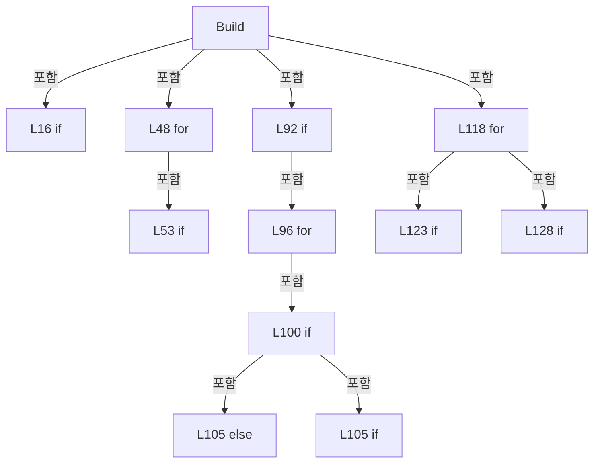

변경 전 점검: 입력/반환 타입, 위 호출자, 예외/취소 경로, 공유 상태와 저장·전송 소비자를 함께 확인합니다. 값의 단위나 물리 방향을 이름만으로 확정하지 않습니다.

### LocalFunctionStatement `SelectHeadNo` · L35–38

[Drilling.Common/Recipe/CShotCoordinatePlanBuilder.cs:35–38](https://github.com/kjuws10-rgb/A3Drilling/blob/5aee8e58439c9b455cae7c9593c9be986c3e682e/Drilling.Common/Recipe/CShotCoordinatePlanBuilder.cs#L35-L38)

| 항목 | 실제 추출 값 |
| --- | --- |
| 서명 | int SelectHeadNo(int) |
| 접근/수식자 | Private /  |
| 반환/값 타입 | int |
| 소속 타입 | NamedType:Drilling.Common.Recipe.CShotCoordinatePlanBuilder |

입력 계약:

| 이름 | 타입 | 전달 | 선택/기본값 |
| --- | --- | --- | --- |
| headNo | int | None | False /  |

현재 부분 분석에서 직접 연결된 호출자는 없습니다. XAML/이벤트/인터페이스·델리게이트·외부 진입을 추가 확인해야 하며, 미사용으로 판정한 것이 아닙니다.

본문의 실제 연산·분기·예외·반환 순서(원문 위치 순):

| 원본 행 | 종류 | 주석 해설 |
| --- | --- | --- |
| 37 | return | 호출자에게 값 또는 제어를 반환합니다: return headNo; |

변경 전 점검: 입력/반환 타입, 위 호출자, 예외/취소 경로, 공유 상태와 저장·전송 소비자를 함께 확인합니다. 값의 단위나 물리 방향을 이름만으로 확정하지 않습니다.

### LocalFunctionStatement `SelectValue` · L40–43

[Drilling.Common/Recipe/CShotCoordinatePlanBuilder.cs:40–43](https://github.com/kjuws10-rgb/A3Drilling/blob/5aee8e58439c9b455cae7c9593c9be986c3e682e/Drilling.Common/Recipe/CShotCoordinatePlanBuilder.cs#L40-L43)

| 항목 | 실제 추출 값 |
| --- | --- |
| 서명 | int SelectValue(int) |
| 접근/수식자 | Private /  |
| 반환/값 타입 | int |
| 소속 타입 | NamedType:Drilling.Common.Recipe.CShotCoordinatePlanBuilder |

입력 계약:

| 이름 | 타입 | 전달 | 선택/기본값 |
| --- | --- | --- | --- |
| arg0 | int | None | False /  |

현재 부분 분석에서 직접 연결된 호출자는 없습니다. XAML/이벤트/인터페이스·델리게이트·외부 진입을 추가 확인해야 하며, 미사용으로 판정한 것이 아닙니다.

본문의 실제 연산·분기·예외·반환 순서(원문 위치 순):

| 원본 행 | 종류 | 주석 해설 |
| --- | --- | --- |
| 42 | return | 호출자에게 값 또는 제어를 반환합니다: return 0; |

변경 전 점검: 입력/반환 타입, 위 호출자, 예외/취소 경로, 공유 상태와 저장·전송 소비자를 함께 확인합니다. 값의 단위나 물리 방향을 이름만으로 확정하지 않습니다.

### LocalFunctionStatement `SelectItem` · L191–197

[Drilling.Common/Recipe/CShotCoordinatePlanBuilder.cs:191–197](https://github.com/kjuws10-rgb/A3Drilling/blob/5aee8e58439c9b455cae7c9593c9be986c3e682e/Drilling.Common/Recipe/CShotCoordinatePlanBuilder.cs#L191-L197)

| 항목 | 실제 추출 값 |
| --- | --- |
| 서명 | Drilling.Common.Recipe.ST_HEAD_SHOT_POINT SelectItem(Drilling.Common.Recipe.ST_HEAD_SHOT_POINT, int) |
| 접근/수식자 | Private /  |
| 반환/값 타입 | Drilling.Common.Recipe.ST_HEAD_SHOT_POINT |
| 소속 타입 | NamedType:Drilling.Common.Recipe.CShotCoordinatePlanBuilder |

입력 계약:

| 이름 | 타입 | 전달 | 선택/기본값 |
| --- | --- | --- | --- |
| shot | Drilling.Common.Recipe.ST_HEAD_SHOT_POINT | None | False /  |
| index | int | None | False /  |

현재 부분 분석에서 직접 연결된 호출자는 없습니다. XAML/이벤트/인터페이스·델리게이트·외부 진입을 추가 확인해야 하며, 미사용으로 판정한 것이 아닙니다.

본문의 실제 연산·분기·예외·반환 순서(원문 위치 순):

| 원본 행 | 종류 | 주석 해설 |
| --- | --- | --- |
| 193 | return | 호출자에게 값 또는 제어를 반환합니다: return shot with { SequenceNo = index + 1 }; |
| 195 | assignment | 값을 대상에 대입합니다: SequenceNo = index + 1 |

변경 전 점검: 입력/반환 타입, 위 호출자, 예외/취소 경로, 공유 상태와 저장·전송 소비자를 함께 확인합니다. 값의 단위나 물리 방향을 이름만으로 확정하지 않습니다.

### MethodDeclaration `ReadOffsetScale` · L203–210

[Drilling.Common/Recipe/CShotCoordinatePlanBuilder.cs:203–210](https://github.com/kjuws10-rgb/A3Drilling/blob/5aee8e58439c9b455cae7c9593c9be986c3e682e/Drilling.Common/Recipe/CShotCoordinatePlanBuilder.cs#L203-L210)

| 항목 | 실제 추출 값 |
| --- | --- |
| 서명 | double Drilling.Common.Recipe.CShotCoordinatePlanBuilder.ReadOffsetScale(System.Collections.Generic.IReadOnlyDictionary<string, string>, string) |
| 접근/수식자 | Private / private, static |
| 반환/값 타입 | double |
| 소속 타입 | NamedType:Drilling.Common.Recipe.CShotCoordinatePlanBuilder |

입력 계약:

| 이름 | 타입 | 전달 | 선택/기본값 |
| --- | --- | --- | --- |
| parameters | System.Collections.Generic.IReadOnlyDictionary<string, string> | None | False /  |
| key | string | None | False /  |

정적 호출자로 확인된 위치:

| 호출 파일/행 | 호출 표현식 | 런타임 분기 가능 |
| --- | --- | --- |
| [Drilling.Common/Recipe/CShotCoordinatePlanBuilder.cs:33–33](https://github.com/kjuws10-rgb/A3Drilling/blob/5aee8e58439c9b455cae7c9593c9be986c3e682e/Drilling.Common/Recipe/CShotCoordinatePlanBuilder.cs#L33-L33) | ReadOffsetScale | False |
| [Drilling.Common/Recipe/CShotCoordinatePlanBuilder.cs:34–34](https://github.com/kjuws10-rgb/A3Drilling/blob/5aee8e58439c9b455cae7c9593c9be986c3e682e/Drilling.Common/Recipe/CShotCoordinatePlanBuilder.cs#L34-L34) | ReadOffsetScale | False |

호출하는 대상과 해석 범위:

| 원본 행 | 표현식 | 분석 상태 | 대상/소스 위치 |
| --- | --- | --- | --- |
| 205 | parameters.TryGetValue | resolved · 동적 구현 선택 가능 | bool System.Collections.Generic.IReadOnlyDictionary<string, string>.TryGetValue(string, out string) |
| 207 | int.TryParse | resolved | bool int.TryParse(string?, System.Globalization.NumberStyles, System.IFormatProvider?, out int) |
| 208 | new InvalidOperationException | resolved | System.InvalidOperationException.InvalidOperationException(string?) |

본문의 실제 연산·분기·예외·반환 순서(원문 위치 순):

| 원본 행 | 종류 | 주석 해설 |
| --- | --- | --- |
| 205 | call | 함수·델리게이트 또는 객체 생성자를 호출합니다: parameters.TryGetValue(key, out var text) |
| 205 | if | 조건에 따라 분기합니다: if (!parameters.TryGetValue(key, out var text)) |
| 206 | return | 호출자에게 값 또는 제어를 반환합니다: return 1.0; |
| 207 | call | 함수·델리게이트 또는 객체 생성자를 호출합니다: int.TryParse(text, NumberStyles.Integer, CultureInfo.InvariantCulture, out var percent) |
| 207 | if | 조건에 따라 분기합니다: if (!int.TryParse(text, NumberStyles.Integer, CultureInfo.InvariantCulture, out var percent) &#124;&#124; percent < 0) |
| 208 | call | 함수·델리게이트 또는 객체 생성자를 호출합니다: new InvalidOperationException($"{key}: 0 이상의 정수(%)를 입력해 주세요.") |
| 208 | throw | 예외를 발생/전달합니다: throw new InvalidOperationException($"{key}: 0 이상의 정수(%)를 입력해 주세요."); |
| 209 | return | 호출자에게 값 또는 제어를 반환합니다: return percent / 100.0; |

제어 구문의 포함 구조(실제 실행 순서/CFG가 아닌 구문 탐색 그림):

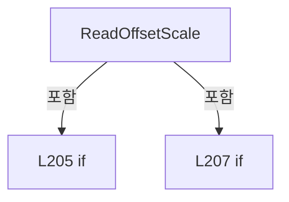

변경 전 점검: 입력/반환 타입, 위 호출자, 예외/취소 경로, 공유 상태와 저장·전송 소비자를 함께 확인합니다. 값의 단위나 물리 방향을 이름만으로 확정하지 않습니다.

### MethodDeclaration `BuildDesignShots` · L214–220

[Drilling.Common/Recipe/CShotCoordinatePlanBuilder.cs:214–220](https://github.com/kjuws10-rgb/A3Drilling/blob/5aee8e58439c9b455cae7c9593c9be986c3e682e/Drilling.Common/Recipe/CShotCoordinatePlanBuilder.cs#L214-L220)

| 항목 | 실제 추출 값 |
| --- | --- |
| 서명 | System.Collections.Generic.IReadOnlyList<Drilling.Common.Recipe.ST_DESIGN_SHOT_POINT> Drilling.Common.Recipe.CShotCoordinatePlanBuilder.BuildDesignShots(System.Collections.Generic.IReadOnlyDictionary<string, string>) |
| 접근/수식자 | Public / public, static |
| 반환/값 타입 | System.Collections.Generic.IReadOnlyList<Drilling.Common.Recipe.ST_DESIGN_SHOT_POINT> |
| 소속 타입 | NamedType:Drilling.Common.Recipe.CShotCoordinatePlanBuilder |

입력 계약:

| 이름 | 타입 | 전달 | 선택/기본값 |
| --- | --- | --- | --- |
| parameters | System.Collections.Generic.IReadOnlyDictionary<string, string> | None | False /  |

정적 호출자로 확인된 위치:

| 호출 파일/행 | 호출 표현식 | 런타임 분기 가능 |
| --- | --- | --- |
| [Drilling.Common/Recipe/CShotCoordinatePlanBuilder.cs:682–682](https://github.com/kjuws10-rgb/A3Drilling/blob/5aee8e58439c9b455cae7c9593c9be986c3e682e/Drilling.Common/Recipe/CShotCoordinatePlanBuilder.cs#L682-L682) | CShotCoordinatePlanBuilder.BuildDesignShots | False |
| [Drilling.Common/Recipe/CShotCoordinatePlanBuilder.cs:704–704](https://github.com/kjuws10-rgb/A3Drilling/blob/5aee8e58439c9b455cae7c9593c9be986c3e682e/Drilling.Common/Recipe/CShotCoordinatePlanBuilder.cs#L704-L704) | CShotCoordinatePlanBuilder.BuildDesignShots | False |
| [Drilling.UI/Menu/Menus/CMenuCorrection.ReviewData.Display.cs:258–258](https://github.com/kjuws10-rgb/A3Drilling/blob/5aee8e58439c9b455cae7c9593c9be986c3e682e/Drilling.UI/Menu/Menus/CMenuCorrection.ReviewData.Display.cs#L258-L258) | CShotCoordinatePlanBuilder.BuildDesignShots | False |
| [Drilling.UI/Menu/Menus/CMenuCorrection.cs:5517–5517](https://github.com/kjuws10-rgb/A3Drilling/blob/5aee8e58439c9b455cae7c9593c9be986c3e682e/Drilling.UI/Menu/Menus/CMenuCorrection.cs#L5517-L5517) | CShotCoordinatePlanBuilder.BuildDesignShots | False |
| [Drilling.UI/Menu/Menus/CMenuCorrection.cs:7539–7539](https://github.com/kjuws10-rgb/A3Drilling/blob/5aee8e58439c9b455cae7c9593c9be986c3e682e/Drilling.UI/Menu/Menus/CMenuCorrection.cs#L7539-L7539) | CShotCoordinatePlanBuilder.BuildDesignShots | False |

호출하는 대상과 해석 범위:

| 원본 행 | 표현식 | 분석 상태 | 대상/소스 위치 |
| --- | --- | --- | --- |
| 216 | ReadInt | resolved | int Drilling.Common.Recipe.CShotCoordinatePlanBuilder.ReadInt(System.Collections.Generic.IReadOnlyDictionary<string, string>, int, params string[]) · Drilling.Common/Recipe/CShotCoordinatePlanBuilder.cs:592 |
| 218 | new InvalidOperationException | resolved | System.InvalidOperationException.InvalidOperationException(string?) |
| 219 | BuildDesignShots | resolved | System.Collections.Generic.IReadOnlyList<Drilling.Common.Recipe.ST_DESIGN_SHOT_POINT> Drilling.Common.Recipe.CShotCoordinatePlanBuilder.BuildDesignShots(System.Collections.Generic.IReadOnlyDictionary<string, string>, int) · Drilling.Common/Recipe/CShotCoordinatePlanBuilder.cs:222 |

본문의 실제 연산·분기·예외·반환 순서(원문 위치 순):

| 원본 행 | 종류 | 주석 해설 |
| --- | --- | --- |
| 216 | call | 함수·델리게이트 또는 객체 생성자를 호출합니다: ReadInt(parameters, 0, "MAX_CELL_NUMBER") |
| 216 | local-declaration | 지역 변수를 선언합니다: var cellCount = ReadInt(parameters, 0, "MAX_CELL_NUMBER"); |
| 216 | variable-initializer | 변수의 초기값을 지정합니다: cellCount = ReadInt(parameters, 0, "MAX_CELL_NUMBER") |
| 217 | if | 조건에 따라 분기합니다: if (cellCount < CCellPatternCalculator.MinCellCount) |
| 218 | call | 함수·델리게이트 또는 객체 생성자를 호출합니다: new InvalidOperationException("MAX_CELL_NUMBER must be greater than or equal to 1.") |
| 218 | throw | 예외를 발생/전달합니다: throw new InvalidOperationException("MAX_CELL_NUMBER must be greater than or equal to 1."); |
| 219 | call | 함수·델리게이트 또는 객체 생성자를 호출합니다: BuildDesignShots(parameters, cellCount) |
| 219 | return | 호출자에게 값 또는 제어를 반환합니다: return BuildDesignShots(parameters, cellCount); |

제어 구문의 포함 구조(실제 실행 순서/CFG가 아닌 구문 탐색 그림):

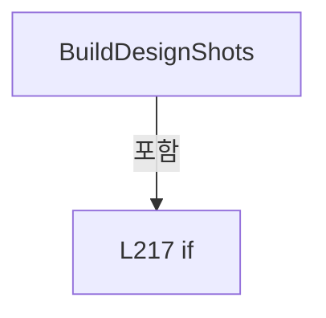

변경 전 점검: 입력/반환 타입, 위 호출자, 예외/취소 경로, 공유 상태와 저장·전송 소비자를 함께 확인합니다. 값의 단위나 물리 방향을 이름만으로 확정하지 않습니다.

### MethodDeclaration `BuildDesignShots` · L222–286

[Drilling.Common/Recipe/CShotCoordinatePlanBuilder.cs:222–286](https://github.com/kjuws10-rgb/A3Drilling/blob/5aee8e58439c9b455cae7c9593c9be986c3e682e/Drilling.Common/Recipe/CShotCoordinatePlanBuilder.cs#L222-L286)

| 항목 | 실제 추출 값 |
| --- | --- |
| 서명 | System.Collections.Generic.IReadOnlyList<Drilling.Common.Recipe.ST_DESIGN_SHOT_POINT> Drilling.Common.Recipe.CShotCoordinatePlanBuilder.BuildDesignShots(System.Collections.Generic.IReadOnlyDictionary<string, string>, int) |
| 접근/수식자 | Private / private, static |
| 반환/값 타입 | System.Collections.Generic.IReadOnlyList<Drilling.Common.Recipe.ST_DESIGN_SHOT_POINT> |
| 소속 타입 | NamedType:Drilling.Common.Recipe.CShotCoordinatePlanBuilder |

입력 계약:

| 이름 | 타입 | 전달 | 선택/기본값 |
| --- | --- | --- | --- |
| parameters | System.Collections.Generic.IReadOnlyDictionary<string, string> | None | False /  |
| cellCount | int | None | False /  |

정적 호출자로 확인된 위치:

| 호출 파일/행 | 호출 표현식 | 런타임 분기 가능 |
| --- | --- | --- |
| [Drilling.Common/Recipe/CShotCoordinatePlanBuilder.cs:46–46](https://github.com/kjuws10-rgb/A3Drilling/blob/5aee8e58439c9b455cae7c9593c9be986c3e682e/Drilling.Common/Recipe/CShotCoordinatePlanBuilder.cs#L46-L46) | BuildDesignShots | False |
| [Drilling.Common/Recipe/CShotCoordinatePlanBuilder.cs:219–219](https://github.com/kjuws10-rgb/A3Drilling/blob/5aee8e58439c9b455cae7c9593c9be986c3e682e/Drilling.Common/Recipe/CShotCoordinatePlanBuilder.cs#L219-L219) | BuildDesignShots | False |

호출하는 대상과 해석 범위:

| 원본 행 | 표현식 | 분석 상태 | 대상/소스 위치 |
| --- | --- | --- | --- |
| 224 | ReadDouble | resolved | double Drilling.Common.Recipe.CShotCoordinatePlanBuilder.ReadDouble(System.Collections.Generic.IReadOnlyDictionary<string, string>, double, params string[]) · Drilling.Common/Recipe/CShotCoordinatePlanBuilder.cs:556 |
| 225 | ReadDouble | resolved | double Drilling.Common.Recipe.CShotCoordinatePlanBuilder.ReadDouble(System.Collections.Generic.IReadOnlyDictionary<string, string>, double, params string[]) · Drilling.Common/Recipe/CShotCoordinatePlanBuilder.cs:556 |
| 226 | ReadDouble | resolved | double Drilling.Common.Recipe.CShotCoordinatePlanBuilder.ReadDouble(System.Collections.Generic.IReadOnlyDictionary<string, string>, double, params string[]) · Drilling.Common/Recipe/CShotCoordinatePlanBuilder.cs:556 |
| 227 | ReadInt | resolved | int Drilling.Common.Recipe.CShotCoordinatePlanBuilder.ReadInt(System.Collections.Generic.IReadOnlyDictionary<string, string>, int, params string[]) · Drilling.Common/Recipe/CShotCoordinatePlanBuilder.cs:592 |
| 228 | CRecipeModelPixelCountReader.ReadModelTypeCount | resolved | int Drilling.Common.Recipe.CRecipeModelPixelCountReader.ReadModelTypeCount(System.Collections.Generic.IReadOnlyDictionary<string, string>) · Drilling.Common/Recipe/CCellPatternCalculator.cs:428 |
| 229 | new List<ST_DESIGN_SHOT_POINT> | resolved | System.Collections.Generic.List<Drilling.Common.Recipe.ST_DESIGN_SHOT_POINT>.List() |
| 232 | CRecipeModelPixelCountReader.ReadCellModelType | resolved | int Drilling.Common.Recipe.CRecipeModelPixelCountReader.ReadCellModelType(System.Collections.Generic.IReadOnlyDictionary<string, string>, int, int) · Drilling.Common/Recipe/CCellPatternCalculator.cs:433 |
| 233 | CRecipeModelPixelCountReader.ReadPatternForModel | resolved | Drilling.Common.Recipe.ST_RECIPE_MODEL_PATTERN Drilling.Common.Recipe.CRecipeModelPixelCountReader.ReadPatternForModel(System.Collections.Generic.IReadOnlyDictionary<string, string>, int) · Drilling.Common/Recipe/CCellPatternCalculator.cs:455 |
| 234 | CCellPatternCalculator.Calculate | resolved | Drilling.Common.Recipe.ST_CELL_PATTERN_LAYOUT Drilling.Common.Recipe.CCellPatternCalculator.Calculate(Drilling.Common.Recipe.ST_CELL_PATTERN_DEFINITION) · Drilling.Common/Recipe/CCellPatternCalculator.cs:65 |
| 234 | new ST_CELL_PATTERN_DEFINITION | resolved | Drilling.Common.Recipe.ST_CELL_PATTERN_DEFINITION.ST_CELL_PATTERN_DEFINITION(int, double, double, double, double, int, int, int, int, double, double) · Drilling.Common/Recipe/CCellPatternCalculator.cs:277 |
| 236 | ReadDouble | resolved | double Drilling.Common.Recipe.CShotCoordinatePlanBuilder.ReadDouble(System.Collections.Generic.IReadOnlyDictionary<string, string>, double, params string[]) · Drilling.Common/Recipe/CShotCoordinatePlanBuilder.cs:556 |
| 237 | ReadDouble | resolved | double Drilling.Common.Recipe.CShotCoordinatePlanBuilder.ReadDouble(System.Collections.Generic.IReadOnlyDictionary<string, string>, double, params string[]) · Drilling.Common/Recipe/CShotCoordinatePlanBuilder.cs:556 |
| 238 | ReadDouble | resolved | double Drilling.Common.Recipe.CShotCoordinatePlanBuilder.ReadDouble(System.Collections.Generic.IReadOnlyDictionary<string, string>, double, params string[]) · Drilling.Common/Recipe/CShotCoordinatePlanBuilder.cs:556 |
| 249 | new InvalidOperationException | resolved | System.InvalidOperationException.InvalidOperationException(string?) |
| 255 | new InvalidOperationException | resolved | System.InvalidOperationException.InvalidOperationException(string?) |
| 260 | CReviewShotNameFormatter.ToMatrixName | resolved | string Drilling.Common.Review.CReviewShotNameFormatter.ToMatrixName(int, int) · Drilling.Common/Review/CReviewManager.cs:3897 |
| 265 | designShots.Add | resolved | void System.Collections.Generic.List<Drilling.Common.Recipe.ST_DESIGN_SHOT_POINT>.Add(Drilling.Common.Recipe.ST_DESIGN_SHOT_POINT) |
| 265 | new ST_DESIGN_SHOT_POINT | resolved | Drilling.Common.Recipe.ST_DESIGN_SHOT_POINT.ST_DESIGN_SHOT_POINT(string, int, int, int, int, int, int, double, double, double, double, double, double, double, double) · Drilling.Common/Recipe/CShotCoordinatePlanBuilder.cs:1369 |
| 266 | ToShotKey | resolved | string Drilling.Common.Recipe.CShotCoordinatePlanBuilder.ToShotKey(int, int) · Drilling.Common/Recipe/CShotCoordinatePlanBuilder.cs:551 |
| 275 | ReadDouble | resolved | double Drilling.Common.Recipe.CShotCoordinatePlanBuilder.ReadDouble(System.Collections.Generic.IReadOnlyDictionary<string, string>, double, params string[]) · Drilling.Common/Recipe/CShotCoordinatePlanBuilder.cs:556 |
| 276 | ReadDouble | resolved | double Drilling.Common.Recipe.CShotCoordinatePlanBuilder.ReadDouble(System.Collections.Generic.IReadOnlyDictionary<string, string>, double, params string[]) · Drilling.Common/Recipe/CShotCoordinatePlanBuilder.cs:556 |
| 277 | ReadDouble | resolved | double Drilling.Common.Recipe.CShotCoordinatePlanBuilder.ReadDouble(System.Collections.Generic.IReadOnlyDictionary<string, string>, double, params string[]) · Drilling.Common/Recipe/CShotCoordinatePlanBuilder.cs:556 |
| 278 | ReadDouble | resolved | double Drilling.Common.Recipe.CShotCoordinatePlanBuilder.ReadDouble(System.Collections.Generic.IReadOnlyDictionary<string, string>, double, params string[]) · Drilling.Common/Recipe/CShotCoordinatePlanBuilder.cs:556 |
| 279 | CAlignShotOffsetData.ReadValue | resolved | double Drilling.Common.Recipe.CAlignShotOffsetData.ReadValue(System.Collections.Generic.IReadOnlyDictionary<string, string>, string) · Drilling.Common/Recipe/CShotCoordinatePlanBuilder.cs:669 |
| 280 | CAlignShotOffsetData.ReadValue | resolved | double Drilling.Common.Recipe.CAlignShotOffsetData.ReadValue(System.Collections.Generic.IReadOnlyDictionary<string, string>, string) · Drilling.Common/Recipe/CShotCoordinatePlanBuilder.cs:669 |
| 281 | CReviewOffsetData.IsDesignCoordinate | resolved | bool Drilling.Common.Recipe.CReviewOffsetData.IsDesignCoordinate(System.Collections.Generic.IReadOnlyDictionary<string, string>, string) · Drilling.Common/Recipe/CShotCoordinatePlanBuilder.cs:1182 |

본문의 실제 연산·분기·예외·반환 순서(원문 위치 순):

| 원본 행 | 종류 | 주석 해설 |
| --- | --- | --- |
| 224 | call | 함수·델리게이트 또는 객체 생성자를 호출합니다: ReadDouble(parameters, 0.0, "AK_MARGIN_X") |
| 224 | local-declaration | 지역 변수를 선언합니다: var akMarginX = ReadDouble(parameters, 0.0, "AK_MARGIN_X"); |
| 224 | variable-initializer | 변수의 초기값을 지정합니다: akMarginX = ReadDouble(parameters, 0.0, "AK_MARGIN_X") |
| 225 | call | 함수·델리게이트 또는 객체 생성자를 호출합니다: ReadDouble(parameters, 0.0, "AK_MARGIN_Y") |
| 225 | local-declaration | 지역 변수를 선언합니다: var akMarginY = ReadDouble(parameters, 0.0, "AK_MARGIN_Y"); |
| 225 | variable-initializer | 변수의 초기값을 지정합니다: akMarginY = ReadDouble(parameters, 0.0, "AK_MARGIN_Y") |
| 226 | call | 함수·델리게이트 또는 객체 생성자를 호출합니다: ReadDouble(parameters, 0.09, "PIXEL_SIZE") |
| 226 | local-declaration | 지역 변수를 선언합니다: var pixelSize = ReadDouble(parameters, 0.09, "PIXEL_SIZE"); |
| 226 | variable-initializer | 변수의 초기값을 지정합니다: pixelSize = ReadDouble(parameters, 0.09, "PIXEL_SIZE") |
| 227 | call | 함수·델리게이트 또는 객체 생성자를 호출합니다: ReadInt(parameters, 1, "SPLITED_BEAM_COUNT") |
| 227 | local-declaration | 지역 변수를 선언합니다: var splitBeamCount = ReadInt(parameters, 1, "SPLITED_BEAM_COUNT"); |
| 227 | variable-initializer | 변수의 초기값을 지정합니다: splitBeamCount = ReadInt(parameters, 1, "SPLITED_BEAM_COUNT") |
| 228 | call | 함수·델리게이트 또는 객체 생성자를 호출합니다: CRecipeModelPixelCountReader.ReadModelTypeCount(parameters) |
| 228 | local-declaration | 지역 변수를 선언합니다: var modelTypeCount = CRecipeModelPixelCountReader.ReadModelTypeCount(parameters); |
| 228 | variable-initializer | 변수의 초기값을 지정합니다: modelTypeCount = CRecipeModelPixelCountReader.ReadModelTypeCount(parameters) |
| 229 | call | 함수·델리게이트 또는 객체 생성자를 호출합니다: new List<ST_DESIGN_SHOT_POINT>() |
| 229 | local-declaration | 지역 변수를 선언합니다: var designShots = new List<ST_DESIGN_SHOT_POINT>(); |
| 229 | variable-initializer | 변수의 초기값을 지정합니다: designShots = new List<ST_DESIGN_SHOT_POINT>() |
| 230 | variable-initializer | 변수의 초기값을 지정합니다: cellNo = 1 |
| 230 | for | 초기화·조건·증감이 있는 반복입니다: for (var cellNo = 1; cellNo <= cellCount; cellNo++) |
| 232 | call | 함수·델리게이트 또는 객체 생성자를 호출합니다: CRecipeModelPixelCountReader.ReadCellModelType(parameters, cellNo, modelTypeCount) |
| 232 | local-declaration | 지역 변수를 선언합니다: var modelType = CRecipeModelPixelCountReader.ReadCellModelType(parameters, cellNo, modelTypeCount); |
| 232 | variable-initializer | 변수의 초기값을 지정합니다: modelType = CRecipeModelPixelCountReader.ReadCellModelType(parameters, cellNo, modelTypeCount) |
| 233 | call | 함수·델리게이트 또는 객체 생성자를 호출합니다: CRecipeModelPixelCountReader.ReadPatternForModel(parameters, modelType) |
| 233 | local-declaration | 지역 변수를 선언합니다: var modelPattern = CRecipeModelPixelCountReader.ReadPatternForModel(parameters, modelType); |
| 233 | variable-initializer | 변수의 초기값을 지정합니다: modelPattern = CRecipeModelPixelCountReader.ReadPatternForModel(parameters, modelType) |
| 234 | call | 함수·델리게이트 또는 객체 생성자를 호출합니다: CCellPatternCalculator.Calculate(new ST_CELL_PATTERN_DEFINITION( cellNo, ReadDouble(parameters, 0.0, $"CELL{cellNo}_ALIGN_TO_1ST_PIXEL_X"), ReadDouble(parameters, 0.0, $"CELL{cellNo}_ALIGN_TO_1ST_PIXEL_Y"), ReadDouble(pa… |
| 234 | call | 함수·델리게이트 또는 객체 생성자를 호출합니다: new ST_CELL_PATTERN_DEFINITION( cellNo, ReadDouble(parameters, 0.0, $"CELL{cellNo}_ALIGN_TO_1ST_PIXEL_X"), ReadDouble(parameters, 0.0, $"CELL{cellNo}_ALIGN_TO_1ST_PIXEL_Y"), ReadDouble(parameters, 0.0, $"CELL{cellNo}_ROT… |
| 234 | local-declaration | 지역 변수를 선언합니다: var result = CCellPatternCalculator.Calculate(new ST_CELL_PATTERN_DEFINITION( cellNo, ReadDouble(parameters, 0.0, $"CELL{cellNo}_ALIGN_TO_1ST_PIXEL_X"), ReadDouble(parameters, 0.0, $"CELL{cellNo}_ALIGN_TO_1ST_PIXEL_Y"), ReadDouble |
| 234 | variable-initializer | 변수의 초기값을 지정합니다: result = CCellPatternCalculator.Calculate(new ST_CELL_PATTERN_DEFINITION( cellNo, ReadDouble(parameters, 0.0, $"CELL{cellNo}_ALIGN_TO_1ST_PIXEL_X"), ReadDouble(parameters, 0.0, $"CELL{cellNo}_ALIGN_TO_1ST_PIXEL_Y"), ReadDouble(par |
| 236 | call | 함수·델리게이트 또는 객체 생성자를 호출합니다: ReadDouble(parameters, 0.0, $"CELL{cellNo}_ALIGN_TO_1ST_PIXEL_X") |
| 237 | call | 함수·델리게이트 또는 객체 생성자를 호출합니다: ReadDouble(parameters, 0.0, $"CELL{cellNo}_ALIGN_TO_1ST_PIXEL_Y") |
| 238 | call | 함수·델리게이트 또는 객체 생성자를 호출합니다: ReadDouble(parameters, 0.0, $"CELL{cellNo}_ROTATION") |
| 247 | if | 조건에 따라 분기합니다: if (!result.IsValid) |
| 249 | call | 함수·델리게이트 또는 객체 생성자를 호출합니다: new InvalidOperationException(result.ValidationMessage) |
| 249 | throw | 예외를 발생/전달합니다: throw new InvalidOperationException(result.ValidationMessage); |
| 252 | local-declaration | 지역 변수를 선언합니다: var totalShotGroupCount = (long)designShots.Count + result.ShotCenters.Count; |
| 252 | variable-initializer | 변수의 초기값을 지정합니다: totalShotGroupCount = (long)designShots.Count + result.ShotCenters.Count |
| 253 | if | 조건에 따라 분기합니다: if (totalShotGroupCount > CCellPatternCalculator.MaxTotalShotGroupCount) |
| 255 | call | 함수·델리게이트 또는 객체 생성자를 호출합니다: new InvalidOperationException($"Shot Group Count {totalShotGroupCount:N0} exceeds the total limit " + $"{CCellPatternCalculator.MaxTotalShotGroupCount:N0}.") |
| 255 | throw | 예외를 발생/전달합니다: throw new InvalidOperationException($"Shot Group Count {totalShotGroupCount:N0} exceeds the total limit " + $"{CCellPatternCalculator.MaxTotalShotGroupCount:N0}."); |
| 258 | foreach | 컬렉션 요소를 순회합니다: foreach (var shotCenter in result.ShotCenters) |
| 260 | call | 함수·델리게이트 또는 객체 생성자를 호출합니다: CReviewShotNameFormatter.ToMatrixName(shotCenter.CellShotNo, result.GroupCountX) |
| 260 | local-declaration | 지역 변수를 선언합니다: var shotGroupName = CReviewShotNameFormatter.ToMatrixName(shotCenter.CellShotNo, result.GroupCountX); |
| 260 | variable-initializer | 변수의 초기값을 지정합니다: shotGroupName = CReviewShotNameFormatter.ToMatrixName(shotCenter.CellShotNo, result.GroupCountX) |
| 261 | local-declaration | 지역 변수를 선언합니다: var recipeOffsetPrefix = $"CELL{cellNo}_{shotGroupName}_RECIPE_OFFSET_"; |
| 261 | variable-initializer | 변수의 초기값을 지정합니다: recipeOffsetPrefix = $"CELL{cellNo}_{shotGroupName}_RECIPE_OFFSET_" |
| 262 | local-declaration | 지역 변수를 선언합니다: var reviewOffsetPrefix = $"CELL{cellNo}_{shotGroupName}_REVIEW_OFFSET_"; |
| 262 | variable-initializer | 변수의 초기값을 지정합니다: reviewOffsetPrefix = $"CELL{cellNo}_{shotGroupName}_REVIEW_OFFSET_" |
| 263 | local-declaration | 지역 변수를 선언합니다: var alignOffsetPrefix = $"CELL{cellNo}_{shotGroupName}_ALIGN_OFFSET_"; |
| 263 | variable-initializer | 변수의 초기값을 지정합니다: alignOffsetPrefix = $"CELL{cellNo}_{shotGroupName}_ALIGN_OFFSET_" |
| 265 | call | 함수·델리게이트 또는 객체 생성자를 호출합니다: designShots.Add(new ST_DESIGN_SHOT_POINT( ToShotKey(cellNo, shotCenter.CellShotNo), cellNo, shotCenter.CellShotNo, shotCenter.GroupColumn, shotCenter.GroupRow, result.GroupCountX, result.GroupCountY, shotCenter.DesignX, … |
| 265 | call | 함수·델리게이트 또는 객체 생성자를 호출합니다: new ST_DESIGN_SHOT_POINT( ToShotKey(cellNo, shotCenter.CellShotNo), cellNo, shotCenter.CellShotNo, shotCenter.GroupColumn, shotCenter.GroupRow, result.GroupCountX, result.GroupCountY, shotCenter.DesignX, shotCenter.Desig… |
| 266 | call | 함수·델리게이트 또는 객체 생성자를 호출합니다: ToShotKey(cellNo, shotCenter.CellShotNo) |
| 275 | call | 함수·델리게이트 또는 객체 생성자를 호출합니다: ReadDouble(parameters, 0.0, $"{recipeOffsetPrefix}X") |
| 276 | call | 함수·델리게이트 또는 객체 생성자를 호출합니다: ReadDouble(parameters, 0.0, $"{recipeOffsetPrefix}Y") |
| 277 | call | 함수·델리게이트 또는 객체 생성자를 호출합니다: ReadDouble(parameters, 0.0, $"{reviewOffsetPrefix}X") |
| 278 | call | 함수·델리게이트 또는 객체 생성자를 호출합니다: ReadDouble(parameters, 0.0, $"{reviewOffsetPrefix}Y") |
| 279 | call | 함수·델리게이트 또는 객체 생성자를 호출합니다: CAlignShotOffsetData.ReadValue(parameters, $"{alignOffsetPrefix}X") |
| 280 | call | 함수·델리게이트 또는 객체 생성자를 호출합니다: CAlignShotOffsetData.ReadValue(parameters, $"{alignOffsetPrefix}Y") |
| 281 | assignment | 값을 대상에 대입합니다: ReviewOffsetIsDesign = CReviewOffsetData.IsDesignCoordinate(parameters, reviewOffsetPrefix) |
| 281 | call | 함수·델리게이트 또는 객체 생성자를 호출합니다: CReviewOffsetData.IsDesignCoordinate(parameters, reviewOffsetPrefix) |
| 285 | return | 호출자에게 값 또는 제어를 반환합니다: return designShots; |

제어 구문의 포함 구조(실제 실행 순서/CFG가 아닌 구문 탐색 그림):

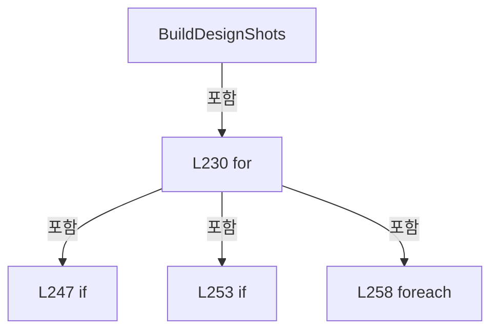

변경 전 점검: 입력/반환 타입, 위 호출자, 예외/취소 경로, 공유 상태와 저장·전송 소비자를 함께 확인합니다. 값의 단위나 물리 방향을 이름만으로 확정하지 않습니다.

### MethodDeclaration `OrderShots` · L288–351

[Drilling.Common/Recipe/CShotCoordinatePlanBuilder.cs:288–351](https://github.com/kjuws10-rgb/A3Drilling/blob/5aee8e58439c9b455cae7c9593c9be986c3e682e/Drilling.Common/Recipe/CShotCoordinatePlanBuilder.cs#L288-L351)

| 항목 | 실제 추출 값 |
| --- | --- |
| 서명 | System.Collections.Generic.IReadOnlyList<Drilling.Common.Recipe.ST_HEAD_SHOT_POINT> Drilling.Common.Recipe.CShotCoordinatePlanBuilder.OrderShots(System.Collections.Generic.IReadOnlyList<Drilling.Common.Recipe.ST_HEAD_SHOT_POINT>, double) |
| 접근/수식자 | Private / private, static |
| 반환/값 타입 | System.Collections.Generic.IReadOnlyList<Drilling.Common.Recipe.ST_HEAD_SHOT_POINT> |
| 소속 타입 | NamedType:Drilling.Common.Recipe.CShotCoordinatePlanBuilder |

입력 계약:

| 이름 | 타입 | 전달 | 선택/기본값 |
| --- | --- | --- | --- |
| shots | System.Collections.Generic.IReadOnlyList<Drilling.Common.Recipe.ST_HEAD_SHOT_POINT> | None | False /  |
| stageScanDirectionY | double | None | False /  |

정적 호출자로 확인된 위치:

| 호출 파일/행 | 호출 표현식 | 런타임 분기 가능 |
| --- | --- | --- |
| [Drilling.Common/Recipe/CShotCoordinatePlanBuilder.cs:199–199](https://github.com/kjuws10-rgb/A3Drilling/blob/5aee8e58439c9b455cae7c9593c9be986c3e682e/Drilling.Common/Recipe/CShotCoordinatePlanBuilder.cs#L199-L199) | OrderShots | False |

호출하는 대상과 해석 범위:

| 원본 행 | 표현식 | 분석 상태 | 대상/소스 위치 |
| --- | --- | --- | --- |
| 295 | shots.GroupBy(SelectGroupKey).ToArray | resolved | System.Linq.IGrouping<double, Drilling.Common.Recipe.ST_HEAD_SHOT_POINT>[] System.Collections.Generic.IEnumerable<System.Linq.IGrouping<double, Drilling.Common.Recipe.ST_HEAD_SHOT_POINT>>.ToArray<System.Linq.IGrouping<double, Drilling.Common.Recipe.ST_HEAD_SHOT_POINT>>() |
| 295 | shots.GroupBy | resolved | System.Collections.Generic.IEnumerable<System.Linq.IGrouping<double, Drilling.Common.Recipe.ST_HEAD_SHOT_POINT>> System.Collections.Generic.IEnumerable<Drilling.Common.Recipe.ST_HEAD_SHOT_POINT>.GroupBy<Drilling.Common.Recipe.ST_HEAD_SHOT_POINT, double>(System.Func<Drilling.Common.Recipe.ST_HEAD_SHOT_POINT, double>) |
| 306 | (stageScanDirectionY < 0.0 ? rows.OrderByDescending(SelectDescendingRowKey) : rows.OrderBy(SelectAscendingRowKey)).ToArray | resolved | System.Linq.IGrouping<double, Drilling.Common.Recipe.ST_HEAD_SHOT_POINT>[] System.Collections.Generic.IEnumerable<System.Linq.IGrouping<double, Drilling.Common.Recipe.ST_HEAD_SHOT_POINT>>.ToArray<System.Linq.IGrouping<double, Drilling.Common.Recipe.ST_HEAD_SHOT_POINT>>() |
| 306 | rows.OrderByDescending | resolved | System.Linq.IOrderedEnumerable<System.Linq.IGrouping<double, Drilling.Common.Recipe.ST_HEAD_SHOT_POINT>> System.Collections.Generic.IEnumerable<System.Linq.IGrouping<double, Drilling.Common.Recipe.ST_HEAD_SHOT_POINT>>.OrderByDescending<System.Linq.IGrouping<double, Drilling.Common.Recipe.ST_HEAD_SHOT_POINT>, double>(System.Func<System.Linq.IGrouping<double, Drilling.Common.Recipe.ST_HEAD_SHOT_POINT>, double>) |
| 306 | rows.OrderBy | resolved | System.Linq.IOrderedEnumerable<System.Linq.IGrouping<double, Drilling.Common.Recipe.ST_HEAD_SHOT_POINT>> System.Collections.Generic.IEnumerable<System.Linq.IGrouping<double, Drilling.Common.Recipe.ST_HEAD_SHOT_POINT>>.OrderBy<System.Linq.IGrouping<double, Drilling.Common.Recipe.ST_HEAD_SHOT_POINT>, double>(System.Func<System.Linq.IGrouping<double, Drilling.Common.Recipe.ST_HEAD_SHOT_POINT>, double>) |
| 307 | new List<ST_HEAD_SHOT_POINT> | resolved | System.Collections.Generic.List<Drilling.Common.Recipe.ST_HEAD_SHOT_POINT>.List(int) |
| 340 | row.GroupBy(SelectHeadNo).OrderBy | resolved | System.Linq.IOrderedEnumerable<System.Linq.IGrouping<int, Drilling.Common.Recipe.ST_HEAD_SHOT_POINT>> System.Collections.Generic.IEnumerable<System.Linq.IGrouping<int, Drilling.Common.Recipe.ST_HEAD_SHOT_POINT>>.OrderBy<System.Linq.IGrouping<int, Drilling.Common.Recipe.ST_HEAD_SHOT_POINT>, int>(System.Func<System.Linq.IGrouping<int, Drilling.Common.Recipe.ST_HEAD_SHOT_POINT>, int>) |
| 340 | row.GroupBy | resolved | System.Collections.Generic.IEnumerable<System.Linq.IGrouping<int, Drilling.Common.Recipe.ST_HEAD_SHOT_POINT>> System.Collections.Generic.IEnumerable<Drilling.Common.Recipe.ST_HEAD_SHOT_POINT>.GroupBy<Drilling.Common.Recipe.ST_HEAD_SHOT_POINT, int>(System.Func<Drilling.Common.Recipe.ST_HEAD_SHOT_POINT, int>) |
| 343 | headGroup.ToArray | resolved | Drilling.Common.Recipe.ST_HEAD_SHOT_POINT[] System.Collections.Generic.IEnumerable<Drilling.Common.Recipe.ST_HEAD_SHOT_POINT>.ToArray<Drilling.Common.Recipe.ST_HEAD_SHOT_POINT>() |
| 345 | UseScannerGyForMachiningSort | resolved | bool Drilling.Common.Recipe.CShotCoordinatePlanBuilder.UseScannerGyForMachiningSort(System.Collections.Generic.IReadOnlyList<Drilling.Common.Recipe.ST_HEAD_SHOT_POINT>) · Drilling.Common/Recipe/CShotCoordinatePlanBuilder.cs:353 |
| 345 | headRowShots.OrderBy(SelectScannerGy).ThenBy(SelectCellNo).ThenBy | resolved | System.Linq.IOrderedEnumerable<Drilling.Common.Recipe.ST_HEAD_SHOT_POINT> System.Linq.IOrderedEnumerable<Drilling.Common.Recipe.ST_HEAD_SHOT_POINT>.ThenBy<Drilling.Common.Recipe.ST_HEAD_SHOT_POINT, int>(System.Func<Drilling.Common.Recipe.ST_HEAD_SHOT_POINT, int>) |
| 345 | headRowShots.OrderBy(SelectScannerGy).ThenBy | resolved | System.Linq.IOrderedEnumerable<Drilling.Common.Recipe.ST_HEAD_SHOT_POINT> System.Linq.IOrderedEnumerable<Drilling.Common.Recipe.ST_HEAD_SHOT_POINT>.ThenBy<Drilling.Common.Recipe.ST_HEAD_SHOT_POINT, int>(System.Func<Drilling.Common.Recipe.ST_HEAD_SHOT_POINT, int>) |
| 345 | headRowShots.OrderBy | resolved | System.Linq.IOrderedEnumerable<Drilling.Common.Recipe.ST_HEAD_SHOT_POINT> System.Collections.Generic.IEnumerable<Drilling.Common.Recipe.ST_HEAD_SHOT_POINT>.OrderBy<Drilling.Common.Recipe.ST_HEAD_SHOT_POINT, double>(System.Func<Drilling.Common.Recipe.ST_HEAD_SHOT_POINT, double>) |
| 345 | headRowShots.OrderBy(SelectScannerGx).ThenBy(SelectCellNo).ThenBy | resolved | System.Linq.IOrderedEnumerable<Drilling.Common.Recipe.ST_HEAD_SHOT_POINT> System.Linq.IOrderedEnumerable<Drilling.Common.Recipe.ST_HEAD_SHOT_POINT>.ThenBy<Drilling.Common.Recipe.ST_HEAD_SHOT_POINT, int>(System.Func<Drilling.Common.Recipe.ST_HEAD_SHOT_POINT, int>) |
| 345 | headRowShots.OrderBy(SelectScannerGx).ThenBy | resolved | System.Linq.IOrderedEnumerable<Drilling.Common.Recipe.ST_HEAD_SHOT_POINT> System.Linq.IOrderedEnumerable<Drilling.Common.Recipe.ST_HEAD_SHOT_POINT>.ThenBy<Drilling.Common.Recipe.ST_HEAD_SHOT_POINT, int>(System.Func<Drilling.Common.Recipe.ST_HEAD_SHOT_POINT, int>) |
| 345 | headRowShots.OrderBy | resolved | System.Linq.IOrderedEnumerable<Drilling.Common.Recipe.ST_HEAD_SHOT_POINT> System.Collections.Generic.IEnumerable<Drilling.Common.Recipe.ST_HEAD_SHOT_POINT>.OrderBy<Drilling.Common.Recipe.ST_HEAD_SHOT_POINT, double>(System.Func<Drilling.Common.Recipe.ST_HEAD_SHOT_POINT, double>) |
| 346 | orderedShots.AddRange | resolved | void System.Collections.Generic.List<Drilling.Common.Recipe.ST_HEAD_SHOT_POINT>.AddRange(System.Collections.Generic.IEnumerable<Drilling.Common.Recipe.ST_HEAD_SHOT_POINT>) |

본문의 실제 연산·분기·예외·반환 순서(원문 위치 순):

| 원본 행 | 종류 | 주석 해설 |
| --- | --- | --- |
| 295 | call | 함수·델리게이트 또는 객체 생성자를 호출합니다: shots.GroupBy(SelectGroupKey).ToArray() |
| 295 | call | 함수·델리게이트 또는 객체 생성자를 호출합니다: shots.GroupBy(SelectGroupKey) |
| 295 | local-declaration | 지역 변수를 선언합니다: var rows = shots.GroupBy(SelectGroupKey).ToArray(); |
| 295 | variable-initializer | 변수의 초기값을 지정합니다: rows = shots.GroupBy(SelectGroupKey).ToArray() |
| 306 | call | 함수·델리게이트 또는 객체 생성자를 호출합니다: (stageScanDirectionY < 0.0 ? rows.OrderByDescending(SelectDescendingRowKey) : rows.OrderBy(SelectAscendingRowKey)).ToArray() |
| 306 | call | 함수·델리게이트 또는 객체 생성자를 호출합니다: rows.OrderByDescending(SelectDescendingRowKey) |
| 306 | call | 함수·델리게이트 또는 객체 생성자를 호출합니다: rows.OrderBy(SelectAscendingRowKey) |
| 306 | conditional-expression | 조건에 따라 결과식을 선택합니다: stageScanDirectionY < 0.0 ? rows.OrderByDescending(SelectDescendingRowKey) : rows.OrderBy(SelectAscendingRowKey) |
| 306 | local-declaration | 지역 변수를 선언합니다: var orderedRows = (stageScanDirectionY < 0.0 ? rows.OrderByDescending(SelectDescendingRowKey) : rows.OrderBy(SelectAscendingRowKey)).ToArray(); |
| 306 | variable-initializer | 변수의 초기값을 지정합니다: orderedRows = (stageScanDirectionY < 0.0 ? rows.OrderByDescending(SelectDescendingRowKey) : rows.OrderBy(SelectAscendingRowKey)).ToArray() |
| 307 | call | 함수·델리게이트 또는 객체 생성자를 호출합니다: new List<ST_HEAD_SHOT_POINT>(shots.Count) |
| 307 | local-declaration | 지역 변수를 선언합니다: var orderedShots = new List<ST_HEAD_SHOT_POINT>(shots.Count); |
| 307 | variable-initializer | 변수의 초기값을 지정합니다: orderedShots = new List<ST_HEAD_SHOT_POINT>(shots.Count) |
| 338 | foreach | 컬렉션 요소를 순회합니다: foreach (var row in orderedRows) |
| 340 | call | 함수·델리게이트 또는 객체 생성자를 호출합니다: row.GroupBy(SelectHeadNo).OrderBy(SelectHeadGroupKey) |
| 340 | call | 함수·델리게이트 또는 객체 생성자를 호출합니다: row.GroupBy(SelectHeadNo) |
| 340 | local-declaration | 지역 변수를 선언합니다: var headGroups = row.GroupBy(SelectHeadNo).OrderBy(SelectHeadGroupKey); |
| 340 | variable-initializer | 변수의 초기값을 지정합니다: headGroups = row.GroupBy(SelectHeadNo).OrderBy(SelectHeadGroupKey) |
| 341 | foreach | 컬렉션 요소를 순회합니다: foreach (var headGroup in headGroups) |
| 343 | call | 함수·델리게이트 또는 객체 생성자를 호출합니다: headGroup.ToArray() |
| 343 | local-declaration | 지역 변수를 선언합니다: var headRowShots = headGroup.ToArray(); |
| 343 | variable-initializer | 변수의 초기값을 지정합니다: headRowShots = headGroup.ToArray() |
| 345 | call | 함수·델리게이트 또는 객체 생성자를 호출합니다: UseScannerGyForMachiningSort(headRowShots) |
| 345 | call | 함수·델리게이트 또는 객체 생성자를 호출합니다: headRowShots.OrderBy(SelectScannerGy).ThenBy(SelectCellNo).ThenBy(SelectCellShotNo) |
| 345 | call | 함수·델리게이트 또는 객체 생성자를 호출합니다: headRowShots.OrderBy(SelectScannerGy).ThenBy(SelectCellNo) |
| 345 | call | 함수·델리게이트 또는 객체 생성자를 호출합니다: headRowShots.OrderBy(SelectScannerGy) |
| 345 | call | 함수·델리게이트 또는 객체 생성자를 호출합니다: headRowShots.OrderBy(SelectScannerGx).ThenBy(SelectCellNo).ThenBy(SelectCellShotNo) |
| 345 | call | 함수·델리게이트 또는 객체 생성자를 호출합니다: headRowShots.OrderBy(SelectScannerGx).ThenBy(SelectCellNo) |
| 345 | call | 함수·델리게이트 또는 객체 생성자를 호출합니다: headRowShots.OrderBy(SelectScannerGx) |
| 345 | conditional-expression | 조건에 따라 결과식을 선택합니다: UseScannerGyForMachiningSort(headRowShots) ? headRowShots.OrderBy(SelectScannerGy).ThenBy(SelectCellNo).ThenBy(SelectCellShotNo) : headRowShots.OrderBy(SelectScannerGx).ThenBy(SelectCellNo).ThenBy(SelectCellShotNo) |
| 345 | local-declaration | 지역 변수를 선언합니다: var rowShots = UseScannerGyForMachiningSort(headRowShots) ? headRowShots.OrderBy(SelectScannerGy).ThenBy(SelectCellNo).ThenBy(SelectCellShotNo) : headRowShots.OrderBy(SelectScannerGx).ThenBy(SelectCellNo).ThenBy(SelectCellShotNo); |
| 345 | variable-initializer | 변수의 초기값을 지정합니다: rowShots = UseScannerGyForMachiningSort(headRowShots) ? headRowShots.OrderBy(SelectScannerGy).ThenBy(SelectCellNo).ThenBy(SelectCellShotNo) : headRowShots.OrderBy(SelectScannerGx).ThenBy(SelectCellNo).ThenBy(SelectCellShotNo) |
| 346 | call | 함수·델리게이트 또는 객체 생성자를 호출합니다: orderedShots.AddRange(rowShots) |
| 350 | return | 호출자에게 값 또는 제어를 반환합니다: return orderedShots; |

제어 구문의 포함 구조(실제 실행 순서/CFG가 아닌 구문 탐색 그림):

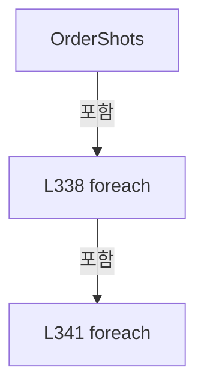

변경 전 점검: 입력/반환 타입, 위 호출자, 예외/취소 경로, 공유 상태와 저장·전송 소비자를 함께 확인합니다. 값의 단위나 물리 방향을 이름만으로 확정하지 않습니다.

### LocalFunctionStatement `SelectGroupKey` · L290–293

[Drilling.Common/Recipe/CShotCoordinatePlanBuilder.cs:290–293](https://github.com/kjuws10-rgb/A3Drilling/blob/5aee8e58439c9b455cae7c9593c9be986c3e682e/Drilling.Common/Recipe/CShotCoordinatePlanBuilder.cs#L290-L293)

| 항목 | 실제 추출 값 |
| --- | --- |
| 서명 | double SelectGroupKey(Drilling.Common.Recipe.ST_HEAD_SHOT_POINT) |
| 접근/수식자 | Private /  |
| 반환/값 타입 | double |
| 소속 타입 | NamedType:Drilling.Common.Recipe.CShotCoordinatePlanBuilder |

입력 계약:

| 이름 | 타입 | 전달 | 선택/기본값 |
| --- | --- | --- | --- |
| shot | Drilling.Common.Recipe.ST_HEAD_SHOT_POINT | None | False /  |

현재 부분 분석에서 직접 연결된 호출자는 없습니다. XAML/이벤트/인터페이스·델리게이트·외부 진입을 추가 확인해야 하며, 미사용으로 판정한 것이 아닙니다.

호출하는 대상과 해석 범위:

| 원본 행 | 표현식 | 분석 상태 | 대상/소스 위치 |
| --- | --- | --- | --- |
| 292 | Math.Round | resolved | double System.Math.Round(double, int) |

본문의 실제 연산·분기·예외·반환 순서(원문 위치 순):

| 원본 행 | 종류 | 주석 해설 |
| --- | --- | --- |
| 292 | call | 함수·델리게이트 또는 객체 생성자를 호출합니다: Math.Round(shot.EncoderWaitPosition, 6) |
| 292 | return | 호출자에게 값 또는 제어를 반환합니다: return Math.Round(shot.EncoderWaitPosition, 6); |

변경 전 점검: 입력/반환 타입, 위 호출자, 예외/취소 경로, 공유 상태와 저장·전송 소비자를 함께 확인합니다. 값의 단위나 물리 방향을 이름만으로 확정하지 않습니다.

### LocalFunctionStatement `SelectDescendingRowKey` · L296–299

[Drilling.Common/Recipe/CShotCoordinatePlanBuilder.cs:296–299](https://github.com/kjuws10-rgb/A3Drilling/blob/5aee8e58439c9b455cae7c9593c9be986c3e682e/Drilling.Common/Recipe/CShotCoordinatePlanBuilder.cs#L296-L299)

| 항목 | 실제 추출 값 |
| --- | --- |
| 서명 | double SelectDescendingRowKey(System.Linq.IGrouping<double, Drilling.Common.Recipe.ST_HEAD_SHOT_POINT>) |
| 접근/수식자 | Private /  |
| 반환/값 타입 | double |
| 소속 타입 | NamedType:Drilling.Common.Recipe.CShotCoordinatePlanBuilder |

입력 계약:

| 이름 | 타입 | 전달 | 선택/기본값 |
| --- | --- | --- | --- |
| row | System.Linq.IGrouping<double, Drilling.Common.Recipe.ST_HEAD_SHOT_POINT> | None | False /  |

현재 부분 분석에서 직접 연결된 호출자는 없습니다. XAML/이벤트/인터페이스·델리게이트·외부 진입을 추가 확인해야 하며, 미사용으로 판정한 것이 아닙니다.

본문의 실제 연산·분기·예외·반환 순서(원문 위치 순):

| 원본 행 | 종류 | 주석 해설 |
| --- | --- | --- |
| 298 | return | 호출자에게 값 또는 제어를 반환합니다: return row.Key; |

변경 전 점검: 입력/반환 타입, 위 호출자, 예외/취소 경로, 공유 상태와 저장·전송 소비자를 함께 확인합니다. 값의 단위나 물리 방향을 이름만으로 확정하지 않습니다.

### LocalFunctionStatement `SelectAscendingRowKey` · L301–304

[Drilling.Common/Recipe/CShotCoordinatePlanBuilder.cs:301–304](https://github.com/kjuws10-rgb/A3Drilling/blob/5aee8e58439c9b455cae7c9593c9be986c3e682e/Drilling.Common/Recipe/CShotCoordinatePlanBuilder.cs#L301-L304)

| 항목 | 실제 추출 값 |
| --- | --- |
| 서명 | double SelectAscendingRowKey(System.Linq.IGrouping<double, Drilling.Common.Recipe.ST_HEAD_SHOT_POINT>) |
| 접근/수식자 | Private /  |
| 반환/값 타입 | double |
| 소속 타입 | NamedType:Drilling.Common.Recipe.CShotCoordinatePlanBuilder |

입력 계약:

| 이름 | 타입 | 전달 | 선택/기본값 |
| --- | --- | --- | --- |
| row | System.Linq.IGrouping<double, Drilling.Common.Recipe.ST_HEAD_SHOT_POINT> | None | False /  |

현재 부분 분석에서 직접 연결된 호출자는 없습니다. XAML/이벤트/인터페이스·델리게이트·외부 진입을 추가 확인해야 하며, 미사용으로 판정한 것이 아닙니다.

본문의 실제 연산·분기·예외·반환 순서(원문 위치 순):

| 원본 행 | 종류 | 주석 해설 |
| --- | --- | --- |
| 303 | return | 호출자에게 값 또는 제어를 반환합니다: return row.Key; |

변경 전 점검: 입력/반환 타입, 위 호출자, 예외/취소 경로, 공유 상태와 저장·전송 소비자를 함께 확인합니다. 값의 단위나 물리 방향을 이름만으로 확정하지 않습니다.

### LocalFunctionStatement `SelectHeadNo` · L308–311

[Drilling.Common/Recipe/CShotCoordinatePlanBuilder.cs:308–311](https://github.com/kjuws10-rgb/A3Drilling/blob/5aee8e58439c9b455cae7c9593c9be986c3e682e/Drilling.Common/Recipe/CShotCoordinatePlanBuilder.cs#L308-L311)

| 항목 | 실제 추출 값 |
| --- | --- |
| 서명 | int SelectHeadNo(Drilling.Common.Recipe.ST_HEAD_SHOT_POINT) |
| 접근/수식자 | Private /  |
| 반환/값 타입 | int |
| 소속 타입 | NamedType:Drilling.Common.Recipe.CShotCoordinatePlanBuilder |

입력 계약:

| 이름 | 타입 | 전달 | 선택/기본값 |
| --- | --- | --- | --- |
| shot | Drilling.Common.Recipe.ST_HEAD_SHOT_POINT | None | False /  |

현재 부분 분석에서 직접 연결된 호출자는 없습니다. XAML/이벤트/인터페이스·델리게이트·외부 진입을 추가 확인해야 하며, 미사용으로 판정한 것이 아닙니다.

본문의 실제 연산·분기·예외·반환 순서(원문 위치 순):

| 원본 행 | 종류 | 주석 해설 |
| --- | --- | --- |
| 310 | return | 호출자에게 값 또는 제어를 반환합니다: return shot.HeadNo; |

변경 전 점검: 입력/반환 타입, 위 호출자, 예외/취소 경로, 공유 상태와 저장·전송 소비자를 함께 확인합니다. 값의 단위나 물리 방향을 이름만으로 확정하지 않습니다.

### LocalFunctionStatement `SelectHeadGroupKey` · L313–316

[Drilling.Common/Recipe/CShotCoordinatePlanBuilder.cs:313–316](https://github.com/kjuws10-rgb/A3Drilling/blob/5aee8e58439c9b455cae7c9593c9be986c3e682e/Drilling.Common/Recipe/CShotCoordinatePlanBuilder.cs#L313-L316)

| 항목 | 실제 추출 값 |
| --- | --- |
| 서명 | int SelectHeadGroupKey(System.Linq.IGrouping<int, Drilling.Common.Recipe.ST_HEAD_SHOT_POINT>) |
| 접근/수식자 | Private /  |
| 반환/값 타입 | int |
| 소속 타입 | NamedType:Drilling.Common.Recipe.CShotCoordinatePlanBuilder |

입력 계약:

| 이름 | 타입 | 전달 | 선택/기본값 |
| --- | --- | --- | --- |
| headGroup | System.Linq.IGrouping<int, Drilling.Common.Recipe.ST_HEAD_SHOT_POINT> | None | False /  |

현재 부분 분석에서 직접 연결된 호출자는 없습니다. XAML/이벤트/인터페이스·델리게이트·외부 진입을 추가 확인해야 하며, 미사용으로 판정한 것이 아닙니다.

본문의 실제 연산·분기·예외·반환 순서(원문 위치 순):

| 원본 행 | 종류 | 주석 해설 |
| --- | --- | --- |
| 315 | return | 호출자에게 값 또는 제어를 반환합니다: return headGroup.Key; |

변경 전 점검: 입력/반환 타입, 위 호출자, 예외/취소 경로, 공유 상태와 저장·전송 소비자를 함께 확인합니다. 값의 단위나 물리 방향을 이름만으로 확정하지 않습니다.

### LocalFunctionStatement `SelectScannerGx` · L318–321

[Drilling.Common/Recipe/CShotCoordinatePlanBuilder.cs:318–321](https://github.com/kjuws10-rgb/A3Drilling/blob/5aee8e58439c9b455cae7c9593c9be986c3e682e/Drilling.Common/Recipe/CShotCoordinatePlanBuilder.cs#L318-L321)

| 항목 | 실제 추출 값 |
| --- | --- |
| 서명 | double SelectScannerGx(Drilling.Common.Recipe.ST_HEAD_SHOT_POINT) |
| 접근/수식자 | Private /  |
| 반환/값 타입 | double |
| 소속 타입 | NamedType:Drilling.Common.Recipe.CShotCoordinatePlanBuilder |

입력 계약:

| 이름 | 타입 | 전달 | 선택/기본값 |
| --- | --- | --- | --- |
| shot | Drilling.Common.Recipe.ST_HEAD_SHOT_POINT | None | False /  |

현재 부분 분석에서 직접 연결된 호출자는 없습니다. XAML/이벤트/인터페이스·델리게이트·외부 진입을 추가 확인해야 하며, 미사용으로 판정한 것이 아닙니다.

본문의 실제 연산·분기·예외·반환 순서(원문 위치 순):

| 원본 행 | 종류 | 주석 해설 |
| --- | --- | --- |
| 320 | return | 호출자에게 값 또는 제어를 반환합니다: return shot.ScannerGx; |

변경 전 점검: 입력/반환 타입, 위 호출자, 예외/취소 경로, 공유 상태와 저장·전송 소비자를 함께 확인합니다. 값의 단위나 물리 방향을 이름만으로 확정하지 않습니다.

### LocalFunctionStatement `SelectScannerGy` · L323–326

[Drilling.Common/Recipe/CShotCoordinatePlanBuilder.cs:323–326](https://github.com/kjuws10-rgb/A3Drilling/blob/5aee8e58439c9b455cae7c9593c9be986c3e682e/Drilling.Common/Recipe/CShotCoordinatePlanBuilder.cs#L323-L326)

| 항목 | 실제 추출 값 |
| --- | --- |
| 서명 | double SelectScannerGy(Drilling.Common.Recipe.ST_HEAD_SHOT_POINT) |
| 접근/수식자 | Private /  |
| 반환/값 타입 | double |
| 소속 타입 | NamedType:Drilling.Common.Recipe.CShotCoordinatePlanBuilder |

입력 계약:

| 이름 | 타입 | 전달 | 선택/기본값 |
| --- | --- | --- | --- |
| shot | Drilling.Common.Recipe.ST_HEAD_SHOT_POINT | None | False /  |

현재 부분 분석에서 직접 연결된 호출자는 없습니다. XAML/이벤트/인터페이스·델리게이트·외부 진입을 추가 확인해야 하며, 미사용으로 판정한 것이 아닙니다.

본문의 실제 연산·분기·예외·반환 순서(원문 위치 순):

| 원본 행 | 종류 | 주석 해설 |
| --- | --- | --- |
| 325 | return | 호출자에게 값 또는 제어를 반환합니다: return shot.ScannerGy; |

변경 전 점검: 입력/반환 타입, 위 호출자, 예외/취소 경로, 공유 상태와 저장·전송 소비자를 함께 확인합니다. 값의 단위나 물리 방향을 이름만으로 확정하지 않습니다.

### LocalFunctionStatement `SelectCellNo` · L328–331

[Drilling.Common/Recipe/CShotCoordinatePlanBuilder.cs:328–331](https://github.com/kjuws10-rgb/A3Drilling/blob/5aee8e58439c9b455cae7c9593c9be986c3e682e/Drilling.Common/Recipe/CShotCoordinatePlanBuilder.cs#L328-L331)

| 항목 | 실제 추출 값 |
| --- | --- |
| 서명 | int SelectCellNo(Drilling.Common.Recipe.ST_HEAD_SHOT_POINT) |
| 접근/수식자 | Private /  |
| 반환/값 타입 | int |
| 소속 타입 | NamedType:Drilling.Common.Recipe.CShotCoordinatePlanBuilder |

입력 계약:

| 이름 | 타입 | 전달 | 선택/기본값 |
| --- | --- | --- | --- |
| shot | Drilling.Common.Recipe.ST_HEAD_SHOT_POINT | None | False /  |

현재 부분 분석에서 직접 연결된 호출자는 없습니다. XAML/이벤트/인터페이스·델리게이트·외부 진입을 추가 확인해야 하며, 미사용으로 판정한 것이 아닙니다.

본문의 실제 연산·분기·예외·반환 순서(원문 위치 순):

| 원본 행 | 종류 | 주석 해설 |
| --- | --- | --- |
| 330 | return | 호출자에게 값 또는 제어를 반환합니다: return shot.CellNo; |

변경 전 점검: 입력/반환 타입, 위 호출자, 예외/취소 경로, 공유 상태와 저장·전송 소비자를 함께 확인합니다. 값의 단위나 물리 방향을 이름만으로 확정하지 않습니다.

### LocalFunctionStatement `SelectCellShotNo` · L333–336

[Drilling.Common/Recipe/CShotCoordinatePlanBuilder.cs:333–336](https://github.com/kjuws10-rgb/A3Drilling/blob/5aee8e58439c9b455cae7c9593c9be986c3e682e/Drilling.Common/Recipe/CShotCoordinatePlanBuilder.cs#L333-L336)

| 항목 | 실제 추출 값 |
| --- | --- |
| 서명 | int SelectCellShotNo(Drilling.Common.Recipe.ST_HEAD_SHOT_POINT) |
| 접근/수식자 | Private /  |
| 반환/값 타입 | int |
| 소속 타입 | NamedType:Drilling.Common.Recipe.CShotCoordinatePlanBuilder |

입력 계약:

| 이름 | 타입 | 전달 | 선택/기본값 |
| --- | --- | --- | --- |
| shot | Drilling.Common.Recipe.ST_HEAD_SHOT_POINT | None | False /  |

현재 부분 분석에서 직접 연결된 호출자는 없습니다. XAML/이벤트/인터페이스·델리게이트·외부 진입을 추가 확인해야 하며, 미사용으로 판정한 것이 아닙니다.

본문의 실제 연산·분기·예외·반환 순서(원문 위치 순):

| 원본 행 | 종류 | 주석 해설 |
| --- | --- | --- |
| 335 | return | 호출자에게 값 또는 제어를 반환합니다: return shot.CellShotNo; |

변경 전 점검: 입력/반환 타입, 위 호출자, 예외/취소 경로, 공유 상태와 저장·전송 소비자를 함께 확인합니다. 값의 단위나 물리 방향을 이름만으로 확정하지 않습니다.

### MethodDeclaration `UseScannerGyForMachiningSort` · L353–374

[Drilling.Common/Recipe/CShotCoordinatePlanBuilder.cs:353–374](https://github.com/kjuws10-rgb/A3Drilling/blob/5aee8e58439c9b455cae7c9593c9be986c3e682e/Drilling.Common/Recipe/CShotCoordinatePlanBuilder.cs#L353-L374)

| 항목 | 실제 추출 값 |
| --- | --- |
| 서명 | bool Drilling.Common.Recipe.CShotCoordinatePlanBuilder.UseScannerGyForMachiningSort(System.Collections.Generic.IReadOnlyList<Drilling.Common.Recipe.ST_HEAD_SHOT_POINT>) |
| 접근/수식자 | Private / private, static |
| 반환/값 타입 | bool |
| 소속 타입 | NamedType:Drilling.Common.Recipe.CShotCoordinatePlanBuilder |

입력 계약:

| 이름 | 타입 | 전달 | 선택/기본값 |
| --- | --- | --- | --- |
| shots | System.Collections.Generic.IReadOnlyList<Drilling.Common.Recipe.ST_HEAD_SHOT_POINT> | None | False /  |

정적 호출자로 확인된 위치:

| 호출 파일/행 | 호출 표현식 | 런타임 분기 가능 |
| --- | --- | --- |
| [Drilling.Common/Recipe/CShotCoordinatePlanBuilder.cs:345–345](https://github.com/kjuws10-rgb/A3Drilling/blob/5aee8e58439c9b455cae7c9593c9be986c3e682e/Drilling.Common/Recipe/CShotCoordinatePlanBuilder.cs#L345-L345) | UseScannerGyForMachiningSort | False |

호출하는 대상과 해석 범위:

| 원본 행 | 표현식 | 분석 상태 | 대상/소스 위치 |
| --- | --- | --- | --- |
| 367 | Math.Min | resolved | double System.Math.Min(double, double) |
| 368 | Math.Max | resolved | double System.Math.Max(double, double) |
| 369 | Math.Min | resolved | double System.Math.Min(double, double) |
| 370 | Math.Max | resolved | double System.Math.Max(double, double) |

본문의 실제 연산·분기·예외·반환 순서(원문 위치 순):

| 원본 행 | 종류 | 주석 해설 |
| --- | --- | --- |
| 355 | if | 조건에 따라 분기합니다: if (shots.Count <= 1) |
| 357 | return | 호출자에게 값 또는 제어를 반환합니다: return false; |
| 360 | local-declaration | 지역 변수를 선언합니다: var minGx = shots[0].ScannerGx; |
| 360 | variable-initializer | 변수의 초기값을 지정합니다: minGx = shots[0].ScannerGx |
| 361 | local-declaration | 지역 변수를 선언합니다: var maxGx = shots[0].ScannerGx; |
| 361 | variable-initializer | 변수의 초기값을 지정합니다: maxGx = shots[0].ScannerGx |
| 362 | local-declaration | 지역 변수를 선언합니다: var minGy = shots[0].ScannerGy; |
| 362 | variable-initializer | 변수의 초기값을 지정합니다: minGy = shots[0].ScannerGy |
| 363 | local-declaration | 지역 변수를 선언합니다: var maxGy = shots[0].ScannerGy; |
| 363 | variable-initializer | 변수의 초기값을 지정합니다: maxGy = shots[0].ScannerGy |
| 364 | variable-initializer | 변수의 초기값을 지정합니다: index = 1 |
| 364 | for | 초기화·조건·증감이 있는 반복입니다: for (var index = 1; index < shots.Count; index++) |
| 366 | local-declaration | 지역 변수를 선언합니다: var shot = shots[index]; |
| 366 | variable-initializer | 변수의 초기값을 지정합니다: shot = shots[index] |
| 367 | assignment | 값을 대상에 대입합니다: minGx = Math.Min(minGx, shot.ScannerGx) |
| 367 | call | 함수·델리게이트 또는 객체 생성자를 호출합니다: Math.Min(minGx, shot.ScannerGx) |
| 368 | assignment | 값을 대상에 대입합니다: maxGx = Math.Max(maxGx, shot.ScannerGx) |
| 368 | call | 함수·델리게이트 또는 객체 생성자를 호출합니다: Math.Max(maxGx, shot.ScannerGx) |
| 369 | assignment | 값을 대상에 대입합니다: minGy = Math.Min(minGy, shot.ScannerGy) |
| 369 | call | 함수·델리게이트 또는 객체 생성자를 호출합니다: Math.Min(minGy, shot.ScannerGy) |
| 370 | assignment | 값을 대상에 대입합니다: maxGy = Math.Max(maxGy, shot.ScannerGy) |
| 370 | call | 함수·델리게이트 또는 객체 생성자를 호출합니다: Math.Max(maxGy, shot.ScannerGy) |
| 373 | return | 호출자에게 값 또는 제어를 반환합니다: return maxGy - minGy > maxGx - minGx; |

제어 구문의 포함 구조(실제 실행 순서/CFG가 아닌 구문 탐색 그림):

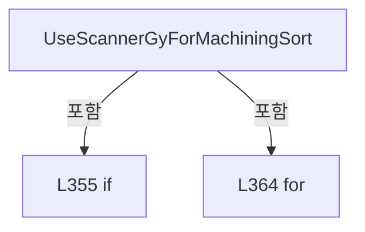

변경 전 점검: 입력/반환 타입, 위 호출자, 예외/취소 경로, 공유 상태와 저장·전송 소비자를 함께 확인합니다. 값의 단위나 물리 방향을 이름만으로 확정하지 않습니다.

### MethodDeclaration `AssignHeadNo` · L376–404

[Drilling.Common/Recipe/CShotCoordinatePlanBuilder.cs:376–404](https://github.com/kjuws10-rgb/A3Drilling/blob/5aee8e58439c9b455cae7c9593c9be986c3e682e/Drilling.Common/Recipe/CShotCoordinatePlanBuilder.cs#L376-L404)

| 항목 | 실제 추출 값 |
| --- | --- |
| 서명 | int Drilling.Common.Recipe.CShotCoordinatePlanBuilder.AssignHeadNo(double, System.Collections.Generic.IReadOnlyList<int>, System.Collections.Generic.IReadOnlyDictionary<string, string>, System.Collections.Generic.IReadOnlyDictionary<int, int>) |
| 접근/수식자 | Private / private, static |
| 반환/값 타입 | int |
| 소속 타입 | NamedType:Drilling.Common.Recipe.CShotCoordinatePlanBuilder |

입력 계약:

| 이름 | 타입 | 전달 | 선택/기본값 |
| --- | --- | --- | --- |
| designX | double | None | False /  |
| assignmentHeadNos | System.Collections.Generic.IReadOnlyList<int> | None | False /  |
| parameters | System.Collections.Generic.IReadOnlyDictionary<string, string> | None | False /  |
| assignedHeadCounts | System.Collections.Generic.IReadOnlyDictionary<int, int> | None | False /  |

정적 호출자로 확인된 위치:

| 호출 파일/행 | 호출 표현식 | 런타임 분기 가능 |
| --- | --- | --- |
| [Drilling.Common/Recipe/CShotCoordinatePlanBuilder.cs:52–52](https://github.com/kjuws10-rgb/A3Drilling/blob/5aee8e58439c9b455cae7c9593c9be986c3e682e/Drilling.Common/Recipe/CShotCoordinatePlanBuilder.cs#L52-L52) | AssignHeadNo | False |

호출하는 대상과 해석 범위:

| 원본 행 | 표현식 | 분석 상태 | 대상/소스 위치 |
| --- | --- | --- | --- |
| 402 | assignmentHeadNos.Select(SelectItem).Where(IsHasValue).Select(SelectHead).ToArray | resolved | Drilling.Common.Recipe.ST_HEAD_ASSIGNMENT_CANDIDATE[] System.Collections.Generic.IEnumerable<Drilling.Common.Recipe.ST_HEAD_ASSIGNMENT_CANDIDATE>.ToArray<Drilling.Common.Recipe.ST_HEAD_ASSIGNMENT_CANDIDATE>() |
| 402 | assignmentHeadNos.Select(SelectItem).Where(IsHasValue).Select | resolved | System.Collections.Generic.IEnumerable<Drilling.Common.Recipe.ST_HEAD_ASSIGNMENT_CANDIDATE> System.Collections.Generic.IEnumerable<Drilling.Common.Recipe.ST_HEAD_ASSIGNMENT_CANDIDATE?>.Select<Drilling.Common.Recipe.ST_HEAD_ASSIGNMENT_CANDIDATE?, Drilling.Common.Recipe.ST_HEAD_ASSIGNMENT_CANDIDATE>(System.Func<Drilling.Common.Recipe.ST_HEAD_ASSIGNMENT_CANDIDATE?, Drilling.Common.Recipe.ST_HEAD_ASSIGNMENT_CANDIDATE>) |
| 402 | assignmentHeadNos.Select(SelectItem).Where | resolved | System.Collections.Generic.IEnumerable<Drilling.Common.Recipe.ST_HEAD_ASSIGNMENT_CANDIDATE?> System.Collections.Generic.IEnumerable<Drilling.Common.Recipe.ST_HEAD_ASSIGNMENT_CANDIDATE?>.Where<Drilling.Common.Recipe.ST_HEAD_ASSIGNMENT_CANDIDATE?>(System.Func<Drilling.Common.Recipe.ST_HEAD_ASSIGNMENT_CANDIDATE?, bool>) |
| 402 | assignmentHeadNos.Select | resolved | System.Collections.Generic.IEnumerable<Drilling.Common.Recipe.ST_HEAD_ASSIGNMENT_CANDIDATE?> System.Collections.Generic.IEnumerable<int>.Select<int, Drilling.Common.Recipe.ST_HEAD_ASSIGNMENT_CANDIDATE?>(System.Func<int, Drilling.Common.Recipe.ST_HEAD_ASSIGNMENT_CANDIDATE?>) |
| 403 | SelectHeadCandidate | resolved | int Drilling.Common.Recipe.CShotCoordinatePlanBuilder.SelectHeadCandidate(System.Collections.Generic.IReadOnlyList<Drilling.Common.Recipe.ST_HEAD_ASSIGNMENT_CANDIDATE>, System.Collections.Generic.IReadOnlyDictionary<int, int>) · Drilling.Common/Recipe/CShotCoordinatePlanBuilder.cs:406 |

본문의 실제 연산·분기·예외·반환 순서(원문 위치 순):

| 원본 행 | 종류 | 주석 해설 |
| --- | --- | --- |
| 378 | if | 조건에 따라 분기합니다: if (assignmentHeadNos.Count <= 0) |
| 380 | return | 호출자에게 값 또는 제어를 반환합니다: return 0; |
| 402 | call | 함수·델리게이트 또는 객체 생성자를 호출합니다: assignmentHeadNos.Select(SelectItem).Where(IsHasValue).Select(SelectHead).ToArray() |
| 402 | call | 함수·델리게이트 또는 객체 생성자를 호출합니다: assignmentHeadNos.Select(SelectItem).Where(IsHasValue).Select(SelectHead) |
| 402 | call | 함수·델리게이트 또는 객체 생성자를 호출합니다: assignmentHeadNos.Select(SelectItem).Where(IsHasValue) |
| 402 | call | 함수·델리게이트 또는 객체 생성자를 호출합니다: assignmentHeadNos.Select(SelectItem) |
| 402 | local-declaration | 지역 변수를 선언합니다: var candidates = assignmentHeadNos.Select(SelectItem).Where(IsHasValue).Select(SelectHead).ToArray(); |
| 402 | variable-initializer | 변수의 초기값을 지정합니다: candidates = assignmentHeadNos.Select(SelectItem).Where(IsHasValue).Select(SelectHead).ToArray() |
| 403 | call | 함수·델리게이트 또는 객체 생성자를 호출합니다: SelectHeadCandidate(candidates, assignedHeadCounts) |
| 403 | conditional-expression | 조건에 따라 결과식을 선택합니다: candidates.Length == 0 ? 0 : SelectHeadCandidate(candidates, assignedHeadCounts) |
| 403 | return | 호출자에게 값 또는 제어를 반환합니다: return candidates.Length == 0 ? 0 : SelectHeadCandidate(candidates, assignedHeadCounts); |

제어 구문의 포함 구조(실제 실행 순서/CFG가 아닌 구문 탐색 그림):

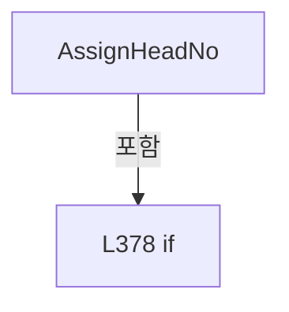

변경 전 점검: 입력/반환 타입, 위 호출자, 예외/취소 경로, 공유 상태와 저장·전송 소비자를 함께 확인합니다. 값의 단위나 물리 방향을 이름만으로 확정하지 않습니다.

### LocalFunctionStatement `SelectItem` · L383–390

[Drilling.Common/Recipe/CShotCoordinatePlanBuilder.cs:383–390](https://github.com/kjuws10-rgb/A3Drilling/blob/5aee8e58439c9b455cae7c9593c9be986c3e682e/Drilling.Common/Recipe/CShotCoordinatePlanBuilder.cs#L383-L390)

| 항목 | 실제 추출 값 |
| --- | --- |
| 서명 | Drilling.Common.Recipe.ST_HEAD_ASSIGNMENT_CANDIDATE? SelectItem(int) |
| 접근/수식자 | Private /  |
| 반환/값 타입 | Drilling.Common.Recipe.ST_HEAD_ASSIGNMENT_CANDIDATE? |
| 소속 타입 | NamedType:Drilling.Common.Recipe.CShotCoordinatePlanBuilder |

입력 계약:

| 이름 | 타입 | 전달 | 선택/기본값 |
| --- | --- | --- | --- |
| headNo | int | None | False /  |

현재 부분 분석에서 직접 연결된 호출자는 없습니다. XAML/이벤트/인터페이스·델리게이트·외부 진입을 추가 확인해야 하며, 미사용으로 판정한 것이 아닙니다.

호출하는 대상과 해석 범위:

| 원본 행 | 표현식 | 분석 상태 | 대상/소스 위치 |
| --- | --- | --- | --- |
| 385 | ReadHeadCenterX | resolved | double Drilling.Common.Recipe.CShotCoordinatePlanBuilder.ReadHeadCenterX(System.Collections.Generic.IReadOnlyDictionary<string, string>, int) · Drilling.Common/Recipe/CShotCoordinatePlanBuilder.cs:450 |
| 386 | ReadNullableDouble | resolved | double? Drilling.Common.Recipe.CShotCoordinatePlanBuilder.ReadNullableDouble(System.Collections.Generic.IReadOnlyDictionary<string, string>, params string[]) · Drilling.Common/Recipe/CShotCoordinatePlanBuilder.cs:574 |
| 389 | new ST_HEAD_ASSIGNMENT_CANDIDATE | resolved | Drilling.Common.Recipe.ST_HEAD_ASSIGNMENT_CANDIDATE.ST_HEAD_ASSIGNMENT_CANDIDATE(int, double) · Drilling.Common/Recipe/CShotCoordinatePlanBuilder.cs:1390 |
| 389 | Math.Abs | resolved | double System.Math.Abs(double) |

본문의 실제 연산·분기·예외·반환 순서(원문 위치 순):

| 원본 행 | 종류 | 주석 해설 |
| --- | --- | --- |
| 385 | call | 함수·델리게이트 또는 객체 생성자를 호출합니다: ReadHeadCenterX(parameters, headNo) |
| 385 | local-declaration | 지역 변수를 선언합니다: var centerX = ReadHeadCenterX(parameters, headNo); |
| 385 | variable-initializer | 변수의 초기값을 지정합니다: centerX = ReadHeadCenterX(parameters, headNo) |
| 386 | call | 함수·델리게이트 또는 객체 생성자를 호출합니다: ReadNullableDouble(parameters, $"H{headNo:00}_SCAN_FIELD_WIDTH_X", $"H{headNo:00}_HEAD_FIELD_WIDTH_X") |
| 386 | local-declaration | 지역 변수를 선언합니다: var widthX = ReadNullableDouble(parameters, $"H{headNo:00}_SCAN_FIELD_WIDTH_X", $"H{headNo:00}_HEAD_FIELD_WIDTH_X") ?? 110.0; |
| 386 | variable-initializer | 변수의 초기값을 지정합니다: widthX = ReadNullableDouble(parameters, $"H{headNo:00}_SCAN_FIELD_WIDTH_X", $"H{headNo:00}_HEAD_FIELD_WIDTH_X") ?? 110.0 |
| 387 | assignment | 값을 대상에 대입합니다: widthX = widthX > 0.0 ? widthX : 110.0 |
| 387 | conditional-expression | 조건에 따라 결과식을 선택합니다: widthX > 0.0 ? widthX : 110.0 |
| 388 | local-declaration | 지역 변수를 선언합니다: var halfWidth = widthX / 2.0; |
| 388 | variable-initializer | 변수의 초기값을 지정합니다: halfWidth = widthX / 2.0 |
| 389 | call | 함수·델리게이트 또는 객체 생성자를 호출합니다: new ST_HEAD_ASSIGNMENT_CANDIDATE(headNo, Math.Abs(designX - centerX)) |
| 389 | call | 함수·델리게이트 또는 객체 생성자를 호출합니다: Math.Abs(designX - centerX) |
| 389 | conditional-expression | 조건에 따라 결과식을 선택합니다: designX >= centerX - halfWidth && designX <= centerX + halfWidth ? new ST_HEAD_ASSIGNMENT_CANDIDATE(headNo, Math.Abs(designX - centerX)) : (ST_HEAD_ASSIGNMENT_CANDIDATE? )null |
| 389 | return | 호출자에게 값 또는 제어를 반환합니다: return designX >= centerX - halfWidth && designX <= centerX + halfWidth ? new ST_HEAD_ASSIGNMENT_CANDIDATE(headNo, Math.Abs(designX - centerX)) : (ST_HEAD_ASSIGNMENT_CANDIDATE? )null; |

변경 전 점검: 입력/반환 타입, 위 호출자, 예외/취소 경로, 공유 상태와 저장·전송 소비자를 함께 확인합니다. 값의 단위나 물리 방향을 이름만으로 확정하지 않습니다.

### LocalFunctionStatement `IsHasValue` · L392–395

[Drilling.Common/Recipe/CShotCoordinatePlanBuilder.cs:392–395](https://github.com/kjuws10-rgb/A3Drilling/blob/5aee8e58439c9b455cae7c9593c9be986c3e682e/Drilling.Common/Recipe/CShotCoordinatePlanBuilder.cs#L392-L395)

| 항목 | 실제 추출 값 |
| --- | --- |
| 서명 | bool IsHasValue(Drilling.Common.Recipe.ST_HEAD_ASSIGNMENT_CANDIDATE?) |
| 접근/수식자 | Private /  |
| 반환/값 타입 | bool |
| 소속 타입 | NamedType:Drilling.Common.Recipe.CShotCoordinatePlanBuilder |

입력 계약:

| 이름 | 타입 | 전달 | 선택/기본값 |
| --- | --- | --- | --- |
| candidate | Drilling.Common.Recipe.ST_HEAD_ASSIGNMENT_CANDIDATE? | None | False /  |

현재 부분 분석에서 직접 연결된 호출자는 없습니다. XAML/이벤트/인터페이스·델리게이트·외부 진입을 추가 확인해야 하며, 미사용으로 판정한 것이 아닙니다.

본문의 실제 연산·분기·예외·반환 순서(원문 위치 순):

| 원본 행 | 종류 | 주석 해설 |
| --- | --- | --- |
| 394 | return | 호출자에게 값 또는 제어를 반환합니다: return candidate.HasValue; |

변경 전 점검: 입력/반환 타입, 위 호출자, 예외/취소 경로, 공유 상태와 저장·전송 소비자를 함께 확인합니다. 값의 단위나 물리 방향을 이름만으로 확정하지 않습니다.

### LocalFunctionStatement `SelectHead` · L397–400

[Drilling.Common/Recipe/CShotCoordinatePlanBuilder.cs:397–400](https://github.com/kjuws10-rgb/A3Drilling/blob/5aee8e58439c9b455cae7c9593c9be986c3e682e/Drilling.Common/Recipe/CShotCoordinatePlanBuilder.cs#L397-L400)

| 항목 | 실제 추출 값 |
| --- | --- |
| 서명 | Drilling.Common.Recipe.ST_HEAD_ASSIGNMENT_CANDIDATE SelectHead(Drilling.Common.Recipe.ST_HEAD_ASSIGNMENT_CANDIDATE?) |
| 접근/수식자 | Private /  |
| 반환/값 타입 | Drilling.Common.Recipe.ST_HEAD_ASSIGNMENT_CANDIDATE |
| 소속 타입 | NamedType:Drilling.Common.Recipe.CShotCoordinatePlanBuilder |

입력 계약:

| 이름 | 타입 | 전달 | 선택/기본값 |
| --- | --- | --- | --- |
| candidate | Drilling.Common.Recipe.ST_HEAD_ASSIGNMENT_CANDIDATE? | None | False /  |

현재 부분 분석에서 직접 연결된 호출자는 없습니다. XAML/이벤트/인터페이스·델리게이트·외부 진입을 추가 확인해야 하며, 미사용으로 판정한 것이 아닙니다.

본문의 실제 연산·분기·예외·반환 순서(원문 위치 순):

| 원본 행 | 종류 | 주석 해설 |
| --- | --- | --- |
| 399 | return | 호출자에게 값 또는 제어를 반환합니다: return candidate!.Value; |

변경 전 점검: 입력/반환 타입, 위 호출자, 예외/취소 경로, 공유 상태와 저장·전송 소비자를 함께 확인합니다. 값의 단위나 물리 방향을 이름만으로 확정하지 않습니다.

### MethodDeclaration `SelectHeadCandidate` · L406–424

[Drilling.Common/Recipe/CShotCoordinatePlanBuilder.cs:406–424](https://github.com/kjuws10-rgb/A3Drilling/blob/5aee8e58439c9b455cae7c9593c9be986c3e682e/Drilling.Common/Recipe/CShotCoordinatePlanBuilder.cs#L406-L424)

| 항목 | 실제 추출 값 |
| --- | --- |
| 서명 | int Drilling.Common.Recipe.CShotCoordinatePlanBuilder.SelectHeadCandidate(System.Collections.Generic.IReadOnlyList<Drilling.Common.Recipe.ST_HEAD_ASSIGNMENT_CANDIDATE>, System.Collections.Generic.IReadOnlyDictionary<int, int>) |
| 접근/수식자 | Private / private, static |
| 반환/값 타입 | int |
| 소속 타입 | NamedType:Drilling.Common.Recipe.CShotCoordinatePlanBuilder |

입력 계약:

| 이름 | 타입 | 전달 | 선택/기본값 |
| --- | --- | --- | --- |
| candidates | System.Collections.Generic.IReadOnlyList<Drilling.Common.Recipe.ST_HEAD_ASSIGNMENT_CANDIDATE> | None | False /  |
| assignedHeadCounts | System.Collections.Generic.IReadOnlyDictionary<int, int> | None | False /  |

정적 호출자로 확인된 위치:

| 호출 파일/행 | 호출 표현식 | 런타임 분기 가능 |
| --- | --- | --- |
| [Drilling.Common/Recipe/CShotCoordinatePlanBuilder.cs:403–403](https://github.com/kjuws10-rgb/A3Drilling/blob/5aee8e58439c9b455cae7c9593c9be986c3e682e/Drilling.Common/Recipe/CShotCoordinatePlanBuilder.cs#L403-L403) | SelectHeadCandidate | False |

호출하는 대상과 해석 범위:

| 원본 행 | 표현식 | 분석 상태 | 대상/소스 위치 |
| --- | --- | --- | --- |
| 423 | candidates.OrderBy(SelectDistance).ThenBy(SelectValue).ThenBy(SelectHeadNo).First | resolved | Drilling.Common.Recipe.ST_HEAD_ASSIGNMENT_CANDIDATE System.Collections.Generic.IEnumerable<Drilling.Common.Recipe.ST_HEAD_ASSIGNMENT_CANDIDATE>.First<Drilling.Common.Recipe.ST_HEAD_ASSIGNMENT_CANDIDATE>() |
| 423 | candidates.OrderBy(SelectDistance).ThenBy(SelectValue).ThenBy | resolved | System.Linq.IOrderedEnumerable<Drilling.Common.Recipe.ST_HEAD_ASSIGNMENT_CANDIDATE> System.Linq.IOrderedEnumerable<Drilling.Common.Recipe.ST_HEAD_ASSIGNMENT_CANDIDATE>.ThenBy<Drilling.Common.Recipe.ST_HEAD_ASSIGNMENT_CANDIDATE, int>(System.Func<Drilling.Common.Recipe.ST_HEAD_ASSIGNMENT_CANDIDATE, int>) |
| 423 | candidates.OrderBy(SelectDistance).ThenBy | resolved | System.Linq.IOrderedEnumerable<Drilling.Common.Recipe.ST_HEAD_ASSIGNMENT_CANDIDATE> System.Linq.IOrderedEnumerable<Drilling.Common.Recipe.ST_HEAD_ASSIGNMENT_CANDIDATE>.ThenBy<Drilling.Common.Recipe.ST_HEAD_ASSIGNMENT_CANDIDATE, int>(System.Func<Drilling.Common.Recipe.ST_HEAD_ASSIGNMENT_CANDIDATE, int>) |
| 423 | candidates.OrderBy | resolved | System.Linq.IOrderedEnumerable<Drilling.Common.Recipe.ST_HEAD_ASSIGNMENT_CANDIDATE> System.Collections.Generic.IEnumerable<Drilling.Common.Recipe.ST_HEAD_ASSIGNMENT_CANDIDATE>.OrderBy<Drilling.Common.Recipe.ST_HEAD_ASSIGNMENT_CANDIDATE, double>(System.Func<Drilling.Common.Recipe.ST_HEAD_ASSIGNMENT_CANDIDATE, double>) |

본문의 실제 연산·분기·예외·반환 순서(원문 위치 순):

| 원본 행 | 종류 | 주석 해설 |
| --- | --- | --- |
| 423 | call | 함수·델리게이트 또는 객체 생성자를 호출합니다: candidates.OrderBy(SelectDistance).ThenBy(SelectValue).ThenBy(SelectHeadNo).First() |
| 423 | call | 함수·델리게이트 또는 객체 생성자를 호출합니다: candidates.OrderBy(SelectDistance).ThenBy(SelectValue).ThenBy(SelectHeadNo) |
| 423 | call | 함수·델리게이트 또는 객체 생성자를 호출합니다: candidates.OrderBy(SelectDistance).ThenBy(SelectValue) |
| 423 | call | 함수·델리게이트 또는 객체 생성자를 호출합니다: candidates.OrderBy(SelectDistance) |
| 423 | return | 호출자에게 값 또는 제어를 반환합니다: return candidates.OrderBy(SelectDistance).ThenBy(SelectValue).ThenBy(SelectHeadNo).First().HeadNo; |

변경 전 점검: 입력/반환 타입, 위 호출자, 예외/취소 경로, 공유 상태와 저장·전송 소비자를 함께 확인합니다. 값의 단위나 물리 방향을 이름만으로 확정하지 않습니다.

### LocalFunctionStatement `SelectDistance` · L408–411

[Drilling.Common/Recipe/CShotCoordinatePlanBuilder.cs:408–411](https://github.com/kjuws10-rgb/A3Drilling/blob/5aee8e58439c9b455cae7c9593c9be986c3e682e/Drilling.Common/Recipe/CShotCoordinatePlanBuilder.cs#L408-L411)

| 항목 | 실제 추출 값 |
| --- | --- |
| 서명 | double SelectDistance(Drilling.Common.Recipe.ST_HEAD_ASSIGNMENT_CANDIDATE) |
| 접근/수식자 | Private /  |
| 반환/값 타입 | double |
| 소속 타입 | NamedType:Drilling.Common.Recipe.CShotCoordinatePlanBuilder |

입력 계약:

| 이름 | 타입 | 전달 | 선택/기본값 |
| --- | --- | --- | --- |
| candidate | Drilling.Common.Recipe.ST_HEAD_ASSIGNMENT_CANDIDATE | None | False /  |

현재 부분 분석에서 직접 연결된 호출자는 없습니다. XAML/이벤트/인터페이스·델리게이트·외부 진입을 추가 확인해야 하며, 미사용으로 판정한 것이 아닙니다.

본문의 실제 연산·분기·예외·반환 순서(원문 위치 순):

| 원본 행 | 종류 | 주석 해설 |
| --- | --- | --- |
| 410 | return | 호출자에게 값 또는 제어를 반환합니다: return candidate.Distance; |

변경 전 점검: 입력/반환 타입, 위 호출자, 예외/취소 경로, 공유 상태와 저장·전송 소비자를 함께 확인합니다. 값의 단위나 물리 방향을 이름만으로 확정하지 않습니다.

### LocalFunctionStatement `SelectValue` · L413–416

[Drilling.Common/Recipe/CShotCoordinatePlanBuilder.cs:413–416](https://github.com/kjuws10-rgb/A3Drilling/blob/5aee8e58439c9b455cae7c9593c9be986c3e682e/Drilling.Common/Recipe/CShotCoordinatePlanBuilder.cs#L413-L416)

| 항목 | 실제 추출 값 |
| --- | --- |
| 서명 | int SelectValue(Drilling.Common.Recipe.ST_HEAD_ASSIGNMENT_CANDIDATE) |
| 접근/수식자 | Private /  |
| 반환/값 타입 | int |
| 소속 타입 | NamedType:Drilling.Common.Recipe.CShotCoordinatePlanBuilder |

입력 계약:

| 이름 | 타입 | 전달 | 선택/기본값 |
| --- | --- | --- | --- |
| candidate | Drilling.Common.Recipe.ST_HEAD_ASSIGNMENT_CANDIDATE | None | False /  |

현재 부분 분석에서 직접 연결된 호출자는 없습니다. XAML/이벤트/인터페이스·델리게이트·외부 진입을 추가 확인해야 하며, 미사용으로 판정한 것이 아닙니다.

호출하는 대상과 해석 범위:

| 원본 행 | 표현식 | 분석 상태 | 대상/소스 위치 |
| --- | --- | --- | --- |
| 415 | assignedHeadCounts.TryGetValue | resolved · 동적 구현 선택 가능 | bool System.Collections.Generic.IReadOnlyDictionary<int, int>.TryGetValue(int, out int) |

본문의 실제 연산·분기·예외·반환 순서(원문 위치 순):

| 원본 행 | 종류 | 주석 해설 |
| --- | --- | --- |
| 415 | call | 함수·델리게이트 또는 객체 생성자를 호출합니다: assignedHeadCounts.TryGetValue(candidate.HeadNo, out var count) |
| 415 | conditional-expression | 조건에 따라 결과식을 선택합니다: assignedHeadCounts.TryGetValue(candidate.HeadNo, out var count) ? count : 0 |
| 415 | return | 호출자에게 값 또는 제어를 반환합니다: return assignedHeadCounts.TryGetValue(candidate.HeadNo, out var count) ? count : 0; |

변경 전 점검: 입력/반환 타입, 위 호출자, 예외/취소 경로, 공유 상태와 저장·전송 소비자를 함께 확인합니다. 값의 단위나 물리 방향을 이름만으로 확정하지 않습니다.

### LocalFunctionStatement `SelectHeadNo` · L418–421

[Drilling.Common/Recipe/CShotCoordinatePlanBuilder.cs:418–421](https://github.com/kjuws10-rgb/A3Drilling/blob/5aee8e58439c9b455cae7c9593c9be986c3e682e/Drilling.Common/Recipe/CShotCoordinatePlanBuilder.cs#L418-L421)

| 항목 | 실제 추출 값 |
| --- | --- |
| 서명 | int SelectHeadNo(Drilling.Common.Recipe.ST_HEAD_ASSIGNMENT_CANDIDATE) |
| 접근/수식자 | Private /  |
| 반환/값 타입 | int |
| 소속 타입 | NamedType:Drilling.Common.Recipe.CShotCoordinatePlanBuilder |

입력 계약:

| 이름 | 타입 | 전달 | 선택/기본값 |
| --- | --- | --- | --- |
| candidate | Drilling.Common.Recipe.ST_HEAD_ASSIGNMENT_CANDIDATE | None | False /  |

현재 부분 분석에서 직접 연결된 호출자는 없습니다. XAML/이벤트/인터페이스·델리게이트·외부 진입을 추가 확인해야 하며, 미사용으로 판정한 것이 아닙니다.

본문의 실제 연산·분기·예외·반환 순서(원문 위치 순):

| 원본 행 | 종류 | 주석 해설 |
| --- | --- | --- |
| 420 | return | 호출자에게 값 또는 제어를 반환합니다: return candidate.HeadNo; |

변경 전 점검: 입력/반환 타입, 위 호출자, 예외/취소 경로, 공유 상태와 저장·전송 소비자를 함께 확인합니다. 값의 단위나 물리 방향을 이름만으로 확정하지 않습니다.

### MethodDeclaration `BuildActiveHeadNumbers` · L426–443

[Drilling.Common/Recipe/CShotCoordinatePlanBuilder.cs:426–443](https://github.com/kjuws10-rgb/A3Drilling/blob/5aee8e58439c9b455cae7c9593c9be986c3e682e/Drilling.Common/Recipe/CShotCoordinatePlanBuilder.cs#L426-L443)

| 항목 | 실제 추출 값 |
| --- | --- |
| 서명 | System.Collections.Generic.IReadOnlyList<int> Drilling.Common.Recipe.CShotCoordinatePlanBuilder.BuildActiveHeadNumbers(System.Collections.Generic.IReadOnlyDictionary<string, string>, int) |
| 접근/수식자 | Private / private, static |
| 반환/값 타입 | System.Collections.Generic.IReadOnlyList<int> |
| 소속 타입 | NamedType:Drilling.Common.Recipe.CShotCoordinatePlanBuilder |

입력 계약:

| 이름 | 타입 | 전달 | 선택/기본값 |
| --- | --- | --- | --- |
| parameters | System.Collections.Generic.IReadOnlyDictionary<string, string> | None | False /  |
| headCount | int | None | False /  |

정적 호출자로 확인된 위치:

| 호출 파일/행 | 호출 표현식 | 런타임 분기 가능 |
| --- | --- | --- |
| [Drilling.Common/Recipe/CShotCoordinatePlanBuilder.cs:21–21](https://github.com/kjuws10-rgb/A3Drilling/blob/5aee8e58439c9b455cae7c9593c9be986c3e682e/Drilling.Common/Recipe/CShotCoordinatePlanBuilder.cs#L21-L21) | BuildActiveHeadNumbers | False |

호출하는 대상과 해석 범위:

| 원본 행 | 표현식 | 분석 상태 | 대상/소스 위치 |
| --- | --- | --- | --- |
| 428 | new List<int> | resolved | System.Collections.Generic.List<int>.List(int) |
| 431 | ReadHeadUse | resolved | bool Drilling.Common.Recipe.CShotCoordinatePlanBuilder.ReadHeadUse(System.Collections.Generic.IReadOnlyDictionary<string, string>, int) · Drilling.Common/Recipe/CShotCoordinatePlanBuilder.cs:445 |
| 433 | activeHeadNos.Add | resolved | void System.Collections.Generic.List<int>.Add(int) |
| 439 | new InvalidOperationException | resolved | System.InvalidOperationException.InvalidOperationException(string?) |

본문의 실제 연산·분기·예외·반환 순서(원문 위치 순):

| 원본 행 | 종류 | 주석 해설 |
| --- | --- | --- |
| 428 | call | 함수·델리게이트 또는 객체 생성자를 호출합니다: new List<int>(headCount) |
| 428 | local-declaration | 지역 변수를 선언합니다: var activeHeadNos = new List<int>(headCount); |
| 428 | variable-initializer | 변수의 초기값을 지정합니다: activeHeadNos = new List<int>(headCount) |
| 429 | variable-initializer | 변수의 초기값을 지정합니다: headNo = 1 |
| 429 | for | 초기화·조건·증감이 있는 반복입니다: for (var headNo = 1; headNo <= headCount; headNo++) |
| 431 | call | 함수·델리게이트 또는 객체 생성자를 호출합니다: ReadHeadUse(parameters, headNo) |
| 431 | if | 조건에 따라 분기합니다: if (ReadHeadUse(parameters, headNo)) |
| 433 | call | 함수·델리게이트 또는 객체 생성자를 호출합니다: activeHeadNos.Add(headNo) |
| 437 | if | 조건에 따라 분기합니다: if (activeHeadNos.Count == 0) |
| 439 | call | 함수·델리게이트 또는 객체 생성자를 호출합니다: new InvalidOperationException("At least one head must be enabled. Check Hxx_USE option settings.") |
| 439 | throw | 예외를 발생/전달합니다: throw new InvalidOperationException("At least one head must be enabled. Check Hxx_USE option settings."); |
| 442 | return | 호출자에게 값 또는 제어를 반환합니다: return activeHeadNos; |

제어 구문의 포함 구조(실제 실행 순서/CFG가 아닌 구문 탐색 그림):

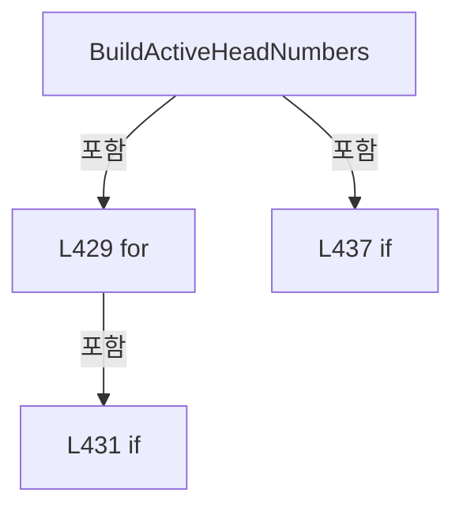

변경 전 점검: 입력/반환 타입, 위 호출자, 예외/취소 경로, 공유 상태와 저장·전송 소비자를 함께 확인합니다. 값의 단위나 물리 방향을 이름만으로 확정하지 않습니다.

### MethodDeclaration `ReadHeadUse` · L445–448

[Drilling.Common/Recipe/CShotCoordinatePlanBuilder.cs:445–448](https://github.com/kjuws10-rgb/A3Drilling/blob/5aee8e58439c9b455cae7c9593c9be986c3e682e/Drilling.Common/Recipe/CShotCoordinatePlanBuilder.cs#L445-L448)

| 항목 | 실제 추출 값 |
| --- | --- |
| 서명 | bool Drilling.Common.Recipe.CShotCoordinatePlanBuilder.ReadHeadUse(System.Collections.Generic.IReadOnlyDictionary<string, string>, int) |
| 접근/수식자 | Private / private, static |
| 반환/값 타입 | bool |
| 소속 타입 | NamedType:Drilling.Common.Recipe.CShotCoordinatePlanBuilder |

입력 계약:

| 이름 | 타입 | 전달 | 선택/기본값 |
| --- | --- | --- | --- |
| parameters | System.Collections.Generic.IReadOnlyDictionary<string, string> | None | False /  |
| headNo | int | None | False /  |

정적 호출자로 확인된 위치:

| 호출 파일/행 | 호출 표현식 | 런타임 분기 가능 |
| --- | --- | --- |
| [Drilling.Common/Recipe/CShotCoordinatePlanBuilder.cs:431–431](https://github.com/kjuws10-rgb/A3Drilling/blob/5aee8e58439c9b455cae7c9593c9be986c3e682e/Drilling.Common/Recipe/CShotCoordinatePlanBuilder.cs#L431-L431) | ReadHeadUse | False |

호출하는 대상과 해석 범위:

| 원본 행 | 표현식 | 분석 상태 | 대상/소스 위치 |
| --- | --- | --- | --- |
| 447 | ReadBool | resolved | bool Drilling.Common.Recipe.CShotCoordinatePlanBuilder.ReadBool(System.Collections.Generic.IReadOnlyDictionary<string, string>, bool, params string[]) · Drilling.Common/Recipe/CShotCoordinatePlanBuilder.cs:620 |

본문의 실제 연산·분기·예외·반환 순서(원문 위치 순):

| 원본 행 | 종류 | 주석 해설 |
| --- | --- | --- |
| 447 | call | 함수·델리게이트 또는 객체 생성자를 호출합니다: ReadBool(parameters, true, $"H{headNo:00}_USE") |
| 447 | return | 호출자에게 값 또는 제어를 반환합니다: return ReadBool(parameters, true, $"H{headNo:00}_USE"); |

변경 전 점검: 입력/반환 타입, 위 호출자, 예외/취소 경로, 공유 상태와 저장·전송 소비자를 함께 확인합니다. 값의 단위나 물리 방향을 이름만으로 확정하지 않습니다.

### MethodDeclaration `ReadHeadCenterX` · L450–458

[Drilling.Common/Recipe/CShotCoordinatePlanBuilder.cs:450–458](https://github.com/kjuws10-rgb/A3Drilling/blob/5aee8e58439c9b455cae7c9593c9be986c3e682e/Drilling.Common/Recipe/CShotCoordinatePlanBuilder.cs#L450-L458)

| 항목 | 실제 추출 값 |
| --- | --- |
| 서명 | double Drilling.Common.Recipe.CShotCoordinatePlanBuilder.ReadHeadCenterX(System.Collections.Generic.IReadOnlyDictionary<string, string>, int) |
| 접근/수식자 | Private / private, static |
| 반환/값 타입 | double |
| 소속 타입 | NamedType:Drilling.Common.Recipe.CShotCoordinatePlanBuilder |

입력 계약:

| 이름 | 타입 | 전달 | 선택/기본값 |
| --- | --- | --- | --- |
| parameters | System.Collections.Generic.IReadOnlyDictionary<string, string> | None | False /  |
| headNo | int | None | False /  |

정적 호출자로 확인된 위치:

| 호출 파일/행 | 호출 표현식 | 런타임 분기 가능 |
| --- | --- | --- |
| [Drilling.Common/Recipe/CShotCoordinatePlanBuilder.cs:59–59](https://github.com/kjuws10-rgb/A3Drilling/blob/5aee8e58439c9b455cae7c9593c9be986c3e682e/Drilling.Common/Recipe/CShotCoordinatePlanBuilder.cs#L59-L59) | ReadHeadCenterX | False |
| [Drilling.Common/Recipe/CShotCoordinatePlanBuilder.cs:385–385](https://github.com/kjuws10-rgb/A3Drilling/blob/5aee8e58439c9b455cae7c9593c9be986c3e682e/Drilling.Common/Recipe/CShotCoordinatePlanBuilder.cs#L385-L385) | ReadHeadCenterX | False |

호출하는 대상과 해석 범위:

| 원본 행 | 표현식 | 분석 상태 | 대상/소스 위치 |
| --- | --- | --- | --- |
| 454 | ReadDouble | resolved | double Drilling.Common.Recipe.CShotCoordinatePlanBuilder.ReadDouble(System.Collections.Generic.IReadOnlyDictionary<string, string>, double, params string[]) · Drilling.Common/Recipe/CShotCoordinatePlanBuilder.cs:556 |
| 455 | ReadDouble | resolved | double Drilling.Common.Recipe.CShotCoordinatePlanBuilder.ReadDouble(System.Collections.Generic.IReadOnlyDictionary<string, string>, double, params string[]) · Drilling.Common/Recipe/CShotCoordinatePlanBuilder.cs:556 |
| 456 | ReadDouble | resolved | double Drilling.Common.Recipe.CShotCoordinatePlanBuilder.ReadDouble(System.Collections.Generic.IReadOnlyDictionary<string, string>, double, params string[]) · Drilling.Common/Recipe/CShotCoordinatePlanBuilder.cs:556 |

본문의 실제 연산·분기·예외·반환 순서(원문 위치 순):

| 원본 행 | 종류 | 주석 해설 |
| --- | --- | --- |
| 452 | local-declaration | 지역 변수를 선언합니다: const double fallbackHead1PositionX = -5.0; |
| 452 | variable-initializer | 변수의 초기값을 지정합니다: fallbackHead1PositionX = -5.0 |
| 453 | local-declaration | 지역 변수를 선언합니다: const double fallbackHeadGapX = 200.0; |
| 453 | variable-initializer | 변수의 초기값을 지정합니다: fallbackHeadGapX = 200.0 |
| 454 | call | 함수·델리게이트 또는 객체 생성자를 호출합니다: ReadDouble(parameters, fallbackHead1PositionX, "H01_AK_POSITION_X") |
| 454 | local-declaration | 지역 변수를 선언합니다: var head1PositionX = ReadDouble(parameters, fallbackHead1PositionX, "H01_AK_POSITION_X"); |
| 454 | variable-initializer | 변수의 초기값을 지정합니다: head1PositionX = ReadDouble(parameters, fallbackHead1PositionX, "H01_AK_POSITION_X") |
| 455 | call | 함수·델리게이트 또는 객체 생성자를 호출합니다: ReadDouble(parameters, fallbackHeadGapX, "HeadGapX") |
| 455 | local-declaration | 지역 변수를 선언합니다: var headGapX = ReadDouble(parameters, fallbackHeadGapX, "HeadGapX"); |
| 455 | variable-initializer | 변수의 초기값을 지정합니다: headGapX = ReadDouble(parameters, fallbackHeadGapX, "HeadGapX") |
| 456 | call | 함수·델리게이트 또는 객체 생성자를 호출합니다: ReadDouble(parameters, 0.0, "AK_MARGIN_X") |
| 456 | local-declaration | 지역 변수를 선언합니다: var akMarginX = ReadDouble(parameters, 0.0, "AK_MARGIN_X"); |
| 456 | variable-initializer | 변수의 초기값을 지정합니다: akMarginX = ReadDouble(parameters, 0.0, "AK_MARGIN_X") |
| 457 | return | 호출자에게 값 또는 제어를 반환합니다: return akMarginX + head1PositionX + ((headNo - 1) * headGapX); |

변경 전 점검: 입력/반환 타입, 위 호출자, 예외/취소 경로, 공유 상태와 저장·전송 소비자를 함께 확인합니다. 값의 단위나 물리 방향을 이름만으로 확정하지 않습니다.

### MethodDeclaration `ReadHeadCenterY` · L460–471

[Drilling.Common/Recipe/CShotCoordinatePlanBuilder.cs:460–471](https://github.com/kjuws10-rgb/A3Drilling/blob/5aee8e58439c9b455cae7c9593c9be986c3e682e/Drilling.Common/Recipe/CShotCoordinatePlanBuilder.cs#L460-L471)

| 항목 | 실제 추출 값 |
| --- | --- |
| 서명 | double Drilling.Common.Recipe.CShotCoordinatePlanBuilder.ReadHeadCenterY(System.Collections.Generic.IReadOnlyDictionary<string, string>, int) |
| 접근/수식자 | Private / private, static |
| 반환/값 타입 | double |
| 소속 타입 | NamedType:Drilling.Common.Recipe.CShotCoordinatePlanBuilder |

입력 계약:

| 이름 | 타입 | 전달 | 선택/기본값 |
| --- | --- | --- | --- |
| parameters | System.Collections.Generic.IReadOnlyDictionary<string, string> | None | False /  |
| headNo | int | None | False /  |

정적 호출자로 확인된 위치:

| 호출 파일/행 | 호출 표현식 | 런타임 분기 가능 |
| --- | --- | --- |
| [Drilling.Common/Recipe/CShotCoordinatePlanBuilder.cs:60–60](https://github.com/kjuws10-rgb/A3Drilling/blob/5aee8e58439c9b455cae7c9593c9be986c3e682e/Drilling.Common/Recipe/CShotCoordinatePlanBuilder.cs#L60-L60) | ReadHeadCenterY | False |

호출하는 대상과 해석 범위:

| 원본 행 | 표현식 | 분석 상태 | 대상/소스 위치 |
| --- | --- | --- | --- |
| 462 | ReadNullableDouble | resolved | double? Drilling.Common.Recipe.CShotCoordinatePlanBuilder.ReadNullableDouble(System.Collections.Generic.IReadOnlyDictionary<string, string>, params string[]) · Drilling.Common/Recipe/CShotCoordinatePlanBuilder.cs:574 |
| 468 | ReadDouble | resolved | double Drilling.Common.Recipe.CShotCoordinatePlanBuilder.ReadDouble(System.Collections.Generic.IReadOnlyDictionary<string, string>, double, params string[]) · Drilling.Common/Recipe/CShotCoordinatePlanBuilder.cs:556 |
| 469 | ReadDouble | resolved | double Drilling.Common.Recipe.CShotCoordinatePlanBuilder.ReadDouble(System.Collections.Generic.IReadOnlyDictionary<string, string>, double, params string[]) · Drilling.Common/Recipe/CShotCoordinatePlanBuilder.cs:556 |

본문의 실제 연산·분기·예외·반환 순서(원문 위치 순):

| 원본 행 | 종류 | 주석 해설 |
| --- | --- | --- |
| 462 | call | 함수·델리게이트 또는 객체 생성자를 호출합니다: ReadNullableDouble(parameters, $"H{headNo:00}_AK_POSITION_Y") |
| 462 | local-declaration | 지역 변수를 선언합니다: var explicitHeadY = ReadNullableDouble(parameters, $"H{headNo:00}_AK_POSITION_Y"); |
| 462 | variable-initializer | 변수의 초기값을 지정합니다: explicitHeadY = ReadNullableDouble(parameters, $"H{headNo:00}_AK_POSITION_Y") |
| 463 | if | 조건에 따라 분기합니다: if (explicitHeadY.HasValue) |
| 465 | return | 호출자에게 값 또는 제어를 반환합니다: return explicitHeadY.Value; |
| 468 | call | 함수·델리게이트 또는 객체 생성자를 호출합니다: ReadDouble(parameters, 0.0, "REVIEW_TO_HEAD1_GAP_Y") |
| 468 | local-declaration | 지역 변수를 선언합니다: var head1CenterY = ReadDouble(parameters, 0.0, "REVIEW_TO_HEAD1_GAP_Y"); |
| 468 | variable-initializer | 변수의 초기값을 지정합니다: head1CenterY = ReadDouble(parameters, 0.0, "REVIEW_TO_HEAD1_GAP_Y") |
| 469 | call | 함수·델리게이트 또는 객체 생성자를 호출합니다: ReadDouble(parameters, 0.0, "HeadGapY") |
| 469 | local-declaration | 지역 변수를 선언합니다: var headGapY = ReadDouble(parameters, 0.0, "HeadGapY"); |
| 469 | variable-initializer | 변수의 초기값을 지정합니다: headGapY = ReadDouble(parameters, 0.0, "HeadGapY") |
| 470 | conditional-expression | 조건에 따라 결과식을 선택합니다: headNo % 2 == 0 ? head1CenterY + headGapY : head1CenterY |
| 470 | return | 호출자에게 값 또는 제어를 반환합니다: return headNo % 2 == 0 ? head1CenterY + headGapY : head1CenterY; |

제어 구문의 포함 구조(실제 실행 순서/CFG가 아닌 구문 탐색 그림):

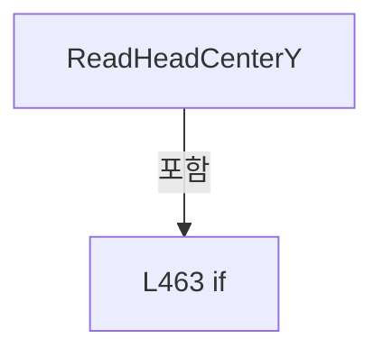

변경 전 점검: 입력/반환 타입, 위 호출자, 예외/취소 경로, 공유 상태와 저장·전송 소비자를 함께 확인합니다. 값의 단위나 물리 방향을 이름만으로 확정하지 않습니다.

### MethodDeclaration `ReadHeadDefaultOffset` · L473–476

[Drilling.Common/Recipe/CShotCoordinatePlanBuilder.cs:473–476](https://github.com/kjuws10-rgb/A3Drilling/blob/5aee8e58439c9b455cae7c9593c9be986c3e682e/Drilling.Common/Recipe/CShotCoordinatePlanBuilder.cs#L473-L476)

| 항목 | 실제 추출 값 |
| --- | --- |
| 서명 | double Drilling.Common.Recipe.CShotCoordinatePlanBuilder.ReadHeadDefaultOffset(System.Collections.Generic.IReadOnlyDictionary<string, string>, int, string) |
| 접근/수식자 | Private / private, static |
| 반환/값 타입 | double |
| 소속 타입 | NamedType:Drilling.Common.Recipe.CShotCoordinatePlanBuilder |

입력 계약:

| 이름 | 타입 | 전달 | 선택/기본값 |
| --- | --- | --- | --- |
| parameters | System.Collections.Generic.IReadOnlyDictionary<string, string> | None | False /  |
| headNo | int | None | False /  |
| axis | string | None | False /  |

정적 호출자로 확인된 위치:

| 호출 파일/행 | 호출 표현식 | 런타임 분기 가능 |
| --- | --- | --- |
| [Drilling.Common/Recipe/CShotCoordinatePlanBuilder.cs:62–62](https://github.com/kjuws10-rgb/A3Drilling/blob/5aee8e58439c9b455cae7c9593c9be986c3e682e/Drilling.Common/Recipe/CShotCoordinatePlanBuilder.cs#L62-L62) | ReadHeadDefaultOffset | False |
| [Drilling.Common/Recipe/CShotCoordinatePlanBuilder.cs:63–63](https://github.com/kjuws10-rgb/A3Drilling/blob/5aee8e58439c9b455cae7c9593c9be986c3e682e/Drilling.Common/Recipe/CShotCoordinatePlanBuilder.cs#L63-L63) | ReadHeadDefaultOffset | False |

호출하는 대상과 해석 범위:

| 원본 행 | 표현식 | 분석 상태 | 대상/소스 위치 |
| --- | --- | --- | --- |
| 475 | ReadDouble | resolved | double Drilling.Common.Recipe.CShotCoordinatePlanBuilder.ReadDouble(System.Collections.Generic.IReadOnlyDictionary<string, string>, double, params string[]) · Drilling.Common/Recipe/CShotCoordinatePlanBuilder.cs:556 |

본문의 실제 연산·분기·예외·반환 순서(원문 위치 순):

| 원본 행 | 종류 | 주석 해설 |
| --- | --- | --- |
| 475 | call | 함수·델리게이트 또는 객체 생성자를 호출합니다: ReadDouble(parameters, 0.0, $"H{headNo:00}_DEFAULT_OFFSET_{axis}") |
| 475 | return | 호출자에게 값 또는 제어를 반환합니다: return ReadDouble(parameters, 0.0, $"H{headNo:00}_DEFAULT_OFFSET_{axis}"); |

변경 전 점검: 입력/반환 타입, 위 호출자, 예외/취소 경로, 공유 상태와 저장·전송 소비자를 함께 확인합니다. 값의 단위나 물리 방향을 이름만으로 확정하지 않습니다.

### MethodDeclaration `ReadFirstBeamOffset` · L478–481

[Drilling.Common/Recipe/CShotCoordinatePlanBuilder.cs:478–481](https://github.com/kjuws10-rgb/A3Drilling/blob/5aee8e58439c9b455cae7c9593c9be986c3e682e/Drilling.Common/Recipe/CShotCoordinatePlanBuilder.cs#L478-L481)

| 항목 | 실제 추출 값 |
| --- | --- |
| 서명 | double Drilling.Common.Recipe.CShotCoordinatePlanBuilder.ReadFirstBeamOffset(System.Collections.Generic.IReadOnlyDictionary<string, string>, int, string) |
| 접근/수식자 | Private / private, static |
| 반환/값 타입 | double |
| 소속 타입 | NamedType:Drilling.Common.Recipe.CShotCoordinatePlanBuilder |

입력 계약:

| 이름 | 타입 | 전달 | 선택/기본값 |
| --- | --- | --- | --- |
| parameters | System.Collections.Generic.IReadOnlyDictionary<string, string> | None | False /  |
| headNo | int | None | False /  |
| axis | string | None | False /  |

정적 호출자로 확인된 위치:

| 호출 파일/행 | 호출 표현식 | 런타임 분기 가능 |
| --- | --- | --- |
| [Drilling.Common/Recipe/CShotCoordinatePlanBuilder.cs:64–64](https://github.com/kjuws10-rgb/A3Drilling/blob/5aee8e58439c9b455cae7c9593c9be986c3e682e/Drilling.Common/Recipe/CShotCoordinatePlanBuilder.cs#L64-L64) | ReadFirstBeamOffset | False |
| [Drilling.Common/Recipe/CShotCoordinatePlanBuilder.cs:65–65](https://github.com/kjuws10-rgb/A3Drilling/blob/5aee8e58439c9b455cae7c9593c9be986c3e682e/Drilling.Common/Recipe/CShotCoordinatePlanBuilder.cs#L65-L65) | ReadFirstBeamOffset | False |

호출하는 대상과 해석 범위:

| 원본 행 | 표현식 | 분석 상태 | 대상/소스 위치 |
| --- | --- | --- | --- |
| 480 | ReadDouble | resolved | double Drilling.Common.Recipe.CShotCoordinatePlanBuilder.ReadDouble(System.Collections.Generic.IReadOnlyDictionary<string, string>, double, params string[]) · Drilling.Common/Recipe/CShotCoordinatePlanBuilder.cs:556 |

본문의 실제 연산·분기·예외·반환 순서(원문 위치 순):

| 원본 행 | 종류 | 주석 해설 |
| --- | --- | --- |
| 480 | call | 함수·델리게이트 또는 객체 생성자를 호출합니다: ReadDouble(parameters, 0.0, $"H{headNo:00}_FIRST_BEAM_OFFSET_{axis}") |
| 480 | return | 호출자에게 값 또는 제어를 반환합니다: return ReadDouble(parameters, 0.0, $"H{headNo:00}_FIRST_BEAM_OFFSET_{axis}"); |

변경 전 점검: 입력/반환 타입, 위 호출자, 예외/취소 경로, 공유 상태와 저장·전송 소비자를 함께 확인합니다. 값의 단위나 물리 방향을 이름만으로 확정하지 않습니다.

### MethodDeclaration `ReadHeadEncoderScale` · L483–486

[Drilling.Common/Recipe/CShotCoordinatePlanBuilder.cs:483–486](https://github.com/kjuws10-rgb/A3Drilling/blob/5aee8e58439c9b455cae7c9593c9be986c3e682e/Drilling.Common/Recipe/CShotCoordinatePlanBuilder.cs#L483-L486)

| 항목 | 실제 추출 값 |
| --- | --- |
| 서명 | double Drilling.Common.Recipe.CShotCoordinatePlanBuilder.ReadHeadEncoderScale(System.Collections.Generic.IReadOnlyDictionary<string, string>, int, double) |
| 접근/수식자 | Private / private, static |
| 반환/값 타입 | double |
| 소속 타입 | NamedType:Drilling.Common.Recipe.CShotCoordinatePlanBuilder |

입력 계약:

| 이름 | 타입 | 전달 | 선택/기본값 |
| --- | --- | --- | --- |
| parameters | System.Collections.Generic.IReadOnlyDictionary<string, string> | None | False /  |
| headNo | int | None | False /  |
| defaultValue | double | None | False /  |

정적 호출자로 확인된 위치:

| 호출 파일/행 | 호출 표현식 | 런타임 분기 가능 |
| --- | --- | --- |
| [Drilling.Common/Recipe/CShotCoordinatePlanBuilder.cs:66–66](https://github.com/kjuws10-rgb/A3Drilling/blob/5aee8e58439c9b455cae7c9593c9be986c3e682e/Drilling.Common/Recipe/CShotCoordinatePlanBuilder.cs#L66-L66) | ReadHeadEncoderScale | False |

호출하는 대상과 해석 범위:

| 원본 행 | 표현식 | 분석 상태 | 대상/소스 위치 |
| --- | --- | --- | --- |
| 485 | ReadDouble | resolved | double Drilling.Common.Recipe.CShotCoordinatePlanBuilder.ReadDouble(System.Collections.Generic.IReadOnlyDictionary<string, string>, double, params string[]) · Drilling.Common/Recipe/CShotCoordinatePlanBuilder.cs:556 |

본문의 실제 연산·분기·예외·반환 순서(원문 위치 순):

| 원본 행 | 종류 | 주석 해설 |
| --- | --- | --- |
| 485 | call | 함수·델리게이트 또는 객체 생성자를 호출합니다: ReadDouble(parameters, defaultValue, $"H{headNo:00}_ENCODER_SCALE", "SCAN_ENCODER_SCALE") |
| 485 | return | 호출자에게 값 또는 제어를 반환합니다: return ReadDouble(parameters, defaultValue, $"H{headNo:00}_ENCODER_SCALE", "SCAN_ENCODER_SCALE"); |

변경 전 점검: 입력/반환 타입, 위 호출자, 예외/취소 경로, 공유 상태와 저장·전송 소비자를 함께 확인합니다. 값의 단위나 물리 방향을 이름만으로 확정하지 않습니다.

### MethodDeclaration `ConvertRecipeYToStageY` · L488–491

[Drilling.Common/Recipe/CShotCoordinatePlanBuilder.cs:488–491](https://github.com/kjuws10-rgb/A3Drilling/blob/5aee8e58439c9b455cae7c9593c9be986c3e682e/Drilling.Common/Recipe/CShotCoordinatePlanBuilder.cs#L488-L491)

| 항목 | 실제 추출 값 |
| --- | --- |
| 서명 | double Drilling.Common.Recipe.CShotCoordinatePlanBuilder.ConvertRecipeYToStageY(double) |
| 접근/수식자 | Private / private, static |
| 반환/값 타입 | double |
| 소속 타입 | NamedType:Drilling.Common.Recipe.CShotCoordinatePlanBuilder |

입력 계약:

| 이름 | 타입 | 전달 | 선택/기본값 |
| --- | --- | --- | --- |
| recipeY | double | None | False /  |

정적 호출자로 확인된 위치:

| 호출 파일/행 | 호출 표현식 | 런타임 분기 가능 |
| --- | --- | --- |
| [Drilling.Common/Recipe/CShotCoordinatePlanBuilder.cs:69–69](https://github.com/kjuws10-rgb/A3Drilling/blob/5aee8e58439c9b455cae7c9593c9be986c3e682e/Drilling.Common/Recipe/CShotCoordinatePlanBuilder.cs#L69-L69) | ConvertRecipeYToStageY | False |
| [Drilling.Common/Recipe/CShotCoordinatePlanBuilder.cs:139–139](https://github.com/kjuws10-rgb/A3Drilling/blob/5aee8e58439c9b455cae7c9593c9be986c3e682e/Drilling.Common/Recipe/CShotCoordinatePlanBuilder.cs#L139-L139) | ConvertRecipeYToStageY | False |
| [Drilling.Common/Recipe/CShotCoordinatePlanBuilder.cs:140–140](https://github.com/kjuws10-rgb/A3Drilling/blob/5aee8e58439c9b455cae7c9593c9be986c3e682e/Drilling.Common/Recipe/CShotCoordinatePlanBuilder.cs#L140-L140) | ConvertRecipeYToStageY | False |

본문의 실제 연산·분기·예외·반환 순서(원문 위치 순):

| 원본 행 | 종류 | 주석 해설 |
| --- | --- | --- |
| 490 | return | 호출자에게 값 또는 제어를 반환합니다: return -recipeY; |

변경 전 점검: 입력/반환 타입, 위 호출자, 예외/취소 경로, 공유 상태와 저장·전송 소비자를 함께 확인합니다. 값의 단위나 물리 방향을 이름만으로 확정하지 않습니다.

### MethodDeclaration `ApplyScannerAxis` · L493–496

[Drilling.Common/Recipe/CShotCoordinatePlanBuilder.cs:493–496](https://github.com/kjuws10-rgb/A3Drilling/blob/5aee8e58439c9b455cae7c9593c9be986c3e682e/Drilling.Common/Recipe/CShotCoordinatePlanBuilder.cs#L493-L496)

| 항목 | 실제 추출 값 |
| --- | --- |
| 서명 | double Drilling.Common.Recipe.CShotCoordinatePlanBuilder.ApplyScannerAxis(double, double, double) |
| 접근/수식자 | Private / private, static |
| 반환/값 타입 | double |
| 소속 타입 | NamedType:Drilling.Common.Recipe.CShotCoordinatePlanBuilder |

입력 계약:

| 이름 | 타입 | 전달 | 선택/기본값 |
| --- | --- | --- | --- |
| designPosition | double | None | False /  |
| stageStartPosition | double | None | False /  |
| offset | double | None | False /  |

정적 호출자로 확인된 위치:

| 호출 파일/행 | 호출 표현식 | 런타임 분기 가능 |
| --- | --- | --- |
| [Drilling.Common/Recipe/CShotCoordinatePlanBuilder.cs:133–133](https://github.com/kjuws10-rgb/A3Drilling/blob/5aee8e58439c9b455cae7c9593c9be986c3e682e/Drilling.Common/Recipe/CShotCoordinatePlanBuilder.cs#L133-L133) | ApplyScannerAxis | False |

본문의 실제 연산·분기·예외·반환 순서(원문 위치 순):

| 원본 행 | 종류 | 주석 해설 |
| --- | --- | --- |
| 495 | return | 호출자에게 값 또는 제어를 반환합니다: return (designPosition - stageStartPosition) + offset; |

변경 전 점검: 입력/반환 타입, 위 호출자, 예외/취소 경로, 공유 상태와 저장·전송 소비자를 함께 확인합니다. 값의 단위나 물리 방향을 이름만으로 확정하지 않습니다.

### MethodDeclaration `ReadScannerReferenceOffsetX` · L498–503

[Drilling.Common/Recipe/CShotCoordinatePlanBuilder.cs:498–503](https://github.com/kjuws10-rgb/A3Drilling/blob/5aee8e58439c9b455cae7c9593c9be986c3e682e/Drilling.Common/Recipe/CShotCoordinatePlanBuilder.cs#L498-L503)

| 항목 | 실제 추출 값 |
| --- | --- |
| 서명 | double Drilling.Common.Recipe.CShotCoordinatePlanBuilder.ReadScannerReferenceOffsetX(System.Collections.Generic.IReadOnlyDictionary<string, string>) |
| 접근/수식자 | Private / private, static |
| 반환/값 타입 | double |
| 소속 타입 | NamedType:Drilling.Common.Recipe.CShotCoordinatePlanBuilder |

입력 계약:

| 이름 | 타입 | 전달 | 선택/기본값 |
| --- | --- | --- | --- |
| parameters | System.Collections.Generic.IReadOnlyDictionary<string, string> | None | False /  |

정적 호출자로 확인된 위치:

| 호출 파일/행 | 호출 표현식 | 런타임 분기 가능 |
| --- | --- | --- |
| [Drilling.Common/Recipe/CShotCoordinatePlanBuilder.cs:30–30](https://github.com/kjuws10-rgb/A3Drilling/blob/5aee8e58439c9b455cae7c9593c9be986c3e682e/Drilling.Common/Recipe/CShotCoordinatePlanBuilder.cs#L30-L30) | ReadScannerReferenceOffsetX | False |

호출하는 대상과 해석 범위:

| 원본 행 | 표현식 | 분석 상태 | 대상/소스 위치 |
| --- | --- | --- | --- |
| 500 | ReadDouble | resolved | double Drilling.Common.Recipe.CShotCoordinatePlanBuilder.ReadDouble(System.Collections.Generic.IReadOnlyDictionary<string, string>, double, params string[]) · Drilling.Common/Recipe/CShotCoordinatePlanBuilder.cs:556 |
| 501 | ReadDouble | resolved | double Drilling.Common.Recipe.CShotCoordinatePlanBuilder.ReadDouble(System.Collections.Generic.IReadOnlyDictionary<string, string>, double, params string[]) · Drilling.Common/Recipe/CShotCoordinatePlanBuilder.cs:556 |

본문의 실제 연산·분기·예외·반환 순서(원문 위치 순):

| 원본 행 | 종류 | 주석 해설 |
| --- | --- | --- |
| 500 | call | 함수·델리게이트 또는 객체 생성자를 호출합니다: ReadDouble(parameters, 0.0, "ESC_EDGE_TO_GLASS_EDGE", "ESC_EDGE_TO_GLASS_EDGE_X") |
| 500 | local-declaration | 지역 변수를 선언합니다: var escEdgeToGlassEdge = ReadDouble(parameters, 0.0, "ESC_EDGE_TO_GLASS_EDGE", "ESC_EDGE_TO_GLASS_EDGE_X"); |
| 500 | variable-initializer | 변수의 초기값을 지정합니다: escEdgeToGlassEdge = ReadDouble(parameters, 0.0, "ESC_EDGE_TO_GLASS_EDGE", "ESC_EDGE_TO_GLASS_EDGE_X") |
| 501 | call | 함수·델리게이트 또는 객체 생성자를 호출합니다: ReadDouble(parameters, 0.0, "GLASS_CENTER_TO_SCANNER_CENTER", "GLASS_CENTER_TO_SCANNER_CENTER_X") |
| 501 | local-declaration | 지역 변수를 선언합니다: var glassCenterToScannerCenter = ReadDouble(parameters, 0.0, "GLASS_CENTER_TO_SCANNER_CENTER", "GLASS_CENTER_TO_SCANNER_CENTER_X"); |
| 501 | variable-initializer | 변수의 초기값을 지정합니다: glassCenterToScannerCenter = ReadDouble(parameters, 0.0, "GLASS_CENTER_TO_SCANNER_CENTER", "GLASS_CENTER_TO_SCANNER_CENTER_X") |
| 502 | return | 호출자에게 값 또는 제어를 반환합니다: return escEdgeToGlassEdge + glassCenterToScannerCenter; |

변경 전 점검: 입력/반환 타입, 위 호출자, 예외/취소 경로, 공유 상태와 저장·전송 소비자를 함께 확인합니다. 값의 단위나 물리 방향을 이름만으로 확정하지 않습니다.

### MethodDeclaration `ReadDirection` · L505–539

[Drilling.Common/Recipe/CShotCoordinatePlanBuilder.cs:505–539](https://github.com/kjuws10-rgb/A3Drilling/blob/5aee8e58439c9b455cae7c9593c9be986c3e682e/Drilling.Common/Recipe/CShotCoordinatePlanBuilder.cs#L505-L539)

| 항목 | 실제 추출 값 |
| --- | --- |
| 서명 | double Drilling.Common.Recipe.CShotCoordinatePlanBuilder.ReadDirection(System.Collections.Generic.IReadOnlyDictionary<string, string>, double, params string[]) |
| 접근/수식자 | Internal / internal, static |
| 반환/값 타입 | double |
| 소속 타입 | NamedType:Drilling.Common.Recipe.CShotCoordinatePlanBuilder |

입력 계약:

| 이름 | 타입 | 전달 | 선택/기본값 |
| --- | --- | --- | --- |
| parameters | System.Collections.Generic.IReadOnlyDictionary<string, string> | None | False /  |
| defaultValue | double | None | False /  |
| keys | string[] | None | False /  |

정적 호출자로 확인된 위치:

| 호출 파일/행 | 호출 표현식 | 런타임 분기 가능 |
| --- | --- | --- |
| [Drilling.Common/Recipe/CShotCoordinatePlanBuilder.cs:27–27](https://github.com/kjuws10-rgb/A3Drilling/blob/5aee8e58439c9b455cae7c9593c9be986c3e682e/Drilling.Common/Recipe/CShotCoordinatePlanBuilder.cs#L27-L27) | ReadDirection | False |
| [Drilling.Common/Recipe/CShotCoordinatePlanBuilder.cs:1233–1233](https://github.com/kjuws10-rgb/A3Drilling/blob/5aee8e58439c9b455cae7c9593c9be986c3e682e/Drilling.Common/Recipe/CShotCoordinatePlanBuilder.cs#L1233-L1233) | CShotCoordinatePlanBuilder.ReadDirection | False |
| [Drilling.Common/Recipe/CShotCoordinatePlanBuilder.cs:1262–1262](https://github.com/kjuws10-rgb/A3Drilling/blob/5aee8e58439c9b455cae7c9593c9be986c3e682e/Drilling.Common/Recipe/CShotCoordinatePlanBuilder.cs#L1262-L1262) | CShotCoordinatePlanBuilder.ReadDirection | False |
| [Drilling.Common/Recipe/CShotCoordinatePlanBuilder.cs:1281–1281](https://github.com/kjuws10-rgb/A3Drilling/blob/5aee8e58439c9b455cae7c9593c9be986c3e682e/Drilling.Common/Recipe/CShotCoordinatePlanBuilder.cs#L1281-L1281) | CShotCoordinatePlanBuilder.ReadDirection | False |
| [Drilling.Common/Review/CReviewManager.cs:470–470](https://github.com/kjuws10-rgb/A3Drilling/blob/5aee8e58439c9b455cae7c9593c9be986c3e682e/Drilling.Common/Review/CReviewManager.cs#L470-L470) | CShotCoordinatePlanBuilder.ReadDirection | False |

호출하는 대상과 해석 범위:

| 원본 행 | 표현식 | 분석 상태 | 대상/소스 위치 |
| --- | --- | --- | --- |
| 512 | keys.Where | resolved | System.Collections.Generic.IEnumerable<string> System.Collections.Generic.IEnumerable<string>.Where<string>(System.Func<string, bool>) |
| 514 | parameters.TryGetValue | resolved · 동적 구현 선택 가능 | bool System.Collections.Generic.IReadOnlyDictionary<string, string>.TryGetValue(string, out string) |
| 514 | string.IsNullOrWhiteSpace | resolved | bool string.IsNullOrWhiteSpace(string?) |
| 519 | value.Trim().ToUpperInvariant | resolved | string string.ToUpperInvariant() |
| 519 | value.Trim | resolved | string string.Trim() |
| 520 | double.TryParse | resolved | bool double.TryParse(string?, System.Globalization.NumberStyles, System.IFormatProvider?, out double) |
| 522 | NormalizeDirection | resolved | double Drilling.Common.Recipe.CShotCoordinatePlanBuilder.NormalizeDirection(double, string) · Drilling.Common/Recipe/CShotCoordinatePlanBuilder.cs:541 |
| 535 | new InvalidOperationException | resolved | System.InvalidOperationException.InvalidOperationException(string?) |
| 538 | NormalizeDirection | resolved | double Drilling.Common.Recipe.CShotCoordinatePlanBuilder.NormalizeDirection(double, string) · Drilling.Common/Recipe/CShotCoordinatePlanBuilder.cs:541 |

본문의 실제 연산·분기·예외·반환 순서(원문 위치 순):

| 원본 행 | 종류 | 주석 해설 |
| --- | --- | --- |
| 512 | call | 함수·델리게이트 또는 객체 생성자를 호출합니다: keys.Where(ShouldIncludeItem) |
| 512 | foreach | 컬렉션 요소를 순회합니다: foreach (var key in keys.Where(ShouldIncludeItem)) |
| 514 | call | 함수·델리게이트 또는 객체 생성자를 호출합니다: parameters.TryGetValue(key, out var value) |
| 514 | call | 함수·델리게이트 또는 객체 생성자를 호출합니다: string.IsNullOrWhiteSpace(value) |
| 514 | if | 조건에 따라 분기합니다: if (!parameters.TryGetValue(key, out var value) &#124;&#124; string.IsNullOrWhiteSpace(value)) |
| 516 | continue | 다음 반복으로 진행합니다: continue; |
| 519 | call | 함수·델리게이트 또는 객체 생성자를 호출합니다: value.Trim().ToUpperInvariant() |
| 519 | call | 함수·델리게이트 또는 객체 생성자를 호출합니다: value.Trim() |
| 519 | local-declaration | 지역 변수를 선언합니다: var normalized = value.Trim().ToUpperInvariant(); |
| 519 | variable-initializer | 변수의 초기값을 지정합니다: normalized = value.Trim().ToUpperInvariant() |
| 520 | call | 함수·델리게이트 또는 객체 생성자를 호출합니다: double.TryParse(normalized, NumberStyles.Any, CultureInfo.InvariantCulture, out var number) |
| 520 | if | 조건에 따라 분기합니다: if (double.TryParse(normalized, NumberStyles.Any, CultureInfo.InvariantCulture, out var number)) |
| 522 | call | 함수·델리게이트 또는 객체 생성자를 호출합니다: NormalizeDirection(number, key) |
| 522 | return | 호출자에게 값 또는 제어를 반환합니다: return NormalizeDirection(number, key); |
| 525 | if | 조건에 따라 분기합니다: if (normalized is "-" or "-1" or "REVERSE" or "REV" or "NEGATIVE" or "MINUS") |
| 527 | return | 호출자에게 값 또는 제어를 반환합니다: return -1.0; |
| 530 | if | 조건에 따라 분기합니다: if (normalized is "+" or "+1" or "FORWARD" or "FWD" or "POSITIVE" or "PLUS") |
| 532 | return | 호출자에게 값 또는 제어를 반환합니다: return 1.0; |
| 535 | call | 함수·델리게이트 또는 객체 생성자를 호출합니다: new InvalidOperationException($"Invalid direction value. {key}={value}") |
| 535 | throw | 예외를 발생/전달합니다: throw new InvalidOperationException($"Invalid direction value. {key}={value}"); |
| 538 | call | 함수·델리게이트 또는 객체 생성자를 호출합니다: NormalizeDirection(defaultValue, "DEFAULT_DIRECTION") |
| 538 | return | 호출자에게 값 또는 제어를 반환합니다: return NormalizeDirection(defaultValue, "DEFAULT_DIRECTION"); |

제어 구문의 포함 구조(실제 실행 순서/CFG가 아닌 구문 탐색 그림):

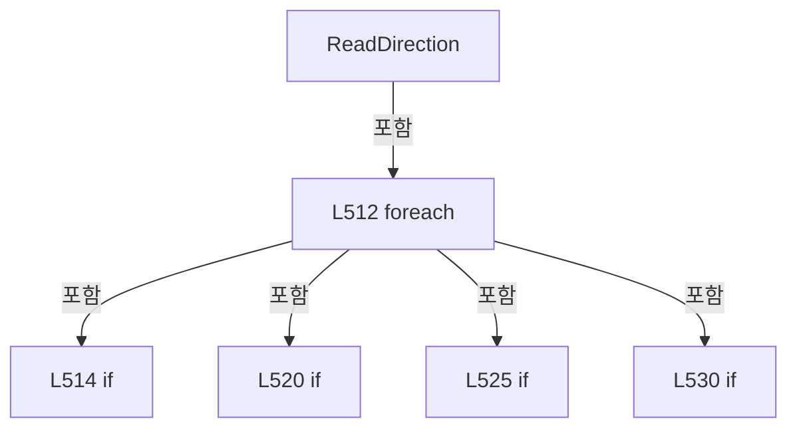

변경 전 점검: 입력/반환 타입, 위 호출자, 예외/취소 경로, 공유 상태와 저장·전송 소비자를 함께 확인합니다. 값의 단위나 물리 방향을 이름만으로 확정하지 않습니다.

### LocalFunctionStatement `ShouldIncludeItem` · L507–510

[Drilling.Common/Recipe/CShotCoordinatePlanBuilder.cs:507–510](https://github.com/kjuws10-rgb/A3Drilling/blob/5aee8e58439c9b455cae7c9593c9be986c3e682e/Drilling.Common/Recipe/CShotCoordinatePlanBuilder.cs#L507-L510)

| 항목 | 실제 추출 값 |
| --- | --- |
| 서명 | bool ShouldIncludeItem(string) |
| 접근/수식자 | Private /  |
| 반환/값 타입 | bool |
| 소속 타입 | NamedType:Drilling.Common.Recipe.CShotCoordinatePlanBuilder |

입력 계약:

| 이름 | 타입 | 전달 | 선택/기본값 |
| --- | --- | --- | --- |
| key | string | None | False /  |

현재 부분 분석에서 직접 연결된 호출자는 없습니다. XAML/이벤트/인터페이스·델리게이트·외부 진입을 추가 확인해야 하며, 미사용으로 판정한 것이 아닙니다.

호출하는 대상과 해석 범위:

| 원본 행 | 표현식 | 분석 상태 | 대상/소스 위치 |
| --- | --- | --- | --- |
| 509 | string.IsNullOrWhiteSpace | resolved | bool string.IsNullOrWhiteSpace(string?) |

본문의 실제 연산·분기·예외·반환 순서(원문 위치 순):

| 원본 행 | 종류 | 주석 해설 |
| --- | --- | --- |
| 509 | call | 함수·델리게이트 또는 객체 생성자를 호출합니다: string.IsNullOrWhiteSpace(key) |
| 509 | return | 호출자에게 값 또는 제어를 반환합니다: return !string.IsNullOrWhiteSpace(key); |

변경 전 점검: 입력/반환 타입, 위 호출자, 예외/취소 경로, 공유 상태와 저장·전송 소비자를 함께 확인합니다. 값의 단위나 물리 방향을 이름만으로 확정하지 않습니다.

### MethodDeclaration `NormalizeDirection` · L541–549

[Drilling.Common/Recipe/CShotCoordinatePlanBuilder.cs:541–549](https://github.com/kjuws10-rgb/A3Drilling/blob/5aee8e58439c9b455cae7c9593c9be986c3e682e/Drilling.Common/Recipe/CShotCoordinatePlanBuilder.cs#L541-L549)

| 항목 | 실제 추출 값 |
| --- | --- |
| 서명 | double Drilling.Common.Recipe.CShotCoordinatePlanBuilder.NormalizeDirection(double, string) |
| 접근/수식자 | Private / private, static |
| 반환/값 타입 | double |
| 소속 타입 | NamedType:Drilling.Common.Recipe.CShotCoordinatePlanBuilder |

입력 계약:

| 이름 | 타입 | 전달 | 선택/기본값 |
| --- | --- | --- | --- |
| value | double | None | False /  |
| key | string | None | False /  |

정적 호출자로 확인된 위치:

| 호출 파일/행 | 호출 표현식 | 런타임 분기 가능 |
| --- | --- | --- |
| [Drilling.Common/Recipe/CShotCoordinatePlanBuilder.cs:522–522](https://github.com/kjuws10-rgb/A3Drilling/blob/5aee8e58439c9b455cae7c9593c9be986c3e682e/Drilling.Common/Recipe/CShotCoordinatePlanBuilder.cs#L522-L522) | NormalizeDirection | False |
| [Drilling.Common/Recipe/CShotCoordinatePlanBuilder.cs:538–538](https://github.com/kjuws10-rgb/A3Drilling/blob/5aee8e58439c9b455cae7c9593c9be986c3e682e/Drilling.Common/Recipe/CShotCoordinatePlanBuilder.cs#L538-L538) | NormalizeDirection | False |

호출하는 대상과 해석 범위:

| 원본 행 | 표현식 | 분석 상태 | 대상/소스 위치 |
| --- | --- | --- | --- |
| 543 | double.IsFinite | resolved | bool double.IsFinite(double) |
| 545 | new InvalidOperationException | resolved | System.InvalidOperationException.InvalidOperationException(string?) |

본문의 실제 연산·분기·예외·반환 순서(원문 위치 순):

| 원본 행 | 종류 | 주석 해설 |
| --- | --- | --- |
| 543 | call | 함수·델리게이트 또는 객체 생성자를 호출합니다: double.IsFinite(value) |
| 543 | if | 조건에 따라 분기합니다: if (!double.IsFinite(value) &#124;&#124; (value != -1.0 && value != 1.0)) |
| 545 | call | 함수·델리게이트 또는 객체 생성자를 호출합니다: new InvalidOperationException($"Direction setting {key} must be -1 or +1. Current value: {value}") |
| 545 | throw | 예외를 발생/전달합니다: throw new InvalidOperationException($"Direction setting {key} must be -1 or +1. Current value: {value}"); |
| 548 | return | 호출자에게 값 또는 제어를 반환합니다: return value; |

제어 구문의 포함 구조(실제 실행 순서/CFG가 아닌 구문 탐색 그림):

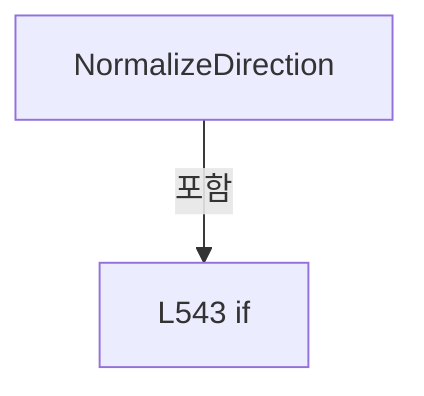

변경 전 점검: 입력/반환 타입, 위 호출자, 예외/취소 경로, 공유 상태와 저장·전송 소비자를 함께 확인합니다. 값의 단위나 물리 방향을 이름만으로 확정하지 않습니다.

### MethodDeclaration `ToShotKey` · L551–554

[Drilling.Common/Recipe/CShotCoordinatePlanBuilder.cs:551–554](https://github.com/kjuws10-rgb/A3Drilling/blob/5aee8e58439c9b455cae7c9593c9be986c3e682e/Drilling.Common/Recipe/CShotCoordinatePlanBuilder.cs#L551-L554)

| 항목 | 실제 추출 값 |
| --- | --- |
| 서명 | string Drilling.Common.Recipe.CShotCoordinatePlanBuilder.ToShotKey(int, int) |
| 접근/수식자 | Private / private, static |
| 반환/값 타입 | string |
| 소속 타입 | NamedType:Drilling.Common.Recipe.CShotCoordinatePlanBuilder |

입력 계약:

| 이름 | 타입 | 전달 | 선택/기본값 |
| --- | --- | --- | --- |
| cellNo | int | None | False /  |
| cellShotNo | int | None | False /  |

정적 호출자로 확인된 위치:

| 호출 파일/행 | 호출 표현식 | 런타임 분기 가능 |
| --- | --- | --- |
| [Drilling.Common/Recipe/CShotCoordinatePlanBuilder.cs:266–266](https://github.com/kjuws10-rgb/A3Drilling/blob/5aee8e58439c9b455cae7c9593c9be986c3e682e/Drilling.Common/Recipe/CShotCoordinatePlanBuilder.cs#L266-L266) | ToShotKey | False |

호출하는 대상과 해석 범위:

| 원본 행 | 표현식 | 분석 상태 | 대상/소스 위치 |
| --- | --- | --- | --- |
| 553 | Math.Max | resolved | int System.Math.Max(int, int) |
| 553 | Math.Max | resolved | int System.Math.Max(int, int) |

본문의 실제 연산·분기·예외·반환 순서(원문 위치 순):

| 원본 행 | 종류 | 주석 해설 |
| --- | --- | --- |
| 553 | call | 함수·델리게이트 또는 객체 생성자를 호출합니다: Math.Max(1, cellNo) |
| 553 | call | 함수·델리게이트 또는 객체 생성자를 호출합니다: Math.Max(1, cellShotNo) |
| 553 | return | 호출자에게 값 또는 제어를 반환합니다: return $"CELL{Math.Max(1, cellNo):000}_SHOT{Math.Max(1, cellShotNo):0000}"; |

변경 전 점검: 입력/반환 타입, 위 호출자, 예외/취소 경로, 공유 상태와 저장·전송 소비자를 함께 확인합니다. 값의 단위나 물리 방향을 이름만으로 확정하지 않습니다.

### MethodDeclaration `ReadDouble` · L556–572

[Drilling.Common/Recipe/CShotCoordinatePlanBuilder.cs:556–572](https://github.com/kjuws10-rgb/A3Drilling/blob/5aee8e58439c9b455cae7c9593c9be986c3e682e/Drilling.Common/Recipe/CShotCoordinatePlanBuilder.cs#L556-L572)

| 항목 | 실제 추출 값 |
| --- | --- |
| 서명 | double Drilling.Common.Recipe.CShotCoordinatePlanBuilder.ReadDouble(System.Collections.Generic.IReadOnlyDictionary<string, string>, double, params string[]) |
| 접근/수식자 | Private / private, static |
| 반환/값 타입 | double |
| 소속 타입 | NamedType:Drilling.Common.Recipe.CShotCoordinatePlanBuilder |

입력 계약:

| 이름 | 타입 | 전달 | 선택/기본값 |
| --- | --- | --- | --- |
| parameters | System.Collections.Generic.IReadOnlyDictionary<string, string> | None | False /  |
| defaultValue | double | None | False /  |
| keys | string[] | None | False /  |

정적 호출자로 확인된 위치:

| 호출 파일/행 | 호출 표현식 | 런타임 분기 가능 |
| --- | --- | --- |
| [Drilling.Common/Recipe/CShotCoordinatePlanBuilder.cs:24–24](https://github.com/kjuws10-rgb/A3Drilling/blob/5aee8e58439c9b455cae7c9593c9be986c3e682e/Drilling.Common/Recipe/CShotCoordinatePlanBuilder.cs#L24-L24) | ReadDouble | False |
| [Drilling.Common/Recipe/CShotCoordinatePlanBuilder.cs:25–25](https://github.com/kjuws10-rgb/A3Drilling/blob/5aee8e58439c9b455cae7c9593c9be986c3e682e/Drilling.Common/Recipe/CShotCoordinatePlanBuilder.cs#L25-L25) | ReadDouble | False |
| [Drilling.Common/Recipe/CShotCoordinatePlanBuilder.cs:26–26](https://github.com/kjuws10-rgb/A3Drilling/blob/5aee8e58439c9b455cae7c9593c9be986c3e682e/Drilling.Common/Recipe/CShotCoordinatePlanBuilder.cs#L26-L26) | ReadDouble | False |
| [Drilling.Common/Recipe/CShotCoordinatePlanBuilder.cs:28–28](https://github.com/kjuws10-rgb/A3Drilling/blob/5aee8e58439c9b455cae7c9593c9be986c3e682e/Drilling.Common/Recipe/CShotCoordinatePlanBuilder.cs#L28-L28) | ReadDouble | False |
| [Drilling.Common/Recipe/CShotCoordinatePlanBuilder.cs:29–29](https://github.com/kjuws10-rgb/A3Drilling/blob/5aee8e58439c9b455cae7c9593c9be986c3e682e/Drilling.Common/Recipe/CShotCoordinatePlanBuilder.cs#L29-L29) | ReadDouble | False |
| [Drilling.Common/Recipe/CShotCoordinatePlanBuilder.cs:31–31](https://github.com/kjuws10-rgb/A3Drilling/blob/5aee8e58439c9b455cae7c9593c9be986c3e682e/Drilling.Common/Recipe/CShotCoordinatePlanBuilder.cs#L31-L31) | ReadDouble | False |
| [Drilling.Common/Recipe/CShotCoordinatePlanBuilder.cs:32–32](https://github.com/kjuws10-rgb/A3Drilling/blob/5aee8e58439c9b455cae7c9593c9be986c3e682e/Drilling.Common/Recipe/CShotCoordinatePlanBuilder.cs#L32-L32) | ReadDouble | False |
| [Drilling.Common/Recipe/CShotCoordinatePlanBuilder.cs:224–224](https://github.com/kjuws10-rgb/A3Drilling/blob/5aee8e58439c9b455cae7c9593c9be986c3e682e/Drilling.Common/Recipe/CShotCoordinatePlanBuilder.cs#L224-L224) | ReadDouble | False |
| [Drilling.Common/Recipe/CShotCoordinatePlanBuilder.cs:225–225](https://github.com/kjuws10-rgb/A3Drilling/blob/5aee8e58439c9b455cae7c9593c9be986c3e682e/Drilling.Common/Recipe/CShotCoordinatePlanBuilder.cs#L225-L225) | ReadDouble | False |
| [Drilling.Common/Recipe/CShotCoordinatePlanBuilder.cs:226–226](https://github.com/kjuws10-rgb/A3Drilling/blob/5aee8e58439c9b455cae7c9593c9be986c3e682e/Drilling.Common/Recipe/CShotCoordinatePlanBuilder.cs#L226-L226) | ReadDouble | False |
| [Drilling.Common/Recipe/CShotCoordinatePlanBuilder.cs:236–236](https://github.com/kjuws10-rgb/A3Drilling/blob/5aee8e58439c9b455cae7c9593c9be986c3e682e/Drilling.Common/Recipe/CShotCoordinatePlanBuilder.cs#L236-L236) | ReadDouble | False |
| [Drilling.Common/Recipe/CShotCoordinatePlanBuilder.cs:237–237](https://github.com/kjuws10-rgb/A3Drilling/blob/5aee8e58439c9b455cae7c9593c9be986c3e682e/Drilling.Common/Recipe/CShotCoordinatePlanBuilder.cs#L237-L237) | ReadDouble | False |
| [Drilling.Common/Recipe/CShotCoordinatePlanBuilder.cs:238–238](https://github.com/kjuws10-rgb/A3Drilling/blob/5aee8e58439c9b455cae7c9593c9be986c3e682e/Drilling.Common/Recipe/CShotCoordinatePlanBuilder.cs#L238-L238) | ReadDouble | False |
| [Drilling.Common/Recipe/CShotCoordinatePlanBuilder.cs:275–275](https://github.com/kjuws10-rgb/A3Drilling/blob/5aee8e58439c9b455cae7c9593c9be986c3e682e/Drilling.Common/Recipe/CShotCoordinatePlanBuilder.cs#L275-L275) | ReadDouble | False |
| [Drilling.Common/Recipe/CShotCoordinatePlanBuilder.cs:276–276](https://github.com/kjuws10-rgb/A3Drilling/blob/5aee8e58439c9b455cae7c9593c9be986c3e682e/Drilling.Common/Recipe/CShotCoordinatePlanBuilder.cs#L276-L276) | ReadDouble | False |
| [Drilling.Common/Recipe/CShotCoordinatePlanBuilder.cs:277–277](https://github.com/kjuws10-rgb/A3Drilling/blob/5aee8e58439c9b455cae7c9593c9be986c3e682e/Drilling.Common/Recipe/CShotCoordinatePlanBuilder.cs#L277-L277) | ReadDouble | False |
| [Drilling.Common/Recipe/CShotCoordinatePlanBuilder.cs:278–278](https://github.com/kjuws10-rgb/A3Drilling/blob/5aee8e58439c9b455cae7c9593c9be986c3e682e/Drilling.Common/Recipe/CShotCoordinatePlanBuilder.cs#L278-L278) | ReadDouble | False |
| [Drilling.Common/Recipe/CShotCoordinatePlanBuilder.cs:454–454](https://github.com/kjuws10-rgb/A3Drilling/blob/5aee8e58439c9b455cae7c9593c9be986c3e682e/Drilling.Common/Recipe/CShotCoordinatePlanBuilder.cs#L454-L454) | ReadDouble | False |
| [Drilling.Common/Recipe/CShotCoordinatePlanBuilder.cs:455–455](https://github.com/kjuws10-rgb/A3Drilling/blob/5aee8e58439c9b455cae7c9593c9be986c3e682e/Drilling.Common/Recipe/CShotCoordinatePlanBuilder.cs#L455-L455) | ReadDouble | False |
| [Drilling.Common/Recipe/CShotCoordinatePlanBuilder.cs:456–456](https://github.com/kjuws10-rgb/A3Drilling/blob/5aee8e58439c9b455cae7c9593c9be986c3e682e/Drilling.Common/Recipe/CShotCoordinatePlanBuilder.cs#L456-L456) | ReadDouble | False |
| [Drilling.Common/Recipe/CShotCoordinatePlanBuilder.cs:468–468](https://github.com/kjuws10-rgb/A3Drilling/blob/5aee8e58439c9b455cae7c9593c9be986c3e682e/Drilling.Common/Recipe/CShotCoordinatePlanBuilder.cs#L468-L468) | ReadDouble | False |
| [Drilling.Common/Recipe/CShotCoordinatePlanBuilder.cs:469–469](https://github.com/kjuws10-rgb/A3Drilling/blob/5aee8e58439c9b455cae7c9593c9be986c3e682e/Drilling.Common/Recipe/CShotCoordinatePlanBuilder.cs#L469-L469) | ReadDouble | False |
| [Drilling.Common/Recipe/CShotCoordinatePlanBuilder.cs:475–475](https://github.com/kjuws10-rgb/A3Drilling/blob/5aee8e58439c9b455cae7c9593c9be986c3e682e/Drilling.Common/Recipe/CShotCoordinatePlanBuilder.cs#L475-L475) | ReadDouble | False |
| [Drilling.Common/Recipe/CShotCoordinatePlanBuilder.cs:480–480](https://github.com/kjuws10-rgb/A3Drilling/blob/5aee8e58439c9b455cae7c9593c9be986c3e682e/Drilling.Common/Recipe/CShotCoordinatePlanBuilder.cs#L480-L480) | ReadDouble | False |
| [Drilling.Common/Recipe/CShotCoordinatePlanBuilder.cs:485–485](https://github.com/kjuws10-rgb/A3Drilling/blob/5aee8e58439c9b455cae7c9593c9be986c3e682e/Drilling.Common/Recipe/CShotCoordinatePlanBuilder.cs#L485-L485) | ReadDouble | False |
| [Drilling.Common/Recipe/CShotCoordinatePlanBuilder.cs:500–500](https://github.com/kjuws10-rgb/A3Drilling/blob/5aee8e58439c9b455cae7c9593c9be986c3e682e/Drilling.Common/Recipe/CShotCoordinatePlanBuilder.cs#L500-L500) | ReadDouble | False |
| [Drilling.Common/Recipe/CShotCoordinatePlanBuilder.cs:501–501](https://github.com/kjuws10-rgb/A3Drilling/blob/5aee8e58439c9b455cae7c9593c9be986c3e682e/Drilling.Common/Recipe/CShotCoordinatePlanBuilder.cs#L501-L501) | ReadDouble | False |

호출하는 대상과 해석 범위:

| 원본 행 | 표현식 | 분석 상태 | 대상/소스 위치 |
| --- | --- | --- | --- |
| 563 | keys.Where | resolved | System.Collections.Generic.IEnumerable<string> System.Collections.Generic.IEnumerable<string>.Where<string>(System.Func<string, bool>) |
| 565 | parameters.TryGetValue | resolved · 동적 구현 선택 가능 | bool System.Collections.Generic.IReadOnlyDictionary<string, string>.TryGetValue(string, out string) |
| 565 | double.TryParse | resolved | bool double.TryParse(string?, System.Globalization.NumberStyles, System.IFormatProvider?, out double) |

본문의 실제 연산·분기·예외·반환 순서(원문 위치 순):

| 원본 행 | 종류 | 주석 해설 |
| --- | --- | --- |
| 563 | call | 함수·델리게이트 또는 객체 생성자를 호출합니다: keys.Where(ShouldIncludeItem) |
| 563 | foreach | 컬렉션 요소를 순회합니다: foreach (var key in keys.Where(ShouldIncludeItem)) |
| 565 | call | 함수·델리게이트 또는 객체 생성자를 호출합니다: parameters.TryGetValue(key, out var value) |
| 565 | call | 함수·델리게이트 또는 객체 생성자를 호출합니다: double.TryParse(value, NumberStyles.Any, CultureInfo.InvariantCulture, out var result) |
| 565 | if | 조건에 따라 분기합니다: if (parameters.TryGetValue(key, out var value) && double.TryParse(value, NumberStyles.Any, CultureInfo.InvariantCulture, out var result)) |
| 567 | return | 호출자에게 값 또는 제어를 반환합니다: return result; |
| 571 | return | 호출자에게 값 또는 제어를 반환합니다: return defaultValue; |

제어 구문의 포함 구조(실제 실행 순서/CFG가 아닌 구문 탐색 그림):

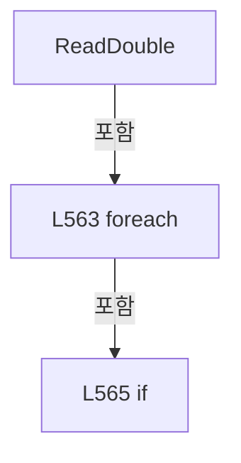

변경 전 점검: 입력/반환 타입, 위 호출자, 예외/취소 경로, 공유 상태와 저장·전송 소비자를 함께 확인합니다. 값의 단위나 물리 방향을 이름만으로 확정하지 않습니다.

### LocalFunctionStatement `ShouldIncludeItem` · L558–561

[Drilling.Common/Recipe/CShotCoordinatePlanBuilder.cs:558–561](https://github.com/kjuws10-rgb/A3Drilling/blob/5aee8e58439c9b455cae7c9593c9be986c3e682e/Drilling.Common/Recipe/CShotCoordinatePlanBuilder.cs#L558-L561)

| 항목 | 실제 추출 값 |
| --- | --- |
| 서명 | bool ShouldIncludeItem(string) |
| 접근/수식자 | Private /  |
| 반환/값 타입 | bool |
| 소속 타입 | NamedType:Drilling.Common.Recipe.CShotCoordinatePlanBuilder |

입력 계약:

| 이름 | 타입 | 전달 | 선택/기본값 |
| --- | --- | --- | --- |
| key | string | None | False /  |

현재 부분 분석에서 직접 연결된 호출자는 없습니다. XAML/이벤트/인터페이스·델리게이트·외부 진입을 추가 확인해야 하며, 미사용으로 판정한 것이 아닙니다.

호출하는 대상과 해석 범위:

| 원본 행 | 표현식 | 분석 상태 | 대상/소스 위치 |
| --- | --- | --- | --- |
| 560 | string.IsNullOrWhiteSpace | resolved | bool string.IsNullOrWhiteSpace(string?) |

본문의 실제 연산·분기·예외·반환 순서(원문 위치 순):

| 원본 행 | 종류 | 주석 해설 |
| --- | --- | --- |
| 560 | call | 함수·델리게이트 또는 객체 생성자를 호출합니다: string.IsNullOrWhiteSpace(key) |
| 560 | return | 호출자에게 값 또는 제어를 반환합니다: return !string.IsNullOrWhiteSpace(key); |

변경 전 점검: 입력/반환 타입, 위 호출자, 예외/취소 경로, 공유 상태와 저장·전송 소비자를 함께 확인합니다. 값의 단위나 물리 방향을 이름만으로 확정하지 않습니다.

### MethodDeclaration `ReadNullableDouble` · L574–590

[Drilling.Common/Recipe/CShotCoordinatePlanBuilder.cs:574–590](https://github.com/kjuws10-rgb/A3Drilling/blob/5aee8e58439c9b455cae7c9593c9be986c3e682e/Drilling.Common/Recipe/CShotCoordinatePlanBuilder.cs#L574-L590)

| 항목 | 실제 추출 값 |
| --- | --- |
| 서명 | double? Drilling.Common.Recipe.CShotCoordinatePlanBuilder.ReadNullableDouble(System.Collections.Generic.IReadOnlyDictionary<string, string>, params string[]) |
| 접근/수식자 | Private / private, static |
| 반환/값 타입 | double? |
| 소속 타입 | NamedType:Drilling.Common.Recipe.CShotCoordinatePlanBuilder |

입력 계약:

| 이름 | 타입 | 전달 | 선택/기본값 |
| --- | --- | --- | --- |
| parameters | System.Collections.Generic.IReadOnlyDictionary<string, string> | None | False /  |
| keys | string[] | None | False /  |

정적 호출자로 확인된 위치:

| 호출 파일/행 | 호출 표현식 | 런타임 분기 가능 |
| --- | --- | --- |
| [Drilling.Common/Recipe/CShotCoordinatePlanBuilder.cs:386–386](https://github.com/kjuws10-rgb/A3Drilling/blob/5aee8e58439c9b455cae7c9593c9be986c3e682e/Drilling.Common/Recipe/CShotCoordinatePlanBuilder.cs#L386-L386) | ReadNullableDouble | False |
| [Drilling.Common/Recipe/CShotCoordinatePlanBuilder.cs:462–462](https://github.com/kjuws10-rgb/A3Drilling/blob/5aee8e58439c9b455cae7c9593c9be986c3e682e/Drilling.Common/Recipe/CShotCoordinatePlanBuilder.cs#L462-L462) | ReadNullableDouble | False |

호출하는 대상과 해석 범위:

| 원본 행 | 표현식 | 분석 상태 | 대상/소스 위치 |
| --- | --- | --- | --- |
| 581 | keys.Where | resolved | System.Collections.Generic.IEnumerable<string> System.Collections.Generic.IEnumerable<string>.Where<string>(System.Func<string, bool>) |
| 583 | parameters.TryGetValue | resolved · 동적 구현 선택 가능 | bool System.Collections.Generic.IReadOnlyDictionary<string, string>.TryGetValue(string, out string) |
| 583 | double.TryParse | resolved | bool double.TryParse(string?, System.Globalization.NumberStyles, System.IFormatProvider?, out double) |

본문의 실제 연산·분기·예외·반환 순서(원문 위치 순):

| 원본 행 | 종류 | 주석 해설 |
| --- | --- | --- |
| 581 | call | 함수·델리게이트 또는 객체 생성자를 호출합니다: keys.Where(ShouldIncludeItem) |
| 581 | foreach | 컬렉션 요소를 순회합니다: foreach (var key in keys.Where(ShouldIncludeItem)) |
| 583 | call | 함수·델리게이트 또는 객체 생성자를 호출합니다: parameters.TryGetValue(key, out var value) |
| 583 | call | 함수·델리게이트 또는 객체 생성자를 호출합니다: double.TryParse(value, NumberStyles.Any, CultureInfo.InvariantCulture, out var result) |
| 583 | if | 조건에 따라 분기합니다: if (parameters.TryGetValue(key, out var value) && double.TryParse(value, NumberStyles.Any, CultureInfo.InvariantCulture, out var result)) |
| 585 | return | 호출자에게 값 또는 제어를 반환합니다: return result; |
| 589 | return | 호출자에게 값 또는 제어를 반환합니다: return null; |

제어 구문의 포함 구조(실제 실행 순서/CFG가 아닌 구문 탐색 그림):

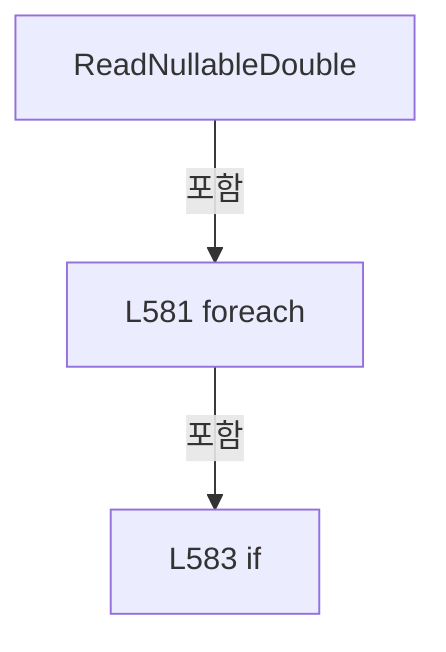

변경 전 점검: 입력/반환 타입, 위 호출자, 예외/취소 경로, 공유 상태와 저장·전송 소비자를 함께 확인합니다. 값의 단위나 물리 방향을 이름만으로 확정하지 않습니다.

### LocalFunctionStatement `ShouldIncludeItem` · L576–579

[Drilling.Common/Recipe/CShotCoordinatePlanBuilder.cs:576–579](https://github.com/kjuws10-rgb/A3Drilling/blob/5aee8e58439c9b455cae7c9593c9be986c3e682e/Drilling.Common/Recipe/CShotCoordinatePlanBuilder.cs#L576-L579)

| 항목 | 실제 추출 값 |
| --- | --- |
| 서명 | bool ShouldIncludeItem(string) |
| 접근/수식자 | Private /  |
| 반환/값 타입 | bool |
| 소속 타입 | NamedType:Drilling.Common.Recipe.CShotCoordinatePlanBuilder |

입력 계약:

| 이름 | 타입 | 전달 | 선택/기본값 |
| --- | --- | --- | --- |
| key | string | None | False /  |

현재 부분 분석에서 직접 연결된 호출자는 없습니다. XAML/이벤트/인터페이스·델리게이트·외부 진입을 추가 확인해야 하며, 미사용으로 판정한 것이 아닙니다.

호출하는 대상과 해석 범위:

| 원본 행 | 표현식 | 분석 상태 | 대상/소스 위치 |
| --- | --- | --- | --- |
| 578 | string.IsNullOrWhiteSpace | resolved | bool string.IsNullOrWhiteSpace(string?) |

본문의 실제 연산·분기·예외·반환 순서(원문 위치 순):

| 원본 행 | 종류 | 주석 해설 |
| --- | --- | --- |
| 578 | call | 함수·델리게이트 또는 객체 생성자를 호출합니다: string.IsNullOrWhiteSpace(key) |
| 578 | return | 호출자에게 값 또는 제어를 반환합니다: return !string.IsNullOrWhiteSpace(key); |

변경 전 점검: 입력/반환 타입, 위 호출자, 예외/취소 경로, 공유 상태와 저장·전송 소비자를 함께 확인합니다. 값의 단위나 물리 방향을 이름만으로 확정하지 않습니다.

### MethodDeclaration `ReadInt` · L592–618

[Drilling.Common/Recipe/CShotCoordinatePlanBuilder.cs:592–618](https://github.com/kjuws10-rgb/A3Drilling/blob/5aee8e58439c9b455cae7c9593c9be986c3e682e/Drilling.Common/Recipe/CShotCoordinatePlanBuilder.cs#L592-L618)

| 항목 | 실제 추출 값 |
| --- | --- |
| 서명 | int Drilling.Common.Recipe.CShotCoordinatePlanBuilder.ReadInt(System.Collections.Generic.IReadOnlyDictionary<string, string>, int, params string[]) |
| 접근/수식자 | Private / private, static |
| 반환/값 타입 | int |
| 소속 타입 | NamedType:Drilling.Common.Recipe.CShotCoordinatePlanBuilder |

입력 계약:

| 이름 | 타입 | 전달 | 선택/기본값 |
| --- | --- | --- | --- |
| parameters | System.Collections.Generic.IReadOnlyDictionary<string, string> | None | False /  |
| defaultValue | int | None | False /  |
| keys | string[] | None | False /  |

정적 호출자로 확인된 위치:

| 호출 파일/행 | 호출 표현식 | 런타임 분기 가능 |
| --- | --- | --- |
| [Drilling.Common/Recipe/CShotCoordinatePlanBuilder.cs:14–14](https://github.com/kjuws10-rgb/A3Drilling/blob/5aee8e58439c9b455cae7c9593c9be986c3e682e/Drilling.Common/Recipe/CShotCoordinatePlanBuilder.cs#L14-L14) | ReadInt | False |
| [Drilling.Common/Recipe/CShotCoordinatePlanBuilder.cs:15–15](https://github.com/kjuws10-rgb/A3Drilling/blob/5aee8e58439c9b455cae7c9593c9be986c3e682e/Drilling.Common/Recipe/CShotCoordinatePlanBuilder.cs#L15-L15) | ReadInt | False |
| [Drilling.Common/Recipe/CShotCoordinatePlanBuilder.cs:216–216](https://github.com/kjuws10-rgb/A3Drilling/blob/5aee8e58439c9b455cae7c9593c9be986c3e682e/Drilling.Common/Recipe/CShotCoordinatePlanBuilder.cs#L216-L216) | ReadInt | False |
| [Drilling.Common/Recipe/CShotCoordinatePlanBuilder.cs:227–227](https://github.com/kjuws10-rgb/A3Drilling/blob/5aee8e58439c9b455cae7c9593c9be986c3e682e/Drilling.Common/Recipe/CShotCoordinatePlanBuilder.cs#L227-L227) | ReadInt | False |

호출하는 대상과 해석 범위:

| 원본 행 | 표현식 | 분석 상태 | 대상/소스 위치 |
| --- | --- | --- | --- |
| 599 | keys.Where | resolved | System.Collections.Generic.IEnumerable<string> System.Collections.Generic.IEnumerable<string>.Where<string>(System.Func<string, bool>) |
| 601 | parameters.TryGetValue | resolved · 동적 구현 선택 가능 | bool System.Collections.Generic.IReadOnlyDictionary<string, string>.TryGetValue(string, out string) |
| 606 | int.TryParse | resolved | bool int.TryParse(string?, System.Globalization.NumberStyles, System.IFormatProvider?, out int) |
| 611 | double.TryParse | resolved | bool double.TryParse(string?, System.Globalization.NumberStyles, System.IFormatProvider?, out double) |
| 613 | Math.Round | resolved | double System.Math.Round(double) |

본문의 실제 연산·분기·예외·반환 순서(원문 위치 순):

| 원본 행 | 종류 | 주석 해설 |
| --- | --- | --- |
| 599 | call | 함수·델리게이트 또는 객체 생성자를 호출합니다: keys.Where(ShouldIncludeItem) |
| 599 | foreach | 컬렉션 요소를 순회합니다: foreach (var key in keys.Where(ShouldIncludeItem)) |
| 601 | call | 함수·델리게이트 또는 객체 생성자를 호출합니다: parameters.TryGetValue(key, out var value) |
| 601 | if | 조건에 따라 분기합니다: if (!parameters.TryGetValue(key, out var value)) |
| 603 | continue | 다음 반복으로 진행합니다: continue; |
| 606 | call | 함수·델리게이트 또는 객체 생성자를 호출합니다: int.TryParse(value, NumberStyles.Integer, CultureInfo.InvariantCulture, out var intResult) |
| 606 | if | 조건에 따라 분기합니다: if (int.TryParse(value, NumberStyles.Integer, CultureInfo.InvariantCulture, out var intResult)) |
| 608 | return | 호출자에게 값 또는 제어를 반환합니다: return intResult; |
| 611 | call | 함수·델리게이트 또는 객체 생성자를 호출합니다: double.TryParse(value, NumberStyles.Any, CultureInfo.InvariantCulture, out var doubleResult) |
| 611 | if | 조건에 따라 분기합니다: if (double.TryParse(value, NumberStyles.Any, CultureInfo.InvariantCulture, out var doubleResult)) |
| 613 | call | 함수·델리게이트 또는 객체 생성자를 호출합니다: Math.Round(doubleResult) |
| 613 | return | 호출자에게 값 또는 제어를 반환합니다: return (int)Math.Round(doubleResult); |
| 617 | return | 호출자에게 값 또는 제어를 반환합니다: return defaultValue; |

제어 구문의 포함 구조(실제 실행 순서/CFG가 아닌 구문 탐색 그림):

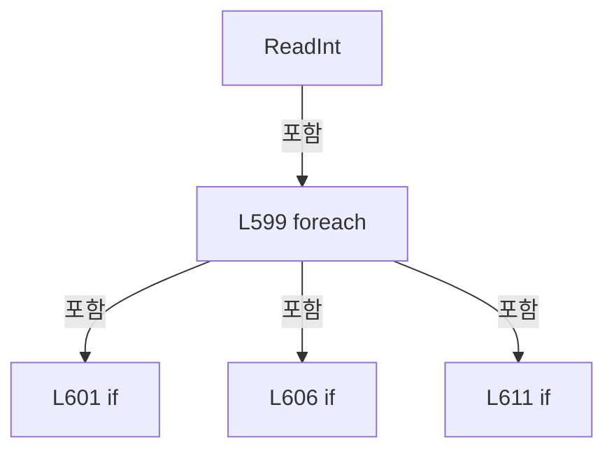

변경 전 점검: 입력/반환 타입, 위 호출자, 예외/취소 경로, 공유 상태와 저장·전송 소비자를 함께 확인합니다. 값의 단위나 물리 방향을 이름만으로 확정하지 않습니다.

### LocalFunctionStatement `ShouldIncludeItem` · L594–597

[Drilling.Common/Recipe/CShotCoordinatePlanBuilder.cs:594–597](https://github.com/kjuws10-rgb/A3Drilling/blob/5aee8e58439c9b455cae7c9593c9be986c3e682e/Drilling.Common/Recipe/CShotCoordinatePlanBuilder.cs#L594-L597)

| 항목 | 실제 추출 값 |
| --- | --- |
| 서명 | bool ShouldIncludeItem(string) |
| 접근/수식자 | Private /  |
| 반환/값 타입 | bool |
| 소속 타입 | NamedType:Drilling.Common.Recipe.CShotCoordinatePlanBuilder |

입력 계약:

| 이름 | 타입 | 전달 | 선택/기본값 |
| --- | --- | --- | --- |
| key | string | None | False /  |

현재 부분 분석에서 직접 연결된 호출자는 없습니다. XAML/이벤트/인터페이스·델리게이트·외부 진입을 추가 확인해야 하며, 미사용으로 판정한 것이 아닙니다.

호출하는 대상과 해석 범위:

| 원본 행 | 표현식 | 분석 상태 | 대상/소스 위치 |
| --- | --- | --- | --- |
| 596 | string.IsNullOrWhiteSpace | resolved | bool string.IsNullOrWhiteSpace(string?) |

본문의 실제 연산·분기·예외·반환 순서(원문 위치 순):

| 원본 행 | 종류 | 주석 해설 |
| --- | --- | --- |
| 596 | call | 함수·델리게이트 또는 객체 생성자를 호출합니다: string.IsNullOrWhiteSpace(key) |
| 596 | return | 호출자에게 값 또는 제어를 반환합니다: return !string.IsNullOrWhiteSpace(key); |

변경 전 점검: 입력/반환 타입, 위 호출자, 예외/취소 경로, 공유 상태와 저장·전송 소비자를 함께 확인합니다. 값의 단위나 물리 방향을 이름만으로 확정하지 않습니다.

### MethodDeclaration `ReadBool` · L620–649

[Drilling.Common/Recipe/CShotCoordinatePlanBuilder.cs:620–649](https://github.com/kjuws10-rgb/A3Drilling/blob/5aee8e58439c9b455cae7c9593c9be986c3e682e/Drilling.Common/Recipe/CShotCoordinatePlanBuilder.cs#L620-L649)

| 항목 | 실제 추출 값 |
| --- | --- |
| 서명 | bool Drilling.Common.Recipe.CShotCoordinatePlanBuilder.ReadBool(System.Collections.Generic.IReadOnlyDictionary<string, string>, bool, params string[]) |
| 접근/수식자 | Private / private, static |
| 반환/값 타입 | bool |
| 소속 타입 | NamedType:Drilling.Common.Recipe.CShotCoordinatePlanBuilder |

입력 계약:

| 이름 | 타입 | 전달 | 선택/기본값 |
| --- | --- | --- | --- |
| parameters | System.Collections.Generic.IReadOnlyDictionary<string, string> | None | False /  |
| defaultValue | bool | None | False /  |
| keys | string[] | None | False /  |

정적 호출자로 확인된 위치:

| 호출 파일/행 | 호출 표현식 | 런타임 분기 가능 |
| --- | --- | --- |
| [Drilling.Common/Recipe/CShotCoordinatePlanBuilder.cs:447–447](https://github.com/kjuws10-rgb/A3Drilling/blob/5aee8e58439c9b455cae7c9593c9be986c3e682e/Drilling.Common/Recipe/CShotCoordinatePlanBuilder.cs#L447-L447) | ReadBool | False |

호출하는 대상과 해석 범위:

| 원본 행 | 표현식 | 분석 상태 | 대상/소스 위치 |
| --- | --- | --- | --- |
| 627 | keys.Where | resolved | System.Collections.Generic.IEnumerable<string> System.Collections.Generic.IEnumerable<string>.Where<string>(System.Func<string, bool>) |
| 629 | parameters.TryGetValue | resolved · 동적 구현 선택 가능 | bool System.Collections.Generic.IReadOnlyDictionary<string, string>.TryGetValue(string, out string) |
| 629 | string.IsNullOrWhiteSpace | resolved | bool string.IsNullOrWhiteSpace(string?) |
| 634 | value.Trim().ToUpperInvariant | resolved | string string.ToUpperInvariant() |
| 634 | value.Trim | resolved | string string.Trim() |

본문의 실제 연산·분기·예외·반환 순서(원문 위치 순):

| 원본 행 | 종류 | 주석 해설 |
| --- | --- | --- |
| 627 | call | 함수·델리게이트 또는 객체 생성자를 호출합니다: keys.Where(ShouldIncludeItem) |
| 627 | foreach | 컬렉션 요소를 순회합니다: foreach (var key in keys.Where(ShouldIncludeItem)) |
| 629 | call | 함수·델리게이트 또는 객체 생성자를 호출합니다: parameters.TryGetValue(key, out var value) |
| 629 | call | 함수·델리게이트 또는 객체 생성자를 호출합니다: string.IsNullOrWhiteSpace(value) |
| 629 | if | 조건에 따라 분기합니다: if (!parameters.TryGetValue(key, out var value) &#124;&#124; string.IsNullOrWhiteSpace(value)) |
| 631 | continue | 다음 반복으로 진행합니다: continue; |
| 634 | call | 함수·델리게이트 또는 객체 생성자를 호출합니다: value.Trim().ToUpperInvariant() |
| 634 | call | 함수·델리게이트 또는 객체 생성자를 호출합니다: value.Trim() |
| 634 | local-declaration | 지역 변수를 선언합니다: var normalized = value.Trim().ToUpperInvariant(); |
| 634 | variable-initializer | 변수의 초기값을 지정합니다: normalized = value.Trim().ToUpperInvariant() |
| 635 | if | 조건에 따라 분기합니다: if (normalized is "1" or "Y" or "YES" or "TRUE" or "ON" or "USE") |
| 637 | return | 호출자에게 값 또는 제어를 반환합니다: return true; |
| 640 | if | 조건에 따라 분기합니다: if (normalized is "0" or "N" or "NO" or "FALSE" or "OFF" or "SKIP" or "UNUSEsc") |
| 642 | return | 호출자에게 값 또는 제어를 반환합니다: return false; |
| 645 | return | 호출자에게 값 또는 제어를 반환합니다: return defaultValue; |
| 648 | return | 호출자에게 값 또는 제어를 반환합니다: return defaultValue; |

제어 구문의 포함 구조(실제 실행 순서/CFG가 아닌 구문 탐색 그림):

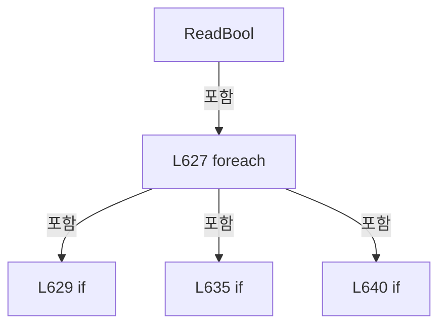

변경 전 점검: 입력/반환 타입, 위 호출자, 예외/취소 경로, 공유 상태와 저장·전송 소비자를 함께 확인합니다. 값의 단위나 물리 방향을 이름만으로 확정하지 않습니다.

### LocalFunctionStatement `ShouldIncludeItem` · L622–625

[Drilling.Common/Recipe/CShotCoordinatePlanBuilder.cs:622–625](https://github.com/kjuws10-rgb/A3Drilling/blob/5aee8e58439c9b455cae7c9593c9be986c3e682e/Drilling.Common/Recipe/CShotCoordinatePlanBuilder.cs#L622-L625)

| 항목 | 실제 추출 값 |
| --- | --- |
| 서명 | bool ShouldIncludeItem(string) |
| 접근/수식자 | Private /  |
| 반환/값 타입 | bool |
| 소속 타입 | NamedType:Drilling.Common.Recipe.CShotCoordinatePlanBuilder |

입력 계약:

| 이름 | 타입 | 전달 | 선택/기본값 |
| --- | --- | --- | --- |
| key | string | None | False /  |

현재 부분 분석에서 직접 연결된 호출자는 없습니다. XAML/이벤트/인터페이스·델리게이트·외부 진입을 추가 확인해야 하며, 미사용으로 판정한 것이 아닙니다.

호출하는 대상과 해석 범위:

| 원본 행 | 표현식 | 분석 상태 | 대상/소스 위치 |
| --- | --- | --- | --- |
| 624 | string.IsNullOrWhiteSpace | resolved | bool string.IsNullOrWhiteSpace(string?) |

본문의 실제 연산·분기·예외·반환 순서(원문 위치 순):

| 원본 행 | 종류 | 주석 해설 |
| --- | --- | --- |
| 624 | call | 함수·델리게이트 또는 객체 생성자를 호출합니다: string.IsNullOrWhiteSpace(key) |
| 624 | return | 호출자에게 값 또는 제어를 반환합니다: return !string.IsNullOrWhiteSpace(key); |

변경 전 점검: 입력/반환 타입, 위 호출자, 예외/취소 경로, 공유 상태와 저장·전송 소비자를 함께 확인합니다. 값의 단위나 물리 방향을 이름만으로 확정하지 않습니다.

### FieldDeclaration `MaximumAbsoluteOffset` · L655–655

[Drilling.Common/Recipe/CShotCoordinatePlanBuilder.cs:655–655](https://github.com/kjuws10-rgb/A3Drilling/blob/5aee8e58439c9b455cae7c9593c9be986c3e682e/Drilling.Common/Recipe/CShotCoordinatePlanBuilder.cs#L655-L655)

| 항목 | 실제 추출 값 |
| --- | --- |
| 서명 | double Drilling.Common.Recipe.CAlignShotOffsetData.MaximumAbsoluteOffset |
| 접근/수식자 | Private / private, const |
| 반환/값 타입 | double |
| 소속 타입 | NamedType:Drilling.Common.Recipe.CAlignShotOffsetData |

현재 부분 분석에서 직접 연결된 호출자는 없습니다. XAML/이벤트/인터페이스·델리게이트·외부 진입을 추가 확인해야 하며, 미사용으로 판정한 것이 아닙니다.

본문의 실제 연산·분기·예외·반환 순서(원문 위치 순):

| 원본 행 | 종류 | 주석 해설 |
| --- | --- | --- |
| 655 | variable-initializer | 변수의 초기값을 지정합니다: MaximumAbsoluteOffset = 100000 |

변경 전 점검: 입력/반환 타입, 위 호출자, 예외/취소 경로, 공유 상태와 저장·전송 소비자를 함께 확인합니다. 값의 단위나 물리 방향을 이름만으로 확정하지 않습니다.

### FieldDeclaration `ParameterPattern` · L656–656

[Drilling.Common/Recipe/CShotCoordinatePlanBuilder.cs:656–656](https://github.com/kjuws10-rgb/A3Drilling/blob/5aee8e58439c9b455cae7c9593c9be986c3e682e/Drilling.Common/Recipe/CShotCoordinatePlanBuilder.cs#L656-L656)

| 항목 | 실제 추출 값 |
| --- | --- |
| 서명 | System.Text.RegularExpressions.Regex Drilling.Common.Recipe.CAlignShotOffsetData.ParameterPattern |
| 접근/수식자 | Private / private, static, readonly |
| 반환/값 타입 | System.Text.RegularExpressions.Regex |
| 소속 타입 | NamedType:Drilling.Common.Recipe.CAlignShotOffsetData |

현재 부분 분석에서 직접 연결된 호출자는 없습니다. XAML/이벤트/인터페이스·델리게이트·외부 진입을 추가 확인해야 하며, 미사용으로 판정한 것이 아닙니다.

호출하는 대상과 해석 범위:

| 원본 행 | 표현식 | 분석 상태 | 대상/소스 위치 |
| --- | --- | --- | --- |
| 656 | new | resolved | System.Text.RegularExpressions.Regex.Regex(string, System.Text.RegularExpressions.RegexOptions) |

본문의 실제 연산·분기·예외·반환 순서(원문 위치 순):

| 원본 행 | 종류 | 주석 해설 |
| --- | --- | --- |
| 656 | call | 함수·델리게이트 또는 객체 생성자를 호출합니다: new(@"^CELL[1-9][0-9]*_[A-Z]+[1-9][0-9]*_ALIGN_OFFSET_[XY]$", RegexOptions.Compiled &#124; RegexOptions.CultureInvariant &#124; RegexOptions.IgnoreCase) |
| 656 | variable-initializer | 변수의 초기값을 지정합니다: ParameterPattern = new(@"^CELL[1-9][0-9]*_[A-Z]+[1-9][0-9]*_ALIGN_OFFSET_[XY]$", RegexOptions.Compiled &#124; RegexOptions.CultureInvariant &#124; RegexOptions.IgnoreCase) |

변경 전 점검: 입력/반환 타입, 위 호출자, 예외/취소 경로, 공유 상태와 저장·전송 소비자를 함께 확인합니다. 값의 단위나 물리 방향을 이름만으로 확정하지 않습니다.

### MethodDeclaration `IsParameterKey` · L657–657

[Drilling.Common/Recipe/CShotCoordinatePlanBuilder.cs:657–657](https://github.com/kjuws10-rgb/A3Drilling/blob/5aee8e58439c9b455cae7c9593c9be986c3e682e/Drilling.Common/Recipe/CShotCoordinatePlanBuilder.cs#L657-L657)

| 항목 | 실제 추출 값 |
| --- | --- |
| 서명 | bool Drilling.Common.Recipe.CAlignShotOffsetData.IsParameterKey(string) |
| 접근/수식자 | Public / public, static |
| 반환/값 타입 | bool |
| 소속 타입 | NamedType:Drilling.Common.Recipe.CAlignShotOffsetData |

입력 계약:

| 이름 | 타입 | 전달 | 선택/기본값 |
| --- | --- | --- | --- |
| key | string | None | False /  |

정적 호출자로 확인된 위치:

| 호출 파일/행 | 호출 표현식 | 런타임 분기 가능 |
| --- | --- | --- |
| [Drilling.Common/Correction/CAlignInterpolation.cs:349–349](https://github.com/kjuws10-rgb/A3Drilling/blob/5aee8e58439c9b455cae7c9593c9be986c3e682e/Drilling.Common/Correction/CAlignInterpolation.cs#L349-L349) | CAlignShotOffsetData.IsParameterKey | False |
| [Drilling.Common/Recipe/CShotCoordinatePlanBuilder.cs:681–681](https://github.com/kjuws10-rgb/A3Drilling/blob/5aee8e58439c9b455cae7c9593c9be986c3e682e/Drilling.Common/Recipe/CShotCoordinatePlanBuilder.cs#L681-L681) | IsParameterKey | False |
| [Drilling.Common/Recipe/CShotCoordinatePlanBuilder.cs:703–703](https://github.com/kjuws10-rgb/A3Drilling/blob/5aee8e58439c9b455cae7c9593c9be986c3e682e/Drilling.Common/Recipe/CShotCoordinatePlanBuilder.cs#L703-L703) | IsParameterKey | False |
| [Drilling.Common/Recipe/CShotCoordinatePlanBuilder.cs:725–725](https://github.com/kjuws10-rgb/A3Drilling/blob/5aee8e58439c9b455cae7c9593c9be986c3e682e/Drilling.Common/Recipe/CShotCoordinatePlanBuilder.cs#L725-L725) | IsParameterKey | False |
| [Drilling.Common/Recipe/CShotCoordinatePlanBuilder.cs:759–759](https://github.com/kjuws10-rgb/A3Drilling/blob/5aee8e58439c9b455cae7c9593c9be986c3e682e/Drilling.Common/Recipe/CShotCoordinatePlanBuilder.cs#L759-L759) | IsParameterKey | False |
| [Drilling.File/JHMI/CJhmiRecipeFile.cs:772–772](https://github.com/kjuws10-rgb/A3Drilling/blob/5aee8e58439c9b455cae7c9593c9be986c3e682e/Drilling.File/JHMI/CJhmiRecipeFile.cs#L772-L772) | CAlignShotOffsetData.IsParameterKey | False |

호출하는 대상과 해석 범위:

| 원본 행 | 표현식 | 분석 상태 | 대상/소스 위치 |
| --- | --- | --- | --- |
| 657 | ParameterPattern.IsMatch | resolved | bool System.Text.RegularExpressions.Regex.IsMatch(string) |

본문의 실제 연산·분기·예외·반환 순서(원문 위치 순):

| 원본 행 | 종류 | 주석 해설 |
| --- | --- | --- |
| 657 | call | 함수·델리게이트 또는 객체 생성자를 호출합니다: ParameterPattern.IsMatch(key) |

변경 전 점검: 입력/반환 타입, 위 호출자, 예외/취소 경로, 공유 상태와 저장·전송 소비자를 함께 확인합니다. 값의 단위나 물리 방향을 이름만으로 확정하지 않습니다.

### MethodDeclaration `ParameterKey` · L658–658

[Drilling.Common/Recipe/CShotCoordinatePlanBuilder.cs:658–658](https://github.com/kjuws10-rgb/A3Drilling/blob/5aee8e58439c9b455cae7c9593c9be986c3e682e/Drilling.Common/Recipe/CShotCoordinatePlanBuilder.cs#L658-L658)

| 항목 | 실제 추출 값 |
| --- | --- |
| 서명 | string Drilling.Common.Recipe.CAlignShotOffsetData.ParameterKey(int, string, string) |
| 접근/수식자 | Public / public, static |
| 반환/값 타입 | string |
| 소속 타입 | NamedType:Drilling.Common.Recipe.CAlignShotOffsetData |

입력 계약:

| 이름 | 타입 | 전달 | 선택/기본값 |
| --- | --- | --- | --- |
| cellNo | int | None | False /  |
| shotName | string | None | False /  |
| axis | string | None | False /  |

정적 호출자로 확인된 위치:

| 호출 파일/행 | 호출 표현식 | 런타임 분기 가능 |
| --- | --- | --- |
| [Drilling.Common/Recipe/CShotCoordinatePlanBuilder.cs:724–724](https://github.com/kjuws10-rgb/A3Drilling/blob/5aee8e58439c9b455cae7c9593c9be986c3e682e/Drilling.Common/Recipe/CShotCoordinatePlanBuilder.cs#L724-L724) | ParameterKey | False |
| [Drilling.UI/Menu/Menus/CMenuCorrection.cs:2802–2802](https://github.com/kjuws10-rgb/A3Drilling/blob/5aee8e58439c9b455cae7c9593c9be986c3e682e/Drilling.UI/Menu/Menus/CMenuCorrection.cs#L2802-L2802) | CAlignShotOffsetData.ParameterKey | False |
| [Drilling.UI/Menu/Menus/CMenuCorrection.cs:2802–2802](https://github.com/kjuws10-rgb/A3Drilling/blob/5aee8e58439c9b455cae7c9593c9be986c3e682e/Drilling.UI/Menu/Menus/CMenuCorrection.cs#L2802-L2802) | CAlignShotOffsetData.ParameterKey | False |

변경 전 점검: 입력/반환 타입, 위 호출자, 예외/취소 경로, 공유 상태와 저장·전송 소비자를 함께 확인합니다. 값의 단위나 물리 방향을 이름만으로 확정하지 않습니다.

### MethodDeclaration `RoundValue` · L659–666

[Drilling.Common/Recipe/CShotCoordinatePlanBuilder.cs:659–666](https://github.com/kjuws10-rgb/A3Drilling/blob/5aee8e58439c9b455cae7c9593c9be986c3e682e/Drilling.Common/Recipe/CShotCoordinatePlanBuilder.cs#L659-L666)

| 항목 | 실제 추출 값 |
| --- | --- |
| 서명 | double Drilling.Common.Recipe.CAlignShotOffsetData.RoundValue(double) |
| 접근/수식자 | Public / public, static |
| 반환/값 타입 | double |
| 소속 타입 | NamedType:Drilling.Common.Recipe.CAlignShotOffsetData |

입력 계약:

| 이름 | 타입 | 전달 | 선택/기본값 |
| --- | --- | --- | --- |
| value | double | None | False /  |

정적 호출자로 확인된 위치:

| 호출 파일/행 | 호출 표현식 | 런타임 분기 가능 |
| --- | --- | --- |
| [Drilling.Common/Correction/CAlignInterpolation.cs:171–171](https://github.com/kjuws10-rgb/A3Drilling/blob/5aee8e58439c9b455cae7c9593c9be986c3e682e/Drilling.Common/Correction/CAlignInterpolation.cs#L171-L171) | CAlignShotOffsetData.RoundValue | False |
| [Drilling.Common/Recipe/CShotCoordinatePlanBuilder.cs:668–668](https://github.com/kjuws10-rgb/A3Drilling/blob/5aee8e58439c9b455cae7c9593c9be986c3e682e/Drilling.Common/Recipe/CShotCoordinatePlanBuilder.cs#L668-L668) | RoundValue | False |
| [Drilling.Common/Recipe/CShotCoordinatePlanBuilder.cs:675–675](https://github.com/kjuws10-rgb/A3Drilling/blob/5aee8e58439c9b455cae7c9593c9be986c3e682e/Drilling.Common/Recipe/CShotCoordinatePlanBuilder.cs#L675-L675) | RoundValue | False |
| [Drilling.Common/Recipe/CShotCoordinatePlanBuilder.cs:694–694](https://github.com/kjuws10-rgb/A3Drilling/blob/5aee8e58439c9b455cae7c9593c9be986c3e682e/Drilling.Common/Recipe/CShotCoordinatePlanBuilder.cs#L694-L694) | RoundValue | False |
| [Drilling.Common/Recipe/CShotCoordinatePlanBuilder.cs:694–694](https://github.com/kjuws10-rgb/A3Drilling/blob/5aee8e58439c9b455cae7c9593c9be986c3e682e/Drilling.Common/Recipe/CShotCoordinatePlanBuilder.cs#L694-L694) | RoundValue | False |
| [Drilling.Common/Review/CAutoFineReviewCoordinator.cs:135–135](https://github.com/kjuws10-rgb/A3Drilling/blob/5aee8e58439c9b455cae7c9593c9be986c3e682e/Drilling.Common/Review/CAutoFineReviewCoordinator.cs#L135-L135) | CAlignShotOffsetData.RoundValue | False |
| [Drilling.Common/Review/CAutoFineReviewCoordinator.cs:135–135](https://github.com/kjuws10-rgb/A3Drilling/blob/5aee8e58439c9b455cae7c9593c9be986c3e682e/Drilling.Common/Review/CAutoFineReviewCoordinator.cs#L135-L135) | CAlignShotOffsetData.RoundValue | False |
| [Drilling.UI/Menu/Menus/CMenuCorrection.ReviewData.Offset.cs:315–315](https://github.com/kjuws10-rgb/A3Drilling/blob/5aee8e58439c9b455cae7c9593c9be986c3e682e/Drilling.UI/Menu/Menus/CMenuCorrection.ReviewData.Offset.cs#L315-L315) | CAlignShotOffsetData.RoundValue | False |
| [Drilling.UI/Menu/Menus/CMenuCorrection.ReviewData.Offset.cs:316–316](https://github.com/kjuws10-rgb/A3Drilling/blob/5aee8e58439c9b455cae7c9593c9be986c3e682e/Drilling.UI/Menu/Menus/CMenuCorrection.ReviewData.Offset.cs#L316-L316) | CAlignShotOffsetData.RoundValue | False |
| [Drilling.UI/Menu/Menus/CMenuCorrection.cs:2796–2796](https://github.com/kjuws10-rgb/A3Drilling/blob/5aee8e58439c9b455cae7c9593c9be986c3e682e/Drilling.UI/Menu/Menus/CMenuCorrection.cs#L2796-L2796) | CAlignShotOffsetData.RoundValue | False |
| [Drilling.UI/Menu/Menus/CMenuCorrection.cs:2796–2796](https://github.com/kjuws10-rgb/A3Drilling/blob/5aee8e58439c9b455cae7c9593c9be986c3e682e/Drilling.UI/Menu/Menus/CMenuCorrection.cs#L2796-L2796) | CAlignShotOffsetData.RoundValue | False |
| [Drilling.UI/Menu/Menus/CMenuCorrection.cs:3046–3046](https://github.com/kjuws10-rgb/A3Drilling/blob/5aee8e58439c9b455cae7c9593c9be986c3e682e/Drilling.UI/Menu/Menus/CMenuCorrection.cs#L3046-L3046) | CAlignShotOffsetData.RoundValue | False |
| [Drilling.UI/Menu/Menus/CMenuCorrection.cs:3046–3046](https://github.com/kjuws10-rgb/A3Drilling/blob/5aee8e58439c9b455cae7c9593c9be986c3e682e/Drilling.UI/Menu/Menus/CMenuCorrection.cs#L3046-L3046) | CAlignShotOffsetData.RoundValue | False |
| [Drilling.UI/Menu/Menus/CMenuCorrection.cs:5629–5629](https://github.com/kjuws10-rgb/A3Drilling/blob/5aee8e58439c9b455cae7c9593c9be986c3e682e/Drilling.UI/Menu/Menus/CMenuCorrection.cs#L5629-L5629) | CAlignShotOffsetData.RoundValue | False |
| [Drilling.UI/Menu/Menus/CMenuCorrection.cs:5630–5630](https://github.com/kjuws10-rgb/A3Drilling/blob/5aee8e58439c9b455cae7c9593c9be986c3e682e/Drilling.UI/Menu/Menus/CMenuCorrection.cs#L5630-L5630) | CAlignShotOffsetData.RoundValue | False |
| [Drilling.UI/Menu/Menus/CMenuCorrection.cs:5839–5839](https://github.com/kjuws10-rgb/A3Drilling/blob/5aee8e58439c9b455cae7c9593c9be986c3e682e/Drilling.UI/Menu/Menus/CMenuCorrection.cs#L5839-L5839) | CAlignShotOffsetData.RoundValue | False |
| [Drilling.UI/Menu/Menus/CMenuCorrection.cs:7077–7077](https://github.com/kjuws10-rgb/A3Drilling/blob/5aee8e58439c9b455cae7c9593c9be986c3e682e/Drilling.UI/Menu/Menus/CMenuCorrection.cs#L7077-L7077) | CAlignShotOffsetData.RoundValue | False |

호출하는 대상과 해석 범위:

| 원본 행 | 표현식 | 분석 상태 | 대상/소스 위치 |
| --- | --- | --- | --- |
| 661 | double.IsFinite | resolved | bool double.IsFinite(double) |
| 661 | Math.Abs | resolved | double System.Math.Abs(double) |
| 662 | new InvalidOperationException | resolved | System.InvalidOperationException.InvalidOperationException(string?) |
| 664 | Math.Round | resolved | decimal System.Math.Round(decimal, int, System.MidpointRounding) |

본문의 실제 연산·분기·예외·반환 순서(원문 위치 순):

| 원본 행 | 종류 | 주석 해설 |
| --- | --- | --- |
| 661 | call | 함수·델리게이트 또는 객체 생성자를 호출합니다: double.IsFinite(value) |
| 661 | call | 함수·델리게이트 또는 객체 생성자를 호출합니다: Math.Abs(value) |
| 661 | if | 조건에 따라 분기합니다: if (!double.IsFinite(value) &#124;&#124; Math.Abs(value) > MaximumAbsoluteOffset) |
| 662 | call | 함수·델리게이트 또는 객체 생성자를 호출합니다: new InvalidOperationException("Align Offset은 -100000~100000 mm 범위의 유한한 값이어야 합니다.") |
| 662 | throw | 예외를 발생/전달합니다: throw new InvalidOperationException("Align Offset은 -100000~100000 mm 범위의 유한한 값이어야 합니다."); |
| 664 | call | 함수·델리게이트 또는 객체 생성자를 호출합니다: Math.Round((decimal)value, 3, MidpointRounding.AwayFromZero) |
| 664 | local-declaration | 지역 변수를 선언합니다: var rounded = (double)Math.Round((decimal)value, 3, MidpointRounding.AwayFromZero); |
| 664 | variable-initializer | 변수의 초기값을 지정합니다: rounded = (double)Math.Round((decimal)value, 3, MidpointRounding.AwayFromZero) |
| 665 | conditional-expression | 조건에 따라 결과식을 선택합니다: rounded == 0 ? 0 : rounded |
| 665 | return | 호출자에게 값 또는 제어를 반환합니다: return rounded == 0 ? 0 : rounded; |

제어 구문의 포함 구조(실제 실행 순서/CFG가 아닌 구문 탐색 그림):

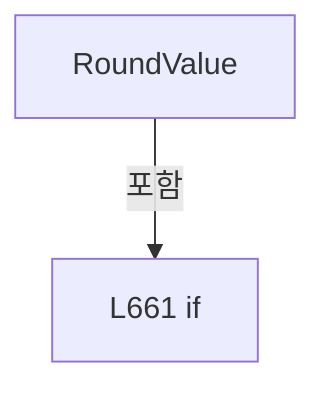

변경 전 점검: 입력/반환 타입, 위 호출자, 예외/취소 경로, 공유 상태와 저장·전송 소비자를 함께 확인합니다. 값의 단위나 물리 방향을 이름만으로 확정하지 않습니다.

### MethodDeclaration `FormatValue` · L668–668

[Drilling.Common/Recipe/CShotCoordinatePlanBuilder.cs:668–668](https://github.com/kjuws10-rgb/A3Drilling/blob/5aee8e58439c9b455cae7c9593c9be986c3e682e/Drilling.Common/Recipe/CShotCoordinatePlanBuilder.cs#L668-L668)

| 항목 | 실제 추출 값 |
| --- | --- |
| 서명 | string Drilling.Common.Recipe.CAlignShotOffsetData.FormatValue(double) |
| 접근/수식자 | Public / public, static |
| 반환/값 타입 | string |
| 소속 타입 | NamedType:Drilling.Common.Recipe.CAlignShotOffsetData |

입력 계약:

| 이름 | 타입 | 전달 | 선택/기본값 |
| --- | --- | --- | --- |
| value | double | None | False /  |

정적 호출자로 확인된 위치:

| 호출 파일/행 | 호출 표현식 | 런타임 분기 가능 |
| --- | --- | --- |
| [Drilling.Common/Recipe/CShotCoordinatePlanBuilder.cs:727–727](https://github.com/kjuws10-rgb/A3Drilling/blob/5aee8e58439c9b455cae7c9593c9be986c3e682e/Drilling.Common/Recipe/CShotCoordinatePlanBuilder.cs#L727-L727) | FormatValue | False |
| [Drilling.File/Correction/CAlignOffsetLogFile.cs:158–158](https://github.com/kjuws10-rgb/A3Drilling/blob/5aee8e58439c9b455cae7c9593c9be986c3e682e/Drilling.File/Correction/CAlignOffsetLogFile.cs#L158-L158) | CAlignShotOffsetData.FormatValue | False |
| [Drilling.File/Script/CAutomation1ScriptFile.cs:306–306](https://github.com/kjuws10-rgb/A3Drilling/blob/5aee8e58439c9b455cae7c9593c9be986c3e682e/Drilling.File/Script/CAutomation1ScriptFile.cs#L306-L306) | CAlignShotOffsetData.FormatValue | False |
| [Drilling.File/Script/CAutomation1ScriptFile.cs:308–308](https://github.com/kjuws10-rgb/A3Drilling/blob/5aee8e58439c9b455cae7c9593c9be986c3e682e/Drilling.File/Script/CAutomation1ScriptFile.cs#L308-L308) | CAlignShotOffsetData.FormatValue | False |

호출하는 대상과 해석 범위:

| 원본 행 | 표현식 | 분석 상태 | 대상/소스 위치 |
| --- | --- | --- | --- |
| 668 | RoundValue(value).ToString | resolved | string double.ToString(string?, System.IFormatProvider?) |
| 668 | RoundValue | resolved | double Drilling.Common.Recipe.CAlignShotOffsetData.RoundValue(double) · Drilling.Common/Recipe/CShotCoordinatePlanBuilder.cs:659 |

본문의 실제 연산·분기·예외·반환 순서(원문 위치 순):

| 원본 행 | 종류 | 주석 해설 |
| --- | --- | --- |
| 668 | call | 함수·델리게이트 또는 객체 생성자를 호출합니다: RoundValue(value).ToString("0.000", CultureInfo.InvariantCulture) |
| 668 | call | 함수·델리게이트 또는 객체 생성자를 호출합니다: RoundValue(value) |

변경 전 점검: 입력/반환 타입, 위 호출자, 예외/취소 경로, 공유 상태와 저장·전송 소비자를 함께 확인합니다. 값의 단위나 물리 방향을 이름만으로 확정하지 않습니다.

### MethodDeclaration `ReadValue` · L669–676

[Drilling.Common/Recipe/CShotCoordinatePlanBuilder.cs:669–676](https://github.com/kjuws10-rgb/A3Drilling/blob/5aee8e58439c9b455cae7c9593c9be986c3e682e/Drilling.Common/Recipe/CShotCoordinatePlanBuilder.cs#L669-L676)

| 항목 | 실제 추출 값 |
| --- | --- |
| 서명 | double Drilling.Common.Recipe.CAlignShotOffsetData.ReadValue(System.Collections.Generic.IReadOnlyDictionary<string, string>, string) |
| 접근/수식자 | Public / public, static |
| 반환/값 타입 | double |
| 소속 타입 | NamedType:Drilling.Common.Recipe.CAlignShotOffsetData |

입력 계약:

| 이름 | 타입 | 전달 | 선택/기본값 |
| --- | --- | --- | --- |
| parameters | System.Collections.Generic.IReadOnlyDictionary<string, string> | None | False /  |
| key | string | None | False /  |

정적 호출자로 확인된 위치:

| 호출 파일/행 | 호출 표현식 | 런타임 분기 가능 |
| --- | --- | --- |
| [Drilling.Common/Recipe/CShotCoordinatePlanBuilder.cs:279–279](https://github.com/kjuws10-rgb/A3Drilling/blob/5aee8e58439c9b455cae7c9593c9be986c3e682e/Drilling.Common/Recipe/CShotCoordinatePlanBuilder.cs#L279-L279) | CAlignShotOffsetData.ReadValue | False |
| [Drilling.Common/Recipe/CShotCoordinatePlanBuilder.cs:280–280](https://github.com/kjuws10-rgb/A3Drilling/blob/5aee8e58439c9b455cae7c9593c9be986c3e682e/Drilling.Common/Recipe/CShotCoordinatePlanBuilder.cs#L280-L280) | CAlignShotOffsetData.ReadValue | False |
| [Drilling.UI/Menu/Menus/CMenuCorrection.cs:2802–2802](https://github.com/kjuws10-rgb/A3Drilling/blob/5aee8e58439c9b455cae7c9593c9be986c3e682e/Drilling.UI/Menu/Menus/CMenuCorrection.cs#L2802-L2802) | CAlignShotOffsetData.ReadValue | False |
| [Drilling.UI/Menu/Menus/CMenuCorrection.cs:2802–2802](https://github.com/kjuws10-rgb/A3Drilling/blob/5aee8e58439c9b455cae7c9593c9be986c3e682e/Drilling.UI/Menu/Menus/CMenuCorrection.cs#L2802-L2802) | CAlignShotOffsetData.ReadValue | False |

호출하는 대상과 해석 범위:

| 원본 행 | 표현식 | 분석 상태 | 대상/소스 위치 |
| --- | --- | --- | --- |
| 671 | parameters.TryGetValue | resolved · 동적 구현 선택 가능 | bool System.Collections.Generic.IReadOnlyDictionary<string, string>.TryGetValue(string, out string) |
| 673 | double.TryParse | resolved | bool double.TryParse(string?, System.Globalization.NumberStyles, System.IFormatProvider?, out double) |
| 673 | double.IsFinite | resolved | bool double.IsFinite(double) |
| 673 | Math.Abs | resolved | double System.Math.Abs(double) |
| 674 | new InvalidOperationException | resolved | System.InvalidOperationException.InvalidOperationException(string?) |
| 675 | RoundValue | resolved | double Drilling.Common.Recipe.CAlignShotOffsetData.RoundValue(double) · Drilling.Common/Recipe/CShotCoordinatePlanBuilder.cs:659 |

본문의 실제 연산·분기·예외·반환 순서(원문 위치 순):

| 원본 행 | 종류 | 주석 해설 |
| --- | --- | --- |
| 671 | call | 함수·델리게이트 또는 객체 생성자를 호출합니다: parameters.TryGetValue(key, out var text) |
| 671 | if | 조건에 따라 분기합니다: if (!parameters.TryGetValue(key, out var text)) |
| 672 | return | 호출자에게 값 또는 제어를 반환합니다: return 0; |
| 673 | call | 함수·델리게이트 또는 객체 생성자를 호출합니다: double.TryParse(text, NumberStyles.Float, CultureInfo.InvariantCulture, out var value) |
| 673 | call | 함수·델리게이트 또는 객체 생성자를 호출합니다: double.IsFinite(value) |
| 673 | call | 함수·델리게이트 또는 객체 생성자를 호출합니다: Math.Abs(value) |
| 673 | if | 조건에 따라 분기합니다: if (!double.TryParse(text, NumberStyles.Float, CultureInfo.InvariantCulture, out var value) &#124;&#124; !double.IsFinite(value) &#124;&#124; Math.Abs(value) > MaximumAbsoluteOffset) |
| 674 | call | 함수·델리게이트 또는 객체 생성자를 호출합니다: new InvalidOperationException($"{key}의 Align Offset은 -100000~100000 mm 범위의 유한한 값이어야 합니다.") |
| 674 | throw | 예외를 발생/전달합니다: throw new InvalidOperationException($"{key}의 Align Offset은 -100000~100000 mm 범위의 유한한 값이어야 합니다."); |
| 675 | call | 함수·델리게이트 또는 객체 생성자를 호출합니다: RoundValue(value) |
| 675 | return | 호출자에게 값 또는 제어를 반환합니다: return RoundValue(value); |

제어 구문의 포함 구조(실제 실행 순서/CFG가 아닌 구문 탐색 그림):

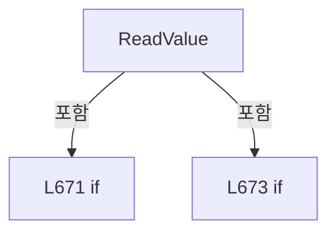

변경 전 점검: 입력/반환 타입, 위 호출자, 예외/취소 경로, 공유 상태와 저장·전송 소비자를 함께 확인합니다. 값의 단위나 물리 방향을 이름만으로 확정하지 않습니다.

### MethodDeclaration `Calculate` · L678–698

[Drilling.Common/Recipe/CShotCoordinatePlanBuilder.cs:678–698](https://github.com/kjuws10-rgb/A3Drilling/blob/5aee8e58439c9b455cae7c9593c9be986c3e682e/Drilling.Common/Recipe/CShotCoordinatePlanBuilder.cs#L678-L698)

| 항목 | 실제 추출 값 |
| --- | --- |
| 서명 | System.Collections.Generic.IReadOnlyList<Drilling.Common.Recipe.ST_ALIGN_SHOT_OFFSET> Drilling.Common.Recipe.CAlignShotOffsetData.Calculate(Drilling.Common.Managers.ST_RECIPE_DEFINITION, Drilling.Common.Correction.CAlignInterpolation) |
| 접근/수식자 | Public / public, static |
| 반환/값 타입 | System.Collections.Generic.IReadOnlyList<Drilling.Common.Recipe.ST_ALIGN_SHOT_OFFSET> |
| 소속 타입 | NamedType:Drilling.Common.Recipe.CAlignShotOffsetData |

입력 계약:

| 이름 | 타입 | 전달 | 선택/기본값 |
| --- | --- | --- | --- |
| recipe | Drilling.Common.Managers.ST_RECIPE_DEFINITION | None | False /  |
| model | Drilling.Common.Correction.CAlignInterpolation | None | False /  |

정적 호출자로 확인된 위치:

| 호출 파일/행 | 호출 표현식 | 런타임 분기 가능 |
| --- | --- | --- |
| [Drilling.Common/Correction/CAlignInterpolation.cs:323–323](https://github.com/kjuws10-rgb/A3Drilling/blob/5aee8e58439c9b455cae7c9593c9be986c3e682e/Drilling.Common/Correction/CAlignInterpolation.cs#L323-L323) | CAlignShotOffsetData.Calculate | False |
| [Drilling.UI/Menu/Menus/CMenuCorrection.cs:2763–2763](https://github.com/kjuws10-rgb/A3Drilling/blob/5aee8e58439c9b455cae7c9593c9be986c3e682e/Drilling.UI/Menu/Menus/CMenuCorrection.cs#L2763-L2763) | CAlignShotOffsetData.Calculate | False |

호출하는 대상과 해석 범위:

| 원본 행 | 표현식 | 분석 상태 | 대상/소스 위치 |
| --- | --- | --- | --- |
| 680 | model.ValidateMeasurements | resolved | void Drilling.Common.Correction.CAlignInterpolation.ValidateMeasurements() · Drilling.Common/Correction/CAlignInterpolation.cs:65 |
| 681 | recipe.Parameters.Where(parameter => !IsParameterKey(parameter.Key)).ToDictionary | resolved | System.Collections.Generic.Dictionary<string, string> System.Collections.Generic.IEnumerable<Drilling.Common.Managers.ST_RECIPE_PARAMETER>.ToDictionary<Drilling.Common.Managers.ST_RECIPE_PARAMETER, string, string>(System.Func<Drilling.Common.Managers.ST_RECIPE_PARAMETER, string>, System.Func<Drilling.Common.Managers.ST_RECIPE_PARAMETER, string>, System.Collections.Generic.IEqualityComparer<string>?) |
| 681 | recipe.Parameters.Where | resolved | System.Collections.Generic.IEnumerable<Drilling.Common.Managers.ST_RECIPE_PARAMETER> System.Collections.Generic.IEnumerable<Drilling.Common.Managers.ST_RECIPE_PARAMETER>.Where<Drilling.Common.Managers.ST_RECIPE_PARAMETER>(System.Func<Drilling.Common.Managers.ST_RECIPE_PARAMETER, bool>) |
| 681 | IsParameterKey | resolved | bool Drilling.Common.Recipe.CAlignShotOffsetData.IsParameterKey(string) · Drilling.Common/Recipe/CShotCoordinatePlanBuilder.cs:657 |
| 682 | CShotCoordinatePlanBuilder.BuildDesignShots | resolved | System.Collections.Generic.IReadOnlyList<Drilling.Common.Recipe.ST_DESIGN_SHOT_POINT> Drilling.Common.Recipe.CShotCoordinatePlanBuilder.BuildDesignShots(System.Collections.Generic.IReadOnlyDictionary<string, string>) · Drilling.Common/Recipe/CShotCoordinatePlanBuilder.cs:214 |
| 684 | new InvalidOperationException | resolved | System.InvalidOperationException.InvalidOperationException(string?) |
| 685 | new List<ST_ALIGN_SHOT_OFFSET> | resolved | System.Collections.Generic.List<Drilling.Common.Recipe.ST_ALIGN_SHOT_OFFSET>.List(int) |
| 688 | CReviewShotNameFormatter.ToMatrixName | resolved | string Drilling.Common.Review.CReviewShotNameFormatter.ToMatrixName(int, int) · Drilling.Common/Review/CReviewManager.cs:3897 |
| 689 | model.Contains | resolved | bool Drilling.Common.Correction.CAlignInterpolation.Contains(double, double) · Drilling.Common/Correction/CAlignInterpolation.cs:55 |
| 690 | new InvalidOperationException | resolved | System.InvalidOperationException.InvalidOperationException(string?) |
| 691 | model.Evaluate | resolved | Drilling.Common.Correction.ST_ALIGN_CORRECTION Drilling.Common.Correction.CAlignInterpolation.Evaluate(double, double) · Drilling.Common/Correction/CAlignInterpolation.cs:74 |
| 692 | Math.Abs | resolved | double System.Math.Abs(double) |
| 692 | Math.Abs | resolved | double System.Math.Abs(double) |
| 693 | new InvalidOperationException | resolved | System.InvalidOperationException.InvalidOperationException(string?) |
| 694 | values.Add | resolved | void System.Collections.Generic.List<Drilling.Common.Recipe.ST_ALIGN_SHOT_OFFSET>.Add(Drilling.Common.Recipe.ST_ALIGN_SHOT_OFFSET) |
| 694 | new | resolved | Drilling.Common.Recipe.ST_ALIGN_SHOT_OFFSET.ST_ALIGN_SHOT_OFFSET(int, int, string, double, double, double, double) · Drilling.Common/Recipe/CShotCoordinatePlanBuilder.cs:652 |
| 694 | RoundValue | resolved | double Drilling.Common.Recipe.CAlignShotOffsetData.RoundValue(double) · Drilling.Common/Recipe/CShotCoordinatePlanBuilder.cs:659 |
| 694 | RoundValue | resolved | double Drilling.Common.Recipe.CAlignShotOffsetData.RoundValue(double) · Drilling.Common/Recipe/CShotCoordinatePlanBuilder.cs:659 |

본문의 실제 연산·분기·예외·반환 순서(원문 위치 순):

| 원본 행 | 종류 | 주석 해설 |
| --- | --- | --- |
| 680 | call | 함수·델리게이트 또는 객체 생성자를 호출합니다: model.ValidateMeasurements() |
| 681 | call | 함수·델리게이트 또는 객체 생성자를 호출합니다: recipe.Parameters.Where(parameter => !IsParameterKey(parameter.Key)).ToDictionary(parameter => parameter.Key, parameter => parameter.Value, StringComparer.OrdinalIgnoreCase) |
| 681 | call | 함수·델리게이트 또는 객체 생성자를 호출합니다: recipe.Parameters.Where(parameter => !IsParameterKey(parameter.Key)) |
| 681 | call | 함수·델리게이트 또는 객체 생성자를 호출합니다: IsParameterKey(parameter.Key) |
| 681 | local-declaration | 지역 변수를 선언합니다: var parameters = recipe.Parameters.Where(parameter => !IsParameterKey(parameter.Key)).ToDictionary(parameter => parameter.Key, parameter => parameter.Value, StringComparer.OrdinalIgnoreCase); |
| 681 | variable-initializer | 변수의 초기값을 지정합니다: parameters = recipe.Parameters.Where(parameter => !IsParameterKey(parameter.Key)).ToDictionary(parameter => parameter.Key, parameter => parameter.Value, StringComparer.OrdinalIgnoreCase) |
| 682 | call | 함수·델리게이트 또는 객체 생성자를 호출합니다: CShotCoordinatePlanBuilder.BuildDesignShots(parameters) |
| 682 | local-declaration | 지역 변수를 선언합니다: var shots = CShotCoordinatePlanBuilder.BuildDesignShots(parameters); |
| 682 | variable-initializer | 변수의 초기값을 지정합니다: shots = CShotCoordinatePlanBuilder.BuildDesignShots(parameters) |
| 683 | if | 조건에 따라 분기합니다: if (shots.Count == 0) |
| 684 | call | 함수·델리게이트 또는 객체 생성자를 호출합니다: new InvalidOperationException("적용할 Shot이 없습니다.") |
| 684 | throw | 예외를 발생/전달합니다: throw new InvalidOperationException("적용할 Shot이 없습니다."); |
| 685 | call | 함수·델리게이트 또는 객체 생성자를 호출합니다: new List<ST_ALIGN_SHOT_OFFSET>(shots.Count) |
| 685 | local-declaration | 지역 변수를 선언합니다: var values = new List<ST_ALIGN_SHOT_OFFSET>(shots.Count); |
| 685 | variable-initializer | 변수의 초기값을 지정합니다: values = new List<ST_ALIGN_SHOT_OFFSET>(shots.Count) |
| 686 | foreach | 컬렉션 요소를 순회합니다: foreach (var shot in shots) |
| 688 | call | 함수·델리게이트 또는 객체 생성자를 호출합니다: CReviewShotNameFormatter.ToMatrixName(shot.CellShotNo, shot.GroupCountX) |
| 688 | local-declaration | 지역 변수를 선언합니다: var name = CReviewShotNameFormatter.ToMatrixName(shot.CellShotNo, shot.GroupCountX); |
| 688 | variable-initializer | 변수의 초기값을 지정합니다: name = CReviewShotNameFormatter.ToMatrixName(shot.CellShotNo, shot.GroupCountX) |
| 689 | call | 함수·델리게이트 또는 객체 생성자를 호출합니다: model.Contains(shot.DesignX, shot.DesignY) |
| 689 | if | 조건에 따라 분기합니다: if (!model.Contains(shot.DesignX, shot.DesignY)) |
| 690 | call | 함수·델리게이트 또는 객체 생성자를 호출합니다: new InvalidOperationException($"Cell{shot.CellNo} / {name} (X {shot.DesignX:0.###}, Y {shot.DesignY:0.###})가 선택 키의 보간 범위 밖에 있습니다. 전체 Shot 적용을 취소합니다.") |
| 690 | throw | 예외를 발생/전달합니다: throw new InvalidOperationException($"Cell{shot.CellNo} / {name} (X {shot.DesignX:0.###}, Y {shot.DesignY:0.###})가 선택 키의 보간 범위 밖에 있습니다. 전체 Shot 적용을 취소합니다."); |
| 691 | call | 함수·델리게이트 또는 객체 생성자를 호출합니다: model.Evaluate(shot.DesignX, shot.DesignY) |
| 691 | local-declaration | 지역 변수를 선언합니다: var correction = model.Evaluate(shot.DesignX, shot.DesignY); |
| 691 | variable-initializer | 변수의 초기값을 지정합니다: correction = model.Evaluate(shot.DesignX, shot.DesignY) |
| 692 | call | 함수·델리게이트 또는 객체 생성자를 호출합니다: Math.Abs(correction.X) |
| 692 | call | 함수·델리게이트 또는 객체 생성자를 호출합니다: Math.Abs(correction.Y) |
| 692 | if | 조건에 따라 분기합니다: if (Math.Abs(correction.X) > MaximumAbsoluteOffset &#124;&#124; Math.Abs(correction.Y) > MaximumAbsoluteOffset) |
| 693 | call | 함수·델리게이트 또는 객체 생성자를 호출합니다: new InvalidOperationException($"Cell{shot.CellNo} / {name}의 계산값이 레시피 Offset 저장 범위를 벗어납니다.") |
| 693 | throw | 예외를 발생/전달합니다: throw new InvalidOperationException($"Cell{shot.CellNo} / {name}의 계산값이 레시피 Offset 저장 범위를 벗어납니다."); |
| 694 | call | 함수·델리게이트 또는 객체 생성자를 호출합니다: values.Add(new(shot.CellNo, shot.CellShotNo, name, shot.DesignX, shot.DesignY, RoundValue(correction.X), RoundValue(correction.Y))) |
| 694 | call | 함수·델리게이트 또는 객체 생성자를 호출합니다: new(shot.CellNo, shot.CellShotNo, name, shot.DesignX, shot.DesignY, RoundValue(correction.X), RoundValue(correction.Y)) |
| 694 | call | 함수·델리게이트 또는 객체 생성자를 호출합니다: RoundValue(correction.X) |
| 694 | call | 함수·델리게이트 또는 객체 생성자를 호출합니다: RoundValue(correction.Y) |
| 697 | return | 호출자에게 값 또는 제어를 반환합니다: return values; |

제어 구문의 포함 구조(실제 실행 순서/CFG가 아닌 구문 탐색 그림):

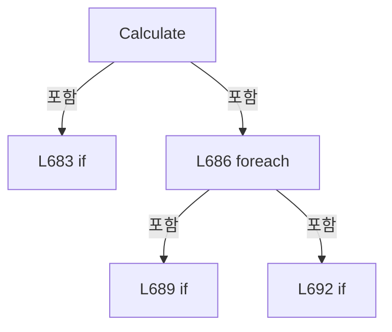

변경 전 점검: 입력/반환 타입, 위 호출자, 예외/취소 경로, 공유 상태와 저장·전송 소비자를 함께 확인합니다. 값의 단위나 물리 방향을 이름만으로 확정하지 않습니다.

### MethodDeclaration `ZeroValues` · L700–705

[Drilling.Common/Recipe/CShotCoordinatePlanBuilder.cs:700–705](https://github.com/kjuws10-rgb/A3Drilling/blob/5aee8e58439c9b455cae7c9593c9be986c3e682e/Drilling.Common/Recipe/CShotCoordinatePlanBuilder.cs#L700-L705)

| 항목 | 실제 추출 값 |
| --- | --- |
| 서명 | System.Collections.Generic.IReadOnlyList<Drilling.Common.Recipe.ST_ALIGN_SHOT_OFFSET> Drilling.Common.Recipe.CAlignShotOffsetData.ZeroValues(Drilling.Common.Managers.ST_RECIPE_DEFINITION) |
| 접근/수식자 | Public / public, static |
| 반환/값 타입 | System.Collections.Generic.IReadOnlyList<Drilling.Common.Recipe.ST_ALIGN_SHOT_OFFSET> |
| 소속 타입 | NamedType:Drilling.Common.Recipe.CAlignShotOffsetData |

입력 계약:

| 이름 | 타입 | 전달 | 선택/기본값 |
| --- | --- | --- | --- |
| recipe | Drilling.Common.Managers.ST_RECIPE_DEFINITION | None | False /  |

정적 호출자로 확인된 위치:

| 호출 파일/행 | 호출 표현식 | 런타임 분기 가능 |
| --- | --- | --- |
| [Drilling.UI/Menu/Menus/CMenuCorrection.cs:2763–2763](https://github.com/kjuws10-rgb/A3Drilling/blob/5aee8e58439c9b455cae7c9593c9be986c3e682e/Drilling.UI/Menu/Menus/CMenuCorrection.cs#L2763-L2763) | CAlignShotOffsetData.ZeroValues | False |

호출하는 대상과 해석 범위:

| 원본 행 | 표현식 | 분석 상태 | 대상/소스 위치 |
| --- | --- | --- | --- |
| 703 | recipe.Parameters.Where(parameter => !IsParameterKey(parameter.Key)).ToDictionary | resolved | System.Collections.Generic.Dictionary<string, string> System.Collections.Generic.IEnumerable<Drilling.Common.Managers.ST_RECIPE_PARAMETER>.ToDictionary<Drilling.Common.Managers.ST_RECIPE_PARAMETER, string, string>(System.Func<Drilling.Common.Managers.ST_RECIPE_PARAMETER, string>, System.Func<Drilling.Common.Managers.ST_RECIPE_PARAMETER, string>, System.Collections.Generic.IEqualityComparer<string>?) |
| 703 | recipe.Parameters.Where | resolved | System.Collections.Generic.IEnumerable<Drilling.Common.Managers.ST_RECIPE_PARAMETER> System.Collections.Generic.IEnumerable<Drilling.Common.Managers.ST_RECIPE_PARAMETER>.Where<Drilling.Common.Managers.ST_RECIPE_PARAMETER>(System.Func<Drilling.Common.Managers.ST_RECIPE_PARAMETER, bool>) |
| 703 | IsParameterKey | resolved | bool Drilling.Common.Recipe.CAlignShotOffsetData.IsParameterKey(string) · Drilling.Common/Recipe/CShotCoordinatePlanBuilder.cs:657 |
| 704 | CShotCoordinatePlanBuilder.BuildDesignShots(parameters).Select(shot => new ST_ALIGN_SHOT_OFFSET(shot.CellNo, shot.CellShotNo, CReviewShotNameFormatter.ToMatrixName(shot.CellShotNo, shot.GroupCountX), shot.DesignX, shot.DesignY, 0, 0)).ToArray | resolved | Drilling.Common.Recipe.ST_ALIGN_SHOT_OFFSET[] System.Collections.Generic.IEnumerable<Drilling.Common.Recipe.ST_ALIGN_SHOT_OFFSET>.ToArray<Drilling.Common.Recipe.ST_ALIGN_SHOT_OFFSET>() |
| 704 | CShotCoordinatePlanBuilder.BuildDesignShots(parameters).Select | resolved | System.Collections.Generic.IEnumerable<Drilling.Common.Recipe.ST_ALIGN_SHOT_OFFSET> System.Collections.Generic.IEnumerable<Drilling.Common.Recipe.ST_DESIGN_SHOT_POINT>.Select<Drilling.Common.Recipe.ST_DESIGN_SHOT_POINT, Drilling.Common.Recipe.ST_ALIGN_SHOT_OFFSET>(System.Func<Drilling.Common.Recipe.ST_DESIGN_SHOT_POINT, Drilling.Common.Recipe.ST_ALIGN_SHOT_OFFSET>) |
| 704 | CShotCoordinatePlanBuilder.BuildDesignShots | resolved | System.Collections.Generic.IReadOnlyList<Drilling.Common.Recipe.ST_DESIGN_SHOT_POINT> Drilling.Common.Recipe.CShotCoordinatePlanBuilder.BuildDesignShots(System.Collections.Generic.IReadOnlyDictionary<string, string>) · Drilling.Common/Recipe/CShotCoordinatePlanBuilder.cs:214 |
| 704 | new ST_ALIGN_SHOT_OFFSET | resolved | Drilling.Common.Recipe.ST_ALIGN_SHOT_OFFSET.ST_ALIGN_SHOT_OFFSET(int, int, string, double, double, double, double) · Drilling.Common/Recipe/CShotCoordinatePlanBuilder.cs:652 |
| 704 | CReviewShotNameFormatter.ToMatrixName | resolved | string Drilling.Common.Review.CReviewShotNameFormatter.ToMatrixName(int, int) · Drilling.Common/Review/CReviewManager.cs:3897 |

본문의 실제 연산·분기·예외·반환 순서(원문 위치 순):

| 원본 행 | 종류 | 주석 해설 |
| --- | --- | --- |
| 703 | call | 함수·델리게이트 또는 객체 생성자를 호출합니다: recipe.Parameters.Where(parameter => !IsParameterKey(parameter.Key)).ToDictionary(parameter => parameter.Key, parameter => parameter.Value, StringComparer.OrdinalIgnoreCase) |
| 703 | call | 함수·델리게이트 또는 객체 생성자를 호출합니다: recipe.Parameters.Where(parameter => !IsParameterKey(parameter.Key)) |
| 703 | call | 함수·델리게이트 또는 객체 생성자를 호출합니다: IsParameterKey(parameter.Key) |
| 703 | local-declaration | 지역 변수를 선언합니다: var parameters = recipe.Parameters.Where(parameter => !IsParameterKey(parameter.Key)).ToDictionary(parameter => parameter.Key, parameter => parameter.Value, StringComparer.OrdinalIgnoreCase); |
| 703 | variable-initializer | 변수의 초기값을 지정합니다: parameters = recipe.Parameters.Where(parameter => !IsParameterKey(parameter.Key)).ToDictionary(parameter => parameter.Key, parameter => parameter.Value, StringComparer.OrdinalIgnoreCase) |
| 704 | call | 함수·델리게이트 또는 객체 생성자를 호출합니다: CShotCoordinatePlanBuilder.BuildDesignShots(parameters).Select(shot => new ST_ALIGN_SHOT_OFFSET(shot.CellNo, shot.CellShotNo, CReviewShotNameFormatter.ToMatrixName(shot.CellShotNo, shot.GroupCountX), shot.DesignX, shot.D… |
| 704 | call | 함수·델리게이트 또는 객체 생성자를 호출합니다: CShotCoordinatePlanBuilder.BuildDesignShots(parameters).Select(shot => new ST_ALIGN_SHOT_OFFSET(shot.CellNo, shot.CellShotNo, CReviewShotNameFormatter.ToMatrixName(shot.CellShotNo, shot.GroupCountX), shot.DesignX, shot.D… |
| 704 | call | 함수·델리게이트 또는 객체 생성자를 호출합니다: CShotCoordinatePlanBuilder.BuildDesignShots(parameters) |
| 704 | call | 함수·델리게이트 또는 객체 생성자를 호출합니다: new ST_ALIGN_SHOT_OFFSET(shot.CellNo, shot.CellShotNo, CReviewShotNameFormatter.ToMatrixName(shot.CellShotNo, shot.GroupCountX), shot.DesignX, shot.DesignY, 0, 0) |
| 704 | call | 함수·델리게이트 또는 객체 생성자를 호출합니다: CReviewShotNameFormatter.ToMatrixName(shot.CellShotNo, shot.GroupCountX) |
| 704 | return | 호출자에게 값 또는 제어를 반환합니다: return CShotCoordinatePlanBuilder.BuildDesignShots(parameters).Select(shot => new ST_ALIGN_SHOT_OFFSET(shot.CellNo, shot.CellShotNo, CReviewShotNameFormatter.ToMatrixName(shot.CellShotNo, shot.GroupCountX), shot.DesignX, shot.Desi |

변경 전 점검: 입력/반환 타입, 위 호출자, 예외/취소 경로, 공유 상태와 저장·전송 소비자를 함께 확인합니다. 값의 단위나 물리 방향을 이름만으로 확정하지 않습니다.

### MethodDeclaration `Apply` · L707–750

[Drilling.Common/Recipe/CShotCoordinatePlanBuilder.cs:707–750](https://github.com/kjuws10-rgb/A3Drilling/blob/5aee8e58439c9b455cae7c9593c9be986c3e682e/Drilling.Common/Recipe/CShotCoordinatePlanBuilder.cs#L707-L750)

| 항목 | 실제 추출 값 |
| --- | --- |
| 서명 | Drilling.Common.Managers.ST_RECIPE_DEFINITION Drilling.Common.Recipe.CAlignShotOffsetData.Apply(Drilling.Common.Managers.ST_RECIPE_DEFINITION, System.Collections.Generic.IReadOnlyList<Drilling.Common.Recipe.ST_ALIGN_SHOT_OFFSET>) |
| 접근/수식자 | Public / public, static |
| 반환/값 타입 | Drilling.Common.Managers.ST_RECIPE_DEFINITION |
| 소속 타입 | NamedType:Drilling.Common.Recipe.CAlignShotOffsetData |

입력 계약:

| 이름 | 타입 | 전달 | 선택/기본값 |
| --- | --- | --- | --- |
| recipe | Drilling.Common.Managers.ST_RECIPE_DEFINITION | None | False /  |
| offsets | System.Collections.Generic.IReadOnlyList<Drilling.Common.Recipe.ST_ALIGN_SHOT_OFFSET> | None | False /  |

정적 호출자로 확인된 위치:

| 호출 파일/행 | 호출 표현식 | 런타임 분기 가능 |
| --- | --- | --- |
| [Drilling.Common/Managers/CRecipeManager.cs:102–102](https://github.com/kjuws10-rgb/A3Drilling/blob/5aee8e58439c9b455cae7c9593c9be986c3e682e/Drilling.Common/Managers/CRecipeManager.cs#L102-L102) | CAlignShotOffsetData.Apply | False |
| [Drilling.UI/Menu/Menus/CMenuCorrection.cs:2809–2809](https://github.com/kjuws10-rgb/A3Drilling/blob/5aee8e58439c9b455cae7c9593c9be986c3e682e/Drilling.UI/Menu/Menus/CMenuCorrection.cs#L2809-L2809) | CAlignShotOffsetData.Apply | False |

호출하는 대상과 해석 범위:

| 원본 행 | 표현식 | 분석 상태 | 대상/소스 위치 |
| --- | --- | --- | --- |
| 709 | recipe.Parameters.ToDictionary | resolved | System.Collections.Generic.Dictionary<string, Drilling.Common.Managers.ST_RECIPE_PARAMETER> System.Collections.Generic.IEnumerable<Drilling.Common.Managers.ST_RECIPE_PARAMETER>.ToDictionary<Drilling.Common.Managers.ST_RECIPE_PARAMETER, string>(System.Func<Drilling.Common.Managers.ST_RECIPE_PARAMETER, string>, System.Collections.Generic.IEqualityComparer<string>?) |
| 712 | Add | resolved | void Add(Drilling.Common.Recipe.ST_ALIGN_SHOT_OFFSET, string, double) · Drilling.Common/Recipe/CShotCoordinatePlanBuilder.cs:720 |
| 713 | Add | resolved | void Add(Drilling.Common.Recipe.ST_ALIGN_SHOT_OFFSET, string, double) · Drilling.Common/Recipe/CShotCoordinatePlanBuilder.cs:720 |
| 718 | parameters.Values.ToArray | resolved | Drilling.Common.Managers.ST_RECIPE_PARAMETER[] System.Collections.Generic.IEnumerable<Drilling.Common.Managers.ST_RECIPE_PARAMETER>.ToArray<Drilling.Common.Managers.ST_RECIPE_PARAMETER>() |

본문의 실제 연산·분기·예외·반환 순서(원문 위치 순):

| 원본 행 | 종류 | 주석 해설 |
| --- | --- | --- |
| 709 | call | 함수·델리게이트 또는 객체 생성자를 호출합니다: recipe.Parameters.ToDictionary(parameter => parameter.Key, StringComparer.OrdinalIgnoreCase) |
| 709 | local-declaration | 지역 변수를 선언합니다: var parameters = recipe.Parameters.ToDictionary(parameter => parameter.Key, StringComparer.OrdinalIgnoreCase); |
| 709 | variable-initializer | 변수의 초기값을 지정합니다: parameters = recipe.Parameters.ToDictionary(parameter => parameter.Key, StringComparer.OrdinalIgnoreCase) |
| 710 | foreach | 컬렉션 요소를 순회합니다: foreach (var offset in offsets) |
| 712 | call | 함수·델리게이트 또는 객체 생성자를 호출합니다: Add(offset, "X", offset.X) |
| 713 | call | 함수·델리게이트 또는 객체 생성자를 호출합니다: Add(offset, "Y", offset.Y) |
| 716 | return | 호출자에게 값 또는 제어를 반환합니다: return recipe with { Parameters = parameters.Values.ToArray() }; |
| 718 | assignment | 값을 대상에 대입합니다: Parameters = parameters.Values.ToArray() |
| 718 | call | 함수·델리게이트 또는 객체 생성자를 호출합니다: parameters.Values.ToArray() |

제어 구문의 포함 구조(실제 실행 순서/CFG가 아닌 구문 탐색 그림):

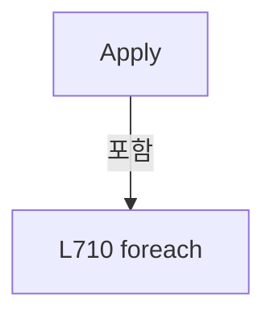

변경 전 점검: 입력/반환 타입, 위 호출자, 예외/취소 경로, 공유 상태와 저장·전송 소비자를 함께 확인합니다. 값의 단위나 물리 방향을 이름만으로 확정하지 않습니다.

### LocalFunctionStatement `Add` · L720–749

[Drilling.Common/Recipe/CShotCoordinatePlanBuilder.cs:720–749](https://github.com/kjuws10-rgb/A3Drilling/blob/5aee8e58439c9b455cae7c9593c9be986c3e682e/Drilling.Common/Recipe/CShotCoordinatePlanBuilder.cs#L720-L749)

| 항목 | 실제 추출 값 |
| --- | --- |
| 서명 | void Add(Drilling.Common.Recipe.ST_ALIGN_SHOT_OFFSET, string, double) |
| 접근/수식자 | Private /  |
| 반환/값 타입 | void |
| 소속 타입 | NamedType:Drilling.Common.Recipe.CAlignShotOffsetData |

입력 계약:

| 이름 | 타입 | 전달 | 선택/기본값 |
| --- | --- | --- | --- |
| offset | Drilling.Common.Recipe.ST_ALIGN_SHOT_OFFSET | None | False /  |
| axis | string | None | False /  |
| value | double | None | False /  |

정적 호출자로 확인된 위치:

| 호출 파일/행 | 호출 표현식 | 런타임 분기 가능 |
| --- | --- | --- |
| [Drilling.Common/Recipe/CShotCoordinatePlanBuilder.cs:712–712](https://github.com/kjuws10-rgb/A3Drilling/blob/5aee8e58439c9b455cae7c9593c9be986c3e682e/Drilling.Common/Recipe/CShotCoordinatePlanBuilder.cs#L712-L712) | Add | False |
| [Drilling.Common/Recipe/CShotCoordinatePlanBuilder.cs:713–713](https://github.com/kjuws10-rgb/A3Drilling/blob/5aee8e58439c9b455cae7c9593c9be986c3e682e/Drilling.Common/Recipe/CShotCoordinatePlanBuilder.cs#L713-L713) | Add | False |

호출하는 대상과 해석 범위:

| 원본 행 | 표현식 | 분석 상태 | 대상/소스 위치 |
| --- | --- | --- | --- |
| 722 | double.IsFinite | resolved | bool double.IsFinite(double) |
| 722 | Math.Abs | resolved | double System.Math.Abs(double) |
| 723 | new InvalidOperationException | resolved | System.InvalidOperationException.InvalidOperationException(string?) |
| 724 | ParameterKey | resolved | string Drilling.Common.Recipe.CAlignShotOffsetData.ParameterKey(int, string, string) · Drilling.Common/Recipe/CShotCoordinatePlanBuilder.cs:658 |
| 725 | IsParameterKey | resolved | bool Drilling.Common.Recipe.CAlignShotOffsetData.IsParameterKey(string) · Drilling.Common/Recipe/CShotCoordinatePlanBuilder.cs:657 |
| 726 | new InvalidOperationException | resolved | System.InvalidOperationException.InvalidOperationException(string?) |
| 727 | FormatValue | resolved | string Drilling.Common.Recipe.CAlignShotOffsetData.FormatValue(double) · Drilling.Common/Recipe/CShotCoordinatePlanBuilder.cs:668 |
| 728 | parameters.TryGetValue | resolved | bool System.Collections.Generic.Dictionary<string, Drilling.Common.Managers.ST_RECIPE_PARAMETER>.TryGetValue(string, out Drilling.Common.Managers.ST_RECIPE_PARAMETER) |
| 733 | new ST_RECIPE_PARAMETER | resolved | Drilling.Common.Managers.ST_RECIPE_PARAMETER.ST_RECIPE_PARAMETER(string, string, string, string, string, string, string, string, string, bool, bool, int, Drilling.Common.Managers.EN_RECIPE_DATA_TYPE, double, double, double, System.Collections.Generic.IReadOnlyDictionary<string, string>?) · Drilling.Common/Managers/CRecipeManager.cs:355 |

본문의 실제 연산·분기·예외·반환 순서(원문 위치 순):

| 원본 행 | 종류 | 주석 해설 |
| --- | --- | --- |
| 722 | call | 함수·델리게이트 또는 객체 생성자를 호출합니다: double.IsFinite(value) |
| 722 | call | 함수·델리게이트 또는 객체 생성자를 호출합니다: Math.Abs(value) |
| 722 | if | 조건에 따라 분기합니다: if (!double.IsFinite(value) &#124;&#124; Math.Abs(value) > MaximumAbsoluteOffset) |
| 723 | call | 함수·델리게이트 또는 객체 생성자를 호출합니다: new InvalidOperationException("유효하지 않은 Align Offset입니다.") |
| 723 | throw | 예외를 발생/전달합니다: throw new InvalidOperationException("유효하지 않은 Align Offset입니다."); |
| 724 | call | 함수·델리게이트 또는 객체 생성자를 호출합니다: ParameterKey(offset.CellNo, offset.ShotName, axis) |
| 724 | local-declaration | 지역 변수를 선언합니다: var key = ParameterKey(offset.CellNo, offset.ShotName, axis); |
| 724 | variable-initializer | 변수의 초기값을 지정합니다: key = ParameterKey(offset.CellNo, offset.ShotName, axis) |
| 725 | call | 함수·델리게이트 또는 객체 생성자를 호출합니다: IsParameterKey(key) |
| 725 | if | 조건에 따라 분기합니다: if (!IsParameterKey(key)) |
| 726 | call | 함수·델리게이트 또는 객체 생성자를 호출합니다: new InvalidOperationException("Shot Align Offset 항목을 확인하세요.") |
| 726 | throw | 예외를 발생/전달합니다: throw new InvalidOperationException("Shot Align Offset 항목을 확인하세요."); |
| 727 | call | 함수·델리게이트 또는 객체 생성자를 호출합니다: FormatValue(value) |
| 727 | local-declaration | 지역 변수를 선언합니다: var text = FormatValue(value); |
| 727 | variable-initializer | 변수의 초기값을 지정합니다: text = FormatValue(value) |
| 728 | call | 함수·델리게이트 또는 객체 생성자를 호출합니다: parameters.TryGetValue(key, out var existing) |
| 728 | assignment | 값을 대상에 대입합니다: parameters[key] = parameters.TryGetValue(key, out var existing) ? existing with { Value = text } : new ST_RECIPE_PARAMETER( $"Shot Group {offset.ShotName} Align Offset {axis}", text, "mm", "-100000 - 100000", "0.000", "CELL", "SHO |
| 728 | conditional-expression | 조건에 따라 결과식을 선택합니다: parameters.TryGetValue(key, out var existing) ? existing with { Value = text } : new ST_RECIPE_PARAMETER( $"Shot Group {offset.ShotName} Align Offset {axis}", text, "mm", "-100000 - 100000", "0.000", "CELL", "SHOT_GROUP", key, "De |
| 730 | assignment | 값을 대상에 대입합니다: Value = text |
| 733 | call | 함수·델리게이트 또는 객체 생성자를 호출합니다: new ST_RECIPE_PARAMETER( $"Shot Group {offset.ShotName} Align Offset {axis}", text, "mm", "-100000 - 100000", "0.000", "CELL", "SHOT_GROUP", key, "Design-coordinate align correction; head direction is applied at script g… |

제어 구문의 포함 구조(실제 실행 순서/CFG가 아닌 구문 탐색 그림):

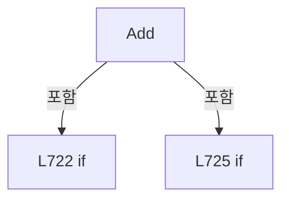

변경 전 점검: 입력/반환 타입, 위 호출자, 예외/취소 경로, 공유 상태와 저장·전송 소비자를 함께 확인합니다. 값의 단위나 물리 방향을 이름만으로 확정하지 않습니다.

### MethodDeclaration `RetainUneditedOffsets` · L754–764

[Drilling.Common/Recipe/CShotCoordinatePlanBuilder.cs:754–764](https://github.com/kjuws10-rgb/A3Drilling/blob/5aee8e58439c9b455cae7c9593c9be986c3e682e/Drilling.Common/Recipe/CShotCoordinatePlanBuilder.cs#L754-L764)

| 항목 | 실제 추출 값 |
| --- | --- |
| 서명 | Drilling.Common.Managers.ST_RECIPE_DEFINITION Drilling.Common.Recipe.CAlignShotOffsetData.RetainUneditedOffsets(Drilling.Common.Managers.ST_RECIPE_DEFINITION, Drilling.Common.Managers.ST_RECIPE_DEFINITION?) |
| 접근/수식자 | Public / public, static |
| 반환/값 타입 | Drilling.Common.Managers.ST_RECIPE_DEFINITION |
| 소속 타입 | NamedType:Drilling.Common.Recipe.CAlignShotOffsetData |

입력 계약:

| 이름 | 타입 | 전달 | 선택/기본값 |
| --- | --- | --- | --- |
| edited | Drilling.Common.Managers.ST_RECIPE_DEFINITION | None | False /  |
| saved | Drilling.Common.Managers.ST_RECIPE_DEFINITION? | None | False /  |

정적 호출자로 확인된 위치:

| 호출 파일/행 | 호출 표현식 | 런타임 분기 가능 |
| --- | --- | --- |
| [Drilling.Common/Managers/CRecipeManager.cs:151–151](https://github.com/kjuws10-rgb/A3Drilling/blob/5aee8e58439c9b455cae7c9593c9be986c3e682e/Drilling.Common/Managers/CRecipeManager.cs#L151-L151) | global::Drilling.Common.Recipe.CAlignShotOffsetData.RetainUneditedOffsets | False |

호출하는 대상과 해석 범위:

| 원본 행 | 표현식 | 분석 상태 | 대상/소스 위치 |
| --- | --- | --- | --- |
| 758 | edited.Parameters.Select(parameter => parameter.Key).ToHashSet | resolved | System.Collections.Generic.HashSet<string> System.Collections.Generic.IEnumerable<string>.ToHashSet<string>(System.Collections.Generic.IEqualityComparer<string>?) |
| 758 | edited.Parameters.Select | resolved | System.Collections.Generic.IEnumerable<string> System.Collections.Generic.IEnumerable<Drilling.Common.Managers.ST_RECIPE_PARAMETER>.Select<Drilling.Common.Managers.ST_RECIPE_PARAMETER, string>(System.Func<Drilling.Common.Managers.ST_RECIPE_PARAMETER, string>) |
| 759 | saved.Parameters.Where(parameter => IsParameterKey(parameter.Key) && !keys.Contains(parameter.Key)).ToArray | resolved | Drilling.Common.Managers.ST_RECIPE_PARAMETER[] System.Collections.Generic.IEnumerable<Drilling.Common.Managers.ST_RECIPE_PARAMETER>.ToArray<Drilling.Common.Managers.ST_RECIPE_PARAMETER>() |
| 759 | saved.Parameters.Where | resolved | System.Collections.Generic.IEnumerable<Drilling.Common.Managers.ST_RECIPE_PARAMETER> System.Collections.Generic.IEnumerable<Drilling.Common.Managers.ST_RECIPE_PARAMETER>.Where<Drilling.Common.Managers.ST_RECIPE_PARAMETER>(System.Func<Drilling.Common.Managers.ST_RECIPE_PARAMETER, bool>) |
| 759 | IsParameterKey | resolved | bool Drilling.Common.Recipe.CAlignShotOffsetData.IsParameterKey(string) · Drilling.Common/Recipe/CShotCoordinatePlanBuilder.cs:657 |
| 759 | keys.Contains | resolved | bool System.Collections.Generic.HashSet<string>.Contains(string) |
| 762 | edited.Parameters.Concat(retained).ToArray | resolved | Drilling.Common.Managers.ST_RECIPE_PARAMETER[] System.Collections.Generic.IEnumerable<Drilling.Common.Managers.ST_RECIPE_PARAMETER>.ToArray<Drilling.Common.Managers.ST_RECIPE_PARAMETER>() |
| 762 | edited.Parameters.Concat | resolved | System.Collections.Generic.IEnumerable<Drilling.Common.Managers.ST_RECIPE_PARAMETER> System.Collections.Generic.IEnumerable<Drilling.Common.Managers.ST_RECIPE_PARAMETER>.Concat<Drilling.Common.Managers.ST_RECIPE_PARAMETER>(System.Collections.Generic.IEnumerable<Drilling.Common.Managers.ST_RECIPE_PARAMETER>) |

본문의 실제 연산·분기·예외·반환 순서(원문 위치 순):

| 원본 행 | 종류 | 주석 해설 |
| --- | --- | --- |
| 756 | if | 조건에 따라 분기합니다: if (saved is null) |
| 757 | return | 호출자에게 값 또는 제어를 반환합니다: return edited; |
| 758 | call | 함수·델리게이트 또는 객체 생성자를 호출합니다: edited.Parameters.Select(parameter => parameter.Key).ToHashSet(StringComparer.OrdinalIgnoreCase) |
| 758 | call | 함수·델리게이트 또는 객체 생성자를 호출합니다: edited.Parameters.Select(parameter => parameter.Key) |
| 758 | local-declaration | 지역 변수를 선언합니다: var keys = edited.Parameters.Select(parameter => parameter.Key).ToHashSet(StringComparer.OrdinalIgnoreCase); |
| 758 | variable-initializer | 변수의 초기값을 지정합니다: keys = edited.Parameters.Select(parameter => parameter.Key).ToHashSet(StringComparer.OrdinalIgnoreCase) |
| 759 | call | 함수·델리게이트 또는 객체 생성자를 호출합니다: saved.Parameters.Where(parameter => IsParameterKey(parameter.Key) && !keys.Contains(parameter.Key)).ToArray() |
| 759 | call | 함수·델리게이트 또는 객체 생성자를 호출합니다: saved.Parameters.Where(parameter => IsParameterKey(parameter.Key) && !keys.Contains(parameter.Key)) |
| 759 | call | 함수·델리게이트 또는 객체 생성자를 호출합니다: IsParameterKey(parameter.Key) |
| 759 | call | 함수·델리게이트 또는 객체 생성자를 호출합니다: keys.Contains(parameter.Key) |
| 759 | local-declaration | 지역 변수를 선언합니다: var retained = saved.Parameters.Where(parameter => IsParameterKey(parameter.Key) && !keys.Contains(parameter.Key)).ToArray(); |
| 759 | variable-initializer | 변수의 초기값을 지정합니다: retained = saved.Parameters.Where(parameter => IsParameterKey(parameter.Key) && !keys.Contains(parameter.Key)).ToArray() |
| 760 | conditional-expression | 조건에 따라 결과식을 선택합니다: retained.Length == 0 ? edited : edited with { Parameters = edited.Parameters.Concat(retained).ToArray() } |
| 760 | return | 호출자에게 값 또는 제어를 반환합니다: return retained.Length == 0 ? edited : edited with { Parameters = edited.Parameters.Concat(retained).ToArray() }; |
| 762 | assignment | 값을 대상에 대입합니다: Parameters = edited.Parameters.Concat(retained).ToArray() |
| 762 | call | 함수·델리게이트 또는 객체 생성자를 호출합니다: edited.Parameters.Concat(retained).ToArray() |
| 762 | call | 함수·델리게이트 또는 객체 생성자를 호출합니다: edited.Parameters.Concat(retained) |

제어 구문의 포함 구조(실제 실행 순서/CFG가 아닌 구문 탐색 그림):

```mermaid
flowchart TD
 M["RetainUneditedOffsets"]
 N0["L756 if"]
 M -->|포함| N0
```

변경 전 점검: 입력/반환 타입, 위 호출자, 예외/취소 경로, 공유 상태와 저장·전송 소비자를 함께 확인합니다. 값의 단위나 물리 방향을 이름만으로 확정하지 않습니다.

### PropertyDeclaration `Empty` · L769–769

[Drilling.Common/Recipe/CShotCoordinatePlanBuilder.cs:769–769](https://github.com/kjuws10-rgb/A3Drilling/blob/5aee8e58439c9b455cae7c9593c9be986c3e682e/Drilling.Common/Recipe/CShotCoordinatePlanBuilder.cs#L769-L769)

| 항목 | 실제 추출 값 |
| --- | --- |
| 서명 | Drilling.Common.Recipe.ST_RECIPE_SHOT_MASKING_RESULT Drilling.Common.Recipe.ST_RECIPE_SHOT_MASKING_RESULT.Empty |
| 접근/수식자 | Public / public, static |
| 반환/값 타입 | Drilling.Common.Recipe.ST_RECIPE_SHOT_MASKING_RESULT |
| 소속 타입 | NamedType:Drilling.Common.Recipe.ST_RECIPE_SHOT_MASKING_RESULT |

현재 부분 분석에서 직접 연결된 호출자는 없습니다. XAML/이벤트/인터페이스·델리게이트·외부 진입을 추가 확인해야 하며, 미사용으로 판정한 것이 아닙니다.

호출하는 대상과 해석 범위:

| 원본 행 | 표현식 | 분석 상태 | 대상/소스 위치 |
| --- | --- | --- | --- |
| 769 | new | resolved | Drilling.Common.Recipe.ST_RECIPE_SHOT_MASKING_RESULT.ST_RECIPE_SHOT_MASKING_RESULT(System.Collections.Generic.IReadOnlyList<int>, System.Collections.Generic.IReadOnlyList<int>, bool, bool) · Drilling.Common/Recipe/CShotCoordinatePlanBuilder.cs:767 |

본문의 실제 연산·분기·예외·반환 순서(원문 위치 순):

| 원본 행 | 종류 | 주석 해설 |
| --- | --- | --- |
| 769 | call | 함수·델리게이트 또는 객체 생성자를 호출합니다: new([], [], false) |

변경 전 점검: 입력/반환 타입, 위 호출자, 예외/취소 경로, 공유 상태와 저장·전송 소비자를 함께 확인합니다. 값의 단위나 물리 방향을 이름만으로 확정하지 않습니다.

### GetAccessorDeclaration `get_Empty` · L769–769

[Drilling.Common/Recipe/CShotCoordinatePlanBuilder.cs:769–769](https://github.com/kjuws10-rgb/A3Drilling/blob/5aee8e58439c9b455cae7c9593c9be986c3e682e/Drilling.Common/Recipe/CShotCoordinatePlanBuilder.cs#L769-L769)

| 항목 | 실제 추출 값 |
| --- | --- |
| 서명 | Drilling.Common.Recipe.ST_RECIPE_SHOT_MASKING_RESULT Drilling.Common.Recipe.ST_RECIPE_SHOT_MASKING_RESULT.Empty.get |
| 접근/수식자 | Public / get |
| 반환/값 타입 | Drilling.Common.Recipe.ST_RECIPE_SHOT_MASKING_RESULT |
| 소속 타입 | NamedType:Drilling.Common.Recipe.ST_RECIPE_SHOT_MASKING_RESULT |

현재 부분 분석에서 직접 연결된 호출자는 없습니다. XAML/이벤트/인터페이스·델리게이트·외부 진입을 추가 확인해야 하며, 미사용으로 판정한 것이 아닙니다.

변경 전 점검: 입력/반환 타입, 위 호출자, 예외/취소 경로, 공유 상태와 저장·전송 소비자를 함께 확인합니다. 값의 단위나 물리 방향을 이름만으로 확정하지 않습니다.

### PropertyDeclaration `IsMasked` · L771–777

[Drilling.Common/Recipe/CShotCoordinatePlanBuilder.cs:771–777](https://github.com/kjuws10-rgb/A3Drilling/blob/5aee8e58439c9b455cae7c9593c9be986c3e682e/Drilling.Common/Recipe/CShotCoordinatePlanBuilder.cs#L771-L777)

| 항목 | 실제 추출 값 |
| --- | --- |
| 서명 | bool Drilling.Common.Recipe.ST_RECIPE_SHOT_MASKING_RESULT.IsMasked |
| 접근/수식자 | Public / public |
| 반환/값 타입 | bool |
| 소속 타입 | NamedType:Drilling.Common.Recipe.ST_RECIPE_SHOT_MASKING_RESULT |

현재 부분 분석에서 직접 연결된 호출자는 없습니다. XAML/이벤트/인터페이스·델리게이트·외부 진입을 추가 확인해야 하며, 미사용으로 판정한 것이 아닙니다.

변경 전 점검: 입력/반환 타입, 위 호출자, 예외/취소 경로, 공유 상태와 저장·전송 소비자를 함께 확인합니다. 값의 단위나 물리 방향을 이름만으로 확정하지 않습니다.

### GetAccessorDeclaration `get_IsMasked` · L773–776

[Drilling.Common/Recipe/CShotCoordinatePlanBuilder.cs:773–776](https://github.com/kjuws10-rgb/A3Drilling/blob/5aee8e58439c9b455cae7c9593c9be986c3e682e/Drilling.Common/Recipe/CShotCoordinatePlanBuilder.cs#L773-L776)

| 항목 | 실제 추출 값 |
| --- | --- |
| 서명 | bool Drilling.Common.Recipe.ST_RECIPE_SHOT_MASKING_RESULT.IsMasked.get |
| 접근/수식자 | Public / get |
| 반환/값 타입 | bool |
| 소속 타입 | NamedType:Drilling.Common.Recipe.ST_RECIPE_SHOT_MASKING_RESULT |

현재 부분 분석에서 직접 연결된 호출자는 없습니다. XAML/이벤트/인터페이스·델리게이트·외부 진입을 추가 확인해야 하며, 미사용으로 판정한 것이 아닙니다.

본문의 실제 연산·분기·예외·반환 순서(원문 위치 순):

| 원본 행 | 종류 | 주석 해설 |
| --- | --- | --- |
| 775 | return | 호출자에게 값 또는 제어를 반환합니다: return BeamNumbers.Count > 0; |

변경 전 점검: 입력/반환 타입, 위 호출자, 예외/취소 경로, 공유 상태와 저장·전송 소비자를 함께 확인합니다. 값의 단위나 물리 방향을 이름만으로 확정하지 않습니다.

### PropertyDeclaration `ShouldSkipLaser` · L779–785

[Drilling.Common/Recipe/CShotCoordinatePlanBuilder.cs:779–785](https://github.com/kjuws10-rgb/A3Drilling/blob/5aee8e58439c9b455cae7c9593c9be986c3e682e/Drilling.Common/Recipe/CShotCoordinatePlanBuilder.cs#L779-L785)

| 항목 | 실제 추출 값 |
| --- | --- |
| 서명 | bool Drilling.Common.Recipe.ST_RECIPE_SHOT_MASKING_RESULT.ShouldSkipLaser |
| 접근/수식자 | Public / public |
| 반환/값 타입 | bool |
| 소속 타입 | NamedType:Drilling.Common.Recipe.ST_RECIPE_SHOT_MASKING_RESULT |

현재 부분 분석에서 직접 연결된 호출자는 없습니다. XAML/이벤트/인터페이스·델리게이트·외부 진입을 추가 확인해야 하며, 미사용으로 판정한 것이 아닙니다.

변경 전 점검: 입력/반환 타입, 위 호출자, 예외/취소 경로, 공유 상태와 저장·전송 소비자를 함께 확인합니다. 값의 단위나 물리 방향을 이름만으로 확정하지 않습니다.

### GetAccessorDeclaration `get_ShouldSkipLaser` · L781–784

[Drilling.Common/Recipe/CShotCoordinatePlanBuilder.cs:781–784](https://github.com/kjuws10-rgb/A3Drilling/blob/5aee8e58439c9b455cae7c9593c9be986c3e682e/Drilling.Common/Recipe/CShotCoordinatePlanBuilder.cs#L781-L784)

| 항목 | 실제 추출 값 |
| --- | --- |
| 서명 | bool Drilling.Common.Recipe.ST_RECIPE_SHOT_MASKING_RESULT.ShouldSkipLaser.get |
| 접근/수식자 | Public / get |
| 반환/값 타입 | bool |
| 소속 타입 | NamedType:Drilling.Common.Recipe.ST_RECIPE_SHOT_MASKING_RESULT |

현재 부분 분석에서 직접 연결된 호출자는 없습니다. XAML/이벤트/인터페이스·델리게이트·외부 진입을 추가 확인해야 하며, 미사용으로 판정한 것이 아닙니다.

본문의 실제 연산·분기·예외·반환 순서(원문 위치 순):

| 원본 행 | 종류 | 주석 해설 |
| --- | --- | --- |
| 783 | return | 호출자에게 값 또는 제어를 반환합니다: return IsMasked &#124;&#124; IsChessSkipped; |

변경 전 점검: 입력/반환 타입, 위 호출자, 예외/취소 경로, 공유 상태와 저장·전송 소비자를 함께 확인합니다. 값의 단위나 물리 방향을 이름만으로 확정하지 않습니다.

### FieldDeclaration `MaximumCellModelTypeCount` · L790–790

[Drilling.Common/Recipe/CShotCoordinatePlanBuilder.cs:790–790](https://github.com/kjuws10-rgb/A3Drilling/blob/5aee8e58439c9b455cae7c9593c9be986c3e682e/Drilling.Common/Recipe/CShotCoordinatePlanBuilder.cs#L790-L790)

| 항목 | 실제 추출 값 |
| --- | --- |
| 서명 | int Drilling.Common.Recipe.CRecipeShotMaskingPlan.MaximumCellModelTypeCount |
| 접근/수식자 | Private / private, const |
| 반환/값 타입 | int |
| 소속 타입 | NamedType:Drilling.Common.Recipe.CRecipeShotMaskingPlan |

현재 부분 분석에서 직접 연결된 호출자는 없습니다. XAML/이벤트/인터페이스·델리게이트·외부 진입을 추가 확인해야 하며, 미사용으로 판정한 것이 아닙니다.

본문의 실제 연산·분기·예외·반환 순서(원문 위치 순):

| 원본 행 | 종류 | 주석 해설 |
| --- | --- | --- |
| 790 | variable-initializer | 변수의 초기값을 지정합니다: MaximumCellModelTypeCount = 5 |

변경 전 점검: 입력/반환 타입, 위 호출자, 예외/취소 경로, 공유 상태와 저장·전송 소비자를 함께 확인합니다. 값의 단위나 물리 방향을 이름만으로 확정하지 않습니다.

### FieldDeclaration `MaximumMaskingHoleCount` · L791–791

[Drilling.Common/Recipe/CShotCoordinatePlanBuilder.cs:791–791](https://github.com/kjuws10-rgb/A3Drilling/blob/5aee8e58439c9b455cae7c9593c9be986c3e682e/Drilling.Common/Recipe/CShotCoordinatePlanBuilder.cs#L791-L791)

| 항목 | 실제 추출 값 |
| --- | --- |
| 서명 | int Drilling.Common.Recipe.CRecipeShotMaskingPlan.MaximumMaskingHoleCount |
| 접근/수식자 | Private / private, const |
| 반환/값 타입 | int |
| 소속 타입 | NamedType:Drilling.Common.Recipe.CRecipeShotMaskingPlan |

현재 부분 분석에서 직접 연결된 호출자는 없습니다. XAML/이벤트/인터페이스·델리게이트·외부 진입을 추가 확인해야 하며, 미사용으로 판정한 것이 아닙니다.

본문의 실제 연산·분기·예외·반환 순서(원문 위치 순):

| 원본 행 | 종류 | 주석 해설 |
| --- | --- | --- |
| 791 | variable-initializer | 변수의 초기값을 지정합니다: MaximumMaskingHoleCount = 3 |

변경 전 점검: 입력/반환 타입, 위 호출자, 예외/취소 경로, 공유 상태와 저장·전송 소비자를 함께 확인합니다. 값의 단위나 물리 방향을 이름만으로 확정하지 않습니다.

### FieldDeclaration `Epsilon` · L792–792

[Drilling.Common/Recipe/CShotCoordinatePlanBuilder.cs:792–792](https://github.com/kjuws10-rgb/A3Drilling/blob/5aee8e58439c9b455cae7c9593c9be986c3e682e/Drilling.Common/Recipe/CShotCoordinatePlanBuilder.cs#L792-L792)

| 항목 | 실제 추출 값 |
| --- | --- |
| 서명 | double Drilling.Common.Recipe.CRecipeShotMaskingPlan.Epsilon |
| 접근/수식자 | Private / private, const |
| 반환/값 타입 | double |
| 소속 타입 | NamedType:Drilling.Common.Recipe.CRecipeShotMaskingPlan |

현재 부분 분석에서 직접 연결된 호출자는 없습니다. XAML/이벤트/인터페이스·델리게이트·외부 진입을 추가 확인해야 하며, 미사용으로 판정한 것이 아닙니다.

본문의 실제 연산·분기·예외·반환 순서(원문 위치 순):

| 원본 행 | 종류 | 주석 해설 |
| --- | --- | --- |
| 792 | variable-initializer | 변수의 초기값을 지정합니다: Epsilon = 0.000000001 |

변경 전 점검: 입력/반환 타입, 위 호출자, 예외/취소 경로, 공유 상태와 저장·전송 소비자를 함께 확인합니다. 값의 단위나 물리 방향을 이름만으로 확정하지 않습니다.

### FieldDeclaration `_models` · L793–793

[Drilling.Common/Recipe/CShotCoordinatePlanBuilder.cs:793–793](https://github.com/kjuws10-rgb/A3Drilling/blob/5aee8e58439c9b455cae7c9593c9be986c3e682e/Drilling.Common/Recipe/CShotCoordinatePlanBuilder.cs#L793-L793)

| 항목 | 실제 추출 값 |
| --- | --- |
| 서명 | System.Collections.Generic.IReadOnlyDictionary<int, Drilling.Common.Recipe.CRecipeShotMaskingPlan.ST_MODEL_MASKING_AREA> Drilling.Common.Recipe.CRecipeShotMaskingPlan._models |
| 접근/수식자 | Private / private, readonly |
| 반환/값 타입 | System.Collections.Generic.IReadOnlyDictionary<int, Drilling.Common.Recipe.CRecipeShotMaskingPlan.ST_MODEL_MASKING_AREA> |
| 소속 타입 | NamedType:Drilling.Common.Recipe.CRecipeShotMaskingPlan |

현재 부분 분석에서 직접 연결된 호출자는 없습니다. XAML/이벤트/인터페이스·델리게이트·외부 진입을 추가 확인해야 하며, 미사용으로 판정한 것이 아닙니다.

변경 전 점검: 입력/반환 타입, 위 호출자, 예외/취소 경로, 공유 상태와 저장·전송 소비자를 함께 확인합니다. 값의 단위나 물리 방향을 이름만으로 확정하지 않습니다.

### FieldDeclaration `_modelPatterns` · L794–794

[Drilling.Common/Recipe/CShotCoordinatePlanBuilder.cs:794–794](https://github.com/kjuws10-rgb/A3Drilling/blob/5aee8e58439c9b455cae7c9593c9be986c3e682e/Drilling.Common/Recipe/CShotCoordinatePlanBuilder.cs#L794-L794)

| 항목 | 실제 추출 값 |
| --- | --- |
| 서명 | System.Collections.Generic.IReadOnlyDictionary<int, Drilling.Common.Recipe.CRecipeShotMaskingPlan.ST_MODEL_PATTERN_AREA> Drilling.Common.Recipe.CRecipeShotMaskingPlan._modelPatterns |
| 접근/수식자 | Private / private, readonly |
| 반환/값 타입 | System.Collections.Generic.IReadOnlyDictionary<int, Drilling.Common.Recipe.CRecipeShotMaskingPlan.ST_MODEL_PATTERN_AREA> |
| 소속 타입 | NamedType:Drilling.Common.Recipe.CRecipeShotMaskingPlan |

현재 부분 분석에서 직접 연결된 호출자는 없습니다. XAML/이벤트/인터페이스·델리게이트·외부 진입을 추가 확인해야 하며, 미사용으로 판정한 것이 아닙니다.

변경 전 점검: 입력/반환 타입, 위 호출자, 예외/취소 경로, 공유 상태와 저장·전송 소비자를 함께 확인합니다. 값의 단위나 물리 방향을 이름만으로 확정하지 않습니다.

### FieldDeclaration `_cellModelTypes` · L795–795

[Drilling.Common/Recipe/CShotCoordinatePlanBuilder.cs:795–795](https://github.com/kjuws10-rgb/A3Drilling/blob/5aee8e58439c9b455cae7c9593c9be986c3e682e/Drilling.Common/Recipe/CShotCoordinatePlanBuilder.cs#L795-L795)

| 항목 | 실제 추출 값 |
| --- | --- |
| 서명 | System.Collections.Generic.IReadOnlyDictionary<int, int> Drilling.Common.Recipe.CRecipeShotMaskingPlan._cellModelTypes |
| 접근/수식자 | Private / private, readonly |
| 반환/값 타입 | System.Collections.Generic.IReadOnlyDictionary<int, int> |
| 소속 타입 | NamedType:Drilling.Common.Recipe.CRecipeShotMaskingPlan |

현재 부분 분석에서 직접 연결된 호출자는 없습니다. XAML/이벤트/인터페이스·델리게이트·외부 진입을 추가 확인해야 하며, 미사용으로 판정한 것이 아닙니다.

변경 전 점검: 입력/반환 타입, 위 호출자, 예외/취소 경로, 공유 상태와 저장·전송 소비자를 함께 확인합니다. 값의 단위나 물리 방향을 이름만으로 확정하지 않습니다.

### FieldDeclaration `_modelTypeCount` · L796–796

[Drilling.Common/Recipe/CShotCoordinatePlanBuilder.cs:796–796](https://github.com/kjuws10-rgb/A3Drilling/blob/5aee8e58439c9b455cae7c9593c9be986c3e682e/Drilling.Common/Recipe/CShotCoordinatePlanBuilder.cs#L796-L796)

| 항목 | 실제 추출 값 |
| --- | --- |
| 서명 | int Drilling.Common.Recipe.CRecipeShotMaskingPlan._modelTypeCount |
| 접근/수식자 | Private / private, readonly |
| 반환/값 타입 | int |
| 소속 타입 | NamedType:Drilling.Common.Recipe.CRecipeShotMaskingPlan |

현재 부분 분석에서 직접 연결된 호출자는 없습니다. XAML/이벤트/인터페이스·델리게이트·외부 진입을 추가 확인해야 하며, 미사용으로 판정한 것이 아닙니다.

변경 전 점검: 입력/반환 타입, 위 호출자, 예외/취소 경로, 공유 상태와 저장·전송 소비자를 함께 확인합니다. 값의 단위나 물리 방향을 이름만으로 확정하지 않습니다.

### FieldDeclaration `_splitBeamCount` · L797–797

[Drilling.Common/Recipe/CShotCoordinatePlanBuilder.cs:797–797](https://github.com/kjuws10-rgb/A3Drilling/blob/5aee8e58439c9b455cae7c9593c9be986c3e682e/Drilling.Common/Recipe/CShotCoordinatePlanBuilder.cs#L797-L797)

| 항목 | 실제 추출 값 |
| --- | --- |
| 서명 | int Drilling.Common.Recipe.CRecipeShotMaskingPlan._splitBeamCount |
| 접근/수식자 | Private / private, readonly |
| 반환/값 타입 | int |
| 소속 타입 | NamedType:Drilling.Common.Recipe.CRecipeShotMaskingPlan |

현재 부분 분석에서 직접 연결된 호출자는 없습니다. XAML/이벤트/인터페이스·델리게이트·외부 진입을 추가 확인해야 하며, 미사용으로 판정한 것이 아닙니다.

변경 전 점검: 입력/반환 타입, 위 호출자, 예외/취소 경로, 공유 상태와 저장·전송 소비자를 함께 확인합니다. 값의 단위나 물리 방향을 이름만으로 확정하지 않습니다.

### ConstructorDeclaration `.ctor` · L798–811

[Drilling.Common/Recipe/CShotCoordinatePlanBuilder.cs:798–811](https://github.com/kjuws10-rgb/A3Drilling/blob/5aee8e58439c9b455cae7c9593c9be986c3e682e/Drilling.Common/Recipe/CShotCoordinatePlanBuilder.cs#L798-L811)

| 항목 | 실제 추출 값 |
| --- | --- |
| 서명 | Drilling.Common.Recipe.CRecipeShotMaskingPlan.CRecipeShotMaskingPlan(System.Collections.Generic.IReadOnlyDictionary<int, Drilling.Common.Recipe.CRecipeShotMaskingPlan.ST_MODEL_MASKING_AREA>, System.Collections.Generic.IReadOnlyDictionary<int, Drilling.Common.Recipe.CRecipeShotMaskingPlan.ST_MODEL_PATTERN_AREA>, System.Collections.Generic.IReadOnlyDictionary<int, int>, int, int) |
| 접근/수식자 | Private / private |
| 반환/값 타입 | void |
| 소속 타입 | NamedType:Drilling.Common.Recipe.CRecipeShotMaskingPlan |

입력 계약:

| 이름 | 타입 | 전달 | 선택/기본값 |
| --- | --- | --- | --- |
| models | System.Collections.Generic.IReadOnlyDictionary<int, Drilling.Common.Recipe.CRecipeShotMaskingPlan.ST_MODEL_MASKING_AREA> | None | False /  |
| modelPatterns | System.Collections.Generic.IReadOnlyDictionary<int, Drilling.Common.Recipe.CRecipeShotMaskingPlan.ST_MODEL_PATTERN_AREA> | None | False /  |
| cellModelTypes | System.Collections.Generic.IReadOnlyDictionary<int, int> | None | False /  |
| modelTypeCount | int | None | False /  |
| splitBeamCount | int | None | False /  |

정적 호출자로 확인된 위치:

| 호출 파일/행 | 호출 표현식 | 런타임 분기 가능 |
| --- | --- | --- |
| [Drilling.Common/Recipe/CShotCoordinatePlanBuilder.cs:850–850](https://github.com/kjuws10-rgb/A3Drilling/blob/5aee8e58439c9b455cae7c9593c9be986c3e682e/Drilling.Common/Recipe/CShotCoordinatePlanBuilder.cs#L850-L850) | new CRecipeShotMaskingPlan | False |

본문의 실제 연산·분기·예외·반환 순서(원문 위치 순):

| 원본 행 | 종류 | 주석 해설 |
| --- | --- | --- |
| 806 | assignment | 값을 대상에 대입합니다: _models = models |
| 807 | assignment | 값을 대상에 대입합니다: _modelPatterns = modelPatterns |
| 808 | assignment | 값을 대상에 대입합니다: _cellModelTypes = cellModelTypes |
| 809 | assignment | 값을 대상에 대입합니다: _modelTypeCount = modelTypeCount |
| 810 | assignment | 값을 대상에 대입합니다: _splitBeamCount = splitBeamCount |

변경 전 점검: 입력/반환 타입, 위 호출자, 예외/취소 경로, 공유 상태와 저장·전송 소비자를 함께 확인합니다. 값의 단위나 물리 방향을 이름만으로 확정하지 않습니다.

### MethodDeclaration `Build` · L813–851

[Drilling.Common/Recipe/CShotCoordinatePlanBuilder.cs:813–851](https://github.com/kjuws10-rgb/A3Drilling/blob/5aee8e58439c9b455cae7c9593c9be986c3e682e/Drilling.Common/Recipe/CShotCoordinatePlanBuilder.cs#L813-L851)

| 항목 | 실제 추출 값 |
| --- | --- |
| 서명 | Drilling.Common.Recipe.CRecipeShotMaskingPlan Drilling.Common.Recipe.CRecipeShotMaskingPlan.Build(System.Collections.Generic.IReadOnlyDictionary<string, string>) |
| 접근/수식자 | Public / public, static |
| 반환/값 타입 | Drilling.Common.Recipe.CRecipeShotMaskingPlan |
| 소속 타입 | NamedType:Drilling.Common.Recipe.CRecipeShotMaskingPlan |

입력 계약:

| 이름 | 타입 | 전달 | 선택/기본값 |
| --- | --- | --- | --- |
| parameters | System.Collections.Generic.IReadOnlyDictionary<string, string> | None | False /  |

정적 호출자로 확인된 위치:

| 호출 파일/행 | 호출 표현식 | 런타임 분기 가능 |
| --- | --- | --- |
| [Drilling.Common/Review/CAutoFineReviewCoordinator.cs:224–224](https://github.com/kjuws10-rgb/A3Drilling/blob/5aee8e58439c9b455cae7c9593c9be986c3e682e/Drilling.Common/Review/CAutoFineReviewCoordinator.cs#L224-L224) | CRecipeShotMaskingPlan.Build | False |
| [Drilling.Common/Review/CReviewManager.cs:512–512](https://github.com/kjuws10-rgb/A3Drilling/blob/5aee8e58439c9b455cae7c9593c9be986c3e682e/Drilling.Common/Review/CReviewManager.cs#L512-L512) | CRecipeShotMaskingPlan.Build | False |
| [Drilling.Common/Review/CZeroDefenceRecipePlan.cs:27–27](https://github.com/kjuws10-rgb/A3Drilling/blob/5aee8e58439c9b455cae7c9593c9be986c3e682e/Drilling.Common/Review/CZeroDefenceRecipePlan.cs#L27-L27) | CRecipeShotMaskingPlan.Build | False |
| [Drilling.Common/Station/CStationProcess.cs:1607–1607](https://github.com/kjuws10-rgb/A3Drilling/blob/5aee8e58439c9b455cae7c9593c9be986c3e682e/Drilling.Common/Station/CStationProcess.cs#L1607-L1607) | CRecipeShotMaskingPlan.Build | False |
| [Drilling.File/Script/CAutomation1ScriptFile.cs:56–56](https://github.com/kjuws10-rgb/A3Drilling/blob/5aee8e58439c9b455cae7c9593c9be986c3e682e/Drilling.File/Script/CAutomation1ScriptFile.cs#L56-L56) | CRecipeShotMaskingPlan.Build | False |
| [Drilling.File/Script/CAutomation1ScriptFile.cs:179–179](https://github.com/kjuws10-rgb/A3Drilling/blob/5aee8e58439c9b455cae7c9593c9be986c3e682e/Drilling.File/Script/CAutomation1ScriptFile.cs#L179-L179) | CRecipeShotMaskingPlan.Build | False |
| [Drilling.File/Script/CAutomation1ScriptFile.cs:514–514](https://github.com/kjuws10-rgb/A3Drilling/blob/5aee8e58439c9b455cae7c9593c9be986c3e682e/Drilling.File/Script/CAutomation1ScriptFile.cs#L514-L514) | CRecipeShotMaskingPlan.Build | False |
| [Drilling.UI/CRootView.cs:1460–1460](https://github.com/kjuws10-rgb/A3Drilling/blob/5aee8e58439c9b455cae7c9593c9be986c3e682e/Drilling.UI/CRootView.cs#L1460-L1460) | CRecipeShotMaskingPlan.Build | False |
| [Drilling.UI/Menu/Menus/CMenuCorrection.ReviewData.Display.cs:265–265](https://github.com/kjuws10-rgb/A3Drilling/blob/5aee8e58439c9b455cae7c9593c9be986c3e682e/Drilling.UI/Menu/Menus/CMenuCorrection.ReviewData.Display.cs#L265-L265) | CRecipeShotMaskingPlan.Build | False |
| [Drilling.UI/Menu/Menus/CMenuCorrection.cs:664–664](https://github.com/kjuws10-rgb/A3Drilling/blob/5aee8e58439c9b455cae7c9593c9be986c3e682e/Drilling.UI/Menu/Menus/CMenuCorrection.cs#L664-L664) | CRecipeShotMaskingPlan.Build | False |
| [Drilling.UI/Menu/Menus/CMenuCorrection.cs:5520–5520](https://github.com/kjuws10-rgb/A3Drilling/blob/5aee8e58439c9b455cae7c9593c9be986c3e682e/Drilling.UI/Menu/Menus/CMenuCorrection.cs#L5520-L5520) | CRecipeShotMaskingPlan.Build | False |
| [Drilling.UI/Menu/Menus/CMenuCorrection.cs:5990–5990](https://github.com/kjuws10-rgb/A3Drilling/blob/5aee8e58439c9b455cae7c9593c9be986c3e682e/Drilling.UI/Menu/Menus/CMenuCorrection.cs#L5990-L5990) | CRecipeShotMaskingPlan.Build | False |
| [Drilling.UI/Menu/Menus/CMenuCorrection.cs:7537–7537](https://github.com/kjuws10-rgb/A3Drilling/blob/5aee8e58439c9b455cae7c9593c9be986c3e682e/Drilling.UI/Menu/Menus/CMenuCorrection.cs#L7537-L7537) | CRecipeShotMaskingPlan.Build | False |
| [Drilling.UI/Menu/Menus/CMenuMonitor.cs:3219–3219](https://github.com/kjuws10-rgb/A3Drilling/blob/5aee8e58439c9b455cae7c9593c9be986c3e682e/Drilling.UI/Menu/Menus/CMenuMonitor.cs#L3219-L3219) | CRecipeShotMaskingPlan.Build | False |

호출하는 대상과 해석 범위:

| 원본 행 | 표현식 | 분석 상태 | 대상/소스 위치 |
| --- | --- | --- | --- |
| 815 | ArgumentNullException.ThrowIfNull | resolved | void System.ArgumentNullException.ThrowIfNull(object?, string?) |
| 816 | Math.Clamp | resolved | int System.Math.Clamp(int, int, int) |
| 816 | ReadInt | resolved | int Drilling.Common.Recipe.CRecipeShotMaskingPlan.ReadInt(System.Collections.Generic.IReadOnlyDictionary<string, string>, int, params string[]) · Drilling.Common/Recipe/CShotCoordinatePlanBuilder.cs:976 |
| 817 | ReadDouble | resolved | double Drilling.Common.Recipe.CRecipeShotMaskingPlan.ReadDouble(System.Collections.Generic.IReadOnlyDictionary<string, string>, double, params string[]) · Drilling.Common/Recipe/CShotCoordinatePlanBuilder.cs:999 |
| 818 | ReadInt | resolved | int Drilling.Common.Recipe.CRecipeShotMaskingPlan.ReadInt(System.Collections.Generic.IReadOnlyDictionary<string, string>, int, params string[]) · Drilling.Common/Recipe/CShotCoordinatePlanBuilder.cs:976 |
| 819 | new Dictionary<int, ST_MODEL_MASKING_AREA> | resolved | System.Collections.Generic.Dictionary<int, Drilling.Common.Recipe.CRecipeShotMaskingPlan.ST_MODEL_MASKING_AREA>.Dictionary() |
| 820 | new Dictionary<int, ST_MODEL_PATTERN_AREA> | resolved | System.Collections.Generic.Dictionary<int, Drilling.Common.Recipe.CRecipeShotMaskingPlan.ST_MODEL_PATTERN_AREA>.Dictionary() |
| 823 | CRecipeModelPixelCountReader.ReadPatternForModel | resolved | Drilling.Common.Recipe.ST_RECIPE_MODEL_PATTERN Drilling.Common.Recipe.CRecipeModelPixelCountReader.ReadPatternForModel(System.Collections.Generic.IReadOnlyDictionary<string, string>, int) · Drilling.Common/Recipe/CCellPatternCalculator.cs:455 |
| 826 | new ST_MODEL_PATTERN_AREA | resolved | Drilling.Common.Recipe.CRecipeShotMaskingPlan.ST_MODEL_PATTERN_AREA.ST_MODEL_PATTERN_AREA(int, int, double, int, int, double, double, double) · Drilling.Common/Recipe/CShotCoordinatePlanBuilder.cs:1033 |
| 830 | Math.Clamp | resolved | int System.Math.Clamp(int, int, int) |
| 831 | Math.Clamp | resolved | int System.Math.Clamp(int, int, int) |
| 834 | Math.Max | resolved | int System.Math.Max(int, int) |
| 836 | BuildModel | resolved | Drilling.Common.Recipe.CRecipeShotMaskingPlan.ST_MODEL_MASKING_AREA Drilling.Common.Recipe.CRecipeShotMaskingPlan.BuildModel(System.Collections.Generic.IReadOnlyDictionary<string, string>, int) · Drilling.Common/Recipe/CShotCoordinatePlanBuilder.cs:928 |
| 843 | Math.Max | resolved | int System.Math.Max(int, int) |
| 843 | ReadInt | resolved | int Drilling.Common.Recipe.CRecipeShotMaskingPlan.ReadInt(System.Collections.Generic.IReadOnlyDictionary<string, string>, int, params string[]) · Drilling.Common/Recipe/CShotCoordinatePlanBuilder.cs:976 |
| 844 | new Dictionary<int, int> | resolved | System.Collections.Generic.Dictionary<int, int>.Dictionary(int) |
| 847 | Math.Clamp | resolved | int System.Math.Clamp(int, int, int) |
| 847 | ReadInt | resolved | int Drilling.Common.Recipe.CRecipeShotMaskingPlan.ReadInt(System.Collections.Generic.IReadOnlyDictionary<string, string>, int, params string[]) · Drilling.Common/Recipe/CShotCoordinatePlanBuilder.cs:976 |
| 850 | new CRecipeShotMaskingPlan | resolved | Drilling.Common.Recipe.CRecipeShotMaskingPlan.CRecipeShotMaskingPlan(System.Collections.Generic.IReadOnlyDictionary<int, Drilling.Common.Recipe.CRecipeShotMaskingPlan.ST_MODEL_MASKING_AREA>, System.Collections.Generic.IReadOnlyDictionary<int, Drilling.Common.Recipe.CRecipeShotMaskingPlan.ST_MODEL_PATTERN_AREA>, System.Collections.Generic.IReadOnlyDictionary<int, int>, int, int) · Drilling.Common/Recipe/CShotCoordinatePlanBuilder.cs:798 |

본문의 실제 연산·분기·예외·반환 순서(원문 위치 순):

| 원본 행 | 종류 | 주석 해설 |
| --- | --- | --- |
| 815 | call | 함수·델리게이트 또는 객체 생성자를 호출합니다: ArgumentNullException.ThrowIfNull(parameters) |
| 816 | call | 함수·델리게이트 또는 객체 생성자를 호출합니다: Math.Clamp(ReadInt(parameters, 1, "CELL_MODEL_TYPE_COUNT"), 1, MaximumCellModelTypeCount) |
| 816 | call | 함수·델리게이트 또는 객체 생성자를 호출합니다: ReadInt(parameters, 1, "CELL_MODEL_TYPE_COUNT") |
| 816 | local-declaration | 지역 변수를 선언합니다: var modelTypeCount = Math.Clamp(ReadInt(parameters, 1, "CELL_MODEL_TYPE_COUNT"), 1, MaximumCellModelTypeCount); |
| 816 | variable-initializer | 변수의 초기값을 지정합니다: modelTypeCount = Math.Clamp(ReadInt(parameters, 1, "CELL_MODEL_TYPE_COUNT"), 1, MaximumCellModelTypeCount) |
| 817 | call | 함수·델리게이트 또는 객체 생성자를 호출합니다: ReadDouble(parameters, 0.09, "PIXEL_SIZE") |
| 817 | local-declaration | 지역 변수를 선언합니다: var pixelSize = ReadDouble(parameters, 0.09, "PIXEL_SIZE"); |
| 817 | variable-initializer | 변수의 초기값을 지정합니다: pixelSize = ReadDouble(parameters, 0.09, "PIXEL_SIZE") |
| 818 | call | 함수·델리게이트 또는 객체 생성자를 호출합니다: ReadInt(parameters, 1, "SPLITED_BEAM_COUNT") |
| 818 | local-declaration | 지역 변수를 선언합니다: var splitBeamCount = ReadInt(parameters, 1, "SPLITED_BEAM_COUNT"); |
| 818 | variable-initializer | 변수의 초기값을 지정합니다: splitBeamCount = ReadInt(parameters, 1, "SPLITED_BEAM_COUNT") |
| 819 | call | 함수·델리게이트 또는 객체 생성자를 호출합니다: new Dictionary<int, ST_MODEL_MASKING_AREA>() |
| 819 | local-declaration | 지역 변수를 선언합니다: var models = new Dictionary<int, ST_MODEL_MASKING_AREA>(); |
| 819 | variable-initializer | 변수의 초기값을 지정합니다: models = new Dictionary<int, ST_MODEL_MASKING_AREA>() |
| 820 | call | 함수·델리게이트 또는 객체 생성자를 호출합니다: new Dictionary<int, ST_MODEL_PATTERN_AREA>() |
| 820 | local-declaration | 지역 변수를 선언합니다: var modelPatterns = new Dictionary<int, ST_MODEL_PATTERN_AREA>(); |
| 820 | variable-initializer | 변수의 초기값을 지정합니다: modelPatterns = new Dictionary<int, ST_MODEL_PATTERN_AREA>() |
| 821 | variable-initializer | 변수의 초기값을 지정합니다: modelType = 1 |
| 821 | for | 초기화·조건·증감이 있는 반복입니다: for (var modelType = 1; modelType <= modelTypeCount; modelType++) |
| 823 | call | 함수·델리게이트 또는 객체 생성자를 호출합니다: CRecipeModelPixelCountReader.ReadPatternForModel(parameters, modelType) |
| 823 | local-declaration | 지역 변수를 선언합니다: var modelPattern = CRecipeModelPixelCountReader.ReadPatternForModel(parameters, modelType); |
| 823 | variable-initializer | 변수의 초기값을 지정합니다: modelPattern = CRecipeModelPixelCountReader.ReadPatternForModel(parameters, modelType) |
| 824 | local-declaration | 지역 변수를 선언합니다: var groupPitchMillimeters = pixelSize * modelPattern.ProcessPitch; |
| 824 | variable-initializer | 변수의 초기값을 지정합니다: groupPitchMillimeters = pixelSize * modelPattern.ProcessPitch |
| 825 | conditional-expression | 조건에 따라 결과식을 선택합니다: splitBeamCount <= 0 ? 0.0 : groupPitchMillimeters / splitBeamCount |
| 825 | local-declaration | 지역 변수를 선언합니다: var beamPitchMillimeters = splitBeamCount <= 0 ? 0.0 : groupPitchMillimeters / splitBeamCount; |
| 825 | variable-initializer | 변수의 초기값을 지정합니다: beamPitchMillimeters = splitBeamCount <= 0 ? 0.0 : groupPitchMillimeters / splitBeamCount |
| 826 | assignment | 값을 대상에 대입합니다: modelPatterns[modelType] = new ST_MODEL_PATTERN_AREA( modelPattern.PixelCountX, modelPattern.PixelCountY, pixelSize, Math.Clamp(modelPattern.Chess, 1, 4), Math.Clamp(modelPattern.ChessType, 0, 1), groupPitchMillimeters, beamPitchM |
| 826 | call | 함수·델리게이트 또는 객체 생성자를 호출합니다: new ST_MODEL_PATTERN_AREA( modelPattern.PixelCountX, modelPattern.PixelCountY, pixelSize, Math.Clamp(modelPattern.Chess, 1, 4), Math.Clamp(modelPattern.ChessType, 0, 1), groupPitchMillimeters, beamPitchMillimeters, beamP… |
| 830 | call | 함수·델리게이트 또는 객체 생성자를 호출합니다: Math.Clamp(modelPattern.Chess, 1, 4) |
| 831 | call | 함수·델리게이트 또는 객체 생성자를 호출합니다: Math.Clamp(modelPattern.ChessType, 0, 1) |
| 834 | call | 함수·델리게이트 또는 객체 생성자를 호출합니다: Math.Max(1, splitBeamCount) |
| 836 | call | 함수·델리게이트 또는 객체 생성자를 호출합니다: BuildModel(parameters, modelType) |
| 836 | local-declaration | 지역 변수를 선언합니다: var model = BuildModel(parameters, modelType); |
| 836 | variable-initializer | 변수의 초기값을 지정합니다: model = BuildModel(parameters, modelType) |
| 837 | if | 조건에 따라 분기합니다: if (model.HasMasking) |
| 839 | assignment | 값을 대상에 대입합니다: models[modelType] = model |
| 843 | call | 함수·델리게이트 또는 객체 생성자를 호출합니다: Math.Max(CCellPatternCalculator.MinCellCount, ReadInt(parameters, CCellPatternCalculator.MinCellCount, "MAX_CELL_NUMBER")) |
| 843 | call | 함수·델리게이트 또는 객체 생성자를 호출합니다: ReadInt(parameters, CCellPatternCalculator.MinCellCount, "MAX_CELL_NUMBER") |
| 843 | local-declaration | 지역 변수를 선언합니다: var cellCount = Math.Max(CCellPatternCalculator.MinCellCount, ReadInt(parameters, CCellPatternCalculator.MinCellCount, "MAX_CELL_NUMBER")); |
| 843 | variable-initializer | 변수의 초기값을 지정합니다: cellCount = Math.Max(CCellPatternCalculator.MinCellCount, ReadInt(parameters, CCellPatternCalculator.MinCellCount, "MAX_CELL_NUMBER")) |
| 844 | call | 함수·델리게이트 또는 객체 생성자를 호출합니다: new Dictionary<int, int>(cellCount) |
| 844 | local-declaration | 지역 변수를 선언합니다: var cellModelTypes = new Dictionary<int, int>(cellCount); |
| 844 | variable-initializer | 변수의 초기값을 지정합니다: cellModelTypes = new Dictionary<int, int>(cellCount) |
| 845 | variable-initializer | 변수의 초기값을 지정합니다: cellNo = 1 |
| 845 | for | 초기화·조건·증감이 있는 반복입니다: for (var cellNo = 1; cellNo <= cellCount; cellNo++) |
| 847 | assignment | 값을 대상에 대입합니다: cellModelTypes[cellNo] = Math.Clamp(ReadInt(parameters, 1, $"CELL{cellNo}_MODEL_TYPE"), 1, modelTypeCount) |
| 847 | call | 함수·델리게이트 또는 객체 생성자를 호출합니다: Math.Clamp(ReadInt(parameters, 1, $"CELL{cellNo}_MODEL_TYPE"), 1, modelTypeCount) |
| 847 | call | 함수·델리게이트 또는 객체 생성자를 호출합니다: ReadInt(parameters, 1, $"CELL{cellNo}_MODEL_TYPE") |
| 850 | call | 함수·델리게이트 또는 객체 생성자를 호출합니다: new CRecipeShotMaskingPlan(models, modelPatterns, cellModelTypes, modelTypeCount, splitBeamCount) |
| 850 | return | 호출자에게 값 또는 제어를 반환합니다: return new CRecipeShotMaskingPlan(models, modelPatterns, cellModelTypes, modelTypeCount, splitBeamCount); |

제어 구문의 포함 구조(실제 실행 순서/CFG가 아닌 구문 탐색 그림):

```mermaid
flowchart TD
 M["Build"]
 N0["L821 for"]
 M -->|포함| N0
 N1["L837 if"]
 N0 -->|포함| N1
 N2["L845 for"]
 M -->|포함| N2
```

변경 전 점검: 입력/반환 타입, 위 호출자, 예외/취소 경로, 공유 상태와 저장·전송 소비자를 함께 확인합니다. 값의 단위나 물리 방향을 이름만으로 확정하지 않습니다.

### MethodDeclaration `EvaluateShot` · L853–910

[Drilling.Common/Recipe/CShotCoordinatePlanBuilder.cs:853–910](https://github.com/kjuws10-rgb/A3Drilling/blob/5aee8e58439c9b455cae7c9593c9be986c3e682e/Drilling.Common/Recipe/CShotCoordinatePlanBuilder.cs#L853-L910)

| 항목 | 실제 추출 값 |
| --- | --- |
| 서명 | Drilling.Common.Recipe.ST_RECIPE_SHOT_MASKING_RESULT Drilling.Common.Recipe.CRecipeShotMaskingPlan.EvaluateShot(Drilling.Common.Recipe.ST_HEAD_SHOT_POINT) |
| 접근/수식자 | Public / public |
| 반환/값 타입 | Drilling.Common.Recipe.ST_RECIPE_SHOT_MASKING_RESULT |
| 소속 타입 | NamedType:Drilling.Common.Recipe.CRecipeShotMaskingPlan |

입력 계약:

| 이름 | 타입 | 전달 | 선택/기본값 |
| --- | --- | --- | --- |
| point | Drilling.Common.Recipe.ST_HEAD_SHOT_POINT | None | False /  |

정적 호출자로 확인된 위치:

| 호출 파일/행 | 호출 표현식 | 런타임 분기 가능 |
| --- | --- | --- |
| [Drilling.Common/Review/CAutoFineReviewCoordinator.cs:234–234](https://github.com/kjuws10-rgb/A3Drilling/blob/5aee8e58439c9b455cae7c9593c9be986c3e682e/Drilling.Common/Review/CAutoFineReviewCoordinator.cs#L234-L234) | masking.EvaluateShot | False |
| [Drilling.Common/Review/CReviewManager.cs:516–516](https://github.com/kjuws10-rgb/A3Drilling/blob/5aee8e58439c9b455cae7c9593c9be986c3e682e/Drilling.Common/Review/CReviewManager.cs#L516-L516) | maskingPlan.EvaluateShot | False |
| [Drilling.Common/Review/CZeroDefenceRecipePlan.cs:62–62](https://github.com/kjuws10-rgb/A3Drilling/blob/5aee8e58439c9b455cae7c9593c9be986c3e682e/Drilling.Common/Review/CZeroDefenceRecipePlan.cs#L62-L62) | _mask.EvaluateShot | False |
| [Drilling.Common/Review/CZeroDefenceRecipePlan.cs:63–63](https://github.com/kjuws10-rgb/A3Drilling/blob/5aee8e58439c9b455cae7c9593c9be986c3e682e/Drilling.Common/Review/CZeroDefenceRecipePlan.cs#L63-L63) | _mask.EvaluateShot | False |
| [Drilling.Common/Station/CStationProcess.cs:1608–1608](https://github.com/kjuws10-rgb/A3Drilling/blob/5aee8e58439c9b455cae7c9593c9be986c3e682e/Drilling.Common/Station/CStationProcess.cs#L1608-L1608) | shotMaskingPlan.EvaluateShot | False |
| [Drilling.File/Script/CAutomation1ScriptFile.cs:65–65](https://github.com/kjuws10-rgb/A3Drilling/blob/5aee8e58439c9b455cae7c9593c9be986c3e682e/Drilling.File/Script/CAutomation1ScriptFile.cs#L65-L65) | shotMaskingPlan.EvaluateShot | False |
| [Drilling.File/Script/CAutomation1ScriptFile.cs:318–318](https://github.com/kjuws10-rgb/A3Drilling/blob/5aee8e58439c9b455cae7c9593c9be986c3e682e/Drilling.File/Script/CAutomation1ScriptFile.cs#L318-L318) | maskingPlan.EvaluateShot | False |
| [Drilling.File/Script/CAutomation1ScriptFile.cs:545–545](https://github.com/kjuws10-rgb/A3Drilling/blob/5aee8e58439c9b455cae7c9593c9be986c3e682e/Drilling.File/Script/CAutomation1ScriptFile.cs#L545-L545) | maskingPlan.EvaluateShot | False |
| [Drilling.UI/CRootView.cs:1468–1468](https://github.com/kjuws10-rgb/A3Drilling/blob/5aee8e58439c9b455cae7c9593c9be986c3e682e/Drilling.UI/CRootView.cs#L1468-L1468) | maskingPlan.EvaluateShot | False |
| [Drilling.UI/Menu/Menus/CMenuCorrection.ReviewData.Display.cs:279–279](https://github.com/kjuws10-rgb/A3Drilling/blob/5aee8e58439c9b455cae7c9593c9be986c3e682e/Drilling.UI/Menu/Menus/CMenuCorrection.ReviewData.Display.cs#L279-L279) | maskingPlan.EvaluateShot | False |
| [Drilling.UI/Menu/Menus/CMenuCorrection.cs:667–667](https://github.com/kjuws10-rgb/A3Drilling/blob/5aee8e58439c9b455cae7c9593c9be986c3e682e/Drilling.UI/Menu/Menus/CMenuCorrection.cs#L667-L667) | maskingPlan.EvaluateShot | False |
| [Drilling.UI/Menu/Menus/CMenuCorrection.cs:5560–5560](https://github.com/kjuws10-rgb/A3Drilling/blob/5aee8e58439c9b455cae7c9593c9be986c3e682e/Drilling.UI/Menu/Menus/CMenuCorrection.cs#L5560-L5560) | _maskingPlan.EvaluateShot | False |
| [Drilling.UI/Menu/Menus/CMenuCorrection.cs:6000–6000](https://github.com/kjuws10-rgb/A3Drilling/blob/5aee8e58439c9b455cae7c9593c9be986c3e682e/Drilling.UI/Menu/Menus/CMenuCorrection.cs#L6000-L6000) | masking.EvaluateShot | False |
| [Drilling.UI/Menu/Menus/CMenuCorrection.cs:7542–7542](https://github.com/kjuws10-rgb/A3Drilling/blob/5aee8e58439c9b455cae7c9593c9be986c3e682e/Drilling.UI/Menu/Menus/CMenuCorrection.cs#L7542-L7542) | masking.EvaluateShot | False |
| [Drilling.UI/Menu/Menus/CMenuMonitor.cs:3247–3247](https://github.com/kjuws10-rgb/A3Drilling/blob/5aee8e58439c9b455cae7c9593c9be986c3e682e/Drilling.UI/Menu/Menus/CMenuMonitor.cs#L3247-L3247) | shotMaskingPlan.EvaluateShot | False |

호출하는 대상과 해석 범위:

| 원본 행 | 표현식 | 분석 상태 | 대상/소스 위치 |
| --- | --- | --- | --- |
| 855 | GetModelType | resolved | int Drilling.Common.Recipe.CRecipeShotMaskingPlan.GetModelType(int) · Drilling.Common/Recipe/CShotCoordinatePlanBuilder.cs:912 |
| 856 | _modelPatterns.TryGetValue | resolved · 동적 구현 선택 가능 | bool System.Collections.Generic.IReadOnlyDictionary<int, Drilling.Common.Recipe.CRecipeShotMaskingPlan.ST_MODEL_PATTERN_AREA>.TryGetValue(int, out Drilling.Common.Recipe.CRecipeShotMaskingPlan.ST_MODEL_PATTERN_AREA) |
| 856 | new ST_MODEL_PATTERN_AREA | resolved | Drilling.Common.Recipe.CRecipeShotMaskingPlan.ST_MODEL_PATTERN_AREA.ST_MODEL_PATTERN_AREA(int, int, double, int, int, double, double, double) · Drilling.Common/Recipe/CShotCoordinatePlanBuilder.cs:1033 |
| 857 | IsChessSkipped | resolved | bool Drilling.Common.Recipe.CRecipeShotMaskingPlan.IsChessSkipped(Drilling.Common.Recipe.ST_HEAD_SHOT_POINT, Drilling.Common.Recipe.CRecipeShotMaskingPlan.ST_MODEL_PATTERN_AREA) · Drilling.Common/Recipe/CShotCoordinatePlanBuilder.cs:917 |
| 858 | double.IsFinite | resolved | bool double.IsFinite(double) |
| 858 | double.IsFinite | resolved | bool double.IsFinite(double) |
| 860 | new ST_RECIPE_SHOT_MASKING_RESULT | resolved | Drilling.Common.Recipe.ST_RECIPE_SHOT_MASKING_RESULT.ST_RECIPE_SHOT_MASKING_RESULT(System.Collections.Generic.IReadOnlyList<int>, System.Collections.Generic.IReadOnlyList<int>, bool, bool) · Drilling.Common/Recipe/CShotCoordinatePlanBuilder.cs:767 |
| 863 | _models.TryGetValue | resolved · 동적 구현 선택 가능 | bool System.Collections.Generic.IReadOnlyDictionary<int, Drilling.Common.Recipe.CRecipeShotMaskingPlan.ST_MODEL_MASKING_AREA>.TryGetValue(int, out Drilling.Common.Recipe.CRecipeShotMaskingPlan.ST_MODEL_MASKING_AREA) |
| 865 | new ST_RECIPE_SHOT_MASKING_RESULT | resolved | Drilling.Common.Recipe.ST_RECIPE_SHOT_MASKING_RESULT.ST_RECIPE_SHOT_MASKING_RESULT(System.Collections.Generic.IReadOnlyList<int>, System.Collections.Generic.IReadOnlyList<int>, bool, bool) · Drilling.Common/Recipe/CShotCoordinatePlanBuilder.cs:767 |
| 868 | .Create | resolved | Drilling.Common.Recipe.CRecipeShotMaskingPlan.ST_EDGE_CORNER_MASKING_AREA? Drilling.Common.Recipe.CRecipeShotMaskingPlan.ST_EDGE_MASKING_AREA.Create(int, int, double, double) · Drilling.Common/Recipe/CShotCoordinatePlanBuilder.cs:1082 |
| 869 | new List<int> | resolved | System.Collections.Generic.List<int>.List() |
| 870 | new SortedSet<int> | resolved | System.Collections.Generic.SortedSet<int>.SortedSet() |
| 884 | ST_MASKING_RECT.FromCenter | resolved | Drilling.Common.Recipe.CRecipeShotMaskingPlan.ST_MASKING_RECT Drilling.Common.Recipe.CRecipeShotMaskingPlan.ST_MASKING_RECT.FromCenter(double, double, double) · Drilling.Common/Recipe/CShotCoordinatePlanBuilder.cs:1056 |
| 888 | hole.Intersects | resolved | bool Drilling.Common.Recipe.CRecipeShotMaskingPlan.ST_MASKING_HOLE_AREA.Intersects(Drilling.Common.Recipe.CRecipeShotMaskingPlan.ST_MASKING_RECT) · Drilling.Common/Recipe/CShotCoordinatePlanBuilder.cs:1074 |
| 893 | maskedHoleNumbers.Add | resolved | bool System.Collections.Generic.SortedSet<int>.Add(int) |
| 898 | edgeArea.Touches | resolved | bool Drilling.Common.Recipe.CRecipeShotMaskingPlan.ST_EDGE_CORNER_MASKING_AREA.Touches(Drilling.Common.Recipe.CRecipeShotMaskingPlan.ST_MASKING_RECT) · Drilling.Common/Recipe/CShotCoordinatePlanBuilder.cs:1027 |
| 904 | maskedBeamNumbers.Add | resolved | void System.Collections.Generic.List<int>.Add(int) |
| 909 | new ST_RECIPE_SHOT_MASKING_RESULT | resolved | Drilling.Common.Recipe.ST_RECIPE_SHOT_MASKING_RESULT.ST_RECIPE_SHOT_MASKING_RESULT(System.Collections.Generic.IReadOnlyList<int>, System.Collections.Generic.IReadOnlyList<int>, bool, bool) · Drilling.Common/Recipe/CShotCoordinatePlanBuilder.cs:767 |
| 909 | maskedHoleNumbers.ToArray | resolved | int[] System.Collections.Generic.IEnumerable<int>.ToArray<int>() |

본문의 실제 연산·분기·예외·반환 순서(원문 위치 순):

| 원본 행 | 종류 | 주석 해설 |
| --- | --- | --- |
| 855 | call | 함수·델리게이트 또는 객체 생성자를 호출합니다: GetModelType(point.CellNo) |
| 855 | local-declaration | 지역 변수를 선언합니다: var modelType = GetModelType(point.CellNo); |
| 855 | variable-initializer | 변수의 초기값을 지정합니다: modelType = GetModelType(point.CellNo) |
| 856 | call | 함수·델리게이트 또는 객체 생성자를 호출합니다: _modelPatterns.TryGetValue(modelType, out var pattern) |
| 856 | call | 함수·델리게이트 또는 객체 생성자를 호출합니다: new ST_MODEL_PATTERN_AREA(0, 0, 0.0, 1, 1, 0.0, 0.0, 0.0) |
| 856 | conditional-expression | 조건에 따라 결과식을 선택합니다: _modelPatterns.TryGetValue(modelType, out var pattern) ? pattern : new ST_MODEL_PATTERN_AREA(0, 0, 0.0, 1, 1, 0.0, 0.0, 0.0) |
| 856 | local-declaration | 지역 변수를 선언합니다: var modelPattern = _modelPatterns.TryGetValue(modelType, out var pattern) ? pattern : new ST_MODEL_PATTERN_AREA(0, 0, 0.0, 1, 1, 0.0, 0.0, 0.0); |
| 856 | variable-initializer | 변수의 초기값을 지정합니다: modelPattern = _modelPatterns.TryGetValue(modelType, out var pattern) ? pattern : new ST_MODEL_PATTERN_AREA(0, 0, 0.0, 1, 1, 0.0, 0.0, 0.0) |
| 857 | call | 함수·델리게이트 또는 객체 생성자를 호출합니다: IsChessSkipped(point, modelPattern) |
| 857 | local-declaration | 지역 변수를 선언합니다: var isChessSkipped = IsChessSkipped(point, modelPattern); |
| 857 | variable-initializer | 변수의 초기값을 지정합니다: isChessSkipped = IsChessSkipped(point, modelPattern) |
| 858 | call | 함수·델리게이트 또는 객체 생성자를 호출합니다: double.IsFinite(modelPattern.BeamPitchMillimeters) |
| 858 | call | 함수·델리게이트 또는 객체 생성자를 호출합니다: double.IsFinite(modelPattern.GroupPitchMillimeters) |
| 858 | if | 조건에 따라 분기합니다: if (_splitBeamCount <= 0 &#124;&#124; !double.IsFinite(modelPattern.BeamPitchMillimeters) &#124;&#124; modelPattern.BeamPitchMillimeters <= 0.0 &#124;&#124; !double.IsFinite(modelPattern.GroupPitchMillimeters)) |
| 860 | call | 함수·델리게이트 또는 객체 생성자를 호출합니다: new ST_RECIPE_SHOT_MASKING_RESULT([], [], false, true) |
| 860 | conditional-expression | 조건에 따라 결과식을 선택합니다: isChessSkipped ? new ST_RECIPE_SHOT_MASKING_RESULT([], [], false, true) : ST_RECIPE_SHOT_MASKING_RESULT.Empty |
| 860 | return | 호출자에게 값 또는 제어를 반환합니다: return isChessSkipped ? new ST_RECIPE_SHOT_MASKING_RESULT([], [], false, true) : ST_RECIPE_SHOT_MASKING_RESULT.Empty; |
| 863 | call | 함수·델리게이트 또는 객체 생성자를 호출합니다: _models.TryGetValue(modelType, out var model) |
| 863 | if | 조건에 따라 분기합니다: if (!_models.TryGetValue(modelType, out var model)) |
| 865 | call | 함수·델리게이트 또는 객체 생성자를 호출합니다: new ST_RECIPE_SHOT_MASKING_RESULT([], [], false, true) |
| 865 | conditional-expression | 조건에 따라 결과식을 선택합니다: isChessSkipped ? new ST_RECIPE_SHOT_MASKING_RESULT([], [], false, true) : ST_RECIPE_SHOT_MASKING_RESULT.Empty |
| 865 | return | 호출자에게 값 또는 제어를 반환합니다: return isChessSkipped ? new ST_RECIPE_SHOT_MASKING_RESULT([], [], false, true) : ST_RECIPE_SHOT_MASKING_RESULT.Empty; |
| 868 | call | 함수·델리게이트 또는 객체 생성자를 호출합니다: .Create(modelPattern.PixelCountX, modelPattern.PixelCountY, modelPattern.PixelSizeMillimeters, modelPattern.BeamHalfSpanMillimeters) |
| 868 | local-declaration | 지역 변수를 선언합니다: var edgeArea = model.Edge?.Create(modelPattern.PixelCountX, modelPattern.PixelCountY, modelPattern.PixelSizeMillimeters, modelPattern.BeamHalfSpanMillimeters); |
| 868 | variable-initializer | 변수의 초기값을 지정합니다: edgeArea = model.Edge?.Create(modelPattern.PixelCountX, modelPattern.PixelCountY, modelPattern.PixelSizeMillimeters, modelPattern.BeamHalfSpanMillimeters) |
| 869 | call | 함수·델리게이트 또는 객체 생성자를 호출합니다: new List<int>() |
| 869 | local-declaration | 지역 변수를 선언합니다: var maskedBeamNumbers = new List<int>(); |
| 869 | variable-initializer | 변수의 초기값을 지정합니다: maskedBeamNumbers = new List<int>() |
| 870 | call | 함수·델리게이트 또는 객체 생성자를 호출합니다: new SortedSet<int>() |
| 870 | local-declaration | 지역 변수를 선언합니다: var maskedHoleNumbers = new SortedSet<int>(); |
| 870 | variable-initializer | 변수의 초기값을 지정합니다: maskedHoleNumbers = new SortedSet<int>() |
| 871 | local-declaration | 지역 변수를 선언합니다: var isEdgeMasked = false; |
| 871 | variable-initializer | 변수의 초기값을 지정합니다: isEdgeMasked = false |
| 872 | local-declaration | 지역 변수를 선언합니다: var beamHalfSpan = modelPattern.BeamPitchMillimeters / 2.0; |
| 872 | variable-initializer | 변수의 초기값을 지정합니다: beamHalfSpan = modelPattern.BeamPitchMillimeters / 2.0 |
| 873 | local-declaration | 지역 변수를 선언합니다: var centerIndex = (_splitBeamCount - 1) / 2.0; |
| 873 | variable-initializer | 변수의 초기값을 지정합니다: centerIndex = (_splitBeamCount - 1) / 2.0 |
| 878 | local-declaration | 지역 변수를 선언합니다: var centerX = point.GroupColumn * modelPattern.GroupPitchMillimeters; |
| 878 | variable-initializer | 변수의 초기값을 지정합니다: centerX = point.GroupColumn * modelPattern.GroupPitchMillimeters |
| 879 | local-declaration | 지역 변수를 선언합니다: var centerY = point.GroupRow * modelPattern.GroupPitchMillimeters; |
| 879 | variable-initializer | 변수의 초기값을 지정합니다: centerY = point.GroupRow * modelPattern.GroupPitchMillimeters |
| 880 | variable-initializer | 변수의 초기값을 지정합니다: row = 0 |
| 880 | for | 초기화·조건·증감이 있는 반복입니다: for (var row = 0; row < _splitBeamCount; row++) |
| 882 | variable-initializer | 변수의 초기값을 지정합니다: column = 0 |
| 882 | for | 초기화·조건·증감이 있는 반복입니다: for (var column = 0; column < _splitBeamCount; column++) |
| 884 | call | 함수·델리게이트 또는 객체 생성자를 호출합니다: ST_MASKING_RECT.FromCenter(centerX + ((column - centerIndex) * modelPattern.BeamPitchMillimeters), centerY + ((row - centerIndex) * modelPattern.BeamPitchMillimeters), beamHalfSpan) |
| 884 | local-declaration | 지역 변수를 선언합니다: var beamBounds = ST_MASKING_RECT.FromCenter(centerX + ((column - centerIndex) * modelPattern.BeamPitchMillimeters), centerY + ((row - centerIndex) * modelPattern.BeamPitchMillimeters), beamHalfSpan); |
| 884 | variable-initializer | 변수의 초기값을 지정합니다: beamBounds = ST_MASKING_RECT.FromCenter(centerX + ((column - centerIndex) * modelPattern.BeamPitchMillimeters), centerY + ((row - centerIndex) * modelPattern.BeamPitchMillimeters), beamHalfSpan) |
| 885 | local-declaration | 지역 변수를 선언합니다: var isHoleMasked = false; |
| 885 | variable-initializer | 변수의 초기값을 지정합니다: isHoleMasked = false |
| 886 | foreach | 컬렉션 요소를 순회합니다: foreach (var hole in model.Holes) |
| 888 | call | 함수·델리게이트 또는 객체 생성자를 호출합니다: hole.Intersects(beamBounds) |
| 888 | if | 조건에 따라 분기합니다: if (!hole.Intersects(beamBounds)) |
| 890 | continue | 다음 반복으로 진행합니다: continue; |
| 893 | call | 함수·델리게이트 또는 객체 생성자를 호출합니다: maskedHoleNumbers.Add(hole.HoleNo) |
| 894 | assignment | 값을 대상에 대입합니다: isHoleMasked = true |
| 895 | break | 해당 반복/분기 구간을 종료합니다: break; |
| 898 | call | 함수·델리게이트 또는 객체 생성자를 호출합니다: edgeArea.Touches(beamBounds) |
| 898 | local-declaration | 지역 변수를 선언합니다: var isOutsideEdge = edgeArea is not null && edgeArea.Touches(beamBounds); |
| 898 | variable-initializer | 변수의 초기값을 지정합니다: isOutsideEdge = edgeArea is not null && edgeArea.Touches(beamBounds) |
| 899 | if | 조건에 따라 분기합니다: if (!isHoleMasked && !isOutsideEdge) |
| 901 | continue | 다음 반복으로 진행합니다: continue; |
| 904 | call | 함수·델리게이트 또는 객체 생성자를 호출합니다: maskedBeamNumbers.Add((row * _splitBeamCount) + column + 1) |
| 905 | assignment | 값을 대상에 대입합니다: isEdgeMasked = isEdgeMasked &#124;&#124; isOutsideEdge |
| 909 | call | 함수·델리게이트 또는 객체 생성자를 호출합니다: new ST_RECIPE_SHOT_MASKING_RESULT(maskedBeamNumbers, maskedHoleNumbers.ToArray(), isEdgeMasked, isChessSkipped) |
| 909 | call | 함수·델리게이트 또는 객체 생성자를 호출합니다: maskedHoleNumbers.ToArray() |
| 909 | conditional-expression | 조건에 따라 결과식을 선택합니다: maskedBeamNumbers.Count == 0 && !isChessSkipped ? ST_RECIPE_SHOT_MASKING_RESULT.Empty : new ST_RECIPE_SHOT_MASKING_RESULT(maskedBeamNumbers, maskedHoleNumbers.ToArray(), isEdgeMasked, isChessSkipped) |
| 909 | return | 호출자에게 값 또는 제어를 반환합니다: return maskedBeamNumbers.Count == 0 && !isChessSkipped ? ST_RECIPE_SHOT_MASKING_RESULT.Empty : new ST_RECIPE_SHOT_MASKING_RESULT(maskedBeamNumbers, maskedHoleNumbers.ToArray(), isEdgeMasked, isChessSkipped); |

제어 구문의 포함 구조(실제 실행 순서/CFG가 아닌 구문 탐색 그림):

```mermaid
flowchart TD
 M["EvaluateShot"]
 N0["L858 if"]
 M -->|포함| N0
 N1["L863 if"]
 M -->|포함| N1
 N2["L880 for"]
 M -->|포함| N2
 N3["L882 for"]
 N2 -->|포함| N3
 N4["L886 foreach"]
 N3 -->|포함| N4
 N5["L888 if"]
 N4 -->|포함| N5
 N6["L899 if"]
 N3 -->|포함| N6
```

변경 전 점검: 입력/반환 타입, 위 호출자, 예외/취소 경로, 공유 상태와 저장·전송 소비자를 함께 확인합니다. 값의 단위나 물리 방향을 이름만으로 확정하지 않습니다.

### MethodDeclaration `GetModelType` · L912–915

[Drilling.Common/Recipe/CShotCoordinatePlanBuilder.cs:912–915](https://github.com/kjuws10-rgb/A3Drilling/blob/5aee8e58439c9b455cae7c9593c9be986c3e682e/Drilling.Common/Recipe/CShotCoordinatePlanBuilder.cs#L912-L915)

| 항목 | 실제 추출 값 |
| --- | --- |
| 서명 | int Drilling.Common.Recipe.CRecipeShotMaskingPlan.GetModelType(int) |
| 접근/수식자 | Private / private |
| 반환/값 타입 | int |
| 소속 타입 | NamedType:Drilling.Common.Recipe.CRecipeShotMaskingPlan |

입력 계약:

| 이름 | 타입 | 전달 | 선택/기본값 |
| --- | --- | --- | --- |
| cellNo | int | None | False /  |

정적 호출자로 확인된 위치:

| 호출 파일/행 | 호출 표현식 | 런타임 분기 가능 |
| --- | --- | --- |
| [Drilling.Common/Recipe/CShotCoordinatePlanBuilder.cs:855–855](https://github.com/kjuws10-rgb/A3Drilling/blob/5aee8e58439c9b455cae7c9593c9be986c3e682e/Drilling.Common/Recipe/CShotCoordinatePlanBuilder.cs#L855-L855) | GetModelType | False |

호출하는 대상과 해석 범위:

| 원본 행 | 표현식 | 분석 상태 | 대상/소스 위치 |
| --- | --- | --- | --- |
| 914 | _cellModelTypes.TryGetValue | resolved · 동적 구현 선택 가능 | bool System.Collections.Generic.IReadOnlyDictionary<int, int>.TryGetValue(int, out int) |
| 914 | Math.Clamp | resolved | int System.Math.Clamp(int, int, int) |

본문의 실제 연산·분기·예외·반환 순서(원문 위치 순):

| 원본 행 | 종류 | 주석 해설 |
| --- | --- | --- |
| 914 | call | 함수·델리게이트 또는 객체 생성자를 호출합니다: _cellModelTypes.TryGetValue(cellNo, out var cellModelType) |
| 914 | call | 함수·델리게이트 또는 객체 생성자를 호출합니다: Math.Clamp(cellModelType, 1, _modelTypeCount) |
| 914 | conditional-expression | 조건에 따라 결과식을 선택합니다: _cellModelTypes.TryGetValue(cellNo, out var cellModelType) ? Math.Clamp(cellModelType, 1, _modelTypeCount) : 1 |
| 914 | return | 호출자에게 값 또는 제어를 반환합니다: return _cellModelTypes.TryGetValue(cellNo, out var cellModelType) ? Math.Clamp(cellModelType, 1, _modelTypeCount) : 1; |

변경 전 점검: 입력/반환 타입, 위 호출자, 예외/취소 경로, 공유 상태와 저장·전송 소비자를 함께 확인합니다. 값의 단위나 물리 방향을 이름만으로 확정하지 않습니다.

### MethodDeclaration `IsChessSkipped` · L917–926

[Drilling.Common/Recipe/CShotCoordinatePlanBuilder.cs:917–926](https://github.com/kjuws10-rgb/A3Drilling/blob/5aee8e58439c9b455cae7c9593c9be986c3e682e/Drilling.Common/Recipe/CShotCoordinatePlanBuilder.cs#L917-L926)

| 항목 | 실제 추출 값 |
| --- | --- |
| 서명 | bool Drilling.Common.Recipe.CRecipeShotMaskingPlan.IsChessSkipped(Drilling.Common.Recipe.ST_HEAD_SHOT_POINT, Drilling.Common.Recipe.CRecipeShotMaskingPlan.ST_MODEL_PATTERN_AREA) |
| 접근/수식자 | Private / private, static |
| 반환/값 타입 | bool |
| 소속 타입 | NamedType:Drilling.Common.Recipe.CRecipeShotMaskingPlan |

입력 계약:

| 이름 | 타입 | 전달 | 선택/기본값 |
| --- | --- | --- | --- |
| point | Drilling.Common.Recipe.ST_HEAD_SHOT_POINT | None | False /  |
| modelPattern | Drilling.Common.Recipe.CRecipeShotMaskingPlan.ST_MODEL_PATTERN_AREA | None | False /  |

정적 호출자로 확인된 위치:

| 호출 파일/행 | 호출 표현식 | 런타임 분기 가능 |
| --- | --- | --- |
| [Drilling.Common/Recipe/CShotCoordinatePlanBuilder.cs:857–857](https://github.com/kjuws10-rgb/A3Drilling/blob/5aee8e58439c9b455cae7c9593c9be986c3e682e/Drilling.Common/Recipe/CShotCoordinatePlanBuilder.cs#L857-L857) | IsChessSkipped | False |

호출하는 대상과 해석 범위:

| 원본 행 | 표현식 | 분석 상태 | 대상/소스 위치 |
| --- | --- | --- | --- |
| 925 | PositiveModulo | resolved | int Drilling.Common.Recipe.CRecipeShotMaskingPlan.PositiveModulo(int, int) · Drilling.Common/Recipe/CShotCoordinatePlanBuilder.cs:1012 |
| 925 | PositiveModulo | resolved | int Drilling.Common.Recipe.CRecipeShotMaskingPlan.PositiveModulo(int, int) · Drilling.Common/Recipe/CShotCoordinatePlanBuilder.cs:1012 |
| 925 | PositiveModulo | resolved | int Drilling.Common.Recipe.CRecipeShotMaskingPlan.PositiveModulo(int, int) · Drilling.Common/Recipe/CShotCoordinatePlanBuilder.cs:1012 |

본문의 실제 연산·분기·예외·반환 순서(원문 위치 순):

| 원본 행 | 종류 | 주석 해설 |
| --- | --- | --- |
| 920 | if | 조건에 따라 분기합니다: if (modelPattern.Chess <= 1) |
| 922 | return | 호출자에게 값 또는 제어를 반환합니다: return false; |
| 925 | call | 함수·델리게이트 또는 객체 생성자를 호출합니다: PositiveModulo(point.GroupColumn, modelPattern.Chess) |
| 925 | call | 함수·델리게이트 또는 객체 생성자를 호출합니다: PositiveModulo(point.GroupRow, modelPattern.Chess) |
| 925 | call | 함수·델리게이트 또는 객체 생성자를 호출합니다: PositiveModulo(point.GroupColumn - point.GroupRow, modelPattern.Chess) |
| 925 | conditional-expression | 조건에 따라 결과식을 선택합니다: modelPattern.ChessType == 0 ? PositiveModulo(point.GroupColumn, modelPattern.Chess) != 0 &#124;&#124; PositiveModulo(point.GroupRow, modelPattern.Chess) != 0 : PositiveModulo(point.GroupColumn - point.GroupRow, modelPattern.Chess) != 0 |
| 925 | return | 호출자에게 값 또는 제어를 반환합니다: return modelPattern.ChessType == 0 ? PositiveModulo(point.GroupColumn, modelPattern.Chess) != 0 &#124;&#124; PositiveModulo(point.GroupRow, modelPattern.Chess) != 0 : PositiveModulo(point.GroupColumn - point.GroupRow, modelPattern.Chess) != |

제어 구문의 포함 구조(실제 실행 순서/CFG가 아닌 구문 탐색 그림):

```mermaid
flowchart TD
 M["IsChessSkipped"]
 N0["L920 if"]
 M -->|포함| N0
```

변경 전 점검: 입력/반환 타입, 위 호출자, 예외/취소 경로, 공유 상태와 저장·전송 소비자를 함께 확인합니다. 값의 단위나 물리 방향을 이름만으로 확정하지 않습니다.

### MethodDeclaration `BuildModel` · L928–948

[Drilling.Common/Recipe/CShotCoordinatePlanBuilder.cs:928–948](https://github.com/kjuws10-rgb/A3Drilling/blob/5aee8e58439c9b455cae7c9593c9be986c3e682e/Drilling.Common/Recipe/CShotCoordinatePlanBuilder.cs#L928-L948)

| 항목 | 실제 추출 값 |
| --- | --- |
| 서명 | Drilling.Common.Recipe.CRecipeShotMaskingPlan.ST_MODEL_MASKING_AREA Drilling.Common.Recipe.CRecipeShotMaskingPlan.BuildModel(System.Collections.Generic.IReadOnlyDictionary<string, string>, int) |
| 접근/수식자 | Private / private, static |
| 반환/값 타입 | Drilling.Common.Recipe.CRecipeShotMaskingPlan.ST_MODEL_MASKING_AREA |
| 소속 타입 | NamedType:Drilling.Common.Recipe.CRecipeShotMaskingPlan |

입력 계약:

| 이름 | 타입 | 전달 | 선택/기본값 |
| --- | --- | --- | --- |
| parameters | System.Collections.Generic.IReadOnlyDictionary<string, string> | None | False /  |
| modelType | int | None | False /  |

정적 호출자로 확인된 위치:

| 호출 파일/행 | 호출 표현식 | 런타임 분기 가능 |
| --- | --- | --- |
| [Drilling.Common/Recipe/CShotCoordinatePlanBuilder.cs:836–836](https://github.com/kjuws10-rgb/A3Drilling/blob/5aee8e58439c9b455cae7c9593c9be986c3e682e/Drilling.Common/Recipe/CShotCoordinatePlanBuilder.cs#L836-L836) | BuildModel | False |

호출하는 대상과 해석 범위:

| 원본 행 | 표현식 | 분석 상태 | 대상/소스 위치 |
| --- | --- | --- | --- |
| 930 | Math.Clamp | resolved | int System.Math.Clamp(int, int, int) |
| 931 | Math.Clamp | resolved | int System.Math.Clamp(int, int, int) |
| 931 | ReadInt | resolved | int Drilling.Common.Recipe.CRecipeShotMaskingPlan.ReadInt(System.Collections.Generic.IReadOnlyDictionary<string, string>, int, params string[]) · Drilling.Common/Recipe/CShotCoordinatePlanBuilder.cs:976 |
| 932 | new List<ST_MASKING_HOLE_AREA> | resolved | System.Collections.Generic.List<Drilling.Common.Recipe.CRecipeShotMaskingPlan.ST_MASKING_HOLE_AREA>.List(int) |
| 935 | ReadDouble | resolved | double Drilling.Common.Recipe.CRecipeShotMaskingPlan.ReadDouble(System.Collections.Generic.IReadOnlyDictionary<string, string>, double, params string[]) · Drilling.Common/Recipe/CShotCoordinatePlanBuilder.cs:999 |
| 936 | ReadDouble | resolved | double Drilling.Common.Recipe.CRecipeShotMaskingPlan.ReadDouble(System.Collections.Generic.IReadOnlyDictionary<string, string>, double, params string[]) · Drilling.Common/Recipe/CShotCoordinatePlanBuilder.cs:999 |
| 937 | ReadDouble | resolved | double Drilling.Common.Recipe.CRecipeShotMaskingPlan.ReadDouble(System.Collections.Generic.IReadOnlyDictionary<string, string>, double, params string[]) · Drilling.Common/Recipe/CShotCoordinatePlanBuilder.cs:999 |
| 938 | ReadDouble | resolved | double Drilling.Common.Recipe.CRecipeShotMaskingPlan.ReadDouble(System.Collections.Generic.IReadOnlyDictionary<string, string>, double, params string[]) · Drilling.Common/Recipe/CShotCoordinatePlanBuilder.cs:999 |
| 939 | double.IsFinite | resolved | bool double.IsFinite(double) |
| 939 | double.IsFinite | resolved | bool double.IsFinite(double) |
| 939 | double.IsFinite | resolved | bool double.IsFinite(double) |
| 939 | double.IsFinite | resolved | bool double.IsFinite(double) |
| 944 | holes.Add | resolved | void System.Collections.Generic.List<Drilling.Common.Recipe.CRecipeShotMaskingPlan.ST_MASKING_HOLE_AREA>.Add(Drilling.Common.Recipe.CRecipeShotMaskingPlan.ST_MASKING_HOLE_AREA) |
| 944 | new ST_MASKING_HOLE_AREA | resolved | Drilling.Common.Recipe.CRecipeShotMaskingPlan.ST_MASKING_HOLE_AREA.ST_MASKING_HOLE_AREA(int, double, double, double, double) · Drilling.Common/Recipe/CShotCoordinatePlanBuilder.cs:1072 |
| 947 | new ST_MODEL_MASKING_AREA | resolved | Drilling.Common.Recipe.CRecipeShotMaskingPlan.ST_MODEL_MASKING_AREA.ST_MODEL_MASKING_AREA(System.Collections.Generic.IReadOnlyList<Drilling.Common.Recipe.CRecipeShotMaskingPlan.ST_MASKING_HOLE_AREA>, Drilling.Common.Recipe.CRecipeShotMaskingPlan.ST_EDGE_MASKING_AREA?) · Drilling.Common/Recipe/CShotCoordinatePlanBuilder.cs:1043 |
| 947 | BuildEdge | resolved | Drilling.Common.Recipe.CRecipeShotMaskingPlan.ST_EDGE_MASKING_AREA? Drilling.Common.Recipe.CRecipeShotMaskingPlan.BuildEdge(System.Collections.Generic.IReadOnlyDictionary<string, string>, string) · Drilling.Common/Recipe/CShotCoordinatePlanBuilder.cs:950 |

본문의 실제 연산·분기·예외·반환 순서(원문 위치 순):

| 원본 행 | 종류 | 주석 해설 |
| --- | --- | --- |
| 930 | call | 함수·델리게이트 또는 객체 생성자를 호출합니다: Math.Clamp(modelType, 1, MaximumCellModelTypeCount) |
| 930 | local-declaration | 지역 변수를 선언합니다: var prefix = $"MODEL{Math.Clamp(modelType, 1, MaximumCellModelTypeCount)}_"; |
| 930 | variable-initializer | 변수의 초기값을 지정합니다: prefix = $"MODEL{Math.Clamp(modelType, 1, MaximumCellModelTypeCount)}_" |
| 931 | call | 함수·델리게이트 또는 객체 생성자를 호출합니다: Math.Clamp(ReadInt(parameters, 0, $"{prefix}MASKING_HOLE_NUMBER"), 0, MaximumMaskingHoleCount) |
| 931 | call | 함수·델리게이트 또는 객체 생성자를 호출합니다: ReadInt(parameters, 0, $"{prefix}MASKING_HOLE_NUMBER") |
| 931 | local-declaration | 지역 변수를 선언합니다: var holeCount = Math.Clamp(ReadInt(parameters, 0, $"{prefix}MASKING_HOLE_NUMBER"), 0, MaximumMaskingHoleCount); |
| 931 | variable-initializer | 변수의 초기값을 지정합니다: holeCount = Math.Clamp(ReadInt(parameters, 0, $"{prefix}MASKING_HOLE_NUMBER"), 0, MaximumMaskingHoleCount) |
| 932 | call | 함수·델리게이트 또는 객체 생성자를 호출합니다: new List<ST_MASKING_HOLE_AREA>(holeCount) |
| 932 | local-declaration | 지역 변수를 선언합니다: var holes = new List<ST_MASKING_HOLE_AREA>(holeCount); |
| 932 | variable-initializer | 변수의 초기값을 지정합니다: holes = new List<ST_MASKING_HOLE_AREA>(holeCount) |
| 933 | variable-initializer | 변수의 초기값을 지정합니다: holeNo = 1 |
| 933 | for | 초기화·조건·증감이 있는 반복입니다: for (var holeNo = 1; holeNo <= holeCount; holeNo++) |
| 935 | call | 함수·델리게이트 또는 객체 생성자를 호출합니다: ReadDouble(parameters, double.NaN, $"{prefix}MASKING_HOLE{holeNo}_X") |
| 935 | local-declaration | 지역 변수를 선언합니다: var x = ReadDouble(parameters, double.NaN, $"{prefix}MASKING_HOLE{holeNo}_X"); |
| 935 | variable-initializer | 변수의 초기값을 지정합니다: x = ReadDouble(parameters, double.NaN, $"{prefix}MASKING_HOLE{holeNo}_X") |
| 936 | call | 함수·델리게이트 또는 객체 생성자를 호출합니다: ReadDouble(parameters, double.NaN, $"{prefix}MASKING_HOLE{holeNo}_Y") |
| 936 | local-declaration | 지역 변수를 선언합니다: var y = ReadDouble(parameters, double.NaN, $"{prefix}MASKING_HOLE{holeNo}_Y"); |
| 936 | variable-initializer | 변수의 초기값을 지정합니다: y = ReadDouble(parameters, double.NaN, $"{prefix}MASKING_HOLE{holeNo}_Y") |
| 937 | call | 함수·델리게이트 또는 객체 생성자를 호출합니다: ReadDouble(parameters, 0.0, $"{prefix}MASKING_HOLE{holeNo}_SIZE_X") |
| 937 | local-declaration | 지역 변수를 선언합니다: var sizeX = ReadDouble(parameters, 0.0, $"{prefix}MASKING_HOLE{holeNo}_SIZE_X"); |
| 937 | variable-initializer | 변수의 초기값을 지정합니다: sizeX = ReadDouble(parameters, 0.0, $"{prefix}MASKING_HOLE{holeNo}_SIZE_X") |
| 938 | call | 함수·델리게이트 또는 객체 생성자를 호출합니다: ReadDouble(parameters, 0.0, $"{prefix}MASKING_HOLE{holeNo}_SIZE_Y") |
| 938 | local-declaration | 지역 변수를 선언합니다: var sizeY = ReadDouble(parameters, 0.0, $"{prefix}MASKING_HOLE{holeNo}_SIZE_Y"); |
| 938 | variable-initializer | 변수의 초기값을 지정합니다: sizeY = ReadDouble(parameters, 0.0, $"{prefix}MASKING_HOLE{holeNo}_SIZE_Y") |
| 939 | call | 함수·델리게이트 또는 객체 생성자를 호출합니다: double.IsFinite(x) |
| 939 | call | 함수·델리게이트 또는 객체 생성자를 호출합니다: double.IsFinite(y) |
| 939 | call | 함수·델리게이트 또는 객체 생성자를 호출합니다: double.IsFinite(sizeX) |
| 939 | call | 함수·델리게이트 또는 객체 생성자를 호출합니다: double.IsFinite(sizeY) |
| 939 | if | 조건에 따라 분기합니다: if (!double.IsFinite(x) &#124;&#124; !double.IsFinite(y) &#124;&#124; !double.IsFinite(sizeX) &#124;&#124; !double.IsFinite(sizeY) &#124;&#124; sizeX <= 0.0 &#124;&#124; sizeY <= 0.0) |
| 941 | continue | 다음 반복으로 진행합니다: continue; |
| 944 | call | 함수·델리게이트 또는 객체 생성자를 호출합니다: holes.Add(new ST_MASKING_HOLE_AREA(holeNo, x, y, sizeX, sizeY)) |
| 944 | call | 함수·델리게이트 또는 객체 생성자를 호출합니다: new ST_MASKING_HOLE_AREA(holeNo, x, y, sizeX, sizeY) |
| 947 | call | 함수·델리게이트 또는 객체 생성자를 호출합니다: new ST_MODEL_MASKING_AREA(holes, BuildEdge(parameters, prefix)) |
| 947 | call | 함수·델리게이트 또는 객체 생성자를 호출합니다: BuildEdge(parameters, prefix) |
| 947 | return | 호출자에게 값 또는 제어를 반환합니다: return new ST_MODEL_MASKING_AREA(holes, BuildEdge(parameters, prefix)); |

제어 구문의 포함 구조(실제 실행 순서/CFG가 아닌 구문 탐색 그림):

```mermaid
flowchart TD
 M["BuildModel"]
 N0["L933 for"]
 M -->|포함| N0
 N1["L939 if"]
 N0 -->|포함| N1
```

변경 전 점검: 입력/반환 타입, 위 호출자, 예외/취소 경로, 공유 상태와 저장·전송 소비자를 함께 확인합니다. 값의 단위나 물리 방향을 이름만으로 확정하지 않습니다.

### MethodDeclaration `BuildEdge` · L950–974

[Drilling.Common/Recipe/CShotCoordinatePlanBuilder.cs:950–974](https://github.com/kjuws10-rgb/A3Drilling/blob/5aee8e58439c9b455cae7c9593c9be986c3e682e/Drilling.Common/Recipe/CShotCoordinatePlanBuilder.cs#L950-L974)

| 항목 | 실제 추출 값 |
| --- | --- |
| 서명 | Drilling.Common.Recipe.CRecipeShotMaskingPlan.ST_EDGE_MASKING_AREA? Drilling.Common.Recipe.CRecipeShotMaskingPlan.BuildEdge(System.Collections.Generic.IReadOnlyDictionary<string, string>, string) |
| 접근/수식자 | Private / private, static |
| 반환/값 타입 | Drilling.Common.Recipe.CRecipeShotMaskingPlan.ST_EDGE_MASKING_AREA? |
| 소속 타입 | NamedType:Drilling.Common.Recipe.CRecipeShotMaskingPlan |

입력 계약:

| 이름 | 타입 | 전달 | 선택/기본값 |
| --- | --- | --- | --- |
| parameters | System.Collections.Generic.IReadOnlyDictionary<string, string> | None | False /  |
| prefix | string | None | False /  |

정적 호출자로 확인된 위치:

| 호출 파일/행 | 호출 표현식 | 런타임 분기 가능 |
| --- | --- | --- |
| [Drilling.Common/Recipe/CShotCoordinatePlanBuilder.cs:947–947](https://github.com/kjuws10-rgb/A3Drilling/blob/5aee8e58439c9b455cae7c9593c9be986c3e682e/Drilling.Common/Recipe/CShotCoordinatePlanBuilder.cs#L947-L947) | BuildEdge | False |

호출하는 대상과 해석 범위:

| 원본 행 | 표현식 | 분석 상태 | 대상/소스 위치 |
| --- | --- | --- | --- |
| 953 | ST_MASKING_POINT.FromPositiveOffset | resolved | Drilling.Common.Recipe.CRecipeShotMaskingPlan.ST_MASKING_POINT Drilling.Common.Recipe.CRecipeShotMaskingPlan.ST_MASKING_POINT.FromPositiveOffset(double, double) · Drilling.Common/Recipe/CShotCoordinatePlanBuilder.cs:1019 |
| 953 | ReadDouble | resolved | double Drilling.Common.Recipe.CRecipeShotMaskingPlan.ReadDouble(System.Collections.Generic.IReadOnlyDictionary<string, string>, double, params string[]) · Drilling.Common/Recipe/CShotCoordinatePlanBuilder.cs:999 |
| 953 | ReadDouble | resolved | double Drilling.Common.Recipe.CRecipeShotMaskingPlan.ReadDouble(System.Collections.Generic.IReadOnlyDictionary<string, string>, double, params string[]) · Drilling.Common/Recipe/CShotCoordinatePlanBuilder.cs:999 |
| 954 | ST_MASKING_POINT.FromPositiveOffset | resolved | Drilling.Common.Recipe.CRecipeShotMaskingPlan.ST_MASKING_POINT Drilling.Common.Recipe.CRecipeShotMaskingPlan.ST_MASKING_POINT.FromPositiveOffset(double, double) · Drilling.Common/Recipe/CShotCoordinatePlanBuilder.cs:1019 |
| 954 | ReadDouble | resolved | double Drilling.Common.Recipe.CRecipeShotMaskingPlan.ReadDouble(System.Collections.Generic.IReadOnlyDictionary<string, string>, double, params string[]) · Drilling.Common/Recipe/CShotCoordinatePlanBuilder.cs:999 |
| 954 | ReadDouble | resolved | double Drilling.Common.Recipe.CRecipeShotMaskingPlan.ReadDouble(System.Collections.Generic.IReadOnlyDictionary<string, string>, double, params string[]) · Drilling.Common/Recipe/CShotCoordinatePlanBuilder.cs:999 |
| 955 | ST_MASKING_POINT.FromPositiveOffset | resolved | Drilling.Common.Recipe.CRecipeShotMaskingPlan.ST_MASKING_POINT Drilling.Common.Recipe.CRecipeShotMaskingPlan.ST_MASKING_POINT.FromPositiveOffset(double, double) · Drilling.Common/Recipe/CShotCoordinatePlanBuilder.cs:1019 |
| 955 | ReadDouble | resolved | double Drilling.Common.Recipe.CRecipeShotMaskingPlan.ReadDouble(System.Collections.Generic.IReadOnlyDictionary<string, string>, double, params string[]) · Drilling.Common/Recipe/CShotCoordinatePlanBuilder.cs:999 |
| 955 | ReadDouble | resolved | double Drilling.Common.Recipe.CRecipeShotMaskingPlan.ReadDouble(System.Collections.Generic.IReadOnlyDictionary<string, string>, double, params string[]) · Drilling.Common/Recipe/CShotCoordinatePlanBuilder.cs:999 |
| 956 | ST_MASKING_POINT.FromPositiveOffset | resolved | Drilling.Common.Recipe.CRecipeShotMaskingPlan.ST_MASKING_POINT Drilling.Common.Recipe.CRecipeShotMaskingPlan.ST_MASKING_POINT.FromPositiveOffset(double, double) · Drilling.Common/Recipe/CShotCoordinatePlanBuilder.cs:1019 |
| 956 | ReadDouble | resolved | double Drilling.Common.Recipe.CRecipeShotMaskingPlan.ReadDouble(System.Collections.Generic.IReadOnlyDictionary<string, string>, double, params string[]) · Drilling.Common/Recipe/CShotCoordinatePlanBuilder.cs:999 |
| 956 | ReadDouble | resolved | double Drilling.Common.Recipe.CRecipeShotMaskingPlan.ReadDouble(System.Collections.Generic.IReadOnlyDictionary<string, string>, double, params string[]) · Drilling.Common/Recipe/CShotCoordinatePlanBuilder.cs:999 |
| 968 | values.All | resolved | bool System.Collections.Generic.IEnumerable<double>.All<double>(System.Func<double, bool>) |
| 968 | Math.Abs | resolved | double System.Math.Abs(double) |
| 973 | values.Any | resolved | bool System.Collections.Generic.IEnumerable<double>.Any<double>(System.Func<double, bool>) |
| 973 | double.IsFinite | resolved | bool double.IsFinite(double) |
| 973 | new ST_EDGE_MASKING_AREA | resolved | Drilling.Common.Recipe.CRecipeShotMaskingPlan.ST_EDGE_MASKING_AREA.ST_EDGE_MASKING_AREA(Drilling.Common.Recipe.CRecipeShotMaskingPlan.ST_MASKING_POINT, Drilling.Common.Recipe.CRecipeShotMaskingPlan.ST_MASKING_POINT, Drilling.Common.Recipe.CRecipeShotMaskingPlan.ST_MASKING_POINT, Drilling.Common.Recipe.CRecipeShotMaskingPlan.ST_MASKING_POINT) · Drilling.Common/Recipe/CShotCoordinatePlanBuilder.cs:1080 |

본문의 실제 연산·분기·예외·반환 순서(원문 위치 순):

| 원본 행 | 종류 | 주석 해설 |
| --- | --- | --- |
| 952 | local-declaration | 지역 변수를 선언합니다: const double tolerance = 0.001; |
| 952 | variable-initializer | 변수의 초기값을 지정합니다: tolerance = 0.001 |
| 953 | call | 함수·델리게이트 또는 객체 생성자를 호출합니다: ST_MASKING_POINT.FromPositiveOffset(ReadDouble(parameters, 0.0, $"{prefix}CELL_UP_LEFT_ROUND_X"), ReadDouble(parameters, 0.0, $"{prefix}CELL_UP_LEFT_ROUND_Y")) |
| 953 | call | 함수·델리게이트 또는 객체 생성자를 호출합니다: ReadDouble(parameters, 0.0, $"{prefix}CELL_UP_LEFT_ROUND_X") |
| 953 | call | 함수·델리게이트 또는 객체 생성자를 호출합니다: ReadDouble(parameters, 0.0, $"{prefix}CELL_UP_LEFT_ROUND_Y") |
| 953 | local-declaration | 지역 변수를 선언합니다: var upLeft = ST_MASKING_POINT.FromPositiveOffset(ReadDouble(parameters, 0.0, $"{prefix}CELL_UP_LEFT_ROUND_X"), ReadDouble(parameters, 0.0, $"{prefix}CELL_UP_LEFT_ROUND_Y")); |
| 953 | variable-initializer | 변수의 초기값을 지정합니다: upLeft = ST_MASKING_POINT.FromPositiveOffset(ReadDouble(parameters, 0.0, $"{prefix}CELL_UP_LEFT_ROUND_X"), ReadDouble(parameters, 0.0, $"{prefix}CELL_UP_LEFT_ROUND_Y")) |
| 954 | call | 함수·델리게이트 또는 객체 생성자를 호출합니다: ST_MASKING_POINT.FromPositiveOffset(ReadDouble(parameters, 0.0, $"{prefix}CELL_UP_RIGHT_ROUND_X"), ReadDouble(parameters, 0.0, $"{prefix}CELL_UP_RIGHT_ROUND_Y")) |
| 954 | call | 함수·델리게이트 또는 객체 생성자를 호출합니다: ReadDouble(parameters, 0.0, $"{prefix}CELL_UP_RIGHT_ROUND_X") |
| 954 | call | 함수·델리게이트 또는 객체 생성자를 호출합니다: ReadDouble(parameters, 0.0, $"{prefix}CELL_UP_RIGHT_ROUND_Y") |
| 954 | local-declaration | 지역 변수를 선언합니다: var upRight = ST_MASKING_POINT.FromPositiveOffset(ReadDouble(parameters, 0.0, $"{prefix}CELL_UP_RIGHT_ROUND_X"), ReadDouble(parameters, 0.0, $"{prefix}CELL_UP_RIGHT_ROUND_Y")); |
| 954 | variable-initializer | 변수의 초기값을 지정합니다: upRight = ST_MASKING_POINT.FromPositiveOffset(ReadDouble(parameters, 0.0, $"{prefix}CELL_UP_RIGHT_ROUND_X"), ReadDouble(parameters, 0.0, $"{prefix}CELL_UP_RIGHT_ROUND_Y")) |
| 955 | call | 함수·델리게이트 또는 객체 생성자를 호출합니다: ST_MASKING_POINT.FromPositiveOffset(ReadDouble(parameters, 0.0, $"{prefix}CELL_DOWN_LEFT_ROUND_X"), ReadDouble(parameters, 0.0, $"{prefix}CELL_DOWN_LEFT_ROUND_Y")) |
| 955 | call | 함수·델리게이트 또는 객체 생성자를 호출합니다: ReadDouble(parameters, 0.0, $"{prefix}CELL_DOWN_LEFT_ROUND_X") |
| 955 | call | 함수·델리게이트 또는 객체 생성자를 호출합니다: ReadDouble(parameters, 0.0, $"{prefix}CELL_DOWN_LEFT_ROUND_Y") |
| 955 | local-declaration | 지역 변수를 선언합니다: var downLeft = ST_MASKING_POINT.FromPositiveOffset(ReadDouble(parameters, 0.0, $"{prefix}CELL_DOWN_LEFT_ROUND_X"), ReadDouble(parameters, 0.0, $"{prefix}CELL_DOWN_LEFT_ROUND_Y")); |
| 955 | variable-initializer | 변수의 초기값을 지정합니다: downLeft = ST_MASKING_POINT.FromPositiveOffset(ReadDouble(parameters, 0.0, $"{prefix}CELL_DOWN_LEFT_ROUND_X"), ReadDouble(parameters, 0.0, $"{prefix}CELL_DOWN_LEFT_ROUND_Y")) |
| 956 | call | 함수·델리게이트 또는 객체 생성자를 호출합니다: ST_MASKING_POINT.FromPositiveOffset(ReadDouble(parameters, 0.0, $"{prefix}CELL_DOWN_RIGHT_ROUND_X"), ReadDouble(parameters, 0.0, $"{prefix}CELL_DOWN_RIGHT_ROUND_Y")) |
| 956 | call | 함수·델리게이트 또는 객체 생성자를 호출합니다: ReadDouble(parameters, 0.0, $"{prefix}CELL_DOWN_RIGHT_ROUND_X") |
| 956 | call | 함수·델리게이트 또는 객체 생성자를 호출합니다: ReadDouble(parameters, 0.0, $"{prefix}CELL_DOWN_RIGHT_ROUND_Y") |
| 956 | local-declaration | 지역 변수를 선언합니다: var downRight = ST_MASKING_POINT.FromPositiveOffset(ReadDouble(parameters, 0.0, $"{prefix}CELL_DOWN_RIGHT_ROUND_X"), ReadDouble(parameters, 0.0, $"{prefix}CELL_DOWN_RIGHT_ROUND_Y")); |
| 956 | variable-initializer | 변수의 초기값을 지정합니다: downRight = ST_MASKING_POINT.FromPositiveOffset(ReadDouble(parameters, 0.0, $"{prefix}CELL_DOWN_RIGHT_ROUND_X"), ReadDouble(parameters, 0.0, $"{prefix}CELL_DOWN_RIGHT_ROUND_Y")) |
| 957 | local-declaration | 지역 변수를 선언합니다: var values = new[] { upLeft.X, upLeft.Y, upRight.X, upRight.Y, downLeft.X, downLeft.Y, downRight.X, downRight.Y }; |
| 957 | variable-initializer | 변수의 초기값을 지정합니다: values = new[] { upLeft.X, upLeft.Y, upRight.X, upRight.Y, downLeft.X, downLeft.Y, downRight.X, downRight.Y } |
| 968 | call | 함수·델리게이트 또는 객체 생성자를 호출합니다: values.All(value => Math.Abs(value) <= tolerance) |
| 968 | call | 함수·델리게이트 또는 객체 생성자를 호출합니다: Math.Abs(value) |
| 968 | if | 조건에 따라 분기합니다: if (values.All(value => Math.Abs(value) <= tolerance)) |
| 970 | return | 호출자에게 값 또는 제어를 반환합니다: return null; |
| 973 | call | 함수·델리게이트 또는 객체 생성자를 호출합니다: values.Any(value => !double.IsFinite(value)) |
| 973 | call | 함수·델리게이트 또는 객체 생성자를 호출합니다: double.IsFinite(value) |
| 973 | call | 함수·델리게이트 또는 객체 생성자를 호출합니다: new ST_EDGE_MASKING_AREA(upLeft, upRight, downLeft, downRight) |
| 973 | conditional-expression | 조건에 따라 결과식을 선택합니다: values.Any(value => !double.IsFinite(value)) ? null : new ST_EDGE_MASKING_AREA(upLeft, upRight, downLeft, downRight) |
| 973 | return | 호출자에게 값 또는 제어를 반환합니다: return values.Any(value => !double.IsFinite(value)) ? null : new ST_EDGE_MASKING_AREA(upLeft, upRight, downLeft, downRight); |

제어 구문의 포함 구조(실제 실행 순서/CFG가 아닌 구문 탐색 그림):

```mermaid
flowchart TD
 M["BuildEdge"]
 N0["L968 if"]
 M -->|포함| N0
```

변경 전 점검: 입력/반환 타입, 위 호출자, 예외/취소 경로, 공유 상태와 저장·전송 소비자를 함께 확인합니다. 값의 단위나 물리 방향을 이름만으로 확정하지 않습니다.

### MethodDeclaration `ReadInt` · L976–997

[Drilling.Common/Recipe/CShotCoordinatePlanBuilder.cs:976–997](https://github.com/kjuws10-rgb/A3Drilling/blob/5aee8e58439c9b455cae7c9593c9be986c3e682e/Drilling.Common/Recipe/CShotCoordinatePlanBuilder.cs#L976-L997)

| 항목 | 실제 추출 값 |
| --- | --- |
| 서명 | int Drilling.Common.Recipe.CRecipeShotMaskingPlan.ReadInt(System.Collections.Generic.IReadOnlyDictionary<string, string>, int, params string[]) |
| 접근/수식자 | Private / private, static |
| 반환/값 타입 | int |
| 소속 타입 | NamedType:Drilling.Common.Recipe.CRecipeShotMaskingPlan |

입력 계약:

| 이름 | 타입 | 전달 | 선택/기본값 |
| --- | --- | --- | --- |
| parameters | System.Collections.Generic.IReadOnlyDictionary<string, string> | None | False /  |
| defaultValue | int | None | False /  |
| keys | string[] | None | False /  |

정적 호출자로 확인된 위치:

| 호출 파일/행 | 호출 표현식 | 런타임 분기 가능 |
| --- | --- | --- |
| [Drilling.Common/Recipe/CShotCoordinatePlanBuilder.cs:816–816](https://github.com/kjuws10-rgb/A3Drilling/blob/5aee8e58439c9b455cae7c9593c9be986c3e682e/Drilling.Common/Recipe/CShotCoordinatePlanBuilder.cs#L816-L816) | ReadInt | False |
| [Drilling.Common/Recipe/CShotCoordinatePlanBuilder.cs:818–818](https://github.com/kjuws10-rgb/A3Drilling/blob/5aee8e58439c9b455cae7c9593c9be986c3e682e/Drilling.Common/Recipe/CShotCoordinatePlanBuilder.cs#L818-L818) | ReadInt | False |
| [Drilling.Common/Recipe/CShotCoordinatePlanBuilder.cs:843–843](https://github.com/kjuws10-rgb/A3Drilling/blob/5aee8e58439c9b455cae7c9593c9be986c3e682e/Drilling.Common/Recipe/CShotCoordinatePlanBuilder.cs#L843-L843) | ReadInt | False |
| [Drilling.Common/Recipe/CShotCoordinatePlanBuilder.cs:847–847](https://github.com/kjuws10-rgb/A3Drilling/blob/5aee8e58439c9b455cae7c9593c9be986c3e682e/Drilling.Common/Recipe/CShotCoordinatePlanBuilder.cs#L847-L847) | ReadInt | False |
| [Drilling.Common/Recipe/CShotCoordinatePlanBuilder.cs:931–931](https://github.com/kjuws10-rgb/A3Drilling/blob/5aee8e58439c9b455cae7c9593c9be986c3e682e/Drilling.Common/Recipe/CShotCoordinatePlanBuilder.cs#L931-L931) | ReadInt | False |

호출하는 대상과 해석 범위:

| 원본 행 | 표현식 | 분석 상태 | 대상/소스 위치 |
| --- | --- | --- | --- |
| 980 | parameters.TryGetValue | resolved · 동적 구현 선택 가능 | bool System.Collections.Generic.IReadOnlyDictionary<string, string>.TryGetValue(string, out string) |
| 985 | int.TryParse | resolved | bool int.TryParse(string?, System.Globalization.NumberStyles, System.IFormatProvider?, out int) |
| 990 | double.TryParse | resolved | bool double.TryParse(string?, System.Globalization.NumberStyles, System.IFormatProvider?, out double) |
| 992 | Math.Round | resolved | double System.Math.Round(double) |

본문의 실제 연산·분기·예외·반환 순서(원문 위치 순):

| 원본 행 | 종류 | 주석 해설 |
| --- | --- | --- |
| 978 | foreach | 컬렉션 요소를 순회합니다: foreach (var key in keys) |
| 980 | call | 함수·델리게이트 또는 객체 생성자를 호출합니다: parameters.TryGetValue(key, out var value) |
| 980 | if | 조건에 따라 분기합니다: if (!parameters.TryGetValue(key, out var value)) |
| 982 | continue | 다음 반복으로 진행합니다: continue; |
| 985 | call | 함수·델리게이트 또는 객체 생성자를 호출합니다: int.TryParse(value, NumberStyles.Integer, CultureInfo.InvariantCulture, out var intResult) |
| 985 | if | 조건에 따라 분기합니다: if (int.TryParse(value, NumberStyles.Integer, CultureInfo.InvariantCulture, out var intResult)) |
| 987 | return | 호출자에게 값 또는 제어를 반환합니다: return intResult; |
| 990 | call | 함수·델리게이트 또는 객체 생성자를 호출합니다: double.TryParse(value, NumberStyles.Float, CultureInfo.InvariantCulture, out var doubleResult) |
| 990 | if | 조건에 따라 분기합니다: if (double.TryParse(value, NumberStyles.Float, CultureInfo.InvariantCulture, out var doubleResult)) |
| 992 | call | 함수·델리게이트 또는 객체 생성자를 호출합니다: Math.Round(doubleResult) |
| 992 | return | 호출자에게 값 또는 제어를 반환합니다: return (int)Math.Round(doubleResult); |
| 996 | return | 호출자에게 값 또는 제어를 반환합니다: return defaultValue; |

제어 구문의 포함 구조(실제 실행 순서/CFG가 아닌 구문 탐색 그림):

```mermaid
flowchart TD
 M["ReadInt"]
 N0["L978 foreach"]
 M -->|포함| N0
 N1["L980 if"]
 N0 -->|포함| N1
 N2["L985 if"]
 N0 -->|포함| N2
 N3["L990 if"]
 N0 -->|포함| N3
```

변경 전 점검: 입력/반환 타입, 위 호출자, 예외/취소 경로, 공유 상태와 저장·전송 소비자를 함께 확인합니다. 값의 단위나 물리 방향을 이름만으로 확정하지 않습니다.

### MethodDeclaration `ReadDouble` · L999–1010

[Drilling.Common/Recipe/CShotCoordinatePlanBuilder.cs:999–1010](https://github.com/kjuws10-rgb/A3Drilling/blob/5aee8e58439c9b455cae7c9593c9be986c3e682e/Drilling.Common/Recipe/CShotCoordinatePlanBuilder.cs#L999-L1010)

| 항목 | 실제 추출 값 |
| --- | --- |
| 서명 | double Drilling.Common.Recipe.CRecipeShotMaskingPlan.ReadDouble(System.Collections.Generic.IReadOnlyDictionary<string, string>, double, params string[]) |
| 접근/수식자 | Private / private, static |
| 반환/값 타입 | double |
| 소속 타입 | NamedType:Drilling.Common.Recipe.CRecipeShotMaskingPlan |

입력 계약:

| 이름 | 타입 | 전달 | 선택/기본값 |
| --- | --- | --- | --- |
| parameters | System.Collections.Generic.IReadOnlyDictionary<string, string> | None | False /  |
| defaultValue | double | None | False /  |
| keys | string[] | None | False /  |

정적 호출자로 확인된 위치:

| 호출 파일/행 | 호출 표현식 | 런타임 분기 가능 |
| --- | --- | --- |
| [Drilling.Common/Recipe/CShotCoordinatePlanBuilder.cs:817–817](https://github.com/kjuws10-rgb/A3Drilling/blob/5aee8e58439c9b455cae7c9593c9be986c3e682e/Drilling.Common/Recipe/CShotCoordinatePlanBuilder.cs#L817-L817) | ReadDouble | False |
| [Drilling.Common/Recipe/CShotCoordinatePlanBuilder.cs:935–935](https://github.com/kjuws10-rgb/A3Drilling/blob/5aee8e58439c9b455cae7c9593c9be986c3e682e/Drilling.Common/Recipe/CShotCoordinatePlanBuilder.cs#L935-L935) | ReadDouble | False |
| [Drilling.Common/Recipe/CShotCoordinatePlanBuilder.cs:936–936](https://github.com/kjuws10-rgb/A3Drilling/blob/5aee8e58439c9b455cae7c9593c9be986c3e682e/Drilling.Common/Recipe/CShotCoordinatePlanBuilder.cs#L936-L936) | ReadDouble | False |
| [Drilling.Common/Recipe/CShotCoordinatePlanBuilder.cs:937–937](https://github.com/kjuws10-rgb/A3Drilling/blob/5aee8e58439c9b455cae7c9593c9be986c3e682e/Drilling.Common/Recipe/CShotCoordinatePlanBuilder.cs#L937-L937) | ReadDouble | False |
| [Drilling.Common/Recipe/CShotCoordinatePlanBuilder.cs:938–938](https://github.com/kjuws10-rgb/A3Drilling/blob/5aee8e58439c9b455cae7c9593c9be986c3e682e/Drilling.Common/Recipe/CShotCoordinatePlanBuilder.cs#L938-L938) | ReadDouble | False |
| [Drilling.Common/Recipe/CShotCoordinatePlanBuilder.cs:953–953](https://github.com/kjuws10-rgb/A3Drilling/blob/5aee8e58439c9b455cae7c9593c9be986c3e682e/Drilling.Common/Recipe/CShotCoordinatePlanBuilder.cs#L953-L953) | ReadDouble | False |
| [Drilling.Common/Recipe/CShotCoordinatePlanBuilder.cs:953–953](https://github.com/kjuws10-rgb/A3Drilling/blob/5aee8e58439c9b455cae7c9593c9be986c3e682e/Drilling.Common/Recipe/CShotCoordinatePlanBuilder.cs#L953-L953) | ReadDouble | False |
| [Drilling.Common/Recipe/CShotCoordinatePlanBuilder.cs:954–954](https://github.com/kjuws10-rgb/A3Drilling/blob/5aee8e58439c9b455cae7c9593c9be986c3e682e/Drilling.Common/Recipe/CShotCoordinatePlanBuilder.cs#L954-L954) | ReadDouble | False |
| [Drilling.Common/Recipe/CShotCoordinatePlanBuilder.cs:954–954](https://github.com/kjuws10-rgb/A3Drilling/blob/5aee8e58439c9b455cae7c9593c9be986c3e682e/Drilling.Common/Recipe/CShotCoordinatePlanBuilder.cs#L954-L954) | ReadDouble | False |
| [Drilling.Common/Recipe/CShotCoordinatePlanBuilder.cs:955–955](https://github.com/kjuws10-rgb/A3Drilling/blob/5aee8e58439c9b455cae7c9593c9be986c3e682e/Drilling.Common/Recipe/CShotCoordinatePlanBuilder.cs#L955-L955) | ReadDouble | False |
| [Drilling.Common/Recipe/CShotCoordinatePlanBuilder.cs:955–955](https://github.com/kjuws10-rgb/A3Drilling/blob/5aee8e58439c9b455cae7c9593c9be986c3e682e/Drilling.Common/Recipe/CShotCoordinatePlanBuilder.cs#L955-L955) | ReadDouble | False |
| [Drilling.Common/Recipe/CShotCoordinatePlanBuilder.cs:956–956](https://github.com/kjuws10-rgb/A3Drilling/blob/5aee8e58439c9b455cae7c9593c9be986c3e682e/Drilling.Common/Recipe/CShotCoordinatePlanBuilder.cs#L956-L956) | ReadDouble | False |
| [Drilling.Common/Recipe/CShotCoordinatePlanBuilder.cs:956–956](https://github.com/kjuws10-rgb/A3Drilling/blob/5aee8e58439c9b455cae7c9593c9be986c3e682e/Drilling.Common/Recipe/CShotCoordinatePlanBuilder.cs#L956-L956) | ReadDouble | False |

호출하는 대상과 해석 범위:

| 원본 행 | 표현식 | 분석 상태 | 대상/소스 위치 |
| --- | --- | --- | --- |
| 1003 | parameters.TryGetValue | resolved · 동적 구현 선택 가능 | bool System.Collections.Generic.IReadOnlyDictionary<string, string>.TryGetValue(string, out string) |
| 1003 | double.TryParse | resolved | bool double.TryParse(string?, System.Globalization.NumberStyles, System.IFormatProvider?, out double) |

본문의 실제 연산·분기·예외·반환 순서(원문 위치 순):

| 원본 행 | 종류 | 주석 해설 |
| --- | --- | --- |
| 1001 | foreach | 컬렉션 요소를 순회합니다: foreach (var key in keys) |
| 1003 | call | 함수·델리게이트 또는 객체 생성자를 호출합니다: parameters.TryGetValue(key, out var value) |
| 1003 | call | 함수·델리게이트 또는 객체 생성자를 호출합니다: double.TryParse(value, NumberStyles.Float, CultureInfo.InvariantCulture, out var result) |
| 1003 | if | 조건에 따라 분기합니다: if (parameters.TryGetValue(key, out var value) && double.TryParse(value, NumberStyles.Float, CultureInfo.InvariantCulture, out var result)) |
| 1005 | return | 호출자에게 값 또는 제어를 반환합니다: return result; |
| 1009 | return | 호출자에게 값 또는 제어를 반환합니다: return defaultValue; |

제어 구문의 포함 구조(실제 실행 순서/CFG가 아닌 구문 탐색 그림):

```mermaid
flowchart TD
 M["ReadDouble"]
 N0["L1001 foreach"]
 M -->|포함| N0
 N1["L1003 if"]
 N0 -->|포함| N1
```

변경 전 점검: 입력/반환 타입, 위 호출자, 예외/취소 경로, 공유 상태와 저장·전송 소비자를 함께 확인합니다. 값의 단위나 물리 방향을 이름만으로 확정하지 않습니다.

### MethodDeclaration `PositiveModulo` · L1012–1015

[Drilling.Common/Recipe/CShotCoordinatePlanBuilder.cs:1012–1015](https://github.com/kjuws10-rgb/A3Drilling/blob/5aee8e58439c9b455cae7c9593c9be986c3e682e/Drilling.Common/Recipe/CShotCoordinatePlanBuilder.cs#L1012-L1015)

| 항목 | 실제 추출 값 |
| --- | --- |
| 서명 | int Drilling.Common.Recipe.CRecipeShotMaskingPlan.PositiveModulo(int, int) |
| 접근/수식자 | Private / private, static |
| 반환/값 타입 | int |
| 소속 타입 | NamedType:Drilling.Common.Recipe.CRecipeShotMaskingPlan |

입력 계약:

| 이름 | 타입 | 전달 | 선택/기본값 |
| --- | --- | --- | --- |
| value | int | None | False /  |
| divisor | int | None | False /  |

정적 호출자로 확인된 위치:

| 호출 파일/행 | 호출 표현식 | 런타임 분기 가능 |
| --- | --- | --- |
| [Drilling.Common/Recipe/CShotCoordinatePlanBuilder.cs:925–925](https://github.com/kjuws10-rgb/A3Drilling/blob/5aee8e58439c9b455cae7c9593c9be986c3e682e/Drilling.Common/Recipe/CShotCoordinatePlanBuilder.cs#L925-L925) | PositiveModulo | False |
| [Drilling.Common/Recipe/CShotCoordinatePlanBuilder.cs:925–925](https://github.com/kjuws10-rgb/A3Drilling/blob/5aee8e58439c9b455cae7c9593c9be986c3e682e/Drilling.Common/Recipe/CShotCoordinatePlanBuilder.cs#L925-L925) | PositiveModulo | False |
| [Drilling.Common/Recipe/CShotCoordinatePlanBuilder.cs:925–925](https://github.com/kjuws10-rgb/A3Drilling/blob/5aee8e58439c9b455cae7c9593c9be986c3e682e/Drilling.Common/Recipe/CShotCoordinatePlanBuilder.cs#L925-L925) | PositiveModulo | False |

본문의 실제 연산·분기·예외·반환 순서(원문 위치 순):

| 원본 행 | 종류 | 주석 해설 |
| --- | --- | --- |
| 1014 | return | 호출자에게 값 또는 제어를 반환합니다: return ((value % divisor) + divisor) % divisor; |

변경 전 점검: 입력/반환 타입, 위 호출자, 예외/취소 경로, 공유 상태와 저장·전송 소비자를 함께 확인합니다. 값의 단위나 물리 방향을 이름만으로 확정하지 않습니다.

### MethodDeclaration `FromPositiveOffset` · L1019–1022

[Drilling.Common/Recipe/CShotCoordinatePlanBuilder.cs:1019–1022](https://github.com/kjuws10-rgb/A3Drilling/blob/5aee8e58439c9b455cae7c9593c9be986c3e682e/Drilling.Common/Recipe/CShotCoordinatePlanBuilder.cs#L1019-L1022)

| 항목 | 실제 추출 값 |
| --- | --- |
| 서명 | Drilling.Common.Recipe.CRecipeShotMaskingPlan.ST_MASKING_POINT Drilling.Common.Recipe.CRecipeShotMaskingPlan.ST_MASKING_POINT.FromPositiveOffset(double, double) |
| 접근/수식자 | Public / public, static |
| 반환/값 타입 | Drilling.Common.Recipe.CRecipeShotMaskingPlan.ST_MASKING_POINT |
| 소속 타입 | NamedType:Drilling.Common.Recipe.CRecipeShotMaskingPlan.ST_MASKING_POINT |

입력 계약:

| 이름 | 타입 | 전달 | 선택/기본값 |
| --- | --- | --- | --- |
| x | double | None | False /  |
| y | double | None | False /  |

정적 호출자로 확인된 위치:

| 호출 파일/행 | 호출 표현식 | 런타임 분기 가능 |
| --- | --- | --- |
| [Drilling.Common/Recipe/CShotCoordinatePlanBuilder.cs:953–953](https://github.com/kjuws10-rgb/A3Drilling/blob/5aee8e58439c9b455cae7c9593c9be986c3e682e/Drilling.Common/Recipe/CShotCoordinatePlanBuilder.cs#L953-L953) | ST_MASKING_POINT.FromPositiveOffset | False |
| [Drilling.Common/Recipe/CShotCoordinatePlanBuilder.cs:954–954](https://github.com/kjuws10-rgb/A3Drilling/blob/5aee8e58439c9b455cae7c9593c9be986c3e682e/Drilling.Common/Recipe/CShotCoordinatePlanBuilder.cs#L954-L954) | ST_MASKING_POINT.FromPositiveOffset | False |
| [Drilling.Common/Recipe/CShotCoordinatePlanBuilder.cs:955–955](https://github.com/kjuws10-rgb/A3Drilling/blob/5aee8e58439c9b455cae7c9593c9be986c3e682e/Drilling.Common/Recipe/CShotCoordinatePlanBuilder.cs#L955-L955) | ST_MASKING_POINT.FromPositiveOffset | False |
| [Drilling.Common/Recipe/CShotCoordinatePlanBuilder.cs:956–956](https://github.com/kjuws10-rgb/A3Drilling/blob/5aee8e58439c9b455cae7c9593c9be986c3e682e/Drilling.Common/Recipe/CShotCoordinatePlanBuilder.cs#L956-L956) | ST_MASKING_POINT.FromPositiveOffset | False |

호출하는 대상과 해석 범위:

| 원본 행 | 표현식 | 분석 상태 | 대상/소스 위치 |
| --- | --- | --- | --- |
| 1021 | new ST_MASKING_POINT | resolved | Drilling.Common.Recipe.CRecipeShotMaskingPlan.ST_MASKING_POINT.ST_MASKING_POINT(double, double) · Drilling.Common/Recipe/CShotCoordinatePlanBuilder.cs:1017 |
| 1021 | Math.Abs | resolved | double System.Math.Abs(double) |
| 1021 | Math.Abs | resolved | double System.Math.Abs(double) |

본문의 실제 연산·분기·예외·반환 순서(원문 위치 순):

| 원본 행 | 종류 | 주석 해설 |
| --- | --- | --- |
| 1021 | call | 함수·델리게이트 또는 객체 생성자를 호출합니다: new ST_MASKING_POINT(Math.Abs(x), Math.Abs(y)) |
| 1021 | call | 함수·델리게이트 또는 객체 생성자를 호출합니다: Math.Abs(x) |
| 1021 | call | 함수·델리게이트 또는 객체 생성자를 호출합니다: Math.Abs(y) |
| 1021 | return | 호출자에게 값 또는 제어를 반환합니다: return new ST_MASKING_POINT(Math.Abs(x), Math.Abs(y)); |

변경 전 점검: 입력/반환 타입, 위 호출자, 예외/취소 경로, 공유 상태와 저장·전송 소비자를 함께 확인합니다. 값의 단위나 물리 방향을 이름만으로 확정하지 않습니다.

### MethodDeclaration `Touches` · L1027–1030

[Drilling.Common/Recipe/CShotCoordinatePlanBuilder.cs:1027–1030](https://github.com/kjuws10-rgb/A3Drilling/blob/5aee8e58439c9b455cae7c9593c9be986c3e682e/Drilling.Common/Recipe/CShotCoordinatePlanBuilder.cs#L1027-L1030)

| 항목 | 실제 추출 값 |
| --- | --- |
| 서명 | bool Drilling.Common.Recipe.CRecipeShotMaskingPlan.ST_EDGE_CORNER_MASKING_AREA.Touches(Drilling.Common.Recipe.CRecipeShotMaskingPlan.ST_MASKING_RECT) |
| 접근/수식자 | Public / public |
| 반환/값 타입 | bool |
| 소속 타입 | NamedType:Drilling.Common.Recipe.CRecipeShotMaskingPlan.ST_EDGE_CORNER_MASKING_AREA |

입력 계약:

| 이름 | 타입 | 전달 | 선택/기본값 |
| --- | --- | --- | --- |
| bounds | Drilling.Common.Recipe.CRecipeShotMaskingPlan.ST_MASKING_RECT | None | False /  |

정적 호출자로 확인된 위치:

| 호출 파일/행 | 호출 표현식 | 런타임 분기 가능 |
| --- | --- | --- |
| [Drilling.Common/Recipe/CShotCoordinatePlanBuilder.cs:898–898](https://github.com/kjuws10-rgb/A3Drilling/blob/5aee8e58439c9b455cae7c9593c9be986c3e682e/Drilling.Common/Recipe/CShotCoordinatePlanBuilder.cs#L898-L898) | edgeArea.Touches | False |

호출하는 대상과 해석 범위:

| 원본 행 | 표현식 | 분석 상태 | 대상/소스 위치 |
| --- | --- | --- | --- |
| 1029 | Bounds.Any | resolved | bool System.Collections.Generic.IEnumerable<Drilling.Common.Recipe.CRecipeShotMaskingPlan.ST_MASKING_RECT>.Any<Drilling.Common.Recipe.CRecipeShotMaskingPlan.ST_MASKING_RECT>(System.Func<Drilling.Common.Recipe.CRecipeShotMaskingPlan.ST_MASKING_RECT, bool>) |
| 1029 | area.Intersects | resolved | bool Drilling.Common.Recipe.CRecipeShotMaskingPlan.ST_MASKING_RECT.Intersects(Drilling.Common.Recipe.CRecipeShotMaskingPlan.ST_MASKING_RECT) · Drilling.Common/Recipe/CShotCoordinatePlanBuilder.cs:1066 |

본문의 실제 연산·분기·예외·반환 순서(원문 위치 순):

| 원본 행 | 종류 | 주석 해설 |
| --- | --- | --- |
| 1029 | call | 함수·델리게이트 또는 객체 생성자를 호출합니다: Bounds.Any(area => area.Intersects(bounds)) |
| 1029 | call | 함수·델리게이트 또는 객체 생성자를 호출합니다: area.Intersects(bounds) |
| 1029 | return | 호출자에게 값 또는 제어를 반환합니다: return Bounds.Any(area => area.Intersects(bounds)); |

변경 전 점검: 입력/반환 타입, 위 호출자, 예외/취소 경로, 공유 상태와 저장·전송 소비자를 함께 확인합니다. 값의 단위나 물리 방향을 이름만으로 확정하지 않습니다.

### PropertyDeclaration `HasMasking` · L1045–1051

[Drilling.Common/Recipe/CShotCoordinatePlanBuilder.cs:1045–1051](https://github.com/kjuws10-rgb/A3Drilling/blob/5aee8e58439c9b455cae7c9593c9be986c3e682e/Drilling.Common/Recipe/CShotCoordinatePlanBuilder.cs#L1045-L1051)

| 항목 | 실제 추출 값 |
| --- | --- |
| 서명 | bool Drilling.Common.Recipe.CRecipeShotMaskingPlan.ST_MODEL_MASKING_AREA.HasMasking |
| 접근/수식자 | Public / public |
| 반환/값 타입 | bool |
| 소속 타입 | NamedType:Drilling.Common.Recipe.CRecipeShotMaskingPlan.ST_MODEL_MASKING_AREA |

현재 부분 분석에서 직접 연결된 호출자는 없습니다. XAML/이벤트/인터페이스·델리게이트·외부 진입을 추가 확인해야 하며, 미사용으로 판정한 것이 아닙니다.

변경 전 점검: 입력/반환 타입, 위 호출자, 예외/취소 경로, 공유 상태와 저장·전송 소비자를 함께 확인합니다. 값의 단위나 물리 방향을 이름만으로 확정하지 않습니다.

### GetAccessorDeclaration `get_HasMasking` · L1047–1050

[Drilling.Common/Recipe/CShotCoordinatePlanBuilder.cs:1047–1050](https://github.com/kjuws10-rgb/A3Drilling/blob/5aee8e58439c9b455cae7c9593c9be986c3e682e/Drilling.Common/Recipe/CShotCoordinatePlanBuilder.cs#L1047-L1050)

| 항목 | 실제 추출 값 |
| --- | --- |
| 서명 | bool Drilling.Common.Recipe.CRecipeShotMaskingPlan.ST_MODEL_MASKING_AREA.HasMasking.get |
| 접근/수식자 | Public / get |
| 반환/값 타입 | bool |
| 소속 타입 | NamedType:Drilling.Common.Recipe.CRecipeShotMaskingPlan.ST_MODEL_MASKING_AREA |

현재 부분 분석에서 직접 연결된 호출자는 없습니다. XAML/이벤트/인터페이스·델리게이트·외부 진입을 추가 확인해야 하며, 미사용으로 판정한 것이 아닙니다.

본문의 실제 연산·분기·예외·반환 순서(원문 위치 순):

| 원본 행 | 종류 | 주석 해설 |
| --- | --- | --- |
| 1049 | return | 호출자에게 값 또는 제어를 반환합니다: return Holes.Count > 0 &#124;&#124; Edge is not null; |

변경 전 점검: 입력/반환 타입, 위 호출자, 예외/취소 경로, 공유 상태와 저장·전송 소비자를 함께 확인합니다. 값의 단위나 물리 방향을 이름만으로 확정하지 않습니다.

### MethodDeclaration `FromCenter` · L1056–1059

[Drilling.Common/Recipe/CShotCoordinatePlanBuilder.cs:1056–1059](https://github.com/kjuws10-rgb/A3Drilling/blob/5aee8e58439c9b455cae7c9593c9be986c3e682e/Drilling.Common/Recipe/CShotCoordinatePlanBuilder.cs#L1056-L1059)

| 항목 | 실제 추출 값 |
| --- | --- |
| 서명 | Drilling.Common.Recipe.CRecipeShotMaskingPlan.ST_MASKING_RECT Drilling.Common.Recipe.CRecipeShotMaskingPlan.ST_MASKING_RECT.FromCenter(double, double, double) |
| 접근/수식자 | Public / public, static |
| 반환/값 타입 | Drilling.Common.Recipe.CRecipeShotMaskingPlan.ST_MASKING_RECT |
| 소속 타입 | NamedType:Drilling.Common.Recipe.CRecipeShotMaskingPlan.ST_MASKING_RECT |

입력 계약:

| 이름 | 타입 | 전달 | 선택/기본값 |
| --- | --- | --- | --- |
| x | double | None | False /  |
| y | double | None | False /  |
| halfSpan | double | None | False /  |

정적 호출자로 확인된 위치:

| 호출 파일/행 | 호출 표현식 | 런타임 분기 가능 |
| --- | --- | --- |
| [Drilling.Common/Recipe/CShotCoordinatePlanBuilder.cs:884–884](https://github.com/kjuws10-rgb/A3Drilling/blob/5aee8e58439c9b455cae7c9593c9be986c3e682e/Drilling.Common/Recipe/CShotCoordinatePlanBuilder.cs#L884-L884) | ST_MASKING_RECT.FromCenter | False |

호출하는 대상과 해석 범위:

| 원본 행 | 표현식 | 분석 상태 | 대상/소스 위치 |
| --- | --- | --- | --- |
| 1058 | new ST_MASKING_RECT | resolved | Drilling.Common.Recipe.CRecipeShotMaskingPlan.ST_MASKING_RECT.ST_MASKING_RECT(double, double, double, double) · Drilling.Common/Recipe/CShotCoordinatePlanBuilder.cs:1054 |

본문의 실제 연산·분기·예외·반환 순서(원문 위치 순):

| 원본 행 | 종류 | 주석 해설 |
| --- | --- | --- |
| 1058 | call | 함수·델리게이트 또는 객체 생성자를 호출합니다: new ST_MASKING_RECT(x - halfSpan, x + halfSpan, y - halfSpan, y + halfSpan) |
| 1058 | return | 호출자에게 값 또는 제어를 반환합니다: return new ST_MASKING_RECT(x - halfSpan, x + halfSpan, y - halfSpan, y + halfSpan); |

변경 전 점검: 입력/반환 타입, 위 호출자, 예외/취소 경로, 공유 상태와 저장·전송 소비자를 함께 확인합니다. 값의 단위나 물리 방향을 이름만으로 확정하지 않습니다.

### MethodDeclaration `FromCorners` · L1061–1064

[Drilling.Common/Recipe/CShotCoordinatePlanBuilder.cs:1061–1064](https://github.com/kjuws10-rgb/A3Drilling/blob/5aee8e58439c9b455cae7c9593c9be986c3e682e/Drilling.Common/Recipe/CShotCoordinatePlanBuilder.cs#L1061-L1064)

| 항목 | 실제 추출 값 |
| --- | --- |
| 서명 | Drilling.Common.Recipe.CRecipeShotMaskingPlan.ST_MASKING_RECT Drilling.Common.Recipe.CRecipeShotMaskingPlan.ST_MASKING_RECT.FromCorners(double, double, double, double) |
| 접근/수식자 | Public / public, static |
| 반환/값 타입 | Drilling.Common.Recipe.CRecipeShotMaskingPlan.ST_MASKING_RECT |
| 소속 타입 | NamedType:Drilling.Common.Recipe.CRecipeShotMaskingPlan.ST_MASKING_RECT |

입력 계약:

| 이름 | 타입 | 전달 | 선택/기본값 |
| --- | --- | --- | --- |
| left | double | None | False /  |
| right | double | None | False /  |
| top | double | None | False /  |
| bottom | double | None | False /  |

정적 호출자로 확인된 위치:

| 호출 파일/행 | 호출 표현식 | 런타임 분기 가능 |
| --- | --- | --- |
| [Drilling.Common/Recipe/CShotCoordinatePlanBuilder.cs:1108–1108](https://github.com/kjuws10-rgb/A3Drilling/blob/5aee8e58439c9b455cae7c9593c9be986c3e682e/Drilling.Common/Recipe/CShotCoordinatePlanBuilder.cs#L1108-L1108) | ST_MASKING_RECT.FromCorners | False |

호출하는 대상과 해석 범위:

| 원본 행 | 표현식 | 분석 상태 | 대상/소스 위치 |
| --- | --- | --- | --- |
| 1063 | new ST_MASKING_RECT | resolved | Drilling.Common.Recipe.CRecipeShotMaskingPlan.ST_MASKING_RECT.ST_MASKING_RECT(double, double, double, double) · Drilling.Common/Recipe/CShotCoordinatePlanBuilder.cs:1054 |
| 1063 | Math.Min | resolved | double System.Math.Min(double, double) |
| 1063 | Math.Max | resolved | double System.Math.Max(double, double) |
| 1063 | Math.Min | resolved | double System.Math.Min(double, double) |
| 1063 | Math.Max | resolved | double System.Math.Max(double, double) |

본문의 실제 연산·분기·예외·반환 순서(원문 위치 순):

| 원본 행 | 종류 | 주석 해설 |
| --- | --- | --- |
| 1063 | call | 함수·델리게이트 또는 객체 생성자를 호출합니다: new ST_MASKING_RECT(Math.Min(left, right), Math.Max(left, right), Math.Min(top, bottom), Math.Max(top, bottom)) |
| 1063 | call | 함수·델리게이트 또는 객체 생성자를 호출합니다: Math.Min(left, right) |
| 1063 | call | 함수·델리게이트 또는 객체 생성자를 호출합니다: Math.Max(left, right) |
| 1063 | call | 함수·델리게이트 또는 객체 생성자를 호출합니다: Math.Min(top, bottom) |
| 1063 | call | 함수·델리게이트 또는 객체 생성자를 호출합니다: Math.Max(top, bottom) |
| 1063 | return | 호출자에게 값 또는 제어를 반환합니다: return new ST_MASKING_RECT(Math.Min(left, right), Math.Max(left, right), Math.Min(top, bottom), Math.Max(top, bottom)); |

변경 전 점검: 입력/반환 타입, 위 호출자, 예외/취소 경로, 공유 상태와 저장·전송 소비자를 함께 확인합니다. 값의 단위나 물리 방향을 이름만으로 확정하지 않습니다.

### MethodDeclaration `Intersects` · L1066–1069

[Drilling.Common/Recipe/CShotCoordinatePlanBuilder.cs:1066–1069](https://github.com/kjuws10-rgb/A3Drilling/blob/5aee8e58439c9b455cae7c9593c9be986c3e682e/Drilling.Common/Recipe/CShotCoordinatePlanBuilder.cs#L1066-L1069)

| 항목 | 실제 추출 값 |
| --- | --- |
| 서명 | bool Drilling.Common.Recipe.CRecipeShotMaskingPlan.ST_MASKING_RECT.Intersects(Drilling.Common.Recipe.CRecipeShotMaskingPlan.ST_MASKING_RECT) |
| 접근/수식자 | Public / public |
| 반환/값 타입 | bool |
| 소속 타입 | NamedType:Drilling.Common.Recipe.CRecipeShotMaskingPlan.ST_MASKING_RECT |

입력 계약:

| 이름 | 타입 | 전달 | 선택/기본값 |
| --- | --- | --- | --- |
| other | Drilling.Common.Recipe.CRecipeShotMaskingPlan.ST_MASKING_RECT | None | False /  |

정적 호출자로 확인된 위치:

| 호출 파일/행 | 호출 표현식 | 런타임 분기 가능 |
| --- | --- | --- |
| [Drilling.Common/Recipe/CShotCoordinatePlanBuilder.cs:1029–1029](https://github.com/kjuws10-rgb/A3Drilling/blob/5aee8e58439c9b455cae7c9593c9be986c3e682e/Drilling.Common/Recipe/CShotCoordinatePlanBuilder.cs#L1029-L1029) | area.Intersects | False |
| [Drilling.Common/Recipe/CShotCoordinatePlanBuilder.cs:1076–1076](https://github.com/kjuws10-rgb/A3Drilling/blob/5aee8e58439c9b455cae7c9593c9be986c3e682e/Drilling.Common/Recipe/CShotCoordinatePlanBuilder.cs#L1076-L1076) | new ST_MASKING_RECT(X, X + SizeX, Y, Y + SizeY).Intersects | False |

본문의 실제 연산·분기·예외·반환 순서(원문 위치 순):

| 원본 행 | 종류 | 주석 해설 |
| --- | --- | --- |
| 1068 | return | 호출자에게 값 또는 제어를 반환합니다: return Left <= other.Right + Epsilon && Right >= other.Left - Epsilon && Top <= other.Bottom + Epsilon && Bottom >= other.Top - Epsilon; |

변경 전 점검: 입력/반환 타입, 위 호출자, 예외/취소 경로, 공유 상태와 저장·전송 소비자를 함께 확인합니다. 값의 단위나 물리 방향을 이름만으로 확정하지 않습니다.

### MethodDeclaration `Intersects` · L1074–1077

[Drilling.Common/Recipe/CShotCoordinatePlanBuilder.cs:1074–1077](https://github.com/kjuws10-rgb/A3Drilling/blob/5aee8e58439c9b455cae7c9593c9be986c3e682e/Drilling.Common/Recipe/CShotCoordinatePlanBuilder.cs#L1074-L1077)

| 항목 | 실제 추출 값 |
| --- | --- |
| 서명 | bool Drilling.Common.Recipe.CRecipeShotMaskingPlan.ST_MASKING_HOLE_AREA.Intersects(Drilling.Common.Recipe.CRecipeShotMaskingPlan.ST_MASKING_RECT) |
| 접근/수식자 | Public / public |
| 반환/값 타입 | bool |
| 소속 타입 | NamedType:Drilling.Common.Recipe.CRecipeShotMaskingPlan.ST_MASKING_HOLE_AREA |

입력 계약:

| 이름 | 타입 | 전달 | 선택/기본값 |
| --- | --- | --- | --- |
| bounds | Drilling.Common.Recipe.CRecipeShotMaskingPlan.ST_MASKING_RECT | None | False /  |

정적 호출자로 확인된 위치:

| 호출 파일/행 | 호출 표현식 | 런타임 분기 가능 |
| --- | --- | --- |
| [Drilling.Common/Recipe/CShotCoordinatePlanBuilder.cs:888–888](https://github.com/kjuws10-rgb/A3Drilling/blob/5aee8e58439c9b455cae7c9593c9be986c3e682e/Drilling.Common/Recipe/CShotCoordinatePlanBuilder.cs#L888-L888) | hole.Intersects | False |

호출하는 대상과 해석 범위:

| 원본 행 | 표현식 | 분석 상태 | 대상/소스 위치 |
| --- | --- | --- | --- |
| 1076 | new ST_MASKING_RECT(X, X + SizeX, Y, Y + SizeY).Intersects | resolved | bool Drilling.Common.Recipe.CRecipeShotMaskingPlan.ST_MASKING_RECT.Intersects(Drilling.Common.Recipe.CRecipeShotMaskingPlan.ST_MASKING_RECT) · Drilling.Common/Recipe/CShotCoordinatePlanBuilder.cs:1066 |
| 1076 | new ST_MASKING_RECT | resolved | Drilling.Common.Recipe.CRecipeShotMaskingPlan.ST_MASKING_RECT.ST_MASKING_RECT(double, double, double, double) · Drilling.Common/Recipe/CShotCoordinatePlanBuilder.cs:1054 |

본문의 실제 연산·분기·예외·반환 순서(원문 위치 순):

| 원본 행 | 종류 | 주석 해설 |
| --- | --- | --- |
| 1076 | call | 함수·델리게이트 또는 객체 생성자를 호출합니다: new ST_MASKING_RECT(X, X + SizeX, Y, Y + SizeY).Intersects(bounds) |
| 1076 | call | 함수·델리게이트 또는 객체 생성자를 호출합니다: new ST_MASKING_RECT(X, X + SizeX, Y, Y + SizeY) |
| 1076 | return | 호출자에게 값 또는 제어를 반환합니다: return new ST_MASKING_RECT(X, X + SizeX, Y, Y + SizeY).Intersects(bounds); |

변경 전 점검: 입력/반환 타입, 위 호출자, 예외/취소 경로, 공유 상태와 저장·전송 소비자를 함께 확인합니다. 값의 단위나 물리 방향을 이름만으로 확정하지 않습니다.

### MethodDeclaration `Create` · L1082–1099

[Drilling.Common/Recipe/CShotCoordinatePlanBuilder.cs:1082–1099](https://github.com/kjuws10-rgb/A3Drilling/blob/5aee8e58439c9b455cae7c9593c9be986c3e682e/Drilling.Common/Recipe/CShotCoordinatePlanBuilder.cs#L1082-L1099)

| 항목 | 실제 추출 값 |
| --- | --- |
| 서명 | Drilling.Common.Recipe.CRecipeShotMaskingPlan.ST_EDGE_CORNER_MASKING_AREA? Drilling.Common.Recipe.CRecipeShotMaskingPlan.ST_EDGE_MASKING_AREA.Create(int, int, double, double) |
| 접근/수식자 | Public / public |
| 반환/값 타입 | Drilling.Common.Recipe.CRecipeShotMaskingPlan.ST_EDGE_CORNER_MASKING_AREA? |
| 소속 타입 | NamedType:Drilling.Common.Recipe.CRecipeShotMaskingPlan.ST_EDGE_MASKING_AREA |

입력 계약:

| 이름 | 타입 | 전달 | 선택/기본값 |
| --- | --- | --- | --- |
| pixelCountX | int | None | False /  |
| pixelCountY | int | None | False /  |
| pixelSizeMillimeters | double | None | False /  |
| firstDoeCenterOffsetMillimeters | double | None | False /  |

정적 호출자로 확인된 위치:

| 호출 파일/행 | 호출 표현식 | 런타임 분기 가능 |
| --- | --- | --- |
| [Drilling.Common/Recipe/CShotCoordinatePlanBuilder.cs:868–868](https://github.com/kjuws10-rgb/A3Drilling/blob/5aee8e58439c9b455cae7c9593c9be986c3e682e/Drilling.Common/Recipe/CShotCoordinatePlanBuilder.cs#L868-L868) | .Create | False |

호출하는 대상과 해석 범위:

| 원본 행 | 표현식 | 분석 상태 | 대상/소스 위치 |
| --- | --- | --- | --- |
| 1084 | double.IsFinite | resolved | bool double.IsFinite(double) |
| 1084 | double.IsFinite | resolved | bool double.IsFinite(double) |
| 1091 | Math.Max | resolved | int System.Math.Max(int, int) |
| 1092 | Math.Max | resolved | int System.Math.Max(int, int) |
| 1093 | new List<ST_MASKING_RECT> | resolved | System.Collections.Generic.List<Drilling.Common.Recipe.CRecipeShotMaskingPlan.ST_MASKING_RECT>.List(int) |
| 1094 | AddCorner | resolved | void Drilling.Common.Recipe.CRecipeShotMaskingPlan.ST_EDGE_MASKING_AREA.AddCorner(System.Collections.Generic.List<Drilling.Common.Recipe.CRecipeShotMaskingPlan.ST_MASKING_RECT>, double, double, double, double) · Drilling.Common/Recipe/CShotCoordinatePlanBuilder.cs:1101 |
| 1095 | AddCorner | resolved | void Drilling.Common.Recipe.CRecipeShotMaskingPlan.ST_EDGE_MASKING_AREA.AddCorner(System.Collections.Generic.List<Drilling.Common.Recipe.CRecipeShotMaskingPlan.ST_MASKING_RECT>, double, double, double, double) · Drilling.Common/Recipe/CShotCoordinatePlanBuilder.cs:1101 |
| 1096 | AddCorner | resolved | void Drilling.Common.Recipe.CRecipeShotMaskingPlan.ST_EDGE_MASKING_AREA.AddCorner(System.Collections.Generic.List<Drilling.Common.Recipe.CRecipeShotMaskingPlan.ST_MASKING_RECT>, double, double, double, double) · Drilling.Common/Recipe/CShotCoordinatePlanBuilder.cs:1101 |
| 1097 | AddCorner | resolved | void Drilling.Common.Recipe.CRecipeShotMaskingPlan.ST_EDGE_MASKING_AREA.AddCorner(System.Collections.Generic.List<Drilling.Common.Recipe.CRecipeShotMaskingPlan.ST_MASKING_RECT>, double, double, double, double) · Drilling.Common/Recipe/CShotCoordinatePlanBuilder.cs:1101 |
| 1098 | new ST_EDGE_CORNER_MASKING_AREA | resolved | Drilling.Common.Recipe.CRecipeShotMaskingPlan.ST_EDGE_CORNER_MASKING_AREA.ST_EDGE_CORNER_MASKING_AREA(System.Collections.Generic.IReadOnlyList<Drilling.Common.Recipe.CRecipeShotMaskingPlan.ST_MASKING_RECT>) · Drilling.Common/Recipe/CShotCoordinatePlanBuilder.cs:1025 |

본문의 실제 연산·분기·예외·반환 순서(원문 위치 순):

| 원본 행 | 종류 | 주석 해설 |
| --- | --- | --- |
| 1084 | call | 함수·델리게이트 또는 객체 생성자를 호출합니다: double.IsFinite(pixelSizeMillimeters) |
| 1084 | call | 함수·델리게이트 또는 객체 생성자를 호출합니다: double.IsFinite(firstDoeCenterOffsetMillimeters) |
| 1084 | if | 조건에 따라 분기합니다: if (pixelCountX <= 0 &#124;&#124; pixelCountY <= 0 &#124;&#124; !double.IsFinite(pixelSizeMillimeters) &#124;&#124; pixelSizeMillimeters <= 0.0 &#124;&#124; !double.IsFinite(firstDoeCenterOffsetMillimeters) &#124;&#124; firstDoeCenterOffsetMillimeters < 0.0) |
| 1086 | return | 호출자에게 값 또는 제어를 반환합니다: return null; |
| 1089 | local-declaration | 지역 변수를 선언합니다: var leftPixelX = -firstDoeCenterOffsetMillimeters; |
| 1089 | variable-initializer | 변수의 초기값을 지정합니다: leftPixelX = -firstDoeCenterOffsetMillimeters |
| 1090 | local-declaration | 지역 변수를 선언합니다: var topPixelY = -firstDoeCenterOffsetMillimeters; |
| 1090 | variable-initializer | 변수의 초기값을 지정합니다: topPixelY = -firstDoeCenterOffsetMillimeters |
| 1091 | call | 함수·델리게이트 또는 객체 생성자를 호출합니다: Math.Max(0, pixelCountX - 1) |
| 1091 | local-declaration | 지역 변수를 선언합니다: var rightPixelX = leftPixelX + (Math.Max(0, pixelCountX - 1) * pixelSizeMillimeters); |
| 1091 | variable-initializer | 변수의 초기값을 지정합니다: rightPixelX = leftPixelX + (Math.Max(0, pixelCountX - 1) * pixelSizeMillimeters) |
| 1092 | call | 함수·델리게이트 또는 객체 생성자를 호출합니다: Math.Max(0, pixelCountY - 1) |
| 1092 | local-declaration | 지역 변수를 선언합니다: var bottomPixelY = topPixelY + (Math.Max(0, pixelCountY - 1) * pixelSizeMillimeters); |
| 1092 | variable-initializer | 변수의 초기값을 지정합니다: bottomPixelY = topPixelY + (Math.Max(0, pixelCountY - 1) * pixelSizeMillimeters) |
| 1093 | call | 함수·델리게이트 또는 객체 생성자를 호출합니다: new List<ST_MASKING_RECT>(4) |
| 1093 | local-declaration | 지역 변수를 선언합니다: var bounds = new List<ST_MASKING_RECT>(4); |
| 1093 | variable-initializer | 변수의 초기값을 지정합니다: bounds = new List<ST_MASKING_RECT>(4) |
| 1094 | call | 함수·델리게이트 또는 객체 생성자를 호출합니다: AddCorner(bounds, leftPixelX, leftPixelX + UpLeft.X, topPixelY, topPixelY + UpLeft.Y) |
| 1095 | call | 함수·델리게이트 또는 객체 생성자를 호출합니다: AddCorner(bounds, rightPixelX - UpRight.X, rightPixelX, topPixelY, topPixelY + UpRight.Y) |
| 1096 | call | 함수·델리게이트 또는 객체 생성자를 호출합니다: AddCorner(bounds, leftPixelX, leftPixelX + DownLeft.X, bottomPixelY - DownLeft.Y, bottomPixelY) |
| 1097 | call | 함수·델리게이트 또는 객체 생성자를 호출합니다: AddCorner(bounds, rightPixelX - DownRight.X, rightPixelX, bottomPixelY - DownRight.Y, bottomPixelY) |
| 1098 | call | 함수·델리게이트 또는 객체 생성자를 호출합니다: new ST_EDGE_CORNER_MASKING_AREA(bounds) |
| 1098 | conditional-expression | 조건에 따라 결과식을 선택합니다: bounds.Count == 0 ? null : new ST_EDGE_CORNER_MASKING_AREA(bounds) |
| 1098 | return | 호출자에게 값 또는 제어를 반환합니다: return bounds.Count == 0 ? null : new ST_EDGE_CORNER_MASKING_AREA(bounds); |

제어 구문의 포함 구조(실제 실행 순서/CFG가 아닌 구문 탐색 그림):

```mermaid
flowchart TD
 M["Create"]
 N0["L1084 if"]
 M -->|포함| N0
```

변경 전 점검: 입력/반환 타입, 위 호출자, 예외/취소 경로, 공유 상태와 저장·전송 소비자를 함께 확인합니다. 값의 단위나 물리 방향을 이름만으로 확정하지 않습니다.

### MethodDeclaration `AddCorner` · L1101–1109

[Drilling.Common/Recipe/CShotCoordinatePlanBuilder.cs:1101–1109](https://github.com/kjuws10-rgb/A3Drilling/blob/5aee8e58439c9b455cae7c9593c9be986c3e682e/Drilling.Common/Recipe/CShotCoordinatePlanBuilder.cs#L1101-L1109)

| 항목 | 실제 추출 값 |
| --- | --- |
| 서명 | void Drilling.Common.Recipe.CRecipeShotMaskingPlan.ST_EDGE_MASKING_AREA.AddCorner(System.Collections.Generic.List<Drilling.Common.Recipe.CRecipeShotMaskingPlan.ST_MASKING_RECT>, double, double, double, double) |
| 접근/수식자 | Private / private, static |
| 반환/값 타입 | void |
| 소속 타입 | NamedType:Drilling.Common.Recipe.CRecipeShotMaskingPlan.ST_EDGE_MASKING_AREA |

입력 계약:

| 이름 | 타입 | 전달 | 선택/기본값 |
| --- | --- | --- | --- |
| bounds | System.Collections.Generic.List<Drilling.Common.Recipe.CRecipeShotMaskingPlan.ST_MASKING_RECT> | None | False /  |
| left | double | None | False /  |
| right | double | None | False /  |
| top | double | None | False /  |
| bottom | double | None | False /  |

정적 호출자로 확인된 위치:

| 호출 파일/행 | 호출 표현식 | 런타임 분기 가능 |
| --- | --- | --- |
| [Drilling.Common/Recipe/CShotCoordinatePlanBuilder.cs:1094–1094](https://github.com/kjuws10-rgb/A3Drilling/blob/5aee8e58439c9b455cae7c9593c9be986c3e682e/Drilling.Common/Recipe/CShotCoordinatePlanBuilder.cs#L1094-L1094) | AddCorner | False |
| [Drilling.Common/Recipe/CShotCoordinatePlanBuilder.cs:1095–1095](https://github.com/kjuws10-rgb/A3Drilling/blob/5aee8e58439c9b455cae7c9593c9be986c3e682e/Drilling.Common/Recipe/CShotCoordinatePlanBuilder.cs#L1095-L1095) | AddCorner | False |
| [Drilling.Common/Recipe/CShotCoordinatePlanBuilder.cs:1096–1096](https://github.com/kjuws10-rgb/A3Drilling/blob/5aee8e58439c9b455cae7c9593c9be986c3e682e/Drilling.Common/Recipe/CShotCoordinatePlanBuilder.cs#L1096-L1096) | AddCorner | False |
| [Drilling.Common/Recipe/CShotCoordinatePlanBuilder.cs:1097–1097](https://github.com/kjuws10-rgb/A3Drilling/blob/5aee8e58439c9b455cae7c9593c9be986c3e682e/Drilling.Common/Recipe/CShotCoordinatePlanBuilder.cs#L1097-L1097) | AddCorner | False |

호출하는 대상과 해석 범위:

| 원본 행 | 표현식 | 분석 상태 | 대상/소스 위치 |
| --- | --- | --- | --- |
| 1103 | double.IsFinite | resolved | bool double.IsFinite(double) |
| 1103 | double.IsFinite | resolved | bool double.IsFinite(double) |
| 1103 | double.IsFinite | resolved | bool double.IsFinite(double) |
| 1103 | double.IsFinite | resolved | bool double.IsFinite(double) |
| 1103 | Math.Abs | resolved | double System.Math.Abs(double) |
| 1103 | Math.Abs | resolved | double System.Math.Abs(double) |
| 1108 | bounds.Add | resolved | void System.Collections.Generic.List<Drilling.Common.Recipe.CRecipeShotMaskingPlan.ST_MASKING_RECT>.Add(Drilling.Common.Recipe.CRecipeShotMaskingPlan.ST_MASKING_RECT) |
| 1108 | ST_MASKING_RECT.FromCorners | resolved | Drilling.Common.Recipe.CRecipeShotMaskingPlan.ST_MASKING_RECT Drilling.Common.Recipe.CRecipeShotMaskingPlan.ST_MASKING_RECT.FromCorners(double, double, double, double) · Drilling.Common/Recipe/CShotCoordinatePlanBuilder.cs:1061 |

본문의 실제 연산·분기·예외·반환 순서(원문 위치 순):

| 원본 행 | 종류 | 주석 해설 |
| --- | --- | --- |
| 1103 | call | 함수·델리게이트 또는 객체 생성자를 호출합니다: double.IsFinite(left) |
| 1103 | call | 함수·델리게이트 또는 객체 생성자를 호출합니다: double.IsFinite(right) |
| 1103 | call | 함수·델리게이트 또는 객체 생성자를 호출합니다: double.IsFinite(top) |
| 1103 | call | 함수·델리게이트 또는 객체 생성자를 호출합니다: double.IsFinite(bottom) |
| 1103 | call | 함수·델리게이트 또는 객체 생성자를 호출합니다: Math.Abs(right - left) |
| 1103 | call | 함수·델리게이트 또는 객체 생성자를 호출합니다: Math.Abs(bottom - top) |
| 1103 | if | 조건에 따라 분기합니다: if (!double.IsFinite(left) &#124;&#124; !double.IsFinite(right) &#124;&#124; !double.IsFinite(top) &#124;&#124; !double.IsFinite(bottom) &#124;&#124; Math.Abs(right - left) <= Epsilon &#124;&#124; Math.Abs(bottom - top) <= Epsilon) |
| 1105 | return | 호출자에게 값 또는 제어를 반환합니다: return; |
| 1108 | call | 함수·델리게이트 또는 객체 생성자를 호출합니다: bounds.Add(ST_MASKING_RECT.FromCorners(left, right, top, bottom)) |
| 1108 | call | 함수·델리게이트 또는 객체 생성자를 호출합니다: ST_MASKING_RECT.FromCorners(left, right, top, bottom) |

제어 구문의 포함 구조(실제 실행 순서/CFG가 아닌 구문 탐색 그림):

```mermaid
flowchart TD
 M["AddCorner"]
 N0["L1103 if"]
 M -->|포함| N0
```

변경 전 점검: 입력/반환 타입, 위 호출자, 예외/취소 경로, 공유 상태와 저장·전송 소비자를 함께 확인합니다. 값의 단위나 물리 방향을 이름만으로 확정하지 않습니다.

### MethodDeclaration `IsParameterKey` · L1116–1132

[Drilling.Common/Recipe/CShotCoordinatePlanBuilder.cs:1116–1132](https://github.com/kjuws10-rgb/A3Drilling/blob/5aee8e58439c9b455cae7c9593c9be986c3e682e/Drilling.Common/Recipe/CShotCoordinatePlanBuilder.cs#L1116-L1132)

| 항목 | 실제 추출 값 |
| --- | --- |
| 서명 | bool Drilling.Common.Recipe.CReviewOffsetData.IsParameterKey(string) |
| 접근/수식자 | Public / public, static |
| 반환/값 타입 | bool |
| 소속 타입 | NamedType:Drilling.Common.Recipe.CReviewOffsetData |

입력 계약:

| 이름 | 타입 | 전달 | 선택/기본값 |
| --- | --- | --- | --- |
| key | string | None | False /  |

정적 호출자로 확인된 위치:

| 호출 파일/행 | 호출 표현식 | 런타임 분기 가능 |
| --- | --- | --- |
| [Drilling.UI/Menu/Menus/CMenuCorrection.cs:7363–7363](https://github.com/kjuws10-rgb/A3Drilling/blob/5aee8e58439c9b455cae7c9593c9be986c3e682e/Drilling.UI/Menu/Menus/CMenuCorrection.cs#L7363-L7363) | CReviewOffsetData.IsParameterKey | False |
| [Drilling.UI/Menu/Menus/CMenuCorrection.cs:7731–7731](https://github.com/kjuws10-rgb/A3Drilling/blob/5aee8e58439c9b455cae7c9593c9be986c3e682e/Drilling.UI/Menu/Menus/CMenuCorrection.cs#L7731-L7731) | CReviewOffsetData.IsParameterKey | False |

호출하는 대상과 해석 범위:

| 원본 행 | 표현식 | 분석 상태 | 대상/소스 위치 |
| --- | --- | --- | --- |
| 1118 | key.Equals | resolved | bool string.Equals(string?, System.StringComparison) |
| 1118 | key.Equals | resolved | bool string.Equals(string?, System.StringComparison) |
| 1120 | key.StartsWith | resolved | bool string.StartsWith(string, System.StringComparison) |
| 1122 | key.IndexOf | resolved | int string.IndexOf(char, int) |
| 1123 | int.TryParse | resolved | bool int.TryParse(System.ReadOnlySpan<char>, System.Globalization.NumberStyles, System.IFormatProvider?, out int) |
| 1123 | key.AsSpan | resolved | System.ReadOnlySpan<char> string?.AsSpan(int, int) |
| 1126 | key.LastIndexOf | resolved | int string.LastIndexOf(string, System.StringComparison) |
| 1130 | key.AsSpan | resolved | System.ReadOnlySpan<char> string?.AsSpan(int) |
| 1131 | field.Equals | resolved | bool System.ReadOnlySpan<char>.Equals(System.ReadOnlySpan<char>, System.StringComparison) |
| 1131 | field.Equals | resolved | bool System.ReadOnlySpan<char>.Equals(System.ReadOnlySpan<char>, System.StringComparison) |
| 1131 | field.Equals | resolved | bool System.ReadOnlySpan<char>.Equals(System.ReadOnlySpan<char>, System.StringComparison) |

본문의 실제 연산·분기·예외·반환 순서(원문 위치 순):

| 원본 행 | 종류 | 주석 해설 |
| --- | --- | --- |
| 1118 | call | 함수·델리게이트 또는 객체 생성자를 호출합니다: key.Equals("REVIEW_OFFSET_X", StringComparison.OrdinalIgnoreCase) |
| 1118 | call | 함수·델리게이트 또는 객체 생성자를 호출합니다: key.Equals("REVIEW_OFFSET_Y", StringComparison.OrdinalIgnoreCase) |
| 1118 | if | 조건에 따라 분기합니다: if (key.Equals("REVIEW_OFFSET_X", StringComparison.OrdinalIgnoreCase) &#124;&#124; key.Equals("REVIEW_OFFSET_Y", StringComparison.OrdinalIgnoreCase)) |
| 1119 | return | 호출자에게 값 또는 제어를 반환합니다: return true; |
| 1120 | call | 함수·델리게이트 또는 객체 생성자를 호출합니다: key.StartsWith("CELL", StringComparison.OrdinalIgnoreCase) |
| 1120 | if | 조건에 따라 분기합니다: if (!key.StartsWith("CELL", StringComparison.OrdinalIgnoreCase)) |
| 1121 | return | 호출자에게 값 또는 제어를 반환합니다: return false; |
| 1122 | call | 함수·델리게이트 또는 객체 생성자를 호출합니다: key.IndexOf('_', 4) |
| 1122 | local-declaration | 지역 변수를 선언합니다: var separator = key.IndexOf('_', 4); |
| 1122 | variable-initializer | 변수의 초기값을 지정합니다: separator = key.IndexOf('_', 4) |
| 1123 | call | 함수·델리게이트 또는 객체 생성자를 호출합니다: int.TryParse(key.AsSpan(4, separator - 4), NumberStyles.None, CultureInfo.InvariantCulture, out var cellNo) |
| 1123 | call | 함수·델리게이트 또는 객체 생성자를 호출합니다: key.AsSpan(4, separator - 4) |
| 1123 | if | 조건에 따라 분기합니다: if (separator < 5 &#124;&#124; !int.TryParse(key.AsSpan(4, separator - 4), NumberStyles.None, CultureInfo.InvariantCulture, out var cellNo) &#124;&#124; cellNo <= 0) |
| 1124 | return | 호출자에게 값 또는 제어를 반환합니다: return false; |
| 1125 | local-declaration | 지역 변수를 선언합니다: const string marker = "_REVIEW_OFFSET_"; |
| 1125 | variable-initializer | 변수의 초기값을 지정합니다: marker = "_REVIEW_OFFSET_" |
| 1126 | call | 함수·델리게이트 또는 객체 생성자를 호출합니다: key.LastIndexOf(marker, StringComparison.OrdinalIgnoreCase) |
| 1126 | local-declaration | 지역 변수를 선언합니다: var markerAt = key.LastIndexOf(marker, StringComparison.OrdinalIgnoreCase); |
| 1126 | variable-initializer | 변수의 초기값을 지정합니다: markerAt = key.LastIndexOf(marker, StringComparison.OrdinalIgnoreCase) |
| 1128 | if | 조건에 따라 분기합니다: if (markerAt <= separator + 1) |
| 1129 | return | 호출자에게 값 또는 제어를 반환합니다: return false; |
| 1130 | call | 함수·델리게이트 또는 객체 생성자를 호출합니다: key.AsSpan(markerAt + marker.Length) |
| 1130 | local-declaration | 지역 변수를 선언합니다: var field = key.AsSpan(markerAt + marker.Length); |
| 1130 | variable-initializer | 변수의 초기값을 지정합니다: field = key.AsSpan(markerAt + marker.Length) |
| 1131 | call | 함수·델리게이트 또는 객체 생성자를 호출합니다: field.Equals("X", StringComparison.OrdinalIgnoreCase) |
| 1131 | call | 함수·델리게이트 또는 객체 생성자를 호출합니다: field.Equals("Y", StringComparison.OrdinalIgnoreCase) |
| 1131 | call | 함수·델리게이트 또는 객체 생성자를 호출합니다: field.Equals("SPACE", StringComparison.OrdinalIgnoreCase) |
| 1131 | return | 호출자에게 값 또는 제어를 반환합니다: return field.Equals("X", StringComparison.OrdinalIgnoreCase) &#124;&#124; field.Equals("Y", StringComparison.OrdinalIgnoreCase) &#124;&#124; field.Equals("SPACE", StringComparison.OrdinalIgnoreCase); |

제어 구문의 포함 구조(실제 실행 순서/CFG가 아닌 구문 탐색 그림):

```mermaid
flowchart TD
 M["IsParameterKey"]
 N0["L1118 if"]
 M -->|포함| N0
 N1["L1120 if"]
 M -->|포함| N1
 N2["L1123 if"]
 M -->|포함| N2
 N3["L1128 if"]
 M -->|포함| N3
```

변경 전 점검: 입력/반환 타입, 위 호출자, 예외/취소 경로, 공유 상태와 저장·전송 소비자를 함께 확인합니다. 값의 단위나 물리 방향을 이름만으로 확정하지 않습니다.

### MethodDeclaration `RemoveFromParameters` · L1134–1138

[Drilling.Common/Recipe/CShotCoordinatePlanBuilder.cs:1134–1138](https://github.com/kjuws10-rgb/A3Drilling/blob/5aee8e58439c9b455cae7c9593c9be986c3e682e/Drilling.Common/Recipe/CShotCoordinatePlanBuilder.cs#L1134-L1138)

| 항목 | 실제 추출 값 |
| --- | --- |
| 서명 | void Drilling.Common.Recipe.CReviewOffsetData.RemoveFromParameters(System.Collections.Generic.IDictionary<string, string>) |
| 접근/수식자 | Public / public, static |
| 반환/값 타입 | void |
| 소속 타입 | NamedType:Drilling.Common.Recipe.CReviewOffsetData |

입력 계약:

| 이름 | 타입 | 전달 | 선택/기본값 |
| --- | --- | --- | --- |
| parameters | System.Collections.Generic.IDictionary<string, string> | None | False /  |

정적 호출자로 확인된 위치:

| 호출 파일/행 | 호출 표현식 | 런타임 분기 가능 |
| --- | --- | --- |
| [Drilling.Common/Recipe/CShotCoordinatePlanBuilder.cs:1172–1172](https://github.com/kjuws10-rgb/A3Drilling/blob/5aee8e58439c9b455cae7c9593c9be986c3e682e/Drilling.Common/Recipe/CShotCoordinatePlanBuilder.cs#L1172-L1172) | RemoveFromParameters | False |
| [Drilling.Common/Station/CStationProcess.cs:1552–1552](https://github.com/kjuws10-rgb/A3Drilling/blob/5aee8e58439c9b455cae7c9593c9be986c3e682e/Drilling.Common/Station/CStationProcess.cs#L1552-L1552) | CReviewOffsetData.RemoveFromParameters | False |
| [Drilling.UI/Menu/Menus/CMenuCorrection.cs:4194–4194](https://github.com/kjuws10-rgb/A3Drilling/blob/5aee8e58439c9b455cae7c9593c9be986c3e682e/Drilling.UI/Menu/Menus/CMenuCorrection.cs#L4194-L4194) | CReviewOffsetData.RemoveFromParameters | False |

호출하는 대상과 해석 범위:

| 원본 행 | 표현식 | 분석 상태 | 대상/소스 위치 |
| --- | --- | --- | --- |
| 1136 | parameters.Keys.Where(IsParameterKey).ToArray | resolved | string[] System.Collections.Generic.IEnumerable<string>.ToArray<string>() |
| 1136 | parameters.Keys.Where | resolved | System.Collections.Generic.IEnumerable<string> System.Collections.Generic.IEnumerable<string>.Where<string>(System.Func<string, bool>) |
| 1137 | parameters.Remove | resolved · 동적 구현 선택 가능 | bool System.Collections.Generic.IDictionary<string, string>.Remove(string) |

본문의 실제 연산·분기·예외·반환 순서(원문 위치 순):

| 원본 행 | 종류 | 주석 해설 |
| --- | --- | --- |
| 1136 | call | 함수·델리게이트 또는 객체 생성자를 호출합니다: parameters.Keys.Where(IsParameterKey).ToArray() |
| 1136 | call | 함수·델리게이트 또는 객체 생성자를 호출합니다: parameters.Keys.Where(IsParameterKey) |
| 1136 | foreach | 컬렉션 요소를 순회합니다: foreach (var key in parameters.Keys.Where(IsParameterKey).ToArray()) |
| 1137 | call | 함수·델리게이트 또는 객체 생성자를 호출합니다: parameters.Remove(key) |

제어 구문의 포함 구조(실제 실행 순서/CFG가 아닌 구문 탐색 그림):

```mermaid
flowchart TD
 M["RemoveFromParameters"]
 N0["L1136 foreach"]
 M -->|포함| N0
```

변경 전 점검: 입력/반환 타입, 위 호출자, 예외/취소 경로, 공유 상태와 저장·전송 소비자를 함께 확인합니다. 값의 단위나 물리 방향을 이름만으로 확정하지 않습니다.

### MethodDeclaration `ValidateRows` · L1140–1165

[Drilling.Common/Recipe/CShotCoordinatePlanBuilder.cs:1140–1165](https://github.com/kjuws10-rgb/A3Drilling/blob/5aee8e58439c9b455cae7c9593c9be986c3e682e/Drilling.Common/Recipe/CShotCoordinatePlanBuilder.cs#L1140-L1165)

| 항목 | 실제 추출 값 |
| --- | --- |
| 서명 | Drilling.Common.Review.ST_REVIEW_OFFSET_ROW[] Drilling.Common.Recipe.CReviewOffsetData.ValidateRows(System.Collections.Generic.IReadOnlyList<Drilling.Common.Review.ST_REVIEW_OFFSET_ROW>, string, System.Collections.Generic.IReadOnlyList<int>?, System.Threading.CancellationToken) |
| 접근/수식자 | Public / public, static |
| 반환/값 타입 | Drilling.Common.Review.ST_REVIEW_OFFSET_ROW[] |
| 소속 타입 | NamedType:Drilling.Common.Recipe.CReviewOffsetData |

입력 계약:

| 이름 | 타입 | 전달 | 선택/기본값 |
| --- | --- | --- | --- |
| rows | System.Collections.Generic.IReadOnlyList<Drilling.Common.Review.ST_REVIEW_OFFSET_ROW> | None | False /  |
| source | string | None | False /  |
| lineNumbers | System.Collections.Generic.IReadOnlyList<int>? | None | True / null |
| token | System.Threading.CancellationToken | None | True / null |

정적 호출자로 확인된 위치:

| 호출 파일/행 | 호출 표현식 | 런타임 분기 가능 |
| --- | --- | --- |
| [Drilling.Common/Recipe/CShotCoordinatePlanBuilder.cs:1170–1170](https://github.com/kjuws10-rgb/A3Drilling/blob/5aee8e58439c9b455cae7c9593c9be986c3e682e/Drilling.Common/Recipe/CShotCoordinatePlanBuilder.cs#L1170-L1170) | ValidateRows | False |
| [Drilling.File/ReviewOffset/CReviewOffsetFile.cs:228–229](https://github.com/kjuws10-rgb/A3Drilling/blob/5aee8e58439c9b455cae7c9593c9be986c3e682e/Drilling.File/ReviewOffset/CReviewOffsetFile.cs#L228-L229) | CReviewOffsetData.ValidateRows | False |
| [Drilling.File/ReviewOffset/CReviewOffsetFile.cs:657–657](https://github.com/kjuws10-rgb/A3Drilling/blob/5aee8e58439c9b455cae7c9593c9be986c3e682e/Drilling.File/ReviewOffset/CReviewOffsetFile.cs#L657-L657) | CReviewOffsetData.ValidateRows | False |

호출하는 대상과 해석 범위:

| 원본 행 | 표현식 | 분석 상태 | 대상/소스 위치 |
| --- | --- | --- | --- |
| 1143 | new Dictionary<(int Cell, string Shot), int> | resolved | System.Collections.Generic.Dictionary<(int Cell, string Shot), int>.Dictionary(int) |
| 1146 | token.ThrowIfCancellationRequested | resolved | void System.Threading.CancellationToken.ThrowIfCancellationRequested() |
| 1150 | new CReviewOffsetValidationException | resolved | Drilling.Common.Recipe.CReviewOffsetValidationException.CReviewOffsetValidationException(string, int, string) · Drilling.Common/Recipe/CShotCoordinatePlanBuilder.cs:1201 |
| 1151 | (row.ShotId ?? "").Trim().Replace('-', '_').Replace('.', '_').ToUpperInvariant | resolved | string string.ToUpperInvariant() |
| 1151 | (row.ShotId ?? "").Trim().Replace('-', '_').Replace | resolved | string string.Replace(char, char) |
| 1151 | (row.ShotId ?? "").Trim().Replace | resolved | string string.Replace(char, char) |
| 1151 | (row.ShotId ?? "").Trim | resolved | string string.Trim() |
| 1153 | new CReviewOffsetValidationException | resolved | Drilling.Common.Recipe.CReviewOffsetValidationException.CReviewOffsetValidationException(string, int, string) · Drilling.Common/Recipe/CShotCoordinatePlanBuilder.cs:1201 |
| 1154 | double.IsFinite | resolved | bool double.IsFinite(double) |
| 1154 | double.IsFinite | resolved | bool double.IsFinite(double) |
| 1155 | new CReviewOffsetValidationException | resolved | Drilling.Common.Recipe.CReviewOffsetValidationException.CReviewOffsetValidationException(string, int, string) · Drilling.Common/Recipe/CShotCoordinatePlanBuilder.cs:1201 |
| 1156 | seen.TryAdd | resolved | bool System.Collections.Generic.Dictionary<(int Cell, string Shot), int>.TryAdd((int Cell, string Shot), int) |
| 1157 | new CReviewOffsetValidationException | resolved | Drilling.Common.Recipe.CReviewOffsetValidationException.CReviewOffsetValidationException(string, int, string) · Drilling.Common/Recipe/CShotCoordinatePlanBuilder.cs:1201 |

본문의 실제 연산·분기·예외·반환 순서(원문 위치 순):

| 원본 행 | 종류 | 주석 해설 |
| --- | --- | --- |
| 1142 | local-declaration | 지역 변수를 선언합니다: var normalized = new ST_REVIEW_OFFSET_ROW[rows.Count]; |
| 1142 | variable-initializer | 변수의 초기값을 지정합니다: normalized = new ST_REVIEW_OFFSET_ROW[rows.Count] |
| 1143 | call | 함수·델리게이트 또는 객체 생성자를 호출합니다: new Dictionary<(int Cell, string Shot), int>(rows.Count) |
| 1143 | local-declaration | 지역 변수를 선언합니다: var seen = new Dictionary<(int Cell, string Shot), int>(rows.Count); |
| 1143 | variable-initializer | 변수의 초기값을 지정합니다: seen = new Dictionary<(int Cell, string Shot), int>(rows.Count) |
| 1144 | variable-initializer | 변수의 초기값을 지정합니다: index = 0 |
| 1144 | for | 초기화·조건·증감이 있는 반복입니다: for (var index = 0; index < rows.Count; index++) |
| 1146 | call | 함수·델리게이트 또는 객체 생성자를 호출합니다: token.ThrowIfCancellationRequested() |
| 1147 | local-declaration | 지역 변수를 선언합니다: var line = lineNumbers?[index] ?? index + 2; |
| 1147 | variable-initializer | 변수의 초기값을 지정합니다: line = lineNumbers?[index] ?? index + 2 |
| 1148 | local-declaration | 지역 변수를 선언합니다: var row = rows[index]; |
| 1148 | variable-initializer | 변수의 초기값을 지정합니다: row = rows[index] |
| 1149 | if | 조건에 따라 분기합니다: if (row is null) |
| 1150 | call | 함수·델리게이트 또는 객체 생성자를 호출합니다: new CReviewOffsetValidationException(source, line, "Offset 행이 비어 있습니다.") |
| 1150 | throw | 예외를 발생/전달합니다: throw new CReviewOffsetValidationException(source, line, "Offset 행이 비어 있습니다."); |
| 1151 | call | 함수·델리게이트 또는 객체 생성자를 호출합니다: (row.ShotId ?? "").Trim().Replace('-', '_').Replace('.', '_').ToUpperInvariant() |
| 1151 | call | 함수·델리게이트 또는 객체 생성자를 호출합니다: (row.ShotId ?? "").Trim().Replace('-', '_').Replace('.', '_') |
| 1151 | call | 함수·델리게이트 또는 객체 생성자를 호출합니다: (row.ShotId ?? "").Trim().Replace('-', '_') |
| 1151 | call | 함수·델리게이트 또는 객체 생성자를 호출합니다: (row.ShotId ?? "").Trim() |
| 1151 | local-declaration | 지역 변수를 선언합니다: var shot = (row.ShotId ?? "").Trim().Replace('-', '_').Replace('.', '_').ToUpperInvariant(); |
| 1151 | variable-initializer | 변수의 초기값을 지정합니다: shot = (row.ShotId ?? "").Trim().Replace('-', '_').Replace('.', '_').ToUpperInvariant() |
| 1152 | if | 조건에 따라 분기합니다: if (row.CellId <= 0 &#124;&#124; shot.Length == 0) |
| 1153 | call | 함수·델리게이트 또는 객체 생성자를 호출합니다: new CReviewOffsetValidationException(source, line, "Cell 번호는 1 이상이고 Shot 이름은 비어 있지 않아야 합니다.") |
| 1153 | throw | 예외를 발생/전달합니다: throw new CReviewOffsetValidationException(source, line, "Cell 번호는 1 이상이고 Shot 이름은 비어 있지 않아야 합니다."); |
| 1154 | call | 함수·델리게이트 또는 객체 생성자를 호출합니다: double.IsFinite(row.ReviewOffsetX) |
| 1154 | call | 함수·델리게이트 또는 객체 생성자를 호출합니다: double.IsFinite(row.ReviewOffsetY) |
| 1154 | if | 조건에 따라 분기합니다: if (!double.IsFinite(row.ReviewOffsetX) &#124;&#124; !double.IsFinite(row.ReviewOffsetY)) |
| 1155 | call | 함수·델리게이트 또는 객체 생성자를 호출합니다: new CReviewOffsetValidationException(source, line, $"Cell{row.CellId} / {shot}: Offset X/Y에 NaN 또는 무한대를 사용할 수 없습니다.") |
| 1155 | throw | 예외를 발생/전달합니다: throw new CReviewOffsetValidationException(source, line, $"Cell{row.CellId} / {shot}: Offset X/Y에 NaN 또는 무한대를 사용할 수 없습니다."); |
| 1156 | call | 함수·델리게이트 또는 객체 생성자를 호출합니다: seen.TryAdd((row.CellId, shot), line) |
| 1156 | if | 조건에 따라 분기합니다: if (!seen.TryAdd((row.CellId, shot), line)) |
| 1157 | call | 함수·델리게이트 또는 객체 생성자를 호출합니다: new CReviewOffsetValidationException(source, line, $"Cell{row.CellId} / {shot}이 중복되어 있습니다. 최초 행: {seen[(row.CellId, shot)]}.") |
| 1157 | throw | 예외를 발생/전달합니다: throw new CReviewOffsetValidationException(source, line, $"Cell{row.CellId} / {shot}이 중복되어 있습니다. 최초 행: {seen[(row.CellId, shot)]}."); |
| 1158 | assignment | 값을 대상에 대입합니다: normalized[index] = row.ShotId == shot ? row : row with { ShotId = shot } |
| 1158 | conditional-expression | 조건에 따라 결과식을 선택합니다: row.ShotId == shot ? row : row with { ShotId = shot } |
| 1160 | assignment | 값을 대상에 대입합니다: ShotId = shot |
| 1164 | return | 호출자에게 값 또는 제어를 반환합니다: return normalized; |

제어 구문의 포함 구조(실제 실행 순서/CFG가 아닌 구문 탐색 그림):

```mermaid
flowchart TD
 M["ValidateRows"]
 N0["L1144 for"]
 M -->|포함| N0
 N1["L1149 if"]
 N0 -->|포함| N1
 N2["L1152 if"]
 N0 -->|포함| N2
 N3["L1154 if"]
 N0 -->|포함| N3
 N4["L1156 if"]
 N0 -->|포함| N4
```

변경 전 점검: 입력/반환 타입, 위 호출자, 예외/취소 경로, 공유 상태와 저장·전송 소비자를 함께 확인합니다. 값의 단위나 물리 방향을 이름만으로 확정하지 않습니다.

### MethodDeclaration `ApplyToParameters` · L1167–1180

[Drilling.Common/Recipe/CShotCoordinatePlanBuilder.cs:1167–1180](https://github.com/kjuws10-rgb/A3Drilling/blob/5aee8e58439c9b455cae7c9593c9be986c3e682e/Drilling.Common/Recipe/CShotCoordinatePlanBuilder.cs#L1167-L1180)

| 항목 | 실제 추출 값 |
| --- | --- |
| 서명 | void Drilling.Common.Recipe.CReviewOffsetData.ApplyToParameters(System.Collections.Generic.IDictionary<string, string>, Drilling.Common.Review.ST_REVIEW_OFFSET_FILE_DATA) |
| 접근/수식자 | Public / public, static |
| 반환/값 타입 | void |
| 소속 타입 | NamedType:Drilling.Common.Recipe.CReviewOffsetData |

입력 계약:

| 이름 | 타입 | 전달 | 선택/기본값 |
| --- | --- | --- | --- |
| parameters | System.Collections.Generic.IDictionary<string, string> | None | False /  |
| file | Drilling.Common.Review.ST_REVIEW_OFFSET_FILE_DATA | None | False /  |

정적 호출자로 확인된 위치:

| 호출 파일/행 | 호출 표현식 | 런타임 분기 가능 |
| --- | --- | --- |
| [Drilling.Common/Station/CStationProcess.cs:1559–1559](https://github.com/kjuws10-rgb/A3Drilling/blob/5aee8e58439c9b455cae7c9593c9be986c3e682e/Drilling.Common/Station/CStationProcess.cs#L1559-L1559) | CReviewOffsetData.ApplyToParameters | False |
| [Drilling.UI/Menu/Menus/CMenuCorrection.ReviewData.Offset.cs:222–222](https://github.com/kjuws10-rgb/A3Drilling/blob/5aee8e58439c9b455cae7c9593c9be986c3e682e/Drilling.UI/Menu/Menus/CMenuCorrection.ReviewData.Offset.cs#L222-L222) | CReviewOffsetData.ApplyToParameters | False |
| [Drilling.UI/Menu/Menus/CMenuCorrection.cs:973–973](https://github.com/kjuws10-rgb/A3Drilling/blob/5aee8e58439c9b455cae7c9593c9be986c3e682e/Drilling.UI/Menu/Menus/CMenuCorrection.cs#L973-L973) | CReviewOffsetData.ApplyToParameters | False |
| [Drilling.UI/Menu/Menus/CMenuCorrection.cs:4128–4128](https://github.com/kjuws10-rgb/A3Drilling/blob/5aee8e58439c9b455cae7c9593c9be986c3e682e/Drilling.UI/Menu/Menus/CMenuCorrection.cs#L4128-L4128) | CReviewOffsetData.ApplyToParameters | False |

호출하는 대상과 해석 범위:

| 원본 행 | 표현식 | 분석 상태 | 대상/소스 위치 |
| --- | --- | --- | --- |
| 1170 | ValidateRows | resolved | Drilling.Common.Review.ST_REVIEW_OFFSET_ROW[] Drilling.Common.Recipe.CReviewOffsetData.ValidateRows(System.Collections.Generic.IReadOnlyList<Drilling.Common.Review.ST_REVIEW_OFFSET_ROW>, string, System.Collections.Generic.IReadOnlyList<int>?, System.Threading.CancellationToken) · Drilling.Common/Recipe/CShotCoordinatePlanBuilder.cs:1140 |
| 1170 | string.IsNullOrWhiteSpace | resolved | bool string.IsNullOrWhiteSpace(string?) |
| 1172 | RemoveFromParameters | resolved | void Drilling.Common.Recipe.CReviewOffsetData.RemoveFromParameters(System.Collections.Generic.IDictionary<string, string>) · Drilling.Common/Recipe/CShotCoordinatePlanBuilder.cs:1134 |
| 1176 | row.ReviewOffsetX.ToString | resolved | string double.ToString(string?, System.IFormatProvider?) |
| 1177 | row.ReviewOffsetY.ToString | resolved | string double.ToString(string?, System.IFormatProvider?) |

본문의 실제 연산·분기·예외·반환 순서(원문 위치 순):

| 원본 행 | 종류 | 주석 해설 |
| --- | --- | --- |
| 1170 | call | 함수·델리게이트 또는 객체 생성자를 호출합니다: ValidateRows(file.Rows, string.IsNullOrWhiteSpace(file.FilePath) ? file.FileName : file.FilePath) |
| 1170 | call | 함수·델리게이트 또는 객체 생성자를 호출합니다: string.IsNullOrWhiteSpace(file.FilePath) |
| 1170 | conditional-expression | 조건에 따라 결과식을 선택합니다: string.IsNullOrWhiteSpace(file.FilePath) ? file.FileName : file.FilePath |
| 1170 | local-declaration | 지역 변수를 선언합니다: var rows = ValidateRows(file.Rows, string.IsNullOrWhiteSpace(file.FilePath) ? file.FileName : file.FilePath); |
| 1170 | variable-initializer | 변수의 초기값을 지정합니다: rows = ValidateRows(file.Rows, string.IsNullOrWhiteSpace(file.FilePath) ? file.FileName : file.FilePath) |
| 1172 | call | 함수·델리게이트 또는 객체 생성자를 호출합니다: RemoveFromParameters(parameters) |
| 1173 | foreach | 컬렉션 요소를 순회합니다: foreach (var row in rows) |
| 1175 | local-declaration | 지역 변수를 선언합니다: var prefix = $"CELL{row.CellId}_{row.ShotId}_REVIEW_OFFSET_"; |
| 1175 | variable-initializer | 변수의 초기값을 지정합니다: prefix = $"CELL{row.CellId}_{row.ShotId}_REVIEW_OFFSET_" |
| 1176 | assignment | 값을 대상에 대입합니다: parameters[$"{prefix}X"] = row.ReviewOffsetX.ToString("R", CultureInfo.InvariantCulture) |
| 1176 | call | 함수·델리게이트 또는 객체 생성자를 호출합니다: row.ReviewOffsetX.ToString("R", CultureInfo.InvariantCulture) |
| 1177 | assignment | 값을 대상에 대입합니다: parameters[$"{prefix}Y"] = row.ReviewOffsetY.ToString("R", CultureInfo.InvariantCulture) |
| 1177 | call | 함수·델리게이트 또는 객체 생성자를 호출합니다: row.ReviewOffsetY.ToString("R", CultureInfo.InvariantCulture) |
| 1178 | assignment | 값을 대상에 대입합니다: parameters[$"{prefix}SPACE"] = row.IsDesignCoordinate ? "DESIGN" : "SCANNER" |
| 1178 | conditional-expression | 조건에 따라 결과식을 선택합니다: row.IsDesignCoordinate ? "DESIGN" : "SCANNER" |

제어 구문의 포함 구조(실제 실행 순서/CFG가 아닌 구문 탐색 그림):

```mermaid
flowchart TD
 M["ApplyToParameters"]
 N0["L1173 foreach"]
 M -->|포함| N0
```

변경 전 점검: 입력/반환 타입, 위 호출자, 예외/취소 경로, 공유 상태와 저장·전송 소비자를 함께 확인합니다. 값의 단위나 물리 방향을 이름만으로 확정하지 않습니다.

### MethodDeclaration `IsDesignCoordinate` · L1182–1190

[Drilling.Common/Recipe/CShotCoordinatePlanBuilder.cs:1182–1190](https://github.com/kjuws10-rgb/A3Drilling/blob/5aee8e58439c9b455cae7c9593c9be986c3e682e/Drilling.Common/Recipe/CShotCoordinatePlanBuilder.cs#L1182-L1190)

| 항목 | 실제 추출 값 |
| --- | --- |
| 서명 | bool Drilling.Common.Recipe.CReviewOffsetData.IsDesignCoordinate(System.Collections.Generic.IReadOnlyDictionary<string, string>, string) |
| 접근/수식자 | Public / public, static |
| 반환/값 타입 | bool |
| 소속 타입 | NamedType:Drilling.Common.Recipe.CReviewOffsetData |

입력 계약:

| 이름 | 타입 | 전달 | 선택/기본값 |
| --- | --- | --- | --- |
| parameters | System.Collections.Generic.IReadOnlyDictionary<string, string> | None | False /  |
| prefix | string | None | False /  |

정적 호출자로 확인된 위치:

| 호출 파일/행 | 호출 표현식 | 런타임 분기 가능 |
| --- | --- | --- |
| [Drilling.Common/Recipe/CShotCoordinatePlanBuilder.cs:281–281](https://github.com/kjuws10-rgb/A3Drilling/blob/5aee8e58439c9b455cae7c9593c9be986c3e682e/Drilling.Common/Recipe/CShotCoordinatePlanBuilder.cs#L281-L281) | CReviewOffsetData.IsDesignCoordinate | False |
| [Drilling.UI/Menu/Menus/CMenuCorrection.cs:7350–7350](https://github.com/kjuws10-rgb/A3Drilling/blob/5aee8e58439c9b455cae7c9593c9be986c3e682e/Drilling.UI/Menu/Menus/CMenuCorrection.cs#L7350-L7350) | CReviewOffsetData.IsDesignCoordinate | False |
| [Drilling.UI/Menu/Menus/CMenuCorrection.cs:7813–7813](https://github.com/kjuws10-rgb/A3Drilling/blob/5aee8e58439c9b455cae7c9593c9be986c3e682e/Drilling.UI/Menu/Menus/CMenuCorrection.cs#L7813-L7813) | CReviewOffsetData.IsDesignCoordinate | False |

호출하는 대상과 해석 범위:

| 원본 행 | 표현식 | 분석 상태 | 대상/소스 위치 |
| --- | --- | --- | --- |
| 1184 | parameters.GetValueOrDefault($"{prefix}SPACE", "SCANNER").Trim().ToUpperInvariant | resolved | string string.ToUpperInvariant() |
| 1184 | parameters.GetValueOrDefault($"{prefix}SPACE", "SCANNER").Trim | resolved | string string.Trim() |
| 1184 | parameters.GetValueOrDefault | resolved | string System.Collections.Generic.IReadOnlyDictionary<string, string>.GetValueOrDefault<string, string>(string, string) |
| 1189 | new InvalidOperationException | resolved | System.InvalidOperationException.InvalidOperationException(string?) |

본문의 실제 연산·분기·예외·반환 순서(원문 위치 순):

| 원본 행 | 종류 | 주석 해설 |
| --- | --- | --- |
| 1184 | call | 함수·델리게이트 또는 객체 생성자를 호출합니다: parameters.GetValueOrDefault($"{prefix}SPACE", "SCANNER").Trim().ToUpperInvariant() |
| 1184 | call | 함수·델리게이트 또는 객체 생성자를 호출합니다: parameters.GetValueOrDefault($"{prefix}SPACE", "SCANNER").Trim() |
| 1184 | call | 함수·델리게이트 또는 객체 생성자를 호출합니다: parameters.GetValueOrDefault($"{prefix}SPACE", "SCANNER") |
| 1184 | local-declaration | 지역 변수를 선언합니다: var space = parameters.GetValueOrDefault($"{prefix}SPACE", "SCANNER").Trim().ToUpperInvariant(); |
| 1184 | variable-initializer | 변수의 초기값을 지정합니다: space = parameters.GetValueOrDefault($"{prefix}SPACE", "SCANNER").Trim().ToUpperInvariant() |
| 1185 | return | 호출자에게 값 또는 제어를 반환합니다: return space switch { "DESIGN" => true, "SCANNER" => false, _ => throw new InvalidOperationException($"Invalid Review Offset coordinate space: {space}")}; |
| 1185 | switch-expression | 값별 결과식을 선택합니다: space switch { "DESIGN" => true, "SCANNER" => false, _ => throw new InvalidOperationException($"Invalid Review Offset coordinate space: {space}")} |
| 1189 | call | 함수·델리게이트 또는 객체 생성자를 호출합니다: new InvalidOperationException($"Invalid Review Offset coordinate space: {space}") |
| 1189 | throw | 예외를 발생/전달합니다: throw new InvalidOperationException($"Invalid Review Offset coordinate space: {space}") |

제어 구문의 포함 구조(실제 실행 순서/CFG가 아닌 구문 탐색 그림):

```mermaid
flowchart TD
 M["IsDesignCoordinate"]
 N0["L1185 switch-expression"]
 M -->|포함| N0
```

변경 전 점검: 입력/반환 타입, 위 호출자, 예외/취소 경로, 공유 상태와 저장·전송 소비자를 함께 확인합니다. 값의 단위나 물리 방향을 이름만으로 확정하지 않습니다.

### MethodDeclaration `ToScanner` · L1192–1192

[Drilling.Common/Recipe/CShotCoordinatePlanBuilder.cs:1192–1192](https://github.com/kjuws10-rgb/A3Drilling/blob/5aee8e58439c9b455cae7c9593c9be986c3e682e/Drilling.Common/Recipe/CShotCoordinatePlanBuilder.cs#L1192-L1192)

| 항목 | 실제 추출 값 |
| --- | --- |
| 서명 | (double X, double Y) Drilling.Common.Recipe.CReviewOffsetData.ToScanner(System.Collections.Generic.IReadOnlyDictionary<string, string>, int, double, double, bool) |
| 접근/수식자 | Public / public, static |
| 반환/값 타입 | (double X, double Y) |
| 소속 타입 | NamedType:Drilling.Common.Recipe.CReviewOffsetData |

입력 계약:

| 이름 | 타입 | 전달 | 선택/기본값 |
| --- | --- | --- | --- |
| parameters | System.Collections.Generic.IReadOnlyDictionary<string, string> | None | False /  |
| headNo | int | None | False /  |
| x | double | None | False /  |
| y | double | None | False /  |
| isDesign | bool | None | False /  |

정적 호출자로 확인된 위치:

| 호출 파일/행 | 호출 표현식 | 런타임 분기 가능 |
| --- | --- | --- |
| [Drilling.Common/Recipe/CShotCoordinatePlanBuilder.cs:144–144](https://github.com/kjuws10-rgb/A3Drilling/blob/5aee8e58439c9b455cae7c9593c9be986c3e682e/Drilling.Common/Recipe/CShotCoordinatePlanBuilder.cs#L144-L144) | CReviewOffsetData.ToScanner | False |
| [Drilling.UI/Menu/Menus/CMenuCorrection.cs:1778–1778](https://github.com/kjuws10-rgb/A3Drilling/blob/5aee8e58439c9b455cae7c9593c9be986c3e682e/Drilling.UI/Menu/Menus/CMenuCorrection.cs#L1778-L1778) | CReviewOffsetData.ToScanner | False |
| [Drilling.UI/Menu/Menus/CMenuCorrection.cs:1927–1927](https://github.com/kjuws10-rgb/A3Drilling/blob/5aee8e58439c9b455cae7c9593c9be986c3e682e/Drilling.UI/Menu/Menus/CMenuCorrection.cs#L1927-L1927) | CReviewOffsetData.ToScanner | False |
| [Drilling.UI/Menu/Menus/CMenuCorrection.cs:5622–5622](https://github.com/kjuws10-rgb/A3Drilling/blob/5aee8e58439c9b455cae7c9593c9be986c3e682e/Drilling.UI/Menu/Menus/CMenuCorrection.cs#L5622-L5622) | CReviewOffsetData.ToScanner | False |

호출하는 대상과 해석 범위:

| 원본 행 | 표현식 | 분석 상태 | 대상/소스 위치 |
| --- | --- | --- | --- |
| 1192 | CScannerAxisTransform.DesignOffsetToScanner | resolved | (double X, double Y) Drilling.Common.Recipe.CScannerAxisTransform.DesignOffsetToScanner(System.Collections.Generic.IReadOnlyDictionary<string, string>, int, double, double) · Drilling.Common/Recipe/CShotCoordinatePlanBuilder.cs:1260 |

본문의 실제 연산·분기·예외·반환 순서(원문 위치 순):

| 원본 행 | 종류 | 주석 해설 |
| --- | --- | --- |
| 1192 | call | 함수·델리게이트 또는 객체 생성자를 호출합니다: CScannerAxisTransform.DesignOffsetToScanner(parameters, headNo, x, y) |
| 1192 | conditional-expression | 조건에 따라 결과식을 선택합니다: isDesign ? CScannerAxisTransform.DesignOffsetToScanner(parameters, headNo, x, y) : (x, y) |

변경 전 점검: 입력/반환 타입, 위 호출자, 예외/취소 경로, 공유 상태와 저장·전송 소비자를 함께 확인합니다. 값의 단위나 물리 방향을 이름만으로 확정하지 않습니다.

### MethodDeclaration `ToDesign` · L1193–1193

[Drilling.Common/Recipe/CShotCoordinatePlanBuilder.cs:1193–1193](https://github.com/kjuws10-rgb/A3Drilling/blob/5aee8e58439c9b455cae7c9593c9be986c3e682e/Drilling.Common/Recipe/CShotCoordinatePlanBuilder.cs#L1193-L1193)

| 항목 | 실제 추출 값 |
| --- | --- |
| 서명 | (double X, double Y) Drilling.Common.Recipe.CReviewOffsetData.ToDesign(System.Collections.Generic.IReadOnlyDictionary<string, string>, int, double, double, bool) |
| 접근/수식자 | Public / public, static |
| 반환/값 타입 | (double X, double Y) |
| 소속 타입 | NamedType:Drilling.Common.Recipe.CReviewOffsetData |

입력 계약:

| 이름 | 타입 | 전달 | 선택/기본값 |
| --- | --- | --- | --- |
| parameters | System.Collections.Generic.IReadOnlyDictionary<string, string> | None | False /  |
| headNo | int | None | False /  |
| x | double | None | False /  |
| y | double | None | False /  |
| isDesign | bool | None | False /  |

정적 호출자로 확인된 위치:

| 호출 파일/행 | 호출 표현식 | 런타임 분기 가능 |
| --- | --- | --- |
| [Drilling.Common/Review/CAutoFineReviewCoordinator.cs:132–132](https://github.com/kjuws10-rgb/A3Drilling/blob/5aee8e58439c9b455cae7c9593c9be986c3e682e/Drilling.Common/Review/CAutoFineReviewCoordinator.cs#L132-L132) | CReviewOffsetData.ToDesign | False |
| [Drilling.UI/Menu/Menus/CMenuCorrection.ReviewData.Offset.cs:314–314](https://github.com/kjuws10-rgb/A3Drilling/blob/5aee8e58439c9b455cae7c9593c9be986c3e682e/Drilling.UI/Menu/Menus/CMenuCorrection.ReviewData.Offset.cs#L314-L314) | CReviewOffsetData.ToDesign | False |
| [Drilling.UI/Menu/Menus/CMenuCorrection.cs:3045–3045](https://github.com/kjuws10-rgb/A3Drilling/blob/5aee8e58439c9b455cae7c9593c9be986c3e682e/Drilling.UI/Menu/Menus/CMenuCorrection.cs#L3045-L3045) | CReviewOffsetData.ToDesign | False |
| [Drilling.UI/Menu/Menus/CMenuCorrection.cs:3948–3948](https://github.com/kjuws10-rgb/A3Drilling/blob/5aee8e58439c9b455cae7c9593c9be986c3e682e/Drilling.UI/Menu/Menus/CMenuCorrection.cs#L3948-L3948) | CReviewOffsetData.ToDesign | False |
| [Drilling.UI/Menu/Menus/CMenuCorrection.cs:7350–7350](https://github.com/kjuws10-rgb/A3Drilling/blob/5aee8e58439c9b455cae7c9593c9be986c3e682e/Drilling.UI/Menu/Menus/CMenuCorrection.cs#L7350-L7350) | CReviewOffsetData.ToDesign | False |
| [Drilling.UI/Menu/Menus/CMenuCorrection.cs:7813–7813](https://github.com/kjuws10-rgb/A3Drilling/blob/5aee8e58439c9b455cae7c9593c9be986c3e682e/Drilling.UI/Menu/Menus/CMenuCorrection.cs#L7813-L7813) | CReviewOffsetData.ToDesign | False |

호출하는 대상과 해석 범위:

| 원본 행 | 표현식 | 분석 상태 | 대상/소스 위치 |
| --- | --- | --- | --- |
| 1193 | CScannerAxisTransform.ScannerOffsetToDesign | resolved | (double X, double Y) Drilling.Common.Recipe.CScannerAxisTransform.ScannerOffsetToDesign(System.Collections.Generic.IReadOnlyDictionary<string, string>, int, double, double) · Drilling.Common/Recipe/CShotCoordinatePlanBuilder.cs:1272 |

본문의 실제 연산·분기·예외·반환 순서(원문 위치 순):

| 원본 행 | 종류 | 주석 해설 |
| --- | --- | --- |
| 1193 | call | 함수·델리게이트 또는 객체 생성자를 호출합니다: CScannerAxisTransform.ScannerOffsetToDesign(parameters, headNo, x, y) |
| 1193 | conditional-expression | 조건에 따라 결과식을 선택합니다: isDesign ? (x, y) : CScannerAxisTransform.ScannerOffsetToDesign(parameters, headNo, x, y) |

변경 전 점검: 입력/반환 타입, 위 호출자, 예외/취소 경로, 공유 상태와 저장·전송 소비자를 함께 확인합니다. 값의 단위나 물리 방향을 이름만으로 확정하지 않습니다.

### PropertyDeclaration `FilePath` · L1198–1198

[Drilling.Common/Recipe/CShotCoordinatePlanBuilder.cs:1198–1198](https://github.com/kjuws10-rgb/A3Drilling/blob/5aee8e58439c9b455cae7c9593c9be986c3e682e/Drilling.Common/Recipe/CShotCoordinatePlanBuilder.cs#L1198-L1198)

| 항목 | 실제 추출 값 |
| --- | --- |
| 서명 | string Drilling.Common.Recipe.CReviewOffsetValidationException.FilePath |
| 접근/수식자 | Public / public |
| 반환/값 타입 | string |
| 소속 타입 | NamedType:Drilling.Common.Recipe.CReviewOffsetValidationException |

현재 부분 분석에서 직접 연결된 호출자는 없습니다. XAML/이벤트/인터페이스·델리게이트·외부 진입을 추가 확인해야 하며, 미사용으로 판정한 것이 아닙니다.

변경 전 점검: 입력/반환 타입, 위 호출자, 예외/취소 경로, 공유 상태와 저장·전송 소비자를 함께 확인합니다. 값의 단위나 물리 방향을 이름만으로 확정하지 않습니다.

### GetAccessorDeclaration `get_FilePath` · L1198–1198

[Drilling.Common/Recipe/CShotCoordinatePlanBuilder.cs:1198–1198](https://github.com/kjuws10-rgb/A3Drilling/blob/5aee8e58439c9b455cae7c9593c9be986c3e682e/Drilling.Common/Recipe/CShotCoordinatePlanBuilder.cs#L1198-L1198)

| 항목 | 실제 추출 값 |
| --- | --- |
| 서명 | string Drilling.Common.Recipe.CReviewOffsetValidationException.FilePath.get |
| 접근/수식자 | Public / get |
| 반환/값 타입 | string |
| 소속 타입 | NamedType:Drilling.Common.Recipe.CReviewOffsetValidationException |

현재 부분 분석에서 직접 연결된 호출자는 없습니다. XAML/이벤트/인터페이스·델리게이트·외부 진입을 추가 확인해야 하며, 미사용으로 판정한 것이 아닙니다.

변경 전 점검: 입력/반환 타입, 위 호출자, 예외/취소 경로, 공유 상태와 저장·전송 소비자를 함께 확인합니다. 값의 단위나 물리 방향을 이름만으로 확정하지 않습니다.

### PropertyDeclaration `RowNumber` · L1199–1199

[Drilling.Common/Recipe/CShotCoordinatePlanBuilder.cs:1199–1199](https://github.com/kjuws10-rgb/A3Drilling/blob/5aee8e58439c9b455cae7c9593c9be986c3e682e/Drilling.Common/Recipe/CShotCoordinatePlanBuilder.cs#L1199-L1199)

| 항목 | 실제 추출 값 |
| --- | --- |
| 서명 | int Drilling.Common.Recipe.CReviewOffsetValidationException.RowNumber |
| 접근/수식자 | Public / public |
| 반환/값 타입 | int |
| 소속 타입 | NamedType:Drilling.Common.Recipe.CReviewOffsetValidationException |

현재 부분 분석에서 직접 연결된 호출자는 없습니다. XAML/이벤트/인터페이스·델리게이트·외부 진입을 추가 확인해야 하며, 미사용으로 판정한 것이 아닙니다.

변경 전 점검: 입력/반환 타입, 위 호출자, 예외/취소 경로, 공유 상태와 저장·전송 소비자를 함께 확인합니다. 값의 단위나 물리 방향을 이름만으로 확정하지 않습니다.

### GetAccessorDeclaration `get_RowNumber` · L1199–1199

[Drilling.Common/Recipe/CShotCoordinatePlanBuilder.cs:1199–1199](https://github.com/kjuws10-rgb/A3Drilling/blob/5aee8e58439c9b455cae7c9593c9be986c3e682e/Drilling.Common/Recipe/CShotCoordinatePlanBuilder.cs#L1199-L1199)

| 항목 | 실제 추출 값 |
| --- | --- |
| 서명 | int Drilling.Common.Recipe.CReviewOffsetValidationException.RowNumber.get |
| 접근/수식자 | Public / get |
| 반환/값 타입 | int |
| 소속 타입 | NamedType:Drilling.Common.Recipe.CReviewOffsetValidationException |

현재 부분 분석에서 직접 연결된 호출자는 없습니다. XAML/이벤트/인터페이스·델리게이트·외부 진입을 추가 확인해야 하며, 미사용으로 판정한 것이 아닙니다.

변경 전 점검: 입력/반환 타입, 위 호출자, 예외/취소 경로, 공유 상태와 저장·전송 소비자를 함께 확인합니다. 값의 단위나 물리 방향을 이름만으로 확정하지 않습니다.

### ConstructorDeclaration `.ctor` · L1201–1205

[Drilling.Common/Recipe/CShotCoordinatePlanBuilder.cs:1201–1205](https://github.com/kjuws10-rgb/A3Drilling/blob/5aee8e58439c9b455cae7c9593c9be986c3e682e/Drilling.Common/Recipe/CShotCoordinatePlanBuilder.cs#L1201-L1205)

| 항목 | 실제 추출 값 |
| --- | --- |
| 서명 | Drilling.Common.Recipe.CReviewOffsetValidationException.CReviewOffsetValidationException(string, int, string) |
| 접근/수식자 | Public / public |
| 반환/값 타입 | void |
| 소속 타입 | NamedType:Drilling.Common.Recipe.CReviewOffsetValidationException |

입력 계약:

| 이름 | 타입 | 전달 | 선택/기본값 |
| --- | --- | --- | --- |
| source | string | None | False /  |
| rowNumber | int | None | False /  |
| reason | string | None | False /  |

정적 호출자로 확인된 위치:

| 호출 파일/행 | 호출 표현식 | 런타임 분기 가능 |
| --- | --- | --- |
| [Drilling.Common/Recipe/CShotCoordinatePlanBuilder.cs:1150–1150](https://github.com/kjuws10-rgb/A3Drilling/blob/5aee8e58439c9b455cae7c9593c9be986c3e682e/Drilling.Common/Recipe/CShotCoordinatePlanBuilder.cs#L1150-L1150) | new CReviewOffsetValidationException | False |
| [Drilling.Common/Recipe/CShotCoordinatePlanBuilder.cs:1153–1153](https://github.com/kjuws10-rgb/A3Drilling/blob/5aee8e58439c9b455cae7c9593c9be986c3e682e/Drilling.Common/Recipe/CShotCoordinatePlanBuilder.cs#L1153-L1153) | new CReviewOffsetValidationException | False |
| [Drilling.Common/Recipe/CShotCoordinatePlanBuilder.cs:1155–1155](https://github.com/kjuws10-rgb/A3Drilling/blob/5aee8e58439c9b455cae7c9593c9be986c3e682e/Drilling.Common/Recipe/CShotCoordinatePlanBuilder.cs#L1155-L1155) | new CReviewOffsetValidationException | False |
| [Drilling.Common/Recipe/CShotCoordinatePlanBuilder.cs:1157–1157](https://github.com/kjuws10-rgb/A3Drilling/blob/5aee8e58439c9b455cae7c9593c9be986c3e682e/Drilling.Common/Recipe/CShotCoordinatePlanBuilder.cs#L1157-L1157) | new CReviewOffsetValidationException | False |
| [Drilling.File/ReviewOffset/CReviewOffsetFile.cs:654–654](https://github.com/kjuws10-rgb/A3Drilling/blob/5aee8e58439c9b455cae7c9593c9be986c3e682e/Drilling.File/ReviewOffset/CReviewOffsetFile.cs#L654-L654) | new CReviewOffsetValidationException | False |
| [Drilling.File/ReviewOffset/CReviewOffsetFile.cs:667–667](https://github.com/kjuws10-rgb/A3Drilling/blob/5aee8e58439c9b455cae7c9593c9be986c3e682e/Drilling.File/ReviewOffset/CReviewOffsetFile.cs#L667-L667) | new CReviewOffsetValidationException | False |

본문의 실제 연산·분기·예외·반환 순서(원문 위치 순):

| 원본 행 | 종류 | 주석 해설 |
| --- | --- | --- |
| 1201 | conditional-expression | 조건에 따라 결과식을 선택합니다: rowNumber > 0 ? $"행: {rowNumber}\n" : "" |
| 1203 | assignment | 값을 대상에 대입합니다: FilePath = source |
| 1204 | assignment | 값을 대상에 대입합니다: RowNumber = rowNumber |

변경 전 점검: 입력/반환 타입, 위 호출자, 예외/취소 경로, 공유 상태와 저장·전송 소비자를 함께 확인합니다. 값의 단위나 물리 방향을 이름만으로 확정하지 않습니다.

### MethodDeclaration `Apply` · L1210–1228

[Drilling.Common/Recipe/CShotCoordinatePlanBuilder.cs:1210–1228](https://github.com/kjuws10-rgb/A3Drilling/blob/5aee8e58439c9b455cae7c9593c9be986c3e682e/Drilling.Common/Recipe/CShotCoordinatePlanBuilder.cs#L1210-L1228)

| 항목 | 실제 추출 값 |
| --- | --- |
| 서명 | (double X, double Y) Drilling.Common.Recipe.ST_SCANNER_AXIS_TRANSFORM.Apply(double, double) |
| 접근/수식자 | Public / public |
| 반환/값 타입 | (double X, double Y) |
| 소속 타입 | NamedType:Drilling.Common.Recipe.ST_SCANNER_AXIS_TRANSFORM |

입력 계약:

| 이름 | 타입 | 전달 | 선택/기본값 |
| --- | --- | --- | --- |
| x | double | None | False /  |
| y | double | None | False /  |

정적 호출자로 확인된 위치:

| 호출 파일/행 | 호출 표현식 | 런타임 분기 가능 |
| --- | --- | --- |
| [Drilling.Common/Correction/CDefaultOffsetCalibration.cs:101–101](https://github.com/kjuws10-rgb/A3Drilling/blob/5aee8e58439c9b455cae7c9593c9be986c3e682e/Drilling.Common/Correction/CDefaultOffsetCalibration.cs#L101-L101) | transform.Apply | False |
| [Drilling.Common/Recipe/CShotCoordinatePlanBuilder.cs:137–137](https://github.com/kjuws10-rgb/A3Drilling/blob/5aee8e58439c9b455cae7c9593c9be986c3e682e/Drilling.Common/Recipe/CShotCoordinatePlanBuilder.cs#L137-L137) | preparedShot.ScannerTransform.Apply | False |
| [Drilling.Common/Recipe/CShotCoordinatePlanBuilder.cs:138–138](https://github.com/kjuws10-rgb/A3Drilling/blob/5aee8e58439c9b455cae7c9593c9be986c3e682e/Drilling.Common/Recipe/CShotCoordinatePlanBuilder.cs#L138-L138) | preparedShot.ScannerTransform.Apply | False |
| [Drilling.Common/Recipe/CShotCoordinatePlanBuilder.cs:139–139](https://github.com/kjuws10-rgb/A3Drilling/blob/5aee8e58439c9b455cae7c9593c9be986c3e682e/Drilling.Common/Recipe/CShotCoordinatePlanBuilder.cs#L139-L139) | preparedShot.ScannerTransform.Apply | False |
| [Drilling.Common/Recipe/CShotCoordinatePlanBuilder.cs:140–140](https://github.com/kjuws10-rgb/A3Drilling/blob/5aee8e58439c9b455cae7c9593c9be986c3e682e/Drilling.Common/Recipe/CShotCoordinatePlanBuilder.cs#L140-L140) | preparedShot.ScannerTransform.Apply | False |
| [Drilling.Common/Recipe/CShotCoordinatePlanBuilder.cs:149–149](https://github.com/kjuws10-rgb/A3Drilling/blob/5aee8e58439c9b455cae7c9593c9be986c3e682e/Drilling.Common/Recipe/CShotCoordinatePlanBuilder.cs#L149-L149) | preparedShot.ScannerTransform.Apply | False |
| [Drilling.Common/Recipe/CShotCoordinatePlanBuilder.cs:1264–1264](https://github.com/kjuws10-rgb/A3Drilling/blob/5aee8e58439c9b455cae7c9593c9be986c3e682e/Drilling.Common/Recipe/CShotCoordinatePlanBuilder.cs#L1264-L1264) | Read(parameters, headNo).Apply | False |
| [Drilling.Common/Review/CReviewManager.cs:3511–3511](https://github.com/kjuws10-rgb/A3Drilling/blob/5aee8e58439c9b455cae7c9593c9be986c3e682e/Drilling.Common/Review/CReviewManager.cs#L3511-L3511) | scannerAxisTransform.Apply | False |
| [Drilling.File/Script/CAutomation1ScriptFile.cs:868–868](https://github.com/kjuws10-rgb/A3Drilling/blob/5aee8e58439c9b455cae7c9593c9be986c3e682e/Drilling.File/Script/CAutomation1ScriptFile.cs#L868-L868) | CScannerAxisTransform.Read(common, head.HeadNo).Apply | False |
| [Drilling.File/Script/CAutomation1ScriptFile.cs:936–936](https://github.com/kjuws10-rgb/A3Drilling/blob/5aee8e58439c9b455cae7c9593c9be986c3e682e/Drilling.File/Script/CAutomation1ScriptFile.cs#L936-L936) | transform.Apply | False |
| [Drilling.UI/Menu/Menus/CMenuCorrection.cs:7009–7009](https://github.com/kjuws10-rgb/A3Drilling/blob/5aee8e58439c9b455cae7c9593c9be986c3e682e/Drilling.UI/Menu/Menus/CMenuCorrection.cs#L7009-L7009) | CScannerAxisTransform.Read(_parameters, shot.HeadNo).Apply | False |
| [Drilling.UI/Menu/Menus/CMenuCorrection.cs:7013–7013](https://github.com/kjuws10-rgb/A3Drilling/blob/5aee8e58439c9b455cae7c9593c9be986c3e682e/Drilling.UI/Menu/Menus/CMenuCorrection.cs#L7013-L7013) | CScannerAxisTransform.Read(_parameters, shot.HeadNo).Apply | False |
| [Drilling.UI/Menu/Menus/CMenuMonitor.cs:3419–3419](https://github.com/kjuws10-rgb/A3Drilling/blob/5aee8e58439c9b455cae7c9593c9be986c3e682e/Drilling.UI/Menu/Menus/CMenuMonitor.cs#L3419-L3419) | transform.Apply | False |
| [Drilling.UI/Menu/Menus/CMenuMonitor.cs:3420–3420](https://github.com/kjuws10-rgb/A3Drilling/blob/5aee8e58439c9b455cae7c9593c9be986c3e682e/Drilling.UI/Menu/Menus/CMenuMonitor.cs#L3420-L3420) | transform.Apply | False |

본문의 실제 연산·분기·예외·반환 순서(원문 위치 순):

| 원본 행 | 종류 | 주석 해설 |
| --- | --- | --- |
| 1212 | if | 조건에 따라 분기합니다: if (XyFlip) |
| 1214 | assignment | 값을 대상에 대입합니다: (x, y) = (y, x) |
| 1217 | if | 조건에 따라 분기합니다: if (XFlip) |
| 1219 | assignment | 값을 대상에 대입합니다: x = -x |
| 1222 | if | 조건에 따라 분기합니다: if (YFlip) |
| 1224 | assignment | 값을 대상에 대입합니다: y = -y |
| 1227 | return | 호출자에게 값 또는 제어를 반환합니다: return (x, y); |

제어 구문의 포함 구조(실제 실행 순서/CFG가 아닌 구문 탐색 그림):

```mermaid
flowchart TD
 M["Apply"]
 N0["L1212 if"]
 M -->|포함| N0
 N1["L1217 if"]
 M -->|포함| N1
 N2["L1222 if"]
 M -->|포함| N2
```

변경 전 점검: 입력/반환 타입, 위 호출자, 예외/취소 경로, 공유 상태와 저장·전송 소비자를 함께 확인합니다. 값의 단위나 물리 방향을 이름만으로 확정하지 않습니다.

### MethodDeclaration `ReadStageDirection` · L1233–1233

[Drilling.Common/Recipe/CShotCoordinatePlanBuilder.cs:1233–1233](https://github.com/kjuws10-rgb/A3Drilling/blob/5aee8e58439c9b455cae7c9593c9be986c3e682e/Drilling.Common/Recipe/CShotCoordinatePlanBuilder.cs#L1233-L1233)

| 항목 | 실제 추출 값 |
| --- | --- |
| 서명 | double Drilling.Common.Recipe.CScannerAxisTransform.ReadStageDirection(System.Collections.Generic.IReadOnlyDictionary<string, string>) |
| 접근/수식자 | Public / public, static |
| 반환/값 타입 | double |
| 소속 타입 | NamedType:Drilling.Common.Recipe.CScannerAxisTransform |

입력 계약:

| 이름 | 타입 | 전달 | 선택/기본값 |
| --- | --- | --- | --- |
| parameters | System.Collections.Generic.IReadOnlyDictionary<string, string> | None | False /  |

정적 호출자로 확인된 위치:

| 호출 파일/행 | 호출 표현식 | 런타임 분기 가능 |
| --- | --- | --- |
| [Drilling.Common/Correction/CDefaultOffsetCalibration.cs:58–58](https://github.com/kjuws10-rgb/A3Drilling/blob/5aee8e58439c9b455cae7c9593c9be986c3e682e/Drilling.Common/Correction/CDefaultOffsetCalibration.cs#L58-L58) | CScannerAxisTransform.ReadStageDirection | False |
| [Drilling.Common/Correction/CDefaultOffsetCalibration.cs:186–186](https://github.com/kjuws10-rgb/A3Drilling/blob/5aee8e58439c9b455cae7c9593c9be986c3e682e/Drilling.Common/Correction/CDefaultOffsetCalibration.cs#L186-L186) | CScannerAxisTransform.ReadStageDirection | False |
| [Drilling.Common/Review/CAutoFineReviewCoordinator.cs:223–223](https://github.com/kjuws10-rgb/A3Drilling/blob/5aee8e58439c9b455cae7c9593c9be986c3e682e/Drilling.Common/Review/CAutoFineReviewCoordinator.cs#L223-L223) | CScannerAxisTransform.ReadStageDirection | False |
| [Drilling.UI/Menu/Menus/CMenuCorrection.cs:3728–3728](https://github.com/kjuws10-rgb/A3Drilling/blob/5aee8e58439c9b455cae7c9593c9be986c3e682e/Drilling.UI/Menu/Menus/CMenuCorrection.cs#L3728-L3728) | CScannerAxisTransform.ReadStageDirection | False |
| [Drilling.UI/Menu/Menus/CMenuCorrection.cs:6010–6010](https://github.com/kjuws10-rgb/A3Drilling/blob/5aee8e58439c9b455cae7c9593c9be986c3e682e/Drilling.UI/Menu/Menus/CMenuCorrection.cs#L6010-L6010) | CScannerAxisTransform.ReadStageDirection | False |
| [Drilling.UI/Menu/Menus/CMenuCorrection.cs:6087–6087](https://github.com/kjuws10-rgb/A3Drilling/blob/5aee8e58439c9b455cae7c9593c9be986c3e682e/Drilling.UI/Menu/Menus/CMenuCorrection.cs#L6087-L6087) | CScannerAxisTransform.ReadStageDirection | False |
| [Drilling.UI/Menu/Menus/CMenuCorrection.cs:7199–7199](https://github.com/kjuws10-rgb/A3Drilling/blob/5aee8e58439c9b455cae7c9593c9be986c3e682e/Drilling.UI/Menu/Menus/CMenuCorrection.cs#L7199-L7199) | CScannerAxisTransform.ReadStageDirection | False |
| [Drilling.UI/Menu/Menus/CMenuCorrection.cs:7235–7235](https://github.com/kjuws10-rgb/A3Drilling/blob/5aee8e58439c9b455cae7c9593c9be986c3e682e/Drilling.UI/Menu/Menus/CMenuCorrection.cs#L7235-L7235) | CScannerAxisTransform.ReadStageDirection | False |
| [Drilling.UI/Menu/Menus/CMenuReview.cs:4036–4036](https://github.com/kjuws10-rgb/A3Drilling/blob/5aee8e58439c9b455cae7c9593c9be986c3e682e/Drilling.UI/Menu/Menus/CMenuReview.cs#L4036-L4036) | CScannerAxisTransform.ReadStageDirection | False |

호출하는 대상과 해석 범위:

| 원본 행 | 표현식 | 분석 상태 | 대상/소스 위치 |
| --- | --- | --- | --- |
| 1233 | CShotCoordinatePlanBuilder.ReadDirection | resolved | double Drilling.Common.Recipe.CShotCoordinatePlanBuilder.ReadDirection(System.Collections.Generic.IReadOnlyDictionary<string, string>, double, params string[]) · Drilling.Common/Recipe/CShotCoordinatePlanBuilder.cs:505 |

본문의 실제 연산·분기·예외·반환 순서(원문 위치 순):

| 원본 행 | 종류 | 주석 해설 |
| --- | --- | --- |
| 1233 | call | 함수·델리게이트 또는 객체 생성자를 호출합니다: CShotCoordinatePlanBuilder.ReadDirection(parameters, -1.0, "STAGE_SCAN_DIRECTION_Y") |

변경 전 점검: 입력/반환 타입, 위 호출자, 예외/취소 경로, 공유 상태와 저장·전송 소비자를 함께 확인합니다. 값의 단위나 물리 방향을 이름만으로 확정하지 않습니다.

### MethodDeclaration `CreateDefault` · L1234–1237

[Drilling.Common/Recipe/CShotCoordinatePlanBuilder.cs:1234–1237](https://github.com/kjuws10-rgb/A3Drilling/blob/5aee8e58439c9b455cae7c9593c9be986c3e682e/Drilling.Common/Recipe/CShotCoordinatePlanBuilder.cs#L1234-L1237)

| 항목 | 실제 추출 값 |
| --- | --- |
| 서명 | Drilling.Common.Recipe.ST_SCANNER_AXIS_TRANSFORM Drilling.Common.Recipe.CScannerAxisTransform.CreateDefault(int) |
| 접근/수식자 | Public / public, static |
| 반환/값 타입 | Drilling.Common.Recipe.ST_SCANNER_AXIS_TRANSFORM |
| 소속 타입 | NamedType:Drilling.Common.Recipe.CScannerAxisTransform |

입력 계약:

| 이름 | 타입 | 전달 | 선택/기본값 |
| --- | --- | --- | --- |
| headNo | int | None | False /  |

정적 호출자로 확인된 위치:

| 호출 파일/행 | 호출 표현식 | 런타임 분기 가능 |
| --- | --- | --- |
| [Drilling.Common/Recipe/CShotCoordinatePlanBuilder.cs:1242–1242](https://github.com/kjuws10-rgb/A3Drilling/blob/5aee8e58439c9b455cae7c9593c9be986c3e682e/Drilling.Common/Recipe/CShotCoordinatePlanBuilder.cs#L1242-L1242) | CreateDefault | False |
| [Drilling.Common/Recipe/CShotCoordinatePlanBuilder.cs:1249–1249](https://github.com/kjuws10-rgb/A3Drilling/blob/5aee8e58439c9b455cae7c9593c9be986c3e682e/Drilling.Common/Recipe/CShotCoordinatePlanBuilder.cs#L1249-L1249) | CreateDefault | False |

호출하는 대상과 해석 범위:

| 원본 행 | 표현식 | 분석 상태 | 대상/소스 위치 |
| --- | --- | --- | --- |
| 1236 | new ST_SCANNER_AXIS_TRANSFORM | resolved | Drilling.Common.Recipe.ST_SCANNER_AXIS_TRANSFORM.ST_SCANNER_AXIS_TRANSFORM(bool, bool, bool) · Drilling.Common/Recipe/CShotCoordinatePlanBuilder.cs:1208 |

본문의 실제 연산·분기·예외·반환 순서(원문 위치 순):

| 원본 행 | 종류 | 주석 해설 |
| --- | --- | --- |
| 1236 | call | 함수·델리게이트 또는 객체 생성자를 호출합니다: new ST_SCANNER_AXIS_TRANSFORM(false, false, false) |
| 1236 | return | 호출자에게 값 또는 제어를 반환합니다: return new ST_SCANNER_AXIS_TRANSFORM(false, false, false); |

변경 전 점검: 입력/반환 타입, 위 호출자, 예외/취소 경로, 공유 상태와 저장·전송 소비자를 함께 확인합니다. 값의 단위나 물리 방향을 이름만으로 확정하지 않습니다.

### MethodDeclaration `Read` · L1239–1244

[Drilling.Common/Recipe/CShotCoordinatePlanBuilder.cs:1239–1244](https://github.com/kjuws10-rgb/A3Drilling/blob/5aee8e58439c9b455cae7c9593c9be986c3e682e/Drilling.Common/Recipe/CShotCoordinatePlanBuilder.cs#L1239-L1244)

| 항목 | 실제 추출 값 |
| --- | --- |
| 서명 | Drilling.Common.Recipe.ST_SCANNER_AXIS_TRANSFORM Drilling.Common.Recipe.CScannerAxisTransform.Read(System.Collections.Generic.IReadOnlyDictionary<string, string>, int) |
| 접근/수식자 | Public / public, static |
| 반환/값 타입 | Drilling.Common.Recipe.ST_SCANNER_AXIS_TRANSFORM |
| 소속 타입 | NamedType:Drilling.Common.Recipe.CScannerAxisTransform |

입력 계약:

| 이름 | 타입 | 전달 | 선택/기본값 |
| --- | --- | --- | --- |
| parameters | System.Collections.Generic.IReadOnlyDictionary<string, string> | None | False /  |
| headNo | int | None | False /  |

정적 호출자로 확인된 위치:

| 호출 파일/행 | 호출 표현식 | 런타임 분기 가능 |
| --- | --- | --- |
| [Drilling.Common/Correction/CDefaultOffsetCalibration.cs:97–97](https://github.com/kjuws10-rgb/A3Drilling/blob/5aee8e58439c9b455cae7c9593c9be986c3e682e/Drilling.Common/Correction/CDefaultOffsetCalibration.cs#L97-L97) | CScannerAxisTransform.Read | False |
| [Drilling.Common/Recipe/CShotCoordinatePlanBuilder.cs:61–61](https://github.com/kjuws10-rgb/A3Drilling/blob/5aee8e58439c9b455cae7c9593c9be986c3e682e/Drilling.Common/Recipe/CShotCoordinatePlanBuilder.cs#L61-L61) | CScannerAxisTransform.Read | False |
| [Drilling.Common/Recipe/CShotCoordinatePlanBuilder.cs:1264–1264](https://github.com/kjuws10-rgb/A3Drilling/blob/5aee8e58439c9b455cae7c9593c9be986c3e682e/Drilling.Common/Recipe/CShotCoordinatePlanBuilder.cs#L1264-L1264) | Read | False |
| [Drilling.Common/Recipe/CShotCoordinatePlanBuilder.cs:1274–1274](https://github.com/kjuws10-rgb/A3Drilling/blob/5aee8e58439c9b455cae7c9593c9be986c3e682e/Drilling.Common/Recipe/CShotCoordinatePlanBuilder.cs#L1274-L1274) | Read | False |
| [Drilling.File/Script/CAutomation1ScriptFile.cs:868–868](https://github.com/kjuws10-rgb/A3Drilling/blob/5aee8e58439c9b455cae7c9593c9be986c3e682e/Drilling.File/Script/CAutomation1ScriptFile.cs#L868-L868) | CScannerAxisTransform.Read | False |
| [Drilling.File/Script/CAutomation1ScriptFile.cs:911–911](https://github.com/kjuws10-rgb/A3Drilling/blob/5aee8e58439c9b455cae7c9593c9be986c3e682e/Drilling.File/Script/CAutomation1ScriptFile.cs#L911-L911) | CScannerAxisTransform.Read | False |
| [Drilling.UI/Menu/Menus/CMenuCorrection.cs:5631–5631](https://github.com/kjuws10-rgb/A3Drilling/blob/5aee8e58439c9b455cae7c9593c9be986c3e682e/Drilling.UI/Menu/Menus/CMenuCorrection.cs#L5631-L5631) | CScannerAxisTransform.Read | False |
| [Drilling.UI/Menu/Menus/CMenuCorrection.cs:6990–6990](https://github.com/kjuws10-rgb/A3Drilling/blob/5aee8e58439c9b455cae7c9593c9be986c3e682e/Drilling.UI/Menu/Menus/CMenuCorrection.cs#L6990-L6990) | CScannerAxisTransform.Read | False |
| [Drilling.UI/Menu/Menus/CMenuCorrection.cs:7009–7009](https://github.com/kjuws10-rgb/A3Drilling/blob/5aee8e58439c9b455cae7c9593c9be986c3e682e/Drilling.UI/Menu/Menus/CMenuCorrection.cs#L7009-L7009) | CScannerAxisTransform.Read | False |
| [Drilling.UI/Menu/Menus/CMenuCorrection.cs:7013–7013](https://github.com/kjuws10-rgb/A3Drilling/blob/5aee8e58439c9b455cae7c9593c9be986c3e682e/Drilling.UI/Menu/Menus/CMenuCorrection.cs#L7013-L7013) | CScannerAxisTransform.Read | False |
| [Drilling.UI/Menu/Menus/CMenuMonitor.cs:3382–3382](https://github.com/kjuws10-rgb/A3Drilling/blob/5aee8e58439c9b455cae7c9593c9be986c3e682e/Drilling.UI/Menu/Menus/CMenuMonitor.cs#L3382-L3382) | CScannerAxisTransform.Read | False |

호출하는 대상과 해석 범위:

| 원본 행 | 표현식 | 분석 상태 | 대상/소스 위치 |
| --- | --- | --- | --- |
| 1241 | ArgumentNullException.ThrowIfNull | resolved | void System.ArgumentNullException.ThrowIfNull(object?, string?) |
| 1242 | CreateDefault | resolved | Drilling.Common.Recipe.ST_SCANNER_AXIS_TRANSFORM Drilling.Common.Recipe.CScannerAxisTransform.CreateDefault(int) · Drilling.Common/Recipe/CShotCoordinatePlanBuilder.cs:1234 |
| 1243 | new ST_SCANNER_AXIS_TRANSFORM | resolved | Drilling.Common.Recipe.ST_SCANNER_AXIS_TRANSFORM.ST_SCANNER_AXIS_TRANSFORM(bool, bool, bool) · Drilling.Common/Recipe/CShotCoordinatePlanBuilder.cs:1208 |
| 1243 | ReadOnOff | resolved | bool Drilling.Common.Recipe.CScannerAxisTransform.ReadOnOff(System.Collections.Generic.IReadOnlyDictionary<string, string>, bool, string) · Drilling.Common/Recipe/CShotCoordinatePlanBuilder.cs:1284 |
| 1243 | ReadOnOff | resolved | bool Drilling.Common.Recipe.CScannerAxisTransform.ReadOnOff(System.Collections.Generic.IReadOnlyDictionary<string, string>, bool, string) · Drilling.Common/Recipe/CShotCoordinatePlanBuilder.cs:1284 |
| 1243 | ReadOnOff | resolved | bool Drilling.Common.Recipe.CScannerAxisTransform.ReadOnOff(System.Collections.Generic.IReadOnlyDictionary<string, string>, bool, string) · Drilling.Common/Recipe/CShotCoordinatePlanBuilder.cs:1284 |

본문의 실제 연산·분기·예외·반환 순서(원문 위치 순):

| 원본 행 | 종류 | 주석 해설 |
| --- | --- | --- |
| 1241 | call | 함수·델리게이트 또는 객체 생성자를 호출합니다: ArgumentNullException.ThrowIfNull(parameters) |
| 1242 | call | 함수·델리게이트 또는 객체 생성자를 호출합니다: CreateDefault(headNo) |
| 1242 | local-declaration | 지역 변수를 선언합니다: var defaults = CreateDefault(headNo); |
| 1242 | variable-initializer | 변수의 초기값을 지정합니다: defaults = CreateDefault(headNo) |
| 1243 | call | 함수·델리게이트 또는 객체 생성자를 호출합니다: new ST_SCANNER_AXIS_TRANSFORM(ReadOnOff(parameters, defaults.XyFlip, $"H{headNo:00}_SCANNER_XY_FLIP"), ReadOnOff(parameters, defaults.XFlip, $"H{headNo:00}_SCANNER_X_FLIP"), ReadOnOff(parameters, defaults.YFlip, $"H{head… |
| 1243 | call | 함수·델리게이트 또는 객체 생성자를 호출합니다: ReadOnOff(parameters, defaults.XyFlip, $"H{headNo:00}_SCANNER_XY_FLIP") |
| 1243 | call | 함수·델리게이트 또는 객체 생성자를 호출합니다: ReadOnOff(parameters, defaults.XFlip, $"H{headNo:00}_SCANNER_X_FLIP") |
| 1243 | call | 함수·델리게이트 또는 객체 생성자를 호출합니다: ReadOnOff(parameters, defaults.YFlip, $"H{headNo:00}_SCANNER_Y_FLIP") |
| 1243 | return | 호출자에게 값 또는 제어를 반환합니다: return new ST_SCANNER_AXIS_TRANSFORM(ReadOnOff(parameters, defaults.XyFlip, $"H{headNo:00}_SCANNER_XY_FLIP"), ReadOnOff(parameters, defaults.XFlip, $"H{headNo:00}_SCANNER_X_FLIP"), ReadOnOff(parameters, defaults.YFlip, $"H{headNo: |

변경 전 점검: 입력/반환 타입, 위 호출자, 예외/취소 경로, 공유 상태와 저장·전송 소비자를 함께 확인합니다. 값의 단위나 물리 방향을 이름만으로 확정하지 않습니다.

### MethodDeclaration `Read` · L1246–1251

[Drilling.Common/Recipe/CShotCoordinatePlanBuilder.cs:1246–1251](https://github.com/kjuws10-rgb/A3Drilling/blob/5aee8e58439c9b455cae7c9593c9be986c3e682e/Drilling.Common/Recipe/CShotCoordinatePlanBuilder.cs#L1246-L1251)

| 항목 | 실제 추출 값 |
| --- | --- |
| 서명 | Drilling.Common.Recipe.ST_SCANNER_AXIS_TRANSFORM Drilling.Common.Recipe.CScannerAxisTransform.Read(System.Collections.Generic.IReadOnlyList<Drilling.Common.Managers.ST_SYSTEM_PARAMETER>, int) |
| 접근/수식자 | Public / public, static |
| 반환/값 타입 | Drilling.Common.Recipe.ST_SCANNER_AXIS_TRANSFORM |
| 소속 타입 | NamedType:Drilling.Common.Recipe.CScannerAxisTransform |

입력 계약:

| 이름 | 타입 | 전달 | 선택/기본값 |
| --- | --- | --- | --- |
| settings | System.Collections.Generic.IReadOnlyList<Drilling.Common.Managers.ST_SYSTEM_PARAMETER> | None | False /  |
| headNo | int | None | False /  |

정적 호출자로 확인된 위치:

| 호출 파일/행 | 호출 표현식 | 런타임 분기 가능 |
| --- | --- | --- |
| [Drilling.Common/Review/CReviewManager.cs:433–433](https://github.com/kjuws10-rgb/A3Drilling/blob/5aee8e58439c9b455cae7c9593c9be986c3e682e/Drilling.Common/Review/CReviewManager.cs#L433-L433) | CScannerAxisTransform.Read | False |
| [Drilling.UI/Menu/Menus/CMenuCorrection.cs:2200–2200](https://github.com/kjuws10-rgb/A3Drilling/blob/5aee8e58439c9b455cae7c9593c9be986c3e682e/Drilling.UI/Menu/Menus/CMenuCorrection.cs#L2200-L2200) | CScannerAxisTransform.Read | False |

호출하는 대상과 해석 범위:

| 원본 행 | 표현식 | 분석 상태 | 대상/소스 위치 |
| --- | --- | --- | --- |
| 1248 | ArgumentNullException.ThrowIfNull | resolved | void System.ArgumentNullException.ThrowIfNull(object?, string?) |
| 1249 | CreateDefault | resolved | Drilling.Common.Recipe.ST_SCANNER_AXIS_TRANSFORM Drilling.Common.Recipe.CScannerAxisTransform.CreateDefault(int) · Drilling.Common/Recipe/CShotCoordinatePlanBuilder.cs:1234 |
| 1250 | new ST_SCANNER_AXIS_TRANSFORM | resolved | Drilling.Common.Recipe.ST_SCANNER_AXIS_TRANSFORM.ST_SCANNER_AXIS_TRANSFORM(bool, bool, bool) · Drilling.Common/Recipe/CShotCoordinatePlanBuilder.cs:1208 |
| 1250 | ReadOnOff | resolved | bool Drilling.Common.Recipe.CScannerAxisTransform.ReadOnOff(System.Collections.Generic.IReadOnlyList<Drilling.Common.Managers.ST_SYSTEM_PARAMETER>, bool, string) · Drilling.Common/Recipe/CShotCoordinatePlanBuilder.cs:1289 |
| 1250 | ReadOnOff | resolved | bool Drilling.Common.Recipe.CScannerAxisTransform.ReadOnOff(System.Collections.Generic.IReadOnlyList<Drilling.Common.Managers.ST_SYSTEM_PARAMETER>, bool, string) · Drilling.Common/Recipe/CShotCoordinatePlanBuilder.cs:1289 |
| 1250 | ReadOnOff | resolved | bool Drilling.Common.Recipe.CScannerAxisTransform.ReadOnOff(System.Collections.Generic.IReadOnlyList<Drilling.Common.Managers.ST_SYSTEM_PARAMETER>, bool, string) · Drilling.Common/Recipe/CShotCoordinatePlanBuilder.cs:1289 |

본문의 실제 연산·분기·예외·반환 순서(원문 위치 순):

| 원본 행 | 종류 | 주석 해설 |
| --- | --- | --- |
| 1248 | call | 함수·델리게이트 또는 객체 생성자를 호출합니다: ArgumentNullException.ThrowIfNull(settings) |
| 1249 | call | 함수·델리게이트 또는 객체 생성자를 호출합니다: CreateDefault(headNo) |
| 1249 | local-declaration | 지역 변수를 선언합니다: var defaults = CreateDefault(headNo); |
| 1249 | variable-initializer | 변수의 초기값을 지정합니다: defaults = CreateDefault(headNo) |
| 1250 | call | 함수·델리게이트 또는 객체 생성자를 호출합니다: new ST_SCANNER_AXIS_TRANSFORM(ReadOnOff(settings, defaults.XyFlip, $"H{headNo:00}_SCANNER_XY_FLIP"), ReadOnOff(settings, defaults.XFlip, $"H{headNo:00}_SCANNER_X_FLIP"), ReadOnOff(settings, defaults.YFlip, $"H{headNo:00}… |
| 1250 | call | 함수·델리게이트 또는 객체 생성자를 호출합니다: ReadOnOff(settings, defaults.XyFlip, $"H{headNo:00}_SCANNER_XY_FLIP") |
| 1250 | call | 함수·델리게이트 또는 객체 생성자를 호출합니다: ReadOnOff(settings, defaults.XFlip, $"H{headNo:00}_SCANNER_X_FLIP") |
| 1250 | call | 함수·델리게이트 또는 객체 생성자를 호출합니다: ReadOnOff(settings, defaults.YFlip, $"H{headNo:00}_SCANNER_Y_FLIP") |
| 1250 | return | 호출자에게 값 또는 제어를 반환합니다: return new ST_SCANNER_AXIS_TRANSFORM(ReadOnOff(settings, defaults.XyFlip, $"H{headNo:00}_SCANNER_XY_FLIP"), ReadOnOff(settings, defaults.XFlip, $"H{headNo:00}_SCANNER_X_FLIP"), ReadOnOff(settings, defaults.YFlip, $"H{headNo:00}_SC |

변경 전 점검: 입력/반환 타입, 위 호출자, 예외/취소 경로, 공유 상태와 저장·전송 소비자를 함께 확인합니다. 값의 단위나 물리 방향을 이름만으로 확정하지 않습니다.

### MethodDeclaration `DesignOffsetToScanner` · L1253–1258

[Drilling.Common/Recipe/CShotCoordinatePlanBuilder.cs:1253–1258](https://github.com/kjuws10-rgb/A3Drilling/blob/5aee8e58439c9b455cae7c9593c9be986c3e682e/Drilling.Common/Recipe/CShotCoordinatePlanBuilder.cs#L1253-L1258)

| 항목 | 실제 추출 값 |
| --- | --- |
| 서명 | (double X, double Y) Drilling.Common.Recipe.CScannerAxisTransform.DesignOffsetToScanner(System.Collections.Generic.IReadOnlyList<Drilling.Common.Managers.ST_SYSTEM_PARAMETER>, int, double, double) |
| 접근/수식자 | Public / public, static |
| 반환/값 타입 | (double X, double Y) |
| 소속 타입 | NamedType:Drilling.Common.Recipe.CScannerAxisTransform |

입력 계약:

| 이름 | 타입 | 전달 | 선택/기본값 |
| --- | --- | --- | --- |
| settings | System.Collections.Generic.IReadOnlyList<Drilling.Common.Managers.ST_SYSTEM_PARAMETER> | None | False /  |
| headNo | int | None | False /  |
| offsetX | double | None | False /  |
| offsetY | double | None | False /  |

정적 호출자로 확인된 위치:

| 호출 파일/행 | 호출 표현식 | 런타임 분기 가능 |
| --- | --- | --- |
| [Drilling.UI/Menu/Menus/CMenuManual.cs:4253–4253](https://github.com/kjuws10-rgb/A3Drilling/blob/5aee8e58439c9b455cae7c9593c9be986c3e682e/Drilling.UI/Menu/Menus/CMenuManual.cs#L4253-L4253) | CScannerAxisTransform.DesignOffsetToScanner | False |

호출하는 대상과 해석 범위:

| 원본 행 | 표현식 | 분석 상태 | 대상/소스 위치 |
| --- | --- | --- | --- |
| 1255 | ArgumentNullException.ThrowIfNull | resolved | void System.ArgumentNullException.ThrowIfNull(object?, string?) |
| 1256 | settings.GroupBy(setting => string.IsNullOrWhiteSpace(setting.Key) ? setting.Name : setting.Key, StringComparer.OrdinalIgnoreCase).ToDictionary | resolved | System.Collections.Generic.Dictionary<string, string> System.Collections.Generic.IEnumerable<System.Linq.IGrouping<string, Drilling.Common.Managers.ST_SYSTEM_PARAMETER>>.ToDictionary<System.Linq.IGrouping<string, Drilling.Common.Managers.ST_SYSTEM_PARAMETER>, string, string>(System.Func<System.Linq.IGrouping<string, Drilling.Common.Managers.ST_SYSTEM_PARAMETER>, string>, System.Func<System.Linq.IGrouping<string, Drilling.Common.Managers.ST_SYSTEM_PARAMETER>, string>, System.Collections.Generic.IEqualityComparer<string>?) |
| 1256 | settings.GroupBy | resolved | System.Collections.Generic.IEnumerable<System.Linq.IGrouping<string, Drilling.Common.Managers.ST_SYSTEM_PARAMETER>> System.Collections.Generic.IEnumerable<Drilling.Common.Managers.ST_SYSTEM_PARAMETER>.GroupBy<Drilling.Common.Managers.ST_SYSTEM_PARAMETER, string>(System.Func<Drilling.Common.Managers.ST_SYSTEM_PARAMETER, string>, System.Collections.Generic.IEqualityComparer<string>?) |
| 1256 | string.IsNullOrWhiteSpace | resolved | bool string.IsNullOrWhiteSpace(string?) |
| 1256 | group.Last | resolved | Drilling.Common.Managers.ST_SYSTEM_PARAMETER System.Collections.Generic.IEnumerable<Drilling.Common.Managers.ST_SYSTEM_PARAMETER>.Last<Drilling.Common.Managers.ST_SYSTEM_PARAMETER>() |
| 1257 | DesignOffsetToScanner | resolved | (double X, double Y) Drilling.Common.Recipe.CScannerAxisTransform.DesignOffsetToScanner(System.Collections.Generic.IReadOnlyDictionary<string, string>, int, double, double) · Drilling.Common/Recipe/CShotCoordinatePlanBuilder.cs:1260 |

본문의 실제 연산·분기·예외·반환 순서(원문 위치 순):

| 원본 행 | 종류 | 주석 해설 |
| --- | --- | --- |
| 1255 | call | 함수·델리게이트 또는 객체 생성자를 호출합니다: ArgumentNullException.ThrowIfNull(settings) |
| 1256 | call | 함수·델리게이트 또는 객체 생성자를 호출합니다: settings.GroupBy(setting => string.IsNullOrWhiteSpace(setting.Key) ? setting.Name : setting.Key, StringComparer.OrdinalIgnoreCase).ToDictionary(group => group.Key, group => group.Last().Value, StringComparer.OrdinalIgnor… |
| 1256 | call | 함수·델리게이트 또는 객체 생성자를 호출합니다: settings.GroupBy(setting => string.IsNullOrWhiteSpace(setting.Key) ? setting.Name : setting.Key, StringComparer.OrdinalIgnoreCase) |
| 1256 | call | 함수·델리게이트 또는 객체 생성자를 호출합니다: string.IsNullOrWhiteSpace(setting.Key) |
| 1256 | call | 함수·델리게이트 또는 객체 생성자를 호출합니다: group.Last() |
| 1256 | conditional-expression | 조건에 따라 결과식을 선택합니다: string.IsNullOrWhiteSpace(setting.Key) ? setting.Name : setting.Key |
| 1256 | local-declaration | 지역 변수를 선언합니다: var parameters = settings.GroupBy(setting => string.IsNullOrWhiteSpace(setting.Key) ? setting.Name : setting.Key, StringComparer.OrdinalIgnoreCase).ToDictionary(group => group.Key, group => group.Last().Value, StringComparer.Ordin |
| 1256 | variable-initializer | 변수의 초기값을 지정합니다: parameters = settings.GroupBy(setting => string.IsNullOrWhiteSpace(setting.Key) ? setting.Name : setting.Key, StringComparer.OrdinalIgnoreCase).ToDictionary(group => group.Key, group => group.Last().Value, StringComparer.OrdinalIg |
| 1257 | call | 함수·델리게이트 또는 객체 생성자를 호출합니다: DesignOffsetToScanner(parameters, headNo, offsetX, offsetY) |
| 1257 | return | 호출자에게 값 또는 제어를 반환합니다: return DesignOffsetToScanner(parameters, headNo, offsetX, offsetY); |

변경 전 점검: 입력/반환 타입, 위 호출자, 예외/취소 경로, 공유 상태와 저장·전송 소비자를 함께 확인합니다. 값의 단위나 물리 방향을 이름만으로 확정하지 않습니다.

### MethodDeclaration `DesignOffsetToScanner` · L1260–1265

[Drilling.Common/Recipe/CShotCoordinatePlanBuilder.cs:1260–1265](https://github.com/kjuws10-rgb/A3Drilling/blob/5aee8e58439c9b455cae7c9593c9be986c3e682e/Drilling.Common/Recipe/CShotCoordinatePlanBuilder.cs#L1260-L1265)

| 항목 | 실제 추출 값 |
| --- | --- |
| 서명 | (double X, double Y) Drilling.Common.Recipe.CScannerAxisTransform.DesignOffsetToScanner(System.Collections.Generic.IReadOnlyDictionary<string, string>, int, double, double) |
| 접근/수식자 | Public / public, static |
| 반환/값 타입 | (double X, double Y) |
| 소속 타입 | NamedType:Drilling.Common.Recipe.CScannerAxisTransform |

입력 계약:

| 이름 | 타입 | 전달 | 선택/기본값 |
| --- | --- | --- | --- |
| parameters | System.Collections.Generic.IReadOnlyDictionary<string, string> | None | False /  |
| headNo | int | None | False /  |
| offsetX | double | None | False /  |
| offsetY | double | None | False /  |

정적 호출자로 확인된 위치:

| 호출 파일/행 | 호출 표현식 | 런타임 분기 가능 |
| --- | --- | --- |
| [Drilling.Common/Recipe/CShotCoordinatePlanBuilder.cs:143–143](https://github.com/kjuws10-rgb/A3Drilling/blob/5aee8e58439c9b455cae7c9593c9be986c3e682e/Drilling.Common/Recipe/CShotCoordinatePlanBuilder.cs#L143-L143) | CScannerAxisTransform.DesignOffsetToScanner | False |
| [Drilling.Common/Recipe/CShotCoordinatePlanBuilder.cs:1192–1192](https://github.com/kjuws10-rgb/A3Drilling/blob/5aee8e58439c9b455cae7c9593c9be986c3e682e/Drilling.Common/Recipe/CShotCoordinatePlanBuilder.cs#L1192-L1192) | CScannerAxisTransform.DesignOffsetToScanner | False |
| [Drilling.Common/Recipe/CShotCoordinatePlanBuilder.cs:1257–1257](https://github.com/kjuws10-rgb/A3Drilling/blob/5aee8e58439c9b455cae7c9593c9be986c3e682e/Drilling.Common/Recipe/CShotCoordinatePlanBuilder.cs#L1257-L1257) | DesignOffsetToScanner | False |

호출하는 대상과 해석 범위:

| 원본 행 | 표현식 | 분석 상태 | 대상/소스 위치 |
| --- | --- | --- | --- |
| 1262 | CShotCoordinatePlanBuilder.ReadDirection | resolved | double Drilling.Common.Recipe.CShotCoordinatePlanBuilder.ReadDirection(System.Collections.Generic.IReadOnlyDictionary<string, string>, double, params string[]) · Drilling.Common/Recipe/CShotCoordinatePlanBuilder.cs:505 |
| 1264 | Read(parameters, headNo).Apply | resolved | (double X, double Y) Drilling.Common.Recipe.ST_SCANNER_AXIS_TRANSFORM.Apply(double, double) · Drilling.Common/Recipe/CShotCoordinatePlanBuilder.cs:1210 |
| 1264 | Read | resolved | Drilling.Common.Recipe.ST_SCANNER_AXIS_TRANSFORM Drilling.Common.Recipe.CScannerAxisTransform.Read(System.Collections.Generic.IReadOnlyDictionary<string, string>, int) · Drilling.Common/Recipe/CShotCoordinatePlanBuilder.cs:1239 |

본문의 실제 연산·분기·예외·반환 순서(원문 위치 순):

| 원본 행 | 종류 | 주석 해설 |
| --- | --- | --- |
| 1262 | call | 함수·델리게이트 또는 객체 생성자를 호출합니다: CShotCoordinatePlanBuilder.ReadDirection(parameters, -1.0, "STAGE_SCAN_DIRECTION_Y") |
| 1262 | local-declaration | 지역 변수를 선언합니다: var stageDirectionY = CShotCoordinatePlanBuilder.ReadDirection(parameters, -1.0, "STAGE_SCAN_DIRECTION_Y"); |
| 1262 | variable-initializer | 변수의 초기값을 지정합니다: stageDirectionY = CShotCoordinatePlanBuilder.ReadDirection(parameters, -1.0, "STAGE_SCAN_DIRECTION_Y") |
| 1264 | call | 함수·델리게이트 또는 객체 생성자를 호출합니다: Read(parameters, headNo).Apply(offsetX, offsetY * stageDirectionY) |
| 1264 | call | 함수·델리게이트 또는 객체 생성자를 호출합니다: Read(parameters, headNo) |
| 1264 | return | 호출자에게 값 또는 제어를 반환합니다: return Read(parameters, headNo).Apply(offsetX, offsetY * stageDirectionY); |

변경 전 점검: 입력/반환 타입, 위 호출자, 예외/취소 경로, 공유 상태와 저장·전송 소비자를 함께 확인합니다. 값의 단위나 물리 방향을 이름만으로 확정하지 않습니다.

### MethodDeclaration `Format` · L1267–1270

[Drilling.Common/Recipe/CShotCoordinatePlanBuilder.cs:1267–1270](https://github.com/kjuws10-rgb/A3Drilling/blob/5aee8e58439c9b455cae7c9593c9be986c3e682e/Drilling.Common/Recipe/CShotCoordinatePlanBuilder.cs#L1267-L1270)

| 항목 | 실제 추출 값 |
| --- | --- |
| 서명 | string Drilling.Common.Recipe.CScannerAxisTransform.Format(Drilling.Common.Recipe.ST_SCANNER_AXIS_TRANSFORM) |
| 접근/수식자 | Public / public, static |
| 반환/값 타입 | string |
| 소속 타입 | NamedType:Drilling.Common.Recipe.CScannerAxisTransform |

입력 계약:

| 이름 | 타입 | 전달 | 선택/기본값 |
| --- | --- | --- | --- |
| transform | Drilling.Common.Recipe.ST_SCANNER_AXIS_TRANSFORM | None | False /  |

정적 호출자로 확인된 위치:

| 호출 파일/행 | 호출 표현식 | 런타임 분기 가능 |
| --- | --- | --- |
| [Drilling.UI/Menu/Menus/CMenuCorrection.cs:2156–2156](https://github.com/kjuws10-rgb/A3Drilling/blob/5aee8e58439c9b455cae7c9593c9be986c3e682e/Drilling.UI/Menu/Menus/CMenuCorrection.cs#L2156-L2156) | CScannerAxisTransform.Format | False |
| [Drilling.UI/Menu/Menus/CMenuCorrection.cs:5631–5631](https://github.com/kjuws10-rgb/A3Drilling/blob/5aee8e58439c9b455cae7c9593c9be986c3e682e/Drilling.UI/Menu/Menus/CMenuCorrection.cs#L5631-L5631) | CScannerAxisTransform.Format | False |
| [Drilling.UI/Menu/Menus/CMenuCorrection.cs:6990–6990](https://github.com/kjuws10-rgb/A3Drilling/blob/5aee8e58439c9b455cae7c9593c9be986c3e682e/Drilling.UI/Menu/Menus/CMenuCorrection.cs#L6990-L6990) | CScannerAxisTransform.Format | False |

호출하는 대상과 해석 범위:

| 원본 행 | 표현식 | 분석 상태 | 대상/소스 위치 |
| --- | --- | --- | --- |
| 1269 | FormatOnOff | resolved | string Drilling.Common.Recipe.CScannerAxisTransform.FormatOnOff(bool) · Drilling.Common/Recipe/CShotCoordinatePlanBuilder.cs:1323 |
| 1269 | FormatOnOff | resolved | string Drilling.Common.Recipe.CScannerAxisTransform.FormatOnOff(bool) · Drilling.Common/Recipe/CShotCoordinatePlanBuilder.cs:1323 |
| 1269 | FormatOnOff | resolved | string Drilling.Common.Recipe.CScannerAxisTransform.FormatOnOff(bool) · Drilling.Common/Recipe/CShotCoordinatePlanBuilder.cs:1323 |

본문의 실제 연산·분기·예외·반환 순서(원문 위치 순):

| 원본 행 | 종류 | 주석 해설 |
| --- | --- | --- |
| 1269 | call | 함수·델리게이트 또는 객체 생성자를 호출합니다: FormatOnOff(transform.XFlip) |
| 1269 | call | 함수·델리게이트 또는 객체 생성자를 호출합니다: FormatOnOff(transform.YFlip) |
| 1269 | call | 함수·델리게이트 또는 객체 생성자를 호출합니다: FormatOnOff(transform.XyFlip) |
| 1269 | return | 호출자에게 값 또는 제어를 반환합니다: return $"X {FormatOnOff(transform.XFlip)} / " + $"Y {FormatOnOff(transform.YFlip)} / " + $"XY {FormatOnOff(transform.XyFlip)}"; |

변경 전 점검: 입력/반환 타입, 위 호출자, 예외/취소 경로, 공유 상태와 저장·전송 소비자를 함께 확인합니다. 값의 단위나 물리 방향을 이름만으로 확정하지 않습니다.

### MethodDeclaration `ScannerOffsetToDesign` · L1272–1282

[Drilling.Common/Recipe/CShotCoordinatePlanBuilder.cs:1272–1282](https://github.com/kjuws10-rgb/A3Drilling/blob/5aee8e58439c9b455cae7c9593c9be986c3e682e/Drilling.Common/Recipe/CShotCoordinatePlanBuilder.cs#L1272-L1282)

| 항목 | 실제 추출 값 |
| --- | --- |
| 서명 | (double X, double Y) Drilling.Common.Recipe.CScannerAxisTransform.ScannerOffsetToDesign(System.Collections.Generic.IReadOnlyDictionary<string, string>, int, double, double) |
| 접근/수식자 | Public / public, static |
| 반환/값 타입 | (double X, double Y) |
| 소속 타입 | NamedType:Drilling.Common.Recipe.CScannerAxisTransform |

입력 계약:

| 이름 | 타입 | 전달 | 선택/기본값 |
| --- | --- | --- | --- |
| parameters | System.Collections.Generic.IReadOnlyDictionary<string, string> | None | False /  |
| headNo | int | None | False /  |
| offsetX | double | None | False /  |
| offsetY | double | None | False /  |

정적 호출자로 확인된 위치:

| 호출 파일/행 | 호출 표현식 | 런타임 분기 가능 |
| --- | --- | --- |
| [Drilling.Common/Recipe/CShotCoordinatePlanBuilder.cs:1193–1193](https://github.com/kjuws10-rgb/A3Drilling/blob/5aee8e58439c9b455cae7c9593c9be986c3e682e/Drilling.Common/Recipe/CShotCoordinatePlanBuilder.cs#L1193-L1193) | CScannerAxisTransform.ScannerOffsetToDesign | False |
| [Drilling.UI/Menu/Menus/CMenuCorrection.cs:2363–2363](https://github.com/kjuws10-rgb/A3Drilling/blob/5aee8e58439c9b455cae7c9593c9be986c3e682e/Drilling.UI/Menu/Menus/CMenuCorrection.cs#L2363-L2363) | CScannerAxisTransform.ScannerOffsetToDesign | False |
| [Drilling.UI/Menu/Menus/CMenuCorrection.cs:5619–5619](https://github.com/kjuws10-rgb/A3Drilling/blob/5aee8e58439c9b455cae7c9593c9be986c3e682e/Drilling.UI/Menu/Menus/CMenuCorrection.cs#L5619-L5619) | CScannerAxisTransform.ScannerOffsetToDesign | False |
| [Drilling.UI/Menu/Menus/CMenuCorrection.cs:6996–6996](https://github.com/kjuws10-rgb/A3Drilling/blob/5aee8e58439c9b455cae7c9593c9be986c3e682e/Drilling.UI/Menu/Menus/CMenuCorrection.cs#L6996-L6996) | CScannerAxisTransform.ScannerOffsetToDesign | False |
| [Drilling.UI/Menu/Menus/CMenuCorrection.cs:7000–7000](https://github.com/kjuws10-rgb/A3Drilling/blob/5aee8e58439c9b455cae7c9593c9be986c3e682e/Drilling.UI/Menu/Menus/CMenuCorrection.cs#L7000-L7000) | CScannerAxisTransform.ScannerOffsetToDesign | False |
| [Drilling.UI/Menu/Menus/CMenuCorrection.cs:7017–7017](https://github.com/kjuws10-rgb/A3Drilling/blob/5aee8e58439c9b455cae7c9593c9be986c3e682e/Drilling.UI/Menu/Menus/CMenuCorrection.cs#L7017-L7017) | CScannerAxisTransform.ScannerOffsetToDesign | False |

호출하는 대상과 해석 범위:

| 원본 행 | 표현식 | 분석 상태 | 대상/소스 위치 |
| --- | --- | --- | --- |
| 1274 | Read | resolved | Drilling.Common.Recipe.ST_SCANNER_AXIS_TRANSFORM Drilling.Common.Recipe.CScannerAxisTransform.Read(System.Collections.Generic.IReadOnlyDictionary<string, string>, int) · Drilling.Common/Recipe/CShotCoordinatePlanBuilder.cs:1239 |
| 1281 | CShotCoordinatePlanBuilder.ReadDirection | resolved | double Drilling.Common.Recipe.CShotCoordinatePlanBuilder.ReadDirection(System.Collections.Generic.IReadOnlyDictionary<string, string>, double, params string[]) · Drilling.Common/Recipe/CShotCoordinatePlanBuilder.cs:505 |

본문의 실제 연산·분기·예외·반환 순서(원문 위치 순):

| 원본 행 | 종류 | 주석 해설 |
| --- | --- | --- |
| 1274 | call | 함수·델리게이트 또는 객체 생성자를 호출합니다: Read(parameters, headNo) |
| 1274 | local-declaration | 지역 변수를 선언합니다: var transform = Read(parameters, headNo); |
| 1274 | variable-initializer | 변수의 초기값을 지정합니다: transform = Read(parameters, headNo) |
| 1275 | if | 조건에 따라 분기합니다: if (transform.XFlip) |
| 1276 | assignment | 값을 대상에 대입합니다: offsetX = -offsetX |
| 1277 | if | 조건에 따라 분기합니다: if (transform.YFlip) |
| 1278 | assignment | 값을 대상에 대입합니다: offsetY = -offsetY |
| 1279 | if | 조건에 따라 분기합니다: if (transform.XyFlip) |
| 1280 | assignment | 값을 대상에 대입합니다: (offsetX, offsetY) = (offsetY, offsetX) |
| 1281 | call | 함수·델리게이트 또는 객체 생성자를 호출합니다: CShotCoordinatePlanBuilder.ReadDirection(parameters, -1.0, "STAGE_SCAN_DIRECTION_Y") |
| 1281 | return | 호출자에게 값 또는 제어를 반환합니다: return (offsetX, offsetY / CShotCoordinatePlanBuilder.ReadDirection(parameters, -1.0, "STAGE_SCAN_DIRECTION_Y")); |

제어 구문의 포함 구조(실제 실행 순서/CFG가 아닌 구문 탐색 그림):

```mermaid
flowchart TD
 M["ScannerOffsetToDesign"]
 N0["L1275 if"]
 M -->|포함| N0
 N1["L1277 if"]
 M -->|포함| N1
 N2["L1279 if"]
 M -->|포함| N2
```

변경 전 점검: 입력/반환 타입, 위 호출자, 예외/취소 경로, 공유 상태와 저장·전송 소비자를 함께 확인합니다. 값의 단위나 물리 방향을 이름만으로 확정하지 않습니다.

### MethodDeclaration `ReadOnOff` · L1284–1287

[Drilling.Common/Recipe/CShotCoordinatePlanBuilder.cs:1284–1287](https://github.com/kjuws10-rgb/A3Drilling/blob/5aee8e58439c9b455cae7c9593c9be986c3e682e/Drilling.Common/Recipe/CShotCoordinatePlanBuilder.cs#L1284-L1287)

| 항목 | 실제 추출 값 |
| --- | --- |
| 서명 | bool Drilling.Common.Recipe.CScannerAxisTransform.ReadOnOff(System.Collections.Generic.IReadOnlyDictionary<string, string>, bool, string) |
| 접근/수식자 | Private / private, static |
| 반환/값 타입 | bool |
| 소속 타입 | NamedType:Drilling.Common.Recipe.CScannerAxisTransform |

입력 계약:

| 이름 | 타입 | 전달 | 선택/기본값 |
| --- | --- | --- | --- |
| parameters | System.Collections.Generic.IReadOnlyDictionary<string, string> | None | False /  |
| defaultValue | bool | None | False /  |
| key | string | None | False /  |

정적 호출자로 확인된 위치:

| 호출 파일/행 | 호출 표현식 | 런타임 분기 가능 |
| --- | --- | --- |
| [Drilling.Common/Recipe/CShotCoordinatePlanBuilder.cs:1243–1243](https://github.com/kjuws10-rgb/A3Drilling/blob/5aee8e58439c9b455cae7c9593c9be986c3e682e/Drilling.Common/Recipe/CShotCoordinatePlanBuilder.cs#L1243-L1243) | ReadOnOff | False |
| [Drilling.Common/Recipe/CShotCoordinatePlanBuilder.cs:1243–1243](https://github.com/kjuws10-rgb/A3Drilling/blob/5aee8e58439c9b455cae7c9593c9be986c3e682e/Drilling.Common/Recipe/CShotCoordinatePlanBuilder.cs#L1243-L1243) | ReadOnOff | False |
| [Drilling.Common/Recipe/CShotCoordinatePlanBuilder.cs:1243–1243](https://github.com/kjuws10-rgb/A3Drilling/blob/5aee8e58439c9b455cae7c9593c9be986c3e682e/Drilling.Common/Recipe/CShotCoordinatePlanBuilder.cs#L1243-L1243) | ReadOnOff | False |

호출하는 대상과 해석 범위:

| 원본 행 | 표현식 | 분석 상태 | 대상/소스 위치 |
| --- | --- | --- | --- |
| 1286 | parameters.TryGetValue | resolved · 동적 구현 선택 가능 | bool System.Collections.Generic.IReadOnlyDictionary<string, string>.TryGetValue(string, out string) |
| 1286 | ParseOnOff | resolved | bool Drilling.Common.Recipe.CScannerAxisTransform.ParseOnOff(string?, bool, string) · Drilling.Common/Recipe/CShotCoordinatePlanBuilder.cs:1302 |

본문의 실제 연산·분기·예외·반환 순서(원문 위치 순):

| 원본 행 | 종류 | 주석 해설 |
| --- | --- | --- |
| 1286 | call | 함수·델리게이트 또는 객체 생성자를 호출합니다: parameters.TryGetValue(key, out var value) |
| 1286 | call | 함수·델리게이트 또는 객체 생성자를 호출합니다: ParseOnOff(value, defaultValue, key) |
| 1286 | conditional-expression | 조건에 따라 결과식을 선택합니다: parameters.TryGetValue(key, out var value) ? ParseOnOff(value, defaultValue, key) : defaultValue |
| 1286 | return | 호출자에게 값 또는 제어를 반환합니다: return parameters.TryGetValue(key, out var value) ? ParseOnOff(value, defaultValue, key) : defaultValue; |

변경 전 점검: 입력/반환 타입, 위 호출자, 예외/취소 경로, 공유 상태와 저장·전송 소비자를 함께 확인합니다. 값의 단위나 물리 방향을 이름만으로 확정하지 않습니다.

### MethodDeclaration `ReadOnOff` · L1289–1300

[Drilling.Common/Recipe/CShotCoordinatePlanBuilder.cs:1289–1300](https://github.com/kjuws10-rgb/A3Drilling/blob/5aee8e58439c9b455cae7c9593c9be986c3e682e/Drilling.Common/Recipe/CShotCoordinatePlanBuilder.cs#L1289-L1300)

| 항목 | 실제 추출 값 |
| --- | --- |
| 서명 | bool Drilling.Common.Recipe.CScannerAxisTransform.ReadOnOff(System.Collections.Generic.IReadOnlyList<Drilling.Common.Managers.ST_SYSTEM_PARAMETER>, bool, string) |
| 접근/수식자 | Private / private, static |
| 반환/값 타입 | bool |
| 소속 타입 | NamedType:Drilling.Common.Recipe.CScannerAxisTransform |

입력 계약:

| 이름 | 타입 | 전달 | 선택/기본값 |
| --- | --- | --- | --- |
| settings | System.Collections.Generic.IReadOnlyList<Drilling.Common.Managers.ST_SYSTEM_PARAMETER> | None | False /  |
| defaultValue | bool | None | False /  |
| key | string | None | False /  |

정적 호출자로 확인된 위치:

| 호출 파일/행 | 호출 표현식 | 런타임 분기 가능 |
| --- | --- | --- |
| [Drilling.Common/Recipe/CShotCoordinatePlanBuilder.cs:1250–1250](https://github.com/kjuws10-rgb/A3Drilling/blob/5aee8e58439c9b455cae7c9593c9be986c3e682e/Drilling.Common/Recipe/CShotCoordinatePlanBuilder.cs#L1250-L1250) | ReadOnOff | False |
| [Drilling.Common/Recipe/CShotCoordinatePlanBuilder.cs:1250–1250](https://github.com/kjuws10-rgb/A3Drilling/blob/5aee8e58439c9b455cae7c9593c9be986c3e682e/Drilling.Common/Recipe/CShotCoordinatePlanBuilder.cs#L1250-L1250) | ReadOnOff | False |
| [Drilling.Common/Recipe/CShotCoordinatePlanBuilder.cs:1250–1250](https://github.com/kjuws10-rgb/A3Drilling/blob/5aee8e58439c9b455cae7c9593c9be986c3e682e/Drilling.Common/Recipe/CShotCoordinatePlanBuilder.cs#L1250-L1250) | ReadOnOff | False |

호출하는 대상과 해석 범위:

| 원본 행 | 표현식 | 분석 상태 | 대상/소스 위치 |
| --- | --- | --- | --- |
| 1293 | setting.Key.Equals | resolved | bool string.Equals(string?, System.StringComparison) |
| 1293 | setting.Name.Equals | resolved | bool string.Equals(string?, System.StringComparison) |
| 1295 | ParseOnOff | resolved | bool Drilling.Common.Recipe.CScannerAxisTransform.ParseOnOff(string?, bool, string) · Drilling.Common/Recipe/CShotCoordinatePlanBuilder.cs:1302 |

본문의 실제 연산·분기·예외·반환 순서(원문 위치 순):

| 원본 행 | 종류 | 주석 해설 |
| --- | --- | --- |
| 1291 | foreach | 컬렉션 요소를 순회합니다: foreach (var setting in settings) |
| 1293 | call | 함수·델리게이트 또는 객체 생성자를 호출합니다: setting.Key.Equals(key, StringComparison.OrdinalIgnoreCase) |
| 1293 | call | 함수·델리게이트 또는 객체 생성자를 호출합니다: setting.Name.Equals(key, StringComparison.OrdinalIgnoreCase) |
| 1293 | if | 조건에 따라 분기합니다: if (setting.Key.Equals(key, StringComparison.OrdinalIgnoreCase) &#124;&#124; setting.Name.Equals(key, StringComparison.OrdinalIgnoreCase)) |
| 1295 | call | 함수·델리게이트 또는 객체 생성자를 호출합니다: ParseOnOff(setting.Value, defaultValue, key) |
| 1295 | return | 호출자에게 값 또는 제어를 반환합니다: return ParseOnOff(setting.Value, defaultValue, key); |
| 1299 | return | 호출자에게 값 또는 제어를 반환합니다: return defaultValue; |

제어 구문의 포함 구조(실제 실행 순서/CFG가 아닌 구문 탐색 그림):

```mermaid
flowchart TD
 M["ReadOnOff"]
 N0["L1291 foreach"]
 M -->|포함| N0
 N1["L1293 if"]
 N0 -->|포함| N1
```

변경 전 점검: 입력/반환 타입, 위 호출자, 예외/취소 경로, 공유 상태와 저장·전송 소비자를 함께 확인합니다. 값의 단위나 물리 방향을 이름만으로 확정하지 않습니다.

### MethodDeclaration `ParseOnOff` · L1302–1321

[Drilling.Common/Recipe/CShotCoordinatePlanBuilder.cs:1302–1321](https://github.com/kjuws10-rgb/A3Drilling/blob/5aee8e58439c9b455cae7c9593c9be986c3e682e/Drilling.Common/Recipe/CShotCoordinatePlanBuilder.cs#L1302-L1321)

| 항목 | 실제 추출 값 |
| --- | --- |
| 서명 | bool Drilling.Common.Recipe.CScannerAxisTransform.ParseOnOff(string?, bool, string) |
| 접근/수식자 | Private / private, static |
| 반환/값 타입 | bool |
| 소속 타입 | NamedType:Drilling.Common.Recipe.CScannerAxisTransform |

입력 계약:

| 이름 | 타입 | 전달 | 선택/기본값 |
| --- | --- | --- | --- |
| value | string? | None | False /  |
| defaultValue | bool | None | False /  |
| key | string | None | False /  |

정적 호출자로 확인된 위치:

| 호출 파일/행 | 호출 표현식 | 런타임 분기 가능 |
| --- | --- | --- |
| [Drilling.Common/Recipe/CShotCoordinatePlanBuilder.cs:1286–1286](https://github.com/kjuws10-rgb/A3Drilling/blob/5aee8e58439c9b455cae7c9593c9be986c3e682e/Drilling.Common/Recipe/CShotCoordinatePlanBuilder.cs#L1286-L1286) | ParseOnOff | False |
| [Drilling.Common/Recipe/CShotCoordinatePlanBuilder.cs:1295–1295](https://github.com/kjuws10-rgb/A3Drilling/blob/5aee8e58439c9b455cae7c9593c9be986c3e682e/Drilling.Common/Recipe/CShotCoordinatePlanBuilder.cs#L1295-L1295) | ParseOnOff | False |

호출하는 대상과 해석 범위:

| 원본 행 | 표현식 | 분석 상태 | 대상/소스 위치 |
| --- | --- | --- | --- |
| 1304 | string.IsNullOrWhiteSpace | resolved | bool string.IsNullOrWhiteSpace(string?) |
| 1309 | value.Trim().ToUpperInvariant | resolved | string string.ToUpperInvariant() |
| 1309 | value.Trim | resolved | string string.Trim() |
| 1320 | new InvalidOperationException | resolved | System.InvalidOperationException.InvalidOperationException(string?) |

본문의 실제 연산·분기·예외·반환 순서(원문 위치 순):

| 원본 행 | 종류 | 주석 해설 |
| --- | --- | --- |
| 1304 | call | 함수·델리게이트 또는 객체 생성자를 호출합니다: string.IsNullOrWhiteSpace(value) |
| 1304 | if | 조건에 따라 분기합니다: if (string.IsNullOrWhiteSpace(value)) |
| 1306 | return | 호출자에게 값 또는 제어를 반환합니다: return defaultValue; |
| 1309 | call | 함수·델리게이트 또는 객체 생성자를 호출합니다: value.Trim().ToUpperInvariant() |
| 1309 | call | 함수·델리게이트 또는 객체 생성자를 호출합니다: value.Trim() |
| 1309 | local-declaration | 지역 변수를 선언합니다: var normalized = value.Trim().ToUpperInvariant(); |
| 1309 | variable-initializer | 변수의 초기값을 지정합니다: normalized = value.Trim().ToUpperInvariant() |
| 1310 | if | 조건에 따라 분기합니다: if (normalized is "ON" or "TRUE" or "1" or "YES") |
| 1312 | return | 호출자에게 값 또는 제어를 반환합니다: return true; |
| 1315 | if | 조건에 따라 분기합니다: if (normalized is "OFF" or "FALSE" or "0" or "NO") |
| 1317 | return | 호출자에게 값 또는 제어를 반환합니다: return false; |
| 1320 | call | 함수·델리게이트 또는 객체 생성자를 호출합니다: new InvalidOperationException($"Scanner axis flip setting {key} must be ON or OFF. Current value: {value}") |
| 1320 | throw | 예외를 발생/전달합니다: throw new InvalidOperationException($"Scanner axis flip setting {key} must be ON or OFF. Current value: {value}"); |

제어 구문의 포함 구조(실제 실행 순서/CFG가 아닌 구문 탐색 그림):

```mermaid
flowchart TD
 M["ParseOnOff"]
 N0["L1304 if"]
 M -->|포함| N0
 N1["L1310 if"]
 M -->|포함| N1
 N2["L1315 if"]
 M -->|포함| N2
```

변경 전 점검: 입력/반환 타입, 위 호출자, 예외/취소 경로, 공유 상태와 저장·전송 소비자를 함께 확인합니다. 값의 단위나 물리 방향을 이름만으로 확정하지 않습니다.

### MethodDeclaration `FormatOnOff` · L1323–1326

[Drilling.Common/Recipe/CShotCoordinatePlanBuilder.cs:1323–1326](https://github.com/kjuws10-rgb/A3Drilling/blob/5aee8e58439c9b455cae7c9593c9be986c3e682e/Drilling.Common/Recipe/CShotCoordinatePlanBuilder.cs#L1323-L1326)

| 항목 | 실제 추출 값 |
| --- | --- |
| 서명 | string Drilling.Common.Recipe.CScannerAxisTransform.FormatOnOff(bool) |
| 접근/수식자 | Private / private, static |
| 반환/값 타입 | string |
| 소속 타입 | NamedType:Drilling.Common.Recipe.CScannerAxisTransform |

입력 계약:

| 이름 | 타입 | 전달 | 선택/기본값 |
| --- | --- | --- | --- |
| value | bool | None | False /  |

정적 호출자로 확인된 위치:

| 호출 파일/행 | 호출 표현식 | 런타임 분기 가능 |
| --- | --- | --- |
| [Drilling.Common/Recipe/CShotCoordinatePlanBuilder.cs:1269–1269](https://github.com/kjuws10-rgb/A3Drilling/blob/5aee8e58439c9b455cae7c9593c9be986c3e682e/Drilling.Common/Recipe/CShotCoordinatePlanBuilder.cs#L1269-L1269) | FormatOnOff | False |
| [Drilling.Common/Recipe/CShotCoordinatePlanBuilder.cs:1269–1269](https://github.com/kjuws10-rgb/A3Drilling/blob/5aee8e58439c9b455cae7c9593c9be986c3e682e/Drilling.Common/Recipe/CShotCoordinatePlanBuilder.cs#L1269-L1269) | FormatOnOff | False |
| [Drilling.Common/Recipe/CShotCoordinatePlanBuilder.cs:1269–1269](https://github.com/kjuws10-rgb/A3Drilling/blob/5aee8e58439c9b455cae7c9593c9be986c3e682e/Drilling.Common/Recipe/CShotCoordinatePlanBuilder.cs#L1269-L1269) | FormatOnOff | False |

본문의 실제 연산·분기·예외·반환 순서(원문 위치 순):

| 원본 행 | 종류 | 주석 해설 |
| --- | --- | --- |
| 1325 | conditional-expression | 조건에 따라 결과식을 선택합니다: value ? "ON" : "OFF" |
| 1325 | return | 호출자에게 값 또는 제어를 반환합니다: return value ? "ON" : "OFF"; |

변경 전 점검: 입력/반환 타입, 위 호출자, 예외/취소 경로, 공유 상태와 저장·전송 소비자를 함께 확인합니다. 값의 단위나 물리 방향을 이름만으로 확정하지 않습니다.

### PropertyDeclaration `AlignOffsetX` · L1362–1362

[Drilling.Common/Recipe/CShotCoordinatePlanBuilder.cs:1362–1362](https://github.com/kjuws10-rgb/A3Drilling/blob/5aee8e58439c9b455cae7c9593c9be986c3e682e/Drilling.Common/Recipe/CShotCoordinatePlanBuilder.cs#L1362-L1362)

| 항목 | 실제 추출 값 |
| --- | --- |
| 서명 | double Drilling.Common.Recipe.ST_HEAD_SHOT_POINT.AlignOffsetX |
| 접근/수식자 | Public / public |
| 반환/값 타입 | double |
| 소속 타입 | NamedType:Drilling.Common.Recipe.ST_HEAD_SHOT_POINT |

현재 부분 분석에서 직접 연결된 호출자는 없습니다. XAML/이벤트/인터페이스·델리게이트·외부 진입을 추가 확인해야 하며, 미사용으로 판정한 것이 아닙니다.

변경 전 점검: 입력/반환 타입, 위 호출자, 예외/취소 경로, 공유 상태와 저장·전송 소비자를 함께 확인합니다. 값의 단위나 물리 방향을 이름만으로 확정하지 않습니다.

### GetAccessorDeclaration `get_AlignOffsetX` · L1362–1362

[Drilling.Common/Recipe/CShotCoordinatePlanBuilder.cs:1362–1362](https://github.com/kjuws10-rgb/A3Drilling/blob/5aee8e58439c9b455cae7c9593c9be986c3e682e/Drilling.Common/Recipe/CShotCoordinatePlanBuilder.cs#L1362-L1362)

| 항목 | 실제 추출 값 |
| --- | --- |
| 서명 | double Drilling.Common.Recipe.ST_HEAD_SHOT_POINT.AlignOffsetX.get |
| 접근/수식자 | Public / get |
| 반환/값 타입 | double |
| 소속 타입 | NamedType:Drilling.Common.Recipe.ST_HEAD_SHOT_POINT |

현재 부분 분석에서 직접 연결된 호출자는 없습니다. XAML/이벤트/인터페이스·델리게이트·외부 진입을 추가 확인해야 하며, 미사용으로 판정한 것이 아닙니다.

변경 전 점검: 입력/반환 타입, 위 호출자, 예외/취소 경로, 공유 상태와 저장·전송 소비자를 함께 확인합니다. 값의 단위나 물리 방향을 이름만으로 확정하지 않습니다.

### InitAccessorDeclaration `set_AlignOffsetX` · L1362–1362

[Drilling.Common/Recipe/CShotCoordinatePlanBuilder.cs:1362–1362](https://github.com/kjuws10-rgb/A3Drilling/blob/5aee8e58439c9b455cae7c9593c9be986c3e682e/Drilling.Common/Recipe/CShotCoordinatePlanBuilder.cs#L1362-L1362)

| 항목 | 실제 추출 값 |
| --- | --- |
| 서명 | void Drilling.Common.Recipe.ST_HEAD_SHOT_POINT.AlignOffsetX.init |
| 접근/수식자 | Public / init |
| 반환/값 타입 | void |
| 소속 타입 | NamedType:Drilling.Common.Recipe.ST_HEAD_SHOT_POINT |

입력 계약:

| 이름 | 타입 | 전달 | 선택/기본값 |
| --- | --- | --- | --- |
| value | double | None | False /  |

현재 부분 분석에서 직접 연결된 호출자는 없습니다. XAML/이벤트/인터페이스·델리게이트·외부 진입을 추가 확인해야 하며, 미사용으로 판정한 것이 아닙니다.

변경 전 점검: 입력/반환 타입, 위 호출자, 예외/취소 경로, 공유 상태와 저장·전송 소비자를 함께 확인합니다. 값의 단위나 물리 방향을 이름만으로 확정하지 않습니다.

### PropertyDeclaration `AlignOffsetY` · L1363–1363

[Drilling.Common/Recipe/CShotCoordinatePlanBuilder.cs:1363–1363](https://github.com/kjuws10-rgb/A3Drilling/blob/5aee8e58439c9b455cae7c9593c9be986c3e682e/Drilling.Common/Recipe/CShotCoordinatePlanBuilder.cs#L1363-L1363)

| 항목 | 실제 추출 값 |
| --- | --- |
| 서명 | double Drilling.Common.Recipe.ST_HEAD_SHOT_POINT.AlignOffsetY |
| 접근/수식자 | Public / public |
| 반환/값 타입 | double |
| 소속 타입 | NamedType:Drilling.Common.Recipe.ST_HEAD_SHOT_POINT |

현재 부분 분석에서 직접 연결된 호출자는 없습니다. XAML/이벤트/인터페이스·델리게이트·외부 진입을 추가 확인해야 하며, 미사용으로 판정한 것이 아닙니다.

변경 전 점검: 입력/반환 타입, 위 호출자, 예외/취소 경로, 공유 상태와 저장·전송 소비자를 함께 확인합니다. 값의 단위나 물리 방향을 이름만으로 확정하지 않습니다.

### GetAccessorDeclaration `get_AlignOffsetY` · L1363–1363

[Drilling.Common/Recipe/CShotCoordinatePlanBuilder.cs:1363–1363](https://github.com/kjuws10-rgb/A3Drilling/blob/5aee8e58439c9b455cae7c9593c9be986c3e682e/Drilling.Common/Recipe/CShotCoordinatePlanBuilder.cs#L1363-L1363)

| 항목 | 실제 추출 값 |
| --- | --- |
| 서명 | double Drilling.Common.Recipe.ST_HEAD_SHOT_POINT.AlignOffsetY.get |
| 접근/수식자 | Public / get |
| 반환/값 타입 | double |
| 소속 타입 | NamedType:Drilling.Common.Recipe.ST_HEAD_SHOT_POINT |

현재 부분 분석에서 직접 연결된 호출자는 없습니다. XAML/이벤트/인터페이스·델리게이트·외부 진입을 추가 확인해야 하며, 미사용으로 판정한 것이 아닙니다.

변경 전 점검: 입력/반환 타입, 위 호출자, 예외/취소 경로, 공유 상태와 저장·전송 소비자를 함께 확인합니다. 값의 단위나 물리 방향을 이름만으로 확정하지 않습니다.

### InitAccessorDeclaration `set_AlignOffsetY` · L1363–1363

[Drilling.Common/Recipe/CShotCoordinatePlanBuilder.cs:1363–1363](https://github.com/kjuws10-rgb/A3Drilling/blob/5aee8e58439c9b455cae7c9593c9be986c3e682e/Drilling.Common/Recipe/CShotCoordinatePlanBuilder.cs#L1363-L1363)

| 항목 | 실제 추출 값 |
| --- | --- |
| 서명 | void Drilling.Common.Recipe.ST_HEAD_SHOT_POINT.AlignOffsetY.init |
| 접근/수식자 | Public / init |
| 반환/값 타입 | void |
| 소속 타입 | NamedType:Drilling.Common.Recipe.ST_HEAD_SHOT_POINT |

입력 계약:

| 이름 | 타입 | 전달 | 선택/기본값 |
| --- | --- | --- | --- |
| value | double | None | False /  |

현재 부분 분석에서 직접 연결된 호출자는 없습니다. XAML/이벤트/인터페이스·델리게이트·외부 진입을 추가 확인해야 하며, 미사용으로 판정한 것이 아닙니다.

변경 전 점검: 입력/반환 타입, 위 호출자, 예외/취소 경로, 공유 상태와 저장·전송 소비자를 함께 확인합니다. 값의 단위나 물리 방향을 이름만으로 확정하지 않습니다.

### PropertyDeclaration `AlignScannerOffsetX` · L1364–1364

[Drilling.Common/Recipe/CShotCoordinatePlanBuilder.cs:1364–1364](https://github.com/kjuws10-rgb/A3Drilling/blob/5aee8e58439c9b455cae7c9593c9be986c3e682e/Drilling.Common/Recipe/CShotCoordinatePlanBuilder.cs#L1364-L1364)

| 항목 | 실제 추출 값 |
| --- | --- |
| 서명 | double Drilling.Common.Recipe.ST_HEAD_SHOT_POINT.AlignScannerOffsetX |
| 접근/수식자 | Public / public |
| 반환/값 타입 | double |
| 소속 타입 | NamedType:Drilling.Common.Recipe.ST_HEAD_SHOT_POINT |

현재 부분 분석에서 직접 연결된 호출자는 없습니다. XAML/이벤트/인터페이스·델리게이트·외부 진입을 추가 확인해야 하며, 미사용으로 판정한 것이 아닙니다.

변경 전 점검: 입력/반환 타입, 위 호출자, 예외/취소 경로, 공유 상태와 저장·전송 소비자를 함께 확인합니다. 값의 단위나 물리 방향을 이름만으로 확정하지 않습니다.

### GetAccessorDeclaration `get_AlignScannerOffsetX` · L1364–1364

[Drilling.Common/Recipe/CShotCoordinatePlanBuilder.cs:1364–1364](https://github.com/kjuws10-rgb/A3Drilling/blob/5aee8e58439c9b455cae7c9593c9be986c3e682e/Drilling.Common/Recipe/CShotCoordinatePlanBuilder.cs#L1364-L1364)

| 항목 | 실제 추출 값 |
| --- | --- |
| 서명 | double Drilling.Common.Recipe.ST_HEAD_SHOT_POINT.AlignScannerOffsetX.get |
| 접근/수식자 | Public / get |
| 반환/값 타입 | double |
| 소속 타입 | NamedType:Drilling.Common.Recipe.ST_HEAD_SHOT_POINT |

현재 부분 분석에서 직접 연결된 호출자는 없습니다. XAML/이벤트/인터페이스·델리게이트·외부 진입을 추가 확인해야 하며, 미사용으로 판정한 것이 아닙니다.

변경 전 점검: 입력/반환 타입, 위 호출자, 예외/취소 경로, 공유 상태와 저장·전송 소비자를 함께 확인합니다. 값의 단위나 물리 방향을 이름만으로 확정하지 않습니다.

### InitAccessorDeclaration `set_AlignScannerOffsetX` · L1364–1364

[Drilling.Common/Recipe/CShotCoordinatePlanBuilder.cs:1364–1364](https://github.com/kjuws10-rgb/A3Drilling/blob/5aee8e58439c9b455cae7c9593c9be986c3e682e/Drilling.Common/Recipe/CShotCoordinatePlanBuilder.cs#L1364-L1364)

| 항목 | 실제 추출 값 |
| --- | --- |
| 서명 | void Drilling.Common.Recipe.ST_HEAD_SHOT_POINT.AlignScannerOffsetX.init |
| 접근/수식자 | Public / init |
| 반환/값 타입 | void |
| 소속 타입 | NamedType:Drilling.Common.Recipe.ST_HEAD_SHOT_POINT |

입력 계약:

| 이름 | 타입 | 전달 | 선택/기본값 |
| --- | --- | --- | --- |
| value | double | None | False /  |

현재 부분 분석에서 직접 연결된 호출자는 없습니다. XAML/이벤트/인터페이스·델리게이트·외부 진입을 추가 확인해야 하며, 미사용으로 판정한 것이 아닙니다.

변경 전 점검: 입력/반환 타입, 위 호출자, 예외/취소 경로, 공유 상태와 저장·전송 소비자를 함께 확인합니다. 값의 단위나 물리 방향을 이름만으로 확정하지 않습니다.

### PropertyDeclaration `AlignScannerOffsetY` · L1365–1365

[Drilling.Common/Recipe/CShotCoordinatePlanBuilder.cs:1365–1365](https://github.com/kjuws10-rgb/A3Drilling/blob/5aee8e58439c9b455cae7c9593c9be986c3e682e/Drilling.Common/Recipe/CShotCoordinatePlanBuilder.cs#L1365-L1365)

| 항목 | 실제 추출 값 |
| --- | --- |
| 서명 | double Drilling.Common.Recipe.ST_HEAD_SHOT_POINT.AlignScannerOffsetY |
| 접근/수식자 | Public / public |
| 반환/값 타입 | double |
| 소속 타입 | NamedType:Drilling.Common.Recipe.ST_HEAD_SHOT_POINT |

현재 부분 분석에서 직접 연결된 호출자는 없습니다. XAML/이벤트/인터페이스·델리게이트·외부 진입을 추가 확인해야 하며, 미사용으로 판정한 것이 아닙니다.

변경 전 점검: 입력/반환 타입, 위 호출자, 예외/취소 경로, 공유 상태와 저장·전송 소비자를 함께 확인합니다. 값의 단위나 물리 방향을 이름만으로 확정하지 않습니다.

### GetAccessorDeclaration `get_AlignScannerOffsetY` · L1365–1365

[Drilling.Common/Recipe/CShotCoordinatePlanBuilder.cs:1365–1365](https://github.com/kjuws10-rgb/A3Drilling/blob/5aee8e58439c9b455cae7c9593c9be986c3e682e/Drilling.Common/Recipe/CShotCoordinatePlanBuilder.cs#L1365-L1365)

| 항목 | 실제 추출 값 |
| --- | --- |
| 서명 | double Drilling.Common.Recipe.ST_HEAD_SHOT_POINT.AlignScannerOffsetY.get |
| 접근/수식자 | Public / get |
| 반환/값 타입 | double |
| 소속 타입 | NamedType:Drilling.Common.Recipe.ST_HEAD_SHOT_POINT |

현재 부분 분석에서 직접 연결된 호출자는 없습니다. XAML/이벤트/인터페이스·델리게이트·외부 진입을 추가 확인해야 하며, 미사용으로 판정한 것이 아닙니다.

변경 전 점검: 입력/반환 타입, 위 호출자, 예외/취소 경로, 공유 상태와 저장·전송 소비자를 함께 확인합니다. 값의 단위나 물리 방향을 이름만으로 확정하지 않습니다.

### InitAccessorDeclaration `set_AlignScannerOffsetY` · L1365–1365

[Drilling.Common/Recipe/CShotCoordinatePlanBuilder.cs:1365–1365](https://github.com/kjuws10-rgb/A3Drilling/blob/5aee8e58439c9b455cae7c9593c9be986c3e682e/Drilling.Common/Recipe/CShotCoordinatePlanBuilder.cs#L1365-L1365)

| 항목 | 실제 추출 값 |
| --- | --- |
| 서명 | void Drilling.Common.Recipe.ST_HEAD_SHOT_POINT.AlignScannerOffsetY.init |
| 접근/수식자 | Public / init |
| 반환/값 타입 | void |
| 소속 타입 | NamedType:Drilling.Common.Recipe.ST_HEAD_SHOT_POINT |

입력 계약:

| 이름 | 타입 | 전달 | 선택/기본값 |
| --- | --- | --- | --- |
| value | double | None | False /  |

현재 부분 분석에서 직접 연결된 호출자는 없습니다. XAML/이벤트/인터페이스·델리게이트·외부 진입을 추가 확인해야 하며, 미사용으로 판정한 것이 아닙니다.

변경 전 점검: 입력/반환 타입, 위 호출자, 예외/취소 경로, 공유 상태와 저장·전송 소비자를 함께 확인합니다. 값의 단위나 물리 방향을 이름만으로 확정하지 않습니다.

### PropertyDeclaration `ReviewOffsetIsDesign` · L1387–1387

[Drilling.Common/Recipe/CShotCoordinatePlanBuilder.cs:1387–1387](https://github.com/kjuws10-rgb/A3Drilling/blob/5aee8e58439c9b455cae7c9593c9be986c3e682e/Drilling.Common/Recipe/CShotCoordinatePlanBuilder.cs#L1387-L1387)

| 항목 | 실제 추출 값 |
| --- | --- |
| 서명 | bool Drilling.Common.Recipe.ST_DESIGN_SHOT_POINT.ReviewOffsetIsDesign |
| 접근/수식자 | Public / public |
| 반환/값 타입 | bool |
| 소속 타입 | NamedType:Drilling.Common.Recipe.ST_DESIGN_SHOT_POINT |

현재 부분 분석에서 직접 연결된 호출자는 없습니다. XAML/이벤트/인터페이스·델리게이트·외부 진입을 추가 확인해야 하며, 미사용으로 판정한 것이 아닙니다.

변경 전 점검: 입력/반환 타입, 위 호출자, 예외/취소 경로, 공유 상태와 저장·전송 소비자를 함께 확인합니다. 값의 단위나 물리 방향을 이름만으로 확정하지 않습니다.

### GetAccessorDeclaration `get_ReviewOffsetIsDesign` · L1387–1387

[Drilling.Common/Recipe/CShotCoordinatePlanBuilder.cs:1387–1387](https://github.com/kjuws10-rgb/A3Drilling/blob/5aee8e58439c9b455cae7c9593c9be986c3e682e/Drilling.Common/Recipe/CShotCoordinatePlanBuilder.cs#L1387-L1387)

| 항목 | 실제 추출 값 |
| --- | --- |
| 서명 | bool Drilling.Common.Recipe.ST_DESIGN_SHOT_POINT.ReviewOffsetIsDesign.get |
| 접근/수식자 | Public / get |
| 반환/값 타입 | bool |
| 소속 타입 | NamedType:Drilling.Common.Recipe.ST_DESIGN_SHOT_POINT |

현재 부분 분석에서 직접 연결된 호출자는 없습니다. XAML/이벤트/인터페이스·델리게이트·외부 진입을 추가 확인해야 하며, 미사용으로 판정한 것이 아닙니다.

변경 전 점검: 입력/반환 타입, 위 호출자, 예외/취소 경로, 공유 상태와 저장·전송 소비자를 함께 확인합니다. 값의 단위나 물리 방향을 이름만으로 확정하지 않습니다.

### InitAccessorDeclaration `set_ReviewOffsetIsDesign` · L1387–1387

[Drilling.Common/Recipe/CShotCoordinatePlanBuilder.cs:1387–1387](https://github.com/kjuws10-rgb/A3Drilling/blob/5aee8e58439c9b455cae7c9593c9be986c3e682e/Drilling.Common/Recipe/CShotCoordinatePlanBuilder.cs#L1387-L1387)

| 항목 | 실제 추출 값 |
| --- | --- |
| 서명 | void Drilling.Common.Recipe.ST_DESIGN_SHOT_POINT.ReviewOffsetIsDesign.init |
| 접근/수식자 | Public / init |
| 반환/값 타입 | void |
| 소속 타입 | NamedType:Drilling.Common.Recipe.ST_DESIGN_SHOT_POINT |

입력 계약:

| 이름 | 타입 | 전달 | 선택/기본값 |
| --- | --- | --- | --- |
| value | bool | None | False /  |

현재 부분 분석에서 직접 연결된 호출자는 없습니다. XAML/이벤트/인터페이스·델리게이트·외부 진입을 추가 확인해야 하며, 미사용으로 판정한 것이 아닙니다.

변경 전 점검: 입력/반환 타입, 위 호출자, 예외/취소 경로, 공유 상태와 저장·전송 소비자를 함께 확인합니다. 값의 단위나 물리 방향을 이름만으로 확정하지 않습니다.

## 구문·바인딩 한계

전체 WPF/벤더 SDK/프로젝트별 빌드 조건을 로드한 정식 빌드가 아닙니다. `resolved`는 이 부분 컴파일에서의 심볼 연결이며 virtual/interface/delegate/이벤트/Reflection/XAML의 실제 런타임 구현을 확정하지 않습니다. `candidate`와 `unresolved`는 후속 확인 대상으로 남깁니다.

## 원문 전체 주석 해설본

[원본 모든 행과 행별 해설 보기](../../../annotated/Drilling.Common/Recipe/CShotCoordinatePlanBuilder.cs.annotated.txt)

원본을 빠뜨리거나 임의로 줄이지 않았습니다. `L000001 |` 표시는 원본 행 번호, `// 해설`은 별도 설명입니다. 실행용 소스가 아닌 문서입니다.

## 수정·재검증 체크

- 원본 Commit과 현재 작업 파일 SHA가 같은지 먼저 확인합니다. 다르면 이 문서를 과거 버전 자료로 취급합니다.
- 선언·직접 호출·이벤트/인터페이스 경계·설정 소비를 함께 확인합니다. 정적 연결의 빈 곳을 정상 경로로 추정하지 않습니다.
- 저장 형식/단위/식별자·재시도·취소·예외·롤백에 영향을 주는 변경은 상세 해설장과 호출자를 다시 검토합니다.
- 도구의 구문 추출과 별도 정적 추적 해설, 실제 빌드·시뮬레이션·실장비 검증 결과를 분리합니다.
